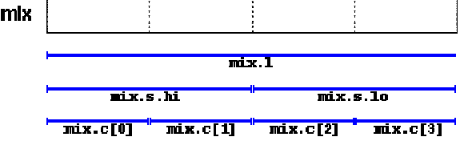

# C++ 语言编程入门指南


C++ 培训视频。认为 C++ 很难学吗？如果你遵循这个方法，它就很简单！`InfiniteSkills.com/C_`

## 关于 C++ 语言的信息

这些文章简要描述了这种编程语言的特性：

- **简要描述：**  
  关于该语言的一些通用方面。
- **C++ 历史**  
  该语言发展的简要历史。
- **常见问题解答：**  
  程序员经常问的问题简短列表。


从 ActivePyth Amazon 镜像开始。减少硬件和软件获取成本，使用准备即用、经过测试且可靠的 ActivePyth 栈节省时间。


如今，计算机能够执行许多不同的任务，从简单的数学运算到复杂的动画。但计算机并不创建这些任务；因此它们是通过一系列预定义的指令执行的，我们称之为`程序`。

计算机没有足够的创造力来完成未编写程序的任务，因此它只能遵循被编写好的运行。负责生成计算机可能执行新任务的程序的程序员或编码员，为了这个目的使用了`编程语言`。

编程语言是一组指令和一系列词法规范，专门用于告诉计算机要做什么。

在选择用于某个项目的编程语言时，可以考虑许多不同的因素。首先，必须决定编程语言的级别。层级决定了它接近编程语言的程度，而在“高级级”语言中，有更多抽象或概念代码，而在“低级”语言中，指令是直接与硬件接口编写的。

分级代码是可移植的，并且通过较少的修改执行许多不同的任务，而低级代码受限于其编写的硬件变体。尽管如此，低级代码的优势在于它通常更快，因为它是针对特定机器的优势编写的。

虽然有些语言显然是低级语言，例如汇编语言，其指令集适应于代码编写的每台机器；而其他语言是高级的，例如 Java，它被设计为独立于运行的平台。C++ 语言处于中间位置，因为它可以无限制地直接与硬件交互，同时也具有抽象层，并且像最强大的层级语言之一。

## C++ 语言的特性

C++ 相比其他编程语言具有某些特性。最显著的特征：

面向对象编程的可能性允许程序员从更像对象之间连接而非代码结构的视角来设计应用程序。此外，它允许以更有逻辑、更高效的方式提高代码的可重用性。

你实际上可以在任何类型的计算机和操作系统上使用相同的 C++ 而无需进行任何更改。C++ 是世界上最常用的编程语言。

与其他语言相比，用 C++ 的代码非常短，因为它倾向于使用特殊字符而不是关键字，为程序员节省了一些精力（并延长了我们键盘的寿命！）。

C++ 与 C 语言兼容。任何用 C 编写的代码都可以轻松包含 C++ 程序中，无需更改。

C++ 编译生成的代码非常高效，这确实归于它作为高级和低级语言的双重性，以及语言本身体积较小。

搜索：`[搜索]`

登录：`[登录]` `[记住我]` `[注册]`


- `cplusplus.com`

信息

文档

参考

文章

来源

信息


智能服务器，每月 $85 起 立即订购

## C++ 历史

在 60 年代，当编译器还处于开发早期阶段，出现了许多新的编程语言，例如 ALGOL 60，它是作为 FORTRAN 的替代方案开发的，但它带来了一些结构化编程的概念，这些概念后来启发了过程语言，如 C 及其后续者（如 C++）。ALGOL 68 还引入了 C 中数据类型的开发。然而，ALGOL 是一种非特定语言，其抽象性对于建模大多数商业案例来说是不实用的。

1963 年，C（组合编程语言）出现，理念是比 ALGOL 或 FORTRAN 更具特定性。这种特定性使其成为更简单的语言，更容易学习和实现。

1967 年，Martin Ritchie 开发了 B（基础编程语言），它标志着 C 的前身的简化。尽管它是一种抽象且某种初生的语言，

1970 年，Arne Stroustrup 在贝尔实验室开发 C 时，创建了 C++。它是针对特定机器（DEC PDP-7 和 UNIX）的 BC 的一部分，并根据他的任务和需求进行了调整。最终结果是 C 的一个大成功，取决于系统，它有很大的局限性，即它不编译执行——而是生成源代码。

从 1971 年开始，贝尔实验室的 Dennis Ritchie 开发了 C，这允许他以更灵活的方式生成代码。C 还为该语言引入了一些其他特性（`char`）。

1973 年，Dennis Ritchie 开发了 C 的基础。类型的包含、对它的处理，以及数组和指针的改进，有助于可移植性的扩展，而无需额外代价。

尽管 C++ 在某些方面是明确的低级的，但 C++ 语言是高级的。1979 年，Stroustrup 在贝尔实验室为 C++ 引入了某些特性，这被称为“C 语言”。80 年代，C++ 引入了许多特性。1990 年，C++ 委员会发布了标准，使其成为特性。1998 年，C++ 标准发布，引入了许多特性。2003 年，C++ 标准进行了修订。

`http://www.cplusplus.com/doc/`


搜索：

登录：

记住我：

`[注册]`

| cplusplus.com |
| :--- |
| 信息 |
| 文档 |
| 引用 |
| 源码 |
| 论坛 |
| C++ 语言教程 |
| ASCII 码 |
| 布尔运算 |
| 进制计数 |
| C++ 培训 |
| 觉得 C++ 难学吗？其实很简单！看这里，`Infinitekills.com/C_Fr` |


通过《C++ 语言教程》从基础开始学习 C++，或者了解新的语言特性。这是一份涵盖编程语言现代概念的快速节奏自学教程。

- ASCII 码
- 进制计数
- 布尔运算

发现错误？请联系我们

`cplusplus.com`


作者：Juan Soulié

最后修订：2007年6月

在线地址：`http://www.cplusplus.com/doc/tutorial/`

在线版本会不断修订，并可能包含修正和更改。

禁止以任何形式重新分发或复制部分或全部内容，但打印整个文档的个人副本或将其下载到本地硬盘外，且不以任何方式修改其内容（包括但不限于此版权声明）。

未经 cplusplus.com 明明书面许可，您不得分发本文档的内容。您也不得将其传输或存储在其他网站或其他形式的电子检索系统中。

## 目录

- 引言 .....................................................................................5
- 使用说明 ...................................................................5
- C++ 基础 ................................................................................................7
- 程序结构..............................................................................................7
- 变量、数据类型................................................................................11
- 常量 ................................................................................................17
- 运算符 ................................................................................................21
- 基础输入/输出................................................................................29
- 控制结构......................................................................................34
- 控制结构......................................................................................34
- 函数 (I) ..............................................................................................41
- 函数 (II) .............................................................................................47
- 复合数据类型 ................................................................................54
- 数组 ......................................................................................54
- 字符序列 ................................................................................60
- 指针 ................................................................................................63
- 动态内存.......................................................................................74
- 数据结构.........................................................................................77
- 其他数据类型 ................................................................................82
- 面对象编程...............................................................................86
- 类 (I) .............................................................................................86
- 类 (II) ............................................................................................95
- 友元与继承 ................................................................100
- 多态 ............................................................................................107
- 高级概念 ...............................................................................113
- 模板...............................................................................................113
- 命名空间...........................................................................................120
- 异常 ............................................................................................123
- 类型转换...........................................................................................127
- 目录 ...........................................................................3
- 预处理器指令...............................................................................133
- C++ 标准库 ................................................................................138
- 文件输入输出 .......................................................................138

## 引言

## 使用说明

### 本教程面向读者？

本教程适用于想要学习 C++ 编程且不一定具备其他编程语言基础知识的人。当然，任何关于其他编程语言的知识或任何通用计算机技能都有助于更好地理解本教程，尽管这些并非必须的。它也适用于那些需要了解语言从最新标准中获得的新特性的读者。

如果你熟悉 C 语言，可以将本教程的前 3 部分作为概念复习，因为它们主要解释了 C++ 中的 C 部分。某些特性的 C++ 语法上存在细微差异，因此我仍然建议你阅读一下。

第 4 部分描述了面向对象编程。

第 5 部分主要描述了 ANSI-C++ 标准引入的新特性。

## 本教程的结构

本教程分为 6 部分，每部分又各自分为不同的章节，每个章节涵盖一个主题。你可以通过左侧边栏的章节索引访问任何章节，或从任何一点开始教程并跟随每个章节底部的链接。

许多章节包含了示例，描述了本章中新学知识的用法。建议阅读这些示例，并在进入下一章之前能够理解构成代码的每一行代码。

获得编程语言经验的良好方法是对你已经完全理解的示例程序进行自行修改和添加新功能。不要害怕修改本教程提供的示例，这就是我们学习的方式！

## 兼容性说明

将 ANSI-C++ 标准作为国际标准的适配是较新的。它首次于 1997 年 11 月发布，并于 2003 年修订。尽管如此，C++ 语言存在于更早的时期（1980 年代）。因此，许多编译器不支持 ANSI-C++ 中包含的所有新功能，特别是那些在标准发布之前发布的特性。

本教程认为应配合支持（至少某种程度）ANSI-C++ 规范的现代编译器使用。如果你的编译器尚未适配，我鼓励你获取一个。有很多选择，包括商业的和和免费的。

## 编译器

本教程包含的示例都是控制台程序。这意味着你使用文本与用户通信并显示结果。

所有 C++ 编译器都支持控制台程序的编译。请查看你的编译器的用户手册以获取有关如何编译它们的更多信息。

学习编程语言最好的方法可能是通过编写一个程序。因此，在这里我们将编写我们的第一个程序：

```cpp
// my first program in C++

#include <iostream>
using namespace std;

int main() {
	cout << "Hello World!";
	return 0;
}
```


第一个面板显示了我们第一个程序的代码。第二个面板显示了程序编译并执行后的结果。编辑和编译程序取决于你正在使用的编译器，取决于该版本是否具有开发接口（Development Interface）。如果你对如何编译 C++ 控制台程序有疑问，编译器的各个部分和手册将帮助你解决问题。

上一个程序是程序员第一次编写时时的典型程序，其结果是在屏幕上打印“Hello World!” 句子。它是用 C++ 编写的最简单程序之一，但它包含了每个 C++ 程序的基础组件。我们将逐行分析我们编写的代码：

### `// my first program in C++`

这是一个带有两个斜杠符号（`//`）的注释；它们被视为注释，不会对程序的行为产生任何影响。程序员可以使用它们在源代码内部包含解释或观察结果。在这种情况下，这是对我们程序作用的简短描述：

```cpp
#include <iostream>
```

以井号（`#`）开头的行是预处理器的指令。它们不是带有表达式的普通代码行，而是给编译器的指令。接下来的 `<iostream>` 指令告诉预处理器包含 `iostream` 标准文件。这个特定的文件 `iostream` 包含了 C++ 中基本输入输出库的声明，包含它是因为它的功能被用于加载库。

```cpp
using namespace std;
```

标准 C++ 库的所有元素都声明在一个所谓的命名空间（namespace）中，名称为 `std`。因此，为了访问它的功能，我们通过这个表达式声明我们将要使用这些实体。这在使用标准库的 C++ 程序中非常常见，事实上，它将出现在这些教程的大多数源代码中。

```cpp
int main ()
```


这一行对应于 `main` 函数的定义。`main` 函数是所有 C++ 程序开始执行的起点，无论它在源代码中的位置如何。无论它前后是否有其他不同名称的函数都没有——此函数定义中包含的指令将是任何 C++ 程序中第一个执行的指令。因此，所有 C++ 程序都必须有一个 `main` 函数是至关重要的。

代码中 `main` 单词后面跟着一对括号 `()`。这是一个函数声明：在 C++ 中，将函数与其他类型表达式区分的是的是随其后的大括号。可选地，这些括号可以在其中包含一个参数列表。

紧接着这些括号，我们可以找到被大括号 `{}` 包围的 `main` 函数体。大括号内的内容是函数在执行时所的操作。

```cpp
cout << "Hello World";
```

这一行是一个 C++ 语句。语句是一个可以实际产生代码的简单或复合表达式。事实上，这条语句执行了在我们第一个程序中产生可见效果的唯一操作。

`cout` 代表 C++ 中的标准输出流，该语句的含义是将字符序列（在本例中为 Hello World 字符序列）插入到标准输出流（通常是屏幕）。

`cout` 在 `iostream` 文件中通过 `std` 命名空间声明，这就是为什么我们需要包含特定的文件，并声明在代码中不使用这个特定的命名空间。

注意该语句以分号（`;`）结束。该字符用于标记语句的结束，事实上，它在 C++ 程序的所有语句末尾都必须包含分号（最常见的语法错误之一就是忘记在语句后包含分号）。

```cpp
return 0;
```

该语句导致 `main` 函数结束；`return` 后面可以跟一个返回代码（在我们的示例中后面是返回代码 0）。`main` 函数返回代码 0 通常被解释为程序在执行过程中按预期运行，没有任何任何错误。这是编写 C++ 控制台程序最常见的方法。

你可能已经注意到此程序的所有行在代码执行时都会执行操作。有些行只包含注释（以 `//` 开头）。有些行包含编译器预处理器的指令（使用 `#`）。然后是开始声明泛的行（在本例中为 `main` 函数），最后是带有语句的行（如插入到 `cout` 中的操作），这些行都包含在由 `main` 函数的大括号 `{}` 划分的块中。

为了更具可读性，程序被结构在不同的行中，但在 C++ 中，我们对于如何在不同行之间分隔指令没有严格的规则。例如，与其写成：

```cpp
int main () {
    cout << "Hello World!";
    return 0;
}
```

我们可以写成：

```cpp
int main () { cout << "Hello World"; return 0; }
```

只用一行，它的含义与之前的代码完全相同。

在 C++ 中，语句之间的分离是通过每个语句末尾的结束分号（`;`）指定的；不同代码行之间的分离对于此目的完全没有影响。我们可以在每行写多个语句，也可以写一个占据许多代码行的语句。代码在不同行之间的划分仅是为了让人类看起来更易读、更有体系。

让我们为我们的第一个程序添加注释：

```cpp
// my second program in C++

#include <iostream>
using namespace std;

int main ()
{
    cout << "Hello World!";
    cout << "I'm a C++ program";
    return 0;
}
```

在这种情况下，我们在两个语句中向 `cout` 执行了两次插入。一旦不同行的分离仅仅是为了给程序提高可读性，因为 `main` 完全可以这样定义：

```cpp
int main () { cout << "Hello World"; cout << "I'm a C++ program"; return 0; }
```

如果我们认为方便，也可以自由地将代码分成更多的行：

```cpp
int main () {
    cout << "Hello World!";
    cout << "I'm a C++ program";
    return 0;
}
```

结果将与之前的示例完全相同。

预处理器指令（那些以 `#` 开头的指令）不属于这一通用规则，因为它们不是语句。这些行由预处理器读取和处理，其本身不产生任何代码。预处理器指令必须指定在自己的行中，并且不需要分号（`;`）。

注释是编译器忽略的源代码部分。它们只是什么都不做。它们的目的仅仅是允许程序员在源代码中插入备注或描述。

```cpp
// 行注释
/* 块注释 */
```

它们的第一种被称为行注释，它忽略从双斜杠符号（`//`）出现的地方到该行结束的所有内容。第二种被称为块注释，它忽略从 `/*` 字符到第一个 `*/` 字符出现之间的所有内容，并包含多行。我们将为我们的第二个程序添加注释：

```cpp
/* my second program in C++
   with more comments */

#include <iostream>
using namespace std;

int main() {

    cout << "Hello World!"; // prints Hello World
    cout << "I'm a C++ program"; // prints I'm a C++ program
    return 0;
}
```

如果你在程序的源代码中包含注释而不使用注释字符组合 `//`、`/*` 或 `+*`，编译器将把它们视为 C++ 表达式来处理，在编译它时最可能会导致一个或多个错误消息。

# 变量

上一节中展示的“Hello World”程序的用性相当待疑。我们必须写几行代码，编译它们，然后执行生成的程序，仅仅是为了在屏幕上得到一个简单的句子作为结果。我们自己输入这个输出句子显然要快得多。然而，编程并不局限于在屏幕上打印简单的文本。为了更进一步，并能够编写执行非常有用的且为我们节省任务的程序，我们需要引入`变量`的概念。

让我们想我要求你在脑海中记住数字 5，同时我又要求你记住数字 2。你刚刚在记忆中存储了两个值。现在，如果我要求我在说的第一个数字上加 1，你应该在记忆中保留数字 6（即 5+1）和 2。我们可以验证这些值，减去 4 得到结果。

你用脑海记忆完成的这整个过程与计算机使用两个变量可以完成的操作相似。同样的过程可以用 C++ 中的以下指令集表示：

```cpp
a = 5;
b = 2;
a = a + 1;
result = a - b;
```

显然，这是一个非常简单的例子，因为我们使用了两个小的整数值，但请考虑你的计算机可以同时存储数百万个这样的数字，并对它们进行复杂的数学运算。

因此，我们可以将标识符（identifier）定义为用于存储确定值的内存区域。

每个变量都需要一个标识符来与其他区分开，在之前的代码中，变量标识符是 `a`、`b` 和 `result`，但我们可以使用发明的任何名称来命名变量，只要它们是有效的。

有效的标识符是由一个或多个字母、数字或下划线字符（`_`）组成的序列。标识符不能包含空格、标点符号或符号。只有字母、数字和下划线是有效的。此外，变量标识符总是以字母开头。它们也可以以下划线（`_`）开头，但在某些情况下可能保留给特定的关键字或外部标识符，以及任何包含两个连续下划线的标识符。不能以数字开头。

你在发明标识符时必须考虑的另一个规则是，它们不能与 C++ 语言的任何关键字或你特定的（即保留关键字）匹配。标准的保留关键字有：

```cpp
asm, auto, bool, break, case, catch, char, class, const, continue, default, delete,
de, double, dynamic_cast, enum, explicit, export, extern, false, float, for, goto,
if, int, long, mutable, namespace, operator, private, protected, public, register,
reinterpret_cast, return, short, sizeof, static, static_cast, struct, template,
this, try, signed, typedef, typeid, typename, unsigned, virtual, void,
volatile, wchar_t
```

此外，运算符的替代表示形式不能作为标识符，因为它们在某些条件下是被保留的：

```cpp
and, and_eq, bitor, compl, not, not_eq, or, or_eq, xor, xor_eq
```

你的编译器可能还会包含一些特定的保留关键字。

**非常重要：C++ 语言是一种“大小写敏感”语言。** 这意味着大写的标识符不等同于另一个相同但小写的标识符。因此，例如 `RESULT` 变量不同于 `result` 变量或 `Result` 变量。这是三个不同的标识符。

## 基本数据类型

在编程时，我们将变量存储在计算机内存中，但计算机必须知道我们存储在其中的的是什么类型的数据，因为存储一个简单数字与存储单个字母或大数字占据的内存量是不相同的，而且它们的解释方式也不同。

我们计算机中的内存按字节（byte）组织的。字节是我们在 C++ 中可以管理的最小内存量。一个字节可以存储少量数据：单个字符或较小的整数（通常是 0 到 255 之间的整数）。此外，计算机还可以通过组合较少类型来处理更复杂的数据类型，例如长型或非整数数字。

接下来是 C++ 中基本基础数据类型的总结，以及每种类型可以表示的数值范围：

| 名称 | 描述 | 大小* | 范围* |
|---|---|---|---|
| `char` | 字符或较小整数。 | 1byte | 有符号: -128 到 127；无符号: 0 到 255 |
| `int (short)` | 短整数。 | 2bytes | 有符号: -32768 到 32767；无符号: 0 到 65535 |
| `int` | 整数。 | 4bytes | 有符号: -2147483648 到 2147483647；无符号: 0 到 4294967295 |
| `int (long)` | 长整数。 | 4bytes | 有符号: -2147483648 到 2147483647；无符号: 0 到 4294967295 |
| `bool` | 布尔值。它可以取两个值之一：`true` 或 `false`。 | 1byte | `true` 或 `false` |
| `float` | 浮点数。 | 4bytes | +/-3.4e+/-308 (~17位数字) |
| `double` | 双精度浮点数。 | 8bytes | +/-1.7e+/-308 (~17位数字) |
| `long double` | 双精度浮点数。 | 8bytes | +/-1.7e+/-308 (~17位数字) |
| `wchar_t` | 宽字符。 | 2bytes | 宽字符 |

> * 大小和范围取决于系统。

在编程时，我们将变量存储在计算机内存中，但计算机必须知道我们存储在其中的什么类型的数据，因为存储一个简单数字与存储单个字母或大数字占据的内存量是不相同的，而且它们的解释方式也不同。

我们计算机中的内存按字节组织的。字节是我们在 C++ 中可以管理的最小内存量。一个字节可以存储少量数据：单个字符或较小的整数（通常是 0 到 255 之间的整数）。此外，计算机还可以通过组合较少类型来处理更复杂的数据类型，例如长型或非整数数字。

## 变量声明

为了在 C++ 中使用变量，我们必须首先声明我们想要的类型。声明新变量的语法是编写所需的数据类型（如 `int`、`float`……）后的标识符。例如：

```cpp
int a;
float mynumber;
```

这些是有效的变量声明。第一个声明了一个类型为 `int` 的变量 `a`。第二个声明了一个类型为 `float` 的变量 `mynumber`。一旦声明，变量 `a` 和 `mynumber` 就可以在程序的其余部分中使用。如果你要声明多个同类型的变量，可以使用逗号分隔标识符，在同一个语句中声明。例如：

```cpp
int a, b, c;
```

这声明了三个变量（`a`、`b` 和 `c`），类型均为 `int`，其含义等同于：

```cpp
int a;
int b;
int c;
```

整数数据类型 `char`、`short`、`long` 和 `int` 可以是有符号或无符号的，取决于要表示的数字范围。有符号类型可以表示正负，而无符号类型只能表示正值（零）。这可以通过在类型名称之前使用符号或无符号指定符来指定。例如：

```cpp
unsigned short int NumberOfSisters;
signed int MyAccountBalance;
```

默认情况下，如果我们不指定符号或无符号，大多数编译器假设类型为有符号，因此对于第二个声明我们可以写成：

```cpp
int MyAccountBalance;
```

含义相同（带或不带 `signed` 关键字）。

此规则的例外是 `char` 类型，它是独立的，被认为是 `signed char` 和 `unsigned char` 不同数据类型，用于存储字符。如果你打算在 `char` 大小的变量中存储数值，则应该使用符号或无符号。

`short` 和 `long` 可以用作类型指定符。在这种情况下，它们指的是各自的基础类型：`short` 等同于 `short int`，`long` 等同于 `long int`。以下是变量声明：

```cpp
short NextYear;
signed int NextYear;
```

最后，`signed` 和 `unsigned` 也可以作为独立的类型指定符，意味着同样的 `signed int` 和 `unsigned int`。以下两个声明是等价的：

```cpp
unsigned NextYear;
unsigned int NextYear;
```

为了看到变量声明在程序中是如何运行的，我们将看到本节开头关于你脑海记忆示例的 C++ 代码：

```cpp
// 操作变量
#include <iostream>
using namespace std;

int main () {
    // 声明变量:
    int a, b;
    int result;

    // 处理:
    a = 5;
    b = 2;
    a = a + 1;
    result = a - b;

    // 打印结果:
    cout << result;

    // 终止程序:
    return 0;
}
```

不要担心变量声明之外的内容看起来对你有些奇怪。你将在接下来的章节中详细看到其余。

# 变量的作用域

我们在程序中打算使用的所有变量必须在代码的早些之前通过其类型说明符进行声明，我们在之前的代码或函数体中当声明 `a`、`b` 和 `result` 为 `int` 类型时已经定义了这一点。

变量可以是全局作用域，也可以是局部作用域。全局变量是在源代码的主体中声明的、位于所有函数之外；而局部变量是在函数体或块内部声明的。

```cpp
#include <iostream>
using namespace std;

struct Integer {
    char character;
    char string[20];
    unsigned int NumberOfSons;

    int main() {
        unsigned short Age;
        float ANumber, AnotherOne;

        cout << "Enter your age:";
        cin >> Age;
...
    }
};
```

全局变量

局部变量

## 指南

全局变量可以在代码的任何地方引用，即使在函数内部，只要是在其声明之后。

局部变量的作用域限于声明它们的大括号 `{}` 包围的块。例如，如果它们在函数体（如 `main` 函数）的开头声明，它们的作用域就在声明点和函数结束之间。在上面的示例中，这意味着如果 `main` 之外还有另一个函数，那么 `main` 中声明的局部变量无法从另一个函数访问，反之亦然。

## 变量初始化

在声明局部变量时，默认情况下它是未定义的。但你可能希望变量在声明的同时存储一个具体的值。为了实现这一点，你可以初始化变量。在 C++ 中有两种方法可以实现。

第一种方法类似于 C 语言，通过在变量后面附加等号以及要初始化的值来完成：

```cpp
类型 标识符 = 初始值;
```

例如，如果你想在声明时声明一个初始化值为 0 的 `int` 变量，你可以写道：

```cpp
int a = 0;
```

另一种初始化变量的方法被称为`构造函数初始化`，通过将初始值封装在括号 `()` 中来完成。

```cpp
类型 标识符 (初始值);
```

例如：

```cpp
int a (0);
```

两种初始化变量的方法在 C++ 中都是有效且等效的。

```cpp
// 变量初始化
#include <iostream>
using namespace std;

int main() {
    int a = 5;            // 初始值 = 5
    int b(0);            // 初始值 = 2
    int result;           // 初始值
    // 未确定

    a = 3;
    result = a - b;
    cout << result;

    return 0;
}
```

## 字符串

存储大于单个字符的非数值值的变量被称为字符串。

C++ 语言库通过标准 `string` 类提供对字符串的支持。这不是一种基本类型，但在大多数基本用法中，它的行为与基本类型相似。

与基本数据类型的第一个区别是，为了声明和使用这种类型的对象（变量），我们需要在源代码中包含一个额外的头文件：`<string>`，并访问 `std` 命名空间（在我们之前的所有程序中通过 `using namespace` 语句已经拥有了访问权限）。


```cpp
// 我的第一个字符串
#include <iostream>
#include <string>
using namespace std;

int main() {
    string mystring = "This is a string";
    cout << mystring;
    return 0;
}
```

正如你在上一个示例中看到的，字符串可以像数值类型变量一样，用任何有效的字符串字面量进行初始化。这两种初始化格式对字符串都是有效的：

```cpp
string mystring = "This is a string";
mystring = ("This is a string");
```

字符串也可以执行基本数据类型可以执行的所有其他操作。

| 转义序列 | 含义 |
|---|---|
| `\n` | 换行符 |
| `\r` | 回车符 |
| `\t` | 制表符 |
| `\v` | 垂直制表符 |
| `\b` | 退格键 |
| `\f` | 换页符（分页） |
| `\a` | 警报符（蜂鸣声） |
| `\'` | 单引号（`'`） |
| `\"` | 双引号（`"`） |
| `\?` | 问号（`?`） |
| `\\` | 反斜杠（`\`） |

例如：

- `\n`
- `\t`
- `\tRight`
- `\one\ntwo\three`

此外，你还可以通过其数值 ASCII 字符来表示任何字符（反斜杠 `\` 后跟用八进制（基 8）或十六进制（基 16）表示的 ASCII 代码）。在第一种情况下（八进制）中，数字紧跟反斜杠（例如 `\23` 或 `\40`），在第二种情况下（十六进制）中，在数字本身之前写一个 `x`（例如 `\20` 或 `\4A`）。

字符串字面量可以通过在每个未完成的行末尾加上反斜杠（`\`）来扩展到多行代码。

```cpp
"string expressed in \
two lines"
```

你可以通过用一个或多个空格、制表符、换行符或任何其他有效的空白字符来连接多个字符串常量：

```cpp
"this forms" a single"string" "of characters"
```

最后，如果我们想让字符串字面量显式地由宽字符（`wchar_t`）而非窄字符（`char`）组成，可以在常量加上 `L` 前缀：

```cpp
L"This is a wide character string"
```

宽字符主要用于表示非英语或异域字符集。

只有两个有效的布尔值：`true` 和 `false`。这些值在 C++ 中可以作为布尔字面量 `true` 和 `false`，表示为 `bool` 类型的值。

你可以通过直接使用 `#define` 预处理指令为你经常使用的常量定义自己的名称，而无需使用消耗内存的变量。其格式为：

```cpp
#define 标识符 属性
```

例如：

```cpp
#define PI 3.14159
#define NEWLINE '\n'
```

这定义了两个常量：`PI` 和 `NEWLINE`。一旦定义了它们，你就可以在代码的其他部分像任何普通常量一样使用它们，例如：

```cpp
// 定义的常量：计算周长

#include <iostream>
using namespace std;

#define PI 3.14159
#define NEWLINE '\n'

int main() {
    double r=5.0;      // radius
    double circle;

    circle = 2 * PI * r;
    cout << circle;
    cout << NEWLINE;

    return 0;
}
```

事实上，编译器预处理器在遇到 `#define` 指令时所做的事情就是字面上地将它们标识符的任何出现之处（在上例中，这些是 `PI` 和 `NEWLINE`）替换为它们定义的代码（分别为 `3.14159` 和 `'\n'`）。

`#define` 指令不是 C++ 语句，而是预处理器的指令；因此它将该行视为指令，且在末尾不需要分号（`;`）。如果你在末尾添加一个分号（`;`），它将附加到程序体中预处理器替换的所有出现位置。

通过 `const`，你可以像声明变量一样声明具有特定类型的常量：

```cpp
const int pathwidth = 100;
const char tabulator = '\t';
```

在这里，`pathwidth` 和 `tabulator` 是两个常量。它们被处理就像普通变量一样，只是它们的值在定义后不能被修改。

一旦我们知道了变量和常量的存在，就可以开始对它们进行操作。为了这个目的，C++ 集成了运算符。与其他语言（其运算符主要是关键字）不同，C++ 中的运算符大多由不属于字母表但在所有键盘上都可用的符号组成。这使得 C++ 代码更短且更国际化，因为它对英语单词的依赖较少，但在开始时需要一点学习努力。

你不需要记住此页面的所有内容。大多数细节仅提供以供在以后需要时作为参考。

## 赋值运算符

赋值运算符将值赋给变量。

```cpp
a = 5;
```

该语句将整数 `5` 赋给变量 `a`。赋值运算符（`=`）左侧被称为左值（lvalue），右侧称为右值（rvalue）。左值必须是一个变量，而右值可以是常量、变量、任何操作或它们的组合。赋值时最重要的规则是从右到左的规则：赋值总是从右到左发生，而永远不会反过来：

```cpp
a = b;
```

该语句将 `b`（右值）中包含的值赋给变量 `a`（左值）。直到此为止存储在 `a` 中的值在此操作中完全没有被考虑，事实上该值丢失了。

考虑我们在赋值的瞬间仅将 `b` 的值赋给 `a`。因此，之后 `b` 的变化不会影响 `a` 的值。

例如，让我们看看下面的代码——我包含了变量中存储内容的演变过程：

```cpp
// 赋值运算符
#include <iostream>
using namespace std;

int main() {
    int a, b;          // a:?, b:?
    a = 10;            // a:10, b:?
    b = 4;             // a:?, b:4
    a = b;             // a:4, b:4
    b = 7;             // a:4, b:7

    cout << "a";
    cout << "b";
    cout << b;

    return 0;
}
```

此代码将给我们结果 `a` 中包含的值是 `4`，`b` 中包含的值是 `7`。注意 `a` 如何不受 `b` 最终修改的影响，尽管我们早些声明了 `a = b`（那是因为从右到左的规则）。

C++ 相对于其他编程语言的一个特性是，赋值操作可以作为另一个赋值操作的值（或其部分）。例如：

```cpp
a = 2 + (b = 5);
```

等同于：

```cpp
b = 5;
a = 2 + b;
```

意味着：首先将 `5` 赋给变量 `b`，并将 `2` 加上之前对 `b` 赋值的结果（即 `5`）赋给 `a`，使得 `a` 的最终值为 `7`。

以下表达式在 C++ 中也是有效的：

```cpp
a = 2 + (b = 5);
```

## 算术运算符

| 运算符 | 描述 |
|---|---|
| `+` | 加法 |
| `-` | 减法 |
| `*` | 乘法 |
| `/` | 除法 |
| `%` | 取模 |

加法、减法、乘法、除法操作受 C++ 支持。只有取模操作产生余数。例如，如果我们写：

```cpp
a %= 3;
```

变量 `a` 将包含除以 `3` 的余数。

## 复合赋值运算符

当我们想要通过操作修改 `a` 的值时，可以使用复合运算符：

| 运算符 | 等价形式 |
|---|---|
| `+=` | `a +=` |
| `-=` | `a -=` |
| `*=` | `a *=` |
| `/=` | `a /=` |
| `%=` | `a %=` |

以及其他运算符。例如：

```cpp
// 复合赋值
#include <iostream>
using namespace std;

int main() {
    int a, b=3;
    a += b;      // 等于 a+=b
    cout << a;
    return 0;
}
```

该运算符的一个特性是它既可以作为前缀也可以作为后缀。虽然在简单的表达式如 `a++` 或 `++a` 中含义相同，但在其他增加或减少的结果作为值在外部表达式中求值的情况下会有重要的区别：当增加运算符作为前缀（`++`）时，值在表达式的结果在外部表达式求值之前增加；当它作为后缀（`a++`）时，存储在 `a` 中的值在求值后增加，因此操作的是增加之前的值。注意这种差异：

| 示例 1 | 示例 2 |
|---|---|
| `B=3;` | `B=3;` |
| `A=++B;` | `A=B++;` |
| `// A 包含 4, B 包含 4` | `// A 包含 3, B 包含 4` |

在示例 1 中，`B` 在其值被复制到 `A` 之前增加。在示例 2 中，`B` 的值复制到 `A`，然后 `B` 增加。

# 关系和相等运算符（`==`、`!=`、`>`、`>=`、`<=`、`<`）

为了比较两个表达式，我们使用关系和相等运算符。关系操作的结果是一个布尔值，可以真或假，例如它们是否相等或一个是否大于另一个。根据其布尔结果：

| 运算符 | 描述 |
|---|---|
| `==` | 等于 |
| `!=` | 不等于 |
| `>` | 大于 |
| `<` | 小于 |
| `>=` | 大于等于 |
| `<=` | 小于等于 |

以下是一些示例：

```cpp
(7 == 5)    // 结果为 false。
(5 > 4)     // 结果为 true。
(3 <= 2)    // 结果为 false。
(6 == 6)    // 结果为 true。
(5 < 5)     // 结果为 false。
```

当然，不仅是使用数字常量，你可以使用任何表达式，包括变量。假设 `a=2`、`b=3` 且 `c=6`：

```cpp
(a == 5)      // 结果为 false，因为 a 不等于 5。
(a*b > c)     // 结果为 true，因为 (2*3 > 6) 为 false。
(b+4 > a*c)   // 结果为 false，因为 (3+4 > 2*6) 为 false。
(b-2) == a    // 结果为 true。
```

注意——一个等号（`=`）与运算符 `==`（两个等号）不相同，第一个是赋值运算符（`=` 将右侧的值赋值给左侧的变量），而另一个（`==`）是比较其两边表达式的运算符。在表达式 `(b=2)` 中，我们将值 `2` 赋值给 `b`，然后将其与 `a` 比较（`a` 也存储了该值），操作结果为 `true`。

## 逻辑非运算符

`!` 运算符是 C++ 中执行逻辑非（NOT）的运算符，它只有一个操作数，位于右侧，它所做的就是反转该值：如果操作数为真则产生假，如果为假则产生真。它返回求值操作的布尔值。例如：

```cpp
!(5 == 5)  // 结果为 false，因为右侧的表达式 (5 == 5) 为真。
!(6 <= 4)  // 结果为 true，(6 <= 4) 将为假。
!true      // 结果为 false
!false     // 结果为 true。
```

## 逻辑与和逻辑或运算符

逻辑运算符 `&&` 和 `||` 用于求值两个表达式以获得单一的关系结果。`&&` 运算符对应布尔逻辑与（AND）。当两个操作数都真时，该操作返回 `true`，否则返回 `false`。下面的表格显示了运算符 `&&` 计算表达式 `a && b` 的结果：

| `a` | `b` | `a && b` |
|---|---|---|
| `true` | `true` | `true` |
| `true` | `false` | `false` |
| `false` | `true` | `false` |
| `false` | `false` | `false` |

`||` 运算符对应布尔逻辑或（OR）。当其中一个操作数为真时，该操作返回 `true`，因此只有当两个操作数均为假时才返回 `false`。以下是 `a || b` 的可能结果：

| `a` | `b` | `a || b` |
|---|---|---|
| `true` | `true` | `true` |
| `true` | `false` | `true` |
| `false` | `true` | `true` |
| `false` | `false` | `false` |

例如：

```cpp
(5 == 5) && (3 > 6)  // 结果为 false (true && false)。
(5 == 5) || (3 > 6)  // 结果为 true (true || false)。
```

# 条件运算符（`?`）

条件运算符求值表达式，如果该表达式为真则返回一个值，如果表达式被求值则返回另一个值。其格式为：

```cpp
condition ? result1 : result2
```

如果 `condition` 为真，表达式将返回 `result1`；如果不是，则返回 `result2`。

```cpp
7==5 ? 7 : 4      // 返回 4，因为 7 不等于 5。
7==5+2 ? 4 : 3    // 返回 4，因为 7 等于 5+2。
5>3 ? a : b       // 返回 a 的值，因为 5 大于 3。
a>b ? a : b       // 返回 a 或 b 中较大的那个。
```

```cpp
// 条件运算符
#include <iostream>
using namespace std;

int main () {
    int a,b,c;

    a=2;
    b=7;
    c = (a>b) ? a : b;

    cout << c;

    return 0;
}
```

在此示例中，`a` 为 `2`，`b` 为 `7`，所以表达式 `(a>b)` 不为真，因此问号指定的第一个值被舍弃，转而使用第二个值（冒号后面的值），即 `b`，其值为 `7`。

# 逗号运算符（`,`）

逗号运算符 `,` 用于在只期望一个表达式的地方分隔两个或多个表达式。当需要对一组表达式进行求值时，只考虑最右边的表达式。

例如，以下代码：

```cpp
a = (b=3, b+2);
```

将首先将值 `3` 赋值给 `b`，然后将 `b+2` 赋值给变量 `a`。因此，变量 `a` 将包含值 `5`，而变量 `b` 将包含 `3`。

# 位运算符（`&`、`|`、`^`、`~`、`<<`、`>>`）

位运算符修改表示它们存储的值的位模式。

| 运算符 | 描述 |
|---|---|
| `&` | 按位与 |
| `|` | 按位包含或 |
| `^` | 按位异或 |
| `~` | 按位取反 |
| `<<` | 左移 |
| `>>` | 右移 |

# 运算符优先级

分组定义了当存在多个运算符时运算符的求值顺序。

当存在多个相同优先级的运算符时，可以通过括号 `()` 来消除歧义，例如：

```cpp
a = 5 + 7;
```

可以写为：

```cpp
a = 5 + (7);
```

或者：

```cpp
a = (5 + 7);
```

取决于我们想要的操作。

如果你想编写复杂的表达式且不完全确定优先级级别，始终包含括号。这会让代码更易读。

# 运算符优先级

分组定义了当存在多个相同优先级的运算符时运算符的求值顺序。

在编写包含多个相同优先级运算符的表达式时，我们可能对执行顺序产生疑问。例如，在表达式中：

```cpp
a = 5 + 7;
```

正确答案如下所示，每个运算符的优先级：

| 等级 | 运算符 | 描述 | 分组 |
|---|---|---|---|
| 1 | `::` | 作用域 | 从左到右 |
| 2 | `()`、`->`、`dynamic_cast`、`static_cast`、`reinterpret_cast`、`typeid` | 后置 | 从左到右 |
| 3 | `*`、`&`、`~` | 一元（前缀）间接（指针） | 从右到左 |
| 4 | `+`、`-`、`(type)` | 类型转换 | 从左到右 |
| 5 | `.*`、`->*` | 指针成员 | 从左到右 |
| 6 | `/`、`*` | 乘法 | 从左到右 |
| 7 | `+`、`-` | 加法 | 从左到右 |
| 8 | `<<`、`>>` | 移位 | 从左到右 |
| 9 | `<`、`<=`、`>=`、`>` | 关系 | 从左到右 |
| 10 | `==`、`!=` | 等等性 | 从左到右 |
| 11 | `&` | 按位与 | 从左到右 |
| 12 | `^` | 按位异或 | 从左到右 |
| 13 | `|` | 按位或 | 从左到右 |
| 14 | `&&` | 逻辑与 | 从左到右 |
| 15 | `||` | 逻辑或 | 从左到右 |
| 16 | `?:` | 条件 | 从右到左 |
| 17 | `*=`、`/=`、`%=`、`+=`、`-=`、`<<=`、`>>=`、`&=`、`^=`、`|=` | 赋值 | 从右到左 |
| 18 | `,` | 逗号 | 从左到右 |

## 基础输入输出

到目前为止，之前章节的示例程序与用户的交互非常少，甚至完全没有。使用标准输入输出库，我们将能够通过在屏幕上打印消息和从键盘获取用户输入与用户交互。

C++ 使用了一种名为“流”（streams）的便捷抽象，在屏幕或键盘等顺序介质上执行输入和输出操作。流是一个对象，程序可以向其中插入字符或从中提取字符。我们不需要关心与流相关的物理介质的许多细节——我们不需要了解它，也不需要按顺序提供字符。

标准 C++ 库包含了头文件 `iostream`，其中声明了标准输入输出流对象。

## 标准输出（`cout`）

默认情况下，程序的标准输出是屏幕，而用于访问它的 C++ 流对象是 `cout`。

`cout` 与插入运算符结合使用，该运算符写为 `<<`（两个“小于”符号）。

```cpp
cout << "Output sentence"; // 在屏幕上打印 Output sentence
cout << 120;               // 在屏幕上打印数字 120
cout << x;                 // 在屏幕上打印 x 的内容
```

该运算符将数据插入到其之前的流中。在上面的示例中，它将常量字符串 `Output`、数值常量 `120` 和变量插入到标准输出流中。注意第一条指令中的句子被双引号（`"`）括起来，因为它是一个常量字符字符串。当我们想要使用常量字符字符串时，必须将其包含在双引号（`"`）之间，以便将其与变量名区分开来。例如，这两个句子的结果不同：

```cpp
cout << "Hello"; // 打印 Hello
cout << Hello;   // 打印 Hello 变量的内容
```

插入运算符（`<<`）可以在单个语句中使用多次：


```cpp
cout << "Hello, I am " << "a C++ statement";
```

这条语句将在屏幕上打印消息 `Hello, I am a C++ statement`。重复使用插入运算符的用处在我们使用变量与常量的组合或多个变量时得到了体现：

```cpp
cout << "Hello, I am " << age << " years old and my zipcode is " << zipcode;
```

如果我们假设`age`变量包含值`24`，`zipcode`变量包含值`90064`，则上一个语句的输出为：

```
Hello, I am 24 years old and my zipcode is 90064
```

需要注意的是，除非我们显式指示，否则`cout`不会在输出后添加换行符，因此以下语句：

```cpp
cout << "This is a sentence.";
cout << "This is another sentence.";
```

将在屏幕上一个接一个显示，之间没有任何换行符：

`This is a sentence.This is another sentence.`

尽管我们向`cout`写入了两次不同的插入操作。为了在输出中执行换行，我们必须显式地向`cout`插入一个换行字符。在 C++ 中，换行字符可以指定为`\n`（反斜杠，n）：

```cpp
cout << "First sentence.\n";
cout << "Second sentence.\nThird sentence.";
```

这产生了输出：

```
First sentence.

Second sentence.

Third sentence.
```

此外，为了添加换行，你还可以使用`endl`操纵符。例如：

```cpp
cout << "First sentence." << endl;
cout << "Second sentence." << endl;
```

将打印出：

```
First sentence.

Second sentence.
```

`endl`操纵符产生一个换行字符，与插入`'\n'`完全相同，但当它与缓冲流一起使用时，还有一个额外的行为：刷新缓冲区。无论如何，`cout`在大多数情况下是一个无缓冲流，因此你可以同时使用`\n`转义字符和`endl`操纵符来指定新行，而其行为没有区别。

## 标准输入 (cin)

标准输入通常是键盘。在 C++ 中处理标准输入是通过对`cin`变量应用重载的提取运算符 (`>>`) 来完成的，该变量将存储从流中提取的数据。例如：

```cpp
int age;
cin >> age;
```

第一条语句声明了一个类型为`int`的变量`age`，第二条语句等待来自（键盘）的输入以存储这个整数变量。

只有在按下 `RETURN` 键后，`cin`才能处理来自键盘的输入。即使你请求单个字符，`cin`的提取在用户在输入字符后按下 `RETURN` 键之前都不会处理该输入。

你必须考虑作为`cin`提取容器的变量类型。如果你请求一个整数，就会得到一个整数；如果你请求一个字符，就会得到一个字符；如果你请求一个字符字符串，就会得到一个字符字符串。

```cpp
// i/o 示例

#include <iostream>
using namespace std;

int main () {
    int i;
    cout << "Please enter an integer value: " << endl;
    cin >> i;
    cout << "The value you entered is " << i << " i*2 " << "\n";
    return 0;
}
```

程序的用户可能是导致使用`cin`的简单程序（如我们刚刚看到的那个）出现错误的因素之一。因为你请求一个整数值，而用户提取了一个名称（通常是一个字符字符串），结果可能会导致你的程序运行异常，因为这不是我们从用户那里预期的。当你使用由`cin`提取的数据时，你必须信任程序的用户。

## C++ 语言教程

```cpp
// 字符串 cin
#include <iostream>
#include <string>
using namespace std;

int main() {
    string mystr;
    cout << "What's your name? ";
    getline(cin,mystr);
    cout << "Hello " << mystr << ".";
    cout << "What is favorite team? ";
    getline(cin,mystr);
    cout << "I like " << mystr << "!";
    return 0;
}
```

```
What's your name? Juan Smith
Hello Juan Smith.
What is favorite team? The Lakers
I like The Lakers!
```

## stringstream

标准头文件`<sstream>`定义了一个`stringstream`类，允许将基于字符串的对象视为流。我们可以对字符串执行提取或插入操作，这对于将字符串转换为数值非常有用。例如，如果我们想从字符串中提取一个整数，我们写道：

```cpp
string mystr("1204");
int myint;
stringstream(mystr) >> myint;
```

这声明了一个值为`"1204"`的字符串对象和一个整数对象。然后我们使用`stringstream`构造函数从该字符串对象构造一个对象。我们可以像使用流一样使用`stringstream`对象，因此我们可以像对`cin`那样对一个`int`类型变量应用提取运算符 (`>>`) 来从中提取整数。

在这段代码之后，`myint`将包含数值`1204`。

```cpp
// stringstreams
#include <iostream>
#include <string>
#include <sstream>
using namespace std;

int main() {
    string mystr;
    float price=0;
    int quantity=0;

    cout << "Enter price: ";
    getline(cin,mystr);
    stringstream(mystr) >> price;
    cout << "Enter quantity: ";
    getline(cin,mystr);
    stringstream(mystr) >> quantity;
    cout << "Total price: " << price*quantity << "";
    return 0;
}
```

```
Enter price: 22.25
Enter quantity: 7
Total price: 155.75
```

使用这种方法，我们不是直接提取整数值，而是对用户输入的数值处理拥有更多控制权，因为我们将从用户处获取输入（我们现在简单地请求行）与对该输入的解释隔离开来。因此，在所有用户输入密集型程序中，这种方法通常被用于从用户处获取数值。

# C++ 语言教程

# 控制结构

程序通常不限于线性的指令序列。在执行过程中，它可能会发生分支、重复代码或做出决策。为了这一目的，C++ 提供了控制结构，用于指定程序必须在何时以及什么情况下执行哪些操作。

随着控制结构的引入，我们将引入一个新概念：复合语句或块（block）。块是一组语句，像任何 C++ 语句一样用分号（`;`）隔开，但被分组在一个在大括号`{ };`包围的块中。

```cpp
statement1; statement2; statement3;
```

在本节中我们将看到的大多数控制结构在语法中都需要一个通用语句。语句可以是包含在大括号`{}`内部的一条简单指令，也可以是复合语句（块中的几条指令），如上面描述的那样。如果我们希望语句是简单语句，则不需要将其包含在大括号中。但如果我们希望语句是复合语句，它必须包含在大括号`{}`之间，形成一个块。

## 条件结构：if 和 else

`if`关键字用于仅在满足条件时执行语句或块。它的形式为：

```cpp
if (condition) statement
```

其中`condition`是正在被评估的表达式。如果该条件为真，则执行`statement`。如果它为假，则忽略`statement`（不执行），并且程序将从该条件结构正后的位置继续运行。例如，以下代码段仅当变量`x`中存储的值确实为`100`时才打印`x is 100`：

如果我们希望在条件为真时执行多条语句，我们可以使用大括号`{}`指定一个块：

```cpp
if (x == 100)
{
  cout << "x is ";
  cout << x;
}
```

我们还可以通过`else`关键字来指定当条件不满足时我们想要发生的情况。它与`if`配合使用的形式为：

```cpp
if (condition) statement1 else statement2
```

例如：

```cpp
if (x == 100)
cout << "x is 100";
else
cout << "x is not 100";
```

如果`x`的值为`100`，则在屏幕上打印`x is 100`；但如果它不是——且仅在它不是时——它会打印`x not 100`。

`if + else`结构可以连接起来，用于验证一个范围的值。下面的示例显示了它的用法，用于告诉当前`x`中存储的值是正数、负数还是两者都 아닌（即零）：

```cpp
if (x > 0)
cout << "x is positive";
else if (x < 0)
cout << "x is negative";
else
cout << "x is 0";
```

记住，当我们希望执行多于一条语句时，必须通过将它们包含在大括号`{ }`中将它们分组为一个块。

## 迭代结构（循环）

循环的目的是重复特定次数，或者在满足条件时重复。

## while 循环

它的格式是：

```cpp
while (expression) statement
```

其功能简单来说就是当表达式中设置的条件为真时重复。例如，我们将使用`while`循环制作一个计数程序：

```cpp
// 使用 while 进行自定义倒计时
#include <iostream>
using namespace std;

int main () {
    int n;
    cout << "Enter the starting number > ";
    cin >> n;

    while (n>0) {
        cout << n << " ";
        n--;
    }
    cout << "FIRE!\n";
    return 0;
}
```

```
Enter the starting number > 8
8, 7, 6, 5, 4, 3, 2, 1, FIRE!
```

当程序启动时，提示用户输入一个倒计时语句。然后开始`while`循环，用户输入的值满足条件`n>0`（即`n`大于零），在条件`(n>0)`保持为真的情况下执行并重复块。

上述程序的整个过程可以根据下面的脚本进行解释（从`main`开始）：

1. 用户为`n`分配一个值
2. 检查条件`(n>0)`。此时有两种可能：
   * 条件为真：执行语句（跳转到第 3 步）
   * 条件为假：忽略语句并继续（跳转到第 5 步）
3. 执行语句：
   ```
   cout << n << " ";
   --n;
   ```
   * （在屏幕上打印`n`的值并将`n`减 1）
4. 块结束。原子地返回第 2 步
5. 继续执行程序：打印`FIRE!`并结束程序。

在创建`while`循环时，我们必须始终考虑它必须在某个时刻结束，因此我们必须在块中提供某种方法强制条件变为假。上述程序的整个过程可以根据下面的脚本进行解释（从`main`开始）：

1. 用户为`n`分配一个值
2. 检查条件`(n>0)`。此时有两种可能：
   * 条件为真：执行语句（跳转到第 3 步）
   * 条件为假：忽略语句并继续（跳转到第 5 步）
3. 执行语句：
   ```
   cout << n << " ";
   --n;
   ```
   * （在屏幕上打印`n`的值并将`n`减 1）
4. 块结束。原子地返回第 2 步
5. 继续执行程序：打印`FIRE!`并结束程序。

## while 循环（重复）

它的格式是：

```cpp
while (expression) statement
```

其功能简单来说就是当表达式中设置的条件为真时重复。例如，我们将使用`while`循环制作一个计数程序：

```cpp
// 使用 while 进行自定义倒计时
#include <iostream>
using namespace std;

int main () {
    int n;
    cout << "Enter the starting number > ";
    cin >> n;

    while (n>0) {
        cout << n << " ";
        n--;
    }
    cout << "FIRE!\n";
    return 0;
}
```

```
Enter the starting number > 8
8, 7, 6, 5, 4, 3, 2, 1, FIRE!
```

当程序启动时，提示用户输入一个倒计时语句。然后开始`while`循环，用户输入的值满足条件`n>0`（即`n`大于零），在条件`(n>0)`保持为真的情况下执行并重复块。

上述程序的整个过程可以根据下面的脚本进行解释（从`main`开始）：

1. 用户为`n`分配一个值
2. 检查条件`(n>0)`。此时有两种可能：
   * 条件为真：执行语句（跳转到第 3 步）
   * 条件为假：忽略语句并继续（跳转到第 5 步）
3. 执行语句：
   ```
   cout << n << " ";
   --n;
   ```
   * （在屏幕上打印`n`的值并将`n`减 1）
4. 块结束。原子地返回第 2 步
5. 继续执行程序：打印`FIRE!`并结束程序。

## while 循环（再次重复）

它的格式是：

```cpp
while (expression) statement
```

其功能简单来说就是当表达式中设置的条件为真时重复。例如，我们将使用`while`循环制作一个计数程序：

```cpp
// 使用 while 进行自定义倒计时
#include <iostream>
using namespace std;

int main () {
    int n;
    cout << "Enter the starting number > ";
    cin >> n;

    while (n>0) {
        cout << n << " ";
        n--;
    }
    cout << "FIRE!\n";
    return 0;
}
```

```
Enter the starting number > 8
8, 7, 6, 5, 4, 3, 2, 1, FIRE!
```

## do-while 循环

它的格式是：

```cpp
do {
  statement
} while (condition);
```

它的功能与`while`循环完全相同，不同之处在检查条件之前至少执行一次语句。例如，以下代码显示了它的用法：

```cpp
do {
    cout << "Enter a number: ";
    cin >> n;
} while (n <= 0);
```

在创建`do-while`循环时，我们必须始终考虑它必须在某个时刻结束，因此我们必须在块中提供某种方法强制条件变为假。上述程序的整个过程可以根据下面的脚本进行解释（从`main`开始）：

1. 用户为`n`分配一个值
2. 检查条件`(n>0)`。此时有两种可能：
   * 条件为真：执行语句（跳转到第 3 步）
   * 条件为假：忽略语句并继续（跳转到第 5 步）
3. 执行语句：
   ...
记住，当我们希望执行多于一条语句时，必须通过将它们包含在大括号`{ }`中将它们分组为一个块。

## for 循环

它的格式是：

1. 用户为`n`分配一个值
2. 检查条件`(n>0)`。此时有两种可能：
   * 条件为真：执行语句（跳转到第 3 步）
   * 条件为假：忽略语句并继续（跳转到第 5 步）
3. 执行语句：
   ```
   cout << n << " ";
   --n;
   ```
   * （在屏幕上打印`n`的值并将`n`减 1）
4. 块结束。原子地返回第 2 步
5. 继续执行程序：打印`FIRE!`并结束程序。

## for 循环（正式格式）

它的格式是：

```cpp
for (initialization; condition; increment)
    statement
```

其功能简单来说就是当条件满足时重复特定次数。例如，我们将使用`for`循环制作一个计数程序：

```cpp
// 使用 for 循环进行计数
#include <iostream>
using namespace std;

int main () {
    for (int n = 10; n > 0; n--) {
        cout << n << ", ";
    }
    cout << "FIRE!\n";
    return 0;
}
```

# 跳转语句。

## break 语句


使用`break`可以即使在循环结束条件未满足的情况下跳出循环。它可以用于结束无限循环，或者在循环自然结束之前强制让其结束。例如，我们准备在倒计时自然结束之前停止计数（也许是因为由于引擎故障）？

```cpp
// break 循环示例
#include <iostream>
using namespace std;

int main() {
  int n;
  for (n=10; n>0; n--) {
    cout << " ";
    if (n==3) {
      cout << "countdown aborted!";
      break;
    }
  }
  return 0;
}
```

## continue 语句

`continue`语句会导致程序在到达语句块的末尾时，跳过当前迭代中循环的剩余部分，从而使其跳转到下一次迭代的开始。例如，我们将在倒计时中跳过数字 5：

```cpp
// continue 循环示例
#include <iostream>
using namespace std;

int main() {
  for (n=10; n>0; n--) {
    if (n==5) continue;
    cout << " ";
  }
  cout << "FIRE!\n";
  return 0;
}
```

## goto 语句

`goto`允许对程序中的另一个点进行绝对跳转。你应该谨慎使用此功能，因为它的执行会导致无条件的跳转，不受任何嵌套限制的影响。

目标点由一个标签（label）标识，该标签随后作为`goto`语句的参数。标签由有效的标识符后跟一个冒号（`:`）组成。

通常情况下，在结构化编程或面向对象编程中，该指令没有具体的用途，除了底层编程爱好者发现的那些用途之外。例如，这里是我们使用`goto`的倒计时循环：

```cpp
// goto 循环示例

#include <iostream>
using namespace std;

int main () {
    int n=10;
    loop:
        n--;
        cout << n << " ";
        if (n>0) goto loop;
        cout << "FIRE!\n";
    return 0;
}

```

## exit 函数

`exit`是定义在`stdlib`库中的一个函数。

`exit`的目的是用特定的退出码终止当前程序。它的原型是：

```
void exit (int exitcode);
```

`exitcode`被某些操作系统使用，并可能被调用它的程序使用。按照惯例，退出码为 0 表示程序正常结束，任何其他值均意味着发生了某些错误或意外结果。

## switch 结构：`switch`

`switch`语句的语法有点特殊。它的目标是检查表达式的几个可能的常量值。这与我们在本节开始时通过连接多个`and`和`else if`语句的操作相似。它的形式如下：

```cpp
switch (expression)
{
    case constant1:
        语句组 1;
        break;
    case constant2:
        语句组 2;
        break;
    default:
        默认语句组
}
```

它的工作原理是：`switch`求值表达式并检查它是否等同于`constant1`，如果是，它将执行语句组 1 直到遇到`break`语句。当它找到这个`break`语句时，程序跳转到`switch`选择结构的末尾。

如果`expression`不等于`constant1`，将检查`constant2`。如果它等于这个值，将执行语句组 2 直到找到`break`关键字，然后跳转到`switch`结构的末尾。

最后，如果`expression`的值不匹配之前指定的任何常量（你可以包含许多你认为有价值的`case`标签来控制），程序将执行`default:`标签之后的语句，如果它存在的话（因为它是可选的）。

以下两个代码片段具有相同的行为：

| switch 示例 | if-else 等效于 |
| --- | --- |
| `switch (x) { case 1: cout << "x is 1"; break; case 2: cout << "x is 2"; break; default: cout << "value of x unknown"; }` | `if (x == 1) { cout << "x is 1"; } else if (x == 2) { cout << "x is 2"; } else { cout << "value of x unknown"; }` |

`switch`语句在 C++ 语言中有一点特殊，因为它使用标签而不是块。这迫使我们要在特定条件下想要执行的语句组之后放置`break`语句。否则，剩余的语句——包括指向其他标签的语句——将一直执行，直到到达`switch`选择块的末尾或遇到`break`语句。

例如，如果我们不在 case 1 的第一组后使用`break`语句，程序将自动跳转到`switch`选择块的末尾，并继续执行剩余的语句，直到遇到`break`指令或`switch`选择块的末尾。这使得包含语句块是不必要的。

```cpp
switch (x) {
case 1:
    cout << "x is 1";
    break;
case 2:
    cout << "x is 2";
    break;
default:
    cout << "value of x unknown";
}
```

如果我们在 case 1 的第一组后没有使用`break`语句，程序将自动跳转到`switch`选择块的末尾，并且会继续执行剩余的语句，直到遇到`break`指令或`switch`选择块的末尾。这使得包含语句块是不必要的。

```cpp
switch (x) {
case 1:
    cout << "x is 1";
case 2:
    cout << "x is 2";
default:
    cout << "value of x unknown";
}
```

```cpp
switch (x) {
case 1:
    cout << "x is 1";
    break;
case 2:
    cout << "x is 2";
    break;
default:
    cout << "value of x unknown";
}
```

`switch`语句在 C++ 语言中有一点特殊，因为它使用标签而不是块。这迫使我们要在特定条件下想要执行的语句组之后放置`break`语句。否则，剩余的语句——包括指向其他标签的语句——将一直执行，直到到达`switch`选择块的末尾或遇到`break`语句。

例如，如果我们在 case 1 的第一组后没有使用`break`语句，程序将自动跳转到`switch`选择块的末尾，并且会继续执行剩余的语句，直到遇到`break`指令或`switch`选择块的末尾。这使得包含语句块是不必要的。

```cpp
switch (x) {
case 1:
    cout << "x is 1";
case 2:
    cout << "x is 2";
default:
    cout << "value of x unknown";
}
```

```cpp
switch (x) {
case 1:
    cout << "x is 1";
    break;
case 2:
    cout << "x is 2";
    break;
default:
    cout << "value of x unknown";
}
```

# 变量的作用域

在函数或任何其他内部块中声明的变量的作用域仅限于它们所属的函数或块，不能在它们外部使用。例如，在上一个例子中，无法直接在`main`函数中使用变量`a`、`b`或`r`，因为它们是`addition`函数的局部变量。同样，在`addition`函数内部也无法直接使用变量`z`，因为它是`main`函数的局部变量。

```cpp
#include <iostream.h>

int Integer;
char aCharacter;
char string[20];
unsigned int NumberOfSons;

main () {
    unsigned short Age;
    float Number, AnotherOne;

    cout << "Enter your age:";
    cin >> Age;
}
```

因此，局部变量的作用域局限于声明时所在的同一个块级。尽管如此，我们也有声明全局变量的可能性；这些变量在代码的任何位置都是可见，包括函数内部和外部。要声明全局变量，只需在任何函数或块之外声明变量即可；这意味着直接在程序体中声明。

这里是另一个关于函数的示例：

```cpp
// function example
#include <iostream>
using namespace std;

int subtraction(int a, int b) {
    int r;
    r=a-b;
    return (r);
}

int main() {
    int x=5, y=3, z;
    z = subtraction(7,2);
    cout << "The first result is " << z << endl;
    cout << "The second result is " << subtraction(7,2) << endl;
    cout << "The third result is " << subtraction(x,y) << endl;
    z = 4 + subtraction(x,y);
    cout << "The fourth result is " << z << endl;
    return 0;
}
```

第一个结果是 5

第二个结果是 5

第三个结果是 2

第四个结果是 6

在这种情况下，我们创建了一个名为`subtraction`的函数。该函数所做的只是减去传递的参数并返回结果。

然而，如果我们检查`main`函数，会发现我们调用了多次`subtraction`函数。我们使用了不同的调用方法，以便你看到函数可以被调用的方式或时刻。

为了完全理解这些，你必须考虑到对函数的调用可以被函数将要返回的值替换。例如，第一个情况（你应该已经知道它，因为我们在之前的示例中使用过它）：

```cpp
z = subtraction(7,2);
cout << "The first result is " << z;
```

如果我们将调用替换为它返回的值（即 5），我们将得到：

```cpp
z = 5;
cout << "The first result is " << z;
```

以及

```cpp
cout << "The second result is " << subtraction (7,2);
```

其结果与之前的调用相同，但在这种情况下，我们直接将对`subtraction`的调用作为`cout`的插入参数。简单来说，结果就像我们在这里写的一样：

```cpp
cout << "The second result is " << 5;
```

因为 5 是`subtraction(7,2)`返回的值。

在以下情况下：

```cpp
cout << "The third result is " << subtraction (x,y);
```

我们引入的唯一新点是`subtraction`的参数是变量而不是常量。这是完全有效的。在这种情况下，传递给`subtraction`函数的值是`x`和`y`的值，分别为 5 和 3，得到的结果为 2。

第四种情况也是类似的。只需注意相反地：

```cpp
z = 4 + subtraction (x,y);
```

我们可以写成：

```cpp
z = subtraction (x,y) + 4;
```

结果完全相同。我交换了位置，这样你就可以看到分号（`;`）位于整个语句的末尾。它并不非要跟在函数调用之后。解释再次是，你可以想象函数可以被它的返回值替换：

```cpp
z = 4 + 2;
z = 2 + 4;
```

## 无类型的函数。`void`的用法。

如果你记得函数声明的语法：

```cpp
type name argument1, argument2 ... statement
```

你会发现声明是以一个类型开始的，即函数的类型（即函数通过`return`语句返回的数据）。但如果我们不想返回任何内容呢？假设我们想写一个函数在屏幕上显示消息，不需要返回任何值。在这种情况下，我们应该为函数使用`void`类型。这是一个表示缺失类型的特殊标识符。

```cpp
// void function example
#include <iostream>
using namespace std;
void printmessage () {
    cout << "I'm a function!";
}
int main () {
    printmessage();
    return 0;
}
```

`void`也可以用于函数的参数列表，以指定我们希望函数在调用时不接受任何参数。例如，`printmessage`可以被声明为：

```cpp
void printmessage(void)
{
    cout << "I'm a function!";
}
```

虽然在参数列表中指定`void`是可选的，但在 C++ 中，你必须始终记住调用函数的格式包括它的名称并将参数封装在括号之间。括号清楚地表示这是一个函数调用，而不是某个变量的名字。

```cpp
printmessage ();
```

## 函数 (II)

### 值传递和引用传递。

到目前为止，在我们看到的所有函数中，传递给函数的参数都是按值传递的。这意味着当调用带参数的函数时，我们传递给函数的是它们值的副本，而不是变量本身。例如，假设我们使用以下代码调用我们的函数：

```cpp
int x=5, y=3;
addition(x, y);
```

在这种情况下，我们调用`addition`使用的是`x`和`y`的值，即分别为 5 和 3，而不是变量。这样，当函数被调用时，其局部变量`a`和`b`的值分别变为 5 和 3，但对其中任何一个的修改都不会对函数外部产生影响，因为变量`x`和`y`没有被传递给函数，只有它们值的副本。

但可能某些情况下你需要在函数内部操作外部变量。为了这个目的，我们可以在以下示例的副本中使用引用传递参数：

```cpp
// passing parameters by reference
#include <iostream>
using namespace std;

void duplicate(int &a, int &b, int &c) {
    a*=2;
    b*=2;
    c*=2;
}

int main () {
    int x=1, y=3, z=7;
    duplicate(x, y, z);
    cout << "x=" << x << " y=" << y << " z=" << z << endl;
    return 0;
}
```

x=2, y=6, z=14

你应该注意的第一点是，在`duplicate`的声明中，每个参数的类型后面都跟着一个和符号（`&`）。这个符号指定了相应的参数将按引用传递而不是按值传递。当变量按引用传递时，我们不是传递其值的副本，而是以某种方式将变量本身传递给函数，我们对局部变量的任何修改都会影响作为参数传递给函数的对等变量。

```cpp
void duplicate (int &a, int &b, int &c) {
    duplicate (x, y, z);
}
```

用另一种方式解释，我们使用`a`、`b`和`c`配合函数调用的参数`(x, y, z)`，函数内部对`a`的任何修改都会影响`x`的值，对`b`的任何修改都会影响`y`，对`z`亦然。这就是为什么在调用`duplicate`后，`x`、`y`和`z`的值显示为翻倍后的值。

如果声明以下函数：

```cpp
void duplicate (int a, int b, int c)
```

即，如果没有和符号（`&`），我们将不会按引用传递变量，而是传递它们值的副本，程序的屏幕输出将是`x`、`y`和`z`的值且未被修改。

引用传递也允许函数返回多个值。例如，这里有一个返回第一个参数的前一个和后一个值的函数。

```cpp
// more than one returning value
#include <iostream>
using namespace std;

void prevnext(int x, int &prev, int &next) {
    prev = x-1;
    next = x+1;
}

int main () {
    int x=100, y, z;
    prevnext(x, y, z);
    cout << "Previous=" << y << ", "Next=" << z;
    return 0;
}
```

Previous=99, Next=101

# 参数中的默认值。


在声明函数时，我们可以为最后的每个参数指定一个默认值。如果在调用函数时留空相应的参数，则将使用该默认值。为了这样做，我们只需在函数声明的参数中使用赋值操作符和一个值即可。如果在调用函数时没有传递参数的值，则将使用默认值，但如果指定了值，则该默认值将被忽略，而代之的是传递的值。

# 函数

## 默认参数

```cpp
// 函数中的默认值
#include <iostream>
using namespace std;

int divide(int a, int b=2) {
    int r;
    r=a/b;
    return (r);
}

int main() {
    cout << divide(12);
    cout << divide(20,4);
    return 0;
}
```

正如我们在程序体中所看到的，有两个对函数`divide`的调用。

在第一次调用中：

- `divide(12)`

我们只指定了一个参数，但`divide`函数允许最多两个参数。因此，函数假设第二个参数为 2，因为这是我们指定的、在未传递该参数时会发生的情况（注意函数声明，它以`int b=2`结尾，而不仅仅是`int b`）。因此，该函数调用的结果是`12 / 2`。

在第二次调用中：

- `divide(20, 4)`

有两个参数，因此`b`的默认值（`int b=2`）被忽略，`b`取了作为参数传递的值，即 4，使得返回的结果等于 5（`20 / 4`）。

## 函数重载

在 C++ 中，如果参数的类型或数量不同，两个不同的函数可以具有相同的名称。这意味着如果多个函数的参数数量不同或参数类型不同，你就可以给它们起相同的名称。例如：

```cpp
// 重载的函数
#include <iostream>
using namespace std;

int operate(int a, int b)
{
    return (a*b);
}

float operate(float a, float b)
{
    return (a/b);
}

int main()
{
    int x=5,y=2;
    float n=5.0,m=2.0;
    cout << operate(x,y);
    cout << "\n";
    cout << operate(n,m);
    return 0;
}
```

在这种情况下，我们有两个同名为`operate`的函数，但其中一个接受两个`int`类型的参数，另一个接受两个`float`类型的参数。编译器通过检查调用函数时传递的参数的类型，来知道在每种情况下应该调用哪一个。

如果使用两个`int`作为参数调用，它会调用原型中具有两个`int`参数的函数；如果使用两个`float`调用，它将调用原型中具有两个`float`的函数。

在第一次调用`operate`时，两个参数的类型都是`int`，因此调用了具有第一个原型的函数；该函数返回两个参数相乘的结果。当第二次传递了两个`float`类型的参数时，就调用了具有第二个原型的函数。后者的行为不同；它将其中一个除以另一个。因此，调用`operate`的行为取决于传递的参数类型，因为该函数被重载了。

注意，函数不能仅通过返回类型进行重载。它的参数必须至少有一个具有不同的类型。

## 内联函数

`inline`修饰符告诉编译器，对于特定函数，内联替换优于通常的函数机制。这不会改变函数本身的行为，但它用于建议编译器将函数体生成的代码插入到函数被调用的每个点，而不是只插入一次并对其进行常规调用（后者通常会在运行时间上产生一些额外的开销）。

其声明格式为：

```cpp
inline type name ( arguments ... ) { instructions ... }
```

调用方式与调用任何其他函数一样。在调用函数时你不需要包含`inline`关键字，只需在声明中包含。

大多数编译器在更方便时已经会自动优化代码以生成内联函数。此修饰符只是告诉编译器对该函数首选`inline`。

## 递归

递归是函数必须调用自身的属性。它对于许多任务很有用，例如排序或计算数字的阶乘。例如，为了获得一个数的阶乘（`n!`），数学公式为：

- `n = n * (n - 1) * (n - 2) * (n - 3) ... * 1`

更具体地说，`5!`（5 的阶乘）将是：

`5! = 5 * 4 * 3 * 2 * 1 = 120`

在 C++ 中用于计算此结果的递归函数可以是：

```cpp
// 阶乘计算器
请输入数字：9
#include <iostream>
using namespace std;

int factorial(int n) {
    if (n <= 1)
        return 1;
    return n * factorial(n - 1);
}

int main() {
    int num;
    cout << "Enter a number: ";
    cin >> num;
    cout << "Factorial of " << num << " is " << factorial(num) << endl;
    return 0;
}
```

（注：上面的代码块根据提供的逻辑进行了重建，因为 OCR 文本被截断或损坏了。）

# 声明函数

到目前为止，我们都在之前定义了所有函数。然而，在`main`中编写所有内容还有另一种替代方案：先声明函数。这允许这些函数在定义之前被使用，例如在`main`中，现在`main`位于人们认为更符合程序逻辑的地方：源代码的开头。

总之，之所以至少需要有一个函数在定义之前被声明，是因为在`odd`中有一个对`even`的调用，而在`even`中有一个对`odd`的调用。如果`odd`调用`even`且`even`调用`odd`。

我们看到的是`odd`和`even`的声明：

```cpp
void odd(int a);
void even(int a);
```

这允许这些函数在定义之前被使用，例如在`main`中。原型中参数的枚举不需要包含标识符，只需要类型指定符。

总之，在函数定义中为每个参数命名更有可读性。

```cpp
// 声明函数原型
#include <iostream>
using namespace std;

void odd(int a);
void even(int a);

int main() {
    int i;
    do {
        cout << "Type a number (0 to exit): ";
        cin >> i;
        odd(i);
    } while (i<=0);
    return 0;
}

void odd(int a) {
    if ((a%2)!=0) cout << "Number is odd.\n";
    else even(a);
}

void even(int a) {
    if ((a%2)==0) cout << "Number is even.\n";
    else odd(a);
}
```

请输入数字（0 退出）：9

是奇数。

请输入数字（0 退出）：6

是偶数。

请输入数字（0 退出）：100

是偶数。

请输入数字（0 退出）：0

是偶数。

这个示例并不是效率的示例。我相信到这一点，你已经可以使用此示例中的一半代码编写出相同相同的程序。总之这个示例说明了原型是如何工作的。而且，在这个具体的示例中，至少有一个函数需要原型设计才能在编译代码时不报错。

原型的形式为：

```cpp
type name (argument_type1, argument_type2, ...);
```

它与函数相同，但不包含函数体。参数的枚举不需要包含标识符，只需要类型指定符。

```cpp
int prototype(int first, int second);
int prototype(int, int);
```

如果之前没有声明，将会发生编译错误，因为`odd`无法从`even`访问（因为其尚未被声明），或者`even`无法从`odd`访问（原因相同）。

一些程序员认为，将所有函数的原型集中在源代码的同一个位置是实用的，这可以通过在程序开始时声明所有函数原型来轻松实现。

# 复合数据类型

## 数组

数组是存储在连续内存位置的一系列相同类型的元素，可以通过在唯一标识符后添加一个索引来单独引用每个元素。

这意味着，例如，我们可以在一个数组中存储 5 个`int`类型的值，而不需要声明 5 个具有唯一标识符的不同变量。相反，使用数组，我们可以存储 5 个相同类型（例如`int`）的不同值，而这些值共用一个唯一标识符。

例如，一个包含 5 个`int`类型值的数组`billy`可以这样表示：

| 0 | 1 | 2 | 3 | 4 |
|---|---|---|---|---|
| `billy` | | | | |
| `int` | | | | |

其中，每个空白面板代表数组的一个元素，在这种情况下，它们是`int`类型的整数值。元素从 0 到 4 编号；因为第一个索引始终是 0，无论其长度如何。

和普通变量一样，数组在使用之前必须先声明。C++ 中数组的典型声明为：

```cpp
type name [elements];
```

其中`type`是有效类型（如`int`、`float`等），`name`是有效标识符，而`elements`字段（始终包含在方括号`[1]`中）指定了数组必须包含多少此类元素。

要声明如底图所示的数组`billy`非常简单：

```cpp
int billy [5];
```

注意：方括号`[]`内的`elements`字段表示数组将包含的元素数量必须是一个常量值，因为数组是非动态内存块，其大小必须在执行之前定义。要创建变长数组需要动态内存，这将在这些教程稍后部分解释。

### 数组的初始化

在声明局部作用域的数组（例如在函数内部）时，如果没有另有说明，其元素默认不会初始化为任何值，在存储其中某些值之前，其内容是不确定的。另一方面，全局和静态数组的元素会自动初始化为默认值，对于所有基本类型，它们会被填充为零。

无论是局部还是全局，当我们声明数组时，我们都有可能通过将值放在大括号`{ }`中为它的每个元素分配初始值。例如：

```cpp
int billy [5] = { 16, 2, 77, 40, 12071 };
```

此声明将创建一个如下所示的数组：

| 0 | 1 | 2 | 3 | 4 |
|---|---|---|---|---|
| `billy` | 16 | 2 | 77 | 40 | 12071 |

大括号`{ }`之间的值数量不能大于我们在方括号`[ ]`中为数组声明的元素数量。例如在数组`billy`的示例中，我们声明它有 5 个元素，并且在大括号`{ }`的初始值列表中，我们为每个元素指定了 5 个值。

当为数组提供值的初始化时，C++ 允许将方括号留空`[]`。在这种情况下，编译器将假设数组的大小与大括号`{}`中包含的值的数量相匹配：

```cpp
int billy [] = { 16, 2, 77, 40, 12071 };
```

在此声明之后，数组`billy`将长度为 5 个`int`长度，因为我们提供了 5 个初始化值。

### 访问数组的值

在程序中数组可见的任何点，如果它是普通变量，我们可以单独访问其元素的值，从而能够读取和修改其值。格式简单如下：

```cpp
name[index]
```

接上之前的例子，`billy`有 5 个元素，且每个元素都是`int`类型，我们可以用来引用每个元素的名称是：

| `billy[0]` | `billy[1]` | `billy[2]` | `billy[3]` | `billy[4]` |
|---|---|---|---|---|
| `billy` | | | | |

例如，为了在`billy`的第三个元素中存储值 75，我们可以写以下语句：

```cpp
billy[2] = 75;
```

并且，例如，为了将`billy`的第三个元素的值传递给变量`a`，我们可以写：

```cpp
a = billy[2];
```

因此，表达式`billy[2]`在所有用途上都是一个`int`类型的变量。

注意`billy`的元素指定为`billy[2]`，是因为第一个是`billy[0]`，第二个是`billy[1]`，第三个是`billy[2]`。由于这个原因，它的最后一个元素是`billy[4]`。因此，如果我们写`billy[5]`，我们将访问`billy`的第六个元素并超过了数组的大小。

在 C++ 中，超出任何数组的有效范围在语法上是正确的。这可能会产生问题，因为访问超出范围的元素不会引起编译错误，但可能会导致运行时错误。允许这样做的原因将在稍后使用指针时看到。

此时，重要的是要清晰区分与数组相关的两种方括号`[ ]`用法。它们执行两个任务：一个是在声明数组时指定数组的大小；另一个是指定索引。不要混淆这两种方括号`[ ]`的用法。

数组的其他有效操作：

```cpp
// billy[0] = b
billy[a] = 75;
billy[a]] + 5;

// arrays <iostream>
#include <iostream>
using namespace std;

int billy[] = {16, 2, 77, 40, 12071};
int n, result=0;

int main() {
    for (n=0;n<5; n++) {
        result += billy[n];
    }
    cout << result;
    return 0;
}
```

### 多维数组

多维数组可以描述为“数组的数组”。例如，二维数组可以想象成一个相同类型的表格。

多维数组并不限于两个索引（即两个维度）。它们可以包含任意数量的索引。小心！所需的内存随每个维度的增加而迅速增加。例如：

```cpp
char century [100][365][24][60];
```

声明了一个每个秒一个`char`的数组，这超过了 30 亿。

多维数组对于程序员来说只是一种抽象，因为可以通过在索引前放置一个因子获得相同的结果：

```cpp
int billy[3][5];      // 等同于
int billy[15];        // (3 * 5 = 15)
```

区别在于多维数组由编译器处理每个维度的深度。一个使用二维数组，另一个使用简单数组：

| 多维数组 | 伪多维数组 |
|---|---|
| `#define WIDTH 5` | `#define WIDTH 5` |
| `#define HEIGHT 3` | `#define HEIGHT 3` |
| `int billy [HEIGHT][WIDTH];` | `int billy [HEIGHT * WIDTH];` |
| `int n,m;` | `int n,m;` |
| `int main ()` | `int main ()` |
| `for (n=0;n<HEIGHT;n++)` | `for (n=0;n<HEIGHT;n++)` |
| `for (m=0;m<WIDTH;m++) {` | `for (m=0;m<WIDTH;m++) {` |
| `billy[n][m]=(n+1)*(m+1);` | `billy[n*WIDTH+m]=(n+1)*(m+1);` |
| `}` | `}` |
| `return 0;` | `return 0;` |

这两个代码都没有在屏幕上产生任何输出，但都将值分配给了如下的内存块`jimmy`：

| 0 | 1 | 2 | 3 | 4 | 5 |
|---|---|---|---|---|---|
| 0 | | | | | |
| 1 | | 4 | 6 | 8 | 10 |
| 2 | 3 | 6 | 9 | 12 | 15 |

我们使用了“定义常量”（`#define`）来简化以后对程序的修改。例如，如果我们决定将数组的高度从 3 扩大到 4，只需简单地更改该行：

```cpp
#define HEIGHT 3
```

改为：

```cpp
#define HEIGHT 4
```

而无需对程序进行任何其他修改。

## 数组作为参数

在某些时刻，我们可能需要将数组作为参数传递给函数。在 C++ 中，无法通过值传递参数将整个内存块传递给函数，但我们允许传递它的地址。在实践中，这样做的效果几乎相同，而且是一种更快、更高效的操作。

为了接受数组作为参数，我们在声明函数时唯一需要做的就是在参数中指定数组的元素类型，并标识一对空括号`[]`。例如，以下函数：

```cpp
void procedure(int arg[])
```

接受一个类型为“int 数组”的参数`arg`。为了向此函数传递一个声明如下的数组：

```cpp
int myarray[40];
```

只需编写如下调用即可：

```cpp
procedure(myarray);
```

这里有一个完整的示例：

```cpp
// arrays as parameters
#include <iostream>
using namespace std;

void printarray(int arg[], int length) {
    for (int n=0; n<length; n++)
        cout << arg[n] << " ";
    cout << "\n";
}

int main () {
    int firstarray[] = {5, 10, 15};
    int secondarray[] = {2, 4, 6, 8, 10};
    printarray(firstarray,3);
    printarray(secondarray,5);
    return 0;
}
```


如你所示，第一个参数`int arg[]`接受任何元素类型为`int`的数组，无论其长度如何。出于这个原因，我们包含了第二个参数，用于告诉作为第一个参数传递的每个数组的长度。这使得打印数组的`for`循环知道在传递的数组中的迭代范围，而不会越界。

在函数声明中，也可以包含多维数组。三维数组参数的格式为：

```cpp
base_type[][depth][depth]
```

例如，一个带有多维数组参数的函数可以是：

```cpp
void procedure (int myarray[][][3][4])
```

注意，第一个括号`[]`是留空的，而后面的括号不是。这是因为编译器必须在函数内部确定每个额外维度的深度。

数组（无论是单维还是多维的）作为函数参数传递，是初学者程序员错误的常见来源。我建议阅读关于“指针”的章节，以便更好地理解数组是如何工作的。

## 字符序列

正如你可能已经知道，C++ 标准库实现了一个强大的字符串类，它对于处理和操作字符字符串非常有用。然而，由于字符串实际上是字符序列，我们可以将它们表示为`char`元素的普通数组。

例如，以下数组：

```cpp
char jenny [20];
```

是一个可以存储最多 20 个`char`类型元素的数组。它可以被表示为：

### jenny

| | | | | | | | | | | | | | | | | | | | | | | | |
|---|---|---|---|---|---|---|---|---|---|---|---|---|---|---|---|---|---|---|---|---|---|---|
| j | e | n | n | y | | | | | | | | | | | | | | | | | | | |

因此，在这个数组中，理论上我们可以存储多达 20 个字符的序列。但我们也可以存储更短的序列。例如，`jenny`在程序中可以存储序列"Hello"或者序列"Merry christmas"（不，因为两者都超过了 20 个字符）。

因此，由于字符数组可以存储比其长度短的序列，我们使用一个特殊的字符来指示有效值的结束：空字符，其字面量可以写为`'\0'`（反斜杠，零）。

我们拥有 20 个`char`类型元素的数组`jenny`可以这样存储字符序列"Hello"和"Merry Christmas"：

### jenny

| | | | | | | | | | | | | | | | | | |
|---|---|---|---|---|---|---|---|---|---|---|---|---|---|---|---|---|---|
| H | e | l | l | o | | | | | | | | | | | | |
| M | e | r | r | y | C | h | r | i | s | t | m | a | s | | | |

## C++ 语言教程

## 指针

我们已经看到变量是如何被视为内存单元，并通过它们的标识符进行访问的。通过这种方式，我们不需要关心数据在内存中的物理位置，每当我们想要引用数据时，只需使用其标识符即可。

计算机的内存可以被想象成一系列连续的内存单元，每个单元都是计算机管理的最小尺寸（一个字节）。这些单字节内存单元按连续的方式编号的，因此在任何内存块中，每个单元的名称都与前一个相同。

每个单元在内存中都可以被轻松定位，因为它具有唯一的地址，并且所有内存单元都遵循连续的模式。例如，如果我们正在寻找单元 1776，我们知道它将正好位于单元 1775 和 1777 之间，恰好在 776 之后 1000 个单元，恰好在 2776 之前 1000 个单元。

## 引用运算符 (&)

一旦我们声明变量，所需的内存就会就会分配在内存中的特定位置（其地址）。我们通常不决定变量在所想象的内存区域中的确切位置；该任务由操作系统在运行时自动完成。然而，在某些情况下，我们可能对知道变量在运行时存储的地址，并根据相对于它的相对位置进行操作。

在内存中定位变量的地址就是我们所说的对该变量的引用。对变量的引用可以通过在变量标识符前面加上取地址符号 (&) 来获得，它被称为引用运算符，字面意思可以翻译为“……的地址”。例如：

```
ted = &andy;
```

这会将变量`andy`的地址分配给`ted`，因为当在变量`andy`的名称前面加上引用运算符 (&) 时，我们不再是在谈论它本身的内容，而是谈论它的引用（即现在是它在内存中的地址）。

从现在起，我们假设`andy`在运行时放置在内存地址 1776。这个数字 (1776) 只是我们为了澄清本教程中的某些概念而发明的任意假设，但实际上，在运行之前，我们并不知道变量在内存中将具有真实值。

考虑以下代码段：

```
andy = 25;
fred = &andy;
ted = &andy;
```

执行这些代码后，每个变量中包含的值如如下所示：

| | | | |
|---|---|---|---|
| | 1775 | 1776 | 1777 |
| fred | 25 | | |
| | ted | 1776 | |

首先，我们将值 25 分配给`andy`（我们假设其地址为 1776）。

第二个语句将变量`andy`的内容（即 25）复制给`fred`。这是一个标准的赋值操作，正如我们之前做过的多次一样。

最后，第三条语句调用`ted`时，不是`andy`中包含的值，而是对它的引用（即它的地址，我们假设为 1776）。这是因为在赋值操作中，我们通过在`andy`标识符前面调用了解引用运算符 (*)，所以我们不再是引用`andy`的值，而是引用它的引用（它在内存中的地址）。

存储指向另一个变量引用的变量（如上一个例子中的`ted`）就是我们所说的**指针**。指针是 C++ 语言的一项强大特性，在高级编程中有许多用途。稍后，我们将看到这种类型的变量是如何使用和声明的。

## 解引用运算符 (*)

我们刚刚看到，存储另一个变量引用的变量被称为指针。指针简单地“指向”它们所持引用的变量。

使用指针，我们可以直接访问它所指向的变量中存储的值。为了做到这一点，我们必须在指针标识符前面加上星号 (*)，它作为解引用运算符，字面意思可以翻译为“……所指向的值”。

因此，根据上一个例子的后续内容，如果我们写：

```
beth = *ted;
```

（我们可以读作“`beth`等于`ted`所指向的值”），`beth`将取值 25，因为`ted`是 1776，而 1776 所指向的值是 25。

你必须清楚地区分`ted`指向值 1776 的表达式，而`*ted`（在标识符前面加上星号*）指的是存储在地址 1776 处的值，在那种情况下它是 25。注意包含或不包含解引用运算符的区别（我包含了关于这两个表达式可能如何含义的简单注释）：

```
beth = ted;   // beth 等于 ted ( 1776 )
beth = *ted; // beth 等于 ted 所指向的值 ( 25 )
```

注意引用运算符和解引用运算符之间的区别：

- `&`是引用运算符，可以读作“……的地址”
- `*`是解引用运算符，可以读作“……所指向的值”

因此，它们具有互补（相反）的含义。用`&`引用的变量可以用`*`进行解引用。

早些我们执行了以下赋值操作：

```
andy = 25;
ted = &andy;
```

在这两个语句之后，所有以下表达式的结果将都为真：

```
andy == 25
&andy == 1776
ted == 1776
*ted == 25
```

第一个表达式非常清楚，对`andy`执行的赋值操作是=25。第二个使用引用运算符 (&)，它返回`andy`的地址，我们假设它的值为 1776。第三个是显而易见的，因为第二个表达式为真，且对`ted`执行的赋值操作是=&andy。第四个表达式使用解引用运算符 (*)，正如我们刚刚看到的，它可以读作“……所指向的值”，而`ted`所指向的值确实是 25。

所以，在这一切之后，你也可以推断出对于`ted`指向的地址保持不变，以下表达式也将为真：

```
*ted = &andy;
```

## 声明指针类型的变量

由于指针能够直接引用它所指向的值，因此在声明时指定指针将指向什么类型是必要的。这与……相同（注意：提供的源文本似乎不完整）。

## C++ 语言教程

另一个引起你注意的行是：

```
int * p1, * p2;
```

这声明了上一个示例中使用的两个指针。但注意，每个指针都有一个星号（*），以便它们都具有类型`int*`（指向`int`的指针）。

否则，由于优先级关系，该行中声明的第二个变量的类型将是`int`（而不是`int*`）。如果我们写成：

```
int * p1, p2;
```

`p1`将包含`int*`类型，但`p2`的类型将是`int`（空格对这一目的完全没有影响）。这是由于运算符优先级规则导致的。但无论如何，对于大多数用户来说，只需记住每个指针放一个星号就足够了。

## 指针与数组

数组的概念与指针的概念紧密相连。事实上，数组的标识符等同于其第一个元素的地址，因为指针等同于它所指向的第一个元素的地址，因此实际上它们是同一个概念。例如，假设这两个声明：

```
int numbers[20];
int * p;
```

接下来的赋值操作是有效的：

```
p = numbers;
```

在此之后，`p`和`numbers`将等同，并且具有相同的属性。唯一的区别是我们可以通过另一个值改变类型`p`的值，与`p`不同，`numbers`将指向它定义时所在的 20 个`int`类型元素中的第一个。因此，与普通指针`p`不同，`numbers`是一个数组，而数组可以被看作一个常量指针。因此，接下来的分配是无效的：

```
numbers = p;
```

因为`numbers`是一个数组，它像常量指针一样工作，而我们不能给常量赋值。

由于变量的特性，以下示例中所有包含指针的表达式都是完全有效的。

```cpp
// 更多指针
#include <iostream>
using namespace std;

int main() {
    int numbers[5];
    int * p;
    p = numbers; *p = 10;
    p++; *p = 20;
    p = numbers[2]; *p = 30;
    p = numbers + 3; *p = 40;
    p = numbers; *(p+4) = 50;
    for (int n=0; n<5; n++) {
        cout << numbers[n] << " " << p;
    }
    return 0;
}
```

10, 20, 30, 40, 50,

在关于数组的章节中，我们多次使用括号`[]`来指定我们引用的数组元素的索引。事实上，方括号运算符`[]`也是解引用运算符，称为偏移量运算符。它的区别可能与`*`不同，但也会将括号内的数字加到被声明的地址上。例如：

```
a[5] = 0; // a 偏移 5 = 0
*(a+5) = 0; // 由 (a+5) 指向 = 0
```

如果`a`是指针或`a`是数组，则这两个表达式是等效且有效的。

## 指针初始化

在声明指针时，我们可能想显式地指定想要指向的变量：

```cpp
int number;
int *tommy = &number;
```

这段代码的行为等同于：

```cpp
int number;
int *tommy;
tommy = &number;
```

当指针初始化发生时，我们总是将引用值赋值给指针指向的地方（`tommy`），而不是在声明指针后赋值。你必须考虑到，在声明指针的时刻，星号（`*`）仅表示它是一个指针，而不是解引用运算符（尽管它们使用相同的符号：`*`）。记住，它们是一个符号的两个不同功能。因此，我们必须注意不要将前面的代码与以下代码混淆：

```cpp
int number;
int *tommy;
tommy = &number;
```

也就是说，而且如果你仔细考虑，在这种情况下并没有太大意义。

在数组的情况下，编译器允许一种特殊情况：我们可以在声明指针的同时，用常量来初始化指针所指向的内容：

```cpp
char *terry = "hello";
```

在这种情况下，保留了内存空间来包含"hello"，然后将一个指向该内存块第一个字符的指针赋值给`terry`。如果我们假设"hello"存储在从 1702 开始的内存位置，我们可以将之前的声明表示为：

| 'h' | 'e' | 'l' | 'l' | 'o' | '\0' |
| :--- | :--- | :--- | :--- | :--- | :--- |
| 1702 | 1703 | 1704 | 1705 | 1706 | 1707 |

重要的是指出`terry`包含的是值 1702，而不是'hello'。尽管 1702 确实是两者的地址。指针指向一个字符序列，并可以像数组一样读取（记住数组就像一个常量指针）。例如，我们可以通过这些表达式中的任何一个访问数组的第五个元素：

```
*terry+4
*terry[4]
```

## 指针算术

对指针进行算术运算与对普通类型进行操作略有不同。首先，只允许进行加法和减法，其他的操作没有意义。

```cpp
// increaseer

#include <iostream>

using namespace std;

void increase(void* data, int psize) {
```


```cpp
if (psize == sizeof(char)) {

    char* pchar = (char*)data; ++(*pchar);

} else if (psize == sizeof(int)) {

    int* pint = (int*)data; ++(*pint);

}

}

int main() {

    char a = 'x';

    int b = 1602;

    increase(a, sizeof(a));

    increase(b, sizeof(b));

    cout << a << " " << b << endl;

    return 0;

}
```

`y, 1603`

`sizeof` 是 C++ 语言中集成的一个运算符，用于返回参数以字节为单位的大小。对于非动态数据类型，该值是一个常量。例如，`sizeof(char)` 为 1，因为 `char` 类型长度为一个字节。

## 空指针

空指针（null pointer）是任何指针类型的普通指针，它具有一个特殊值，表示它没有指向任何有效的引用或内存地址。该值是将整数值零强制类型转换为任何指针类型的结果。

```cpp
int * p;
p = 0;    // p 有一个空指针值
```

不要将空指针与空指针（void pointers）混淆。空指针是任何可能表示其指向“无处”的指针，而空指针是一种特殊的指针类型，它可以指向某个地方但没有特定类型。前者指的是指针本身存储的值，而后者指的是它所指向的数据类型。

## 函数指针

C++ 允许对函数指针进行操作。这种操作的典型用途是将函数作为参数传递给另一个函数，因为函数不能以解引用的形式传递。为了声明一个函数指针，我们必须像声明函数原型一样声明它，并将函数名放在括号 `()` 之间，并在名称前插入星号 `*`：

```cpp
// pointer to functions
#include <iostream>

using namespace std;

int addition(int a, int b) {
    return (a+b);
}

int subtraction(int a, int b) {
    return (a-b);
}

int operation(int x, int y, int z, (*functall)(int,int)) {
    int g;
    g = (*functall)(x,y);
    return (g);
}

int main() {
    int m, n;
    int (*minus)(int,int) = subtraction;
    m = operation(7, 5, addition);
    n = operation(20, m, minus);
    cout << n;
}
```

在示例中，`minus` 是一个带有两个 `int` 类型参数函数的指针。它被立即赋值指向 `subtraction` 函数，这一切都在一行完成：

```cpp
int (*minus)(int,int) = subtraction;
```

## 动态内存

直到现在，在我们所有的程序中，可用的内存仅限于为变量声明的大小，且所有变量的大小在程序执行之前的源代码中就已经确定了。但是，如果我们需要在运行时才能确定的变化量内存呢？例如，我们需要根据用户输入来确定所需的内存空间。

答案是动态内存，C++ 为其集成了 `new` 和 `delete` 运算符。

## 运算符 new 和 new[]

为了请求动态内存，我们使用 `new` 运算符，后面跟着数据类型指定符，以及如果需要多个元素的序列——则是方括号 `[]` 中的数字。它返回一个指向分配的新内存块起始的指针。其形式为：

```cpp
pointer = new type
pointer = new type [number_elements]
```

第一个表达式用于分配内存以包含一个 `type` 类型的单个元素。第二个用于分配一个 `type` 类型的元素块（数组），其中 `number_of_elements` 是表示元素数量的整数值。例如：

```cpp
int * bobby;
bobby = new int [5];
```

在这种情况下，系统动态为五个 `int` 类型的元素分配空间，并返回指向序列第一个元素的指针，该指针赋值给 `bobby`。因此，现在 `bobby` 指向一个有效的内存块，该空间可以存放五个 `int` 类型的元素。

可以通过表达式 `bobby[0]` 或表达式 `*bobby` 访问 `bobby` 指向的元素。正如指针节中所解释的，两者是相等的。第二个元素可以通过 `bobby[1]` 或 `*(bobby+1)` 访问，依此类推……

你可能会好奇声明普通数组与为指针分配动态内存之间的区别，正如我们刚刚做的那样。最重要的区别是数组的大小必须是常量，这限制了我们只能在设计时（执行之前）做出决定的内容；而动态内存分配允许我们在程序执行期间（运行时）使用任何变量或常量来分配内存。

程序请求的动态内存是从系统内存中分配的。然而，计算机内存是有限的资源，可能会耗尽。因此，拥有某种机制来检查内存分配是否成功是非常重要的。

C++ 提供了两种标准方法检查分配是否成功：

一种是通过处理异常。使用这种方法，当分配失败时会抛出类型为 `bad_alloc` 的异常。异常。

## 数据结构

我们已经学习了在 C++ 中可以使用一组顺序数据。但这具有一定的局限性，因为在很多情况下，我们想要存储的不是所有相同数据类型的元素序列，而是具有不同数据类型的不同元素的集合。

结构体（structure）是归类在一个名称下的的一组数据元素。这些数据元素被称为成员（members），可以具有不同的类型和长度。在 C++ 中使用以下语法声明数据结构：

```cpp
struct structure_name {
    member_type1 member_name1;
    member_type2 member_name2;
    member_type3 member_name3;
} object_names;
```

其中 `structure_name` 是结构类型的名称，`object_name` 可以是一组用于该结构类型对象的标识符。大括号 `{ }` 之间是数据成员列表，每个成员都通过一个类型和一个标识符来指定。

我们首先需要知道的是数据结构创建了一个新类型：声明一个结构体后，就会创建一个以指定的 `structure_name` 为标识符的新类型，并可以像任何其他类型一样在程序的其余部分使用。例如：

```cpp
struct product {
    int weight;
    float price;
};

product apple;
product banana, melon;
```

我们声明了一个带有两个成员的结构类型：`weight` 和 `price`，它们各属于不同的基本类型。然后我们使用这个结构类型的名称（`product`）声明了三个该类型的对象：`apple`、`banana` 和 `melon`，就像处理任何基本数据类型一样。

一旦声明，`product` 就变成了一个新的有效类型名称，类似于 `int`、`char` 或 `short`，从那时起，我们就可以声明这种复合类型的对象（变量），就像我们对 `apple`、`banana` 和 `melon` 做的那样。

在 `struct` 声明结束处、分号之前，我们可以使用可选的 `object_name` 直接声明结构类型的对象。例如，我们也可以在定义这种数据结构的同时同时声明结构 `apple`、`banana` 和 `melon`：

```cpp
struct product {
    int weight;
    float price;
} apple, banana, melon;
```

清楚地区分什么是结构类型名称，什么是对象（变量）是非常重要的。我们可以从单个结构类型（`product`）中实例化许多对象（即变量，如 `apple`、`banana` 和 `melon`）。

## C++ 语言教程

一旦我们声明了某个特定结构类型的三个对象（`apple`、`banana` 和 `melon`），我们就可以直接操作它们的成员。为了做到这一点，我们在对象名称和成员名称之间插入一个点（`.`）。例如，我们可以操作这些元素中的任何一个，就好像它们是各自类型的标准变量一样：

```cpp
apple.weight
apple.price
banana.weight
banana.price
melon.weight
melon.price
```

这里的每一个数据类型都对应它们所指的成员：`apple.weight`、`banana.weight` 和 `melon.weight` 的类型为 `int`，`apple.price`、`banana.price` 和 `melon.price` 的类型为 `float`。

让我们来看一个结构类型如何以相同基本类型的方式使用的示例：

```cpp
// example structures
#include <iostream>
#include <string>
#include <cstring>
#include <sstream>

using namespace std;

struct movie_t {
    string title;
    int year;
    string yours;
};

void printmovie(movie_t movie);

int main() {
    string myst;
    mine.title = "2001 A Space Odyssey";
    mine.year = 1968;
    cout << "Enter title: ";
    getline(cin,mine.title);
    cout << "Enter year: ";
    getline(cin,myst);
    stringstream ss(myst);
    ss >> yours.year;
    cout << "My favorite movie is:\n";
    printmovie(mine);
    cout << "And yours is:\n";
    printmovie(yours);
    return 0;
}

void printmovie(movie_t movie) {
    cout << movie.title << " (";
    cout << movie.year << ")\n";
}

movie_t mine, yours;
```

示例展示了我们如何将对象的成员作为普通变量使用。例如，`yours.year` 是 `int` 类型的有效变量，而 `mine.title` 是 `string` 类型的有效变量。

对象 `mine` 和 `yours` 也可以被视为 `movie_t` 类型的有效变量，因为我们像处理普通变量一样将它们传递给函数 `printmovie`。因此，数据结构最重要的优势之一是，我们既可以单独引用它们的成员，也可以只用一个标识符将整个结构视为一个块。

数据结构是一种可以表示数据库的特性，特别是当我们考虑构建它们的数组的可能性时：

```cpp
// array of structures
#include <iostream>
#include <string>
#include <cstring>

using namespace std;

#define MOVIES 3

struct movies {
    string title;
    int year;
};

movies films[MOVIES];

void printmovie(movies_t movie);

int main() {
    string mystr;
    int n;
    for (n=0; n<MOVIES; n++) {
        cout << "Enter title: ";
        getline(cin,films[n].title);
        cout << "Enter year: ";
        getline(cin,mystr) >> films[n].year;
    }
    cout << "\nyou have entered these movies:\n";
    for (n=0; n<MOVIES; n++) {
        printmovie(films[n]);
    }
    return 0;
}
```

```
Enter title: Blade Runner
Enter year: 1982
Enter title: Matrix
Enter year: 1999
Enter title: Taxi Driver
Enter year: 1976

You have entered these movies:
Blade Runner (1982)
Matrix (1999)
Taxi Driver (1976)
```

## 结构体指针

像任何其他类型一样，结构体可以使用自己的类型指针指向：

```cpp
struct movies_t {
    string title;
    int year;
};

movies_t amovie;
movies_t * pmovie;
```

`amovie` 是 `movies_t` 结构的一个对象，`pmovie` 是一个指向 `movies_t` 结构对象的指针。因此，以下代码也是有效的：

```cpp
pmovie = &amovie;
```

指针 `pmovie` 的值将赋值给对象 `amovie` 的引用（其内存地址）。

我们现在来看另一个包含指针的示例，它引入了一个新运算符：箭头运算符（`->`）。

```cpp
// pointers to structures
#include <iostream>
#include <string>
#include <cstring>

using namespace std;

struct movies_t {
    string title;
    int year;
};

int main() {
    string mystr;
    movies_t amovie;
    movies_t * pmovie = &amovie;
    cout << "Enter title: ";
    getline(cin,pmovie->title);
    cout << "Enter year: ";
    getline(cin,mystr) >> pmovie->year;
    cout << "\nyou have entered:\n";
    cout << " " << pmovie->title << "\n";
    cout << " " << pmovie->year << "\n";
    return 0;
}
```

```
Enter title: Invasion of the snatcher
Enter year: 1978

You have entered:
Invasion of the snatcher (1978)
```

之前的代码引入了一个重要的箭头运算符（`->`）。这是一个专门用于指针的解引用运算符，用于访问我们拥有引用的对象的成员。在示例中我们使用了：

```cpp
pmovie->title
```

这在所有目的上等同于：

```cpp
(*pmovie).title
```

`pmovie->title` 和 `(*pmovie).title` 都是有效的，它们都表示我们在评估指针 `pmovie` 所指向的数据结构的成员。这必须与以下内容明确区分：

```cpp
pmovie.title
```

这等同于访问一个名为 `title` 的假设指针成员（在这种情况下，该成员将不是指针）。下面的表格总结了指针和结构成员的各种组合：

| 表达式 | 计算的内容 | 等同 |
|--- | --- | --- |
| `a.b` | 对象 `a` 的成员 `b` | |
| `a->b` | 指针 `a` 指向对象的成员 `b` | `(*a).b` |
| `*a.b` | 对象 `a` 的成员 `b` 指向的值 | `*(a.b)` |

## 嵌套结构

结构也可以嵌套，使得结构的一个有效元素本身也是另一个结构。

```cpp
struct movies_t {
    string title;
    int year;
};

struct friends_t {
    string name;
    string email;
    movies_t favorite movie;
} charlie, maria;

friends_t * pfriends = &charlie;
```

在上述声明后，我们可以使用任何一个表达式：

```cpp
charlie.name
maria.favorite movie.title
charlie.favorite movie.year
pfriends->favorite movie.year
```

（顺便提一下，最后两个表达式指的是同一个成员）。

# 其他数据类型

## 定义的数据类型 (typedef)

C++ 允许基于现有数据类型定义我们自己的类型。我们可以使用 `typedef` 关键字来实现这一点，其格式如下：

```cpp
typedef existing_type new_type_name ;
```


其中 `existing_type` 是 C++ 基础类型或复合类型，而 `new_type_name` 是我们正在定义的新类型的名称。例如：

```cpp
typedef char C;

typedef unsigned int WORD;

char * pchar;

typedef char field [50];
```

在这种情况下，我们有四种数据类型：作为 `WORD` 的 `C`，作为 `char`、`unsigned int`、`char*` 和 `char[50]` 的 `pchar` 和 `field`。我们可以完美地在后续声明中使用它们：

```cpp
C mycorrh, anotherchar, *ptcl;

WORD myword;

pchar ptc2;

field name;
```

`typedef` 不创建不同的类型。它创建的是现有类型的别名。这意味着 `myword` 的类型可以被认为是 `WORD` 或 `unsigned int`，因为它们属于同一种类型。

`typedef` 可以为程序中频繁使用的类型定义别名。当可能在程序的后续版本中需要更改类型时，或者你想要的类型名称太长或难以理解时，使用它定义类型也非常有用。

## 联合体（Unions）

联合体允许将同一块内存作为不同的数据类型访问，因为它们位于内存中的同一个位置。它们的声明与结构体（structures）相似，但其功能完全不同：

```cpp
union union_name {
    member_type member_name;
    member_type2 member_name2;
    member_type3 member_name3;
    .
} object_names;
```

联合体声明中的所有元素占用内存中相同的物理空间。它的大小取决于声明中最大元素的大小。例如：

```cpp
union mytypes_t {
    char c;
    int i;
    float f;
} mytypes;
```

定义了三个元素：

```cpp
mytypes.c
mytypes.i
mytypes.f
```

每个元素具有不同的数据类型。由于它们都引用内存中的同一个位置，对其中一个元素的修改将影响所有元素的值。我们无法独立地为它们存储不同的值。

联合体的用途之一可能是将一个实体类型与数组或较小元素的结构结合。示例：

```cpp
union mix_t {
    long i;

    struct {
        short hi;
        short lo;
    };

    char c[4];
} mix;
```

定义了三个名称，允许我们访问同一组 4 字节：`mix.l`、`mix.s` 和 `mix.c`。我们可以根据想要访问这些字节的方式来使用它们，就像它们分别是单个 `long` 类型数据、或者就像它们是 `short` 元素或 `char` 元素数组一样。我在联合体中混合了类型、数组和结构，以便你可以看到访问数据的不同方式。对于小端系统（大多数 PC 平台），此联合体可以表示为：



联合体成员的精确对齐和大小取决于平台。因此，请注意此类用法可能存在的问题。

## 匿名联合体（Anonymous unions）

在 C++ 中，我们可以选择声明匿名联合体。如果我们声明一个没有名称的联合体，该联合体将是匿名的，我们能够通过成员名称直接访问其成员。例如，看这两个声明之间的区别：

```cpp
// 带有普通联合体的结构          带有匿名联合体的结构

struct {
    char title[50];
    char author[50];

    union {
        float dollars;
        int y;
    } price;

    book;
};

struct {
    char title[50];
    char author[50];

    union {
        float dollars;
        int y;
    };

    book;
};
```

这两段代码的区别在于，在第一个声明中我们为联合体提供了一个名称（`price`），而在第二个中我们没有。在访问该类型对象的 `dollars` 和 `y` 成员时可以看到区别。对于第一种类型的对象，将是：

```cpp
object.price.dollars
object.price.y
```

对于第二种类型，将是：

```cpp
object.dollars
object.y
```

## 枚举（enum）

枚举定义了一组命名的常量。这通过使用名称而不是字面量值提高了代码的可读性。枚举使用 `enum` 关键字声明：

```cpp
enum enumeration_name {
    value1,
    value2,
    ...
} variable_name;
```

默认情况下，值是从 0 开始分配的整数。但是，你可以显式地为它们赋值：

```cpp
enum Color {
    RED = 1,
    GREEN = 2,
    BLUE = 3
};
```

## 面向对象编程

### 类（Classes）

类是数据结构的扩展概念：它不仅包含数据，还可以包含数据和函数。对象（Object）是类的实例化。在变量方面，类是类型，而对象是变量。

类通常使用 `class` 关键字进行声明，格式如下：

```cpp
class class_name {
    access_specifier_1:
    member;

    access_specifier_2:
    member2;

    ...
} object_names;
```

其中 `class_name` 是类的有效标识符，`object_names` 是对象的可选列表。声明体可以包含成员，这些成员可以是数据或函数声明，或者是可选的访问修饰符。

这与结构体的声明非常相似，只是我们现在可以包含函数和成员，并且这种新事物叫做 `specifier`。访问修饰符是三个关键字之一：`private`（私有）、`public`（公共）或 `protected`（保护）。这些选择器修改了成员获取的访问权限：

- `private` 成员只能由类的其他成员或其友元访问。
- `protected` 成员可以由同类成员和友元访问，也可以由派生类的成员访问。
- `public` 成员可以在对象可见的任何地方访问。

默认情况下，使用 `class` 关键字声明的类对其所有成员都具有访问权限。因此，任何在其他访问修饰符之前声明的成员自动具有私有权限。例如：

```cpp
class Rectangle {
    int x, y;

public:
    void set_values(int,int);
    int area(void);
};
```

声明了一个名为 `Rectangle` 的类（即类型）以及一个名为 `rect` 的该类对象（即变量）。该类包含四个成员：两个类型为 `int` 的数据成员（成员 `x` 和成员 `y`）具有私有权限（私有是默认访问级别），以及两个具有公共权限的成员：`set_values()` 和 `area()`，我们仅包含了它们的声明，没有定义。

注意类名和对象名之间的区别：在上例子中，`Rectangle`（即类型），`rect` 是 `Rectangle` 的对象。这与以下声明中 `int` 和 `a` 的关系是相同的：

# C++ 语言教程

```cpp
int a;
```

其中 `int` 是类型名（类），而 `a` 是变量名（对象）。

在之前声明了 `Rectangle` 和 `rect` 之后，我们可以在程序体内部引用对象 `rect` 的任何公共成员，就像它们是普通函数或普通变量一样，只需要在对象名后加上一个点（`.`），然后是成员名即可。这与我们之前对普通数据结构进行的操作非常相似。例如：

```cpp
rect.set_values(3,4);
myarea = rect.area();
```

我们无法从类外的程序体访问的成员只有 `x` 和 `y`，因为它们具有私有访问权限（`private`），只能从该类的其他成员中引用。

以下是 `Rectangle` 类的完整示例：

```cpp
// classes example

#include <iostream>

using namespace std;

class Rectangle {
    int x, y;

public:
    void set_values (int,int);
    int area () { return (x*y); }
};

void Rectangle::set_values (int a, int b) {
    x = a;
    y = b;
}

int main () {
    Rectangle rect;

    rect.set_values(3,4);

    cout << "area: " << rect.area() << endl;

    return 0;
}
```

这段代码中最重要的点是在 `set_values()` 的定义中包含了作用域运算符 `::`。它被用于在类定义之外定义类的成员。

你可能会注意到，由于 `area()` 成员函数的定义非常简单，它的定义被包含在了 `Rectangle` 类的定义内部；而 `set_values()` 仅在类内部声明了原型，却在类外定义。在类外声明中，我们必须使用作用域运算符 `::` 来指定我们正在定义一个 `Rectangle` 类的成员函数，而不是全局函数。

作用域运算符 `::` 标识函数所属的类，如果该函数包含在类定义内部，将极大地增强作用域属性。例如，在提供的代码的 `area()` 函数中，我们能够使用变量 `x` 和 `y`，它们是 `Rectangle` 类的私有成员，只能从该类的其他成员中访问。

在类内部完全定义一个类成员函数，与仅包含原型并在稍后定义之间的唯一区别在于：在第一种情况下，函数将被编译器自动视为内联（inline）成员函数；而在第二种情况下，它将是一个普通的（非内联）类函数，事实表明这在行为上没有区别。

成员 `x` 和 `y` 具有私有访问权限（记住，如果没有说明，所有用 `private` 关键字定义的类成员都具有私有权限）。通过将它们声明为私有，我们拒绝从类外的任何地方对它们的访问。这是有意义的，因为我们已经在对象内部定义了一个成员函数来为这些成员赋值：即成员函数 `set_values()`。因此，程序的其余部分不需要对它们进行直接访问。也许在像这样简单的示例中，很难看出保护这两个变量的用处，但在较大的项目中，确保值不会以意想不到的方式（从对象的角度来看是意外的）被修改可能是重要的。

类的一个主要优势是，像任何其他类型一样，我们可以声明它的多个对象。例如，在之前的 `Crectangle` 类示例中，除了对象 `rect` 之外，我们还声明了对象 `rectb`：

```cpp
// example: class, two objects

#include <iostream>

using namespace std;

class Crectangle {
    int x, y;

public:
    void set_values(int,int);
    int area () {return (x*y); }
};

void Crectangle::set_values(int a, int b) {
    x = a;
    y = b;
}

int main () {
    Crectangle rect, rectb;

    rect.set_values(3,6);
    rectb.set_values(5,6);

    cout << "rect area: " << rect.area() << endl;
    cout << "rectb area: " << rectb.area() << endl;

    return 0;
}
```

在这种情况下，我们所讨论的（对象）类型是 `Crectangle`，它有两个实例或对象：`rect` 和 `rectb`。它们每一个都有自己的成员变量和成员函数。

注意，调用 `rect.area()` 得到的结果与 `rectb.area()` 不同。这是因为类的每个对象都有它们自己的变量 `x` 和 `y`，因为它们在内存中拥有它们自己的函数成员 `set_values()`，并且每个函数都使用各自对象的变量进行操作。

这就是面向对象编程的基本概念：数据和函数都是对象的成员。我们不使用长组全局变量作为参数在彼此之间传递，而是处理拥有自己的数据和函数作为成员的对象。注意，在调用 `rect.area()` 或 `rectb.area()` 时，我们不需要传递任何参数。这些成员直接使用了它们各自的 `rect` 和 `rectb` 的数据。

# 构造函数和析构函数

对象在创建过程中通常需要初始化变量或动态内存，以便运行，并避免在执行期间返回非想要的值。例如，如果在上一个示例中，我们在调用 `set_values()` 函数之前调用该成员函数会发生什么？由于成员 `x` 和 `y` 没有被初始化，可能会得到一个不确结果。

为了避免这种情况，类可以包含一个特殊的构造函数，它在创建新对象时自动调用。构造函数不能像普通函数那样被显式调用。它们只在类的新对象创建时执行。

你可能也会注意到，由于 `area()` 成员函数的定义非常简单，它的定义被包含在了 `Rectangle` 类的定义内部；而 `set_values()` 仅在类内部声明了原型，却在类外定义。在类外声明中，我们必须使用作用域运算符 `::` 来指定我们正在定义一个 `Rectangle` 类的成员函数，而不是全局函数。

析构函数履行相反的功能。它在对象销毁时自动调用，当其作用域结束（例如作为函数内部的局部对象）或者它是动态分配的对象并通过 `delete` 运算符释放。

析构函数必须与类名相同，但前面有一个波浪号（`~`），并且它不能有返回值。

析构函数的使用特别适用于对象在其生命周期内分配动态内存，并在被销毁时我们释放对象所分配的内存。

# C++ 语言教程

## 重载类构造函数

```cpp
#include <iostream>

using namespace std;
```

```text
rect area: 12
rectb: 25
```

```cpp
class CRectangle {
    int width, height;

public:
    CRectangle();
    CRectangle(int,int);
    int area(void) { return (width*height); }
};
```

```cpp
CRectangle::CRectangle() {
    width = 5;
    height = 5;
}
```

```cpp
CRectangle::CRectangle(int a, int b) {
    width = a;
    height = b;
}
```

```cpp
int main() {
    CRectangle rect(3,4);
    CRectangle rectb = rect;

    cout << "rect area: " << rectb.area() << endl;

    return 0;
}
```

在这种情况下，`rectb` 在没有任何参数的情况下声明，因此它使用无参数的构造函数进行初始化，将宽度和高度都初始化为值 5。

**重要：** 注意我们如何声明新对象并想要使用它的默认构造函数（不带参数的那个），我们不包含括号 `()`：

```cpp
CRectangle rectb; // 正确

CRectangle rectb(); // 错误！
```

## 默认构造函数

如果你不在类中声明任何构造函数，编译器将允许该类有一个无参数的默认构造函数。然而，在声明了这样的类之后：

```cpp
class C {
public:
    int a,b,c;

    void multiply(int n, int m) {
        a=n;
        b=m;
        c=a*b;
    };
};
```

编译器假设 `C` 有一个默认构造函数，因此你只需要在不带任何参数的情况下声明该类的对象：

```cpp
C ex;
```

但一旦你为类声明了自己的构造函数，编译器就不再提供隐式的默认构造函数了。因此，你必须根据为类定义的构造函数原型来声明该类的所有对象：

```cpp
class CExample {
public:
    int a,b,c;

    CExample(int n, int m) {
        a=n;
        b=m;
    }

    void multiply () {
        c=a*b;
    };
};
```

这里我们声明了一个接受两个 `int` 类型参数的构造函数。因此，以下对象声明是正确的：

```cpp
CExample ex (2,3);
```

但是：

```cpp
CExample ex;
```

是不正确的，因为我们已经声明类有一个显式构造函数，从而替换了默认构造函数。

但只有在你没有指定自己的构造函数时，编译器才会为你创建一个默认构造函数。它提供了三个特殊的成员函数，如果你不声明自己的，这些函数会被隐式声明。这些是拷贝构造函数、拷贝赋值运算符和默认析构函数。

拷贝构造函数和拷贝赋值运算符将另一个对象包含的所有数据拷贝到当前对象的成员中。对于 `CExample`，编译器隐式声明的拷贝构造类似于：

```cpp
CExample::CExample(const CExample& rv) {
    a=rv.a;
    b=rv.b;
    c=rv.c;
}
```


因此，以下两个对象声明都是正确的：

```cpp
CExample ex (2,3);
CExample ex2 (ex); // 拷贝构造函数（数据从 ex 拷贝）
```

## 类指针

创建指向类的指针是完全有效的。我们只需要考虑，一旦声明，类就变成了一个有效类型，因此我们可以使用类名作为指针的类型。例如：

```cpp
CRectangle* prect;
```

是一个指向`CRectangle`类对象的指针。

正如数据结构一样，为了直接引用指针指向的对象的成员，可以使用箭头运算符 (`->`) 进行间接访问。这里是一些可能的组合示例：

```cpp
// 类指针示例
#include <iostream>
using namespace std;

class Rectangle {
    int width, height;
public:
    void set_values(int a, int b);
    int area(void) { return (width * height); }
};

void Rectangle::set_values(int a, int b) {
    width = a;
    height = b;
}

int main() {
    Rectangle a, *b, *c;
    Rectangle * d = new Rectangle();
    c = &a;
    a.set_values(1,2);
    b->set_values(0,6);
    d->set_values(0,4);
    cout << "a area: " << a.area() << endl;
    cout << "b area: " << b->area() << endl;
    cout << "c area: " << c->area() << endl;
    cout << "d0 area: " << d->area() << endl;
    cout << "d1 area: " << d[1].area() << endl;
    delete d;
    delete b;
    return 0;
}
```

接下来是对指针类运算符 `*`, `&`, `->`, `[]` 的总结：

| 表达式 | 可以读作 |
| :--- | :--- |
| `*x` | `x` 的地址 |
| `x.y` | `x` 的成员 |
| `x->y` | 指向 `x` 的成员 |
| `(*x).y` | 指向 `x` 的成员（等同于） |
| `x[0]` | 指向 `x` 的第一个对象 |
| `x[1]` | 指向 `x` 的第二个对象 |
| `x[n]` | 指向 `x` 的 (n+1) 个对象 |

在继续后续章节之前，确保理解这些表达式的逻辑。

## 使用 struct 和 union 定义的类

类可以用`class`关键字定义，也可以用`struct`和`union`定义。类和结构概念非常相似，两个关键字（`struct`和`class`）在 C++ 中都可以用于类（即都可以拥有成员）。它们唯一的区别在于用`struct`关键字定义的类成员默认是公开的，而用`class`关键字定义的类成员是私有的。对于所有其他用途，两者都是等价的。`union`类的默认访问是公开的。

## 类 (II) 重载运算符

C++ 包含了使用标准运算符对类进行操作的选项，加上基本类型。例如：

```cpp
int a, b, c;
a = b + c;
```

这在 C++ 中显然是有效代码，因为变量都是基本类型。然而，并不显然可以执行以下操作：

```cpp
string product;
float price;
a, b, c;
a = b + c;
```

事实上，这会导致编译错误，因为我们没有定义类在加法时的行为。然而，得益于 C++ 重载运算符的功能，我们可以设计能够使用标准运算符的类。这里是所有可以重载的运算符列表：

## 可重载运算符

| `*` | `>=` | `|=` | `+=` | `/=` | `<<` | `>>` |
| `<<` | `==` | `<=` | `>` | `++` | `&` |
| `&` | `*=` | `=` | `[]` | `()` | `->` |
| `delete` | `delete[]` | `new` |

为了在类中使用重载运算符，我们定义运算符函数，即名称为`operator`加上我们要重载的运算符符号。格式为：

```cpp
type operator sign (parameters) { ... }
```

这里有一个重载加法运算符 (`+`) 的示例。我们创建一个类来存储二维向量，然后对它们中的两个相加：`a(3,1)`和`b(1,2)`。两个二维向量的加法操作只需将两个`x`坐标相加得到结果`x`，两个`y`坐标相加得到结果`y`。在这种情况下，结果将是 `(3+1,1+2) = (4,3)`。

```cpp
// 向量：重载运算符示例
#include <iostream>
using namespace std;

class CVector {
public:
    int x,y;
    CVector ();
    CVector(int,int);
    CVector operator +(CVector);
};

CVector::CVector(int a, int b) {
    x = a;
    y = b;
}

CVector CVector::operator+(CVector param) {
    CVector temp;
    temp.x = x + param.x;
    temp.y = y + param.y;
    return (temp);
}

int main () {
    CVector a (3,1);
    CVector b (1,2);
    CVector c;
    c = a + b << "," << c.x;
    return 0;
}
```

看到多次使用`CVector`可能会有点困惑。但请考虑，其中一些是指类名（类型）`CVector`，另一些是同名的函数（构造函数必须与类名相同）。不要混淆它们：

```cpp
CVector (int, int); // 函数名 CVector 构造函数
CVector operator+(CVector); // 返回 CVector 的函数
```

`CVector`类的`operator+`函数是负责重载加法运算符 (`+`) 的。它既可以通过运算符调用，也可以显式使用函数调用：

```cpp
c = a + b;
c = a.operator+(b);
```

这两个表达式是等价的。注意我们包含了空构造函数（不带参数），并用空块定义了它：

```cpp
CVector () { };
```

这是必要的，因为我们显式声明了另一个构造函数：

当我们声明任何任意数量参数的构造函数时，无参数的默认构造函数不会自动声明，因此我们需要自己声明，以便无参数地构造该类型的对象。否则，声明：

```cpp
CVector (int, int);
```

包含在`main()`中的声明：

```cpp
CVector c;
```

将是无效的。

无论如何，我必须警告你，空块是一个构造函数的糟糕实现，因为它没有满足通常对构造函数所期望的最小功能，即初始化其中所有的成员变量。在这种情况下，我们的构造函数让变量`x`和`y`处于未定义状态。因此，更明智的定义应该是类似这样的：

```cpp
CVector () { x=0; y=0; }
```

一个类即使没有声明，也会包含一个默认构造函数和一个拷贝构造函数，它还包含一个赋值运算符`=`的默认定义，并以类本身作为参数。默认行为是将作为参数传递的对象（等号右侧的对象）的数据成员的内容复制到左侧的对象中：

```cpp
CVector d(2,3);
CVector e;
e = d; // 拷贝赋值运算符
```

拷贝赋值运算符函数是唯一默认实现的成员函数。当然，你可以将其重新定义为你想要的任何其他函数，例如仅拷贝类成员或执行额外的初始化过程。

对指针的重载并不强制要求与数学或通常的运算符含义相关，例如，如果你使用`operator +`来减去两个类，或使用`operator=`为一个类填充零，代码可能看起来并不直观，尽管这样做是完全可行的。这里有一张关于不同运算符函数如何声明的摘要表（在每个情况下将`+`替换为运算符）：

| 表达式 | 运算符 | 成员函数 | 全局函数 |
| --- | --- | --- | --- |
| `@a` | `+ = ~ & ! * ++ -` | `A:operator(@)` | `operator(@)` |
| `@a++` | `+= = * ++` | `A:operator(int)` | `operator(@A,int)` |
| `@ab` | `+ * / % & < <= != == = <= << >>` | `A:operator(@B)` | `operator(@A,B)` |
| `@ab=` | `+= = * /= &= = == <= >>>` | `A:operator(@B)` | |
| `@ab(b,c..)` | `()` | `A:operator()(B,C)` | |
| `@a->x` | `->` | `A:operator->()` | |

其中`a`是类`a`的对象，`b`是类`a`的对象，`c`是类`c`的对象。

你可以看到这里重载某些类有两种方法：作为成员函数和作为全局函数。每个用法都是独特的，尽管如此我提醒你，不是类成员的函数无法访问该全局函数的友元的类的私有或保护成员（友元关系稍后解释）。

## 关键字 `this`

`this`关键字表示指向正在执行的成员函数的所属对象的指针。它是一个指向对象本身的指针。

它的用途之一是检查传递给成员函数的参数是否是对象本身。例如，

```cpp
// this
#include <iostream>
using namespace std;

class CDummy {
public:
    int isitem (CDummy& param);
};

int CDummy::isitem (CDummy& param) {
    if (param == this) return true;
    else return false;
}

int main () {
    CDummy a;
```

是的，`&a`是`b`

```cpp
CDummy* b = &a;
    if (b->item(a))
        cout << "yes, &a is b";
    return 0;
```

它也经常用于返回引用对象的`operator=`成员函数中（避免使用临时对象）。延续之前看到的 vector 示例，我们可以写一个类似这样的`operator=`函数：

```cpp
Vector& Vector::operator=(const Vector& param)
{
    x=param.x;
    y=param.y;
    return this;
}
```

事实上，如果我们不包含一个拷贝该类对象的`operator=`成员函数，此函数与编译器为该类隐含生成的代码非常相似。

## 静态成员

类可以包含静态成员，可以是数据或函数。

类的静态数据成员也被称为“类变量”，因为对于同类的所有对象，只有一个唯一的值。它们的内容在该类的不同对象之间没有区别。

例如，它可以用于类内部的变量，该变量可以包含一个当前分配的对象数量的计数器，如下例所示：

```cpp
// static members
#include <iostream>
using namespace std;

class CDummy {
public:
    static int n;
    CDummy() { n++; }
    ~CDummy() { n--; }
};

int CDummy::n = 0;

int main() {
    CDummy a, b, c;
    cout << CDummy::n << endl;
    return 0;
}
```

### 静态函数

静态成员也可以是函数。静态函数没有`this`指针，无法访问类的非静态成员。它们可以使用类名和作用域运算符来调用：

```cpp
// static functions
#include <iostream>
using namespace std;

class CDummy {
public:
    static int n;
    CDummy() { n++; }
    ~CDummy() { n--; }
    static int getn() { return n; }
};

int CDummy::n = 0;

int main() {
    CDummy a;
    cout << CDummy::getn() << endl;
    return 0;
}
```

## 友元与继承

### 友元函数

原则上，类的私有和保护成员无法从外部访问。然而，这条规则不影响友元。友元是这样声明的函数或类。

如果我们想要将外部函数声明为类的友，从而允许该函数访问类的成员，我们在类内部声明该函数的原型并使用`friend`关键字来实现：

```cpp
// friend functions
#include <iostream>
using namespace std;

class CRectangle {
    int width, height;
public:
    void set_values(int, int);
    int area() { return (width * height); }
    friend CRectangle duplicate(CRectangle);
};

void CRectangle::set_values (int a, int b) {
    width = a;
    height = b;
}

CRectangle duplicate(CRectangle rectparam) {
    CRectangle rectres = rectparam;
    rectres.width = rectparam.width*2;
    rectres.height = rectparam.height*2;
    return (rectres);
}

int main() {
    CRectangle rect;
    rect.set_values (2,3);
    rect = duplicate(rect);
    cout << rect.area() << endl;
    return 0;
}
```

`duplicate`函数是`CRectangle`的友元。在该函数内部，我们能够访问`CRectangle`不同对象的`width`和`height`成员，这些都是私有成员。注意，在`duplicate()`的声明中或稍后`main()`中的调用中，我们都没有考虑`duplicate`是`CRectangle`的成员。它并不是简单地在不是成员的情况下就可以访问私有和保护成员。

友元函数可以用于，例如，在两个不同的类之间进行操作。通常，使用友元函数超出了面向对象编程的方法论，只要可能，最好使用同类的成员来执行操作。例如前面的示例所示，将`duplicate()`整合到`CRectangle`类中会更短。

## 友类 (Friend classes)

正如我们可以定义友函数一样，也可以将一个类定义为另一个类的友类，允许该类访问第二个类的保护（`protected`）和私有（`private`）成员。

```cpp
// friend class
#include <iostream>
using namespace std;

class CSquare {
    class CRectangle {
    public:
        int width, height;
        int area() {
            return (width * height);
        }
        void convert(CSquare a);
    };
private:
    int side;
public:
    void set_side(int a) {
        side=a;
    }
    friend class CRectangle;
};
```

```cpp
void CRectangle::convert(CSquare a) {
    width = a.side;
}
```


```cpp
height = a.side;
}
```

```cpp
int main () {
    CSquare sqr;
    CRectangle rect;

    sqr.set_side(4);
    rect.convert(sqr);

    cout << rect.area();

    return 0;
}
```

在这个示例中，我们把`CRectangle`声明为`CSquare`的友类，这样`CRectangle`的成员函数就可以访问`CSquare`的保护和私有成员，具体来说是`CSquare::side`，它描述了正方形的宽度。

你可能会在程序的开头看到一些新内容：`CSquare`的空声明。这是必要的，因为`CRectangle`引用了`CSquare`（作为`convert()`中的参数）。`CSquare`的定义在后面后面，所以如果我们不包含`CSquare`的前期声明，那么这个类在`CRectangle`的定义中是不可见的。

请注意，如果不显式指定，友关系不是相互的。在我们的示例中，`CRectangle`被视为`CSquare`的友类，但`CRectangle`并不认为`CSquare`是它的友，因此`CRectangle`可以访问`CSquare`的保护和私有成员，但反之则不然。当然，如果我们愿意，可以将`CSquare`声明为`CRectangle`的友类。

## 类之间的继承（Inheritance between classes）

C++ 类的一个关键特性是继承。继承允许创建派自其他“父类”的类，加上它自身的类。例如，假设我们想要声明一系列描述多边形的类，如`CRectangle`或`CTriangle`。它们具有某些共同属性，例如都可以通过两个边来描述：高度和底边。

这在类世界可以通过一个`CPygon`类来表示，我们从中派生另外两个类：`CRectangle`和`CTriangle`。

`CPygon`类将包含两种多边形共有的成员。在我们的案例中：宽度和高度。而`CRectangle`和`CTriangle`将是它的派生类，具有不同于其他多边形的特定特征。

派自其他类的类继承基类的所有可访问成员。这意味着如果基类包含一个成员`A`，而我们将其派生到另一个带有成员`B`的类，那么派生类将同时包含成员`A`和`B`。

为了从另一个类派生一个类，我们在派生类的声明中使用冒号（`:`），并使用如下格式：

```cpp
class derived_class_name: public base_class_name
{ /*...*/ };
```

其中，`derived_class_name`是派生类的名称，`base_class_name`是它所基于类的名称。`public`访问修饰符可以被`protected`或`private`等其他访问修饰符替换。该修饰符描述了继承自基类的成员的最小访问级别。

```cpp
// derived classes

#include <iostream>

using namespace std;

class CPygon {
protected:
    int width, height;

public:
    void set_values (int a, int b)
    { width=a; height=b; }
};

class CRectangle: public CPygon {
public:
    int area ()
    { return (width * height); }
};

class CTriangle: public CPygon {
public:
    int area ()
    { return (width * height / 2); }
};

int main () {
    CRectangle rect;
    CTriangle trgl;

    rect.set_values(4,5);
    trgl.set_values(4,5);

    cout << rect.area() << endl;
    cout << trgl.area() << endl;

    return 0;
}
```

`CRectangle`和`CTriangle`的对象分别包含继承自`CPygon`的成员。这些是：`width`、`height`和`set_values()`。

`protected`访问修饰符与`private`相似。它们的唯一区别在于继承。当一个类继承另一个类时，派生类的成员可以访问基类的保护成员，但不能访问其私有成员。

由于我们希望`width`和`height`不仅能被`CPygon`的成员访问，还能被派生类`CRectangle`和`CTriangle`的成员访问，因此我们使用了`protected`而不是`private`。

我们可以通过以下方式总结不同的访问权限类型：

| 访问权限 | `public` | `protected` | `private` |
|---|---|---|---|
| 同一类的成员 | yes | yes | no |
| 派生类的成员 | yes | no | no |
| 非类成员 | yes | no | no |

其中“非类成员”代表来自外部类的任何访问。

在我们示例中，`CRectangle`被视为`CSquare`的友类，但`CRectangle`并不认为`CSquare`是它的友，因此`CRectangle`可以访问`CSquare`的保护和私有成员，但反之则不然。当然，如果我们愿意，可以将`CSquare`声明为`CRectangle`的友类。

## 从基类继承了什么？

原则上，派生类继承基类的每一个成员，外外：

- 它的构造函数和析构函数
- 它的`operator()`
- 它的友元

即使基类没有默认构造函数，或者你希望在创建新对象时调用重载构造函数，你可以在派生类的每个构造函数中指定它：

```cpp
derived_constructor_name (parameters) : base_constructor_name (parameters)
```

例如：

```cpp
// constructors and derived classes

#include <iostream>

using namespace std;

class mother {
public:
    mother() {
        cout << "mother: no parameters\n";
    }

    mother(int a) {
        cout << "mother: int parameter\n";
    }
};

class daughter : public mother {
public:
    daughter(int a) {
        cout << "daughter: int parameter\n";
    }
};

class son : public mother {
public:
    son(int a) : mother(a) {
        cout << "son: int parameter\n";
    }
};

int main() {
    daughter cynthia(0);
    son daniel(0);

    return 0;
}
```

```text
mother: no parameters
daughter: int parameter

mother: int parameter
son: int parameter
```

注意在创建新的`daughter`对象和`son`对象时调用的哪个`mother`构造函数的区别。区别在于`daughter`和`son`的构造函数声明：

```cpp
daughter (int a) // 未指定：调用默认
son (int a) : mother (a) // 指定了构造函数：调用
```

## 多重继承（Multiple inheritance）

在 C++ 中，一个类继承自多个类的成员是完全可能的。这通过简单在派生类声明中使用逗号分隔基类来实现。如果我们有一个特定的类用于在屏幕输出`Output`，并且希望我们的`CRectangle`和`CTriangle`类在继承`CPygon`成员之外也继承它的成员，我们可以这样写：

```cpp
class CRectangle: public CPygon, public COutput;
class CTriangle: public CPygon, public COutput;
```

这里是完整的示例：

```cpp
// 多重继承

#include <iostream>

using namespace std;

class CPygon {
protected:
    int width,
    int height;

public:
    void set_values(int a, int b) {
        width=a,height=b;
    }
};

class COutput {
public:
    void output (int i) {
    }
};

void COutput::output(int i) {
    cout << i << endl;
}

class CTrectangle: public CPygon, public COutput {
public:
    int area () {
        return (width * height);
    }
};

class CTriangle: public CPygon, public COutput {
public:
    int area () {
        return (width * height / 2);
    }
};

int main() {
    CTrectangle rect;
    CTriangle trgi;

    rect.set_values(4,5);
    trgi.set_values(4,5);

    rect.output (rect.area());
    trgi.output (trgi.area());

    return 0;
}
```

# 多态

在进入这一节之前，建议你对指针和类继承有适当的理解。如果你对以下任何一个语句感到奇怪，你应该复习指定的章节：

| 语句： | 解释于章节： |
|---|---|
| `int a->b(c());` | 类 |
| `a->b` | 数据结构 |
| `class a: public b;` | 友元关系与继承 |

## 指向基类的指针

派生类的关键特征之一是，指向派生类的指针与指向其基类的指针在类型上是兼容的。多态是利用这种简单、强大且多功能的特征的艺术，它让面向对象的方法论发挥了最大的潜力。

我们将开始把上一节中关于矩形和三角形的程序重写为这种指针兼容性属性：

```cpp
// 指向基类的指针

#include <iostream>

using namespace std;

class CPygon {
protected:
    int width, height;

public:
    void set_values(int a, int b)
        width=height=b;
};

class CRectangle : public CPygon {
public:
    int area ()
        return (width * height);
};

class CTangle : public CPygon {
public:
    int area ()
        return (width * height / 2);
};

int main () {
    CRectangle rect;
    CTangle trgl;

    CPygon * ppoly1 = &rect;
    CPygon * ppoly2 = &trgl;

    ppoly1->set_values(4,5);
    ppoly2->set_values(4,5);

    cout << rect.area() << endl;
    cout << trgl.area() << endl;

    return 0;
}
```

在`main`中，我们创建了两个指向`CPygon`类对象的指针`ppoly1`和`ppoly2`。然后我们将`rect`和`trgl`的引用赋值给它们，因为它们都是派生自`CPygon`的类的对象，且都是有效的赋值。

使用`ppoly1`和`ppoly2`代替`rect`和`trgl`的唯一限制是，由于`ppoly1`和`ppoly2`的类型都是`CPygon`，因此我们只能用它们来引用`CRectangle`和

# C++ 语言教程

`CTrial`继承自`CPygon`。因此，在程序末尾使用`area`成员时，我们必须直接使用指针`ppoly1`和`ppoly2`指向的对象`rect`和`trgl`。

为了能够指向`CPygon`类的指针使用`area()`，该成员也应该在`CPygon`类中声明，而不仅仅是在它的派生类中，但问题是`CTrectangle`和`CTrial`实现了不同的`area`版本，因此我们不能在基类中实现它。当这些虚成员变得有用时：

## 虚成员

一个可以在其派生类中被重定义的类成员称为虚成员。为了将类的成员声明为虚成员，我们必须在它的声明之前加上`virtual`关键字：

```cpp
// 虚成员

#include <iostream>

using namespace std;

class CPygon {
protected:
    int width, height;

public:
    void set_values(int a, int b) {
        width=a; height=b;
    }

    virtual int area() {
        return (0);
    }
};

class CTrectangle: public CPygon {
public:
    int area() {
        return (width * height);
    }
};

class CTrial: public CPygon {
public:
    int area() {
        return (width * height / 2);
    }
};

int main() {
    CTrectangle rect;
    CTrial trgl;
    CPygon ppoly;

    CPygon * ppoly1 = &rect;
    CPygon * ppoly2 = &trgl;

    ppoly1->set_values(4,5);
    ppoly2->set_values(4,5);
    ppoly3->set_values(4,5);

    cout << ppoly1->area() << endl;
    cout << ppoly2->area() << endl;
    cout << ppoly3->area() << endl;

    return 0;
}
```

20

现在三个类（`CPygon`、`CTrectangle`和`CTrial`）具有相同的名称：`area()`。这是因为`CPygon`中的函数被声明为虚函数。因此，包含至少一个虚函数的类被称为多态类。注意在我们的示例中，我们在`area()`后面附加了`=0`而不是指定实现。这种函数被称为纯虚函数，包含至少一个虚函数的类被称为抽象基类。

抽象基类与普通类的主要区别在于，抽象基类至少有一个成员缺乏实现。但不能实例化对象的类并不是完全无用的。我们可以创建它的指针并利用它的多态能力。因此，如下声明：

```cpp
CPygon * poly1;
CPygon * poly2;
```

对于我们刚刚声明的抽象类来说是不有效的。然而，以下指针是完全有效的：

只要`CPygon`包含一个虚函数。但是，指向该抽象基类的指针可以指向派生类的对象。

C++ 教程

抽象是由于函数被声明为虚函数。因此，这些

```cpp
#include<iostream>

using namespace std;

class CPygon {
protected:
    int width, height;

public:
    void set_values(int a, int b) {
        width=a;height=b;
    }

    virtual int area(void) =0;
}
};

class CRectangle: public CPygon {
public:
    int area (void) {
        return (width * height);
    }
};

class CTangle: public CPygon {
public:
    int area (void) {
        return (width * height / 2);
    }
};

int main () {
    CRectangle rect;
    CTangle tri;
```


```cpp
CPygon * poly1 = &rect;

CPygon * poly2 = &tri;

poly1->set_values(4,5);

poly2->set_values(4,3);

cout << poly1->area() << endl;

cout << poly2->area() << endl;

}
```

如果你回顾这个程序，你会注意到我们使用一种独特类型的指针（`CPygon`）来引用不同但相关的类的对象。这非常有用。例如，现在我们可以为抽象基类 `CPygon` 创建一个函数成员，它能够在屏幕上打印 `area()` 函数的结果，尽管 `CPygon` 本身没有该函数的实现：

```cpp
// pure virtual members can be called
// from the abstract base class
#include <iostream>

using std;

class CPolygon {

protected:
    int width;
    int height;

public:
    void set_values (int a, int b) {
        width = a; height = b;
    }

    virtual int area(void) = 0;

    virtual void printarea() {
        cout << this->area() << endl;
    }
};

class CRect : public CPolygon {

public:
    int area (void) {
        return (width * height);
    }
};

class CTriangle : public CPolygon {

public:
    int area (void) {
        return (width * height / 2);
    }
};

int main () {
    CRect rect;
    CTriangle tri;

    CPolygon * ppoly1 = &rect;
    CPolygon * ppoly2 = &tri;

    ppoly1->set_values (4, 5);
    ppoly2->set_values (4, 5);

    ppoly1->printarea();
    ppoly2->printarea();

    return 0;
}
```

虚成员和抽象类赋予了 C++ 多态特性，这使得面向对象编程成为大型项目中非常实用的工具。在课程中，我们已经见过这些特性的简单用法，但这些特性可以应用于对象数组或动态分配的对象。

让我们再次使用相同的示例，但这次使用动态分配的对象：

# C++ 语言教程

```cpp
// dynamic allocation and polymorphism
#include <iostream>

using namespace std;

class CPolygon {

protected:
    int width, height;

public:
    void set_values(int a, int b) {
        width = a; height = b;
    }

    virtual int area(void) = 0;

    void printarea(void) {
        cout << this->area() << endl;
    }
};

class CRectangle : public CPolygon {

public:
    int area(void) {
        return (width * height);
    }
};

class CTangle : public CPolygon {

public:
    int area(void) {
        return (width * height / 2);
    }
};

int main () {
    CPolygon * ppoly1 = new CRectangle;
    CPolygon * ppoly2 = new CTangle;

    ppoly1->set_values (4, 5);
    ppoly2->set_values (4, 5);

    ppoly1->printarea();
    ppoly2->printarea();

    delete ppoly1;
    delete ppoly2;

    return 0;
}
```

注意这些 `ppoly` 指针：

```cpp
CPolygon * ppoly1 = new CRectangle;

CPolygon * ppoly2 = new CTangle;
```

它们的类型是指向 `CPolygon` 的指针，但动态分配的对象被直接声明为派生类类型。

# 高级概念

## 函数模板

函数模板是针对泛型类型操作的特殊函数。这允许我们创建一个函数模板，其功能可以适应多种类型或类，而无需为每种类型重复整个代码。

在 C++ 中，这可以通过模板参数来实现。模板参数是一种特殊的参数，可以将类型作为参数传递；就像普通参数可以将值传递给函数一样，模板参数允许将类型传递给函数。这些函数模板可以像使用其他普通参数一样使用这些参数。

带有类型的函数模板声明格式为：

```cpp
template <class identifier> function_declaration;

template <typename identifier> function_declaration;
```

两种原型唯一的区别在于使用 `class` 关键字或 `typename` 关键字。它们没有区别，因为它们的含义相同且行为完全一致。

例如，为了创建一个返回两个对象中较大者的函数模板，我们可以：

```cpp
template <class myType>

myType GetMax(myType a, myType b) {
    return (a>b) ? a:b;
}
```

我们创建了一个以 `myType` 为模板参数的函数模板。该模板参数代表一种尚未指定的类型，但在模板函数中可以像普通类型一样使用。正如你所看到的，函数模板 `GetMax` 返回了两个尚未定义的类型参数中的较大者。

要使用此模板，我们对函数使用以下格式：

```cpp
function_name <type>(parameters);
```

例如，为了调用 `GetMax` 来比较两个 `int` 类型的整数值，我们可以写：

```cpp
int x,y;

GetMax <int> (x,y);
```

当编译器遇到此模板函数时，它使用模板自动生成一个函数，将每个 `myType` 替换为作为实际模板参数传递的类型（在这种情况下为 `int`），然后调用。此过程由编译器自动完成，对程序员是不可见的。

这里是完整的示例：

```cpp
// function template
#include <iostream>

using namespace std;

template <class T>

T GetMax(T a, T b) {
    T result;

    result = (a>b) ? a : b;

    return (result);
}

int main () {
    int i=5, j=6, k;
    long l=10;

    // ... logic continues based on OCR flow
}
```

（注：提供的 OCR 文本在后几页包含大量的重复和片段。我已根据提供的源清理了结构性错误。）

```cpp
template <class T>

T mypair<T>::getmax ()
```

被这么多 `T` 困扰了吗？在这个声明中共有三个 `T`：第一个是模板参数。第二个 `T` 指函数返回的类型。第三个 `T`（尖括号之间的那个）也是一个要求：它定义该函数的模板特化也是类参数。

## 模板特化（Template specialization）

如果我们希望在传递特定类型作为模板参数时，为模板定义一个不同的实现，我们可以声明该模板的一个特化版本。

例如，假设我们有一个非常简单的类 `mycontainer`，它可以存储任何类型的任何元素，并且有一个 `increase` 方法，可以增加它的值。但我们发现，当它存储 `char` 类型的元素时，如果有一个完全不同的实现——成员函数 `uppercase`，会更方便，因此我们决定为该类型声明一个类特化：

```cpp
// 模板特化
#include <iostream>

using namespace std;

// 类模板：
template <class T>

class mycontainer {
    T element;

public:
    mycontainer (T arg) : element(arg);

    T increase () {
        return element;
    }
};

// 类模板特化：
template <>

class mycontainer <char> {
    char element;

public:
    mycontainer (char arg) : element(arg);

    char uppercase () {
        if (element=='a' && element<'z')
            element+='A'-'a';

        return element;
    }
};

int main () {
    mycontainer<int> myint(7);
    mycontainer<char> mychar('y');

    cout << myint.increase() << endl;
    cout << mychar.uppercase() << endl;

    return 0;
}
```

这是类特化中使用的语法：

```cpp
template <> class mycontainer <char> { ... };
```

首先，注意我们在类模板名称之前加了空的模板参数列表 `< >`。这是为了显式地声明它是一个模板特化。

但比这个前缀更重要的是类模板名称后面的 `<char>` 特化参数。特化参数本身标识了我们正在为哪个类型声明类模板特化（`char`）。注意通用类模板与特化之间的区别：

```cpp
template <class T> class mycontainer { ... };

template <> class mycontainer<char> { ... };
```

第一行是通用模板，第二行是特化版本。

当我们为模板类声明特化时，我们必须定义其所有的成员，即使这些成员与通用类模板相同，因为成员不会从通用模板“继承”到特化版本。

## 模板的非类型参数（Non-type parameters for templates）

除了由 `class` 或 `typename` 关键字证明的（代表类型的）参数外，模板还可以具有常规的类型参数，类似于函数中使用的参数。例如，我们来看这一个包含元素序列的类模板：

```cpp
// 序列模板
#include <iostream>

using namespace std;

template <class T, int N>

class mysequence {
    T memblock[N];

public:
    void set(int x, T value);
    T get(int x);
};

template <class T, int N>

void mysequence<T,N>::set(int x, T value) {
    memblock[x]=value;
}

template <class T, int N>

T mysequence<T,N>::get(int x) {
    return memblock[x];
}

int main () {
    mysequence<int,0> myints;
    mysequence<double,5> myfloats;

    myints.set(0,100);
    myfloats.set(3,3.1416);

    cout << myints.get(0) << '\n';
    cout << myfloats.get(3) << '\n';

    return 0;
}
```

为类模板参数设置默认值或类型也是可能的。例如，如果之前的类模板定义如下：

```cpp
template <class T=char, int N=10> class mysequence {...};
```

我们可以通过声明如下内容使用默认模板参数创建对象：

```cpp
mysequence<> myseq;
```

这等同于：

## 模板与多文件项目

从编译器的角度来看，模板不是普通的函数或类。它们是按需编译的，这意味着在需要使用特定模板参数进行实例化之前，模板函数的代码不会被编译。在需要实例化的那一刻，编译器会根据这些参数从模板中生成一个特定的函数。

随着项目的增长，通常会将程序代码拆分到不同的源文件中。在这种情况下，接口和实现通常是分离的。以函数库为例，接口通常声明所有可调用函数的原型声明。这些声明通常写在具有 `.h` 扩展名的头文件中，而实现（这些函数的定义）则在一个包含 C++ 代码的独立文件中。

由于模板是在需要时才编译的，这给多文件项目带来了一项限制：模板类或函数的实现（定义）必须与其声明在同一个文件中。这意味着我们不能将接口分离到单独的头文件中，而必须在任何使用模板的文件中包含接口和实现。

由于在需要实例化模板之前不会生成任何代码，编译器已准备好在项目中多次包含带有声明和定义的同一个模板文件，而不会产生链接错误。

# 命名空间（Namespaces）

命名空间允许将类、对象和函数等实体放在名称下。当全局对象或函数使用相同的标识符会导致定义错误时，这种功能特别有用。例如：

```cpp
// 命名空间
#include <iostream>

using namespace std;

namespace first {
    int var = 5;
}

namespace second {
    double var = 3.1416;
}

int main () {
    cout << first::var << endl;
    cout << second::var << endl;

    return 0;
}
```

在这种情况下，有两个同名的全局变量 `var`。一个定义在 `first` 命名空间中，另一个在 `second` 中。命名空间避免了定义错误。

## using

`using` 关键字用于将命名空间中的名称引入当前声明区域。示例：

```cpp
// using
#include <iostream>

using namespace std;

namespace first {
    int x = 5;
    int y = 10;
}

namespace second {
    double x = 3.1416;
    double y = 2.7183;
}

int main () {
    using first::x;
    using second::y;

    cout << x << endl;
    cout << y << endl;
    cout << first::y << endl;
    cout << second::x << endl;

    return 0;
}
```

注意在代码中，`x`（不带任何名称限定符）指向 `first::x`，而 `y` 指向 `second::y`；正如我们的声明指定的那样。我们仍然可以使用完全限定名来访问 `first::y` 和 `second::x`。

`using` 关键字也可以作为指令引入整个命名空间：

```cpp
// using
#include <iostream>

using namespace std;

namespace first {
    int x = 5;
    int y = 10;
}

namespace second {
    double x = 3.1416;
    double y = 2.7183;
}

int main () {
    using namespace first;

    cout << x << endl;
    cout << y << endl;
    cout << second::x << endl;
    cout << second::y << endl;

    return 0;
}
```

在这种情况下，由于我们已经声明了正在使用 `first` 命名空间，所有对不带名称限定符的 `x` 和 `y` 的直接使用都指向它们在 `first` 命名空间中的声明。

`using` 和 `using namespace` 的有效性仅限于它们被定义的同一个块中，或者如果直接用在全局作用域中，则对整个代码有效。例如，如果我们打算使用其中一个命名空间的对象和另一个命名空间的对象，我们可以如下操作：

```cpp
// using namespace example
#include <iostream>

using namespace first
```


```cpp
int x = 5;

namespace second
{
    double x = 3.1416;
}

int main()
{
    {
        using namespace first;
        cout << x << endl;

        using namespace second;
        cout << x << endl;

        return 0;
    }
}
```

## 命名空间别名

我们可以按照以下格式为现有的命名空间声明别名：

`namespace new_name = current_name;`

## `std` 命名空间

C++ 标准库中的所有文件都在 `std` 命名空间内声明了它们所有的实体。这就是为什么在所有使用了 `iostream` 中定义的实体的程序中，我们通常都会包含 `using namespace std;` 语句。

# 异常

异常提供了一种处理程序中特殊情况（如运行时错误）的方法，通过将控制权转移给特殊的函数处理器来实现。

为了捕获异常，我们必须将部分代码放在异常检查之下。这是通过将部分代码封装在 `try` 块中实现的。当该块内部出现异常情况时，会抛出一个异常并将控制权转移到异常处理器。如果没有抛出异常，代码将正常执行，处理器将被忽略。

异常通过在 `try` 块内部使用 `throw` 关键字抛出。异常处理器用 `catch` 关键字声明，该关键字必须紧跟在 `try` 块之后：

```cpp
// exceptions

#include <iostream>

using namespace std;

int main()
{
    try
    {
        throw 20;
    }
    catch (int e)
    {
        cout << "An exception occurred. ";
        cout << "Exception Nr. " << e << endl;
    }

    return 0;
}
```

异常处理下的代码被封装在 `try` 块中。在示例代码中，它简单地抛出了异常：

```cpp
throw 20;
```

`throw` 表达式接受一个参数（在本例中为整数值 `20`），该参数作为参数传递给异常处理器。

异常处理器用 `catch` 关键字声明。如你所见，它紧随 `try` 块的右大括号之后。`catch` 格式类似于普通函数，它总是至少有一个参数。该参数的类型非常重要，因为 `throw` 异常抛出的参数类型将与该类型进行比对，只有当它们匹配时，异常才会被捕获。

我们可以链联多个处理器（捕获异常），每个处理器都具有不同的参数类型。只有其类型与 `throw` 语句中指定的参数相匹配的处理器会被执行。

如果我们使用省略号 `(...)` 作为 `catch` 的参数，无论 `throw` 异常的类型是什么，处理器都会捕获任何异常。如果将其指定在最后，它可以作为默认处理器，捕获所有未被其他处理器捕获的异常：

```cpp
try
{
    // 此处为代码
}
catch (int param)
{
    cout << "int exception";
}
catch (char param)
{
    cout << "char exception";
}
catch (...)
{
    cout << "default exception";
}
```

在这种情况下，最后一个处理器将捕获任何参数既不是 `int` 也不是 `char` 的异常。

异常被处理后，程序执行将在 `try-catch` 块之后恢复，而不是 `throw` 语句之后。

也可以在外部的 `try` 块中嵌套 `try-catch` 块。在这种情况下，内部 `catch` 块可能会将异常抛到它的外部层。这是通过不带参数的表达式 `throw;` 实现的。

```cpp
try
{
    try
    {
        // 此处为代码
    }
    catch (int n)
    {
        throw;
    }
    catch (...)
    {
        cout << "Exception occurred";
    }
}
```

## 异常规范

在声明函数时，可以通过在函数声明后附加 `throw` 后缀来限制其直接或间接抛出的异常类型：

```cpp
float myfunction(char param) throw (int);
```

这声明了一个函数 `myfunction`，它接受一个 `char` 类型的参数并返回一个 `float` 类型的元素。该函数可能抛出的异常只有 `int` 类型异常。如果它直接或间接地抛出了不同类型的异常，则无法被常规的 `int` 类型处理器捕获。

如果此 `throw` 饰符留空，意味着该函数不允许抛出异常。没有 `throw` 饰符的函数（普通函数）允许抛出任何异常：

```cpp
int myfunction(char param) throw(); // 不允许异常

int myfunction(int param); // 允许所有异常
```

## 标准异常

C++ 标准库提供了一个基类专门用于声明异常对象。它被称为 `exception`，定义在 `<exception>` 头文件中，位于 `std` 命名空间。该类具有默认行为以及拷贝构造函数、运算符和析构函数，还有一个名为 `what` 的虚成员函数，它返回一个以空结尾的字符序列（`char *`），可以在派生类中重写它以包含异常的某种描述。

```cpp
// standard exceptions

#include <iostream>
#include <exception>

using namespace std;

class myexception : public exception
{
    virtual const char* what() const throw()
    {
        return "My exception happened";
    }
} myex;

int main()
{
    try
    {
        throw myex;
    }
    catch (exception& e)
    {
        cout << e.what();
    }

    return 0;
}
```

异常被处理后，程序执行将在 `try-catch` 块之后恢复，而不是 `throw` 语句之后。

也可以在外部的 `try` 块中嵌套 `try-catch` 块。在这种情况下，内部 `catch` 块可能会将异常抛到它的外部层。这是通过不带参数的表达式 `throw;` 实现的。

```cpp
try
{
    try
    {
        // 此处为代码
    }
    catch (int n)
    {
        throw;
    }
    catch (...)
    {
        cout << "Exception occurred";
    }
}
```

## 异常规范

在声明函数时，可以通过在函数声明后附加 `throw` 后缀来限制其直接或间接抛出的异常类型：

`float myfunction(char param) throw (int);`

这声明了一个函数 `myfunction`，它接受一个 `char` 类型的参数并返回一个 `float` 类型的元素。该函数可能抛出的异常只有 `int` 类型异常。如果它直接或间接地抛出了不同类型的异常，则无法被常规的 `int` 类型处理器捕获。

如果此 `throw` 饰符留空，意味着该函数不允许抛出异常。没有 `throw` 饰符的函数（普通函数）允许抛出任何异常：

```cpp
int myfunction(char param) throw(); // 不允许异常
int myfunction(int param); // 允许所有异常
```

## 标准异常

C++ 标准库提供了一个基类专门用于声明异常对象。它被称为 `exception`，定义在 `<exception>` 头文件中，位于 `std` 命名空间。该类具有默认行为以及拷贝构造函数、运算符和析构函数，还有一个名为 `what` 的虚成员函数，它返回一个以空结尾的字符序列（`char *`），可以在派生类中重写它以包含异常的某种描述。

# C++ 语言教程

```cpp
// 类类型转换

#include <iostream>

using namespace std;

class CDummy
{
    float i, j;
};

class CAition
{
    int x, y;

public:
    CAddition(int a, int b)
    {
        x = a;
        y = b;
    }

    int result()
    {
        return x + y;
    }
};

int main()
{
    CDummy d;
    CAddition* padd;

    padd = (CAddition*)&d;

    cout << padd->result();

    return 0;
}
```

该程序声明了一个指向 `CAddition` 的指针，但随后使用显式类型转换将其赋值给不兼容类型对象的引用：

```cpp
padd = (CAddition*)&d;
```

传统的类型转换允许将任何指针转换为其他指针类型，而不取决于它们所指向的类型。后续对成员 `result` 的调用将产生运行时错误或意外的结果。

为了控制类之间的此类转换，我们有四种特定的转换运算符：`dynamic_cast`、`reinterpret_cast`、`static_cast` 和 `const_cast`。它们的格式是：尖括号 `<--` 中引入新类型，紧随其后的是括号中要转换的表达式。

```cpp
dynamic_cast<new_type>(expression);

reinterpret_cast<new_type>(expression);

static_cast<new_type>(expression);

const_cast<new_type>(expression);
```

这些表达式的传统类型转换等效形式为：

```cpp
(new_type) expression;

new_type(expression);
```

但每种都有其特殊的特性：

## `dynamic_cast`

`dynamic_cast` 只能用于对象的指针和引用。它的目的是确保类型转换的结果是请求的类的有效对象。

因此，当我们从一个类强制转换为其基类之一时，`dynamic_cast` 总是成功的：

```cpp
class CBase {};

class CDerived : public CBase {};

CBase* b;
CBase* pb;

CDerived* d;
CBase* pd;

pb = dynamic_cast<CBase*>(&d); // 正常：派生到基类
pd = dynamic_cast<CDerived*>(pb); // 错误：基类到派生
```

此代码中的第二次转换将导致编译错误，因为除非类是多态的，否则 `dynamic_cast` 不允许基类到派生的转换。

当类具有多态性时，`dynamic_cast` 在运行时执行特殊的检查，以确保转换产生请求的有效对象：

```cpp
// dynamic_cast

#include <iostream>
#include <exception>

using namespace std;

class CBase
{
    virtual void dummy() {};
};

class CDerived : public CBase
{
    int a;
};

int main()
{
    try
    {
        CBase* pba = new CDerived();
        CBase* pbb = new CBase();
        CDerived* pd;

        pd = dynamic_cast<CDerived*>(pba);

        if (pd == 0)
            cout << "第一次类型转换产生空指针" << endl;

        pd = dynamic_cast<CDerived*>(pbb);

        if (pd == 0)
            cout << "第二次类型转换产生空指针" << endl;
    }
    catch (const exception& e)
    {
        cout << "Exception: " << e.what();
    }

    return 0;
}
```

兼容性说明：`dynamic_cast` 需要运行时类型信息（RTTI）来跟踪动态类型。某些编译器支持此功能，但默认禁用。必须启用此功能才能使使用 `dynamic_cast` 的运行时类型转换正常工作。

代码尝试将类型为 `CBase* pba` 和 `pbb` 的指针转换为类型为 `CDerived*` 的指针对象，但只有第一次成功。它们的初始化如下：

```cpp
CBase* pba = new CDerived();
CBase* pbb = new CBase();
```

尽管两者都是 `CBase*` 类型的，但 `pba` 指向一个 `CDerived` 类型的对象，而 `pbb` 指向一个 `CBase` 类型的对象。因此，当使用 `dynamic_cast` 执行转换时，`pba` 是向 `CDerived` 对象的完整转换，而 `pbb` 指向一个 `CBase` 对象，它是 `CDerived` 的不完整对象。

当 `dynamic_cast` 因为指针不是请求的完整对象（如上一个示例中的第二次转换）而无法转换指针时，它会返回空指针以表示失败。如果使用 `dynamic_cast` 转换引用且转换不可，则会抛出 `bad_cast` 异常。

`dynamic_cast` 也可以在无关类的指针之间进行转换，并将任何类型的指针转换为空指针（`void*`）。

## `static_cast`

`static_cast` 可以执行相关类指针之间的转换，不仅可以从派生类到其基类，还可以从基类到派生类。这确保了至少转换的对象是正确的类，但在运行时不会进行安全检查来确认被转换的对象实际上是目标类型之一。因此，确保转换安全的责任在于程序员。另一方面，避免了类型安全带来的开销。

```cpp
class Base {};

class Derived : public Base {};

Base* b = new Derived;
Derived* d = static_cast<Derived*>(b);
```

`static_cast` 还可以用于将指针转换为空指针，反之亦然。它也被用于执行不同数值类型之间的转换。

```cpp
int i = 10;

void* p = static_cast<void*>(&i);
int j = *static_cast<int*>(p);
```

## `reinterpret_cast`

`reinterpret_cast` 可以执行无关类型指针之间的转换。它告诉编译器将指针的位模式视为另一种类型。这是危险的，应该在低层编程中谨慎使用。

```cpp
int i = 65;

char* p = reinterpret_cast<char*>(&i);
char c = *p; // c 是 'A'
```

## `const_cast`

`const_cast` 用于添加或移除指针或引用的 `const` 属性。它是唯一可以改变 `const` 限定符的转换。

```cpp
int i = 10;

const int* p = &i;
int* ptr = const_cast<int*>(p);

*ptr = 20;
```

## `typeid`

`typeid` 允许检查表达式的类型。

`typeid(expression)` 返回 `type_info` 类型常量对象的引用，该定义在标准头文件 `<typeinfo>` 中。此值可以使用 `==` 和 `!=` 运算符与其他值比较，或者通过 `name()` 成员获取表示数据类型的类名的空终止序列。

```cpp
#include <iostream>
#include <typeinfo>

using namespace std;

int main()
{
    int a, b;

    a = 0;
    b = 0;

    if (typeid(a) != typeid(b))
    {
        cout << "a 和 b 的类型不同\n";
        cout << "a 是: " << typeid(a).name() << "\n";
        cout << "b 是: " << typeid(b).name() << "\n";
    }

    return 0;
}
```

# 预处理器指令

预处理器指令是包含在我们的程序代码中的行，它们不是程序语句，而是给预处理器的指令。这些行总是以哈希符号（`#`）开头。预处理器在代码实际编译开始之前执行，因此在语句生成任何代码之前，预处理器会处理掉所有这些指令。

这些预处理器指令仅跨越单行代码。一旦发现换行符，预处理器指令即被认为结束。预处理器指令的末尾没有分号（`;`）。预处理器指令能够跨越多行的唯一方法是在行尾的换行符之前加上一个反斜杠（`\`）。

## 宏定义（`#define`、`#undef`）

我们可以使用 `#define` 来定义预处理器宏。其格式为：

```cpp
#define 标识符替换内容
```

当预处理器遇到此指令时，它会将后续代码中任何 `identifier` 的出现处替换为 `replacement`。这种替换可以是一个表达式、一个块或简单的任何内容。预处理器并不理解 C++，它仅仅是将任何 `identifier` 的出现处替换为 `replacement`。

```cpp
#define TABLE_SIZE 100

int table1[TABLE_SIZE];
```


`int table2[TABLE_SIZE];`

在预处理器替换了`TABLE_SIZE`之后，代码等于：

```cpp
int table1[100];
int table2[100];
```

这种`#define`的用法在之前的教程中已经见过，但`#define`也可以配合参数来定义函数宏：

```cpp
#define max(a,b) a>b?a:b
```

这将会将任何`max`后面跟着两个参数的出现处替换为替换表达式，但也将每个参数替换为它们对应的标识符，就像你在函数中预期的那样：

```cpp
// 函数宏
#include <iostream>
using namespace std;

#define getmax(a,b) ((a)>(b)?(a):(b))

int main() {
    int x=5, y;
    y= getmax(x,2);
    cout << y << endl;
    cout << getmax(7,x) << endl;
    return 0;
}
```

定义的宏不受块结构的影响。宏会一直持续，直到使用`#undef`预处理器指令将其取消：

```cpp
#define TABLE_SIZE 100
int table1[TABLE_SIZE];
#undef TABLE_SIZE
#define TABLE_SIZE 200
int table2[TABLE_SIZE];
```

这将生成与以下相同的代码：

```cpp
int table1[100];
int table2[200];
```

函数宏定义在替换序列中接受两个特殊运算符（`#`和`##`）：如果在替换序列中使用参数之前使用了`#`，则该参数将被替换为字符串字面量（如果它被包含在双引号之间）。

```cpp
#define str(x) #x
cout << str(test);
```

这将翻译为：

```cpp
cout << "test";
```

运算符`##`将两个参数连接在一起且中间不留任何空格：

```cpp
#define glue(a,b) a##b
glue(c,out) << "test";
```

这也将翻译为：

```cpp
cout << "cout";
```

预处理器替换发生在任何 C++ 语法检查之前，宏定义可能是一个棘手的特性，但要小心：依赖复杂宏的代码可能会让其他程序员感到困惑，因为他们预期的语法很多情况下与 C++ 中普通程序员所预期的不同。

## 条件包含 (`#ifdef`, `#ifndef`, `#if`, `#else` 和 `endif`)

这些指令允许在满足特定条件时包含或丢弃程序的部分代码。

`#ifdef`允许仅当作为参数指定的宏已定义时，才编译程序的某部分，无论其值为何。例如：

```cpp
#ifdef TABLE_SIZE
int table1[TABLE_SIZE];
#endif
```

在这种情况下，代码行`int table1[TABLE_SIZE];`只有在`TABLE_SIZE`之前通过`#define`定义过才会被编译，这与它的值无关。如果未定义，该行将不会包含在程序编译中。

`#ifndef`则完全相反：`#ifndef`和`#endif`指令之间的代码仅在指定的标识符之前未被定义时才编译。例如：

```cpp
#ifndef TABLE_SIZE
#define TABLE_SIZE 100
#endif
int table[TABLE_SIZE];
```

在这种情况下，如果运行到这段代码时`TABLE_SIZE`宏尚未定义，它将被定义为值 100。如果它已经存在，则将保留其先的值，因为`#define`指令将不会执行。

`#if`、`#else`和`#elif`（即 "else if"）指令用于指定为了编译部分代码而需要满足某些条件。`#if`或`#elif`的条件只能评估使用宏表达式计算的常量表达式。例如：

```cpp
#if TABLE_SIZE>200
#undef TABLE_SIZE
#define TABLE_SIZE 200
#elif TABLE_SIZE<50
#undef TABLE_SIZE
#define TABLE_SIZE 50
#else
#undef TABLE_SIZE
#define TABLE_SIZE 100
#endif
int table[TABLE_SIZE];
```

注意`#if`、`#elif`和`#else`链式指令的结构是以`#endif`结尾的。

`#ifdef`和`#ifndef`的行为也可以通过任何`#if`或`#elif`指令中使用定义的`defined`和`!defined`运算符来实现：

```cpp
#if defined TABLE_SIZE
#define TABLE_SIZE 100
#elif defined ARRAY_SIZE
#define ARRAY_SIZE 50
int table[ARRAY_SIZE];
```

## 行控制 (`#line`)

当我们编译一个程序并在编译过程中发生错误时，编译器会显示行号。`#line`指令允许我们控制行号以及文件名。其格式为：

```cpp
#line number "filename"
```

其中`number`是分配的新行号。后续行的行号将从此处开始增加。例如`"filename"`是一个可选参数，将被显示。

## 错误指令 (`#error`)

该指令在发现时会中止编译，生成一个由参数指定的错误：

```cpp
#ifdef __cplusplus
#error C++ compiler is required!
#endif
```

此示例在宏`__cplusplus`未定义时会中止编译（该宏在所有 C++ 编译器中默认都是定义的）。

## 文件包含 (`#include`)

此指令在本教程的其他部分中已被广泛使用。当预处理器找到`#include`时，它将其替换为指定文件的全部内容。有两种方法指定要包含的文件：

```cpp
#include "file"
#include <file>
```

这两种表达式之间的区别在于编译器查找文件的位置（目录）。在第一种情况下，文件名被包含在双引号中，编译器将在包含它的第一个目录中搜索。如果不是，编译器将在配置查找标准头的默认目录中搜索。如果名称包含在角括号`<>`中，则直接在配置查找标准头的目录中搜索。因此，标准头文件通常包含在角括号中。

## `#pragma`指令

该指令用于向编译器指定各种选项。这些选项对于你使用的平台和编译器是特殊的。请咨询你的编译器手册或参考文档以获取有关可以使用`#pragma`定义的可能参数的信息。

如果编译器不支持`#pragma`的特定参数，它将被忽略——不会生成错误。

## 预定义宏名称

以下宏在编译时定义：

| 宏名称 | 值 |
|---|---|
| `__LINE__` | 表示正在编译的源代码当前行号的整数值。 |
| `__FILE__` | 正在编译的源文件名的字符串字面量。 |
| `__DATE__` | "mm dd yyyy" 格式的字符串字面量，包含编译过程开始的日期。 |
| `__TIME__` | "hh:mm:ss" 格式的字符串字面量，包含编译过程开始的时间。 |
| `__cplusplus` | 整数值。所有 C++ 编译器都定义了此常量。如果编译器完全符合 C++ 标准，其值根据遵循的标准版本等于或大于 199711。 |

# C++ 语言教程

```cpp
// standard macro names
#include <iostream>
using namespace std;

int main() {
    cout << "This is the line number " << __LINE__ << " \n";
    cout << " of file " << __FILE__ << "\n";
    cout << " its compilation began " << __DATE__ << "\n";
    cout << " at " << __TIME__ << "\n";
    cout << "The compiler gives a " << __cplusplus << " value of ";
    cout << __cplusplus;
    return 0;
}
```

这是文件`/Home/jay/stdmacronames.cpp`的第 7 行。它的编译开始于 2005年11月1日 10:12:27。编译器给出的`__cplusplus`值为 1

# C++ 标准库

## 文件输入/输出

C++ 提供了以下类来执行字符的输出和输入：

- `ostream`: 用于向文件写入流类
- `istream`: 用于从文件中读取的流类
- `fstream`: 同时用于从文件读写文件的流类

这些类直接或间接继承自`istream`和`ostream`。我们已经使用过类型为这些的对象：`cin`是`istream`类的对象，`cout`是`ofstream`类的对象。因此，我们已经在使用与文件相关的类了。事实上，我们可以像以前使用`cin`和`cout`一样使用我们的流，区别在于我们必须将这些流与物理文件关联。让我们来看例子：

```cpp
// basic file operations
#include <iostream>
#include <fstream>
using namespace std;

int main() {
  ofstream myfile;
  myfile.open("example.txt");
  myfile << "Writing to a file.\n";
  myfile.close();
  return 0;
}
```

这段代码创建了一个名为`example.txt`的文件，并像我们习惯使用`cout`那样向其中插入了一个句子，但使用的是文件`myfile`代替了`cout`。

但让我们一步来：

## 打开文件

通常在这些对象之一上执行的首要操作是将其关联到一个真实的文件。这个过程被称为“打开文件”（open a file）。文件在程序中由流对象表示（这些类中的一个实例化，在上一个例子中是`myfile`），对此流执行的任何输入或输出操作都将应用于与其关联的物理文件。

要使用流打开文件，我们使用其成员函数`open()`：

```cpp
open (filename, mode);
```

其中`filename`是一个类型为`const char *`的空终止字符序列（与字符串字面量的类型相同），表示要打开的文件名，`mode`是一个可选参数，带有以下标志的组合：

| 标志 | 说明 |
| :--- | :--- |
| `ios::in` | 用于输入操作打开文件。 |
| `ios::out` | 用于输出操作打开文件。 |
| `ios::binary` | 以二进制模式打开。 |
| `ios::ate` | 将初始位置设置在文件末尾。如果标志没有设置任何值，则初始位置为文件开头。 |
| `ios::app` | 所有输出操作都在文件末尾执行，将内容追加到文件的当前内容之后。此标志可用于仅输出操作的流。 |
| `ios::trunc` | 如果用于输出打开的文件已存在，则其之前的内容将被删除并被新模式替换。 |

所有标志都可以使用位运算符 OR `|()`组合。例如，如果我们想以二进制模式打开文件`example.bin`，可以通过调用成员函数`open()`向其添加数据：

```cpp
ofstream myfile;
myfile.open("example.bin", ios::out | ios::app | ios::binary);
```

`ofstream`、`ifstream`和`fstream`类的每个`open()`成员函数都有一个默认模式，如果在没有第二个参数的情况下打开文件则使用该模式：

| 类 | 默认模式参数 |
| :--- | :--- |
| `ofstream` | `ios::out` |
| `ifstream` | `ios::in` |
| `fstream` | `ios::in \| ios::out` |

对于`ofstream`和`ifstream`类，`ios::in`和`ios::out`是被自动假设的，即使作为`open()`成员函数的第二个参数传递了不包含它们的模式也是如此。

默认值仅在调用函数时没有为`mode`参数指定任何值时才会应用。如果调用函数时对该参数传递了任何值，则默认模式将被覆盖而非组合。

以二进制模式打开的文件流执行输入和输出操作，不受任何考虑因素。非二进制文件被称为文本文件，由于某些字符的格式化（如换行符和回车符），可能会发生一些转换。

由于对文件流执行的第一项任务通常是打开文件，这三个类都包含一个构造函数，它会自动调用`open()`成员函数，并具有与该成员完全相同的参数。我们也可以通过以下方式在上一个例子中声明`myfile`对象并执行相同的操作：

```cpp
ofstream myfile("example.bin", ios::out | ios::app | ios::binary);
```

在单个语句中结合构造和打开流。打开文件的两种形式都是有效且等效的。

要检查文件是否成功打开，可以通过调用不带参数的成员函数`is_open()`来实现。该成员函数在流对象关联到已打开的文件时返回布尔值`true`，否则返回`false`。

```cpp
if (myfile.is_open()) { /* 好的，继续输出 */ }
```

## 关闭文件

当我们完成文件的输入和输出操作时关闭它。为了关闭文件，我们调用成员函数`close()`。此成员函数不接受任何参数。

## 文本文件

文本文件是指打开模式中不包含二进制标志的文件。这些文件旨在存储文本，因此可能会受到某些转换。对文件的输出可以像我们使用`cout`那样执行：

```cpp
// writing on a file
#include <iostream>
#include <fstream>
using namespace std;

int main () {
    ofstream myfile("example.txt");
    if (myfile.is_open())
        myfile << "This is a line.\n";
        myfile << "This is another line.\n";
        myfile.close();
    }
    else cout << "Unable to open file";
    return 0;
}
```

```
example.txt
This is a line.
This is another line.
```

从文件的输入也可以像我们使用`cin`那样执行：

```cpp
// reading a text file
#include <iostream>
#include <fstream>
#include <string>
using namespace std;

int main () {
    string line;
    ifstream myfile("example.txt");
    if (myfile.is_open()) {
        while (!myfile.eof()) {
            getline(myfile,line);
            cout << line << endl;
        }
        myfile.close();
    } else {
        cout << "Unable to open file";
    }
    return 0;
}
```

## 检查状态标志

除了检查是否到达文件末尾的`eof()`之外，其他成员函数也可以检查流的状态（它们都返回布尔值）：

`bad()`

如果读取或写入操作失败，则返回`true`。例如当我们尝试写入一个未打开写入的文件，或者我们尝试写入的设备没有剩余空间时。

`fail()`

在`bad()`相同的情况下返回`true`，但在发生格式错误时也返回`true`，例如当在尝试读取一个整数时提取出一个字母字符时。

`eof()`

如果打开用于读取的文件已到达末尾，则返回`true`。

`good()`

它是最通用的状态标志：当调用上述任何一个函数返回`true`时，它返回`false`。

为了重置由我们刚刚看到的这些成员函数清除的状态标志，我们可以使用成员函数`clear()`，它不接受任何参数。

## get 和 put 流指针

所有 i/o 流对象都至少有一个内部流指针：

`ifstream`像`istream`一样，有一个称为 get 指针的指针，它指向下一次输入操作中要读取的元素。

# C++ 语言教程

`ofstream`和`ostream`一样，有一个名为“输出指针”（put pointer）的指针，它指向下一个元素被写入的位置。

最后，`fstream`同时从`ios`处继承了“输入指针”（get pointer）和“输出指针”（put pointer），而`ios`本身又派生自`istream`和`ostream`。

这些内部流指针指向流内部的读取或写入位置，可以通过以下函数进行操纵：

## `tellg()` and `tellp()`

这两个函数没有参数，并返回一个类型为`pos_type`的成员值，这是一个整数数据类型，表示流指针（在`tellg`的情况下）或输出指针（在`tellp`的情况下）当前的位置。

## `seekg()` and `seekp()`

这些函数允许更改输入指针和输出指针的位置。这两个函数都根据不同的协议进行了重载。第一个原型定义为：

```cpp
seekg ( position );
seekp ( position );
```


使用此原型时，流指针被更改为绝对位置`position`（从文件开始计算）。该参数的类型与`tellg`和`tellp`函数返回的类型相同：成员类型`pos_type`，这是一个整数值。

这些函数的另一个原型是：

```
seekg ( offset, direction );
seekp ( offset, direction );
```

使用此原型时，输入和输出指针的位置设置为相对于由参数`direction`确定的位置的偏移值`offset`。`offset`的类型为成员类型`off_type`，它也是整数类型。`direction`的类型为`typedir`，这是一个枚举类型（enum），决定了从一点开始计算偏移量，可以取以下任意值：

| `ios::beg` | 从流的开始计数 |
| :--- | :--- |
| `ios::cur` | 从流指针的当前位置计数 |
| `ios::end` | 从流的末尾计数 |

下面的示例使用了我们刚刚看到的成员函数来获取文件的大小：

```cpp
// 获取文件大小
#include <iostream>
#include <fstream>
using namespace std;

int main () {
    long begin,end;
    ifstream myfile("example.txt");
    if (myfile.is_open()) {
        begin = myfile.tellg();
        myfile.seekg(0, ios::end);
        end = myfile.tellg();
        myfile.close();
    }
    cout << "size is: " << (end-begin) << " bytes\n";
    return 0;
}
```

size is: 40 bytes.

## 二进制文件

在二进制文件中，使用提取和插入运算符（`<<`和`>>`）以及`getline`等函数进行输入输出是高效的，因为我们不需要对任何数据进行格式化，也不可以使用文本元素的分隔符（如空格、换行等）。

文件包含两个专门用于顺序输入输出二进制数据的成员函数：`write`和`read`。第一个（`write`）是继承自`ofstream`的成员函数。`read`是继承自`istream`的成员函数。`fstream`类的对象同时拥有这两个成员。它们的原型为：

```
write (memory_block, size);
read (memory_block, size);
```

其中`memory_block`的类型为“指向`char`的指针”，表示字节数组的地址，用于存储读取的数据元素，或排列要写入的数据元素。`size`参数是一个整数值，指定了要读取或写入内存块的字符数。

```cpp
// 读取完整的二进制文件
#include <iostream>
#include <fstream>
using namespace std;

ifstream::pos_type size;
char * memoryblock;

int main () {
    ifstream file("example.bin", ios::binary|ios::ate);
    if (file.is_open()) {
        size = file.tellg();
        memoryblock = new char[size];
        file.seekg(0, ios::beg);
        file.read(memoryblock, size);
        file.close();
        cout << "the complete file content is in " << size << " bytes\n";
        delete[] memoryblock;
    } else cout << "Unable to open file";
    return 0;
}
```

the complete file content is in memory

在这个示例中，整个文件被读取并存储在内存块中。让我们来看看是如何实现的：

首先，使用`ios::ate`标志打开文件，这意味着输入指针将置于文件末尾。我们调用`tellg()`，就能直接获取文件的大小。注意我们用于声明`size`的类型：

```cpp
ifstream::pos_type size;
```

`ifstream::pos_type`是一种用于缓冲区和文件定位的特定类型，是`file.tellg()`返回的类型。该类型定义为整数，因此我们可以使用任何其他整数值，并可以转换为足够包含文件大小的整数。对于已知大小的文件，我们可以使用：

```cpp
int size;
```

一旦获取了大小，我们就请求分配足够容纳整个文件的内存块：

```cpp
memblock = new char[size];
```

紧接着，我们将输入指针设置在开头（记住我们在打开文件时该指针是在末尾的），然后读取整个文件，最后将其关闭：

```cpp
file.seekg(0, ios::beg);
file.read(memblock, size);
file.close();
```

此时，我们对从文件中获取的数据进行操作。我们的程序简单地告知文件内容位于内存中。

## 缓冲区与同步

当我们操作流时，这些与一个类型为`streambuf`的内部缓冲区相关。该缓冲区充当流与物理文件之间的中介。例如，对于`ofstream`，每次调用成员函数`put`（写入单个字符）时，该字符并不会直接写入流的物理文件。相反，字符被插入到流的中间缓冲区。当缓冲区被刷新（flush）时，其中包含的所有数据会被写入物理文件（如果是输出流）或被释放（如果是输入流）。这个过程被称为同步，并在以下任何情况下发生：

- 当文件关闭时：所有尚未同步的缓冲区和所有待处理的数据都会写入或读取到物理介质。

## ASCII 码

众所周知的事实是计算机内部只管理 0（零）和 1（一）。这是事实，通过 0 和 1，计算机可以将任何数值表示为二进制翻译，这是表示数字的简单方法（二进制进制）。

然而，没有简单的方法可以用 0 和 1 表示字母和其他非数字字符。为了做到这一点，我们使用 ASCII 表，它包含了许多本地符号和带标记的字母，无需重新定义即可用于许多语言。标准 ASCII 表定义了 128 个字符码，其中 32 个是控制码（不可打印），剩下的 96 个是可见字符：

| | 0 | 1 | 2 | 3 | 4 | 5 | 6 | 7 | 8 | 9 | A | B | C | D | E | F |
|---|---|---|---|---|---|---|---|---|---|---|---|---|---|---|---|
| 0 | NUL | SOH | STX | EOL | ACK | | | | | | | | | |
| 1 | DC1 | DC2 | DC3 | DC4 | DC5 | DC6 | RSB | FS | GS | | | | | |
| 2 | DC7 | DC8 | DC9 | | | | | | | | | | | |
| 3 | # | $ | % | & | ' | ( | ) | * | | | | | | |
| 4 | A | @ | , | - | . | / | | | | | | | | |
| 5 | p | q | r | s | t | u | v | w | x | y | z | | | | |
| 6 | a | b | c | d | e | f | g | h | i | j | k | | | | |
| 7 | l | m | n | o | p | | | | | | | | | | |

* 此面板按十六进制顺序读取：行号表示第一个数字，列号表示第二个数字。例如，“A”字符位于第 4 行第 1 列，因此它在十六进制中表示为 41 (65)。

大多数系统使用 8 位（一字节），可以表示 256 个不同的值，除了 128 个标准 ASCII 码外，还有被称为扩展 ASCII 的其他码，它们取决于平台和区域设置。存在多个扩展 ASCII 字符集。

最常用的两个扩展 ASCII 字符集是 PC 兼容机器硬件使用的，另一个是 IBM-PC 系统使用的，还有一个是大多数操作系统使用的。

## 扩展 ASCII

| | 0 | 1 | 2 | 3 | 4 | 5 | 6 | 7 | 8 | 9 | A | B | C | D | E | F |
|---|---|---|---|---|---|---|---|---|---|---|---|---|---|---|---|
| 8 | | | | á | â | | | é | ë | | í | | ñ | | ø | | ù |
| 9 | | | | ã | ã | | | ã | ã | | | ã | ã | | ã | ã | |

ANSI 字符集是许多系统包含的标准，如 Windows、UNIX 平台和许多独立应用程序。它包含了更多本地符号和带标记的字母，使其可以在许多语言中使用而无需重新定义：

# ANSI 扩展 ASCII (Windows)

| | 0 | 1 | 2 | 3 | 4 | 5 | 6 | 7 | 8 | 9 | A | B | C | D | E | F |
|---|---|---|---|---|---|---|---|---|---|---|---|---|---|---|---|---|
| 0 | | | | f | | | | | | % | & | < | | | | |
| 8 | | | , | | * | | | | | | | | | | | | |
| 9 | | | | | | | | | | | | | | # | ) | | | |
| A | | | 0 | £ | | | * | V | 5 | | | | = | » | % | |
| B | | + | | | | | | | | | | | | | | | | |
| C | | ä | å | â | ã | | | | õ | ø | | | ù | û | ÿ | ã |
| D | | ñ | | | | | | | | | | | | | ÿ | ý | ý | |
| E | | a | á | | | ã | ã | ã | | | | | ë | ë | ï | ï | i |
| F | | ð | | | ó | ó | ó | | | | | | | | þ | þ | | |

# 布尔运算 - C++ 文档

# C++ : 文档 : 布尔运算

# 布尔运算

位（bit）是能够想象的最小信息量，因为它只存储一个值—— 0 或 1，代表是（YES）或否（NO）、激活或去激活、真或假等，即两种可能的状态，每种状态相互相反，没有任何中间地带的可能。我们认为位的可能值为 0 和 1。

位之间会执行若干操作，要么与其他位结合进行，要么单独进行。这些操作被称为布尔运算，该名称源于其中一位数学家——乔治·布尔（George Boole, 1815-1886）。

所有这些操作都有既定的行为，并且它们都可以应用于任何位，无论其取值为何（0 或 1）。下面是基本操作列表以及一个显示操作在所有可能的位组合下行为的表格。

# 与 (AND)

此操作在两个位之间执行，我们称它们为 a 和 b。如果 a 和 b 都等于 1，则应用此与运算的结果为 1；在所有其他情况下，结果为 0（即其中一个或两个变量为 0）。

# 与 (∧)

| a | b | 结果 |
|---|---|---|
| 0 | 0 | 0 |
| 0 | 1 | 0 |
| 1 | 0 | 0 |
| 1 | 1 | 1 |

# 或 (OR)

此操作在两个位（a 和 b）之间执行。如果两个位中至少有一个为 1，或者两个均为 1，则结果为 1。如果其中一个等于 1 则结果为 0（注：此处原文逻辑似乎有误，通常 OR 运算中 1 即为 1）。

# 或 (∨)

| a | b | 结果 |
|---|---|---|
| 0 | 0 | 0 |
| 0 | 1 | 1 |
| 1 | 0 | 1 |
| 1 | 1 | 1 |

# 异或 (XOR)

此操作在两个位（a 和 b）之间执行。如果两个位中有一个为 1，但并非两者均为 1，则结果为 1。那么，如果它们都不等于 1 或都等于 1，则结果为 0。

# 异或 (^)

| a | b | 结果 |
|---|---|---|
| 0 | 0 | 0 |
| 0 | 1 | 1 |
| 1 | 0 | 1 |
| 1 | 1 | 0 |

# 非 (NOT)

此操作作用于单个位。其结果是位的实际值的取反：如果它设置为 1，它就变成 0；如果它是 0，它就变成 1：

# 非 (~)

| a | 结果 |
|---|---|
| 0 | 1 |
| 1 | 0 |

# 布尔运算 - C++ 文档

这些是 4 种布尔运算（与、或、异或和非）。组合这些操作可以从两个位得到任何可能的结果。

在 C++ 中，操作可以用于任何整数数据类型；布尔运算会对涉及的变量的所有位执行。例如，假设有两个变量：a 和 b，类型均为`unsigned char`，其中 a 包含 195（二进制为`11000011`），b 包含 87（二进制为`01010111`）。如果我们写如下代码：

```cpp
unsigned char a=195;
unsigned char b=87;
unsigned char c;
c=a&b;
```

这意味着我们在 a 和 b 之间执行了位与运算。该操作在两个变量相同位置的位之间执行：c 的右侧位将包含 a 和 b 的右侧位进行与运算的结果：

```
a : 1 1 0 0 0 0 1 1
b : 0 1 0 1 0 1 1 1
c : 0 1 0 0 0 0 1 1
```

相同的操作也在两个变量的第二个位之间执行，第三位也是，依此类推，直到操作在两个变量的所有位之间执行（每个位与另一个变量的对应位对应）。

c 的最终二进制为`01000011`，即十进制数字 67。因此，`195 & 87`等于 67。

# 进制系统 - C++ 文档

# 进制系统

自古以来，我们就使用十进制来表示数量。这种命名法对于罗马人来说可能并不奇怪。对于他们来说，他们书写来表示数字的每个符号始终代表相同的值：

- I 1
- II 2
- III 3
- IV 4
- V 5
- X 10
- C 100

在这些情况下，我们的位置值系统没有位值。例如，在第二种情况下，符号 1 代表十（X）的值，在第三种情况下，1 代表百（C）的值。25 不等于 200+70+5，因此，第一个“2”等于 200 (2 x 100)，第二个“2”等于 200（注：原文逻辑此处有混乱，应指位权）。25 不等于 200+70+5，因此，第一个“2”等于 200 (2 x 100)，第二个“2”等于 200（注：原文逻辑此处有混乱，应指位权）。25 不等于 200+70+5，因此，第一个“2”等于 200 (2 x 100)，第二个“2”等于 200（注：原文逻辑此处有混乱，应指位权）。25 不等于 200+70+5，因此，第一个“2”等于 200 (2 x 100)，第二个“2”等于 200（注：原文逻辑此处有混乱，应指位权）。25 不等于 200+70+5，因此，第一个“2”等于 200 (2 x 100)，第二个“2”等于 200（注：原文逻辑此处有混乱，应指位权）。25 不等于 200+70+5，因此，第一个“2”等于 200 (2 x 100)，第二个“2”等于 200（注：原文逻辑此处有混乱，应指位权）。

（注：原文示例中进制说明部分存在大量重复和逻辑混乱，翻译已尽可能保留原意并修正了明显的语序断层）

因此，第一个“2”等于 200 (2 x 100)...（此处省略原文重复）。25 不等于 200+70+5，因此，第一个“2”等于 200 (2 x 100)，第二个“2”等于 200（注：原文逻辑此处有混乱，应指位权）。25 不等于 200+70+5，因此，第一个“2”等于 200 (2 x 100)，第二个“2”等于 200（注：原文逻辑此处有混乱，应指位权）。25 不等于 200+70+5，因此，第一个“2”等于 200 (2 x 100)，第二个“2”等于 200（注：原文逻辑此处有混乱，应指位权）。

# 八进制 (base 8)

像十进制一样，八进制只包含从 0 到 7 的数字：

| 八进制 | 十进制 |
|---|---|
| 0 | (zero) |
| 1 | (one) |
| 2 | (two) |
| 3 | (three) |
| 4 | (four) |
| 5 | (five) |
| 6 | (six) |
| 7 | (seven) |

因此，对于数字 17（罗马数字为 XVII），它是以八进制表示的。我们可以使用相同的方法将十进制转换为其他进制，只需考虑其基数是 8。例如，取八进制 1723：

| 7 | 1 | 2 | 3 |
|---|---|---|---|
| 0⁴ | 0³ | 0² | 0¹ |

```
3 * 8⁰ = 3
6 * 8¹ = 48
2 * 8² = 128
1 * 8³ = 512
```


八进制`17263`等于十进制的`9363`。

# 十六进制 (base 16)

十进制有`10`个数字可以使用（`0123456789`），八进制有`8`个数字（`01234567`），十六进制有`16`个不同的数字，它们由`0`到`9`的数字以及字母`A`、`B`、`C`、`D`、`E`和`F`表示，这些符号共同为我们提供了十六进制数字所需的`16`个符号：

| 十六进制 | 十进制 |
|---|---|
| `0` | `0` (zero) |
| `0x1` | `1` (one) |
| `0x2` | `2` (two) |
| `0x3` | `3` (three) |
| `0x4` | `4` (four) |
| `0x5` | `5` (five) |
| `0x6` | `6` (six) |
| `0x7` | `7` (seven) |
| `0x8` | `8` (eight) |
| `0x9` | `9` (nine) |
| `0xa` | `10` (ten) |
| `0xb` | `11` (eleven) |
| `0xc` | `12` (twelve) |
| `0xd` | `13` (thirteen) |
| `0xe` | `14` (fourteen) |
| `0xf` | `15` (fifteen) |
| `0x10` | `16` (sixteen) |
| `0x11` | `17` (seventeen) |

在`C++`中，十六进制数字前面带有`0x`（或`x`）。

一旦我们能够使用相同的方法将数字从一个进制转换为另一个进制：

# 数制体系 - C++ 文档

`http://www.cplusplus.com/doc/`

| B | 2 | F | 7 |
|---|---|---|---|
| `16³` | `16²` | `16¹` | `16⁰` |
| | | `7 × 16⁰ = 7` |
| | | `15 × 16¹ = 240` |
| | | `2 × 16² = 512` |
| | | `10 × 16³ = 40960` |

## 二进制表示

在位的世界中，八进制和十六进制相比我们的十进制具有显著优势，优势在于它们的基数（`8`和`16`）恰是`2³`和`2⁴`的倍数，这使得我们从这些进制转换为二进制比从十进制（即`2^¹⁰`）转换要容易得多。例如，假设我们想将以下二进制序列转换为其他进制的数字：

```
110011111010101010
```

为了将其转换为十进制，我们需要进行类似于从十六进制或八进制转换的数学运算，这将得到十进制的`21628`。

然而，将此序列转换为八进制只需要几秒钟，即使是数学较差的人也能通过肉眼观察完成：由于`8`是`2³`，我们将二进制值每`3`位分一组：

- `110 011 111 010 100`
  `6 3 7 2 4`

现在我们只需要分别将每组转换为八进制数即可：

- `010 011 111 010 100`
  `6 3 7 2 4`

得到的结果为数字`63724`。同样的过程也可以反向执行，从八进制转换为二进制。若要对十六进制进行操作，我们只需要执行相同的过程，将二进制值每`4`位分一组，因为`16 = 2⁴`：

- `11 0011 1101 1001 0100`
  `3 3 9 4`

因此，二进制表达式`110011111010101010`在`C++`中可以表示为`21628`（十进制）、`063724`（八进制）或`0x33e4`（十六进制）。

十六进制代码在当今计算机科学中特别有趣，计算机基于由`8`个二进制位组成的字节，因此每个字节对应`2`个十六进制数字所表示的范围。因如此，它被频繁用于表示与二进制之间相互转换的值。

首页 | 隐私政策
© cplusplus.com 版权所有 - v2.9
发现错误？联系我们

`3`页 `3`

`2011/06/16 下午 02:08`
