# 10 PRINT CHR$(205.5+RND(1)); ： GOTO 10（软件研究）

```basic
10 PRINT CHR$(205.5+RND(1)); : GOTO 10
```

```basic
10 PRINT CHR$(25.5+RND(1)); : GOTO 10
```

## 软件研究

Matthew Fuller、Lev Manovich 和 Noah Wardrip-Fruin 编。

`10 PRINT CHR$(205.5+RND(1)); GOTO 10`，Nick Montfort、Patsy Baudoin、John Bell、Ian Bogost、Jeremy Douglass、Mark C. Marino、Michael Mateas、Casey Reas、Mark Sample 和 Noah Wawter，2013 年。

```basic
10 PRINT CHR$(205.5+RND(1)); : GOTO 10
```

`10 PRINT CHR$(205.5+RND(1)); : GOTO 10` / Nick Montfort . . . [et al.].np. cm.—（软件研究）

+ 1. BASIC（计算机程序语言）——历史。I. Montfort, Nick. QA76.73.B3A14 2013

10 9 8 7 6 5 4 3 2

由十位作者合作编写本书。我们没有产出十篇独立的文章集，而是选择了一种共同创作的过程。大部分写作工作是使用 `wiki` 完成的，尽管这一过程与最著名的 `wiki` 项目 Wikipedia 有显著不同。我们的书并非在公开范围内编写，公众无法编辑。我们受益于评审者的意见，以及在会议和其他背景下与其他人的讨论；尽管如此，书的文本是由我们十个人共同工作、作为一个整体开发的，我们对这本书所表达的内容负责。

本书销售的所有版税收益都将捐赠给电子文学组织（Electronic Literature Organization），这是一个非营利组织，旨在推进具有重要文学特征的作品，这些作品利用了独立或网络计算机的能力和背景。ELO 帮助收集、保护、描述和讨论审美及诗意作品，从长期项目到像 `10 PRINT` 这样的短程序。

## 5 系列前言

软件深地织入现代生活中，在经济、文化、创意和政治方面，其方式既显而易见又几乎隐形。尽管关于软件如何使用以及它支持和塑造的活动有很多描述，但对软件本身的思考在很大程度上仍然停留在技术层面。然而，越来越多的艺术家、科学家、工程师、设计师以及人文和社会科学的学者发现，对于他们面临的问题和需要构建的东西，扩展软件的理解是必要的。为了这种理解，他们可以利用计算和新媒体历史中的一系列文本，可以参与软件丰富的内涵文化，还可以参与一种新兴的、根本性的跨学科的计算素养的发展。这些为软件研究奠定了基础。

软件研究利用并开发文化、理论和实践驱动的方法，对软件的对象和过程进行批判性、历史性和实验性的描述（并进行干预）。该领域涉及软件设计师和工程师，并为计算机科学家的研究、软件艺术家的工作做出贡献。它追踪软件如何整合到当代文化和社会过程中，围绕其算法和形式化的描述与行动重构过程、思想、机构和文化对象。软件研究提出了计算历史，并利用计算的知识资源对其纠缠和可能性进行反思性思考。这既是在人文和社会科学的学术模式中进行的，也是在计算机科学、艺术和设计的软件创作与研究模式中进行的。

软件研究丛书由麻省出版社出版，旨在出版这一批判性和实验性领域的最佳新作品，该领域在文化和技术上都具备素养，反映了当今软件文化的现实。

对 BASIC 章节中“10 PRINT”的记忆。在这里介绍这个程序并不是因为其极高的流行程度或影响力。相反，它作为一种重要但被忽视的编程实践类型的范例，作为通往深入理解计算如何在社会中运作，以及计算机代码的编写、阅读和执行的意义的门户。

## 一行代码

这本书的独特之处在于它关注单行代码——这是一个极其简练的 BASIC 程序，通篇简单地称为 `10 PRINT`。人文领域中对个体、独特作品的研究层出不穷。罗兰·巴特的《S/Z》、萨缪尔·贝克特的《普鲁特》、鲁道夫·阿恩海姆的《绘画的诞生：毕加索的格尔尼卡》、斯图特·霍尔等人的《做文化研究：索尼钱包的故事》，以及米歇尔·福柯的《这不是机器》，都体现了此类细读的范式，这种细读加深了我们对文化生产、文化现象和西方文化传统的理解。虽然这些文学文本、绘画和消费电子产品可能比单行的 BASIC 程序复杂得多，但对 `10 PRINT` 作为一种文化制品进行深入研究，其成果可能与对其他文化产物的细读一样丰硕。

在某些方面，这种对单行代码的极度关注与当前数字人文的趋势相对立，这些趋势一直被各种所谓的“远读”（Moretti 2007）、“文化分析”（Manovich 2009）或“色彩学”（Michel et al. 2010）所主导。这些尝试考虑海量的文本、图像或数据——例如，1800 年以来出版的数以百万计的英文书籍或百万页漫画——并识别出那些本将保持隐藏状态的模式和趋势。本书采取了相反的方法，在离心力的作用下运作，从单行文本向外螺旋，探索看似迥异的文化方面。因此，它的方法更类似于布莱恩·罗特曼的《符号无意义》（1987），该书记录了符号 0 的文化重要性。同样，关于它的文本、字符和文化重要性，也有许多值得发现的内容。

通过从多个视角分析这个短程序，本书

```basic
(4)    10 PRINT CH$(205.5+RND(1)); : GOTO 10
```

解释了如何深度阅读代码，并展示了此类阅读能带来什么收益。然而，这项工作试图避免对代码的崇拜——温迪·钱（Wendy Chun）警告过这种错误（2011, 51–54），通过深入考虑语境和发挥作用的系统。本书没有仅仅将软件视为一种抽象的公式，而是采用了一种多版本比较（variorum）的方法，关注一个存在于不同打印版本并在特定平台上运行的特定程序。关注某个特定的单行程序，为人文探究忽略的计算机程序方面奠定了基础。具体来说，这一个程序强调了计算机程序通常以不同的版本存在，并作为学习、修改和扩展的种子。对 `10 PRINT` 的思考为专业程序员、业余爱好者和人类如何编写和阅读代码提供了新的思考方式。

本书还考虑了程序如何与对迷宫的文化想象互动，提供了计算中规律重复和随机性的历史，讲述了 BASIC 编程语言的故事，并反思了 Commodore 64 的特定设计。同名程序被视为一种独特的文化制品，但它也像一粒沙子，由此整个世界变得清晰；像一块罗塞塔石，提供了进入创造性计算现象以及程序在文化中存在方式的重要入口。

## 核心贡献

本书的主题——一个为三十年前的计算机设计的单行程序——在某些人看来可能是不寻常且奥妙的，甚至是放纵且反常的。但这项 `10 PRINT` 的开展是为了为更广泛的数字媒体研究提供启示。如果这些观点被证明是有说服力的，它们将对各种软件的解释产生影响。

首先，以批判性的、人文的方式理解代码：例如，原始程序的修改、变体、详述和移植。为本书编写的程序勾勒了 Commodore 64 BASIC 内部以及跨平台迷宫生成器的可能性范围。通过编写这些程序，`10 PRINT` 程序被阐明了，但一些主要的——

## 批判代码研究、软件研究、平台研究

批判代码研究（Critical Code Studies, CCS）正如本书一位作者所定义的，是将批判理论和诠释学应用于计算机源代码的解释（Marino 2006）。在一次在线协作会议期间，本书的另一位作者挑战 2010 年的批判代码研究工作小组，要求他们将这些方法论应用于本书的 `10 PRINT`（Montfort 2010）这个单行程序。在此之前，许多范式的阅读已经涵盖了软件和其他编码对象，这些对象拥有多得多的代码、明确的社会影响（例如，关于恐怖分子的知识库），以及在注释或变量名形式上更多具有人类意义的编写自由空间。工作小组的成员已经证明他们可以解释一个大型程序、大量的代码，但他们能解释像这一个稀疏的程序吗？随之而来的（尽管有几次尝试失败）是大量的成效讨论、在《新兴语言实践》上的一篇文章（Marino 2010），以及最终的这本书，那些在批判代码研究工作小组中回应的人受邀与作者共同工作。

CCS 是一套用于代码注释的方法论。通过与平台研究、软件研究以及媒体考古学和取证学合作，批判性代码将源代码作为一种手段，进入在其完整语境下关于技术对象的讨论中。CCS 考虑了作者身份、设计过程、人类计算的形式，以及 Commodore 64 BASIC 与当代编程环境之间的许多区别。

其次，代码的基本运作机制与文化影响及接收之间存在着一种基本的关系。本书考虑的程序是一个审美对象，邀请作者学习计算并尝试可能性：在许多情况下考虑特定代码的重要性。例如，为了完全理解红线（对某些地区的财务歧视）如何运作，可能需要考虑银行审批贷款的特定代码，而不仅仅是社区的外观或人口状况。

本书探索了计算机如何解释代码

```basic
(6)  10 PRINT CH$(205.5+RND(1)); : GOTO 10
```

功能、资金、传播、编程语言和范式、编码规范。它涉及进行密切且持续严谨的阅读，但不限于脱离了历史、传记和社会条件的细读。CCS 邀请了基于代码的解释，这种解释引入并阐明了语境。

本书还采用了其他解释技术对象和文化的方法，特别是软件研究和平台研究。软件研究可以包括对代码的考虑和阅读，但它通常强调对过程的研究，在比任何特定代码更高的抽象层次上关注功能、形式和文化语境。关注更底层的计算层面，运行代码的平台（硬件系统、操作系统、虚拟机）。考虑平台的设计有助于阐明计算概念如何体现在特定的平台中，以及这种特殊性如何影响所有代码和软件的创作。本书将单行代码作为讨论软件和平台问题的手段。

除了作为方法外，软件研究和平台研究也指理工出版社的两个丛书。本书属于软件研究系列。

以及特定平台与其上面编写的代码之间的关系。

第三，代码最终是可理解的。程序导致计算机以特定的方式运行，这种运行有一个原因，这个原因源于计算机的设计和现实、编程语言以及特定的程序。这个原因是可以找到的。代码运作的方式不是神秘莫测或不可测的。代码不是丢失了钥匙后永远不知道是在沙发下还是已经通过雨水冲进了大海。代码的运作是可知的。在充足的时间内完全可以被理解。

# 引言（7）

……以及努力。任何程序中的任何行代码都可以像这本书中同名的那行代码一样被彻底解释。

最后，代码是一种文化资源，它不仅仅是微不足道且具工具性的，它与社会变革、审美项目以及人与计算机的关系紧密相连。代码不应被视为晦涩与艺术、用户体验等人类关怀无关的内容，而应该被视为具有机器和人类双重意义的文本，是在文化之中产生并运行的东西。

```basic
10 PRINT CHR$(205.5+RND(1)); : GOTO 10
```

这个程序产生的模式呈现在本书的扉页上。当程序运行时，字符会一个接一个出现，从左到右，然后从上到下，每当屏幕填满时，图像就会向上滚动两行。程序首次运行时，迷宫填满屏幕大约需要十五秒；当迷宫向上滚动时，每两行的跳跃需要多出一秒左右。

在探讨该程序的不同视角之前，不仅考虑输出结果，考虑代码的细节也是很有用的——它究竟是什么，一个一个标记（token）。这将是观察这行短代码背后隐藏了多少内容的开始。

## 10

该程序中唯一的行号是 10，这是 BASIC 中最传统的起始行号。《Commodore 64 用户指南》中的大多数程序都从第 10 行开始，这种选择在其他书籍和杂志中也是典型的，而且不仅限于这一个系统。以 10 为倍数递增进行行编号，而不是简单的 1, 2, 3, . . .，使得在程序开发过程中需要时，可以轻松插入额外的行：插入点之后的行不需要重新编号，对它们的引用（`GOTO` 和 `GOSUB` 命令）也不需要更改。

Commodore 64 的标准版 BASIC（微软提供的 BASIC 版本）引入了这种行号编写习惯。后来，该 BASIC 的某些扩展提供了 `RENUM` 或 `RENUMBER` 命令，可以自动将行号重新编号为 10, 20, 30 等。

```basic
(8)   10 PRINT CHR$(205.5+RND(1)); : GOTO 10
```

这种便利性也有其缺点：如果行号是以某种意义的方式间隔开的，使得部分工作从 100 开始，另一部分从 200 开始，以此类推，那么这种深思的划分就会被破坏。无论如何，Commodore 64 附带的 BASIC 版本并没有提供 `RENUMBER` 命令。

该程序的一个变体发表在 Commodore 专用杂志 *RUN/* 上，它使用 8 作为行号。这使得该变体程序在文本表示上更加简洁，尽管它并没有改变功能，且仅节省了一个字节的内存——对于存储在 RAM 中的每一行 BASIC 代码，行号都会分配两个字节，无论它是 1 还是允许的最大值 63999。内存中唯一的节省来自于将 `GOTO 10` 缩短为 `GOTO 8`。任何包括 1 甚至 0 在内的数字都可以被使用。行号的变化证明了其在功能上的任意性，说明 10 仅仅是一种行编号习惯，并非必须。那么 8 既是随意的，又是对传统的特定偏离，这可能暗示了特定的解读。对于一个无限循环的单行程序，将该行编号为 8 也许很有吸引力，就像一个侧卧的无限符号那无尽的形状。然而，程序被编号为 8 或 10，大于 0 的数字始终意味着 `10 PRINT`（或 `8 PRINT`）就像罗兰·巴特的“物质的碎片”，具有被插入的潜力和被扩展的可能性（Barthes 1972, 142）。

为什么在 BASIC 程序中必须要求输入行号呢？用 C、Perl、Python、Ruby 等其他语言编写的程序并不使用行号作为语言结构；它们在 BASIC 中也不是必要的，正如 QBasic 和 Visual Basic 所示，它们并不需要行号。如果使用分支跳转到特定语句，语言可以简单地允许给目标行附加标签，而不是行号。行号的帮助尤其体现在编辑程序的过程中，特别是在使用无法访问滚动全屏编辑器的行编辑器时。Commodore 64 在使用 BASIC 编程时允许有限的屏幕编辑：可以使用方向键将光标移动到任何可见行，对该行进行编辑，并按 `RETURN` 保存新版本的行。这种编辑能力比 Apple II 的标准配置要好，但在 Commodore 64 的 BASIC 中仍然没有滚动功能（即回到当前屏幕起始位置之前的能力）。行号提供了一种回到程序早期部分以及列出特定行或一系列行的方便方法。通过单独输入一个行号将删除内存中对应的行（如果该行存在）。基于行号的交互式编辑能力在 BASIC 的极早期版本中得到了很好的体现，包括运行在达特茅斯共享系统上的第一个 BASIC 版本。因此，行号不仅代表了一种组织方案，还代表了在特定背景下开发的交互功能（affordance）。

## {SPACE}

行号 10 和关键字 `PRINT` 之间的空格实际上是可选的，程序中所有的空格也是如此。变体行 `10PRINT CHR$(205.5+RND(1)); GOTO10` 的功能与带有空格的标准 `10 PRINT` 完全相同。空格对于试图正确输入这行代码的人是有帮助的：它们使其更具可读性，更易理解。

即使在这个极其短的程序中，它没有变量（因此也没有变量名）也没有注释，这些可选空格的存在表明了对处理这些内容的人的关注，而不仅仅是处理它的机器。空格承认了代码既是需要翻译成机器指令的东西，也是人类程序员阅读、理解并可能修改和构建的东西。这种认可体现在关键字以标准形式呈现的方式上。可以使用短形式 `?` 代替 `PRINT`，而且还有 Commodore 专用的双字符缩写，可以快速输入其他关键字（例如，`GOTO` 后接 `SHIFT-O`）。尽管如此，为了清晰起见，此程序显示了这些关键字较长（但更易读）的版本，正如在打印变体中显示一样。

## PRINT

`PRINT` 语句导致其参数显示在屏幕上。`PRINT` 的参数可以采取多种形式，但在这里它是一个字符串，在很多方面类似于著名的字符串 `"HELLO WORLD"`。在 `PRINT "HELLO WORLD"` 中，语句的输出仅仅是字符串字面量：

```basic
(10)  10 PRINT CHR$(205.5+RND(1)); : GOTO 10
```

双引号之间的文本。迷宫生成程序中的字符串是由函数生成的，每次 `PRINT` 执行的输出仅包含一个字符，但它尽管如此仍然字符串。

今天，`PRINT` 命令广为人知，就像其他编程语言中许多类似的打印命令一样。很容易忽略这一点，因为在这里使用的 `PRINT` 并没有像该词通常含义的那样通过标记介质（如纸张）来真实地“打印”任何东西——而是显示。要将输出发送到打印机，`PRINT` 后面必须跟着 `#` 和相应的设备号、逗号，以及要打印的参数。默认情况下，如果没有设备号，输出将到屏幕——对于 Commodore 64 来说就是电视或复合显示器。

当 BASIC 在 1964 年于达特茅斯学院首次开发时，物理接口是不同的。神奇的是，这种语言是为大学学生在交互会话中使用设计的，这样他们就不必像那时提交打卡卡作业。达特茅斯的用户和程序员工作的不是屏幕前，而是终端前，最初是电打字机。一个执行成功的 `PRINT` 命令确实打印了某些东西。尽管在为 Commodore 64 该版本时 BASIC 还不满二十年，但该版本仍然有历史残留，即标准输出技术改变之前的遗留术语。视频显示带有打印输出的纸卷，但 `PRINT` 关键字保留了下来。

## CHR;

此函数接收一个数字代码并返回对应的字符，该字符可能是数字、字母、标点符号、空格，或“字符”（一种通常与其他字符一起显示以创建图像的非字体单元）。20 世纪 80 年代字符的标准数值表示至今在使用的是 ASCII（美国标准信息交换代码），这是一种七位代码，代表 128 个字符。在 Commodore 64 及其之前的 Commodore 计算机上，这种表示得到了扩展，正如在许多不同系统中那样。在 ASCII 的扩展中，8 位中可以表示的其他 128 个数字被用于字符图形和其他符号。

Commodore 64 的字符集此前在 Commodore PET 上使用过，被称为 PETSCII。

`CHR` 的互补是函数 `ASC`，它接收一个带引号的字符并返回对应的数值。如果用户好奇某个特定字符（例如大写字母 A）的数值，可以输入 `PRINT ASC("A")` 并看到结果 65。程序也可以使用 `ASC` 将字符转换为数值表示，对该数字进行运算，然后使用 `CHR` 将新数字转换回字符。在小写模式下，这可以用于在大写和小写字母之间切换字符，或者这种操作可能用于实现替换密码。


图形以特殊磁块的形式出现，它们比字体字符更具图形性，更像是在压力下由类似碎片组成的马赛克元素。它们主要旨在组合成更大的图形图像，而不是进行“排版”或放在字母、数字和标点符号旁边。但这些特殊磁块确实存在于排版框架中：一种构建在位图图形显示之上的文本系统被复用于图形目的。这种抽象类型可能不是实现新功能的平滑、整洁的方法，但它代表了一种非常典型的方式，即一个为了新特定目的而适配的系统，可以被改造来执行其他功能。

## ( )

`CHR$` 和 `RND` 都是函数，因此两种情况下关键字后面都跟着括号内的参数。`CHR$` 以美元符号结尾，表示它是一个字符串函数（它接收一个数值参数并返回一个字符串），而 `RND` 没有，因为它是一个算术函数（它接收一个数值参数并返回一个数字）。这里的括号也清楚了算术运算的顺序。例如，`RND(1-2)` 等于 `RND(-1)`，而 `RND(1)-2` 是从 `RND(1)` 返回的任何值减去 2。

## 205.5

Commodore BASIC 中的所有数学运算都是对浮点数（带有小数点的数字）完成的。当需要整数结果时（在 `CHR$()` 的情况下）：

```
12  10 PRINT CHR$(205.5+RND(1)); :GOTO 10
```

转换由 BASIC 自动完成。如果直接将此值 205.5 整数，它将会被截断（向下取整）为 205。如果在 205.5 加上大于 0.5 且小于 1 的数，整数结果将是 206。

这意味着打印的字符将是对应于 205 的或对应于 206 的：`\` 或 `/`。Commodore 64 字符集的一个特点是，这两个字符以及连续的几个图形字符有两个数值表示。字符 109 和 110 重复了 205 和 206，这意味着在该程序中，109.5 可以替换 205.5，并产生相同的输出。

`+` 符号显然表示加法。不那么显而易见的是这是两个浮点数的相加，结果也是浮点；Commodore 64 BASIC 在执行算术运算时始终将数字视为浮点数。第一个相加的数字是 205.5；第二个是 `RND` 返回的任何值，一个位于 0 和 1 之间的值。一方面，所有算术运算都是以浮点完成的，计算一个简单的 2 + 2 涉及更多的计算，且耗时比使用整数算术更长。另一方面，浮点数学的通用使用意味着 BASIC 为程序员提供了一种易于应用、通用的数学操作。无论程序员想相加温度、价格、西红汤罐还是其他任何，`+` 都能运行。

数学符号 `+` 的起源与 `&` 一样，是“and”的缩写。正如在今天的计算机上惯例一样，Commodore 64 有一个特殊的“加号”或加法键，但没有输入乘号或除号的方法。虽然它们出现在扩展了 ASCII 的某些八位代码和 Unicode 中，但在 PETSCII 中，使用的是星号（`*`）和斜杠、virgule 或实线（`/`）。考虑到计算机是作为处理数字的机器而开发的，图形符号必须从它们的文本用途中借用（`*` 表示脚注，`/` 表示换行或术语并列）并被征用数学符号，这很奇怪。但这与计算机输入设备的历史有关，早期设备包括打字机，这些设备最初并不是为了数学通信而设计的。

## RND

此函数返回一个（大致）随机数，一个在 0 到 1 之间的数字。更准确地说，返回的数字是伪随机的。虽然生成的数字序列没有易于识别的模式，且人类难以预测，但实际上每次生成的都是同一个序列。这并不完全是缺陷；这种“随机”输出的一致性允许程序员反复测试其他程序，并对它们的输出进行一致性比较。

数字始终在 0 到 1 之间是非常方便的；这允许它很容易地与另一个值相乘并缩放到不同的范围。然而，如果想随机地在两个选项之间选择一个，也可以简单地测试随机值看它是否大于 0.5。或者像本程序中所的那样，可以加 205.5 并转换为整数，产生 205 的概率为 0.5，另一种概率也为 0.5。

关于随机性还有更多内容，在文中有更多论述。

## 1

当给 `RND` 传递任何正值（如 1）作为参数时，它会使用当前种子产生一个数字。这意味着在启动后或在调用其他 `RND` 之前调用 `RND(1)`，它将产生相同的：0.1855641。由于序列是确定的，

;

在 PRINT 语句中，字符串后使用分号会导致字符串紧跟在上一个之后打印，没有换行或任何空格。其他选项包括使用逗号，它移动到下一个制表位（10 个空格），或使用 `all`，它产生一个新行并将打印到下一行。虽然这种用分号进行输出格式的方法并非 BASIC 原有，但分号在早期的 Dartmouth 版本 2 中就已经引入，这是一个只有一个更改的小版本更新。这里的分号足以说明，不仅是像现在这样的短程序，而且编写它们的语言也会随着时间而改变。

冒号分隔了两个可以放在不同行的 BASIC 语句。在原始 Dartmouth 版本的 BASIC 这类程序中，每个语句必须单独占一行，为了保持程序清晰，每行只允许一个语句。冒号是由微软（微机 BASIC 解释器的领先开发商）引入的，作为允许更多代码挤进家用计算机的几种措施之一。

## GOTO

这是一个无条件跳转到指定的行——程序唯一的行，第 10 行。`GOTO` 关键字和行号在这里将控制返回到早前的点，导致第一个语句无限执行，直到程序被中断（通过用户按下 STOP 键或关闭电源）。

GOTO 虽然不是 BASIC 原有，但后来与 BASIC 紧密相连。对 GOTO 的反对可能是编程语言史上被讨论最多的文档；这封信（在“规则性”章节中讨论）在从 BASIC 等非结构化高级语言转向 ALGOL、Pascal、Ada 以及如今的面向对象的编程语言（这些语言整合了上述语言的控制结构和原则）的移动中发挥了重要作用。

## RUN

一旦 BASIC 程序输入 Commodore 64，它就会通过 RUN 命令启动。在输入 RUN 之前，程序

处于休眠状态，充满了未开发的潜能。因此，RUN 是一个至关重要的标记，但它本身并不是程序的一部分。RUN 是实现程序所必需的。

同样，描述 `10 PRINT` 中十二个标记（kens）每一个的用途，是为了处理程序底层的复杂性。逐个标记的解释就像是从 BASIC 翻译成英语的拙劣翻译，天真地遵循对每一个单独字符的字面解释。当然，翻译可以这样进行，但它忽略了细微差别、歧义性，以及最重要的——隐藏在这行代码之后的深层文化、计算和历史内涵。挖掘这些深度正是本书其余部分的目标。本书的其余部分就是此处引言的 RUN。因此，正如 Commodore 64 所的那样：. . READY（就绪）。

# 书的大纲

书中更具通用性的讨论分为五个章节和一个结论。在五个章节的每一个之前以及结论之前，共有六处“注记”（remarks）。这些是对与 `10 PRINT` 直接相关的特定计算机程序的更具体的讨论；这些程序是作者发现的，或者（本早期 Commodore 64 BASIC 程序员的精神——他们被鼓励修改、拆分和扩展代码——而且他们经常这样做）由作者开发的，用以阐明 `10 PRINT` 是如何工作的。这些注记用“REM”标出，以代同名的 BASIC 语句，它允许程序员使用程序的一行来编写注记或注释，例如 `55 REM START OF LOOP`。

第一章“迷宫”（Mazes）为 1982 年阅读迷宫图案提供了文化背景。该章探索了迷宫的文化和科学关联，以及计算领域迷宫的一些历史。第二章“规律性”（Regularity）考虑了 `10 PRINT` 在空间中和程序控制流中重复的方面。同时也讨论了重复的美学和计算本质，以及规律性与随机性之间的相互作用。第三章“随机性”（Randomness）提供了对随机和机会的文化用途和理解的观察，它们是在游戏、艺术家创作以及模拟中生成的。它旨在

```
(16) 10 PRINT CHR$(85.5+RND(1)); : GOTO 10
```

展示计算机一个简单且常用的功能背后，隐藏着许多历史关联和用途，从游戏性的到极具暴力的都有。第四章“BASIC”解释了 BASIC 的起源，并描述了这种语言如何进入家庭计算。还讨论了简短 BASIC 程序流传的方式。第五章“Commodore 64”深入探讨了电脑的历史，探索了运行 `10 PRINT` 的机器。还讨论了最相关的主题，包括 PETSCII 字符集、VIC-II 视频芯片和 KERNAL（Commodore 64 的操作系统，存储在 8K 的 ROM 中）。本章将 `10 PRINT` 置于其平台以及该平台丰富的文化背景的语境中。

这些注记反思了原始 BASIC 程序的一系列细微变化，这些变化在 Commodore 64 BASIC 中同样存在；关于 `10 PRINT` 到不同语言和计算机的移植；关于在 Processing 平台上对 `10 PRINT` 的部分修改和扩展；关于一组单行代码，包括 20 世纪 80 年代早期印刷资料中的 Commodore 64 BASIC 单行代码；关于该程序的 Atari VCS 移植版；以及 Commodore 64 BASIC 中某些大幅扩展的程序版本。最后一条注记包含了扩展，这些扩展可以生成稳定的全屏迷宫，允许用户在这些迷宫周围移动符号，并测试这些生成的迷宫的可解性。

一行代码在这里引发了十位作者的一系列解读，为未来可能发生的情况提供了线索——如果个人电脑再次邀请初级程序员进行 RUN。

# 15 REM BASIC 中的变体

- 模拟 Commodore 64
- 不平衡的织法
- 装饰符
- 边缘与对角线
- 四面墙
- 两面墙
- POKE
- 随机声音

即使是对 `10 PRINT` 代码进行极微小的改变，也会对视觉输出和生成的图案产生重大影响。`10 PRINT` 的输出具有独特的视觉吸引力，可以从设计角度（例如对角线构图与正交构图）来理解，也可以从它与其出现时期的历史背景预期的关系来理解（一方面是全文本 BASIC 程序，另一方面是图形化软件，特别是视频游戏）。

为了进一步了解这些，不仅可以阅读程序（人们也可以阅读一首诗或其他文学文本），还可以修改程序并观察会发生什么——《Commodore 64 用户指南》和 *RUN* 杂志明确邀请程序员这样做。正如几十年前所承认的，编写代码可以是更近距离阅读它的一种方法。伴随前两个打印变体的文本（在《Commodore 64 用户指南》中）建议修改字符分布以导致随机颜色变化（在迷宫 RUN 中）。这一节展示了执行这些操作中的第一个的结果，探索了如果选择其他 PETSCII 字符进行显示会发生什么，最后给出了一个使用 `POKE` 直接写入屏幕内存的单行变体。

在调整程序时，`10 PRINT` 是一种在其设计空间内具有独特优雅感的优化解决方案，即 Commodore 64 BASIC 单行迷宫生成器。任何类似的尝试也都显得不那么简洁（它需要更多代码）且表达力较弱（它看起来不那么像迷宫，或者产生的图案不那么有趣）。事实上，代码的状态和图像的表达力是紧密相关的。它们源于一组独特的约束和相互作用，特别是将程序代码限制在单行的愿望与 PETSCII 表中相邻字符序列之间的相互作用。

# 模拟 Commodore 64

Commodore 64 是一款极其受欢迎的计算机；售出了数百万台，并且可能仍保持完好状态。现在仍然可以廉价地获取一台 Commodore 64，将其连接到电视机，并像 1980 年代的用户那样操作它。然而，当目标是为教室的学生提供该平台的访问时，或者当一个人希望在许多不同的地点为 Commodore 64 玩耍和编程时。

```
(20) 10 PRINT CHR$(20.5+RND(1)); : GOTO 10
```

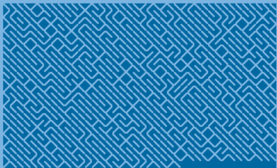

图 15.1

```
10 PRINT CHR$(205.25+RND(1)); : GOTO 10
```

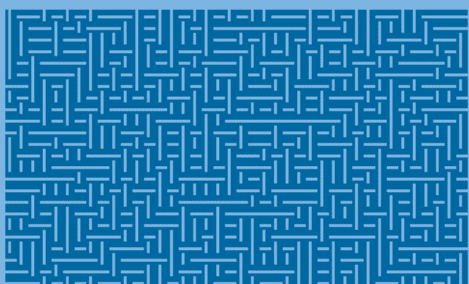

图 15.2

```
10 PRINT CHR$(198.5+RND(1)); : GOTO 10
```

(22) 10 PRINT CHR$(205.5+RND(1)); : GOTO 10

与早期显示器上的图像相比，显得过于清晰。模拟器允许用户更轻松地保存内存、寄存器等当前状态，而 BASIC 程序在 Commodore 64 硬件上保存和从磁盘加载要困难得多。

## 不平衡 (UNBALANCED)

《Commodore 64 用户指南》鼓励用户以这种方式修改其版本的 10 PRINT：“如果你想实验这个程序，尝试在它的基础上增加或减少几个十分分之一。这将使得改变 205.5 的两个字符都有更大的被选中概率”(1982, 53)。

图 15.1 显示了将“5”更改为“.5”的效果。由于其中一条对角线占据主导地位，迷宫的感知结构倾向于沿该方向形成长走廊。更多的变化（例如达到或超过 0.95 或低于 0.05）会呈现出类似于规则对角线的图案，只有极少数线条指向另一个方向，就像是偶尔出现的缺陷。

## 织造 (WEAVE)

在 PETSCII 数据集中，没有其他相邻字符可以在替换对角线 \/ 和 / 后构建出传统的正交迷宫（即与屏幕垂直水平轴对齐的迷宫）。例如，使用垂直和水平条会导致断开的织物（图 15.2），而实心和空正方形则产生类似于粗糙静态噪声的图案。

尽管结果确实没有强烈暗示这是一个迷宫，但该程序的“织造”版本并非没有视觉趣味。输出赋予了一种三维印象，仿佛有人将材料带交错地织在一起。

REM BASIC 中的变体          (23)

## 角 (CORNERS)

Commodore 64 PETSCII 字符集包含角字符，例如 204 和 207，它们分别对应左下角和右上角。像本程序这样随机选择 204 或 207，会产生类似于蜂窝的图像。对角线迷宫在笛卡尔网格上产生特别有效。如果使用对角线，四个字符可以在角处汇合，而在瓷砖从左到右或从上到下的边缘处，只有两个汇合。这种图案（见图 15.3）没有提供那么多汇合点，但也有自己有趣的视觉特性。

## 角与对角线 (CORNERS AND DIAGONALS)

上述程序的简化涉及舍弃 `INT` 函数，使得程序在选择 204 和 207 这两个角之外，还能随机选择其他字符；这个“角与对角线”版本还选择了中间的两个字符。这些字符当然是 205 和 206，它们是由 10 PRINT 调用的 \ 和 / 字符。结果（见图 15.4）没有 10 迷宫那种清晰的结构，其路径路段更短，看起来更频繁地被阻塞。尽管如此，产生的图案在元素的混乱中显得非常引人入胜。

## 四面墙 (FOUR WALLS)

一种构建迷宫网格的相当直观的方法是在网格纸上填充每个正方形的一条边。也就是说，在考虑任何特定正方形时，填充顶部、右侧、底部或左侧以形成“墙”，然后移动到下一个正方形并重复。此程序中的四个字符分别对应顶墙、底墙、左墙或右墙。此类字符在 PETSCII 中同时存在“粗”和“细”两种变体；图 15.5 中使用的是粗体。遗憾的是，这种过程并不那么优雅，因为这些字符在 PETSCII 字符集中（无论是哪种类型）都不是相邻放置的——例如，使用的

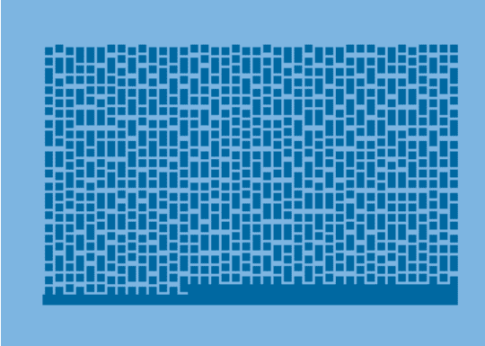

图 15.3

```
10 PRINT CHR$(204+(INT(RND(1)+.5)*3)); : GOTO 10
```

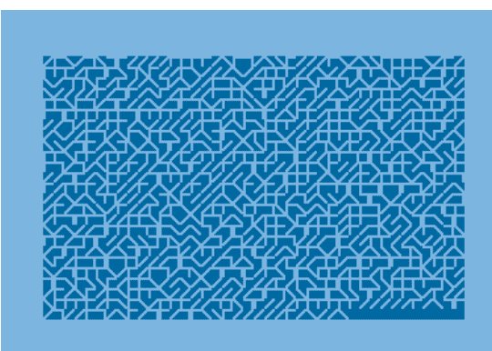

图 15.4

```
10 PRINT CHR$(204+(RND(1)+.5)*3)); : GOTO 10
```

REM BASIC 中的变体 (25)

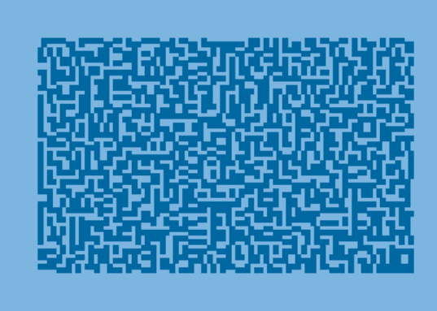

图 15.5

```
10 PRINT CHR$(181+(INT(RND(1)+.5)*3)+(INT(RND(1)+.5)*3))); : GOTO 10
```

## 20 个迷宫

### 什么是迷宫？
### 神话、仪式与寓言
### 实验室迷宫
### 计算机迷宫

# 进入迷宫

`10 PRINT` 生成了什么样的图案？1982 年的《Commodore 64 用户指南》提到该程序使用了两个图形字符来“制作迷宫”（53）。而曾在 *RUN* 杂志上提交单行代码版本的程序员将其描述为“绘制一个连续的迷宫”（13）。无疑，如果将该程序定性为“线条的随机图案”，它的趣味性会大大降低。但如果它确实是一个迷宫，它是哪种迷宫？又唤起了什么样的文化联想？

当一个成年人看到年轻程序员输入并运行 `10 PRINT` 后，屏幕上出现一个迷宫时，很容易将其轻视并认为这仅仅是种幼稚的娱乐。人们很容易忽视迷宫的文化共鸣和历史深度，迷宫可能被看作一个平面的、空洞的智力书消遣。这种轻视可以针对那些短小的、娱乐性的 BASIC 程序，这些程序看起来微不足道且无关紧要。本章节拒绝了这种观点，并深入探讨迷宫——部分通过 `10 PRINT` 及其周围的创造性、探索性计算文化。

迷宫将程序的输出合成为一种视觉修辞，唤起了悠久且富有意义的迷宫历史。迷宫可以是视觉呈现、文本产物、园林景观或建筑空间。在西方，迷宫被定位为趣味性谜题、恐怖之地、行为测试场，亦或是对沉思漫步的邀请，其意义可以追溯到克诺索斯迷宫中忒西修斯与米诺陶洛的传说，那是一个令人困惑且危及生命的空间。近期，迷宫已成为游戏性运动的场所，也成为智力题书中常见的消遣。有时，迷宫是抽象的数学对象，或研究动物的科学工具。在计算机游戏中，迷宫则承担了冒险、追逐和战斗的原型结构框架。几个世纪以来迷宫的完整文化史超出了本书的范畴（关于迷宫的深度历史描述，请参阅 Doob 1990, Kern 2000 和 Mathews 1922）。相反，本章重点介绍了 20 世纪 80 年代的 Commodore 64 用户在运行 `10 PRINT` 后可能与其输出产生关联的历史迷宫。

```
(32)   10 PRINT CHR$(205.5+RND(1)); : GOTO 10
```

### 什么是迷宫？

迷宫可以指一种结构，由连接通道组成的网络，包含可行的路径以及死胡同和回头路。或者，迷宫也可以具有更抽象的含义：复杂的路径网络或没有解决方案。在流行用法中，“迷宫”一词的含义已延伸到智力游戏、错综复杂的法律代码和混乱的迷宫式结构。`10 PRINT` 的输出可以通过一个简单但引起共鸣的形象唤起丰富的联想集合。


`10 PRINT` 符合了 William Henry Matthews 在其《迷宫与迷宫》（1922）中为迷宫确立的一些标准：

- 它们是“人工制品”，而非自然形成的“迷宫”（labyrinths），如特征、洞穴等；
- 它们被赋予了“设计中的目的性元素”（182）。
- 它们还表现出“某种程度的复杂性”（183）。
- 最后，他要求迷宫的组成部分之间以及其“内部与外部”之间存在“交流”（183）。

这个短程序确实是一个复杂的艺术品。然而，`10 PRINT` 那引人入胜的特质源于缺乏一个明确的、有目的的设计者。确实有人写了那行代码，但并没有指明具体的作者。设计的目的性源于一系列偶然，包括 BASIC 的 `RND` 函数以及两个斜线字符的出现，这些元素本身也是匿名创建的。此外，在 `10 PRINT` 中，组成部分之间的交流是偶然建立的，源于斜杠之间出现的间隙。总的来说，`10 PRINT` 迷宫的构建比 Mathews 标准所要求的要混乱得多。

作为实体或建筑结构，迷宫具有有限的。但 `10 PRINT` 的运行时间没有限制。作为一种无尽的产，`10 PRINT` 暗指迷宫的形式，但它并不总是提供路径或解决方案。因此，该程序存在于迷宫两个定义之间：一方面是物理结构，另一方面是错综复杂的混乱。

迷宫通常提供至少一条路径；关键的结构区别在于它们是否提供多条路径——是单路径的（unicursal）还是多路径的（multicursal）。单路径迷宫提供单一路径供行者沿其前进，永远不在转弯处做出选择。多路径迷宫则会导致错误的转弯、死胡同，甚至可能有通往出口或中心的多条路径。

“maze”（迷宫）和“labyrinth”（迷宫）在口语英语中通常是同义词。尽管如此，许多学者和历史学家对这两个词的区别一直存在争议。在最流行的区分中，“labyrinth”仅指单路径（unicursal）结构，而“maze”仅指分支路径（multicursal）结构。

在本书中，“maze”和“labyrinth”这两个词并不用于区分两种不同的结构或图像类别。相反，这两个词指向一个单一的概念类别，本书主要对两者都使用“maze”一词。

在单路径迷宫中，路径是有边界的，可以到达中心。单路径迷宫还允许行者找到出口。单路径迷宫允许沿着路径行走，但它是不可改变的。单路径迷宫是单一路径的象征。多路径迷宫是许多路径的象征。单路径迷宫是必然终点的象征。多路径迷宫是不确定旅程的象征。单路径迷宫是自然的象征。多路径迷宫是生命的象征。单路径迷宫是宿命的象征。多路径迷宫是自由意志的象征。单路径迷宫是真理的象征。多路径迷宫是多维度现实的象征。单路径迷宫是已知世界的象征。多路径迷宫是隐藏世界的象征。单路径迷宫是专注的心灵象征。多路径迷宫是游荡的心灵象征。单路径迷宫是仪式化的象征。多路径迷宫是混沌的象征。单路径迷宫是神圣的象征。多路径迷宫是世俗的象征。单路径迷宫是古代的象征。多路径迷宫是现代的象征。单路径迷宫是永恒的象征。多路径迷宫是世俗的象征。单路径迷宫是精神的象征。多路径迷宫是物理的象征。单路径迷宫是内部的象征。多路径迷宫是外部的象征。单路径迷宫是统一的象征。多路径迷宫是多元的象征。单路径迷宫是法律的象征。多路径迷宫是恩典的象征。单路径迷宫是真理的象征。多路径迷宫是奥秘的象征。单路径迷宫是信仰的象征。多路径迷宫是怀疑的象征。单路径迷宫是希望的象征。多路径迷宫是恐惧的象征。单路径迷宫是爱的象征。多路径迷宫是恨的象征。单路径迷宫是和平的象征。多路径迷宫是战争的象征。单路径迷宫是神圣化的象征。多路径迷宫是去人化的象征。单路径迷宫是神圣的象征。多路径迷宫是世俗的象征。单路径迷宫是古代的象征。多路径迷宫是现代的象征。单路径迷宫是永恒的象征。多路径迷宫是世俗的象征。单路径迷宫是精神的象征。多路径迷宫是物理的象征。单路径迷宫是内部的象征。多路径迷宫是外部的象征。单路径迷宫是统一的象征。多路径迷宫是多元的象征。单路径迷宫是单一的象征。多路径迷宫是许多的象征。单路径迷宫是绝对的象征。多路径迷宫是相对的象征。单路径迷宫是起始的象征。多路径迷宫是终点的象征。单路径迷宫是中心点的象征。多路径迷宫是去中心化的象征。单路径迷宫是整体的象征。多路径迷宫是去中心的象征。单路径迷宫是神圣的象征。多路径迷宫是世俗的象征。单路径迷宫是纯洁的象征。多路径迷宫是腐败的象征。单路径迷宫是秩序的象征。多路径迷宫是混沌的象征。单路径迷宫是光的象征。多路径迷宫是黑暗的象征。单路径迷宫是生命的象征。多路径迷宫是死亡的象征。单路径迷宫是灵魂的象征。多路径迷宫是身体的象征。单路径迷宫是精神的象征。多路径迷宫是物质的象征。单路径迷宫是心灵的象征。多路径迷宫是世界的象征。单路径迷宫是时间的象征。多路径迷宫是空间的象征。单路径迷宫是自我的象征。多路径迷宫是他者的象征。单路径迷宫是存在的象征。多路径迷宫是非存在的象征。单路径迷宫是有限的象征。多路径迷宫是无限的象征。单路径迷宫是统一的象征。多路径迷宫是多样性的象征。单路径迷宫是法律的象征。多路径迷宫是恩典的象征。单路径迷宫是真理的象征。多路径迷宫是奥秘的象征。单路径迷宫是信仰的象征。多路径迷宫是怀疑的象征。单路径迷宫是希望的象征。多路径迷宫是恐惧的象征。单路径迷宫是爱的象征。多路径迷宫是恨的象征。单路径迷宫是和平的象征。多路径迷宫是战争的象征。单路径迷宫是神圣化的象征。多路径迷宫是去人化的象征。单路径迷宫是神圣的象征。多路径迷宫是世俗的象征。单路径迷宫是古代的象征。多路径迷宫是现代的象征。单路径迷宫是永恒的象征。多路径迷宫是世俗的象征。单路径迷宫是精神的象征。多路径迷宫是物理的象征。单路径迷宫是内部的象征。多路径迷宫是外部的象征。单路径迷宫是统一的象征。多路径迷宫是多元的象征。单路径迷宫是孤独的象征。多路径迷宫是社会的象征。单路径迷宫是线性的象征。多路径迷宫是非线性的象征。单路径迷宫是直接的象征。多路径迷宫是间接的象征。单路径迷宫是清晰的象征。多路径迷宫是去构的的象征。单路径迷宫是和谐的象征。多路径迷宫是不和谐的象征。单路径迷宫是受保护的象征。多路径迷宫是危险的象征。单路径迷宫是神圣化的象征。多路径迷宫是人类化的象征。等待，单路径迷宫是单一的象征。多路径迷宫是多个的象征。单路径迷宫是单一的象征。多路径迷宫是多个的象征。单路径迷宫是一个的象征。多路径迷宫是许多的象征。等待，单路径迷宫是绝对的象征。多路径迷宫是相对的象征。单路径迷宫是起始的象征。多路径迷宫是终点的象征。单路径迷宫是中心点的象征。多路径迷宫是去中心化的象征。单路径迷宫是整体的象征。多路径迷宫是去中心的象征。单路径迷宫是神圣的象征。多路径迷宫是世俗的象征。单路径迷宫是纯洁的象征。多路径迷宫是腐败的象征。单路径迷宫是秩序的象征。多路径迷宫是混沌的象征。单路径迷宫是光的象征。多路径迷宫是黑暗的象征。单路径迷宫是生命的象征。多路径迷宫是死亡的象征。单路径迷宫是灵魂的象征。多路径迷宫是身体的象征。单路径迷宫是精神的象征。多路径迷宫是物质的象征。单路径迷宫是心灵的象征。多路径迷宫是世界的象征。单路径迷宫是时间的象征。多路径迷宫是空间的象征。单路径迷宫是自我的象征。多路径迷宫是他者的象征。单路径迷宫是存在的象征。多路径迷宫是非存在的象征。单路径迷宫是有限的象征。多路径迷宫是无限的象征。单路径迷宫是统一的象征。多路径迷宫是多样性的象征。单路径迷宫是法律的象征。多路径迷宫是恩典的象征。单路径迷宫是真理的象征。多路径迷宫是奥秘的象征。单路径迷宫是信仰的象征。多路径迷宫是怀疑的象征。单路径迷宫是希望的象征。多路径迷宫是恐惧的象征。单路径迷宫是爱的象征。多路径迷宫是恨的象征。单路径迷宫是和平的象征。多路径迷宫是战争的象征。单路径迷宫是神圣化的象征。多路径迷宫是去人化的象征。单路径迷宫是神圣的象征。多路径迷宫是世俗的象征。单路径迷宫是古代的象征。多路径迷宫是现代的象征。单路径迷宫是永恒的象征。多路径迷宫是世俗的象征。单路径迷宫是精神的象征。多路径迷宫是物理的象征。单路径迷宫是内部的象征。多路径迷宫是外部的象征。单路径迷宫是统一的象征。多路径迷宫是多元的象征。单路径迷宫是孤独的象征。多路径迷宫是社会的象征。单路径迷宫是线性的象征。多路径迷宫是非线性的象征。单路径迷宫是直接的象征。多路径迷宫是间接的象征。单路径迷宫是清晰的象征。多路径迷宫是去构的的象征。单路径迷宫是和谐的象征。多路径迷宫是不和谐的象征。单路径迷宫是受保护的象征。多路径迷宫是危险的象征。单路径迷宫是神圣化的象征。多路径迷宫是人类化的象征。等待，单路径迷宫是单一的象征。多路径迷宫是多个的象征。单路径迷宫是单一的象征。多路径迷宫是多个的象征。单路径迷宫是一个的象征。多路径迷宫是许多的象征。等待，单路径迷宫是绝对的象征。多路径迷宫是相对的象征。单路径迷宫是起始的象征。多路径迷宫是终点的象征。单路径迷宫是中心点的象征。多路径迷宫是去中心化的象征。单路径迷宫是整体的象征。多路径迷宫是去中心的象征。单路径迷宫是神圣的象征。多路径迷宫是世俗的象征。单路径迷宫是纯洁的象征。多路径迷宫是腐败的象征。单路径迷宫是秩序的象征。多路径迷宫是混沌的象征。单路径迷宫是光的象征。多路径迷宫是黑暗的象征。单路径迷宫是生命的象征。多路径迷宫是死亡的象征。单路径迷宫是灵魂的象征。多路径迷宫是身体的象征。单路径迷宫是精神的象征。多路径迷宫是物质的象征。单路径迷宫是心灵的象征。多路径迷宫是世界的象征。单路径迷宫是时间的象征。多路径迷宫是空间的象征。单路径迷宫是自我的象征。多路径迷宫是他者的象征。单路径迷宫是存在的象征。多路径迷宫是非存在的象征。单路径迷宫是有限的象征。多路径迷宫是无限的象征。单路径迷宫是统一的象征。多路径迷宫是多样性的象征。单路径迷宫是法律的象征。多路径迷宫是恩典的象征。单路径迷宫是真理的象征。多路径迷宫是奥秘的象征。单路径迷宫是信仰的象征。多路径迷宫是怀疑的象征。单路径迷宫是希望的象征。多路径迷宫是恐惧的象征。单路径迷宫是爱的象征。多路径迷宫是恨的象征。单路径迷宫是和平的象征。多路径迷宫是战争的象征。单路径迷宫是神圣化的象征。多路径迷宫是去人化的象征。单路径迷宫是神圣的象征。多路径迷宫是世俗的象征。单路径迷宫是古代的象征。多路径迷宫是现代的象征。单路径迷宫是永恒的象征。多路径迷宫是世俗的象征。单路径迷宫是精神的象征。多路径迷宫是物理的象征。单路径迷宫是内部的象征。多路径迷宫是外部的象征。单路径迷宫是统一的象征。多路径迷宫是多元的象征。单路径迷宫是单一的象征。多路径迷宫是许多的象征。单路径迷宫是绝对的象征。多路径迷宫是相对的象征。单路径迷宫是起始的象征。多路径迷宫是终点的象征。单路径迷宫是中心点的象征。多路径迷宫是去中心化的象征。单路径迷宫是整体的象征。多路径迷宫是去中心的象征。单路径迷宫是神圣的象征。多路径迷宫是世俗的象征。单路径迷宫是纯洁的象征。多路径迷宫是腐败的象征。单路径迷宫是秩序的象征。多路径迷宫是混沌的象征。单路径迷宫是光的象征。多路径迷宫是黑暗的象征。单路径迷宫是生命的象征。多路径迷宫是死亡的象征。单路径迷宫是灵魂的象征。多路径迷宫是身体的象征。单路径迷宫是精神的象征。多路径迷宫是物质的象征。单路径迷宫是心灵的象征。多路径迷宫是世界的象征。单路径迷宫是时间的象征。多路径迷宫是空间的象征。单路径迷宫是自我的象征。多路径迷宫是他者的象征。单路径迷宫是存在的象征。多路径迷宫是非存在的象征。单路径迷宫是有限的象征。多路径迷宫是无限的象征。

```
(34)   10 PRINT CH$(205.5+RND(1)); : GOTO 10
```

然而程序的输出也暗示了一个多路径迷宫，因为它可以被穿越，或者尝试多种方式。尽管程序本身逐行生成的，，它是如此缓慢，并且在任何一点都可以被解释解释。这段短程序程序揭示了。

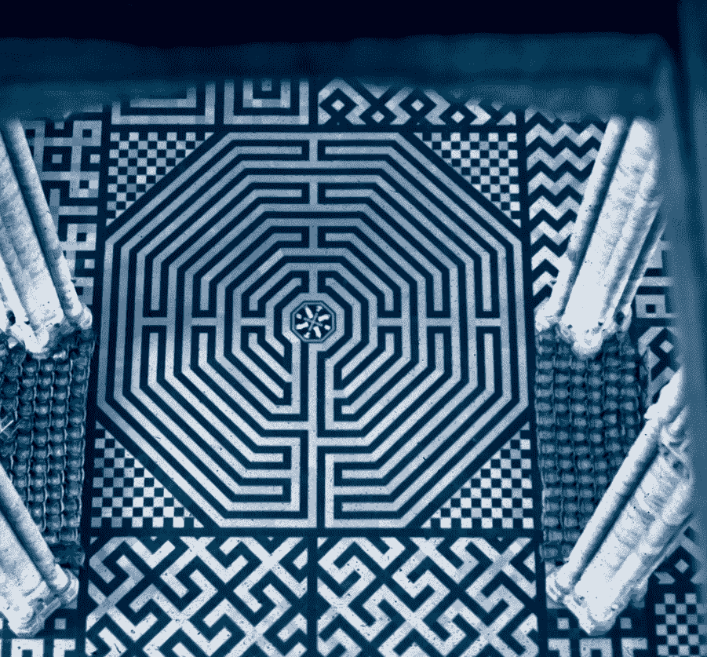

图 20.1

亚眠斯大教堂中央迷宫和迷宫图案建于13世纪。由斯蒂芬·穆里提供。）

(36) 10 PRINT CHR$(20.5+RND(1)); : GOTO 10

从多路径的、不可知的混乱转变为清晰且有边界的路径，反映了对任何系统的掌控——从具有挑战性、神秘性、威胁性和致命性的转变为容易、已知的、有地图且被驯服。这种原始的迷宫神话强调了许多谜题的现实：当答案已知时，谜题似乎变得简单了，即使不是微不足道。与其说是战士在开放地图上自由移动的幻象，不如忒修斯的故事告诉我们，成功源于紧随一根绳，这在严酷无情的编程语法走廊中是一个特别有用的比喻。

将复杂的迷宫扭曲为简单的（或至少是可以理解的）是 Commodore 64 用户与 `10 PRINT` 理想遭遇的一部分，但用户更像是迷宫的创造者而非探索者。克诺索斯迷宫的建筑师代达洛斯占据了谜题制造者的至高地位。代达洛斯理解到，规划、意图和建造是迷宫神秘色彩不可分割的特征。`10 PRINT` 是迷宫的蓝图，而不仅仅是一个没有任何历史或制作痕迹就出现的结构或图像。同时，`10 PRINT` 本身扮演了迷宫创造者的角色：程序员可能是迷宫的建筑师，但程序是它的建造者。

`10 PRINT` 引发的联想始于米诺陶斯的迷宫，但它们贯穿历史，增加了复杂的象征意义和神圣教堂，并在乡村的草坪和树篱丛中崛起。迷宫在大教堂和巴西利教堂的地板上具有了宗教意义。最大最著名的教堂迷宫之一是法国的沙特尔，建于公元1200年左右。它是一个可以走的、拥有十一环的迷宫，外圈装饰着月亮相（Kern 2000, 153），它一直是无尽推测的对象，从中心下埋着宝藏的传闻到关于其作为月亮计算器功能的理论。

教堂迷宫通常是为了让人在悔罪之路上行走或爬行。这些路径的名字包括“罪之迷宫”、“救赎之路”和“耶路撒冷之路”。这些路径象征着通往基督教救赎之路，将复活节理想与米诺斯之谜联系起来。有趣的是，沙特尔和亚眠大教堂迷宫中的蜿蜒路径完全相同，尽管前者是圆形的而后者是八角形的，如图20.1所示（Wright 2001, 60）。

`10 PRINT` 保留了一种精神神秘的维度。这个程序显然并不属于任何宗教活动的一部分，但作为代码，

# 舞蹈一个复杂的结构

迷宫通常被想象成建筑的、物质的且固定的，但长期以来，各文化注意到它们可以直接对应于人类活动——舞蹈。在《伊利亚德》中，荷马认为代达洛斯既创造了舞蹈，也创造了迷宫。Kern 推测迷宫是一个合唱，具有“舞蹈”和“舞蹈表面”的双重含义。鉴于克里特岛没有幸存迷宫建筑，硬币上的迷宫描绘可能指示舞蹈的路径——尤其是迷宫幸存了下来。忒修斯在米诺斯迷宫中遇到米诺陶斯，但他在回途中通过舞蹈将那次冒险永恒化了。正如马修斯所解释的：“在德洛斯岛，他们跳一种名为‘迷宫’的奇异舞蹈，即‘鹤舞’，他们模仿穿过迷宫的动作……这种舞蹈由该岛居民一直延续到最近（1922, 19）。”这些舞蹈在其他地方继续表演，并且有许多其他迷宫舞蹈已知，有些具有军事目的，有些与仪式有关。玛莎·格拉汉姆在《迷宫之行》（1949）中改编了克里特迷宫故事的动作，在那里是阿里阿德涅被米诺陶斯困住。在沉思了迷宫（由地板上的绳子代表）后，她打破了自己的模式和折磨。绳索迷宫反映了她内心的迷宫和神话的迷宫（Zlokower 2005）。

舞者与迷宫的关系类似于初学者学习 BASIC 的关系。当新手程序员准备面对米诺陶斯机器时，通过迷宫舞蹈，单行代码就成了通往安全的线索。正是在通过输入和运行 `10 PRINT` 来追踪这个迷宫，走廊本身才被创造。

迷宫在数字媒体中并未完全被忘记。人们可能认为《节奏舞力》是一种迷宫游戏，但它的箭头显示了一个舞者站在原地应当导航的迷宫式路径。允许错步，但完美的表演将被仪式化为一种穿过空间的吃人包模式。在街机厅之外，戴娜·斯拉特里创作了一部名为《迷宫游戏》的作品，将迷宫作为一个有意义的舞蹈场所。在她的数字作品和配套小说中，穿过致命迷宫需要优雅和素养，因为迷宫是由斯拉特里创造的视觉语言“glide”符号构成的。斯拉特里的作品处于舞蹈、迷宫和叙事的交汇点，展示出了一种新的联系。

```
(38) 10 PRINT CHR(20.5+RND(1)); : GOTO 10
```

`10 PRINT` 触及了视觉符号和字符激发的迷宫式神秘：从手册中输入程序就是遵循从代码到输出再返回的线条扭曲的线条。程序员沿着代码的单一路径从无知走向认知，这是一条朝圣之路。`10 PRINT` 可能无法帮助程序员获得救赎，但它提供了一种易于实现的方法，让新手追踪编写代码的步骤，从而进入魔盒——个人电脑的奥秘。

与念珠和苦路经一样，基督教迷宫不再是单路径的。在十五世纪之前，没有一个包含死胡同或选择点，直到那时出现了多路径的改变，正如赫尔穆特·比尔坎所解释的那样，这是“迷宫观念世俗化的症状”（引自 Kern 2000, 146）。随着这种世俗化的转变，迷宫变成了休闲空间也是仪式空间，排列着树篱，用石头标记，并被树林环绕。棋盘式的迷宫和邀请仪式态度的迷宫在整个欧洲受到青睐，尽管其中几个与异教的春季仪式多过基督教。在《仲夏夜梦》中，仙女王提塔尼亚在废弃草坪迷宫的幽灵轮廓中徘游：

> 九人莫里斯舞充满了泥土，
> 在顽皮的绿意中，奇特的迷宫
> 无法辨认。（2.98–100）

树篱迷宫在花园中作为装饰，作为休闲设备而非宗教仪式。树篱迷宫和它们的差异具有相似性。它们需要规划和布局，与大多数迷宫不同，`10 PRINT` 的迷宫生长，直到干扰。

是行为，现在主要与另一位美国科学家 B. F. Skinner（斯金纳）相关联。他的操作条件箱（也称为斯金纳箱）是在华特生迷宫投入使用几十年后建造的另一种用于实验动物著名的环境。尽管斯金纳的名字仍然广为人知——类似的环境今天仍被用于实验。

1959年，一个为了趣味而编写的早期计算机程序之一——“娱乐计算”的例子——描绘了一个实验者的迷宫。该程序可能是第一个绘制任何类型迷宫的计算机程序，由 Douglas T. Ross 和 John E. Ward 为麻理工学院的 TX-0 编写。TX-0 是一台实验性计算机，在非官方项目工作期间提供了最早的编程机会之一。它还允许程序员以交互方式在机器上工作，就像后来 Commodore 64 的程序员那样，而不是以打卡片的形式提交批处理。在被称为“迷宫中的老鼠”的程序中，一只老鼠在迷宫中穿行并吃奶酪。老鼠也可以消耗马天尼，这会导致它迷失方向并降低性能。在这种情况下，所实现的环境并非划分和功能的对树迷宫，而是一个更呆板的实验者迷宫。这个本质上严肃的迷宫通过增加有趣的酒精奖励和对适当行为的模拟而变得具有趣味性。

`10 PRINT` 打印了“迷宫中的老鼠”的某些方面。它的输出是网格中“墙”的规则排列——类似于早期程序的显示，并类似于典型实验室迷宫的布局。“迷宫中的老鼠”并没有呈现出灵感迸发的代达洛斯那种令人震撼的创造，而是一个行为主义实验。这个迷宫是对智能的挑战——然而，它不是浪漫的、漏洞百孔的智能，而是一种经典的条件的动物智能。它也属于科学家的思想，科学家可能对迷失在迷宫中的生物的挣扎无所谓。


但谁处于`10 PRINT`的界面端？是科学家还是啮类？当`10 PRINT`运行时，它可能会不断地生成迷宫，但它不会像老鼠那样困住用户。相反，由于俯视视角且缺乏用户控制的迷宫行走者，计算机以迷宫设计者的视角呈现程序，在某种意义上提议与用户协作创建一个新设计。在迷宫的趣味和宗教内涵中，包含了实验者的……

## 迷宫（41）

### 图 20.2

信息论先驱克劳德·香农（Claude Shannon）约 1950 年与他的机械忒修斯及其磁性老鼠迷宫合影。麻理工博物馆提供。

```basic
(42)   10 PRINT CHR$(205.5+RND(1)); : GOTO 10
```

提示：计算机是一个科学仪器，迷宫的行走者可能不是希腊英雄，而是一个受饥饿驱动的小生物。

# 计算机化的迷宫

20世纪50年代初，数学家和工程师克劳德·香农设计了一只机械老鼠（见图 20.2），它似乎可以解决真实老鼠在华特生行为实验中预期穿越的同迷宫。香农作为计算领域的奠基人物，将这只老鼠命名为忒修斯，将神话英雄及其高尚的困境简化为一个由机械系统引导的简单装置。尽管忒修斯曾在《时代》和《生活》杂志上登过（《有记忆的老鼠》，1952年；《更好的老鼠》，1952年），但忒修斯本身并不是先进的人工智能。它只是一只带轮子的木老鼠，内部有一个磁铁和铜线胡须。这只老鼠真正的魔力在于迷宫下方，一个电子继电器系统，当老鼠的胡须触碰上方迷宫相应的墙壁时，它会切换位置。第一次通过迷宫时，忒修斯在磁铁的推动下随机乱撞，每遇到通道就会在下方翻转。下一次，感谢继电器记录了正确路线，忒修斯完美地穿越了迷宫。

这意味着穿越香农迷宫的弯折通道不仅仅是为了新奇。正如《时代》在1952年解释的那样，忒修斯在研究电话交换系统时是“有用的”，这些系统非常像迷宫。事实上，乔治·戴森（George Dyson）认为忒修斯启发了兰德公司工程师保罗·巴兰（Paul Baran）的“自适应分组交换”——这是现在被称为包交换的前身，包交换是定义互联网数据流的协议（Dyson 1997, 150）。

除了对网络计算的意义外，忒修斯还是迷宫与计算机早期联系的生动例子。此外，忒修斯与`10 PRINT`具有程序上的共鸣。老鼠通过重复、循环来“学习”，循环是用于绘制`10 PRINT`迷宫的基础过程。就像计算机程序一样，香农迷宫中的老鼠只是更深层过程的表层符号。事实上，忒修斯不仅是愚的，而且本身是静止的。忒修斯的“大脑”隐藏在迷宫表面下方的继电器中，就像`10 PRINT`的屏幕设计是由一段代码生成的，这段代码最初并不清晰，它依赖于一个不可见的伪随机数生成器的低级调用。

计算机并没有完全改变迷宫的文化观念，但它们确实提供了表示、生成、解决和玩迷宫的新方法。随着计算机进入家庭并被普及，它们帮助迷宫进入了日常生活。许多最早的计算机呈现迷宫不是视觉化的，而是通过文本描述的。第二人称迷宫通常是基于回合的，提供实时游戏。它们还嵌入在模拟空间的更广泛背景中。有时这些迷宫令人困惑，即使它们不被称为迷宫，也需要玩家在纸上画出地图。在任何情况下，它们通常引导不同形式的系统性、高层次思维，允许人们弄清或破解环境。

第一人称 3D（1992）和《毁灭战士》（1993）让这种视角更加可怕。声音设计、黑暗以及对恐怖片习惯的使用都贡献了这种效果。第一人称迷宫在连接玩家与迷宫之外，可能引发密切且持续的关注。

文本描述的迷宫在文本冒险游戏中发展成了最复杂、最困惑的配置，这种类型始于开创性的《冒险》，由 Will Crowther 于1976年为 PDP-10 编写，后来由 Don Woods 扩展为功能完整的冒险游戏。游戏部分基于他在猛犸洞穴系统的洞穴经验，Crowther 引入了一个十房间的迷宫，开场白：“你处于一个由曲折小通道组成的迷宫中，它们看起来一模一样。”

这种设计是深思熟虑的，节奏由玩家决定，而非基于瞬时反射。

当玩家在《冒险》（Adventure）、《Zork》或其他交互式小说中绘制迷宫地图时，他们将文本形式呈现的第二人称迷宫转换为视觉呈现的第三人称迷宫。这些地图传达了一种对迷宫的掌控感，尽管迷宫的第三人称视角并不能保证其安全性或可解性。

香农的《迷宫中的鼠》（Shannon's Mouse in the Maze）让我们早领了第三人称计算机迷宫，但这种形式在1980年10月 Commodore 64 发布前不到两年，在美国真正爆发了。这正是正版《吃豆人》（Pac-Man）街机游戏来自日本的时候。在日本，受吃豆人启发的游戏类型被称为“吃点”（ドットイーート），但在美国，这类游戏被称为迷宫（maze）或迷宫追逐（maze chases）。

吃豆人无法穿过环境寻找出口——除非通过连接屏幕左侧和右侧的隧道。游戏场可以更准确地描述为布满了障碍，而不是通常意义上教堂迷宫或绿树迷宫那样的“迷宫”。尽管如此，游戏场从一开始就被称为迷宫。《纽约时报》曾将吃豆人称为“一个长着大嘴的圆，在迷宫中吃掉圆点，而其他大嘴正试图吃掉它”（Latham 1981）。《新闻周刊》提到了“令人疯狂的吃豆人迷宫”（Langway 1981）。对于贪婪的吃豆人来说，益智游戏的挑战不是离开迷宫，而是穿过整个迷宫并避开那些惩罚性的怪物。

吃豆人的迷宫与显示器的轴对齐：路径要么是水平，要么是垂直。但就像《坦克大战》（Tank，1974）和《小行星卫》（Asteroids，1979）中的玩家飞船可以在许多不同方向转向并开火一样，也可以表示一种并非“正交”的迷宫：`10 PRINT`提供了一个非常简单的替代方案——对角线迷宫。相比之下，第三人称视频游戏几乎总是像吃豆人那样对齐，即使那些在吃点时代之前的游戏也是如此。

Maxnovakos 开发的《K. C. Munchkin》（1981）在某种程度上是吃豆人的仿制品，而它本身因为一项著名的法院判决（Atari 诉 Philips）而被撤下货架。对于今天的玩家来说，这个游戏就像另一个迷宫游戏。拥有可以开合的门、屏幕上只有两个圆点，以及其他显著差异，它看起来不可能与吃豆人混淆。

```basic
(46)  10 PRINT$(205.5+RND(1)); : GOTO 10
```

这两款游戏的相似之处在于，它们都具有正交对齐的迷宫。《K. C. Munchkin》的不同之处之一是，它允许玩家扮演代达洛斯（Daedalus）的角色，设计自己的关卡。

其他视频游戏以及具有多种环境的游戏也很快进入了家庭。1977年与经典的卡带式雅达利 VCS 捆绑的游戏是《战斗》（Combat），它将《坦克大战》中复杂的战场带入了家中。不久后，该主机推出了《迷宫崩溃》（Maze Crash，1978），允许玩家在自动生成的迷宫环境中进行几种不同的挑战竞赛。

所有这些游戏都将屏幕显示视为单一的完整视觉单元，就像棋盘一样。`10 PRINT`持续滚动的迷宫至少暗示了一个比屏幕更大的迷宫，即使人们无法绕过未见的区域。与单屏迷宫的另一个有趣对比是特写设计，它将玩家置于一个更大规模的迷宫中，例如1979年的雅达利 VCS 游戏《冒险》（见图 20.3）。这款主机游戏松散地基于同名的交互式小说作品，其主角是一个尽管面对三个敌人的努力也能收集宝藏的英雄。与吃豆人不同（在吃豆中，玩家可以引导吃豆人从屏幕一侧的传送门出去并看到他从另一侧进入），《冒险》包含了许多在拓扑学上不可能的传送门，这些门总是隐藏在视线之外，只能通过推断。每个屏幕并不是整个迷宫的概览图，而是简单路径的特写，往往强调了那些难以到达的其他路径的不连续片段。

由`10 PRINT`生成的这种对角线方向在早期迷宫类游戏的设计中确实有一席之地。它源自等轴测视频游戏，这些游戏通过等轴测视角的伪 3D 效果挑战平面，引入了对角线运动。两款等轴测游戏于1982年进入街机厅：《Q*bert》，一个在等轴测金字塔上的平台完成/躲避游戏；以及《Zaxxon》，一个强调伪 3D 元素的障碍赛车游戏。与`10 PRINT`第一版多年后的后期等轴测游戏相比，这两者都不特别具有迷宫特征。《蚁攻击》（Ant Attack，1983）和《大理石大赛》（Marble Madness，1984）是比屏幕更大的场地上具有更复杂障碍赛道的游戏示例。

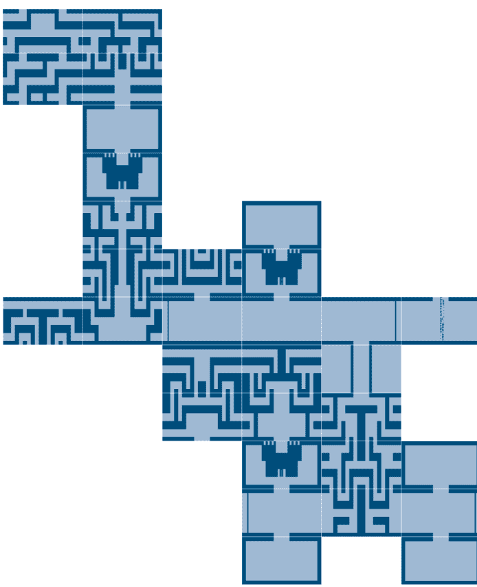

### 图 20.3

雅达利 VCS 版《冒险》（1979）包含一个供玩家穿行的迷宫，玩家在其中与巨龙战斗并寻找进入城堡的钥匙。

```basic
(48)  10 PRINT CHR$(25.5+RND(1)); : GOTO 10
```

# 进入迷宫

虽然`10 PRINT`看起来像是一个非交互的 2D 第三人称迷宫，但它的单行代码产生了这种迷宫形式的一种异常扭曲，将其转移到一个与传统不同的轴上。这是通过简单选择两个对角字符图形实现的。该元素引入了另一个复杂性：尽管迷宫是从屏幕的右侧下方构建的，但墙壁和路径并没有遵循这个构建轴。

在20世纪80年代，大多数用户在考虑生成迷宫的计算机程序时，无法不想起许多在迷宫中发生的计算机游戏。但对许多人来说，迷宫也会与不同类型的恐怖、思考、实验和游戏相关联。用户是忒修斯还是代达洛斯？科学家还是老鼠？吃豆人还是 Zaxxon？编程是冥想、舞蹈、逃避还是构建迷宫？这种丰富性似乎是鼓励新的 Commodore 64 程序员通过在计算机上运行此程序来“进入迷宫”的一部分，致力于解决和理解这段代码，以便在自己的程序中对其进行修订、扩展和重新构想。

从迷宫的文化历史角度来看，`10 PRINT`将程序的输出置于符号输出空间中。这是通过简单选择两个对角字符图形实现的。该元素引入了另一个复杂性：尽管迷宫是从屏幕的右侧下方构建的，但墙壁和路径并没有遵循这个构建轴。

在 Commodore 64 上可能的众多参数中，`10 PRINT`的移植版本中的某一组特定参数凸显了各个平台的局限性与特性。这些移植版本提供了 Commodore 64 与其他系统之间的紧密对比，强调了 Commodore 64 在运行这一特定程序时的独特适用性。

# Applesoft BASIC 和 Tandy Color BASIC

Applesoft BASIC 是 Apple II 的两种标准 BASIC 实现方案之一；Applesoft 是支持浮点运算的那一个，并且看起来与 Commodore 64 BASIC 非常相似。Apple II 计算机系列与 Commodore 64 属于同一时代，并使用相同的处理器 MOS 6502。Applesoft BASIC 像 Commodore 64 BASIC 一样，由微软编写，并基于其 6502 BASIC——该版本（已在关于 BASIC 的章节中讨论过）源自微软的 Alta BASIC。Apple II 计算机和 Commodore 64 实际上相似，几乎就像由于公司关系而产生的亲兄弟一样。

这使得 Apple II 成为一系列`10 PRINT`移植版本的良好起点。在该电脑的版本中可以使用相同的 BASIC 语句和关键字，同样的滚动效果会将迷宫向上推。

然而，在 Apple II 上，斜杠和反斜杠字符充当迷宫墙，因为 PETSCII 的对角线字符不可用。这些 Apple II 字符的编码并不相邻；它们的 ASCII 值为 47 和 92。这意味着必须使用更复杂的选择表达式来选择字符。第一步是选择值 0 或 1。`INT(RND(1)*2)`在内部表达式中产生一个大于或等于 0 且小于 2 的浮点数，例如 0.492332 或 1.987772；然后使用`INT`将该值截断为 0 或 1。下一步是将该值乘以 45 并加上 40，从而得到 47 或 92。这是一种进行这种选择的相当简单的方法，但正如某些 Commodore 64 变体中一样，所需的代码比标准的`10 PRINT`更复杂，且不那么美观：

```basic
10 PRINT CHR$(47+INT(RND(1)*45)): GOTO 10
```

```basic
10 PRINT CHR$(47+(INT(RND(1)*2)*45));
10 GOTO 10
RUN
```

### 图 25.1

Apple II 移植版`10 PRINT`的截图。

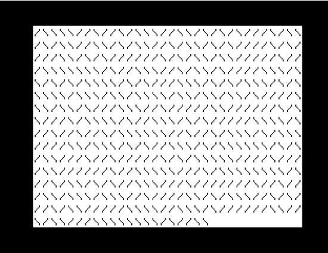

### 图 25.2

TRS-80 Color 移植版`10 PRINT`的截图。

```basic
(54) 10 PRINT CHR$(205.5+RND(1)); : GOTO 10
```

程序的输出同样不尽人意（图 25.1）。尽管 Apple II 计算机上的`/`和`\`字符确实是斜的，但它们并没有跨越边界字符的正方形。这意味着“墙”在水平或垂直方向上都没有相交。每个 Apple II 字符宽五像素，高七像素，因此斜杠和反斜杠的完美对角线在顶部和底部留有大量的空隙。无论如何，Apple II 字符都无法相邻绘制，因为系统上的所有字符在打印时两侧都有一个像素宽的间隔，下方也有一个像素的间隔。

这种与 Commodore 64 的另一个竞争对手之间的间隔，在`10 PRINT`移植到 TRS-80 Color Computer（或称“Coco”）的版本中更为明显。如果说 Apple II 是 Commodore 64 被另一公司抚养的兄弟，那么配备了摩托罗拉 6809 和不同版本微软 BASIC 的 Color Computer 就是那个古怪的表哥。与 Applesoft BASIC 一样，`10 PRINT`的 Color BASIC 部分需要使用 ASCII 字符 47 和 92；但必须对程序进行一项重大更改：

```basic
10 PRINT CH$(47+INT(RND(0)*25));GOTO 10
```

将`RND(1)`改为`RND(0)`。这一修订是由于 Color Computer 对`RND`的实现，它与其他 BASIC 有很大不同。为了让`RND`命令更直观，TRS-80 选择的是 1 到 6 之间的随机数。`RND(6)`选择的是 1 到 6 之间的随机数。Color BASIC 中的`RND(1)`只会选择数字 1，导致产生完全非随机的图案。然而，`RND(0)`选择的是 0 到 1 之间的浮点数，乘以 2 后可以作为图案的数值基础。然而，程序的执行显示，随机性并不是`10 PRINT`的唯一本质元素（图 25.2）。即使与 Apple II 相比，TRS-80 的文本显示也不适合将排版符号转换为图形图案。Color Computer 的斜杠和反斜杠字符在 8 × 12 的大网格上各占据 5 × 7 的区域，字符之间留下了太多空间，以至于它们永远无法形成连接图案的视觉暗示，更不用说迷宫了。

虽然 Apple II 和 Color Computer 有许多为它们编写的有趣 BASIC 程序，并与 Commodore 64 共享某些特性，但这些计算机处理文本显示的方式意味着，两者都无法运行一个像 Commodore 版本那样令人满意的单行版`10 PRINT`。

# Perl 和 JavaScript：现代单行程序

人们设计了 Perl 和 JavaScript 程序，它们是`10 PRINT`的一部分，并输出 ASCII 斜杠和反斜杠字符。JavaScript 程序之所以主要感兴趣，是因为它呈现了一个比 Apple II 和 Tandy Color Computer 上看到的更糟糕的图形或排版问题。在图形用户界面浏览器中查看的网页默认字体是等比例宽的——不同的字母形状宽度不同。虽然斜杠和反斜杠的宽度相同，但意义上的差异导致路径`/`比`\`更宽。因此，这两个符号在网格中无法对齐，结果更不像迷宫了。

下面是 Perl 单行程序的第一个版本；它如图 25.3 所示：

```perl
while (print int(rand(2)) ? "/" : "") {}",
```

`\`字符（反斜杠）在 Perl 中与另一个字符结合使用以打印特殊字符，如换行符表示为`\n`（JavaScript 中也是如此）。由于这个原因，有必要结合其他字符来打印反斜杠。Perl 使用`while`结构创建一个无限循环。`print int(rand(2)) ? "/" : ""`语句随机打印`/`或空字符串。由于`int(rand(2))`会产生 0 或 1，而 1 为真，0 为假，因此它会随机打印斜杠。

有几种方法可以调优代码，使其输出更像`10 PRINT`，并使用 Unicode 字符。首先，这种虽然晦涩但类似于`GOTO`的语句可以：

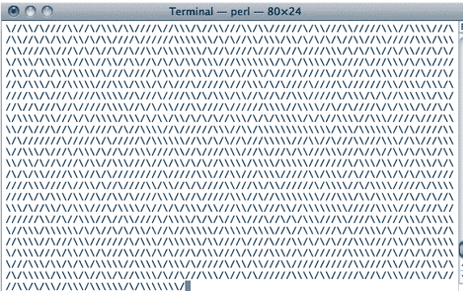

### 图 25.3

Perl 移植版`10 PRINT`的截图，使用斜杠来近似对角线。

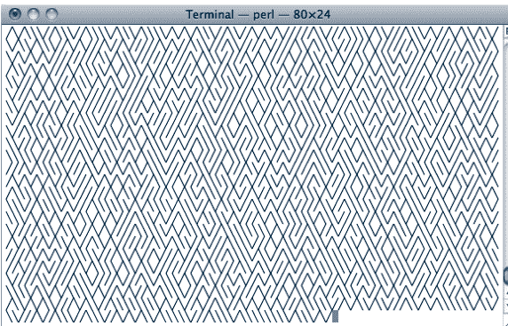

### 图 25.4

Perl 移植版`10 PRINT`的截图，使用 9585 和 9586 来近似线条。最后，为了避免产生错误消息，需要一条语句告诉 Perl 它可以输出 Unicode 字符。该语句可以放在循环外部或内部；如果放在内部每次执行，程序运行速度会变慢，但这可能是想要的：

```perl
{binmode STDOUT,"utf8";print chr(9585.5+rand);}
```

Michael Mateas 和 Nick Montfort（2005）所称为“极简主义”的奇异语言对计算空间本身提出了评论。正如他们所说：“极简主义语言试图通过提供尽可能少的语言结构来实现通用性。这类语言通常还追求语法上的最小化，使得程序的文本表示也达到极简。”极简主义语言的典范是 Brainfuck，它提供了七条命令，每条命令对应一个标点符号字符。


另一类奇异语言规避了通常的代码行组织，使用二维空间来存放程序的指令。其中一种语言是`Piet`，它的源代码代表了抽象画（类似于与其同名的画家皮特·蒙德里的作品）。另一种是`Befunge`，它使用包括`/`、`v`和`^`在内的字体符号来引导程序流。

`PATH`是一种奇异语言，它借鉴了`Brainfuck`和`Befunge`的传统，强制了一种语法受限的语言，其控制流在二维空间中进行。`PATH`与`10 PRINT`有着天然联系，因为该语言使用斜杠和反斜杠来控制程序流。这些符号在`PATH`中是反射器。当程序计数器在二维空间中移动时，它会以直观的方式从反射器上反弹。

除了使用`/`、`v`、`^`、`<`和`>`移动流方向（下、上、左、右）外，如果当前位置非零，内存位置在无限的图灵风格上排列，程序可以增加或递减当前的内存焦点。

鉴于`PATH`与`10 PRINT`的输出具有强烈的字体相似性，在`PATH`中实现一个`10 PRINT`是可能的——一个不断生成迷宫并在迷宫中不断行走的程序（图25.5）。

当程序运行时，结果类似于图25.3。令人困惑吗？这种程序以及这种编程语言的意义当然是为了让人困惑和娱乐。在不理解该程序如何工作的细节的情况下，人们仍然可以欣赏它所具有的一个有趣特性。`PATH`中`10 PRINT`的输出本身就是一个`PATH`程序。这个新程序并没有做任何有趣的事；它只是在移动程序计数器而不产生任何输出。尽管如此，它展示了一个通用观点：程序即文本，没有任何东西阻止人们编写

```
// //
// + })))))))) } })))))))) } })))))))) } + } + } + } + } + } + \ \
/
\ } ++++++++++++++++++++++++++++++++++++++ \ \
/
\ } ++++++++++++++++++++++++++++++++++++++ / \
\ } ++++++++++++++++++++++++++++++++++++++ / \
/ <<<<<<<<<<<<<<<<<<<<<<<<<<<<<< - \
/
 \/ - { \/ - { \/ - { \/ - { \
\ })))))))) } })))))))) } ^{ { v } ^{ { v } ^{ { v } ^{ { v } } / \
 { \
 { } ^+/( / \) ^+/( / \) ^+/( / \ \
/
 \/ - { \/ - { \/ - { \/ - { \
\ })))))))) } })))))))) } ^{ { v } ^{ { v } ^{ { v } ^{ { v } } / \
 { \
 { } } ^+/( / \) ^+/( / \) ^+/( / \) \ \
/
 -/

// // <<<<<<<<<< v <<<<<<<<<<<<<< v / \
// /
// <<<<<<<<<<<<<< << <<<<<<<<<< v v v / \
// } })))))))) } ^{ { v } ^{ { v } ^{ { v } ^{ { v } } / \
// <<<<<<<<<<<<<<<<<< / } / \
// -/
// <<<<<<<<<<<<<<<<<< / } / \
// /
// <<<<<<<<<<<<<<<<<< / } / \
// } })))))))) } ^{ { v } ^{ { v } ^{ { v } ^{ { v } } / \
// -/
// <<<<<<<<<<<<<<<<<< / } / \
// -/
// <<<<<<<<<<<<<<<<<< / } / \
// << <<n//<<<< / } } / \
// << <<<<<<<<<< } / } / \
//nn <<<<<<<<<< / } / } / \
// /
// <<<<<<<<<<<<<<<<<< / } / \
// } })))))))) } ^{ { v } ^{ { v } ^{ { v } ^{ { v } } } / \
// -/
// <<<<<<<<<<<<<<<<<< / } / \
// -/
// <<<<<<<<<<<<<<<<<< / } / \
// /
// <<<<<<<<<<<<<< / / / } / \
// } })))))))) } ^{ { v } ^{ { v } ^{ { v } ^{ { v } } } / \
// -/
// <<<<<<<<<<<<<<<<<< / } / \
// -/
// <<<<<<<<<<<<<<<<<< / } / \
// /
// <<<<<<<<<<<<<<<<<< / } } / \
// } })))))))) } ^{ { v } ^{ { v } ^{ { v } ^{ { v } } } / \
// -/
//
<<<<<<<<<<<<<<<< / } / \
// -/
// <<<<<<<<<<<<<<<<<< / } / \
// /
// <<<<<<<<<<<<<<<<<< / / } / \
// } }
 } } ^{ { v } ^{ { v } ^{ { v } ^{ { v } } } / \
// -/
//

<<<<<<<<<<<< / / / \
// -/

//<<<<<<<<<<<<<<<< / / / / /

```

图 25.5

`10 PRINT`的`PATH`是一个用故意扭曲的编程语言编写的实际计算机程序。

```
(60)  10 PRINT CHR$(205.5+RND(1)); : GOTO 10
```

程序（例如持续使用的、不那么扭曲的编译器和解释器），它们接受程序作为输入并产生程序作为输出。

# 移植揭示了什么

移植程序始终是一种翻译和适应的行为。因此，移植揭示了程序的哪些特性是源于其源上下文，暗示了关于程序核心内容的许多潜在方法，并探索了这种本质如何迁移到特定的目标上下文。每次移植都是独特的，无论是到相关的平台、到现代脚本，还是到一种奇异的极简语言。每次移植都涉及不同的限制，一旦实现，每种都能提供不同的见解。有时，这些见解是平台本身固有的，例如随机性的不同实现需要改变值的使用方式或计算方式。在其他时候，新的见解可能是特定语言的语法，它可能提供更优雅或更不优雅的方式表达相同的过程。其他见解可能指向程序与其平台环境之间的渗透性边界，当某个特定字符的视觉特征对特定的视觉效果至关重要时。移植到完全不同的语言还可以挑战关于程序形式和功能的深层范式假设，包括输出是如何以及为何产生的，以及（在某些情况下是否有输出）。

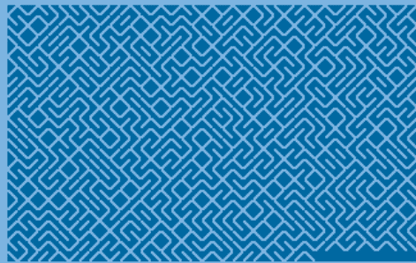

图 30.2

来自 1982 年《Commodore 64 用户指南》的随机迷宫程序。

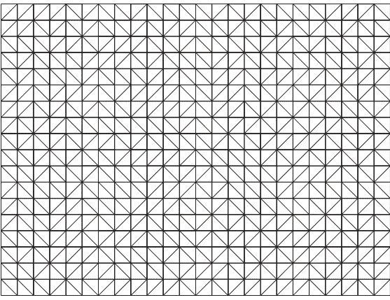

图 30.3

Cyril Stanley Smith 于 1987 年随机放置的 Truchet 四块瓷砖。去除了实色填充，以展示其与 10 PRINT 模式之间的形式联系。

`10 PRINT`过程的重复与两类艺术传统以及计算机程序中的控制流相联系。艺术中的第一种传统属于手工艺领域，特别是基于图案的工艺品，如刺绣和装饰设计。第二种是使用重复的程序和少量元素来创建复杂的图案。通过这种方式，`10 PRINT`的美学与绘画、雕塑、音乐作曲、视频艺术、表演、实验性动画和舞蹈中的实验相平行。在这两种情况下，这些实践的成功都归功于同样让`10 PRINT`引人入胜的因素：在规则的空间或时间标记上不断重复简单的节奏程序或规则，创造出复杂且具有刺激性的效果。在极简主义和构造主义流派中，艺术世界面对着编程技术（techne）的限制和规律性，这为计算机可以执行的重复过程的形式定义留下了空间。在`10 PRINT`新发现的（对于 20 世纪 80 年代而言）的复杂性中，将计算机与手工工艺的传统联系在一起：缝纫、编织和织造。

这种设计手工艺、艺术与计算的交汇并非偶然，因为`10 PRINT`是重复过程生成性品质的演示。`10 PRINT`编写和出版时，艺术界正转向探索在泰勒制和形式主义时代创造力系统化的限制与可能性，而计算机器本身就是这种时代的一种表达。将`10 PRINT`不仅置于 20 世纪艺术之中，而且置于形式实验和文化手工艺更大的传统中，有助于解释个人电脑如何成为程序化手工艺的场所。

本章探讨了`10 PRINT`程序两个形式方面中的第一个，赋予了它引人入胜的视觉力量。本章关注规律性，而下一章将关注随机性。尽管`10 PRINT`的模式无法一眼看出来，但如果程序没有规律性，它将无从意义。它在空间、时间和过程中以规律的方式运行——随后的讨论将对这些规律性的每一个方面进行研究。首先考虑空间规律性，从铺砖开始，贯穿整个网格发展史，最后以对计算机屏幕的讨论结束。接下来将考虑时间上的艺术重复，特别是音乐和表演中的重复。然后将讨论重复过程以及支持它们的编程构造结构。

```
(66) 10 PRINT CHR$(20.5+RND(1)); GOTO 10
```

# 重复空间

在一部经典且具有启发性的文本《秩序感》（The Sense of Order）中，E. H. Gombrich (1994) 与悦人的重复与无趣的冗余之间的张力作斗争。当他思考路面设计时，他注意到遇到无法完全掌握其图案所带来的乐趣。Gombrich 从当时出现的信息的角度来解释这种对变化或复杂性的渴望，该理论认为信息随不可预测性同步增加 (9)。他进一步推测，观众通过试图预测接下来会发生什么来识别图案。他写道：“快乐位于无聊与困惑之间的某处” (9)。再次考虑沙特大教堂的迷宫作为其中之一。

`10 PRINT`无疑提供了类似的设计，这归于它从简单的随机分配创建复杂图案。正如 Gombrich 后来论证的那样，最伟大的初学者带来的视觉设计和变化，不仅在于他们“遵循任何复杂组织规则的能力，还在于引入一种精确计算的随机性剂量”(1994, 94)。在这种观点下，计算机被证明是迷人的编织者，而`10 PRINT`的设计作为一种图案而非路径的作品，与其说是代达洛斯的作品，不如说是织神（Arachne）的作品。

图案与重复过程密不可分地联系在一起。这一概念在 Gombrich 对“分级原则”的注释中得到了清晰的阐述，通过该原则，单元“分组形成更大的单元，这些单元反过来又很容易组合成更大的整体”(1994, 8)，或者说完形（gestalt）。图案的总和因此是过程的结果。这种图案、感知整体与过程之间的相互关系，在他对铺路和选择石头的各种方法的讨论中变得清晰。以此类推，视觉设计依赖于跨越空间重复图案的过程，即使这些图案不是被绘制成单个单元。欧几里得空间中这些有序图案的调节背景或基础是网格。

网格提供了一个直觉和发明运作并可以被颠覆的框架。在自然的混沌中，规律图案提供了对比和秩序的承诺。从陶器上的图案到罗马浴室的几何马赛克，人们长期以来一直使用网格装饰生活。在伊斯兰文化中，对数学的关注和对表现性禁止导致了当时最先进的网格系统，用于装饰建筑和宗教文本。网格长期以来一直作为建筑和城市规划的基础。例如，无法想象纽约这个曾经的未来之城没有曼哈顿上部的规律网格。（百老大道以多种方式打破了这一网格，形成了该市许多著名的公共空间。）

# Truchet 瓷砖

想象`10 PRINT`中的斜线字符被画在正方形瓷砖上，即用于地板的那种。每块瓷砖上画有

```
(68) 10 PRINT CH$(205.5+RND(1)); : GOTO 10
```

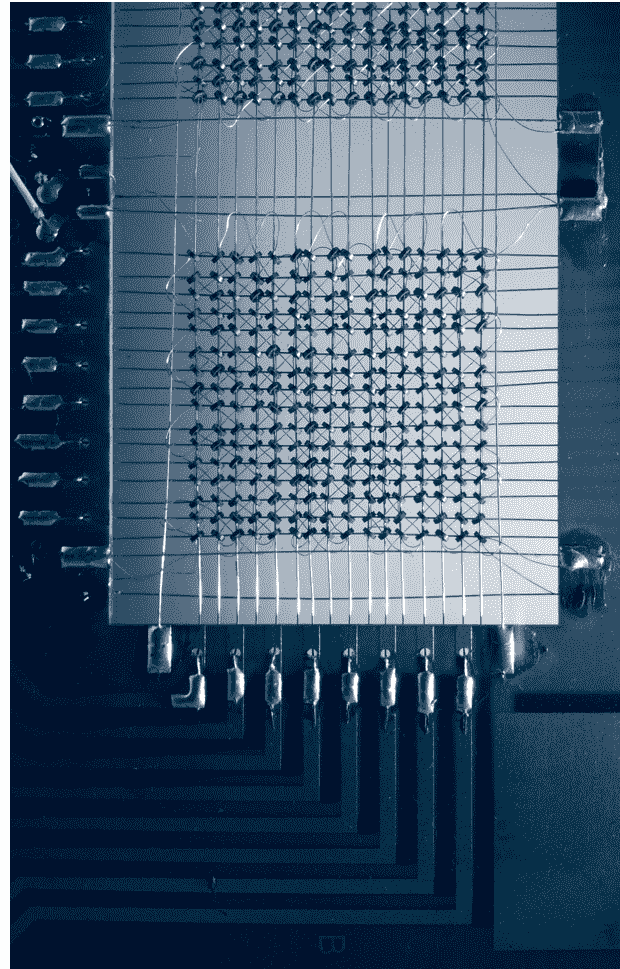

图 30.4

磁记忆。

规律性 (69)


图 30.5

这张来自 10 PRINT 变体的屏幕截图显示了二维网格作为程序定义性特征的重要性。

因此，设计师能够创造出各种惊人的图案。每个瓷砖的方向与黑白（即正空间与负空间）不断变化的重复之间的相互作用，产生了对称的设计，其范围涵盖从网格状图案到迷人的、几乎是三维的幻觉。与早期的伊斯兰设计或凯尔特设计不同，特鲁谢瓷砖（Truchet tile）仅使用单一尺寸和形状（Smith and Boucher 1987, 378）。在特鲁谢最初的1704年论文中，他提供了30种不同图案的示例，这仅仅能激发出他瓷砖的美学可能，尽管他提到“我发现的图案太多，无法全部报告”（374）。特鲁谢的作品为后来的一本书提供了灵感，即杜阿（Doûat）名副其实的《Method pour pour une infinite de desseins . . . . . [创造无限不同符号的方法]》，这本书反而对18世纪的欧洲艺术产生了相当影响（373）。

然而，特鲁谢和杜阿的所有示例都是规则图案，是对称且重复的。科学史学家西里尔·斯坦利·史密（Cyril Stanley Smith）在1987年观察到，如果引入非对称性，从特鲁谢瓷砖生成更具吸引力的设计。当特鲁谢图案的规则性被随机性中断时会发生什么？史密举了一个例子，随机排列的特鲁谢瓷砖（图30.3）。网格仍然可见，但随机性留下了痕迹，留下了破坏任何形成图案的缺陷。与特鲁谢和杜阿给出的对称示例不同，这种结构没有解。中心无法维持，边缘也是如此。史密通过省略瓷砖上的实色，只留下黑色对角线，推向特鲁谢瓷砖规则性的极限。任何给定瓷砖的四种可能方向减少到了两种。

这些修改过的特鲁谢瓷砖生成的图案看起来与`10 PRINT`的输出不同——该程序在史密和Boucher的文章发表五年前发表的——表明网格仍然是每个瓷砖的边缘——但对角线似乎不再限制正空间或负空间。相反，它们看起来像迷宫的墙，二十条各异的小通道。这种由特鲁谢瓷砖产生的产物让规则性及其对立面的动态发挥了作用，表明规则性并不是孤立存在的设计方面，而只能通过对它的例外来定义，通过那些规则变为不规则的时刻。与其与其庆祝`10 PRINT`“抢先”了史密，

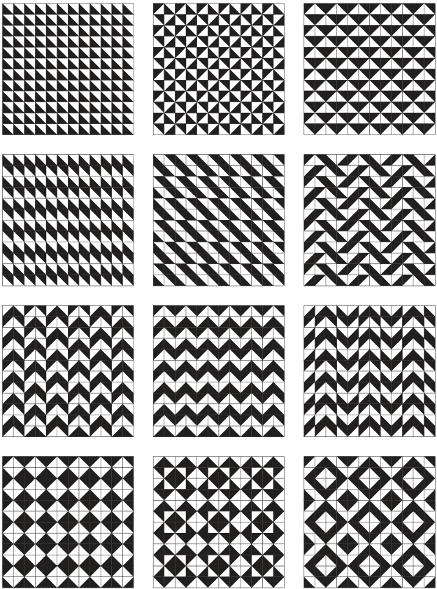

图 30.6

来自塞巴斯蒂安·特鲁谢（Sastien Truchet）1704年《组合记忆》的图案。

上方重新绘制的每个 $12 \times 12$ 图案是由较小的图案构成的，使用单一瓷砖设计，斜跨黑半白。

```
(72)  10 PRINT CHR$(205.5+RND(1)); : GOTO 10
```

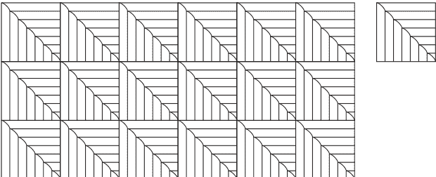

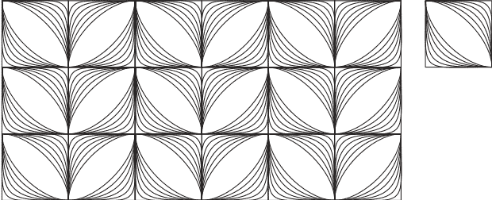

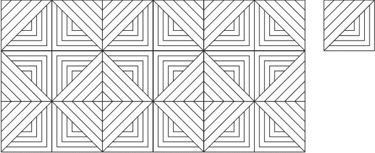

图 30.7

来自南非的 litema 图案示例。这些图案通常刻在房屋外面的抹灰泥墙上。这些图案通过重复和旋转单个正方形单元构建。

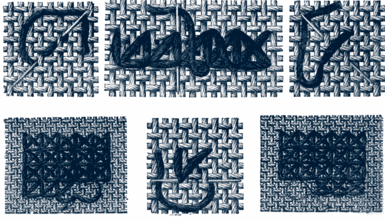

图 30.8

来自1885年《年轻女士工作台完全指南》中正方形图案技术的刺绣示例。

值得注意的是，有几种方法可以到达这种特定的随机与规则图案的顶峰——或者进入它的迷宫；一种是在康莫多尔（Commodore）发现的，另一种是从瓷贴图案及其美学的数学角度发现的。

## 纺织品与工艺

特鲁谢和杜阿的实验并没有引入通过形状的简单变化来创建图案的思想。这种做法在许多设计形式中都很常见，特别是在装饰领域，长期以来一直在创造规则和不规则图案。例如，弗兰斯·博斯（Franz Boas）就记录了织者（引自 Gombrich 1994, 72）。扎尔的库巴人创造的图案复杂度令电气工程师感到困惑，具有类似于`10 PRINT`的迷宫般通道，但复杂度要高得多（Huang et al. 2005）。或者考虑南非索托妇女的壁画，即被称为 litema 的装饰性几何壁画（图30.7）。这种技术早在1861年就有记载，涉及组装由涂料泥制成并用手指和棍子刻出的正方形网络（Gerdes 1998, 87–90）。事实上，装饰艺术早已掌握了`10 PRINT`的这一秘密。这些技术在1885年《年轻女士工作台完全指南》的精美作品示例中有详细介绍（图30.8）。

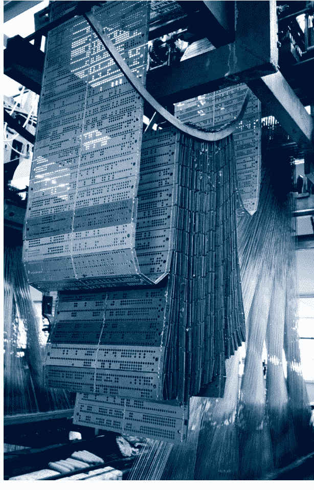

图 30.9。挪威舍灵斯塔德 Sjølingstad Uldvarefabrik 的打孔片驱动织机。由 Lars Olausussen 提供，知识共享 署名-非商业性-相同方式共享 2.0 通用许可。

规律性 (77)

一种过程模型。`10 PRINT`展示了计算机器快速原型重复模式的能力，并且由于它执行的是模式本身，初级程序员可以自由地对该过程的变体和扩展进行实验。

## 现代艺术中的网格


20 世纪 60 年代和 70 年代，艺术家们逐渐远离了 50 年代的主流抽象表现主义以及其对原始情感的偏好。新的运动，如欧普艺术（op-art）和极简主义，以及欧洲持续的构造主义线条，产生了一系列理性的、经过计算的艺术，它们利用网格和等间距来定义秩序。在许多美国主要的艺术博物馆中游，你会发现弗兰克·斯特拉（Frank Stella）的规律线条画布、阿德·雷因哈特（Ad Reinhardt）色调难以区分的硬边缘网格、卡尔·安德烈（Carl Andre）排列在地面上的金属网格、唐纳德·贾德（Donald Judd）等间距的装置、丹·弗拉文（Dan Flavin）的荧光矩阵，以及艾格尼斯·马丁（Agnes Martin）画布上的网格。随着历史的发展，这个列表还可以写上几页；但观点显然已经明确。这种趋向极简形式的美国倾向被阿德·雷因哈特在 1962 年的《作为艺术的艺术》中完美表达：“五十年来抽象艺术的目标是呈现艺术作为艺术本身并作为虚无，使其成为它所是的唯一的事物，对其进行分离、定义以及更多，使其更加纯粹”（Rose 1991, 53）。

在当时的欧洲，许多艺术家正在研究网格系统，而且他们通常具有更明确的关注和严谨性。这种能量经常被引导到在不同城市形成的团体中。例如，巴黎有 GRAV（François Morelet, Julio Le Parc 等），位于杜塞尔多夫的有 ZERO（Heinz Mack, Otto Pipp 等）且其触角遍布整个欧洲，伦敦有 Systems Group（Jeffrey Steele, Peter Lowe 等），以及苏黎世的 Allianz（Max Bill, Richard Pohse 等）。运用网格创作的最具标志性的艺术家可能是光学艺术家维克托·瓦萨雷利（Victor Vasarely），他的网格呈现出令人着迷的扭曲。他的作品是如此系统化，以至于他发明了一套符号系统，使助手团队能够根据指令和模块化、预制的彩色碎片来组装他的作品。尽管仅仅通过观察作品很难辨别，但在那些追求数学形式主导地位的艺术家(78) 目标与那些保持着在几何构图中注入主观性和情感愿望的艺术家之间，存在着紧张关系。

在批判前一类艺术时，巴西诗人、随笔作家费雷拉·古尔（Ferreira Gull）在 1959 年的《新具体主义宣言》中写道，艺术仅关注“构图的客观问题、色彩反应、序列节奏的发展、线条或表面”是危险的（Zlevansky 2004, 57）。古尔的宣言回顾并重新构思了二十世纪早期如瓦西里·康丁斯基（Wassily Kandinsky）、卡西米·马列维奇（Kazimir Malevich）和亚历山大·罗德申（Alexander Rodchenko）等艺术家的作品。在网格的特定背景下，先驱彼特·蒙德里安（Piet Mondrian）、奥·凡多斯堡（Theo Van Doesburg）以及与风格派相关的艺术家完全放弃了表现性。范多斯堡等人创造了“具体艺术”一词，用于分类那些在不参考自然和象征的情况下构思的作品。1930年4月发表的《具体绘画的基础》宣言指出：“艺术作品在生产之前应该被完全构思并在精神上形成。它不应该包含任何自然形式、感官性或感性。我们希望排除抒情主义、戏剧性、象征主义等等”（Fabre and Wgens Hotte 2009, 187）。范多斯堡在 1932 年的《元素主义（新绘画的元素）》中继续写道：“人们绝不犹豫放弃我们的个性。普遍性超越了它 . . .

走向普遍形式的方法基于对尺度和数字的计算”（187）。代表性作品，如蒙德里安的《红、蓝、黄、灰的构图》（1921）和范多斯堡的《反向构图 VI》（1925），完全由正交线组成形成一个网格。这一时期的作品还尝试将网格旋转 45 度以创建更具动态的构图。这种形式技巧自然也体现在 `10 PRINT` 中。

虽然 `10 PRINT` 程序源于计算机文化而非艺术，但它与二十世纪此前的艺术作品有着不可思议的相似之处。保罗·克利（Paul Klee，包豪斯教授，极具影响力的艺术家，1879–1940）在 20 世纪 20 年代的作品延续了克利的实验。在他 1925 年出版的《教学速写教程》中，克利展示了他对数量结构、重复和变异的思考。他 1927 年创作的《变体（进性主题）》展示了其作为视觉构图的理论。他将 40 方格的画布分为九个单元的网格，每个单元包含一个平行线图案（某些例外除外）。关于这幅画的更多深入见解可以在 1964 年于《思考之眼》中出版的笔记中找到。克利讨论了自然测量与人工测量之间的区别，即特质秩序与理性秩序的区别。更重要的是，他通过平行线的线性间距讨论了张力和动态密度。通过这些视觉对比，克利探索了可能产生的问题。

规律 (79)

在当时的法国，许多艺术家正在研究网格系统，而且他们通常具有更明确的关注和严谨性。这种能量经常被引导到在不同城市形成的团体中。例如，巴黎有 GRAV（François Morelet, Julio Le Parc 等），位于杜塞尔多夫的有 ZERO（Heinz Mack, Otto Pipp 等）且其触角遍布整个欧洲，伦敦有 Systems Group（Jeffrey Steele, Peter Lowe 等），以及苏黎世的 Allianz（Max Bill, Richard Pohse 等）。运用网格创作的最具标志性的艺术家可能是光学艺术家维克托·瓦萨雷利（Victor Vasarely），他的网格呈现出令人着迷的扭曲。他的作品是如此系统化，以至于他发明了一套符号系统，使助手团队能够根据指令和模块化、预制的彩色碎片来组装他的作品。尽管仅仅通过观察作品很难辨别，但在那些追求数学形式主导地位的艺术家(78) 目标与那些保持着在几何构图中注入主观性和情感愿望的艺术家之间，存在着紧张关系。

在批判前一类艺术时，巴西诗人、随笔作家费雷拉·古尔（Ferreira Gull）在 1959 年的《新具体主义宣言》中写道，艺术仅关注“构图的客观问题、色彩反应、序列节奏的发展、线条或表面”是危险的（Zlevansky 2004, 57）。古尔的宣言回顾并重新构思了二十世纪早期如瓦西里·康丁斯基（Wassily Kandinsky）、卡西米·马列维奇（Kazimir Malevich）和亚历山大·罗德申（Alexander Rodchenko）等艺术家的作品。在网格的特定背景下，先驱彼特·蒙德里安（Piet Mondrian）、奥·凡多斯堡（Theo Van Doesburg）以及与风格派相关的艺术家完全放弃了表现性。范多斯堡等人创造了“具体艺术”一词，用于分类那些在不参考自然和象征的情况下构思的作品。1930年4月发表的《具体绘画的基础》宣言指出：“艺术作品在生产之前应该被完全构思并在精神上形成。它不应该包含任何自然形式、感官性或感性。我们希望排除抒情主义、戏剧性、象征主义等等”（Fabre and Wgens Hotte 2009, 187）。范多斯堡在 1932 年的《元素主义（新绘画的元素）》中继续写道：“人们绝不犹豫放弃我们的个性。普遍性超越了它 . . .

走向普遍形式的方法基于对尺度和数字的计算”（187）。代表性作品，如蒙德里安的《红、蓝、黄、灰的构图》（1921）和范多斯堡的《反向构图 VI》（1925），完全由正交线组成形成一个网格。这一时期的作品还尝试将网格旋转 45 度以创建更具动态的构图。这种形式技巧自然也体现在 `10 PRINT` 中。

虽然 `10 PRINT` 程序源于计算机文化而非艺术，但它与二十世纪此前的艺术作品有着不可思议的相似之处。保罗·克利（Paul Klee，包豪斯教授，极具影响力的艺术家，1879–1940）在 20 世纪 20 年代的作品的作品延续了克利的实验。在他 1925 年出版的《教学速写教程》中，克利展示了他对数量结构、重复和变异的思考。他 1927 年创作的《变体（进性主题）》展示了其作为视觉构图的理论。他将 40 方格的画布分为九个单元的网格，每个单元包含一个平行线图案（某些例外除外）。关于这幅画的更多深入见解可以在 1964 年于《思考之眼》中出版的笔记中找到。克利讨论了自然测量与人工测量之间的区别，即特质秩序与理性秩序的区别。更重要的是，他通过平行线的线性间距讨论了张力和动态密度。通过这些视觉对比，克利探索了可能产生的问题。

# 屏幕保护程序与计算机梦想

虽然没有人声称 `10 PRINT` 可能被用作屏幕保护程序以防止 CRT 显示器和电视上的荧光屏过度老化，但其非交互性的、无限循环的特性，加上其悦目且不断变化的图像，使其成为这类程序的密切近亲。如果非要将 `10 PRINT` 归类为一个熟悉的软件类别，“屏幕保护程序”并不是一个糟糕的选择。

最早的屏幕保护程序可以追溯到 1968 年，当时斯坦福大学的研究人员编写了“Take Me, I'm Yours”，让它随机出现在斯坦福人工智能实验室时分系统的开放屏幕上，用以指示终端已空闲并可以使用。1973 年，著名的施罗克斯帕罗克研究中心（Xerox PARC）的工程师创造了具有跳动和缩放图形的屏幕保护程序，使动态屏幕保护程序超越了单纯的文本（Davenport 2002, 65）。20 世纪80 年初，商业屏幕保护程序随之出现，例如 Berkeley Systems 最畅销的《After Dark》系列。到 1996 年屏幕保护程序的鼎盛时期，计算机显示器的设计使得荧光屏老化几乎不再可能。然而，屏幕保护程序继续存在，其角色超越了最初的实用或审美功能。SETI（寻找地外生命）项目发布了 PC 软件，利用空闲的计算机周期处理来自外太空的无线电波——同时在计算机显示器上显示屏幕保护程序。在另一方面，南希·丹波特（Nancy Davenport）创作了“五一节”屏幕保护程序，捕捉了当代抗议活动重复且往往基于图像的本质。

在艺术史上，屏幕保护程序存在具有启发性的相似之处。大卫·莱因特（David Reinfort 2009）考虑了各种动态视觉和机械作品，包括马塞尔·杜尚的“精密光学”项目、亚历山大·卡尔德的动态雕塑、相位示波器显示、布莱恩·盖辛和伊恩·索姆维尔的梦机器，以及生成的视觉和声音。莱因特寻求的是联系，而非追溯谱系或证明影响，但这些程序似乎有一个引人入胜的战前先驱。

也许最引人注目的“原型屏幕保护程序”出现在更早时期，形式是杜尚 1933 年的旋转浮雕（Rotoreiefs）。这组盘片的每侧都使用胶印石术印刷，允许购买者在 33 转转盘未被用于其主要目的（收听音乐）时对其进行某些操作。当然，盘片对人们的转盘造成了额外的磨损，并没有“节省”它，但屏幕保护程序很少被真正视为“节省器”。正如一个屏幕保护程序包提供多种选项来适应不使用电脑的观众的心情一样，“旋转浮雕”为观众（即非听众者）提供了十二种选择。第三张盘片的一面是“日本波瓦松”（Poisson Japonais）——正如后来屏幕保护程序将显示器变成鱼缸的模拟一样——它让转盘变成了一个鱼缸。

这种对电子设备（最初是转盘，后来是电视或计算机显示器）的巧妙运用引起了人们对其作为家具的关注；它还利用电力和技术模拟了生物的活动。它向我们展示了我们强大的媒体技术如何变得如此安静、循环且有趣的离常。这种鱼缸屏幕保护程序（或鱼类旋转浮雕）所暗示的关联-技术关系是一种奇特的并置和低调的循环运动，可能与旋转一个在商店固定的自行车轮的效果相差无几。

一个标志性的屏幕保护程序以一种奇异的方式将生命与技术结合在一起。在 Berkeley Systems 的《After Dark 2.0》中，“飞行烤司机”屏幕保护程序展示了吐司利用它们细小（脆弱）的翅膀在屏幕上漂浮。烤面包机，这种仅用于制造面包以产生梅拉德反应的单一用途设备，与 . . 片吐司一起在空间悠闲地漂浮。这个屏幕保护程序暗示，动物会梦见电子羊和计算机，当它们打盹时，会看到低级技术在飞行的幻象。值得注意的是，《After Dark 2.0》中的烤司机并非纯的技术产物——它们是带有有机翅膀的半人半烤面包机。虽然它们所处的场景很有趣味，但也存在着调用通用能力的风险：它们不帮助准备食物，完全是非机质，而且当然不会飞。计算机可能能够进行符号操作和机器梦，但存在一些它无法进入的领域，那些它被留去向往的领域。也许这一切中，并不是在飞行中的普通计算机观察者所想象的，而其中任何一点都将增加图像的荒诞感和观者的乐趣。

某些屏幕保护程序创建了完全没有解释的抽象抽象图案，甚至是类似于抽象迷宫的东西。其他的，例如早期的 Windows“星场”和 Windows 95 的“迷宫”（显示了穿过 3D、类 RPG 迷宫的移动），表明计算机是探索的工具。这些屏幕保护程序与那些玩弄我们对生命感知的程序一起，邀请我们思考技术如何与鱼、鸟等生物产生联系。除了所有这些，还有一些屏幕保护程序以一种暗示勤奋的技术生产的方式积累结构。Windows 95 的“管道”屏幕保护程序就是一个相当著名的例子。它展示了多色管道的 3D 缠绕，这些管道可能变得密集且复杂。这个屏幕保护程序在几分钟内所做的水管工作比任天堂的马里奥一生所做的还要多。忙碌的视觉效果显示计算机正在工作，尽管它的用户没有与其交互。虽然图像看起来很悦目，但它投射出一种比轻浮的烤司机或模拟鱼缸更严肃的形象。

虽然 `10 PRINT` 极其抽象，但它的生成过程似乎是疯狂且持续的构建。`10 PRINT` 表明计算机是结构的制造者，它不知疲倦地以固定的速率生产结构，并能创造既悦目又让行走者困惑的图案。虽然 Windows 95 的“迷宫”屏幕保护程序提供了西修斯（也许是米诺陶洛）的视角，但 `10 PRINT` 展示了从代达洛斯眼中迷宫：从建筑师的眼睛视角看，观众共享了一个不断处于建造过程中的结构的想象。

视觉艺术放弃了叙事和论述，进入了文化孤立。

在我们 `10 PRINT` 程序的那个时代，受越南战争以及 20 世纪 60 年代末和 70 年代初社会运动的影响，视觉艺术界内部的关注重点从极简主义和构造主义（及其变体）转而关注表现主义和写实绘画，以及对摄影日益增长的接受。然而，为早期家用计算机和游戏系统（如 Atari VCS 和 Commodore 64）创作的视觉作品，受到硬件技术限制的极大限制，因此与同行的视觉艺术有更多共同点。

对这些奇异相似之处的主要解释是网格本身。在《设计程序》中，瑞士设计师卡尔·格斯特特纳（1964）问道：“网格是程序吗？让我说得更具体一点：如果网格被视为一种比例调节器、系统，它就是一个卓越的程序。”格斯特特纳与计算机的接触使他将规则空间化为程序本身。网格将艺术创作系统化，无论是在画布、舞池还是计算机屏幕上。

# 计算机屏幕

Atari 2600 和拉尔夫·贝尔（Ralph Baer）于 1972 年推出的 Magnavox Odyssey 通常也会连接到电视机。

电视图像的矩形形式源于电影场景，这种矩形源于胶片的材质属性，并显然得益于托马斯·爱迪（Thomas Edison）的一个动作而获得了 4:3 的宽高比例，这一动作导致了高度为四个孔的帧。尽管电影的宽高比例多年年来发生了变化和多样化，但美国的电视（1953 年通过 NTSC 格式标准化）和计算机显示器在 20 世纪 80 年代和 90 年代一直使用 4:3 比例。

尽管 Commodore 64 有复合显示器，但该系统与电视之间的关系是显而易见的，也是那些设置电脑并将其连接到显示器的人的默认选择。对于在美国购买的 Commodore 64，系统的视频输出通常终止于一台 NTSC 电视机。但计算机显示并非始于此：它拥有一种包含两种输出方法的的遗产，这些方法在今天看来并不寻常。

正如本书的十位合著者之一所指，“早期与计算机的交互很大程度上发生在纸上：在纸带、打孔卡、打印终端和电打字机上，使用卷轴状的连续纸用于打印输出和输入”（Montfort 2004）。20 世纪 70 年代的大部分时间，计算机的标准输出设备是打印终端和电打字机。输出通常不是在今天激光打印机那种页面上，而是产生在标准纸或热敏纸卷轴上。这种输出的格式尺寸不是标准的 8½ x 11 英寸页面，而是一个本质上无尽的卷轴，通常宽度为 80 列。

电打字机用于展示 20 世纪 60 年代在达特茅编写的首批 BASIC 程序的结果，它们是与 Eliza 和 Adventure 等早期程序交互的典型手段。有了这样的输出系统，就不需要自动手段来保存和查看“回溯”（scrollback）——用户可以很容易地拿起输出卷轴并查看它。当然，这种输出意味着动画和其他特定效果在视频化上是不可能的。

有一种观点认为，现代计算机屏幕在雷达屏幕的圆形 CRT 显示器中也有重要的遗产（Gere 2006）。SAGE 预警系统、PDP-1 以及道格拉斯·恩格尔巴特构建“演示之母”的系统都配备了：

```
(86) 10 PRINT CHR$(205.5+RND(1)); : GOTO 10
```

圆形 CRT，就像早期的电视。注意的是，前两个可能是现代意义上视频游戏的系统——William Higginbottom 的《Tennis for Two》和由 Steve "Slug" Russell、Martin "Shag" Graetz、Alan Kotok 等人创建的《Spaceway》，都是为 CRT CRT设计的。虽然雷达和其他某些图像实际上是圆形的（如早期的阴极射线管），但电视信号和页面并不是。对于雷达而言，径向显示最终在计算中让位于矩形网格格式，页面和电视图像都遵循了这种格式。

## 时间中的重复


虽然如果没有空间的规律性，`10 PRINT` 将是不可能的，但如果没有时间和过程的规律性，它也将是完全不同的。这个程序既是跨网格的有序等距形状的产物，也是这些形状不断重复替换的结果。戈布里克（Gombrick）指出：“一切……都指向一个事实，时间和空间秩序在我们的经验中汇合。难怪语言谈论时间中的模式和空间中的节奏”（1994, 10）。他继续研究从钟摆摆动到齿轮旋转的简单机械节奏。作为空间性和时间性之间的桥梁示例，他提到了楼梯高度和深度的规则配置如何导致人们规律地走上阶梯。

随着戈布里克发展出时间重复和规律性的概念，他迅速过渡到对过程的讨论。无论是时钟的滴答还是人爬楼梯，时间的规律性都是重复过程的结果。戈布里克通过引用 K. Bucher 的《工作与节奏》（Work and Rhythm）转向对工作的讨论，该书强调“在执行共同任务时需要定时运动”，例如工人将砖块装入手推车（Gombrick 1994, 10）。时钟的滴答声不仅代表工厂车间里的工时；它还体现了工人的规律性运动。戈布里克继续说道：“再次，严格的定时确保的不仅仅是同步运动。更重要的是秩序中固有的可能性，即构建一个动作或例行的层级结构，以确保更复杂任务的执行”（10）。这种公式暗示了受控时间与指令、动作与例行的层级结构之间的关系，这让人想起泰勒制（Taylorist）生产模型以及编程。虽然对这些联系的全面调查超出了本书的目标，但注意到处理过的指令在时间和空间中产生节奏的根本作用是重要的。

过程和运动的出现对于 `10 PRINT` 至关重要。显示程序运行某一时刻的静态图像（即本文再现的那些）在某种程度上记录了程序，但是不完整的表示。对程序的完全理解只有通过体验一个单元地构建模式，以及当左线或右线随机绘制时，那些意料之外的序列和连接形成迷宫的惊喜感才能获得。

最传统的视觉艺术（以壁画、青铜雕塑和画布为代表）是静态的。观众通过在作品周围移动、眼睛探索表面来创造运动。（注：原文此处存在大量重复文本，翻译已根据逻辑流进行清理。）

由于程序决定显示左侧或右侧线条，出现了新的形式；但在《钢琴相位》（Piano Phase）和《拍击音乐》（Clapping Music）中，通过反复播放相同的序列，表演者以不同的速度演奏，产生了新的声音形式。

## 过程中的重复

本章中的作品将规则性视为一种风格和技术；计算机将规则性视为其存在的必要范式。计算机程序的执行，即使是一个满是错误或执行了许多复杂有趣任务的程序，如果没有规则性也无从谈起。事实上，本章讨论的许多艺术作品正是在对计算机过程的规则性做出反应。比在福特工厂更为如此，规则性已成为计算时代的范式，需要被探索和抵制，因为它是最基础计算素养的核心逻辑。虽然流水线可能将货物送到 20 世纪消费者手中，但家庭并不需要思考流水线来消费这些商品。即使对于实际上在工厂工作的工人来说，工厂的流程也会在别处定义。然而，即使是编写最简单的程序，人必须理解并参与机器的规则性。因此，阐述这种允许规则性成为此类生成性空间的流与控制过程是值得的。

赋予程序力量的因素之一是，它们可以通过重复指令序列来变得更加规则。这种重复可以通过两种主要方式实现：在持续一定次数的循环中，或在无界循环中。这两种循环对应两种分支：条件分支和无条件分支。理解 `10 PRINT` 的无界循环和 `GOTO` 的特定遗产，就是理解计算机程序控制流的本质。

为了解释循环，有必要将其与替代方案进行对比：不使用循环并让程序按通常顺序进行。在任何命令式编程语言中，命令按照特定的顺序被处理，这种顺序与西方读者阅读页面时从左到右、从上到下的路径相关。如果直接在 Commodore 64 的 BASIC 解释器中输入 `PRINT` 命令，并在之间加一个冒号，如下：

```basic
PRINT "FIRST": PRINT "SECOND"
```

结果是：

```text
FIRST

SECOND
```

先执行左侧的命令，然后执行右侧的命令。执行以下程序时，首先运行最上方最左侧的命令，然后是右边的，接着是下一行的，因此：

```basic
10 PRINT "FIRST": PRINT "SECOND"
20 PRINT "THIRD"
```

按顺序打印 FIRST、SECOND 和 THIRD。由于 BASIC 使用行号来确定顺序，因此这两行输入的顺序与程序的运行方式完全无关。

有一些重要的方法可以使这种简单的程序流变得复杂化。所有这些方法都涉及分支，分支会导致程序流转移到其他命令，而不是继续执行后续命令。低级机器代码及其在处理器上的执行也是如此。机器语言程序通常是按出现顺序处理的数字序列。然而，执行中的机器语言程序，就像 BASIC 或另一种命令式语言中的高级程序一样，可以继续处理下一条指令，也可以跳序处理不同的指令。标准情况是处理器继续执行下一条机器语言指令，就像文本阅读者移动到下一个单词或行一样。这个递增的程序计数器指向内存中下一条指令所在的位置。然而，如果当前指令是可以改变控制流的指令，程序可能会跳转到新的内存位置和新的代码段。分支或跳转是构建循环的关键操作。

## 条件与无条件分支

控制流发生改变且程序可以从新点继续执行的两种基本方式如下。

无条件分支始终引导程序跳转到一个新位置，就像《大富翁》中的“直接去监狱，不要经过起点”之类的指令一样。无条件分支的汇编助记符是 `jump`；对应的 BASIC 关键字是 `GOTO`。将分支从代码行封装，然后通过返回原始行的后续分支构成了子程序，这在 BASIC 中通过 `GOSUB` 和 `RETURN` 实现。当使用无条件分支指向早之前的指令时，它会导致过程的重复，如 `10 PRINT` 所示。

另一种类型的分支是条件分支，这是对通用计算至关重要的指令类型。汇编中有许多不同类型的条件分支，因为有许多不同类型的条件。例如，`beq` 是“如果相等”：在比较（`cmp`）之后使用时，只有当比较值相等时才会分支。`bmi` 是“如果小于”，检查最后计算的结果是否为负值。在 BASIC 中，使用 `IF ... THEN` 语句是实现条件分支的最直接方法，正如此程序所示：

```basic
10 INPUT A$
20 IF A$ = "1" THEN PRINT "YOU TYPED ONE!" : END
30 PRINT "SOMETHING ELSE..."
```

如果在运行此程序后，用户输入数字“1”并按 `RETURN`，第 20 行的所有语句都将被执行。“YOU TYPED ONE!”将被打印，程序按指令终止。当然，这是改变程序流的另一种方法：使用 `END` 或 `STOP` 终止程序。如果使用 `STOP`，可以发布 `CONTINUE` 命令从程序停止的地方继续。

如果用户不输入或输入除“1”以外的任何内容并按 `RETURN`，控制流将移动到第 30 行；第一个 `PRINT` 语句和 `END` 都被跳过。相反，打印“SOMETHING ELSE...”。这个程序虽然写法不同，但功能完全相同：

```basic
10 INPUT A$
20 IF A$ = "1" THEN GOTO 40
30 PRINT "SOMETHING ELSE..." : END
40 PRINT "YOU TYPED ONE!"
```

与其使用 `IF ... THEN` 和 `END` 语句，这个程序通过 `GOTO` 改变控制流。`GOTO` 语句用于跳过 `PRINT "SOMETHING ELSE..."` 并到达 40。虽然这不是一个非常有趣的程序，但这种无条件分支可以用于在行序列中跳转；`GOTO` 本身并不意味着它必须用于重复或循环。

尽管 `10 PRINT` 中没有 `IF ... THEN` 语句，且程序从任何解释都不包含条件分支，但这个短程序确实实现了一种小规模的变异。通过计算 `205.5+RND(1)` 并将该值传递给函数 `CHR$`，程序打印 PETSCII 字符 205 或 206。这两个字符之间的这种变化是一个位变化，是从最小可能的选项集中进行的选择。然而，结合重复过程的规则性和 Commodore 64 屏幕网格的规则性，这些选择呈现出某种引起共鸣且视觉上有趣的形式。

## GOTO 的危害

对计算机科学讨论了解的人可能会带着畏惧之心看向 `10 PRINT`，这归功于 1968 年著名计算机科学家埃德格·W·迪杰斯特拉给编辑的一封信，该信的标题为“被认为有害的 Go 语句”（EWD 215）。虽然标题实际上是由编辑编写的——迪杰斯特拉称这篇文章为“反对 GO 语句的案例”——但这封信及其背后的观点获得了持久的声誉。有人称它是“可能是关于任何类型编程的被引用最多的文档”（Tribble 2005）。正如这位作者所解释的，迪杰斯特拉的劝告处于一个接受的编程方式是使用 `goto` 语句手动构建迭代循环、`if-then` 和其他控制结构的时代。当时的大多数编程语言都不支持我们认为所当然的基础控制流语句，或者仅提供了它们非常有限的形式。Dijkstra 并不是说所有的 `goto` 用法都是坏的，而是认为应该存在更优的控制结构，来取代当时流行的大多数 `goto` 用法。

事实上，确实有一种显而易见的控制结构，遗憾的是 BASIC 中缺失了，它可以实现 `10 PRINT` 中 `GOTO` 的目的，而无需使用 `GOTO`。这就是 `while` 或 `do ... while` 循环，在这种情况下，可以简单地使用一个始终为真的条件，使得循环始终重复。例如，如果 Commodore 64 BASIC 有一个 `DO ... WHILE` 语句和一个 `TRUE` 关键字，人们可以：

```basic
10 DO : PRINT CHR$(205.5+RND(1)); : WHILE TRUE
```

这无疑是编写程序更清晰的方法，而且在今天会被广泛认为更清晰，因为 Dijkstra 对编程的观点已经占据了主导。当 BASIC 的创造者在 1983 年引入 True BASIC 时，他们包含了 `DO` 循环；其语法与之前的略有不同，但核心结构是相同的。

尽管这个重要的结构在早期的 BASIC 版本中是缺失的，但并不难看出 `10 PRINT` 这一微型程序会特别得罪 Dijkstra。在他的信中，他反对“对 go to 语句的无节制使用”，但他并没有说每一次使用它都是毫无疑问地坏的。他描述了当程序员无法追踪和理解变量值时会出现的与 `GOTO` 相关的问题。`10 PRINT` 没有变量，所以这个关于 `GOTO` 的特定问题在这种特定情况下并不是问题。

正如前面提到的，`GOTO` 在汇编语言中的等价物是 `jump`。Dijkstra 实际上将汇编语言从他对 `GOTO` 的批判中排除了。他意识到用高级语言编写的计算机程序是更复杂、更微妙的思想表达方式，并不直接取决于机器功能。通过创建一种不直接模拟处理器操作的新类型语言，程序员可以思考得更灵活、更有力。尽管 Dijkstra 反对 BASIC 的设计方式，但他像 BASIC 的原始设计者一样，付出了努力去描述对思考有帮助的高级语言如何以与机器无关的方式工作。

```basic
(94) 10 PRINT CHR$(205.5+RND(1)); : GOTO 10
```

## 有边界与无边界循环

`10 PRINT` 之所以这样工作是因为它对 `PRINT` 语句的重复，这种重复是无条件的：它将一直持续直到程序外部的东西中断它，例如用户按下 `RUN STOP` 键或拔掉电脑。这种无限重复的能力将程序与其他媒体中的艺术类比区分开来。

在高级层次，程序可以包含两种类型的循环：有边界的（也称为“有限”）和无边界的（“无限”）。`10 PRINT` 属于后者。如果你编写一个旨在产生结果并退出的程序，包含一个无边界循环将是一个错误，创建一个会导致程序在特定操作集上挂起的 bug。即使与精细艺术和手工艺中的重复相比，计算机作为一个能够无限循环的系统也是独一无二的。尽管如此，无边界循环确实有其用途。它可以保持一个应用程序（通常是交互式程序）运行，并可能接受指令直到系统关闭、重启或被中断。这在 Commodore 64 上也是可以实现的。

有边界循环是那些在某些条件下结束的循环。具体条件各异；有些将一直持续到程序达到预定义状态，而另一些则执行特定的次数。如果循环存在条件的话，这表明程序员预期在程序执行时会引入某种变化。

有限循环的常见用途是创建一个迭代过程。迭代是一种特殊的循环类型，其中通过一次循环的结果会影响后续循环的结果。迭代过程最简单的例子无非是计数：从初始值 1 开始，在其基础上加 1（即递增）产生 2，再次执行相同的递增操作产生 3，以此类推。如果程序达到某个限制值，例如 10，那么该循环就是有边界的：

```basic
10 A=1
20 PRINT A
30 A=A+1
40 IF A<=10 GOTO 20
```

如果将第 40 行替换为 `40 GOTO 20`，循环就变成了无边界的。

## 被认为是有害的 BASIC

《Go To 语句被认为是有害的》的作者 Edsger W. Dijkstra 完全不喜欢编写 `10 PRINT` 使用的 BASIC 编程语言。他在 1975 年的一封发表于 1982 年的信《我们如何告诉那些可能伤人的真理？》中写道：“对于以前接触过 BASIC 的学生来说，教他们良好的编程几乎是不可能的：作为潜在的程序员，他们在心理上已经超越了重生的希望”（EWD 498）。

这段话看起来像是对编程语言（FORTRAN、PL/I、APL）、IBM 以及允许“自然语言”的项目进行的单句式奇特讽刺。在 1964 年的一场主旨演讲《计算机科学的威胁》中，Dijkstra 同样表示：“这种教学应该被定性为犯罪行为：它摧毁了无法恢复的头脑”（EWD 898）。在这两种情况下，他的这些陈述都不是论证的一部分，也完全没有详细阐述。它们是对 BASIC 的简单谴责——无疑引起了许多计算机科学家的共鸣，并且在今天占据主导地位且 Dijkstra 所提倡的结构化编程仍受到质疑的情况下，无疑具有战术价值。

Dijkstra 的论文中对 BASIC 发明者 John Kemeny 只有一次引用。Dijkstra 阅读了 Kemeny 1983 年在《Daedalus》上的一篇文章，那篇文章讨论了计算机素养的概念，并宣布“近年来‘结构化语言’的发展是巨大的一步”。Dijkstra 简单地写道，条件分支是使循环有边界——它在满足条件时结束。因此，程序中的无条件分支对应于无边界循环。

有边界循环，以及计数到某个特定值，在编程中很重要。BASIC 有这种循环自己的语法，使用 `FOR ... TO` 和 `NEXT` 语句。边界程序也可以这样写：

```basic
10 FOR A=1 TO 10
20 PRINT A
30 NEXT
```

（96）`10 PRINT CHR$(205.5+RND(1)); GOTO 10`

关于那篇文章的一句话，说它通过将计算机语言与自然语言进行比较给出了浅薄的典型例子”（EWD 858）。

这个程序非常适合完成其自身。如果选择这种方法，修改程序以数到 50 的花费将是编写原始程序的四倍时间。在之前的程序中，只需将第 10 行的“10”改为“50”即可。

## 循环与迭代

`10 PRINT` 的无限循环产生了迭代效果，即使它并没有执行一个纯粹的迭代过程。末尾的无条件分支实现了这一点：`10 PRINT` 显然在不断重复。然而，代码中没有任何迹象表明 `10 PRINT` 是数学或计算意义上迭代的示例。没有变量的值会从一次循环到下一次循环发生变化——事实上，根本没有变量——而且循环内部的代码（这些代码是可以运行的）也从不改变。从最直观的计算角度来说，BASIC 程序 `10 PRINT CHR$(205.5+RND(1)); : GOTO 10` 并不进行迭代。

尽管如此，观察程序在屏幕上的执行可以看到，在运行过程中某些东西在变化：每次循环执行时显示新字符的位置都会向右移动一个，直到到达第四十列；然后，字符的显示将在下一行的第 1 列继续。一旦字符显示到达左下角，整个屏幕的内容就会向上移动一行，顶部的行消失。

这一切都不是 `10 PRINT` 中包含的任何 BASIC 语句的直接结果。在屏幕上显示字符串通常具有这种效果，因为 BASIC 的 `PRINT` 命令调用 Commodore 64 KERNAL 的 `CHROUT` 来产生输出。因此，虽然 `10 PRINT` 不是迭代程序，但它调用了 `PRINT` 的迭代行为。这种 `PRINT` 展示了使用简单的迭代步骤来创建复杂结构的力量。

计算充满了迭代和简单的循环。应用程序的最高层通常是处理用户输入和其他事件的“主循环”。回合制游戏（例如与人类对弈的棋类程序）通常每个回合都有一个条件循环，取决于游戏是否结束。图形窗口或整个屏幕的帧是通过 OpenGL、Processing 或其他手段绘制的，它们是在一个循环内绘制的，循环的快慢程度取决于框架。

```basic
10 PRINT CHR$(205.5+RND(1)); : GOTO 10
```

## 执行循环

Vito Acconci 的《Step Piece》是一件基于重复的表演作品，将其与 `10 PRINT` 进行比较和对比很有趣；它是一个由人而非计算机执行的、定义明确的重复程序。Acconci 在一段简短的文字中定义了这件作品：“一个 18 英寸高的凳子放在我的公寓里，用作阶梯。在指定的月份里，每天早上，我以每分钟 30 步的速度在凳子上上下走；每天早上，这项活动持续到我无法不停止地继续下去为止。”

由于有指定的表演月份，Acconci 定义了一个有边界的循环。《Step Piece》的目的显然是为了在这些月份的每个早晨都以特定的方式保持相同。但对于观众或 Acconci 来说，它在每一个点上都不是相同的，对于多年后考虑它的人来说，在每一个点上同样不同。这是不断重复同一件事，而不是重复吗？一个人的重复性表演不可能完全相同。Acconci 有时走得更快，有时则需要慢下来；他的脚卡住的方式略有不同，产生了不同的声音。在 Commodore 64 上运行程序时，没有类似的类比物——程序以相同的方式运行，符号在功能良好的电视机上以相同的方式呈现。《Step Piece》的摄影记录显示了 Acconci 正在活动，一只脚在凳子上，另一只脚在向上或向下。正如 `10 PRINT` 的不同捕捉是不同的一样，每张照片都是不同的——它们在某些大规模方面也是不同的，因为它们是不同姿态的同一个人的图像，而不是一个包含不同元素的 40 × 25 网格。


此外，随着时间的推移，`Acconci` 的重复动作变得越来越熟练（就像举重者通过做“次数”来提高力量），而`10 PRINT`在程序运行时以相同的节奏和方式向屏幕写入字符。某些计算机程序确实会随着推移而改进——例如，因为它们缓存了操作或使用机器学习对输入进行分类。然而，像`10 PRINT`这样的单行程序是计算机作为基础计算机器的遗产，每次运行时都对符号执行相同的操作。最后，这种重复对观众没有产生相同的影响，因为生活的背景每天都在发生变化。因此，重复可能会在不同的时间引起不同的想法。

## FOR...TO...STEP

BASIC 中的`FOR`循环比第 96 页所示的示例更通用。它不仅可以用于增加变量，还可以每次通过任何数量改变其值。使用`STEP`关键字设置不同的增量。要只显示 2 到 10 之间的偶数：

```
10 FOR A=2 TO 10 STEP
20 PRINT A
30 NEXT
```

如果省略`STEP`，它等同于加上`STEP 1`。步进值可以设置为负数甚至甚至是零。通过将值设置为 0，可以创建一个无边界的`FOR`循环：

```
10 FOR A=1 TO 10 STEP 0
20 PRINT "FOREVER!"
30 NEXT
```

这允许了`10 PRINT`的替代版本，使用`FOR`循环代替`GOTO`：

```
10 FOR A=1 TO 2 STEP 0 : PRINT CHR$(205.5+RND(1)) : NEXT
```

这稍微长了一，超过了物理行的四十个字符，但在“单行代码”的意义上仍然是一个，因为它可以放入八个字符的逻辑行内。

在这个版本中，开头的“10”是可选的。这三条语句可以在立即模式下一起输入，就像可以输入`PRINT "HELLO"`并让`PRINT`语句立即执行一样：

```
FOR A=1 TO 2 STEP 0 : PRINT CHR$(205.5+RND(1)) : NEXT
```

原始程序中需要行号的唯一原因是作为跳转回的点。随着`GOTO`的移动，行号也之移动。

```
(100) 10 PRINT CHR$(205.5+RND(1)) : GOTO 10
```

所以，`Step Piece`通过其重复发生了至少四种变化：(1) 人类表演在反复中中发生微妙变化；(2) 记录显示了不同的、非重复的时刻；(3) 人类表演随时间增长而改进；以及 (4) 作品在不同的语境下被感知。《Step Piece》在这里是代表性的，因为它看起来是纯粹重复的或多重复，但在不同晚上演出同一出戏的人会遇到类似的非重复重复，这些点也适用于运行多次的戏剧的情况。即使`PRINT`是数字机器的表演，(2) 和 (4) 仍然适用，使其重复以这些方式变化。

规律性是二十世纪中后期的一项重要技术，部分是因为艺术家探索了系统化生产和重复

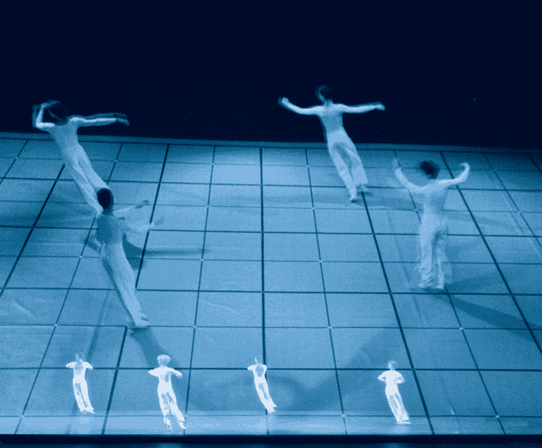

图 30.10

图像来自 2009 年复兴版《舞蹈》，这是 Lucinda Childs、Phillip Glass 和 Sol Lewitt 于 1979 年合作的作品。由 Sally Cohn 拍摄，©2009。Sally Cohn 提供。

(102) 10 PRINT CHR$(205.5+RND(1)); : GOTO 10

正如计算机程序所体现的那样，过程。这些艺术形式的影响在于剥离了它们的代表性和表现可能性，在其建构主义技术中体现了极简主义。相比之下，`10 PRINT`作为 Commodore 64 初学者的入门和引导性示例，它并没有剥离这些特性，而是让初学者初窥了计算机系统在受控时空限制内处理无限循环时，那种流动与控制产生的效果。如果说艺术世界正在从表象和表现转向这种极简主义，那么初级程序员则将`10 PRINT`视为迈向表现和表现运动的起点，在这种情况下，是在计算机图形的世界里。

在所讨论的案例中，时间、空间和程序的规律性变成了一种比例调节器，证明是一种生成性约束，产生了完全出乎意料的巨大模式。通过规律性无情的可预测性，网格上反复随机呈现的两条对角线变成了一幅完全出人意料的迷宫卷。作为编程技艺（technē）的教学示例，`10 PRINT`既是计算规律性的产物，也是这种力量的展示。

## 35 处理中的多种变体

构建一个受`10 PRINT`启发的高分辨率交互式程序，允许实现视觉设计上的变化，而这些在 Commodore 64 程序中可能难以实现甚至是不可能的。在过去的五十年里，计算视觉艺术已经在各种平台和许多系统语言上创建；过去十年中，设计师使用的带有嵌入式编程语言的商业工具（最著名的 Adobe Flash）以及由视觉艺术家设计的编程环境呈爆炸式增长。John Maeda 在 2001 年提出的 Design by Numbers 系统是后者的一个示例；一个影响更大的工具是 Ben Fry 和 Casey Reas 开发的 Processing，它本身受到 Maeda 作品的启发，并在他在 MIT 媒体实验室的研究小组内启动。

虽然一个简单的 BASIC 程序通过`10 PRINT "HELLO WORLD"`在屏幕上写一些文本，但一个简单的 Processing 程序通过`rect(20, 30, 80, 60)`在屏幕上画一个正方形。这个单行程序绘制了一个左上角位于坐标 (20, 30)、宽度为 80 像素、高度为 60 像素的矩形。本质上，Processing 是一种图像编程语言，建立在几何、摄影、排版、动画和交互的知识之上。在底层，Processing 基于 Java，配备了特殊的工具包、框架和创作环境，均适用于开发交互式视觉草图。由于 Processing 处于编程和视觉艺术之间，它充当了两种文化之间的桥梁。鼓励带有背景接触 Processing 的人学习如何制作复杂的视觉图像。而在另一端，视觉艺术家学习了程序化素养的基础知识。

`10 PRINT`底层的算法显然是针对 Commodore 64 特定的；可以使用一张网格纸、一支笔和一枚硬币来执行它。在多个不同平台上运行该算法的行为揭示了算法的本质（一方面），以及系统的特定限制和功能（另一方面）：例如，`PRINT`生成的行会自动换行和滚动，因此字符可以积累并填充屏幕，而无需通过 x 和 y 坐标指定。Commodore 64 更微妙的默认设置包括颜色（蓝色背景上的浅蓝色）以及添加迷宫每个新部分的速度。当将`10 PRINT`移植到另一个平台时，Commodore 64 的某些特性必须被有意识地定义，或者至少

```
10 PRINT CHR$(205.5+RND(1)): GOTO 10
```

在新平台内进行模拟；程序员可以重新协商迷宫的精确颜色、分辨率和速度。虽然在 Commodore 64 的 BASIC 中可以修改原始程序的许多元素和方面，但某些方面更为固定固定。主要是，定义网格分辨率的 40 × 25 字符屏幕是计算机视频系统的基础，并定义了构成迷宫的单元数量。

`10 PRINT`的第一个 Processing 移植是为了利用现代屏幕更高的分辨率而编写的。它通过将线条的厚度和末端变为变量来实现，这些变量可以在程序运行时进行更改。迷宫的线条宽度可以在 0.5 到 10 像素之间范围，线条可以是圆端或方端。与`10 PRINT`类似，这个 Processing 移植版本保持了 40 × 25 单位的线条网格，但与`10 PRINT`不同，它不是从右上到下顺序添加每个网格单元。在新分辨率视图中，整个迷宫会同时刷新。使用 Processing 的默认颜色创建白色线条和黑色背景，赋予了类似于 Commodore 64 原始低对比蓝色色调（见图 35.1）。

在创建这些变体时，引入了一些额外的更改以探索`10 PRINT`迷宫的视觉方面。首先，画左线或右线的 50-50 概率被修改，可以在程序运行时重新加权，以增加绘制一条线而非另一种线的概率。结果如图 35.2 所示。然后，使用了与对角线不同的符号来暴露程序的一部分。

迷宫的视觉效果随着这些对角线的对齐而产生。观众的眼睛在尝试寻找路径时穿过图像。某些符号创造了强烈的视觉效果，而另一些符号生成了无聊的平面。图 35 显示了用空格（space）和圆形代替对角线的结果。这种对`10 PRINT`基础结构的探索表明，`10 PRINT`的吸引力源于两个或多个元素之间的随机选择，这种选择在视觉上激活了观众创建一个有趣的且文化相关的图像——在这种情况下，是迷宫。

上述讨论的更改可以直接通过 Commodore 探索。

允许用户交互式更改参数，但它确实复制了原始程序那种逐字符构建的构建方式：

```processing
int w = 16;
int h = 16;
int index = 0;
```

```processing
void setup() {
  size(640, 384);
  background(#0000ff);
  strokeWeight(3);
  stroke(224);
  smooth();
}
```

```processing
void draw() {
  int x1 = w*index;
  int x2 = x1 + w;
  int y1 = h*23;
  int y2 = h*24;
```

```processing
if (random(2) < 1) {
  line(x2, y1, x1, y2);
} else {
  line(x1, y1, x2, y2);
}
```

```processing
index++;
if (index == width/w) {
  PImage p = get(0, h, width, h*23);
  background(#0000ff);
  set(0, 0, p);
  index = 0;
}
```

(112) 10 PRINT CHR$(205.5+RND(1)); : GOTO 10

程序的主要结构由`setup()`和`draw()`块定义。变量可以定义这些块之外，但其他所有内容都通过这些块进行顺序执行。当程序启动时，块外的变量会被声明并赋值。接着，从上到下读取`setup()`内部的代码。在这里，显示窗口的大小为 640 像素宽、384 像素高，并定义了背景和线条的颜色。接下来，`draw()`内的代码从上到下运行。在每一帧结束前，`draw()`块中的任何代码都会从上到下执行。`draw()`中`if`语句中的代码对一个随机值进行采样，并绘制两条可能的线条之一。`draw()`底部`if`块中的代码移动当前正在绘制的迷宫线条。这段代码的行为和外观与经典的 Commodore 64`10 PRINT`（见图 35.4）更为相似，但其定义方式有所不同。

Processing 中有一种方法可以创建一个`10 PRINT`端口，它在某些方面是对 Commodore 64 程序的更佳近似。这种方法使用 Processing 开发环境 (PDE) 的文本控制台，而不是显示窗口中的像素；该控制台通常用于输出错误消息以及通过`print()`和`println()`函数编写调试语句，这些函数类似于 BASIC 中的`PRINT`。然而，控制台只能打印文本；程序本身不会在此区域内输入，且无法绘制图形。另一个显著区别是 PETSCII 的图形字符在 PDE 的原生控制台字体中可用。因此，需要使用`/`和`\`（斜杠和反斜杠）来代替对角图形`/`和`\`。这导致行与行之间出现空格，阻止了连续迷宫的幻觉。其输出与 Perl 中的第一个`10 PRINT`端口相似（见图 25.3）。产生`10 PRINT`近似效果的 Processing 程序也可以单行实现：

```processing
void draw() { print((random(1)<0.5) ? '/':'\\'); }
```

当在 Processing 中运行时程序，会打开一个空显示窗口，文本将打印到控制台上，如图 35.5 所示。这一探索揭示了在 Commodore 64 BASIC 中编写此程序与在 Processing 中编写程序之间的关键区别。单行 Processing 程序如下：

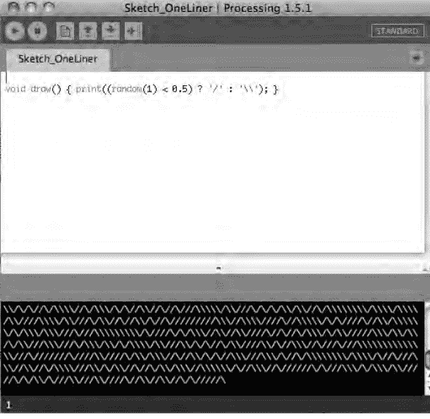

图 35.5

这个单行 Processing`10 PRINT`端口在算法上与 Commodore 64 程序更相似，但视觉输出极其不同。代码写在文本编辑器中，输出绘制在控制台上，而不是打开新的显示窗口。

(114) 10 PRINT CHR$(205.5+RND(1)); : GOTO 10

代码上非常相似，但产生的结果截然不同，这种结果看起来非常像之前备注中讨论的第一个 Perl 单行程序和 Apple II 单行程序。

评估 Commodore 64`IO PRINT`程序的相似之处表明，小组件的形状（特别是末端的形状）是一个微妙但关键的因素。在 Commodore 64 的`IO PRINT`中，每条单字符对角线的两端都是尖的。这是由于字符是 8 × 8 像素单元，线条一直延伸到角。

在 Processing 程序中，每条添加的线条都可以延伸到窗口内任何特定框之外。Processing 窗口是一个连续像素表面，每个像素都可以通过 x 和 y 坐标精确寻址。`10 PRINT`包含 320 × 200 个像素，可控分辨率为 40 × 25，总共 1000 个元素。Processing 版本的程序可以利用窗口中的所有像素——在大型现代显示器的全屏窗口中，这可能意味着数百万个像素。例如，1080p 高清显示器由 2,073,600 个像素组成。

考虑到这种增强的分辨率，`IO PRINT`的第三个版本在 Processing 中对原始程序有了更大的自由度。网格的行和列是可变的，线条的粗细被随机设置为 2、4、8、16 或 32，且背景设置为黑色。

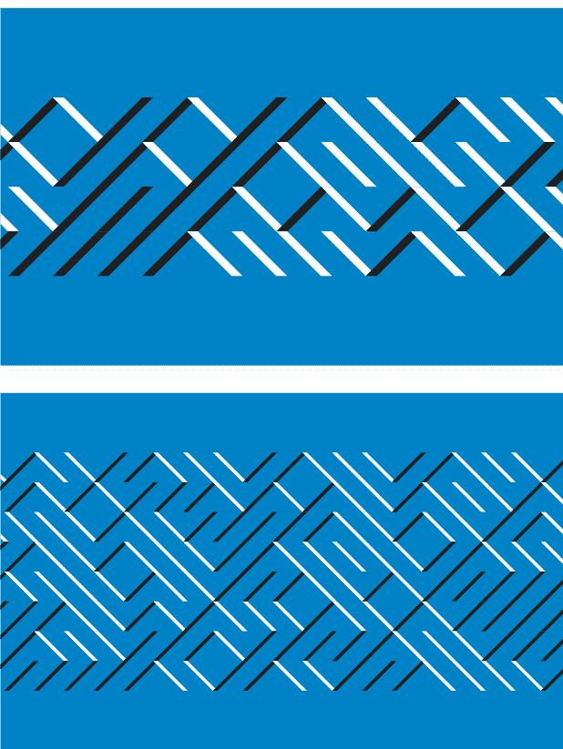

图 35.6

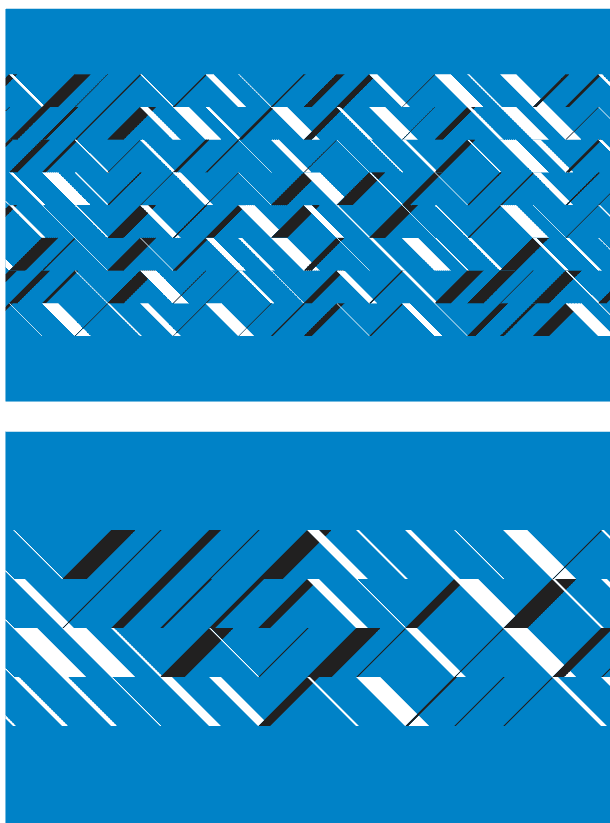

图 35.7

这是一个作曲家的框架，其中重新排列的页面在打印之前存储在其中。这些特定的随机元素可以杀死对手、创造财富，或帮助汇编文本。`10 PRINT`中的`RND`命令选择两个字符中的一个——这种文本位置唤起了“随机”这些含义的最后一种。`10 PRINT`的随机是一个翻转或掉落，一个像正斜杠或反斜杠这样的符号（幸运的是它不像骑士的斜划那样可怕）。该程序使用`PRINT`命令将每个随机图形散布在屏幕上，这是印刷机的的另一种回响，也是 BASIC 早期时代的遗产，当时`PRINT`意味着将墨水落在纸上。尽管`RND`是“随机的”，但在表面之下，它与速度、暴力、毁灭甚至是印刷有着联系。

## 偶然游戏

生活充满了随机性和不可解释性，孩子和成年人都有意识地将偶然纳入日常生活，这并不奇怪，仿佛他们是为了驯服它。根据法国历史学家罗杰·卡伊瓦（Roger Caillois）的观点，偶然游戏是人类玩的所有四类基本游戏之一。竞争*（Agon）是取决于技能的竞争性游戏，*模仿*（mimicry）游戏是想象力的，而*眩晕*（ilinx）是导致混乱和失去控制的游戏，而*偶然*（alea）则是偶然游戏。骰子、、轮盘——这些都是该类别中的某些游戏，其结果不可预测。*alea*取自拉丁语中骰子游戏的名称，它“否定了努力、耐心、经验和资历”（Caillois 2003, 17），以使得一切都取决于运气。在拉丁语中，*aléator*是赌徒；在法语中，*aléatoire*是随机的数学术语。

## 随机的吸引力

在他关于 19 世纪巴黎的《拱廊计划》（*Arcades Project*）中，沃尔特·本雅明（Walter Benjamin）将整个章节留给了死亡游戏和赌博，这是一份奇特的笔记和摘录，来源涵盖了从卡萨诺瓦到弗里德里希·恩格斯的各种人物。书中引用了安托尔·法国（Anatole France）的话：“赌博是与命运的面对面交战”（Benjamin 1999, 498 [O4A]）。轮盘的每一次旋转都是一个展示命运青睐玩家的机会。

财富在瞬息之间起落，取决于骰子的投掷或扑牌的切牌。每个赌徒都知道这一点，接受它，甚至乐于其中。

赌博的魅力——更广义地说，所有游戏中偶然性的魅力——建立在不确定性之上。不确定性是如此迷人，以至于其他基于技能的游戏通常也包含偶然元素，例如足球比赛开始时的掷硬币。正如凯蒂·萨伦（Katie Salen）和埃里克·齐尔默曼（Eric Zimmerman）所说，不确定性“是有意义游戏的关键组成部分”（2004, 174）。一旦游戏的结果已知，游戏就变得毫无意义。将偶然引入游戏有助于推迟结果变得而明显的时刻。

考虑西奥多·德莱泽（Theodore Dreiser）于 1900 年首次出版的《携带·嘉莉》（*Sister Carrie*）中乔治·赫斯特伍德（George Hurstwood）的案例。“在大注愿景的驱动下，”赫斯特伍德来到了一间扑克室：

> 赫斯特伍德观察了一会儿，然后看到一个有趣的游戏，加入了其中。在好运了一段时间之前，他赢了几次并振作了精神，输掉了几局并因此变得越来越感兴趣、越来越坚定。最后，那场迷人的游戏紧紧抓住了他。他享受他的风险，并用手微不足道的牌进行虚张，以欺骗公司并获得一个公平的命运。（Dreiser, 1981, 374）

德莱泽的描述中引人注目之处在于，只有当赫斯特伍德的好运动摇时，他对游戏的兴趣才会增加，并开始享受它。输掉几局让连胜变得更加心惊肉魄。“一系列幸运轮次带给我的快乐，比一个不赌博的人在几年内所获得的胜利还要多，”他继续道，“这些快乐像闪电一样生动而灼热，节奏太快以至于不会令人厌恶，多样以至于不会变得无聊。我在这一生中活了十百辈子”（Benjamin 1999, 498 [O4A]）。

与随机早期纯粹的恶性行为不同，这里涉及到快乐与痛苦之间的受虐式互动。还有对时间的巨大压缩：一生中的十百辈子。安托尔·法国将赌博称为“一种在几秒钟产生命运通常需要许多小时甚至许多年才能实现的艺术”（Benjamin 1999, 498 [O4A]）。本雅明本人宣称，“一个游戏的偶然成分越大，它消逝得就越快”（512 [O12A, 2]）。等待、无聊、单调——这些挫败感随着“时间从他（赌徒）的每一个毛孔溢出”而消失了（107 [D3,4]）。

## 随机的形式


# 本雅明与偶然性：从游戏到计算

本雅明对偶然游戏的描述可能比对文化中随机性作用的批判性讨论更有奇想色彩。虽然随机、偶然和不确定性等词可能被随意替换，但并非所有偶然的形式实际上都是相同的。为了突出各种偶然形式之间的区别，考虑人类学家托马斯·马拉比（Thomas Malaby）对克里特岛一个希腊小城市赌博的描述——这是一个合适的探索地点，甚至 *alea* 的希腊语源也是如此。马拉比的目标是利用赌博作为“透镜，探索社会行动者如何面对他们生活在……领域面临的不确定性”（2003, 7）。人们如何解释那些不可解释的事物？我们如何处理不可预测的事物？来源是什么？

马拉比提供了一个基于四类分类的理解不确定性的框架。第一类是形式上的不确定性，通常被称为偶然。马拉比认为，社会科学中统计思维的主导地位扭曲了我们对不确定性的观念。第二类是社会不确定性，即无法知晓或理解人类意图。第三类是执行上的不确定性，即行动的不可靠性。最后，马拉比描述的第四类宇宙论不确定性，是指对游戏公平性的怀疑（Malaby 2003, 15–17）。

优先考虑形式上的不确定性原则意味着玩家、学者甚至程序员完全忽略了执行上的不确定性。在`10 PRINT`的案例中，思考社会不确定性可以揭示随机的新层次，例如 1982 版和 1984 版中的行号。同样，理解执行上的不确定性可以解释那些没有按预期执行的程序版本（Lord Ron 2008）。

宇宙论不确定性可能是最难应用于`10 PRINT`的不确定性形式。科学方法的兴起可以被视为一种对世界施加更理性观点并消除宇宙论不确定性的持久努力。从亚里士多德到伽利略到牛顿，经典力学将宇宙定义为一个没有随机的组织系统。爱因斯坦宣称：“上帝不与宇宙掷骰子。”然而，对 Commodore 64 的随机进行更仔细的检查显示，这台计算机——实际上在任何计算机上——从根本上是以一种反映马拉比宇宙论不确定性观点被“操控”的。随机和变化操作是如此必要的，远超游戏领域，以至于随机本身被框架为固定的、可重复的且知的。

## 计算之前的随机

正如游戏中不同的不确定性类别经常被归类并称为“偶然”一样，在视觉艺术、音乐和其他审美实践中也使用“偶然”而不是“随机”。在他的小册《变化图像》（*Change Imagery*）中，概念艺术家乔治·布莱希（George Brecht, 1966）描述了艺术家可能创作作品的两种不同的偶然操作：“图像的起源未知，因为它位于比意识更深层的思维层面”以及第二种“图像与不受艺术家控制的机械过程不同”。第一种描述描述了超现实主义和抽象表现主义者的工作，他们试图让潜意识过程主导作品。第二种定义让人联想到达达主义，并更接近计算中典型的随机概念；它描述了与`10 PRINT`直接相关的艺术家的机械操作。这些意义值得注意。

```
(124) 10 PRINT CHR$(205.5+RND(1)); : GOTO 10
```

因为很难在拉动“偶然”的两种意义中的其中一个时而不触及另一个——在这种情况下是指无意识——至少能感受到一种拉扯感。

这两种偶然操作之间的张力，在威廉·伯鲁斯（William Burroughs）关于20世纪20年代一次超现实主义集会的故事中得到了体现。特里斯坦·扎拉（Tristan Tzara）建议通过“现场从帽子里抽单词”来写一首诗，正如伯鲁斯所描述的，“发生了一场暴乱”并“摧毁了剧院”。在他的描述中，超现实主义领袖安德烈·布勒顿（André Breton）将扎拉逐出小组，认为他纯粹机械的偶然操作是对弗洛伊德潜意识的力量和反复无变化的冒犯（Burroughs 2003）。伯鲁斯显然混淆了几个事件，超现实主义与达达主义之间的决裂既与布勒顿和扎拉之间的性格冲突有关，与其他们对待艺术的方法有关（Brandon 1999, 127）。伯鲁斯本人显然完善了扎拉的无政府主义模式，并著名地描述了一种类似的不可预测的创作模式——剪切法（cut-up method），这也是扎拉在他1920年的《创作一首达达主义诗》中提出的。伯鲁斯解释说，“一种方法”是将一张纸切成四份并重新排列这些：“你会发现它表达了某些东西，而且是非常具体的内容”（90）。扎拉认为这种剪切技术的生成可能性类似于艺术中的拼贴和电影中的蒙太奇，并且今天比扎拉在1920年想象的要主流得多。例如，Radiohead乐队的主唱汤姆·约克（Thom Yorke）在1999年通过从大礼帽中抽出文本片段写了《Kid A》的歌词。

### 偶然操作

尽管约克使用了一种剪切法来应对严重的写作障碍，但20世纪初对随机性的艺术实验可以被看作是对工业时代所造成的理性和经验主义之枯燥功能性的回应，以及对第一次世界大战的刻意反击。考虑马尔塞尔·杜尚（Marcel Duchamp）的《三次停顿》（1913–1914）。根据他对作品的描述，杜尚从一米的高度丢下了三段米长的绳，让重力和偶然性决定扭曲绳线向下落下的路径。然后他将扭曲的绳粘在画布上，并在1918年用木质切割件保留了它们的形状和长度，创造了三个新的“停顿”，讽刺了尺码（meter）所谓的理性。当杜尚在1914年描述他的方法时，他观察到落下的线“随心所欲地扭曲自己”，最终结果变成了“缩减的尺码”，颠覆了人们通常不加质疑的直度和长度（Duchamp 1975, 141–142）。关于他对随机性的使用，杜尚说：“纯粹的偶然让我感兴趣，它是一种违背逻辑现实的方式”（Cabanne 1971, 46）。

杜尚像他结交的其他达达主义艺术家一样，将“逻辑现实”视为一种失败，对第一次世界大战的恐怖感到苦涩。对于达达主义者来说，讽刺、荒诞和对不确定性的拥抱似乎是对现代性最“合理”的回应。达达艺术家让（汉斯）阿尔普（Jean (Hans) Arp）的话说：“达达想要破坏思想中合理的谎言，恢复自然的、不理性的秩序。达达想要用一种不逻辑的荒诞来取代今天人的逻辑荒诞。”对于阿尔普来说，个人作者身份等同于权威主义，而随机元素被用来解放作品（Motherwell 1989, 266）。

20世纪探索随机性的主要作曲家是著名的约翰·凯奇（John Cage），他深受杜尚的影响。从凯奇的观点来看，随机元素消除了创作中的个人偏见；它们可以用来通过“偶然操作”超越品味和偏见的局限。凯奇通过他的作曲以及写作、讲座和课程影响了数代艺术家。在著作《实验音乐》中，凯奇写道：“参与实验音乐创作的人找到了方法和手段，将自己从所发出的声音活动中抽离。一些人采用源自中国《易经》等古老来源的操作，或者是物理学家在研究中使用的现代随机数形式”（1966, 10）。

凯奇的随机作曲方法是创建一个参数系统，然后将结果交给偶然。凯奇解释说：“这意味着每一首音乐作品的表演都是独特的，对于作曲家和听众来说都是如此。很容易再次看到与自然的相似之处，因为即使是同一棵树的叶子，也没有两片是完全相同的”（1996, 11）。随机组件被用于变换一个可能的创作空间。几十年来，凯奇使用了一系列技术将意外元素插入他的作品中。他在1958年的讲座《作为过程的创作》中定义了他和同时代使用的技术范围。在音乐中使用随机值通常有两种方法：在创作时定义作品，或者在作品表演时允许变化。`10 PRINT`中随机性最明显的特征在于第二类，因为随机决策是在程序执行期间做出的——也就是说，在 Commodore 64 执行 BASIC 指令期间完成。

在二维视觉艺术中，艺术家也为了凯奇所支持的理由探索了机械随机过程。著名的当代画家格尔哈德·里希特（Gerhard Richter）对此提供了一个简单的回答，他说：“我经常惊讶于发现，偶然性竟然比我好得多。”在视觉作品中使用偶然性的先例可以追溯到1916年的凯奇·阿尔普，但在讨论`10 PRINT`时最相关的两个早期作品是埃尔斯沃·凯利（Ellsworth Kelly）的《随机排列的色彩谱》（1951）和弗朗索瓦·莫莱特（François Morelet）的《利用电话簿奇偶数分布60,000个正方形》（1961）。这些作品从一个均匀网格开始，并根据艺术家开发的算法仔细地填充网格元素。凯利使用彩色纸正方形，按照他设计的系统放置。他为每种颜色分配了一个数字，并在网格上系统地绘制了这些数字（Malone 2009, 133）。莫莱特采用了更严格的系统，从电话书中读取一系列数字。他画了一个由200条垂直和水平线组成的网格，如果分配的数字是偶数就涂成蓝色，如果是奇数就涂成红色。在这两个艺术作品和`10 PRINT`中，网格的结构使得关注通过随机操作创造的可变性成为可能。

### 百万随机数字

对大量随机数的需求如此迫切，以至于有了标准化的集合。在德博拉·贝内特（Deborah Bennett）关于人类追求随机性的历史中——她认为这可以追溯到巴比伦时期（1998, 17）——她强调了最早且最大的随机数集之一，《百万随机数字》。该系列是1947年由兰项目通过“电子轮的随机脉冲”生成的，该项目后来发展成了兰公司。该系列在1955年成形式出版，对任何概率研究都做了一项重要贡献，该书今天在使用。正如在线版的序言提到的：

> 书中的随机数表已成为工程和计量经济学的标准参考，并广泛应用于游戏和模拟。作为最大的随机数字来源，该作品被统计学家、物理学家、彩票管理员和质量工程师经常使用。兰公司 1955

考虑到其复杂的起源和用途，百万随机数字提出了一种极其不科学的使用方法：“在使用表格时，首先应该找到一个随机起始位置。一种常用方法是随机打开书中未选的一页，并盲目选择一个五位数数字。”兰报告继续解释说，这些最初是“为美国空军的分析准备的”。事实证明，与其他许多计算进展一样，随机性与冷战战略紧密相连。事实上，早期基于计算机的随机数生成工作是在美国原子能委员会的赞助下进行的，例如罗滕伯格（Rottenberg 1960）在20世纪50年代后期的工作，或者是美国军（见格林、史密和克莱姆[Green, Smith and Klem 1959]在麻省理工学院的工作，得到了美国陆海军的支持）。

### 随机性进入计算

`RND`命令是`10 PRINT`的算法核心，它的跳动节拍驱动着迷宫的构建。`RND`函数像任何 BASIC 关键字一样被完全指定，但其输出是不可预测的。

#### 图 4.1

《100,000个随机数的百万位数字》（A Million Digits with 100,000 Random Numbers）由兰德公司于1955年出版，包含了你提供的随机列表。

从检索到的值中提取随机数是必要的。

```
| 10100 | 72191 34676 | 69504 96176 | 12388 47804 | 98139 54062 | 61066 99519 |
|---|---|---|---|---|---|
| 10101 | 82159 38873 | 71634 46278 | 62969 50242 | 92459 97446 | 02251 18034 |
| 10102 | 96858 96504 | 97810 09133 | 63941 40836 | 03281 82442 | 12290 11068 |
| 10103 | 06538 43358 | 51555 64478 | 55333 22445 | 80222 12783 | 68848 64506 | 60749 30597 |
| 10104 | 26339 78572 | 99467 34365 | 70472 81811 | 88268 48221 | 91907 11398 | 58123 66001 |
| 10105 | 15593 69479 | 30461 80528 | 72286 31544 | 95326 94170 | 09903 33812 | 65161 52589 |
| 10106 | 00333 80937 | 85217 35029 | 02291 01277 | 03571 81166 | 94913 51586 | 51641 52589 |
| 10107 | 02468 44333 | 53333 61113 | 34538 99127 | 44338 59471 | 50072 63333 | 66805 46643 |
| 10108 | 25961 32208 | 18517 14119 | 60406 80426 | 07455 05799 | 87489 01788 | 71815 71711 |
| 10109 | 09462 79214 | 28623 33223 | 32218 38225 | 99153 03228 | 84433 58791 | 41050 27322 |
| 10110 | 85408 99260 | 59748 39226 | 79911 40570 | 47156 67394 | 62005 83401 | 05119 10501 |
| 10111 | 03338 88528 | 91532 46689 | 46359 49919 | 64444 40937 | 90397 21181 | 29104 05566 |
| 10112 | 12990 72363 | 13703 60623 | 79998 47176 | 67394 64554 | 82705 03333 | 07750 01338 |
| 10113 | 66478 59112 | 68452 09158 | 99113 08271 | 22891 44053 | 06904 01453 | 01762 04359 |
| 10114 | 43100 60229 | 61809 01651 | 81657 50320 | 25133 04467 | 45448 83311 | 65997 8072 |
| 10115 | 52837 48838 | 80537 40426 | 64128 09667 | 49465 02193 | 09903 59812 | 07548 4492 |
| 1111 | 9320 5500 | 9977 3380 | 00747 03440 | 77701 11111 |3662230011 | 58833  777 |
| 11117 8888888888448822268 | 33129 01581 | 03218 19321 | 19140 09371 | 57225 56623 |
| 10118 08337 40526 | 18379 60648 | 64218 49465 | 92193 03128 | 13002 64638 | 90637 82264 |
| 10119 71076 47998 | 29735 49857 | 64724 04116 | 03928 21117 | 01706 33448 | 06668 97011 |
| 10120 13517 08329 | 52446 07728 | 70597 31238 | 19844 25925 | 07567 52902 | 09553 60616 |
| 10121 03296 94131 | 43159 44616 | 87957 70390 | 00950 88171 | 38846 43276 | 96099 53123 |
| 10122 022287 59129 | 55113 02257 | 70797 31238 | 20235 39422 | 19844 79846 | 71440 79546 |
| 10123 02493 48601 | 59986 60107 | 70267 24069 | 98111 34596 | 72911 27598 | 03567 77112 |
| 10124 14764 17008 | 67804 33337 | 70597 31238 | 82199 33873 | 82811 33907 | 94606 22504 |
| 10125 35111 95363 | 69535 04827 | 55006 05492 | 77161 09508 | 00006 33452 | 03283 18772 |
| 10126 19114 48888 | 08576 76662 | 11648 26209 | 58421 37321 | 09577 04131 | 06323 18872 |
```

随机性 (129)

对应于概率分布。在离散分布（例如，正面或反面）的情况下，分布解释了可能结果的权重——该值出现的概率大小。

例如，如果一个人从一副彻底洗过的扑牌中抽取单张卡牌，那么这种抽取的概率分布是均匀的：任何特定卡牌被选中的概率都相等。同样，随机数通常被定义为从某些范围内所有数字的均匀分布中抽取的数字。这个定义的困难之处在于，数字的随机性是根据该范围定义的。给定一个如 2 这样的数字，无法判断选择有多大的随机性。要在不知道生成手段的情况下确定随机性，必须考虑一组数字；知道数字应该所在的范围，或者更广泛地说，知道它们应该从哪个分布中抽取也是关重要的。

计算机是确定性设备——其下一个状态完全取决于当前状态。因此，基于计算机的随机数生成器技术上被称为伪随机数生成器。“伪”这个带有贬义的词是指使用确定性过程（程序）来产生看起来均匀分布的序列。这对于非天文级的序列在实践中有效。但最终，对于足够长的序列，伪随机数生成器的确定性将开始与真实随机过程产生偏差。例如，在 Commodore 64 上使用真实随机过程的序列，最终会连续产生相同的数字。

随机性可能会产生惊人的诗歌、震撼的艺术、奇妙的音乐和引人入胜的游戏，但它在科学中的角色是什么？为什么要给计算机生成随机数的能力？显然，这种类型的计算是精确、重复的且具有完美的精确度和准确性。然而，生成随机数的函数在第一个 BASIC 中就已经存在。随后的每个 BASIC 版本都增加了创建随机数的方法。几乎所有现代编程语言（包括 Python、Perl、Java、JavaScript 和 C++）都内置了生成随机数的方法。

```
(130)  10 PRINT CHR$(205.5+RND(1)); : GOTO 10
```

纽曼是第一个


后来由用英语写作的计算机科学家描述（例如 1965 年的 Sollin）。今天图论中两个著名的迷宫生成算法是约瑟夫·克鲁斯卡（Joseph Kruskal）和罗伯特·克莱·普林（Robert Clay Prim）。这两种算法都于 1957 年发表——尽管普林算法是对雅尼克（Jarnik）算法的重新发现，随后被计算机科学家、著名的 GOTO 反对者埃德格·V·迪克斯特（Edsger V. Dijkstra）在 1959 年重新发现（Foltin 2011, 15）。两者都是贪心算法，这意味着它们在每一步都会选择最优链接。克鲁斯卡算法选择整个图，而普林算法则构建一条连接的路径。这些算法可以用纸和笔进行建模，但计算随机化允许它们快速生成大量的迷宫形式，这得益于网格规则性、确定性算法与链接随机权重之间的相互作用。

## 艺术中的计算随机性

对于对随机性和表达文化感兴趣的人来说，唐纳德·努斯（Donald Knuth）关于随机数的权威讨论中，或许引人入胜的元素出现在脚注中。努斯回忆起 1960 年一部名为《思考机器》的 CBS 电视纪录片，其中部由计算机编写的“两部西部风格短剧”（Knuth 1969, 158–160）。事实上，三部短剧在 1960 年 10 月的一个日子在全国电视上播放，由曼彻斯特大学电子系统实验室的 TX-0 计算机生成。西部片背后的脚本编写程序 `SAGA` 让程序员道格拉斯·罗斯（Douglas Ross）和哈里森·莫斯（Harrison Morse）花费了两个月的时间，并考虑了 5,500 条指令（Piffer 1962, 130–138）。`SAGA II` 的关键在于它的三十个“开关”，这使得“各种替代或分支路径”成为可能（136）。普费尔（P Pfeiffer）观察到：“除此之外，劫匪可能会走到窗边向外看然后去桌子，或者直接去桌子。你无法预知程序将选择这些替代方案中的哪一个，因为它的等同于掷了一对骰子”（136）。

在 `SAGA II` 短剧出现之前，还有其他关于随机性和计算机的文学实验。诺亚·沃德里普-弗因（Noah Wardrip-Fruin）指出英国计算机科学家克里斯托弗·斯特奇（Christopher Strachey）是首部电子文学作品的作者，那是 1952 年曼彻斯特大学的 `Ferrari Mark I` 计算机生成的系列“情信”（Wardrip-Fruire 2005）。这台曼彻斯特大学计算机亲切地被称为 `M.U.C.`，它可以以每分钟的速度产生动人的情信，持续数小时且不产生重复。这里的“技巧”正如斯特奇所说，有两个模型句子（例如，“我的形容词名词 副词动词 你的形容词名词”和“你是我的形容词名词”），其中名词、形容词和副词是从斯特奇从《罗杰同义词词》（Roger’s Thesaurus）中挑选出的列表中随机选择的。随着计算机随机交替这两个句子，副词和形容词随机从句子中消失。总的来说，斯特奇对计算机的文学用途不屑一顾，他用情信的例子来说明了他的简单规则如何生成多样且意想不到的结果（Strachey 1954, 29–30）。尽管如此，在雷蒙·柯诺（Raymond Queneau）具有里程碑意义的组合作品《千万亿诗》（*One Hundred Thousand Billion Poems*）之前，斯特奇无意中为计算机组合创作法奠定了基础，这种对随机性的利用在之后的几十年中对文学和艺术变得越来越核心。

其他涉及随机重组的重要早期作品与文学传统和艺术运动有明显的联系。1959 年的随机文本》将弗兰茨·卡夫卡（Franz Kafka）的文本与逻辑操作结合，产生了“每座城堡都是自由的。并不是每个农民都是高大的”等陈述（Lutz 1959/2005）。在接下来的十年里，激浪派艺术家艾莉森·诺尔斯（Alison Knowles）和使用 `FORTRAN` 工作的程序员詹姆斯·滕尼（James Tenney）设计了《尘之屋》（*A House of Dust*）。该程序的输出将规则诗歌形式、重复与词汇的随机变化相结合，并打印在行字机纸卷上，用于 1968 年的小册出版（Pearson 2011, 194–203）。十多年后，杰克逊·麦克·洛（Jackson Mac Low）利用古老的书籍《百万个随机数字》（*A Million Random Dig*）设计了“汇聚诗”（Converging Stanzas），这些诗歌从 1930 年 850 词基础英语词汇表中随机填充（Mac Low 2009, 236）。这位诗人的“萨德装”同样利用扑牌和《百万个随机数字》来改写萨德侯爵（Marquis de Sade）的作品（46）。

```
(134) 10 PRINT CHR$(25.5+RND(1)); : GOTO 10
```

## 计算艺术的早期实验

20 世纪 60 年是视觉艺术随机性激进实验的时代。尽管当时已有计算机用于偶然操作，但它们的使用方式非常有限，因为很难获得机器，而且艺术界对计算机技术普遍存在不信任。`10 PRINT` 图像之所以非凡，是因为它们创建得较晚，当时这些障碍要少得多。`Commodore 64` 相对廉价且易于获得。计算机的公众形象正在从支持技术官治的机器转变为实现自我赋能和创造力的工具。在个人电脑出现之前，计算机器只能在大学和研究实验室找到，由于其成本和感知用途，它们通常仅被用于看似是数学的任务。（此处注：原文后续存在大量重复的 OCR 错误，已根据逻辑流进行清理）。

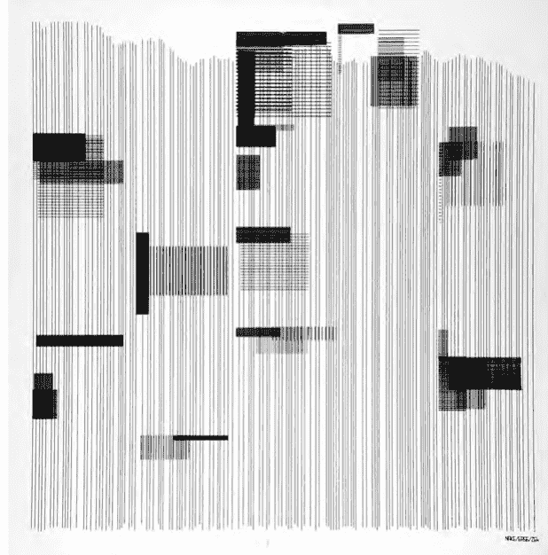

图 40.2

Frieder Nake，《矩形交叉阴线场》，叠加了垂直线。

22/10/65 第 2 号。电脑绘画，墨水在纸上，50 × 44 cm。Etzold 收藏，门特格拉巴赫阿特贝格博物馆。由 Frieder Nake 提供。

随机性 (137)

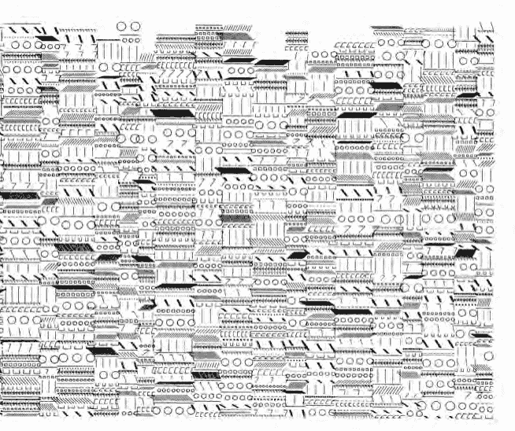

图 40.3

fred Mohr, `P-071`, 1970。绘图仪，墨水在纸上，13.75 x 16.5 英寸 / 35 x 42 cm。biforms 画廊提供。

《随机战争》(1967) 是早期使用随机值的著名计算机艺术作品。Csuri 的早期计算机工作大部分与其同时代人相比具有独特性，《随机战争》是具象的而非抽象的。这幅绘图仪作品由线条勾勒的军事人物组成，灵感源自当时流行的绿色小陆军玩具玩偶。每个人物都用真实人物命名，并被随机放置，同时被随机赋予一种状态：死亡、受伤或失踪。一个军队的士兵用红色画出，另一支用黑色画出；每个士兵的名字和状态出现在画作的顶部。从总体上说，Csuri 的作品通过形式和内容对战争往往具有任意性进行了评论；更具体地说，通过对随机数生成的依赖，Csuri 指向了计算机时代、随机数以及它们与冷战之间不可分割的联系。

```
(138) 10 PRINT CHR$(205.5+RND(1)); GOTO 10
```

# 接受与抵制

虽然计算机生成艺术的十年在杂志、书籍和展览目录中已有详尽记录，但来自20 世纪 70 年代的原始材料较少，当时公众的兴趣以及出版和展览所需的精力有所减弱。在该年代后期，计算机图形开始进入广告和电影领域。1982年的电影《创程》（Tron）是计算历史和美学的里程碑，它将图形推向新的审美高度，并揭示了当时计算机图像的局限性。《创程》中的图像是纯几何且冰冷的；它们缺乏我们自然世界的有机特性。《创程》图形的程序员之一 Ken Perlin 对这种整洁的外观感到沮丧。1983，他开发了一种名为“柏林噪声”（Perlin Noise）的技术来生成具有随机外观的有机纹理，尽管它是完全可控的，以便进行仔细的设计。柏林噪声使得计算机图形模型具有真实对象的细微不规则；它被用于创建岩石和山脉等硬表面，以及火和云等更软的系统。到90 年年代，它已被广泛应用于好莱坞特效电影，并被整合到现成的建模软件中。

今天，最为人知的使用随机值的艺术家仍然没有使用计算机。例如，2002年转纳奖获得者 Keith Tyson 设计雕塑时并非使用计算机产生随机数，而是通过掷骰子。这种不愿使用计算机的原因之一，无疑是艺术中围绕计算机的污名化。正如 Manfred Mohr 在采访中提到的：“我把我的作品称为生成艺术，有时也称为算法作品。问题是没人理解这些术语，我被迫——可以说——宣布我的绘画是计算机艺术……人们指责我贬低艺术，因为我在使用资本主义的战争工具——‘计算机’这个词并不是免费的！”(Mohr 2007, 35)。虽然 Mohr 指的是20世纪70年代的情况，但艺术界对计算机的抵制今天依然强烈。

然而，最近，随着新一代视觉艺术家开始编写程序创作作品，计算随机数在视觉景观中发挥着越来越重要的作用。视觉艺术家使用的主要的编程语言具有生成随机数和噪声值的函数，以及设置随机种子以允许

# 当代计算中的随机性

在给出的许多随机性示例中，过程中的随机元素——无论是计算的、文学的还是美学的——往往被强化，或至少变得显而易见。然而，随机性并不总是可见的，尽管它经常用于普通的计算任务。例如，随机性在网络计算机的安全中起着至关重要的作用，也是流行游戏的一部分。随机性的其他用途超出了日常计算体验，但安全、网络和游戏是几个最密切相关的例子。

当计算机需要为用户生成密码、允许某人重置密码的 URL 或防止自动垃圾邮件发送者的 CAPTCHA 时，就会调用随机性。一个非随机密码很容易被预测，而随机密码、URL 或扭曲的单词则更难通过猜想或暴力破解破解。随机性在 `SSH`（安全外壳）和 `SSL`（安全套接层）等协议中也发挥着幕后作用，包括生成加密密钥以及当明文消息太短无法完成一个区块时填充剩余部分。没有随机性，在 Web 上完成通过 `SSL` 进行的加密信用卡交易将是不可能的。像 Netscape 浏览器中的早期 `SSL` 版本曾遭受过随机性不足的问题：随机数生成的种子是当前时间、进程 ID 和父进程 ID，这些是足够可预测的，导致浏览器容易受到攻击。更好的随机性是解决问题的方案。

使用以太网的计算机——几乎所有接入有线网络的计算机——通过一根电线通信。如果两台计算机同时开始发送，就会发生所谓的“冲突”发送的数据对于目标接收者来说无法理解。当冲突发生时，计算机检测到问题并发送一个干扰信号，然后尝试重启。但计算机并不是立即重启，而是随机选择开始或等待一个间隔。不断增加的间隔是指数退避算法的一部分；随机选择这些间隔

是这种避免网络拥塞方法的一个重要组成部分。

```
(140)  10 PRINT CHR$(25.5+RND(1)); : GOTO 10
```

为了序列的重复。从时间的角度来看，审美计算工作与随机值似乎交织在一起。Noll 在 1970 年的写作中强调了随机性是艺术中计算机的一项本质特征：

> 计算机是艺术领域的一种独特设备，因为它可以仅仅作为一个服从的工具，具有控制复杂和复杂的过程的能力；但反之，充分利用其在受控随机和详细算法方面的独特才能，可能会产生一种全新的媒介——一种创造性的艺术媒介。(Noll 1970, 10)

## COMMODORE 64 的 RND 函数

`10 PRINT` 调用 Commodore 64 提供的随机数的方式引起了人们关注，其原因将逐一进行探讨。首先，在这个程序中，使用随机性在美学上是必要的；没有其他方法可以实现类似的效果。Commodore 64 BASIC 中使用的方法从历史角度看，自 20 世纪 50 年代以来伪随机数计算方法来说是非常典型的。最后，在 Commodore 64 提供的几种常用随机方法中，`10 PRINT` 使用了一种非常标准的方法，非常适合实验、调试和产生规范结果，尽管这种方法并非没有缺陷。

`10 PRINT` 产生了一系列循环的对角线，这些线条在左右之间以不可预测的方式交替。这种不可预测性对于产生迷宫的印象至关重要。观察 `10 PRINT` 具有规律或无变化的变体，可以证明随机性在程序中的重要性。可以写一个比 `10 PRINT` 更简单的程序，仅以规律的模式在屏幕上绘制左侧对角线（图 40.4）：

```
10 PRINT CHR$(205); : GOTO 10
```

该程序可以通过在右侧编写另一个对角线字符来扩展，形成一个重复的 V 字形图案（图 40.5）：


图 40.4

`10 PRINT CHR$(205); : GOTO 10` 的屏幕截图，`\` 字符的规律重复。


图 40.5

`10 PRINT CHR$(205)CHR$(206); : GOTO 10` 的屏幕截图，`\` 字符后跟 `/` 的规律重复。

随机性 (143)

```
10 PRINT CHR$(205)CHR$(206); : GOTO 10
```

此详细阐述的下一步是标准的 `10 PRINT`，它根据随机数的结果在屏幕上绘制左对或右对角线（图 40.6）：

```
10 PRINT CHR$(205.5+RND(1)); : GOTO 10
```

在 `10 PRINT` 中，随机数通过 `RND` 提供，这是自该语言最早版本以来 BASIC 中提供的十种数学函数之一。正如原始的达特茅 BASIC 手册（1964）所描述，`RND` 在“程序中每次被使用时”都会产生 0 到 1 之间“新且不同的随机数”。这些数字可以用于驱动不可预测的过程，事实上，它们在 `10 PRINT` 输出中负责对角线之间的硬币测试决策。类似的过程也可能决定《吃豆人小姐大战》中幽灵的方向变化，或其他游戏元素出现或行为的方式。

`RND` 与大多数计算随机源一样，是一个伪随机数生成器。虽然任意两个数字之间可能没有明显的模式，但每个数字都是根据上一个数字通过确定过程生成的。当第一个数字相同时，整个序列将始终相同。对于 Commodore 64 来说，这一点尤为重要，因为种子以及第一个数字是在启动时生成的。当在启动后立即调用 `RND(1)` 或在调用任何其他 `RND` 之前，它总是产生相同的结果：0.185564016。下一次调用也将相同，无论使用哪台 Commodore 64 或系统运行了多久。下一次调用——以及其他调用——将是相同的。由于序列是确定的，因此作为第一个程序输入并运行的 `10 PRINT` 程序所产生的模式，在每台计算机或良好的仿真器上都是相同的。

当调用任何正数时，在 `10 PRINT` 中调用 `RND(1)` 会产生序列中的下一个数字。`RND(8)`、`RND(128)` 和 `RND(.333)` 的作用与 `RND(1)` 完全相同。然而，`RND` 除了 `10 PRINT` 中使用的模式外还有两种模式。第二种是基于秒表的：当调用 `RND(0)` 时，计算机通电以来的时钟时间用于生成新种子，

```
(144)  10 PRINT CHR$(205.5+RND(1)); : GOTO 10
```


图 40.6

`10 PRINT CHR$(205.5+RND(1)); : GOTO 10` 的屏幕截图，在每个循环中都有 50/50 的概率写入 `╲ /`。

如果用 `RND(0)` 替换 `RND(1)`，则每次运行都会……

被称为“BURROW”（挖掘）的程序：

```basic
1A=$[up][down][left][right]:PRINTMID($A,RND(.5)*4+1,1)
2*;FOR I=1TO30:NEXT (rvs ON);3GOTO1
```

它仅占用 40 列的行宽，而且确实非常有趣。我们喜欢看到你们的电子程序，并希望每月至少打印一个好的程序。程序可以是有趣的、幽默的、实用的或无用的，只要它们在 40 列以内即可。你有什么作品呢？（Sander 1984）

这里介绍的程序（见图 45.1）让光标随机向上、下、左或右移动，以星号的形式覆盖该位置，开启反色显示，打印一个空格，然后移动到那里——如此往复。这意味着它会在 PET 计算机上随机地“挖”出一个反色显示洞（在 PET 上是绿色的而非黑色），从它的起点一直延伸到屏幕上的任何位置。它迷宫般的路径既包含规律性（每次移动都直接沿轴线），又包含随机性（随机选择四个方向中的某一个），从而产生了趣味性。该程序与 `10 PRINT` 有相似之处，尽管 `10 PRINT` 创建的是一种不同的滚动模式，并且暗示的结构并非一次性遍历屏幕的控制。

这篇对已被宣布为古董的“BURROW”程序的刊登，也体现了对计算机历史的认知，以及重新发现旧旧程序的意愿，以便让新一代的程序员和用户能够享受它们。

这里是另一个来自《RUN》杂志的、有趣的单行程序（Rapp 1985）：

当他没看时，在朋友的 VIC 或 C-64 上运行这个程序。然后让他 `POKE` 一两行，看着他脸上陷入永恒困措的表情吧。

```basic
10 POKE207,0:POKE204,0:WAIT10,1:GETA$:PRINT{CTRL R OFF}
CHR$(ASC(A))+1*RND()):GOTO10
```

这个程序在几个方面与 `10 PRINT` 相似。它处于无限循环中；它利用了 `RND` 函数。“BURROW”程序也是如此。这个愚人节程序与 `10 PRINT` 之间的另一个相似点是使用了 `CHR$`。不过，它们之间也存在显著差异。Rapp 的程序在运行时不会产生任何明显的动作。运行后，光标会闪烁，就像处于 BASIC 解释器中一样。一旦运行，这个单行程序实际上控制了键盘输入和屏幕输出，并有效地拦截了来自 BASIC 以及运行在其上的 Commodore 64 操作系统 KERNAL 的输入。

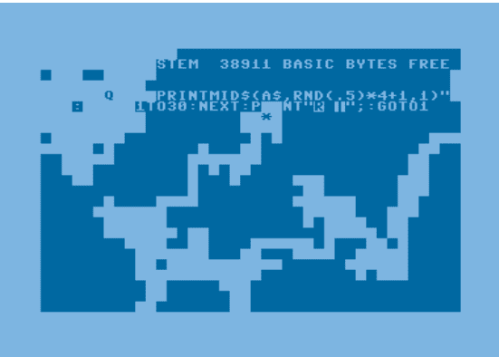

图 45.1

单行程序“BURROW”的屏幕截图。

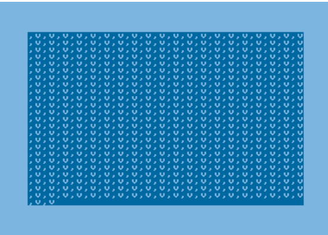

图 45.2

《RUN》杂志刊登的用于检查显示器分辨率的单行程序截图。

```basic
(150) 10 PRINT CHR$(20.5+RND(1)); : GOTO 10
```


`10 PRINT` 使用`RND`从两个字符的均匀分布中绘制。正如《Commodore 64 用户手册》所解释的，这可能会偏斜，正如在第一个注释中提出的用 BASIC 编写的程序变体那样。即使分布有些不平衡，整体印象仍然是迷宫般的。迷宫的“本质性挫败感”一方面是显而易见的，源于其相互锁定的宏观结构，而随机性在其中持续。另一方面，Rapp 的恶作剧则很狡猾，因为它倾向于间歇性的不可预测且运行隐蔽。

到 20 世纪 80 年代后期，尽管《RUN》杂志的“Magic”（魔法）栏目一直持续（直到杂志最后一期），但它已交由其他编辑，并被 BASIC 和汇编编写的实用程序填充，这些程序要长得多——通常在二十行左右。这个来自《RUN》杂志的单行程序（Hubbard 1987）为寻找新显示器的 Commodore 用户提供了帮助，并展示了程序在后期采取的实用化转变（见图 45:2）。

```basic
10 PRINT CHR$(14):FOR A=1TO40*23:PRINT,"V";:NEXT
```

输入程序并运行。屏幕将填满 23 行逗号和小写字母 V。检查分辨率，观察构成 v 的中心点或逗号尾巴的单个像素。在单色显示器上，像素应该是一个圆环形的光点。

某些单行程序在 Commodore、Apple 和 Atari 等家用电脑的 BASIC 机器上是通用的，并且也可能运行在原始的 Dartmouth BASIC 上——但许多趣味有趣的程序是特定平台的。许多 BASIC 版本包含了`PLOT`和`SOUND`等命令，以便于制作图形和音乐。当然，这种类型的 BASIC 中的单行程序可以利用这些特殊命令。在这些情况下，单行程序通常是教学工具：这些程序乐此地引入了执行更高级任务所需的命令。

这种做法在当代的编程教程中仍在延续；一个例子是 Peter Krumins 的《Perl 单行程序详解》（Krumins 2009–2011）。它引入了百多段单行代码，例如：

```perl
perl -MPOSIX -le'@now = localtime; $now[0] == 7;
$now[4] == 14; $now[7] == 9; print scalar
mktime @now'
```

Krumins 的每个示例都包含描述——通常是神秘的描述，比如这个程序：“打印 14 个月、9 天和 7 秒前的时刻。”非程序员可能会考虑的第一个问题是“为什么要那样？14 个月前是什么？”这种任意的构造在它给定的形式下作为工具并没有价值。

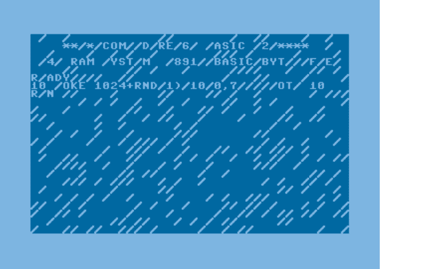

图 45.3

“冰雹暴”（Icicle Storm）单行程序的屏幕截图。字符在屏幕上的随机位置一个接一个地绘制。

适用的代码段。因此，“冰雹暴”就像 10 PRINT 一样，并不是为了讲述关于天气的故事。它是一部动画，通过屏幕更新的速度和其规则网格的属性，展示了其运行环境——即文本/图形终端——的物理特性。

冰晶缓慢而无情的实例化模拟了不断增强的风暴的动力学，因为计算机绘制它们的速度快以填满屏幕。体验的节奏受限于 CPU。可以减慢绘制速度，但如果不对 BASIC 代码进行其他以外的更改，就无法加快。了解平台执行代码的通用节奏或速度，对程序员来说是非常有用的信息。

风暴的动态运动由屏幕更新率决定，它充分实现了幻觉的目的，使得这种印象具有独特的辨识度且令人记忆。它引导并帮助程序员记住程序中的有用数字。作为程序营造的动画幻觉的一部分，所激发的场景还采用了计算机默认的前景和背景色，在蔚蓝的天空中呈现出蓝色的冰晶。这可能是 10 PRINT 提供的之外的

```
(154) 10 PRINT CHR$(205.5+RND(1)); GOTO 10
```

对默认颜色的一种比 10 PRINT 更合适且特定的玩法。

为本书开发的另一个类似的单行程序“芝加哥的多风日”说明了 VIC-II 的另一个特征，该特征对于编写平滑的水平滚动非常有用：

```
10 POKE 53248+22,INT(192+4+3*SIN((TIME*3.456+RND(1)*.5))): GOTO 10
```

该程序没有改变屏幕上的任何字符或颜色；它只是让屏幕上的所有内容半规律地来回移动，就像显示器被风吹动一样。这个程序演示了在视频芯片中处理侧向滚动寄存器的相对简单性，这是一个 Commodore 64 手册中从未显式教过的高级课题。

最后，探测复杂芯片能力（包括 Commodore 64 的音频芯片 SID）的另一种方法是简单向它们的寄存器写入随机值并观察结果。这里有一个用于 SID 的程序，它可以产生随机声音：

```
10 POKE 54272 + (0*TI+(RND(1)*25)), (RND(1)*256) AND255:GOTO 10
```

计算机不再开机就进入 READY 提示符和 BASIC 编程语言，但正如对 Perl 单行程序的讨论所示，简短、令人印象深刻且具有吸引力的程序在其他语言和环境中生存。关于某些 Perl 单行程序是如何被理解和记住的，更多内容将在下一章的“BASIC人类记忆”（BASIC Human Memory）章节中介绍。

# 50 BASIC 

## 编程与 BASIC 的起源

- BASIC 进入家户
- COMMODORE BASIC
- BASIC 程序的传播
- 晚期 BASIC

字符图形本身、它们排列成行再排列成列的方式，甚至它们出现的速度——这些特征共同构成了 10 PRINT 输出的美感。然而，10 PRINT 之所以以这种方式运行，部分是因为它是用一种具有特定功能和属性的特定编程语言编写的：BASIC。

这种“学者通用符号指令代码”拥有传奇般的文化和技术历史。BASIC 是由戴特茅斯学院的 John Kemeny 和 Thomas Kurtz（托马斯·库尔茨）开发的。11964 年，它的创始人免费分享了该语言的一个可用版本，导致它在高中和大学水平被广泛采用。到那时，通用计算机已经存在了几十年。许多计算机仍使用低级机器语言编程，但从个人机器的特性中提取的高级语言也已经使用了十年。BASIC 继续了高级语言的演进，建立在 FORTRAN、Algol 等其他语言已取得成就的基础上：在关键词和语法上具有更强的跨平台移植性，并便于理解语言和编写程序。

这种语言是为早期的分时环境——戴特茅斯分时系统（DTSS）开发的。这种革命性的配置允许程序员同时使用单一系统。这类系统——连接到大型主机或微型计算机的许多终端——与微型计算机个人拥有的、相对廉价的单用户计算机大不同。但在 20 世纪 60 年代初，DTSS 也区别于早期的需要打卡片批处理的系统。分时允许人们以一种重要的方式参与和探索计算，其感觉就像是“实时”处理；BASIC 是这场计算革命的重要部分。鉴于 DTSS 和 BASIC 的教育目的，易用性至关重要。易用性有助于 BASIC 的巨大流行和成功。

随着微型计算机进入人们的家，BASIC 变得更具影响力。1975 年，被广泛誉为第一台家用电脑的 MIT Altair 8800 计算机上市。也许该系统最重要的软件是 Altair BASIC，它是 BASIC 的一个版本，也是名为微软的初创公司的第一个产品。在 Altair 8800 上获得成功后，微软为许多

编写了多个 BASIC 版本。

```
(150) 10 PRINT$(205.5+RND(1)) : GOTO 10
```

流行的微型计算机。归于微软，BASIC 成为了家用计算的通用语言。BASIC 位于这些计算机的 ROM 中，这意味着用户开机即可立即开始编程。从 20 世纪 70 年代末到 80 年代初，BASIC 统治了家用计算机，10 PRINT 和数千个 BASIC 程序在书籍、杂志和计算机俱乐部简报中流传。由于它的无处不在，有些 BASIC 书籍封面甚至没有提到“BASIC”。

尽管无处不在，BASIC 已成为许多现代程序员的嘲笑对象。与`GOTO`密不可分、结构化程序员的祸根，这种语言被认为会导致混乱、难以管理的代码、速度得令人无法忍，并且仅适用于业余爱好者。

# 编程与 BASIC 的起源

虽然关于谁应该是真正的第一个程序员存在争议，但许多人将这一头衔授予了埃达·洛夫莱斯（Ada Lovelace，1815–1852）。她由母亲抚养并接受了数学教育，以便走一条与她父亲拜伦勋（Lord Byron）不同的道路。在 1843 年完成的这项工作中，她预想分析引擎为一台通用计算机（Fuegi and Francis 2003）。

例如，ENIAC 是 1943 年至 1945 年位于宾夕法尼亚大学的全电子计算机，最初是通过插入一套复杂的电缆来编程的（Druz 2011）。ENIAC 的操作员（主要是女性）“在将 ENIAC 转换为存储程序计算机以及在存储值和指令之间进行权衡方面发挥了重要作用”（Chun 2011）。从历史角度看，尽管编程继续从直接操作硬件扩展到不断提高的抽象层，这些操作员仍然将计算和编程行为发明为具体的、具有参与感的活动和职业。

# 机器语言与汇编语言

超越电缆和拨盘是通过机器语言完成的。机器语言程序简单来说是一系列数字，使计算机运行但又能被人类理解。在 ENIAC 上，组成机器语言程序的节点是十进制（基数10），但其他早期系统使用了不同的基数。EDVAC、ORDAC 使用八进制；BRLESC 使用十六进制（Bergin 2000, 62）。数字指定了计算机要执行的操作，由操作码（指示底层命令）组成，操作码后面可能会跟着操作数（为命令提供一个或多个参数）。例如，向累加器添加值的操作码必须有一个操作数，而增加 x 寄存器的操作码不需要任何操作数，该操作码本身就指定了要执行的一切。

要无条件跳转到特定的绝对地址，需要一个如“76”（十进制）的操作码，后面跟随着两个字节的

地址。事实上，这是 Commodore 64 上用于跳转到绝对地址的无条件分支的操作码。虽然机器语言中的数字序列对计算机来说是不含歧义的，但一眼看出哪些数字代表操作码、哪些数字代表操作数，并非显而易见。机器语言专家可以识别出一些模式，但通常必须从头开始，识别有多少操作数对应于操作码，并像模拟程序执行时的计算和内存存储操作一样继续向下进行。编写机器语言程序需要低级专业知识。在这一水平上工作显然是计算机比人类做得更好的事情，这一点在编程迈出下一步时就得到了认可。

第二代编程语言中出现了一种更具读性的代码形式，被称为汇编语言。汇编语言允许使用操作符（如`lda`（载入累加器）、`jmp`（跳转）和`inc`（增加内存））的助记符来代表更晦涩的数字代码。在 Commodore 64 上，字母`jmp`后面的一个绝对地址会被汇编器转换为 76，将人类可读的助记符翻译成机器语言。第一个汇编器于 1949 年运行在剑桥大学的 EDSAC 上。顺便提一下，EDSAC 是几十年以来第一个能够存储程序的计算机（Campbell-Kelly and Aspray 1996, 184）。虽然与 BASIC 等高级语言相比非常晦涩，但汇编程序对人类来说仍然比机器语言程序更易理解。虽然汇编今天仍用于固件编程等领域，但在这一水平上编程通常有重大的缺点。虽然汇编编程突出了平台的技术细节以及内存位置与寄存器之间值的传递，但高级语言允许程序员专注于其他事务，例如解决数学和科学问题，或对财务过程建模。

## 高级语言

在电子计算的第一个十年里，编程仍在向洛芙拉斯“程序”理想迈进，即以高级、人类可读的形式指定算法。为了达到更适合数学和科学任务的编程水平，FORTRAN（公式翻译）于 1954 年被概述，并于 1957 年首次实现。这种语言以及其后续版本（1958 年出现的 FORTRAN II）对 BASIC 产生了深远的影响。由于 FORTRAN 是考虑到数学设计的，COBOL（常用面向业务语言）于 1960 年引入以服务于业务用户。

FORTRAN 和 COBOL 都允许编写更易理解的代码，并进行了改进。但它们都是在批处理的背景下开发的，使用打孔卡堆，由机器逐个处理。打孔卡最早在 18 世纪用于定义机械纺织织机的花样（正如“规律性”一章中讨论的那样），但这一概念在 20 世纪被采纳了。打孔卡的典范被称为简单的“IBM 卡片”，即该世纪在 1928 年引入的八十列打孔卡。Commodore 64 屏幕上的八十列是这种早期计算媒介的遗产之一。

用早期版本的 COBOL 和 FORTRAN 编写的程序在定义值方面是针对打孔卡的。COBOL 留出第 1–6 列用于行号，第 7 列作为前一行的延续标记。FORTRAN 类似如此，第 1–5 列表示语句编号。两种语言的“注释”（通常是程序名）都位于第 73–80 列；第一列的“C”表示整张 FORTRAN 卡片被视为注释。除非程序员在单张卡片上写——在这种情况下是编写一个能放入一叠巨大的打孔卡中的程序。这些卡片必须在打字机上打孔，并由操作员送入读卡器。行号在一种情况下是相同的：如果有人掉了一叠卡片，需要它们重新排序。

FORTRAN 的`GOTO`命令是 BASIC 中`GOTO`的基础（Kurz 2009, 86），它被引入了 Commodore 64 BASIC。`GOTO`的功能类似于汇编语言中的`jmp`，跳转到程序内的特定位置。如果人们只想编写`jmp`语句，BASIC 并没有什么太大优势。BASIC 的优点体现在`PRINT`等命令中。机器语言中的许多步骤通过这条命令：

```
(162) 10 PRINT CHR$(205.5+RND(1)); : GOTO 10
```

由这个使用了清晰、自然语言比喻的单个命令高效完成。

BASIC 是一种专门为下一次计算革命设计的语言，这场革命将超越打孔卡和批处理，允许许多用户同时交互式地访问系统。

这场革命就是分时系统。

## 达特茅 BASIC 和分时微机

1962 年，变革席卷了达特茅。当年晚些时候在一篇宣布这所孤立学院正“走出困境”的文章中，《时代》杂志指出，该校建立了大型的新艺术中心，而 27 岁时就成为正教授的 John Kemeny 建立了“美国最好的大学数学系”。同样在 1962 年，Kemeny 和他的同事 Thomas Kurtz 开始开发一种分时系统和一种新的编程语言，供达特茅的所有学生使用——而不仅仅是学习数学、科学或工程的学生。Kemeny 和 Kurtz 增加了接触计算机和计算机编程的机会。Kemeny 写道：“虽然 FORTRAN 的出现将计算机的使用从少数人扩展到了数千名科学用户，但在达特茅，我们预见到了数百万人编写自己的计算机程序的可能性”（Kemeny）。

# BASIC 中的 CHR 与美元符号

在设计 BASIC 时，Kemeny 和 Kurtz 希望区分存储数值的变量和存储文本字符串的变量。他们选择让字符串变量和字符串函数以 “$”结尾，这样字符串变量可以命名为 A，而根据 ASCII 值生成单字符字符串的函数则称为 CHR。他们选择美元符号是因为“电传打字机（Teletype）上的按键并不多，我们需要找到一个尚未被 BASIC 使用过的键。在剩余的几个键中，没有哪一个看起来非常合适。我们其中一人观察到 $ 看起来像字符串（string）的 S” (Kemeny and Kurtz 1985, 28)。

计算机本质上是进行加法和乘法的机器，因此奇怪的是，Commodore 64 像现代北美键盘一样，上面有一个美元符号，但没有乘法符号。相反，用于指示脚注的排版符号星号（*）被征用作乘法符号。

为什么键盘上会有美元符号而没有乘法符号？尽管交互式处理（与打孔片的批处理相比）是一项新事物，但在 20 世纪 60 年代之前，电传打字机就已经被用作计算机接口。从 20 世纪 10 年代开始，各种类型的 TTY、电传打印或“打印电报”就开始作为文本通信的手段用于商业领域。

BASIC 是面向所有人的（至少在校园社区内如此），并且适用于任何目的。BASIC 是这种开放性的体现，它使得那些没有明显军事、商业或科学目的的程序——如`10 PRINT`程序——得以出现。

Kemeny 关于计算机和教育的自由思想在他担任达特茅斯学院（Dartmouth College）校长期间（1970 年至 1981 年任职）的成就中发挥了某种作用，这并不意外。Kemeny 主导了达特茅斯学院转型混校，取消了“印第安人”作为学校校吉祥，并鼓励招收少数族学生。在他担任校长的最后一天，他发表了毕业演讲，警告学生们（包括新成立的保守派《达特茅斯评论》（Dartmouth Review）的成员）要抵制那种“通过让白人对立黑人、让基督徒对立犹太人、让男性对立女性来试图分裂我们的冲动。如果它成功分裂了我们与同胞，它将把这种恶行强加于破碎的社会之上（Faison 1992）。在离开达特茅斯校长职位后，他回到了全职教学。Kemeny 于 1992 年去世。Thomas Kurtz 在编写 BASIC 很久之后继续在达特茅斯学院教学，并于 1980 年至 1988 年间担任那里的计算机与信息系统主任。

```
(166) 10 PRINT CHR$(205.5+RND(1)); : GOTO 10
```

系统基于前 ASCII 时代的字符代码，这些代码来自电报，传输美元金额的频率远高于传输数学方程。Murray Code（1870 年标准电报码的 1901 年修订版）包含了两个允许“切换”到备用字符组的字符。在 Murray Code 中，经过切换的 “D”会变成 “$”。

有趣的是，最初的北美 Commodore 64 配有一个英镑符号（£），这个字形在当时的其他美国计算机上是缺失的。这个按键的存在无疑表明了 Commodore 在英国销售其计算机的计划，尽管 Murray Code 中也包含一个英镑符号。

美元符号仍然被用于当今的一些骨干编程语言，例如 Perl 和 PHP。在这两种语言中，它通过被放置在变量名的开头而不是末尾来指示变量。在 Perl 中，它专门用于指示标量变量（scalar variable），符号看起来像“scalar”的 S。尽管这些用途各异，但 BASIC 在 20 世纪 70 年代和 80 年代作为入门语言的影响是，一些现代程序员（包括本书的作者之一）在朗读时，无论该字符在所讨论语言中的含义如何，都会读作“$”。

# BASIC 进家


得益于大学和校园的创新，计算机已经变得更加亲民且易用，但直到计算机进入“家门”，真正的革命才开始。在流行传说中，革命始于 1975 年 1 月份《流行电子》（Popular Electronics）杂志封上一张开关和 LED 面板的单——这是 Altair 8800 微型计算机的首次亮相（图 50.2）。虽然达特茅斯学院 BASIC 的历史表明，个人计算并非在 1974 年突然完全发育的，但那一年确实标志着家用计算的转折点。

《流行电子》杂志在标题中宣称“家用电脑已来”，对 395 美元的 Altair 8800（组装价为 495 美元，按 2012 年美元计算分别为 1812 美元和 2271 美元）的可能性赞叹不已。该杂志声称，计算机可以用作“先进的入侵报警系统”、“自动 IC 测试器”、“飞机、船只等的自动驾驶仪”、“分时共享计算机系统”、“机器人大脑”以及“盲人的印刷品转盲文转换器”等，并指出“许多这些应用可以同时进行”（Roberts and Yates 1975, 38）。事实上，该设备能力范围内的应用实现相当困难，因为系统默认只能用机器语言进行编程。此外，除非你恰好有一台电传打字机或其他终端使用前面板上的拨动开关进行操作，否则家用计算机虽然到了，但大多数爱好者并没有有效的方法对其进行编程。从一开始就很清楚，许多 Altair 8800 需要一种便于实验的编程语言。《流行电子》通过解释硬件和软件的区别提到了四种编程语言（34）；其中一种语言就是 BASIC，它是对早期 Altair 8800 爱好者来说显示最有前景的语言。

# Altair BASIC 和微软

曾有两个为 Altair 开发 BASIC 解释器的成功尝试。它们各异的历史对现代计算和现代文化产生了深远影响。虽然这个两个 BASIC 的故事不是关于最好的 BASIC 和最糟糕的 BASIC，但它凸显了软件开发的两个极端：一个是商业性的，与硬件制造商紧密配合，并与许可和成本结构高度挂钩；另一个是基于社区的、非营利的且是“拷贝左”（copyleft）的。引导这些方向的 BASIC 是微软的 Altair BASIC，这是该平台的官方 BASIC，

```
(168) 10 PRINT CH$(205.5*RND(1)); : GOTO 10
```

授权给 Altair 制造商 MITS；以及起源于人民计算机公司（PCC）的 Tiny BASIC。Commodore 64 的 BASIC 直接继承自 Altair BASIC，而该公司的名字后来标准化为“微软”。该系统的 BASIC 是——尽管在启动屏幕上不可见——微软的产品。与此同时，`IO PRINT`程序参与了深受人民计算机公司影响的 BASIC 共享与探索背景。

微软 BASIC 以及微软的故事，始于 Paul Allen 在书架上看到现在著名的 1975 年 1 月份《流行电子》杂志。Allen 读到了 Altair 8800 并冲向他的朋友兼业务合伙人比尔·盖茨，告诉他说：“这就是我们利用 BASIC 做些事情的机会了” (Wallace and Erikson 1992, 67)。在盖茨还在读高中时，他们已经取得了一些有限的商业成功，经营着名为 Traf-O-Data 的企业，生产硬件和软件。他们使用华盛顿州主机的上的模拟器为驱动 Traf-O-Data 的 Intel 8008 微处理器进行编程。

到 1975 年，盖茨在哈佛大学，他和 Allen 准备好进行一个范围更广的项目。看到《流行电子》，他们想出了为 Altair 编写 BASIC 的主意，并打了 MITS 的 Ed Roberts，询问他是否对他们的 BASIC 感兴趣。Roberts 说他会购买第一个运行的版本 (Wallace and Erikson 1992, 74)。正如盖茨和 Allen 在开发 Traf-O-Data 系统时一样，他们最初在大学的计算机系统上编程。

Gates 和 Allen 设计了 Altair BASIC 项目并完成了大部分编程工作，但还有第三个 Altair BASIC 程序员，某种传奇般的“第五节奏手”。这就是 Monte Davidoff，他负责编写浮点运算程序。盖茨和 Allen 正在讨论他们需要

# 流行电子杂志

1975年1月

# 独家专访！

ALTAIR8800

# 史上最强大的微型计算机项目——构建费用低于400 美元


# ALTAIR 8800

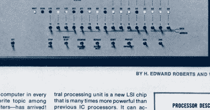

作者：H. EDWARD ROBERTS 和 WILLIAM YATES

家家户户都有电脑的时代——科幻作家们青睐的话题——已经到来！这通过《流行电子》8800实现了，这是一台现在市场上就能买到的完全公开的计算机。它不像电视大小的接收机那样花费数千美元；它不到400美元，而且功能完整。

Altair 8800 并非某种“新奇事物的演示”；它是电子设计领域作为构造项目呈现过的最强大的计算机，代表了革命性的发展。

Altair 8800 是一台8位字/16位地址计算机，指令周期为 2 us。其中央处理器是一个新的 LSI 芯片，比之前的 IC 处理器强大许多。它具有256个直接寻址的结果，拥有78条基础机器指令（如图所示）。这意味着编写任何需要的程序。程序可以通过开关输入，对于65,000个程序在经济上是可行的。通过扩展，当坐在旁的学生 Davidoff 表示他可以编写这些程序时，它可以处理它们。

Altair计算机是一个简单的系统。程序可以通过面板上的 LED 读取进行输入，也可以使用上个月《流行电子》杂志中介绍的方法。

### 处理器描述

| 特性 | 规格 |

| :--- | :--- |

| 处理器 | 8位 |

| 最大内存 | 65,000字（全部直接寻址） |

| 输入和输出 | 256（全部直接寻址） |

| 指令周期 | 2 us（最小） |

| 子程序级数 | 65,000 |

| 机器指令数量 | 78 |

| 字长度 | 每个 7位长 |

| 中断结构 | 8个硬件接线级，外加软件 |

| 内存类型 | 半导体（动态）RAM（可选） |

| 内存访问时间 | 60 ns 静态RAM，420 或 15 ns 动态RAM |

### 图 50.2

1975年1月的《流行电子》杂志刊登了Altair 8800，它启发了微软BASIC的诞生。

```
(170) 10 PRINT$(205.5+RND(1)) : GOTO 10
```

在与其商量后，邀请他贡献了这些程序（Wallace和Erikson 76–77）。不过，这个微软项目的代码主要由Gates和Allen编写，尽管Gates被列为第一作者。代码开头的注释写道：“BILL GATES 写了运行时部分”，这是他在哈佛大学花了八周时间完成的。Gates在多年后说，“这个4 KB的BASIC解释器是我写过的最酷的程序”（76–77）。

Allen去访问了位于阿尔伯基基的MITS，带了一卷刻有Altair BASIC的纸带。在飞机下降期间，他意识到自己没有办法让Altair读取纸带并运行——它需要一个引导加载程序。于是他在飞机着陆时用机器语言写了一个。然后他第一次去看了Altair 8800。在模拟器上编写的BASIC演示在机器上取得了成功，且该解释器获得了MITS的授权。Gates和Allen搬到新墨西哥州，为Altair创建新版本的BASIC并维护原始代码。微软就此启动并运行。

Altair BASIC包含了对Dartmouth BASIC的修改，其中许多在早期的分时系统中没有意义，但在家用计算机上是有帮助且至关重要的。虽然微软的任何BASIC都没有对`10 PRINT`的运行至关重要，但Gates和Allen创建了`POKE`和`PEEK`语句，这些语句在微机BASIC以及本书中的程序中被广泛使用。

`POKE`允许程序员向特定位置写入值。例如，`POKE 53272, 23`将值23放入地址53272，该内存位置映射到VIC-II图形芯片的寄存器。在这种情况下，`POKE 53272, 23`将Commodore 64切换到小写模式。`PEEK`是`POKE`的互补语句；它不是向内存写入值，而是读取给定位置的值。

这两个语句都极其强大。Altair BASIC——以及后来在Commodore 64上使用的微软BASIC——对可以使用`POKE`更改的内存地址没有限制。正如《Altair BASIC参考手册》警告的那样，“粗心使用POKE语句可能会导致你‘戳死’BASIC；也就是说，机器将会崩溃，你必须重新加载BASIC并丢失已输入的任何程序”（1975, 39）。

最初计划只办几期。那是《多比博士的微型BASIC体操与正畸医学杂志》（Dr. Dobb’s Journal of Tiny BASIC Calisthenics and Orthodontia）；它以八进制机器语言打印解释器的代码，供爱好者在他们的电打字机上拨入，或者更好，直接键入。称这份出版物为成功是完全合理的。到1976年1月，通过删掉对Tiny BASIC的显式提及，期刊名称变得更加通用，聘请了一位编辑，《多比博士》作为一份提供计算机代码和文章的简报启动。1985年，《多比博士》通过发布理查德·斯尔曼（Richard Stallman）的《GNU宣言》，进一步参与了共享与开放的文化，这是自由软件运动的基础文件。该期刊作为刊物一直运营到2009年，在此之前的发行量曾达到12万。它现在仍然以在线出版物的形式存在。

在Allison发布第一个版本后，Tiny BASIC的开发持续下去。王立陈（Li-Chen Wang）编写的第四个Tiny BASIC 被称为帕洛阿尔托Tiny BASIC（Palo Alto Tiny BASIC）。它最初也是发表在《多比博士》杂志上的。这个BASIC解释器的源码列表如下：

```
;********************************************************************
*;
*;
 TINY BASIC FOR INTEL 8080

VERSION 1.0

BY LI-CHEN WANG

10 JUNE, 1976

@COPYLEFT

ALL WRONGS RESERVED

*;
*;
*;
;********************************************************************",
```

虽然这个头部没有像20世纪80年代后期开始的自由软件许可证那样意义上使用“左版拷贝”（copyleft），但这一反版权声明是对封锁的、专有的代码这种闭源文化的讽刺。由于王立陈放弃了版权声明，仅保留了程序的全部“错误”（wrongs），帕洛阿尔托Tiny BASIC 得以成为商业BASIC的基础：用于TRS-80的Level I BASIC，这是一种于1978年底上市的具有影响力的微型计算机。

```
(174)  10 PRINT CH$(205.5+RND(1));  : GOTO 10
```

# 道德 VS 公司

在《黑客：计算机革命的英雄》一书中，史蒂芬·列维（Steven Levy）描述了家用计算机的早期历史以及Altair及其直接继机BASIC的发展，这是一场开放道德与那些“黑客道德之敌”的企业力量之间的战斗（1984, 227）。

这种刻绘有助于建立人们通常记忆中的、自由软件与微软公司意志之间的第一次大冲突：比尔·盖斯的《致爱好者的的一封开放信》（Gates 1976a）。这封信于1976年初发表在包括《Altair用户快报》和《家酿计算机俱乐部快报》在内的许多简报上，这封对抗性的信让盖斯获得了机会指责家用电脑用户，因为他们进行了与达特茅斯原始BASIC所鼓励的那种共享行为。在信中，盖斯严厉地宣布：“正如大多数爱好者可能意识到的，你们中的大多数人都在偷窃软件。”这封信收到了数百份回复，引发了家用计算领域的第一次重大争议。许多人将其视为微软不公平交易的历史——以及这种做法的延伸，即公司获取现有的工具和想法，并创建自己的版本以获得竞争优势。十年后，在针对微软的反垄断诉讼中，托马斯·彭德顿（Thomas Pendleton）法官写道：“微软是一家对于真理和必须遵守的法律具有制度性蔑视的公司。”到那时，他持有这种观点的人绝不止一个。微软迈向企业冷酷的巅峰难道是从这封给爱好者的信开始的吗？

这种最流行的早期冲突存在一些复杂之处，正如在考虑Altair BASIC是完全重写而Tiny BASIC在各方面都完美的情况下存在复杂性一样。首先，微软、盖斯或艾伦都不是列维书中被指为黑客道德“之敌”的那一方。这一区别属于MITS的负责人埃德·罗伯茨（Ed Roberts），他经营着一家拥有数十员工的公司，其中许多人在任何时候都在拼命工作，以满足计算机爱好者的订单（以及他们对拥有计算机的梦想）。1976年初，“Micro-Soft”（在第一封信发布时拼写尚未规范）仅仅是合伙人，都是最近的大学辍学者，一个是青少年，另一个只比大一点。

# 行号与冒号：对硬件变化的响应

微软利用其作为微型计算机BASIC主要实现者的地位，对该语言进行了许多更改，增加了一些随着硬件进步而变得必要或过时的组件。例如，为了让程序编写得更紧凑——考虑到Altair的交换器界面，这是一项重要功能，对程序员来说可能是痛苦的——微软的Altair BASIC引入了冒号（:）以便在同一行内放置单独语句。通过这种方式，冒号允许出现如下行代码：

```
160 R=16:PRINT"HOW MANY DECKS (1-4)";
```

在小型计算机BASIC和ANSI标准中，无法在同一行内编写多个语句；京（Ky）和库特（Kurt）认为语句的压缩可能会导致困惑而非帮助。当他们在1983年发布针对家用电脑的经过大幅修订的True BASIC时，他们仍然不允许在同一行使用多个语句。然而，冒号在`10 PRINT` 中非常重要；没有它，这个程序无法被写成一个连续的语句。

`10 PRINT`的另一个显著特征是该语言底层硬件的产物。与源自打孔卡的前辈者不同，BASIC不需要程序员在列中放置任何内容；它要求每行开头必须出现一个像10这样的数字。虽然行号通过允许`GOTO`和`GOSUB`实现了分支，但BASIC在技术上不需要行号来实现这一目的。像汇编等预列表语言中使用的标签（Labels）就可以。行号的真实价值体现在电打字机或其他终端上，或者在任何不支持全屏非线性编辑的环境中。在这些情况下，行号使得现有行变得简单：只需输入行号而无需任何进一步指令，该行就会以相同的行号重新输入。要查看某一行上的当前代码，使用`LIST 50`即可解决——尽管如果有人最近写了该行，也可以查找或字面上“向上滚动”到它打印出的那一行。

以五或十的倍数对程序语句进行编号的做法不仅是为了节奏或美学（正如本书的目录所示）；在程序中插入新行需要这样做，正如一份早期手册所说，“原始的行

```
(176) 10 PRINT CHR$(85.5+RND(1)) : GOTO 10
```

数字不是连续的数字”（达特茅斯学院计算中心 1964, 22）。将程序编号为10、20、30等，确保了在每个现有的程序语句之间留下了另外九条语句的空间。人们承认程序是动态的，而不是固定的和完美的。《Commodore 64用户指南》还建议“以10为增量对行号编号是一个良好的编程习惯——以防你需要在上方插入一些语句”（33）。虽然行号成为个人计算时代早期BASIC的一个标志性特征，但它们也导致了程序员中的一种认知，认为这种语言局限于简单任务。学习在每个原始行之间添加新的代码行起初似乎非常有灵活性，但有时当程序员有复杂问题要解决时，这并不够。BASIC仍然可以适应这种情况，允许程序员使用`GOTO`和`GOSUB`跳转到尚未使用的数字以执行单独程序，并在完成后返回原始程序。遗憾的是，过多的子程序会导致“意大利面代码”（spaghetti code）——之所以命名是因为程序的流变得混乱且自我引用，至于所有行看起来都像一盘意大利面，使程序几乎无法理解。

1991年，微软意识到，将BASIC局限于简单任务的认知阻碍了这种语言的发展，而这种认知很大程度上归因于一项在当时不再需要的语言特征。能够显示并访问全屏或窗口化行的文本编辑器早已可用，而行号现在弊大于利。1991年发布的QBasic是微软的一种BASIC，它废弃了行号，鼓励使用类似汇编的文本标签。

# BASIC (177)

该公司曾向其他人支付报酬，例如 BASIC 贡献者 Davidoff，但直到 1976 年 4 月才拥有了第一位正式员工。

此外，盖茨辩论的依据——计算机程序的版权保护在 1976 年已经非常完善。虽然程序共享确实受到用户组和其他场合的欢迎，但今天所说的“自由软件”概念在当时尚未明确。理查德·斯尔曼于 1983 年启动了 GNU 项目；他在 1985 年发布了 GNU 宣言并创立了自由软件基金会，这在 Altair BASIC 发布十年后。有人认为，尽管对这一时期的讨论被忽视了，但一些对自由软件运动至关重要的思想，最初是在杂志和时报的专栏中为了回应盖茨的回信而首次提出的（Driscoll 2011）。许多业爱好者对今天所构想的自由（即自由自由）软件并不感兴趣；然而，正如《Dr. Dobbs》杂志第一期编辑所解释的那样，他们对“免费且非常便宜的软件”感兴趣。

在第一封信之后，盖茨写了一封“第二封也是最后一封信”，回信读者的反对。在信中，他承认至少对于某些类型的程序，代码的免费共享可能会成为常态。他还建议，“编译器和解释器”（例如微软的 Altair BASIC）将使这种共享软件成为可能：

“在软件方面，我不希望让最重要的方面——即程序交换——变得比解释器或编译器更复杂，因为后者可以由业爱好者编写并以极低或无成本进行共享。我认为在可预见的未来，将有成千上万这样的程序通过用户库可用。标准化编译器和解释器的可用性将对这些库的开发速度及其有用性产生重大影响。（Gates 1976b）”

盖茨无疑对软件有一种概念，允许其被公司出售并进行严密控制，但他并不寻求消除业爱好者编程和代码共享。公司的政策在许多方面确实与家酿电脑俱乐部（Homebrew Computer Club）和人民计算机公司（People's Computer Company）的伦理背道而驰；然而，微软通过其版本的 BASIC 不仅促进了新软件的，还促进了盖茨提到的程序交换。通过与计算机公司的许可协议，微软做了巨大努力将 BASIC

```
(178) 10 PRINT CHR$(205.5+RND(1)); : GOTO 10
```


从小型机分时环境带到微型计算机及以后，面向早期采用者和爱好者程序员。微软在原始 Alta BASIC 手册的附录 M 中表明它与 PCC 并非完全对立。它列出了“对学习 BASIC 可能有用的一些文本”，其中除一本外都可以从 PCC 订购，同时也提供了 PCC 的地址。六本书中有五本是专门关于 BASIC 的，但手册还列出了 Theodore H. Nelson (1974) 编写的激进且反文化的《Computer Lib/Dream Machines》，微软自己在 1987 年出版了该版本。

最终，BASIC 之所以能在 1982 年变成现在的样子，得益于它首次开发的高等教育机构、公司将其实施并许可在家用电脑（包括 Commodore 64）上使用，并且重要的是，代码共享的黑客伦理让 BASIC 程序（如 `10 PRINT`）能够自由流通。

## COMMODORE BASIC

编程计算机的能力——以定制化的方式使用其通用性能——是包括 Commodore 64 在内的许多家用电脑的核心卖点。家用电脑在广告中经常被与视频游戏（videouegos）对立起来。这种对比隐含地提醒了潜在买家，计算机可以用来玩视频游戏；明确指出，计算机可以用于商业和教育软件——而且它们可以被编程实现更多功能。这一点在许多将 VIC-20 与游戏系统进行对比的 Commodore 广告中得到了强调，其中一则广告中威廉·夏特纳（William Shatner）说“不像游戏，它有一个真正的电脑键盘”——Commodore Computer Club 2010。

计算机是可编程的，而它们专门要被编写成 BASIC，这在开发或营销中几乎不是事后才考虑的。1985 年在澳大利亚播出的一则 Commodore 64 广告提供了 BASIC 是核心卖点的证据（Holmes-3000 2006）。在电视贴片展示了穿着比基尼的女性沿着滑梯滑（“♪ 在一个充满乐趣和幻想的世界 . . . ♪”）并切换到一名女子在零售店愉快地使用 Commodore 64（“♪ . . 还有不断变化的风景 . . ♪”）之后，它再次切换到：对 BASIC 的蔑视，然后描绘了一个男孩用 BASIC 编程 ♪ . . 以及计算机术语 . . . Commodore 和你！。这则广告表明，计算机编程是家用电脑的一种显而易见、重要且有趣的用途。

在《科学美国》等出版物上发表的一份 Apple II 早期印刷品提到：“它是第一台内置了快速版本 BASIC——一种类英语的编程语言——的个人电脑。这意味着你从第一个晚上就可以开始运行你的 Apple II，输入你自己的指令并观察它们运行，即使你以前没有任何计算机经验。”对于家用电脑来说，输入或修改 BASIC 程序非常容易，而制造商在媒体广告中鼓励这种行为，使使用户在购买机器后就准备好参与编程了。

另一个极端是固定在卡带 ROM 中的程序，例如视频游戏系统的卡带。它们很方便，并表明此类游戏系统具有以许多不同方式工作的灵活性，但在 20 世纪 80 年代，破解卡带代码或在卡带系统上编写自己的程序远非易事。Commodore 64 提供了 BASIC 的灵活性，无需外带，但对于 TI-99/4A 等其他计算机，Commodore 64 提供了卡带的灵活性。通过插入卡带（其中许多是游戏），Commodore 64 将这种双面孔性的转变为通用性和便利性。

最终，BASIC 之所以能在 1982 年变成现在的样子，得益于它首次开发的高等教育机构、公司将其实施并许可在家用电脑（包括 Commodore 64）上使用，并且重要的是，代码共享的黑客伦理让 BASIC 程序（如 `10 PRINT`）能够自由流通。

使用 Python 编程 (Orlowski 2001)。

微软 6502 BASIC 的程序员理查德·韦兰德（Richard Weiland）是盖茨和艾伦的小学同学，他在微软公司总部位于阿尔伯克基的时期加入了该公司。他一直工作到微软直到 1988 年，并在直到 2006 年去世前，将大部分的时间和金钱投入了慈善事业。他支持了自豪基金会（曾对 LGBT 权利进行史以来最大的捐赠）、斯坦福大学（收到了其历史上最大的捐赠）、奥杜尔德学会以及自然保护协会（Heim 2008）。虽然利润驱动型企业与人民驱动型编程之间的二元对立并非人为造成，但 Commodore 64 BASIC 背后人士的慷慨表明，企业界的人并非没有利他精神和对社区的关怀。

## BASIC 程序的传播

在这一语言出现的最初几年里，BASIC 程序以纸质形式流传。在 1964 年以及随后的多年里，没有网页甚至没有互联网来允许程序的数字化交换，而且在纸带等计算机可读介质上分发软件通常是不现实的。从 20 世纪 70 年代中期到 80 年代初，BASIC 在印刷物中的知名度不仅通过显式教学的手册和教科书，还通过出现在杂志和计算机俱乐部简报中的程序集。今天仍然保留的印刷材料揭示了 BASIC 使用者的实践以及发展这些实践的文化背景。

## 纸质版程序

计算机杂志经常介绍家庭用户可以轻松地在家庭电脑中运行 BASIC 程序。除了之前提到的《多布比博士杂志》（Dr. Dobb’s），还有许多其他。例如，《创意计算》（*Creative Computing*）是微型爱好者早期的一本重要杂志。该杂志创于 1974 年（在 Altair 8800 之前），一直出版到 1985 年，跨越了 BASIC 增长和流行最盛的时代。

当《创意计算》接近结刊时，其他杂志（许多是针对特定平台的）才刚刚起。其中之一是之前提到的 RUN（1984–1992），这是一本由 IDG Communications 出版的月刊，专注于 Commodore 64 和 VIC-20。RUN 在当前的讨论中特别值得关注，因为 `10 PRINT` 的单行变体在 1984 年出现在它的页面上。当时还出版了德语版的 RUN，并让杂志中的程序以机器可读格式供购买。这一时期的另一本家庭计算机杂志是《Compute!》（1979–1994），它始于《Pet Gazette》，这是由 Len Lindsay 在 1978 年汇编的一本关于 Commodore PET 电脑的杂志。1983 年 7 月，《Compute!》推出了一份派生刊物《Compute! 简报》（Compute's Gazette），专门为 Commodore 64 和 VIC-20 所有者提供。在英国，有几本针对 Commodore 用户的杂志，包括 Zap! 64、Commodore User 和 Commodore Format——这表明在 Commodore 键盘上放置波镑符号终究是一个明智之举。有趣的是，英国的最后一份杂志直到 1990 年 10 月才开始出版，此时 Commodore 64 已经处于末期。然而，Commodore Format 并不是关于 BASIC 或学习编程的，它坚持的是到 1990 年已几近“复古游戏”的内容。杂志附带了“Powerpack”带，为订阅者提供可加载运行的完整游戏和演示。

虽然杂志是 BASIC 程序现成的定期来源，但许多爱好者也发现了代码形式的书。大卫·H·阿尔（David H. Ahl）影响力的编译集《101 基础计算机游戏》（101 Basic Computer Games）于 1973 年由数字设备公司（DEC）首次出版。这是本收集所有 BASIC 游戏的。它包含了每个游戏的示例运行，并感谢了贡献它们的程序员。书中描述了每个程序的“计算机局限性”，以便用户了解所支持的特定 BASIC 方言和硬件，这表明早在早在 1973 年，BASIC 就偏离了其创造者将其作为平台无关的高级语言的目标。手绘插图穿插在《101 基础计算机游戏》中——对于一本企业出版物来说，这是一种相当俏皮呈现方式。标题全部缩写，以便可以作为文件名（当时的文件名限制为六个字符）。这些缩写幽默且晦涩，例如 `ACEYDU` 代表“Acey Deuc 扑牌游戏”；`AMAZin` 代表“画一个迷宫”；或者 `POET` 代表“随机诗歌（俳句）”。在序言中，强调了玩和创造游戏的教育价值以及“去学习”的需求，这呼应了 Kemeny 本人关于计算机上游戏价值的观点。

这本书的新版本《基础计算机游戏：微机版》（Basic Computer Games, Microcomputer Edition）于 1978 年 1 月出现——反映了 BASIC 从小型机向微机的转移。该版本的序言从对“游戏”一词的字典定义（来自一本未命词典）开始。它提供了从古代到现代体育和游戏的礼貌历史，强调游戏为“生活的现实”提供了娱乐休息，并具有其他“重要的救赎美德”。书中的程序旨在运行在微机 BASIC 的黄金标准上：MITS Altair 8K BASIC, Rev. 4.0 (ix)。游戏不再用六字符的标签标记，而是按类别组织——例如：教育、数字和字母猜谜、体育模拟、赌场、卡牌和棋盘等。虽然这些类别中没有一个能轻松容纳它们，但它们依赖于该程序的一个关键特性：随机性。

1978 年晚些时候，该合集由 Workman 出版，书名为很长的《基础计算机游戏，微机版：你自己或他人可以在家庭电脑上玩的 101 种大游戏。每个都包含编程和示例运行》。它翻译成德语的版本于 1982 年出版。

人民计算机公司（People's Computer Company）不仅出版了一份简报（图 50.3），还出版了一本收集 BASIC 的书：鲍·阿尔布莱特（Bob Albrecht）的《返回后做什么》（What to Do After Return）最初于 1975 年出版。虽然利润驱动型企业与人民驱动型编程之间的对立并非人为，但这种慷慨表明了企业背后的人并非没有利他精神和对社区的关怀。在序言中，强调了玩和创造游戏的教育价值以及“去学习”的需求，这呼应了 Kemeny 本人关于计算机上游戏价值的观点。

考虑到 BASIC 日益增长的普及度，出现针对各种方言的书籍并不意外。1977 年，由剑桥出版社出版了《插解 BASIC（一种简单的语言）》。类似的，1978 年出现了约翰·M·内维森（John M. Nevision）的《BASIC 小书：编写你可以读懂的程序》。由于援引了鲁迅和怀特的《风格要素》，这本书坚持程序有人类读者，并且可以为他们编写。类似的标题还包括 1978 年的《BASIC 风格》（The Little Book of BASIC Style）。

考虑到 BASIC 日益增长的普及度，出现针对各种方言的书籍并不意外。1977 年

1978 BASIC

```
(102) 10 PRINT CH$(20.5+RND(1)); : GOTO 10
```

## 开始学习 BASIC

字符串？数值表达式？

初学者

```
PRINT "MY HUMANS UNDERSTANDS ME"
```

这是一个字符串。它加了引号。

```
PRINT 7 WITHOUT quotes
```

这是一个数字。它没有加引号。

轮到你尝试三个：

```
PRINT 7 + 5
```

12

```
PRINT 7 * 5
```

35

## 记住

程序是一组语句。注释告诉他人程序的用途。我们使用了两种类型的注释：`PRINT` 和 `REMOVE`。

语句以行号开头。数字按顺序连接语句。例如，第 10 行在第 20 行之前。

我们在这里使用行 10、20 和 30 来显示如何在行之间移动。如果你以后需要返回，行号必须是 1 到 9999 之间的正整数。

轮到你在编写时使用 `REM` 来标记程序。

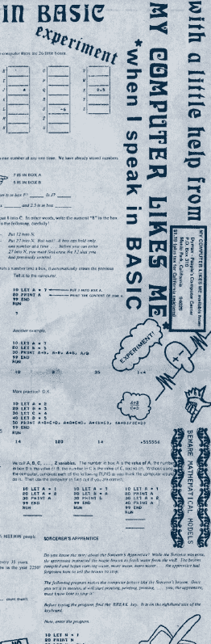

```
(184) 10 PRINT CHR$(20.5+RND(1)); GOTO 10
```

结合《Style：编程格言》和1979 年的《面向诗人的编程：使用 BASIC 的温和介绍》。为了不让计算机的实用功能被这些更侧向于美学的书籍所掩盖，查尔斯·D·斯特恩伯格（Charles D. Sternberg）编写了《家庭 BASIC 计算机程序》（1980），书中充满了专为满足“家庭实际需求”而设计的程序。如果其中某个程序在读者的机器上无法运行，斯特伯格鼓励他们进行“修改”。

这项对 20 世纪 70 年代和 80 年代初 BASIC 书籍的快速调查，强调了 BASIC 在促进探索、游戏、修改和学习方面的程度。它也揭示了当时计算运动的本质，即强调共享和向他人学习，通常通过纸质媒介进行。虽然机器语言程序偶尔会在印刷品中流，但以 `10 PRINT` 形式发表的 BASIC 程序则是完全另一回事。BASIC 是可读的代码。人们可以直接从页面上阅读，而且在程序执行之前，程序员的某种特质就已经显而易见。此外，当用户输入程序时，他或她可以轻松修改它，有时是无意的，但通常是有目的的。有时杂志和书籍本身存在拼写错误，或者使用的是特定的 BASIC 方言，因此修改程序（即调试）变得至关重要。通过纸质媒介传输 BASIC 程序并不是一个无缺、顺畅的系统，但它确实鼓励了对代码的参与、对代码如何运作的认知，以及意识到代码是可以被修订和重新工作的——这是程序员愿景的原始材料。

## 人类记忆中的 BASIC

不久以前，软件主要通过物理介质传输，如磁带、软磁盘和 CD-ROM。现在看来，程序会例行公地纸质出版并由用户输入的这种想法似乎很异 {。还有一种更奇异的方式让程序（特别是像 BASIC 单行代码这样的短程序）在计算机与计算机之间、人与人之间传递：作为记忆的代码片段，就像一个软件病毒，其宿主是人类而非机器。

对计算机程序完全回忆的梦想出现在虚构中。科里·多特洛（Cory Doctorow）的短篇小说《Ownz0red》中，一位名叫默雷（Murray）的程序员在唯一的伙伴意外死亡后，他的生活和代码质量开始螺旋式下降：

```
(186) 10 PRINT CH$(85.5+RND(1)); : GOTO 10
```

（Doctorow 2002）。当这个朋友回来时，他实际上已经黑进了了自己的身心使其近乎完美，默雷也获得了类似的超能力。其中就精确记忆大量文本的能力，包括代码的技术文档，他“闭上眼睛，以完美的清晰度回想起来”。默雷的回忆能力甚至超越了人类语言。当故事结束时，默雷“打开了笔记本电脑，开始重新输入整个代码库，那种完美记忆的过目不忘驱散了他所有的紧张，让他在夕阳落在使命区（Mission）时分显得冷静从容。”

在多特洛的故事中，记忆一个大型程序是一种超能力。同时，故事将人类肉体和心灵视为可以被程序员掌握并被对手拥有（甚至被对手“所有”Own0cored）的机器，这与以下观点是一致的：记忆代码是将自己的奴隶于机器，使其成为一个存储外设。然而对于许多程序员来说，记忆单行代码（而不是整个庞大的代码库）既是可能的也是有用的——而且是令人的，尽管这在 N·凯瑟琳·海斯（N. Katherine Hayes, 2005）所谓的“遗留系统”、演讲和写作背景下似乎很奇怪（发展于她的《言语、编写代码：三种世界观》一章）。

在 20 世纪 80 年代初的计算情况下，某人记住单行代码或几个短程序可能是有利的。记住的单行代码可以被输入到发现的程序中，启动一种双向的文化经济；通过分享一个特别有趣或具有视觉冲击力的程序，可以获得声望或“街头信誉”（street cred），这在货币是 80 年代初的青少年一定会欣赏的。在 20 世纪 70 年代末和 80 年代初，这些值得记忆的短程序大部分都是用 BASIC 编写的。（参见“单行代码”注释以获取若干示例。）而且因为程序员通常必须记忆某些 BASIC 状态，例如 `CH$(147)`（清除屏幕），所以记忆一个包含该语言两个语句的程序并没有多大跨越，例如 `10 PRINT CH$(205.5+RND(1)); = GOTO 10`。

除了可以炫耀甚至显得精英之外，记忆一个短程序还有一些纯粹实用的理由。例如，Perl 被用于各种文本处理任务；许多使用它的人发现，在命令行中编写、回忆或适应可在命令行运行的单行程序是有用的。例如，使用 DOS-BASIC (187) 创建一个名为 `dosfile.txt` 的文件。

## 程序记忆研究

在多特洛的故事中，默雷发现记忆几页代码比一串随机字符更容易，这一观点得到了实验研究的支持。为了更好地理解人们如何理解计算机程序（这将影响程序员的效率），科学家们从 20 世纪 70 年代中期开始研究程序记忆。1976 年，本·施耐曼（Ben Schneiderman）引用了关于记忆句子的认知科学文献，报告了不同能力水平受试者在尝试记忆一个 FORTRAN 程序和一组乱序排列的有效语句时，存在统计学上的显著差异，“这使我们得出结论：程序的结构有助于理解和记忆”（1976, 127）。

鲁文·布鲁克斯（Ruven Brooks）于 1983 年发表了更复杂的程序理解理论；`10 PRINT` 显示了该理论在某些方面并不适用。在布鲁克斯的模型中，程序重构了知识，基于从文本和其他文档中提取的信息来完善并详述最初的假设（1983, 543）。布鲁克斯提出了一个有用的观点，即某些行是“灯塔”（beacons），指示程序的结构和操作（548）。但他的理论难以应用于 `10 PRINT`。布鲁克斯列出了衡量程序意义的几个内部指标，包括“缩进”和“流程图”（551）。这些在 `10 PRINT` 中都没有。从根本上说，布鲁克斯的模型适用于模拟可识别业务的程序，而不是通用的计算机程序。

此外，布鲁克斯的“灯塔”概念在苏珊·维登贝克（Susan Widenbeck）的另一项记忆研究中被再次提及。在 1986 年的研究中，维登贝克发现丰富的程序员更容易记住灯塔行，他们他们该寻找什么。维登贝克还指出，“记忆程序是一个非常异常的任务，它改变了学生的正常理解和程序”（1986, 705）。有趣的是，关于“代码即诗”的临时格言，维登贝克发现程序记忆并非全是文本记忆：“如果受试者采取线性的或文本阅读的方法，我们预计程序开头的行会被记得更好，这种情况是

```
(108) 10 PRINT CH$(205.5+RND(1)); : GOTO 10
```

”。与此同时，维登贝克在描述她的受试者如何阅读程序时，与阅读文本进行了类比：“利用灯塔来理解程序似乎就像泛读英文文章。它们有助于理解总的、高层次的功能，但它们无法导致”


施耐曼早期对程序可以被记忆的承认是有意义的；此外，他的结果显示程序的记忆在某些方面与语言的记忆有关（Shneiderman 1976）。但这项研究的视角与对记忆 BASIC 单行代码的考虑存在差异。记忆被用作理解的衡量标准，这是本研究真正的重点。尽管这些研究表明记忆和理解之间存在深层联系，但记忆仍然是为了理解其他东西而被考虑。施耐曼的研究关于大约二十行程序的短期记忆，被分配为 a。由于关注的是短期记忆，施耐曼引用了米勒关于该主题的著名论文《神奇数字七加减二》（Miller 1996），并讨论了他的结果如何与该论文中的结果一致。

将行结束符转换为 Unix 格式是许多程序员的常见任务，这需要移除回车符（用`\r`表示）。这可以通过命令`perl -p -i -e's/\r\n/g' dosfile.txt`实现，该命令包含一个非常短的程序（引号内），用于执行所需的替换。通过少量修改，这段代码可以改为将一个单词替换另一个单词，例如，将所有的 `"Atari"` 替换为 `"Commodore"`：`perl -p -i -e's/Atari/Commodore/g' manuscript.txt`。

使用此类 Perl 单行命令（one-liners）的程序员似乎并不是像背课文那样精确地记住它们。他们通常理解替换运算符（`///`）是如何工作的以及命令行标志如何运作。换句话说，对于大多数 Perl 单行命令的用户来说，了解 Perl 本身比仅仅背诵一串符号更重要。但 "Perl pie" 这个短语（`perl -p i -e` 的助记词）确实有助于某些人快速想起在这种情况下需要哪些命令行标志，而且单行命令有时既是回想出来的，也是通过编写出来的。许多常见的单行命令并不是每次使用时都“从零开始”编写。

这种非死记硬背的记忆是 BASIC 程序员将`10 PRINT`从一台计算机带到另一台计算机并展示其输出时所采用的方式。记住代码就像带有偶尔拼写错误的打印件一样，是一种传输程序的“有损”方式。尽管如此，它们并没有产生负面影响。与通过磁盘或下载传输文件的完美且不透明的方式相比，对程序的召回和阅读为程序员的工作和娱乐留下了空间。如果程序的后续版本运行不正常，程序员可以思考如何修改它。如果它运行良好，程序员可能仍然会考虑修改它；这些被打印和记忆的程序有时会被搞乱，但它们并非封闭在黑盒内部的。

## 晚期 BASIC

Commodore 64、Apple II、TRS-80 以及 20 世纪 70 年代末和 80 年代初的其他微型计算机在其鼎盛时期配备了 BASIC。尽管 Keymeny 和 Kurtz 专注于小型机 BASIC，但正是在 BASIC 语言盛行的时期：

```basic
(190) 10 PRINT CH$(205.5+RND(1)) : GOTO 10
```

BASIC 语言真正实现了它的许多目标：易用性、分发给数百万用户以及在各种平台上的可用性。从那时起，由于技术的演变、新标准的出现以及一种鼓励程序员编写低质量代码的声誉（无论是否名其实其实），BASIC 的使用率已经下降。然而，现代编程环境在许多方面都受益于 BASIC。

最直接的延续是微软一直构建支持 BASIC 语言工具的历史。支持 BASIC 的编译器和开发环境（包括 QuickBasic 和 QBasic）一直随每个微软操作系统一起发布，直到 Windows 2000 通过放弃 MS-DOS 基础而打破了这一链条。1991 年，微软改进了 BASIC 产生了 Visual Basic，这种语言旨在要在基于窗口界面的新范式下，满足 BASIC 曾具备的易用性和快速开发能力。Visual Basic 使用了一些与 BASIC 相似的语法，但它是专为图形化开发工具设计的，且并非源自早期的微型计算机 BASIC。Visual BASIC 本身十年之后出现了 Visual Basic .NET，这种语言再次在根本上与其先驱断绝了联系，但仍保留了作为微软平台上易于学习、快速使用的入门级编程语言这一目标。截至 2012 年，Visual Basic 是世界上第七受欢迎的编程语言，Visual Basic .NET 位列第二四（TIOBE Software BV 2012）。

在不那么专业的末端，微软最近的 BASIC 与`10 PRINT`以及该程序被使用、修改、共享和探索的方式有着最密切的关系。这个语言版本是 Small BASIC，于 2008 年发布并免费提供。这是一种微软 .NET 语言，显然针对学生和其他初学者。它结合了来自 LOGO 的乌龟图形概念，邀请对图形、GUI 元素以及文本进行游戏和探索。为了配合这种语言，甚至还有 David Ahl 的《Basic Computer Games》的小 BASIC 版（Kidware Software 2011）。

BASIC 在特定领域继续保持着影响力。有几种 BASIC 及其派生语言是专门为游戏开发创建的，目前仍在活跃开发和使用。这些包括 Blitz BASIC（及其继任语言）、DarkBASIC 和 GLBasic。对物理计算项目感兴趣的人可以使用微控制器 BASIC Stamp，Parallax, Inc. 自 1992 年以来制造了多个版本的设备。该系统由 9 特伏电池供电；爱好者可以使用一种名为 PBASIC 的变体语言对其编程。一个较晚的后代是 20 世纪 90 年代和 20 年代德州仪器计算器的编程语言。它的编程社区非正式地命名为 TI-BASIC，因为就像 BASIC 的鼎盛时期一样，它是一种相对简单的解释型语言，随设备发行并控制设备。

其他继承者已将 BASIC 的原则或语法迁移到不断扩展的环境中。类似于微软的 Visual BASIC，True BASIC 更新了 BASIC 语言以支持图形环境。然而，与微软的重新构不同，True BASIC 由 Kemy 和 Kurtz 创建，并保持了与 Dartmouth BASIC 的原始语法和设备无关性原则，并为多个操作系统提供了编译器。

对 BASIC 遗产更激进的解释是 MIT 媒体实验室开发的语言 Scratch。尽管外观和机制非常不同，但 Scratch 使用与其他任何编程语言相同的底层逻辑和概念，以便使用它的学生可以将学到的知识应用于其他语言中。

```basic
(192) 10 PRINT CH$(205.5+RND(1)) : GOTO 10
```

## 对 10 PRINT 的个人记忆

当本书的作者之一 Nick Montfort 首次描写一个功能类似的程序时，他展示了这个变体：`10 PRINT CH$(109+RND(1)*2); GOTO 10`。

本书对该程序的讨论都是基于早期打印版本的。然而，引发讨论的版本源自记忆。

……，并继续让编程语言变得更简单、更透明、更自由地——这一切不断激励着新程序员投入其中，并让老程序员尝试新想法。

# 55

## 向雅达 VCS 的移植

### 编写字符自己的

### 建造墙壁

### 覆盖屏幕

### 勾勒迷宫

与 1977 年推出的通用型家用计算机——TRS-80、Apple II 和 Commodore PET——同时推出的，还有另一台电脑，它非常成功，但大多数人并没有认为是一台计算机。这是一台视频游戏机，即雅达视频计算机系统（VCS），后来被称为 Atari 2600。与其他计算机不同，Atari VCS 专为玩视频游戏而设计。它的设计价格也低得多：VCS 的售价为 199 美元，而原始的 Apple II 价格高达令人震惊的 1,298 美元。

由于其预期用途、低价销售的要求以及硅胶元件的高成本，Atari VCS 的设计方式非常奇特。与 Apple II 和 Commodore 64 不同，Atari VCS 使用了廉价的 MOS Technology 6502 微处理器的版本。为了在普通的 CRT 电视机上创建运动图像和声音，工程师 Joe Decuir 和 Jay Miner 发明了电视接口适配器（TIA）。TIA 支持五个“高分辨率”可移动物体：两个玩家精灵（一旦创建后即可自由移动的物体）、两枚导弹（每个玩家一个）以及一个球。这些恰恰是 VCS 最初设想的游戏所需的图形类型——诸如《乒乓球》（Pong）和《坦克大战》（Tank）等热门街机游戏的家用版。TIA 还实现了低分辨率的战场和可更改的背景颜色，并有多种方法来改变这些对象的外观。为了省钱，TIA 与 6502 的更廉价版本以及 128 字节的 RAM 配对，这是一个极其有限的内存量。

与 Apple II 和 PET 不同，Atari 没有板载 ROM，也没有操作系统，而且 RAM 仅为那些其他 1977 年级计算机的一小部分。因此，Atari 程序员必须编写代码来操作 TIA 寄存器，这不仅是逐屏处理的，而是基于电视显示器的每一行扫描线。结果是产生了世界上产生计算机图形最不寻常的方法之一（Montfort and Bogost 2009, 28–30）。雅达的首发作品以相当直接的方式使用了该系统（见图 51），而随后的作品则利用它来产生不同的效果。

虽然在 Atari VCS 的整个寿命内设计了许多出色的游戏，但系统的限制使得从程序员的角度来看，它是一个特别困难的平台。考虑在 Atari VCS 上移植`10 PRINT`的挑战：

```basic
(196) 10 PRINT CHR$(205.5+RND(1)) : GOTO 10
```

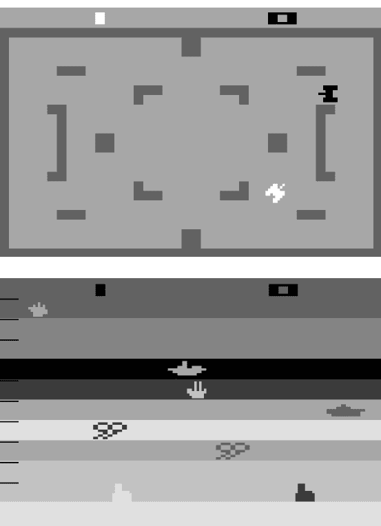

图 55.1

这些来自《战斗》（Combat，上方）和《海空大战》（Air-Sea Battle，下方）的截图显示了 Atari VCS 游戏的视觉质量。

向雅达 VCS 的移植 (197)

1. 雅达没有预定义的字符位图（代表每个字形的像素网格），而 Commodore 64 有，这使得从头开始创建对应对角线字符的模式变得必要。
2. TIA 屏幕仅支持两个高分辨率精灵（导弹和球仅仅是点，每个一个像素）。在某种程度上，必须让雅达仅通过这些 8 位图形寄存器产生一个巨大的、不断变化的图案。
3. 雅达没有像微型计算机和 PC 那种行列屏幕显示概念。它的设计是为了玩简单的视频游戏，而不是显示文本和数字。因此，得益于 Commodore 64 显示文本的方式，网格布局的`10 PRINT`似乎是“免费”的，但必须在 Atari VCS 上费力地进行模拟。
4. 一旦克服了前面的障碍，雅达的内存仍比 Commodore 64 少得多。Commodore 可以在内存中保留所有显示字符引用，因为它有足够的空间，存储容量是雅达的 512 倍。即使可以让雅达每行或每个屏幕显示足够的高分辨率对角线字符，程序也必须存储这些模拟字符的引用，以便显示的每一帧都与前一帧保持一致。

为 Atari VCS 设计`10 PRINT`的移植版是如此古奇，以至于可能不值得尝试。正如`10 PRINT`揭示了关于 BASIC 和 Commodore 64 的很多信息一样，对不兼容平台上看似不可能的移植进行研究，也可以揭示`10 PRINT`更深层级的内容。图 55.2 显示了在 Atari VCS 上实现的最接近`10 PRINT`的效果，这是本书编写的移植版的输出。

## 编写字符

在雅达的八位图形寄存器中模拟 PETSCII 字符的问题证明是移植中最不棘手的挑战。在 Commodore 64 上，产生 PETSCII 字符的图形图案存储在 ROM 中，BASIC 中诸如`CHR(205)`的引用会查找并：

```basic
(198) 10 PRINT CHR$(205.5+RND(1)); GOTO 10
```


图 55.1

这些来自《战斗》（Combat，上方）和《海空大战》（Air-Sea Battle，下方）的截图显示了 Atari VCS 游戏的视觉质量。

在雅达的八位图形寄存器中模拟 PETSCII 字符的问题证明是移植中最不棘手的挑战。在 Commodore 64 上，产生 PETSCII 字符的图形图案存储在 ROM 中，BASIC 中诸如`CHR(205)`的引用会查找并检索屏幕显示数据。由于雅达没有内置 ROM，必须通过以下方式“绘制”数据：

```assembly
byte #11000000
byte #00110000
byte #00001100
byte #00000011
```

这种二进制数据描述了一条对角线，出现在


TIA 只有两个精灵的事可能让任何玩过雅达游戏的人感到惊讶，因为许多游戏看起来同时超过两个。例如，雅达的作品之一的《海空大战》在屏幕底部显示了两个架向上的飞机（55.1）。这是如何可能的？

答案是显而易见的。通常我们将计算机显示器认为一个二维平面，就像绘画或照片。计算机通常提供能够存储整个屏幕内容的视频内存。通常程序在 NTSC 屏幕的 192 行水平线重新扫描之前的短暂时刻会重置这些数据，这一时刻被称为垂直空白。但雅达只有 128 字节 RAM，因此无法一次设置整个屏幕的信息。

相反，雅达程序员以逐行扫描线的方式设置显示，在单个扫描线之间的短暂时间内与 TIA 交互以更改设置——水平空白。一旦某行或一组完成后，程序员可以在同一屏幕的后续部分“重用”精灵寄存器，用于不同的用途。这种技术发生得非常快，特别是考虑到电视屏幕的余光，重用的精灵同时出现，带有某种闪烁。这就是最终的`10 PRINT`在雅达屏幕上产生超过两个“对角线”图形的方法。

## 组装墙壁

最简单的技术是将精灵（sprite）图形调整为在八位空间中包含两条对角线，而不是仅一条；每条使用一个半字节（即四个比特）。例如，下面的代码定义了两根左倾细线：

```assembly
Diagonals
.byte #10001000   ; 左上到右下的一條斜線
;64+8    ; $C8？或者应该写成 ##-修正## \begin{tabular}{cc}
 & |
\end{tabular}### 跨页继续 ### { ... }
```

...continued...

用一组对角线图案填充屏幕；在偶数帧上，用另一组图案渲染后六个像素点。要实现这一点，有必要复制渲染屏幕的循环，并将程序发送到正确的循环中。这项任务看似简单，被证明是困难的，因为“关闭”一半的图案并不如听起来那么容易。它要求向处理器的累加器中加载零值，并在 TIA 开始渲染下一个像素点之前，恰好在正确的时间点将两个精灵器（sprite）寄存器设置为该值。其结果是令人信服的，尽管它看起来没有 Commodore 64 那么随机。

这里使用的技术只是重现`10 PRINT`的一种方法；其他方法可能允许实现更具随机性的显示。例如，Atari 游戏中一种常用技术是用于六位数分数的相当复杂的程序。通过向相反的寄存器写入数据，将一个精灵器图形值推入另一个寄存器来实现这一点。这种技术可以产生六个独特、间距紧密的高分辨率图形。将这种技术与之前讨论的屏幕闪烁方法相结合，可能会获得一个没有任何明显重复的迷宫；但要在屏幕上精确位置生成这些图案所需的精确计时，也会破坏结果迷宫的均匀性。破坏网格布局甚至可能让“迷宫”看起来不那么像迷宫。

在 Atari VCS 上创建`10 PRINT`的困难提醒人们，来自相似时代的组件更简单的计算机，其设计初衷是执行完全不同的任务。`10 PRINT`依赖于 Commodore 64 在行和屏幕缓冲区中渲染文本的能力。尽管这种能力对于 20 世纪 70 年代和 80 年代的计算机来说是基础性的，但 Atari VCS 在设计时并未考虑到这一点。BASIC 代码`10 PRINT CHR$(205.5+RND(1)) : GOTO 10`定义为包含 38 字节的文本；正如下一章所述，该程序的汇编版本可以在更少的空间内完成。Atari 上最简单的程序版本需要 360 字节，这很大程度上是因为程序必须“从零开始”执行许多功能，而这些功能在 Commodore 64 中已经是 ROM 的一部分。

创建像`10 PRINT`这样程序的想法本身取决于平台的特性以及平台对这类程序的便利性——ROM 中存在 BASIC 和 RND、PETSCII 的存在、共享编程技术的文化背景，当然还有对计算机进行编程的能力，而 Atari 2600 的所有者并不真正拥有这种能力。在 Atari VCS 上重新实现该程序（该平台既与 Commodore 64 同时代，又与本书的主题程序高度兼容），有助于展示出所有那些被 Commodore 64 程序员认为理所当然的事情。如果 Commodore 64 程序员必须为了产生`10 PRINT`的输出而付诸这种努力——从编写一个随机数生成程序，到强迫一个具有两个高分辨率对象的行缓冲显示器产生二维图形网格——这个程序可能永远不会被写出来。

```basic
(208) 10 PRINT CHR$(205.5+RND(1)); : GOTO 10
```

# 60

## Commodore 64

### 超越业余爱好者的家庭计算

### Commodore 商业机器

### PETSCII

### VIC-II 芯片

### KERNEL

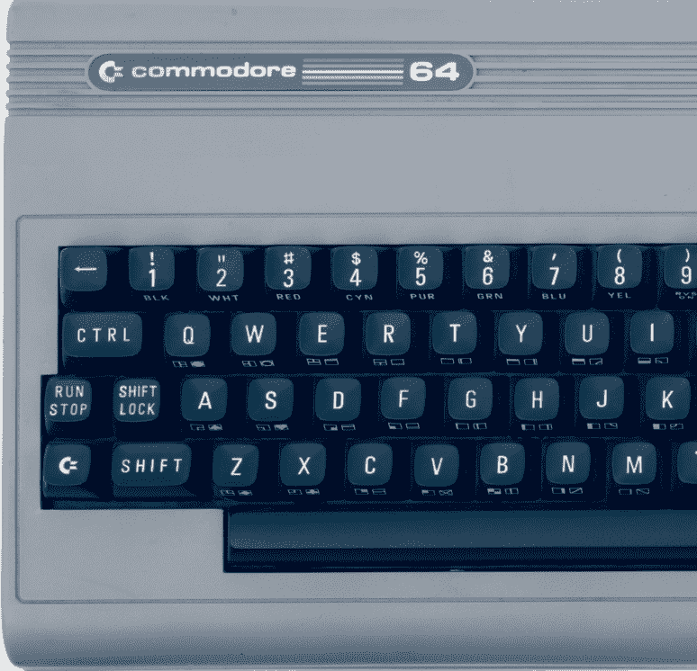

```basic
(210) 10 PRINT CHR$(205.5+RND(1)); GOTO 10
```

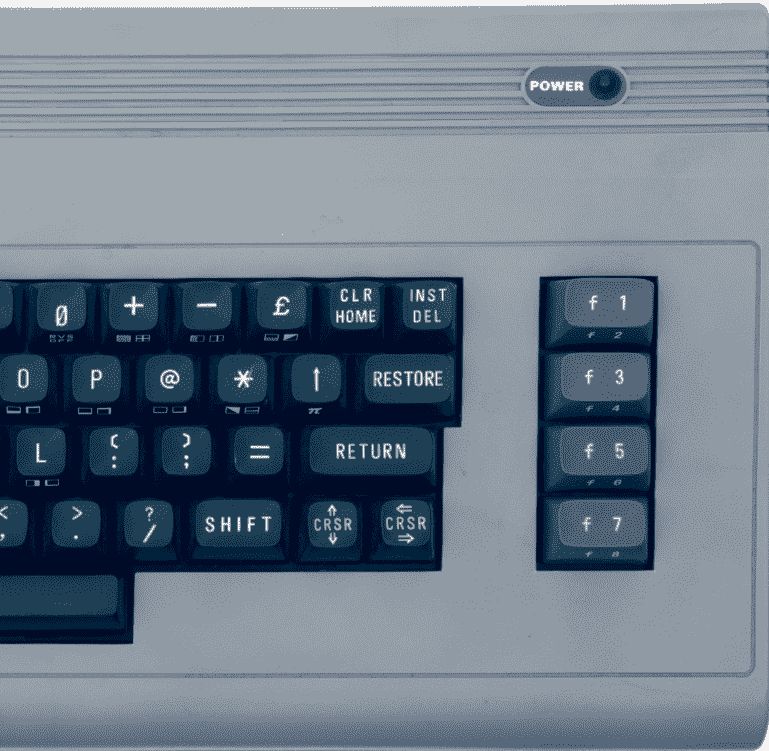

图 60.1

Commodore 64 计算机于 1982 年发布，是 VIC-20 的继任者。它拥有 64KB 内存。

摄影：Mark Richards。感谢 Mark Richards。

## Commodore 64

Commodore 64 计算机被吉尼斯世界纪录誉为最畅销的机型（见图 60）。在 1984 年，8.2% 的美国家庭拥有一台计算机。根据统计，到 1988 年，70% 的拥有学龄儿童的家庭购买了计算机。1989 年，这一数字飙升至 15%。

## Commodore 64

在 1984 年，有 1200 万台计算机售出。到 1994 年，Commodore 64 停产了。

为了产生`10 PRINT`的输出，如果 Commodore 64 程序员必须付诸这些努力——从编写随机数生成程序，到强迫一个具有两个高分辨率对象的行缓冲显示器产生二维图形网格——这是可能的。

图 60.2

Commodore 64 使用的 PETSCII 字符打印在侧面。


# 摄影：Mark Richards。感谢 Mark Richards。

## COMMODORE 64 (211)

在 20 世纪 80 年代，计算机超越了爱好者的领域进入了家庭，这由 Apple、Radio Shack 和 Commodore 共同推动。

Commodore 64 具有内置的 BASIC 和 PETSCII。

在 1983 年，Commodore 64 以低于 600 美元的价格推出。

Commodore 64 拥有 64KB 内存——这是你所需要的。

你还可以在 Commodore 64 上玩游戏。其中许多是

...Commodore 64 具有内置的 BASIC 和 PETSCII。

在 20 世纪 80 年代，计算机超越了爱好者的领域进入了家庭，这由 Apple、Radio Shack 和 Commodore 共同推动。

Commodore 64 具有内置的 BASIC 和 PETSCII。

在 1983 年，Commodore 64 以低于 600 美元的价格推出。

Commodore 64 拥有 64KB 内存——这是你所需要的。

你还可以在 Commodore 64 上玩游戏。其中许多是

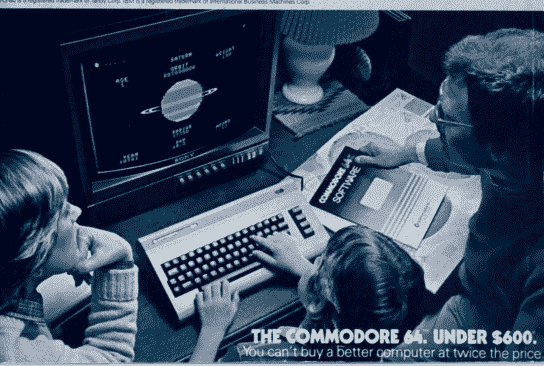

## COMMODORE COMPUTER

COMMODORE 64. 低于 600 美。你可以花双倍的价格买到更好的计算机。

图 60.3

这幅 1983 年的 Commodore 64 广告将其作为一种中产家庭负担得起的强大计算机进行推销。

```
(214) 10 PRINT CHR$(205.5+RND(1)); GOTO 10
```

（Kominski and Newburger 1999, table 3）。成年女性和男性之间的差距遵循类似的趋势：微小的鸿沟在20世纪80年代变得更小（同上，表 5）。然而，女性（1984年为29%）比男性（1984年为21.2%）更可能使用计算机，这通常是因为更多女性从事数据录入或行政支持工作（同上，表 6）。在家庭收入与计算机拥有率方面，出现了一个更具统计意义的差异。再次对比，收入在15,000至20,000美元之间的家庭，其家用电脑拥有率从5.3%上升到8%，而收入在50,000至75,000美元之间的家庭则升至22.4%（同上，表 2）。到1989年，这种差距更加明显：收入在75,000美元及以上的家庭中有43.8%的家庭拥有电脑，而收入在5,000至9,000美元范围内的家庭仅有3.7%拥有电脑（表 2）。

社会经济、种族和性别差异是`10 PRINT`背景的一部分，正如纹理图案和BASIC的历史一样。这些差异在那个时代标志性的 Commodore 64杂志广告中得到了体现（图60.3）。

鉴于当时家用计算的昂贵，Commodore明智地将其计算机定位为比其竞争对手更强大的产品。这则来自1983年的广告宣称：“花两倍的价格你买不到更好的电脑”，同时指责苹果（Apple）、无线电沙滩（Radio Shack）和IBM将他们的个人电脑的价格定在只有“富人”、“天才少年”或“特权人士”才能负担得起的范围。Commodore与这些其他PC之间的区别不仅用金钱衡量。最廉价的三台电脑被挤在一个黑白背景中，几乎被巨大的“FOR NOBODY（无人）”字样遮住。Commodore 64占据页面的下半部分，沐浴在暖色调中。一对父母看着孩子在电脑上探索星系，暗示 Commodore 是通往更大宇宙的门户——一个充满知识与机会的宇宙。这个家庭代表了一个精心定位的市场。父母购买电脑的可能性是普通人的两倍。令人深的是，这个家庭是白人中产阶级，他们的孩子似乎是个男孩。尽管统计数据表明计算机的性别更加平衡，但广告强化了“家用电脑是男孩领域”的叙事。道格·托马斯（Doug Thomas）将“黑客群体”识别为主要是“白人郊区男孩”（2002, x），当代编程文化——从本科学习中的性别失衡到职业空间——都显示了这种遗产的力量。正如那个时代的典型广告一样，“每个人”实际上指的是极其特定的人口群体。

虽然家用电脑的市场比广告商所承认的要小，但计算机本身涵盖了多种风格和形式，远超苹果-Commodore-TRS-80这三三角。除了广为人知的品牌外，还有Sinclair ZX Spectrums、BBC Micros以及来自Amstrad和Acorn的计算机，它们都源自英国。德州仪器（Texas Instruments）TI-99/4A和Coleco Adam也可用。在众多选择中，广告商不仅必须为品牌塑造个性，还要为单台机器塑造个性。在PC克隆机涌入后的计算世界，很难想象那个围绕单台机器产生的时代。然而，今天的程序员仍能记得他们的第一台Apple II、VIC-20或TRS-80。苹果公司现在仅坚持“差异化”机器的营销，尽管他们的电脑内部也有英特尔（Intel）芯片，而且公司倾向于营销产品线而非单一型号。这是一个完全不同的景观，见证了个人电脑的出现，并将64KB内存视为荣誉的基准。

这种多样性意味着不同的制造商可以尝试不同的硬件设计，并在ROM中构建不同的操作系统。它促进了企业对家用电脑市场的某些探索，同时也限制了软件共享的方式——即使这些软件是用BASIC这种通用语言编写的。家用计算的体验在许多方面是平台分层的。苹果 Store并不是第一个销售计算机的特定平台零售店。许多供应商至少专门经营某公司的计算机；在某些情况下，商店专门销售苹果、雅达（Atari）或Commodore产品，就像无线电沙滩是TRS电脑的唯一卖家一样（见图60）。

计算机所有者还创建并加入了特定平台的用户组，并进行面对面的交流。正如在BASIC章节中讨论的，他们还订阅并阅读针对特定类型计算机的杂志。当公告板系统（BBS）出现时，有些托管许多不同类型计算机的用户，而另一些（特别是那些致力于提供软件下载的）则专注于单一平台。

```
(216)  10 PRINT CHR$(205.5*RND(1)); : GOTO 10
```

图60.4

位于北卡罗来纳州布雷沃德的Bob West Computers的当地学生轮流使用一台Commodore计算机。Bob West提供。

这并不意味着每个计算机用户都对应一个平台。有些家庭拥有多台电脑——也许为了防止工作电脑被家里年幼成员占用，父母决定提供另一台更偏向游戏和教育的电脑。即使是家里没有电脑的人，在零售店（通常允许孩子们长时间使用待售电脑）、学校和朋友家里，也有几台电脑可供使用。鉴于这种计算环境，即使是那些主要是Apple II用户或在家里使用Coleco Adam系统的人，也可能有机会玩玩Commodore 64。在时间有限的情况下，特别是在学校或零售店的背景下（可用软件可能有限或不存在），对于Commodore 64的访问者来说，学习并修改像`10 PRINT`这样的单行代码并不是一个坏主意。

## COMMODORE 商业机器

Commodore 64的历史始于加拿大Commodore公司，由杰克·特米尔（Jack Tramiel）于195年在多伦多创立。特米尔出生名为伊齐克·特米尔（Itzik Tramiel），是一个波兰集中营幸存者，二战后移民美国并更改了姓名。在韩国服兵役后，特米尔担任打字机技术员，最终与生意伙伴合开了一家修理公司。Commodore是他们成立的继承公司。这家新公司不再修理打字机，而是制造它们（Bagnall 2010）。

在家庭收入与计算机拥有率方面，出现了一个更具统计意义的差异。再次对比，收入在15,000至20,000美元之间的家庭，其家用电脑拥有率从5.3%上升到8%，而收入在50,000至75,000美元之间的家庭则升至22.4%（同上，表 2）。到1989年，这种差距更加明显：收入在75,000美元及以上的家庭中有43.8%的家庭拥有电脑，而收入在5,000至9,000美元范围内的家庭仅有3.7%拥有电脑（表 2）。

（注：用户提供的文本包含了重复的片段。我根据提供的文本块重构了逻辑流。）

## COMMODORE PET 机器

（注：此处为原文中的OCR错误/重复）

Commodore 64的历史始于加拿大Commodore公司，由杰克·特米尔于1958年在多伦多创立。特米尔出生名为伊齐克·特米尔，是一个波兰集中营幸存者，二战后移民美国并更改了姓名。在韩国服兵役后，特米尔担任打字机技术员，最终与生意伙伴合开了一家修理公司。Commodore是他们成立的继承公司。这家新公司不再修理打字机，而是制造它们（Bagnall 2010）。

（注：用户提供的文本包含了重复的片段。我将提供去重后的版本。）

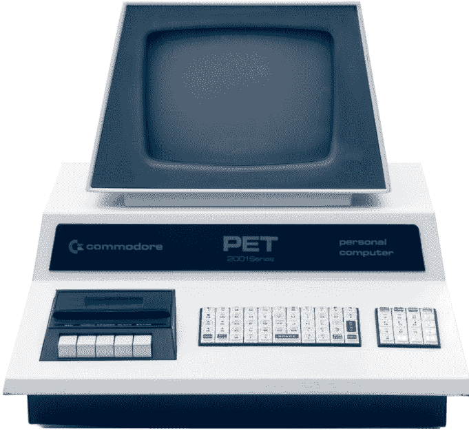

图 60.5

Commodore PET 计算机于 1977 年发布。它拥有四 KB 内存和一个用于存储和加载程序的磁带驱动器。由 Mark Richards 拍摄。感谢 Mark Richards。

```
(220)  10 PRINT CHR$(205.5+RND(1)); : GOTO 10
```

PET 在欧洲取得了巨大的成功，当时 Commodore 凭借其计算器业务在那里已经有了深远的影响。由于 20 世纪 70 年代其销售额的近 70% 来自欧洲，因此 Commodore 在 VIC-20 和 Commodore 64 的键盘上包含一个锡色的英镑符号也并不意外。PET 的名字是一个时代的标志；Susan 想出这个名字是为了利用 20 世纪 70 年代末宠物石（pet rock）热，在此之后，Peddle 才将“个人电子交易器”（Personal Electronic Transactor）作为一种“反略词”提出来，以此逻辑上解释 PET 的名字（Freiberger 1982, 13）。

正如 BASIC 章节中所过的，PET 是 Commodore 第一台将 BASIC 包含 ROM 中的计算机，使得 PET 在计算机启动的那一刻就可以编程。PET 的另一个在 Commodore 64 和 10 PRINT 上留下了印记的遗产是它的扩展图形字符集，非正式地被称为 PETSCII。（这个名字“扩展”了 ASCII，即计算机的标准字符集。）PETSCII 设计在很大程度上是由工程师 Bill Seiler 和 Leonard（Jack Tramiel 之）为 PET 设计的，他们当时担任 Commodore 的内部测试员和调试器（Bagnall 2010, 92–93）。PETSCII 的主要理由（包括 ASCII 的 128 个字符加上额外的 128 个图形字符）是提供一种简单的方法来生成诸如扑克牌符号的图形字符。人们经常观察到，计算机图形的创新驱动了计算机的许多创新——芯片速度、内存大小等等——而这里是一个不那么明显的例子。虽然 PETSCII 的图形字符集（包含四种花色、阴影图案以及各种括号和线条）很难说是一项创新，但它使得在 BASIC 中编写早期电脑游戏成为可能，而无需编写精灵或其他动画图形。而且 PETSCII 也让 10 PRINT 成为可能，为程序员提供了在 1977 年那个迷宫中发现的两个对角线字符。

## VIC-20

虽然商业和教育是 PET 计算机的主要市场，但其继机型 VIC-20 直指家庭电脑市场。VIC-20 于 1980 年发布，其外外观与后来 Commodore 64 的具有完全相同的物理外形。（VIC-20 的塑料颜色较浅，更接近米白色，而不是 Commodore 64 的灰褐色。）像 PET 和 Commodore 64 一样，VIC-20 同样由 6502 芯片驱动，并包含了微软版本的 BASIC。然而，VIC-20 销售时仅配备 5 KB RAM，只是 Commodore 64 64 KB 的极小部分。该系统还有一个宽 22 个字符的彩色显示器，由 49 VIC 芯片（视频控制器）驱动。VIC 6560 芯片由 MOS Technology 工程师 Al Charpentier 设计，旨在出售给 Apple 和 Atari 等其他制造商，但无人感兴趣（Bagnall 2010, 178）。它最终进入了 VIC-20。它的缺点启发了为 Commodore 64 创造一个更强大的图形芯片。

由于 VIC-20 运行相同版本的微软 BASIC，并包含了与 PET 之前、Commodore 64 之后相同的 PETSCII 字符集，因此 10 PRINT 程序在 VIC-20 上运行得完美无缺，尽管没有任何专门为 VIC-20 设计的迷宫发布版本。如果用户在 VIC-20 上运行 10 PRINT 或其变体，他们将获得与 Commodore 64 用户不同的审美体验（图 60.6）。PETSCII 是为 40 列的 PET 设计的；在 22 列的 VIC-20 上，字符被拉长了，拉伸得就像是在宽屏上观看 4:3 的电视节目一样。迷宫看起来几乎是 3D 的，正如看到 1982 年街机游戏《Zaxxon》的等轴测视角所示。

尽管内存很小，VIC-20 被认为是对 PET 计算机的巨大改进，其价格吸引了家庭市场（包括 K-Market）以及比以前计算机触及的更广泛的市场。它是 1982 年最畅销的计算机（Commodore 64 问世的一），销量 800,000 台，但随后它比昂贵但也强大多的 Commodore 64 处于从地位。虽然 VIC-20 在 1985 年停产，但 Commodore 64 一直销售到 1994 年。

关于 Commodore 64 作为史上最受欢迎的家庭电脑之一，有很多话可以说，但为了清晰起见，关注 Commodore 64 在 10 PRINT 中发挥作用的元素很重要，即独特的图形字符集、实现计算机图形能力的 VIC-II 芯片，以及基于 ROM 的操作系统，或 KERNEL。

```
(222)  10 PRINT CHR$(205.5+RND(1));  GOTO 10
```

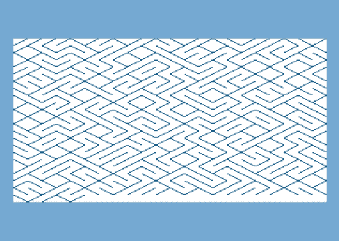

图 60.6

VIC-20 上 22 × 23 屏幕上的 10 PRINT 迷宫。

## PETSCII

PETSCII 字符集并不是 Commodore 64 特有的；Apple II 或 TRS-80 都没有与 Commodore 计算机竞争，它们提供了一个扩展版本的 PETSCII。关于 PETSCII 的事实非常简单：它是 128 字符 ASCII（美国信息交换标准）的扩展；除了字母、数字和标点符号，它还包含了控制代码（如 RETURN 或 CLR）以及图形字符（箭头、框和阴影图案）。这些图形字符在 PET、VIC-20 和 Commodore 64 的键盘上都有标记，并通过 SHIFT 键轻松访问。首先，PETSCII 是一个非正式的名称。

| | | | | | |
|---|---|---|---|---|---|
| D | 68 | ▲ | 97 | 126 | 155 |
| E | 69 | □ | 98 | 127 | 156 |
| F | 70 | □ | 99 | 128 | 157 |
| G | 71 | □ | 100 | 129 | 158 |
| H | 72 | □ | 101 | 130 | 159 |
| I | 73 | □ | 102 | 131 | 160 |
| J | 74 | □ | 103 | 132 | 162 |
| K | 75 | □ | 104 | 133 | 163 |
| L | 76 | □ | 105 | 134 | 164 |
| M | 77 | □ | 106 | 135 | 165 |
| N | 78 | □ | 107 | 136 | 166 |
| O | 79 | □ | 108 | 137 | 167 |
| P | 80 | □ | 109 | 138 | 168 |
| Q | 81 | □ | 110 | 139 | 169 |
| R | 82 | □ | 111 | 140 | 170 |
| S | 83 | □ | 112 | RETURN | 141 | 171 |
| T | 84 | □ | 113 | SWITCH TO CASE | 142 | 172 |
| U | 85 | □ | 114 | NEW | 143 | 173 |
| V | 86 | □ | 115 | □ | 144 | 174 |
| W | 87 | □ | 116 | CAR | 145 | 175 |
| X | 88 | □ | 117 | CLEAR | 146 | 176 |
| Y | 89 | □ | 118 | HOME | 147 | 177 |
| Z | 90 | □ | 119 | INST | 148 | 178 |
| [ | 91 | □ | 120 | □ | 149 | 179 |
| ] | 92 | □ | 121 | □ | 150 | 180 |
| } | 93 | □ | 122 | □ | 151 | 181 |
| + | 94 | □ | 123 | ▲ | 152 | 182 |
| - | 95 | □ | 124 | □ | 153 | 183 |
| > | 96 | □ | 125 | □ | 154 | 184 |

图 60.7

1982 年 Commodore 64 用户指南附录 F 列出了 PETSCII 中的数值值和图形符号。

```
(224)  10 PRINT CHR$(205.5+RMD(1)); : GOTO 10
```

PETSCII 是一个来自 Commodore 用户的非正式名称。

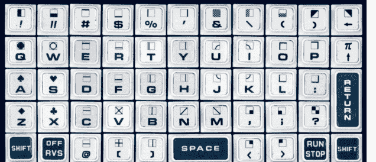

图 60.8

PET 2001 键盘在相应按键上印有 PETSCII 图形符号。这些图形在键盘上呈空间分布排列。例如，`/` 和 `\` 在 N 和 M 键上并排。

相关的字符（例如 O 和 P 键上的右侧字符），但只有 NM 会产生比文本更具结构性的效果，并带有愉悦的比例变化。


仔细观察 N 和 M 键上的图形字符——分别为`CHR$(206)`和`CHR$(205)`——可以揭示更多关于 PETSCII 的细节。首先，是这些数字本身。《Commodore 64 用户指南》附录 F 中的 ASCII 图表列出`/`和`\`的值为`CHR$(110)`和`CHR$(109)`，然而本书的标题使用了`CHR$(205)`作为其触摸屏，而前两个版本的程序（在同样的《Commodore 64 用户指南》和 *Run* 杂志中）使用`CH$(205)`作为基础。《Commodore 64 用户指南》指出“CODES 192-223 ASM AS 96-127”（Commodore 1982, 137），这意味着 109 和 110 与 205 和 206 完全相同。为什么呢？为什么程序的早期版本使用较大的字符值（205 和 206），尤其是手册本身出现的 PETSCII 图表已经列出了 109 和 110 值？

一个可能的解释可以在 Commodore 64 响应 PET ASC("X") 的方式中找到，这是一种用于确定任何可打印字符 ASCII 编码的技术。如果用户看到她在键盘上某个图形符号的代码，例如 S 键上的心形，或者准确地说，N 键上的对角线，可以输入`PRINT ASC("//")`，计算机会响应“206”。因此，在`10 PRINT`中使用 205/206 的可能含义是，用户更有倾向于对面前的键盘进行实验，而不是查阅手册背后的代码。通过 ASC 函数，BASIC 变成了一个自成一体的教学工具，使得外部手册和指南变得不那么必要。

## PETSCII 的形状

关于`10 PRINT`中出现的两个图形字符还有更多值得发现的。与所有 PETSCII 字符一样，这两个字符被绘制在 8 x 8 的像素矩阵上。普通的字母数字字符通常被限制在矩阵的 7 x 7 部分，在字符之间留出单个像素的“边框”，而许多图形字符延伸到其 8 x 8 网格的边缘。观察图 60.9 中`CHR$(206)`的特写。当它与最接近它的排版符号——正斜杠`CHR$(47)`比较时，它的独特特征就变得显而易见。

`CHR$(206)`的主体宽三个像素，并在另一端终结于一个点，这种线条的变细导致每当`10 PRINT`迷宫中两个相同的字符连接在一起时，就会出现一个凹槽。与此同时，`CHR$(47)`斜杠线是均匀的两个像素宽。图形字符与排版符号之间的差异在某些边缘仅为一个像素，但这是重大的。`CHR$(206)`的形状——以及它的镜像`CHR$(205)`的形状——对于迷宫的纹理至关重要。

## VIC-II 芯片

虽然 PETSCII 字符集从 PET 到 VIC-20 再到 Commodore 64保持不变，但显示这些字符的方法——控制图形的芯片——随着时间发生了巨大变化。尽管名字如此，6567 (NTSC)/6569 (PAL) VIC-II 图形芯片不仅仅是 VIC-20 中 VIC 芯片的改进。它是第一代 VIC 背后的 MOS 工程师 Laplace 的完全重新设计。家用游戏系统，特别是 Mattel 的 Intellivision，是 MOS 设计师的主要灵感，他们致力于创建市场上最先进的图形（Bagnall 2010, 318）。

该芯片最终版本的规格在当时令人印象深刻：三种不同的四列文本模式、两种每个 320 × 200 像素的位图模式、八个硬件驱动精灵（sprites）、硬件支持的屏幕滚动，以及十六色视频游戏调色板，这些在 VIC-II 内置的滑动和垂直滚动（一次七个像素）以及 VIC-II 对精灵的处理中清晰可见。VIC-II 精灵比 Atari 2600 的精灵要复杂得多，它们大小为 24 × 21 像素，并且可以是彩色的。VIC-II 芯片可以检测精灵之间的碰撞；它还能检测精灵何时与屏幕上的其他图形数据或单独指定的栅格线（CRT 或电视屏幕上的水平扫描线）碰撞。

## VIC-II 上的文本

尽管精灵处理非常先进，但 VIC-II 芯片的文本模式与`10 PRINT`相关。文本或基于字符的模式占用一千字节的屏幕内存，由四列

```
(220)  10 PRINT CHR$(205.5+RMD(1)); : GOTO 10
```

和二十五行字符，即总计 1000 个字符。当`10 PRINT`逐行跨越屏幕绘制迷宫时，它在 40 × 25 网格的每个空间上绘制一个 PETSCII 字符，仅仅一小钟内，1000 个字符就填满了屏幕——这可以被认为是对迷宫的幻影消耗——在文本向上滚动之前留下了另外两个二十五行待填充。

这一点是理解迷宫美学质量与其绘制过程动态关系的关键。`10 PRINT`指定显示其中一个 PETSCII 字符，但并没有说明字符应该出现在屏幕的什么位置。这种位置，更具体地说，`CHR$(205)`或`CHR$(206)`的放置取决于 VIC-II 芯片。对于用户来说，屏幕是 40 × 25 网格，但对于 VIC-II 芯片来说，屏幕是一系列内存槽（slots）。第一个槽 1024 位于网格 0,0 和像素 0,0。以此类推，存储在槽中的字符值都将显示在相应的屏幕位置。围绕迷宫的大边框无法被 VIC-II 寻址；左侧的像素边框和底部的像素边框是由 CRT 创建的。VIC-II 也会向上滚动，Commodore 64 的物理屏幕宽度为四十字符。

## 设计新字符

VIC-II 的一个引人入胜的特性是可以使用 RAM 可编程字符，而不是永久存储在生成器 ROM 中的字符。《Commodore 64 程序员参考指南》解释了如何让 VIC-II 指向内存中的位置作为新字符集，让用户控制“几乎无限的符号集”（Commodore 1982, 104）。因此，可以修改`PRINT`，用替代的`CHR$(205)`和`CHR$(206)`字符。记得这两个字符的笔画均为三个像素宽。单像素线条会什么样？

有了 VIC-II，这个问题有了答案。使用`POKE`命令在 205 和 206 的位置创建并存储两个新位图：

```
5 PRINT CHR$(142)
10 POKE 52,48:POKE 56,48:CLR
20 POKE 56334,PEEK(56334) AND 254
30 POKE 1, PEEK(1) AND 251
40 FOR I = 0 TO 511:PEEK(I+12288,PEEK(I+53248)):NEXT
50 POKE 1, PEEK(1) OR 4
60 POKE 56334,PEEK(56334) OR 1
70 FOR I = 0 TO 7:POKE I+12904,2^I:NEXT
80 FOR I = 0 TO 7:POKE I+12912,2^(7-I):NEXT
90 POKE 53272,PEEK(53272) AND 240 + 12
100 PRINT CHR$(205.5+RMD(1)); : GOTO 100
```

该程序导致单像素宽的对角线替换标准的 PETSCII 字符。（这两个字符被写入内存行 70 和 80）。完成后，`10 PRINT`产生的迷宫极其相似，但从未-

它的外观明显明显不同（见图 60.10）。迷宫似乎具有一种素描或缝合的质感。原始字符 205 和 206 角的点消失了，因此计算机屏幕的字符网格没有被它们强化。虽然不同的线条可以勾起绘图（如纸上的迷宫）和手工艺的感觉，但它们更具连续性，图形与背景之间更大的差异，使得最终输出对许多观众来说更像迷宫。


图 60.10

将两个标准字符替换为自定义单像素线条的`10 PRINT`。

# SID 芯片

虽然 Commodore 64 让`10 PRINT`可能的特征主要是 BASIC、PETSCII 和 VIC-12 图形芯片，但如果忽略另一个让计算机取得如此关键和受欢迎成功的组件，对 Commodore 64 来说是不公平的：MOS Technology 6581 声音接口设备（SID）芯片。由 Bob Yannes 设计的 SID 芯片是当时的一项显著进展。作为一个具有可变音调、振幅和泛波音色控制的三声器合成器，SID 使 Commodore 成为一个强大的音乐制造器和游戏机。通过 SID，程序员可以独立地指定波形为锯波或噪声，并独立地管理芯片中三个振荡器的攻击（attack）、衰减（decay）、维持（sustain）和释放（release）。此外，三个通道可以相互配合创建复杂的旋律、和声和节奏。

对于`10 PRINT`而言，SID 芯片最有趣的是第三个振荡器的输出可以反馈到 CPU——它可以用于生成数字。写入内存位置 54299 会产生 0 到 255 的数字，而波形控制这些数字的序列。例如，三角波在 0 到 255 的每个数字之间循环并回落到 0，其速率由振荡器的频率设置控制（Nelson 1987, 24）。与`10 PRINT`更相关的是，噪声波产生随机数，其随机数生成的速率由通道 3 的频率决定。因此，尽管 SID 在`10 PRINT`中没有发挥作用，但它可以在类似的程序中发挥作用，这一点在后文讨论的汇编程序“threadbare”中得到了证明。

# KERNAL（内核）

书中讨论的 Commodore 64 各种组件——RND 函数、BASIC、PETSCII、VIC-II 芯片——都由机器的 KERNAL（即其底层操作系统）结合在一起。“kernel”一词的拼写错误自它首次出现在 VIC-20 的草案文档中一直保留至今（Bagnall 2010, 330），KERNAL 控制着 Commodore 64 的所有输入、输出和内存管理。任何键盘输入、任何屏幕输出、计算机 RAM 或 ROM 的任何交互都受 KERNAL 规则的支配。它是机器的脑干，是核心，是无处不在、不屈且不变的中心。KERNAL 位于 Commodore 64 ROM 的最后 8 KB（$E000–FFFF），由一系列输入和输出例程组成，可以在“跳转表”（Jump Table）中找到。在 BASIC 中向计算机发布的任何命令（如`10 PRINT`程序）都会被 BASIC 解释器“翻译”成 CPU 可以理解的语言，即汇编语言，它调用跳转表中的例程。

KERNAL 旨在让机器语言编码变得更容易，

```
(232)  10 PRINT CHR$(20.5+RND(1));  : GOTO 10
```

为程序员提供了可以访问的稳定指令和寄存器集。然而，尽管 KERNAL 提供了支持，但它同时也结构化并限制了 Commodore 64 的基础。

# 汇编语言的视角

在 BASIC 中编写迷宫生成程序让程序员无需担心内存管理、键盘中断、屏幕输出等问题。所有这些都已提供。但在使用“低级”语言与机器通信时，情况并非如此。事实上，Friedrich Kotlin (1995) 曾著名地论证过，高级语言本质上掩盖了硬件。跳过 BASIC 解释器或任何高级语言意味着程序员必须直接操作微处理器、内存、输入和输出。机器语言本身是低级编程的典范，但由于程序仅仅是一系列数字，它对人类来说并不是一种非常合适的语言。低级编程通常用汇编语言完成。在汇编中，程序员提供针对微处理器的特定指令，例如从特定的内存位置加载值到特定的处理器寄存器，或对内存位置执行数学运算。在汇编中，程序员不需要记住此类指令的数值等价物，只需要记住它们的类可读助记符——这些助记符存储在 Commodore 64 的 KERNAL 中。

记住 Commodore 64 的微处理器是一个修改过的 6502 芯片。虽然欣赏 Commodore 64 或`10 PRINT`不需要了解 6502 的一切信息，但值得注意的是该芯片有三个功能：它在内存和三个微处理器寄存器（命名为 X、Y 和累加器，简称 A）之间移动值；它对累加器中的值执行数学运算；它更改执行发生的地址。第一类操作用于加载或存储数据（例如 BASIC 中的赋值`N = 1`），第二类操作是典型的数学运算（例如 BASIC 中的`+`或`-`），第三类对应跳转和子程序调用（类似于 BASIC 中的 GOTO 和 GOSUB）。

和每个 BASIC 程序一样，`10 PRINT`是高级的。它依赖`PRINT`和`RND`等抽象操作来执行复杂任务，而这些任务在低级水平完成需要多得多的努力。因此，将 Commodore 64 上的 BASIC 版本的`10 PRINT`与其 6502 汇编版本进行比较是有用的。这将有助于澄清程序的哪些特性是其 BASIC 实现所有的。

`10 PRINT`似乎是一个“原生”BASIC 程序，意味着它最初是为 Commodore 64 用 BASIC 写的，而不是先渲染成汇编再用 BASIC 重新实现。目前尚不存在任何标准的汇编程序。就像文学翻译或艺术改编一样，有多种方法将计算机程序从一种语言重构为另一种语言，即使在像 Commodore 64 这样简单的系统上也是如此。

这两个斜线字符在 PETSCII 图表中是相邻的，它们的取值相差为 1。只需要一位的随机性即可选择其中一个。从 SID 芯片生成随机数提供了一个范围更大的八位数，数值在 0 到 255 之间变化。为了将此数字转换为单个位——即 0 或 1——此指令通过与十进制值 1 进行与运算，去除了最后一位以外的所有位。例如，二进制数 10101011（十进制为 171）还原为 00000001：

```
%10101011
AND %00000001
=======
%00000001
```

执行此指令后，累加器将包含值 1（如上例）或 0（如果原始值的最后一位为 0）。

## adc $6d

上一步获得的值（0 或 1）在这一步被加到十六进制值 $6d（十进制 109）上，这对应于标准 BASIC 10 PRINT 中使用的 PETSCII 字符。注意 adc 代表带进位加（add with carry），此指令永远不会执行进位。此加法结果将是 109 或 110。值 $cd（十进制 205）也可以使用，因为该字符与 109 相同。

## jsr $ffd2

剩下的就是将字符（109 或 110）输出到屏幕上。此指令跳转到内存位置 $ffd2 处的子程序 (jsr)。该程序被称为 CHROUT，是 KERNAL 的一部分，负责将字符放置在屏幕光标位置。

## bne loop

在到达这一点之前，程序将只输出一个字符。目标当然是编写一个程序，能够连续打印字符，直到用户中断它。此指令跳转回程序较早之前的“loop”标签，从该点开始，执行将通过通过

```
(236) 10 PRINT CH$(205.5+RMD(1)); : GOTO 10
```

获取一个新的随机值。bne 指令实际上是“不相等则跳转”（branch if not equal），它将检查处理器的零标志位是否设置，如果没有设置，它将完成跳转。在当前程序的情况下，零标志位永远不会被设置，因此跳转始终执行。

使用跳转 (jmp) 指令会更直接，它是汇编中等同于 GOTO 的指令。使用 bne 是因为它生成的完整程序少小一个字节。因为 jmp 可以将程序计数器移动到任何位置，它需要一个十六位地址作为操作数。相比之下，bne 可以将程序流改变到最多前 128 字节或后 128 字节的位置；其操作数是相对于指令位置的八位偏移量。

10 PRINT 的完成版汇编版本从平台的低级视角阐明了程序的几个特性。至关重要的一点是，BASIC 程序的高级抽象在低级汇编实现中证明是同样抽象的。原始程序中有两个值得注意的此类抽象：PRINT 和 RND，它们构成了程序的大部分计算工作。在汇编中通过“从零”编码来实现其中任何一个都会是一项更艰巨的任务。考虑这个在 6502 汇编中生成伪随机八位数的常用例程：

## Rand8

- 1da random ; 获取种子

- asl ; 字节移动

- bcc Rand8.no_eor ; 如果标志位未设置则跳转

- eor #CF ; 否则使用字量 $CF

Rand8.no_eor

sta random ; 保存下一个种子

每条汇编指令（lda, asl 等）在程序中占用一个字节，在这种情况下，那些执行操作的项（random, #CF）具有单字节操作数。这导致该例程的大小为九字节，占 BASIC 中 10 PRINT 程序所需空间的 25%（假设 BASIC 的每个字符都占用一个字节）。

虽然 MOS Technology 6502 处理器需要这个九字节的子程序来生成随机数，但 Commodore 64 本身不需要，这是由于其 KERNAL 硬件某些看似互不相关的特性。在 Commodore 64 上使用随机函数是一件很容易，，它显然在 BASIC 中被使用，但不在 BASIC ROM 中，而是在 Commodore 64 KERNAL 的八KB 内，地址 $e097 处。汇编程序员可以使用 jsr $e097 跳到该子程序，其效果与在 BASIC 中使用 RND(1) 相同。

另一种不寻常的随机数生成方法——“threadbare”采用的方法——涉及 Commodore 64 的声音芯片 SID（见侧边栏）。除了音频功能外，SID 具有生成随机值的能力。为了实现这一点，程序员选择 SID 第三个振荡器上的噪声波形，并将语音的频率设置为非零值。设置更高的频率会导致噪声值变化更快，从而产生更多样的随机数。上述汇编程序的前三条指令完成了这些：

```
lda $80 ; 在此处设置值：
sta $d40f ; SID 噪声速度高寄存器
sta $d412 ; SID 噪声波形寄存器
```

代码运行后，程序可以通过读取内存位置 $d41b 获取新的八位数。虽然代码看起来比在 BASIC 中简单调用 RND 稍微杂乱，但从程序员的角度来看，结果同样是抽象的——它只是被抽象到了不同的地方，即 SID 芯片而不是 KERNEL。这种产生伪随机值的方法虽然不常见，但绝非未闻。它在《Commodore 64 程序员参考指南》（Commodore 1982, 202）中有详细记录。有趣的是，替换 BASIC 的 RND(1) 或 KERNEL 的 jsr $e097 会导致“threadbare”在 VIC-20 上无法使用。那个 Commodore 64 前身没有包含 SID 芯片，这意味着它缺乏生成伪随机数的方法。这种不兼容性凸显了 BASIC 这种高级语言（可以在任何 Commodore 上运行）与汇编这种高度依赖机器特定的低级语言的区别。


将字符绘制到屏幕是一个同样复杂的任务，在 Commodore 64 的 6502 汇编中可能具有挑战性。`10 PRINT`

```
(238) 10 PRINT CHR$(205.5+RND(1)); : GOTO 10
```

将迷宫中的每个字符放在上一个位置之后，使得迷宫看起来是按行列布局的。要在 6502 汇编手动实现这种行为，程序员似乎需要大量工作：确定屏幕的起点、暂停、在屏幕上移动一个位置、重复直到填充屏幕，然后实现滚动机制。

但有了 SID 随机解决方案，Commodore 64 的 KERNAL 会发送当前 6502 处理器累加器中的 PETSCII 字符值（默认是屏幕）。该子程序 `CHROUT` 位于地址 `$ffd2`，可以通过跳转到该地址执行。这正是“threadbare”所做的，在加载随机值并对其进行处理，以确保它是组成迷宫的两个斜线字符之一：

```
jsr $ffd2    ; 通过内核例程输出字符
```

汇编程序的输出在本质上与 `10 PRINT` 相同，尽管程序运行得快一点，因为微处理器接收的是机器指令，而不是 BASIC 语句的翻译。“threadbare”比它的 BASIC 版本更短（相比 36 个字节，BASIC 版本为 22 个字节，或 BASIC 字符数）。虽然“threadbare”显然比其 BASIC 前身更晦涩且不于易读，但它的实现证明了，在如此少量指令中实现 `10 PRINT` 输出这种优雅效果的抽象并不完全是 BASIC 解释器的特性，也取决于 Commodore 64 的底层硬件和操作系统。

## "THREAD," 一个微型 Demo 场景作品

Demos 场景（demoscene）是一种以设计和处理实时视听软件为中心的程序员亚文化。Demos 场景的起源可以追溯到对 Apple II、Commodore 64 和 ZX Spectrum 等系统的 8 位软件进行破解，其目的是移除复制保护。破解了特定软件的个人或小组会分发修改后的程序，并附带某种形式的签名（文本或图形），该签名会在程序加载时显示。随着时间的推移，这些签名开始包含带有声音的动画效果。最终，从这些添加中发展出来的作品独立于商业软件发布，并被称为 intros（片头），或者如果它们更复杂，则被称为 demos。Demo 的标志是其对技术卓越成就的强调以及对早期硬件系统限制的挑战。Demos 场景还对几十年前的技术系统保持着兴趣，例如 Commodore 64：2011 年人们为该系统编写了百多个 demo，而且该系统也持续地为其编写音乐。

与 "threadbare" 一同开发的 demos 场景作品是一个名为 "thread" 的程序；它为迷宫的绘制添加了随机颜色的渐进效果。这个程序只有 31 个字节，展示了短汇编程序可以扩展的某些方式。它利用了汇编的一些特性，例如易于访问零页（zero page），这在 BASIC 中要实现要困难得多。

在 "thread" 中，之前程序中的循环被细化为：

```
flourish
tay
lda($59),y ; 加载颜色
sta $0286 ; 设置字符颜色
lda $d41b ; 随机
and #1 ; 丢失低位以外的所有位
adc $66d ; 一个对角线的值
; 现在是左对角或右对角
jsr $ffd2 ; 输出字符
inx
```

(240) `10 PRINT$(205.5+RND(1)); : GOTO 10`

```
bne flourish ; 执行 256 次...
inc $f9 ; 移动到新区域
```

`10 PRINT` 的本意并不是一个 demo；它不是在 demos 场景内创建的，也没有考虑过任何形式的竞赛。尽管如此，该程序的抽象全屏图形与 demos 场景作品特征性的动画效果具有相似性。虽然这些特征可以归因于 `10 PRINT` 的标准 BASIC 版本，但 "thread" 增加了一种简单的色彩循环。实现程序视觉输出中这种细微更改的方法同样拥抱了 demos 场景的精神。虽然颜色变化看起来很剧烈（至少在像这样一个简单的 31 字节程序的语境下），但它是由两条总共 5 个字节的指令创建的：

```
lda ($f9),y ; 加载颜色
sta $0286 ; 设置字符颜色
```

程序的这部分从内存中加载任意值并将其存储在设置字符颜色的内存位置中。虽然比某些 demo 程序简单得多，但这个小小的动作暗示了该亚文化的竞争本质：试图用有限的资源产生令人惊叹的结果。

"thread" 的另一个特征使其与 `10 PRINT` 的 BASIC 版本区别开来：它编写于不同的社会背景下。在 Commodore 64 等家用电脑上进行 BASIC 编程几乎总是涉及共享，通常通过杂志和面对面的计算机俱乐部会议。但 demos 往往是在活动背景下编写的，活动可能有数百人参加，且通常持续几天。参与者进行社交、分享技巧、协作程序，并观察和投票决定作品输出。"thread" 是在这个故事的一个小规模部分产出的。

在 demos 场景中，将相似的程序压缩到更小的空间是一项典型的消遣。事实上，"thread" 的创建是希望将程序减少到 32 字节或以下——位边界或 2 的幂是设置 demo 目标的一种流行方式。在 demos 社区网站 pouet.net 上，有一个专门的 32 字节 demo 类别。上述 "thread" 版本恰好及格：它有 31 个字节——从任何合理标准来看都是很小的。但在 "thread" 和 "threadbare" 出现之后，C64 demos 社区的其他成员继续制作了更小的版本，在令人惊叹的 18 个字节内产生与 `10 PRINT` 相同的输出。这在程序 "Thread Up" 中实现的，该程序由 demos 组 Ate Bit 和 Orb 的成员 4-Mat 于 2012 年 2 月编写：<http://noname.c64.org/csdb/release/?id=106005>。几天后（3 月）由 Wisdom of Crescent 创作的后续作品名为 "Thread Down"，将相同的本质效果压缩到了16 个字节，是我们原始限制的一半：<http://noname.c64.org/csdb/release/?id=106044>。显而易见的问题：你能制作更小的版本吗？

```
(242) 10 PRINT CHR$(25.5+RND(1)); : GOTO 10
```

## 65 迷宫行走

### BASIC 中的行走

- 修复迷宫
- 走过迷宫
- 触摸迷宫
- 测试迷宫

`10 PRINT` 可以纯粹因其视觉质量而受到欣赏——它规律的不对称性、它在屏幕上坚定的扫描，甚至还有它的颜色，两种可以让人感到愉悦的蓝色调。`10 PRINT` 也可以被解释为一个迷宫，一个具有路径和潜在解决方案的迷宫。人们可以在迷宫中徘游，用眼睛、手指或某些计算程序追踪路径。

这样的计算程序以及支持其使用的程序会是怎样的：

## 修复迷宫

`10 PRINT` 可以纯粹因其视觉质量而受到欣赏——它规律的不对称性、它在屏幕上坚定的扫描，甚至还有它的颜色，两种可以让人感到愉悦的蓝色调。`10 PRINT` 也可以被解释为一个迷宫，一个具有路径和潜在解决方案的迷宫。人们可以在迷宫中徘游，用眼睛、手指或某些计算程序追踪路径。

这样的计算程序以及支持其使用的程序会是怎样的：

正如 Commodore 64 章所述，`PRINT` 调用了具有自动滚动和80字符行的操作系统的 `CHROUT` 例程。为了生成一个静态迷宫，这一过程的第一步是冻结迷宫，使其可以被凝思。`10 PRINT` 自然会产生无限滚动的符号序列，正如书中显示的静态图像所示。为了绘制静态迷宫，`10 PRINT` 必须修改为绘制有限数量的符号而非无限序列。正如“规律性”章节描述的，程序必须使用有界而非无界的循环。为了填充40列25行，必须绘制1000个字符（40 × 25）。这项任务可以使用 `FOR . NEXT` 结构完成。这里是一个使用 `PRINT` 输出确切 1000 个字符的程序：

```
10 PRINT CHR$(25.5+RND(1)); : GOTO 10
10 FOR I=1 TO 1000
20 PRINT CHR$(205.5+RND(1));
30 NEXT I
```

正如观察 `10 PRINT` 所预期的，当打印最后一个字符时屏幕会向上滚动；在这种情况下，底部有四行。为了避免这种情况，可以在程序末尾添加 `40 GOTO 40`。这将创建一个持续循环，除了防止程序终止什么都没做。这种勇敢的尝试失败了；避免了 `READY.` 和闪烁的光标，底部仍然出现了两行的间隙。将第一行中的“1000”改为“999”让程序更接近目标；除了右下角的字符外，一切都被绘制了，底部没有空行。但程序距离完全填充屏幕还差一个字符。

```
30 NEXT I
40 GOTO 40
```

可以添加最后一个的小细节：在开头添加一条标准语句来清除屏幕，`PRINT CHR$(147);`。对于这个程序来说，这并不是必须的，全屏最终都会以某种方式被迷宫覆盖，但它让迷宫的初始展开看起来更整洁一些。它实际上有助于恢复颜色内存，在下一步以及未来的程序中清理之前走过迷宫留下的痕迹，因为这条语句——

## 穿行迷宫

现在已经开发出用于绘制稳定全屏迷宫模式的代码，现在开始编写一个程序，该程序将此模式视为迷宫并对其进行“穿行”，在移动时会尊重这两个字符所设置的“墙”。第一步是确定迷宫中的一个位置。观察者通常将较浅的倾斜字符视为“墙”，将深蓝色背景视为“地板”，尽管相反的解释也是可能的。这里讨论的程序将这些中较亮、较细的线条视为——

将这种迷宫观点操作化——即创建一个其工作方式与这种解释一致的计算系统——的第一步，涉及定义在迷宫中占据一个位置意味着什么。如何将“行走者”放置在迷宫的特定点？

挑战在于，程序中并没有显式表示墙和地板之间的视觉区别。迷宫模式的特写（每个单独字符周围有黑色轮廓，每个字符都绘制在 8 × 8 的矩阵上）显示了这些区别。深蓝色是字符的背景，但深蓝色“走廊”内的位置没有唯一的字符位置。屏幕上的深蓝色和浅蓝色区域在像素级别是可以区分的，但在使用的图形模式下，只能操作较大的 8 × 8 像素字符：

```
(246) 10 PRINT CHR$(205+RND(1)); : GOTO 10
```

指定一个特定的屏幕位置（如下所示迷宫中的高亮位置）将识别出倾斜字符之一（一个墙段），但无法识别墙的哪一侧当前正被占据：

给定一个对角墙的位置，可以想象某人从上方、下方、左侧或右侧靠近那面墙——即沿着特定的路径或朝向。在这种观点下，行走者将沿着特定的朝向从墙上反弹。从上方或左侧靠近右倾斜的对角线隐含地表示行走者在墙上方的走廊段，而从下方或右侧靠近则表明行走者在墙下方的走廊段。这些关系对于左倾的对角线是反的。除了特定的 X、Y 位置外，第三条信息——朝向，或特定的移动方向——可以用于唯一标识迷宫位置以及行走者下一步将去向何处：

给定初始位置和朝向，行走者以一种醉酒（或非常坚定）的行走在迷宫中移动，这与克劳德·香农（Claude Shannon）的西修斯鼠在它的继电器和开关迷宫中的第一次运行不同。在本文这里的“迷宫行走”程序中，行走者以所示的方式遇到并从墙反弹：

“迷宫行走”的 BASIC 代码如下：

```
10 REM PRODUCE A STABLE MAZE
20 PRINT CHR$(147)
30 FOR I=1024 TO 2023
40 POKE I,77.5+RND(1)
50 NEXT I

100 REM SET INITIAL X AND Y WALKER LOCATION AND DIRECTION
110 REM DIRECTION IS EITHER LEFT, 1 RIGHT, 2 UP, 3 DOWN
120 X=INT(RND(0) * 39) : XOLD=-1
130 Y=INT(RND(0) * 24) : YOLD=-1
140 DIR=INT(RND(0) * 3)

(240) 10 PRINT CHR$(205.5+RND(1)); GOTO 10

150 WOLD=-1
160 GOSUB 500

200 REM START WALKING MAZE USING RULES FOR BOUNCING OFF WALLS
210 REM COMPUTE NEW LOCATION BASED ON INITIAL DIRECTION
220 IF DIR=0 THEN X=X - 1 : GOTO 270
230 IF DIR=1 THEN X=X + 1 : GOTO 270
240 IF DIR=2 THEN Y=Y - 1 : GOTO 270
250 IF DIR=3 THEN Y=Y + 1

260 REM DETERMINE IF THE WALKER IS OFF THE SCREEN
270 IF X > 0 AND X <= 39 AND Y >= 0 AND Y <= 24 THEN GOTO 300
280 GOSUB 600 : GOSUB 650
290 GOTO 10

300 REM BOUNCE OFF WALL AS FUNCTION OF DIRECTION
310 REM 77 IS \, 78 IS
320 WALL=PEEK(1024 + X + (Y * 40))
330 IF WALL=78 THEN GOTO 380
340 IF DIR=0 THEN DIR=2 : GOTO 520
350 IF DIR=1 THEN DIR=3 : GOTO 420
360 IF DIR=2 THEN DIR=0 : GOTO 420
370 IF DIR=3 THEN DIR=1 : GOTO 420
380 IF DIR=0 THEN DIR=3 : GOTO 420
390 IF DIR=1 THEN DIR=2 : GOTO 420
400 IF DIR=2 THEN DIR=1 : GOTO 420
410 IF DIR=3 THEN DIR=0
420 GOTO 160

500 REM DRAW WALKER, RESTORE PREVIOUS CHARACTER
510 GOSUB 600
520 XOLD=X : YOLD=Y
530 M=1024 + X + (Y * 40)
540 WOLD=PEEK(M)
550 C=1024 + X + (Y * 40)
560 POKE C, 1 : POKE M, WOLD
570 GOSUB 650

580 RETURN

600 REM RESTORE WALL AT PREVIOUS LOCATION
610 IF XOLD=-1 THEN GOTO 630
620 POKE 1024 + XOLD + (YOLD * 40), WOLD
630 RETURN

650 REM PAUSE FOR
660 FOR I=1 TO 500
670 RETURN
```

因为是用 BASIC 编写的，所以迷宫行走”的代码非常易读，即使它比目前为止的 BASIC 程序长得多。逐行解释将突出“迷宫行走”穿行迷宫的过程。程序从第 20 行到第 50 行开始，如上一节所述用随机迷宫填充屏幕。

第 120 行初始化了一个 0 到 39 之间的随机水平位置 (X)，代表横跨屏幕的四十列。使用 0 到 39 的范围而不是 40，是因为后者索引视频内存中的位置；从 0 开始计数直接对应内存位置。

变量 `OLDX` 存储行走者的上一个 X 坐标。最初，由于初始化了一个新的 X，所以没有旧值——因此 X 坐标被设置为无效值 -1。这是处理可以取范围值的变量的常用技术，这种方法允许易于测试变量以确定其是否为有效值。同样，第 130 行初始化了 0 到 24 之间的随机 Y 坐标。

第 140 行初始化了 0 到 3 之间的随机朝向。`WOLD` 初始化为 -1，在 150 行调用了 500 行子程序。

200 行开始使用从墙反弹的规则穿行迷宫。210 行根据初始朝向计算新位置。220 到 250 行根据朝向更新 X 或 Y。260 行判断行走者是否离开了屏幕。270 行判断如果 X > 0 且 X <= 39 且 Y >= 0 且 Y <= 24，则跳转到 300 行。否则调用 600 行和 650 行子程序，然后回到第 10 行。

300 行根据朝向从墙反弹。310 行说明 77 是 `\`，78 是 `|`。320 行使用 `PEEK` 获取墙字符。330 行如果墙是 78，则跳转到 380 行。340 到 410 行根据当前朝向更新朝向。420 行返回 160 行。

500 行绘制行走者并恢复之前的字符。510 行调用 600 行子程序，520 行更新 `XOLD` 和 `YOLD`。530 行计算内存位置 `M`，540 行获取旧字符 `WOLD`。550 行计算当前位置 `C`，560 行将 1 写入当前位置并将旧字符写回原位置。570 行调用 650 行。580 行返回。

600 行在上一个位置恢复墙。610 行如果 `XOLD` 为 -1，则跳转到 630 行。620 行在旧位置写入 `WOLD`。630 行返回。

650 行暂停。660 到 670 行是一个简单的循环。

一旦设置了正确的新标题，将执行 `THEN` 语句。

第 420 行是主循环的最后一行。它会回到开头，再次在当前位置绘制行走者，并更新位置和朝向，循环往复。

第 500 行的子程序在当前位置绘制行走者，并在它刚刚离开的位置重新绘制墙。在开始时，在第 510 行，调用了第 600 行的子程序，将正确的墙放置在行走者的旧位置。该子程序将当前的 X、Y 保存到位置 `XOLD`、`YOLD`。第 540 行更改视频内存 (M) 中当前 X、Y 位置的内存。该内存位置被使用了两次：在第 530 行保存该位置的当前字符，以及在第 560 行的第二个 `POKE` 中将该字符更改为代表行走者的新字符。如果能使用一个显示行走者站在墙边的字符将是理想的，但标准字符集中没有带有相邻斜线形状的字符。虽然可以为四种行走者的组合定义自定义字符，但本程序使用屏幕代码为 87 的内置字符来代表行走者。这种方法的缺点是，从静态截图中来看，行走者的精确位置在视觉上是模糊的。然而，在程序执行时观察行走者的移动，可以通过其运动模式辨别出位置。


# 第 550–570 行

第 550 行根据指定的 X、Y 屏幕位置复制颜色内存中的内存位置。有 1000 字节的颜色内存位于视频内存。颜色内存中的值对显示的影响取决于图形模式。在彩色模式下（使用 `10 PRINT` 并在本程序中使用），颜色内存中的每个位置都存储一个颜色代码，告诉系统应该使用什么颜色来绘制视频内存中对应位置上由屏幕代码所指示的行走者。第 560 行的第一个`POKE`存储颜色代码 1，它使用前景色绘制相应的屏幕。最后，第 570 行嵌套调用了 650 行的子程序，该程序为迷宫行走者增加了延迟，使其更容易观察行走者移动的细节。

# 第 600–650 行

第 600 行的子程序重新绘制行走者之前位置的字符。如果没有这个子程序，行走者会留下痕迹，简单地替换迷宫的墙。第 610 行的`IF . . . THEN`测试之前的位置是否为有效位置，在第一次调用时不是，此时`XOLD`被初始化为 -1。虽然在行走者经过时墙会被恢复，但颜色内存中的颜色代码并没有恢复。这意味着重新绘制的墙将显示为白色，留下一道白墙痕迹来标记行走者的经过。

最后，第 650 行的子程序在穿过迷宫的每一步之间增加延迟。`FOR`循环在`NEXT`之前没有语句；它只是简单的数到 500。要增加或减少延迟时间，可以增加或减少此值。

# 对`10 PRINT`迷宫的观察

基于“Maze Walker”的开发，对`10 PRINT`迷宫、BASIC 的表示属性以及 Commodore 64 环境有几点观察。首先，要将对带有墙壁和地板的迷宫的视觉感知转化为这种感知的功能性模型需要巨大的努力。必须对在迷宫中持有一个位置以及穿过该位置意味着什么做出决定。这个程序将对“迷宫性”这种有些模糊的感知转化为对迷宫局部结构的高度详细的理解。

其次，移动的表示需要反复绘制和擦除一个形状（行走者的表示），并需要记住形状“下方”是什么，以便正确重新绘制被遮挡的物体。这种通过连续绘制和擦除静态快照产生移动幻觉的基本原理是现代媒体的一项特征，从最新的皮克斯电影到最新的 Xbox 游戏无处可见。虚拟物体碰撞的相关原理与移动表示相结合，定义了图形逻辑，这是计算机表示虚拟空间的基础表示修辞。在“Maze Walker”的压缩形式中，有特定的行编码了与墙碰撞的概念：第 320 行到 410 行。

最后，观察穿过迷宫的能力为`10 PRINT`迷宫的结构带来了清晰度。一个典型的（稳定的）`10 PRINT`迷宫由各种长度的环组成，其间穿插着连接迷宫边缘两个位置的路径。这种模式由多个交织的迷宫组成；一旦从边缘开始进入某条路径，就没有选择可以做了。如果可以从外部“开口”之一选择进入迷宫的位置，那么`10 PRINT`迷宫可以被认为是多路径的，但一旦做了这种选择，路径将不可逆地通向其成对的入口或出口。

# 触摸迷宫

虽然“Maze Walker”允许用户观察计算机“其他”导航迷宫，但程序可以将这种奇观变成交互式环境。在这里，计算充当了假肢，或用户触觉的延伸，向用户呈现限制导航的坚实墙。

```basic
10 REM PRODUCE A STABLE MAZE
20 PRINT CHR$(147)
30 FOR I=1024 TO 2023
40 POKE I,77.5+RND(1)
50 NEXT I
```

```basic
100 REM SET INITIAL X Y WALKER LOCATION AND DIRECTION
110 REM DIRECTION IS EITHER LEFT, 1 RIGHT, 2 UP, 3 DOWN
120 X=INT(RND(0) * 39)
130 DIR=INT(RND(0) * 3) + 1
140 REM ... (rest of logic)
```

*(注：根据原文延续)*

```basic
100 REM SET INITIAL X Y WALKER LOCATION AND DIRECTION
110 REM DIRECTION IS EITHER LEFT, 1 RIGHT, 2 UP, 3 DOWN
120 X=INT(RND(0) * 39)
```

*(由于提供的原文文本在后续截断，此处翻译至所提供内容)*

# 测试迷宫

对于 10 PRINT 迷宫来说，拥有“解决方案”意味着什么？考虑到唯一的选择是在迷宫外部进行的（即选择一个入口点），解决方案的一种定义就是一条从迷宫一侧一直通到另一侧的路径。在这种情况下，解决迷宫意味着选择正确的入口点，使其能够直达另一侧。

这个关于解决方案的问题只是确定迷宫属性这一更广泛问题中的一个例子。人们可能很容易对那些具有极长循环、或者尽可能多的循环、或者尽可能多的横向穿过路径、或者有许多极短路径的迷宫产生兴趣。是否可以通过计算来识别此类属性，从而探索 10 PRINT 迷宫的设计空间并生成具有特定属性的迷宫？

令人费解的答案是肯定的。计算机科学提供了一种解决此类问题的通用方法，被称为“生成与测试”（generate and test）。它基于一种观察：虽然生成问题的解决方案通常很困难，但识别一个建议的解决方案实际上是很容易的。因此，为了解决问题或生成具有所需属性的制品，一种方法是使用相对简单的生成器产生候选对象，并对其进行测试以查看它们是否具有所需的属性。对于 10 PRINT 而言，这意味着生成随机模式（如本书贯探索的那样），然后测试它们以查看它们是否具有所需的属性。在通向本书的探索中，作者编写了程序作为更好地理解 10 PRINT 的方法。生成与测试范式提供了一个框架，通过编写程序分析 10 PRINT 的输出来扩展这种实践。

为了说明这种方法，这里有一个寻找具有解决方案（从一侧到另一侧的路径）迷宫的程序。在搜索路径时，程序会系统地尝试迷宫的每一个左侧和上方入口，测试这条通道是否通向另一侧。随着路径的搜索，墙壁会变为白色。如果找到了解决方案，迷宫将用原始颜色重新绘制，仅将解决方案路径用白色重新绘制，以便使用户能够以纯粹的状态观察带有解决方案的迷宫，同时通过随机生成新迷宫进行测试。如果所有路径都已尝试过且没有找到解决方案，则会生成一个新的迷宫并重新开始搜索。

```basic
10 DIM B1(3),B2(3) : REM 'BOUNCE' ARRAYS
20 B1(0)=2 : B1(1)=3 : B1(2)=0 : B1(3)=1
30 B2(0)=3 : B2(1)=2 : B2(2)=1 : B2(3)=0

40 REM PRODUCE A STABLE MAZE
50 PRINT CHR$(147)
60 FOR I=1024 TO 377
70 POKE I,77.5+RND(1)
80 NEXT I

90 REM TEST: SOLUTIONS MUST BE PATHS ACROSS WIDTH OR HEIGHT
100 FOR S=0 TO 24
110 X=1 : Y=S : DIR=1 : XOLD=-1 : YOLD=-1 : WOLD=-1
120 SX=X : SY=Y : SD=DIR
130 GOSUB 410 : GOSUB 520
140 IF X > 39 THEN GOTO 290 : REM FOUND A SOLUTION
150 IF X < 0 OR Y < 0 OR Y > 24 THEN GOTO 180
160 GOSUB 610
170 GOTO 130
180 GOSUB 610 : NEXT S
190 FOR S=0 TO 39
200 X=S : Y=Y-1 : DIR=3 : XOLD=-1 : YOLD=-1 : WOLD=-1
210 SX=X : SY=Y : SD=DIR
220 GOSUB 410 : GOSUB 520
230 IF Y > 24 THEN GOTO 290 : REM FOUND A SOLUTION
240 IF X < 0 OR Y < 0 OR X > 39 THEN GOTO 270
250 GOSUB 610
260 GOTO 220
270 GOSUB 710 : NEXT S
280 GOTO 50
290 FOR I=55296 TO 56295 : POKE I,14 : NEXT I
300 SX=X : SY=Y : XOLD=-1 : YOLD=-1 : WOLD=-1 : DIR=3
310 GOSUB 410 : GOSUB 520 : GOSUB 610
320 REM DETERMINE IF WE'RE OFF THE SCREEN
330 IF X >= 0 AND X >= 39 AND Y >= 0 AND Y <= 24 THEN GOTO 830
340 GOSUB 710 : GOSUB 800
350 GOTO 50

(250) 10 PRINT CHR$(205.5+RND(1)) : GOTO 10
360 GOTO 310
```

```basic
400 REM COMPUTE NEW LOCATION : BASED ON INITIAL DIRECTION
410 IF DIR=0 THEN X=X - 1 : GOTO 450
420 IF DIR=1 THEN X=X + 1 : GOTO 450
430 IF DIR=2 THEN Y=Y - 1 : GOTO 450
440 IF DIR=3 THEN Y=Y + 1
450 RETURN
```

```basic
500 REM BOUNCE CURRENT WALL AS FUNCTION OF DIRECTION
510 REM 77=\, 78=/
520 WALL=PEEK(1024 + X + (Y * 40))
530 IF WALL=77 THEN DIR=B1(DIR) : GOTO 550
540 IF WALL=78 THEN DIR=B2(DIR)
550 RETURN
```

```basic
600 REM DRAW WALKER, RESTORING PREVIOUS WALL CHARACTER
610 GOSUB 710
620 XOLD=X : YOLD=Y : I=X + (Y * 40)
630 M=1024 + I
640 WOLD=PEEK(M)
650 C=55296 + I
660 POKE C, 1 : POKE M, 87
670 RETURN
```

```basic
700 REM RESTORE PREVIOUS WALL CHARACTER
710 IF XOLD=-1 THEN GOTO 730
720 POKE 1024 + XOLD + (YOLD * 40), WOLD
730 RETURN
```

```basic
800 FOR I=1 TO 2000
810 RETURN
```

# 编程的普及与变化

例如，处理数据，以及通过一些使用 HTML、CSS 和 JavaScript 的人员在 Web上创建有趣的程序。但早期微型计算机提供的编程普及化，在今天已不再以 20 世纪 70 年代和 80 年代那样的形式存在了。当人们打开电脑时，他们并不会看到一个允许用户立即输入 BASIC 程序的“READY”提示符。

科幻小说作家大卫·布林（David Brin）几年前在 Salon.com 上写过关于运行任何形式 BASIC 的困难性。他报告说，他和他儿子“寻找一种简单直接的方法，让这种入门级编程语言 BASIC 在我的 Mac 或 PC 上运行”，但一无所获（Brin 2006）。现在有了许多可用的 BASIC，包括微软 Basic，其明确意是为了拥抱原始语言的精神。在 21 世纪初，这类工具仍然是某种程度上深奥的物品，而不是每台电脑在启动时自动提供的标准功能。

对于流行编程来说，20 世纪 80 年代初无疑是一个特殊的时期。在某些方面，电脑的使用变得更加困难。Commodore 64 要求用户使用复杂的命令来读取磁盘并从其中运行程序。但编程变得更容易了。在过去的二十年里，学术和工业研究实验室试图发明或应用简单的编程以用于教育目的，教导任何人进行基础水平的编程。一方面，这本书提醒我们，人们为电脑编写程序的一种直接方法——无论是使用 BASIC 还是另一种简单语言——确实是可能的，因为这已经实现了。但另一方面，它也强调了如今电脑的设计和使用方式与 Commodore 64 黄金时代相比的许多重大差异，这些差异解释了为什么研究人员不能简单地建议感兴趣的人士买一台廉价的家用电脑，打开它，并对其进行实验。

# 程序的文化意义

计算机程序可以是表征性的；它们可以描绘现实事物和思想，并能与相关的形象、图像和设计产生共鸣。在 10 PRINT 的案例中，这种迷宫般的输出并不是一个中立的模式，而是包裹在许多关于“迷宫”概念的矛盾的西方思想之中的。无论程序的表征是偶然的还是极有故意的，它们在文化中都具有意义。迷宫的文化史表明，这种结构与其存在较明显或较不明显的关联，这些关联与 20 世纪的科学史交织在一起，另一些源于计算本身。

```basic
(264) 10 PRINT CHR$(20.5*RND(1)); : GOTO 10
```

虽然程序的输出只是它的一个方面，但对代码的阅读无疑应该考虑到程序的功能，以及它所产生的文本、图像和声音。

# 程序的物质语境

虽然 10 PRINT 是一个文本，但它存在于计算的物质语境中。它首先（以不同的版本）印在一个螺旋装的手册中，后来印在一种光胶杂志上。Commodore 64 的组件受到经济状况以及芯片设计和选择物理性的影响。编写 10 PRINT 的 BASIC 编程语言是由印刷物和人类记忆中的程序共享，以及 Altair 8800 和戴特茅共享系统（Dartmouth Time-Sharing System）的特定技术方面塑造的。我们对 10 PRINT 的讨论试图考虑这些相关的物质属性，同时也关注代码的形式、计算的本质——它是做什么的——以及它如何与程序的物质、历史和其他文化方面相互作用。

所有程序都是编写在特定的环境中（公司办公室、电脑俱乐部、大学、咖啡馆）的，并受到其编写手段的影响。每当考虑到代码时，都值得调查它是如何编写的，以及在它传输、共享和完善时有哪些物质因素参与其中。正如在 Commodore 64 这样的电脑和最终取代它们的笔记本电脑之前的电打字机一样，物理物理构造、成本、使用语境和物理形式对它们如何被使用具有显著影响。

人们倾向于将计算机程序想象为主要是静态的、冻结的代码块。在这一观点在多大程度上有效的范围内，它只在计算历史的一个极小片段内是合理的。例如，缩膜包装软件的零售市场和卡带上的视频游戏视频倾向于支持这样观点：一个程序是一个特定的、稳定的代码序列，别无其他。

# 程序的动态性

当然，这个时代已经过去了。各种软件（包括电子书）都发布在可以且经常补丁和更新程序的系统上。下载一个移动应用，甚至是一个完全没有广告的 Playstation 3 游戏，在运行更新后，程序在运行时就可以开始下载并显示广告。人们现在对软件的修改并不不在意，即使是那些侵入性且令人恼的修改。同时，如今的操作系统很容易在网上进行补丁以防止安全问题并添加新功能，为用户带来了利益。

## 结论

当考虑到整个计算史中程序的编写、运行和发行时，将程序视为静态的观点就更站不住脚了。为企业编写的定制软件长期以来一直在维护和更新——半个世纪以来如此。杂志上键入的 BASIC 代码邀请用户进行修改。在教育和软件开发环境中，程序通常通过完善和修改被转换为其他形式。

10 PRINT 不仅仅是一行代码；它定义了一个可能的变体空间（其中一些变体在注释“BASIC 中的变体”中被探索过）、可能的端口（参见注释“通往其他平台的端口”以及全书中的其他端口）以及可能的完善（如注释“BASIC 中的迷宫行者”中描述的那个一个）。10 PRINT 可以简单地运行，但它也可以被视为编程过程中的一个瞬间，这个过程可以让人对计算产生更好的理解和关系，此外还能导致对其他有趣且功能不同的程序的产生。本书试图将 10 PRINT 不仅仅作为一个程序，还作为理解开发程序的一部分——这可以适用于任何代码。

由于程序是动态的，并且某些程序是明确可以修改的，既然修改程序是更好地理解它们、平台以及泛计算的一种方式，为什么不作为程序研究的一部分来修改程序呢？这是本书的一种方法。

为了看到不同平台的特殊之处以及它们如何相互不同，我们在对 10 PRINT 的调查以及本书的写作过程中产生了 10 PRINT 程序。移植一个特定的程序比简单列出两个系统的技术规格对比要不同且更具启示性。它展示了平台的特定特性对于特定的效果和程序的运行是重要的。同样，开发变体允许程序员探索平台内的可能性空间。

# 75 结束

# 80 感谢

```basic
(272) 10 PRINT CH$(25.5+RND(1)); : GOTO 10
```

我们感谢麻省学院出版社（MIT Press）支持这一激进且具有挑战性的项目的人——特别是 Doug Sery，他从一开始就看到了项目的潜力，并与作者团队合作帮助他们完成了创作。我们还感谢 Katie Helke Dokshina、提供审考虑和建议的匿名评审员，以及作为“软件研究（Software Studies）”系列编辑与我们合作的 Noah Wardrip-Fuin。最后，感谢 Kathy Caruso 确保了这本书的付印出版。

书中讨论了许多程序。其中一些是由我们发现的，另一些是我们自己编写的。少数程序属于不同类别：它们是本书项目的启发之物，但由并非书籍作者的程序员完成的。感谢 Ben Fry 与两位作者共同完成了“threadbare（线头磨损）”和“thread（线程）”的工作，感谢 Warren Sack 提供的 Perl 和 Javascript 移植版本，这是书中讨论的首次移植，并向我们介绍了通过移植`10 PRINT`来更好地理解它的想法。

# 85 引用文献

Ahl, David. 1973. 101 BASIC Computer Games. Maynard, MA: Digital Equipment Corporation.

Ahl, David. 1978. BASIC Computer Games: Microcomputer Edition. Morristown, NJ: Creative Computing Press.

Altair BASIC Reference Manual. 1975. Albuquerque, NM: MITS.

Atari Inc. v. North American Philips Consumer Electronics Corp., 672 F.2d 607 (7th Cir.). (全文), cert. denied, 459 U.S. 880 (1982).


## 参考文献

Bagnall, Brian. 2010. Commodore: A Company on the Edge. Winnipeg, Canada: Variant Press.

Barthes, Roland. 1977. "From Work to Text." Image, Music, Text. 译自 Stephen Helen. London: Fontana.

`http://evans-editorial.freewebspace.com/barthes05.htm`

Bauer, Christian. 1996. "The MOS 6567/6569 Video Controller (VIC-II) and Its Application in the Commodore 64." cebix.in: 8月28日

`http://www.cebix.in/VIC-Article.txt`

Benjamin, Walter. 1999. The Arcades Project. 编辑 Rolf Tiemannann. Howard Inland and Kevin McLaughlin, Cambridge, MA: Belknap-Harvard University Press.

Bennett, Deborah. 1998. Randomness. Cambridge, MA: Harvard University Press.

Bergin, Thomas J., 编辑. 2000. Fifty Years of Army Computing. Aberdeen, MD: U.S. Army Research Laboratory.

"Better Mouse: A Robot Rodent Masters." 1952. Life 32, no. 4 (1988年7月): 45–46.

Bogost, Ian. 2010. Comment on "Program Your Apple! Why Not Program Today?" Computing Education Blog. `http://figured.wordpress.com/2010/02/20/program-your-apple-why-not-program-day/`

Brandon, Ruth. 1999. Surreal Lives: The Surrealists 1917–1945. London: Macmillan.

Brecht, George. 1966. Chance Imagery. A Great Bear Pamphlet. New York: Something Else Press.

Brett, Guy, and Mark Nash. 2000. Force Fields: An Essay on the Kinetic. Barcelona: Arctar.

Brin, David. 2006. "Why Johnny Can't Code." Salon.com. 9月14日. `http://www.salon.com/2006/09/14/basic_2/`

Brooks, Ruven. 1983. "Towards a Theory of the Comprehension of Computer Programs." International Journal of Man-Machine Studies 18: 543–554.

Buckley, Kerry W. 1989. Mechanical Man: John Broads Watson and the Beginnings of Behaviorism. New York: Guilford Press.

```basic
10 PRINT CH$(205.5+RND(1)); : GOTO 10
```

Burroughs, William S. 2003. “The Cut-Up Method of Brion Gysin.” In The New Reader, 编辑 Noah Wardrop-Fuin and Nick Montfort, 90–91. Cambridge, MA: MIT Press.

Cabanne, Pierre. 1971. Dialogues with Marcel Duchamp. New York: Viking.

Cage, 1966. Silence, Cambridge, MA: MIT Press.

Caillois, Roger. 2003. Man, Play, and Games. 译自 Meyer Barash. New York: The Free Press.

Campbell-Kelly, Martin, and William Aspray. 1996. Computer: A History of the Information Machine. New York: Basic Books.

Chun, Wendy. 2011. Programmed Visions: Software and Memory. Cambridge, MA: MIT Press.

Commodore. 1982. Commodore 64 Programmer’s Reference Guide. Wayne, PA; Indianapolis, IN: Commodore Business Machines. 由 Howard W. Sams & Co. 分发.

Commodore. 1982. Commodore 64 User’s Guide. Wayne, PA; Indianapolis: Commodore Business Machines. 由 Howard W. Sams & Co. 分发.

Commodore Computer Club. 2010. “Video: Commodore VIC-20 Ad with William Shatner.” - `http://www.commodorecomputerclub.com/video-commodore-vic-20-ad-with-william-shatner/`

da Cruz, Frank. 1月25日，“Programming the ENIAC.” Columbia University Computing History. 更新于2012年4月2日. `http://www.columbia.edu/acis/history/eniac.html`

Dartmouth Computation Center. 1964. BASIC. 10月1日. `http://www.bitsavers.org/pdf/dartmouth/BASIC_Oct64.pdf`.

Davenport, Mary. 2002. Artist Questionnaire: 21 Responses. 10月10日: 65–67.

Doctorow, Cory. 2002. “Ownred.” Salon.com. 8月28日. `http://www.salon.com/2002/08/28/ownedred/`

Doob, Penelope Reed. 1990. The Idea of Labyrinth: from Classical Antiquity through the Middle Ages. Ithaca, MA: Cornell University Press.

Doët, Dominique. 1772. Méthode pour des desseins de couleurs avec carreaux en ligne, observations de l’Académie des Sciences, de Paris. 1704, présenté par Sébastien, du même ordre, Paris. (Florentin de) (1,1904.

Dreiser, Theodore. 1981. Sister. New York: Penguin.

Driscoll, Kevin. 2010. Critical Code. 2010. 2........00000000/0111,,,,,,,,,.........    11.

D,,,,. 1.............,,:: Hudson.

Dyson, George. 1997. The Sense of Order. Oxford: Oxford.

Essinger, James. 2004. Jacquard’s Birth of..,,,...,,,,,,,,.........

Evans, Davis., Hagiu, and Shape S. 2006. Information Platforms. Cambridge, MA: MIT Press.

Faison, Seth. 1992. Computer Pioneer. New York Times. 12月27日.

Folt, Martin. 2011. Automated Generation. 9,,,,,,,,,,,,,,,,,,,,,,,,,,,,,,,,,,,,,,,,,,,,,,,,,,,,,,,,,,,,,,,,,,,,,,,,,,,,,,,,,,,,,,,,,,,,,,,,,,,,,,,,,,,,,,,,,,,,,,,,,,,,,,,,,,,,,,,,,,,,.

Holmes, 2006. "Commodore 64 Commercial (1985)." YouTube. 5月31日. `http://www.youtube.com/v=D_fuzElxo`

Huang, Xu Wu, Cheryl Kole Dukek, Lydia Sharma, and Fred Szabo. 2005. "From Form to Content: Using Shape Grammars for Information Visualization. Proceedings of the Ninth International Conference on Information Visualisation, London, 7月6–8

Hubbard, Paul L. 1987. "S382 Checking Monitor Resolution." "Magic" section, RUN 39 (10): 12.

Inacio da Silva, Cicero. 2008. "Software Art." SlideShare. 11月18日. `http://www.slideshare.net/cicerosilva/software-art-presentation`

Keny, John G. 1972. Man and the Computer. New York: Simon & Schuster.

Kemeny, John G., and Thomas E. Kurtz. 1985. Back to BASIC: The History, Corruption, and Future of the Language. Boston: Addison-Wesley.

Kern, Hermann. 2000. Through the Labyrinth: Designs and Meanings over 5,000 Years. 译自德语 Abigail H. Clay with Sandra Burns Thomson and Kathrin A. Velder. Munich and New York: Pastel.

Kidd, David. 2011. Backstrip.net. 4月8日. `http://backstrip.net/post/4432566244/ive-beeling-tooling-around-with-street-making`

Kidware Software, LLC. 2011. "Small Basic Computer Games: 2010 Small Basic Edition." `http://computerssciencekids.com/SmallBasicComputer`

Kittler, Friedrich, 1995. 《没有软件这事儿》。CTheory: `http://www.ctheory.net/articles.aspx?id=74`

Knuth, Donald E. 1969. 《计算机程序设计艺术》，第2卷。Reading, MA: Addison-Wesley

Kominski, Robert. 1991. 《1989年美国计算机使用情况》。美国人口普查局当前人口报告，系列P-23，第171号。美国政府造印局，华盛顿特特区。

Kominski, Robert, and Eric Newburger. 1999. 《拒绝访问：计算机所有权与使用的变化：1984–1997》美国美国社会学协会，伊利诺伊州芝加哥，8月6日至10日。

Krauss, Rosalind. 1979. 《网格》。10月9日（夏季）:50–64。

Krueger, Dan A. 1984. 《花招$92》。“魔法”栏目，RUN 7（7月）:13–14。

Krumis, Peter. 2009–2011. 《Perl行代码详解》。`http://www.catonat.net/series/perl-lines-explained`

Kurtz, Thomas E. 2009. 《BASIC [采访]》。收于《编程大师：与主要编程语言创造者的对话》，Federico Biancuzzi和Shane Warden 编，79–100页。Sebastopol, CA: O'Reilly Media。

Langway, Lynn. 1981. 《生物入侵》。新闻周刊，11月16日。

Latham, Aaron. 1981. 《视频游戏之星》。纽约时报，10月25日，晚间纽约市版，第6页。

Lemov, Rebecca. 2005. 《世界即实验室：对小鼠、迷宫与人的实验》。纽约：Hill and Wang。

Levy, Steven. 1984. 《计算机革命的黑客》。纽约：Dell。

Lipton, Richard J., and Lawrence Snyder. 1977. 《论应用型语言的力量》。研究报告94，耶尔大学计算机科学系。

Lord Robin. 2008. 《在初，第8部分》。Commodore自由杂志。9月：`http://commodorecomputerclub.co.uk/viewphp?art=commodore_free_23`

Luth, Theo. 1995. 《随机文本》。Augen 4, no.1：3–9。`http://www.stuttarter-schule.de/lutz_schule_en.htm`

Mac Law, Jackson. 2009. 《美之物：新著与精选作品》。Anne Tardos 编。伯克利：加州大学出版社。

Malaby, Thomas M. 2003. 《赌博生活：希腊语中的偶然性博弈》。伊利诺伊大学出版社。

```bash
(280)  10 PRINT CH$(205.5+RND(1)) : GOTO 10
```

Malone, Meredith. 2009. 《偶然美学》。圣路易斯，密州：Mildred Lane Kemper艺术博物馆。

Manovich, Lev. 2009. 《文化分析》。软件研究倡议。6月20日发布，2011年9月更新。`http://lab.softarestudies.com/2008/09/cultural-analytics.html`

Marino, Mark C. 2006. 《批判性代码研究》。电子书评论。12月4日，`http://www.electronicbookreview.com/thread/electropoetics/codology`

Marino, Mark C. 2010. 《ppg256 Perl入门教程：技术文化的涌现语言实践》，第1期（秋季）。`http://epc.buffalo.edu/ezines/elp/issue-1/ppg256.php`

Mateas, Michael, and Nick Montfort. 2005. 《幽暗之盒：混淆、怪异语言与代码美学》。收于《2005年数字艺术与文化会议论文》，144–153页。丹麦：哥本哈根科技大学。

Matthews, William Henry. 1922. 《迷宫与迷阵：其历史与发展的通用记述》。纽约：Longmans, Green。

McDonnell, Eugene E. 1988. 《生命：恶劣、多产且短暂的》。APL'88会议论文，242–247页。澳大利亚悉尼，2月15日。

Menabrea, L. F. 1842. 《查尔斯·巴贝奇分析机草图》。阿达·奥古斯塔·洛夫莱斯伯爵夫人翻译并注释。源自日内瓦图书馆82（1842年10月）。网络版，2006年，`http://www.formilab.ch/babbage/sketch.html`

Michel, Jean-Baptiste, 等. 2010. 《利用数百万数字化书籍进行文化定量分析》。科学 331, no.6014:176–182。2010年12月16日在线发表；doi: `10.1126/science.1199644`。`http://www.sciencamag.org/content/early/2010/10/15/science.1199644.abstract`

Miller, George A. 1956. 《魔法数字七加减二》。心理评论 63 (2):81–97。doi:`10.1037/h004358`

Mohr, Manfred. 2007. 《曼弗雷德·莫尔：破碎的对称》。William Wohenzath, Barbara Niehoff 和 Ingmar Lähe 编。柏林：Kunsthalle。

Montfort, Nick. 2004. 《连续论文：电子文学的早期》。现代语言协会(MLA)会议，费城。

Montfort, Nick. 2008. 《混淆代码》。收于《软件研究：词典》，Matthew Muller 编，193–199页。剑桥，马州：MIT出版社。


Montfort, Nick. 2009. 《ppg256系列诗歌》。数字艺术与文化，2009。加州欧尔文，12月14日。http://escharly.org/item/v2465

Montfort, Nick. 2010. 《迷宫》。代码批判，2月5日。

Montfort, Nick. 2010. 《@party:编织》。Post，6月20日。http://nick.com/post/2010/06/party-weaving/

Montfort, Nick. 2010. 《墨西哥座讨会》。Post，11月17日。http://nick.com/post/2010/11/colloquium-post-come-mexico/

Montfort, Nick. 2011. 《10 Print故事》。Post，1月26日。http://nick.com/post/2011/01/print-tags-galore/

Montfort, Nick, and Ian Bogost. 2009. 《跑豆子：雅达计算机系统》。剑桥：MIT出版社。由 Montfort, Nick, Patsy Baudoin, John Bell, Ian Bogost, Jeremy Douglas, Casey Reas, Warren Sack 和 Noah Vawter 演示。2010. 《通过移植与实现：BASIC》。加州南州大学。

Moretti, Franco. 2007. 《图表、地图、树：文学史的抽象模型》。纽约：Verse。

Motherwell, Robert, and Jack D. Flam. 1989. 《达达诗集》。剑桥，马州：哈佛大学出版社。

《带有记忆的鼠》。1952。64 (C64) 59, no.20（5月）。

Mullish, Henry. 1976. 《BASIC方法》。纽约：John Wiley & Sons。

Muppet 等. 2010. 《迷宫》。lemon64.com，8月12日。http://www.lemon64.com/forum/topic?pt=34879-id=952608718836ea3450fe056864

N, Frieder. 2008. Casey Reas 的个人邮件通信。8月18日。

Nelson, Philip. 1987. 《探索SID》。计算周报（8月）:22–24。

noknojon. 2011. Bleepingcomputer.com。2月17日，8:01页。http://www.bleepingcomputer.com/forums/topic380106.page_p__213853#entry21353

Noll, Michael. 1962. 《7090模式》。贝尔电话实验室备录，MM-1234-14。

```
(282)  10 PRINT CHR$(205.5+RND(1)); : GOTO 10
```

Noll, Michael A. 1970. 《机器机器》。IEEE学生杂志 8, no.4:10–14。

Olivarez-Giles, Nathan. 2011. 《Commodore64回归，内部如旧》。洛杉矶时报，4月7日。http://latimes.blogs.com/technology/2011/04/commodore-64-is-back-with-hdmi-out-intel-atom-chip-blue-ray.html

Orlowski, Andrew. 2001. 《微软Altair BASIC传奇关于Linux和那张令人恐惧的照片：对Monte David的罕见采访》。The Register。5月11日。http://www.register.co.uk/2005/01/11/microsoft_altair_basic_legend_talks/

《林中》。1962。Bo，no.21（11月23日）http://www.time.com/magazine/article/0

Pearson, Lisa. 2011. 《黎明将至：女性艺术家与作家的图像+文字集》。Siglio Press。

Pfeiffer, John E. 2012. 《思考机器》。费城，宾夕法州：Lippincott。

Raley, Rita. 2006. 《代码表面 // 代码深度》。Dichtung-Digital 36 http://www.dichtung.org/2006/1-Raley.htm

RAND公司. 1995. 《百万个随机数字与十万正态偏差》。http://www.rand.org/pubs/monograph/MR1418/index.html

“random, n, adv., and adj.”2011. 牛津英语词典。Oxford大学。[订阅制电子资源]。

Rapp, Larson. 2015. 《C1 愚人节。“魔法”栏目，RUN 16（4月）:8。

Reasy, Casey. 2010. 《10 PRINT CH$(205.5+RND(1)); : GOTO 10》。Twitter。7月25日：https://twitter.com/-I/REAS/status/194755976

Reinfurt, David. 2009. 《六种屏幕保护程序：一种回顾历史》。思考生活，http://www.thinkingforiving.org/archives/5465 (part 1) http://www.thinkingforiving.org/archives/5466 (part 2)。

Resnick, Mitchell, Brian Silverman, Yasmin Kafi, John Maloney, Andrés Monroy-Hernández, Natalie Rust, Evelyn Mostyn, Karen Brennan, Amon Miller, Eric Rosenbaum, 和 Jay Silver. 2009. 《Scratch：全员编程》。ACM通讯 52, no.1:60–77。Scratch文档网站，MIT，剑桥，马州。http://web.media.mit.edu/~mres/papers/Scratch-CACM-final.pdf

Rettberg, Jill. 2011. 《10 PRINT CH$(205.5+RND(1)); : GOTO 10》。Flickr。2月9日：http://www.flickr.com/photos/lij/5431033237/

Roberts, H. Edward, and William Yates. 1975. 《Altair 8800微型计算机》。流行电子 7, no.1（1月）:33–38。

# 参考文献 283

Rose, Barbara. 1991. 《艺术即艺术：阿德·莱因哈特选集》。伯克利：加州大学出版社。

Rotenberg, A. 1960. “一种伪随机数生成器。”《ACM会报》(JACM) 7), no. 1: 75–77。

Rotman, Brian. 1987. 《符号无意义：零的符号学》。帕洛阿尔托，加州：斯坦福大学出版社。

Saten, Katie, and Eric Zimmerman. 2004. 《游戏规则：游戏设计基础》。剑桥：麻理工学院出版社。

Selfridge, R. G. 1977. “趣味与游戏，以及 APL 的糟糕体验。”于《ACM-SE 15 论文集：第 15 次东南南部区域会议》，238–244。纽约：ACM。

Sneidman, Ben. 1976. “程序员行为的探索性实验。”《国际计算机与信息科学杂志》5, no. 2: 123–143。

Singer, Susanna, 1984. 《索·莱维墙面画 1964–1968》。阿姆斯特丹：斯泰德里克博物馆。

Smith, Adam. 2010. “著名的 c64 迷宫生成器。”Flickr。10月6日。http://www.flickr.com/photos/rdm0cly/5058442151/

Smith, Stanley, and Pauline Boucher. 1987. “塞巴斯蒂安·鲁谢特的瓷贴模式与结构层次的拓扑学。”《Leonardo》 20, no. 4: 373–385。

Steil, Michael. 2011. “到底卖出了多少台 Commodore 64 ？”pagetable.com。2月1日。http://www.pagetable.com/?p=547

Strachey, Christopher. 1954. “思考机器。”《相遇》3, no. 4（10月）:25–31。

Smaine, Michael. 2006. “Dobb 博士杂志 30 周年。”Dr. Dobb’s：软件开发世界。1月1日。http://drobbs.com/architecture-design/184406378

Tearse, Brandon, Mateo Mateas, and Noah Wardrip-Fuin. 2010. “MINSTREL 重混：一次激性的重构。”于《INT3 '10 论文集：智能叙事技术研讨会》，1–7。纽约：ACM。

thoma5w. 2011. “10 PRINT CHR$(205.5+RND(1)); : GOTO 20。”YouTube。7月23日。

“正如 Casey Rea 在 2011 年 6 月于明尼苏达州明尼阿波利的 Eye 节上演示的那样，一行 Commodore 64 Basic 代码的随机迷宫生成程序。”http://www.youtube.com/watch?v=m9joBLOZVeO

Thomas, Douglas. 2002. 《黑客文化》。明尼阿波利：明尼苏达大学出版社。

```
(284) 10 PRINT CHR$(205.5+RND(1)); : GOTO 10
```

TIOBE Software BV. 2012. “2012 年 1 月 TIOBE 编程社区指数。”TIOBE Software。1月8日。http://www.tiobe.com/index.php/content/paperinfo/tpci/index.html

Tribble, David. 2005. “被认为有害的 Go 语句：回顾。”david.tribble.com。修订版 1.1，11月27日。http://david.tribble.com/text/goto.html

U.S. Bureau of the Census. 2008. “谁在使用计算机？” 统计简报 SB-2-88。美国政府印刷局，华盛顿特特区。

von Neumann, John, 1961. “与随机数字相关的各种技术。”于《论文集：计算机设计、自动机理论与数值分析》，第 5 卷，A. H. Taub 编，768–769。牛津：珀加门出版社。

Waldorp, M. Mitchell. 2001. 《梦想机器：J.C.R. Lickider 与让计算个人化的革命》。纽约：企鹅出版社。

Wallace, James, and Erikson. 1992. 《硬硬盘：比尔·盖茨与微软帝国的建立》。纽约：维 own出版社。

Wardrip-Fuin, Noah. 2005. “克里斯托·斯特奇：第一位数字艺术家？”Grand Text Auto 博客。8月1日。http://gradient.org/2005/08/01/christopher-strachey-first-digital-artist/

Weinberger, Eliot, and Octavio Paz. 1987. 《审视王白的十九种方式：中国诗歌是如何孤岛化的》。纽约州山特基斯科：Meyer Bell 出。

Widenback, Susan. 1986. “计算机程序理解中的灯塔。”《国际人机研究杂志》25: 697–709。

Wright, Craig M. 2001. 《迷宫与战士：建筑、神学与音乐中的符号》。马萨诸塞剑桥：哈佛大学出版社。

Zelelevansky, Lynn. 2004. 《超越几何：形式的实验，1940s–1970s》。马萨诸塞剑桥：麻理工学院出版社。

Zemanek, H. 1976. “中欧的计算机历史与历史。”于《AFIPIS'76 论文集：1976 年 6 月 7–10 日国家计算机会议与展览会》，15–20。纽约：ACM。

Zlokower, Roberta. 2005. “玛莎·格拉汉姆舞团：迷宫中的迷行、El Penitente、Sueno、编年史速描。”《Roberta on the Arts》。17。http://www.robertaonhearts.com/dance/Martha20Graham%20Dance%20Company%20Errand%20into%20the%20Maze,%20El%20Penitente,%20Sueno,%20Sketches%20from%20Chronicle.html

# 引用文献

## 10 PRINT 的 90 种变体

虽然特定的代码`10 PRINT CH$(205.5+RND(1)) ; GOTO 10`是本书的重点，并被视为标准版本，但该程序并非某些权威版本的简单转录。本书作者开发了这一程序的变体，目的是尝试表示 BASIC 单行代码的许多共同特征，并体现我们开发的早期两个变体的方面。这种迷宫生成代码的变体在 Commodore 64 的商业生命周期及之后出现在印刷物和背景中。其中一些变体在章节和备注中有所讨论；另一些仅在此列。以下 10 PRINT 的变体在长度、行号和使用的字符代码上可能不同，但它们都是为了产生相同的输出。这些是作者截至 2012 年 5 月为止的所有变体，并为每种变体的每次出现提供了完整的文献信息。（在本书首次出版后，我们得知 1981 年的书籍《VIC 20 上的个人电脑》中有一个更早的打印变体。）

### 1982 变体

```
10 PRINT "CLR/HOME"
20 PRINT$(205.5+RND(1));
40 GOTO 20
```

Commodore, Inc. 1982. 《Commodore 64 用户指南》。宾法尼亚州韦恩和印第纳波利斯：Commodore Business Machines。由 Commodore Business Machines 分发。

### 1984 变体

```
10 PRINT$(205.5+RND(1)); : GOTO 10
```

Krueger, Dan A. 1984. “魔法。”93。

### 随机图形

正如 Casey Rea 在 2011 年 6 月于明尼苏达州明尼阿波利的 Eye 节上演示的那样，一行 Commodore 64 Basic 代码的随机迷宫生成程序。

Thomas, Douglas. 2002. 《黑客文化》。明尼阿波利：明尼苏达大学出版社。

```
CHR$(205.5+RND(1)); : GOTO 10
```

TIOBE Software BV. 2012. “2012 年 1 月 TIOBE 编程社区指数。”TIOBE Software。1月1日。

### ON...GOTO

```
10 GET A
```

### ON...GOTO 技巧

这种技术允许你测试一个不会默认跳转到下一行的条件。

### 多分支

在这种技术中，你想要测试一个不会默认跳转到下一行的条件。那么在 ON 语句之后，你可以有一个“多分支”选择，例如：

## 10 PRINT 的 90 种变体

虽然特定的代码`10 PRINT CH$(205.5+RND(1)) ; GOTO 10`是本书的重点，并被视为标准版本，但该程序并非某些权威版本的简单转录。本书作者开发了这一程序的变体，目的是尝试表示 BASIC 单行代码的许多共同特征，并体现我们开发的早期两个变体的方面。这种迷宫生成代码的变体在 Commodore 64 的商业生命周期及之后出现在印刷物和背景中。其中一些变体在章节和备注中有所讨论；另一些仅在此列。以下 10 PRINT 的变体在长度、行号和使用的字符代码上可能不同，但它们都是为了产生相同的输出。这些是作者截至 2012 年 5 月为止的所有变体，并为每种变体的每次出现提供了完整的文献信息。（在本书首次出版后，我们得知 1981 年的书籍《VIC 20 上的个人电脑》中有一个更早的打印变体。）

### 1982 变体

```
10 PRINT "CLR/HOME"
20 PRINT$(205.5+RND(1));
40 GOTO 20
```

Commodore, Inc. 1982. 《Commodore 64 用户指南》。宾法尼亚州韦恩和印第纳波利斯：Commodore Business Machines。由 Commodore Business Machines 分发。

### 1984 变体

```
10 PRINT$(205.5+RND(1)); : GOTO 10
```

Krueger, Dan A. 1984. “魔法。”93。

### 随机图形

正如 Casey Rea 在 2011 年 6 月于明尼苏达州明尼阿波利 Eye 节上演示的那样，一行 Commodore 64 Basic 代码的随机迷宫生成程序。

## 变体 2008A

```
10 PRINT CHR$(109+RND(1)*2); : GOTO 10
```

- Montford, Nick. 2008. "Obfuscated Code." In Software Studies: A Lexicon, ed. Matthew Fuller. 193–199. Cambridge, MA: MIT Press.

- Inacio da Silva, Cicero. 2008. "Software Arte," slide 17. SlideShare. November 18. http://www.slideshare.net/cicerosilva/software-arte-presentation


## 变体 2008A

```
10 PRINT CHR$(109+RND(1)*2); : GOTO 10
```

- Montford, Nick. 2008. "Obfuscated Code." In *Software Studies: A Lexicon*, ed. Matthew Fuller. 193–199. Cambridge, MA: MIT Press.

- Inacio da Silva, Cicero. 2008. "Software Arte," slide 17. SlideShare. November 18. http://www.slideshare.net/cicerosilva/software-arte-presentation

- Marino, Mark C. 2010. "The ppg256 Perl Primer: The Poetry of Tech culture." *Emerging Language Practices*, no. 1 (Fall). http://epc.buffalo.edu/ezines/elp/issue-1/ppg256.php

## 变体 2008B

```
10 ?"CLEAR/HOME"
20 ? CHR$(205.5)+RND(1)
40 GOTO 20
```

- Lord Ronin. 2008. "In the Beginning Part 8." *Commodore Free Magazine*, http://commodorecomputerclub.co.uk/view.php?art=commodore_free_23&loc=magazine

按照上述形式输入并运行此程序将导致它异常终止并显示消息“TYPE MISMATCH ERROR IN 20.” 直接的罪祸首是出现在`205.5`之后多出的右括号。然而，即使删除了这个多余的字符，程序也不会按预期工作，因为缺少了应该出现在第20行末尾的分号。不过，从周围文章的讨论来看，该程序的意图与此处列出的其他程序相同。

## 10 PRINT 的变体 (291)

## 变体 2010A

```
10 PRINT CHR$(109+RND(0)*2); GOTO 10
```

- Bogost, Ian. 2010. Comment on “Program Your Apple II Why Not Program Today?” *Computing Education Blog*. February 20. http://computing.wordpress.com/2010/02/20/program-your-apple-ii-why-not-program-today/

## 变体 2010B

```
10 PRINT CHR$(205.5+RND(1)); GOTO 10
```

- Montfort, Nick. 2010. “@party: Weaving thread.” *Post Position*. June 20. http://nickm.com/post/2010/06/party-weaving-thread/

- Montfort, Nick, Pats Baudoin, John Bell, Ian Bogost, Jeremy Douglass, Mary Flanagan, Mark Marino, Michael Mesey, Casey Rees, Warren Sack, Mark Sample, and Noah Vawter. 2010. “Studying Software by Porting and Reimplementation: A BASIC CASE.” Presented by Nick Montfort, Jeremy Douglass, and Casey Rees. Critical Code Studies Conference, University of Southern California. July 23. http://thoughtmesh.net/publish/382.pdf

- Driscoll, Kevin. 2010. “Critical Code Studies 2010.” July 23. http://kevindrill.org/wiki/critical_code_studies_2010

- Reas, Casey. 2010. `PRINT CHR$(205.5+RND(1)); GOTO 10`. Twitter. July 25. https://twitter.com/-/I/REAS/status/194755977776

- Montfort, Nick. 2010. “Colloquium Past, Conference to Come in Mexico.” *Post Position*. November 17. http://nickm.com/post/2010/11/colloquium-past-conference-to-in-mexico/

- Montfort, Nick. 2011. “10 PRINT Talks Galore.” *Post Position*. January 26. http://nickm.com/post/2011/01/10-talks-galore/

- Retterberg, Jill Walker. 2011. “10 PRINT CHR$(205.5+RND(1)); GOTO 10.” Flickr, February 9. http://www.flickr.com/photos/lj/5431033237/

- Kidd, David. 2011. Backstrip.net. April 8. http://backstrip.net/post/4332566244/ive-being-tuning-around-with-street-making

- th0ma55. 10 PRINT CHR$(205.5+RND(1)); GOTO 10. YouTube. July 23. "正如 Casey Reas 在 Eyeo 节演示的那样，6月，明尼阿波利斯，一个行的 Commodore 64 Basic 随机迷宫程序。" http://www.youtube.com/watch?v=m9joBLOZVe

## 变体 2010C-F

```
10 printchr$(205.5+rnd(1));:goto1
1 ?chr$(205.5+rnd(1));:run
Øch$(205.5+rnd(1));:
```

- MuppetMan et al. 2010. "Maze Code" discussion thread, Commodore 64 (C64) Forum, Lemon64.com. August 12–16. http://www.lemon64.com/forum/viewtopic.php?t=34879&sid=95260871834ea345056856466b

## 变体 2010G

```
10 print chr$(205.5 + Rnd(1))
20 goto 10
```

- Smith, Adam. 2010. "the famous c64 maze generator." Flickr. October 6. http://www.flickr.com/photos/rndmcn/5058442151/

## 变体 2011A

```
10 PRINT CH$(205.5+RND(1)) GOTO 10
```

- Fuchs, Martin. 2011. *Written Images*. Rendered February 9. page 182. 这是 Casey Reas 对本书的贡献标题，包含了白色、蓝色和黑色的图像，是由 10 PRINT 程序生成的。分号和冒号对于程序的正常运行及其作为 BASIC 的有效性是必要的，但在限量书中被删除了。这个标题也出现在第 1 页。

## 变体 2011B

```
10 PRINT "(It indicates that here you press Shift and CLR/HOME key has Home on it - note the mark at start and end
20 PRINT$(205.5+RND(1))
30 PRINT
```

- jon. 2011. Beping.com. February 17, page 201. http://www.bleepingcomputer.com/forums/topic/38106.html

按照上述形式输入并运行此程序将导致显示消息“SYNTAX ERROR.”需要两处更改：在第20行末尾添加分号，并从第30行删除`PRINT`。此外，这表示你应该按 SHIFT 然后按 CLR/HOME 键。这会导致程序运行时屏幕被清空，并且字符将移动到左上。2008 变体似乎建议这样做，但屏幕上已有的内容不会清空。

```
(294) 10 PRINT CHR$(205.5+RND(1)); : GOTO 10
```

## 作者

- Montfort, Nick 是 MIT 的数字媒体副教授。他合编了《The New Media Reader》，合著《Racing with the Beam》，并编写了《Little Passages of poems》。95 页。

- Pats Baudoin 是 MIT 图书馆的媒体与电影研究员。他是《Culture & Technology》的作者。99。

- John Bell 是梅因大学创新设计助理教授，《Still Water》的作者。100 页。

- Ian Bogost 是乔治亚理工学院的交互计算教授，Persuasive LLC 的创始人。他写了《Unit Operations》、《Persuasive Games》和《How Do Things with Video》。101 页。

- Jeremy Douglass 是加州大学圣巴巴芭拉分校的英语助理教授。102。

- Michael 是加州大学圣克鲁斯分校的计算机科学教授和马锡基金主席。103。

- Mark C. Marino 是南加州大学的写作教授，负责 Critical Code Lab。

- Casey Reas 是加州大学洛杉矶的设计艺术教授；与 Ben Fry 一起发开源编程平台 Processing。他是《Processing: A Programming Handbook for Designers and Artists》的作者。

- Vawter 在 MIT Media Lab 获得博士学位。是一个声音艺术家，发明了 Ambient Addition、1-bit groovebox 以及其他乐器。

## 索引

注：页码后出现“f”（例如 48f）表示引用指定页上的插图。

- Acconci, Vito, 99, 101

- Adventure (Atari VCS game), 47, 48

- Adventure (interactive fiction), 45–47, 86

- After Dark (screensavers), 82–83

- Ahl, David, 183, 191

- Air-Sea Battle, 197f, 200

- Algol, 15, 158, 163

- Allen, Paul, 169, 171, 173, 175, 181–182

- Allison, Dennis, 173–174

- April Fool’s program, 149, 151

- Arcade games, 38, 46, 47, 85, 141, 196, 222

- Arnheim, Rudolf, 4

- Art, 66, 71, 78–85, 88–89, 103, 124–137

- craft traditions, 66, 74–78, 95, 231

- dance, 38, 66, 101, 102f

- minimalism, 66, 78–89, 103

- painting, 4, 59, 66, 79–84, 127

- performance, 89, 99, 101, 126

- ASC (BASIC function), 12, 289f

- ASCII, 13, 53

- Assembly language, 151, 161–162, 176–177, 195–208, 233–242

- Asterisk (*), 13, 166

- Asteroids, 46, 205

- 3D Monster Maze, 44, 45

- 650 (MOS Technology processor), iv, 53, 180–182, 196, 219, 222, 233–275

- Owned, 186–187

- and works

    - computational 135–142


- Retterberg, Jill Walker. 2011. “10 PRINT CHR$(205.5+RND(1)); GOTO 10. Flickr, February 9. http://www.flickr.com/photos/lj/5431033237/

- Kidd, David. 2011. Backstrip.net. April 8. http://backstrip.net/post/4332566244/ive-being-tuning-around-with-street-making

- th0ma55. 10 PRINT CHR$(205.5+RND(1)); GOTO 10. YouTube. July 23. "正如 Casey Reas 在 Eyeo 节演示的那样，6月，明尼阿波利斯，一个行的 Commodore 64 Basic 随机迷宫程序。"http://www.youtube.com/watch?v=m9joBLOZVe

## 变体 2010C-F

```
10 printchr$(205.5+rnd(1));:goto1
1 ?chr$(205.5+rnd(1));:run
Ø205.5+rnd(1));:ru
```

- MuppetMan et al. 2010. "Maze Code" discussion thread, Commodore 64 (C64) Forum, Lemon64.com. August 12–16. http://www.lemon64.com/forum/viewtopic.php?t=34879&sid=95260871834ea345056856466b

## 变体 2010G

```
10 print chr$(205.5 + Rnd(1))
20 goto 10
```

- Smith, Adam. 2010. "the famous c64 maze generator." Flickr. October 6. http://www.flickr.com/photos/rndmcn/5058442151/

## 变体 2011A

```
10 PRINT CH$(205.5+RND(1)) GOTO 10
```

- Fuchs, Martin. 2011. Written Images. Rendered February 9. page 182. 这是 Casey Reas 对本书的贡献标题，包含了白色、蓝色和黑色的图像，是由 `10 PRINT` 程序生成的。分号和冒号对于程序的正常运行及其作为 BASIC 的有效性是必要的，但在限量书中被删除了。这个标题也出现在第 1 页。

## 变体 2011B

```
10 PRINT "(It indicates that here you press Shift and CLR/HOME key has Home on it - note the mark at start and end
20 PRINT$(205.5+RND(1))
30 PRINT
```

- jon. 2011. Beping.com. February 17, page 201. http://www.bleepingcomputer.com/forums/topic/38106.html

按照上述形式输入并运行此程序将导致显示消息“SYNTAX ERROR.” 需要两处更改：在第20行末尾添加分号，并从第30行删除“PRINT”。此外，这表示你应该按 SHIFT 然后按 CLR/HOME 键。这会导致程序运行时屏幕被清空，并且字符将移动到左上。2008 变体似乎建议这样做，但屏幕上已有的内容不会清空。

```
(294) 10 PRINT CHR$(205.5+RND(1)); : GOTO 10
```

## 作者

- Montfort, Nick 是 MIT 的数字媒体副教授。他合编了《The New Media Reader》，合著《Racing with the Beam》，并编写了《Little Passages of poems》。95 页。

- Pats Baudoin 是 MIT 图书馆的媒体与电影研究员。他是《Culture & Technology》的作者。99 页。

- John Bell 是梅因大学创新设计助理教授，《Still Water》的作者。100 页。

- Ian Bogost 是乔治亚理工学院的交互计算教授，Persuasive LLC 的创始人。他写了《Unit Operations》、《Persuasive Games》和《How Do Things with Video》。101 页。

- Jeremy Douglass 是加州大学圣巴巴芭拉分校的英语助理教授。102 页。

- Michael 是加州大学圣克鲁斯分校的计算机科学教授和马锡基金主席。103。

- Mark C. Marino 是南加州大学的写作教授，负责 Critical Code Lab。104。

- Casey Reas 是加州大学洛杉矶的设计艺术教授；与 Ben Fry 一起发开源编程平台 Processing。他是《Processing: A Programming Handbook for Designers and Artists》的作者。

- Vawter 在 MIT Media Lab 获得博士学位。是一个声音艺术家，发明了 Ambient Addition、1-bit groovebox 以及其他乐器。

## 索引

注：页码后出现“f”（例如 48f）表示引用指定页上的插图。

- Acconci, Vito, 99, 101

- Adventure (Atari VCS game), 47, 48

- Adventure (interactive fiction), 45–47, 86

- After Dark (screensavers), 82–83

- Ahl, David, 183, 191

- Air-Sea Battle, 197f, 200

- Algol, 15, 158, 163

- Allen, Paul, 169, 171, 173, 175, 181–182

- Allison, Dennis, 173–174

- April Fool’s program, 149, 151

- Arcade games, 38, 46, 47, 85, 141, 196, 222

- Arnheim, Rudolf, 4

- Art, 66, 71, 78–85, 88–89, 103, 124–137
  - craft traditions, 66, 74–78, 95, 231
  - dance, 38, 66, 101, 102f
  - minimalism, 66, 78–89, 103
  - painting, 4, 59, 66, 79–84, 127
  - performance, 89, 99, 101, 126

- ASC (BASIC function), 12, 289f

- ASCII, 13, 53

- Assembly language, 151, 161–162, 176–177, 195–208, 233–242

- Asterisk (`*`), 13, 166

- Asteroids, 46, 205

- 3D Monster Maze, 44, 45

- 650 (MOS Technology processor), iv, 53, 180–182, 196, 219, 222, 233–275
  - Owned, 186–187
  - and works
    - computational 135–142


## 变体 2008A

```
10 PRINT CHR$(109+RND(1)*2); : GOTO 10
```

- `Montford, Nick. 2008. "Obfuscated Code." In Software Studies: A Lexicon, ed. Matthew Fuller. 193–199.`

- `Inacio da Silva, Cicero. 2008. "Software Arte," slide 17. SlideShare. November 18. http://www.slideshare.net/cicerosilva/software-arte-presentation`

- `Marino, Mark C. 2010. "The ppg256 Perl Primer: The Poetry of Tech culture." Emerging Language Practices, no. 1 (Fall). http://epc.buffalo.edu/ezines/elp/issue-1/ppg256.php`

## 变体 2008B

```
10 ?"CLEAR/HOME"
20 ? CHR$(205.5)+RND(1)
40 GOTO 20
```


- Lord Ronin. 2008. "In the Beginning Part 8." Commodore Free Magazine, http://commodorecomputerclub.co.uk/view.php?art=commodore_free_23&loc=magazine

按照上述形式输入并运行此程序将导致它异常终止并显示消息“TYPE MISMATCH ERROR IN 20.” 直接的罪祸首是出现在“205.5”之后额外的右括号。然而，即使删除了这个多余的字符，程序也不会按预期工作，因为缺少了应该出现在第 20 行末尾的分号。不过，从周围文章的讨论来看，该程序的意图与此处列出的其他程序相同。

## 10 PRINT 的变体 (291)

## 变体 2010A

```
10 PRINT CHR$(109+RND(0)*2); GOTO 10
```

- Bogost, Ian. 2010. Comment on “Program Your Apple II Why Not Program Today?” Computing Education Blog. February 20. http://computing.wordpress.com/2010/02/20/program-your-apple-ii-why-not-program-today/

## 变体 2010B

```
10 PRINT CHR$(205.5+RND(1)); GOTO 10
```

- Montfort, Nick. 2010. “@party: Weaving thread.” Post Position. June 20. http://nickm.com/post/2010/06/party-weaving-thread/

- Montfort, Nick, Pats Baudoin, John Bell, Ian Bogost, Jeremy Douglass, Mary Flanagan, Mark Marino, Michael Mesey, Casey Rees, Warren Sack, Mark Sample, and Noah Vawter. 2010. “Studying Software by Porting and Reimplementation: A BASIC CASE.” Presented by Nick Montfort, Jeremy Douglass, and Casey Rees. Critical Code Studies Conference, University of Southern California. July 23. http://thoughtmesh.net/publish/382.pdf

- Driscoll, Kevin. 2010. “Critical Code Studies 2010.” July 23. http://kevindrill.org/wiki/critical_code_studies_2010

- Reas, Casey. 2010. PRINT CHR$(205.5+RND(1)); GOTO 10. Twitter. July 25. https://twitter.com/-/I/REAS/status/194755977776

- Montfort, Nick. 2010. “Colloquium Past, Conference to Come in Mexico.” Post Position. November 17. http://nickm.com/post/2010/11/colloquium-past-conference-to-in-mexico/

- Montfort, Nick. 2011. “10 PRINT Talks Galore.” Post Position. January 26. http://nickm.com/post/2011/01/10-talks-galore/

- Retterberg, Jill Walker. 2011. “10 PRINT CHR$(205.5+RND(1)); GOTO 10. Flickr, February 9. http://www.flickr.com/photos/lj/5431033237/

- Kidd, David. 2011. Backstrip.net. April 8. http://backstrip.net/post/4332566244/ive-being-tuning-around-with-street-making

- th0ma55. 10 PRINT CHR$(205.5+RND(1)); GOTO 10. YouTube. July 23. "正如 Casey Reas 在 Eyeo 节演示的那样，6月，明尼阿波利斯，一个行的 Commodore 64 Basic 随机迷宫程序。"http://www.youtube.com/watch?v=m9joBLOZVe

## 变体 2010C-F

```
10 printchr$(205.5+rnd(1));:goto1
1 ?chr$(205.5+rnd(1));:run
Øch$(205.5+rnd(1));:ru
```

- MuppetMan et al. 2010. "Maze Code" discussion thread, Commodore 64 (C64) Forum, Lemon64.com. August 12–16. http://www.lemon64.com/forum/viewtopic.php?t=34879&sid=95260871834ea345056856466b

## 变体 2010G

```
10 print chr$(205.5 + Rnd(1))
20 goto 10
```

- Smith, Adam. 2010. "the famous c64 maze generator." Flickr. October 6. http://www.flickr.com/photos/rndmcn/5058442151/

## 变体 2011A

```
10 PRINT CH$(205.5+RND(1)) GOTO 10
```

- Fuchs, Martin. 2011. Written Images. Rendered February 9. page 182. 这是 Casey Reas 对本书的贡献标题，包含了白色、蓝色和黑色的图像，是由 10 PRINT 程序生成的。分号和冒号对于程序的正常运行及其作为 BASIC 的有效性是必要的，但在限量书中被删除了。这个标题也出现在第 1 页。

## 变体 2011B

```
10 PRINT "(It indicates that here you press Shift and CLR/HOME key has Home on it - note the mark at start and end
20 PRINT$(205.5+RND(1))
30 PRINT
```

- jon. 2011. Beping.com. February 17, page 201. http://www.bleepingcomputer.com/forums/topic/38106.html

按照上述形式输入并运行此程序将导致显示消息“SYNTAX ERROR.”需要两处更改：在第20 行末尾添加分号，并从第 30 行删除“PRINT”。此外，这表示你应该按 SHIFT 然后按 CLR/HOME 键。这会导致程序运行时屏幕被清空，并且字符将移动到左上。2008 变体似乎建议这样做，但屏幕上已有的内容不会清空。

```
(294) 10 PRINT CHR$(205.5+RND(1)); : GOTO 10
```

## 作者

- Montfort, Nick 是 MIT 的数字媒体副教授。他合编了《The New Media Reader》，合著《Racing with the Beam》，并编写了《Little Passages of poems》。95 页。

- Pats Baudoin 是 MIT 图书馆的媒体与电影研究员。他是《Culture & Technology》的作者。99 页。

- John Bell 是梅因大学创新设计助理教授，《Still Water》的作者。100 页。

- Ian Bogost 是乔治亚理工学院的交互计算教授，Persuasive LLC 的创始人。他写了《Unit Operations》、《Persuasive Games》和《How Do Things with Video》。101 页。

- Jeremy Douglass 是加州大学圣巴巴芭拉分校的英语助理教授。102 页。

- Michael 是加州大学圣克鲁斯分校的计算机科学教授和马锡基金主席。103。

- Mark C. Marino 是南加州大学的写作教授，负责 Critical Code Lab。104。

- Casey Reas 是加州大学洛杉矶的设计艺术教授；与 Ben Fry 一起发开源编程平台 Processing。他是《Processing: A Programming Handbook for Designers and Artists》的作者。

- Vawter 在 MIT Media Lab 获得博士学位。是一个声音艺术家，发明了 Ambient Addition、1-bit groovebox 以及其他乐器。

## 索引

注：页码后出现“f”（例如 48f）表示引用指定页上的插图。

- Acconci, Vito, 99, 101

- Adventure (Atari VCS game), 47, 48

- Adventure (interactive fiction), 45–47, 86

- After Dark (screensavers), 82–83

- Ahl, David, 183, 191

- Air-Sea Battle, 197f, 200

- Algol, 15, 158, 163

- Allen, Paul, 169, 171, 173, 175, 181–182

- Allison, Dennis, 173–174

- April Fool’s program, 149, 151

- Arcade games, 38, 46, 47, 85, 141, 196, 222

- Arnheim, Rudolf, 4

- Art, 66, 71, 78–85, 88–89, 103, 124–137

- craft traditions, 66, 74–78, 95, 231

- dance, 38, 66, 101, 102f

- minimalism, 66, 78–89, 103

- painting, 4, 59, 66, 79–84, 127

- performance, 89, 99, 101, 126

- ASC (BASIC function), 12, 289f

- ASCII, 13, 53

- Assembly language, 151, 161–162, 176–177, 195–208, 233–242

- Asterisk (*), 13, 166

- Asteroids, 46, 205

- 3D Monster Maze, 44, 45

- 650 (MOS Technology processor), iv, 53, 180–182, 196, 219, 222, 233–275

- Owned, 186–187

- and works

  - computational 135–142

## 关键词

- 6502 BASIC, 53, 180–182

- Altair BASIC, 53, 158, 167–173, 175, 178–182, 184

- Applesoft BASIC, 53–55

- Apple II BASICs, 53

- Commodore 64 BASIC 版本 2, 5–6, 8–16, 19–29, 53, 142–144, 148–151, 153–155, 179–182, 230–232, 243–260

- Dartmouth BASIC, 86, 163–167

- 历史, 8–16, 157–194

- PBAS, 191–192

- QuickBASIC, 191

- Small BASIC, 191

- TI-BASIC, 192

- Tiny BASIC, 173–175

- True Basic, 94, 192

- Visual Basic, 191

- Visual Basic .NET, 191

- Beckett, 塞缪尔 (Samuel), 4

- 初学者通用符号指令代码（Beginner’s All-Purpose Symbolic Instruction Code）。参见 BASIC

- Benjamin, 沃尔特明 (Walter), 90–98, 132–133, 160–161, 176。另参见 Goto (BASIC 指令); jmp (汇编操作码)

- Breton, 安德烈布 (André), 125

- “BURROW”（BASIC 程序）, 149, 150f

- Byron, 埃达 (Ada), 洛夫莱斯伯爵夫人, 159–161

- Cage, 约翰 (John), 126–127

- 剑桥大学, 161, 184

- 验证码识别 (CAPTCHA), 140

- 字符编码。参见 ASCII; Murray code; PETSCII

- CHROUT (内核例程), 98, 236, 239, 245, 263

- Charpentier, 阿尔 (Al), 222, 228

- Childs, 露辛达 (Lucinda), 101, 102f

- CHR$ (BASIC 函数), 12, 58, 149, 166–167, 225, 243

- Chun, 雯迪 (Wendy), 5

- COBOL, 96, 162

- 代码（计算机程序）, 37–20, 52–53, 90–98, 159–166, 182–190, 262–267

- 印刷发行量, 148–151, 182–186

- 文化意义, xi, 3–8, 165–166, 174, 262–263, 264–267

- 记忆, 186–190, 193

- 修改, 19–29, 97–98, 186, 218, 230–232, 240, 265–267

- 移植, 5, 62, 105–118, 195–208, 233–239, 266–267

- 阅读, 3–5, 6–7, 18–19, 61–62, 174, 184, 188–189, 262–267

- 投币游戏。参见 机游戏

- 冒号 (,), 15, 90, 176–177

- 战斗 (Atari VCS 游戏), 47, 197f, 202

- Commodore 64, 179–182, 209–242。参见特定方面、组件和出版物，6502 (MOS 处理器); BASIC; Commodore 64 用户指南; SID; VIC-II; RUN (杂志)

- 广告, 179–180, 214–215, 演示场景 (demoscene), 以及 240

- Commodore 64 程序员参考指南, 153, 231, 239

- Commodore 用户指南, 3, 8, 20, 23, 32, 65f, 83, 146, 177, 193, 224f, 289f

- Commodore PET, 12, 85, 148–149, 180–181, 183, 199–221

- Compute!, 183

- 计算机游戏, 44–48。参见特定的计算机游戏

- 创意计算 (Creative Computing), 182

- 批判代码研究, 3, 6–7, 193, 267

- 文化分析, 4

- 文化计量学 (Culturomics), 4

- 舞蹈, 38, 66, 85, 101, 103

- 舞蹈 (表演), 101, 102f, 103

- 达特茅学院, 10, 11, 86, 158, 163–167

- DEC (数字设备公司), 183

- Duke, 乔 (Joe), 196

- 数字人文, 4

- Dijkstra, 编, 93–94, 96–97, 133

- 远距离阅读, 4

- Doctorow, 柯里 (Cory), 186–187

- 美元符号 ($), 12, 166–167

- 毁灭战士 (Doom), 45

- Dominique, 71, 74, 79

- Dr. Dobb’s 体操杂志, 174, 178, 182

- Duchamp, 马尔塞尔 (Marcel), 82, 126

- 地牢与地下城 (Dungeons & Dragons), 35, 120

- EDSAC, 161

- Ellsworth, 杰里 (Jeri), 212

- 模拟器, 21, 23, 145, 212, 229

- ENIAC, 68, 160

- 浮点运算, 12–13, 53, 55, 169

- FORTRAN, 96, 134, 158, 162

- Foucault, 米歇尔 (Michel), 4

- Fry, 贝恩 (Ben), 106, 277

- Gabe, 纳姆 (Naum), 88

- Gates, 比尔 (Bill), 169, 171, 173, 180

- 通用电气 (General Electric), 165

- Gerstner, 卡尔 (Karl), 84

- Glass, 菲利普 (Philip), 101, 102

- Gomrich, E. H., 67, 74, 87

- GOSUB (BASIC 指令), 8, 92, 176–177, 233, 251

- GOTO (BASIC 指令), 8, 10, 15, 92–95, 162, 176–177, 233, 237

- FORTRAN 中的起源, 162


- 网格, 45, 56, 67, 84–87, 101–103, 127, 132–133, 251
- Gular, 费雷拉 (Ferreira), 79
- Hall, 斯图特 (Stuart), 4
- 哈佛大学, 169, 171
- Hockenhull, 斯蒂芬 (Stéphane), 273
- 家用电脑。参见 其它家用电脑
- 自制电脑俱乐部, 175, 178
- 猎兔子 (Hunt the Wumpus), 45
- IBM, 96, 135, 148, 173, 215
- 交互式小说, 45–46, 86
- Jacquard, 约瑟夫-玛丽 (Joseph-Marie), 76
- 雅卡尔织机, 76
- JavaScript, 56–58, 131, 192, 264, 273
- `jmp` (汇编操作码), 92, 94, 161–162, 273
- Kemeny, 约翰 (John), 96, 158, 163–167, 176, 184, 190
- `KERNEL`, 98, 151, 232–239, 245, 263
- Klee, 保罗 (Paul), 79, 80
- 诺西斯。参见 迷宫
- Knuth, 唐纳德 (Donald), 131, 133
- Krumins, 彼得 (Peter), 152
- Kruskal, 约瑟夫 (Joseph), 133
- Kurtz, 托马斯·E., 158, 163–167, 176, 190
- 迷宫。参见 迷宫
- LeWitt, 索尔 (Sol), 81, 101, 102
- 行号, 8–10, 15, 100, 162, 176–177
- `LOGO`, 191
- 循环, 9, 28, 43, 56, 58, 78, 81–82, 89–101, 118, 145, 149, 235–236, 244–245, 253, 256
- Lutz, 塞奥 (Theo), 134
- 机器语言, 91, 158, 160–161, 171, 174, 186, 233
- Maeda, 约翰 (John), 106
- Malaby, 托马斯 (Thomas), 123, 124
- 曼彻斯特大学, 134
- Manovich, 列夫 (Lev), 4
- 迷宫（计算机游戏）, 44
- 迷宫狂, 47
- Mazees, 32–49
- 迷宫大战。参见 迷宫游戏
- 百万随机数, A, 127–128, 129
- Miner, 杰伊 (Jay), 196
- 极简主义, 59, 61, 66, 78, 89, 103
- Minotaur, 32, 35, 37–38, 44, 84
- 麻省理工学院 (MIT), 7, 44, 106, 128, 133, 192
- MITS (仪器与遥测系统), 158, 169, 171, 173, 175, 184
- Mohr, 曼弗雷德 (Manfred), 136, 138, 139
- Molnar, 弗朗 (François), 80
- Molnar, 薇拉 (Vera), 64, 80
- 蒙德里, 皮特 (Piet), 59, 79, 80
- Morelet, 弗朗 (François), 78, 127
- Moretti, 弗朗科 (Franco), 4
- Morse, 哈里森 (Harrison), 133
- MOS Technology, 196, 219, 231, 237
- 小吃豆人, 141, 144
- 乘法符号 (×), 13, 166
- Murray code, 167
- Nake, 弗里德 (Frieder), 135–136
- Nees, 乔尔格 (Georg), 135
- Noll, 阿尔·迈克尔 (A. Michael), 135–136
- 任天堂, 84, 219
- 单行代码, 4–5, 53–58, 97, 100, 114f, 147–155, 162, 176, 186–190, 218
- 吃豆人, 38, 39–40, 46–47, 141
- 括号, 12, 291
- `PATH`, 58–61
- 模式, 67, 74
- 凯尔特, 71
- 网格。参见 网格
- 伊斯兰教, 67
- 物品，参见 迷宫
- 织物, 74–75
- Truchet, 68
- Peddle, 查克 (Chuck), 219, 221
- 人类电脑中心, 173
- 人类电脑公司 (P), 169, 173, 178, 184
- Perl, 肯 (Ken), 139
- `PETSCII`, 221, 223, 224f, 225
- 与 Apple II 字符, 55
- 与 `ASCII`, 13
- 流行语言, 3
- 处理, 61
- 精度, 82
- Prim, 沃尔特 (Robert), 67
- Reinhardt, 78
- 重复。参见 规则性
- Spacewar, 87
- 精灵 (Sprite), 196, 198–207, 221, 198
- Stallman, Richard (理查德·斯尔曼), 174, 178
- 步行 (Step Piece), 99, 101
- Strachey, Christopher (克里斯托弗·斯特奇), 133–134
- 字符串（数据类型）, 10–11, 92, 96–167
- 坦克（电脑游戏）, 46–47, 196
- 电字机 (Teletywriter), 11, 13–14, 86, 166, 168, 174, 176, 263
- 双人网球 (Tennis for Two), 87
- 文字游戏。参见交互式小说 (Interactive fiction)
- 忒修斯 (Theseus)
- 克劳德·香农（Claude Shannon）的老鼠, 42–44, 248
- 希腊神话, 32, 35–38, 49, 84
- `thread`（汇编程序）, 240–242
- `threadbare`（汇编程序）, 64, 234–239
- 三种标准停止 (Three Standard Stoppages), 125
- `TIA`（电视接口适配器芯片）, 196, 198–207
- 分时, 158, 162–165
- 杰克·特米尔 (Jack Tramiel), 181, 218–219, 221, 225
- 莱纳德·特米尔 (Leonard Tramiel), 221, 225
- 翻译, 52, 61, 234
- `TRS-80` 彩色计算机, 54f, 55–56
- 谢巴斯蒂·鲁切 (Sébastien Truchet), 65f, 68–72, 74
- `TX-0`, 41, 133
- 特里斯坦·扎拉 (Tristan Tzara), 125
- 宾夕法尼亚大学, 160
- 冯·杜斯堡 (Von Doesburg), 79
- 变体 (Variants), 3, 5, 10, 20, 124, 181, 287–294
- 程序的变体, 5–6, 17, 19–29, 105–118, 142, 245–262
- `VIC-20`, 179, 181, 183, 200, 211f, 216, 221–222, 223f, 228, 232, 238
- `VIC-II`（视频接口芯片 II）, 155, 171, 222, 228, 228–232
- 冯·诺依曼 (John von Neumann), 131
- 华盛顿州立大学, 169

```
(308) 10 PRINT CH$(205.5+RND(1)); : GOTO 10
```

- Wolfstein 3D, 45
- Wozniak, Steve (史蒂夫·沃兹尼亚克), 85
- Yorke, Thom (汤姆·约克), 125
