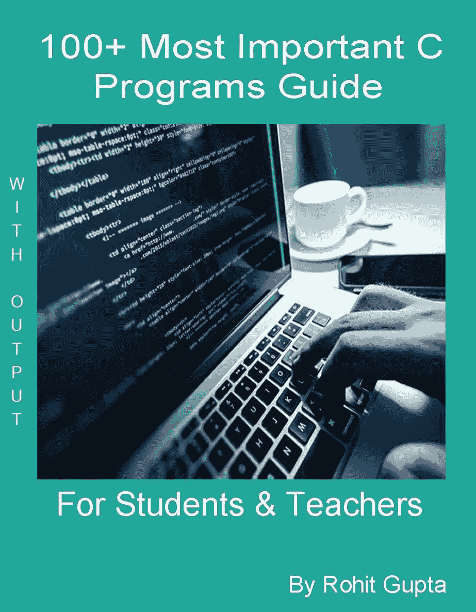

# 100+ 个重要的 C 程序带输出：学生与教师指南



## 目录

1. 编写一个执行加、减、乘、除程序。
2. 如何在不使用加法运算符的情况下两个数字？
3. 如何在不使用减法运算符的情况下减两个数字？
4. 编写一个交换两个数字的程序。
5. 编写一个计算数字各位和或计算数字和的程序。
6. 编写一个打印复数的程序。
7. 编写一个检查输入字母是否为元音的程序。
8. 编写一个检查给定整数是正数还是负数的程序。
9. 编写一个计算梯形面积的程序。
10. 编写一个使用函数（按值传递）交换两个数字的程序。
11. 编写一个寻找三个数中最大数的程序。
12. 编写一个使用三元运算符寻找四个数中最大数的程序。
13. 编写一个使用三元运算符寻找四个数中最小程序。
14. 编写一个使用动态内存分配查找最大元素的程序。
15. 编写一个打印 1 到 100 完美数的程序。
16. 编写一个反转给定数字的程序。
17. 编写一个计算数字的根或数字之和直到得到一位数的程序。
18. 编写一个不使用循环打印 1 到 n 数字的程序。
19. 编写一个使用 `for` 循环计算前 n 个自然数和的程序。
20. 编写一个检查数字是偶数还是奇数的程序。
21. 编写一个计算前 n 个奇数和偶数之和的程序。
22. 编写一个检查数字是否为强数（Strong number）的程序。
23. 编写一个使用数组升序实现的简单泡泡排序程序。
24. 如何在 C 中计算数字的幂。
25. 编写一个检查年份是否为闰年的程序。
26. 编写一个寻找数字最大公约数（HCF）和最小公倍数（LCM）的程序。
27. 编写一个打印乘法表的程序。
28. 编写一个使用 `break` 和 `continue` 打印 1-200 之间质数的程序。
29. 编写一个检查数字是否为质数的程序。
30. 编写一个寻找数字质因程序的。
31. 编写一个计算数字阶的程序。
32. 编写一个打印斐波那契数列的程序。
33. 编写一个打印 1 到 500 之间阿姆斯特数（Armstrong numbers）的程序。
34. 编写一个检查数字是否为阿姆斯特数的程序。
35. 编写一个使用自定义函数检查数字是否为质数或阿姆斯特数的程序。
36. 编写一个检查数字是否可以表示为两个数字之和的程序。
37. 编写一个检查数字是否为回文数的程序。
38. 编写一个反转数字并检查其是否为回文数的程序。
39. 编写一个寻找等差数列（A.P.）和的程序。
40. 编写一个寻找等比数列（G.P.）和的程序。
41. 编写一个寻找无限等比数列和的程序。
42. 编写一个寻找序列 1 + 2 + …. + n 之和的程序。
43. 编写一个寻找序列 1³ + 2³ + …. + n³ 和的程序。
44. 编写一个求二元方程根的程序。
45. 编写一个打印数字金字塔的程序。
46. 编写一个以杨斯加三角形模式打印数字的程序。
47. 编写一个以倒杨斯加三角形模式打印“*”的程序。
48. 编写一个以弗洛伊德三角形模式打印数字的程序。
49. 编写一个以弗洛伊德三角形模式打印字符的程序。
50. 编写一个以倒弗洛伊德三角形模式打印“*”的程序。
51. 编写一个打印菱图案的程序。
52. 编写一个使用二分查找在数组中搜索元素的程序。
53. 编写一个二进制转十进制的程序。
54. 编写一个十进制转八进制转换器程序。
55. 如何将大二进制数转换为十六进制。
56. 编写一个十六进制转二进制的程序。
57. 编写一个将八进制数转换为十进制数的程序。
58. 编写一个将数字的每个数字转换为英文单词的程序。
59. 编写一个两个二进制数相法的程序。
60. 编写一个打印任何名字首字母的程序。
61. 编写一个矩阵相加程序。
62. 编写一个寻找矩阵对角线元素和的程序。
63. 编写一个检查两个矩阵是否相等的程序。
64. 编写一个检查给定矩阵是否为单位矩阵的程序。
65. 编写一个检查给定矩阵是否为稀疏矩阵或稠密矩阵的程序。
66. 编写一个程序计算每行和每列元素的和。
67. 编写一个程序查找给定矩阵中奇数和偶数的频率。
68. 编写一个程序交换两个数组。
69. 编写一个程序打印下三角矩阵。
70. 编写一个程序打印上三角矩阵。
71. 编写一个程序两个矩阵相法。
72. 编写一个程序求矩阵的逆。
73. 编写一个程序求矩阵的转置。
74. 编写一个程序求矩阵行列式。
75. 编写一个程序找到数组中的最大元素。
76. 编写一个程序找到数组中的第二大。
77. 编写一个程序找到数组中的第二。
78. 编写一个程序在数组的指定位置插入元素。
79. 编写一个程序删除数组中的重复元素。
80. 编写一个程序从数组的指定位置删除元素。
81. 编写一个程序使用 `strcmp` 函数比较两个字符串。
82. 编写一个程序在不使用字符串函数的情况下比较两个字符串。
83. 编写一个程序使用 `strlen` 函数查找字符串长度。
84. 编写一个程序不使用库函数查找字符串长度。
85. 编写一个程序使用 `strcpy` 库函数复制字符串。
86. 编写一个程序不使用 `strcpy` 库函数复制字符串。
87. 编写一个程序使用 `strrev` 库函数反转字符串。
88. 编写一个程序不使用 `strrev` 库函数反转字符串。
89. 编写一个程序交换字符串。
90. 编写一个程序按字母排序字符串。
91. 编写一个程序找到字符串的回文。
92. 编写一个程序在不使用字符串函数的情况下找到字符串的回文。
93. 编写一个程序使用 `strcat` 字符串函数拼接字符串。
94. 编写一个程序不使用字符串函数进行字符串拼接。
95. 编写一个程序使用库函数检查输入的字符是否为大写字母。
96. 编写一个程序将大写字母转换为小写字母。
97. 编写一个程序删除字符串中的元音。
98. 编写一个程序统计给定字符串中大写字母、小写字母、特殊符号的数量。
99. 编写一个程序找到元音、辅音和空格的数量。
100. 编写一个程序检查两个字符串是否为字母异位。
101. 编写一个程序删除第二个字符串中所有出现在第一个字符串中的。
102. 编写一个程序分别使用递归和迭代反转字符串。
103. 编写一个程序接受用户的年、月、日并显示该日期是星期几。
104. 编写一个程序将字符串转换为 ASCII 值。
105. 编写一个程序将罗马数字转换为阿拉伯数字。
106. 编写一个程序将任何数字转换为英文单词。
107. 编写一个程序使用指针两个数字相加。
108. 编写一个程序使用引用传递两个两个数字。
109. 编写一个程序使用指针（引用传递）交换变量。
110. 编写一个程序使用指针计算数组元素的和。
111. 编写一个程序不使用 `size` 操作符查找结构体数据类型的大小。
112. 编写一个程序使用结构体存储并显示单个学生的信息。
113. 编写一个程序使用结构体读取并打印 50 个学生的详细信息。
114. 编写一个程序使用结构体和动态内存分配存储信息。
115. 编写一个程序通过向函数传递结构体打印两个复数的和。
116. 编写一个程序查看联合体（union）和结构体（structure）之间的区别。
117. 编写一个程序读取或打开文件。
118. 编写一个程序复制文件。
119. 编写一个程序合并两个文件。
120. 编写一个程序删除文件。
121. 编写一个 C 程序，使用 `fwrite()` 将结构体数组的所有成员写入文件。从文件中读取该数组并在屏幕上显示。
122. 编写一个程序向数据文件写入并从数据文件读取。
123. 编写一个程序合并多个文件并存储在一个文件中。
124. 编写一个程序查找文本文件的行数。
125. 编写一个程序替换文本文件中的指定行。
126. 编写一个程序从文本文件中删除特定行。
127. 编写一个程序实现呆滞排序（stooge sort）。
128. 编写一个程序使用递归获取两个数的最小公倍数（LCM）。
129. 编写一个程序使用递归求数的最大公约数（GCD）。
130. 编写一个程序使用递归获取数字的幂。
131. 编写一个程序使用递归求数字阶阶。
132. 编写一个程序使用递归打印斐波那契数列。
133. 编写一个程序使用递归将十进制数转换为二进制。
134. 编写一个程序使用递归找到数组中的最大数字。
135. 编写一个程序使用递归求数字的反转。
136. 编写一个显示 ATM 交易的程序。

## 快速选题

## 答案

## 面试问答

### 1. 编写一个执行加、减、乘、除法的程序。

```c
#include<stdio.h>
#include<conio.h>

int main()
{
    int first, second, add, subtract, multiply;
    float divide;
    printf("Enter two integers:\n");
    scanf("%d%d", &first, &second);
    add = first + second;
    subtract = first - second;
    multiply = first * second;
    divide = first / (float)second;
    printf("Sum = %d\n",add);
    printf("Difference = %d\n",subtract);
    printf("Multiplication = %d\n",multiply);
    printf("Division = %.2f\n",divide);
    return 0;
    getch();
}
```

示例输出：

```text
Enter two integers:
3
5
Sum = 8
Difference = -2
Multiplication = 15
Division = 0.60
```

### 2. 如何在不使用加法运算符的情况下两个数？

```c
#include<stdio.h>
#include<conio.h>

int main()
{
    int a,b;
    int sum;
    printf("Enter any two integers: ");
    scanf("%d%d",&a,&b);
    sum = a - ~b -1;
    printf("Sum of two integers: %d",sum);
    return 0;
    getch();
}
```

示例输出：

```text
Enter any two integers: 5, 10
Sum of two integers: 15
```

公式：

在 C 语言中，`~` 是按位取反运算符。它相当于：

`~b = -(b + 1)`

所以：

`a - ~b -1`

`= a-[-(b + 1)] -1`

`= a + b + 1 - 1`

`= a + b`

### 3. 如何在不使用减法运算符的情况下两个两个数？

```c
#include<stdio.h>
#include<conio.h>

int main()
{
    int a,b;
    int subtract;
    printf("Enter any two integers: ");
    scanf("%d%d",&a,&b);
    subtract = a + ~b + 1;
    printf("Difference of two integers: %d",subtract);
    return 0;
    getch();
}
```

示例输出：

```text
Enter any two integers: 5, 4
Difference of two integers: 1
```

公式：

在 C 语言中，`~` 是按位取反运算符。它相当于：

`~b = -(b + 1)`

所以：

`a + ~b +1`

`= a+[-(b + 1)] +1`

`= a - b - 1 + 1`

`= a - b`

### 4. 编写一个交换两个数的程序。

```c
#include<stdio.h>
#include<conio.h>

int main()
{
    int a,b,temp;
    printf("Enter any two integers: ");
    scanf("%d%d",&a,&b);
    printf("Before swapping: a = %d, b=%d",a,b);
    temp = a;
    a = b;
    b = temp;
    printf("\nAfter swapping: a = %d, b=%d",a,b);
    return 0;
    getch();
}
```

示例输出：

```text
Enter any two integers: 3, 6
Before swapping: a = 3, b=6
After swapping: a = 6, b=6
```

### 5. 编写一个计算数字各位位或计算数字之和的程序。

```c
#include<stdio.h>
#include<conio.h>

int main()
{
    int num,sum=0,r;
    printf("Enter a number: ");
    scanf("%d",&num);
    while(num)
    {
        r=num%10;
        num=num/10;
        sum=sum+r;
    }
    printf("Sum of digits of number:  %d",sum);
    return 0;
    getch();
}
```

示例输出：

```text
Enter a number: 123
Sum of digits of number:  6
```

### 6. 编写一个打印复数的程序。

```c
#include<stdio.h>
#include<conio.h>

int main()
{
    int a,b;
    printf("Enter the real part of complex number: ");
    scanf("%d",&a);
    printf("Enter the imaginary part of complex number: ");
    scanf("%d",&b);
    printf("\nComplex number is: %d%+di",a,b );
    return 0;
    getch();
}
```

示例输出：

```text
Enter the real part of complex number: 4
Enter the imaginary part of complex number: 2
Complex number is: 4+2i
```

复数的定义：复数是二维数，即由实部和虚部组成。复数写写为 `a + ib`，其中 `a` 和 `b` 是实数。

### 7. 编写一个检查输入是否为元元的程序。

```c
#include<stdio.h>
#include<conio.h>

int main()
{
    char ch;
    printf("Enter a character:");
    scanf("%c", &ch);
    if (ch == 'a' || ch == 'A' || ch == 'e' || ch == 'E' || ch == 'i' || ch == 'I' || ch =='o' || ch=='O' || ch == 'u' || ch == 'U')
    printf("%c is a vowel.\n", ch);
    else
    printf("%c is not a vowel.\n", ch);
    return 0;
    getch();
}
```

示例输出：

```text
Enter a character: i
i is a vowel
```

### 8. 编写一个检查给定整数是正是负的程序。

```c
#include<stdio.h>
#include<conio.h>

int main()
{
    int number;

    printf("Enter a number: \n");

    scanf("%d", &number);

    if (number >= 0)
        printf("%d is positive number \n", number);
    else
        printf("%d is negative number \n", number);

    getch();
}
```

示例输出：

```text
Enter a number: -4

-4 is negative number
```

### 9. 编写一个计算梯形面积的程序。


```c
#include<stdio.h>
#include<conio.h>

int main()
{
    float b1,b2,h;
    float area;
    printf("Enter the size of two bases and height of the trapezium: ");
    scanf("%f%f%f",b1,&b2,&h);
    area = 0.5 * ( b1 + b2 ) * h;
    printf("Area of trapezium is: %.3f",area);
    return 0;
    getch();
}
```

示例输出：

```
Enter the size of two bases and height of the trapezium: 5, 8, 3
Area of trapezium is: 19.500
```

梯形公式：`Area = (1/2) * (a + b) * h`

## 10. 编写一个使用函数（值传递）交换两个数的程序

```c
#include<stdio.h>
#include<conio.h>

void swap(int a, int b)
{
    int temp;
    temp = a;
    a = b;
    b = temp;
}

int main()
{
    int num1 = 10,num2 = 30;
    printf("Before swapping:\n num1 = %d\n num2 = %d\n",num1,num2);
    swap(num1,num2);
    printf("After swapping:\n num1 = %d\n num2 = %d \n",num1,num2);
    return 0;
    getch();
}
```

示例输出：

```
Before swapping:
num1 = 10
num2 = 30
After swapping:
num1 = 10
num2 = 30
```

（注：原文中的示例输出没有变化，这对于值传递来说是预期的。）

## 11. 编写一个寻找三个数之间最大值的程序

```c
#include<stdio.h>
#include<conio.h>

int main()
{
    int a,b,c;
    printf("\nEnter 3 numbers: ");
    scanf("%d %d %d",&a,&b,&c);
    if(a-b>0 && a-c>0)
    printf("\nGreatest is a :%d",a);
    else
    if(b-c>0)
    printf("\nGreatest is b :%d",b);
    else
    printf("\nGreatest is c :%d",c);
    return 0;
    getch();
}
```

示例输出：

```
Enter 3 numbers: 2, 6, 4
Greatest is b: 6
```

## 12. 编写一个使用三元运算符寻找四个数中最大值的程序

```c
#include<stdio.h>
# include<conio.h>

main( )
{
    int a,b,c,d,big;
    printf("Enter value a:");
    scanf("%d",&a);
    printf("Enter the value of b:");
    scanf("%d",&b);
    printf("Enter the value of c:");
    scanf("%d",&c);
    printf("Enter the value of d:");
    scanf("%d",&d);
    big=(a>b)?(a>c)?(a>d)?a:d:(c>d)?c:d:(b>c)?(b>d)?b:d:(c>d)?c:d;
    printf("Biggest of the given 4 numbers is: %d",big);
    getch();
}
```

示例输出：

```
Enter value a: 8
Enter the value of b: 4
Enter the value of c: 9
Enter the value of d: 6
Biggest of the given 4 numbers is: 9
```

### 三元运算符

三元运算符是一个接受三个参数的运算符。第一个参数是比较参数，第二个是为真时的结果，第三个是为假时的结果。它通常被称为条件运算符。

在计算机编程中，`?:` 是许多编程语言中基础条件表达式的一部分。

语法：`expression 1 ? expression 2 : expression 3`

## 13. 编写一个使用三元运算符寻找四个数中最小值的程序

```c
# include <stdio.h>
# include <conio.h>

main( )
{
    int a,b,c,d,small;
    printf("Enter value a: ");
    scanf("%d",&a);
    printf("Enter the value of b: ");
    scanf("%d",&b);
    printf("Enter the value of c: ");
    scanf("%d",&c);
    printf("Enter the value of d: ");
    scanf("%d",&d);
    small=(a<b)?(a<c)?(a<d)?a:d:(c<d)?c:d:(b<c)?(b<d)?b:d:(c<d)?c:d;
    printf("Smallest of the given 4 numbers is: %d",small);
    getch();
}
```

示例输出：

```
Enter value a: 5
Enter the value of b: 7
Enter the value of c: 3
Enter the value of d: 9
Smallest of the given 4 numbers is: 3
```

## 14. 编写一个使用动态内存分配寻找最大元素的程序

```c
#include <stdio.h>
#include <stdlib.h>
#include <conio.h>

int main()
{
    int i,n;
    float *data;
}
```

```c
printf("Enter total number of elements(1 to 100): ");
scanf("%d",&n);
data=(float*)calloc(n,sizeof(float));
if(data==NULL)
{
    printf("Error!!! memory not allocated.");
    exit(0);
}
printf("\n");
for(i=0;i<n;++i)
{
    printf("Enter Number %d: ",i+1);
    scanf("%f",data+i);
}
for(i=1;i<n;++i)
{
    if(*data<*(data+i))
        *data=*(data+i);
}
printf("Largest element = %.2f",*data);
return 0;
getch();
```

示例输出：

输入元素总个数 (1 到 100): 10

输入数字 1: 5

输入数字 2: 8

输入数字 3: 6.2

输入数字 4: 5.4

输入数字 5: 30

输入数字 6: -7

输入数字 7: -56

输入数字 8: 53

输入数字 9: 56

输入数字 10: 34

最大元素 = 56.00

### 动态内存分配

数组的确切大小在编译时是未知的，即编译器将编程语言编写的代码编译成可执行格式的时间。你最初声明的数组大小有时不足，有时又超过。动态内存分配允许程序在运行时获取更多内存空间，或者在不需要空间时释放空间。

虽然 C 语言本身没有任何动态分配内存的技术，但在`"stdlib.h"`下有 4 个库函数用于动态内存分配。

| 函数 | 函数用途 |

| :--- | :--- |

| `malloc()` | 分配请求的字节数并返回分配空间第一个字节的指针。语法：`ptr=(cast-type*)malloc(byte-size)` |

| `calloc()` | 为数组元素分配空间，初始化为零，然后返回内存指针。语法：`ptr=(cast-type*)calloc(n,element-size);` |

| `free()` | 释放之前分配的空间。语法：`free(ptr);` |

| `realloc()` | 改变之前分配的大小。语法：`ptr=realloc(ptr,newsize);` |

### 15. 写一个程序打印 1 到 100 之间的完美数

```c
#include<stdio.h>
#include<conio.h>
int main()
{
    int n,i,sum;
    printf("Perfect numbers are: ");
    for(n=1;n<=100;n++)
    {
        i=1;
        sum = 0;
        while(i<n)
        {
            if(n%i==0)
                sum=sum+i;
            i++;
        }
        if(sum==n)
        printf("%d ",n);
    }
    return 0;
    getch();
}
```

示例输出：

完美数有: 6, 28

#### 完美数的定义

什么是完美数？

完美数是一个正整数，其除该数本身以外的所有因数之和等于该数本身。例如，6 是一个完美数，因为 6 的因数是 1、2 和 3。它的因数之和为`1+2+3=6`。注意：6 是最小的完美数。下一个完美数是 28，因为`1+2+4+7+14=28`。一些完美数有：496, 8128。

### 16. 写一个程序反转给定的数字

```c
#include<stdio.h>
#include<conio.h>
int main()
{
    int num,r,reverse=0;
    printf("Enter any number: ");
    scanf("%d",&num);
    while(num)
    {
        r=num%10;
        reverse=reverse*10+r;
        num=num/10;
    }
    printf("Reversed of number: %d",reverse);
    return 0;
    getch();
}
```

示例输出：

输入任意数字: 12

反转后的数字: 21

### 17. 写一个程序找到数字的数根，或者当数字各位数字和不是一位数时的结果

```c
#include<stdio.h>
#include<conio.h>
int main()
{
    long int num,sum,r;
    printf("\nEnter any number:-");
    scanf("%ld",&num);
    while(num>10)
    {
        sum=0;
        while(num)
        {
            r=num%10;
            num=num/10;
            sum+=r;
        }
        if(sum>10)
            num=sum;
        else
            break;
    }
    printf("\nGeneric root of number:%ld",sum);
    return 0;
    getch();
}
```

示例输出：

输入任意数字: 731

数字的数根: 2

#### 数根 (Generic Root)

数字的数根定义为数字各位数字之和，直到得到一位数。例如：456 的数根为`4+5+6=15`，因为 15 是两位，所以`1+5=6`。

### 18. 写一个程序不使用循环打印从 1 到 n 的数字

```c
#include<stdio.h>
#include<conio.h>
void num(int);
int main()
{
    int n;
    printf("\nEnter number:");
    scanf("%d", &n);
    num(n);
    return 0;
}
void num(int n)
{
    static int c = 1;
    if (c == n+1)
        return;
    printf("%d", c);
    c++;
    num(n);
}
```

示例输出：

输入 n 数字: 100

1 2 3 4 5 6 7 8 9……50……100

### 19. 写一个程序使用 For 循环找到前 n 个自然数的和

```c
#include<stdio.h>
#include<conio.h>
int main()
{
    int num, n, sum = 0;
    printf("Enter the value of n: ");
    scanf("%d", &n);
    for (num = 1; num <= n; num++)
    {
        sum = sum + num;
    }
    printf("Sum = %d\n", sum);
    getch();
}
```

示例输出：

输入 n 的值: 50

Sum = 1275

### 20. 写一个程序检查数字是偶还是奇

```c
#include<stdio.h>
#include<conio.h>
int main()
{
    int n;
    printf("Input integer:\n");
    scanf("%d", &n);
    n%2 == 0 ? printf("Even\n") : printf("Odd\n");
    return 0;
    getch();
}
```

示例输出：

输入整数: 2

Even

输入整数: 3

Odd

### 21. 写一个程序计算到 n 的奇数的和

```c
#include<stdio.h>
#include<conio.h>
int main()
{
    int i, n, odd_sum = 0, even_sum = 0;
    printf("Enter the value of n:\n");
    scanf("%d", &n);
    for (i = 1; i <= n; i++)
    {
        if (i % 2 == 0)
            even_sum = even_sum + i;
        else
            odd_sum = odd_sum + i;
    }
    printf("Sum of odd numbers = %d\n", odd_sum);
    printf("Sum of even numbers = %d\n", even_sum);
    getch();
}
```

示例输出：

输入 n 的值: 10

奇数的和 = 25

偶数的和 = 30

### 22. 写一个程序检查一个数字是否为强数

```c
#include<stdio.h>
#include<conio.h>
int main()
{
    int num, i, r, sum, temp, min, max;
    printf("Enter minimum range: ");
    scanf("%d", &min);
    printf("Enter maximum range: ");
    scanf("%d", &max);
    printf("Strong numbers in range: ");
    for (num = min; num <= max; num++)
    {
        temp = num;
        sum = 0;
        while (temp)
        {
            i = 1;
            int f = 1;
            r = temp % 10;
            while (i <= r)
            {
                f = f * i;
                i++;
            }
            sum = sum + f;
            temp = temp / 10;
        }
        if (sum == num)
        printf("%d ", num);
    }
    return 0;
    getch();
}
```

示例输出：

输入最小范围: 100

输入最大范围: 10000

范围内的强数有: 145 405

#### 强数的定义

如果一个数字的各位阶乘之和等于其本身，则该数被称为强数。例如 145，因为`1! + 4! + 5! = 1 + 24 + 120 = 145`。

### 23. 写一个使用数组升序进行简单排序的程序


```c
#include<stdio.h>
#include<conio.h>
int main()
{
    int s, temp, i, j, a[20];
    printf("Enter total numbers of elements: ");
    scanf("%d", &s);
    printf("Enter %d elements: ", s);
    for (i = 0; i < s; i++)
    scanf("%d", &a[i]);
    for (i = s - 2; i >= 0; i--)
    {
        for (j = 0; j <= i; j++)
        {
            if (a[j] > a[j + 1])
            {
                temp = a[j];
                a[j] = a[j + 1];
                a[j + 1] = temp;
            }
        }
    }
    printf("After sorting: ");
    for (i = 0; i < s; i++)
    printf(" %d", a[i]);
    return 0;
    getch();
}
```

示例输出：

输入元素总个数: 5

输入 5 个元素: 6 2 0 11 9

排序后:  0 2 6 9 11

# 24. 如何在 C 中计算数字的幂

```c
#include<stdio.h>
#include<conio.h>
int main()
{
    int pow, num, i=1;
    long int sum=1;
    printf("\nEnter a number: ");
    scanf("%d", &num);
    printf("\nEnter power: ");
    scanf("%d", &pow);
}
```

```c
while(i<=pow)
{
    sum=sum*num;
    i++;
}
printf("\n%d to the power %d is: %ld",num,pow,sum);
return 0;
getch();
}
```

示例输出：

输入一个数字: 4

输入幂: 2

4 的 2 次方是: 16

# 25. 编写一个程序来检查年份是否为闰年

```c
#include<stdio.h>
#include<conio.h>
int main()
{
    int year;
    printf("Enter any year: ");
    scanf("%d",&year);
    if(((year%4==0)&&(year%100!=0))||(year%400==0))
    printf("%d is a leap year",year);
    else
    printf("%d is not a leap year",year);
    return 0;
    getch();
}
```

示例输出：

输入任意年份: 2010

2010 不是闰年

# 26. 编写一个程序寻找两个数字的最大公约数（HCF）和最小公倍数（LCM）

```c
#include<stdio.h>
#include<conio.h> 
int main()
{
    int a, b, x, y, t, hcf, lcm;
    printf("Enter two integers:\n");
    scanf("%d%d", &x, &y);
    a = x;
    b = y;
    while (b != 0)
    {
        t = b;
        b = a % b;
        a = t;
    }
    hcf = a;
    lcm = (x*y)/hcf;
    printf("Highest common factor of %d and %d = %d\n", x, y, hcf);
    printf("Least common multiple of %d and %d = %d\n", x, y, lcm);
    return 0;
    getch();
}
```

示例输出：

输入两个整数: 9, 24

9 和 24 的最大公约数 = 3

9 和 24 的最小公倍数 = 72

# 27. 编写一个程序打印乘法表

```c
#include<stdio.h>
#include<conio.h>
int main()
{
    int r,i,j,k;
    printf("Enter the number range: ");
    scanf("%d",&r);
    for(i=1;i<=r;i++)
    {
        for(j=1;j<=10;j++)
        printf("%d*%d=%d ",i,j,i*j);
        printf("\n");
    }
    return 0;
    getch();
}
```

示例输出：

输入数字范围: 5

1*1=1 1*2=2 1*3=3 1*4=4 1*5=5 1*6=6 1*7=7 1*8=8 1*9=9 1*10=10

2*1=2 2*2=4 2*3=6 2*4=8 2*5=10 2*6=12 2*7=14 2*8=16 2*9=18 2*10=20

3*1=3 3*2=6 3*3=9 3*4=12 3*5=15 3*6=18 3*7=21 3*8=24 3*9=27 3*10=30

4*1=4 4*2=8 4*3=12 4*4=16 4*5=20 4*6=24 4*7=28 4*8=32 4*9=36 4*10=40

5*1=5 5*2=10 5*3=15 5*4=20 5*5=25 5*6=30 5*7=35 5*8=40 5*9=45 5*10=50

# 28. 使用 `break` 和 `continue` 编写一个程序打印 1-200 之间的质数

```c
#include<conio.h>
#include<math.h>
#include<stdio.h>
int main()
{
    int i, j;
    i = 2;
    while ( i < 300 )
    {
        j = 2;
        while ( j < sqrt(i) )
        {
            if ( i % j == 0 )
            break;
            else
            {
                ++j;
                continue;
            }
        }
        if ( j > sqrt(i) )
        printf("%d\t", i);
        ++i;
    }
    return 0;
    getch();
}
```

示例输出：

注：2 是唯一的偶质数。

2, 3, 5, 7, 11, 13, 17, 19, 23, 29, 31, 37, 41, 43, 47, 53, 59, 61, 67, 71, 73, 79, 83, 89, 97, 101, 103, 107, 109, 113, 127, 131, 137, 139, 149, 151, 157, 163, 167, 173, 179, 181, 191, 193, 197, 199, 211, 223, 227, 229, 233, 239, 241, 251, 257, 263, 269, 271, 277, 281, 283, 293.

## 质数

大于 1 的自然数除了 1 和自身外没有其他因数。换句话说，我们可以说它只有 1 和自身两个因数。

例如：5

它们的因数是 1 和 5。

# 29. 编写一个程序检查一个数字是否为质数

```c
#include<stdio.h>
#include<conio.h>
int main()
{
    char c;
    int n;
    printf("Enter positive integer: ");
    scanf("%d",&n);
    printf("Enter to check Prime or Armstrong number: ");
    scanf(" %c",&c);
    if(c=='p' || c=='P')
    {
        if(prime(n))
        printf("%d is a prime number.",n);
        else
        printf("%d is not a prime number.",n);
    }
    return 0;
    getch();
}
```

示例输出：

输入正整数: 29

29 是质数。

# 30. 编写一个程序寻找一个数字的质因子

```c
#include<stdio.h>
#include<conio.h>
int main()
{
    int num,i=1,j,k;
    printf("\nEnter a number:");
    scanf("%d",&num);
    while(i<=num)
    {
        k=0;
        if(num%i==0)
        {
            j=1;
            while(j<=i)
            {
                if(i%j==0)
                    k++;
                j++;
            }
            if(k==2)
                printf("\n%d is prime factor",i);
        }
        i++;
    }
    return 0;
    getch();
}
```

示例输出：

输入数字: 27

3 是

正整数的质因子是能整除该整数的质数。

例如：15 的因数是 3 和 5（3×5=15）。

# 31. 编写一个程序寻找一个数字的阶乘

```c
#include<stdio.h>
#include<conio.h>
int Factorial(int);
int main()
{
    int i,factorial,num;
    printf("Enter a number: ");
    scanf("%d",&num);
    factorial = Factorial(num);
    printf("Factorial of %d is: %d",num,factorial);
    return 0;
    getch();
}
int Factorial(int num)
{
    int i,f=1;
    for(i=1;i<=num;i++)
    f=f*i;
    return f;
}
```

示例输出：

输入数字: 8

8 的阶乘是: 40320

阶乘（`n!`）由 1 到 `n` 的数字乘积表示。

当 `n>0` 时，`n! = 1×2×3...n`

# 32. 编写一个程序打印斐波那契数列

```c
#include<stdio.h>
#include<conio.h>
int main()
{
    int k,r;
    long i=0,j=1,f;
    printf("Enter the number range:");
    scanf("%d",&r);
    printf("FIBONACCI: ");
    for(k=2;k<r;k++)
    {
        f=i+j;
        i=j;
        j=f;
        printf(" %ld",j);
    }
    return 0;
    getch();
}
```

示例输出：

输入数字范围: 15

斐波那契数列: 0 1 2 3 5 8 13 21 34 55 89 144 233 377

# 33. 编写一个程序打印 1 到 500 的阿姆斯特数

```c
#include<stdio.h>
#include<conio.h>
int main()
{
    int num,r,sum,temp;
    for(num=1;num<=500;num++)
    {
        temp=num;
        sum = 0;
        while(temp!=0)
        {
            r=temp%10;
            temp=temp/10;
            sum=sum+(r*r*r);
        }
        if(sum==num)
        printf("%d ",num);
    }
    return 0;
    getch();
}
```

示例输出：

1 153 370 371 407

## 什么是阿姆斯特数？

各位数字数字的位数幂之和等于该本身的数字被称为阿姆斯特数。

例如：153

153 的位数是 3，

且 `1³ + 5³ + 3³ = 1 + 125 + 27 = 153`

# 34. 编写一个程序检查一个数字是否为阿姆斯特数

```c
#include<stdio.h>
#include<conio.h>
int main()
{
    int n, n1, rem, num=0;
    printf("Enter a positive integer: ");
    scanf("%d", &n);
    n1=n;
    while(n1!=0)
    {
        rem=n1%10;
        num+=rem*rem;
        n1/=10;
    }
    if(num==n)
    printf("%d is an Armstrong number",n);
    else
    printf("%d is not an Armstrong number",n);
    return 0;
    getch();
}
```

示例输出：

输入正整数: 143

143 不是阿姆斯特数

# 35. 编写一个程序使用用户自定义函数检查一个数字是否为质数或阿姆斯特数

```c
#include<stdio.h>
#include<conio.h>
int prime(int);
int arm(int);
int main()
{
    char c;
    int n;
    printf("Enter positive integer: ");
    scanf("%d",&n);
    printf("Enter to check Prime or Armstrong number: ");
    scanf(" %c",&c);
    if(c=='p' || c=='P')
    {
        if(prime(n))
        printf("%d is a prime number.",n);
        else
        printf("%d is not a prime number.",n);
    }
    if(c=='a' || c=='A')
    {
        if(arm(n))
        printf("%d is an Armstrong number.",n);
        else
        printf("%d is not an Armstrong number.",n);
    }
    return 0;
}
int prime(int n)
{
    int i, flag=1;
    for(i=2;i<=n/2;++i)
    {
        if(n%i==0)
        {
            flag=0;
            break;
        }
    }
    return flag;
}
int arm(int n)
{
    int num=0, temp, flag=0;
    temp=n;
    while(n!=0)
    {
        num+=(n%10)*(n%10)*(n%10);
        n/=10;
    }
    if(num==temp)
        flag=1;
    return flag;
}
```

输入 `P` 检查质数，输入 `A` 检查阿姆斯特朗数：a

143 不是阿姆斯特斯特数。

# 36. 写一个程序检查一个数是否可以表示为两个质数之和


## C 语言经典程序示例

### 36. 写一个程序验证一个偶数可以表示为两个素数之和（哥德巴赫猜想）。

```c
#include<stdio.h>
#include<conio.h>

int prime(int n);

int main()
{
    int n, i, flag=0;
    printf("Enter a positive integer: ");
    scanf("%d",&n);
    for(i=2; i<=n/2; ++i)
    {
        if (prime(i)!=0)
        {
            if ( prime(n-i)!=0)
            {
                printf("%d = %d + %d\n", n, i, n-i);
                flag=1;
            }
        }
    }
    if (flag==0)
    printf("%d can't be expressed as sum of two prime numbers.",n);
    return 0;
    getch();
}
int prime(int n)
{
    int i, flag=1;
    for(i=2; i<=n/2; ++i)
    if(n%i==0)
        flag=0;
    return flag;
}
```

示例输出：

```
Enter a positive integer: 34
34 = 3 + 31
34 = 5 + 29
34 = 11 + 23
34 = 17 + 17
```

### 37. 写一个程序检查一个数是否为回文数。

```c
#include<stdio.h>
#include<conio.h>

int main()
{
    int n, reverse = 0, temp;
    printf("Enter a number:\n");
    scanf("%d",&n);
    temp = n; 
    while( temp != 0 )
    {
        reverse = reverse * 10;
        reverse = reverse + temp%10;
        temp = temp/10;
    }
    if ( n == reverse )
    printf("%d is a palindrome number.\n", n);
    else
    printf("%d is not a palindrome number.\n", n);
    return 0;
    getch();
}
```

示例输出：

```
Enter a number: 123321
123321 is a palindrome number.

Enter a number: 123456
123456 is not a palindrome number.
```

**回文数**：回文数或数字回文数是指其数字反转后保持不变的数字。例如`16461`，它是“对称”的。

### 38. 写一个程序反转一个数并检查它是否为回文数。

```c
#include<stdio.h>
#include<conio.h>

int main()
{
    int num, temp, remainder, reverse = 0;
    printf("Enter an integer: ");
    scanf("%d", &num);
    temp = num;
    while (num > 0)
    {
        remainder = num % 10;
        reverse = reverse * 10 + remainder;
        num /= 10;
    }
    printf("Given number is = %d\n", temp);
    printf("Its reverse is  = %d\n", reverse);
    if (temp == reverse)
    printf("Number is a palindrome \n");
    else
    printf("Number is not a palindrome \n");
    getch();
}
```

示例输出：

```
Enter an integer: 2476
Given number is = 2476
Its reverse is  = 6742
Number is not a palindrome
```

### 39. 写一个程序求等差数列（A.P. series）的和。

```c
#include<stdio.h>
#include<conio.h>
int main()
{
    int a,d,n,i,tn;
    int sum=0;
    printf("Enter the first number of A.P. series: ");
    scanf("%d",&a);
    printf("Enter the total numbers in A.P. series: ");
    scanf("%d",&n);
    printf("Enter the common difference of A.P. series: ");
    scanf("%d",&d);
    sum = ( n * ( 2 * a + ( n -1 ) * d )/ 2;
    tn = a + (n-1) * d;
    printf("Sum of the series A.P.: ");
    for(i=a;i<=tn; i= i + d )
    {
        if(i != tn)
        printf("%d + ",i);
        else
        printf("%d = %d ",i,sum);
    }
    return 0;
    getch();
}
```

示例输出：

```
Enter the first number of A.P. series: 1
Enter the total numbers in A.P. series: 5
Enter the common difference of A.P. series: 3
Sum of the series: 1 + 4 + 7 + 10 + 13 = 35
```

**等差数列（A.P.）定义**：一组数字，其中任意两个相邻数之差恒等于同一个常数。这个常数被称为公差。等差数列示例：`5 10 15 20 25`，因为任意两个相邻数的差都是`5`。等差数列求和公式为：`Sn= n/2(2a + (n-1) d)`，通项公式为：`Tn= a + (n-1) d`。

### 40. 写一个程序求等比数列（G.P. series）的和。

```c
#include<stdio.h>
#include<math.h>
#include<conio.h>
int main()
{
    float a,r,tn;
    int n;
    float sum=0;
    printf("Enter the first number of G.P. series: ");
    scanf("%f",&a);
    printf("Enter the total numbers in G.P. series: ");
    scanf("%d",&n);
    printf("Enter the common ratio of G.P. series: ");
    scanf("%f",&r);
    sum = (a*(1 - pow(r,n+1)))/(1-r);
    tn = a * (1 - pow(r,n-1));
    printf("tn term of G.P.: %f",tn);
    printf("\nSum of G.P.: %f",sum);
    return 0;
    getch();
}
```

示例输出：

```
Enter the first number of G.P. series: 1
Enter the total numbers in G.P. series: 5
Enter the common ratio of G.P. series: 2
tn term of G.P.: 15.000000
Sum of G.P. : 63.000000
```

**等比数列（G.P.）定义**：一组数字，其中任意两个相邻数的比恒等于同一个常数。这个常数被称为公比。等比数列示例：`2 4 8 16 32 64`，因为任意两个相邻数的比都是`2`。等比数列求和公式为：`Sn=a(1–rn+1)/(1-r)`，如果`1 > r`，则`= a/(r-1)`，如果`r > 1`。通项公式为：`Tn= arn-1`。

### 41. 写一个程序求无限等比数列的和。

```c
#include<stdio.h>
#include<conio.h>
int main()
{
    float a,r;
    float sum=0;
    printf("Enter the first number of G.P. series: ");
    scanf("%f",&a);
    printf("Enter the common ratio of G.P. series: ");
    scanf("%f",&r);
    if(1 > r)
        sum = a/(1-r);
    else
        sum = a/(r-1);
    printf("\nSum of infinite G.P. series: %f",sum);
    return 0;
    getch();
}
```

示例输出：

```
Enter the first number of G.P. series: 1
Enter the common ratio of G.P. series: .5
Sum of infinite G.P. series: 2.000000

Enter the first number of G.P. series: 5
Enter the common ratio of G.P. series: 2
Sum of infinite G.P. series: -5.000000
```

### 42. 写一个程序求数列 1 + 2 + …. n 的和。

```c
#include<stdio.h>
#include<conio.h>
int main()
{
    int n,i;
    int sum=0;
    printf("Enter n i.e. max values of series: ");
    scanf("%d",&n);
    sum = (n * (n + 1)) / 2;
    printf("Sum of the series: ");
    for(i =1;i <= n;i++)
    {
        if(i!=n)
        printf("%d + ",i);
        else
        printf("%d = %d ",i,sum);
    }
    return 0;
    getch();
}
```

示例输出：

```
Enter n i.e. max values of series: 5
Sum of the series: 1 + 2 + 3 + 4 + 5 = 15
```

### 43. 写一个程序求数列 1³ + 2³ + …. n³ 的和。

```c
#include<math.h>
#include<conio.h>
int main()
{
    int n,i;
    int sum=0;
    printf("Enter the n i.e. max values of series: ");
    scanf("%d",&n);
    sum = pow(((n * (n + 1)) / 2),2);
    printf("Sum of the series : ");
    for(i =1;i<=n;i++)
    {
        if(i != n)
        printf("%d³ + ",i);
        else
        printf("%d³ = %d ",i,sum);
    }
    return 0;
    getch();
}
```

示例输出：

```
Enter the n i.e. max values of series: 3
Sum of the series : 1³ + 2³ + 3³ = 36
```

数学公式：

数列`1 + 2 + 3 + … n`的和 = `n (n+1)/2`

数学公式：

数列`1³ + 2³ + 3³ + … n³`的和 = `(n (n+1)/2)2`

### 44. 写一个程序求二次方程的根。

```c
#include<stdio.h>
#include<math.h>
#include<conio.h>
int main()
{
    float a, b, c, determinant, r1,r2, real, imag;
    printf("Enter coefficients a, b and c: ");
    scanf("%f%f%f",&a,&b,&c);
    determinant=b*b-4*a*c;
    if (determinant>0)
    {
        r1= (-b+sqrt(determinant))/(2*a);
        r2= (-b-sqrt(determinant))/(2*a);
        printf("Roots are: %.2f and %.2f",r1 , r2);
    }
    else if (determinant==0)
    {
        r1 = r2 = -b/(2*a);
        printf("Roots are: %.2f and %.2f", r1, r2);
    }
    else
    {
        real= -b/(2*a);
        imag = sqrt(-determinant)/(2*a);
        printf("Roots are: %.2f+%.2fi and %.2f-%.2fi", real, imag, real, imag);
    }
    return 0;
    getch();
}
```

示例输出：

```
Enter coefficients a, b and c: 2 4 6
Roots are: -1.00+1.41i and -1.00-1.41i
```

### 45. 写一个程序打印数字矩形金字塔。

```c
#include<stdio.h>
#include<conio.h>

int main()
{
    int number, row, col;
    printf("\nEnter Number of Rows to be display : ");
    scanf("%d", &number);
    for (row = 1; number >= row; row++)
    {
        for (col = 1; col <= number; col++)
            printf("%d\t", row);
        printf("\n");
    }
    return 0;
    getch();
}
```

示例输出：

```
Enter Number of Rows to be display: 5
1       1       1       1       1
2       2       2       2       2
3       3       3       3       3
4       4       4       4       4
5       5       5       5       5
```

### 46. 写一个程序以杨斯卡三角形的模式打印数字。

```c
#include<stdio.h>
#include<conio.h>

long fact(int);

int main()
{
    int line,i,j;
    printf("Enter the no. of lines: ");
    scanf("%d",&line);
    for(i=0;i<line;i++)
    {
        for(j=0;j<line-i-1;j++)
            printf(" ");
        for(j=0;j<=i;j++)
            printf("%ld ",fact(i)/(fact(j)*fact(i-j)));
        printf("\n");
    }
    return 0;
    getch();
}

long fact(int num)
{
    long f=1;
    int i=1;
    while(i<=num)
    {
        f=f*i;
        i++;
    }
    return f;
}
```

示例输出：

```
Enter the no. of lines: 8
1
1 1
1 2 1
1 3 3 1
1 4 6 4 1
1 5 10 10 5 1
1 6 15 20 15 6 1
1 7 21 35 35 21 7 1
```

### 47. 写一个程序以“*”作为倒置杨斯卡三角形的模式打印。


```c
#include<stdio.h>
#include<conio.h>

int main()
{
    int rows,i,j,space;
    printf("Enter number of rows: ");
    scanf("%d",&rows);
    for(i=rows;i>=1;--i)
    {
        for(space=0;space<rows-i;++space)
            printf("  ");
        for(j=i;j<=2*i-1;++j)
            printf("* ");
        for(j=0;j<i-1;++j)
            printf("* ");
        printf("\n");
    }
    return 0;
    getch();
}
```

示例输出：

```
Enter number of rows: 8
***************
*************
***********
*********
*******
*****
***
*
```

## 48. 写一个程序以弗洛伊德三角形的模式打印数字

```c
#include<stdio.h>
#include<conio.h>

int main()
{
    int i,j,r,k=1;
    printf("Enter the range: ");
    scanf("%d",&r);
    printf("FLOYD'S TRIANGLE\n");
    for(i=1;i<=r;i++)
    {
        for(j=1;j<=i;j++,k++)
            printf("%d",k);
        printf("\n");
    }
    return 0;
    getch();
}
```

示例输出：

```
Enter the range: 8
FLOYD'S TRIANGLE
1
2 3
4 5 6
7 8 9 10
11 12 13 14 15
16 17 18 19 20 21
22 23 24 25 26 27 28
29 30 31 32 33 34 35 36
```

## 49. 写一个程序以弗洛伊德三角形的模式打印字符

```c
#include <stdio.h>
#include <conio.h>

main()
{
    char i,j;
    for(i=65;i<=70;i++)
    {
        for(j=65;j<=i;j++)
            printf("%c",j);
        printf("\n");
    }
    getch();
}
```

示例输出：

```
A
AB
ABC
ABCD
ABCDE
ABCDEF
```

## 50. 写一个程序以“*”作为倒置弗洛伊德模式的模式打印

```c
#include<stdio.h>
#include<conio.h>

int main()
{
    int i,j,rows;
    printf("Enter the number of rows: ");
    scanf("%d",&rows);
    for(i=rows;i>=1;--i)
    {
        for(j=1;j<=i;++j)
            printf("* ");
        printf("\n");
    }
    return 0;
    getch();
}
```

示例输出：

```
Enter the number of rows: 10
**********
*********
*******
******
****
**
*
```

## 51. 写一个程序打印菱形模式

```c
#include<stdio.h>
#include<conio.h>

int main()
{
    int n, c, k, space = 1;
    printf("Enter number of rows\n");
    scanf("%d", &n);
    space = n - 1;
    for (k = 1; k <= n; k++)
    {
        for (c = 1; c <= space; c++)
            printf(" ");
        space--;
        for (c = 1; c <= 2*k-1; c++)
            printf("*");
        printf("\n");
    }
    space = 1;
    for (k = 1; k <= n - 1; k++)
    {
        for (c = 1; c <= space; c++)
            printf(" ");
        space++;
        for (c = 1; c <= 2*k-1; c++)
            printf("*");
        printf("\n");
    }
    return 0;
    getch();
}
```

示例输出：

```
Enter number of rows
10
         *
        ***
       *****
      ******
     **********
   **************
*******************
  **************
   ************
    **********
     ********
       *****
```

## 52. 写一个程序使用二分查找在数组中搜索元素

```c
#include<stdio.h>
#include<conio.h>

int main()
{
    int a[10],i,n,m,c=0,l,u,mid;
    printf("Enter the size of an array: ");
    scanf("%d",&n);
    printf("Enter the elements in ascending order: ");
    for(i=0;i<n;i++)
    {
        scanf("%d",&a[i]);
    }
    printf("Enter the number to search: ");
    scanf("%d",&m);
    l=0,u=n-1;
    while(l<=u)
    {
        mid=(l+u)/2;
        if(m==a[mid])
        {
            c=1;
            break;
        }
        else if(m<a[mid])
        {
            u=mid-1;
        }
        else
            l=mid+1;
    }
    if(c==0)
        printf("The number is not found.");
    else
        printf("The number is found.");
    return 0;
    getch();
}
```

示例输出：

```
Enter the size of an array: 5
Enter the elements in ascending order: 4 7 8 11 21
Enter the number to search: 11
The number is found.
```

## 53. 写一个程序二进制转十进制

```c
#include<stdio.h>
#include<conio.h>

int main()
{
    long binaryNumber,decimalNumber=0,j=1,remainder;
    printf("Enter any binary number: ");
    scanf("%ld",&binaryNumber);
    while(binaryNumber!=0)
    {
        remainder=binaryNumber%10;
        decimalNumber=decimalNumber+remainder*j;
        j=j*2;
        binaryNumber=binaryNumber/10;
    }
    printf("Equivalent decimal value: %ld",decimalNumber);
    return 0;
    getch();
}
```

示例输出：

```
Enter any binary number: 1101
Equivalent decimal value: 13
```

公式：
二进制系统：它是 2 进制，使用数字 0 和 1。
十进制系统：它是 10 进制，使用数字 0 到 9。
从二进制转十进制的方法：将每个位数字从右侧乘以 1, 2, 4, 8, 16 等，然后相加。
二进制转十进制示例：
例如，我们要将二进制数 10111 转换为十进制：
Step 1: 1 * 1 = 1
Step 2: 1 * 2 = 2
Step 3: 1 * 4 = 4
Step 4: 1 * 8 = 8
Step 5: 0 * 16 = 0
Step 6: 1 * 32 = 32
其十进制值：1 + 2 + 4 + 8 + 0 + 32 = 47
即 (101111)2 = (47)10

## 54. 写一个十进制转八进制的转换器

```c
#include<stdio.h>
#include<conio.h>

int main()
{
    long decimalNumber,remainder,quotient;
    int octalNumber[100],i=1,j;
    printf("Enter any decimal number: ");
    scanf("%ld",&decimalNumber);
    quotient=decimalNumber;
    while(quotient!=0)
    {
        octalNumber[i++]= quotient % 8;
        quotient = quotient / 8;
    }
    printf("Equivalent octal value of decimal number %ld: ",decimalNumber);
    for(j = i -1;j> 0;j--)
        printf("%d",octalNumber[j]);
    return 0;
    getch();
}
```

示例输出：

```
Enter any decimal number: 50
Equivalent octal value of decimal number 50: 62
```

算法：
八进制系统：它是 8 进制，使用数字 0 到 7。
十进制系统：它是 10 进制，使用数字 0 到 9。
十进制转八进制转换方法：
Step 1: 将原始十进制除以 8
Step 2: 将商除以 8
Step 3: 重复步骤 2，直到商为 0。
结果八进制数将是每步余数的倒序排列。
十进制转八进制示例：
例如，我们将十进制数 525 转换为八进制。
Step 1: 525 / 8 Remainder : 5 , Quotient : 65
Step 2: 65 / 8 Remainder : 1 , Quotient : 8
Step 3: 8 / 8 Remainder : 0 , Quotient : 1
Step 4: 1 / 8 Remainder : 1 , Quotient : 0
所以对应的八进制数是：1015
即 (525)10 = (1015)8

## 55. 如何将大位二进制数转换为十六进制

```c
#include<stdio.h>
#include<conio.h>
#define MAX 1000

int main()
{
    char binaryNumber[MAX],hexaDecimal[MAX];
    int temp;
    long int i=0,j=0;
    printf("Enter any number binary number: ");
    scanf("%s",binaryNumber);
    while(binaryNumber[i])
    {
        binaryNumber[i] = binaryNumber[i] -48;
        ++i;
    }
    --i;
    while(i-2>=0)
    {
        temp = binaryNumber[i-3] *8 + binaryNumber[i-2] *4 + binaryNumber[i-1] *2 + binaryNumber[i];
        if(temp > 9)
            hexaDecimal[j++] = temp + 55;
        else
            hexaDecimal[j++] = temp + 48;
        i=i-4;
    }
    if(i == 1)
        hexaDecimal[j] = binaryNumber[i-1] *2 + binaryNumber[i] + 48;
    else if(i==0)
        hexaDecimal[j] = binaryNumber[i] + 48;
    else
        --j;
    printf("Equivalent hexadecimal value: ");
    while(j>=0)
    {
        printf("%c",hexaDecimal[j--]);
    }
    return 0;
    getch();
}
```

示例输出：

```
Enter any number any binary number: 1010011011100011110
001001111011110001000100011101110111011110
Equivalent hexadecimal value: 14DC789EF111DDDE
```

公式：
二进制转十六进制的转换方法：
**步骤 1**: 将二进制数从右侧每 4 位一组进行排列。
**步骤 2**: 将每组替换为以下值：

| 二进制数 | 十六进制值 |
| :--- | :--- |
| 0000 | 0 |
| 0001 | 1 |
| 0010 | 2 |
| 0011 | 3 |
| 0100 | 4 |
| 0101 | 5 |
| 0110 | 6 |
| 0111 | 7 |
| 1000 | 8 |
| 1001 | 9 |
| 1010 | A |
| 1011 | B |
| 1100 | C |
| 1101 | D |
| 1110 | E |
| 1111 | F |

二进制转十六进制的示例：
例如，我们想要将二进制数 `11011010101001101` 转换为十六进制。
**步骤 1**: `0001 1011 0101 0100 1101`
**步骤 2**: `1 B 5 4 D`
所以 `(1011010101001101)2 = (1B54D)16`

## 56. 写一个用于十六进制转二进制的程序

```c
#include<stdio.h>
#include<conio.h>
#define MAX 1000

int main()
{
    char binaryNumber[MAX],hexaDecimal[MAX];
    long int i=0;
    printf("Enter any hexadecimal number: ");
    scanf("%s",hexaDecimal);
    printf("\nEquivalent binary value: ");
    while(hexaDecimal[i])
    {
        switch(hexaDecimal[i])
        {
            case '0': printf("0000"); break;
            case '1': printf("0001"); break;
            case '2': printf("0010"); break;
            case '3': printf("0011"); break;
            case '4': printf("0100"); break;
            case '5': printf("0101"); break;
            case '6': printf("0110"); break;
            case '7': printf("0111"); break;
            case '8': printf("1000"); break;
            case '9': printf("1001"); break;
            case 'A': printf("1010"); break;
            case 'B': printf("1011"); break;
            case 'C': printf("1100"); break;
            case 'D': printf("1101"); break;
            case 'E': printf("1110"); break;
            case 'F': printf("1111"); break;
            default: printf("\nInvalid hexadecimal digit %c ",hexaDecimal[i]); return 0;
        }
        i++;
    }
    return 0;
    getch();
}
```

示例输出：

```
Enter any hexadecimal number: 1B54D
Equivalent binary value: 00011011010101001101
```

算法：
十六进制系统：它是 16 进制，使用数字 0 到 9 和字母 A 到 F。
二进制系统：它是 2 进制，使用数字 0 和 1。
十六进制转二进制转换方法：将每个十六进制位替换为对应的 4 位二进制数。
十六进制转二进制示例：
例如，我们将十六进制数 `1B54D` 转换为二进制。
`1` → `0001`
`B` → `1011`
`5` → `0101`
`4` → `0100`
`D` → `1101`
所以 `(1B54D)16 = (00011011010101001101)2`


# 56. 写一个将十六进制转换为二进制的程序

```c
case 'E': printf("1110"); break;
case 'F': printf("1111"); break;
case 'a': printf("1010"); break;
case 'b': printf("1011"); break;
case 'c': printf("1100"); break;
case 'd': printf("1101"); break;
case 'e': printf("1110"); break;
case 'f': printf("1111"); break;
default: printf("\nInvalid digit %c ",hexaDecimal[i]);
    return 0;
}
i++;
```
```c
return 0;
getch();
```

### Sample output
```
Enter any hexadecimal number: AD5
Equivalent binary value: 101011010101
```

### 公式:（使用上方表格）
#### 十六进制转二进制的转换方法：
要将十六进制数转换为二进制，使用十六进制转二进制表将每个十六进制位替换为对应的二进制数。

#### 十六进制转二进制的示例：
例如，我们想要将十六进制数 `65B2` 转换为二进制。为此，我们将每个十六进制位替换为二进制值：
十六进制数：`6 5 B 2`
二进制值：`0110 0101 1011 0010`
所以 `(65B2)16 = (0110010110110010)2`

---

# 57. 写一个将八进制转换为十进制的程序

```c
#include<stdio.h>
#include<math.h>
#include<conio.h>
int main()
{
    long int octal,decimal =0;
    int i=0;
    printf("Enter any octal number: ");
    scanf("%ld",&octal);
    while(octal!=0)
    {
        decimal = decimal + (octal % 10) * pow(8,i++);
        octal = octal/10;
    }
    printf("Equivalent decimal value: %ld",decimal);
    return 0;
    getch();
}
```

### Sample output
```
Enter any octal number: 346
Equivalent decimal value: 230
```

### 公式
#### 八进制转十进制的转换方法：
将八进制数转换为十进制，将八进制数的每个位从右侧分别乘以`8⁰`、`8¹`、`8²`、`8³`等，然后求和。

#### 八进制转十进制的示例：
例如，将八进制数`3401`转换为十进制数。

**步骤 1**: `1 * 8⁰ = 1`
**步骤 2**: `0 * 8¹ = 0`
**步骤 3**: `4 * 8² = 256`
**步骤 4**: `3 * 8³ = 1536`

**和** = `1 + 0 + 256 + 1536 = 1793`

所以 `(3401)8 = (1793)10`

---

# 58. 写一个将数字的每个位转换为英文单词的程序

```c
#include<stdio.h>
#include<conio.h>

int main()
{
    int number,i=0,digit;
    char *word[1000];
    printf("Enter any integer: ");
    scanf("%d",&number);
    while(number)
    {
        digit = number %10;
        number = number /10;
        switch(digit)
        {
            case 0: word[i++] = "zero"; break;
            case 1: word[i++] = "one"; break;
            case 2: word[i++] = "two"; break;
            case 3: word[i++] = "three"; break;
            case 4: word[i++] = "four"; break;
            case 5: word[i++] = "five"; break;
            case 6: word[i++] = "six"; break;
            case 7: word[i++] = "seven"; break;
            case 8: word[i++] = "eight"; break;
            case 9: word[i++] = "nine"; break;
        }
    }
    for(j=i-1;j>=0;j--)
    {
        printf("%s ",word[j]);
    }
    return 0;
    getch();
}
```

### Sample output
```
Enter any integer: 2345120
two four five one zero
```

---

# 59. 写一个二进制数乘法的程序

```c
#include<stdio.h>
#include<conio.h>
int binaryAddition(int,int);

int main()
{
    long int binary1,binary2,multiply=0;
    int digit,factor=1;
    printf("Enter first binary number: ");
    scanf("%ld",&binary1);
    printf("Enter second binary number: ");
    scanf("%ld",&binary2);
    while(binary2!=0)
    {
        digit = binary2 %10;
        if(digit ==1)
        {
            binary1=binary1*factor;
            multiply=binaryAddition(binary1,multiply);
        }
        else
            binary1=binary1*factor;
        binary2 = binary2/10;
        factor = 10;
    }
    printf("Product of two binary numbers: %ld",multiply);
    return 0;
    getch();
}

int binaryAddition(int binary1,int binary2)
{
    int i=0,remainder = 0,sum[20];
    int binarySum=0;
    while(binary1!=0||binary2!=0)
    {
        sum[i++]=(binary1 %10 + binary2 %10 + remainder )% 2;
        remainder=(binary1 %10 + binary2 %10 + remainder ) / 2;
        binary1 = binary1/10;
        binary2 = binary2/10;
    }
    if(remainder!=0)
        sum[i++] = remainder;
    --i;
    while(i>=0)
        binarySum = binarySum*10 + sum[i--];
    return binarySum;
}
```

### Sample output
```
Enter first binary number: 1101
Enter second binary number: 11
Product of two binary numbers: 10011
```

---

# 61. 写一个程序计算两个矩阵的加法

```c
for(j=0;j<3;j++)
    printf("%d\t",a[i][j]);
}
printf("\nThe Second matrix is:\n");
for(i=0;i<3;i++)
{
    printf("\n");
    for(j=0;j<3;j++)
        printf("%d\t",b[i][j]);
}
for(i=0;i<3;i++)
    for(j=0;j<3;j++)
        c[i][j]=a[i][j]+b[i][j];
printf("\nThe Addition of two matrix is:\n");
for(i=0;i<3;i++)
{
    printf("\n");
    for(j=0;j<3;j++)
        printf("%d\t",c[i][j]);
}
return 0;
getch();
```

### 示例输出
输入第一个矩阵：`2 4 6 8 0 1 3 5 7`
输入第二个矩阵：`1 2 3 4 5 6 7 8 9`

第一个矩阵是：
```
2      4      6
8      0      1
3      5      7
```

第二个矩阵是：
```
1      2      3
4      5      6
7      8      9
```

两个矩阵相加的和是：
```
3      6      9
12     5      7
10     13     16
```

---

# 62. 写一个程序求矩阵对角线元素之和

```c
#include<stdio.h>
#include<conio.h>

int main()
{
    int a[10][10],i,j,sum=0,m,n;
    printf("\nEnter the row and column of matrix: ");
    scanf("%d %d",&m,&n);
    printf("\nEnter the elements of matrix: ");
    for(i=0;i<m;i++)
        for(j=0;j<n;j++)
            scanf("%d",&a[i][j]);
    printf("\nThe matrix is\n");
    for(i=0;i<m;i++)
    {
        printf("\n");
        for(j=0;j<m;j++)
        {
            printf("%d\t",a[i][j]);
        }
    }
    for(i=0;i<m;i++)
    {
        for(j=0;j<n;j++)
        {
            if(i==j)
                sum=sum+a[i][j];
        }
    }
    printf("\n\nSum of the diagonal elements of a matrix is: %d",sum);
    return 0;
    getch();
}
```

### 示例输出
输入矩阵的行和列：`3 3`
输入矩阵的元素：`2 3 5 6 7 9 2 6 7`

矩阵是
```
2      3      5
6      7      9
2      6      7
```

矩阵的对角线元素之和为：`16`

---

# 63. 写一个程序检查两个矩阵是否相等

```c
#include<stdio.h>
#include<stdlib.h>
#include<conio.h>
int main()
{
    int a[10][10], b[10][10];
    int i, j, row1, column1, row2, column2, flag = 1;
    printf("Enter the order of the matrix A\n");
    scanf("%d %d", &row1, &column1);
    printf("Enter the order of the matrix B\n");
    scanf("%d %d", &row2, &column2);
    printf("Enter the elements of matrix A\n");
    for(i=0;i<row1;i++)
        for(j=0;j<column1;j++)
            scanf("%d", &a[i][j]);
    printf("Enter the elements of matrix B\n");
    for(i=0;i<row2;i++)
        for(j=0;j<column2;j++)
            scanf("%d", &b[i][j]);
    printf("MATRIX A is \n");
    for(i=0;i<row1;i++)
        for(j=0;j<column1;j++)
            printf("%3d", a[i][j]);
    printf("\n");
    printf("MATRIX B is \n");
    for(i=0;i<row2;i++)
        for(j=0;j<column2;j++)
            printf("%3d", b[i][j]);
    printf("\n");
    if (row1 == row2 && column1 == column2)
    {
        printf("Matrices can be compared \n");
        for(i=0;i<row1;i++)
            for(j=0;j<column2;j++)
            {
                if (a[i][j] != b[i][j])
                {
                    flag = 0;
                    break;
                }
            }
    }
    else
    {
        printf(" Cannot be compared\n");
        exit(1);
    }
    if (flag == 1)
        printf("Two matrices are equal \n");
    else
        printf("But, two matrices are not equal \n");
    return 0;
    getch();
}
```

### 示例输出
输入矩阵 A 的阶：`3 3`
输入矩阵 B 的阶：`3 3`
输入矩阵 A 的元素：`1 2 3 4 5 6 7 8 9`
输入矩阵 B 的元素：`1 2 3 4 5 6 7 8 9`

`MATRIX A is`
```
  1  2  3
  4  5  6
  7  8  9
```
`MATRIX B is`
```
  1  2  3
  4  5  6
  7  8  9
```

矩阵可以比较

两个矩阵相等。

---

# 64. 写一个程序检查给定矩阵是否为单位矩阵


# 65. 写一个程序检查给定矩阵是稀疏矩阵还是稠密矩阵。

```c
#include<stdio.h>
#include<conio.h>

int main()
{
    int a[10][10];
    int i, j, row, column, flag = 1;
    printf("Enter the order of the matrix A\n");
    scanf("%d %d", &row, &column);
    printf("Enter the elements of matrix A\n");
    for(i=0;i<row; i++)
        for(j=0;j<column; j++)
            scanf("%d", &a[i][j]);
    printf("MATRIX A is \n");
    for(i=0;i<row; i++)
        for(j=0; j<column; j++)
            printf("%3d", a[i][j]);
    printf("\n");
    for(i=0;i<row; i++)
        for(j=0; j<column; j++)
        {
            if (a[i][j] != 1 && a[j][i] != 0)
            {
                flag = 0;
                break;
            }
        }
    if (flag == 1 )
        printf("It is identity matrix \n");
    else
        printf("It is not a identity matrix \n");
    return 0;
    getch();
}
```

**示例输出：**

输入矩阵 A 的阶

2

3

输入矩阵 A 的元素

1

2

3

9

8

7

MATRIX A is

  1  2  3

  9  8  7

不是单位矩阵

**单位矩阵：**

一种主对角线元素全为 1 而其他所有元素均为 0 的方矩阵。将给定矩阵乘以单位矩阵的效果是保持给定矩阵不变。

# 65. 写一个程序检查给定矩阵是稀疏矩阵还是稠密矩阵。

```c
#include<stdio.h>
#include<conio.h>

int main ()
{
    static int array[10][10];
    int i, j, m, n;
    int counter = 0;
    printf("Enter the order of the matix \n");
    scanf("%d %d", &m, &n);
    printf("Enter the co-efficients of the matix \n");
    for (i = 0; i < m; ++i)
    {
        for (j = 0; j < n; ++j)
        {
            scanf("%d", &array[i][j]);
            if (array[i][j] == 0)
            {
                ++counter;
            }
        }
    }
    if (counter > ((m * n) / 2))
    {
        printf("The given matrix is sparse matrix \n");
    }
    else
        printf("The given matrix is dense matrix \n");
    printf("There are %d number of zeros", counter);
    return 0;
    getch();
}
```

**示例输出：**

输入矩阵的阶

2

3

输入矩阵的系数

2

3

5

0

给定矩阵是稀疏矩阵。

稀疏矩阵是指大部分元素均为 0 的矩阵。

相比之下，如果大部分元素是非 0，则该矩阵被认为是稠密矩阵。

# 66. 写一个程序计算矩阵每一行和每一列元素之和。

```c
#include<stdio.h>
#include<conio.h>

int row(int array1[10][10], int k, int c);
int col(int array1[10][10], int k, int r);

int main()
{
    int arr[10][10];
    int i, j, row, col, rowsum, colsum, sumall=0;
    printf("Enter the order of the matrix \n");
    scanf("%d %d", &row, &col);
    printf("Enter the elements of the matrix \n");
    for(i=0; i<row; i++)
        for(j=0; j<col; j++)
            scanf("%d", &arr[i][j]);
    printf("Input matrix is \n");
    for(i=0; i<row; i++)
        for(j=0; j<col; j++)
            printf("%3d", arr[i][j]);
    printf("\n");
    for(i=0; i < row; i++)
    {
        rowsum = row(arr, i, col);
        printf("Sum of row %d = %d\n", i + 1, rowsum);
    }
    for(j=0; j < col; j++)
    {
        colsum = col(arr, j, row);
        printf("Sum of column %d = %d\n", j + 1, colsum);
    }
    for(j=0; j < row; j++)
    {
        sumall = sumall + row(arr, j, col);
    }
    printf("Sum of all elements of matrix = %d\n", sumall);
}

int row(int array1[10][10], int k, int c)
{
    int rsum = 0, i;
    for (i = 0; i < c; i++)
        rsum = rsum + array1[k][i];
    return(rsum);
}

int col(int array1[10][10], int k, int r)
{
    int csum = 0, j;
    for (j = 0; j < r; j++)
        csum = csum + array1[j][k];
    return(csum);
}
```

**示例输出：**

输入矩阵的阶

3

3

输入矩阵的元素

1

2

3

4

5

6

7

8

9

输入矩阵是

  1  2  3

  4  5  6

  7  8  9

行 1 之和 = 6

行 2 之和 = 15

行 3 之和 = 24

列 1 之和 = 12

列 2 之和 = 15

列 3 之和 = 18

矩阵所有元素之和 = 45

第 2 列和 = 15

第 3 列和 = 18

矩阵所有元素和 = 45

# 67. 写一个程序找出给定矩阵中奇数和偶数的频率。

```c
#include<stdio.h>
#include<conio.h>

int main()
{
    static int array[10][10];
    int i, j, m, n, even = 0, odd = 0;
    printf("Enter the order of the matrix: \n");
    scanf("%d %d", &m, &n);
    printf("Enter the coefficients of matrix: \n");
    for (i = 0; i < m; ++i)
    {
        for (j = 0; j < n; ++j)
        {
            scanf("%d", &array[i][j]);
            if ((array[i][j] % 2) == 0)
            {
                ++even;
            }
            else
                ++odd;
        }
    }
    printf("The given matrix is: \n");
    for (i = 0; i < m; ++i)
    {
        for (j = 0; j < n; ++j)
        {
            printf(" %d", array[i][j]);
        }
        printf("\n");
    }
    printf("\n The frequency of occurance of odd number = %d \n", odd);
    printf("The frequency of occurance of even number = %d\n", even);
    return 0;
    getch();
}
```

**示例输出：**

```
Enter the order of the matrix:
2
3
Enter the coefficients of matrix:
1
2
3
4
5
6
The given matrix is:
1 2 3
4 5 6
The frequency of occurance of odd number = 3
The frequency of occurance of even number = 3
```

# 68. 写一个程序交换两个数组。

```c
#include<stdio.h>
#include<conio.h>

int main()
{
    int a[10],b[10],c[10],i;
    printf("Enter First array:");
    for(i=0;i<10;i++)
        scanf("%d",&a[i]);
    printf("\nEnter Second array:");
    for(i=0;i<10;i++)
        scanf("%d",&b[i]);
    printf("Arrays before swapping:");
    printf("\nFirst array:");
    for(i=0;i<10;i++)
    {
        printf("%d",a[i]);
    }
    printf("\nSecond array:");
    for(i=0;i<10;i++)
    {
        printf("%d",b[i]);
    }
    for(i=0;i<10;i++)
    {
        c[i]=a[i];
        a[i]=b[i];
        b[i]=c[i];
    }
    printf("\nArrays after swapping:");
    printf("\nFirst array:");
    for(i=0;i<10;i++)
    {
        printf("%d",a[i]);
    }
    printf("\nSecond array:");
    for(i=0;i<10;i++)
    {
        printf("%d",b[i]);
    }
    return 0;
    getch();
}
```

**示例输出：**

```
Enter First array: 1 2 3 4 5 6 7 8 9 9
Enter Second array: 9 8 7 6 5 4 3 2 1 1
Arrays before swapping:
First array: 1 2 3 4 5 6 7 8 9 9
Second array: 9 8 7 6 5 4 3 2 1 1
Arrays after swapping:
First array: 9 8 7 6 5 4 3 2 1 1
Second array: 1 2 3 4 5 6 7 8 9 9
```

# 69. 写一个程序打印下三角矩阵。

```c
#include<stdio.h>
#include<conio.h>

int main()
{
    int a[3][3],i,j;
    float determinant=0;
    printf("Enter the 9 elements of matrix: ");
    for(i=0;i<3;i++)
        for(j=0;j<3;j++)
            scanf("%d",&a[i][j]);
    printf("\nThe matrix is\n");
    for(i=0;i<3;i++)
    {
        printf("\n");
        for(j=0;j<3;j++)
            printf("%d\t",a[i][j]);
    }
    printf("\nSetting zero in upper matrix\n");
    for(i=0;i<3;i++)
    {
        printf("\n");
        for(j=0;j<3;j++)
            if(i>=j)
                printf("%d\t",a[i][j]);
            else
                printf("%d\t",0);
    }
    printf("\n");
    return 0;
    getch();
}
```

**示例输出：**

```
Enter the 9 elements of matrix: 1
2
3
4
5
6
7
8
9
The matrix is:
1 2 3
4 5 6
7 8 9
Setting zero in upper matrix:
1 0 0
4 5 0
7 8 9
```

# 70. 写一个程序打印上三角矩阵。

```c
#include<stdio.h>
#include<conio.h>

int main()
{
    int a[3][3],i,j;
    float determinant=0;
    printf("Enter the 9 elements of matrix: ");
    for(i=0;i<3;i++)
        for(j=0;j<3;j++)
            scanf("%d",&a[i][j]);
    printf("\nThe matrix is\n");
    for(i=0;i<3;i++)
    {
        printf("\n");
        for(j=0;j<3;j++)
            printf("%d\t",a[i][j]);
    }
    printf("\nSetting zero in lower matrix\n");
    for(i=0;i<3;i++)
    {
        printf("\n");
        for(j=0;j<3;j++)
            if(i<=j)
                printf("%d\t",a[i][j]);
            else
                printf("%d\t",0);
    }
    printf("\n");
    return 0;
    getch();
}
```

**示例输出：**

```
Enter the 9 elements of matrix: 1
2
3
4
5
6
7
8
9
The matrix is:
1 2 3
4 5 6
7 8 9
Setting zero in lower matrix:
1 2 3
0 5 6
0 0 9
```

# 71. 写一个用于矩阵乘法的程序。

```c
#include<stdio.h>
#include<conio.h>

int main()
{
    int a[5][5],b[5][5],c[5][5],i,j,k,sum=0,m,n,o,p;
    printf("\nEnter the row and column of first matrix:");
    scanf("%d %d",&m,&n);
    printf("\nEnter the row and column of second matrix:");
    scanf("%d %d",&o,&p);
    if(n!=o)
    {
        printf("Matrix mutplication is not possible");
        printf("\nColumn of first matrix must be same as row of second matrix");
    }
    else
    {
        printf("\nEnter the First matrix:");
        for(i=0;i<m;i++)
            for(j=0;j<n;j++)
                scanf("%d",&a[i][j]);
        printf("\nEnter the Second matrix:");
        for(i=0;i<o;i++)
            for(j=0;j<p;j++)
                scanf("%d",&b[i][j]);
        printf("\nThe product matrix is:\n");
        for(i=0;i<m;i++)
        {
            for(j=0;j<p;j++)
            {
                sum=0;
                for(k=0;k<n;k++)
                    sum = sum + a[i][k] * b[k][j];
                c[i][j]=sum;
                printf("%d\t",c[i][j]);
            }
            printf("\n");
        }
    }
    return 0;
    getch();
}
```


## 72. 写一个程序求矩阵的逆。

```c
#include<stdio.h>
#include<conio.h>
int main()
{
    int a[3][3],i,j;
    float determinant=0;
    printf("Enter the 9 elements of matrix: ");
    for(i=0;i<3;i++)
    for(j=0;j<3;j++)
    scanf("%d",a[i][j]);
    printf("\nThe matrix is\n");
    for(i=0;i<3;i++)
    {
        printf("\n");
        for(j=0;j<3;j++)
        printf("%d\t",a[i][j]);
    }
    for(i=0;i<3;i++)
    determinant = determinant + (a[0][i]*(a[1][1]*a[2][2]-a[1][2]*a[2][1]));
    printf("\nInverse of matrix is: \n");
    for(i=0;i<3;i++)
    {
        for(j=0;j<3;j++)
        printf("%.2f\t",(a[1][j]*a[2][2]-a[1][2]*a[2][j])/determinant);
    }
    return 0;
    getch();
}
```

**Sample output:**
```
Enter the 9 elements of matrix: 3
5
2
1
5
8
3
9
2
The matrix is:
3 5 2
1 5 8
3 9 2
Inverse of matrix is:
0.70    -0.25    0.07
-0.09    0.00    0.14
-0.34    0.25    -0.11
```

## 73. 写一个程序求矩阵的转置。

```c
#include<stdio.h>
#include<conio.h>
int main()
{
    int a[10][10], trans[10][10], r, c, i, j;
    printf("Enter rows and column of matrix: ");
    scanf("%d %d", &r, &c);
    printf("\nEnter elements of matrix:\n");
    for(i=0;i<r;i++)
    for(j=0;j<c;j++)
    {
        printf("Enter elements ad%d: ",i+1,j+1);
        scanf("%d",&a[i][j]);
    }
    printf("\nEnter Matrix: \n");
    for(i=0;i<r;i++)
    {
        for(j=0;j<c;j++)
        {
            printf("%d ",a[i][j]);
        }
        if(j==c-1)
        printf("\n\n");
    }
    for(i=0; i<r;i++)
    for(j=0; j<c;j++)
    {
        trans[j][i]=a[i][j];
    }
    printf("\nTranspose of Matrix:\n");
    for(i=0; i<c;i++)
    {
        for(j=0; j<r;j++)
        {
            printf("%d ",trans[i][j]);
        }
        if(j==r-1)
        printf("\n\n");
    }
    return 0;
    getch();
}
```

**Sample output:**
```
Enter rows and column of matrix: 2
3
Enter elements of matrix:
Enter elements ad11: 1
Enter elements ad12: 2
Enter elements ad13: 3
```

输入元素 `a21`: 4
输入元素 `a22`: 5
输入元素 `a23`: 6

输入的矩阵：
1 2 3
4 5 6

矩阵转置：
1 4
2 5
3 6

## 74. 编写一个程序计算矩阵的行列式。

```c
#include<stdio.h>
#include<conio.h>
int main()
{
    int a[3][3],i,j;
    int determinant=0;
    printf("输入矩阵的 9 个元素: ");
    for(i=0;i<3;i++)
        for(j=0;j<3;j++)
            scanf("%d",&a[i][j]);
    printf("\n 第一个矩阵是\n");
    for(i=0;i<3;i++)
    {
        printf("\n");
        for(j=0;j<3;j++)
            printf("%d\t",a[i][j]);
    }
    for(i=0;i<3;i++)
        determinant = determinant + (a[0][i]*(a[1][(i+1)%3]*a[2][(i+2)%3] - a[1][(i+2)%3]*a[2][(i+1)%3]));
    printf("\n 矩阵的行列式为: %d",determinant);
    return 0;
    getch();
}
```

示例输出：
输入矩阵的 9 个元素: 1
3
2
5
4
6
7
9
8
第一个矩阵是
1       3       2
5       4       6
7       9       8
矩阵的行列式为: 18

# 75. 编写一个程序找到数组中的最大元素。

```c
#include<stdio.h>
#include<conio.h>
int main()
{
    int a[50],size,i,big;
    printf("\nEnter 数组的大小: ");
    scanf("%d",&size);
    printf("\n 向数组中输入%d 个元素: ", size);
    for(i=0;i<size;i++)
        scanf("%d",&a[i]);
    big=a[0];
    for(i=1;i<size;i++)
    {
        if(big<a[i])
            big=a[i];
    }
    printf("\n 最大: %d",big);
    return 0;
    getch();
}
```

示例输出：
输入数组的大小: 5
向数组中输入 5 个元素: 3
6
9
8
7
最大: 9

## 76. 编写一个程序找到数组中的第二大元素。

```c
#include<stdio.h>
#include<conio.h>
int main()
{
    int a[50],size,i,j=0,big,secondbig;
    printf("输入数组的大小: ");
    scanf("%d",&size);
    printf("向数组中输入%d 个元素: ", size);
    for(i=0;i<size;i++)
        scanf("%d",&a[i]);
    big=a[0];
    for(i=1;i<size;i++)
    {
        if(big<a[i])
        {
            big=a[i];
            j = i;
        }
    }
    secondbig=a[size-j-1];
    for(i=1;i<size;i++)
    {
        if(secondbig <a[i] && j != i)
            secondbig=a[i];
    }
    printf("第二大: %d", big);
    return 0;
    getch();
}
```

示例输出：
输入数组的大小: 5
向数组中输入 5 个元素: 2
4
6
8
第二大: 8

## 77. 编写一个程序找到数组中的最小元素。

```c
#include<stdio.h>
#include<conio.h>
int main()
{
    int a[50],size,i,j=0,small,secondsmall;
    printf("输入数组的大小: ");
    scanf("%d",&size);
    printf("向数组中输入%d 个元素: ", size);
    for(i=0;i<size;i++)
        scanf("%d",&a[i]);
    small=a[0];
    for(i=1;i<size;i++)
    {
        if(small>a[i])
        {
            small=a[i];
            j = i;
        }
    }
    secondsmall=a[size-j-1];
    for(i=1;i<size;i++)
    {
        if(secondsmall > a[i] && j != i)
            secondsmall =a[i];
    }
    printf("第二小: %d", secondsmall);
    return 0;
    getch();
}
```

示例输出：
输入数组的大小: 5
向数组中输入 5 个元素: 5 7 3 2 6
第二小: 3

# 78. 编写一个程序在数组的指定位置插入元素。

```c
#include<stdio.h>
#include<conio.h>
int main()
{
    int array[100], position, c, n, value;
    printf("输入数组个数\n");
    scanf("%d", &n);
    printf("输入%d 个元素\n", n);
    for (c = 0; c < n; c++)
        scanf("%d", &array[c]);
    printf("要插入元素的位置\n");
    scanf("%d", &position);
    printf("要插入的值\n");
    scanf("%d", &value);
    for (c = n - 1; c >= position - 1; c--)
        array[c+1] = array[c];
    array[position-1] = value;
    printf("结果数组为\n");
    for (c = 0; c <= n; c++)
        printf("%d\n", array[c]);
    return 0;
    getch();
}
```

示例输出：
输入数组个数
5
输入 5 个元素
1
2
3
4
5
要插入元素的位置
3
要插入的值
8
结果数组为
1
2
8
3
4
5

# 79. 编写一个程序删除数组中的重复元素。

```c
#include<stdio.h>
#include<conio.h>
int main()
{
    int arr[50];
    int *p;
    int i, j, k, size, n;
    printf("\n 数组的大小: ");
    scanf("%d", &n);
    printf("\n 向数组中输入%d 个元素:\n", n);
    for(i=0; i<n; i++)
        scanf("%d", &arr[i]);
    size=n;
    p=arr;
    for(i=0; i<size; i++)
    {
        for(j=0; j<size; j++)
        {
            if(i==j)
                continue;
            else if(*(p+i)==*(p+j))
            {
                k=j;
                size--;
                while(k < size)
                {
                    *(p+k)=*(p+k+1);
                    k++;
                }
            }
        }
        j=0;
    }
    printf("\n 删除重复后的数组: ");
    for(i=0; i < size; i++)
    {
        printf("%d", arr[i]);
    }
    return 0;
    getch();
}
```

示例输出：
数组的大小: 5
向数组中输入 5 个元素:
1
2
2
3
3
删除重复后的数组: 1 2 3

# 80. 编写一个程序从数组的指定位置删除元素。

```c
#include<stdio.h>
#include<conio.h>
int main()
{
    int a[50], i, pos, size;
    printf("\n 数组的大小: ");
    scanf("%d", &size);
    printf("\n 向数组中输入%d 个元素:", size);
    for(i=0; i<size; i++)
        scanf("%d", &a[i]);
    printf("\n 要删除的位置: ");
    scanf("%d", &pos);
    i=0;
    while(i!=pos-1)
        i++;
    while(i<size)
    {
        a[i]=a[i+1];
        i++;
    }
    size--;
    for(i=0; i<size; i++)
        printf(" %d", a[i]);
    return 0;
    getch();
}
```


示例输出：
数组的大小: 5
向数组中输入 5 个元素: 1
2
3
4
5
要删除的位置: 3
1 2 4 5

# 81. 编写一个程序使用`strcmp`函数比较两个字符串。

```c
#include<stdio.h>
#include<string.h>
#include<conio.h>
int main()
{
    char a[100], b[100];
    printf("输入第一个字符串: ");
    gets(a);
    printf("输入第二个字符串: ");
    gets(b);
    if (strcmp(a,b) == 0)
        printf("输入的字符串相同。\n");
    else
        printf("输入的字符串不同。\n");
    return 0;
    getch();
}
```

示例输出：
输入第一个字符串: rohit
输入第二个字符串: rohit
输入的字符串相同。

# 82. 编写一个程序在不使用字符串函数的情况下比较两个字符串。

```c
#include<stdio.h>
#include<conio.h>
int stringCompare(char[],char[]);
int main()
{
    char str1[100],str2[100];
    int compare;
    printf("输入第一个字符串: ");
    scanf("%s",str1);
    printf("输入第二个字符串: ");
    scanf("%s",str2);
    compare = stringCompare(str1,str2);
    if(compare == 1)
        printf("输入的字符串相同。");
    else
        printf("输入的字符串不同");
    return 0;
    getch();
}
int stringCompare(char str1[],char str2[])
{
    int i=0,flag=0;
    while(str1[i]!='\0' && str2[i]!='\0')
    {
        if(str1[i]!=str2[i])
        {
            flag=1;
            break;
        }
        i++;
    }
    if(flag==0 && str1[i]=='\0' && str2[i]=='\0')
        return 1;
    else
        return 0;
}
```

示例输出：
输入第一个字符串: Rohit
输入第二个字符串: Rohit
输入的字符串相同。
输入第一个字符串: Rohit
输入第二个字符串: Kumar
输入的字符串不同

## 83. 编写一个程序使用`strlen`函数找到字符串的长度。

```c
#include<stdio.h>
#include<string.h>
#include<conio.h>
int main()
{
    char a[100];
    int length;
    printf("输入一个字符串计算其长度: ");
    gets(a);
    length = strlen(a);
    printf("输入的字符串长度为 = %d\n",length);
    return 0;
    getch();
}
```

示例输出：
输入一个字符串计算其长度: awesome
输入的字符串长度为 = 7

## 84. 编写一个程序在不使用库函数找到字符串的长度。

```c
#include<stdio.h>
#include<conio.h>
int main()
{
    char str[100];
    int length;
    printf("\nEnter 字符串 : ");
}
```

```c
gets(str);
length = 0;
while (str[length] != '\0')
    length++;
printf("\nLength of the String is : %d", length);
return(0);
getch();
}
```

示例程序：
输入字符串: rohit
字符串长度为: 5

# 85. 编写一个使用`strcpy`库函数复制字符串的程序。

```c
#include<stdio.h>
#include<string.h>
#include<conio.h>
int main()
{
    char source[1000], destination[1000];
    printf("Input a string: ");
    gets(source);
    strcpy(destination, source);
    printf("Source string:      \"%s\"\n", source);
    printf("Destination string: \"%s\"\n", destination);
    return 0;
    getch();
}
```

示例输出：
Input a string: amazing
Source string: “amazing”
Destination string: “amazing”

# 86. 编写一个不使用`strcpy`库函数复制字符串的程序。

```c
#include<stdio.h>
#include<conio.h>
void stringCopy(char[],char[]);
int main()
{
    char str1[100],str2[100];
    printf("Enter any string: ");
    scanf("%s",str1);
    stringCopy(str1,str2);
    printf("After copying: %s",str2);
    return 0;
    getch();
}
void stringCopy(char str1[],char str2[])
{
    int i=0;
    while(str1[i]!='\0')
    {
        str2[i] = str1[i];
        i++;
    }
    str2[i]='\0';
}
```

示例输出：
Enter any string: rohit
After copying: rohit

# 87. 编写一个使用`strrev`库函数反转字符串的程序。

```c
#include<stdio.h>
#include<string.h>
#include<conio.h>
int main()
{
    char arr[100];
    printf("Enter a string to reverse: ");
    gets(arr);
    strrev(arr);
    printf("Reverse of entered string is: %s\n",arr);
    return 0;
    getch();
}
```

示例输出：
Enter a string to reverse: spectacular
Reverse of entered string is: ralucatceps

# 88. 编写一个不使用`strrev`库函数反转字符串的程序。

```c
#include<stdio.h>
#include<conio.h>
int main()
{
    char str[50];
    char rev[50];
    int i=-1,j=0;
    printf("Enter any string : ");
    scanf("%s",str);
    while(str[++i]!='\0');
    while(i>=0)
        rev[j++] = str[--i];
    rev[j]='\0';
    printf("Reverse of string is : %s",rev);
    return 0;
    getch();
}
```

示例输出：
Enter any string: rohit
Reverse of string is: tihor

# 89. 编写一个交换字符串的程序。

```c
#include<stdio.h>
#include<string.h>
#include<conio.h>
#include<malloc.h>
int main()
{
    char first[100], second[100], *temp;
    printf("Enter the first string:\n");
    gets(first);
    printf("Enter the second string:\n");
    gets(second);
    printf("\nBefore Swapping:\n");
    printf("First string: %s\n",first);
    printf("Second string: %s\n\n",second);
    temp = (char*)malloc(100);
    strcpy(temp,first);
    strcpy(first,second);
    strcpy(second,temp);
    printf("After Swapping:\n");
    printf("First string: %s\n",first);
    printf("Second string: %s\n",second);
    return 0;
    getch();
}
```

示例输出：
Enter the first string:
hello
Enter the second string:
bye
Before Swapping:
First string: hello
Second string: bye
After Swapping:
First string: bye
Second string: hello

# 90. 编写一个按字母顺序对字符串排序的程序。

```c
#include<stdio.h>
#include<conio.h>
#include<stdlib.h>
#include<string.h>
int main()
{
    char ch, input[100], output[100];
    int no[26] = {0}, n, c, t, x;
    printf("Enter some text\n");
    scanf("%s", input);
    n = strlen(input);
    for (c = 0; c < n; c++)
    {
        ch = input[c] - 'a';
        no[ch]++;
    }
    t = 0;
    for (ch = 'a'; ch <= 'z'; ch++)
    {
        x = ch - 'a';
        for (c = 0; c < no[x]; c++)
        {
            output[t] = ch;
            t++;
        }
    }
    output[t] = '\0';
    printf("%s\n", output);
    return 0;
    getch();
}
```

示例程序：
Enter some text
game
aeg

# 91. 编写一个寻找回文的程序。

```c
#include<stdio.h>
#include<string.h>
#include<conio.h>
int main()
{
    char a[100], b[100];
    printf("Enter the string to check it is palindrome: ");
    gets(a);
    strcpy(b,a);
    strrev(b);
    if (strcmp(a,b) == 0)
        printf("Entered string is a\n");
    else
        printf("Entered string is not a\n");
    return 0;
    getch();
}
```

示例输出：
Enter the string to check it is palindrome: amazing
Entered string is not a

# 92. 编写一个不使用字符串函数寻找字符串回文的程序。

```c
#include<stdio.h>
#include<conio.h>
int main()
{
    char str[100];
    int i=0,j=-1,flag=0;
    printf("Enter a string: ");
    scanf("%s",str);
    while(str[++j]!='\0');
    j--;
    while(i<j)
        if(str[i++] != str[j--])
        {
            flag=1;
            break;
        }
    if(flag == 0)
        printf("The string is a palindrome");
    else
        printf("The string is not palindrome");
    return 0;
    getch();
}
```

示例输出：
Enter a string: rohit
The string is not palindrome
Enter a string: wow
The string is a palindrome

# 93. 编写一个使用`strcat`函数拼接字符串的程序。

```c
#include<stdio.h>
#include<string.h>
#include<conio.h>
int main()
{
    char a[1000], b[1000];
    printf("Enter the first string: ");
    gets(a);
    printf("Enter the second string: ");
    gets(b);
    strcat(a,b);
    printf("String obtained on concatenation is %s\n",a);
    return 0;
    getch();
}
```

示例输出：
Enter the first string: awesome
Enter the second string: amazing
String obtained on concatenation is awesomeamazing

# 94. 编写一个使用字符串函数拼接字符串的程序。

```c
#include<stdio.h>
#include<conio.h>
void stringConcat(char[],char[]);
int main()
{
    char str1[100],str2[100];
    int compare;
    printf("Enter first string: ");
    scanf("%s",str1);
    printf("Enter second string: ");
    scanf("%s",str2);
    stringConcat(str1,str2);
    printf("String after concatenation: %s",str1);
    return 0;
    getch();
}
void stringConcat(char str1[],char str2[])
{
    int i=0,j=0;
    while(str1[i]!='\0')
    {
        i++;
    }
    while(str2[j]!='\0')
    {
        str1[i] = str2[j];   
        i++;
        j++;
    }
    str1[i] = '\0';
}
```

示例输出：
Enter first string: rohit
Enter second string: kumar
String after concatenation: rohitkumar

# 95. 编写一个不使用库函数检查输入字符是否为大写字母的程序。

```c
#include<stdio.h>
#include<conio.h>
int main()
{
    char ch;
    printf("\nEnter The Character : ");
    scanf("%c", &ch);
    if (ch >= 'A' && ch <= 'Z')
        printf("Character is uppercase");
}
```


# 96. 编写一个从大写转换为小写的转换程序。

```c
#include<stdio.h>
#include<string.h>
#include<conio.h>
int main()
{
    char str[20];
    int i;
    printf("Enter any string:");
    scanf("%s",str);
    printf("The string is:%s",str);
    for(i=0;i<=strlen(str);i++)
    {
        if(str[i]>65&&str[i]<=90)
            str[i]=str[i]+32;
    }
    printf("\nThe string in lower case is:%s",str);
    return 0;
    getch();
}
```

示例输出：
`Enter any string: ROHIT`
`The string is: ROHIT`
`The string in lower case is: rohit`

# 97. 编写一个从字符串中删除元音的程序。

```c
#include<stdio.h>
#include<string.h>
#include<conio.h>
int check_vowel(char);
int main()
{
    char s[100], t[100];
    int i, j = 0;
    printf("Enter a string to delete vowels:\n");
    gets(s);
    for(i = 0; s[i] != '\0'; i++)
    {
        if(check_vowel(s[i]) == 0)
        {
            t[j] = s[i];
            j++;
        }
    }
    t[j] = '\0';
    strcpy(s, t);
    printf("String after deleting vowels: %s\n", s);
    return 0;
    getch();
}
int check_vowel(char c)
{
    switch(c)
    {
        case 'a':
        case 'A':
        case 'e':
        case 'E':
        case 'i':
        case 'I':
        case 'o':
        case 'O':
        case 'u':
        case 'U':
            return 1;
        default:
            return 0;
    }
}
```

示例输出：
输入要删除元元的字符串：`rohit kumar gupta`
删除元音后的字符串：`rht kmr gpt`

# 98. 写一个程序，统计给定字符串中大写字母、小写字母、数字和特殊符号的数量。

```c
#include<conio.h>
#include<stdio.h>
int main(void)
{
    char str[80];
    int x, cap, small, dig, sym;
    printf("\nEnter 一个字符串 : ");
    gets(str);
    x = cap = small = dig = sym = 0;
    for( ; str[x] != '\0' ; x++)
    {
        if(str[x] >= 'A' && str[x] <= 'Z') cap++;
        else if(str[x] >= 'a' && str[x] <= 'z') small++;
        else if(str[x] >= '0' && str[x] <= '9') dig++;
        else sym++;
    }
    printf("\n 大写字母 %d\n 小写字母 %d", cap, small);
    printf("\n 数字 %d\n 特殊符号 %d", dig, sym);
    return 0;
    getch();
}
```

示例输出：
输入一个字符串：`Rohit@123`
大写字母 1
小写字母 4
数字 3
特殊符号 1

# 99. 写一个程序，统计元音、辅音、数字和空格的数量。

```c
#include<stdio.h>
#include<conio.h>
int main()
{
    char line[150];
    int i,v,c,ch,d,s,o;
    o=v=c=ch=d=s=0;
    printf("输入一行字符串:\n");
    gets(line);
    for(i=0;line[i]!='\0';++i)
    {
        if(line[i]=='a' || line[i]=='e' || line[i]=='i' || line[i]=='o' || line[i]=='u' || line[i]=='A' || line[i]=='E' || line[i]=='I' || line[i]=='O' || line[i]=='U')
            ++v;
        else if((line[i]>='a'&& line[i]<='z') || (line[i]>='A'&& line[i]<='Z'))
            ++c;
        else if(line[i]>='0'&&c<='9')
            ++d;
        else if (line[i]==' ')
            ++s;
    }
    printf("元音: %d",v);
    printf("\n 辅音: %d",c);
    printf("\n 数字: %d",d);
    printf("\n 空格: %d",s);
    return 0;
    getch();
}
```

示例输出：
输入一行字符串：
`My name is Rohit Gupta`
元音: 6
辅音: 9
数字: 0
空格: 2

# 100. 写一个程序，检查两个字符串是否为字母变位词（anagrams）。

```c
#include<stdio.h>
#include<conio.h>
int check_anagram(char [], char []);
int main()
{
    char a[100], b[100];
    int flag;
    printf("输入第一个字符串:\n");
    gets(a);
    printf("输入第二个字符串:\n");
    gets(b);
    flag = check_anagram(a, b);
    if (flag == 1)
        printf("\"s\"和\"s\"是字母变位词。\n", a, b);
    else
        printf("\"s\"和 \"%s\"不是字母变位词。\n", a, b);
    return 0;
    getch();
}
int check_anagram(char a[], char[])
{
    int first[26] = {0}, second[26] = {0}, c = 0;
    while (a[c] != '\0')
    {
        first[a[c]-'a']++;
        c++;
    }
    c = 0;
    while (b[c] != '\0')
    {
        second[b[c]-'a']++;
        c++;
    }
    for (c = 0; c < 26; c++)
    {
        if (first[c] != second[c])
            return 0;
    }
    return 1;
}
```

示例输出：
输入第一个字符串：`creative`
输入第二个字符串：`reactive`
`"creative"`和`"reactive"`是字母变位词。
字母变位词：
通过重新排列另一个单词而形成的单词、短语或名称，例如 `spar` 由 `rasp` 组成。

# 101. 写一个程序，删除第二个字符串中所有在第一个字符串中出现的字符。

```c
#include <stdio.h>
#include <conio.h>
#include <string.h>
#include <ctype.h>
#include <stdlib.h>
#define CHAR_SIZE 26
void alphacheck(char *, int []);
void create(char [], char [], int[]);
int main()
{
    char str1[50], str2[50];
    int a1[CHAR_SIZE] = {0};
    char str2_rem[50];
    printf("输入字符串 1: ");
    scanf("%s", str1);
    printf("输入字符串 2: ");
    scanf("%s", str2);
    alphacheck(str1, a1);
    create(str2_rem, str2, a1);
    printf("从第二个字符串删除字符后得到：%s\n", str2_rem);
    return 0;
    getch();
}
void alphacheck(char *str, int a[])
{
    int i, index;
    for (i = 0; i < strlen(str); i++)
    {
        str[i] = tolower(str[i]);
        index = str[i] - 'a';
        if (!a[index])
            a[index] = 1;
    }
}
void create(char str_rem[], char str[], int list[])
{
    int i, j = 0, index;
    for (i = 0; i < strlen(str); i++)
    {
        index = str[i] - 'a';
        if (!list[index])
            str_rem[j++] = str[i];
    }
    str_rem[j] = '\0';
}
```

示例输出：
输入字符串 1：`develop`
输入字符串 2：`developer`
从第二个字符串删除字符后得到：`r`

# 102. 写一个程序，使用递归和迭代反转字符串。

```c
#include<stdio.h>
#include<conio.h>
#include<string.h>
void disp_str1_rec(char *stng);
int main()
{
    char str1[100], *ptr;
    int len1 = 0, i;
    char ch;
    printf("输入字符串：n");
    scanf("%s", str1);
    ptr = str1;
    len1 = strlen(str1);
    printf("迭代：n");
    for (i = len1 - 1; i >= 0; i--)
    {
        ch = str1[i];
        printf("%c", ch);
    }
    printf("\n 递归：n");
    disp_str1_rec(ptr);
    getch();
}
void disp_str1_rec(char *stng)
{
    char ch;
    if (*stng != '\0')
    {
        ch = *stng;
        stng++;
        disp_str1_rec(stng);
        printf("%c", ch);
    }
    else
    return;
}
```

示例输出：
输入字符串：`Developer`
迭代：
`repoleD`
递归：
`Developer`

# 103. 写一个程序，接受用户输入的年、月、日并显示星期几。

```c
#include<stdio.h>
#include<conio.h>
#include<math.h>
int fm(int date, int month, int year)
{
    int fmonth, leap;
    if ((year % 100 == 0) && (year % 400 != 0))
        leap = 0;
    else if (year % 4 == 0)
        leap = 1;
    else
        leap = 0;
    fmonth = 3 + (2 - leap) * ((month + 2) / (2 * month))
    + (5 * month + month / 9) / 2;
    fmonth = fmonth % 7;
    return fmonth;
}
int day_of_week(int date, int month, int year)
{
    int dayOfWeek;
    int YY = year % 100;
    int century = year / 100;
    printf("\n 日期：%d/%d/%d \n", date, month, year);
    dayOfWeek = 1.25 * YY + fm(date, month, year) - 2 * (century % 4);
    dayOfWeek = dayOfWeek % 7;
    switch (dayOfWeek)
    {
        case 0:
            printf("星期 = Saturday");
            break;
        case 1:
            printf("星期 = Sunday");
            break;
        case 2:
            printf("星期 = Monday");
            break;
        case 3:
            printf("星期 = Tuesday");
            break;
        case 4:
            printf("星期 = Wednesday");
            break;
        case 5:
            printf("星期 = Thursday");
            break;
        case 6:
            printf("星期 = Friday");
            break;
        default:
            printf("数据不正确");
    }
    return 0;
    getch();
}
int main()
{
    int date, month, year;
    printf("\输入年份： ");
    scanf("%d", &year);
    printf("\输入月份： ");
    scanf("%d", &month);
    printf("\输入日期： ");
    scanf("%d", &date);
    day_of_week(date, month, year);
    return 0;
}
```

示例输出：
输入年份：2016
输入月份：02
输入日期：26
日期：26/2/2016
星期 = Friday

# 104. 写一个程序，将字符串转换为 ASCII 值。

```c
#include<stdio.h>
#include<conio.h>
int main()
{
    char str[100];
    int i=0;
    printf("输入任意字符串： ");
    scanf("%s", str);
    printf("给定字符串每个字符的 ASCII 值： ");
    while(str[i])
        printf("%d ", str[i++]);
    return 0;
    getch();
}
```


示例输出：

输入任何字符串：Rohit

给定字符串每个字符的 ASCII 值：82 111 104 105 116

## 什么是 ASCII？

`ASCII`（美国信息交换标准代码）是计算机和互联网上最常用的文本文件格式。在 `ASCII` 文件中，每个字母、数字或特殊字符都用一个 7 位的二进制数（一个由七个 0 或 1 组成的字符串）表示。共定义了 128 种可能的字符。

## 105. 写一个程序将罗马数字转换为阿拉伯数字

```c
#include<stdio.h>

#include<conio.h>

#include<string.h>

int digitValue(char);

int main()

{

    char roman_Number[1000];

    int i=0;

    long intint number =0;

    printf("输入任何罗马数字（有效数字为 I, V, X, L, C, D, M）:  \n");

    scanf("%s",roman_Number);

    while(roman_Number[i])

    {

        if(digitValue(roman_Number[i]) < 0)

        {

            printf("无效的罗马数字：%c",roman_Number[i]);

            return 0;

        }

        if((strlen(roman_Number) -i) > 2)

        {

            if(digitValue(roman_Number[i]) < digitValue(roman_Number[i+2]))

            {

                printf("无效的罗马数字");

                return 0;

            }

        }

        if(digitValue(roman_Number[i]) >= digitValue(roman_Number[i+1]))

            number = number + digitValue(roman_Number[i]);

        else

        {

            number = number + (digitValue(roman_Number[i+1]) - digitValue(roman_Number[i]));

            i++;

        }

        i++;

    }

    printf("它的十进制值为：%ld",number);

    return 0;

}

int digitValue(char c)

{

    int value=0;

    switch(c)

    {

        case 'I': value = 1;  break;

        case 'V': value = 5;  break;

        case 'X': value = 10;  break;

        case 'L': value = 50;  break;

        case 'C': value = 100;  break;

        case 'D': value = 500;  break;

        case 'M': value = 1000;  break;

        case '\0': value = 0;  break;

        default: value = -1; 

    }

    return value;

}
```

示例输出：

输入任何罗马数字（有效数字为 I, V, X, L, C, D, M）：

XVIII

它的十进制值为：18

## 106. 写一个程序将任何数字转换为英文单词

```c
#include<stdio.h>

#include<conio.h>

#include<string.h>

void toWord(int,int);

char * getPositionValue(int);

char * digitToWord(int);

char word[100][30];

int i =0;

int main()

{

    int j,k,subnumer;

    unsigned long int number;

    printf("输入任何正数： ");

    scanf("%lu",&number);

    if(number ==0)

    {

        printf("Zero");

        return 0;

    }

    while(number)

    {

        if(i==1)

        {

            toWord(number %10,i);

            number = number/10;

        }

        else

        {

            toWord(number %10,i);

            number = number/100;

        }

        i++;

    }

    printf("单词形式的数字： ");

    *word[i-1] = *word[i-1] - 2;

    for(j=i-1;j>=0;j--)

    printf("%s",word[j]);

    getch();

    return 0;

}

void toWord(int number,int position)

{

    char numberToword[100]={" "};

    if(number ==0)

    {

    }

    else if (number < 20 || number%10==0)

    {

        strcpy(numberToword,digitToWord(number));

    }

    else

    {

        strcpy(numberToword,digitToWord((number/10)*10));

        strcat(numberToword,digitToWord(number%10));

    }

    strcat(numberToword,getPositionValue(position));

    strcpy(word[i],numberToword);

}

char * getPositionValue(int postion)

{

    static positionValue[10]=" ";

    switch(postion)

    {

        case 1: strcpy(positionValue,"hundreds "); break;

        case 2: strcpy(positionValue,"thousand "); break;

        case 3: strcpy(positionValue,"lakh "); break;

        case 4: strcpy(positionValue,"crore "); break;

        case 5: strcpy(positionValue,"arab "); break;

        case 6: strcpy(positionValue,"kharab "); break;

        case 7: strcpy(positionValue,"neel "); break;

        case 8: strcpy(positionValue,"padam "); break;

    }

    return positionValue;

}

char * digitToWord(int digit)

{

    static digitInWord[10]=" ";

    switch(digit)

    {

        case 1: strcpy(digitInWord, "one "); break;

        case 2: strcpy(digitInWord, "two "); break;

        case 3: strcpy(digitInWord, "three "); break;

        case 4: strcpy(digitInWord, "four "); break;

        case 5: strcpy(digitInWord, "five "); break;

        case 6: strcpy(digitInWord, "six "); break;

        case 7: strcpy(digitInWord, "seven "); break;

        case 8: strcpy(digitInWord, "eight "); break;

        case 9: strcpy(digitInWord, "nine "); break;

        case 10: strcpy(digitInWord, "ten "); break;

        case 11: strcpy(digitInWord, "eleven "); break;

        case 12: strcpy(digitInWord, "twelve "); break;

        case 13: strcpy(digitInWord, "thirteen "); break;

        case 14: strcpy(digitInWord, "fourteen "); break;

        case 15: strcpy(digitInWord, "fifteen "); break;

        case 16: strcpy(digitInWord, "sixteen "); break;

        case 17: strcpy(digitInWord, "seventeen "); break;

        case 18: strcpy(digitInWord, "eighteen "); break;

        case 19: strcpy(digitInWord, "nineteen "); break;

        case 20: strcpy(digitInWord, "twenty "); break;

        case 21: strcpy(digitInWord, "twenty-one "); break;

        case 22: strcpy(digitInWord, "twenty-two "); break;

        case 23: strcpy(digitInWord, "twenty-three "); break;

        case 24: strcpy(digitInWord, "twenty-four "); break;

        case 25: strcpy(digitInWord, "twenty-five "); break;

        case 26: strcpy(digitInWord, "twenty-six "); break;

        case 27: strcpy(digitInWord, "twenty-seven "); break;

        case 28: strcpy(digitInWord, "twenty-eight "); break;

        case 29: strcpy(digitInWord, "twenty-nine "); break;

        case 30: strcpy(digitInWord, "thirty "); break;

        case 31: strcpy(digitInWord, "thirty-one "); break;

        case 32: strcpy(digitInWord, "thirty-two "); break;

        case 33: strcpy(digitInWord, "thirty-three "); break;

        case 34: strcpy(digitInWord, "thirty-four "); break;

        case 35: strcpy(digitInWord, "thirty-five "); break;

        case 36: strcpy(digitInWord, "thirty-six "); break;

        case 37: strcpy(digitInWord, "thirty-seven "); break;

        case 38: strcpy(digitInWord, "thirty-eight "); break;

        case 39: strcpy(digitInWord, "thirty-nine "); break;

        case 40: strcpy(digitInWord, "forty "); break;

        case 41: strcpy(digitInWord, "forty-one "); break;

        case 42: strcpy(digitInWord, "forty-two "); break;

        case 43: strcpy(digitInWord, "forty-three "); break;

        case 44: strcpy(digitInWord, "forty-four "); break;

        case 45: strcpy(digitInWord, "forty-five "); break;

        case 46: strcpy(digitInWord, "forty-six "); break;

        case 47: strcpy(digitInWord, "forty-seven "); break;

        case 48: strcpy(digitInWord, "forty-eight "); break;

        case 49: strcpy(digitInWord, "forty-nine "); break;

        case 50: strcpy(digitInWord, "fifty "); break;

        case 51: strcpy(digitInWord, "fifty-one "); break;

        case 52: strcpy(digitInWord, "fifty-two "); break;

        case 53: strcpy(digitInWord, "fifty-three "); break;

        case 54: strcpy(digitInWord, "fifty-four "); break;

        case 55: strcpy(digitInWord, "fifty-five "); break;

        case 56: strcpy(digitInWord, "fifty-six "); break;

        case 57: strcpy(digitInWord, "fifty-seven "); break;

        case 58: strcpy(digitInWord, "fifty-eight "); break;

        case 59: strcpy(digitInWord, "fifty-nine "); break;

        case 60: strcpy(digitInWord, "sixty "); break;

        case 61: strcpy(digitInWord, "sixty-one "); break;

        case 62: strcpy(digitInWord, "sixty-two "); break;

        case 63: strcpy(digitInWord, "sixty-three "); break;

        case 64: strcpy(digitInWord, "sixty-four "); break;

        case 65: strcpy(digitInWord, "sixty-five "); break;

        case 66: strcpy(digitInWord, "sixty-six "); break;

        case 67: strcpy(digitInWord, "sixty-seven "); break;

        case 68: strcpy(digitInWord, "sixty-eight "); break;

        case 69: strcpy(digitInWord, "sixty-nine "); break;

        case 70: strcpy(digitInWord, "seventy "); break;

        case 71: strcpy(digitInWord, "seventy-one "); break;

        case 72: strcpy(digitInWord, "seventy-two "); break;
```


```c
case 73: strcpy(digitInWord, "seventy-three "); break;
case 74: strcpy(digitInWord, "seventy-four "); break;
case 75: strcpy(digitInWord, "seventy-five "); break;
case 76: strcpy(digitInWord, "seventy-six "); break;
case 77: strcpy(digitInWord, "seventy-seven "); break;
case 78: strcpy(digitInWord, "seventy-eight "); break;
case 79: strcpy(digitInWord, "seventy-nine "); break;
case 80: strcpy(digitInWord, "eighty "); break;
case 81: strcpy(digitInWord, "eighty-one "); break;
case 82: strcpy(digitInWord, "eighty-two "); break;
case 83: strcpy(digitInWord, "eighty-three "); break;
case 84: strcpy(digitInWord, "eighty-four "); break;
case 85: strcpy(digitInWord, "eighty-five "); break;
case 86: strcpy(digitInWord, "eighty-six "); break;
case 87: strcpy(digitInWord, "eighty-seven "); break;
case 88: strcpy(digitInWord, "eighty-eight "); break;
case 89: strcpy(digitInWord, "eighty-nine "); break;
case 90: strcpy(digitInWord, "ninety "); break;
case 91: strcpy(digitInWord, "ninety-one "); break;
case 92: strcpy(digitInWord, "ninety-two "); break;
case 93: strcpy(digitInWord, "ninety-three "); break;
case 94: strcpy(digitInWord, "ninety-four "); break;
case 95: strcpy(digitInWord, "ninety-five "); break;
case 96: strcpy(digitInWord, "ninety-six "); break;
case 97: strcpy(digitInWord, "ninety-seven "); break;
case 98: strcpy(digitInWord, "ninety-eight "); break;
case 99: strcpy(digitInWord, "ninety-nine "); break;
}

return digitInWord;

}
```

```c
ptr = numArray;

for (i = 0; i < 10; i++) {
    sum = sum + *ptr;
    ptr++;
}

printf("The sum of array elements : %d", sum);

getch();
```

示例输出：

输入 10 个元素：11 12 13 14 15 16 17 18 19 20

数组元素之和为 155。

# 111. 编写一个程序，在不使用 size 运算符的情况下查找结构体数据类型的大小

```c
#include<stdio.h>
#include<conio.h>

struct student {
    int roll;
    char name[100];
    float marks;
};

int main() {
    struct student *ptr = 0;

    ptr++;

    printf("Size of the structure student:  %d",ptr);

    return 0;

    getch();
}
```

示例输出：

结构体 student 的大小：108

# 112. 编写一个程序，使用结构体存储并显示单个学生的信息

```c
#include<stdio.h>
#include<conio.h>

struct student {
    char name[50], subject[50];
    int roll;
    float marks;
};

int main() {
    struct student s;

    printf("Enter information of students:\n\n");

    printf("Enter name: ");
    scanf("%s",s.name);

    printf("Enter roll number: ");
    scanf("%d",&s.roll);

    printf("Enter subject:");
    scanf("%s",s.subject);

    printf("Enter marks: ");
    scanf("%f",&s.marks);

    printf("\nDisplaying Information\n");

    printf("Name: %s\n",s.name);
    printf("Subject: %s\n",s.subject);
    printf("Roll: %d\n",s.roll);
    printf("Marks: %.2f\n",s.marks);

    return 0;

    getch();
}
```

示例输出：

输入学生信息：

输入姓名：Rohit

输入学号：24

输入科目：CSE

输入分数：82

显示信息：

姓名：Rohit

科目：CSE

学号：24

分数：82.00

# 113. 编写一个程序，使用结构体读取并打印 50 个学生的详情

```c
#include<stdio.h>
#include<conio.h>

#define SIZE 50

struct student {
    char name[30];
    int rollno;
    int sub[3];
};

int main() {
    int i, j, max, count, total, n, a[SIZE], ni;
    struct student st[SIZE];

    printf("Enter how many students: ");
    scanf("%d", &n);

    for (i = 0; i < n; i++) {
        printf("\nEnter name and roll number for student %d : ", i);
        scanf("%s", &st[i].name);
        scanf("%d", &st[i].rollno);
    }

    for (i = 0; i < n; i++) {
        for (j = 0; j <= 2; j++) {
            printf("\nEnter marks of student %d for subject %d : ", i, j);
            scanf("%d", &st[i].sub[j]);
        }
    }

    for (i = 0; i < n; i++) {
        total = 0;

        for (j = 0; j < 3; j++) {
            total = total + st[i].sub[j];
        }

        printf("\nTotal marks obtained by student %s are %d", st[i].name,total);
        a[i] = total;
    }

    for (j = 0; j < 3; j++) {
        max = 0;

        for (i = 0; i < n; i++) {
            if (max < st[i].sub[j]) {
                max = st[i].sub[j];
                ni = i;
            }
        }

        printf("\nStudent %s got maximum marks = %d in Subject %d",st[ni].name, max, j);
    }

    max = 0;

    for (i = 0; i < n; i++) {
        if (max < a[i]) {
            max = a[i];
            ni = i;
        }
    }

    printf("\n%s obtained the highest marks.", st[ni].name);

    getch();
}
```

示例输出：

输入学生人数：2

输入学生 0 的姓名和学号：Rohit  
24

输入学生 1 的姓名和学号：Rohan  
25

输入学生 0 在科目 0 的分数：72

输入学生 0 在科目 1 的分数：78

输入学生 0 在科目 2 的分数：85

输入学生 1 在科目 0 的分数：75

输入学生 1 在科目 1 的分数：86

输入学生 1 在科目 2 的分数：89

Rohit 获得的总分是 235

Rohan 获得的总分是 250

Rohan 在科目 0 获得最高分 =75

Rohan 在科目 1 获得最高分 =86

Rohan 在科目 2 获得最高分 =89

Rohan 获得了最高分。

# 114. 编写一个程序，使用动态内存通过结构体存储信息

```c
#include<stdio.h>
#include<stdlib.h>
#include<conio.h>

struct name {
    int a;
    char c[30];
};

int main() {
    struct name *ptr;
    int i,n;

    printf("Enter n: ");
    scanf("%d",&n);

    ptr=(struct name*)malloc(n*sizeof(struct name));

    for(i=0;i<n;++i) {
        printf("Enter string and integer:\n");
        scanf("%s%d",&ptr+i)->c,(ptr+i)->a);
    }

    printf("Displaying Information:\n");

    for(i=0;i<n;++i)
        printf("%s\t%d\t",(ptr+i)->c,(ptr+i)->a);

    return 0;

    getch();
}
```

示例输出：

输入 n：2

输入字符串和整数：

Programming 22

输入字符串和整数：

Structure 33

显示信息：

Programming 22  
Structure 33

# 115. 编写一个程序，通过向函数传递结构体打印两个复数的和

```c
#include<stdio.h>
#include<conio.h>

typedef struct complex {
    float real;
    float imag;
}complex;

complex add(complex n1,complex n2);

int main(){
    complex n1,n2,temp;

    printf("For 1st complex number \n");
    printf("Enter real and imaginary:\n");
    scanf("%f%f",n1.real,&n1.imag);

    printf("For 2nd complex number \n");
    printf("Enter real and imaginary:\n");
    scanf("%f%f",n2.real,&n2.imag);

    temp=add(n1,n2);

    printf("Sum=%.1f+%.1f",temp.real,temp.imag);

    return 0;
}

complex add(complex n1,complex n2) {
    complex temp;

    temp.real=n1.real+n2.real;
    temp.imag=n1.imag+n2.imag;

    return(temp);
}

getch();
```

示例输出：

第一个复数：

输入实部和虚部：

2  
4

第二个复数：

输入实部和虚部：

6  
7

Sum=8.0+11.0

# 16. 编写一个程序，查看联合体（union）和结构体（structure）之间的差异

```c
#include<stdio.h>
#include<conio.h>

union job {
    char name[32];
    float salary;
    int worker_no;
}u;

struct job {
    char name[32];
    float salary;
    int worker_no;
}s;

int main() {
    printf("size of union = %d",sizeof(u));
    printf("\nsize of structure = %d", sizeof(s));

    return 0;

    getch();
}
```

示例输出：

联合体的大小 = 32

结构体的大小 = 40

# 17. 编写一个程序读取或打开文件

```c
#include<stdio.h>
#include<stdlib.h>
#include<conio.h>

int main() {
    char ch, file_name[25];
    FILE *fp;

    printf("Enter the name of file you wish to see\n");
    gets(file_name);

    fp = fopen(file_name,"r");

    if( fp == NULL ) {
        perror("Error opening the file.\n");
        exit(EXIT_FAILURE);
    }

    printf("The contents of %s file are :\n", file_name);

    while( ch = fgetc(fp) ) != EOF
        printf("%c",ch);

    fclose(fp);

    return 0;

    getch();
}
```

# 18. 编写一个程序拷贝文件

```c
#include<stdio.h>
#include<stdlib.h>

int main() {
    char ch, source_file[20], target_file[20];
    FILE *source, *target;

    printf("Enter name of file to copy\n");
    gets(source_file);

    source = fopen(source_file, "r");

    if( source == NULL ) {
        printf("Press any key to exit...\n");
        exit(EXIT_FAILURE);
    }

    printf("Enter name of target file\n");
    gets(target_file);

    target = fopen(target_file, "w");

    if( target == NULL ) {
        fclose(source);
        printf("Press any key to exit...\n");
        exit(EXIT_FAILURE);
    }

    while( ch = fgetc(source) ) != EOF
        fputc(ch, target);

    printf("File copied successfully.\n");
```


# 19. 编写一个程序合并两个文件。

```c
#include<stdio.h>
#include<stdlib.h>
#include<conio.h>
int main() {
    FILE *fs1, *fs2, *ft;
    char ch, file1[20], file2[20], file3[20];
    printf("Enter name of first file\n");
    gets(file1);
    printf("Enter name of second file\n");
    gets(file2);
    printf("Enter name of file which will store contents of two files\n");
    gets(file3);
    fs1 = fopen(file1,"r");
    fs2 = fopen(file2,"r");
    if( fs1 == NULL || fs2 == NULL ) {
        perror("Error ");
        printf("Press any key to exit...\n");
        getch();
        exit(EXIT_FAILURE);
    }
    ft = fopen(file3,"w");
    while( ( ch = fgetc(fs1) ) != EOF )
        fputc(ch,ft);
    while( ( ch = fgetc(fs2) ) != EOF )
        fputc(ch,ft);
    printf("Two files were merged into %s file successfully.\n",file3);
    fclose(fs1);
    fclose(fs2);
    fclose(ft);
    return 0;
}
```

# 120. 写一个删除文件的程序。

```c
#include<stdio.h>
#include<conio.h>
int main()
{
    int status;
    char file_name[25];
    printf("Enter the name of file you wish to delete\n");
    gets(file_name);
    status = remove(file_name);
    if( status == 0 )
        printf("%s file deleted successfully.\n",file_name);
    else
    {
        printf("Unable to delete the file\n");
        perror("Error");
    }
    return 0;
    getch();
}
```

# 121. 写一个 C 程序，使用`fwrite()`将结构体数组的所有成员写入文件。从文件中读取数组并显示在屏幕上。

```c
#include<stdio.h>
#include<conio.h>
struct s
{
    char name[50];
    int height;
};
int main()
{
    struct s a[5],b[5];  
    FILE *fptr;
    int i;
    fptr=fopen("file.txt","wb");
    for(i=0;i<5;++i)
    {
        fflush(stdin);
        printf("Enter name: ");
        gets(a[i].name);
        printf("Enter height: ");
        scanf("%d",&a[i].height);
    }
    fwrite(a,sizeof(a),1,fptr);
    fclose(fptr);
    fptr=fopen("file.txt","rb");
    fread(b,sizeof(b),1,fptr);
    for(i=0;i<5;++i)
    {
        printf("Name: %s\nHeight: %d",b[i].name,b[i].height);
    }
    fclose(fptr);
    getch();
}
```

# 122. 写一个向数据文件写入并从数据文件读取的程序。

```c
#include<stdio.h>
#include<conio.h>
struct Student
{
    int roll;
    char name[12];
    int percent;
} s1 = { 10, "SMJC", 80 };
int main()
{
    FILE *fp;
    struct Student s2;
    fp = fopen("ip.txt", "w");
    fwrite(&s1, sizeof(s1), 1, fp);
    fclose(fp);
    fp = fopen("ip.txt", "r");
    fread(&s2, sizeof(s2), 1, fp);
    fclose(fp);
    printf("\nRoll : %d", s2.roll);
    printf("\nName : %s", s2.name);
    printf("\nPercent : %d", s2.percent);
    return (0);
    getch();
}
```

# 123. 写一个合并多个文件并将它们存储在一个文件中的程序。

```c
#include<stdio.h>
#include<conio.h>
void concatenate(FILE *fp1,FILE *fp2,char *argv[],int argc);
int main(int argc,char *argv[]){
    FILE *fp1,*fp2;
    concatenate(fp1,fp2,argv,argc);
    return 0;
    getch();
}
void concatenate(FILE *fp1,FILE *fp2,char **argv,int argc)
{
    int i,ch;
    fp2=fopen("files","a");
    for(i=1;i<argc-1;i++)
    {
        fp1=fopen(argv[i],"r");
        while((ch=getc(fp1))!=EOF)
            putc(ch,fp2);
    }
}
```

# 24. 写一个查找文本文件中行数的程序。

```c
#include<stdio.h>
#include<conio.h>
int main()
{
    FILE *fileptr;
    int count_lines = 0;
    char filechar[40], chr;
    printf("Enter file name: ");
    scanf("%s",filechar);
    fileptr=fopen(filechar, "r");
    chr=getc(fileptr);
    while (chr != EOF)
    {
        if (chr == '\n')
            count_lines = count_lines + 1;
        chr=getc(fileptr);
    }
    fclose(fileptr);
    printf("There are %d lines in %s in a file\n", count_lines,filechar);
    return 0;
    getch();
}
```

# 25. 写一个替换文本文件中指定行的程序。

```c
#include<stdio.h>
#include<conio.h>
int main(void)
{
    FILE *fileptr, *fileptr2;
    char filechar[40];
    char c;
    int delete_line, temp = 1;
    printf("Enter file name: ");
    scanf("%s",filechar);
    fileptr=fopen(filechar, "r");
    c=getc(fileptr);
    while (c != EOF)
    {
        printf("%c", c);
        c=getc(fileptr);
    }
    printf("\n Enter line to be deleted and replaced");
    scanf("%d", &delete_line);
    rewind(fileptr);
    fileptr2=fopen("replica.c", "w");
    c=getc(fileptr);
    while (c != EOF)
    {
        if (c == '\n')
            temp++;
        if (temp != delete_line)
            putc(c,fileptr2);
        else
        {
            while ((c = getc(fileptr)) != '\n')
            {
            }
            printf("Enter new text");
            fflush(stdin);
            putc('\n', fileptr2);
            while ((c = getchar()) != '\n')
                putc(c,fileptr2);
            fputs("\n",fileptr2);
            temp++;
        }
        c=getc(fileptr);
    }
    fclose(fileptr);
    fclose(fileptr2);
    remove(filechar);
    rename("replica.c", filechar);
    fileptr=fopen(filechar, "r");
    c=getc(fileptr);
    while (c != EOF)
    {
        printf("%c", c);
        c=getc(fileptr);
    }
    fclose(fileptr);
    return 0;
    getch();
}
```

# 26. 写一个从文本文件中删除特定行的程序。

```c
#include<stdio.h>
#include<conio.h>
int main()
{
    FILE *fileptr, *fileptr2;
    char filename[40];
    char ch;
    int delete_line, temp = 1;
    printf("Enter file name: ");
    scanf("%s",filename);
    fileptr=fopen(filename, "r");
    ch=getc(fileptr);
    while (ch != EOF)
    {
        printf("%c", ch);
        ch=getc(fileptr);
    }
    rewind(fileptr);
    printf("\n Enter line number of the line to be deleted:");
    scanf("%d", &delete_line);
    fileptr2=fopen("replica.c", "w");
    ch=getc(fileptr);
    while (ch != EOF)
    {
        ch=getc(fileptr);
        if (ch == '\n')
            temp++;
        if (temp != delete_line)
            putc(ch,fileptr2);
    }
    fclose(fileptr);
    fclose(fileptr2);
    remove(filename);
    rename("replica.c", filename);
    printf("\n contents of file after modified are as follows:\n");
    fileptr=fopen(filename, "r");
    ch=getc(fileptr);
    while (ch != EOF)
    {
        printf("%c", ch);
        ch=getc(fileptr);
    }
    fclose(fileptr);
    return 0;
    getch();
}
```

# 127. 写一个实现龟排序（stooge sort）的程序。

```c
#include<stdio.h>
#include<conio.h>
void stoogesort(int a[], int, int);
int main()
{
    int b[7], i;
    printf("Enter the values you want to sort using STOGE SORT!!!:\n");
    for (i = 0;i < 7;i++)
        scanf(" %d", &b[i]);
    stoogesort(b, 0, 6);
    printf("sorted by stooge sort \n");
    for (i = 0;i < 7;i++)
    {
        printf("%d ", b[i]);
    }
    printf("\n");
    getch();
    return 0;
}
void stoogesort(int a[], int i, int j)
{
    int temp, k;
    if (a[i] > a[j])
    {
        temp = a[i];
        a[i] = a[j];
        a[j] = temp;
    }
    if ((i + 1) >= j)
        return;
    k = (int)((j - i + 1) / 3);
    stoogesort(a, i, j - k);
    stoogesort(a, i + k, j);
    stoogesort(a, i, j - k);
}
```

示例输出:
```
Enter the values you want to sort using STOGE SORT!!!:
23
43
12
45
97
56
34
sorted by stooge sort
12 23 34 43 45 56 97
```

# 128. 写一个使用递归获取两个数最小公倍数（LCM）的程序。

```c
#include<stdio.h>
#include<conio.h>
int lcm(int,int);
int main()
{
    int a,b,l;
    printf("Enter any two positive integers ");
    scanf("%d%d",&a,&b);
    if(a>b)
        l = lcm(a,b);
    else
        l = lcm(b,a);
    printf("LCM of two integers is %d",l);
    getch();
    return 0;
}

int lcm(int a, int b)
{
    static int temp = 1;
    if(temp % b == 0 && temp % a == 0)
        return temp;
// logic continues...
    temp++;
    lcm(a,b);
    return temp;
}
```

示例输出：
```
输入任意两个整数 2
5
两个整数的最小公倍数是 10
```

# 129. 编写一个使用递归求数字最大公约数（GCD）的程序。

```c
#include<stdio.h>
#include<conio.h>

int gcd(int, int);

int main()
{
    int a, b, result;
    printf("输入要寻找 GCD 的两个数字: ");
    scanf("%d%d", &a, &b);
    result = gcd(a, b);
    printf("%d 和 %d 的最大公约数是 %d。\n", a, b, result);
    getch();
}

int gcd(int a, int b)
{
    while (a != b)
    {
        if (a > b)
        {
            return gcd(a - b, b);
        }
        else
        {
            return gcd(a, b - a);
        }
    }
    return a;
}
```

示例输出：
```
输入要寻找 GCD 的两个数字: 100
70
100 和 70 的最大公约数是 10。
```

# 130. 编写一个使用递归求数字幂的程序。


## 131. 编写一个使用递归求数字阶乘的程序。

```c
#include<stdio.h>
#include<conio.h>

int fact(int);

int main()
{
    int num,f;
    printf("\n 输入一个数字: ");
    scanf("%d",&num);
    f=fact(num);
    printf("\n%d 的阶乘是: %d",num,f);
    getch();
    return 0;
}

int fact(int n)
{
    if(n==1)
        return 1;
    else
        return(n*fact(n-1));
}
```

示例输出：

`输入一个数字: 6`

`6 的阶乘是: 720`

## 132. 编写一个使用递归打印斐波那契数列的程序。

```c
#include<stdio.h>
#include<conio.h>

void printFibonacci(int);

int main()
{
    int k,n;
    long int i=0,j=1,f;
    printf("输入斐波那契数列的范围: ");
    scanf("%d",&n);
    printf("斐波那契数列: ");
    printf("%d %d ",0,1);
    printFibonacci(n);
    getch();
    return 0;
}

void printFibonacci(int n)
{
    static long int first=0,second=1,sum;
    if(n>0)
    {
        sum = first + second;
        first = second;
        second = sum;
        printf("%ld ",sum);
        printFibonacci(n-1);
    }
}
```

示例输出：

`输入斐波那契数列的范围: 20`

`斐波那契数列: 0 1 1 2 3 5 8 13 21 34 55 89 144 233 377 610 987 1597 2584 4181 6765`

## 133. 编写一个将十进制数转换为二进制数的程序。

```c
#include<stdio.h>
#include<conio.h>

long toBinary(int);

int main()
{
    long binaryNo;
    int decimalNo;
    printf("输入任意十进制数: ");
    scanf("%d",&decimalNo);
    binaryNo = toBinary(decimalNo);
    printf("二进制值是: %ld",binaryNo);
    getch();
    return 0;
}

long toBinary(int decimalNo)
{
    static long binaryNo,remainder,factor = 1;
    if(decimalNo != 0)
    {
        remainder = decimalNo % 2;
        binaryNo = binaryNo + remainder * factor;
        factor = factor * 10;
        toBinary(decimalNo / 2);
    }
    return binaryNo;
}
```

示例输出：

`输入任意十进制数: 22`

`二进制值是: 10110`

## 134. 编写一个使用递归寻找数组中最大数的程序。

```c
#include<stdio.h>
#include<conio.h>

#define MAX 100

int getMaxElement(int []);
int size;

int main()
{
    int arr[MAX],max,i;
    printf("输入数组大小: ");
    scanf("%d",&size);
    printf("输入数组的 %d 个元素: ", size);
    for(i=0;i<size;i++)
        scanf("%d",&arr[i]);
    max=getMaxElement(arr);
    printf("数组的最大元素是: %d",max);
    getch();
    return 0;
}

int getMaxElement(int arr[])
{
    static int i=0,max=-9999;
    if(i < size)
    {
        if(max<arr[i])
            max=arr[i];
        i++;
        getMaxElement(arr);
    }
    return max;
}
```

示例输出：

`输入数组大小: 5`

`输入数组的 5 个元素: 5`

`8`

`9`

`4`

`数组的最大元素是: 9`

## 135. 编写一个使用递归求数字反转的程序。

```c
#include<stdio.h>
#include<math.h>
#include<conio.h>

int rev(int, int);

int main()
{
    int num, result;
    int length = 0, temp;
    printf("输入要反转的数字: ");
    scanf("%d", &num);
    temp = num;
    while (temp != 0)
    {
        length++;
        temp = temp / 10;
    }
    result = rev(num, length);
    printf("%d 反转后是 %d.\n", num, result);
    return 0;
    getch();
}

int rev(int num, int len)
{
    if (len == 1)
    {
        return num;
    }
    else
    {
        return ((num % 10) * pow(10, len - 1)) + rev(num / 10);
    }
}
```

示例输出：

`输入要反转的数字: 123456`

`123456 反转后是 654321。`

## 136. 编写一个显示 ATM 交易的程序。

```c
#include<stdio.h>
#include<conio.h>

unsigned long amount=1000, deposit, withdraw;
int choice, pin, k;
char transaction ='y';

int main()
{
    while (pin != 1520)
    {
        printf("输入密码: ");
        scanf("%d", &pin);
        if (pin != 1520)
            printf("请输入正确的密码\n");
    }
    do
    {
        printf("****欢迎使用 ATM 服务****\n");
        printf("1. 查询余额\n");
        printf("2. 取款\n");
        printf("3. 存款\n");
        printf("4. 退出\n");
        printf("**************************\n");
        printf("输入您的选择: ");
        scanf("%d", &choice);
        switch (choice)
        {
            case 1:
                printf("\n 余额为: %lu ", amount);
                break;
            case 2:
                printf("\n 输入取款金额: ");
                scanf("%lu", &withdraw);
                if (withdraw % 100 != 0)
                    printf("\n 请输入 100 的倍数金额");
                else if (withdraw >(amount - 500))
                    printf("\n 余额不足");
                else
                {
                    amount = amount - withdraw;
                    printf("\n\n 请取款");
                    printf("\n 您的当前余额为%lu", amount);
                }
                break;
            case 3:
                printf("\n 输入存款金额: ");
                scanf("%lu", &deposit);
                amount = amount + deposit;
                printf("\n 余额为: %lu ", amount);
                break;
            case 4:
                printf("\n 感谢使用 ATM");
                break;
            default:
                printf("\n 无效选择");
        }
        if (choice != 4)
        {
            printf("\n\n 是否要进行再次交易?(y/n): ");
            fflush(stdin);
            scanf("%c", &transaction);
            if (transaction == 'n'|| transaction == 'N')
            {
                k = 1;
            }
        }
    } while (!k);
    printf("\n\n 感谢使用我们的服务");
    getch();
}
```

示例输出：

`输入密码: 2345`

`请输入正确的密码`

`输入密码: 1520`

`****欢迎使用 ATM 服务****`

`1. 查询余额`

`2. 取款`

`3. 存款`

`4. 退出`

`**************************`

`输入您的选择: 1`

`余额为: 1000`

`是否要进行再次交易?(y/n): y`

`****欢迎使用 ATM 服务****`

`1. 查询余额`

`2. 取款`

`3. 存款`

`4. 退出`

`**************************`

`输入您的选择: 2`

`输入取款金额: 200`

`请取款`

`您的当前余额为 800`

`是否要进行再次交易?(y/n): y`

`****欢迎使用 ATM 服务****`

`1. 查询余额`

`2. 取款`

`3. 存款`

`4. 退出`

`**************************`

`输入您的选择: 3`

`输入存款金额: 500`

`余额为: 1300`

`是否要进行再次交易?(y/n): y`

`****欢迎使用 ATM 服务****`

`1. 查询余额`

`2. 取款`

`3. 存款`

`4. 退出`

`**************************`

`输入您的选择: 4`

`感谢使用 ATM`

`感谢使用我们的服务`

所有程序已在 Dev C++ 5.9.2 上成功运行并检查

# 快速选择题：

1. 哪是有效的 C 表达式？

   a) `int my_num = 100,000;`

   b) `int my_num = 100000;`

   c) `int my num = 1000;`

   d) `int $my_num = 10000;`

2. `int` 类型的大小是多少？

   a) 4 字节

   b) 8 字节

   c) 取决于系统/编译器

   d) 无法

3. 关于数据类型的大小，哪个是正确的？

   a) `char > int > float`

   b) `int > char > float`

   c) `char < int < double`

   d) `double > char > int`

4. 下列声明中哪一个不受 C 语言支持？

   a) `String str;`

   b) `char *str;`

   c) `float str = 3e2;`

   d) (a) 和 (c)

5. 下面哪一个不是指针声明？

   a) `char a[10];`

   b) `char a[] = {‘1’, ‘2’, ‘3’, ‘4’};`

   c) `char *str;`

   d) `char a;`

6. 下述声明之间是否存在差异？

   1: `extern int fun();`

   2: `int fun();`

   a) 两者相同

   b) 没有区别，除了 `extern int fun();` 可能在另一个文件中

   c) `int fun();` 被 `extern int fun();` 覆盖

   d) 以上均不是

7. 在下列程序中你需要添加哪条语句才能使其正常工作？

```c
#include<stdio.h>

int main()
{
    printf("%f\n", log(36.0));
    return 0;
}
```

   a) `#include<conio.h>`

   b) `#include<math.h>`

   c) `#include<stdlib.h>`

   d) `#include<dos.h>`

8. 默认情况下，实数被视为

   a) Float

   b) double

   c) long double

   d) far double

9. 如果在 C 程序中你给一个下标超过数组大小的数组元素赋值会发生什么？

   a) 元素将被设置为 0。

   b) 编译器将报告错误。

   c) 如果某些重要数据被覆盖，程序可能会崩溃。

   d) 数组大小将适当增长。

10. 在 C 中，如果你将数组作为参数传递给函数，实际传递的是什么？

    a) 数组元素的值

    b) 数组的第一个元素

    c) 数组的基地址

    d) 数组最后一个元素的地址

11. 下列哪些是 C 语言中的单目运算符？

    1. `!`

    2. `sizeof`

    3. `~`

    4. `&&`

    a) 1, 2

    b) 1, 3

    c) 2, 4

    d) 1, 2, 3

12. 用于将控制权从函数传回调用函数的关键字是

    a) Switch

    b) `goto`

    c) go back

    d) `return`

13. `(void*)0` 是什么？

    a) NULL 指针的表示

    b) void 指针的表示

    c) 错误

    d) 以上都不是

14. 这段 C 代码的输出是什么？

```c
#include <stdio.h>

int main()
{
    int a = 1, b = 1, c;
    c = a++ + b;
    printf("%d, %d", a, b);
}
```

   a) `a = 1, b = 1`

   b) `a = 2, b = 1`

   c) `a = 1, b = 2`

   d) `a = 2, b = 2`

15. 这段 C 代码的输出是什么？

```c
#include <stdio.h>

int main()
{
    int a = 5, b = -7, c = 0, d;
    d = ++a && ++b || ++c;
    printf("\n%d %d %d %d", a, b, c, d);
}
```

   a) `6 -6 0 0`

   b) `6 -5 0 1`

   c) `-6 -6 0 1`

   d) `6 -6 0 1`


## 16. 下列哪一个不能在 `switch-case` 语句中检查？

a) 字符

b) 整数

c) 浮点数

d) 枚举

## 17. 下列哪个是 C 语言中条件运算符的正确用法？

a) `a>b ? c=30 : c=40;`

b) `a>b ? c=30;`

c) `max = a>b ? a>c?a:c:b`

d) `return (a>b)?(a:b)`

## 18. 程序的输出是什么？

```c
#include<stdio.h>

int main()
{
    float a=0.7;
    if(a < 0.7)
        printf("C\n");
    else
        printf("C++\n");
    return 0;
}
```

a) C

b) C++

c) 编译器错误

d) 以上

## 19. 如果两个字符串相同，`strcmp()` 返回

a) -1

b) 1

c) 0

d) 是

## 20. 用于查找字符串中字符最后一次出现的库函数是

a) `strstr()`

b) `last()`

c) `strrchr()`

d) `strstr()`

## 21. 下列哪个函数适用于读取单词字符串？

a) `printf();`

b) `scanf();`

c) `gets();`

d) `puts();`

## 22. 为了打印下面的 `a` 和 `b`，你会使用哪个 `printf()` 语句？

```c
#include<stdio.h>
float a=3.14;
double b=3.14;
```

a) `printf("%f %lf", a, b);`

b) `printf("%Lf %f", a, b);`

c) `printf("%Lf %Lf", a, b);`

d) `printf("%f %Lf", a, b);`

## 23. 下列哪些是不同类型的集合？

a) 字符串

b) 结构

c) 字符

d) 以上

## 24. 下列哪一个是用户定义类型？

```c
struct book {
    char name[10];
    float price;
    int pages;
};
long int l = 25;
enum day {Sun, Mon, Tue};
```

a) 1

b) 2

c) 3

d) 1 和 2

## 25. 结构、联合和枚举之间的共同点是什么？

a) 它们允许定义新值

b) 它们允许定义数据类型

c) 它们允许定义指针

d) 它们允许定义结构

## 26. 如果一个变量是结构体指针，那么使用哪个运算符通过指针访问结构体的成员？

a) `.`

b) `&`

c) `*`

d) `->`

## 27. 指针是

a) 用于创建变量的关键字

b) 存储指令地址的变量

c) 存储其他变量地址的变量

d) 以上都是

## 28. 下述声明意味着？`int (*ptr)[10];`

a) `ptr` 是指向 10 个整数的指针数组

b) `ptr` 是一个指向 10 个整数数组的指针

c) `ptr` 是 10 个整数的数组

d) `ptr` 是数组指针

## 29. 在以下代码中，`p2` 是整数指针还是整数？

```c
typedef int *ptr;
ptr p1, p2;
```

a) 整数

b) 整数指针

c) 声明错误

d) 以上都不是

## 30. 如果打开文件时发生错误，`fopen` 返回

a) 无

b) `EOF`

c) `NULL`

d) 取决于编译器

## 答案

1) b, 2) c, 3) c, 4) a, 5) d, 6) b, 7) b, 8) b, 9) c, 10) c, 11) d, 12) d, 13) a, 14) b, 15) d, 16) c, 17) c, 18) a, 19) c, 20) c, 21) c, 22) a, 23) b, 24) b, 25) b, 26) d, 27) c, 28) b, 29) b, 30) c

## 面试问答

### Q.1 程序没有 `main()` 函数可以编译吗？

可以编译，但不能执行，因为执行需要 `main()` 函数的定义。

### Q.2 变量声明和变量定义之间有什么区别？

声明为变量关联类型，而定义是为变量赋值。

### Q.3 局部变量和全局变量的默认值是什么？

局部变量获得垃圾值，全局变量获得值 0。

### Q.4 可以创建自己的头文件吗？

可以，可以创建自定义的头文件。只需在其中包含你想在程序中使用的函数原型，并使用 `#include` 指令后跟你的头文件名称即可。

### Q.5 每个程序语句末尾分号（`;`）的作用是什么？

这与代码的解析过程和编译有关。分号充当分隔符，让编译器知道每条语句何时结束，并可以继续将语句拆分为较小的元素进行语法检查。

### Q.6 我可以使用 `int` 类型来存储值 32768 吗？为什么？

不可以。`int` 类型能够存储从 -32768 到 32767 的值。

`if` 命令只能用于比较数值和单字符值。对于字符串值的比较，有一个名为 `strcmp` 的函数，它专门用于处理字符串。

### Q.11 表达式 `++a` 和 `a++` 之间有什么区别？

在第一个表达式中，增量操作会先发生于变量 `a`，并使用得到的结果作为值。这也被称为前缀增量。在第二个表达式中，变量 `a` 的当前值将先用于操作，然后 `a` 本身的值才会递增。这也被称为后置增量。

### Q.12 负整数是如何存储的？

获取相同正整数的补码。例如：`1101`（-5）。

- 步骤 1：取 `5` 的反码：`1010`。
- 步骤 2：在上述基础上加 `1`，得到 `1011`，即为 `-5`。

### Q.13 三元运算符分类下有多少个运算符？

只有一个运算符，即条件运算符 `?:`。

### Q.14 `switch` 语句中的 `default case` 默认需要 `break` 吗？

是的，如果它不是最后一个 `case`，并且我们不希望控制流在执行 `default` 之后流到下一个 `case`（如果有的话）。

### Q.15 使用哪个关键字可以执行无条件分支？

`goto`

### Q.16 哪个函数可以释放动态分配的内存？

`free()`

### Q.17 什么是指针的指针（二级指针）？

它是一个可以存放另一个指针变量地址的指针变量。通过两次引用来指向指定指针变量所持的数据。

例如：`int x = 5, *p=&x, **q=&p;`

### Q.18 声明 `void` 指针的优势是什么？

当我们不知道指针变量将持有什么种类型的内存地址时，我们就为此声明一个 `void` 指针。

### Q.19 何时使用 `->`（箭头）运算符？

如果结构体/联合体变量是一个指针变量，则使用箭头运算符来访问结构体/联合体的元素。

### Q.20 什么是嵌套结构？

包含另一个结构体的元素作为其成员的结构被称为嵌套结构。

感谢阅读我的书。希望你已经从这本书中学到了很多编程知识。

请帮个小忙！！！！

请花一分钟在 Amazon 上留个评价，让我知道你是否从这本书中学到了东西。

谢谢你！！！！
