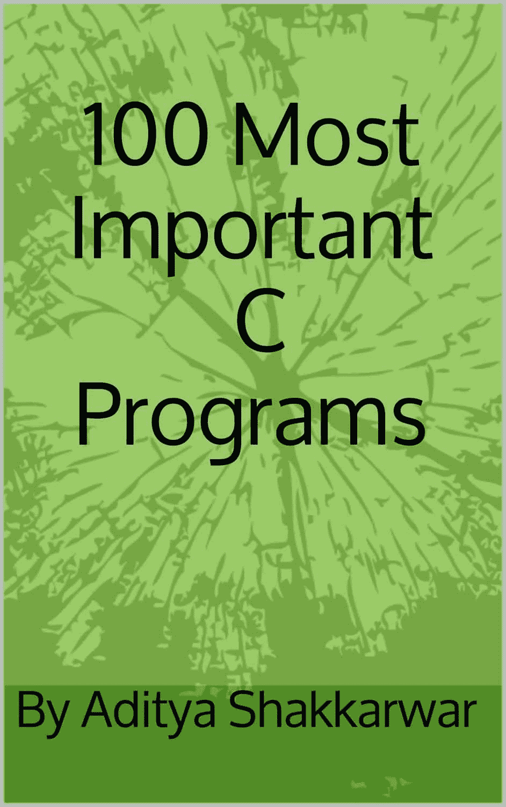

# 100 个重要的 C 程序



## 1. 打印文本的程序

```c
#include <stdio.h>
#include <conio.h>
main()
{
    clrscr();
    printf("HELLO");
    printf("Aditya Shakkarwar phone : +918437164247");
    getch();
}
```

## 2. 读取两个数字并打印给定数字之和的程序

```c
#include <stdio.h>
#include <conio.h>
main()
{
    int a,b, sum;
    clrscr ();
    printf ("ENTER VALUE FOR A ");
    scanf("%d",&a);
    printf("ENTER VALUE FOR B ");
    scanf("%d",&b);
    sum=a+b;
    printf("Sum Of Given Numbers are %d", sum);
    getch();
}
```

## 3. 接受学生学号、三门科目的成绩并计算总分、平均分并打印的程序

```c
#include <stdio.h>
#include <conio.h>
main()
{
    int r,b,c,d, tot, avg;
    clrscr();
    printf ("ENTER STUDENT ROLL NO ; ");
    scanf("%d",&r);
    printf("ENTER FIRST SUBJECT MARKS ;");
    scanf("%d",&b);
    printf("ENTER SECOND SUBJECT MARKS;");
    scanf("%d",&c);
    printf("ENTER THIRD SUBJECT MARKS ;");
    scanf("%d",&d);
    tot=b+c+d;
    avg=tot/3;
    printf("\n\n\t\t Lovely Professional University \n\n");
    printf("\t STUDENT RNO ; %d ",r);
    printf("\t FIRST SUBJECT MARKS ;%d ",b);
    printf("\t SECOND SUBJECT MARKS ;%d ",C);
    printf("\t THIRD SUBJECT MARKS ;%d ",d);
    printf("\t AVERAGE MARKS ;%d", avg);
    getch();
}
```

## 4. 读取三个数字并打印给定三个数字中最大的程序

```c
#include <stdio.h>
#include <conio.h>
main( )
{
    int a,b,c,big=0;
    clrscr( );
    printf("ENTER VALUE FOR A:");
    scanf("%d",&a);
    printf("ENTER VALUE FOR B:");
    scanf("%d",&b);
    print("ENTER VALUE FOR C:");
    scanf("%d",&c);
    if (a>big)
        big=a ;
    if(b>big)
        big=b;
    if(c>big)
        big=c;
    printf("BIGGEST OF ABOVE NUMBER IS %d",big);
    getch( );
}
```

## 5. 读取一个数字并判断该数字是偶数还是奇数的程序

```c
#include <stdio.h>
#include <conio.h>
main()
{
    int n,r;
    clrscr();
    printf("ENTER A NUMBER ;");
    scanf("%d", &n);
    r=n%2;
    if(r == 0)
        printf("the above given number is even");
    else
        printf("the above given number is odd");
    getch();
}
```

## 6. 接受一个年份并判断给定年份是否为闰年的程序

```c
#include <stdio.h>
#include <conio.h>
main( )
{
    int y;
    clrscr( );
    printf("enter a year:");
    scanf("%d",&y);
    if((y%4==0 && y%100!=0)|y%400==0)
        printf("the above given year IS a leap year");
    else
        printf("the above given year IS not a leap year");
    getch();
}
```

## 7. 个位数字

```c
#include <stdio.h>
#include <conio.h>
main( )
{
    int a,b,c,d;
    clrscr( );
    printf ( " Enter a two digit number :");
    scanf (" %d", &a);
    b=a/10;
    c=a%10;
    d=b+c;
    printf("sum of individual digits of givennumbers id %d", d);
    getch( );
}
```

## 8. 接受三位数并打印其各位数字之和的程序

```c
#include <stdio.h>
#include <conio.h>
main( )
{
    int a,b,c,n, sum;
    clrscr( );
    printf (" Enter a Three Digit Number:");
    scanf ("%d",&n);
    a=n/100;
    b=((n%100)/10);
    c=n%10;
    sum=a+b+c;
    printf (" Sum of Individual Digits of Given Numbers is %d", Sum);
    getch( );
}
```

## 9. 接收一个数字并检查该数字是否为阿姆斯特朗数的程序

代码：

```c
# include <stdio.h>
# include <conio.h>

main( )
{
    int n, a, b, c, d;
    clrscr( );
    printf (“ Enter a Three Digit Number: “);
    scanf (“%d”, &n);
    a=n/100;
    b=((n/10)%10);
    c=n%10;
    d=a*a*a*+b*b*b +c*c*c;
    if (n= =d)
        printf (“The Given Number is Armstrong number”);
    else
        printf (“The Given Number is Not Armstrong number”);
    getch( );
}
```

## 10. 打印 1 到 10 之间的奇数的程序

代码：

```c
# include <stdio.h>
# include <conio.h>

main( )
{
    int i;
    clrscr( );
    for (i=1; i<=10; i+=2)
        printf(“%d\n”,i);
    getch( );
}
```

## 11. 倒序打印 1 到 10 的自然数的程序

代码：

```c
# include <stdio.h>
# include <conio.h>

main( )
{
    int i;
    clrscr( );
    for (i=10; i>=1; i--)
        printf(“%d\n”,i);
    getch( );
}
```

## 12. 打印 1 到 10 的自然数和的程序

代码：

```c
# include <stdio.h>
# include <conio.h>

main( )
{
    int n,sum=0,i;
    clrscr( );
    for (i=1; i<=10; i++)
        sum=sum+i;
    printf(“sum of natural numbers from 1 to 10 is %d\n”,sum);
    getch( );
}
```

## 13. 接收一个数字并打印该数字乘法表的程序

代码：

```c
# include <stdio.h>
# include <conio.h>

main( )
{
    int i,t;
    clrscr( );
    printf(“which table u want:”);
    scanf(“%d”,&t);
    for (i=1; i<=10; i++)
        printf(“\n%d*%d=%d”,t,i,i*t);
    getch( );
}
```

## 14. 打印 1 到 10 乘法表的程序

代码：

```c
# include <stdio.h>
# include <conio.h>

main( )
{
    int i,j;
    clrscr( );
    for (i=1; i<=10; i++)
        for(j=1;j<=10;j++)
            printf(“\n%d*%d=%d”,i,j,i*j);
    getch( );
}
```

## 15. 打印斐波那契数列的程序

代码：

```c
# include <stdio.h>
# include <conio.h>

main( )
{
    int a=0,b=1,c=0,i;
    clrscr( );
    printf(“%d”,a);
    printf(“\n%d”,b);
    for (i=1; i<=10; i++)
    {
        c =a+b;
        printf(“\n%d”,c);
        a=b;
        b=c;
    }
    getch( );
}
```

## 16. 打印数字金字塔的程序

代码：

```c
# include <stdio.h>
# include <conio.h>

main()
{
    int i,j;
    clrscr( );
    for(i=1;i<=5;i++)
    {
        for(j=1;j<=i;j++)
            printf(“%d”,j);
        printf(“\n”);
    }
    getch();
}
```

## 17. 打印数字金字塔的程序

代码：

```c
# include <stdio.h>
# include <conio.h>

main( )
{
    int i,j ,l,k=40;
    clrscr( );
    for(i=1;i<=9;i+=2)
    {
        for(l=1;l<=k;l++)
            printf(“ “);
        for(j=1;j<=i;j++);
        printf(“%d”,j);
        printf(“\n”);
        k=k-2;
    }
    getch( );
}
```

## 18. 打印数字菱形的程序

代码：

```c
# include <stdio.h>
# include <conio.h>

main( )
{
    int i,j,l,n,s,k=40;
    clrscr( );
    for(i=1;i<=9;i+=2)
    {
        for(l=1;l<=k;l++)
            printf(“ “);
        for(j=1;j<=i;j++)
            printf(“\n”);
        k=k-2;
    }
    k=k+4;
    for(n=7;n>=1;n-=2)
    {
        for(i=1;i<=k;i++)
            printf(“ “);
        for(s=1;s<n;s++)
            printf("%d”,s);
        printf(“\n”);
        k=k+2;
    }
    getch( );}
```

## 19. 打印字符金字塔的程序

代码：

```c
# include <stdio.h>
# include <conio.h>

main( )
{
    char i,j;
    clrscr();

    for(i=65;i<=70;i++)
    {
        for(j=65;j<=i;j++)
            printf("%c”,j);
        printf(“\n”);
    }
    getch();
}
```

## 20. 打印字符菱形的程序

代码：

```c
# include <stdio.h>
# include <conio.h>

main( )
{
    char i,j,n,r;
    int s,sp=40;
    clrscr( );
    for(i=65;i<=75;i+=2)
    {
        for(s=1;s<=sp;s++)
            printf(“ “);
        for(j=65;j<i;j++)
            printf("%c”,j);
        printf(“\n”);
        sp=sp-2;
    }
    sp=sp+4;
    for(n=73;n>=65;n-=2)
    {
        for(s=1;s<=sp;s++)
            printf(“ “);
        for(r=65;r<=n;r++)
            printf("%c”,r);
        printf(“\n”);
        sp=sp+2;
    }
    getch( );}
```

## 21. 使用三元运算符找到两个数中最大的程序

代码：

```c
# include <stdio.h>
# include <conio.h>

main( )
{
    int a,b,big;
    clrscr( );
    printf(“enter a”);
    scanf(“%d”,&a);
    printf(“enter the value of b”);
    scanf(“%d”,&b);
    big=(a>b)?a:b;
    printf(“biggest of the numbers %d”,big);
    getch();
}
```

## 22. 使用三元运算符找到四个数中最大的程序

代码：

```c
# include <stdio.h>
# include <conio.h>

main( )
{
    int a,b,c,d,big;
    clrscr( );
    printf(“enter a”);
    scanf(“%d”,&a);
    printf(“enter the value of b”);
    scanf(“%d”,&b);
    printf(“enter the value of c”);
    scanf(“%d”,&c);
    printf(“enter the value of d”);
    scanf(“%d”,&d);
    big=(a>b)?(a>c)?(a>d)?a:(c>d)?c:d:(b>c)?(b>d)?b:d:(c>d)?c:d;
    printf(“biggest of the 4 numbers %d”,big);
    getch();}
```

## 23. 使用三元运算符打印四个数中最小的程序

代码：

```c
# include <stdio.h>
# include <conio.h>

main( )
{
    int a,b,c,d,small;
    clrscr( );
    printf(“enter a”);
    scanf(“%d”,&a);
    printf(“enter the value of b”);
    scanf(“%d”,&b);
    printf(“enter the value of c”);
    scanf(“%d”,&c);
    printf(“enter the value of d”);
    scanf(“%d”,&d);
    small=(a<b)?(a<c)?(a<d)?a:(c<d)?c:d:(b<c)?(b<d)?b:d:(c<d)?c:d:(c<d)?c:d;
    printf(“smallest of the given 4 numbers %d”,small);
    getch();}
```

## 24. 接收年份并使用三元运算符检查年份是否为闰年的程序

代码：


```c
#include <stdio.h>
#include <conio.h>

main()
{
    int y, leap;
    clrscr();
    printf("enter any yr");
    scanf("%d", &y);
    leap = (y % 400 == 0) ? 1 : (y % 100 != 0) ? (y % 4 == 0) ? 1 : 0 : 0;
    if (leap == 1)
        printf("the given year is leap year");
    else
        printf("given year is not leap year");
    getch();
}
```

## 25. 接收一个大写字符并以小写打印的程序

代码：

```c
#include <stdio.h>
#include <conio.h>

main()
{
    char ch, c1;
    clrscr();
    printf("enter a in uppercase");
    ch = getchar();
    c1 = ch + 32;
    printf("the given char in lowercase is");
    putchar(c1);
    getch();
}
```

## 26. 接收任意大小的字符并以另一种大小打印的程序

代码：

```c
#include <stdio.h>
#include <conio.h>

main()
{
    char ch, c1;
    clrscr();
    printf("enter a char in any");
    ch = getchar();

    if (ch >= 65 && ch <= 90)
        c1 = ch + 32;
    else if (ch >= 97 && ch <= 122)
        c1 = ch - 32;

    printf("the given char in anothercase IS");
    putchar(c1);
    getch();
}
```

## 27. 使用 `while` 循环打印 1 到 10 的数字

代码：

```c
#include <stdio.h>
#include <conio.h>

main()
{
    int a = 0;
    clrscr();

    while (a < 10)
    {
        a = a + 1;
        printf("%d\n", a);
    }

    getch();
}
```

## 28. 使用 `while` 循环接收字符串并打印的程序

代码：

```c
#include <stdio.h>
#include <conio.h>

main()
{
    char ch;
    clrscr();
    printf("enter string");

    while ((ch = getchar()) != '\n')
    {
        putchar(ch);
    }

    getch();
}
```

## 29. 接收大写字符串并以小写打印的程序

代码：

```c
#include <stdio.h>
#include <conio.h>

main()
{
    char ch, c;
    clrscr();
    printf("enter string in upper case:");

    while ((ch = getchar()) != '\n')
    {
        c = ch + 32;
        putchar(c);
    }

    printf(" is lower case");
    getch();
}
```

## 30. 接收任意大小的字符串并以另一种大小打印的程序

代码：

```c
#include <stdio.h>
#include <conio.h>

main()
{
    char ch;
    clrscr();
    printf("enter string :");

    while ((ch = getchar()) != '\n')
    {
        if (ch >= 'A' && ch <= 'Z')
            putchar(ch + 32);
        else if (ch >= 'a' && ch <= 'z')
            putchar(ch - 32);
        else
            putchar(ch);
    }

    printf(" is the string");
    getch();
}
```

## 31. 接收字符串并在新行打印每个单词的程序

代码：

```c
#include <stdio.h>
#include <conio.h>

main()
{
    char ch;
    clrscr();
    printf("enter string :");

    while ((ch = getchar()) != '\n')
    {
        putchar(ch);
        if (ch == ' ')
            printf("\n");
    }

    getch();
}
```

## 32. 接收字符串并统计大写字母、小写字母和特殊字符数量的程序

代码：

```c
#include <stdio.h>
#include <conio.h>

main()
{
    char ch;
    int c = 0, s = 0, s1 = 0;

    clrscr();
    printf("enter a string :");

    while ((ch = getchar()) != '\n')
    {
        if (ch >= 'A' && ch <= 'Z')
            c = c + 1;
        else if (ch >= 'a' && ch <= 'z')
            s = s + 1;
        else
            s1 = s1 + 1;
    }

    printf("no of capital letters are %d", c);
    printf("no of small letters are %d", s);
    printf("no of special characters are %d", s1);

    getch();
}
```

```c
case 6:
    printf("SIX");
    break;

case 7:
    printf("SEVEN");
    break;

case 8:
    printf("EIGHT");
    break;

case 9:
    printf("NINE");
    break;

default:
    printf("please enter the number between 0 and 9");
}

getch();
}
```

## 34. 打印 1 到 100 之间质数的程序

代码：

```c
#include <stdio.h>
#include <conio.h>

main()
{
    int n, i, check;
    clrscr();

    for (i = 1; i <= 100; i++)
    {
        check = 1;

        for (n = 2; n <= i / 2; n++)
            if (i % n == 0)
            {
                check = 0;
                break;
            }

        if (check == 1)
            printf("\n%d is a prime", i);
        else
            printf("\n%d is not a prime", i);
    }

    getch();
}
```

## 35. 使用函数接受两个数字并打印两个数和的程序

代码：

```c
#include <stdio.h>
#include <conio.h>

main()
{
    int a, b, c;
    clrscr();

    printf("enter the value for a:");
    scanf("%d", &a);

    printf("enter the value for b:");
    scanf("%d", &b);

    c = add(a, b);
    printf("sum of two numbers is %d", c);

    getch();
}

int add(int x, int y)
{
    int z;
    z = x + y;
    return z;
}
```

## 36. 接受一个数字并求给定数字阶的程序

代码：

```c
#include <stdio.h>
#include <conio.h>

main()
{
    int n, f;
    clrscr();

    printf("enter a number:");
    scanf("%d", &n);

    f = fact(n);
    printf("factorial value is %d", f);

    getch();
}

int fact(int n)
{
    int i, fa = 1;

    for (i = n; i >= 1; i--)
        fa = fa * i;

    return fa;
}
```

## 37. 接受一个数字并检查给定数字是否为阿姆斯特数的程序

代码：

```c
#include <stdio.h>
#include <conio.h>

main()
{
    int n, arm;
    clrscr();

    printf("enter any 3 digit number:");
    scanf("%d", &n);

    arm = armstrong(n);

    if (arm == n)
        printf("%d is Armstrong number", n);
    else
        printf("%d not a Armstrong number", n);

    getch();
}

int Armstrong(int n)
{
    int a, b, c, d;

    a = n / 100;
    b = (n / 10) % 10;
    c = n % 10;
    d = a * a * a + b * b * b + c * c * c;

    return d;
}
```

## 38. 接受一个数字并打印给定数字与其反转数的和

代码：

```c
#include <stdio.h>
#include <conio.h>

main()
{
    int a, b, n;
    clrscr();

    printf("enter a number:");
    scanf("%d", &n);

    a = rev(n);
    printf("REVERSE OF A GIVEN NUMBER IS %d", a);

    b = add(n, a);
    printf("\nsum of a and reverse number is %d", b);

    getch();
}

int rev(int n)
{
    int r, rev = 0, s;

    while (n > 0)
    {
        r = n % 10;
        rev = rev * 10 + r;
        n = n / 10;
    }

    return rev;
}

int add(int n, int a)
{
    return n + a;
}
```

## 39. 接受 10 个数字并按顺序打印前 5 个，倒序打印后 5 个的程序

代码：

```c
#include <stdio.h>
#include <conio.h>

main()
{
    int i, a[10];

    for (i = 0; i < 10; i++)
    {
        printf("enter value for a[%d]", i);
        scanf("%d", &a[i]);
    }

    for (i = 0; i <= 4; i++)
        printf("A[%d]=%d", i, a[i]);

    for (i = 9; i >= 5; i--)
        printf("A[%d]=%d", i, a[i]);

    getch();
}
```

## 40. 接受字符串并使用 `for` 循环打印给定字符串反转的程序

代码：

```c
#include <stdio.h>
#include <conio.h>

main()
{
    int i, j;
    char name[80];

    clrscr();
    printf("enter a string");

    gets(name);

    for (i = 0; i < 80 && ((name[i] = getchar()) != '\n'); i++);

    if (name[i] == '\n')
        name[i] = '\0';

    for (j = i; j >= 0; j--)
        putchar(name[j]);

    printf("is the reverse of given string");
    getch();
}
```

## 41. 接受字符串并检查给定字符串是否为回文

代码：

```c
#include <stdio.h>
#include <conio.h>

main()
{
    int i, lim, c, check = 1;
    char word[80];

    clrscr();
    printf("enter a string");

    for (i = 0; i < 80 && ((word[i] = getchar()) != '\n'); i++);

    lim = i - 1;
    c = lim / 2;

    for (i = 0; i <= c; i++, lim--)
        if (word[i] != word[lim])
        {
            check = 0;
            break;
        }

    if (check == 1)
        printf("the given string is palindrome");
    else
        printf("not palindrome");

    getch();
}
```

## 42. 接受 3 维数组的值并打印

代码：

```c
#include <stdio.h>
#include <conio.h>

main()
{
    int a[3][3], i, j;

    clrscr();

    for (i = 0; i <= 2; i++)
        for (j = 0; j <= 2; j++)
        {
            printf("enter the value for a[%d][%d]:", i, j);
            scanf("%d", &a[i][j]);
        }

    for (i = 0; i <= 2; i++)
    {
        for (j = 0; j <= 2; j++)
            printf("%d:", a[i][j]);

        printf("\n");
    }

    getch();
}
```

## 43. 打印上三角的程序

代码：

```c
#include <stdio.h>
#include <conio.h>

main()
{
    int a[4][4], i, j, c;

    clrscr();
    printf("enter which no want");
    scanf("%d", &c);

    for (i = 0; i < 4; i++)
        for (j = 0; j < 4; j++)
            if (i < j)
                a[i][j] = c;
            else
                a[i][j] = 0;

    for (i = 0; i < 4; i++)
    {
        for (j = 0; j < 4; j++)
            printf("%d:", a[i][j]);

        printf("\n");
    }

    getch();
}
```

## 44. 接受两个 3 维数组并将它们的和存储在第三个数组中

代码：

```c
#include <stdio.h>
#include <conio.h>

main()
{
    int a[3][3], b[3][3], c[3][3], i, j;

    clrscr();

    for (i = 0; i < 3; i++)
        for (j = 0; j < 3; j++)
        {
            printf("enter the two values for a[%d][%d] & b[%d][%d]", i, j, i, j);
            scanf("%d%d", &a[i][j], &b[i][j]);
        }

    for (i = 0; i < 3; i++)
    {
        for (j = 0; j < 3; j++)
        {
            c[i][j] = a[i][j] + b[i][j];
            printf("%d", c[i][j]);
        }

        printf("\n");
    }

    getch();
}
```

## 45. 接受字符串并使用函数找到给定字符串的长度

代码：

```c
#include <stdio.h>
#include <conio.h>

int getline(char str[]);

main()
{
    char str[80];
    int length;

    clrscr();
    printf("enter a string");

    length = getline(str);
    printf("length of the given string is %d", length);

    getch();
}

int getline(char str[])
{
    int i;

    for (i = 0; i < 80 && ((str[i] = getchar()) != '\n'); i++);

    if (str[i] == '\n')
        str[i] = '\0';

    return i;
}
```

## 46. 统计一行文本中的单词、字母、元音、辅音和数字

代码：


```c
#include<stdio.h>

#include<conio.h>

main( )
{

int noa=0,nob=0,noc=0,nov=0,now=0,noch=0,l,i;
char ch,s[100];

clrscr( );
printf(“enter 2 lines of text”);
gets(s);
l=strlen(s);
for(i=0;i<1;i++)
{

switch(s[i])
{case ‘a’:
case ‘e’:
case ‘i’:
case ‘o’:
case ‘u’:
case ‘A’:
case ‘E’:
case ‘I’:
case ‘O’:
case ‘U’:
nov++;
break;
}
if(isalpha(s[i]))
noa++;
if(isdigit(s[i]))
nod++;
if(noa[i+1]!=’ ‘)
noch=l-nob;
noc=l-now;
now=l-a;nov=l-nod; // Note: The provided source text has logic inconsistencies/variable naming.
```

# 47. 接受两个字符串并比较它们是否相等

## 代码

```c
# include <stdio.h>

# include <conio.h>

int getline (char str[ ], int );

int strc(char str1[ ], str2[])

main( )
{

char str1[80],str2[80];
int comp;

clrscr( );
printf(“enter first:”);
getline(str1,80);
printf(“enter second:”);
getline(str2,80);
comp=strc(str1,str2);
if(comp>0)
printf(“first string is bigger”);
else
if(comp==0)
printf(“both the strings are equal”);
getch( );
}

int getline(char str[ ], int lim)
{

int i;
for(i=0;i<lim&&((str[i]=getchar())!=’\n’);
i++);
if(str[i]=’\n’)
str[i]=’\0’;
return i;

}

int strc(char str1[ ], str2[])
{

int i;
for(i=0;str1[i];i++)
if(str1[i]!=str2[i])
return str1[i]-str2[i];
return 0;

}
```

# 48. 使用冒泡排序对输入的数字

## 代码

```c
# include <stdio.h>

# include <conio.h>

main( )
{

int a[100],i,j,n,t;

clrscr( );
printf(“enter the array size”);
scanf(“%d”,&n);
for(i=1;i<n;i++)
scanf(“%d”,&a[i]);
for(i=1;i<=n;i++)
for(j=i+1;j<n;j++)
if(a[i]>a[j])
{
t=a[i]
a[i]=a[j];
a[j]=t;
}
printf(“the sorted elements are “);
for(i=1;i<=n;i++)
print(“%d”,a[i]);
getch( );

}
```

# 49. 读取日期、月、年并打印次日的日期、月、年

## 代码

```c
# include <stdio.h>

# include <conio.h>

main( )
{

int month[12]={31,28,31,30,31,30,31,31,30,31,30,31};
int d,m,y,nd,nm,ny,ndays;

clrscr( );
printf(“enter the date,month,year”);
scanf(“%d%d%d”,&d,&m,&y);
ndays=month[m-1];
if(m==2)
{
if(y%100==0)
{
if(y%400==0)
ndays=29;
}
else
if(y%4==0)
ndays=29;
}
nd=nd+1;
nm=m;
ny=y;
if(nd>ndays)
{
nd=1;
nm++;
}
if(nm>12)
{
nm=1;
ny++;
}
printf(“Given date is
%d:%d:%d\n”,d,m,y);
printf(“next days date is
%d:%d:%d”,nd,nm,ny);
getch( );

}
```

# 50. 使用指针交换两个值的程序

## 代码

```c
# include <stdio.h>
# include <conio.h>

void interchange(int *x,int *y);

main( )
{
    int a,b;
    clrscr( );
    printf(“enter values of a and b”);
    scanf(“%d%d”,&a,&b);
    interchange(&a,&b);
}

void interchange(x,y)
int *x,*y;
{
    int t;
    t=*x;
    *x=*y;
    *y=t;
    printf(“%d=x, %d=y”,*x,*y);
    getch( );
}
```

# 51. 输出“杨斯卡三角形”的程序

## 代码

```c
#include<stdio.h>
#include<conio.h>
main()
{
    int n,p=1,q,num,sp;
    clrscr( );
    printf(“enter the number of rows”);
    scanf(“%d”,&n);
    for(p=0;p<=n;p++)
    {
        for(sp=1;sp<=40-(3*p);sp++)
            printf (“ ”);
        for(q=0;q<n;q++)
        {
            if((q==q)||(q==0))
                num=1;
            else
                num=num*((q-q)+1)/q;
            printf(“%2d”,num);
            printf(“\n”);
        }
    }
    getch( );
}
```

# 52. 检查给定数字是否为完美数的程序

## 代码

```c
# include <stdio.h>
# include <conio.h>
main( )
{
    int i,n,s=0;
    clrscr();
    printf(“enter the number”);
    scanf(“%d”,&n);
    for(i=1;i<n/2;i++)
        if(n%i==0)
            s+=i;
    if(s= =n)
        printf(“the number is perfect no”);
    else
        printf(“the number is not perfect “);
    getch( );
}
```

# 53. 检查给定数字是否为质数的程序

## 代码

```c
# include <stdio.h>
# include <conio.h>
main( )
{
    int i,n,c=0;
    clrscr( );
    printf(“enter a number”);
    scanf(“%d”,&n);
    for(i=0;i<=n;i++)
        if(n%i==0)
            c++;
    if(c==2)
        printf(“given number is a prime number”);
    else
        printf(“given number is not prime number”);
    getch( );
}
```

# 54. 读取 `n` 个数字并以所有可能的矩阵顺序打印程序

## 代码

```c
# include <stdio.h>
# include <conio.h>
main( )
{
    int i,n,c,p,q,r,k,a[20];
    clrscr();
    printf(“enter the array size”);
    scanf(”%d”,&n);
    printf(“enter the elements”);
    for(i=1;i<=n;i++)
        scanf(“%d”,&a[i]);
    i=1;
    while(i<=n)
    {
        if(n%i==0)
        {
            r=i;
            c=n/i;
            k=1;
            for(p=1;p<=r;p++)
            {
                for(q=1;q<=c;q++)
                    printf(“%d”,a[k++])
                printf(“\n”);
            }
            i++;
            getch( );
        }
    }
}
```

# 55. 使用二分查找搜索元素的程序

## 代码

```c
# include <stdio.h>
# include <conio.h>
main( )
{
    int a[100],i,n,x, mid, top, bot,c;
    clrscr();
    printf(“enter the array size;”);
    scanf(“%d”,&n);
    printf(“enter the array elements”);
    for(i=1;i<=n;i++)
        scanf(“%d”,&a[i]);
    top=1;
    bot=n;
    c=0;
    printf(“enter the element to searched”);
    scanf(“%d”,&x);
    while((top <=bot)&&(c==0))
    {
        mid=(top+bot)/2;
        if(a[mid]<x)
            top=mid+1;
        else
        if(a[mid]>x)
            bot=mid-1;
        else
            c=1;
    }
    if(c==1)
        printf(“elements is at position;%d”,mid);
    else
        printf(“elements is not in list”);
    getch( );
}
```

# 56. 接受两个数字并使用指针打印它们和的程序

## 代码

```c
# include <stdio.h>
# include <conio.h>
main( )
{
    int a, b,c;
    clrscr( );
    a=10;
    b=20;
    c=*a)+*b;
    printf(“%d”,c);
    getch( );
}
```

# 57. 两个矩阵相乘的程序

## 代码

```c
# include <stdio.h>
# include <conio.h>
main( )
{
    int
    a[10][10],b[10][10],c[10][10],i,j,m,n,p,q,
    k;
    clrscr( );
    printf(“enter the size of first matrices”);
    scanf(“%d%d”,&m,&n);
    printf(“enter the size of second matrix”);
    scanf(“%d%d”,&p,&q);
    if(n==p)
    {
        printf(“enter first matrices”);
        for(i=1;i<m;i++)
            for(j=1;j<n;j++)
                scanf(“%d”,&a[i][j]);
        printf(“enter second matrix”);
        for(i=1;i<p;i++)
            for(j=1;j<q;j++)
                scanf(“%d”,&b[i][j]);
        for(i=1;i<m;i++)
            for(j=1;j<n;j++)
            {
                c[i][j]=0;
                for(k=1;k<n;k++)
                    c[i][j]+=a[i][k]*b[k][j];
            }
        printf(“the multiplication is”);
        for(i=1;i<m;i++)
        {
            for(j=1;j<n;j++)
                printf(“%2d”,c[i][j]);
            printf(“\n”);
        }
    }
    else
        printf(“multiplication is not possible”);
    getch( );
}
```

# 58. 输出 1～100 之间质数的程序

## 代码

```c
# include <stdio.h>
# include <conio.h>
main
 )
{
    int i,n,c;
    clrscr( );
    for(n=1;n<=100;n++)
    {
        c=0;
        for(i=1;i<=n;i++)
            if(n%i==0)
                c++;
        if(c==2)
            printf(“n%d”,n);
    }
    getch( );
}
```

# 59. 接受字符串并找到字符串长度的程序

## 代码

```c
# include <stdio.h>
# include <conio.h>
main
 )
{
    char name[80];
    int i;
    clrscr( );
    printf(“enter a string;);
    for(i=0;i<80&&((name[i]=getchar())='\n');i++);
    printf(“%d is the size of string”,i);
    getch( );
}
```

# 60. 矩阵范数（oc）程序

## 代码

```c
# include <stdio.h>
# include <conio.h>
# include <math.h>
main
 )
{
    int a[10][10],i,j,m,n, sum=0;
    float norm;
    clrscr( );
    printf(“enter the size”);
    scanf(“%d%d”,&m,&n);
    printf(“enter the element of matrix”);
    for(i=1;i<=m;i++)
        for(j=1;j<=n;j++)
        {
            scanf(“%d”,&a[i][j]);
            sum=sum+(a[i][j]*a[j][i]);
        }
    norm=sqrt(sum);
    printf(“norm=%f”,norm);
    getch( );
}
```

# 61. 一个读取 `n` 个学生信息（姓名、3 门科目）并计算总分、按特定格式输出结果的结构体程序

## 代码


# 62. 找到方矩阵是否为 a) 对称 b) 反对称 c) 无的程序

```c
# include <stdio.h>
# include <conio.h>
main( )
{
    int a[10][10],i,j,m,n,c=0,c1=0;
    clrscr( );
    printf(“enter array size”);
    scanf(“%d%d”,&m,&n);
    printf(“enter the elements”);
    for(i=1;i<=m;i++)
        for(j=1;j<=n;j++)
            scanf(“%d”,&a[i][j]);
    for(i=1;i<=m;i++)
        for(j=1;j<=n;j++)
        {
            if(a[i][j]==a[j][i])
                c=1;
            else
            if(a[i][j]==-a[j][i])
                c1=1;
        }
    printf(“the given matrix is \n”);
    for(i=1;i<=m;i++)
    {
        for(j=1;j<=n;j++)
            printf(“%d”,a[i][j]);
        printf(“\n”);
    }
    if(c==0)
        printf(“the given matrix is symmetric”);
    else
    if(c1==0)
        printf(“the matrix is skew symmetric”);
    else
        printf(“none of two”);
    getch( );
}
```

# 63. 给定边长计算三角形面积的程序

```c
# include <stdio.h>
# include <conio.h>
main( )
{
    int a,b,c;
    float s, area;
    clrscr( );
    printf(“enter sides of the triangle”);
    scanf(“%d%d%d”,&a,&b,&c);
    if((a+b)<c||(b+c)<a||(a+c)<b)
        printf(“finding area is not possible”);
    else
    {
        s=(a+b+c)/2;
        area=sqrt(s*(s-a)*(s-b)*(s-c));
    }
    printf(“area=%.2f”,area);
}
```

# 64. 1-500 之间的阿姆哈数程序

```c
#include<stdio.h>
#include <conio.h>
main( )
{
    int i,n,s,r;
    clrscr( );
    for(i=1;i<=500;i++)
    {
        n=i;
        s=0;
        while(n>0)
        {
            r=n%10;
            s=s+(r*r*r);
            n=n/10;
        }
        if(i==s)
            printf(“\n%d”,s);
    }
}
```

# 65. 检查给定数字是否为阿姆哈数的程序

```c
# include <stdio.h>
# include <conio.h>
main( )
{
    int i,n,s,r,k;
    clrscr( );
    printf(“enter a number”);
    scanf(“%d”,&n);
    k=n;
    s=0;
    while(n>0)
    {
        r=n%10;
        s=s+(r*r*r);
        n=n/10;
    }
    if(k==s)
        printf：“given number is Armstrong\n%d”,k);
    else
        printf：“given number is not Armstrong\n%d”,k);
    getch();
}
```

# 66. 打印杨洛德三角形的程序

```c
# include <stdio.h>
# include <conio.h>
main( )
{
    int i,n,s,j,k=1;
    clrscr( );
    printf(“enter a number of rows”);
    scanf(“%d”,&n);
    for(i=1;i<=n;i++)
    {
        for(s=1;s<=40-i;s++)
            printf (“ ”);
        for(j=1;j<=i;j++)
            printf(“%3d”,k++);
        printf (“\n”);
    }
    getch( );
}
```

# 67. 在 3 个结构体中读取数据并打印的程序

```c
#include<stdio.h>
#include<conio.h>
struct book
{
    char code;
    int piece;
    float price;
};
struct book b1,b2,b3;
main( )
{
    clrscr( );
    printf(“enter code,piece,price”);
    scanf(“%c%d%f”,&b1.code,&b1.piece,&b1.price);
    printf(“enter code,piece,price”);
    scanf(“%c%d%f”,&b2.code,&b2.piece,&b2.price);
    printf(“enter code,piece,price”);
    scanf(“%c%d%f”,&b3.code,&b3.piece,&b3.price);
    printf(“the details are”);
    printf(“\n %c%d%f”,b1.code,b1.piece,b1.price);
    printf(“\n %c%d%f”,b2.code,b2.piece,b2.price);
    printf(“\n %c%d%f”,b3.code,b3.piece,b3.price);
    getch( );
}
```

# 68. 打印对角矩阵的程序

```c
#include<conio.h>
#include<stdio.h>
main()
{
    int a[4][4],i,j;
    clrscr( );
    for(i=0;i<4;i++)
        for(j=0;j<4;j++)
            if(i==j)
                a[i][j]=7;
            else
                a[i][j]=0;
    for(i=0;i<4;i++)
    {
        for(j=0;j<4;j++)
            printf(“%d”,a[i][j]);
        printf(“\n”);
    }
    getch();
}
```

# 69. 将一个文件的内容复制到另一个文件的程序

```c
#include<stdio.h>
#include<conio.h>
main( )
{
    FILE *fp1,*fp2;
    char ch;
    fp1=fopen(“text1”,”w”);
    printf(“enter the text”);
    while((ch=getchar( ))!=EOF)
        putc(ch,fp1);
    fclose(fp1);
    fp1=fopen(“text1”,”r”);
    fp2=fopen(“text2”,”w”);
    while((ch=getc(fp1))!=EOF)
        putc(ch,fp2);
    fclose(fp2);
    getch( );
}
```

# 70. 创建一个数字文件，并将奇数复制到第二个文件，偶数复制到第三个文件

```c
#include<stdio.h>
#include<conio.h>
main( )
{
    FILE *fp1,*fp2,*fp3;
    int i;
    fp1=fopen(“DATA1”,”w”);
    printf(“enter the number”);
    scanf(“%d”,&i);
    while(i!=eof( ))
    {
        putw(i,fp1);
    }
    fclose(fp1);
    fp1=fopen(“DATA1”,”r”);
    fp2=fopen(“DATA2”,”w”);
    fp3=fopen(“DATA3”,”w”);
    while((i=getw(fp1))!=EOF())
        if(i%2==0)
            putw(i,fp3);
        else
            putw(i,fp2);
    fclose(fp1);
    fclose(fp2);
    fclose(fp3);
    getch( );
}
```

# 71. 程序结构体，用于存储酒店信息，包括名称、等级、房间费、房间数量

## a) 按房间费变更顺序打印指定等级的酒店
### b) 打印房间费小于给定数值的酒店

```c
#include<stdio.h>
#include<conio.h>
main( )
{
    struct hotel
    {
        char name[20];
        char city[10];
        char grade;
        int rc,nr;
    };
    struct hotel ht[20],t;
    int i,n,j,c;
    char gr;
    clrscr( );
    printf(“enter no. of hotels\n”);
    scanf(“%d”,&n);
    for(i=0;i<n;i++)
    {
        printf(“enter name of hotel \n”);
        scanf(“%s”,&ht[i].name);
        printf(“enter name of city \n”);
        scanf(“%s”,&ht[i].city);
        printf(“enter the grade \n”);
        scanf(“%s”.ht[i].grade);
        ht[i].grade=getche( );
        printf(“enter room charge \n”);
        scanf(“%d”,&ht[i].rc);
        printf(“enter no of rooms \n”);
        scanf(“%d”,&ht[i].nr);
    }
    for(i=0;i<n;i++)
        for(j=0;j<n-i;j++)
        {
            t=ht[j];
            ht[j]=ht[j+i];
            ht[j+1]=t;
        }
    printf(“enter a grade to print the hotels \n”);
    gr=getche();
    clrscr();
    printf(“hotel name city grade roomcharge no of room”);
    for(i=0;i<n;i++)
        if(gr==ht[i].grade)
            printf(“%s %s %c %d %d”,ht[i].name,ht[i].city,ht[i].grade,ht[i].rc,ht[i].nr);
    getch();
    printf(“enter a room charge to print hotels less than given charge \n”);
    scanf(“%d”,&c);
    printf(“hotel name city grade roomcharge no of rooms”);
    for(i=0;i<n;i++)
        if(c<=ht[i].rc)
            printf(“%s %s %c %d %d”,ht[i].name,ht[i].city,ht[i].grade,ht[i].rc,ht[i].nr);
}
```

# 72. 读取整数后执行以下处理的程序

## a) 按给定顺序打印
### b) 用第一个和最后一个元素的乘积替换第二个元素
### c) 用所有元素的平均值替换中间值
### d) 将所有元素替换为零

```c
#include<stdio.h>
#include<conio.h>
main( )
{
    int a[10],i,n,sum=0;
    clrscr( );
    printf(“enter the array “);
    scanf(“%d”,&n);
    printf(“enter the elements”);
    for(i=0;i<n;i++)
    {
        scanf(“%d”,&a[i]);
        sum=sum+a[i];
    }
    printf(“The given arrays is: “);
    for(i=0;i<n;i++)
        printf(“%d”,a[i]);
    a[1]=a[0]*a[n-1];
    printf(“\n the given are after replacing 2nd element”);
    for(i=0;i<n;i++)
        printf(“%d”,a[i]);
    a[(1+n/2)]=sum/n;
    printf(“\n the given array after replacing middle element by average of all”);
    for(i=0;i<n;i++)
        if(a[i]<0)
            a[i]=0;
    printf(“\n given array after replacing values by zero”);
    for(i=0;i<n;i++)
        printf(“%d”,a[i]);
    printf(“\n”);
    getch();
}
```

# 73. 使用选择排序排序输入的元素

```c
#include<stdio.h>
#include<conio.h>
main( )
{
    int a[100],i,n,j,t,min,pos;
    clrscr();
    printf(“enter the array size”);
    scanf(“%d”,&n);
    printf(“enter the elements”);
    for(i=0;i<n;i++)
        scanf(“%d”,a[i]);
    for(i=0;i<n;i++)
    {
        min=a[i];
        pos=i;
        for(j=0;j<n-1;j++)
            if(min>a[j])
            {
                min=a[j];
                pos=j;
            }
        t=a[i];
        a[i]=a[pos];
        a[pos]=t;
    }
    printf(“the sorted elements are”);
    for(i=0;i<n;i++)
        printf(“%d”,a[i]);
    getch( );
}
```

# 74. 不使用实际除法判断数字是否能被 11 整除的程序

```c
#include<stdio.h>
#include<conio.h>
#include<math.h>
main( )
{
    int a,b,n,evensum=0,oddsum=0,div;
    clrscr( );
    printf(“enter a number”);
}
```


## 74. 判断输入数字能否被 11 整除的程序

```c
scanf("%d",&n);

a=n;

b=n/10;

while(a>0)

{

    oddsum=oddsum+(a%10);

    a=a/10;

}

while(b>0)

{

    evensum=evensum+(b%10);

    b=b/10;

}

div=abs(evensum-oddsum);

if(div%11==0)

    printf("The number is divisible by 11");

else

    printf("The number is not divisible by 11");

getch();

}
```

## 75. 使用数组找到输入的 n 个数字的最大值和最小值的程序

```c
#include<stdio.h>
#include<conio.h>
main( )
{
int i,n,a[10],min,max;
clrscr( );
printf(" enter how many number");
scanf("%d",&n);
printf("enter the elements");
for(i=0;i<n;i++)
    scanf("%d",&a[i]);
min=a[0];
for(i=0;i<n;i++)
if(min>a[i])
    min=a[i];
printf("minimum=%d",min);
max=0;for(i=0;i<n;i++)
if(max<a[i]);
    max=a[i];
printf("\n maximum=%d",max);
getch( );
}
```

## 76. 打印以下级数直到其和超过 2.6 或项值超过 1.5：`x+x2/2!+x3/3!+------------`

```c
#include<stdio.h>
#include<conio.h>
main( )
{
float x,sum=0,prod=1;
int i;
clrscr( );
printf("enter x value");
scanf("%f",&x);
i=1;
while((sum<2.6)&&(prod<=1.5))
{
    prod=prod*(x/i);
    if(prod<=1.5)
        sum=sum+prod;
    i++;
}
getch( );
}
```

## 77. 按照以下格式打印学生成绩分布表的程序
### 1-5 
### 6-10 
### 11-15 
### 16-20 
### 21-25 

```c
#include<stdio.h>
#include<conio.h>
main( )
{
int a[10],i,n,n1=0,n2=0,n3=0,n4=0,n5=0;
clrscr();
printf("enter the array ");
scanf("%d",&n);
printf("enter the elements");
for(i=0;i<n;i++)
{
    scanf("%d",&a[i]);
    if(a[i]>=1 && a[i]<=5) n1++;
    if(a[i]>=6 && a[i]<=10) n2++;
    if(a[i]>=11 && a[i]<=15) n3++;
    if(a[i]>=16 && a[i]<=20) n4++;
    if(a[i]>=21 && a[i]<=25) n5++;
}
printf("distribution table:\n");
printf("1-5: %d\n",n1);
printf("6-10: %d\n",n2);
printf("11-15: %d\n",n3);
printf("16-20: %d\n",n4);
printf("21-25: %d\n",n5);
getch();
}
```

## 81. 接受两个字符串并比较这两个字符串的程序

```c
#include<stdio.h>
#include<conio.h>
int strcomp (char *pt1, char *pt2);
void read-string(char*pt);
main( )
{
char line [80],line2[80];
clrscr( );
printf("enter first string;");
read-string (line1);
printf("enter second string");
read-string(line2);
if(strcomp (line1,line2)>0)
printf("second string biggest");
else
if(strcomp (line1,line2)>0)
printf(" first string biggest;");
else
printf("both the strins are equal");
getch( );
}
void read-string(char*pt)
{
for(;(*pt=getchar( ))!='\n';pt++);
*pt='\0';
}
int strcomp (char *pt1, char *pt2)
{
for(;*pt1!='\0';pt1++;pt2++)
if(*pt1!=*pt2)
break;
return *pt1-*pt2;
}
```

## 82. 使用指针和函数接受字符串的程序

```c
#include<stdio.h>
#include<conio.h>
main( )
{
int ch[20];
clrscr ( );
printf("enter a string");
read_array(ch);
printf("%s",ch);
getch( );
}
void read_string (char*pt)
{
for(;(*pt=getchar( ))!='\n';pt++);
*pt='\0';
}
```

## 83. 读取字符串并打印字符串中每个单词的前两个字符的程序

```c
#include<stdio.h>
#include<conio.h>
main( )
{
char s[100];
int i,l;
clrscr( );
printf("enter a string");
gets(s);l=strlen(s);
for(i=0;i<l;i++)
{
if(s[i]!=' ' && s[i]=' ') 
{
printf("%c %c",s[i],s[i+1])
i=i+2;
while(s[i]!=' ')
i++;
}}
getch( );
}
```

## 84. 接受两个数字并使用指针打印给定两个数字之和的程序

```c
#include<stdio.h>
#include<conio.h>
main( )
{
int a, b,c;
clrscr( );
a=10;
b=20;
c=*(&a)+*(&b);
printf("%d",c);
getch( );
}
```

## 85. 接受字符串并使用函数打印给定字符串反转的程序

```c
#include<stdio.h>
#include<stdio.h>
int getline (char str[]);
void printline (char str[],int i);
main( )
{
char str[80];
int 1;
clrscr( );
1=getline(str );
printline(str,1);
printline(str,1);
getch ( );
}
int getline(char str[])
{
int 1;
printf("enter a string;");
for(i=0;i<80&&((str[i]=getchar())!='\n');i++);
if(str[i]='\0';
return i;
}
void printline(char str[],int 1)
{
int j;
for(j=1;j<=0;j--)
printf("%c",str[j]);
printf('is the revefrse string");
}
```

## 86. 接受两个三维数组并将这两个数组的差存储在第三个数组中的程序

```c
#include<stdio.h>
#include<conio.h>
main( )
{
int a[3][3],b[3][3],c[3][3],i,j;
clrscr( );
for(i=0;i<3;i++)
for(j=0;j<3;j++)
{
printf("enter two values for a[%d][%d] & b[%d][%d]:",i,j,i,j);
scanf("%d%d",&a[i][j],&b[i][j]);
}
for(i=0;i<3;i++)
{
for(j=0;j<3;j++)
{
c[i][j]=a[i][j]-b[i][j];
printf("%d",c[i][j]);
}
printf("\n");
}
getch( );
}
```

## 87. 接受一个一维数组并使用指针打印它们的程序

```c
#include<stdio.h>
#include<conio.h>
main( )
{
int a[5],*b,i;
clrscr( );
b=&a[0];
for(i=0;i<=4;i++)
{
printf("enter the value for a[%d]",i)
scanf("%d",b);
b++;
}
b=&a[0];
for(i=0;i<=4;i++)
{
printf("\n%d",*b);
b++;
}
getch( );
}
```

## 88. 接受两个字符串并找出其中最大的一个程序

```c
#include<stdio.h>
#include<conio.h>
int getline(char line[],int lim);
main( )
{
char str1[80],str2[80];
int len1,len2;
clrscr( );
printf("enter first string");
len1=getline(str1,80);
printf("enter second string");
len2=getline(str1,80);
if(len1 >len2)
printf("first string bigger");
else
if(len1<len2)
printf("second string bigger");
else
printf("both strings are equal");
getch( );
}
int getline(char line[],int lim)
{
int i;
for(i=0;i<lim && ((line[i]=getchar( ))!= '\n');i++);
if(line[i]=='\n')
line[i]='0';
return i;
}
```

## 89. 使用常量打印 4 阶矩阵的程序

```c
#include<stdio.h>
#include<conio.h>
main( )
{
int a[4][4],i,j,c;
clrscr( );
printf("enter constant");
scanf("%d",&c);
for(i=0;i<4;i++)
{
for(j=0;j<4;j++)
a[i][j]=c;
for(i=0;i<4;i++)
{
for(j=0;j<4;j++)
printf("%d",a[i][j]);
printf("\n");
}
}
getch( );
}
```

## 90. 接受字符串并反序打印每个单词的程序

```c
#include<conio.h>
#include<stdio.h>
main( )
{
char name[80];
int i,j,start=0,len;
clrscr( );
printf("enter a string");
scanf("%s",name);
for(i=0;i<80&&((name[i]=getchar( ))!= '\n');i++);
len=i;
for(i=0;i<len;i++)
if(name[i]=='\n')
{
end=i;
while((end--)>=start)
printf("%c",name[end]);
start=i+1;
}
getch( );
}
```

## 91. 使用不同的数组接受一维数组并按升序打印的程序

```c
#include<conio.h>
#include<stdio.h>
void read_array(int x[]);
void sort_array(int y[]);
void print_array(int z[]);
main()
{
int a[10];
clrscr( );
read_array(a);
sort_array(a);
print_array(a);
getch( );
}
void read_array(int x[])
{
int i;
for(i=0;i<10;i++)
{
printf("enter value for a[%d]",i);
scanf("%d",&x[i]);
}
}
void sort_array(int y[])
{
int i,j,k;
for(i=0;i<9;i++)
for(j=i+1;j<=9;j++)
if(y[i]>y[j])
{
k=y[i];
y[i]=y[j];
y[j]=k;
}
}
void print_array(int z[])
{
int i;
for(i=0;i<10;i++)
printf("%d\n",z[i]);
}
```

## 92. 接受数据将其存储到文件中并打印的程序

```c
#include<conio.h>
#include<stdio.h>
main( )
{
FILE *fp;
char c;
fp=fopen("data.dat","w");
clrscr();
printf("enter text");
while(1)
{
c=getchar( );
if(c==EOF)
break;
putc(c);
}
fclose(fp);
fp=fopen("data.dat","r");
while(1)
{
c=getc(fp);
if(c==EOF)
break;
putchar(c);
}
getch( );
fclose(fp);
}
```

## 93. 接受小写数据将其转换为大写存储到文件中并打印的程序

```c
#include<conio.h>
#include<stdio.h>
main( )
{
FILE *fp;
char c;
fp=fopen("data2.dat","w");
clrscr( );
printf("enter text");
while(1)
{
c=getchar( );
if(c==EOF)
break;
putc(toupper(c));
}
fclose(fp);
fp=fopen("data2.dat","r");
while(1)
{
c=getc(fp);
if(c==EOF)
break;
putchar(c);
}
getch( );
fclose(fp);
}
```

## 94. 将一个文件的内容复制到另一个文件的程序

```c
#include<conio.h>
#include<stdio.h>
main( )
{
FILE *fp1,*fp2;
char ch;
fp1=fopen("text1","w");
printf("enter text");
while((ch=getchar()))!=EOF)
putc(ch,fp1);
fclose(fp1);
fp1=fopen("text1","r");
fp2=fopen("text2","w");
while((ch=getc(fp1)))!=EOF)
putc(ch,fp2);
fclose(fp1);
fclose(fp2);
}
```

## 95. 创建数字文件并将奇数复制到第二个文件、偶数复制到第三个文件的程序

```c
#include<conio.h>
#include<stdio.h>
main( )
{
FILE *fp1,*fp2,*fp3;
int i;
clrscr( );
fp1=fopen("data1","w");
printf("enter number");
while(scanf("%d",&i)!=EOF)
putw(i,fp1);
fclose(fp1);
fp1=fopen("data1","r");
fp2=fopen("data2","w");
fp3=fopen("data3","w");
while((i=getc(fp1)))!=EOF)
if(i%2==0)
putc(i,fp3);
else
putw(i,fp2);
fclose(fp1);
fclose(fp2);
fclose(fp3);
}
```

## 97. 接受两个数字并使用函数交换两个值的程序

```c
// 该程序的代码未提供
```


```c
#include<conio.h>
#include<stdio.h>
void swap (int a, int b);

main( )
{
int a,b;
clrscr( );
printf(“enter value for a;”);
scanf(“%d”,&a);
printf(“enter value for b;”);
scanf(“%d”,&b);
swap(a,b);
getch( );
}
void swap(int a,int b)
{
int c;
c=a;
a=b;
b=c;
printf(“\na=%d”,a);
printf(“\nb=%d”,b);
}
```

## 98. 静态变量示例程序

代码：

```c
#include<conio.h>
#include<stdio.h>

static int i=1;

main( )
{
int j;
clrscr( );
for (j=1;j<=5;j++);
fun( );
getch( );
}

fun( )
{
printf(“\n%d”,i);
i=i+1;
}
```

## 99. 接受字符串并打印末尾空格的程序

代码：

```c
#include<conio.h>
#include<stdio.h>

main( )
{
char n,n1;
clrscr ( );
printf(“enter a string;”);
while((n=getchar( )!=’\n’)
if(n>=’a’ && n<=’z’)
putchar(n);
else
if(n>=’a’ && n<=’z’)
putchar(n);
getch( );
}
```

## 100. 打印反对角线的程序

代码：

```c
#include<conio.h>
#include<stdio.h>

main( )
{
int a[4][4],i,j,c;
clrscr( );
printf(“enter which number you want;”);
scanf(“%d”,&c);
for(i=0;i<4;i++)
for(j=0;j<4;j++)
if(i+j= =3)
a[i]]j]=c;
else
a[i][j]=0
for(i=0;i<4;i++)
{
for(j=0;j<4;j++)
printf(“%d”,a[i][j]);
printf(“\n”);
}
getch( );
}
```

感谢阅读本电子书。

如果您有任何问题，可以随时通过邮件向我咨询。

我的邮箱：`adityashakkarwar@gmail.com`

感谢 !!!
