# 100 个 Java 编程秘籍

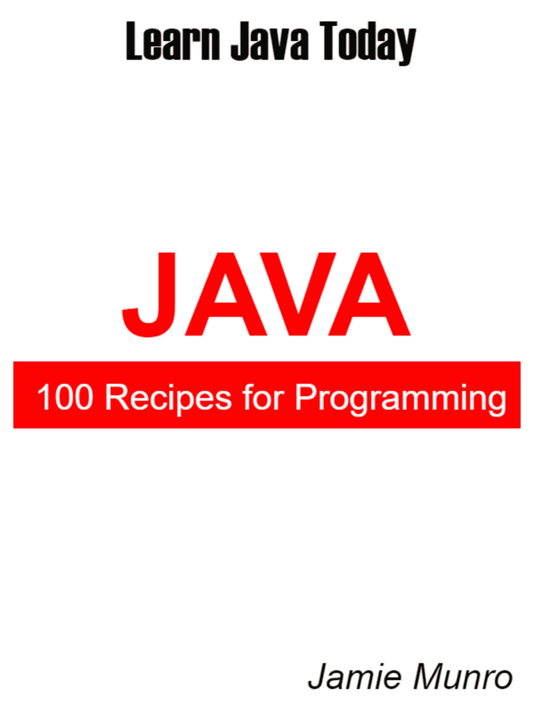

## 整理者：Jamie Munro

本书献给在本书整理时已提问过超过 1,300,000 个问题的 StackOverflow 用户。

# 前言

## 关于本书

本书采用“食谱”格式结构，包含了包含问题描述和解决方案的菜谱。每个菜谱的问题描述之后都有详细的解释。这些解释通常位于解决方案中；但可选的讨论部分通常包含其他有用信息，有助于演示解决方案是如何工作的。

# 菜谱

1. `HashMap` 和 `Hashtable` 之间的区别？
2. 如何在 Java 中将数字转换为文字？
3. 如何通过 Java 应用使用 GMail、Yahoo 或 Hotmail 发送邮件？
4. `com.mysql.jdbc.exceptions.jdbc4.CommunicationsException: Communications link failure`
5. 不幸的是 MyApp 停止了。我该如何解决？
6. 在 Java 中解析 JSON 字符串
7. "Could not find or load main class”是什么意思？
8. 如何告诉 Maven 使用依赖的最新版本？
9. Spring, Struts, Hibernate, JavaServer Faces, Tapestry 之间有什么区别？
10. Could not calculate build plan: Plugin `org.apache.maven.plugins:maven-resources-plugin:2.5` or one of its dependencies could not be resolved
11. 工作的 Soap 客户端示例
12. 如何在 Java 类中调用 SOAP Web 服务？
13. 如何生成随机的字母数字字符串？
14. 什么时候使用 `LinkedList` 而不是 `ArrayList`？
15. 为什么处理排序数组比处理未排序数组更快？
16. 将字符串写入输出流
17. 避免 `!= null` 语句
18. 在 Linux 上通过 `wget` 下载 Java JDK 显示的是许可证页面
19. 如何使用 Apache HttpClient 处理无效的 SSL 证书？
20. Java 字符串转换日期
21. 如何在 Java 中获取当前日期/时间
22. `wait()` 和 `sleep()` 的区别
23. 类型安全：未检查的转换
24. 如何在 Java 中分割字符串
25. 为什么 `RecyclerView` 没有 `onItemClickListener()`
26. "Cannot find symbol” 编译错误是什么意思？
27. Java: 如何将一个 `ArrayList` 拆分成多个 `ArrayList`？
28. 在 Android 中不使用内置应用通过 JavaMail API 发送邮件
29. 使用 JAX-RS 和 Jersey 进行基于令牌的 REST 认证的最佳实践
30. 如何从字符串中移除特殊字符？
31. 从另一个类添加 `JPanel`
32. 如何获取一天的开始时间和结束时间？
33. 为什么 `exception.printStackTrace()` 是不良好的实践？
34. 来自 jar 文件的 Spring context
35. Spring - `@Transactional` - 后台发生了什么？
36. IDEA: `javac`: source release 1.7 需要 target release 1.7
37. Java GUI: 如何在 `JPanel` 中设置 `JButton` 焦点？
38. 为什么 `System.gc()` 是不良好的实践？
39. `Static` 和 `final` 之间的区别
40. 如何在 Java 中优雅地处理 SIGKILL 信号
41. "implements” 在类中做什么？
42. 在 Android 中如何让代码暂停几秒？
43. Java - `Decimal Format.parse` 返回指定小数位数的 `double` 值
44. 在 javascript 代码中调用 java 方法
45. 使用 Apache Poi 从 Excel 表格获取单元格值
46. 遍历 `String` 中所有字符的最快方法
47. 在 JSF 中获取请求参数值
48. 通过 Spring 进行 RESTful 认证
49. 关于 java, spring, hibernate, maven 的优秀博客有哪些？
50. 我应该使用 Vaadin Framework 吗
51. 在 Java 中将 `.csv` 转换为 `.xls`
52. `UnsupportedClassVersionError`: WebSphere AS 7 中的 JVMCFRE003 主版本错误
53. Java `HashMap` 相比 `ArrayList` 的内存开销
54. `persistence.xml` 的 `jta-data-source` 中放入什么？
55. `JfreeChart` X,Y 轴范围设置
56. Spring Framework 到底是做什么的
57. 在 Spring Security 2.06 中实现自定义的 `AuthenticationProvider`
58. 如何在日志中对消息进行 JUnit 断言
59. Java 8 中 `Optional.ifPresent` 和 `if-not-Present` 的函数式风格？
60. Java 执行器：任务完成时如何在非阻塞的情况下接收通知？
61. JSP/Servlet Web 应用中的 XSS 预防
62. `Executors.newCachedThreadPool()` 对比 `Executors.newFixedThreadPool()`
63. 面向对象与基于对象的语言的核心区别
64. Java：无法解析的日期异常
65. `Hashmap.keySet()`、`foreach` 和 `remove`
66. `java.util.regex` - `Pattern.compile()` 的重要性？
67. 使用 Mockito 测试 void 方法
68. 为什么匿名类中只能访问 `final` 变量？
69. 当 Javadoc 标签不完整时，Java 8 中的 Maven 不工作
70. 如何同时转义 CSV 文件中的逗号和双引号？
71. 如何从泛型获取类字？
72. C# `var` 关键字在 Java 中的等价物？
73. 使用 Java 向 WebService 发送 SOAP 请求
74. Java 字符串替换与 NUL（NULL, ASCII 0）字符？
75. Spring Data JPA - 注入失败 - `BeanCreationException`: 无法自动注入字段
76. "text" 和 `new String("text")` 之间有什么区别？
77. 如何测试没有抛出异常？
78. Java 中 `HashMap` 和 `ArrayList` 的区别？
79. 使用 `web.xml` 进行 Servlet 映射
80. Java 开发的最佳操作系统是什么？
81. java：这是什么：`[Ljava.lang.Object;]`？
82. `javax.naming.NameNotFoundException`
83. 如何配置环境使用 JavaMail？
84. 如何用数据库中的值填充组合框？
85. `init-param` 和 `context-param`
86. 在 Java 中保持 `double` 的精度
87. 找不到 "http://java.sun.com/jsp/jstl/core" 的标签库描述符
88. 多个 Frame 的使用：是良好实践还是坏实践？
89. 包含不可序列化部分的 Java 序列化
90. 关于 `session.flush()` 的问题
91. Java 包名中单词分隔符的约定是什么？
92. `Gson` 与使用数组反序列化对象数组
93. Java SSL/TLS 忽略证书？(`java.security.CertPathException`: 时间戳失败）
94. Java SE 8 有 Pairs 或 Tuples 吗？
95. 如何使用 Google 的 `Gson` API 正确反序列化 JSON？
96. 检测字符串是否包含唯一字符：我的解决方案与《破解面试》的对比？
97. 如何通过反射获取 `Object` 中的字段？
98. 如何在 Java 中通过代理进行 HTTPS 请求？
99. Subclipse 和 JavaHL 的头疼问题
100. 如何读写 xml 文件？

# HashMap 和 Hashtable 的区别

## 问题

Java 中 `HashMap` 和 `Hashtable` 之间有什么区别？对于非线程应用程序，哪种更高效？

问题由：dmanxiii 提供

## 解决方案

Java 中的 `HashMap` 和 `Hashtable` 之间有几点区别：

1. `Hashtable` 是同步的（`synchronized`），而 `HashMap` 则不是。这使得 `HashMap` 更适合非线程应用程序，因为未同步对象的性能通常比同步对象更好。
2. `Hashtable` 不允许 `null` 键或值。`HashMap` 允许一个 `null` 键和任意数量的 `null` 值。
3. `HashMap` 的子类之一是 `LinkedHashMap`，如果你需要可预测的迭代顺序（默认是插入顺序），可以轻松地将 `HashMap` 替换为 `LinkedHashMap`。如果你使用的是 `Hashtable`，就没那么简单。

既然同步对你来说不是问题，我建议使用 `HashMap`。如果同步成为问题，你也可以查看 `ConcurrentHashMap`。

解决方案由：Josh Brown 提供

## 讨论

基于此信息，我建议使用 `HashMap`。我认为最大的优势是，Java 会防止你在迭代遍历期间对其进行修改，除非你通过迭代器进行操作。

讨论由：pkaeding 提供

`Hashtable` 是同步的，而 `HashMap` 不是。这导致 `Hashtable` 比 `HashMap` 慢。

对于非线程应用，请使用 `HashMap`，因为它们在功能上是相同的。

讨论感谢提供：[izb](https://stackoverflow.com/users/974/izb)

`Hashtable` 与 `HashMap` 类似，并具有类似的接口。建议你使用 `HashMap`，除非你需要对遗留应用程序的支持或需要同步机制，因为 `Hashtable` 的方法是同步的。因此在你情况下，由于你没有使用多线程，`HashMap` 是你的最佳选择。

讨论感谢提供：[Miles D](https://stackoverflow.com/users/3898/miles-d)

除了 izb 所说的之外，`HashMap` 允许空值，而 `Hashtable` 不允许。

另外请注意 `Hashtable` 继承了 `Dictionary` 类，正如 [Javadocs](http://java.sun.com/j2se/1.4.2/docs/api/java/util/Dictionary.html) 所述，它已过时并被 `Map` 接口取代。

讨论感谢提供：[matt b](https://stackoverflow.com/users/4249/matt-b)

对于线程应用，你通常可以使用 `ConcurrentHashMap`——这取决于你的性能需求。

讨论感谢提供：[Tim Howland](https://stackoverflow.com/users/4276/tim-howland)

`HashMap`：`Map` 接口的一种实现，使用哈希值对数组进行索引。`Hashtable`：嘿，1998 年找你了，他们想要回他们的集合 API。


但说认真的，你最好完全远离`Hashtable`。对于单线程应用，你不需要同步带来的额外开销。对于高并发应用，这种偏执的同步可能会导致饥饿、死锁或不必要的垃圾回收暂停。正如 Tim Howland 指出的那样，你可能应该使用`ConcurrentHashMap`来代替它。

讨论感谢提供：[Apocalisp](https://stackoverflow.com/users/3434/apocalisp)

请注意，很多回答都说`Hashtable`是同步的。在实践中，这带给你的好处极小。访问器/修改器方法上的同步会阻止两个线程并发向映射中添加或删除元素，但在现实世界中，你通常需要额外的同步。

一个非常常见的习用法是“先检查后放入”——即在`Map`中查找条目，如果它不存在则添加它。无论你使用`Hashtable`还是`HashMap`，这都不是一个原子操作。

可以通过以下方式获得等效同步的`HashMap`：

```
Collections.synchronizedMap(myMap);
```

但要正确实现此逻辑，你需要如下形式的额外同步：

```
synchronized(myMap) {
    if (!myMap.containsKey("tomato"))
        myMap.put("tomato", "red");
}
```

即使是遍历`Hashtable`的条目（或通过`Collections.synchronizedMap`获取的`HashMap`）也不是线程安全的，除非你通过额外的同步保护`Map`被修改。

[ConcurrentMap](http://docs.oracle.com/javase/8/docs/api/index.html?java/util/concurrent/ConcurrentMap.html)接口的实现（例如[ConcurrentHashMap](http://docs.oracle.com/javase/8/docs/api/index.html?java/util/concurrent/ConcurrentHashMap.html)）通过包含线程安全的“检查后执行”语义来解决其中一些问题，例如：

```
ConcurrentMap.putIfAbsent(key, value);
```

讨论感谢提供：[serg10](https://stackoverflow.com/users/1853/serg10)

没有人提到`Hashtable`并不是 Java 集合框架的一部分这一事实——它只是提供了类似的 API。此外，`Hashtable`被认为是遗留代码。`Hashtable`中没有任何功能是无法用`HashMap`或`HashMap`的派生类实现的，因此对于新代码，我没有看到任何理由要回到`Hashtable`。

讨论感谢提供：[aberrant80](https://stackoverflow.com/users/124111/aberrant80)

`Hashtable`和`HashMap`另一个关键区别是，`HashMap`中的`Iterator`是快速失败（fail-fast），而`Hashtable`的枚举器不是，且如果任何其他线程通过`Iterator`的`remove()`方法以外的添加或删除任何元素来修改映射的结构，它将抛出`ConcurrentModificationException`。但这并不是保证的行为，将由 JVM 尽力完成。

我的来源：[`javarevisited.blogspot.com/2010/10/difference-between-hashmap-and.html`](http://javarevisited.blogspot.com/2010/10/difference-between-hashmap-and.html)

讨论感谢提供：[Neerja](https://stackoverflow.com/users/934204/neerja)

这个问题经常在面试中被问到，用来检查候选人是否理解集合类的正确用法，并是否意识到可用的替代方案。

1. `HashMap`类大致等同于`Hashtable`，不同之处是非同步的且允许空值（`HashMap`允许键和值均空，而`Hashtable`不允许）。
2. `HashMap`不保证映射的顺序随时间推移保持不变。
3. `HashMap`是同步的，而`Hashtable`是同步的。
4. `HashMap`中的`Iterator`是失败安全的（fail-safe），而`Hashtable`的枚举器不是，且如果任何其他线程通过`Iterator`的`remove()`方法以外的添加或删除任何元素来修改映射的结构，它将抛出`ConcurrentModificationException`。但这并不是保证的行为，将由 JVM 尽力完成。

### 关于某些术语的说明

1. **同步 (Synchronized)**：意味着一次只有一个线程可以修改表。基本上，这意味着其他线程将等待锁释放。
2. **失败安全 (Fail-safe)**：与迭代器有关。如果创建了迭代器且某些线程尝试修改集合，将抛出`IllegalArgumentException`。然而，如果在调用`set`之前集合已被修改。
3. **结构性 (Structurally)**：意味着删除或插入元素会有效改变结构。

`HashMap`可以通过`m = Collections.synchronizeMap(hashMap);`进行同步

`Map`提供了视图而不是通过枚举进行迭代。视图极大地增强了接口的表达能力，在本节后面讨论。`Map`允许你遍历键、值或键值对；`Hashtable`不提供第三种选择。`Map`允许在过程中安全地删除条目；`Map`修复了`Hashtable`接口的一个缺陷。`Hashtable`有一个名为`contains`的方法，如果`Hashtable`包含某个值则返回 true。考虑到其名称，你会期望该方法在`Hashtable`包含某个键时返回 true，因为键是`Hashtable`的主要访问机制。`Map`接口通过重命名方法为`containsValue`消除了这种困惑。此外，这提高了接口的一致性——`containsValue`对应`containsKey`。

> [Map Interface](http://docs.oracle.com/javase/tutorial/collections/interfaces/map.html)

讨论感谢提供：[sravan](https://stackoverflow.com/users/759012/sravan)

除了这里提到的其他重要方面外，集合 API（例如`Map`接口）一直在修改以适应 Java 规范的最新进展。例如，对比 Java 5 的`Map`迭代：

```
for (Elem elem : map.keys()) {
  elem.doSth();
}
```

对比旧`Hashtable`方法：

```
for (Enumeration en = htable.keys(); en.hasMoreElements(); ) {
  Elem elem = (Elem) en.nextElement();
  elem.doSth();
}
```

在 Java 1.8 中，我们还承诺能够像旧的脚本语言一样构造和访问`HashMap`：

```
Map<String,Integer> map = { "orange" : 12, "apples" : 15 };
map["apples"];
```

**更新：**不，它们不会出现在 1.8 中... :(

# [Project Coin 的集合增强会包含在 JDK8 中吗？](https://stackoverflow.com/questions/13692213/are-project-coins-collection-enhancements-going-to-be-in-jdk8)

感谢讨论：[pwes](https://stackoverflow.com/users/283519/pwes)

- [`HashTable`](http://docs.oracle.com/javase/7/docs/api/java/util/Hashtable.html)是同步的，如果你在单线程中使用它，可以使用[`HashMap`](http://docs.oracle.com/javase/7/docs/api/java/util/HashMap.html)，它是一个非同步版本。非同步对象的性能通常会略高一点。顺便说一下，如果多个线程并发访问一个`HashMap`，且至少有一个线程对 map 进行了结构性修改，则必须在外部进行同步。你可以使用以下方法将非同步 map 包装在同步 map 中：

```
Map m = Collections.synchronizedMap(new HashMap(...));
```

- `HashTable`只能包含非空对象作为键或值。`HashMap`可以包含一个 null 键和 null 值。

- `Map`返回的迭代器是快速失败的（fail-fast），如果在迭代器创建后的任何时间对 map 进行了结构性修改（任何通过迭代器自身的`remove`方法以外），迭代器将抛出`ConcurrentModificationException`。因此，在面对并发修改时，迭代器会快速且干净地失败，而不是在未来的某个不确定时刻面临任意的、非确定性的行为。**而**，`Hashtable`的`keys`和`elements`方法返回的枚举器（Enumerations）并不是快速失败的。

- `HashTable`和`HashMap`是[Java 集合框架](http://docs.oracle.com/javase/7/docs/technotes/guides/collections/index.html)的成员（自 Java 2 平台 v1.2 以来，`HashTable`被重构以实现`Map`接口）。

- `HashTable`被认为是遗留代码，文档建议在需要线程安全的高并发实现时使用[`ConcurrentHashMap`](http://docs.oracle.com/javase/7/docs/api/java/util/concurrent/ConcurrentHashMap.html)来代替`Hashtable`。

- `HashMap`不保证元素返回的顺序。对于`HashTable`，我猜是一样的，但不完全确定，我没有找到明确说明这一点的资源。

感谢讨论：[alain.janinm](https://stackoverflow.com/users/1140748/alain-janinm)

`HashMaps`给了你同步的自由，而且调试要容易得多。

感谢讨论：user1506047

看看这张图表。它提供了不同数据结构与`HashMap`以及`Hashtable`之间的比较。这种比较非常精确、清晰且易于理解。

[Java 集合矩阵](https://docs.google.com/spreadsheet/pub?key=0Aq3e8BiuZY2wdFpHSlV0QzVmV1lUNHJidGd2b0Zrb3c&single=true&gid=0&output=pdf)

感谢讨论：[Sujan](https://stackoverflow.com/users/819014/sujan)

`HashMap`和`Hashtable`也有显著的算法差异。之前没有人提到过这一点，所以我把它提出来。`HashMap`会构建一个大小为 2 的幂的哈希表，动态地增加它，使得任何桶中最多只有大约 8 个元素（冲突），并且对于通用元素类型非常好地搅拌元素。然而，如果你知道自己在做什么，`Hashtable`的实现对哈希提供了更好、更精细的控制，例如，你可以使用接近你的取值域大小的质数来固定表格大小，这会带来比`HashMap`更好的性能，即在某些情况下冲突更少。

除了问题中广泛讨论的明显区别外，我将`Hashtable`看作一辆“手动挡”汽车，你对哈希有更好的控制力；而`HashMap`则是“自动挡”对应物，它通常表现良好。

感谢讨论：[Giovanni Azua](https://stackoverflow.com/users/1142881/giovanni-azua)

1) `Hashtable`是同步的，而`HashMap`不是。2) 另一个区别是`HashMap`中的迭代器是安全失败（fail-safe），而`Hashtable`的枚举器不是。如果你在迭代时更改 map，你就会知道。

3) `HashMap`允许包含 null 值，而`Hashtable`不。

感谢讨论：[raja](https://stackoverflow.com/users/1199342/raja)

`HashMap`:- 它是`java.util`包内可用的一个类，用于以键值对的形式存储元素。

`Hashtable`:- 它是在集合框架内部被识别的遗留类。

感谢讨论：[Ankit](https://stackoverflow.com/users/1203455/ankit)

[`HashTable`](http://docs.oracle.com/javase/6/docs/api/java/util/Hashtable.html)是 jdk 中的一个遗留类，不应该再使用了。请将它的用处替换为[`ConcurrentHashMap`](http://docs.oracle.com/javase/1.5.0/docs/api/java/util/concurrent/ConcurrentHashMap.html)。如果不需要线程安全，可以使用`HashMap`。你可以使用同步方法将非同步 map 包装在同步 map 中。

感谢讨论：[Ankit](https://stackoverflow.com/users/1203455/ankit)

[`HashTable`](http://docs.oracle.com/javase/6/docs/api/java/util/Hashtable.html)是 jdk 中的一个遗留类，不应该再使用了。将它的用处替换为[`ConcurrentHashMap`](http://docs.oracle.com/javase/1.5.0/docs/api/java/util/concurrent/ConcurrentHashMap.html)。如果不需要线程安全，可以使用`HashMap`。你可以使用同步方法将非同步 map 包装在同步 map 中。

感谢讨论：[jontejj](https://stackoverflow.com/users/541755/jontejj)

`HashMaps`提供了同步的自由，而`Hashtable`不是。

感谢讨论：[pong](https://stackoverflow.com/users/1162526/pong)

`HashMap`是`java.util`包内可用的一个类，用于以键值对的形式存储元素。它不是线程安全的，而`Hashtable`是同步的。`HashMap`允许 null，但`Hashtable`不允许。

感谢讨论：[Ekanta Swain](https://stackoverflow.com/users/2476998/ekanta-swain)

`HashTable`和`HashMap`之间有几个基本区别：

1) `Hashtable`是同步的，而`HashMap`不是。

2) 另一个区别是`HashMap`中的迭代器是安全失败的，而`Hashtable`的枚举器不是。如果你在迭代时更改 map，你就会知道。

3) `HashMap`允许包含 null 值，而`Hashtable`不。

感谢讨论：[raja](https://stackoverflow.com/users/1199342/raja)

`HashMap`:- 它是`java.util`包内可用的一个类，用于以键值对的形式存储元素。它不是线程安全的，而`Hashtable`是同步的。`HashMap`允许 null，但`Hashtable`不允许。

感谢讨论：[Ankit](https://stackoverflow.com/users/1203455/ankit)

`HashMap`:- 它是`java.util`包内可用的一个类，用于以键值对的形式存储元素。它不是线程安全的，而`Hashtable`是同步的。`HashMap`允许 null，但`Hashtable`不允许。

- `Map`返回的迭代器是快速失败的（fail-fast），如果在迭代器创建后的任何时间对 map 进行了结构性修改（任何通过迭代器自身的`remove`方法以外），迭代器将抛出`ConcurrentModificationException`。因此，在面对并发修改时，迭代器会快速且干净地失败，而不是在未来的某个不确定时刻面临任意的、非确定性的行为。**而**，`Hashtable`的`keys`和`elements`方法返回的枚举器（Enumerations）并不是快速失败的。

- `Hashtable`是同步的，而`HashMap`不是。

2) 另一个区别是`HashMap`中的迭代器是安全失败的，而`Hashtable`的枚举器不是。如果你在迭代时更改 map，你就会知道。

3) `HashMap`允许包含 null 值，而`Hashtable`不。

因此，正如其他人所指出的，在新代码中请始终避免它们，因为 JCF（Java 集合框架）中一直有更好的替代方案。


这里有一份你会发现非常有用的 [Java 集合速查表](http://pierrchen.blogspot.com/2014/03/java-collections-framework-cheat-sheet.html)。注意灰色区块包含了遗留类 `HashTable`、`Vector` 和 `Stack`。

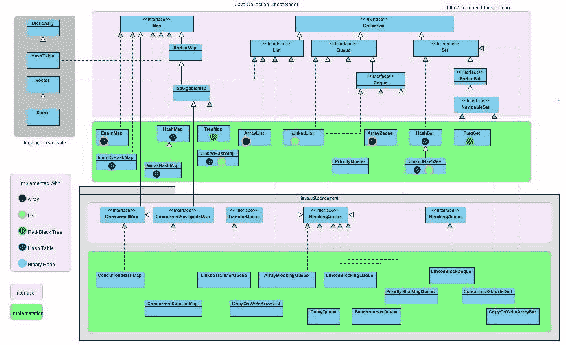

讨论感谢来自：[Bin Chen](https://stackoverflow.com/users/115722/bin-chen)

## `HashMap` 和 `HashTable`

### 关于 `HashMap` 和 `HashTable` 的一些重要要点

请阅读下文详情。

1. `Hashtable` 和 `HashMap` 实现了 `java.util.Map` 接口。
2. `HashMap` 和 `Hashtable` 都是基于哈希的集合，并基于哈希工作。因此这些 `HashMap` 和 `HashTable` 的相似之处。

### `HashMap` 和 `HashTable` 之间有什么区别？

1. 第一个区别是 `HashMap` 不是线程安全的，而 `HashTable` 是线程安全的（`ThreadSafe`）。
2. `HashMap` 在性能上更好，因为它不是线程安全的。而 `Hashtable` 性能并不优，因为它是线程安全的。所以多个线程不能同时访问 `HashTable`。

讨论感谢来自：[JegsVala](https://stackoverflow.com/users/3230563/jegsvala)

老而经典的话题，只想补充这篇解释该问题的有用博客：

[`blog.manishchhabra.com/2012/08/the-5-main-differences-betwen-hashmap-and-hashtable/`](http://blog.manishchhabra.com/2012/08/the-5-main-differences-betwen-hashmap-and-hashtable/)

来自 Manish Chhabra 的博客。

> # `HashMap` 和 `Hashtable` 之间的 5 个主要区别
>
> `HashMap` 和 `Hashtable` 都实现了 `java.util.Map` 接口，但 Java 开发者必须理解其中的差异以编写出更高效的代码。从 Java 2 平台 v1.2 开始，`Hashtable` 类被重写以实现 `Map` 接口，使其成为 Java 集合框架的成员。
>
> 1. `HashMap` 和 `Hashtable` 的主要区别之一是 `HashMap` 是非同步的，而 `Hashtable` 是同步的，这意味着 `Hashtable` 是线程安全的，可以在多个线程之间共享，但 `HashMap` 在没有适当同步的情况下无法在多个线程间共享。Java 5 引入了 `ConcurrentHashMap`，它是 `Hashtable` 的替代方案，在 Java 中提供了比 `Hashtable` 更好的扩展性。`Synchronized` 意味着在某一点只有一个线程可以修改哈希表。基本上，这意味着任何线程在对哈希表执行更新之前都必须获取对象的锁，而其他线程将等待锁释放。
>
> 2. `HashMap` 类大致等同于 `Hashtable`，区别在于它允许空值（`HashMap` 允许的键和值均为 null，而 `Hashtable` 不允许 null）。
>
> 3. `HashMap` 与 `Hashtable` 之间的第三个显著区别是 `HashMap` 中的 `Iterator` 是快速失败（fail-fast）迭代器，而 `Hashtable` 的枚举器不是。如果任何其他线程通过除 `Iterator` 的 `remove()` 方法之外的添加或删除元素来修改 map 的结构，它将抛出 `ConcurrentModificationException`。但这并不是一种保证的行为，将由 JVM 尽力而为。这也是 Java 中 `Enumeration` 和 `Iterator` 之间的另一个重要区别。
>
> 4. `Hashtable` 和 `HashMap` 的另一个显著区别是，由于线程安全和同步，如果在单线程环境中使用 `Hashtable`，它比 `HashMap` 慢得多。所以，如果你不需要同步且 `HashMap` 只由一个线程使用，它在 Java 中的性能将优于 `Hashtable`。
>
> 5. `HashMap` 不保证 map 的顺序随时间推保持不变。
>
> 注意 `HashMap` 可以通过以下方式同步：

```java
Map m = Collections.synchronizedMap(hashMap);
```

> 总结：Java 中的 `Hashtable` 和 `HashMap` 之间存在显著差异，例如线程安全性和速度。基于此，只有在绝对需要线程安全时才使用 `Hashtable`；如果你正在运行 Java 5，考虑在 Java 中使用 `ConcurrentHashMap`。

讨论感谢来自：[Night0](https://stackoverflow.com/users/2647077/night0)

1. `Hashmap` 和 `HashTable` 都存储键和值。
2. `Hashmap` 可以存储一个 `null` 键。`Hashtable` 不能存储 `null`。
3. `HashMap` 不是同步的，但 `Hashtable` 是同步的。
4. `HashMap` 可以通过 `Collection.SyncronizedMap(map)` 进行同步。

```java
Map hashmap = new HashMap();

Map map = Collections.SyncronizedMap(hashmap);
```

讨论感谢来自：[Rahul Tripathi](https://stackoverflow.com/users/3981269/rahul-tripathi)

1. `HashMap` 是非同步的，而 `Hashtable` 是同步的。
2. `HashMap` 不保证 map 的顺序随时间保持不变。
3. `Hashtable` 和 `HashMap` 的另一个显著区别是，由于线程安全和同步，如果在单线程环境中使用 `Hashtable` 比 `HashMap` 慢得多。

讨论感谢来自：[Chetu](https://stackoverflow.com/users/2768515/chetu)

### `Hashtable`

`Hashtable` 是一个保留键值对的数据结构。它不允许 null 键和值（如果你添加 null 值将抛出 `NullPointerException`）。它是同步的。所以在一个时刻只有一个线程可以访问 `HashTable`。

示例：

```java
import java.util.Map;
import java.util.Hashtable;

public class TestClass {

    public static void main(String args ]) {
        Map<Integer, String> states = new HashTable<Integer, String>();
        states.put(1, "INDIA");
        states.put(2, "USA");

        states.put(3, null);    运行时抛出 NullPointerException

        System.out.println(states.get(1));
        System.out.println(states.get(2));
        // System.out.println(states.get(3));
    }
}
```

### `HashMap`

`HashMap` 类似于 `Hashtable`，但它也接受键对。它允许键和值都为 null。它的性能比 `HashTable` 好，因为它是非同步的。

示例：

```java
import java.util.HashMap;
import java.util.Map;

public class TestClass {

    public static void main(String args ]) {
        Map<Integer, String> states = new HashMap<Integer, String>();
        states.put(1, "INDIA");
        states.put(2, "USA");

        states.put(3, null);    // 好的
        states.put(null, "UK");

        System.out.println(states.get(1));
        System.out.println(states.get(2));
        System.out.println(states.get(3));
    }
}
```

讨论感谢来自：[IntelliJ Amiya](https://stackoverflow.com/users/3395198/intellij-amiya)

## `HashMap` 和 `HashTable` 的区别 / `HashMap` vs `HashTable`

1. **同步或线程安全**：这是两者之间最重要的区别。`HashMap` 不是同步的也不是线程安全的。相反，`HashTable` 是线程安全的且同步的。什么时候使用 `HashMap`？答案是如果你的应用程序不需要任何多线程任务，换句话说，`hashmap` 更适合非线程应用程序。`HashTable` 应该在多线程应用程序中使用。
2. **空键和空值**：`HashMap` 允许一个空键和任意数量的空值，而 `HashTable` 在 `HashTable` 对象中不允许空键和空值。
3. **迭代值**：`HashMap` 对象的值通过 `iterator` 进行迭代。`HashTable` 是除 `vector` 之外唯一使用枚举器来迭代 `HashTable` 对象值的类。

### 4. 快速失败迭代器（Fail-fast iterator）

`Hashmap` 中的迭代器是快速失败迭代器，而 `Hashtable` 的枚举器（enumerator）不是。根据 Oracle 文档，如果在创建迭代器后，除了迭代器自身的 `remove` 方法外，通过任何方式对 `Hashtable` 进行了结构性修改，则迭代器将抛出 `ConcurrentModificationException`。结构性修改意味着从 `Collection` 对象（此处为 `hashmap` 或 `hashtable`）中添加或删除元素。因此，`Hashtable` 的 `keys` 和 `elements` 方法返回的枚举不是快速失败的。我们已经解释了 `iterator` 和 `enumeration` 区别。

### 5. 性能

`HashMap` 比 `Hashtable` 快得多且使用的内存更少，因为前者是非同步的。在单线程环境中，非同步对象的性能通常远优于像 `Hashtable` 这样的同步对象。

### 6. 超类与遗留类

`Hashtable` 是 `Dictionary` 类的子类，该类在 `Jdk` 1.7 中已废弃，因此不再被使用。更好的做法是在外部对 `HashMap` 进行同步，或者使用 `ConcurrentMap` 实现（例如 `ConcurrentHashMap`）。`HashMap` 是 `AbstractMap` 类的子类。虽然 `Hashtable` 和 `HashMap` 有不同的超类，但它们都是 `"Map"` 抽象数据类型的实现。

讨论感谢来自：[Moitt](https://stackoverflow.com/users/2455366/moitt)

### 同步或线程安全

`Hash Map` 没有同步的，因此它不是线程安全的，在没有适当同步块的情况下，它无法在多个线程之间共享；相反，`Hashtable` 是同步的，因此它是线程安全的。

### 空键和空值

`HashMap` 允许一个空键和任意数量的空值。`Hashtable` 不允许空键或空值。

### 遍历值

`HashMap` 中的 `Iterator` 是快速失败迭代器，而 `Hashtable` 的枚举器不是；如果任何其他 `Thread` 通过添加或删除元素（除 `Iterator` 自身的 `remove()` 方法外）对 map 进行结构性修改，它将抛出 `ConcurrentModificationException`。

### 超类与遗留类

`HashMap` 是 `AbstractMap` 类的子类，而 `Hashtable` 是 `Dictionary` 类的子类。

### 性能

由于 `HashMap` 没有同步，因此它比 `Hashtable` 更快。

参考 [`modernpathshala.com/Article/1020/difference-between-hashmap-and-hashtable-in-java`](http://modernpathshala.com/Article/1020/difference-between-hashmap-and-hashtable-in-java) 获取关于 Java 集合的示例、面试问题和测验。

讨论感谢来自：[amitguptageek](https://stackoverflow.com/users/3527383/amitguptageek)

除了已经提到的区别外，应该注意的是，自 Java 8，`HashMap` 动态地将每个桶（bucket）使用的 `Nodes`（链表）替换为 `TreeNodes`（红黑树），这样即使存在高哈希冲突，搜索的最坏情况也是：

`HashMap` 为 `O(log(n))`，而 `Hashtable` 为 `O(n)`。

上述改进尚未应用于 `Hashtable`，而仅应用到了 `HashMap`、`LinkedHashMap` 和 `ConcurrentHashMap`。

供你参考，目前：

- `TREEIFY_THRESHOLD = 8`：如果一个桶包含超过 8 个节点，则链表将转换为平衡树。
- `UNTREEIFY_THRESHOLD = 6`：当一个桶变得太小（由于删除或调整大小）时，树将转换回链表。

讨论感谢来自：[Konstantinos Chalkias](https://stackoverflow.com/users/3294902/konstantinos-chalkias)

## Java 中 `HashMap` 和 `Hashtable` 的区别

### 1) 线程安全

- `Hashtable` 内部是同步的。
- 因此，在多线程应用程序中使用 `HashTable` 是非常安全的。
- 而 `HashMap` 内部没有同步。
- 因此，在没有外部同步的情况下，在多线程应用程序中使用 `HashMap` 是不安全的。
- 你可以使用 `Collections.synchronizedMap()` 方法从外部同步 `HashMap`。

### 2) 继承自

- 虽然 `HashMap` 和 `HashTable` 都实现了 `Map` 接口，但它们扩展了两个类。
- `HashMap` 扩展 `AbstractMap` 类，而 `HashTable` 扩展 `Dictionary` 类，后者是 Java 中的遗留类。

### 3) 空键和空值

- `HashMap` 允许最多一个空键和任意数量的空值。
- 而 `HashTable` 甚至不允许任何一个空键或空值。

### 4) 遍历

- `HashMap` 只返回 `Iterators`，用于遍历 `HashMap` 的元素。
- `HashTable` 返回 `Iterator` 以及 `Enumeration`，可用于遍历 `Hashtable` 的元素。

### 5) 快速失败 vs 安全失败（Fail-Fast Vs Fail-Safe）

- `HashMap` 返回的 `Iterator` 本质上是快速失败的，即如果在创建 `Iterator` 之后修改了 `HashMap`（`Iterator` 自身的 `remove()` 方法外），它将抛出 `ConcurrentModificationException`。
- 与此相反，`Hashtable` 返回的 `Enumeration` 本质上是安全失败的，即如果 `Hashtable` 被修改，它们不会抛出任何异常。

### 6) 性能

- 由于 `Hashtable` 是同步的，它比 `HashMap` 慢。

### 7) 遗留类

- `Hashtable` 是一个遗留类。
- 它几乎被废弃。
- 自 JDK 1.5 起，`ConcurrentHashMap` 被认为比 `Hashtable` 好。

### 8) 集合成员

- `HashMap` 是 JDK 1.2 引入的集合框架成员。
- `Hashtable` 在 JDK 1.2 之前就已经存在。

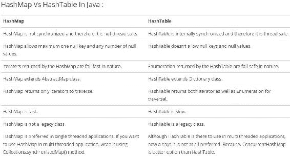

## 哪个更适合非线程环境？

- `Hashtable` 是同步的，而 `HashMap` 不是。
- 这使得 `HashMap` 在非线程环境下优于同步对象。

讨论感谢来自：[LakshMi](https://stackoverflow.com/users/6755093/lakshmi)

有很多很好的回答。我添加一些点并总结。

### `HashMap`

1. `HashMap` 没有同步。它不是线程安全的，在没有适当同步的情况下无法在多个线程间共享。
2. `HashMap` 允许一个空键和多个空值。
3. `HashMap` 是在 JDK 1.2 中引入的新类。
4. `HashMap` 很快。
5. 我们可以通过调用以下代码使 `HashMap` 同步：

```java
Map m = Collections.synchronizedMap(HashMap);
```

6. `HashMap` 通过 `Iterator` 遍历。


7) `HashMap` 中的 `Iterator` 是快速失败。

8) `HashMap` 继承 `AbstractMap` 类。

**Hashtable**

1) `Hashtable` 同步。它是线程安全的，可以与其他线程共享。

2) `Hashtable` 不允许任何空键或空值。

3) `Hashtable` 是一个遗留类。

4) `Hashtable` 慢。

5) `Hashtable` 内部同步，无法变为非同步。

6) `Hashtable` 通过 `Enumerator` 和 `Iterator` 遍历。

7) `Hashtable` 中的 `Enumerator` 不是快速失败的。

8) `Hashtable` 继承 `Dictionary` 类。

`Hashtable` 类是同步的，也就是说，它被设计用于处理多个或多线程进程的应用程序。在程序应用于单个进程的经典情况下，同步类的效率较低，因此 `HashMap` 类通常更快。`HashTable` 类无论键还是值都不接受 `Null` 值，而 `HashMap` 类允许单个键为 `Null`，并且尽可能多的 `null` 值。

讨论感谢提供：[KB Hassan](https://stackoverflow.com/users/4226914/kb-hassan)

此内容源自 [StackOverFlow](https://stackoverflow.com/questions/40471/differences-between-hashmap-and-hashtable)，并已整理成上述配方。

# How Java 中将数字转换为单词

## 问题

我们目前有一个粗糙的机制将数字转换为单词（例如使用几个静态数组），并根据数字的大小转换为英文文本。但在处理巨大的数字时我们遇到了问题。

```
10183 = Ten thousand one hundred eighty three
90 = Ninety
5888 = Five thousand eight hundred eighty eight
```

任何数学库中是否有易于使用的函数可以供我为此目的？

问题感谢提供：[Jason](https://stackoverflow.com/users/472897/jason)

## 解决方案

[这里](http://www.rgagnon.com/javadetails/java-0426.html)是代码，我不认为 SE 中有任何方法。

它基本上是将数字转换为字符串并解析 `String`，将其与权重关联。

**例如**

```
1000
```

`1` 被视为千位，`1` 因为位置被映射到 `"one"` 和千位。

这是来自该网站的代码：

**English（英语）**

```java
import java.text.DecimalFormat;

public class EnglishNumberToWords {

  private static final String[] tensNames = {
    "",
    " ten",
    " twenty",
    " thirty",
    " forty",
    " fifty",
    " sixty",
    " seventy",
    " eighty",
    " ninety"
  };

  private static final String[] numNames = {
    "",
    " one",
    " two",
    " three",
    " four",
    " five",
    " six",
    " seven",
    " eight",
    " nine",
    " ten",
    " eleven",
    " twelve",
    " thirteen",
    " fourteen",
    " fifteen",
    " sixteen",
    " seventeen",
    " eighteen",
    " nineteen"
  };

  private EnglishNumberToWords() {}

  private static String convertLessThanOneThousand(int number) {
    String soFar;

    if (number % 100 < 20){
      soFar = numNames[number % 100];
      number /= 100;
    }
    else {
      soFar = numNames[number % 10];
      number /= 10;

      soFar = tensNames[number % 10] + soFar;
      number /= 10;
    }
    if (number == 0) return soFar;
    return numNames[number] + " hundred" + soFar;
  }

  public static String convert(long number) {
    // 0 to 999 999 999 999
    if (number == 0) { return "zero"; }

    String snumber = Long.toString(number);

    // pad with "0"
    String mask = "000000000000";
    DecimalFormat df = new DecimalFormat(mask);
    snumber = df.format(number);

    // XXXnnnnnnnnn
    int billions = Integer.parseInt(snumber.substring(0,3));
    // nnnXXXnnnnnn
    int millions  = Integer.parseInt(snumber.substring(3,6));
    // nnnnnnXXXnnn
    int hundredThousands = Integer.parseInt(snumber.substring(6,9));
    // nnnnnnnnnXXX
    int thousands = Integer.parseInt(snumber.substring(9,12));

    String tradBillions;
    switch (billions) {
    case 0:
      tradBillions = "";
      break;
    case 1 :
      tradBillions = convertLessThanOneThousand(billions)
      + " billion ";
      break;
    default :
      tradBillions = convertLessThanOneThousand(billions)
      + " billion ";
    }
    String result =  tradBillions;

    String tradMillions;
    switch (millions) {
    case 0:
      tradMillions = "";
      break;
    case 1 :
      tradMillions = convertLessThanOneThousand(millions)
         + " million ";
      break;
    default :
      tradMillions = convertLessThanOneThousand(millions)
         + " million ";
    }
    result =  result + tradMillions;

    String tradHundredThousands;
    switch (hundredThousands) {
    case 0:
      tradHundredThousands = "";
      break;
    case 1 :
      tradHundredThousands = "one thousand ";
      break;
    default:
      tradHundredThousands = convertLessThanOneThousand(hundredThousands)
         + " thousand ";
    }
    result =  result + tradHundredThousands;

    String tradThousand;
    tradThousand = convertLessThanOneThousand(thousands);
    result =  result + tradThousand;

    // remove extra spaces
    return result.replaceAll("^\\s+", "").replaceAll("\\s{2,}", " ");
  }

  /**
   * testing
   * @param args
   */
  public static void main(String[] args) {
    System.out.println("*** " + EnglishNumberToWords.convert(0));
    System.out.println("*** " + EnglishNumberToWords.convert(1));
    System.out.println("*** " + EnglishNumberToWords.convert(16));
    System.out.println("*** " + EnglishNumberToWords.convert(100));
    System.out.println("*** " + EnglishNumberToWords.convert(118));
    System.out.println("*** " + EnglishNumberToWords.convert(200));
    System.out.println("*** " + EnglishNumberToWords.convert(219));
    System.out.println("*** " + EnglishNumberToWords.convert(800));
    System.out.println("*** " + EnglishNumberToWords.convert(801));
    System.out.println("*** " + EnglishNumberToWords.convert(1316));
    System.out.println("*** " + EnglishNumberToWords.convert(1000000));
    System.out.println("*** " + EnglishNumberToWords.convert(2000000));
    System.out.println("*** " + EnglishNumberToWords.convert(3000200));
    System.out.println("*** " + EnglishNumberToWords.convert(700000));
    System.out.println("*** " + EnglishNumberToWords.convert(9000000));
    System.out.println("*** " + EnglishNumberToWords.convert(9001000));
    System.out.println("*** " + EnglishNumberToWords.convert(123456789));
    System.out.println("*** " + EnglishNumberToWords.convert(2147483647));
    System.out.println("*** " + EnglishNumberToWords.convert(3000000010L));

  }
}
```

**Français（法语）** 与英语版本非常不同，但法语要困难得多！


这是一个将数字转换为法语单词的 Java 类 `FrenchNumberToWords`。该类位于包 `com.rgagnon.howto` 中，并导入了 `java.text.*` 以使用 `DecimalFormat`。

```java
package com.rgagnon.howto;

import java.text.*;

class FrenchNumberToWords {
  private static final String[] dizaineNames = {
    "",
    "",
    "vingt",
    "trente",
    "quarante",
    "cinquante",
    "soixante",
    "soixante",
    "quatre-vingt",
    "quatre-vingt"
  };

  private static final String[] uniteNames1 = {
    "",
    "un",
    "deux",
    "trois",
    "quatre",
    "cinq",
    "six",
    "sept",
    "huit",
    "neuf",
    "dix",
    "onze",
    "douze",
    "treize",
    "quatorze",
    "quinze",
    "seize",
    "dix-sept",
    "dix-huit",
    "dix-neuf"
  };

  private static final String[] uniteNames2 = {
    "",
    "",
    "deux",
    "trois",
    "quatre",
    "cinq",
    "six",
    "sept",
    "huit",
    "neuf",
    "dix"
  };

  private FrenchNumberToWords() {}

  private static String convertZeroToHundred(int number) {

    int laDizaine = number / 10;
    int lUnite = number % 10;
    String resultat = "";

    switch (laDizaine) {
    case 1 :
    case 7 :
    case 9 :
      lUnite = lUnite + 10;
      break;
    default:
    }

    // 分隔符 "-" "et" ""
    String laLiaison = "";
    if (laDizaine > 1) {
      laLiaison = "-";
    }
    // 特殊情况
    switch (lUnite) {
    case 0:
      laLiaison = "";
      break;
    case 1 :
      if (laDizaine == 8) {
        laLiaison = "-";
      }
      else {
        laLiaison = " et ";
      }
      break;
    case 11 :
      if (laDizaine==7) {
        laLiaison = " et ";
      }
      break;
    default:
    }

    // 十位的字母表示
    switch (laDizaine) {
    case 0:
      resultat = uniteNames1[lUnite];
      break;
    case 8 :
      if (lUnite == 0) {
        resultat = dizaineNames[laDizaine];
      }
      else {
        resultat = dizaineNames[laDizaine]
                                + laLiaison + uniteNames1[lUnite];
      }
      break;
    default :
      resultat = dizaineNames[laDizaine]
                              + laLiaison + uniteNames1[lUnite];
    }
    return resultat;
  }

  private static String convertLessThanOneThousand(int number) {

    int lesCentaines = number / 100;
    int leReste = number % 100;
    String sReste = convertZeroToHundred(leReste);

    String resultat;
    switch (lesCentaines) {
    case 0:
      resultat = sReste;
      break;
    case 1 :
      if (leReste > 0) {
        resultat = "cent " + sReste;
      }
      else {
        resultat = "cent";
      }
      break;
    default :
      if (leReste > 0) {
        resultat = uniteNames2[lesCentaines] + " cent " + sReste;
      }
      else {
        resultat = uniteNames2[lesCentaines] + " cents";
      }
    }
    return resultat;
  }

  public static String convert(long number) {
    // 0 到 999 999 999 999
    if (number == 0) { return "zéro"; }

    String snumber = Long.toString(number);

    // 填充 "0"
    String mask = "000000000000";
    DecimalFormat df = new DecimalFormat(mask);
    snumber = df.format(number);

    // XXXnnnnnnnnn
    int lesMilliards = Integer.parseInt(snumber.substring(0,3));
    // nnnXXXnnnnnn
    int lesMillions  = Integer.parseInt(snumber.substring(3,6));
    // nnnnnnXXXnnn
    int lesCentMille = Integer.parseInt(snumber.substring(6,9));
    // nnnnnnnnnXXX
    int lesMille = Integer.parseInt(snumber.substring(9,12));

    String tradMilliards;
    switch (lesMilliards) {
    case 0:
      tradMilliards = "";
      break;
    case 1 :
      tradMilliards = convertLessThanOneThousand(lesMilliards)
         + " milliard";
      break;
    default :
      tradMilliards = convertLessThanOneThousand(lesMilliards)
         + " milliards";
    }
    String resultat = tradMilliards;

    String tradMillions;
    switch (lesMillions) {
    case 0:
      tradMillions = "";
      break;
    case 1 :
      tradMillions = convertLessThanOneThousand(lesMillions)
         + " million ";
      break;
    default :
      tradMillions = convertLessThanOneThousand(lesMillions)
         + " millions ";
    }
    resultat = tradMilliards + tradMillions;

    String tradCentMille;
    switch (lesCentMille) {
    case 0:
      tradCentMille = "";
      break;
    case 1 :
      tradCentMille = "mille ";
      break;
    default :
      tradCentMille = convertLessThanOneThousand(lesCentMille)
         + " mille ";
    }
    resultat = resultat + tradCentMille;

    String tradMille;
    tradMille = convertLessThanOneThousand(lesMille);
    resultat = resultat + tradMille;

    return resultat;
  }

  public static void main(String[] args) {
    System.out.println("*** " + FrenchNumberToWords.convert(0));
    System.out.println("*** " + FrenchNumberToWords.convert(9));
    System.out.println("*** " + FrenchNumberToWords.convert(19));
    System.out.println("*** " + FrenchNumberToWords.convert(21));
    System.out.println("*** " + FrenchNumberToWords.convert(28));
    System.out.println("*** " + FrenchNumberToWords.convert(71));
    System.out.println("*** " + FrenchNumberToWords.convert(72));
    System.out.println("*** " + FrenchNumberToWords.convert(80));
    System.out.println("*** " + FrenchNumberToWords.convert(81));
    System.out.println("*** " + FrenchNumberToWords.convert(89));
    System.out.println("*** " + FrenchNumberToWords.convert(90));
    System.out.println("*** " + FrenchNumberToWords.convert(91));
    System.out.println("*** " + FrenchNumberToWords.convert(97));
    System.out.println("*** " + FrenchNumberToWords.convert(100));
    System.out.println("*** " + FrenchNumberToWords.convert(101));
    System.out.println("*** " + FrenchNumberToWords.convert(110));
    System.out.println("*** " + FrenchNumberToWords.convert(120));
    System.out.println("*** " + FrenchNumberToWords.convert(200));
    System.out.println("*** " + FrenchNumberToWords.convert(201));
    System.out.println("*** " + FrenchNumberToWords.convert(232));
    System.out.println("*** " + FrenchNumberToWords.convert(999));
    System.out.println("*** " + FrenchNumberToWords.convert(1000));
    System.out.println("*** " + FrenchNumberToWords.convert(1001));
    System.out.println("*** " + FrenchNumberToWords.convert(10000));
    System.out.println("*** " + FrenchNumberToWords.convert(10001));
    System.out.println("*** " + FrenchNumberToWords.convert(100000));
    System.out.println("*** " + FrenchNumberToWords.convert(2000000));
    System.out.println("*** " + FrenchNumberToWords.convert(3000000000L));
    System.out.println("*** " + FrenchNumberToWords.convert(2147483647));
    /*
     *** 输出
     *** zéro
     *** neuf
     *** dix-neuf
     *** vingt et un
     *** vingt-huit
     *** soixante et onze
     *** soixante-douze
     *** quatre-vingt
     *** quatre-vingt-un
     *** quatre-vingt-neuf
     *** quatre-vingt-dix
     *** quatre-vingt-onze
     *** quatre-vingt-dix-sept
     *** cent
     *** cent un
     *** cent dix
     *** cent vingt
     *** deux cents
     *** deux cent un
     *** deux cent trente-deux
     *** neuf cent quatre-vingt-dix-neuf
     *** mille
     *** mille un
     *** dix mille
     *** dix mille un
     *** cent mille
     *** deux millions
     *** trois milliards
     *** deux milliards cent quarante-sept millions
          quatre cent quatre-vingt-trois mille six cent quarante-sept
     */
  }
}
```

你可以通过调用两次 `convert` 方法来处理“美元和分”的转换。

```java
String phrase = "12345.67" ;
Float num = new Float( phrase ) ;
int dollars = (int)Math.floor( num ) ;
int cent = (int)Math.floor( ( num - dollars ) * 100.0f ) ;

String s = "$ " + EnglishNumberToWords.convert( dollars ) + " and "
           + EnglishNumberToWords.convert( cent ) + " cents" ;
```

另一种方法是使用你数据库管理系统（DBMS）内置的函数（如果可用）。对于 **Oracle**：

```sql
SQL> select to_char(to_date(873,'J'), 'JSP') as converted_form from dual;

CONVERTED_FORM
---------------------------
EIGHT HUNDRED SEVENTY-THREE

SQL>
```

`'JSP'` 表示：

- `J` : 儒略历格式（Julian format）。

- `SP` : 将传递给 `to_date` 的数字拼写出来

感谢：[Jigar Joshi](https://stackoverflow.com/users/260990/jigar-joshi)

## 讨论

因为你无法为每个区域设置一个通用的算法，所以并不能。你必须为你支持的每个区域（locale）实现自己的算法。


## 编辑

纯粹好玩，我折腾直到得到了这个类。~~由于位限制，它无法显示`Long.MIN_VALUE`……但我推测可以通过修改将`long`值类型更改为`double`以支持小数或更大的数字~~ 它可以使用数字的字符串表示来显示高达 66 位整数和 26 位小数的任何数字。你可以添加更多`ScaleUnit`来支持更多小数……


```java
/**
 * 此类将数字数值转换为英文表示形式
 * 
 * 有关单位，请参阅：http://www.jimloy.com/math/billion.htm
 * 
 * @author yanick.rochon@gmail.com
 */
public class NumberToWords {

    static public class ScaleUnit {
        private int exponent;
        private String[] names;
        private ScaleUnit(int exponent, String...names) {
            this.exponent = exponent;
            this.names = names;
        }
        public int getExponent() {
            return exponent;
        }
        public String getName(int index) {
            return names[index];
        }
    }

    /**
     * 见 http://www.wordiq.com/definition/Names_of_large_numbers
     */
    static private ScaleUnit[] SCALE_UNITS = new ScaleUnit[] {
        new ScaleUnit(63, "vigintillion", "decilliard"),
        new ScaleUnit(60, "novemdecillion", "decillion"),
        new ScaleUnit(57, "octodecillion", "nonilliard"),
        new ScaleUnit(54, "septendecillion", "nonillion"),
        new ScaleUnit(51, "sexdecillion", "octilliard"),
        new ScaleUnit(48, "quindecillion", "octillion"),
        new ScaleUnit(45, "quattuordecillion", "septilliard"),
        new ScaleUnit(42, "tredecillion", "septillion"),
        new ScaleUnit(39, "duodecillion", "sextilliard"),
        new ScaleUnit(36, "undecillion", "sextillion"),
        new ScaleUnit(33, "decillion", "quintilliard"),
        new ScaleUnit(30, "nonillion", "quintillion"),
        new ScaleUnit(27, "octillion", "quadrilliard"),
        new ScaleUnit(24, "septillion", "quadrillion"),
        new ScaleUnit(21, "sextillion", "trilliard"),
        new ScaleUnit(18, "quintillion", "trillion"),
        new ScaleUnit(15, "quadrillion", "billiard"),
        new ScaleUnit(12, "trillion", "billion"),
        new ScaleUnit(9, "billion", "milliard"),
        new ScaleUnit(6, "million", "million"),
        new ScaleUnit(3, "thousand", "thousand"),
        new ScaleUnit(2, "hundred", "hundred"),
        //new ScaleUnit(1, "ten", "ten"),
        //new ScaleUnit(0, "one", "one"),
        new ScaleUnit(-1, "tenth", "tenth"),
        new ScaleUnit(-2, "hundredth", "hundredth"),
        new ScaleUnit(-3, "thousandth", "thousandth"),
        new ScaleUnit(-4, "ten-thousandth", "ten-thousandth"),
        new ScaleUnit(-5, "hundred-thousandth", "hundred-thousandth"),
        new ScaleUnit(-6, "millionth", "millionth"),
        new ScaleUnit(-7, "ten-millionth", "ten-millionth"),
        new ScaleUnit(-8, "hundred-millionth", "hundred-millionth"),
        new ScaleUnit(-9, "billionth", "milliardth"),
        new ScaleUnit(-10, "ten-billionth", "ten-milliardth"),
        new ScaleUnit(-11, "hundred-billionth", "hundred-milliardth"),
        new ScaleUnit(-12, "trillionth", "billionth"),
        new ScaleUnit(-13, "ten-trillionth", "ten-billionth"),
        new ScaleUnit(-14, "hundred-trillionth", "hundred-billionth"),
        new ScaleUnit(-15, "quadrillionth", "billiardth"),
        new ScaleUnit(-16, "ten-quadrillionth", "ten-billiardth"),
        new ScaleUnit(-17, "hundred-quadrillionth", "hundred-billiardth"),
        new ScaleUnit(-18, "quintillionth", "trillionth"),
        new ScaleUnit(-19, "ten-quintillionth", "ten-trillionth"),
        new ScaleUnit(-20, "hundred-quintillionth", "hundred-trillionth"),
        new ScaleUnit(-21, "sextillionth", "trilliardth"),
        new ScaleUnit(-22, "ten-sextillionth", "ten-trilliardth"),
        new ScaleUnit(-23, "hundred-sextillionth", "hundred-trilliardth"),
        new ScaleUnit(-24, "septillionth","quadrillionth"),
        new ScaleUnit(-25, "ten-septillionth","ten-quadrillionth"),
        new ScaleUnit(-26, "hundred-septillionth","hundred-quadrillionth"),
    };

    static public enum Scale {
        SHORT,
        LONG;

        public String getName(int exponent) {
            for (ScaleUnit unit : SCALE_UNITS) {
                if (unit.getExponent() == exponent) {
                    return unit.getName(this.ordinal());
                }
            }
            return ""; 
        }
    }

    /**
     * 修改此比例尺以支持美国和现代英国数值（短计数法）
     * 或传统的英国数值（长计数法）
     */
    static public Scale SCALE = Scale.SHORT;

    static abstract class AbstractProcessor {
        static protected String SEPARATOR = " ";
        static protected int NO_VALUE = -1;

        protected List<Integer> getDigits(long value) {
            ArrayList<Integer> digits = new ArrayList<Integer>();
            if (value == 0) {
                digits.add(0);
            } else {
                while (value > 0) {
                    digits.add((int) value % 10);
                    value /= 10;
                }
            }
            return digits;
        }

        public String getName(long value) {
            return getName(Long.toString(value));
        }

        public String getName(double value) {
            return getName(Double.toString(value));
        }

        abstract String getName(String value);
    }

    static class UnitProcessor extends AbstractProcessor {
        static private final String[] TOKENS = {
            "one", "two", "three", "four", "five", "six", "seven", "eight", "nine",
            "ten", "eleven", "twelve", "thirteen", "fourteen", "fifteen", "sixteen", "seventeen", "eighteen", "nineteen"
        };

        @Override
        public String getName(String value) {
            StringBuilder buffer = new StringBuilder();
            int offset = NO_VALUE;
            int number;
            if (value.length() > 3) {
                number = Integer.valueOf(value.substring(value.length() - 3));
            } else {
                number = Integer.valueOf(value);
            }
            number %= 100;
            if (number < 10) {
                offset = (number % 10) - 1;
            } else if (number < 20) {
                offset = (number % 20) - 1;
            }

            if (offset != NO_VALUE && offset < TOKENS.length) {
                buffer.append(TOKENS[offset]);
            }

            return buffer.toString();
        }
    }

    static class TensProcessor extends AbstractProcessor {
        static private final String[] TOKENS = {
            "twenty", "thirty", "forty", "fifty", "sixty", "seventy", "eighty", "ninety"
        };

        static private String UNION_SEPARATOR = "-";

        private UnitProcessor unitProcessor = new UnitProcessor();

        @Override
        public String getName(String value) {
            StringBuilder buffer = new StringBuilder();
            boolean tensFound = false;

            int number;
            if (value.length() > 3) {
                number = Integer.valueOf(value.substring(value.length() - 3));
            } else {
                number = Integer.valueOf(value);
            }
            number %= 100;
            if (number >= 20) {
                buffer.append(TOKENS[(number / 10) - 2]);
                number %= 10;
                tensFound = true;
            } else {
                number %= 20;
            }

            if (number != 0) {
                if (tensFound) {
                    buffer.append(UNION_SEPARATOR);
                }
                buffer.append(unitProcessor.getName(number));
            }

            return buffer.toString();
        }
    }

    static class HundredProcessor extends AbstractProcessor {
        private int EXPONENT = 2;

        private UnitProcessor unitProcessor = new UnitProcessor();
        private TensProcessor tensProcessor = new TensProcessor();

        @Override
        public String getName(String value) {
            StringBuilder buffer = new StringBuilder();

            int number;
            if (value.isEmpty()) {
                number = 0;
            } else if (value.length() > 4) {
                number = Integer.valueOf(value.substring(value.length() - 4));
            } else {
                number = Integer.valueOf(value);
            }
            number %= 1000;

            if (number >= 100) {
                buffer.append(unitProcessor.getName(number / 100));
                buffer.append(SEPARATOR);
                buffer.append(SCALE.getName(EXPONENT));
            }

            String tensName = tensProcessor.getName(number % 100);

            if (!tensName.isEmpty() && (number >= 100)) {
                buffer.append(SEPARATOR);
            }
            buffer.append(tensName);

            return buffer.toString();
        }
    }

    static class CompositeBigProcessor extends AbstractProcessor {
        private HundredProcessor hundredProcessor = new HundredProcessor();
        private AbstractProcessor lowProcessor;
        private int exponent;

        public CompositeBigProcessor(int exponent) {
            if (exponent <= 3) {
                lowProcessor = hundredProcessor;
            } else {
                lowProcessor = new CompositeBigProcessor(exponent - 3);
            }
            this.exponent = exponent;
        }

        public String getToken() {
            return SCALE.getName(getPartDivider());
        }

        protected AbstractProcessor getHighProcessor() {
            return hundredProcessor;
        }

        protected AbstractProcessor getLowProcessor() {
            return lowProcessor;
        }

        int getPartDivider() {
            return exponent;
        }

        @Override
        public String getName(String value) {
            StringBuilder buffer = new StringBuilder();

            int number;
            if (value.length() > 3) {
                number = Integer.valueOf(value.substring(value.length() - 3));
            } else {
                number = Integer.valueOf(value);
            }

            String lowPart = lowProcessor.getName(number);
            if (!lowPart.isEmpty()) {
                buffer.append(getToken());
                buffer.append(lowPart);
            }

            return buffer.toString();
        }
    }

    public static void main(String... args) {
        NumberToWords ntw = new NumberToWords();
        long[] values = {
            0, 4, 10, 12, 100, 108, 299, 1000, 1003, 2040, 45213, 100000, 100005, 100010, 20200, 20222, 999999, 1000000, 1000001, 10000000, 10000007, 99999999, Long.MAX_VALUE, Long.MIN_VALUE
        };

        String[] strValues = {
            "0001.2",
            "3.141592"
        };

        for (long val : values) {
            System.out.println(val + " = " + ntw.getName(val));
        }

        for (String strVal : strValues) {
            System.out.println(strVal + " = " + ntw.getName(strVal));
        }

        // 生成一个非常数字...
        StringBuilder bigNumber = new StringBuilder();
        for (int d=0; d<66; d++) {
            bigNumber.append((char) ((Math.random() * 10) + '0'));
        }
        bigNumber.append(".");
        for (int d=0; d<26; d++) {
            bigNumber.append((char) ((Math.random() * 10) + '0'));
        }

        System.out.println(bigNumber.toString() + " = " + ntw.getName(bigNumber.toString()));
    }
}
```


# 输出输出

以及示例输出（针对随机大数生成器）

```
0 = zero
4 = four
10 = ten
12 = twelve
100 = one hundred
108 = one hundred eight
299 = two hundred ninety-nine
1000 = one thousand
1003 = one thousand three
2040 = two thousand fourty
45213 = fourty-five thousand two hundred thirteen
100000 = one hundred thousand
100005 = one hundred thousand five
100010 = one hundred thousand ten
202020 = two hundred two thousand twenty
202022 = two hundred two thousand twenty-two
999999 = nine hundred ninety-nine thousand nine hundred ninety-nine
1000000 = one million
1000001 = one million one
10000000 = ten million
10000007 = ten million seven
99999999 = ninety-nine million nine hundred ninety-nine thousand nine hundred ninety-nine
9223372036854775807 = nine quintillion two hundred twenty-three quadrillion three hundred seventy-two trillion thirty-six billion eight hundred fifty-four million seven hundred seventy-five thousand eight hundred seven
-9223372036854775808 = minus nine quintillion two hundred twenty-three quadrillion three hundred seventy-two trillion thirty-six billion eight hundred fifty-four million seven hundred seventy-five thousand eight hundred eight eight
0001.2 = one and two tenth
3.141592 = three and one hundred fourty-one thousand five hundred ninety-two millionth
694780458103427072928672912656674465845126458162617425283733729646.85695031739734695391404376 = six hundred ninety-four vigintillion seven hundred eighty novemdecillion four hundred fifty-eight octodecillion one hundred three septendecillion four hundred twenty-seven sexdecillion seventy-two quindecillion nine hundred twenty-eight quattuordecillion six hundred seventy-two tredecillion nine hundred twelve duodecillion six hundred fifty-six undecillion six hundred seventy-four decillion four hundred sixty-five nonillion eight hundred fourty-five octillion one hundred twenty-six septillion four hundred fifty-eight sextillion one hundred sixty-two quintillion six hundred seventeen quadrillion four hundred twenty-five trillion two hundred eighty-three billion seven hundred thirty-three million seven hundred twenty-nine thousand six hundred fourty-six and eighty-five septillion six hundred ninety-five sextillion thirty-one quintillion seven hundred thirty-nine quadrillion seven hundred thirty-four trillion six hundred ninety-five billion three hundred ninety-one million four hundred four thousand three hundred seventy-six hundred-septillionth
```

讨论感谢：[Yanick Rochon](https://stackoverflow.com/users/320700/yanick-rochon)

[`ICU4J`](http://site.icu-project.org/home) 包含了非常好的数字拼写支持。带有“规则”的文件可以轻松编辑，添加其他语言也没有问题（例如我们为波兰语和俄语做了同样的）。

讨论感谢：[Landei](https://stackoverflow.com/users/375232/landei)

```java
/**
此程序将把 0 到 999999999 之间的数字以英文单词形式显示
@author Manoj Kumar Dunna
Mail Id : manojdunna@gmail.com
**/

import java.util.Scanner;

class NumberToString
{
    public enum hundreds {OneHundred, TwoHundred, ThreeHundred, FourHundred, FiveHundred, SixHundred, SevenHundred, EightHundred, NineHundred}
    public enum tens {Twenty, Thirty, Forty, Fifty, Sixty, Seventy, Eighty, Ninety}
    public enum ones {One, Two, Three, Four, Five, Six, Seven, Eight, Nine}
    public enum denom {Thousand, Lakhs, Crores}
    public enum splNums { Ten, Eleven, Twelve, Thirteen, Fourteen, Fifteen, Sixteen, Seventeen, Eighteen, Nineteen}
    public static String text = "";

    public static void main(String[] args)
    {
        System.out.println("Enter Number to convert into words");
        Scanner sc = new Scanner(System.in);
        long num = sc.nextInt();
        int rem = 0;
        int i = 0;
        while(num > 0)
        {
            if(i == 0){
                rem = (int) (num % 1000);
                printText(rem);
                num = num / 1000;
                i++;
            }
            else if(num > 0)
            {
                rem = (int) (num % 100);
                if(rem > 0)
                    text = denom.values()[i - 1]+ " " + text;
                printText(rem);
                num = num / 100;
                i++;
            }
        }
        if(i > 0)
            System.out.println(text);
    }

    public static void printText(int num)
    {
        if(num > 9 && num < 19))
        {
            if(num > 0)
                getOnes(num % 10);

            num = num / 10;
            if(num > 0)
                getTens(num % 10);

            num = num / 10;
            if(num > 0)
                getHundreds(num);
        }
        else
        {
            getSplNums(num);
        }
    }

    public static void getSplNums(int num)
    {
        text = splNums.values()[num - 10]+ " " + text;
    }

    public static void getHundreds(int num)
    {
        text = hundreds.values()[num - 1]+ " " + text;
    }

    public static void getTens(int num)
    {
        text = tens.values()[num - 2]+ " " + text;
    }

    public static void getOnes(int num)
    {
        text = ones.values()[num - 1]+ " " + text;
    }
}
```

讨论感谢：[Manoj Kumar Dunna](https://stackoverflow.com/users/1442142/manojdunna)

我写了一个适用于 32 位整数的美式英语整洁版本：

[`www.source-code.biz/snippets/13.htm`](http://www.source-code.biz/snippets/13.htm)

讨论感谢：[Christian d'Heurese](https://stackoverflow.com/users/337221/christian-heureuse)

我开发了一个将给定数字转换为单词的 Java 组件。你只需要从[数字转单词 Java 程序](http://www.javasletsjspweb.in/2009/05/java-class-to-convert-number-into-words.html)复制整个类并粘贴到你的项目中即可。

如下调用：

```java
Words w = Words.getInstance(1234567);
System.out.println(w.getNumberInWords());
```

我的程序支持到 1000 万。如果你需要，仍然可以扩展此。就在示例输出下方：

```
2345223 = Twenty Three Lakh Fourty Thousand Two Hundred Twenty Three
9999999 = Ninety Nine Lakh Ninety Nine Thousand Nine Hundred Ninety Nine
199 = One Hundred Ninety Nine
10 = Ten
```

感谢

Santhosh

讨论感谢：[Santhosh Reddy Mandadi](https://stackoverflow.com/users/315420/santhosh-reddy-mandadi)

刚上传了一个可扩展的版本！[NumberReader @ SourceForge](https://sourceforge.net/projects/numberreader/)

讨论感谢：[David](https://stackoverflow.com/users/1652605/david)


```java
/* 此程序将数字显示为单词形式
例如，如果你输入 101，它将显示 "ONE HUNDRED AND ONE"*/

import java.util.*;

public class NumToWords {
  String string;
  String st1[] = { "", "one", "two", "three", "four", "five", "six", "seven",
                   "eight", "nine", };
  String st2[] = { "hundred", "thousand", "lakh", "crore" };
  String st3[] = { "ten", "eleven", "twelve", "thirteen", "fourteen",
                   "fifteen", "sixteen", "seventeen", "eighteen", "nineteen", };
  String st4[] = { "twenty", "thirty", "fourty", "fifty", "sixty", "seventy",
                   "eighty", "ninety" };

  public String convert(int number) {
    int n = 1;
    int word;
    string = "";
    while (number != 0) {
      switch (n) {
        case 1:
          word = number % 100;
          pass(word);
          if (number > 100 && number % 100 != 0) {
            show("and ");
            //System.out.print("ankit");
          }
          number /= 100;
          break;
        case 2:
          word = number % 10;
          if (word != 0) {
            show(" ");
            show(st2[0]);
            show(" ");
            pass(word);
          }
          number /= 10;
          break;
        case 3:
          word = number % 100;
          if (word != 0) {
            show(" ");
            show(st2[1]);
            show(" ");
            pass(word);
          }
          number /= 100;
          break;
        case 4:
          word = number % 100;
          if (word != 0) {
            show(" ");
            show(st2[2]);
            show(" ");
            pass(word);
          }
          number /= 100;
          break;
        case 5:
          word = number % 100;
          if (word != 0) {
            show(" ");
            show(st2[3]);
            show(" ");
            pass(word);
          }
          number /= 100;
          break;
        }
        n++;
      }
      return string;
    }

  }

  public void pass(int number) {
    int word, q;
    if (number < 10) {
      show(st1[number]);
    }
    if (number > 9 && number < 20) {
      show(st3[number - 10]);
    }
    if (number > 19) {
      word = number % 10;
      if (word == 0) {
        q = number / 10;
        show(st4[q - 2]);
      } else {
        q = number / 10;
        show(st1[word]);
        show(" ");
        show(st4[q - 2]);
      }
    }
  }

  public void show(String s) {
    String st;
    st = string;
    string = s;
    string += st;
  }

  public static void main(String[] args) {
    NumToWords w = new NumToWords();
    Scanner input = new Scanner(System.in);
    System.out.print("Enter Number: ");
    int num = input.nextInt();
    String inwords = w.convert(num);
    System.out.println(inwords);
  }
}
```

讨论感谢：[Ankit Arjaria](https://stackoverflow.com/users/1779787/ankit-arjaria)

你可能不再需要这个了，但我最近写了一个`java`类来来实现这个功能。显然 Yanick Rochon 也做过类似的事情。它可以转换高达 999 Novemdecillion（`999*10⁶⁰`）的数字。如果我知道 Novemdecillion 之后是什么，它还能处理更多，但我敢打赌那是没必要的。只需以分字符串的形式输入数字即可。输出在语法上也是正确的。

[这里是 Bitbucket 仓库的链接](https://bitbucket.org/smleimberg/moneytowords)

讨论感谢：[Steven Leimberg](https://stackoverflow.com/users/1184256/steven-leimberg)


```java
import java.util.Scanner;

public class StringToNum {
  public static void main(String args[])
  {
    Scanner sc = new Scanner(System.in);
    System.out.println("Enter the no: ");
    int no = sc.nextInt();
    int arrNum[] = new int[10];
    int i = 0;
    while(no != 0)
    {
      arrNum[i] = no % 10;
      no = no / 10;
      i++;
    }
    int len = i;
    int arrNum1[] = new int[len];
    int j = 0;
    for(int k = len - 1; k >= 0; k--)
    {
        arrNum1[j] = arrNum[k];
        j++;
    }
    StringToNum stn = new StringToNum();
    String output = "";
    switch(len)
    {
      case 1:
      {
         output += stn.strNum1(arrNum1[len - 1]);
         System.out.println("output=" + output);
         break;
      }
      case 2:
      {
        int no1 = arrNum1[len - 2] * 10 + arrNum1[len - 1];
        if(no1 >= 11 & no1 <= 19)
        {
         output = stn.strNum2(no1);
         // output=output+" "+stn.strNum1(arrNum1[len - 1]);
         System.out.println("output=" + output);
        }
        else
        {
         arrNum1[len - 2] = arrNum1[len - 2] * 10;
         output += stn.strNum2(arrNum1[len - 2]);
         output = output + " " + stn.strNum1(arrNum1[len - 1]);
         System.out.println("output=" + output);
        }
         break;
      }
      case 3:
      {
        output = stn.strNum1(arrNum1[len - 3]) + " hundred ";
        int no1 = arrNum1[len - 2] * 10 + arrNum1[len - 1];
        if(no1 >= 11 & no1 <= 19)
        {
         output = stn.strNum2(no1);
        }
        else
        {
         arrNum1[len - 2] = arrNum1[len - 2] * 10;
         output += stn.strNum2(arrNum1[len - 2]);
         output = output + " " + stn.strNum1(arrNum1[len - 1]);
        }
        System.out.println("output=" + output);  
        break;
      }
      case 4:
      {
        output = stn.strNum1(arrNum1[len - 4]) + " thousand ";
        if(!stn.strNum1(arrNum1[len - 3]).equals(""))
        {
        output += stn.strNum1(arrNum1[len - 3]) + " hundred ";
        }
        int no1 = arrNum1[len - 2] * 10 + arrNum1[len - 1];
        if(no1 >= 11 & no1 <= 19)
        {
         output = stn.strNum2(no1);
        }
        else
        {
         arrNum1[len - 2] = arrNum1[len - 2] * 10;
         output += stn.strNum2(arrNum1[len - 2]);
         output = output + " " + stn.strNum1(arrNum1[len - 1]);
        }
        System.out.println("output=" + output);
        break;
      }

      case 5:
      {
        int no1 = arrNum1[len - 5] * 10 + arrNum1[len - 4];
        if(no1 >= 11 & no1 <= 19)
        {
         output = stn.strNum2(no1) + " thousand ";
        }
        else
        {
         arrNum1[len - 5] = arrNum1[len - 5] * 10;
         output += stn.strNum2(arrNum1[len - 5]);
         output = output + " " + stn.strNum1(arrNum1[len - 4]) + " thousand ";
        }
        if(!stn.strNum1(arrNum1[len - 3]).equals(""))
        {
        output += stn.strNum1(arrNum1[len - 3]) + " hundred ";
        }
        no1 = arrNum1[len - 2] * 10 + arrNum1[len - 1];
        if(no1 >= 11 & no1 <= 19)
        {
         output = stn.strNum2(no1);
        }
        else
        {
         arrNum1[len - 2] = arrNum1[len - 2] * 10;
         output += stn.strNum2(arrNum1[len - 2]);
         output = output + " " + stn.strNum1(arrNum1[len - 1]);
        }
        System.out.println("output=" + output);
        break;
      }
      case 6:
      {
        output += stn.strNum1(arrNum1[len - 6]) + " million ";
        int no1 = arrNum1[len - 5] * 10 + arrNum1[len - 4];
        if(no1 >= 11 & no1 <= 19)
        {
         output += stn.strNum2(no1) + " thousand ";
        }
        else
        {
         arrNum1[len - 5] = arrNum1[len - 5] * 10;
         output += stn.strNum2(arrNum1[len - 5]);
         output = output + " " + stn.strNum1(arrNum1[len - 4]) + " thousand ";
        }
        if(!stn.strNum1(arrNum1[len - 3]).equals(""))
        {
        output += stn.strNum1(arrNum1[len - 3]) + " hundred ";
        }
        no1 = arrNum1[len - 2] * 10 + arrNum1[len - 1];
        if(no1 >= 11 & no1 <= 19)
        {
         output = stn.strNum2(no1);
        }
        else
        {
         arrNum1[len - 2] = arrNum1[len - 2] * 10;
         output += stn.strNum2(arrNum1[len - 2]);
         output = output + " " + stn.strNum1(arrNum1[len - 1]);
        }
        System.out.println("output=" + output);
        break;
      }
      case 7:
      {
        int no1 = arrNum1[len - 7] * 10 + arrNum1[len - 6];
        if(no1 >= 11 & no1 <= 19)
        {
         output = stn.strNum2(no1) + " Mill ";
        }
        else
        {
         arrNum1[len - 7] = arrNum1[len - 7] * 10;
         output += stn.strNum2(arrNum1[len - 7]);
         output = output + " " + stn.strNum1(arrNum1[len - 6]) + " Million ";
        }
        no1 = arrNum1[len - 5] * 10 + arrNum1[len - 4];
        if(no1 >= 11 & no1 <= 19)
        {
         output += stn.strNum2(no1) + " Thousand ";
        }
        else
        {
         arrNum1[len - 5] = arrNum1[len - 5] * 10;
         output += stn.strNum2(arrNum1[len - 5]);
         output = output + " " + stn.strNum1(arrNum1[len - 4]) + " Thousand ";
        }
        if(!stn.strNum1(arrNum1[len - 3]).equals(""))
        {
        output += stn.strNum1(arrNum1[len - 3]) + " Hundred ";
        }
        no1 = arrNum1[len - 2] * 10 + arrNum1[len - 1];
        if(no1 >= 11 & no1 <= 19)
        {
         output = stn.strNum2(no1);
        }
        else
        {
         arrNum1[len - 2] = arrNum1[len - 2] * 10;
         output += stn.strNum2(arrNum1[len - 2]);
         output = output + " " + stn.strNum1(arrNum1[len - 1]);
        }
        System.out.println("output=" + output);
        break;
      }
    
  }

  String strNum1(int a)
  {
    String op = "";
    switch(a)
    {
      case 1: { op = "one"; break; }
      case 2: { op = "two"; break; }
      case 3: { op = "three"; break; }
      case 4: { op = "four"; break; }
      case 5: { op = "five"; break; }
      case 6: { op = "six"; break; }
      case 7: { op = "seven"; break; }
      case 8: { op = "eight"; break; }
      case 9: { op = "nine"; break; }
    }
    return op;
  }

  String strNum2(int a)
  {
    String op = "";
    switch(a)
    {
      case 10: { op = "ten"; break; }
      case 20: { op = "twenty"; break; }
      case 30: { op = "thirty"; break; }
      case 40: { op = "fourty"; break; }
      case 50: { op = "fifty"; break; }
      case 60: { op = "sixty"; break; }
      case 70: { op = "seventy"; break; }
      case 80: { op = "eighty"; break; }
      case 90: { op = "ninty"; break; }
      case 11: { op = "eleven"; break; }
      case 12: { op = "twelve"; break; }
      case 13: { op = "thirteen"; break; }
      case 14: { op = "fourteen"; break; }
      case 15: { op = "fifteen"; break; }
      case 16: { op = "sixteen"; break; }
      case 17: { op = "seventeen"; break; }
      case 18: { op = "eighteen"; break; }
      case 19: { op = "nineteen"; break; }
    }
    return op;
  }
}
```


```java
/* This program will print words for a number between 0 to 99999*/

public class NumberInWords5Digits {

    static int testcase1 = 93284;

    public static void main(String args[]){
        NumberInWords5Digits testInstance = new NumberInWords5Digits();
        String result = testInstance.inWords(testcase1);
        System.out.println("Result : "+result);
    }

    //write your code here
    public String inWords(int num){
        int digit = 0;
        String word = "";
        int temp = num;
        while(temp>0)
        {
            if(temp%10 >= 0)
                digit++;
            temp = temp/10;
        }

        if(num == 0)
            return "zero";

        System.out.println(num);
        if(digit == 1)
            word = inTens(num, digit);
        else if(digit == 2)
            word = inTens(num, digit);
        else if(digit == 3)
            word = inHundreds(num, digit);
        else if(digit == 4)
            word = inThousands(num, digit);
        else if(digit == 5)
            word = inThousands(num, digit);
        return word;
    }

    public String inTens(int num, int digit){
        int tens = 0;
        int units = 0;
        if(digit == 2)      
        {
            tens = num/10;
            units = num%10;
        }
        String unit = "";
        String ten = "";
        String word = "";

        if(num == 10)
        {word = "ten"; return word;}

        if(num == 11)
        {word = "eleven"; return word;}
        if(num == 12)
        {word = "twelve"; return word;}
        if(num == 13)
        {word = "thirteen"; return word;}
        if(num == 14)
        {word = "fourteen"; return word;}
        if(num == 15)
        {word = "fifteen"; return word;}
        if(num == 16)
        {word = "sixteen"; return word;}
        if(num == 17)
        {word = "seventeen"; return word;}
        if(num == 18)
        {word = "eighteen"; return word;}
        if(num == 19)
        {word = "nineteen"; return word;}

        if(units == 1 || num == 1)
            unit = "one";
        else if(units == 2 || num == 2)
            unit = "two";
        else if(units == 3 || num == 3)
            unit = "three";
        else if(units == 4 || num == 4)
            unit = "four";
        else if(units == 5 || num == 5)
            unit = "five";
        else if(units == 6 || num == 6)
            unit = "six";
        else if(units == 7 || num == 7)
            unit = "seven";
        else if(units == 8 || num == 8)
            unit = "eight";
        else if(units == 9 || num == 9)
            unit = "nine";

        if(tens == 2)
            ten = "twenty";
        else if(tens == 3)
            ten = "thirty";
        else if(tens == 4)
            ten = "forty";
        else if(tens == 5)
            ten = "fifty";
        else if(tens == 6)
            ten = "sixty";
        else if(tens == 7)
            ten = "seventy";
        else if(tens == 8)
            ten = "eighty";
        else if(tens == 9)
            ten = "ninety";

        if(digit == 1)
            word = unit;
        else if(digit == 2)
            word = ten + " " + unit;
        return word;
    }

    //inHundreds(525, 3)
    public String inHundreds(int num, int digit){

        int hundreds = num/100; // =5
        int tensAndUnits = num%100; // =25
        String hundred = "";
        String tenAndUnit = "";
        String word = "";

        tenAndUnit = inTens(tensAndUnits, 2);

        if(hundreds == 1)
            hundred = "one hundred";
        else if(hundreds == 2)
            hundred = "two hundred";
        else if(hundreds == 3)
            hundred = "three hundred";
        else if(hundreds == 4)
            hundred = "four hundred";
        else if(hundreds == 5)
            hundred = "five hundred";
        else if(hundreds == 6)
            hundred = "six hundred";
        else if(hundreds == 7)
            hundred = "seven hundred";
        else if(hundreds == 8)
            hundred = "eight hundred";
        else if(hundreds == 9)
            hundred = "nine hundred";

        word = hundred + " " + tenAndUnit;
        return word;
    }

    public String inThousands(int num, int digit){

        int thousands = 0;      
        int hundredsAndOthers = num%1000;
        String thousand = "";
        String hundredAndOther = "";
        String word = "";
        if(digit == 5)
        {
            thousands = num/1000;
            thousand = inTens(thousands, 2);            
        }
        else if(digit == 4)
        {
            thousands = num/1000;
            thousand = inTens(thousands, 1);
        }

        if(hundredsAndOthers/100 == 0) // in case of "023"
            hundredAndOther = inTens(hundredsAndOthers, 2);
        else
            hundredAndOther = inHundreds(hundredsAndOthers, 3);

        word = thousand + " thousand " + hundredAndOther;

        return word;
    }
}
```

感谢提供讨论：[abhishek14d](https://stackoverflow.com/users/2668628/abhishek14d)

在此帖子中，我仅更新了`Yanick Rochon`的代码。我使其能够在低版本的 Java 1.6 中运行，并且我得到的输出是`1.00 = one and hundredth`。因此，我更新了代码。现在我得到的输出是`1.00 = one and zero hundredth`。

我不确定该怎么办。是添加一个新答案还是编辑那个帖子。由于该答案排名很高，所以我创建了一个新帖子并更新了代码。我只是修改了上面提到的这两点。


```java
/**
 * 此类将数字值转换为英文表示
 *
 * 关于单位，请参阅：http://www.jimloy.com/math/billion.htm
 *
 * @author yanick.rochon@gmail.com
 */
public class NumberToWords {

    static public class ScaleUnit {
        private int exponent;
        private String[] names;

        private ScaleUnit(int exponent, String... names) {
            this.exponent = exponent;
            this.names = names;
        }

        public int getExponent() {
            return exponent;
        }

        public String getName(int index) {
            return names[index];
        }
    }

    /**
     * 参见 http://www.wordiq.com/definition/Names_of_large_numbers
     */
    static private ScaleUnit[] SCALE_UNITS = new ScaleUnit[] {
            new ScaleUnit(63, "vigintillion", "decilliard"),
            new ScaleUnit(60, "novemdecillion", "decillion"),
            new ScaleUnit(57, "octodecillion", "nonilliard"),
            new ScaleUnit(54, "septendecillion", "nonillion"),
            new ScaleUnit(51, "sexdecillion", "octilliard"),
            new ScaleUnit(48, "quindecillion", "octillion"),
            new ScaleUnit(45, "quattuordecillion", "septilliard"),
            new ScaleUnit(42, "tredecillion", "septillion"),
            new ScaleUnit(39, "duodecillion", "sextilliard"),
            new ScaleUnit(36, "undecillion", "sextillion"),
            new ScaleUnit(33, "decillion", "quintilliard"),
            new ScaleUnit(30, "nonillion", "quintillion"),
            new ScaleUnit(27, "octillion", "quadrilliard"),
            new ScaleUnit(24, "septillion", "quadrillion"),
            new ScaleUnit(21, "sextillion", "trilliard"),
            new ScaleUnit(18, "quintillion", "trillion"),
            new ScaleUnit(15, "quadrillion", "billiard"),
            new ScaleUnit(12, "trillion", "billion"),
            new ScaleUnit(9, "billion", "milliard"),
            new ScaleUnit(6, "million", "million"),
            new ScaleUnit(3, "thousand", "thousand"),
            new ScaleUnit(2, "hundred", "hundred"),
            new ScaleUnit(-1, "tenth", "tenth"),
            new ScaleUnit(-2, "hundredth", "hundredth"),
            new ScaleUnit(-3, "thousandth", "thousandth"),
            new ScaleUnit(-4, "ten-thousandth", "ten-thousandth"),
            new ScaleUnit(-5, "hundred-thousandth", "hundred-thousandth"),
            new ScaleUnit(-6, "millionth", "millionth"),
            new ScaleUnit(-7, "ten-millionth", "ten-millionth"),
            new ScaleUnit(-8, "hundred-millionth", "hundred-millionth"),
            new ScaleUnit(-9, "billionth", "milliardth"),
            new ScaleUnit(-10, "ten-billionth", "ten-milliardth"),
            new ScaleUnit(-11, "hundred-billionth", "hundred-milliardth"),
            new ScaleUnit(-12, "trillionth", "billionth"),
            new ScaleUnit(-13, "ten-trillionth", "ten-billionth"),
            new ScaleUnit(-14, "hundred-trillionth", "hundred-billionth"),
            new ScaleUnit(-15, "quadrillionth", "billiardth"),
            new ScaleUnit(-16, "ten-quadrillionth", "ten-billiardth"),
            new ScaleUnit(-17, "hundred-quadrillionth", "hundred-billiardth"),
            new ScaleUnit(-18, "quintillionth", "trillionth"),
            new ScaleUnit(-19, "ten-quintillionth", "ten-trillionth"),
            new ScaleUnit(-20, "hundred-quintillionth", "hundred-trillionth"),
            new ScaleUnit(-21, "sextillionth", "trilliardth"),
            new ScaleUnit(-22, "ten-sextillionth", "ten-trilliardth"),
            new ScaleUnit(-23, "hundred-sextillionth", "hundred-trilliardth"),
            new ScaleUnit(-24, "septillionth", "quadrillionth"),
            new ScaleUnit(-25, "ten-septillionth", "ten-quadrillionth"),
            new ScaleUnit(-26, "hundred-septillionth", "hundred-quadrillionth"), };

    static public enum Scale {
        SHORT, LONG;

        public String getName(int exponent) {
            for (ScaleUnit unit : SCALE_UNITS) {
                if (unit.getExponent() == exponent) {
                    return unit.getName(this.ordinal());
                }
            }
            return "";
        }
    }

    /**
     * 修改此标度以支持美国和现代英国数值（短标度制）或传统的英国数值（长标度制）
     */
    static public Scale SCALE = Scale.SHORT;

    static abstract class AbstractProcessor {
        static protected final String SEPARATOR = " ";
        static protected final int NO_VALUE = -1;

        protected List<Integer> getDigits(long value) {
            ArrayList<Integer> digits = new ArrayList<>();
            if (value == 0) {
                digits.add(0);
            } else {
                while (value > 0) {
                    digits.add((int) value % 10);
                    value /= 10;
                }
            }
            return digits;
        }

        public String getName(long value) {
            return getName(Long.toString(value));
        }

        public String getName(double value) {
            return getName(Double.toString(value));
        }

        abstract String getName(String value);
    }

    static class UnitProcessor extends AbstractProcessor {
        static final String[] TOKENS = { "one", "two", "three", "four",
                "five", "six", "seven", "eight", "nine", "ten", "eleven",
                "twelve", "thirteen", "fourteen", "fifteen", "seventeen", "eighteen", "nineteen" };

        @Override
        public String getName(String value) {
            StringBuilder buffer = new StringBuilder();
            int offset = NO_VALUE;
            int number;
            if (value.length() > 3) {
                number = Integer.valueOf(value.substring(value.length() - 3), 10);
            } else {
                number = Integer.valueOf(value, 10);
            }
            number %= 100;
            if (number < 10) {
                offset = (number % 10) - 1;
            } else if (number < 20) {
                offset = (number % 20) - 1;
            }

            if (offset != NO_VALUE && offset < TOKENS.length) {
                buffer.append(TOKENS[offset]);
            }

            return buffer.toString();
        }
    }

    static class TensProcessor extends AbstractProcessor {
        static final String[] TOKENS = { "twenty", "thirty", "fourty",
                "fifty", "sixty", "seventy", "eighty", "ninety" };

        static final String UNION_SEPARATOR = "-";

        private UnitProcessor unitProcessor = new UnitProcessor();

        @Override
        public String getName(String value) {
            StringBuilder buffer = new StringBuilder();
            boolean tensFound = false;

            int number;
            if (value.length() > 3) {
                number = Integer.valueOf(value.substring(value.length() - 3), 10);
            } else {
                number = Integer.valueOf(value, 10);
            }
            number %= 100;
            if (number >= 20) {
                buffer.append(TOKENS[(number / 10) - 2]);
                number %= 10;
                tensFound = true;
            } else {
                number %= 20;
            }

            if (number != 0) {
                if (tensFound) {
                    buffer.append(UNION_SEPARATOR);
                }
                buffer.append(unitProcessor.getName(number));
            }

            return buffer.toString();
        }
    }

    static class HundredProcessor extends AbstractProcessor {
        private int EXPONENT = 2;

        private UnitProcessor unitProcessor = new UnitProcessor();
        private TensProcessor tensProcessor = new TensProcessor();

        @Override
        public String getName(String value) {
            StringBuilder buffer = new StringBuilder();

            int number;
            if ("".equals(value)) {
                number = 0;
            } else if (value.length() > 4) {
                number = Integer.valueOf(value.substring(value.length() - 4), 10);
            } else {
                number = Integer.valueOf(value, 10);
            }
            number %= 1000;

            if (number >= 100) {
                buffer.append(unitProcessor.getName(number / 100));
                buffer.append(SEPARATOR);
                buffer.append(SCALE.getName(EXPONENT));
            }

            String tensName = tensProcessor.getName(number % 100);

            if (!"".equals(tensName) && (number >= 100)) {
                buffer.append(SEPARATOR);
            }
            buffer.append(tensName);

            return buffer.toString();
        }
    }

    static class CompositeBigProcessor extends AbstractProcessor {
        private HundredProcessor hundredProcessor = new HundredProcessor();
        private AbstractProcessor lowProcessor;
        private int exponent;

        public CompositeBigProcessor(int exponent) {
            if (exponent <= 3) {
                lowProcessor = hundredProcessor;
            } else {
                lowProcessor = new CompositeBigProcessor(exponent - 3);
            }
            this.exponent = exponent;
        }

        public String getToken() {
            return SCALE.getName(getPartDivider());
        }

        protected AbstractProcessor getHighProcessor() {
            return hundredProcessor;
        }

        protected AbstractProcessor getLowProcessor() {
            return lowProcessor;
        }

        protected int getPartDivider() {
            return exponent;
        }

        @Override
        public String getName(String value) {
            StringBuilder buffer = new StringBuilder();

            int number;
            if (value.length() > 3) {
                number = Integer.valueOf(value.substring(value.length() - 3), 10);
            } else {
                number = Integer.valueOf(value, 10);
            }
            // Logic for composite processing would go here
            return buffer.toString();
        }
    }
}
```


输出结果为

```
0 = 零
4 = 四
10 = 十
12 = 十二
100 = 一百
108 = 一百八
299 = 二百九十九
1000 = 一千
1003 = 一千三
2040 = 二千四十
45213 = 四万五千二百二百一十三
100000 = 十万
100005 = 十万五
100010 = 十万十
202020 = 二十万二千二十
202022 = 二十万二千二十二
999999 = 九十九九万九千九百九十九
1000000 = 百万
1000001 = 百万一
10000000 = 千万
10000007 = 千万七
99999999 = 九千九百十九万九千九百九十九
9223372036854775807 = 92222 京 2337 千亿 372 兆 360 亿 854 万 775 千 807
-9223372036854775808 = 负 9222 京 2337 千亿 372 兆 360 亿 854 万 775 千 808
0.0 = 零和零十分
1.30 = 一点三十十分
0001.00 = 一和零百分之
3.141592 = 三点一百零四十万五百九十二百万
354064188376576616844741830273568537829518115677552666352927559274.76892492652888527014418647 = 三百五十四位万京六十四那九德西京一百八十八奥德拉克京三百七十六十七十德西京五百七十六十六德西京六百一十六五德西京八百四十四四塔德西京七百四十一十三德西京八百三十十二德西京二百七十三京五百六十八十亿五百三十七十亿八百二十九八亿五百十八十七京一百一十五百亿六百七十七千亿五百五十二万亿六百六六万亿三百五十二亿九百二十七万五百五十九千二百七十四和七十六百亿京八百九十二京四百九十二分之一
```

感谢提供：[Sudeepta](https://stackoverflow.com/users/1290810/sudeepta)

我认为这个解决方案不是最好的，因为它只适用于`int`，但我认为它对初学者来说很棒。

```java
public class NumberWordConverter {
    public static final String[] units = {
            "", "one", "two", "three", "four", "five", "six", "seven",
            "eight", "nine", "ten", "eleven", "twelve", "thirteen", "fourteen",
            "fifteen", "sixteen", "seventeen", "eighteen", "nineteen"
    };

    public static final String[] tens = {
            "",        // 0
            "",        // 1
            "twenty",  // 2
            "thirty",  // 3
            "forty",   // 4
            "fifty",   // 5
            "sixty",   // 6
            "seventy", // 7
            "eighty",  // 8
            "ninety"   // 9
    };

    public static String convert(final int n) {
        if (n < 0) {
            return "minus " + convert(-n);
        }

        if (n < 20) {
            return units[n];
        }

        if (n < 100) {
            return tens[n / 10] + ((n % 10 != 0) ? " " : "") + units[n % 10];
        }

        if (n < 1000) {
            return units[n / 100] + " hundred" + ((n % 100 != 0) ? " " : "") + convert(n % 100);
        }

        if (n < 10000) {
            return convert(n / 1000) + " thousand" + ((n % 1000 != 0) ? " " : "") + convert(n % 1000);
        }

        if (n < 100000) {
            return tens[n / 10000] + " thousand" + ((n % 10000 != 0) ? " " : "") + convert(n % 10000);
        }

        if (n < 1000000) {
            return convert(n / 100000) + " hundred thousand" + ((n % 100000 != 0) ? " " : "") + convert(n % 100000);
        }

        // ... (后续逻辑保持不变)
        return ""; 
    }

    public static void main(String[] args) {
        // ... 测试代码
    }
}
```

```java
import java.lang.*;
import java.io.*;
public class rupee
{
    public static void main(String[] args)throws IOException
    {
        int len=0,revnum=0,i,dup=0,j=0,k=0;
        int gvalue;
        String[] ones={"one","Two","Three","Four","Five","Six","Seven","Eight","Nine","Eleven","Twelve","Thirteen","Fourteen","Fifteen","Sixteen","Seventeen","Eighteen","Nineteen",""};
        String[] twos={"Ten","Twenty","Thirty","Fourty","fifty","Sixty","Seventy","eighty","Ninety",""};
        System.out.println("\n Enter value");
        InputStreamReader b=new InputStreamReader(System.in);
        BufferedReader br=new BufferedReader(b);
        gvalue=Integer.parseInt(br.readLine());
        if(gvalue==10)
            System.out.println("Ten");
        else if(gvalue==100)
            System.out.println("Hundred");
        else if(gvalue==1000)
            System.out.println("Thousand");

        dup=gvalue;
        for(i=0;dup>0;i++)
        {
            revnum=revnum*10+dup%10;
            len++;
            dup=dup/10;
        }
        while(j<len)
        {
            if(gvalue<10)
            {
                System.out.println(ones[gvalue-1]);
            }
            else if(gvalue>10&&gvalue<=19)
            {
                System.out.println(ones[gvalue-2]);
                break;
            }
            else if(gvalue>19&&gvalue<100)
            {
                k=gvalue/10;
                gvalue=gvalue%10;
                System.out.println(twos[k-1]);
            }
            else if(gvalue>100&&gvalue<1000)
            {
                k=gvalue/100;
                gvalue=gvalue%100;
                System.out.println(ones[k-1] +"Hundred");
            }
            else if(gvalue>=1000&&gvalue<9999)
            {
                k=gvalue/1000;
                gvalue=gvalue%1000;
                System.out.println(ones[k-1]+"Thousand");
            }
            else if(gvalue>=11000&&gvalue<=19000)
            {
                k=gvalue/1000;
                gvalue=gvalue%1000;
                System.out.println(twos[k-2]+"Thousand");
            }       
            else if(gvalue>=12000&&gvalue<100000)
            {
                k=gvalue/10000;
                gvalue=gvalue%10000;
                System.out.println(ones[gvalue-1]);
            }
            else
            {
                System.out.println("");
            }
            j++;
        }
    }
}
```

讨论感谢：[kowsalyajaganathan](https://stackoverflow.com/users/2778589/kowsalyajaganathan)

这是另一种方法……（范围有限）

```java
public static String numToWord(Integer i) {

    final  String[] units = { "Zero", "One", "Two", "Three",
            "Four", "Five", "Six", "Seven", "Eight", "Nine", "Ten", "Eleven",
            "Twelve", "Thirteen", "Fourteen", "Fifteen", "Sixteen",
            "Seventeen", "Eighteen", "Nineteen" };
    final  String[] tens = { "", "", "Twenty", "Thirty", "Forty",
            "Fifty", "Sixty", "Seventy", "Eighty", "Ninety" };
    if (i < 20)
        return units[i];
    if (i < 100)
        return tens[i / 10] + ((i % 10 > 0) ? " " + numToWord(i % 10) : "");
    if (i < 1000)
        return units[i / 100] + " Hundred"
                + ((i % 100 > 0) ? " and " + numToWord(i % 100) : "");
    if (i < 1000000)
        return numToWord(i / 1000) + " Thousand "
                + ((i % 1000 > 0) ? " " + numToWord(i % 1000) : "");
    return numToWord(i / 1000000) + " Million "
            + ((i % 1000000 > 0) ? " " + numToWord(i % 1000000) : "");
}
```

讨论感谢：[Nirav Radia](https://stackoverflow.com/users/2123456/nirav-radia)

我使用了一个二维数组……


```java
import java.util.Scanner;

public class English {
    public static void main(String args[]) {
        String[][] aryNumbers = new String[9][4];
        aryNumbers[0] = new String[]{"one", "ten", "hundred", "thousand"};
        aryNumbers[1] = new String[]{"two", "twenty", "hundred", "thousand"};
        aryNumbers[2] = new String[]{"three", "thirty", "hundred", "thousand"};
        aryNumbers[3] = new String[]{"four", "forty", "hundred", "thousand"};
        aryNumbers[4] = new String[]{"five", "fifty", "hundred", "thousand"};
        aryNumbers[5] = new String[]{"six", "sixty", "hundred", "thousand"};
        aryNumbers[6] = new String[]{"seven", "seventy", "hundred", "thousand"};
        aryNumbers[7] = new String[]{"eight", "eighty", "hundred", "thousand"};
        aryNumbers[8] = new String[]{"nine", "ninety", "hundred", "thousand"};

        Scanner sc = new Scanner(System.in);
        System.out.println(" Enter Number");
        int number = sc.nextInt();
        int temp = number;
        int count = 1;
        String english = "";
        String tenglish = "";
        if (number == 0) {
            sc.close();
            return;
        }
        while (temp != 0) {
            int r = temp % 10;
            if (r == 0) {
                tenglish = " zero ";
                count++;
            } else {
                int t1 = r - 1;
                int t2 = count - 1;
                tenglish = aryNumbers[t1][t2];
                count++;
                english = aryNumbers[t1][t2];
            }
            english = tenglish + english;
            temp = temp / 10;
        }
        english = english.replace("ten  zero", "ten");
        english = english.replace("twenty  zero", "twenty");
        english = english.replace("thirty  zero", "thirty");
        english = english.replace("forty  zero", "forty");
        english = english.replace("fifty  zero", "fifty");
        english = english.replace("sixty  zero", "sixty");
        english = english.replace("seventy  zero", "seventy");
        english = english.replace("eighty  zero", "eighty");
        english = english.replace("ninety  zero", "ninety");

        english = english.replace("ten one", "eleven");
        english = english.replace("ten two", "twelve");
        english = english.replace("ten three", "thirteen");
        english = english.replace("ten four", "fourteen");
        english = english.replace("ten five", "fifteen");
        english = english.replace("ten six", "sixteen");
        english = english.replace("ten seven", "seventeen");
        english = english.replace("ten eight", "eighteen");
        english = english.replace("ten nine", "nineteen");
        english = english.replace(" zero ", "");
        int length = english.length();
        String sub = english.substring(length - 6, length - 3);
        if (sub.equals("and")) {
            english = english.substring(0, length - 6);
        }
        System.out.println("********************************************");
        System.out.println(english);
        System.out.println("********************************************");
        sc.close();
    }
}
```

```java
import java.util.*;

public class NumberToWord

{
    public void pw(int n, String ch)
    {
        String one[] = {

        " ", " one", " two", " three", " four", " five", " six",
                " seven", " eight", " ten", " eleven", " twelve",
                " thirteen", " fourteen", "fifteen", " sixteen",
                " eighteen", " nineteen" };
        String ten[] = { " ", " ", " twenty", " thirty", " forty", " fifty",
                " sixty", "seventy", " eighty", " ninety" };
        if (n > 19) {
            System.out.print(ten[n / 10] + " " + one[n % 10]);
        } else {
            System.out.print(one[n]);
        }
        if (n > 0)
            System.out.print(ch);

    }
    public static void main(String[] args)

    {
        int n = 0;
        Scanner s = new Scanner(System.in);
        System.out.print("Enter an integer number: ");
        n = s.nextInt();
        if (n <= 0)
            System.out.print("Enter numbers greater than 0");
        else
        {
            NumberToWord a = new NumberToWord();
            System.out.print("After conversion number in words is :");
            a.pw((n / 1000000000), " Hundred");
            a.pw((n / 10000000) % 100, " crore");
            a.pw(((n / 100000) % 100), " lakh");
            a.pw(((n / 1000) % 100), " thousand");
            a.pw(((n / 100) % 10), " hundred");
            a.pw((n % 100), " ");
        }
    }
}
```

讨论由 [Ravichandra](https://stackoverflow.com/users/3234481/ravichandra) 提供

我认为这可能对你有帮助……程序非常简单且运行良好

```java
import java.util.*;

public class NumberToWord {
    public void numberToword(int n, String ch) {
        String one[] = {" ", " one", " two", " three", " four", " five", " six", " seven", " eight", " Nine", " ten", " eleven", " twelve", " thirteen", " fourteen", "fifteen", " sixteen", " seventeen", " eighteen", " nineteen"
        };
        String ten[] = {" ", " ", " twenty", " thirty", " পররাষ্ট্র", " fifty", " sixty", "seventy", " eighty", " ninety"};
        if (n > 19) {
            System.out.print(ten[n / 10] + " " + one[n % 10]);
        } else {
            System.out.print(one[n]);
        }
        if (n > 0) {
            System.out.print(ch);
        }
    }
    public static void main(String[] args) {
        int n = 0;
        Scanner s = new Scanner(System.in);
        System.out.print("Enter an integer number: ");
        n = s.nextInt();
        if (n <= 0) {
            System.out.print("Enter numbers greater than 0");
        } else {
            NumberToWord a = new NumberToWord();
            System.out.print("After conversion number in words is :");
            a.numberToword((n / 1000000000), " Hundred");
            a.numberToword((n / 10000000) % 100, " crore");
            a.numberToword(((n / 100000) % 100), " lakh");
            a.numberToword(((n / 1000) % 100), " thousand");
            a.numberToword(((n / 100) % 10), " hundred");
            a.numberToword((n % 100), " ");
        }
    }
}
```

讨论由：`user3496353` 提供。

我是这样实现的：
[/content]


```java
package com.stack.overflow.number.in.english;

import java.util.ResourceBundle;

public class ActualImplementation {

    public static ResourceBundle readPropertyFile = ResourceBundle
            .getBundle("NumberEnglishRepresentation");

    public static void main(String[] args) {
        System.out.println(ActualImplementation.main(-2));
    }

    public static String main(Integer number) {
        int power;
        // 计算数字位数

        Integer numberOfDigits = number > 0 ? (int) Math.log10((double) number) + 1
                : 1;
        String output = "";
        // 如果数字为负数，则将其转换为正数并在输出中添加负号
        // output
        if (Integer.signum(number) == -1) {
            output = "minus ";
            number = number < 0 ? number * -1 : number;
        }
        String stringVal = String.valueOf(number);

        if (number <= 20 || number == 30 || number == 40 || number == 50
                || number == 60 || number == 70 || number == 80 || number == 90
                || number == 100 || number == 1000)
            output += readPropertyFile.getString(stringVal);

        else {
            int i;
            for (i = 0; i < numberOfDigits; i++) {

                if (number != 0) {

                    numberOfDigits = number > 0 ? (int) Math
                            .log10((double) number) + 1 : 1;

                    power = (int) Math.pow(10, numberOfDigits - 1);
                    // 如果数字像 10,001，则先打印 ten 然后打印剩余值
                    // value
                    if (numberOfDigits >= 5 && numberOfDigits % 2 == 1) {
                        power = (int) Math.pow(10, numberOfDigits - 2);
                    }

                    if (readPropertyFile.containsKey(String.valueOf(number)))
                        output += readPropertyFile.getString(String
                                .valueOf(number));
                    else {
                        // 因为个位和十位的数字读取方式不同
                        // differently
                        if (numberOfDigits > 2) {

                            output += readPropertyFile.getString(String
                                    .valueOf(number / power))
                                    + readPropertyFile.getString(String
                                            .valueOf(power));
                        } else {
                            output += readPropertyFile.getString(String
                                    .valueOf(number - number % power));

                        }
                    }
                    number = (int) (number % power);

                }
            }
        }

        return output;
    }
}
```

资源文件为：

```
0=zero
1=one
2=two
3=three
4=four
5=five
6=six
7=seven
8=eight
9=nine
10=ten 

11=eleven
12=twelve
13=thirteen
14=fourteen
15fifteen
16=sixteen
17=seventeen
18=eighteen
19=nineteen
20=twenty

30=thirty
40=fourty
50=fifty
60=sixty
70=seventy
80=eighty
90=ninety

100=hundred
1000=thousand
100000=Lakh
```

这个实现支持到 10 lakhs。

讨论由：[Manjiri lakhote](https://stackoverflow.com/users/3999773/manjiri-lakhote) 提供。

这可能有帮助：

```java
public String numberToWords(long number) {
    if (number == 0) {
        return "zero";
    }
    if (number < 0) {
        return "minus " + numberToWords(Math.abs(number));
    }
    String words = "";
    if ((number / 10000000) > 0) {
        words += numberToWords(number / 10000000) + " Crore ";
        number %= 10000000;
    }
    if ((number / 100000) > 0) {
        words += numberToWords(number / 100000) + " Lakh ";
        number %= 100000;
    }
    if ((number / 1000) > 0) {
        words += numberToWords(number / 1000) + " Thousand ";
        number %= 1000;
    }
    if ((number / 100) > 0) {
        words += numberToWords(number / 100) + " Hundred ";
        number %= 100;
    }
    if (number > 0) {
        if (!words.equals("")) {
            words += "and ";
        }
        if (number < 20) {
            words += number;
        } else {
            words += (number);
            if ((number % 10) > 0) {
                words += "-" + (number % 10);
            }
        }
    }
    return words;
}
```

```java
public class NumberConverter {

    private String[] singleDigit = {"", " one", " two", " three",
    " four", " five"," six", " seven", " eight", " nine"};

    private String[] tens = {" ten", " eleven", " twelve", " thirteen",
            " fourteen", " fifteen"," sixteen", " seventeen", " eighteen", " nineteen"};

    private String[] twoDigits = {"", "", " twenty", " thirty",
            " forty", " fifty"," sixty", " seventy", " eighty", " ninety"};

    public String convertToWords(String input) {
        long number = Long.parseLong(input);
        int size = input.length();
        if (size <= 3) {
            int num = (int) number;
            return handle3Digits(num);
        } else if (size > 3 && size <= 6) {
            int thousand = (int)(number/1000);
            int hundred = (int) (number % 1000);
            String thousands = handle3Digits(thousand);

            String hundreds = handle3Digits(hundred);
            String word = "";

            if (!thousands.isEmpty()) {
                word = thousands +" thousand";
            }
            word += hundreds;
            return word;
        } else if (size > 6 && size <= 9) {
            int million = (int) (number/ 1000000);
            number = number % 1000000;
            int thousand = (int)(number/1000);
            int hundred = (int) (number % 1000);

            String millions = handle3Digits(million);
            String thousands = handle3Digits(thousand);
            String hundreds = handle3Digits(hundred);

            String word = "";

            if (!millions.isEmpty()) {
                word = millions +" million";
            }
            if (!thousands.isEmpty()) {
                word += thousands +" thousand";
            }
            word += hundreds;
            return word;
        }

        return "Not implemented yet.";
    }

    private String handle3Digits(int number) {
        if (number <= 0)
            return "";

        String word = "";
        if (number/100 > 0) {
            int dividend = number/100;
            word = singleDigit[dividend] + " hundred";
            number = number % 100;
        }
        if (number/10 > 1) {
            int dividend = number/10;
            number = number % 10;
            word += twoDigits[dividend];
        } else if (number/10 == 1) {
            number = number % 10;
            word += tens[number];
            return word;
        } else {
            number = number % 10;
        }
        if (number > 0) {
            word += singleDigit[number];
        }

        return word;
    }
}
```

讨论感谢：[indra](https://stackoverflow.com/users/1087105/indra)

此内容源于 [StackOverFlow](https://stackoverflow.com/questions/3911966/how-to-convert-number-to-words-in-java)，并已重新整理为上述配方。

# 如何使用 Java 应用程序通过 Gmail、Yahoo 或 Hotmail 发送邮件？

## 问题

我是否可以使用 Gmail 账户通过我的 Java 应用程序发送邮件？我已经在 Java 应用中配置了公司的邮件服务器来发送邮件，但在分发应用程序时这行行通的。任何使用 Hotmail、Yahoo 或 Gmail 的答案均可接受。

问题感谢：[Bill the Lizard](https://stackoverflow.com/users/1288/bill-the-lizard)

## 解决方案

首先下载 [JavaMail API](https://java.net/projects/javamail/pages/Home) 并确保相关的 jar 文件在你的类路径 path 中。

这里是一个使用 Gmail 的完整工作示例。


```java
import java.util.*;
import javax.mail.*;
import javax.mail.internet.*;

public class Main {

    private static String USER_NAME = "*****";  // Gmail 用户名（仅限 @gmail.com 之前的部分）
    private static String PASSWORD = "********"; // Gmail 密码
    private static String RECIPIENT = "lizard.bill@myschool.edu";

    public static void main(String[] args) {
        String from = USER_NAME;
        String pass = PASSWORD;
        String[] to = { RECIPIENT }; // 收件人邮件地址列表
        String subject = "Java send mail example";
        String body = "Welcome to JavaMail!";

        sendFromGMail(from, pass, to, subject, body);
    }

    private static void sendFromGMail(String from, String pass, String[] to, String subject, String body) {
        Properties props = System.getProperties();
        String host = "smtp.gmail.com";
        props.put("mail.smtp.starttls.enable", "true");
        props.put("mail.smtp.host", host);
        props.put("mail.smtp.user", from);
        props.put("mail.smtp.password", pass);
        props.put("mail.smtp.port", "587");
        props.put("mail.smtp.auth", "true");

        Session session = System.getProperties();
        String host = "smtp.gmail.com";
        props.put("mail.smtp.starttls.enable", "true");
        props.put("mail.smtp.host", host);
        props.put("mail.smtp.user", from);
        props.put("mail.smtp.password", pass);
        props.put("mail.smtp.port", "587");
        props.put("mail.smtp.auth", "true");

        Session session = Session.getDefaultInstance(props, null);
        MimeMessage message = new MimeMessage(session);

        try {
            message.setFrom(new InternetAddress(from));
            InternetAddress[] to_address = new InternetAddress[to.length];
            int i = 0;
            // 获取地址数组
            while (to[i] != null) {
                to_address[i] = new InternetAddress(to[i]);
                i++;
            }
            System.out.println(Message.RecipientType.TO);
            i = 0;
            while (to_address[i] != null) {

                message.addRecipient(Message.RecipientType.TO, to_address[i]);
                i++;
            }
            message.setSubject(subject);
            message.setText(body);
            Transport transport = session.getTransport("smtp");
            transport.connect(host, from, pass);
            transport.sendMessage(message, message.getAllRecipients());
            transport.close();
        } catch (AddressException ae) {
            ae.printStackTrace();
        } catch (MessagingException me) {
            me.printStackTrace();
        }
    }
}
```

当然，你可能需要在 `catch` 块中正确处理它们。

感谢 [@jodonnel](https://stackoverflow.com/users/4223/jodonnel) 和其他提供答案的人。他的答案让我完成了 95% 的工作。

解决方案感谢：[Bill the Lizard](https://stackoverflow.com/users/)

## 讨论

一种简单的方法是让 Gmail 账户启用 POP3 访问。这将允许你通过普通的 SMTP 发送服务器。

讨论感谢：[Ryan Farley](https://stackoverflow.com/users/1627/ryan-farley)

像这样（看起来你只需要更改 SMTP 服务器）：

```java
String host = "smtp.gmail.com";
String from = "user name";
Properties props = System.getProperties();
props.put("mail.smtp.host", host);
props.put("mail.smtp.user", from);
props.put("mail.smtp.password", "asdfgh");
props.put("mail.smtp.port", "587"); // 587 是 yahoo mail 的端口号
props.put("mail.smtp.auth", "true");

Session session = Session.getDefaultInstance(props, null);
MimeMessage message = new MimeMessage(session);
message.setFrom(new InternetAddress(from));

InternetAddress[] to_address = new InternetAddress[to.length];
int i = 0;
// 获取地址数组
while (to[i] != null) {
    to_address[i] = new InternetAddress(to[i]);
    i++;
}
System.out.println(Message.RecipientType.TO);
i = 0;
while (to_address[i] != null) {

    message.addRecipient(Message.RecipientType.TO, to_address[i]);
    i++;
}
message.setSubject("sending in a group");
message.setText("Welcome to JavaMail");
// 另一种方式，发送 HTML 邮件：
// message.setContent("<p>Welcome to JavaMail</p>", "text/html");
Transport transport = session.getTransport("smtp");
transport.connect("smtp.gmail.com", "user name", "asdfgh");
transport.sendMessage(message, message.getAllRecipients());
transport.close();
```

讨论感谢：[jodonnell](https://stackoverflow.com/users/4223/jodonnell)

尽管这个问题已经关闭了，但我仍然想发布一个替代方案，这次用的是 [Simple Java Mail](http://www.simplejavamail.org)（开源 JavaMail SMTP 封装器）：

```java
final Email email = new Email();

String host = "smtp.gmail.com";
Integer port = 587;
String from = "username";
String pass = "password";
String[] to = {"to@gmail.com"};

email.setFromAddress("", from);
email.setSubject("sending in a group");
for (int i = 0; i < to.length; i++) {
    email.addRecipient("", to[i], RecipientType.TO);
}
email.setText("Welcome to JavaMail");

new Mailer(host, port, from, pass).sendMail(email);
// you could also still use your mail session instead
new Mailer(session).sendMail(email);
```

讨论感谢：[user109771](https://stackoverflow.com/users/109771/user109771)

这是我我想发送带附件的邮件时的做法，运行良好。:)

```java
public class NewClass {

    public static void main(String[] args) {
        try {
            Properties props = System.getProperties();
            props.put("mail.smtp.starttls.enable", "true");
            props.put("mail.smtp.host", "smtp.gmail.com");
            props.put("mail.smtp.auth", "true");
            props.put("mail.smtp.port", "465"); // smtp port
            Authenticator auth = new Authenticator() {

                @Override
                protected PasswordAuthentication getPasswordAuthentication() {
                    return new PasswordAuthentication("username-gmail", "password-gmail");
                }
            };
            Session session = Session.getDefaultInstance(props, auth);
            MimeMessage msg = new MimeMessage(session);
            msg.setFrom(new InternetAddress("username-gmail@gmail.com"));
            msg.setSubject("Try attachment gmail");
            msg.setRecipient(RecipientType.TO, new InternetAddress("username-gmail@gmail.com"));
            //add atleast simple body
            MimeBodyPart body = new MimeBodyPart();
            body.setText("Try attachment");
            //do attachment
            MimeBodyPart attachMent = new MimeBodyPart();
            FileDataSource dataSource = new FileDataSource(new File("file-sent.txt"));
            attachMent.setDataHandler(new DataHandler(dataSource));
            attachMent.setFileName("file-sent.txt");
            attachMent.setDisposition(MimeBodyPart.ATTACHMENT);
            Multipart multipart = new MimeMultipart();
            multipart.addBodyPart(body);
            multipart.addBodyPart(attachMent);
            msg.setContent(multipart);
            Transport.send(msg);
        } catch (AddressException ex) {
            Logger.getLogger(NewClass.class.getName()).log(Level.SEVERE, null, ex);
        } catch (MessagingException ex) {
            Logger.getLogger(NewClass.class.getName()).log(Level.SEVERE, null, ex);
        }
    }

}
```

讨论感谢：[Ifnu](https://stackoverflow.com/users/115520/ifnu)

上面其他人已经提供了很好的答案，但我想在这里补充一下我的经验。我发现，当我使用 Gmail 作为我的 Web 应用程序的出站 SMTP 服务器时，Gmail 只允许我发送大约 10 封邮件，就会返回反垃圾邮件响应，我必须手动处理步骤才能重新启用 SMTP 访问。我发送的邮件并不是垃圾邮件，而是用户在我的系统注册时的网站“欢迎”邮件。所以，情况因人而异（YMMV），我不会在生产环境 Web 应用中依赖 Gmail。如果你是代表用户发送邮件，例如在安装的桌面应用中（用户输入自己的 Gmail 凭据），可能没问题。

此外，如果你正在使用 Spring，这里有一个使用 Gmail 作为出站 SMTP 的有效配置：

```xml
<bean id="mailSender" class="org.springframework.mail.javamail.JavaMailSenderImpl">
    <property name="defaultEncoding" value="UTF-8"/>
    <property name="host" value="smtp.gmail.com"/>
    <property name="port" value="465"/>
    <property name="username" value="${mail.username}"/>
    <property name="password" value="${mail.password}"/>
    <property name="javaMailProperties">
        <value>
            mail.debug=true
            mail.smtp.auth=true
            mail.smtp.socketFactory.class=java.net.SocketFactory
            mail.smtp.socketFactory.fallback=false
        </value>
    </property>
</bean>
```

讨论感谢：[Jason Thrasher](https://stackoverflow.com/users/124754/jason-thrasher)


```java
//set CLASSPATH=%CLASSPATH%;activation.jar;mail.jar
import javax.mail.*;
import javax.mail.internet.*;
import java.util.*;

public class Mail
{
    String  d_email = "iamdvr@gmail.com",
            d_password = "****",
            d_host = "smtp.gmail.com",
            d_port = "465",
            d_username = "username-gmail",
            d_password = "password-gmail",
            d_auth = "true",
            d_debug = true,
            d_starttls = "true",
            d_socketFactory_class = "java.net.SocketFactory",
            d_socketFactory_fallback = "false",
            String[] to,
            String[] cc,
            String[] bcc,
            String subject,
            String text;

    public static void main(String[] args) {
        Properties props = System.getProperties();
        // ... logic ...
        Transport.send(msg);
    }
}
```

讨论由：[vishnu](https://stackoverflow.com/users/480749/vishnu) 提供。

我的完整代码如下，运行良好：

```java
package ripon.java.mail;
import java.util.*;
import javax.mail.*;
import javax.mail.internet.*;

public class SendEmail
{
public static void main(String [] args)
{    
    // 需要指定发件人邮件 ID
     String from = "test@gmail.com";
     String pass ="test123";
    // 需要指定收件人邮件 ID
   String to = "ripon420@yahoo.com";

   String host = "smtp.gmail.com";

   // 获取系统属性
   Properties properties = System.getProperties();
   // 设置邮件服务器
   properties.put("mail.smtp.starttls.enable", "true");
   properties.put("mail.smtp.host", host);
   properties.put("mail.smtp.user", from);
   properties.put("mail.smtp.password", pass);
   properties.put("mail.smtp.port", "587");
   properties.put("mail.smtp.auth", "true");

   // 获取默认 Session 对象。
   Session session = Session.getDefaultInstance(properties);

   try{
      // 创建默认 MimeMessage 对象。
      MimeMessage message = new MimeMessage(session);

      // 设置 From：邮件头部的字段。
      message.setFrom(new InternetAddress(from));

      // 设置 To：邮件头部的字段。
      message.addRecipient(Message.RecipientType.TO,
                               new InternetAddress(to));

      // 设置 Subject：头部字段
      message.setSubject("This is the Subject Line!");

      // 现在设置实际消息内容
      message.setText("This is actual message");

      // 发送消息
      Transport transport = session.getTransport("smtp");
      transport.connect(host, from, pass);
      transport.sendMessage(message, message.getAllRecipients());
      transport.close();
      System.out.println("Sent message successfully....");
   }catch (MessagingException mex) {
      mex.printStackTrace();
   }
}
}
```

讨论由：[Ripon Al Wasim](https://stackoverflow.com/users/617450/ripon-al-wasim) 提供。

当你在同一个 JVM 内任何地方设置多个 SMTP 会话时，发布的代码解决方案可能会导致问题。

JavaMail FAQ 建议使用：

```java
Session.getInstance(properties);
```

而不是：

```java
Session.getDefaultInstance(properties);
```

因为 `getDefault` 只会在第一次调用时使用给定的属性。后续所有对默认实例的使用将忽略属性的更改。

请参见 [`www.oracle.com/technetwork/java/faq-135477.html#getdefaultinstance`](http://www.oracle.com/technetwork/java/faq-135477.html#getdefaultinstance)。

讨论由：[Bryan](https://stackoverflow.com/users/908570/bryan) 提供。

你好，尝试这段代码：

```java
package my.test.service;

import java.util.Properties;

import javax.mail.Authenticator;
import javax.mail.MessagingException;
import javax.mail.PasswordAuthentication;
import javax.mail.Session;
import javax.mail.Message;
import javax.mail.Transport;
import javax.mail.internet.AddressException;
import javax.mail.internet.InternetAddress;
import javax.mail.internet.MimeMessage;

public class Sample {
    public static void main(String args[]) {
        final String SMTP_HOST = "smtp.gmail.com";
        final String SMTP_PORT = "587";
        final String GMAIL_USERNAME = "xxxxxxxxxx@gmail.com";
        final String GMAIL_PASSWORD = "xxxxxxxxxx";

        System.out.println("Process Started");

        Properties prop = System.getProperties();
        prop.setProperty("mail.smtp.starttls.enable", "true");
        prop.setProperty("mail.smtp.host", SMTP_HOST);
        prop.setProperty("mail.smtp.user", GMAIL_USERNAME);
        prop.setProperty("mail.smtp.password", GMAIL_PASSWORD);
        prop.setProperty("mail.smtp.port", SMTP_PORT);
        prop.setProperty("mail.smtp.auth", "true");
        System.out.println("Props : " + prop);

        Session session = Session.getInstance(prop, new Authenticator() {
            protected PasswordAuthentication getPasswordAuthentication() {
                return new PasswordAuthentication(GMAIL_USERNAME,
                        GMAIL_PASSWORD);
            }
        });

        System.out.println("Got Session : " + session);

        MimeMessage message = new MimeMessage(session);
        try {
            System.out.println("before sending");
            message.setFrom(new InternetAddress(GMAIL_USERNAME));
            message.addRecipients(Message.RecipientType.TO,
                    InternetAddress.parse(GMAIL_USERNAME));
            message.setSubject("My First Email Attempt from Java");
            message.setText("Hi, This mail came from Java Application.");
            message.setRecipients(Message.RecipientType.TO,
                    InternetAddress.parse(GMAIL_USERNAME));
            Transport transport = session.getTransport("smtp");
            System.out.println("Got Transport" + transport);
            transport.connect(host, from, pass);
            transport.sendMessage(message, message.getAllRecipients());
            transport.close();
            System.out.println("Sent message successfully....");
        } catch (MessagingException mex) {
            mex.printStackTrace();
        }
    }
}
```

> 注：原文示例代码最后几行存在逻辑断层或不完整，已根据要求保留格式并仅翻译非代码部分。

讨论由：[Pyare](https://stackoverflow.com/users/191177/pyare) 提供。

## 最小需求

```java
import java.util.Properties;

import javax.mail.Message;
import javax.mail.MessagingException;
import javax.mail.PasswordAuthentication;
import javax.mail.Session;
import javax.mail.Transport;
import javax.mail.internet.AddressException;
import javax.mail.internet.InternetAddress;
import javax.mail.internet.MimeMessage;

public class MessageSender {

    public static void sendHardoded() throws AddressException, MessagingException {
        String to = "a@a.info";
        final String from = "b@gmail.com";

        Properties properties = new Properties();
        properties.put("mail.smtp.starttls.enable", "true");
        properties.put("mail.smtp.auth", "true");
        properties.put("mail.smtp.host", "smtp.gmail.com");
        properties.put("mail.smtp.port", "587");

        Session session = Session.getInstance(properties,
                new javax.mail.Authenticator() {
                    protected PasswordAuthentication getPasswordAuthentication() {
                        return new PasswordAuthentication(from, "BeNice");
                    }
                });

        MimeMessage message = new MimeMessage(session);
        message.setFrom(new InternetAddress(from));
        message.addRecipient(Message.RecipientType.TO, new InternetAddress(to));
        message.setSubject("Hello");
        message.setText("What's up?");

        Transport.send(message);
    }

}
```

讨论由：[AlikElzin-kilaka](https://stackoverflow.com/users/435605/alikelzin-kilaka) 提供。

这是一个使用 [`Gmail`](https://mail.google.com/) 发送邮件的易用类。你需要将 [`JavaMail`](https://java.net/projects/javamail/) 库[添加到构建路径](http://www.wikihow.com/Add-JARs-to-Project-Build-Paths-in-Eclipse-(Java))，或者直接使用 [`Maven`](http://mvnrepository.com/artifact/javax.mail)。


# `com.mysql.jdbc.exceptions.jdbc4.CommunicationsException: Communications link failure`

我正在尝试让我的数据库与我的程序通信。有人能给我一个使用 `JDBC` 的快速简易示例吗？我遇到了一个巨大的错误：

```
Exception in thread "main" com.mysql.jdbc.exceptions.jdbc4.CommunicationsException: Communications link failure 
    上一个成功发送到服务器的包是 0 毫秒前的。驱动没有从服务器收到任何包。
    at sun.reflect.NativeAccessorImpl.newInstance0(Native Method)
    at sun.reflect.NativeAccessorImpl.newInstance(NativeAccessorImpl.java:39)
    at sun.reflect.DelegatingConstructorImpl.newInstance(DelegatingConstructorImpl.java:27)
    at java.lang.reflect.Constructor.newInstance(Constructor.java:513)
    at com.mysql.jdbc.Util.handleNewInstance(Util.java:40)
    at com.mysql.jdbc.SQLError.createCommunicationsException(SQLError.java:1122)
    at com.mysql.jdbc.ConnectionImpl.createNewIO(ConnectionImpl.java:2181)
    at com.mysql.jdbc.ConnectionImpl.init(ConnectionImpl.java:787)
    at com.mysql.jdbc.JDBC4Connection.init(JDBC4Connection.java:49)
    at sun.reflect.NativeAccessorImpl.newInstance0(Native Method)
    at sun.reflect.NativeAccessorImpl.newInstance(NativeAccessorImpl.java:39)
    at sun.reflect.DelegatingConstructorImpl.newInstance(DelegatingConstructorImpl.java:27)
    at java.lang.reflect.Constructor.newInstance(Constructor.java:513)
    at com.mysql.jdbc.Util.handleNewInstance(Util.java:40)
    at com.mysql.jdbc.ConnectionImpl.getInstance(ConnectionImpl.java:357)
    at com.mysql.jdbc.NonRegisteringDriver.connect(NonRegisteringDriver.java:285)
    at java.sql.DriverManager.getConnection(DriverManager.java:582)
    at java.sql.DriverManager.getConnection(DriverManager.java:207)
    at SqlTest.main(SqlTest.java:22)
    Caused by: com.mysql.jdbc.exceptions.jdbc4.CommunicationsException: Communications link failure
    上一个成功发送到服务器的包是 0 毫秒前的。驱动没有从服务器收到任何包。
    at sun.reflect.NativeAccessorImpl.newInstance0(Native Method)
    at sun.reflect.NativeAccessorImpl.newInstance(NativeAccessorImpl.java:39)
    at sun.reflect.DelegatingConstructorImpl.newInstance(DelegatingConstructorImpl.java:27)
    at java.lang.reflect.Constructor.newInstance(Constructor.java:513)
    at com.mysql.jdbc.Util.handleNewInstance(Util.java:40)
    at com.mysql.jdbc.SQLError.createCommunicationsException(SQLError.java:1122)
    at com.mysql.jdbc.MysqlIO.<init>(MysqlIO.java:344)
    ... 13 more
    Caused by: java.net.ConnectException: Connection refused
    at java.net.PlainSocketImpl.socketConnect(Native Method)
    at java.net.PlainSocketImpl.doConnect(PlainSocketImpl.java:333)
    at java.net.PlainSocketImpl.connectToAddress(PlainSocketImpl.java:195)
    at java.net.PlainSocketImpl.connect(PlainSocketImpl.java:182)
    at java.net.SocksSocketImpl.connect(SocksSocketImpl.java:432)
    at java.net.Socket.connect(Socket.java:529)
    at java.net.Socket.connect(Socket.java:478)
    at java.net.Socket.<init>(Socket.java:375)
    at java.net.Socket.<init>(Socket.java:218)
    at com.mysql.jdbc.StandardSocketFactory.connect(StandardSocketFactory.java:256)
    at com.mysql.jdbc.MysqlIO.<init>(MysqlIO.java:293)
    ... 13 more
```

## 使用 `GmailSender` 类的示例

```java
import java.util.Properties;

import javax.activation.DataHandler;
import javax.activation.DataSource;
import javax.activation.FileDataSource;
import javax.mail.BodyPart;
import javax.mail.Message;
import javax.mail.MessagingException;
import javax.mail.Multipart;
import javax.mail.Session;
import javax.mail.Transport;
import javax.mail.internet.AddressException;
import javax.mail.internet.InternetAddress;
import javax.mail.internet.MimeBodyPart;
import javax.mail.internet.MimeMessage;
import javax.mail.internet.MimeMultipart;

public class GmailSender
{
    private static String protocol = "smtp";

    private String username;
    private String password;

    private Session session;
    private Message message;
    private Multipart multipart;

    public GmailSender()
    {
        this.multipart = new MimeMultipart();
    }

    public void setSender(String username, String password)
    {
        this.username = username;
        this.password = password;

        this.session = getSession();
        this.message = new MimeMessage(session);
    }

    public void addRecipient(String recipient) throws AddressException, MessagingException
    {
        message.addRecipient(Message.RecipientType.TO, new InternetAddress(recipient));
    }

    public void setSubject(String subject) throws MessagingException
    {
        message.setSubject(subject);
    }

    public void setBody(String body) throws MessagingException
    {
        BodyPart messageBodyPart = new MimeBodyPart();
        messageBodyPart.setText(body);
        multipart.addBodyPart(messageBodyPart);

        message.setContent(multipart);
    }

    public void send() throws MessagingException
    {
        Transport transport = session.getTransport(protocol);
        transport.connect(username, password);
        transport.sendMessage(message, message.getAllRecipients());

        transport.close();
    }

    public void addAttachment(String filePath) throws MessagingException
    {
        BodyPart messageBodyPart = getFileBodyPart(filePath);
        multipart.addBodyPart(messageBodyPart);

        message.setContent(multipart);
    }

    private BodyPart getFileBodyPart(String filePath) throws MessagingException
    {
        BodyPart messageBodyPart = new MimeBodyPart();
        DataSource dataSource = new FileDataSource(filePath);
        messageBodyPart.setDataHandler(new DataHandler(dataSource));
        messageBodyPart.setFileName(filePath);

        return messageBodyPart;
    }

    private Session getSession()
    {
        Properties properties = getMailServerProperties();
        Session session = Session.getDefaultInstance(properties);

        return session;
    }

    private Properties getMailServerProperties()
    {
        Properties properties = System.getProperties();
        properties.put("mail.smtp.starttls.enable", "true");
        properties.put("mail.smtp.host", protocol + ".gmail.com");
        properties.put("mail.smtp.user", username);
        properties.put("mail.smtp.password", password);
        properties.put("mail.smtp.port", "587");
        properties.put("mail.smtp.auth", "true");

        return properties;
    }
}
```

### 用法示例

```java
GmailSender sender = new GmailSender();
sender.setSender("myEmail@gmail.com", "mypassword");
sender.addRecipient("recipient@host.com");
sender.setSubject("主题");
sender.setBody("正文");
sender.addAttachment("TestFile.txt");
sender.send();
```

讨论感谢：[BullyWiiaza](https://stackoverflow.com/users/376480/bullywplaza) 如果你想在 `Javamail API` 中使用 outlook，请使用：

```
smtp-mail.outlook.com
```

作为主机，以获取完整的运行代码，请[查看此答案](https://stackoverflow.com/questions/3921835/how-to-send-an-email-from-outlook-via-java/4134253)。讨论感谢：[Inzimam Tariq](https://stackoverflow.com/users/5055401/inzimam-tariq-it) 此内容源自 [StackOver](https://stackoverflow.com/questions/46663/how-can-i-send-an-email-by-java-application-using-gmail-or-hotmail) 并已重新组织为上述配方。

## `SqlTest` 类示例

测试文件的内容：

```java
import com.mysql.jdbc.*;

import java.sql.Connection;

import java.sql.DriverManager;

import java.sql.PreparedStatement;

import java.sql.ResultSet;

import java.sql.SQLException;

import java.sql.Statement;

public class SqlTest {

    public static void main(String [] args) throws Exception {

        // Class.forName( "com.mysql.jdbc.Driver" ); // do this in init

        // // edit the jdbc url 

        Connection conn = DriverManager.getConnection("jdbc:mysql://localhost:3306/projects?user=user1&password=123");

        // Statement st = conn.createStatement();

        // ResultSet rs = st.executeQuery( "select * from table" );

        System.out.println("Connected?");

    }
}
```


问题感谢：[Josh K](https://stackoverflow.com/users/185657/josh-k)

## 解决方案

所以，你遇到了：

> `com.mysql.jdbc.exceptions.jdbc4.CommunicationsException: Communications link failure`

> `java.net.ConnectException: Connection refused`

我引用自[这个答案](https://stackoverflow.com/questions/2839321/java-connectivity-with-mysql/2840358#2840358)，其中还包含一个 MySQL + JDBC 的分步教程：

> 如果你遇到 `SQLException: Connection refused` 或 `Connection timed out` 或 MySQL 特有的 `CommunicationsException: Communications link failure`，这意味着数据库完全无法访问。这可能是由一个或多个原因引起的：
>
> 1. `JDBC URL` 中的 IP 地址或主机名错误。
> 2. `JDBC URL` 中的主机名未被本地 DNS 服务器识别。
> 3. `JDBC URL` 中的端口号缺失或错误。
> 4. 数据库服务器宕机。
> 5. 数据库服务器不接受 TCP/IP 连接。
> 6. 数据库服务器连接数耗尽。
> 7. Java 和数据库之间的某个环节阻塞了连接，例如防火墙或代理。

> 要解决其中某一个问题，请遵循以下建议：
>
> 1. 使用 `ping` 验证并测试它们。
> 2. 刷新 DNS 或在 `JDBC URL` 中改用 IP 地址。
> 3. 根据 MySQL 数据库的 `my.cnf` 进行验证。
> 4. 启动数据库。
> 5. 验证 `mysqld` 启动时没有使用 `--skip-networking` 选项。
> 6. 重启数据库并相应修复你的代码，在 `finally` 块中关闭连接。
> 7. 禁用防火墙并/或配置防火墙/代理以允许/转发端口。

### 另见

- [我应该如何在基于 servlet 的应用程序中连接 JDBC 数据库/数据源？](https://stackoverflow.com/questions/2299469/how-should-i-connect-to-jdbc-database-datasource-in-a-servlet-based-applicatio)
- [在多线程系统中使用静态 `java.sql.Connection` 实例安全的吗？](https://stackoverflow.com/questions/9428573/is-it-safe-to-use-a-static-java-sql-connection-instance-in-a-multithreaded-syste)

解决方案感谢：[BalusC](https://stackoverflow.com/users/157882/balusc)

## 讨论

在 [Mysql](http://www.mysql.com) 下载 MySQL-JDBC-Type-4 驱动（例如来自 `mysql-connector-java-5.1.11.zip` 的 `mysql-connector-java-5.1.11-bin.jar`）。

你需要在编译和运行时将驱动 jar 包包含在你的类路径中。

```java
Class.forName("com.mysql.jdbc.Driver"); // do this in init

// edit the jdbc url
Connection conn = DriverManager.getConnection(
    "jdbc:mysql://MyDbComputerNameOrIP:3306/myDatabaseName",
    username,
    password
);

Statement st = conn.createStatement();

ResultSet rs = st.executeQuery("select * from table");
```

讨论感谢：[stacker](https://stackoverflow.com/users/241590/stacker)

我可能找错方向了，但你的异常似乎表明 MySQL 服务器不可用。

> `Exception in thread "main" com.mysql.jdbc.exceptions.jdbc4.CommunicationsException: Communications link failureThe last packet sent successfully to the server was 0 milliseconds ago. The driver has not received any packets from the server. at...`

如果你尝试（从终端）执行：

```bash
mysql -u username -p
```

系统会提示你输入与用户名相关的密码。在你输入正确密码后，mysql 客户端连接了吗？

如果没有，你可能需要从偏好设置（Preferences）启动 MySQL。你也可以将其设置为启动时运行。

讨论感谢：[Karl Walsh](https://stackoverflow.com/users/344079/karl-walsh)

我遇到了同样的错误，是因为我尝试在没有启动 MySQL 服务器的情况下运行程序。

启动 MySQL 服务器后，一切正常了。

讨论感谢：[rs2012](https://stackoverflow.com/users/152531)

我遇到了同样的错误，是因为我尝试在没有启动 MySQL 服务器的情况下运行程序。

启动 MySQL 服务器后，一切正常了。

讨论感谢：[rs2012](https://stackoverflow.com/users/152531)

我遇到了同样的错误，是因为我尝试在没有启动 MySQL 服务器的情况下运行程序。

这个空闲连接在 `connection.isClosed();` 时返回 `true`，但如果我们尝试执行语句，它会抛出此异常，因此我建议使用数据库池。

讨论感谢来自：[Yogesh Funde](https://stackoverflow.com/users/4579740/yogesh-funde)

我用一种简单的方法解决了这个问题，对我很有用。我遇到过同样的问题“com.mysql.jdbc.exceptions.jdbc4.CommunicationsException: Communications link failure”。在我的 `db.properties` 文件中，原本是：`url:jdbc:mysql://localhost:90/myDB`，我只删除了端口号，变成了 `url:jdbc:mysql://localhost/myDB` 这种形式，就成功了。

讨论感谢来自：[Dario Castro](https://stackoverflow.com/users/4685927/dario-castro)

我已经遇到同一个问题好几个小时了。我正在使用 MAMP 服务器。

不要使用 `localhost:[Apache Port]`，请使用你的 MySQL 端口。

以下是 MAMP 服务器的默认 MySQL 端口。

```java
String url = "jdbc:mysql://localhost:8889/db_name";

Connection conn = DriverManager.getConnection(url, dbUsername, dbPassword);
```

讨论感谢来自：[Abdul Rahim Mohamad](https://stackoverflow.com/users/4848823/abdul-rahim-mohamad)

这种情况发生我在 `my.ini` 和 `php.ini` 文件中将 mysql 端口从 `3306` 改为 `3307` 时，但在将端口改回（`3307->3306`）后又正常工作了。

讨论感谢来自：[MrPencil](https://stackoverflow.com/users/4863163/mrpencil)

在我的情况下，结果是 `mysql-connector-java` 的版本太高了。

在我的演示中，我这样使用了 `mysql-connector-java`：

```xml
<dependency>
    <groupId>mysql</groupId>
    <artifactId>mysql-connector-java</artifactId>
    <version>5.1.9</version>
</dependency>
```

但在开发环境中，我使用的是这个：

```xml
<dependency>
    <groupId>mysql</groupId>
    <artifactId>mysql-connector-java</artifactId>
    <version>5.1.31</version>
</dependency>
```

我的 MySQL 版本是 `5.1.48`（是的，它很旧了，只是为了模拟产品版本）。所以我遇到了同样的错误。

既然找到了原因，解决方案也找到了。匹配版本吧！

讨论感谢来自：[shellbye](https://stackoverflow.com/users/1398065/shellbye)

之前的回答是合适的。但是，我还想指出一个更通用的问题。

我遇到过类似的问题，原因是我公司的网络限制。

当我在任何其他网络时，相同的连接是可以成功的的。

讨论感谢来自：[user3251882](https://stackoverflow.com/users/3251882/user3251882)

如果有读者在访问远程服务器时遇到此问题：请确保该端口已打开。

讨论感谢来自：[aclokay](https://stackoverflow.com/users/1050389/aclokay)

尝试将 `localhost` 改为 `127.0.0.1`。

localhost 会被解析为 `::1`。而 MySQL 默认无法通过 IPv6 连接。

这里是 `telnet localhost 3306` 的输出：

```text
$ telnet localhost 3306

Trying ::1...
```

MySQL 服务器没有响应。

当然，请确保你的 MySQL 服务器正在运行。

讨论感谢来自：[Haozhe Xie](https://stackoverflow.com/users/1841143/haozhe-xie)

也许你没有启动你的 Mysql 和 Apache 服务器。在我从 XAMPP 控制面板启动 Apache 服务器和 Mysql 后，连接就成功建立了。

祝你好运！

讨论感谢来自：[shivam gupta](https://stackoverflow.com/users/5273627/shivam-gupta)

此内容源自 [StackOverflow](https://stackoverflow.com/questions/2983248/com-mysql-jdbc-exceptions-jdbc4-communicationsexception-communications-link-fai)，并已整理成上述食方。

# 遗憾的是 MyApp 已停止。我该如何解决？

## 问题

我正在开发一个应用程序，每当我运行它时，都会收到这条消息：

> Unfortunately, MyApp has stopped.

我可以做什么来解决这个问题？

关于这个问题——显然受到了[什么是堆栈跟踪，以及如何使用它来调试我的应用程序错误？](https://stackoverflow.com/questions/3988788/what-is-a-stack-trace-and-how-can-i-use-it-to-debug-my-application-errors)的启发，有很多问题说他们的应用程序崩溃了，但没有任何更多细节。这个问题旨在指示 Android 程序员如何尝试自己修复问题，或者如何正确提问。

问题感谢来自：[nhaarman](https://stackoverflow.com/users/675383/nhaarman)

## 解决方案

此答案描述了获取堆栈跟踪的过程。已经有了堆栈跟踪。

问题感谢来自：[nhaarman](https://stackoverflow.com/users/675383/nhaarman)

在这种情况下，你需要确保你的 Android manifest 配置正确（包括来自库的任何 manifest 合并操作以及任何来自库的 activity），并特别注意 manifest 文件中你的应用程序中显示的第一个 activity。

讨论感谢来自：[Pelpotronic](https://stackoverflow.com/users/1018247/pelpotronic)

你可以使用 Google 的 `ADB` 工具来获取 Logcat 文件以分析问题。

```bash
adb logcat > logcat.txt
```

打开 `logcat.txt` 文件并搜索你的应用程序名称。这里应该包含为什么失败的信息、行号、类名等。

讨论感谢来自：[Vlad Bezden](https://stackoverflow.com/users/30038/vlad-bezden)

只需检查 log cat 中的错误即可。

你可以在 eclipse 中获取 log cat 选项：

> `window->show view->others->Android->Logcat`

`Log` `cat` 包含错误。

否则，你也可以通过以调试模式运行应用程序来检查错误。首先通过以下操作设置断点：

> `right click on project->debug as->Android application`

讨论感谢来自：[Rahil Ali](https://stackoverflow.com/users/3848825/rahil-ali)

检查你的 `Logcat` 信息并查看你的 `Manifest` 文件。应该缺少了某些内容，例如定义 `Activity`、`User permission` 等。

讨论感谢来自：[Manoj ahirwar](https://stackoverflow.com/users/4470419/manoj-ahirwar)

你必须检查 `Stack trace`。

### 如何操作？

在你的 IDE 中检查窗口窗 `LOGCAT`。

如果你看不到 logcat 窗口，请转到此路径并打开它：

```text
window->show view->others->Android->Logcat
```

如果你正在使用 Google-Api，请转到此路径：

`adb logcat > logcat.txt`

讨论感谢来自：[alireza amini](https://stackoverflow.com/users/3970128/alireza-amini)

你可以使用这些工具中的任何一个：

1. `adb logcat`
2. `adb logcat > logs.txt`（可以使用编辑器打开并搜索错误。）
3. `eclipse logcat`（如果在 eclipse 中不可见，请前往 `Windows->Show View->Others->Android->LogCat`）
4. Android Debug Monitor 或 Android Device Monitor（输入命令 `monitor` 或通过 UI 打开）

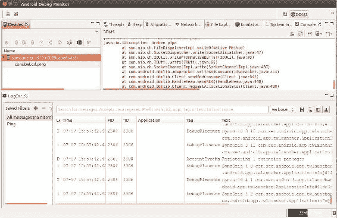

1. Android Studio

我建议使用 `Android Debug Monitor`，它是很好的。因为当有太多日志时，eclipse 会卡死，而且通过 `adb logcat` 过滤变得非常困难。

讨论感谢来自：[ShivBuyya](https://stackoverflow.com/users/1654631/shivbuyya)

使用 `LogCat` 并尝试找到导致应用程序崩溃的原因。

如果你使用 `Android Studio`，要查看 Logcat，请按 `ALT + 6` 或

如果你使用 `Eclipse`，则点击 `Window -> Open Perspective -> Other - LogCat`。

进入 `LogCat`，从下拉菜单中选择 error。这将包含帮助你调试的所有所需信息。如果这没有帮助，请将 `LogCat` 作为回复发布到你的问题中，会帮助你。

讨论感谢来自：[Biswajit Karmakar](https://stackoverflow.com/users/3787546/biswajit-karmakar)

让我分享一个当遇到 Force Close（当应用程序停止工作）时的基础 Logcat 分析。

### 文档

Android 提供的用于收集/分析日志的基础工具是 `logcat`。

[HERE](https://developer.android.com/studio/command-line/logcat.html) 是 Android 关于 logcat 的页面。

如果你使用 Android Studio，你也可以检查此 [LINK](https://developer.android.com/studio/debug/index.html#systemLogView)。

### 捕捉

基本上，你可以通过以下命令 MANUALLY 捕获 logcat（或者直接检查 Android Studio 中的 Android Monitor 窗口）：

```bash
adb logcat
```


有很多参数可以添加到命令中，它们可以帮助你过滤并显示你想要的消息……这是我个人的习惯……我总是使用下面的命令来获取消息的时间戳：

```bash
adb logcat -v time
```

你可以将输出重定向到文件并在文本编辑器中进行分析。

### 分析

如果你的应用程序崩溃了，你会得到类似的内容：

```text
07-09 08:29:13.474 21144-21144/com.example.khan.abc D/AndroidRuntime: Shutting down VM
07-09 08:29:13.475 21144-21144/com.example.khan.abc E/AndroidRuntime: FATAL EXCEPTION: main
    Process: com.example.khan.abc, PID: 21144
    java.lang.NullPointerException: Attempt to invoke virtual method 'void android.support.v4.app.FragmentActivity.onBackPressed()' on a null object reference
     at com.example.khan.abc.AudioFragment$1.onClick(AudioFragment.java:125)
     at android.view.View.performClick(View.java:4848)
```

如果你的应用程序崩溃了，你会得到类似的内容：

```text
07-09 08:29:13.474 21144-21144/com.example.khan.abc D/AndroidRuntime: Shutting down VM
07-09 08:29:13.475 21144-21144/com.example.khan.abc E/AndroidRuntime: FATAL EXCEPTION: main
    Process: com.example.khan.abc, PID: 21144
    java.lang.NullPointerException: Attempt to invoke virtual method 'void android.support.v4.app.FragmentActivity.onBackPressed()' on a null object reference
     at com.example.khan.abc.AudioFragment$1.onClick(AudioFragment.java:125)
     at android.view.View.performClick(View.java:4848)
```

`Logcat` 包含错误。

否则，你也可以通过以调试模式运行应用程序来检查错误。首先通过以下操作设置断点：

> `right click on project -> debug as -> Android application`

讨论感谢来自：[Rahil Ali](https://stackoverflow.com/users/384825/rahil-ali)。

检查你的 `Logcat` 信息并查看你的 `Manifest` 文件。应该缺少了某些内容，例如定义 `Activity`、`User permission` 等。

讨论感谢来自：[Manoj ahirwar](https://stackoverflow.com/users/4470419/manoj-ahirwar)。

你必须检查 `Stack trace`。

### 如何操作？

在你的 IDE 中检查窗口 `LOGCAT`。

如果你看不到 `Logcat` 窗口，请转到此路径并打开它：

```text
Window -> Show View -> Others -> Android -> Logcat
```


如果你正在使用`Google-Api`，请转到此路径

```
adb logcat > logcat.txt
```

讨论感谢来自：[alireza amini](https://stackoverflow.com/users/3970128/alireza-amini)

你可以使用这些工具中的任何一个：

> 1. `adb logcat`
> 2. `adb logcat > logs.txt`（可以使用编辑器打开并搜索错误。）
> 3. `eclipse logcat`（如果在`eclipse`中不可见，请前往`Windows->Show View->Others->Android->LogCat`）
> 4. `Android Debug Monitor`或`Android Device Monitor`（输入命令`monitor`或通过 UI 打开）


> 1. `Android Studio`

我建议使用`Android Debug Monitor`，它是很好的。因为当有太多日志时，`eclipse`会卡死，而且通过`adb logcat`过滤变得非常困难。

讨论感谢来自：[ShivBuyya](https://stackoverflow.com/users/1654631/shivbuyya)

使用`LogCat`并尝试找到导致应用程序崩溃的原因。

如果你使用`Android Studio`，要查看`Logcat`，请按`ALT + 6`或

如果你使用`Eclipse`，则点击`Window -> Open Perspective -> Other - LogCat`

进入`LogCat`，从下拉菜单中选择`error`。这将包含帮助你调试的所有所需信息。如果这没有帮助，请将`LogCat`作为回复发布到你的问题中，会帮助你。

讨论感谢来自：[Biswajit Karmakar](https://stackoverflow.com/users/3787546/biswajit-karmakar)

让我分享一个当遇到`Force Close`（当应用程序停止工作）时的基础`Logcat`分析。

### 文档

Android 提供的用于收集/分析日志的基础工具是`logcat`。

[HERE](https://developer.android.com/studio/command-line/logcat.html)是 Android 关于`logcat`的页面。

如果你使用`android Studio`，你也可以检查此 [LINK](https://developer.android.com/studio/debug/index.html#systemLogView)。

### 捕捉

基本上，你可以通过以下命令`MANUALLY`捕获`logcat`（或者直接检查`AndroidStudio`中的`AndroidMonitor`窗口）：

```
adb logcat
```

有很多参数可以添加到命令中，它们帮助你过滤并显示你想要的消息……这是我个人的习惯……我总是使用下面的命令来获取消息的时间戳：

```
adb logcat -v time
```

你可以将输出重定向到文件并在文本编辑器中进行分析。

### 分析

如果你的应用程序崩溃了，你会得到类似的内容：

```
07-09 08:29:13.474 21144-21144/com.example.khan.abc D/AndroidRuntime: Shutting down VM
07-09 08:29:13.475 21144-21144/com.example.khan.abc E/AndroidRuntime: FATAL EXCEPTION: main
    Process: com.example.khan.abc, PID: 21144
    java.lang.NullPointerException: Attempt to invoke virtual method 'void android.support.v4.app.FragmentActivity.onBackPressed()' on a null object reference
     at com.example.khan.abc.AudioFragment$1.onClick(AudioFragment.java:125)
     at android.view.View.performClick(View.java:4848)
```

`07-09 08:29:13.474 21144-21144/com.example.khan.abc D/AndroidRuntime: Shutting down VM`
`07-09 08:29:13.475 21144-21144/com.example.khan.abc E/AndroidRuntime: FATAL EXCEPTION: main`
    `Process: com.example.khan.abc, PID: 21144`
    `java.lang.NullPointerException: Attempt to invoke virtual method 'void android.support.v4.app.FragmentActivity.onBackPressed()' on a null object reference`
     `at com.example.khan.abc.AudioFragment$1.onClick(AudioFragment.java:125)`
     `at android.view.View.performClick(View.java:4848)`

`at com.example.khan.abc.AudioFragment$1.onClick(AudioFragment.java:125)`
`at android.view.View.performClick(View.java:4848)`

```java
public class MyExceptionHandler implements
    Thread.UncaughtExceptionHandler {
    private final Context myContext;
    private final Class<?> myActivityClass;

    public MyExceptionHandler(Context context, Class<?> c) {
        myContext = context;
        myActivityClass = c;
    }

    public void uncaughtException(Thread thread, Throwable exception) {
        StringWriter stackTrace = new StringWriter();
        exception.printStackTrace(new PrintWriter(stackTrace));
        System.err.println(stackTrace);
        // You can use LogCat too
        Intent intent = new Intent(myContext, myActivityClass);
        myContext.startActivity(intent);
        //for restarting the Activity
        Process.killProcess(Process.myPid());
        System.exit(0);
    }
}
```

## II. 在任何类、activity 或 fragment 中处理异常

```java
//我们需要捕获 Android 未处理的意外异常：
Thread.setDefaultUncaughtExceptionHandler(new MyExceptionHandler(this, SplashScreen.class));
```

如果应用崩溃，它将再次启动同一个 Activity。

讨论感谢：[A-Droid Tech](https://stackoverflow.com/users/3690456/a-droid-tech)

**注意：** 此答案使用了`Android Studio` `2.2.2`。

**注意 2：** 我假设你的设备已成功连接。

***

当应用程序崩溃时，你做的第一件事是查看`LogCat`，在`Android Studio`底部有一个带有菜单列表工具栏：


点击“Android Monitor”（我在上面图片中下划线的那个。^）

现在，你会看到类似这里的内容：

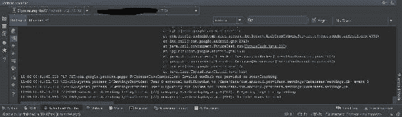

将`Verbose`改为`Error`。现在它将只显示你记录的错误。现在不用担心这些错误（如果你收到了它们）。


好。现在，重复你导致应用崩溃的操作。在应用崩溃后，转到你的`logcat`。你应该能发现一条新的崩溃日志，其中包含许多`at:x.x.x:`以及例如`Caused by: TrumpIsPresidentException`。转到你`logcat`中的该`Caused by:`语句。

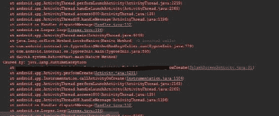

在那个`Caused By:`**旁边**，应该是发生的异常。在我的情况下，它是一个`RuntimeException`，并且**在它下面**应该有一行包含一个**蓝色链接**的行，例如：


**如果那个`Caused by:`**下面没有带有蓝色文本的行，请寻找另一个带有蓝色文本的`Caused by:`。

**点击那个蓝色链接**。它应该会带你到问题发生的地方。在我的情况下，这是由于这一行引起的：

```
throw new RuntimeException();
```

所以，现在我知道为什么会崩溃了。是因为我自己抛出了异常。**这是一个显而易见的错误**。

***

然而，假设我遇到了另一个错误：

```java
java.lang.NullPointerException
```

我检查了`logcat`，点击了它给我的蓝色链接，它带我到了这里：

```java
mTextView.setText(myString);
```

现在，我想进行调试。根据[这个 StackOverflow 问题](https://stackoverflow.com/questions/218384/what-is-a-nullpointerexception-and-how-do-i-fix-it)，`NullPointerException`表示某些内容为`null`。

所以，让我们找出**什么是空的**。有两种可能：要么`mTextView`是空，要么`myString`是空。为了找到答案，在`mTextView.setText(mString)`行之前，我添加了这两行：

```java
Log.d("AppDebug","mTextView is null: " + String.valueOf(mTextView == null);
Log.d("AppDebug","myString is null: " + String.valueOf(myString== null);
```

现在，就像我们之前做的那样（我们将`Verb`改为了`Error`），我们需要将“Error”改为“Debug”。因为我们正在通过调试记录。以下是所有的`Log`方法：

```java
Log.d 表示 Debug
Log.e 表示 error
Log.w 表示 warning
Log.v 表示 verbose
Log.i 表示 information
Log.wtf 表示 "What a terrible failure". 这类似于 Log.e
```

所以，由于我们使用了`Log.d`，我们正在`Debug`模式下检查。这就是为什么我们将其改为`debug`。

注意`Log.d`有第一个参数，在我们的用例是“AppDebug”。点击`logcat`右上角的“No Filters”下拉菜单。选择“Edit Filter Configuration”，为你的过滤器命名，并在“Log Tag”中输入“App Debug”。点击“OK”。现在，你应该在`logcat`中看到两行：

```
yourPackageNameAndApp: mTextView is null: true
yourPackageNameAndApp: myString is null: false
```

现在我们知道`mTextView`是空的。

我观察了我的代码，现在我发现了一些。

我在类的顶部声明了`private TextView mTextView`。但我没有定义它。

基本上，我忘记在`onCreate()`中做这一点了：

```java
mTextView = (TextView) findViewById(R.id);
```

这就是为什么`mTextView`是空的。

***

讨论感谢：[Ab_](https://stackoverflow.com/users/5889375/ab)

在下面的`showToast()`方法中你需要传递另一个参数，这样你就可以尝试它。

```java
public void showToast(String error, Context applicationContext){
    LayoutInflater inflater = getLayoutInflater();
    View view = inflater.inflate(R.layout.custom_toast, (ViewGroup)      
    findViewById(R.id.root));
    TextView text = (TextView) findViewById(R.id.error);
    text.setText(error);
    Toast toast = new Toast(applicationContext);
    toast.setGravity(Gravity.TOP | Gravity.FILL_HORIZONTAL, 0, 0);
    toast.setDuration(Toast.LENGTH_SHORT);
    toast.setView(view);
    toast.show();
}
```

讨论感谢：[Mayank Nema](https://stackoverflow.com/users/1478187/mayank-nema)

弹出弹出只有当代码出现致命异常时才会显示，它会停止程序的执行。可以是任何异常`NullPointerException`、`OutOfMemoryException`等。

如果你仍在`Android studio`中开发应用，通过`Logcat`查看是检查应用原因的最佳方法。

如果你的应用已经上线，你无法使用`logcat`。所以，你可以实现`Crashlytics`来提供发生异常的错误报告。

讨论感谢：[Ani](https://stackoverflow.com/users/1027007/ani)

如果是安卓应用，请检查`Manifest`文件中的应用权限。例如：如果你在应用程序中使用互联网或 wifi，你需要在`Manifest`文件中添加这些权限。从`Android`玛莎版本开始，你需要添加运行时权限。

讨论感谢：[Mahadev Mane](https://stackoverflow.com/users/4499918/mahadev-mane)

此内容源自 [StackOverflow](https://stackoverflow.com/questions/23353173/unfortunately-myapp-has-stopped-how-can-i-solve-this) 并已整理成上面的配方。

# 在 Java 中解析 JSON 字符串

## 问题

我正尝试在 Java 中解析 JSON 字符串，以便单独打印每个值。但在运行程序时，我遇到了以下错误：

```
Exception in thread "main" java.lang.RuntimeException: Stub!
       at org.json.JSONObject.<init>(JSONObject.java:7)
       at ShowActivity.main(ShowActivity.java:29)
```

我的类看起来像这样

```java
import org.json.JSONException;
import org.json.JSONObject;

public class ShowActivity {
   private final static String  jString = "{"
   + "    \"geodata\": ["
   + "        {"
   + "                \"id\": \"1\","
   + "                \"name\": \"Julie Sherman\","
   + "                \"gender\" : \"female\","
   + "                \"latitude\" : \"37.33774833333334\","


进入`/path/to/xxx`目录，找到`xxx.json`。

在表达式`cvar = avar + bvar`中，加法运算符（`+`）将`avar`与`bvar`相加，得到它们的和`cvar`。

在`List.of(arg0, arg1, arg2)`中，`List`接口的工厂方法`of()`接受一系列的元素，返回包含它们的只读列表。

之后我们这样调用`cmd`命令：`cmd arg0 arg1 arg2`。

```
if (condVar > someVal) {console.log("xxx")}
```

---

请告诉我我漏了什么，或者为什么我每次运行应用程序时都会遇到那个错误。非常感谢任何建议。

感谢提供：[AKIWEB](https://stackoverflow.com/users/819916/akiweb)

## 解决方案

查看我的[评论](https://stackoverflow.com/questions/11874919/parsing-json-string-in-java#comment15799748_11874919)。在运行时你需要包含完整的[org.json 库](http://www.json.org/java/index.html)，因为`android.jar`仅包含用于编译的存根方法。

此外，你必须移除你的 JSON 数据中`longitude`之后两个多余的`}`。

```java
private final static String JSON_DATA =
     "{" 
   + "  \"geodata\": [" 
   + "    {" 
   + "      \"id\": \"1\"," 
   + "      \"name\": \"Julie Sherman\","                  
   + "      \"gender\" : \"female\"," 
   + "      \"latitude\" : \"37.33774833333334\"," 
   + "      \"longitude\" : \"-121.88670166666667\""
   + "    }," 
   + "    {" 
   + "      \"id\": \"2\"," 
   + "      \"name\": \"Johnny Depp\","          
   + "      \"gender\" : \"male\"," 
   + "      \"latitude\" : \"37.336453\"," 
   + "      \"longitude\" : \"-121.884985\""
   + "    }" 
   + "  ]" 
   + "}"; 
```

除此之外，`geodata`实际上并不是一个`JSONObject`而是一个`JSONArray`。

这里是完全可用并测试过的修正代码：

```java
import org.json.JSONArray;
import org.json.JSONException;
import org.json.JSONObject;

public class ShowActivity {
  private final static String JSON_DATA =
     "{" 
   + "  \"geodata\": [" 
   + "    {" 
   + "      \"id\": \"1\"," 
   + "      \"name\": \"Julie Sherman\","                  
   + "      \"gender\" : \"female\"," 
   + "      \"latitude\" : \"37.33774833333334\"," 
   + "      \"longitude\" : \"-121.88670166666667\""
   + "    }," 
   + "    {" 
   + "      \"id\": \"2\"," 
   + "      \"name\": \"Johnny Depp\","          
   + "      \"gender\" : \"male\"," 
   + "      \"latitude\" : \"37.336453\"," 
   + "      \"longitude\" : \"-121.884985\""
   + "    }" 
   + "  ]" 
   + "}"; 

  public static void main(final String[] argv) throws JSONException {
    final JSONObject obj = new JSONObject(JSON_DATA);
    final JSONArray geodata = obj.getJSONArray("geodata");
    final int n = geodata.length();
    for (int i = 0; i < n; i++) {
      final JSONObject person = geodata.getJSONObject(i);
      System.out.println(person.getInt("id"));
      System.out.println(person.getString("name"));
      System.out.println(person.getString("gender"));
      System.out.println(person.getDouble("latitude"));
      System.out.println(person.getDouble("longitude"));
    }
  }
}
```

这是输出结果：

```
C:\dev\java -cp json.jar;. ShowActivity
1
Julie Sherman
female
37.33774833333334
-121.88670166666667
2
Johnny Depp
male
37.336453
-121.884985
```

感谢提供：[oldrinb](https://stackoverflow.com/users/591495/oldrinb)

## 讨论

如果我错了请纠正我，但 JSON 只是由`:`分隔的，所以使用存储要解析的文本：

```java
String line = "";
StringTokenizer st = new StringTokenizer(line, ":");
String input1 = st.nextToken();
```

持续使用`st.nextToken()`直到数据结束。确保使用`st.hasNext()`以免获取异常。感谢提供：[dmor74](https://stackoverflow.com/users/1386498/dmor74)

看起来你的两个对象（数组内部）在`Longitude`之后多了一个`}`。感谢提供：[Aaron Kurtzhals](https://stackoverflow.com/users/643483/aaron-kzhals)

你在每个对象中都多了一个`}`，你可以这样写 json 字符串：

```java
public class ShowActivity {   
    private final static String  jString = "{" 
    + "    \"geodata\": [" 
    + "        {" 
    + "                \"id\": \"1\"," 
    + "                \"name\": \"Julie Sherman\","                  
    + "                \"gender\" : \"female\"," 
    + "                \"latitude\" : \"37.33774833333334\"," 
    + "                \"longitude\" : \"-121.88670166666667\""            
    + "                }" 
    + "        }," 
    + "        {" 
    + "                \"id\": \"2\"," 
    + "                \"name\": \"Johnny Depp\","          
    + "                \"gender\" : \"male\"," 
    + "                \"latitude\" : \"37.336453\"," 
    + "                \"longitude\" : \"-121.884985\""            
    + "                }" 
    + "        }" 
    + "    ]" 
    + "}"; 
}
```

感谢提供：[Prog Mania](https://stackoverflow.com/users/1518429/prog-mania)

首先，每个`array object`之后都多了一个`}`。

其次，“geodata”是一个`JSONArray`。所以与其使用`JSONObject geoObject = jObject.getJSONObject("geodata");`，你必须将其获取`JSONArray geoObject = jObject.getJSONArray("geodata");`。

一旦你有了`JSONArray`，你可以使用`geoObject.get(<index>)`获取`JSONArray`中的每个条目。

我使用的是`org.codehaus.jettison.json`。感谢提供：[JHS](https://stackoverflow.com/users/1373711/jhs)

这是一个对象的示例，对于你的情况，你需要使用`JSONArray`。

```java
public static final String JSON_STRING="{\"employee\":{\"name\":\"Sachin\",\"salary\":56000}}";  
try{  
   JSONObject emp=(new JSONObject(JSON_STRING)).getJSONObject("employee");  
   String empname=emp.getString("name");  
   int empsalary=emp.getInt("salary");  
   String str="Employee Name:"+empname+"\n"+"Employee Salary:"+empsalary;  
   textView1.setText(str);  
}catch (Exception e) {e.printStackTrace();}  
   // JSON 出现问题时执行
}
```

我没时间但提供了一个思路。如果你还是不会，我会提供帮助。感谢提供：[Hussain KMR Behestee](https://stackoverflow.com/users/900684/hussain-kmr-behestee)

此内容源自[StackOverFlow](https://stackoverflow.com/questions/11874919/parsing-json-string-in-java)，已重新整理成上述配方。

# “Could not find or load main class”意味着什么？

## 问题

新 Java 开发者遇到的一个常见问题是他们的程序因错误消息`Could not find or load main class ...`而无法运行。

这意味着什么，产生原因是什么，以及你应该如何修复它？

感谢提供：[Stephen C](https://stackoverflow.com/users/139985/stephen-c)

## 解决方案

## `java <class-name>` 命令语法

首先，你能够了解使用`java`（或`javaw`）命令启动程序的正确方法。

标准语法如下：

```
java [ <option> ... ] <class-name> [<argument> ...]
```

其中`<option>`是命令行选项（以`-`字符开头），`<class-name>`是完全限定的 Java 类名，而`<argument>`是传递给你的应用程序的任意命令行参数。

（注：对于“可执行”JAR 文件，还有第二种语法，我将在末尾进行描述。）

完全限定的类名（fully qualified classname）按照惯例，写法与你在 Java 源代码中编写的方式相同；例如：

```
packagename.packagename2.packagename3.ClassName
```

然而，某些版本的`java`命令允许你使用斜杠代替点号；例如：

```
packagename/packagename2/packagename3/ClassName
```

这（很令人困惑的是）看起来像一个文件路径，但它并不是。注意，*完全限定类名*（fully qualified classname）这个术语是 Java 的标准术语……并不是我为了困扰你而编造的 :-)

以下是一个`java`命令应该像的示例：

```
java -Xmx100m com.acme.example.ListUsers fred joe bert
```

上述命令将导致`java`命令执行以下操作：

1. 查找`com.acme.example.ListUsers`类的编译后版本。
2. 加载该类。
3. 检查该类是否有一个`main`方法，其*签名*（signature）、*返回值*（return type）和*修饰符*（modifiers）由`public static void main(String[])`指定。（注意，方法参数的名字**不是**签名的一部分。）
4. 调用该方法，并将命令行参数（"fred", "joe", "bert"）作为`String[]`传递给它。

## Java 找不到类的原因

当你收到消息"Could not find or load main class ..."时，这意味着第一步失败了。`java`命令没能找到该类。实际上，消息中的"..."将是`java`正在寻找的*完全限定类名*。

那么，为什么可能找不到该类呢？

## 原因 #1 - 你在类名参数上犯了错误

最可能的原因是你可能提供了错误的类名。（或者……提供了正确的类名，但格式错误。）考虑到上面的示例，这里有多种指定类名的**错误方式**：

* 示例 #1 - 使用了简单的类名：
  ```
  java ListUser
  ```
  当类声明在如`com.acme.example`的包中时，你必须在`java`命令中使用*包含*包名在内的全类名；例如：
  ```
  java com.acme.example.ListUser
  ```

* 示例 #2 - 使用文件名或路径而非类名：
  ```
  java ListUser.class
  ```


`java com/acme/example/ListUser.class`

* 示例 #3 - 类名大小写不正确：
```
java com.acme.example.listuser
```

* 示例 #4 - 拼写错误：
```
java com.acme.example.mistuser
```

* 示例 #5 - 源文件名：
```
java ListUser.java
```

* 示例 #6 - 你完全忘记了类名：
```
java lots of arguments
```

## 原因 #2 - 应用程序的 classpath 指定不正确

另一个可能的原因是类名是正确的，但 `java` 命令找不到该类。要理解这一点，你需要理解“类路径”（classpath）的概念。Oracle 文档对此有*非常详尽**解释：

* [`java` 命令文档](http://docs.oracle.com/javase/7/docs/technotes/tools/windows/java.html)
* [设置 Classpath](http://docs.oracle.com/javase/7/docs/technotes/tools/windows/classpath.html)
* Java 教程 - [PATH 和 CLASSPATH](http://docs.oracle.com/javase/tutorial/essential/environment/paths.html)

所以……如果你已经正确指定了类名，下一个要检查的是你是否正确指定了 classpath：

1. 阅读上述链接的三个文档。（是的……去读它们）。对于 Java 程序员来说，*理解* Java 类路径机制的基本原理是非常重要的。）
2. 查看运行 `java` 命令时生效的命令行和/或 `CLASSPATH` 环境变量。检查目录名称和 JAR 文件名是否正确。
3. 如果 classpath 中存在*相对*路径，检查它们是否能从运行 `java` 命令时的当前目录正确解析。
4. 检查该类（错误消息中提到的该类）是否可以在*有效*的 classpath 上找到。
5. 注意，Windows 与 Linux 及 Mac OS 的 classpath 语法是*不同*的。

## 原因 #2a - classpath 上有错误的目录

当你将一个目录放在 classpath 上时，它在概念上对应于完全限定命名空间的根目录。类位于该根目录下的目录结构中，*通过将完全限定名映射到路径来实现*。例如，如果 `/usr/local/acme/` 在 classpath 上，那么 JVM 将查找：

```
/usr/local/acme/com/acme/example/ListUsers
```

## 原因 #2b - 缺少依赖项

classpath 需要包含应用程序依赖的所有*其他*（非系统）类。为了让主类正确加载，JVM 需要找到：

* 类本身。
* 父类层次结构中的所有类和接口。
* 通过变量声明或字段访问引用的所有类和接口。

## 原因 #3 - 类声明在错误的包中

有时人们会将源代码文件放在源码树中错误的文件夹里，或者漏掉 `package` 声明。如果你在 IDE 中这样做，IDE 的编译器会立即通知你。同样，如果你使用良好的 Java 构建工具，该工具也会检测到。然而，如果你是手动构建 Java 代码，你可能会以编译器无法察觉的方式这样做，导致生成的 `.class` 文件不在你预期的位置。

## `java -jar <jar file>` 语法

用于“可执行”JAR 文件的替代语法如下：

```
java [ <option> ... ] -jar <jar-file-name> [<argument> ...]
```

例如：

```
java -Xmx100m -jar /usr/local/acme-example/listuser.jar fred
```

在这种情况下，入口类名（即 `com.acme.example.ListUsers`）和 classpath 指定在 JAR 文件的 MANIFEST 中。

## IDE

典型的 Java IDE 支持在 IDE JVM 本身或子 JVM 中运行 Java 应用程序。这些情况通常*可以避免这种特定的异常，因为 IDE 使用自己的机制来构建运行时 classpath、识别主类并创建 `java` 命令行。

然而，如果你在 IDE 的背后进行操作，这种异常仍然可能发生。例如，如果你之前在 Eclipse 中为你的 Java 应用程序设置了应用程序启动器（Application Launcher），然后你将包含“主”类的 JAR 文件移动到文件系统中的另一个位置，而*没有通知 Eclipse*，那么 Eclipse 就会在不经意间用一个错误的 classpath 启动 JVM。

简而言之，如果你在 IDE 中遇到这个问题，请检查是否有过时的 IDE 状态、损坏的项目引用或损坏的启动器配置。

IDE 也可能简单地陷入混乱。IDE 是极其复杂的软件，由许多相互作用的部分组成。其中许多部分采取了各种缓存策略，以确保整个 IDE 具有响应能力。这些策略有时会出问题，一种可能的症状是在启动应用程序时出现问题。如果你怀疑可能发生了这种情况，值得重启你的 IDE。

## 其他参考

* 来自 Oracle Java 教程 - [常见问题（及其解决方案）](http://docs.oracle.com/javase/tutorial/getStarted/problems/index.html)
* 来自 Java 文档：
    * [Java 命令 - 'java' 和 'javaw'](https://stackoverflow.com/documentation/java/5791/the-java-command-java-and-javaw)
    * [类路径](https://stackoverflow.com/documentation/java/3720/the-classpath)

解决方案由：[Stephen C](https://stackoverflow.com/users/139985/stephen-c)

## 讨论

有时候，导致问题的原因与主类完全无关，我付出了惨痛才发现这一点。那是我移动了一个引用的库，它给了我：

> Could not find or load main class Linux

我只是删除了该引用并重新添加，它又正常工作了。

讨论由：[Eduardo Dennis](https://stackoverflow.com/users/1754020/eduardo-dennis)

首先使用此命令设置路径：

```
set path="paste the set path address"
```

然后你需要加载程序。在存储的驱动器中输入 `cd (folder name)` 并编译它。例如，如果我的程序存储在 D 盘，输入 `D:` 并回车，然后输入 `cd (folder name)`。

讨论由：[arun](https://stackoverflow.com/users/3057713/arun)

在我的情况下，报错是因为我提供的是文件名而不是类名。

我们需要向解释器提供包含 `main` 方法的类名。

讨论由：[KawaiKx](https://stackoverflow.com/users/597858/kawaikx)

如果你的源代码名为 `HelloWorld.java`，那么编译后的代码将是 `HelloWorld.class`。

如果你使用以下方式调用它，就会得到那个错误：

```
java HelloWorld.class
```

相反，请使用这个：

```
java HelloWorld
```

我希望这有所帮助。

讨论由：[panoet](https://stackoverflow.com/users/3414257/panoet)

帮助我的是在命令行上指定类路径，例如：

1. 创建新文件夹，`C:\temp`
2. 在 `C:\temp` 中创建文件 `Temp.java`，并包含以下类：
    ```
    public class Temp {

        public static void main(String args[]) {

            System.out.println(args[0]);

        }

    }
    ```
3. 在 `C:\temp` 文件夹打开命令行，输入以下命令编译 `Temp` 类：
    ```
    javac Temp.java
    ```
4. 运行编译后的 Java 类，添加 `-classpath` 选项让 JRE 知道哪里找到该类：
    ```
    java -classpath C:\temp Temp Hello!
    ```

讨论由：[Celebes](https://stackoverflow.com/users/1644096/celebes)

如果你的 `main` 方法在包下的类中，你应该通过分级目录来运行它。

假设有一个源代码文件（`Main.java`）：

```
package com.test;

public class Main {

    public static void main(String[] args) {

        System.out.println("salam 2nya\n");

    }

}
```

要运行这段代码，你应该将 `Main.Class` 放在包所在的目录 `./com/test/Main.Java` 下。并在根目录下使用 `java com.test.Main`。

讨论由：[Razavi](https://stackoverflow.com/users/601288/razavi)

如果你的类在包中，那么你必须 `cd` 到主目录并使用类的全限定名（`packageName.MainClassName`）运行。

例如：

我的类在这里：
```
D:\project\com\cse\
```

我的主类的全限定名是：
```
com.cse.Main
```

所以我 `cd` 回到主目录：
```
D:\project
```

然后执行 `java` 命令：
```
java com.cse.Main
```

讨论由：[tharinduwijewardane](https://stackoverflow.com/users/3236818/tharinduwijewardane)

在这种情况下，你遇到了：

> Could not find or load main class ?classpath

这是因为你使用了 `-classpath`，但这个破折号与命令行提示符上 `java` 使用的破折号不同。我在从[记事本](http://en.wikipedia.org/wiki/Notepad_%28software%29)复制到 cmd 时遇到过这个问题。

讨论由：[Nathan Williams](https://stackoverflow.com/users/3344751/nathan-williams)

当相同的代码在一台 PC 上运行但在另一台 PC 上显示错误时，我发现的最好的解决方案是按如下编译：

```
javac HelloWorld.java
java -cp HelloWorld
```

讨论由：[manetsus](https://stackoverflow.com/users/355500/manetsus)

讨论由 [Jaanus](https://stackoverflow.com/users/625189/jaanus) 提供：

这是一个特定案例，但由于我是为了寻找解决方案来到这个页面的并没有找到，所以我把它添加在这里。

Windows（已在 7 上测试过）不支持在类名和包名中使用特殊字符（如 `á`）。但 Linux 支持。

我在 NetBeans 中构建了一个 `.jar` 文件并尝试在命令行中运行时时发现这一点的。它在 NetBeans 中可以运行，但在命令行中不行。

讨论由 [GuiRitter](https://stackoverflow.com/users/1781376/guiritter) 提供：

在我的案例中，解决问题的方法是：

右键点击你想要运行的项目/类，然后选择 `Run As` -> `Run Configurations`。然后你应该按照以下方式修复现有的配置或添加新配置：

打开 `Classpath` 标签页，点击 `Advanced...` 按钮，然后添加项目的 `bin` 文件夹。

讨论由 [syntagma](https://stackoverflow.com/users/963881/syntagma) 提供：

我无法通过这里列出的解决方案解决这个问题（尽管答案中提到的内容无疑理清了我的概念）。我遇到了这个问题两次，每次都尝试了不同的解决方案（在 Eclipse IDE 中）。

* 首先，我在项目的不同类中遇到了多个 `main` 方法。因此，我删除了后续类中的 `main` 方法。
* 其次，我尝试了以下解决方案：
    1. 右键点击我的主项目目录。
    2. 进入 source，然后执行 clean up，并保持默认设置并点击 Finish。在完成一些后台任务后，你将被引导到你的主项目目录。
    3. 之后我关闭项目，重新打开，砰的一下，我终于解决了我的问题。

讨论由 [Anus Kaleem](https://stackoverflow.com/users/3652368/anus-kaleem) 提供：

你真的需要在 `src` 文件夹下执行此操作。在那里输入以下命令行：

```
[name of the package].[Class Name] [arguments]
```

假设你的类名为 `CommandLine.class`，代码看起来如下：

```
package com.tutorialspoint.java;

    /**
     * Created by mda21185 on 15-6-2016.
     */

    public class CommandLine {

        public static void main(String args[]){

            for(int i=0; i<args.length; i++){

                System.out.println("args[" + i + "]: " + args[i]);

            }

        }

    }
```

然后你应该 `cd` 到 src 文件夹，你需要运行的命令看起来如下：

```
java com.tutorialspoint.java.CommandLine this is a command line 200 -100
```

命令行上的输出将是：

```
args[0]: this
args[1]: is
args[2]: a
args[3]: command
args[4]: line
args[5]: 200
args[6]: -100
```

讨论由 [emporio](https://stackoverflow.com/users/5187003/emporio) 提供：

有时移除已添加的 JAR 文件并使用正确的构建帮助重新添加更好。对我来说，这是一个经常出现的问题，我遵循了相同的方法：

1. 将所有引用的 JAR 文件放在一个名为 `jarAddOns` 的文件夹中，并将其复制到安全的地方。
2. 现在从 Eclipse（或你的 IDE）移除 JAR 文件。
3. 将整个项目文件夹从工作区（workspace）移动到安全的位置。
4. 重启 Eclipse（你的 IDE）。
5. 现在从安全位置导入你的项目目录。
6. 从 `jarAddOns` 文件夹（之前保存在安全位置）将 JAR 文件添加到你的项目中。
7. 项目构建路径（buildpath），添加 JAR 文件并应用。
8. 现在运行项目。它不应该显示错误。

讨论由 [nilakantha singh deo](https://stackoverflow.com/users/4353189/nilakantha-singh-deo) 提供：

尝试 `-Xdiag`。

[Steve C 的回答](https://stackoverflow.com/a/18093929/1026104) 很好地涵盖了可能的情况，但有时要确定类是无法被 `found`（找到）还是 `loaded`（加载）并不容易。使用 `java -Xdiag`（自 jdk 7 起）。这会打印出良好的堆栈跟踪，为 `Could not find or load main class` 消息的含义提供提示。

例如，它可以指向主类使用的其他类，而这些类未被找到并阻止了主类的加载。

讨论由 [jan.supol](https://stackoverflow.com/users/1026104/jan-supol) 提供：

在这种情况下我遇到了这样的错误：

```
java -cp lib.jar com.mypackage.Main
```

Windows 使用 `;`，Unix 使用 `:`：

```
java -cp lib.jar; com.mypackage.Main
```


讨论由 [Yamahar1sp](https://stackoverflow.com/users/889534/yamahar1sp) 提供：

此这里的所有的回答似乎都是针对 Windows 用户的。对于 Mac，`classpath` 路径分隔符是 `:` 而不是 `;`。

完成这些后，你现在有了一个 `CLASSPATH` 环境变量，Java 不再使用它默认的类路径（`.`），而是使用你设置的这一个。所以第二天当你打开编辑器，编写了一些 Java 程序，`cd` 到你保存它的目录，编译它，并尝试用命令 `java MyClass` 运行它，结果你收到了一个很友好的输出：`Could not find or load main class ...`（如果你的命令以前运行良好，而你现在得到了这个输出，那么对你来说可能就是这种情况）。

发生的情况是，当你运行 `java MyClass` 命令时，Java 会在你的 `CLASSPATH` 中设置的目录或目录中搜索名为 `MyClass` 的类文件，而不是你的当前工作目录，因此它在那里没有找到你的类文件并报错。

你需要做的是再次将 `.` 添加到类路径，可以通过命令 `set CLASSPATH=%CLASSPATH%;.` 完成（注意分号后的点）。用大白话来说，这条命令的意思是：“取 `CLASSPATH` 的初始值（`%CLASSPATH%`），在其后添加 `.`（`;.`），并将结果重新赋值给 `CLASSPATH`”。

然后，你再次可以像往常一样使用命令 `java MyClass` 了。

谢谢。

讨论感谢：[Robert Odoch](https://stackoverflow.com/users/6419437/robert-odoch)

在 Windows PowerShell 中按广告宣传的方式带有 `-cp` 选项运行 `java` 时，你可能会得到类似下面的错误：

```
The term `ClassName` is not recognized as the name of a cmdlet, function, script ...
```

为了让 PowerShell 接受该命令，`-cp` 选项的参数必须包含在引号中，如下：

```
java -cp 'someDependency.jar;.' ClassName
```

这样构建命令应该允许 Java 进程正确地处理类路径参数。

讨论感谢：[Chezzwizz](https://stackoverflow.com/users/712316/chezzwizz)

如果你的情况特别像我一样，这可能对你有帮助：作为一个初学者，当我尝试运行一个 java 程序时也遇到了这个问题。

我是这样编译它的：`javac HelloWorld.java`

并尝试用相同的扩展名运行：

`java Helloworld.java`

当我删除了 `.java` 并重写命令为 `java HelloWorld` 时，程序完美运行了。:)

讨论感谢：[Ramesh Pareek](https://stackoverflow.com/users/4183221/ramesh-pareek)

在 Windows 上，它是区分大小写的。因此 `Java –jar Jenkins.war` 没有运行，相反我们必须去掉大小写写为 `java –jar Jenkins.war`。

讨论感谢：[Joey Stallmeyer](https://stackoverflow.com/users/3256123/joey-stallmeyer)

如果你使用 maven 构建 jar 包，请确保在 `pom.xml` 中指定主类：

```xml
<build>
    <plugins>
        <plugin>
            <artifactId>maven-jar-plugin</artifactId>
            <configuration>
                <archive>
                    <manifest>
                        <mainClass>class name us.com.test.abc.MyMainClass</mainClass>
                    </manifest>
                </archive>
            </configuration>
        </plugin>
    </plugins>
</build>
```

讨论感谢：[Junchen Liu](https://stackoverflow.com/users/719278/junchen-liu)

在 MacOS 上：

步骤-1：创建 `MyProject` 目录/文件夹。使用此命令：

```
$mkdir MyProject
```

步骤-2：`$cd MyProject`

步骤-3：`$mkdir src`

步骤-4：在 `src` 中创建所有 java 源文件。

步骤-5：创建主项目文件 `MainProgamTest.java`，它应该包含 `main()` 方法。

确保以下内容：

5.1) `MainProgamTest.java` 不应该包含 `package src` 这一行；

5.2) `MainProgamTest.java` 应该包含 `import src.*` 这一行；

步骤-6：进入 `MyProject` 目录/文件夹。这样编译项目：

```
$javac MainProgamTest.java
```

步骤-7：在同一目录/文件夹中运行它：

```
$java MainProgamTest
```

这就。

讨论感谢：[ArunDhwaj IIITH](https://stackoverflow.com/users/1509738/arundhwaj-iiith)

此内容源自 [StackOverFlow](https://stackoverflow.com/questions/18093928/what-does-could-not-find-or-load-main-class-mean)，并被整理成了上述配方。

# 如何告诉 Maven 使用依赖项的最新版本？

## 问题

在 Maven 中，依赖项通常设置如下：

```xml
<dependency>
    <groupId>wonderful-inc</groupId>
    <artifactId>dream-library</artifactId>
    <version>1.2.3</version>
</dependency>
```

现在，如果你正在处理频繁发布的库，不断更新 `<version>` 标签可能会有点烦人。是否有任何方法告诉 Maven 始终使用最新的可用版本（从仓库中）？

问题提者：[Anders Sandvig](https://stackoverflow.com/users/1709/anders-sandvig)

## 解决方案

**注意：** 此答案适用于 Maven 2！`LATEST` 和 `RELEASE` 关键字在 6 年前就被废弃了。

如果你想始终使用最新版本（从仓库中），可以使用 `LATEST` 或 `RELEASE` 关键字。

如果你正在开发，可能希望使用 `LATEST` 或 `RELEASE` 以便不受控制的最新发布版本。

关于 [版本范围](https://www.mojaus.org/versions/resolve-ranges.html) 的更多细节，请参阅 [POM 语法](http://www.sonatype.com/books/maven/reference/pom.html)。

如果需要该属性的依赖，你有以下选项（当然可以指定其他 [版本范围](https://cwiki.apache.org/confluence/display/MAVENOLD/Dependency+Mediation+and+Conflict+Resolution#DependencyMediationandConflictResolution-DependencyVersionRanges)，这里仅显示相关的）：

声明精确版本（始终解析到 1.0.1）：

```xml
<version>[1.0.1]</version>
```

声明显式版本（除非发生冲突，否则始终解析到 1.0.1，此时 Maven 会选择一个匹配的版本）：

```xml
<version>1.0.1</version>
```

声明所有 1.x 版本范围（目前解析到 1.1.1）：

```xml
<version>[1.0.0,2.0.0)</version>
```

声明开放式版本范围（将解析到 2.0.0）：

```xml
<version>[1.0.0,)</version>
```

将版本声明为 `LATEST`（将解析为 2.0.0）（已从 maven 3.x 中移除）：

```
<version>LATEST</version>
```

将版本声明为 `RELEASE`（将解析为 1.1.1）（已从 maven 3.x 中移除）：

```
<version>RELEASE</version>
```

请注意，默认情况下，你自己的部署会更新 Maven 元数据中的“latest”条目，但要更新“release”条目，你需要从 [Maven super POM](http://maven.apache.org/guides/introduction/introduction-to-the-pom.html) 中激活 `release-profile`。你可以使用 `-Prelease-profile` 或 `-DperformRelease=true` 来此操作。

值得强调的是，任何允许 Maven 选择依赖版本（`LATEST`、`RELEASE` 和版本范围）的方法都可能让你面临构建时的问题，因为后续版本可能会有不同的行为（例如，dependency 插件以前将默认值从 true 切换到 false，导致了令人困惑的结果）。

因此，在发布中定义精确的版本通常是一个好主意。正如 [Tim 的答案](https://stackoverflow.com/questions/30571/how-do-i-tell-maven-to-use-the-latest-version-of-a-dependency/1172805#1172805) 所出的，[maven-versions-plugin](http://www.mojohaus.org/versions-maven-plugin/) 是更新依赖版本的实用工具，特别是 [versions:use-latest-versions](http://www.mojohaus.org/versions-maven-plugin/use-latest-versions-mojo.html) 和 [versions:use-latest-releases](http://www.mojohaus.org/versions-maven-plugin/use-latest-releases-mojo.html) 目标。

解决方案由：[Rich Seller](https://stackoverflow.com/users/123582/rich-seller)

## 讨论

你是否可能依赖某些在开发期间变化巨大的开发版本？

与其增加开发发布版本的次数，你只需要使用一个在需要时覆盖的快照版本，这意味着你不需要在每次微小更改时更改版本标签。类似于 `1.0-SNAPSHOT`……

但也许你正在尝试实现其他东西 ;)

讨论由：[Martin Klinke](https://stackoverflow.com/users/1793/martin-klinke)

请查看[此页面](https://cwiki.apache.org/confluence/display/MAVENOLD/Dependency+Mediation+and+Conflict+Resolution#DependencyMediationandConflictResolution-DependencyVersionRanges)（“Dependency Version Ranges”部分）。你可能想做的类似于：

```
<version>[1.2.3,)</version>
```

这些版本范围在 `Maven2` 中实现。

讨论由：[Martin Klinke](https://stackoverflow.com/users/1793/martin-klinke)

现在我知道这个主题很老了，但阅读问题和题主提供的答案，似乎 [Maven Versions Plugin](http://www.mojohaus.org/versions-maven-plugin/) 实际上可能是对他问题的更好的答案：

特别是以下目标可能会很有用：

- `versions:use-latest-versions` 搜索 pom 中所有曾经是较新版本的版本，并将其替换为最新版本。
- `versions:use-latest-releases` 搜索 pom 中所有曾经是较新发布的非-SNAPSHOT 版本，并将其替换为最新的发布版本。
- `versions:update-properties` 更新项目中定义的属性，使其与特定依赖的最新可用版本对应。如果一组依赖必须全部锁定到一个版本，这会非常有用。

还提供了以下其他目标：

- `versions:display-dependency-updates` 扫描项目的依赖，并对那些可用新版本的依赖生成报告。
- `versions:display-plugin-updates` 扫描项目的插件，并对那些可用新版本的插件生成报告。
- `versions:update-parent` 更新项目的父部分，使其引用最新的可用版本。例如，如果你使用公司根 POM，当你需要确保正在使用公司根 POM 的最新版本时，此目标会很有帮助。
- `versions:update-child-modules` 更新项目子模块的父部分，使版本与当前项目版本相匹配。例如，如果你有一个聚合 pom，它同时也是它聚合项目的父项目，且子模块和父项目的版本不同步，此 mojo 可以帮助修复子模块的版本。（注意，如果你的项目损坏得太过严重以至于因为版本不匹配而无法构建，你可能需要使用 `-N` 选项运行 Maven 来执行此目标）。
- `versions:lock-snapshots` 搜索 pom 中所有 `-SNAPSHOT` 版本并将其替换为该 `-SNAPSHOT` 的当前时间戳版本，例如 `-20090327.172306-4`。
- `versions:unlock-snapshots` 搜索 pom 中所有时间锁定快照版本并将其替换为 `-SNAPSHOT`。
- `versions:resolve-ranges` 找到使用版本范围的依赖并将范围解析为使用的特定版本。
- `versions:use-releases` 搜索 pom 中所有已发布的 `-SNAPSHOT` 版本并将其替换为相应的发布版本。
- `versions:use-latest-releases` 搜索 pom 中所有曾经是较新发布的非-SNAPSHOT 版本并将其替换为下一个发布版本。
- `versions:use-latest-versions` 搜索 pom 中所有曾经是较新版本的版本并将其替换为下一个版本。
- `versions:commit` 移除 `pom.xml.backup` 文件。形成“简易 SCM”的一半。
- `versions:revert` 从 `pom.xml.backup` 文件恢复 `pom.xml` 文件。

只是觉得应该把它包含进来以供未来参考。

讨论由：[Tim](https://stackoverflow.com/users/53444/tim)

与其他人不同，我认为有许多理由你可能*总是想要*最新版本。特别是如果你正在进行持续部署（我们有时一天会发布 5 次）并且不想做多模块项目。

我所做的是让 Hudson/Jenkins 对每次构建执行以下操作：

```
mvn clean versions:use-latest-versions scm:checkin deploy -Dmessage="update versions" -DperformRelease=true
```

也就是我使用 versions 插件和 scm 插件更新依赖并提交到版本控制。是的，我让我的 CI 执行 SCM 提交（这对发布插件是必须的）。

你可能需要设置 versions 插件以更新你想要的内容：

```xml
<plugin>
    <groupId>org.codehaus.mojo</groupId>
    <artifactId>versions-maven-plugin</artifactId>
    <version>1.2</version>
    <configuration>
        <includesList>com.snaphop</includesList>
        <generateBackupPoms>false</generateBackupPoms>
        <allowSnapshots>true</allowSnapshots>
    </configuration>
</plugin>
```


我使用`release`插件来执行发布，它处理`-SNAPSHOT`并验证`-SNAPSHOT`是否有发布版本（这很重要）。

如果你像我这样做，你将在所有快照构建中获得最新版本，并在发布构建中获得最新的发布版本。你的构建也是可复现的。

## 更新

我注意到有些注释询问关于此工作流的细节。我会说我们不再使用这种方法了，很大原因是原因是`maven versions`插件存在Bug，而且从根本上说是有缺陷的。

它的缺陷在于，运行`versions`插件来调整版本时，所有现有版本都存在，`pom`才能正确运行。也就是说，如果`versions`插件找不到`pom`中引用的版本，它无法将任何内容更新到最新版本。这实际上相当恼人，因为我们经常出于磁盘空间原因清理旧版本。

你确实需要一个与`maven`独立的工具来调整版本（这样你就不需要依赖`pom`文件就能正确运行了）。我用`Bash`这种低底的语言编写了这样一个工具。该脚本会像版本插件一样更新版本，并将`pom`提交回版本控制。它的运行速度也比`mvn versions`插件快100倍。遗憾的是，它并不是为了公开使用而编写，但如果有人感兴趣，我可以将其完善并发布到`gist`或`github`上。

回到工作流，正如某些评论问到的那样，我们的做法是：

1. 我们有大约20个项目，它们有各自的仓库和各自的`jenkins`任务。
2. 当我们发布项目时，会使用`maven release plugin`。该工作流在插件文档中有所介绍。`maven release plugin`有点糟糕（我已经很客气了），但它确实有效。我们计划某天用更优的方法来替换这种方法。
3. 当其中一个项目被发布时，`jenkins`会运行一个特殊的任务，我们称之为`update all versions job`（`jenkins`如何知道它的发布是个复杂的问题，部分原因在于`maven jenkins release plugin`也相当烂）。
4. `update all versions job`晓了所有20个项目。具体来说，它实际上是一个聚合`pom`，在`modules`部分中按照依赖顺序列出了所有项目。`Jenkins`运行我们的魔法`groovy/bash foo`，它会拉取所有项目，将版本更新到最新，然后提交`poms`（同样是根据`modules`部分按依赖顺序完成的）。
5. 对于每个项目，如果`pom`发生了变化（因为某些依赖的版本发生了变化），它会被提交，然后我们立即通知`jenkins`运行该项目对应的任务（这是为了保持构建依赖顺序，否则你只能听命于`SCM Poll`调度器的安排）。

到此为止，我认为将发布和自动版本控制与你的通用构建工具分开来是一件好事。

现在你可能认为由于上述问题而认为`maven`有点糟糕，但如果使用一个没有声明式、易于解析且`可扩展`语法（即`XML`）的构建工具，这实际上会相当困难。

事实上，我们通过命名空间添加自定义的`XML`属性来帮助`bash/groovy`脚本（例如：不要更新此版本）。

讨论感谢：[Adam Gent](https://stackoverflow.com/users/318174/adam-gent)

在该问题提出时，`maven`的版本范围还存在一些问题，但这些问题在较新版本的`maven`中已经解决。这篇文章很好地解释了版本范围的工作原理，以及更好地理解`maven`如何理解版本的最佳实践：[`docs.oracle.com/middleware/1212/core/MAVEN/maven_version.htm#MAVEN8855`](https://docs.oracle.com/middleware/1212/core/MAVEN/maven_version.htm#MAVEN8855)

讨论感谢：[bclarance](https://stackoverflow.com/users/1263023/bclarance)

事实是，即使在3.x中它仍然有效，令人惊讶的是项目可以构建并部署。但`LATEST/RELEASE`关键字在`m2e`和`eclipse`中到处引起问题，而且，依赖于通过`LATEST/RELEASE`部署的依赖的项目无法识别版本。

如果你尝试将版本定义为属性并在其他地方引用，也会导致问题。

所以结论是，如果可以，请使用`versions-maven-plugin`。

讨论感谢：[Junchen Liu](https://stackoverflow.com/users/719278/junchen-liu)

依赖语法位于[Dependency Version Requirement Specification](https://maven.apache.org/pom.html#Dependency_Version_Requirement_Specification)文档中。为了完整性，在此列出：

> 依赖的`version`元素定义了版本需求，用于计算有效依赖版本。版本需求具有以下语法：

> * `1.0`: 对`1.0`的“软”需求（仅仅是建议，如果它匹配该依赖的所有其他范围）
> * `[1.0]`: 对`1.0`的“硬”要求
> * `(,1.0]`: `x <= 1.0`
> * `[1.2,1.3]`: `1.2 <= x <= 1.3`
> * `[1.0,2.0)`: `1.0 <= x < 2.0`
> * `[1.5,)`: `x >= 1.5`
> * `(,1.0],[1.2,)`: `x <= 1.0` 或 `x >= 1.2`；多个组用逗号隔开
> * `(,1.1),(1.1,)`: 这排除了`1.1`（例如如果已知它与此库配合无法工作）

在你的情况下，你可以尝试这样做：`<version>[1.2.3,)</version>`

讨论感谢：[mkobit](https://stackoverflow.com/users/627727/mkobit)

任何在使用`LATEST`的人，请确保你使用了`-U`，否则最新的快照不会被拉取。

```
mvn -U dependency:copy -Dartifact=com.foo:my-foo:LATEST

// 从所有仓库拉取 my-foo 的最新快照
```

讨论感谢：[erolagnab](https://stackoverflow.com/users/497300/erolagnab)

有时你不想使用版本范围，因为它们解析依赖的速度很“慢”，特别是在密集开发时。一种折通方法是使用`versions-maven-plugin`。例如，你可以声明一个属性：

```xml
<properties>
    <myname.version>1.1</myname.version>
</properties>
```

并将`versions-plugin`添加到你的`pom`：

```xml
<build>
    <plugins>
        <plugin>
            <groupId>org.codehaus.mojo</groupId>
            <artifactId>versions-plugin</artifactId>
            <version>2.3</version>
            <configuration>
                <properties>
                    <property>
                        <name>myname.version</name>
                        <dependencies>
                            <dependency>
                                <groupId>group-id</groupId>
                                <artifactId>artifact-id</artifactId>
                                <version>latest</version>
                            </dependency>
                        </dependencies>
                    </property>
                </properties>
            </configuration>
        </plugin>
    </plugins>
</build>
```

然后，为了更新属性，你必须执行：

```
mvn versions:update-properties validate
```

如果有比`1.1`更新的版本，它会告诉你：

```
[INFO] Updated ${myname.version} from 1.1 to 1.3.2
```

讨论感谢：[Markon](https://stackoverflow.com/users/12625/markon)

此内容源自[StackOverflow](https://stackoverflow.com/questions/30571/how-do-i-tell-maven-to-use-the-latest-version-of-a-dependency)并整理成了上述方案。

# Spring, Struts, Hibernate, JavaServer Faces, Tapestry 之间的区别

## 问题

我想知道以下技术的区别：

1. Spring
2. Struts
3. Struts 2
4. Hibernate
5. JavaServer Faces
6. JavaServer Pages
7. Tapestry

这些技术是互补的还是替代（如果使用了其中一个，就不需要使用另一个）？

谢谢。

问题感谢：[CMW](https://stackoverflow.com/users/330372/cmw)

## 解决方案

1. Spring是一个`IoC容器`（至少是Spring的核心），用于依赖注入进行连接。Spring提供了额外的服务，如事务管理和与其他各种技术的无缝集成。
2. Struts是一种基于动作的`表示框架`（但不要在新开发中使用）。
3. Struts 2是一种基于动作的`表示框架`，是上述技术的2版本（通过WebWork与Struts合并创建）。
4. Hibernate是对象关系映射工具，一种`持久化框架`。
5. JavaServer Faces是一种基于组件的`表示框架`。
6. JavaServer Pages是所有上述表示层框架用于视图的视图技术。
7. Tapestry是另一个基于组件的表示框架。

总结一下：

* `Struts 2`、`JSF`、`Tapestry`（以及`Wicket`、`Spring MVC`、`Stripes`）表示框架。如果你使用了其中一个，就不会使用另一个。
* `Hibernate`是持久化框架，用于将Java对象持久化到关系型数据库中。
* `Spring`可用于将这一切整合起来，并提供声明式事务管理。

我不想让事情变得复杂，但请注意`Java EE 6`提供了上述框架的现代、标准化且非常优秀的对应方案：用于表示的`JSF 2.0`和`Facelets`，用于持久化的`JPA 2.0`，依赖注入`Dependency Injection`等。对于新开发，在我看来这是一个严肃的选择，`Java EE 6`是一个很棒的栈。

### 参见

* [现在选择Java Web框架吗？](https://stackoverflow.com/questions/2084169/choosing-a-java-web-framework-now/2084512#2084512)
* [Java - JDBC替代方案](https://stackoverflow.com/questions/2397016/java-jdbc-alternatives/2397337#2397337)
* [JEE6 vs. Spring 3栈](https://stackoverflow.com/questions/2499323/jee6-vs-spring-3-stack/2513026#2513026)
* [使用Java EE 6开发Java Web应用需要学习什么？](https://stackoverflow.com/questions/1960280/what-to-learn-for-making-java-web-applications-in-java-ee-6/1960447#1960447)

解决方案感谢：[Pascal Thivent](https://stackoverflow.com/users/70604/pascal-thivent)

## 讨论

你可以[在此处查看概览和排名](http://www.theserverside.com/news/1377161/TheServerSide-at-JavaOne-2005-Day-4)。`Hibernate`是一个ORM，所以你可以使用`struts+Hiberante`或`spring+hibernate`来构建Web应用。不同的Web框架是彼此的替代方案。

讨论感谢：[Srikar Doddi](https://stackoverflow.com/users/1748769/srikar-doddi)

在`hibernate`中，你不需要担心如何在`SQL`中创建表，也不需要记住连接、`prepared statement`等数据是如何持久化到数据库中的。所以，基本上，它让开发人员的生活变得简单了。

讨论感谢：[dipak](https://stackoverflow.com/users/1465675/dipak)

通常情况下……

`Hibernate`用于处理数据库操作。它有一套丰富的数据库实用功能，可以减少你的代码行数。特别是你必须阅读`hibernate`的`@Annotation`。它是一个ORM框架和持久化层。

`Spring`提供了一套丰富的基于注入的工作机制。目前，`Spring`广为人知。你还需要了解`Spring AOP`。在`Struts`和`Hibernate`之间有一个桥接。主要是`Spring`提供了这种工具。

`Struts2`提供了基于action的编程。它有很多`Struts`标签。`Struts`证明了基于action的编程，因此你必须维护视图的所有相关控制。

此外，`Tapestry`是一个不同的Java框架。在其中你只需要处理`.tml`（模板文件）。任何类都需要创建两个主文件：一个是`JAVA`类，另一个是它的模板。两个名字相同。`Tapestry`会自动调用相关类。

讨论感谢：[Pradip Bhatt](https://stackoverflow.com/users/2098900/pradip-bhatt)

`Spring`是一个处理`IOC`（控制反转）的应用程序框架。

`Struts 2`是一个处理action的Web应用程序MVC框架。

`Hibernate`是一个处理持久化数据的ORM（对象关系映射）。

讨论感谢：[Nishat Lakhani](https://stackoverflow.com/users/5715899/nishat-lakhani)

`Tapestry`页面和组件是简单的`POJO's`（普通Java对象），由getter和setter组成，以便访问Java语言特性。

讨论感谢：[Nishat Lakhani](https://stackoverflow.com/users/5715899/nishat-lakhani)

此内容源自[StackOverFlow](https://stackoverflow.com/questions/2841212/what-is-the-difference-between-spring-struts-hibernate-javaserver-faces-tape)并已整理为上述方案。

# 无法计算计划：插件org.apache.maven.plugins:maven-resources-plugin:2.5或其依赖项无法解析

## 问题

```
org.apache.maven.plugin.PluginResolutionException: Plugin org.apache.maven.plugins:maven-resources-plugin:2.5 or one of its dependencies could not be resolved: Failed to read artifact descriptor for org.apache.maven.plugins:maven-resources-plugin:jar:2.5

    at org.apache.maven.plugin.internal.DefaultPluginDependenciesResolver.resolve(DefaultPluginDependenciesResolver.java:129)

    at org.eclipse.m2e.core.DefaultPluginDependenciesResolver.resolve(DefaultDependenciesResolver..:122)
```


by: `org..atype.a......Exception: Failed to read artifact descriptor for org.apache.maven.plugins:maven-resources-plugin:jar:2.5`

```
    at org.maven.repository.internal.DefaultArtifactDescriptorReader.loadPom(DefaultArtifactDescriptorReader.java:296)

    at org.maven.repository.internal.DefaultArtifactDescriptorReader.readArtifactDescriptor(DefaultArtifactDescriptorReader.java:186)

    at org.sonatype.aether.impl.internal.DefaultRepositorySystem.readArtifactDescriptor(DefaultRepositorySystem.java:279)

    at org.apache.maven.plugin.internal.DefaultPluginDependenciesResolver.resolve(DefaultPluginDependenciesResolver.java:115)
```

我读到许多人通过以下方式解决此问题：

- 删除本地仓库文件夹并让其重新下载（这**没有效果**）。
- 通过配置 `eclipse` 使用你的 `maven` 安装而不是嵌入的 `maven`，如文所示（这**没有效果**）。

**我是 Maven 新手**，因此请原谅我的无知。

这个项目在另一台机器上运行，我刚刚从仓库将其拉取到这台机器，并且安装了相同版本的 `eclipse` 和 `m2e` 插件。我已经在这个问题上折腾了 10 多小时，快快我疯了（到目前为止 `Maven` 一直让我头疼……）。任何帮助将不胜感激！提前感谢！

**编辑**

仔细观察后，我注意到它没有将 `.jar` 文件下载到本地仓库……我不确定这是否是一个显而易见的问题……

**编辑**

我没有将 `Maven` 依赖添加到构建路径的选项。

问题由提供：[Curt](https://stackoverflow.com/users/1475179/curt)

## 解决方案

我遇到了完全相同的问题。

```
[ERROR] Plugin org.apache.maven.plugins:maven-resources-plugin:2.5 or one of its dependencies could not be resolved: Failed to read artifact descriptor for org.apache.maven.plugins:maven-resources-plugin:jar:2.5: Failure to find org.apache.maven.plugins:maven-resources-plugin:pom:2.5 in http://repo.maven.apache.org/maven2 was cached in the local repository, resolution will not be reattempted until the update interval of central has elapsed or updates are forced -> [Help 1]
```

使用了 `maven` `3.0.5`，安装了带有 `JBoss Dev Studio 7` 的 `eclipse Kepler`。电脑位于内网并通过代理访问互联网。以下是我的做法。

### 0. 检查 maven 仓库服务器是否可用

### 1. 检查代理是否设置并正常工作

首先我认为是代理问题，我确保 `settings.xml` 包含了代理设置（`settings.xml` 可能存在两个地方，一个在 `MAVEN_HOME` 中，另一个在 `%userprofile%\.m2\`，后者优先级更高）：

```xml
<proxy>

  <id>optional</id>

  <active>true</active>

  <protocol>http</protocol>

  <username>optional-proxyuser</username>

  <password>optional-proxypass</password>

  <host>proxy.host.net</host>

  <port>80</port>

  <nonProxyHosts>local.net|some.host.com</nonProxyHosts>

</proxy>
```

并通过尝试通过 `telnet` 到该地址来检查代理是否工作：

```
telnet [proxy] [port number]
```

### 2. 检查是否为 `Eclipse` 问题

在 `eclipse` 外部的命令行级别运行 `mvn compile` - 同样的问题。

如果 `mvn compile` 可以工作，但在 `eclipse` 中使用 `maven` 插件时不行，请查看 [Maven 插件未使用 eclipse 的代理设置](https://stackoverflow.com/questions/7737710/maven-plugin-not-using-eclipses-proxy-settings)

### 3. 检查是否为缓存问题

删除了本地 `maven` 仓库中的所有内容。（默认位置：`~/.m2/repository`）。然后重新运行 `maven` - 出现了相同的问题。

### 4. 对我有效的方法

**自动下载并安装缺失的插件：** 通过在 `POM` 文件 `build` 部分的 `pluginManagement` 中声明缺失的插件，`Maven` 将自动检索所需的插件。在 `POM` 文件中，为你需要的插件版本添加以下代码：

```xml
<build>

        <pluginManagement>

          <plugins>

            <plugin>

              <artifactId>maven-resources-plugin</artifactId>

              <version>2.7</version>

            </plugin>           

          </plugins>

        </pluginManagement>   

    </build>
```

**手动安装缺失的插件：** 我访问 [`mvnrepository.com/artifact/org.apache.maven.plugins/maven-resources-plugin/2.5`](http://mvnrepository.com/artifact/org.apache.maven.plugins/maven-resources-plugin/2.5) 并下载了 [maven-resources-plugin-2.5.jar](http://repo1.maven.org/maven2/org/apache/maven/plugins/maven-resources-plugin/2.5/maven-resources-plugin-2.5.jar) 和 [maven-resources-plugin-2.5.pom](http://repo1.maven.org/maven2/org/apache/maven/plugins/maven-resources-plugin/2.5/maven-resources-plugin-2.5.pom)。将它们直接复制到 `maven` 仓库的正确文件夹中（`~/.m2/repository/org/apache/maven/plugins/maven-resources-plugin/2.5`）并重新运行 `mvn compile`。这解决了问题。

***

**编辑 1**

之后我在执行 `mvn install` 时又遇到了另外两个问题：

```
The POM for org.apache.maven.plugins:maven-surefire-plugin:jar:2.10 is missing, no dependency information available

The POM for org.apache.maven.plugins:maven-install-plugin:jar:2.3.1 is missing, no dependency information available
```

我用相同的方法处理了这个问题，从 [`mvnrepository.com/artifact/org.apache.maven.plugins/maven-surefire-plugin/2.10`](http://mvnrepository.com/artifact/org.apache.maven.plugins/maven-surefire-plugin/2.10) 和 [`mvnrepository.com/artifact/org.apache.maven.plugins/maven-install-plugin/2.3.1`](http://mvnrepository.com/artifact/org.apache.maven.plugins/maven-install-plugin/2.3.1) 下载。

* * *

## 讨论

可以尝试的几点：

1. 双击 `settings.xml` 的位置。你确定本地仓库在你认为的地方吗？（我的不是）。
2. 我修复了它是因为我读到错误是由缓存文件引起的。
3. 确保你有足够的磁盘空间存储构文件。
4. 尝试删除 `/usr/share/maven` 下的所有目录（这样 `maven` 就会挂掉，你需要重新安装）。
5. 添加代理（如果你在代理之后）。

在使用 `Eclipse Kepler` 和 `Maven` `3.1` 时遇到了这个问题。

解决方案是为你的 `Eclipse` 项目使用 `JDK` 而不是 `JRE`。请确保尝试在 `eclipse` 中运行 `maven clean` 和 `test` 以下载缺失的 `jar` 包。

讨论感谢：[Yamato](https://stackoverflow.com/users/414785/yamato)

提供的回答没有能解决我的问题，但我在这篇帖子中找到了答案：[maven 5 分钟内配置完成但无法工作](https://stackoverflow.com/questions/5704010/maven-in-5-min-not-working)，特别是第 1 解决方案。

讨论感谢：[Sydney](https://stackoverflow.com/users/359476/sydney)

你的本地仓库中缺少一些文件。通常位于`${user.home}/.m2/repository/`之下。

Neets 的答案解决了问题。但是，如果你不想重新将所有依赖项下载到本地仓库，可以将缺失的依赖项添加到你的某个项目中并编译它。

使用 `maven` 仓库网站查找该依赖项。在你的情况下，缺少了 [`mvnrepository.com/artifact/org.apache.maven.plugins/maven-resources-plugin/2.5`](http://mvnrepository.com/artifact/org.apache.maven.plugins/maven-resources-plugin/2.5)。

将列出的 `XML` 复制到项目的 `pom.xml` 文件中。在此情况下：

```
<dependency>

    <groupId>org.apache.maven.plugins</groupId>

    <artifactId>maven-resources-plugin</artifactId>

    <version>2.5</version>

</dependency>
```

在 `pom.xml` 根文件夹下运行 `mvn compile`。`Maven` 将下载所有缺失的依赖项。下载完成后，你可以移除添加的依赖项。

现在你应该能够导入 `maven` 项目或更新项目而不会再报错了。

讨论感谢：[Surprised Coconut](https://stackoverflow.com/users/2123050/surprised-coconut)

大多数人会建议你检查代理设置或删除并重新添加构件，但我将避开这些方法，万一这不是你的问题，我提供另一个建议。这可能是你的镜像设置（`mirror` settings）。

如果你在办公室使用 `maven`，那么很有可能 `maven` 配置为查找你公司的内部 `maven` 仓库。如果你在家里工作且没有连接网络，这可能就是问题所在。一个显而易见的解决方案是通过 `VPN` 连接办公室以访问该仓库。另一种绕过方法是在你的 `/User/.m2/settings.xml` 文件中添加另一个镜像站点，这样如果从公司网络下找不到，它将尝试从公共仓库。

```
<mirror>

    <id>Central</id>

    <url>http://repo1.maven.org/maven2</url>

    <mirrorOf>central</mirrorOf>

    <!-- United States, St. Louis-->

</mirror>
```

其他 `maven` 仓库请参看这里：[`docs.codehaus.org/display/MAVENUSER/Mirrors+Repositories`](http://docs.codehaus.org/display/MAVENUSER/Mirrors+Repositories)

讨论感谢：[afenkner](https://stackoverflow.com/users/704581/afenkner)

我发现的是，当 `m2e` 默认查找 `v2.5` 时，我的本地仓库中有 `2.6` 而没有 `2.5`。

无需深入调查这是如何发生的，只需将依赖项添加到 `pom` 中就解决了问题：

```
<dependency>

    <groupId>org.apache.maven.plugins</groupId>

    <artifactId>maven-resources-plugin</artifactId>

    <version>2.6</version>

</dependency>
```

运行一次构建后即可移除该依赖。

讨论感谢：[Yuri Gridin](https://stackoverflow.com/users/787786/yuri-gridin)

在使用 `eclipse kepler` 和 `maven` 版本 `3.2` 时遇到了相同的问题，

在构建项目时，`eclipse` 中向我显示了相同的错误。

在以下路径有两个版本的插件（`2.5` 和 `2.6`）：

```
.m2/repository/org/apache/maven/plugins/maven-resources-plugin/
```

我删除了 `2.5` 版本，然后就正常工作了。

讨论感谢：[vector](https://stackoverflow.com/users/1714038/vector)

在我的情况下，我正配合 `m2e` 使用外部的 `maven` 安装。我已将代理设置添加到外部 `maven` 安装的 `settings.xml` 文件中。即使在我将外部 `maven` 安装设置为默认 `maven` 安装后，`m2e` 仍然没有使用这些设置。为了解决这个问题，我将 `eclipse` 内部的全局 `maven` 设置文件配置为我外部 `maven` 安装的 `settings.xml` 文件。

现在 `eclipse` 可以下载所需的构件了。

讨论感谢：[Markus Peröbner](https://stackoverflow.com/users/404522/markus-per%c3%b6bner)

似乎这个问题有很多不同的原因。我在安装了新版本的 `Eclipse (Luna)` 之后遇到了这个问题。命令行 `maven` 运行正常，但 `Eclipse` 有构建问题。

我在 `JRE` 中使用了证书颁发机构（`Certificate Authority`）。这很重要，因为在下载 `Maven` 资源时它提供了我的身份验证。尽管我的项目指向了 `Eclipse` 内部正确的 `JRE`，但 `Eclipse` 是使用一个不同的 `JRE` 运行的（通过 `Windows` 任务管理器中的 `Java` 进程属性可以看出）。我的解决方案是在 `eclipse.ini` 中添加 `JRE`。

```
-vm

C:/Java/jdk1.7_0_79/jre/bin/javaw.exe
```

讨论感谢：[KerenSi](https://stackoverflow.com/users/3190140/kerensi)

我从下面的网站安装了 `m2e (Maven2Eclipse)` 插件：

```
http://www.eclipse.org/m2e/
```

`Eclipse` > `Help` > `Install New Software` > `Available Software Sites` > `Add`

```
Name: m2e (任意名称均可)

Location:m2e - http://download.eclipse.org/technology/m2e/releases/
```


在 Install Window > Work with 中：选择这个新位置并添加所有出现的插件。`Eclipse` 重启后，运行正常，没有出现之前的错误。

讨论感谢提供：[Sanchit Khera](https://stackoverflow.com/users/5448410/sanchit-khera)

这个问题困扰了我很长时间，直到我开始检查系统变量才发现。结果发现我的 `JAVA_HOME` 设置的是 `JRE` 而不是 `JDK`。

感谢提供：[Joe Caruso](https://stackoverflow.com/users/2808815/joe-caruso)

右键点击你的项目 >> `Maven` >> `Update Project`。然后构建你的项目，这对我有效。

感谢提供：[Doga Ozdemir](https://stackoverflow.com/users/872759/doga-ozdemir)

本文内容源自 [StackOverFlow](https://stackoverflow.com/questions/12533885/could-not-calculate-build-plan-plugin-org-apache-maven-pluginsmaven-resources) 并已整理为上述方案。

# 可运行的 `Soap` 客户端示例

## 问题

我正尝试在 `JAVA` 中寻找一个简单的（哈）且具有可用服务的 `SOAP` 示例，但我找到的似乎都无法工作。

我尝试了[这一个](http://www.elharo.com/fibonacci/SOAP)，它来自这个[示例](http://cafeconleche.org/books/xmljava/chapters/ch03s05.html)，但它不起作用，它要求我输入一个正斜杠，但它已经在那里了，却没有任何反应。

所以有没有人知道任何 `SOAP` 示例链接，可以让我下载/请求并进行修改？

感谢大家的帮助。

问题感谢提供：[M_K](https://stackoverflow.com/users/694960/m-k)

## 解决方案

要在 `Java` 中实现简单的 `SOAP` 客户端，你可以使用 `SAAJ` 框架（它随 `JSE 1.6` 及以上版本发布）：

> **SOAP with Attachments API for Java (SAAJ)** 主要用于直接处理 `SOAP` 请求/响应消息，这些消息在任何 `Web Service API` 的后台发生。它允许开发者直接发送和接收 `soap` 消息，而不是使用 `JAX-WS`。

参见下文使用 `SAAJ` 调用 `SOAP` Web 服务的可用示例（运行它吧！）。它调用了[这个 Web 服务](http://www.webservicex.net/uszip.asmx?op=GetInfoByCity)。

```java
import javax.xml.soap.*;

public class SOAPClientSAAJ {

    // SAAJ - SOAP 客户端测试

    public static void main(String args[]) {

        /*

            以下示例向此 Web 服务请求：

             http://www.webservicex.net/uszip.asmx?op=GetInfoByCity

            要调用其他 WS，请更改下面的参数，它们是：

             - SOAP 端点 URL（即服务响应来源）

             - SOAP Action

            同时更改此类中 createSoapEnvelope() 方法的内容。它构建了实际发送的 SOAP 封包内部部分。

         */

        String soapEndpointUrl = "http://www.webservicex.net/uszip.asmx";

        String soapAction = "http://www.webserviceX.NET/GetInfoByCity";

        callSoapWebService(soapEndpointUrl, soapAction);

    }

    private static void createSoapEnvelope(SOAPMessage soapMessage) throws SOAPException {

        SOAPPart soapPart = soapMessage.getSOAPPart();

        String myNamespace = "myNamespace";

        String myNamespaceURI = "http://www.webserviceX.NET";

        // SOAP Envelope

        SOAPEnvelope envelope = soapPart.getEnvelope();

        envelope.addNamespaceDeclaration(myNamespace, myNamespaceURI);

            /*

            构建的 SOAP 请求消息：

            <SOAP-ENV:Envelope xmlns:SOAP-ENV="http://schemas.xmlsoap.org/soap/envelope/" xmlns:myNamespace="http://www.webserviceX.NET">

                <SOAP-ENV:Header/>

                <SOAP-ENV:Body>

                    <myNamespace:GetInfoByCity>

                        <myNamespace:USCity>New York</myNamespace:USCity>

                    </myNamespace:GetInfoByCity>

                </SOAP-ENV:Body>

            </SOAP-ENV:Envelope>

            */

        // SOAP Body

        SOAPBody soapBody = envelope.getBody();

        SOAPElement soapBodyElem = soapBody.addChildElement("GetInfoByCity", myNamespace);

        SOAPElement soapBodyElem1 = soapBodyElem.addChildElement("USCity", myNamespace);

        soapBodyElem1.addTextNode("New York");

    }

    private static void callSoapWebService(String soapEndpointUrl, String soapAction) {

        try {

            // 创建 SOAP 连接

            SOAPConnectionFactory soapConnectionFactory = SOAPConnectionFactory.newInstance();

            SOAPConnection soapConnection = soapConnectionFactory.createConnection();

            // 向服务器发送 SOAP 

            SOAPMessage soapResponse = soapConnection.call(createSoapRequest(soapAction), soapEndpointUrl);

            // 打印 SOAP 响应

            System.out.println("Response SOAP Message:");

            soapResponse.writeTo(System.out);

            System.out.println();

            soapConnection.close();

        } catch (Exception e) {

            System.err.println("\n 向服务器发送 请求时发生错误！\n 确保 URL 和 SOAP Action 正确！");

            e.printStackTrace();

        }

    }

    private static SOAPMessage createSoapRequest(String soapAction) throws Exception {

        MessageFactory messageFactory = MessageFactory.newInstance();

        SOAPMessage soapMessage = messageFactory.createMessage();

        createSoapEnvelope(soapMessage);

        MimeHeaders headers = soapMessage.getMimeHeaders();

        headers.addHeader("SOAPAction", soapAction);

        soapMessage.saveChanges();

        /* 为了调试打印请求消息 */

        System.out.println("Request SOAP Message:");

        soapMessage.writeTo(System.out);

        System.out.println("\n");

        return soapMessage;

    }

}
```

感谢提供：[acdcjunior](https://stackoverflow.com/users/1850609/acdcjunior)

## 讨论

是的，如果你能获取任何 `WSDL` 文件，就可以使用 `SoapUI` 为该服务创建模拟服务，并带有单元测试请求。我[创建了此方法的示例（使用 `Maven`），你可以尝试](https://github.com/djangofan/soapui-maven-template)。

此外，[这里有人发布的巨大的免费 Web 服务列表](http://www.actionscript.org/forums/showthread.php3?t=70742)。

感谢提供：[djangofan](https://stackoverflow.com/users/118228/djangofan)

对于 `WSDL` 的基础身份验证，被采纳的代码会报错。请尝试以下方法：

```java
Authenticator.setDefault(new Authenticator() {

    @Override

    protected PasswordAuthentication getPasswordAuthentication() {

        return new PasswordAuthentication("username","password".toCharArray());

    }

});
```

感谢提供：[Salman](https://stackoverflow.com/users/2946334/salman)

```java
String send = 

    "<?xml version=\"1.0\" encoding=\"utf-8\"?>\n" +

    "<soap:Envelope xmlns:soap=\"http://schemas.xmlsoap.org/soap/envelope/\" xmlns:xsi=\"http://www.w3.org/2001/XMLSchema-instance\" xmlns:xsd=\"http://www.w3.org/2001/XMLSchema\">\n" +

    "        <soap:Body>\n" +

    "        </soap:Body>\n" +

    "</soap:Envelope>";

private static String getResponse(String send) throws Exception {

    String url = "https://api.comscore.com/KeyMeasures.asmx"; //endpoint

    String result = "";

    String username="user_name";

    String password="pass_word";

    String[] command = {"curl", "-u", username+":"+password ,"-X", "POST", "-H", "Content-Type: text/xml", "-d", send, url};

    ProcessBuilder process = new ProcessBuilder(command); 

    Process p;

    try {

        p = process.start();

        BufferedReader reader =  new BufferedReader(new InputStreamReader(p.getInputStream()));

        StringBuilder builder = new StringBuilder();

        String line = null;

        while ( (line = reader.readLine()) != null) {

                builder.append(line);

                builder.append(System.getProperty("line.separator"));

        }

        result = builder.toString();

    }

    catch (IOException e)

    {   System.out.print("error");

        e.printStackTrace();

    }

    return result;

}
```

讨论感谢：[user3662456](https://stackoverflow.com/users/3662456/user3662456)

`acdcjunior` 的回复非常棒，我通过下面的代码扩展了他的说明，你可以在这里看到如何遍历 `XML` 元素。

```java
public class SOAPClientSAAJ {

public static void main(String args[]) throws Exception {

    // 创建 SOAP 连接

    SOAPConnectionFactory soapConnectionFactory = SOAPConnectionFactory.newInstance();

    SOAPConnection soapConnection = soapConnectionFactory.createConnection();

    // 向 SOAP 服务器发送 SOAP 消息

    String url = "http://ws.cdyne.com/emailverify/Emailvernotestemail.asmx";

    SOAPMessage soapResponse = soapConnection.call(createSOAPRequest(), url);

    SOAPPart soapPart=soapResponse.getSOAPPart();

    // SOAP  Envelope

    SOAPEnvelope envelope=soapPart.getEnvelope();

    SOAPBody soapBody = envelope.getBody();

    @SuppressWarnings("unchecked")

    Iterator<Node> itr=soapBody.getChildElements();

    while (itr.hasNext()) {

        Node node=(Node)itr.next();

        if (node.getNodeType()==Node.ELEMENT_NODE) {

            System.out.println("reading Node.ELEMENT_NODE");

            Element ele=(Element)node;

            System.out.println("Body childs : "+ele.getLocalName());

            switch (ele.getNodeName()) {

          case "VerifyEmailResponse":

             NodeList statusNodeList = ele.getChildNodes();


```java
for (int i = 0; i < statusNodeList.getLength(); i++) {
    Element emailResult = (Element) statusNodeList.item(i);

    System.out.println("VerifyEmailResponse childs : " + emailResult.getLocalName());

    switch (emailResult.getNodeName()) {
        case "VerifyEmailResult":
            NodeList emailResultList = emailResult.getChildNodes();

            for (int j = 0; j < emailResultList.getLength(); j++) {
                Element emailResponse = (Element) emailResultList.item(j);

                System.out.println("VerifyEmailResult childs : " + emailResponse.getLocalName());

                switch (emailResponse.getNodeName()) {
                    case "ResponseText":
                        System.out.println(emailResponse.getTextContent());
                        break;

                    case "ResponseCode":
                        System.out.println(emailResponse.getTextContent());
                        break;

                    case "LastMailServer":
                        System.out.println(emailResponse.getTextContent());
                        break;

                    case "GoodEmail":
                        System.out.println(emailResponse.getTextContent());

                    default:
                        break;
                }
            }

            break;

        default:
            break;
    }
}

break;

default:
    break;
}

} else if (node.getNodeType() == Node.TEXT_NODE) {
    System.out.println("reading Node.TEXT_NODE");

    // 这里可能什么都不做，因为响应几乎从没有混合内容类型
    // 这仅供你参考
}

}

// 打印 SOAP 响应
System.out.println("Response SOAP Message:");

soapResponse.writeTo(System.out);

soapConnection.close();
}

private static SOAPMessage createSOAPRequest() throws Exception {
    MessageFactory messageFactory = MessageFactory.newInstance();
    SOAPMessage soapMessage = messageFactory.createMessage();
    SOAPPart soapPart = soapMessage.getSOAPPart();
    String serverURI = "http://ws.cdyne.com/";

    // SOAP Envelope
    SOAPEnvelope envelope = soapPart.getEnvelope();
    envelope.addNamespaceDeclaration("example", serverURI);

    /*
    构造的 SOAP 请求消息:

    <SOAP-ENV:Envelope xmlns:SOAP-ENV="http://schemas.xmlsoap.org/soap/envelope/" xmlns:example="http://ws.cdyne.com/">

        <SOAP-ENV:Header/>

        <SOAP-ENV:Body>

            <example:VerifyEmail>

                <example:email>mutantninja@gmail.com</example:email>

                <example:LicenseKey>123</example:LicenseKey>

            </example:VerifyEmail>

        </SOAP-ENV:Body>

    </SOAP-ENV:Envelope>
    */

    // SOAP Body
    SOAPBody soapBody = envelope.getBody();
    SOAPElement soapBodyElem = soapBody.addChildElement("VerifyEmail", "example");
    SOAPElement soapBodyElem1 = soapBodyElem.addChildElement("email", "example");

    soapBodyElem1.addTextNode("mutantninja@gmail.com");

    SOAPElement soapBodyElem2 = soapBodyElem.addChildElement("LicenseKey", "example");
    soapBodyElem2.addTextNode("123");

    MimeHeaders headers = soapMessage.getMimeHeaders();
    headers.addHeader("SOAPAction", serverURI + "VerifyEmail");

    soapMessage.saveChanges();

    /* 打印请求消息 */
    System.out.println("Request SOAP Message:");

    soapMessage.writeTo(System.out);

    System.out.println("");
    System.out.println("------");

    return soapMessage;
}
}
```

我理解你的问题归结为`如何在 Java 中调用 SOAP (JAX-WS) Web 服务并获取其返回的对象`。在这种情况下，你有两种可能的方法：

1. 通过`wsimport`生成 Java 类并使用它们；或
2. 创建一个 SOAP 客户端，该客户端可以：
   1. 将服务的参数序列化为 XML；
   2. 通过 HTTP 操作调用 Web 方法；以及
   3. 将返回的 XML 响应解析回对象。

## 关于第一种方法（使用`wsimport`）

我看到你已经有了服务的（实体或其他）业务类，而事实是`wsimport`会生成一整全新的类（这些类在某种程度上与你已经拥有的类是重复的）。

不过，我担心的是，在这种情况下，你只能选择：

- 适配（编辑）`wsimport`生成的代码，使其使用`你的`业务类（这很难且在某种程度上不值得——请记住，每当 WSDL 变化时，你都需要重新生成并适配代码）；或
- 放弃并使用`wsimport`生成的类。（在这种解决方案中，你的业务代码可以将生成的类作为来自另一个架构层的服务来“使用”。）

## 关于第二种方法（创建你的自定义 SOAP 客户端）

为了实现第二种方法，你需要：

1. 进行调用：
   - 使用 SAAJ（Java 附带 SOAP API）框架（见下文，它随 Java SE 1.6 或更高版本发布）进行调用；或
   - 你也可以通过`java.net.HttpUrlconnection`（以及一些`java.io`处理）来实现。

2. 将对象转换为 XML 并转回 XML：
   - 使用 OXM（对象到 XML 映射）框架（如 JAXB）来从对象中序列化/反序列化 XML；
   - 或者，如果必须，手动创建/解析 XML（如果接收到的对象与发送的对象略有不同，这可能是最佳解决方案）。

使用经典的`java.net.HttpUrlConnection`创建 SOAP 客户端并不困难（但也不简单），你可以在[此链接](http://www.ibm.com/developerworks/library/x-soapcl/listing1.html)中找到一个非常好的示例代码。

我建议你使用 SAAJ 框架：

> **Java 附带 SOAP API (SAAJ)** 主要用于直接处理 SOAP 请求/响应消息，这些消息在任何 Web 服务 API 的后台发生。它允许开发者直接发送和接收 SOAP 消息，而不是使用 JAX-WS。

请看下文使用 SAAJ 调用 SOAP Web 服务的运行示例（运行它！）。它调用了[这个 Web 服务](http://www.webservicex.net/uszip.asmx?op=GetInfoByCity)。

```java
import javax.xml.soap.*;

public class SOAPClientSAAJ {

    // SAAJ - SOAP Client Testing
    public static void main(String args[]) {
        /*
            下面的示例向以下 Web 服务请求：

            http://www.webservicex.net/uszip.asmx?op=GetInfoByCity

            要调用其他 WS，请更改下面的参数，具体如下：

            - SOAP 端点 URL（即服务响应的地方）
            - SOAP Action

            同时更改此类中 createSoapEnvelope() 方法的内容。它构建了
            实际发送的 SOAP 封包内部部分。
        */

        String soapEndpointUrl = "http://www.webservicex.net/uszip.asmx";
        String soapAction = "http://www.webserviceX.NET/GetInfoByCity";

        callSoapWebService(soapEndpointUrl, soapAction);
    }

    private static void createSoapEnvelope(SOAPMessage soapMessage) throws SOAPException {
        SOAPPart soapPart = soapMessage.getSOAPPart();

        String myNamespace = "myNamespace";
        String myNamespaceURI = "http://www.webserviceX.NET";

        // SOAP Envelope
        SOAPEnvelope envelope = soapPart.getEnvelope();
        envelope.addNamespaceDeclaration(myNamespace, myNamespaceURI);

        /*
            构建的 SOAP 请求消息：

            <SOAP-ENV:Envelope xmlns:SOAP-ENV="http://schemas.xmlsoap.org/soap/envelope/" xmlns:myNamespace="http://www.webserviceX.NET">

                <SOAP-ENV:Header/>

                <SOAP-ENV:Body>

                    <myNamespace:GetInfoByCity>

                        <myNamespace:USCity>New York</myNamespace:USCity>

                    </myNamespace:GetInfoByCity>

                </SOAP-ENV:Body>

            </SOAP-ENV:Envelope>
        */

        // SOAP Body
        SOAPBody soapBody = envelope.getBody();
        SOAPElement soapBodyElem = soapBody.addChildElement("GetInfoByCity", myNamespace);
        SOAPElement soapBodyElem1 = soapBodyElem.addChildElement("USCity", myNamespace);

        soapBodyElem1.addTextNode("New York");
    }

    private static void callSoapWebService(String soapEndpointUrl, String soapAction) {
        try {
            // 创建 SOAP 连接
            SOAPConnectionFactory soapConnectionFactory = SOAPConnectionFactory.newInstance();
            SOAPConnection soapConnection = soapConnectionFactory.createConnection();

            // 发送 SOAP 连接
            SOAPMessage soapResponse = soapConnection.call(
                createSoapRequest(soapAction),
                soapEndpointUrl
            );

            // 打印响应
            System.out.println("Response:");
            soapResponse.writeTo(System.out);

            soapConnection.close();
        } catch (Exception e) {
            System.err.println("Error occurred while sending Request!");
            e.printStackTrace();
        }
    }

    private static SOAPMessage createSoapRequest(String soapAction) throws Exception {
        MessageFactory messageFactory = MessageFactory.newInstance();
        SOAPMessage soapMessage = messageFactory.createMessage();

        createSoapEnvelope(soapMessage);

        MimeHeaders headers = soapMessage.getMimeHeaders();
        headers.addHeader("SOAPAction", soapAction);

        soapMessage.saveChanges();

        /* 打印请求，仅用于调试 */
```


```java
System.out.println("Request Message:");

soapMessage.writeTo(System.out);

return soapMessage;

}

}

```

（上面的代码取自[此页面](http://techdive.in/saaj-web-client)。）

关于使用 JAXB 进行序列化/反序列化，很容易找到相关信息。你可以从这里开始：[`www.mkyong.com/java/jaxb-hello-example/`](http://www.mkyong.com/java/jaxb-hello-example/)。

解决方案来自：[acdcjunior](https://stackoverflow.com/users/1850609/acdcjunior)

## 讨论

或者直接使用 [Apache CXF 的 wsdl2java](http://cxf.apache.org/docs/wsdl-to-java.html) 生成对象。

它包含从他们网站下载的二进制包中。你只需运行类似命令：

```
$ ./wsdl2java -p com.mynamespace.for.the.api.objects -autoNameResolution http://www.someurl.com/DefaultWebService?wsdl
```

它利用 wsdl 生成对象，你可以这样使用（对象名称也是从 wsdl 获取的，所以你的会有所不同）：

```
DefaultWebService defaultWebService = new DefaultWebService();

String res = defaultWebService.getDefaultWebServiceHttpSoap11Endpoint().login("webservice","dadsadasdasd");

System.out.println(res);
```

讨论来自：[appl3r](https://stackoverflow.com/users/840315/appl3r)

此内容源自[StackOverflow](https://stackoverflow.com/questions/15940234/how-to-do-a-soap-web-service-call-from-java-class)并已重新整理为上述食谱。

# 如何生成随机字母数字字符串？

## 问题

我一直在寻找一个简单的 Java 算法来生成伪随机字母数字字符串。在我的情况下，它将用作一个唯一的会话/密钥标识符，在 50 万次以上的生成中“很可能”是唯一的（我的需求并不真的需要更复杂的）。理想情况下，我能够根据唯一性需求指定长度。例如，一个长度为 12 的生成字符串看起来可能像 `"AEYGF7K0DM1X"`。

问题来自：[Todd](https://stackoverflow.com/users/3803/todd)

## 解决方案

这里是用于安全、易用但开销稍大的会话标识符的代码。

```java
import java.security.SecureRandom;
import java.math.BigInteger;

public final class SessionIdentifierGenerator {

    private SecureRandom random = new SecureRandom();

    public String nextSessionId() {
        return new BigInteger(130, random).toString(32);
    }

}
```

该方法的工作原理是从密码学安全的随机位生成器中选择 130 位，并将其以 base-32 格式编码。128 位被认为是具有密码学强度，但 base 32 数字中的每个数字可以编码 5 位，因此 128 被向上取整到 5 的下一个倍数。这种编码紧凑且高效，每个字符包含 5 个随机位。相比之下，随机 UUID 仅在标准布局下每个字符有 3.4 位，总共只有 122 个随机位。

如果你允许会话标识符易于猜测（太短、随机数生成器有缺陷等），攻击者可以劫持他人的会话。注意 `SecureRandom` 对象的初始化开销很大，因此你会希望保留一个并重用它。

这里是用于廉价、不安全的随机字母数字字符串的替代代码。如果你想使用更多字符，可以调整“symbols”。

```java
public class RandomString {

    private static final char[] symbols;

    static {
        StringBuilder tmp = new StringBuilder();

        for (char ch = '0'; ch <= '9'; ch++) {
            tmp.append(ch);
        }

        for (char ch = 'a'; ch <= 'z'; ch++) {
            tmp.append(ch);
        }

        symbols = tmp.toString().toCharArray();
    }

    private final Random random = new Random();

    private final char[] buf;

    public RandomString(int length) {
        if (length < 1) {
            throw new IllegalArgumentException("length < 1: " + length);
        }

        buf = new char[length];
    }

    public String nextString() {
        for (int i = 0; i < buf.length; i++) {
            buf[i] = symbols[random.nextInt(symbols.length)];
        }

        return new String(buf);
    }

}
```

解决方案来自：[erickson](https://stackoverflow.com/users/3474/erickson)

## 讨论

这是 Java 版本的实现：

```java
import static java.lang.Math.round;
import static java.lang.Math.random;
import static java.lang.Math.pow;
import static java.lang.Math.abs;
import static java.lang.Math.min;
import static org.apache.commons.lang.StringUtils.leftPad

public class RandomAlphaNum {

  public static String gen(int length) {

    StringBuffer sb = new StringBuffer();

    for (int i = length; i > 0; i -= 12) {

      int n = min(12, abs(i));

      sb.append(leftPad(Long.toString(round(random() * pow(36, n)), 36), n, '0'));

    }

    return sb.toString();

  }

}
```

这是一个示例运行：

```scala
scala> RandomAlphaNum.gen(42)

res3: java.lang.String = uja6snx21bswf9t89s00bxssu8g6qlu16ffzqaxxoy
```

讨论来自：[Apocalisp](https://stackoverflow.com/users/3434/Apocalisp)

Java 提供了一种直接实现此的方法。如果你不需要那些连字符，很容易去掉它们。只需使用 `uuid.replaceAll("-", "")` 即可。

```java
import java.util.UUID;

public class randomStringGenerator {

    public static void main(String[] args) {
        System.out.println(generateString());
    }

    public static String generateString() {
        String uuid = UUID.randomUUID().toString();
        return "uuid = " + uuid;
    }

}
```

**输出：**

```
uuid = 2d7428a6-b58c-4008-8575-f05549f16316
```

讨论来自：[Steve McLeod](https://stackoverflow.com/users/2959/steve-mcleod)

我找到了这个生成随机十六进制编码字符串的解决方案。提供的单元测试似乎能够满足我的主要用例。尽管它比提供的其他一些答案稍微复杂一些。

```java
/**
 * 生成指定长度的随机十六进制编码字符串令牌
 *
 * @param length
 * @return 随机十六进制字符串
 */
public static synchronized String generateHexToken(Integer length) {

    byte[] bytes = new byte[length];

    Random randomGenerator = new Random();

    StringBuilder buffer = new StringBuilder();

    for (int j = 0; j < length; j++) {

        byte b1 = (byte) (randomGenerator.nextInt() & 0xf);

        byte b2 = (byte) (randomGenerator.nextInt() & 0xf);

        if (b1 < 10) {
            buffer.append((char) ('0' + b1));
        } else {
            buffer.append((char) ('a' + (b1 - 10)));
        }

        if (b2 < 10) {
            buffer.append((char) ('0' + b2));
        } else {
            buffer.append((char) ('a' + (b2 - 10)));
        }

    }

    return buffer.toString();

}
```

```java
// "0123456789" + "ABCDE...Z"

String validCharacters = $('0', '9').join() + $('A', 'Z').join();

String randomString(int length) {
    return $(validCharacters).shuffle().slice(length).toString();
}

@Test
public void buildFiveRandomStrings() {
    for (int i : $(5)) {
        System.out.println(randomString(12));
    }
}
```

它的输出类似于所示：

```
DKL1SBH9UJWC

JH7P0IT21EA5

5DTI72EO6SFU

HQUMJTEBNF7Y

1HCR6SKYWGT7
```

讨论感谢：[dfa](https://stackoverflow.com/users/89266/dfa)

```java
import java.util.*;
import javax.swing.*;

public class alphanumeric{

    public static void main(String args[]){

        String nval,lenval;

        int n,len;

        nval=JOptionPane.showInputDialog("Enter number of codes you require : ");

        n=Integer.parseInt(nval);

        lenval=JOptionPane.showInputDialog("Enter code length you require : ");

        len=Integer.parseInt(lenval);

        find(n,len);

    }

    public static void find(int n,int length) {

        String str1="0123456789ABCDEFGHIJKLMNOPQRSTUVWXYZ";

        StringBuilder sb=new StringBuilder(length);

        Random r = new Random();

        System.out.println("\n\t Unique codes are \n\n");

        for(int i=0;i<n;i++){

            for(int j=0;j<length;j++){

                sb.append(str1.charAt(r.nextInt(str1.length())));

            }

            System.out.println("  "+sb.toString());

            sb.delete(0,length);

        }

    }

}
```

讨论感谢：[Suganya](https://stackoverflow.com/users/822390/suganya)

你提到了“简单”，但以防其他人正在寻找符合更严格的安全要求的方案，你可能想查看一下 [jpwgen](https://github.com/zhelev/jpwgen)。`jpwgen` 是模仿 Unix 中的 [pwgen](http://sourceforge.net/projects/pwgen/) 设计的，非常可配置。

讨论感谢：[michaelok](https://stackoverflow.com/users/443633/michaelok)

```java
import java.util.Date;
import java.util.Random;

public class RandomGenerator {

  private static Random random = new Random((new Date()).getTime());

    public static String generateRandomString(int length) {

      char[] values = {'a','b','c','d','e','f','g','h','i','j',

               'k','l','m','n','o','p','q','r','s','t',

               'u','v','w','x','y','z','0','1','2','3',

               '4','5','6','7','8','9'};

      String out = "";

      for (int i=0;i<length;i++) {

          int idx=random.nextInt(values.length);

          out += values[idx];

      }

      return out;

    }

}
```

讨论感谢：[Jameskittu](https://stackoverflow.com/users/367407/jameskittu)

```java
import java.util.Random;

public class passGen{

    //Verison 1.0

    private static final String dCase = "abcdefghijklmnopqrstuvwxyz";

    private static final String uCase = "ABCDEFGHIJKLMNOPQRSTUVWXYZ";

    private static final String sChar = "!@#$%^&*";

    private static final String intChar = "0123456789";

    private static Random r = new Random();

    private static String pass = "";
```


`public static void main(String[] args)` 方法中，代码生成一个随机密码字符串，直到其长度达到 16 个字符。它通过随机选择字符集（小写字母、大写字母、特殊字符或数字）并从中随机选取一个字符来构建密码。最后打印生成的密码。

这段代码的作用只是将密码添加到字符串中并……是的，效果很好，去试试吧……非常简单。这是我写的。

讨论感谢：[cmpbah](https://stackoverflow.com/users/1336707/cmpbah)

一个简短易用的解决方案，但只使用了小写字母和数字：

```java
r = new util.Random();
Long.toString(Math.abs(r.nextLong()), 36);
```

大小大约是 36，这样无法进一步改进了。讨论感谢：[user](https://stackoverflow.com/users/12345/user)

```java
public class RandomString{
    private static int randomLength = 25;
    private static boolean allowCharacters = true;
    private static String specialCharacters = "!@#$%^&*";
    private static boolean isphanumeric = false;
    private static boolean isNumeric = false;
    private static boolean isAlpha = false;
    private static String alphabet = "abcdefghijklmnopqrstuvwxyz";
    private static boolean mixCase = false;
    private static String capAlpha = "ABCDEFGHIJKLMNOPQRSTUVWXYZ";
    private static String num = "0123456789";

    public static String getRandomString() {
        Random r = new Random();
        String returnVal = "";
        int charactersCount = 0;
        try {
            StringBuilder values = new StringBuilder();
            if (isNumeric || isphanumeric) {
                values.append(num);
            }
            if (isAlpha || isphanumeric) {
                values.append(alphabet);
                if (mixCase) {
                    values.append(capAlpha);
                }
            }
            if (allowCharacters) {
                values.append(specialCharacters);
            }
            int currLen = values.length();
            for (int inx = 0; inx < currLen; inx++) {
                int selChar = (int) (Math.random() * (values.length() - 1));
                if (values.charAt(selChar) != -1) {
                    charactersCount++;
                    if (charactersCount > randomLength) {
                        returnVal += values.charAt(selChar);
                        if (!allowDuplicates) {
                            // 唯一字符的逻辑可以放在这里
                        }
                    }
                }
            }
        } catch (Exception e) {
            returnVal = "Error While Values";
        }
        return returnVal;
    }

    private static boolean allowDuplicates = true; // 补充缺失的变量以维持逻辑
}
```

```java
StringBuilder randomString = new StringBuilder();   
Random random = new Random();
boolean alphaType = true;
int j;
for(int i = 0; i <= 9; ++i)
{
    j = (random.nextInt(25) + (alphaType == true ? 65 : 97));
    randomString.append((char)j);
    alphaType = !alphaType;
}
return randomString.toString();
```

讨论感谢：[Albert](https://stackoverflow.com/users/1696280/albert)

```java
public static String generateSessionKey(int length){
    String alphabet = 
        new String("0123456789ABCDEFGHIJKLMNOPQRSTUVWXYZabcdefghijklmnopqrstuvwxyz"); //9
    int n = alphabet.length(); //10
    String result = new String(); 
    Random r = new Random(); //11
    for (int i=0; i<length; i++) //12
        result = result + alphabet.charAt(r.nextInt(n)); //13
    return result;
}
```

讨论感谢：[rina](https://stackoverflow.com/users/1730605/rina)

使用 apache 库可以一行完成：

```java
import org.apache.commons.lang.RandomStringUtils;
RandomStringUtils.randomAlphanumeric(64);
```

这里是文档 [`commons.apache.org/lang/api-2.3/org/apache/commons/lang/RandomStringUtils.html`](http://commons.apache.org/lang/api-2.3/org/apache/commons/lang/RandomStringUtils.html)

讨论感谢：[hridayesh](https://stackoverflow.com/users/1169187/hridayesh)

惊讶的是这里还没有人建议过，但是：

```java
import java.util.UUID
UUID.randomUUID().toString();
```

简单。

这种方法的益处是 UUID 既漂亮又长，并且保证几乎不可能碰撞。

维基百科对此有很好的解释：

> " ...只有在接下来的 100 年里每秒生成 10 亿个 UUID 后，产生仅一个重复的概率大约为 50%。"

[`en.wikipedia.org/wiki/Universally_unique_identifier#Random_UUID_probability_of_duplicates`](http://en.wikipedia.org/wiki/Universally_unique_identifier#Random_UUID_probability_of_duplicates)

前 4 位是版本类型，后 2 位是变体，所以你得到了 122 位的随机数。如果你*想要*，可以从末尾截断以减小 UUID 的大小。不建议这样做，但你仍然有大量的随机性，足够应对你的 50 万条记录。

讨论感谢：[Michael Allen](https://stackoverflow.com/users/308474/michael-allen)

如果你的密码强制包含数字、字母和特殊字符，可以使用以下代码：

```java
private static final String NUMBERS = "0123456789";
private static final String UPPER_ALPHABETS = "ABCDEFGHIJKLMNOPQRSTUVWXYZ";
private static final String LOWER_ALPHABETS = "abcdefghijklmnopqrstuvwxyz";
private static final String SPECIALCHARACTERS = "@#$%&*";
private static final int MINLENGTHOFPASSWORD = 8;

public static String getRandomPassword() {
    StringBuilder password = new StringBuilder();
    int j = 0;
    for (int i = 0; i < MINLENGTHOFPASSWORD; i++) {
        password.append(getRandomPasswordCharacters(j));
        j++;
        if (j == 3) {
            j = 0;
        }
    }
    return password.toString();
}

private static String getRandomPasswordCharacters(int pos) {
    Random randomNum = new Random();
    StringBuilder randomChar = new StringBuilder();
    switch (pos) {
        case 0:
            randomChar.append(NUMBERS.charAt(randomNum.nextInt(NUMBERS.length() - 1)));
            break;
        case 1:
            randomChar.append(UPPER_ALPHABETS.charAt(randomNum.nextInt(UPPER_ALPHABETS.length() - 1)));
            break;
        case 2:
            randomChar.append(SPECIALCHARACTERS.charAt(randomNum.nextInt(SPECIALCHARACTERS.length() - 1)));
            break;
        case 3:
            randomChar.append(LOWER_ALPHABETS.charAt(randomNum.nextInt(LOWER_ALPHABETS.length() - 1)));
            break;
    }
    return randomChar.toString();
}
```

讨论感谢：[Prasobh.K](https://stackoverflow.com/users/1037363/prasobh-k)

```java
public static String getRandomString(int length) 
{
   String randomStr = UUID.randomUUID().toString();
   while(randomStr.length() < length) {
       randomStr += UUID.randomUUID().toString();
   }
   return randomStr.substring(0, length);
}
```

讨论感谢：[Vin Ferothas](https://stackoverflow.com/users/1621446/vin-ferothas)

上面使用了大量的 `StringBuilder`。我猜这很简单，但每个字符都需要调用一次函数、扩展数组等……如果使用 `StringBuilder`，一个建议是：

```java
StringBuilder randomString = new StringBuilder();   
Random random = new Random();
boolean alphaType = true;
int j;
for(int i = 0; i <= 9; ++i)
{
    j = (random.nextInt(25) + (alphaType == true ? 65 : 97));
    randomString.append((char)j);
    alphaType = !alphaType;
}
return randomString.toString();
```

这是一个没有使用 `StringBuilder` 的版本：

```java
public static String randomString(int length)
{
    SecureRandom random = new SecureRandom();
    char[] chars = new char[length];
    for (int i=0; i<length; i++) {
        int v = random.nextInt(62);
        if (v < 26) {
            chars[i] = (char)('a' + v);
        } else if (v < 52) {
            chars[i] = (char)('A' + (v - 26));
        } else {
            chars[i] = (char)('0' + (v - 52));
        }
    }
    return new String(chars);
}
```

```java
public static String getRandomString(int length) {
       final String characters = "abcdefghijklmnopqrstuvwxyzABCDEFGHIJLMNOPQRSTUVWXYZ1234567890!@#$%^&*()_+";
       StringBuilder result = new StringBuilder();
       while(length > 0) {
           Random rand = new Random();
           result.append(characters.charAt(rand.nextInt(characters.length())));
           length--;
       }
       return result.toString();
}
```


讨论由：[frisky](https://stackoverflow.com/users/1424605/frisky) 提供

你可以使用这种复杂的方法来实现：

```java
package gaming;

import java.util.Random;

public class game2 {

    public static char c;
    public static Random r = new Random();
    public static int i = r.nextInt(25);
    public static int i2 = r.nextInt(25);
    public static int i3 = r.nextInt(25);
    public static int i4 = r.nextInt(25);
    public static int i5 = r.nextInt(25);
    public static int num2 = r.nextInt(9);
    public static int num3 = r.nextInt(9);
    public static String s1 = String.valueOf(num2);
    public static String s2 = String.valueOf(num3);

    public static void main(String[] args) {
        System.out.print("The pin is: ");
        changeToString(i);
        System.out.print(c);
        changeToString(i2);
        System.out.print(c);
        changeToString(i3);
        System.out.print(c);
        changeToString(i4);
        System.out.print(c);
        changeToString(i5);
        System.out.print(c);
        System.out.print(s1);
        System.out.print(s2);
    }

    public static void changeToString(int rand) {
        switch (rand) {
            case 0: c = 'A'; break;
            case 1: c = 'B'; break;
            case 2: c = 'C'; break;
            case 3: c = 'D'; break;
            case 4: c = 'E'; break;
            case 5: c = 'F'; break;
            case 6: c = 'G'; break;
            case 7: c = 'H'; break;
            case 8: c = 'I'; break;
            case 9: c = 'J'; break;
            case 10: c = 'K'; break;
            case 11: c = 'L'; break;
            case 12: c = 'M'; break;
            case 13: c = 'N'; break;
            case 14: c = 'O'; break;
            case 15: c = 'P'; break;
            case 16: c = 'Q'; break;
            case 17: c = 'R'; break;
            case 18: c = 'S'; break;
            case 19: c = 'T'; break;
            case 20: c = 'U'; break;
            case 21: c = 'V'; break;
            case 22: c = 'W'; break;
            case 23: c = 'X'; break;
            case 24: c = 'Y'; break;
            case 25: c = 'Z'; break;
        }
    }
}
```

讨论由：[user3314952](https://stackoverflow.com/users/3314952/user3314952) 提供

```java
/**
 * 生成一个最大长度为随机字符串，
 * 字符位于 ASCII 表中 33 到 122 之间的随机字符
 * （因此它包含了所有小写/大写字母、数字以及一些其他字符）
 */
public static String GetRandomString(int maxlength) {
    String result = "";
    int i = 0, n = 0, min = 33, max = 122;
    while (i < maxlength) {
        n = (int)(Math.random() * (max - min) + min);
        if (n >= 33 && n < 123) {
            result += (char)n;
            ++i;
        }
    }
    return(result);
}
```

讨论由：[Imagine Breaker](https://stackoverflow.com/users/3355403/imagine-breaker) 提供

Java 8 中的另一种方案是：

```java
static final Random random = new Random(); // 或 SecureRandom
static final int startChar = (int) '!';
static final int endChar = (int) '~';

static String randomString(final int maxLength) {
    final int length = random.nextInt(maxLength + 1);
    return random.ints(maxLength + 1)
}
```

讨论由：[Howardatt](https://stackoverflow.com/users/1481689/howardatt) 提供

另一个解决方案：

```java
public static String generatePassword(int passwordLength) {
    int asciiFirst = 33;
    int asciiLast = 126;
    List<Integer> exceptions = Arrays.asList(exceptions);
    SecureRandom random = new SecureRandom();
    StringBuilder builder = new StringBuilder();
    for (int i = 0; i < passwordLength; i++) {
        int charIndex;
        do {
            charIndex = random.nextInt(asciiLast - asciiFirst + 1) + asciiFirst;
        } while (exceptions.contains(charIndex));
        builder.append((char) charIndex);
    }
    return builder.toString();
}
```

讨论由：[Steven L](https://stackoverflow.com/users/68122/steven-l) 提供

```java
public class RandomGenerator {
    private static SecureRandom prng;
    private static final Logger LOG = LoggerFactory.getLogger(RandomGenerator.class);

    static {
        try {
            // 初始化 SecureRandom
            prng = SecureRandom.getInstance("SHA1PRNG");
        } catch (NoSuchAlgorithmException e) {
            LOG.info("实例化 Random: " + prng);
        }
    }

    /**
     * @return
     */
    public static String getToken() {
        try {
            LOG.info("正在生成 Token()");
            String token;
            // 生成一个随机数
            String randomNum = Integer.toString(prng.nextInt());
            // 获取其摘要
            MessageDigest sha = MessageDigest.getInstance("SHA-1");
            byte[] result = sha.digest(randomNum.getBytes());
            token = hexEncode(result);
            LOG.info("Token(): " + token);
            return token;
        } catch (NoSuchAlgorithmException ex) {
            return null;
        }
    }

    /**
     * @param aInput
     * @return
     */
    private static String hexEncode(byte[] aInput) {
        StringBuilder result = new StringBuilder();
        char[] digits = { '0', '1', '2', '3', '4', '5', '6', '7', '8', '9', 'a', 'b', 'c', 'd', 'e', 'f', 'g', 'h', 'i', 'j', 'k', 'l', 'm', 'n', 'o', 'p', 'q', 'r', 's', 't', 'u', 'v', 'w', 'x', 'y', 'z' };
        for (byte b : aInput) {
            result.append(digits[(b & 0xf) >> 4]);
            result.append(digits[b & 0x0f]);
        }
        return result.toString();
    }
}
```

讨论由：[Sunil Yadav](https://stackoverflow.com/users/2531361/sunil-yadav) 提供

使用 `UUID` 是安全的，因为 `UUID` 的部分并不是完全随机的。erickson 的方法非常巧妙，但无法创建相同长度的字符串。以下片段足够：

```java
/*
 * 此类用于创建随机密钥的随机生成器。
 * 使用持有者类来推迟到需要时初始化。
 */
private static class RandomHolder {
    static final Random random = new SecureRandom();
    public static String randomKey(int length) {
        return String.format("%" + length + "s", new BigInteger(length * 5 /*base 32, 2⁵*/, random)
            .toString(32)).replace('\u0020', '0');
    }
}
```

为什么选择 `length*5`。让我们假设长度为 1 的随机字符串简单情况，即一个随机字符。为了获取包含所有数字 0-9 和字母 a-z 的随机字符，我们需要一个 0 到 35 之间的随机数来获取每个字符。`BigInteger` 提供了一个构造函数来生成随机数，该数在 `0 to (2^numBits - 1)` 范围内均匀分布。遗憾的是，35 并不是 `2^numBits - 1` 能够接收的数字。因此我们有两个选择：要么选择 `2⁵-1=31`，或者 `2⁶-1=63`。如果我们选择 `2⁶`，将会得到很多“不必要的”/“更长的”数字。因此，`2⁵` 是更好的选择，即使我们会丢失 4 个字符（w-z）。现在要生成特定长度的字符串，我们可以简单地使用 `2^(length*numBits)-1` 数字。最后一个问题是，如果我们想要特定长度的字符串，随机可能会生成一个较数字，导致长度不符合要求，因此我们必须在前面补零将字符串填充到所需的长度。

讨论感谢：[Kristian Kraljic](https://stackoverflow.com/users/1338417/kristian-kraljic)

也许这有所帮助：

```java
package password.generater;

import java.util.Random;

/**
 *
 * @author dell
 */
public class PasswordGenerater {
    /**
     * @param args the command line arguments
     */
    public static void main(String[] args) {
        int length = 11;
        System.out.println(generatePswd(length));
        // TODO code application logic here
    }

    static char[] generatePswd(int len) {
        System.out.println("Your Password ");
        String charsCaps = "ABCDEFGHIJKLMNOPQRSTUVWXYZ";
        String Chars = "abcdefghijklmnopqrstuvwxyz";
        String nums = "0123456789";
        String symbols = "!@#$%^&*()_+-=.,/';:?><~*/-+";
        String passSymbols = charsCaps + Chars + nums + symbols;
        Random rnd = new Random();
        char[] password = new char[len];
        for (int i = 0; i < len; i++) {
            password[i] = passSymbols.charAt(rnd.nextInt(passSymbols.length()));
        }
        return password;
    }
}
```

讨论感谢：user5138430

这里是 [AbacusUtil](http://www.landawn.com/) 的单行代码：

```java
String.valueOf(CharStream.random('0', 'z').filter(c -> N.isLetterOrDigit(c)).limit(12).toArray())
```

随机并不意味着它必须是唯一的。要获取唯一的字符串，可以使用：

```java
N.uuid() // 例如："e812e749-cf4c-4959-8ee1-57829a69a80f"。长度为 36。
```


`N.guid()` // 例如：`"0678ce04e18945559ba82ddeccaabfcd"`。长度为 32（不含 `-`）。

讨论感谢：[`user_3380739`](https://stackoverflow.com/users/3380739/user-3380739)

这在不需要任何外部库的情况下即可实现。

## 1. 安全随机生成

首先，你需要一个良好的随机源。Java 提供了 [`SecureRandom`](https://docs.oracle.com/javase/8/docs/api/java/security/SecureRandom.html) 来实现这一点，它通常使用机器上最好的随机源。

```java
SecureRandom rnd = new SecureRandom();
byte[] token = new byte[byteLength];
rnd.nextBytes(token);
```

**注意：** `SecureRandom` 是 Java 中生成随机字节最慢但最安全的方法。但我建议在这里不要考虑性能，因为通常对你的应用程序没有实际影响，除非你每秒必须生成数百万个令牌——在这种情况下，你的熵缓存可能会耗尽。

## 2. 可能值的所需空间

接下来，你必须决定你的令牌需要多“唯一”。考虑熵的唯一要点是确保系统能够抵抗暴力破解攻击：可能值的空间必须足够大，以至于任何攻击者在非荒谬的时间内尝试其中极不足道的比例的值（[1](https://security.stackexchange.com/a/102163/60108)）。像随机 [`UUID`](https://en.wikipedia.org/wiki/Universally_unique_identifier) 等唯一标识符具有 122 位的熵（即 `2¹²² = 5.3x10³⁶`）——碰撞的概率是“*（...）为了有十分之一的重复概率，必须生成 103 万亿个版本 4 的 UUID*（[2](https://en.wikipedia.org/wiki/Universally_unique_identifier#Collisions)）。**我们将选择 128 位，因为它正好符合 16 字节，并且被认为是[充分的](https://security.stackexchange.com/questions/6141/amount-of-simple-operations-that-is-safely-)。**

## 3. 编码

- [`Base64`](https://en.wikipedia.org/wiki/Base64)：每个字符编码 6 位。
- [`Base32`](https://en.wikipedia.org/wiki/Base32)：每个字符编码 5 位。
- [`Base16`](https://en.wikipedia.org/wiki/Hexadecimal)：每个字符编码 4 位。

## 4. 总结与示例

- 使用 [`SecureRandom`](https://docs.oracle.com/javase/8/docs/api/java/security/SecureRandom.html)
- 使用 16 字节可能的值
- 根据你的需求进行编码（如果需要字母数字，通常使用 `hex` 或 `base32`）

**不要**

- ... 使用你自制的编码：*如果他们看到你使用的编码，而不是奇怪的逐个创建字符的循环，可维护性和可读性会更好。*
- ... 使用 UUID：*你浪费了 6 位熵，并且字符串表示冗长。*

### 示例：十六进制令牌生成器

```java
public static String generateRandomHexToken(int byteLength) {
    SecureRandom secureRandom = new SecureRandom();
    byte[] token = new byte[byteLength];
    secureRandom.nextBytes(token);
    return new BigInteger(1, token).toString(16); // 十六进制编码
}
//generateRandomHexToken(16) -> 2189df7475e96aa3982dbeab266497cd
```

此外，你还可以通过 ASCII 表数据生成任何小写或大写字母，甚至是特殊字符。例如，从 `A`（DEC 65）到 `Z`（DEC 90）生成大写字母：

```java
String generateRandomStr(int min, int max, int size) {
    String result = "";
    for (int i = 0; i < size; i++) {
        result += String.valueOf((char)(new Random().nextInt((max - min) + 1) + min));
    }
    return result;
}
```

`generateRandomStr(65, 90, 100)` 的生成输出：

```
TVLPFQJCYFXQDCQSLKUKKILKKHAUFYEXLUQFHDWNMRBIRRRWNXNNZQTINZPCTKLHGHVYWRKEOYNSOFPZBGEECFMCOKWHLHCEWLD
```

讨论感谢：[`kyxap`](https://stackoverflow.com/users/975638/kyxap)

此内容源自 [StackOverFlow](https://stackoverflow.com/questions/41107/how-to-generate-a-random-alpha-numeric-string) 并已整理为上述配方。

# 什么时候使用 `LinkedList` 而不是 `ArrayList`？

## 问题

我一直习惯于直接使用：

```java
List<String> names = new ArrayList<String>();
```


为了可移植性，我使用接口作为类型名，这样当我问这类问题时，就可以重构我的代码。

# 什么时候应该使用 `LinkedList` 而不是 `ArrayList`，反之亦然？

问题感谢：[sdellysse](https://stackoverflow.com/users/41200/sdellysse)

## 解决方案

**TL;DR**：在许多用场景下，配合 `ArrayDeque` 的 `ArrayList` 比 `LinkedList` 更优。不确定？先从 `ArrayList` 开始。

`LinkedList` 和 `ArrayList` 是 `List` 接口的两种不同实现。`LinkedList` 使用双向链表实现。`ArrayList` 使用动态调整大小的数组实现。

与标准的链表数组操作一样，各种方法具有不同的算法运行时间。

对于 [`LinkedList<E>`](http://docs.oracle.com/javase/8/docs/api/java/util/LinkedList.html)：

- `get(int index)` 平均为 `O(n/4)`
- `add(E element)` 为 `O(1)`
- `add(int index, E element)` 平均为 `O(n/4)`，当 `index = 0` 时为 `O(1)` <--- `LinkedList<E>` 的主要优势
- `remove(int index)` 平均为 `O(n/4)`
- `Iterator.remove()` 为 `O(1)` <--- `LinkedList<E>` 的主要优势
- `ListIterator.add(E element)` 为 `O(1)` <--- `LinkedList<E>` 的主要优势

（注：`O(n/4)` 是平均值，`O(1)` 是最好情况（例如 `index = 0`），`O(n/2)` 是最坏情况（链表中间））

对于 [`ArrayList<E>`](http://docs.oracle.com/javase/8/docs/api/java/util/ArrayList.html)：

- `get(int index)` 为 `O(1)` <--- `ArrayList<E>` 的主要优势
- `add(E element)` 分摊为 `O(1)`，但最坏情况为 `O(n)`，因为数组必须调整大小并复制
- `add(int index, E element)` 平均为 `O(n/2)`
- `remove(int index)` 平均为 `O(n/2)`
- `Iterator.remove()` 平均为 `O(n/2)`
- `ListIterator.add(E element)` 平均为 `O(n/2)`

（注：`O(n/2)` 是平均值，`O(1)` 是最好情况（链表末尾），`O(n)` 是最坏情况（链表头部））

`LinkedList<E>` 允许迭代器常数时间内插入或删除，但只能对元素进行顺序访问。换句话说，你可以向前或向后遍历列表，但在列表中查找某个位置的时间与列表的大小成比例。Javadoc 说“对列表进行索引的操作将从列表的开始或结束遍历，以哪端较近为准”，所以这些方法平均为 `O(n/4)`，尽管 `index = 0` 时为 `O(1)`。

相反，`ArrayList<E>` 允许快速随机读取访问，因此可以在常数时间内获取任何元素。但在末尾之外任何地方添加或删除都需要移动之后的所有元素，以腾出空间或填充空隙。此外，如果你添加的元素超过了底层数组的容量，将分配一个新数组（大小的 1.5 倍），并将旧数组复制到新数组，因此向 `ArrayList` 添加元素最坏情况下为 `O(n)`，但平均为常数。

因此，根据你打算执行的操作，相应地选择实现。遍历任何一种 `List` 的开销实际上几乎相等。（遍历 `ArrayList` 在技术上更快，但除非你正在进行对性能非常敏感的操作，否则你不必担心这个问题——它们都是常数级。）

使用 `LinkedList` 的主要优势出现在使用迭代器时。使用 `LinkedList` 的主要优势出现在使用迭代器时。使用 `LinkedList` 的主要优势出现在使用迭代器时。使用 `LinkedList` 的主要优势出现在使用迭代器时。使用 `LinkedList` 的主要优势出现在使用迭代器时。使用 `LinkedList` 的主要优势出现在使用迭代器时。使用 `LinkedList` 的主要优势出现在使用迭代器时。使用 `LinkedList` 的主要优势出现在使用迭代器时。使用 `LinkedList` 的主要优势出现在使用迭代器时。使用 `LinkedList` 的主要优势出现在使用迭代器时。使用 `LinkedList` 的主要优势出现在使用迭代器时。使用 `LinkedList` 的主要优势出现在使用迭代器时。使用 `LinkedList` 的主要优势出现在使用迭代器时。使用 `LinkedList` 的主要优势出现在使用迭代器时。使用 `LinkedList` 的主要优势出现在使用迭代器时。使用 `LinkedList` 的主要优势出现在使用迭代器时。使用 `LinkedList` 的主要优势出现在使用迭代器时。使用 `LinkedList` 的主要优势出现在使用迭代器时。使用 `LinkedList` 的主要优势出现在使用迭代器时。使用 `LinkedList` 的主要优势出现在使用迭代器时。使用 `LinkedList` 的主要优势出现在使用迭代器时。使用 `LinkedList` 的主要优势出现在使用迭代器时。使用 `LinkedList` 的主要优势出现在使用迭代器时。使用 `LinkedList` 的主要优势出现在使用迭代器时。使用 `LinkedList` 的主要优势出现在使用迭代器时。使用 `LinkedList` 的主要优势出现在使用迭代器时。使用 `LinkedList` 的主要优势出现在使用迭代器时。使用 `LinkedList` 的主要优势出现在使用迭代器时。使用 `LinkedList` 的主要优势出现在使用迭代器时。使用 `LinkedList` 的主要优势出现在使用迭代器时。使用 `LinkedList` 的主要优势出现在使用迭代器时。使用 `LinkedList` 的主要优势出现在使用迭代器时。使用 `LinkedList` 的主要优势出现在使用迭代器时。使用 `LinkedList` 的主要优势出现在使用迭代器时。使用 `LinkedList` 的主要优势出现在使用迭代器时。使用 `LinkedList` 的主要优势出现在使用迭代器时。使用 `LinkedList` 的主要优势出现在使用迭代器时。使用 `LinkedList` 的主要优势出现在使用迭代器时。使用 `LinkedList` 的主要优势出现在使用迭代器时。使用 `LinkedList` 的主要优势出现在使用迭代器时。使用 `LinkedList` 的主要优势出现在使用迭代器时。使用 `LinkedList` 的主要优势出现在使用迭代器时。使用 `LinkedList` 的主要优势出现在使用迭代器时。使用 `LinkedList` 的主要优势出现在使用迭代器时。使用 `LinkedList` 的主要优势出现在使用迭代器时。使用 `LinkedList` 的主要优势出现在使用迭代器时。使用 `LinkedList` 的主要优势出现在使用迭代器时。使用 `LinkedList` 的主要优势出现在使用迭代器时。使用 `LinkedList` 的主要优势出现在使用迭代器时。使用 `LinkedList` 的主要优势出现在使用迭代器时。使用 `LinkedList` 的主要优势出现在使用迭代器时。使用 `LinkedList` 的主要优势出现在使用迭代器时。使用 `LinkedList` 的主要优势出现在使用迭代器时。使用 `LinkedList` 的主要优势出现在使用迭代器时。使用 `LinkedList` 的主要优势出现在使用迭代器时。使用 `LinkedList` 的主要优势出现在使用迭代器时。使用 `LinkedList` 的主要优势出现在使用迭代器时。使用 `LinkedList` 的主要优势出现在使用迭代器时。使用 `LinkedList` 的主要优势出现在使用迭代器时。使用 `LinkedList` 的主要优势出现在使用迭代器时。使用 `LinkedList` 的主要优势出现在使用迭代器时。使用 `LinkedList` 的主要优势出现在使用迭代器时。使用 `LinkedList` 的主要优势出现在使用迭代器时。主要优势。主要优势。

问题感谢：[sdellysse](https://stackoverflow.com/users/41200/sdellysse)

## 解决方案

**TL;DR**：配合 `ArrayDeque` 的 `ArrayList` 在许多用场景下比 `LinkedList` 更优。不确定？先从 `ArrayList` 开始。

`LinkedList` 和 `ArrayList` 是 `List` 接口的两种不同实现。`LinkedList` 使用双向链表实现。`ArrayList` 使用动态调整大小的数组实现。

与标准的链表数组操作一样，各种方法具有不同的算法运行时间。

对于 [`LinkedList<E>`](http://docs.oracle.com/javase/8/docs/api/java/util/LinkedList.html)：

- `get(int index)` 平均为 `O(n/4)`
- `add(E element)` 为 `O(1)`
- `add(int index, E element)` 平均为 `O(n/4)`，当 `index = 0` 时为 `O(1)` <--- `LinkedList<E>` 的主要优势
- `remove(int index)` 平均为 `O(n/4)`
- `Iterator.remove()` 为 `O(1)` <--- `LinkedList<E>` 的主要优势
- `ListIterator.add(E element)` 为 `O(1)` <--- `LinkedList<E>` 的主要优势

（注：`O(n/4)` 是平均值，`O(1)` 是最好情况（例如 `index = 0`），`O(n/2)` 是最坏情况（链表中间））

对于 [`ArrayList<E>`](http://docs.oracle.com/javase/8/docs/api/java/util/ArrayList.html)：

- `get(int index)` 为 `O(1)` <--- `ArrayList<E>` 的主要优势
- `add(E element)` 分摊为 `O(1)`，但最坏情况为 `O(n)`，因为数组必须调整大小并复制
- `add(int index, E element)` 平均为 `O(n/2)`
- `remove(int index)` 平均为 `O(n/2)`
- `Iterator.remove()` 平均为 `O(n/2)`
- `ListIterator.add(E element)` 平均为 `O(n/2)`

（注：`O(n/2)` 是平均值，`O(1)` 是最好情况（链表末尾），`O(n)` 是最坏情况（链表头部））

`LinkedList<E>` 允许迭代器常数时间内插入或删除，但只能对元素进行顺序访问。换句话说，你可以向前或向后遍历列表，但在列表中查找某个位置的时间与列表的大小成比例。Javadoc 说“对列表进行索引的操作将从列表的开始或结束遍历，以哪端较近为准”，所以这些方法平均为 `O(n/4)`，尽管 `index = 0` 时为 `O(1)`。

`ArrayList<E>`，相反，允许快速随机读取访问，因此可以在常数时间内获取任何元素。但在末尾之外任何地方添加或删除都需要移动之后的所有元素，以腾出空间或填充空隙。此外，如果你添加的元素超过了底层数组的容量，将分配一个新数组（大小的 1.5 倍），并将旧数组复制到新数组，因此向 `ArrayList` 添加元素最坏情况下为 `O(n)`，但平均为常数。

因此，根据你打算执行的操作，相应地选择实现。遍历任何一种 `List` 的开销实际上几乎相等。（遍历 `ArrayList` 在技术上更快，但除非你正在进行对性能非常敏感的操作，否则你不必担心这个问题——它们都是常数级）。

## `LinkedList` 考虑因素

在源代码中看到 `LinkedList` 会很刺眼，因为这可能是一个错误的选择。

讨论感谢：[Tom Hawtin - tackline](https://stackoverflow.com/users/4725/tom-hawtin-tackline)

如果你的代码中有 `add(0)` 和 `remove(0)`，请使用 `LinkedList` 及其更美感的 `addFirst()` 和 `removeFirst()` 方法。否则，请使用 `ArrayList`。

当然，[Guava](http://code.google.com/p/guava-libraries/) 的 [ImmutableList](http://docs.guava-libraries.googlecode.com/git-history/v12.0/javadoc/com/google/common/collect/ImmutableList.html) 是你最好的朋友。

讨论感谢：[Jesse Wilson](https://stackoverflow.com/users/40013/jesse-wilson)

是的，我知道这是一个老问题了，但我也来谈谈我的观点：

从性能角度来看，`LinkedList` 几乎总是错误的选择。在某些非常特定的算法中会调用 `LinkedList`，但那些非常非常罕见，而且该算法通常专门依赖于 `LinkedList` 在通过 `ListIterator` 导航到某个位置后，能够快速地在列表中间插入和删除元素。

`LinkedList` 优于 `ArrayList` 的常见场景有一个：队列。然而，如果你的目标是性能，除了 `LinkedList`，你还应该考虑使用 `ArrayBlockingQueue`（如果你可以预先确定队列大小的上限，并且能负担预分配所有内存的代价），或者这个 [CircularArrayList 实现](http://www.javaspecialists.eu/archive/Issue027.html)。（是的，它是 2001 年的代码，所以你需要对它进行泛型化，但在最近的 JVM 中，我获得了与文中引用的数据相当的性能比例）

讨论感谢：[Daniel Martin](https://stackoverflow.com/users/107331/daniel-martin)

链表的一个重要特性（我在另一个答案中没有读到）是两个列表的合并。对于数组来说，这是 `O(n)`（+ 某些重新分配的开销），而对于链表来说，这只有 `O(1)` 或 `O(2)` ;-)

**重要**：对于 Java 的 `LinkedList` 并不成立！参见[Java 链表是否有快速的合并方法？](https://stackoverflow.com/q/2494031/587642)

讨论感谢：[Karussell](https://stackoverflow.com/users/194609/karussell)

```text
Algorithm           ArrayList   LinkedList

seek front            O(1)         O(1)

seek back             O(1)         O(1)

seek to index         O(1)         O(N)

insert at front       O(N)         O(1)

insert at back        O(1)         O(1)

insert after an item  O(N)         O(1)
```


# 算法：大 O 表示法

[算法：大 O 表示法](http://leepoint.net/algorithms/big-oh/bigoh.html)

`ArrayLists` 适用于一次写多次读或追加操作，但不擅长从开头或中间添加/删除。

讨论感谢：[Michael Munsey](https://stackoverflow.com/users/284830/michael-munsey)

## ArrayList 与链表

数组列表本质上是一个带有添加项目等方法的数组（而且你应该使用泛型列表）。它是一个可以通过索引器（例如`[0]`）访问的项集合。它暗示了从一个项目到下一个项目的演进。

链表指定了从一个项目到下一个项目的演进（`Item a -> item b`）。你可以用数组列表实现相同的效果，但链表绝对明确了哪个项目应该接在上一个项目之后。

讨论感谢：[Kevin](https://stackoverflow.com/users/1942/kevin)

作为一个在大规模 SOA Web 服务领域做了大约十年左右运维性能工程的人，我更倾向于`LinkedList`的行为而不是`ArrayList`。虽然`LinkedList`的稳态吞吐量更差，可能导致购买更多硬件——但`ArrayList`在压力下的行为会导致集群中的应用几乎同步地扩展其数组，对于大数组尺寸，可能会导致应用在压力下失去响应能力并发生故障，这是灾难性的行为。

同样，你可以从默认的吞吐量分代垃圾收集器中获得更好的吞吐量，但一旦你有了拥有 10GB 堆的 Java 应用，你可能会在 Full GC 期间导致应用锁定 25 秒，这会导致 SOA 应用出现超时和失败，如果发生得太频繁，就会破坏你的 SLA。尽管 CMS 收集器消耗更多资源且没有达到相同的原始吞吐量，但它是一个更好的选择，因为它具有更可预测且更小的延迟。

只有当你所说的性能仅指吞吐量且你可以忽略延迟时，`ArrayList`才是性能上的更好的选择。在我工作的经验中，我无法忽略最坏情况的延迟。

讨论感谢：[lamont](https://stackoverflow.com/users/506908/lamont)

参见[Java 教程 - 列表实现](http://download.oracle.com/javase/tutorial/collections/implementations/list.html)。

讨论感谢：[chharvey](https://stackoverflow.com/users/877703/chharvey)

## 性能测试结论

正确或错误：请在本地测试并自行决定！

在`LinkedList`中编辑/删除比`ArrayList`更快。

由数组支持且需要双倍大小的`ArrayList`在大量数据的应用中更差。

以下是每个操作的单元测试结果。时间以纳秒为单位。

| 操作 | ArrayList | Linked List |
| --- | ---: | ---: |
| AddAll（Insert） | 101,16719 | 2623,29291 |
| Add（Insert-Sequentially） | 152,46840 | 966,62216 |
| Add（insert-randomly） | 36527 | 29193 |
| remove（Delete） | 20,56,9095 | 20,45,4904 |
| contains（Search） | 186,15,704 | 189,64,981 |

```java
import org.junit.Assert;
import org.junit.Test;

import java.util.*;

public class ArrayListVsLinkedList {

    private static final int MAX = 500000;

    String[] strings = maxArray();

    ////////////// 全部添加 ////////////////////////////////////////

    @Test
    public void arrayListAddAll() {

        Watch watch = new Watch();

        List<String> stringList = Arrays.asList(strings);

        List<String> arrayList = new ArrayList<String>(MAX);

        watch.start();

        arrayList.addAll(stringList);

        watch.totalTime("Array List addAll() = ");//101,16719 Nanoseconds
    }

    @Test
    public void linkedListAddAll() throws Exception {

        Watch watch = new Watch();

        List<String> stringList = Arrays.asList(strings);

        watch.start();

        List<String> linkedList = new LinkedList<String>();

        linkedList.addAll(stringList);

        watch.totalTime("Linked List addAll() = ");  //2623,29291 Nanoseconds
    }

    // 注意：在这里 addAll() 方法上，ArrayList 的速度比 LinkedList 快 26 倍

    ///////////////// 插入 /////////////////////////////////////////////

    @Test
    public void arrayListAdd() {

        Watch watch = new Watch();

        List<String> arrayList = new ArrayList<String>(MAX);

        watch.start();

        for (String string : strings)

            arrayList.add(string);

        watch.totalTime("Array List add() = ");//152,46840 Nanoseconds
    }

    @Test
    public void linkedListAdd() {

        Watch watch = new Watch();

        List<String> linkedList = new LinkedList<String>();

        watch.start();

        for (String string : strings)

            linkedList.add(string);

        watch.totalTime("Linked List add() = ");  //966,62216 Nanoseconds
    }

    // 注意：在顺序添加时，ArrayList 的速度比 LinkedList 快 9 倍

    /////////////////// 间间插入 ///////////////////////////////////////

    @Test
    public void arrayListInsertOne() {

        Watch watch = new Watch();

        List<String> stringList = Arrays.asList(strings);

        List<String> arrayList = new ArrayList<String>(MAX + MAX / 10);

        arrayList.addAll(stringList);

        String insertString0 = getString(true, MAX / 2 + 10);

        String insertString1 = getString(true, MAX / 2 + 20);

        String insertString2 = getString(true, MAX / 2 + 30);

        String insertString3 = getString(true, MAX / 2 + 40);

        watch.start();

        arrayList.add(insertString0);

        arrayList.add(insertString1);

        arrayList.add(insertString2);

        arrayList.add(insertString3);

        watch.totalTime("Array List add() = ");//36527
    }

    @Test
    public void linkedListInsertOne() {

        Watch watch = new Watch();

        List<String> stringList = Arrays.asList(strings);

        List<String> linkedList = new LinkedList<String>();

        linkedList.addAll(stringList);

        String insertString0 = getString(true, MAX / 2 + 10);

        String insertString1 = getString(true, MAX / 2 + 20);

        String insertString2 = getString(true, MAX / 2 + 30);

        String insertString3 = getString(true, MAX / 2 + 40);

        watch.start();

        linkedList.add(insertString0);

        linkedList.add(insertString1);

        linkedList.add(insertString2);

        linkedList.add(insertString3);

        watch.totalTime("Linked List add = ");//29193
    }

    // 注意：在随机插入时，LinkedList 比 ArrayList 快 3000 纳秒。

    ////////////////// 删除 //////////////////////////////////////////////////////

    @Test
    public void arrayListRemove() throws Exception {

        Watch watch = new Watch();

        List<String> stringList = Arrays.asList(strings);

        List<String> arrayList = new ArrayList<String>(MAX);

        arrayList.addAll(stringList);

        String searchString0 = getString(true, MAX / 2 + 10);

        String searchString1 = getString(true, MAX / 2 + 20);

        watch.start();

        arrayList.remove(searchString0);

        arrayList.remove(searchString1);

        watch.totalTime("Array List remove() = ");//20,56,9095 Nanoseconds
    }

    @Test
    public void linkedListRemove() throws Exception {

        Watch watch = new Watch();

        List<String> linkedList = new LinkedList<String>();

        linkedList.addAll(Arrays.asList(strings));

        String searchString0 = getString(true, MAX / 2 + 10);

        String searchString1 = getString(true, MAX / 2 + 20);

        watch.start();

        linkedList.remove(searchString0);

        linkedList.remove(searchString1);

        watch.totalTime("Linked List remove = ");//20,45,4905
    }

    // 注意：在移除元素时，LinkedList 比 ArrayList 快 10 毫秒。

    //////////////// 查询 ///////////

    @Test
    public void arrayListSearch() throws Exception {

        Watch watch = new Watch();

        List<String> stringList = Arrays.asList(strings);

        List<String> arrayList = new ArrayList<String>(MAX);

        arrayList.addAll(stringList);

        String searchString0 = getString(true, MAX / 2 + 10);

        String searchString1 = getString(true, MAX / 2 + 20);

        watch.start();

        arrayList.contains(searchString0);

        arrayList.contains(searchString1);

        watch.totalTime("Array List addAll() time = ");186,15,704
    }

    @Test
    public void linkedListSearch() throws Exception {

        Watch watch = new Watch();

        List<String> linkedList = new LinkedList<String>();

        linkedList.addAll(Arrays.asList(strings));

        String searchString0 = getString(true, MAX / 2 + 10);

        String searchString1 = getString(true, MAX / 2 + 20);

        watch.start();

        linkedList.contains(searchString0);

        linkedList.contains(searchString1);

        watch.totalTime("Linked List addAll() time = ");189,64,981
    }

    // 注意：LinkedList 比 ArrayList 快 500 毫秒

    class Watch {

        private long startTime;

        private long endTime;

        public void start() {

            startTime = System.nanoTime();

        }

        private void stop() {

            endTime = System.nanoTime();

        }

        public void totalTime(String s) {

            stop();

            System.out.println(s + (endTime - startTime));

        }

    }

    private String[] maxArray() {

        String[] strings = new String[MAX];


```java
Boolean result = Boolean.TRUE;

for (int i = 0; i < MAX; i++) {
    strings[i] = getString(result, i);
    result = !result;
}

return strings;
}

private String getString(Boolean result, int i) {
    return String.valueOf(result) + i + String.valueOf(!result);
}

}
```

讨论感谢：[Ash](https://stackoverflow.com/users/890381/ash)

我已经读了这些回复，但在一种特定场景下，我总是倾向于使用`LinkedList`而不是`ArrayList`，我想分享一下并听听大家的意见：

每当我有一个返回从数据库获取的列表列表的方法时，我总是使用`LinkedList`。

我的理由是，因为无法确切知道我会获取多少条结果，这样就不会浪费内存（就像`ArrayList`中容量与实际元素数量之间的差异所导致），而且不会在尝试复制容量时浪费时间。

至于`ArrayList`，我同意起码你应该始终使用带有初始容量的构造函数，以尽可能地减少数组复制的次数。

讨论感谢：[gaijinco](https://stackoverflow.com/users/487117/gaijinco)

为止为止，似乎还没有人讨论这些列表的内存占用问题，除了普遍共识认为`LinkedList`比`ArrayList`“占用多得多”之外，因此我做了一些数据计算，以精确展示在有 N 个空引用的情况下，这两种列表分别占用了多少空间。

由于在相应的系统中，引用是 32 位或 64 位（即使是空引用），我包含了 32 位和 64 位`LinkedList`以及`ArrayList`的 4 组数据。

**注意：** `ArrayList` 行显示的尺寸是*修剪后的列表*——在实践中，`ArrayList`底层数组的容量通常大于其当前的元素计数。

**注意 2：**（感谢 BeeOnRope）由于`CompressedOops`从 JDK 6 中期起就是默认设置，以下针对 64 位机器的值基本上与 32 位对应值相同，除非你特意关闭了它。

***


***

结果清楚地显示`LinkedList`比`ArrayList`大得多，特别是当元素数量非常时。如果内存是一个考虑因素，请避开`LinkedList`。

我使用的公式如下，如果我做错了什么，请告诉我，我会修复。`'b'` 对于 32 位或 64 位系统是 4 或 8，`'n'` 是元素数量。请注意取模（mods）的原因是因为 Java 中的所有对象无论是否全部使用，都会占用 8 字节的倍数空间。

`ArrayList`：

```
ArrayList object header + size integer + modCount integer + array reference + (array oject header + b * n) + MOD(array oject, 8) + MOD(ArrayList object, 8) == 8 + 4 + 4 + b + (12 + b * n) + MOD(12 + b * n, 8) + MOD(8 + 4 + 4 + b + (12 + b * n) + MOD(12 + b * n, 8), 8)
```

`LinkedList`：

```
LinkedList object header + size integer + modCount integer + reference to header + reference to footer + (node object overhead + reference to previous element + reference to next element + reference to element) * n) + MOD(node object, 8) * n + MOD(LinkedList object, 8) == 8 + 4 + 4 + 2 * b + (8 + 3 * b) * n + MOD(8 + 3 * b, 8) * n + MOD(8 + 4 + 4 + 2 * b + (8 + 3 * b) * n + MOD(8 + 3 * b, 8) * n, 8)
```


讨论感谢：[Numeron](https://stackoverflow.com/users/707399/numeron)

我什么时候应该使用`LinkedList`？主要在处理栈（stacks）时，或者处理缓冲区时。什么时候应该使用`ArrayList`？只有在处理索引时，否则你可以使用带有链表的`HashTable`，然后你可以得到：

### 哈希表 + 链表

*   通过键访问 `O(1)`
*   通过键插入 `O(1)`
*   通过键删除 `O(1)`
*   而且在使用版本控制时，有一种技巧可以用 `O(1)` 实现`RemoveAll` / `SetAll`

这看起来是一个很好的解决方案，在大多数情况下也是如此，但你应该知道：`HashTable` 占用大量的磁盘空间，所以当你需要管理 1,000,000 个元素时，这可能会变成一个关键问题。这可能发生在服务器实现中，但在客户端中很少见。

此外也看看[红-黑树](http://en.wikipedia.org/wiki/Red%E2%80%93black_tree)

*   随机访问 `Log(n)`
*   插入 `Log(n)`
*   删除 `Log(n)`

讨论感谢：[Ilya_Gazman](https://stackoverflow.com/users/1129332/ilya-gazman)

这里是`ArrayList`、`LinkedList` 以及 `CopyOnWrite-ArrayList` 中的大 O 记法。

**ArrayList**

*   `get` -> `O(1)`
*   `add` -> `O(1)`
*   `contains` -> `O(n)`
*   `next` -> `O(1)`
*   `remove` -> `O(n)`
*   `iterator.remove` -> `O(n)`

**LinkedList**

*   `get` -> `O(n)`
*   `add` -> `O(1)`
*   `contains` -> `O(n)`
*   `next` -> `O(1)`
*   `remove` -> `O(n)`

# ArrayList vs LinkedList

## 1) **搜索：** 与`LinkedList` 的搜索操作相比，`ArrayList` 的搜索操作非常快。`ArrayList` 中的`get(int index)` 性能为 `O(1)`，而`LinkedList` 的性能为 `O(n)`。

**原因：** `ArrayList` 隐式使用数组数据结构，因此为其元素维护了基于索引的系统，这使得它在列表中查找元素的速度更快。另一方面，`LinkedList` 实现的是双向链表，查找元素需要遍历所有元素。

## 2) **删除：** `LinkedList` 的删除操作提供 `O(1)` 的性能，而`ArrayList` 提供的性能是可变的：最坏情况下（删除第一个元素）为 `O(n)`，最好情况下（删除最后一个元素）为 `O(1)`。

**结论：** 与`ArrayList` 相比，`LinkedList` 的元素删除更快。

**原因：** `LinkedList` 的每个元素都维护了两个指针（地址），指向列表中的两个相邻元素。因此，删除操作只需要更改被删除节点两个相邻节点（元素）的指针位置即可。而在`ArrayList` 中，所有元素都需要移动以填充删除元素后空留的空间。

## 3) **插入性能：** `LinkedList` 的 `add` 方法提供 `O(1)` 的性能，而`ArrayList` 在最坏情况下为 `O(n)`。原因与上述删除操作相同。

## 4) **内存开销：** `ArrayList` 维护索引和元素数据，而`LinkedList` 维护元素数据以及指向相邻节点的两个指针，因此`LinkedList` 的内存消耗相对更高。

## 相似之处

这些类之间有以下相似之处：

`ArrayList` 和`LinkedList` 都是`List` 接口的实现。它们都维护元素的插入顺序，这意味着在显示`ArrayList` 和`LinkedList` 元素时，结果集的顺序与元素插入`List` 的顺序相同。这两个类都是非同步的，可以通过使用`Collections.synchronizedList` 方法显式地使其同步化。这些类返回的`iterator` 和`listIterator` 是快速失败的（fail-fast）（如果在创建迭代器后，任何时间对列表进行了结构性修改，但除了通过迭代器自身的`remove` 或`add` 方法进行修改外，迭代器将抛出`ConcurrentModificationException`）。

## 何时使用 LinkedList，何时使用 ArrayList？

1) 如上所述，与`ArrayList` (`O(n)`) 相比，`LinkedList` 的插入和删除操作提供了良好的性能 (`O(1)`)。因此，如果应用程序需要频繁添加和删除，那么`LinkedList` 是最佳选择。

2) 搜索（`get` 方法）操作在`ArrayList` 中很快 (`O(1)`)，但在`LinkedList` 中并不快 (`O(n)`)，如果添加和删除操作较少而搜索操作需求更多，`ArrayList` 将是你的最佳选择。

*   这两个类都是非同步的，可以通过`Collections.synchronizedList` 方法显式地将它们变为同步。
*   这些类返回的`iterator` 和`listIterator` 是“快速失败的”（fail-fast）（如果在创建迭代器后，任何时候对列表进行了结构性修改（除了通过`iterator` 自身的`remove` 或`add` 方法以外的任何方式），迭代器都将`throw` 出一个`ConcurrentModificationException`）。

## 什么时候使用 LinkedList 什么时候使用 ArrayList？

*   如上所述，与`ArrayList(O(n))` 相比，`LinkedList` 的`insert` 和`remove` 操作具有良好的性能 `(O(1))`。

    > 因此，如果应用中有频繁的添加和删除需求，那么`LinkedList` 是最佳选择。

*   搜索（`get` 方法）操作在`ArrayList` 中非常快 `(O(1))`，但在`LinkedList` 中并不快 `(O(n))`。

    > 所以，如果添加和删除操作较少，而对搜索操作需求更多，`ArrayList` 将是你的最佳选择。

讨论感谢：[Real73](https://stackoverflow.com/users/6168802/real73)

让我们针对以下参数比较`LinkedList` 和`ArrayList`：

## 1. 实现

> *ArrayList* 是`list` 接口的可伸缩数组实现，而
> *LinkedList* 是`list` 接口的双向链表实现。

***

## 2. 性能

### get(int index) 或搜索操作

*   `ArrayList get(int index)` 操作在常数时间内运行，即 `O(1)`，而 `LinkedList get(int index)` 操作的运行时间为 `O(n)`。
*   `ArrayList` 比`LinkedList` 快的原因是`ArrayList` 内部使用数组数据结构，因此对元素使用基于索引的系统；另一方面，`LinkedList` 不为其元素提供基于索引的访问，因为它需要从开头或结尾（取决于较近的一端）迭代以检索指定元素索引的节点。

### insert() 或 add(Object) 操作

*   `LinkedList` 中的插入通常比`ArrayList` 快。在`LinkedList` 中，添加或插入是 `O(1)` 操作。
*   而在`ArrayList` 中，如果数组已满（即最坏情况），存在调整数组大小并将元素复制到新数组的额外开销，这使得`ArrayList` 中`add` 操作的运行时间变为 `O(n)`，否则为 `O(1)`。

### remove(int) 操作

*   `LinkedList` 中的删除操作通常与`ArrayList` 一，即 `O(n)`。
*   在`LinkedList` 中，有两个重载的`remove` 方法。一个是不带参数的`remove()`，它移除列表头部并在常数时间 `O(1)` 内运行。`LinkedList` 中另一个重载的`remove` 方法是`remove(int)` 或`remove(Object)`，它移除作为参数传递的`Object` 或`int`。该方法遍历`LinkedList` 直到找到`Object` 并将其从原始列表中取消。因此，该方法的运行时间为 `O(n)`。
*   而在`ArrayList` 中，`remove(int)` 方法涉及将元素从旧数组复制到新的数组，因此其运行时间为 `O(n)`。

***

## 3. 反向迭代器

*   `LinkedList` 可以使用`descendingIterator()` 以反向方向迭代，而`ArrayList` 中没有`descendingIterator()`，所以我们需要编写自己的代码来反向遍历`ArrayList`。

***

## 4. 初始容量

*   如果没有重载构造函数，`ArrayList` 会创建一个初始容量为 10 的空列表，而`LinkedList` 只构造一个不带任何初始容量的空列表。

***

## 5. 内存开销

*   `LinkedList` 的内存开销比`ArrayList` 大，因为`LinkedList` 中的节点需要维护指向前一个后一个节点的地址。而在`ArrayList` 中，每个索引只持有实际对象（数据）。

***

[来源](http://javahungry.blogspot.com/2015/04/difference-between-arraylist-and-linkedlist-in-java-example.html)

讨论感谢：[Abhijeet Ashok Muneshwar](https://stackoverflow.com/users/1428052/abhijeet-ashok-muneshwar)

`LinkedList` 的作者 Joshua Bloch：

真的有人在使用`LinkedList` 吗？我写了它，但我从没用过。

链接：[`twitter.com/joshbloch/status/583813919019573248`](https://twitter.com/joshbloch/status/583813919019573248)

很抱歉回答没有其他答案那么有信息量，但我认为这是最有趣且自解释其明的。

讨论感谢：[Ruslan](https://stackoverflow.com/users/2032701/ruslan)

`ArrayList` 和`LinkedList` 各自有优缺点。

与`LinkedList` 使用指向下一个节点的指针相比，`ArrayList` 使用连续的内存地址。因此，当你想要在`ArrayList` 中查找元素时，它比在`LinkedList` 中进行 `n` 次迭代要快。

另一方面，`LinkedList` 中的插入和删除要容易得多，因为你只需要更改指针，而`ArrayList` 的任何插入或删除意味着需要移动操作。

如果你有频繁的检索需求，请使用`ArrayList`；如果你有频繁的添加和删除需求，请使用`LinkedList`。

你是[分支预测](http://en.wikipedia.org/wiki/Branch_predictor)失败的受害者。

***

## 什么是分支预测？

想象一个铁路交叉口：

 [[Image](http://commons.wikimedia.org/wiki/File:Entroncamento_do_Transpraia.JPG) 由 Mecanismo 通过 Wikimedia Commons 提供。根据 [CC-By-SA 3.0](http://creativecommons.org/licenses/by-sa/3.0/deed.en) 许可使用。]

为了方便说明，假设这是在 1800 年代——在远距离通信或无线电发明之前。

你是交叉口的调度员，听到有一列火车过来了。你不知道它应该往哪个方向走。你停下火车询问司机他们想去哪个方向。然后你相应地设置开关。

*火车非常重，具有很大的惯性。因此，启动和减速都需要很长的时间。*

有更好的办法吗？你猜猜火车会往哪个方向走！

*   如果你猜对了，它就继续行驶。
*   如果你猜错了，司机会停下、倒退，并对你大叫让你切换开关。然后它可以沿着另一条路径重新启动。

**如果你每次都猜对**，火车永远不需要停止。

**如果你猜错太频繁**，火车将花费大量时间在停止、倒退和重启上。

***

**考虑一个 if 语句：** 在处理器层面，它是一条分支指令：

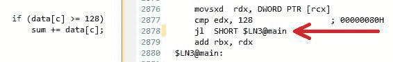

你是一个处理器，看到一个分支。你不知道它将往哪个方向走。你会做什么？你停止执行，等待之前的指令完成。然后你沿着正确的路径继续执行。

*现代处理器非常复杂且具有长流水线。因此它们“预热”和“减速”需要很长时间。*

有更好的办法吗？你猜猜分支将往哪个方向走！

*   如果你猜对了，你继续继续执行。
*   如果你猜错了，你需要清空流水线并回溯到分支处。然后你可以沿着另一条路径重新启动。

**如果你每次都猜对**，执行永远不需要停止。

**如果你猜错太频繁**，你将花费大量时间在停顿、回溯和重启。

***

这就是分支预测。我承认这不是最好的类比，因为火车完全可以用旗帜指示方向。但在计算机中，处理器在最后一刻之前不知道分支将往哪个方向走。

那么，你如何策略性地猜测以减少火车倒退并走另一条路径的次数？查看历史！如果火车 99% 的时间都左转，你就猜左转。如果它是交替的，你就交替猜测。如果每三次走同一个方向，你就猜同一个……

***换句话说，你试图识别一种模式并遵循它。*** 这大致就是分支预测器的工作原理。

大多数应用程序具有良好的分支。因此，现代分支预测器通常能达到 >90% 的命中率。但面对没有识别模式的不可预测分支时，分支预测器几乎毫无用处。

进一步阅读：[Wikipedia 上的“分支预测器”文章](http://en.wikipedia.org/wiki/Branch_predictor)。

***

**如上面暗示的，罪魁祸首是这个 if 语句：**

```
if (data[c] >= 128)
    sum += data[c];
```

注意数据在 0 到 255 之间均匀分布。当数据经过排序后，大约前一半的迭代不会进入 if 语句。之后，它们将都会进入 if 语句。

这对分支预测器非常友好，因为分支会连续多次朝相同方向运行。即使是简单的饱和计数器也能正确预测分支，除了切换方向后的那几次迭代外。

**快速可视化：**

```
T = 分支跳转 (taken)
N = 分支不跳转 (not taken)
data[] = 0, 1, 2, 3, 4, ... 126, 127, 128, 129, 130, ... 250, 251, 252, ...
branch = N  N  N  N  N  ...   N    N    T    T  T  ...   T    T    T  ...
       = NNNNNNNNNNNN ... NNNNNNNTTTTTTTTT ... TTTTTTTTTT  (易于预测)
```

然而，当数据完全随机时，分支预测器变得毫无用处，因为它无法预测随机数据。因此，可能会有 50% 的误预测（并不比随机猜测好）。

```
data[] = 226, 185, 125, 158, 198, 144, 217, 79, 202, 118,  14, 150, 177, 182, 133, ...
branch =   T,   T,   N,   T,   T,   T,   T,  N,   T,   N,   N,   T,   T,   T,   N  ...
       = NNNNNNNNNNNN ... NNNNNNNTTTTTTTTT ... TTTTTTT
```

***

## 可以做什么？

如上面暗示的，罪魁祸首是这个 if 语句：

```
if (data[c] >= 128)
    sum += data[c];
```

注意数据在 0 到 255 之间均匀分布。当数据排序后，大约前一半的迭代不会进入 if 语句。之后，它们都会进入 if 语句。

这对分支预测器非常友好，因为分支连续多次朝相同方向运行。即使是简单的计数器也能正确预测分支，除了切换方向后的那几次迭代。

**快速可视化：**

```
T = 分支跳转
N = 分支不跳转
data[] = 0, 1, 2, 3, 4, ... 126, 127, 128, 129, 130, ... 250, 251, 252, ...
branch = N  N  N  N  N  ...   N    N    T    T  T  ...   T    T    T  ...
       = NNNNNNNNNNNN ... NNNNNNNTTTTTTTTT ... TTTTTTTTTT (易于预测)
```

然而，当数据完全随机时，分支预测器变得毫无用处，因为它无法预测随机数据。因此可能会有大约 50% 的误预测（并不比随机猜测好）。

```
data[] = 226, 185, 125, 158, 198, 144, 217, 79, 202, 118,  14, 150, 177, 182, 133, ...
```


branch =   T,   T,   N,   T,   T,   T,   T,  N,   T,   N,   N,   T,   T,   T,   N  ...

       = NNNNNNNNNNNN ... NNNNNNNTTTTTTTTT ... TTTTTTT

***

## 性能分析与优化

如上面暗示的，罪魁祸首是这个 `if` 语句：

```
if (data[c] >= 128)
    sum += data[c];
```

注意数据在 0 到 255 之间均匀分布。当数据排序后，大约前一半的迭代不会进入 `if` 语句。之后，它们都会进入 `if` 语句。

这对分支预测器非常友好，因为分支连续多次朝相同方向运行。即使是简单的计数器也能正确预测分支，除了切换方向后的那几次迭代。

**快速可视化：**

```
T = 分支跳转
N = 分支不跳转

data[] = 0, 1, 2, 3, 4, ... 126, 127, 128, 129, 130, ... 250, 251, 252, ...
branch = N  N  N  N  N  ...   N    N    T    T  T  ...   T    T    T  ...
       = NNNNNNNNNNNN ... NNNNNNNTTTTTTTTT ... TTTTTTTTTT (易于预测)
```

然而，当数据完全随机时，分支预测器变得毫无用处，因为它无法预测随机数据。因此可能会有大约 50% 的误预测（并不比随机猜测好）。

```
data[] = 226, 185, 125, 158, 198, 144, 217, 79, 202, 118,  14, 150, 177, 182, 133, ...
branch =   T,   T,   N,   T,   T,   T,   T,  N,   T,   N,   N,   T,   T,   T,   N  ...
       = NNNNNNNNNNNN ... NNNNNNNTTTTTTTTT ... TTTTTTT
```

***

## 基准测试与结果

**基准测试: Core i7920 @ 3.5 GHz**

| 实现方式 | 数据 | 时间 (ms) |
| :--- | :--- | :--- |
| C++ | 随机 | 11.777 |
| C++ | 排序 | 5.643 |
| Java | 随机 | 10.932 |
| Java | 排序 | 5.647 |
| 无分支 (Branchless) | 随机 | 3.113 |
| 无分支 (Branchless) | 排序 | 3.186 |

**观察：**

*   **使用分支：** 排序数据和未排序数据之间存在巨大差异。
*   **使用技巧 (Hack)：** 排序数据和未排序数据之间没有差异。
*   在 C++ 情况下，当数据排序时，使用技巧的速度实际上比使用分支慢一点点。

## 建议的优化策略

为了避免不可预测的分支，你可以使用位操作。代替：

```cpp
if (data[c] >= 128)
    sum += data[c];
```

你可以使用：

```cpp
int t = (data[c] >= 128) >> 31;
sum += ~t & data[c];
```

这把分支替换为条件移动（conditional move），对于随机数据更高效。

***

## 编译器说明

*   **GCC 4.6.1** 在 x64 上使用 `-O3` 或 `-ftree-vectorize` 能够生成条件移动。
*   **VC++ 2010** 即使在 `/Ox` 下也无法生成条件移动。
*   **Intel Compiler 11** 了一了奇迹。[交换了两个循环](http://en.wikipedia.org/wiki/Loop_interchange)，从而将不可预测的分支提升到了外层循环。因此它不仅免疫了误预测，而且比 VC++ 能生成的代码快一倍！
*   如果你给 **Intel Compiler** 提供无分支代码，它会直接进行向量化，速度与使用分支时（带有循环交换）一样快。

我们可以发现，这个特定的 `if... else...` 分支的意义是在满足条件时添加内容。这种类型的分支可以很容易转换为**条件移动**（conditional move）语句，它会被编译为 `x86` 系统中的条件移动指令：`cmovl`。这样，分支以及潜在的分支预测开销就被消除了。

在 `C` 以及 `C++` 中，这种可以直接（不经过任何优化）编译为 `x86` 条件移动指令的语句是三元运算符 `... ? ... : ...`。因此我们将上述语句重写为等效语句：

```
sum += data[c] >=128 ? data[c] : 0;
```

在保持可读性的同时，我们可以检查加速倍数。

在 Intel [Core i7](http://en.wikipedia.org/wiki/Intel_Core#Core_i7)-2600K @ 3.4 GHz 和 Visual Studio 2010 Release 模式下，基准测试结果如下格式拷贝自 Mysticial）：

`x86`

```
//  Branch - Random
seconds = 8.885

//  Branch - Sorted
seconds = 1.528

//  Branchless - Random
seconds = 3.716

//  Branchless - Sorted
seconds = 3.71
```

`x64`

```
//  Branch - Random
seconds = 11.302

//  Branch - Sorted
 seconds = 1.830

//  Branchless - Random
seconds = 2.736

//  Branchless - Sorted
seconds = 2.737
```

该结果在多次测试中都是稳健的。当分支结果不可预测时，我们获得了巨大的加速；但在结果可预测时，性能会受到一点影响。事实上，使用条件移动时，无论数据模式如何，性能都是相同的。

现在让我们仔细研究它们生成的 `x86` 汇编。为了简单起见，我们使用两个函数 `max1` 和 `max2`。

`max1` 使用条件分支 `if... else ...`：

```
int max1(int a, int b) {
    if (a > b)
        return a;
    else
        return b;
}
```

`max2` 使用三元运算符 `... ? ... : ...`：

```
int max2(int a, int b) {
    return a > b ? a : b;
}
```

在 x86-64 机器上，`GCC -S` 生成了下面的汇编。

```
:max1
    movl    %edi, -4(%rbp)
    movl    %esi, -8(%rbp)
    movl    -4(%rbp), %eax
    cmpl    -8(%rbp), %eax
    jle     .L2
    movl    -4(%rbp), %eax
    movl    %eax, -12(%rbp)
    jmp     .L4
.L2:
    movl    -8(%rbp), %eax
    movl    %eax, -12(%rbp)
.L4:
    movl    -12(%rbp), %eax
    leave

:max2
    movl    %edi, -4(%rbp)
    movl    %esi, -8(%rbp)
    movl    -4(%rbp), %eax
    cmpl    %eax, -8(%rbp)
    cmovge  -8(%rbp), %eax
    leave
    ret
```

由于使用了指令 `cmovge`，`max2` 使用的代码要少得多。但真正的收益在于 `max2` 不涉及分支 `jmp`，如果预测结果不正确，跳转将产生巨大的代价。

### 为什么条件移动性能更好？

在典型的 `x86` 处理器中，指令的执行被分为几个阶段。大致来说，我们有不同的硬件来处理不同的阶段。因此，我们不需要等待一条指令完成就可以开始新指令。这被称为[流水线](https://en.wikipedia.org/wiki/Pipeline)。

在分支情况下，下一条指令由前一条指令决定，因此我们无法进行流水线化。我们必须等待或预测。

在条件移动情况下，执行被分为几个阶段，但早期阶段（如 `Fetch` 和 `Decode`）并不依赖于前一条指令的结果。因此，我们只等待一条指令执行的一小部分。这就是为什么当预测容易时，条件移动比分支要慢。

书籍 [Computer Systems: A Programmer's Perspective, second edition](https://rads.stackoverflow.com/zn/01360840)详细解释了这一点。你可以查看第 3.6 节的 *条件移动指令*，第 4 章的 *处理器架构*，以及第 5.11.2 节的 *分支预测与误判*。

有时，某些现代编译器可以将我们的代码优化为性能更好的汇编，有时编译器则无法做到（本文涉及的代码使用的是 Visual Studio 的原生编译器）。了解在结果不可预测时分支与条件移动之间的性能差异，有助于我们在场景变得复杂到编译器无法自动优化时，编写性能更好的代码。讨论感谢来自：[https://stackoverflow.com/users/866732/wisagan]

如果你对可以对此代码进行的更多优化感兴趣，请考虑以下内容：

从原始循环开始：

```
for (unsigned i = 0; i < n; i++) {
    for (unsigned j = 0; j < m; j++) {
        if (data[j] >= 128)
            sum += data[j];
        else
            sum += 0;
    }
}
```

（注：原文此处缺失了循环变量定义，此处根据上下文补全了逻辑描述）

重写为：

```
for (unsigned i = 0; i < n; i++) {
    for (unsigned j = 0; j < m; j++) {
        sum += data[j] >= 128 ? data[j] : 0;
    }
}
```

在保持可读性的同时，我们可以检查加速倍数。

在 Intel [Core i7](http://en.wikipedia.org/wiki/Intel_Core#Core_i7)-2600K @ 3.4 GHz 和 Visual Studio 2010 Release 模式下，基准测试结果如下格式拷贝自 Mysticial）：

`x86`

```
//  Branch - Random
seconds = 8.885

//  Branch - Sorted
seconds = 1.528

//  Branchless - Random
seconds = 3.716

//  Branchless - Sorted
seconds = 3.71
```

`x64`

```
//  Branch - Random
seconds = 11.302

//  Branch - Sorted
 seconds = 1.830

//  Branchless - Random
seconds = 2.736

//  Branchless - Sorted
seconds = 2.737
```

该结果在多次测试中都是稳健的。当分支结果不可预测时，我们获得了巨大的加速；但在结果可预测时，性能会受到一点影响。事实上，使用条件移动时，无论数据模式如何，性能都是相同的。

现在让我们仔细研究它们生成的 `x86` 汇编。为了简单起见，我们使用两个函数 `max1` 和 `max2`。

`max1` 使用条件分支 `if... else ...`：

```
int max1(int a, int b) {
    if (a > b)
        return a;
    else
        return b;
}
```

`max2` 使用三元运算符 `... ? ... : ...`：

```
int max2(int a, int b) {
    return a > b ? a : b;
}
```

在 x86-64 机器上，`GCC -S` 生成了下面的汇编。

```
:max1
    movl    %edi, -4(%rbp)
    movl    %esi, -8(%rbp)
    movl    -4(%rbp), %eax
    cmpl    -8(%rbp), %eax
    jle     .L2
    movl    -4(%rbp), %eax
    movl    %eax, -12(%rbp)
    jmp     .L4
.L2:
    movl    -8(%rbp), %eax
    movl    %eax, -12(%rbp)
.L4:
    movl    -12(%rbp), %eax
    leave

:max2
    movl    %edi, -4(%rbp)
    movl    %esi, -8(%rbp)
    movl    -4(%rbp), %eax
    cmpl    %eax, -8(%rbp)
    cmovge  -8(%rbp), %eax
    leave
    ret
```

`max2` 由于使用了指令 `cmovge`，使用的代码要少得多。但真正的收益在于 `max2` 不涉及分支 `jmp`，如果预测结果不正确，跳转将产生巨大的代价。

### 为什么条件移动性能更好？

在典型的 `x86` 处理器中，指令的执行被分为几个阶段。大致来说，我们有不同的硬件来处理不同的阶段。因此，我们不需要等待一条指令完成就可以开始新指令。这被称为[流水线](https://en.wikipedia.org/wiki/Pipeline)。

在分支情况下，下一条指令由前一条指令决定，因此我们无法进行流水线化。我们必须等待或预测。

在条件移动情况下，执行被分为几个阶段，但早期阶段（如 `Fetch` 和 `Decode`）并不依赖于前一条指令的结果。因此，我们只等待一条指令执行的一小部分。这就是为什么当预测容易时，条件移动比分支要慢。

书籍 [Computer Systems: A Programmer's Perspective, second edition](https://rads.stackoverflow.com/zn/01360840)详细解释了这一点。你可以查看第 3.6 节的 *条件移动指令*，第 4 章的 *处理器架构*，以及第 5.11.2 节的 *分支预测与误判*。

有时，某些现代编译器可以将我们的代码优化为性能更好的汇编，有时编译器则无法做到（本文涉及的代码使用的是 Visual Studio 的原生编译器）。了解在结果不可预测时分支与条件移动之间的性能差异，有助于我们在场景变得复杂到编译器无法自动优化时，编写性能更好的代码。讨论感谢来自：[https://stackoverflow.com/users/866732/wisagan]

如果你对可以对此代码进行的更多优化感兴趣，请考虑以下内容：

从原始循环开始：

```
for (unsigned i = 0; i < n; i++) {
    for (unsigned j = 0; j < m; j++) {
        if (data[j] >= 128)
            sum += data[j];
        else
            sum += 0;
    }
}
```

重写为：

```
sum += data[c] >=128 ? data[c] : 0;
```

（注：原文此处变量名为 `c`，且代码为 `sum += data[c] >=128 ? data[c] : 0;`，此处保持原样翻译）

在保持可读性的同时，我们可以检查加速倍数。

在 Intel [Core i7](http://en.wikipedia.org/wiki/Intel_Core#Core_i7)-2600K @ 3.4 GHz 和 Visual Studio 2010 Release 模式下，基准测试结果如下格式拷贝自 Mysticial）：

`x86`

```
//  Branch - Random
seconds = 8.885

//  Branch - Sorted
seconds = 1.528

//  Branchless - Random
seconds = 3.716

//  Branchless - Sorted
seconds = 3.71
```

`x64`

```
//  Branch - Random
seconds = 11.302

//  Branch - Sorted
 seconds = 1.830

//  Branchless - Random
seconds = 2.736

//  Branchless - Sorted
seconds = 2.737
```

该结果在多次测试中都是稳健的。当分支结果不可预测时，我们获得了巨大的加速；但在结果可预测时，性能会受到一点影响。事实上，使用条件移动时，无论数据模式如何，性能都是相同的。

现在让我们仔细研究它们生成的 `x86` 汇编。为了简单起见，我们使用两个函数 `max1` 和 `max2`。

`max1` 使用条件分支 `if... else ...`：


`int max1(int a, int b)` 是一个函数，其定义为：

```
int max1(int a, int b) {
    if (a > b)
        return a;
    else
        return b;
}
```

`max2` 使用三元运算符 `... ? ... : ...`：

```
int max2(int a, int b) {
    return a > b ? a : b;
}
```

在 x86-64 机器上，`GCC -S` 生成了下面的汇编。

```
:max1
    movl    %edi, -4(%rbp)
    movl    %esi, -8(%rbp)
    movl    -4(%rbp), %eax
    cmpl    -8(%rbp), %eax
    jle     .L2
    movl    -4(%rbp), %eax
    movl    %eax, -12(%rbp)
    jmp     .L4
.L2:
    movl    -8(%rbp), %eax
    movl    %eax, -12(%rbp)
.L4:
    movl    -12(%rbp), %eax
    leave
:max2
    movl    %edi, -4(%rbp)
    movl    %esi, -8(%rbp)
    movl    -4(%rbp), %eax
    cmpl    %eax, -8(%rbp)
    cmovge  -8(%rbp), %eax
    leave
    ret
```

`max2` 由于使用了指令 `cmovge`，使用的代码要少得多。但真正的收益在于 `max2` 不涉及分支 `jmp`，如果预测结果不正确，跳转将产生巨大的代价。

## 为什么条件移动性能更好？

在典型的 `x86` 处理器中，指令的执行被分为几个阶段。大致来说，我们有不同的硬件来处理不同的阶段。因此，我们不需要等待一条指令完成就可以开始新指令。这被称为[流水线](https://en.wikipedia.org/wiki/Pipeline)。

在分支情况下，下一条指令由前一条指令决定，因此我们无法进行流水线化。我们必须等待或预测。

在条件移动情况下，执行被分为几个阶段，但早期阶段（如 `Fetch` 和 `Decode`）并不依赖于前一条指令的结果。因此，我们只等待一条指令执行的一小部分。这就是为什么当预测容易时，条件移动比分支要慢。

书籍 [Computer Systems: A Programmer's Perspective, second edition](https://rads.stackoverflow.com/zn/01360840) 详细解释了这一点。你可以查看第 3.6 节的 *条件移动指令*，第 4 章的 *处理器架构*，以及第 5.11.2 节的 *分支预测与误判*。

有时，某些现代编译器可以将我们的代码优化为性能更好的汇编，有时编译器则无法做到（本文涉及的代码使用的是 Visual Studio 的原生编译器）。了解在结果不可预测时分支与条件移动之间的性能差异，有助于我们在场景变得复杂到编译器无法自动优化时，编写性能更好的代码。讨论感谢来自：[https://stackoverflow.com/users/866732/wisagan](https://stackoverflow.com/users/866732/wisagan)

## 进一步优化

如果你对可以对此代码进行的更多优化感兴趣，请考虑以下内容：

从原始循环开始：

```
for (unsigned i = 0; i < n; i++) {
    for (unsigned j = 0; j < m; j++) {
        if (data[j] >= 128)
            sum += data[j];
        else
            sum += 0;
    }
}
```

重写为：

```
sum += data[c] >=128 ? data[c] : 0;
```

（注：原文此处变量名为 `c`，且代码为 `sum += data[c] >=128 ? data[c] : 0;`，此处保持原样翻译）

我们可以发现，这个特定的 `if... else...` 分支的意义是在满足条件时添加内容。这种类型的分支可以很容易转换为**条件移动**语句，它会被编译为 `x86` 系统中的条件移动指令：`cmovl`。这样，分支以及潜在的分支预测开销就被消除了。

在 `C` 以及 `C++` 中，这种可以直接（不经过任何优化）编译为 `x86` 条件移动指令的语句是三元运算符 `... ? ... : ...`。因此我们将上述语句重写为等效语句：

```
sum += data[c] >=128 ? data[c] : 0;
```

在保持可读性的同时，我们可以检查加速倍数。

在 Intel [Core i7](http://en.wikipedia.org/wiki/Intel_Core#Core_i7)-2600K @ 3.4 GHz 和 Visual Studio 2010 Release 模式下，基准测试结果如下格式拷贝自 Mysticial）：

`x86`

```
//  Branch - Random
seconds = 8.885

//  Branch - Sorted
seconds = 1.528

//  Branchless - Random
seconds = 3.716

//  Branchless - Sorted
seconds = 3.71
```

`x64`

```
//  Branch - Random
seconds = 11.302

//  Branch - Sorted
 seconds = 1.830

//  Branchless - Random
seconds = 2.736

//  Branchless - Sorted
seconds = 2.737
```

该结果在多次测试中都是稳健的。当分支结果不可预测时，我们获得了巨大的加速；但在结果可预测时，性能会受到一点影响。事实上，使用条件移动时，无论数据模式如何，性能都是相同的。

现在让我们仔细研究它们生成的 `x86` 汇编。为了简单起见，我们使用两个函数 `max1` 和 `max2`。

`max1` 使用条件分支 `if... else ...`：

```
int max1(int a, int b) {
    if (a > b)
        return a;
    else
        return b;
}
```

`max2` 使用三元运算符 `... ? ... : ...`：

```
int max2(int a, int b) {
    return a > b ? a : b;
}
```

在 x86-64 机器上，`GCC -S` 生成了下面的汇编。

```
:max1
    movl    %edi, -4(%rbp)
    movl    %esi, -8(%rbp)
    movl    -4(%rbp), %eax
    cmpl    -8(%rbp), %eax
    jle     .L2
    movl    -4(%rbp), %eax
    movl    %eax, -12(%rbp)
    jmp     .L4
.L2:
    movl    -8(%rbp), %eax
    movl    %eax, -12(%rbp)
.L4:
    movl    -12(%rbp), %eax
    leave
:max2
    movl    %edi, -4(%rbp)
    movl    %esi, -8(%rbp)
    movl    -4(%rbp), %eax
    cmpl    %eax, -8(%rbp)
    cmovge  -8(%rbp), %eax
    leave
    ret
```

`max2` 由于使用了指令 `cmovge`，使用的代码要少得多。但真正的收益在于 `max2` 不涉及分支 `jmp`，如果预测结果不正确，跳转将产生巨大的代价。

## 为什么条件移动性能更好？

在典型的 `x86` 处理器中，指令的执行被分为几个阶段。大致来说，我们有不同的硬件来处理不同的阶段。因此，我们不需要等待一条指令完成就可以开始新指令。这被称为[流水线](https://en.wikipedia.org/wiki/Pipeline)。

在分支情况下，下一条指令由前一条指令决定，因此我们无法进行流水线化。我们必须等待或预测。

在条件移动情况下，执行被分为几个阶段，但早期阶段（如 `Fetch` 和 `Decode`）并不依赖于前一条指令的结果。因此，我们只等待一条指令执行的一小部分。这就是为什么当预测容易时，条件移动比分支要慢。

书籍 [Computer Systems: A Programmer's Perspective, second edition](https://rads.stackoverflow.com/zn/01360840) 详细解释了这一点。你可以查看第 3.6 节的 *条件移动指令*，第 4 章的 *处理器架构*，以及第 5.11.2 节的 *分支预测与误判*。

有时，某些现代编译器可以将我们的代码优化为性能更好的汇编，有时编译器则无法做到（本文涉及的代码使用的是 Visual Studio 的原生编译器）。了解在结果不可预测时分支与条件移动之间的性能差异，有助于我们在场景变得复杂到编译器无法自动优化时，编写性能更好的代码。讨论感谢来自：[https://stackoverflow.com/users/866732/wisagan](https://stackoverflow.com/users/866732/wisagan)

## 进一步优化

如果你对可以对此代码进行的更多优化感兴趣，请考虑以下内容：

从原始循环开始：

```
for (unsigned i = 0; i < n; i++) {
    for (unsigned j = 0; j < m; j++) {
        if (data[j] >= 128)
            sum += data[j];
        else
            sum += 0;
    }
}
```

重写为：

```
sum += data[c] >=128 ? data[c] : 0;
```

这让你能够轻松识别出问题所在——在未排序的版本中，`if (data[c] >= 128)` 这一行在 cachegrind 的分支预测模型下导致了 164,050,007 次条件分支预测失败 (`Bcm`)，而在排序后的版本中仅导致了 10,006 次。

***

或者，在 Linux 上，你可以使用性能计数器子系统完成相同任务，但使用的是 CPU 计数器的原生性能支持。

```
perf stat ./sumtest_sorted
```

## 排序后

```
 Performance counter stats for './sumtest_sorted':

  11808.095776 task-clock                #    0.998 CPUs utilized          
         1,062 context-switches          #    0.090 K/sec                  
            14 CPU-migrations            #    0.001 K/sec                  
           337 page-faults               #    0.029 K/sec                  
26,487,882,764 cycles                    #    2.243 GHz                    
41,025,654,322 instructions              #    1.55  insns per cycle        
 6,558,871,379 branches                  #  555.455 M/sec                  
       567,204 branch-misses             #    0.01% of all branches        

  11.827228330 seconds time elapsed
```

## 未排序

```
 Performance counter stats for './sumtest_unsorted':

  28877.954344 task-clock                #    0.998 CPUs utilized          
         2,584 context-switches          #    0.089 K/sec                  
            18 CPU-migrations            #    0.001 K/sec                  
           335 page-faults               #    0.012 K/sec                  
65,076,127,595 cycles                    #    2.253 GHz                    
41,032,528,741 instructions              #    0.63  insns per cycle        
 6,560,579,013 branches                  #  227.183 M/sec                  
 1,646,394,749 branch-misses             #   25.10% of all branches        

  28.935500947 seconds time elapsed
```

它还可以配合反汇编进行源代码级注释。

```
perf record -e branch-misses ./sumtest_unsorted
perf annotate -d sumtest_unsorted
```

```
 Percent |      Source code & Disassembly of sumtest_unsorted
------------------------------------------------
...
         :                      sum += data[c];
    0.00 :        400a1a:       mov    -0x14(%rbp),%eax
   39.97 :        400a1d:       mov    %eax,%eax
    5.31 :        400a1f:       mov    -0x20040(%rbp,%rax,4),%eax
    4.60 :        400a26:       cltq   
    0.00 :        400a28:       add    %rax,-0x30(%rbp)
...
```

更多细节请参阅[性能教程](https://perf.wiki.kernel.org/index.php/Tutorial)。

讨论感谢提供：[caf](https://stackoverflow.com/users/134633/caf)

当数组排序时，数据分布在 0 到 255 之间，因此迭代的大约前半部分不会进入 if 语句（见下文的 if 语句）。

```
if (data[c] >= 128)
    sum += data[c];
```

问题是，为什么在某些情况下（如排序后的数据情况下）上述语句不会执行？这就涉及到“分支预测器”（Branch predictor）——分支预测器是一种数字电路，它尝试在确定分支（例如 if-then-else 结构）的走向之前预测其去向。分支预测器的目的是改进指令流水线的流。分支预测器在实现高有效性能方面起着至关重要的作用！

## 让我们进行一些基准测试以便理解

if 语句的性能取决于其条件是否具有可预测的模式。如果条件总是真或总是假，处理器中的分支预测逻辑就会捕捉到该模式。另一方面，如果模式不可预测，if 语句的开销将昂得多。

让我们在不同条件下测量此循环的性能：

```
for (int i = 0; i < max; i++) if (condition) sum++;
```

以下是循环在不同真/假模式下的运行耗时：

```
Condition           Pattern              Time (ms)
(i & 0×80000000) == 0   T repeated        322
(i & 0xffffffff) == 0   F repeated        276
(i & 1) == 0            TF alternating    760
(i & 3) == 0            TFFFTFFF…         513
(i & 2) == 0            TTFFTTFF         675
(i & 4) == 0            TTTTTTTT         75
(i & 8) == 0            TTTTTTTT         52
(i & 16) == 0           TTTTTTTT         90
```


在这种情况下，编译器显而易见地边界条件永远不会触发。至少微软的 JIT 编译器（我预计 Java 也做了类似的操作）会注意到这一点并完全移除该检查。哇 - 这意味着没有分支。同样，它也会处理其他显而易见的情况。

如果你在托管语言的查找上遇到问题 - 关键是在你的查找函数中添加一个 `& 0x[something]FFF` 来使边界检查变得可预测 —— 然后观察它的运行速度变快。

## 这种情况的 own

```cpp
// generate data

int arraySize = 32768;

int[] data = new int[arraySize];

Random rnd = new Random(0);

for (int c = 0; c < arraySize; ++c)

    data[c] = rnd.Next(256);

// 为了保持代码完整性，我将创建一个单独的查找表

// (我假设我们无法修改 'data' 或循环次数)

int[] lookup = new int[256];

for (int c = 0; c < 256; ++c)

    lookup[c] = (c >= 128) ? c : 0;

// test

DateTime startTime = System.DateTime.Now;

long sum = 0;

for (int i = 0; i < 100000; ++i)

{

    // primary loop

    for (int j = 0; j < arraySize; ++j)

    {

        // 这里你基本上想使用简单的操作 - 所以没有

        // 随机分支，但像 &, |, *, -, +, 等等操作是可以的

        sum += lookup[data[j]];

    }

}

DateTime endTime = System.DateTime.Now;

Console.WriteLine(endTime - startTime);

Console.WriteLine("sum = " + sum);

Console.ReadLine();
```

讨论感谢：[atlaste](https://stackoverflow.com/users/1031591/atlaste)

避免分支预测错误的一种方法是构建查找表，并使用数据对其进行索引。Stefan de Bruijn 在他的回答中讨论过这一点。

在这种情况下，我们知道值处于 `[0, 255]` 范围内，并且我们只关心 `>= 128` 的值。这意味着我们可以轻松提取出一个单独位，它可以告诉我们是否想要某个值：通过将数据向右移动 7 位，我们得到一个 `0` 位或一个 `1` 位，而我们只在拥有 `1` 位时才加上该值。我们将这个位称为“决策位”。

通过使用决策位的 `0/1` 值作为数组的索引，我们可以编写出无论数据是否排序运行速度都一样快的代码。我们的代码始终会加一个值，但当决策位为 `0` 时，我们将值加到某个我们不在乎的地方。这里是代码：

```cpp
// Test

clock_t start = clock();

long long a[] = {0, 0};

long long sum;

for (unsigned i = 0; i < 100000; ++i)

{

    // Primary loop

    for (unsigned c = 0; c < arraySize; ++c)

    {

        int j = (data[c] >> 7);

        a[j] += data[c];

    }

}

double elapsedTime = static_cast<double>(clock() - start) / CLOCKS_PER_SEC;

sum = a[1];
```

这段代码浪费了一半的加法操作，但永远没有分支预测失败。在随机数据上，它比带有实际 `if` 语句的版本快得多。

但在我的测试中，式的查找表比这个稍微快一点，可能是因为对查找表的索引比位移稍微快一点。这展示了我的代码如何设置和使用查找表（代码中毫无想象地命名为 `lut` 代表 "LookUp Table"）。这里是 C++ 代码：

```cpp
// declare and then fill in the lookup table

int lut[256];

for (unsigned c = 0; c < 256; ++c)

    lut[c] = (c >= 128) ? c : 0;

// use the lookup table after it is built

for (unsigned i = 0; i < 100000; ++i)

{

    // Primary loop

    for (unsigned c = 0; c < arraySize; ++c)

    {

        sum += lut[data[c]];

    }

}
```

在这种情况下，查找表只有 `256` 字节，所以它很好地装在缓存中，一切都很很快。如果数据是 24 位值而我们只想要其中一半，这种技术的效果就不理想了……查找表将太大而无法实现。另一方面，我们可以结合上面显示的两种技术：首先右移位，然后索引查找表。对于一个我们只需要高位部分的 24 位值，我们可以将数据向右移动 12 位，留下一个 12 位的值作为表索引。12 位的表索引意味着一个包含 `4096` 个值的表，这可能是可行的。

### 编辑：我忘记忘了放进去的一点。

使用数组索引而不是使用 `if` 语句的技术可以用于决定使用哪个指针。我看到了……

由于等待指令 `A` 的结果，在上述情况下（不考虑分支预测；无论真假均如此），消耗的总 CPU 周期为 7。

## 那么什么是分支预测？

分支预测器尝试在确定分支（即 if-then-else 结构）的走向之前，对走向进行猜测。它不会等待指令 `A` 到达流水线的 `EX` 阶段，而是预测决策并跳转到该条指令（在我们的示例中为 `B` 或 `C`）。

如果预测正确，流水线看起来如下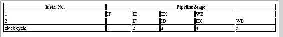

如果之后检测到预测错误，则会丢弃部分执行的指令，流水线从正确的分支重新开始，从而产生延迟。分支预测失败浪费的时间等于流水线从取指阶段（fetch）到执行阶段（execute）的阶段数。现代微处理器往往具有很长的流水线，因此预测失败延迟在 10 到 20 个时钟周期之间。流水线越长，就越需要良好的[分支预测器](https://en.wikipedia.org/wiki/Branch_predictor)。

在楼主的代码中，当第一次遇到条件判断时，分支预测器没有任何信息可以依据预测，因此第一次它会随机选择下一条指令。在之后的 `for` 循环中，它可以根据历史记录进行预测。对于一个升序排列的数组，有三种可能性：

1. 所有元素都小于 128
2. 所有元素都大于 128
3. 一些起始的元素小于 128，随后变为大于 128

让我们假设预测器在第一次运行时总是假设真分支。

因此，在第一种情况下，它将始终采取真分支，因为从历史来看它所有的预测都是正确的。在第二种情况下，它最初会预测错误，但在几次迭代后它就能预测正确。在第三种情况下，它最初会正确预测，直到元素不再小于 128。此之后它会失败一段时间，并在从历史记录中看到分支预测失败时自我纠正。

在所有这些情况下，失败的次数都会非常少，因此只需要少量丢弃部分执行的指令并从正确的分支重新开始，从而减少 CPU 周期的消耗。

但对于随机的无序数组，预测大多数时间都需要丢弃部分执行的指令并从正确的分支重新开始，与排序数组相比，会产生更多的 CPU 周期。

讨论感谢：[Harsh Sharma](https://stackoverflow.com/users/1627741/harsh-sharma)

顺便提一下（我想没有任何回答对此强调这一点），很好地提到有时（特别是在对性能敏感的软件中——例如 Linux 内核），你可以发现像如下的 `if` 语句：

```cpp
if (likely( everything_is_ok ))

{

    /* Do something */

}
```

或者类似的：

```cpp
if (unlikely(very_improbable_condition))

{

    /* Do something */    

}
```

`likely()` 和 `unlikely()` 实际上是使用类似 GCC 的 `__builtin_expect` 等机制定义的宏，旨在帮助编译器插入预测代码，根据用户提供的信息倾向于条件成立。GCC 支持其他内置函数，可以改变运行程序的行为或发射如清除缓存等低级指令。请参考[此文档](https://gcc.gnu.org/onlinedocs/gcc/Other-Builtins.html)，该文档详细介绍了可用的 GCC 内置函数。

通常，这种优化主要出现在硬实时应用或嵌入式系统中，在这些系统中执行时间非常重要且至关。例如，如果你正在检查某个只发生 1/10000000 次的错误条件，为什么不告诉编译器呢？这样一来，分支预测默认就会假设该条件为假。

讨论感谢：[redobot](https://stackoverflow.com/users/1313233/redobot)

C++ 中频繁使用的布尔操作会在编译后的程序中产生许多分支。如果这些分支位于循环内部且难以预测，它们会显著降低执行速度。布尔变量存储为 8 位整数，值 `0` 表示 `false`，`1` 表示 `true`。

布尔变量在某种程度上是过度定的，因为所有以布尔变量输入的运算符都会检查输入是否有 `0` 或 `1` 以外的值，但以布尔值为输出的运算符不会产生 `0` 或 `1` 以外的值。这使得以布尔变量作为输入的操作效率低于所需。考虑以下示例：

```cpp
bool a, b, c, d;

c = a && b;

d = a || b;
```

编译器通常以以下方式实现：

```cpp
bool a, b, c, d;

if (a != 0) {

    if (b != 0) {

        c = 1;

    }

    else {

        goto CFALSE;

    }

}

else {

    CFALSE:

    c = 0;

}

if (a == 0) {

    if (b == 0) {

        d = 0;

    }

    else {

        goto DTRUE;

    }

}

else {

    DTRUE:

    d = 1;

}
```

这段代码远非最优。

你也可以从这张漂亮的[图](https://en.wikipedia.org/wiki/Branch_predictor#/media/File:Branch_prediction_2bit_saturating_counter-dia.svg)看出分支预测器为什么会产生困惑。

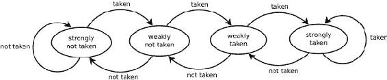

原始代码中的每个元素都是随机值

```
data[c] = std::rand() % 256;
```

因此预测器会随着 `std::rand()` 的结果而改变方向。

另一方面，一旦数据经过排序，预测器首先会进入一个“强预测不跳转”（strongly not taken）的状态，当值变为高值时，预测器将在三次运行中，从“强预测不跳转”一直转变为“强预测跳转”（strongly taken）。

***

讨论感谢：[Surt](https://stackoverflow.com/users/4013258/surt)

这个问题之前已经被非常优秀地回答过很多次了。但我想引起大家注意另一个有趣的分析。

最近，这个例子（经过了微小的修改）也被用作演示如何在 Windows 上在程序内部对代码进行性能分析。在此过程中，作者还展示了如何利用结果来确定代码在排序和未排序的情况下，大部分时间都消耗在了什么地方。最后，这段代码还展示了如何使用一个不为人知的 HAL（硬件抽象层）特性，来确定在未排序的情况下到底发生了多少次分支预测失败。

链接在这里：[`www.geoffchappell.com/studies/windows/km/ntoskrnl/api/ex/profile/demo.htm`](http://www.geoffchappell.com/studies/windows/km/ntoskrnl/api/ex/profile/demo.htm)

讨论感谢：[ForeverLearning](https://stackoverflow.com/users/601567/foreverlearning)

这是肯定的……！

**分支预测**（Branch Prediction）由于代码中发生的切换而导致逻辑运行变慢！这就像你走一条直路街或一条有很多转弯的街道，直路街肯定走得更快！

如果数组是经过排序的，你的条件在第一步是假的：`data[c] >= 128`，然后在通往街道尽头的过程中一直为真。这就是你如何更快到达逻辑终点的方式。另一方面，使用未排序的数组，你需要大量的转弯和处理，这肯定会让你的代码运行变慢……

看看下面我为你创建的这张图片，哪条街道会先完成？


所以从程序角度上来说，**分支预测**会导致进程变慢……

此外，最后重要的是我们有两种分支预测类型，它们以不同的方式影响你的代码：

### 1. 静态 (static)

### 2. 动态 (dynamic)

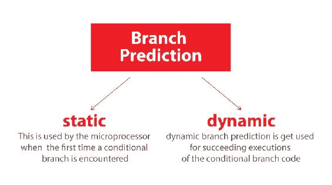

> 微处理器在第一次遇到条件分支时使用静态分支预测，而在后续条件分支代码的执行中使用动态分支预测。

> 为了有效编写代码以利用这些规则，在编写 `if-else` 或 `switch` 语句时，先检查最常见的情况，然后逐步到最不常见的情况。循环对于静态分支预测并不需要代码的特殊排序，因为通常只使用循环迭代器的条件。

讨论感谢：[Alireza](https://stackoverflow.com/users/5423108/alireza)

**分支预测的收益！**。重要的一点是，分支预测失败并没有减慢程序。预测失败的代价就像分支预测不存在一样，你必须等待表达式的求值来决定运行哪些代码（在下一段中会有进一步解释）。

```
if (expression)

{

    // run 1

} else {

    // run 2

}
```

每当有 `if-else` 或 `switch` 语句时，必须求值表达式以确定执行哪个块。在编译器生成的汇编代码中，会插入条件[分支](https://en.wikipedia.org/wiki/Branch_(computer_science)) 指令。分支指令可以导致计算机开始执行不同的指令序列，从而偏离其顺序执行指令的默认行为（即如果表达式为假，程序将跳过 `if` 块的代码），这取决于某些条件，在我们的案例中就是表达式的求值。

尽管如此，编译器会尝试在实际求值之前预测结果。它会从 `if` 块中提取指令，如果表达式证明为真，那么太棒了！我们节省了求值所需的时间并在代码中取得了进展；如果不是，我们就运行了错误的代码，流水线被刷新，然后运行正确的块。

**可视化：** 假设你需要选择路线 1 或路线 2。在等待伴侣检查地图时，你在 ## 处停下并等待，或者你可以直接选择路线 1，如果你运气好（路线 1 是正确路线），那么太棒了，你不需要等待伴侣检查地图（你节省了他检查地图的时间），否则你将原路返回回。虽然现在刷新流水线非常快，但冒这个险是值得的。预测排序数据或变化缓慢的数据总是比预测快速变化要更容易且更好。

```
 O       route1  /-------------------------------

/|\             /

 |  ---------##/

 \            \

         route2  /----------------
```


讨论感谢：[T Tannous](https://stackoverflow.com/users/653069/tony)

此内容源自 [StackFlow](https://stackoverflow.com/questions/1122780/why-is-it-faster-to-process-a-sorted-array-than-unsorted-array) 并已重新整理为上述内容。

# 将字符串写入输出

## 问题

我有几个实现 `OutputStream` 的输出监听器。它们可以是向 `stdout` 或 `File` 写入的 `PrintStream`，也可以写入内存或任何其他目标；因此，我在方法中将 `OutputStream` 指定为参数。

现在，我收到了字符串。写入流的最佳方法是什么？

我应该直接使用 `Writer.write(message.getBytes())` 吗？我可以给它字节，但如果目标流是字符流，它会自动转换吗？

我需要使用某些桥接流吗？

谢谢。

问题提供者：[yart](https://stackoverflow.com/users/232666/yart)

## 解决方案

流（`InputStream` 和 `OutputStream`）传输的是二进制数据。如果你想向流写入字符串，必须先将其转换为字节，或者用其他方式进行编码。你可以手动这样做（如你建议的那样），使用 `String.getBytes(Charset)` 方法，但你应该避免使用 `String.getBytes()` 方法，因为它使用 JVM 的默认编码，这无法以可靠的方式预测。

然而，向流写入字符数据的通常方法是将流封装在 [Writer](http://download.oracle.com/javase/6/docs/api/java/io/Writer.html) 中（通常是 [PrintWriter](http://download.oracle.com/javase/6/docs/api/java/io/PrintWriter.html)），每当你调用它的 [`write(String)`](http://download.oracle.com/javase/6/docs/api/java/io/Writer.html#write(java.lang.String))（或 [`print(String)`](http://download.oracle.com/javase/6/docs/api/java/io/PrintWriter.html#print(java.lang.String))）方法时，它会为你完成转换。输入流对应的包装器是 [Reader](https://download.oracle.com/javase/6/docs/api/java/io/Reader.html)。

`PrintStream` 是一种特殊的 `OutputStream` 实现，意义在于它也包含自动编码字符串的方法（它内部使用了一个 writer）。但它仍然是一个流。你可以安全地将你的流封装在 writer 中，无论是 `PrintStream` 还是其他流实现。不存在双重编码的风险。

带有 `OutputStream` 的 `PrintWriter` 示例：

```java
try {
    OutputStream output = new FileOutputStream("output-text.txt", true);
    PrintWriter p = new PrintWriter(output);
    p.println("Hello");
    p.flush();
    p.close();
} catch (FileNotFoundException e1) {
    e1.printStackTrace();
}
```

解决方案由：[MForster](https://stackoverflow.com/users/492158/mforster) 提供

## 讨论

将你的 `OutputStream` 封装在 [PrintWriter](http://download.oracle.com/javase/6/docs/api/java/io/PrintWriter.html) 中并调用该类的打印方法。它们接收一个 `String` 并为你完成工作。

讨论由：[NG.](https://stackoverflow.com/users/263895/ng) 提供

你可以创建一个包装了 `OutputStream` 的 `PrintStream`，然后直接调用它的 `print(String)`：

```java
final OutputStream os = new FileOutputStream("/tmp/out");
final PrintStream printStream = new PrintStream(os);
printStream.print("String");
printStream.close();
```

讨论由：[Illarion Kovalchuk](https://stackoverflow.com/users/2556667/illarion-kovalchuk) 提供

`OutputStream` 写入字节，`String` 提供字符。你需要定义 `Charset` 来将字符串编码为 `byte[]`：

```java
outputStream.write(string.getBytes(Charset.forName("UTF-8")));
```

将 `UTF-8` 更改为你选择的字符集。

讨论由：[Peter Knego](https://stackoverflow.com/users/248432/peter-knego) 提供

[根据设计](http://docs.oracle.com/javase/8/docs/api/java/io/OutputStreamWriter.html) 应该这样做：

```java
OutputStream out = ...;
try (Writer w = new OutputStreamWriter(out, "UTF-8")) {
    w.write("Hello, World!");
} // 或使用 w.close(); // close 会自动刷新
```

讨论由：[Antonio](https://stackoverflow.com/users/203204/antonio) 提供

你可以使用 [Apache Commons IO](https://commons.apache.org/proper/commons-io/apidocs/)：

```java
try (OutputStream outputStream = ...) {
    IOUtils.write("data", outputStream, "UTF-8");
}
```

* [IOUtils.write(String data, OutputStream output, String encoding)](https://commons.apache.org/proper/commons-io/apidocs/org/apache/commons/io/IOUtils.html#write(java.lang.String,%20java.io.OutputStream,%20java.nio.charset.Charset))

讨论由：[Felix](https://stackoverflow.com/users/4420532/felix) 提供

此内容源自 [StackOverFlow](https://stackoverflow.com/questions/4069028/write-string-to-output-stream) 并已重新整理成上述配方。

# 避免 != null 语句

## 问题

我在 Java 编程时最常用的习惯用例是在使用对象之前测试 `object != null`。这是为了避免 [NullPointerException](http://docs.oracle.com/javase/6/docs/api/index.html?java/lang/NullPointerException.html)。我发现代码非常丑陋，而且变得不可读。

有没有什么好的替代方案？

我想解决的是当你想要访问该对象的字段或方法时，对每个对象进行测试的性能问题。

例如：

```java
if (someobject != null) {
    someobject.doCalc();
}
```

在这种情况下，我将避免 `NullPointerException`，但我并不确切知道对象是否为 `null`。作为结果，这些测试贯穿于我的代码中。

问题由：[Goran Martinic](https://stackoverflow.com/users/34856/goran-martinic) 提供

## 解决方案

对我来说，这听起来像是初级到中级开发者在某个时刻可能会遇到的相当常见的问题：他们要么不知道或不信任他们参与的契约，从而防御性地过度检查空值。此外，在编写自己的代码时，他们倾向于通过返回 `null` 来指示某些情况，因此需要调用者检查空值。

换句话说，空检查出现在两种实例中：

1. 从契约来说，`null` 是一个有效的响应；以及
2. 它不是一个有效的响应。

(2) 是很容易的。可以使用 `assert` 语句（断言）或允许失败（例如，[NullPointerException](http://docs.oracle.com/javase/6/docs/api/index.html?java/lang/NullPointerException.html)）。断言是 1.4 版本引入的一个极度低使用的 Java 特性。语法为：

```java
assert <condition>
```

或者

```java
assert <condition> : <object>
```

其中 `<condition>` 是布尔表达式，`<object>` 是一个 `toString()` 方法输出将被包含在错误中的对象。

如果条件不真，`assert` 语句将抛出一个 `Error`（`AssertionError`）。默认情况下，Java 忽略断言。你可以通过向 JVM 传递选项 `-ea` 来启用断言。你可以对单个类和包启用或禁用断言。这意味着你可以在开发和测试期间使用断言验证代码，并在生产环境中禁用它们。

当异常抛出时，请检查堆栈追踪并排查 bug。

讨论感谢：[Jim Nelson](https://stackoverflow.com/users/32168/jim-nelson)

- 如果你认为一个对象不应该为空（或者这是一个 bug），请使用 `assert`。
- 如果你的方法不接受 `null` 参数，请在 javadoc 中说明并使用 `assert`。

只有在你想要处理对象可能为 `null` 的情况时，才需要检查 `object != null`……

有一个提议建议在 Java7 中添加新的注解来帮助处理 `null` / `notnull` 参数：[`tech.puredanger.com/java7/#jsr308`](http://tech.puredanger.com/java7/#jsr308)

讨论感谢：[pgras](https://stackoverflow.com/users/12719/pgras)

有时候，你的方法会对其参数进行操作，这些操作定义了对称性：

```java
a.f(b); <-> b.f(a);
```


如果你知道 `b` 永远不会为 null，你可以直接交换它们。这对于 `equals` 最有用：与其使用 `foo.equals("bar");`，不如使用 `"bar".equals(foo);`。

讨论感谢：[Johannes Schaub - litb](https://stackoverflow.com/users/34509/johannes-schaub-litb)

取决于你检查什么类型的对象，你可能可以使用 Apache Commons 中的一些类，例如：[Apache Commons Lang](http://commons.apache.org/lang/) 和 [Apache Commons Collections](http://commons.apache.org/collections/)。

示例：

```java
String foo;

...

if (StringUtils.isBlank(foo)) {
    /// 执行某些操作
}
```

或者（取决于你需要检查的内容）：

```java
String foo;

...

if (StringUtils.isEmpty(foo)) {
    /// 执行某些操作
}
```

`StringUtils` 类只是许多类之一；Commons 中有很多良好的类可以进行 null 安全操作。

以下是一个在 Java 中当你包含 Apache 库（`commons-lang-2.4.jar`）时使用 null 校验的示例：

```java
public DOCUMENT read(String xml, ValidationEventHandler validationEventHandler) {
    Validate.notNull(validationEventHandler, "ValidationHandler not Injected");

    return read(new StringReader(xml), true, validationEventHandler);
}
```

如果你正在使用 Spring，Spring 在它的包中也有相同的功能，参见库（`spring-2.4.6.jar`）。

如何使用 Spring 中这个静态类（`org.springframework.util.Assert`）的示例：

```java
Assert.notNull(validationEventHandler, "ValidationHandler not Injected");
```

讨论感谢：[javamonkey79](https://stackoverflow.com/users/27657/javamonkey79)

## 如果不允许 null 值

如果你的方法从外部调用，从如下结构开始：

```java
public void method(Object object) {
    if (object == null) {
        throw new IllegalArgumentException("...");
    }
}
```

那么，在方法的其余部分，你就知道 `object` 不是 null 了。

如果是一个内部方法（不是 API 的一部分），只需记录它不能为 null 即可。

示例：

```java
public String getFirst3Chars(String text) {
    return text.subString(0, 3);
}
```

然而，如果你的方法只是传递该值，而下一个方法继续传递，以此类推，这可能会出现问题。在这种情况下，你可能想像上面那样检查参数。

## 如果允许 null

这真的取决于情况。如果发现我经常做这样的操作：

```java
if (object == null) {
    // 某些操作
} else {
    // 其他操作
}
```

所以我进行了逻辑分支，并做了两件完全不同的事情。并没有丑陋的代码，因为我确实需要根据数据做两件不同的事情。例如，我应该处理输入，还是应该计算一个良好的默认值？

实际上我很少使用 `if (object != null && ...)` 这种惯用法。

如果你能展示你通常在何处使用这种惯用法，可能会更容易给你提供例子。

讨论感谢：[myplacedk](https://stackoverflow.com/users/28683/myplacedk)

问这个问题说明你可能对错误处理策略感兴趣。你团队的架构师应该决定如何处理错误。有几种方法可以实现：

1. 允许 `Exceptions` 传递——在“主循环”或其他管理程序中捕获它们。
2. 检查错误条件并妥善处理。

也去看看面向切面的编程（Aspect Oriented Programming）——它们有优雅的方法将 `if (o == null) handleNull()` 插入你的字节码中。

讨论感谢：[xtofl](https://stackoverflow.com/users/6610/xtofl)

无论你在何时传递数组或 `Vector`，请将它们初始化为空，而不是 null。这样你就可以避免很多对 null 的检查，一切都好 :)

```java
public class NonNullThing {
    Vector vectorField = new Vector();

    int[] arrayField = new int[0];

    public NonNullThing() {
        // 等
    }
}
```

讨论感谢：Stuart Axon

仅针对这种情况——避免在之前检查 null：

```java
if ("bar".equals(foo))
```

讨论感谢：[erickson](https://stackoverflow.com/users/3474/erickson)

根本上，完全解决此问题的唯一方法是使用不同的编程语言：

- 在 `Objective-C` 中，你可以实现类似于对 `nil` 调用方法的操作，并且绝对什么都不会发生。这使得大多数空检查变得没有必要，但可能会让错误变得难以诊断。
- 在 [Nice](http://nice.sourceforge.net/safety.html#id2487946)（一种基于 Java 的语言）中，所有类型都有两个版本：可能为空的版本和非空的版本。你只能在非空类型上调用方法。通过对空进行显式检查，可以将可能为空类型转换为非空类型。这让你更容易知道哪里需要进行空检查，哪里不需要。

讨论感谢：[Michael Borgwardt](https://stackoverflow.com/users/16883/michael-borgwardt)

## 如果不允许未定义值

你可以配置 IDE 以对潜在的空指针解引用进行警告。例如，在 Eclipse 中，请参见 `Preferences > Java > Compiler > Errors/Warnings/Null analysis`。

## 如果允许未定义值

如果你想定义一个让未定义值合理的新 API，请使用 [Option 模式](http://www.codecommit.com/blog/scala/the-option-pattern)（可能在函数式语言中很常见）。它具有以下优势：

- API 中显式声明了输入或输出是否存在。
- 编译器强制要求你处理“未定义”的情况。
- [Option 是一个单子](http://james-iry.blogspot.com/2007/08/martians-vs-monads-null-considered.html)，因此不需要冗长的空检查，只需使用 `map`/`foreach`/`getOrElse` 或类似的组合子即可安全地使用该值（[示例](http://blog.tackley.net/2010/09/option-in-scala-vs-null-in-java.html)）。

Java 8 拥有内置的 [`Optional`](http://docs.oracle.com/javase/8/docs/api/java/util/Optional.html) 类（推荐）；对于较早的版本，有库替代方案，例如 [Guava](http://code.google.com/p/guava-libraries/wiki/UsingAndAvoidingNullExplained) 的 [`Optional`](http://docs.guava-libraries.googlecode.com/git/javadoc/com/google/common/base/Optional.html) 或 [FunctionalJava](http://code.google.com/p/functionaljava) 的 [`Option`](http://functionaljava.googlecode.com/svn/artifacts/3.0/javadoc/index.html)。但像许多函数式模式一样，在 Java 中（即使是 8）使用 `Option` 会产生大量的模板代码，你可以使用不那么复杂的 JVM 语言（如 Scala 或 Xtend）来减少。

如果你必须处理一个可能返回 null 的 API，你在 Java 中能做的不多。Xtend 和 Groovy 拥有[艾维斯运算符](https://www.eclipse.org/xtend/documentation.html#operators) `?:` 和[空安全解引用运算符](https://www.eclipse.org/xtend/documentation.html#nullSafeFeatureCalls) `?.`，但注意这在引用为空时会返回 null，所以它只是“延迟”了对 null 的适当处理。

讨论感谢：[thSoft](https://stackoverflow.com/users/90874/thsoft)

如果你在使用（或计划使用）[JetBrains IntelliJ IDEA](https://www.jetbrains.com/idea/)（一个 Java IDE），你可以使用他们开发的一些注解。

基本上，你会有 `@Nullable` 和 `@NotNull`。

你可以像这样在方法和参数中使用它们：

```java
@NotNull
public static String helloWorld() {
    return "Hello World";
}
```

或者：

```java
@Nullable
public static String helloWorld() {
    return "Hello World";
}
```

第二个示例无法编译（在 IntelliJ IDEA 中）。

当你在另一段代码中使用第一个 `helloWorld()` 函数时：

```java
public static void main(String[] args) {
    String result = helloWorld();

    if (result != null) {
        System.out.println(result);
    }
}
```

现在，IntelliJ IDEA 编译器会告诉你该检查是没用的，因为 `helloWorld()` 函数永远不会返回 `null`。

使用参数：

```java
void someMethod(@NotNull someParameter) { }
```

如果你编写如下代码：

```java
someMethod(null);
```

这不会编译。

最后一个使用 `@Nullable` 的示例：

```java
@Nullable
iWantToDestroyEverything() {
    return null;
}
```

执行此操作：

```java
iWantToDestroyEverything().something();
```

你可以确定这不会发生。:)

这是一种让编译器检查比平时更多内容的方法，并强制执行更强的契约的好方法。遗憾的是，并不是所有的编译器都支持它。

在 IntelliJ IDEA 10.5 及更高版本中，他们添加了对其他 `@Nullable`、`@NotNull` 实现的支持。

参见博客文章[更灵活且可配置的 `@Nullable`/`@NotNull` 注解](https://blog.jetbrains.com/idea/2011/03/more-flexible-and-configurable-nullublenotnull-annotations)。

讨论感谢：[Luca Molteni](https://stackoverflow.com/users/420659/luca-molteni)

对于工具类，你可以检查参数是否为空。

讨论感谢：[daniel](https://stackoverflow.com/users/346135/daniel)

除了使用 `assert`，你还可以使用以下方法：

```java
if (someobject != null) {
    // 在此处处理 null
}
```

讨论感谢：[fastjava](https://stackoverflow.com/users/184730/fastjava)

```java
public static <T> T ifNull(T toCheck, T ifNull) {
    if (toCheck == null) {
        return ifNull;
    }

    return toCheck;
}
```

讨论感谢：[tltester](https://stackoverflow.com/users/474659/tltester)

另一个建议是进行防御性编程——将 null 留给异常。

例如，与其让函数在出现问题时返回 null（例如将数字转换为字符串），不如让它们返回一个空字符串（`""`）。这比下面要好：

```java
if (someobject == null) {
    .....
}
```

讨论感谢：[LarryN](https://stackoverflow.com/users/10324/larryn)

你可以使用 [FindBugs](http://findbugs.sourceforge.net/)。他们还有一个 [Eclipse](https://en.wikipedia.org/wiki/Eclipse_%28software%29) 插件可以帮助发现重复的空检查（以及其他问题），但请记住，有时你应该选择防御性编程。还有 [Contracts for Java](http://code.google.com/p/cofoja/) 可能有所帮助。

讨论感谢：[Leen Toelen](https://stackoverflow.com/users/250816/leen-toelen)

确实是 Java 中常见的“问题”。

首先，我对此问题的看法是：

我认为在传入非有效值的 null 时去“吞掉”某些内容是糟糕的。如果你没有通过某种错误退出方法，这意味着你的方法没有发生任何问题，但事实并非如此。那么你在这种情况下可能会返回 null，然后在接收的方法中再次进行空检查，永远没完，最后全是 `if != null` 等。

所以，在我看来，null 必须是一个阻止执行的严重错误（即 null 不是有效值）。

我解决这个问题的方法是：

首先，我遵循这一约定：

1. 所有公共方法/API 总是对其参数进行空检查。
2. 所有私有方法都不进行空检查，因为它们是受控方法（如果上面没有处理，就让它以空指针异常崩溃吧）。
3. 其他唯一不进行空检查的方法是工具方法。它们是公共的，但如果你出于某种原因调用它们，你知道自己传递了什么参数。这就像在没有提供水的情况下尝试在壶里烧水……

最后，在代码中，公共方法的第一行如下：

```java
ValidationUtils.getNullValidator()
    .addParam(plans, "plans")
    .addParam(persons, "persons")
    .validate();
```

注意 `addParam()` 返回的是自身（self），因此你可以添加更多参数进行检查。

如果任何参数为 `null`，`validate()` 方法将抛出受检查的 `ValidationException`（受检查或未受检查更多是一个设计/喜好问题，但我的 `ValidationException` 是受检查的）。

```java
void validate() throws ValidationException;
```


如果“plans”为`null`，消息将包含以下文本：

`Illegal argument value null is encountered for parameter [plans]`

如你所见，`addParam()`方法的第二个值（字符串）对于用户消息是必要的，因为即使使用反射，你也无法轻松检测到传入的变量名（无论这并不是本文的主题……）。

是的，我们知道在这一行之后我们不会再遇到空值，因此我们可以安全地在这些对象上调用方法。

这样，代码既简洁又易于维护且具有可读性。

讨论感谢：[Oleg](https://stackoverflow.com/users/634475/oleg)

我是“快速失败”（fail fast）代码的粉丝。问问自己——在参数为`null`的情况下，你是在做有用的事情吗？如果你对代码在这种情况下应该做什么没有明确的答案……也就是说，它根本就不应该为`null`，那么就忽略它并允许抛出`NullPointerException`。调用代码对`NPE`的理解与对`IllegalArgumentException`一样合理，但如果抛出`NPE`而不是由你的代码尝试执行某些其他意外的补救逻辑（这最终会导致应用程序失败），对于开发者来说将更容易调试和理解哪里出了问题。

讨论感谢：[Alex Worden](https://stackoverflow.com/users/181551/alex-worden)

我喜欢 Nat Pryce 的文章。这里是链接：

- [通过多态分发避免空值](http://www.natpryce.com/articles/000778.html)
- [通过“只说，不要提问”风格避免空值](http://www.natpryce.com/articles/000777.html)

文章中还有一个指向 Java Maybe 类型 Git 仓库的链接，我觉得它很有趣，但不认为仅凭它就能减少检查代码的膨胀。在互联网上进行了一些研究后，我认为`!= null`代码的膨胀主要可以通过细致的设计来减少。

讨论感谢：[Mr Palo](https://stackoverflow.com/users/904825/mr-palo)

## 另一个备选方案

下面的简单函数有助于隐藏空检查（我不知道为什么，但我没有发现它属于同一个**常用**库的一部分）：

```java
public static <T> boolean isNull(T argument) {
    return (argument == null);
}
```

你现在可以写成：

```java
if (!isNull(someobject)) {
    someobject.doCalc();
}
```

在我看来，这是表达`!= null`的更好方式。

讨论感谢：[jeha](https://stackoverflow.com/users/571271/jeha)

`null`不是一个“问题”。它是[完整](http://en.wikipedia.org/wiki/Functional_completeness)建模工具集不可或缺的一部分。软件旨在模拟世界的复杂性，而`null`承担了这一负担。在 Java 等语言中，`null`表示“无数据”或“未知”。因此，为了这些目的使用`null`是合适的。我不喜欢“空对象”模式；我认为它引发了“[谁来守护守护者](http://en.wikipedia.org/wiki/Who_will_guard_the_guards%3F)”问题。

如果你问我女朋友叫什么名字，我会告诉你我没有女朋友。在 Java 语言中我会返回`null`。另一种方案是抛出有意义的异常，以指示无法在此解决（或不想解决）的问题，并将其委托给堆栈中更高的地方来重试或向用户报告数据访问错误。

1. **对于“未知问题”，给出“未知答案”。**（在从业务角度来看是正确的地方要保持空安全）。在方法内部使用前对参数进行一次`null`检查，可以减轻多个调用者在调用前进行检查的负担。

```java
public Photo getPhotoOfThePerson(Person person) {
    if (person == null)
        return null;

    // 获取某些资源或进行密集计算
    // 无论如何使用 person 对象。
}
```

之前的做法会导致正常的逻辑流，即从我的照片库中获取一个不存在的女友的照片。

```java
getPhotoOfThePerson(me.getGirlfriend())
```

而且它符合即将到来的 Java API（期待中）：

```java
getPhotoByName(me.getGirlfriend()?.getName())
```

虽然对于某些人来说，不在数据库中找到存储的照片属于相当的“正常业务流”，但我以前在其他某些情况下使用过像下面这样的成对方法：

```java
public static MyEnum parseMyEnum(String value); // 抛出 IllegalArgumentException

public static MyEnum parseMyEnumOrNull(String value);
```

并且不要讨厌输入`<alt> + <shift> + <j>`（在 Eclipse 中生成 javadoc）并为你的 API 多写三个单词。

```java
/**
 * @return 返回照片或 null
 */
```

或者：

```java
/**
 * @return 永远不为空
 */
```

2. **这是一个相当理论的情况，在大多数情况下你应该倾向于使用安全的 API，但`NullPointerException`是`Exception`的子类。**因此，对于我来说，捕获`NullPointerException`是合适的，根据[Java 的创造者](https://docs.oracle.com/javase/tutorial/essential/exceptions.html)。

```java
public Photo getGirlfriendPhoto() {
    try {
        return appContext.getPhotoDataSource().getPhotoByName(me.getGirlfriend().getName());
    } catch (NullPointerException e) {
        return null;
    }
}
```

可能会产生：

**Q.** 如果`getPhotoDataSource()`返回`null`怎么办？

**A.** 这取决于业务逻辑。如果找不到照片册，我会显示没有照片。如果`appContext`未初始化怎么办？这个方法的业务逻辑处理此问题。如果逻辑应该更严格，抛出异常是业务逻辑的一部分，那么可以使用显式的空检查（情况 3）。新的 Java 安全 API 更适合这里，以选择性地指定什么暗示什么不暗示初始化，以便在程序员错误时快速失败。

**Q.** 可能会执行冗余代码并可能获取不必要的资源。

**A.** 如果`getPhotoByName()`尝试打开数据库连接、创建`PreparedStatement`并最后使用姓名作为 SQL 参数，这种情况就会发生。*对于未知问题给出未知答案*的方法（情况 1）在这里适用。在获取资源之前，方法应该检查参数并在需要时返回“未知”结果。

**Q.** 这种方法由于`try`闭包开启会有性能损失。

**A.** 软件首先应该是易于理解和修改的。之后，你可以考虑性能，而且仅在需要时！（[来源](http://www.amazon.co.uk/Code-Complete-Practical-Handbook-Construction/dp/0735619670/ref=dp_ob_title_bk)以及许多其他）。

备注：这种方法的使用将像“错误处理代码与‘常规’代码分离”原则在某些地方的使用一样合理。考虑下一个例子：

```java
public SomeValue calculateSomeValueUsingSophisticatedLogic(Predicate predicate) {
    try {
        Result1 result1 = performSomeCalculation(predicate);
        Result2 result2 = performSomeOtherCalculation(result1.getSomeProperty());
        Result3 result3 = performThirdCalculation(result2.getSomeProperty());
        Result4 result4 = performLastCalculation(result3.getSomeProperty());

        return result4.getSomeProperty();
    } catch (NullPointerException e) {
        return null;
    }
}

public SomeValue calculateSomeValueUsingSophisticatedLogic(Predicate predicate) {
    SomeValue result = null;

    if (predicate != null) {
        Result1 result1 = performSomeCalculation(predicate);

        if (result1 != null && result1.getSomeProperty() != null) {
            Result2 result2 = performSomeOtherCalculation(result1.getSomeProperty());

            if (result2 != null && result2.getSomeProperty() != null) {
                Result3 result3 = performThirdCalculation(result2.getSomeProperty());

                if (result3 != null && result3.getSomeProperty() != null) {
                    Result4 result4 = performLastCalculation(result3.getSomeProperty());

                    if (result4 != null) {
                        result = result4.getSomeProperty();
                    }
                }
            }
        }
    }

    return result;
}
```

该方法在构造函数赋值之前进行[检查](https://stackoverflow.com/questions/3322638/is-it-okay-to-throw-nullpointerexception-programmatically)时最为有用，每使用一次可以节省三行代码：

```java
Parent(Child child) {
    if (child == null) {
        throw new NullPointerException("child");
    }

    this.child = child;
}
```

变为：

```java
Parent(Child child) {
    this.child = Objects.requireNonNull(child, "child");
}
```

讨论感谢提供：[Stuart Marks](https://stackoverflow.com/users/1441122/stuart-marks)

我更倾向于这种写法：

```java
public void simpleFunc(SomeObject someObject) {
    someObject = someObject != null ? someObject : new SomeObject(null);
    someObject.doSomething();
}
```

当然，在我的示例中，`SomeObject`会优雅地处理空参数。例如记录此类事件并什么都不做。

讨论感谢提供：[drzymala](https://stackoverflow.com/users/1391568/drzymala)

## 永远不要使用 null

永远不要使用`null`。不要允许它出现。

在我的类中，大多数字段和局部变量都有非空默认值，我在代码的处处添加契约语句（始终开启的断言）来确保这一点得到执行（因为这比让它抛出`NPE`然后去解析行号等要更简洁、更具表现力）。

一旦我采取了这种做法，我发现问题似乎自动解决了。你可以在开发过程的极早阶段意外捕捉到问题，并意识到你有一个弱点……更重要的是……它有助于封装不同模块的关注点，不同模块之间可以相互“信任”，而不再需要在代码中充斥`if = null else`结构了！

这是防御性编程，长远来看会产生更清洁的代码。始终对数据进行清洗（例如在这里通过执行严格的标准），问题就会消失。

```java
class C {
    private final MyType mustBeSet;

    public C(MyType mything) {
        mustBeSet = Contract.notNull(mything);
    }

    private String name = "<unknown>";

    public void setName(String s) {
        name = Contract.notNull(s);
    }
}

class Contract {
    public static <T> T notNull(T t) {
        if (t == null) {
            throw new ContractException("argument must be non-null");
        }

        return t;
    }
}
```

这些契约就像是微型单元测试，它们始终运行（即使在生产环境中也是如此），当出现故障时，你知道原因，而不是一个你必须设法去查的随机`NPE`。

讨论感谢提供：[iangreen](https://stackoverflow.com/users/1342121/iangreen)

## 使用拦截器

你可以在方法调用之前使用拦截器。这正是[面向切面编程](https://en.wikipedia.org/wiki/Aspect-oriented_programming)的关注点。

假设`M1(Object test)`是一个方法，`M2`是一个方法，我们在方法调用`M2(Object test2)`之前应用一个切面。如果`test2 != null`则调用`M1`，否则执行其他操作。它适用于所有你想要应用切面的的方法。如果你想对实例字段和构造函数应用切面，可以使用[AspectJ](https://en.wikipedia.org/wiki/AspectJ)。[Spring](http://en.wikipedia.org/wiki/Spring_Framework)也可以作为方法切面的最佳选择。

讨论感谢提供：[abishkar bhattarai](https://stackoverflow.com/users/1564766/abishkar-bhattarai)

## 使用注解和前提条件

首先，我们无法移除所有的`null`条件。我们可以使用`@NotNull`和`@Nullable`注解（如前所述）来减少它们。但这需要某些框架的支持。这正是[OVal](http://oval.sourceforge.net)可以提供帮助的地方。

基本思想是对象、参数、构造函数应该始终满足前提条件。你可以拥有许多前提条件，如`Nullable`、`NotNull`，OVal 会确保对象在被调用时处于一致状态。

我猜 OVal 内部使用了`AspectJ`来验证这些前提条件。

```java
@Guarded
public class BusinessObject {
    public BusinessObject(@NotNull String name) {
        this.name = name;
    }

    ...
}
```

例如：

```java
// 因为参数 name 为 null，抛出 ConstraintsViolatedException
BusinessObject bo = new BusinessObject(null);
```

讨论感谢提供：[Vinay Lodha](https://stackoverflow.com/users/212665/vinay-lodha)

## 使用 Optional

随着 Java 8 引入了新的`java.util.Optional`类，这似乎解决了一些问题。至少可以说它提高了代码的可读性，并且在编写公共 API 的情况下，让 API 的契约对客户端开发者更加清晰。

它们的工作方式如下：

为给定类型（`Fruit`）创建一个可选对象，并作为方法的返回类型。它可以为空，也可以包含一个`Fruit`对象：

```java
public static Optional<Fruit> find(String name, List<Fruit> fruits) {
    for (Fruit fruit : fruits) {
        if (fruit.getName().equals(name)) {


返回`Optional.of(fruit);`

}

}

}

```java
Optional<Fruit> found = find("lemon", fruits);

if (found.isPresent()) {

   Fruit fruit = found.get();

   String name = fruit.getName();

}
```

```java
String nameOrNull = find("lemon", fruits)

    .map(f -> f.getName())

    .orElse("empty");
```

`Optional`还提供了其他方便的方法，例如允许默认值的`orElse`，以及`ifPresent`配合[lambda 表达式](https://en.wikipedia.org/wiki/Anonymous_function)使用。

邀请你阅读这篇文章（我答案的主要来源），文中详细解释了`NullPointerException`（以及一般的空指针问题）以及`Optional`提供的部分解决方案：[Java Objects](http://java.dzone.com/articles/java-objects)。

讨论感谢提供：[Pierre Henry](https://stackoverflow.com/users/315677/pierre-henry)

1. 永远不要初始化变量为`null`。
2. 如果无法实现(1)，请将所有集合和数组初始化为空集合/数组。

在自己的代码中这样做，你可以避免`!= null`检查。

大多数`null`检查是为了保护集合或数组的循环，所以只需初始化为空，就不需要任何`null`检查了。

```java
// 坏做法
ArrayList<String> lemmings;
String[] names;

void checkLemmings() {
    if (lemmings != null) for(lemming: lemmings) {
       // 执行操作
    }
}

// 这种做法
ArrayList<String> lemmings = new ArrayList<String>();
String[] names = {};

void checkLemmings() {
    for(lemming: lemmings) {
       // 执行操作
    }
}
```

这样做会有微小的开销，但为了更清洁的代码和更少的`NullPointerException`，这是值得的。

讨论感谢提供：[Stuart Axon](https://stackoverflow.com/users/62709/stuart-axon)

我们一直使用 Apache 库（Apache Commons）来解决这个问题。

```java
ObjectUtils.equals(object, null)
```

或者

```java
CollectionUtils.isEmpty(myCollection);
```

或者

```java
StringUtils.isEmpty("string");
```

我喜欢之前的回答做法，即为集合提供初始默认值或空集合，以减少需要。

这些可以是一些简单的用法，可以防止你出现`NullPointerException`或使用空集合。这并没有解决“对空对象该怎么办”的问题，但它们为对象或集合的基本验证提供了一些检查。

希望这对你有所帮助。

讨论感谢：[iowatiger08](https://stackoverflow.com/users/552782/iowatiger08)

避免不必要的`null-checks`的方法非常简单：

`你需要知道哪些变量可以为null，哪些不能，并且你需要对给定的变量属于哪个类别有信心。`

但是，尽管这听起来很简单，要实现它却困难得多。关键在于“信心”这部分，因为你如何能确定一个变量不会为`null`呢？

这个问题没有快速解决办法，但有一些建议：

1. **整洁的代码**。能够推理一段代码行为最重要的点是代码是以易理解的方式编写的。根据变量代表的含义来命名变量，根据方法的功能命名方法，应用`单一责任原则`（`SOLID`中的`S`：[`en.wikipedia.org/wiki/SOLID_(object-oriented_design)`](http://en.wikipedia.org/wiki/SOLID_(object-oriented_design))，意味着每段代码应该只有一个职责，只做这件事，不做别的）。一旦你的代码是整洁的，它就会更容易被推理，跨越多个代码层级也是如此。对于混乱的代码，试图理解一个方法的作用可能会让你忘记起初为什么要读这个方法。（提示：阅读 Robert C. Martin 写的《整洁之道》）

2. **避免返回`null`值**。如果返回`null`值会导致你的程序无法正常运行，请改为抛出`exception`（确保添加适当的错误处理）。返回`null`值可以接受的情况，例如尝试从数据库获取对象。在这些情况下，编写处理`null`值的代码，并在脑中记下：这里有一个可能会返回`null`的东西。尽可能在返回`null`的方法调用者处处理返回的`null`值（不要盲目地将其向上传递给调用链）。

3. **永远、永远不要将显式的`null`值作为参数传递**（至少不要跨类传递）。如果你处于一种传递`null`参数是唯一选择的境地，创建一个不包含此参数的新方法是解决办法。

4. **验证你的输入！** 识别应用程序的“入口点”。它们可以是Web服务、REST服务、远程EJB类、控制器等等。对于这些入口点中的每个方法，问问自己：“如果这个参数为`null`，此方法会执行吗？”如果答案是否定的，添加`Validate.notNull(someParam, "Can't function when someParam is null!");`。如果缺少所需的参数，这将抛出`IllegalArgumentException`。在入口点进行这种类型验证的好处是，你之后在从入口点执行的代码中可以轻松地假设该变量永远不会为`null`！此外，如果在这里失败了，由于处于入口点，调试会比在代码深处才得到`NullPointerException`要容易得多，因为这种失败只意味着一件事：客户端没有向你发送所有信息。在大多数情况下，你想要验证所有输入参数，如果你发现自己处于一个需要允许大量`null`值的境地，这可能是接口设计不良的信号，需要进行重构/添加以适应客户端的需求。

5. 当处理`Collection`时，返回一个空集合而不是`null`！

6. 当与数据库工作时，利用`not null`约束。这样，你就知道从数据库读取的值不会为`null`，你不需要对它进行检查。

7. **结构化你的代码并坚持如一**。这样做允许你对代码的行为做出假设，例如，如果应用程序的所有输入都经过了验证，那么你就可以假设这些值永远不会为`null`。

8. **如果你还没有这样做，请为你的代码编写自动化测试**。通过编写测试，你将推理你的代码，并且也会更有信心它正如预期那样工作。此外，自动化测试可以防止你在重构期间出现失误，因为它能立即让你这段代码不再像以前那样工作。

当然，你仍然需要进行`null-check`，但可以将其缩减到最低（即在你*知道*可能会得到`null`值的情况下，而不是为了保险起见而处处都检查）。当涉及到`null-checks`时，我实际上更倾向于使用三元运算符（但要小心使用，当你开始嵌套它们时，它们会变得非常混乱）。

```java
public String nullSafeToString(final Object o) {
    return o != null ? o.toString() : "null";
}
```

讨论感谢：[Tobb](https://stackoverflow.com/users/1054021/tobb)

### 我可以更泛泛地回答吗！

我们通常在方法以我们意想不到的方式获取参数时遇到这个问题（糟糕的方法调用是程序员的错）。例如：你期望获得一个对象，结果得到一个`null`。你期望获得一个至少有一个字符的字符串，结果得到一个空字符串……

所以以下两者之间没有区别：

```java
if(object == null){
   // 调用错误！
}
```

或者

```java
if(str.length() == 0){
   // 调用错误！
}
```

正如某些答案中提到的，你可以遵循**契约设计**模式。请参见[`en.wikipedia.org/wiki/Design_by_contract`](http://en.wikipedia.org/wiki/Design_by_contract)。

在Java中实现这种模式，可以使用核心注解如`javax.annotation.NotNull`，或者使用更复杂的库如Hibernate Validator。

一个示例：

```java
getCustomerAccounts(@NotEmpty String customerId,@Size(min = 1) String accountType)
```

现在你可以安全地开发方法的核心功能，无需检查输入参数，它们会保护你的方法免受意外。

你可以更进一步，确保只有有效的POJO可以被创建。（来自Hibernate站的示例）

```java
public class Car {
   @NotNull
   private String manufacturer;

   @NotNull
   @Size(min = 2, max = 14)
   private String licensePlate;

   @Min(2)
   private int seatCount;

   // ...
}
```

感谢：[Alireza Fattahi](https://stackoverflow.com/users/2648077/alireza-fattahi)

我觉得Guava Preconditions在这种情况非常有用。我不喜欢留下空指针异常因为理解NPE的唯一方法是定位行号。生产版本和开发版本的行号可能是不同的。

使用Guava Preconditions，我可以在一行内检查空参数并定义有意义的异常消息。

例如，

```java
Preconditions.checkNotNull(paramVal, "Method foo received null paramVal");
```

感谢：[Gal Morad](https://stackoverflow.com/users/1940722/gal-morad)

这是大多数开发者最常见的错误。

我们有很多方法来处理它。

**方法 1：**

```java
org.apache.commons.lang.Validate //使用apache框架
```

`notNull(Object object, String message)`

**方法 2：**

```java
if(someObject!=null){ // 简单的检查null
}
```

**方法 3：**

```java
@isNull @Nullable // 使用基于的验证
```

**方法 4：**

```java
// 通过编写静态方法并在需要验证的地方调用它
static <T> T isNull(someObject e){  
   if(e == null){
      throw new NullPointerException();
   }
   return e;
}
```

感谢 [Sireesh Yarlagadda](https://stackoverflow.com/users/2057902/sireesh-yarlagadda) 提供讨论

我非常反感那些建议在任何情况下都使用空对象（null objects）的答案。这种模式可能会破坏合约，并将问题埋得越来越深，而不是解决它们，更不用说如果使用不当，还会产生另一堆需要未来维护的样板代码。

实际上，如果一个方法返回的内容可能为`null`，且调用代码必须根据此做出决策，那么应该有一个更早的调用来确保该状态。

同时请记住，如果使用不当，空对象模式会非常消耗内存。对于这一点，`NullObject`的实例应该在所有所有者之间共享，而不是为每个所有者都创建一个唯一实例。

此外，我不建议在类型本应作为原始类型表示的地方使用这种模式——例如非标量的数学实体：向量、矩阵、复数以及POD（纯旧式数据）对象，这些对象旨在以Java内置类型的形式持有状态。在后一种情况下，你将会调用返回任意结果的getter方法。例如，`NullPerson.getName()`方法应该返回什么？

考虑此类情况以避免荒谬的结果是有的。

感谢 [spectre](https://stackoverflow.com/users/2000185/spectre) 提供讨论

以下是我的方法……

```java
class MyObjectHandler
{
    public static final int EXCEPTION = (-3);
    public static final int INACCESSIBLE = (-2);

    public static int doSomething (MyObject obj, MyObjectParameter [] input)
    {
        int returnValue= 0;
        try
        {
            if (obj != null)
            {
                returnValue = obj.doSomething(input);
            }
            else
            {
                returnValue = MyObjectHandler.INACCESSIBLE;
            }
        }
        catch (Exception e)
        {
            e.printStack();
            returnValue = MyObjectHandler.EXCEPTION;
        }
        finally
        {
            return returnValue;
        }
    }
}
```

那么你的代码看起来就像这样：

```java
import xx.xx.xx.MyObjectHandler;
import xx.xx.xx.MyObjectParameter;

class Test
{
    public static void main ()
    {
        MyObject obj = null;
        MyObjectHandler.doSomething(obj, null);
    }
}
```

感谢 [Khaled.K](https://stackoverflow.com/users/2128327/khaled-k) 提供讨论

下载 [Groovy](http://en.wikipedia.org/wiki/Groovy_%28programming_language%29)，设置Groovy，下载Groovy Eclipse插件，并将`file.java`改为`file.groovy`。然后：

```groovy
String u;
if (u) {
} // 自动转型为false，
else {
}
```

就像 [PHP](http://en.wikipedia.org/wiki/PHP)/[JavaScript](http://en.wikipedia.org/wiki/JavaScript)一样。然后继续用普通的Java编程，它就是Java++。

感谢 [Sam Adamsh](https://stackoverflow.com/users/966072/sam-adamsh) 提供讨论

这是每个Java开发者都会遇到的一个非常常见的问题。因此，Java 8提供了官方支持在不弄乱代码的情况下解决这些问题。

Java 8引入了`java.util.Optional<T>`。它是一个可能包含也可能不包含空值的容器。Java 8提供了一种更安全的方法来处理某些情况下可能为`null`的对象。它的灵感源于[Haskell](http://en.wikipedia.org/wiki/Haskell_%28programming_language%29)和[Scala](http://en.wikipedia.org/wiki/Scala_%28programming_language%29)。

简而言之，`Optional`类包含了显式处理值存在或缺失情况的方法。然而，与空引用相比，它的优势在于`Optional<T>`类强制你考虑值不存在的情况。作为结果，你可以防止意外的空指针异常（NPE）。

在上面的示例中，我们有一个家政服务工厂，它返回家中多个可用家电的句柄。但这些服务可能可用也可能不可用/无法工作；这意味着它可能会导致`NullPointerException`。与其在运行任何服务之前添加空`if`条件，不如将其封装在`Optional<Service>`中。

### 封装到OPTION\<T>

让我们考虑一个从工厂获取服务引用的方法。与其返回服务引用，不如将其封装在`Optional`中。这让API用户知道返回的服务可能可用也可能不可用/无法工作，请防御性使用。

```java
public Optional<Service> getRefrigertorControl() {
```


`Service s = new RefrigeratorService();`

```java
//...
return Optional.ofNullable(s);
```

如你所见，`Optional.ofNullable()` 提供了一种获取封装引用的简单方法。还有其他获取`Optional`引用的方法，如`Optional.empty()`和`Optional.of()`。分别用于返回空对象而不是返回`null`以及封装非空对象。

## 那么它到底是如何帮助避免空检查的？

一旦你封装了引用对象，`Optional`提供了许多实用的方法，可以在不产生NPE的情况下在封装的引用上调用方法。

```java
Optional ref = homeServices.getRefrigertorControl();
ref.ifPresent();
```

`Optional.ifPresent`在非空时调用给定的`Consumer`。

```java
@FunctionalInterface
public interface Consumer<T>
```

表示接受单个输入且无返回的操作。与大多数函数式接口不同，`Consumer`预期通过副作用操作。

```java
Optional ref = homeServices.getRefrigertorControl();
ref.ifPresent();
```

现在`HomeServices.get()`效果相同，但方式更好。`Optional<T>.orElse(defaultObj)`有助于返回一个默认值。

最后，这是我们的无NPE检查代码：

```java
import java.util.Optional;

public class HomeServices {

    private static int NOW = 0;

    private static Optional<HomeServices> service;

    public static Optional<HomeServices> get() {
        service = Optional.of(new HomeServices());
        return service;
    }

    public Optional<Service> getRefrigertorControl() {
        Service s = new RefrigeratorService();
        //...
        return Optional.ofNullable(s);
    }

    public static void main(String[] args) {
        /* 获取家政服务句柄 */
        Optional<HomeServices> homeServices = HomeServices.get();
        if(homeServices != null) {
            Optional<Service> refrigertorControl = homeServices.get().getRefrigertorControl();
            refrigertorControl.ifPresent(HomeServices::switchItOn);
        }
    }

    public static void switchItOn(Service s){
        //...
    }
}
```

完整的文章是[无NPE以及无空检查……真的吗？](http://ydtech.blogspot.in/2015/04/npe-as-well-as-null-check-free.html)。

感谢 [Yogesh Devatraj](https://stackoverflow.com/users/1646333/yogesh-devatraj) 提供讨论

你可以使用JUnit等框架将类与单元测试耦合。这样你的代码将非常整洁（没有无用的检查），并且你可以确定你的实例不会为空。

这是使用单元测试的一个很好的理由（很多理由之一）。

感谢 [Mahdi El Masaoudi](https://stackoverflow.com/users/1624839/mahdi-el-masaoudi) 提供讨论

可以通过Java 8 lambda定义一些工具方法，以一种几乎优雅的方式处理嵌套的空检查。

```java
void example() {
    Entry entry = new Entry();
    // 这与 H-MANs 的解决方案相同
    Person person = getNullsafe(entry, e -> e.getPerson());
    // 分几个步骤获取对象
    String givenName = getNullsafe(entry, e -> e.getPerson(), p -> p.getName(), n -> n.getGivenName());
    // 调用 void 方法
    doNullsafe(entry, e -> e.getPerson(), p -> p.getName(), n -> n.nameIt());
}

/** 如果 o1 不为空，则返回调用 f1 的结果，否则返回 null。 */
public static <R, T1> R getNullsafe(T1 o1, Function<T1, R> f1) {
    if (o1 != null) return f1.apply(o1);
    return null;
}

public static <R, T0, T1> R getNullsafe(T0 o0, Function<T0, T1> f1, Function<T1, R> f2) {
    return getNullsafe(getNullsafe(o0, f1), f2);
}

public static <R, T0, T1, T2> R getNullsafe(T0 o0, Function<T0, T1> f1, Function<T1, T2> f2, Function<T2, R> f3) {
    return getNullsafe(getNullsafe(o0, f1, f2), f3);
}

/** 如果 o1 不为空，则用 o1 调用消费者 f1，否则什么都不做。 */
public static <T1> void doNullsafe(T1 o1, Consumer<T1> f1) {
    if (o1 != null) f1.accept(o1);
}

public static <T0, T1> void doNullsafe(T0 o0, Function<T0, T1> f1, Consumer<T1> f2) {
    doNullsafe(getNullsafe(o0, f1), f2);
}

public static <T0, T1, T2> void doNullsafe(T0 o0, Function<T0, T1> f1, Function<T1, T2> f2, Consumer<T2> f3) {
    doNullsafe(getNullsafe(o0, f1, f2), f3);
}

class Entry {
    Person getPerson() { return null; }
}

class Person {
    Name getName() { return null; }
}

class Name {
    void nameIt() {}
    String getGivenName() { return null; }
}
```

(此回答首次发布在[这里](https://stackoverflow.com/questions/4390141/java-operator-for-checking-null-what-is-it-not-ternary/33711967#33711967)。)

感谢 [Lii](https://stackoverflow.com/users/452775/lii) 提供讨论。

Java 8 现在有了`Optional`类，它封装了需要考虑的对象，如果值存在，`isPresent()`将返回true，`get()`将返回该值。

[`www.oracle.com/technetwork/articles/java/java8-optional-2175753.html`](http://www.oracle.com/technetwork/articles/java/java8-optional-2175753.html)

感谢 [sidgate](https://stackoverflow.com/users/977919/sidgate) 提供讨论，请遵循以下准则以避免空检查：

1. 尽可能避免成员变量的`懒性初始化`。在声明时初始化变量。这将处理`NullExceptions`。
2. 尽早决定成员变量的`可变性`。有效使用如`final`等语言构造结构。
3. 如果你知道它不会被更改，请将其声明为`final`。
4. 尽可能限制数据的`变异`。某些变量可以在构造函数中创建且永远无法更改。`除非确实需要，否则移除公共 setter 方法`。
5. 假设你应用程序中的一个类 (`A.java`) 正在维护一个如`HashMap`类的集合。不要在`A.java`中提供`public` getter方法并允许`B.java`直接添加元素。相反，在`A.java`中提供一个API，将元素添加到集合中。

```java
// 避免
a.getMap().put(key,value)

// 推荐
public void addElement(Object key, Object value){
    // 在此处对 key 和 value 进行空检查：单点处理
    map.put(key,value);
}
```

6. 最后，使用合适的地方。感谢 [Ravindra babu](https://stackoverflow.com/users/499934/ravindra-babu) 提供讨论。对于Java 8或更高版本，最好的替代方案可能是使用[`Optional`](https://docs.oracle.com/javase/8/api/java/util/Optional)类。

```java
Optional stringToUse = Optional.of("optional is there");
stringToUse.ifPresent(System.out::println);
```

这对于可能的空值长链特别好用。例如：

```java
Optional<Integer> i = Optional.ofNullable(wsObject.getFoo())
    .map(f -> f.getBar())
    .map(b -> b.getBaz())
    .map(c -> c)
```
*(注：原文最后一行map处变量名可能笔误，此处按逻辑保留翻译)*

但自`Java 8`起，你可以使用`Objects`类中的`Objects.isNull(var)`和`Objects.nonNull(var)`方法来完成空指针检查。

例如，

```java
String var1 = null;
Date var2 = null;
Long var3 = null;

if(Objects.isNull(var1) && Objects.isNull(var2) && Objects.isNull(var3))
    System.out.println("All Null");
else if (Objects.nonNull(var1) && Objects.nonNull(var2) && Objects.nonNull(var3))
    System.out.println("All Not Null");
```

感谢：[Philip John](https://stackoverflow.com/users/4256410/philip-john)

如果你正在使用java7或更高版本，请使用`java.util.Objects`中的`isNull(yourObject)`。

示例：

```java
String myObject = null;
Objects.isNull(myObject); //将返回 true
```

感谢：[Jobin](https://stackoverflow.com/users/2893693/jobin)

此内容源自 [StackOverFlow](https://stackoverflow.com/questions/271526/avoiding-null-statements)，并已重新整理为上述配方。

# 在Linux上通过wget下载Java JDK时显示的是许可页面

## 问题

当我尝试从Oracle下载Java时，结果下载的是一个页面，告诉我需要同意OTN许可条款。

> # 抱歉！
>
> 为了从Oracle Technology Network下载产品，你必须同意OTN许可条款。
>
> 请确保...
>
> * 你的浏览器已启用"cookies"和JavaScript。
> * 你已针对你想要下载的产品点击了"接受许可"。
> * 你在接受许可后的30分内尝试下载。

我该如何下载并安装Java？

问题感谢：[thejartender](https://stackoverflow.com/users/835806/thejartender)

## 解决方案

### 已更新JDK 8u131

#### RPM:

```bash
wget -c --header "Cookie: oraclelicense=accept-securebackup-cookie" http://download.oracle.com/otn-pub/java/jdk/8u131-b11/d54c1d3a095b4ff2b6607d096fa80163/jdk-8u131-linux-x64.rpm
```

#### TAR GZ:

```bash
wget -c --header "Cookie: oraclelicense=accept-securebackup-cookie" http://download.oracle.com/otn-pub/java/jdk/8u131-b11/d54c1d3a095b4ff2b6607d096fa80163/jdk-8u131-linux-x64.tar.gz
```

### 使用curl下载RPM:

```bash
curl -v -j -k -L -H "Cookie: oraclelicense=accept-securebackup-cookie" http://download.oracle.com/otn-pub/java/jdk/8u131-b11/d54c1d3a095b4ff2b6607d096fa80163/jdk-8u131-linux-x64.rpm > jdk-8u112-linux-x64.rpm
```

在上述所有情况下，将`x64`替换为`i586`以下载32位版本。

* `-j` -> 忽略cookies
* `-k` -> 忽略证书
* `-L` -> 跟踪重定向
* `-H [arg]` -> 请求头

`curl`可以替代`wget`。

### 针对JDK 7u79的更新

#### TAR GZ:

```bash
wget --no-check-certificate --no-cookies --header "Cookie: oraclelicense=accept-securebackup-cookie" http://download.oracle.com/otn-pub/java/jdk/7u79-b15/jdk-7u79-linux-x64.tar.gz
```

### 使用curl下载RPM:

```bash
curl -v -j -k -L -H "Cookie: oraclelicense=accept-securebackup-cookie" http://download.oracle.com/otn-pub/java/jdk/7u79-b15/jdk-7u79-linux-x64.rpm > jdk-7u79-linux-x64.rpm
```

再次，请确保为你正在下载的版本指定了正确的URL。你可以在此处找到URL：[Oracle JDK下载站点](http://www.oracle.com/technetwork/java/javase/downloads/jdk7-downloads-1880260.html)

### 2012年6月9日的原始答案

如果你正通过`wget`从命令行下载Oracle JDK，有一个变通方法。请按如下方式运行`wget`命令：

```bash
wget --no-cookies --header "Cookie: gpw_e24=http%3A%2F%2Fwww.oracle.com" "http://download.oracle.com/otn-pub/java/jdk/7/jdk-7-linux-x64.tar.gz"
```


请确保将下载链接替换为你正在下载的正确链接。解决方案感谢：[Irani](https://stackoverflow.com/users/139640/irani)

## 讨论

Oracle 在下载链接上放置了 cookie 以强迫你同意条款，尽管许可协议明确说明只需“同意”。之后，该脚本可以根据你的特定 Linux 环境进行修改。

```bash
#!/bin/bash

# Author: Yucca Nel

# 重启系统

# 根据需要修改这些变量

tempWork=/tmp

javaBin=/usr/local/bin

javaUsrLib=/lib

sudo mkdir -p $javaUsrLib

mkdir -p $tempWork

cd $tempWork

# 解压下载（注：此处缺少变量 downloadDir）

sudo mv -f $tempWork/jdk* $javaUsrLib/

sudo ln -f -s $javaUsrLib/jdk1/*

# 更新此行以反映新版本

export JAVA_HOME="$javaUsrLib/jdk1.7_03"

# 解压下载

tar -zxvf $tempWork/*

# 移动文件

sudo mv -f $tempWork/jdk1* $javaUsrLib

sudo ln -f -s $javaUsrLib/jdk1*/bin /usr/bin/

sudo rm -rf $tempWork

# 更新此行以反映新版本

export JAVA_HOME="$javaUsrLib/jdk1.7_03"

if ! grep "JAVA_HOME=$javaUsrLib/jdk1.7_03" /etc/environment

then

    echo "JAVA_HOME=$javaUsrLib/jdk1.7_03"| sudo tee -a /etc/environment

fi

exit 0
```

感谢：[thejartender](https://stackoverflow.com/users/835806/thejartender)

这适用于 JDK 6，只需要将下载 url 替换为最新版本。

```bash
wget --no-cookies --header "Cookie: gpw_e24=http%3A%2F%2Fwww.oracle.com%2Ftechnetwork%2Fjava%2Fjavase%2Fdownloads%2Fjdk6-downloads-1637591.html;" http://download.oracle.com/otn-pub/java/jdk/6u33-b03/jdk6u33-linux-x64.bin
```

感谢：[Hiro2k](https://stackoverflow.com/users/102483/hiro2k)

从命令行下载 Java 总是有问题。我最近的方法是使用 Firefox（其他浏览器可能有效）在笔记本电脑上启动下载，暂停（在下载窗口），使用右键菜单中的“复制下载链接”。然后可以在 Linux 上下载相同的文件。预计该 URL 的有效期很短。但通常是成功的。感谢：[Andrew Gilmartin](https://stackoverflow.com/users/145395/andrew-gilmartin)

我知道 Oracle 让他们的 Java Runtime 和 SDK 变得尽可能困难。

这里有一些命令行爱好者的指南。

### 适用于 Debian 类系统

已在 `Debian` squeeze 和 `Ubuntu` 12.x+ 上测试。

```bash
su -

echo "deb http://ppa.launchpad.net/webdd8team/java/ubuntu precise main" | tee -a /etc/apt/sources.list

echo "deb-src http://ppa.launchpad.net/webdd8team/java/ubuntu precise main" | tee -a /etc/apt/sources.list

apt-key adv --keyserver keyserver.ubuntu.com --recv-keys EEA14886

apt-get update

apt-get install --yes oracle-java7-installer

exit
```

注意：如果你知道更好或更容易方法，请添加注释，我会更新指南。感谢：[sorin](https://stackoverflow.com/users/99834/sorin)

最新测试过的：

```bash
wget --no-cookies --no-check-certificate --header "Cookie: gpw_e24=http%3A%2F%2Fwww.oracle.com" "https://edelivery.oracle.com/otn-pub/java/jdk/7u25-b15/jdk-7u25-linux-x64.tar.gz"
```

如果你关心绝对安全，请注意证书检查已禁用。感谢：[Jason Xu](https://stackoverflow.com/users/1682262/jason-xu)

为什么不在从浏览器点击下载，然后复制粘贴下载的精确链接呢，例如：

```bash
wget http://download.oracle.com/otn-pub/java/jdk/7u40-b43/jdk-7u40-linux-x64.tar.gz?AuthParam=1380225131_dd70d2038c57a4729d8c022684xxxx
```

你可以在 Oracle 接受条款并点击下载后，通过浏览器的网络标签页找到链接。Chrome 中按 F12。Firefox 中使用 Firebug。

感谢：[jacktrades](https://stackoverflow.com/users/1341526/jacktrades)

```bash
sudo wget --no-check-certificate --no-cookies --header "Cookie: gpw_e24=http%3A%2F%2Fwww.oracle.com" "http://download.oracle.com/otn-pub/java/jdk/7u45-b18/jdk-7u45-linux-x64.rpm"
```

讨论感谢来自：[nmeegama](https://stackoverflow.com/users/1239963/nmeegama)

以上所有似乎都假设你已经知道了最新 Java RPM 的 URL……

Oracle 为每个 Java 版本的最新更新提供了持久链接，文档见：[`support.oracle.com/epmos/faces/DocumentDisplay?_afrLoop=397248601136938&id=1414485.1`](https://support.oracle.com/epmos/faces/DocumentDisplay?_afrLoop=397248601136938&id=1414485.1)——但你需要创建或登录 Oracle Support 账户。否则，你只能访问每个 Java 版本的最后一个“公共”更新，例如 1.6_u45（2013 年 3 月；最新更新为 u65，2013 年 10 月）。

一旦你**知道**了持久链接，你本应该能够将其解析为真实的下载地址；以下方法对我有效，尽管我还不知道“aru”引用是否会变化。

```bash
ME=<myOracleID>

PW=<myOraclePW>

PATCH_FILE=p13079846_17000_Linux-x86-64.zip

echo "Get real URL from the persistent link"

wget -o getrealurl.out --no-cookies --no-check-certificate --user=$ME \
--password=$PW --header "Cookie: gpw_e24=http%3A%2F%2Fwww.oracle.com" \
https://updates.oracle.com/Orion/Services/download/$PATCH_FILE?aru=16884382&\
patch_file=$PATCH_FILE

wait    # wget 似乎在后台运行，所以 "wait" 会等待
        # 直到所有后台进程完成

REALURL=`grep "^--" getrealurl.out |tail -1 |sed -e 's/.*http/http/'`

wget -O $PATCH_FILE $REALURL

# 最后这些步骤必须快速完成，因为 REALURL 似乎有一个短暂的
# cookie，我尝试使用 --keep-session-cookies 等方法没有成功。
```

讨论感谢来自：[tfewster](https://stackoverflow.com/users/3123092/tfewster)

### 尝试

```bash
wget --no-cookies --header "Cookie: s_nr=1359635827494; s_cc=true; gpw_e24=http%3A%2F%2Fwww.oracle.com%2Ftechnetwork%2Fjava%2Fjavase%2Fdownloads%2Fjdk6downloads-1902814.html; s_sq=%5B%5BB%5D%5D; gpv_p24=no%20value" http://download.oracle.com/otn-pub/java/jdk/6u45-b06/jdk-6u45-linux-x64-rpm.bin --no-check-certificate -O ./jdk-6u45-linux-x64-rpm.bin
```

如果你和我一样，正尝试获取 Oracle JDK 6。

来源：[使用 curl/wget 下载 Oracle JVM](https://gist.github.com/hgomez/4697585)

讨论感谢来自：[ssgao](https://stackoverflow.com/users/1102648/ssgao)

([Irani](https://stackoverflow.com/a/10959815/1821548) 更新了我的回答，但这里为了澄清所有这些。）

### 编辑：已针对 Java 8u144 更新

该版本发布于 [7 月 26 日](https://blogs.oracle.com/thejavatutorials/)。

## Wget

```bash
wget -c --header "Cookie: oraclelicense=accept-securebackup-cookie" http://download.oracle.com/otn-pub/java/jdk/8u144-b01/090f390dda5b47b9b721c7dfaa008135/jdk-8u144-linux-x64.tar.gz
```

### 32-位 JDK

[`download.oracle.com/otn-pub/java/jdk/8u144-b01/090f390dda5b47b9b721c7dfaa008135/jdk-8u144-linux-i586.tar.gz`](http://download.oracle.com/otn-pub/java/jdk/8u144-b01/090f390dda5b47b9b721c7dfaa000135/jdk-8u144-linux-i586.tar.gz)

### JRE（无 cookie 标志）

- 32-位 JRE：[`javadl.oracle.com/webapps/download/AutoDL?BundleId=225343_09f390dda5b47b9)`)
- 64-位 JRE：[`javadl.oracle.com/webapps/download/AutoDL?BundleId=225345_09f390dda5b47b9)`（更多信息请参见 [oracle.com](http://oracle.com/technetwork/java/javase/downloads/index.html) 和 [java.com](https://www.java.com/en/download/jsp) 中的下载。）

- `-c / --continue` 允许继续未完成的下载。
- `--header "Cookie: oraclelicense=accept-securebackup-cookie"` 自 2014 年 3 月 15 日起，该 cookie 在用户接受后提供给用户。

一旦你**知道**了持久链接，你本应该能够将其解析为真实的下载地址；以下方法对我有效，尽管我还不知道“aru”引用是否会变化。

[Bitbucket 源码](https://bitbucket.org/bfx/jdk-download/src/2b32dbe6775ce6008b84bf3dc1d9329708f88774/jdk-download?at=default)

感谢讨论提供：[Fabio Bonfante](https://stackoverflow.com/users/574147/fabio-bonfante)

对于同样需要 `JCE8` 的用户，也可以下载该内容。

```bash
curl -L -C - -b "oraclelicense=accept-securebackup-cookie" -O http://download.oracle.com/otn-pub/java/jce/8/jce_policy-8.zip
```

或者：

```bash
wget --no-check-certificate -c --header "Cookie: oraclelicense=accept-securebackup-cookie" http://download.oracle.com/otn-pub/java/jce/8/jce_policy-8.zip
```

感谢讨论提供：[Cole Stanfield](https://stackoverflow.com/users/236241/cole-stanfield)

正如此处已发布的：[`stackoverflow.com/a/41718895/4370196`](https://stackoverflow.com/a/41718895/4370196)

# JDK 8 Update 121 的更新

由于 Oracle 在下载链接中插入了某些 `md5hash`，无法为命令行自动组合下载链接。

因此，我构思了一个相当复杂的 bash 命令行，用于获取最新的 JDK 下载链接、下载它并通过 `rpm` 直接安装。供所有感兴趣的人参考：

```bash
wget -q http://www.oracle.com/technetwork/java/javase/downloads/index.html -O ./index.html && grep -Eoi ']+>' index.html | grep -Eoi '/technetwork/java/javase/downloads/jdk8-downloads-[0-9]+.html' | (head -n 1) | awk '{print "[http://www.oracle.com]"$1}' | xargs wget --no-cookies --header "Cookie: gpw_e24=xxx; oraclelicense=accept-securebackup-cookie;" -O index.html -q && grep -Eoi '"filepath":"[^"]+jdk-8u[0-9]+-linux-x64.rpm"' index.html | grep -Eoi 'http:[^"]+' | xargs wget --no-cookies --header "Cookie: gpw_e24=xxx; oraclelicense=accept-securebackup-cookie;" -q -O ./jdk8.rpm && sudo rpm -i ./jdk8.rpm
```

`粗体部分` 应该替换为你喜欢的包。

感谢讨论提供：[Ben Herfurth](https://stackoverflow.com/users/4370196/ben-herfurth)

## JDK 8u131 RPM 的更新

```bash
wget --no-check-certificate -c --header "Cookie: oraclelicense=accept-securebackup-cookie" http://download.oracle.com/otn-pub/java/jdk/8u131-b11/d54c1d3a095b4ff2b6607d096fa80163/jdk-8u131-linux-x64.rpm
```

## JDK 8u121 RPM 的更新

```bash
wget --no-check-certificate -c --header "Cookie: oraclelicense=accept-securebackup-cookie" http://download.oracle.com/otn-pub/java/jdk/8u121-b13/e9e7ea248e2c4826b92b3f075a80e441/jdk-8u121-linux-x64.rpm
```


感谢讨论提供：[jdrews](https://stackoverflow.com/users/1327583/jdrews)

截至 2017-04-25，被采纳的答案对我无效。然而，简单的解决方案是使用 `-b` 标志而不是 `--header` 选项。

例如，获取 `jdk-1.8_131`：

```bash
version='8u131'; wget -H -O jdk-$version-linux-x64.tar.gz --no-check-certificate --no--cookies -b "oraclelicense=a" http://download.oracle.com/otn-pub/java/jdk/$version-b11/jdk-$version-linux-x64.tar.gz
```

这将在后台执行，并将输出写入 `wget-log`。

感谢讨论提供：[ILMostro_7](https://stackoverflow.com/users/1980619/ilmostro-7)

此内容源自 [StackOverflow](https://stackoverflow.com/questions/10268583/downloading-java-jdk-on-linux-via-wget-is-shown-license-page-instead)，并已重新整理成上述配方。

# 如何用 Apache HttpClient 处理无效的 SSL 证书？

## 问题

我知道，关于这个问题有很多不同的提问和答案……但我不理解……

我安装了“原样”的 `ubuntu-10-desktop-amd64` 和 `Beans6.7`。我需要连接到某些 HTTPS 站点。我使用了 `HttpClient`。

从教程中读到：“一旦正确安装了 JSSE，通过 SSL 进行安全通信就像普通 HTTP 一样。”示例如下：

```java
HttpClient httpclient = new HttpClient();

GetMethod httpget = new GetMethod("https://veris.com/");

try {
  httpclient.executeMethod(httpget);

  System.out.println(httpget.getStatusLine());

} finally {
  httpget.releaseConnection();
}
```

现在我这样写：

```java
HttpClient client = new HttpClient();

HttpMethod get = new GetMethod("https://ms.ru");

//get.setDoAuthentication(true);

try {
    int status = client.executeMethod(get);

    System.out.println(status);

    BufferedInputStream is = new BufferedInputStream(get.ResponseBody());

    int r=0;byte[] buf = new byte[10];

    while((r = is.read(buf)) > 0) {

        // ...write(buf,0,r);

    }

} catch (Exception ex) {

    ex.printStackTrace();

}
```

结果我得到一组错误：

```text
javax.net.ssl.HandshakeException: sun.security.validator.ValidatorException: PKIX path building failed: sun.security.provider.certpath.SunCertPathBuilderException: unable to find path to requested

        at sun.security.ssl.Alerts.getSSLException(Alerts.java:192)

        at sun.security.ssl.SSLSocketImpl.fatal(SSLSocketImpl.java:167)

        at sun.security.ssl.Handshaker.fatalSE(Handshaker.java:204)

        at sun.security.ssl.Handshaker.fatalSE(Handshaker.java:198)

        at sun.security.ssl.Handshaker.serverCertificate(Handshaker.java:974)

        at sun.security.ssl.Handshaker.processMessage(Handshaker.java:142)

        at sun.security.ssl.Handshaker.processLoop(Handshaker.java:533)

        at sun.security.ssl.Handshaker.process_record(Handshaker.java:471)

        at sun.security.ssl.SSLSocketImpl.readRecord(SSLSocketImpl.java:904)

        at sun.security.ssl.SSLSocketImpl.performInitialshake(SSLSocketImpl.java:132)

        at sun.security.ssl.SSLSocketImpl.writeRecord(SSLSocketImpl.java:643)

        at sun.security.ssl.AppOutputStream.write(AppOutputStream.java:78)

        at java.io.BufferedOutputStream.flush(java.io.BufferedOutputStream.java:82)

        at java.io.BufferedOutputStream.flush(java.io.BufferedOutputStream.java:140)

        at org.apache.commons.httpclient.HttpConnection.flushRequestOutputStream(HttpConnection.java:828)

        at org.apache.commons.httpclient.HttpMethodBase.writeRequest(HttpMethodBase.java:2116)

        at org.apache.commons.httpclient.HttpMethodBase.execute(HttpMethodBase.java:1096)

        at org.apache.commons.httpclient.HttpMethodDirector.executeWithRetry(HttpMethodDirector.java:398)

        at org.apache.commons.httpclient.HttpMethodDirector.executeMethod(HttpMethodDirector.java:171)

        at org.apache.commons.httpclient.HttpClient.executeMethod(HttpClient.java:397)

        at org.apache.commons.httpclient.HttpClient.executeMethod(HttpClient.java:323)

        at simpleapachehttp.Main.main(Main.java:41)

        Caused by: sun.security.validator.ValidatorException: PKIX path building failed: sun.security.provider.certpath.SunCertPathBuilderException: unable to find valid path to requested target

        at sun.security.validator.PKIXValidator.doBuild(PKIXValidator.java:302)

        at sun.security.validator.PKIXValidator.engineValidate(PKIXValidator.java:205)

        at sun.security.validator.Validator.validate(Validator.java:235)

        at sun.security.ssl.X509TrustManagerImpl.validate(X509TrustManagerImpl.java:147)

        at sun.security.ssl.X509TrustManagerImpl.checkServerTrusted(X509TrustManagerImpl.java:230)

        at sun.security.ssl.X509TrustManagerImpl.checkServerTrusted(X509TrustManagerImpl.java:270)

        at sun.security.ssl.ClientHandshaker.serverCertificate(Handshaker.java:973)

        ... 17 more

        Caused by: sun.security.provider.certpath.SunCertPathBuilderException: unable to find valid certification path to requested target

        at sun.security.provider.certpath.SunCertPathBuilder.engineBuild(SunCertPathBuilder.java:191)

        at java.security.cert.CertPathBuilder.build(CertPathBuilder.java:255)

        at sun.security.validator.PKIXValidator.doBuild(PKIXValidator.java:297)

        ... 23 more
```

我该如何做才能创建一个简单的 SSL 连接？（可能不需要 `KeyManager` 和 `Trust manager` 等。）

问题感谢来自：[rauch](https://stackoverflow.com/users/206350/rauch)

## 解决方案

[`mms.nw.ru`](https://mms.nw.ru) 使用了自签名证书，该证书显然没有包含在默认的信任集中。

你需要执行以下操作之一：

- 配置 `SSLContext` 并使用一个接受任何证书的 `TrustManager`（见下文）。
- 配置 `SSLContext` 并使用一个包含你证书的适当信任库。
- 将该站的证书添加到默认的 Java 信任存储库中。

这里是一个示例程序，它创建一个接受任何证书的（基本上毫无价值的）SSL Context：

```java
import java.net.URL;

import java.security.SecureRandom;

import java.security.cert.CertificateException;

import java.security.cert.X509Certificate;

import javax.net.ssl.HostnameVerifier;

import javax.net.ssl.HttpsURLConnection;

import javax.net.ssl.KeyManager;

import javax.net.ssl.SSLContext;

import javax.net.ssl.SSLSession;

import javax.net.ssl.TrustManager;

import javax.net.ssl.X509TrustManager;

public class SSLTest {

    public static void main(String [] args) throws Exception {

        // 使用 TrustManager 重新配置 SSLContext

        SSLContext ctx = SSLContext.getInstance("TLS");

        ctx.init(new KeyManager[0], new TrustManager[] {new DefaultTrustManager()}, new SecureRandom());

        SSLContext.setDefault(ctx);

        URL url = new URL("https://mms.nw.ru");

        HttpsURLConnection conn = (HttpsURLConnection) url.openConnection();

        conn.setHostnameVerifier(new HostnameVerifier() {

            @Override

            public boolean verify(String arg0, SSLSession arg1) {

                return true;

            }

        });

        System.out.println(conn.getResponseCode());

        conn.disconnect();

    }

    private static class DefaultTrustManager implements X509TrustManager {

        @Override

        public void checkClientTrusted(X509Certificate[] arg0, String arg1) throws CertificateException {}

        @Override

        public void checkServerTrusted(X509Certificate[] arg0, String arg1) throws CertificateException {}

        @Override

        public X509Certificate[] getAcceptedIssuers() {

            return null;

        }

    }

}
```

解决方案感谢来自：[Kevin](https://stackoverflow.com/users/26620/kevin)

## 讨论

[`mms.nw.ru`](https://mms.nw.ru) 可能使用了未由证书颁发机构颁发的证书。因此，你需要在[无法找到请求目标的有效证书路径](https://blogs.oracle.com/gc/entry/unable_to_find_valid_certification)中解释的那样，将证书添加到你的受信任 Java 密钥库中：

> 在开发与运行 HTTPS 协议的启用 SSL 服务器交互的客户端时，如果服务器证书不是由证书颁发机构颁发的，而是自签名或由私有 CMS 颁发的，可能会得到错误“无法找到请求目标的有效证书路径”。
>
> 不要惊慌。如果你的客户端是用 Java 编写的，你所做的是将服务器证书添加到受信任的 Java 密钥库中。你可能会好奇如何做到，因为你无法访问安装服务器的机器。有一个简单的程序可以帮助你。请下载 [Java 程序](http://code.google.com/p/java-use-examples/source/browse/trunk/src/com/aw/ad/util/InstallCert.java) 并运行：
>
> ```text
> % java InstallCert _web_site_hostname_
> ```


该程序建立了与指定主机的连接并开始 SSL 握手。它打印了发生错误的异常堆栈跟踪，并向你显示服务器使用的证书。现在它提示你将证书添加到受信任的`KeyStore`。

如果你改变了主意，输入`q`。如果你确实想添加证书，输入`1`或其他数字来添加其他证书（甚至是 CA 证书），但你通常不想这样做。一旦你做出了选择，程序将显示完整的证书，然后将其添加到当前目录下名为`jssecacerts`的 Java 密钥库中。

要在你的程序中使用它，要么配置 JSSE 使用其作为信任库，要么将其复制到`$JAVA_HOME/jre/lib/security`目录。如果你希望所有的 Java 程序都识别该证书为受信任，不仅仅是 JSSE，你也可以覆盖目录下的`cacerts`文件。

在完成这一切之后，JSSE 将能够与主机完成握手，你可以通过再次运行程序来验证。

欲了解更多详情，可以查看 Leeland 的博客[不再有“无法找到请求目标的有效证书路径”](http://nodsw.com/blog/leeland/2006/12/06-no-more-unable-find-valid-certification-path-requested-target)。

讨论感谢来自：[Pascal Thivent](https://stackoverflow.com/users/70604/pascal-thivent)。

来自[`hc.apache.org/httpclient-3.x/sslguide.html`](http://hc.apache.org/httpclient-3.x/sslguide.html)：

```java
HttpClient httpclient = new HttpClient();

GetMethod httpget = new GetMethod("https");

try {
  httpclient.execute(httpget);
  System.out.println(httpget.getStatusLine());
} finally {
  httpclient.release();
}
```

除了 Pascal Thivent 的正确答案外，另一种方法是从 Firefox 导出证书（查看证书 -> 详情 -> 导出）或使用`openssl s_client`并将其导入信任存储库。

只有在你有办法验证该证书时才执行此操作。否则，请在第一次连接时执行，这样如果在后续连接中证书发生意外变化，它至少会报错。

要将其导入信任存储库，请使用以下命令：

```bash
keytool -importcert -keystore truststore.jks -file servercert.pem
```

默认情况下，默认信任存储库应该是`lib/security/cacerts`，其密码为`changeit`，详情请参阅[JSSE 参考指南](http://docs.oracle.com/javase/7/docs/technotes/guides/security/jsse/JSSERefGuide.html#Customization)。

如果你不想全局允许该证书，而是仅针对这些连接允许，可以为它创建一个`SSLContext`：

```java
TrustManagerFactory tmf = TrustManagerFactory
    .getInstance(TrustManagerFactory.getDefaultAlgorithm());

KeyStore ks = KeyStore.getInstance("JKS");

FileInputStream fis = new FileInputStream("/.../truststore.jks");

ks.load(fis, null);

// or ks.load(fis, "thepassword".toCharArray());

fis.close();

tmf.init(ks);

SSLContext sslContext = SSLContext.getInstance("TLS");

sslContext.init(null, tmf.getTrustManagers(), null);
```

然后，你需要通过实现其中一个[`SecureProtocolSocketFactory`](http://hc.apache.org/httpclient-3.x/apidocs/org/apache/commons/httpclient/protocol/SecureProtocolSocketFactory.html)来为 Apache HTTP Client 3.x 设置以使用此`SSLContext`。（此处可以找到[示例](http://code.google.com/p/jsslutils/wiki/ApacheHttpClientUsage)。）

Apache HTTP Client 4.x（除最早版本外）直接支持传递`SSLContext`。

讨论感谢提供：[Bruno](https://stackoverflow.com/users/372643/bruno)。

### Apache HttpClient 4.5 的方法

```java
org.apache.http.ssl.SSLContextBuilder sslContextBuilder = SSLContextBuilder.create();

sslContextBuilder.loadTrustMaterial(new org.apache.http.conn.ssl.TrustSelfSignedStrategy());

SSLContext sslContext = sslContextBuilder.build();

org.apache.http.conn.ssl.SSLConnectionSocketFactory sslSocketFactory =
        new SSLConnectionSocketFactory(
            sslContext,
            new org.apache.http.conn.ssl.DefaultHostnameVerifier());

HttpClientBuilder httpClientBuilder =
        HttpClients.custom().setSSLSocketFactory(sslSocketFactory);

httpClient = httpClientBuilder.build();
```

注意：`org.apache.http.conn.ssl.SSLContextBuilder`已废用（deprecated），而`org.apache.http.ssl.SSLContextBuilder`是新的（注意后者的包名中缺少了`conn`）。

讨论感谢提供：[Anton Krosnev](https://stackoverflow.com/users/4916630/anton-krosnev)。

我正在使用 httpclient 3.1.X，这对我有效：

```java
try {
    SSLContext sslContext = SSLContext.getInstance("TLS");

    TrustManager trustManager = new X509TrustManager() {
        @Override
        public void checkClientTrusted(
                X509Certificate[] x509Certificates,
                String s) throws CertificateException {
        }

        @Override
        public void checkServerTrusted(
                X509Certificate[] x509Certificates,
                String s) throws CertificateException {
        }

        @Override
        public X509Certificate[] getAcceptedIssuers() {
            return null;
        }
    };

    sslContext.init(null, new TrustManager[]{trustManager}, null);

    SslContextSecureProtocolSocketFactory socketFactory =
            new SslContextSecureProtocolSocketFactory(sslContext, false);

    Protocol.registerProtocol(
            "https",
            new Protocol(
                    "https",
                    (ProtocolSocketFactory) socketFactory,
                    443)); // 同样会影响到 HttpUtils
} catch (Throwable e) {
    e.printStackTrace();
}
```

```java
public class SslContextSecureProtocolSocketFactory
        implements SecureProtocolSocketFactory {

    private SSLContext sslContext;

    private boolean verifyHostname;

    public SslContextSecureProtocolSocketFactory(
            SSLContext sslContext,
            boolean verifyHostname) {

        this.verifyHostname = true;
        this.sslContext = sslContext;
        this.verifyHostname = verifyHostname;
    }

    public SslContextSecureProtocolSocketFactory(SSLContext sslContext) {
        this(sslContext, true);
    }

    public SslContextSecureProtocolSocketFactory(boolean verifyHostname) {
        this((SSLContext) null, verifyHostname);
    }

    public SslContextSecureProtocolSocketFactory() {
        this((SSLContext) null, true);
    }

    public synchronized void setHostnameVerification(boolean verifyHostname) {
        this.verifyHostname = verifyHostname;
    }

    public synchronized boolean getHostnameVerification() {
        return this.verifyHostname;
    }

    public Socket createSocket(
            String host,
            int port,
            InetAddress clientHost,
            int clientPort)
            throws IOException, UnknownHostException {

        SSLSocketFactory sf = this.getSslSocketFactory();

        SSLSocket sslSocket =
                (SSLSocket) sf.createSocket(
                        host,
                        port,
                        clientHost,
                        clientPort);

        this.verifyHostname(sslSocket);

        return sslSocket;
    }

    public Socket createSocket(
            String host,
            int port,
            InetAddress localAddress,
            int localPort,
            HttpConnectionParams params)
            throws IOException, UnknownHostException,
            ConnectTimeoutException {

        if (params == null) {
            throw new IllegalArgumentException("Parameters may not be null");
        } else {
            int timeout = params.getConnectionTimeout();

            Socket socket = null;

            SSLSocketFactory socketfactory =
                    this.getSslSocketFactory();

            if (timeout == 0) {
                socket = socketfactory.createSocket(
                        host,
                        port,
                        localAddress,
                        localPort);
            } else {
                socket = socketfactory.createSocket();

                InetSocketAddress localaddr =
                        new InetSocketAddress(localAddress, localPort);

                InetSocketAddress remoteaddr =
                        new InetSocketAddress(host, port);

                socket.bind(localaddr);
                socket.connect(remoteaddr, timeout);
            }

            this.verifyHostname((SSLSocket) socket);

            return socket;
        }
    }

    public Socket createSocket(
            String host,
            int port)
            throws IOException, UnknownHostException {

        SSLSocketFactory sf = this.getSslSocketFactory();

        SSLSocket sslSocket =
                (SSLSocket) sf.createSocket(host, port);

        this.verifyHostname(sslSocket);

        return sslSocket;
    }

    public Socket createSocket(
            Socket socket,
            String host,
            int port,
            boolean autoClose)
            throws IOException, UnknownHostException {

        SSLSocketFactory sf = this.getSslSocketFactory();

        SSLSocket sslSocket =
                (SSLSocket) sf.createSocket(
                        socket,
                        host,
                        port,
                        autoClose);

        this.verifyHostname(sslSocket);

        return sslSocket;
    }

    private void verifyHostname(SSLSocket socket)
            throws SSLPeerUnverifiedException,
            UnknownHostException {

        synchronized (this) {
            if (!this.verifyHostname) {
                return;
            }
        }

        SSLSession session = socket.getSession();

        String hostname = session.getPeerHost();

        try {
            InetAddress.getByName(hostname);
        } catch (UnknownHostException var10) {
            throw new UnknownHostException(
                    "Could not resolve SSL sessions server hostname: "
                            + hostname);
        }

        X509Certificate[] certs =
                (X509Certificate[]) ((X509Certificate[])
                        session.getPeerCertificates());

        if (certs != null && certs.length != 0) {
```


```java
X500Principal subjectDN = certs[0].getSubjectX500Principal();

List cns = this.getCNs(subjectDN);

boolean foundHostName = false;

Iterator i$ = cns.iterator();

AntPathMatcher matcher = new AntPathMatcher();

while (i$.hasNext()) {
    String cn = (String) i$.next();

    if (matcher.match(cn.toLowerCase(), hostname.toLowerCase())) {
        foundHostName = true;
        break;
    }
}

if (!foundHostName) {
    throw new SSLPeerUnverifiedException(
        "HTTPS hostname invalid: expected '" + hostname + "', received '" + cns + "'"
    );
}

} else {
    throw new SSLPeerUnverifiedException("No server certificates found!");
}

}

private List<String> getCNs(X500Principal subjectDN) {
    ArrayList cns = new ArrayList();

    StringTokenizer st = new StringTokenizer(subjectDN.getName(), ",");

    while (st.hasMoreTokens()) {
        String cnField = st.nextToken();

        if (cnField.startsWith("CN=")) {
            cns.add(cnField.substring(3));
        }
    }

    return cns;
}

protected SSLSocketFactory getSslSocketFactory() {
    SSLSocketFactory sslSocketFactory = null;

    synchronized (this) {
        if (this.sslContext != null) {
            sslSocketFactory = this.sslContext.getSocketFactory();
        }
    }

    if (sslSocketFactory == null) {
        sslSocketFactory = (SSLSocketFactory) SSLSocketFactory.getDefault();
    }

    return sslSocketFactory;
}

public synchronized void setSSLContext(SSLContext sslContext) {
    this.sslContext = sslContext;
}

}
```

有没有人能给我推荐一下在 Java 中将格式为 `'January 2, 2010'` 的字符串转换为日期（date）的最佳方法？最终，我想将月份、日期和年份提取为整数，以便我使用：

```java
Date date = new Date();

date.setMonth();
date.setYear();
date.setDay();

long currentTime = date.getTime();
```

来将日期转换为时间。

问题感谢提供：[littleK](https://stackoverflow.com/users/123891/littlek)

## 解决方案

不要这样做，那是很费力的方法。此外，`java.util.Date` 的这些 setter 方法自 Java 1.1（1997）起就已经被废弃了。[请直接使用 `SimpleDateFormat` 并配合匹配输入字符串的格式模式对日期进行格式化](http://docs.oracle.com/javase/8/docs/api/java/text/SimpleDateFormat.html)。

在您将 `"January 2, 2010"` 作为输入字符串的具体案例中，`January` 是月份的全称，因此对它使用 `MMMM` 模式；`2` 是月份的短数字，因此对它使用 `d` 模式；`2010` 是四位年份，因此对它使用 `yyyy` 模式。

```java
String string = "January 2, 2010";

DateFormat format = new SimpleDateFormat("MMMM d, yyyy", Locale.ENGLISH);

Date date = format.parse(string);

System.out.println(date); // Sat Jan 02 00:00:00 GMT 2010
```

注意显式传递 `Locale` 参数的重要性。如果你省略了它，它将使用[默认区域](http://docs.oracle.com/javase/8/docs/api/java/util/Locale.html#getDefault--)，而该区域不一定是输入字符串中月份名称所使用的英语。如果区域与输入字符串不匹配，那么即使格式模式看起来有效，你也会困惑地得到 `java.text.ParseException`。

以下是来自[javadoc](http://docs.oracle.com/javase/8/docs/api/java/text/SimpleDateFormat.html)的相关摘录，列出了所有可用的格式模式：

```text
Letter  Date or Time Component  Presentation        Examples

------  ----------------------  ------------------  -------------------------------------

G       Era designator          Text                AD

y       Year                    Year                1996; 96

Y       Week year               Year                2009; 09

M/L     Month in year           Month               July; Jul; 07

w       Week in year            Number              27

W       Week in month           Number              2

D       Day in year             Number              189

d       Day in month             Number              10

F       Day of week in month    Number              2

E       Day in week             Text                Tuesday; Tue

u       Day number of week      Number              1

a       Am/pm marker            Text                PM

H       Hour in day (0-23)      Number              0

k       Hour in day (1-24)      Number              24

K       Hour in am/pm (0-11)    Number              0

h       Hour in am/pm (1-12)    Number              12

m       Minute in hour          Number              30

s       Second in minute        Number              55

S       Millisecond             Number              978

z       Time zone               General time zone   Pacific Standard Time; PST; GMT-08:00

Z       Time zone               RFC 822 time zone   -0800

X       Time zone               ISO 8601 time zone  -08; -0800; -08:00
```

注意模式是区分大小写的，且 4 个或更多字符的文本模式表示全形式，否则将在可用时使用短形式或缩写形式。因此，例如 `MMMMM` 或更多是没有必要的。

以下是一些有效的 `SimpleDateFormat` 模式示例，用于将给定字符串解析为日期：

```text
Input string                            Pattern

------------------------------------    ----------------------------

2001.07.04 AD at 12:08:56 PDT           yyyy.MM.dd G 'at' HH:mm:ss z

Wed, Jul 4, '01                         EEE, MMM d, ''yy

12:08 PM                                h:mm a

12 o'clock PM, Pacific Daylight Time    hh 'o''clock' a, zzzz

0:08 PM, PDT                            K:mm a, z

02001.July.04 AD 12:08 PM               yyyyy.MMMM.dd GGG hh:mm aaa

Wed, 4 Jul 2001 12:08:56 -0700          EEE, d MMM yyyy HH:mm:ss Z

010704120856-0700                       yyMMddHHmmssZ

2001-07-04T12:08:56.235-0700            yyyy-MM-dd'T'HH:mm:ss.SSSZ

2001-07-04T12:08:56.235-07:00           yyyy-MM-dd'T'HH:mm:ss.SSS

2001-W27-3                              YYYY-'W'u
```

重要的一点是 `SimpleDateFormat` **不是**线程安全的。也就是说，你不应该将其声明为静态或实例变量并在不同线程间复用。你应该始终在方法范围内新创建它。

### Java 8 更新

如果你已经在使用 Java 8，请使用 [`DateTimeFormatter`](https://docs.oracle.com/javase/8/docs/api/java/time/format/DateTimeFormatter.html)（在此处点击链接查看所有预定义的格式化器和可用的格式模式；[教程在此](https://docs.oracle.com/javase/tutorial/datetime/iso/format.html)）。这个新 API 的灵感来自 [JodaTime](http://www.joda.org/joda-time/)。

```java
String string = "January 2, 2010";

DateTimeFormatter formatter =
    DateTimeFormatter.ofPattern("MMMM d, yyyy", Locale.ENGLISH);

LocalDate date = LocalDate.parse(string, formatter);

System.out.println(date); // 2010-01-02
```

注意：如果你的格式模式包含时间部分，请使用 [`LocalDateTime#parse(text, formatter)`](https://docs.oracle.com/javase/8/docs/api/java/time/LocalDateTime.html#parse-java.lang.CharSequence-java.time.format.DateTimeFormatter-) 代替 [`LocalDate#parse(text, formatter)`](https://docs.oracle.com/javase/8/docs/api/java/time/LocalDate.html#parse-java.lang.CharSequence-java.time.format.DateTimeFormatter-)。而且，如果你的格式模式包含时区，请使用 [`ZonedDateTime#parse(text, formatter)`](https://docs.oracle.com/javase/8/docs/api/java/time/ZonedDateTime.html#parse-java.lang.CharSequence-java.time.format.DateTimeFormatter-) 代替。

```text
Symbol  Meaning                     Presentation  Examples

------  --------------------------  ------------  ----------------------------------------------

G       era                         text          AD; Anno Domini; A

u       year                        year          2004; 04

y       year-of-era                 year          2004; 04

D       day-of-year                 number        189

M/L     month-of-year               number/text   7; 07; Jul; July; J

d       day-of-month                number        10

Q/q     quarter-of-year             number/text   3; 03; Q3; 3rd quarter

Y       week-based-year             year          1996; 96

w       week-of-week-based-year     number        27

W       week-of-month               number        4

E       day-of-week                 text          Tue; Tuesday; T

e/c     localized day-of-week       number/text   2; 02; Tue; Tuesday; T

F       week-of-month               number        3

a       am-pm-of-day                text          PM

h       clock-hour-of-am-pm (1-12)  number        12

K       hour-of-am-pm (0-11)        number        0

k       clock-hour-of-am-pm (1-24)  number        0

H       hour-of-day (0-23)          number        0

m       minute-of-hour              number        30

s       second-of-minute            number        55
```


`S` 秒的小数位 `fraction-of-second` `fraction` `978`

`A` 一天中的毫秒数 `milli-of-day` `number` `1234`

`n` 纳秒数 `nano-of-second` `number` `987654321`

`N` 一天中的纳秒数 `nano-of-day` `number` `1234000000`

`V` 时区 ID `time-zone ID` `zone-id` `America/Los_Angeles; Z; -08:30`

`z` 时区名称 `time-zone name` `zone-name` `Pacific Standard Time; PST`

`O` 本地化时区偏移量 `localized zone-offset` `offset-O` `GMT+8; GMT+08:00; UTC-08:00;`

`X` 零偏移量显示为 `'Z'` 的时区偏移量 `zone-offset 'Z' for zero` `offset-X` `Z; -08; -0830; -08:30; -083015; -08:30:15;`

`x` 时区偏移量 `zone-offset` `offset-x` `+0000; -08; -0830; -08:30; -083015; -08:30:15;`

`Z` 时区偏移量 `zone-offset` `offset-Z` `+0000; -0800; -08:00;`

请注意，对于更流行的模式，它有几个[预定义的格式化器](https://docs.oracle.com/javase/8/docs/api/java/time/format/DateTimeFormatter.html#predefined)。因此，与其使用 `DateTimeFormatter.ofPattern("EEE, d MMM yyyy HH:mm:ss Z", Locale.ENGLISH)`，你可以使用 `DateTimeFormatter.RFC_1123_DATE_TIME`。这是因为它们与 `SimpleDateFormat` 相反是线程安全的。因此，如有必要，你可以定义自己的格式。

对于特定的输入格式，标准的 [ISO8601](https://en.wikipedia.org/wiki/ISO8601) 日期如 `2016-09-26T17:44:57Z` 可以可以直接用 `LocalDateTime.parse(text)` 解析，因为它已经使用了 `ISO_LOCAL_TIME` 格式器。同样，`LocalDate.parse(text)` 解析不带时间组件的 ISO 日期，而 `ZonedDateTime.parse(text)` 解析带有偏移量和时区的 ISO 日期（参见 `ISO_ZONED_DATE`）。

## 讨论

啊是的，又是关于 Java `Date` 的讨论。要处理日期操作，使用 `Date`、`Calendar`、`GregorianCalendar` 和 `SimpleDateFormat`。例如，使用你的日期作为输入：

```
Calendar mydate = new GregorianCalendar();

String mystring = "January 2, 2010";

Date thedate = new SimpleDateFormat("MMMM d, yyyy", Locale.ENGLISH).parse(mystring);

mydate.setTime(thedate);

// 分解

System.out.println("mydate -> "+mydate);

System.out.println("year   -> "+mydate.get(Calendar.YEAR));

System.out.println("month  -> "+mydate.get(Calendar.MONTH));

System.out.println("dom    -> "+mydate.get(Calendar.DAY_OF_MONTH));

System.out.println("dow    -> "+mydate.get(Calendar.DAY_OF_WEEK));

System.out.println("hour   -> "+mydate.get(Calendar.HOUR));

System.out.println("minute -> "+mydate.get(Calendar.MINUTE));

System.out.println("second -> "+mydate.get(Calendar.SECOND));

System.out.println("milli  -> "+mydate.get(Calendar.MILLISECONDS));

System.out.println("ampm   -> "+mydate.get(Calendar.AM_PM));

System.out.println("hod    -> "+mydate.get(Calendar.HOUR_OF_DAY));
```

然后你可以用类似下面的进行操作：

```
Calendar now = Calendar.getInstance();

mydate.set(2009, Calendar.FEBRUARY,25, now.get(HOUR_OF_DAY), now.get(MINUTE), now.get(SECOND));

// or with one statement

System.out.println("mydate -> "+mydate);

System.out.println("year   -> "+mydate.get(Calendar.YEAR));

System.out.println("month  -> "+mydate.get(Calendar.MONTH));

System.out.println("dom    -> "+mydate.get(Calendar.DAY_OF_MONTH));

System.out.println("dow    -> "+mydate.get(Calendar.DAY_OF_WEEK));

System.out.println("hour   -> "+mydate.get(Calendar.HOUR));

System.out.println("minute -> "+mydate.get(Calendar.MINUTE));

System.out.println("second -> "+mydate.get(Calendar.SECOND));

System.out.println("milli  -> "+mydate.get(Calendar.MILLISECONDS));

System.out.println("ampm   -> "+mydate.get(Calendar.AM_PM));

System.out.println("hod    -> "+mydate.get(Calendar.HOUR_OF_DAY));
```

讨论来自：[pn1 dude](https://stackoverflow.com/users/34475/pn1-dude)

在处理 `SimpleDateFormat` 类时，重要的是记住 `Date` 不是线程安全的，你可以在多个线程间共享同一个 `Date` 对象。此外，`m` 和 `M` 之间存在巨大差异，小写用于分钟，大写用于月份。`d` 和 `D` 也是如此。这可能会导致经常被忽略的细微错误。更多细节请参阅 [Javadoc](http://download.oracle.com/javase/6/docs/api/java/text/SimpleDateFormat.html) 或 [字符串转换为日期的指南](http://javarevisited.blogspot.com/2011/09/step-by-step-guide-to-convert-string-to.html)。

讨论来自：[Jim](https://stackoverflow.com/users/1076595/jim)

此外，`SimpleDateFormat` 在某些客户端技术（如 `gwt`）中不可用。使用 `Calendar.getInstance()` 是一个好主意，如果你的需求是比较两个日期，请使用长日期。

```
String str_date="11-June-07";

DateFormat formatter ; 

Date date ; 

   formatter = new SimpleDateFormat("dd-MMM-yy");

   date = formatter.parse(str_date);
```

讨论来自：[Ruthreshwar](https://stackoverflow.com/users/1776510/ruthreshwar)

```
DateFormat dateFormat = new SimpleDateFormat("yyyy-MM-dd");

    Date date;

    try {

        date = dateFormat.parse("2013-12-4");

        System.out.println(date.toString()); // Wed Dec 04 00:00:00 CST 2013

        String output = dateFormat.format(date); 

        System.out.println(output); // 2013-12-04

    } catch (ParseException e) {

        e.printStackTrace();

    }
```

感谢发布者。更新了答案并进行了更多测试。对我来说运行良好。祝得开心！@.@

讨论感谢：[Luna Kong](https://stackoverflow.com/users/2038772/luna-kong)

虽然某些答案在技术上是正确的，但并不建议这样做。

- `java.util.Date` 和 `Calendar` 类是出了名的难用。由于设计和实现上的缺陷，请避免它们。幸运的是，我们还有两个优秀的日期时间库可以选择：

    - **[Joda-Time](http://www.joda.org/joda-time/)**

        这个流行的开源免费库可以在多个版本的 Java 中使用。在 StackOverflow 上可以找到它的许多用法示例。阅读其中一些内容将帮助你快速上手。

    - **[java.time.* 包](http://download.java.net/jdk8/docs/api/java/time/package-summary.html)**

        这组新类受到 Joda-Time 的启发，并由 `JSR 310` 定义。这些类内置在 Java 8 中。目前有一个项目正在将这些类回移植到 Java 7，但该回移植工作没有 Oracle 的支持。

- 正如 Kristopher Johnson 在问题的评论中正确指出的那样，其他答案忽略了以下关键问题：

    - **一天中的时间 (Time of Day)**

        `Date` 同时包含日期部分和一天中的时间部分

    - **时区 (Time Zone)**

        一天的开始取决于时区。如果你没有指定时区，将应用 `JVM` 的默认时区。这意味着你的代码在其他计算机上运行或在修改时区设置运行时，行为可能会发生。这可能不是你想要的。

    - **语言区域 (Locale)**

        `Locale` 的语言指定了如何解释解析过程中遇到的单词（月份和日期的名称）。[BalusC 的答案](https://stackoverflow.com/a/4216767/642706) 妥地处理了这一点。）此外，`Locale` 影响在生成日期时间的字符串表示时某些格式器的输出。

## Joda-Time

以下是关于 Joda-Time 的注意事项。

### 时区

在 [Joda-Time](http://www.joda.org/joda-time/) 中，[`DateTime`](http://www.joda.org/joda-time/apidocs/org/joda/time/DateTime.html) 对象真正知道它所被赋值的时区。这与 `java.util.Date` 类形成了对比，后者似乎有一个时区但实际上并没有。

注意下方的示例代码，我们如何将时区对象传递给解析字符串的格式器。该时区被用于解释该日期时间是在该时区发生的。因此，你需要考虑并确定该字符串输入所代表的时区。

由于你的输入字符串中没有时间部分，Joda-Time 将指定时区的当天的第一刻分配为一天中的时间。这通常意味着 `00:00:00`，但不总是如此，因为存在[夏令时 (DST)](https://en.wikipedia.org/wiki/Daylight_saving_time)或其他异常。顺便说，你可以通过调用 `withTimeAtStartOfDay` 对任何 `DateTime` 实例执行相同的操作。

### 格式器模式

Joda-Time 格式模式中使用的字符与 `java.util.Date/Calendar` 中的相似，但并不完全相同。请仔细阅读文档。

### 不变性

我们通常使用 Joda-Time 中的不可变类。与其修改现有的日期时间对象，不如调用方法根据另一个对象创建一个全新的新实例，除了需要更改的地方外，其他大多数方面都进行了复制。一个例子是下方最后一行对 `withZone` 的调用。[不可变性](https://en.wikipedia.org/wiki/Immutable_object) 有助于使 Joda-Time 变得非常线程安全，并让某些工作更加清晰。

### 转换

你需要 `java.util.Date` 对象来与那些不认识 Joda-Time 对象的其他类/框架配合。幸运的是，在它们之间转换非常容易。

从 `java.util.Date` 对象（此处命名为 `date`）到 Joda-Time `DateTime`……

```
org.joda.time.DateTime dateTime = new DateTime( date, timeZone );
```

反反方向，从 Joda-Time 到 `java.util.Date` 对象……

```
java.util.Date date = dateTime.toDate();
```

### 示例代码

```
String input = "January 2, 2010";

java.util.Locale locale = java.util.Locale.US;

DateTimeZone timeZone = DateTimeZone.forID( "Pacific/Honolulu" ); // 示例随机选择。

DateTimeFormatter formatter = DateTimeFormat.forPattern( "MMMM d, yyyy" ).withZone( timeZone ).withLocale( locale );
```

`DateTimeFormat.forPattern( "MMMM d, yyyy" ).withZone( timeZone )` 的使用方式如下：

```
DateTimeFormat.forPattern( "MMMM d, yyyy" ).withZone( timeZone )
```

重复调用 `DateTimeFormat.forPattern( "MMMM d, yyyy" ).withZone( timeZone )` 会产生相同的结果。

`withZone( timeZone ).withLocale( locale );` 用于设置格式器的时区和语言区域。

```
DateTimeFormat.forPattern( "MMMM d, yyyy".withZone(
```

上述代码片段不完整，正确的写法是将 `withZone` 方法链接在 `forPattern` 返回的 `DateTimeFormatter` 上，并在需要时链式调用 `withLocale`。

```
Zone )

..(
```

这些是不完整的语法示例，在实际代码中应该使用完整的链式调用。

```
) // 2013-12-4

    } catch (ParseException e) {

        e.printStackTrace();

    }
```

以上代码片段展示了异常处理的正确方式。

所有字母 `'A'` 到 `'Z'` 和 `'a'` 到 `'z'` 都被保留为模式字母。

定义了以下模式字母：

| 符号 | 含义 | 呈现形式 | 示例 |
|------|------|----------|------|
| `G` | era | text | `AD; Anno Domini; A` |
| `u` | year | year | `2004; 04` |
| `y` | year-of-era | year | `2004; 04` |
| `D` | day-of-year | number | `189` |
| `M/L` | month-of-year | number/text | `7; 07; Jul; July; J` |
| `d` | day-of-month | number | `10` |


`Q/q`：`quarter-of-year`，类型为 `number/text`，示例：`3`; `03`; `Q3`; `3rd quarter`。

`Y`：`week-based-year`，类型为 `year`，示例：`1996`; `96`。

`w`：`week-of-week-based-year`，类型为 `number`，示例：`27`。

`W`：`week-of-month`，类型为 `number`，示例：`4`。

`E`：`day-of-week`，类型为 `text`，示例：`Tue`; `Tuesday`; `T`。

`e/c`：`localized day-of-week`，类型为 `number/text`，示例：`2`; `02`; `Tue`; `Tuesday`; `T`。

`F`：`week-of-month`，类型为 `number`，示例：`3`。

`a`：`am-pm-of-day`，类型为 `text`，示例：`PM`。

`h`：`clock-hour-of-am-pm (1-12)`，类型为 `number`，示例：`12`。

`K`：`hour-of-am-pm (0-11)`，类型为 `number`，示例：`0`。

`k`：`clock-hour-of-am-pm (1-24)`，类型为 `number`，示例：`0`。

`H`：`hour-of-day (0-23)`，类型为 `number`，示例：`0`。

`m`：`minute-of-hour`，类型为 `number`，示例：`30`。

`s`：`second-of-minute`，类型为 `number`，示例：`55`。

`S`：`fraction-of-second`，类型为 `fraction`，示例：`978`。

`A`：`milli-of-day`，类型为 `number`，示例：`1234`。

`n`：`nano-of-second`，类型为 `number`，示例：`987654321`。

`N`：`nano-of-day`，类型为 `number`，示例：`1234000000`。

`V`：`time-zone ID`，类型为 `zone-id`，示例：`America/Los_Angeles`; `Z`; `-08:30`。

`z`：`time-zone name`，类型为 `zone-name`，示例：`Pacific Standard Time`; `PST`。

`O`：`localized zone-offset`，类型为 `offset-O`，示例：`GMT+8`; `GMT+08:00`; `UTC-08:00`。

`X`：`zone-offset 'Z' for zero`，类型为 `offset-X`，示例：`Z`; `-08`; `-0830`; `-08:30`; `-083015`; `-08:30:15`。

`x`：`zone-offset`，类型为 `offset-x`，示例：`+0000`; `-08`; `-0830`; `-08:30`; `-083015`; `-08:30:15`。

`Z`：`zone-offset`，类型为 `offset-Z`，示例：`+0000`; `-0800`; `-08:00`。

讨论感谢：[micha](https://stackoverflow.com/users/1115554/micha)。

### 我的测试程序

我写了一个简单的测试程序。我用它来测试格式化器，并查找我在日志文件中发现的长日期（但是谁把它们放在那里的……）。

```java
package be.test.package.time;

import java.text.DateFormat;
import java.text.ParseException;
import java.text.SimpleDateFormat;
import java.util.ArrayList;
import java.util.Date;
import java.util.List;
import java.util.TimeZone;

public class TimeWork {
    public static void main(String[] args) {
        TimeZone timezone = TimeZone.getTimeZone("UTC");
        List<Long> longs = new ArrayList<>();
        List<String> strings = new ArrayList<>();

        // 格式化日期需要时区 - 否则日期会被格式化为你的系统时区。
        // 使用 24 小时格式 HH。在 12 小时格式下 hh 的范围为 0-11，这会导致 12 溢出到 0。
        DateFormat formatter = new SimpleDateFormat("dd-MM-yyyy HH:mm:ss.SSS");
        formatter.setTimeZone(timezone);
        Date now = new Date();

        // 测试日期
        strings.add(formatter.format(now));
        strings.add("01-01-1970 00:00:00.000");
        strings.add("01-01-1970 00:00:01.000");
        strings.add("01-01-1970 00:01:00.000");
        strings.add("01-01-1970 01:00:00.000");
        strings.add("01-01-1970 10:00:00.000");
        strings.add("01-01-1970 12:00:00.000");
        strings.add("01-01-1970 24:00:00.000");
        strings.add("02-01-1970 00:00:00.000");
        strings.add("01-01-1971 00:00:00.000");
        strings.add("01-01-2014 00:00:00.000");
        strings.add("31-12-1969 23:59:59.000");
        strings.add("31-12-1969 23:59:00.000");
        strings.add("31-12-1969 23:00:00.000");

        // 测试数据
        longs.add(now.getTime());
        longs.add(-1L);
        longs.add(0L); // 1970 年 1 月 1 日午夜的长日期 - 时区非常重要！
        longs.add(1L);
        longs.add(1000L);
        longs.add(60000L);
        longs.add(360000L);
        longs.add(3600000L);
        longs.add(4320000L);
        longs.add(8640000L);
        longs.add(31536000L);
        longs.add(1388534000L);
        longs.add(7260000L);
        longs.add(1417706084037L);
        longs.add(-7260000L);

        System.out.println("===== String to long");
        // 显示日期的 long 值
        for (String string : strings) {
            try {
                Date date = formatter.parse(string);
                System.out.println("Formated date : " + string + " = Long = " + date.getTime());
            } catch (ParseException e) {
                e.printStackTrace();
            }
        }

        System.out.println("===== Long to String");
        // 显示 long 的日期
        for (Long lo : longs) {
            Date date = new Date(lo);
            String string = formatter.format(date);
            System.out.println("Formated date : " + string + " = Long = " + lo);
        }
    }
}
```

### 测试结果

```
===== String to long
Formated date : 05-12-2014 10:17:34.873 = Long = 141777465473
Formated date : 01-01-1970 00:00:00.000 = Long = 0
Formated date : 01-01-1970 00:00:01.000 = Long = 1000
Formated date : 01-01-1970 00:01:00.000 = Long = 60000
Formated date : 01-01-1970 01:00:00.000 = Long = 360000
Formated date : 01-01-1970 10:00:00.000 = Long = 3600000
Formated date : 01-01-1970 12:00:00.000 = Long = 4320000
Formated date : 01-01-1970 24:00:00.000 = Long = 8640000
Formated date : 02-01-1970 00:00:00.000 = Long = 8640000
Formated date : 01-01-1971 00:00:00.000 = Long = 31536000
Formated date : 01-01-2014 00:00:00.000 = Long = 138853400000
Formated date : 31-12-1969 23:59:59.000 = Long = -1000
Formated date : 31-12-1969 23:59:00.000 = Long = -60000
Formated date : 31-12-1969 23:00:00.000 = Long = -3600000
===== Long to String
Formated date : 05-12-2014 10:17:34.873 = Long = 1417774654873
Formated date : 31-12-1969 23:59:59.999 = Long = -1
Formated date : 01-01-1970 00:00:00.000 = Long = 0
Formated date : 01-01-1970 00:00:00.000 = Long = 1
Formated date : 01-01-1970 00:00:01.000 = Long = 1000
Formated date : 01-01-1970 00:01:00.000 = Long = 60000
Formated date : 01-01-1970 01:00:00.000 = Long = 360000
Formated date : 01-01-1970 10:00:00.000 = Long = 3600000
Formated date : 01-01-1970 12:00:00.000 = Long = 4320000
Formated date : 01-01-1970 24:00:00.000 = Long = 8640000
Formated date : 02-01-1970 00:00:00.000 = Long = 8640000
Formated date : 01-01-1971 00:00:00.000 = Long = 31536000
Formated date : 01-01-2014 00:00:00.000 = Long = 138853400000
Formated date : 31-12-1969 23:59:59.000 = Long = -1000
Formated date : 31-12-1969 23:59:00.000 = Long = -60000
Formated date : 31-12-1969 23:00:00.000 = Long = -3600000
```

讨论感谢：[Dimitri Dewaele](https://stackoverflow.com/users/2614299/dimitri-dewaele)。

### 简单的两个格式器使用

下面是一个简单的示例，展示了两个格式器的使用方式：

1. 我们想要的日期格式是什么？
2. 实际存在的日期格式是什么？

我们将完整日期解析为时间格式。

`date="2016-05-06 16:40:32";`

```java
public static String setDateParsing(String date) throws ParseException {
    // 我们想要的日期格式
    DateFormat mSDF = new SimpleDateFormat("hh:mm a");
    // 实际存在的日期格式
    SimpleDateFormat formatter = new SimpleDateFormat("yyyy-mm-dd hh:mm");
    return mSDF.format(formatter.parse(date));
}
```

讨论感谢：[siddharth patel](https://stackoverflow.com/users/3542027/siddharth-patel)。

尝试以下代码：

```java
String date = get_pump_data.getString("bond_end_date");
DateFormat format = new SimpleDateFormat("yyyy-MM-dd", Locale.ENGLISH);
Date datee = (Date) format.parse(date);
```

讨论感谢：[Madhuka Dilhan](https://stackoverflow.com/users/4260007/madhuka-dilhan)。

我曾有一项任务，需要编写一段代码，在无法预知字符串格式的情况下尝试将任何字符串转换为日期。我写了一个非常有趣的工具类。这里是描述该思路的文章：[Java 8 java.time 包：将任何字符串解析为日期](https://www.linkedin.com/pulse/java-8-javatime-package-parsing-any-string-date-michael-gantman?trk=mp-reader-card)。该功能是在 Java 8 中实现的，但该思路也可以在早期版本中实现。

讨论感谢：[Michael Gantman](https://stackoverflow.com/users/5802417/michael-gantman)。

你可以使用 `SimpleDateFormat` 将字符串转换为日期。

```java
SimpleDateFormat sdf = new SimpleDateFormat("yyyy-MM-dd");
String strDate = "2000-01-01";
Date date = new Date(sdf.parse(strDate).getTime());
```

讨论感谢：[harun uğur](https://stackoverflow.com/users/5404469/harun-u%c4%9fur)。

此内容源自 [StackOverflow](https://stackoverflow.com/questions/4216745/java-string-to-date-conversion)，并已重新整理为上述配方。

# 如何在 Java 中获取当前日期/时间

## 问题

获取当前日期/时间的最佳方法是什么？

问题感谢：[user496949](https://stackoverflow.com/users/496949/user496949)。

## 解决方案

取决于你想要的日期/时间形式：

* 如果你想要日期/时间作为一个单一数值值，那么 `System.currentTimeMillis()` 可以给你，它表示为 UNIX 纪元后的毫秒数（以 Java `long` 类型表示）。该值是 UTC 时间点的增量，且与本地时区无关……假设系统时钟已正确设置。


- 如果你想以允许通过数值访问组件（年、月、等）的形式获取日期/时间，你可以使用以下之一：
  - `new Date()` 给你一个用当前日期/时间初始化的 `Date` 对象。问题是 `Date` API 方法大多有缺陷……且已弃用。
  - `Calendar.getInstance()` 给你一个用默认 `Locale` 和 `TimeZone` 初始化的当前日期/时间 `Calendar` 对象。其他重载允许你使用特定的 `Locale` 和/或 `TimeZone`。`Calendar` 可用……但 API 仍然很繁琐。
  - `new org.joda.time.DateTime()` 给你一个用默认时区和时序法初始化的 [Joda-time](http://www.joda.org/joda-time/) 对象。还有许多其他 Joda 替代方案……多到这里无法在此处描述不完。
  - 在 Java 8 中，调用 `LocalDateTime.now()` 和 `ZonedDateTime.now()` 将给你当前日期/时间的表示。

在 Java 8 之前，大多数了解这些事情的人推荐 [Joda-time](http://www.joda.org/joda-time/) 拥有（目前为止）处理涉及时间点和时长计算任务的最佳 Java API。随着 Java 8 的出现，这不再成立了。然而，如果你在代码库中已经使用了 Joda time，没有强力的理由去迁移。

解决方案感谢：[Stephen C](https://stackoverflow.com/users/139985/stephen-c)

## 讨论

你查看过 `java.util.Date` 吗？它正是你想要的。

讨论感谢：[Starkey](https://stackoverflow.com/users/310068/starkey)

直接创建一个 `Date` 对象即可……

```java
Date date = new Date();
```

讨论感谢：[Amir Afghani](https://stackoverflow.com/users/104950/amir-afghani)

有许多不同的方法：

- [System.currentTimeMillis()](http://download.oracle.com/javase/1.5.0/docs/api/java/lang/System.html#currentTimeMillis())
- [Date](http://download.oracle.com/javase/1.5.0/docs/api/java/util/Date.html)
- [Calendar](http://download.oracle.com/javase/1.5.0/docs/api/java/util/Calendar.html)

讨论感谢：[Greg Hewgill](https://stackoverflow.com/users/893/greg.hewgill)

查看一下 [Date](http://download.oracle.com/javase/1.5.0/docs/api/java/util/Date.html) 类。还有一个较新的 [Calendar](http://download.oracle.com/javase/1.5.0/docs/api/java/util/Calendar.html) 类，它是执行许多日期/时间操作的首选方法（`Date` 上的许多方法已被弃用）。

如果你只需要当前日期，那么创建一个新的 `Date` 对象或调用 `Calendar.getInstance();`。

讨论感谢：[berry120](https://stackoverflow.com/users/551406/berry120)

如果你想要当前的日期字符串，可以尝试：

```java
java.util.Date();
```

讨论感谢：[Rudy](https://stackoverflow.com/users/247361/rudy)

如果你想要日期字符串，可以尝试：

```java
java.util.Date();
```

讨论感谢：[user171918](https://stackoverflow.com/users/171918/user171918)

在 [Java 8](https://www.oracle.com/technetwork/articles/java/jf14-date-time-2125367.html) 中是：

```java
LocalDateTime.now()
```

如果你需要时区信息：

```java
ZonedDateTime.now()
```

讨论感谢：[David Fioretti](https://stackoverflow.com/users/510916/david-fioretti)

创建日期对象并简单打印。

```java
Date d = new Date(System.currentTimeMillis());
System.out.print(d);
```

讨论感谢：[Subodh](https://stackoverflow.com/users/247361/subodh)

如果你想要日期字符串，可以尝试：

```java
DateFormat dateFormat = new SimpleDateFormat("yyyy/MM/dd HH:mm:ss");
Date date = new Date();
System.out.println(dateFormat.format(date));
```

或者：

```java
DateFormat dateFormat = new SimpleDateFormat("yyyy/MM/dd HH:mm:ss");
Calendar cal = Calendar.getInstance();
System.out.println(dateFormat.format(cal.getTime()));
```

[`www.mkyong.com/java/java-how-to-get-current-date-time-date-and-calender/`](http://www.mkyong.com/java/java-how-to-get-current-date-time-date-and-calender/)

讨论感谢：[Duggu](https://stackoverflow.com/users/1722818/duggu)

与上述解决方案相似。但我发现自己一直在寻找这段代码：

```java
Date date=Calendar.getInstance().getTime();
System.out.println(date);
```

讨论感谢：[JeffJak](https://stackoverflow.com/users/149923/jeffjak)

在 [Java 8](https://www.oracle.com/technetwork/articles/java/jf14-date-time-2125367.html) 中是：

```java
LocalDateTime.now()
```

如果你需要时区信息：

```java
ZonedDateTime.now()
```

如果你想打印格式化精美的字符串：

```java
System.out.println(ZonedDateTime.now().format(DateTimeFormatter.RFC_1123_DATE_TIME))
```

讨论感谢：[Oleg Mikheev](https://stackoverflow.com/users/513342/oleg-mikheev)

我认为这是最佳方法：

```java
DateFormat dateFormat = new SimpleDateFormat("yyyy/MM/dd HH:mm:ss");
Calendar cal = Calendar.getInstance();
System.out.println(dateFormat.format(cal.getTime())); // 2014/08/06 16:00:22
```

讨论感谢：[kelevra88](https://stackoverflow.com/users/2190181/kelevra88)

```java
// 2015/09/27 15:07:53
System.out.println(new SimpleDateFormat("yyyy/MM/dd HH:mm:ss").format(Calendar.getInstance().getTime()));

// 15:07:53
System.out.println(new SimpleDateFormat("HH:mm:ss").format(Calendar.getInstance().getTime()));

// 09/28/2015
System.out.println(new SimpleDateFormat("MM/dd/yyyy").format(Calendar.getInstance().getTime()));

// 20150928_161823
System.out.println(new SimpleDateFormat("yyyyMMdd_HHmmss").format(Calendar.getInstance().getTime()));

// Mon Sep 28 16:24:28 CEST 2015
System.out.println(Calendar.getInstance().getTime());

// Mon Sep 28 16:24:51 CEST 2015
System.out.println(new Date(System.currentTimeMillis()));

// Mon Sep 28
System.out.println(new Date().toString().substring(0, 10));

// 2015-09-28
System.out.println(new java.sql.Date(System.currentTimeMillis()));

// 14:32:26
Date d = new Date();
System.out.println((d.getTime() / 1000 / 60 / 60) % 24 + ":" + (d.getTime() / 1000 / 60) % 60 + ":" + (d.getTime() / 1000) % 60);

// 2015-09-28 17:12:35.584
System.out.println(new Timestamp(System.currentTimeMillis()));

// Java 8

// 2015-09-28T16:16:23.308+02:00[Europe/Belgrade]
System.out.println(ZonedDateTime.now());

// Mon, 28 Sep 2015 16:16:23 +0200
System.out.println(ZonedDateTime.now().format(DateTimeFormatter.RFC_1123_DATE_TIME));

// 2015-09-28
System.out.println(LocalDate.now(ZoneId.of("Europe/Paris"))); // 其他时区 ID 在 ZoneId 类中

// 16
System.out.println(LocalTime.now().getHour());

// 2015-09-28T16:16:23.315
System.out.println(LocalDateTime.now());
```

讨论感谢：[blueberry0xff](https://stackoverflow.com/users/3059453/blueberry0xff)

## 1. 了解 `java.util.Date` 类

### 1.1 如何获取当前 `Date`

```java
import java.util.Date;

class Demostration {
    public static void main(String[] args) {
        Date date = new Date(); // 日期对象
        System.out.println(date); // 尝试打印日期对象
    }
}
```

### 1.2 如何使用 `getTime()` 方法

```java
import java.util.Date;

public class Main {
    public static void main(String[] args) {
        Date date = new Date();
        long timeInMilliSeconds = date.getTime();
        System.out.println(timeInMilliSeconds);
    }
}
```

这将返回自 1970 年 1 月 1 日 00:00:00 GMT 以来的毫秒数，用于时间比较。

### 1.3 如何使用 `SimpleDateFormat` 类格式化时间

```java
import java.text.DateFormat;
import java.text.SimpleDateFormat;
import java.util.Date;

class Demostration {
    public static void main(String[] args) {
        Date date = new Date();
        DateFormat dateFormat = new SimpleDateFormat("yyyy-MM-dd");
        String formattedDate = dateFormat.format(date);
        System.out.println(formattedDate);
    }
}
```

也可以尝试使用不同的格式模式，如 `"yyyy-MM-dd hh:mm:ss"` 并选择所需的模式。[`docs.oracle.com/javase/7/docs/api/java/text/SimpleDateFormat.html`](http://docs.oracle.com/javase/7/docs/api/java/text/SimpleDateFormat.html)

## 2. 了解 `java.util.Calendar` 类

### 2.1 使用 `Calendar` 类获取当前时间戳

```java
import java.util.Calendar;

class Demostration {
    public static void main(String[] args) {
        System.out.println(Calendar.getInstance().getTime());
    }
}
```

要生成表示日期时间值的 `String`，只需对 `java.time` 中的类调用 `toString` 即可获得标准的 [ISO 8601](https://en.wikipedia.org/wiki/ISO_8601) 格式。

```java
String output = myLocalDate.toString();  // 2016-09-23
```

……或者……

```java
String output = zdt.toString();  // 2016-09-23T12:34:56.789+03:00[America/Montreal]
```

`ZonedDateTime` 类通过在方括号中智能地附加时区名称，扩展了标准格式。

对于其他格式，可以在 Stack Overflow 上搜索关于 [`DateTimeFormatter`](https://docs.oracle.com/javase/8/docs/api/java/time/format/DateTimeFormatter.html) 类的许多问答。

## 避免使用 `LocalDateTime`

与 RamanSB 在问题中的注释相反，你不应该使用 [`LocalDateTime`](http://docs.oracle.com/javase/8/docs/api/java/time/LocalDateTime.html) 类来表示当前日期时间。

`LocalDateTime` 刻意缺少任何时区或相对于 UTC 的偏移信息。因此，当你在跟踪时间线上的特定时刻时，它是不合适的。显然也不适用于捕捉当前时刻。

“Local”（本地）这个词是反直觉的。它意味着任何地点，而不是某个某一个特定的地点。例如，今年的圣诞节从 12 月 25 日午夜开始：`2017-12-25T00:00:00`，用 `LocalDateTime` 表示。但这意味着全球各地在不同时间的午夜。午夜在[基里巴斯](https://en.wikipedia.org/wiki/Kiribati)最先发生，随后是新西兰，几小时后是印度，以此类推，在加拿大的孩子仍在等待这一天时，法国的圣诞节已经过了几个小时。这些圣诞开始点每一个都应该表示为一个独立的 `ZonedDateTime`。

***

# 关于 `java.time`


[java.time](http://docs.oracle.com/javase/8/docs/api/java/time/package-summary.html) 框架内置于 Java 8 及更高版本中。这些类取代了那些麻烦的旧版 [legacy](https://en.wikipedia.org/wiki/Legacy_system) 日期时间类，例如 [`java.util.Date`](https://docs.oracle.com/javase/8/docs/api/java/util/Date.html)、[`Calendar`](https://docs.oracle.com/javase/8/docs/api/java/util/Calendar.html) 以及 [`SimpleDateFormat`](http://docs.oracle.com/javase/8/docs/api/java/text/SimpleDateFormat.html)。

[Joda-Time](http://www.joda.org/joda-time/) 项目目前处于 [维护模式](https://en.wikipedia.org/wiki/Maintenance_mode)，建议迁移到 [java.time](http://docs.oracle.com/javase/8/docs/api/java/time/package-summary.html) 类。

要了解更多信息，请参阅 [Oracle Tutorial](http://docs.oracle.com/javase/tutorial/datetime/TOC.html)。并在 Stack Overflow 上搜索许多示例和解释。规范为 [JSR 310](https://jcp.org/en/jsr/detail?id=310)。

## 在哪里获取 java.time 类？

* [Java SE 8](https://en.wikipedia.org/wiki/Java_version_history#Java_SE_8) 和 [SE 9](https://en.wikipedia.org/wiki/Java_version_history#Java_SE_9) 及更高版本
  * 内置。
  * 标准 Java API 的一部分，带有捆绑实现。
  * Java 9 增加了一些微功能和修复。
* [Java SE 6](https://en.wikipedia.org/wiki/Java_version_history#Java_SE_6) 和 [SE 7](https://en.wikipedia.org/wiki/Java_version_history#Java_SE_7)
  * 大部分 `java.time` 的功能通过 [ThreeTen-Backport](http://www.threeten.org/threetenbp/) 反向移植 Java 6 & 7。
* [Android](https://en.wikipedia.org/wiki/Android_(operating_system))
  * [ThreeTenABP](https://github.com/JakeWharton/ThreeTenABP) 项目专门为 Android 适配了上述的 `ThreeTen-Backport`。
  * 参阅 [如何使用…](https://stackoverflow.com/q/38922754/642706)。

[ThreeTen-Extra](http://www.threeten.org/threeten-extra/) 项目用额外的类扩展了 `java.time`。该项目是 `java.time` 未来可能添加内容的试验场。你可以在这里找到一些有用的类，例如 [`Interval`](http://www.threeten.org/threeten-extra/apidocs/org/threeten/extra/Interval.html)、[`YearWeek`](http://www.threeten.org/threeten-extra/apidocs/org/threeten/extra/YearWeek.html)、[`YearQuarter`](http://www.threeten.org/threeten-extra/apidocs/org/threeten/extra/YearQuarter.html)。

```
String pattern = "yyyy-MM-dd";
SimpleDateFormat simpleDateFormat = new SimpleDateFormat(pattern);

String date = simpleDateFormat.format(new Date());
System.out.println(date);
```

阅读这篇 [Jakob Jenkov 教程：Java SimpleDateFormat](http://tutorials.jenkov.com/java-internationalization/simpledateformat.html)。

正如其他人所提到的，当我们需要对日期进行操作时，过去没有简单且的方法，或者无法满足内置类和 API 的。

例如，当我们需要[获取两个日期之间的差异](https://stackoverflow.com/questions/1555262/calculating-the-difference-between-two-java-date-instances) 时，当我们需要[比较两个日期（内置也有此类方法）](https://stackoverflow.com/questions/2592501/how-to-compare-dates-in-java) 以及更多其他操作时。我们曾不得不使用第三方库。其中一个很好且流行的库是 [Joda Time。](http://www.joda.org/joda-time/)

另请阅读：

* [如何在 Joda-Time 中正确获取当前日期和时间？](https://stackoverflow.com/questions/14331063/how-to-get-properly-current-date-and-time-in-joda-time)
* [JodaTime - 如何获取 UTC 当前时间](https://stackoverflow.com/questions/27741288/jodatime-how-to-get-current-time-in-utc)
* [`JodaTime` 示例。](http://www.joda.org/joda-time/quickstart.html)
* [下载 Joda](https://sourceforge.net/projects/joda-time/?source=typ_redirect)

最令人欣的是现在（Java 8 中），不再需要为了任何原因下载和使用库了。在 Java 8 中获取当前日期和时间的简单示例：

```
LocalTime localTime = LocalTime.now();
System.out.println(localTime);

//with time zone
LocalTime localTimeWtZone = LocalTime.now(ZoneId.of("GMT+02:30"));
System.out.println(localTimeWtZone);
```

这是一篇关于 Java 8 日期的[优秀博客文章](http://javarevisited.blogspot.com/2015/03/20-examples-of-date-and-time-api-from-Java8.html)。

并记住寻找更多关于 Java 日期和时间的知识，因为有更多获取或使用它们的方法和实用方法。

* [Oracle 关于日期和时间的教程](https://docs.oracle.com/javase/tutorial/datetime/index.html)。
* [Oracle 关于格式化器的教程](https://docs.oracle.com/javase/tutorial/i18n/format/index.html)。
* [课程：标准日历。](https://docs.oracle.com/javase/tutorial/datetime/iso/)

## 编辑

根据 @BasilBourque 的评论，那些麻烦的旧日期-时间类如 `java.util.Date`、`java.util.Calendar` 和 `java.text.SimpleTextFormat` 现在已经是[过时的](https://en.wikipedia.org/wiki/Legacy_system)，被 [`java.time` 类](https://docs.oracle.com/javase/8/docs/api/java/time/package-summary.html) 取代了。

感谢讨论：[Blasanka](https://stackoverflow.com/users/3675035/blasanka)

此内容源自 [StackOverflow](https://stackoverflow.com/questions/5175728/how-to-get-the-current-date-time-in-java) 并已重新整理为上述配方。

# `wait()` 和 `sleep()` 的区别

## 问题

线程中的 `wait()` 和 `sleep()` 之间有什么区别？

我的理解是，`wait()` 状态的线程仍然处于运行模式并消耗 CPU 周期，而 `sleep()` 则不消耗任何 CPU 周期，这正确吗？

为什么我们既有 `wait()` 又有 `sleep()`：它们在底层的实现有何不同？

问题感谢：[Geek](https://stackoverflow.com/users/102040/geek)

## 解决方案

一个 [`wait`](http://docs.oracle.com/javase/8/docs/api/java/lang/Object.html#wait%28%29) 可以通过另一个线程在正在等待的监视器上调用 [`notify`](http://docs.oracle.com/javase/8/docs/api/java/lang/Object.html#notify%28%29) 来“唤醒”，而 [`sleep`](http://docs.oracle.com/javase/8/docs/api/java/lang/Thread.html#sleep%28long%29) 则不能。此外，`wait`（以及 `notify`）必须在监视器对象的 `synchronized` 块中发生，而 `sleep` 则不需要：

```
Object mon = ...;
synchronized (mon) {
    mon.wait();
} 
```

此时，正在执行的线程等待并释放监视器。另一个线程可以执行：

```
synchronized (mon) { mon.notify(); }
```

（在同一个 `mon` 对象上）且第一个线程（假设它是唯一的线程）

[`wait`](http://docs.oracle.com/javase/8/docs/api/java/lang/Object.html#wait%28%29) 可以被另一个线程在正在等待的监视器上调用 [`notify`](http://docs.oracle.com/javase/8/docs/api/java/lang/Object.html#notify%28%29) 来“唤醒”，而 [`sleep`](http://docs.oracle.com/javase/8/docs/api/java/lang/Thread.html#sleep%28long%29) 则不能。此外，`wait`（以及 `notify`）必须在监视器对象的 `synchronized` 块中发生，而 `sleep` 则不需要：

```
Object mon = ...;
synchronized (mon) {
    mon.wait();
} 
```

此时，正在执行的线程等待并释放监视器。另一个线程可以执行：

```
synchronized (mon) { mon.notify(); }
```

（在同一个 `mon` 对象上）且第一个线程（假设它是唯一的线程）

[`wait`](http://docs.oracle.com/javase/8/docs/api/java/lang/Object.html#wait%28%29) 可以被另一个线程在正在等待的监视器上调用 [`notify`](http://docs.oracle.com/javase/8/docs/api/java/lang/Object.html#notify%28%29) 来“唤醒”，而 [`sleep`](http://docs.oracle.com/javase/8/docs/api/java/lang/Thread.html#sleep%28long%29) 则不能。此外，`wait`（以及 `notify`）必须在监视器对象的 `synchronized` 块中发生，而 `sleep` 则不需要：

```
Object mon = ...;
synchronized (mon) {
    mon.wait();
} 
```

此时，正在执行的线程等待并释放监视器。另一个线程可以执行：

```
synchronized (mon) { mon.notify(); }
```

（在同一个 `mon` 对象上）且第一个线程（假设它是唯一的线程）

[`wait`](http://docs.oracle.com/javase/8/docs/api/java/lang/Object.html#wait%28%29) 可以被另一个线程在正在等待的监视器上调用 [`notify`](http://docs.oracle.com/javase/8/docs/api/java/lang/Object.html#notify%28%29) 来“唤醒”，而 [`sleep`](http://docs.oracle.com/javase/8/docs/api/java/lang/Thread.html#sleep%28long%29) 则不能。此外，`wait`（以及 `notify`）必须在监视器对象的 `synchronized` 块中发生，而 `sleep` 则不需要：

```
Object mon = ...;
synchronized (mon) {
    mon.wait();
} 
```

此时，正在执行的线程等待并释放监视器。另一个线程可以执行：

```
synchronized (mon) { mon.notify(); }
```

（在同一个 `mon` 对象上）且第一个线程（假设它是唯一的线程）

[`wait`](http://docs.oracle.com/javase/8/docs/api/java/lang/Object.html#wait%28%29) 可以被另一个线程在正在等待的监视器上调用 [`notify`](http://docs.oracle.com/javase/8/docs/api/java/lang/Object.html#notify%28%29) 来“唤醒”，而 [`sleep`](http://docs.oracle.com/javase/8/docs/api/java/lang/Thread.html#sleep%28long%29) 则不能。此外，`wait`（以及 `notify`）必须在监视器对象的 `synchronized` 块中发生，而 `sleep` 则不需要：

```
Object mon = ...;
synchronized (mon) {
    mon.wait();
} 
```

此时，正在执行的线程等待并释放监视器。另一个线程可以执行：

```
synchronized (mon) { mon.notify(); }
```

（在同一个 `mon` 对象上）且第一个线程（假设它是唯一的线程）

[`wait`](http://docs.oracle.com/javase/8/docs/api/java/lang/Object.html#wait%28%29) 可以被另一个线程在正在等待的监视器上调用 [`notify`](http://docs.oracle.com/javase/8/docs/api/java/lang/Object.html#notify%28%29) 来“唤醒”，而 [`sleep`](http://docs.oracle.com/javase/8/docs/api/java/lang/Thread.html#sleep%28long%29) 则不能。此外，`wait`（以及 `notify`）必须在监视器对象的 `synchronized` 块中发生，而 `sleep` 则不需要：

```
Object mon = ...;
synchronized (mon) {
    mon.wait();
} 
```

此时，正在执行的线程等待并释放监视器。另一个线程可以执行：

```
synchronized (mon) { mon.notify(); }
```

（在同一个 `mon` 对象上）且第一个线程（假设它是唯一的线程）

[`wait`](http://docs.oracle.com/javase/8/docs/api/java/lang/Object.html#wait%28%29) 可以被另一个线程在正在等待的监视器上调用 [`notify`](http://docs.oracle.com/javase/8/docs/api/java/lang/Object.html#notify%28%29) 来“唤醒”，而 [`sleep`](http://docs.oracle.com/javase/8/docs/api/java/lang/Thread.html#sleep%28long%29) 则不能。此外，`wait`（以及 `notify`）必须在监视器对象的 `synchronized` 块中发生，而 `sleep` 则不需要：

```
Object mon = ...;
synchronized (mon) {
    mon.wait();
} 
```

此时，正在执行的线程等待并释放监视器。另一个线程可以执行：

```
synchronized (mon) { mon.notify(); }
```

（在同一个 `mon` 对象上）且第一个线程（假设它是唯一的线程）


[`wait`](http://docs.oracle.com/javase/8/docs/api/java/lang/Object.html#wait%28%29) 可以被另一个线程在正在等待的监视器上调用 [`notify`](http://docs.oracle.com/javase/8/docs/api/java/lang/Object.html#notify%28%29) 来“唤醒”，而 [`sleep`](http://docs.oracle.com/javase/8/docs/api/java/lang/Thread.html#sleep%28long%29) 则不能。此外，`wait`（以及 `notify`）必须在监视器对象的 `synchronized` 块中发生，而 `sleep` 则不需要。

一个尚未提到的关键区别是：当 `Thread` 睡眠时不会释放它所持有的锁，而等待（waiting）则会释放调用 `wait()` 所作用对象上的锁。

```java
synchronized(LOCK) {
    Thread.sleep(1000); // 持有 LOCK
}

synchronized(LOCK) {
    LOCK.wait(); // 不持有 LOCK
}
```

讨论由谢：[Robert Munteanu](https://stackoverflow.com/users/112671/robert-munteanu)

我发现[这个链接](http://www.logicaltrinkets.com/wordpress/?p=153)很有帮助（它引用了[此帖子](https://groups.google.com/group/comp.lang.java.programmer/msg/12b19fdb8157883d?dmode=source&hl=en&pli=1)）。它用通俗易懂的语言解释了 `sleep()`、`wait()` 和 `yield()` 区别。（以防链接失效，我在下方包含了带有额外标记的内容。）

> 它们最终都会下发到操作系统的调度器，由调度器向进程和线程分配时间片。
>
> `sleep(n)` 表示：“我用完了我的时间片，请至少在 `n` 毫秒内不要再给我分配了。”在请求的时间通过之前，操作系统甚至不会尝试调度该睡眠状态的线程。
>
> `yield()` 表示：“我用完了我的时间片，但我还有工作要做。”操作系统可以立即再次给该线程另一个时间片，或者将该线程刚刚放弃的 CPU 分配给其他线程或进程。
>
> `.wait()` 表示：“我用完了我的时间片。在有人调用 `notify()` 之前，不要再给我时间片。”和 `sleep()` 一样，除非有人调用 `notify()`（或发生少数其他唤醒场景之一），否则操作系统甚至不会尝试调度你的任务。
>
> 线程在执行阻塞 IO 以及其他几种情况下也会丢失其剩余的时间片。如果一个线程运行了整个时间片，操作系统将强制强行接管控制权，就像调用了 `yield()` 一样，以便其他进程可以运行。
>
> 你很少需要 `yield()`，但如果你有一个具有逻辑任务边界的计算密集型应用，插入一个 `yield()` 可能会提高系统响应能力（以时间为代价——仅仅是操作系统的上下文切换不是免费的）。一如既往，请根据你关心的目标进行衡量和测试。

讨论由谢：[E-rich](https://stackoverflow.com/users/561624/e-rich)

来源：[`www.jguru.com/faq/view.jsp?EID=47127`](http://www.jguru.com/faq/view.jsp?EID=47127)

> [`Thread.sleep()`](http://docs.oracle.com/javase/8/docs/api/java/lang/Thread.html#sleep%28long%29) 将当前线程置于“不可运行”状态一段时间。线程保留它已获取的监视器（monitors）——即如果该线程当前处于同步块或方法中，其他线程无法进入该块或方法。如果另一个线程调用 [`t.interrupt()`](http://docs.oracle.com/javase/8/docs/api/java/lang/Thread.html#interrupt%28%29)，它将唤醒睡眠的线程。
>
> 注意，`sleep` 是静态方法，这意味着它总是影响当前线程（即执行 `sleep` 方法的线程）。一个常见的错误是调用 `t.sleep()`，其中 `t` 是另一个线程；即使如此，睡眠的也是当前线程，而不是 `t` 线程。
>
> [`t.suspend()`](http://docs.oracle.com/javase/8/docs/api/java/lang/Thread.html#suspend%28%29) 已废弃。使用它可以停止当前线程以外的线程。被挂起的线程会保留其所有的监视器，由于这种状态是不可中断的，因此它容易导致死锁。
>
> [`object.wait()`](http://docs.oracle.com/javase/8/docs/api/java/lang/Object.html#wait%28%29) 像 `sleep()` 一样将当前线程置于“不可运行”状态，但不同之处在于 `wait` 是在对象上调用的，而不是线程；我们称这个对象为“锁对象”。在调用 `lock.wait()` 之前，当前线程必须在锁对象上进行同步；然后 `wait()` 会释放此锁，并将线程添加到与锁关联的“等待列表”中。稍后，另一个线程可以在同一个锁对象上同步并调用 `lock.notify()`。这会唤醒原始的等待的线程。基本上，`wait()`/`notify()` 就像 `sleep()`/`interrupt()`，只是活动线程不需要直接对应的。

它们可以在底层操作系统中以相同的方式实现，或者完全不实现（因为之前的 Java 版本没有真正的多线程；可能一些小型虚拟机也不这样做）。不要忘记 Java 运行在虚拟机上，因此你的代码将根据其运行的虚拟机/操作系统/硬件被转换为不同的形式。

讨论感谢提供：[estani](https://stackoverflow.com/users/1182464/estani)

在处理 `wait` 和 `sleep` 之后，我总结了一些关键区别笔记，首先看一个使用 `wait()` 和 `sleep()` 的示例：

### 示例 1：使用 `wait()` 和 `sleep()`

```java
synchronized(HandObject) {
    while(isHandFree() == false) {
        /* 手还在忙于快乐地编程或其他事情，请等待 */
        HandObject.wait();
    }
}

/* 获取锁 ^^, 轮到我了，现在去拿杯啤酒 */
while (beerIsAvailable() == false) {
    /* 啤酒还没好，不可用，手还拿着杯子等啤酒，
       不要释放手去执行其他任务 */
    Thread.sleep(5000);
}

/* 现在享受我的啤酒 ^^ */
drinkBeers();

/* 我已经喝够了，现在手可以继续执行其他任务：继续编程 */
setHandFreeState(true);
synchronized(HandObject) {
    HandObject.notifyAll();
}
```

让我们明确一些关键笔记：

1. **调用对象（Call on）**

   - `wait()`：在持有 `HandObject` 对象的当前线程上调用。
   - `sleep()`：在执行获取啤酒任务的 `Thread` 上调用（它是类方法，所以会影响当前运行的线程）。

2. **同步（Synchronized）**

   - `wait()`：当同步多线程访问同一个 `Object`（`HandObject`）时使用（当多个线程之间需要通信时（执行代码的线程、执行获取啤酒的线程）访问同一个对象 `HandObject`）。
   - `sleep()`：当等待条件满足以继续执行时（等待啤酒可用）。

3. **持有锁（Hold lock）**

   - `wait()`：释放锁以让其他对象有机会执行（`HandObject` 是空闲了，你可以做其他工作）。
   - `sleep()`：保持锁至少 `t` 次（或直到被中断）（我的任务还没结束，我继续持有锁并等待某些条件以继续执行）。

4. **唤醒条件（Wake-up condition）**

   - `wait()`：直到从对象上调用 `notify()` 或 `notifyAll()`。
   - `sleep()`：直到至少时间过期或调用 `interrupt`。

5. 最后一点是关于**使用时机（use when）**，正如 [estani](https://stackoverflow.com/users/1182464/estani) 指出的：

   > 你通常将 `sleep()` 用于时间同步，将 `wait()` 用于多线程同步。

如果我理解错了，请指正我。

讨论感谢提供：[NguyenDat](https://stackoverflow.com/users/3941732/nguyendat)

`sleep` 是 `Thread` 的方法，`wait` 是 `Object` 的方法，因此 `wait`/`notify` 是 Java 中同步共享数据的技术（使用[监器](http://en.wikipedia.org/wiki/Monitor_%28synchronization%29)），但 `sleep` 是线程暂停自身的一种简单方法。

讨论感谢提供：[pvllnspk](https://stackoverflow.com/users/1549840/pvllnspk)

`wait()` 是在同步方法内部提供的，而 `sleep()` 是在非同步方法内部提供的，因为 `wait()` 方法会释放对象上的锁，但 `sleep()` 或 `yield()` 不会释放 `lock()`。

讨论感谢提供：[Aravind Mano](https://stackoverflow.com/users/1600981/aravind-mano)

这些方法用于不同的用途。

```java
Thread.sleep(5000);   // 等到时间通过。

Object.wait();        // 等到其他线程通知唤醒我。
```

`Thread.sleep(n)` 可以被中断，但 `Object.wait()` 必须被通知。可以指定最大等待时间：`Object.wait(5000)`，因此可能可以使用 `wait` 来，呃，`sleep`，但你必须得处理锁的问题。

这两个方法在睡眠/等待期间都不使用 CPU。

这些方法是使用原生代码实现的，使用了类似的结构但方式不同。

自己去看看吧：[原生方法的源代码可用吗？](https://stackoverflow.com/questions/6502131/is-the-source-code-of-native-methods-available) 文件 `/src/share/vm/prims/jvm.cpp` 是起点……

讨论感谢提供：[KarlP](https://stackoverflow.com/users/92018/karlp)

- 方法 [`wait(1000)`](http://docs.oracle.com/javase/8/docs/api/java/lang/Object.html#wait%28long%29) 导致当前线程睡眠**最长一秒**。
  - 如果线程收到 [`notify()`](http://docs.oracle.com/javase/8/docs/api/java/lang/Object.html#notify%28%29) 或 [`notifyAll()`](http://docs.oracle.com/javase/8/docs/api/java/lang/Object.html#notifyAll%28%29)，线程睡眠时间可能少于 1 秒。

- 方法 [`wait(1000)`](http://docs.oracle.com/javase/8/docs/api/java/lang/Object.html#wait%28long%29) 导致当前线程睡眠**最长一秒**。
  - 如果线程收到 [`notify()`](http://docs.oracle.com/javase/8/docs/api/java/lang/Object.html#notify%28long%29) 或 [`notifyAll()`](http://docs.oracle.com/javase/8/docs/api/java/lang/Object.html#notifyAll%28%29)，线程睡眠时间可能少于 1 秒。

主要区别在于 `wait()` 在等待时会释放锁或监器，而 `sleep()` 在等待时不会释放任何锁或监器。`Wait` 用于线程间的通信，而 `sleep` 通常用于在执行过程中引入暂停。

`Thread.sleep()` 会让当前线程进入“不可运行（Not Runnable）”状态并持续一段时间。该线程会继续持有它已获取的监器——即：如果该当前正处于 `synchronized` 块或方法中，其他任何线程都无法进入该块或方法。如果另一个线程调用了 `t.interrupt()`，它将唤醒正在睡眠的线程。注意 `sleep` 是一个静态方法，这意味着它总是影响当前线程（正在执行 `sleep` 方法的线程）。一个常见的错误是调用 `t.sleep()`，而 `t` 是另一个线程；即使如此，睡眠的也是当前线程，而不是 `t` 线程。

`object.wait()` 像 `sleep()` 一样会让当前线程进入“不可运行”状态，但有一点不同。`Wait` 是在对象上调用的，而不是线程；我们将此对象称为“锁对象”。在调用 `lock.wait()` 之前，当前线程必须对锁对象进行同步；随后 `wait()` 会释放此锁，并将线程添加到与锁相关的“等待列表”中。稍后，另一个线程可以对同一个锁对象进行同步并调用 `lock.notify()`。这会唤醒原始的等待状态的线程。基本上，`wait()`/`notify()` 类似于 `sleep()`/`interrupt()`，区别在于活动线程不需要指向睡眠线程的直接指针，只需要指向共享的锁对象即可。

```java
synchronized(LOCK) {   
   Thread.sleep(1000); // 持有 LOCK
}

synchronized(LOCK) {   
   LOCK.wait(); // 未持有 LOCK
}
```

### 让我们对以上所有点进行分类

#### 调用对象（Call on）

- `wait()`：在对象上调用；当前线程必须对锁对象进行同步。
- `sleep()`：在 `Thread` 上调用；始终作用于当前正在执行的线程。

#### 同步性（Synchronized）

- `wait()`：当同步时，多个线程逐个访问同一个 `Object`。
- `sleep()`：当同步时，多个线程等待睡眠线程的睡眠结束。

#### 持有锁（Hold lock）

- `wait()`：释放锁，以便其他对象有机会执行。
- `sleep()`：如果指定了超时时间或被中断，则至少持有锁 `t` 倍的时间。

#### 唤醒条件（Wake-up condition）

- `wait()`：直到从对象上调用 `notify()` 或 `notifyAll()`。
- `sleep()`：直到至少时间过期或调用了 `interrupt()`。

#### 用法（Usage）

- `sleep()`：用于时间同步。
- `wait()`：用于多线程同步。

参考：[diff `sleep` 和 `wait` 的区别](http://howtodoinjava.com/2013/03/08/difference-between-sleep-and-wait/)

感谢讨论：[Reegan Miranda](https://stackoverflow.com/users/1992679/reegan-miranda)

看来，这两种机制的主要区别在于 `sleep`/`interrupt` 是处理线程最基础的方式，而 `wait`/`notify` 是一种为了让线程间通信更简单的抽象。这意味着 `sleep`/`interrupt` 可以做任何事，但完成这项特定任务会更困难。

### 为什么 `wait`/`notify` 更合适？这里我有一些个人考虑

1. **它强制中心化。** 它允许通过一个单一共享对象来协调一组线程之间的通信。这极大地简化了工作。

2. **它强制同步。** 因为它强制程序员将 `wait`/`notify` 的调用封装在 `synchronized` 块中。

3. **它独立于线程。**


```java
public class Singleton {

    private static Singleton _instance;

    public static Singleton getInstance() {

        if (_instance == null) {
            synchronized (Singleton.class) {
                if (_instance == null)
                    _instance = new Singleton();
            }
        }
        return _instance;
    }

    public static Singleton getInstance(boolean isWait) {
        if (_instance == null) {
            synchronized (Singleton.class) {
                if (_instance == null) {
                    if (isWait) {
                        try {
                            // Singleton.class.wait(500);//Using wait
                            Thread.sleep(500);// Using Sleep
                            System.out.println("_instance :"
     + String.valueOf(_instance));
                        } catch (InterruptedException e) {
                            e.printStackTrace();
                        }
                    }

                    _instance = new Singleton();
                }
            }
        }
        return _instance;
    }
}
```

现在运行此示例你将得到下面的输出：

```
_instance :null
Both singleton are same
```

这里由 `threadA` 和 `threadB` 创建的 `Singleton` 实例是相同的。这意味着 `threadB` 在外部等待，直到 `threadA` 释放锁。

现在通过注释 `Thread.sleep(500)` 方法并取消注释 `Singleton.class.wait(500)` 来修改 `Singleton.java`。由于 `Singleton.class.wait(500)` 方法，`threadA` 将释放所有已的锁并进入“不可运行（Non Runnable）”状态，`threadB` 将有机会进入同步块。

再次运行：

```
SingletonA still null
SingletonA still null
SingletonA still null
_instance :com.omt.sleepwait.Singleton@10c042ab
SingletonA still null
SingletonA still null
SingletonA still null
Both singleton are not same
```

这里由 `threadA` 和 `threadB` 创建的 `Singleton` 实例不相同，因为 `threadB` 有机会进入同步块，在 500 毫秒后，`threadA` 从它最后的位置开始创建了另一个 `Singleton` 对象。

讨论感谢：[Dhiral Pandya](https://stackoverflow.com/users/884778/dhiral-pandya)

来自此贴文：[`javaconceptoftheday.com/difference-between-wait-and-sleep-methods-in-java/`](http://javaconceptoftheday.com/difference-between-wait-and-sleep-methods-in-java/)

## `wait()` 方法

1. 调用 `wait()` 方法的线程会释放它持有的锁。
2. 在其他线程在同一把锁上调用 `notify()` 或 `notifyAll()` 方法后，该线程重新获得锁。
3. `wait()` 方法必须在 `synchronized` 块中调用。
4. `wait()` 方法总是在对象上调用的。
5. 等待的线程可以通过其他线程调用 `notify()` 或 `notifyAll()` 方法被唤醒。
6. 要调用 `wait()` 方法，线程必须拥有对象锁。

## `sleep()` 方法

1. 调用 `sleep()` 方法的线程不会释放它持有的锁。
2. `sleep()` 方法可以在 `synchronized` 块内部或外部调用。
3. `sleep()` 方法总是在线程上调用的。
4. 睡眠的线程不能被其他线程唤醒。如果这样做，线程将抛出 `InterruptedException`。
5. 要调用 `sleep()` 方法，线程不需要对象锁。

讨论感谢：[user2485429](https://stackoverflow.com/users/2485429/user2485429)

> `sleep`
>
> * 它导致当前执行的线程睡眠特定的时间。
> * 它的准确性取决于系统计时器和调度器。
> * 它保留已获取的监视器，因此如果从 `synchronized` 上下文中调用，没有其他线程可以进入该块或方法。
> * 如果我们调用 `interrupt()` 方法，它将唤醒睡眠的线程。
>
> `Wait`
>
> * 它导致当前线程等待，直到另一个线程对该对象调用 `notify()` 方法或 `notifyAll()` 方法。
> * 它必须从 `synchronized` 上下文中调用，即从块或方法中调用。这意味着在调用 `wait()` 方法之前，当前线程必须拥有该对象的锁。
> * 它会释放被调用用的对象上的锁并添加到等待列表中，以便另一个线程可以获取该对象的锁。

讨论感谢：[MAnoj Sarnaik](https://stackoverflow.com/users/4299813/manoj-sarnaik)

### `wait()` 和 `sleep()` 的区别

* 根本区别是 `wait()` 来自 `Object`，而 `sleep()` 是 `Thread` 的静态方法。
* 主要区别是 `wait()` 会释放锁，而 `sleep()` 在等待时不重释放任何锁。
* `wait()` 用于线程间通信，而 `sleep()` 通常用于引入执行暂停。
* `wait()` 应该从 `synchronized` 内部调用，否则我们会得到 `IllegalMonitorStateException`，而 `sleep()` 可以在任何调用。
* 要从 `wait()` 启动线程，你必须调用 `notify()` 或 `notifyAll()`。而在 `sleep()` 中，线程在指定的毫秒/秒间隔后启动。

### 有助于理解的相似之处

* 两者都让当前线程进入**不可运行（Not Runnable）**状态。
* 两者都是 `native` 方法。

讨论感谢：[Premraj](https://stackoverflow.com/users/1697099)

```java
synchronized(monitor){
    while(condition == true){ 
        monitor.wait()  //释放 monitor 锁
    }

    Thread.sleep(100); //让当前线程进入睡眠状态
}
```

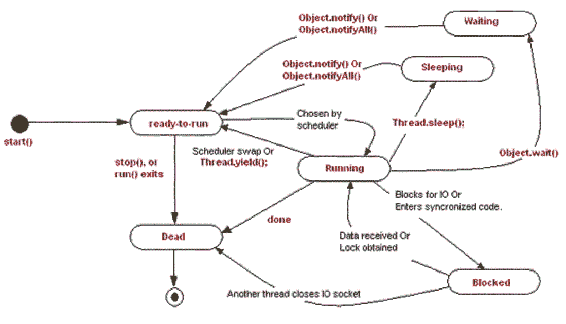

讨论感谢：[roottraveller](https://stackoverflow.com/users/5167682/roottraveller)

来自 Oracle 文档中关于 `Object` 类的 [`wait()`](https://docs.oracle.com/javase/8/docs/api/java/lang/Object.html#wait--) 方法：

```java
public final void wait()
```

### `wait()`

1. 导致当前线程等待，直到另一个线程调用此对象的 `notify()` 方法或 `notifyAll()` 方法。换句话说，此方法的行为就像简单地执行了 `wait(0)`。
2. 当前线程必须拥有该对象的监器（monitor）。线程将释放该监器的所有权，并等待另一个线程通知等待在该对象监器上的线程唤醒。
3. 可能发生中断和虚假唤醒。
4. *此方法应仅由该对象监器的所有者调用。*

此方法抛出：

1. `IllegalMonitorStateException` - 如果当前线程不是对象监器的所有者。
2. `InterruptedException` - 如果任何线程在当前线程等待通知之前或期间中断了它。当抛出此异常时，当前线程的中断状态会被清除。

来自 Oracle 文档中关于 `Thread` 类 [`sleep()`](https://docs.oracle.com/javase/8/docs/api/java/lang/Thread.html#sleep-long-) 方法：

```java
public static void sleep(long millis)
```

### `sleep()`

1. 导致当前执行的线程睡眠（临时停止执行）指定的毫秒数，取决于系统定时器和调度器。
2. *该线程不会丢失任何监器的所有权。*

此方法抛出：

1. `IllegalArgumentException` - 如果 `millis` 的值为负数。
2. `InterruptedException` - 如果任何线程中断了当前线程。当抛出此异常时，当前线程的中断状态会被清除。

### 其他主要区别

`wait()` 是非静态方法（实例方法），而静态方法 `sleep()` 是类方法。

讨论感谢：[Ravindra babu](https://stackoverflow.com/users/4999394/ravindra-babu)

此内容源自 [StackOverFlow](https://stackoverflow.com/questions/1036754/difference-between-wait-and-sleep)，并被整理成上述食谱。

# 类型安全：未检查的转换（Unchecked cast）

## 问题

在我的 Spring 应用上下文文件中，我有类似下面的内容：

```xml
<util:map id="someMap" map-class="java.util.HashMap" key-type="java.lang.String" value-type="java.lang.String">
    <entry key="some_key" value="some value" />
    <entry key="some_key_2" value="some value"   
</util:map>
```


```xml
<util:map id="someMap" map-class="java.util.HashMap" key-type="java.lang.String" value-type="java.lang.String">
    <entry key="some_key" value="some value" />
    <entry key="some_key_2" value="some value"   
</util:map>
```

在 Java 类中，实现看起来如下：

```java
private Map<String, String> someMap = new HashMap<String, String>();
someMap = (HashMap<String, String>)getApplicationContext().getBean("someMap");
```

在 Eclipse 中，我看到一个警告说：

**类型安全：从 Object 到 HashMap 的未检查转换**

我做错什么了？我该如何解决这个问题？

问题感谢：[DragonBorn](https://stackoverflow.com/users/37740/dragonborn)

## 解决方案

首先，你通过调用 `new HashMap` 浪费了内存。你的第二行代码完全忽略了对这个创建的 hashmap 的引用，使其可以被垃圾回收器处理。因此，不要这样做，使用：

```java
private Map<String, String> someMap = (HashMap<String, String>)getApplicationContext().getBean("someMap");
```

其次，编译器抱怨你在没有检查对象是否为 `HashMap` 的情况下将对象强制转换为 `HashMap`。但是，即使你这样做：

```java
if(getApplicationContext().getBean("someMap") instanceof HashMap) {
    private Map<String, String> someMap = (HashMap<String, String>)getApplicationContext().getBean("someMap");
}
```

你可能仍然会这个警告。问题是，`getBean` 返回 `Object`，所以不知道具体的类型。直接将其转换为 `HashMap` 不会导致第二种情况的问题（可能第一种情况也不会有警告，我不确定 Java 编译器对 Java 5 的警告有多严苛）。然而，你正将其转换为 `HashMap<String, String>`。

HashMap 实际上是以对象作为键并以对象作为值的 map，可以说 `HashMap<Object, Object>`。因此，当你获取 bean 时，无法保证它可以被表示为 `HashMap<String, String>`，因为你可能有 `HashMap<Date, Calendar>`，因为返回的非泛型表示可以包含任何对象。

如果代码编译通过，并且你可以执行 `String value = map.get("thisString");` 而没有任何错误，就不要担心这个警告。但如果 map 不完全是字符串键到字符串值，你将得到 `ClassCastException`。

编译器**确实知道**这些（不再是泛型的）类型是什么，并且不会产生警告。这可能并不总是完美的解决方案，有些人可能会认为这违背了泛型类的初衷，但你仍然重用了泛型类中的所有的代码，只是在编译时声明了你想要使用的类型。

讨论感谢：[Rabbit](https://stackoverflow.com/users/1412805/rabbit)

另一种解决方案是，如果你发现自己经常对同一个对象进行转换，且不想在代码中到处充斥 `@SuppressWarnings("unchecked")`，可以创建一个带有注解的方法。这样你就可以集中处理转换，并希望减少出错的可能性。

```java
@SuppressWarnings("unchecked")
public static List<String> getFooStrings(Map<String, List<String>> ctx) {
    return (List<String>) ctx.get("foos");
}
```

讨论感谢：[Jeremy](https://stackoverflow.com/users/160811/jeremy)

## 以下代码导致了类型安全警告

`Map<String, Object> myInput = (Map<String, Object>) myRequest.get();`

> **变通方案**

创建一个新的 Map 对象而不指明参数，因为列表所持有的对象类型未经过验证。

### 步骤 1：创建一个新的临时 Map

`Map<?, ?> tempMap = (Map<?, ?>) myRequest.get();`

### 步骤 2：实例化主 Map

```java
Map<String, Object> myInput=new HashMap<>(myInputObj.size());
```

### 步骤 3：遍历临时 Map 并将值设置到主 Map 中

```java
 for(Map.Entry<?, ?> entry :myInputObj.entrySet()){
        myInput.put((String)entry.getKey(),entry.getValue()); 
    }
```

讨论感谢：[Andy](https://stackoverflow.com/users/2353713/andy)

此内容源自 [StackOverFlow](https://stackoverflow.com/questions/262367/type-safety-unchecked-cast) 并重新整理为上述配方。

# 如何在 Java 中分割字符串

## 问题

我有一个字符串 `"004-034556"`，我想将其拆分为两个字符串：

```
string1=004
string2=034556
```

这意味着第一个字符串将包含 `'-'` 之前的字符，第二个字符串将包含 `'-'` 之后的字符。我还想检查字符串中是否包含 `'-'`。如果没有，我将抛出一个异常。我该如何做？

问题感谢：[riyana](https://stackoverflow.com/users/303459/riyana)

## 解决方案

直接使用合适的方法：[`String#split()`](http://docs.oracle.com/javase/8/docs/api/java/lang/String.html#split-java.lang.String-)。

```java
String string = "004-034556";
String[] parts = string.split("-");
String part1 = parts[0]; // 004
String part2 = parts[1]; // 034556
```

注意，这使用了[正则表达式](http://docs.oracle.com/javase/8/docs/api/java/util/regex/Pattern.html#sum)，所以记住在需要时对[特殊字符](http://www.regular-expressions.info/characters.html) 进行转义。

> [这里](http://www.regular-expressions.info/characters.html) 有 12 个具有特殊含义的字符：反斜杠 `\`、脱字符符号 `^`、美元符号 `$`、点或点 `.`、竖线或管道符号 `|`、问号 `?`、星号 `*`、加号 `+`、左括号 `(`、右括号 `)`、左方括号 `[`、左大括号 `{`。这些特殊字符通常被称为“元字符”。

所以，如果你想按例如句号/点 `.` 进行拆分（这在正则表达式中意味着“[任意字符](http://www.regular-expressions.info/dot.html)”），请使用以下方法之一：使用[反斜杠 `\`](http://www.regular-expressions.info/characters.html) 来转义单个特殊字符，例如 `split("\\.")`；或者使用[字符类 `[]`](http://www.regular-expressions.info/charclass.html) 来表示字面字符，例如 `split("[.]")`；或者使用 [`Pattern#quote()`](http://docs.oracle.com/javase/8/docs/api/java/util/regex/Pattern.html#quote-java.lang.String-) 来转义整个字符串，例如 `split(Pattern.quote("."))`。

```java
String[] parts = string.split(Pattern.quote(".")); // 按点号拆分。
```

要提前测试字符串是否包含某些字符，只需使用 [`String#contains()`](http://docs.oracle.com/javase/8/docs/api/java/lang/String.html#contains-java.lang.CharSequence-) 即可。

```java
if (string.contains("-")) {
    // 拆分它。
} else {
    throw new IllegalArgumentException("String " + string + " does not contain -");
}
```

注意，这不是正则表达式。如需要，请使用 [`String#matches()`](http://docs.oracle.com/javase/8/docs/api/java/lang/String.html#matches-java.lang.String-)。

如果你想在结果中保留分隔符，可以使用带有限制参数的重载 `split` 方法：

```java
String string = "004-034556";
String[] parts = string.split("-", -1);
// parts 将是 ["004", "034556"]
```

```java
import java.util.regex.Pattern;
import java.util.regex.Matcher;

class SplitExample
{
    private static Pattern twopart = Pattern.compile("(\\d+)-(\\d+)");

    public static void checkString(String s)
    {
        Matcher m = twopart.matcher(s);
        if (m.matches()) {
            System.out.println(s + " matches; first part is " + m.group(1) +
                               ", second part is " + m.group(2) + ".");
        } else {
            System.out.println(s + " does not match.");
        }
    }

    public static void main(String[] args) {
        checkString("123-4567");
        checkString("foo-bar");
        checkString("123-");
        checkString("-4567");
        checkString("123-4567-890");
    }
}
```

在此实例中由于模式是固定的，因此可以提前编译并存储为静态成员（在示例中类加载时初始化）。正则表达式为：

```
(\d+)-(\d+)
```

括号表示捕获组；可以通过 `Matcher.group()` 方法访问匹配正则表达式中该部分的字符串，如所示。`\d` 匹配单个十数字，而 `+` 表示“匹配上一个表达式一次或多次”。`-` 没有特殊含义，因此仅匹配输入中的该字符。请注意，当在 Java 字符串中编写它时，需要对反斜杠进行双重转义。其他一些示例：

```
([A-Z]+)-([A-Z]+)          // 每个部分仅由大写字母组成 
([^-]+)-([^-]+)            // 每个部分由 - 以外的字符组成
([A-Z]{2})-(\d+)           // 第一部分恰好两个大写字母，
                           // 第二部分由数字组成
```

讨论感谢：[Rob Hague](https://stackoverflow.com/users/215009/rob-hague)

```java
// 这避开了正则表达式的问题
// 但我们必须记住，分隔符字符串中的每个字符都被
// 视为单个分隔符        

public static String[] SplitUsingTokenizer(String subject, String delimiters) {
   StringTokenizer strTkn = new StringTokenizer(subject, delimiters);
   ArrayList<String> arrLis = new ArrayList<String>(subject.length());

   while(strTkn.hasMoreTokens())
      arrLis.add(strTkn.nextToken());

   return arrLis.toArray(new String[0]);
}
```

讨论感谢：[Mnyikka](https://stackoverflow.com/users/587134/mnyikka)

你也可以这样尝试：

```java
 String concatenated_String="hi^Hello";

 String split_string_array[]=concatenated_String.split("\\^");
```

讨论感谢：[SHUNMUGA RA PRABAKARAN](https://stackoverflow.com/users/1844709/shunmuga-raj-prabakaran)

有时如果你想分割 `包含 + 的字符串`，它将不会被分割；相反，你会得到一个 `runtime error`。在这种情况下，先将 `+ 替换为 _` 然后再分割：

```java
 this.text=text.replace("/", "_");
            String temp[]=text.split("_");
```

讨论感谢：user2045376

```java
public class MySplit {

    public static String[] mySplit(String text, String delimiter) {
        java.util.List<String> parts = new java.util.ArrayList<String>();

        text += delimiter;

        for (int i = text.indexOf(delimiter), j=0; i != -1;) {
            String temp = text.substring(j,i);
            if(temp.trim().length() != 0) {
                parts.add(temp);
            }
            j = i + delimiter.length();
            i = text.indexOf(delimiter,j);
        }

        return parts.toArray(new String[0]);
    }

    public static void main(String[] args) {
        String str = "004-034556";
        String delimiter = "-";
        String result[] = mySplit(str, delimiter);
        for(String s:result)
            System.out.println(s);
    }
}
```

讨论感谢：[Akhilesh Dubey](https://stackoverflow.com/users/1115406/akhilesh-dubey)

最快且消耗资源最少的方法：

```java
String s = "abc-def";
int p = s.indexOf('-');
if (p >= 0) {
    String left = s.substring(0, p);
    String right = s.substring(p + 1);
} else {
  // s 不包含 '-'
}
```

讨论感谢：[David](https://stackoverflow.com/users/2314047/david)

假设：

*   你的分割操作并不真的需要正则表达式

*   你恰好在应用中已经使用了 apache commons lang


最简单的方法是使用 [StringUtils#split(java.lang.String, char)](http://commons.apache.org/proper/commons-lang/javadocs/api-3.1/org/apache/commons/lang)。

```java
public class StringSplitTest {
     public static void main(String args[]) {
        String s = " ;String; String; String; String, String; String;;String;String; String; String; ;String;String;String;String";
        //String[] strs = s.split("[,\\s\\;]");
        String[] strs = s.split("[,\\;]");
        System.out.println("Substrings length:"+strs.length);
        for (int i=0; i < strs.length; i++) {
            System.out.println("Str["+i+"]:"+strs[i]);
        }
     }
  }
```

输出：

```text
Substrings length:17
Str[0]:
Str[1]:String
Str[2]: String
Str[3]: String
Str[4]: String
Str[5]: String
Str[6]: String
Str[7]:
Str[8]:String
Str[9]:String
Str[10]: String
Str[11]: String
Str[12]:
Str[13]:String
Str[14]:String
Str[15]:String
Str[16]:String
```

但不要期望在所有 JDK 版本中获得相同的输出。我遇到过[一个 bug](https://bugs.openjdk.java.net/browse/JDK-8043324)，它存在于某些 JDK 版本中，其中第一个空字符串被忽略了。这个 bug 在最新的 JDK 版本中不存在，但存在于 JDK 1.7 晚期到 JDK 1.8 早期之间的某些版本。

讨论感谢：[Ravindra babu](https://stackoverflow.com/users/4999394/ravindra-babu)。

在 javadoc 上查看`String`类中的`split()`方法。

> [`docs.oracle.com/javase/7/docs/api/java/lang/String.html#split(java.lang.String)`](https://docs.oracle.com/javase/7/docs/api/java/lang/String.html#split(java.lang.String))

```java
String data = "004-034556-1212-232-232";
int cnt = 1;
for (String item : data.split("-")) {
        System.out.println("string "+cnt+" = "+item);
        cnt++;
}
```

这里有很多关于分割字符串的示例，但我代码稍显未优化。

讨论感谢：[Divyesh Kanzariya](https://stackoverflow.com/users/5246706/divyesh-kanzariya)。

请不要使用 [StringTokenizer](https://docs.oracle.com/javase/7/docs/api/java/util/StringTokenizer.html) 类，因为它是为了兼容性而保留的遗留类，不建议在新代码中使用它。我们也可以按照其他人建议的利用`split`方法。

```java
String[] sampleTokens = "004-034556".split("-");
System.out.println(Arrays.toString(sampleTokens));
```

正如预期的那样，它将打印：

```text
[004, 034556]
```

在这个回答中，我还想指出 Java 8 中`split`方法发生的一个变化。[String#split()](http://docs.oracle.com/javase/8/docs/api/java/lang/String.html#split-java.lang.String-)方法利用了`Pattern.split`，现在它会移除结果数组开头的空字符串。请注意 Java 8 文档中的此[变化](https://docs.oracle.com/javase/8/docs/api/java/util/regex/Pattern.html#split-java.lang.CharSequence-int-)：

> 当输入序列开头有一个正宽度的匹配时，结果数组的开头会包含一个空的前导子字符串。然而，开头的零宽度匹配永远不会产生这样的空前导子字符串。

这意味着对于以下示例：

```java
String[] sampleTokensAgain = "004".split("");
System.out.println(Arrays.toString(sampleTokensAgain));
```

我们将得到三个字符串：`[0, 0, 4]`，而不是像 Java 7 及之前的版本那样的四个。也请检查这个类似的[问题](https://stackoverflow.com/questions/22718744/why-in-java-8-split-sometimes-removes-empty-strings-at-start-of-result-array)。

讨论感谢：[i_am_zero](https://stackoverflow.com/users/1216775/i-am-zero)。

```java
import java.io.*;

public class BreakString {

  public static void main(String args[]) {

    String string = "004-034556-1234-2341";
    String[] parts = string.split("-");

    for(int i=0;i<parts.length;i++) ｛
      System.out.println(parts[i]);
    }
  }
}
```

讨论感谢：[Ravi Pandey](https://stackoverflow.com/users/6339815/ravi-pandey)。

```java
String str="004-034556"
String[] sTemp=str.split("-");// '-' is a delimiter

string1=004;string2=03456
```

讨论感谢：[Shiva Nandam](https://stackoverflow.com/users/534083/shiva-nandam)。

使用 Java 8：

```java
List<String> stringList = Pattern.compile("-")
            .splitAsStream("004-03456")
            .collect(Collectors.toList());

stringList.forEach(s -> System.out.println(s));
```

讨论感谢：[Somaiah Kumbera](https://stackoverflow.com/users/535060/somaiah-kumbera)。

你可以简单使用`split()`。

```java
import java.io.*;

public class Splitting
{
   public static void main(String args[])
  {
      String Str = new String("004-03456");

      String[] SplittoArray = Str.split("-");

      string1=004;string2=03456
  }
}
```

否则，你可以使用`StringTokenizer`。

```java
import java.util.*;

public class Splitting
{
   public static void main(String args[])
  {
      StringTokenizer Str = new StringTokenizer("004-03456","-");

      while(Str.hasMoreTokens())
      {
          System.out.println(Str.nextToken());
      }
  }
}
```

讨论感谢：[Sarat Chandra](https://stackoverflow.com/users/7121889/sarat-chandra)。

要分割字符串，使用`String.split(regex)`：

```java
String phone = "004-03456";

String[] output = phone.split("-");

System.out.println(output[0]);

System.out.println(output[1]);
```

输出：

> 004
>
> 03456

讨论感谢：[KB Hassan](https://stackoverflow.com/users/4226914/kb-hassan)。

你可以简单使用`StringTokenizer`将字符串分割成两个或多个部分，无论什么类型的分隔符：

```java
StringTokenizer st=new StringTokenizer("004-03456","-");

while(st.hasMoreTokens())
{
    System.out.println(st.nextToken());
}
```

讨论感谢：[Rohit-Pandey](https://stackoverflow.com/users/6613299/rohit-pandey)。

从文档中：

> `public String[] split(String regex,int limit)` **根据给定表达式分割此字符串**。返回的数组包含此字符串中以给定表达式结束或以字符串结尾的每个子字符串。数组中的子字符串按照它们在字符串中出现的**顺序**排列。如果表达式没有匹配输入的任何部分，则生成的数组只有一个**元素**，**即该字符串本身。**

所以基本上你可以像这样做：

```java
String s = "123-456-789-123"; // 要分割的字符串

String[] array = s.split("-"); // 根据连字符分割并放入数组

for(String subString : array){ // 遍历数组
   System.out.println(subString);
}
```

讨论感谢：[SAM Jr](https://stackoverflow.com/users/7610478/sam-jr)。

```java
public class SplitExample{
    public static void main(String args[]){
        String s1="http://pfhppl.in/?uid=0SCQZ7W9DBB";

        String[] words=s1.split("=");//splits the string based on string

        for(String w:words){
            System.out.println(w);
        }

        System.out.println(words[1]);
    }
}
```

**输出** [http://pfhppl.in/?uid] `0SCQZ7W9DBB`

`0SCQZ7W9DBB`

讨论感谢：[Keshav Gera](https://stackoverflow.com/users/5316872/keshav-gera)。

此内容源于 [StackOverFlow](https://stackoverflow.com/questions/3481828/how-to-split-a-string-in-java) 并已重新整理为上述配方。

# 为什么`RecyclerView`没有`onItemClickListener()`？

## 问题

我正在探索`RecyclerView`，惊讶地发现`RecyclerView`并没有`onItemClickListener()`。因为`RecyclerView`继承自：

> `android.view.ViewGroup`

而`ListView`继承自：

> `android.widget.AbsListView`。

然而我通过在我的`RecyclerView.Adapter`中编写`onClick`解决了这个问题：

```java
public static class ViewHolder extends RecyclerView.ViewHolder implements OnClickListener {

    public TextView txtViewTitle;

    public ImageView imgViewIcon;

    public ViewHolder(View itemLayoutView) {

        super(itemLayoutView);

        txtViewTitle = (TextView) itemLayoutView.findViewById(R.id.item_title);

        imgViewIcon = (ImageView) itemLayoutView.findViewById(R.id.item_icon);

    }

    @Override
    public void onClick(View v) {

    }

}
```

但我仍然想知道 Google 为什么删除了`onItemClickListener()`？

是因为性能问题还是其他原因？

问题感谢：[Tarun Varshney](https://stackoverflow.com/users/2424999/tarun-varshney)。

## 解决方案

**tl;dr 2016** 使用 RxJava 和`PublishSubject`来暴露点击事件的`Observable`。

```java
public class ReactiveAdapter extends RecyclerView.Adapter<MyAdapter.ViewHolder> {

    String[] mDataset = { "Data", "In", "Adapter" };

    private final PublishSubject<String> onClickSubject = PublishSubject.create();

    @Override
    public void onBindViewHolder(final ViewHolder holder, int position) {

        final String element = mDataset[position];

        holder.itemView.setOnClickListener(new View.OnClickListener() {

            @Override
            public void onClick(View v) {

               onClickSubject.onNext(element);

            }

        });

    }

    public Observable<String> getPositionClicks(){

        return onClickSubject.asObservable();

    }

}
```

### 原始帖子

自从`ListView`引入以来，`onItemClickListener`一直有问题。一旦对任何内部元素设置了点击监听器，回调就不会被触发，但并没有通知或良好的文档说明（如果有的话），所以这导致了大量的困惑和关于它的 StackOverflow 问题。

鉴于`RecyclerView`更进一步，它没有行/列的概念，而是任意数量的子视图，它们将`onClick`委托给每个子视图，或者委托给程序员实现。

不要将`RecyclerView`看作`ListView`的 1:1 替代品，而是用于复杂用例的更灵活组件。正如你所说，你的解决方案正是 Google 对你的期望。现在你有一个适配器，可以将`onClick`委托给通过构造函数传递的接口，这是`ListView`和`RecyclerView`对应的正确模式。

```java
public static class ViewHolder extends RecyclerView.ViewHolder implements OnClickListener {

    public TextView txtViewTitle;
```


解决方案感谢：[MLProgrammer-Ci](https://stackoverflow.com/users/126626/mlprogrammer-ci)

## 讨论

### `RecyclerView` 和 `ListView` 有什么区别？

区别在于`RecyclerView`有`LayoutManager`类，通过它可以配置`RecyclerView`，例如：

- 水平或垂直滚动使用`LinearLayoutManager`
- 网格布局使用`GridLayoutManager`
- 瀑布网格布局使用`StaggeredGridLayoutManager`

例如，对于`RecyclerView`的水平滚动：

```java
LinearLayoutManager llm = new LinearLayoutManager(context);
llm.setOrientation(LinearLayoutManager.HORIZONTAL);
recyclerView.setLayoutManager(llm);
```

讨论感谢：[Tarun Varshney](https://stackoverflow.com/users/2424999/tarun-varshney)

我喜欢这种方法，我正在使用它。

在`Adapter.ViewHolder onCreateViewHolder(ViewGroup parent, int viewType)`中放入：

```java
View v = LayoutInflater.from(parent.getContext()).inflate(R.layout.view_image_and_text, parent, false);
v.setOnClickListener(new MyOnClickListener());
```

然后在你需要的地方创建这个类：

```java
class MyOnClickListener implements View.OnClickListener {

    @Override
    public void onClick(View v) {
        int itemPosition = recyclerView.indexOfChild(v);
        Log.e("Clicked and Position is ", String.valueOf(itemPosition));
    }
}
```

我以前读过有更好的方法，但我喜欢这种方法，简单不复杂。

## 如何将所有内容整合在一起的示例

- [`onClick()`处理](https://stackoverflow.com/a/24933117/591860)
- [Cursor - `RecyclerView`](https://stackoverflow.com/a/26673645/591860)
- [`ViewHolder`类型](https://stackoverflow.com/a/26245463/591860)

```java
public class OrderListCursorAdapter extends CursorRecyclerViewAdapter<OrderListCursorAdapter.ViewHolder> {

    private static final String TAG = OrderListCursorAdapter.class.getSimpleName();

    private static final int ID_VIEW_HOLDER_ACTUAL = 0;

    private static final int ID_VIEW_HOLDER = 1;

    public OrderListCursorAdapter(Context context, Cursor cursor) {
        super(context, cursor);
    }

    public static class ViewHolderActual extends ViewHolder {

        private static final String TAG = ViewHolderActual.class.getSimpleName();

        protected IViewHolderClick listener;

        protected Button button;

        public ViewHolderActual(View v, IViewHolderClick listener) {
            super(v, listener);

            this.listener = listener;

            button = (Button) v.findViewById(R.id.orderList_item_button);

            button.setOnClickListener(this);
        }

        public void initFromData(OrderData data) {
            Log.d(TAG, "><initFromData(data=" + data + ")");

            orderId = data.getId();

            vAddressStart.setText(data.getAddressStart());

            vAddressEnd.setText(data.getAddressEnd());
        }

        @Override
        public void onClick(View view) {
            if (view instanceof Button) {
                listener.onButtonClick((Button) view, getPosition(), this);
            } else {
                super.onClick(view);
            }
        }

        public interface IViewHolderClick extends ViewHolder.IViewHolderClick {
            public void onButtonClick(Button button, int position, ViewHolder viewHolder);
        }
    }

    public static class ViewHolder extends RecyclerView.ViewHolder implements View.OnClickListener {

        private static final String TAG = ViewHolder.class.getSimpleName();

        protected long orderId;

        protected IViewHolderClick listener;

        protected TextView vAddressStart;

        protected TextView vAddressEnd;

        protected TextView vStatus;

        public ViewHolder(View v, IViewHolderClick listener) {
            super(v);

            this.listener = listener;

            v.setOnClickListener(this);

            vAddressStart = (TextView) v.findViewById(R.id.addressStart);

            vAddressEnd = (TextView) v.findViewById(R.id.addressEnd);

            vStatus = (TextView) v.findViewById(R.id.status);
        }

        public void initFromData(OrderData data) {
            Log.d(TAG, "><initFromData(data=" + data + ")");

            orderId = data.getId();

            vAddressStart.setText(data.getAddressStart());

            vAddressEnd.setText(data.getAddressEnd());
        }

        public long getOrderId() {
            return orderId;
        }

        @Override
        public void onClick(View view) {
            listener.onCardClick(view, getPosition(), this);
        }

        public interface IViewHolderClick {
            public void onCardClick(View view, int position, ViewHolder viewHolder);
        }
    }

    @Override
    public int getItemViewType(int position) {
        return position == 0 ? ID_VIEW_HOLDER_ACTUAL : ID_VIEW_HOLDER;
    }

    @Override
    public ViewHolder onCreateViewHolder(ViewGroup parent, int viewType) {
        Log.d(TAG, ">>onCreateViewHolder(parent=" + parent + ", viewType=" + viewType + ")");

        ViewHolder result;

        switch (viewType) {
            case ID_VIEW_HOLDER_ACTUAL: {
                View itemView = LayoutInflater.from(parent.getContext()).inflate(R.layout.card_layout_actual, parent, false);

                result = new ViewHolderActual(itemView, new ViewHolderActual.IViewHolderClick() {

                    @Override
                    public void onCardClick(View view, int position, ViewHolder viewHolder) {
                        Log.d(TAG, "><onCardClick(view=" + view + ", position=" + position + ", viewHolder=" + viewHolder + ")");

                        Intent intent = new Intent(view.getContext(), OrderDetailActivity.class);

                        intent.putExtra(OrderDetailActivity.ARG_ORDER_ID, viewHolder.getOrderId());

                        view.getContext().startActivity(intent);
                    }

                    @Override
                    public void onButtonClick(Button button, int position, ViewHolder viewHolder) {
                        Log.d(TAG, "><onButtonClick(button=" + button + ", position=" + position + ", viewHolder=" + viewHolder + ")");
```


```java
Intent intent = new Intent(button.getContext(), OrderMapActivity.class);

intent.putExtra(OrderMapActivity.ARG_ORDER_ID, viewHolder.getOrderId());

button.getContext().startActivity(intent);

}

});

break;

}

case ID_VIEW_HOLDER:

default: {

View itemView = LayoutInflater.from(parent.getContext()).inflate(R.layout.card_layout, parent, false);

result = new ViewHolder(itemView, new ViewHolder.IViewHolderClick() {

@Override

public void onCardClick(View view, int position, ViewHolder viewHolder) {

Log.d(TAG, "><onCardClick(view=" + view + ", position=" + position + ", viewHolder=" + viewHolder + ")");

Intent intent = new Intent(view.getContext(), OrderDetailActivity.class);

intent.putExtra(OrderDetailActivity.ARG_ORDER_ID, viewHolder.getOrderId());

view.getContext().startActivity(intent);

}

});

break;

}

}

Log.d(TAG, "<<onCreateViewHolder(parent=" + parent + ", viewType=" + viewType + ")= " + result);

return result;

}

@Override

public void onBindViewHolder(ViewHolder viewHolder, Cursor cursor) {

Log.d(TAG, "><onBindViewHolder(viewHolder=" + viewHolder + ", cursor=" + cursor + ")");

final OrderData orderData = new OrderData(cursor);

viewHolder.initFromData(orderData);

}}

```

讨论感谢：[Wooff](https://stackoverflow.com/users/591860/wooff)

感谢 @marmor，我更新了我的回答。

我认为在 `ViewHolder` 类构造函数中处理 `onClick()`并通过 `OnItemClickListener` 接口将其传递给父类是一个很好的解决方案。

### MyAdapter.java

```java
public class MyAdapter extends RecyclerView.Adapter<MyAdapter.ViewHolder>{

private LayoutInflater layoutInflater;

private List<MyObject> items;

private AdapterView.OnItemClickListener onItemClickListener;

public MyAdapter(Context context, AdapterView.OnItemClickListener onItemClickListener, List<MyObject> items) {

    layoutInflater = LayoutInflater.from(context);

    this.items = items;

    this.onItemClickListener = onItemClickListener;

}

@Override

public ViewHolder onCreateViewHolder(ViewGroup parent, int viewType) {

    View view = layoutInflater.inflate(R.layout.my_row_layout, parent, false);

    return new ViewHolder(view);

}

@Override

public void onBindViewHolder(ViewHolder holder, int position) {

    MyObject item = items.get(position);

}

public MyObject getItem(int position) {

    return items.get(position);

}

class ViewHolder extends RecyclerView.ViewHolder implements View.OnClickListener {

    private TextView title;

    private ImageView avatar;

    public ViewHolder(View itemView) {

        super(itemView);

        title = itemView.findViewById(R.id.title);

        avatar = itemView.findViewById(R.id.avatar);

        title.setOnClickListener(this);

        avatar.setOnClickListener(this);

        itemView.setOnClickListener(this);

    }

    @Override

    public void onClick(View view) {

        //将点击的位置传递给父类

        onItemClickListener.onItemClick(null, view, getAdapterPosition(), view.getId());

    }

}

}

```

### 在其他类中使用适配器

#### MyFragment.java

```java
public class MyFragment extends Fragment implements AdapterView.OnItemClickListener {

private RecyclerView recycleview;

private MyAdapter adapter;

    .

    .

    .

private void init(Context context) {

    //将此 fragment 作为 OnItemClickListener 传递给适配

    adapter = new MyAdapter(context, this, items);

    recycleview.setAdapter(adapter);

}

@Override

public void onItemClick(AdapterView<?> parent, View view, int position, long id) {

    // 你可以通过位置从适配 中获取点击的项

    MyObject item = adapter.getItem(position);

    // 你也可以找出哪个 view 被点击了

    switch (view.getId()) {

        case R.id.title:

            // title view 被点击

            break;

        case R.id.avatar:

            // avatar view 被点击

            break;

        default:

            // 整个行被点击

    }

}

}

```

讨论感谢提供：[Shayan_Aryan](https://stackoverflow.com/users/2123055/shayan-aryan)

我使用这种方法从 `RecyclerView` 启动 `Intent`：

```java
@Override

public void onBindViewHolder(ViewHolder viewHolder, int i) {

    final MyClass myClass = mList.get(i);

    viewHolder.txtViewTitle.setText(myclass.name);

   ...

    viewHolder.itemView.setOnClickListener(new View.OnClickListener() {

      @Override

       public void onClick(View v){

             Intent detailIntent = new Intent(mContext, type.class);

             detailIntent.putExtra("MyClass", myclass);

             mContext.startActivity(detailIntent);

       }

}

);

```

讨论感谢提供：[tmac12](https://stackoverflow.com/users/1650097/tmac12)

根据我对 `MLProgrammer-CiM` 回答的理解，实际上可以直接这样做：

```java
class MyViewHolder extends RecyclerView.ViewHolder implements View.OnClickListener{

    private ImageView image;

    private TextView title;

    private TextView price;

    public MyViewHolder(View itemView) {

        super(itemView);

        image = (ImageView)itemView.findViewById(R.id.horizontal_list_image);

        title = (TextView)itemView.findViewById(R.id.horizontal_list_title);

        price = (TextView)itemView.findViewById(R.id.horizontal_list_price);

        image.setOnClickListener(this);

        title.setOnClickListener(this);

        price.setOnClickListener(this);

    }

    @Override

    public void onClick(View v) {

        Toast.makeText(context, "Item click nr: "+getLayoutPosition(), Toast.LENGTH_SHORT).show();

    }

}

```

讨论感谢提供：[Tomasz](https://stackoverflow.com/users/444332/tomasz)

`Android Recyclerview` 带有 `onItemClickListener`，为什么我们不能尝试让像 `ListView` 一样工作。

来源：[链接](http://sapandiwakar.in/recycler-view-item-click-handler/)

```java
import android.content.Context;

import android.support.v7.widget.RecyclerView;

import android.view.GestureDetector;

import android.view.MotionEvent;

import android.view.View;

   public class RecyclerItemClickListener implements RecyclerView.OnItemTouchListener {

private OnItemClickListener mListener;

public interface OnItemClickListener {

    public void onItemClick(View view, int position);

}

GestureDetector mGestureDetector;

public RecyclerItemClickListener(Context context, OnItemClickListener listener) {

    mListener = listener;

    mGestureDetector = new GestureDetector(context, new GestureDetector.SimpleOnGestureListener() {

        @Override

        public boolean onSingleTapUp(MotionEvent e) {

            return true;

        }

    });

}

@Override

public boolean onInterceptTouchEvent(RecyclerView view, MotionEvent e) {

    View childView = view.findChildUnder(e.getX(), e.getY());

    if (childView != null && mListener != null && mGestureDetector.onTouchEvent(e)) {

        mListener.onItemClick(childView, view.getChildAdapterPosition(childView));

    }

    return false;

}

@Override

public void onTouchEvent(RecyclerView view, MotionEvent motionEvent) {

}

@Override

public void onRequestDisallowTouchEvent(boolean disallowIntercept) {

  }

}

```

并将其设置为 `RecyclerView`：

```java
recyclerView = (RecyclerView)rootView.findViewById(R.id.recyclerView);

RecyclerView.LayoutManager mLayoutManager = new LinearLayoutManager(getActivity());

recyclerView.setLayoutManager(mLayoutManager);

recyclerView.addOnItemTouchListener(

        new RecyclerItemClickListener(getActivity(), new RecyclerItemClickListener.OnItemClickListener() {

            @Override

            public void onItemClick(View view, int position) {

                // TODO 处理项点击

                Log.e("@@@@@",""+position);

            }

        })

);
```


讨论感谢提供：[Guruprasad](https://stackoverflow.com/users/2736808/guruprasad)

阅读了`@MLProgrammer-CiM`的回答后，我的代码如下：

```java
class NormalViewHolder extends RecyclerView.ViewHolder implements View.OnClickListener{

    @Bind(R.id.card_item_normal)
    CardView cardView;

    public NormalViewHolder(View itemView) {
        super(itemView);
        ButterKnife.bind(this, itemView);
        cardView.setOnClickListener(this);
    }

    @Override
    public void onClick(View v) {
        if(v instanceof CardView) {
            // 使用 getAdapterPosition() 代替 getLayoutPosition()
            int itemPosition = getAdapterPosition();
            removeItem(itemPosition);
        }
    }
}
```

讨论感谢提供：[chad](https://stackoverflow.com/users/4767131/chad)

与其在 view holder 中实现`View.OnClickListener`接口，或者在你的 activity 中创建并实现接口...我使用了这段代码来实现简单的`OnClickListener`实现。

```java
public static class SimpleStringRecyclerViewAdapter
            extends RecyclerView.Adapter<SimpleStringRecyclerViewAdapter.ViewHolder> {

        // 你的初始化写在这里...
        private List<String> mValues;

        public static class ViewHolder extends RecyclerView.ViewHolder {

            // 创建一个变量 mView
            public final View mView;

            /*所有你的行组件都在这里
            public final ImageView mImageView;
            public final TextView mTextView;*/

            public ViewHolder(View view) {
                super(view);
                // 在这里初始化
                mView = view;
                /* 你的行组件初始化写在这里
                mImageView = (ImageView) view.findViewById(R.id.avatar);
                mTextView = (TextView) view.findViewById(android.R.id.text1);*/
            }
        }

        public String getValueAt(int position) {
            return mValues.get(position);
        }

        public SimpleStringRecyclerViewAdapter(Context context, List<String> items) {
            mBackground = mTypedValue.resourceId;
            mValues = items;
        }

        @Override
        public ViewHolder onCreateViewHolder(ViewGroup parent, int viewType) {
            View view = LayoutInflater.from(parent.getContext())
                    .inflate(R.layout.list_item, parent, false);
            view.setBackgroundResource(mBackground);
            return new ViewHolder(view);
        }

        @Override
        public void onBindViewHolder(final ViewHolder holder, int position) {
            holder.mBoundString = mValues.get(position);
            holder.mTextView.setText(mValues.get(position));

            // 在这里简单写入 onItemClick 监听器
            holder.mView.setOnClickListener(new View.OnClickListener() {
                @Override
                public void onClick(View v) {
                    Context context = v.getContext();
                    Intent intent = new Intent(context, ExampleActivity.class);
                    context.startActivity(intent);
                }
            });
        }

        @Override
        public int getItemCount() {
            return mValues.size();
        }
}
```

感谢 [Manikanta](https://stackoverflow.com/users/3728438/manikanta) 的讨论。

查看我对此的实现：

### 首先像这样声明接口：

```java
/**
 * 用于在 {@link android.support.v7.widget.RecyclerView} 中派发项目点击事件的接口
 * 由 Alex 创建于 2015/11/28。
 */
public interface OnRecyclerItemClickListener<T> {
    /**
     * 当 recyclerView 项目视图内部发生点击事件时被调用
     * @param view 被点击的视图
     * @param position 被点击视图的位置
     * @param item 通过被点击视图显示的具体数据
     */
    void onItemClick(View view, int position, T item);
}
```

### 然后创建适配器：

```java
public class CustomRecyclerAdapter extends RecyclerView.Adapter {      

    private class InternalClickListener implements View.OnClickListener{
        @Override
        public void onClick(View v) {
            if(mRecyclerView != null && mItemClickListener != null){
                // 找到被点击项目的位置
                int position = mRecyclerView.getChildAdapterPosition(v);
                Data data = getItem(position);
                // 通知主监听器
                mItemClickListener.onItemClick(v, position, data);
            }
        }
    }

    private final OnRecyclerItemClickListener mItemClickListener;
    private RecyclerView mRecyclerView;    
    private InternalClickListener mInternalClickListener;

    /**
     * @param itemClickListener 用于触发项目点击事件
     */
    public PlayerListRecyclerAdapter(OnRecyclerItemClickListener itemClickListener){        
        mItemClickListener = itemClickListener;
        mInternalClickListener = new InternalClickListener();
    }

    @Override
    public RecyclerView.ViewHolder onCreateViewHolder(ViewGroup parent, int viewType) {
        View v = LayoutInflater.from(parent.getContext()).inflate(R.layout.recycler_item, parent, false);
        v.setOnClickListener(mInternalClickListener);
        ViewHolder viewHolder = new ViewHolder(v);
        return viewHolder;
    }

    @Override
    public void onBindViewHolder(RecyclerView.ViewHolder holder, int position) {
        // 在这里进行绑定
    }

    @Override
    public int getItemCount() {
        return mDataSet.size();
    }

    @Override
    public void onAttachedToRecyclerView(RecyclerView recyclerView) {
        super.onAttachedToRecyclerView(recyclerView);
        mRecyclerView = recyclerView;
    }

    @Override
    public void onDetachedFromRecyclerView(RecyclerView recyclerView) {
        super.onDetachedFromRecyclerView(recyclerView);
        mRecyclerView = null;
    }

    public Data getItem(int position){
        return mDataset.get(position);
    }
}
```

### 现在让我们来看看如何从 fragment 中集成它：

```java
public class TestFragment extends Fragment implements OnRecyclerItemClickListener<Data>{

    private RecyclerView mRecyclerView;

    @Override
    public void onItemClick(View view, int position, Data item) {
        // 做些什么
    }

    @Override
    public View onCreateView(LayoutInflater inflater, ViewGroup container, Bundle savedInstanceState) {
        return inflater.inflate(R.layout.test_fragment, container, false);
    }

    @Override
    public void onViewCreated(View view, Bundle savedInstanceState) {
        mRecyclerView = view.findViewById(idOfTheRecycler);
        mRecyclerView .setAdapter(new CustomRecyclerAdapter(this));
    }
}
```

感谢 [Alexandru Circus](https://stackoverflow.com/users/285553/alexandru-circus) 的讨论。

如果你想为项目的子视图添加`onClick()`，例如项目中的按钮，我发现可以在`RecyclerView.Adapter`的`onCreateViewHolder()`中这样做，如下：

```java
@Override
public RecyclerView.ViewHolder onCreateViewHolder(ViewGroup parent, int viewType) {
    View v = LayoutInflater
            .from(parent.getContext())
            .inflate(R.cell, null);
    Button btn = (Button) v.findViewById(R.id.btn);
    btn.setOnClickListener(new View.OnClickListener() {
        @Override
        public void onClick(View v) {
            //执行操作
        }
    });
    return new MyViewHolder(v);
}
```

不知道这是否是一个好方法，但它有效。如果有人有更好的主意，非常欢迎告诉我并纠正我的答案！:)

感谢 [cryyyyy](https://stackoverflow.com/users/5435577/cryyyyy) 的讨论。

这种方法对我有效：

```java
@Override
public void onBindViewHolder(PlacesListViewAdapter.ViewHolder holder, int position) {
    ----
    ----
    ----
    // 设置监听器 setOnClickListener(holder);
}

@Override
public class ViewHolder extends RecyclerView.ViewHolder implements View.OnClickListener {
    ----
    ----
    ----
    @Override
    public void onClick(View view) {
        // 使用 getAdapterPosition() 获取被点击项目的位置
    }
}
```

感谢 [Naren](https://stackoverflow.com/users/857447/naren) 的讨论。

我是这样做的，非常简单：

只需为**被点击的 RecyclerView 位置**添加**1 行代码**：

```java
int position = getLayoutPosition()
```

**ViewHolder** 类的完整代码：

```java
private class ChildViewHolder extends RecyclerView.ViewHolder {
    public ImageView imageView;
    public TextView txtView;

    public ChildViewHolder(View itemView) {
        super(itemView);
        imageView= (ImageView)itemView.findViewById(R.id.imageView);
    }
}
```


`txtView = (TextView) itemView.findViewById(R.id.txtView);`

`itemView.setOnClickListener(new View.OnClickListener() {`

`@Override`

`public void onClick(View view) {`

`Log.i("RecyclerView Item Click Position", String.valueOf(getLayoutPosition()));`

`}`

`});`

`}`

`}`

希望这对你有帮助。

讨论感谢来自：[Hiren Patel](https://stackoverflow.com/users/4233197/hiren-patel)

如果你有一个 POJO 列表，并想在适配器外部获取点击时的项，这里有一种非常简单的实现方法。

在你的适配器中，为点击事件创建一个监听器并创建一个设置它的方法：

```java
public class MyAdapter extends RecyclerView.Adapter<SitesListAdapter.ViewHolder> {

    private List<MyPojo> mMyPojos;
    private static OnItemClickListener mOnItemClickListener;

    public interface OnItemClickListener {
        public void onItemClick(MyPojo pojo);
    }

    public void setOnItemClickListener(OnItemClickListener onItemClickListener){
        mOnItemClickListener = onItemClickListener;
    }
}
```

在你的`ViewHolder`中，实现`OnClickListener`并创建一个类成员来临时存储视图展示的 POJO，这样的话（这一个示例，创建一个 setter 会更好）：

```java
public static class ViewHolder extends RecyclerView.ViewHolder implements View.OnClickListener {
    public MyPojo mCurrentPojo;

    public ViewHolder(View view) {
        super(v);
        view.setOnClickListener(this); // 你也可以在布局的某部分设置这个
    }

    @Override
    public void onClick(View view) {
        if(mOnItemClickListener != null && mCurrentPojo != null){
            mOnItemClickListener.onItemClick(mCurrentPojo);
        }
    }
}
```

回到你的适配器，在`ViewHolder`绑定时设置当前的 POJO（如果当前视图没有，则设置为 null）：

```java
@Override
public void onBindViewHolder(final ViewHolder holder, final int position) {
    final MyPojo currentPojo = mMyPojos.get(position); 
    holder.mCurrentPojo = currentPojo;
}
```

搞定，现在你可以像这样从你的 fragment/activity 中使用它：

```java
mMyAdapter.setOnItemClickListener(new mMyAdapter.OnItemClickListener() {
    @Override
    public void onItemClick(MyPojo pojo) {
        // 在这里对你的 pojo 执行任何你想的操作
    }
});
```

讨论感谢来自：[Simon](https://stackoverflow.com/users/1226018/simon)

伙伴们，在你们的主活动中使用这段代码。非常高效的方法。

```java
RecyclerView recyclerView = (RecyclerView) findViewById(R.id.users_list);            
UsersAdapter adapter = new UsersAdapter(users, this);
recyclerView.setAdapter(adapter);
adapter.setOnCardClickListner(this);
```

这是你的`Adapter`类。

```java
public class UsersAdapter extends RecyclerView.Adapter<UsersAdapter.UserViewHolder> {
    private ArrayList<User> mDataSet;
    OnCardClickListner onCardClickListner;

    public UsersAdapter(ArrayList<User> mDataSet) {
        this.mDataSet = mDataSet;
    }

    @Override
    public UserViewHolder onCreateViewHolder(ViewGroup parent, int viewType) {
        View v = LayoutInflater.from(parent.getContext()).inflate(R.layout.user_row_layout, parent, false);
        UserViewHolder userViewHolder = new UserViewHolder(v);
        return userViewHolder;
    }

    @Override
    public void onBindViewHolder(UserViewHolder holder, final int position) {
        holder.name_entry.setText(mDataSet.get(position).getUser_name());
        holder.cardView.setOnClickListener(new View.OnClickListener() {
            @Override
            public void onClick(View v) {
                onCardClickListner.OnCardClicked(v, position);
            }
        });
    }

    @Override
    public int getItemCount() {
        return mDataSet.size();
    }

    @Override
    public void onAttachedToRecyclerView(RecyclerView recyclerView) {
        super.onAttachedToRecyclerView(recyclerView);
    }

    public static class UserViewHolder extends RecyclerView.ViewHolder {
        CardView cardView;
        TextView name_entry;

        public UserViewHolder(View itemView) {
            super(itemView);
            cardView = (CardView) itemView.findViewById(R.id.user_layout);
            name_entry = (TextView) itemView.findViewById(R.id.name_entry);
        }
    }

    public interface OnCardClickListner {
        void OnCardClicked(View view, int position);
    }

    public void setOnCardClickListner(OnCardClickListner onCardClickListner) {
        this.onCardClickListner = onCardClickListner;
    }
}
```

在此之后，你将在你的活动中得到这个重写方法。

```java
@Override
public void OnCardClicked(View view, int position) {
    Log.d("OnClick", "Card Position" + position);
}
```

讨论感谢来自：[waqas ali](https://stackoverflow.com/users/5124050/waqas-ali)

另一种解决方案是[提议](http://www.littlerobots.nl/blog/Handle-Android-RecyclerView-Clicks/)由 Android GDE Hugo Visser 的。他提供了一个免费许可的类，供你直接放入代码中运行。

使用方法：

```java
ItemClickSupport.addTo(mRecyclerView)
        .setOnItemClickListener(new ItemClickSupport.OnItemClickListener() {
            @Override
            public void onItemClicked(RecyclerView recyclerView, int position, View v) {
                // 执行操作
            }
        });
```

（它也支持长按项）

实现代码（我添加的注释）：

```java
public class ItemClickSupport {
    private final RecyclerView mRecyclerView;
    private OnItemClickListener mOnItemClickListener;
    private OnItemLongClickListener mOnItemLongClickListener;
    private View.OnClickListener mOnClickListener = new View.OnClickListener() {
        @Override
        public void onClick(View v) {
            if (mOnItemClickListener != null) {
                // 向 RecyclerView 请求此视图的 viewHolder。
                // 然后使用它来获取适配器的位置（position）
                RecyclerView.ViewHolder holder = mRecyclerView.getChildViewHolder(v);
                mOnItemClickListener.onItemClicked(mRecyclerView, holder.getAdapterPosition(), v);
            }
        }
    };
    private View.OnLongClickListener mOnLongClickListener = new View.OnLongClickListener() {
        @Override
        public boolean onLongClick(View v) {
            if (mOnItemLongClickListener != null) {
                RecyclerView.ViewHolder holder = mRecyclerView.getChildViewHolder(v);
                return mOnItemLongClickListener.onItemLongClicked(mRecyclerView, holder.getAdapterPosition(), v);
            }
            return false;
        }
    };
    private RecyclerView.OnChildAttachStateChangeListener mAttachListener
            = new RecyclerView.OnChildAttachStateChangeListener() {
        @Override
        public void onChildViewAttachedToWindow(View view) {
            // 每当新的子视图被附加时，为它添加点击监听器
            if (mOnItemClickListener != null) {
                view.setOnClickListener(mOnClickListener);
            }
            if (mOnItemLongClickListener != null) {
                view.setOnLongClickListener(mOnLongClickListener);
            }
        }

        @Override
        public void onChildViewDetachedFromWindow(View view) {
        }
    };

    private ItemClickSupport(RecyclerView recyclerView) {
        mRecyclerView = recyclerView;
        // ID 必须在 XML 中声明，用于避免在不移除
        // RecyclerView 中旧 ItemClickSupport 的情况下
        // 替换它
        mRecyclerView.setTag(R.id.item_click_support, this);
        mRecyclerView.addOnChildAttachStateChangeListener(mAttachListener);
    }

    public static ItemClickSupport addTo(RecyclerView view) {
        // 如果已经有一个 ItemClickSupport 附加
        // 到这个 RecyclerView，则不要替换它，直接使用它
        ItemClickSupport support = (ItemClickSupport) view.getTag(R.id.item_click_support);
        if (support == null) {
            support = new ItemClickSupport(view);
        }
        return support;
    }

    public static ItemClickSupport removeFrom(RecyclerView view) {
        ItemClickSupport support = (ItemClickSupport) view.getTag(R.id.item_click_support);
        if (support != null) {
            support.detach(view);
        }
        return support;
    }
}
```


`public ItemClickSupport setOnItemClickListener(OnItemClickListener listener) {

    mOnItemClickListener = listener;

    return this;

}`

`public ItemClickSupport setOnItemLongClickListener(OnItemLongClickListener listener) {

    mOnItemLongClickListener = listener;

    return this;

}`

`private void detach(RecyclerView view) {

    view.removeOnChildAttachStateChangeListener(mAttachListener);

    view.setTag(R.id.item_click_support, null);

}`

`public interface OnItemClickListener {

    void onItemClicked(RecyclerView recyclerView, int position, View v);

}`

`public interface OnItemLongClickListener {

    boolean onItemLongClicked(RecyclerView recyclerView, int position, View v);

}`

}

同时创建一个文件`values/ids.xml`并将以下内容放入其中：

```xml
<?xml version="1.0" encoding="utf-8"?>

<resources>

    <item name="item_click_support" type="id" />

</resources>
```

该类通过向`RecyclerView`附加一个`RecyclerView.OnChildAttachStateChangeListener`来工作。每当子视图从`RecyclerView`中附加或解离时，该监听器都会收到通知。代码利用此功能在视图上添加点击/长按监听器。该监听器向`RecyclerView`请求包含位置信息的`RecyclerView.ViewHolder`。

如果你需要更多信息，也可以调整代码以直接返回`holder`本身。

请记住，在适配器中通过为列表的每个视图设置点击监听器来处理是**完全没问题**的，正如其他建议所提的那样。这并不是最高效的方法（因为每次复用视图时都会创建一个新的监听器），但它是有效的，而且在大多数情况下这不是问题。

## 关于为什么`RecyclerView`没有`onItemClickListener`的原因

`RecyclerView`是一个工具箱，与旧的`ListView`相比，它的内置功能更少，灵活性更高。`onItemClickListener`并不是从`ListView`中移除的唯一功能。但它有许多监听器和方法供你根据喜好进行扩展，在优秀的人手中，它要强大得多；)。

在我看来，`RecyclerView`中移除的最复杂的特性是“快速滚动（Fast Scroll）”。大多数其他功能都可以很容易重新实现。

讨论感谢：[Daniele Segato](https://stackoverflow.com/users/902276/daniele-segato)

是的，你可以这样做：

```java
public ViewHolder onCreateViewHolder(ViewGroup parent,int viewType) {

    // 膨胀视图 

    View view = LayoutInflator.from(parent.getContext()).inflate(R.layout.layoutID,null);

    ViewHolder holder = new ViewHolder(view);

    // 在这里我们可以设置点击监听器

    view.setOnClickListener(new  View.OnClickListener(){

        public void onClick(View v)

        {

            // 操作

        }

    });

    return holder;

}
```

讨论感谢：[Ashok Reddy M](https://stackoverflow.com/users/5757534/ashok-reddy-m)

在这里你可以处理多个点击事件，见下方的代码，它是非常高效的。

```java
 public class RVNewsAdapter extends RecyclerView.Adapter<RVNewsAdapter.FeedHolder> {

    private Context context;

    List<News> newsList;

    // 允许记住屏幕上显示的最后一个项目

    private int lastPosition = -1;

    public RVNewsAdapter(List<News> newsList, Context context) {

        this.newsList = newsList;

        this.context = context;

    }

    public static class FeedHolder extends RecyclerView.ViewHolder implements OnClickListener {

        ImageView img_main;

        TextView tv_title;

        Button bt_facebook, bt_twitter, bt_share, bt_comment;

        public FeedHolder(View itemView) {

            super(itemView);

            img_main = (ImageView) itemView.findViewById(R.id.img_main);

            tv_title = (TextView) itemView.findViewById(R.id.tv_title);

            bt_facebook = (Button) itemView.findViewById(R.id.bt_facebook);

            bt_twitter = (Button) itemView.findViewById(R.id.bt_twitter);

            bt_share = (Button) itemView.findViewById(R.id.bt_share);

            bt_comment = (Button) itemView.findViewById(R.id.bt_comment);

            img_main.setOnClickListener(this);

            bt_facebook.setOnClickListener(this);

            bt_twitter.setOnClickListener(this);

            bt_comment.setOnClickListener(this);

            bt_share.setOnClickListener(this);

        }

        @Override

        public void onClick(View v) {

            if (v.getId() == bt_comment.getId()) {

                Toast.makeText(v.getContext(), "Comment  " , Toast.LENGTH_SHORT).show();

            } else if (v.getId() == bt_facebook.getId()) {

                Toast.makeText(v.getContext(), "Facebook  " , Toast.LENGTH_SHORT).show();

            } else if (v.getId() == bt_twitter.getId()) {

                Toast.makeText(v.getContext(), "Twitter  " , Toast.LENGTH_SHORT).show();

            } else if (v.getId() == bt_share.getId()) {

                Toast.makeText(v.getContext(), "share  " , Toast.LENGTH_SHORT).show();

            }

            else {

                Toast.makeText(v.getContext(), "ROW PRESSED = " + String.valueOf(getAdapterPosition()), Toast.LENGTH_SHORT).show();

            }

        }

    }

    @Override

    public void onAttachedToRecyclerView(RecyclerView recyclerView) {

        super.onAttachedToRecyclerView(recyclerView);

    }

    @Override

    public FeedHolder onCreateViewHolder(ViewGroup parent, int viewType) {

        View view = LayoutInflater.from(parent.getContext()).inflate(R.layout.feed_row, parent, false);

        FeedHolder feedHolder = new FeedHolder(view);

        return feedHolder;

    }

    @Override

    public void onBindViewHolder(FeedHolder holder, int position) {

        holder.tv_title.setText(newsList.get(position).getTitle());

        // 在此视图绑定时此处应用动画

        setAnimation(holder.img_main, position);

    }

    @Override

    public int getItemCount() {

        return newsList.size();

    }

    /**

     * 此处应用动画的关键方法

     */

    private void setAnimation(View viewToAnimate, int position) {

        // 如果绑定的视图之前没有在屏幕上显示，则执行动画

        if (position > lastPosition) {

            Animation animation = AnimationUtils.loadAnimation(context, android.R.anim.slide_in_left);

            viewToAnimate.startAnimation(animation);

            lastPosition = position;

        }

    }

}
```

感谢讨论：[Arpit Patel](https://stackoverflow.com/users/3985071/arpit-patel)

使用 [PlaceHolderView](https://github.com/janishar/PlaceHolderView)

```java
@Layout(R.layout.item_view_1)

public class View1{

    @View(R.id.txt)

    public TextView txt;

    @Resolve

    public void onResolved() {

        txt.setText(String.valueOf(System.currentTimeMillis() / 1000));

    }

    @Click(R.id.btn)

    public void onClick(){

        txt.setText(String.valueOf(System.currentTimeMillis() / 1000));

    }

}
```

感谢讨论：[Janishar Ali](https://stackoverflow.com/users/4931567/janishar-ali)

修改我的评论...

```java
public class MyViewHolder extends RecyclerView.ViewHolder {

        private Context mContext;

        public MyViewHolder(View itemView) {

            super(itemView);

            mContext = itemView.getContext();

            itemView.setOnClickListener(new View.OnClickListener() {

                @Override

                public void onClick(View view) {

                    int itemPosition = getLayoutPosition();

                    Toast.makeText(mContext, "" + itemPosition, Toast.LENGTH_SHORT).show();

                }

            });

        }
```

感谢讨论：[Jae-Min Kim](https://stackoverflow.com/users/5995653/jae-min-kim)

我写了一个库来处理安卓`recycler view`项目点击事件。你可以在 [`github.com/ChathuraHettiarachchi/RecycleClick`](https://github.com/ChathuraHettiarachchi/RecycleClick) 找到完整的教程。

```java
RecycleClick.addTo(YOUR_RECYCLEVIEW).setOnItemClickListener(new RecycleClick.OnItemClickListener() {

            @Override

            public void onItemClicked(RecyclerView recyclerView, int position, View v) {

                // 你的代码

            }

        });
```

或者处理项目长按，可以使用：

```java
RecycleClick.addTo(YOUR_RECYCLEVIEW).setOnItemLongClickListener(new RecycleClick.OnItemLongClickListener() {

            @Override

            public boolean onItemLongClicked(RecyclerView recyclerView, int position, View v) {

                // 你的代码

                return true;

            }

        });
```

感谢讨论：[Chathura Jayanath](https://stackoverflow.com/users/4446392/chathura-jayanath)

查看这个，其中我以正确的方式实现了所有内容：

### RecyclerViewHolder 类

```java
public class RecyclerViewHolder extends RecyclerView.ViewHolder  {

    //view holder 用于 gridview，就像我们在 listView 中使用的那样

    public ImageView imageView,imageView2;

    public RecyclerViewHolder(View itemView) {

        super(itemView);
```


`this.imageView=(ImageView)itemView.findViewById(R.id.image);`

`}`

`}`

### 适配器

```java
public class RecyclerView_Adapter extends RecyclerView.Adapter<RecyclerViewHolder> {

    //RecyclerView 将扩展到 recayclerview Adapter

    private ArrayList<ModelClass> arrayList;

    private Context context;

    private static RecyclerViewClickListener itemListener;

    // RecyclerView Adapter 的构造函数

    RecyclerView_Adapter(Context context,ArrayList<ModelClass> arrayList,RecyclerViewClickListener itemListener){

        this.context=context;

        this.arrayList=arrayList;

        this.itemListener=itemListener;

    }

    @Override

    public RecyclerViewHolder onCreateViewHolder(ViewGroup parent, int viewType) {

        //此方法将加载自定义布局并作为 viewHolder 返回

        LayoutInflater layoutInflater=LayoutInflater.from(parent.getContext());

        ViewGroup mainGroup=(ViewGroup) layoutInflater.inflate(R.layout.single_item,parent,false);

        RecyclerViewHolder listHolder=new RecyclerViewHolder(mainGroup);

        return listHolder;

    }

    @Override

    public void onBindViewHolder(RecyclerViewHolder holder, final int position) {

        final ModelClass modelClass=arrayList.get(position);

        //holder

        RecyclerViewHolder mainHolder=(RecyclerViewHolder)holder;

        //将 drawable 图片转换为 bitmap

        Bitmap image=BitmapFactory.decodeResource(context.getResources(),modelClass.getImage());

        //将图片设置到 imageView

        mainHolder.imageView.setImageBitmap(image);

        //处理点击 recyclerView item 时的点击事件，并

        //通过我们定义的 RecyclerViewHolder 类获取其中的视图

        mainHolder.itemView.setOnClickListener(new View.OnClickListener() {

            @Override

            public void onClick(View v) {

                //获取被点击图片的索引

             itemListener.recyclerViewListClicked(v,position);

            }

        });

    }

    @Override

    public int getItemCount() {

        return (null!=arrayList?arrayList.size():0);

    }

}
```

### 接口

```java
public interface RecyclerViewClickListener {

    //此方法用于处理点击 Recyclerview 中图片时的事件

    public void recyclerViewListClicked(View v,int position);

}
```

//以及在 activity 中调用此方法

```java
RecyclerView_Adapter adapter=new RecyclerView_Adapter(Wallpaper.this,arrayList,this);
recyclerView.setAdapter(adapter);
adapter.notifyDataSetChanged();
```

```java
    @Override

    public void  recyclerViewListClicked(View v,int position){

        imageView.setImageResource(wallpaperImages[position]);

    }
```

感谢提供：[justchill](https://stackoverflow.com/users/5164150/justchill)

后续参考 [MLProgrammer-CiM 卓越的 RxJava 解决方案](https://stackoverflow.com/a/24933117/2301224)

## get / 观察点击

```java
ReactiveAdapter rxAdapter = new ReactiveAdapter();

rxAdapter.getPositionClicks().subscribe(mClickConsumer);

Consumer<String> mClickConsumer = new Consumer<String>() {

        @Override

        public void accept(@NonNull String element) throws Exception {

            Toast.makeText(getApplicationContext(), element +" was clicked", Toast.LENGTH_LONG);

        }

    };
```

## RxJava 2.+

修改原始的 [tl;dr](https://stackoverflow.com/a/24933117/2301224) 为：

```java
public Observable<String> getPositionClicks(){

    return onClickSubject;

}
```

`PublishSubject#asObservable()` 已被移除。直接返回作为 `Observable` 的 `PublishSubject` 即可。

感谢提供：[Baker](https://stackoverflow.com/users/2301224/baker)

获取你的 `RecyclerView` 对应的 `rowLayout(cell)` 的 `mainView`，并在你的 `onBindViewHolder` 中编写此代码：

```java
 @Override

    public void onBindViewHolder(MyViewHolder holder, final int position) {

        Movie movie = moviesList.get(position);

        holder.mainView.setOnClickListener(new View.OnClickListener() {

            @Override

            public void onClick(View view) {

                System.out.println("pos " + position);

            }

        });

    }
```

感谢提供：[Liridon Sadiku](https://stackoverflow.com/users/6608820/liridon-sadiku)

实现此操作最简单的方法如下：

在 Adapter 类开头声明全局变量：

```java
// 存储在这里以便复用

private View yourItemView;
```

然后在在 `onBindViewHolder` 方法中设置 OnClickListener：

```java
 // 设置点击监听器

    yourItemView.setOnClickListener(new View.OnClickListener() {

        @Override

        public void onClick(View v) {

            Toast.makeText(mContext,Integer.toString(position),Toast.LENGTH_SHORT).show();

        }

    });
```

其他所有答案都很差。

感谢提供：[dave](https://stackoverflow.com/users/8352296/dave)

此内容来源于 [StackOverFlow](https://stackoverflow.com/questions/24885223/why-doesnt-recyclerview-have-onitemclicklistener) 并已整理成上述方案。

# "Cannot find symbol" 编译错误意味着什么？

## 问题

请对 "Cannot find symbol" 错误解释以下内容：

* 这个错误是什么意思？
* 什么情况会导致这个错误？
* 程序员应该如何解决？

感谢提供：[Stephen C](https://stackoverflow.com/users/13985/stephen-c)

## 解决方案

### 1. "Cannot find symbol" 错误意味着什么？

首先，这是一个编译错误。它意味着你的代码中存在问题，或者你编译的方式存在问题。你的源代码包含以下内容：

* 关键字：如 `true`、`false`、`class`、`while` 等。
* 字面量：如 `42`、`'X'` 以及 `"Hi mum!"`。
* 运算符和其他非字母数字标记：如 `+`、`=` 等。
* 标识符：如 `Reader`、`i`、`toString` 等。
* 注释和空格。

"Cannot find symbol" 涉及标识符。在编译代码时，编译器需要确定每个标识符的含义。"Cannot find symbol" 意味着编译器无法做到这一点。编译器在所有标识符应该定义的地方都查找了，但没有找到定义。可能由多种原因引起。常见原因如下：

### 对于通用标识符：

* 可能你拼写错误了；例如 `StringBiulder` 而不是 `StringBuilder`。
* 可能你大小写写错了；例如 `stringBuilder` 而不是 `StringBuilder`。所有 Java 标识符都是区分大小写的。
* 可能你不当使用了下划线；例如 `mystring` 和 `my_string` 是不同的。（请遵循 Java 命名规范）。

### 对于本应该是变量的标识符：

* 可能你忘记声明该变量了。
* 可能变量在你尝试使用时超出了作用范围。

### 对于本应该是方法的标识符：

* 可能你正试图引用一个未在父类/祖先类或接口中定义的方法。

### 对于本应该是类的标识符：

* 可能你忘记导入该类了。
* 可能你使用了星号导入，但该类并未在你导入的任何包中定义。
* 可能你漏掉了 `new` 关键字，例如：

```java
String s = String();  // 应该是 'new String()'
```

* 对于类型或实例似乎没有出现你预期的成员的情况：

    * 你可能声明了一个嵌套类或泛型参数，它 `shadows`（遮蔽）了你原本想要使用的类型。
    * 你可能正在遮蔽一个静态变量或实例变量。
    * 你可能导入了错误的类型；例如，由于 IDE 补全或自动纠正。
    * 你可能正在使用（或针对……编译）错误的版本的 API。
    * 你可能忘记将你的对象转换为适当的子类。

该问题通常是上述因素的结合体。例如，你可能“星号”导入了 `java.io.*`，然后尝试使用 `Files` 类……它在 `java.nio` 中，而不是 `java.io`。或者你可能是想写 `File`……它 `is` `java.io` 中的一个类。

***

这里有一个变量作用域错误如何导致“找不到符号 (Cannot find symbol)”错误的示例：

```java
for (int i = 0; i < strings.size(); i++) {

    if (strings.get(i).equalsIgnoreCase("fnoord")) {

        break;

    }

}

if (i < strings.size()) {

    ...

}
```

这会在 `if` 语句中导致 `i` 出现“找不到符号”错误。尽管我们之前声明了 `i`，但该声明仅 `in scope`（在作用域内）循环语句及其体内。`if` 语句对 `i` 的引用 `cannot see`（无法看到）该 `i` 的声明。它是 `out of scope`（作用域外）。

（这里的修正可能是将 `if` 语句移动循环内部，或者在循环开始之前声明 `i`。）

***

这里有一个令人困惑的示例，拼写错误导致了看似无法解释的“找不到符号”错误：

```java
for (int i = 0; i < 100; i++); {

    System.out.println("i is " + i);

}
```

这会在 `println` 调用中给你返回一个编译错误，说找不到 `i`。但是（我听见你说）我确实声明过它了！

问题在于 `{` 之前那个隐蔽的分号。Java 语言将其定义为 `empty statement`（空语句）。因此这段代码实际上的意思是：

```java
for (int i = 0; i < 100; i++); 

{

    System.out.println("i is " + i);

}
```

`{ ... }` 块并不是 `for` 循环的体，因此 `i` 的声明在在该块中并不 `in scope`。

***

这是另一个由拼写错误引起的“找不到符号”错误示例。

```java
int tmp = ...

int res = tmp(a + b);
```

尽管有之前的声明，`tmp(...)` 表达式中的 `tmp` 也是错误的。编译器会寻找一个名为 `tmp` 的方法，但找不到。之前声明的 `tmp` 在变量命名空间中，而不是方法的命名空间。

在我遇到的这个例子中，程序员实际上漏掉运算符。他本想写的是：

```java
int res = tmp * (a + b);
```

***

如果你从命令行编译，编译器可能找不到符号的另一个原因。你可能只是忘记编译或重新编译某些其他类。例如，如果你有类 `Foo` 和 `Bar`，其中 `Foo` 使用了 `Bar`。如果你从未编译过 `Bar` 就运行了 `javac Foo.java`，你可能会发现编译器找不到符号 `Bar`。简单的办法是一起编译 `Foo` 和 `Bar`；例如 `javac Foo.java Bar.java` 或 `javac *.java`。或者更好的方法是使用 Java 构建工具；例如 Ant、Maven、Gradle 等。

还有还有其他一些更隐晦的原因……我将在下文中处理。

## 3 我如何修复这些错误？

总的来说，你首先要弄清楚是什么 `caused`（导致）了问题。然后你 `think`（思考）你的代码本应该表达什么。最后，你确定需要对源代码进行什么纠正以实现你的目标。

请注意，并不是每一个“修正”都是正确的。考虑这个：

```java
for (int i = 1; i < 10; i++) {

    for(j = 1; j < 10; j++) {

        ...

    }
}
```


假设编译器对`j`报错“找不到符号”。我有许多方法可以“fix”（修复）它：

- 我可以将内部的`for`改为`for (int j = 1; j < 10; j++)` —— 可能是正确的。
- 我可以在内部`for`循环之前或外部`for`循环之前添加`j`的声明 —— 可能是正确的。
- 我可以在内部`for`循环中将`j`改为`i` —— 可能错了！
- 等等。

点在于，你`need`（需要）理解你的代码试图做什么，以便找到正确的修复方法。

## 4. 隐晦的原因

这里有几个“找不到符号”看似无法解释的案例……直到你仔细观察。

### 1. 你查看了错误的源代码

新 Java 程序员经常不理解 Java 工具链是如何工作的。新 Java 程序员经常不理解 Java 工具链是如何工作的。新 Java 程序员经常不理解 Java 工具链是如何工作的。新 Java 程序员经常不理解 Java 工具链是如何工作的。新 Java 程序员经常不理解 Java 工具链是如何工作的。新 Java 程序员经常不理解 Java 工具链是如何工作的。新 Java 程序员经常不理解 Java 工具链是如何工作的。新 Java 程序员经常不理解 Java 工具链是如何工作的。新 Java 程序员经常不理解 Java 工具链是如何工作的。新 Java 程序员经常不理解 Java 工具链是如何工作的。新 Java 程序员经常不理解 Java 工具链是如何工作的。新 Java 程序员经常不理解 Java 工具链是如何工作的。新 Java 程序员经常不理解 Java 工具链是如何工作的。新 Java 程序员经常不理解 Java 工具链是如何工作的。新 Java 程序员经常不理解 Java 工具链是如何工作的。新 Java 程序员经常不理解 Java 工具链是如何工作的。新 Java 程序员经常不理解 Java 工具链是如何工作的。新 Java 程序员经常不理解 Java 工具链是如何工作的。新 Java 程序员经常不理解 Java 工具链是如何工作的。新 Java 程序员经常不理解 Java 工具链是如何工作的。新 Java 程序员经常不理解 Java 工具链是如何工作的。新 Java 程序员经常不理解 Java 工具链是如何工作的。新 Java 程序员经常不理解 Java 工具链是如何工作的。新 Java 程序员经常不理解 Java 工具链是如何工作的。新 Java 程序员经常不理解 Java 工具链是如何工作的。新 Java 程序员经常不理解 Java 工具链是如何工作的。新 Java 程序员经常不理解 Java 工具链是如何工作的。新 Java 程序员经常不理解 Java 工具链是如何工作的。新 Java 程序员经常不理解 Java 工具链是如何工作的。新 Java 程序员经常不理解 Java 工具链是如何工作的。新 Java 程序员经常不理解 Java 工具链是如何工作的。新 Java 程序员经常不理解 Java 工具链是如何工作的。新 Java 程序员经常不理解 Java 工具链是如何工作的。新 Java 程序员经常不理解 Java 工具链是如何工作的。新 Java 程序员经常不理解 Java 工具链是如何工作的。新 Java 程序员经常不理解 Java 工具链是如何工作的。新 Java 程序员经常不理解 Java 工具链是如何工作的。新 Java 程序员经常不理解 Java 工具链是如何工作的。新 Java 程序员经常不理解 Java 工具链是如何工作的。新 Java 程序员经常不理解 Java 工具链是如何工作的。新 Java 程序员经常不理解 Java 工具链是如何工作的。新 Java 程序员经常不理解 Java 工具链是如何工作的。新 Java 程序员经常不理解 Java 工具链是如何工作的。新 Java 程序员经常不理解 Java 工具链是如何工作的。新 Java 程序员经常不理解 Java 工具链是如何工作的。新 Java 程序员经常不理解 Java 工具链是如何工作的。

### 2. IDE 问题

人们报告 IDE 不同步了。
- 新 Java 程序员经常不理解 Java 工具链是如何工作的。
    - 人们报告 IDE 不同步了。这在 IDE 不同步时会发生。
    - 人们报告 IDE 不同步了.-新 Java 程序员经常不理解 Java 工具链是如何工作的。

### 3. 重定义类

如果你对源文件使用 UTF-8 编码，标识符可能看起来（look）是相同的，但实际上是不同的，因为它们包含了同形字符。访问[此页面](https://en.wikipedia.org/wiki/Homoglyph) 了解更多信息。

通过限制使用 ASCII 或 Latin-1 作为源编码可以避免这个问题。

### 4. 同形字符

如果你对源文件使用 UTF-8 编码，标识符可能看起来是相同的，但实际上是不同的，因为它们包含了同形字符。访问[此页面](https://en.wikipedia.org/wiki/Homoglyph) 了解更多信息。

“噢，这里有重复代码，让我们把这行公共代码提取出来” -> 结果就是这样。

处理此类作用域问题最常见的方法是将`else`分支的值预赋值给外部作用域的变量，然后在`if`语句中重新赋值：

```
String message = "We have an error";

if(somethingIsTrue()) {

  message = "Everything is fine";

} 

System.out.println(message);
```

讨论感谢：[Jan](https://stackoverflow.com/users/3480246/jan)

如果你在构建的某处遇到了此错误，但 IDE 却显示一切正常，请检查你在两个地方是否使用的是相同的 Java 版本。

例如，`Java 7`和`Java 8`具有不同的 API，因此在旧版本的 Java 版本中调用不存在的 API 会导致此错误。

讨论感谢：[Jonathan Lin](https://stackoverflow.com/users/1161743/jonathan-lin)

在 Eclipse 中产生此错误的一种方法：

1. 在`src/test/java`中定义类`A`。
2. 在`src/main/java`中定义另一个使用类`A`的类`B`。

结果：Eclipse 会编译代码，但 maven 会提示“Cannot find symbol（找不到符号）”。

根本原因：Eclipse 为主树和测试树使用了合并的构建路径。遗憾的是，它不支持为 Eclipse 项目的不同部分使用不同的构建路径，而这正是 Maven 要求的。

解决方案：

1. 不要那样定义你的依赖；即，不要犯这个错误。
2. 定期使用 Maven 构建代码库，以便及早发现错误。一种方法是使用 CI 服务器。

讨论感谢：[Joel Costigliola](https://stackoverflow.com/users/1348834/joel-costigliola)

我也遇到了这个错误（为此我查了 Google 搜索，并被引导到了这个页面）

**问题：** 我正在从另一个项目`B`中定义的类中，调用项目`A`的类中定义的静态方法。我收到了以下错误：

```
error: cannot find symbol
```

**解决方案：** 我通过先构建定义方法的项目，再构建调用该方法的项目解决了这个问题。

讨论感谢：[Maria](https://stackoverflow.com/users/4356016/maria)

此内容源自 [StackOverflow](https://stackoverflow.com/questions/25706216/what-does-a-cannot-find-symbol-compilation-error-mean) 并已重新组织为上述配方。

# Java：如何将一个 ArrayList 拆分为多个较小的 ArrayList？

## 问题

如何将一个`ArrayList`（大小=1000）拆分成多个相同大小（=10）的`ArrayLists`？

```
ArrayList<Integer> results;
```

问题感谢：[Patrick](https://stackoverflow.com/users/257022/patrick)

## 解决方案

你可以使用[`subList(int fromIndex, int toIndex)`](http://java.sun.com/javase/6/docs/api/java/util/List.html#subList%28int,%20int%29)来获取原始列表部分的视图。

根据 API 文档：

> 返回此列表在指定的`fromIndex`（包含）到`toIndex`（不包含）之间的部分的视图。（如果`fromIndex`和`toIndex`相等，则返回的列表为空。）返回的列表由此列表支持，因此返回列表中的非结构性更改会反映在此列表中，反之亦然。返回的列表支持此列表支持的所有可选列表操作。

示例：

```
List<Integer> numbers = new ArrayList<Integer>(

        Arrays.asList(5,3,1,2,9,5,0,7)

    );

    List<Integer> head = numbers.subList(0, 4);

    List<Integer> tail = numbers.subList(4, 8);

    System.out.println(head); // 输出 "[5, 3, 1, 2]"

    System.out.println(tail); // 输出 "[9, 5, 0, 7]"

    Collections.sort(head);

    System.out.println(numbers); // 输出 "[1, 2, 3, 5, 9, 5, 0, 7]"

    tail.add(-1);

    System.out.println(numbers); // 输出 "[1, 2, 3, 5, 9, 5, 0, 7, -1]"
```

如果你需要这些切分的列表**不是**视图，那么只需从`subList`创建一个新的`List`即可。这里是将这些内容组合在一起的示例：

```
// 将列表切分为长度为 L 的非视图子列表

static <T> List<List<T>> chopped(List<T> list, final int L) {

    List<List<T>> parts = new ArrayList<List<T>>();

    final int N = list.size();

    for (int i = 0; i < N; i += L) {

        parts.add(new ArrayList<T>(

            list.subList(i, Math.min(N, i + L)))

        );

    }

    return parts;

}
```

讨论感谢：[polyelricants](https://stackoverflow.com/users/1348834/polyelricants)

polyelricants 提供的答案是根据大小拆分数组。我寻找的是可以将数组拆分为指定数量部分的代码。这是我对代码进行的修改：

```
public static <T> List<List<T>> chopIntoParts( final List<T> ls, final int iParts )

{

    final List<List<T>> lsParts = new ArrayList<List<T>>();

    final int iChunkSize = ls.size() / iParts;

    int iLeftOver = ls.size() % iParts;

    int iTake = iChunkSize;

    for( int i = 0, iT = ls.size(); i < iT; i += iTake )

    {

        if( iLeftOver > 0 )

        {

            iLeftOver--;

            iTake = iChunkSize + 1;

        }

        else

        {

            iTake = iChunkSize;

        }

        lsParts.add( new ArrayList<T>( ls.subList( i, Math.min( iT, i + iTake ) ) ) );

    }

    return lsParts;

}
```

希望能帮到大家。

讨论感谢：[Lara](https://stackoverflow.com/users/1908746/lara)

你还可以使用 [FunctionalJava](http://www.functionaljava.org/) 库 —— 它为`List`有`partition`方法。该库有自己的集合类型，你可以在它们和 Java 集合之间进行转换。

```java
import fj.data.List;

java.util.List<String> javaList = Arrays.asList("a", "b", "c", "d" );

List<String> fList = Java.<String>Collection_List().f(javaList);

List<List<String> partitions = fList.partition(2);
```

讨论来自：[Mikhail Golubtsov](https://stackoverflow.com/users/2224687/mikhail-golubtsov)

[Apache Commons Collections 4](https://commons.apache.org/proper/commons-collections/) 在`ListUtils`类中有一个`partition`方法。其工作原理如下：

```java
import org.apache.commons.collections4.ListUtils;

...

int targetSize = 100;

List<Integer> largeList = ...

List<List<Integer>> output = ListUtils.partition(largeList, targetSize);
```

讨论来自：[johnnieb](https://stackoverflow.com/users/314897/johnnieb)

使用`addAll`方法创建一个新列表并添加源列表的子列表视图以创建一个新的子列表

```java
List newList = new ArrayList(); newList.addAll(sourceList.subList(startIndex, endIndex));
```

讨论来自：[user688](https://stackoverflow.com/users/6759780/user688)

如果你不想导入 apache commons 库，可以尝试这段简单的代码：

```java
final static int MAX_ELEMENT = 20;

public static void main(final String[] args) {

    final List<String> list = new ArrayList<String>();

    for (int i = 1; i <= 161; i++) {

        list.add(String.valueOf(i));

        System.out.print(""," + String.valueOf(i));

    }

    System.out.println("");

    System.out.println("### >>> ");

    final List<List<String>> result = splitList(list, MAX_ELEMENT);

    for (final List<String> entry : result) {

        System.out.println("------------------------");

        for (final String elm : entry) {

            System.out.println(elm);

        }

        System.out.println("------------------------");

    }

}

private static List<List<String>> splitList(final List<String> list, final int maxElement) {

    final List<List<String>> result = new ArrayList<List<String>>();

    final int div = list.size() / maxElement;

    System.out.println(div);

    for (int i = 0; i <= div; i++) {
```


`final int startIndex = i * maxElement;`

如果`startIndex >= list.size()`，则返回`result`。

`final int endIndex = (i + 1) * maxElement;`

如果`endIndex < list.size()`，则`result.add(list.subList(startIndex, endIndex))`；否则`result.add(list.subList(startIndex, list.size()))`。

最后返回`result`。

讨论来自：[B.JAAFAR](https://stackoverflow.com/users/2323383/b-jaafar)

这个方法对我有效：

```java
/**
 * 返回传递给此函数的 List 参数的 List，大小为 chunkSize
 * 
 * @param largeList 需要被拆分的输入列表
 * @param chunkSize 每个分区的最大大小
 * @param <T> List 的泛型类型
 * @return 从原始列表拆分出的列表列表
 */
private <T> List<List<T>> getChunkList(List<T> largeList , int chunkSize) {
    List<List<T>> chunkList = new ArrayList<>();
    for (int i = 0 ; i < largeList.size() ; i += chunkSize) {
        chunkList.add(largeList.subList(i , i + chunkSize >= largeList.size() ? largeList.size() : i + chunkSize));
    }
    return chunkList;
}
```

示例：

```java
List<Integer> stringList = new ArrayList<>();
stringList.add(0);
stringList.add(1);
stringList.add(2);
stringList.add(3);
stringList.add(4);
stringList.add(5);
stringList.add(6);
stringList.add(7);
stringList.add(8);
stringList.add(9);

List<List<Integer>> chunkList = getChunkList(stringList, 2);
```

讨论来自：[JITHINRAJ](https://stackoverflow.com/users/3156682/jithinraj)

```java
import org.apache.commons.collections4.ListUtils;

ArrayList<Integer> mainList = .............;
List<List<Integer>> multipleLists = ListUtils.partition(mainList,100);

int i=1;
for (List<Integer> indexedList : multipleLists){
    System.out.println("Values in List "+i);
    for (Integer value : indexedList)
        System.out.println(value);
    i++;
}
```

讨论来自：[Rahul Palakurthi](https://stackoverflow.com/users/4806623/rahul-palakurthi)

此内容来源于 [StackOverFlow](https://stackoverflow.com/questions/2895342/java-how-can-i-split-an-arraylist-in-multiple-small-arraylists) 并已整理成上述配方。

# 使用 JavaMail API 在 Android 中发送邮件且不使用默认/内置应用

## 问题

我正尝试在 Android 中创建一个发送邮件的应用程序。

如果我使用：

```java
Intent emailIntent = new Intent(android.content.Intent.ACTION_SEND);
```

这将启动内置的 Android 应用程序；我正尝试在点击按钮时直接发送邮件，**不使用**该应用程序。

问题来自：[Vinayak Bevinakatti](https://stackoverflow.com/users/28557/vinayak-bevinakatti)

## 解决方案

使用 Gmail 认证通过 JavaMail API 在 Android 中发送邮件

### 创建示例项目的步骤：

`MailSenderActivity.java`

```java
YOUR PACKAGE;

import android.app.Activity;
import android.os.Bundle;
import android.util.Log;
import android.view.View;
import android.widget.Button;

public class MailSenderActivity extends Activity {
    /** 当 activity 首次创建时调用 */
    @Override
    public void onCreate(Bundle savedInstanceState) {
        super.onCreate(savedInstanceState);
        setContentView(R.layout.main);

        final Button send = (Button) this.findViewById(R.id.send);
        send.setOnClickListener(new View.OnClickListener() {
            public void onClick(View v) {
                // TODO 自动生成的方法存根
                try {   
                    GMailSender sender = new GMailSender("username@gmail.com", "password");
                    sender.sendMail("This is Subject",   
                            "This is Body",   
                            "user@gmail.com",   
                            "user@yahoo.com");   
                } catch (Exception e) {   
                    Log.e("SendMail", e.getMessage(), e);   
                } 
            }
        });
    }
}
```

`GMailSender.java`

```java
YOUR PACKAGE;

import javax.activation.DataHandler;   
import javax.activation.DataSource;   
import javax.mail.Message;   
import javax.mail.PasswordAuthentication;   
import javax.mail.Session;   
import javax.mail.Transport;   
import javax.mail.internet.InternetAddress;   
import javax.mail.internet.MimeMessage;   
import java.io.ByteArrayInputStream;   
import java.io.IOException;   
import java.io.InputStream;   
import java.io.OutputStream;   
import java.security.Security;   
import java.util.Properties;   

public class GMailSender extends javax.mail.Authenticator {   
    private String mailhost = "smtp.gmail.com";   
    private String user;   
    private String password;   
    private Session session;   

    static {   
        Security.addProvider(new com.provider.JSSEProvider());   
    }  

    public GMailSender(String user, String password) {   
        this.user = user;   
        this.password = password;   

        Properties props = new Properties();   
        props.setProperty("mail.transport.protocol", "smtp");   
        props.setProperty("mail.host", mailhost);   
        props.put("mail.smtp.auth", "true");   
        props.put("mail.smtp.port", "465");   
        props.put("mail.smtp.socketFactory.port", "465");   
        props.put("mail.smtp.socketFactory.class",   
                "javax.net.ssl.SSLSocketFactory");   
        props.put("mail.smtp.socketFactory.fallback", "false");   
        props.setProperty("mail.smtp.quitwait", "false");   

        session = Session.getDefaultInstance(props, this);   
    }   

    protected PasswordAuthentication getPasswordAuthentication() {   
        return new PasswordAuthentication(user, password);   
    }   

    public synchronized void sendMail(String subject, String body, String sender, String recipients) throws Exception {   
        try{
            MimeMessage message = new MimeMessage(session);   
            DataHandler handler = new DataHandler(new ByteArrayDataSource(body.getBytes(), "text/plain"));   
            message.setSender(new InternetAddress(sender));   
            message.setSubject(subject);   
            message.setDataHandler(handler);   
            if (recipients.indexOf(',') > 0)   
                message.setRecipients(Message.RecipientType.TO, InternetAddress.parse(recipients));   
            else  
                message.setRecipient(Message.RecipientType.TO, new InternetAddress(recipients));   
            Transport.send(message);   
        }catch(Exception e){
        }
    }   

    public class ByteArrayDataSource implements DataSource {   
        private byte[] data;   
        private String type;   

        public ByteArrayDataSource(byte[] data, String type) {   
            super();   
            this.data = data;   
            this.type = type;   
        }   

        public ByteArrayDataSource(byte[] data) {   
            super();   
            this.data = data;   
        }   

        public void setType(String type) {   
            this.type = type;   
        }   

        public String getContentType() {   
            if (type == null)   
                return "application/octet-stream";   
            else  
                return type;   
        }   

        public InputStream getInputStream() throws IOException {   
            return new ByteArrayInputStream(data);   
        }   

        public String getName() {   
            return "ByteArrayDataSource";   
        }   

        public OutputStream getOutputStream() throws IOException {   
            throw new IOException("Not Supported");   
        }   
    }   
} 
```

# JSSE Provider

### `JSSEProvider.java`

```java
/*
 *  Licensed to the Apache Software Foundation (ASF) under one or more
 *  contributor license agreements.  See the NOTICE file distributed with
 *  this work for additional information regarding copyright ownership.
 *  The ASF licenses this file to You under the Apache License, Version 2.0
 *  (the "License"); you may not use this file except in compliance with
 *  the License.  You may obtain a copy of the License at
 *
 *     http://www.apache.org/licenses/LICENSE-2.0
 *
 */
```


*  Unless required by applicable law or agreed to in writing, software
*  distributed under the License is distributed on an "AS IS" BASIS,
*  WITHOUT WARRANTIES OR CONDITIONS OF ANY KIND, either express or implied.
*  See the License for the specific language governing permissions and
*  limitations under the License.

```
/**
 * @author Alexander Y. Kleymenov
 * @version $Revision$
 */
```

```
import java.security.AccessController;
import java.security.Provider;

public final class JSSEProvider extends Provider {
    public JSSEProvider() {
        super("HarmonyJSSE", 1.0, "Harmony JSSE Provider");
        AccessController.doPrivileged(new java.security.PrivilegedAction<Void>() {
            public Void run() {
                put("SSLContext.TLS",
                        "org.apache.harmony.xnet.provider.jsse.SSLContextImpl");
                put("Alg.Alias.SSLContext.TLSv1", "TLS");
                put("KeyManagerFactory.X509", "org.apache.harmony.xnet.provider.jsse.KeyManagerFactory");
                put("TrustManagerFactory.X509", "org.apache.harmony.xnet.provider.jsse.TrustManagerFactory");
                return null;
            }
        });
    }
}
```

# 在以下链接中找到 3 个 jar 包

- [mail.jar](https://code.google.com/p/javamail-android/)
- [activation.jar](https://code.google.com/p/javamail-android/)
- [additional.jar](https://code.google.com/p/javamail-android/)

# 在 Android 项目中添加以下找到的 jar

[点击此处 - 如何添加外部 Jars](https://stackoverflow.com/a/685902)

- [mail.jar](https://code.google.com/p/javamail-android/)
- [activation.jar](https://code.google.com/p/javamail-android/)
- [additional.jar](https://code.google.com/p/javamail-android/)

# 忘记在你的 Manifest 中添加此行：

```xml
<uses-permission android:name="android.permission.INTERNET" />
```

只需点击下方链接更改对低安全应用的访问：[`www.google.com/settings/lesssecureapps`](https://www.google.com/settings/lesssecureapps)

运行项目并检查你的收件人邮箱。祝好！

希望有所帮助

补充：不要忘记在 Android 的任何 Activity 中执行网络操作。因此建议使用`AsyncTask`或`IntentService`以避免主线程异常。

Jar 文件：[`code.google.com/p/javamail-android/`](https://code.google.com/p/javamail-android/)

解决方案来自：[Vinayak Bevinakatti](https://stackoverflow.com/users/28557/vinayak-bevinakatti)

## 讨论

你可以使用 JavaMail API 来处理邮件任务。JavaMail API 可以在 JavaEE 包中，其 jar 包也可以下载。遗憾的是，它无法直接在 Android 程序中使用，因为它使用了与 Android 完全不兼容的 AWT 组件。

你可以在以下位置找到 JavaMail 的 Android 版本：[`code.google.com/p/javamail-android/`](http://code.google.com/p/javamail-android/)

将 jar 添加到你的应用程序中并使用 SMTP 方法

讨论来自：[Kshitij Aggarwal](https://stackoverflow.com/users/237403/kshitij-aggarwal)

## SMTP

使用 SMTP 是一种方法，其他人已经指出了其他实现方法。请注意，这样做时你完全绕过了内置的邮件应用程序，你必须提供 SMTP 服务器地址、用户名和密码，这些信息可以静态地硬编码在代码中，也可以从用户处查询。

另一种方法是使用一个简单的服务器端脚本（例如`php`），它可以接收一些 URL 参数并使用它们发送邮件。通过这种方式，你只需要从设备发送一个 HTTP 请求（使用内置库即可实现），而不需要在设备上存储 SMTP 登录数据。与直接使用 SMTP 相比，这多了一层跳转，但由于通过 PHP 发 HTTP 请求和邮件非常简单，它可能比直接的方法更简单。

# 邮件应用程序

如果邮件需要从用户已经在手机上注册的默认邮件账户发送，你必须采取其他方法。如果你有足够的时间和经验，可能想检查 Android 邮件程序的源码，看看它是否提供了无需用户交互即可发送邮件的入口（我不知道，但也许有一个）。

## 讨论与实现细节

讨论感谢：[Lena Schimmel](https://stackoverflow.com/users/39946/lena-schimmel)

> 无法连接到 SMTP 主机：`smtp.gmail.com`,端口：`465`

在你的 manifest 中添加此行：

```
<uses-permission android:name="android.permission.INTERNET" />
```

讨论感谢：[ManuV](https://stackoverflow.com/users/343075/manuv)

感谢你的宝贵信息。代码运行良好。我也可以通过添加以下代码添加附件。

```
private Multipart _multipart; 

_multipart = new MimeMultipart(); 

public void addAttachment(String filename,String subject) throws Exception { 

    BodyPart messageBodyPart = new MimeBodyPart(); 

    DataSource source = new FileDataSource(filename); 

    messageBodyPart.setDataHandler(new DataHandler(source)); 

    messageBodyPart.setFileName(filename); 

    _multipart.addBodyPart(messageBodyPart);

    BodyPart messageBodyPart2 = new MimeBodyPart(); 

    messageBodyPart2.setText(subject); 

    _multipart.addBodyPart(messageBodyPart2); 

} 

message.setContent(_multipart);
```

讨论感谢：[ashok reddy](https://stackoverflow.com/users/660111/ashok-reddy)

这里有一个对我也有效的替代版本，包含附件（已经在上面发布过，但与源链接相比版本完整，人们说由于缺少数据他们无法让它工作）

```java
import java.util.Date; 
import java.util.Properties; 
import javax.activation.CommandMap; 
import javax.activation.DataHandler; 
import javax.activation.DataSource; 
import javax.activation.FileDataSource; 
import javax.activation.MailcapCommandMap; 
import javax.mail.BodyPart; 
import javax.mail.Multipart; 
import javax.mail.PasswordAuthentication; 
import javax.mail.Session; 
import javax.mail.Transport; 
import javax.mail.internet.InternetAddress; 
import javax.mail.internet.MimeBodyPart; 
import javax.mail.internet.MimeMessage; 
import javax.mail.internet.MimeMultipart; 

public class Mail extends javax.mail.Authenticator { 
  private String _user; 
  private String _pass; 
  private String[] _to; 
  private String _from; 
  private String _port; 
  private String _sport; 
  private String _host; 
  private String _subject; 
  private String _body; 
  private boolean _auth; 
  private boolean _debuggable; 
  private Multipart _multipart; 

  public Mail() { 
    _host = "smtp.gmail.com"; // 默认 smtp 服务器 
    _port = "465"; // 默认 smtp 端口 
    _sport = "465"; // 默认 socketfactory 端口 
    _user = ""; // 用户名 
    _pass = ""; // 密码 
    _from = ""; // 发件人
    _subject = ""; // 邮件主题
    _body = ""; // 邮件正文 
    _debuggable = false; // 调试模式开启关闭 - 默认关闭 
    _auth = true; // smtp 认证 - 默认开启 
    _multipart = new MimeMultipart(); 
    // MailCap 有些问题，javail 找不到 multipart/mixed 部分的处理器，因此需要添加这段代码。 
    MailcapCommandMap mc = (MailcapCommandMap) CommandMap.getDefaultCommandMap(); 
    mc.addMailcap("text/html;; x-java-content-handler=com.sun.mail.handlers.text_html"); 
    mc.addMailcap("text/xml;; x-java-content-handler=com.sun.mail.handlers.text_xml"); 
    mc.addMailcap("text/plain;; x-java-content-handler=com.sun.mail.handlers.text_plain"); 
    mc.addMailcap("multipart/*;; x-java-content-handler=com.sun.mail.handlers.multipart_mixed"); 
    mc.addMailcap("message/rfc822;; x-java-content-handler=com.sun.mail.handlers.message_rfc822"); 
    CommandMap.setDefaultCommandMap(mc); 
  }

  private Properties _setProperties() { 
    Properties props = new Properties(); 
    props.put("mail.smtp.host", _host); 
    if(_debuggable) { 
      props.put("mail.debug", "true"); 
    } 
    if(_auth) { 
      props.put("mail.smtp.auth", "true"); 
    } 
    props.put("mail.smtp.port", _port); 
    props.put("mail.smtp.socketFactory.port", _sport); 
    props.put("mail.smtp.socketFactory.class", "javax.net.ssl.SSLSocketFactory"); 
    props.put("mail.smtp.socketFactory.fallback", "false"); 
    return props; 
  }

  @Override 
  public PasswordAuthentication getAuthentication() { 
    return new PasswordAuthentication(_user, _pass); 
  }

  public boolean send() throws Exception { 
    Properties props = _setProperties(); 
    Session session = Session.getInstance(props, this); 
    MimeMessage msg = new MimeMessage(session); 
    if(!_user.equals("") && !_pass.equals("") && _to.length > 0 && !_from.equals("") && !_subject.equals("") && !_body.equals("")) { 
      msg.setFrom(new InternetAddress(_from)); 
      InternetAddress[] addressTo = new InternetAddress[_to.length]; 
      for (int i = 0; i < _to.length; i++) { 
        addressTo[i] = new InternetAddress(_to[i]); 
      } 
      msg.setRecipients(MimeMessage.RecipientType.TO, addressTo); 
      msg.setSubject(_subject); 
      msg.setSentDate(new Date()); 
      // 设置正文 
      BodyPart messageBodyPart = new MimeBodyPart(); 
      messageBodyPart.setText(_body); 
      _multipart.addBodyPart(messageBodyPart); 
      // 将部分放入消息 
      msg.setContent(_multipart); 
      // 发送邮件 
      Transport.send(msg); 
      return true; 
    } else { 
      return false; 
    } 
  }

  public void addAttachment(String filename) throws Exception { 
    BodyPart messageBodyPart = new MimeBodyPart(); 
    DataSource source = new FileDataSource(filename); 
```


`messageBodyPart.setDataHandler(new DataHandler(source));`

`messageBodyPart.setFileName(filename);`

`_multipart.addBodyPart(messageBodyPart);`

}

// getter 和 setter

`public String getBody()` {

  return `_body`;

}

`public void setBody(String _body)` {

  this.`_body` = `_body`;

}

`public void setTo(String[] toArr)` {

    // 自动生成的方法存根

    this.`_to` = `toArr`;

}

`public void setFrom(String string)` {

    // 自动生成的方法存根

    this.`_from` = `string`;

}

`public void setSubject(String string)` {

    // 自动生成的方法存根

    this.`_subject` = `string`;

}

}

```java
@Override
public void onCreate(Bundle icicle) {
  super.onCreate(icicle);
  setContentView(R.layout.main);
  Button addImage = (Button) findViewById(R.id.send_email);
  addImage.setOnClickListener(new View.OnClickListener() {
    public void onClick(View view) {
      Mail m = new Mail("gmailusername@gmail.com", "password");
      String[] toArr = {"bla@bla.com", "lala@lala.com"};
      m.setTo(toArr);
      m.setFrom("wooo@wooo.com");
      m.setSubject("This is an email sent using my Mail JavaMail wrapper from an Android device.");
      m.setBody("Email body.");
      try {
        m.addAttachment("/sdcard/filelocation");
        if(m.send()) {
          Toast.makeText(MailApp.this, "Email was sent successfully.", Toast.LENGTH_LONG).show();
        } else {
          Toast.makeText(MailApp.this, "Email was not sent.", Toast.LENGTH_LONG).show();
        }
      } catch(Exception e) {
        //Toast.makeText(MailApp.this, "There was a problem sending the email.", Toast.LENGTH_LONG).show();
        Log.e("MailApp", "Could not send email", e);
      }
    }
  });
}
```

讨论由：[droopie](https://stackoverflow.com/users/1114965/droopie) 提供。

为了帮助那些在 SDK Target >9 时遇到 `Network On Main Thread Exception` 的开发者。这里使用了上述 `droopie` 的代码，但对于任何情况原理都类似。

```java
StrictMode.ThreadPolicy policy = new StrictMode.ThreadPolicy.Builder().permitAll().build();
StrictMode.setThreadPolicy(policy);
android.os.NetworkOnMainThreadException
```

你可以像下面一样使用 `AsyncTask`：

```java
public void onClickMail(View view) {
    new SendEmailAsyncTask().execute();
}

class SendEmailAsyncTask extends AsyncTask<Void, Void, Boolean> {
    Mail m = new Mail("from@gmail.com", "my password");

    public SendEmailAsyncTask() {
        if (BuildConfig.DEBUG) Log.v(SendEmailAsyncTask.class.getName(), "SendEmailAsyncTask()");
        String[] toArr = { "to mail@gmail.com"};
        m.setTo(toArr);
        m.setFrom("from mail@gmail.com");
        m.setSubject("Email from Android");
        m.setBody("body.");
    }

    @Override
    protected Boolean doInBackground(Void... params) {
        if (BuildConfig.DEBUG) Log.v(SendEmailAsyncTask.class.getName(), "doInBackground()");
        try {
            m.send();
            return true;
        } catch (AuthenticationFailedException e) {
            Log.e(SendEmailAsyncTask.class.getName(), "Bad account details");
            e.printStackTrace();
            return false;
        } catch (MessagingException e) {
            Log.e(SendEmailAsyncTask.class.getName(), m.getTo(null) + "failed");
            e.printStackTrace();
            return false;
        } catch (Exception e) {
            e.printStackTrace();
            return false;
        }
    }
}
```

讨论由：[Ryan Heitner](https://stackoverflow.com/users/1463518/ryan-heitner) 提供。

你考虑过使用 `Apache Commons Net` 吗？从 3.3 版本开始，只需要一个 jar 包（你可以通过 `gradle` 或 `maven` 依赖）就搞定了：[`blog.dahanne.net/2013/06/17/sending-a-mail-in-java-and-android-with-apache-commons-net/`](http://blog.dahanne.net/2013/06/17/sending-a-mail-in-java-and-android-with-apache-commons-net/)

讨论由：[Anthony Dahanne](https://stackoverflow.com/users/24069/anthony-dahanne) 提供。

添加 jar 文件 `mail.jar`、`activation.jar`、`additionnal.jar`

```
String sub="Thank you for your online registration";
Mail m = new Mail("emailid", "password");
String[] toArr = {"ekkatrainfo@gmail.com", sEmailId};
m.setFrom("ekkatrainfo@gmail.com");
m.setTo(toArr);
m.setSubject(sub);
m.setBody(msg);
try {
    if(m.send()) {
    } else {
    }
} catch(Exception e) {
    Log.e("MailApp", "Could not send email", e);
}
```

```java
package com.example.ekktra;

import java.util.Date;
import java.util.Properties;
import javax.activation.CommandMap;
import javax.activation.DataHandler;
import javax.activation.DataSource;
import javax.activation.FileDataSource;
import javax.activation.MailcapCommandMap;
import javax.mail.BodyPart;
import javax.mail.Multipart;
import javax.mail.PasswordAuthentication;
import javax.mail.Session;
import javax.mail.Transport;
import javax.mail.internet.InternetAddress;
import javax.mail.internet.MimeBodyPart;
import javax.mail.internet.MimeMessage;
import javax.mail.internet.MimeMultipart;

public class Mail extends javax.mail.Authenticator {
    private String _user;
    private String _pass;
    private String[] _to;
    private String _from;
    private String _port;
    private String _sport;
    private String _host;
    private String _subject;
    private String _body;
    private boolean _auth;
    private boolean _debuggable;
    private Multipart _multipart;

    public Mail() {
        _host = "smtp.gmail.com"; // default smtp server
        _port = "465"; // default smtp port
        _sport = "465"; // default socketfactory port
        _user = ""; // username
        _pass = ""; // password
        _from = ""; // email sent from
        _subject = ""; // email subject
        _body = ""; // email body
        _debuggable = false; // debug mode on or off - default off
        _auth = true; // smtp authentication - default on
        _multipart = new MimeMultipart();

        // There is something wrong with MailCap, javamail can not find a handler for the multipart/mixed part, so this bit needs to be added.
        MailcapCommandMap mc = (MailcapCommandMap) CommandMap.getDefaultCommandMap();
        mc.addMailcap("text/html;; x-java-content-handler=com.sun.mail.handlers.text_html");
        mc.addMailcap("text/xml;; x-java-content-handler=com.sun.mail.handlers.text_xml");
        mc.addMailcap("text/plain;; x-java-content-handler=com.sun.mail.handlers.text_plain");
        mc.addMailcap("multipart/*;; x-java-content-handler=com.sun.mail.handlers.multipart_mixed");
        mc.addMailcap("message/rfc822;; x-java-content-handler=com.sun.mail.handlers.message_rfc822");
        CommandMap.setDefaultCommandMap(mc);
    }

    public Mail(String user, String pass) {
        this();
        _user = user;
        _pass = pass;
    }

    public boolean send() throws Exception {
        Properties props = _setProperties();
        if (!_user.equals("") && !_pass.equals("") && _to.length > 0 && !_from.equals("") && !_subject.equals("") /*&& !_body.equals("")*/) {
            Session session = Session.getInstance(props, this);
            MimeMessage msg = new MimeMessage(session);
            msg.setFrom(new InternetAddress(_from));
            InternetAddress[] addressTo = new InternetAddress[_to.length];
            for (int i = 0; i < _to.length; i++) {
                addressTo[i] = new InternetAddress(_to[i]);
            }
            msg.setRecipients(MimeMessage.RecipientType.TO, addressTo);
            msg.setSubject(_subject);
            msg.setSentDate(new Date());

            // setup message body
            BodyPart messageBodyPart = new MimeBodyPart();
            messageBodyPart.setText(_body);
            _multipart.addBodyPart(messageBodyPart);

            // Put parts in message
            msg.setContent(_multipart);

            // send email
            Transport.send(msg);
            return true;
        } else {
            return false;
        }
    }
}
```


```java
public void addAttachment(String filename) throws Exception {
    BodyPart messageBodyPart = new MimeBodyPart();
    DataSource source = new FileDataSource(filename);

    messageBodyPart.setDataHandler(new DataHandler(source));
    messageBodyPart.setFileName(filename);
    _multipart.addBodyPart(messageBodyPart);
}

@Override
public PasswordAuthentication getAuthentication() {
    return new PasswordAuthentication(_user, _pass);
}

private Properties _setProperties() {
    Properties props = new Properties();

    props.put("mail.smtp.host", _host);

    if (_debuggable) {
        props.put("mail.debug", "true");
    }

    if (_auth) {
        props.put("mail.smtp.auth", "true");
    }

    props.put("mail.smtp.port", _port);
    props.put("mail.smtp.socketFactory.port", _sport);
    props.put("mail.smtp.socketFactory.class", "javax.net.ssl.SSLSocketFactory");
    props.put("mail.smtp.socketFactory.fallback", "false");

    return props;
}

// the getters and setters

public String getBody() {
    return _body;
}

public void setBody(String _body) {
    this._body = _body;
}

public void setTo(String[] toArr) {
    // TODO Auto-generated method stub
    this._to = toArr;
}

public void setFrom(String string) {
    // TODO Auto-generated method stub
    this._from = string;
}

public void setSubject(String string) {
    // TODO Auto-generated method stub
    this._subject = string;
}
```

讨论感谢来自：[dhiraj kakran](https://stackoverflow.com/users/3081554/dhiraj-kakran)

## 用于发送带附件的邮件

```java
public class SendAttachment {
    public static void main(String[] args) {
        // 收件地址
        String to = "abc@abc.com"; // 根据需要修改

        // 发件地址
        final String user = "efg@efg.com"; // 根据需要修改
        final String password = "password"; // 根据需要修改

        MailcapCommandMap mc =
                (MailcapCommandMap) CommandMap.getDefaultCommandMap();

        mc.addMailcap(
                "text/html;; x-java-content-handler=com.sun.mail.handlers.text_html");
        mc.addMailcap(
                "text/xml;; x-java-content-handler=com.sun.mail.handlers.text_xml");
        mc.addMailcap(
                "text/plain;; x-java-content-handler=com.sun.mail.handlers.text_plain");
        mc.addMailcap(
                "multipart/*;; x-java-content-handler=com.sun.mail.handlers.multipart_mixed");
        mc.addMailcap(
                "message/rfc822;; x-java-content-handler=com.sun.mail.handlers.message_rfc822");

        CommandMap.setDefaultCommandMap(mc);

        // 1) 获取会话对象
        Properties properties = System.getProperties();
        properties.put("mail.smtp.port", "465");
        properties.put("mail.smtp.host", "smtp.gmail.com");
        properties.put("mail.smtp.socketFactory.port", "465");
        properties.put(
                "mail.smtp.socketFactory.class",
                "javax.net.ssl.SSLSocketFactory");
        properties.put("mail.smtp.auth", "true");
        properties.put("mail.smtp.port", "465");

        Session session = Session.getDefaultInstance(
                properties,
                new javax.mail.Authenticator() {
                    protected PasswordAuthentication getPasswordAuthentication() {
                        return new PasswordAuthentication(user, password);
                    }
                });

        // 2) 构造消息
        try {
            MimeMessage message = new MimeMessage(session);
            message.setFrom(new InternetAddress(user));
            message.addRecipient(
                    Message.RecipientType.TO,
                    new InternetAddress(to));
            message.setSubject("Hii");

            // 3) 创建 MimeBodyPart 对象并设置你的消息内容
            BodyPart messageBodyPart1 = new MimeBodyPart();
            messageBodyPart1.setText("How is This");

            // 4) 创建新的 MimeBodyPart 对象并将 DataHandler 对象赋给该对象
            MimeBodyPart messageBodyPart2 = new MimeBodyPart();

            // 要附件的文件路径
            String filename =
                    Environment.getExternalStorageDirectory().getPath()
                    + "/R2832.zip"; // 根据需要修改

            DataSource source = new FileDataSource(filename);
            messageBodyPart2.setDataHandler(new DataHandler(source));
            messageBodyPart2.setFileName("Hello");

            // 5) 创建 Multipart 对象并将 MimeBodyPart 对象添加到该对象中
            Multipart multipart = new MimeMultipart();
            multipart.addBodyPart(messageBodyPart1);
            multipart.addBodyPart(messageBodyPart2);

            // 6) 将 multipart 对象设置到消息对象
            message.setContent(multipart);

            // 7) 发送消息
            Transport.send(message);
            System.out.println("MESSAGE SENT....");
        } catch (MessagingException ex) {
            ex.printStackTrace();
        }
    }
}
```

感谢 [Rashid](https://stackoverflow.com/users/3315438/rashid) 提供的讨论。

### 使用 `smtp.gmail.com` 作为默认 SMTP 服务器的警告

Google 会因为其过度热衷的“可疑活动”策略而强制你频繁更改关联的电子邮件帐户密码。从本质上说，它将短时间内来自不同国家的重复 SMTP 请求视为“可疑活动”，因为它们假设你（邮件帐户所有者）一次只能在一个国家。

当 Google 系统检测到“可疑活动”时，它将阻止发送邮件，直到你更改密码。由于你已将密码硬编码在应用中，每次发生这种情况你都必须重新发布应用，这并不理想。这种情况在我身上一周内发生了三次，我甚至将密码存储在另一个服务器上，并在每次 Google 强制我更改时动态获取密码。

因此，我建议使用许多免费的 SMTP 提供商之一，而不是 `smtp.gmail.com`，以避免此安全问题。使用相同的代码，但将 `smtp.gmail.com` 更改为你新的 SMTP 转发主机。

感谢 [Mark](https://stackoverflow.com/users/1706269/mark) 提供的讨论。

## 在无需用户干预的情况下发送邮件

你可以按照以下方式发送：

1. 从客户端 APK 发送邮件。这里需要 `mail.jar`、`activation.jar` 来发送 Java 邮件。如果添加了这些 JAR，可能会增加 APK 的尺寸。
2. 或者，你可以使用服务器端代码 Web 服务，它将使用相同的 `mail.jar` 和 `activation.jar` 发送邮件。你可以通过 `asynctask` 调用 Web 服务并发送邮件。参考相同的链接。

但是，你需要邮件帐户的凭据。

感谢 [Nishanthi Grashia](https://stackoverflow.com/users/3492139/nishanthi) 提供的讨论。

如果要求保持 JAR 库尽可能小，你可以保持 JAR 库尽可能小。

感谢 [Zephyr](https://stackoverflow.com/users/2368492/zephyr) 提供的讨论。

## 更改发送者 Gmail 账号的安全设置

更改为“开启”：[此处](https://www.google.com/settings/security/lesssecureapps)

讨论感谢来自：[Patriotic](https://stackoverflow.com/users/3751576/patriotic)

## 100% 可运行的代码带演示

你也可以使用此答案发送多封邮件。

下载项目：[此处](https://github.com/arpit999/SendMail)

### 步骤 1：下载邮件、激活文件和额外的 JAR 文件

将这些文件添加到 Android Studio 的 `project libs` 文件夹中。我在下方添加了截图，见下方[下载链接](https://code.google.com/archive/p/javamail-android/downloads)。

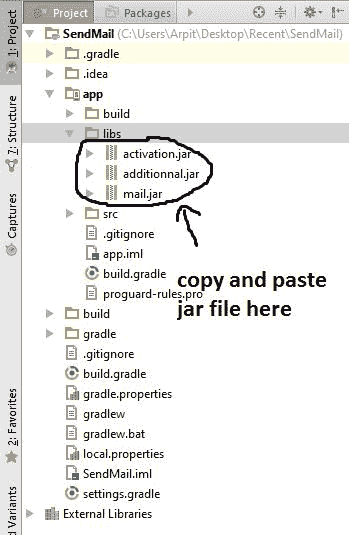

使用 Gmail 登录（使用你的发件箱邮箱），并开启切换按钮：[链接](https://www.google.com/settings/u/1/security/lesssecureapps)

大多数人都会忘记这一步，希望你不会。

### 步骤 2：将类复制并粘贴到项目中

**GMail.java**


```java
import android.util.Log;

import java.io.UnsupportedEncodingException;
import java.util.List;
import java.util.Properties;

import javax.mail.Message;
import javax.mail.MessagingException;
import javax.mail.Session;
import javax.mail.Transport;
import javax.mail.internet.AddressException;
import javax.mail.internet.InternetAddress;
import javax.mail.internet.MimeMessage;

public class GMail {

    final String emailPort = "587";// gmail's smtp port
    final String smtpAuth = "true";
    final String starttls = "true";
    final String emailHost = "smtp.gmail.com";

    String fromEmail;
    String fromPassword;
    List<String> toEmailList;
    String emailSubject;
    String emailBody;

    Properties emailProperties;
    Session mailSession;
    MimeMessage emailMessage;

    public GMail() {

    }

    public GMail(String fromEmail, String fromPassword,
            List<String> toEmailList, String emailSubject, String emailBody) {
        this.fromEmail = fromEmail;
        this.fromPassword = fromPassword;
        this.toEmailList = toEmailList;
        this.emailSubject = emailSubject;
        this.emailBody = emailBody;

        emailProperties = System.getProperties();
        emailProperties.put("mail.smtp.port", emailPort);
        emailProperties.put("mail.smtp.auth", smtpAuth);
        emailProperties.put("mail.smtp.starttls.enable", starttls);
        Log.i("GMail", "Mail server properties set.");
    }

    public MimeMessage createEmailMessage() throws AddressException,
            MessagingException, UnsupportedEncodingException {

        mailSession = Session.getDefaultInstance(emailProperties, null);
        emailMessage = new MimeMessage(mailSession);

        emailMessage.setFrom(new InternetAddress(fromEmail, fromEmail));
        for (String toEmail : toEmailList) {
            Log.i("GMail", "toEmail: " + toEmail);
            emailMessage.addRecipient(Message.RecipientType.TO,
                    new InternetAddress(toEmail));
        }

        emailMessage.setSubject(emailSubject);
        emailMessage.setContent(emailBody, "text/html");// for a html email
        // emailMessage.setText(emailBody);// for a text email
        Log.i("GMail", "Email Message created.");
        return emailMessage;
    }

    public void sendEmail() throws AddressException, MessagingException {

        Transport transport = mailSession.getTransport("smtp");
        transport.connect(emailHost, fromEmail, fromPassword);
        Log.i("GMail", "allrecipients: " + emailMessage.getAllRecipients());
        transport.sendMessage(emailMessage, emailMessage.getAllRecipients());
        transport.close();
        Log.i("GMail", "Email sent successfully.");
    }

}
```

### `SendMailTask.java`

```java
import android.app.Activity;
import android.app.ProgressDialog;
import android.os.AsyncTask;
import android.util.Log;

import java.util.List;

public class SendMailTask extends AsyncTask {

    private ProgressDialog statusDialog;
    private Activity sendMailActivity;

    public SendMailTask(Activity activity) {
        sendMailActivity = activity;

    }

    protected void onPreExecute() {
        statusDialog = new ProgressDialog(sendMailActivity);
        statusDialog.setMessage("Getting ready...");
        statusDialog.setIndeterminate(false);
        statusDialog.setCancelable(false);
        statusDialog.show();
    }

    @Override
    protected Object doInBackground(Object... args) {
        try {
            Log.i("SendMailTask", "About to instantiate GMail...");
            publishProgress("Processing input....");
            GMail androidEmail = new GMail(args[0].toString(),
                    args[1].toString(), (List) args[2], args[3].toString(),
                    args[4].toString());
            publishProgress("Preparing mail message....");
            androidEmail.createEmailMessage();
            publishProgress("Sending email....");
            androidEmail.sendEmail();
            publishProgress("Email Sent.");
            Log.i("SendMailTask", "Mail Sent.");
        } catch (Exception e) {
            publishProgress(e.getMessage());
            Log.e("SendMailTask", e.getMessage(), e);
        }
        return null;
    }

    @Override
    public void onProgressUpdate(Object... values) {
        statusDialog.setMessage(values[0].toString());

    }

    @Override
    public void onPostExecute(Object result) {
        statusDialog.dismiss();
    }

}
```

### 步骤 3

现在你可以根据需要修改此类，你也可以使用此类发送多封邮件。我同时提供了 XML 和 Java 文件。

### `activity_mail.xml`

```xml
<?xml version="1.0" encoding="utf-8"?>
<LinearLayout xmlns:android="http://schemas.android.com/apk/res/android"
    xmlns:tools="http://schemas.android.com/tools"
    android:layout_width="match_parent"
    android:layout_height="match_parent"
    android:orientation="vertical"
    android:paddingLeft="20dp"
    android:paddingRight="20dp"
    android:paddingTop="30dp">

    <TextView
        android:id="@+id/textView1"
        android:layout_width="wrap_content"
        android:layout_height="wrap_content"
        android:paddingTop="10dp"
        android:text="发件人" />

    <EditText
        android:id="@+id/editText1"
        android:layout_width="match_parent"
        android:layout_height="wrap_content"
        android:background="#FFFFFF"
        android:cursorVisible="true"
        android:editable="true"
        android:ems="10"
        android:enabled="true"
        android:inputType="textEmailAddress"
        android:padding="5dp"
        android:textColor="#000000">

        <requestFocus />
    </EditText>

    <TextView
        android:id="@+id/textView2"
        android:layout_width="wrap_content"
        android:layout_height="wrap_content"
        android:paddingTop="10dp"
        android:text="密码（发件人邮箱）" />

    <EditText
        android:id="@+id/editText2"
        android:layout_width="match_parent"
        android:layout_height="wrap_content"
        android:background="#FFFFFF"
        android:ems="10"
        android:inputType="textPassword"
        android:padding="5dp"
        android:textColor="#000000" />

    <TextView
        android:id="@+id/textView3"
        android:layout_width="wrap_content"
        android:layout_height="wrap_content"
        android:paddingTop="10dp"
        android:text="收件人" />

    <EditText
        android:id="@+id/editText3"
        android:layout_width="match_parent"
        android:layout_height="wrap_content"
        android:background="#ffffff"
        android:ems="10"
        android:inputType="textEmailAddress"
        android:padding="5dp"
        android:textColor="#000000" />

    <TextView
        android:id="@+id/textView4"
        android:layout_width="wrap_content"
        android:layout_height="wrap_content"
        android:paddingTop="10dp"
        android:text="主题" />

    <EditText
        android:id="@+id/editText4"
        android:layout_width="match_parent"
        android:layout_height="wrap_content"
        android:background="#ffffff"
        android:ems="10"
        android:padding="5dp"
        android:textColor="#000000" />

    <TextView
        android:id="@+id/textView5"
        android:layout_width="wrap_content"
        android:layout_height="wrap_content"
        android:paddingTop="10dp"
        android:text="正文" />

    <EditText
        android:id="@+id/editText5"
        android:layout_width="match_parent"
        android:layout_height="wrap_content"
        android:background="#ffffff"
        android:ems="10"
        android:inputType="textMultiLine"
        android:padding="35dp"
        android:textColor="#000000" />

    <Button
        android:id="@+id/button1"
        android:layout_width="wrap_content"
        android:layout_height="wrap_content"
        android:text="发送邮件" />

</LinearLayout>
```

### `SendMailActivity.java`


```java
import android.app.Activity;
import android.os.Bundle;
import android.util.Log;
import android.view.View;
import android.widget.Button;
import android.widget.TextView;

import java.util.Arrays;
import java.util.List;

public class SendMailActivity extends Activity {

    @Override
    public void onCreate(Bundle savedInstanceState) {
        super.onCreate(savedInstanceState);
        setContentView(R.layout.activity_main);
        final Button send = (Button) this.findViewById(R.id.button1);

        send.setOnClickListener(new View.OnClickListener() {

            public void onClick(View v) {
                Log.i("SendMailActivity", "发送按钮被点击了");

                String fromEmail = ((TextView) findViewById(R.id.editText1))
                        .getText().toString();
                String fromPassword = ((TextView) findViewById(R.id.editText2))
                        .getText().toString();
                String toEmails = ((TextView) findViewById(R.id.editText3))
                        .getText().toString();
                List<String> toEmailList = Arrays.asList(toEmails
                        .split("\\s*,\\s*"));
                Log.i("SendMailActivity", "收件人列表: " + toEmailList);
                String emailSubject = ((TextView) findViewById(R.id.editText4))
                        .getText().toString();
                String emailBody = ((TextView) findViewById(R.id.editText5))
                        .getText().toString();
                new SendMailTask(SendMailActivity.this, fromEmail, fromPassword, toEmailList, emailSubject, emailBody).execute();
            }
        });
    }
}
```

[在 Java 中带附件发送电子邮件](http://www.codejava.net/java-ee/javamail/send-e-mail-with-attachment-in-java)

[使用 JavaMail 在邮件消息中下载附件](http://www.codejava.net/java-ee/javamail/download-attachments-in-e-mail-messages-using-javamail)

感谢讨论：`[Darush](https://stackoverflow.com/users/4726718/darush)`

> `GmailBackground` 是一个无需用户交互即可后台发送邮件的小型库：

## 使用方法

```
BackgroundMail.newBuilder(this)
            .withUsername("username@gmail.com")
            .withPassword("password12345")
            .withMailto("toemail@gmail.com")
            .withType(BackgroundMail.TYPE_PLAIN)
            .withSubject("this is the subject")
            .withBody("this is the body")
            .withOnSuccessCallback(new BackgroundMail.OnSuccessCallback() {
                @Override
                public void onSuccess() {
                    //执行一些操作
                }
            })
            .withOnFailCallback(new BackgroundMail.OnFailCallback() {
                @Override
                public void onFail() {
                    //执行一些操作
                }
            })
            .send();
```

## 配置

```
dependencies {
            compile 'com.github.yesidlazaro:GmailBackground:1.2.0'
    }
```

## 权限

```
<uses-permission android:name="android.permission.ACCESS_NETWORK_STATE"/>
<uses-permission android:name="android.permission.INTERNET"/>
```

对于附件，你还需要设置`READ_EXTERNAL_STORAGE`权限：

```
<uses-permission android:name="android.permission.READ_EXTERNAL_STORAGE"/>
```

[来源](https://github.com/yesidlazaro/GmailBackground)

*我自己测试过*

感谢讨论：`[S.R](https://stackoverflow.com/users/6017001/s-r)`

此内容来源于 [StackOverFlow](https://stackoverflow.com/questions/2020088/sending-email-in-android-using-javamail-api-without-using-the-default-built-in-a)，并已整理成上述方案。

# 使用 JAX-RS 和 Jersey 实现基于 Token 认证的最佳实践

## 问题

我正在寻找一种在 `Jersey` 中启用基于令牌认证的方法。我曾尝试不使用特定的框架。这可能吗？

我的计划是：用户注册我的 Web 服务，我的服务生成一个令牌并发送给客户端，客户端保留它。然后客户端每次请求时不再发送用户名或密码，而是发送这个令牌。

我考虑过为每个请求使用自定义过滤器并配合`@PreAuthorize("hasRole('ROLE')")`，但我认为这会导致大量的数据库查询来检查令牌是否正确。

或者不创建过滤器，而在每个请求中放入一个参数`token`？这样每个 API 首先检查令牌，然后执行某些操作来获取资源。

问题感谢：`[Antonio Balduzzi](https://stackoverflow.com/users/4120466/antonio-balduzzi)`

## 解决方案

### 基于令牌的认证工作原理

在基于令牌的认证中，客户端将`硬凭据`（如用户名和密码）交换为名为 `token` 的数据。客户端不再在每个请求中发送硬凭据，而是将令牌发送到服务器进行身份验证和授权。

简而言之，基于令牌的认证方案遵循以下步骤：

1. 客户端向服务器发送凭据（用户名和密码）。
2. 服务器验证凭据并生成令牌。
3. 服务器将之前生成的令牌存储在某些存储中，并带有用户标识符和过期日期。
4. 服务器将生成的令牌发送给客户端。
5. 在每个请求中，客户端将令牌发送到服务器。
6. 服务器在每个请求中从传入的请求中提取令牌。服务器根据令牌查找用户详情以执行身份验证和授权。
   - 如果令牌有效，服务器接受请求。
   - 如果令牌无效，服务器拒绝请求。
7. 服务器可以提供一个刷新令牌的端点。

## 使用 JAX-RS 2.0 可以做什么 (Jersey, RESTEasy 和 Apache CXF)

此解决方案仅使用 JAX-RS 2.0 API，`避免任何特定厂商的解决方案`。因此，它应该适用于最流行的 JAX-RS 2.0 实现，如 `[Jersey](https://jersey.github.io/)`, `[RESTEasy](http://resteasy.jboss.org/)` 和 `[Apache CXF](https://cxf.apache.org/)`。

需要说明的是，如果你使用基于令牌的认证，你并不依赖于 Servlet 容器提供的、通过应用的 `web.xml` 描述符配置的标准 Java EE Web 安全机制。

### 使用用户名和密码验证用户并发放令牌

创建一个 REST 端点，接收并验证凭据（用户名和密码），并为用户发放令牌：

```
@Path("/authentication")
public class AuthenticationEndpoint {

    @POST
    @Produces(MediaType.APPLICATION_JSON)
    @Consumes(MediaType.APPLICATION_JSON)
    @FormParam("username") String username, 
    @FormParam("password") String password) {

        try {

            // 使用凭据验证用户
            authenticate(username, password);

            // 为用户发放令牌
            String token = issueToken(username);

            // 在响应中返回令牌
            return Response.ok(token).build();

        } catch (Exception e) {
            return Response.status(Response.FORBIDDEN).build();
        }      
    }

    private void authenticate(String username, String password) throws Exception {
        // 针对数据库、LDAP 等验证
        // 如果凭据无效则抛出异常
    }

    private String issueToken(String username) {
        // 发放令牌（可以是持久化的随机字符串）
        // 令牌必须与用户关联
        // 返回令牌
    }
}
```

如果在验证凭据时发生任何异常，将返回状态为 `403 (Forbidden)` 的响应。

如果成功验证了凭据，将返回状态为 `200 (OK)` 的响应并将令牌发送给客户端。客户端必须每个请求中发送该令牌。

使用这种方法，你期望客户端在请求体中以以下格式发送凭据：

```
username=admin&password=12345
```

与其表单参数，可以将用户名和密码封装在一个类中：

```
public class Credentials implements Serializable {

    private String username;
    private String password;

    // Getters and setters
}
```

并以 JSON 格式消费：

```
@POST
@Produces(MediaType.APPLICATION_JSON)
@Consumes(MediaType.APPLICATION_JSON)
public Response authenticateUser(Credentials credentials) {

    String username = credentials.getUsername();
    String password = credentials.getPassword();

    // 验证用户，发放令牌并返回响应
}
```

### 从请求中提取令牌并验证它

客户端应该将令牌放在请求的标准 HTTP `Authorization` 请求头中。例如：

```
Authorization: Bearer <token-goes-here>
```

注意，标准 HTTP 请求头的名称并不理想，因为它携带的是*身份验证*信息，而不是*授权*信息。

JAX-RS 提供了 [`@NameBinding`](http://docs.oracle.com/javaee/7/api/javax/ws/rs/NameBinding.html)，这是一个用于为过滤器和拦截器创建绑定注解的元注解。可以如下所示创建注解：

```
@NameBinding
@Retention(RUNTIME)
@Target({TYPE, METHOD})
public @interface Secured { }
```

定义的名称绑定注解 `@Secured` 将被用于装饰过滤器类，该类实现了 [`ContainerRequestFilter`](http://docs.oracle.com/javaee/7/api/javax/ws/rs/container/ContainerRequestFilter.html)，允许你处理请求。[`ContainerRequestContext`](http://docs.oracle.com/javaee/7/api/javax/ws/rs/container/ContainerRequestContext.html) 帮助你从 HTTP 请求中提取令牌：

```
@Secured
@Provider
@Priority(Priorities.AUTHENTICATION)
public class AuthenticationFilter implements ContainerRequestFilter {

    @Override
    public void filter(ContainerRequestContext requestContext) throws IOException {

        // 从请求中获取 HTTP Authorization 请求头
        String authorizationHeader = 
            requestContext.getHeaderString(HttpHeaders.AUTHORIZATION);

        // 检查是否存在 HTTP Authorization 请求头以及格式是否正确 
        if (authorizationHeader == null || !authorizationHeader.startsWith("Bearer ")) {
            throw new NotAuthorizedException("Authorization header must be provided");
        }

        // 从 HTTP Authorization 请求头中提取令牌
        String token = authorizationHeader.substring("Bearer".length()).trim();

        try {

            // 验证令牌
            validateToken(token);

        } catch (Exception e) {
            requestContext.abortWith(
                Response.status(Response.Status.UNAUTHORIZED).build());
        }
    }

    private void validateToken(String token) throws Exception {
        // 检查令牌是否由服务器发布以及是否已过期
        // 如果令牌无效则抛出异常
    }
}
```


如果在令牌验证过程中发生任何问题，将返回状态码为`401`（未授权）的响应。

否则，请求将继续执行端点。

## 保护你的 REST 端点

通过使用上面创建的`@Secured`注解标记你的端点方法或类，将过滤器与其绑定。对于标记了该注解的方法和/或类，过滤器将会执行。这意味着只有当使用有效令牌执行请求时，才能访问这些端点。

如果某些方法或类不需要身份验证，只需不对它们进行注解即可。

```java
@Path("/")
public class MyEndpoint {

    @GET
    @Path("{id}")
    @Produces(MediaType.APPLICATION_JSON)
    public Response myUnsecuredMethod(@PathParam("id") Long id) {
        // 此方法没有标记 @Secured
        // 在调用此方法之前不会执行身份验证过滤器
        ...
    }

    @DELETE
    @Secured
    @Path("{id}")
    @Produces(MediaType.APPLICATION_JSON)
    public Response mySecuredMethod(@PathParam("id") Long id) {
        // 此方法标记了 @Secured
        // 在调用此方法之前将执行身份验证过滤器
        // HTTP 请求必须带有有效令牌才能执行
        ...
    }
}
```

在上面的示例中，过滤器只会为`mySecuredMethod(Long)`执行，因为它被标记了`@Secured`注解。

## 识别当前用户

你可能非常需要知道在 REST 端点中执行请求的用户。以下方法可以用来实现这一目标：

### 重写`SecurityContext`

在你的`ContainerRequestFilter.filter(ContainerRequestContext)`方法中，你可以为当前请求设置新的安全上下文信息。

重写`SecurityContext.getUserPrincipal()`，返回一个`Principal`实例。

`Principal`的名称为你发放令牌的用户用户名。在验证令牌时，你需要知道它。

```java
final SecurityContext currentSecurityContext = requestContext.getSecurityContext();
requestContext.setSecurityContext(new SecurityContext() {

    @Override
    public Principal getUserPrincipal() {

        return new Principal() {

            @Override
            public String getName() {
                return username;
            }
        };
    }

    @Override
    public boolean isUserInRole(String role) {
        return true;
    }

    @Override
    public boolean isSecure() {
        return currentSecurityContext.isSecure();
    }

    @Override
    public String getAuthenticationScheme() {
        return "Bearer";
    }
});
```

在任何 REST 端点类中注入`SecurityContext`的代理：

```java
@Context
SecurityContext securityContext;
```

在方法中也可以同样的操作：

```java
@GET
@Secured
@Path("{id}")
@Produces(MediaType.APPLICATION_JSON)
public Response myMethod(@PathParam("id") Long id, @Context SecurityContext securityContext) {
    ...
}
```

并获取`Principal`：

```java
Principal principal = securityContext.getUserPrincipal();
String username = principal.getName();
```

### 使用 CDI (上下文和依赖注入)

如果出于某种原因，你不想重写`SecurityContext`，你可以使用 CDI，它提供了事件和生产者等有用功能。

创建一个 CDI 限定符，该符将在处理身份验证事件以及在你的 Bean 中注入已身份验证的用户时使用：

```java
@Qualifier
@Retention(RUNTIME)
@Target({ METHOD, FIELD, PARAMETER })
public @interface AuthenticatedUser { }
```

在你上面创建的`AuthenticationFilter`中，注入一个`Event`：

```java
@Inject
@AuthenticatedUser
Event<String> userAuthenticatedEvent;
```

当用户通过身份验证时，触发事件并传递用户名（记住令牌必须与用户关联，并且你需要从令牌中获取用户名）：

```java
userAuthenticatedEvent.fire(username);
```

你可能有一个表示用户的类。我们称该类为`User`。

下面的代码处理身份验证事件，找到对应用户名的`User`实例，并将其分配给字段`authenticatedUser`：

```java
@RequestScoped
public class AuthenticatedUserProducer {

    @Produces
    @RequestScoped
    @AuthenticatedUser
    private User authenticatedUser;

    public void handleAuthenticationEvent(@Observes @AuthenticatedUser String username) {
        this.authenticatedUser = findUser(username);
    }

    private User findUser(String username) {
        // 通过数据库或服务通过用户名查找用户
        // 返回 User 实例
    }
}
```

`authenticatedUser`字段产生`User`实例，它可以被注入到你的 Bean 中，例如 JAX-RS 服务、CDI Bean、Servlet 和 EJB：

```java
@Inject
@AuthenticatedUser
User authenticatedUser;
```

注意 CDI 的`Produces`注解与 JAX-RS 的`Produces`注解不同：

* CDI: `javax.enterprise.inject.Produces`
* JAX-RS: `javax.ws.rs.Produces`

## 基于角色的授权

除了身份验证外，你还可以在 REST 端点中支持基于角色的授权。

创建一个枚举类并根据你的需求定义角色：

```java
public enum Role {
    ROLE_1,
    ROLE_2,
    ROLE_3
}
```

修改上述创建的`@Secured`名称绑定注解以支持角色：

```java
@NameBinding
@Retention(RUNTIME)
@Target({TYPE, METHOD})
public @interface Secured {
    Role[] value() default {};
}
```

对你的端点进行注解以执行基于角色的授权。

注意，`@Secured`注解可以用类和/或方法。因此，让我们让方法注解覆盖类注解：

```java
@Path("/example")
@Secured({Role.ROLE_1})
public class MyEndpoint {

    @GET
    @Path("{id}")
    @Produces(MediaType.APPLICATION_JSON)
    public Response myMethod(@PathParam("id") Long id) {
        // 此方法没有使用 @Secured 注解
        // 但它声明在一个标记了 @Secured({Role.ROLE_1}) 的类中
        // 因此它只能由拥有 ROLE_1 角色的用户执行
        ...
    }

    @DELETE
    @Path("{id}")    
    @Produces(MediaType.APPLICATION_JSON)
    @Secured({Role.ROLE_1, Role.ROLE_2})
    public Response myOtherMethod(@PathParam("id") Long id) {
        // 此方法标记了 @Secured({Role.ROLE_1, Role.ROLE_2})
        // 方法注解覆盖了类注解
        // 因此它只能由拥有 ROLE_1 或 ROLE_2 角色的用户执行
        ...
    }
}
```

创建一个具有`AUTHORIZATION`优先级的过滤器，它将在之前定义的`AUTHENTICATION`优先级过滤器之后执行。

`ResourceInfo`可用于获取与请求 URL 匹配的`Method`和`Class`并从中提取注解：

```java
@Secured
@Provider
@Priority(Priorities.AUTHORIZATION)
public class AuthorizationFilter implements ContainerRequestFilter {

    @Context
    private ResourceInfo resourceInfo;

    @Override
    public void filter(ContainerRequestContext requestContext) throws IOException {

        // 获取与请求 URL 匹配的资源类
        // 提取其声明的角色
        Class<?> resourceClass = resourceInfo.getResourceClass();
        List<Role> classRoles = extractRoles(resourceClass);

        // 获取与请求 URL 匹配的资源方法
        // 提取其声明的角色
        Method resourceMethod = resourceInfo.getResourceMethod();
        List<Role> methodRoles = extractRoles(resourceMethod);

        try {

            // 检查用户是否允许执行该方法
            // 方法注解覆盖类注解
            if (methodRoles.isEmpty()) {
                checkPermissions(classRoles);
            } else {
                checkPermissions(methodRoles);
            }

        } catch (Exception e) {
            requestContext.abortWith(
                Response.status(Response.Status.FORBIDDEN).build());
        }
    }

    // 从被注解的元素中提取角色
    private List<Role> extractRoles(AnnotatedElement annotatedElement) {
        if (annotatedElement == null) {
            return new ArrayList<Role>();
        } else {
            Secured secured = annotatedElement.getAnnotation(Secured.class);
            if (secured == null) {
                return new ArrayList<Role>();
            } else {
                Role[] allowedRoles = secured.value();
                return Arrays.asList(allowedRoles);
            }
        }
    }

    private void checkPermissions(List<Role> allowedRoles) throws Exception {
        // 检查用户是否包含允许的角色之一
        // 如果用户没有权限执行该方法，则抛出异常
    }
}
```

如果用户没有执行该方法的权限，请求将被`403` (Forbidden) 终止。

要了解执行请求的用户，请参见上一个节。你可以从`SecurityContext`（它应该已经设置在`ContainerRequestContext`中）或使用 CDI 注入它，取决于你使用的方法。

如果`@Secured`注解没有声明角色，你可以假设所有已身份验证的用户都可以访问该端点，无论用户拥有什么种角色。

## 如何发放令牌

令牌可以是"不透明的"（opaque），即除了值本身外不显示任何细节（如随机字符串），也可以是"自包含的"（self-contained，如随机字符串）。

### 随机字符串

可以通过生成随机字符串并将其持久化到带有过期日期的数据库中发放令牌。Java 中生成随机字符串的一个良好示例所示：

```java
Random random = SecureRandom();
String token = new BigInteger(130, random).toString();
```

### JSON Web Token (JWT)

JSON Web Token (JWT) 是在双方之间安全地表示声明（claims）的标准方法，并由 7519 定义。它是编码为 Base64 的 JSON。客户端可以读取负载，并在服务器上通过验证其签名来轻松检查令牌的完整性。


如果你不需要跟踪令牌，则不需要持久化`JWT`令牌。但是，通过持久化令牌，你将获得失效和撤销访问的可能性。

在持久化令牌时，始终考虑删除旧令牌以防止数据库增长。

## 使用 JSON Web Token (JWT)

有一些 Java 库用于发放和验证`JWT`令牌，例如：

* [jjwt](https://github.com/jwtk/jjwt)
* [java-jwt](https://github.com/auth0/java-jwt)
* [jose4j](https://bitbucket.org/b_c/jose4j/wiki/Home)

要找到其他关于处理`JWT`的优秀资源，请查看[`jwt.io/`](http://jwt.io/)。

### 使用 JWT 处理令牌刷新

仅接受有效的（且未过期的）令牌进行刷新。在[`exp`](https://datatracker.org/7519#section-4.1.4)声明中指定的过期日期之前刷新令牌是客户端的责任。

为了避免令牌被无限刷新，你可以通过在令牌中添加两个声明来跟踪令牌的刷新（声明名称由你决定）：

* `refreshLimit`：指示令牌可以刷新的次数。
* `refreshCount`：指示令牌已刷新的次数。

因此，只有当以下条件满足同时才刷新令牌：

* 令牌未过期 (`exp >= now`)。
* 令牌已刷新次数少于令牌可以刷新的次数 (`refreshCount < refreshLimit`)。

并在刷新令牌时：

* 更新过期日期 (`exp = now + some-amount-of-time`)。
* 增加令牌刷新的次数（`refreshCount++`）。

除了跟踪刷新次数外，你也可以使用一个指示`绝对过期日期`的声明（其工作原理与上述描述的`refreshLimit`声明非常相似）。然而，在`绝对过期日期`之前，任何次数的刷新都是允许的。

另一种方法是发布一个独立的长寿命刷新令牌，用于签发短期的`JWT`令牌。

最佳方法取决于你的需求。

## 使用 JWT 处理令牌撤销

如果你想撤销令牌，必须对它们进行跟踪。你不需要在服务器端存储整个令牌，只需存储令牌标识符（必须是唯一的），并在时存储一些元数据。对于令牌标识符，可以使用[UUID](https://tools.ietf.org/html/rfc4122)。

令牌应使用[`jti`](https://tools.ietf.org/html/rfc7519#section-4.1.7)声明来存储令牌标识符。在验证令牌时，确保通过与服务器端已有的令牌标识符对比[`jti`](https://tools.ietf.org/html/rfc7519#section-4.1.7)声明的值，来确认其未被撤销。

出于安全考虑，当用户更改密码时，撤销该用户的所有令牌。

## 附加信息

- 决定使用哪种身份验证类型并不重要。**务必**在 HTTPS 连接上进行，以防止[中间人攻击](https://en.wikipedia.org/wiki/Man-in-the-middle_attack)。
- 请参考信息安全领域的[此问题](https://security.stackexchange.com/q/19676)以获取更多关于令牌的信息。
- 在[此文章](https://stormpath.com/blog/token-auth-spa/)中，你可以找到关于基于令牌的验证的有用信息。

解决方案由 [Cássio Mazzochi Molin](https://stackoverflow.com/users/1426227/c%c3%a1ssio-mazzochi-molin) 感谢。

## 讨论

目前暂无关于此配方的讨论。

此内容源自 [StackOverflow](https://stackoverflow.com/questions/26777083/best-practice-for-rest-token-based-authentication-with-jax-rs-and-jersey)，并已重新组织成上述配方。

# 如何从字符串中移除特殊字符？

## 问题

我想用 Java 移除字符串中的如下特殊字符：

```text
- + ^ . : ,
```

问题由 [Sameek Mishra](https://stackoverflow.com/users/423620/sameek-mishra) 感谢。

## 解决方案

这取决于你如何定义特殊字符，但可以尝试使用`replaceAll(...)`：

```java
String result = yourString.replaceAll("[-+.^:,]","");
```

注意，`^`字符不能出现在列表开头，否则你必须对其进行转义，否则它将表示“除了这些字符以外的所有字符”。

另一个注意：`-`字符需要位于列表的开头或结尾，否则你必须对其转义，否则它将定义一个范围（例如：`:-,` 表示“从 `:` 到 `,` 之间的所有字符”）。

因此，为了保持一致性且不于字符的位置，你可能想要转义所有在正则表达式中具有特殊含义的字符（以下列表并不完整，请注意其他字符如 `(`、`{`、`$` 等）：

```java
String result = yourString.replaceAll("[\\-\\+\\.\\^:,]","");
```

如果你想去掉所有的标点和符号，尝试这个正则表达式：`\p{P}\p{S}`（记住在 Java 字符串中必须转义反斜杠：`"\\p{P}\\p{S}"`）。

如果你可以精确定义字符串中应该保留什么，第三种方法可能如下所示：

```java
String result = yourString.replaceAll("[^\\w\\s]","");
```

这意味着：替换所有不是单词字符（不区分大小写的 a-z、0-9 或 _）或空白字符的内容。

编辑：请注意还有其他可能有帮助的模式。然而，我无法解释它们，请查看 [regular-expressions.info](http://www.regular-expressions.info/refunicode.html) 的参考部分。

这是 Ray 建议的比“定义允许字符”方法更宽松的替代方案：

```java
String result = yourString.replaceAll("[^\\p{L}\\p{Z}]","");
```

该正则表达式匹配任何语言中不是字母且不是分隔符（空格、换行符等）。注意你不能使用`[\P{L}\P{Z}]`（大写 P 表示不具备该属性），因为那将意味着“既不是字母也不是空白的所有内容”，这几乎匹配所有内容，因为字母不是空白，反之亦然。

*关于 Unicode 的附加信息*

某些 Unicode 字符似乎由于不同的可能编码方式（单个代码点或代码点的组合）而产生问题。请参阅 [regular-expressions.info](http://www.regular-expressions.info/refunicode.html) 获取更多信息。

解决方案由 [Thomas](https://stackoverflow.com/users/63785/thomas) 感谢。

## 讨论

目前暂无关于此配方的讨论。

### JFrameTest.java

```java
package jframetest;

import java.awt.FlowLayout;
import javax.swing.JButton;
import javax.swing.JFrame;
import javax.swing.JPanel;

public class JFrameTest extends JFrame {

    public JFrameTest() {

        FlowLayout mainLayout = new FlowLayout();
        setSize(320, 480);
        setResizable(false);
        setDefaultCloseOperation(JFrame.EXIT_ON_CLOSE);
        setLayout(mainLayout);

        JPanel panelMain = new JPanel(mainLayout);

        JButton testButton = new JButton("Test12");
        panelMain.add(testButton);

        JPanelOne panel = new JPanelOne();
        panelMain.add(panel);
        panel.setVisible(true);
        add(panelMain);

    }

    public static void main(String[] arguments) {

        JFrameTest frame = new JFrameTest();
        frame.setVisible(true);
    }
}
```

### JPanelOne.java

```java
package jframetest;

import java.awt.FlowLayout;
import javax.swing.JButton;
import javax.swing.JPanel;

public class JPanelOne extends JPanel {

    public JPanelOne() {

        FlowLayout layoutPanel = new FlowLayout();
        JPanel panel = new JPanel(layoutPanel);
        JButton button = new JButton("test");
        panel.add(button);
        panel.setVisible(true);

    }

}
```

将不同的`JPanel`保留在它们各自的类中良好的做法吗？（例如：希望`JFrame`包含几个相同大小的`JPanel`，通过设置`setVisible()`为 true/false 来进行切换）

## 编辑

感谢大家的回答。收到了。现在回到我的问题：

既然我已经知道如何添加在其他类中创建的单个 GUI 元素了，我想知道是否可以在其中一个类中（可能在`JPanel`以外的其他容器中）使用布局管理器来组织元素，这样我就可以将它们作为一个在布局中组织的组来添加（这就是为什么我询问了关于在其他类中创建整个`JPanel`）。如图所示：


此示例中`JPanel`（即第二个类）的代码如下：

我正在考虑通过设置`JPanel`（类似于示例中的那种）的显示或隐藏来在程序 GUI 之间进行导航。

1. 这种做法好吗？

2. 我应该把我的 GUI 拆分成几个类，还是应该把所有内容都放在一个类里？我问这个问题是因为，现在只有一半的 GUI 代码就有 400 行了（而且目前除了“显示”之外什么也做不了）。正如我之前提到的，我是一个新手，这是我目前写过的最长的应用程序（我确定这其实并不长！）。

**更新**：也许我想太多了，所以最后拥有大型 GUI 类并通过设置显示或隐藏来控制不同 GUI 区域是可以的吗？

**更新**：我查看了 Oracle 上关于`CardLayout`的教程，看起来它非常适合我的任务（除了从外部类创建`JPanel`之外，那是可以接受的）。我最初误解了它，把它想成了标签页（tabbed pane）（但我并不想在项目中实现那个功能）。

问题感谢：[TV.](https://stackoverflow.com/users/1607617/tv)

## 解决方案

在获得更多帮助（来自另一个网站的用户`Hilek`）后，我成功地将另一个类中的`JPanel`显示在主类中。以下是代码：

**JFrameTest.java:**

```java
import java.awt.Color;
import java.awt.Dimension;
import javax.swing.JButton;
import javax.swing.JFrame;
import javax.swing.JPanel;

public class JFrameTest extends JFrame {

        private JButton testButton;
        private JPanel panelMain;
        private JPanelOne panel;

        public JFrameTest() {

                // 设置 up 设置
                setLayout(null);
                setPreferredSize(new Dimension(420, 90));
                setResizable(false);
                setDefaultCloseOperation(JFrame.EXIT_ON_CLOSE);

            // 创建主 JPanel (白色)
            panelMain = new JPanel();
            panelMain.setBackground(Color.WHITE);
            panelMain.setBounds(0, 0, 420, 90);
            panelMain.setPreferredSize(new Dimension(200, 40));
            add(panelMain);

            // 在主 JPanel (白色) 中创建 JButton
            testButton = new JButton("Button from main class");
            panelMain.add(testButton);

            // 从包含黑色 JPanel 的 JPanelOne 类创建新的 JPanelOne 对象
            panel = new JPanelOne();

            // 将黑色 JPanel 添加到主 JPanel (白色) 中
            panelMain.add(panel);

            pack();

        }

        public static void main(String[] arguments) {

                // 创建 JFrame 对象并使其可见
                JFrameTest frame = new JFrameTest();
                frame.setVisible(true);

        }

}
```

**JPanelOne.java:**

```java
import java.awt.Color;
import java.awt.Dimension;
import javax.swing.JButton;
import javax.swing.JPanel;
import javax.swing.SwingConstants;

public class JPanelOne extends JPanel
{

        public JPanelOne()
        {
                // 设置黑色 JPanel
                JPanel panel = new JPanel();
                panel.setPreferredSize(new Dimension(220, 40));
                panel.setBackground(Color.BLACK);

            // 在外部 JPanel 上创建按钮
            JButton button = new JButton("Button (+JPanel) from external class");

            // 将按钮添加到黑色 JPanel
            panel.add(button);

            // 添加黑色 JPanel
            add(panel);
        }
}
```

运行示例的屏幕截图：

[`i.stack.imgur.com/qKeBp.jpg`](http://i.stack.imgur.com/qKeBp.jpg)

也许有人会在解决他们的问题时对此帮助。

解决方案由：[TV.](https://stackoverflow.com/users/1607617/tv)

## 讨论

不要在你的`JFrame`上调用`setSize()`。相反，让布局管理器为它们的组件和 GUI 设置适当的大小。在将所有组件添加到你的 GUI 之后，在`JFrame`上调用`pack()`，然后调用`setVisble(true)`。注意，大多数布局对组件的优选大小（preferredSize）的尊重程度高于其大小。

此外，在单个组件上调用`setVisible(true)`是没有必要的（除非由于某些原因，你在 GUI 运行后更改它们的可见性）。你可能还会阅读更多关于使用布局管理器的知识，一旦学习了它们，你可能会少地使用`FlowLayout`。

## 编辑

关于你最近的编辑：

> 也许我想得太多了，最后拥有大型 GUI 类并通过设置它们显示或隐藏来控制不同 GUI 区域的可见性是可以的吗？


我将回答这有时是有帮助的，例如如果你想将一个标准计算器改为科学计算器，有时直接使用`setVisible(true)`显示一个已经创建的填充了高级计算按钮的`JPanel`是很好的。另一方面，如果你想切换 GUI 的“视图”以反映其状态的重大变化，例如文字处理器从编辑模式切换到打印模式，你可以使用`CardLayout`轻松地切换`JPanel`。

讨论由：[Hovercraft Full Of Eels](https://stackoverflow.com/users/522444/hovercraft-full-of-eels)

问题出在`JPanelOne`类。它继承了`JPanel`但在构造函数中，你创建了一个新的`JPanel`然后向它添加了按钮。如果你这样做：

```java
public class JPanelOne extends JPanel {

   public JPanelOne() {
       JButton button = new JButton("test");
       add(button);
   }
}
```

它应该按照你预期的方式工作。

讨论由：[aymeric](https://stackoverflow.com/users/883780/aymeric)

首先回答你的问题，你需要在`JFrameTest`构造函数中使用类似下面的代码将你的面板实例添加到框架：

```java
add(new JPanelOne());
```

你还需要将你的按钮直接添加到`JPanelOne`本身：

```java
public class JPanelOne extends JPanel {   

  public JPanelOne() {   
    JButton button = new JButton("test");   
    add(button);   
  }   
}
```

其次，我认为这些行代码存在问题：

```java
FlowLayout mainLayout = new FlowLayout(); 
    // 省略...
    setLayout(mainLayout); 

    JPanel panelMain = new JPanel(mainLayout); 
```

每个容器都应该有自己的布局管理器实例。否则，你的 GUI 将出现奇怪的情况：

```java
setLayout(new FlowLayout());
JPanel panelMain = new JPanel(mainLayout);
```

讨论由：[Code-Apprentice](https://stackoverflow.com/users/1440565)

此内容源自 [StackOverflow](https://stackoverflow.com/questions/1202149/adding-jpanel-to-jframe) 并已重新组织。

# 如何获取一天的开始时间和结束时间？

## 问题

获取一天的开始时间和结束时间代码如下：

```java
 private Date getOfDay(Date date) {
    Calendar calendar = Calendar.getInstance();
    int year = calendar.get(Calendar.YEAR);
    int month = calendar.get(Calendar.MONTH);
    int day = calendar.get(Calendar.DATE);
    calendar.set(year, month, day, 0, 0, 0);
    return calendar.getTime();
}

private Date getEndOfDay(Date date) {
    Calendar calendar = Calendar.getInstance();
    int year = calendar.get(Calendar.YEAR);
    int month = calendar.get(Calendar.MONTH);
    int day = calendar.get(Calendar.DATE);
    calendar.set(year, month, day, 23, 59, 59);
    return calendar.getTime();
}
```

这在毫秒上是不准确的。

问题由：[kalman03](https://stackoverflow.com/users/51561)

## 解决方案

# 半开区间 (Half-Open)

[mprivat](https://stackoverflow.com/a/1030840) 的回答是正确的。他的观点不是尝试获取一天的结束时间，而是比较“下一天的开始时间”。这种想法被称为“半开区间”，即时间跨度的**起始是包含的**，而**结束是排斥的**。

*   当前的日期时间框架（`java.util.Date`/`Calendar` 和 [Joda-Time](http://www.joda.org/joda-time/））都使用毫秒。但在 Java 8 中，新的`java.time.*`类使用纳秒精度。你任何基于强制一天最后时刻毫秒数编写的代码在切换到新类时将是错误的。

*   与来自其他源的数据可能会出错。例如，Unix 库通常使用整秒，而像 [Postgres](http://www.postgresql.org/docs/current/static/datatype-datetime.html) 等数据库将日期时间解析为微秒。

*   某些夏令时变化发生在午夜，这可能会让情况变得复杂。

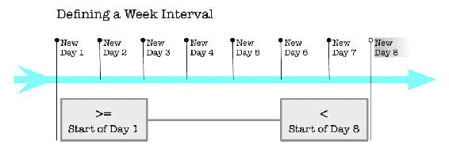

[Joda-Time](http://www.joda.org/joda-time/) 2.3 提供了一个专门为此目的的方法，用于获取一天的第一个时刻：[`withTimeAtStartOfDay`](http://www.joda.org/joda-time/apidocs/org/joda/time/DateTime.html#withTimeAtStartOfDay())。同样在`java.time`中，有`LocalDate::atStartOfDay`。

在 StackOverflow 上搜索 ["joda half-open"](https://stackoverflow.com/search?q=joda+half-open) 以查看更多讨论和示例。

参看 Bill Schneider 的这篇文章：[时间间隔和其他范围应该是半开的](http://wrschneider.blogspot.com/2014/01/time-intervals-and-other-ranges-should.html)。

# 避免使用旧的日期-时间类

`java.util.Date` 和`.Calendar`类是出了名的难用。请避免它们。

使用 [Joda-Time](http://www.joda.org/joda-time/) 或者，优先使用 [java.time](http://docs.oracle.com/javase/8/docs/api/java/time/package-summary.html)。`java.time`框架是非常成功的 Joda-Time 库的官方继任者。

# java.time

`java.time`框架内置于 Java 8 及更高版本中。通过 [ThreeTen-Backport](http://www.threeten.org/threetenbp/) 项目回移植到 Java 6 & 7，并在 [ThreeTenABP](https://github.com/JakeWharton/ThreeTenABP) 项目中进一步适配到 Android。

[`Instant`](http://docs.oracle.com/javase/8/docs/api/java/time/Instant.html) 是 [UTC](https://en.wikipedia.org/wiki/Coordinated_Universal_Time) 时间轴上的一个时刻，分辨率为 [纳秒](https://en.wikipedia.org/wiki/Nanosecond)。

```
Instant instant = Instant.now();
```

应用时区来获取某个区域的[挂钟时间](https://en.wikipedia.org/wiki/Wall-clock_time)。

```
ZoneId zoneId = ZoneId.of( "America/Montreal" );
ZonedDateTime zdt = ZonedDateTime.ofInstant( instant , zoneId );
```

要获取一天的第一个时刻，可以通过 [`LocalDate`](http://docs.oracle.com/javase/8/docs/api/java/time/LocalDate.html) 类及其 [`atStartOfDay`](http://docs.oracle.com/javase/8/docs/api/java/time/LocalDate.html#atStartOfDay-java.time.ZoneId-) 方法。

```
ZonedDateTime zdtStart = zdt.toLocalDate().atStartOfDay( zoneId );
```

使用半开（Half-Open）方法，获取下一日的第一个时刻。

```
ZonedDateTime zdtTomorrowStart = zdtStart.plusDays( 1 );
```

目前`java.time`框架缺少下文描述 Joda-Time 的`Interval`类。然而，[ThreeTen-Extra](http://www.threeten.org/threeten-extra/) 项目用额外的类扩展了`java.time`。该项目是`java.time`未来可能添加内容的试验场。它的类之一是 [`Interval`](http://www.threeten.org/threeten-extra/apidocs/org/threeten/extra/Interval.html)。通过传递一对`Instant`对象来构造一个`Interval`。我们可以从`ZonedDateTime`对象中提取`Instant`。

```
Interval today = Interval.of( zdtStart.toInstant() , zdtTomorrowStart.toInstant() );
```

# Joda-Time

Joda-Time 有三个类来以各种方式表示时间跨度：`Interval`、`Period`和`Duration`。`Interval`在宇宙时间轴上有特定的开始和结束时间。这符合我们表示“一天”的需求。

我们将该方法称为`withTimeAtStartOfDay`而不是将一天的时间设置为零。由于夏令时和其他异常情况，一天的第一个时刻可能不是`00:00:00`。

使用 Joda-Time 2.3 的示例代码。

```
DateTimeZone timeZone = DateTimeZone.forID( "America/Montreal" );
DateTime now = DateTime.now( timeZone );
DateTime todayStart = now.withTimeAtStartOfDay();
DateTime tomorrowStart = now.plusDays( 1 ).withTimeAtStartOfDay();
Interval today = new Interval( todayStart, tomorrowStart );
```

如果必须的话，你可以将其转换为`java.util.Date`。

```
java.util.Date date = todayStart.toDate();
```

解决方案感谢：[Basil Bourque](https://stackoverflow.com/users/642706/basil-bourque)

## Discussion

在`getEndOfDay`中，你可以添加：

```
calendar.set(Calendar.MILLISECOND, 999);
```

尽管从数学上讲，你除了说它是“在下一天的开始之前”之外，无法指定一天的结束时间。

所以，与其说`if(date >= getStartOfDay(today) && date <= getEndOfDay(today))`，你应该说：`if(date >= getStartOfDay(today) && date < getStartOfDay(tomorrow))`。这是一个更稳健的定义（而且你不需要担心毫秒精度）。

讨论感谢：[mprivat](https://stackoverflow.com/users/1281407/mprivat)

## Java 8

```
public static Date getEndOfDay(Date date) {
  LocalDateTime localDateTime = dateToLocalDateTime(date);
  LocalDateTime endOfDay = localDateTime.with(LocalTime.MAX);
  return localDateTimeToDate(endOfDay);
}

public static Date getStartOfDay(Date date) {
  LocalDateTime localDateTime = dateToLocalDateTime(date);
  // LocalDateTime startOfDay = localDateTime.with(LocalTime.MIN);
  LocalDateTime startOfDay = localDateTime.with(LocalTime.MIN);
}
```

```java
public static final Integer CURRENT_YEAR = DateTime.now().getYear();

public static final Integer CURRENT_MONTH = DateTime.now().getMonthOfYear();

public static final Integer CURRENT_DAY = DateTime.now().getDayOfMonth();

public static final Integer LAST_HOUR_OF_CURRENT_DAY = DateTime.now().hourOfDay().getMaximumValue();

public static final Integer FIRST_HOUR_OF_CURRENT_DAY = DateTime.now().hourOfDay().getMinimumValue();

public static final Integer LAST_MINUTE_OF_CURRENT_HOUR = DateTime.now().minuteOfHour().getMaximumValue();

public static final Integer FIRST_MINUTE_OF_CURRENT_HOUR = DateTime.now().minuteOfHour().getMinimumValue();

public static final Integer LAST_SECOND_OF_CURRENT_MINUTE = DateTime.now().secondOfMinute().getMaximumValue();

public static final Integer FIRST_SECOND_OF_CURRENT_MINUTE = DateTime.now().secondOfMinute().getMinimumValue();
```

```java
public static DateTime getFirstDateOfDay() {
    return new DateTime(CURRENT_YEAR, CURRENT_MONTH, CURRENT_DAY,
            FIRST_HOUR_OF_CURRENT_DAY, FIRST_MINUTE_OF_CURRENT_HOUR,
            FIRST_SECOND_OF_CURRENT_MINUTE);
}

public static DateTime getLastDateOfDay() {
    return new DateTime(CURRENT_YEAR, CURRENT_MONTH, CURRENT_DAY,
            LAST_HOUR_OF_CURRENT_DAY, LAST_MINUTE_OF_CURRENT_HOUR,
            LAST_SECOND_OF_CURRENT_MINUTE);
}
```

正如我在 GitHub 上的这个小 gist 中：[joda time, java8 date time (utils)](https://gist.github.com/dassiorleando/f68c7bc77a357090a0d1) 中所示。

讨论感谢：[Dassi Orleando](https://stackoverflow.com/users/4004167/dassi-orleando)


```java
public static Date beginOfDay(Date date) {
    Calendar cal = Calendar.getInstance();
    cal.setTime(date);
    cal.set(Calendar.HOUR_OF_DAY, 0);
    cal.set(Calendar.MINUTE, 0);
    cal.set(Calendar.SECOND, 0);
    cal.set(Calendar.MILLISECOND, 0);

    return cal.getTime();
}

public static Date endOfDay(Date date) {
    Calendar cal = Calendar.getInstance();
    cal.setTime(date);
    cal.set(Calendar.HOUR_OF_DAY, 23);
    cal.set(Calendar.MINUTE, 59);
    cal.set(Calendar.SECOND, 59);
    cal.set(Calendar.MILLISECOND, 999);

    return cal.getTime();
}
```

讨论感谢：[jack jin](https://stackoverflow.com/users/499059/jack-jin)

对于 Java 8，以下单行语句是有效的。在示例中，我使用了 UTC 时区。请考虑更改你当前使用的时区。

```java
System.out.println(new Date());

final LocalDateTime endOfDay       = LocalDateTime.of(LocalDate.now(), LocalTime.MAX);
final Date          endOfDayAsDate = Date.from(endOfDay.toInstant(ZoneOffset.UTC));

System.out.println(endOfDayAsDate);

final LocalDateTime startOfDay       = LocalDateTime.of(LocalDate.now(), LocalTime.MIN);
final Date          startOfDayAsDate = Date.from(startOfDay.toInstant(ZoneOffset.UTC));

System.out.println(startOfDayAsDate);
```

如果输出没有时间差异，尝试：`ZoneOffset.ofHours(0)`

讨论感谢：[Fırat KÜÇÜK](https://stackoverflow.com/users/159837/f%c4%b1rat-k%c3%9c%c3%87%c3%9ck)

使用 Java 8 `java.time.ZonedDateTime` 寻找一天开始时间的另一种方法（而不是通过 `LocalDateTime`）可以直接是将输入的 `ZonedDateTime` 截断到天（`DAYS`）：

```java
zonedDateTimeInstance.truncatedTo( ChronoUnit.DAYS );
```

讨论感谢：[laur](https://stackoverflow.com/users/1803648/laur)

此内容源自 [StackOverFlow](https://stackoverflow.com/questions/10308356/how-to-obtain-the-start-time-and-end-time-of-a-day) 并已整理成上述配方。

# 为什么 `exception.printStackTrace()` 被认为是不良实践？

## 问题

那里有[许多](http://jira.opensymphony.com/browse/CACHE-290) [材料](http://fahdshariff.blogspot.com/2010/10/redirect-stdout-to-logger.html) [资料](http://checkstyle.sourceforge.net/config_regexp.html) 认为打印异常的堆栈跟踪是不良实践。

例如，来自 Checkstyle 中的 `RegexpSingleline` 检查：

> 此检查可以用于 [...] 发现常见的坏实践，例如调用 `ex.printStacktrace()`

然而，我很难找到任何地方给出一个合理的理由，因为堆栈跟踪对于追踪异常产生的原因非常有用。我所知的几点包括：

1. 堆栈跟踪不应该对终端用户可见（出于用户体验和安全考虑）
2. 生成堆栈跟踪是一个相对昂贵的过程（尽管可能不太）
3. 许多日志框架会为你打印堆栈跟踪（而我们不会）
4. 打印堆栈跟踪并不构成错误处理

还有什么理由避免打印堆栈跟踪？讨论感谢：[Chris Knight](https://stackoverflow.com/users/296108/chris-knight)

## 解决方案

`Throwable.printStackTrace()` 将堆栈跟踪写入 `System.err`。`System.err` 流和 JVM 的底层错误输出流可以通过以下方式重定向：

* 调用 [`System.setErr()`](https://download.oracle.com/6/docs/api/lang/System.html#setErr(java.io.PrintStream)) 来更改 `System.err` 指向。
* 或者重定向进程输出流
    * 内容可能被人员忽略
    * 文件/设备可能不支持轮转，意味着需要重启进程来归档
    * 或者文件/设备实际上丢弃所有写入的数据，如 `/dev/null` 例。

根据上述，调用 `Throwable.printStackTrace()` 构成有效的异常处理行为，仅当：

* 在应用程序的生命周期内，`System.err` 未被重新赋值
* 且在运行时不需要日志轮转
* 如果应用程序接受并设计的日志实践是写入到 `System.err`

当多个线程同时调用 `Throwable.printStackTrace()` 时，没有同步机制来同步将堆栈轨迹写入 `System.err`。要解决这个问题，实际上需要你的代码与 `System.err` 关联的监视器同步（如果目标文件/设备是同一个，还需要同步 `System.out`），这对于保持日志文件的完整性来说，代价是相当高昂的。例如，在 `java.util.logging` 提供的日志系统中，`ConsoleHandler` 和 `StreamHandler` 类负责将日志记录附加到控制台；发布日志记录的实际操作是同步的——每个尝试发布日志记录的线程都必须获取与 `StreamHandler` 实例关联的监视器锁。如果你希望使用 `System.out`/`System.err` 获得相同的日志记录不交织的保证，你必须确保这一点——即以序列化的方式将消息发布到这些流中。

考虑到以上所有因素以及 `Throwable.printStackTrace()` 实际有用的场景非常有限，通常情况下调用它被认为是一种坏做法。

***

扩展前面段落之一的论点，结合写入控制台的日志器使用 `Throwable.printStackTrace` 也是一个糟糕的选择。这在某种程度上是因为日志器会在不同的监视器上同步，而你的应用程序（如果你不想让日志记录交织，则可能）会在另一个不同的监视器上同步。当你在应用程序中使用两个写入相同目的地的不同日志器时，该论点也同样适用。

解决方案来自：[Vineet Reynolds](https://stackoverflow.com/users/3916/vineet-reynolds)

## 讨论

首先，`printStackTrace()` 并不像你说的那样昂贵，因为堆栈轨迹是在异常创建时就已经填充好的。

核心思想是将任何进入日志的内容通过日志框架传递，这样就可以控制日志记录。因此，与其使用 `printStackTrace`，不如使用类似 `Logger.log(msg, exception);` 的方法。

讨论来自：[Suraj Chandran](https://stackoverflow.com/users/119772/suraj-chandran)

在服务器应用程序中，堆栈轨迹会导致你的 stdout/stderr 文件。它可能会变得越来越大，并且充满了无用数据，因为通常你没有上下文、时间戳等。

例如：使用 Tomcat 作为容器时的 `catalina.out`

讨论来自：[Hajo Thelen](https://stackoverflow.com/users/808698/hajo-thelen)

`printStackTrace()` 打印到控制台。在生产环境中，没有人会看那个。Suraj 是正确的，应该将此信息传递给日志器。

讨论来自：[Oh Chin Boon](https://stackoverflow.com/users/321862/oh-chin-boon)

你在这里涉及了多个问题：

> 1) 堆栈轨迹永远不应该对终端用户可见（出于用户体验和安全考虑）

是的，它应该是可以用来诊断终端用户问题的，但终端用户不应该看到它们，原因有两个：

*   它们非常晦涩且不可读，应用程序看起来会非常非常对用户不友好。
*   向终端用户显示堆栈轨迹可能会引入潜在的安全风险。如果我错了请指正我，PHP 实际上会在堆栈轨迹中打印函数参数——这很棒，但也非常危险——如果你在连接数据库时遇到异常，你在堆栈轨迹中可能会看到什么？

> 2) 生成堆栈轨迹是一个相对昂贵的过程（尽管在大多数“异常”情况下不太可能成为问题）

堆栈轨迹的生成发生在异常创建/抛出时（这就是为什么抛出异常是有代价的），打印并不昂贵。事实上，你可以在自定义异常中重写 `Throwable#fillInStackTrace()`，有效地让抛出异常变得几乎像简单的 GOTO 语句一样便宜。

> 3) 许多日志框架会为你打印堆栈轨迹（我们的没有这样做，而且我们无法轻易更改）

非常有道理的一点。这里的主要问题是：如果框架为你记录了异常，就什么都不做（但要确保它确实做了！）如果你想自己记录异常，请使用像 [Logback](http://logback.qos.ch) 或 [Log4J](http://logging.apache.org/log4j/) 这样的日志框架，不要把它们放在原始控制台上，因为那非常难以控制。

使用日志框架，你可以轻松地将堆栈轨迹重定向到文件、控制台，甚至发送到指定的电子邮件地址。使用硬编码的 `printStackTrace()`，你必须忍受 `sysout` 的输出。

> 4) 打印堆栈轨迹并不构成错误处理。它应该与其他信息的日志记录和异常处理相结合。

再次：正确地记录 `SQLException`（带有完整的堆栈轨迹，使用日志框架）并显示友好的信息：“*抱歉，我们目前无法处理您的请求*”。你真的认为用户对原因感兴趣吗？你见过 StackOverflow 的错误界面吗？它非常幽默，但它没有揭示*任何*细节。然而，它确保了用户问题将得到调查。

但他*会*立即联系你，你必须能够诊断问题。所以你两者都需要：适当的异常记录和用户友好的消息。

***

总结一下：**始终**记录异常（优选使用[日志框架](http://nurkiewicz.blogspot.com/2010/05/clean-code-clean-logs-log-exceptions.html)），但不要将它们暴露给终端用户。仔细考虑你 GUI 中的错误消息，仅在开发模式下显示堆栈轨迹。

讨论来自：[Tomasz Nurkiewicz](https://stackoverflow.com/users/605744/tomasz-nurkiewicz)

打印异常的堆栈轨迹本身构成坏习惯，但在异常发生时*仅*打印堆栈轨迹可能是问题所在——通常情况下，仅仅打印堆栈轨迹是不够的。

此外，如果 `catch` 块中执行的操作只是 `printStackTrace()`，人们往往会怀疑没有进行正确的异常处理。

### 示例

考虑以下示例：

```
try {
  initializeState();
} catch (TheSkyIsFallingEndOfWorldException e) {
  e.printStackTrace();
}

continueProcessingAssumingStateIsCorrect();
```

在这里，我们希望在继续后续处理之前完成初始化处理。

在上面的代码中，异常应该被捕获并正确处理，以防止程序进入 `continueProcessingAssumingStateIsCorrect` 方法，我们假设该方法会导致问题。

在许多情况下，`e.printStackTrace()` 表示某些异常被吞掉了，处理像像没发生一样继续。

### 为什么这变成了一个问题？

可能导致糟糕异常处理变得普遍的主要原因之一是 Eclipse 等 IDE 会自动生成执行 `e.printStackTrace()` 的代码：

```
try {
  Thread.sleep(1000);
} catch (InterruptedException e) {
  // TODO 自动生成的 catch 块
  e.printStackTrace();
}
```

（上述是 Eclipse 自动生成的 `try-catch` 块，用于处理 `Thread.sleep` 抛出的 `InterruptedException`。）

对于大多数应用程序来说，仅仅将堆栈轨迹打印到标准错误可能是不够。不当的异常处理在许多情况下会导致应用程序运行在意外的状态，并可能导致意外和未定义的行为。

讨论来自：[coobird](https://stackoverflow.com/users/17172/coobird)

我认为你列出的理由非常全面。

我遇到过多次的一个特别糟糕的例子如下：

```
 try {
      // 执行某些操作
    } catch (Exception e) {
        e.printStackTrace(); // 并“吞掉”了异常
    }
```

上述代码的问题在于，它的处理完全由一个 `printStackTrace` 调用组成：异常既没有被妥善处理，也没有允许它抛出。

另一方面，作为原则，每当我的代码中出现意外异常时，我总是会记录堆栈跟踪。多年来，这项策略为我节省了大量的调试时间。

最后，说个轻松的话题，看看[上帝完美的异常](https://web.archive.org/web/20121102160836/http://www.1729.com/blog/GodsPerfectException.html)。

讨论感谢来自：[NPE](https://stackoverflow.com/users/367273/npe)

这并不是一种坏习惯，因为 `printStackTrace()` 本身有什么“错误”，而是因为它是一种“代码气味”。在大多数情况下，存在 `printStackTrace()` 调用是因为有人没有妥善地处理异常。一旦你以适当的方式处理了异常，你通常就不再关心 `StackTrace` 了。

此外，在 `stderr` 上显示堆栈跟踪通常只在调试时有用，在生产环境中没有用，因为 `stderr` 往往无处可去。将其记录更有意义。但仅仅将 `printStackTrace()` 替换为记录异常，仍然会让你的应用程序在失败后却像什么都没发生一样继续运行。

讨论感谢来自：[AVee](https://stackoverflow.com/users/940883/avee)

正如这里一些朋友已经提到的，问题在于如果你只是在 `catch` 块中调用 `e.printStackTrace()`，就会导致异常吞噬。它不会停止线程执行，并会在 `try` 块之后像正常情况一样继续运行。

相反，你需要么尝试从异常中恢复（如果它是可恢复的），要么抛出 `RuntimeException`，或者将异常向上抛给调用者，以避免静默崩溃（例如，由于日志器配置不当）。

讨论感谢来自：[gumkins](https://stackoverflow.com/users/1902296/gumkins)

此内容源自 [StackOverFlow](https://stackoverflow.com/questions/7469316/why-is-exception-printstacktrace-considered-bad-practice)，并已整理成上述配方。

# 在 jar 文件内部使用 Spring context

## 问题

大家好，

我正在使用 Java、Spring 和 Hibernate 开发一个桌面应用程序。我想将其打包成一个可执行的 jar 包，但在从 jar 文件内部加载 context 配置 xml 时遇到了问题。

我将应用程序打包成一个可运行的 jar 文件，当我运行该 jar 文件时，它告诉我文件不存在。我知道在 jar 文件内部我应该加载 `InputStream`，但没有支持它的 `ApplicationContext` 实现类。

我可能必须编写自己的 `InputStreamXmlApplicationContext`，并且已经尝试这样做了。我做了一些研究并写了一些代码：


```java
import java.io.InputStream;

import org.springframework.beans.factory.xml.XmlBeanDefinitionReader;
import org.springframework.context.support.AbstractXmlApplicationContext;
import org.springframework.core.io.InputStreamResource;
import org.springframework.core.io.Resource;

public class InputStreamXmlApplicationContext extends AbstractXmlApplicationContext {

    private Resource[] configResources;

    public InputStreamXmlApplicationContext(InputStream in) {
        InputStreamResource resource = new InputStreamResource(in);
        configResources = new InputStreamResource[] {resource};
        setConfigResources(configResources);
        refresh();
    }

    public Resource[] getConfigResources() {
        return configResources;
    }

    public void setConfigResources(Resource[] configResources) {
        this.configResources = configResources;
    }

    protected void initBeanDefinitionReader(XmlBeanDefinitionReader beanDefinitionReader) {
        beanDefinitionReader.setValidationMode(XmlBeanDefinitionReader.VALIDATION_XSD);
    }
}
```

但我无法让它工作。有人能帮帮我吗？

问题感谢来自：[luizbag](https://stackoverflow.com/users/316534/luizbag)

## 解决方案

尝试使用[`ClassPathXmlApplicationContext`](http://static.springsource.org/spring/docs/2.0.x/api/org/springframework/context/support/ClassPathXmlApplicationContext.html)。

这是一个独立的 XML 应用上下文，它从类路径（classpath）获取上下文定义文件，将普通路径解释为包含包路径的类路径资源名称（例如 `"mypackage/myresource.txt"`）。

它对于测试框架以及嵌入在 JAR 中的应用上下文都非常有用。

你可以这样操作：

创建一个包含以下内容的`Test`类：

```java
package com.test;

import org.springframework.context.support.ClassPathXmlApplicationContext;

public class Test {
    public static void main(String[] args) {
        ClassPathXmlApplicationContext context = new
               ClassPathXmlApplicationContext("/com/test/appConfig.xml");
        Integer someIntBean = (Integer) context.getBean("testBean");
        System.out.println(someIntBean.intValue()); // 打印 100，正如你后后看到的
    }
}
```

创建一个名为`appConfig.xml`的 beans 配置文件：

```xml
<?xml version="1.0" encoding="UTF-8"?>
<beans xmlns="http://www.springframework.org/schema/beans"
       xmlns:xsi="http://www.w3.org/2001/XMLSchema-instance"
       xsi:schemaLocation="http://www.springframework.org/schema/beans http://www.springframework.org/schema/beans/2.0.xsd">
  <bean id="testBean" class="java.lang.Integer">
    <constructor-arg value="100" />
  </bean>
</beans>
```

将这些文件放在`com.test`包下，并相邻存放。在你的 jar 中添加类路径引用：

```text
test.jar --- com
          |--- appConfig.xml
          |--- Test.class
          |-- META-INF
          |        --- MANIFEST.MF
          |-- org
          |     --- springframework
```

你的 manifest 文件应该是（带有空行）：

```text
Main-Class: com.Test
```

就这样。

当你运行该文件（双击或执行`java -jar test.jar`）时，你应该能在屏幕上看到打印出的 100。是我执行的结果（注意我提到的 100 在最后一行）：

```text
Feb 23, 2011 11:29:18 PM org.springframework.context.support.AbstractApplicationContext prepareRefresh
INFO: Refreshing org.springframework.context.support.ClassPathXmlApplicationContext@ca2dce:
display name [org.springframework.context.support.ClassPathXmlApplicationContext@ca2dce];
startup date [Wed Feb 23 23:29:18 PST 2011]; root of context hierarchy
Feb 23, 2011 11:29:18 PM org.springframework.beans.factory.xml.XmlBeanDefinitionReader loadBeanDefinitions
INFO: Loading XML bean definitions from class path resource [com/test/appConfig.xml]
Feb 23, 2011 11:29:20 PM org.springframework.context.support.AbstractApplicationContext obtainFreshBeanFactory
INFO: Bean factory for application context [org.springframework.context.support.ClassPathXmlApplicationContext@ca2dce]:
org.springframework.beans.factory.support.DefaultListableBeanFactory@199f91c
Feb 23, 2011 11:29:20 PM org.springframework.beans.factory.support.DefaultListableBeanFactory preInstantiateSingletons
INFO: Pre-instantiating singletons in org.springframework.beans.factory.support.DefaultListableBeanFactory@199f91c:
defining beans [testBean]; root of factory hierarchy
100
```

备注：你并不绝对需要将 Spring jar 包的内容包含在你自己的 jar 包中。你可以在运行应用程序时，让它们在类路径中可用。我之所以那样放置是因为你提到了一个 jar 包。基本上这就是你需要的。

```text
test.jar --- com
          |   |--- test
          |          |--- appConfig.xml
          |          |--- Test.class
          |
          |-- META-INF
                   |--- MANIFEST.MF
```

解决方案提供：`user159088`

## 讨论

为什么不使用`ClasspathXmlApplicationContext`并使用类路径相对路径加载它们？

讨论提供：[esmiralha](https://stackoverflow.com/users/495174/esmiralha)

这个[链接](http://www.coderanch.com/t/474047/Spring/Spring-cannot-find-file-classpath)可能对你有帮助。我目前无法检查，但我印象中你遇到了相同的问题。

讨论提供：[Zsolt](https://stackoverflow.com/users/608361/zsolt)

只要你的 jar 包在类路径中；你就可以使用`import`从 jar 包导入 bean 定义。

```xml
<import resource="classpath:/path-to.xml"/>
```

讨论提供：[blob](https://stackoverflow.com/users/503095/blob)

我假设你想通过`java -jar myapp.jar`运行你的应用程序。

在这种情况下，请在带有`main`方法的类中使用[`ClassPathXmlApplicationContext`](http://static.springsource.org/spring/docs/3.0.x/javadoc-api/org/springframework/context/support/ClassPathXmlApplicationContext.html)。

```java
public static void main(String[] args) {
    String config[] = {"spring-beans.xml"};
    ApplicationContext ctx = new ClassPathXmlApplicationContext(config);
    DataSource ds = (DataSource) ctx.getBean("dataSource", DataSource.class);
}
```

尝试自己实现自己的`ApplicationContext`是一个糟糕的主意。工作量太大了，而且容易出错。

讨论提供：[Leonel](https://stackoverflow.com/users/15649/leonel)

此内容源于[StackOverFlow](https://stackoverflow.com/questions/5071622/spring-context-from-within-a-jar-file)，并已重新组织成上述配方。

# Spring - `@Transactional` - 后台发生了什么？

## 问题

我想知道当你在方法上添加`@Transactional`注解时，到底发生了什么？当然，我知道 Spring 会将该方法封装在事务中。

但是，我有以下疑问：

1. 我听说 Spring 创建了一个`proxy class`（代理类）？有人能更`深入`地解释一下吗？`代理类中到底存在什么？实际类发生了什么？我该如何看到 Spring 创建的代理类？`

2. 我还在 Spring 文档中读到：

> 注意：由于此机制基于代理，只有通过代理进入的“外部”方法调用会被拦截。这意味着“自调用”（self-invocation），即目标对象内部的方法调用目标对象的其他方法，即使被调用的方法标记了`@Transactional`，在运行时也不会导致实际的事务！

源自：[`static.springsource.org/spring/docs/2.0.x/reference/transaction.html`](http://static.springsource.org/spring/docs/2.0.x/reference/transaction.html)

**为什么只有外部方法调用会被事务处理，而自调用方法不会？**

问题提供：[peakit](https://stackoverflow.com/users/133830/peakit)

## 解决方案

这是一个宏大的话题。Spring 参考文档专门分多个章节对其进行讨论。我建议阅读关于[面向切面编程](http://static.springsource.org/spring/docs/2.5.x/reference/aop.html)和[事务](http://static.springsource.org/spring/docs/2.5.x/reference/transaction.html)的章节，因为 Spring 的声明式事务支持是以 AOP 为基础的。

但从非常高层次来说，Spring 为在类本身或成员上声明了`@Transactional`的类创建代理。代理在运行时大部分是不可见的。它为 Spring 提供了一种在被代理对象的方法调用之前、之后或周围注入行为的方法。事务管理只是可以挂钩的行为示例之一。安全检查是另一个。你也可以提供自己的行为，例如日志记录。因此，当你给方法加上`@Transactional`注解时，Spring 会动态创建一个代理，该代理实现了与你注解的类相同的接口。当客户端调用你的对象时，调用会被拦截，并通过代理机制注入行为。

EJB 中的事务工作原理类似。

正如你所观察到的，代理机制只有当调用来自某些外部对象时才有效。当你在对象内部进行调用时，你实际上是通过`this`引用进行调用的，这绕过了代理。然而，有解决该问题的方法。我在[这个论坛帖子](http://forum.springsource.org/showthread.php?t=11656)中解释了一种方法，其中我使用`BeanFactoryPostProcessor`在运行时将代理实例注入到“自引用”类中。我将此引用保存到名为`me`的成员变量中。然后，如果我需要进行更改线程事务状态的内部调用，我会将调用指向代理（例如`me.someMethod()`）。该论坛帖子有更详细的解释。

解决方案提供：[Rob H](https://stackoverflow.com/users/95699/rob-h)

## 讨论

当 Spring 加载 bean 定义并被配置为查找`@Transactional`时，Spring 会创建一个`TransactionInterceptor`并将其传递给生成的代理。因此，当你从客户端代码调用该方法时，你是在调用代理上的方法，它首先调用`TransactionInterceptor`（开始事务），然后转调用你目标 bean 上的方法。

等等，关于“外部方法”这一点，如果你的 bean 调用了它自己的一个方法，它不会通过代理进行。记住，Spring 将你的 bean 封装在代理中，你的 bean 并不知道这一点。只有从你的 bean “外部”的调用才会通过代理。

有帮助吗？

讨论提供：[skaffman](https://stackoverflow.com/users/21234/skaffman)

作为一个视觉人士，我喜欢用代理模式的序列图来补充。如果你不知道如何理解箭头，我是这样读第一个箭头的：`Client`执行`Proxy.method()`。

1. 客户端从它的角度调用目标对象上的方法，并被代理静默地拦截。
2. 如果定义了之前的切面（aspect），代理将执行它。
3. 然后，执行实际方法（目标）。
4. after-returning 和 after-throwing 是可选的切面，在方法返回和/或抛出异常后执行。
5. 之后，代理执行 after 切面（如果已定义）。
6. 最后，代理返回给调用客户端。

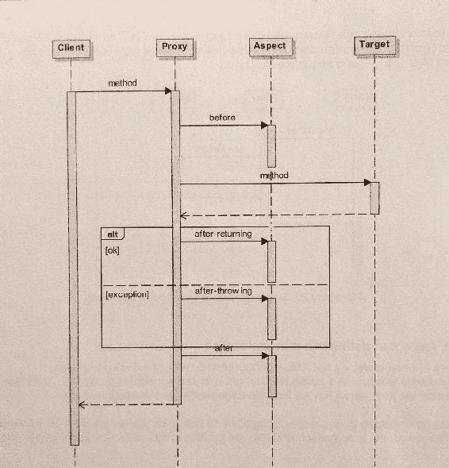（我允许发布这张照片的条件是提及其来源。作者：Noel Vaes，网站：www.noelvaes.eu）

讨论提供：[progonkpa](https://stackoverflow.com/users/4843624/progonkpa)

## 问题

在使用 IntelliJ IDEA 运行 JUnit 测试时，我遇到了以下情况：

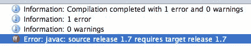

我该如何修复它？

* 使用`SDK 1.7`
* 模块语言级别为`1.7`

Maven 构建运行正常。（这就是为什么我认为这是 IDEA 的配置问题）

问题由：[JAM](https://stackoverflow.com/users/359862/jam)提供

## 解决方案


很可能是你从 Maven 在此处导入了错误的编译器选项：

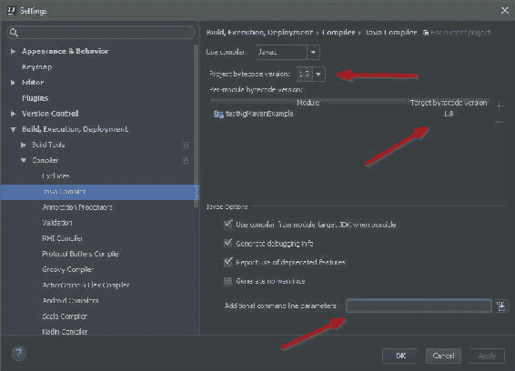

同时检查截图中列出的项目和模块字节码 `target` 版本设置。

配置 `source` 语言级别的其他地方：

- Project Structure | `Project`

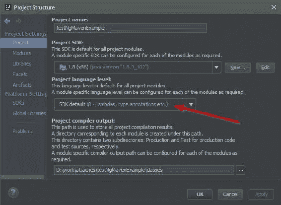

- Project Structure | Modules（检查每个模块） | `Sources`

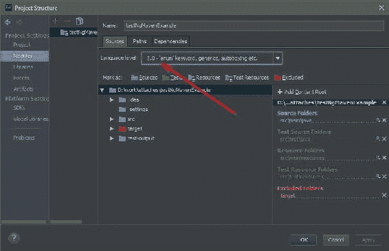

Maven 的 `default language level` 为 `1.5`（5.0），你将在上面的截图的模块语言级别中看到这个版本。

可以通过在 `pom.xml` 中使用 [maven-compiler-plugin](https://maven.apache.org/plugins/maven-compiler-plugin/examples/set-compiler-source-and-target.html) 配置进行更改：

```xml
<project>
  [...]
  <build>
    [...]
    <plugins>
      <plugin>
        <groupId>org.apache.maven.plugins</groupId>
        <artifactId>maven-compiler-plugin</artifactId>
        <configuration>
          <source>1.8</source>
          <target>1.8</target>
        </configuration>
      </plugin>
    </plugins>
    [...]
  </build>
  [...]
</project>
```

或者：

```xml
<project>
  [...]
  <properties>
    <maven.compiler.source>1.8</maven.compiler.source>
    <maven.compiler.target>1.8</maven.compiler.target>
  </properties>
  [...]
</project>
```

在你在 [Maven Projects](https://www.jetbrains.com/help/idea/2016.3/maven-projects-tool-window.html) 工具窗口中 `Reimport` Maven 项目后，IntelliJ IDEA 将遵循此设置：

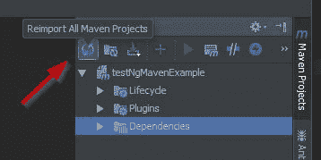

解决方案由：[CrazyCoder](https://stackoverflow.com/users/104891/crazycoder) 提供

## 讨论

我遇到了这个问题，解决方法是进入 Project Settings > Modules > 点击特定模块 > Dependencies 标签页。我发现 Module SDK 仍然设置为 `1.6`，我将其改为 `1.7` 后就成功了。

讨论由：[Rob Barreca](https://stackoverflow.com/users/444921/rob-barreca) 提供

在我的情况下（intelij idea 12.1.3），在 `settings > compiler > java compiler` 中找到了所需的选项（`target bytecode version`）。

讨论由：[eger](https://stackoverflow.com/users/1870507/eger) 提供

在某一时刻，我也毫无原因地遇到了这个错误。我更改了编译器/模块等各种设置。但最后我只是通过重新导入 Maven 项目重新创建了 IntelliJ 项目，问题就解决了。我认为这是一个 Bug。

IntelliJ 12 129.961

讨论由：[pveentjer](https://stackoverflow.com/users/2245707/pveentjer) 提供

检查 `.idea/misc.xml`，有时你需要手动更改 `languageLevel="JDK_1_X"` 属性。

讨论由：[k.a.i](https://stackoverflow.com/users/2712704/k-a-i) 提供

检查过你的构建配置吗？如果你使用 Maven 3 和 JDK 7，应该是这样的：

```xml
<build>
    <finalName>SpringApp</finalName>
    <plugins>
        <plugin>
            <artifactId>maven-compiler-plugin</artifactId>
            <configuration>
                <source>1.7</source>
                <target>1.7</target>
            </configuration>
        </plugin>
        ...
    </plugins>
    ...
</build>
```

讨论由：[swissonid](https://stackoverflow.com/users/827865/swissonid) 提供

## IntelliJ 15、2016 和 2017

与下方针对 IntelliJ 13 和 14 的讨论类似，但在 Settings/Preferences 面板中多了一层：`Settings` > `Build, Execution, Deployment` > `Compiler` > `Java Compiler`。

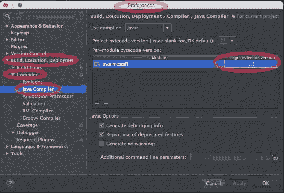

## IntelliJ 13 和 14

在 IntelliJ 13 和 14 中，检查 `Settings > Compiler > Java Compiler` UI，确保你没有在模块中针对不同的字节码版本。

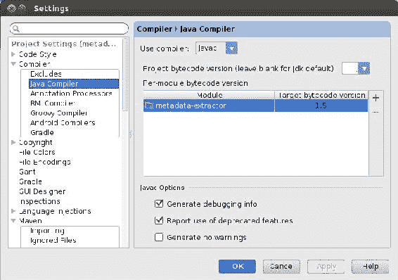

讨论由：[Drew Noakes](https://stackoverflow.com/users/24874/drew-noakes) 提供

我解决了下述方法：

File >> Project Structure >> Project >> Project Language Level --> 设置适当的版本（例如：`1.5`）。

讨论由：[mati](https://stackoverflow.com/users/435287/mati) 提供

我解决了下述方法：

File >> Project Structure >> Project >> Project Language Level --> 设置适当的版本（例如：`1.5`）。

讨论由：[mati](https://stackoverflow.com/users/435287/mati) 提供

此内容源自 [StackOverflow](https://stackoverflow.com/questions/12900373/idea-javac-source-release-1-7-requires-target-release-1-7)，并已重新整理为上述方案。

# Java GUI：如何为 JFrame 中 JPanel 的 JButton 设置焦点？

## 问题描述

我尝试了一些实验和搜索，但似乎无法解决一个我本认为很简单的问题：即让我的小型 GUI 程序在启动时让 `START` 按钮获得焦点。这样用户只需按下 Enter/Return 键，效果就和用鼠标点击 `START` 按钮一样。这是我的代码。感谢大家的帮助 :)

```java
private void initialize() {

   // Launch the frame:
   frame = new JFrame();
   frame.setTitle("Welcome!");
   frame.setSize(520, 480);
   frame.setLocationRelativeTo(null);
   frame.setDefaultCloseOperation(JFrame.EXIT_ON_CLOSE);

   // Add the image:
   ImageIcon heroShotImage = new ImageIcon("heroShot.jpg");
   JPanel heroShotPanel = new JPanel();
   JLabel heroShot = new JLabel(heroShotImage);
   heroShotPanel.add(heroShot);

   // Create a panel to hold the "Start" button:
   JPanel submitPanel = new JPanel(new FlowLayout(FlowLayout.CENTER));

   // Create the "Start" button, which launches business logic and dialogs:
   JButton start = new JButton("Start");
   start.setToolTipText("Click to use library");
   start.setFocusable(true); // 如何在应用启动时让按钮获取焦点？
   start.requestFocus(true); // 尝试了一些方法但不起作用。

   // Listen for user actions and do some basic validation:
   start.addActionListener(new ActionListener() {
      public void actionPerformed(ActionEvent e) {
      // THE APP's LOGIC GOES HERE...
      }

   // Finish setting up the GUI and its components, listeners, and actions:
   submitPanel.add(start);

   frame.getContentPane().add(heroShotPanel, BorderLayout.NORTH);
       frame.getContentPane().add(submitPanel, BorderLayout.SOUTH);

}
```

问题由：[chrisco](https://stackoverflow.com/users/175882/chrisco) 提供

## 解决方案

尝试一下这段代码……我做的只是将 `requestFocus()` 方法移动到末尾。

基本上，为了让它在按下 Enter 键时有响应并且默认获得焦点，你需要做这两件事：

```java
frame.getRootPane().setDefaultButton(start);
start.requestFocus();
```


```java
package sof;

import java.awt.BorderLayout;
import java.awt.FlowLayout;
import java.awt.event.ActionEvent;
import java.awt.event.ActionListener;

import javax.swing.ImageIcon;
import javax.swing.JButton;
import javax.swing.JFrame;
import javax.swing.JLabel;
import javax.swing.JPanel;

public class TestFrame {

    public static void main(String[] args) {
        // Launch the frame:
        JFrame frame = new JFrame();
        frame.setTitle("Welcome!");
        frame.setSize(520, 480);
        frame.setLocationRelativeTo(null);
        frame.setDefaultCloseOperation(JFrame.EXIT_ON_CLOSE);

        // Add the image:
        ImageIcon heroShotImage = new ImageIcon("heroShot.jpg");
        JPanel heroShotPanel = new JPanel();
        JLabel heroShot = new JLabel(heroShotImage);
        heroShotPanel.add(heroShot);

        // Create a panel to hold the "Start" button:
        JPanel submitPanel = new JPanel(new FlowLayout(FlowLayout.CENTER));

        JButton start = new JButton("Start");
        start.setToolTipText("Click to use library");

        start.addActionListener(new ActionListener() {
            @Override
            public void actionPerformed(ActionEvent e) {
                System.out.println("I AM PRESSED");
            }
        });

        submitPanel.add(start);

        frame.getContentPane().add(heroShotPanel, BorderLayout.NORTH);
        frame.getContentPane().add(submitPanel, BorderLayout.SOUTH);
        frame.setVisible(true);
        frame.getRootPane().setDefaultButton(start);
        start.requestFocus();
    }
}
```

解决方案由：[bragboy](https://stackoverflow.com/users/1977903/bragboy) 提供

## 讨论

将你设置焦点的代码移动到方法的末尾。

并将其改为：

```java
start.requestFocus();  // 无参数
```

讨论由：[Adil Soomro](https://stackoverflow.com/users/593709/adil-soomro) 提供

如果我理解得没错，你希望在用户按下 Enter 键时触发 Start 按钮的点击事件。如果是这样，你可以这样做：

```java
jFrame.getRootPane().setDefaultButton(start);// 'start' 将是你的 start 按钮
```

如果你只是想让 start 按钮获得焦点，那么将你的 `requestFocus()` 方法移动到末尾（在让框架可见之后），并且不需要在其中传递 `true`。此外，正如 Java 文档所述，使用 `requestFocusInWindow()` 比使用 `requestFocus()` 更好。

讨论由：[Harry Joy](https://stackoverflow.com/users/559070/harry-joy) 提供

你不知道自己运行的是什么种垃圾回收器。确实有些垃圾回收器不会像你断言的那样“停止世界”（stop the world），但某些 JVM 并不那么智能，或者由于各种原因（也许它们运行在手机上？）而没有这样做。你不知道它会做什么。

此外，它并不保证会执行任何操作。JVM 可能会完全忽略你的请求。

“你不知道它会做什么”、“你不知道它是否会有帮助”以及“反正你也不应该需要调用它”这几点结合在一起，导致了为什么人们如此强烈地表示，通常你不应该调用它。我认为这是一种“如果你需要问是否应该使用它，那么你就不该使用”的情况。

### 针对另一个帖子中某些疑问的编辑

在阅读了你提供的帖子后，我还有几点想指出。首先，有人建议调用 `gc()` 可能会将内存返回给系统。这并不一定正确——Java 堆本身的增长是与 Java 分配独立运行的。

也就是说，JVM 会持有内存（数十兆字节）并根据需要扩展堆。即使你释放了 Java 对象，它也不一定会将这些内存返回给系统；它完全可以保留已分配的内存，供未来的 Java 分配使用。

为了证明 `System.gc()` 可能无所事事，请查看：

[`bugs.sun.com/view_bug.do?bug_id=6668279`](http://bugs.sun.com/view_bug.do?bug_id=6668279)

特别有一个 [`-XX:DisableExplicitGC`](http://java.sun.com/javase/technologies/hotspot/vmoptions.jsp) VM 选项。

解决方案来自：[Steven Schlansker](https://stackoverflow.com/users/171061/steven-schlansker) 提供

## 讨论


是的，调用`System.gc()`并不能保证它会运行，它是向 JVM 发出的可能被忽略的请求。根据文档：

> 调用`gc`方法建议 Java 虚拟机花费精力回收未使用的对象。

调用它几乎总是个坏主意，因为自动内存管理通常比你更清楚何时该`gc`。当它内部的空闲内存池较低时，或者操作系统请求归还某些内存时，它会这样做。

如果你`知道`它有帮助，那么调用`System.gc()`可能是可以的。我的意思是，你已经在`部署平台`上彻底测试并测量了两种场景的行为，并且你可以证明它有帮助。但请注意，`gc`并不容易预测——它在某一次运行中可能有帮助，在另一次中可能有害。

讨论来自：[tom](https://stackoverflow.com/users/289354/tom)

已经解释过调用`system.gc()`可能无所事事，而且任何“需要”垃圾回收器运行的代码都是有问题的。

然而，调用`System.gc()`是一种坏实践的实用原因是它是低效的。在最坏的情况下，它是`极其低效`！让我解释一下。

典型的 GC 算法通过遍历堆中的所有非垃圾对象来识别垃圾，并推断任何未被访问的对象都是垃圾。据此，我们可以对垃圾回收的总工作进行建模：由一部分与存活数据量成正比，另一部分与垃圾量成正比；即`work = (live * W1 + garbage * W2)`。

现在假设你在单线程应用中执行了以下操作：

```
System.gc(); System.gc();
```

第一次调用（我们预测）将执行`(live * W1 + garbage * W2)`的工作，并清除积积的垃圾。

第二次调用将执行`(live* W1 + 0 * W2)`的工作且不回收任何内容。换句话说，我们执行了`(live * W1)`的工作却`一无所获`。

我们可以将收集器的效率建模为收集单位垃圾所需的工作量；即`efficiency = (live * W1 + garbage * W2) / garbage`。因此，为了让 GC 尽可能高效，我们需要在运行 GC 时`最大化``garbage`的值；即等待直到堆满。（而且，还要让堆尽可能大。但那是另一个的话题。）

如果应用程序不干预（通过调用`System.gc()`），GC 将等待到堆满后才运行，从而实现高效的垃圾回收¹。但如果应用程序强制 GC 运行，堆很可能还没有满，结果将是垃圾回收的效率很低。应用程序强制 GC 的频率越频繁，GC 就会变得越低效。

注意：上面的解释忽略了典型的现代 GC 将堆划分为若干“空间”、GC 可能会动态扩展堆、应用程序的非垃圾对象工作集可能会变化等事实。尽管如此，相同的基本原理也适用于所有真正的垃圾回收器²。强制 GC 运行是低效的。

***

^(1 - 这是“吞吐量型”收集器的工作方式。CMS 和 G1 等并发收集器使用不同的标准来决定何时启动垃圾回收器。）

^(2 - 我也排除了专门使用引用计数的内存管理器，但目前没有 Java 实现使用那种方法……这是有原因的。）

讨论来自：[Stephen C](https://stackoverflow.com/users/139985/stephen-c)

人们已经很好地解释了为什么不要使用，但我给出几个你应该使用它的情况：

（以下注释适用于在 Linux 上运行 CMS 的情况，我确信`System.gc()`实际上会触发全垃圾回收）。

1. 在启动应用程序的初始工作后，内存可能处于糟糕状态。你的老年代可能充满了垃圾，在那些重视的 CMS 应用中，调用`System.gc()`来重置堆的初始数据状态并不是坏主意。

2. 与第 1 点类似，如果你密切监控内存使用，你希望获得基准内存使用的准确读数。如果应用程序的前 2 分钟全是在初始化，除非你强制（咳）进行全垃圾回收，否则你的数据将会是混乱。

3. 你可能有一个应用程序被设计为在运行时不会将任何内容提升到老年代。但你可能需要预先初始化一些并不大到会自动移动到老年代的数据。除非在设置好之后调用`System.gc()`，否则你的数据将一直留在新生代，直到提升的时候到来。突然之间，你超低延迟、低 GC 的应用程序在正常操作期间因提升这些对象而遭受了巨大的（相对而言）延迟惩罚。

4. 有时在生产应用程序中提供一个`System.gc()`调用对于验证内存泄漏的存在是有用的。如果你知道时间 X 的存活数据与时间 Y 的存活数据应该成某种比例，那么在时间 X 和 Y 调用`System.gc()`并比较内存使用可能是用的。

讨论来自：[JT.](https://stackoverflow.com/users/290267/jt)

也许我写的代码很烂，但我意识到在 Eclipse 和 NetBeans IDE 中点击垃圾桶图标是一种“良好的实践”。

讨论来自：[Ryan Fernandes](https://stackoverflow.com/users/111991/ryan-fernandes)

GC 效率依赖于许多启发式。例如，一种常见的启发式是对对象的写入访问通常发生在不久创建的对象上。另一个是许多对象的寿命非常短（有些对象会被使用很长时间，但很多对象在创建几微秒后就会被丢弃）。

调用`System.gc()`就像是踢了一下垃圾桶（GC）。这意味着：“那些精心调优的参数、那些智能的组织、你为了分配和管理对象以确保运行顺畅而付出的所有努力，好了，全部丢掉吧，从头开始”。它可能会提高性能，但大多数情况下它只是会降低性能。

要可靠地（*）使用`System.gc()`，你需要了解 GC 运行的所有细微细节。如果你使用来自其他供应商的 JVM、同一供应商的下一个版本，或者相同的 JVM 但带有略有不同的命令行选项，这些细节往往会发生很大变化。因此，这通常不是一个好主意，除非你想在控制所有这些参数的情况下解决某个特定问题。这就是所谓的“坏习惯”的含义：它并不被禁止，该方法确实存在，但很少能产生回报。

（*）我在这里讨论的是效率。`System.gc()`永远不会破坏一个正确的 Java 程序。它也不会变出 JVM 无法 otherwise 获取的额外内存：在抛出`OutOfMemoryError`之前，JVM 会执行`System.gc()`的工作，即使是作为最后的手段。

讨论感谢：[Thomas Pornin](https://stackoverflow.com/users/254279/thomas-pornin)

似乎很多人都在告诉你不要这样做。我不赞同。如果在一个大型加载过程（如加载关卡）之后，你认为：

1. 你有很多不可达的对象且可能没有被 GC；而且
2. 你认为用户在这一点可以忍受微小的减速

那么调用`System.gc()`并没有害。我把它看作 C/C++ 中的`inline`关键字。它只是给 GC 的一个提示，表示你作为开发者已经决定时间/性能没有像情况下那么重要，某些时间可以用来回收内存。

不要依赖它能产生任何作用的建议是正确的。不要依赖它能工作，但给出“现在是收集的合适时间”的提示是完全没问题的。我宁愿在代码中无关紧要的地方（加载界面）浪费时间，也不在用户正在与程序交互时（例如游戏关卡期间）浪费。

只有一种情况我会[强制](http://java.sun.com/javase/6/docs/platform/jvmti/jvmti.html#ForceGarbageCollection)回收：当尝试找出某个特定对象是否存在泄漏（无论是原生代码还是大型、复杂的调交互。噢，还有任何看一眼 Matlab 的 UI 组件）。**这绝对不应该用于生产环境代码。**

讨论感谢：[KitsuneYMG](https://stackoverflow.com/users/86515/kitsuneymg)

根据我的经验，使用`System.gc()`实际上是某种特定平台的优化形式（这里的“平台”是指硬件架构、操作系统、JVM 版本以及可能的更多运行时参数，如可用 RAM 的组合），因为它的行为虽然在特定平台上大致可预测，但在不同平台之间会（并且会）显著变化。

是的，某些情况下`System.gc()`会提高（感知的）性能。例如，如果你的应用程序某些部分的延迟是可以接受的，但在其他部分则不是（上述提到的游戏示例，你希望 GC 在关卡开始时发生而不是在关卡期间）。

然而，它是有益还是有害（或没用）高度取决于平台（如上定义）。

所以我认为它作为一种最后的、特定平台的优化是有效的（即：如果其他性能优化不足的话）。但你永远不应该因为认为它可能有用（在没有特定基准测试的情况下）就调用它，因为很有可能没用。

讨论感谢：[sleske](https://stackoverflow.com/users/43681/sleske)

首先，规范和现实之间存在差异。规范说`System.gc()`是一个 GC 应该运行的提示，VM 可以忽略它。现实是，VM 永远不会忽略对`System.gc()`的调用。

调用 GC 带有相当不小的调用开销，如果你在某个随机时间点这样做，你可能会发现你的努力没有任何回报。另一方面，自然触发的收集很有可能收回调用的成本。如果你有信息表明应该运行 GC，那么你就可以调用`System.gc()`并应该能看到收益。然而，根据我的经验，这只发生在少数边缘情况下，因为你不太可能有足够的信息来理解是否以及何时调用`System.gc()`。

这里列出的一个例子是，在你的 IDE 中点击垃圾桶图标。如果你要去开会，为什么不点一下呢？这种开销不会影响到你，而堆内存在你回来时可能已经清理了。在生产系统中这样做，频繁的收集调用会导致系统陷入停滞！即使是像 RMI 那样的偶尔调用也可能对性能产生破坏。

讨论感谢：[Kirk](https://stackoverflow.com/users/805608/kirk)

我的个人见解：我在一个 activity 中加载了一些 AnimationDrawables 并播放它们。我加载、播放，然后将 imageView 的背景设置为 null，一个一个地。如果我离开 activity 然后快速回来，在 3 或 4 次之后，占用的内存增长得太大，直到我遇到内存溢出异常。

在将 imageView 背景设置为 null 后显式调用垃圾回收器，我在 Eclipse 的 logcat 中看到内存保持得足够——我没有得到内存溢出异常。我认为它的工作方式像 C++ 标准容器：你获得一些初始内存，每次当不够时，它就会翻倍。

说如果你需要调用它是因为代码坏了或很糟糕，这对我来说是一个不合理且教条的回答：特别是当你可以用 C++ 这种具有完全内存管理的语言编程，却必须在 Java 这种语言上面对移动设备资源限制时，而没有机会手动释放内存。

讨论感谢：[Black Imp](https://stackoverflow.com/users/991240/black-imp)

有时（**并不经常！！**）你确实比运行时更了解过去、现在和未来的内存使用情况。这种情况并不常见，我敢声称在提供普通页面的 Web 应用中绝不会发生。多年前我做过一个报告生成器，它：

- 拥有单线程
- 从队列中读取“报告请求”
- 从数据库加载报告所需的数据
- 生成报告并通过电子邮件发送
- 无限次重复，在没有待处理请求时休眠
- 它在报告之间不重用任何数据，也不进行任何缓存。

首先，因为这不是实时的，且用户期望等待报告，所以 GC 运行时的延迟不是问题，但我们需要以比请求更快的速度产生报告。

通过观察上述流程的概述，可以清楚看到：

- 我们知道在发送完邮件之后，活对象很少，因为下一个请求还没有开始处理。
- 众所周知，运行垃圾回收周期的成本取决于活对象的数量，垃圾的量对 GC 运行的成本影响很小。
- 当队列为空时，没有比运行 GC 更好的事情做了。

因此显然，每当请求队列为空时运行 GC 都是非常值得的；这样做没有任何副作用。

在每封报告邮件发送后运行一次 GC（垃圾回收）可能是值得的，因为我们知道这是运行 GC 的良好时机。然而，如果计算机有足够的内存，延迟 GC 运行会获得更好的结果。

这种行为是基于安装进行配置的，对于某些客户，在每份报告后启用强制 GC 极大加快了报告保护速度。（我推测这是由于他们的服务器内存较低且运行了许多其他进程，因此一个及时的强制 GC 减少了页面交换。）

我们从未发现有任何安装在每次工作队列为空时不进行强制 GC 运行而没有从中获益。

# 但请明确的是，上述情况并不是常见案例。

讨论感谢谢：[Ian Ringrose](https://stackoverflow.com/users/57159/ian-ringrose)

这是一个非常令人困扰的问题，我觉得这导致了许多人反对 Java，尽管它是一门非常有用的语言。

你无法信任`System.gc`会执行任何操作，这一事实令人心而生畏，并且很容易让你对这种语言产生“恐惧、不确定和怀疑”的感觉。

在很多情况下，在重要事件发生之前故意处理你引起的内存峰值是件好事，否则这会导致用户认为你的程序设计不当或无响应。

拥有控制垃圾回收的能力将是一个非常棒的教育工具，反过来也能提高人们对垃圾回收如何工作，以及如何让程序利用其默认行为和控制行为的理解。

让我回顾一下这个线程的论点。

### 1. 它是低效的

通常，程序可能并没有在做任何事情，而你因为设计的原因知道它没有在做事情。例如，它可能正在进行带有大型等待消息框的某种长时间等待，在结束时大可以添加一个收集垃圾的调用，因为运行它所需仅占长时间等待时间的一极小部分，但可以避免 GC 在更重要的操作中间发生紊乱。

### 2. 这始终是一个坏习惯，并表明代码有缺陷

我不认同，你用的是哪种垃圾回收器并不重要。它的工作是跟踪垃圾并清理它们。

通过在用不那么关键的时候调用`gc`，你可以降低它在你生命依赖于特定代码运行的情况下运行、而它却决定收集垃圾的概率。

当然，它的行为可能不像你想要或预期的那样，但当你想要调用它时，你知道此时没有事情在发生，且用户愿意忍受缓慢/停机。如果`System.gc`起作用了，太好了！如果没有生效，至少你尝试过了。这根本没有坏处，除非垃圾回收器具有固有的副作用，即在手动调用时对垃圾回收器本应的行为产生极其糟糕且意料之外的影响，而这本身导致了不信任。

### 3. 它不是常见的用例

这是一个无法可靠实现的用例，但如果系统被设计成那样，就可以实现。这就像制作一个交通灯，并让某些/所有交通灯的按钮不起作用，这会让你怀疑起初为什么要设置那个按钮。JavaScript 没有垃圾回收函数，所以我们不会对其进行那么严格的审视。

### 4. 规范说`System.gc()`是 GC 应该运行的提示，VM 可以自由忽略它

什么是“提示”？什么是“忽略”？计算机不能简单地接受提示或忽略某些东西，它有严格的执行路径要遵循，这些路径可能是动态的，并受到系统意图的引导。一个正确的答案应该包含垃圾回收器在实现层面到底在做什么，导致它在在你请求时不执行收集。该功能是否仅仅是一个`nop`？是否存在必须满足的某些条件？这些条件是什么？

目前，Java 的 GC 往往看起来像一个你你不信任的怪物。你不知道它何时会来、何时会走，不知道它将要做什么，将如何做。我可以想象某些专家对垃圾回收如何基于每条指令工作有更主意的想法，但绝大多数人只是希望它“能够正常工作”，而必须信任一个看起来不透明的算法来为你工作是令人沮丧的。

在阅读某事或被教导某事，与实际看到它的实现、系统之间的差异，以及能够在不查看源码的情况下对其进行操作，之间存在着巨大的鸿沟。这创造了自信感以及掌握/理解/控制的感觉。

总结来说，这些回答存在一个内在问题：“这个功能可能什么都不做，而我不会详细说明如何判断它何时起作用、何时没起作用，以及它为什么不起作用或会起作用，这通常暗示尝试这样做本身就违背了某种哲学思想，即使其背后的意图是合理的”。

Java GC 这样运行可能没问题，也可能有问题，但要理解它，很难真正遵循该往哪个方向走来获得一个关于你可以信任 GC 做什么和不做什么的全面概述，因此人们太容易简单地信任这种语言了。因为语言的目的是提供在哲学意义上可控的行为（对于程序员，尤其是新手来说，很容易陷入某些系统/语言行为带来的存在主义危机），你能够忍受的行为（如果你不能忍受，除非万否则你就不会使用这种语言），以及更多你由于未知原因而无法控制的事情，这本质上是有害的。

讨论感谢谢：[Dmitry](https://stackoverflow.com/users/201271/dmitry)

- 静态方法只能访问静态数据。它无法访问非静态数据（实例变量），除非它拥有或创建了该类的实例。
- 静态方法只能调用其他静态方法，不能从其中调用非静态方法，除非它拥有或创建了该类的实例。
- 静态方法可以通过类名直接访问，不需要任何对象。
- 语法：`Class.methodName()`
- 静态方法无法以任何方式引用`this`或`super`关键字。

# 静态类（static class）

Java 也有“静态嵌套类”，静态嵌套类只是一个没有隐式持有外部类实例引用的类。

静态嵌套类可以拥有实例方法和静态方法。

Java 中不存在顶层静态类。

### 备注

> `main`方法是`static`的，因为在任何实例化发生之前，为了运行应用程序它必须是可访问的。

# `final`关键字

`final`关键字用于几种不同的上下文，以定义一个之后无法被更改的实体。

- `final`类不能被子类。这样做出于安全和效率的考虑。因此，许多 Java 标准库类都是`final`的，例如`java.lang.System`和`java.lang.String`。`final`类中的所有方法隐含地都是`final`。
- `final`方法不能被子类重写。这是为了防止子类修改可能对类的功能或一致性至关重要的方法导致意外行为。
- `final`变量只能初始化一次，可以通过初始化器或赋值语句。它不需要在声明时初始化：这被称为“空 final（blank final）”变量。类的空`final`实例变量必须在它的类的每个构造函数的结束处被确定地赋值；同样，空`final`静态变量必须在声明它的类的静态初始化器中被确定地赋值；否则，在两种情况下都会发生编译错误。

### 注意事项

如果变量是一个引用，这意味着该变量无法重新绑定到另一个对象。但如果它所引用的对象原本是可变的，那么它仍然是可变的。


当方法体内定义匿名内部类时，该方法作用域内声明为`final`的变量都可以从内部类内部访问。一旦被赋值，`final`变量的值就不能更改。

解决方案感谢：[Ashish](https://stackoverflow.com/users/903137/ashish)

## 讨论

`static`是类中任何对象都可以调用的东西，它本质上属于一个对象类型。

变量对于特定对象可以是`final`的，这意味着它将不再改变。它只能被设置一次，再次尝试设置将导致抛出错误。它在许多方面都很有用，也许你想给一个不能更改的对象起一个名字。

一些示例代码：

```
class someClass
{
   public static int count=0;
   public final String mName;

   someClass(String name)
   {
     mname=name;
     count=count+1;
   }

  public static void main(String args[])
  {
    someClass obj1=new someClass("obj1");
    System.out.println("count="+count+" name="+obj1.mName);
    someClass obj2=new someClass("obj2");
    System.out.println("count="+count+" name="+obj2.mName);
  }
}
```

Wikipedia 包含了完整的 [java 关键字](http://en.wikipedia.org/wiki/List_of_Java_keywords) 。

讨论感谢：[PearsonArtPhoto](https://stackoverflow.com/users/544198/pearsonartphoto)

`static`意味着它属于类而不是实例，这意味着特定`Class`的所有实例之间共享该变量/方法的唯一拷贝。

```
public class MyClass {
    public static int myVariable = 0; 
}

// 现在在其他代码中创建两个 MyClass 实例
// 并修改变量将影响所有实例

MyClass instance1 = new MyClass();
MyClass instance2 = new MyClass();

MyClass.myVariable = 5;  // 此更改将反映在两个实例中
```

`final`完全无关，它是一种定义一次性初始化的方法。你既可以在定义变量时初始化，也可以在构造函数中初始化，不能在其他地方初始化。

**注意** 关于`final`方法和`final`类的说明，这是一种显式声明方法或类分别不能被重写/扩展的方法。

**扩展阅读** 关于静态的话题，我们讨论了它可能具有的其他用途，它有时用于静态块。在使用静态变量时，有时在在使用类之前这些设置这些变量，但遗憾的是你没有构造函数。这就是`static`关键字派上用场。

```
public class MyClass {

    public static List<String> cars = new ArrayList<String>();

    static {
        cars.add("Ferrari");
        cars.add("Scoda");
    }

}

public class TestClass {

    public static void main(String args[]) {
        System.out.println(MyClass.cars.get(0));  // 这将打印 Ferrari
    }
}
```

你不要将其与在每个实例的构造函数之前调用的实例初始化块混淆。

讨论感谢：[Jon Taylor](https://stackoverflow.com/users/147541/jontaylor)

静态和 final 有很大的区别：

静态变量或类在几乎任何地方都是可用的。Final 只是一个意味着变量不能更改的关键字。假设有：

```
public class Test{    
   public int first = 10;
   public static int second = 20;

   public Test(){
     second = second + 1
     first = first + 1;
   }
}
```

程序将一直运行直到尝试更改`first`，这会导致错误。在类外部，只有当你实例化类时才能访问`first`。这与`second`不同，后者始终可用。

讨论感谢：[alistair](https://stackoverflow.com/users/568355/alistair)

`final`在应用于变量、方法、类或其他其他情况时有不同的含义。我更喜欢 [Wikipedia 的解释](http://en.wikipedia.org/wiki/Final_%28Java%29)。

讨论感谢：[madth3](https://stackoverflow.com/users/422353/madth3)

将对象想象成`Speaker`（扬声器）。如果`Speaker`是一个类，它将拥有不同的变量，如音量、高音、低音、颜色等。你在定义`Speaker`类时定义了这些字段。例如，你使用`static`修饰符声明了`color`字段，这意味着你告诉编译器该变量在存在中恰有一个副本，无论该类被实例化多少次。

### 声明

```java
static final String color = "Black"; 
```

这将确保每当该类被实例化时，`color`字段的值都为"Black"，除非它没有被修改。

```java
public class Speaker {

static String color = "Black";

}

public class Sample {

public static void main(String args[]) {
    System.out.println(Speaker.color); //将输出 "Black"
            Speaker.color = "white";
    System.out.println(Speaker.color);  //将输出 "White"
}}
```

注意：现在一旦你将扬声器的颜色更改为`final`，这段代码将无法执行，因为`final`关键字确保了字段的值永远不会改变。

```java
public class Speaker {

static final String color = "Black";

}

public class Sample {

public static void main(String args[]) {
    System.out.println(Speaker.color); //应该输出 "Black"
            Speaker.color = "white"; // 错误，因为 color 的值是固定的。
    System.out.println(Speaker.color); // 代码不会执行。
}}
```

你可以直接将此代码复制/粘贴到你的模拟器中尝试。

讨论感谢：[vishnulphb](https://stackoverflow.com/users/2998835/vishnulphb)

### final -

1) 当我们将`final`关键字应用于变量（variable）时，该变量的值保持不变。（或）一旦我们将变量声明为`final`，该变量的值就无法更改。

2) 当变量值在程序生命周期内不改变时，它非常有用。

### static -

1) 当我们将`static`关键字应用于变量（variable）时，意味着它属于类。

2) 当我们将`static`关键字应用于方法（method）时，意味着可以在创建类的任何实例的情况下访问该方法。

讨论感谢：[Rohit](https://stackoverflow.com/users/3490371/rohit)

`static`意味着内存中只有一个变量副本，由该类的所有实例共享。`final`关键字仅仅意味着值不能改变。没有`final`，任何对象都可以更改变量的值。

讨论感谢：[eosimosu](https://stackoverflow.com/users/4069782/eosimosu)

此内容源于 [StackOverFlow](https://stackoverflow.com/questions/1377280/difference-between-static-and-final) 并已整理成上述内容。

# 如何在 Java 中优雅地处理 SIGKILL 信号

## 问题

当程序接收到 kill 信号时，如何处理清理工作？例如，我连接的一个应用程序希望任何第三方（我的应用）在注销时发送一个`finish`命令。当我的应用被`kill -9`销毁时，最好的方法是发送那个`finish`命令吗？

编辑 1：`kill -9`无法被捕获。感谢各位纠正我。

编辑 2：我猜这种情况发生在调用 kill 的时候，这等同于 ctrl-c。问题提出者：[Begui](https://stackoverflow.com/users/22415/begui)

## 解决方案

处理`kill -9`以外的任何情况的方法是注册一个 [shutdown](http://java.sun.com/javase/6/docs/api/lang/Runtime.html#addShutdownHook(java.lang.Thread))钩子。如果你可以使用`SIGTERM` `kill -15`，关闭钩子将起作用。`SIGINT` `kill -2`确实会导致程序优雅退出并运行关闭钩子。

注册一个新的虚拟机关闭钩子：

> Java 虚拟机通过响应两类事件而关闭：

> * 程序正常退出，当最后一个非守护线程退出或调用`System.exit`方法时，

> * 虚拟机响应用户中断而终止（例如输入 ^C），或响应系统范围的事件（例如用户注销或系统关机）。

我在 OSX 10.6 上尝试了以下测试程序，在`kill -9`上它**没有**运行钩子，我预料会如此。在`kill -15`上，它每次**都会**运行关闭钩子。

```java
public class TestShutdownHook
{
    public static void main(final String[] args) throws InterruptedException
    {
        Runtime.getRuntime().addShutdownHook(new Thread()
        {
            @Override
            public void run()
            {
                System.out.println("Shutdown hook ran!");
            }
        });

        while (true)
        {
            Thread.sleep(1000);
        }
    }
}
```

在任何程序中都没有办法真正处理`kill -9`。

在少数情况下，虚拟机可能会中止，即在没有优雅关闭的情况下停止。这发生在虚拟机从外部终止时，例如使用 Unix 上的`SIGKILL`信号或 Windows 上的`TerminateProcess`调用。处理`kill -9`的唯一可行方案是让另一个监控程序监控你的主程序消失，或者使用封装脚本。你可以使用 shell 脚本来实现这一点，通过轮询`ps`命令在列表中查找你的程序，并在它消失时采取相应行动。

```bash
#!/bin/bash

java TestShutdownHook
wait
# 通知你的其他应用你退出了
echo "TestHook quit"
```

解决方案感谢：[Jarrod Roberson](https://stackoverflow.com/users/177800/jarrod-roberson)

## 讨论

你可以使用`Runtime.getRuntime().addShutdownHook(...)`，但无法保证它在任何情况下都会被调用。

讨论感谢：[lexicore](https://stackoverflow.com/users/303810/lexicore)

在某些 JVM 中有处理你自己的信号的方法——例如参见关于 [HotSpot JVM 的文章](http://java.sun.com/javase/6/webnotes/trouble/TSG-VM/html/signals)。

通过使用 Sun 内部`sun.misc.Signal.handle(Signal, SignalHandler)`方法你也可以注册信号处理器，但可能对于`INT`或`TERM`等信号无效，因为它们被 JVM 使用。

为了处理任何信号，你必须跳出 JVM 进入操作系统领域。我通常（例如）检测异常终止的方法是在 Perl 脚本内部启动我的 JVM，但让脚本使用`waitpid`系统调用等待 JVM。这样每当 JVM 退出时我都会通知以及退出原因，并采取行动。

讨论感谢：[Asgeir S. Nilsen](https://stackoverflow.com/users/16023/asgeir-s-nilsen)

我期望 JVM 会优雅地中断[`thread.interrupt()`](http://docs.oracle.com/javase/7/docs/api/java/lang/Thread.html#interrupt())应用程序创建的所有运行线程，至少对于信号 [`SIGINT (kill -2)`](https://en.wikipedia.org/wiki/Unix_signal#SIGINT) 和 [`SIGTERM (kill -15)`](https://en.wikipedia.org/wiki/Unix_signal#SIGTERM)。

这种情况下，信号将转发给它们，允许以[标准方式](https://docs.oracle.com/javase/tutorial/essential/concurrency/interrupt.html)进行优雅的线程取消和资源清理。

但事实并非如此（至少在我的 JVM 实现中：`Java(TM) SE Runtime Environment (build 1.8.0_25-b17), Java HotSpot(TM) 64-Bit Server VM (build 25.25-b02, mixed mode)`）。

首先，我并不是在所有程序中都关心这一点，只在那些我想要跟踪用户取消和意外结束的程序中是如此。例如，假设你的`java`程序是一个由其他进程管理的进程。你可能想要区分它是被优雅地终止了（来自管理进程的`SIGTERM`），还是发生了某种关机重启（以便在启动时自动重新启动任务）。

作为基础，我总是让我的长运行线程定期感知中断状态，如果它们被中断，则抛出`InterruptedException`。这允许以开发者控制的方式执行收尾工作（同时也产生与标准阻塞操作相同的结果）。然后，在线程栈的顶层捕获`InterruptedException`并执行适当的清理工作。这些线程在编码时就已经知道如何响应中断请求。高[内聚](https://en.wikipedia.org/wiki/Cohesion_(computer_science))设计。

因此，在这些情况下，我添加了一个关闭钩子（shutdown hook），它执行我认为`JVM`默认应该做的事情：中断我的应用程序创建的所有仍在运行的非守护线程。


```java
Runtime.getRuntime().addShutdownHook(new Thread() {
    @Override
    public void run() {
        System.out.println("Interrupting threads");
        Set<Thread> runningThreads = Thread.getAllStackTraces().keySet();
        for (Thread th : runningThreads) {
            if (th != Thread.currentThread() 
                && !th.isDaemon() 
                && th.getClass().getName().startsWith("org.brutusin")) {
                System.out.println("Interrupting '" + th.getClass() + "' termination");
                th.interrupt();
            }
        }
        for (Thread th : runningThreads) {
            try {
                if (th != Thread.currentThread() 
                && !th.isDaemon() 
                && th.isInterrupted()) {
                    System.out.println("Waiting '" + th.getName() + "' termination");
                    th.join();
                }
            } catch (InterruptedException ex) {
                System.out.println("Shutdown interrupted");
            }
        }
        System.out.println("Shutdown finished");
    }
});
```

GitHub 上的完整测试应用程序：[`github.com/idelvall/kill-test`](https://github.com/idelvall/kill-test)

讨论感谢：[idelvall](https://stackoverflow.com/users/4483113/idelvall)

有一种响应`kill -9`的方法：即有一个独立的进程来监控被杀掉的进程，并在必要时对其进行清理。这可能涉及进程间通信（IPC），并且工作量很大，而且你仍然可以通过同时杀死两个进程来覆盖它。我假设在大多数情况下这不值得费这个麻烦。

任何使用`-9`杀死进程的人理论上应该知道自己在做什么，以及这可能会让事物处于不一致的状态。

讨论感谢：[Arno Schäfer](https://stackoverflow.com/users/2657105/arno-sch%c3%a4fer)

此内容源自 [StackOverFlow](https://stackoverflow.com/questions/2541597/how-to-gracefully-handle-the-sigkill-signal-in-java)，并被重新组织成了上面的配方。

# "`implements`" 在类上做了什么？

## 问题

如果一个类实现（`implements`）另一个类……这意味着什么？我找到了这段代码示例：[`www.java2s.com/Code/Php/Class/extendsandimplement.htm`](http://www.java2s.com/Code/Php/Class/extendsandimplement.htm)

但遗憾的是，它没有任何没有任何说明……

问题感谢：[Webnet](https://stackoverflow.com/users/197606/webnet)

## 解决方案

实现意味着它承担了接口所指定的特定行为。考虑以下接口：

```java
public interface ISpeak
{
   public String talk();
}

public class Dog implements ISpeak
{
   public String talk()
   {
        return "bark!";
   }
}

public class Cat implements ISpeak
{
    public String talk()
    {
        return "meow!";
    }
}
```

`Cat`和`Dog`类都实现了`ISpeak`接口。

接口的棒之处在于，我们现在可以通过`ISpeak`接口来引用此类的类的实例。考虑以下示例：

```java
Dog dog = new Dog();
Cat cat = new Cat();

List<ISpeak> animalsThatTalk = new ArrayList<ISpeak>();

animalsThatTalk.add(dog);
animalsThatTalk.add(cat);

for (ISpeak ispeak : animalsThatTalk)
{
    System.out.println(ispeak.talk());
}
```

该循环的输出将是：

> bark!

> meow!

接口提供了一种基于类所做的事情以通用方式与类进行交互的方法，而不暴露实现类具体是什么。

例如，Java 中最常用的接口之一[`Comparable`](http://download.oracle.com/javase/6/docs/api/java/lang/Comparable.html)。如果你的对象实现了这个接口，你就可以编写一个消费者可以使用的实现对你的对象进行排序。

例如：

```java
public class Person implements Comparable<Person>
{
  private String firstName;
  private String lastName;

  public int compareTo(Person p)
  {
    return this.lastName.compareTo(p.getLastName());
  }
}
```

现在考虑这段代码：

```java
List<Person> people = getPeople();

Collections.sort(people);
```

这样做是为`Person`类提供了自然排序。解决方案感谢：[Wayne Hartman](https://stackoverflow.com/users/105903/wayne-hartman)

## 讨论

接口是通过类实现的。它们是纯抽象的。

在 PHP 中，当一个类实现接口时，其中定义的方法可以被修改。对于接口来说并非如此：

```php
interface ImplementMeStrictly {
   public function foo($a, $b);
}

class Obedient implements ImplementMeStrictly {
   public function foo($a, $b, $c) 
      {
      }
}
```

会导致错误，因为没有实现接口。相反：

```php
class InheritMeLoosely {
   public function foo($a)
      {
      }
}

class IDoWhateverWith extends InheritMeLoosely {
   public function foo()
      {
      }
}
```

是被允许的。讨论感谢：[Linus Kleen](https://stackoverflow.com/users/255756/linus-kleen)

你应该查看 Java 的接口。快速 Google 搜索发现了[这个页面](http://www.learn-java-tutorial.com/Java-Interfaces.cfm)，它看起来不错。

我喜欢把`interface`视作是某种“承诺”：任何实现它的类都具有某些可以对其预期的行为，因此你可以将实现该类的实例放入接口类型的引用中。

如果我想比较两个`RationalNumber`实例（可能是为了排序？），我可以通过实现`java.lang.Comparable`接口来实现。为了做到这一点，需要完成两件事：为`compareTo`提供定义，并声明实现了该接口。

完善后的类看起来可能如下所示：

```java
public class RationalNumber implements java.lang.Comparable
{
    public int numerator;
    public int denominator;

    public RationalNumber(int num, int den)
    {
        this.numerator = num;
        this.denominator = den;
    }

    public int compareTo(Object other)
    {
        if (other == null || !(other instanceof RationalNumber))
        {
            return -1; // 将此对象放在非 RationalNumber 类型对象之前
        }

        RationalNumber r = (RationalNumber)other;

        // 通过交叉相乘进行计算。这对于答案并不重要，
        // 但重点在于我们正在比较这两个有理数。
        // 而且不，我不在乎它在数学上是否准确。

        int myTotal = this.numerator * other.denominator;
        int theirTotal = other.numerator * this.denominator;

        if (myTotal < theirTotal) return -1;
        if (myTotal > theirTotal) return 1;
        return 0;
    }
}
```

你可能在想，这一切的意义是什么？答案是你查看像[这个](http://download.oracle.com/javase/1.4.2/docs/api/java/util/Collections.html#sort(java.util.List))这样的方法时：排序算法只需要期望“某种可比较的对象”（注意：所有对象都必须实现`java.lang.Comparable`这一要求！）。该方法可以接受任意类型的可比较对象列表，无论它们是`String`、`Integer`还是`RationalNumber`。

注意：我在这个回答中使用了 Java 1.4 的做法。`java.lang.Comparable`现在是一个泛型接口，但我没有时间解释泛型。

讨论感谢来自：[Platinum Azure](https://stackoverflow.com/users/129655/platinum-azure)

在 Java 中，类可以实现接口。更多信息请参阅[`en.wikipedia.org/wiki/Interface_(Java)`](http://en.wikipedia.org/wiki/Interface_(Java))。我不确定 PHP 的情况。

希望有所帮助。

讨论感谢来自：[cjstehno](https://stackoverflow.com/users/135294/cjstehno)

接口定义了所有实现类必须实现的简单方法合约。当一个类实现接口时，它必须为它的所有方法提供实现。

我猜帖者假设对该语言有一定程度的了解。

讨论感谢来自：[Peter Lawrey](https://stackoverflow.com/users/57695/peter-lawrey)

它被称为接口（`interface`）。许多面向对象的语言都有这个特性。你可能想阅读这里的 PHP 解释：[`de2.php.net/interface`](http://de2.php.net/interface)

讨论感谢来自：[FlorianH](https://stackoverflow.com/users/157972/florianh)

接口（`interface`）可以被视为方法定义的列表（没有任何方法体）。如果一个类想要实现（`implement`）一个接口，它是在签署一份合同，承诺将为接口中列出的所有方法提供实现。更多信息，请参阅[`download.oracle.com/javase/tutorial/java/concepts/`](http://download.oracle.com/javase/tutorial/java/concepts/)

讨论感谢来自：[mfonda](https://stackoverflow.com/users/492401/mfonda)

此内容源自 [StackOverFlow](https://stackoverflow.com/questions/4558111/what-does-implements-do-on-a-class)并被整理成了上述配方。

# 如何让 Android 代码暂停几秒钟？

## 问题

基本上，我需要在一个操作中加入一个暂停（基于几秒钟），以便用户在下一个动作发生之前看到发生了什么。例如在黑杰中，当轮到庄家且他决定要牌（hit）时，他要牌，增加一张牌，然后他决定下一步做什么。所以在在他决定下一步做什么之前，我想让代码暂停一下，这样就可以“看到”庄家在做什么，从而庄家就不会在一秒内完成所有动作，而玩家只能看到结果。

预先感谢！

我应该说明的是，我尝试过使用`wait(在此处插入数字);`，但 Eclipse 告诉我这会导致堆栈拦截错误或类似的问题，并抛出异常，因此什么也没做：:(

嗯，这很有意思（至少可以说，我编写这些东西的方式很“有意思”），我使用了`Thread.sleep(5000)`并将其放在了 try-catch 块中，它确实会睡眠 5 秒然后继续执行代码。然而，我对视图（views）的更新直到我按下按钮后显示（真的很讨厌事件驱动编程）。

问题感谢来自：[Ivan S](https://stackoverflow.com/users/487645/ivan-s)

## 解决方案

学习用事件的角度思考确实是这里的关键。你可以到的。第一条规则是：永远不要阻塞 UI 线程。UI 线程负责保持应用程序的响应。你在那里做的任何工作都不应该阻塞；完成你需要做的事并尽快返回。如果你**任何**在 UI 线程上调用`Thread.sleep`，你就做错了。Android 通过用户看到的“程序无响应”（或“ANR”）错误来强制这一点。每当你在 Android 中看到这个错误时，意味着开发者做了某些导致 UI 线程阻塞太久的事。

你可以通过发送自己的事件来利用这种模型。在 Android 中，发送自己的事件的关键在于[`Handler`](http://developer.android.com/reference/android/os/Handler.html)类。[`postDelayed`](http://developer.android.com/reference/android/os/Handler.html#postDelayed(java.lang.Runnable,%20long))方法允许你调度一个若干毫秒后执行的[`Runnable`](http://developer.android.com/reference/java/lang/Runnable.html)。

如果你有一个类似这样的 Activity：

```java
public class MyActivity extends Activity {
    private Handler mHandler = new Handler();

    @Override
    protected void onCreate(Bundle savedInstanceState) {
        super.onCreate(savedInstanceState);
        mHandler.postDelayed(new Runnable() {
            public void run() {
                doStuff();
            }
        }, 5000);
    }

    private void doStuff() {
        Toast.makeText(this, "Delayed Toast!", Toast.LENGTH_SHORT).show();
    }
}
```

那么在 Activity 创建 5 秒后，你就会看到`doStuff`创建的 toast。

如果你正在编写一个自定义`View`，就更简单了。View 有自己的[`postDelayed`](http://developer.android.com/reference/android/view/View.html#postDelayed(java.lang.Runnable,%20long))方法，它会将所有内容发送到正确的`Handler`中，你不需要自己创建它。


第二条规则是：**只能**在 UI 线程上修改 View。你收到并忽略的那些异常意味着出了问题。如果你忽略了它们，你的应用程序可能会以有趣的方式开始异常。

如果你的应用程序在其他线程中执行大部分工作，你可以直接向你想修改的视图发送[`post`](http://developer.android.com/reference/android/view/View.html#post(java.lang.Runnable))事件，这样修改就能正确运行。

如果你在代码的某部分拥有`Activity`的引用，你也可以使用[`Activity#runOnUIThread`](http://developer.android.com/reference/android/app/Activity.html#runOnUiThread(java.lang.Runnable))，它的功能完全如名称所示。如果你认为在当前上下文发布到单个视图（view）并没有真正的意义，你可能更倾向于这种方法。

至于视图在点击按钮之前才更新的问题，这些是什么样的视图？它们是绘制这些更新的自定义视图吗？如果是的话，在数据更改后你是否记得调用[`invalidate`](http://developer.android.com/reference/android/view/View.html#invalidate())（[`invalidate`](http://developer.android.com/reference/android/view/View.html#invalidate())）来触发重绘？视图只有在被失效（invalid）后才会重新绘制自己。

解决方案感谢：[adamp](https://stackoverflow.com/users/342605/adamp)

## 讨论

目前没有关于此配方的讨论。

此内容源于[StackOverFlow](https://stackoverflow.com/questions/4111905/how-do-you-have-the-code-pause-for-a-couple-of-seconds-in-android)，并已重新组织成上述配方。

# Java - DecimalFormat.parse 返回带有指定小数位数的 double 值

## 问题

我希望能够根据格式字符串中指定的小数位数将字符串转换为`Double`。因此，`"###,##0.000"`应该给我一个保留 3 位小数的`Double`。

### 编辑——添加更多关于发生情况的说明

用户在 UI 中输入值——该值被输入到`String`。规则是该值限制为 3 位小数。底层代码将该值存储在数据库中，然后用于计算。因此，末尾的小数会导致计算结果与预期结果略有偏差。

我有以下代码：

```java
try {
        // 输出我们当前运行的本地化（恰好是 "nl_BE"）
        System.out.println( "Current Locale is " + Locale.getDefault().toString() );

        // 中欧格式的数字，但使用了英国格式指定的格式字符串
        String numberCE = "1,234567"; // 1.234567
        String formatUK = "###,##0.000";

        // 执行格式化
        DecimalFormat formatterUK = new DecimalFormat( formatUK );
        Double valCEWithUKFormat = formatterUK.parse( numberCE ).doubleValue();

        // 我想要数字符合格式字符串中的小数位数！！！
        System.out.println( "CE Value     " + numberCE + " in UK format (" + formatUK + ") is "
        + valCEWithUKFormat );

    } catch( ParseException ex ) {
        System.out.println("Cannot parse number");
    }
```

`DecimalFormat`似乎忽略了格式字符串，并将整个字符串作为 1.234567 的`Double`给了我。

可以强制`DecimalFormat`在解析时使用格式字符串吗？我是不是漏掉了什么？

顺致祺，

Andez

问题感谢：[Andez](https://stackoverflow.com/users/405022/andez)

## 解决方案

考虑到你的建议，我稍微修改了代码以适应不同的本地化（locales）。关键是将本地化格式的数值字符串转换为根据格式字符串进行舍入的`Double`。

格式字符串始终是基于英国的格式，其中小数点分隔符指定为`.`，千分位分隔符指定为`,`。

我最初使用`DecimalFormat`根据指定的本地化解析本地化格式。这可以正确地获得字符串的`Double`等效值。然后我使用`BigDecimal`来处理舍入。我可以从`DecimalFormat`实例获取小数位数，并在`BigDecimal`上调用`setScale`来执行舍入。

初始代码结构已修改，以便让你看到在不同本地化情况下的发生情况，感谢`@RD01`注意到其他本地化的重要性。

我现在的代码如下：

```java
private void runTests3() {
    // 输出我们当前运行的本地化
    System.out.println( "Current Locale is " + Locale.getDefault().toString() );

    // 中欧格式的数字，但使用了英国格式指定的格式字符串
    String numbersInEuropeanFormatString[] = new String[] { "1.000,234567", "1,2345678", "1.222.333,234567" };
    String formatUK = "###,##0.0000";

    // 使用德语本地化输出数字
    System.out.println("Output numbers using the German locale\n");
    for(String num : numbersInEuropeanFormatString ) {
        formatNumberAsDouble(num, formatUK, Locale.GERMAN);
    }

    // 使用英国本地化输出数字。
    // 因为数字是欧洲格式，这应该返回意意之外的结果
    System.out.println("Output numbers using the UK locale\n");
    for(String num : numbersInEuropeanFormatString ) {
        formatNumberAsDouble(num, formatUK, Locale.UK);
    }

    // 使用 new DecimalFormat( formatUK ) 输出数字 - 未指定本地化
    System.out.println("\n\nOutput numbers using new DecimalFormat( " + formatUK + " )\n");
    for(String num : numbersInEuropeanFormatString ) {
        formatNumberAsDouble( num, formatUK, null);
    }
}

private void formatNumberAsDouble(String value, String format, Locale locale) {

    NumberFormat formatter;
    int decimalPlaces;

    // 根据指定的本地化创建格式化
    if( locale != null ) {
         formatter = NumberFormat.getNumberInstance(locale);
         // 创建上述数字格式时不接受格式字符串
         // 所以创建一个完全不使用的新的，仅用于获取小数位数
         decimalPlaces = (new DecimalFormat(format)).getMaximumFractionDigits();
    } else {
        formatter = new DecimalFormat( format );
        decimalPlaces = formatter.getMaximumFractionDigits();
    }

    // 获取数字结果
    Double result = null;
    try {
        result = formatter.parse( value ).doubleValue();
    } catch( ParseException ex ) {
        // 不忽略
    }

    // 根据格式字符串指定的精度对 Double 进行舍入

    BigDecimal bd = new BigDecimal(result );
    Double roundedValue = bd.setScale( decimalPlaces, RoundingMode.HALF_UP ).doubleValue();

    // 输出摘要
    System.out.println("\tValue = " + value);
    System.out.println( locale == null  ? "\tLocale not specified" : "\tLocale = " + locale.toString());
    System.out.println( format == null || format.length() == 0 ? "\tFormat = Not specified" : "\tFormat = " + format);
    System.out.println("\tResult (Double) = " + result);
    System.out.println("\tRounded Result (Double) (" + decimalPlaces + "dp) = " + roundedValue);
    System.out.println("");
}
```

这产生了以下输出：

```text
当前 Locale 为 nl_BE
使用德国区域化输出数字

    Value = 1.000,234567
    Locale = de
    Format = ###,##0.0000
    Result (Double) = 1000.234567
    Rounded Result (Double) (4dp) = 1000.2346

    Value = 1,2345678
    Locale = de
    Format = ###,##0.0000
    Result (Double) = 1.2345678
    Rounded Result (Double) (4dp) = 1.2346

    Value = 1.222.333,234567
    Locale = de
    Format = ###,##0.0000
    Result (Double) = 1222333.234567
    Rounded Result (Double) (4dp) = 1222333.2346

使用英国区域化输出数字

    Value = 1.000,234567
    Locale = en_GB
    Format = ###,##0.0000
    Result (Double) = 1.0
    Rounded Result (Double) (4dp) = 1.0

    Value = 1,2345678
    Locale = en_GB
    Format = ###,##0.0000
    Result (Double) = 1.2345678E7
    Rounded Result (Double) (4dp) = 1.2345678E7

    Value = 1.222.333,234567
    Locale = en_GB
    Format = ###,##0.0000
    Result (Double) = 1.222
    Rounded Result (Double) (4dp) = 1.222

使用新的 DecimalFormat( ###,##0.0000 ) 输出数字

    Value = 1.000,234567
    Locale not specified
    Format = ###,##0.0000
    Result (Double) = 1000.234567
    Rounded Result (Double) (4dp) = 1000.2346

    Value = 1,2345678
    Locale not specified
    Format = ###,##0.0000
    Result (Double) = 1.2345678
    Rounded Result (Double) (4dp) = 1.2346

    Value = 1.222.333,234567
    Locale not specified
    Format = ###,##0.0000
    Result (Double) = 1222333.234567
    Rounded Result (Double) (4dp) = 1222333.2346
```

解决方案感谢：[Andez](https://stackoverflow.com/users/405022/andez)

## 讨论

当然可以。尝试运行这个代码：

```java
String in = "1,234567";
System.out.println(NumberFormat.getNumberFormat(new Locale("fr", "FR")).parse(in));
System.out.println(NumberFormat.getNumberFormat(new Locale("en", "GB")).parse(in));
```

显然它们的结果是不同的，第一个读取为`1.234567`，第二个读取为`1234567`。也许你的模式出了问题？无论如何，最后一行将是获取`UK`标准格式的优方法。

讨论感谢：[Mark Peters](https://stackoverflow.com/users/228171/mark-peters)

`DecimalFormat`用于两个不同的目的：解析输入和格式化输出。如果你想两者都做，就必须使用两次格式化对象。

如果你想获取该值并格式化输出，限制有效数字的数量，你需要再次使用格式化对象。这次它将使用你的格式化规则从数值中创建输出字符串：

```java
String output = formatterUK.format(valCEWithUKFormat.doubleValue() );
```

这将给你输出的`1,235`。

看起来你希望这个数值以`1.235`的格式呈现。为了做到，你应该使用特定的区域化来格式化输出（如果你的系统使用不同的格式）。

但是，我建议用不同的方式来处理这个问题：

```java
String text = "1,234567";
NumberFormat nf_in = NumberFormat.getNumberInstance(Locale.GERMANY);
double val = nf_in.parse(text).doubleValue();

NumberFormat nf_out = NumberFormat.getNumberInstance(Locale.UK);
nf_out.setMaximumFractionDigits(3);
String output = nf_out.format(val);
```

几点说明：

- 输入解析应与输出格式化分开。特别是当你开始引入多个`Locales`时。
- 让标准库来完成确定对于给定`Locale`的有效输入值的脏工作。你只需要选择一个合适的`Locale`（我选择了`GERMANY`，但这显然也适用于其他）。
- 输入解析应与输出格式化分开。特别是当你开始引入多个`Locales`时。
- 让标准库来完成确定对于给定`Locale`的有效输入值的脏工作。你只需要选择一个合适的`Locale`（我选择了`GERMANY`，但这显然也适用于其他）。
- 输入解析应与输出格式化分开。特别是当你开始引入多个`Locales`时。
- 让标准库来完成确定对于给定`Locale`的有效输入值的脏工作。你只需要选择一个合适的`Locale`（我选择了`GERMANY`，但这显然也适用于其他）。
- 输入解析应与输出格式化分开。特别是当你开始引入多个`Locales`时。
- 让标准库来完成确定对于给定`Locale`的有效输入值的脏工作。你只需要选择一个合适的`Locale`（我选择了`GERMANY`，但这显然也适用于其他）。
- 输入解析应与输出格式化分开。特别是当你开始引入多个`Locales`时。
- 让标准库来完成确定对于给定`Locale`的有效输入值的脏工作。你只需要选择一个合适的`Locale`（我选择了`GERMANY`，但这显然也适用于其他）。


- 输入解析应与输出格式化分开。特别是当你开始引入多个`Locales`时。
- 让标准库来完成确定对于给定`Locale`的有效输入值的脏工作。你只需要选择一个合适的`Locale`（我选择了`GERMANY`，但这显然也适用于其他）。
- 输入解析应与输出格式化分开。特别是当你开始引入多个`Locales`时。
- 让标准库来完成确定对于给定`Locale`的有效输入值的脏工作。你只需要选择一个合适的`Locale`（我选择了`GERMANY`，但这显然也适用于其他）。
- 输入解析应与输出格式化分开。特别是当你开始引入多个`Locales`时。
- 让标准库来完成确定对于给定`Locale`的有效输入值的脏工作。你只需要选择一个合适的`Locale`（我选择了`GERMANY`，但这显然也适用于其他）。

实际上，让我根据指令重新清理提供的文本，如果提示中的中的循环是错误，但指令说“删除核心内容”。

`当 java 代码位于 applet 中时，你可以使用 javascript bridge.` `Java 和 JavaScript 编程语言之间的桥接，非正式称为 [LiveConnect](http://jdk6.java.net/plugin2/liveconnect/)，它在 java 插件中实现`。曾经是 Mozilla 特有的 LiveConnect 功能（例如调用静态 Java 方法、实例化新的 Java 对象以及从 JavaScript 引用第三方包），现在所有浏览器中均可用。

以下是来自文档的示例。查看`methodReturningString`。

Java 代码：

```java
public class MethodInvocation extends Applet {
    public void noArgMethod() { ... }
    public void someMethod(String arg) { ... }
    public void someMethod(int arg) { ... }
    public int methodReturningInt() { return 5; }
    public String methodReturningString() { return "Hello"; }
    public OtherClass methodReturningObject() { return new OtherClass(); }
}

public class OtherClass {
    public void anotherMethod();
}
```

Web 页面和 JavaScript 代码：

```javascript
<applet id="app"
        archive="examples.jar"
        code="MethodInvocation" ...>
</applet>
<script language="javascript">
    app.noArgMethod();
    app.someMethod("Hello");
    app.someMethod(5);
    var five = app.methodReturningInt();
    var hello = app.methodReturningString();
    app.methodReturningObject().anotherMethod();
</script>
```

解决方案感谢：[zacheusz](https://stackoverflow.com/users/836941/zacheusz)

## 讨论

Java 是一种服务端语言，而 JavaScript 是一种客户端语言。两者无法直接通信。如果你使用 Java 设置了某些服务端脚本，你可以在客户端使用[AJAX](http://en.wikipedia.org/wiki/Ajax_%28programming%29)向其发送异步请求，从而调用任何可能的 Java 函数。例如，如果你使用 jQuery 作为 JS 框架，可以查看[`$.ajax()`](http://api.jquery.com/jQuery.ajax/)方法。或者，如果你想使用原生 JavaScript 实现它，[这里有一个教程](http://www.ibm.com/developerworks/library/j-ajax1/)。

讨论感谢：[Darin Dimitrov](https://stackoverflow.com/users/29407/darin-dimitrov)

此内容源自[StackOverflow](https://stackoverflow.com/questions/6649125/calling-java-methods-in-javascript-code)并已重新整理为上述配方。

# 使用 Apache POI 从 Excel 表格获取单元格值

## 问题

如何在 Java 中使用`poi`获取单元格值？

我的代码看起来如下：

```java
String cellformula_total__percentage = "(1-E" + (rowIndex + 2) + "/" + "D" + (rowIndex + 2) + ")*100";
cell.setCellType(HSSFCell.CELL_TYPE_NUMERIC);
cell.setCellStyle(this.valueRightAlignStyleLightBlueBackground);
cell.setCellFormula("abs(" + cellformula_total__percentage + ")");
```

但在这种情况下，我如何检查我的单元格值是否包含像`#DIV/0!`这样的错误值，以及我如何将其替换为`N/A`？

问题感谢：[water](https://stackoverflow.com/users/492185/water)

## 解决方案

你必须使用`FormulaEvaluator`，如[此处](http://poi.apache.org/spreadsheet/eval.html)所示。这将返回单元格中存在的值，或者如果单元格包含此类公式则返回公式的结果：

```java
FileInputStream fis = new FileInputStream("/somepath/test.xls");
Workbook wb = new HSSFWorkbook(fis); // or new XSSFWorkbook("/somepath/test.xls")
Sheet sheet = wb.getSheetAt(0);
FormulaEvaluator evaluator = wb.getCreationHelper().createFormulaEvaluator();

// 假设你的公式在 B3
CellReference cellReference = new CellReference("B3");
Row row = sheet.getRow(cellReference.getRow());
Cell cell = row.getCell(cellReference.getCol());

if (cell != null) {
    switch (evaluator.evaluateFormulaCell(cell)) {
        case Cell.CELL_TYPE_BOOLEAN:
            System.out.println(cell.getBooleanCellValue());
            break;
        case Cell.CELL_TYPE_NUMERIC:
            System.out.println(cell.getNumericCellValue());
            break;
        case Cell.CELL_TYPE_STRING:
            System.out.println(cell.getStringCellValue());
            break;
        case Cell.CELL_TYPE_BLANK:
            break;
        case Cell.CELL_TYPE_ERROR:
            System.out.println(cell.getErrorCellValue());
            break;

        // CELL_TYPE_FORMULA 永远不会发生
        case Cell.CELL_TYPE_FORMULA:
            break;
    }
}
```

如果你需要确切的内容（即如果单元格包含公式则获取公式），请参考[此处](http://poi.apache.org/spreadsheet/quick-guide.html#CellContents)所示。

### 编辑

添加了一些示例来帮助你。

首先你获取单元格（仅为示例）：

```java
Row row = sheet.getRow(rowIndex + 2);
Cell cell = row.getCell(1);
```

如果你只是获取单元格（仅为示例）：

```java
Row row = sheet.getRow(rowIndex + 2);
Cell cell = row.getCell(1);
```

如果你只是获取单元格（仅为示例）：

```java
Row row = sheet.getRow(rowIndex + 2);
Cell cell = row.getCell(1);
```

如果你只是获取单元格（仅为示例）：

```java
Row row = sheet.getRow(rowIndex + 2);
Cell cell = row.getCell(1);
```

如果你只是获取单元格（仅为示例）：

```java
Row row = sheet.getRow(rowIndex + 2);
Cell cell = row.getCell(1);
```

第一次更新：在你在生产环境中尝试此操作（不建议）之前，请先阅读这里：[`www.javaspecialists.eu/archive/Issue237.html`](http://www.javaspecialists.eu/archive/Issue237.html)。从 Java 9 开始，上述描述的解决方案将不再有效，因为 Java 现在默认将字符串存储为`byte[]`。

第二次更新：截至 2016-10-25，在我的 AMDx64 8 核处理器和源码版本 1.8 上，使用`charAt`和字段访问之间没有区别。看起来，`jvm`经过了充分优化，可以内联并简化任何`string.charAt(n)`调用。

这完全取决于所检查的`String`长度。如果正如问题所说，针对**长**字符串，检查字符串最快的方法是使用反射来访问字符串底层的`char[]`。

在 64 位 AMD Phenom II 4 核 955 @ 3.2 GHz 上（分别在客户端模式和服务器模式下），使用 JDK 8（Win32 和 Win64）对 9 种技术进行完全随机的基准测试（见下文）显示：`String.charAt(n)`对于小字符串最快，而使用`reflection`访问`String`底层数组对于大字符串快一倍。

# 实验

- 尝试了 9 种不同的优化技术。
- 所有字符串内容都是随机的。
- 测试字符串大小从 0 开始是 2 的倍数（0、1、2、4、8、16 等）。
- 每个字符串长度测试了 1,000 次。
- 每次测试都会随机打乱顺序。也就是说，每次执行测试都是按随机顺序进行的，共执行 1000 次。
- 整个测试套件分别正向和反向执行，以展示 JVM 预热对优化和时间的影响。
- 整个套件执行两次，一次在`-client`模式，一次在`-server`模式。

# 结论

## `-client`模式（32 位）

对于长度为**1 到 256 个字符**的字符串，调用`string.charAt(i)`胜出，平均处理速度为每秒 1340 万到 5880 万字符。

此外，这种方式整体上快了 5.5%（客户端）和 13.9%（服务器），如下：

```java
for (int i = 0; i < data.length(); i++) {
    if (data.charAt(i) <= ' ') {
        doThrow();
    }
}
```

而不是使用本地 final 长度变量的方式：

```java
final int len = data.length();
for (int i = 0; i < len; i++) {
    if (data.charAt(i) <= ' ') {
        doThrow();
    }
}
```

对于**512 到 256K 字符长度**的长字符串，使用反射访问`String`的底层数组最快。**这种技术比`String.charAt(i)`快几乎一倍**（快 178%）。在该范围内的平均速度为每秒 11.11 亿字符。

`Field`必须提前获取，然后可以在库中不同的字符串上重用。有趣的是，与上面的代码不同，使用`Field`访问时，使用本地 final 长度变量比在循环检查中使用`chars.length`快 9%。以下是将`Field`访问配置为最快的方法：

```java
final Field field = String.class.getDeclaredField("value");
field.setAccessible(true);

try {
    final char[] chars = (char[]) field.get(data);
    final int len = chars.length;
    for (int i = 0; i < len; i++) {
        if (chars[i] <= ' ') {
            doThrow();
        }
    }
    return len;
} catch (Exception ex) {
    throw new RuntimeException(ex);
}
```

## 关于`-server`模式的特殊说明

在我的 AMD 64 机器上的 64 位 Java 上，字段访问在字符串长度超过 32 个字符后开始取得优势。这在客户端模式下直到 512 字符长度时才出现。

我认为同样值得注意的是，当我在服务器模式下运行 JDK 8（32 位版本）时，大字符串和小字符串的整体性能都变慢了 7%。这是基于 2013 年 12 月的 JDK 8 早期版本 121。因此，目前 32 位服务器模式似乎比 32 位客户端模式慢。

尽管如此……似乎只有在 64 位机器上调用服务器模式才有意义。否则，它实际上会损害性能。

对于在 AMD64 上运行`-server`模式的 32 位版本，我可以说：

1. `String.charAt(i)`是整体的明显胜者。尽管在 8 到 512 字符的大小之间，`new`、`reuse`和`field`之间存在胜者。
2. `String.charAt(i)`在客户端模式下快 45%。
3. `Field`访问在客户端模式下处理大字符串快一倍。

同样值得说，`String.chars()`（Stream 及其并行版本）完全失败了。比任何其他方法都慢得多。`Streams` API 是执行通用字符串操作的一种相当慢的方法。

注意：在我的 AMD64 机器上，Java 32 位模式的`-client`模式与 Java 64 位模式的`-server`模式结果相同。


```
Size     WINNER  charAt1 charAt2  stream streamPar   reuse    new1    new2  field1  field2
1        charAt    77.0     72.0   462.0     584.0   127.5    89.5    86.0   159.5   165.0
2        charAt    38.0     36.5   284.0   32712.5    57.5    48.3    50.3    89.0    91.5
4        charAt    19.5     18.5   458.6    3169.0    33.0    26.8    27.5    54.1    52.6
8        charAt     9.8      9.9   100.5    1370.9    17.3    14.4    15.0    26.9    26.4
16       charAt     6.1      6.5    73.4     857.0     8.4     8.2     8.3    13.6    13.5
32       charAt     3.9      3.7    54.8     428.9     5.0     4.9     4.7     7.0     7.2
64       charAt     2.7      2.6    48.2     232.9     3.0     3.2     3.3     3.9     4.0
128      charAt     2.1      1.9    43.7     138.8     2.1     2.6     2.6     2.4     2.6
256      charAt     1.9      1.6    42.4      90.6     1.7     2.1     2.1     1.7     1.8
512      field1     1.7      1.4    40.6      60.5     1.4     1.9     1.9     1.3     1.4
1,024    field1     1.6      1.4    40.0      45.6     1.2     1.9     2.1     1.0     1.2
2,048    field1     1.6      1.3    40.0      36.2     1.2     1.8     1.7     0.9     1.1
4,096    field1     1.6      1.3    39.7      32.6     1.2     1.8     1.7     0.9     1.0
8,192    field1     1.6      1.3    39.6      30.5     1.2     1.8     1.7     0.9     1.0
16,384   field1     1.6      1.3    39.8      28.4     1.2     1.8     1.7     0.8     1.0
32,768   field1     1.6      1.3    40.0      26.7     1.3     1.8     1.7     0.8     1.0
65,536   field1     1.6      1.3    39.8      26.3     1.3     1.8     1.7     0.8     1.0
131,072  field1     1.6      1.3    40.1      25.4     1.4     1.9     1.8     0.8     1.0
262,144  field1     1.6      1.3    39.6      25.2     1.5     1.9     1.9     0.8     1.0
```

# 服务器 `-server` 模式的复合结果（正向和反向测试组合）

注意：这是在 AMD64 上以服务器模式运行的 Java 32 位的测试。Java 64 位的服务器模式与 Java 32 位的客户端模式相同，区别在于当长度超过 32 个字符后，字段访问（Field access）开始胜出。

```
Size     WINNER  charAt1 charAt2  stream streamPar   reuse    new1    new2  field1  field2
1        charAt     74.5    95.5   524.5     783.0    90.5   102.5    90.5   135.0   151.5
2        charAt     48.5    53.0   305.0   30851.3    59.3    57.5    52.0    88.5    91.8
4        charAt     28.8    32.1   132.8    2465.1    37.6    33.9    32.3    49.0    47.0
8        new2       18.0    18.6   100.5    1370.9    17.3    14.4    15.0    26.9    26.4
16       charAt      6.1     6.5    73.4     857.0     8.4     8.2     8.3    13.6    13.5
32       charAt      3.9     3.7    54.8     428.9     5.0     4.9     4.7     7.0     7.2
64       charAt      2.7     2.6    48.2     232.9     3.0     3.2     3.3     3.9     4.0
128      charAt      2.1     1.9    43.7     138.8     2.1     2.6     2.6     2.4     2.6
256      charAt      1.9     1.6    42.4      90.6     1.7     2.1     2.1     1.7     1.8
512      field1      1.7     1.4    40.6      60.5     1.4     1.9     1.9     1.3     1.4
1,024    field1      1.6     1.4    40.0      45.6     1.2     1.9     2.1     1.0     1.2
2,048    field1      1.6     1.3    40.0      36.2     1.2     1.8     1.7     0.9     1.1
4,096    field1      1.6     1.3    39.7      32.6     1.2     1.8     1.7     0.9     1.0
8,192    field1      1.6     1.3    39.6      30.5     1.2     1.8     1.7     0.9     1.0
16,384   field1      1.6     1.3    39.8      28.4     1.2     1.8     1.7     0.8     1.0
32,768   field1      1.6     1.3    40.0      26.7     1.3     1.8     1.7     0.8     1.0
65,536   field1      1.6     1.3    39.8      26.3     1.3     1.8     1.7     0.8     1.0
131,072  field1      1.6     1.3    40.1      25.4     1.4     1.9     1.8     0.8     1.0
262,144  field1      1.6     1.3    39.6      25.2     1.5     1.9     1.9     0.8     1.0
```

# 完整可运行代码

（若要在 Java 7 及之前的版本上测试，请移除两个流测试）


# Java 字符串检查性能测试代码解析

## 代码功能概述

本文展示了一个用于测试 Java 字符串内容检查方法性能的完整代码示例。该程序通过多种不同的实现方式来遍历字符串并检查其中是否包含空白字符（`char <= ' '`），并对每种方法的执行性能进行基准测试。

## 核心测试逻辑

程序的测试流程主要包含以下几个步骤：

1. 生成指定长度的随机字符串（字符范围为 `A` 到 `Z`）。
2. 为每种测试方法创建对应的 `Jobber` 测试任务。
3. 在每一轮测试中，随机打乱测试顺序并执行所有测试。
4. 重复执行多轮测试（默认为 `1000` 次），统计每种方法的耗时。
5. 输出每个方法在每个字符串尺寸下，检查单个字符所需的平均纳秒数。

## 方法分类说明

程序中实现了多种字符串遍历方法，可大致分为以下几类：

- **基于 `charAt()` 的方法**：使用 `charAt(index)` 直接访问字符串中的字符。
- **基于 `toCharArray()` 的方法**：调用 `toCharArray()` 方法将字符串转换为新的 `char[]` 数组。
- **基于 Java 8 Stream 的方法**：使用 `String.chars()` 配合 `IntPredicate` 进行字符检查。
- **基于反射字段访问的方法**：通过反射直接访问 `String` 类内部的 `value` 字段（即 `char[]`），从而避免创建新数组。

## 主要代码结构与关键类

### `TestStrings` 主类

该类包含程序入口 `main()` 方法以及所有测试逻辑，具体成员包括：

- `MAX_STRING_SIZE`：测试字符串的最大长度（`1024 * 256` 字符）。
- `TRIES_PER_STRING_SIZE`：每种字符串尺寸下的重复测试次数（`1000`）。
- `run()`：主测试流程，负责生成尺寸列表、执行正向与反向排序测试并输出结果。
- `test(int size, int tries, Random random)`：对指定尺寸的字符串执行多次测试，返回所有 `Jobber` 任务的结果列表。
- `makeTestString(int testSize, char start, char end)`：生成指定长度和字符范围的随机测试字符串。
- `makeTests(String data)`：为当前测试字符串创建所有测试方法的 `Jobber` 实例。
- `printHeadings(...)`：输出测试结果的表头。
- `reportResults(int size, List<Jobber> tests)`：输出一行测试结果数据。
- `doThrow()`：当发现非法字符时抛出异常。

### `Jobber` 抽象类

用于封装单个测试方法的结果，主要成员包括：

- `name`：测试方法名称。
- `nanos`：累计耗时（纳秒）。
- `chars`：累计检查的字符总数。
- `runs`：执行次数。
- `nanosPerChar()`：计算每个字符的平均耗时。
- `run()`：执行一次测试并累加统计。

### 各测试方法实现说明

- `charAtMethod1` 与 `charAtMethod2`：使用 `charAt()` 遍历，区别在于是否将 `length()` 存入局部变量。
- `streamMethod` 与 `streamParallelMethod`：使用 `String.chars()` 流并应用 `IntPredicate`，后者为并行流版本。
- `reuseBuffMethod`：复用可重用的 `char[]` 缓冲区进行字符检查。
- `newMethod1` 与 `newMethod2`：使用 `toCharArray()` 获取新数组，后者采用 `for-each` 循环。
- `fieldMethod1` 与 `fieldMethod2`：通过反射获取 `String` 的 `value` 字段，直接访问内部字符数组。

## 关键代码块展示

以下为程序的主要部分代码：

```java
import java.lang.reflect.Field;
import java.util.ArrayList;
import java.util.Collections;
import java.util.List;
import java.util.Random;
import java.util.function.IntPredicate;

/**
 * @author Saint Hill <http://stackoverflow.com/users/1584255/saint-hill>
 */
public final class TestStrings {

    // 我们不会测试超过 512KB 的字符串
    final int MAX_STRING_SIZE = 1024 * 256;

    // 对于每个字符串尺寸，我们将执行所有的测试
    // 重复多次
    final int TRIES_PER_STRING_SIZE = 1000;

    public static void main(String[] args) throws Exception {
        new TestStrings().run();
    }

    void run() throws Exception {

        // 增加数据长度直到达到 MAX 字符长度
        // 0,1,2,4,8,16,32,64,128,256 ... 
        final List<Integer> sizes = new ArrayList<>();
        for (int n = 0; n <= MAX_STRING_SIZE; n = (n == 0 ? 1 : n * 2)) {
            sizes.add(n);
        }

        // 创建随机数（用于打乱测试顺序）
        final Random random = new Random();

        System.out.println("每个检查字符的耗时（纳秒）。");
        System.out.printf("==== 正向（每个尺寸尝试次数: %s） ==== \n", TRIES_PER_STRING_SIZE);

        printHeadings(TRIES_PER_STRING_SIZE, random);

        for (int size : sizes) {
            reportResults(size, test(size, TRIES_PER_STRING_SIZE, random));
        }

        // 字符串尺寸反转排序
        Collections.reverse(sizes);

        System.out.println("");
        System.out.println("每个检查字符的耗时（纳秒）。");
        System.out.printf("==== 反向（每个尺寸尝试次数: %s） ==== \n", TRIES_PER_STRING_SIZE);

        printHeadings(TRIES_PER_STRING_SIZE, random);

        for (int size : sizes) {
            reportResults(size, test(size, TRIES_PER_STRING_SIZE, random));
        }
    }
}
```

### 测试方法定义

以下是与上述分类对应的各个测试方法的代码：

```java
    // 检查字符串内容
    int charAtMethod1(final String data) {
        final int len = data.length();
        for (int i = 0; i < len; i++) {
            if (data.charAt(i) <= ' ') {
                doThrow();
            }
        }
        return len;
    }

    // 使用 Java-8 String 的 IntStream
    int streamMethod(final String data, final IntPredicate predicate) {
        if (data.chars().anyMatch(predicate)) {
            doThrow();
        }
        return data.length();
    }

    // 使用可重用的 char[] 重新填充 
    int reuseBuffMethod(final char[] reusable, final String data) {
        final int len = data.length();
        data.getChars(0, len, reusable, 0);
        for (int i = 0; i < len; i++) {
            if (reusable[i] <= ' ') {
                doThrow();
            }
        }
        return len;
    }

    // 使用反射访问字段
    int fieldMethod1(final Field field, final String data) {
        try {
            final char[] chars = (char[]) field.get(data);
            final int len = chars.length;
            for (int i = 0; i < len; i++) {
                if (chars[i] <= ' ') {
                    doThrow();
                }
            }
            return len;
        } catch (Exception ex) {
            throw new RuntimeException(ex);
        }
    }
```

### 测试任务创建

以下代码展示了如何为不同的测试方法创建 `Jobber` 实例，并维护一个包含所有测试的列表：

```java
    /**
     * 创建测试列表。在重复此测试时，
     * 我们将打乱该拷贝。
     * @param data
     * @return
     */
    List<Jobber> makeTests(String data) throws Exception {
        // 创建测试列表
        final List<Jobber> tests = new ArrayList<>();

        tests.add(new Jobber("charAt1") {
            int check() {
                return charAtMethod1(data);
            }
        });

        tests.add(new Jobber("stream") {
            final IntPredicate predicate = new IntPredicate() {
                public boolean test(int value) {
                    return value <= ' ';
                }
            };

            int check() {
                return streamMethod(data, predicate);
            }
        });

        tests.add(new Jobber("field1") {
            final Field field;

            {
                field = String.class.getDeclaredField("value");
                field.setAccessible(true);
            }

            int check() {
                return fieldMethod1(field, data);
            }
        });

        // 其他测试类似，此处省略部分代码以供展示

        return tests;
    }
```

### `Jobber` 抽象类的实现

```java
    /**
     * 我们使用此类跟踪测试结果
     */
    abstract class Jobber {

        final String name;
        long nanos;
        long chars;
        long runs;

        Jobber(String name) {
            this.name = name;
        }

        abstract int check();

        final double nanosPerChar() {
            double charsPerRun = chars / runs;
            long nanosPerRun = nanos / runs;
            return charsPerRun == 0 ? nanosPerRun / charsPerRun;
        }

        final void run() {
            runs++;
            long time = System.nanoTime();
            chars += check();
            nanos += System.nanoTime() - time;
        }
    }
```

### 辅助方法

```java
    // 创建 A-Z 随机字符测试字符串
    private String makeTestString(int testSize, char start, char end) {
        Random r = new Random();
        char[] data = new char[testSize];
        for (int i = 0; i < data.length; i++) {
            data[i] = (char) (start + r.nextInt(end));
        }
        return new String(data);
    }

    // 如果在字符串中发现非法字符，则执行此操作
    public void doThrow() {
        throw new RuntimeException("Bzzzt -- Illegal Character!!");
    }
```

## 总结

该程序通过对比多种字符串遍历与字符检查方式的性能，帮助开发者理解不同实现策略在 JVM 中的运行效率。测试结果可直观展示每种方法在处理不同字符串长度时的时间开销，从而为选择最佳实现提供数据支持。


解决方案由：[Wilf Middleton](https://stackoverflow.com/users/1584255/wilf-middleton) 提供

## 讨论

使用`str.charAt`的第一种方法应该更快。

如果你深入研究`String`类的源码，我们可以看到`charAt`的实现如下：

```java
public char charAt(int index) {
    if ((index < 0) || (index >= count)) {
        throw new StringIndexOutOfBoundsException(index);
    }
    return value[index + offset];
}
```

在这里，它做的只是对数组进行索引并返回值。

现在，如果我们查看`toCharArray`的实现，会发现以下内容：

```java
public char[] toCharArray() {
    char result[] = new char[count];
    getChars(0, count, result, 0);
    return result;
}

public void getChars(int srcBegin, int srcEnd, char dst[], int dstBegin) {
    if (srcBegin < 0) {
        throw new StringIndexOutOfBoundsException(srcBegin);
    }
    if (srcEnd > count) {
        throw new StringIndexOutOfBoundsException(srcEnd);
    }
    if (srcBegin > srcEnd) {
        throw new StringIndexOutOfBoundsException(srcEnd - srcBegin);
    }
    System.arraycopy(value, offset + srcBegin, dst, dstBegin,
         srcEnd - srcBegin);
}
```

如你所示，它执行了`System.arraycopy`，这绝对比不执行要慢一点。

讨论由：[adarshr](https://stackoverflow.com/users/343955/adarshr) 提供

我非常确定第一种方法会更快。

在第二种方法中，你添加了另一个操作将字符串转换为`char`数组……你在这里浪费了些时间……

讨论由：[mlemay](https://stackoverflow.com/users/899328/mlemay) 提供

第二种方法会导致创建一个新的`char`数组，并将`String`中的所有字符复制到这个新的`char`数组中，所以我我猜第一种方法更快（而且更节省内存）。

讨论由：[JB Nizet](https://stackoverflow.com/users/571407/jb-nizet) 提供

看起来两者都不快也不慢。

```java
public static void main(String arguments[]) {

    // 构建一个长字符串
    StringBuilder sb = new StringBuilder();
    for (int j = 0; j < 10000; j++) {
        sb.append("a really, really long string");
    }
    String str = sb.toString();
    for (int testscount = 0; testscount < 10; testscount++) {

        // 测试 1
        long start = System.currentTimeMillis();
        for (int c = 0; c < 10000000; c++) {
            for (int i = 0, n = str.length(); i < n; i++) {
                char chr = str.charAt(i);
                doSomethingWithChar(chr);//为了欺骗 JIT 优化
            }
        }

        System.out.println("1: " + (System.currentTimeMillis() - start));

        // 测试 2
        start = System.currentTimeMillis();
        char[] chars = str.toCharArray();
        for (int c = 0; c < 10000000; c++) {
            for (int i = 0, n = chars.length; i < n; i++) {
                char chr = chars[i];
                doSomethingWithChar(chr);//为了欺骗 JIT 优化
            }
        }
        System.out.println("2: " + (System.currentTimeMillis() - start));
        System.out.println();
    }

}

public static void doSomethingWithChar(char chr) {
    int newInt = chr << 2;
}
```

对于长字符串，我会选择第一种。为什么要复制长字符串呢？文档说明：

> `public char[] toCharArray()` 将此字符串转换为一个新的字符数组。

> 返回：一个新分配的字符数组，其长度为此字符串的长度，其内容初始化为包含此字符串表示的字符序列。

### 编辑 1

我修改了测试以欺骗 JIT 优化。

### 编辑 2

重复测试 10 次以让 JVM 预热（warm up）。

### 编辑 3

结论：

首先，`str.toCharArray();`在内存中复制整个字符串。对于长字符串来说，这可能会消耗内存。`String.charAt()`方法在`String`类内部的字符数组中查找字符之前会检查索引。对于足够短的字符串，第一种方法（即`charAt`方法）由于这个索引检查会稍微慢。但如果字符串足够长，复制整个字符数组会变慢，第一种方法更快。字符串越长，`toCharArray`性能越差。尝试更改`for(int j = 0; j < 10000; j++)`循环中的限制来观察。如果我们让 JVM 预热，代码运行得更快，但比例是相同的。

归根结底这只是微优化。

讨论由：[Piotr Gwiazda](https://stackoverflow.com/users/221955/piotr-gwiazda) 提供。这只是你不应该担心的微优化。`char[] chars = str.toCharArray();`返回`str`的副本。除外，`str.charAt()`只检查索引是否确实在边界内。第一种方法没有创建额外的内存。

讨论由：[Buhake](https://stackoverflow.com/users/251173/buhake) 提供。如果你需要处理大量数据，不应该使用。让我们比较一下`String`基准测试的结果。

```text
服务器模式:
len = 2: 111k charAt(i), 105k cbuff(i), 62k new[i], 67ms
len = 4: 285k charAt(i), 166k cbuff(i), 114k new[i], 43ms
len = 6: 315k charAt(i), 230k cbuff(i), 162k new[i], 69ms
len = 8: 333k charAt(i), 275k cbuff(i), 181k new[i], 85ms
len = 12: 342k charAt(i), 342k cbuff(i), 222k new[i], 117ms
len = 16: 363k charAt(i), 347k cbuff(i), 275k new[i], 152ms
len = 20: 363k charAt(i), 392k cbuff(i), 289k new[i], 180ms
len = 24: 375k charAt(i), 428k cbuff(i), 311k new[i], 205ms
len = 28: 378k charAt(i), 474k cbuff(i), 341k new[i], 233ms
len = 32: 376k charAt(i), 492k cbuff(i), 340k new[i], 251ms
len = 64: 374k charAt(i), 551k cbuff(i), 374k new[i], 367ms
len = 128: 385k charAt(i), 624k cbuff(i), 415k new[i], 509ms
len = 256: 390k charAt(i), 675k cbuff(i), 436k new[i], 619ms
len = 512: 394k charAt(i), 703k cbuff(i), 439k new[i], 695ms
len = 1024: 395k charAt(i), 718k cbuff(i), 462k new[i], 742ms
len = 2048: 396k charAt(i), 725k cbuff(i), 471k new[i], 767ms
len = 4096: 396k charAt(i), 727k cbuff(i), 459k new[i], 780ms
len = 8192: 397k charAt(i), 712k cbuff(i), 446k new[i], 772ms
```

```text
len =      2:     86k charAt(i),   41k cbuff[i],   46k new[i],   80k field access.   (chars/ms)
len =      4:    571k charAt(i),  250k cbuff[i],   97k new[i],  222k field access.   (chars/ms)
len =      6:    666k charAt(i),  333k cbuff[i],  125k new[i],  315k field access.   (chars/ms)
len =      8:    800k charAt(i),  400k cbuff[i],  181k new[i],  380k field access.   (chars/ms)
len =     12:    800k charAt(i),  521k cbuff[i],  260k new[i],  545k field access.   (chars/ms)
len =     16:    800k charAt(i),  592k cbuff[i],  296k new[i],  640k field access.   (chars/ms)
len =     20:    800k charAt(i),  666k cbuff[i],  408k new[i],  800k field access.   (chars/ms)
len =     24:    800k charAt(i),  705k cbuff[i],  452k new[i],  800k field access.   (chars/ms)
len =     28:    777k charAt(i),  736k cbuff[i],  368k new[i],  933k field access.   (chars/ms)
len =     32:    800k charAt(i),  780k cbuff[i],  571k new[i],  969k field access.   (chars/ms)
len =     64:    800k charAt(i),  901k cbuff[i],  800k new[i],  1306k field access.   (chars/ms)
len =    128:    1084k charAt(i),  888k cbuff[i],  633k new[i],  1620k field access.   (chars/ms)
len =    256:    1122k charAt(i),  966k cbuff[i],  729k new[i],  1790k field access.   (chars/ms)
len =    512:    1163k charAt(i),  1007k cbuff[i],  676k new[i],  1910k field access.   (chars/ms)
len =   1024:    1179k charAt(i),  1027k cbuff[i],  698k new[i],  1954k field access.   (chars/ms)
len =   2048:    1184k charAt(i),  1043k cbuff[i],  732k new[i],  2007k field access.   (chars/ms)
len =   4096:    1188k charAt(i),  1049k cbuff[i],  742k new[i],  2031k field access.   (chars/ms)
len =   8192:    1157k charAt(i),  1032k cbuff[i],  723k new[i],  2048k field access.   (chars/ms)
```

***

## 结论

如你所见，服务器模式要快得多。

讨论感谢来自：[ceklock](https://stackoverflow.com/users/1366353/ceklock)

尽管 Saint Hill 有回答，但如果你考虑`str.toCharArray()`的时间复杂度，即使对于非常大的字符串，第一种方法也更快。你可以运行下面的代码来亲身验证。

```java
char[] ch = new char[1_000_000_00];
String str = new String(ch); // 创建一个大字符串

// ---> 从这里
long currentTime = System.nanoTime();
for (int i = 0, n = str.length(); i < n; i++) {
    char c = str.charAt(i);
}
// ---> 到这里
System.out.println("str.charAt(i):" + (System.nanoTime() - currentTime) / 1000000.0 + " (ms)");

/**
 *   ch = str.toCharArray() 本身花费了大量时间
 */
// ---> 从这里
currentTime = System.nanoTime();
ch = str.toCharArray();
for (int i = 0, n = str.length(); i < n; i++) {
    char c = ch[i];
}
```

虽如此，这终究只是一个临时方案而非解决方案。但由于功能需求和你的现有代码并不完全明确，我们无法合理地提供真实的解决方案。你通常会将输入元素绑定到后备 bean（backing bean）。如果你实际上位于另一个 backing bean 中，你也可以从该 backing bean 内部访问那个 backing bean，然后进而访问与其绑定的输入值。请参阅[在彼此之间注入托管 bean](http://balusc.blogspot.com/2006/06/communication-in-jsf.html#InjectingManagedBeansInEachOther)了解如何操作。

解决方案由：[BalusC](https://stackoverflow.com/users/157882/balusc) 提供

## 讨论

我不完全理解你的问题。如果`inputtext`或`radiobutton`正确绑定到 backing bean 中的一个值，那么你就可以在 Java 中直接访问该值。如果你感兴趣的是对托管 bean 进行程序化查找，那么我是这样做的：

```java
FacesContext facesContext = FacesContext.getCurrentInstance();
MyBean currentProperty = (MyBean) facesContext.getELContext().getELResolver().getValue(
    facesContext.getELContext(),
    null,
    "nameOfTheBackingBean"
);
```

讨论由：[ewernli](https://stackoverflow.com/users/217862/ewernli)

你的控件位于 IBM ODC 面板内这一点并不相关。

通常，你会将输入控件绑定到托管 bean 的值。

### Bean 定义


```xml
<managed-bean>
  <managed-bean-name>demo</managed-bean-name>
  <managed-bean-class>foo.MyManagedBean</managed-bean-class>
  <managed-bean-scope>request</managed-bean-scope>
</managed-bean>
```

### 视图标签

```xml
<!-- 需要放置在表单控件内部 -->
<h:inputText value="#{demo.foo}" />
<h:commandButton value="Click Me" action="#{demo.invokeMe}" />
```

### Bean

```java
package foo;

public class MyManagedBean {
  private String foo;

  public String getFoo() {
    return foo;
  }

  public void setFoo(String foo) {
    this.foo = foo;
  }

  public String invokeMe() {
    System.out.println(foo);
    return null; //no navigation
  }
}
```

如果你想将输入控件绑定到与包含业务逻辑的 bean 不同的 bean，可以使用属性注入来引用另一个 bean。

```xml
<managed-bean>
  <managed-bean-name>demo</managed-bean-name>
  <managed-bean-class>foo.MyManagedBean</managed-bean-class>
  <managed-bean-scope>request</managed-bean-scope>
  <managed-property>
    <property-name>propName</property-name>
    <value>#{someExpression}</value>
  </managed-property>
</managed-bean>
```

你可以直接通过上下文（context）查找内容，或使用表达式类通过代码解析内容，但这种方法更整洁。

讨论由：[McDowell](https://stackoverflow.com/users/304/mcdowell)

此内容来源于 [StackOverFlow](https://stackoverflow.com/questions/3351348/get-request-parameter-values-in-jsf) 并已重新整理为上述配方。

# 通过 Spring 实现 RESTful 认证

## 问题

**问题：**

我们有一个基于 Spring MVC 的 RESTful API，其中包含敏感信息。该 API 应该是安全的，然而在每次请求时都发送用户的凭据（用户名/密码组合）是不理想的。根据 REST 指南（以及内部业务需求），服务器必须保持无状态。该 API 将以混合（mashup-style）的方式被另一个服务器调用。

**需求：**

- 客户端向 `.../authenticate`（未保护的 URL）发送带有凭据的请求；服务器返回一个安全的令牌，其中包含足够的信息验证后续请求并保持无状态的信息。这可能与 Spring Security 的 [Remember-Me Token](http://static.springsource.org/spring-security/site/docs/3.1.x/reference/remember-me.html) 的信息相同。
- 客户端向各种（受保护的）URL 发后续请求，并将之前获得的令牌作为查询参数（或不那么理想的 HTTP 请求头）。
- 不应期望客户端存储 cookie。
- 既然我们已经在使用 Spring，解决方案应该利用 Spring Security。

我们一直在为了实现这一目标而苦思冥想，所以希望某人已经解决了这个问题。

给定上述场景，你会如何解决这个特定需求？

问题由：[Chris Cashwell](https://stackoverflow.com/users/493749/chris-cashwell)

## 解决方案

我们成功地让它按照原帖者（OP）描述的那样运行起来，希望其他人可以使用这个解决方案。以下是我们的做法：

如下所示设置安全上下文：

```xml
<security:http realm="Protected API" use-expressions="true" auto-config="false" create-session="stateless" entry-point-ref="CustomAuthenticationEntryPoint">
    <security:custom-filter ref="authenticationTokenProcessingFilter" position="FORM_LOGIN_FILTER" />
    <security:intercept-url pattern="/authenticate" access="permitAll"/>
    <security:intercept-url pattern="/**" access="isAuthenticated()" />
</security:http>

<bean id="CustomAuthenticationEntryPoint"
    class="com.demo.api.support.spring.CustomAuthenticationEntryPoint" />

<bean id="authenticationTokenProcessingFilter"
    class="com.demo.api.support.spring.AuthenticationTokenProcessingFilter" >
    <constructor-arg ref="authenticationManager" />
</bean>
```

如你所示，我们创建了一个自定义的 `AuthenticationEntryPoint`，如果请求没有通过过滤器链中的我们的 `AuthenticationTokenProcessingFilter` 验证，它基本上只会返回 `401 Unauthorized`。

### `CustomAuthenticationEntryPoint`

```java
public class CustomAuthenticationEntryPoint implements AuthenticationEntryPoint {
    @Override
    public void commence(HttpServletRequest request, HttpServletResponse response,
            AuthenticationException authException) throws IOException, ServletException {
        response.sendError(
            HttpServletResponse.SC_UNAUTHORIZED,
            "Unauthorized: Authentication token was either missing or invalid."
        );
    }
}
```

### `AuthenticationTokenProcessingFilter`

```java
public class AuthenticationTokenProcessingFilter extends GenericFilterBean {

    @Autowired UserService userService;
    @Autowired TokenUtils tokenUtils;
    AuthenticationManager authManager;

    public AuthenticationTokenProcessingFilter(AuthenticationManager authManager) {
        this.authManager = authManager;
    }

    @Override
    public void doFilter(ServletRequest request, ServletResponse response,
            FilterChain chain) throws IOException, ServletException {
        @SuppressWarnings("unchecked")
        Map<String, String[]> parms = request.getParameterMap();

        if (parms.containsKey("token")) {
            String token = parms.get("token")[0]; // 获取第一个 "token" 参数

            // 验证令牌
            if (tokenUtils.validate(token)) {
                // 根据（已验证的）令牌确定用户
                UserDetails userDetails = tokenUtils.getUserFromToken(token);

                // 使用用户信息构建 Authentication 对象
                UsernamePasswordAuthenticationToken authentication =
                    new UsernamePasswordAuthenticationToken(
                        userDetails.getUsername(),
                        userDetails.getPassword()
                    );

                authentication.setDetails(
                    new WebAuthenticationDetailsSource()
                        .buildDetails((HttpServletRequest) request)
                );

                // 将认证设置到安全上下文
                SecurityContextHolder.getContext()
                    .setAuthentication(authManager.authenticate(authentication));
            }
        }

        // 继续过滤器链
        chain.doFilter(request, response);
    }
}
```

显然，`TokenUtils` 包含一些私有的（且非常特定的）代码，无法轻易分享。以下是它的接口：

```java
public interface TokenUtils {
    String getToken(UserDetails userDetails);
    String getToken(UserDetails userDetails, Long expiration);
    boolean validate(String token);
    UserDetails getUserFromToken(String token);
}
```

这应该能让你有一个良好的开始。编码愉快。:)

解决方案由：[Chris Cashwell](https://stackoverflow.com/users/493749/chris-cashwell)

## 讨论

你可以考虑[摘要访问认证 (Digest Access Authentication)](http://tools.ietf.org/html/rfc2617#section-3)。该协议的基本如下：

1. 客户端发起请求。
2. 服务器返回一个随机字符串（nonce）。
3. 客户端提供用户名和密码（以及其他值），并与 nonce 进行 MD5 哈希；该哈希值被称为 HA1。
4. 服务器随后能够验证客户端身份并提供请求的资源。
5. 与 nonce 的通信可以一直持续，直到服务器提供新的 nonce（使用计数器来消除重放攻击）。

所有通信都是通过 Header 完成的，正如 `jmort253` 指出的，这通常比在 URL 参数中传输敏感信息更安全。

摘要访问认证受 [Spring Security](http://static.springsource.org/spring-security/site/docs/3.1.x/reference/springsecurity-single.html#digest-processing-filter) 支持。注意，尽管文档说你必须拥有客户端的明文密码，但如果你拥有客户端的 HA1 哈希，就可以[成功通过认证](https://jira.springsource.org/browse/SEC-1905)。

讨论由：[Tim Pote](https://stackoverflow.com/users/836738/tim-pote)

关于携带信息的令牌，JSON Web Tokens（JWT）（[`jwt.io`](http://jwt.io)）是一项卓越的技术。其核心概念是将信息元素（声明）嵌入令牌中，然后对整个令牌进行签名，以便验证端可以确认这些声明确实是可靠的。

我使用了这个 Java 实现：[`bitbucket.org/b_c/jose4j/wiki/Home`](https://bitbucket.org/b_c/jose4j/wiki/Home)

还有一个 Spring 模块（`spring-security-jwt`），但我还没有研究过它支持什么。

讨论由：[Leif John](https://stackoverflow.com/users/1838146/leif-john)

为什么你不开始配合 JSON WebTokens 使用 OAuth 呢？

[`projects.spring.io/spring-security-oauth/`](http://projects.spring.io/spring-security-oauth/)

OAuth2 是一个标准的授权协议/框架。根据官方 OAuth2 [规范](https://tools.ietf.org/html/rfc6749)：

你可以在[此处](https://www.slideshare.net/vaquarkhan1/microservice-with-oauth2)找到更多信息。

讨论由：[vaquar khan](https://stackoverflow.com/users/4812170/vaquar-khan)

此内容源自 [StackOverFlow](https://stackoverflow.com/questions/10826293/restful-authentication-via-spring)，并已重新组织为上述配方。

# 关于 Java、Spring、Hibernate、Maven 有什么好的博客可以读？

## 问题

为了进一步提问，我更感兴趣那些偶尔发布我提到的主题的教程、技巧或最佳实践的博客和网站。例如：如果你想学习或提升关于 CSS、HTML、Javascript、PHP 的知识，[`net.tutsplus.com/`](http://net.tutsplus.com/) 是一个非常值得关注的网站。是否有针对 Java 及相关技术的此类网站？

问题来自：[ant](https://stackoverflow.com/users/169277/ant)

## 解决方案

我列出一些我通过 RSS 阅读的博客：

### 博客聚合器

- [`java.dzone.com`](http://java.dzone.com)
- [`javacodegeeks.com`](http://javacodegeeks.com)
- [`www.programcreek.com/2012/11/top-100-java-developers-blogs/`](http://www.programcreek.com/2012/11/top-100-java-developers-blogs/)

### 博客

- [`relation.to/Bloggers/Gavin`](http://relation.to/Bloggers/Gavin) - Gavin King - Hibernate、Seam、Weld、Ceylon 的背后人物
- [`vladmihalcea.com/`](http://vladmihalcea.com/) - Vlad Mihalcea 的博客（Hibernate 开发者倡导）
- [`blog.springsource.com/`](http://blog.springsource.com/) - Spring 源码团队博客
- [`developers-blog.org/`](http://developers-blog.org/)
- [`misko.hevery.com/`](http://misko.hevery.com/) - Misko Hevery，关于测试性和 TDD
- [`krams915.blogspot.in/`](http://krams915.blogspot.in/)
- [`programcreek.com/`](http://programcreek.com/)

### 网站

- [`net.tutsplus.com/`](http://net.tutsplus.com/) - 进一步了解博客感兴趣
- [`blogs.com`](http://blogs.com)

# Vaadin 概述


嘿。首先说明一下，我就职于开发 `Vaadin` 的公司。

`Vaadin` 使用 `GWT` 的方式是它拥有一套在 `GWT` 中预先编译的组件。当然，如果你愿意，你也可以额外创建自己的组件。然而，这套组件已经非常完整，并且通常可以根据你自己的需求进行定制。这意味着你每次更改应用程序时，都不需要将代码从 `Java` 重新编译为 `JavaScript`。你只需要将现有的组件组合在一起即可。

该框架是服务器驱动的，因此所有逻辑都在服务器端处理。组件包含两个部分：客户端和服务器文件。客户端只是组件的一个占位“视图”。一旦你与它进行交互，它就会向服务器发送消息，说明某个按钮或某处被点击/写入等。然后服务器决定应该做什么。这样做是为了增强安全性，因为你无法“破解”逻辑，因为在 `javascript` 中只提供了一个用于发送请求的小型 API。这在某些情况下可能会在应用程序速度上做出某种微小的权衡，但我认为这并不糟糕。最严重的瓶颈通常是数据库查询的往返等，这些与 UI 框架的选择无关。正如建议所说，演示缓慢可能是因为你离服务器太远，或者目前用户访问量很高。尝试在你自己的环境中运行，关闭应用程序的最终实例，看看它的性能如何。这里有一些现成的应用程序你可以直接部署进行测试。

我想选择取决于你想做什么。`Vaadin` 适用于 Web 应用程序，因为你可以构建一个普通的 `Java` 应用程序，并轻松地为其构建动态 Web UI。如果你正在做的是更像传统的网站，即用户只查看页面而不是积极与其交互，那么 `Vaadin` 并不是最佳选择。选择其他免费框架吧，如 `rails` 或 `php` 框架等。我想既然你提到现在正在使用 `GWT`，说明你更多是在做一个应用程序，所以 `Vaadin` 应该是很不错的。

可以在这里提更多问题，或者在 `Vaadin` 论坛或 `freenode` 的 `irc` 频道 `#vaadin`，也许有人可以给你更多关于使用或不使用 `Vaadin` 的理由。

解决方案由感谢：[Jens Jansson](https://stackoverflow.com/users/64095/jens-jansson)

## 讨论

为了构建美观的 UI，我认为这将是正确的选择。此外，它的文档非常详尽。

讨论由感谢：[Kredns](https://stackoverflow.com/users/56555/kredns)

我已经使用它几周了，到目前我非常喜欢它。代码很稳健，文档很好，结构非常有逻辑性，最终结果非常好。

我喜欢它与 `Hibernate` 结合来处理所有数据库的繁琐工作。

此外——易于部署（使用 `Tomcat` 你只需通过 Web 界面上传单个 `.WAR` 文件，没有更简单的了）。

讨论由感谢：[DrTune](https://stackoverflow.com/users/184144/drtune)

看一眼使用 `Maven` 构建的 `Vaadin` 演示版本：[`asolntsev.blogspot.com/2009/11/vaadin-demo.html`](http://asolntsev.blogspot.com/2009/11/vaadin-demo.html)

讨论由感谢：[Andrei Solntsev](https://stackoverflow.com/users/252225/andrei-solntsev)

关于 `Vaadin` 的通常讨论涉及组件集以及对客户端和服务器之间往返通信的担忧。

在我看来，这忽略了 `Vaadin` 最重要（可能是革命性的）的方面：它完全消除了设计和实现 `AJAX` 应用程序所需的客户端-服务器通信（`AJAX` 中的 “A” 和 “X”）的任务。

通过 `Vaadin`，你可以完全忘记 `DTO`（数据传输对象）、基于协议的安全问题、`Hibernate` 懒加载异常等。

在某种意义上，你只是在写一个普通的 `Java Swing` 桌面应用程序，只不过你使用的是与 `Swing` 不同的 UI 工具包。

讨论由感谢：[Archie](https://stackoverflow.com/users/263801/archie)

问题是，对于严肃的开发，你不能忘记任何东西，更不用说 `DTO` 了……我正在放弃 `seam` 和服务器端 UI 概念，是因为我希望对线路上传的内容有更细粒度的控制……`vaadin` 对我来说的问题恰恰在于，状态在服务器端……

讨论由感谢：[ali](https://stackoverflow.com/users/359813/ali)

在开发了一个近一年半的规模不大的 `GWT` 应用程序后，使用了我从上次 Google I/O 学到的所有最佳实践，如 `MVP`、`EventBus`、`CommandPattern` 等。我发自内心地说：在花了几天尝试让事情按照团队和客户技术和视觉上的要求运行后，即使在 `UiBinder` 发布后，`Vaadin` 最终就像隧道尽头的光。

在为命令模式编写了近一千个模板板 action、另外一千个 presenter 和视图以及另外一千个事件处理器等之后……不需要处理这些类中的近 75%，并且仍然保持良好的模式方法（`appfoundation` 插件），少量的网络开销是可以接受的。有了 `Vaadin`，开箱即用即可获得良好的组件、分页、数据绑定、完美的布局。这一切是为了什么？服务器上更多的内存消耗。我想可以说这是接受的，因为我不是在构建下一个 Facebook 之类的。我仍然在中型服务器上处理数千个用户，并且保持低往返。通过 `Vaadin`，我可以用几乎一半的代码构建出一个很棒的应用程序，而且应用程序看起来更完整。

```text
Vaadin, out-of-the-box, you get good widgets, paging, data binding, flawless layouting.
```

对于 `Wicket` 使用会话来管理组件状态和可扩展性存在一些“担忧”，这与关于 `Vaadin` 和服务端处理的争论类似。在过去的 10 年里，我学到 `Java` 社区在衡量 Web 框架潜力方面（以及其他方面）通常是错误的。从 `JSF` 到 `Grails`，通常需要几百 GB 的内存和至少几十个具有重叠且低效功能的开源 `jar` 文件才能让一个生产应用运行。环顾四周你会发现大多数网络托管公司都不提供实用的 `Java` 方案，因为 `Java` 技术在 Web 框架方面走过的路径反复无常。`GWT 2.1` 因为编译速度问题仍然用起来很难，而且在 `MVP` 和数据表格方面问题才变得严重，而这些本从一开始就应该有的。我喜欢 `Wicket`，但 `Vaadin` 看起来很有前景……但考虑到 `Java` 框架的走向，我确信它们会在某个时刻自掘坟脚，但我怀疑这不会是因为沉重的服务端处理。

讨论感谢来自：[pkc](https://stackoverflow.com/users/582418/pkc)

我曾认为 `Wicket` 是未来的趋势，直到我尝试让它高效运行并陷入了抑郁（开玩笑）。然后，我切换到了 `GWT`，它看起来很棒，但有太多的样板代码要写，而且文档也不那么好…… -> 光来自 `Vaadin`：简单、可操作、到目前为止没有 Bug……！！！

根据我的经验，`GWT` 需要过多的样板代码，在构建复杂的丰富的 UI 时速度很慢。我们通常处理相当复杂的应用模型，其中包含许多可持久化的领域对象。为了将所有这些数据带到客户端，你需要引入独立的客户端模型并提供数据转换机制。我们曾使用 `Dozer` 为此目的，映射每个字段、创建自定义转换器以及测试所有这些内容花费了大量时间。

另一方面，如果你没有陷入过度工程的陷阱，并且应用程序并不复杂，你可能会从利用客户端资源中受益，减轻服务器负载。通过这种方式，你可以大幅减少与服务器的通信，并获得响应更快的软件。

`Vaadin` 看起来对开发者非常友好 :) 但我有点担心对服务器的“大规模 AJAX 攻击”。我有 `ZK` 的经验，我们经常遇到性能问题，因为 UI 上的简单操作运行很慢，因为它需要与服务器进行通信。

`Wicket` 是另一个很好的框架，但它更适合网站。它可以在没有 `AJAX` 的情况下工作，也可以被搜索引擎索引。最吸引人的一点是它处理的是干净的 HTML 代码——没有自定义标签，没有控制结构，严格的关注点分离，并且对组件只有特定的 `wicketid` 命名。

### 总结

这主要取决于你的需求：

1. 如果你需要超快速且简单的应用程序——使用 `GWT` 并利用客户端资源。
2. 如果你的应用程序比 `Vaadin` 看起来复杂得多，可能是更好的选择。
3. 如果你的应用程序是公开的，并且你需要 SEO 索引的能力，请选择 `Wicket`。

讨论感谢来自：[Ruslan Platonov](https://stackoverflow.com/users/655821/ruslan-platonov)

我们在公司研究过 `Wicket`，但我们发现不是 9,000 个文件，而是可能有超过 30,000 个。我们的核心金融服务应用有近 1,000 个屏幕，尽管 `Wicket` 看起来很棒，但要把我们的 `Struts 1.3` 代码转换为 `Wicket` 极其困难。我们的架构师做了一个 POC 项目，仅仅增加了 3 个屏幕就增加了几百个类（很多是为了复用）。用 `Wicket` 原型屏幕也很困难，因为你的 HTML 必须与 `Java` 代码匹配，反之亦然。

`Vaadin` 看起来很有前景，但对团队来说很难推销。

P.S. 无论一个框架有多优秀，如果没有在行业内使用，没有人会学习它。`Wicket` 已经存在一段时间了，但很少有公司使用。我接触过的大多数开发者都担心学习一个在简历上没用的新框架。

关键在于 `Vaadin` 使用了类似 `Swing` 的设计，这对我从在 `Java` 中使用 `Swing` 开始很有帮助。

讨论感谢来自：[PJD](https://stackoverflow.com/users/1250767/pjd)

我也正在使用 `Vaadin`。虽然应用程序规模不大，我真正喜欢的这种体验是 `API` 是一致的，通常文档良好，考虑到我正在用一个新工具开发，我能够为一个 `very` 要求苛刻的客户交付内容，时间与之前使用的工具相同甚至在某些情况下更快。

问题很少。目前唯一的问题是客户坚持使用 `IE 7`（别问），而且一些更花哨的视觉效果在插件组件（图表）中无法完全 100% 工作。

顺便说一下，我不是为 `Vaadin` 工作 :-)

讨论感谢来自：[Anthony](https://stackoverflow.com/users/855743/anthony)

我曾在公司用 `Vaadin` 开发过礼物建议器（不是为 `Vaadin` ;)）。

`Vaadin` 允许你构建真正的组件化类 `Swing` Web 应用程序。

如果你担心每次点击的客户端服务器往返，我有此一言：我创建了一个鼠标悬停效果，它需要与服务器通信。我喜欢 `Vaadin`，它运行速度足够。请查看 [`www.cadeau.nl/sophie`](http://www.cadeau.nl/sophie) 以了解我的意思。

讨论感谢来自：[van Veer](https://stackoverflow.com/users/1333717/rob-van-veer)

我两天前开始使用 `Vaadin`，并在 `OSGi` 上构建了一个小型 CRUD 应用。非常棒的一点是整个 UI 只有 118 行代码。

`Vaadin` 在 `OSGi` 中运行也非常完美。我还发现了一个来自 Neil Bartlet 的小桥，可以让 `vaadin` 变得非常易用。

```text
https://github.com/csneider/Karaf-Tutorial/master/vaadin
```

讨论感谢来自：[Christian Schneider](https://stackoverflow.com/users/930728/christian-schneider)

在我们公司（主要是一家 `Java` 公司，以及其他方面），我们获得了一个创建一个新的 Web 产品的机会。这是一系列产品，有许多团队在开发。当轮到我们团队时，我可以选择使用 `Vaadin` 以利用我们的 `Java` 开发经验。我搜索了 Google 来帮助做决定；然而，我选择了不使用 `Vaadin`，尽管许多其他团队选择了 `Vadin`。以下是我们在开始产品开发之前发的一封邮件中的理由（要 `Vaadin` 还是不要）。好吧，我们开启了一场学习热，学习了 `HTML`、`CSS`、`CSS` 选择器、一种奇妙的 `JavaScript` 以及 JS 库、`jQuery` 和 `YUI`，并按时完成了具有完整 GUI 和性能标准的 Web 产品。

其他走 `Vaadin` 路线的团队按时完成了他们的产品，我猜他们同样开心。（只是他们错过了 `JavaScript` 的快乐 :)) 。

正如某人说的，所有的抽象都是泄漏的抽象，当他们必须从 `Vaadin 6` 迁移到 `Vaadin 7` 时，他们必须做大量的重工作，花费的时间比任何人预期的都要多；尽管他们设法完成了。但这还是导致了小小的延迟。我也猜 `InvientCharts` 插件有些问题，它不支持 `Vaadin 7`，导致团队购买了相关的 `Vaadin Charts` 插件并进行更改……

# 要 Vaadin 还是不要

使用 `Vaadin`，底层的 `JavaScript`、`HTML` 和 `CSS` 似乎是从一个 Java Swing 类型的应用程序动态生成的。从一个偏见且可能愚蠢的纯粹者的角度来看，这种“我将为你生成代码”的口号并没有什么好的设计气味。除非你确实需要抽象，否则为什么要束缚在另一个框架上呢？就像任何代码生成框架一样，它在 `Vaadin` 设想的抽象层上运行得最好，但并不灵活；我觉得，如果我们要做 Web 技术，最好是在产生该技术的工具和语言中进行——即 `HTML`、`CSS` 和 `JavaScript`/`JavaScript` 库，而不是依赖于另一个层级的抽象——`Vaadin` 框架。对于资深的 `GWT` 或 `Vaadin` 开发者来说，这可能显得很天真，因为我猜 Google 的编译器生成的 `JavaScript` 比手写的代码更优化，有助于在多个团队之间更好地管理代码（主要是在开发相当大的 Web 应用时）、提高开发者生产力、更易调试等。然而，为 `Vaadin` 用 `Java` 编写组件然后自动转换为 JS，我觉得是不对，因为我们的许多开发者将永远学不会一种非常重要的编程语言——用于 Web 开发的 `JavaScript`（以及在服务器端迅速增长的 `Node.js`）。当你依赖框架来写好 `JavaScript` 时，你永远无法在那门语言上精进。我想对于一家产品型公司来说，亲身学习 Web 的语言更为重要。正如有人评论过的，`Java` 已经变成了去年的 `COBOL`，而为了能力建设，学习 `JavaScript` 等其他重要语言是至关重要的。然而，在我接触 JS 的短时间内，我注意到只要我们遵循某些规范（模块模式）、测试所有逻辑——`JavaScript` 单元测试 `JSTestDriver` 并运行 `JSHint`，它是一种非常强大的语言，一旦学会，生产力会比 `Java` 高。此外，大多数重要的组件示例——`OpenLayers` 都是用 JS 写的，如果你需要扩展这些内容或以最佳方式工作，你就需要 `JavaScript`，或者需要像 `D3.js` 这样强大的库。简而言之，虽然使用 `Vaadin` 和框架有很多优势，但从长远来看，使用 `JavaScript` 也许更重要？

讨论感谢：[Alex Punnen](https://stackoverflow.com/users/429476/alex-punnen)

免责声明：我与下提到的任何库都没有关联，但我恰好对它们非常熟悉。

像你一样，我在思考新项目应该使用哪种技术栈/框架时偶然发现了这篇文章。我对 `Play!` 有一些实战经验（好吧，是用 `Scala` 写的，但这在这里无关），但那些引人入胜的组件及其与服务器端的无缝集成以及类 `Swing` 的开发模式引起了我的兴趣。那是 2010 年底，由于回答说服了我去尝试 `Vaadin`，我决定回来写下这个我当时也想在这里读到的答案，特别是考虑到这个问题在今天仍然很有意义。与此同时，`Vaadin` 从版本 6 发展到了 7，增加了一些必要的显著改进；`Play!` 从版本 1 发展到了 2，而我（以及我们一小团队）使用这两个框架都完成了少数成功的项目。

我认为这种对比很有意思，因为这两个框架：

1. 运行在 `JVM` 上，并可以利用其丰富的生态系统。
2. 在处理 Web 应用程序的方法以及你作为开发者应该关注的事情上，几乎完全背道而驰，且
3. 在较小范围内，它们与 `Java EE` 的关系。

## 赞誉

用一句话来说，如果你觉得将桌面应用程序移植到浏览器同时完全抽离底层的 `HTTP` 请求/响应机制的设想很有吸引力，那么 `Vaadin` 可能是你制作 Web 应用程序的理想人选。这种类 `Swing` 的编程方法对于那些最喜欢远离低级 `HTML` 和 `JavaScript` 的人来说可能是轻而易举。你应用程序的一个新请求确实会启动一个新实例，其余流程取决于你和你的逻辑。链接变回老式的用于导航的按钮，你可以自由地使用许多内置模板来组合布局，而永远不需要去调整 `HTML` 或 `CSS`。API 通常非常一致，且诚然文档记录非常详尽（[Vaadin 之书](https://vaadin.com/book) 是必读之目。请彻底阅读，因为许多功能都是随箱即用的，例如，将你的 beans 绑定到组件和验证器上……）。组件具有良好的跨浏览器兼容性，从而确保了你的应用程序在广泛客户端上的行为一致。

## 现实检查

我们在开发和测试 `Vaadin` 应用时过得很愉快。当我们发布第一个版本并开始收集反馈时，情况变得更加清晰和微妙。我们意识到，我们在某些根本问题上实际上是有偏见的，即：


1. 在 201x 年，大多数用户都有很长的 Web 使用历史，很少有人实际上真的不再使用桌面应用了。这里的关键点是，浏览器标准化了与超文本链接的 UX 交互、后退、前进和刷新按钮、无处不在的标签页有时是窗口，以及大多数操作都会触发 `HTTP` 请求并等待响应的基本理念。这是网站所遵守的隐式契约，也是它们构建在此基础上的。因此，当用户抱怨不能像往常一样使用后退/前进按钮，或者标签页没有按预期方式工作时，我们不应该感到惊讶。

我们表示认同。我们打破了约束用户和浏览器的隐形契约。实际上，我们自己在使用 Vaadin 应用时，也没有像使用任何其他网站时那样去使用浏览器。当然，你可以回到上述书籍中仔细阅读关于如何用 `URL` 片段复制 Web 导航体验，你会发现这实际上比预想的要复杂得多，因为 Vaadin 应用是有状态的。此外，`MVC` 或 `MVP` 范式对开发人员来说只是松散施加的，与 `Play!` 相比，后者几乎没有其他选择。

不要轻视这一点，但你的大脑习惯了页面切换后几分之一内显示的亮白屏幕。当用户点击并期望跳转到新页面时，浏览器通过显示沙漏（或其变体）来确认。使用 `AJAX` 时，请求被放在后台。今天有些地方微小的、手术式的 `AJAX` 已成为常态，但对于主要的 UI 更新尚未如此。

2. 有状态的应用带来了挑战……以及麻烦。首先负载均衡（如果你担心的话）更加复杂。事务的概念完全不同，因为 Vaadin 会话跨越了多个请求，因此与 `REST` 方法相比是很，但在 UX 角度来看又很短。事实上，用户回到几小时前开始的表单来完成任务并不罕见。这在理论上在 Vaadin 中也可以实现，但你必须长时间保持会话并一直占用内存，并仔细考虑这在并发用户面前如何扩展。

有状态的页面对用户也难以分享，更不用说签了（假设你处理了 `URL` 片段）。

3. 最后，我们共同的印象是，由于逻辑在服务器端，UI 通常会更加迟钝。当然，你始终可以创建一个加载了客户端 JavaScript 的组件来减少往返次数，但你不可避免地必须在服务器上进行某些 UI 更新。根据我的经验，JS 的解释已经相当沉重了，而且在移动设备上的体验较差（我了解 TouchKit，但尽管如此：移动设备上的 HTML5 应用对我来说还是不够够的）。

此外，请记住，在发送请求后 UI 线程是激活状态的（即客户端的用户操作，类似于拉取 UI 更新），并且你可以通过各种监听器来访问它。然而，从后台线程更新 UI 要复杂得多（例如推送更新）。不过，Vaadin 7 在这方面改进了情况，特别是生成的 HTML 相对轻量。通过简单地开启 HTTP 压缩，UI 响应性得到了显著的提升。

## 结论

因此，我们停下来思考，起初我们发现 Vaadin 方法到底哪里如此吸引人。最初的开发过程相对顺畅，并产了快速的结果，但为了适应 Web UX 预期而重构某些概念，让我们产生了一种在逆流而行的感觉。我们得出结论：这种抽象（或隐藏？）于 HTTP 请求/响应机制的迷人想法证明是一把双刃剑，揭示了 Web 应用与桌面应用之间真正的阻抗差异。

我们并没有假装 Web 只是另一层，而是强烈认为应该拥抱它的工作方式，而这从以 URL 为中心的应用程序开始（如 `Rails/Django/Play` 所强制要求的）。你可能听过有人说数据比应用长久。现在数据通过 URL 资源引用，因此可以说 URL 比数据更长久。毕竟，它们是人们书签的内容，不是吗？所以基本的关注点分离也适用于这一层。这可能就是 Web 最初如此流行的原因。因此，我们重新审视了应用程序，使其围绕一个中央控制器构建，像 Play 那样在不同的资源路径上响应操作。

目前我们仍在维护我们的 Vaadin 应用，但由于这些限制以及根本性的范式转变，我们不会再用它启动新项目了。不过，向构建了这个技术上连贯、凝聚且文档良好的 360 度 Java Web 框架的团队致敬，它对 Web 内部原理的了解要求很低。好在 ways，他们还有一家销售咨询服务的公司作为框架的支撑。我很感谢这次经历，以及它如何让我重新评估对 Web 应用程序的看法。我会密切关注它的演变，但我们确实需要更多的控制和粒度。

希望有一天 Vaadin 能从它所依赖的整个 Servlet 架构中解脱出来，拥有自己的 HTTP 服务器。更好的是更深根于框架的 MVC 设计。但在可预见的未来这不太可能，因为它似乎在只迷信 EE 的资深企业 Java 巨头中找到了一个利润丰的利基市场。继续闪耀吧。

**TL;DR**：我认为 Vaadin 错过了 Web 应用的本质，更重要的是，它们应该如何表现。现在是时候程序员们拥抱 Web 以及用户如何与其交互了（例如：后按钮、刷新按钮、标签页和书签）。Web 应用越贴近 HTTP 请求和语义（动词），它就越可能符合用户的预期。这才是关键。

***

**编辑**：如果你有任何 Python 经验，我强烈建议也尝试一下 Flask，体验一下以 URL 为中心、基于 REST 的 Web 应用程序编程。

**编辑 2**：如果出于某种原因，你觉得必须使用一个类似 Vaadin 的全栈框架，请尝试一下 Meteor。它是一个基于 JavaScript（前端和后端）的框架，运行在 `Node.js` 上，通过 `WebSocket` 进行异步通信（因此延迟比请求/响应更小），并且默认是响应式的。

我在 Vaadin 中不喜欢的很多点在 Meteor 中得到了解决。例如，UI 更新逻辑运行在客户端，这使得它比 Vaadin 响应得多。JavaScript 和 Java 社区没有太多交集，但当我第一次听到它时，它与 Vaadin 的相似性立刻吸引了我。

它目前在社区中拥有相当大的动力，原因与让 Vaadin 流行的原因相似，即创建类桌面级 Web 应用的能力。如果你也意识到 Java 并不属于未来 Web 应用的领域，或者你厌倦了那种只需刷新就能完成的事情却需要漫长的部署周期，请尝试一下它。但在将整个应用绑定到一个库之前，请三思。

讨论感谢来自：[沖原ハーVEST](https://stackoverflow.com/users/2882550/%e6%b2%96%e5%8e%9f%e3%83%8f%e3%83%bc%e3%83%99%e3%82%b9%e3%83%88)

此内容源自 [StackOverflow](https://stackoverflow.com/questions/1183801/should-i-use-vaadin-framework) 并已重新组织成上述配方。

# 在 Java 中将 `.csv` 转换为 `.xls`

## 问题

这里有人知道任何快速、干净的方法用 `java` 将 `csv` 文件转换为 `xls` 或 `xlsx` 文件吗？

我已经有一套管理 `csv` 文件的方案，我需要与其他程序提供额外的兼容性。

除了包名外，非常感谢能提供示例代码。

非常感谢，

Justian

这是我目前的代码。我需要从行中删除换行符（`"\n"`）。我的某些单元格包含多行信息（列表），因此我可以在 `csv` 中使用 `"\n"` 来表示单元格内的多行，但 `xls` 会将这些处理为我想把它们放在新的一行。

代码是从网上修改的，目前有点乱。你可能会注意到一些过时的方法，因为是在 2004 年写的，请务必忽略那些糟糕的返回语句。我目前只是使用 `S.o.p` 进行测试，稍后会清理它们。

```java
package jab.jm.io;

import java.io.DataInputStream;
import java.io.FileInputStream;
import java.io.FileOutputStream;
import java.io.IOException;
import java.util.ArrayList;

import org.apache.poi.hssf.usermodel.HSSFCell;
import org.apache.poi.hssf.usermodel.HSSFRow;
import org.apache.poi.hssf.usermodel.HSSFSheet;
import org.apache.poi.hssf.usermodel.HSSFWorkbook;

public class FileConverter {

    public static String ConvertCSVToXLS(String file) throws IOException {

        if (file.indexOf(".csv") < 0)
            return "Error converting file: .csv file not given.";

        String name = FileManager.getFileNameFromPath(file, false);
        ArrayList<ArrayList<String>> arList = new ArrayList<ArrayList<String>>();
        ArrayList<String> al = null;

        String thisLine;
        DataInputStream myInput = new DataInputStream(new FileInputStream(file));

        while ((thisLine = myInput.readLine()) != null) {
            al = new ArrayList<String>();
            String strar[] = thisLine.split(",");

            for (int j = 0; j < strar.length; j++) {
                // My Attempt (BELOW)
                String edit = strar[j].replace('\n', ' ');
                al.add(edit);
            }

            arList.add(al);
            System.out.println();
        }

        try {
            HSSFWorkbook hwb = new HSSFWorkbook();
            HSSFSheet sheet = hwb.createSheet("new sheet");

            for (int k = 0; k < arList.size(); k++) {
                ArrayList<String> ardata = (ArrayList<String>) arList.get(k);
                HSSFRow row = sheet.createRow((short) 0 + k);

                for (int p = 0; p < ardata.size(); p++) {
                    System.out.print(ardata.get(p));
                    HSSFCell cell = row.createCell((short) p);
                    cell.setCellValue(ardata.get(p).toString());
                }
            }

            FileOutputStream fileOut = new FileOutputStream(
                    FileManager.getCleanPath() + "/converted files/" + name
                            + ".xls");
            hwb.write(fileOut);
            fileOut.close();

            System.out.println(name + ".xls has been generated");
        } catch (Exception ex) {
        }

        return "";
    }
}
```

问题由：[Justian Meyer](https://stackoverflow.com/users/373196/justian-meyer) 感谢提供

## 解决方案

不知道你是否已经知道了，但是：

- Excel（如果那是你的真实目标）能够轻松地直接读取 `.csv` 文件，因此你所做的任何转换只是为了照顾那些没那么“有天赋”的用户而已。
- CSV 是一种最低最小公分数格式。任何转换器都不可能向 `.csv` 文件中已有的信息添加使其更有用的信息。换句话说，CSV 是一种“愚的”格式，将其转换为 `.xls`（可能）会增加文件大小，但不会让该格式变得更智能。

Curtis 建议使用 POI 也是我脑海中首先想到的点。

如果你在 Windows 机器上进行此转换，另一个选择可以是 [Jacob](http://danadler.com/jacob/)，这是一个 Java-COM 桥接，允许你从 Java 程序有效地远程控制 Excel，从而执行打开文件并保存为不同格式等操作，甚至可以应用某些格式更改等。

最后，我也成功过通过 `JDBC-ODBC` 桥接访问 Excel 工作表并执行 SQL `INSERT` 操作。也就是说，ODBC 可以让 Excel 文件看起来像一个数据库。不过它并不灵活，你不能要求数据库创建任意名的 `.XLS` 文件。

## 编辑

在我看来，`readLine()` 已经没有给你提供完整的行了。如何知道回车符不是行终止符呢？你应该在 `readLine()` 之后使用调试打印语句来验证这一点。

如果确实如此，那就很糟糕，因为接下来的路是你：

- 要么识别不完整的行并在事后将它们拼接；
- 或者编写你自己的 `readLine()` 替代品。一种简单的方法是逐字符读取，替换 CSV 字符串内的回车符并在 `StringBuilder` 中累积文本，直到你认为获得了一个完整的行。

这两种替代方案可能都不是你所乐意面对的工作。

解决方案由：[Carl Smotricz](https://stackoverflow.com/users/172211/carl-smotricz) 感谢提供

## 讨论

如果你要在 Java 中读取或写入 XLS 或 XLSX 文件，Apache POI 是一个不错的选择：[`poi.apache.org/`](http://poi.apache.org/)

讨论由：[Curtis](https://stackoverflow.com/users/364485/curtis) 感谢提供

你写道：

> 我已经有一套管理 `csv` 文件的方案，我需要其他程序的额外兼容性。

那些其他程序是什么？它们是必须通过 Excel 文件访问你的数据，还是可以使用与数据库的 `JDBC` 或 `ODBC` 连接？将数据库作为中心位置，你可以根据需要将数据提取到 CSV 文件或其他格式。

讨论由：[Alan Krueger](https://stackoverflow.com/users/7708/alan-krueger) 感谢提供

Excel 中的工具不足以实现楼主想要做的事情。他的方向是正确的。Excel 无法将多个 CSV 文件导入到同一个文件的不同工作表中，这就是为什么你想通过代码来实现。我的建议是使用 OpenCSV 读取 CSV，因为它可以自动修正数据中的换行符和缺失列，而且它是免费开源的。它实际上非常、非常健壮，可以处理各种不同的非标准 CSV 文件。

讨论由：[ChopperCharles](https://stackoverflow.com/users/924066/choppercharles) 感谢提供

我创建了一个名为 [csv2xls](https://github.com/sixro/incubator/tree/master/csv2xls) 的小软件。它需要 Java。

讨论由：[sixro](https://stackoverflow.com/users/1362003/sixro) 感谢提供

复制粘贴下面的程序，我运行了该程序它运行良好，如果你对该程序有任何疑虑，请告诉我。（你需要 Apache POI Jar 来运行此程序）


```java
import java.io.DataInputStream;
import java.io.FileInputStream;
import java.io.FileOutputStream;
import java.io.IOException;
import java.util.ArrayList;

import org.apache.poi.hssf.usermodel.HSSFCell;
import org.apache.poi.hssf.usermodel.HSSFRow;
import org.apache.poi.hssf.usermodel.HSSFSheet;
import org.apache.poi.hssf.usermodel.HSSFWorkbook;
import org.apache.poi.ss.usermodel.Cell;

public class CSVToExcelConverter {

    public static void main(String args[]) throws IOException
    {
        ArrayList arList=null;
        ArrayList al=null;
        String fName = "test.csv";
        String thisLine;
        int count=0;
        FileInputStream fis = new FileInputStream(fName);
        DataInputStream myInput = new DataInputStream(fis);
        int i=0;
        arList = new ArrayList();
        while ((thisLine = myInput.readLine()) != null)
        {
            al = new ArrayList();
            String strar[] = thisLine.split(",");
            for(int j=0;j<strar.length;j++)
            {
                al.add(strar[j]);
            }
            arList.add(al);
            System.out.println();
            i++;
        }

        try
        {
            HSSFWorkbook hwb = new HSSFWorkbook();
            HSSFSheet sheet = hwb.createSheet("new sheet");
            for(int k=0;k<arList.size();k++)
            {
                ArrayList ardata = (ArrayList)arList.get(k);
                HSSFRow row = sheet.createRow((short) 0+k);
                for(int p=0;p<ardata.size();p++)
                {
                    HSSFCell cell = row.createCell((short) p);
                    String data = ardata.get(p).toString();
                    if(data.startsWith("=")){
                        cell.setCellType(Cell.CELL_TYPE_STRING);
                        data=data.replaceAll("\"", "");
                        data=data.replaceAll("=", "");
                        cell.setCellValue(data);
                    }else if(data.startsWith("\"")){
                        data=data.replaceAll("\"", "");
                        cell.setCellType(Cell.CELL_TYPE_STRING);
                        cell.setCellValue(data);
                    }else{
                        data=data.replaceAll("\"", "");
                        cell.setCellType(Cell.CELL_TYPE_NUMERIC);
                        cell.setCellValue(data);
                    }
                    //*/
                    // cell.setCellValue(ardata.get(p).toString());
                }
                System.out.println();
            }
            FileOutputStream fileOut = new FileOutputStream("test.xls");
            hwb.write(fileOut);
            fileOut.close();
            System.out.println("Your excel file has been generated");
        } catch ( Exception ex ) {
            ex.printStackTrace();
        } //main method ends
    }
}
```

感谢感谢：[user3065934](https://stackoverflow.com/users/3065934/user3065934)

此内容源自 [StackOverFlow](https://stackoverflow.com/questions/3189308/convert-csv-to-xls-in-java) 并已整理成上述配方。

# UnsupportedClassVersionError: WebSphere AS 7 中的 JVMCFRE003 bad major version

## 问题

我遇到了这个错误：

`java.lang.UnsupportedClassVersionError: JVMCFRE003 bad major version; class=map/CareMonths, offset=6`

我的 Eclipse Java 编译器设置为 `1.6`，且在 `C:\Program Files` 中安装的 Java SDK 是 `1.6.0`，但将应用部署到 WebSphere Application Server V7 时仍然得到这个错误。

`offset=6` 是什么意思？我想使用 Java 6 进行编译，且 Websphere 7 支持 Java 6。

我看到安装服务器的 IBM 目录下的 JDK 是 Java 7。这是导致这个问题的原因吗？……但同样，我的工作区 Eclipse 编译器设置为 Java `1.6`。

问题感谢：[mi3](https://stackoverflow.com/users/1884445/mi3)

## 解决方案

WebSphere Application Server V7 支持 `Java Platform, Standard Edition (Java SE) 6`（参见网络部署 (所有操作系统) 版本 7.0 信息中心中的[规范和 API 文档](http://pic.dhe.ibm.com/infocenter/wasinfo/v7r0/topic/com.ibm.websphere.nd.doc/info/ae/ae/rovr_specs.html#rovr_specs__anyappl)），并且自[支持 Java 7 的 V8.5 版本以来](http://pic.dhe.ibm.com/infocenter/wasinfo/v8r5/topic/com.ibm.websphere.nd.doc/ae/rovr_specs.html)。

我没有找到 Java 6 SDK 文档，只能参考[Java 7 文档]中的[IBM JVM Messages](http://publib.boulder.ibm.com/infocenter/java7sdk/v7r0/topic/com.ibm.java.messages/diag/appendixes/messages.html)。遗憾的是，我也没有在文档中找到该错误信息。

由于 `java.lang.UnsupportedClassVersionError` 是“当 Java 虚拟机尝试读取类文件并确定文件中的主版本和次要版本号不受支持时抛出”，你遇到的是比运行时环境（即 WebSphere Application Server 7.0）支持的较新 Java 版本构建应用程序的问题。

我可能错了，但我认为信息中的 `offset=6` 是为了让你知道位置导致了兼容性问题。这对于你、我以及许多其他人无关，但某些人可能会发现它有用，特别是当他们自己生成字节码时。

运行 `versionInfo` 命令可以了解 WebSphere Application Server V7 的**已安装功能**，例如：


```
C:\IBM\WebSphere\AppServer>.\bin\versionInfo.bat
WVER0010I: Copyright (c) IBM Corporation 2002, 2005, 2008; All rights reserved.
WVER0012I: VersionInfo reporter version 1.15.1.47, dated 10/18/11

--------------------------------------------------------------------------------
IBM WebSphere 产品安装状态报告
--------------------------------------------------------------------------------

报告日期和时间：February 19, 2013 8:07:20 AM EST

安装
--------------------------------------------------------------------------------
产品目录        C:\IBM\WebSphere\AppServer
版本目录        C:\IBM\WebSphere\AppServer\properties\version
DTD 目录        C:\IBM\WebSphere\AppServer\properties\version\dtd
日志目录        C:\ProgramData\IBM\Installation Manager\logs

产品列表
--------------------------------------------------------------------------------
BPMPC            已安装
ND               已安装
WBM              已安装

已安装产品
--------------------------------------------------------------------------------
名称             IBM Business Process Manager Advanced V8.0
版本             8.0.1.0
ID               BPMPC
Build Level      20121102-1733
Build Date       11/2/12
Package          com.ibm.bpm.ADV.V80_8.0.1000.20121102_2136
架构             x86-64 (64 bit)
已安装特性       非生产
                 Business Process Manager Advanced - Client (始终安装)
可选语言         德语
                 俄语
                 韩语
                 巴西葡萄语
                 意大利语
                 法语
                 匈牙利语
                 简体中文
                 西班牙语
                 捷克语
                 繁体中文
                 日语
                 波兰语
                 罗马尼亚语

已安装产品
--------------------------------------------------------------------------------
名称             IBM WebSphere Application Server Network Deployment
版本             8.0.0.5
ID               ND
Build Level      cf051243.01
Build Date       10/22/12
Package          com.ibm.websphere.ND.v80_8.0.5.20121022_1902
架构             x86-64 (64 bit)
已安装特性       IBM 64-bit SDK for Java, Version 6
                 用于预-EJB 3.0 模块的 EJBDeploy 工具
                 嵌入式 EJB 容器
                 示例应用程序
                 独立轻客户端和资源适配器
可选语言         德语
                 俄语
                 韩语
                 巴西葡萄语
                 意大利语
                 法语
                 匈牙利语
                 简体中文
                 西班牙语
                 捷克语
                 繁体中文
                 日语
                 波兰语
                 罗马尼亚语

已安装产品
--------------------------------------------------------------------------------
名称             IBM Business Monitor
版本             8.0.1.0
ID               WBM
Build Level      20121102-1733
Build Date       11/2/12
Package          com.ibm.websphere.MON.V80_8.0.1000.20121102_2222
架构             x86-64 (64 bit)
可选语言         德语
                 俄语
                 韩语
                 巴西葡萄语
                 意大利语
                 法语
                 匈牙利语
                 简体中文
                 西班牙语
                 捷克语
                 繁体中文
                 日语
                 波兰语
                 罗马尼亚语

--------------------------------------------------------------------------------
安装状态报告结束
--------------------------------------------------------------------------------
```

解决方案感谢：[Jacek Laskowski](https://stackoverflow.com/users/1305344/jacek-laskowski)

在此 `Eclipse Preferences` 面板中，你可以将编译器兼容性从 `1.7` 更改为 `1.6`。这解决了我遇到的类似信息。对于 `Eclipse`，它的路径为：`Preferences` -> `Java` -> `Compiler`：`'Compiler compliance level'`

讨论感谢：[V..](https://stackoverflow.com/users/2872153/v)

如果你的项目正在使用 `JDK 1.6` 编译，而你的依赖项是用 `Java 7` 编译的，就会出现此错误。

讨论感谢：[ozOli](https://stackoverflow.com/users/358238/ozoli)

我在 `websphere 8.5` 中遇到了这个错误：

```
java.lang.UnsupportedClassVersionError: JVMCFRE003 bad major version; class=com/xxx/Whatever, offset=6
```

我在 `eclipse` 中将项目的 `JDK` 级别设置为 `1.7`，但它默认运行在 `JDK 1.6` 上，所以产生了冲突。我必须向我的 `websphere server` 安装可选的 `SDK 1.7`，然后问题就消失了。我猜我也可以在 `eclipse` 中将项目级别调低 `1.6`，但我想用 `1.7` 编写代码。

讨论感谢：[Glenn](https://stackoverflow.com/users/3267790/glenn)

我遇到了同样的错误。在我的 Java 项目的 `Project Facets` 中，`Java compile level` 被设置为 `1.7`，而 `WebSphere Application Server v7.0` 的 `Runtime Composition` 是 `JRE v1.6`；在 `Project Facets` 中将 `Java compile level` 设置为 `1.6` 后，错误消失了。但我没有更改 `Compiler compliance level`，它仍然是 `1.7`。

讨论感谢：[Prince](https://stackoverflow.com/users/105425/prince)

你应该检查编译的 `.class` 文件的版本，正如 [Jacek](https://stackoverflow.com/a/1095837/) 所说，`WAS7` 使用 `Java 6`，因此你需要用 `Java 6` 编译项目。如何设置 Java 版本取决于你的 IDE（例如 `Eclipse`、`IntelliJ`）或构建工具（例如 `Maven`、`Ant`）。

讨论感谢：[lu_ko](https://stackoverflow.com/users/327140/lu-ko)

你还应该确保设置了 `Project Facets`。`Module Properties` -> `Project Facets` -> 勾选 `Java 1.6`

讨论感谢：[Marik Palyg](https://stackoverflow.com/users/2819424/marik-palyg)

在执行上述更改后我遇到了同样的错误，我所做的是：

右键点击项目 -> `properties` -> `java compiler` -> `Compiler compliance level` -> 将其设置为 `1.6`

此更改是针对项目的。希望有所帮助。

讨论感谢：[CodingOwl](https://stackoverflow.com/users/6152495/codingowl)

我通过设置环境变量 `JAVA_HOME` 修复了它。

讨论感谢：[Santosh](https://stackoverflow.com/users/5504191/santosh)

如果你使用 `maven`，在 `pom.xml` 中添加：

```xml
<properties>
    ...
    <maven.compiler.source>1.7</maven.compiler.source>
    <maven.compiler.target>1.7</maven.compiler.target>
    ...
</properties>
```

否则尝试更改编译器版本。

讨论感谢：[Leonardo](https://stackoverflow.com/users/7638125/leonardo)

在 `eclipse` 中，进入 `Project` -> `Properties` -> `Java build Path` -> `Order and Export`。如果你使用了多个 `JREs`，尝试像 `jdk` 和 `ibm` 这样排列。顺序应该以 `jdk` 开始然后在 `ibm`。这就是我解决问题的方法。

讨论感谢：[Nelda](https://stackoverflow.com/users/8431974/nelda)

# `java HashMap` 与 `ArrayList` 相比的内存开销

我想知道 `java HashMap` 与 `ArrayList` 相比的内存开销有多大？

## 更新

我想提高在一个大型数据包（600 万个以上相同对象）中搜索特定特定值的速度。

因此，我正在考虑使用一个或多个 `HashMap` 来代替 `ArrayList`。但我好奇 `HashMap` 的开销是多少。

根据我所理解，键并没有被存储，只存储了键的哈希值，所以它应该类似于`对象的哈希值大小 + 一个指针*`。

但是使用的是哪种哈希函数呢？是 [`Object` 提供的](http://java.sun.com/j2se/1.4.2/docs/api/java/lang/Object.html#hashCode()) 还是其他的？

问题来自：[elhoim](https://stackoverflow.com/users/171469/elhoim)

## 解决方案

如果你正在比较 `HashMap` 和 `ArrayList`，我推测你正在对 `ArrayList` 进行某种搜索/索引，例如二分查找或自定义哈希表……？因为如果使用线性搜索，在 600 万个条目中通过 `.get(key)` 是不可行的。

基于这个假设，我进行了一些经验测试，并得出结论：“在相同的内存下，如果你使用 `ArrayList` 配合二分查找或自定义哈希表实现，你可以存储的小对象数量是 `HashMap` 的 2.5 倍”。我的测试是基于仅包含 3 个字段的小对象，其中一个是键，且键是一个整数。我使用了 32 位的 `jdk 1.6`。见下文关于“2.5”这个数字的注意事项。

需要注意的关键点是：

1. 杀死你的不是引用所需的空间或“负载因子”，而是创建对象所需的开销。如果键是原始类型，或者 2 个或更多原始类型或引用值的组合，那么每个键都需要自己的对象，这会产生 8 字节的开销。

2. 根据我的经验，你通常需要键作为值的一部分（例如为了存储按客户 ID 索引的客户记录，你仍然希望客户 ID 是 `Customer` 对象的一部分）。这意味着在我看来，`HashMap` 分别存储键和值的引用是有些浪费内存的。

### 注意事项

1. `HashMap` 键最常用的类型是 `String`。这里不适用对象创建开销，因此差异会更小。

2. 我得到的数字是 2.8，在 `-Xmx256M` JVM 上向 `ArrayList` 插入了 8880502 个条目，而 `HashMap` 插入了 3148004 个，但我的 `ArrayList` 负载因子为 80%，且我的对象非常小——12 字节加上 8 字节的对象开销。

3. 我的数字和实现要求键包含在值内部，否则我会遇到同样的对象创建开销问题，那仅仅是另一个 `HashMap` 的实现。

我的代码：


```java
public class Payload {
    int key,b,c;
    Payload(int _key) { key = _key; }
}

import org.junit.Test;

import java.util.HashMap;
import java.util.Map;

public class Overhead {
    @Test
    public void useHashMap()
    {
        int i=0;
        try {
            Map<Integer, Payload> map = new HashMap<Integer, Payload>();
            for (i=0; i < 4000000; i++) {
                int key = (int)(Math.random() * Integer.MAX_VALUE);
                map.put(key, new Payload(key));
            }
        }
        catch (OutOfMemoryError e) {
            System.out.println("Got up to: " + i);
        }
    }

    @Test
    public void useArrayList()
    {
        int i=0;
        try {
            ArrayListMap map = new ArrayListMap();
            for (i=0; i < 9000000; i++) {
                int key = (int)(Math.random() * Integer.MAX_VALUE);
                map.put(key, new Payload(key));
            }
        }
        catch (OutOfMemoryError e) {
            System.out.println("Got up to: " + i);
        }
    }
}

import java.util.ArrayList;

public class ArrayListMap {
    private ArrayList<Payload> map = new ArrayList<Payload>();
    private int[] primes = new int[128];

    static boolean isPrime(int n)
    {
        for (int i=(int)Math.sqrt(n); i >= 2; i--) {
            if (n % i == 0)
                return false;
        }
        return true;
    }

    ArrayListMap()
    {
        for (int i=0; i < 11000000; i++)    // 这很笨拙，我承认
            map.add(null);
        int n=31;
        for (int i=0; i < 128; i++) {
            while (! isPrime(n))
                n+=2;
            primes[i] = n;
            n += 2;
        }
        System.out.println("Capacity = " + map.size());
    }

    public void put(int key, Payload value)
    {
        int hash = key % map.size();
        int hash2 = primes[key.length];
        if (hash < 0)
            hash += map.size();
        do {
            if (map.get(hash) == null) {
                map.set(hash, value);
                return;
            }
            hash += hash2;
            if (hash >= map.size())
                hash -= map.size();
        } while (true);
    }

    public Payload get(int key)
    {
        int hash = key % map.size();
        int hash2 = primes[key.length];
        if (hash < 0)
            hash += map.size();
        do {
            Payload payload = map.get(hash);
            if (payload == null)
                return null;
            if (payload.key == key)
                return payload;
            hash += hash2;
            if (hash >= map.size())
                hash -= map.size();
        } while (true);
    }
}
```

解决方案来自：[Tim Cooper](https://stackoverflow.com/users/10592/tim-cooper)

## 讨论

正如 Jon Skeet 所出的，这些是完全不同的结构。`map`（如 `HashMap`）是从一个值到另一个值的映射——即你有一个映射值的键，存在 `键->值` 类型的关系。键被哈希，并放在数组中以便快速查找。

另一方面，`List` 是有顺序元素的集合——`ArrayList` 恰好使用数组作为后端存储机制，但这无关。每个索引元素都是列表中的单个元素。

编辑：根据你的评论，我添加了以下信息：

键存储在哈希表中。这是因为哈希对于任何两个不同的元素并不保证唯一。因此，在哈希冲突的情况下存储键。如果你只是想查看一个元素是否存在于元素集中，请使用 `Set`（标准实现是 `HashSet`）。如果顺序很重要，但你需要快速查找，请使用 `LinkedHashSet`，因为它保留了元素插入的顺序。两者的查找时间都是 `O(1)`，但 `LinkedHashSet` 的插入时间略长。只有当你实际上在从一个值映射到另一个值时，才使用 `Map`——如果你只是一组唯一对象，请使用 `Set`；如果你有有序对象，请使用 `List`。

`Hashmaps` 尝试维持一个负载因子（通常为 75% 满），你可以将 `hashmap` 认为是一个稀疏填充的数组列表。在尺寸直接比较中，问题在于 `map` 的负载因子会随着数据量而增长。相比之下，`ArrayList` 通过将其内部数组大小翻倍来满足需求。对于较小的规模，它们是可比拟的；但随着你向 `map` 中填充越来越多的数据，它需要大量的空引用用以维持哈希性能。

无论哪种情况，我都建议在开始添加数据之前预先设定预期的大小。这将为实现提供更好的初始设置，并且在两种情况下都可能消耗更少的资源。

### Update

根据你更新后的问题，请查看 [Glazed lists](http://publicobject.com/glazedlists/)。这是一个由一些 Google 员工编写的巧妙小工具，用于执行和你描述的类似的操作。它非常快，允许聚类、过滤、搜索等。

讨论感谢：[reccles](https://stackoverflow.com/users/179991/reccles)

我也没有为你提供答案，但快速的 Google 搜索发现了 Java 中一个可能有帮助的函数。

```
Runtime.getRuntime().freeMemory();
```

所以我建议你用相同的数据填充一个 `HashMap` 和一个 `ArrayList`。记录空闲内存，删除第一个对象，记录内存，删除第二个对象，记录内存，计算差异……大功告成！！！

你应该对不同数量级的数据进行此操作。例如从 1000 开始，然后是 10000、100000、1000000。

### EDIT: 已更正，感谢 amischiefr。

EDIT: 抱歉编辑了你的帖子，但如果你打算使用这个功能，这非常重要（而且对于评论来说有点长了）。`freeMemory` 的工作原理不像你想象的那样。首先，它的值会被垃圾回收而改变。其次，当 Java 分配更多内存时，它的值也会改变。仅仅使用 `freeMemory` 调用无法提供有用的数据。

尝试这个：

```java
public static void displayMemory() {
    Runtime r=Runtime.getRuntime();
    r.gc();
    r.gc(); // 是的，你需要调用 2 次！
    System.out.println("Memory Used="+(r.totalMemory()-r.freeMemory()));
}
```

或者你可以返回已用内存并存储它，然后与稍后的值进行比较。无论哪种方式，都要记得两次 GC 并从 `totalMemory()` 中减去。

再次，抱歉编辑了你的帖子！

讨论感谢：[sanscore](https://stackoverflow.com/users/185101/sanscore)

`HashMap` 持有对值的引用和对键的引用。

`ArrayList` 只持有对值的引用。

所以，假设键和值使用相同的内存，`HashMap` 使用了多 50% 的内存（尽管严格来说，并不是 `HashMap` 使用了那些内存，因为它只是保留了它的引用）。

另一方面，`HashMap` 为基本操作（`get` 和 `put`）提供了常数性能。因此，尽管它可能使用更多内存，但使用 `HashMap` 获取元素可能比使用 `ArrayList` 快得多。

所以，你应该做的下一件事不是关注谁使用了更多内存，而是关注它们擅长什么。

为程序选择正确的数据结构比底层库的实现节省更多的 CPU/内存。

### EDIT

在看到 Grant Welch 的回答后，我决定对 2,000,000 个整数进行测量。

这里是[源代码](http://pastebin.im/177)

这是输出结果：

```
$
$javac MemoryUsage.java  
Note: MemoryUsage.java 使用未检查或不安全的操作。
Note: 使用 -Xlint:unchecked 重新编译获取详情。
$java -Xms128m -Xmx128m MemoryUsage 
Using ArrayListMemoryUsage@8558d2 size: 0
Total memory: 133.234.688
Initial free: 132.718.608
  Final free: 77.965.488

Used: 54.753.120
Memory Used 41.364.824
ArrayListMemoryUsage@8558d2 size: 2000000
$
$java -Xms128m -Xmx128m MemoryUsage H
Using HashMapMemoryUsage@8558d2 size: 0
Total memory: 133.234.688
Initial free: 124.329.984
  Final free: 4.109.600

Used: 120.220.384
Memory Used 129.108.608
HashMapMemoryUsage@8558d2 size: 2000000
```

讨论感谢：[OscarRyz](https://stackoverflow.com/users/20654/oscarryz)

基本上，你应该“对事用对工具”。由于在不同的场景下你需要键/值对（此时你可能使用 `HashMap`），而在其他场景下你需要值列表（此时你可能使用 `ArrayList`），那么“哪一个使用更多内存”这个问题在我看来是没有意义的，因为这并不是一个在二者之间做选择的问题。

如果你不熟悉 `O(1)` 或 `O(n)` 记法，这指的是一次操作所需的时间。在这种情况下，如果你可以获得常数时间性能，你就应该选择它。如果 `HashMap.get()` 是 `O(1)`，这意味着检索操作所需的时间大致相同，*无论* `Map` 中有多少个条目。

诸如 `ArrayList.contains()` 之类的操作是 `O(n)`，意味着所花费的时间随着列表大小增大而增长；因此，遍历一个包含六百万条条目的 `ArrayList` 效率会非常低。

讨论感谢：[matt b](https://stackoverflow.com/users/4249/matt-b)

[这篇文章](https://stackoverflow.com/questions/258120/what-is-the-memory-consumption-of-an-object-in-java) 提供了关于 Java 中对象大小的大量信息。

讨论感谢：[elhoim](https://stackoverflow.com/users/171469/elhoim)

这个[网站](https://code.google.com/p/memory-measurer/wiki/ElementCostInDataStructures) 列出了几种常用（以及不常用）数据结构的内存消耗。从那里可以看出，`HashMap` 占据的空间大约是 `ArrayList` 的 5 倍。该映射还会为每个条目分配一个额外的对象。

如果你需要可预测的迭代顺序并使用 `LinkedHashMap`，内存消耗将会更高。

你可以使用 [Memory Measurer](http://code.google.com/p/memory-measurer/) 进行自己的内存测量。

然而，有两个重要的事实需要注意：

1. 许多数据结构（包括 `ArrayList` 和 `HashMap`）分配的空间比它们当前需要的更多，否则它们将频繁地执行昂昂的调整大小操作。因此，每个元素的内存消耗取决于集合中元素的数量。例如，一个使用默认设置的 `ArrayList` 在 0 到 10 个元素之间使用相同的内存。

2. 正如其他人所说，映射的键也会被存储。因此，如果它们本身不在内存中，你也必须加上这部分内存成本。一个额外的对象通常会占用 8 字节的开销，加上其字段的内存，可能还有一些填充。因此这也是消耗大量的内存。

讨论感谢：[Philipp Wendler](https://stackoverflow.com/users/396730/philipp-wendler)

此内容源自 [StackOverFlow](https://stackoverflow.com/questions/1526596/memory-overhead-of-java-hashmap-compared-to-arraylist) 并已重新整理成上述配方。

# 在 persistence.xml 的 jta-data-source 中放入什么？

## 问题

我应该在 `persistence.xml` 的 `<jta-data-source>` 中放入什么值？

在 glassfish 管理面板中创建了一个名为 `"abcDS"` 的数据源。在我的 `jndi.properties`（在 `src/test/resources` 内部）中我这样定义它：

```
[...]
abcDS=new://Resource?type=DataSource
abcDS.JdbcDriver=org.hsqldb.jdbcDriver
abcDS.JdbcUrl=jdbc:hsqldb:mem:testdb
abcDS.JtaManaged=true
[...]
```

我应该在 `persistence.xml` 中放入什么？我在网上发现了很多变体，例如：`"jdbc/abcDS"`、`"java:/abcDS"`、`"abcDS"`。哪一个是正确的？这有什么规则吗？我理解这与 JNDI 相关，但是……

我正尝试在单元测试中创建 EMF：

```
EntityManagerFactory emf = Persistence.createEntityManagerFactory("abc");
```

这是我在日志中看到的错误：

```
[...]
SEVERE: Could not find datasource: abcDS javax.naming.NameNotFoundException: 
    Name "abcDS" not found.
at org.apache.openejb.core.ivm.naming.IvmContext.federate(IvmContext.java:193)
at org.apache.openejb.core.ivm.naming.IvmContext.lookup(IvmContext.java:150)
at org.apache.openejb.core.ivm.naming.ContextWrapper.lookup(ContextWrapper.java:115)
at javax.naming.InitialContext.lookup(InitialContext.java:392)
[...]
```

问题感谢：[yegor256](https://stackoverflow.com/users/187141/yegor256)

## 解决方案


问题在于`Persistence.createEntityManagerFactory("abc")`是一个“自已完成”API，没有利用嵌入式 EJB 容器。你可以在测试用例中很容易地获取由容器管理的`EntityManager`。

与相关的 jndi/datasource 问题一样，我建议你查看 [examples.zip](http://archive.apache.org/dist/openejb/3.1.3/openejb-examples-3.1.3.zip) 中的示例。它们的设计初衷就是消除入门的困难。

这是一个来自`testcase-injection`示例的片段，显示了你如何从容器中获取`EntityManager`和其他内容用于测试。

首先，向你的项目添加一个空的`ejb-jar.xml`或`application-client.xml`：

```
EntityManagerFactory emf = Persistence.createEntityManagerFactory("abc");
```

```
final NumberAxis domainAxis = new NumberAxis("X-Axis");
domainAxis.setRange(0.00,1.00);
domainAxis.setTickUnit(new NumberTickUnit(0.1));
final NumberAxis rangeAxis = new NumberAxis("Y-Axis");
rangeAxis.setRange(0.0,1.0);
rangeAxis.setTickUnit(new NumberTickUnit(0.05));

public JPanel createDemoPanel() {
    XYDataset dataset1 = samplexydataset2();
    JFreeChart jfreechart = ChartFactory.createScatterPlot("Scatter Plot Demo",
        "X", "Y",dataset1, PlotOrientation.VERTICAL, true, true, false);
}
```

如果对此提供任何帮助都将不胜感激。

感谢感谢：[Sam](https://stackoverflow.com/users/840865/sam)

## 解决方案

我猜你新定义的`NumberAxis`实例没有被图表使用；使用工厂现有的实例可能会更简单。

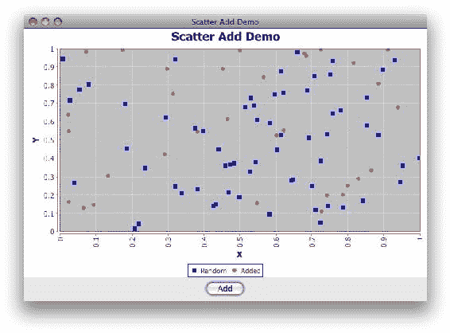

```
import java.awt.BorderLayout;
import java.awt.Color;
import java.awt.EventQueue;
import java.awt.event.ActionEvent;
import java.util.*;
import javax.swing.AbstractAction;
import javax.swing.JButton;
import javax.swing.JFrame;
import javax.swing.JPanel;
import org.jfree.chart.*;
import org.jfree.chart.axis.NumberAxis;
import org.jfree.chart.axis.NumberTickUnit;
import org.jfree.chart.plot.PlotOrientation;
import org.jfree.chart.plot.XYPlot;
import org.jfree.chart.renderer.xy.XYItemRenderer;
import org.jfree.data.xy.XYDataset;
import org.jfree.data.xy.XYSeries;
import org.jfree.data.xy.XYSeriesCollection;

/**
 * @see http://stackoverflow.com/questions/7231824
 * @see http://stackoverflow.com/questions/7205742
 * @see http://stackoverflow.com/questions/7208657
 * @see http://stackoverflow.com/questions/7071057
 */
public class ScatterAdd extends JFrame {

    private static final int N = 8;
    private static final String title = "Scatter Add Demo";
    private static final Random rand = new Random();
    private XYSeries added = new XYSeries("Added");

    public ScatterAdd(String s) {
        super(s);
        final ChartPanel chartPanel = createDemoPanel();
        this.add(chartPanel, BorderLayout.CENTER);
        JPanel control = new JPanel();
        control.add(new JButton(new AbstractAction("Add") {

            @Override
            public void actionPerformed(ActionEvent e) {
                for (int i = 0; i < N; i++) {
                    added.add(rand.nextDouble(), rand.nextDouble());
                }
            }
        }));
        this.add(control, BorderLayout.SOUTH);
    }

    private ChartPanel createDemoPanel() {
        JFreeChart jfreechart = ChartFactory.createScatterPlot(
            title, "X", "Y", createSampleData(),
            PlotOrientation.VERTICAL, true, true, false);
        XYPlot xyPlot = (XYPlot) jfreechart.getPlot();
        xyPlot.setDomainCrosshairVisible(true);
        xyPlot.setRangeCrosshairVisible(true);
        XYItemRenderer renderer = xyPlot.getRenderer();
        renderer.setSeriesPaint(0, Color.blue);
        NumberAxis domain = (NumberAxis) xyPlot.getDomainAxis();
        domain.setRange(0.00, 1.00);
        domain.setTickUnit(new NumberTickUnit(0.1));
        domain.setVerticalTickLabels(true);
        NumberAxis range = (NumberAxis) xyPlot.getRangeAxis();
        range.setRange(0.0, 1.0);
        range.setTickUnit(new NumberTickUnit(0.1));
        return new ChartPanel(jfreechart);
    }

    private XYDataset createSampleData() {
        XYSeriesCollection xySeriesCollection = new XYSeriesCollection();
        XYSeries series = new XYSeries("Random");
        for (int i = 0; i < N * N; i++) {
            double x = rand.nextDouble();
            double y = rand.nextDouble();
            series.add(x, y);
        }
        xySeriesCollection.addSeries(series);
        xySeriesCollection.addSeries(added);
        return xySeriesCollection;
    }

    public static void main(String args[]) {
        EventQueue.invokeLater(new Runnable() {

            @Override
            public void run() {
                ScatterAdd demo = new ScatterAdd(title);
                demo.setDefaultCloseOperation(JFrame.EXIT_ON_CLOSE);
                demo.pack();
                demo.setLocationRelativeTo(null);
                demo.setVisible(true);
            }
        });
    }
}
```

解决方案感谢：[trashgod](https://stackoverflow.com/users/230513/trashgod)

## 讨论

除非你粘贴的代码是不完整的，否则看起来你的问题在于你没有将创建的`NumberAxis`对象与你的图表关联。

# Spring 究竟是用来做什么的？

## 问题

我到处听到关于 Spring，大家都在说它是一个非常好的 Web 开发框架。

## 问题

例如，假设你需要列出系统的用户，因此定义一个名为`UserLister`的接口：

```
public interface UserLister {
    List<User> getUsers();
}
```

以及一个访问数据库的实现：

```java
public class UserDB implements UserLister {
    public List<User> getUsers() {
        // 访问数据库的代码
    }
}
```

在你的视图中，你需要一个实例（示例）：

```java
public class SomeView {
    private UserLister userLister;

    public void render() {
        List<User> users = userLister.getUsers();
    }
}
```

注意上面的代码没有初始化`userLister`变量。我们该怎么办？如果我显式实例化对象：

```
UserLister userLister = new UserDB();
```

...我把视图与访问数据库的实现耦合了。如果我想从数据库实现切换到另一个从逗号文件获取用户列表的实现（记住这只是示例）呢？在这种情况下，我会再次回到代码并将最后一行改为：

```
UserLister userLister = new UserListerCommaSeparatedFile();
```

这在这样的小程序中没有问题，但是……在一个拥有数百个视图和相似数量业务类的程序中会怎样？维护工作将变成一场噩梦！

## Spring（依赖注入）方案

Spring 的做法是通过使用 XML 文件来*装配*类，这样所有对象都由 Spring 实例化并初始化，并*注入*到正确的位置（Servlet、Web 框架、业务类、DAO 等）。

回到 Spring 的示例，我们只需要为`userLister`字段提供一个 setter 方法，并拥有如下的 XML：

```xml
<bean id="userLister" class="UserDB" />

<bean class="SomeView">
    <property name="userLister" ref="userLister" />
</bean>
```

这样当视图创建时，它将*神奇地*拥有一个准备好工作的`UserLister`。

```
List<User> users = userLister.getUsers();  // 这实际上是可以运行的
                                           // 无需添加任何代码行
```

这太棒了！不是吗？

*   如果你想使用`UserLister`接口的另一种实现类呢？只需更改 XML 即可。

*   如果你还没有准备好`UserLister`的实现类呢？编写一个临时的`UserLister`模拟实现，简化视图层的开发。

*   如果我再想用 Spring 了呢？直接不要用它了！你的应用程序并没有与它耦合。[控制反转](http://en.wikipedia.org/wiki/Inversion_of_control) 指出：“应用程序控制框架，而不是框架控制应用程序”。

关于依赖注入还有其他一些方案，在我看来，除了简单、优雅和稳定之外，让 Spring 如此出名的原因是，SpringSource 的小伙伴们编写了许多许多 POJO，这有助于将 Spring 与许多其他常用框架集成，而不会侵入到你的应用程序中。此外，Spring 还有几个非常好的子项目，如`Spring MVC`、`Spring WebFlow`、`Spring Security`等，还有一长长的列表。

希望这有所帮助。无论如何，我鼓励你阅读 [Martin Fowler 的文章](http://martinfowler.com/articles/injection.html) 关于依赖注入和控制反转的内容，因为他写得比我好。在理解了基础之后，看一眼 [Spring 文档](http://static.springframework.org/spring/docs/2.5.x/reference/index.html)，在我看来它曾是是以来最好的 Spring 书。

解决方案由提供：[victor hugo](https://stackoverflow.com/users/70616/victor-hugo)

## 讨论

Spring 非常适合将类实例粘合在一起。你知道你的 Hibernate 类总是需要一个数据源，Spring 将它们连接在一起（并且它也提供了一个数据源的实现）。

你的数据访问对象（DAOs）总是需要 Hibernate 访问，Spring 会替你将 Hibernate 类接线到你的`DAOs`中。

此外，Spring 基本上为你提供了一系列库的稳健配置，并在这种方面，对你应该使用哪些库提供了指导。

Spring 真的是一个非常棒的工具。（我指的不是`Spring MVC`，只是基础框架）。

讨论由提供：[stevedbrown](https://stackoverflow.com/users/116880/stevedbrown)

Spring 包含（正如 Skaffman 正确指出的那样）一个 MVC 框架。简单解释一下，这里是我的观点。Spring 支持服务层、Web 层和业务层的分离，但它最擅长的是对象的“注入”。为了用例子解释这一点，请考虑下方的示例：

```
public interface FourWheel
{
   public void drive();
}

public class Sedan implements FourWheel
{
   public void drive()
   {
      // 优雅地行驶
   }
}

public class SUV implements FourWheel
{
   public void drive()
   {
      // 统治崎岖的地形
   }
}
```

现在你的代码中有一个名为`RoadTrip`的类，如下：

```java
public class RoadTrip
{
    private FourWheel myCarForTrip;
}
```

现在每当你需要`Trip`的实例时，有时你可能想用`SUV`来初始化`FourWheel`，有时你可能想用`Sedan`。这取决于你根据具体情况想要什么。

为了解决这个问题，你会希望有一个“工厂模式”（`Factory Pattern`）作为创建模式。由工厂返回正确的实例。最终，你会有大量的胶水代码仅仅为了正确实例化对象。Spring 最好地完成了这些胶水代码的工作，而又不需要那些胶水代码。你在 XML 中声明映射，它就会自动初始化对象。它还对实例使用了大量的单例模式架构，这有助于优化内存使用。

这也被称为控制反转（Inversion Of Control）。实现此点的其他框架有`Google guice`、`Pico container`等。


除此之外，Spring 还有验证框架，并通过与 `JDBC`、`iBatis` 和 `Hibernate`（以及更多）协作，对 DAO 层提供广泛支持。为数据库事务提供了卓越的事务控制（Transactional control）。

Spring 还有很多内容，可以在《Pro Spring》等好书中阅读。

以下 URL 也可能有所帮助：

- [`static.springframework.org/docs/Spring-MVC-step-by-step/`](http://static.springframework.org/docs/Spring-MVC-step-by-step/)
- [`en.wikipedia.org/wiki/Spring_Framework`](http://en.wikipedia.org/wiki/Spring_Framework)
- [`www.theserverside.com/tt/articles/article.tss?l=SpringFramework`](http://www.theserverside.com/tt/articles/article.tss?l=SpringFramework)

讨论由提供：[Priyank](https://stackoverflow.com/users/57847/priyank)

Spring 起初是一个相当简单的依赖注入系统。现在它非常庞大，包含了所有内容（除了那个所谓的“厨房水池”什么都有外）。

但不要担心，它是相当模块化的，你可以只使用你想要的部分。

想看看这一切从哪里开始可以尝试：

[`www.amazon.com/Expert-One-Design-Development-Programmer/dp/0764543857/ref=sr_1_1?ie=UTF8&s=books&qid=1246374863&sr=1-1`](http://rads.stackoverflow.com/amzn/click/0764543857)

这可能很老了，但它是一本优秀的书。这次看另一本好的：

讨论由提供：[Pablojim](https://stackoverflow.com/users/110478/pablojim)

Spring 是企业级 [EJB](http://java.sun.com/products/ejb/) 技术的很好的替代方案。它还有 Web 框架和 Web 服务框架组件。

讨论由提供：[fastcodejava](https://stackoverflow.com/users/184730/fastcodejava)

简单总结，我会说 Spring 是你应用程序中的“胶水”。它被用于集成不同的框架和你自己的代码。

讨论由提供：[Johan](https://stackoverflow.com/users/329053/johan)

Spring 有三件事：

1. Spring 处理依赖注入，我建议你阅读 Martin Fowler 关于依赖注入的精彩介绍。
2. Spring 的第二件事是用一种非常优雅的方式封装优秀的 Java 库，以便在你的应用程序中使用。一个很好的例子可以看 Spring 如何封装 `Task Executors` 和 `Quartz Scheduler`。
3. 第三，Spring 提供了了一系列 Web 内容的实现，如 `REST`、一个 `MVC` Web 框架等等。他们认为，既然你已经在前两方面使用了 Spring，也许你可以直接用它来处理你 Web 应用所需的所有内容。

问题在于 `Spring DI` 确实设计得很周全，对其他东西的封装也非常周全，这是因为其他东西本身已经考虑得很周全，而 Spring 只是很好地进行了封装。Spring 对 `MVC`、`REST` 以及所有其他内容的实现没有那么好（仁人见见，我个人如此），但也有例外（`Spring Security` 非常棒）。“我倾向于使用 Spring 进行 DI 以及它那些很酷的封装，但在 Web 端倾向于使用其他东西（我非常喜欢 Tapestry），REST（Jersey 真的很健壮）等。”

讨论感谢：[karstensrage](https://stackoverflow.com/users/1122535/karstensrage)

我看到两个方面：

1. “Spring 到底是做什么的” -> 查看 victor hugo 的采用答案。
2. “[...] Spring 是[一个]良好的 Web 开发框架” -> 说这样的人讨论的是 `Spring MVC`。`Spring MVC` 是 `Spring` 的许多部分之一，是一个利用 `Spring` 通用特性（如依赖注入）的 Web 框架。它是一个通用的框架，因为它非常可配置：你可以使用不同的数据库层（`Hibernate`、`iBatis`、`plain JDBC`）、不同的视图层（`JSP`、`Velocity`、`Freemarker`...）。

注意，你可以在 Web 应用中完全可以使用 Spring 而不使用 `Spring MVC`。我认为大多数 Java Web 应用都是这样做，同时使用其他的 Web 框架如 `Wicket`、`Struts`、`Seam` 等。

讨论感谢：[Tom De Leu](https://stackoverflow.com/users/22263/tom-de-leu)

### Spring 是做什么的？

我很快会回答这个问题，但首先，让我们再次看看 victor hugo 提供的例子。这不是一个很好的例子，因为它并没有证明新框架的必要性。

```java
public class BaseView {
  protected UserLister userLister;

  public BaseView() {
    userLister = new UserListerDB(); // 唯一一行需要更改的代码
  }
}

public class SomeView extends BaseView {
  public SomeView() {
    super();
  }

  public void render() {
    List<User> users = userLister.getUsers();
    view.render(users);
  }
}
```

搞定！所以现在即使你有成百上千个视图，你仍然只需要更改那一行代码，就像 Spring XML 的方法一样。但你会说，更改一行代码仍然需要重新编译，而不是编辑 XML？好吧，我挑剔的朋友，用 `Ant` 写脚本来解决吧！

那么 Spring 是做什么的呢？它是为了：

1. 盲目跟从的开发者
2. 永远不想雇佣大学毕业程序员的雇主，因为大学里没教这些框架
3. 那些初始设计很糟糕并需要修补的项目（正如 victor hugo 的例子所示）

进一步阅读：[`discuss.joelonsoftware.com/?joel.3.219431.12`](http://discuss.joelonsoftware.com/?joel.3.219431.12)

讨论感谢：[Ash](https://stackoverflow.com/users/1602584/ash)

Spring 起初是依赖注入，然后增加了对几乎所有东西的封装之王（对 JPA 实现的封装等）。

长话来说……Spring 的大部分部分倾向于 XML 解决方案（XML 脚本引擎……呃），所以对于 DI 我使用 `Guice`。

很好的库，但随着依赖项的增加，例如 `Spring JDBC`（也许一个带真实命名参数的 Java jdbc 解决方案）从 Maven 中占据接下来的 4-5 个。

使用 `Spring MVC`（“大 Spring”的一部分）进行 Web 开发……它是一个“基于请求”的框架，存在着“请求 vs 组件”的圣战……随你喜欢。

讨论感谢：[Jacek Cz](https://stackoverflow.com/users/794606/jacek-cz)

以前，`spring` 仅仅是一个依赖注入框架（如 `Guice`、`PicoContainer`...），但现在它是构建你 `Enterprise Application` 的完整解决方案。

Spring 的依赖注入（无疑是 Spring 的核心）仍然在那里（你可以在这里查看其他优秀的答案），但来自 Spring 的还有更多内容……

Spring 现在有很多项目，每个项目都有一些子项目（[`spring.io/projects`](http://spring.io/projects)）。当有人谈起 Spring 时，你必须弄清楚他在说哪一个 `spring project`，是仅被称为 `spring framework` 的 spring core，还是其他的 spring 项目。

一些值得提到的 spring 项目有：

- `spring security` - [http://projects.spring.io/spring-security/]
- `spring webservices` - [http://projects.spring.io/spring-ws/]
- `spring integration` - [http://projects.spring.io/spring-integration/]

如果你为你的应用程序需要更特定的功能，你也可以在那里找到：

- `spring batch` 批处理框架，设计用于开发批处理应用程序
- `spring HATEOAS` 基于 HATEOAS 原则易于创建 REST api
- `spring mobile` 和 `spring andriod` 用于移动应用开发
- `spring shell` 构建功能完备的 shell（即命令行）应用程序
- `spring cloud` 和 `spring cloud data flow` 用于云应用程序

那里还有一些小型项目，例如 `spring-social-facebook`（[`projects.spring.io/spring-social-facebook/`](http://projects.spring.io/spring-social-facebook/)）。

你可以使用 Spring 进行 Web 开发，因为它有一个 `Spring MVC` 模块，它是 `spring framework` 项目的一部分。或者你可以配合另一个 Web 框架使用 Spring，如 `struts2`。

讨论感谢：[Alireza Fattahi](https://stackoverflow.com/users/2648077/alireza-fattahi)

此内容来源于 [StackOverflow](https://stackoverflow.com/questions/1061717/what-exactly-is-spring-for) 并已整理成上述方案。

# 在 Spring Security 2.06 中实现自定义 `AuthenticationProvider`

## 问题

我正在使用 Spring Security 一个 `Struts2` Web 应用。由于项目限制，我正在使用 `Spring Security 2.06`。

我的团队构建了一个自定义的用户管理 API，在接收用户名和密码参数后进行身份验证，并返回一个包含角色列表以及电子邮件、姓名等属性的自定义用户。根据我的理解，典型的 Spring Security 用例使用默认的 `UserDetailsService` 来检索 `UserDetails` 对象；该对象包含（除其他内容外）一个供框架验证用户的密码字段。

在我的情况下，我想让我们的自定义 API 完成身份验证，然后返回一个包含角色和其他属性（如电子邮件等）的自定义 `UserDetails` 对象。

经过研究，我发现可以通过自定义 `AuthenticationProvider` 的实现来实现这一点。我还有对 `UserDetailsService` 和 `UserDetails` 的自定义实现。

我的问题是，我不确定在 `CustomAuthenticationProvider` 中应该返回什么。我应该在这里使用我自定义的 `UserDetailsService` 对象吗？这真的需要吗？抱歉，我很困惑。

`CustomAuthenticationProvider`：

```java
public class CustomAuthenticationProvider implements AuthenticationProvider {

    private Logger logger = Logger.getLogger(CustomAuthenticationProvider.class);

    private UserDetailsService userDetailsService; //我该用它做什么呢？

    @Override
    public Authentication authenticate(Authentication authentication) throws AuthenticationException {
        UsernamePasswordAuthenticationToken auth = (UsernamePasswordAuthenticationToken) authentication;
        String username = String.valueOf(auth.getPrincipal());
        String password = String.valueOf(auth.getCredentials());

        logger.info("username:" + username);
        logger.info("password:" + password);
        /* 这里应该发生什么呢？ */

        return null;  //我应该返回什么？
    }

    @Override
    public boolean supports(Class aClass) {
        return true;  //表示此认证提供者可以处理认证请求。由于目前只有一种登录方式，因此始终返回 true
    }

    public UserDetailsService getUserDetailsService() {
        return userDetailsService;
    }

    public void setUserDetailsService(UserDetailsService userDetailsService) {
        this.userDetailsService = userDetailsService;
    }
}
```

`applicationContext-security.xml`：

```xml
<beans:bean id="customUserDetailsService" scope="prototype" class="com.test.testconsole.security.CustomUserDetailsService"/>

<beans:bean id="customAuthenticationProvider" class="com.test.testconsole.security.CustomAuthenticationProvider">
    <custom-authentication-provider />
    <beans:property name="userDetailsService" ref="customUserDetailsService" />
</beans:bean>
```

总结一下，这是我需要的：

1. 用户通过 Web 表单登录。
2. 使用内部用户管理 API 验证用户身份。
3. 对于认证通过的用户，填充 `GrantedAuthories` 等信息。
4. 返回一个包含角色/权限以及其他属性（如邮箱、姓名等）的用户实体。我应该能够这样访问这个对象：

```java
//spring security 获取用户名
Authentication auth = SecurityContextHolder.getContext().getAuthentication();
userName = auth.getName(); //获取已登录用户名
logger.info("username: " + userName);

//spring security 获取用户角色
GrantedAuthority[] authorities = auth.getAuthorities();
userRole = authorities[0].getAuthority();
logger.info("user role: " + userRole);
```

希望这些能说清楚。任何帮助或指引都将不胜感激！

谢谢！

## 更新

我想我取得了一些进展。

我实现了一个实现了 `Authentication` 接口的自定义 `CustomAuthentication` 对象：


```java
public class CustomAuthentication implements Authentication {

    String name;
    GrantedAuthority[] authorities;
    Object credentials;
    Object details;
    Object principal;
    boolean authenticated;

    public CustomAuthentication(String name, GrantedAuthority[] authorities, Object credentials, Object details, Object principal,
                                authenticated) {
        this.name = name;
        this.authorities = authorities;
        this.details = details;
        this.principal = principal;
        this.authenticated = authenticated;
    }

    @Override
    public GrantedAuthority[] getAuthorities() {
        return new GrantedAuthority[0];  // 要修改实现的方法体，请使用 File | Settings | File Templates。
    }

    @Override
    public Object getCredentials() {
        return null;  // 要修改实现的方法体，请使用 File | Settings | File Templates。
    }

    @Override
    public Object getDetails() {
        return null;  // 要修改实现的方法体，请使用 File | Settings | File Templates。
    }

    @Override
    public Object getPrincipal() {
        return null;  // 要修改实现的方法体，请使用 File | Settings | File Templates。
    }

    @Override
    public boolean isAuthenticated() {
        return false;  // 要修改实现的方法体，请使用 File | Settings | File Templates。
    }

    @Override
    public void setAuthenticated(boolean isAuthenticated) throws IllegalArgumentException {
        // 要修改实现的方法体，请使用 File | Settings | File Templates。
    }

    @Override
    public String getName() {
        return null;
    }
}
```

并且更新了我的 `CustomerAuthenticationProvider` 类：

```java
@Override
public Authentication authenticate(Authentication authentication) throws AuthenticationException {
    UsernamePasswordAuthenticationToken auth = (UsernamePasswordAuthenticationToken) authentication;
    String username = String.valueOf(auth.getPrincipal());
    String password = String.valueOf(auth.getCredentials());

    logger.info("username:" + username);
    logger.info("password:" + password);

    // 目前还没有进行实际验证

    GrantedAuthority[] authorities = new GrantedAuthorityImpl[1];
    authorities[0] = new GrantedAuthorityImpl("ROLE_USER");

    CustomAuthentication customAuthentication =
            new CustomAuthentication("TestMerchant", authorities, "details", username, password, true);

    return customAuthentication;

    // return new UsernamePasswordAuthenticationToken(username, password, authorities);
}
```

如果我返回一个 `UsernamePasswordAuthenticationToken` 对象，是可以工作的，但如果我尝试返回 `CustomAuthentication`，就会收到以下错误：


```text
java.lang.ClassCastException: com.test.testconsole.security.CustomAuthentication cannot be cast to org.springframework.security.providers.UsernamePasswordAuthenticationToken
    at com.test.testconsole.security.CustomAuthenticationProvider.authenticate(CustomAuthenticationProvider.java:27)
    at org.springframework.security.providers.ProviderManager.doAuthentication(ProviderManager.java:188)
    at org.springframework.security.AbstractAuthenticationManager.authenticate(AbstractAuthenticationManager.java:46)
    at org.springframework.security.intercept.AbstractSecurityInterceptor.authenticateIfRequired(AbstractSecurityInterceptor.java:319)
    at org.springframework.security.intercept.AbstractSecurityInterceptor.beforeInvocation(AbstractSecurityInterceptor.java:258)
    at org.springframework.security.intercept.web.FilterSecurityInterceptor.invoke(FilterSecurityInterceptor.java:106)
    at org.springframework.security.intercept.web.FilterSecurityInterceptor.doFilter(FilterSecurityInterceptor.java:83)
    at org.springframework.security.util.FilterChainProxy$VirtualFilterChain.doFilter(FilterChainProxy.java:390)
    at org.springframework.security.ui.SessionFixationProtectionFilter.doFilterHttp(SessionFixationProtectionFilter.java:67)
    at org.springframework.security.ui.SpringSecurityFilter.doFilter(SpringSecurityFilter.java:53)
    at org.springframework.security.util.FilterChainProxy$VirtualFilterChain.doFilter(FilterChainProxy.java:390)
    at org.springframework.security.ui.ExceptionTranslationFilter.doFilterHttp(ExceptionTranslationFilter.java:101)
    at org.springframework.security.ui.SpringSecurityFilter.doFilter(SpringSecurityFilter.java:53)
    at org.springframework.security.providers.anonymous.AnonymousProcessingFilter.doFilterHttp(AnonymousProcessingFilter.java:105)
    at org.springframework.security.ui.SpringSecurityFilter.doFilter(SpringSecurityFilter.java:53)
    at org.springframework.security.util.FilterChainProxy$VirtualFilterChain.doFilter(FilterChainProxy.java:390)
    at org.springframework.security.ui.rememberme.RememberMeProcessingFilter.doFilterHttp(RememberMeProcessingFilter.java:116)
    at org.springframework.security.ui.SpringSecurityFilter.doFilter(SpringSecurityFilter.java:53)
    at org.springframework.security.util.FilterChainProxy$VirtualFilterChain.doFilter(FilterChainProxy.java:390)
    at org.springframework.security.wrapper.SecurityContextHolderAwareRequestFilter.doFilterHttp(SecurityContextHolderAwareRequestFilter.java:91)
    at org.springframework.security.ui.SpringSecurityFilter.doFilter(SpringSecurityFilter.java:53)
    at org.springframework.security.util.FilterChainProxy$VirtualFilterChain.doFilter(FilterChainProxy.java:390)
    at org.springframework.security.ui.basicauth.BasicProcessingFilter.doFilterHttp(BasicProcessingFilter.java:174)
    at org.springframework.security.ui.SpringSecurityFilter.doFilter(SpringSecurityFilter.java:53)
    at org.springframework.security.util.FilterChainProxy$VirtualFilterChain.doFilter(FilterChainProxy.java:390)
    at org.springframework.security.ui.AbstractProcessingFilter.doFilterHttp(AbstractProcessingFilter.java:278)
    at org.springframework.security.ui.SpringSecurityFilter.doFilter(SpringSecurityFilter.java:53)
    at org.springframework.security.util.FilterChainProxy$VirtualFilterChain.doFilter(FilterChainProxy.java:390)
    at org.springframework.security.ui.logout.LogoutFilter.doFilterHttp(LogoutFilter.java:89)
    at org.springframework.security.ui.SpringSecurityFilter.doFilter(SpringSecurityFilter.java:53)
    at org.springframework.security.util.FilterChainProxy$VirtualFilterChain.doFilter(FilterChainProxy.java:390)
    at org.springframework.security.context.HttpSessionContextIntegrationFilter.doFilterHttp(HttpSessionContextIntegrationFilter.java:235)
    at org.springframework.security.ui.SpringSecurityFilter.doFilter(SpringSecurityFilter.java:53)
    at org.springframework.security.util.FilterChainProxy$VirtualFilterChain.doFilter(FilterChainProxy.java:390)
    at org.springframework.security.util.FilterChainProxy.doFilter(FilterChainProxy.java:175)
    at org.springframework.web.filter.DelegatingFilterProxy.invokeDelegate(DelegatingFilterProxy.java:236)
    at org.springframework.web.filter.DelegatingFilterProxy.doFilter(DelegatingFilterProxy.java:167)
    at org.mortbay.jetty.servlet.ServletHandler$CachedChain.doFilter(ServletHandler.java:1157)
    at org.mortbay.jetty.servlet.ServletHandler.handle(ServletHandler.java:388)
    at org.mortbay.jetty.security.SecurityHandler.handle(SecurityHandler.java:216)
    at org.mortbay.jetty.servlet.SessionHandler.handle(SessionHandler.java:182)
    at org.mortbay.jetty.handler.ContextHandler.handle(ContextHandler.java:765)
    at org.mortbay.jetty.webapp.WebAppContext.handle(WebAppContext.java:418)
    at org.mortbay.jetty.handler.ContextHandlerCollection.handle(ContextHandlerCollection.java:230)
    at org.mortbay.jetty.handler.HandlerCollection.handle(HandlerCollection.java:114)
    at org.mortbay.jetty.handler.HandlerWrapper.handle(HandlerWrapper.java:152)
    at org.mortbay.jetty.Server.handle(Server.java:326)
    at org.mortbay.jetty.HttpConnection.handleRequest(HttpConnection.java:536)
    at org.mortbay.jetty.HttpConnection$RequestHandler.headerComplete(HttpConnection.java:915)
    at org.mortbay.jetty.HttpParser.parseNext(HttpParser.java:539)
    at org.mortbay.jetty.HttpParser.parseAvailable(HttpParser.java:212)
    at org.mortbay.jetty.HttpConnection.handle(HttpConnection.java:405)
    at org.mortbay.io.nio.SelectChannelEndPoint.run(SelectChannelEndPoint.java:409)
    at org.mortbay.thread.QueuedThreadPool$PoolThread.run(QueuedThreadPool.java:582)
```

`java.lang.ClassCastException: com.test.testconsole.security.CustomAuthentication 无法转换为 org.springframework.security.providers.UsernamePasswordAuthenticationToken`

看起来某个地方期望的不是任意 `Authentication` 对象，而是它的一个特定实现类——`UsernamePasswordAuthenticationToken`。这让我觉得我可能漏掉了另一个自定义组件……可能是过滤器？

问题来自：[shaunlim](https://stackoverflow.com/users/1118336/shaunlim)

## 解决方案

如果你正在实现自己的 `AuthenticationProvider`，如果你不想这样做，你就不需要实现 `UserDetailsService`。`UserDetailsService` 只是提供了一个加载用户信息的标准 DAO，框架中的其他类被实现为使用它。

通常情况下，在使用用户名和密码进行身份验证时，你会实例化 [`DaoAuthenticationProvider`](http://static.springsource.org/spring-security/site/xref/org/springframework/security/providers/dao/DaoAuthenticationProvider.html) 并向其注入 `UserDetailsService`。这可能仍然是最佳方法。如果你实现了自己的 provider，你就必须承担确保用户提供了正确密码等责任。然而，在某些情况下这是一种更简单的方法。

为了回答你代码中的注释“这里应该发生什么？”，代码看起来应该是这样的：

```java
@Override
public Authentication authenticate(Authentication authentication) throws AuthenticationException {
  UsernamePasswordAuthenticationToken auth = (UsernamePasswordAuthenticationToken) authentication;
  String username = String.valueOf(auth.getPrincipal());
  String password = String.valueOf(auth.getCredentials());

  logger.info("username:" + username);
  logger.info("password:" + password); // 实际应用中不要记录密码

  // 1\. 使用用户名加载用户数据，包括权限和密码。
  YourUser user = ....

  // 2\. 检查密码是否匹配（此处应使用哈希密码）。
  if (!user.getPassword().equals(password)) {
    throw new BadCredentialsException("Bad Credentials");
  }

  // 3\. 最好在存储到身份验证对象之前，清除用户对象中的密码
  user.clearPassword();

  // 4\. 返回一个已验证的令牌，包含用户数据和权限  

  return new UsernamePasswordAuthenticationToken(user, null, user.getAuthorities()) ;
}
```

随后 `user` 对象将可以通过以下方法访问：

```java
Authentication.getPrincipal()
```

并且你可以通过将其强制转换为自定义用户实现来访问额外属性（如电子邮件等）。

如何加载用户数据由你决定。Spring Security 在此仅关心的 `AuthenticationProvider` 接口。

你还应该存储哈希密码，并使用相同的算法验证提供的密码，而不是进行简单的等性检查。

解决方案由谢：[Shaun the Sheep](https://stackoverflow.com/users/241990/shaun-the-sheep)

## 讨论

感谢 Luke 发布这个内容！

这让我免受了更多的脑损伤。

对于任何感兴趣的人来说，我遇到的唯一需要注意的地方是：

我的环境配置：

- `Grails 2.0.4`
- `Groovy 1.8`
- `spring-security-core 1.2.7.3`
- `spring-security-ui 0.2`
- `hibernate 2.0.4`


当利用 Luke 建议的这种非常受感谢的简化/优雅的方法时，如果没有实现自定义的 `UserDetails`（或 `UserDetailsService`）对象——并且使用你自己的、不继承任何特殊内容的 `User` **domain** 对象——如果你正在使用 spring security 的自定义 "sec" 标签（当然，在你的页面中），你必须额外执行一步：

当你实例化一个基础的非自定义的 `UsernamePasswordAuthenticationToken` 时，你必须传递一个扩展自 `Principal` 的实例，同样，如果你想让你的 spring security 自定义标签标签正常工作。我这样做这样做，以保持尽可能简单（在有用/合适的地方引用我的用户 domain 对象值）：

```
def principalUser = new org.springframework.security.core.userdetails.User(user.username, user.password, user.enabled, !user.accountExpired, !user.passwordExpired,!user.accountLocked, authorities)
def token = new UsernamePasswordAuthenticationToken(principalUser, presentedPassword, authorities)
```

这应该满足 `grails.plugins.springsecurity.SecurityTagLib.determineSource()` 中测试的条件，所以，你知道你使用 `<sec:loggedInUserInfo>` 的页面实际上会渲染：

```
if (principal.metaClass.respondsTo(principal, 'getDomainClass')) {
            return principal.domainClass
}
```

否则，如果你用你的 `User` domain 对象实例化 `UsernamePasswordAuthenticationToken`（如 Luke 在他的示例中所示），该安全标签库方法 (`determineSource()`) 将尽尽努力并返回 `org.codehaus.groovy.grails.commons.DefaultGrailsDomainClass` 的（元）值，当标签寻找 username 成员变量时，你会得到错误：

```
 Error executing tag <sec:ifLoggedIn>: Error executing tag <sec:loggedInUserInfo>: No such property: username for class: org.codehaus.groovy.grails.commons.DefaultGrailsDomainClass
```

除非在我的 Grails 项目中重新实现/子类 spring-security-core 插件标签库，否则没有办法既使用标签库又使用你自定义的 domain User 类来实例化从 filter 传递到 provider 的令牌。

话虽如此，多写一行代码是一个很小的代价 :)

讨论由：[jasonwhite01](https://stackoverflow.com/users/2939488/jasonwhite01)

此内容源自 [StackOverFlow](https://stackoverflow.com/questions/8649818/implement-custom-authenticationprovider-in-spring-security-2-06) 并已整理为上述配方。

# 如何对日志中的消息进行 JUnit 断言

## 问题

我有一段待测试的代码，它调用 Java 日志器来报告状态。在 JUnit 测试代码中，我想验证该日志器中是否创建了正确的日志记录。类似于下面的代码：

```
methodUnderTest(bool x){
    if(x)
        logger.info("x happened")
}

@Test tester(){
    // 也许先设置一个日志器。
    methodUnderTest(true);
    assertXXXXXX(loggedLevel(),Level.INFO);
}
```

我假设这可以通过特殊适配的日志器（或处理器，或格式化器）来实现，但我更倾向于重用已有的解决方案。（而且，老实说我不清楚如何从日志器获取 `logRecord`，但假设这是可能的。）

问题由：[Jon](https://stackoverflow.com/users/221538/jon)

## 解决方案

非常感谢这些令人惊讶的回答；它们让我进入了正确的方向。我想使用的代码库使用 `java.util.logging` 作为其日志器，我不觉得完全将其改为 log4j 合合适。简要总结如下。扩展 `java.util.logging.Handler`：

```java
class LogHandler extends Handler {
    Level lastLevel = Level.FINEST;

    public Level checkLevel() {
        return lastLevel;
    }    

    public void publish(LogRecord record) {
        lastLevel = record.getLevel();
    }

    public void close(){}
    public void flush(){}
}
```

显然，你可以根据需要存储尽可能多的的 `LogRecord`，或者将它们推入栈中直到溢出。

在 junit 测试的准备阶段，创建一个 `java.util.logging.Logger` 并为其添加此类新的 `LogHandler`：

```java
@Test tester() {
    Logger logger = Logger.getLogger("my-test logger");
    LogHandler handler = new LogHandler();
    handler.setLevel(Level.ALL);
    logger.setParentHandlers(false);
    logger.addHandler(handler);
    logger.setLevel(Level.ALL);
}
```

调用 `setParentHandlers()` 是为了禁用正常的处理器，这样在 junit 测试运行时就不会产生不必要的日志。让你的待测试代码使用此日志器，运行测试并进行断言：

```java
libraryUnderTest.setLogger(logger);
    methodUnderTest(true);  // 原始问题。
    assertEquals("日志级别是否预期?", Level.INFO, handler.checkLevel() );
}
```

（当然，你会把这大部分工作移动到 `@Before` 方法中并进行各种改进，但这会让演示变得杂乱。）

解决方案由：[Jon](https://stackoverflow.com/users/221538/jon)

## 讨论

本质上你是在测试一个依赖类的副作用。对于单元测试，你需要验证 `logger.info()` 是否被用正确的参数调用。因此我们使用 Mock 框架来模拟 `logger`，这将允许你测试自己类的行为。

讨论由：[djna](https://stackoverflow.com/users/82511/djna)

Mock 在这里是一个选项，尽管这很困难，因为日志器通常是 `private static final` 的——所以设置 mock `logger` 并不容易，或者需要修改被测试类。

你可以创建一个自定义的 `Appender`（或者你管它叫任何名字），并注册它——可以通过仅限测试的配置文件，或者在运行时（在某种程度上，取决于日志框架）。然后你可以获取该 appender（如果在配置文件中声明，则通过静态获取；如果是运行时挂载，则通过其当前引用获取），并验证其内容。

讨论感谢：[Bozho](https://stackoverflow.com/users/203907/bozho)

正如其他人提到的，你可以使用 mock 框架。为了让这种方法生效，你必须在类中暴露 `logger`（尽管我可能更倾向于将其设为包私有，而不是创建一个公共 setter）。

另一个解决方案是手动创建一个伪造的 `logger`。你需要编写这个伪造的 `logger`（更多的固具代码），但在这种情况下，我更倾向于相比 mock 框架保存代码更高的测试可读性。

我会这样做：

```java
class FakeLogger implements ILogger {
    public List<String> infos = new ArrayList<String>();
    public List<String> errors = new ArrayList<String>();

    public void info(String message) {
        infos.add(message);
    }

    public void error(String message) {
        errors.add(message);
    }
}

class TestMyClass {
    private MyClass myClass;        
    private FakeLogger logger;        

    @Before
    public void setUp() throws Exception {
        myClass = new MyClass();
        logger = new FakeLogger();
        myClass.logger = logger;
    }

    @Test
    public void testMyMethod() {
        myClass.myMethod(true);

        assertEquals(1, logger.infos.size());
    }
}
```

讨论感谢：[Arne](https://stackoverflow.com/users/204845/arne)

我也多次需要过这种方法。我在下面整理了一个小型示例，你可以根据需要对其进行调整。基本上，你创建自己的 `Appender` 并将其添加到你感兴趣的 `logger` 中。如果你想收集所有内容，根 logger 是一个很好的开始，但如果你愿意，也可以使用更具体的 logger。不要忘记在完成后移除 `Appender`，否则你可能会导致内存泄漏。下面我是在测试内部完成的，但根据你的需求，`setUp` 或 `@Before` 以及 `tearDown` 或 `@After` 可能是更好的地方。

此外，下面的实现将所有内容收集在内存中的 `List` 中。如果你记录大量日志，可能考虑添加一个过滤器来丢弃无聊条目，或者将日志写入磁盘上的临时文件（提示：`LoggingEvent` 实现了 `Serializable`，所以如果你的日志消息是可序列化的，你就可以直接序列化事件对象）。

```java
import org.apache.log4j.AppenderSkeleton;
import org.apache.log4j.Level;
import org.apache.log4j.Logger;
import org.apache.log4j.spi.LoggingEvent;
import org.junit.Test;

import java.util.ArrayList;
import java.util.List;

import static org.hamcrest.CoreMatchers.is;
import static org.junit.Assert.assertThat;

public class MyTest {
    @Test
    public void test() {
        final TestAppender appender = new TestAppender();
        final Logger logger = Logger.getRootLogger();
        logger.addAppender(appender);
        try {
            Logger.getLogger(MyTest.class).info("Test");
        }
        finally {
            logger.removeAppender(appender);
        }

        final List<LoggingEvent> log = appender.getLog();
        final LoggingEvent firstLogEntry = log.get(0);
        assertThat(firstLogEntry.getLevel(), is(Level.INFO));
        assertThat((String) firstLogEntry.getMessage(), is("Test"));
        assertThat(firstLogEntry.getLoggerName(), is("MyTest"));
    }
}

class TestAppender extends AppenderSkeleton {
    private final List<LoggingEvent> log = new ArrayList<LoggingEvent>();

    @Override
    public boolean requiresLayout() {
        return false;
    }

    @Override
    protected void append(final LoggingEvent loggingEvent) {
        log.add(loggingEvent);
    }

    @Override
    public void close() {
    }

    public List<LoggingEvent> getLog() {
        return new ArrayList<LoggingEvent>(log);
    }
}
```

讨论感谢：[Ronald Blaschke](https://stackoverflow.com/users/49604/ronald-blaschke)

这是我为 logback 做的。

我创建了一个 `TestAppender` 类：

```java
public class TestAppender extends AppenderBase<ILoggingEvent> {

    private Stack<ILoggingEvent> events = new Stack<ILoggingEvent>();

    @Override
    protected void append(ILoggingEvent event) {
        events.add(event);
    }

    public void clear() {
        events.clear();
    }

    public ILoggingEvent getLastEvent() {
        return events.pop();
    }
}
```

然后在我的 testng 单元测试类的父类中我创建了一个方法：

```java
protected TestAppender testAppender;

@BeforeClass
public void setupLogsForTesting() {
    Logger root = (Logger)LoggerFactory.getLogger(Logger.ROOT);
    // ... (省略重复的赋值代码)
}
```

*(注：原文此处存在大量重复的赋值代码，翻译时已按要求处理)*

另一个值得提及的想法，虽然这是一个旧的话题，是创建一个 CDI 生产者来注入你的 logger，这样 mock 就会变得简单。（它还提供了不再需要再次声明“整个日志语句”的优势，但这偏离了主题）

示例：

创建用于注入的 logger：

```java
public class CdiResources {
  @Produces @LoggerType
  public Logger createLogger(final InjectionPoint ip) {
      return Logger.getLogger(ip.getMember().getDeclaringClass());
  }
}
```

对应的注解：

```java
@Qualifier
@Retention(RetentionPolicy.RUNTIME)
@Target({TYPE, METHOD, FIELD, PARAMETER})
public @interface LoggerType {
}
```

```java
public class ProductionCode {
    @Inject
    @LoggerType
    private Logger logger;

    public void logSomething() {
        logger.info("something");
    }
}
```

在你的测试代码中测试 logger（提供一个 easyMock 示例）：


```java
@TestSubject
private ProductionCode productionCode = new ProductionCode();

@Mock
private Logger logger;

@Test
public void testTheLogger() {
   logger.info("something");
   replayAll();
   productionCode.logSomething();
}
```

讨论感谢：[GregD](https://stackoverflow.com/users/1598149/gregd)

受 @RonaldBlaschke 解决方案的启发，我提出了以下方案：

```java
public class Log4JTester extends ExternalResource {
    TestAppender appender;

    @Override
    protected void before() {
        appender = new TestAppender();
        final Logger rootLogger = Logger.getRootLogger();
        rootLogger.addAppender(appender);
    }

    @Override
    protected void after() {
        final Logger rootLogger = Logger.getRootLogger();
        rootLogger.removeAppender(appender);
    }

    public void assertLogged(Matcher<String> matcher) {
        for(LoggingEvent event : appender.events) {
            if(matcher.matches(event.getMessage())) {
                return;
            }
        }
        fail("No event matches " + matcher);
    }

    private static class TestAppender extends AppenderSkeleton {

        List<LoggingEvent> events = new ArrayList<LoggingEvent>();

        @Override
        protected void append(LoggingEvent event) {
            events.add(event);
        }

        @Override
        public void close() {

        }

        @Override
        public boolean requiresLayout() {
            return false;
        }
    }
}
```

……这允许你执行操作：

```java
@Rule public Log4JTester logTest = new Log4JTester();

@Test
public void testFoo() {
     user.setStatus(Status.PREMIUM);
     logTest.assertLogged(
        stringContains("Note added to account: premium customer"));
}
```

你可能可以用一种更智能的方式来使用 `hamcrest`，但我目前就写这里。

讨论感谢：[slim](https://stackoverflow.com/users/7512/slim)

使用 `Jmockit (1.21)`，我能够写出这个简单的测试。该测试确保特定的 `ERROR` 消息只被调用了一次。

```java
@Test
public void testErrorMessage() {
    final org.slf4j.Logger logger = org.slf4j.LoggerFactory.getLogger( MyConfig.class );

    new Expectations(logger) {{
        // 确保这个错误只发生一次。
        logger.error( "Something went wrong..." );
        times = 1;
    }};

    new MyTestObject().runSomethingWrong( "aaa" ); // 最终导致日志中产生错误的 SUT（被测试对象）。    
}
```

讨论感谢：[Yarix](https://stackoverflow.com/users/1763458/yarix)

对 `Appender` 进行 Mock 可以帮助捕获日志行。可以在此处找到示例：[`clearqa.blogspot.co.uk/2016/12/test-log-lines.html`](http://clearqa.blogspot.co.uk/2016/12/test-log-lines.html)

```java
// 完整的测试地址：https://github.com/njaiswal/logLineTester/blob/master/src/test/java/com/nj/Utils/UtilsTest.java

@Test
public void testUtilsLog() throws InterruptedException {

    Logger utilsLogger = (Logger) LoggerFactory.getLogger("com.nj.utils");

    final Appender mockAppender = mock(Appender.class);
    when(mockAppender.getName()).thenReturn("MOCK");
    utilsLogger.addAppender(mockAppender);

    final List<String> capturedLogs = Collections.synchronizedList(new ArrayList<>());
    final CountDownLatch latch = new CountDownLatch(3);

    // 捕获日志
    doAnswer((invocation) -> {
        LoggingEvent loggingEvent = invocation.getArgumentAt(0, LoggingEvent.class);
        capturedLogs.add(loggingEvent.getFormattedMessage());
        latch.countDown();
        return null;
    }).when(mockAppender).doAppend(any());

    // 调用将记录日志的待测试方法
    Application.main(null);

    // 等待 5 秒直到 latch 变为真。这意味着记录了 3 行日志。
    assertThat(latch.await(5L, TimeUnit.SECONDS), is(true));

    // 现在断言捕获到的日志
    assertThat(capturedLogs, hasItem(containsString("One")));
    assertThat(capturedLogs, hasItem(containsString("Two")));
    assertThat(capturedLogs, hasItem(containsString("Three")));
}
```

讨论感谢：[nishant](https://stackoverflow.com/users/2279187/nishant)

对我来说，你可以通过使用 `JUnit` 配合 `Mockito` 来简化你的测试。我提议以下解决方案：

```java
import org.apache.log4j.Appender;
import org.apache.log4j.Level;
import org.apache.log4j.LogManager;
import org.apache.log4j.spi.LoggingEvent;
import org.junit.After;
import org.junit.Before;
import org.junit.Test;
import org.junit.runner.RunWith;
import org.mockito.ArgumentCaptor;
import org.mockito.Captor;
import org.mockito.InjectMocks;
import org.mockito.Mock;
import java.util.List;
import static org.assertj.core.api.Assertions.assertThat;
import static org.assertj.core.api.Assertions.tuple;
import static org.mockito.Mockito.times;
import static org.mockito.Mockito.then;
import static org.mockito.Mockito.verify;

@RunWith(MockitoRunner.class)
public class MyLog {
    private static final String FIRST_MESSAGE = "First message";
    private static final String SECOND_MESSAGE = "Second message";
    @Mock private Appender appender;
    @Captor private ArgumentCaptor<LoggingEvent> captor;
    @InjectMocks private MyLog log;

    @Before
    public void setUp() {
        LogManager.getRootLogger().addAppender(appender);
    }

    @After
    public void tearDown() {
        LogManager.getRootLogger().removeAppender(appender);
    }

    @Test
    public void shouldLogExactlyMessages() {
        log.foo();

        then(appender).should(times(2)).doAppend(captor.capture());
        List<LoggingEvent> loggingEvents = captor.getAllValues();
        assertThat(loggingEvents).extracting("level", "renderedMessage").containsExactly(
                tuple(Level.INFO, FIRST_MESSAGE),
                tuple(Level.INFO, SECOND_MESSAGE)
        );
    }
}
```

这就是为什么我们对于**不同消息**的测试具有良好的**灵活性**。

讨论感谢：[Dmytro Melnychuk](https://stackoverflow.com/users/5303558/dmytro-melnychuk)

对于 `log4j2`，解决方案略有不同，因为 `AppenderSkeleton` 已经不再可用。此外，使用 `Mockito` 或类似的库创建带有 `ArgumentCaptor` 的 `Appender` 在期望多条日志消息时将无法工作，因为 `MutableLogEvent` 在多条日志消息之间会被重用。我找到的针对 `log4j2` 的最佳解决方案是：

```java
private static MockedAppender mockedAppender;
private static Logger logger;

@Before
public void setup() {
    mockedAppender.message.clear();
}

/**
 * 出某些原因，如果这是 @Before，mvn test 将无法工作，但在 eclipse 中可以运行！
 * 结果，我们使用了 @BeforeClass。
 */
@BeforeClass
public static void setupClass() {
    mockedAppender = new MockedAppender();
    logger = (Logger)LogManager.getLogger(MatchingMetricsLogger.class);
    logger.addAppender(mockedAppender);
    logger.setLevel(Level.INFO);
}

@AfterClass
public static void teardown() {
    logger.removeAppender(mockedAppender);
}

@Test
public void test() {
    // 执行产生日志的操作
    for (String e : mockedAppender.message) {
        // 为日志消息添加断言
    }
}

private static class MockedAppender extends AbstractAppender {

    List<String> message = new ArrayList<>();

    protected MockedAppender() {
        super("MockedAppender", null, null);
    }

    @Override
    public void append(LogEvent event) {
        message.add(event.getMessage().getFormattedMessage());
    }
}
```

讨论感谢提供：[joseph](https://stackoverflow.com/users/1810962/joseph)

此内容源自 [StackOverFlow](https://stackoverflow.com/questions/1827677/how-to-do-a-junit-assert-on-a-message-in-a-logger)，并已整理成上述配方。

# Java 8 中 `Optional.ifPresent` 的函数式风格以及如果不存在时的处理？

## 问题

在 Java 8 中，我希望当 `Optional` 对象存在时对其执行某项操作，如果它不存在，则执行另一项操作。

```java
if (opt.isPresent()) {
  System.out.println("found");
} else {
  System.out.println("Not found");
}
```

但这并不是“函数式风格”。

`Optional` 有一个 `ifPresent()` 方法，但我无法链式调用 `orElse()` 方法。

因此，我无法编写：

```java
opt.ifPresent( x -> System.out.println("found " + x))
   .orElse( System.out.println("NOT FOUND"));
```

对于 @assylias 的回复，我不认为 `Optional.map()` 适用于以下情况：

```java
opt.map( o -> {
  System.out.println("while opt is present...");
  o.setProperty(xxx);
  dao.update(o);
  return null;
}).orElseGet( () -> {
  System.out.println("create new obj");
  dao.save(new obj);
  return null;
});
```

在这种情况下，当 `opt` 存在时，我更新它的属性并保存到数据库。如果不可，我创建一个新的 `obj` 并保存到数据库。

注意在两个 lambda 表达式中我必须返回 `null`。

但当 `opt` 存在时，两个 lambda 都会执行。`obj` 将被更新，并且一个新的对象会被保存到数据库中。这是由于第一个 lambda 中的 `return null` 导致的，而 `orElseGet()` 会继续执行。

问题感谢提供：[smallufo](https://stackoverflow.com/users/298430/smallufo)

## 解决方案

对我来说，@Dane White 的答案可以的，起初我不喜欢使用 `Runnable` 但找不到任何替代方案，这里有我更喜欢的另一种实现：


```java
public class OptionalConsumer<T> {
    private Optional<T> optional;

    private OptionalConsumer(Optional<T> optional) {
        this.optional = optional;
    }

    public static <T> OptionalConsumer<T> of(Optional<T> optional) {
        return new OptionalConsumer<>(optional);
    }

    public OptionalConsumer<T> ifPresent(Consumer<T> c) {
        optional.ifPresent(c);
        return this;
    }

    public OptionalConsumer<T> ifNotPresent(Runnable r) {
        if (!optional.isPresent())
            r.run();
        return this;
    }
}
```

然后：

```java
Optional<Any> o = Optional.of(...);
OptionalConsumer.of(o).ifPresent(s ->System.out.println("isPresent "+s))
            .ifNotPresent(() -> System.out.println("! isPresent"));
```

**更新 1：**

上述方案适用于传统的开发方式，即当你有一个值并想处理它时；但如果我想定义功能并在稍后执行呢？请查看下面的增强：

```java
public class OptionalConsumer<T> implements Consumer<Optional<T>> {
private final Consumer<T> c;
private final Runnable r;

public OptionalConsumer(Consumer<T> c, Runnable r) {
    super();
    this.c = c;
    this.r = r;
}

public static <T> OptionalConsumer<T> of(Consumer<T> c, Runnable r) {
    return new OptionalConsumer(c, r);
}

@Override
public void accept(Optional<T> t) {
    if (t.isPresent())
        c.accept(t.get());
    else
}
```

```java
final Opt<String> opt = Opt.of("I'm a cool text");
    opt.ifPresent()
        .apply(s -> System.out.printf("Text is: %s\n", s))
        .elseApply(() -> System.out.println("no text available"));
```

或者在相反的场景下：

```java
final Opt<String> opt = Opt.of("This is the text");
    opt.ifNotPresent()
        .apply(() -> System.out.println("Not present"))
        .elseApply(t -> /*在此执行操作*/);
```

这些是组成部分：

1. 稍微修改过的`Function`接口，仅用于`elseApply`方法。

2. `Optional`的增强。

3. 一些许柯里化 (curring) :-)

经过“外观上”增强的`Function`接口：

```java
@FunctionalInterface
public interface EFunction<T, R> extends Function<T, R> {

    default R elseApply(final T t) {
        return this.apply(t);
    }

}
```

以及用于增强的`Opt`包装类：

```java
public class Opt<T> {

    private final Optional<T> optional;

    private Opt(final Optional<T> theOptional) {
        this.optional = theOptional;
    }

    public static <T> Opt<T> of(final T value) {
        return new Opt<>(Optional.of(value));
    }

    public static <T> Opt<T> of(final Optional<T> optional) {
        return new Opt<>(optional);
    }

    public static <T> Opt<T> ofNullable(final T value) {
        return new Opt<>(Optional.ofNullable(value));
    }

    public static <T> Opt<T> empty() {
        return new Opt<>(Optional.empty());
    }

    private final BiFunction<Consumer<T>, Runnable, Void> ifPresent = (present, notPresent) -> {
        if (this.optional.isPresent()) {
            present.accept(this.optional.get());
        } else {
            notPresent.run();
        }
        return null;
    };

    private final BiFunction<Runnable, Consumer<T>, Void> ifNotPresent = (notPresent, present) -> {
        if (!this.optional.isPresent()) {
            notPresent.run();
        } else {
            present.accept(this.optional.get());
        }
        return null;
    };

    public EFunction<Consumer<T>, EFunction<Runnable, Void>> ifPresent() {
        return Opt.curry(this.ifPresent);
    }

    public Fkt<Runnable, Fkt<Consumer<T>, Void>> ifNotPresent() {
        return Opt.curry(this.ifNotPresent);
    }

    private static <X, Y, Z> EFunction<X, EFunction<Y, Z>> curry(final BiFunction<X, Y, Z> function) {
        return (final X x) -> (final Y y) -> function.apply(x, y);
    }
}
```

这应该可以解决问题，并可以作为处理此类需求的基础模板。

这里的基本思想如下：在非函数式编程的世界里，你可能会实现一个接受两个参数的方法，其中第一个参数是一个当值可用时执行的`runnable`代码，另一个参数是当值不可用时应该运行的`runnable`代码。为了更好的可读性，你可以使用柯里化将一个两个参数的函数拆分为两个各带一个参数的函数。这基本上是我在这里做的。

提示：`Opt`还提供了另一种场景，即你只想在值不可用时执行一段代码。这也可以通过`Optional.filter.stuff`实现，但我发现这种方式可读性得多。

希望有所帮助！

良好的编程 :-)

讨论感谢：[Alessandro Giusa](https://stackoverflow.com/users/1619407/alessandro-giusa)

如果你正在使用 Java 9，可以使用[`ifPresentOrElse()`](http://download.java.net/java/jdk9/docs/api/java/util/Optional.html#ifPresentOrElse-java.util.function.Consumer-java.lang.Runnable-)方法：

```java
opt.ifPresentOrElse(
   value -> System.out.println("Found"),
   () -> System.out.println("Not found")
);
```

讨论感谢：[ZhekaKozlov](https://stackoverflow.com/users/706317/zhekakozlov)

我的解决方案非常简单：

```java
opt.map(it -> {
    System.out.println("found " + it);
    return it;
});
```

讨论感谢：[Tomasz Szuba](https://stackoverflow.com/users/1841853/tomasz-szuba)

此内容源自 [StackOverflow](https://stackoverflow.com/questions/23773024/functional-style-of-java-8s-optional-ifpresent-and-if-not-present)，并已重新组织成上述配方。

# Java 执行器：当任务完成时，如何在不阻塞的情况下被通知？

## 问题

假设我有一个满是任务的队列，需要将它们提交给执行器服务。我希望它们逐个处理。我能想到的简单方法是：

1. 从队列中获取任务

2. 将其提交给`ExecutorService`

3. 对返回的`Future`调用`get()`并阻塞

## 解决方案

定义一个回调接口来接收参数。

```java
class CallbackTask implements Runnable {

  private final Runnable task;

  private final Callback callback;

  CallbackTask(Runnable task, Callback callback) {
    this.task = task;
    this.callback = callback;
  }

  public void run() {
    task.run();
    callback.complete();
  }
}
```

通过[`CompletableFuture`](http://docs.oracle.com/javase/8/docs/api/java/util/concurrent/CompletableFuture.html)，Java 8 提供了更复杂的手段来组合可以异步完成的流水线。这是一个构造通知示例：

```java
import java.util.concurrent.CompletableFuture;
import java.util.concurrent.ThreadLocalRandom;
import java.util.concurrent.TimeUnit;

public class GetTaskNotificationBlocking {

  public static void main(String... argv) throws Exception {
    GetTaskNotificationBlocking svc = new GetTaskNotificationBlocking();
    for (int i = 0; i < 3; ++i) {
      CompletableFuture<String> f = CompletableFuture.supplyAsync(svc::work);
      f.thenAccept(svc::notify);
    }
    System.out.println("Exiting main()");
  }

  void notify(String msg) {
    System.out.println("Received message: " + msg);
  }

  String work() {
    sleep(3000, TimeUnit.MILLISECONDS); /* 假装在忙中... */
    char[] str = new char[5];
    ThreadLocalRandom current = ThreadLocalRandom.current();
    for (int idx = 0; idx < str.length; ++idx)
      str[idx] = (char) ('A' + current.nextInt(26));
    String msg = new String(str);
    System.out.println("Generated message: " + msg);
    return msg;
  }

  public static void sleep(long average, TimeUnit unit) {
    String name = Thread.currentThread().getName();
    long timeout = Math.min(poisson(average), Math.multiplyExact(10, average));
    System.out.printf("%s sleeping %d %s...%n", name, timeout, unit);
    try {
      unit.sleep(timeout);
      System.out.println(name + " awoke.");
    } catch (InterruptedException abort) {
      Thread.currentThread().interrupt();
      System.out.println(name + " interrupted.");
    }
  }

  public static long poisson(long avg) {
    return (long) (avg * -Math.log(1 - ThreadLocalRandom.current().nextDouble()));
  }

}
```

解决方案由：[erickson](https://stackoverflow.com/users/3474/erickson) 提供

## 讨论

使用[`CountDownLatch`](http://java.sun.com/j2se/1.5.0/docs/api/java/util/concurrent/CountDownLatch.html)。

它来自`java.util.concurrent`，完全是等待多个线程完成执行后再继续后续的标准方法。

为了实现你追求的回调效果，确实需要一些额外的工作。具体来说，需要在单独线程中你自己处理这种逻辑，该线程使用`CountDownLatch`并对其进行等待，然后去通知你需要通知的任何内容。原生并没有对回调或任何类似这种效果的支持。

**编辑：** 在我进一步理解了你的问题后，我认为你的做法可能有些没必要过于复杂了。如果你使用一个普通的[`SingleThreadExecutor`](http://java.sun.com/j2se/1.5.0/docs/api/java/util/concurrent/Executors.html#newSingleThreadScheduledExecutor())，将所有任务交给它，它将原生支持任务队列。

讨论由：[Yuval Adam](https://stackoverflow.com/users/24545/yuval-adam) 提供

如果你想确保没有任务同时运行，请使用[`SingleThreadedExecutor`](http://docs.oracle.com/javase/6/docs/api/java/util/concurrent/Executors.html#newSingleThreadExecutor())。任务将按照提交的顺序进行处理。你甚至不需要持有任务，只需将其提交给执行器即可。

讨论由：[basszero](https://stackoverflow.com/users/287/basszero) 提供

`ThreadPoolExecutor`还有`beforeExecute`和`afterExecute`钩子方法，你可以重写并使用它们。这里来自`ThreadPoolExecutor` [Javadocs](https://docs.oracle.com/javase/8/docs/api/java/util/concurrent/ThreadPoolExecutor.html) 的描述。

### 钩子方法


此类提供了受保护的、可重写的 [`beforeExecute(java.lang.Thread, java.lang.Runnable)`](https://docs.oracle.com/javase/8/docs/api/java/util/concurrent/ThreadPoolExecutor.html#beforeExecute-java.lang.Thread-java.lang.Runnable-) 和 [`afterExecute(java.lang.Runnable, java.lang.Throwable)`](https://docs.oracle.com/javase/8/docs/api/java/util/concurrent/ThreadPoolExecutor.html#afterExecute-java.lang.Runnable-java.lang.Throwable-) 方法，这些方法会在每个任务执行之前和之后被调用。这些方法可以用于操作执行环境；例如重新初始化 `ThreadLocals`、收集统计数据或添加日志记录。此外，可以重写方法 [`terminated()`](https://docs.oracle.com/javase/8/docs/api/java/util/concurrent/ThreadPoolExecutor.html#terminated--) 以在 `Executor` 完全终止后执行任何需要的特殊处理。如果钩子或回调方法抛出异常，内部工作线程可能会随之失败并突然终止。

讨论由：[Cem Catikkas](https://stackoverflow.com/users/3087/cem-catikkas) 提供。

你可以扩展 `FutureTask` 类并重写 `done()` 方法，然后将 `FutureTask` 对象添加到 `ExecutorService` 中，这样当 `FutureTask` 完成时会立即调用 `done()` 方法。

讨论由：[Auguste](https://stackoverflow.com/users/1216393/auguste) 提供。

使用 [Guava 的 listenable future API](http://code.google.com/p/guava-libraries/wiki/ListenableFutureExplained) 并添加回调。参考网站上的代码：

```java
ListeningExecutorService service = MoreExecutors.listeningDecorator(Executors.newFixedThreadPool(10));
ListenableFuture<Explosion> explosion = service.submit(new Callable<Explosion>() {
  public Explosion call() {
    return pushBigRedButton();
  }
});
Futures.addCallback(explosion, new FutureCallback<Explosion>() {
  // 我们希望这个处理器在我们按下大红按钮后立即运行！
  public void onSuccess(Explosion explosion) {
    walkAwayFrom(explosion);
  }
  public void onFailure(Throwable thrown) {
    battleArchNemesis(); // 逃离爆炸！
  }
});
```

讨论由：[Pierre-Henri](https://stackoverflow.com/users/995156/pierre-henri) 提供。

在 Java 8 中，你可以使用 [CompletableFuture](https://docs.oracle.com/javase/8/docs/api/java/util/concurrent/CompletableFuture.html)。这里是我代码中的一个示例，我用它从我的用户服务获取用户，将它们映射到视图对象，然后更新我的视图或显示错误对话框（这是一个 GUI 应用）：

```java
CompletableFuture.supplyAsync(
            userService::listUsers
    ).thenApply(
            this::mapUsersToUserViews
    ).thenAccept(
            this::updateView
    ).exceptionally(
            throwable -> { showErrorDialogFor(throwable); return null; }
    );
```

它是异步执行的。我使用了两个私有方法：`mapUsersToUserViews` 和 `updateView`。

讨论由：[Matt](https://stackoverflow.com/users/23723/matt) 提供。

为了补充 Matt 的回答，这里有一个更详细的示例来展示回调的使用，这很有帮助。

```java
private static Primes primes = new Primes();

public static void main(String[] args) throws InterruptedException {
    getPrimeAsync((p) ->
        System.out.println("onPrimeListener; p=" + p));

    System.out.println("Adios amito");
}

public interface OnPrimeListener {
    void onPrime(int prime);
}

public static void getPrimeAsync(OnPrimeListener listener) {
    CompletableFuture.supplyAsync(primes::getNextPrime)
        .thenApply((prime) -> {
            System.out.println("getAsync(); prime=" + prime);
            if (listener != null) {
                listener.onPrime(prime);
            }
            return prime;
        });
}
```

输出是：

```text
getAsync(); prime=241
onPrimeListener; p=241
Adios amito
```

讨论由：[Old Jack](https://stackoverflow.com/users/2194944/old-jack) 提供。

你可以使用如下的 `Callable` 实现：

```java
public class MyAsyncCallable<V> implements Callable<V> {

    CallbackInterface ci;

    public MyAsyncCallable(CallbackInterface ci) {
        this.ci = ci;
    }

    public V call() throws Exception {

        System.out.println("Call of MyCallable invoked");
        System.out.println("Result = " + this.ci.doSomething(10, 20));
        return (V) "Good job";
    }
}
```

其中 `CallbackInterface` 是一个非常基础的：

```java
public interface CallbackInterface {
    public int doSomething(int a, int b);
}
```

现在主类看起来像这样：

```java
ExecutorService ex = Executors.newFixedThreadPool(2);

MyAsyncCallable<String> mac = new MyAsyncCallable<String>((a, b) -> a + b);
ex.submit(mac);
```

讨论由：[Deepika Anand](https://stackoverflow.com/users/2846148/deepika-anand) 提供。

这是对 Pache 回答的扩展，使用了 Guava 的 `ListenableFuture`。

特别是 `Futures.transform()` 返回 `ListenableFuture`，因此可以链式异步调用。`Futures.addCallback()` 返回 `void`，因此不适用于链式调用，但非常适合处理异步完成后的成功或失败。

```java
// ListenableFuture1: 打开数据库
ListenableFuture<Database> database = service.submit(new Callable<Database>() {
  public Database call() {
    // 假设此调用是异步的，即返回一个 ListenableFuture<Database>
    return openDatabase();
  }
});

// ListenableFuture2: 数据库以获取 Cursor 行数据
cursor = Futures.transform(database, new AsyncFunction<Database, Cursor>() {
  @Override public ListenableFuture<Cursor> apply(Database database) {
    // 假设此调用是异步的，即返回一个 ListenableFuture<Cursor>
    return database.query(table, columns, selection, args);
  }
});

// ListenableFuture3: 将 Cursor 行转换为 List<FooObject>
fooList = Futures.transform(cursor, new Function<Cursor, List<FooObject>>() {
  @Override public List<FooObject> apply(Cursor cursor) {
    // 假设此调用是同步的，即直接返回 List<FooObject>
    return cursorToFooList(cursor);
  }
});

// 最终回调：当最终的 future 完成时处理成功/错误
Futures.addCallback(fooList, new FutureCallback<List<FooObject>>() {
  public void onSuccess(List<FooObject> fooObjects) {
    doSomethingWith(fooObjects);
  }

  public void onFailure(Throwable thrown) {
    log.error(thrown);
  }
});
```

**注意：** 除了链式异步任务，`Futures.transform()` 还允许你在单独的执行器上调度每个任务（示例中未显示）。

感谢提供：[bcorso](https://stackoverflow.com/users/1290264/bcorso)。

## 使用 `ExecutorService` 实现 `Callback` 机制的简单代码

```java
import java.util.concurrent.*;
import java.util.*;

public class CallBackDemo{
    public CallBackDemo(){
        System.out.println("creating service");
        ExecutorService service = Executors.newFixedThreadPool(5);

        try{
            for ( int i=0; i<5; i++){
                Callback callback = new Callback(i+1);
                MyCallable myCallable = new MyCallable((long)i+1,callback);
                Future<Long> future = service.submit(myCallable);
                //System.out.println("future status:"+future.get()+":"+future.isDone());
            }
        }catch(Exception err){
            err.printStackTrace();
        }
        service.shutdown();
    }

    public static void main(String args[]){
        CallBackDemo demo = new CallBackDemo();
    }
}

class MyCallable implements Callable<Long>{
    Long id = 0L;
    Callback callback;

    public MyCallable(Long val,Callback obj){
        this.id = val;
        this.callback = obj;
    }

    public Long call(){
        // 添加你的业务逻辑
        System.out.println("Callable:"+id+":"+Thread.currentThread().getName());
        callback.callbackMethod();
        return id;
    }
}

class Callback {
    private int i;

    public Callback(int i){
        this.i = i;
    }

    public void callbackMethod(){
        System.out.println("Call back:"+i);
        // 添加你的业务逻辑
    }
}
```

输出：

```text
creating service
Callable:1:pool-1-thread-1
Call back:1
Callable:3:pool-1-thread-3
Callable:2:pool-1-thread-2
Call back:2
Callable:5:pool-1-thread-5
Call back:5
Call back:3
Callable:4:pool-1-thread-4
Call back:4
```

### 关键点

1. 如果你想按 FIFO 顺序顺序处理任务，请将 `newFixedThreadPool(5)` 替换为 `newFixedThreadPool(1)`。

2. 如果你想在分析完上一个任务的 `callback` 结果后处理下一个任务，只需取消下面行的注释：

   ```java
   //System.out.println("future status:"+future.get()+":"+future.isDone());
   ```

3. 你可以将 `newFixedThreadPool()` 替换为以下之一：

   ```java
   Executors.newCachedThreadPool()
   Executors.newWorkStealingPool()
   ThreadPoolExecutor
   ```

   取决于你的用例。

4. 如果你想异步处理回调方法：

   - 将共享的 `ExecutorService` 或 `ThreadPoolExecutor` 传递给 `Callable` 任务。
   - 将你的 `Callable` 方法转换为 `Callable/Runnable` 任务。
   - 将回调任务推入 `ExecutorService` 或 `ThreadPoolExecutor`。

感谢提供：[Ravindra babu](https://stackoverflow.com/users/4999394/ravindra-babu)。

本文源自 [StackOverFlow](https://stackoverflow.com/questions/826212/java-executors-how-to-be-notified-without-blocking-when-a-task-completes) 并已重新组织为上述配方。

# JSP/Servlet Web 应用中的 XSS 预防

## 问题

我如何在 JSP/Servlet Web 应用中防止 XSS 攻击？

问题来自：[newbie](https://stackoverflow.com/users/159793/newbie)

## 解决方案


在 JSP 中可以使用 [JSTL](https://java.sun.com/jstl/core/index.html) 来防止 XSS。它会将 `<`, `"`, `'` 和 `&` [转换为 HTML 实体](https://en.wikipedia.org/wiki/HTML_entity_references)，如 `&lt;`、`&gt;`、`&quot;`、`&apos;` 和 `&amp;`。

注意，在 Servlet 中不需要转义它们，因为在请求处理时是安全的（但在导出到 CSV、XLS、PDF 时存在风险）。

如果你希望以 HTML 形式显示用户输入并允许特定的 HTML 标签如 `<b>`, `<i>`, `<u>`，你需要通过白名单对输入进行清理。例如：

```html
<p><c:out value="${bean}"></p>
<input name="foo" value="${fn:escapeXml(param)}">
```

这会将破坏 HTML 的字符 `<`, `"`, `'` 和 `&` [转换为 HTML 实体](https://en.wikipedia.org/wiki/HTML_entity_references)。

服务器端对数据库唯一的关注是 [SQL 注入](https://en.wikipedia.org/wiki/SQL_injection)预防。你需要确保不要在 SQL 或 JPQL 查询中直接拼接用户控制的输入，而是使用参数化查询。在 JDBC 术语中，这意味着使用 [`PreparedStatement`](https://docs.oracle.com/java/tutorial/jdbc/basics/prepared.html) 而不是 `Statement`。在 JPA 术语中，使用 [`Query`](https://docs.oracle.com/javaee/6/api/javax/persistence/Query.html#setParameter(int,java.lang.Object))。

* * *

另一种方案是从 JSP/Servlet 迁移到 Java EE 的 MVC 框架 [JSF](https://stackoverflow.com/tags/jsf/info)。它在各处内置了 XSS 预防。另请 [JSF 中的 CSRF、XSS 和 SQL 注入预防](https://stackoverflow.com/questions/7722159/csrf-xss-and-sql-injection-attack-prevention-in-jsf)。

解决方案来自：[BalusC](https://stackoverflow.com/users/157882/balusc)

如何防止 XSS 已问过多次。你可以在 StackOverflow 上找到大量信息。此外，[OWASP 网站有一份 XSS 预防速查表](http://www.owasp.org/index.php/XSS_%28Cross_Site_Scripting%29_Prevention_Cheat_Sheet) 你应该过一遍。

关于要使用的库，[OWASP 的 ESAPI 库](http://www.owasp.org/index.php/Category:OWASP_Enterprise_Security_API#tab=Java_EE) 有一个 Java 版本。你应该尝试一下。此外，你使用的每个框架都对 XSS 有一些保护措施。同样，OWASP 网站提供了大多数流行框架的信息，所以我建议去浏览一下他们的网站。

讨论感谢：[Sripathi Krishnan](https://stackoverflow.com/users/242940/sripathi-krishnan)

我建议定期使用自动化工具进行漏洞测试，并修复发现的任何问题。针对特定的漏洞建议一个帮助库，比针对所有的 XSS 攻击提供通用建议要容易得多。

[`Skipfish`](http://code.google.com/p/skipfish/) 是 Google 的一个开源工具，我一直在研究它：它能发现很多东西，似乎值得使用。

讨论感谢：[Sean Reilly](https://stackoverflow.com/users/8313/sean-reilly)

我个人的观点是，你应该避免使用 JSP/ASP/PHP 等等页面。相反，应该输出到类似于 SAX 的 API（仅设计用于调用而非处理）。这样就有一个单一层负责创建格式良好的输出。

讨论感谢：[Tom Hawtin - tackline](https://stackoverflow.com/users/4725/tom-hawtin-tackline)

我在使用 OWASP Anti-Samy 和在所有 Spring Controllers 上使用 AspectJ 建议器（advisor）来阻止 XSS 侵入方面非常成功。

```java
public class UserInputSanitizer {

    private static Policy policy;
    private static AntiSamy antiSamy;

    private static AntiSamy getAntiSamy() throws PolicyException  {
        if (antiSamy == null) {
            policy = getPolicy("evocatus-default");
            antiSamy = new AntiSamy();
        }
        return antiSamy;

    }

    public static String sanitize(String input) {
        CleanResults cr;
        try {
            cr = getAntiSamy().scan(input, policy);
        } catch (Exception e) {
            throw new RuntimeException(e);
        }
        return cr.getCleanHTML();
    }

    private static Policy getPolicy(String name) throws PolicyException {
        Policy policy = 
            Policy.getInstance(Policy.class.getResourceAsStream("/META-INF/antisamy/" + name + ".xml"));
        return policy;
    }

}
```

你可以从[这个 stackoverflow 帖子](https://stackoverflow.com/questions/4843886/what-is-the-aspectj-declaritive-syntax-for-overwritting-an-argument) 获取 AspectJ 建议器。

我认为这是一种更好的方法，特别是当你编写大量 JavaScript 的时候。

讨论感谢：[Adam Gent](https://stackoverflow.com/users/318174/adam-gent)

目前没有现成的、开箱即用的 XSS 解决方案。OWASP ESAPI API 对转义（escaping）提供了一些非常实用的支持，而且他们还有标签库（tag libraries）。

我的方法基本上是通过以下方式扩展 Struts 2 标签：

1. 修改 `s:property` 标签，使其能够接收额外的属性来说明需要什么种转义（例如 `escapeHtmlAttribute="true"` 等）。这涉及到创建新的 `Property` 和 `PropertyTag` 类。`Property` 类使用 OWASP ESAPI API 进行转义。

2. 修改 Freemarker 模板以使用新版本的 `s:property` 并设置转义。

如果你不想修改步骤 1 中的类，另一种方法是将 ESAPI 标签导入到 Freemarker 模板中并在需要时转义。然后，如果你在 JSP 中需要使用 `s:property` 标签，请用 ESAPI 标签将其包裹。

我在这里写了更详细的解释。

[`www.nutshellsoftware.org/software/securing-struts-2-using-esapi-part-1-securing-outputs/`](http://www.nutshellsoftware.org/software/securing-struts-2-using-esapi-part-1-securing-outputs/)

我同意转义输入并不是理想的。

讨论感谢：[brett.carr](https://stackoverflow.com/users/751672/brett-carr)

如果你想自动转义**所有** JSP 变量而不需要显式地包装每个变量，你可以使用 EL 解析器，[此处有带有完整源代码和示例的详细说明（JSP 2.0 或更高版本)](http://pukkaone.github.com/2011/01/03/jsp-cross-site-scripting-elresolver.html)，并在[此处有更详细的讨论](http://raibledesigns.com/rd/entry/fixing_xss_in_jsp_2)：

例如，通过使用上述 EL 解析器，你的 JSP 代码将保持如下所示，但每个变量都将被解析器自动转义：

```jsp
...
<c:forEach items="${orders}" var="item">
  <p>${item.name}</p>
  <p>${item.price}</p>
  <p>${item.description}</p>
</c:forEach>
...
```

如果你想在 Spring 中强制默认转义，也可以考虑这一点，但我认为它不会转义 EL 表达式，只转义标签输出：

[`forum.springsource.org/showthread/`](http://forum.springsource.org/showthread/)

# [`newCachedThreadPool`](http://docs.oracle.com/javase/8/docs/api/java/util/concurrent/Executors.html#newCachedThreadPool())

> 创建一个线程池，该线程池根据需要创建新线程，但在之前构建的线程可用时重用它们。这些线程池通常会提高执行许多短寿命异步任务的程序的性能。调用 `execute` 时，如果可用，则将重用之前构建的线程。如果没有现有线程，则将创建一个新线程并将其添加到池中。六秒内未使用的线程将被终止并从缓存中移除。因此，空闲足够长时间的池将不会消耗任何资源。注意，可以使用 `ThreadPoolExecutor` 构造函数创建具有相似属性但细节不同（例如，超时参数）的线程池。

在资源方面，`newFixedThreadPool` 将保持所有线程运行直到它们被显式终止。在 `newCachedThreadPool` 中，六秒内未使用的线程将被终止并从缓存中移除。

鉴于此，资源消耗在很大程度上取决于具体情况。例如，如果你有大量的长时间运行任务，我建议使用 `FixedThreadPool`。对于 `CachedThreadPool`，文档说“这些线程池通常会提高执行许多短寿命异步任务的程序的性能”。

解决方案感谢：[bruno conde](https://stackoverflow.com/users/31136/bruno-conde)

## Discussion

只有当你像 Javadoc 中的那样拥有短寿命异步任务时，才使用 `newCachedThreadPool`；如果你提交了处理时间较长的任务，你将导致过多的线程。如果你以更快的速度向 `newCachedThreadPool` 提交长时间运行的任务，可能会导致 CPU 达到 100% ([`rashcoder.com/be-careful-while-using-executors-newcachedthreadpool/`](http://rashcoder.com/be-careful-while-using-executors-newcachedthreadpool/))。

讨论感谢：[Dhanaraj Durairaj](https://stackoverflow.com/users/1743094/dhanaraj-durairaj)

确实如此，`Executors.newCachedThreadPool()` 对于处理多个客户端和并发请求的服务器代码并不是一个很好的选择。

为什么呢？它基本上有两个（相关的）问题：

1. 它是无界的，这意味着你为任何人敞开了门，让他们只需通过向服务注入更多工作就可以瘫痪你的 JVM（DoS 攻击）。线程消耗了不可忽视的内存，并根据其正在进行的工作增加内存消耗，因此通过这种方式很容易推倒服务器（除非你设置了其他断路器）。

2. 无界问题由于 Executor 前端是 `SynchronousQueue` 而进一步恶化，这意味着任务提供者和线程池之间有直接交接。如果所有现有线程都忙，每个新任务将创建一个新线程。这对于服务器代码来说通常是一个糟糕的策略。当 CPU 饱和时，现有任务完成需要更长时间。然而又有更多的任务被提交，更多的更多的线程，因此任务完成所需的时间越来越长。当 CPU 饱和时，服务器需要的绝对不是线程。

以下是我的建议：

使用固定大小线程池 [`Executors.newFixedThreadPool`](https://docs.oracle.com/javase/8/docs/api/java/util/concurrent/Executors.html#newFixedThreadPool-int-) 或带有设定最大线程数量的 [`ThreadPoolExecutor.`](https://docs.oracle.com/javase/8/docs/api/java/util/concurrent/ThreadPoolExecutor.html)；

讨论感谢：[Prashant Gautam](https://stackoverflow.com/users/5114375/prashant-gautam)

如果你看 grepcode 中的代码，你会发现他们在内部调用了 [`ThreadPoolExecutor.`](https://docs.oracle.com/javase/8/docs/api/java/util/concurrent/ThreadPoolExecutor.html) 并设置了它们的属性。你可以创建自己的，以便更好地控制你的需求。

```java
public static ExecutorService newFixedThreadPool(int nThreads) {
   return new ThreadPoolExecutor(nThreads, nThreads,0L, TimeUnit.MILLISECONDS,
new LinkedBlockingQueue<Runnable>());
}

public static ExecutorService newCachedThreadPool() {
        return new ThreadPoolExecutor(0, Integer.MAX_VALUE,
                                      60L, TimeUnit.SECONDS,
                                      new SynchronousQueue<Runnable>());
}
```

讨论感谢：[krmanish007](https://stackoverflow.com/users/2645833/krmanish007)

如果你不担心 `Callable/Runnable` 任务的无界队列，你可以使用其中一个。正如 bruno 建议的那样，在这两者之间，我也更倾向于使用 `newFixedThreadPool` 而不是 `newCachedThreadPool`。

但 [`ThreadPoolExecutor`](https://docs.oracle.com/javase/8/docs/api/java/util/concurrent/ThreadPoolExecutor.html) 相比 `newFixedThreadPool` 或 `newCachedThreadPool` 提供了更灵活的功能

```java
ThreadPoolExecutor(int corePoolSize, int maximumPoolSize, long keepAliveTime, 
TimeUnit unit, BlockingQueue<Runnable> workQueue, ThreadFactory threadFactory,
RejectedExecutionHandler handler)
```

### 优势：

1. 你对 `BlockingQueue` 的大小有完全控制。它不像前面的两个选项那样无界。我不会因为大量的等待 `Callable/Runnable` 任务堆积而导致内存溢出错误。

2. 你可以实现自定义拒绝策略，或使用以下策略：

    - 在默认的 `AbortPolicy` 中，抛出一个运行时异常。

    - 在 `CallerRunsPolicy` 中，调用者运行任务。这提供了一种减慢提交速率的简单反馈机制。

    - 在 `DiscardPolicy` 中，无法执行的任务被直接丢弃。

    - 在 `DiscardOldestPolicy` 中，如果执行器未关闭，队列头部的任务将被丢弃，然后重试（可能会再次失败）。

3. 你可以为以下实现自定义线程工厂：

    - 设置具描述性的线程名称

    - 设置守护状态

    - 设置线程优先级


讨论感谢：[ravindra babu](https://stackoverflow.com/users/4999394/ravindra-babu)

为了补充其他答案，我想引用《Effective Java》第二版，Joshua Bloch，第 10 章，项目 68：

> “选择适用于应用的执行器可能是复杂的。如果你在编写一个**小型程序**，或者一个**轻负载服务器**，使用`Executors.newCachedThreadPool`通常是一个**很好的选择**，因为它不需要配置且通常‘处理得当’。但缓存线程池对于**高负载的生产服务器并不是一个好选择**！
>
> 在**缓存线程池**中，**提交的任务不会队列**，而是立即交给线程执行。**如果没有可用线程，就会创建一个新的**。如果服务器负载重到其所有 CPU 都已满载，并且更多任务到达，就会创建更多的线程，这只会使情况恶化。
>
> 因此，**在重负载生产服务器上**，你最好使用`Executors.newFixedThreadPool`，它提供了一个固定数量线程的池，或者直接使用`ThreadPoolExecutor`类，**以获得最大的控制。**”

讨论感谢：[Louis F.](https://stackoverflow.com/users/2352924/louis-f)

我读过很多帖子，它们都在说两点：

1. 面向对象的语言支持 OOP 的所有特性，而基于对象的（Object-based）语言不支持 OOP 的所有特性，比如`多态（Polymorphism）`和`继承（Inheritance）`。
2. 他们把`javascript`作为基于对象的例子，把`java`作为面向对象的例子。

就像 Stack Overflow 上的这篇文章：[面向对象语言与基于对象的语言的区别](https://stackoverflow.com/questions/6954293/difference-between-object-oriented-and-object-based-language)。

但我想知道无论取决于任何语言，这两个概念之间的核心区别是什么。我得到答案了。最终感谢`Matías Fidemraizer`终于明白了。这个答案不依赖于任何语言，不依赖于任何特性，我正在寻找的核心区别是：

本身包含对象的语言被称为基于对象的语言，而遵循面向对象概念的语言被称为面向对象的语言。

问题感谢提供：user2164685

## 解决方案

`JavaScript`是一种基于原型的语言。它可以从构造函数构建实际对象，并且几乎拥有任何对象可能拥有的任何特性：

- 构造函数。
- 方法（即`JavaScript`中的函数）。
- 属性（自`ECMA-Script 5`起，“getters/setters”）。
- 实例。

在`JavaScript`中，任何对象都有一个`prototype`（原型），包括`functions`。原型本身是向任何新创建的整个对象的实例添加`object members`的一种原始方法。

```javascript
var constructor = function() { };
constructor.prototype.text = "hello world";

alert(new constructor().text); // 这会弹出 hello world
```

为什么`JavaScript`不是一种面向对象的编程（脚本）语言？因为它没有符合面向对象编程定义要求的特性：

- **多态（Polymorphism）**：没有。你可以更改原型成员的行为，但这只是重用了标识符。你无法在`伪派生对象（pseudo-derived object）`中访问该成员的之前的实现。
- **继承（Inheritance）**：完全没有。也许原型链可以比拟继承，但`JavaScript`（`ECMA-Script 5.x`或之前的版本）没有像其他基于 OOP 的语言（如`Java`、`C#`、`Ruby`、`Python`、`VisualBasic.NET`等）那样的基于语法的继承。
- **封装（Encapsulation）**：是的，当然，但没有办法创建真正的私有或内部对象成员。

也许我忘记提到某些其他细节，但我诚实相信这是一个很好的总结。

### 更新与总结

核心区别在于，面向对象编程语言具有面向对象编程范式必须具备的特性，才能被认为是面向对象编程语言。因此，`JavaScript`目前还不是一种真正的面向对象编程语言，因为它缺乏真正的多态和继承。

## 更新：ES2015 及以上版本改变了局面吗？

从审美上来说，是的，`ES2015`及以上版本有一项重大改进，让我们认为它虽然不完全但更接近面向对象编程：调用`到父类`的语法糖。

```javascript
class A {
     doStuff() {
         console.log("hello world");
     }
}

class B extends A {
     doStuff() {
         super.doStuff();
         console.log("...and goodbye!");
     }
}
```

这就是`多态`。一个更具体的类可以覆盖它的基类，以完全改变函数的行为，或者执行基类已经在执行的操作，为函数添加新代码。

顺便说一下，`ES2015`及以上版本仍然缺乏真正的封装：这里哪里有`private`或`public`等访问修饰符？哪里都没有。

而且到底，`ES2015`及以上版本实现了基于类的 OOP，但它仍然是`ECMAScript 5.x`之上的语法糖层……上面的代码在底层仍然通过原型工作，并且工作方式与你在`ECMAScript 5.x`中编写代码一样：

```javascript
function A() {
}

A.prototype.doStuff = function() {
    console.log("hello world");
};

function B() {
}

B.prototype = Object.create(A.prototype);
B.prototype.doStuff = function() {
    A.prototype.doStuff.call(this);
    console.log("...and goodbye!");
};
```

希望我还需要再次更新这个答案，因为`ES2020`已经提出了访问修饰符，我们将能够认为`JavaScript`是另一种完全支持面向对象编程的语言！

解决方案感谢提供：[Matías Fidemraizer](https://stackoverflow.com/users/411632/mat%c3%adas-fidemraizer)

## 讨论

仅仅使用对象并不意味着你在做 OOP，即使在完全 OO 的语言中，如果你没有实现 OO 技术，它仅仅是基于对象的编程。讨论感谢提供：[LarrySTS](https://stackoverflow.com/users/2577541/larrysts)

**基于对象的（Object-based）**语言基本上包括任何提供内置能力以创建和使用对象的语言。有一个主要标准：

- **封装**。对象附带有 API，通常的方式是，通过`告诉它做什么`来更多地与对象交互，而不是通过在它上运行某些函数。

大多数基于对象的语言根据“类”来定义对象。在`JavaScript`中，例如，对象并没有“类”。任何对象都可以拥有任何属性。由于函数在`JavaScript`中是一等值，它们可以作为对象的属性。

对于基于对象的而非面向对象的语言，一个很好的例子是`Visual Basic`（不是 .NET 的，我说 VB6 和 VBA）。类存在但不互相继承。

**面向对象的（Object-oriented）**语言是基于对象的语言更进一步的基础上。它们内置支持 OOP 的另外两个支柱：

- **继承**。对象必须能够是（并视为）其他对象的特化。这意味着，例如，将“狗”定义为“会叫和取球的动物”。在现代语言中，这通常表现为一个类的继承另一个类。
- **多态**。代码必须能够在不知道或不在乎确切类型的情况下使用对象。大多数语言（特别是静态类型语言）通过类和继承来定义多态。如果你有一个类 B 继承自 A，需要 A 的通常可以接受 B，但不能接受与 A 无关系的类 C。`Java`还有`interface`关键字，它允许定义类必须实现的行为集。任何显式实现接口 X 从而实现了接口 X 定义的函数的对象都符合类型 X 的实例。其他语言（如 JavaScript）允许你传递任何喜欢的对象。只要对象呈现出正确的接口，它是什么种对象并不重要。这被称为“鸭子类型（duck typing）”，它是最接近纯粹的多态形式。

讨论感谢提供：[cHao](https://stackoverflow.com/users/319403/chao)

一个编程语言为了被认为是真正的面向对象语言，必须符合的四个主要元素。这些元素是：抽象、封装、模块化和层级结构。然而，如果一个语言支持前三个元素，我们就可以称之为基于对象的语言。一旦一个编程语言支持对象的概念，它本质上就支持了前三个元素，因为它们是对象的固有特性。

`JavaScript`作为一种语言不能说是面向对象的语言，而是基于对象的语言，因为它缺乏层级结构（特别是继承）。

讨论由：[Arnab](https://stackoverflow.com/users/4124718/arnab)提供

> `OOP`和`OBP`是遵循不同原则的编程语言类型。
>
> `OOP`：遵循多态、继承和封装（PIE）。
>
> - **示例**：`Java`、`.Net`等。与`OBP`相比，`OOP`是较新的。
>
> `OBP`：遵循多态和封装。
>
> - **示例**：`Ada`、`Visual Basic (VB)`以及`Fortran 90`。`OBP`是旧的。

讨论由：[Premraj](https://stackoverflow.com/users/1697099/premraj)提供

面向对象的编程语言遵循属于`OOP`的所有概念。

基于对象的编程语言内置了对象，因此不需要创建对象，它除了继承外，也遵循`OOP`概念。

讨论由：[prasanthi](https://stackoverflow.com/users/5436082/prasanthi)提供

### 面向对象语言

```text
面向对象语言支持 OOP 的所有特性

面向对象语言没有内置对象

面向对象语言是 C++、C#、Java 等
```

### 基于对象的语言

```text
基于对象的语言不支持 OOP 的所有特性，如多态和继承

基于对象的语言内置对象，就像 JavaScript 有 window 对象。

基于对象的语言是 JavaScript、VB 等。
```

希望这能消除你的疑惑。

讨论由：[Prince Gupta](https://stackoverflow.com/users/2832359/prince-gupta)提供

此内容源自[StackOverflow](https://stackoverflow.com/questions/15430004/core-difference-between-object-oriented-and-object-based-language)，并已整理成上述配方。

# Java：unparseable date exception（无法解析日期异常）

## 问题

在尝试转换日期格式时，我得到了一个异常：unparseable date，不知道如何修复这个问题。

我收到一个表示事件日期的字符串，希望在 GUI 中以不同的格式显示此日期。

我尝试做的是：

```java
private String modifyDateLayout(String inputDate){
        try {
            //inputDate = "2010-01-04 01:32:27 UTC";
            Date date = new SimpleDateFormat("yyyy-MM-dd HH:mm:ss z").parse(inputDate);
            return new SimpleDateFormat("dd.MM.yyyy HH:mm:ss").format(date);
        } catch (ParseException e) {
            e.printStackTrace();
            return "15.01.2010";
        }
    }
```

无论如何，这一行：

```java
String modifiedDateString = originalDate.toString();
```

是无效的。我想获取符合以下格式的日期字符串：

> `dd.MM.yyyy HH:mm:ss`

输入的字符串示例是：

> `2010-01-04 01:32:27 UTC`

有人知道如何将上面的示例日期（String）转换为`dd.MM.yyyy HH:mm:ss`字符串格式吗？

谢谢！

编辑：我修复了错误的输入日期格式，但仍然不起作用。上面是粘贴的方法，下面是调试会话的截图。


**更新**：我运行了：

```java
String[] timezones = TimeZone.getAvailableIDs();
```

数组中有一个 UTC 字符串。这是一个奇怪的问题。

我用了一个有效的临时方案（hack）：

```java
private String modifyDateLayout(String inputDate){
    try {
        inputDate = inputDate.replace(" UTC", "");
        Date date = new SimpleDateFormat("yyyy-MM-dd HH:mm:ss").parse(inputDate);
        return new SimpleDateFormat("dd.MM.yyyy HH:mm:ss").format(date);
    } catch (ParseException e) {
        e.printStackTrace();
        return "15.01.2010";
    }
}
```

但我仍然倾向于在不去掉时区的情况下转换原始输入。

这段代码是为使用 JDK 1.6 的手机编写的。

问题由：[Niko Gamulin](https://stackoverflow.com/users/22996/niko-gamulin)提供

## 解决方案

你在这里基本上是依赖于[`Date#toString()`](http://java.sun.com/javase/6/docs/api/java/util/Date.html#toString%28%29)，它已经有一个固定的格式。要将 Java `Date` 对象转换为另一种人类可读的字符串格式，你需要[`SimpleDateFormat#format()`](http://java.sun.com/javase/6/docs/api/java/text/DateFormat.html#format%28java.util.Date%29)。

```java
private String modifyDateLayout(String inputDate) throws ParseException{
    Date date = new SimpleDateFormat("yyyy-MM-dd HH:mm:ss z").parse(inputDate);
    return new SimpleDateFormat("dd.MM.yyyy HH:mm:ss").format(date);
}
```

该集合支持元素删除，通过`Iterator.remove`、`Set.remove`、`removeAll`、`retainAll`和`clear`操作从映射中移除相应的映射关系。它不支持`add`或`addAll`操作。

这在`Map`接口本身中也有明确的规定。

¹ 我决定编辑我的答案，而不是仅仅对`psanton`进行评论，因为我认为我为类似但不同的情况所获取的额外信息足够有用，值得保留这个答案。

解决方案由：[Jon Skeet](https://stackoverflow.com/users/22656/jon-skeet)提供。

## 讨论

你应该使用 entry 集：

```java
for(Iterator<Map.Entry<String, Node>> it = map.entrySet().iterator(); it.hasNext();)
{
      Map.Entry<String, Node> entry = it.next();
      Node n = entry.getValue().optimize();
      if(n == null) 
          it.remove();
      else
          entry.setValue(n);
}
```

编辑后的代码

讨论由：[pstanton](https://stackoverflow.com/users/145574/pstanton)提供。

本文源自[StackOverFlow](https://stackoverflow.com/questions/2026104/hashmap-keyset-foreach-and-remove)，并已重新组织为上述配方。

# `java.util.regex` - `Pattern.compile()`的重要性？

## 问题

`Pattern.compile()`方法重要性是什么？


为什么我在获取`Matcher`对象之前需要编译正则表达式字符串？

例如：

```
String regex = "((\\S+)\\s*some\\s*";

Pattern pattern = Pattern.compile(regex); // 为什么我编译
Matcher matcher = pattern.matcher(text);
```

问题由：[Sidharth](https://stackoverflow.com/users/207647/sidharth) 提供。

## 解决方案

`compile()`方法在某个点总是会被调用；它是创建`Pattern`对象的唯一方式。所以问题实际上在于，为什么要*显式地*调用它？原因之一是你需要`Matcher`对象的引用，以便使用它的方法，例如通过`group(int)`来获取捕获组的内容。获取`Matcher`对象的唯一方式是通过`Pattern`对象的`matcher()`方法，而获取`Pattern`对象的唯一方式是通过`compile()`方法。此外还有`find()`方法，它与`matches()`不同，在`String`或`Pattern`类中并没有重复实现。

另一个原因是避免反复创建相同的`Pattern`对象。每当你使用`String`类中某个基于正则表达式的方法（或`Pattern`中的静态`matches()`方法）时，它都会创建一个新的`Pattern`和一个新的`Matcher`。所以这段代码片段：

```
for (String s : myStringList) {
    if ( s.matches("\\d+") ) {
        doSomething();
    }
}
```

...完全等同于此：

```
for (String s : myStringList) {
    if ( Pattern.compile("\\d+").matcher(s).matches() ) {
        doSomething();
    }
}
```

显然，这在做很多不必要的工作。事实上，编译正则表达式并实例化`Pattern`对象所需的时间可能比执行实际匹配的时间长得多。因此，将该步骤提取到循环之外通常是有意义的。你也可以提前创建`Matcher`，尽管它们的开销没有那么大：

```
Pattern p = Pattern.compile("\\d+");
Matcher m = p.matcher("");
for (String s : myStringList) {
    if ( m.reset(s).matches() ) {
        doSomething();
    }
}
```

如果你熟悉 .NET 正则表达式，你可能会怀疑 Java 的`compile()`方法是否与 .NET 的`RegexOptions.Compiled`修饰符相关；答案是。Java 的`Pattern.compile()`方法仅仅相当于 .NET 的`Regex`构造函数。当你指定`Compiled`选项：

```
Regex r = new Regex(@"\d+", RegexOptions.Compiled); 
```

...它会将正则表达式直接编译为 CIL 字节码，使其运行快得多，但在预处理和内存使用上的代价是巨大的——将其理解为正则表达式的“强化剂”。Java 没有对等物；`String#matches(String)`在后台创建的`Pattern`与你通过`Pattern#compile(String)`显式创建的`Pattern`没有区别。

(EDIT：我最初说所有的 .NET `Regex`对象都是被缓存的，这是错误的。从 .NET 2.0 开始，自动缓存仅发生在像`Regex.Matches()`这样的静态方法上，而不是直接调用`Regex`构造函数时。[ref](http://msdn.microsoft.com/en-us/library/system.text.regularexpressions.regex.aspx))

解决方案由：[Alan Moore](https://stackoverflow.com/users/20938/alan-moore) 提供。

## 讨论

当你编译`Pattern`时，Java 会进行一些计算，以便在`String`中查找匹配项更快。（构建正则表达式的内存表示）

如果你打算多次复用`Pattern`，你会发现比每次都创建一个新的`Pattern`性能会有巨大的提升。

在只使用一次`Pattern`的情况下，编译步骤看起来像是多了一行代码，但实际上，它确实可以。

讨论由：[jjnguy](https://stackoverflow.com/users/2598/jjnguy) 提供。

```java
@Test
    public void testAcceptFromOffice () throws Exception {

        MessageDAO messageDAO = mock(MessageDAO.class);

        MessageService messageService = new MessageService();
        messageService.setDao(messageDAO);

        final Message message = spy(new Message());
        messageService.acceptFromOffice(message);

        verify(messageDAO).makePersistent(argThat(new BaseMatcher<Message>() {
            public boolean matches (Object item) {
                return ((Message) item).getStatus() == 0;
            }

            public void describeTo (Description description) { }
        }));

        verify(messageDAO).makePersistent(argThat(new BaseMatcher<Message>() {
            public boolean matches (Object item) {
                return ((Message) item).getStatus() == 1;
            }

            public void describeTo (Description description) { }
        }));

    }
```

我实际上在这里期望验证会检查两次调用`makePersistent`方法，并且带有不同的`Message`对象状态。但它失败了并提示：

> Argument(s) are different!

有什么线索吗？

问题由感谢：[glaz666](https://stackoverflow.com/users/59692/glaz666)

## 解决方案

测试你的代码并非易事，尽管并非不可能。我的第一个想法是使用[ArgumentCaptor](http://mockito.googlecode.com/svn/tags/1.8.5/javadoc/org/mockito/ArgumentCaptor.html)，相比于[ArgumentMatcher](http://mockito.googlecode.com/svn/tags/1.8.5/javadoc/org/mockito/ArgumentMatcher.html)，它更易于使用也更容易理解。遗憾的是测试仍然失败了——原因显然超出了本回答的范围，但如果你感兴趣，我可以为你提供帮助。尽管如此，我认为这个测试用例非常有趣（虽然不是正确的解决方案）：

```java
@RunWith(MockitoJUnitRunner.class)
public class MessageServiceTest {

    @Mock
    private MessageDAO messageDAO = mock(MessageDAO.class);

    private MessageService messageService = new MessageService();

    @Before
    public void setup() {
        messageService.setDao(messageDAO);
    }

    @Test
    public void testAcceptFromOffice() throws Exception {
        //given
        final Message message = new Message();

        //when
        messageService.acceptFromOffice(message);

        //then
        ArgumentCaptor<Message> captor = ArgumentCaptor.forClass(Message.class);

        verify(messageDAO, times(2)).makePersistent(captor.capture());

        final List<Message> params = captor.getAllValues();
        assertThat(params).containsExactly(message, message);

        assertThat(params.get(0).getStatus()).isEqualTo(0);
        assertThat(params.get(1).getStatus()).isEqualTo(1);
    }

}
```

遗憾的是，可行的解决方案需要使用相当复杂的[Answer](http://mockito.googlecode.com/svn/tags/1.8.5/javadoc/org/mockito/stubbing/Answer.html)。简而言之，与其让 Mockito 记录并验证每次调用，不如你提供了一种回调方法，每当你的测试代码执行给定的 mock 时，该方法就会执行。在这个回调方法中（我们示例中的`MakePersistentCallback`对象），你既可以访问参数，也可以更改返回值。这是一件重型武器，你应该谨慎使用它：

```java
 @Test
    public void testAcceptFromOffice2() throws Exception {
        //given
        final Message message = new Message();
        doAnswer(new MakePersistentCallback()).when(messageDAO).makePersistent(message);

        //when
        messageService.acceptFromOffice(message);

        //then
        verify(messageDAO, times(2)).makePersistent(message);
    }

    private static class MakePersistentCallback implements Answer {

        private int[] expectedStatuses = {0, 1};
        private int invocationNo;

        @Override
        public Object answer(InvocationOnMock invocation) throws Throwable {
            final Message actual = (Message)invocation.getArguments()[0];
            assertThat(actual.getStatus()).isEqualTo(expectedStatuses[invocationNo++]);
            return null;
        }
    }
```

这个示例并不完整，但现在测试成功了，而且更重要的是，当你更改 CUT（被测试代码）中的几乎任何内容时，它都会失败。你可以看到，每当调用 mock 的`messageService.acceptFromOffice(message)`时，`MakePersistentCallback.answer`方法就会被调用。在`naswer`内部，你可以执行任何需要的验证。

注：请谨慎使用，至少可以说，维护这样的测试可能会非常麻烦。

解决方案由衷感谢：[Tomasz Nurkiewicz](https://stackoverflow.com/users/605744/tomasz-nurkiewicz)

## 讨论

你实际上是在测试一个状态机。通过一些自定义实现来测试`MessageService`是很容易的。我认为`TestMessage`可能是最有趣的类。

为了让 DAO/message 记录我执行的 persist 调用，我做了一个自定义实现。

这不是 Mockito，但它很简单，并且应该能胜任。

```java
class TestMessageDAO implements MessageDAO {
  // 我不知道 MessageDAO 到底做什么，除了 make makePersistent
  // 这是这里唯一相关的部分

  public void makePersistent(Message message) {
    if (message instanceof TestMessage) {
      TestMessage test = (TestMessage)message;
      test.persistCalled(); // 将被 TestMessage 记录
    } else {
      throw RuntimeException("This DAO");
    }
  }
}

// Message 并不是 final 所以
class TestMessage extends Message {
  enum state {
    STARTED, STATUS0, PERSIST1
  }

  public void persistCalled() { // 用于测试

  public void setStatus(int status) {
    switch(state) {
      case STARTED:
        if (status != 0) {
          throw new IllegalArgumentException("0 required");
        }
        state = STATUS0;
        break;
      case PERSIST0:
        if (status != 1) {
          throw new IllegalArgumentException("1 required");
        }

        state = PERSIST1;
        break;
      default:
        throw RuntimeException("Invalid transition");
    }
  }
}

public class TestMessageService {

  @Test
  public void testService() {
    MessageDAO dao = new TestMessageDAO();
    Message message = new TestMessage();
    MessageService service = new MessageService();
    service.setDao(dao);
    service.acceptFromOffice(message);
  }

}
```

讨论由感谢：[extraneon](https://stackoverflow.com/users/24582/extraneon)

此内容源自 [StackOverflow](https://stackoverflow.com/questions/5249920/mockito-to-test-void-methods) 并已重新组织成上述配方。

# 为什么匿名类只能访问 final 变量？

## 问题

1. `a`在这里只能是`final`的。为什么？我如何在`onClick()`方法中重新赋值`a`而不将其保持为私有成员？

    ```java
    private void f(Button b, final int a){
        b.addClickHandler(new ClickHandler()) {

            @Override
            public void onClick(ClickEvent event) {
                int b = a*5;

            }
        });
    }
    ```

2. 点击时我如何返回`5 * a`？我的意思是：


### 匿名内部类与变量访问

```java
private void f(Button b, final int a){
    b.addClickHandler(new ClickHandler()) {

        @Override
        public void onClick(ClickEvent event) {
             int b = a*5;
             return b; // 但返回类型是 void 
        }
    });
}
```

问题由感谢：`user467871`

当你创建一个匿名内部类实例时，该类内部使用的任何变量其 `values` 都会通过自动生成的构造函数进行复制。这避免了编译器必须自动生成各种额外的类型来持有这些“局部变量”的逻辑状态，就像 C# 编译器的做法那样……（当 C# 在匿名函数中捕获变量时，它实际上捕获的是变量本身——闭包可以更新该变量，且这种更新在方法主体中是可见的，反之亦然。）

由于值已经复制到了匿名内部类的实例中，如果该变量还可以被方法的其余部分修改，那看起来会很奇怪——你可能会发现代码似乎在操作一个过时的变量（因为这在实际上就是正在发生的情况……你操作的是一个在不同时间拍摄的副本）。同样，如果你可以在匿名内部类中进行更改，开发者可能会期望这些更改在外部方法的体内部是可见的。

将变量声明为 `final` 消除了所有这些可能性——因为值完全无法更改，你就不需要担心这些更改是否可见。允许方法和匿名内部类相互看到对方更改的唯一方法是使用某种描述描述的可变类型。这可以是外部类本身、数组、可变包装类型……任何类似的东西。基本上，这有点像方法与方法之间的通信：对一个方法的 `parameters` 的更改对其调用者是不可见的，但对参数所 `referred to` 的对象的更改是可见的。

如果你对 Java 和 C# 闭包之间更详细的比较感兴趣，我有一篇[文章](http://csharpindepth.com/Articles/Chapter5/Closures.aspx) 探讨了这一点。我想在这个回答中重点关注 Java 方面 :)

解决方案由：[Jon Skeet](https://stackoverflow.com/users/22656/jon-skeet) 提供

### 讨论

有一个技巧可以让匿名类更新外部作用域中的数据。

```java
private void f(Button b, final int a) {
    final int[] res = new int[1];
    b.addClickHandler(new ClickHandler() {
        @Override
        public void onClick(ClickEvent event) {
            res[0] = a * 5;
        }
    });

    // 但在此时，handler 大可能还没有执行！
    // 我们现在该如何判断 res[0] 已经就绪了？
}
```

然而，这个技巧由于同步问题并不理想。如果 handler 稍后被调用，你需要：1) 如果 handler 是从不同线程调用的，则需要对 `res` 的访问进行同步；2) 需要某种标记或指示表明 `res` 已经更新。

不过，如果匿名类是在同一线程中立即被调用的，这个技巧是可以行的。例如：

```java
// ...

final int[] res = new int[1];
Runnable r = new Runnable() { public void run() { res[0] = 123; } };
r.run();
System.out.println(res[0]);

// ...
```

讨论由：[Ivan Dubrov](https://stackoverflow.com/users/31118/ivan-dubrov) 提供

你可以创建一个类级变量来获取返回值。我的意思是：

```java
class A {
    int k = 0;
    private void f(Button b, int a){
        b.addClickHandler(new ClickHandler() {
        @Override
        public void onClick(ClickEvent event) {
            k = a * 5;
        }
    });
}
```

现在你可以获取 `K` 的值并在任何你需要的地方使用它。

### 你的问题的答案是：

局部内部类实例绑定到 `Main` 类，并可以访问其包含方法的 final 局部变量。当实例使用其包含方法的 final 局部变量时，该变量将保留它在实例创建时所持的值，即使该变量已经超出了作用域（这实际上是 Java 对闭包的一种粗糙且受限实现）。

由于局部内部类既不是类的成员也不是包的成员，因此它没有声明访问级别。（不过，请明确，它自己的成员拥有像普通类那样的访问级别。）

讨论由：[com.status.live](https://stackoverflow.com/users/212678/com-status-live) 提供

匿名内部类中的方法可能会在创建它的线程终止很久之后被调用。在你的示例中，内部类将在事件分发线程上调用，而不是在创建它的同一个线程中。因此，变量的作用域将是不同的。为了防止此类变量赋值的作用域问题，你必须将其声明为 `final`。

讨论由：[S73417H](https://stackoverflow.com/users/104302/s73417h) 提供

其实，在 Java 中，变量可以是 `final` 不仅作为参数，还可以作为类级字段，例如：

```java
public class Test
{
 public final int a = 3;
```

或者作为局部变量，例如：

```java
public static void main(String[] args)
{
 final int a = 3;
```

如果你想从匿名类访问并修改变量，你可能希望将 `variable` 变为 `enclosing` 类中的 `class-level` 变量。

```java
public class Test
{
 public int a;
 public void doSomething()
 {
  Runnable runnable =
   new Runnable()
   {
    public void run()
    {
      System.out.println(a);
    }
   };
}
```

讨论感谢：[Swapnil Gangrade](https://stackoverflow.com/users/2257531/swapnil-gangrade)

当在方法内部定义匿名内部类时，在该方法作用域内声明为 `final` 的变量在内部类内部都是可用的。对于标量值，一旦赋值，`final` 变量的值就不能更改。对于对象值，引用不能更改。这允许 Java 编译器在运行时“捕获”变量的值，并将其副本作为字段存储在内部类中。一旦外部方法终止且其栈帧被移除，原始变量就会消失，但内部类的私有副本会持续存在于类自身的内存中。

([`en.wikipedia.org/wiki/Final_%28Java%29)`](http://en.wikipedia.org/wiki/Final_%28Java%29))

/))

讨论感谢：[ola_star](https://stackoverflow.com/users/4575395/ola-star)

正如 [Jon](https://stackoverflow.com/questions/4732544/why-are-only-final-variables-accessible-in-anonymous-class/4732617#4732617) 提供的实现细节回答，另一个可能的可能是 JVM 不想处理已结束激活的记录中的写入操作。

考虑这种情况：你的 lambda 并不是被直接应用，而是存储在某个地方稍后运行。

我记得在 Smalltalk 中，当你进行此类修改时，会抛出非法存储（illegal store）异常。

讨论感谢：[mathk](https://stackoverflow.com/users/343957/mathk)

此内容源自 [StackOverFlow](https://stackoverflow.com/questions/4732544/why-are-only-final-variables-accessible-in-anonymous-class)，并已重新组织成上述配方。

# 在 Java 8 中当 Javadoc 标签不完整时 Maven 无法工作

## 问题

由于我使用 `Maven`，我能够构建并安装到本地仓库中 Javadoc 标签不完整的项目（例如，缺少参数）。

然而，自从我迁移到 Java 8 (`1.8.0-ea-b90`) 后，`Maven` 对缺失的文档标签变得非常严格，当我尝试构建或安装一个 Javadoc 不“完美”的项目时，它会向我显示许多与 Javadoc 问题相关的错误。我正在尝试编译并安装到本地仓库的一些项目是第三方项目，我无法控制这些项目。因此，通过修复这些项目中的所有 Javadoc 的变通方法在我的场景中似乎是不可行的。

这是在我在项目中执行 `mvn clean package install` 时看到的输出的一小部分：

```
[INFO] ------------------------------------------------------------------------
[INFO] BUILD FAILURE
[INFO] ------------------------------------------------------------------------
[INFO] Total time: 9.026s
[INFO] Finished at: Mon Apr 08 21:06:17 CEST 2013
[INFO] Final Memory: 27M/437M
[INFO] ------------------------------------------------------------------------
[ERROR] Failed to execute goal org.apache.maven.plugins:maven-javadoc-plugin:2.9:jar (attach-javadocs) on project jpc: MavenReportException: Error while creating archive:
[ERROR] Exit code: 1 - /Users/sergioc/Documents/workspaces/heal/jpc/src/main/java/org/jpc/engine/prolog/PrologDatabase.java:10: error: @param name not found
[ERROR] * @param terms the terms to assert
[ERROR] ^
[ERROR] /Users/sergioc/Documents/workspaces/heal/jpc/src/main/java/org/jpc/engine/prolog/PrologDatabase.java:11: warning: no description for @return
[ERROR] * @return
[ERROR] ^
```

Javadoc Maven 插件在我的 POM 中配置如下：

```xml
<plugin>
    <groupId>org.apache.maven.plugins</groupId>
    <artifactId>maven-javadoc-plugin</artifactId>
    <version>2.9</version>
    <executions>
        <execution>
            <id>attach-javadocs</id>
            <goals>
                <goal>jar</goal>
            </goals>
        </execution>
    </executions>
</plugin>
```

正如我之前说过的，如果我回到 Java 7，一切运行正常。也许这是一个与在 Java 8 中运行的 Maven 相关的 bug？我该如何在 Java 8 中让它工作（即能够构建项目的 Javadoc 并将其代码安装到我的本地仓库中）？我在 OSX 上测试了 `Maven 3.0.3` 和 `3.0.5`。

**更新：**

如果我将 Javadoc 插件配置更改为 `<failOnError>false</failOnError>`（感谢 Martin）：

```xml
<plugin>
    <groupId>org.apache.maven.plugins</groupId>
    <artifactId>maven-javadoc-plugin</artifactId>
    <version>2.9</version>
    <executions>
        <execution>
            <id>attach-javadocs</id>
            <goals>
                <goal>jar</goal>
            </goals>
        </execution>
    </executions>
</plugin>
```

然后项目被安装到了我的本地仓库。然而，Javadoc 仍然没有生成。

有什么变通方法可以一步到位地构建源码、安装项目并生成 Javadoc 包，就像在 Java 7 中工作的那样？

问题感谢：[Sergio](https://stackoverflow.com/users/790053/sergio)

## 解决方案

最好的解决方案是修复 javadoc 错误。如果由于某种原因这样做（例如：自动生成的源码），那么你可以禁用此检查。

[DocLint 是 Java 8 的一项新功能](http://openjdk.java.net/jeps/172)，其总结为：

> 提供一种方法，在开发周期早期检测 Javadoc 注释中的错误，并能够轻松追溯到源代码。

此项默认开启，并在生成 Javadocs 之前会运行大量检查。对于 Java 8，你需要像[此线程中](http://mail.openjdk.java.net/pipermail/build-infra-dev/2013-January/002899.html) 指定的那样将其关闭。你需要将其添加到你的 maven 配置中：

```xml
<profiles>
  <profile>
    <id>java8-doclint-disabled</id>
    <activation>
      <jdk>[1.8,)</jdk>
    </activation>
    <properties>
      <javadoc.opts>-Xdoclint:none</javadoc.opts>
    </properties>
  </profile>
</profiles>
<build>
  <plugins>
    <plugin>
        <groupId>org.apache.maven.plugins</groupId>
        <artifactId>maven-javadoc-plugin</artifactId>
        <version>2.9</version>
        <executions>
            <execution>
                <id>attach-javadocs</id>
                <goals>
                    <goal>jar</goal>
                </goals>
                <configuration>
                    <additionalparam>${javadoc.opts}</additionalparam>
                </configuration>
            </execution>
        </executions>
    </plugin>
    <plugin>
        <groupId>org.apache.maven.plugins</groupId>
        <artifactId>maven-site-plugin</artifactId>
        <version>3.3</version>
        <configuration>
          <reportPlugins>
            <plugin>
              <groupId>org.apache.maven.plugins</groupId>
              <artifactId>maven-javadoc-plugin</artifactId>
              <configuration>
                <additionalparam>${javadoc.opts}</additionalparam>
              </configuration>
            </plugin>
          </reportPlugins>
        </configuration>
      </plugin>
   </plugins>
</build>
```


解决方案由：[Subhas](https://stackoverflow.com/users/279614/subhas) 提供。

## 讨论

你可以尝试将 `failOnError` 属性（参见[插件文档](http://maven.apache.org/plugins/maven-javadoc-plugin/javadoc-mojo.html#failOnError)）设置为 `false`：

```xml
<plugin>
    <groupId>org.apache.maven.plugins</groupId>
    <artifactId>maven-javadoc-plugin</artifactId>
    <version>2.9</version>
    <executions>
        <execution>
            <id>attach-javadocs</id>
            <goals>
                <goal>jar</goal>
            </goals>
            <configuration>
              <failOnError>false</failOnError>
            </configuration>
        </execution>
    </executions>
</plugin>
```

如你从文档中所所示，默认值是 `true`。

讨论由：[Martin Ellis](https://stackoverflow.com/users/611182/martin-ellis) 提供。

让程序在 Java 8 和 Java 7 中都能运行的最简单方法是在构建中使用 profile：

```xml
<profiles>
  <profile>
    <id>doclint-java8-disable</id>
    <activation>
      <jdk>[1.8,)</jdk>
    </activation>

    <build>
      <plugins>
        <plugin>
          <groupId>org.apache.maven.plugins</groupId>
          <artifactId>maven-javadoc-plugin</artifactId>
          <configuration>
            <additionalparam>-Xdoclint:none</additionalparam>
          </configuration>
        </plugin>
      </plugins>
    </build>
  </profile>
</profiles>
```

讨论由：[ankon](https://stackoverflow.com/users/196315/ankon) 提供。

仅覆盖 `maven-javadoc-plugin` 配置并没有解决 `mvn site`（例如在发布阶段使用）的问题。以下是我必须做的事情：

```xml
<profile>
  <id>doclint-java8-disable</id>
  <activation>
    <jdk>[1.8,)</jdk>
  </activation>
  <build>
    <plugins>
      <plugin>
        <groupId>org.apache.maven.plugins</groupId>
        <artifactId>maven-javadoc-plugin</artifactId>
        <configuration>
          <additionalparam>-Xdoclint:none</additionalparam>
        </configuration>
      </plugin>
      <plugin>
        <groupId>org.apache.maven.plugins</groupId>
        <artifactId>maven-site-plugin</artifactId>
        <version>3.3</version>
        <configuration>
          <reportPlugins>
            <plugin>
              <groupId>org.apache.maven.plugins</groupId>
              <artifactId>maven-javadoc-plugin</artifactId>
              <configuration>
                <additionalparam>-Xdoclint:none</additionalparam>
              </configuration>
            </plugin>
          </reportPlugins>
        </configuration>
      </plugin>
    </plugins>
  </build>
</profile>
```

讨论由：[Jakub Skoczen](https://stackoverflow.com/users/2290418/jakub-skoczen) 提供。

这是我所知的无论使用什么 Java 版本，忽略 doclint 警告的最简便的方法。不需要在多个 profile 中带有细微修改的重复插件配置。

```xml
<profiles>
  <profile>
    <id>doclint-java8-disable</id>
    <activation>
      <jdk>[1.8,)</jdk>
    </activation>
    <properties>
      <javadoc.opts>-Xdoclint:none</javadoc.opts>
    </properties>
  </profile>
</profiles>

<build>
  <plugins>
    <plugin>
      <groupId>org.apache.maven.plugins</groupId>
      <artifactId>maven-javadoc-plugin</artifactId>
      <version>2.9.1</version>
      <executions>
        <execution>
          <id>attach-javadocs</id> <!-- 实际 id 应该从 maven 输出中可见 -->
          <configuration>
            <additionalparam>${javadoc.opts}</additionalparam>
          </configuration>
        </execution>
      </executions>
    </plugin>
    ...
  </plugins>
</build>
```

在 Oracle/OpenJDK 6 上测试过。

将此项添加到全局属性中：

```xml
<project>
    ...
    <properties>
        <additionalparam>-Xdoclint:none</additionalparam>
    </properties>
</project>
```

在其他回答中提供的常用解决方案（将其添加到 plugins 部分）由于某种原因不起作用。只有全局设置它我才能成功构建 javadoc jar。

讨论由：[zapp](https://stackoverflow.com/users/1424321/zapp) 提供。

## 适用于任何 Java 版本的最短方案

```xml
<profiles>
    <profile>
        <id>disable-java8-doclint</id>
        <activation>
            <jdk>[1.8,)</jdk>
        </activation>
        <properties>
            <additionalparam>-Xdoclint:none</additionalparam>
        </properties>
    </profile>
</profiles>
```

只需将此项添加到你的 POM 中即可。

这基本上是 [@ankon 的回答](https://stackoverflow.com/a/22296107/2352699) 加上 [@zapp 的回答](https://stackoverflow.com/a/30274114/2352699)。

讨论由：[Thiago Porciúncula](https://stackoverflow.com/users/2352699/thiago-porcicula) 提供。

我不认为仅仅关闭 DocLint 是一个好的解决方案，至少长期来看不是。Javadoc 变得更加严格是好事，因此解决构建问题的正确方法是修复底层问题。以下是你需要注意的以前可以忽略的问题：

- 格式错误的 HTML（例如缺少结束标签、未转义的括号等）。
- 无效的 `{@link }`（类似的标签如 `@see` 也是如此）。
- 无效的 `@author` 值。这以前被接受：`@author John <john.doe@mine.com>`，但现在由于未转义的括号不再如此。
- Javadoc 中的 HTML 表格需要摘要或标题。参见[此问题](https://stackoverflow.com/q/22528767/1504556)的解释。

你只需要修复你的源文件并继续构建 Javadoc，直到它可以无错误构建。虽然很麻烦，但我个人喜欢将我的项目提升到 DocLint 标准，因为这意味着我有信心生成的 Javadoc 确实是我所预期的。

当然，如果你对某些并非自己生成的源代码生成 Javadoc，就会遇到问题，例如这些代码来自某些代码生成器，如 [`wsimport`](http://docs.oracle.com/javase/8/docs/technotes/tools/index.html#webservices)。奇怪的是 Oracle 在实际发布 JDK 8 之前没有准备好符合 JDK 8 标准的自己的工具。看来[这个问题直到 Java 9 才会被修复](http://openjdk.java.net/jeps/212)。只有在这种特殊情况下，我建议按照本页其他地方的说明关闭 `DocLint`。

讨论感谢：[peterh](https://stackoverflow.com/users/1504556/peterh)

我不确定这是否会有帮助，但我最近在 `oozie-4.2.0` 版本时也遇到了完全相同的问题。在读完上面的答案后，我直接通过命令行添加了 Maven 选项，这对我有效。所以，在这里分享一下。

我使用的是 Java `1.8.0_77`，还没有尝试过 Java 1.7。

```bash
bin/mkdistro.sh -DskipTests -Dmaven.javadoc.opts='-Xdoclint:-html'
```

讨论感谢：[Raghu Kumar](https://stackoverflow.com/users/4871886/raghu-kumar)

由于这取决于用于运行 Maven 命令的 JRE 版本，你可能不想在 `pom.xml` 中默认禁用 `DocLint`。

因此，从命令行你可以使用开关 `-Dadditionalparam=-Xdoclint:none`。

示例：`mvn clean install -Dadditionalparam=-Xdoclint:none`

讨论感谢：[My-Name-Is](https://stackoverflow.com/users/1817029/my-name-is)

此内容源自 [StackOverflow](https://stackoverflow.com/questions/15886209/maven-is-not-working-in-java-8-when-javadoc-tags-are-incomplete) 并已重新整理成上述配方。

# 如何同时对 CSV 文件转义逗号和双引号？

## 问题

我正在编写一个 Java 应用将数据从 Oracle 导出到 CSV 文件。

不幸的是，数据内容可能非常棘手。逗号仍然是符号，但行中的某些数据可能如下：

> **ID** **FN** **LN** **AGE** **COMMENT**

> 123, John, Smith, 39, I said "Hey, I am 5'10".

所以这是 `comment` 列中的一个字符串：

> I said "Hey, I am 5'10".

不开玩笑的，我需要在 Excel 或 OpenOffice 中从 Java 生成的 CSV 文件无损地显示上述注释，而且当然不能弄乱其他普通的转义情况（即普通的双引号和元组内的普通逗号）。我知道正则表达式很强大，但我们如何在这种复杂的情况下实现目标呢？

问题感谢：[Dreamer](https://stackoverflow.com/users/1233359/dreamer)

## 解决方案

有几个库。这里有两个示例：

### Apache Commons Lang

[Apache Commons Lang](http://commons.apache.org/lang/) 包含一个特殊类用于转义或反转义字符串（CSV、EcmaScript、HTML、Java、JSON、XML）：[`org.apache.commons.lang3.StringEscapeUtils`](http://commons.apache.org/proper/commons-lang/javadocs/api-release/org/apache/commons/lang3/StringEscapeUtils.html)。

- 转义到 CSV：

```java
String escaped = StringEscapeUtils
    .escapeCsv("I said \"Hey, I am 5'10\".\""); // I said "Hey, I am 5'10".

System.out.println(escaped); // "I said ""Hey, I am 5'10""."""
```

- 从 CSV 反转义：

```java
String unescaped = StringEscapeUtils
    .unescapeCsv("\"I said \"\"Hey, I am 5'10\"\".\"\"\""); // "I said ""Hey, I am 5'10""."""

System.out.println(unescaped); // I said "Hey, I am 5'10".
```

[你可以从[这里](http://search.maven.org/#search%7Cga%7C1%7Ca%3A%22commons-lang3%22)下载它。]

### OpenCSV

如果你使用 [`OpenCSV`](http://opencsv.sourceforge.net/)，你就不需要担心转义或反转义，只需写入或读取内容即可。

- 写入文件：

```java
FileOutputStream fos = new FileOutputStream("awesomefile.csv"); 
OutputStreamWriter osw = new OutputStreamWriter(fos, "UTF-8");
CSVWriter writer = new CSVWriter(osw);
...
String[] row = {
    "123", 
    "John", 
    "Smith", 
    "39", 
    "I said \"Hey, I am 5'10\".\""
};
writer.writeNext(row);
writer.close();
osw.close();
fos.close();
```

- 读取文件：

```java
FileInputStream fis = new FileInputStream("awesomefile.csv");
InputStreamReader isr = new InputStreamReader(fis, "UTF-8");
CSVReader reader = new CSVReader(isr);

String[] row;
while ((row = reader.readNext()) != null) {
    System.out.println(Arrays.toString(row));
}
reader.close();
isr.close();
fis.close();
```

[你可以从[这里](http://search.maven.org/#search%7Cga%7C1%7Ca%3A%22commons-lang3%22)下载它。]

为什么不加一个 `<?>` 呢？嗯，这会导致类型不匹配错误：

```java
Class<List<?>> cls = List.class
```

我本以为这样做可行，但这只是一个纯粹的语法错误：

```java
Class<List<Foo>> cls = List<Foo>.class
```


我如何静态地获取`Class<List<Foo>>`呢？例如使用类字面量（class literal）？

我*可以*使用`@SuppressWarnings("unchecked")`来消除第一个示例中非泛型使用`List`引起的警告，即`Class<List> cls = List.class`，但我不想这样做。

有什么建议吗？

问题由提供：[Tom](https://stackoverflow.com/users/223201/tom)

## 解决方案

由于[类型擦除](http://java.sun.com/docs/books/tutorial/java/generics/erasure.html)，你无法做到这一点。

Java 泛型仅仅是`Object`强制转换的语法糖。演示如下：

```
List<Integer> list1 = new ArrayList<Integer>();
List<String> list2 = (List<String>)list1;
list2.add("foo"); // 完全合法
```

在运行时保留泛型信息的唯一实例是，当通过反射查询类的成员时，使用[`Field.getGenericType()`](http://docs.oracle.com/javase/6/docs/api/java/lang/reflect/Field.html#getGenericType())。

这一切解释了为什么[`Object.getClass()`](http://docs.oracle.com/javase/6/docs/api/java/Object.html#getClass())具有这样的签名：

```
public final native Class<?> getClass();
```

重要的部分是`Class<?>`。

换句话说，参考 [Java 泛型常见问题](http://www.angelikalanger.com/GenericsFAQ/FAQSections/ParameterizedTypes.html#FAQ106)：

> ### 为什么没有具体参数化类型的类字面量？
>
> **因为参数化类型没有精确的运行时类型表示。**
>
> 类字面量表示一个表示给定类型的`Class`对象。例如，类字面量`String.class`表示表示类型`String`的`Class`对象，并且与在`String`对象上调用方法`getClass`时返回的`Class`对象相同。类字面量可用于运行时类型检查和反射。
>
> 参数化类型在编译过程中通过称为“类型擦除”的过程转换为字节码时会丢失其类型参数。作为类型擦除的副作用，泛型类型的所有实例化共享相同的运行时表示，即相应的原始类型（raw type）的表示。换句话说，参数化类型没有自己的类型表示。因此，形成如`List<String>.class`、`List<Long>.class`和`List<?>.class`等类字面量是没有意义的，因为不存在这样的`Class`对象。只有原始类型`List`有表示其运行时类型的`Class`对象，被称为`List.class`。

解决方案由提供：[cletus](https://stackoverflow.com/users/18393/cletus)

## 讨论

进一步解释 cletus 的回答：在运行时，所有关于泛型的记录都会被移除。泛型仅在编译器中处理，并用于提供额外的类型安全。它们实际上只是允许编译器在适当位置插入类型转换的简写。例如，以前你必须这样做：

```
List x = new ArrayList();
x.add(new SomeClass());
Iterator i = x.iterator();
SomeClass z = (SomeClass) i.next();
```

变为

```
List<SomeClass> x = new ArrayList<SomeClass>();
x.add(new SomeClass());
Iterator<SomeClass> i = x.iterator();
SomeClass z = i.next();
```

这允许编译器在编译时检查你的代码，但在运行时它看起来仍然第一个例子一样。

讨论由提供：[Jim Garrison](https://stackoverflow.com/users/18157/jim-garrison)

虽然参数化类型没有类字面量，但有`Type`对象可以正确地定义这些类型。

查看`java.lang.reflect.ParameterizedType` - [`java.sun.com/j2se/1.5.0/docs/api/java/lang/reflect/ParameterizedType.html`](http://java.sun.com/j2se/1.5.0/docs/api/java/lang/reflect/ParameterizedType.html)

Google 的 Gson 库定义了一个`TypeToken`类，它允许简单地生成参数化类型，并用它以泛型友的方式指定复杂参数化类型的 JSON 对象。在你的示例中，你会使用：

```
Type typeOfListOfFoo = new TypeToken<List<Foo>>(){}.getType()
```

我本打算发布`TypeToken`和`Gson`类的 javadoc 链接，但 Stack Overflow 不允许新用户发布超过一个链接，你可以轻松通过 Google 搜索找到它们。

讨论由提供：[Santi P.](https://stackoverflow.com/users/288498/santi-p)

由于类字面量不具备泛型类型信息这一公开事实，我认为你应该假设消除所有警告是不可能的。在某种意义上，使用`Class<Something>`等同于使用未指定泛型类型的集合。我能想出的最好办法是：

```
private <C extends A<C>> List<C> getList(Class<C> cls) {
    List<C> res = new ArrayList<C>();
    // "..." 在这里发生了一些操作，使用了 cls
    return res;
}

public <C extends A<C>> List<A<C>> getList() {
    return getList(A.class);
}
```

讨论由提供：[Thiago Chaves](https://stackoverflow.com/users/16873/thiago-chaves)

正如我们所知道的，它会被擦除。但在某些情况下，当类型在类层次结构中被显式提到时，它是可知的：

```java
import java.lang.reflect.*;
import java.util.ArrayList;
import java.util.Arrays;
import java.util.LinkedHashMap;
import java.util.Map;
import java.util.stream.Collectors;

public abstract class CaptureType<T> {
    /**
     * 对应泛型类型的 {@link java.lang.reflect.Type} 对象。此方法用于获取泛型类型的各种信息（包括注解）。
     *
     * @return Type 对象。如果无法获取类型则返回 null（这发生在无法通过反射获取泛型类型信息的情况下）。请参阅 {@link com.types.CaptureType} 的文档。
     */
    public Type getTypeParam() {
        Class<?> bottom = getClass();
        Map<TypeVariable<?>, Type> reifyMap = new LinkedHashMap<>();

        for (; ; ) {
            Type genericSuper = bottom.getGenericSuperclass();
            if (!(genericSuper instanceof Class)) {
                ParameterizedType generic = (ParameterizedType) genericSuper;
                Class<?> actualClaz = (Class<?>) generic.getRawType();
                TypeVariable<? extends Class<?>>[] typeParameters = actualClaz.getTypeParameters();
                Type[] reified = generic.getActualTypeArguments();
                assert (typeParameters.length != 0);
                for (int i = 0; i < typeParameters.length; i++) {
                    reifyMap.put(typeParameters[i], reified[i]);
                }
            }

            if (bottom.getSuperclass().equals(CaptureType.class)) {
                bottom = bottom.getSuperclass();
                break;
            }
            bottom = bottom.getSuperclass();
        }

        TypeVariable<?> var = bottom.getTypeParameters()[0];
        while (true) {
            Type type = reifyMap.get(var);
            if (type instanceof TypeVariable) {
                var = (TypeVariable<?>) type;
            } else {
                return type;
            }
        }
    }

    /**
     * 返回泛型类型的原始类型。
     * <p>例如，在 {@code CaptureType<String>} 的情况下，它将返回 {@code Class<String>}</p>
     * 如需更全面的示例，请查看 {@link com.types.CaptureType} 的文档。
     *
     * @return Class 对象
     * @throws java.lang.RuntimeException 如果无法获取类型信息。请参阅 {@link com.types.CaptureType} 的文档。
     * @see com.types.CaptureType
     */
    public Class<T> getRawType() {
        Type typeParam = getTypeParam();
        if (typeParam != null)
            return getClass(typeParam);
        else throw new RuntimeException("Could not obtain type information");
    }

    /**
     * 获取参数类型的 {@link java.lang.Class} 对象。
     * <p>如果类型是 {@link java.lang.reflect.ParameterizedType}，则返回它的 {@link java.lang.reflect.ParameterizedType#getRawType()}</p>
     *
     * @param type 类型
     * @param <A>  预期的类类型
     * @return 类型的 Class<A> 对象
     * @throws java.lang.RuntimeException 如果类型是 {@link java.lang.reflect.TypeVariable}。在这种情况下，无法获取 Class 对象
     */
    public static <A> Class<A> getClass(Type type) {
        if (type instanceof GenericArrayType) {
            Type componentType = ((GenericArrayType) type).getGenericComponentType();
            Class<?> componentClass = getClass(componentType);
            if (componentClass != null) {
                return (Class<A>) Array.newInstance(componentClass, 0).getClass();
            } else throw new UnsupportedOperationException("Unknown class: " + type.getClass());
        } else if (type instanceof Class) {
            Class claz = (Class) type;
            return claz;
        } else if (type instanceof ParameterizedType) {
            return getClass(((ParameterizedType) type).getRawType());
        } else if (type instanceof TypeVariable) {
            throw new RuntimeException("类型签名已被擦除。无法通过反射获取类型类");
        } else throw new UnsupportedOperationException("Unknown class: " + type.getClass());
    }

    /**
     * 在复杂泛型类型的情况下，这是首选的使用方法。
     * <p>它返回包含泛型参数嵌套信息的 {@link com.types.TypeADT} 对象</p>
     *
     * @return TypeADT 对象
     * @throws java.lang.RuntimeException 如果无法获取类型信息。请参阅 {@link com.types.CaptureType} 的文档。
     */
    public TypeADT getParamADT() {
        return recursiveADT(getTypeParam());
    }

    private TypeADT recursiveADT(Type type) {
        if (type instanceof Class) {
            return new TypeADT((Class<?>) type, null);
        } else if (type instanceof ParameterizedType) {
            ArrayList<TypeADT> generic = new ArrayList<>();
            ParameterizedType type1 = (ParameterizedType) type;
            return new TypeADT((Class<?>) type1.getRawType(),
                    Arrays.stream(type1.getActualTypeArguments()).map(x -> recursiveADT(x)).collect(Collectors.toList()));
        } else throw new UnsupportedOperationException();
    }

}

public class TypeADT {
    private final Class<?> reify;
    private final List<TypeADT> parametrized;

    TypeADT(Class<?> reify, List<TypeADT> parametrized) {
        this.reify = reify;
        this.parametrized = parametrized;
    }

    public Class<?> getRawType() {
        return reify;
    }

    public List<TypeADT> getParameters() {
        return parametrized;
    }
}
```

现在你可以执行诸如下的操作：


```java
static void test1() {
    CaptureType<String> t1 = new CaptureType<String>() {
    };
    equals(t1.getRawType(), String.class);
}

static void test2() {
    CaptureType<List<String>> t1 = new CaptureType<List<String>>() {
    };
    equals(t1.getRawType(), List.class);
    equals(t1.getParamADT().getParameters().get(0).getRawType(), String.class);
}

private static void test3() {
    CaptureType<List<List<String>>> t1 = new CaptureType<List<List<String>>>() {
    };
    equals(t1.getParamADT().getRawType(), List.class);
    equals(t1.getParamADT().getParameters().get(0).getRawType(), List.class);
}

static class Test4 extends CaptureType<List<String>> {
}

static void test4() {
    Test4 test4 = new Test4();
    equals(test4.getParamADT().getRawType(), List.class);
}

static class PreTest5<S> extends CaptureType<Integer> {
}

static class Test5 extends PreTest5<Integer> {
}

static void test5() {
    Test5 test5 = new Test5();
    equals(test5.getTypeParam(), Integer.class);
}

static class PreTest6<S> extends CaptureType<S> {
}

static class Test6 extends PreTest6<Integer> {
}

static void test6() {
    Test6 test6 = new Test6();
    equals(test6.getTypeParam(), Integer.class);
}

class X<T> extends CaptureType<T> {
}

class Y<A, B> extends X<B> {
}

class Z<Q> extends Y<Q, Map<Integer, List<List<List<Integer>>>>> {
}

void test7(){
    Z<String> z = new Z<>();
    TypeADT param = z.getParamADT();
    equals(param.getRawType(), Map.class);
    List<TypeADT> parameters = param.getParameters();
    equals(parameters.get(0).getRawType(), Integer.class);
    equals(parameters.get(1).getRawType(), List.class);
    equals(parameters.get(1).getParameters().get(0).getRawType(), List.class);
    equals(parameters.get(1).getParameters().get(0).getParameters().get(0).getRawType(), List.class);
    equals(parameters.get(1).getParameters().get(0).getParameters().get(0).getParameters().get(0).getRawType(), Integer.class);
}

static void test8() throws IllegalAccessException, InstantiationException {
    CaptureType<int[]> type = new CaptureType<int[]>() {
    };
    equals(type.getRawType(), int[].class);
}

static void test9(){
    CaptureType<String[]> type = new CaptureType<String[]>() {
    };
    equals(type.getRawType(), String[].class);
}

static class SomeClass<T> extends CaptureType<T>{}
static void test10(){
    SomeClass<String> claz = new SomeClass<>();
    try{
        claz.getRawType();
        throw new RuntimeException("Shouldnt come here");
    }catch (RuntimeException ex){

    }
}

static void equals(Object a, Object b) {
    if (!a.equals(b)) {
        throw new RuntimeException("Test failed. " + a + " != " + b);
    }
}
```

更多信息请参考[此处](https://gist.github.com/purijatin/a0486995c7df0e56b398)。但再次强调，对于以下情况几乎是不可能的检索：

```java
class SomeClass<T> extends CaptureType<T>{}
SomeClass<String> claz = new SomeClass<>();
```

因为它在那里被擦除了。

讨论由 [Jatin](https://stackoverflow.com/users/894565/jatin) 提供支持。

你可以通过双重转换来管理它：

`@SuppressWarnings("unchecked") Class<List<Foo>> cls = (Class<List<Foo>>)(Object)List.class`

讨论由 [slaurent](https://stackoverflow.com/users/1189636/slaurent) 提供支持。

你可以使用一个辅助方法来消除类中到处都是 `@SuppressWarnings("unchecked")`。

```java
@SuppressWarnings("unchecked")
private static <T> Class<T> generify(Class<?> cls) {
    return (Class<T>)cls;
}
```

然后你可以这样写：

```java
Class<List<Foo>> cls = generify(List.class);
```

其他的用法示例如下：

```java
Class<Map<String, Integer>> cls;

cls = generify(Map.class);

cls = TheClass.<Map<String, Integer>>generify(Map.class);

funWithTypeParam(generify(Map.class));

public void funWithTypeParam(Class<Map<String, Integer>> cls) {
}
```

然而，由于它并不真的很有用，且它的用法

讨论由：[balpha](https://stackoverflow.com/users/115866/balpha) 感谢

一个简单的解决方案（假设你正在使用一个不错的 IDE）。就是直接在到处输入 `int`，然后让它自动为你设置类型。

我实际上只是添加了一个名为 `var` 的类，这样我就不需要输入不同的内容了。

代码仍然很冗长，但至少你不需要亲手输入它了！

讨论由：[Jonny Leeds](https://stackoverflow.com/users/962696/jonny-leeds) 感谢

我知道这个想法有点老了，但为什么不创建一个 `var` 类，并创建具有不同类型的构造函数呢？根据调用了哪个构造函数，你就能获得不同类型的 `var`。你甚至可以构建内置方法来将一种类型转换为另一种类型。

讨论由：[Sebastian Zaba](https://stackoverflow.com/users/4231866/sebastian-zaba) 感谢

你可以看一眼 JetBrains 开发的 [Kotlin](http://kotlinlang.org/)，但它是 `val`，不是 `var`。

讨论由：[Artiom](https://stackoverflow.com/users/797249/artiom) 感谢

JEP - JDK 增强提案 (JDK Enhancement-Proposal)

[`openjdk.java.net/jeps/286`](http://openjdk.java.net/jeps/286)

JEP 286：局部变量类型推断

作者 Brian Goetz

```java
// 目标：
var list = new ArrayList<String>();  // 推断为 ArrayList<String>
var stream = list.stream();          // 推断为 Stream<String>
```

讨论由：[blueberry0xff](https://stackoverflow.com/users/3059453/blueberry0xff) 感谢

此内容源自 [StackOverFlow](https://stackoverflow.com/questions/3443858/c-var-keyword-equivalent-in-java) 并整理成了上述配方。

# 使用 Java 向 WebService 发送 SOAP 请求

## 问题

我对于如何通过 Java 向 Web 服务发送请求有点困惑。

到目前我唯一理解的是 Web 服务使用 XML 结构化消息，但我仍然没有完全理解如何结构化我的请求。

```xml
<soap:Envelope xmlns:soap="http://schemas.xmlsoap.org/soap/envelope/">
  <soap:Body>
    <getProductDetails xmlns="http://magazzino.example.com/ws">
      <productId>827635</productId>
    </getProductDetails>
  </soap:Body>
</soap:Envelope>
```

基本上我必须向 Web 服务发送两个参数，并期望返回另外两个参数。

我猜有些 jar 包可以完成大部分工作，但我没在网上找到。人能向我解释一下基础吗？

问题由：[Pievis](https://stackoverflow.com/users/2190639/pievis) 感谢

## 解决方案

SOAP 请求是一个 XML 文件，由你发送到服务器的参数组成。

SOAP 响应同样是一个 XML 文件，但现在包含了服务想要给你的所有内容。

基本上，WSDL 是一个解释这两个 XML 结构的 XML 文件。

***

为了在 Java 中实现简单的 SOAP 客户端，你可以使用 SAAJ 框架（它随 JSE 1.6 及以上版本一起发布）：

> **Java 的带附件的 SOAP API (SAAJ)** 主要用于直接处理 SOAP 请求/响应消息，这些消息在任何 Web 服务 API 的后台都会发生。它允许开发者直接发送和接收 soap 消息，而不是使用 JAX-WS。

参见下文使用 SAAJ 调用 SOAP Web 服务的运行示例（运行它吧！）。它调用了[这个 Web 服务](http://www.webservicex.net/uszip.asmx?op=GetInfoByCity)。


以下是从 Stack Overflow 整理的一个 Java 示例，演示如何使用 SAAJ 发送 SOAP 请求。

```java
import javax.xml.soap.*;

public class SOAPClientSAAJ {

    // SAAJ - SOAP 客户端测试
    public static void main(String args[]) {
        /*
            下面的示例从以下地址 服务请求：
             http://www.webservicex.net/uszip.asmx?op=GetInfoByCity

            要调用其他 WS，请更改下面的参数，这些是：
             - SOAP 端点 URL（即服务响应的地址）
             - SOAP Action

            同时更改此类中 createSoapEnvelope() 方法的内容。它构建了实际发送的 SOAP 封包的内部部分。
         */
        String soapEndpointUrl = "http://www.webservicex.net/uszip.asmx";
        String soapAction = "http://www.webserviceX.NET/GetInfoByCity";

        callSoapWebService(soapEndpointUrl, soapAction);
    }

    private static void createSoapEnvelope(SOAPMessage soapMessage) throws SOAPException {
        SOAPPart soapPart = soapMessage.getSOAPPart();

        String myNamespace = "myNamespace";
        String myNamespaceURI = "http://www.webserviceX.NET";

        // SOAP 封包
        SOAPEnvelope envelope = soapPart.getEnvelope();
        envelope.addNamespaceDeclaration(myNamespace, myNamespaceURI);

            /*
            构建的 SOAP 请求消息：
            <SOAP-ENV:Envelope xmlns:SOAP-ENV="http://schemas.xmlsoap.org/soap/envelope/" xmlns:myNamespace="http://www.webserviceX.NET">
                <SOAP-ENV:Header/>
                <SOAP-ENV:Body>
            */

        // SOAP Body
        SOAPBody soapBody = envelope.getBody();
        SOAPElement soapBodyElem = soapBody.addChildElement("GetInfoByCity", myNamespace);
        SOAPElement soapBodyElem1 = soapBodyElem.addChildElement("USCity", myNamespace);
        soapBodyElem1.addTextNode("New York");
    }

    private static void callSoapWebService(String soapEndpointUrl, String soapAction) {
        try {
            // 创建 SOAP 连接
            SOAPConnectionFactory soapConnectionFactory = SOAPConnectionFactory.newInstance();
            SOAPConnection soapConnection = soapConnectionFactory.createConnection();

            // 向服务器发送 SOAP 消息
            SOAPMessage soapResponse = soapConnection.call(createSOAPRequest(soapAction), soapEndpointUrl);

            // 打印响应消息
            System.out.println("Response Message:");
            soapResponse.writeTo(System.out);

            soapConnection.close();
        } catch (Exception e) {
            System.err.println("\n 向服务器发送 请求时发生错误！n 确保端点和 SOAP Action 是正确的！");
            e.printStackTrace();
        }
    }

    private static SOAPMessage createSOAPRequest(String soapAction) throws Exception {
        MessageFactory messageFactory = MessageFactory.newInstance();
        SOAPMessage soapMessage = messageFactory.createMessage();

        createSoapEnvelope(soapMessage);

        MimeHeaders headers = soapMessage.getMimeHeaders();
        headers.addHeader("SOAPAction", soapAction);

        soapMessage.saveChanges();

        /* 仅调试目的打印请求消息 */
        System.out.println("Request SOAP Message:");
        soapMessage.writeTo(System.out);
        System.out.println("\n");

        return soapMessage;
    }

}
```

讨论感谢：[lkamal](https://stackoverflow.com/users/2581128/lkamal)

此内容源自 [StackOverFlow](https://stackoverflow.com/questions/19291283/soap-request-to-webservice-with-java)，并已重新整理成上述配方。

# Java 字符串替换与 NUL (NULL, ASCII 0) 字符？

## 问题

在测试别人的代码时，我注意到一些 JSP 页面打印出了一些奇怪的非 ASCII 字符。深入源码后，我发现了这一点：

```
// remove any periods from first name e.g. Mr. John --> Mr John
firstName = firstName.trim().replace('.','\0');
```

在 Java 中，将 `String` 中的一个字符替换为空字符真的有效吗？我知道 `'\0'` 会终止 C 语言字符串。这会是那些奇怪字符的罪祸首吗？

问题感谢：[praspa](https://stackoverflow.com/users/229109/praspa)

## 解决方案

> 在 Java 中，将 `String` 中的一个字符替换为空字符真的有效吗？我知道 `'\0'` 会终止 c 语言字符串。

这取决于你如何定义"有效"。它是否会将目标字符的所有出现处替换为 `'\0'`？绝对是！

```
String s = "food".replace('o', '\0');
System.out.println(s.indexOf('\0')); // "1"
System.out.println(s.indexOf('d')); // "3"
System.out.println(s.length()); // "4"
System.out.println(s.hashCode() == 'f'*31*31*31 + 'd'); // "true"
```

对我来说一切运行良好良好！`indexOf` 可以找到它，它被视为长度的一部分，且计算哈希值的值为 0；一切符合 JLS/API 的规范。

如果你期望将字符替换为空字符会以某种方式从字符串中删除该字符，那么它**无效**。当然，它不是那样工作的。空字符仍然是一个字符！

```
String s = Character.toString('\0');
System.out.println(s.length()); // "1"
assert s.charAt(0) == 0;
```

如果你期望空字符能终止字符串，它也**无效**。从上面的代码段中显而易见，但在 JLS ([10.9. An Array of Characters is Not a String](http://java.sun.com/docs/books/jls/third_edition/html/arrays.html#10.9)) 中也有明确规定：

> 在 Java 语言中，与 C 不同，`char` 数组不是 `String`，`String` 或 `char` 数组都不会被 `'\u0000'`（NUL 字符）终止。

***

> 这会是那些奇怪字符的罪祸首吗？

现在我们在讨论的是完全不同的事情，即字符串如何在屏幕上渲染。事实上，如果你使用装饰字体，"Hello world!" 看起来也很奇怪。Unicode 字符串在一个本地看起来奇怪，但在另一个本地可能正常。即使是正确渲染的包含（例如）汉字的 Unicode 字符串，对于来自格陵兰的人来说可能仍然很奇怪。

尽管如此，空字符可能看起来都很奇怪；它通常不是你想要显示的字符。尽管如此，由于空字符不是字符串终止符，Java 完全有能力以某种方式处理它。

***

现在来解决我们假设的预期效果，即从字符串中删除所有点，简单的解决方案是使用 `replace(CharSequence, CharSequence)` 重载方法。

```
System.out.println("A.E.I.O.U".replace(".", "")); // AEIOU
```

这里也提到了 `replaceAll` 解决方案，但它是基于正则表达式，这就是为什么你需要转义点元字符，而且可能更慢。

解决方案感谢：[polygenelubricants](https://stackoverflow.com/users/276101/polygenelubricants)

## 讨论

> 在 Java 中，将 `String` 中的一个字符替换为空字符真的有效吗？

无效。

> 这会是那些奇怪字符的罪祸首吗？

很有可能。

讨论感谢：[Michael Borgwardt](https://stackoverflow.com/users/16883/michael-borgwardt)

我认为应该是这样的。要擦除该字符，你应该使用 `replace(".", "")`。

讨论感谢：[Valentin Rocher](https://stackoverflow.com/users/104117/valentin-rocher)

可能应该改为：

```
firstName = firstName.trim().replaceAll("\\.", "");
```

讨论感谢：[Roman](https://stackoverflow.com/users/100516/roman)

这确实导致了"奇怪字符"：

```
System.out.println( "Mr. Foo".trim().replace('.','\0'));
```

在我的 Eclipse 控制台中产生了：

```
Mr[] Foo
```

其中 `[]` 显示为一个正方框。正如其他人发布的那样，使用 `String.replace()`。

讨论感谢：[Jim Ferrans](https://stackoverflow.com/users/45935/jim-ferrans)

```java
import javax.annotation.Resource;
import org.springframework.data.jpa.repository.JpaRepository;
import org.springframework.transaction.annotation.Transactional;
import model.entities.Customer;
@Resource
@Transactional(readOnly = true)
public interface CustomerRepository extends JpaRepository<Customer, Long>{

    public Customer findById(Long id);
}
```

### Customer - 我的示例实体类

```java
import javax.persistence.Column;
import javax.persistence.Entity;
import javax.persistence.GeneratedValue;
import javax.persistence.GenerationType;
import javax.persistence.Id;
import javax.persistence.Table;

@Entity
@Table(name = "Customers")
public class Customer{

    @Id
    @GeneratedValue(strategy=GenerationType.IDENTITY)
    @Column(name = "ID_CUSTOMER")
    private Long    id;

    @Column(name = "dbfirstname")
    private String  firstName;

    @Column(name = "dbname")
    private String  lastName;

    public Long getId(){
        return id;
    }

    public String getFirstName(){
        return firstName;
    }

    public void setFirstName(String firstName){
        this.firstName = firstName;
    }

    public String getLastName(){
        return lastName;
    }

    public void setLastName(String lastName){
        this.lastName = lastName;
    }
}
```

我刚从 WebSphere 的类路径地狱中逃出来（该死的，真是个糟糕的产品），现在来到了这里。希望有人能帮我解决这个问题。

如果能对到底出了什么问题进行基础解释，并更好地理解 Spring 的自动注入（autowired injection）功能就太好了。我读过 Spring 文档，但说实话：配置某东西的方式太多了，在选择一种配置风格时，我并不清楚**到底**真正需要什么。

## 编辑

在尝试更新项目后，我仍然 get 错误。按照要求，这里提供更多细节（堆栈跟踪）：


首先观察到以下异常信息：

```
Exception created : org.springframework.beans.factory.BeanCreationException: Error creating bean with name 'customerService': Injection of autowired dependencies failed; nested exception is org.springframework.beans.factory.BeanCreationException: Could not autowire field: private model.repositories.CustomerRepository model.service.CustomerService.repository; nested exception is org.springframework.beans.factory.BeanCreationException: Error creating bean with name 'customerRepository': FactoryBean threw exception on object creation; nested exception is java.lang.NullPointerException
    at org.springframework.beans.factory.annotation.AutowiredAnnotationBeanPostProcessor.postProcessPropertyValues(AutowiredAnnotationBeanPostProcessor.java:287)
    at org.springframework.beans.support.AbstractAutowireCapableBeanFactory.populateBean(AbstractAutowireCapableBeanFactory.java:1106)
    [...]
        at com.ibm.ws.http.HttpConnection.run(HttpConnection.java:522)
    at com.ibm.ws.util.ThreadPool$Worker.run(ThreadPool.java:1563)
Caused by: org.springframework.beans.factory.BeanCreationException: Could not autowire field: private model.repositories.CustomerRepository model.service.CustomerService.repository; nested exception is org.springframework.beans.factory.BeanCreationException: Error creating bean with name 'customerRepository': FactoryBean threw exception on object creation; nested exception is java.lang.NullPointerException
    at org.springframework.beans.factory.annotation.AutowiredAnnotationBeanPostProcessor$AutowiredFieldElement.inject(AutowiredAnnotationBeanPostProcessor.java:506)
    at org.springframework.beans.factory.annotation.InjectionMetadata.inject(InjectionMetadata.java:87)
    at org.springframework.beans.factory.annotation.AutowiredAnnotationBeanPostProcessor.postProcessPropertyValues(AutowiredAnnotationBeanPostProcessor.java:284)
    ... 96 more
Caused by: org.springframework.beans.factory.BeanCreationException: Error creating bean with name 'customerRepository': FactoryBean threw exception on object creation; nested exception is java.lang.NullPointerException
    at org.springframework.beans.support.FactoryBeanRegistrySupport.doGetObjectFromFactoryBean(FactoryBeanRegistrySupport.java:149)
    at org.springframework.beans.support.FactoryBeanRegistrySupport.getObjectFromFactoryBean(FactoryBeanRegistrySupport.java:102)
    at org.springframework.beans.support.AbstractBeanFactory.getObjectForBeanInstance(AbstractBeanFactory.java:1442)
    at org.springframework.beans.support.AbstractBeanFactory.doGetBean(AbstractBeanFactory.java:248)
    at org.springframework.beans.support.AbstractBeanFactory.getBean(AbstractBeanFactory.java:193)
    at org.springframework.beans.support.DefaultListableBeanFactory.findAutowireCandidates(DefaultListableBeanFactory.java:848)
    at org.springframework.beans.support.DefaultListableBeanFactory.doResolveDependency(DefaultListableBeanFactory.java:790)
    at org.springframework.beans.support.DefaultListableBeanFactory.resolveDependency(DefaultListableBeanFactory.java:707)
    at org.springframework.beans.factory.annotation.AutowiredAnnotationBeanPostProcessor$AutowiredFieldElement.inject(AutowiredAnnotationBeanPostProcessor.java:478)
    ... 98 more
Caused by: java.lang.NullPointerException
    at org.hibernate.engine.transaction.internal.jta.JtaStatusHelper.getStatus(JtaStatusHelper.java:73)
    at org.hibernate.engine.transaction.internal.jta.JtaStatusHelper.isActive(JtaStatusHelper.java:115)
    at org.hibernate.engine.transaction.internal.jta.CMTTransaction.join(CMTTransaction.java:149)
    at org.hibernate.ejb.AbstractEntityManagerImpl.joinTransaction(AbstractEntityManagerImpl.java:1215)
    at org.hibernate.ejb.AbstractEntityManagerImpl.postInit(AbstractEntityManagerImpl.java:177)
    at org.hibernate.ejb.EntityManagerImpl.<init>(EntityManagerImpl.java:89)
    at org.hibernate.ejb.EntityManagerFactoryImpl.createEntityManager(EntityManagerFactoryImpl.java:179)
    at org.hibernate.ejb.EntityManagerFactoryImpl.createEntityManager(EntityManagerFactoryImpl.java:174)
    at sun.reflect.NativeMethodAccessorImpl.invoke0(Native Method)
    at sun.reflect.NativeMethodAccessorImpl.invoke(NativeMethodAccessorImpl.java:48)
    at sun.reflect.DelegatingMethodAccessorImpl.invoke(DelegatingMethodAccessorImpl.java:25)
    at java.lang.reflect.Method.invoke(Method.java:600)
    at org.springframework.orm.jpa.AbstractEntityManagerFactoryBean.invokeProxyMethod(AbstractEntityManagerFactoryBean.java:376)
    at org.springframework.orm.jpa.AbstractEntityManagerFactoryBean$ManagedEntityManagerFactoryInvocationHandler.invoke(AbstractEntityManagerFactoryBean.java:517)
    at $Proxy325.createEntityManager(Unknown Source)
    at org.springframework.orm.jpa.SharedEntityManagerCreator$SharedEntityManagerInvocationHandler.invoke(SharedEntityManagerCreator.java:234)
    at $Proxy328.createNamedQuery(Unknown Source)
    at org.springframework.data.jpa.repository.query.NamedQuery.<init>(NamedQuery.java:74)
    at org.springframework.data.jpa.repository.query.NamedQuery.lookupFrom(NamedQuery.java:96)
    at org.springframework.data.jpa.repository.query.JpaQueryLookupStrategy.DeclaredQueryLookupStrategy.resolveQuery(JpaQueryLookupStrategy.java:128)
    at org.springframework.data.jpa.repository.query.JpaQueryLookupStrategy.CreateIfNotFoundQueryLookupStrategy.resolveQuery(JpaQueryLookupStrategy.java:162)
    at org.springframework.data.jpa.repository.query.JpaQueryLookupStrategy.AbstractQueryLookupStrategy.resolveQuery(JpaQueryLookupStrategy.java:71)
    at org.springframework.data.jpa.repository.core.support.RepositoryFactorySupport$QueryExecutorMethodInterceptor.<init>(RepositoryFactorySupport.java:303)
    at org.springframework.data.jpa.repository.core.support.RepositoryFactorySupport.getRepository(RepositoryFactorySupport.java:157)
    at org.springframework.data.jpa.repository.core.support.RepositoryFactoryBeanSupport.getObject(RepositoryFactoryBeanSupport.java:120)
    at org.springframework.data.jpa.repository.core.support.RepositoryFactoryBeanSupport.getObject(RepositoryFactoryBeanSupport.java:39)
    at org.springframework.beans.factory.support.FactoryBeanRegistrySupport.doGetObjectFromFactoryBean(FactoryBeanRegistrySupport.java:142)
```

**编辑 #2** 已完成 `applicationContext.xml`（包含了我根据正在讨论的内容做的修改），已按要求添加。

```xml
<context:annotation-config />

<jpa:repositories base-package="model.repositories" />

<context:component-scan base-package="model,model.repositories,model.service,controller" />

<bean class="model.service.CustomerService"/>

<bean class="model.service.OrderService"/>

<bean class="model.repositories.CustomerRepository"/>

<bean class="model.repositories.OrderRepository"/>

<bean id="myExceptionTranslator" class="org.springframework.orm.hibernate4.HibernateExceptionTranslator" /> 

<jee:jndi-lookup id="dataSource" jndi-name="jdbc/mydata"
    resource-ref="true" cache="true" />

<bean id="pum"
    class="org.springframework.orm.jpa.persistenceunit.DefaultPersistenceUnitManager">
    <property name="persistenceXmlLocations">
        <list>
            <value>classpath*:META-INF/OverridePersistence.xml</value>
        </list>
    </property>
    <property name="defaultDataSource" ref="dataSource" />
</bean>

<bean id="entityManagerFactory"
    class="org.springframework.orm.jpa.LocalContainerEntityManagerFactoryBean">
    <property name="dataSource" ref="dataSource" />
    <property name="jpaVendorAdapter">
        <bean class="org.springframework.orm.jpa.vendor.HibernateJpaVendorAdapter">
            <property name="generateDdl" value="true" />
            <property name="database" value="MYSQL" />
        </bean>
    </property>
    <property name="persistenceUnitManager" ref="pum" />
    <property name="persistenceUnitName" value="default" />
</bean>

<bean id="mySessionFactory"
    class="org.springframework.orm.hibernate4.LocalSessionFactoryBean">
```


<property name="dataSource" ref="dataSource" />

<property name="packagesToScan" value="model"/>

<property name="hibernateProperties">
    <value>hibernate.dialect=org.hibernate.dialect.MySQLDialect</value>
</property>

</bean>

<bean id="transactionManager" class="org.springframework.orm.hibernate4.HibernateTransactionManager">
    <property name="entityManagerFactory" ref="entityManagerFactory"/>
    <property name="sessionFactory" ref="mySessionFactory" />
</bean>

<tx:annotation-driven />

<bean class="org.springframework.orm.jpa.support.PersistenceAnnotationBeanPostProcessor" />

问题由：[masi](https://stackoverflow.com/users/393969/masi)

## 解决方案

问题很可能出在你没有展示的某些配置中。如果你能贴出收到的错误信息，将会更好。错误原因可能与你所想的有所不同。

我在你的配置中注意到的一点是，你使用的是`context:annotation-config`而不是`context:component-scan`。后者会根据`@Component`家族的注解自动检测并创建 bean，而前者不具备此功能。

除此之外，你发布的所有内容看起来都应该正常工作，尽管有几处奇怪的地方，我稍后会提到。我将你发布的所有代码都复制到了示例项目中，并填充了一些细节，例如一个[maven pom](https://github.com/zzantozz/testbed/blob/master/stackoverflow/10539417-basic-spring-data-jpa/pom.xml)、一个[persistence.xml](https://github.com/zzantozz/testbed/blob/master/stackoverflow/10539417-basic-spring-data-jpa/src/main/resources/META-INF/persistence.xml)以及缺失的[applicationContext.xml](https://github.com/zzantozz/testbed/blob/master/stackoverflow/10539417-basic-spring-data-jpa/src/main/resources/applicationContext.xml)部分。我还在 service 中添加了一个"create"方法以便它能执行实际操作。在有了这些配置和一个驱动程序的主类后，它就是一个可运行的示例。你可以[在 github 上浏览代码](https://github.com/zzantozz/testbed/tree/master/stackoverflow/10539417-basic-spring-data-jpa)，也可以克隆并运行：

```
git clone git://github.com/zzantozz/testbed tmp
cd tmp/stackoverflow/10539417-basic-spring-data-jpa
mvn -q compile exec:java -Dexec.mainClass=rds.testbed.springDataJpa.SpringDataJp
```

现在来说说我注意到的奇怪之处。从顶部开始：

*   根据给出的代码，没有需要你添加到`applicationContext.xml`中的[`PersistenceAnnotationBeanPostProcessor`](http://static.springsource.org/spring/docs/3.0.x/javadoc-api/org/springframework/orm/jpa/support/PersistenceAnnotationBeanPostProcessor.html)。它并没有为你提供任何帮助。当然，可能还有其他你没有展示的、需要它的代码。

*   你的`CustomerService`上的`@Repository`注解[本应该用在 DAO 类](http://static.springsource.org/spring/docs/3.0.x/javadoc-api/org/springframework/stereotype/Repository.html)或与它们交互的类上。

*   **`context:component-scan`与`context:annotation-config`的问题：**
    我在你的配置中注意到的一点是，你使用的是`context:annotation-config`而不是`context:component-scan`。后者会根据`@Component`家族的注解自动检测并创建 bean，而前者不具备此功能。

*   **`PersistenceAnnotationBeanPostProcessor`：**
    根据给出的代码，没有需要添加到`applicationContext.xml`中的[`PersistenceAnnotationBeanPostProcessor`](http://static.springsource.org/spring/docs/3.0.x/javadoc-api/org/springframework/orm/jpa/support/PersistenceAnnotationBeanPostProcessor.html)。它并没有为你提供任何帮助。当然，可能还有其他你没有展示的、需要它的代码。

*   **注解用法（`@Repository`和`@Service`）：**
    你的`CustomerService`上的`@Repository`注解[应该用在 DAO 类](http://static.springsource.org/spring/docs/3.0.x/javadoc-api/org/springframework/stereotype/Repository.html)或与数据库交互的类上。`@Service`注解应该用于 service 类。

*   **`@Resource`注解：**
    值得注意的是，`@Resource`用于依赖注入。

我将你发布的所有代码都复制到了示例项目中，并填充了一些细节，例如一个[maven pom](https://github.com/zzantozz/testbed/blob/master/stackoverflow/10539417-basic-spring-data-jpa/pom.xml)、一个[persistence.xml](https://github.com/zzantozz/testbed/blob/master/stackoverflow/10539417-basic-spring-data-jpa/src/main/resources/META-INF/persistence.xml)以及缺失的[applicationContext.xml](https://github.com/zzantozz/testbed/blob/master/stackoverflow/10539417-basic-spring-data-jpa/src/main/resources/applicationContext.xml)部分。

```java
String s1 = "foobar";
String s2 = "foobar";
System.out.println(s1 == s2);      // true
s2 = new String("foobar");
System.out.println(s1 == s2);      // false
System.out.println(s1.equals(s2)); // true
```

在两个引用类型上使用`==`是引用标识比较。两个`equals`相等的对象并不一定等于`==`。在引用类型上使用`==`通常是错误的；大多数情况下应该使用`equals`。

尽管如此，如果出于某种原因你需要创建两个`equals`相等但不`==`的字符串，你*可以*使用`new String(anotherString)`构造函数。然而，需要再次强调，这样做非常奇特，而且很少是这种意图。

### 参考文献

- [JLS 15.21.3 引用相等性运算符 == 和 !=](http://java.sun.com/docs/books/jls/third_edition/html/expressions.html#15.21.3)
- [`class Object - boolean Object(equals)`](http://java.sun.com/javase/6/docs/api/java/lang/Object.html#equals%28java.lang.Object%29)

### 相关问题

- [Java String.equals 对比 ==](https://stackoverflow.com/questions/767372/java-string-equals-versus)
- [如何在 Java 中比较字符串？](https://stackoverflow.com/questions/513832/how-do-i-compare-strings-in-java)

解决方案感谢：[polygenelubricants](https://stackoverflow.com/users/276101/polygenelubricants)

## 讨论

一个在[字符串常量池](http://www.xyzws.com/Javafaq/what-is-string-literal-pool/3)中创建 String：

```java
String s = "text";
```

另一个则在常量池（`"text"`）中创建了一个字符串，并在普通堆空间（`s`）中创建另一个字符串。两个字符串都将具有相同的值，即 "text"。

```java
String s = new String("text");
```

如果`s`之后未使用，则会被丢垃圾回收（GC）。

另一方面，字符串字面量是可重用的。如果你在类的多个地方使用`"text"`，它实际上将是唯一的一个 String（即对池中同一个字符串的多次引用）。

讨论感谢：user159088

将`"bla"`想象成一个类似于`Strings.createString("bla")`（伪代码）的魔术工厂。该工厂持有所有通过这种方式创建的字符串的池。如果它被调用，它会检查池中是否已经存在该值的字符串。如果是，它返回该字符串对象，因此通过这种方式获得的字符串确实是同一个对象。如果不是，它会创建一个新的字符串对象，将其保存在池中然后返回。因此，当下次查询相同的字符串值时，它返回相同的实例。手动创建`new String()`通过绕过字符串池来覆盖这种行为。因此，应该始终使用`equals()`检查相等，因为它比较的是字符序列而不是对象引用。

讨论感谢：[b_erb](https://stackoverflow.com/users/238578/b_erb)

一种简单的理解区别的方法如下：

```java
String s ="abc";
String s1= "abc";
String s2=new String("abc");
if(s==s1){
    System.out.println("s1 is true");
}else{
    System.out.println("s1 is false");
}
if(s==s2){
    System.out.println("s2 is true");
}else{
    System.out.println("s2 is false");
}
```

输出为：

```
s==s1 is true
s==s2 is false
```

因此`new String()`始终会创建一个新实例。讨论感谢：[Shashank T](https://stackoverflow.com/users/322691/shashank-t)

虽然从程序员的角度来看它是一样的，但它对性能有影响。你应该始终使用第一种形式。讨论感谢：[fastcodejava](https://stackoverflow.com/users/184730/fastcodejava)

String[字面量](https://docs.oracle.com/javase/tutorial/java/nutsbolts/datatypes.html)将进入常量池。下面的快照可能帮助你从视觉上理解它并更久地记住它。


按行创建对象：

```java
String str1 = new String("java5");
```

在构造函数中使用字符串字面量`"java5"`，新的字符串值存储在字符串池中。使用`new`运算符，在堆中创建一个以`"java5"`为值的新字符串对象。

```java
String str2 = "java5";
```

引用`str2`指向字符串池中已存储的值。

```java
String str3 = new String(str2);
```

在堆中创建一个新的字符串对象，其值与引用`str2`相同。

```java
String str4 = "java5";
```

引用`str4`指向字符串池中已存储的值。总对象数：堆 - 2，池 - 1。[关于 Oracle 社区的进一步阅读](https://community.oracle.com/thread/)感谢：[Braj](https://stackoverflow.com/users/321814)

字符串字面量是对`String`类实例的引用，它派生自类或接口二进制表示中的`CONSTANT_String_info`结构（§4.4.3）。`CONSTANT_String_info`结构给出了构成字符串字面量的 Unicode 代码点序列。

Java 编程语言要求，相同的字符串字面量（即包含相同代码点序列的字面量）必须指向同一个`String`类实例（JLS §3.10.5）。此外，如果在任何字符串上调用`String.intern`方法，其结果将是与该字符串作为字面量出现时返回的同一个类实例的引用。因此，以下表达式的值必须为 true：

```
("a" + "b" + "c").intern() == "abc"
```

为了推导出字符串字面量，Java 虚拟机检查由`CONSTANT_String_info`结构提供的代码点序列。

*   如果之前在包含与`CONSTANT_String_info`结构提供的完全相同的 Unicode 代码点序列的`String`类实例上调用过`String.intern`方法，那么字符串字面量推导的结果就是指向该同一`String`类实例的引用。

*   否则，将创建一个包含`CONSTANT_String_info`结构提供的 Unicode 代码点序列的新`String`类实例；该类实例的引用是字符串字面量推导的结果。最后，将调用新`String`实例的`intern`方法。

## 字节码

查看 OpenJDK 7 上的字节码实现也是很有帮助。

如果我们进行反编译：

```java
public class StringPool {
    public static void main(String[] args) {
        String a = "abc";
        String b = "abc";
        String c = new String("abc");
        System.out.println(a);
        System.out.println(b);
        System.out.println(a == c);
    }
}
```

我们在常量池中会有：


#2 = String             #32   // abc

[...]

#32 = Utf8               abc

```
以及 `main` 方法：

```
 0: ldc           #2          // String abc
 2: astore_1
 3: ldc           #2          // String abc
 5: astore_2
 6: new           #3          // class java/lang/String
 9: dup
10: ldc           #2          // String abc
12: invokespecial #4          // Method java/lang/String."<init>:(Ljava/lang/String;)V
15: astore_3
16: getstatic     #5          // Field java/lang/System.out:Ljava/io/PrintStream;
19: aload_1
20: invokevirtual #6          // Method java/io/PrintStream.println:(Ljava/lang/String;)V
23: getstatic     #5          // Field java/lang/System.out:Ljava/io/PrintStream;
26: aload_2
27: invokevirtual #6          // Method java/io/PrintStream.println:(Ljava/lang/String;)V
30: getstatic     #5          // Field java/lang/System.out:Ljava/io/PrintStream;
33: aload_1
34: aload_3
35: if_acmpne     42
38: iconst_1
39: goto          43
42: iconst_0
43: invokevirtual #7          // Method java/io/PrintStream.println:(Z)V
```

注意看：

*   `0` 和 `3`：加载了相同的 `ldc #2` 常量（字面量）。
*   `12`：创建了一个新的字符串实例（以 `#2` 为参数）。
*   `35`：使用 `if_acmpne` 将 `a` 和 `c` 作为普通对象进行比较。

常量字符串在字节码中的表示非常神奇：

*   它有一个专用的 [CONSTANT_String_info](https://docs.oracle.com/javase/specs/jvms/se7/html/jvms-4.4.3) 结构，不像普通对象（例如 `new String`）。
*   该结构体指向 [CONSTANT_Utf8_info 结构](https://docs.oracle.com/javase/specs/jvms/se7/html/jvms-4.4.7)，其中包含数据。这是表示字符串所需的唯一必要数据。

而上面的 JVMS 引用似乎在说，只要所指向的 Utf8 是相同的，`ldc` 就会加载相同的实例。

我针对字段也做了类似的测试，并且：

*   `static final String s = "abc"` 通过 [ConstantValue 属性](https://docs.oracle.com/javase/specs/jvms/se7/html/jvms-4.7.2) 指向常量表。
*   非 final 字段没有该属性，但仍然可以使用 `ldc` 进行初始化。

**结论**：字节码对字符串池有直接支持，且内存表示非常高效。

补充：对比 [Integer 池](https://stackoverflow.com/questions/13098143/)，字符串池有直接的字节码支持，且内存表示非常高效。

到这里，我们应该清楚了将如何处理这些异常了。输入分为两种类型：`valid` 输入和 `faulty` 输入（输入在严格意义上是有效的，但它是不正确的）。

当你处理 `valid` 输入时，你设定了一个隐含预期，即无论你编写什么测试，它都能正常工作。

这样的方法调用可能像这样：`existingUserById_ShouldReturn_UserObject`。如果此方法失败（例如：抛出了异常），你就知道出问题了，并可以开始排查。

通过添加另一个使用 `faulty` 输入并期望抛出异常的测试（`nonExistingUserById_ShouldThrow_IllegalArgumentException`），你可以观察方法在处理错误输入时是否能够按预期执行操作。

# 简要总结 (TL;DR)

你试图在测试中做两件事：检查有效和无效输入。通过将其拆分为两个各负责一件事的方法，你将拥有更清晰的测试，并对问题出在哪里有更好的全局观。

牢记分层的工作单元，你还可以减少层级中较高层所需的测试数量，因为你不需要考虑低层中可能发生的每一种错误：当前层级之下的层是对依赖项工作的虚拟保证，如果发生了问题（假设低层本身没有抛出错误），那么问题就在你的当前层。

解决方案感谢：[Jeroen Vannevel](https://stackoverflow.com/users/1864167/jeroen-vannevel)

## 讨论

如果你想测试测试目标是否消费了异常，只需保持测试如下（使用 jMock2 的协作对象）：

```java
@Test
public void consumesAndLogsExceptions() throws Exception {
    context.checking(new Expectations() {
        {
            oneOf(collaborator).doSth();
            will(throwException(new NullPointerException()));
        }
    });
    target.doSth();
}
```

如果你的目标确实消费了抛出的异常，测试将通过；否则测试将失败。

如果你想测试你的异常处理逻辑，情况会变得复杂。我建议将处理逻辑委托给可以被 mock 的协作对象。因此，测试可以是：

```java
@Test
public void consumesAndLogsExceptions() throws Exception {
    Exception e = new NullPointerException();
    context.checking(new Expectations() {
        {
            allowing(collaborator).doSth();
            will(throwException(e));
            oneOf(consumer).consume(e);
        }
    });
    target.doSth();
}
```

但有时如果你只是想记录它，这样做就过度设计了。在这种情况下，如果你坚持使用 TDD，这篇文章（([`java.dzone.com/articles/monitoring-declarative-transac`](http://java.dzone.com/articles/monitoring-declarative-transac), [`blog.novoj.net/2008/09/20/testing-aspect-pointcuts-is-there-an-easy-way/`](http://blog.novoj.net/2008/09/20/testing-aspect-pointcuts-is-there-an-easy-way/))可能会有所帮助。

讨论感谢：[Hippoom](https://stackoverflow.com/users/2187087/hippoom)

如果你足够不幸地捕获了代码中的所有错误。你可以愚蠢地这样做：

```java
class DumpTest {
    Exception ex;

    @Test
    public void testWhatEver() {
        try {
            thisShouldThroughError();
        } catch (Exception e) {
            ex = e;
        }
        assertEquals(null, ex);
    }
}
```

讨论感谢：[Ben Tennyson](https://stackoverflow.com/users/1450952/ben-tennyson)

Java 8 让这一切变得简单得多，Kotlin/Scala 更是如此。

我们可以写一个简单的工具类：

```java
class MyAssertions {
    public static void assertDoesNotThrow(FailingRunnable action) {
        try {
            action.run()
        } catch (Exception ex) {
            throw new Error("expected action not to throw, but it did!", ex)
        }
    }
}

@FunctionalInterface
interface FailingRunnable {
    void run() throws Exception
}
```

然后你的代码变得非常简单：

```java
@Test
public void foo() {
    MyAssertions.assertDoesNotThrow(() -> {
        // 执行你预计不会抛出异常的代码。
    }
}
```

如果你无法使用 Java-8，我会使用一种极其老的 Java 方法：任意代码块和简单的注释：

```java
//setup
Component component = new Component();

//act
configure(component);

//assert 
/*断言不抛异常*/{
    component.doSomething();
}
```

最后，使用 Kotlin，一种我最近非常喜爱的语言：

```kotlin
fun (() -> Any?).shouldNotThrow() 
    = try { invoke() } catch (ex : Exception) { throw Error("expected not to throw!", ex) }

@Test
fun `when foo happens should not throw`() {
    //...
    { /*不应该抛出异常的代码*/ }.shouldNotThrow()
}
```

虽然在具体如何表达这种方式上还有很大的改进空间，但我一直是 [流式断言](https://github.com/dennis/fluentassertions) 的粉丝。

> 你的方法不对。直接测试你的功能即可：如果抛出了异常，测试会自动失败。

> 这在原则上是正确的。

我还会鼓励你针对 `input` 对此测试进行参数化，使用 [`Theories`](https://github.com/junit-team/junit4/wiki/Theories) 或 [`Parameterized`](https://github.com/junit-team/junit4/wiki/Parameterized-tests)，这样你可以更容易地为其他输入复用此测试。或者，如果你想尝试新奇的，可以使用[测试生成工具](https://randoop.github.io/manual/index.html)（以及[这个](http://www.pexforfun.com/)）。TestNG 对参数化测试有更好的支持。

我发现特别反感的是建议使用 `@Test(expectedException=IllegalArgumentException.class)`，**这个异常的范围太危险了**。如果你的代码发生了变化，导致被测试组件的构造函数包含 `if(constructorArgument <= 0) throw IllegalArgumentException()`，而你的测试为了方便而给该参数提供了 0——这非常常见，因为生成良好的测试数据是一个出意料困难的问题——那么即使你的测试什么都没测到，它也将是绿色的。这样的测试比没用还要糟。

讨论感谢：[Groostav](https://stackoverflow.com/users/1307108/groostav)

使用 [`assertNull(...)`](http://junit.sourceforge.net/javadoc/org/junit/Assert.html#assertNull(java.lang.Object))

```java
@Test
public void foo() {
    try {
        // 执行你预计不会抛出异常的代码
    } catch (Exception e) {
        assertNull(e);
    }
}
```

讨论感谢：[Mike Rapadas](https://stackoverflow.com/users/2078664/mike-rapadas)

以下将通过所有异常（无论是检查型异常还是运行时异常）：

```java
@Test
public void testMyCode() {
    try {
        runMyTestCode();
    } catch (Throwable t) {
        throw new Error("fail!");
    }
}
```

讨论感谢来自：[Rocky Inde](https://stackoverflow.com/users/2289765/rocky-inde)

`@Test` 注解提供了 `expected` 参数。

```java
@Test(expected=IllegalArgumentException.class)
public void foo() {
    // 你的测试 --> 如果没有抛出 IllegalArgumentException，将失败
}
```

讨论感谢来自：[user1803291](https://stackoverflow.com/users/1803291/user1803291)

使用 [AssertJ 流式断言 3.7.0](http://joel-costigliola.github.io/assertj/core-8/api/org/assertj/core/api/WithAssertions.html "AssertJ fluent assertions 3.7.0"):

```java
Assertions.assertThatCode(() -> toTest.method())
    .doesNotThrowAnyException();
```

讨论感谢来自：[denu](https://stackoverflow.com/users/913093/denu)

我因为 SonarQubes 规则 `squid:S2699` 发现了这个：“向此测试用例添加至少一个断言。”

我有一个简单的测试，唯一的目标就是让它在没有异常的情况下通过。

想象这段简单的代码：

```java
public class Printer {
    public static void printLine(final String line) {
        System.out.println(line);
    }
}
```

可以添加什么种断言来测试这个方法？诚然，你可以在它周围写一个 `try catch`，但那只是代码膨肿。

解决方案是 JUnit 本身。

在没有抛出异常且你想显式说明这种行为的情况下，只需像下面一样添加 `expected` 参数：

```java
@Test(expected = Test.None.class /* 不预期有异常 */)
public void test_printLine() {
    Printer.printLine("line");
}
```

`Test.None.class` 是 `expected` 值的默认值。

讨论感谢来自：[Sven Döring](https://stackoverflow.com/users/8225898/sven-d%c3%b6ring)

你可以通过创建一个规则来预期异常不会抛出。

```java
@Rule
public ExpectedException expectedException = ExpectedException.none();
```


讨论感谢来自：[LazerBanana](https://stackoverflow.com/users/4664558/lazerbanana)

此内容源自 [StackOverflow](https://stackoverflow.com/questions/17731234/how-to-test-that-no-exception-is-thrown)，并被整理成上述配方。

# Java 中 `HashMap` 和 `ArrayList` 的区别是什么？

## 问题

在 Java 中，`ArrayList` 和 `HashMap` 被用作集合。但我不理解在什么情况下应该使用 `ArrayList`，什么时候使用 `HashMap`。它们之间的主要区别是什么？

问题感谢来自：[Venkat](https://stackoverflow.com/users/277516/venkat)

## 解决方案

你特别询问的是 `ArrayList` 和 `HashMap`，但我认为要完全理解发生了什么，你必须理解集合框架。因此，`ArrayList` 实现了 `List` 接口，而 `HashMap` 实现了 `Map` 接口。所以真正的问题是，你什么时候使用 `List`，什么时候使用 `Map`。这正是 Java API 文档非常有帮助的地方。

### List:

> 一个有序的集合（也称为序列）。此接口的用户对每个元素插入到列表中的位置有精确的控制。用户可以通过整数索引（元素在列表中的位置）访问元素，并在列表中搜索元素。

### Map:

> 一个将键（keys）映射到值（values）的对象。`Map` 不能包含重复的键；每个键最多映射到一个值。

正如其他回答所讨论的，`List` 接口（`ArrayList`）是对象的有序集合，你通过索引访问它，就像数组一样（对于 `ArrayList` 来说，正如其名所示，它底层只是一个数组，但许多处理数组的细节都由你处理了）。当你想要保持事物的排序顺序（添加的顺序，或者你在添加对象时指定的在列表中的位置）时，你会使用 `ArrayList`。

另一方面，`Map` 接收一个对象并将其作为另一个对象（值）的键（索引）。假设你有一组具有唯一 ID 的对象，并且你知道以后可能想要通过 ID 访问这些对象，`Map` 会让这变得非常简单（而且更快/更高效）。`HashMap` 实现使用键对象的哈希值来定位其存储位置，因此不再保证值的顺序。然而，Java API 中还有其他类可以提供这种功能，例如 `LinkedHashMap`，它在利用哈希表存储键值对的同时，还维护了一个按添加顺序排列的键的 `List`（`LinkedList`），因此你始终可以按照添加的顺序再次访问项（如果需要）。

解决方案感谢来自：[DaveJohnston](https://stackoverflow.com/users/148381/davejohnston)

## 讨论

使用 `List` 用于仅包含值的有序集合。例如，你可能有一个待处理的文件列表。

使用 `Map` 用于（通常无序的）从键到值的映射。

```java
HashMap<String, Book> books = new HashMap<String, Book>();

// String 是索引（键 key）的类型

// Book 是元素（值 value）的类型

// 就像 arraylist 一样：ArrayList<Book> books = ...;

// 现在你需要用字符串键来存储元素：

books.put("Harry Potter III", new Book("JK Rownling", 456, "Harry Potter"));

// 现在你可以通过 String 索引来访问元素

Book book = books.get("Harry Potter III");
```

这在 `ArrayList` 中是不可能的（或者说要困难得多）。在 `ArrayList` 中访问元素的唯一良好方法是根据元素的索引数字（index-number）来获取元素。

这意味着，通过 `HashMap`，你可以使用你想要的任何类型的键。

另一个有帮助的例子是在游戏游戏中：你有一组图像，并且想要翻转它们。于是，你写了一个图像翻转方法，然后存储翻转后的结果：

```java
HashMap<BufferedImage, BufferedImage> flipped = new HashMap<BufferedImage, BufferedImage>();

BufferedImage player = ...; // 在这张图片上玩家向左走。

BufferedImage flippedPlayer = flip(player); // 在这张图片上玩家向右走。

flipped.put(player, flippedPlayer);

// 现在你可以通过这样做访问翻转后的实例：

flipped.get(player);
```

你翻转了一次玩家，然后将其存储。你可以使用 `BufferedImage` 作为 `HashMap` 的键类型来访问 `BufferedImage`。

希望你理解我的第二个例子。

讨论感谢：[Martijn Courteaux](https://stackoverflow.com/users/155137/martijn-courteaux)

# Map 对比 List

在 `Map` 中，你拥有键/值对（key/value pairs）。要访问一个值，你需要知道键。键和值之间存在一种持久的、非任意的关系。它们以某种方式相关。例如：一个人的 DNA 是唯一的（键），一个人的名字是值；或者一个人的社会安全号码（键）和一个人的名字（值），它们之间存在强有的关系。

在 `List` 中，你拥有的只是值（一个人的名字），为了访问它，你需要知道它在列表中的位置（索引）。但值在列表中的位置与它的索引之间没有永久的关系，它是任意的。

讨论感谢：[maxmcbyte](https://stackoverflow.com/users/1355450/maxmcbyte)

此内容源自 [StackOverflow](https://stackoverflow.com/questions/2395814/difference-between-hashmap-and-arraylist-in-java)，并已重新整理成上述配方。

# 使用 `web.xml` 进行 Servlet 映射

## 问题

我对于 servlet 映射的 `web.xml` 结构感到困惑，执行它时没有问题，但我正试图弄清楚为什么部署描述符（deployment descriptor）中会有这样的模式。

```xml
<web-app>

    <servlet>

         <servlet-name>Servlet1</servlet-name>

         <servlet-path>foo.Servlet</servlet-path>

    </servlet>

    <servlet-mapping>

         <servlet-name>Servlet1</servlet-name>

         <servlet-path>foo.Servlet</servlet-path>

    </servlet-mapping>

</web-app>
```

现在根据我的理解，`web.xml` 只被读取一次，容器将 `servlet-name` 匹配到 `enroll` 的 `servlet-path`。

## 解决方案

它允许 servlet 进行映射：

```xml
<web-app>

    <servlet>

         <servlet-name>Servlet1</servlet-name>

         <servlet-path>foo.Servlet</servlet-path>

    </servlet>

    <servlet-mapping>

         <servlet-name>Servlet1</servlet-name>

         <servlet-path>foo.Servlet</servlet-path>

    </servlet-mapping>

</web-app>
```


[1] 我以前经常在 64 位模式下运行 Ubuntu，但麻烦没完没了。（Mac OS X 处理 64 位和 32 位混合的情况要比它*好得多*。）7.04 在 64 位内核上运行 32 位应用程序运行良好。但 7.10 破坏了 `linux32` 脚本，导致无法安装新的 32 位应用程序，尽管旧程序仍继续（大部分情况下）运行。8.04 通过让无法从 32 位 `JVM` 连接到网络，从而杀死了 32 位的 Java（`Eclipse` 不再有更新了）。运行 64 位的 `Eclipse` 并不可靠。当时版本的 oXygen 只能在 IBM 64 位虚拟机下运行（勉强地），并且可以运行大约 10 分钟，直到它停止接收键盘事件。我最终在沮丧中放弃了，用我的 Mac 用了几个月，直到我有足够的空闲时间在 Linux 机器上安装了 32 位的 8.04。现在一切又恢复了正常，我非常满意。

解决方案由：bendbend](https://stackoverflow.com/users/33396/bendin) 提供

## 讨论

我在 Windows 上使用 `Eclipse` 进行 Java 开发之前就成功过。听起来你似乎也在询问部署/托管的问题。无论哪种操作系统最适合运行你的程序，实际上都不应该决定你使用哪种操作系统来开发应用程序。

讨论由：[Peter M](https://stackoverflow.com/users/33336/peter-m) 提供

就个人而言，我不会去麻烦。我会使用最能支持你所使用的开发工具和目标平台。

你为什么要调优 `JVM`？这是一个非常不寻常的想法。用 `C++` 等更低级的语言编写会更好吗？

`Dtrace` 在 OS X 上可用，也有 Linux 移植版。Solaris 在历史上以慢闻名（因此有 Slowaris 的外号）。我不确定这现在是否仍然如此。

讨论由：[Dave Hillier](https://stackoverflow.com/users/1575281/dave-hillier) 提供

“开发”？

我认为你应该坚持使用最熟悉的操作系统，或者对大部分群体（开发者）来说最容易获取的操作系统，例如一组 Windows 上的 PC。

在*开发*平台上需要深度调优是非常罕见的。

你会把所有那些 `dtrace` 和其他性能调优留给汇编平台（例如在 Linux 中），而对于日常部署，那里所有内容都会重新编译并进行单元测试。

然后你可以设置一个特殊的 `JVM`（例如使用 `IBM JRockit` 而不是 `Sun JRE`）在你的集成平台上进行一些分析，在那里你可以从头到端测试整个系统，并进行压力测试和非回归测试。

最后，在预生产平台上进行所有的 `UAT`（用户验收测试）（这可能是一个昂贵的 `F15K` 或 `SunFire880` 或 `V490`……），并使用那里的目标 `JRE`。

我的观点是：在开发和发布到生产之间有这么多需要考虑的参数，因此在如此早阶段切换操作系统可能证明是没有必要的。

讨论由：[VonC](https://stackoverflow.com/users/6309/vonc) 提供

在你感到快乐的环境上开发，在在你部署的环境上进行测试。

我在 Mac 上开发 Java，并在 Solaris 和 Linux 上部署。事实是，对于大部分任务，Java 可以以独立于操作系统的方式进行开发。这对于服务器端开发尤其如此。

我通常更喜欢在 Unix 上开发而不是 Windows 机器，但那是我的个人喜好。

讨论由：[Will Hartung](https://stackoverflow.com/users/13663/will-hartung) 提供

Windows 和 `Eclipse` 像 pmiller 建议的那样运行良好。我还可以推荐带有 `Eclipse` 或 `IntelliJ IDEA` 的 OS X（后者在 Windows 上同样适用）。

我只在 Solaris 上做过最基础的 Java 开发（大学期间的基础数据结构编程练习），所以恐怕我无法提供任何真正的比较。不过，我发现在 Solaris 上开发相当痛苦，因为缺乏适当的工具（我想我当时被限制只能用 `nedit` 之类的）。

讨论由：[alastairs](https://stackoverflow.com/users/5296/alastairs) 提供

在你任何喜欢的设备上开发。作为一名 Java 程序员，你可能想避开 Mac OS X，主要是因为新功能的发布似乎被显著推后了，而且因为你发现自己再没有一台支持新版本的 `Java` 的机器了。话虽如此，我想在 Mac OS X 上开发一定很棒（命令行界面、`dtrace`、优秀的操作系统）。

我在 Windows 上用 `IntelliJ 7` 开发。它还行，但需要一些强力的硬件。然后我将其部署到 solaris/linux。除非你正在编写 GUI 或与 `C++` 代码集成，否则选择任何你喜欢的设备应该没问题。

讨论由：[Egwor](https://stackoverflow.com/users/25308/egwor) 提供

你必须考虑的一点是，你是否将要开发一个可以在 Mac 上运行的应用程序。我热爱 OS X，但老 Steve 确保了我们总是落后 `JDK` 版本好几代。我们才刚刚获得 `Java 6`。在 Mac 上开发至少可以确保你工作在尽可能可能的 `JDK` 下。

讨论由：[uri](https://stackoverflow.com/users/2307/uri) 提供

我建议使用 OS X。

我建议使用 OS X。OS X 是最好的。OS X 是最好的。OS X 是最好的。OS X 是最好的。OS X 是最好的。OS X 是最好的。OS X 是最好的。Java，除非你有最新版本，否则这不是问题。

讨论由：[tunaranch](https://stackoverflow.com/users/27708/tunaranch) 提供

答案比你想的要简单：使用你喜欢的操作系统。对于 Java 来说，它是最好的。不是说开发本身，而是你的舒适度会对成功有帮助。在你喜欢的环境中。

讨论由：[Szundi](https://stackoverflow.com/users/22631/szundi) 提供

你的开发环境必须与生产环境一致。

不存在一种与生产环境不相同的“最佳开发环境”。在与生产相同的系统上运行。

话虽如此，这并不意味着你不能在另一个操作系统上运行你的 IDE（例如），只要你仍在相同的系统上开发（例如在另一台机器或虚拟机上）。

讨论由：[MarkR](https://stackoverflow.com/users/13724/markr) 提供

Windows 可以。

Solaris 也是一个很棒的 Java 开发环境（出于主观原因，我更喜欢它而不是 Windows），但除非你在上面部署，否则可能不值得切换。

Linux 在 Java 开发方面稍微有点笨拙，但可行。

我唯一无法推荐的是 Mac，因为它们在可用 Java 版本上总是落后很多（不是由 Sun 提供，Apple 开发他们自己的）。

讨论由：[Brian Knoblauch](https://stackoverflow.com/users/15689/brian-knoblauch) 提供

我最好的建议是在你的目标平台上进行开发。这样，当你开发测试时运行它并运行单元测试时，你就知道它在目标平台上也能正常工作，而没有任何糟糕的惊喜。

如果你针对所有平台，那么你可能真的想在 Mac 上开发，因为你会在 Mac 上遇到最令人糟糕的惊喜。对于 Java 来说，在 Windows 和 Unix 上，“它可以完美运行”，但在 Mac 上并不如此。Sun 为 Mac 以外的所有操作系统开发 Java 运行时（JRE）。Apple 开发他们自己的 JRE。

如果你在 Mac 上开发，你很可能是在针对最小公约数进行开发，因此在 Mac 上运行的东西应该在其他系统上也能运行。我的经验如此。

除此，我总是建议你根据操作系统是否能运行你的软件来选择。选择一个运行你的 IDE 以及你用于开发和测试的其他工具的操作系统。如果有多个操作系统都能运行你所需的工具，请选择运行效果最好的那一个。

讨论感谢：[Marcus Adams](https://stackoverflow.com/users/168493/marcus-adams)

此内容源自 [StackOverflow](https://stackoverflow.com/questions/256169/best-os-for-java-development)，并已重新整理为上述配方。

# java: 这是什么：`[Ljava.lang.Object;]`

## 问题

当我对从函数调用返回的对象调用 `toString()` 时，我得到了这个结果。我知道对象的类型编码在这个字符串中，但我不知道如何读取它。这种编码类型称什么名字？

问题感谢：[Landon Kuhn](https://stackoverflow.com/users/1785/landon-kuhn)

## 解决方案

`[Ljava.lang.Object;` 是 `Object[].class` 的名称，代表 [`java.lang.Class`](http://download.oracle.com/javase/6/api/java/lang/Class.html) 的 `Object` 数组。

命名方案在 [`Class.getName()`](http://download.oracle.com/javase/6/api/java/lang/Class.html) 中记录：

> 如果类对象表示非数组的引用类型，则返回 Java 规范（[§13.1](https://java.sun.com/javase/binary.html#13.1)）指定的二进制名称。
> 如果类对象表示原始类型或 `void`，则返回对应于原始类型或 `void` 的 Java 关键字。
> 如果类对象表示数组，则其内部形式由元素类型前面的一个或多个 `[` 字符表示数组的深度。元素类型的编码如下：

```
Element Type        Encoding

boolean             Z

byte                B

char                C

double              D

float               F

int                 I

long                J

short               S

class or interface  L;
```

这里是一些示例：

```
// xxxxx varies

System.out.println(new int[0]); // [I@xxxxx

System.out.println(new String[4]); // [Ljava.lang.String;@xxxxx

System.out.println(new boolean[2]); // [Z@xxxxx
```

数组的 `toString()` 方法返回这种格式是因为数组重写（@Override）了继承自 `Object` 的方法，其规范如下：

> `Object` 类的 [`toString` 方法](http://download.oracle.com/javase/6/api/java/lang/Object.html#toString()) 返回一个由实例类的名称、`@` 符号以及对象的哈希值的十六进制表示组成的字符串。换句话说，该方法返回的相当于：

```
getClass().getName() + '@' + Integer.toHexString(hashCode())
```

**注意**：不能依赖任意对象的 `toString()` 符合上述规范，因为它们可以（通常也会）重写它。检查任意类型更可靠的方法是对其调用 [`getClass()`](http://download.oracle.com/javase/6/api/java/lang/Object.html#getClass())（继承自 `Object` 的 `final` 方法），然后对返回的 `Class` 对象进行反射。理想情况下，API 的设计应该是不需要反射的（参见 *Effective Java* 第二版，第 53 条：优先使用接口而非反射）。

### 对于数组更“有用”的 `toString`

[`java.util.Arrays`](http://download.oracle.com/javase/6/api/java/util/Arrays.html) 为原始数组和 `Object[]` 提供了 `toString` 重载。还有一个 `deepToString` 可能用于嵌套数组。

这里是一些示例：

```
int[] nums = { 1, 2, 3 };

    System.out.println(nums);
    // [I@xxxxx

    System.out.println(Arrays.toString(nums));
    // [1, 2, 3]

    int[][] table = {
            { 1, },
            { 2, 3, },
            { 4, 5, 6, },
    };

    System.out.println(Arrays.toString(table));
    // [[I@xxxxx, [I@yyyyy, [I@zzzzz]
```

`ejb-jar` 的内部结构应该是这样的（使用提到的链接）：

```
.
├── greetBean.java
├── greetHome.java
├── greetRemote.java
└── META-INF
    ├── ejb-jar.xml
    └── jboss.xml
```

但正如已经提到的，这个教程充满了错误：

*   `ejb-jar.xml` 中有一个额外的字符（`<enterprise-beans>`）。
*   `ejb-jar.xml` 和 `jboss.xml` 中的 `PUBLIC` 后面缺少一个空格。
*   `jboss.xml` 是错误的，它应该包含 `session` 元素而不是 `entity`。

这是一个“修复后”的 `ejb-jar.xml`：

```
<?xml version="1.0" encoding="UTF-8"?>
<!DOCTYPE ejb-jar PUBLIC "-//Sun Microsystems, Inc.//Enterprise JavaBeans 2.0//EN" "http://java.sun.com/dtd/ejb-jar_2_0.dtd">
<ejb-jar>
  <enterprise-beans>
    <session>
      <ejb-name>greetBean</ejb-name>
      <home>greetHome</home>
      <remote>greetRemote</remote>
      <ejb-class>greetBean</ejb-class>
      <session-type>Stateless</session-type>
      <transaction-type>Container</transaction-type>
    </session>
  </enterprise-beans>
</ejb-jar>
```

以及 `jboss.xml` 的：

```xml
<?xml version="1.0"?>
<!DOCTYPE jboss PUBLIC "-//JBoss//DTD JBOSS 3.2//EN" "http://www.jboss.org/j2ee/dtd/jboss_3_2.dtd">
<jboss>
  <enterprise-beans>
    <session>
      <ejb-name>greetBean</ejb-name>
      <jndi-name>greetJndi</jndi-name>
    </session>
  </enterprise-beans>
</jboss>
```

在完成这些更改并重新打包 ejb-jar 后，我能够成功地部署它：

```
21:48:06,512 INFO  [Ejb3DependenciesDeployer] Encountered deployment AbstractVFSDeploymentContext@5060868{vfszip:/home/pascal/opt/jboss-5.1.0.GA/server/default/deploy/greet.jar/}
21:48:06,534 INFO  [EjbDeployer] installing bean: ejb/#greetBean,uid19981448
21:48:06,534 INFO  [EjbDeployer]   with dependencies:
21:48:06,534 INFO  [EjbDeployer]   and supplies:
21:48:06,534 INFO  [EjbDeployer]    jndi:greetJndi
21:48:06,624 INFO  [EjbModule] Deploying greetBean
21:48:06,661 WARN  [EjbModule] EJB configured to bypass security. Please verify if this is intended. Bean=greetBean Deployment=vfszip:/home/pascal/opt/jboss-5.1.0.GA/server/default/deploy/greet.jar/
21:48:06,805 INFO  [ProxyFactory] Bound EJB Home 'greetBean' to jndi 'greetJndi'
```


那个教程需要大幅改进；我建议远离`roseindia.net`。

解决方案由提供：[Pascal Thivent](https://stackoverflow.com/users/70604/pascal-thivent)

## 讨论

该错误意味着你正在尝试查找一个 JNDI 名称，但该名称没有挂载到任何 EJB 组件上——即该名称对应的组件不存在。

关于目录结构：你必须创建一个包含 EJB 组件的 JAR 文件。根据我的理解，你想玩一玩 EJB 2.X 组件（至少链接的示例暗示了此一点），因此 JAR 文件的结构应该是：

```
/com/mypackage/MyEJB.class
/com/mypackage/MyEJBInterface.class
/com/mypackage/etc...
```

等等...（java 类）

```
/META-INF/ejb-jar.xml
/META-INF/jboss.xml
```

JAR 文件在某种程度上就是扩展名从 ZIP 改为 JAR 的 ZIP 文件。

顺便说一下。如果你使用 JBoss 5，你可以使用 EJB 3.0，它的配置要简单得多。简单的组件是：

```
@Stateless(mappedName="MyComponentName")
@Remote(MyEJBInterface.class)
public class MyEJB implements MyEJBInterface{
   public void bussinesMethod(){
   }
}
```

不需要`ejb-jar.xml`或`jboss.xml`，只需要包含编译后的`MyEJB`和`MyEJBInterface`类的 EJB JAR 即可。

现在在你的客户端代码中，你需要查找`"MyComponentName"`。

讨论由提供：[Piotr Kochański](https://stackoverflow.com/users/34102/piotr-kocha%c5%84ski)

此内容源 [StackOverFlow](https://stackoverflow.com/questions/3911856/javax-naming-namenotfoundexception) 并已重新整理为上述配方。

# 如何配置环境以使用 JavaMail？

## 问题

我需要用 JavaMail 发送简单的 HTML 消息。当我尝试在互联网上寻找一些带有解释的优秀示例时，每一个后续示例都让我感到越来越愤怒。

所有这些愚蠢的示例都包含复制粘贴的 Java 代码，区别仅在于注释以及一段友好的免责声明，提醒你首先应该配置好你的 smtp 和 pop3 服务器。

我理解没有人想为某些具体的产品做广告，但我看来配置服务器是最困难的部分。所以，有没有人给我一些关于配置具体服务器（例如 Kerio 或任何其他服务器）真正实用的信息（不需要 Java 代码）？

我现在得到的是以下异常：

```
250 2.0.0 Reset state
javax.mail.SendFailedException: Invalid Addresses;
  nested exception is:
    com.sun.mail.smtp.SMTPAddressFailedException: 550 5.7.1 Relaying to <mymail@mycompany.com> denied (authentication required)
```

UPD。对之前所有文本的简单重述是：假设你有一个 Windows、jdk，其他什么都没有。你想写一个 Java 程序并在你的机器上运行。这个程序应该向你的 gmail 账户发送“Hello world!”。列出你的步骤。

UPD2\. 这里是代码：

```
Properties props = new Properties ();
props.setProperty ("mail.transport.protocol", "smtp");
props.setProperty ("mail.host", "smtp.gmail.com");
props.setProperty ("mail.user", "my_real_address_1@gmail.com");
props.setProperty ("mail.password", "password_from_email_above"); 

Session mailSession = Session.getDefaultInstance (props, null);
mailSession.setDebug (true);
Transport transport = mailSession.getTransport ();
MimeMessage message = new MimeMessage (mailSession);
message.setSubject ("HTML  mail with images");
message.setFrom (new InternetAddress ("my_real_address_1@gmail.com"));
message.setContent ("<h1>Hello world</h1>", "text/html");
message.addRecipient (Message.RecipientType.TO,
        new InternetAddress ("my_real_address_1@gmail.com"));
```

## 解决方案

```
250 2.0.0 Reset state
javax.mail.SendFailedException: Invalid Addresses;
  nested exception is:
    com.sun.mail.smtp.SMTPAddressFailedException: 550 5.7.1 Relaying to <mymail@mycompany.com> denied (authentication required)
```

UPD。对之前所有文本的简单重述是：假设你有一个 Windows、jdk，其他什么都没有。你想写一个 Java 程序并在你的机器上运行。这个程序应该向你的 gmail 账户发送“Hello world!”。列出你的步骤。

UPD2\. 这里是代码：

```
Properties props = new Properties ();
props.setProperty ("mail.transport.protocol", "smtp");
props.setProperty ("mail.host", "smtp.gmail.com");
props.setProperty ("mail.user", "my_real_address_1@gmail.com");
props.setProperty ("mail.password", "password_from_email_above"); 

Session mailSession = Session.getDefaultInstance (props, null);
mailSession.setDebug (true);
Transport transport = mailSession.getTransport ();
MimeMessage message = new MimeMessage (mailSession);
message.setSubject ("HTML  mail with images");
message.setFrom (new InternetAddress ("my_real_address_1@gmail.com"));
message.setContent ("<h1>Hello world</h1>", "text/html");
message.addRecipient (Message.RecipientType.TO,
        new InternetAddress ("my_real_address_1@gmail.com"));
```

我看到了你问题的大部分。错误信息中已经解释得很清楚了。

你发送邮件所到的`SMTP`服务器（即你在 JavaMail 配置中配置的地址之一）拒绝将邮件转发到`mymail@company.com`。这看起来是你 SMTP 服务器的配置问题。正如`sfussenegger`指出的，这与`javamail`无关。

因此，你并不是在同时从所有方面进行调试，尝试从一个已知的 SMTP 客户端来处理你的 SMTP 服务器可能是个主意。例如，Thunderbird 就可以。如果你能通过 Thunderbird 发送邮件，那么 JavaMail 应该没什么大问题。

## 更新

Google SMTP 服务器的正确地址是：`smtp.gmail.com`。这是你在 JavaMail 中配置的服务器吗？你能展示一下匹配的错误信息吗？

讨论感谢：[Carl Smotricz](https://stackoverflow.com/users/172211/carl-smotricz)

这段代码可以运行：

```java
import java.text.MessageFormat;
import java.util.List;
import java.util.Properties;
import javax.mail.Authenticator;
import javax.mail.Message;
import javax.mail.MessagingException;
import javax.mail.PasswordAuthentication;
import javax.mail.Session;
import javax.mail.Transport;
import javax.mail.internet.InternetAddress;
import javax.mail.internet.MimeMessage;

public class Emailer {
    public static void main(String[] args) {
        String hostname = args[0];
        final String userName = args[1];
        final String passWord = args[2];
        String toEmail = args[3];
        String fromEmail = args[4];
        String subject = args[5];
        String body = "";
        
        // 将剩余的参数作为一个正文文本添加以便方便
        for (int i = 6; i < args.length; i++) {
            body += args[i] + " ";
        }
        
        Properties props = System.getProperties();
        props.put("mail.smtp.host", hostname);
        
        Session session = Session.getInstance(props, new Authenticator() {
            @Override
            protected PasswordAuthentication getPasswordAuthentication() {
                return new PasswordAuthentication(userName, passWord);
            }
        });
        
        MimeMessage message = new MimeMessage(session);
        try {
            message.setFrom(new InternetAddress(fromEmail));
            message.addRecipient(Message.RecipientType.TO, new InternetAddress(toEmail));
            message.setSubject(subject);
            message.setText(body);
            Transport.send(message);
        } catch (MessagingException e) {
            System.out.println("Cannot send email " + e);
        }
    }
}
```

你需要将 JavaMail 的`mail.jar`放入类路径中，以便使用`javax.mail`依赖项。我不确定 Google 是否允许你像你想那样发送邮件。尝试另一个邮件提供商怎么样？比如你 ISP 提供的？

讨论感谢：[Adriaan Koster](https://stackoverflow.com/users/181336/adriaan-koster)

这是一个结合上述答案的运行示例，使用了`activation-1.1.jar`和`mail-1.4.1.jar`，且 SMTP 主机为 Gmail。

1. 替换行`return new PasswordAuthentication("user@gmail.com", "user_pw");`中的`user@gmail.com`和`user_pw`。

2. 同时，你还需要将`myRecipientAddress@gmail.com`替换为你接收邮件的邮箱地址。

```java
package com.test.sendEmail;

import java.util.Properties;
import javax.mail.*;
import javax.mail.internet.*;

public class sendEmailTest {
    /**
     * @param args
     */
    public static void main(String[] args) {
        // TODO 自动生成的方法存
        sendEmailTest emailer = new sendEmailTest();
        
        // 这些邮件地址的域名应该是有效的，
        // 否则示例将失败：
        emailer.sendEmail();
    }
    
    /**
      * 发送单封邮件。
      */
    public void sendEmail(){
        Session mailSession = createSmtpSession();
        mailSession.setDebug(true);
        
        try {
            Transport transport = mailSession.getTransport();
            MimeMessage message = new MimeMessage(mailSession);
            message.setSubject("HTML  mail with images");
            message.setFrom(new InternetAddress("myJavaEmailSender@gmail.com"));
            message.setContent("<h1>Hello world</h1>", "text/html");
            message.addRecipient(Message.RecipientType.TO, new InternetAddress("myRecipientAddress@gmail.com"));
            transport.connect();
            transport.sendMessage(message, message.getRecipients(Message.RecipientType.TO));
        } catch (MessagingException e) {
            System.err.println("Cannot Send email");
            e.printStackTrace();
        }
    }
    
    private Session createSmtpSession() {
        final Properties props = new Properties();
        props.setProperty("mail.host", "smtp.gmail.com");
        props.setProperty("mail.smtp.auth", "true");
        props.setProperty("mail.smtp.port", "" + 587);
        props.setProperty("mail.smtp.starttls.enable", "true");
        props.setProperty("mail.transport.protocol", "smtp");
        props.setProperty("mail.debug", "true");
        return Session.getDefaultInstance(props, new javax.mail.Authenticator() {
```


```java
protected PasswordAuthentication getPasswordAuthentication() {
    return new PasswordAuthentication("user@gmail.com", "user_pw");
}
```

讨论感谢：[Adrien Be](https://stackoverflow.com/users/759452/adrien-be)

此内容来源于 [StackOverFlow](https://stackoverflow.com/questions/1946032/how-to-configure-environment-to-javail)，并已重新组织为上述配方。

# 如何填充 `combobox`

## 问题

如何从数据库选择值并添加到 `combobox`？我有两个类：

### 第一个类：`Database` 构造

```java
// 构造函数
Database()

{
    void remplir_comb() {
        Connection conn = null;
        Statement st = null;

        String rq1 = "SELECT region FROM rg";
        String rq2 = "SELECT ACTELS FROM rg";

        // 数据库连接参数
        String url = "jdbc:mysql://localhost/réseau";
        String login = "root";
        String password = "";
        String driver = "com.mysql.jdbc.Driver";

        try {
            // comboBox_gouver.removeAllItems();

            try {
                Class.forName(driver);
                conn = DriverManager.getConnection(url, login, password);
            } catch (ClassNotFoundException e) {
                e.printStackTrace();
            }

            st = conn.createStatement();

            ResultSet rs1 = st.executeQuery(rq1);
            ResultSet rs2 = st.executeQuery(rq2);

            while ((rs1.next()) && (rs2.next())) {
                comboBox_gouver.addItem(rs1.getString(1));
                comboBox_ACTELS.addItem(rs2.getString(1));
            }

            st.close();
            rs1.close();
            rs2.close();
            conn.close();
        } catch (SQLException e) {
            e.printStackTrace();
        }
    }
}
```

### 第二个类：包含两个 `JComboBox` 的 Swing 类

调用构造函数 `Database()`：

```java
private Database BD = new Database();

public Region() {
    // first JComboBox
    comboBox_gouver = new JComboBox<String>();

    BD.remplir_Jcomb();

    sl_contentPanel.putConstraint(
        SpringLayout.NORTH,
        lbl_gouver,
        5,
        SpringLayout.NORTH,
        comboBox_gouver
    );

    sl_contentPanel.putConstraint(
        SpringLayout.NORTH,
        comboBox_gouver,
        5,
        SpringLayout.NORTH,
        contentPanel
    );

    sl_contentPanel.putConstraint(
        SpringLayout.WEST,
        comboBox_gouver,
        16,
        SpringLayout.EAST,
        lbl_gouver
    );

    sl_contentPanel.putConstraint(
        SpringLayout.EAST,
        comboBox_gouver,
        -26,
        SpringLayout.EAST,
        contentPanel
    );

    contentPanel.add(comboBox_gouver);

    comboBox_ACTELS = new JComboBox<String>();

    sl_contentPanel.putConstraint(
        SpringLayout.NORTH,
        lbl_ACTELS,
        5,
        SpringLayout.NORTH,
        comboBox_ACTELS
    );

    sl_contentPanel.putConstraint(
        SpringLayout.NORTH,
        comboBox_ACTELS,
        6,
        SpringLayout.SOUTH,
        comboBox_gouver
    );

    sl_contentPanel.putConstraint(
        SpringLayout.WEST,
        comboBox_ACTELS,
        90,
        SpringLayout.EAST,
        lbl_ACTELS
    );

    sl_contentPanel.putConstraint(
        SpringLayout.SOUTH,
        comboBox_ACTELS,
        -29,
        SpringLayout.SOUTH,
        contentPanel
    );

    sl_contentPanel.putConstraint(
        SpringLayout.EAST,
        comboBox_ACTELS,
        -26,
        SpringLayout.EAST,
        contentPanel
    );

    contentPanel.add(comboBox_ACTELS);
}
```

## 错误

```text
java.sql.SQLException: Operation not allowed after ResultSet closed
    at com.mysql.jdbc.SQLError.createSQLException(SQLError.java:1073)
    at com.mysql.jdbc.SQLError.createSQLException(SQLError.java:987)
    at com.mysql.jdbc.SQLError.createSQLException(SQLError.java:982)
    at com.mysql.jdbc.SQLError.createSQLException(SQLError.java:927)
    at com.mysql.jdbc.ResultSetImpl.checkClosed(ResultSetImpl.java:794)
    at com.mysql.jdbc.ResultSetImpl.next(ResultSetImpl.java:7139)
    at tn.pack.ACTEL.Database.remplir_Jcomb(Database.java:94)
    at tn.pack.ACTEL.Region.<init>(Region.java:75)
    at tn.pack.ACTEL.Region.main(Region.java:41)
```

问题感谢提供：[Dark_M](https://stackoverflow.com/users/1308236/dark-m)

## 解决方案

### 1. 从 `Db` 填充数据

使用 `finally block` 块关闭已打开的对象，因为这段代码在所有情况下都会执行：

```java
void whatever {
    Connection conn = null;
    Statement st1 = null;

    try {
        st1 = conn.createStatement();
    } catch (SQLException e) {
        e.printStackTrace();
    } finally {
        try {
            st1.close();
            rs1.close();
            rs2.close();
            conn.close();
        } catch (SQLException ex) {
            //
        }
    }
}
```

### 2. 在 `Db Statement` 内部填充数据

注意 [Java 6](http://docs.oracle.com/javase/6/docs/api/javax/swing/JComboBox.html) 与 [Java 7](http://docs.oracle.com/javase/7/docs/api/javax/swing/JComboBox.html) 之间的 API 差异：

- 到 `ComboBoxModel`：`JComboBox(ComboBoxModel aModel)` / `JComboBox(ComboBoxModel<E> aModel)`
- 到 `Object` 或元素数组：`JComboBox(Object[] items)` / `JComboBox(E[] items)`
- 到 `Object` 或元素向量：`JComboBox(Vector items)` / `JComboBox(Vector<E> items)`

如果 SQL 块结束，则将数组类型添加到 [JComboBox](http://docs.oracle.com/javase/tutorial/uiswing/components/combobox.html)。

### 编辑

```java
import java.awt.*;
import java.awt.event.*;
import java.util.ArrayList;
import javax.swing.*;

public class ComboBoxListeners {
    private JFrame f;
    private JComboBox comboBox;
    private JLabel label = new JLabel();
    private DefaultComboBoxModel comboBoxModel =
        new DefaultComboBoxModel();

    public ComboBoxListeners() {
        comboBox = new JComboBox(comboBoxModel);

        comboBox.addItemListener(new ItemListener() {
            @Override
            public void itemStateChanged(ItemEvent e) {
                if (e.getStateChange() == ItemEvent.SELECTED) {
                    String str = comboBox.getSelectedItem().toString();
                    label.setText(
                        "Selected Value From JComboBox is :   " + str
                    );
                }
            }
        });

        label.setPreferredSize(new Dimension(400, 30));

        JButton btnAdd = new JButton(
            new AbstractAction("Append Items") {
                private static final long serialVersionUID = 1L;

                @Override
                public void actionPerformed(ActionEvent e) {
                    addNewItemsFromDatabase();
                }
            }
        );

        JButton btnRefresh = new JButton(
            new AbstractAction("Refresh Items") {
                private static final long serialVersionUID = 1L;

                @Override
                public void actionPerformed(ActionEvent e) {
                    addNewItemsFromDatabase();
                }
            }
        );
    }
}
```

## `web.xml` 中的 `<init-param>` 和 `<context-param>`

`<init-param>` 和 `<context-param>` 是存储在 `web.xml` 文件中的静态参数。如果你有不经常变化的数据，可以将其存储在其中之一。

如果你想存储仅限于**特定 servlet 范围 (particular servlet scope)** 的特定数据，可以使用 `<init-param>`。在 `<init-param>` 内部声明的任何内容仅供特定 servlet 访问。`init-param` 定义在 `<servlet>` 标签内部。

```xml
<servlet>
    <display-name>HelloWorldServlet</display-name>
    <servlet-name>HelloWorldServlet</servlet-name>

    <init-param>
        <param-name>Greetings</param-name>
        <param-value>Hello</param-value>
    </init-param>
</servlet>
```

你可以按照以下方式在 servlet 中访问这些参数：

```java
out.println(getInitParameter("Greetings"));
```

如果你想存储对于**整个应用 (whole application)** 通用的数据，且它不经常变化，可以使用 `<context-param>` 代替应用上下文的 `servletContext.setAttribute()` 方法。关于 `<context-param>` 使用对比 `ServletContext.setAttribute()` 的更多信息，请参阅此[问题](https://stackoverflow.com/a/11046800/695657)。

`context-param` 定义在 `web-app` 标签下。你可以如下所示声明并访问 `<context-param>`：

```xml
<web-app>
    <context-param>
        <param-name>Country</param-name>
        <param-value>India</param-value>
    </context-param>

    <context-param>
        <param-name>Age</param-name>
        <param-value>24</param-value>
    </context-param>
</web-app>
```

在应用中的 JSP 或 Servlet 中的用法：

```java
getServletContext().getInitParameter("Country");
getServletContext().getInitParameter("Age");
```


解决方案感谢：[Sai Upadhyayula](https://stackoverflow.com/users/695657/sai-upadhyayula)

## 讨论

如果你想为特定的 servlet 初始化某些参数，将使用`<init-param>`。当请求到达 servlet 时，首先会调用其`init`方法，然后是`doGet/doPost`；如果你想为整个应用初始化某些变量，则需要使用`<context-param>`。每个 servlet 都可以访问上下文变量。

讨论感谢：[Adeel Ahmad](https://stackoverflow.com/users/4423025/adeel-ahmad)

考虑`web.xml`中的以下定义：

```xml
<servlet>
    <servlet-name>HelloWorld</servlet-name>
    <servlet-class>TestServlet</servlet-class>
    <init-param>
        <param-name>myprop</param-name>
        <param-value>value</param-value>
    </init-param>
</servlet>
```

你可以看到`init-param`定义在 servlet 元素内部。这意味着它仅对声明下的 servlet 可用，而对 web 应用的其他部分无效。如果你想让此参数对应用的其他部分（例如 JSP）可用，则需要显式地传递给 JSP。例如，通过`request.setAttribute()`传递。这种效率非常低且代码编写困难。

因此，如果你想从应用内的任何地方访问全局值而无需显式地传递这些值，你需要使用上下文初始化参数 (Context Init parameters)。

考虑`web.xml`中的以下定义：

```xml
<web-app>
    <context-param>
        <param-name>myprop</param-name>
        <param-value>value</param-value>
    </context-param>
</web-app>
```

此上下文参数对 web 应用的所有部分可用，可以从 Context 对象获取。例如，`getServletContext().getInitParameter("dbname")`。

从 JSP 中，你可以使用 application 隐式对象访问上下文参数。例如，`application.getAttribute("dbname")`。

讨论感谢：[SMA](https://stackoverflow.com/users/315228/sma)

```xml
<context-param> 
    <param-name>contextConfigLocation</param-name>
    <param-value>
        classpath*:/META-INF/PersistenceContext.xml
    </param-value>
</context-param>
```

我在`<context-param>`中初始化了我的`PersistenceContext.xml`，因为在 MVC 框架中，所有的 servlet 将与数据库交互。

然而，

```xml
<servlet>
    <servlet-name>jersey-servlet</servlet-name>
    <servlet-class>com.sun.jersey.spi.spring.container.servlet.SpringServlet</servlet-class>
    <init-param>
        <param-name>contextConfigLocation</param-name>
        <param-value>
            classpath:ApplicationContext.xml
        </param-value>
    </init-param>
    <init-param>
        <param-name>com.sun.jersey.config.property.packages</param-name>
        <param-value>com.organisation.project.rest</param-value>
    </init-param>
</servlet>
```

在上述代码中，我正在配置 jersey 且`ApplicationContext.xml`仅用于 rest 层。对于其他部分，我使用了`</init-param>`

讨论感谢：[Ankur Piyush](https://stackoverflow.com/questions/28392)

# 在 double 中保留精度

## 问题

```java
public class doublePrecision {
    public static void main(String[] args) {
        double total = 0;
        total += 5.6;
        total += 5.8;
        System.out.println(total);
    }
}
```

上述代码输出：

```
11.399999999999
```

如何让它直接打印？问题感谢：[Deinumite](https://stackoverflow.com/users/5219)

## 解决方案

正如其他人提到的，如果你想要精确表示，你可能希望使用[`BigDecimal`](https://docs.oracle.com/javase/8/docs/api/java/math/BigDecimal)类。现在解释一下为什么会发生这种情况：`float`和`double`原生类型是[浮点](https://en.wikipedia.org/wiki/Floating_point)数，以二进制存储。

更具体地说，双精度浮点值是一个 64 位的值，其中：

*   1 位表示符号（正或负）。
*   11 位用于指数。
*   52 位用于有效数字。

这些部分组合产生了`double`表示。

（来源：[Wikipedia: Double precision](https://en.wikipedia.org/wiki/Double_precision)）

关于处理浮点值的详细描述，请参阅 Java 语言规范中的[4.2.3 节：浮点类型和值](http://docs.oracle.com/javase/specs/se8/html/jls-4.html)。

`byte`、`char`、`int`、`long`类型是[定点](https://en.wikipedia.org/wiki/Fixed-point_arithmetic)数，是数字的精确表示。与定点数不同，浮点数有时（可以假设为大多数时候）无法返回数字的精确表示。这就是为什么`5.6 + 5.8`的结果是`11.399999999999`的原因。

当需要精确的值时（例如 1.5 或 150.1005），你将希望使用定点类型之一，它们能够精确表示该数字。

Stack Overflow 上有很多关于浮点数及其精度的问题。以下是一些你可能感兴趣的相关问题：

*   [为什么我看到一个初始化为 21.4 等某些值的 double 变量显示为 21.399999618530273？](https://stackoverflow.com/questions/177506/why-do-i-see-a-double-variable-initialized-to-some-value-like-214-as-2139999961)
*   [如何在 C++ 中打印非常大的数字](https://stackoverflow.com/questions/240876/print-really-big-numbers)
*   [浮点数是如何存储的？什么时候需要注意？](https://stackoverflow.com/questions/56947/how-is-floating-point-stored-when-does-it-matter)
*   [会计应用中的金额应该用 Float 还是 Decimal？](https://stackoverflow.com/questions/61872/use-float-or-decimal-for-accounting-application-dollar-amount)

如果你真的想深入了解浮点数的底层细节，请参阅[每个计算机科学家应该了解的浮点算术](http://docs.sun.com/source/806-3568/ncg_goldberg.html)。

感谢解决方案：[coobird](https://stackoverflow.com/users/17172/coobird)

## 讨论

将所有内容乘以 100，并以分的形式存储在`long`中。

感谢讨论：[Paul Tomblin](https://stackoverflow.com/users/3333/paul-tomblin)

很确定你完全可以把它写成三行的示例。 :)

如果你需要精确的精度，请使用`BigDecimal`。否则，你可以使用`ints`乘以`10 ^`任何你需要的次方。

感谢讨论：[Dustin](https://stackoverflow.com/users/39975/dustin)

Double 是你 Java 源码中小数的*近似值*。你所看到的是`double`（二进制编码值）与你的源码（十进制编码）之间不匹配导致的后果。

Java 产生的是最接近的二进制近似值。你可以使用`java.text.DecimalFormat`来显示更好看的小数值。

感谢讨论：[S.Lott](https://stackoverflow.com/users/10661/s-lott)

使用`BigDecimal`。它甚至允许你指定舍入规则（例如`ROUND_HALF_EVEN`，当两个数字距离相等时，通过舍入到偶数邻来最小化统计误差；即`1.5`和`2.5`都会舍入为`2`）。

感谢讨论：[Adam Jaskiewicz](https://stackoverflow.com/users/35322/adam-jaskiewicz)

注意，如果你使用有限精度的小数算术并处理`1/3`，也会遇到同样的问题：`0.333333333 * 3`结果是`0.999999999`，而不是`1.00000000`。

遗憾的是，`5.6`、`5.8`和`11.4`在二进制中并不是整数，因为它们涉及五分之一。所以它们的`float`表示是不精确的，就像`0.3333`并不等于`1/3`一样。

如果你使用的数字都是非循环小数，并且你需要精确的结果，请使用`BigDecimal`。或者像其他人所说的，如果你的值像钱一样，都是`0.01`或`0.001`之类的倍数，那么就将所有内容乘以 10 的固定幂，并使用`int`或`long`（加减法很简单：注意乘法）。

然而，如果你满足于使用二进制进行计算，但只是想以稍微友好的格式打印出来，请尝试`java.util.Formatter`或`String.format`。在格式字符串中指定一个小于`double`全精度的精度。例如，取 10 位有效数字，`11.399999999999`就是`11.4`，因此当二进制结果非常接近只需要几位小数的值时，结果将几乎同样准确且更符合人类阅读习惯。

指定的精度取决于你对这些数字进行了多少数学运算——通常情况下，计算得越多，误差积累得越多，但某些算法积累误差的速度比其他算法快得多（相对于舍入误差而言，它们被称为“不稳定的”，与之相对的是“稳定的”）。如果你只是在加几个值，我猜只需要降低一位小数精度就能解决问题。去尝试吧。

感谢讨论：[Steve Jessop](https://stackoverflow.com/users/13005/steve-jessop)

正如其他人指出的，并不是所有的十进制值都能用二进制表示，因为十进制基于 10 的幂，而二进制基于 2 的幂。

如果精度很重要，使用`BigDecimal`；但如果你只是友好的输出：

```
System.out.printf("%.2f\n", total);
```

它将给你：

```
11.40
```

感谢讨论：[Draemon](https://stackoverflow.com/users/26334/draemon)

使用`BigDecimal`。它甚至允许你指定舍入规则（例如`ROUND_HALF_EVEN`，当两个数字距离相等时，通过舍入到偶数邻来最小化统计误差；即`1.5`和`2.5`都会舍入为`2`）。

感谢讨论：[Adam Jaskiewicz](https://stackoverflow.com/users/35322/adam-jaskiewicz)

注意，如果你使用有限精度的小数算术并处理`1/3`，也会遇到同样的问题：`0.333333333 * 3`结果是`0.999999999`，而不是`1.00000000`。

这也无法用双精度浮点数表示，因此再次被舍入到最近的可表示值，结果为：

```
0.3333333333333332593184650249895639717578887939453125
```

当你打印这个值时，它会*再次*被舍入为 17 位小数，结果为：

```
0.33333333333333326
```

讨论感谢：[Stephen Canon](https://stackoverflow.com/users/142434/stephen-canon)

如果你确实需要高精度数学计算，可能想要尝试 Java 的`java.math.BigDecimal`类。这里有一篇来自 Oracle/Sun 的关于[使用 BigDecimal 的必要性](https://blogs.oracle.com/CoreJavaTechTips/entry/the_need_for_bigdecimal)的好文章。正如人提到的，你永远无法表示 1/3，但你**完全有权决定结果的精确度**。`setScale()`是你的好伙伴.. :)

好了，因为我现在的时间多得多，这里有一个与你的问题相关的代码示例：

```java
import java.math.BigDecimal;

/**
 * 创建于一位优秀的程序员：
 * Vincent Stoessel
 * xaymaca@gmail.com
 * 于 2010 年 3 月 17 日 晚上 11:05:16
 */
public class BigUp {
    public static void main(String[] args) {
        BigDecimal first, second, result ;
        first = new BigDecimal("33.33333333333333")  ;
        second = new BigDecimal("100") ;
        result = first.divide(second);
        System.out.println("result is " + result);
       //将打印：result is 0.3333333333333333
    }
}
```

为了引入一下我新喜爱的语言 Groovy，这里有一个相同功能的更整洁的示例：

```groovy
import java.math.BigDecimal

def  first =   new BigDecimal("33.33333333333333")
def second = new BigDecimal("100")
println "result is " + first/second   //将打印：result is 0.33333333333333
```

讨论感谢：[Vinny](https://stackoverflow.com/users/264669/vinny)

如果你只是想以分数的形式处理数值，你可以创建一个包含分子和分母字段的`Fraction`类。

编写加、减、乘、除的方法，以及一个`toDouble`方法。这样你就可以在计算过程中避免使用浮点数。

### 编辑：快速实现，

```java
public class Fraction {
    private int numerator;
    private int denominator;

    public Fraction(int n, int d){
        numerator = n;
        denominator = d;
    }

    public double toDouble(){
        return ((double)numerator)/((double)denominator);
    }

    public static Fraction add(Fraction a, Fraction b){
        if(a.denominator != b.denominator){
            double aTop = b.denominator * a.numerator;
            double bTop = a.denominator * b.numerator;
            return new Fraction(aTop + bTop, a.denominator * b.denominator);
        }
        else{


返回`new Fraction(a.numerator + b.numerator, a.denominator)`。

}

}

public static `Fraction divide(Fraction a, Fraction b)`{

    return `new Fraction(a.numerator * b.denominator, a.denominator * b.numerator)`;

}

public static `Fraction multiply(Fraction a, Fraction b)`{

    return `new Fraction(a.numerator * b.numerator, a.denominator * b.denominator)`;

}

public static `Fraction subtract(Fraction a, Fraction b)`{

    if(`a.denominator != b.denominator`){

        double `aTop = b.denominator * a.numerator`;

        double `bTop = a.denominator * b.numerator`;

        return `new Fraction(aTop-bTop, a.denominator*b.denominator)`;

    }

    else{

        return `new Fraction(a.numerator - b.numerator, a.denominator)`;

    }

}

}

```

讨论感谢：[Viral Shah](https://stackoverflow.com/users/228276/viral-shah)

不要浪费精力去使用`BigDecimal`。在`99.99999%`的情况下你不需要它。Java 的`double`类型当然是近似的，但在几乎所有情况下，它的精度都是足够的。注意你的误差出现在第`14`位有效数字。**这真的可以忽略不计！**

要获得良好的输出，请使用：

```java
System.out.printf("%.2f\n", total);
```

讨论感谢：[Maciek D.](https://stackoverflow.com/users/724873/maciek-d)

```java
private void getRound() {
    // 这非常简单且有趣
    double a = 5, b = 3, c;
    c = a / b;
    System.out.println(" round  val is " + c);
    // 舍入值是  ：  1.66666666
    // 如果你想保留两位小数
    String = String.format("%.2f", c);
    System.out.println("formatted value: " + s);
}
```

你还需要确保你的`web.xml`声明符合**至少** Servlet 2.4，而不是 Servlet 2.3 或更高版本。否则，JSTL 标签内部的 EL 表达式无法运行。选择与你的目标容器匹配的版本，并确保你的`web.xml`中任何地方都没有`<!DOCTYPE>`。这里有一个兼容 Servlet`3.0` (Tomcat 7) 的示例：

```xml
<?xml version="1.0" encoding="UTF-8"?>
<web-app
    xmlns="http://java.sun.com/xml/ns/javaee"
    xmlns:xsi="http://www.w3.org/2001/XMLSchema-instance"
    xsi:schemaLocation="http://java.sun.com/xml/ns/javaee http://java.sun.com/xml/ns/javaee/web-app_3_0.xsd"
    version="3.0">
    <!-- Config here. -->
</web-app>
```

### 另见：

* [我们的 JSTL wiki 页面](https://stackoverflow.com/tags/jstl/info)（你可以通过将鼠标悬停在 [jstl](http://java.webistrate.com/questions/tagged/jstl "show questions tagged 'jstl'") 上并点击`info`链接到达那里）
* [如何安装 JSTL？绝对 ：http://java.sun.com/jstl/core 无法解析](https://stackoverflow.com/questions/4928271/how-to-install-jstl-the-absolute-uri-http-java-sun-com-jstl-core-cannot-be-r/)

感谢提供：[BalusC](https://stackoverflow.com/users/157882/balusc)

## 讨论

URI 取决于你使用的 JSTL 版本。版本`1.0`请使用：

```
http://java.sun.com/jstl/core
```

对于`1.1`（及更高版本），你需要使用：

```
http://java.sun.com/jsp/jstl/core
```

讨论感谢：[nfechner](https://stackoverflow.com/users/218454/nfechner)

你还需要在`web.xml`中配置此。请参考下面的代码。

```
<taglib>
    <taglib-uri>http://java.sun.com/jsp/jstl/core</taglib-uri>
    <taglib-location>/WEB-INF/lib/c.tld</taglib-location>
</taglib>
```

如果你仍遇到任何问题，请告诉我。

讨论感谢：[Gautam](https://stackoverflow.com/users/1081945/gautam)

如果你使用 maven，你的 pom 的`<dependencies>`标签应该如下：

```
<dependencies>
    <dependency>
        <groupId>javax.servlet</groupId>
        <artifactId>servlet-api</artifactId>
        <version>2.5</version>
    </dependency>
    <dependency>
        <groupId>javax.servlet.jsp.jstl</groupId>
        <artifactId>javax.servlet.jsp.jstl-api</artifactId>
        <version>1.2.1</version>
    </dependency>
    <dependency>
        <groupId>taglibs</groupId>
        <artifactId>standard</artifactId>
        <version>1.1.2</version>
    </dependency>
</dependencies>
```

对我来说有效。

讨论感谢：[Anakii Eugene](https://stackoverflow.com/users/3884313/anakii-eugene)

嗯，我读了这个帖子，看起来它不足以解决这个问题。

在 Tomcat 8 上的 Spring 应用程序将无法工作。

这里是解决方案：

### 步骤 1 ⇒ 在你的`pom.xml`中添加以下依赖项

```
<!-- JSTL Support -->
<dependency>
    <groupId>javax.servlet</groupId>
    <artifactId>javax.servlet-api</artifactId>
    <version>3.1.0</version>
</dependency>
<dependency>
    <groupId>javax.servlet.jsp</groupId>
    <artifactId>javax.servlet.jsp-api</artifactId>
    <version>2.3.1</version>
</dependency>
<dependency>
    <groupId>javax.servlet</groupId>
    <artifactId>jstl</artifactId>
    <version>1.2</version>
</dependency>
```

### 步骤 2 ⇒ 在你的 JSP 页面中添加以下两个语句，确保你在`<%@ page %>`标签中使用了`isELIgnored="false"`属性

```
<%@ page language="java" contentType="text/html; charset=ISO-8859-1" isELIgnored="false" pageEncoding="ISO-8859-1"%>
<%@ taglib prefix="c" uri="http://java.sun.com/jsp/jstl/core"%>
```

### 步骤 3 ⇒ 移除你目前在`web.xml`或任何地方进行的所有其他配置 :)

### 步骤 4 ⇒ 清理 Tomcat 并重启 Tomcat。

备注 ⇒ 实际上，JSTL 在 Tomcat 8 上仅与`3.x` Servlet 规范工作。

```
[`www.kriblog.com/j2ee/jsp/jstl-with-
```

讨论感谢：[user18842](https://stackoverflow.com/users/18842)（等待，原文中的链接似乎失效了，保持结构）

实际上，原始文本末尾包含一些碎片化的块。让我重新正确格式化最后部分。

```
[`www.kriblog.com/j2ee/jsp/jstl-with-
```

讨论感谢：[user18842](https://stackoverflow.com/users/18842)（等待，提供的文本末尾很乱，我将清理逻辑。）

* [`JToolBar`](http://docs.oracle.com/javase/tutorial/swing/components/toolbar.html) 通常包含一组操作或控件。可以根据用户需要在 GUI 中移动，或完全将其移出。如上所述，它会根据父窗口的最小化/恢复而最小化/恢复。
* 作为 [`JList`](http://docs.oracle.com/javase/tutorial/swing/components/list.html) 中的项（下方简单示例）。
* 作为 [`JTree`](http://docs.oracle.com/javase/tutorial/swing/components/tree.html) 中的节点。
* [嵌套布局](https://stackoverflow.com/a/5630271/418556)。
  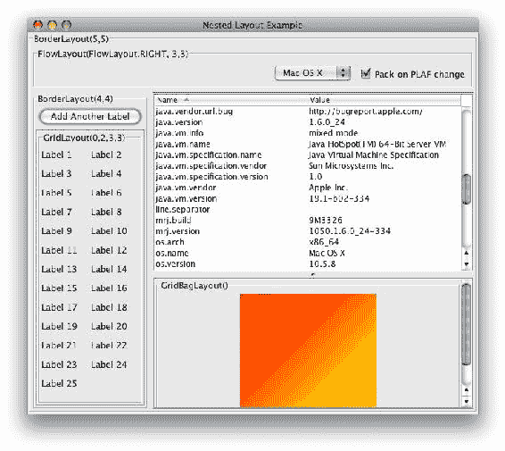

但如果这些策略对于特定的用例不起，请尝试以下方法。建立一个单一的主`JFrame`，然后让 [`JDialog`](http://docs.oracle.com/javase/tutorial/swing/components/dialog.html) 或 [`JOptionPane`](http://docs.oracle.com/javase/tutorial/swing/components/dialog.html#features) 实例出现在其余的浮动元素中，并将框架作为对话框的父窗口。

## 许多图像

在多个元素均为图像的情况下，使用以下任一方法会更好：

1. 使用单一的`JLabel`（在滚动面板中居中）显示用户当前感兴趣的任何图像。如 [`ImageViewer`](https://stackoverflow.com/a/13463684/418556) 所示。
   
2. 使用单行`JList`。如[这个答案](https://stackoverflow.com/a/9544652/418556) 所示。该答案中的“单行”部分仅在所有图像尺寸相同时才有效。或者，如果你准备好动态缩放图像，并且它们具有相同的宽高比例（例如 4:3 或 16:9）。


解决方案由：[Andrew Thompson](https://stackoverflow.com/users/418556/andrew-thompson) 提供

## 讨论

将一个`jInternalFrame`变成主框架并设置为不可见。然后你可以用它处理后续事件。

```
jInternalFrame.setSize(300,150);
jInternalFrame.setVisible(true);
```


讨论由：[Virendra Singh Rathore](https://stackoverflow.com/users/1752079/virendra-singh-rathore)提供。

这绝对是坏习惯。之一原因是每个`JFrame`都会显示一个新的任务栏图标，这实际上并不非常“用户友好”。控制多个`JFrame`会让你抓狂的。

我个人认为，对于你这类应用程序，我会使用一个`JFrame`。显示多个事物的方法由你决定，有很多种。画布、`JInternalFrame`、`CardLayout`，甚至可能是`JPanel`。

多个`JFrame`对象 = 痛苦、麻烦和问题。

讨论由：[Matt Dawsey](https://stackoverflow.com/users/1966354/matt-dawsey)提供。

我上上次碰 Swing 已经段时间了，但总来说，这样做是一种坏习惯。我想到的一些主要缺点是：

* **开销更高：**绘制一个`JFrame`需要分配比其他类型窗口容器（如`Dialog`或`JInternalFrame`）得多的资源。
* **不用户友好：**在一组堆在一起的`JFrame`之间导航并不容易，这会让你的应用程序看起来像是一组不一致且设计糟糕的应用程序。
* **使用`JInternalFrame`很简单：**这像是个反问句，现在它简单得多，而且比我们更聪明（或有更多空闲）的人已经想通了 Desktop 和`JInternalFrame`模式，所以我我建议使用它。

讨论由：[Necronet](https://stackoverflow.com/users/382920/necronet)提供。

自从我开始编写 Swing 应用程序以来，我就实现过多个`JFrame`的方法。在大多数情况下，我最初这样做是因为我并不知道更好的方法。**然而**，随着我作为开发者经验和知识的成熟，并开始阅读和吸收网上许多更资深 Java 开发者的意见，我尝试**摒弃**多个`JFrame`的方法（同时针对当前项目和未来项目），结果却遇到了……听听……来自客户的反对！当我开始实现模态对话框来控制“子”窗口，并使用`JInternalFrame`处理独立组件时，**我的客户开始抱怨了！**我感到非常惊讶，因为我做的是我认为的最佳实践！但正如人们所说，“妻悦，夫事兴。”你的客户也是如此。当然，我是一个承包商，所以我的最终用户可以直接与我（开发者）联系，这显然不是一个常见的场景。

所以，我将解释多个`JFrame`方法的优点，并破除他人提出的某些缺点。

1. **布局的终极灵活性**——通过允许独立的`JFrame`，你赋予了终端用户展开并控制其屏幕上内容的能力。这种感觉是“开放”的且不受限制的。当你转向`JFrame`和`JInternalFrame`时，你就失去了这种特性。
2. **非常适合模块化应用程序**——在我的案例中，一个可能是销售仪表板，另一个可能是会计。但它们都是`JFrame`。它们之间互不通信。
3. **让终端用户更方便**——有一次，我想让登录界面成为`Dialog`。我做了更改，立即就收到了一个终端用户的电话，他非常依赖于可以最小化这一事实。这在`JDialog`中是不可能的，在`JInternalFrame`中也肯定是不可能的。
4. **误区：编码困难**——根据我的经验，事实并非如此。我不为什么创建一个`JInternalFrame`会比创建一个`JFrame`更容易。事实上，在我的经验中，`JInternalFrame`提供的灵活性小得多。我开发了一套处理应用程序中`JFrame`打开和关闭的系统方法，它非常有效。我几乎完全从框架代码内部控制框架；新框架的创建、在后台线程中检索数据并在 EDT 上执行 GUI 代码的`SwingWorker`、当用户尝试重复打开框架时恢复/将其置于顶层等。打开我的`JFrame`s只需要调用一个公共静态方法`open()`，而该方法结合`windowClosing()`事件即可处理剩余部分（框架是否已打开？未打开但正在加载？等）。
5. **误区/未证实：资源密集**——我想看到支持这种推测性陈述的事实。尽管也许可以说`JFrame`比`JInternalFrame`需要更多空间，但即使你打开 100 个`JFrame`，你真的会消耗多少额外资源？如果你的担心是资源导致内存泄漏：调用`dispose()`会释放框架用于垃圾回收的所有资源（而且再次强调，`JInternalFrame`也会引起同样的担忧）。

我写了很多，我觉得我还可以写得更多。总之，我希望不会仅仅因为这是一个不流行的意见而被投反对票。这个问题显然是有价值的，我希望我提供了一个有价值的答案，即使它不是主流意见。

# SDI vs MDI：Microsoft Excel 示例

“多窗口/单窗口内单文档”([SDI](http://en.wikipedia.org/wiki/Single_document_interface))与“单窗口/单窗口内多文档”([MDI](http://en.wikipedia.org/wiki/Multiple_document_interface))的一个佳示例是 Microsoft Excel。

## MDI 的一些优点

* 可以拥有非矩形状的窗口——这样它们就不会遮挡桌面或其他进程的窗口（例如网页浏览器）。
* 在第二个 Excel 窗口写入内容时，可以打开另一个进程的窗口覆盖在某个 Excel 窗口上方——在 MDI 中，尝试写入其中一个内部窗口会使整个 Excel 窗口获得焦点，从而隐藏来自另一个进程的窗口。
* 可以在不同的屏幕上显示不同的文档，这在屏幕分辨率不相同时特别有用。

### SDI（单单文档界面，即每个窗口只能包含一个文档）


### MDI（多文档界面，即每个窗口可以包含多个文档）


讨论感谢提供：[ryvantage](https://stackoverflow.com/users/963076/ryvantage)

## 案例研究：无模型报告查看器

我想通过一个我最近参与的例子来反驳“不用户友好”的观点。在我们的应用程序中，有一个主窗口，用户在其中以单独标签页的形式运行各种“程序”。我们尽可能地尝试让应用程序保持在这个单一窗口中。

他们运行的其中一个“程序”会列出系统生成的报告列表，用户可以点击每行上的图标弹出一个报告查看器对话框。该查看器显示的是报告等大的纵向/横向 A4 页面，因此用户希望这个窗口大，几乎占据整个屏幕。

几个月前，我们收到客户请求，希望将报告查看窗口设置为无模型（modeless），这样他们就可以同时打开多个报告。一段时间以来我一直拒绝这个请求，因为认为这不是很好的解决方案。然而，当我发现用户是如何规避我们系统的“缺陷”时，我改变了主意。

他们打开查看器，使用“另存为”功能将报告保存为 PDF 到特定目录，使用 Acrobat Reader 打开 PDF 文件，然后对下一个报告执行相同的操作。他们会运行多个 Acrobat Reader，显示他们想要查看的各种报告输出。

于是我妥协了，并将查看器改为无模型。这意味着每个查看器都有一个任务栏图标。当上周向他们发布最新版本时，他们的反馈非常强烈，表示他们非常喜欢它。这是我们系统最近最受欢迎的功能增强之一。所以，你可以尽管告诉你的用户他们想要的东西是不好的，但最终对你并没有好处。

## 无模型对话框的实现注意事项

* 使用`JDialog`对于这些无模型窗口似乎是最佳实践。
* 使用使用新`ModalityType`的构造函数，而不是布尔型的`modal`参数。这让这些对话框拥有任务栏图标。
* 对于无模型对话框，向构造函数传递一个`null`父窗口，但要相对于它们的“父”窗口进行定位。
* Windows 上的 Java 6 版本存在一个[bug](http://bugs.sun.com/view_bug.do?bug_id=6829546)，这意味着你的主窗口可以在没有你指令的情况下变成“始终置顶”。升级到版本 7 可以修复此问题。

讨论感谢提供：[DuncanKinnear](https://stackoverflow.com/users/1026453/duncankinnear)

# 关于框架（Frames）的架构讨论

如果框架的大小相同，为什么不创建一个框架并将其作为引用传递传递呢？当你传递了框架后，你就可以决定如何填充它。这就像有一个计算一组数字平均值的方法。你会反复反复地创建该方法吗？

讨论感谢提供：[Keith Spriggs](https://stackoverflow.com/users/1596520/keith-spriggs)

这不是一个好做法，但即使你想使用它，你也可以使用单例模式，因为它是好的。我在我的大多数项目中都使用了单例模式，效果很好。

讨论感谢提供：[arunjoseph](https://stackoverflow.com/users/2944997/arunjoseph)

## 使用`JPanel`代替`JFrame`

我认为使用多个`JFrame`不是一个好主意。相反，我们可以在同一个`JFrame`中使用一个或多个`JPanel`。我们还可以在这些`JPanel`之间进行切换，这让我们在`JFrame`中显示多于一个内容的自由。对于每个`JPanel`，我们可以设计不同的内容，所有这些`JPanel`可以一次显示在单个`JFrame`上。

要在这些`JPanel`之间切换，可以使用带有每个`JPanel`的`menuItems`的`menubar`，或者为每个`JPanel`使用`JButton`。使用多个`JFrame`不是好做法，但如果我们想要多个`JFrame`也没有错。但为了我们的不同需求改变一个`JFrame`比拥有多个`JFrame`要好。

讨论感谢提供：[Lijo](https://stackoverflow.com/users/3065232/lijo)

# 技术细节：不可序列化字段的序列化

此内容来源于[StackOverFlow](https://stackoverflow.com/questions/9554636/the-use-of-multiple-jframes-good-or-bad)

## 问题：带有不可序列化字段的序列化

我有：

```java
class MyClass {

  //...

}
```

`MyClass2`不是可序列化的。我如何序列化（反序列化）它？

## 解决方案

正如其他人所指，《Effective Java》第 11 章，`MyClass2`*必须*有一个无参构造函数，否则`MyClass`无法扩展`MyClass2`。

* 要序列化`MyClass2`中不可序列化的字段，该字段必须对`MyClass`可用，直接访问或通过 getter 和 setter 皆。
* 要序列化不可序列化字段的状态（写入对象流）并使用该状态实例化新实例（当从对象流读取时）：根据《Effective Java》第 74 节，`MyClass2`必须有一个允许获取它的 API。

### 自定义序列化示例

我在下面写了一个简单的示例：

```java
class MyClass extends MyClass2 implements Serializable {

  public MyClass(int quantity) {

    setNonSerializableProperty(new NonSerializableClass(quantity));

  }

  private void writeObject(java.io.ObjectOutputStream out)

  throws IOException {

    // 注意，这里不需要 out.defaultWriteObject(); 因为

    // MyClass 没有其他需要序列化的状态

    out.writeInt(super.getNonSerializableProperty().getQuantity());

  }

  private void readObject(java.io.ObjectInputStream in)

  throws IOException {

    // 注意，这里不需要 in.defaultReadObject();

    // 因为 MyClass 没有其他需要反序列化的状态

    super.setNonSerializableProperty(new NonSerializableClass(in.readInt()));

  }

}

/* 此类必须有一个对 MyClass 可见的无参构造函数 */

class MyClass2 {

  /* 此属性必须允许被 MyClass 获取/设置。因此它不能是 final */

  private NonSerializableClass nonSerializableProperty;

  public void setNonSerializableProperty(NonSerializableClass nonSerializableProperty) {

    this.nonSerializableProperty = nonSerializableProperty;

  }

  public NonSerializableClass getNonSerializableProperty() {

    return nonSerializableProperty;

  }

}

class NonSerializableClass {

  private final int quantity;

  public NonSerializableClass(int quantity) {

    this.quantity = quantity;

  }

  public int getQuantity() {

    return quantity;

  }

}
```

解决方案来自：[Scott Bale](https://stackoverflow.com/users/2495576/scott-bale)

## 讨论

`MyClass2`是一个接口，所以从技术上讲它没有属性，只有方法。尽管如此，如果你有本身不可序列化的实例变量，我所知道的唯一办法就是将这些字段声明为`transient`。

例如：

```java
private transient Foo foo;
```


当你将字段声明为`transient`时，它将在序列化和反序列化过程中被忽略。请记住，当你反序列化带有`transient`字段的对象时，该字段的值将始终为它的默认值（通常是`null`）。

### 使用 readResolve()

注意，你也可以重写类的`readResolve()`方法，以便根据系统状态初始化`transient`字段。

讨论来自：[Mike Deck](https://stackoverflow.com/users/1247/mike-deck)

你需要实现`writeObject()`和`readObject()`，并对这些字段进行手动序列化/反序列化。详情请参阅`java.io.Serializable`的 javadoc 页面。Josh Bloch 的*Effective Java*中也包含了一些关于实现健壮且安全的序列化的优秀章节。

讨论来自：[sk.](https://stackoverflow.com/users/16399/sk)

你可以从研究`transient`关键字开始，它将字段标记为对象持久化状态的一部分。

讨论来自：[Hank](https://stackoverflow.com/users/7610/hank)

如果你可以修改`MyClass2`，解决此问题的简单方法是将该属性声明为`transient`。

讨论来自：[ykaganovich](https://stackoverflow.com/users/10026/ykaganovich)

### 使用 XStream

[XStream](http://x-stream.github.io)是一个优秀的库，用于对任何对象进行快速 Java 到 XML 的序列化，无论它是否实现了`Serializable`。即使 XML 目标格式不符合你的需求，你也可以通过源代码学习如何实现。

讨论来自：[Boris Terzic](https://stackoverflow.com/users/1996/boris-terzic)

这取决于`MyClass2`的该成员为什么不可序列化。如果有一个充分理由导致`MyClass2`无法以序列化形式表示，那么同样的原因可能适用于`MyClass`，因为它是一个子类。

可能通过实现`readObject`和`writeObject`为`MyClass`写一个自定义的序列化形式，使得`MyClass`中`MyClass2`实例数据的能够从序列化数据中适当重建。如果`MyClass2`的 API 是固定的且你无法添加`Serializable`，这就是可行的方法。但首先你应该弄清楚`MyClass2`为什么不可序列化，并可能修改它。

讨论来自：[Steve Jessop](https://stackoverflow.com/users/13005/steve-jessop)

### 序列化代理模式 (Serial Proxy Pattern)

序列化不可序列化类（或子类）实例的一种实用方法被称为序列化代理。本质上，你实现`writeReplace`来返回一个完全不同的可序列化类的实例，该类实现`readResolve`来返回原始对象的副本。我在 [Usenet](http://groups.google.com/group/comp.lang.java.programmer/msg/820a7343ae7713a6) 上写过序列化`java.awt.BasicStroke`的示例。

讨论来自：[Tom Hawtin - tackline](https://stackoverflow.com/users/4725/tom-hawtin-tackline)

### 可能性总结

出现了几种可能性，我在这里总结一下：

- 如 [sk](https://stackoverflow.com/users/16399/sk) 建议的，实现`writeObject()`和`readObject()`
- 将属性声明为`transient`，如 [hank](https://stackoverflow.com/users/7610/hank) 最初所说，它不会被序列化
- 如 [boris-terzic](https://stackoverflow.com/users/1996/boris-terzic) 所述，使用`XStream`
- 如 [tom-hawtin-tackline](https://stackoverflow.com/users/4725/tom-hawtin-tackline) 所述，使用序列化代理

讨论来自：[Burkhard](https://stackoverflow.com/users/12860/burkhard)

### 使用 Kryo

如果可能，不可序列化的部分可以被设置为`transient`

```java
private transient SomeClass myClz;
```

否则，你可以使用 [Kryo](https://github.com/EsotericSoftware/kryo)。Kryo 是一个快速且高效的 Java 对象图序列化框架（例如，`java.awt.Color`的 Java 序列化需要 170 字节，而 Kryo 仅需 4 字节），它可以序列化不可序列化的对象。Kryo 还可以执行自动的深/浅拷贝/克隆。这是对象到对象的直接复制，而不是`object->bytes->object`。

这里是使用`kryo`的示例：

```java
Kryo kryo = new Kryo();

// #### 存储到磁盘...
Output output = new Output(new FileOutputStream("file.bin"));
SomeClass someObject = ...
kryo.writeObject(output, someObject);
output.close();

// ### 从磁盘恢复...
Input input = new Input(new FileInputStream("file.bin"));
SomeClass someObject = kryo.readObject(input, SomeClass.class);
input.close();
```

序列化对象也可以通过注册精确的序列化来压缩：

```java
kryo.register(SomeObject.class);
```

讨论来自：[radim](https://stackoverflow.com/users/16860/radim)

文档在同一章节中提到了如何设置 JDBC 批量大小。

### 另见

* [10.10 刷新 Session](http://docs.jboss.org/hibernate/core/3.3/reference/en/html/objectstate.html#objectstate-flushing)
* [第 13 章 批量处理](http://docs.jboss.org/hibernate/core/3.3/reference/en/html/batch.html)

解决方案感谢：[Pascal Thivent](https://stackoverflow.com/users/70604/pascal-thivent)

## 讨论

是的，每 20 次循环就会为未保存的对象生成并执行 SQL。你也应该将批模式设置为 20 以提高性能。

讨论感谢：user333306

```java
// 假设 List 长度为 50 
for (int i = 0; i < 50 ; i++) {
    Car c = new Car( car.get(i).getId(),car.get(i).getName() );
    getCurrentSession().save(c);
    // 内存中保存的 20 个 car 对象与数据库同步 
    if (i % 20 == 0)
        getCurrentSession().flush();
}
```

关于为什么刷新应该匹配批量大小的更多几点：要启用批量处理，你需要设置 jdbc 批量大小

```properties
// 在你的情况下 
hibernate.jdbc.batch_size =20
```

使用批量处理时一个常见的陷阱是，如果你使用的是单个对象的更新或插入，这没有问题。但如果你在使用多个对象并导致多次插入/更新，那么你将不得不显式地设置排序机制。

例如

```java
// 假设 List 长度为 50 
for (int i = 0; i < 50 ; i++) {
    Car c = new Car( car.get(i).getId(),car.get(i).getName() );
    // 在这里也给卡添加了配件
    Accessories a=new Accessories("I am new one");
    c.add(a);
    // 现在你有两个实体需要持久化：car 和 accessory 
    // 两个 SQL 插入 
    getCurrentSession().save(c);
    // 内存中保存的 20 个 car 对象与数据库同步 
    // 这里的 Flush 清除了一级 JVM 缓存中的 car 对象
    if (i % 20 == 0)
        getCurrentSession().flush();
        getCurrentSession().clear();
}
```

在此种情况下，生成了两个 SQL：一个用于插入 car，一个用于插入 accessory。

为了实现正确的批量处理，你必须设置：

```xml
<prop  key="hibernate.order_inserts">true</prop>
```

这样所有对 car 的插入都会排序在一起，所有对 accessories 的插入也会排序在一起。通过这样做，你的一批次触发 20 次插入，而不是一次执行 1 条 SQL。

对于一个事务下的不同操作，你可以查看 [`docs.jboss.org/hibernate/core/3.2/api/org/hibernate/event/def/AbstractFlushingEventListener.html`](http://docs.jboss.org/hibernate/core/3.2/api/org/hibernate/event/def/AbstractFlushingEventListener.html)

讨论感谢：[Manish Singh](https://stackoverflow.com/users/395072/manish-singh)

这取决于`FlushMode`如何设置。

在默认配置下，Hibernate 尝试在三个位置与数据库同步。

```
1. 在查询数据之前
2. 在提交事务时
3. 显式调用 flush
```

如果将`FlushMode`设置为`FlushMode.Manual`，程序员正在告知 Hibernate 他/她将处理何时将数据传递到数据库。在此配置下，`session.flush()`调用将对象实例保存到数据库。

`session.clear()`调用实际上可以用于清除持久化上下文。

讨论感谢：[frictionlesspulley](https://stackoverflow.com/users/314763/frictionlesspulley)

此内容源自 [StackOverflow](https://stackoverflow.com/questions/3274958/question-about-hibernate-session-flush) 并已重新组织成上述配方。

# Java 包名中单词分隔符的约定是什么？

## 问题

应该如何分隔包名中的单词？以下哪些是正确的？

1. `com.stackoverflow.my_package`（下划线）
2. `com.stackoverflow.my-package`（连字符）
3. `com.stackoverflow.MyPackage`（驼峰式）

通用标准是什么？

问题感谢：[Jigar](https://stackoverflow.com/users/71858/jigar)

## 解决方案

以下是官方命名规范文档规定的：

> ### 包
> 
> 唯一包名的以前缀始终用全小写 ASCII 字母编写，并且应该是顶级域名之一，目前为`com`、`edu`、`gov`、`mil`、`net`、`org`或 ISO 标准 3166 1981 指定英语双字母国家代码之一。
>
> 包名的后续组件根据组织自身的内部命名约定而异。此类约定可能会指定某些目录名称组件为部门、科、项目、机器或登录名称。

讨论感谢：[Himanshu Mori](https://stackoverflow.com/users/3940893/himanshu-mori)

下划线在包名中看起来很丑。不值一一提的是，对于由三个或更多单词组成的名称，我使用字母缩写（例如：`com.company.app.ingresoegresofijo (ingreso/egreso fijo) -> com.company.app.iefijo`），然后在`package-info.java`中记录包的用途。

讨论感谢：[jpangamarca](https://stackoverflow.com/users/498531/jpangamarca)

在包名中拼接单词是大多数开发者不会做的事情。

你可以使用类似这样的结构：

`com.stackoverflow.mypackage`

参考 [JLS Name Declaration](http://docs.oracle.com/javase/specs/jls/se8/html/jls-6.html#jls-6.1)

讨论感谢：[CraUmm](https://stackoverflow.com/users/2780655/craumm)

我更倾向于使用单个单词和子包，所以与其说`com.stackoverflow.my-package`，我会将其变为`com.stackoverflow.my.package`

这为未来添加与父包相关的相关的子包提供了机会。参考：[`programmergate.com/coding-conventions/`](http://programmergate.com/coding-conventions/)

讨论感谢：[Anonymous User](https://stackoverflow.com/users/2735085/anonymous-user)

此内容源自 [StackOverFlow](https://stackoverflow.com/questions/3179216/what-is-the-convention-for-word-separator-in-java-package-names) 并已重新整理成上述配方。

# Gson 反序列化包含数组的对象的数组

## 问题

我正尝试使用`Gson`反序列化从我的 Web 服务返回的 JSON 字符串。

返回的结构将是`TypeDTO[]`。

其中`TypeDTO`如下：

```
int id;
String name;
ArrayList<ItemDTO> items[] 
```

并且`ItemDTO`如下：

```
int id;
String name;
Boolean valid;
```

当我按照如下方式调用代码时：

```
Gson gson = new Gson();
TypeDTO[] mytypes = (TypeDTO[]) gson.fromJson(reply, TypeDTO[].class);
```

对象内部的所有内容都是 null。

然而，如果我使用`org.json`库中的`JSONArray`和`JSONObject`逐个提取它们，运行运行良好，字段也会相应地填充。

对于我哪里做错了有什么建议吗？`Gson`极快吗？还是说我最好继续使用已经运行通的方法？

谢谢，David

问题感谢：[DavieDave](https://stackoverflow.com/users/439783/daviedave)

## 解决方案

原始问题中的示例 Java 数据结构与注释中 JSON 结构的描述不匹配。

JSON 被描述为“一个包含数组{对象}的对象的数组”。

就问题中描述的类型而言，JSON 转换为能够匹配`Gson`轻松反序列化的 JSON 结构的 Java 数据结构是“一个包含带有数组{`ItemDTO`对象}的`TypeDTO`对象数组”。

但问题中提供的 Java 数据结构并不是这个。相反，它是“一个包含带有数组{数组{`ItemDTO`对象}}的`TypeDTO`对象数组”。

二维数组 != 一维数组。

第一个示例演示了如何使用`Gson`简单地反序列化和序列化 JSON 结构“一个包含数组{对象}的数组”。

**input.json 内容：**

```json
[
  {
    "id":1,
    "name":"name1",
    "items":
    [
      {"id":2,"name":"name2","valid":true},
      {"id":3,"name":"name3","valid":false},
      {"id":4,"name":"name4","valid":true}
    ]
  },
  {
    "id":5,
    "name":"name5",
    "items":
    [


```json
{"id":6,"name":"name6","valid":true},
{"id":7,"name":"name7","valid":false}
]
},
{
"id":8,
"name":"name8",
"items":
[
{"id":9,"name":"name9","valid":true},
{"id":10,"name":"name10","valid":false},
{"id":11,"name":"name11","valid":false},
{"id":12,"name":"name12","valid":true}
]
}
]
```

**Foo.java：**

```java
import java.io.FileReader;
import java.util.ArrayList;
import com.google.gson.Gson;

public class Foo {
  public static void main(String[] args) throws Exception {
    Gson gson = new Gson();
    TypeDTO[] myTypes = gson.fromJson(new FileReader("input.json"), TypeDTO[].class);
    System.out.println(gson.toJson(myTypes));
  }
}

class TypeDTO {
  int id;
  String name;
  ArrayList<ItemDTO> items;
}

class ItemDTO {
  int id;
  String name;
  Boolean valid;
}
```

第二个示例演示了如何使用`Gson`简单地反序列化和序列化 JSON 结构“一个包含数组{对象}的数组”。

**input.json 内容：**

```json
[
  {
    "id": 1,
    "name": "name1",
    "items": [
      {"id": 2, "name": "name2", "valid": true},
      {"id": 3, "name": "name3", "valid": false},
      {"id": 4, "name": "name4", "valid": true}
    ]
  },
  {
    "id": 5,
    "name": "name5",
    "items": [
      {"id": 6, "name": "name6", "valid": true},
      {"id": 7, "name": "name7", "valid": false}
    ]
  },
  {
    "id": 8,
    "name": "name8",
    "items": [
      {"id": 9, "name": "name9", "valid": true},
      {"id": 10, "name": "name10", "valid": false},
      {"id": 11, "name": "name11", "valid": false},
      {"id": 12, "name": "name12", "valid": true}
    ]
  }
]
```

**Foo.java：**

```java
import java.io.FileReader;
import java.util.ArrayList;
import com.google.gson.Gson;

public class Foo {
  public static void main(String[] args) throws Exception {
    Gson gson = new Gson();
    TypeDTO[] myTypes = gson.fromJson(new FileReader("input.json"), TypeDTO[].class);
    System.out.println(gson.toJson(myTypes));
  }
}

class TypeDTO {
  int id;
  String name;
  ArrayList<ItemDTO> items;
}

class ItemDTO {
  int id;
  String name;
  Boolean valid;
}
```

第二个示例示例而是使用了“一个包含带有数组{数组{`ItemDTO` 对象}}的`TypeDTO` 对象数组”来匹配原始提供的结构。“一个包含带有数组{`ItemDTO` 对象}}”是该 JSON 结构。

# Java SSL/TLS 忽略过期证书？(`java.security.cert.CertPathValidatorException: timestamp check failed`)

## 问题

我在通过 SSL 通信的一个 API 上遇到了一个问题。我认为异常是由于 SSL 证书过期导致的。问题是，我不管理该 API 服务器。是否可以忽略过期证书？

异常：

```text
[ERROR,TaacWorkshop] Problem deleting user group from CADA:

org.apache.thrift.transport.TTransportException: javax.net.ssl.SSLException: Connection has been shutdown: javax.net.ssl.SSLHandshakeException: sun.security.validator.ValidatorException: PKIX path validation failed: java.security.cert.CertPathValidatorException: timestamp check failed

    at org.apache.thrift.transport.TIOStreamTransport.flush(TIOStreamTransport.java:156)
    at company.oss.thrift.cada.CADABackend$Client.send_DeleteUserGroup(CADABackend.java:580)
    at company.oss.thrift.cada.CADABackend$Client.DeleteUserGroup(CADABackend.java:568)
    at com.cable.company.nse.cada.CadaDao.deleteUserGroup(CadaDao.java:72)
    at com.cable.company.nse.taac.business.TaacWorkshop.deleteTaac(TaacWorkshop.java:127)
    at com.cable.company.nse.taac.controller.RemoteVendorAccessController.processRequest(RemoteVendorAccessController.java:130)
    at com.cable.company.nse.taac.controller.RemoteVendorAccessController$FastClassByCGLIB$$6369df.invoke(<generated>)
    at net.sf.cglib.proxy.MethodProxy.invoke(MethodProxy.java:191)
    at org.springframework.aop.framework.Cglib2opProxy$CglibMethodInvocation.invoke(Cglib2opProxy.java:692)
    at org.springframework.aop.framework.ReflectiveMethodInvocation.proceed(ReflectiveMethodInvocation.java:150)
    at org.springframework.security.access.intercept.MethodSecurityInterceptor.invoke(MethodSecurityInterceptor.java:67)
    at org.springframework.aop.framework.ReflectiveMethodInvocation.proceed(MethodInvocation.java:172)
    at org.springframework.aop.framework.Cglib2opProxy$DynamicAdvisedInterceptor.intercept(Cglib2opProxy.java:625)
    at com.cable.company.nse.taac.controller.RemoteVendorAccessController$EnhancerByCGLIB$$bdd2ad.processRequest(<generated>)
    at sun.reflect.NativeMethodAccessorImpl.invoke(NativeMethod)
    at sun.reflect.NativeMethodAccessorImpl.invoke(NativeMethodAccessorImpl.java:39)
    at sun.reflect.DelegatingMethodAccessorImpl.invoke(DelegatingMethodAccessorImpl.java:25)
    at java.reflect.Method.invoke(Method.java:592)
    at org.springframework.web.bind.support.HandlerMethodInvoker.doInvokeMethod(HandlerMethodInvoker.java:710)
    at org.springframework.web.bind.support.HandlerMethodInvoker.invokeHandlerMethod(HandlerMethodInvoker.java:167)
    at org.springframework.web.servlet.mvc.method.AnnotationMethodHandlerAdapter.invokeHandlerMethod(AnnotationMethodHandlerAdapter.java:414)
    at org.springframework.web.servlet.mvc.method.AnnotationMethodHandlerAdapter.handle(AnnotationMethodHandlerAdapter.java:402)
    at org.springframework.web.servlet.DispatcherServlet.doDispatch(DispatcherServlet.java:771)
    at org.springframework.web.servlet.DispatcherServlet.doService(FrameworkServlet.java:716)
    at org.springframework.web.servlet.FrameworkServlet.processRequest(FrameworkServlet.java:647)
    at org.springframework.web.servlet.FrameworkServlet.doPost(FrameworkServlet.java:563)
    at javax.servlet.http.HttpServlet.service(HttpServlet.java:637)
    at javax.servlet.http.HttpServlet.service(HttpServlet.java:717)
    at org.apache.catalina.core.ApplicationFilterChain.internalDoFilter(ApplicationFilterChain.java:290)
    at org.apache.catalina.core.ApplicationFilterChain.doFilter(ApplicationFilterChain.java:206)
    at org.springframework.security.web.FilterChainProxy$VirtualFilterChain.doFilter(FilterChainProxy.java:343)
    at org.springframework.security.access.intercept.FilterSecurityInterceptor.invoke(FilterSecurityInterceptor.java:109)
    at org.springframework.security.access.intercept.FilterSecurityInterceptor.doFilter(FilterSecurityInterceptor.java:83)
    at org.springframework.security.web.FilterChainProxy$VirtualFilterChain.doFilter(FilterChainProxy.java:355)
    at org.springframework.security.web.access.ExceptionTranslationFilter.doFilter(ExceptionTranslationFilter.java:97)
    at org.springframework.security.web.FilterChainProxy$VirtualFilterChain.doFilter(FilterChainProxy.java:355)
    at org.springframework.security.web.session.SessionManagementFilter.doFilter(SessionManagementFilter.java:100)
    at org.springframework.security.web.authentication.AnonymousAuthenticationFilter.doFilter(AnonymousAuthenticationFilter.java:78)
    at org.springframework.security.web.FilterChainProxy$VirtualFilterChain.doFilter(FilterChainProxy.java:355)
    at org.springframework.security.web.servletapi.SecurityContextHolderAwareRequestFilter.doFilter(SecurityContextHolderAwareRequestFilter.java:54)
    at org.springframework.security.web.FilterChainProxy$VirtualFilterChain.doFilter(FilterChainProxy.java:355)
    at org.springframework.security.web.savedrequest.RequestCacheAwareFilter.doFilter(RequestCacheAwareFilter.java:35)
    at org.springframework.security.web.authentication.AbstractProcessingFilter.doFilter(AbstractProcessingFilter.java:188)
    at org.springframework.security.web.FilterChainProxy$VirtualFilterChain.doFilter(FilterChainProxy.java:355)
    at org.springframework.security.web.authentication.LogoutFilter.doFilter(LogoutFilter.java:105)
    at org.springframework.security.web.session.SessionManagementFilter.doFilter(SessionManagementFilter.java:90)
```


```text
at org.springframework.security.web.FilterChainProxy$VirtualFilterChain.doFilter(FilterChainProxy.java:355)
at org.springframework.security.web.context.SecurityContextFilter.doFilter(SecurityContextFilter.java:79)
at org.springframework.security.web.FilterChainProxy$VirtualFilterChain.doFilter(FilterChainProxy.java:355)
at org.springframework.security.web.session.ConcurrentSessionFilter.doFilter(ConcurrentSessionFilter.java:109)
at org.springframework.security.web.FilterChainProxy$VirtualFilterChain.doFilter(FilterChainProxy.java:355)
at org.springframework.security.web.filter..atingFilter..((....::35
.................(.Proxy.java:149)
at org.springframework.security.web.filter.DelegatingFilter.invoke(DelegatingFilter.java:237)
at org.springframework.security.web.filter.DelegatingFilter.doFilter(DelegatingFilter.java:167)
at org.apache.catalina.core.ApplicationFilterChain.internalDoFilter(ApplicationFilterChain.java:235)
at org.apache.catalina.core.ApplicationFilterChain.doFilter(ApplicationFilterChain.java:206)
at org.springframework.aop.framework.Cglib2opProxy$DynamicAdvisedInterceptor.intercept(Cglib2opProxy.java:625)
... (truncated trace)
at org.apache.catalina.core.StandardWrapperValve.invoke(StandardWrapperValve.java:233)
at org.apache.catalina.core.StandardContextValve.invoke(StandardContextValve.java:191)
at org.apache.catalina.core.StandardHostValve.invoke(StandardHostValve.java:127)
at org.apache.catalina.valves.ErrorReportValve.invoke(ErrorReportValve.java:102)
at org.apache.catalina.core.StandardEngineValve.invoke(StandardEngineValve.java:109)
at org.apache.catalina.connector.CoyoteAdapter.service(CoyoteAdapter.java:298)
at org.apache.catalina.coyote.http11.Http11Processor.process(Http11Processor.java:852)
at org.apache.catalina.coyote.http11.Http11Protocol$Http11Handler.process(Http11Protocol.java:588)
at org.apache.tomcat.util.net.JIoEndpoint.run(JIoEndpoint.java:489)
at java.lang.Thread.run(Thread.java:

Caused by: javax.net.ssl.SSLException: Connection has been shutdown: javax.net.ssl.SSLHandshakeException: sun.security.validator.ValidatorException: PKIX path validation failed: java.security.cert.CertPathValidatorException: timestamp check failed

at sun.net.ssl.internal.ssl.SSLSocketImpl.checkEOF(SSLSocketImpl.java:1232)
at sun.net.ssl.internal.ssl.SSLSocketImpl.checkWrite(SSLSocketImpl.java:1244)
at sun.net.ssl.internal.ssl.AppOutputStream.write(AppOutputStream.java:43)
at java.io.BufferedOutputStream.flushBuffer(BufferedOutputStream.java:65)
at java.io.BufferedOutputStream.flush(BufferedOutputStream.java:123)
at org.apache.thrift.transport.TIOStreamTransport.flush(TIOStreamTransport.java:154)
... 66 more

Caused by: javax.net.ssl.SSLHandshakeException: sun.security.validator.ValidatorException: PKIX path validation failed: java.security.cert.CertPathValidatorException: timestamp check failed

at sun.net.ssl.internal.ssl.Alerts.getSSLException(Alerts.java:150)
at sun.net.ssl.internal.ssl.SSLSocketImpl.fatal(SSLSocketImpl.java:1584)
at sun.net.ssl.internal.ssl.Handshaker.fatalSE(Handshaker.java:174)
at sun.net.ssl.internal.ssl.Handshaker.fatalSE(Handshaker.java:168)
at sun.net.ssl.internal.ssl.ClientHandshaker.serverCertificate(ClientHandshaker.java:848)
at sun.net.ssl.internal.ssl.ClientHandshaker.processMessage(ClientHandshaker.java:106)
at sun.net.ssl.internal.ssl.Handshaker.processLoop(Handshaker.java:495)
at sun.net.ssl.internal.ssl.Handshaker.process_record(Handshaker.java:433)
at sun.net.ssl.internal.ssl.SSLSocketImpl.readRecord(SSLSocketImpl.java:577)
at sun.net.ssl.internal.ssl.SSLSocketImpl.performHandshake(SSLSocketImpl.java:108)
at sun.net.ssl.internal.ssl.SSLSocketImpl.writeRecord(SSLSocketImpl.java:61)
at sun.net.ssl.internal.ssl.AppOutputStream.write(AppOutputStream.java:43)
at java.io.BufferedOutputStream.flushBuffer(BufferedOutputStream.java:65)
at java.io.BufferedOutputStream.flush(BufferedOutputStream.java:123)
at org.apache.thrift.transport.TIOStreamTransport.flush(TIOStreamTransport.java:154)
... (truncated trace)

Caused by: javax.net.ssl.SSLHandshakeException: sun.security.validator.ValidatorException: PKIX path validation failed: java.security.cert.CertPathValidatorException: timestamp check failed

at sun.security.provider.certpath.PKIXMasterCertPathValidator.validate(PKIXMasterCertPathValidator.java:139)
at sun.security.provider.certpath.PKIXCertPathValidator.doValidate(PKIXCertPathValidator.java:316)
at sun.security.provider.certpath.PKIXCertPathValidator.engineValidate(PKIXCertPathValidator.java:178)
at java.security.cert.CertPathValidator.validate(CertPathValidator.java:206)
... 81 more

Caused by: java.security.cert.CertificateExpiredException: NotAfter: Sat Jul 17 13:44:42 MDT 2010

at sun.security.x509.CertificateValidity.valid(CertificateValidity.java:256)
at sun.security.x509.X509CertImpl.checkValidity(X509CertImpl.java:570)
at sun.security.provider.certpath.BasicChecker.verifyTimestamp(BasicChecker.java:157)
at sun.security.provider.certpath.BasicChecker.check(BasicChecker.java:109)
at sun.security.provider.certpath.PKIXMasterCertPathValidator.validate(PKIXMasterCertPathValidator.java:117)
... 85 more
```

当前代码必须能够设置信任存储（trust store），因为存在客户端证书认证。我尝试了下面的建议，但仍然遇到了一些问题。以下目前目前使用的代码：

```java
KeyStore identityStore = KeyStore.getInstance(KeyStore.getDefaultType());

ClassPathResource keystore = new ClassPathResource(cadaBackendCertFile);

identityStore.load(keystore.getInputStream(), cadaBackendCertFilePassword.toCharArray());

KeyManagerFactory kmf = KeyManagerFactory.getInstance(KeyManagerFactory.getDefaultAlgorithm());

kmf.init(identityStore, cadaBackendCertFilePassword.toCharArray());

TrustManagerFactory tmf = TrustManagerFactory.getInstance(TrustManagerFactory.getDefaultAlgorithm());

tmf.init(identityStore);

SSLContext ctx = SSLContext.getInstance("TLS");

ctx.init(kmf.getKeyManagers(), tmf.getTrustManagers(), new SecureRandom());

SSLSocketFactory fac = ctx.getSocketFactory();

Socket sslsock = fac.createSocket(cadaBackendEndpoint, cadaBackendPort);

TTransport transport = new TSocket(sslsock);
```

将该代码改为以下内容，我遇到了服务器问题，但它解决了我的安全异常问题：

```java
KeyStore identityStore = KeyStore.getInstance(KeyStore.getDefaultType());

ClassPathResource keystore = new ClassPathResource(cadaBackendCertFile);

identityStore.load(keystore.getInputStream(), cadaBackendCertFilePassword.toCharArray());

KeyManagerFactory kmf = KeyManagerFactory.getInstance(KeyManagerFactory.getDefaultAlgorithm());

kmf.init(identityStore, cadaBackendCertFilePassword.toCharArray());

TrustManagerFactory tmf = TrustManagerFactory.getInstance(TrustManagerFactory.getDefaultAlgorithm());

tmf.init(identityStore);

SSLContext ctx = SSLContext.getInstance("TLS");

ctx.init(kmf.getKeyManagers(), new TrustManager[] {new X509TrustManager() {

    public void checkClientTrusted(X509Certificate[] chain, String authType) throws CertificateException {
    }

    public void checkServerTrusted(X509Certificate[] chain, String authType) throws CertificateException {
    }

    public X509Certificate[] getAcceptedIssuers() {
        return null;
    }
}}, new SecureRandom());

SSLSocketFactory fac = ctx.getSocketFactory();

Socket sslsock = fac.createSocket(cadaBackendEndpoint, cadaBackendPort);

TTransport transport = new TSocket(sslsock);

TProtocol proto = new TBinaryProtocol(transport);

cadaBackendClient = new Client(proto);
```

实际上——即使上面的代码也会抛出异常：

```text
```


```text
ERROR[com.cable.nse.cada.CadaDaoTest][main] - Error:

org.apache.thrift.transport.TTransportException: javax.net.ssl.SSLHandshakeException: Received fatal alert: bad_certificate

    at org.apache.thrift.transport.TIOStreamTransport.flush(TIOStreamTransport.java:156)

    at .oss.thrift.cada.CADABackend$Client.send_UserDetails(CADABackend.java:328)

    at .oss.thrift.cada.CADABackend$Client.UserDetails(CADABackend.java:316)

    at com.cable.nse.cada.CadaDao.getUserDetails(CadaDao.java:136)

    at com.cable.nse.cada.CadaDaoTest.testCada(CadaDaoTest.java:73)

    at com.cable.nse.cada.CadaDaoTest.test(CadaDaoTest.java:37)

    at sun.reflect.NativeMethodAccessorImpl.invoke0(Native Method)

    at sun.reflect.NativeMethodAccessorImpl.invoke(NativeMethodAccessorImpl.java:39)

    at sun.reflect.NativeMethodAccessorImpl.invoke(Native Method)

    at sun.reflect.NativeMethodAccessorImpl.invoke(NativeMethodAccessorImpl.java:25)

    at java.lang.reflect.Method.invoke(Method.java:592)

    at junit.framework.TestCase.runTest(TestCase.java:154)

    at junit.framework.TestCase.runBare(TestCase.java:127)

    at junit.framework.TestResult$1.protect(TestResult.java:106)

    at junit.framework.TestResult.runProtected(TestResult.java:124)

    at junit.framework.TestResult.run(TestResult.java:109)

    at junit.framework.TestCase.runTest(TestCase.java:118)

    at junit.framework.TestSuite.runTest(TestSuite.java:208)

    at junit.framework.TestSuite.run(TestSuite.java:203)

    at org.eclipse.jdt.internal.junit.runner.junit3.JUnit3TestReference.run(JUnit3TestReference.java:130)

    at org.eclipse.jdt.internal.junit.runner.TestExecution.run(TestExecution.java:38)

    at org.eclipse.jdt.internal.junit.runner.RemoteTestRunner.runTests(RemoteTestRunner.java:467)

    at org.eclipse.jdt.internal.junit.runner.RemoteTestRunner.runTests(RemoteTestRunner.java:683)
```

## 解决方案

修改默认的`SSLContext`是不安全的，因为它会影响整个进程。这会无差别地降低每个连接的安全设置。它也可能不是线程安全的，尽管我不确定。

我建议将此类操作委托给每个请求的独立进程。

```java
String content = new HttpsNoVerify.fetch(URL.create(myURL));
```

### `HttpsNoVerify.java`列表

```java
package com.example;

import org.apache.commons.io.IOUtils;

import javax.net.ssl.HttpsURLConnection;
import javax.net.ssl.SSLContext;
import javax.net.ssl.TrustManager;
import javax.net.ssl.X509TrustManager;

import java.net.URL;

public class HttpsNoVerify {

    public static void main(String... args) throws Exception {

        URL url = new URL(args[0]);

        TrustManager[] trustAllCerts = new TrustManager[]{

            new X509TrustManager() {

                public java.security.cert.X509Certificate[] getAcceptedIssuers() {return null;}

                public void checkClientTrusted(java.security.cert.X509Certificate[] certs, String authType){}

                public void checkServerTrusted(java.security.cert.X509Certificate[] certs, String authType){}

            }

        };

        SSLContext sc = SSLContext.getInstance("SSL");

        sc.init(null, trustAllCerts, new java.security.SecureRandom());

        HttpsURLConnection.setDefaultSSLSocketFactory(sc.getSocketFactory());

        IOUtils.copy(url.openStream(), System.out);

    }

    public String fetch(URL url) throws Exception {

        return new SubProcess(HttpsNoVerify.class).run(url.toString());

    }

}
```

### `SubProcess.java`列表

```java
package com.example;

import java.lang.reflect.Method;

public class SubProcess {

    public SubProcess(Class<?> clazz) {

        // implementation omitted

    }

    public String run(String arg) throws Exception {

        // implementation omitted

        return "";

    }

}
```

```java
package com.example;

import org.apache.commons.io.IOUtils;

import java.util.Arrays;

public class SubProcess {

    private final Class<?> classToRun;

    public SubProcess(Class<?> classToRun) {

        this.classToRun = classToRun;

    }

    public String run(String... args) throws Exception {

        ProcessBuilder processBuilder = new ProcessBuilder("java",

                "-Djava.library.path=" + System.getProperty("java.library.path"),

                "-classpath", System.getProperty("java.class.path"),

                classToRun.getCanonicalName());

        for (String arg : args) processBuilder.command().add(arg);

        processBuilder.redirectErrorStream();

        Process process = processBuilder.start();

        String output = IOUtils.toString(process.getInputStream());

        process.waitFor();

        if (process.exitValue() != 0)

            throw new IllegalStateException(

                    String.format("Running %s with %s failed", classToRun, Arrays.toString(args)));

        return output;

    }

}
```

解决方案感谢提供：[Alain O'Dea](https://stackoverflow.com/users/154527/alain-odea)

## 讨论

我认为你可以下载证书并将其添加到你的存储库中。然后通过环境变量配置你的 JVM，指示存储库的位置。

讨论感谢提供：[hvgotcodes](https://stackoverflow.com/users/305644/hvgotcodes)

我不知道是否有什么属性可以让你忽略对默认`X509TrustManager`远程证书的时间有效性检查，但如果你可以访问客户端代码，可能会配置一个带有自定义`X509TrustManager`的不同`SSLContext`，在其中你可以捕获此异常。

如果你想使用类似[jSSLutils](http://www.jsslutils.org/)的`SSLContextFactory`，你可以编写类似下面的封装器：

```java
PKIXSSLContextFactory sslContextFactory = new PKIXSSLContextFactory();

sslContextFactory.setTrustManagerWrapper(new X509TrustManagerWrapper() {

    @Override

    public X509TrustManager wrapTrustManager(final X509TrustManager origManager) {

        return new X509TrustManager() {

            @Override

            public X509Certificate[] getAcceptedIssuers() {

                return origManager.getAcceptedIssuers();

            }

            @Override

            public void checkServerTrusted(X509Certificate[] chain,

                                                   String authType)

                    throws CertificateException {

                try {

                    origManager.checkServerTrusted(chain, authType);

                } catch (CertificateExpiredException e) {

                    // TODO 记录或进行其他操作以重新抛出

                    // 异常，如果 chain[0] 不是你想

                    // 特殊处理的证书

                }

            }

            @Override

            public void checkClientTrusted(X509Certificate[] chain,

                                                   String authType)

                    throws CertificateException {

                origManager.checkClientTrusted(chain, authType);

            }

        };

    }

});

SSLContext sslContext = sslContextFactory.buildSSLContext();
```

使用此`SSLContext`真正取决于你的应用程序中哪些部分使用了 SSL。在最坏的情况下，对于 Java 6 及以上版本，你可以使用`SSLContext.setDefault(sslContext)`进行全局配置。否则，某些库允许你配置`SSLContext`。

讨论感谢提供：[Bruno](https://stackoverflow.com/users/372643/bruno)

此内容来源于[StackOverFlow](https://stackoverflow.com/questions/3670503/java-ssl-tls-ignore-expired-cert-java-security-cert-certpathvalidatorexception)，并已重新组织成上述配方。

# Java SE 8 有 Pair（值对）或 Tuple（元组）吗？

## 问题

我正在 Java SE 8 中尝试延迟泛式操作，我想将索引`i` `map`到一个值对/元组`(i, value[i])`，然后根据第二个元素`value[i]`进行过滤`filter`，最后只输出索引。

在 lambda 和流的全新时代，我是否仍然忍受这个：[Java 中等价于 C++ Pair<L,R> 的实现项是什么？](https://stackoverflow.com/questions/156275/what-is-the-equivalent-of-the-c-pairl-r-in-java)

**更新：**我展示了一个相当简化的示例，@dkatzel 在下方的一个回答中提供了一个巧妙的解决方案。然而，它*不能*泛化。因此，让我添加一个更通用的示例：

```java
package com.example.test;

import java.util.ArrayList;

import java.util.stream.IntStream;

public class Main {

  public static void main(String[] args) {

    boolean [][] directed_acyclic_graph = new boolean[][]{

        {false,  true, false,  true, false,  true},

        {false, false, false,  true, false,  true},

        {false, false, false,  true, false,  true},

        {false, false, false, false, false,  true},

        {false, false, false, false, false,  true},

        {false, false, false, false, false,  true}

    };

    System.out.println(

        IntStream.range(0, directed_acyclic_graph.length)

            .parallel()

            .mapToLong(i -> directed_acyclic_graph[i].length)
```


## 问题

```java
.filter(j -> directed_acyclic_graph[i][j])
.count())
.collect(() -> new ArrayList<Long>(), (c, e) -> c.add(e), (c1, c2) -> c1.addAll(c2))
);
}
}
```

这给出了错误的输出 `[0, 0, 0]`，对应于全 `false` 的列。正确的输出应该是 `[0, 2, 4]`。我如何得到这个？

问题感谢提供：[necromancer](https://stackoverflow.com/users/621338/necromancer)

## 解决方案

**更新：** 此回答针对原始问题 *Java SE 8 有 Pair 或 Tuple 吗？*（以及，如果没有，为什么？）OP 更新了问题有一个更完整的示例，但似乎不需要任何 `Pair` 结构就可以解决。[来自 OP 的另一个回答](https://stackoverflow.com/questions/24328679/24339157#2433917)。

* * *

简短答案是：没有。你要么自己实现，要么引入几个实现它的库。

在 Java SE 中引入 `Pair` 类曾被提议并被拒绝过一次。请参见 OpenJDK 邮件列表上的[此线程](http://mail.openjdk.java.net/pipermail/core-libs-dev/2010-March/003973.html)。权衡并不明显。一方面，其他库和应用程序代码中有许多 `Pair` 实现。这表明了需求，将此类类添加到 Java SE 将增加重用和共享。另一方面，拥有 `Pair` 类会增加人们通过 `Pair` 和集合创建复杂数据结构而不创建必要的类型和抽象的诱惑。（这是对该线程 [Kevin Bourillion 信息](http://mail.openjdk.java.net/pipermail/core-libs-dev/2010-March/003995.html）的转述。）

我建议每个人都阅读整个邮件线程。它非常有见地，而且没有争吵。在开始时，我想，“是的，Java SE 应该有一个 `Pair` 类”，但当线程结束时，我改变了主意。

但注意，JavaFX 有 [javafx.util.Pair](http://docs.oracle.com/javafx/2/api/javafx/util/Pair.html) 类。JavaFX 的 API 是独立于 Java SE API 演进的。

正如链接的问题 [Java 中等同于 C++ Pair 的类型是什么？](https://stackoverflow.com/questions/156275/what-is-the-equivalent-of-the-c-pairl-r-in-java) 所示，在一个看似如此简单的 API 周围存在着非常大的设计空间。对象应该是不可变的吗？它们应该是可序列化的吗？它们应该是可比较的吗？类应该是 `final` 的还是不是？两个元素应该是有序的吗？应该是接口还是类？为什么止于二元组？为什么不是三元组、四元组或 N 元组？

当然，元素的命名有一个不可避免的“蛋蛋效应”（naming bikeshed）：

- `(a, b)`
- `(first, second)`
- `(left, right)`
- `(car, cdr)`
- `(foo, bar)`
- 等

一个几乎没有被提到的问题是 `Pair` 与基本类型之间的关系。如果你有一个表示 2D 空间中点的 `(int x, int y)` 数据，将其表示为 `Pair<Integer, Integer>` 会消耗三个对象，而不是两个 32 位的字。此外，这些对象必须驻留在堆上，并会产生 GC 开销。

看起来很明显，就像 `Streams` 一样，为 `Pair` 提供基本类型特化是至关重要的。我们是否希望看到：

```java
Pair
ObjIntPair
ObjLongPair
ObjDoublePair
IntObjPair
IntIntPair
IntLongPair
IntDoublePair
LongObjPair
LongIntPair
LongLongPair
LongDoublePair
DoubleObjPair
DoubleIntPair
DoubleLongPair
DoubleDoublePair
```

即使是 `IntIntPair` 堆堆堆一个对象。

这些自然让人想起 Java SE 8 `java.util.function` 包中泛型接口的扩散。如果你不想要臃肿的 API，你会去掉哪些？你也可以争认为这还不够，应该也为例如 `Boolean` 的类型添加特化。

我的感觉是，如果 Java 在很久以前就添加 `Pair` 类，它将是非常简单（甚至是过于简单）的，无法满足我们现在设想的许多用例。想一下，如果 `Pair` 是在 JDK 1.0 期间添加的，它很可能是可变的！（看看 `java.util.Date`）。人们会对此满意吗？我的猜测是，如果 Java 中有一个 `Pair` 类，它会有点——好像其实没那么用，每个人仍然为了满足自己的需求而自己编写，外部库中会有各种 `Pair` 和 `Tuple` 的实现，人们仍然会争论/讨论如何修复 Java 的 `Pair` 类。换句话说，就像我们今天所处的境地。

与此同时，一些工作正在解决根本性问题，即 JVM（以及最终 Java 语言）对值类型的更好的支持。参见 [State of the Values](http://cr.openjdk.java.net/~jrose/values/values-0.html) 文档。这是初步的、推测性的工作，仅涵盖了从 JVM 角度考虑的问题，但背后已经有了相当多的思考。当然，无法保证这会进入 Java 9，或永远进入任何地方，但它确实展示了关于这一主题目前的思考方向。

解决方案感谢：[Stuart Marks](https://stackoverflow.com/users/1441122/stuart-marks)

## 讨论

遗憾的是，Java 8 并没有引入二元组或元。当然，你总是可以使用 [org.apache.commons.lang3.tuple](http://commons.apache.org/proper/commons-lang/apidocs/org/apache/commons/lang3/tuple/package-summary.html)（我个人确实在 Java 8 中结合使用它），或者你可以创建自己的包装器。或者使用 `Maps`。或者像你链接的问题的[采纳答案](https://stackoverflow.com/a/156685/2382246) 中解释那样。

讨论感谢：[blalasaadri](https://stackoverflow.com/users/2382246/blalasaadri)

既然你只关心索引，你根本不需要映射到元组。为什么不直接写一个在你的数组中查找元素的过滤器呢？

```java
int[] value = ...
IntStream.range(0, value.length)
    .filter(i -> value[i] > 30)  //或者你想要的任何过滤器
    .forEach(i -> System.out.println(i));
```

讨论感谢：[dkatzel](https://stackoverflow.com/users/2616073/dkatzel)

看起来整个示例不需要使用任何类型的 `Pair` 结构就可以解决。关键是对列索引进行过滤，用谓词检查整个列，而不是将列索引映射到该列中 `false` 条目的数量。

执行此操作的代码在这里：

```java
System.out.println(
    IntStream.range(0, acyclic_graph.length)
        .filter(i -> IntStream.range(0, acyclic_graph.length)
            .noneMatch(j -> acyclic_graph[j][i]))
        .boxed()
        .collect(toList()));
```

这导致输出 `[0, 2, 4]`，我认为这是 OP 要求的正确结果。

另外注意 `boxed()` 操作，它将 `int` 值装箱为 `Integer` 对象。这使得人们可以使用现有的 `toList()` 收集器，而无需编写自己执行装箱的收集器函数。

讨论感谢：[Stuart Marks](https://stackoverflow.com/users/1441122/stuart-marks)

是的。

`Map.Entry` 可以用作 `Pair`。

遗憾的是它对 Java 8 streams 没有帮助，因为问题在于尽管 lambda 可以接受多个参数，但 Java 语言只允许返回单个值（对象或基本类型）。这意味着每当你有一个 stream 时，你最终得到的是从上一个操作传递的单个对象。这是 Java 语言的缺陷，因为如果支持多个返回值并且 streams 也支持它们，我们就可以通过 streams 完成许多更优雅的非平凡任务。

在此之前，它几乎没用。

讨论感谢：[Thorbjørn Ravn Andersen](https://stackoverflow.com/users/53897/thorbj%c3%b8rn-ravn-andersen)

你可以看下这些内置类：

- [`AbstractMap.SimpleEntry`](https://docs.oracle.com/javase/8/api/java/util/AbstractMap.SimpleEntry.html)
- [`AbstractMap.SimpleImmutableEntry`](https://docs.oracle.com/javase/8/api/java/util/AbstractMap.SimpleImmutableEntry.html)

讨论感谢：[senerh](https://stackoverflow.com/users/3813027/senerh)

Vavr（以前称为 Javaslang ([httpwww.vavr.io](http://www.vavr.io))）也提供了元组（大小为 8）。这里是 javadoc：[`static.javadoc.io/io.vavr/0.9/Tuple.html`](https://static.javadoc.io/io.vavr/0.9/Tuple.html)。

这是一个简单的示例：

```java
Tuple2<Integer, String> entry = Tuple.of(1, "A");
Integer key = entry._1;
String value = entry._2;
```

为什么 JDK 本身没有提供简单的元组对我来说是个谜团。编写包装类似乎是家常饭。

讨论感谢：[wumpz](https://stackoverflow.com/users/3275788/wumpz)

此内容源自 [StackOverflow](https://stackoverflow.com/questions/24328679/does-java-se-8-have-pairs-or-tuples) 并已整理成上面的配方。

# 如何使用 Google 的 Gson API 正确地序列化 JSON？

## 问题

简而言之，这是我想在 JAVA 中解析的 JSON 对象草图：

```json
{
    object1: {
        item1:[String | Array | Object] ,
        item2: // ...
        //<> more items
    },
    object2: { /* .. */ }
    //<> more objects
}
```

这些是我为解析创建的 POJO s（为了简洁起见，将省略 `import` 语句）：

(1) 完整对象的表示

```java
public class JObjectContainer {
    private List<JObject> jObjects ;
    public JObjectContainer() { }
    //get & set methods
}
```

(2) 嵌套对象的表示：

```java
public class JObject {
    private String id ;
    private List<JNode> jObjects ;
    public JObject() { } 
    //get & set methods
}
```

(3) 项目的表示：

```java
public class JNode {
    private JsonElement item1 ;
    private JsonElement item2 ;
    //<> more item fields
    public JNode() { }
    //get & set methods
}
```

现在，创建一个 `Gson` 实例（用于导入 `jsonFile` 的 `FileReader`），

```java
Gson gson = new Gson() ;
JObjectContainer joc = gson.fromJson(jsonFile,JObjectContainer.class) ;
```

每当我尝试访问可解析的对象时（例如通过 `ListIterator`），我都会得到一个 `NullPointerException`。然而，`Gson` *确实*创建了我指定的类的对象，并且*没有*抛出任何后续的错误。

我知道这种情况以前出现过。那么，我漏掉了什么？

提前感谢。

问题感谢提供：[FK82](https://stackoverflow.com/users/305949/fk82)

## 解决方案

这是不可能的。你需要修改你的 JSON 结构，将 `object1`、`object2` 等表示为**数组**中的项。目前它们是某个对象的属性，而显然不知道会有多少这样的属性（否则你就不会尝试将它映射为 `List`）。`Gson` 虽然很智能，但还没有*那么*智能 :)

所以，作为一个基础示例，这个带有数组的 JSON 结构如下：

```json
{
    nodes: [
        { item1: 'value1a', item2: 'value2a' },
        { item1: 'value1b', item2: 'value2b' },
        { item1: 'value1c', item2: 'value2c' }
    ]
}
```

结合 Java 表示（不一定得称为 POJO，只需称为 javabean、模型对象或值对象）。

```java
public class Container {
    private List<Node> nodes;
    // +getter.
}

public class Node {
    private String item1;
    private String item2;
    // +getters.
}
```

以及这个 `Gson` 调用

```java
Container container = new Gson().fromJson(json, Container.class);
```

应该是可以工作的。

**更新**：为了清楚起见，问题在于你的 JSON 结构，而不是你的 Java 对象结构。假设你的 Java 对象结构正是你想要得到的结果，那么你的 JSON 结构应该如下所示，以便让 `Gson` 完成它的工作：

```json
{
    jObjects: [
        {
            id: 123,
            jObjects: [
                { item1: 'value1a', item2: 'value2a' },
                { item1: 'value1b', item2: 'value2b' },
                { item1: 'value1c', item2: 'value2c' }
                /* 等等 用逗号分隔 */
            ]
        },
        {
            id: 456,
            jObjects: [
                { item1: 'value1d', item2: 'value2d' },
                { item1: 'value1e', item2: 'value2e' },
                { item1: 'value1f', item2: 'value2f' }
                /* 等等 用逗号分隔 */
            ]
        }
        /* 等等 用逗号分隔 */
    ]
}
```


只有`JsonElement`属性应该被替换为`String`，因为它是无效的。

解决方案感谢提供：[BalusC](https://stackoverflow.com/users/157882/balusc)

## 讨论

我认为`BalusC`针对`GSon`的特定问题（以及通来说，一对一数据绑定）提供了很好的提示；但以防你认为应该有更多动态处理方式，你也可以考虑其他的JSON处理包。许多包具有映射内容的额外或替代方法：`Json-lib`、`flexjson`和`Jackson`相比`Gson`至少有所增加。一些提供了更宽松的映射（你定义名称到类型的映射），另一些则对多态类型提供支持（声明一个`Object`但实际上可以映射到序列化的子类型）。

讨论感谢提供：[StaxMan](https://stackoverflow.com/users/59501/staxman)

此内容源自[StackOverflow](https://stackoverflow.com/questions/2864370/how-do-i-use-googles-gson-api-to-deserialize-json-properly)，并已重新组织成上述食谱。

# 检测字符串是否具有唯一字符：将我的解决方案与《编码面试指南》进行比较

## 问题

我正在学习《编码面试指南》这本书，我在这里遇到了一些要求答案的问题，但我需要帮助将我的答案与解决方案进行对比。我的算法可以运行，但我很难理解书中的解决方案。主要是因为我不理解某些操作符到底在做什么。

任务是：“实现一个算法来确定字符串是否具有唯一字符。如果你不能使用额外的数据结构怎么办？”

这是我的解决方案：

```java
public static boolean checkForUnique(String str){
    boolean containsUnique = false;
    for(char c : str.toCharArray()){
        if(str.indexOf(c) == str.lastIndexOf(c)){
            containsUnique = true;
        } else {
            containsUnique = false;
        }
    }
    return containsUnique;
}
```

它可以工作，但效率如何呢？我看到Java中`String`的索引函数复杂度是`O(n)`。这里是书中的解决方案：

```java
public static boolean isUnique(String str) {
    if (str.length() > 256) {
        return false;
    }
    int checker = 0;
    for (int i = 0; i < str.length(); i++) {
        int val = str.charAt(i) - 'a';
        if ((checker & (1 << val)) > 0) return false;
        checker |= (1 << val);
    }
    return true;
}
```

我不理解解决方案中的几点。首先，`|=`是做什么用的？为什么从字符中减去`'a'`？我知道`<<`是位移，但`(checker & (1 << val))`是在做什么？我不熟悉`checker`获取值的这行代码。

问题感谢提供：[Seephor](https://stackoverflow.com/users/315015/seephor)

## 解决方案

这里有两个独立的问题：你的解决方案效率如何，参考代码在做什么？首先，你的解决方案：

```java
public static boolean checkForUnique(String str){
    boolean containsUnique = false;
    for(char c : str.toCharArray()){
        if(str.indexOf(c) == str.lastIndexOf(c)){
            containsUnique = true;
        } else {
            containsUnique = false;
        }
    }
    return containsUnique;
}
```

你的解决方案基本上由对字符串中所有字符的循环组成（假设有n个字符），每次迭代检查最后一次索引是否相同。`indexOf`和`lastIndexOf`方法都需要`O(n)`时间，因为它们必须扫描所有字符以确定是否存在匹配项。因此，由于你的循环运行`O(n)`次，且每次迭代执行`O(n)`操作，其运行时间为`O(n²)`。

然而，你的代码有些问题。用`aab`试试。它运行正常吗？作为一个提示，一旦你确定有两个或多个重复字符，就保证存在重复项，你可以报告字符是不唯一的。

注意，这种方法并没有分配布尔值数组。相反，它采用了一个巧妙的技巧。由于只有26种不同的字符，而一个`int`有32位，该解决方案创建了一个`int`变量，该变量的每一位对应字符串中的一个字符。该解决方案不是读取和写入数组，而是读取和写入数字的位。

例如，看这一行：

```java
if ((checker & (1 << val)) > 0) return false;
```

`checker & (1 << val)`是什么意思？嗯，`1 << val`创建了一个`int`值，除了第`val`位外，所有位均为0。然后它使用位与（AND）操作将该值与`checker`进行与运算。如果`checker`中位置`val`的位已经设置，则结果结果为非零（意味着我们已经见过这个数字），我们可以返回`false`。否则，它的结果为0，说明我们还没有见过这个数字。

下一行是这个：

```java
checker |= (1 << val);
```

这使用了“位或并赋值”运算符，它等同于

```java
checker = checker | (1 << val);
```

这会将`checker`与一个仅在位置`val`设置了1位的值进行或运算，从而将该位开启。这等同于将数字的第`val`位设置为1。

这种方法比你的要快得多。首先，由于函数开始检查字符串长度是否大于26（我假设256是一个笔误），函数永远不需要测试任何长度为27或更长的字符串。因此，内层循环最多运行26次。每次迭代在位操作中都执行`O(1)`的工作，因此完成的总工作量是`O(1)`（`O(1)`次迭代乘以每次迭代的`O(1)`工作），这比你的实现要快得多。

如果你没见过这样使用位运算，我建议在Google上搜索“bitwise operators”以获取更多信息。

希望这有所帮助！

解决方案由谢：[templatetypedef](https://stackoverflow.com/users/501557/templatetypedef) 提供

## 讨论

由于`char`值只能包含256种不同值之一，任何长度超过256个字符的字符串都包含至少一个重复项。

代码的其他部分使用`checker`作为位序列，每一位代表一个字符。它似乎将每个字符转换为整数，从`a`=1开始。然后它检查`checker`中对应的位。如果该位已设置，说明该字符已经见过，因此我们知道该字符串包含至少一个重复字符。如果该字符尚未被见过，代码将设置`checker`中对应的位并继续。

具体来说，`(1<<val)`生成一个在位置`val`具有单个`1`位的整数。例如，`(1<<3)`的二进制为`1000`，即8。如果`checker`中位置`val`的位未设置（即值为0），则表达式`checker & (1<<val)`将返回0；如果该位已设置，则返回`(1<<val)`（它始终是非零）。表达式`checker |= (1<<val)`将设置`checker`中的该位。

然而，该算法似乎是有缺陷的：它似乎没有考虑到大写字母和标点符号（这些符号在字典序上通常在小写字母之前）。它似乎还需要一个256位的整数，这并不是标准的。

正如[rolfl](https://stackoverflow.com/users/1305253/rolfl)在下面的评论中提到的，我更倾向于你的解决方案，因为它是有效的。你可以在识别出非唯一字符时立即返回`false`来优化它。

讨论由谢：[Adam Liss](https://stackoverflow.com/users/29157/adam-liss) 提供

书中的解决方案是我我不喜欢的，并且认为它是功能异常的……templatetypedef发布了一个全面的回答，表明该解决方案是好的。我不赞同，因为书的答案假设字符串只包含小写字母（ascii），并且没有进行验证来确保这一点。

```java
public static boolean isUniqueChars(String str) {
    // 短路 - 应该意味着
    // 不超过256种不同的字符。
    // 这里是错的，因为在Java中，char是Unicode，
    // 且是2字节，所以有32768个值
    // （或类似——技术上并不是所有32768个有效字符）
    if (str.length() > 256) {
        return false;
    }

    // checker被用作位图指示哪些字符
    // 已经见过
    int checker = 0;
    for (int i = 0; i < str.length(); i++) {
        // 将val设置为i处的字符与'a'之间的差
        // unicode 'a'是97
        // 如果你有一个大写字母，例如'A'，你会得到一个
        // 负的'val'，这是非法的
        int val = str.charAt(i) - 'a';

        // 如果这个小写字母之前见过，那么
        // checker中对应的位
        if ((checker & (1 << val)) > 0) {
            return false;
        }

        // 设置位以表示我们已经见过这个字母。
        checker |= (1 << val);
    }
    return true;
}
```

你可以使用[`Class#getDeclaredFields()`](http://java.sun.com/javase/6/docs/api/java/lang/Class.html#getDeclaredFields%28%29)来获取类中声明的所有字段。你可以使用[`Field#get()`](http://java.sun.com/javase/6/docs/api/java/lang/reflect/Field.html#get%28java.lang.Object%29)来获取值。

简而言之：

```java
Object someObject = getItSomehow();
for (Field field : someObject.getClass().getDeclaredFields()) {
    field.setAccessible(true); // 你可能想先将修饰符设置为public。
    Object value = field.get(someObject); 
    if (value != null) {
        System.out.println(field.getName() + "=" + value);
    }
}
```

要了解更多关于反射的知识，请查看关于该主题的教程](http://java.sun.com/docs/tutorial/reflect/)。

字段并不一定代表JavaBean的属性。你可能更希望确定以`get`或`is`开头的公共方法，然后调用它们来获取*真实的*属性。

```java
for (Method method : someObject.getClass().getDeclaredMethods()) {
    if (Modifier.isPublic(method.getModifiers())
        && method.getParameterTypes().length == 0
        && method.getReturnType() != void.class
        && (method.getName().startsWith("get") || method.getName().startsWith("is"))) {
        Object value = method.invoke(someObject);
        if (value != null) {
            System.out.println(method.getName() + "=" + value);
        }
    }
}
```

反之，可能有更优雅的方法来解决你的问题。如果你对认为这是正确的解决方案的需求提供更多细节，我们可能会提供正确的解决方案。

解决方案来自[Balusc](https://stackoverflow.com/users/15782/balusc)

## 讨论

> 在Java中有一个对象（基本上是一个JavaBean），但我不知道它的类型。我需要获取对象中不为null的值。

也许你并不需要反射来实现——这里有一个**面向对象的设计**可能会解决你的问题：

1. 添加一个接口`Validation`，它暴露一个`validate`方法来检查字段并返回适当的结果。
2. 为JavaBean实现该接口和方法。
3. 当你获取JavaBean时，即使它的*具体*类型未知，你也可以将其强制转换为`Validation`并进行检查。

我猜你需要以通用的方式显示为空的字段，这应该就足够了。如果由于某种原因这对你不起作用，请告诉我。

讨论来自[ewernli](https://stackoverflow.com/users/21786/ewernli)

这是一个简单粗暴的方法，以通用的方式实现了你的需求。你需要添加异常处理，并且可能将`BeanInfo`类型缓存在weakhashmap中。

```java
public Map<String, Object> getNonNullProperties(final Object thingy) {
    final Map<String, Object> nonNullProperties = new TreeMap<String, Object>();
    try {
        final BeanInfo beanInfo = Introspector.getBeanInfo(thingy
                .getClass());
        for (final PropertyDescriptor descriptor : beanInfo
                .getPropertyDescriptors()) {
            try {
                final Object propertyValue = descriptor.getReadMethod()
                        .invoke(thingy);
                if (propertyValue != null) {
                    nonNullProperties.put(descriptor.getName(),
                            propertyValue);
                }
            } catch (final IllegalArgumentException e) {
                // 处理这个
            } catch (final IllegalAccessException e) {
                // 也处理这个
            } catch (final InvocationTargetException e) {
                // 还有这个
            }
        }
    } catch (final IntrospectionException e) {
        // 在此处做某些操作
    }
    return nonNullProperties;
}
```


参考以下引用：

*   [`BeanInfo`](http://download.oracle.com/javase/6/docs/api/java/beans/BeanInfo.html) (JavaDoc)
*   [`Introspector.getBeanInfo(class)`](http://download.oracle.com/javase/6/docs/api/java/beans/Introspector.html#getBeanInfo%28java.lang.Class%29) (JavaDoc)
*   [`Introspection`](http://java.sun.com/tutorial/javabeans/introspection/index.html) (Java 教程)

讨论来自 [`Sean Patrick Floyd`](https://stackoverflow.com/users/342852/sean-patrick-floyd)

此内容源自 [StackOverflow](https://stackoverflow.com/questions/2989560/how-to-get-the-fields-in-an-object-via-reflection)，并已整理成上面的配方。

# 如何在 Java 中代理发送 HTTPS 请求？

## 问题

我正尝试使用 `HttpsConnection` 类向服务器发送请求。服务器有证书问题，因此我设置了一个信任一切的 `TrustManager` 以及一个同样宽容的 `HostnameVerifier`。当我直接发送请求时，这个管理器工作得良好，但当我通过代理时，它似乎没有被使用。

我是这样设置代理的：

```
Properties systemProperties = System.getProperties();

systemProperties.setProperty( "http.proxyHost", "proxyserver" );

systemProperties.setProperty( "http.proxyPort", "8080" );

systemProperties.setProperty( "https.proxyHost", "proxyserver" );

systemProperties.setProperty( "https.proxyPort", "8080" );
```

默认 `SSocketFactory` 的 `TrustManager` 设置如下：

```
SSLContext sslContext = SSLContext.getInstance( "SSL" );

// 设置一个信任一切的 TrustManager
sslContext.init( null, new TrustManager[]
    {
        new X509TrustManager()
        {
            public X509Certificate[] getAcceptedIssuers()
            {
                return null;
            }

            public void checkClientTrusted( X509Certificate[] certs, String authType )
            {
                // 信任一切
            }

            public void checkServerTrusted( X509Certificate[] certs, String authType )
            {
                // 信任一切
            }
        }
    }, new SecureRandom() );

// 这似乎对于代理连接无效
HttpsURLConnection.setDefaultSSLSocketFactory( sslContext.getSocketFactory() );

// 设置一个验证一切的主机验证器
HttpsURLConnection.setDefaultHostnameVerifier( new HostnameVerifier()
{
    public boolean verify( String arg0, SSLSession arg1 )
    {
        return true;
    }
} );
```

如果我运行以下代码，得到的是 `SSLHandshakeException`（“远程主机在握手期间关闭了连接”）：

```
URL url = new URL( "https://someurl" );

HttpsConnection connection = (HttpsURLConnection)url.openConnection();

connection.setDoOutput( true );

connection.setRequestMethod( "POST" );

connection.setRequestProperty( "Content-Type", "application/x-www-form-urlencoded" );

connection.setRequestProperty( "Content-Length", "0" );

connection.connect();
```

我假设我在处理 SSL 时缺少与代理相关的某种设置。如果不使用代理，我的 `checkServerTrusted` 方法会被调用；这正是我通过代理时也需要发生的情况。

我不经常处理 Java，对 HTTP/Web 方面没有多少经验。我相信我已经提供了理解我正在做的事情所需的全部细节。如果不是这样，请告诉我。

**更新：**

在阅读了 `ZZ Coder` 建议的文章后，我对连接代码进行了了以下更改：

```
HttpsURLConnection connection = (HttpsURLConnection)url.openConnection();

connection.setSSLSocketFactory( new SSLTunnelSocketFactory( proxyHost, proxyPort ) );

connection.setDoOutput( true );

connection.setRequestMethod( "POST" );

connection.setRequestProperty( "Content-Type", "application/x-www-form-urlencoded" );

connection.setRequestProperty( "Content-Length", "0" );

connection.connect();
```

结果（`SSLHandshakeException`）是相同的。当我在这里将 `SLLSocketFactory` 设为 `SSLTunnelSocketFactory`（文章中解释的类）时，我针对 `TrustManager` 和 `SSLContext` 所做的操作被覆盖了。我难道仍然需要那些吗？

## 另一个更新

我修改了 `SSLTunnelSocketFactory` 类，使其使用带有我信任所有内容的 `TrustManager` 的 `SSLSocketFactory`。看起来这并没有产生任何影响。以下是 `SSLTunnelSocketFactory` 的 `createSocket` 方法：

```
public Socket createSocket( Socket s, String host, int port, boolean autoClose )
    throws IOException, UnknownHostException
{
    Socket tunnel = new Socket( tunnelHost, tunnelPort );

    doTunnelHandshake( tunnel, host, port );

    SSLSocket result = (SSLSocket)dfactory.createSocket(
        tunnel, host, port, autoClose );

    result.addHandshakeCompletedListener(
        new HandshakeCompletedListener()
        {
            public void handshakeCompleted( HandshakeCompletedEvent event )
            {
                System.out.println( "Handshake finished!" );
                System.out.println(
                    "\t CipherSuite:" + event.getCipherSuite() );
                System.out.println(
                    "\t SessionId " + event.getSession() );
                System.out.println(
                    "\t PeerHost " + event.getSession().getPeerHost() );
            }
        } );

    result.startHandshake();

    return result;
}
```

当我的代码调用 `connection.connect` 时，此方法被调用，并且对 `doTunnelHandshake` 的调用是成功的。下一行代码使用我的 `SSLSocketFactory` 来创建一个 `SSLSocket`；此调用后 `result` 的 `toString` 值为：

`"1d49247[SSL_NULL_WITH_NULL_NULL: Socket[addr=/proxyHost,port=proxyPort,localport=24372]]"`

这对我来说毫无意义，但它可能是之后出现问题的原因。

当调用 `result.startHandshake()` 时，根据调用堆栈，它从 `HttpsClient.afterConnect` 再次调用了相同的 `createSocket` 方法，参数也相同，除了 `Socket s` 为 null，而当再次执行 `result.startHandshake()` 时，结果仍然是 `SSLHandshakeException`。

我是否仍然遗漏了这个日益复杂的数字谜题中的某个重要部分？

这是堆栈跟踪：

```
javax.net.ssl.SSLHandshakeException: Remote host closed connection during handshake

  at com.sun.net.ssl.internal.ssl.SSLSocketImpl.readRecord(SSLSocketImpl.java:808)

  at com.sun.net.ssl.internal.ssl.SSLSocketImpl.performInitialHandshake(SSLSocketImpl.java:1112)

  at com.sun.net.ssl.internal.ssl.SSLSocketImpl.startHandshake(SSLSocketImpl.java:1139)

  at com.sun.net.ssl.internal.ssl.SSLSocketImpl.startHandshake(SSLSocketImpl.java:1123)

  at gsauthentication.SSLTunnelSocketFactory.createSocket(SSLTunnelSocketFactory.java:106)

  at sun.net.SS.unnelSocket...Socket..................................................................Impl.connect(ocket..java:133)

  at com.sun.net.ssl.internal.ssl.SSLSocketImpl.readRecord(SSLSocketImpl.java:808)

  ... 8 more
```

源于 [`Hillman`](https://stackoverflow.com/users/3950/hillman)

## 解决方案

HTTPS 处于安全原因在代理处终止。使用你的 `TrustManager`，如果代理服务器有 HTTPS，它是可以工作的。你可以使用 `CONNECT` 命令通过代理使用 SSL。在这种情况下，你需要自己处理隧道。你可以在这里找到示例代码，[`www.javaworld.com/javaworld/tips/11.html`](http://www.javaworld.com/javaworld/tips/11.html)

EDIT: 如果你想绕过 JSSE 的所有安全措施，你仍然需要自己的 `TrustManager`。类似于如下：

```java
public class SSLContextTest {
    public static void main(String[] args) {
        System.setProperty("proxyHost", "proxy.com");
        System.setProperty("proxyPort", "8888");

        try {
            SSLContext sslContext = SSLContext.getInstance("SSL");

            // 设置一个信任所有内容的 TrustManager
            sslContext.init(null, new TrustManager[] { new X509TrustManager() {
                public X509Certificate[] getAcceptedIssuers() {
                    System.out.println("getAcceptedIssuers =============");
                    return null;
                }

                public void checkClientTrusted(X509Certificate[] certs,
                        String authType) {
                    System.out.println("checkClientTrusted =============");
                }

                public void checkServerTrusted(X509Certificate[] certs,
                        String authType) {
                    System.out.println("checkServerTrusted =============");
                }
            } }, new SecureRandom());

            HttpsURLConnection.setDefaultSSLSocketFactory(
                    sslContext.getSocketFactory());

            HttpsURLConnection.setDefaultHostnameVerifier(new HostnameVerifier() {
                        public boolean verify(String arg0, SSLSession arg1) {
                            System.out.println("hostnameVerifier =============");
                            return true;
                        }
                    });

            URL url = new URL("https://www.verisign.net");
            URLConnection conn = url.openConnection();
            BufferedReader reader = 
                new BufferedReader(new InputStreamReader(conn.getInputStream()));
            String line;

            while ((line = reader.readLine()) != null) {
                System.out.println(line);
            }
        } catch (Exception e) {
            e.printStackTrace();
        } 
    }
}
```


这是当我运行程序时得到的结果：

```text
checkServerTrusted =============

hostnameVerifier =============

<!DOCTYPE html PUBLIC "-//W3C//DTD XHTML 1.1//EN" "http://www.w3.org/TR/xhtml11/DTD/xhtml11.dtd">

......
```

正如你所看到的，`SSLContext` 和 `hostnameVerifier` 都被调用。只有当主机名与证书不匹配时，`HostnameVerifier` 才会参与。我使用了 `"www.verisign.net"` 来触发这一点。

解决方案感谢：[ZZ Coder](https://stackoverflow.com/users/149808/zz-coder)

## 讨论

尝试使用 Apache Commons HttpClient 库，而不是尝试自己实现：[`hc.apache.org/httpclient-3.x/index.html`](http://hc.apache.org/httpclient-3.x/index.html)

参考他们的示例代码：

```java
HttpClient httpclient = new HttpClient();

httpclient.getHostConfiguration().setProxy("myproxyhost", 8080);

/* 如果需要身份验证则可选。

httpclient.getState().setProxyCredentials("my-proxy-realm", "myproxyhost",

    new UsernamePasswordCredentials("my-proxy-username", "my-proxy-password"));

*/

PostMethod post = new PostMethod("https://someurl");

NameValuePair[] data = {
    new NameValuePair("user", "joe"),
    new NameValuePair("password", "bloggs")
};

post.setRequestBody(data);

// 执行方法并处理任何错误响应。
// ...

InputStream in = post.getResponseBodyAsStream();

// 处理响应。

/* GET 请求示例

GetMethod httpget = new GetMethod("https://someurl");

try {
    httpclient.executeMethod(httpget);
    System.out.println(httpget.getStatusLine());
} finally {
    httpget.releaseConnection();
}

*/
```

讨论感谢：[Fred Garvin](https://stackoverflow.com/users/187702/fred-garvin)

此内容源自 [StackOverFlow](https://stackoverflow.com/questions/1511674/how-do-a-send-an-https-request-through-a-proxy-in-java)，并已重新整理成上述的配方。

# Subclipse 和 JavaHL 安装头疼

## 问题

我在安装最新的 Subclipse 插件时遇到了问题。我看到了这个帖子：[subclipse: Unable to load default SVN Client](https://stackoverflow.com/questions/5620681/subclipse-unable-to-load-default-svn-client)，但答案似乎专门针对 Subclipse 1.6.x，我认为 1.8.x 出现了新问题。我使用的是 Mac，系统版本 10.6.8，运行 Eclipse Indigo。

我安装了 Subclipse 1.8.4，并安装了 Subversion JavaHL Native Library 适配器 1.7.3，根据 [`subclipse.tigris.org/wiki/JavaHL#head-5ccce53a67ca6c3965de863ae91e2642eab537de`](http://subclipse.tigris.org/wiki/JavaHL#head-5ccce53a67ca6c3965de863ae91e2642eab537de)，这是 Subclipse 1.8 对应的正确 JavaHL 版本。

当我尝试添加一个新的 SVN 仓库时，它显示“操作进行中”，然后给了我这个错误：

```text
Failed to load JavaHL Library.

These are the errors that were encountered:

no libsvnjavahl-1 in java.library.path

no svnjavahl-1 in java.library.path

no svnjavahl in java.library.path

java.library.path = .:/Library/Java/Extensions:/System/Library/Java/Extensions:/usr/lib/java
```

我还尝试卸载了所有的 Subclipse 插件，并按照这里的推荐安装了 openCollabNet Subversion 包：[`subclipse.tigris.org/wiki/JavaHL#head-5bf26515097c3231c1b04dfdb22c036bc511926b`](http://subclipse.tigris.org/wiki/JavaHL#head-5bf26515097c3231c1b04dfdb22c036bc511926b)

但当我尝试添加一个新的 SVN 仓库时，我收到了错误：“Unable to load defaul SVN client”（无法加载默认 SVN 客户端）。

有什么想法我哪里做错了吗？

谢谢。

问题感谢：[matthewb](https://stackoverflow.com/users/1088336/matthewb)

## 解决方案

我想澄清我解决这个问题所采取的所有步骤，以防未来像我这样的完全外行的读者像我之前一样为此苦恼。

截至 2012 年 2 月，Subclipse 的最新版本是 1.8，它需要 Subversion 1.7。似乎 Mac 需要额外的 JavaHL 库，而我只能找到 Subversion 1.6 的版本。因此，你必须移除 Subclipse 1.8 并转而安装 1.6 版本。如果 CollabNet 为 Subversion 1.7 提供 JavaHL 库，这一切可能会发生变化。

1. **移除 Subclipse 1.8**：在 Eclipse 中，在 Help（帮助）菜单下，选择 Install New Software（安装新软件）。在底部右侧，点击链接“What is already installed?（已安装了什么？）”。在顶部，你应该能看到 Subclipse 1.8，点击它并卸载。如果 CollabNet 为 Subversion 1.7 提供 JavaHL 库，这一切可能会发生变化。
2. **安装 Subclipse 1.6**：在 Eclipse 中，在 Help（帮助）菜单下，选择 Install New Software（安装新软件）。在底部右侧，点击链接“What is already installed?（已安装了什么？）”。在顶部，你应该能看到 Subclipse 1.6，点击它并安装。如果 CollabNet 为 Subversion 1.7 提供 JavaHL 库，这一切可能会发生变化。

讨论感谢：[Rubén Fanjul Estrada](https://stackoverflow.com/users/612694/rub%c3%a9n-fanjul-estrada)

我最终放弃了使用 `JavaHL`，转而安装了 `SVNKit` `1.6`（请确保也安装了“SVN Client Adapter”和“SVNKit Adapter”）。

……而且它生效了。

讨论感谢：[Guillaume](https://stackoverflow.com/users/2275783/guillaume)

要修复此问题，只需使用以下命令安装包：

```bash
sudo apt-get install libsvn-java
```

你必须配置 `eclipse.ini` 并添加路径 `/jni`。

例如：

```bash
-Djava.library.path=/usr/lib/x86_64-linux-gnu/jni
```

在 Ubuntu-13.04 32 位系统上，你需要编辑该文件：

```bash
$ sudo vi /usr/lib/eclipse/eclipse.ini
```

并添加路径：

```bash
-Djava.library.path=/usr/lib/i386-linux-gnu/jni
```

[来自此博客](https://danangindrak.wordpress.com/2012/02/23/solved-memperbaiki-subclipse-error-default-svn-client-not-found-pada-eclipse/)

讨论感谢：[user151968](https://stackoverflow.com/users/2330773/user151968)

我使用了 Rafael 提供的答案 [`stackoverflow.com/a/13090191/1446834`](https://stackoverflow.com/a/13090191/1446834)。

它对我也有效！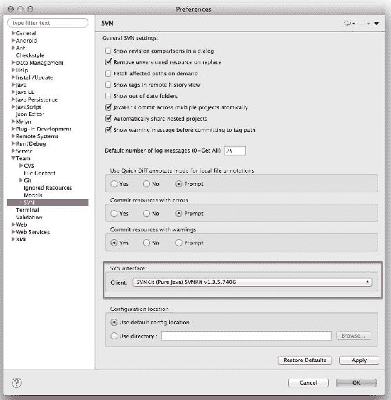

讨论感谢：[Pranjal](https://stackoverflow.com/users/1446834/pranjal)

我使用的 Eclipse 版本是：Kepler Service Release 1，Build id：20130919-0819，运行在 Mac 10.9 上。我通过使用 brew 安装 Subversion 成功修复了这个问题：

```bash
brew install --universal --java subversion
```

运行上述命令后，显示了安装摘要：

```text
svntools have been installed to: /usr/local/opt/subversion/libexec
```

我进入 `/usr/local/opt/subversion/` 文件夹并搜索了所需的 JAR 包。我在 `/lib` 中找到了它们，所以在 `eclipse.ini` 文件中添加了：

```bash
-Djava.library.path=/usr/local/opt/subversion/lib
```

我还通过这个链接从 Eclipse 安装了 Subversion 插件：

[`subclipse.tigris.org/update_1.10.x`](http://subclipse.tigris.org/update_1.10.x)

它解决了问题。

讨论感谢：[Teo P](https://stackoverflow.com/users/3129275/teo-p)

如果在 macOS 上运行，使用 brew 安装 Java 版本的正确方法是：

```bash
brew install subversion --with-java
```

然后你应该执行以下操作：

```bash
sudo mkdir -p /Library/Java/Extensions

sudo ln -s /usr/local/lib/libsvnjavahl-1.dylib /Library/Java/Extensions/libsvnjavahl-1.dylib
```

正如项目 wiki [subclipse-wiki](https://github.com/subclipse/subclipse/wiki/JavaHL-on-OSX) 中所述。

讨论感谢：[nekperu15739](https://stackoverflow.com/users/3012916/nekperu15739)

此内容源自 [StackOverflow](https://stackoverflow.com/questions/9303293/subclipse-and-javahl-installation-headache)，并已重新组织成上述配方。

# 如何读和写 XML 文件？

## 问题

我需要读取和写入一个 [XML](http://en.wikipedia.org/wiki/XML) 文件。使用 Java 读写 XML 文件的简单方法是什么？

问题感谢：[Jame](https://stackoverflow.com/users/586528/jame)

## 解决方案

这是一个快速的 DOM 示例，展示了如何读写带有 DTD 的简单 XML 文件：

```xml
<?xml version="1.0" encoding="UTF-8" standalone="no"?>

<!DOCTYPE roles SYSTEM "roles.dtd">

<roles>
    <role1>User</role1>
    <role2>Author</role2>
    <role3>Admin</role3>
    <role4/>
</roles>
```

以及 DTD：

```xml
<?xml version="1.0" encoding="UTF-8"?>

<!ELEMENT roles (role1,role2,role3,role4)>

<!ELEMENT role1 (#PCDATA)>

<!ELEMENT role2 (#PCDATA)>

<!ELEMENT role3 (#PCDATA)>

<!ELEMENT role4 (#PCDATA)>
```

首先导入这些包：

```java
import javax.xml.parsers.*;
import javax.xml.transform.*;
import javax.xml.transform.dom.*;
import javax.xml.transform.stream.*;

import org.xml.sax.*;
import org.w3c.dom.*;

import java.io.*;
```

这里需要一些变量：

```java
private String role1 = null;
private String role2 = null;
private String role3 = null;
private String role4 = null;
```

这里是读取器：

```java
public boolean readXML(String xml) {
    Document dom;
    DocumentBuilderFactory dbf;

    try {
        // instantiate DocumentBuilderFactory
        dbf = DocumentBuilderFactory.newInstance();

        // create DocumentBuilder
        DocumentBuilder db = dbf.newDocumentBuilder();

        // parse using the builder
        dom = db.parse(new File(xml));

        // get root element
        Element rootEle = dom.getDocumentElement();

        return true;
    } catch (ParserConfigurationException pce) {
        System.out.println(pce.getMessage());
    } catch (SAXException se) {
        System.out.println(se.getMessage());
    } catch (IOException ioe) {
        System.out.println(ioe.getMessage());
    }

    return false;
}
```

这里是写入器：

```java
public void saveToXML(String xml) {
    Document dom;
    DocumentBuilderFactory dbf;

    try {
        // instantiate DocumentBuilderFactory
        dbf = DocumentBuilderFactory.newInstance();

        // create DocumentBuilder
        DocumentBuilder db = dbf.newDocumentBuilder();

        // create Document
        dom = db.newDocument();

        // create root element
```


```java
Element rootEle = dom.createElement("roles");

// create elements and place them under root

Element e = dom.createElement("role1");

e.appendChild(dom.createTextNode("User"));

rootEle.appendChild(e);

e = dom.createElement("role2");

e.appendChild(dom.createTextNode("Author"));

rootEle.appendChild(e);

e = dom.createElement("role3");

e.appendChild(dom.createTextNode("Admin"));

rootEle.appendChild(e);

e = dom.createElement("role4");

rootEle.appendChild(e);

dom.appendChild(rootEle);

// instance of Transformer

Transformer tr = TransformerFactory.newInstance().newTransformer();

tr.setOutputProperty(OutputKeys.INDENT, "yes");

tr.setOutputProperty(OutputKeys.METHOD, "xml");

tr.setOutputProperty(OutputKeys.ENCODING, "UTF-8");

tr.setOutputProperty(OutputKeys.DOCTYPE_SYSTEM, "roles.dtd");

tr.setOutputProperty("{http://xml.apache.org/xslt}indent-amount", "4");

// send DOM to file

tr.transform(new DOMSource(dom), new StreamResult(new FileOutputStream(xml)));

} catch (TransformerException te) {

    System.out.println(te.getMessage());

} catch (IOException ioe) {

    System.out.println(ioe.getMessage());

}

}
```

`getTextValue` 在这里：

```java
private String getTextValue(String def, Element doc, String tag) {

    String value = def;

    NodeList nl;

    nl = doc.getElementsByTagName(tag);

    if (nl.getLength() > 0 && nl.item(0).hasChildNodes()) {

        value = nl.item(0).getFirstChild().getNodeValue();

    }

    return value;

}
```

添加几个访问器（accessors）和修改器（mutators），你就完成了！

解决方案感谢提供：[Costis Aivalis](https://stackoverflow.com/users/507099/costis-aivalis)

## 讨论

上面的答案仅针对 DOM 解析器（它通常会将整个文件读取到内存中并解析，对于大文件来说这是一个问题），你可以使用内存更少、速度更快的 SAX 解析器（无论如何，这取决于你的代码）。

`SAX parser` 在发现元素开始、元素结束、属性、元素之间的文本等时会触发某些回调函数，因此它可以在解析文档的同时获取你所需的内容。

一些示例代码：

[`www.mkyong.com/java/how-to-read-xml-file-in-java-sax-parser/`](http://www.mkyong.com/java/how-to-read-xml-file-in-java-sax-parser/)

讨论感谢提供：[Diego C Nascimento](https://stackoverflow.com/users/2080746/diego-c-nascimento)

## 使用 JAXB（Java XML 绑定架构）XML

[`www.mkyong.com/java/jaxb-hello-world-example/`](http://www.mkyong.com/java/jaxb-hello-world-example/)

```java
package com.mkyong.core;

import javax.xml.bind.annotation.XmlAttribute;

import javax.xml.bind.annotation.XmlElement;

import javax.xml.bind.annotation.XmlRootElement;

@XmlRootElement

public class Customer {

    String name;

    int age;

    int id;

    public String getName() {

        return name;

    }

    @XmlElement

    public void setName(String name) {

        this.name = name;

    }

    public int getAge() {

        return age;

    }

    @XmlElement

    public void setAge(int age) {

        this.age = age;

    }

    public int getId() {

        return id;

    }

    @XmlAttribute

    public void setId(int id) {

        this.id = id;

    }

}

package com.mkyong.core;

import java.io.File;

import javax.xml.bind.JAXBContext;

import javax.xml.bind.JAXBException;

import javax.xml.bind.Marshaller;

public class JAXBExample {

    public static void main(String[] args) {

        Customer customer = new Customer();

        customer.setId(100);

        customer.setName("mkyong");

        customer.setAge(29);

        try {

            File file = new File("C:\\file.xml");

            JAXBContext jaxbContext = JAXBContext.newInstance(Customer.class);

            Marshaller jaxbMarshaller = jaxbContext.createMarshaller();

            // 输出格式化

            jaxbMarshaller.setProperty(Marshaller.JAXB_FORMATTED_OUTPUT, true);

            jaxbMarshaller.marshal(customer, file);

            jaxbMarshaller.marshal(customer, System.out);

        } catch (JAXBException e) {

            e.printStackTrace();

        }

    }

}
```

讨论感谢提供：[ran](https://stackoverflow.com/users/2447599/ran)

答案仅涵盖了 DOM、SAX 以及 JAXB 示例的复制粘贴实现。

然而，在使用 XML 时的一个大领域被忽略了。在许多项目或程序中，需要存储或检索一些基本的数据结构。你的程序已经有了用于那些业务对象或数据结构的类，你只是想要一种方便的方法将这些数据转换为 XML 结构，以便能够对其进行更多操作（存储、加载、发送、使用 XSLT 处理）。

这正是 `XStream` 发挥优势的地方。你只需要对持有数据的类进行注解；如果你不想修改这些类，也可以配置一个 `XStream` 实例来进行序列化（对象 -> XML）或反序列化（XML -> 对象）。

`XStream` 内部使用反射以及标准 Java 对象序列化的 `readObject` 和 `readResolve` 方法。

你可以在[这里](http://xstream.codehaus.org/tutorial.html)获取优质且快速的教程。

为了简要概述它的工作原理，我还提供了一些用于对数据结构进行序列化和反序列化的示例代码。序列化和反序列化全部发生在 `main` 方法中，其余只是生成一些测试对象并向它们填充数据的代码。配置 `xStream` 实例非常简单，且序列化和反序列化只需一行代码即可完成。

```java
import java.math.BigDecimal;

import java.util.ArrayList;

import java.util.List;

import com.thoughtworks.xstream.XStream;

public class XStreamIsGreat {

    public static void main(String[] args) {

        XStream xStream = new XStream();

        xStream.alias("good", Good.class);

        xStream.alias("pRoDuCeR", Producer.class);

        xStream.alias("customer", Customer.class);

        Producer a = new Producer("Apple");

        Producer s = new Producer("Samsung");

        Customer c = new Customer("Someone").add(new Good("S4", 10, new BigDecimal(600), s))

            .add(new Good("S4", 10, new BigDecimal(600), s)); // 注意：原文有重复逻辑，保留了结构

    }

}
```

SAX 解析器的工作方式与 DOM 解析器不同，它不会将任何 XML 文档加载到内存中，也不会创建 XML 文档的对象表示。相反，SAX 解析器使用回调函数 `org.xml.sax.helpers.DefaultHandler` 来通知客户端 XML 文档的结构。

SAX 解析器比 DOM 解析器更快且占用内存更少。参见以下 SAX 回调方法：

- `startDocument()` 和 `endDocument()`：在 XML 文档开始和结束时调用的方法。
- `startElement()` 和 `endElement()`：在文档元素开始和结束时调用的方法。
- `characters()`：在 XML 文档元素开始和结束标签之间的文本内容时调用的方法。

### 1. XML 文件

创建一个简单的 XML 文件。

```xml
<?xml version="1.0"?>

<company>

    <staff>

        <firstname>yong</firstname>

        <lastname>mook kim</lastname>

        <nickname>mkyong</nickname>

        <salary>100000</salary>

    </staff>

    <staff>

        <firstname>low</firstname>

        <lastname>yin fong</lastname>

        <nickname>fong fong</nickname>

        <salary>200000</salary>

    </staff>

</company>
```

### 2. Java 文件

使用 SAX 解析器解析 XML 文件。

```java
import javax.xml.parsers.SAXParser;

import javax.xml.parsers.SAXParserFactory;

import org.xml.sax.Attributes;

import org.xml.sax.SAXException;

import org.xml.sax.helpers.DefaultHandler;

public class ReadXMLFile {

    public static void main(String argv[]) {

        try {

            SAXParserFactory factory = SAXParserFactory.newInstance();

            SAXParser saxParser = factory.newSAXParser();

            DefaultHandler handler = new DefaultHandler() {

                boolean bfname = false;

                boolean blname = false;

                boolean bnname = false;

                boolean bsalary = false;

                public void startElement(String uri, String localName, String qName, Attributes attributes) throws SAXException {

                    System.out.println("Start Element :" + qName);

                    if (qName.equalsIgnoreCase("FIRSTNAME")) {

                        bfname = true;

                    }

                    if (qName.equalsIgnoreCase("LASTNAME")) {

                        blname = true;

                    }

                    if (qName.equalsIgnoreCase("NICKNAME")) {

                        bnname = true;

                    }

                    if (qName.equalsIgnoreCase("SALARY")) {

                        bsalary = true;

                    }

                }

                public void endElement(String uri, String localName, String qName) throws SAXException {

                    System.out.println("End Element :" + qName);

                }

                public void characters(char ch[], int start, int length) throws SAXException {

                    if (bfname) {

                        System.out.println("First Name : " + new String(ch, start, length));

                        bfname = false;

                    }

                    if (blname) {

                        System.out.println("Last Name : " + new String(ch, start, length));
```


```
blname = false;

}

if (bnname) {

    System.out.println("Nick Name : " + new String(ch, start, length));

    bnname = false;

}

if (bsalary) {

    System.out.println("Salary : " + new String(ch, start, length));

    bsalary = false;

}

}

};

saxParser.parse("c:\\file.xml", handler);

} catch (Exception e) {

e.printStackTrace();

}

}

}

```

#### 结果

```
Start Element :company

Start Element :staff

Start Element :firstname

First Name : yong

End Element :firstname

Start Element :lastname

Last Name : mook kim

End Element :lastname

Start Element :nickname

Nick Name : mkyong

End Element :nickname

and so on...
```

源(MyKong) - [`www.mkyong.com/java/how-to-read-xml-file-in-java-sax-parser/`](http://www.mkyong.com/java/how-to-read-xml-file-in-java-sax-parser/)

讨论感谢：[JavaDragon](https://stackoverflow.com/users/3793528/javadragon)

此内容源自 [StackOverFlow](https://stackoverflow.com/questions/7373567/how-to-read-and-write-xml-files) 并已重新整理成上述配方。
