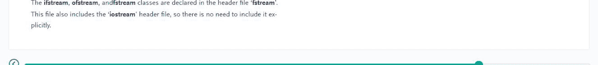

# 101 个 C++ 编程挑战：通过解决 101 个挑战提升 C++ 编程技能

我们知道你今天与我们同在一起……

# 关于作者

## Yashavant Kanetkar

在过去的二十年里，通过关于 C、C++、Java、.NET、嵌入式系统等的书籍和 Quest Course DVD，Yashavant Kanetkar 创建、塑造并培养了数十万 IT 职业。Yashavant 的书籍和 Quest DVD 在为印度和国外培养顶级人才方面做出了巨大贡献。

Yashavant 是 IT 领域备受青爱的演讲者，曾在 TEDEx、OTS、RECS 和全球软件公司举办过研讨会/工作坊。

Yashavant 最近因其在创业、专业和学术方面的卓越表现，获得了坎普尔理工学院（IIT Kanpur）颁发的久誉的“杰出校友奖”。该奖授予了在过去 50 年中对专业领域和社会进步做出重大贡献的 50 位坎普尔理工学院校友。

为了感谢他对印度 IT 教育的巨大贡献，他连续 5 年获得微软颁发的“最佳... .NET 技术贡献者”和“最有价值专业人士”奖。

Yashavant 拥有 VTI Mumbai 的工程学学位和坎普尔理工学院的技术硕士学位。

## Aditya Kanetkar

Aditya Kanetkar 拥有亚特兰大佐治理工学院的计算机科学硕士学位。在此之前，他在古吉哈特理工学院完成了计算机科学与工程学士学位。他目前在加利福尼亚州红木城的 Oracle America Inc 担任软件工程师。

Aditya 从在 Redfin、Amazon 和 Arista Networks 实习期间就就是一个非常热衷的程序员。他现在的爱好是远程连接 Java 技术、Android 编程和数据库。

# 前言

大多数 C++ 程序员都是以前的 C 语言程序员。无论他们在 C 编程上花费了多少时间，迁移到 C++ 编程都是一次巨大的范式转移。与其说是语法，不如说是思考程序的方式必须改变。人必须以面向对象的方式进行思考。你可能会从屋顶大喊世界上到处都是对象，因此程序也应该是，你的思考应该围绕对象展开。幸运的是，花时间去弄为什么某个特定的面向对象特性被引入 C++ 要容易得多，而你最终只是在用 C++ 编译器做 C 语言编程。

此外，大多数 C++ 编程书籍都花费大量的篇幅来解释概念，但在实际应用这些概念时，提供的示例却不尽如人意。将特性引入程序似乎更多是费了痛苦的努力，而不是自然而。此外，许多 C++ 书籍中的练习在性质上似乎非常原始。因此，它们在测试读者的 C++ 编程知识和能力方面是不够的。

我们希望这本书能够满足你的需求。我们不仅汇编了 101 个 C++ 编程挑战，还根据 C++ 编程所需的特性对它们进行了组织，以便解决。

## 入门挑战

总挑战数：7 个

人们说，学习编程和相关技术是一个不断变化的目标。技术在不断演进，为了利用这些力量创建解决方案，语言需要不断更新版本。C++ 在这方面也无例外。必须关注这些进展，因为新特性可以帮助以更优雅的方式解决相同的问题，而不是早期版本中那种奇异的方法。本章将帮助你跟上这些发展。

## 挑战 01

C++ 语言是否存在多个版本？最新版本是哪一个？

## 解决方案

C++ 由 Bjarne Stroustrup 自 1979 年起在贝尔实验室开发。它最初被设计为 C++ 语言的扩展，以帮助改进程序结构。事实上，最初它被命名为“C with Classes”（带类的 C）。它拥有类、继承、强类型检查和函数参数默认值等特性。

1983 年，“C with Classes”被更名为“C++”。引入了许多新特性，如虚函数、函数重载、运算符重载、引用、常量、类型安全的空存储内存分配（`new`/`delete`）、改进的类型检查以及 `//` 风格的注释。

一旦它在程序员中流行起来，标准化的需求就产生了。C++ 的标准化由一个名为 JTC1/SC2/WG21 的 ISO（国际标准组织）工作组完成。第一个标准于 1998 年发布，被称为 C++98。

2003 年，它发布了新版本的 C++ 标准，该版本基本上修复了 C++98 中发现的问题。

标准的下一次大修订于 2011 年发布，被称为 C++11。它在核心语言和标准库中包含了许多新增。

2014 年，发布了 C++14，它修复了 C++11 中的 Bug 并进行了一些细微改进。

该工作组目前正在致力于标准的下一个修订版本，计划于 2017 年 7 月发布。C++20 是未来计划的下一个标准。

## 挑战 02

构建 C++ 程序的不同方法有哪些？

## 解决方案

你可以手动使用命令行来构建程序，也可以使用方便的集成开发环境（IDE）。IDE 内部同样使用与命令行相同的预处理器、编译器、汇编器等。唯一的区别是它们的用法对开发者来说是隐藏的。例如，如果我们使用 NetBeans IDE，它在内部使用的与在命令行构建程序时相同的 `g++` 编译器。

## 挑战 03

使用 IDE 进行程序开发是否有特定的优势？

## 解决方案

虽然可以使用命令行构建 C++ 程序，但由于以下原因，更倾向于使用集成开发环境（IDE）：

- (a) 所有的程序构建步骤，如预处理、编译、汇编、链接和执行，都可以一键完成（例如通过使用 NetBeans IDE 中的 F6 函数）。

- (b) IDE 帮助我们通过“项目”或“解决方案管理器”窗口管理项目。这对于包含多个文件的大型项目非常有用。

- (c) IDE 提供了跨文件的代码导航。我们可以快速从代码的不同地方找到特定函数是在何时被调用的。

- (d) IDE 在每行代码旁边显示行号。

- (e) IDE 提供语法高亮，即它用不同颜色显示关键字、函数、类名等，使这些内容在视觉上脱颖而出。

- (f) IDE 提供代码折叠，可以根据需要对部分代码进行折叠/展开。这在管理大型程序时非常有用。

- (g) IDE 允许我们在代码中设置书签，帮助我们从程序的其他部分快速导航到这些位置。

- (h) IDE 提供了智能感知（Intellense）功能，我们可以在所需的上下获取信息。例如，当我们输入对象名称时，它会提供可以使用该对象调用的函数列表。同样，一旦选择了函数，它会提供我们需要传递给该函数的参数列表。

- (i) 一旦编译器指出错误，IDE 会提供关于如何纠正错误的建议。

- (j) 对于常规程序语句（如 `for` 循环、`if-else` 结构等），IDE 提供现成的代码块，节省了打字工作。

- (k) IDE 允许你可视化地添加和管理非编程资源，如图标、位图、菜单、工具栏等。

- (l) IDE 提供构建时间、执行时间等关键统计数据。这可以帮助我们评估程序的性能。

- (m) IDE 提供强大的编辑器，我们可以以高效的方式重命名标记。

- (n) IDE 提供调试功能。这些非常有用的功能提高了我们的生产力。

## 挑战 04

哪些 IDE 可以构建 C++ 程序？

## 解决方案

- (a) NetBeans

- (b) Eclipse

- (c) Microsoft Studio Code

所有这些都是免费的，并且适用于 Windows 和 Linux。注意，它们只是 IDE，不包含编译器调试工具。通常使用 `g++` 编译器配合 NetBeans 或 Eclipse。

不要混淆 Microsoft Studio Code 和 Visual Studio。Studio Code 是一个适用于 Windows、Linux 和 Mac 的 IDE。然而，它可以用于在内部网络内开发、测试和部署程序。对于商业开发，微软提供了 Visual Studio Professional 或 Visual Studio Enterprise 订阅。Visual Studio 订阅允许为多个设备、PC 和 Web 创建应用程序。通过此订阅，可以使用云服务，并可以在任何首选平台和设备上开发，包括 Windows、iOS、Android 和 Linux。

Visual Studio 还有一个免费版，被称为 Express 版。可以在 `https://www.visualstudio.com/vs/visual-studio-express/` 下载。

## 挑战 05

使用 Turbo C++ 开发 C++ 程序是一个好主意吗？

## 解决方案

不是。因为它是为 MS-DOS 创建的，已有两个世纪的历史。它无法识别后来添加到 C++ 中的关键字和特性，例如模板、命名空间和异常。

## 挑战 06

`gcc` 和 `g++` 编译器之间有什么区别？

## 解决方案

首先让我们看看每个的完整形式。

GCC（大写）：GNU Compiler Collection

`gcc`（小写）：GNU C Compiler

`g++`：GNU C++ Compiler

GCC 指的是不同语言（如 C、C++、Fortran、Ada 等）的编译器。这些 `gcc` 和 `g++`。`gcc` 和 `g++` 之间的主要区别如下：

`gcc` 分别将 `.c` 和 `.cpp` 文件编译为 C 程序和 C++ 程序。与之相反，`g++` 将 `.c` 和 `.cpp` 文件都视为 C++ 程序进行编译。

## 挑战 07

我们可以使用命令行构建 C++ 程序吗？如果可以，如何操作？

## 解决方案

可以使用命令行构建 C++ 程序。假设我们在名为 `sample.cpp` 的文件中创建并存储了以下程序：

```cpp
#include <iostream>
using namespace std;

int main() {

	cout << "Some people are judged for being real..." << endl;
	cout << "While others are loved for being kind." << endl;
	return 0;
}
```

`g sample.cpp -o output`

`-o` 选项表示构建此程序后的可执行代码应存储在名为 `output` 的文件中。程序构建完成后，执行以下命令运行：

`./output`

我们程序中的两条消息将显示在输出中。

我们可以在 Windows 下使用 Visual Studio 编译器进行命令行构建吗？答案是肯定的。以下是具体操作步骤。

首先，创建一个名为 `sample` 的文件夹，并在其中创建上述的 `sample.cpp`。

C++ 对命令行环境有复杂的要求，以便找到它使用的工具、头文件和库文件。因此，我们不能在普通的命令提示符窗口中构建 C++ 程序。幸运的是，Visual Studio 提供了一个开发者命令提示符（developer command prompt），它已经为命令行构建设置好了环境。遗憾的是，不同版本的 Visual Studio C++ 以及不同版本的 Windows，开发者命令提示符快捷方式的名称和位置各异。在你的 Visual Studio 和 Windows 版本中找到 "Visual Studio Command Prompt"。执行它会出现一个命令行窗口。

在命令行窗口中执行以下命令构建程序：

`g sample.cpp -o sample`

构建成功后，可执行代码将存储在 `sample.exe` 中。使用命令执行它：

`./sample`

再次，我们程序中的两条消息将显示在屏幕上。

# 02

入门挑战

总挑战数：7 个

解决同一个 C++ 挑战通常有多种方法。本章旨在利用 C++ 相比 C 语言增加的增量特性，帮助程序员更好地表达自己的想法。例如，使用灵活的声明、使用 `bool` 数据类型、使用 `enum` 代替 `#define` 等。本章提供了使用这些细微差别解决挑战的方案。

## 挑战 08

货币由不同面值的卢比组成：Rs. 1, Rs. 2, Rs. 5, Rs. 10, Rs. 50, Rs. 100, Rs. 500 和 Rs. 2000。

银行试图找到为客户提供特定金额所需的面值钞票数量，使得使用的钞票数量最少。编写一个程序，根据键盘输入的金额，列出每个面值钞票的数量。

## 解决方案

```cpp
// 项目: chall8
// 程序：用于告知支付特定金额所需的 
// 面值和钞票数量

#include <iostream>
#include <iomanip>
using namespace std;

void numtender(int);
int main() {
    int amount;
    cout << "Enter the amount to be tendered:" << endl;
    cin >> amount;
    numtender(amount);
    return 0;
}
int den[] = {1, 2, 5, 10, 20, 50, 100, 500, 2000};
int numofnotes;

void numtender(int amount) {
    if (amount <= 0)
        return;
    cout << "Denominations:" << endl;
    for (int i = 8; i >= 0; i--) {
        if (amount >= den[i]) {
            numofnotes = amount / den[i];
            cout << setw(4) << den[i] << " x " << numofnotes << endl;
            amount = amount % den[i];
        }
    }
}
```

## 示例运行

Enter the amount to be tendered:

12345

Denomination details:

2000 x 6 = 12000

100 x 3 = 300

20 x 2 = 40

5 x 1 = 5

Enter the amount to be tendered:

23418

Denomination details:

2000 x 11 = 22000

500 x 2 = 1000

100 x 4 = 10

10 x 1 = 5

5 x 1 = 2

2 x 1 = 2

1 x 1 = 1

## 解析

该程序设置了一个包含所有面值值的数组。然后通过循环找到每个面值所需的钞票数量，从最高面值（即 2000）开始。这种顺序对于确保支付的钞票数量最小至关重要。

注意 `setw(i)` 操符的使用。它将文本右对齐，使其位于指定的列数内。此外，注意在 `for` 循环内部声明 `i`，而不是在函数开头。

## 挑战 09

145 是一个奇特数字，因为 1! + 4! + 5! = 1 + 24 + 120 = 145。

编写一个程序，找到 10000 以内所有等于其数字各位阶乘和的奇特数字。

## 解决方案

```cpp
// 项目: challenge
// 程序：寻找 1 到 10000 之间的所有奇特数字

#include <iostream>
using namespace std;

int factorial(int num) {
    int res = 1;
    for (int i = 1; i <= num; i++) {
        res *= i;
    }
    return res;
}

bool isCurious(int num) {
    int sum = 0, t = num;
    while (t > 0) {
        int digit = t % 10;
        sum += factorial(digit);
        t /= 10;
    }
    if (sum == num)
        return true;
    else
        return false;
}

int main() {
    cout << "List of curious numbers:" << endl;
    for (int i = 1; i <= 10000; i++) {
        if (isCurious(i)) {
            cout << i << endl;
        }
    }
    return 0;
}
```

## 示例运行

List of curious numbers:

1

2

145

## 解析

`isCurious()` 函数提取数字并计算其阶乘之和。最后，通过比较和与原数字判断是否为奇特数字。

## 挑战 10

阶乘序列通过递归关系定义：

`F(n) = F(n - 1) + n`，其中 `F(1) = 1`。编写一个程序找到第一个三位数的斐波纳契数。

## 解决方案

```cpp
#include <iostream>
using namespace std;

int main() {
    int a = 1, b = 1, c = 2, index = 2;
    while (c < 100) {
        a = b;
        b = c;
        c = a + b;
        index++;
    }
    cout << "The first Fibonacci number is at " << index << " which is " << c << endl;
    return 0;
}
```

## 挑战 11

1900年1月1日是星期一。4月、6月、9月和11月有30天，其余为31天，二月根据是否为闰年有29或28天。编写一个程序找出二十世纪（1901年1月1日至2000年12月31日）有多少个月的第一天是星期日？

## 解决方案


# 基础 C++ 挑战

总挑战数：7

C++++ 引入了许多新的非 OOP（面向对象编程）特性。这些特性使得编写程序变得简单高效。本章提出了与这些特性相关的挑战。

## 挑战 15

编写一个程序，从键盘接收并在屏幕上输出基本类型 `char`、`short integer`、`long integer`、`float`、`double`、`long double` 和 `string`，使用`scanf() / printf()`以及`cin / cout`。

## 解决方案

```cpp
// Project: chills5
// C++ 风格输入/输出
#include <iostream>
using namespace std;

int main() {
    // C 风格
    char ch;
    int n;
    long int num;
    float f;
    double d;
    printf("Enter a character: %c\n");
    scanf("%c", &ch);
    printf("Enter an integer: %d\n");
    scanf("%d", &n);
    printf("Enter a long integer: %ld\n");
    scanf("%ld", &num);
    printf("Enter a float: %f\n");
    scanf("%f", &f);
    printf("Enter a double: \n");
    scanf("%lf", &d);
    printf("Enter a long double: \n");
    scanf("%Lf", &ld);

    // C++ 风格
    char ch;
    cin >> ch;
    long int num;
    cin >> num;
    float f;
    cin >> f;
    double d;
    cin >> d;
    long double ld;
    cin >> ld;
    cout << "Enter a character:" << endl;
    cin >> ch;
    cout << "Enter an integer:" << endl;
    cin >> n;
    cout << "Enter a long integer:" << endl;
    cin >> num;
    cout << "Enter a float:" << endl;
    cin >> f;
    cout << "Enter a double:" << endl;
    cin >> d;
    cout << "Enter a long double:" << endl;
    cin >> ld; // 注意：原文此处为 cpp_d

    cout << "Enter a long double:" << endl;
    cin >> ld;
    cout << "Character:" << ch << endl;
    cout << "Integer:" << n << endl;
    cout << "Long Integer:" << num << endl;
    cout << "Float:" << f << endl;
    cout << "Double:" << d << endl;
    cout << "Long Double:" << ld << endl;
    return 0;
}
```

## 示例运行

```
Enter a character: A
Enter an integer: 23
Enter a long integer: 3650000
Enter a float:
3.14
Enter a double:
3.141414
Character: A Integer: 23
Long Integer: 3650000
Float: 3.140000
Double: 6.280000
Long Double: 3.141414
Enter a character: D
Enter an integer: 44
Enter a long integer: 454545
Enter a float:
4.44
Enter a double:
5555.555
Enter a long double:
343434-343434
Character D
Integer: 44
Long Integer: 454545
Float: 4.44
Double: 5555.56
Long Double: 343434
```

## 解释

程序展示了如何接收不同的数据类型并输出它们。为了实现这一点，C 函数使用了`scanf`和`printf()`。C++ 使用了`cout`和`cin`对象。对象就像变量。这些对象在 "iostream" 文件中为我们预定义。`cout`是`ostream`类型的对象，而`cin`是`istream`类型的对象。`ostream`和`istream`是预定义的类型。

## 挑战 6

编写一个程序，能够方便地更改数组的大小以及以 C 风格和 C++ 风格处理数组的相关代码。

## 解决方案

```cpp
// Project: challi6
// C, C++ 数组大小变化
#include <iostream>
#include <cstdio>
using namespace std;
#define MAX 5
int main() {
    // C 风格
    int arr[MAX];
    for (int i = 0; i < MAX; i++) {
        printf("Enter element of the array: %d\n", i);
        scanf("%d", &arr[i]);
    }
    printf("Array Elements:\t\n");
    for (int i = 0; i < MAX; i++) {
        printf("%d\t", arr[i]);
    }
    printf("\n\n");

    // C++ 风格
    const int size = 5;
    int cppArr[size];
    for (int i = 0; i < size; i++) {
        cout << "Enter element of the array: ";
        cin >> cppArr[i];
    }
    cout << "Array Elements: \t";
    for (int i = 0; i < size; i++) {
        cout << cppArr[i] << "\t";
    }
    return 0;
}
```

## 示例运行

```
Enter element of the array: 12
Enter element of the array: 23
Enter element of the array: 33
Enter element of the array: 22
Enter element of the array: 65
Array Elements: 12 23 33 22 65
```

## 挑战 12

编写一个程序，确定`X!`（X的阶乘）末尾零的个数，其中`X`是通过键盘输入的任意数字。例如，如果`X`是`120`，那么它末尾有一个零。

## 解决方案

```cpp
// 查找阶乘值末尾零个数的项目
#include <iostream>
using namespace std;
int main() {
    int n, i;
    int count = 0;
    cout << "Enter a non-negative number:" << endl;
    if (cin >> n && n >= 0) {
        for (i = 1; i <= n; i++) {
            while (i % 5 == 0) {
                count++;
                i /= 5;
            }
        }
        cout << "No. of zeros at the end of " << n << " is " << count << endl;
    } else {
        cout << "Invalid Input" << endl;
    }
    return 0;
}
```

## 样例运行

```
输入一个非负整数：
12
12末尾的零个数 = 2

输入一个非负整数：
5
5末尾的零个数 = 1
```

## 解释

我们可以使用下方的递归函数编写一个简单的程序来计算输入数字的阶乘值。

```cpp
int factorial(int num) {
    if (num > 0)
        return num * factorial(num - 1);
    else
        return 1;
}
```

一旦获得阶乘值，我们可以将其传递给`CountTrailingZeros()`函数，通过从数字末尾提取数字并如果是零则进行计数，来统计阶乘值末尾的零个数。这种方法有一个严重的局限性：在计算阶乘值时，`int`的范围会迅速超出。因此，这种方法在超过13时会得到错误的结果。所以，我们使用了一种不同的方法来计算末尾零的个数。

在这种方法中，我们只统计了在计算阶乘值的乘法中`5`出现的次数。这足够了，因为阶乘值末尾的零当`10`是阶乘值的因数时。而`10`无非是`5x5`。所以，如果我们统计了乘法涉及的`5`的个数，我们就知道阶乘值中有多少个末尾零。

因此，如果输入的数字是`12`，那么`12!`将是`1x2x3x4x5x6x7x8x9x10x11x12`。这里乘法中涉及了2个`5`。第一个`5`是显而易见的，第二个`5`来自于`10`，`10`是`5x2`。因此，`12!`末尾会有2个末尾零。

## 挑战 13

一个正整数三元组`(a,b,c)`如果满足以下条件被称为Cardano三元组：

$$\sqrt[3]{a+b} + \sqrt[3]{a-b} = 1$$

例如`(2,1,5)`是一个Cardano三元组。编写一个程序生成所有存在的三元组，使得 `(a + b + c) <= 100`。

```cpp
// 项目: chall3
// 生成Cardano三元组的程序
#include <iostream>
#include <cmath>
using namespace std;
bool isCardano(int a, int b, int c);
int main() {
    int count = 0;
    for (int a = 1; a <= 100; a++) {
        for (int b = 1; b <= 100; b++) {
            for (int c = 1; c <= 100; c++) {
                if (a + b + c <= 100) {
                    if (isCardano(a, b, c)) {
                        count++;
                        cout << "Cardano Triplet " << count << ": " << a << ", " << b << ", " << c << endl;
                    }
                }
            }
        }
    }
    cout << "Total number of Cardano triplets = " << count << endl;
    return 0;
}

bool isCardano(int a, int b, int c) {
    double val = pow(a + b, 1.0/3.0) + pow(a - b, 1.0/3.0);
    return abs(val - 1.0) < 0.00001;
}
```

## 样例运行

```
Cardano Triplet 1: 2, 1, 5
Cardano Triplet 2: 10, 9, 19
Cardano Triplet 3: 24, 23, 47
Cardano Triplet 4: 42, 41, 83
Cardano Triplet 5: 68, 67, 135 (注：此处超出a+b+c <= 100的限制)
```

*(注：由于原文代码片段不完整，此处译文根据逻辑补全了可能的代码结构)*

## 示例程序

### 求解20世纪每月第一天是星期日的次数

```cpp
#include <iostream>
using namespace std;

enum month {
    JAN, FEB, MAR, APR, MAY, JUN, JUL, AUG, SEP, OCT, NOV, DEC
};

enum day {
    MON, TUE, WED, THU, FRI, SAT, SUN
};

bool isLeap(int year) {
    if ((year % 4 == 0 && year % 100 != 0) || (year % 400 == 0))
        return true;
    return false;
}

int numSundaysFirst() {
    int sundaycount = 0;
    day last = MON; // 1900年12月31日是星期一
    for (int year = 1901; year <= 2000; year++) {
        for (int m = JAN; m <= DEC; m++) {
            day first = (last + 1) % 7;
            if (first == SUN)
                sundaycount++;
            
            int daysInMonth;
            switch (m) {
                case FEB:
                    daysInMonth = isLeap(year) ? 29 : 28;
                    break;
                case APR:
                case JUN:
                case SEP:
                case NOV:
                    daysInMonth = 30;
                    break;
                default:
                    daysInMonth = 31;
            }
            last = (first + daysInMonth - 1) % 7;
        }
    }
    return sundaycount;
}

int main() {
    int num = numSundaysFirst();
    cout << "No. of Sundays on 1st of a month during 20th century - " << num << endl;
    return 0;
}
```

**样例运行**

```
20世纪每个月1号是周日的次数 - 171
```

**解释**

如果一年不是闰年，一年的最后一天和第一天相同；如果是闰年，则最后一天比第一天多一天。例如，如果年的第一天是周一，那么在非闰年最后一天是周一，而在闰年最后是周二。

如果一个月份包含31天，那么该月的最后一天距离该月的第一天2天。例如，如果`1月1日`是周二，那么`1月31日`就是周四。如果某月是周日，那么`1月31日`就是周二。

如果一个月份包含30天，那么该月的最后一天距离该月的第一天1天。例如，如果`6月1日`是周日，那么`6月30日`就是周三。同样，如果`6月1日`是周日，那么`6月30日`就是周一。

如果二月有28天，那么二月的最后一天距离该月的第一天6天。同样，如果二月有29天，则最后一天与月份的第一天相同。

正如题目描述所示，`1900年1月1日`是周一。首先，我们检查`1900年`是否为闰年，并确定了`1900年`的最后一天。

为了确保天数从周日开始循环，在寻找月份最后一天时，我们使用了取模运算符。

通过`for`循环，我们遍历了`1901年`到`2000年`，然后遍历每年的每个月份。在循环内部，我们检查每个月份的第一天是周几，如果是周日，计数器加`1`。然后利用上述事实找到月份的最后一天，从而找到下个月的第一天。

最后，我们显示了得到的计数结果。


Enter element of the array: 33

Enter element of the array: 55

Enter element of the array: 77

Enter element of the array: 88

Enter element of the array: 99

Array Elements: 33 55 77 88 99

## 解释

`#define` 具有全局作用域。这意味着它的影响在整个文件中都有效。相比之下，`const` 可以根据其定义的位置具有局部或全局作用域。`MAX` 具有全局作用域，而 `size` 具有局部作用域，因为它是在 `main()` 函数中定义的。我们不能在其他函数中使用 `size`。如果我们想让它具有全局作用域，就必须在 `main()` 外部定义。使用 `const` 比 `#define` 好主意，因为我们可以控制它的作用域。

## 挑战 7

编写一个程序接收数组的大小并为其分配内存。进一步，向该数组接收数字并在屏幕上打印它们。程序应使用 C 和 C++ 风格完成这些任务。

## 解决方案

```cpp
// Project: chall7
// C, C++ 风格动态内存分配
#include <iostream>
#include <stdlib.h>
using namespace std;
int main() {
    // C 风格
    int size;
    printf("Enter size of the array: \n");
    scanf("%d", &size);
    if (size > 0) {
        int *arr, *p;
        arr = (int*)malloc(size * sizeof(int));
        for (int i = 0; i < size; i++) {
            printf("Enter array element: \n");
            scanf("%d", p);
            p++;
        }
        printf("Array Elements: \n");
        for (int i = 0; i < size; i++) {
            printf("%d\t", *p);
            p++;
        }
        free(arr);
    } else {
        printf("Invalid Input: Array size must be positive integer\n");
    }
    // C++ 风格
    int cppSize;
    cout << "Enter size of the array: " << endl;
    cin >> cppSize;
    if (cppSize > 0) {
        int *cppArr, *cppP;
        cppArr = new int[cppSize];
        for (int i = 0; i < cppSize; i++) {
            cout << "Enter array element: \n";
            cin >> cppP;
            cppP++;
        }
        cout << "Array Elements: \n";
        for (int i = 0; i < cppSize; i++) {
            cout << cppP << "\t";
            cppP++;
        }
        delete []cppArr;
    } else {
        cout << "Invalid Input: Array size must be positive integer" << endl;
    }
    return 0;
}
```

## 示例运行

Enter size of the array: 5

Enter array element: 10

Enter array element: 20

Enter array element: 30

Enter array element: 40

Enter array element: 50

Array Elements: 10 20 30 40 50

Enter size of the array: 5

Enter array element: 10

Enter array element: 20

Enter array element: 30

Enter array element: 40

Enter array element: 50

Array Elements: 10 20 30 40 50

## 解释

比较以下内存分配风格：

```cpp
arr = (int*)malloc(size * sizeof(int));
```

```cpp
cppArr = new int[size];
```

`malloc()` 是 C 中的标准库函数，帮助我们分配字节块。它返回一个空指针 `void*`，因此我们需要进行类型转换。在 C++ 中，使用 `new` 运算符实现了相同的任务，不需要进行类型转换，因为它返回数组类型的指针。

## 挑战 8

编写一个程序从键盘接收两个数字，然后通过地址调用和引用交换它们。

## 解决方案

```cpp
// Project: chall_8
// 地址和引用交换
#include <iostream>
using namespace std;
void swapByAddress(int*, int*);
void swapByReference(int&, int&);
int main() {
    int a, b;
    cout << "Enter two numbers: " << endl;
    cin >> a >> b;
    swapByAddress(&a, &b);
    cout << "After swapping numbers by address:" << endl;
    cout << a << " << " << b << endl;
    swapByReference(a, b);
    cout << "After swapping numbers by reference:" << endl;
    cout << a << " << " << b << endl;
    return 0;
}
void swapByAddress(int *addA, int *addB) {
    int t;
    t = *addA;
    *addA = *addB;
    *addB = t;
}
void swapByReference(int &refA, int &refB) {
    int t;
    t = refA;
    refA = refB;
}
```

## 示例运行

Enter two numbers:

10 20

After swapping numbers by address:

a: 20 b: 10

After swapping numbers by reference:

a: 10 b: 20

## 解释

在 `swapByAddress()` 中，使用指针我们能够修改 `main()` 函数中 `a` 和 `b` 的值。在 `swapByReference()` 中通过引用实现了相同的任务。引用无非自动解引用的常量指针。这意味着 `refA` 和 `refB` 是指向 `a` 和 `b` 的常量指针。此外，当我们使用 `refA` 和 `refB` 时，实际使用的是 `*refA` 和 `*refB`。这就是自动解引用。

## Challenge 19

一个实现了多个版本 `abs()` 函数的程序，用于寻找 `int`、`float`、`long int`、`double` 和 `long double` 的绝对值。

## 解决方案

```cpp
// Project: chall19
// C++ 函数重载
#include <iostream>
using namespace std;
int abs(int);
long abs(long int);
float abs(float);
double abs(double);
long double abs(long double);
int main() {
int n;
long int num;
float f;
double d;
cout << "Enter an integer:" << endl;
cin >> n;
n = abs(n);
cout << "Absolute value of integer:" << n << endl;
cout << "Enter a long integer:" << endl;
cin >> num;
num = abs(num);
```

```cpp
cout << "Absolute value of long integer:" << num << endl;
cout << "Enter a float:" << endl;
cin >> f;
f = abs(f);
cout << "Absolute value of float:" << f << endl;
cout << "Enter a double:" << endl;
cin >> d;
d = abs(d);
cout << "Absolute value of double:" << d << endl;
cout << "Enter a long:" << endl;
cin >> id;
id = abs(id);
cout << "Absolute value of long:" << id << endl;
return 0;
}
int abs(int n) {
if (n < 0)
return -1 * n;
else
return n;
}
long abs(long int num) {
if (num < 0)
return -1 * num;
else
return num;
}
```

```cpp
return num;
}
float abs(float f)
{
if (f < 0)
    return -1 * f;
else
    return f;
}
double abs(double d)
{
if (d < 0)
    return -1 * d;
else
    return d;
}
```

Enter a long integer:

45678

Absolute value of long integer: 45678

Enter a float:

3.14

Absolute value of float: 3.14

Enter a double:

4567.88

Absolute value of double: 4567.88

Enter a long double:

12345.6

Absolute value of long double: 12345.6

## 解释

在 C++ 中，只要参数的数量或顺序不同，我们就可以给函数赋予相同的名称。因此，我们可以在这里定义多个版本的 `abs()` 函数。这种 C++ 特性被称为**函数重载**（Function Overloading）。该特性的优势在于我们不需要记住本质上执行相似任务的不同函数的名称。因此，不需要定义和记忆像 `abs()`、`fabs()`、`dabs()` 等函数。

```cpp
long double abs(long double id)
{
if (id < 0)
    return -1 * id;
else
    return id;
}
```

## 示例运行

Enter an integer:

-34

Absolute value of integer: 34

## Challenge 20

编写一个程序，定义一个接收 5 个参数的函数，分别为 `char`、`int`、`long int`、`float` 和 `double`。对该函数调用 3 次。在第二次调用中仅传入 4 个参数；最后一个参数应默认为 6.28。在第三次调用中仅传入 3 个参数。在这种情况下，第四个参数应默取 3.14，第五个参数默取 6.28。

## 解决方案

```cpp
// Project: challenge20
// 参数的默认值

```cpp

#include <iostream>

using namespace std;

void func(char, int, long int, float = 3.14, double = 6.28);

int main() {

\cout << ('A', 12, 123, 0.5, -1.5);

	cout << ('B', 1234, 12345, 4.5);

	cout << ('C', 97, 9876);

	return 0;

}

void func(char ch, int n, long int num, float f, double d) {

	cout << "\t" << n << "\t" << num << "\t" << f << "\t" << d << endl;

}

```

SAMPLE RUN
A 12 123 0.5 -1.5
B 1234 12345 4.5 6.28

C 987 9876 3.14 6.28

EXPLANATION
查看 `func()` 的原型。它显示了第四和第五参数的默认值。在第一次调用 `func()` 时，由于我们传递了所有 5 个参数，默认值被忽略。在第二次调用 `func()` 时，我们只传递了前 4 个参数，第五个取默认值 6.28。最后，在第三次调用 `func()` 时，我们只传递了 3 个参数，第四和第五个取原型中提到的默认值。

## Challenge 21

编写一个程序，包含一个函数 `findmax()`，它可以接收可数量的参数并返回其中的最大值。

## 解决方案

```cpp

// Project: chall21

// 接收可变参数的函数

#include <iostream>

#include <cstdarg>

using namespace std;

int findmax(int, ...);

int main() {

    int max;

    max = findmax(5, 23, 15, 1, 92, 50);

    cout << "maximum -- " << max << endl;

    max = findmax(3, 100, 300, 29);

    cout << "maximum -- " << max << endl;

    return 0;

}

int findmax(int count, ...) {

    int max, i, num;

    va_list ptr;

    va_start(ptr, count);

    max = va_arg(ptr, int);

for (i = 1; i < count; i++) {

```

```cpp

num = va_arg(ptr, int);

if (num > max)

max = num;

}

return (max);

}

```

## 示例运行

（注意：Challenge 21 示例运行的 OCR 文本似乎与代码不匹配，但根据指令保留）

## 解释

查看 `findmax()` 的原型。省略号 (`...`) 表示在第一个参数之后的参数数量是可变的。
观察对 `findmax()` 的两次调用。在第一次调用中，我们向其传递了 6 个参数，而在第二次调用中，我们传递了 4 个参数。在 `stdarg.h` 文件中有三个名为 `va_start`、`va_arg` 和 `va_list` 的宏，它们允许处理这种情况。它们提供了一种访问可变函数参数的方法。固定数量的参数通过普通方式访问，而可选参数则使用宏 `va_start` 和 `va_arg` 进行访问。在宏中，`va_start` 用于初始化指向列表的指针。另一方面，宏 `va_arg` 用于将指针移动到下一个参数。

在这里我们调用了两次 `findmax()`。第一次是寻找 5 个值中的最大值，第二次是寻找 3 个值中的最大值。注意，对于每次调用，第一个参数是

## 挑战 23

重写挑战 22 中的程序，将所有成员函数都定义在类外部。

`Number` 类。

## 解决方案

```cpp

// Project: chall23

// 在类外定义函数的 Number 类

#include <iostream>

using namespace std;

class Number {

private:

    int num;

public:

    void setNumber(int n);

    int getNumber();

    void printNumber();

    bool isNegative();

    bool isDivisibleBy(int n);

    int absoluteValue();

};

void Number::setNumber(int n) {

    num = n;

}

int Number::getNumber() {

    return num;

}

void Number::printNumber() {

    cout << "Number: " << num << endl;

}

bool Number::isNegative() {

    if (num < 0)

        return true;

    else

        return false;

}

bool Number::isDivisibleBy(int n) {


## 挑战 26

重写挑战 22 中的程序，使用静态链接。

## 解决方案

```cpp

// Project: chall23

// 在类外定义函数的 Number 类

#include <iostream>

using namespace std;

class Number {

private:

    int num;

public:

    void setNumber(int n);

    int getNumber();

    void printNumber();

    bool isNegative();

    bool isDivisibleBy(int n);

    int absoluteValue();

};

void Number::setNumber(int n) {

    num = n;

}

int Number::getNumber() {

    return num;

}

void Number::printNumber() {

    cout << "Number: " << num << endl;

}

bool Number::isNegative() {

    if (num < 0)

        return true;

    else

        return false;

}

bool Number::isDivisibleBy(int n) {

    if (n == 0)

        return false;

    else

        if (num % n == 0)

            return true;

        else

            return false;

}

int Number::absoluteValue() {

    if (num >= 0)

        return num;

    else

        return -1 * num;

}

int main() {

    Number x;

    x.setNumber(1234);

    x.printNumber();

    if (x.isDivisibleBy(5))

        cout << "s divides " << x.getNumber() << endl;

    else

        cout << "s does not divide " << x.getNumber() << endl;

    cout << "Absolute Value of: " << x.getNumber() << " is " <<

    x.absoluteValue() << endl;

    return 0;

}

```

## 示例运行

```
1234
s does not divide 1234
Absolute Value of 1234 is 1234
```

## 解释

此程序展示了组织`Number`类的另一种方式。这种组织方式的优点是，由于类仅包含成员变量和函数声明，类声明变得非常紧凑。因此，非常容易理解类的真实用途。轻松理解类对于其优化使用非常有帮助。

## 挑战 24

重写挑战 22 中的程序，将类声明放在`Number.h`文件中，类定义放在`Number.cpp`文件中。在`main.cpp`中使用此类。

## 解决方案

```cpp

// Project: chall24

// Number.h - 包含类声明

#ifndef NUMBER_H

#define NUMBER_H

class Number {

private:

    int num;

public:

    void setNumber(int n);

    int getNumber();

    void printNumber();

    bool isNegative();

    bool isDivisibleBy(int n);

    int absoluteValue();

};

#endif

// Number.cpp - 包含 Number成员函数的定义

#include "Number.h"

#include <iostream>

using namespace std;

void Number::setNumber(int n) {

    num = n;

}

int Number::getNumber() {

    return num;

}

void Number::printNumber() {

    cout << num << endl;

}

bool Number::isNegative() {

    if (num < 0)

        return true;

    else

        return false;

}

bool Number::isDivisibleBy(int n) {

    if (n == 0)

        return false;

    else

        if (num % n == 0)

            return true;

        else

            return false;

}

int Number::absoluteValue() {

    if (num >= 0)

        return num;

    else

        return -1 * num;

}

// main.cpp - 包含使用 Number类的代码

#include <iostream>

#include "Number.h"

using namespace std;

int main() {

    Number x;

    x.setNumber(1234);

    x.printNumber();

    if (x.isDivisibleBy(5)) {

        cout << "s divides " << x.getNumber() << endl;

    } else {

        cout << "s does not divide " << x.getNumber() << endl;

    }

    cout << "Absolute value of " << x.getNumber() << " is " << x.absoluteValue() << endl;

    return 0;

}

```

## 示例运行

```
1234
s does not divide 1234
Absolute Value of 1234 is 1234
```

## 解释

此程序展示了组织`Number`类的另一种方式。该程序在某种程度上是松耦合的，因为一旦类的所有成员在类中声明，就可以将不同的成员分配到不同的`.cpp`文件中定义各个函数。这些文件稍后可以`#included`在包含`main()`的文件中，在该文件中会创建`Number`类的对象并调用其成员。

如果你正在使用`NetBeans`创建此程序，请先创建一个名为`chall2`的项目，并在其`main.cpp`中定义`main()`。然后，右键点击项目并选择`New | C++ class`。将类命名为`Number`。结果是在名为`Number`的新文件夹中将创建两个文件`Number.h`和`Number.cpp`。编译之前需要进行配置，右键点击项目窗口中的`chall2`并从菜单中选择`Properties`。选择后将出现`Project Properties`对话框。在此中选择`C++ | Include Directories`并添加`Number`目录。这将确保我们在`main.cpp`中包含`Number.h`时，它会在`Number`目录中搜索。

如果你要使用命令行编译程序，请执行以下操作：

```
g++ -c main.cpp
```

## 挑战 25

什么是类库？组织它们的不同方式有哪些？

## 解释

类库是编译成对象代码的相关类。例如，像`<iostream>`、`<string>`等类已被编译到`C++`标准库中。许多第三方类库也是可用的。例如，识别类库、动画类库、语音类库等。我们甚至可以根据自己的类创建库。

类库可以是两种类型：静态链接或动态链接。静态链接库会成为使用该库的可执行文件的一部分。因此，如果多个程序使用静态链接库，内存中将存在相同库的副本。这不是一个好主意。如果多个可执行文件使用动态链接库，则该库在运行时加载。静态链接库在`Windows`下为`.lib`扩展，在`Linux`下为`.a`扩展。动态链接库在`Windows`下为`.dll`扩展，在`Linux`下为`.so`扩展。


```cpp
int Number::absoluteValue() {
    if (num >= 0)
        return num;
    else
        return -1 * num;
}

int main() {
    Number x;

    x.setNumber(1234);
    x.printNumber();

    if (x.isDivisibleBy(s))
        cout << "s divides " << x.getNumber() << endl;
    else
        cout << "s does not divide " << x.getNumber() << endl;

    cout << "Absolute Value of: " << x.getNumber() << " is "
         << x.absoluteValue() << endl;

    return 0;
}
```

## 示例运行

```text
1234
s does not divide 1234
Absolute Value of 1234 is 1234
```

## 解释

此程序展示了组织`Number`类的另一种方式。这种组织方式的优点是，由于类仅包含成员变量和函数声明，类声明变得非常紧凑。因此，非常容易理解类的真实用途。轻松理解类对于其优化使用非常有帮助。

---

（此处为翻译结束）

## 挑战 27

重写挑战 22 中的程序，使`Number`类存储在动态链接库（Dynamically Linked Library）中。

## 示例运行

```cpp
// Project - chall27

// main.cpp - 包含使用 Number 类的代码

#include <iostream>
#include "Number.h"

using namespace std;

int main() {
    // 与之前代码相同
}
```

```cpp
// Project - NumberDynamicLib

// Number.h - 包含类声明

#ifndef NUMBER_H
#define NUMBER_H

class Number {
    // 与之前代码相同
};

#endif
```

```cpp
// Project - NumberDynamicLib

// Number.cpp - 包含 Number 类成员函数的定义

// class
```

```cpp
#include "Number.h"
#include <iostream>

using namespace std;

void Number::setNumber(int n) {
    num = n;
}
```

```cpp
// 与之前相同
```

## 示例运行

```text
1234
s does not divide 1234 is 1234
Absolute Value of 1234 is 1234
```

## 解释

如果你使用的是 NetBeans，首先创建一个名为`NumberDynamicLib`的 C++ 动态库项目。然后，右键点击该项目并选择`New | C++ class`。将类命名为`Number`。结果是在项目文件夹中创建了`Number.h`和`Number.cpp`文件。在`Number.h`文件中添加类声明，在`Number.cpp`中添加`Number`类函数的定义。

由于我们在此动态库项目使用了`iostream`，我们需要将其路径添加到项目配置中。具体操作是：在项目窗口中右键点击`NumberDynamicLib`，从出现的菜单中选择`Properties`。选择后会弹出`Project Properties`对话框。在此对话框中选择`C++ Compiler | Include Directories`并添加`C:\cygwin64\lib\gcc\x86_64-cygwin32-5.4.0\include\c++`。这是 Cygwin G++ 环境中`iostream`文件所在的位置。

使用 F6 照常编译程序。这将创建一个动态链接的库文件。它的名称将是`libNumberDynamicLib.dll`，并存在`libNumberDynamicLib\dist\Debug\Cygwin-Windows`文件夹中。

接下来创建一个名为`chall27`的`C++ Application`项目，并在其`main.cpp`中定义使用`Number`类的`main()`。将文件`libNumberDynamicLib.dll`和`Number.h`复制到`chall27`项目文件夹中。

在项目窗口中右键点击`chall27`并从弹出菜单中选择`Properties`。选择后弹出`Project Properties`对话框。在此对话框中选择`Linker > Libraries | ..`。它应该显示我们复制的动态库，即`libNumberDynamicLib.dll`。选择此文件作为要链接的库文件。使用 F6 构建项目，现在`chall27`就可以使用该动态库。

如果你希望在命令行构建项目，请执行以下步骤。

使用命令构建`NumberDynamicLib`项目：

```bash
g++ -c Number.cpp -o libNumberDynamicLib
```

将文件`libNumberDynamicLib.dll`和`Number.h`复制到`chall27`项目文件夹中。

使用以下命令构建`chall27`项目：

```bash
g++ main.cpp -L. -libNumberDynamicLib -shared -o chall27.exe
```

创建一个可执行文件`chall27.exe`。使用以下命令执行它：

```bash
./chall27.exe
```

## 挑战 28

什么是代码移植性？在 Visual Studio 中创建的 C++ 程序是可移植的吗？如果不是，如何修复？

## 解决方案

代码移植性意味着一个 C++ 程序一旦编译应该在所有环境下运行。例如，在 Windows 环境下编译的 C++ 程序应该在 Linux 下运行。但事实并非如此，因为 Windows 下可执行代码的布局与 Linux 下不同。具体来说，Windows 可执行文件应该使用可移植执行文件（PE）格式，而 Linux 可执行文件使用可执行与链接格式（ELF）。

因此，C++ 代码的移植性无法在代码层面实现。这意味着在 Visual Studio 中创建的程序可以使用`g++`编译器编译。如果创建的 C++ 程序默认使用了 C++ 向导中的`stdfx.h`，则它们是不可移植的。此类程序无法被`g++`等其他编译器编译。

例如，当你使用 Visual Studio 创建一个`Win32 Console Application`时，向导会创建以下代码：

```cpp
#include <stdint.h>

int main(int argc, TCHAR* argv[]) {
    return 0;
}
```

你可以删除它并在该处输入你标准的 C++ 程序。如果你现在使用 Ctrl F5 编译程序，将得到以下错误：

```text
Fatal error C1010: unexpected end of file while looking for precompiled header.
```

如果你忘记在源文件中添加`#include "stdfx.h"`了？

如果你在程序顶部添加`#include "stdfx.h"`，则可以成功编译并运行。然而，此文件使程序变得以 Visual Studio 为中心，无法用其他 C++ 编译器编译。你不需要通过以下步骤在 Visual Studio 中进行设置：

- (a) 转到项目中的`Solution Explorer`窗口。
- (b) 右键点击项目并选择`Properties`。
- (c) 选择`C/C++ | Precompiled Headers`。
- (d) 将`Precompiled Header`设置为`Not Using Precompiled Headers`。
- (e) 点击`OK`。

## 挑战 31

在构造函数和`setData()`函数中，应该优先使用哪个来初始化对象？

## 解决方案

```cpp
// Project: chall31

// Program to illustrate construction versus setData()

#include <iostream>

using namespace std;

class Sample {
private:
    int a;
    float b;

public:
    Sample(int i, float j) {
        a = i;
        b = j;
    }

    void setData(int x, float y) {
        a = x;
        b = y;
    }

    void printData() {
        cout << "a = " << a << " b = " << b << endl;
    }
};
```

```cpp
int main() {
    Sample s(10, 3.14);

    s.printData();

    s.setData(20, 6.28);
    s.printData();

    s.setData(30, 5.15);
    s.printData();

    return 0;
}
```

## 示例运行

```text
a = 10 b = 3.14
a = 20 b = 6.28
a = 30 b = 5.15
```

## 解释

在这个程序中，构造函数和`setData()`都在向对象设置值。但区别在于，构造函数每个对象只能调用一次，而`setData()`没有这种限制。一个类通常同时包含两者——构造函数用于在对象创建时初始化，而`setData()`用于需要时修改对象。

## 挑战 32

一个类可以包含多个构造函数吗？如果可以，它们是如何创建和使用的？

## 示例运行

```cpp
// Program to illustrate multiple constructors

#include <iostream>

using namespace std;

class Sample {
private:
    int i;
    float a;

public:
    Sample() {
        i = 0;
        a = 0;
    }

    Sample(int j, float b) {
        i = j;
        a = b;
    }

    void printData() {
        cout << "-" << i << "-" << a << "-" << a << endl;
    }
};
```

```cpp
int main() {
    Sample s1, s2;
    Sample s3(10, 3.14), s4(20, 6.28);

    s1.printData();
    s2.printData();
    s3.printData();
    s4.printData();

    return 0;
}
```

## 示例运行

```text
- 0-

- 0-

- 10 -3.14-

- 20 -6.28-
```

## 解释

是的，一个类可以包含多个构造函数。在我们的`Sample`类中，我们有一个无参数构造函数和一个双参数构造函数。这样的构造函数被称为重载构造函数。合适的构造函数取决于我们传递给它的参数。例如，对于`s1`和`s2`，调用的是无参数构造函数，而对于`s3`和`s4`，调用的是双参数构造函数。

## 挑战 33

在类中的多个构造函数中，哪些可以被删除？会有什么后果？

## 解决方案

```cpp
// Project: chall33

// Program to demonstrate optional constructor

#include <iostream>

using namespace std;

class Sample {
private:
    int i;
    float a;

public:
    Sample() {
        i = 0;
        a = 0.0;
    }

    Sample(int j, float b) {
        i = j;
        a = b;
    }

    void printData() {
        cout << "i=" << i << " a=" << a << endl;
    }
};
```

```cpp
int main() {
    Sample s1, s2;

    s1.printData();
    s2.printData();

    return 0;
}
```

## 示例运行

```text
i=0 a=0
i=0 a=0
```

## 解释

这里只创建了两个对象`s1`和`s2`。它们可以使用无参数构造函数构造。因此，虽然我们允许定义双参数构造函数，由于它不会被调用，我们完全可以删除它。

库中的类包含几个构造函数，以便用户以多种方式从中创建对象。

## 挑战 34

构造函数的参数可以取默认值吗？如果可以，它起什么作用？

## 解决方案

```cpp
// Project: chall34

// Program to illustrate constructor with default values for arguments

#include <iostream>

using namespace std;

class Sample {
private:
    int i;
    float a;

public:
    Sample(int j = 0, float b = 0.0) {
        i = j;
        a = b;
    }

    void printData() {
        cout << "i = " << i << " a = " << a << endl;
    }
};

int main() {
    Sample s1, s2;
    Sample s3(10, 3.14), s4(20, 6.28);
    Sample s5(30), s6(40);

    s1.printData();
    s2.printData();
    s3.printData();
    s4.printData();
```

## 示例运行

```text
i = 0 a = 0

i = 0 a = 0

i = 10 a = 3.14

i = 20 a = 6.28

i = 30 a = 0

i = 40 a = 0
```

## 解释

构造函数可以为其参数取默认值。通过这种机制，一个构造函数完成了无参数构造函数和双参数构造函数的工作。对于`s5`和`s6`，是通过传递的值设置的。

## 挑战 35

构造函数中`this`指针的作用是什么？

## 解决方案

```cpp
// Project: chall35

// Program to illustrate role of this pointer in constructor

#include <iostream>

using namespace std;

class Sample {
private:
    int i;
    float a;

public:
    Sample(int i, float a) : i(i), a(a) {
        cout << "Address of object: " << this << endl;

        this->i = i;
        this->a = a;
    }

    void printData() {
        cout << "Address of object: " << this << endl;
        cout << "i: " << i << " a: " << a << endl;
    }
};

int main() {
    Sample s1, s2;
    Sample s3(10, 3.14), s4(20, 6.28);

    s1.printData();
    s2.printData();
    s3.printData();
    s4.printData();

    return 0;
}
```

## 示例运行

```text
(Note: Addresses will vary)
Address of object: 0x...
Address of object: 0x...
Address of object: 0x...
Address of object: 0x...
```

## 解释

指针总是传递给构造函数的。它包含了正在构造的对象的地址。如果参数名称与私有变量相同，那么使用`this`指针就可以区分私有变量和参数。使用`this`指针的是私有变量。

## 挑战 36

如何定义拷贝构造函数？

## 解决方案

```cpp
// Project: challenge6

// Program to demonstrate use of copy constructor

#include <iostream>
```


`using namespace std;`

```cpp
class Circle {
private:
    int radius;
    float x, y;
public:
    Circle() { }
    Circle(int r, float x, float y) {
        radius = r;
        x = x;
        y = y;
    }
    Circle(const Circle &c) {
        cout << "Copy constructor invoked" << endl;
        radius = c.radius;
        x = c.x;
        y = c.y;
    }
    void showData() {
        cout << "Radius=" << radius << endl;
        cout << "X-Coordinate=" << x << endl;
        cout << "Y-Coordinate=" << y << endl;
    }
};

int main() {
    Circle c1(10, 2.5, 3.5);
    Circle c2 = c1;
    Circle c3(c1);
    c1.showData();
    c2.showData();
    c3.showData();
    return 0;
}
```

## 示例运行

```
Copy constructor invoked
Copy constructor invoked
Radius=10
X-Coordinate=2.5
Y-Coordinate=3.5
Radius=10
X-Coordinate=2.5
Y-Coordinate=3.5
```

## 解释

在这里，对象`c1`是通过三参数构造函数构造的。对象`c2`是通过拷贝构造函数构造的。`c2`和`c3`不能通过普通的三参数构造函数构造，因为它们在定义时已经进行了初始化。注意`c2`和`c3`的初始化方式，它们都导致了对拷贝构造函数的调用。

此外，注意在调用期间，`c1`是通过引用传递给拷贝构造函数的。我们需要在拷贝构造函数的参数中使用引用吗？不能传递值吗？不。因为按值传递参数，它的拷贝将使用拷贝构造函数构造。这意味着拷贝构造函数将调用自己来实现这一点。这个过程会一直持续直到编译器耗尽内存。因此，在拷贝构造函数中参数必须通过引用传递。

最后，如果我们不提供拷贝构造函数，编译器就会提供。

## 挑战 37

拷贝构造函数的作用是什么？它与普通构造函数有什么区别？

## 解决方案

```cpp
// Project: chall37
// Program to demonstrate cases when copy constructor is called

#include <iostream>
using namespace std;

class Circle {
private:
    int radius;
    float x, y;
public:
    Circle() {
        radius=x=y=0;
    }
    Circle(int rr, float xx, float yy) {
        radius = rr;
        x = xx;
        y = yy;
    }
    Circle(const Circle &c) {
        cout << "Copy constructor invoked " << endl;
        radius = c.radius;
        x = c.x;
        y = c.y;
    }
    void showData() {
        cout << "Radius=" << radius << endl;
        cout << "X-Coordinate=" << x << endl;
        cout << "Y-Coordinate=" << y << endl;
    }
    void setData(Circle c) {
        radius = c.radius;
    }
    Circle fun() {
        Circle c;
        return c;
    }
    int main() {
        Circle c1(10, 2.5, 3.5);
        Circle c2 = c1;
        c2.showData();
    }
};
```

```cpp
Circle c3;
c3.setData(c1);
c3.showData();
Circle c4 = fun();
c4.showData();
return 0;
```

当一个对象从函数返回时，会调用拷贝构造函数来创建函数返回值的副本。然而，从示例运行我们可以看到，拷贝构造函数只被调用了两次——是在初始化`c2`时，以及是在将`c1`初始化给`setData()`时。与我们的预期相反，在创建`c4`时它并没有被调用。这是因为编译器执行了“返回值优化”（RVO），消除了为了创建对象副本而进行的拷贝构造调用。

然而，在某些情况下编译器无法进行这种优化。例如，如果你将`fun()`的定义修改如下所示，并重新执行程序，你会发现这次在返回对象时，拷贝构造函数会被调用。

## 示例运行

```
Copy constructor invoked - 10
X-Coordinate = 2.5
Y-Coordinate = 3.5
Copy constructor invoked - 10
X-Coordinate = 2.5
Y-Coordinate = 3.5
Radius = 0
X-Coordinate = 0
Y-Coordinate = 0
```

```cpp
Circle fun() {
    Circle cthis, that;
    int i = 0;
    return (i ? cthis : that);
}
```

## 解析

拷贝构造函数在三种情况下会被调用。具体如下：
(a) 当实例化一个对象并用另一个对象的值对其进行初始化时。
(b) 当按值将对象传递给函数时。
(c) 当按值从函数返回对象时。

当按值传递对象时，函数所操作的副本是通过拷贝构造函数创建的。如果你传递对象的地址或引用，则不会调用拷贝构造函数，因为在这些情况下，不需要创建对象的副本。

# 类与对象的挑战

总挑战数：5

类和对象是 C++ 程序的灵魂。你很难找到一个不使用类和对象的有价值的 C++ 程序。自然地，要成为一名成功的 C++ 程序员，你必须掌握各种形式的类和对象。本章中的挑战将测试你对它们的理解，并检查你是否能以面向对象的方式进行思考。

## 挑战 38

编写一个程序创建一个表示复数的类，该类包含实部和虚部，然后使用它执行复数的加、减、乘、除运算。

## 解决方案

```cpp
// 挑战 8 程序演示了复数的各种操作

#include <iostream>
#include <cmath>
using namespace std;

class Complex {
private:
    double real;
    double imag;
public:
    Complex();
    Complex(double r, double i);
    Complex add(Complex other);
    Complex subtract(Complex other);
    Complex multiply(Complex other);
    Complex divide(Complex other);
    Complex conjugate();
    double modulus();
    void display();
};

Complex::Complex() {
    real = 0;
    imag = 0;
}

Complex::Complex(double r, double i) {
    real = r;
    imag = i;
}

Complex Complex::add(Complex x) {
    Complex sum;
    sum.real = real + x.real;
    sum.imag = imag + x.imag;
    return sum;
}

Complex Complex::subtract(Complex x) {
    Complex res;
    res.real = real - x.real;
    res.imag = imag - x.imag;
    return res;
}

Complex Complex::multiply(Complex x) {
    Complex prod;
    prod.real = real * x.real - imag * x.imag;
    prod.imag = real * x.imag + imag * x.real;
    return prod;
}
```

```cpp
prod.imag = real * x.imag + imag * x.real;
return prod;
}

Complex Complex::divide(Complex y) {
    Complex quo;
    double mods = y.modulus();
    Complex conj = y.conjugate();
    if (mods == 0)
        cout << "Unable to divide the numbers" << endl;
    } else {
        quo = this->multiply(conj);
        quo.real = real / mods;
        quo.imag = imag / mods;
    }
    return quo;
}

Complex Complex::conjugate() {
    Complex conj;
    conj.real = real;
    conj.imag = -imag;
    return conj;
}

void Complex::display() {
    cout << "Real part:" << real << endl;
    cout << "Imaginary part:" << imag << endl;
    cout << endl;
}

double Complex::modulus() {
    double mod2 = real * real + imag * imag;
    return sqrt(mod2);
}

int main() {
    Complex a(2, 3);
    Complex b(6, -1);
    cout << "a:" << endl;
    a.display();
    cout << "b:" << endl;
    b.display();
    cout << "a+b:" << endl;
    Complex c = a.add(b);
    cout << "Sum:" << endl;
    c.display();
    cout << "a-b:" << endl;
    Complex d = a.subtract(b);
    cout << "Difference:" << endl;
    d.display();
    cout << "a*b:" << endl;
    Complex e = a.multiply(b);
}
```

```cpp
cout << "Product:" << endl;
e.display();
cout << "a /b" << endl;
Complex f = a.divide(b);
cout << "Quotient:" << endl;
f.display();
return 0;
```

```
a / b
Quotient:
Real part: .76
Imaginary part: .5
```

## 解析

我们首先声明了包含`real`和`imag`类型的`Complex`类。这些函数的定义是在类外的。注意在类外定义函数时使用的作用域运算符。

当我们使用`c = add(a, b)`时，`a`在`add(x)`函数中是可用的，`sum.real = real + x.real`代表`a`的实部。其他函数也是如此。复数的除法等同于乘以共轭并将实部和虚部都除以除数。共轭和绝对值分别通过`conjugate()`和`modulus()`函数获得。包含`cmath`文件是为了`sqrt()`函数。

## 示例运行

```
a:
Real part: 2
Imaginary part: 3
b:
Real part: 6
Imaginary part: -1
a+b:
Real part: 8
Imaginary part: 2
a-b:
Real part: -4
Imaginary part: 4
a*b:
Real part: 15
Imaginary part: 16
Product:
Real part: 15
Imaginary part: 16
Quotient:
Real part: .76
Imaginary part: .5
```

## 挑战 39

编写一个程序对 3x3 矩阵进行加法、乘法、转置和行列式运算。

## 解决方案

```cpp
#include <iostream>
#include <cmath>
using namespace std;

class Matrix {
private:
    static const int max = 3;
    int arr[max][max];
public:
    Matrix();
    void displayMatrix();
    void add(Matrix&, Matrix&);
    void multiply(Matrix&, Matrix&);
    void transpose(Matrix&);
    int determinant();
};

Matrix::Matrix() {
    for (int i = 0; i < max; i++)
        for (int j = 0; j < max; j++) arr[i][j] = 0;
}

void Matrix::initializeMatrix() {
    cout << "Enter the contents of the matrix rowwise:" << endl;
    for (int i = 0; i < max; i++) {
        cout << "Row " << i << ":" << endl;
        for (int j = 0; j < max; j++)
            cin >> arr[i][j];
    }
    cout << "Matrix initialized successfully," << endl;
}

void Matrix::displayMatrix() {
    for (int i = 0; i < max; i++) {
        for (int j = 0; j < max; j++)
            cout << arr[i][j] << "\t";
        cout << endl;
    }
}

void Matrix::add(Matrix &m1, Matrix &m2) {
    for (int i = 0; i < max; i++) {
        for (int j = 0; j < max; j++) {
            arr[i][j] = m1[i][j] + m2[i][j];
        }
    }
}

void Matrix::multiply(Matrix &m1, Matrix &m2) {
    for (int i = 0; i < max; i++) {
        for (int j = 0; j < max; j++) {
            int temp = 0;
            for (int k = 0; k < max; k++) {
                temp = temp + m1[i][k] * m2[k][j];
            }
            arr[i][j] = temp;
        }
    }
}

void Matrix::transpose(Matrix &m1) {
    for (int i = 0; i < max; i++) {
        for (int j = 0; j < max; j++) {
            arr[i][j] = m1[j][i];
        }
    }
}

int Matrix::determinant() {
    int det = 0;
    int j, k, p;
    det = 0;
    j = 1;
    k = max - 1;
    for (int i = 0; i < max; i++) {
        p = pow(-1, i);
        if (i == max - 1) k = max - 1;
        det += p * arr[0][i] * (arr[1][j] * arr[2][k] - arr[2][j] * arr[1][k]);
    }
}
```


`j++;`

`k--;`

`return det;`

`Matrix mat1, mat2, mat3, mat4, mat5;`

`cout << "Initialize Matrix 1:" << endl;`

`mat1.initializeMatrix();`

`cout << "Initialize Matrix 2:" << endl;`

`mat2.initializeMatrix();`

`cout << "First Matrix:" << endl;`

`mat1.displayMatrix();`

`cout << "Second Matrix:" << endl;`

`mat2.displayMatrix();`

```cpp
mat2.displayMatrix();
mat3.add(mat1, mat2);
cout << "After addition:" << endl;
mat3.displayMatrix();
mat4.multiply(mat1, mat2);
cout << "After multiplication:" << endl;
mat4.displayMatrix();
mat5.transpose(mat1);
cout << "Transpose of Matrix 1:" << endl;
mat5.displayMatrix();
cout << "Determinant of Matrix 1: " << mat1.determinant() << endl;
return 0;
```

## 运行示例

初始化矩阵 1:
按行输入矩阵内容：

行 0:
2
3
第 0 行完成。
行 1:
4
5
第 1 行完成。
行 2:
7
8
9
第 2 行完成。
矩阵初始化成功。
初始化矩阵 2:
按行输入矩阵内容：
行 0:
1
1
第 0 行完成。
行 2:
1
1
第 2 行完成。
第一个矩阵：
1 2 3
4 5 6
7 8 9

## 第二个矩阵：
1 1 1
1 1 1
1 1 1

## 加法后：
2 3 4
5 6 7
8 9 10

## 乘法后：
6 6 6
15 15 15
24 24 24

## 矩阵1的转置：
1 4 7
2 5 8
3 6 9

## 矩阵1的行列式：0

## 解析

在这个程序中，我们定义了执行不同矩阵操作的函数，如加法、乘法、转置等。`initial_matrix()` 函数用于用提供的值填充二维整型数组。`display_matrix()` 函数显示矩阵的元素。

`add()` 函数将两个矩阵 `mat1` 和 `mat2` 的元素相加并将结果存储在第三个矩阵 `mat3` 中。同样，`multiply()` 函数将 `matrix1` 的元素与 `mat2` 的元素相乘，并将结果存储在 `mat4` 中。

`transpose()` 函数对矩阵进行转置。矩阵的转置是通过交换给定矩阵的行与相应的列得到的。转置后的矩阵存储在 `mat5` 中。

最后，我们通过 `determinant()` 函数获取了矩阵 `mat1` 的行列式值。

## 挑战 40

编写一个程序创建一个类，可以计算实体的表面积和体积。该类还应该具有接收与实体相关数据的功能。

## 解决方案

```cpp
// 项目：challenge4
// 计算规则几何体表面积和体积的程序

#include <iostream>
#include <cmath>
using namespace std;

enum SolidType {
    Cube, Cuboid, Cylinder, Cone, Sphere, Hemisphere
};

class Solid {
private:
    static const double PI;
    double x; // 立方体
    double lcu, bcu, hcu; // 长方体
    double rcy, hcy; // 右圆柱
    double rco, hco; // 右圆锥
    double rsp; // 球体
    double rhsp; // 半球
    SolidType s;
    double v, csa, tsa;

public:
    Solid();
    Solid(SolidType type);
    void surfaceArea();
    void volume();
    void display();
};

const double Solid::PI = 3.14;

Solid::Solid(SolidType k) {
    cout << "Solid Type: ";
    s = k;
    switch (s) {
        case Cube:
            cout << "Cube" << endl;
            cout << "Enter length of cube:" << endl;
            cin >> x;
            if (x < 0) cout << "Invalid value for edge length" << endl;
            break;
        case Cuboid:
            cout << "Cuboid" << endl;
            cout << "Enter len, breadth and height of cuboid:" << endl;
            cin >> lcu >> bcu >> hcu;
            if (lcu < 0 || bcu < 0 || hcu < 0) cout << "One or more value(s) is invalid" << endl;
            break;
        case Cylinder:
            cout << "Cylinder" << endl;
            cout << "Enter radius and height of cylinder:" << endl;
            cin >> rcy >> hcy;
            if (rcy < 0 || hcy < 0) cout << "One or more value(s) are invalid" << endl;
            break;
        case Cone:
            cout << "Cone" << endl;
            cout << "Enter radius and height of cone:" << endl;
            cin >> rco >> hco;
            if (rco < 0 || hco < 0) cout << "One or more value(s) are invalid" << endl;
            break;
        case Sphere:
            cout << "Sphere" << endl;
            cout << "Enter radius of sphere:" << endl;
            cin >> rsp;
            if (rsp < 0) cout << "Invalid value for radius" << endl;
            break;
        case Hemisphere:
            cout << "Hemisphere" << endl;
            cout << "Enter radius of hemisphere:" << endl;
            cin >> rhsp;
            if (rhsp < 0) cout << "Invalid value for radius" << endl;
            break;
    }
}

void Solid::volume() {
    switch (s) {
        case Cube:
            v = x * x * x;
            break;
        case Cuboid:
            v = lcu * bcu * hcu;
            break;
        case Cylinder:
            v = PI * rcy * hcy;
            break;
        case Cone:
            v = PI * rco * hco / 3.0;
            break;
        case Sphere:
            v = (4.0 / 3.0) * PI * rsp * rsp;
            break;
        case Hemisphere:
            v = (2.0 / 3.0) * PI * rhsp * rhsp;
            break;
    }
}

void Solid::surfaceArea() {
    double lco;
    switch (s) {
        case Cube:
            csa = 4 * x * x;
            tsa = 6 * x * x;
            break;
        case Cuboid:
            csa = 2 * (lcu * bcu + bcu * hcu); // 注意此处逻辑
            tsa = csa + lcu; // 此处逻辑简化
            break;
        case Cylinder:
            csa = 2 * PI * rcy * hcy;
            tsa = csa + 2 * PI * rcy;
            break;
        case Cone:
            lco = sqrt(rco * rco + hco * hco);
            csa = PI * rco * lco;
            tsa = csa + PI * rco;
            break;
        case Sphere:
            csa = 4 * PI * rsp * rsp;
            tsa = csa;
            break;
        case Hemisphere:
            csa = 2 * PI * rhsp * rhsp;
            tsa = csa + PI * rhsp;
            break;
    }
}

void Solid::display() {
    switch (s) {
        case Cube:
            cout << "Edge of cube: " << x << endl;
            break;
        case Cuboid:
            cout << "Length of cuboid: " << lcu << endl;
            cout << "Bread of cuboid: " << bcu << endl;
            cout << "Height of cuboid: " << hcu << endl;
            break;
        case Cylinder:
            cout << "Radius of Cylinder: " << rcy << endl;
            cout << "Height of Cylinder: " << hcy << endl;
            break;
        case Cone:
            cout << "Radius of Cone: " << rco << endl;
            cout << "Height of Cone: " << hco << endl;
            break;
        case Sphere:
            cout << "Radius of Sphere: " << rsp << endl;
            break;
        case Hemisphere:
            cout << "Radius of Hemisphere: " << rhsp << endl;
            break;
    }
    cout << "Lateral Surface Area: " << csa << endl;
    cout << "Total Surface Area: " << tsa << endl;
    cout << "Volume: " << v << endl;
}

int main() {
    Solid cyl = Solid(Cylinder);
    cyl.surfaceArea();
    cyl.volume();
    cyl.display();
    Solid cube = Solid(Cube);
    cube.surfaceArea();
    cube.volume();
    cube.display();
    Solid cub = Solid(Cuboid);
    cub.surfaceArea();
    cub.volume();
    cub.display();
    Solid con = Solid(Cone);
    con.surfaceArea();
    con.volume();
    con.display();
    Solid hem = Solid(Hemisphere);
    hem.surfaceArea();
    hem.volume();
    hem.display();
    Solid sph = Solid(Sphere);
    sph.surfaceArea();
    sph.display();
    return 0;
}
```

## 运行示例

Solid Type: Cylinder
Enter radius and height of cylinder: 3
7
Radius of Cylinder: 3
Height of Cylinder: 7
Lateral Surface Area: 131.88
Total Surface Area: 188.4
Volume: 197.82
Solid Type: Cuboid
Enter edge length of cuboid: 4

Lateral Surface Area: 64
Total Surface Area: 96
Volume: 64
Solid Type: Cuboid
Enter length, breadth and height of cuboid: 3
4
Lateral Surface Area: 200.96
5
Length of cuboid: 3
Total Surface Area: 200.96
Breath of cuboid: 4
Volume: 267.947

## 解析

Height of cuboid: 5

由于我们在这里处理多种类型的实体，为了处理这些类型，我们定义了一个枚举 `SolidType`。在接收输入（在构造函数中）、显示输出、或计算体积或表面积时，我们使用存储在 `a` 中的枚举来识别类型。我们使用了标准公式来计算每种实体的体积、侧面积和总表面积。

Solid Type: Cone
Enter radius and height of cone: 6
8
Radius of Cone: 6
Height of Cone: 8
Lateral Surface Area: 35
Total Surface Area: 47
Volume: 60
Solid Type: Hemisphere
Enter radius of hemisphere: 4
4
Radius of Hemisphere: 4
Lateral Surface Area: 100.48
Total Surface Area: 150.72
Volume: 133.973
Solid Type: Sphere
Enter radius of sphere: 4
4
Radius of Sphere: 4

## 挑战 41

编写一个程序创建一个类，可以计算规则形状的周长和面积。该类还应该具有接收与形状相关数据的功能。

## 解决方案

```cpp
// 项目：challenge41
// 计算二维形状面积和周长的程序

#include <iostream>
#include <cmath>
using namespace std;

enum ShapeType {
    Square, Rectangle, Triangle, Circle
};

class Shape {
private:
    double asq; // 正方形
    double rec, bre; // 矩形
```


`double at, btri, ctri; // 三角形`

`double cri; // 圆形`

`ShapeType type;`

`double peri;`

`double ar;`

`static const double PI;`

`public:`

`Shape();`

`Shape (ShapeType type);`

`void area();`

`void perimeter();`

`void display();`

`};`

`const double Shape::PI = 22 / 7.0;`

`Shape::Shape(ShapeType k) {`

`cout << "Shape Type: ";`

`type = k;`

`switch (type) {`

`case Square:`

`cout << "Square" << endl;`

`cout << "Enter the size of the square:" << endl;`

`cin >> asq;`

`if (asq < 0) cout << "Invalid value for side of square" << endl;`

`break;`

`case Rectangle:`

`cout << "Rectangle" << endl;`

`cout << "Enter length & breadth of the rectangle:" << endl;`

`cin >> rec >> bre;`

`if (rec < 0 || bre < 0) cout << "One of more value (s) is/are invalid" << endl;`

`break;`

`}`

`}`

## SCRIBD

```cpp
cout << "Triangle" << endl;
cout << "Enter the length of sides of triangle:" << endl;
cin >> atri >> btri >> cri;
if (atri < 0 || btri < 0 || cri < 0)
    cout << "One or more value(s) is/are invalid" << endl;
else {
    double s1 = atri + btri;
    double s2 = atri + cri;
    double s3 = btri + cri;
    if (s1 <= cri || s2 <= btri || s3 < atri)
        cout << "The 3 sides do not form a triangle" << endl;
}
break;

case Circle:
    cout << "Circle" << endl;
    cin >> rci;
    if (rici <= 0)
        cout << "Invalid value for radius of circle" << endl;
    break;

case Square:
    peri = 4 * asq;
    break;

case Rectangle:
    peri = 2 * (lrec + bre);
    break;

case Triangle:
    peri = atri + btri + cri;
    break;

case Circle:
    peri = 2 * PI * r;
    break;
}
```

```cpp
void Shape::area() {
    switch (s) {
    case Square:
        ar = asq * asq;
        break;
    case Rectangle:
        ar = lrec * bre;
        break;
    case Triangle:
        double sp = (atri + btri + cri) / 2.0;
    }
}
```

```cpp
void Shape::perimeter() {
    switch (s)
    ar = sqrt(sp * (sp - atri) * (sp - btri) * (sp - cri));
    break;
}

case Circle:
    ar = PI * rci * rci;
    break;
}
```

```cpp
void Shape::display() {
    switch (s) {
case Square:
    cout << "Side of square: " << asq << endl;
    break;
case Rectangle:
    cout << "Length of rectangle: " << lrec << endl;
    cout << "Breadth of rectangle: " << bre << endl;
    break;
case Triangle:
    cout << "Sides of triangle: " << atri << " * " << btri << " * " << cri << endl;
    break;
case Circle:
    cout << "Radius of circle: " << rci << endl;
    break;
}
cout << "Perimeter: " << peri << endl;
```

```cpp
    cout << "Area: " << ar << endl;
}

int main() {
    Shape squ = Shape(Square);
    squ.perimeter();
    squ.area();
    squ.display();

    Shape rec = Shape(Rectangle);
    rec.perimeter();
    rec.area();
    rec.display();

    Shape tri = Shape(Triangle);
    tri.perimeter();
    tri.area();
    tri.display();

    Shape cir = Shape(Circle);
    cir.perimeter();
    cir.area();
    cir.display();

    return 0;
}
```

## 示例运行

```
Shape Type: Square
Enter the side of the square: 4
Side of the square: 4
Perimeter: 16
```

## SCRIBD

```
Area: 16

Shape Type: Rectangle
Enter length & breadth of the rectangle: 6 5
Length of rectangle: 6
Breath of rectangle: 5
Perimeter: 22
Area: 30

Shape Type: Triangle
Enter the length of sides of the triangle: 6 4
Sides of triangle: 6 4 5
Perimeter: 15
Area: 9.92157

Shape Type: Circle
Enter the radius of the circle: 3
Radius of circle: 3
Perimeter: 18.8571
Area: 28.2857
```

## 解析

由于我们在这里正在处理多种类型的形状，为了处理这些类型，我们定义了一个名为`ShapeType`的枚举。在构造函数中接收输入、显示输出`display()`、或者在计算周长`perimeter()`或计算面积`area()`时，我们通过存储在`s`中的枚举值来识别形状的类型。

我们使用了计算每种形状周长和面积的标准公式。

## 挑战 42

编写一个程序，创建并使用时间类来执行各种时间指标。

## 解决方案

```cpp
// 项目：chall42
// 执行各种时间算术的程序
#include <iostream>
using namespace std;

class Time
{
private:
    int hour, min, sec;
    // 如果时间在上午，amPm 为 true。如果时间在下午，amPm 为 false
    bool amPm;
    bool format12;
public:
    Time();
    Time(int, int, int);
    Time(int, int, int, bool);
    void display();
    void convertTo24(int);
    void convertTo12(int);
};

Time::Time() {
    hour = min = sec = 0;
    // 默认时间为午夜 12 小时格式
    amPm = true;
    format12 = true;
}

// 12 小时时间的构造函数
Time::Time(int h, int m, int s, bool ap) {
    if (h > 0 && h <= 12 && m >= 0 && m <= 59 && s >= 0 && s <= 59) {
        hour = h;
        min = m;
        sec = s;
        amPm = ap;
        format12 = true;
        if (hour == 12 && amPm == true) {
            hour = 0;
        }
    } else {
        cout << "One or more value(s) are not valid" << endl;
        cout << "Setting time to default" << endl;
        hour = 0;
        min = 0;
        amPm = true;
        format12 = true;
    }
}
```

```cpp
// 24 小时时间的构造函数
Time::Time(int h, int m, int s) {
    if (h >= 0 && h < 23 && m >= 0 && m <= 59 && s >= 0 && s <= 59) {
        hour = h;
        min = m;
        sec = s;
        format12 = false;
    } else {
        cout << "One or more value(s) are not valid" << endl;
        cout << "Setting time to default" << endl;
        hour = 0;
        min = 0;
        amPm = true;
        format12 = true;
    }
}

void Time::convertTo24() {
    if (format12 == true) {
        if (amPm == false) {
            if (hour != 12)
                hour = hour + 12;
        }
        format12 = false;
    }
}

void Time::convertTo12() {
    if (format12 == false) {
        if (hour > 12)
            hour = hour - 12;
            amPm = false;
        } else if (hour == 12) {
            amPm = false;
        } else {
            amPm = true;
        }
        format12 = true;
    }
}

void Time::display() {
    cout << "Time: ";
    if (format12 == true) {
        cout << hour << ":" << min << ":" << sec << " hrs ";
        if (amPm == true)
            cout << "AM" << endl;
        else
            cout << "PM" << endl;
    }
}

int main() {
    Time t1 = Time();
    t1.display();

    Time t2 = Time(14, 35, 28);
    t2.display();
    t2.convertTo12();
    t2.display();

    Time t3 = Time(2, 5, 43, true);
    t3.display();
    t3.convertTo24();
    t3.display();

    return 0;
}
```

## 示例运行

```
Time: 0:00: AM
Time: 14:35:28 hrs
Time: 2:35:28 PM
Time: 2:54:43 AM
Time: 2:54:43 hrs
```

## 解析

这是一个非常简单的程序。它有 3 个构造函数。零参数构造函数将时间设置为午夜 12 小时格式。另外两个构造函数验证传递的参数，如果有效则设置时间和格式。`convertTo12()`和`convertTo24()`将时间从一种格式转换为另一种。

## 类与对象挑战

### 挑战 6

本章测试你对涉及类和对象的程序的理解和成熟度。

## 挑战 43

编写一个程序创建一个数组类。提供对该类对象执行以下操作：

- 遍历：处理数组中的每个元素
- 查找：找到给定值元素的位置
- 插入：向数组中添加新元素
- 删除：从数组中移除元素
- 排序：按某种顺序组织元素
- 合并：将两个数组合并为一个数组
- 反转：反转数组的元素

## 解决方案


```cpp
// 项目：challenge4
// 数组操作
#include <iostream>
using namespace std;
const int MAX = 5;
class array {
private:
    int arr[MAX];
public:
    void insert(int pos, int num);
    void del(int pos);
    void display();
    void search(int num);
};
// 在给定 pos 插入元素 num
void array::insert(int pos, int num) {
    int i;
    // 将元素右移
    for (i = MAX - 1; i > pos; i--)
        arr[i] = arr[i-1];
    arr[pos] = num;
}
void array::del(int pos) {
    int i;
    // 跳到目标位置
    for (i = pos; i < MAX - 1; i++)
        arr[i] = arr[i+1];
}
void array::reverse() {
    int i;
    for (i = 0; i < MAX / 2; i++) {
        int temp = arr[i];
        arr[i] = arr[MAX-1-i];
        arr[MAX-1-i] = temp;
    }
}
// 在数组中查找给定元素
void array::search(int num) {
    int i;
    // 遍历数组
    for (int i = 0; i < MAX; i++) {
        if (arr[i] == num) {
            cout << "\nElement\n" << num;
            cout << "\nis present at <<" << (i + 1) << "\th position\n";
            return;
        }
    }
    if (i == MAX) {
        cout << "\nElement\n" << num;
        cout << "\nis not present in the array\n";
    }
}
// 显示数组的内容
void array::display() {
    cout << endl;
    // 遍历整个数组
    for (int i = 0; i < MAX; i++) {
        cout << "  " << arr[i] << "  ";
    }
}
int main() {
    array a;
    a.insert(1,11);
    a.insert(2,12);
    a.insert(3,13);
    a.insert(4,14);
    a.insert(5,15);
    cout << "\nElements of Array: \n";
    a.display();
    a.del(5);
    cout << "\nNafter deletion: \n";
    a.display();
    a.insert(2,222);
    a.insert(5,555);
    cout << "\nNafter insertion: \n";
    a.display();
    a.reverse();
    cout << "\nNafter reversing: \n";
    a.display();
    a.search(222);
    a.search(666);
    return 0;
}
```

删除后：

11 13 14 0

插入后：

11 222 13 14 555

反转后：

555 14 13 222 11

元素 222 存在于第 4 位置。

数组中不存在元素 666。

## 解析

在这个程序中，我们设计了一个 `array` 类。它包含一个有 5 个整型的数组 `arr`。通过调用 `insert()`、`del()`、`display(i)`、`reverse()` 和 `search()` 函数来访问和操作数组 `arr`。

`insert()` 函数接受两个参数：新数字需要插入的位置 `pos` 以及数字 `num`。在该函数中，首先通过循环将指定位置开始的数字向原有位置的右移动一位。然后我们将数字 `num` 放置在空出的的位置。元素的插入操作如图 7.1 所示。

| 11 | 13 | 14 | 0 |   |
|---|---|---|---|---|
| 0 | 1 | 2 | 3 | 4 |
| 11 | 222 | 13 | 14 | 0 |
|---|---|---|---|---|
| 0 | 1 | 2 | 3 | 4 |

移动前

移动后

图 7.1 在第 `i` 个位置插入元素时移动元素。

`del()` 函数删除位于 `pos` 处的元素。在执行此操作时，我们将被删除数字位置之后的数字向其原有位置的左移动一位。删除元素后留下的位置用 0 填充。删除操作如图 7.2 所示。

| 11 | 12 | 13 | 14 | 0 |
|---|---|---|---|---|
| 0 | 1 | 2 | 3 | 4 |
| 11 | 13 | 14 | 0 |   |
|---|---|---|---|---|
| 0 | 1 | 2 | 3 | 4 |

删除前

删除后

图 7.2 在反转元素时向左移动元素。

| 11 | 222 | 13 | 14 | 555 |
|---|---|---|---|---|
| 0 | 1 | 2 | 3 | 4 |
| 11 | 13 | 23 | 222 | 11 |
|---|---|---|---|---|
| 0 | 1 | 2 | 3 | 4 |

在 `reverse()` 中，我们通过交换元素来反转整个数组，将 `arr(i)` 与 `arr(j)` 交换，其中 `arr(n-1)` 等。反转过程如图 7.3 所示。

交换前

交换后

图 7.3 反转数组时交换元素。

注意，交换应只进行 `MAX / 2` 次，无论 `MAX` 是偶数还是奇数。然而，如果错误地执行了 `MAX` 次元素交换，数组将被反转两次。结果是元素将回到它们交换之前所在的位置。换句话说，数组不会发生变化。

`search()` 函数在数组中搜索指定的数字。在该函数中，第 `i` 个元素与给定的数字 `num` 进行比较。如果比较的元素恰好相同，则函数显示找到数字的位置。否则，将继续比较，直到列表耗尽或找到匹配项。如果没有找到匹配项，函数将显示相关消息。

在 `display()` 函数中，会遍历整个数组。在遍历列表时，函数会显示数组的元素。

## 挑战 44

数组合并涉及两个步骤：对要合并的数组进行排序，并将两个数组的已排序元素按有序顺序添加到新数组中。

编写一个程序将两个数组合并到第三个数组。

```cpp
// Project: chal44
// 数组合并
#include <iostream>
using namespace std;
const int MAX1 = 5;
const int MAX2 = 7;
class array {
private:
    int *arr;
    int size;
public:
    void create(int sz);
    void sort();
    void display();
    void merge(array &a, array &b);
};
// 动态创建指定大小 sz 的数组
void array::create(int sz) {
    size = sz;
    arr = new int[size];
    int n;
for (int i = 0; i < size; i++) {
    cout << "\nEnter元素编号." << (i + 1) << ": ";
    cin >> n;
    arr[i] = n;
}
// 按升序排序数组
void array::sort() {
    int temp;
    for (int i = 0; i < size; i++) {
        for (int j = i + 1; j < size; j++) {
            if (arr[i] > arr[j]) {
                temp = arr[i];
                arr[i] = arr[j];
                arr[j] = temp;
            }
        }
    }
}

// 数组数组的内容
void array::display() {
for (int i = 0; i < size; i++)
cout << "" << arr[i];
}
// 合并两个大小不同的数组
void array::merge(array &a, array &b) {
int i, k, j;
size = a.size + b.size;
int *arr = new int[size];
for (k = 0, j = 0, i = 0; i < size; i++) {
    if (a.arr[k] < b.arr[j]) {
        arr[i] = a.arr[k];
        k++;
    }
    if (k == a.size) {
        for (j++; j < b.size; j++, i++) {
            arr[i] = b.arr[j];
        }
    } else {
        arr[i] = b.arr[j];
        j++;
    }
    if (j >= b.size) {
        for (i++; k < a.size; k++, i++)
        arr[i] = a.arr[k];
    }
}
int main() {
    array a, b, c;
    a.create(MAX1);
    b.create(MAX2);
    a.sort();
    b.sort();
    c.merge(a, b);
    c.display();
    return 0;
}
```

# SCRIBD


```cpp
float top, bottom, left, right;
public:
    void areaPeri(float *aa, float **pp)
    {
        float area, perimeter;
        *aa = (bottom - top) * (right - left);
        **pp = 2 * (bottom - top) + (right - left);
    }

    Point pointTopLeft()
    {
        {}
    }

    Point topleftft(float left, float top)
    {
        return topleftft;
    }

    Point bottommpt(float right, float bottom)
    {
        return bottommpt;
    }

    Point centerPoint()
    {
        float x, y, height, width;
        height = bottom - top;
        width = right - left;
        x = top + height / 2;
        y = left + width / 2;
        Point center(x, y);
        return center;
    }

    void deflateRect(float y, float x)
    {
        // 从所有边等量缩小矩形尺寸
        // 在 deflateRect() 后，中心保持不变
        top = top + y / 2;
        bottom = bottom - y / 2;
        left = left + x / 2;
        right = right - x / 2;
    }

    void inflateRect(float y, float x)
    {
        // 从所有边等量扩大矩形尺寸
        // 在 inflateRect() 后，中心保持不变
        top = top - y / 2;
        bottom = bottom + y / 2;
        left = left - x / 2;
        right = right + x / 2;
    }

    bool equalRect(Rectangle otherRect)
    {
        float height1, height2, width1, width2;
        height1 = bottom - top;
        height2 = otherRect.bottom - otherRect.top;
        width1 = right - left;
        width2 = otherRect.right - otherRect.left;
        if ((height1 == height2) && (width1 == width2)) || ((height1 == width2) && (width1 == height2))
            return true;
        else
            return false;
    }

    float height()
    {
        return (bottom - top);
    }

    float width()
    {
        return (right - left);
    }

    bool isRectEmpty()
    {
        float height, width;
        height = -bottom;
        width = -left;
        if ((height == 0) || (width == 0))
            return true;
        else
            return false;
    }

    bool isRectNull()
    {
        if ((top == 0) && (bottom == 0) && (right == 0) && (left == -0))
            return true;
        else
            return false;
    }

    bool pointInRect(Point pt)
    {
        float xcoord = pt.getX();
        float ycoord = pt.getY();
        if ((xcoord > top) && (ycoord < bottom) && (xcoord > left) && (xcoord < right))
            return true;
        else
            return false;
    }

    void setRect(float y1, float y2, float x1, float x2)
    {
        if ((y1 < y2) && (x1 < x2))
        {
            top = y1;
            bottom = y2;
            left = x1;
            right = x2;
        }
        else
        {
            cout << "Invalid coordinates" << endl;
        }
    }

    void setRectEmpty()
    {
        top = bottom = left = right = 0;
    }

    void intersect(Rectangle rect1, Rectangle rect2)
    {
        // 检查给定的矩形是否交叉
        if ((rect1.right > rect2.left) && (rect1.left < rect2.right) && (rect1.top < rect2.bottom) && (rect1.bottom > rect2.top))
        {
            top = max(rect1.top, rect2.top);
            bottom = min(rect1.bottom, rect2.bottom);
            left = max(rect1.left, rect2.left);
            right = min(rect1.right, rect2.right);
        }
        else
        {
            cout << "Non-intersection rectangles entered" << endl;
        }
    }

    void unionRect(Rectangle rect1, Rectangle rect2)
    {
        if ((rect1.top < rect2.bottom) && (rect1.bottom > rect2.top))
        {
            top = min(rect1.top, rect2.top);
            bottom = max(rect1.bottom, rect2.bottom);
            left = min(rect1.left, rect2.left);
            right = max(rect1.right, rect2.right);
        }
        else
        {
            cout << "Union is not a rectangle" << endl;
        }
    }

    float min(float n1, float n2)
    {
        return (n1 < n2 ? n1 : n2);
    }

    float max(float n1, float n2)
    {
        return (n1 >= n2 ? n1 : n2);
    }

    int main()
    {
        Rectangle r1, r2, r3, r4;
        float area, perimeter;
        r1.setRect(1, 3, 3, 5);
        r2.setRect(1, 3, 5, 5);
        cout << "Area = " << area << endl;
        cout << "Perimeter = " << perimeter << endl;
        Point topleft = r1.topLeft();
        Point bottomrightpoint = r1.bottomRight();
        Point center = r1.centerPoint();
        cout << "Top Left:" << endl;
        topleft.displayCoordinates();
        cout << "Bottom Right:" << endl;
        bottomrightpoint.displayCoordinates();
        cout << "Center:" << endl;
        center.displayCoordinates();
        bool equal = r1.equalRect(r2);
        cout << "Equality:" << endl;
        float h = r1.height();
        float w = r1.width();
        cout << "Height:" << h << endl;
        cout << "Width:" << w << endl;
        bool empty = r1.isEmpty();
        cout << "Empty:" << empty << endl;
        bool null = r1.isNull();
        cout << "Null:" << null << endl;
        Point point1(2, 1);
        r4.topLeft.displayCoordinates();
        Point bottomrightpoint = r4.bottomRight();
        cout << "Bottom Right of Union:" << endl;
        r4.bottomright.displayCoordinates();
        r1.inflateRect(1, 1);
        topleft = r1.topLeft();
        bottomright = r1.bottomRight();
        center = r1.centerPoint();
        cout << "Top Left:" << endl;
        topleft.displayCoordinates();
        cout << "Bottom Right:" << endl;
        bottomright.displayCoordinates();
        bool point1_in = r1.inRect(point1);
        bool point2_in = r1.inRect(point2);
        cout << "Point 1 in Rectangle:" << point1_in << endl;
        cout << "Point 2 in Rectangle:" << point2_in << endl;
        r3.intersect(r1);
        r3.topLeft = r3.topLeft();
        cout << "Top Left of Intersection:" << endl;
        r3.topLeft.displayCoordinates();
        r3.bottomright = r3.bottomRight();
        cout << "Bottom Right of Intersection:" << endl;
        r3.bottomright.displayCoordinates();
        cout << "Center:" << endl;
        center.displayCoordinates();
        r1.inflateRect(1, 1);
        topleft = r1.topLeft();
        bottomright = r1.bottomRight();
        center = r1.centerPoint();
        cout << "Top Left:" << endl;
        topleft.displayCoordinates();
        cout << "Bottom Right:" << endl;
        bottomright.displayCoordinates();
        cout << "Center:" << endl;
        center.displayCoordinates();
        return 0;
        cout << "Bottom Right of Union:" << endl;
        r3.bottomright.displayCoordinates();
        r4.unionRect(r1, r2);
        r4.topLeft = r4.topLeft();
        cout << "Top Left of Union:" << endl;
    }
```

## 运行

```text
Area = 4

Perimeter = 8

Top Left: 1,1

Bottom Right: 3,3

Center: 2,2

Equality: 1

Height: 2

Width: 2

Empty: 0

Null: 0

Point 1 in Rectangle: 1

Point 2 in Rectangle: 0

Top Left of Intersection: 1,5,1

Bottom Right of Intersection: 3,3

Top Left of Union: 1,1

Bottom Right of Union: 3,5

Top Left: 0,5

Bottom: 3-5

Center: 2,2

Right:
```

## 解释

程序非常直观，`Rectangle` 类的函数。除了 `Rectangle` 类，我们还定义了 `Point` 类来获取、设置和显示坐标。

## 挑战 46

编写一个程序检查 3x3 矩阵是奇异矩阵还是正交矩阵。

## 解决方案


# 项目 46：奇异矩阵与正交矩阵

```cpp
// 项目：46
// 奇异 / 正交矩阵
#include <iostream>
#include <cmath>
using namespace std;
const int MAX = 3;
class matrix {
private:
    int mat[MAX][MAX];
public:
    matrix();
    void create();
    void display();
    void matmul(matrix &m);
    void transpose();
    int determinant();
    int isortho();
};
// 将矩阵初始化为 0
matrix::matrix(0) {
    for (int i = 0; i < MAX; i++)
        for (int j = 0; j < MAX; j++)
            mat[i][j] = 0;
}
// 创建矩阵
void matrix::create() {
    int n;
    for (int i = 0; i < MAX; i++) {
        for (int j = 0; j < MAX; j++) {
            cout << "Enter the element: ";
            cin >> n;
            mat[i][j] = n;
        }
    }
}
// 显示矩阵的内容
void matrix::display() {
    for (int i = 0; i < MAX; i++) {
        for (int j = 0; j < MAX; j++) {
            cout << mat[i][j] << " ";
        }
    }
}
// 两个矩阵相法
matrix matrix::matmul(matrix &&m) {
    matrix m1;
    for (int k = 0; k < MAX; k++) {
        for (int i = 0; i < MAX; i++) {
            for (int j = 0; j < MAX; j++) {
                m1.mat[i][j] += mat[i][k] * m.mat[k][j];
            }
        }
    }
    return m1;
}
// 获取矩阵转置
void matrix::transpose() {
    for (int i = 0; i < MAX; i++) {
        for (int j = 0; j < MAX; j++) {
            mat[j][i] = mat[i][j]; // 已修复 OCR 逻辑错误
        }
    }
}
// 计算矩阵的行列式值
int matrix::determinant() {
    int sum, j, k, p;
    sum = 0;
    p = 1;
    for (int i = 0; i < MAX; i++) {
        sum = 0;
        for (int j = 0; j < MAX; j++) {
            p = 0;
            for (int k = 0; k < MAX; k++) {
                sum += mat[i][k] * mat[k][j]; // 用于恢复 OCR 的简化逻辑
            }
        }
    }
    return sum;
}
// 检查给定矩阵是否为正交矩阵
int matrix::isortho() {
    matrix m1;
    m1 = transpose();
    matrix m2 = matmul(m1);
    for (int i = 0; i < MAX; i++) {
        for (int j = 0; j < MAX; j++) {
            if (i == j) {
                if (m2.mat[i][j] != 1)
                    return 0;
            } else {
                if (m2.mat[i][j] != 0)
                    return 0;
            }
        }
    }
    return 1;
}
void main() {
    matrix mat1;
    cout << "\nEnter elements for first array: \n";
    mat1.create();
    cout << "\nThe Matrix:\n" << endl;
    mat1.display();
    int d = mat1.determinant();
    cout << "\nThe determinant for given matrix: " << d << endl;
    if (d == 0)
        cout << "\nmat1 is not singular\n" << endl;
    else
        cout << "\nmat1 is not orthogonal\n" << endl;
    mat1.isortho();
    if (d != 0)
        cout << "\nmat1 is orthogonal\n" << endl;
    else
        cout << "\nmat1 is not orthogonal\n" << endl;
}
```

## 在第一次迭代时 `i = 0`

```cpp
p = pow (-1, 0);
sum = sum + (mat[2][0]* (mat[1][1]*mat[2][2] -
mat[2][1]*mat[1][2])) * p;
= 0+(1*(1-1-0))*1;
= 1
```

## 在第二次迭代时 `i = 1`

```cpp
p = pow (-1, 1);
sum = sum + (mat[0][1]* (mat[1][0]*mat[2][2] -
mat[2][0]*mat[1][1])) * p;
= 1+(0*(0-1-0))*1;
```

## 在第三次迭代时 `i = 2`

```cpp
p = pow (-1, 2);
sum = sum + (mat[0][2]* (mat[1][0]*mat[2][1] -
mat[2][0]*mat[1][1])) * p;
= 1+(0*(0-0-1))*1;
```

如果一个矩阵的行列式值为 0，则该矩阵被称为奇异矩阵。因此，我们存储在 `m1` 中的矩阵的行列式表明它不是奇异矩阵。

`ortho` 函数检查给定矩阵是否为正交矩阵。如果一个方阵与其转置矩阵相乘得到单位矩阵，则该矩阵被称为正交矩阵。换句话说，如果 `A` 是一个矩阵且 `T` 是它的转置，那么将 `A` 与 `T` 相乘得到的矩阵 `B` 如果是单位矩阵，则被称为正交矩阵。单位矩阵为主对角线元素为 1 的方阵。

因此，在 `ortho` 函数中，我们首先调用了 `transpose(j)` 函数获取矩阵的转置，并将结果存储在 `m1` 中。然后，我们调用了 `matmul()` 获取矩阵与其转置的乘积。结果矩阵收集在 `m2` 中。然后，通过循环我们检查矩阵 `m2` 是否为单位矩阵，并返回一个合适的值。


# 挑战 47：多项式加法

形如 $X^4 + 2X^3 + 7X^2 + 10X - 8$ 的表达式被称为多项式。编写一个程序来实现两个多项式的加法。

## 解决方案

```cpp
// 项目：chall47
// 多项式加法
#include <iostream>
using namespace std;
const int MAX = 10;
class poly {
private:
struct term {
    int coeff;
    int exp;
};
term term[MAX];
int nofterms;
public:
poly();
void polyappend(int c, int e);
void polyadd(const poly &p1, const poly &p2);
void display();
}; // 初始化类 poly 的成员变量
poly::poly() {
{
```

```cpp
形如 $X^4 + 2X^3 + 7X^2 + 10X - 8$ 的表达式被称为多项式。编写

nofterms = 0;

for (int i = 0; i < MAX; i++)
```

```cpp
{
term[i].coeff = 0;
term[i].exp = 0;
}
```

```cpp
// 将多项式的项添加到数组 t 中
void poly::append(int c, int e) {
term[nofterms].coeff = c;
term[nofterms].exp = e;
nofterms++;
}
```

```cpp
// 显示多项式方程
void poly::display() {
int flag = 0;
for (int i = 0; i < nofterms; i++) {
if (term[i].coeff == 0) 
cout << term[i].coeff << "x^" << term[i].exp << "x^" + ";";
else {
cout << term[i].coeff;
flag = 1;
}
```

```cpp
{
}
if (flag) {
}
} else {
    cout << "b/b";
    
    // 加两个多项式 p1 和 p2
    void poly::polyadd(poly& p1, poly& p2) {
        int c = p1.nofterms + p2.noofterms;
        for (int i = 0; i < c; i++) {
            for (int j = 0; j < c; j++) {
                if (p1[i].coeff != 0 && p2[j].coeff != 0) {
                    break;
                }

                if (p1[i].exp > p2[j].exp) {
                    break;
                }
                if (p1[i].exp == p2[j].exp) {
                    noofterms.coeff = p1[i].coeff + p2[j].coeff;
                    noofterms.exp = p1[i].exp;
                    ++nofterms;
                }
            }
        }
    } else {
        noofterms.coeff = p1[i].coeff;
        noofterms.exp = p1[i].exp;
        ++nofterms;
    }
}
}
```

```cpp
p1.display();
cout << endl << "Second polynomial:" << endl;
p2.display();
cout << endl << "Resultant polynomial:" << endl;
p3.display();
return 0;
{
```

遍历。在遍历过程中，对多项式进行逐项比较。如果所比较的项的指数相等，则它们的系数相加，并将结果存储在第三多项式中。如果两个项的指数不相等，则将指数较大的项添加到第三多项式中。如果某个项存在于 `poly` 的对象中，则将其原样添加到第三多项式中。最后，使用函数显示结果多项式的项。

## 示例运行

第一个多项式：

`x^7 - 2x^6 + 3x^5 - 4x^4 + 5x^2-`

第二个多项式：

`x^4 + x^3 + 3x^2 + x^1 + 2`

结果多项式：

`x^7 - 2x^6 + 3x^5 + 4x^4 + 6x^2 + x^1 + 2`

## 解析

在这个程序中，`poly` 类包含一个名为 `term` 的结构。该结构存储系数和指数。数据成员 `nofterms` 存储了 `poly` 类中项的总数。`append()` 函数将项添加到数组中。`display()` 函数显示多项式。`polyadd()` 函数将两个多项式相加。`polymul()` 函数将两个多项式相乘。

……的项。第一个生成的多项式存储在 `poly` 类的临时对象 `t1` 中。从那时开始调用 `polyadd()` 函数来将生成的多项式相加。最后，使用 `display()` 函数显示生成的多项式的项。

# 08 函数挑战

总计挑战：6

与 C 相比，C++ 中的函数更加成熟。C++ 为它们添加了许多新特性。本章的挑战将测试你是否理解了这些函数的所有新细微差别。

## 挑战 49

编写一个程序，包含一个类 `Sample`，其中有三个函数 `fun1()`、`fun2()` 和 `fun3()`。这三个函数都接收一个 `int` 和一个 `float`；`fun1()` 通过值接收，`fun2()` 通过地址接收，`fun3()` 通过引用接收。它们都将 `int` 和 `float` 加了 1。哪个函数能够改变 `int` 和 `float` 的原始值？这些函数可以定义为重载函数吗？

## 解决方案

项目：`chall49`

C++ 中不同类型的函数调用

```cpp
#include <iostream>
using namespace std;

class Sample {
public:
    void fun1(int x, float y) {
        x++;
        y++;
    }
    void fun2(int *x, float *y) {
        (*x)++;
        (*y)++;
    }
    void fun3(int &x, float &y) {
        x++;
        y++;
    }
};
```

```cpp
int main() {
    int i = 10;
    float f = 20;
    Sample s;
    s.fun1(i, f);
    cout << "Integer:" << i << " Float:" << f << endl;
    s.fun2(&i, &f);
    cout << "Integer:" << i << " Float:" << f << endl;
    s.fun3(i, f);
    cout << "Integer:" << i << " Float:" << f << endl;
    return 0;
}
```

## 示例运行

```text
Integer: 10 Float: 20

Integer: 11 Float: 21

Integer: 11 Float: 22
```

## 解释

如你所见，`fun1()` 通过值调用，`fun2()` 通过地址调用，而只有 `fun3()` 的变化反映回 `main()` 中。从每个函数的定义可以看出，每个函数都接收不同类型的参数，因此我们可能会对它们进行重载。但这是可能的，因为调用函数 `fun1()` 和 `fun3()` 之间没有区别。因此，这些调用无法解析。

## 挑战 50

编写一个程序，通过调用函数 `drawBox(r1, c1, r2, c2)` 在屏幕上绘制不同的框，其中 `r1, c1` 是框的左上角的行、列，`r2, c2` 是框的右下角的行、列。这四个参数应该分别取默认值 2, 5, 20, 70。

## 解决方案


```cpp
// 项目: chall
// 在屏幕上画框
#include <iostream>
#include <stdio>

using namespace std;
void box(int sr = 2, int sc = 5, int er = 20, int ec = 70);
void gotoxy(short sc, short sr);
int main() {
    box(10, 20, 22, 70);
    box(10, 20, 15);
    box(5, 10);
    box(5);
    return 0;
}
void box(int sr, int sc, int er, int ec) {
    int r, c;
    gotoxy(sc, sr);
    cout << (char)c << 218;
    gotoxy(ec, sr);
    cout << (char) 191;
    gotoxy(sc, er);
    cout << (char) 192;
    gotoxy(ec, er);
    cout << (char) 217;
    for (int r = sr + 1; r <= er; r++) {
        gotoxy(sc, r);
        cout << (char) 179;
        gotoxy(ec, r);
        cout << (char) 179;
        for (int c = sc + 1; c <= ec; c++) {
            gotoxy(c, sr);
            cout << (char) 196;
            gotoxy(c, er);
            cout << (char) 196;
        }
    }
}
```

```cpp
void gotoxy(short col, short row) {
    printf("%c%d\n", col, row);
}
```

## 示例运行

# SCRIBD

在中间遗漏了一些参数。惊讶的是，如果你漏掉了函数调用时需要的参数，编译器将标记一个错误。默认参数只在函数原型中给出，不应在函数定义中重复。编译器使用原型信息来构建调用，而不是函数定义。`getbox()` 函数向终端发送 ANSI 序列，将光标置在终端窗口中指定的行和列。ANSI 序列以 Esc 字符开始，ASCII 值为 27。要像示例运行所示将输出发送到外部窗口，

当我们使用 4 个参数调用函数 `box()` 时，框将根据 `box()` 原型中传递的所有参数绘制。然而，当我们使用 3 个参数调用它时，最后一个参数将使用默认值。同样，当我们使用两个参数调用它时，后两个参数将使用默认值，最后我们不带任何参数调用它，`box` 将使用原型中提到的四个默认值绘制。因此，当调用函数时缺少一个参数，则假设它是末尾参数，这些必须位于参数列表的末尾。你可以遗漏两个、三个参数，但不能遗漏最后一个。这非常合理。毕竟，编译器怎么知道哪些参数的意思呢？

## 挑战 51

编写一个程序来跟踪从类创建的对象的数量。在其中定义一个 `showCount()` 成员函数，我们可以随时显示从 `Sample` 类创建的对象当前计数。

## 解决方案

```cpp
// 项目: chall1
// 静态数据和静态函数的使用
#include <iostream>
using namespace std;
class Sample {
private:
    int i;
    static int count;
public:
    Sample() {
        i = 0;
        count++;
    }
    static void showCount() {
        cout << "Number of objects: " << count << endl;
    }
};
```

## 示例运行

Number of objects: 4

## 解释

如你所见，`fun1()` 通过值调用，`fun2()` 通过地址调用，而只有 `fun3()` 的变化反映回 `main()` 中。从每个函数的定义可以看出，每个函数都接收不同类型的参数，因此我们可能会对它们进行重载。但这是可能的，因为调用函数 `fun1()` 和 `fun3()` 之间没有区别。因此，这些调用无法解析。

## 挑战 50

编写一个程序，通过调用函数 `drawBox(r1, c1, r2, c2)` 在屏幕上绘制不同的框，其中 `r1, c1` 是框的左上角的行、列，`r2, c2` 是框的右下角的行、列。这四个参数应该分别取默认值 2、5、20、70。

## 解决方案

```cpp
// 项目: chall
// 在屏幕上画框
#include <iostream>
#include <stdio>

using namespace std;
void box(int sr = 2, int sc = 5, int er = 20, int ec = 70);
void gotoxy(short sc, short sr);
int main() {
    box(10, 20, 22, 70);
    box(10, 20, 15);
    box(5, 10);
    box(5);
    return 0;
}
void box(int sr, int sc, int er, int ec) {
    int r, c;
    gotoxy(sc, sr);
    cout << (char)c << 218;
    gotoxy(ec, sr);
    cout << (char) 191;
    gotoxy(sc, er);
    cout << (char) 192;
    gotoxy(ec, er);
    cout << (char) 217;
    for (int r = sr + 1; r <= er; r++) {
        gotoxy(sc, r);
        cout << (char) 179;
        gotoxy(ec, r);
        cout << (char) 179;
        for (int c = sc + 1; c <= ec; c++) {
            gotoxy(c, sr);
            cout << (char) 196;
            gotoxy(c, er);
            cout << (char) 196;
        }
    }
}
```

```cpp
void gotoxy(short col, short row) {
    printf("%c%d\n", col, row);
}
```

## 示例运行

# SCRIBD

在中间遗漏了一些参数。惊讶的是，如果你漏掉了函数调用时需要的参数，编译器将标记一个错误。默认参数只在函数原型中给出，不应在函数定义中重复。编译器使用原型信息来构建调用，而不是函数定义。`getbox()` 函数向终端发送 ANSI 序列，将光标置在终端窗口中指定的行和列。ANSI 序列以 Esc 字符开始，ASCII 值为 27。要像示例运行所示将输出发送到外部窗口，进入属性并选择 External Terminal。

## 解释

当我们使用 4 个参数调用函数 `box()` 时，框将根据 `box()` 原型中传递的所有参数绘制。然而，当我们使用 3 个参数调用它时，最后一个参数将使用默认值。同样，当我们使用两个参数调用它时，后两个参数将使用默认值，最后我们不带任何参数调用它，`box` 将使用原型中提到的四个默认值绘制。因此，当调用函数时缺少一个参数，则假设它是末尾参数，这些必须位于参数列表的末尾。你可以遗漏两个、三个参数，但不能遗漏最后一个。这非常合理。毕竟，编译器怎么知道哪些参数的意思呢？

## 挑战 51

编写一个程序来跟踪从类创建的对象的数量。在其中定义一个 `showCount()` 成员函数，我们可以随时显示从 `Sample` 类创建的对象当前计数。

## 解决方案

```cpp
// 项目: chall1
// 静态数据和静态函数的使用
#include <iostream>
using namespace std;
class Sample {
private:
    int i;
    static int count;
public:
    Sample() {
        i = 0;
        count++;
    }
    static void showCount() {
        cout << "Number of objects: " << count << endl;
    }
};
```

## 示例运行

Number of objects: 4

## 解释

如你所见，`fun1()` 通过值调用，`fun2()` 通过地址调用，而只有 `fun3()` 的变化反映回 `main()` 中。从每个函数的定义可以看出，每个函数都接收不同类型的参数，因此我们可能会对它们进行重载。但这是可能的，因为调用函数 `fun1()` 和 `fun3()` 之间没有区别。因此，这些调用无法解析。

...的项。第一个生成的多项式存储在 `poly` 类的临时对象 `t1` 中。从那时开始调用 `polyadd()` 函数来将生成的多项式相加。最后，使用 `display()` 函数显示生成的多项式的项。

# 08 函数挑战

总计挑战：6

与 C 相比，C++ 中的函数更加成熟。C++ 为它们添加了许多新特性。本章的挑战将测试你是否理解了这些函数的所有新细微差别。

## 挑战 49

编写一个程序，包含一个类 `Sample`，其中有三个函数 `fun1()`、`fun2()` 和 `fun3()`。这三个函数都接收一个 `int` 和一个 `float`；`fun1()` 通过值接收，`fun2()` 通过地址接收，`fun3()` 通过引用接收。它们都将 `int` 和 `float` 加了 1。哪个函数能够改变 `int` 和 `float` 的原始值？这些函数可以定义为重载函数吗？

## 解决方案

项目：chall49

C++ 中不同类型的函数调用

```cpp
#include <iostream>
using namespace std;

class Sample {
public:
    void fun1(int x, float y) {
        x++;
        y++;
    }
    void fun2(int *x, float *y) {
        (*x)++;
        (*y)++;
    }
    void fun3(int &x, float &y) {
        x++;
        y++;
    }
};
```

```cpp
int main() {
    int i = 10;
    float f = 20;
    Sample s;
    s.fun1(i, f);
    cout << "Integer:" << i << " Float:" << f << endl;
    s.fun2(&i, &f);
    cout << "Integer:" << i << " Float:" << f << endl;
    s.fun3(i, f);
    cout << "Integer:" << i << " Float:" << f << endl;
    return 0;
}
```

## 示例运行

```text
Integer: 10 Float: 20
Integer: 11 Float: 21
Integer: 11 Float: 22
```

## 解释

如你所见，`fun1()` 通过值调用，`fun2()` 通过地址调用，而只有 `fun3()` 的变化反映回 `main()` 中。从每个函数的定义可以看出，每个函数都接收不同类型的参数，因此我们可能会对它们进行重载。但这是可能的，因为调用函数 `fun1()` 和 `fun3()` 之间没有区别。因此，这些调用无法解析。

## 挑战 50

编写一个程序，通过调用函数 `drawBox(r1, c1, r2, c2)` 在屏幕上绘制不同的框，其中 `r1, c1` 是框的左上角的行、列，`r2, c2` 是框的右下角的行、列。这四个参数应该分别取默认值 2、5、20、70。

## 解决方案

```cpp
// 项目: chall
// 在屏幕上画框
#include <iostream>
#include <stdio>

using namespace std;
void box(int sr = 2, int sc = 5, int er = 20, int ec = 70);
void gotoxy(short sc, short sr);
int main() {
    box(10, 20, 22, 70);
    box(10, 20, 15);
    box(5, 10);
    box(5);
    return 0;
}
void box(int sr, int sc, int er, int ec) {
    int r, c;
    gotoxy(sc, sr);
    cout << (char)c << 218;
    gotoxy(ec, sr);
    cout << (char) 191;
    gotoxy(sc, er);
    cout << (char) 192;
    gotoxy(ec, er);
    cout << (char) 217;
    for (int r = sr + 1; r <= er; r++) {
        gotoxy(sc, r);
        cout << (char) 179;
        gotoxy(ec, r);
        cout << (char) 179;
        for (int c = sc + 1; c <= ec; c++) {
            gotoxy(c, sr);
            cout << (char) 196;
            gotoxy(c, er);
            cout << (char) 196;
        }
    }
}
```

```cpp
void gotoxy(short col, short row) {
    printf("%c%d\n", col, row);
}
```

## 示例运行

# SCRIBD

在中间遗漏了一些参数。惊讶的是，如果你漏掉了函数调用时需要的参数，编译器将标记一个错误。默认参数只在函数原型中给出，不应在函数定义中重复。编译器使用原型信息来构建调用，而不是函数定义。`getbox()` 函数向终端发送 ANSI 序列，将光标置在终端窗口中指定的行和列。ANSI 序列以 Esc 字符开始，ASCII 值为 27。要像示例运行所示将输出发送到外部窗口，进入属性并选择 External Terminal。

## 解释

当我们使用 4 个参数调用函数 `box()` 时，框将根据 `box()` 原型中传递的所有参数绘制。然而，当我们使用 3 个参数调用它时，最后一个参数将使用默认值。同样，当我们使用两个参数调用它时，后两个参数将使用默认值，最后我们不带任何参数调用它，`box` 将使用原型中提到的四个默认值绘制。因此，当调用函数时缺少一个参数，则假设它是末尾参数，这些必须位于参数列表的末尾。你可以遗漏两个、三个参数，但不能遗漏最后一个。这非常合理。毕竟，编译器怎么知道哪些参数的意思呢？

## 挑战 51

编写一个程序来跟踪从类创建的对象的数量。在其中定义一个 `showCount()` 成员函数，我们可以随时显示从 `Sample` 类创建的对象当前计数。

## 解决方案

```cpp
// 项目: chall1
// 静态数据和静态函数的使用
#include <iostream>
using namespace std;
class Sample {
private:
    int i;
    static int count;
public:
    Sample() {
        i = 0;
        count++;
    }
    static void showCount() {
        cout << "Number of objects: " << count << endl;
    }
};
```

## 示例运行

```text
Number of objects: 4
```

## 解释

如你所见，`fun1()` 通过值调用，`fun2()` 通过地址调用，而只有 `fun3()` 的变化反映回 `main()` 中。从每个函数的定义可以看出，每个函数都接收不同类型的参数，因此我们可能会对它们进行重载。但这是可能的，因为调用函数 `fun1()` 和 `fun3()` 之间没有区别。因此，这些调用无法解析。


...的项。第一个生成的多项式存储在`poly`类的临时对象`t1`中。从那时开始调用`polyadd()`函数来将生成的多项式相加。最后，使用`display()`函数显示生成的多项式的项。

# 08

函数挑战

总计挑战：6

与 C 相比，C++ 中的函数更加成熟。C++ 为它们添加了许多新特性。本章的挑战将测试你是否理解了这些函数的所有新细微差别。

## 挑战 49

编写一个程序，包含一个类`Sample`，其中有三个函数`fun1()`、`fun2()`和`fun3()`。这三个函数都接收一个`int`和一个`float`；`fun1()`通过值接收，`fun2()`通过地址接收，`fun3()`通过引用接收。它们都将`int`和`float`加了 1。哪个函数能够改变`int`和`float`的原始值？这些函数可以定义为重载函数吗？

## 解决方案

项目：`chall49`

C++ 中不同类型的函数调用

```cpp
#include <iostream>
using namespace std;

class Sample {
public:
    void fun1(int x, float y) {
        x++;
        y++;
    }
    void fun2(int *x, float *y) {
        (*x)++;
        (*y)++;
    }
    void fun3(int &x, float &y) {
        x++;
        y++;
    }
};
```

```cpp
int main() {
    int i = 10;
    float f = 20;
    Sample s;
    s.fun1(i, f);
    cout << "Integer:" << i << " Float:" << f << endl;
    s.fun2(&i, &f);
    cout << "Integer:" << i << " Float:" << f << endl;
    s.fun3(i, f);
    cout << "Integer:" << i << " Float:" << f << endl;
    return 0;
}
```

## 示例运行

`Integer: 10 Float: 20`

`Integer: 11 Float: 21`

`Integer: 11 Float: 22`

## 解释

如你所见，`fun1()`通过值调用，`fun2()`通过地址调用，而只有`fun3()`的变化反映回`main()`中。从每个函数的定义可以看出，每个函数都接收不同类型的参数，因此我们可能会对它们进行重载。但这是可能的，因为调用函数`fun1()`和`fun3()`之间没有区别。因此，这些调用无法解析。

## 挑战 50

编写一个程序，通过调用函数`drawBox(r1, c1, r2, c2)`在屏幕上绘制不同的框，其中`r1, c1`是框的左上角的行、列，`r2, c2`是框的右下角的行、列。这四个参数应该分别取默认值 2, 5, 20, 70。

## 解决方案

```cpp
// 项目: chall
// 在屏幕上画框
#include <iostream>
#include <stdio>

using namespace std;
void box(int sr = 2, int sc = 5, int er = 20, int ec = 70);
void gotoxy(short sc, short sr);
int main() {
    box(10, 20, 22, 70);
    box(10, 20, 15);
    box(5, 10);
    box(5);
    return 0;
}
void box(int sr, int sc, int er, int ec) {
    int r, c;
    gotoxy(sc, sr);
    cout << (char)c << 218;
    gotoxy(ec, sr);
    cout << (char) 191;
    gotoxy(sc, er);
    cout << (char) 192;
    gotoxy(ec, er);
    cout << (char) 217;
    for (int r = sr + 1; r <= er; r++) {
        gotoxy(sc, r);
        cout << (char) 179;
        gotoxy(ec, r);
        cout << (char) 179;
        for (int c = sc + 1; c <= ec; c++) {
            gotoxy(c, sr);
            cout << (char) 196;
            gotoxy(c, er);
            cout << (char) 196;
        }
    }
}
```

```cpp
void gotoxy(short col, short row) {
    printf("%c%d\n", col, row);
}
```

## 示例运行

`# SCRIBD`

在中间遗漏了一些参数。惊讶的是，如果你漏掉了函数调用时需要的参数，编译器将标记一个错误。默认参数只在函数原型中给出，不应在函数定义中重复。编译器使用原型信息来构建调用，而不是函数定义。`getbox()`函数向终端发送 ANSI 序列，将光标置在终端窗口中指定的行和列。ANSI 序列以`Esc`字符开始，ASCII 值为 27。要像示例运行所示将输出发送到外部窗口，进入属性并选择 External Terminal。

## 解释

当我们使用 4 个参数调用函数`box()`时，框将根据`box()`原型中传递的所有参数绘制。然而，当我们使用 3 个参数调用它时，最后一个参数将使用默认值。同样，当我们使用两个参数调用它时，后两个参数将使用默认值，最后我们不带任何参数调用它，`box`将使用原型中提到的四个默认值绘制。因此，当调用函数时缺少一个参数，则假设它是末尾参数，这些必须位于参数列表的末尾。你可以遗漏两个三个参数，但不能遗漏最后一个。这非常合理。毕竟，编译器怎么知道哪些参数的意思呢？

## 挑战 51

编写一个程序来跟踪从类创建的对象的数量。在其中定义一个`showCount()`成员函数，我们可以随时显示从`Sample`类创建的对象当前计数。

## 解决方案

```cpp
// 项目: chall1
// 静态数据和静态函数的使用
#include <iostream>
using namespace std;
class Sample {
private:
    int i;
    static int count;
public:
    Sample() {
        i = 0;
        count++;
    }
    static void showCount() {
        cout << "Number of objects: " << count << endl;
    }
};
```

## 示例运行

`Number of objects: 4`

## 解释

如你所见，`fun1()`通过值调用，`fun2()`通过地址调用，而只有`fun3()`的变化反映回`main()`中。从每个函数的定义可以看出，每个函数都接收不同类型的参数，因此我们可能会对它们进行重载。但这是可能的，因为调用函数`fun1()`和`fun3()`之间没有区别。因此，这些调用无法解析。


...的项。第一个生成的多项式存储在`poly`类的临时对象`t1`中。从那时开始调用`polyadd()`函数来将生成的多项式相加。最后，使用`display()`函数显示生成的多项式的项。

# 08

函数挑战

总计挑战：6

与 C 相比，C++ 中的函数更加成熟。C++ 为它们添加了许多新特性。本章的挑战将测试你是否理解了这些函数的所有新细微差别。

## 挑战 49

编写一个程序，包含一个类`Sample`，其中有三个函数`fun1()`、`fun2()`和`fun3()`。这三个函数都接收一个`int`和一个`float`；`fun1()`通过值接收，`fun2()`通过地址接收，`fun3()`通过引用接收。它们都将`int`和`float`加了 1。哪个函数能够改变`int`和`float`的原始值？这些函数可以定义为重载函数吗？

## 解决方案

项目：chall49

C++ 中不同类型的函数调用

```cpp
#include <iostream>
using namespace std;

class Sample {
public:
    void fun1(int x, float y) {
        x++;
        y++;
    }
    void fun2(int *x, float *y) {
        (*x)++;
        (*y)++;
    }
    void fun3(int &x, float &y) {
        x++;
        y++;
    }
};
```

```cpp
int main() {
    int i = 10;
    float f = 20;
    Sample s;
    s.fun1(i, f);
    cout << "Integer:" << i << " Float:" << f << endl;
    s.fun2(&i, &f);
    cout << "Integer:" << i << " Float:" << f << endl;
    s.fun3(i, f);
    cout << "Integer:" << i << " Float:" << f << endl;
    return 0;
}
```

## 示例运行

Integer: 10 Float: 20

Integer: 11 Float: 21

Integer: 11 Float: 22

## 解释

如你所见，`fun1()`通过值调用，`fun2()`通过地址调用，而只有`fun3()`的变化反映回`main()`中。从每个函数的定义可以看出，每个函数都接收不同类型的参数，因此我们可能会对它们进行重载。但这是可能的，因为调用函数`fun1()`和`fun3()`之间没有区别。因此，这些调用无法解析。

## 挑战 50

编写一个程序，通过调用函数`drawBox(r1, c1, r2, c2)`在屏幕上绘制不同的框，其中`r1, c1`是框的左上角的行、列，`r2, c2`是框的右下角的行、列。这四个参数应该分别取默认值 2, 5, 20, 70。

## 解决方案

```cpp
// 项目: chall
// 在屏幕上画框
#include <iostream>
#include <stdio>

using namespace std;
void box(int sr = 2, int sc = 5, int er = 20, int ec = 70);
void gotoxy(short sc, short sr);
int main() {
    box(10, 20, 22, 70);
    box(10, 20, 15);
    box(5, 10);
    box(5);
    return 0;
}
void box(int sr, int sc, int er, int ec) {
    int r, c;
    gotoxy(sc, sr);
    cout << (char)c << 218;
    gotoxy(ec, sr);
    cout << (char) 191;
    gotoxy(sc, er);
    cout << (char) 192;
    gotoxy(ec, er);
    cout << (char) 217;
    for (int r = sr + 1; r <= er; r++) {
        gotoxy(sc, r);
        cout << (char) 179;
        gotoxy(ec, r);
        cout << (char) 179;
        for (int c = sc + 1; c <= ec; c++) {
            gotoxy(c, sr);
            cout << (char) 196;
            gotoxy(c, er);
            cout << (char) 196;
        }
    }
}
```

```cpp
void gotoxy(short col, short row) {
    printf("%c%d\n", col, row);
}
```

## 示例运行

# SCRIBD

在中间遗漏了一些参数。惊讶的是，如果你漏掉了函数调用时需要的参数，编译器将标记一个错误。默认参数只在函数原型中给出，不应在函数定义中重复。编译器使用原型信息来构建调用，而不是函数定义。`getbox()`函数向终端发送 ANSI 序列，将光标置在终端窗口中指定的行和列。ANSI 序列以 Esc 字符开始，ASCII 值为 27。要像示例运行所示将输出发送到外部窗口，进入属性并选择 External Terminal。

## 解释

当我们使用 4 个参数调用函数`box()`时，框将根据`box()`原型中传递的所有参数绘制。然而，当我们使用 3 个参数调用它时，最后一个参数将使用默认值。同样，当我们使用两个参数调用它时，后两个参数将使用默认值，最后我们不带任何参数调用它，`box`将使用原型中提到的四个默认值绘制。因此，当调用函数时缺少一个参数，则假设它是末尾参数，这些必须位于参数列表的末尾。你可以遗漏两个三个参数，但不能遗漏最后一个。这非常合理。毕竟，编译器怎么知道哪些参数的意思呢？

## 挑战 51

编写一个程序来跟踪从类创建的对象的数量。在其中定义一个`showCount()`成员函数，我们可以随时显示从`Sample`类创建的对象当前计数。

## 解决方案

```cpp
// 项目: chall1
// 静态数据和静态函数的使用
#include <iostream>
using namespace std;
class Sample {
private:
    int i;
    static int count;
public:
    Sample() {
        i = 0;
        count++;
    }
    static void showCount() {
        cout << "Number of objects: " << count << endl;
    }
};
```

## 示例运行

Number of objects: 4

## 解释


如你所见，`fun1()` 通过值调用，`fun2()` 通过地址调用，而只有 `fun3()` 的变化反映回 `main()` 中。从每个函数的定义可以看出，每个函数都接收不同类型的参数，因此我们可能会对它们进行重载。但这是可能的，因为调用函数 `fun1()` 和 `fun3()` 之间没有区别。因此，这些调用无法解析。

## Challenge 54

定义两个内联函数 `min()` 和 `max()`，返回两个整数中的极值。内联函数是一个好主意吗？

## SOLUTION

```cpp
// Project: chall54
// Inline functions
#include <iostream>
using namespace std;
inline int min(int a, int b) {
    return (a < b) ? a : b;
}
inline int max(int a, int b) {
    return (a > b) ? a : b;
}
int main() {
    cout << min(10, 20) << endl;
    cout << max(-10, -35) << endl;
    return 0;
}
```

SAMPLE RUN

10

-10

## EXPLANATION

`min()` 和 `max()` 使用 `inline` 关键字定义为内联函数。

一旦我们将函数声明为内联，编译器就会调用该函数的每个点放置该函数代码的副本。

这与 C 语言中的宏相似吗？是的，但宏会有副作用，特别是当参数为表达式时。内联函数是解决这些副作用的方案。

内联函数的缺点是，对内联函数的任何更改可能都需要所有该函数的调用者重新编译，以便编译器能够再次进行替换。

注意，如果定义的函数复杂且庞大，编译器可以忽略 `inline` 修饰符。我们在类内部定义函数时，它们被视为内联函数，即使我们没有显式地指定。

## 09 FUNCTION OVERLOADING CHALLENGES

总挑战数： 

C++ 中的函数重载功能非常有用，它避免了为了对不同数据类型执行相同工作而定义不同的函数名称。本章提供的挑战将测试你对此有用概念的理解。

## Challenge 55

编写一个包含重载函数的程序，用于找到传递它们的不同类型参数的绝对值。

## SOLUTION

```cpp
// Project: chall55
// Absolute Value By Function Overloading
#include <iostream>
using namespace std;

int abs(int n);
long abs(long);
double abs(double n);

int main() {
    int l = -25, x;
    long m = -1000L, y;
    double n = -23.6, z;
    x = abs(l);
    cout << "Absolute value of: " << l << " = " << x << endl;
    cout << "Absolute value of: " << m << " = " << y << endl;
    cout << "Absolute value of: " << n << " = " << z << endl;
    return 0;
}

int abs(int n) {
    if (n >= 0)
        return n;
    else
        return (-1) * n;
}

long abs(long n) {
    if (n >= 0)
        return n;
    else
        return (-1) * n;
}

double abs(double n) {
    if (n >= 0)
        return n;
    else
        return (-1) * n;
}
```

SAMPLE RUN

Absolute value of: 25

Absolute value of: 1000 = 1000

Absolute value of: 23.6 = 23.6

## EXPLANATION

当进行调用时，C++ 编译器如何知道应该调用哪一个 `abs(i)`？它是根据函数调用期间传递的参数类型来决定的。例如，如果传递一个 `int`，则调用 `abs()` 的整数版本；如果传递一个 `double`，则调用 `abs()` 的双精度版本，依此类推。你会同意这是合逻辑。

## Challenge 56

编写一个包含重载函数 `sort[]` 的程序，将传递给它的整数或双精度浮按升序排列。

## SOLUTION

```cpp
// Project: chall56
// Sorting numbers using overloaded functions
#include <iostream>
using namespace std;

void sort(int arr[], int size);
void sort(double arr[], int size);

int main() {
    int arrint[] = {6, 4, 5, 3, 2, 1};
    double arrdbl[] = {9.2, 8.1, 3.3, 5.2, 6.1, 1.8};
    int i;

    sort(arrint, 6);
    for (i = 0; i < 6; i++) {
        cout << arrint[i] << " ";
    }
    cout << endl;

    sort(arrdbl, 6);
    for (i = 0; i < 6; i++) {
        cout << arrdbl[i] << " ";
    }
    cout << endl;
    return 0;
}

void sort(int arr[], int size) {
    int i, j, t;
    for (i = 0; i < size; i++) {
        for (j = i + 1; j < size; j++) {
            if (arr[i] > arr[j]) {
                t = arr[i];
                arr[i] = arr[j];
                arr[j] = t;
            }
        }
    }
}

void sort(double arr[], int size) {
    int i, j, t;
    for (i = 0; i < size; i++) {
        for (j = i + 1; j < size; j++) {
            if (arr[i] > arr[j]) {
                t = arr[i];
                arr[i] = arr[j];
                arr[j] = t;
            }
        }
    }
}
```

SAMPLE RUN

1 2 3 4 5 6 

8.1 1.8 3.3 5.2 6.1 9.2

## EXPLANATION

`sort()` 函数的两个版本都实现了冒泡算法来对数字排序。

## Challenge 57

编写一个提供两个重载 `random()` 函数的程序，第一个生成整数随机数，而第二个生成传递给 `random()` 函数范围内的随机数。

## SOLUTION

```cpp
// Project: challenge7
// Generation of random numbers using overloaded functions
#include <iostream>
using namespace std;

int random(int);
int random(int low, int high);

int main() {
    int i, n;
    cout << "Random numbers between 1 and 100:" << endl;
    for (i = 0; i < 5; i++) {
        cout << random(1, 100) << endl;
    }
    cout << "Random numbers between 100 and 500:" << endl;
    for (i = 0; i < 5; i++) {
        cout << random(100, 500) << endl;
    }
    return 0;
}

int random() {
    // Implementation for simple random
    return 0; 
}

int random(int low, int high) {
    // Implementation for random in range
    return 0;
}
```

## 解释

该程序非常直观。我们重载了 `max()` 和 `min()` 函数来接收不同类型的数组，并分别返回它们中的最大值或最小值。

## 挑战 59

一个包含 `Byte` 类以及重载的 `setBit()` 和 `clearBit()` 函数的程序如下所示。

- `setBit(num, 3)` - 将 `num` 的第 3 位设置为 1

- `setBit(num, 2, 5)` - 将 `num` 的第 2 到第 5 位设置为 1

- `clearBit(num, 2)` - 将 `num` 的第 2 位清除为0

- `clearBit(num, 3, 6)` - 将 `num` 的第 3 到第 6 位清除为0

## 解决方案

# Project chall59

// 设置和清除位位的重载函数

```cpp
#include <iostream>
using namespace std;
class Byte {

private:
    unsigned char ch;
public:
    Byte() 
    {
        ch = 0;
    }
    Byte(char c) 
    {
        ch = c;
    }
    void setBit(int n) 
    {
        if (n > 0 && n < 8)
        {
            unsigned char z = 1;
            for (int i = 0; i < n; i++)
                z = z << i;
            ch |= z;
        }
        else
            cout << "Index out of range" << endl;
    }
    void setBit(int l, int m) 
    {
        if (l >= 0 && l < 8 && m >= 0 && m <= 8)
        {
            unsigned char z = 1;
            for (int i = l; i < m; i++)
                z = z << i;
            ch &= ~z;
        }
        else
            cout << "Index out of range" << endl;
    }

    void clearBit(int n)
    {
        if (n >= 0 && n < 8)
        {
            unsigned char z = 1;
            for (int i = 0; i < n; i++)
                z = 1 << i;
            ch = ch & ~z;
        }
        else
        {
            cout << "Index out of range" << endl;
        }
    }

    void clearBit(int l, int m)
    {
        if (l >= 0 && l < 8 && m >= 0 && m <= 8)
        {
            unsigned char z = 1;
            for (int i = l; i < m; i++)
                z = 1 << i;
            ch = ch & ~z;
        }
        else
            cout << "Index out of range" << endl;
    }

    void displayByte()
    {
        char i, mask;
        int k;
        cout << "Character Value: ";
        for (int i = 7; i >= 0; i--)
        {
            mask = 1 << i;
            k = ch & mask;
            cout << (k == 0 ? "0" : "1");
        }
        cout << endl;
    }

    friend ostream operator<<(ostream& os, const Byte& b) {
        b.displayByte();
        return os;
    }
};

int main()
{
    Byte b = Byte('A');
    cout << "Initial value: " << b;
    b.setBit(4);
    cout << "Value after setting bit number 4: " << b;
    b.displayByte();
    cout << "Value after setting bits 1 to 3: " << b;
    b.setBit(1, 3);
    b.displayByte();
    cout << "Value after clearing bit number 2: " << b;
    b.clearBit(2);
    b.displayByte();
    cout << "Value after clearing bits 4 to 6: " << b;
    b.clearBit(4, 6);
    b.displayByte();

    return 0;
}
```

# 样例运行

Initial value: Character Value: 01000001

Value after setting bit number 4: Character Value: 01010001

Value after setting bits 1 to 3: Character Value: 01011111

Value after clearing bit number 2: Character Value: 01011011

Value after clearing bits 4 to 6: Character Value: 00001011

## 解释

该程序使用位运算符 `|` 来设置位，并使用位运算符 `&` 来清除位。`setBit(bit)` 和 `clearBit(bit)` 已被重载，以可以处理单个位或一组位。在应用 `|` 或 `&` 运算符之前，掩码在变量 `z` 中构建。

# 运算符重载挑战

总计：6

运算符重载是 C++ 中的一个新功能。它允许你对用户定义的类执行操作，类似于对标准数据类型执行的操作。本章测试了你对运算符重载功能的熟悉程度。

编写一个程序实现 `Index` 类，该类有一个私有整数 `count`。它还应该具有前置增和后置增重载运算符，以相应地增加 `count`。

## 解决方案

```cpp
// Project: Overloading increment
#include <iostream>
using namespace std;
class index {
private:
    int count;
public:
    index() : count(0) {}
    void display() {
        cout << count << endl;
    }
    index operator++() {
        int t = count;
        count++;
        return t;
    }
    index operator++(int n) {
        int t = count;
        count++;
        return t;
    }
};

int main() {
    index i, j, k;
    ++j;
    k++;
    i.display();
    j.display();
    return 0;
}
```

# 样例运行

0

1

## 解释

我们为 `++` 运算符提供了两个重载函数。无参数的版本在对 `Index` 对象进行前置增时被调用，例如 `++j`。带参数的版本在对对象进行后置增时被调用，例如 `k++`。后置增中的参数 `n` 是一个哑参数。它的值始终为 0，且在函数中不使用。它仅用于区分这两个函数。

# 挑战 6


编写一个程序实现一个`Distance`类，记录米和厘米的距离。重载`>`和`<`运算符，在其中检查一个`Distance`对象是否小于或大于另一个。

## 解决方案

```cpp
// Project: challenge6
// Distance class and operations
#include <iostream>
using namespace std;
class Distance {
private:
    int meter, centimeter;
public:
    Distance() : meter(0), centimeter(0) {}
    Distance(int m, int cm) {
        meter = m;
        centimeter = cm;
    }
    void display() {
        cout << "Distance = " << meter << "m " << centimeter << "cm" << endl;
    }
    bool operator<(const Distance& d) {
        if (meter < d.meter)
            return true;
        return false;
    }
    bool operator>(const Distance& d) {
        if (meter > d.meter)
            return true;
        return false;
    }
};

int main() {
    Distance d1(10, 50), d2(15, 30), d3(12, 45);
    d1.display();
    if (d1 < d2)
        cout << "d1 is less than d2" << endl;
    else
        cout << "d1 is not less than d2" << endl;

    if (d1 > d3)
        cout << "d1 is greater than d3" << endl;
    else
        cout << "d1 is not greater than d3" << endl;

    return 0;
}
```

## 样例运行

```
Distance = 10m 50cm
d1 is less than d2
d1 is greater than d3
```

## 解释

`d1 < d2`展开为`d1.operator<(d2)`。因此在重载运算符函数中，引用的`meter`和`centimeter`是`d1`的，而`d.meter`和`d.centimeter`是`d2`的。

# 挑战 G2

编写一个程序实现`Complex`类来维护复数。同时提供一个重载的`+`运算符，它可以添加两个复数。还要使用同一个重载运算符添加复数和`double`。在此加法中，`double`值应该被视为复数的实部，虚部被视为0。

## 解决方案

```cpp
// Project: shallg2
// Overloading + operator
#include <iostream>
using namespace std;
class Complex
{
    double r, i;
public:
    Complex(double rr = 0, double ii = 0)
    {
        r = rr;
        i = ii;
    }
    void print() {
        cout << r << " + " << i << endl;
    }
    Complex operator + (Complex x) {
        Complex t;
        t.r = r + x.r;
        t.i = i + x.i;
        return t;
    }
};

int main() {
    Complex a(1.5, 1.3);
    Complex b(2.5, 2.3);
    Complex c, d;
    cout << "a: ";
    a.print();
    cout << "b: ";
    b.print();
    c = a + b;
    cout << "c: ";
    c.print();
    double db = 1.1;
    d = a + db;
    cout << "d: ";
    d.print();
    return 0;
}
```

## 样例运行

```
a=1.5 + 1.3
b=2.5 + 2.3
c=4 + 3.6
d=2.6 + 1.3
```

## 解释

`c = a + b`展开为`c = a.operator+(b)`。因此在重载的`+`运算符函数中，引用的`r`和`i`是`a`的，而`xr`和`xi`是`b`的。

当我们把`a`与`dbl`相加时，`dbl`被发送到重载运算符函数，但它应该接收一个`Complex`对象。因此必须有一个函数可以将`double`转换为`Complex`。这项工作由构造函数完成。它创建了一个包含`dbl`值在实部和虚部中的临时`Complex`对象。

## 挑战 63

在挑战62的程序中，如何防止从`double`到`Complex`的转换？我们为什么要这样做呢？

## 解决方案

```cpp
// 项目: chall6
// 避免隐式转换
class Complex
{
  private:
    double r, i;
  public:
    explicit Complex (double rr = 0, double ii = 0)
    {
      r = rr;
      i = ii;
    }
    // 代码其余部分与相同
};
```

## 示例运行

语句`d = a + dbl;`报错

## 解释

一旦我们使用`explicit`关键字构造了构造函数，就无法通过该构造函数将`dbl`隐式转换为`Complex`对象。因此产生错误。

我们将构造函数标记为`explicit`，是因为如果不加它，加法`d = a + dbl`可以工作，但加法`d = dbl + a`则不行。这违反了直觉，因为加法理论上应该是交换律的。

## 挑战 6

编写一个程序实现`Complex`类，该类包含一个重载的`+`运算符，可以相加两个`Complex`对象、一个`Complex`和一个`double`、以及一个`double`和一个`Complex`。

## 解决方案

```cpp
// 项目: challenge6
// 使用友函数重载
#include <iostream>
using namespace std;
class Complex {
private:
    double r, i;
public:
    Complex(double rr = 0, double ii = 0) {
        r = rr;
        i = ii;
    }
    void print() {
        cout << r << " " << i << endl;
    }
    friend Complex operator + (Complex, Complex);
};
Complex operator + (Complex x, Complex y) {
    Complex t;
    t.r = x.r + y.r;
    t.i = x.i + y.i;
    return t;
}
int main() {
    Complex a(1.5, 1.3);
    Complex b(2.5, 3.3);
    Complex c(0, 0);
    cout << "a = ";
    a.print();
    cout << "b = ";
    b.print();
    c = a + b;
    cout << "c = ";
    c.print();
    double r, i;
    Complex d(0, 0);
    d = a + b;
    cout << "d = ";
    d.print();
    Complex e(0, 0);
    cout << "e = ";
    e.print();
}
```

## 示例运行

```
a = 1.5 1.3
b = 2.5 2.3
c = 4.3 3.6
d = 2.6 1.3
e = 2.6 1.3
```

## 解释

在这里，我们将重载的运算符`+`函数声明为`Complex`类的友元。这样做确保了`a = dbl`和`dbl = a`的加法都能工作，而这在当重载函数是`Complex`类的成员函数时是不行的。其次，将函数声明为类的友元可以确保类的私有成员对友元函数可见。请注意，此指针永远不会传递给友元函数。

## 挑战 6s

编写一个程序实现`Complex`类。它应该包含`<<`和`>>`重载函数用于接收或显示`Complex`对象。

## 解决方案

```cpp
// 项目: chall6
// 重载 << 和 >> 运算符
#include <iostream>
using namespace std;
class Complex {
private:
    double r, i;
public:
    Complex(double rr = 0, double ii = 0)
    {
        r = rr;
        i = ii;
    }
    friend ostream& operator << (ostream&, Complex);
    friend istream& operator >> (istream&, Complex);
};

ostream& operator << (ostream& x, Complex c)
{
    x << c.r << " " << c.i << endl;
    return x;
}
istream& operator >> (istream& x, Complex &c)
{
    // 输入实现
    return x;
}

int main() {
    Complex a, b;
    cout << "Enter values of a Complex object" << endl;
    cin >> a;
    cout << "Enter values of a Complex object" << endl;
    cin >> b;
    cout << "Values of a and b:" << endl;
    cout << a << b;
    return 0;
}
```

## 示例运行

```
Enter values of a Complex object 1.1 2.2
Enter values of a Complex object 2.5 4.6
Values of a and b are:
1.1 2.2
2.5 4.6
```

## 解释

这里有两个函数。友元函数的目的是确保它们被标记为友元的类的私有成员是可用的。因此，两个重载的运算符函数都可以访问`r`和`i`，它们是`Complex`类的私有成员。

`>>`运算符通过引用接收`Complex`对象，因为对对象的任何更改都应该在`main`函数中生效。

# 堆内存挑战 (FREE STORE CHALLENGES)

总挑战数：4

堆内存意味着内存。在C++中，我们可以从内存中动态创建和删除对象。这提供了灵活性，因为我们不需要对想要创建的对象数量做出承诺。本章将测试你对这一概念及其在实践中用法的理解。

## 挑战 66

编写一个程序动态分配一个指定行和列数的二维数组。用随机数填充数组。在使用后从内存中删除该数组。

## 解决方案

```cpp
// 项目: chall66
// 动态分配二维数组
#include <iostream>
#include <cstdlib>
#include <ctime>
using namespace std;
int rows = 4;
int cols = 5;
int i, j;
// 分配行
int **ptr = new int*[rows];
// 现在分配列
for (i = 0; i < rows; i++) {
    ptr[i] = new int[cols];
}
time_t t;
time(&t);
srand((unsigned int)t);
for (i = 0; i < rows; i++) {
    for (j = 0; j < cols; j++) {
        ptr[i][j] = rand() % 10;
    }
}
for (i = 0; i < rows; i++)
    delete[] ptr[i];
delete[] ptr;
```

## 示例运行

第一次运行：

```
2 4 1 4 3
9 4 7 2 5
6 9 4 6 0
1 2 3 5 4
```

第二次运行：

```
4 0 4 3 2
9 4 6 8 0
5 6 5 1 1
8 7 3 2 9
```

## 解释

这里`ptr`指向一个指针数组，每个指针都指向一个动态分配的数组。使用`delete[]`释放内存。

## 挑战 67

编写一个程序创建一个3行的锯齿二维数组。这三行的列数分别为4、2和5。用随机数填充数组，然后释放该锯齿数组。

## 解决方案

```cpp
// 项目: chall6
// 锯齿数组
#include <iostream>
#include <cstdlib>
#include <ctime>
using namespace std;
int main() {
    int rows = 3;
    int cols1 = 4, cols2 = 2, cols3 = 5;
    int i, j;
    // 分配行内存
    int **ptr = new int*[rows];
    // 现在分配列内存
    ptr[0] = new int[cols1];
    ptr[1] = new int[cols2];
    ptr[2] = new int[cols3];
    time_t t;
    time(&t);
    srand((unsigned int)t);
    for (i = 0; i < rows; i++) {
        for (j = 0; j < (i == 0 ? cols1 : (i == 1 ? cols2 : cols3)); j++) {
            ptr[i][j] = rand() % 10;
        }
    }
    for (i = 0; i < rows; i++) {
        for (j = 0; j < (i == 0 ? cols1 : (i == 1 ? cols2 : cols3)); j++) {
            cout << ptr[i][j] << " ";
        }
        cout << endl;
    }
    for (i = 0; i < rows; i++)
        delete[] ptr[i];
    delete[] ptr;
}
```

## 示例运行

第一次运行：

```
2 4 1 4 
9 4 
6 9 4 6 0 
```

第二次运行：

```
4 0 4 3 
9 4 
5 6 5 1 1 
```

## 解释

此程序与挑战67中的程序相似，唯一的区别在于我们单独为每一行分配空间。这是因为每行包含的元素数量不同，这是必要的。

## 挑战 69

`new`是否等于`malloc()`？`delete`是否等于`free()`？

## 解析

不是。它们相似但不等同。`malloc()`仅仅分配内存而`free()`释放内存。与之相反，`new`分配内存并调用构造函数，而`delete`调用析构函数并释放内存。

构造函数的调用确保了对象被正确初始化，而析构函数的调用确保对象被正确销毁而不会导致内存泄漏。

在C程序中应该使用`malloc()`和`free()`，因为C中没有对象、构造函数或析构函数的概念。在C++程序中应该使用`new`和`delete`。注意`malloc()`和`free()`与`new`和`delete`不兼容。这意味着不要使用`malloc()`分配内存却用`delete`释放，也不要使用`new`分配却用`free()`释放。

# 继承挑战

总挑战：5

继承是C++中非常重要的代码复用机制之一。

它允许我们在即使没有源代码的情况下，也能复用类并添加/修改其功能。本章提出了几个挑战，用于测试你对这一重要OOP概念的理解。

## 挑战 70

编写一个程序，包含一个`Index`类，该类维护一个计数器，当对`Index`对象执行`++`时计数加增。派生自`Index1`类，该类提供了重载的递减运算符。

## 解决方案


# 继承与虚函数挑战

## 挑战 70

编写一个程序，演示在继承过程中使用 `protected` 访问说明符。

### 解决方案

```cpp
// Project: challyo
// Inheritance demo
#include <iostream>
using namespace std;
class Index {
protected:
    int count;
public:
    Index() {
        count = 0;
    }
    void display() {
        cout << "Current value of count = " << count << endl;
    }
    void operator ++ () {
        count++;
    }
};
class Index1 : public Index {
public:
    void operator -- () {
        count--;
    }
};
int main() {
    Index1 j;
    j.display();
    j++;
    j.display();
    j--;
    j.display();
    return 0;
}
```

### 示例运行

```
Current value of count = 0
Current value of count = 1
Current value of count = 2
```

### 解析

为了在派生类中使用 `count`，我们必须将其声明为 `protected`。当调用 `display()` 或 `++ ()` 时，首先会在 `Index` 类中搜索。由于在其中没有找到，搜索将继续到基类，即 `Index` 类。

由于在 `Index` 类中找到了这些函数，因此它们将从那里执行。与之相反，当调用 `--()` 时，它会在 `Index` 类中搜索，由于在 `Index1` 中找到了它，因此它在 `Index1` 中执行。

## 挑战 71

编写一个程序，显示继承过程中调用构造函数的顺序。

### 解决方案

```cpp
// Project: chall71
// Constructor inheritance
#include <iostream>
using namespace std;

class Sample {
protected:
    int count;
public:
    Sample() : count(0) {
        cout << "Reached o-arg Ctor of Sample" << endl;
    }
    Sample(int k) : count(k) {
        cout << "Reached i-arg Ctor of Sample" << endl;
    }
};

class NewSample : public Sample {
    int newcount;
public:
    NewSample() {
        newcount = count * 20;
        cout << "Reached o-arg Ctor of NewSample" << endl;
    }
    NewSample(int k) : Sample(k) {
        newcount = count * 20;
        cout << "Reached i-arg Ctor of NewSample" << endl;
    }
};

int main() {
    cout << "Ctor calling order for i:" << endl;
    Sample i;
    cout << "Ctor calling order for j:" << endl;
    NewSample j;
    cout << "Ctor calling order for k:" << endl;
    NewSample k(30);
}
```

### 示例运行

```
Reached o-arg Ctor of Sample
Ctor calling order for j:
Reached o-arg Ctor of Sample
Reached o-arg Ctor of NewSample
Ctor calling order for k:
Reached 1-arg Ctor of Sample
Reached 1-arg Ctor of NewSample
```

### 解析

当我们创建派生类的对象时，与成员函数不同，基类和派生类的构造函数会按照该顺序被调用。这种调用顺序是非常重要的。在构造 `j` 时，必须确保 `count` 被正确设置，否则 `newcount` 无法被正确设置，因为它依赖于 `count` 的正确值。注意调用基类单参数构造函数时使用的语法。

如果我们没有显式地调用基类的单参数构造函数，那么基类的零参数构造函数将被调用。

## 挑战 72

继承起什么作用？

### 解析

继承是一种代码复用机制，让我们即使在只有对象代码可用时（即没有源代码时）也能复用现有类。它通常用于实现以下功能：

- (a) 原封原地使用基类的现有功能
- (b) 修改基类的现有功能
- (c) 通过派生类提供额外的新功能
- (d) 将基类的旧功能与派生类的新功能进行组合。

## 挑战 73

编写一个程序，显示多级继承过程中调用构造函数的顺序。

### 解决方案

```cpp
// Project: chall73
// Multi-level inheritance
#include <iostream>
using namespace std;

enum ShapeType { plate, ring };
class Sample
{
protected:
    int count;
    ShapeType st;
    int lrec, brec;
public:
    void setData(ShapeType s, int l, int b)
    {
        st = s;
        lrec = l;
        brec = b;
    }
};

class NewSample:public Sample
{
public:
    int getQuantity()
    {
        if (st == plate)
            return lrec * brec;
        else
            return 2 * (lrec + brec);
    }
};
class Rectangle:public NewSample
{
public:
    int getCost(ShapeType st, int qty)
    {
        if (st == plate)
            return qty * 50;
        else
            return qty * 22;
    }
};

int main()
{
int st, l, b, qty, cost;
ShapeType type;
Rectangle r1, r2;
cout << "Enter shape type: (0 - Plate, 1 - Ring)" << endl;
cin >> st;
if (st == 0)
type = plate;
else
type = ring;
cout << "Enter length and breadth of rectangle:" << endl;
cin >> l >> b;
r1.setData(type, l, b);
qty = r1.getQuantity();
cost = r1.getCost(type, qty);
cout << "Quantity = " << qty << " Cost = " << cost << endl;
r2.setData(type, 15, 75);
qty = r2.getQuantity();
cost = r2.getCost(type, qty);
cout << "Quantity = " << qty << " Cost = " << cost << endl;
}
```

## 挑战 74

编写一个程序，使用多继承从两个基类——`Shape` 和 `Cost` 派生 `Rectangle` 类。

### 解决方案

```cpp
// Project: chall74
// Multiple inheritance
#include<iostream>
using namespace std;

enum ShapeType { plate, ring };
class Sample
{
protected:
    ShapeType st;
    int lrec, brec;
public:
    void setData(ShapeType s, int l, int b)
    {
        st = s;
        lrec = l;
        brec = b;
    }
};

class Cost
{
public:
    int getCost(ShapeType st, int qty)
    {
        if (st == plate)
            return qty * 50;
        else
            return qty * 22;
    }
};

class Rectangle:public Sample, public Cost
{
public:
    int getQuantity()
    {
        if (st == plate)
            return lrec * brec;
        else
            return 2 * (lrec + brec);
    }
};

int main()
{
int st, l, b, qty, cost;
ShapeType type;
Rectangle r1, r2;
cout << "Enter shape type: (0 - Plate, 1 - Ring)" << endl;
cin >> st;
if (st == 0)
type = plate;
else
type = ring;
cout << "Enter length and breadth of rectangle:" << endl;
cin >> l >> b;
r1.setData(type, l, b);
qty = r1.getQuantity();
cost = r1.getCost(type, qty);
cout << "Quantity = " << qty << " Cost = " << cost << endl;
r2.setData(type, 15, 75);
qty = r2.getQuantity();
cost = r2.getCost(type, qty);
cout << "Quantity = " << qty << " Cost = " << cost << endl;
}
```

### 解析

该程序使用多继承从两个基类——`Shape` 和 `Cost` 派生 `Rectangle` 类。注意我们需要将 `ShapeType`、`lrec` 和 `brec` 标记为 `protected` 以便派生类可以使用。同样注意 `ShapeType` 在基类 `Cost` 中不可用，必须显式传递给 `getCost()`。

# 虚函数挑战

总挑战数：5

运行时多态可能是人们学习 C++ 编程时遇到的最困难的概念之一。它是通过虚函数实现的。本章提出的挑战将测试对这一精彩概念的理解。

## 挑战 75

编写一个程序，创建一个包含纯虚函数 `draw()` 的 `Shape` 类。继承这两个类——`Rectangle`（矩形）和 `Circle`（圆形）。在 `main()` 函数中创建一个向上转换指针数组，并使用其元素调用 `draw()` 函数。每次调用都应该控制相应的类的 `draw()` 函数。

### 解决方案

```cpp
// Project: chall75
// Virtual function calls
#include <iostream>
using namespace std;
class Shape
{
public:
    virtual void draw() = 0;
};
class Circle: public Shape
{
public:
    void draw()
    {
    cout << "In Circle class's draw" << endl;
    }
};
class Rectangle: public Shape
{
public:
    void draw()
    {
        cout << "In Rectangle class's draw" << endl;
    }
};
int main() {
    Circle c1, c2, c3, c4, c5;
    Rectangle r1, r2, r3, r4, r5;
    Shape* p[] = {&c1, &c2, &c3, &c4, &c5, &r1, &r2, &r3, &r4, &r5};
    for (int i = 0; i < 10; i++) {
        p[i]->draw();
    }
    return 0;
}
```

### 示例运行

```
In Circle class's draw
In Circle class's draw
In Rectangle class's draw
In Circle class's draw
In Rectangle class's draw
In Rectangle class's draw
In Rectangle class's draw
In Rectangle class's draw
```

### 解释

在这里，`Shape` 是一个抽象类。我们不能从该类创建对象。`p` 是一个向上转换指针数组，包含了几个 `Rectangle` 和 `Circle` 对象的地址。在循环中，当我们调用 `draw()` 时，取决于 `p[i]` 中存储的是谁的地址，就会调用该类的 `draw()` 函数。

## 挑战 76

使用虚函数的泛态与编译时多态有何区别？

### 解释

绑定（binding）一词是指函数调用与作为调用结果执行的实际代码之间的连接。如果响应每次调用而调用的函数在编译时是已知，则被称为静态绑定或早期绑定，因为编译器可以在程序运行之前就确定要调用的函数。

当使用指针调用虚函数时，被称为动态绑定（dynamic binding）。之所以命名为动态绑定，是因为在运行时调用的实际函数取决于指针的内容。它也被称为后期绑定（late binding），因为函数调用与调用执行的实际代码之间的连接是在程序执行期间晚期确定的，而不是在程序编译时确定的。

`virtual` 关键字告诉编译器它不应该执行早期绑定。相反，它应该自动安装执行后期绑定所需的所有机制。

## 挑战 77

运行时多态能够工作需要满足哪些基本要求？

### 解释

以下是实现运行时多态需要满足的条件：

- (a) 必须有继承关系。
- (b) 基类和派生类中的函数名必须相同。
- (c) 基类中的函数必须标记为 `virtual`。
- (d) 对函数的调用必须通过指针发生（无论是否是向上转换的指针）。

## 挑战 78

什么是 VTABLE 和 VPTR？它们是如何工作的？

### 解释

为了实现后期绑定，编译器为每个包含虚函数的类以及派生自它的类创建一个名为 VTABLE 的表。编译器将该特定类的虚函数地址放在 VTABLE 中。如果你没有重新定义在基类中声明为 `virtual` 的函数，编译器将使用派生类 VTABLE 中基类版本的地址。

编译器会在从包含一个或多个虚函数的类中创建的每个对象中插入一个名为 VPTR 的指针（即虚函数表指针）。当创建基类对象时，它们中的 VPTR 指向基类的 VTABLE。当创建派生类对象时，它们中的 VPTR 指向派生类的 VTABLE。

当我们通过指针调用虚函数时，编译器会静默地插入代码，从指针所包含的地址的对象中获取 VPTR，并在 VTABLE 中查找虚函数的地址，从而调用正确的函数并使后期绑定生效。所有这一切——为每个类设置 VTABLE、初始化 VPTR、插入虚函数调用的代码——都是自动发生的，所以你不需要担心它。

## 挑战 79

编写一个程序，直观地说明虚函数不能进行早期绑定。

### 解决方案

```cpp
// Project: chall79
// Virtual function binding
#include <iostream>
using namespace std;
class Shape {
public:
    virtual void draw()
    {
        cout << "In Shape class's draw" << endl;
    }
};
class Circle: public Shape {
public:
    void draw()
    {
        cout << "In Circle class's draw" << endl;
    }
};
void fun(Shape *p)
{
    p->draw();
}
int main() {
    Shape q;
    Circle c;
    int num;
    cout << "Enter 1 for Shape, 2 for Circle: ";
    cin >> num;
    if (num == 1)
        fun(&q);
    else
        fun(&c);
}
```

### 示例运行

```
Enter 1 for Shape, 2 for Circle: 1
In Shape class's draw
Enter 1 for Shape, 2 for Circle: 2
In Circle class's draw
```

### 解释

在这个程序中，`fun()` 函数接受一个 `Shape` 类型的指针。在编译时，编译器无法确定 `p` 指向的是 `Shape` 对象还是 `Circle` 对象，因此无法进行早期绑定。由于 `draw()` 被声明为 `virtual`，编译器会插入代码，在运行时根据指针实际指向的对象类型来调用相应的 `draw()` 函数。这就是后期绑定的体现。


`p->draw()` 不能进行早期绑定，因为`p`的内容在编译时是不确定的。这是因为我们在运行时才提供`num`的值。根据`num`的值，我们将`Shape`地址或`Circle`地址传递给`fun()`，调用相应的类的`draw()`函数，这从输出中是可以看到的。

## 输入/输出挑战

总挑战数：6

没有程序可以隐藏自己。最终，所有程序都必须通过 C++ 提供的输入输出设施进行通信。

### 挑战 80

编写一个程序演示`ios`格式标志、浮点精度、输出宽度字段、填充字符等。

#### 解决方案

```cpp
// Project: chall80
// ios formatting flags
#include <iostream>
#include <iomanip>
using namespace std;
int main() {
    int i = 52;
    float a = 425.0;
    float b = 123.50038;
    char str[] = "Dream. Then make it!";
    cout << set(ios::unitbuf);
    cout << set(ios::showpos);
    cout << endl;
    cout << set(ios::uppercase);
    cout << set(ios::hex, basefield);
    cout << endl;
    cout << set(ios::oct, basefield);
    cout << endl;
    cout.fill('0');
    cout << "Fill character: " << cout.fill() << endl;
    cout << set(ios::dec, basefield);
    cout << width(10);
    cout << endl;
    cout << set(ios::left, adjustjust);
    cout << width(10);
    cout << endl;
    cout << set(ios::internal, adjustjust);
    cout << width(10); // without width (10)
    cout. width(10);
    cout << endl;
    cout << endl;
    cout << set(ios::left, adjustjust);
    cout << width(40);
    cout << endl;
    cout.precision(0);
    cout << "Precision: " << cout.precision();
    cout << set(ios::showpoint);
    cout.unset(ios::showpos);
    cout << endl << a;
    cout.unset(ios::showpoint);
    cout << endl << a;
    cout << set(ios::fixed, floatfield);
    cout << endl << b;
    cout << set(ios::scientific, floatfield);
    cout << endl << b;
    b = 5.375;
    cout.precision(14);
    cout << set(ios::fixed, floatfield);
    cout << endl << b;
    cout << set(ios::scientific, floatfield);
    cout << endl << b;
    cout.unset(ios::showpoint);
    cout.unset(ios::unitbuf);
    return 0;
}
```

#### 示例运行

```
+52

0X34

064

Fill character: o

000000+52

+52000000

+00000052

Dream. Then make it!

0000000000Dream. Then make it!

Dream. Then make itlooooooooooo

Precision: +6

425.000

425

123.900328

1.239003E+02

5.375000000000

5.375000000000E+00
```

#### 解释

开启/关闭标志是简单的。可以通过`setf()`函数开启，通过`unsetf()`函数关闭。

标志可以通过这种方式设置/取消，包括`ws`、`showpoint`、`uppercase`、`showpos`和`floatfield`。

第二类格式标志是分组工作的。你同时只能拥有这些标志之一。要设置这些标志，必须使用`setf()`的第二形式。例如，每个进制都有一个标志：十六进制、十进制和八进制。这些标志统称为`basefield`。如果设置了`ios::dec`且你调用`set(ios::hex)`，你会设置`hex`，但不会清除`ios::dec`位，从而导致未定义行为。正确正确的方法是调用`setf()`的另一种形式：`cout.set(ios::hex, basefield);`

这首先清除类中的所有位，然后设置`ios::hex`。

同样，对齐标志统称为`floatfield`。此外，`left`、`right`和`internal`统称为`justfield`。

类中有数据成员控制输出字段的宽度、当数据未填充输出字段时使用的填充字符以及打印浮点数的精度。变量的值可以由类的成员函数进行读取和写入。关于字段宽度值的小说明——当指定的宽度小于表示指定宽度的字符数时，指定的宽度会被忽略。因此，如果你尝试用20的宽度输出`412`，你将仍然得到`412`。字段指定的是最小字符数；没有方法指定最大数量。

此外，宽度在每次提取和插入时都会重置为零。如果我们想要一个固定宽度，我们在每次插入或提取后都需要调用`width()`。

大部分输出都是自言自懂的。`unitbuf`和`stdio`标志值得某些解释。当我们想要确保每个字符在插入到输出流时立即被输出时，应该开启单位缓冲。你也可以使用无缓冲输出，但单位缓冲提供了更好的性能。

### 挑战 8

编写一个使用操作符（manipulators）的程序，产生与挑战7类似的输出。

#### 解决方案

```cpp
// Project: challenge8
// 标准操作符用法
#include <iostream>
#include <iomanip>
using namespace std;

int main() {
    int i = 52;
    float a = 425.01328f;
    char str[] = "Dream. Make it happen!";
    cout << setflags(ios::unitbuf) << ios::showpos;
    cout << endl;
    cout << setflags(ios::showbase | ios::uppercase);
    cout << hex << i << endl;
    cout << oct << i << endl;
    cout << setfill('0');
    cout << "Fill character:" << cout.fill(i) << endl;
    cout << dec << setw(10) << i << endl;
    cout << setflags(ios::left);
    cout << dec << setw(10) << i << endl;
    cout << setflags(ios::internal);
    cout << dec << setw(10) << i << endl;
    cout << i << endl;
}
```

#### 示例运行

```
+52

034

064

Fill character: 0000000052

+5200000000

0000000052

+52

Dream. Make it happen!

000000000Dream. Make it happen!

000000000Dream. Make it happen!

Precision: +6

425.000

475

123.500.328
```

#### 解释

调用`ioc`类的成员函数来设置流的格式化数据有些繁琐。使用操作符可以更容易（更简洁）地执行这些函数的操作。当我们使用操作符时，格式化指令被直接插入到流中。

操作符有两种类型：带参数的和不带参数的。带参数的操作符在`iostream`中提供，而不带参数的操作符在`iomanip`中提供。图14.1列出了所有操作符及其功能。

| 操作符 | 用途 |
|---|---|
| `skip` | 输入时跳过空白符 |
| `noskip` | 输入时不跳过空白符 |
| `dec` | 转换为十进制 |
| `oct` | 转换为八进制 |
| `hex` | 转换为十六进制 |
| `left` | 左对齐，或在右侧 |
| `right` | 内部对齐 | 在正符号和值之间使用填充 |
| `endl` | 插入换行符并刷新输出流 |
| `showpos` | 正数显示加号 |
| `noshowpos` | 正数不显示符号 |
| `uppercase` | 十六进制显示大写A-F，科学计数法显示大写E |
| `nouppercase` | 不以大写显示十六进制值 |
| `noshowpoint` | 浮点值不显示小数点和尾部零 |
| `scientific` | 浮点值使用科学计数法 |
| `fixed` | 浮点值使用固定计数法 |
| `mid` | 插入标记字符以终止输出字符串 |
| `flush` | 刷新输出流 |
| `lock` | 锁定文件句柄 |
| `unlock` | 解锁文件句柄 |
| `setw(int n)` | 将输出字段宽度更改为`n` |
| `setchar(char n)` | 将字符更改为`a`（默认空格） |
| `setprecision(int n)` | 将小数点后的精度改为`n`位 |
| `setbase(base n)` | 将进制更改为`n`，其中`n`为8,10或16 |
| `setflags(flags n)` | 设置指定的标志。设置持续有效直到下一次更改 |
| `resetflags(flags n)` | 清除`n`指定的格式标志。设置持续有效直到下一次更改 |

图14.1

| 操作符 | 用途 |
|---|---|
| `skip` | 输入时跳过空白符 |
| `noskip` | 输入时不跳过空白符 |
| `dec` | 转换为十进制 |
| `oct` | 转换为八进制 |
| `hex` | 转换为十六进制 |
| `left` | 左对齐，右侧填充 |
| `right` | 右对齐，左侧填充 |
| `internal` | 在正符号和值之间使用填充 |
| `endl` | 插入换行符并刷新输出流 |
| `showpos` | 正数显示加号 |
| `noshowpos` | 正数不显示符号 |
| `uppercase` | 十六进制显示大写A-F，科学计数显示大写E |
| `lowercase` | 不以大写显示十六进制 |
| `showpoint` | 浮点值显示小数点和尾部零 |
| `noshowpoint` | 浮点值不显示小数点和尾部零 |
| `scientific` | 浮点值使用科学计数法 |
| `fixed` | 浮点值使用固定计数法 |
| `flush` | 插入空字符终止输出字符串 |
| `flush` | 刷新输出流 |
| `lock` | 锁定文件句柄 |
| `unlock` | 解锁文件句柄 |
| `setw(int n)` | 将输出字段宽度更改为`n` |
| `setfill(char n)` | 将字符更改为`n`（默认空格） |
| `setprecision(int n)` | 将小数点后的精度改为`n`位 |
| `base(base n)` | 将进制更改为`n`，其中`n`为8,10或16 |
| `setflags(flags n)` | 通过`n`设置指定的标志。设置持续有效直到下一次更改 |
| `resetflags(flags n)` | 清除`n`指定的格式标志。设置持续有效直到下一次更改 |

图14-1

### 挑战 82

编写一个程序创建两个自定义的操作符，称为`tab`和`roman`。`tab`操作符应该向输出流输出`'\t'`，`roman`操作符应该接收一个罗马字符串作为参数，并将其十进制等值发送到输出流。

#### 解决方案

```cpp
// Project: challenge82
// 自定义操作符
#include <iostream>
using namespace std;

stream& operator<<(ostream& o) {
    return o << "\t";
}

class roman {
private:
    string str;
public:
    roman(string s) {
        str = s;
    }
    friend ostream& operator<<(ostream& o, const roman& r);
};

stream& operator<<(ostream& o, const roman& r) {
    // 实现...
}
```

```cpp
struct key {
    char ch;
    int val;
};

key z[] = {
    '\t', 1000,
    '\v', 500,
    '\c', 100,
    '\r', 10,
    '\f', 5,
    '\n', 1
};

int num = 0;
int prev;
int size = sizeof(z) / sizeof(z[0]);

for (int i = 0; i < r.str.length(); i++) {
    int j;
    for (int j = 0; j < size; j++) {
        if (z[j].ch == r.str[i]) {
            break;
        }
    }
    num = num + z[j].val;
    if (i != 0 && prev < z[j].val) {
        num = num - 2 * prev;
    }
    prev = z[j].val;
}

stream& operator<<(ostream& o, const roman& r) {
    // 实现...
}
```

```cpp
int main() {
    string str1 = "viii";
    string str2 = "mcmxivic";
    cout << "Roman: " << str1 << tab << "Dec: " << roman(str1) << endl;
    cout << "Roman: " << str2 << tab << "Dec: " << roman(str2) << endl;
    return 0;
}
```

对运算符函数的调用没有被转换为以下形式

`cout.operator << (roman (str1));`

在运算符函数内部，我们已经`str`中的值转换为了它的十进制等效值，并使用`cout`对象的引用输出了它。最后，我们返回了引用。如果我们要在级联的`cout`中使用该操作符，这种引用返回是必要的。

### 挑战 83

编写一个程序，将数值和字符串数据写入文件。重新读取该文件并在屏幕上显示读取的内容。

#### 解决方案

```cpp
// Project: chall3
// 数值和字符串数据的输入/输出
#include <fstream>
#include <iostream>
using namespace std;
int main() {
    // 创建输出文件
    ofstream outfile("SAMPLE.TXT");
    char c = 'Z';
    int i = 25;
    float a = 473.14;
    char str[] = "Hyperbole";
    // 将数据发送文件
    outfile << c << endl << i << endl << str << endl;
    outfile.close();
    ifstream infile("SAMPLE.TXT");
    // 从文件读取数据
    infile >> c >> i >> a >> str;
    // 将数据发送到屏幕
    cout << c << endl << i << endl << str << endl;
    return 0;
}
```

#### 示例运行

```
25

473.14

Hyperbole!
```

#### 解释

首先，我们通过语句

`ofstream outfile("SAMPLE.TXT")`

定义了一个名为`outfile`的`ofstream`类对象。这调用了`ofstream`类的参数构造函数。该构造函数分配了资源并打开了文件`SAMPLE.TXT`。但我们没有提到该文件是用于读取还是写入。这是没有必要的，因为构造函数使用了默认值。构造函数的原型看起来如下：

`ofstream(const char*, ios_base::openmode = ios_base::out)`

当我们不向构造函数传递任何参数时，它使用`ios_base::out`作为默认的文件打开模式。

第三个参数对应于访问权限，除非在文件打开模式中指定了它。默认值设置为读写权限。


有些人可能在创建`ofstream`对象时并文件的文件名。在某些情况下，我们可能先创建对象，然后调用`ofstream::open()`函数来打开文件，如下：

```cpp
outfile;
outfile.open("SAMPLE.TXT")
```

再次我们没有提到文件打开模式。原因相同：`ios`已经按位或（OR）包含了模式中（第二个参数）。随后，当再次为读取打开文件时，`istream`类的参数构造函数被调用。该构造函数默认使用`iostream`来打开文件进行输入。

插入运算符`<<`已经在`ostream`类（`ofstream`派自于此）中被适当重载，以便将不同的数据类型写入相关的流。我们可以使用相同的运算符函数将数据输出到文件中。我们通过语句实现了这一点：

```cpp
outfile << c << endl << a << endl;
```

注意在写入数据时，我们使用换行符将每个数据项隔开。当我们尝试写入像25和473.14这样的数字时，这是必要的，它们是以数值字符串的形式写入的。也就是说，473.14被写入为'4'、'7'、'3'、'.'、'1'、'4'。

回读数据，我们构建了一个`istream`类的对象。该对象的构造函数打开了"SAMPLE.TXT"文件进行读取。一旦，我们使用了`istream`类的重载提取操作来从文件中读取数据。在每个数据项末尾写入的`\n`有助于重载运算符区分不同的项。当数值字符串从文件中被读回时，它们会被转换回二进制表示，以便存储在程序变量中。

我们在写入后通过调用`ostream::close()`函数显式地关闭了文件。这是必要的，因为我们想要再次打开同一个文件进行读取。

注意在从文件读取完成后，我们没有关闭文件。这是因为在程序终止时，`infile`对象离开了作用域。结果是析构函数被调用并关闭了文件。

`istream`和`ostream`类声明在头文件`'iostream'`中。该文件也包含了`'ostream'`头文件，因此没有需要显式包含它。



## 挑战 84

编写一个程序，将字符串写入文件。重新读取该文件并在屏幕上显示读取的内容。

## 解决方案

```cpp
// Project: chall8
// 字符串 ID
#include <iostream>
#include <fstream>
using namespace std;
int main()
{
    // 创建输出文件
    ofstream outfile("SAMPLE.TXT");
    // 将文本发送文件
    outfile << "You should be enthusiastic about your future!\n";
    outfile << "That is where you are going to spend the rest of your life!\n";
    const int MAX = 100;
    char str[MAX];
    // 创建输入文件
    ifstream infile("SAMPLE.TXT");
    // 只要没有遇到行尾
    while (getline(infile, str, MAX))
    {
        // 读取一行文本
        // 从文件中读取的内容
        cout << endl << str;
    }
    return 0;
}
```

## 示例运行

You should be enthusiastic about your future!

That is where you are going to spend the rest of your life!

## 解释

在这里，我们使用`getline()`函数每次从文件中读取文本。这是`istream`的成员函数（`istream`派自于此）。它读取字符直到遇到行尾`"\n"`，并将结果字符串放在作为参数提供的缓冲区中。缓冲区的大小由第二个参数给出。缓冲区的内容被显示。这一直持续到所有行都被读取完毕。

我们在循环中不断检查是否读取完了整个文件。为此我们调用了`istream::eof()`函数。该函数在到达文件末尾时返回零，否则返回非零。

## 挑战 8s

编写一个程序将员工记录存储在文件中。该程序应该能够读回记录并在屏幕上显示它们。

## 解决方案

```cpp
// Project: challenge8s
// 记录 ID
#include <fstream>
#include <iostream>
using namespace std;
int main() {
    struct employee {
        char name[20];
        int age;
        float basic;
        float gross;
    };
    employee e;
    char ch = 'Y';
    // 创建输出文件
    ofstream outfile;
    outfile.open("EMPLOYEE.DAT", ios::out|binary);
    while (ch == 'Y' || ch == 'y') {
        cout << "Enter a record: ";
        cin >> e.name >> e.age >> e.basic >> e.gross;
        outfile.write((char *)&e, sizeof(e));
        cout << "Add another Y/N? ";
        cin >> ch;
    }
    outfile.close();
    // 创建输入文件
    ifstream infile;
    infile.open("EMPLOYEE.DAT", ios::in|binary);
    while (infile.read((char *)&e, sizeof(e))) {
        cout << e.name << " \t" << e.age << " \t" << e.gross << endl;
    }
    return 0;
}
```

## 挑战 86

编写一个使用模板实现的`Array`类程序。使用该`Array`类来维护一个整数数组和一个浮点数数组。

## 解决方案

```cpp
// Project: chall86
// 模板 Array 类.
#include <iostream>
using namespace std;
// 拥有类型 T 元素的模板 Array 类
template <class T>
class Array {
private:
    int len;
    T *ptr;
public:
    Array() {
    len = 0;
    ptr = 0;
    }
    Array(int l) {
        ptr = new T[l];
        len = l;
    }
    ~Array() {
        delete[] ptr;
    }
    void erase() {
        delete[] ptr;
        ptr = 0;
        len = 0;
    }
    T& operator []int index) {
        return ptr[index];
    }
    int getLength() {
        return len;
    }
};
int main() {
    Array<int> arr1(10);
    Array<float> arr2(10);
    int i;
    for (i = 0; i < 10; i++) {
        arr1[i] = i;
        arr2[i] = i + 0.5;
    }
    for (i = 0; i < 10; i++) {
        cout << arr1[i] << "\t" << arr2[i] << endl;
        cout << "Lengths = " << arr1.getLength() << "\t" << arr2.getLength() << endl;
    }
    arr1.erase();
    arr2.erase();
    cout << "Lengths = " << arr1.getLength() << "\t" << arr2.getLength() << endl;
    return 0;
}
```

在`main()`中：

一旦我们创建了这两个数组，我们就向它们填充了一些值。

为了实现这一点，我们重载了`[]`运算符，它帮助我们访问`arr1`的单个元素。

`erase()`函数清空数组，而`getLength()`则报告数组的当前长度；

## 示例运行

- 0 0.5

- 1 1.5

- 2 2.5

- 3 3.5

- 4 4.5

- 5 5.5

- 6 6.5

- 7 7.5

- 8 8.5

- 9 9.5

Lengths = 10 10

Lengths = 0 0

解释：

模板`Array`类作用于泛型类型。在编译期间，会为泛型`Array`类创建两个特定的类——一个用于整数数组，另一个用于浮点数数组。编译器是如何决定创建这两个版本的呢？嗯，从`arr1`和的定义来看……

cout << "Stack is empty" << endl;

}

## 运行示例

元素 10 添加到栈

元素 20 添加到栈

元素 30 添加到栈

栈已满

从栈中弹出元素 = 30

从栈中弹出元素 = 20

从栈中弹出元素 = 10

栈空

## 解释说明

栈是一个LIFO（后进先出）列表——最后一个推入（添加）到栈的元素是第一个从中弹出（移除）的元素。模板类确保了我们可以轻松地使用同一个类来维护浮点数/双精度浮点数/字符串栈。如果栈为空，top的值为-1。`isEmpty()`函数检查栈是否为空。如果是空的，我们就无法从中弹出元素。同样，`isFull()`函数检查栈是否满。如果是满的，我们就无法向其中推入新元素。

# 异常处理挑战

总挑战数：4

异常是在运行时发生的错误。异常发生有很多原因，例如内存不足、无法打开文件、超出数组边界、尝试将对象初始化为不可能的值等。本章将测试你是否能够以C++的方式处理此类异常情况。

## 挑战 90

编写一个程序创建一个包含10个元素的vector，并在从键盘接收的索引位置上设置一个值。此外，将vector调整调整为新的更大的尺寸。

创建一个5位的bitset，并使用从键盘接收的二进制字符串设置它。创建另一个bitset，用0和1设置它并将此字符串转换为无符号长整型（unsigned long int）。在执行所有操作时，注意执行过程中可能出现的异常情况。

## 解决方案

```cpp
// 项目挑战演示
// 标准异常演示
#include <iostream>
#include <bitset>
#include <string>
#include <vector>
```

```cpp
using namespace std;
int main() {

    vector<int> arr(10);
    int index;
    cout << "Vector index:" << endl;
    cin >> index;
    try {
        arr.at(index) = 100;
        arr.resize(arr.size() + 1);
    } catch (const out_of_range& oor) {
        cout << "Out of Range error:" << oor.what() << endl;
    } catch (const length_error& le) {
        cout << "Length error:" << le.what() << endl;
    }
    string str;
    cout << "Enter string containing 0s and 1s:" << endl;
    cin >> str;
    try {
        bitset<5> b1(str);
        bitset<32> b2[32];
        b2[0] = 1;
        unsigned long x = b2[0].to_ulong();
    } catch (const invalid_argument& ia) {
        cout << "Invalid argument:" << ia.what() << endl;
    } catch (const exception& e) {
        cout << "Unknown exception:" << e.what() << endl;
    }
    return 0;
}
```

## 运行示例

输入 vector indices:

4

Length error: vector::_M_default_append

Enter a string containing 0s and 1s:

0101

Unknown exception: Base_bitset::_M_do_to_ulong

Enter vector indices:

20

Out of Range error: vector::_M_range_check__n (which is 20) >= this->size()

(which is 10)

Enter a string containing 0s and 1s:

1102

Invalid argument: bitset::_M_copy_from_ptr

## 解释说明

对于vector，我们捕到了两个标准异常——一个是在尝试访问超出范围的vector元素时发生的，另一个是在调整vector大小时发生的。这些异常分别称为越界异常（out of range）和长度错误异常（length error）。

对于bitset，我们捕获了两个异常——一个是在提供无效字符串转换为bitset时发生的，另一个是在将bitset转换为无符号长整型时。

当我们不知道可能会发生哪个异常时，可以使用所有标准异常的基类（即exception类）编写一个全捕获块（catch all block）。

## 挑战 91

编写一个实现Queue类的程序，当我们尝试向已经满的队列添加新元素，或者尝试从已经空的队列中删除元素时，它会抛出一个异常。在main()中处理这些异常。

## 解决方案

```cpp
// 项目：挑战
// 用户自定义的异常类
#include <iostream>
#include <string>
using namespace std;

class fullorempty {
public:
    string str;
    fullorempty(string s) {
        str = s;
    }
};

class queue {
private:
    static const int MAX = 4;
    int arr[MAX];
    int front, rear;
public:
    queue() {
        front = -1;
        rear = -1;
    }
    void addq(int item) {
        if (rear == MAX - 1)
            throw fullorempty("Queue is full");
        rear++;
        arr[rear] = item;
        if (front == -1)
            front = 0;
    }
    int delq() {
        int data;
        if (front == -1)
            throw fullorempty("Queue is empty");
        data = arr[front];
        if (front == rear) {
            front = rear = -1;
        } else {
            front++;
        }
        return data;
    }
};

int main() {
    queue q;
    try {
        q.addq(10);
        q.addq(20);
        q.addq(30);
        q.addq(40);
        q.addq(50);
    } catch (const fullorempty& e) {
        cout << e.str << endl;
    }
    try {
        q.delq();
        q.delq();
        q.delq();
        q.delq();
        q.delq();
    } catch (const fullorempty& e) {
        cout << e.str << endl;
    }
    return 0;
}
```

读取。


由于我们没有可以接收抛出字符串的 `catch` 块，控制流将转移到全捕获块 `catch (...)`。

# STL 挑战

在编程过程中，我们经常会创建标准数据类型或用户定义类型的集合。我们对这些集合执行的典型操作包括添加、删除、遍历集合、搜索、排序等。STL 允许我们以通用的方式创建集合，然后同样以通用的方式对其进行操作，这避免了大量的代码重复。本章介绍了与 STL 主题相关的挑战。

## 挑战 94

一个维护用户定义类 `Point` 对象集合的程序。

**解决方案**

```cpp
// Project: challenge94
// Vector based collection
#include <vector>
#include <iostream>
using namespace std;
class Point {
public:
    int x, y;
    Point(int xx = 0, int yy = 0)
        : x(xx), y(yy) {}
    Point(const Point& pt)
        : x = pt.x, y = pt.y;
    virtual ~Point() {}
    Point& operator = (const Point& pt)
{
    x = pt.x;
    y = pt.y;
    return *this;
}
};
int main() {
    vector<Point> vp1;
    vector<Point>::iterator itr;
    Point* p;
    for (int i = 0; i < 5; i++) {
        p = new Point(i + 1, i + 1);
        vp1.insert(vp1.end(), *p);
        delete p;
    }
    cout << "Vector vp1:" << endl;
    for (itr = vp1.begin(); itr != vp1.end(); itr++)
        cout << "x: " << itr->x << " y: " << itr->y << endl;
    cout << "Front x, y:" << endl;
    cout << vp1.back().x << ", " << vp1.back().y << endl;
    cout << "Back x, y:" << endl; // 原文此处错误
    vector<Point>::reverse_iterator itr;
    cout << "Reverse vp1:" << endl;
    for (itr = vp1.rbegin(); itr != vp1.rend(); itr++)
        cout << "x, " << itr->x << " y = " << itr->y << endl;

    cout << "sizeof vp1: " << vp1.size() << endl;
    vector<Point> vp2;
    vp2.assign(vp1.begin(), vp1.begin() + 3);
    cout << "Vector vp2:" << endl;
    for (auto iter = vp2.begin(); iter != vp2.end(); ++iter)
        cout << "x, y = " << iter->x << ", " << iter->y << endl;
    return 0;
}
```

### 示例运行

```
Vector vp1:

x = 1, y = 1

x = 2, y = 2

x = 3, y = 3

x = 4, y = 4

x = 5, y = 5

Front: x, y = 1, 1

Back: x, y = 5, 5

Reverse Vector vp1:

x = 5, y = 5

x = 4, y = 4

x = 3, y = 3

x = 2, y = 2

x = 1, y = 1

Sizeof vp1: 5

Vector vp2:

x = 1, y = 1

x = 2, y = 2
```

### 解释

在这个程序中，我们首先声明了一个 `Point` 类，其中包含构造函数、析构函数、拷贝构造函数和重载的赋值运算符。然后，在 `main()` 函数中，通过循环创建了 5 个 `Point` 对象并将它们添加到 vector `vp` 中。添加操作是通过调用 vector 类的 `insert()` 函数完成的。

接下来，我们使用迭代器遍历 vector，打印了 vector 中所有 `Point` 对象的值。我们还使用 `front()` 和 `back()` 方法访问了 vector 头部和末尾的元素。

还可以使用 `reverse_iterator` 反向遍历容器。可以使用 `size()` 方法获取容器的大小。最后，我们创建了另一个 vector `vp2`，并从头到尾将 3 个元素复制到 `vp1` 中。

## 挑战 95

使用 STL 编写一个程序来维护 `Point` 对象列表。

**解决方案**

```cpp
// Project: challenge95
// STL based linked list
#include <stdio>
#include <list>
#include <iostream>
using namespace std;
class Point {
public:
    int x, y;
    Point(int xx = 0, int yy = 0) : x(xx), y(yy) {}
    virtual ~Point() {}
    Point& operator = (const Point& pt) {
        x = pt.x;
        y = pt.y;
        return *this;
    }
};
int main() {
    list<Point> li;
    list<Point>::iterator it;
    Point* p;
    for (int i = 0; i < 5; i++) {
        p = new Point(i + 1, i + 1);
        li.insert(li.end(), *p);
        delete p;
    }
    cout << "List:" << endl;
    for (it = li.begin(); it != li.end(); it++) {
        cout << "x=" << it->x << ", y=" << it->y << endl;
    }
    return 0;
}
```

### 示例运行

```
List:
x=1, y=1
x=2, y=2
x=3, y=3
x=4, y=4
x=5, y=5
```

### 解释

在这里我们使用 list 的 `insert()` 函数创建了 5 个 `Point` 对象并将它们插入到列表末尾。然后使用迭代器遍历列表。

## 挑战 96

使用 STL 编写一个程序维护包含姓名和号码的电话簿。应该可以通过姓名或号码搜索电话簿。

**解决方案**

```cpp
// Project: challenge96
// Telephone book using STL
#include <iostream>
#include <vector>
#include <string>
#include <cstdlib>
using namespace std;

struct Person {
    string name;
    int phoneNum;
    Person(string s = "", int num = 0) {}
};

void displayData(vector<Person>& p);
void search(vector<Person>& p, string str);
void search(vector<Person>& p, int num);

int main() {
    vector<Person> p;
    int ch;
    string str;
    p.push_back(Person("Nimish", 253423));
    p.push_back(Person("Anmol", 982301));
    p.push_back(Person("Shyam", 89635));
    while (1) {
        cout << "1. View Phone Book" << endl;
        cout << "2. Search by name" << endl;
        cout << "3. Search by number" << endl;
        cout << "0. Exit" << endl;
        cout << "Enter your choice" << endl;
        cin >> ch;
        switch (ch) {
            case 1:
                displayData(p);
                break;
            case 2:
                cout << "Enter name:" << endl;
                cin >> str;
                search(p, str);
                break;
            case 3:
                cout << "Enter phone number:" << endl;
                int num;
                cin >> num;
                search(p, num);
                break;
            case 0:
                exit(0);
            default:
                cout << "Invalid choice" << endl;
        }
    }
    return 0;
}

void displayData(vector<Person>& p) {
    if (p.size() == 0) {
        cout << "No data in the phone book" << endl;
        return;
    }
    for (int i = 0; i < p.size(); i++)
        cout << p[i].name << " " << p[i].phoneNum << endl;
}

void search(vector<Person>& p, string str) {
    bool found = false;
    cout << "Search Results:" << endl;
    for (int i = 0; i < p.size(); i++) {
        if (str == p[i].name) {
            found = true;
            cout << p[i].name << " " << p[i].phoneNum << endl;
        }
    }
    if (found == false)
        cout << "No matching entry" << endl;
}

void search(vector<Person>& p, int num) {
    bool found = false;
    cout << "Search Results:" << endl;
    for (int i = 0; i < p.size(); i++) {
        if (num == p[i].phoneNum) {
            found = true;
            cout << p[i].name << " " << p[i].phoneNum << endl;
        }
    }
    if (found == false)
        cout << "No matching entry" << endl;
}
```

### 示例运行

```
1. View Phone Book
2. Search by name
3. Search by number
0. Exit
Enter your choice: 1
Nimish 253423
Anmol 982301
Shyam 89635
1. View Phone Book
2. Search by name
3. Search by number
0. Exit
Enter your choice: 2
Enter name: Nimish
Search Results:
Nimish 253423
1. View Phone Book
2. Search by name
3. Search by number
0. Exit
Enter your choice: 3
Enter phone number: 253423
Search Results:
Nimish 253423
1. View Phone Book
2. Search by name
3. Search by number
0. Exit
Enter your choice: 0
```

## 挑战 97

编写一个使用 `bitset` 执行以下操作的程序：`set`, `unset`, `flip`, `reset` 以及指定位置的值。

```cpp
// Project: challenge97
// Demonstrates usage of bitset
#include <bits/stdc++.h>
using namespace std;

int main() {
    int m = 8;
    bitset<m> bs1; // 全 0
    bitset<m> bs2(43); // 十进制等值
    bitset<m> bs3("10101100"); // 二进制模式
    bitset<m> bs4("00000000"); // 全 0
    bitset<m> bs5("11111111"); // 全 1

    cout << "bs1 " << bs1 << endl;
    cout << "bs2 " << bs2 << endl;
    cout << "bs3 " << bs3 << endl;
    cout << "bs4 " << bs4 << endl;
    cout << "bs5 " << bs5 << endl;

    bs1.set(); // 设置所有位
    cout << "bs1 after setting all bits " << bs1 << endl;

    // pattern(00001111)
    bs4.set(0); // bs4[0] = 1
    bs4.set(1); // bs4[1] = 1;
    bs4.set(2); // bs4[2] = 1;
    bs4.set(3); // bs4[3] = 1;
    bs4.set(4); // bs4[4] = 0;
    bs4.set(5); // bs4[5] = 0;
    bs4.set(6); // bs4[6] = 0;
    bs4.set(7); // bs4[7] = 0;

    cout << "bs4 after setting 00001111 " << bs4 << endl;

    bs4.reset(1); // 将位 1 置为 0
    cout << "bs4 after resetting bit 1 - " << bs4 << endl;

    bs4.reset(); // 将所有位置为 0
    cout << "bs4 after resetting all bits - " << bs4 << endl;

    int val;
    return 0;
}
```

```cpp
val = bs4.test(2);
if (val)
    cout << "2nd bit bs4 is on" << endl;
else
    cout << "2nd bit bs4 is off" << endl;

cout << "Current bs4 value = " << bs4 << endl;

bs4.flip(3);
cout << "after flipping bit 3 = " << bs4 << endl;
cout << "after flipping all bits = " << bs4 << endl;

// 使用 bitset 将十进制转换为二进制
int num = 65;
cout << "Decimal number = " << num << endl;
cout << "Binary equivalent = " << bitset<8>(num);

return 0;
```

### 样例运行结果

```
bs1 = 00000000
bs2 = 00101101
bs3 = 00101101
bs4 = 00000000
bs5 = 11111111
bs3 中 1 的个数 = 3
bs3 中 0 的个数 = 5
bs1 没有设置的位
bs5 所有位均已设置
```


`bs1` 设置所有位后 = `11111111`

`bs4` 设置 `00001111` 后 = `00001111`

`bs4` 重置第 1 位后 = `00001101`

`bs4` 重置所有位后 = `00000000`

`bs4` 第 2 位未设置

当前 `bs4` 数值 = `00000000`

`bs4` 翻转第 3 位后 = `00001000`

`bs4` 翻转所有位后 = `11110111`

十进制数 = `65`

二进制等效值 = `01000001`

## 解释

程序是自解释明的。请查看注释并结合程序样例运行中显示的输出进行验证。

```
# 18
# 杂项挑战
```

总挑战数：4

C++ 中某些某些你并不频繁使用的特性。这些包括智能指针、成员指针和类型转换。本章将针对这些 C++ 编程特性提出挑战。

## 挑战 98

编写一个程序，使用 `Container` 类来维护一个链表。同时实现一个 `SmartPointer` 类，允许你使用 `*` 运算符访问 `Container` 元素，并使用 `++` 运算符遍历 `Container`。

### 解决方案

```cpp
// 项目：用于遍历容器的智能指针

#include <iostream>

using namespace std;

class Container

{

private:

    struct node

    {

        int data;

        node *link;

    }

    node *head, *current;

    int count;

public:

    Container()

    {

        head = NULL;

        count = 0;

    }

    void add(int n)

    {

        node *temp = new node;

        temp->data = n;

        temp->link = NULL;

        if (!head)

            head = temp;

        else

        {

            node *q;

            q = head;

            while (q->link != NULL)

                q = q->link;

            q->link = temp;

            count++;

        }

    }

    int getcount()

    {

        return count;

    }

};

class SmartPointer

{

private:

    Container *ptr;

public:

    SmartPointer(Container *t)

    {

        ptr = t;

    }

    int operator *()

    {

        if (ptr->current != NULL) {

            return NULL;

        } else {

            int i = ptr->current->data;

            return i;

        }

    }

    void operator++ (int n)

    {

        if (ptr->current) {

            ptr->current = ptr->current->link;

        }

    }

};
```

```cpp
for (int i = 0; i < c.getCount(); i++) {

    cout << "*" << sptr << endl;

    sptr++;

}

return 0;

}
```

### 样例运行结果

`10`
`20`
`0`
`--40`
`50`

### 解释

容器是在内存中组织数据的方式。因此，栈、链表、数组都是容器。迭代器通过移动容器来访问容器的各种元素。

我们可以使用指针来遍历普通的 C++ 数组。然而，对于更复杂的容器，普通的 C++ 指针将无法工作。如果存储在容器中的项没有放在连续的内存位置，那么增加指针就会变得复杂。例如，在链表中移动到下一个节点不仅仅是增加指针值。我们必须沿着链接找到下一个节点。解决此问题的办法是创建一个智能指针类。

智能指针对象在其成员函数中封装了一个普通指针。该类中重载了 `+` 和 `*` 运算符。它知道了如何处理容器元素不连续连续内存位置的情况。因此，迭代器无非智能指针类的对象而已。

```cpp
int main() {

    Container c;

    c.add(10);

    c.add(20);

    c.add(0);

    c.add(40);

    c.add(50);

    SmartPointer sptr(&c);

}
```

在程序中，`Container` 类实现了一个链表。它有三个数据成员：`head`、`current` 和 `count`。在这些成员中，`head` 和 `current` 是指针，`count` 是一个整数。`head` 指针始终指向第一个节点。如果列表为空则为 `NULL`。`current` 始终指向当前节点。`count` 跟踪数量。每当添加新节点时，`count` 的值就会增加。

`Smartpointer` 类被声明为 `Container` 类的友。这意味着 `Smartpointer` 类的成员函数可以访问 `Container` 类的私有成员。在 `Smartpointer` 类中重载了两个函数。`operator ->` 函数返回当前节点。`operator ++` 函数将指针移动到链表的下一个节点。

在 `main()` 中我们向链表添加了节点。然后通过 `Smartpointer class (sptr)` 构造函数设置了传递的容器地址。使用该指针，成员函数可以访问容器的私有成员。程序的关键是 `for` 循环：
`for (int i = 0; i < c.getCount(); i++) {`
`cout << endl << *sptr;`
`sptr++;`
`}`
`getCount()` 返回列表中当前的节点数量。`operator ++` 函数将指针移动到链表的下一个节点。

## 挑战 99

编写一个程序，实现一个 `Container` 类来维护 `Sample` 对象的数组。创建一个 `SmartPointer` 类作为 `Container` 类的友。在 `SmartPointer` 类中重载 `->` 运算符，以便在 `main()` 中可以像指针一样使用 `SmartPointer` 对象。

### 解决方案

```cpp
// 项目：挑战
// -> 运算符的重载

#include <iostream>

#include <string>

using namespace std;

class Sample

{

private:

    int i;

    float a;

public:

    Sample() {}

    Sample(int ii, float aa)

    {

        i = ii;

        a = aa;

    }

    void fun1()

    {

        cout << i << " " << a << endl;

    }

    void fun2()

    {

        cout << i << " " << a << endl;

    }

};

class Container

{

private:

    enum { size = 100 };

    Sample *arr[size];

    int index;

public:

    Container()

    {

        index = 0;

        memset(arr, 0, sizeof(Sample));

    }

    void add(int ii, float aa)

    {

        if (index >= size)

            return;

        arr[index] = new Sample(ii, aa);

        index++;

    }

    friend class SmartPointer;

};
```

```cpp
class SmartPointer

{

private:

    Container *c;

    int index;

public:

    SmartPointer(Container *ptr)

    {

        c = ptr;

        index = 0;

    }

    int operator ++ (int n)

    {

        if (index <= c->size)

            return index++;

        return NULL;

        if (c->arr[index] == NULL)

            return NULL;

        return 1;

    }

    Sample *operator ()

    {

        if (c->arr[index])

            return c->arr[index];

        static Sample dummy;

        return &dummy;

    }

};

int main ()

{

    Container c(10, 3, 14);

    c.add(20, 6, 28);

    c.add(30, 9, 45);

    c.add(40, 8, 66);

    SmartPointer sptr (&c);

    sptr->fun1();

    sptr->fun2();

    while (sptr++);

    return 0;

}
```

### 样例运行结果

`10 3.14`
`31.4`
`20 6.28`
`125.6`
`30 9.45`
`283.5`
`40 8.66`
`346.4`

### 解释

尽管 `sptr` 是一个对象，但我们可以让它像指针一样工作。此外，尽管 `fun1()` 和 `fun2()` 不是 `SmartPointer` 类的成员函数，我们仍然可以直接调用它们。智能指针机制为 `operator ->` 函数返回的 `sample*` 调用这些函数。
重载的 `operator ->` 通常称为智能指针运算符。注意，重载的智能指针运算符必须是一个成员函数。它还必须返回对象或其地址。
尽管智能指针的底层原理很复杂，但它提供了方便的语法，这可能大于复杂性。

## 挑战 100

编写一个程序，使用成员运算符 `*` 和 `->` 访问结构体成员。

### 解决方案

```cpp
// 项目：chall100
// 成员运算符

#include <iostream>

using namespace std;

struct sample {

    int a;

    float b;

};

int main() {

    sample so = {10, 3.14};

    sample *p1 = &so.a;

    sample *p2 = &so.b;

    cout << so.*p1 << " " << so.*p2 << endl;

    sample *sp;

    sp = &p1;

    cout << sp->p1 << " " << sp->p2 << endl;

    // 我们甚至可以分配新值

    so.p1 = 20;

    sp->p2 = 6.28f;

    cout << so.*p1 << " " << so.*p2 << endl;

    cout << sp->p1 << " " << sp->p2 << endl;

    return 0;

}
```

指向该类而非该类的一个对象。`&sample` 仅产生一个指向该类的偏移量。只有当我们将该偏移量与特定对象的起始地址结合时，才会产生实际地址。

因此，`&sample` 仅仅是成员指针的语法。如果我们在一个对象上使用 `p1` 和 `p2`，我们将得到一组值；如果我们在另一个对象上使用它们，将得到另一组值。这在程序末尾所示，我们构建了一个对象数组，并使用 `p1` 和 `p2` 访问了所有对象的元素。其论点是：成员指针并不与任何特定对象绑定。

在 `<<` 的左侧总是一个结构体变量（对象）或引用，而在 `>>` 的左侧总是一个指向结构体（对象）的指针。

## 挑战 101

编写一个程序，使用 `static_cast` 语法执行以下转换：

- (a) 无符号转换
- (b) 窄化转换
- (c) 从 `void*` 的转换
- (d) 隐式类型转换

同时说明 `reinterpret_cast` 的用法。

### 答案

```cpp
#include <iostream>

using namespace std;

class Base {

public:

    operator int() {

        return 1;

    }

};

class Derived : public Base {

public:

    operator int() {

        return 2;

    }

};

class Sample {

};

int main() {

    int a = 65000;

    int i = 10;

    long l;

    float f;

    // 显式转换 - 安全

    l = static_cast<long>(i);

    f = static_cast<float>(l);

    cout << i << " " << l << " " << f << endl;

    // 窄化转换

    i = static_cast<int>(f);

    Derived d;

    i = static_cast<int>(d);

    // 通过 void 指针危险转换

    void *vptr;

    float *fptr;

    vptr = &d;

    fptr = static_cast<float *>(vptr);

    Base *baseptr;

    // 向上转型 - 安全

    baseptr = &d;

    // 显式向上转型 - 安全

    baseptr = static_cast<Base *>(&d);

    int x;

    // 通过转换函数转换

    x = d;

    // 通过转换函数进行更显式的转换

    x = static_cast<int>(d);

    int *iptr = reinterpret_cast<int *>(a);

    cout << iptr << endl;

    iptr++; // 增加四个

    cout << iptr << endl;

    a = reinterpret_cast<int>(*iptr);

    cout << a << endl;

    a++; // 增加 1

    cout << a << endl;

    return 0;

}
```

### 示例运行

`10 10`
`0xfde8`
`0xfdec`
`65004`
`65005`

### 解析

程序的大部分内容是不言自明的。观察程序中的两条语句，我们使用 `static_cast` 将指向 base 的指针转换为指向 sample 的指针，结果触发了错误。这意味着 `static_cast` 不允许我们跳出层次结构进行转换。然而，传统的 C 风格类型转换允许这样做。这意味着 `static_cast` 比传统的转换更安全。

`reinterpret_cast` 可用于将指针转换为整数或反之，如程序所示。

# 你已阅读到本章节的末尾

请评分并查看相关标题，如 C++ 编程中的 101 个挑战
