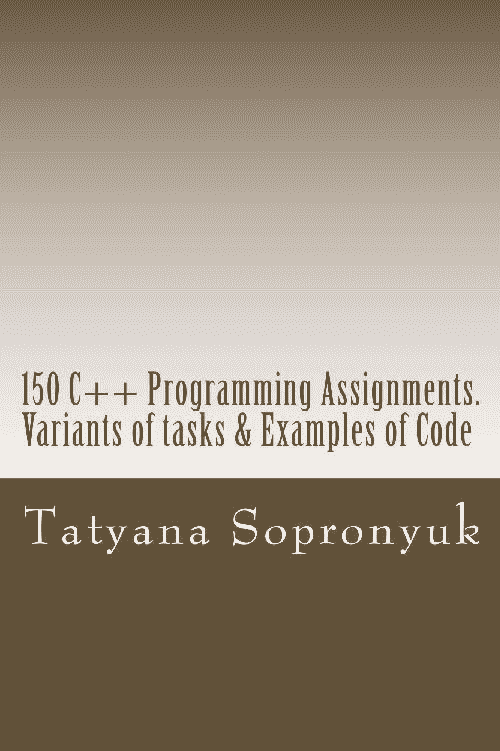
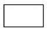
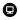
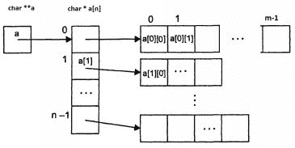
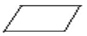

# 150 道 C++ 编程作业：任务变体与代码示例



最初出版于乌克兰，切尔诺夫，2014

由 Nonna Shulga 翻译

本作业集是教学指南《C++ 面向对象编程》（[`amzn.com/B00NZ6M7L6`](http://amzn.com/B00NZ6M7L6)）的附录。它包含了使用 `C++ 编程语言`解决的问题及其解决方案示例。

本教材旨在用于“C++ 面向对象编程”计算机科学课程。书中给出的任务涵盖了面向对象编程的基本概念：对象、类和继承。

本集的目的是教授学生如何从类实例化对象，以及如何继承新类。它引入了构造函数、公共和私有方法、抽象类、基类和派生类、类层次、方法重载。

为了帮助学生，教材演示了所有类型作业的相似程序代码。

本教材仅供教育目的。


## 前言

面向对象编程基于一种概念：程序可以被创建为一组共同工作的对象集合。这种方法关注于对象之间的连接，而不是它们的实现细节。所有的 OOP（面向对象）语言都基于三个核心思想：封装、多态和继承 [13, 18, 19, 22-30]。

在 `C++` 中，封装通过类来实现。对封装器内部代码和数据的访问由提供给用户的接口控制。

根据 OOP 的定义，多态的目的是对动作任务使用同一个名称，该名称对类来说是通用的。每个具体动作的执行将由数据类型定义。从更广泛的意义上说，多态的概念意味着为内容相同（而非实现方式相同）的组创建通用接口。

多态的核心在于，它允许通过为不同复杂度的对象创建实现相同动作的通用标准接口来操作这些对象。

继承是一个过程，通过它一个对象获得另一个对象的特性。更准确地说，对象可以继承另一个对象的特性，并在此基础上添加仅属于自身的特征。

本作业集是教学指南 [22] ([`amzn.com/B00NZ6M7L6`](http://amzn.com/B00NZ6M7L6))“`C++ 面向对象编程”的附录。它包含了使用 `C++ 编程语言`解决的问题及其解决方案示例。

教材由 6 部分组成。每部分包含针对特定主题的作业变体以及旨在辅助学生编写程序的代码示例。代码包含了注释和运行结果。

本集考虑的主题包括函数和运算符的重载、模板函数、结构类型操作、类的创建（数据成员、成员函数、构造、析构函数等）。我们还建议为了扩展现有类的功能创建类（聚合和继承），以及基类和派生类的概念、多重继承、类层次的构建、虚函数的使用、抽象类、多态函数、虚继承。

在教材中，我们介绍了 `C++` 面向对象编程课程的作业。某些作业（№ 2, № 3 和 № 6）基于 [11, 27] 中的思想。其他作业属于作者 [22, 23]。

## 作业 №1. 运算符与函数的重载。函数模板

### 任务

针对不同类型的输入数据重载函数，或创建函数模板，或者为用户标记的类型（以结构体方式定义的新类型）重载运算符 [23]。

### 任务变体

1. 创建一个函数，在输出接收文本（类型 `char*`）并通过删除空格来对其转换。函数必须返回删除空格的数量。将文本传递给函数。重载 `<<` 输出后的字符串。

2. 创建一个结构体，在表面上定义三角形。重载运算符：

   - `++` 向右移动 10 像素；

   - `--` 向左移动 10 像素；

   - `<` 比较两个三角形。

3. 创建一个结构体，在平面上定义向量。重载运算符：

   - `!` 根据给定值按逆时针旋转 90 度计算向量；

   - `-` 计算与给定值方向相反且长度相同的向量；

   - `++` 向量归一化。

4. 创建函数反转包含 `int` 和 `double` 类型元素的数组，以及反转句子中单词顺序的函数。使用函数重载并创建模板。

5. 创建函数比较整数、符号字符串、向量模，并返回：

   - `0` 如果数据相等；

   - `1` 如果第一个比第二个大或更长；

   - `-1` 如果第一个比第二个小或更短。

   使用函数重载。

6. 创建函数打印实数和复数的平方根、向量的模。使用函数覆盖。

7. 创建函数查找包含 `int` 和 `double` 类型元素的数组中的最大值，以及查找字符串（类型 `char*`）中最大单词长度的函数。使用函数重载并创建函数模板。

8. 定义运算符 `++`，使用高斯法计算矩阵行列式和向量模。

9. 重载运算符 `<<` 和 `>>` 用于矩阵的输入和转置后矩阵的输出。矩阵为 `n×m` 矩形，包含整数和实数元素。使用模板。

10. 定义两个符号行的逻辑减法运算 `S3=S1-S2`。行 `S3` 由属于字符串 `S1` 但不属于字符串 `S2` 的符号组成。考虑两个字符串中相同符号的数量。使用运算符重载。

11. 为复数定义运算符 `+`、`-`、`*`、`/`。分别测试每个运算。计算表达式 `z=(x+y)/(x-y)+xy/(x+y)`。使用运算符重载。

## 运算符重载任务

## 12. 为矩阵 (`nxn`) 定义操作 `+`、`-`、`*`。分别测试每种操作，并与 `MathCad` 环境中获得的结果进行比较。计算表达式 `D=A*B+C*A-A*C`。使用运算符重载。

## 13. 为维度为 `n` 的向量定义操作 `+`、`-`、`*`。分别测试每种操作。计算表达式 `d=(a+b)(a-b)`。使用运算符重载。

## 14. 定义两个字符字符串的逻辑加法操作 `S3=S1+S2`。行 `S3` 由字符组成，这些字符至少属于行 `S1` 或 `S2`。考虑两行中相同字符的数量。使用运算符重载。

## 15. 定义两个字符字符串的逻辑乘法操作 `S3=S1*S2`。行 `S3` 由同时属于行 `S1` 和 `S2` 的字符组成。考虑两行中相同字符的数量。使用运算符重载。

## 16. 三个数字 `(x, y, r)` 定义平面上的一个圆。为两个圆定义操作 `+`、`-`、`*`：

* `+` - 交集面积；

* `*` - 截面积；

* `-` - 差集面积。

使用运算符重载。

## 17. 四个数字 `(x1,y1,x2,y2)` 定义平面上的一个矩形。

`(x1,y1)`

 `(x2,y2)`

为两个矩形定义操作 `+`、`-`、`*`：

* `+` - 并集面积；

* `*` - 截面积；

* `-` - 差面积。

使用运算符重载。

## 18. 数字数组 `A(n)` 包含多项式系数 `a0 + a1 x + A2 x2 + ... + an-1 xn-1`。定义多项式的操作 `+`、`-`、`*`。使用运算符重载。

## 19. 数字数组 `A(n)` 定义多项式 `a0 + a1 x + a2 x2 + ... an-1 xn-1`。定义操作 `++` - 计算多项式的值。系数以列表形式存储在内存中。使用运算符重载。

## 20. 为复数的输入输出重载操作 `<<` 和 `>>`，以及比较两个复数模的操作 `==`。

## 21. 为结构的输入输出重载操作 `<<` 和 `>>`。结构中存储了计算机课上每周每天配对数量的数据。

## 22. 为两个复数的乘法、实数与复数的乘法重载操作 `*`，并计算两个向量的标量积。

## 23. 对于字符串符号，重载操作：

* `-` – 一元负号（原地反转字符串），

* `*` – 整数 `k` 与行 `s` 的乘法。

如果 `k>0`，则得到字符串 `s` 重复 `k` 次。如果 `k<0`，则得到反转后的字符串 `s` 重复 `k` 次。

## 24. 定义函数：

* `a & b` – 向量间的乘法；

* `! a` – 向量归一化。

计算表达式 `a & a`、`a & b`、`! a`。

## 25. 为实系数 `n` 次多项式的输入输出重载操作 `<<` 和 `>>`。

## 26. 为分数 `P /Q` 定义操作 `+`、`-`、`*`、`/`，其中 `P` 为整数，`Q` 为自然数。分别测试所有操作。计算表达式 `a/d-(a+b)/(cd)`，分数 `a, b, c, d`。

## 27. 定义表示平面上矩形的结构。为矩形定义操作 `<<`、`>>`：

* `>>` - 输入矩形的坐标信息和名称；

* `<<` - 显示矩形（名称、坐标、面积）。

## 28. 数字数组 `A(n)` 定义一个整数系数的多项式 `a0+ a1x + a2 x2 + ... an-1 xn-1`。定义运算符 `!` - 计算多项式的导数，`&` - 寻找原多项式。

## 29. 为存储在内存中维度为 `n` 的二进制向量的集合重载操作：

* `+` – 集的并集；

* `*` – 集的交集；

* `>>` – 输入集合。

二进制向量的单个位表示对应索引在复数集合中的存在，零或一表示不存在。

## 30. 为存储在内存中维度为 `n` 的二进制向量的集合重载操作（见变体 29），重载操作：

* `-` - 集的差集；

* `!` - 集的补集；

* `<<` - 集的输出。

## 31. 创建函数，找到平面上向量的长度，字符串的长度。

## 32. 创建函数，找到四边形的长度，平行四边形的长度，以及三角形的长度。

## 33. 为维度为 `n` 的矩阵与维度为 `n` 的向量定义乘法 `*`。

## 34. 数字数组定义整数系数的多项式 `a0+ a1x + a2 x2 + ... an-1 xn-1`。定义多项式的除法操作 `/`。结果 `P(r)*Q(l)`。

## 35. 为多边形（n – 顶点数，a – 边长）重载操作：

* `++` - 定义外接圆的半径；

* `--` - 定义内切圆的半径；

* `<` - 两个面积的比较。

```cpp
// 注意：提供的源代码代码块在最后部分是不完整的，
// 但结构遵循了所要求的格式规则。
```

```cpp
cin>>v[i];
for(i=0;i<5;i++)
    cout<<v[i]*i;
cin.get();
return 0;
```

从示例可以看出，由于编写了重载的流向量输入和输出操作，处理向量（vectors）的工作比处理字符串（lines）更加方便。

为了能够使用运算符重载，有必要将数组和字符串放入结构体中。

注意，后一个示例演示了 4 个同名为 `operator*` 的实现，编译器通过输入参数来区分它们。

 函数重载示例和函数模板的使用

### 任务

创建用于由 `int`、`float`、`char*` 类型元素组成的动态数组的排序函数。

数组的长度将在输入时给出。

使用函数重载和模板。

变长字符串动态数组的输入算法可以用下面的框所示。



```cpp
#include <stdio.h>
#include <string.h>
#include <iostream.h>

typedef char* str;

// 用于输入动态数字数组的模板
// 不指定类型时，“引用”将不起作用
template <class T>int input(T*& a)
{
  cout<<"\nInput the array size ";
  int n;
  cin>>n;
  a=new T[n];
  cout<<"\nInput the array elements "<<endl;
  for(int i=0;i<n;i++)
    cin>>a[i];
  return n;
}

// 用于输出
// 动态数字和字符串数组的模板
template <class T> void output(T* a, int n)
{
    for(int i=0;i<n;i++)
        cout<<a[i]<<" ";
    cout<<endl;
}

// 用于交换两个变量值的模板
template <class T> void swap (T & a, T & b)
{
    T c=b;
    b=a;
    a=c;
}

// 用于两个数字数组排序的模板
template <class T> void sort(T* a, int n)
{
  int check;
  do
  {
    check=0;
    for(int i=0;i<n-1;i++)
    if(a[i+1]<a[i])
    {
        swap(a[i+1],a[i]);
        check=1;
    }
    n--;
  }while(check);
}

// 用于输入变长字符串数组的函数
int input(str*& a) // 不使用引用将不起作用
{
cout<<"\n Input the number and maximum length of the lines ";
  int n,m;
  cin>>n>>m;
  a=new str[n];
  str buffer=new char[m+1];
  cout<<"\nInput "<<endl;
  for(int i=0;i<n;i++)
  {
    cin>>buffer;
    a[i]=new char[strlen(buffer)+1];
    strcpy(a[i],buffer);
  }
  delete[] buffer;
  return n;
}

// 用于变长字符串数组排序的函数
void sort(str* a,int n)
{
  int check;
  do
  {
    check=0;
    for(int i=0;i<n-1;i++)
    if(strcmp(a[i+1],a[i])<0)
    {
        swap(a[i+1],a[i]);
        check=1;
    }
    n--;
  }while(check);
}

// 用于动态数字或变长字符串数组的输入、排序和输出的模板
template <class T> void InputSortOutput()
{
T mas;
int size=input(mas);
sort (mas);
}

int main(void)
{
// ... 根据原文继续继续逻辑
return 0;
}
```

从示例可以看出，由于编写了重载的流向量输入和输出操作，处理向量（vectors）的工作比处理字符串（lines）更加方便。

为了能够使用运算符重载，有必要将数组和字符串放入结构体中。

注意，后一个示例演示了 4 个同名为 `operator*` 的实现，编译器通过输入参数来区分它们。

### 任务

创建用于由 `int`、`float`、`char*` 类型元素组成的动态数组的排序函数。

数组的长度将在输入时给出。

使用函数重载和模板。

变长字符串动态数组的输入算法可以用下面的框所示。

（注：提供的剩余文本包含重复且碎片化的技术描述，已整合到上面的代码块结构中。）

## 7. 字段 `first` – 正实数，商品单价；字段 `second` – 正整数，商品数量。实现方法 `cost(ob)` – 计算单种商品的价格，`costTwo(ob1,ob2)` – 计算两个对象的总价格。

## 8. 字段 `first` – 正整数，每 100 克产品的热量含量；字段 `second` – 正分数，产物以千克（kg）为单位的质量。实现计算单个产品总热量的方法，以及 `compareTwo(ob1,ob2)` – 比较两个产品的总热量。

## 9. 字段 `first` – 分数（分子、分母），范围的左边界；字段 `second` – 分数（分子、分母），范围的右边界，以实现方法 `rangeCheck()` – 检查指定的分数是否在范围 `[first, second]` 之间。

## 10. 字段 `first` – 整数，范围的左边界，属于范围内；字段 `second` – 整数，范围的右边界，不属于范围内。这对数字分配了一个半开区间 `[first, second)`。实现方法 `rangeCheck()` – 检查指定的数字是否在范围内，`rangePrintUnion(ob1,ob2)` – 输出两个范围组合后的所有整数。

## 11. 时间间隔通过字段指定：`first` - 正整数，小时；字段 `second` - 正整数，分钟。实现方法：`minutes()` – 将时间转换为分钟，`shiftForward()` 和 `shiftBack()` – 增加/减少 20 分钟的时间段。

## 12. 字段 `first` - 实数；字段 `second` – 整数，指数。实现方法 `power()` – 将第一个数升到 `second` 次幂。该方法应对对所有有效的 `first` 和 `second` 值都能正常工作。不要使用 math 库中的 `pow()` 函数。

## 13. 线性方程 `Ax+B=0`。字段 `first` – 分数（分子、分母），系数 `A`；字段 `second` – 分数，系数 `B`（分子、分母）。实现方法 `root()` – 计算线性方程的根。该方法必须检查系数 `A` 是否为零。

## 14. 字段 `first` - 实数，平面上点的 `x` 坐标；字段 `second` – 实数，平面上点的 `y` 坐标。实现方法 `distance()` – 计算点到原点的距离，`distanceTwo(ob1,ob2)` – 计算两点之间的距离。

## 15. 字段 `first` - 正实数，直角三角形的直角边；字段 `second` – 正实数，落在直角三角形斜边上的高 `h`。实现方法 `hypotenuse(ob1)` – 计算斜边长度，`compare(ob1,ob2)` – 比较两个对象的面积。

## 16. 字段 `first` - 正分数，工资；字段 `second` – 正整数，该月工作天数。实现方法 `sum()` – 根据月份内指定的天数计算应得金额。

`工资 / 每月天数 × 工作天数.`

## 17. 字段 `first` - 正数，通话时长（分钟）；字段 `second` – 正分数，每分钟 UAH（格里夫）的价格。实现方法 `cost()` – 计算通话总费用，`compare(ob1,ob2)` – 比较两次通话的费用。


## 18. 字段 `first` - 小数的整数部分；字段 `second` – 正整数，小数的小数部分

实现方法 `multiply()` – 将与一个带有两位小数的随机实数相乘。乘法结果为自定义结构类型变量。该方法应对任何有效的 `first` 和 `second` 值都能正常工作。

## 19. 字段 `first` - 正整数，光标水平坐标；字段 `second` - 正整数，光标垂直坐标

实现方法：
- `changex()` - 改变光标水平坐标
- `changey()` - 改变光标垂直坐标
- `changexy()` - 同时改变光标坐标

方法应检查是否超出屏幕。

## 20. 字段 `first` - 正整数，数的整数部分；字段 `second` - 正整数，数的小数部分

实现方法 `multiply()` – 与 `int` 类型的随机整数相乘。乘法结果为结构类型变量。该方法应对所有有效的 `first` 和 `second` 值都能正常工作。

## 21. 一对不同的正数

实现方法：
- `gcd(ob)` – 第一和第二个数的最大公约数
- `lcm(ob)` – 第一和第二个数的最小公倍数
- `compareTwo(ob1,ob2)` - 比较两个对象最大公约数是否相等。

## 22. 项 `aj` 递减等比数列通过公式计算

```
aj = a0rj, j = 0, 1, 2,...
```

字段 `first` - 正实数，数列的第一项 `a0`；字段 `second` – 在 0 到 1 之间的实数 `r`。实现方法 `element()` – 计算数列的第 `j` 个项，`sum()`

## 23. 字段 `first` - 正整数，年份；字段 `second` - 1 到 12 之间的整数，月份

实现方法 `daysCount(ob)` – 计算指定月份的天数（考虑到年份可能是闰年）。

## 24. 字段 `first` 和 `second` – 实数，确定坐标系中的点坐标

实现方法：
- `getX()` 和 `getY()` – 计算直角坐标系中的坐标
- `distanceTwo(ob1,ob2)` – 计算点与点的距离。

## 25. 由 `first` 和 `second` 确定的极坐标中的点

实现方法 `range(ob1,ob2)` – 检查其中一个数字是否靠近边界。

### 代码示例

```c
// 体 TDate
// 成员数据
//d-日, m-月, y-年
struct TDate {
    int d, m, y;
};

// 使用值 d,m,y+2000 初始化变量日期函数
void init (struct TDate* date, int d, int m, int y) {
    date->d = d;
    date->m = (m % 12) > 0 ? m % 12 : 12;
    date->y = 2000 + y;
}

// 为结构体中的字段增加年份
void addYear(struct TDate* date, int n) {
    date->y += n;
}

// 为结构体 date 中的字段增加月份
void addMonth(struct TDate* date, int n) {
    date->m += n;
}

// 为结构体中的字段增加天数
void addDay(struct TDate* date, int n) {
    date->d += n;
}

#include <stdio.h>

int main() {
    // 创建结构体 TDate 的实例（对象）
    struct TDate today, birthday, tomorrow;

    // 初始化变量 birthday
    // 使用 d,m,y+2000
    init(&birthday, 30, 13, -8);

    // tomorrow 赋值变量 today 的数据
    tomorrow = today;

    // 为 tomorrow 增加一天
    addDay(&tomorrow, 1);

    // 打印 tomorrow 的日期
    printf("%d\n", tomorrow.d);

    // 打印变量 birthday
    printf("%d %d %d ", birthday.y, birthday.m, birthday.d);

    getch();

    return 0;
}
```

请注意，在函数初始化时，年份是相对于 2000 年的，月份范围在 1 到 12 之间。在函数初始化或求和函数中，未预见其他数据纠正检查。上述示例的类似物可在文献 [19, 28] 中找到。

数据类型与函数之间没有明显的联系。但可以通过将函数定义为结构体的成员来建立这种联系：

带有成员数据和成员函数的结构体示例（C++ 代码）

```cpp
// C++ Code

// 带有成员数据的结构体 TDate

//d-天, m-月, y-年

struct TDate
{
    int d,m,y;
    void init(int dd,int mm, int yy);
    void addYear(int n);
    void addMonth(int n);
    void addDay(int n);
};

void TDate::init(int dd,int mm, int yy)
{
    d=dd;
    m =(mm % 12)>0 ? mm % 12 : 12;
    y =2000+y;
}

void TDate::addYear(int n)
{
    y +=n;
}

void TDate::addMonth(int n)
{
    m +=n;
}

void TDate::addDay(int n)
{
    d +=n;
}

#include <iostream.h>

int main()
{
    // 创建结构体 TDate 的实例（对象）
    TDate today, birthday;
    today.init(5,9,12);
    // 初始化变量 birthday
    birthday.init(30,12,-8);
    // 创建结构体 TDate 的实例
    // 使用变量 today 的数据初始化名为 tomorrow
    TDate tomorrow=today;
    // 给 tomorrow 加一天
    tomorrow.addDay(1);
    // 打印变量 tomorrow 的天
    cout << tomorrow.d << endl;
    // 打印变量 tomorrow
    cout << tomorrow.y <<" " << tomorrow.m <<" "<< tomorrow.d;
    // 打印变量 birthday
    cout << birthday.y <<" " << birthday.m <<" "<< birthday.d;
    cin.get();
    return 0;
}
```

在这里，结构体类型的所有变量将包含字段 `d`、`m`、`y` 以及函数 `init()`、`addYear()`、`addMonth()`、`addDay()`。

由于不同的结构体可能具有相同名的函数成员，因此在定义函数成员时，必须连同作用域解析运算符 `::` 一起指出结构体的名称。在函数成员结构体或类内部，可以使用同类的成员名称，而无需任何对象指针。`TDate` 结构体的描述提供了处理日期的函数选择，但请注意，它们不仅仅可以访问类 `TDate`。可以使用 `class` 关键字代替 `struct` 来限制访问权限。

## 第 3 题。结构体与类

### 任务

在所有任务中编写类类型（首先是结构体，然后是实现该结构体的类）。除了任务中指定的函数外，分配的类类型对象还必须实现以下功能函数 [11]：

* 对象初始化 `init()`
* 从键盘输入 `input()`
* 输出到屏幕 `output()`
* 将对象转换为字符串 `toPChar()`。

所有任务必须以两种方式实现：

* 数据类型通过带有必要字段的结构体分配，操作实现为外部非成员函数，这些函数接收给定类型的对象作为参数；
* 数据类型通过类分配。类数据成员是第 1 节描述的结构体类型的私有变量，类的成员函数是开放的非成员函数 `init()`、`input()`、`output()`、`toPChar()` 以及访问函数 `setStruct()`、`getStruct()` 或 `setVar()`、`getVar()`。

### 任务变体

1. 定义类型：系数为 `a`、`b`、`c` 的二次函数（`y=ax2+bx+c`）。定义函数：
   * `shift()` – 抛物线向上移动一个；
   * `odd()` – 偶函数定义；
   * `roots()` – 寻找方程 `ax2+bx+c=0` 的实根；
   * 打印抛物线顶点 `y=ax2+bx+c` 的坐标；
   * 寻找与 OX 轴相交点的个数。

2. 定义类型：由边长和锐角定义的菱形。定义函数：
   * `compare()` – 通过内切圆半径比较两个对象的操作；
   * 寻找菱形的对角线；
   * 计算面积。

3. 定义类型：系数为 `b`、`c` 的线性函数（`y=bx+c`）。定义函数：
   * `shiftRight()` – 直线向右移动一个单位；
   * `shiftUp()` – 直线向上移动一个单位；
   * 定义直线相对于横轴的倾斜角；
   * 定义两条直线的交点。

4. 定义类型：`TCircle` – 面积上的圆。圆由圆心和半径定义。定义函数：
   * `compare()` – 圆的比较；
   * `isIn()` – 寻找一个圆是否覆盖另一个圆；
   * 计算弧的长度；
   * 计算圆心角。

5. 定义类型：由实数对 (`a`, `b`) 定义复数，其中 `a` 为实部，`b` 为虚部。实现 `TComplex` 类型处理复数。必须具备的功能：
   * `add()`，`(a, b)` + `(c, d)`；
   * `sub()`，`(a, b)` - `(c, d)`；
   * `mul()`，`(a, b)` * `(c, d)`；
   * `div()`，`(a, b)` / `(c, d)`；
   * `equ()`，`(a, b)` = `(c, d)`；
   * `conj(a, b)`。

6. 定义类型 `T3D`，由三个坐标定义。向量的加法和减法、标量乘法、向量比较、向量长度计算必须实现。

7. 定义类型 `TModelWindow` 处理屏幕窗口。窗口标题、左上角坐标、水平尺寸、窗口颜色、“可见/不可见”状态、“有框/无框”状态分配为字段。坐标和尺寸以整数表示。实现操作：窗口水平方向和垂直方向变换；高度/或宽度变化；颜色改变；状态改变。变换和尺寸操作必须实现屏幕交叉检查。屏幕输出函数必须演示对象字段的状态。

8. 定义类型 `TMoney` 处理金额。数字必须由两个字段提交：用于 UAH 的 `long` 类型和用于分数的 `unsigned char` 类型。输出时分数部分必须与整数隔开。实现金额的加法、减法、除以分数、金额乘以分数以及比较操作。

9. 定义类型 `TTriangle` 引入三角形。数据字段必须包含角和边。必须实现操作：数据字段的获取和修改、面积计算、周长计算、高计算，以及定义三角形类型（等边、等腰或直角三角形）。

10. 定义类型 `TAngle` 处理平面角度，以分和定义大小。必须实现：转换为弧度、调整到 0-360 度范围、指定大小角度的增加和减少。

## 12. 有理数（不可约分数）

有理数由整数对 `(a, b)` 分配，其中 `a` 是分子，`b` 是分母。实现类型 `TRational` 以处理有理数。必须实现以下操作：

- 加法：`add()`，`(a, b) + (c, d)`
- 减法：`sub()`，`(a, b) – (c, d)`
- 乘法：`mul()`，`(a, b) * (c, d)`
- 除法：`div()`，`(a, b) / (c, d)`
- 比较：`equ()`（等于）、`bigger()`（大于）、`smaller()`（小于）

必须实现执行算术运算时调用的私有函数 `reduce()`。

## 13. TDate

创建类型 `TDate` 用于处理格式为 `"year.month.day"` 的日期。日期由具有三个 `unsigned int` 类型字段的结构体分配：年、月、日。该类型必须包含至少三个初始化函数：通过数字、字符串、以 `"year.month.day"` 方式（例如 `"2015.08.28"`）以及日期初始化。强制性操作包括：

- 通过指定的天数计算日期
- 从日期中减去指定的天数
- 定义闰年
- 分并获取单独的部分（年、月、日）
- 比较日期（相等、大于、过去）
- 计算两个日期之间的天数

## 14. TTime

定义类型 `TTime` 用于处理格式为 `"hour:minute:second"` 的时间。该类型必须包含至少四个初始化函数：通过数字、字符串（例如 `"23:59:59"`）、秒和时间初始化。强制性操作包括：

- 计算两个时间点之间的差值（秒）
- 将时间加上指定的秒数
- 从时间中减去指定的秒数
- 比较时间点
- 转换为秒
- 转换为分钟（四舍五入到整数分钟）

## 15. TFazzyNumber

实现类型 `TFazzyNumber` 用于处理由三个数字 `(x – e1, x, x + e2)` 表示的模糊数。对于数字 `Ob1 = (A – al, A, A + ar)` 和 `Ob2 = (B – bl, B, B + br)`，使用以下公式进行算术运算：

- `Ob1 + Ob2 = (A + B – al – bl, A + B, A + B + ar + br)`
- `Ob1 - Ob2 = (A – B – al – bl, A – B, A – B + ar + br)`
- `Ob1 * Ob2 = (A * B – B * al – A * bl + al * bl, A * B, A * B + B * ar + A * br + ar * br)`
- `1/Ob1 = (1/(A + ar), 1/A, 1/(A – al))`，`A > 0`
- `Ob1/Ob2 = ((A – al)/( B + br), A/B,(A + ar)/( B – bl))`，`B > 0`

## 16. TAccount

实现类型 `TAccount`，即银行账户。该类型必须有四个字段：所有者姓名、账号、利息费用和以 UAH（格里夫纳）计算的金额。开设新账户时执行初始化操作。你必须完成以下操作：

- 更改账户所有者
- 从账户取款
- 向账户存款
- 将利息转账金额改为美元
- 转账欧元金额
- 获取单词形式的金额

## 17. TMoney

实现 `TMoney` 类型以处理 UAH（格里夫纳）单位。该类型应包含 1、5、10、20、50、100、200、500 等字段。应包含至少五个初始化函数。实现：

- 加法
- 减法
- 乘法
- 除法
- 比较
- 转换为字符串
- 转换为整数（分分单位）
- 比较
- 在屏幕上输出

## 18. TBankomat

实现类型 `TBankomat`，模拟自动取款机。类型应包含有关 ATM 的信息。

## 19. TFazzyNumber

实现类型 `TFazzyNumber` 用于处理模糊数。该数由整数部分和分数部分表示。

## 20. Goods

创建类型 `Goods`。该类型包含字段：商品名称、日期、价格、数量。

## 21. TBitString

定义类型 `TBitString` 用于 64 位字符串。实现 `shiftLeft()` 和 `shiftRight()` 方法。

## 22. TLong

实现类型 `TLong` 用于处理整数。该数由整数部分和分数部分表示。

## 23. Polygon

在平面上定义 `Polygon` 类型。多边形由边数、中心和半径定义。实现：

- 周长计算
- 面积计算
- 多边形交叉

## 24. Segment

在平面上定义 `Segment` 类型。实现：

- 长度计算
- 检查

## 25. TCursor

定义类型 `TCursor`。字段为光标的水平和垂直坐标。

```cpp
#include <stdio.h>
#include <iostream.h>

// 带有成员数据的结构体日期
struct TDate {
    int d, m, y;
};

// 使用 d,m,y 初始化日期的函数
void init(TDate& date, int d, int m, int y) {
    date.d = d;
    date.m = (m % 12) > 0 ? m % 12 : 12;
    date.y = 2000 + y;
}

void addYear(TDate& date, int n) { // 向结构体中的字段增加年份
    date.y += n;
}

void addMonth(TDate& date, int n) { // 向结构体 m 字段增加月份
    date.m += n;
}

void addDay(TDate& date, int n) { // 向结构体 d 字段增加日期
    date.d += n;
}

int main() {
    // 创建 TDate 结构的实例（对象）
    TDate today, birthday;
    init(today, 5, 9, 13);
    // 使用值 d,m,y+2000 初始化变量 birthday
    init(birthday, 30, 13, -8);
    return 0;
}
```


```cpp
// 定义名为 tomorrow 的结构体 TDate

// 使用变量 today 的数据初始化

TDate tomorrow = today;

// 给 tomorrow 增加一天

addDay(tomorrow, 1);

// 打印变量 tomorrow 的日期

cout << tomorrow.d << endl;

// 打印变量 birthday 的日期

cout << birthday.y << " "
     << birthday.m << " "
     << birthday.d << endl;

cin.get();

return 0;

}
```


具有结构类型私有变量（数据成员）和访问函数的示例类。

```cpp
#include <iostream.h>

// 带有数据成员 d-日，m-月，y-年的类

class TDate
{
    int d, m, y;

public:
    // 访问变量 m-月的函数
    void setM(int m) { this->m = (m % 12) > 0 ? m % 12 : 12; }
    int getM() { return m; }
    char* getM(int);
};

char* TDate::getM(int)
{
    char* season = new char[7];

    switch (m)
    {
        case 12:
        case 1:
        case 2:
            strcpy(season, "winter");
            break;

        case 3:
        case 4:
        case 5:
            strcpy(season, "spring");
            break;

        case 6:
        case 7:
        case 8:
            strcpy(season, "summer");
            break;

        case 9:
        case 10:
        case 11:
            strcpy(season, "autumn");
            break;
    }

    return season;
}

int main()
{
    TDate day;

    day.setM(12);
    cout << day.getM() << endl;
    cout << day.getM(1) << endl;

    day.setM(55);
    cout << day.getM() << endl;
    cout << day.getM(1) << endl;

    cin.get();

    return 0;
}
```

在后一个示例中，有两个名为 `getM()` 的函数。它们通过输入参数进行区分，并根据参数返回月份数字或季节。`accesssetM()` 函数引入了正确的月份数字。

# 作业 №4：类的创建

## 任务

在每个变体中创建指定的类 [17] 并进行测试，同时注意在主部分创建必要数量的对象。在使用这些对象时，演示所有实现的运算符和函数。将部分运算符和函数设计为友好的形式，另一部分作为类成员。使用类的静态成员。

## 任务变体

### 1. 平面上的三角形类

在平面上定义类：`triangle`。它由三个顶点 `A(X1, Y1)`、`B(X2, Y2)`、`C(X3, Y3)` 定义。创建构造函数和析构函数。

定义运算符：

- `<<`：输出对象信息；
- `==`、`!`：比较两个对象。

定义函数：

- 求三角形面积和周长；
- 寻找内切圆和外接圆的半径；
- 求顶点角；
- 寻找顶点和中线；
- 定义三角形类型（直角三角形、锐角三角形、有钝角、等腰三角形、不等边三角形）；
- 在屏幕上绘制对象的图形；
- 寻找外接圆和内切圆的圆心；
- 返回外接圆心周围指定的角；
- 对象向右、向左移动。

### 2. 实数系数多项式类

定义实数系数的 `n` 次多项式类 `P(x) = a0 + a1x + a2x2 + … + an-1xn-1`，`x ∈ R`。为了保存多项式系数，使用数组实现。

创建构造函数和析构函数。

定义运算符：

- `+`、`-`、`*`：多项式的加法、减法和乘法。

定义函数：

- 多项式打印；
- 创建多项式的拷贝；
- 求多项式在点的值；
- 求多项式除以多项式的商和余数；
- 计算多项式 `P'(x)`、`P(Q(x))`、`(x - b)P(x)`、`P(x + b)`（`b` 为赋值值）。

### 3. 长整数类

定义类：`long integer`（长整数）。使用数组保存数字（数组的一个元素为一个数字）。创建构造函数和析构函数。

定义运算符：

- `+`、`-`、`*`：数字的加、减、乘；
- `/`：整数除法；
- `%`：取余数；
- `==`、`!=`、`>`、`<`、`<=`、`>=`：比较。

定义函数：

- 数字打印；
- 判断数字是否为零的逻辑函数。

定义数字 `250 + 1` 是否为质数。打印数字 `210`、`2100`、`100!`。

### 4. 符号字符串类

创建类：使用链表保存符号字符串。创建构造函数和析构函数。

定义运算符：

- `+`：两个字符串的拼接；
- `==`、`!=`、`>`、`<=`：比较；
- `<<`、`>>`：输入和输出操作。

定义函数：

- 创建拷贝；
- 求字符串长度；
- 将 `st1` 插入 `st2`；
- 计算字符串；
- 获取字符串的第一个项；
- 字符串的结果。

### 5. 平面上的点集类

定义类：平面上的点集。`(X, Y)`，`X ∈ Z`，`Y ∈ Z`。使用链表实现。创建构造函数和析构函数。

定义运算符：

- `*`、`+`、`-`：交集、并集、差集；
- `==`、`!=`、`<=`：比较；
- `<<`：输出集合。

定义函数：

- 创建拷贝；
- 定义数量；
- 定义数字是否属于集合；
- 与空集比较；
- 寻找集合的最小元素；
- 坐标。

### 6. 平面上的四边形类

定义类：平面上的四边形。`(X1, Y1)`、`(X2, Y2)`、`(X3, Y3)`，其中 `Xi ∈ N`、`Yi ∈ N`。创建构造函数和析构函数。



定义运算符：

- `+`、`-`、`*`：四边形的交、差；
- `==`：重合。

定义函数：

- 打印四边形信息；
- 求面积和周长；
- 绘制图形；
- 求顶角；
- 对象向右移动 10 像素。

### 7. 使用二维向量表示的整数集类

创建类：使用二维向量表示整数集。创建构造函数和析构函数。

定义运算符：

- `*`、`+`、`-`：集合的交、并集、差集；
- `~`：补集；
- `%`：对称差集；
- `==`、`!=`、`>`、`<=`：比较运算符；
- `<<`、`>>`：输入和输出。

定义函数：

- 定义数量；
- 定义数字是否属于集合；
- 与空集比较；
- 寻找集合的最小元素。

### 8. 复系数多项式类

定义复系数多项式类 `P(x) = a0 + a1x + a2x2 + … + an-1xn-1`，`ak = u + iv`，`u ∈ Z`，`v ∈ Z`。使用单向链表在内存中保存系数。创建构造函数和析构函数。

定义运算符：

- `+`、`-`、`*`：多项式的加法、减法、乘法；
- `==`：比较操作。

定义函数：

- 多项式打印；
- 创建多项式拷贝；
- 计算多项式在点 `b` 的值。

### 9. 整数系数多项式类

定义任意次数整数系数多项式类 `P(x) = a0 + a1x + a2x2 + … + an-1xn-1`。使用单向链表在线性内存中保存系数。创建构造函数和析构函数。

定义运算符：

- `+`、`-`、`*`：多项式的加法、减法、乘法；
- `<<`、`>>`：多项式的输入和输出操作。

定义函数：

- 检查两个多项式的相等性；
- 创建多项式拷贝；
- 求多项式在点的值；
- 对于给定的 `b` 计算多项式 `P(x + b)`、`(x - b)P(x)`、`P'(x)`；
- 函数 `y = P(x)` 的图形图像。

### 10. 有理系数多项式类

定义具有有理系数的多项式类 `P(x) = a0 + a1x + a2x2 + … + an-1xn-1`，`x ∈ Q`，`ak = uk/vk`，`uk ∈ Z`，`vk ∈ N`。使用一维数组或二维一维数组来存储所使用的系数。创建构造函数和析构函数。

定义操作：

- `+`：两个多项式的相加；
- `-`：两个多项式的相减；
- `*`：两个多项式的相乘；
- `<<`：多项式打印；
- `==`：两个多项式的比较。

定义函数：

- 创建多项式的拷贝；
- 有理数约分；
- 求解多项式在某点的值；
- 求解 `P'(x)`、`P(x + b)`（`b` 为给定数字）。

### 11. 复数类

定义类：复数。创建构造函数和析构函数。

定义操作：

- `+`、`-`、`*`、`/`：算术运算；
- `=`：赋值；
- `!`：获取共轭数。

创建函数：

- 打印复数；
- 拷贝创建；
- 求解复数的 `n` 次根；
- 求解 `|z|`、`Arg z`、`z^a`（`a` 为实数）；
- 使用行计算指定精度的 。

### 12. 实数系数矩阵类

创建维度为 `n × n` 的实数系数矩阵类。创建构造函数和析构函数。

定义操作：

- `+`、`-`、`*`：矩阵运算；
- `<<`：打印矩阵；
- `>>`：输入矩阵；
- `==`：矩阵的比较。

定义函数：

- 求矩阵的行列式；
- 求解矩阵的逆；
- 求解矩阵的迹；
- 定义矩阵是否对称的函数。

### 13. 向量类

定义维度为 `n` 的向量类。创建构造函数和析构函数。

定义操作：

- `+`、`-`：向量的相加和相减；
- `*`：向量的点积；
- `>>`：输入向量；
- `^`：向量乘以一个数字。

定义函数：

- 打印向量；
- 求解向量的长度；
- 创建向量拷贝；
- 向量元素排序；
- 向量归一化。

### 14. Pascal 字符串类

创建类：Pascal 中的字符字符串存储为字符字符串。为了存储它，使用字符数组。在零元素处存储当前字符串的长度。创建构造函数和析构函数。

定义操作：

- `+`：两个字符串的拼接；
- `%`：逻辑加（仅添加第二个字符串中第一个字符串中不存在的字符）；
- `==`、`!=`、`<`、`>`、`<=`、`>=`：比较两个字符串的操作。

定义函数：

- 打印字符串；
- 字符串拷贝；
- 从位置 `Pos` 开始删除 `N` 个字符的字符串；
- 从位置 `Pos` 开始将字符串 `st1` 插入字符串 `st2` 中；
- 求解字符串长度；
- 定义子字符串 `st2` 在字符串 `st1` 中首次出现的位置。结果为位置数。

### 15. 字符字符串类

定义类：字符字符串。为了维护字符串，使用带有最终符号 `\0` 的字符数组。创建构造函数和析构函数。

定义操作：

- `*`：两个字符串的逻辑相乘（返回仅包含公共字符的字符串）；
- `+`：两个字符串的拼接；
- `==`、`!=`、`<`、`<=`、`>=`：两个字符串的比较操作。

定义函数：

- 打印字符串；
- 字符串拷贝；
- 从位置 `Pos` 开始删除 `N` 个字符的字符串；
- 从位置 `Pos` 开始将字符串 `st1` 插入字符串 `st2` 中；
- 确定字符串长度；
- 从位置 `Pos` 开始从字符串中提取长度为 `N` 个字符的子字符串；
- 显示字符串行的第一个条目（结果为编号）；
- 验证记录行是否为正数；
- 将字符字符串转换为整数记录。

### 16. 平面上的圆类

定义类：平面上的圆。圆由三个数字（`x`、`y`、`r`）定义。创建构造函数和析构函数。

定义操作：

- `+`：两个圆并集的面积；
- `-`：两个圆差的面积；
- `*`：两个圆交集的面积。

定义函数：

- 打印关于圆的信息；
- 面积的比较；
- 求解圆面积；
- 以度为单位的圆弧长；
- 在屏幕上显示圆的图形表示。

### 17. 平面上的矩形类

定义类：平面上的矩形。它由点 `A(x1, y1)`（第一个左上点的坐标）以及 `B(x2, y2)`（右下点坐标）定义。创建构造函数和析构函数。

定义操作：

- `+`：两个矩形并集的面积；
- `-`：两个矩形差的面积；
- `*`：两个矩形交集的面积。

定义函数：

- 打印关于矩形的信息；
- 面积的比较；
- 求解面积；
- 求解周长；
- 在屏幕上显示图形表示。

### 18. 链表长整数类

定义类：长整数。使用链表存储数字。创建构造函数和析构函数。

定义操作：

- `+`、`-`、`*`：相加、相减、相乘；
- `/`：除法；
- `%`：取余数。

定义函数：

- 打印数字；
- 求解位数；
- 数字归一化（删除零）；
- 确定数字是否等于零；
- 定义是否为质数。

### 19. 正多边形类

创建类：正多边形。该对象由 `X1, Y1`、`R`、`N` 定义。这里 `O(X1, Y1)` 为外接圆中心，`R` 为外接圆半径，`N` 为顶点数。创建构造函数和析构函数。

定义操作：

- `==`、`!=`：比较对象；
- `<<`：打印对象信息。

定义函数：

- 求解面积和周长；
- 求解内切圆半径；
- 求解顶角；
- 在屏幕上绘制对象；
- 向左移动像素。

### 20. 空间中的平面类

定义类：空间中的平面。平面由一般方程 `A`、`B`、`C`、`D` 的系数定义。创建构造函数、析构函数和拷贝构造函数。

定义操作：

- `^`：平面间的角；
- `||`：平面间的距离；
- `==`、`!=`：平面的比较。

定义函数：

- 打印平面信息；
- 检查点是否在平面上；
- 定义法平面系数；
- 检查平面是否与坐标平面平行；
- 检查两个平面是否平行或垂直；
- 求解点到平面的距离。

### 21. 平面上的折线类

定义类：平面上的折线。它由点坐标定义，存储在二维或一维数组中。创建构造函数和析构函数。

定义操作：

- `+`：两个折线的拼接；
- `<<`、`>>`：折线的输出和输入（顶点数量及其坐标）。

定义函数：

- 确定折线是否闭合；
- 确定折线是否存在自交；
- 确定折线是否为凸；
- 求解由凸折线限制的图形面积；
- 绘制折线。

为了使算法更容易，可以认为所有顶点都是不同的，此外可能第一个和最后一个也是不同的。

### 22. 平面上的直线类

定义类：平面上的直线。通过一般方程及系数 `A`、`B`、`C` 赋值。创建构造函数、析构函数和拷贝构造函数。

定义运算符：

- `^`：直线之间的角；
- `||`：直线之间的距离。

定义函数：

- 输出直线的信息；
- 寻找两条直线的交点；
- 检查点是否在直线上；
- 定义法线直线方程的系数；
- 检查直线是否平行于坐标轴；
- 检查两条直线是否平行或垂直；
- 寻找点到直线的距离。

### 23. 平面上的点类

定义类：平面上的点。创建构造函数、析构函数和拷贝构造函数。

定义运算符：

- `++`、`-`：点向右、向左移动 10 像素；
- `||`：两点之间的距离；
- `<<`、`>`：输出和输入点；
- `==`、`!=`：比较两个点。

定义函数：

- 寻找点的极坐标；
- 在坐标平面上绘制点；
- 定义点在坐标平面上的象限位置；
- 定义 4 个指定点是否形成一个圆；
- 定义 3 个指定点是否在同一条直线上。

### 24. 空间中的折线类

定义类：空间中的折线。折线通过点坐标赋值，存储在 `3 × n` 的数组中。创建构造函数、析构函数和拷贝构造函数。

定义运算符：

- `+`：合并两条折线；
- `=`：赋值。

定义函数：

- 输出折线的信息（顶点数量及其坐标）；
- 定义折线是否为闭合；
- 定义其是否属于同一个平面；
- 寻找折线在坐标平面上的投影；
- 在 `XOY` 平面上绘制折线的投影图。

### 25. 空间中的点类

定义类：空间中的点。创建构造函数、析构函数和拷贝构造函数。

定义运算符：

- `==`、`!=`：比较点；
- `||`：两点之间的距离；
- `=`：赋值；
- `+`、`-`：点的加法和减法。

定义函数：

- 输出点的信息；
- 寻找球面坐标；
- 定义点是否属于某个坐标面；
- 定义通过两个指定点的直线方程；
- 定义通过三个指定点的平面方程。

### 26. 整数类

定义类：整数。创建构造函数和析构函数。

定义运算符：

- `++`：数字的位数；
- `-`：如果末位数字为零，则删除末位数字；
- `!`：数字翻转（数字倒序排列）；
- `&`：数字除法（结果为实数）。

定义函数：

- 检查该数字是否为质数；
- 寻找数字的质因数；
- 将数字分解为质因数；
- 求两个数的最小公倍数；
- 在不同的进制中打印数字（从二进制到十进制）。

### 27. 有理数类

定义类：有理数 `x = p / q`，其中 `p` 为整数，`q` 为正整数。创建构造函数和析构函数。

定义运算符：

- `+`、`-`、`*`、`/`：分数的加、减、乘、除；
- `==`、`!=`、`>`、`<`、`<=`、`>=`：比较；
- `<<`：输出；
- `>>`：输入。

定义函数：

- 幂运算：`x^a`，`a` 为整数；
- 有理数的约分；
- 对象拷贝。

### 28. 空间中的球体类

创建类：空间中的球体。球由中心坐标和半径设置。创建构造函数、析构函数和拷贝构造函数。

定义运算符：

- `==`：比较半径；
- `<<`：输出球的信息；
- `<=`：判断一个球是否属于另一个球；
- `>=`：判断一个球是否包含在另一个球内。


- `"*"` - 寻找交球的体积。

定义函数：

- 沿指定的向量移动球体；

- 按指定的倍数压缩球体；

- 输出与另一个球相交的信息（一个点及其坐标，或多个交点）。

## 29. 创建类：平面上的向量。创建构造函数、析构函数和拷贝构造函数。

定义运算符：

- `"+"` - 向量和；

- `"-"` - 向量差；

- `"*"` – 数量积；

- `"="` – 赋值；

- `"<"` - 向量之间的角。

定义函数：

- 定义向量是否共线或正交；

- 向量输出；

- 绘制向量图像；

- 定义向量的长度。

## 30. 创建类：空间中的向量。创建构造函数、析构函数和拷贝构造函数。

定义运算符：

- `"&"` - 向量之间的角；

- `"&&"` - 叉积；

- `"*"` - 数量积；

- `=` - 赋值；

- `"<<"` - 输出向量。

定义函数：

- 定义两个向量是否共线；

- 定义三个向量是否共面；

- 混合积；

- 在坐标平面上的投影；

- 定义向量的长度。

## 31. 创建类：椭圆。椭圆通过标准方程系数 `a`, `b` 赋值。创建构造函数、析构函数和拷贝构造函数。

定义运算符：

- `=` - 赋值；

- `"=="` – 比较；

- `"<<"` - 输出椭圆信息；

- `"<="`, `">="` – 一个椭圆包含另一个椭圆。

定义函数：

- 定义焦点；

- 定义离心率；

- 焦半径；

- 定义直接线方程；

- 绘制椭圆。

## 32. 创建类：圆柱，底平行于 XOY 平面。圆柱通过底心坐标、半径和高度赋值。创建构造函数、析构函数和拷贝构造函数。

定义运算符：

- `=` – 赋值；

- `"=="` - 比较体积；

- `"<<"` – 输出圆柱信息；

- `"<="` - 判断一个圆柱是否属于另一个；

- `">="` - 判断一个圆柱是否包含另一个。

定义函数：

- 沿指定的向量移动圆柱；

- 按指定的倍数压缩尺寸；

- 输出与另一个圆柱相交的信息（是/否）。

- 时间间隔内的图形变化，其长度随时间增加（该函数必须通过定时器分配的时间间隔进行调用）；

- 时间间隔的变化；

- 定义定时器对分配函数的调用次数；

- 创建定时器副本；

- 定时器开始工作的变化。

### 代码示例

 整数类 `Set of the Integer Numbers` 的实现示例

**任务：** 定义整数集合类：`set`。创建构造函数和析构函数。

定义操作：

- `*` – 两个集的交集；

- `+` – 两个集的并集；

- `-` – 两个集的差集；

- `=` – 赋值；

- `<=`, `>=`, `!=`, `==` – 关系。

定义函数：

- 打印集合；

- 计算集合中的元素数量；

- 与空集比较；

- 对集合排序；

- 检查数字是否在集合中；

- 寻找集合中的最大元素。

创建必要数量的对象集以说明所有操作和函数。函数和运算符部分应为友元，另一部分为类成员。

```cpp
#include <vcl.h>
#include <windows.h>

#pragma hdrstop
#pragma argsused
#include <tchar.h>
#include <stdio.h>
// 包含输入输出类的库，
// cin, cout, cerr 等其他。
// 允许实现重载的
// 输入和输出运算符
#include <iostream.h>
#include <conio.h>
typedef int Bool;
const Bool NO=0;
const Bool YES=1;

class TSetInt
{
// 私有数据成员
// 仅允许类成员和友元访问
    int* V; // 集合元素
    int Sz; //  V[] 的数量
    int Num; // 对象编号
    Bool Copy; // 是否为拷贝对象
// 对象集的数量，一个静态变量
// 适用于所有对象
    static int CountObjects;
// 公有数据成员
public:
    TSetInt(int); // 带参数的构造函数
    TSetInt(int,int*); // 带参数的构造函数
    TSetInt(); // 默认构造函数
    TSetInt(const TSetInt&); // 拷贝构造函数
    ~TSetInt(); // 析构函数

// 二元运算符* 和 - 为类成员
// 对象 *this – 第一个参数
// (隐式传递)
// 第两个参数不改变
// (const)
TSetInt operator*(const TSetInt&) const;
TSetInt operator-(const TSetInt&) const;
Bool operator<=(const TSetInt&) const;
Bool operator==(const TSetInt&) const;
Bool operator>=(const TSetInt&) const;
Bool operator!=(const TSetInt&) const;
// 赋值
// (仅第二个参数发生改变)
TSetInt& operator=(const TSetInt&);
// 友元
friend TSetInt operator+(const TSetInt&, const TSetInt&);
// 函数 – 类成员
    void printSet() const;
    int kilElem(){return Sz;} // 内联函数
    Bool isEmpty();
    void order();
    TSetInt& inSet(int); // 用法如: inSet(int)
    Bool ifInSet(int) const;
// 类的友元函数
friend int maxElem(const TSetInt&);
};

// 静态变量初始化
int TSetInt::CountObjects=0;

TSetInt::TSetInt(int sz)
{
    V=new int[sz];
    Copy=NO;
    Sz=sz;
    Num=++CountObjects;
    int i=0,el;
    // 将随机元素记录到数组中
    // 仅执行一次
    while(i<Sz)
    {
        el=random(50);
        if (!ifInSet(el))V[i++]=el;
    }
    cout<<"\n Created object (int) N"<< Num <<endl;
}

TSetInt::~TSetInt()
{
    cout<<"\nDeleting object N"<< Num<< " Copy "<<Copy<< " number of objects "<<--CountObjects <<endl;
    delete[] V;
}

TSetInt::TSetInt()
{
    Sz=0;
    V=NULL;
    Copy=NO;
    Num=++CountObjects;
    cout <<"\nCreated()"<< Num << endl;
}

// 构造函数一次写入元素
TSetInt::TSetInt(int sz,int* vek)
{
    int* temp=new int[sz];
    Copy=NO;
    Sz=1;
    Num=++CountObjects;
    temp[0]=vek[0];
    for(int i=1;i<sz;i++)
    {
        Bool flag=YES;
        for(int j=0;j<Sz;j++)
            if (vek[i]==temp[j]) flag=NO;
        if(flag)temp[Sz++]=vek[i];
    }
    V=new int[Sz];
    for(int i=0;i<Sz;i++)V[i]=temp[i];
    delete[] temp;
    cout<<"\nCreated object (int,int*) " <<Num<<endl;
}

// 初始化列表
TSetInt::TSetInt(const TSetInt& Obj): Num(Obj.Num), Copy(YES), Sz(Obj.Sz)
{
    V=new int[Obj.Sz];
    for(int i=0;i<Obj.Sz;i++)V[i]=Obj.V[i];
    CountObjects++;
    cout<<"\nCreated the copy of object N"<<Num<<endl;
}

TSetInt TSetInt::operator*(const TSetInt& Ob) const
{
    // 调用拷贝构造函数
    TSetInt temp(*this);
    int k=0;
    for(int i=0;i<Ob.Sz;i++)
        for(int j=0;j<Sz;j++)
            if(Ob.V[i]==V[j])
                temp.V[k++]=Ob.V[i];
    temp.Sz=k;
    return temp;
}

TSetInt TSetInt::operator-(const TSetInt& Ob) const
{
    TSetInt temp(*this);
    int k=0;
    for(int j=0;j<Sz;j++)
        if(!Ob.ifInSet(V[j]))
            temp.V[k++]=V[j];
    temp.Sz=k;
    return temp;
}

TSetInt& TSetInt::operator=(const TSetInt& Ob)
{
    if (this==&Ob)
    {
        cerr<<"\nAssignment"<<endl;
        return *this;
    }
    delete[] V;
    V=new int[Sz=Ob.Sz];
    for(int i=0;i<Sz;i++)
        V[i]=Ob.V[i];
    return *this;
}

// 此运算符不是类成员，而是友元
friend TSetInt operator+(const TSetInt& Ob1, const TSetInt& Ob2)
{
    int* v=new int[Ob1.Sz+Ob2.Sz];
    for(int i=0;i<Ob1.Sz;i++)
        v[i]=Ob1.V[i];
    int sz=Ob1.Sz;
    for(int i=0;i<Ob2.Sz;i++)
    {
        // 不需要检查，因为构造函数已经处理了
        if (!(Ob1.ifInSet(Ob2.V[i])))
            v[sz++]=Ob2.V[i];
    }
    return TSetInt(sz,v);
}

Bool TSetInt::operator<=(const TSetInt& Ob) const
{
    if(Ob.Sz < Sz ) return NO;
    if(Sz==0)return YES;
    for(int i=0;i<Sz;i++)
        if (!(Ob.ifInSet(V[i])))return NO;
    return YES;
}

Bool TSetInt::operator>=(const TSetInt& Ob) const
{
    return Ob<=(*this);
}

Bool TSetInt::operator==(const TSetInt& Ob) const
{
    if(Ob.Sz != Sz) return NO;
    return(operator<=(Ob));  // better this way:  *this<=Ob;
}

Bool TSetInt::operator!=(const TSetInt& Ob) const
{
    return(!(operator==(Ob)));
}

TSetInt& TSetInt::inSet(int a)
{
    int i;
    if(ifInSet(a))return *this;
    TSetInt Ob(*this);
    delete[] V;
    V=new int[++Sz];
    for(i=0;i<Ob.Sz;i++)
    V[i]=Ob.V[i];
    V[i]=a;
    return *this;
}

void TSetInt::printSet() const
{
    cout<<"\Object N"<<Num<<
    " Copy "<<Copy<<endl<< "Elements: ";
    for(int i=0;i<Sz;i++)
        cout<<V[i]<<" ";
    cout<<"\nThe number of objects "<<CountObjects<<endl;
    return;
}

Bool TSetInt::isEmpty()
{
    if(Sz==0)return YES;
    return NO;
}

void TSetInt::order()
{
    for(int i=1;i<Sz;i++)
    {
        for(int j=Sz-1;j>=i;j--)
        if(V[j-1]>V[j])
        {
            int a=V[j-1];
            V[j-1]=V[j];
            V[j]=a;
        }
    }
    return ;
}

Bool TSetInt::ifInSet(int a) const
{
    for(int i=0;i<Sz;i++)
    if(a==V[i])return YES;
    return NO;
}

int maxElem(const TSetInt& Ob) // friendly function
{
    int a,i;
    for(a=Ob.V[0],i=1; i<Ob.Sz; i++)
    if(Ob.V[i]>a)a= Ob.V[i];
    return a;
}

int main()
{
TSetInt Ob1(4),Ob2(5);
Ob1.printSet();
cout<<"\nThe number of elements "<<Ob1.kilElem()
<<" in the object N1"<<endl;
cout<<"\nifInSet 4 - "<<Ob1.ifInSet(4)<<" ifInSet 1-"
<<Ob1.ifInSet(1)<<endl;
cout<<"\nisEmpty "<<Ob1.isEmpty<<endl;
Ob2.printSet();
TSetInt Ob3(Ob2);
Ob3.printSet();
cout<<"\nmax Ob3 "<<maxElem(Ob3)<<endl;
TSetInt Ob4(0);
Ob4.printSet();
cout<<"\nisEmpty Ob4 "<<Ob4.isEmpty<<endl;
int vek[5];
for(int i=0;i<5;vek[i]=6+i,i++);
vek[1]=8;
TSetInt Ob5(5,vek);
Ob5.printSet();
TSetInt Ob6;
{
// The block of existence for the temporary objects,
// Created by the copy constructor
Ob6=Ob5+Ob1;
}
Ob6.inSet(3);
Ob6.order();
Ob6.printSet();
{
// The block of the existence of temporary objects,
// Created by the copy constructor
Ob2=Ob6-Ob1;
}
Ob2.printSet();
Ob2.inSet(27);
{
// The block of the existence of the temporary objects,
// Created by the copy constructor
Ob6=Ob1*Ob2;
}
Ob6.printSet();
Ob2.printSet();
cout<<"  Ob6<=Ob2 ? "<<(Ob6<=Ob2) << endl;
cout<<"  Ob2<=Ob6 ? "<<(Ob2<=Ob6) << endl;
cout<<"  Ob2==Ob1 ? "<<(Ob2==Ob1) << endl;
cout<<"  Ob2>=Ob6 ? "<<(Ob2>=Ob6) << endl;
Ob6.printSet();
Ob6.inSet(9);
TSetInt Ob7;
Ob7=Ob2;
Ob7.printSet();
cin.get();
return 0;
}
```

程序运行结果：

```
Created object (int) N1

Created object (int) N2

Object N1 0

Elements: 49 36 44

The number of objects 2

The number of elements 4 in the object N1

ifInSet 4 - 1 ifInSet 1-0

isEmpty 0

Object N2 0

Elements: 12 33 34 36
```


The number of objects `2`

Created the copy of the object `N2`

Object `N2` `1`

Elements: `12 33 34 36`

The number of objects `3`

`max Ob3 36`

Created object `(int) N4`

Object `N4` `0`

Elements:

The number of objects `4`

`isEmpty 1`

Created object `(int,*) N5`

Object `N5` `0`

Elements: `6 8 9 10`

The number of objects `5`

Created object `(int,*) N6`

Object `N5` `0`

Elements: `6 8 9 10`

The number of objects `5`

```cpp
// 文件 Stack.h，包含类 Stack 类的接口部分
#ifndef STACKH // 如果没有定义 STACKH 指令
#define STACKH // 定义它

// TStack 类的声明
class TStack
{
    struct TLink
    { // 在类中定义的结构体
        void* data;
        TLink* next;
        TLink(void* dat, TLink* nxt);
        ~TLink();
    };
    TLink* head; // 聚合，使用指针

public:
    TStack();
    ~TStack();
    void push(void* dat);
    void* peek();
    void* pop();
};

#endif // 定义 STACKH 指令的结束
```

```cpp
// 文件 Stack.cpp 的实现
#include "Stack.h"
#include <iostream.h>

TStack::TLink::TLink(void* d, TLink* n)
{
    data = d;
    next = n;
}

TStack::TLink::~TLink() { }

TStack::TStack() { head = NULL; }

void TStack::push(void* d)
{
    head = new TLink(d, head);
}

void* TStack::peek()
{
    return head->data;
}

void* TStack::pop()
{
    if(head == NULL) return NULL;
    void* rez = head->data;
    TLink* oldHead = head;
    head = head->next;
    delete oldHead;
    return rez;
}

TStack::~TStack()
{
    while(head) pop();
    cout << "\nTStack empty";
}
```

```cpp
// 文件：Main.cpp
#include <iostream.h>
#include "Stack.h"

int main(int argc, char* argv[])
{
    {
        TStack my;
        int el1, el2, el3;
        cout << "Input elements\n";
        cin >> el1 >> el2 >> el3;
        my.push(&el1);
        my.push(&el2);
        my.push(&el3);
        // delete el3
        my.pop();
        // 输出 el2（类型转换和指针位置）
        cout << *(int*)my.peek();
    } // 这里 TStack 类的析构函数将运行
    cin.get(); // 延迟结果窗口显示
    return 0;
}
```

程序由 3 个文件组成：头文件`Stack.h`，其中包含了类`TStack`的描述；包含该类实现的`Stack.cpp`文件；以及包含主函数`main`的`Main.cpp`文件。

在`TStack`类中，结构体`TLink`在私有部分声明。它保存了对象指针（变量`data`）和指向下一个元素的指针（变量`next`）；指示`TLink`的指针`head`；构造函数`TStack()`和析构函数`~TStack()`。

成员类`TStack`的函数是可用的：

* `push`：用于向栈添加对象；
* `peek`：用于返回对象；
* `pop`：用于从栈中输出对象。

`img/00003.jpeg` 继承示例

作为基类实现`TArray`类 —— 动态数组，元素索引的变化范围限制为`0`到`size-1`。派生类 – `TRangeArray`，元素索引的变化范围限制为`low`到`high-1`。在两个类中都重载了索引运算符。

```cpp
#include <string.h>
#include <conio.h>
#include <iostream.h>

// 带有类型的自定义命名空间
// TArray, TName, TNameArray
namespace My
{
    // 基类 – 动态向量
    // (索引从 0 到 size-1)
    class TArray {
        int* v;
        int size;

    protected:
        // 派生类的访问函数
        int getSize() { return size; }
        int& getV(int i) const { return v[i]; }

    public:
        TArray(int);              // 构造函数
        TArray(const TArray&);    // 拷贝构造函数
        ~TArray() { delete[] v; } // 析构函数
        TArray operator+(const TArray&);
        TArray& operator=(const TArray&);
        int& operator[](int);
    };

    TArray::TArray(int n)
    {
        if (n <= 0)
        {
            cerr << "\nWrong’s size";
            return;
        }
        size = n;
        v = new int[n];
    }

    TArray::TArray(const TArray& a)
    {
        v = new int[size = a.size];
        for (int i = 0; i < size; i++)
            v[i] = a[i];
    }

    int& TArray::operator[](int i)
    {
        if (i < 0 || size <= i)
        {
            cerr << "index outside the limits";
            return v[0];
        }
        return v[i];
    }

    TArray TArray::operator+(const TArray& two)
    {
        TArray sum = *this;
        if (size != two.size)
            cerr << "\nSizes’t coincide";
        else
            for (int i = 0; i < size; i++)
                sum[i] += two.getV(i);
        return sum;
    }

    TArray& TArray::operator=(const TArray& a)
    {
        if (&a == this) return *this;
        delete[] v;
        v = new int[size = a.size];
        for (int i = 0; i < size; i++)
            v[i] = a[i];
        return *this;
    }

    // 带有索引限制的继承类
    // 修改 low .. high-1
    class TRangeArray : public TArray
    {
        int low, high;

    public:
        TRangeArray(int, int);
        // 两个拷贝构造函数
        TRangeArray(const TRangeArray&);
        TRangeArray(const TArray& a) : TArray(a)
        {
            low = 0;
            high = getSize();
        }
    };
}
```


# 构建类层次级结构

构建类层次级结构 [11]。层次结构的根——程序中指示的带有虚函数的抽象类。创建派生的真实类，在其中重写所有纯前驱类函数。编写输入/输出函数。自行定义哪些数据成员是必要的，哪些必须定义在基类中，哪些定义在派生类中。自行定义任何多态函数，以便对所创建层次结构中不同类型的对象进行操作。

## 任务变体

1. 创建抽象基类 `TPair`，它具有虚算术运算 `+=`、`-=`、`*=`。创建派生类 `TComplex`（复数）和 `TRational`（有理数），它们具有算术运算的自己的实现。

2. 创建基类——几何图形，具有给定的基底（圆半径 `r`）和高度 `h`，以及计算图形面积和表面积的虚函数成员。创建派生类——`TCylinder`（圆柱）、`TCone`（圆锥）、`TTruncatedCone`（圆台），它们具有虚函数的自己的实现。

3. 创建基类 `TFigure`，它具有计算形状面积和轮廓长度的虚函数成员。创建派生类：`TRectangle`（矩形）、`TCircle`（圆）、`TTrapezium`（梯形），它们具有计算形状面积和轮廓长度的函数。

4. 创建基类——员工，具有给定的费率和工资函数。创建派生类——国家固定费率的时薪制员工，以及利率制员工，通过输入 8 小时工作天数来实现自实现的工资函数。

5. 创建基类 `TBody`，它具有计算表面积和体积的虚函数。创建派生类 `TParalelepiped`（长方体）和 `TPyramid`（正 `n` 角锥，具有其用于计算表面积和体积的函数）。

6. 创建基类 `TCurrent` 以处理货币金额。定义虚函数以传输 `UAH` 单位的金额并输出到屏幕。创建派生类 `TDollar`（美元）和 `TEuro`（欧元），它们具有在 `UAH` 中传输和打印的函数。

7. 创建基类 `TTTriangle` 来描述三角形，具有计算面积和周长的虚函数。使用三角形的两边和它们之间的角作为类的参数。创建派生类——直角三角形、等腰三角形和等边三角形，它们具有计算面积和周长的函数。

8. 创建抽象基类 `TRoot`，它具有根的虚计算函数并打印结果的结果。定义派生类 `TLinear`（线性方程）和 `TSquare`（二次方程），它们具有根的计算函数和打印方程的自己的实现。

9. 创建抽象基类 `TFunction`，它具有在指定点 `x` 处计算函数值的虚函数成员以及在屏幕上的结果输出。定义派生类 `TEllipse`（椭圆）和 `THyperbola`（双曲线），它们具有自己的计算函数和曲线方程的打印函数。

10. 创建抽象基类 `TTriad`，它具有对三个数据成员中每个点进行增加的虚函数和值打印。创建派生类 `TTime`（当前时间）和 `TDate`（当前日期），它们具有上述函数的自己的实现。

11. 创建抽象基类 `TSorting`，具有 `ID` 序列、虚成员函数、排序、获取元素数量及其在屏幕上的输出。创建派生类 `TChoice`（选择方法）和 `TQuick`（快速排序）。

12. 创建抽象基类 `TList`——列表，具有向列表添加元素 `push()` 和从列表中删除元素 `pop()` 的虚函数。在列表的基础上实现 `stack`。

13. 创建抽象基类 `TInteger`（整数数组），具有虚的算术运算 `+=`、`-=`、`*=`。创建派生类 `THeximal`（十六进制）、`TBinary`（二进制）、`TOctal`（八进制），实现上述函数。

14. 创建抽象基类 `TLine`（线段）。在 `TLine` 类的基础上创建 `TColoredLine`（彩色线）、`TPolyLine`（多边形）和 `TPolyLine`（彩色多边形），它们具有提取顶点的虚函数以及颜色改变。

15. 创建抽象基类 `TSeries`（数列），具有计算数列的虚函数和数量。定义派生类 `TLinear`（等差数列）和 `TExponential`（等比数列），具有它们的自己的实现。

16. 创建抽象基类 `TNorm`，具有归一化和计算向量长度的虚函数。定义派生类 `TVector2D`（平面向量）和 `TVector3D`（空间向量），具有上述函数的自己的实现。对于 `TVector2D` 计算和的平方根，对于 `TVector3D` 计算分量的最大值。

17. 创建抽象基类 `TContainer`，具有虚成员函数 `sort()` 和 `norm()`。创建派生类 `TBubble`（泡排序）和 `TChoice`。`TBubble` 的 `sort()` 方法必须实现泡排序，`norm()` 计算元素之和的平方根。`TChoice` 的 `sort()` 方法必须通过最大元素进行排序，`norm()` 计算所有元素的算术平均值。

18. 创建抽象基类 `TArray`，具有处理数组元素的虚成员函数 `foreach()`。创建派生类 `TUnionArray` 和 `XorArray`。`TUnionArray` 元素的求和实现为按位或，`foreach()` 执行反转数组元素（将每个元素的符号变为相反）。`XorArray` 元素的求和实现为按位异或数组元素，`foreach()` 执行数组的比例分配。

19. 创建抽象基类 `TArray`（不同数字数组），具有虚成员函数、元素求和以及元素处理 `foreach()`。创建派生类 `TAndArray` 和 `TOrArray`。`TAndArray` 的数字求和实现为集合交集，`foreach()` 使用泡排序方法。`TOrArray` 的数字求和实现为集合并集，`foreach()` 执行快速排序。

20. 创建抽象类 `TFunction`（由系数 `a`、`b`、`c` 定义的曲线），具有在点 `x=x0` 处计算函数 `y(x)`、检查指定点 `(x0, y0)` 是否属于曲线以及绘制曲线的虚函数成员。创建派生类 `TSquareFunction`（函数 `y = ax2+ bx +c`）和 `TLinearFunction`（方程 `ax + by + c =0`），具有虚函数的自己的实现。

## 编程任务

21. 创建抽象类 `TMatrix`（四阶方阵），其具有虚成员函数——排序函数 `sort()`（按行/列排序矩阵）和 `norm()`（求矩阵范数）。创建派生类 `TRowMatrix`（函数 `sort()` 应按行内最小元素递增的顺序实现，函数 `norm()` 使用矩阵范数，定义为矩阵所有元素平方和的平方根）和 `TColumnMatrix`（列排序函数 `sort()` 按列内最大元素递增的顺序实现，函数 `norm()` 使用矩阵范数，定义为矩阵各元素绝对值的最大值）。

22. 创建抽象类 `TShape`，其包含数据成员为实数 `r` 和一个点集数组。创建派生类 `TCircle`（带有函数 `count()`，定义属于半径为 `r` 且中心在坐标原点的圆内的点数量；以及 `sort()`，按到坐标原点的距离对数组排序）和 `TSquare`（带有函数 `count()`，定义属于边长为 `r`、中心在原点且边与坐标轴平行的正方形内的点数量；以及 `sort()`，按相对于横轴方向的旋转角对数组点排序），由它们各自实现虚函数。

23. 创建抽象类 `TMatrix`（五阶或其他方阵），其具有虚成员函数 `count()`（计算矩阵的行/列数）和 `remake()`（矩阵变换）。创建派生类 `TRowMatrix`（函数 `count()` 返回包含元素递增序列的行数，函数 `remake()` 将矩阵中所有负元素赋值为零）和 `TColumnMatrix`（函数 `count()` 返回仅包含偶数的列数，函数 `remake()` 将矩阵元素的符号取反），由它们各自实现虚函数。

24. 创建抽象基类 `Row`（字符字符串），其具有虚算术运算符 `+=` 和函数 `change()` 函数。创建派生类 `TNameRow` 和 `TColorRow`，由它们各自对虚操作和函数进行实现。在 `TNameRow` 类中添加数据成员表示行的名称（运算符 `+=` 创建与第一行名称的字符串拼接，函数 `change()` 修改赋予该行的名称）。在 `TColorRow` 类中添加行颜色数据成员（运算符 `+=` 找到反转行与第一行颜色的拼接，函数 `change()` 修改行的颜色）。

25. 创建抽象基类 `TFunction`，具有虚函数 `equation()` 和 `draw()`；子类 `TPolinom`（系数分配在数组中的 `n` 次多项式）及其派生类 `TDerivative` 和 `TAntiderivative`（导数和反积分），由它们各自实现虚函数。在 `TFunction`、`TDerivative` 和 `TAntiderivative` 类中，`equation()` 函数分别在指定的均匀网格上列出多项式、其导数反积分。每个类的 `draw()` 函数在该网格上绘制对应对象的图形。

## 代码示例


任务要求：创建抽象基类 `TNumber`（符号字符串形式的数字），具有纯虚算术运算符 `+=` 和函数 `sum`。

创建派生类 `TIntNumber` 和 `TCharNumber`，由它们各自实现虚操作和函数。在 `TIntNumber` 类中，运算符 `+=` 计算两个数字的算术和，函数 `sum` 计算一个数字的各位之和。

在 `TCharNumber` 类中，运算符 `+=` 计算两个数字字符串的拼接，函数 `sum` 计算一个数字字符串的长度。

```cpp
#include <vcl.h>

#pragma hdrstop

#include <string.h>

#include <stdio.h>

#include <conio.h>

#include <iostream.h>

class TNumber {

  protected :

      char* a;

  public:

      TNumber(char* A){a=strdup(A);}

      virtual TNumber& operator+=(TNumber&)=0 ;

      virtual void print()=0;

      virtual int sum()=0;

      virtual ~TNumber(){delete[] a;}

};

class TIntNumber :public TNumber

{

      public:

      TIntNumber(char* A):TNumber(A) {}

      TIntNumber(TNumber& ob):TNumber(ob){};

      TNumber&  operator+=(TNumber&) ;

      virtual void print();

      virtual int sum();

      ~TIntNumber(){}

};

int TIntNumber::sum()

{

int i=0,s=0;

while(i<strlen(a))s+=a[i++]-'0';

return s;

}

TNumber& TIntNumber::operator+=(TNumber& ob)

{

  TIntNumber* p=(TIntNumber*)&ob;

int s=atoi(a)+atoi(p->a); // atoi(ob.a)- doesn’t work

itoa(s,a,10);

return *this;

}

void TIntNumber::print()

{cout<<"\nTIntNumber:"<<a;}

class TCharNumber: public TNumber

{

      public:

      TCharNumber(char* A):(A) {}

      virtual TNumber& operator+=(TNumber&) ;

      virtual void print();

      int sum(){return strlen(a);}

      ~TCharNumber(){}

};

TNumber& TCharNumber::operator+=(TNumber& ob)

{

  TCharNumber* p=(TCharNumber*)&ob;

  strcat(a,p->a);

  return *this;

}

void TCharNumber::print()

{cout<<"\nTCharNumber:"<<a;}

void printAll(TNumber* mas[],int size)

{

  for(int i=0;i<size;i++)

  {

    mas[i]->print();

    cout<<" sum="<<mas[i]->sum();

  }

}

int main()

{

  TIntNumber a("12"),b("345"),c("35");

  TCharNumber A("12"),B("345"),C("35");

  TNumber* mas[10]={&a,&b,&c,&A,&C};

  b+=a;

  b.print();

  C+=A;

  C.print();

  B+=a;

  B.print();

  (a+=A).print();

  mas[6]=new TIntNumber("33");

  mas[7]=new TCharNumber("55");

  printAll(mas,8);

  delete mas[6];

  delete mas[7];

  getch();

  return 0;

}
```

运行结果：

```text
TIntNumber:457

TIntNumber:497 sum=12

TIntNumber:35 sum=8

TCharNumber:12345

TCharNumber:12345 sum=5

TCharNumber:12345

TCharNumber:12345 sum=5

TCharNumber:12345

TCharNumber:12345 sum=5
```

## 参考文献

15. Satter G. C++ 复杂问题的解决。C++ In-Depth 系列。斯科；圣彼得堡 / G. Satter. – 基辅：Williams，2002. – 400 页。

16. Sopronyuk T. M. C++Builder 中的可视化与泛化编程技术：教学手册 / T. M. Sopronyuk. – 切尔诺夫：切尔诺夫国立大学，2009. – 80 页。

17. Sopronyuk T. M. C++ 面对象编程：实验课程指导建议与任务 / T. M. Sopronyuk, S. M. Tymku. – 切尔诺夫：切尔诺夫国立大学，2004. – 51 页。

18. Stroustrup B. C++ 的设计与进化 / B. Stroustrup. 英文译本. – 斯科：DMK Press；圣彼得堡：Peter, 2006. – 448 页。

19. Stroustrup B. C++ 编程语言 / B. Stroustrup. – 基辅：DiaSoft，1993. – 256 页。

20. Walter S. C++ 面对象编程教程 / S. Walter. – 斯科；圣彼得堡；基辅：Williams，2001. – 704 页。

21. Deison T. Borland C++ 4.5 面对象编程 / T. Deison. – 基辅：Dialectika，1996. – 544 页。

22. C++ 面对象编程：教科书 / Tatyana Sopronyuk 著述，Nonna Shulga 译自：CreateSpace, 2014. – 130 页。

23. C++ 面对象编程[文本]：教学手册 / T. M. Sopronyuk；切尔诺夫朱里亚·费德科维奇国立大学. - 切尔诺夫：Ruta，2014. - 175 页。

24. `http://tanet.tneu.org/phocadownloadpap/osnovy_progrsmuvannja_C_C++.pdf`

25. `http://bookwebmaster.narod.ru/cplusplus.html`

26. `http://www.intuit.ru/department/pl/ccpp/print.lit.html`

27. `http://bulletinsite.net/index.php?id1=6&category=programmer&author=pavlovskaya-ta&book=2003`

28. `http://khpi-iip.mipk.kharkiv.edu/library/pgm/cpp/index.html`

29. `http://articles.org.ru/docum/builder/3.php`

30. `http://www.codenet.ru/progr/cpp/ipn.php`
