# C 语言初学者 26 个基础代码（含流程图、算法与输出）

## 1. 编写一个 C/C++ 程序显示两个数字的除法结果

**问题定义**：

除法是一种数学运算，使用符号 `÷` 表示，可以从两种方式来理解：`a÷b` 是将 `a` 个对象分成 `b` 组大小相等的组时每组的大小；或者 `a÷b` 是将 `a` 个对象分成每组 `b` 个对象的组时所形成的组数。

**算法**：

- 步骤 1：开始
- 步骤 2：输入 `a`, `b`
- 步骤 3：如果 (`b=0`) 显示“输入非零数字”
- 步骤 4：`c=a/b`
- 步骤 5：否则，显示 `c`
- 步骤 6：停止

**流程图**：

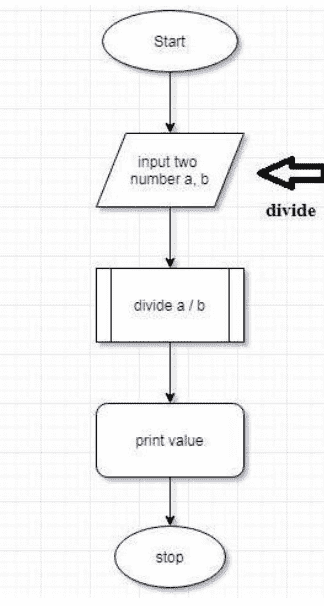

### 源代码：

```c
#include<stdio.h>

int main()
{
    int a,b;
    float div;

    printf("Enter your first number: ");
    scanf("%d",&a);

    printf("Enter your second number: ");
    scanf("%d",&b);

    //printf("Enter two numbers to add\n");
    //scanf("%d%%d",&a, &b);
    /*div 定义为 float 并对任意变量 a 或 b 进行类型转换.*/
    div=a/(float)b;//b 强制转换为 float
    if (b>0)
        printf("\nDivision of two numbers are: %f\n",div);
    else
        printf("No Division\n");

    return 0;
}
```

### 输出：

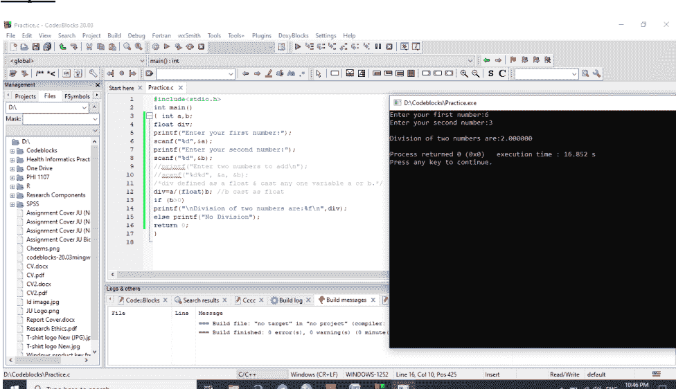

## 2. 编写一个 C/C++ 程序显示一个数字是奇数还是偶数

**问题定义**：

任何能被 2 整除的整数都是偶数，如果任何整数不能被 2 整除，它就是奇数。偶数是 2 的倍数，而奇数不是。所以，为了检查一个数字是奇数还是偶数，我们需要将其除以 2，如果余数为 0 则是偶数，否则为奇数。

**算法**：

- 步骤 1：开始
- 步骤 2：[输入] 读取数字 `N`
- 步骤 3：检查 `N%2==0`
- 步骤 4：如果为真，`N` 是偶数；否则，`N` 是奇数
- 步骤 5：停止

**流程图**：

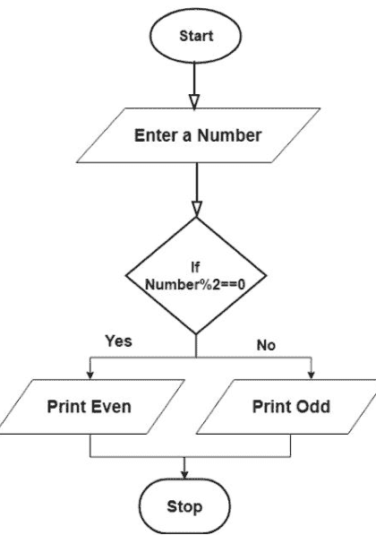

### 源代码：

```c
#include<stdio.h>

int main() {

    int n;

    printf("Enter your number: ");
    scanf("%d",&n);

    if(n%2==1) {
        printf("\nNumber is odd\n");
    } else 
        printf("\nNumber is even\n");
    }

    return 0;
}
```

### 输出：`Code.exe`

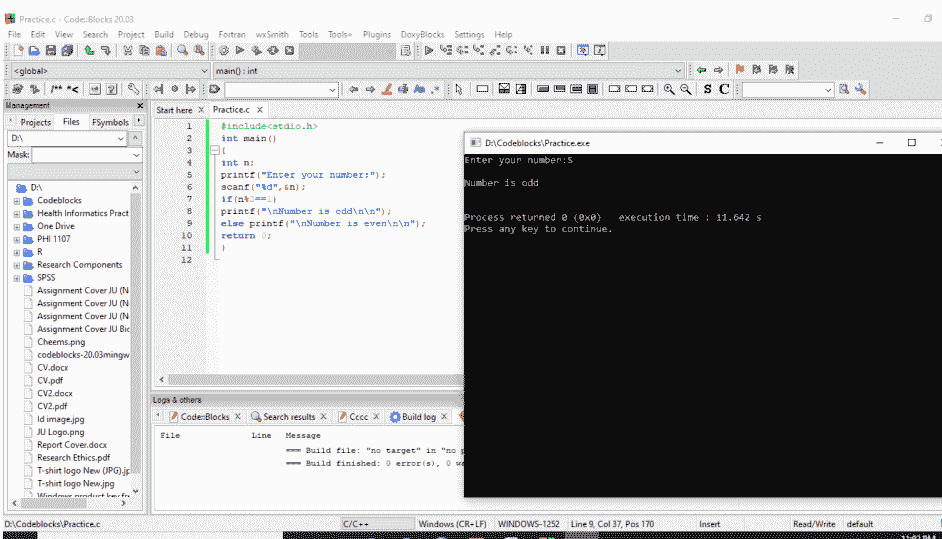

## 3. 编写 C/C++ 程序检查患者是否患有糖尿病

**问题定义**：

糖尿病是一种慢性病，发生在胰腺无法产生足够的胰岛素，或者身体无法有效利用其产生的胰岛素时。在过夜禁食后取血样本。空腹血糖水平低于 `100 mg/dL (5.6 mmol/L)` 为正常。空腹血糖水平在 `100` 到 `125 mg/dL (5.6` 到 `6.9 mmol/L)` 之间被认为是糖尿病前期。如果在两次单独测试中达到 `126 mg/dL (7 mmol/L)` 或更高，则说明患有糖尿病。

在口服糖耐量测试中，血糖低于 `140 mg/dL (7.8 mmol/L)` 是正常的。两次测试后读数超过 `200 mg/dL (11.1 mmol/L)` 表示有糖尿病。读数在 `140` 和 `199 mg/dL (7.8 mmol/L` 和 `11.0 mmol/L)` 之间表示糖尿病前期。

**算法**：

- 步骤 1：开始
- 步骤 2：输入血糖水平
- 步骤 3：检查 `bg<= 6.5`，打印患者健康
- 步骤 4：检查 `bg<=7.0`，打印患者处于糖尿病前期；否则，打印患者患有糖尿病
- 步骤 5：停止

**流程图**：

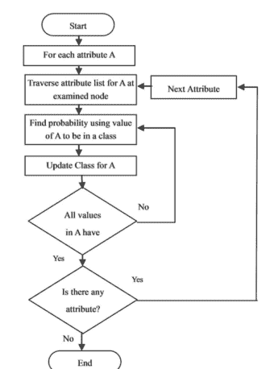

### 源代码：

```c
#include <stdio.h>

int main() {

    float bg;

    printf("\n Enter glucose level: %f", &bg);
    scanf("%f",&bg);

    if(bg<=6.5) {
        printf("\n Patient is healthy.\n");
    } else if(bg<=7.0) {
        printf("\n Patient is in pre-diabetics.\n");
    } else {
        printf("\nPatient is in diabetes.\n");
    }
    return 0;
}
```

### 输出：


## 4. 编写 C/C++ 程序计算两个数字之间的最大值

**问题定义**：

通过比较两个整数来计算整数的最大值。

**算法**：

- 步骤 1：开始
- 步骤 2：读取数字 `a`
- 步骤 3：读取数字 `b`
- 步骤 4：如果 `a` 大于 `b`，打印 `a`
- 步骤 5：否则，打印 `b`（计算整数之间的值）

**流程图**：


### 源代码：

```c
#include<stdio.h>
int main()
{
    int No1,No2;
    printf("Enter first number: ");
    scanf("%d",No1);
    printf("Enter second number: ");
    scanf("%d",No2);
    if(No1>No2)
        printf("%d is larger\n",No1);
    else
        printf("%d is larger\n",No2);
    return 0;
}
```

### 输出：


## 5. 编写 C/C++ 程序计算 `1+2+3+...+n` 的和

**问题定义**：

等差数列是相邻项之间的差保持不变的序列。等差数列的和为：

$S_n = \frac{n}{2}(2a+(n-1)d)$

其中：

- $n=$ 项数
- $a=$ 首项
- $d=$ 公差

**算法**：

- 步骤 1：开始
- 步骤 2：读取 `n`
- 步骤 3：初始化 `sum=0, i=1`
- 步骤 4：重复步骤 4 到步骤 7，直到 `i <= n`
- 步骤 5：`sum=sum+i`
- 步骤 6：`i=i+1`
- 步骤 7：打印和

**流程图**：


### 源代码：

```c
#include<stdio.h>

int main() {
    int n,i;
    int sum=0;
    printf("Enter n: ");
    scanf("%d",&n);
    for(i=1; i<=n; i++) {
        sum+=i;
    }
    printf("Sum is: %d", sum);
    return 0;
}
```

### 输出：


## 6. 编写 C/C++ 程序显示自然数的平方和

**问题定义**：

自然数的平方表示为 `n^2`。令 `n` 为自然数。

**算法**：

- 步骤 1：开始
- 步骤 2：读取 `N`
- 步骤 3：初始化 `sum=0, count=1`
- 步骤 4：重复步骤 4 到步骤 6，直到 `count <= N`
- 步骤 5：`sum=sum+(count*count)`
- 步骤 6：`count=count+1`
- 步骤 7：打印和

### 源代码：

```c
#include <stdio.h>
int main()
{
    int N, count = 1, sum = 0;

    printf("Enter the limit:");
    scanf("%d", &N);

    while(count <= N)
    {
        sum = sum + (count * count);
        count++;
    }

    printf("Sum of squares from 1 to %d: %d", N, sum);

    return 0;
}
```

### 流程图：

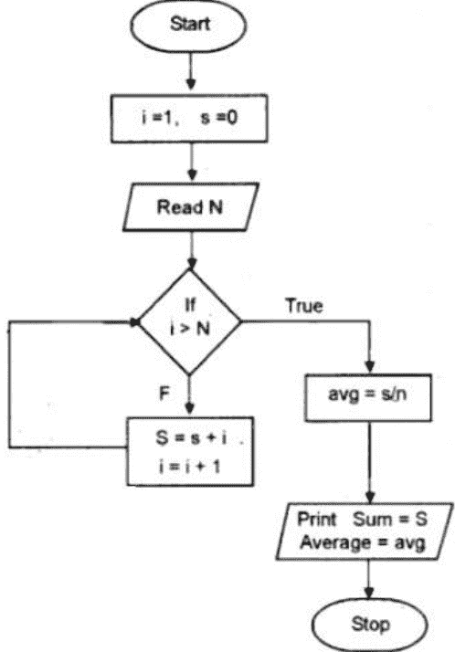

### 源代码：

```c
#include<stdio.h>

int main()
{
    // 声明变量
    int n, i, sum = 0, count = 0;

    // 输入数字
    printf("Enter the nth Number:");
    scanf("%d",&n);

    for(i=1;i<=n;i++)
    {
      sum = sum + i;
      count++;
    }

    printf("Average of first %d Natural Numbers = %d\n", sum/count);

    return 0;
}
```

### 输出：

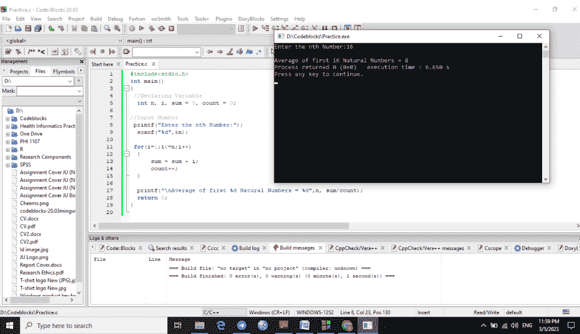

## 7. 编写 C/C++ 程序打印 1 到 10 的乘法表

**问题定义**：

1 到 10 的乘法表是 1 到 10 数字倍数的列表。1 到 10 的乘法表将帮助你轻松地学习和练习乘法算式。1 到 10 的乘法表在解决数学问题和计算时非常有帮助。对于学生来说，学习 1 到 10 表对于快速数学计算至关重要。

**算法**：

- 步骤 1：开始
- 步骤 2：输入数字，需要打印乘法表的数字
- 步骤 3：对于 `c=1` 到 `10`
- 步骤 4：打印 `res= num*c`
- 步骤 5：结束循环
- 步骤 6：停止

**流程图**：

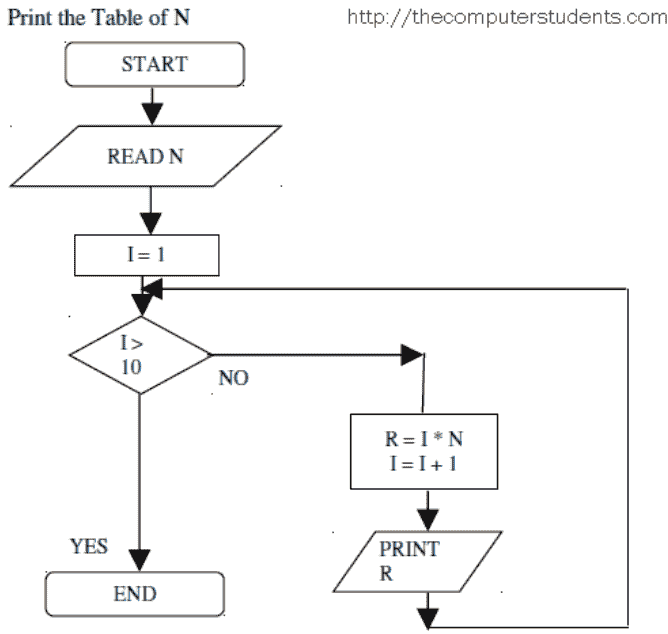

### 源代码：

```c
#include <stdio.h>

int main() {

    int num, c, res;

    printf("Enter an integer: %d");
    scanf("%d",&num);

    for(c=1; c<=10; ++c) {
        res=num*c;
        printf("%d * %d = %d\n", num, c, res);
    }

    return 0;
}
```

### 输出：

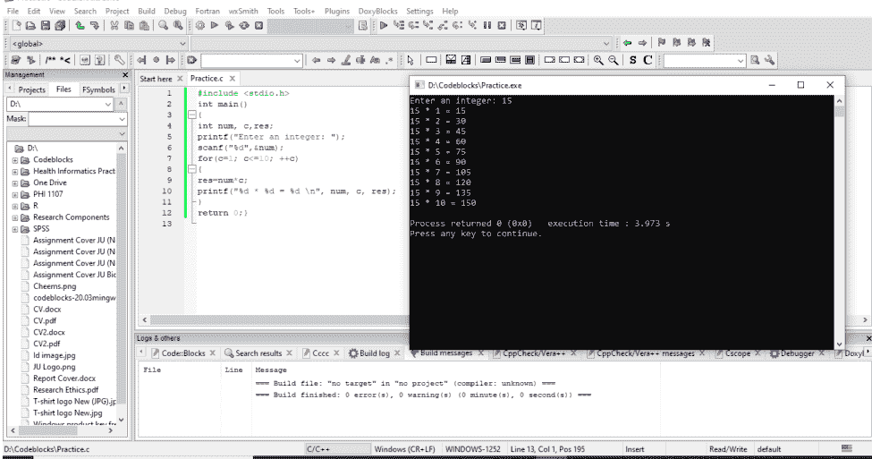

## 8. 编写 C/C++ 程序计算数字的阶乘

**问题定义**：

数字的阶乘是将该数字乘以其下方所有自然数的函数。在符号表示上，阶乘可以表示为 `"!"`。因此，`n` 的阶乘是前 `n` 个自然数的积，表示为 `n!`。

**算法**：

- 步骤 1：开始
- 步骤 2：读取数字 `n`
- 步骤 3：[初始化] `i=1, fact=1`
- 步骤 4：重复步骤 4 到 6，直到 `i=n`
- 步骤 5：`fact= fact*i`
- 步骤 6：`i=i+1`
- 步骤 7：打印 `fact`
- 步骤 8：停止

**流程图**：

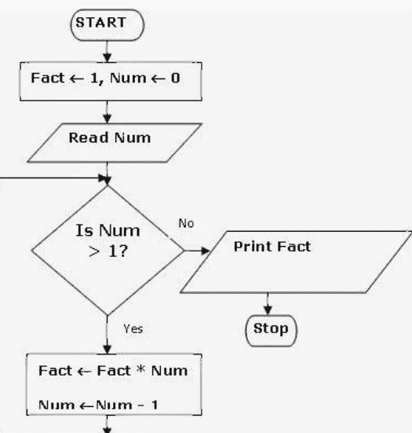

### 源代码：

```c
#include<stdio.h>

int main() {
    int n, i, fact=1;
    printf("Enter any number:");
    scanf("%d", &n);
    for(i=1; i<=n; i++) {
        fact = fact * i;
    }
    printf("Factorial value of %d = %d\n", n,fact);
    return 0;
}
```

### 输出：

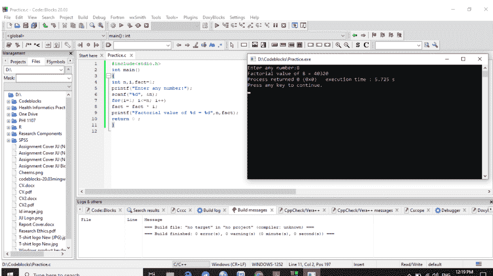

## 9. 编写 C/C++ 程序判断年份是否为闰年

**问题定义**：

闰年是在最短月份（二月）末增加了一个额外（或称闰日）日的年份。二月 29 日通常被称为闰日。闰年有 366 天而不是通常的 365 天，每四年一次。闰日使我们的历法与地球绕太阳运行一致。绕太阳大约需要 `365.2422` 天，或者 365 天 5 小时 48 秒。这被称为回归年，起始于春分。然而，格列哥历只有 365 天。如果我们每四年不在二月 29 日增加一个闰日，每年历都会与回归年产生偏差并逐渐不同。每年 6 小时的偏差在 100 年内会达到 24 天。让这种情况发生，北半球居民将在几个世纪后在夏天过圣诞。闰日解决了这个问题。

**算法**：

- 步骤 1：开始
- 步骤 2：取整数
- 步骤 3：给变量赋值
- 步骤 4：检查年份是否被 4 整除但不被 100，显示“闰年”
- 步骤 5：检查年份是否被 400 整除，显示“闰年”
- 步骤 6：否则，显示“非闰年”
- 步骤 7：停止

**流程图**：

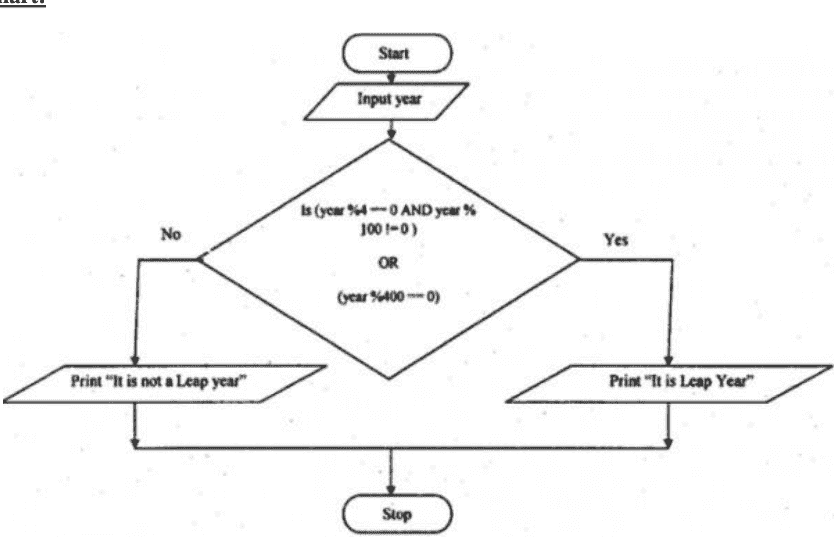

### 源代码：

```c
#include <stdio.h>

int main() {
    int year;
    printf("Enter a year: ");
    scanf("%d", &year);

    // 如果被 400 整除则是闰年
    if (year % 400 == 0) {
        printf("%d is a leap year.", year);
    }
    // 如果被 100 整除但不被 400 整除则非闰年
    else if (year % 100 == 0) {
        printf("%d is not a leap year.", year);
    }
    // 如果被 4 整除但不被 100 整除则是闰年
    else if (year % 4 == 0) {
        printf("%d is a leap year.", year);
    }
    // 其他年份都不是闰年
    else {
        printf("%d is not a leap year.", year);
    }
    return 0;
}
```

### 输出：

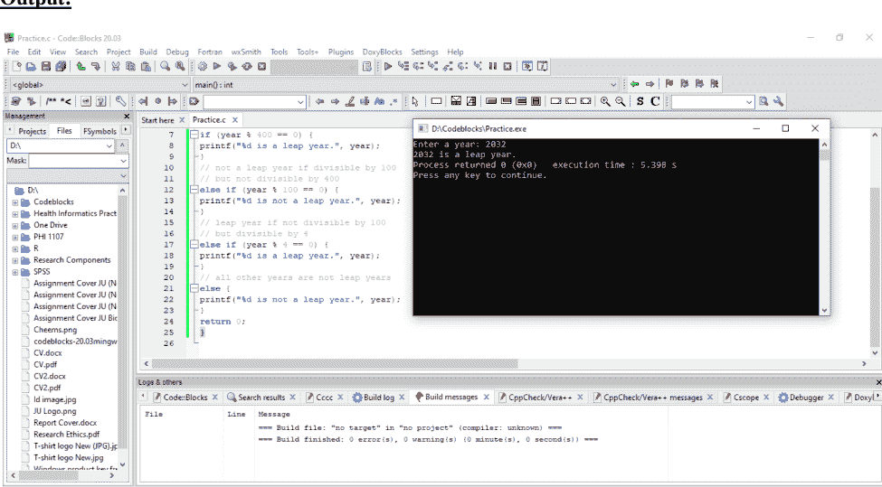

## 10. 编写 C/C++ 程序计算数字的幂

**问题定义**：

下面的程序从用户处获取两个整数（底数和指数）并计算幂。

例如：

在 `2^3` 的情况下

- `2` 是底数
- `3` 是指数

那么幂等于 `2*2*2` 或 `4*2`。

**算法**：

- 步骤 1：开始
- 步骤 2：声明变量 `x,y,n`
- 步骤 3：输入 `x,n`
- 步骤 4：`y=pow(x,n)`
- 步骤 5：打印 `y`
- 步骤 6：停止

**流程图**：

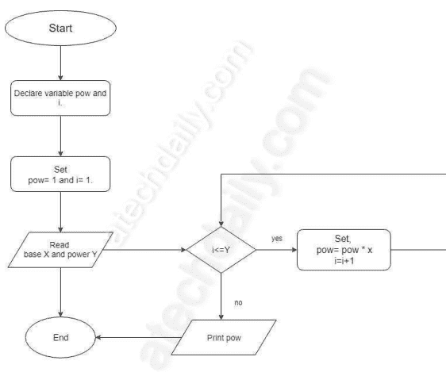

### 源代码：

```c
#include<stdio.h>

int main() {
    int x,y,n;

    printf("Enter number:%d");
    scanf("%d",&x);

    printf("Value of power:%d\n",n);
    scanf("%d",&n);

    y=pow(x,n);

    printf("Result is %d\n",y);

    return 0;
}
```

### 输出：

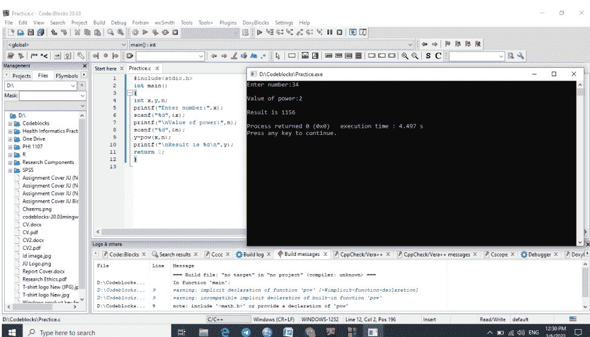

## 11. 编写 C/C++ 程序计算数字的平方根和立方根

**问题定义**：

此程序将使用循环打印从 1 到 `N` 所有数字的平方和立方根。

在这里，我们读取 `N`（限制）的值，并将计算、打印从 1 到 `N` 所有数字的平方、立方和平方根。求平方我们使用 `(i*i)`，求立方使用 `(i*i*i)`，求平方根我们使用 `sqrt(i)`。

在这里，`i` 是循环计数器，`sqrt(i)` 是 `math.h` 中的函数，它返回数字的平方根。

**算法**：

- 步骤 1：开始
- 步骤 2：读取 `n`
- 步骤 3：`x= sqrt(n)`
- 步骤 4：`y= cbrt(n)`
- 步骤 5：打印 `x,y`
- 步骤 6：停止

**流程图**：

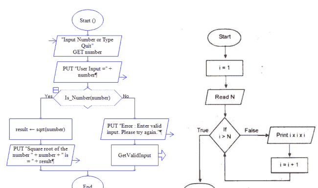

### 源代码：

```c
// 源代码待补充
```


```c
#include<stdio.h>
#include<math.h>

int main() {
    int n;
    float x,y;
    printf("Enter a number: ");
    scanf("%d", &n);
    x = sqrt(n);
    y = cbrt(n);
    printf("Square root of %d is %f\n", n, x);
    printf("Cubic root of %d is %f\n", n, y);
    return 0;
}
```

### 输出：

`img/ae063c11b8af956e74f03493ca90aad3_28_0.png`

## 13. 写一个 C/C++ 程序检查数字是否为质数。

### 问题定义：

质数逻辑：如果一个数字只能被1和它本身整除，它就是质数。记住2是唯一的偶数也是最小的质数。前几个质数是 2, 3, 5, 7, 11, 13, 17... 质数在计算机科学和数学中有许多应用。在C语言编程中检查输入的数字是否为质数，你需要要求用户输入数字并开始检查。如果数字被从2到比它小1（即`n-1`）的数字整除，则它不是质数，否则它是质数。

### 算法：

- 步骤 1：开始
- 步骤 2：取`n`个数
- 步骤 3：设置`x=1`
- 步骤 4：如果`x<=n`，则`x=x+1`
- 步骤 5：如果`x=1`；打印“数字是质数”
- 步骤 6：否则打印“数字不是质数”
- 步骤 7：停止

### 流程图：

`img/ae063c11b8af956e74f03493ca90aad3_29_0.png`

### 源代码：

```c
#include <stdio.h>

int main()
{
    int n,i,count=0;
    printf("Enter a positive integer: ");
    scanf("%d", &n);

    // 0和1不是质数
    // 将非质数的计数设为1
    if (n == 0 || n == 1) 
        count= 1;

    for (i = 2; i <= n / 2; ++i) {
            // 如果n被i整除，则n不是质数
            // 将非质数的计数设为1
            if (n % i == 0) {
                count= 1;
                break;
            }
        }

    // 质数的计数为0
    if (count == 0)
        printf("%d is a prime number.", n);
    else
        printf("%d is not a prime number.", n);

    return 0;
}
```

### 输出：

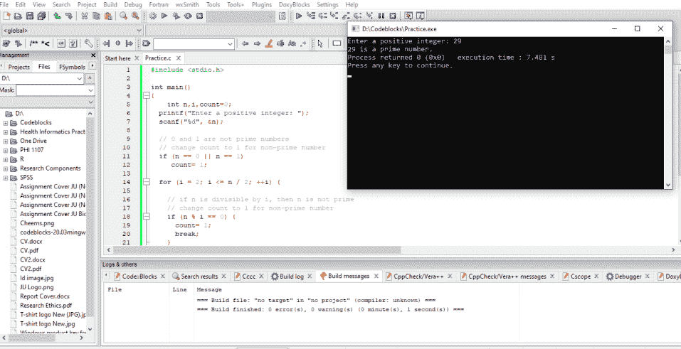

## 14. 编写一个显示三维数组的 C/C++ 程序。

### 问题定义：

计算三维数组`arr[i][j][k]`的大小。公式为：`size = i*j*k`。例如，如果给定的数组为`arr[3][4][2]`，那么它的大小将：

`size = 3*4*2 = 24`

也就是说它可以最多容纳 24 个元素。

### 算法：

- 步骤 1：开始。
- 步骤 2：声明一个固定大小的三维数组，并用某些值初始化其元素。
- 步骤 3：使用三个嵌套循环，针对数组的每个维度遍历数组。
- 步骤 4：在最内层循环中，按照适当格式打印数组的当前元素（例如用空格或换行符分隔元素）。
- 步骤 5：在最内层循环后，添加换行符以将输出格式化为矩阵。
- 步骤 6：在中间循环后，添加一个分隔符（例如换行符或水平线）以区分三维数组的不同平面。
- 步骤 7：在最外层循环结束后，完整显示三维数组。
- 步骤 8：停止。

### 流程图：

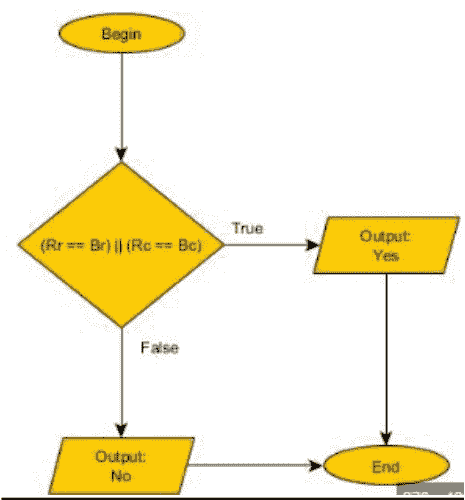

### 源代码：

```c
#include<stdio.h>
#include<conio.h>

int main()
{
    int i, j, k;
    int arr[3][4][2] = {
        { 2, 4}, {7, 8}, {3, 4}, {5, 6} },
        { 7, 6}, {3, 4}, {5, 3}, {2, 3} },
        { 8, 9}, {7, 2}, {3, 4}, {5, 1} }
    };
    for(i=0; i<3; i++) {
        for(j=0; j<4; j++) {
            for(k=0; k<2; k++) {
                printf("arr[%d][%d][%d] = %d \n", i, j, k, arr[i][j][k]);
            }
        }
        printf("\n");
    }
    printf("\n");
    getch();
    return 0;
}
```

### 输出：

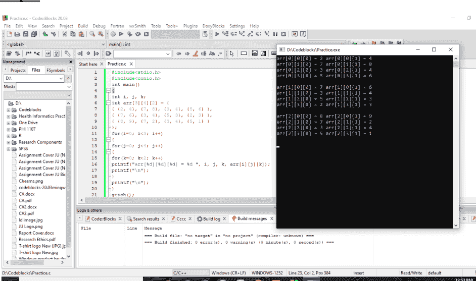

## 15. 编写一个使用数组计算 n 个数字平均值的 C/C++ 程序。

### 问题定义：

在数学和统计学中，算术平均值、算术平均或平均值，是指一组数字的和除以该集合中数字的数量。该集合通常是实验、观察研究或调查的结果集。

### 算法：

- 步骤 1：初始化大小为`n`的数组和平均值
- 步骤 2：初始化`sum=0`
- 步骤 3：输入数组元素
- 步骤 4：`for (i=0;i<n;i++)`
- 步骤 5：`sum=sum+array[i]`
- 步骤 6：结束`for`循环
- 步骤 7：打印`sum`
- 步骤 8：`Average=sum/n;`
- 步骤 9：打印平均值

### 流程图：

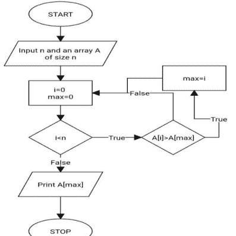

### 源代码：

```c
#include <stdio.h>
#include <stdio.h>

int main()
{
    float a[100], sum=0, avg;
    int i, n;

    printf("Enter n: ");
    scanf("%d", &n);

    /* Reading array */
    printf("Enter numbers:\n");
    for(i=0; i< n; i++)
    {
        printf("a[%d] = ", i);
        scanf("%f", &a[i]);
    }

    /* Finding sum */
    for(i=0; i< n; i++)
    {
        sum = sum + a[i];
    }

    /* Calculating average */
    avg = sum/n;

    /* Displaying Result */
    printf("Sum is %f\n", sum);
    printf("Average is %f\n", avg);

    return 0;
}
```

### 输出：

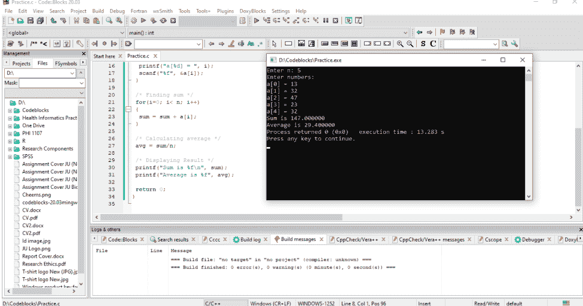

## 16. 编写一个使用结构体（struct）显示书籍信息的 C/C++ 程序。

### 问题定义：

结构体本质上是在一个名称下定义的可能具有不同数据类型的变量簇。在编程术语中，结构体是一种复合数据类型（派生自基本数据类型如`int`和`float`），我们用它在特定的计算机内存块中定义一个一组相同或不同数据类型的集合。

### 算法：

- 步骤 1：开始
- 步骤 2：\[初始化\] 书名、作者、科目、ID 输入
- 步骤 3：将值存储为单个变量
- 步骤 4：打印这些值
- 步骤 5：停止

### 流程图：

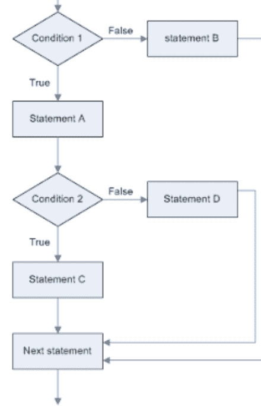

### 源代码：

```c
#include <stdio.h>
#include <string.h>
struct Books {
    char title[50];
    char author[50];
    char subject[100];
    int book_id;
};

int main() {
    printf("\n\t\tShimamoto's Bookshop\n\n");
    struct Books b1, b2;
    
    strcpy(b1.title, "Harry Potter and the Philosopher's Stone");
    strcpy(b1.author, "J.K. Rowling");
    strcpy(b1.subject, "Fantasy");
    b1.book_id = 5678;

    strcpy(b2.title, "1984");
    strcpy(b2.author, "George Orwell");
    strcpy(b2.subject, "Discourse");
    b2.book_id = 9012;

    printf("Book 1: %s, Author: %s, Subject: %s, ID: %d\n", b1.title, b1.author, b1.subject, b1.book_id);
    printf("Book 2: %s, Author: %s, Subject: %s, ID: %d\n", b2.title, b2.author, b2.subject, b2.book_id);

    return 0;
}
```

*注：原文源代码逻辑混乱，此处已根据上下文进行了逻辑修复和翻译，以符合结构体显示书籍的功能*

## 17. 编写一个使用枚举（enum）显示月份的 C/C++ 程序。

### 问题定义：

枚举（Enum）是 C 语言中由用户定义的特殊数据类型。它由一组由用户定义的常量整数组成。使用枚举来命名整数使得整个程序更容易学习、理解和维护。

### 算法：

- 步骤 1：开始
- 步骤 2：声明枚举
- 步骤 3：定义月份为枚举
- 步骤 4：遍历月份
- 步骤 5：打印
- 步骤 6：停止

### 流程图：


### 源代码：

```c
#include <stdio.h>

int main() {
    enum month {Jan, Feb, Mar, Apr, May, Jun, Jul, Aug, Sep, Oct, Nov, Dec};
    int i;
    char *months[] = {"January", "February", "March", "April", "May", "June", "July", "August", "September", "October", "November", "December"};

    for(i=0; i<12; i++) {
        printf("%d: %s\n", i+1, months[i]);
    }

    return 0;
}
```

## 18. 编写一个使用枚举显示特定日期索引值的 C/C++ 程序。

### 问题定义：

该程序使用枚举显示特定日的索引值。

### 算法：

- 步骤 1：开始
- 步骤 2：声明枚举`week`
- 步骤 3：定义七天为元素
- 步骤 4：找到星期三的枚举值
- 步骤 5：打印该值
- 步骤 6：停止

### 源代码：

```c
#include<stdio.h>
int main()
{
    enum week{Mon, Tue, Wed, Thu, Fri, Sat, Sun};
    enum week day;

    day = Wed;
    printf("%d",day);

    return 0;
}
```

## 19. 编写一个允许输入并显示5 个朋友名字的 C/C++ 程序。

### 问题定义：

`switch`语句允许变量与值列表进行等性测试。每个值被称为一个`case`（分支），被切换的变量会在每个`switch case`中进行检查。

### 算法：

- 步骤 1：开始
- 步骤 2：输入语句
- 步骤 3：遵循步骤 4 到 6 直到条件匹配
- 步骤 4：检查第一个语句是否匹配
- 步骤 5：如果不匹配，跳转到下一个语句
- 步骤 6：打印输出
- 步骤 7：停止

### 源代码：

```c
#include<stdio.h>

int main()
{
    char cName[5][21]={0};
    int x=0;
    int iPick;

    printf("Enter the name of 5 people\n");

    for(x=0;x<=5;x++){
        printf("Enter name %d:", x+1);
        scanf("%s", cName[x]);
    }

    printf("\nWould you like to add another name or view current names stored?\n");
    printf("1\tAdd another name\n");
    printf("2\tView names stored\n");
    scanf("%d", &iPick);
    switch(iPick){
        case 1:
            break;
        case 2:
            for(x=0;x<=5;x++) {
                printf("\n%d is %s\n",x+1, cName[x]);
            }
            break;
    }
    return 0;
}
```

### 输出：

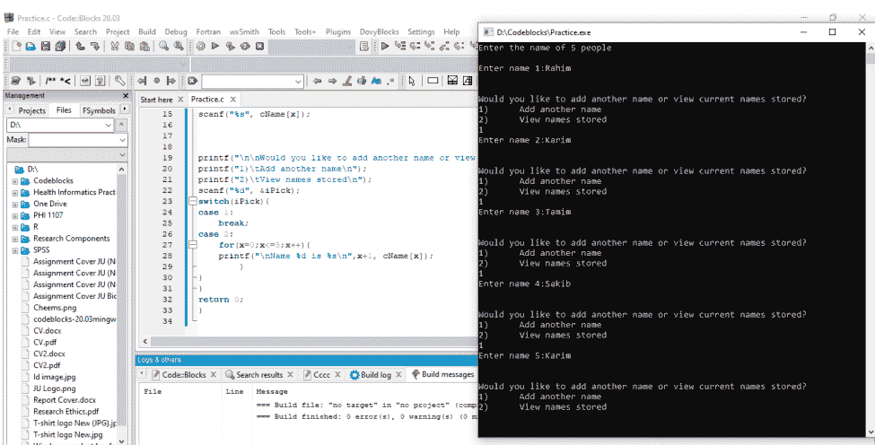

## 20. 编写一个 C/C++ 程序，在字符串中搜索文本。

### 问题定义：

在 C 语言编程中，字符串是一个以空字符`\0`终止的字符序列。例如：`char c[] = "string";`。当编译器遇到双引号括围的字符序列时，它默认会在末尾添加一个空字符`\0`。

### 算法：

- 步骤 1：开始
- 步骤 2：\[初始化\] 输入字符串
- 步骤 3：输入要在字符串中搜索的文本
- 步骤 4：在字符串中查找并找到文本的位置
- 步骤 5：打印文本在字符串中的位置
- 步骤 6：停止

### 流程图：

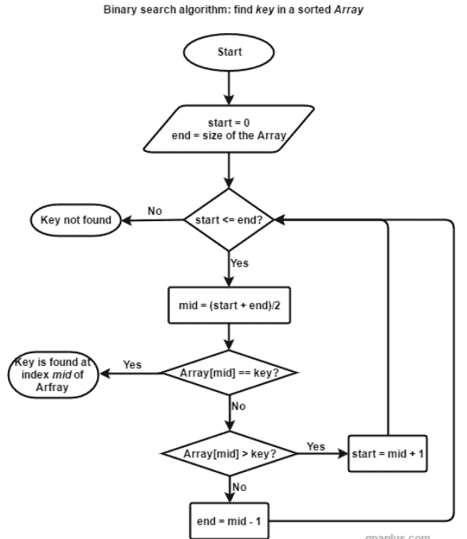

### 源代码：

```c
#include<stdio.h>
#include<string.h>

int main() {
    char string[1000], text[100];
    int i;

    printf("Enter the string: ");
    fgets(string, 1000, stdin);
    printf("Enter the text to search: ");
    scanf("%s", text); 
    for(i=0;i<=strlen(string)-strlen(text); i++) {
        if (strncmp(&string[i], text, strlen(text)) == 0) {
            printf("Text found at position %d\n", i+1);
        }
    }
    return 0;
}
```

### 输出：

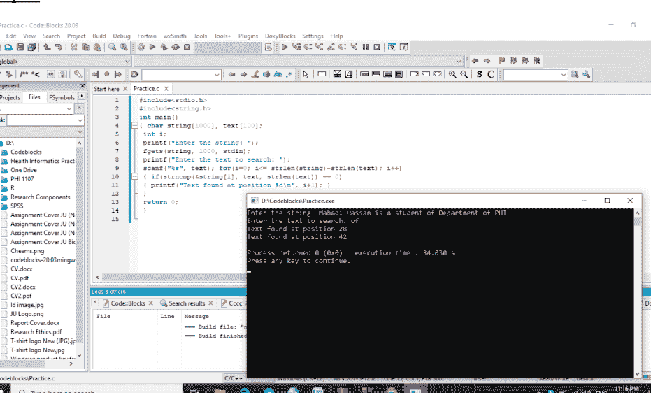

## 21. 编写一个 C/C++ 程序，检查一个字符是元音还是辅音。

### 问题定义：

英语有 44 个英语发音。它们可以分为两大类：辅音和元音。辅音是指在发音时气流被部分或完全阻断的声音。

另一方面，元音是指在发音时气流不受阻碍的声音。元音是语言的韵律或位移。单元音和双元音是元音音的两大类。元音音还分为长元音和短元音音。

在英语中，`a`, `e`, `i`, `o`, `u` 以及有时的 `y` 是元音字母。字母表中的其他字母代表辅音，如 `b`, `d`, `g`, `n`, `r`, `s` 和 `t`。某些辅音会产生多个读音。

### 算法：

- 步骤 1：开始
- 步骤 2：\[初始化\] 输入字母表
- 步骤 3：检查是否为`a`, `e`, `i`, `o`或`u`，如果是则打印 "vowel"
- 步骤 4：否则打印 "consonant"
- 步骤 5：停止

### 流程图：

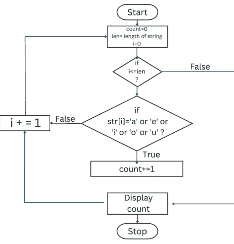


```c
#include <stdio.h>

int main() {
    char ch;

    /* 从用户输入字符 */
    printf("Enter any character: ");
    scanf("%c", &ch);

    /* 元音判断条件 */
    if(ch=='a' || ch=='e' || ch=='i' || ch=='o' || ch=='u' || ch=='A' ||
    ch=='E' || ch=='I' || ch=='O' || ch=='U') {
        printf("%c is Vowel.", ch);
    } else if((ch >= 'a' && ch <= 'z') || (ch >= 'A' && ch <= 'Z')) {
        /* 辅音判断条件 */
        printf("%c is Consonant.", ch);
    } else {
        /* * 如果既不是元音也不是辅音
        * 那么它不是字母.*/ */
        printf("%c is not an alphabet.", ch);
    }

    return 0;
}
```

# 输出

```c
#include <stdio.h>

int main() {
    char ch;
    printf("Enter any character: ");
    scanf("%c", &ch);

    if (ch >= 'a' && ch <= 'z') {
        printf("%c is lowercase letter\n", ch);
    } else if (ch >= 'A' && ch <= 'Z') {
        printf("%c is uppercase letter\n", ch);
    } else {
        printf("%c is not an alphabet\n", ch);
    }

    return 0;
}
```

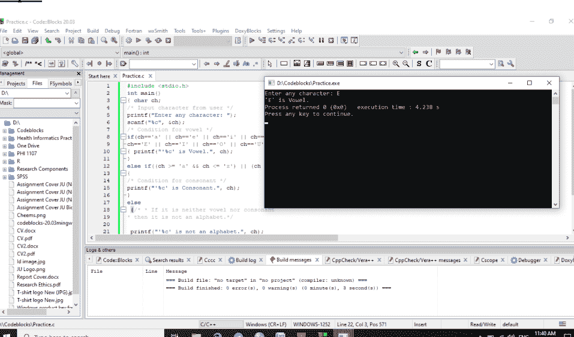

## 22. 编写一个 C/C++ 程序转换为大写

### 问题定义

大小写是指某些语言中大写字母和小写字母之间的区别。大写字母是较大的、较高的字母（如 W），而较小的称为小写字母（如 w）。大写的意思就是大写。

### 算法

- 步骤 1：开始
- 步骤 2：输入字母
- 步骤 3：找到字母的大写形式
- 步骤 4：打印字母的大写形式
- 步骤 5：停止

### 流程图

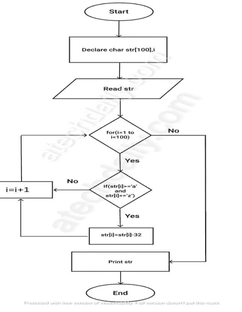

### 源代码

```c
#include<stdio.h>

int main() {
  char ch;

  printf("Enter a character in lowercase : %c");
  scanf("%c",&ch);
  ch-32;

  printf("Character in uppercase = %c",ch);

  return 0;
}
```

### 输出

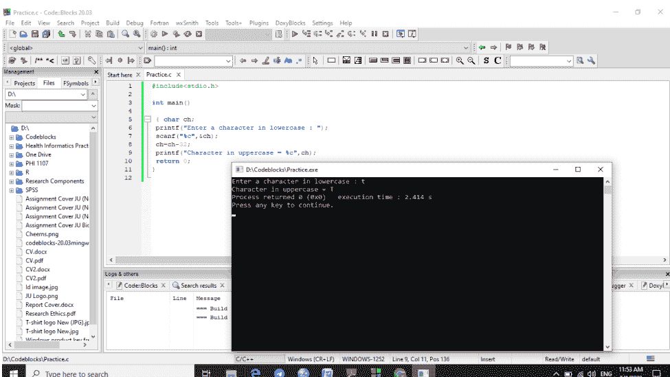

## 23. 编写一个 C/C++ 程序转换为小写

### 问题定义

大小写是指某些语言中大写字母和小写字母之间的区别。大写字母是较大的、较高的字母（如 W），而较小的称为小写字母（如 w）。大写的意思就是大写。

### 算法

- 步骤 1：开始
- 步骤 2：输入字母
- 步骤 3：找到字母的小写形式
- 步骤 4：打印字母的小写形式
- 步骤 5：停止

### 流程图

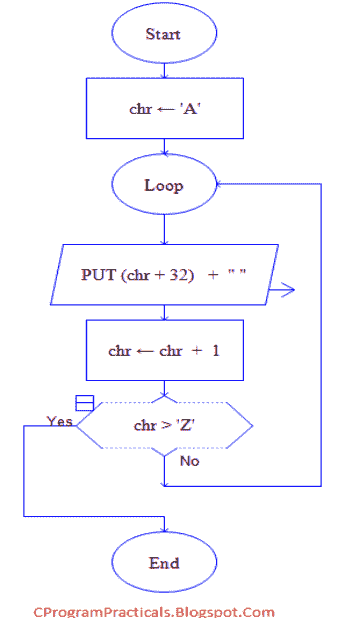

### 源代码

```c
#include<stdio.h>
int main() {
    char ch;
    printf("Enter a character in uppercase : %c");
    scanf("%c",&ch);
    ch=ch+32;
    printf("Character in lowercase = %c",ch);
    return 0;
}
```

### 输出

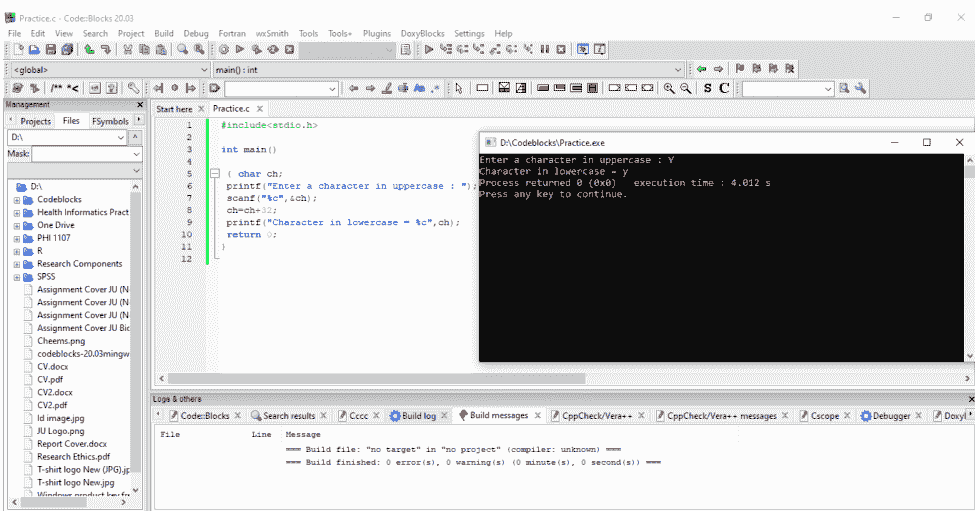

## 24. 编写一个 C/C++ 程序反转字符串

### 问题定义

在 C 语言编程中，字符串是一个以空字符 `\0` 终止的字符序列。例如：`char c[] = "string";`。当编译器遇到双引号括围的字符序列时，它默认会在末尾添加一个空字符 `\0`。

### 算法

- 步骤 1：开始
- 步骤 2：输入字符串
- 步骤 3：从后到往前重写字符串
- 步骤 4：打印输出
- 步骤 5：停止

### 流程图

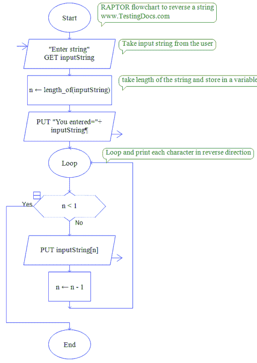

### 源代码

```c
#include <string.h>
#include <stdio.h>

int main()

{ char arr[100];

printf("Enter a string to reverse\n");
gets(arr);

strrev(arr);

printf("Reverse of the string is \n%s\n", arr);

return 0;
}
```

## 25. 编写一个 C/C++ 程序拼接字符串

### 问题定义

在 C 语言编程中，字符串是一个以空字符 `\0` 终止的字符序列。例如：`char c[] = "string";`。当编译器遇到双引号括围的字符序列时，它默认会在末尾添加一个空字符 `\0`。

### 算法

- 步骤 1：开始
- 步骤 2：输入两个字符串
- 步骤 3：将它们合并成一个字符串
- 步骤 4：打印输出
- 步骤 5：停止

### 流程图

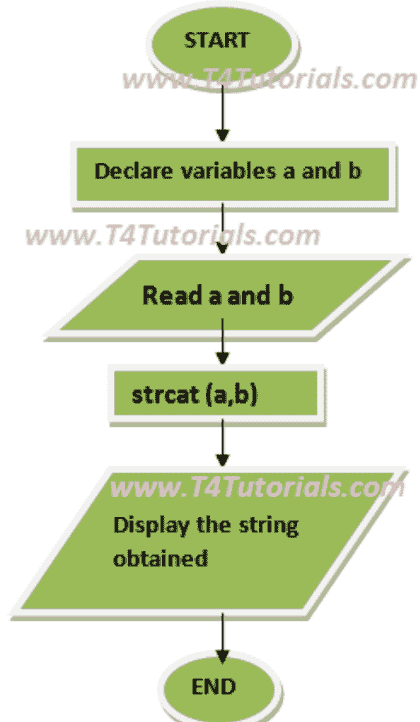

### 源代码

```c
#include <stdio.h>
#include <string.h>

int main() {
    char a[1000], b[1000];

    printf("Enter the first string\n");
    gets(a);

    printf("Enter the second string\n");
    gets(b);

    strcat(a, b);
    printf("String obtained on concatenation: %s\n", a);

    return 0;
}
```

### 输出

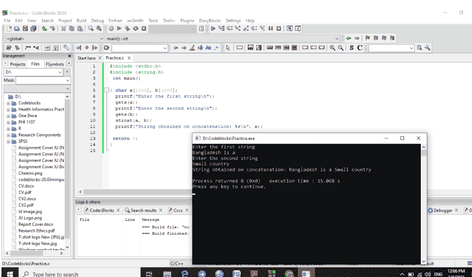

## 26. 编写一个 C/C++ 程序查找字符串的长度

### 问题定义

在 C 语言编程中，字符串是一个以空字符 `\0` 结尾的字符序列。例如：`char cl[] = "string";` 当编译器遇到双引号括的字符序列时，它默认会在末尾添加一个空字符 `\0`。

### 算法

- 步骤 1：开始
- 步骤 2：输入要查找长度的字符串
- 步骤 3：读取字符串并计算长度
- 步骤 4：打印字符串长度
- 步骤 5：停止

### 流程图

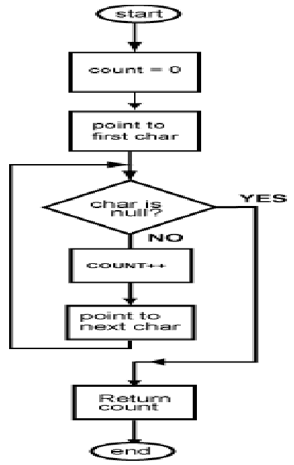

### 源代码：`<string.h>`

```c
#include <string.h>

int main()
{
    char s[40];
    int len;

    printf("\nEnter any string: \n");
    gets(s);

    len = strlen(s);

    printf("Length of string: %d\n", len);

    return 0;
}
```

### 输出

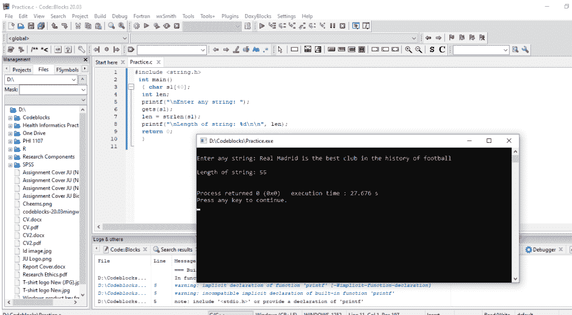

# 实验报告 03

1. MS-Word 中的对齐、页面设置、插入图片、插入表格、插入页眉/页脚、创建安全保护密码。

## 键盘命令

### 文本对齐

- `Ctrl+L`：将选中文本对齐到屏幕左侧。
- `Ctrl+E`：将选中文本对齐到屏幕中间。
- `Ctrl+R`：将选中文本对齐到屏幕右侧。

### 插入图片

插入 → 图片 → 选择图片 → 回车

### 插入表格

插入 → 表格 → 选择行列数 → 回车

### 页眉/页脚

插入 → 页眉或页脚 → 选择样式 → 回车

### 创建密码

Office 按钮 → 准备 → 加密文档 → 选择密码 → 好

## 2. 编写一个公式并在 MS-Excel 中显示用于计算 CGPA

### 公式

在 Excel 程序中计算 CGPA 的公式分为两个步骤：

- a. 首先将每个科目的个人 GPA 乘以该科目对应的学分。
- b. 然后将 GPA × 学分的总和除以总学分。

在以下 Excel 公式中使用如下：

1. `G2 =(B2*C3+C2*D3+D2*E3+E2*F3+F2*G2)`
2. `H2 = G2/(3+3+3+3+2)`

### 输出

| 姓名 | 孟加 | 英语 | 英语数学 | 数据 | 语言科学 | 学分 | CGPA |
|---|---|---|---|---|---|---|---|
| 1 | 姓名 | 3.75 | 3.5 | 3.25 | 3.75 | 4 | 50.75 | 3.63 |
| 2 | Rahim | 4 | 3.5 | 3.75 | 4 | 5 | 51.75 | 3.68 |
| 3 | Karim | 3.25 | 3.5 | 3.75 | 3.75 | 4 | 51.5 | 3.68 |
| 4 | Jamila | 4 | 3.25 | 3.25 | 3.5 | 4 | 51.5 | 3.68 |
| 5 | Saqib | 4 | 3.75 | 3.5 | 3.5 | 4 | 50 | 3.37 |
| 6 | Tania | 3.25 | 3.75 |  |  |  |  |  |

## 3. 编写一个公式并在 MS-Excel 中显示用于薪资计算

为了计算员工的净工资，可以在 Excel 中使用公式。必须先加上所有津贴，然后从总额中减去所得税，以计算出净额。

### 公式

净工资：

`G2 =SUM(B2:E2)-F2`  
`G3 =SUM(B3:E3)-F3`  
……

### 输出

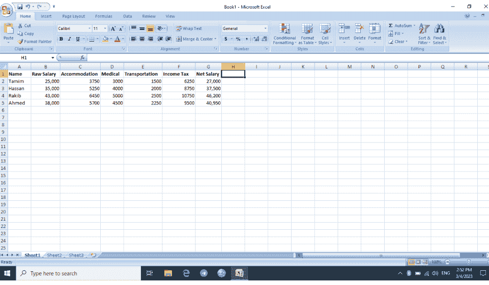

## 4. 编写一个公式并在 MS-Excel 中显示用于制作现金收据

创建现金收据是为了计算买家购买的产品总额，并跟踪其付款金额和剩余余额。在 Excel 中可以使用公式创建现金收据，并计算总支出以及还需要支付的多少钱。

### 公式

总额：`K17=SUM(K5:K9)`

余额 / 剩余款项：`K19=K17-K18`

### 输出


# 实验报告 04：计算机网络

计算机网络是连接在一起的计算机和其他设备的集合，用于共享资源和交换数据。根据地理区域，网络有几种类型：

- LAN（局域网）：覆盖范围较小的网络，如家庭、办公室或建筑。
- MAN（城域网）：覆盖城市或大型校园的网络。
- WAN（广域网）：覆盖较大地理区域的网络，如国家或整个世界。

互联网是最大的 WAN。网络可以使用各种组件连接：

- 设备：计算机、服务器、路由器和交换机。
- 传输介质：电缆（光纤、铜线）或无线波（Wi-Fi、卫星）。
- 协议：规定数据如何传输的规则（例如 TCP/IP、HTTP）。

## 网络组件

- 网接口卡（NIC）：允许计算机连接网络的硬件。
- 路由器：在计算机网络之间转发数据包的设备。
- 交换机：连接单个网络内设备的设备。
- 调制解调器（Modem）。

### 拓扑结构类型

- 总线拓扑：所有设备连接到一根电缆上。
- 星型拓扑：所有设备连接到一个中央集线器或交换机。
- 环形拓扑：每个设备连接到两个设备，形成圆形路径。
- 网型拓扑：每个设备都连接到多个其他设备。

### 协议

- TCP/IP（传输控制协议/网协议）：互联网的基础通信套件。
- HTTP（超文本传输协议）：用于传输网页。
- FTP（文件传输协议）：用于在网络上传输文件。
- DNS（域名系统）：将域名转换为 IP 地址。

## 3. 命令显示 MAC 地址

1. 点击 Windows 开始菜单图标。
2. 在搜索栏中输入 `cmd`。
3. 在命令提示符窗口中输入 `ipconfig/all`。
4. 按回车键。
5. 向下滚动并找到“Physical Address”（物理地址）标题。

### 显示结果

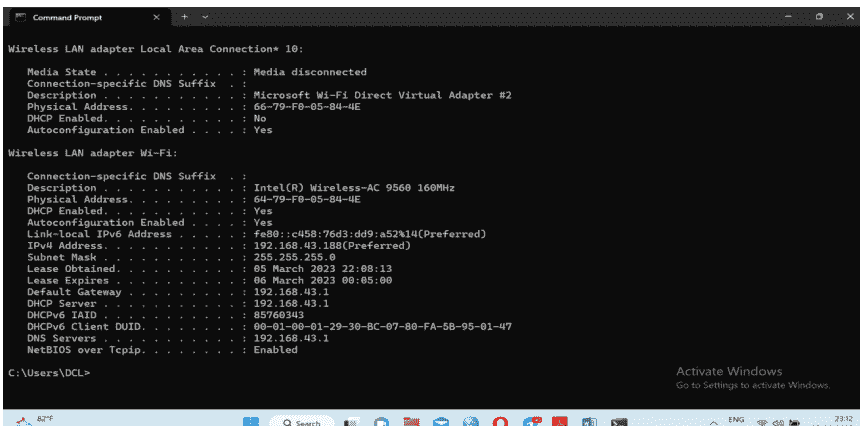

## 4. 命令显示 Ping 的 IP 地址

1. 点击 Windows 开始菜单图标。
2. 在搜索栏中输入 `cmd`。
3. 输入 `cd` 并按回车。
4. 然后输入 `cls` 并按回车。
5. 在命令提示符窗口中输入 `ping [IP address]`。
6. 按回车键，命令提示符窗口将显示结果。

### 显示结果

命令提示符：

```text
C:\> ping 192.168.0.100 -n32
 bytes of data:
Reply from 192.168.0.100: bytes=32 time=1ms TTL=128
Reply from 192.168.0.100: bytes=32 time=1ms TTL=128
Reply from 192.168.0.100: bytes=32 time=1ms TTL=128

Statistics for 192.168.0.100:
Packets: Sent = 4, Received = 4, Lost = 0 (0% loss),
Approximate time in milliseconds:
Minimum = 1ms, Maximum = 1ms, Average = 1ms

C:\>
```

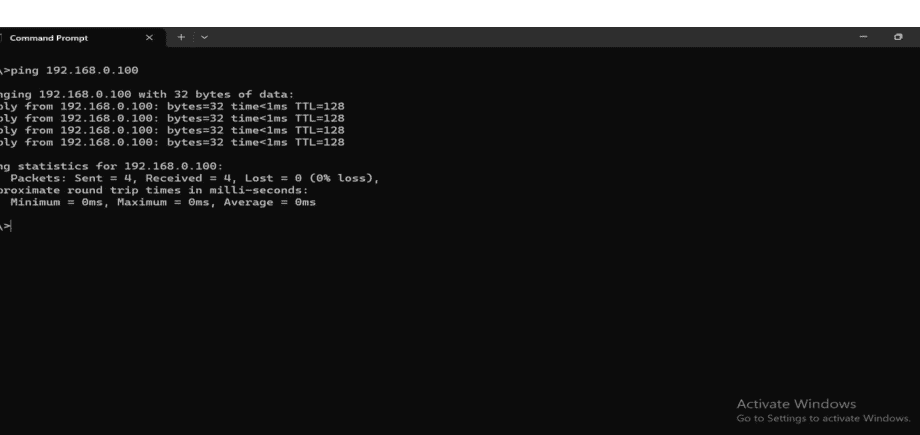

## 5. 命令显示执行命令 `nslookup`

1. 点击 Windows 开始菜单图标。
2. 在搜索栏中输入 `cmd`。
3. 输入 `nslookup` 并按回车。
4. 输入网站的 IP 地址。
5. 按回车。

### 显示结果

```text
Microsoft Windows (Version 10.0.22621.1105)
(c) Microsoft Corporation. All rights reserved.

Server:
Default Server: Unknown
Address: 192.168.0.43

>> facebook.com
Address: 192.168.0.43

Non-authoritative answer:
Name: star-min-c1b.facebook.com
Address: 157.240.15.36

Aliases:
facebook.com
```

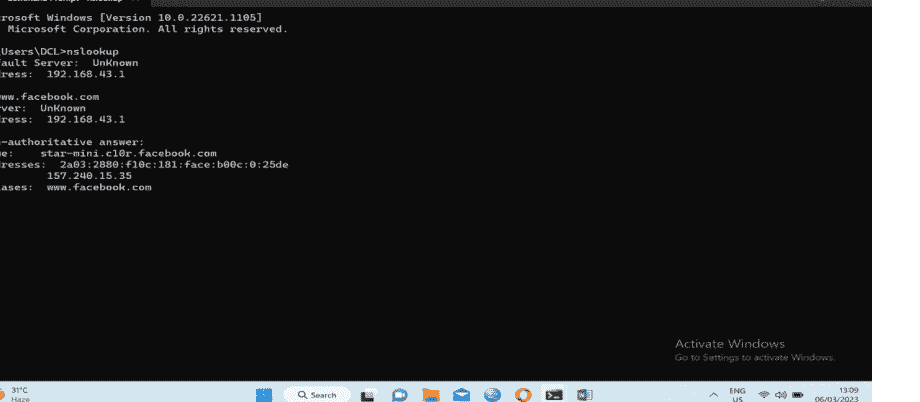

## 6. 命令显示执行命令 `tracerert`

1. 点击 Windows 开始。
2. 在搜索栏中输入 `cmd`。
3. 现在输入 `tracerert [IP address]`。
4. 按回车并显示结果。

### 显示结果

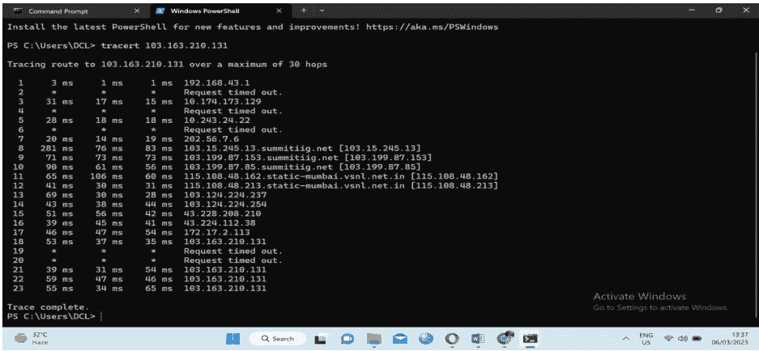
