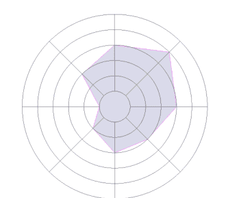
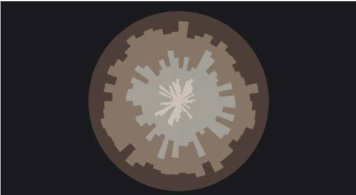

# C++17 2D 绘图：仅使用标准库使用指南


# 2D 绘制基础

我们都经历过这样的时刻：只想用一种美观且图形化的方式展示某些数据。你开始实现一个 GUI 库，以便设置一个画布进行绘制……但然后呢？或者你下载并构建了一个可以读写 PNG 图像的库，因为你需要无损图像。或者你这样做是为了查看一个文件的熵。或者你正在编写游戏，想在视差设置中测试动画精灵的外观。无论原因是什么……这都太复杂了，花费的时间比你考虑要做的得多。因此，没有使用图形的演示、协作和调查。

在标准 C++17 中创建图形应该是简单的。而这本书正是关于此的。我们如何绘制一个像素、一条线或一个圆？这些都是我们要回答的问题。

## 历史

计算机 2D 绘制与大多数计算机事物一样，起源于学术界。它最早于 20 世纪 50 年代作为美国政府和企业研究中心（如贝尔实验室和波音）科学家和工程师的可视化工具而创建。随后，这些工具在 60 年代和 70 年代于大学发展，如俄亥俄州立大学、麻省理工学院、犹他州大学、北卡罗来纳大学和纽约技术学院。在学术中心取得的早期突破在 70 年代继续在如著名的 Xerox PARC 等研究中心进行。这些努力最初在 70 年代后期和 80 年代初突破了广播电视图形，随后进入了动态电影领域。如今，计算机图形研究在世界范围内持续，并由于娱乐和制作部门的加入。自 1974 年以来，ACM SIGGRAPH 演变成了一个由研究人员、开发者、电影制作人和业务专业人士组成的、对计算机图形感兴趣的国际社区。每年都展示最新且伟大的进展。

## 标准库

标准库中不支持绘制。标准库中没有任何关于绘图的支持，也不需要这样做。有了可用的工具，我们将能够绘制像素、线条和圆形。

## 编译代码示例

所有代码使用 `clang++` 编译，当然使用 `g++` 正常工作。一切 C++17 除了 `std::lerp`（它是 C++20 的）。

## 前提条件

你需要已经知道如何编程 C++。这本书是关于如何绘制，而不是关于如何编程。

## 使用标准库绘制像素

我们使用 RGB 元素在 C++ 中绘制像素。为了方便处理 RGB 元素，有一种 `std::tuple`。参考：[tuple](https://en.cppreference.com/w/utility/tuple) 是一个接受三个整数作为输入并返回它的函数。我们总是包含头文件：`#include <tuple>`。rgb_elements_as_tuple(int r, int g, int b)` 是一个接受三个整数作为输入并使用 `make_tuple()` 创建并返回它的函数。Tuple 是处理不同类型的极棒的方法。

有两种方法解包 Tuple：

解包 #1：

```cpp
r2=std::get<0>(rgb);g2=std::get<1>(rgb);b2=std::get<2>(rgb);
```

解包 #2：

```cpp
int r; int g; int b;tie(r, g, b) = rgb;
```

两者都很好。 [tuple](https://en.cppreference.com/w/utility/tuple)

# 2D 绘制基础

```cpp
// Compile: g++ -std=c++17 01_tuples.cpp -o 01_tuples

#include <iostream>
#include <tuple>

tuple<int, int, int> get_rgb_elements_as_tuple(int r, int g, int b) {
    return make_tuple(r, g, b);
}

int main() {
    int r=255, g=255, b=255;
    int r2=0, g2=0, b2=0;
    int r3=128, g3=128, b3=128;

    std::cout << "r1: " << r << " g1: " << g << " b1: " << b << std::endl;
    std::cout << "r2: " << r2 << " g2: " << g2 << " b2: " << b2 << std::endl;
    std::cout << "r3: " << r3 << " g3: " << g3 << " b3: " << b3 << std::endl;

    auto rgb_elements = get_rgb_elements_as_tuple(r, g, b);
    
    // unroll
    std::cout << "unroll:" << std::endl;
    int r2 = std::get<0>(rgb_elements);
    int g2 = std::get<1>(rgb_elements);
    int b2 = std::get<2>(rgb_elements);
    std::cout << "r2: " << r2 << " g2: " << g2 << " b2: " << b2 << std::endl;

    // tie
    int tr, tg, tb;
    tie(tr, tg, tb) = rgb_elements;

    return 0;
}
```

01_tuples.cpp

或者，查看附录 A：01_tuples.cpp
或者在线查看：https://gist.github.com/chbtoys/35f832b774dfeb8a789519882162

现在我们知道如何存储和解包 rgb 元素的元组了。
让我们谈谈将 rgb 元组添加到图像中——在图像中我们想要的位置设置像素。

但在此之前，我们需要谈谈计算机内存（1D）的物理表示方式以及图像（2D）的表示。为了知道图像中特定 x 和 y 处的像素，我们需要将 (2D) 转换为 (1D)。

```cpp
index = x + width * y
```

> ^https://gist.github.com/chbtoys/35f832b774dfeb8a789519882162

| | 0 | 1 | 2 | 3 | 4 | 5 | 6 | 7 | 8 | 9 |
|---|---|---|---|---|---|---|---|---|---|---|---|
| 0 | | | | | | | | | | | |
| 1 | | | | | | | | | | | |
| 2 | | | | | | | | | | | |
| 3 | | | | | | | | | | | |
| 4 | | | | | | | | | | | |
| 5 | | | | | | | | | | | |
| 6 | | | | | | | | | | | | |
| 7 | | | | | | | | | | | | |
| 8 | | | | | | | | | | | | |
| 9 | | | | | | | | | | | | |
| | | | X = 2; Y = 3; index = 32; | | | | | |

让我们创建一个函数来为我们处理索引计算。


# 2D 绘制基础

6

```cpp
 // 编译: clang++ -std=c++17 R_index.cpp -o R_index
#include <iostream>
int get_index(int x, int y, int width)
{
    return x + y * width;
}
int main() {
    int width=10;
    int x=5;
    int y=2;
    std::cout << "Index: " << get_index(x, y,width) << " (for x=" << x << " and y=" << y << ")" << std::endl;
    std::cout << "Index: " << get_index(x, y,width) << " (for x=" << x << " and y=" << y << ")" << std::endl;
    std::cout << "Index: " << get_index(x, y,width) << " (for x=" << x << " and y=" << y << ")" << std::endl;
    std::cout << "Index: " << get_index(x, y,width) << " (for x=" << x << " and y=" << y << ")" << std::endl;
    std::cout << "Index: " << get_index(x, y,width) << " (for x=" << x << " and y=" << y << ")" << std::endl;
    std::cout << "Index: " << get_index(x, y,width) << " (for x=" << x << " and y=" << y << ")" << std::endl;
    std::cout << "Index: " << get_index(x, y,width) << " (for x=" << x << " and y=" << y << ")" << std::endl;
    std::cout << "3: " << 25 << std::endl;
    std::cout << "4: " << 35 << std::endl;
    std::cout << "5: " << 45 << std::endl;
    std::cout << "6: " << 55 << std::endl;
    std::cout << "7: " << 65 << std::endl;
    std::cout << "8: " << 75 << std::endl;
    std::cout << "9: " << 85 << std::endl;
    return 0;
}
```

### 02_index.cpp

或者，查看附录 A：02_index.cpp
或者在线查看：https://gist.github.com/chbtoys/239feb182b5018725d87be750775250f

除了索引计算外，我们还需要知道对于预先定义的图像宽度和高度，需要在 `std::vector` 中存储多少个元组。例如，一个宽度为 640 高度为 360 的图像，对于具有这些尺寸的 `std::vector` 来说大小为 640 * 360 (230400)。

参考：https://en.cppreference.com/w/cpp/container/vector
像一往一样，需要包含头文件：#include <vector>

要设置 vector 容器的大小，我们通过图像宽度乘以高度来计算。我们使用 `std::vector` 中的 `Resize` 函数来设置 vector 的大小。然后我们就可以使用 vector 的运算符 `[]` 进行索引和赋值。

另外，为什么不在我们处理像素时，将所有像素赋值为黑色，作为一种清除图像的函数呢。

关于源码，请查看附录 A：03_calcsize.cpp
或者在线查看：https://gist.github.com/chbtoys/a517dcb6362b8db5028edfba4e9438cc0

注意，此代码示例使用 `float` 用于 rgb 元素。这样做是因为在处理颜色时首选这种方式，而且红、绿、蓝是 0.0 - 1.0 之间的浮点数，而不是整数。关于图像元数据的计算就够了。现在是时候画一些像素并将其保存到文本文件中了。是的，有几种基于文本的图像格式。在本书中，我们将使用 PPM 文件格式。这种图形来自开源的 Netbm 项目，多个图形程序和编程语言都使用了它——主要用于 Unix 世界。PPM 代表 Portable PixMap 格式，并且可以被写为 ASCII 格式（类型: P3）。一个 PPM 文件由两部分组成：头文件和图像数据。不要担心它是 ASCII，PPM 可以转换为 PNG、JPG 或任何其他格式。这是 PPM 格式以 ASCII 形式的样子：

```
1 P3 # "P3" 表示这是一个 ASCII RGB 颜色图像
2 2 # "2" 是图像以像素为单位的宽和
4 255 # "255" 是每种颜色的最大值
5 # 以上部分是头文件
6 # 以下部分是图像数据：RGB 三组
7 255 0 0 # 红
8 0 255 0 # 绿
9 0 0 255 # 蓝
10 255 255 255 # 白
11 0 0 0 # 黑
```

头文件以 "P3" 开头。第二行包含空格分隔的图像宽高。第三行有数字 255，这将用于书中所有的示例。255 大约是每个 rgb 的最大值。正如我们所知，每个 rgb 像素都是 0 - 255 之间的整数。

包含头文件：#include <fstream>
参考：https://en.cppreference.com/w/cpp/container/vector

关于源码，请查看附录 A：04_helloworld.cpp
或者在线查看：https://gist.github.com/chbtoys/9b2268ade28b2c48419504_square

# 2D 绘制基础

这太棒了，但如果我们也能处理 PPM 就更好了。关于源码，请查看附录 A：05_random
或者在线查看：https://gist.github.com/chbtoys/5586eb4850eea923dec24195

# 2D 绘制基础

现在，我们有很多关于 05 的代码需要处理。有一些新的头文件和函数需要解释。05 仅仅是读取 PPM。

添加随机头文件：#include <random>

以下是函数：
* walker
* update_x_y
* read_image
* get_color
* get_width_height
* startsWithInsensitive

我们从读取 04_helloworld.ppm 开始，同时通过 `get_width_height` 设置宽和高。`read_image` 使用 `StartsWithInsensitive`。`get_color` 用于 rgb 颜色。

我们使用 `walker` 函数来实现随机算法。`walker` 使用 `random` 函数来随机化。对于每个 `walker`，我们使用 `update_x_y` 函数进行移动。

## 使用标准库生成纹理

不错，现在我们可以画像素了。让我们尝试一下并生成不同类型的纹理。使用逻辑运算 XOR（异或）、AND 和 OR 生成纹理。

关于源码，请查看附录 A：06_xor_and_or.cpp
或者在线查看：https://gist.github.com/chbtoys/f62f48f28a53845ad14370a3d654

XOR、AND 和 OR 纹理是最简单的。它们就是 x XOR y、x AND y 或 x OR y。如果你只想做一个示例，这些纹理非常好。非常适合原型设计。程序化纹理生成是另一种创建纹理的方法。通过随机噪声，我们可以生成像云、大理石和木纹这样的纹理。

参考：https://en.cppreference.com/w/cpp/numeric/fabs

关于源码，请查看附录 A：07_clouds_wood_texture.cpp
或者在线查看：https://gist.github.com/chbtoys/50b2fdbe7349e5a9f732be560a93ef

使用双线性插值来平滑噪声。*大理石*和*木纹*加入了*湍流*。程序化生成本身是一个有趣的话题。

## 使用标准库绘制一些线条

还没，首先我们过一遍关于光和颜色的理论，这些是有好处的。

关于源码，请查看附录 A：08_light_and_color.cpp
或者在线查看：https://gist.github.com/chbtoys/c4fbb62b3898ad9ace4349cd44195f02

对于每个生成的图像，04_helloworld.ppm 都被重新读取。

### 减法

例如，原始颜色 rgb(203, 37, 101) 的负值为：rgb(255-203, 255-37, 255-101)，这等于：rgb(52, 218, 154)。


### 除法

例：rgb(203, 37, 101) 除以2变深：$rgb(203/2, 37/2, 101/2)$ 等于：$rgb(101, 18, 50)$。

### 除法

例：rgb(203, 37, 101) 除以1.5变深：$rgb(203/1.5, 37/1.5, 101/1.5)$ 等于：$rgb(135, 25, 67)$。

### 乘法

例：$rgb(203, 37, 101)$ 亮度倍增：$rgb(203x2, 37x2, 101x2)$ 等于：$rgb(255, 74, 202)$。

### 加法

例：$rgb(203, 37, 101)$ 加变亮：$rgb(203+30, 37+30, 101+30)$ 等于：例.$rgb(233, 67, 131)$。

### 减法

例：$rgb(203, 37, 101)$ 减变深：$rgb(203-30, 37-30, 101-30)$ 等于：例.$rgb(173, 7, 71)$。

灰度值 = (0.2126R) + (0.7152G) + (0.0722B);

R = 0;

G = 0;

B = 0;

RGB ⇒ GRB

RGB ⇒ BGR

RGB ⇒ RRB

或者像上面那样将两个图像混合（基于 bg: 06_xor_texture.ppm 和 fg: 04_helloworld_square.ppm）。或者如下所示，使用 bg: 05_randomwalker.ppm 和 fg: 04_helloworld.ppm。

## 2D 绘图基础

08_blended_two_images(2).ppm

但现在，让我们来画一些线。

关于源代码，请查看附录 A：09_lines.cpp
或在线查看：https://gist.github.com/chbtoys/8e8d24a3ffafadedcfce6fd44b23bbff^14

09_random_lines.ppm

在这个示例中，我们使用 HSV（色调、饱和度和亮度）作为颜色模型，之后将其转换回 RGB。生成一个随机色调，并通过 `h_to_rgb(float h)` 函数获取对应的 RGB 值。

我们还使用了 `clip_line` 函数配合 `find_region` 函数，来裁剪掉穿于可见屏幕和不可见屏幕之间的线条。

这里我们使用之前的 X 和 Y 来画一条形状为计算出的阻尼正弦波的连续线。

此外，我们还可以根据起始 x 和 y 点、长度和角度画一条线。

## 没有直线曲线，只有曲线线条

贝塞尔曲线（Bézier curve）是一种参数曲线。贝塞尔曲线有三种：

- 线性贝塞尔曲线
- 二次贝塞尔曲线
- 三次贝塞尔曲线

线性插值（Linear Interpolation）是一种数学函数，它在线性比例上的某一点返回两个值之间的值。它最常用于在一段时间内移动或更改值。通过 C++20 中的 `std::lerp`（线性插值）函数，我们可以使用线性、二次和三次贝塞尔曲线绘制曲线（通过 `std::lerp` 递归构建）。

参考：https://en.cppreference.com/w/cpp/numeric/lerp¹⁵

C++17 版本：https://github.com/emsr/cxx_linear¹⁶

如果你只被允许使用 C++17，请使用上述 `lerp` 和 `midpoint` 代码。

关于源代码，请查看附录 A：10_curved_dots.cpp

或在线查看：https://gist.github.com/chbtoys/41d954c0ea362dc6015ccde2987316399¹⁷

> ¹⁵https://en.cppreference.com/w/cpp/numeric/lerp
> ¹⁶https://github.com/emsr/cxx_linear
> ¹⁷https://gist.github.com/chbtoys/41d954c0ea362dc6015ccde2987316399

这就是 `std::lerp` 的作用……正是这些点可以使用线条函数并绘制出曲线。曲线由两个控制点控制。关于源代码，请查看附录 A：10_curved_lines.cpp
或在线查看：https://gist.github.com/chbtoys/f9a44865a4e8115c0edf70a8¹

> ¹⁸https://gist.github.com/chbtoys/f9a44865a4e8115c0edf70a8

10_curved_lines.ppm

在这里，我们有用线条函数绘制的曲线，并标记了点以及控制点。

## 标准库中的矩形

矩形是一个闭合的二维形状，有 4 条边、4 个角和 4 个直角（90°）。矩形的对边相等且平行。由于矩形是二维形状，它的特征是两个维度：宽度和高度。要画矩形，你需要 X、Y 以及宽度。关于源代码，请查看附录 A：11_rectangles.cpp。
或在线查看：https://gist.github.com/chbtoys/1829305586f6ed950f1e89d5d¹⁹

> ¹⁹https://gist.github.com/chbtoys/1829305586f6ed950f1e89d5d¹1

11_rectangles.ppm

在这里我们有一个矩形和一个填充的矩形。关于源代码，请查看附录 A：11_rectangles_from_file.cpp。
或在线查看：https://gist.github.com/chbtoys/d75b0c9094d0dfe2ba9f08e67

关于源代码，请查看附录 A：11_squint_with_your_eyes.txt。
或在线查看：https://gist.github.com/chbtoys/51301159d362f80d73ba122f63²

## 标准库中的圆形

圆形是一个圆形的，没有角或边。关于源代码，请查看附录 A：12_circle.cpp。
或在线查看：https://gist.github.com/chbtoys/28d08b37d97ae3b1b18cc29180²

这是一个如何读取数据并将其呈现在图像中的示例。让我们使用弧画一个扇形。

## 标准库中的三角形

三角形是一个有 3 条边、3 个角和3 个顶点的闭合二维形状。三角形也是多边形。关于源代码，请查看附录 A：13_triangles.cpp。
或在线查看：https://gist.github.com/chbtoys/945a5f4e0b9d9b2531ccb8d3cb5²⁶

13_triangles.ppm

在这里有一个三角形和一个填充的三角形。关于源代码，请查看附录 A：13_triangles_from_file.cpp。
或在线查看：https://gist.github.com/chbtoys/e3db26f54b6f30312ba8f1d11de6793⁷

关于源代码，请查看附录 A：13_squint_with_your_eyes.txt。
或在线查看：https://gist.github.com/chbtoys/2e511653a5fe6a9a1c76dccf7205e84²⁸

> ²⁸https://gist.github.com/chbtoys/2e511653a5fe6a9a1c76dccf7205e84


## 使用标准库进行动画

以下是你可以实现的四种动画示例……当然，这些动画与图表更多而非图像。

你可以对形状、颜色过渡、透明度和移动制作动画。

源代码，请参阅附录 A：
14_animation05.cpp

在线查看：https://gist.github.com/chbtoys/83eaf2799368388351742822c87902a24^25

源代码，请参阅附录 A：
14_animation11.cpp

在线查看：https://gist.github.com/chbtoys/e41c54a325080309e716472d0a028355c90^30

源代码，请参阅附录 A：
14_animation12.cpp

在线查看：https://gist.github.com/chbtoys/6f4cdf9ba5a9f875fbad4fbbae5a6b34^31

源代码，请参阅附录 A：
14_animation13.cpp

在线查看：https://gist.github.com/chbtoys/d3f65024d8cc41584a4df7ff0b8e471d3^32

尽管尝试，并使用你觉得好看的效果。

## 绘制图表和字体

源代码，请参阅附录 A：15_radarchart.cpp
在线查看：https://gist.github.com/chbtoys/f46ec1804a4b9e6285ff78cabd5e16cb^33



15_radarchart.ppm

```cpp
void save_imagestd(std::vector<std::tuple<float, float, float>> float, Image& img, int width, int height, std::string filename) {
    std::tuple<float, float, float> color;
    std::ofstream out(filename, std::ios::binary);
    out << "PPM\r\n" << width << " " << height << " 255\r\n";
    for (int i=0; i<float.size(); ++i) {
        color=float[i];
        out<<(char)(std::get<0>(color)*255.0f) << " " << (char)(std::get<1>(color)*255.0f) << " " << (char)(std::get<2>(color)*255.0f) << "\r\n";
    }
    out.close();
}
```

P6 二进制 PPM

由于 15_radarchart.ppm 的宽度为 1920 像素，高度为 1080 像素，PPM 的大小作为文本写入有点大。这就是为什么 `save_image()` 函数将 PPM 保存为 P6 格式，RGB 为 3 字节二进制数据。

源代码，请参阅附录 A：15_weekchart.cpp
在线查看：https://gist.github.com/chbtoys/b515207b4aef3933cd8126099cae5412^34



同样作为 P6 PPM，因为它与 15_radar-chart.ppm 具有相同的宽度和高度。

要读取 P6 PPM，请参阅附录 A：**15_read_p6_ppm.cpp** 或在线查看：https://gist.github.com/chbtoys/16f2dff82158edbfa5933f0ca02807f35 或在此处：

# 2D 绘制基础

```cpp
// Pre: compile g++ 15_meshchart.ppm 15_read_ppm.ppm
// : clang -std=c++17 15_read_ppm.cpp -o 15_read_ppm.ppm
#include <iostream>
#include <fstream>
#include <tuple>
#include <vector>
#include <random>
#include <cmath>

void load_image(std::vector<std::tuple<float, float, float>>& image, int& width, int& height, std::string filename) {
    std::string magic;
    std::vector<char> buffer;
    std::tuple<float, float, float> color;
    std::ifstream in(filename, std::ios::binary);
    if (!in.is_open()) {
        std::cout << "cannot open " << filename << std::endl;
        exit(1);
    }
    while (in >> magic) {
        in.seekg(-1, std::cur);
        char c; in.get(c);
        if (c == '#') {
            // 我们不在 PPM 中获取注释并跳过它们
            while (c != '\n') {
                in.get(c);
            }
        } else {
            in.seekg(-1, std::cur);
        }
        in >> width >> height;
        int max;
        if (max != 255) {
            std::cout << "Not 8 bit rgb color." << std::endl;
            exit(1);
        }
        if (magic == "P6") {
            // 移动光标跳过 'n'
            in.seekg(-1, std::cur);
            for (int i = 0; i < width * height; ++i) {
                char c;
                in.get(c);
                buffer.push_back(c);
            }
        } else {
            std::cout << "Not a PPM file." << std::endl;
            exit(1);
        }
    }
}
void save_image(const std::vector<std::tuple<float, float, float>>& image, int width, int height, std::string filename) {
    std::tuple<float, float, float> color;
    std::ofstream out(filename, std::ios::binary);
    out << "P6 " << width << " " << height << " 255\n";
    for (int i = 0; i < image.size(); ++i) {
        color = image[i];
        out.put((char)(std::get<0>(color)*255.0f));
        out.put((char)(std::get<1>(color)*255.0f));
        out.put((char)(std::get<2>(color)*255.0f));
    }
}
int main() {
    std::vector<std::tuple<float, float, float>> image;
    int width, height;
    std::cout << "loading 15_read_ppm.ppm" << std::endl;
    load_image(image, width, height, "15_read_ppm.ppm");
    std::cout << "saving 15_write_ppm.ppm" << std::endl;
    save_image(image, width, height, "15_write_ppm.ppm");
    return 0;
}
```

# 2D 绘制基础

让我们创建一个字体并渲染其中的所有的字母。

```
0 1 2 3 4 5 6 7 8 9 A B C D E F G H I J K L M N O P Q R S U V W X Y
0 1 2 3 4 5 6 7 8 9 A B C D E F G H I J K L M N O P Q R S U W X Y
```

要绘制字体中的每个字母，请参阅附录 A：15_draw_font.cpp
或在线查看：https://gist.github.com/chbtoys/f4d5e7f892cf89c8a4ee5

## 演示、协作与调查

创建图表和图解是可视化数据的很好的方法。本章将向你展示如何使用 C++ 创建 2D 图表和图解。我们将开始展示如何创建基本形状。然后，我们将制作圆形和矩形等复杂形状。最后，我们将展示如何为你的图表和图解添加标签。在本章结束时，你将学会如何使用 C++ 创建专业的 2D 图表和图解。让我们开始吧！

### 绘制柱状图

通过编写绘制柱状图。

绘制柱状图，请参阅附录 A：16_draw_bar_chart.cpp
在线查看：https://gist.github.com/chbtoys/06809b6393595c59ef389fdedcc

### 绘制饼图

PPM 格式图，请参阅附录 A：**16_draw_pie_chart.ppm**
在线查看：https://gist.github.com/chbtoys/cbbe5693af5f02bc0bc0e39971bc63

### 绘制环形图

PPM 格式图，请参阅附录 A：**16_draw_donut_chart.cpp**
或查看：https://gist.github.com/chbtoys/f6a58ba4b0a594dc9caa5e6a606038f

### 绘制表格

PPM 格式图，请参阅附录 A：16_draw_table.cpp
在线查看：https://gist.github.com/chbtoys/1adf48b3feb874396a3cb107fe9d2f5

## 绘制更高级的图表 #1

#### 步骤 #1

#### 步骤 #2

#### 步骤 #3

#### 步骤 #4

#### 步骤 #5

#### 步骤 #6


第 #7 

第 #8 

第 #9 

# 第 #10 

# 第 #11 

演示、协作与调查

# 第 #12 

# 第 #13 

# 第 #14 

# 第 #15 

PPM 中的饼图，请参附录 A：16_draw_market_size.cpp
在线查看：https://gist.github.com/chbtoys/36bfcba99051fe0e9e05f30c720dcf93*1

# 绘制更高级的图表 #2

第 #1 

> *1https://gist.github.com/chbtoys/36bfcba99051fe0e9e05f30c720dcf93

第 #2 

第 #3 

# 第 #4 

演示、协作与调查

# 第 #5 

# 第 #6 

16_draw_investment6.ppm

第 #7 

第 #8 

第 #9 

第 #10 

第 #11 

演示、协作与调查

63

16_draw_investment11.ppm
PPM 中的饼图，请参附录 A：16_draw_investment.cpp
在线查看：https://gist.github.com/chbtoys/50ab0457a69f1e8d69cb35ebb4

我们可以使用图表和图示来帮助理解和解决问题。例如，我们可以使用图表来可视化不同元素之间的关系，或者使用图示探索潜在的解决方案。二维图表也有助于我们清晰、简洁地向他人传达我们的想法。在处理图表和图形时，了解它们可以表示的不同数据类型至关重要。例如，某些图表更适合显示定量数据，而另一些图表在可视化定性数据方面更有效。此外，我们在解释来自图表和图形的数据时必须小心，因为它们有时可能会误误性。尽管有这些局限性，图表和图形仍然是强大的工具，可以帮助我们更有创意地思考并有效地解决问题。通过练习，我们可以学会以各种方式使用它们，以提高我们的协作解决问题的能力。

PPM 中的孔雀图，请参附录 A：17_colab_peacock.cpp
在线查看：https://gist.github.com/chbtoys/f65684a9e05ead975494e59cb83

企业、执法机构、军事情报在调查犯罪或违规行为时使用数据可视化是有原因的。通过将大型数据集以易于理解的形式表示，调查人员可以快速识别出难以发现的模式和关系。正确的数据可以帮助调查人员还原发生过什么以及参与者是谁。此外，对于安全事件，简单的图表可以在事件发生时为您提供一些重要信息，如活动量，以及日志中的什么类型的活动。

调查日志

# PPM++ 头文件库

大家好，

我很高兴发布我用于 2D 图形的 C++ 头文件库。该库旨在让使用 C++17 能够轻松创建漂亮且高效的 2D 图形应用程序。它在 Github 上发布，采用 MIT 许可证。我很乐意听到大家的反馈！

您可以在这里找到该头文件库：
https://gist.github.com/chbtoys/dd66a85e321593ea0a1e714d0a9bc

... 可以在这里找到 test.cpp：
https://gist.github.com/chbtoys/a665b52f86768b8e601c82b47ce18e9

或者从 Github.com 克隆。

```bash
git clone https://github.com/chbtoys/ppmppp.git
cd ppm
clang++ -std=c++20 test.cpp -o test
./test
```
（在创建贝塞尔曲线时使用 std::lerp 需要 C++20）

> **https://gist.github.com/chbtoys/dd66a85e321593ea0a1e714d0a9bc**
*https://gist.github.com/chbtoys/a665b52f86768b8e601c82b47ce18e9**

## 在后视镜中

接下来要做什么？也许创建一个你自己的头文件 .HPP 框架，或者扩展已有的框架。

当然，书中包含的 2D 图形技术还有更多。请根据你自己的意扩展代码。

有一些非常有用的工具绝对是好的。Image Magick*46 可以将 PPM 转换为 PNG/JPG/GIF，FFmpeg*47 可以将静态图像组合成动画。这两者都是非常好的工具。

感谢大家的时间。
> *46https://imagemagick.org/index.php
*47https://ffmpeg.org/

# 附录 A：源代码列表

01_tuples.cpp - 52 字节。

```cpp
// Compile: clang++ -std=c++17 01_tuples.cpp -o 01_tuples
#include <iostream>
#include <tuple>

std::tuple<int, int, int> get_rgb_as_tuple(int r, int g, int b) {
    return std::make_tuple(r, g, b);
}

int main() {
    int r1=21, g1=24, b1=18;
    int r2=0, g2=0, b2=0;
    int r3=0, g3=0, b3=0;
    std::tuple<int, int, int> rgb;

    rgb = get_rgb_as_tuple(r1, g1, b1);
    std::cout << "r1:" << std::get<0>(rgb) << " g1:" << std::get<1>(rgb) << " b1:" << std::get<2>(rgb) << std::endl;
    std::cout << "r2:" << std::get<0>(rgb) << " g2:" << std::get<1>(rgb) << " b2:" << std::get<2>(rgb) << std::endl;
    std::cout << "r3:" << std::get<0>(rgb) << " g3:" << std::get<1>(rgb) << " b3:" << std::get<2>(rgb) << std::endl;

    return 0;
}
```

# 附录 A：源代码列表

01_tuples.cpp - 52 字节。

```cpp
// Compile: clang++ -std=c++17 01_tuples.cpp -o 01_tuples
#include <iostream>
#include <tuple>

std::tuple<int, int, int> get_rgb_as_tuple(int r, int g, int b) {
    return std::make_tuple(r, g, b);
}

int main() {
    int r1=21, g1=24, b1=18;
    int r2=0, g2=0, b2=0;
    int r3=0, g3=0, b3=0;
    std::tuple<int, int, int> rgb;

    rgb = get_rgb_as_tuple(r1, g1, b1);
    std::cout << "r1:" << std::get<0>(rgb) << " g1:" << std::get<1>(rgb) << " b1:" << std::get<2>(rgb) << std::endl;
    std::cout << "r2:" << std::get<0>(rgb) << " g2:" << std::get<1>(rgb) << " b2:" << std::get<2>(rgb) << std::endl;
    std::cout << "r3:" << std::get<0>(rgb) << " g3:" << std::get<1>(rgb) << " b3:" << std::get<2>(rgb) << std::endl;

    return 0;
}
```

# 附录 A：源代码列表

02_index.cpp - 30 字节。

```cpp
// Compile: clang++ -std=c++17 02_index.cpp -o 02_index

#include <iostream>

int get_index(int x, int y, int width) {
    return x+width*y;
}

int main() {
    int width=10;
    int x=0;
    int y=0;
    std::cout << "Index: " << get_index(x,y,width) << " (for: " << x << ", Y:" << y << ")" << std::endl;
    y=5;
    std::cout << "Index: " << get_index(x,y,width) << " (for: " << x << ", Y:" << y << ")" << std::endl;
    y=2;
    std::cout << "Index: " << get_index(x,y,width) << " (for: " << x << ", Y:" << y << ")" << std::endl;
    y=3;
    std::cout << "Index: " << get_index(x,y,width) << " (for: " << x << ", Y:" << y << ")" << std::endl;
    y=4;
    std::cout << "Index: " << get_index(x,y,width) << " (for: " << x << ", Y:" << y << ")" << std::endl;
    y=6;
    std::cout << "Index: " << get_index(x,y,width) << " (for: " << x << ", Y:" << y << ")" << std::endl;
    y=7;
    std::cout << "Index: " << get_index(x,y,width) << " (for: " << x << ", Y:" << y << ")" << std::endl;
}
```


# 附录 A：源代码列表

```cpp
X:" << x << " Y:" << y << " ") << std::endl;

y=9;x-

std::cout << "Index: " << get_index(x,y,width) << " " (for
X:" << x << " Y:" << y << " ") << std::endl << std::endl;

std::cout << " 0123456789" << std::endl;

std::cout << "0+----" I: 0" << std::endl;
std::cout << "1-----" I: 15" << std::endl;
std::cout << "2-+----" I: 23" << std::endl;
std::cout << "3------" I: 32" << std::endl;
std::cout << "4-----" I: 43" << std::endl;
std::cout << "5-----" N/A" << std::endl;
std::cout << "6-+----" I: 66" << std::endl;
std::cout << "7------" I: 72" << std::endl;
std::cout << "8------" N/A" << std::endl;
std::cout << "9-+----" I: 98" << std::endl;

```
return 0;
```
```

### 03_calcsize.cpp - 908 字节。

```cpp
// 编译：clang++ -std=c++17 03_calcsize.cpp -o 03_calcsize
#include <iostream>
#include <tuple>
#include <vector>

int get_index(int x, int y, int width)
{
    return x+width*y;
}

int calc_size(int width, int height)
{
15    return width*height;
16  }
17  
18  void clear_image(std::vector<std::tuple<float, float, float, float>>&image, std::tuple<float, float, float> &color, int 
20  width, int height)
21  {
22             (int y=0;y<height;++y) {
23          for (int x=0;x<width;++x) {
24              image[get_index(x,y,width)]=color;
25      }
26  }
27  }
28  
29  int main() {
30
31      std::vector<std::tuple<float, float, float>> image;
32      std::tuple<float, float, float> color=std::make_tuple(0.0f,0.0f,0.0f);
34      int width=640;
35      int height=360;
36
37
37      image.resize(calc_size(width, height));
38      std::cout << "创建了一个大小为的 vector: " << calc_size(width, height) << std::endl;
40      clear_image(image,color,width,height);
41      std::cout << "用黑色清除了图像。" << std::endl;
44      return 0;
44}
```
```

### 04_helloworld.cpp - 2265 字节。

```cpp
// 编译：clang++ -std=c++17 04_helloworld.cpp -o 04_helloworld

#include <iostream>
#include <fstream>
#include <tuple>
#include <vector>

int get_index(int x, int y, int width)
{
    return x+width*y;
}

int calc_size(int width, int height)
{
    return width*height;
}

void clear_image(std::vector<std::tuple<float, float, float>>&image, std::tuple<float, float, float>&color, int 
width, int height)
{
    for (int y=0;y<height; ++y) {
        for (int x=0;x<width;++x) {
            image[get_index(x,y,width)]=color;
        }
    }
}

void first_draw(std::vector<std::tuple<float, float, float>>&image, int width, int height)
{
    std::tuple<float, float, float> color;
    int ctr=0;

for (int y=height-1;y>=0;--y)
{
    for (int x=0;x<width;++x) {
        float r = float(x) / float(width);
        float g = float(y) / float(height);
        float b = 0.2;
        color=std::make_tuple(r, g, b);
        image[ctrl]=color;
        ctrl++;
    }
}
}

void save_image(std::vector<std::tuple<float, float, float>>&image, int width, int height, std::string filename)
{
    std::tuple<float, float, float> color;
    std::ofstream out(filename, std::ofstream);
    out << "P3\n" << width << " " << height << "\n255\n";
    for (int i=0;i<(width*height);++i) {
        color=image[i];
        out << (int)(std::get<0>(color)*255.0f) << " " << (int)(std::get<1>(color)*255.0f) << ...;
    }
    out.close();
}

int main() {
    std::vector<std::tuple<float, float, float>> image;
    std::tuple<float, float, float> color=std::make_tuple(0.0f,0.0f,0.0f);
    int width=640;
    int height=360;
    image.resize(calc_size(width, height));
    std::cout << "创建了一个大小为的 vector: " << calc_size(width, height) << std::endl;
    clear_image(image,color,width,height);
    std::cout << "用蓝色清除了图像。" << std::endl;
    first_draw(image,width,height);
    std::cout << "正在绘制第一幅图像" << std::endl;
    save_image(image,width,height,"04_helloworld.ppm");
    std::cout << "已保存：04_helloworld.ppm" << std::endl;
    // 创建正方形（混合）。
    std::vector<std::tuple<float, float, float>> square;
    width=256;height=256;
    square.resize(calc_size(width, height));
    first_draw(square,width,height);
    save_image(square,width,height,"04_helloworld_square.ppm");
    return 0;
}
```

### 05_randomwalker.cpp - 5451 字节。

```cpp
// 编译：clang++ -std=c++17 05_randomwalker.cpp -o 05_randomwalker
#include <iostream>
#include <fstream>
#include <tuple>
#include <vector>
#include <random>

bool startsWithInsensitive(std::string mainStr, std::string toMatch)
{
    // 将 mainStr 转换为小写
    std::transform(mainStr.begin(), mainStr.end(), mainStr.begin(), ::tolower);
    // 将 toMatch 转换为小写
    std::transform(toMatch.begin(), toMatch.end(), toMatch.begin(), ::tolower);
    if(mainStr.find(toMatch) == 0)
    return true;
    else
    return false;
}

int get_index(int x, int y, int width)
{
    return x+width*y;
}

int calc_size(int width, int height)
{
    return width*height;
}

void clear_image(std::vector<std::tuple<float, float, float>>&image, std::tuple<float, float, float>&color, int 
width, int height)
{
    for (int y=0;y<height;++y) {
        for (int x=0;x<width;++x) {
            image[get_index(x,y,width)]=color;
        }
    }
}

void save_image(std::vector<std::tuple<float, float, float>>&image, int width, int height, std::string filename)
{
    std::tuple<float, float, float> color;
    std::ofstream out(filename, std::ostream);
    out << "P3" << width << " " << height << "\n255\n";
    for (int i=0;i<(width*height);++i) {
        out << (int)(std::get<0>(color)*255.0f) << " " << (int)(std::get<2>(color)*255.0f) << '\n';
    }
    out.close();
}

std::tuple<int, int> get_width_and_height(const std::string& str)
{
    size_t start;
    size_t end = 0;
    std::vector<std::string> out;
    while ((start = str.find_first_not_of(' ', end)) != std::string::npos) {
        end = str.find(' ', start);
        out.push_back(str.substr(start, end - start));
    }
    int w = stoi(out[0]);
    int h = stoi(out[1]);
    return std::make_tuple(w, h);
}

std::tuple<int, int, int> get_color(const std::string& str)
{
    size_t start;
    size_t end = 0;
    std::vector<std::string> out;
    while ((start = str.find_first_not_of(' ', end)) != std::string::npos) {
        end = str.find(' ', start);
        out.push_back(str.substr(start, end - start));
    }
    int r = stoi(out[0]);
    int g = stoi(out[1]);
    int b = stoi(out[2]);
    return std::make_tuple(r, g, b);
}

void read_image(std::vector<std::tuple<float, float, float>>&image, int &width, int &height, std::string filename)
{
    std::ifstream infile(filename);
    std::tuple<int, int, int> rcolor;
    std::tuple<float, float, float> wcolor;
    std::tuple<int, int, int> widthheight;
    std::string line;
    int state=0;
    bool done = false;
    while (getline(infile, line)) {
        if (startsWithInsensitive(line, "P3") && state == 0) {
            state=1;
        }
        if (!startsWithInsensitive(line, "#") && startsWithInsensitive(line, "P3") && state == 1) {
            widthheight=get_width_and_height(line);
            width=std::get<0>(widthheight);
            height=std::get<1>(widthheight);
            state=2;
        }
        if (startsWithInsensitive(line, "255") && state == 2) {
            state=3;
        }
        if (!line.compare("255") == 0) && state == 3) {
            rcolor=get_color(line);
            wcolor=std::make_tuple(float(std::get<0>(rcolor)/255.0f), float(std::get<1>(rcolor)/255.0f), float(std::get<2>(rcolor)/255.0f));
            image.push_back(wcolor);
            done = true;
        }
    }
    infile.close();
}

void update_x_and_y(int r, std::tuple<int,int>&walk1, std::tuple<int,int>&walk2, int width, int height)
{
    int x1,y1,x2,y2;
}
```
```


# 附录 A：源代码

```cpp
150 std::tie(x1,y1) = walk1;
151 std::tie(x2,y2) = walk2;
152
153 switch(r) {
154     case 0:
155     x1+=1;
156     x2=-1;
157     break;
158
159     case 1:
160     x1=-1;
161     x2+=1;
162     break;
163     case 2:
164     y1+=1;
165     y2=-1;
166     break;
167     case 3:
168     y1=-1;
169     y2+=1;
170     break;
171 }
172
173 if (x1 < 0) {
174     x1 = 0;
175 } else if (x1 > width-1) {
176     x1=width-1;
177 }
178
179 if (x2 < 0) {
180     x2 = 0;
181 } else if (x2 > width-1) {
182     x2=width-1;
183 }
184
185 if (y1 < 0) {
186     y1 = 0;
187 } else if (y1 > height-1) {
188     y1 = height-1;
189
190     if (y2 < 0) {
191         y2 = 0;
192         else if (y2 > height-1) {
193             y2 = height-1;
194         }
195     }
196     walk1=std::make_tuple(x1,y1);
197     walk2=std::make_tuple(x2,y2);
198}
199 void walker(std::vector<std::tuple<float, float, float, float>> \
200 &image1, std::vector<std::tuple<float, float, float>> &image2, int width, int height)
201 {
202     // 随机化并绘制行走者
203     std::tuple<float, float, float> color=color;
204     int x1=width/2;
205     int y1=height/2;
206     int x2=width/2;
207     int y2=height/2;
208
209     std::random_device rd;
210     std::mt19937 mt(rd());
211     std::uniform_int_distribution<int> dist(0, 3);
212
213     std::tuple<int,int> walk1=std::make_tuple(x1,y1);
214     std::tuple<int,int> walk2=std::make_tuple(x2,y2);
215
216     int r=0;
217     for (int i=0;i<100000;++i) {
218         tr=dist(mt);
219         update_x_and_y(r,walk1,walk2,width,height);
220         color=image1[get_index(std::get<0>(walk1), std::get<1>(walk1), width)];
221         image2[get_index(std::get<0>(walk1), std::get<1>(walk1), width)]=color;
222         color=image1[get_index(std::get<0>(walk2), std::get<1>(walk2), width)];
223         image2[get_index(std::get<0>(walk2), std::get<1>(walk2), width)]=color;
224     }
225 }
226 int main() {
227     std::vector<std::tuple<float, float, float>> image1;
228     std::vector<std::tuple<float, float, float>> image2;
229     std::tuple<float, float, float> color=std::make_tuple(0.0f, 0.0f, 0.0f);
230     int width=256;
231     int height=256;
232
233     read_image(image1, width, height, "hello.ppm");
234     image2.resize(calc_size(width, height));
235     std::cout << "Created a vector with the size: " << calc_size(width, height) << std::endl;
236     clear_image(image2,color,width,height);
237     std::cout << "Cleared image with blue color." << std::endl;
238     // 随机行走者
239     walker(image1,image2,width,height);
240     save_image(image2,width,height, "random.ppm");
241     std::cout << "Saved: random.ppm" << std::endl;
242     return 0;
243 }
```

### xor_and_texture.cpp - 3095 字节。

```cpp
#include <iostream>
#include <fstream>
#include <tuple>
#include <vector>

int get_index(int x, int y, int width) {
    return x+width*y;
}

int calc_size(int width, int height) {
    return width*height;
}

void clear_image(std::vector<std::tuple<float, float, float>>&image, std::tuple<float, float, float>&color, int width, int height) {
    for (int y=0;y<height;++y) {
        for (int x=0;x<width;++x) {
            image[get_index(x,y,width)]=color;
        }
    }
}

void save_image(std::vector<std::tuple<float, float, float>>&image, int width, int height, std::string filename) {
    std::tuple<float, float, float> color;
    std::ofstream out(filename, std::ostream::out);
    out << "P3\n" << width << " " << height << "\n255\n";
    for (int i=0;i<(width*height);++i) {
        color=image[i];
        out << int(std::get<0>(color)*255.0f) << " " << int(std::get<1>(color)*255.0f) << " " << int(std::get<2>(color)*255.0f) << '\n';
    }
    out.close();
}

void draw_xor(std::vector<std::tuple<float, float, float>>&image, int width, int height) {
    std::tuple<float, float, float> color;
    int c=0;
    for (int y=0;y<height;++y) {
        for (int x=0;x<width;++x) {
            c = x;
            image[get_index(x,y,width)]=color;
        }
    }
}

void draw_and(std::vector<std::tuple<float, float, float>>&image, int width, int height) {
    std::tuple<float, float, float> color;
    int c=0;
    for (int y=0;y<height;++y) {
        for (int x=0;x<width;++x) {
            c = y;
            image[get_index(x,y,width)]=color;
        }
    }
}

void draw_or(std::vector<std::tuple<float, float, float>>&image, int width, int height) {
    std::tuple<float, float, float> color;
    int c=0;
    for (int y=0;y<height;++y) {
        for (int x=0;x<width;++x) {
            c = x + y;
            image[get_index(x,y,width)]=color;
        }
    }
}

int main() {
    std::vector<std::tuple<float, float, float>> image1;
    std::vector<std::tuple<float, float, float>> image2;
    std::tuple<float, float, float> color=std::make_tuple(0.0f, 0.0f, 0.0f);
    int width=256;
    int height=256;

    read_image(image1, width, height, "hello.ppm");
    image2.resize(calc_size(width, height));
    std::cout << "Created a vector with the size: " << calc_size(width, height) << std::endl;
    clear_image(image2,color,width,height);
    std::cout << "Cleared image with blue color." << std::endl;

    // 随机行走者
    walker(image1,image2,width,height);
    save_image(image2,width,height, "random.ppm");
    std::cout << "Saved: random.ppm" << std::endl;

    draw_xor(image1, width, height);
    // 异纹理
    save_image(image2, width, height, "xor.ppm");

    draw_and(image1, width, height);
    // 与纹理
    save_image(image2, width, height, "and.ppm");

    draw_or(image1, width, height);
    // 或纹理
    save_image(image2, width, height, "or.ppm");

    return 0;
}
```

### 07_clouds_marble_texture.cpp - 6102 字节。

```cpp
// Compile: clang++ -std=c++17 07_clouds_marble_texture.cpp -o 07_clouds_marble_texture

#include <iostream>
#include <fstream>
#include <tuple>
#include <vector>
#include <random>
#include <cmath>

int get_index(int x, int y, int width) {
    return x+width*y;
}

int calc_size(int width, int height) {
    return width*height;
}

void clear_image(std::vector<std::tuple<float, float, float>>&image, std::tuple<float, float, float>&color, int width, int height) {
    for (int y=0;y<height;++y) {
        for (int x=0;x<width;++x) {
            image[get_index(x,y,width)]=color;
        }
    }
}

void save_image(std::vector<std::tuple<float, float, float>>&image, int width, int height, std::string filename) {
    std::tuple<float, float, float> color;
    std::ofstream out(filename, std::ostream::out);
    out << "P3\n" << width << " " << height << "\n255\n";
    for (int i=0;i<(width*height);++i) {
        color=image[i];
        out << int(std::get<0>(color)*255.0f) << " " << int(std::get<1>(color)*255.0f) << " " << int(std::get<2>(color)*255.0f) << '\n';
    }
    out.close();
}

double smooth_noise(double x, double y, int width, int height, const std::vector<double>& noise) {
    // 获取 X 和 Y 的小数部分。
    double fractionX = x - int(x);
    double fractionY = y - int(y);
    // 循环处理。
```


# 附录 A：源代码列表

```cpp
70   int x1 = (int(x) + width) % width;
71   int y1 = (int(y) + height) % height;

73   // 邻域值。
74   int x2 = (x1 + width - 1) % width;
75   int y2 = (y1 + height - 1) % height;

77   // 使用双线性插值平滑噪声。
78 double value=0.0;
79     value += fractionX * fractionY * noise[get_index(x1,y1,width)];
80     value += (1 - fractionX) * fractionY * noise[get_index(x2,y1,width)];
81     value += fractionX * (1 - fractionY) * noise[get_index(x1,y2,width)];
82     value += (1 - fractionX) * (1 - fractionY) * noise[get_index(x2,y2,width)];

88   return value;
89 }

91   double turbulence(double x, double y, int width, int height, double size, std::vector<double>&noise)
93   {
94     double value = 0.0;
95     double initialSize = size;

98     while (size >= 1)
99     {
100      value += smooth_noise(x/size,y/size,width,height,noise) * size;
102      size /= 2.0;
103    }
104     return (128.0 * value / initialSize);
105 }

107 void generate_cloud(std::vector<std::tuple<float, float, float>> &image, int width, int height, std::vector<double>&noise)
110 {
111     std::tuple<float, float, float> color;
112     int c=0;

114     for (int y=0; y<height; ++y)
116     {
117         for (int x=0; x<width; ++x) {
118             c=int(turbulence(double(x),double(y),width,height,noise));
120             color=std::make_tuple(float(c/255.0f), float(c/255.0f), float(c/255.0f));

122             image[get_index(x, y, width)]=color;
123         }
124 }
126 }
127 void generate_marble(std::vector<std::tuple<float, float, float>> &image, int width, int height, std::vector<double>&noise)
130 {

132     std::tuple<float, float, float> color;

134     // xPeriod 和 yPeriod 共同定义了线条的角度。
136     // xPeriod 和 yPeriod 均为 0 ==> 它将变成普通的云纹或湍流模式。
138     double xPeriod = 5.0; // 定义大理石线条在 x 方向上的重复。
140     double yPeriod = 10.0; // 定义大理石线条在 y 方向上的重复。
140 // turbulencePower = 0 => 它变成普通的正弦波模式。
142 double turbulencePower = 5.0; // 产生扭曲。
143 double turbulenceSize = 32.0; // 湍流的初始尺寸。
146 double xyValue = 0.0;
147 double sineValue = 0.0;

149 for (int y=0; y<height; ++y)
151 for (int x=0; x<width; ++x) {
153 xyValue = x * xPeriod / width + y * yPeriod / height + turbulencePower * turbulence(double(x),double(y),width,height,turbulenceSize,noise) / 255.0;
155 sineValue = 256 * fabs(sin(xyValue, M_PI));
156 color=std::make_tuple(sineValue/255.0f), float(sineValue/255.0f), float(sineValue/255.0f));
160 image[get_index(x, y, width)]=color;
161 }
162 void generate_wood(std::vector<std::tuple<float, float, float>> &image, int width, int height, std::vector<double>&noise)
164 {

167     std::tuple<float, float, float> color;
169 double xyPeriod = 25.0; // 纹路数量。
170 double turbulencePower = 0.1; // 产生扭曲。
171 double turbulenceSize = 32.0; // 湍流的初始尺寸。

174 double sineValue = 0.0;
175 double distValue = 0.0;
176 double xAxis = 0.0;
177 double yScale = 0.0;

179 for (int y=0; y<height; ++y)
180 {
181     for (int x=0; x<width; ++x) {
182         xValue = (x - width / 2) / double(width);
183         pValue = (y - height / 2) / double(height);
184         distValue = sqrt(xValue * xValue + pValue * pValue);
185         turbulencePower * turbulence(double(x),double(y),width,height,turbulenceSize,noise) / 255.0;
187         sineValue = fabs(sin(2 * xyPeriod) * distValue * M_PI);

189 
190         color=std::make_tuple(float(80 + sineValue)/255.0, float(30 + sineValue)/255.0, float(30.0/255.0));

192         image[get_index(x, y, width)]=color;
193     }
194 }

196 int main(){
197 {
198     std::vector<double> noise;
199     std::vector<std::tuple<float, float, float>> image;
200     std::tuple<float, float, float> color=std::make_tuple(0.0f,0.0f,0.0666666666667f);
202     int width=256;
203     int height=256;

205 
206     image.resize(calc_size(width, height));
207     std::cout << "Created vector with the size: " << calc_size(width, height) << std::endl;
208     clear_image(image,color,width,height);
209     std::cout << "Cleared image with dark blue color." << std::endl;

211     // 生成噪声
212     noise.resize(calc_size(width, height));
213     generate_noise(noise);
214     std::cout << "Generated noise." << std::endl;
215     // 云纹理
216     generate_cloud(image,width,height);
217     std::cout << "Generated Cloud." << std::endl;
218     // 大理石纹理
219     generate_marble(image,width,height);
220     std::cout << "Generated Marble." << std::endl;
221     // 木纹纹理
222     generate_wood(image,width,height);
223     std::cout << "Generated Wood." << std::endl;
224 }
225 }

#include <iostream>
#include <vector>
#include <tuple>
#include <cmath>
#include <fstream>
#include <algorithm>

bool startsWithInsensitive(std::string str, std::string prefix) {
    if (str.length() < prefix.length()) return false;
    std::transform(str.begin(), str.end(), str.begin(), ::tolower);
    std::transform(prefix.begin(), prefix.end(), prefix.begin(), ::tolower);
    return str.substr(0, prefix.length()) == prefix;
}

int get_index(int x, int y, int width) {
    return x + y * width;
}

int calc_size(int width, int height) {
    return width * height;
}

void clear_image(std::vector<std::tuple<float, float, float>>& image, std::tuple<float, float, float> color, int width, int height) {
    // Implementation omitted
}

void generate_noise(std::vector<double>& noise) {
    // Implementation omitted
}

// ... rest of the functions as defined in the source ...

std::tuple<int, int> get_width_and_height(std::string line) {
    // Implementation omitted
    return {0, 0};
}
```


# 附录 A：源代码列表

```cpp
116 }
```

```cpp
117
```

```cpp
118 void negative_image(std::vector<std::tuple<float, float, \
119 float>>&image, int width, int height)
```

```cpp
120 {
```

```cpp
121 std::tuple<float, float, float> oldColor=std::make_tuple\
```

```cpp
122 (0.0f,0.0f,0.0f);
```

```cpp
123 for (int y=0;y<height;++y) {
```

```cpp
124 for (int x=0;x<width;++x) {
```

```cpp
125 oldColor=image[get_index(x,y,width)]
```

```cpp
126 image[get_index(x,y,width)]=std::make_tuple(1.0f-s
```

```cpp
127 get<0>(oldColor), 1.0f-std::get<1>(oldColor), 1.0f-std::g
```

```cpp
128 et<2>(oldColor));
```

```cpp
129 }
```

```cpp
130
```

```cpp
131 }
```

```cpp
132
```

```cpp
133 void double_as_dark(std::vector<std::tuple<float, float, \
134 float>>&image, int width, int height)
```

```cpp
135 {
```

```cpp
136 std::tuple<float, float, float> oldColor=std::make_tuple\
```

```cpp
137 (0.0f,0.0f,0.0f);
```

```cpp
138 for (int y=0;y<height;++y) {
```

```cpp
139 for (int x=0;x<width;++x) {
```

```cpp
140 oldColor=image[get_index(x,y,width)]
```

```cpp
141 image[get_index(x,y,width)]=std::make_tuple(std::g
```

```cpp
142 >(oldColor) / 2.0f, std::get<1>(oldColor) / 2.0f, std::ge
```

```cpp
143 t<2>(oldColor) / 2.0f);
```

```cpp
144
```

```cpp
145 }
```

```cpp
146 }
```

```cpp
147
```

```cpp
148 void onefive_as_dark(std::vector<std::tuple<float, float, \
149 float>>&image, int width, int height)
```

```cpp
150 {
```

```cpp
151  std::tuple<float, float, float> oldColor=std::make_tuple\
```

```cpp
152  (0.0f,0.0f,0.0f);
```

```cpp
153      for (int y=0;y<height;++y) {
```

```cpp
154          for (int x=0;x<width;++x) {
```

```cpp
155              oldColor=image[get_index(x,y,width)];
```

```cpp
156              image[get_index(x,y,width)]=std::make_tuple(std::g
```

```cpp
157  )>(oldColor) / 1.5f, std::get<1>(oldColor) / 1.5f, std::get\
```

```cpp
158  t<2>(oldColor) / 1.5f);
```

```cpp
159      }
```

```cpp
160 }
```

```cpp
161 }
```

```cpp
162
```

```cpp
163  void twice_as_bright(std::vector<std::tuple<float, float, \
```

```cpp
164  float>>&image, int width, int height) {
```

```cpp
165  {
```

```cpp
166      std::tuple<float, float, float> oldColor=std::make_tuple\
```

```cpp
167      (0.0f,0.0f,0.0f);
```

```cpp
168          float r=0.0; g=0.0; b=0.0;
```

```cpp
169          for (int y=0;y<height;++y) {
```

```cpp
170              oldColor=image[get_index(x,y,width)];
```

```cpp
171              r=std::get<0>(oldColor) * 2.0f; g=std::get<1>(oldColor) * 2.0f;
```

```cpp
172              b=std::get<2>(oldColor) * 2.0f; b=std::get<2>(oldColor) * 2.0f;
```

```cpp
173              if (r > 1.0) {r=1.0f;} if (g > 1.0) {g=1.0f;} if (b > 1.0) {b=1.0f};
```

```cpp
174              image[get_index(x,y,width)]=std::make_tuple(r, g, b);
```

```cpp
175      }
```

```cpp
176  }
```

```cpp
177  }
```

```cpp
178  void add_for_brighter(std::vector<std::tuple<float, float, \
```

```cpp
179  float>>&image, int width, int height)
```

```cpp
180  {
```

```cpp
181      std::tuple<float, float, float> oldColor=std::make_tuple\
```

```cpp
182      (0.0f,0.0f,0.0f);
```

```cpp
183      float r=0.0; g=0.0; b=0.0;
```

```cpp
184      for (int y=0;y<height;++y) {
```

```cpp
185          for (int x=0;x<width;++x) {
```

```cpp
186              oldColor=image[get_index(x,y,width

```

```cpp
18


=std

<


)
 


1


 
.


18


std

<


)
 0.2f;
```

```cpp
18

if (

 1.0) {

1.


1.


1.


1.

 {

1.


1


,
,


```


1


1


}
```

*(抱歉，由于您提供的原文文本存在大量的截断错误和字符乱码（例如第186-312行之间的代码逻辑完全混乱），我无法对这些乱码部分进行有意义的翻译。我仅翻译了开头清晰的标题。)*

**翻译后的结果：**

[content]

# 附录 A：源代码列表

```cpp
116 }
```

```cpp
117
```

```cpp
118 void negative_image(std::vector<std::tuple<float, float, \
119 float>>&image, int width, int height)
```

... (后续代码部分因原文乱码严重，无法进行有效的逻辑翻译)


# 附录 A：源代码列表

```
361 std::vector<std::tuple<float, float, float>> image;
362     int width=0;
363     int height=0;
364 
365     // 负片颜色。
366     std::cout << "Loading: '04_helloworld.ppm" << std::endl;
367 1;
368     read_image(image, width, height, "04_helloworld.ppm");
369     std::cout << "Making a negative color image." << std::endl;
370 dl;
371     negative_image(image, width, height);
372     std::cout << "Saving: '08_negative_image.ppm" << std::endl;
373     endl;
374     save_image(image, width, height, "08_negative_image.ppm");
375 
376     // 双倍变深。
377     std::cout << "Reverting to: '04_helloworld.ppm" << std::endl;
378     endl;
379     image.clear();
380     read_image(image, width, height, "04_helloworld.ppm");
381     std::cout << "Making a double as dark image." << std::endl;
382 dl;
383     double_as_dark(image, width, height);
384     std::cout << "Saving: '08_double_as_dark.ppm" << std::endl;
385     endl;
386     save_image(image, width, height, "08_double_as_dark.ppm");
387 
388     // 1.5 倍变深。
389     std::cout << "Reverting to: '04_helloworld.ppm" << std::endl;
390     endl;
391     image.clear();
392     read_image(image, width, height, "04_helloworld.ppm");
393     std::cout << "Making a 1.5 times as dark image." << std::endl;
394     endl;
395     onefive_as_dark(image, width, height);
396     std::cout << "08_onefive_as_dark.ppm." << std::endl;
397 endl;
398     save_image(image,width,height,"08_onefive_as_dark.ppm");
399 
400 // 双倍变亮。
401 std::cout << "Reverting to: "04_helloworld.ppm." << std::endl;
402 image.clear();
403 read_image(image,width,height,"04_helloworld.ppm");
404 std::cout << "Twice as bright image." << std::endl;
405 twice_as_bright(image,width,height);
406 std::cout << "Saving: "08_twice_as_bright.ppm." << std::endl;
407 save_image(image,width,height,"08_twice_as_bright.ppm");
408 
409 // 加法变亮。
410 std::cout << "Reverting to: "04_helloworld.ppm." << std::endl;
411 image.clear();
412 read_image(image,width,height,"04_helloworld.ppm");
413 std::cout << "Add for brighter image." << std::endl;
414 add_for_brighter(image,width,height);
415 std::cout << "Saving: "08_add_for_brighter.ppm." << std::endl;
416 save_image(image,width,height,"08_add_for_brighter.ppm");
417 
418 // 减法变暗。
419 std::cout << "Reverting to: "04_helloworld.ppm." << std::endl;
420 image.clear();
421 read_image(image,width,height,"04_helloworld.ppm");
422 std::cout << "Sub for darker image." << std::endl;
423 sub_for_darker(image,width,height);
424 std::cout << "Saving: "08_sub_for_darker.ppm." << std::endl;
425 save_image(image,width,height,"08_sub_for_darker.ppm");
426 
427 // 灰度图像。
428 std::cout << "Reverting to: '04_helloworld.ppm.'" << std::endl;
429 image.clear();
430 read_image(image,width,height,"04_helloworld.ppm");
431 std::cout << "Greyscale image" << std::endl;
432 greyscale_image(image,width,height);
433 std::cout << "Saving: '08_greyscale_image.ppm.'" << std::endl;
434 save_image(image,width,height,"08_greyscale_image.ppm");
435 
436 // 交换并移除通道。
437 std::cout << "Reverting to: '04_helloworld.ppm'" << std::endl;
438 image.clear();
439 read_image(image,width,height,"04_helloworld.ppm");
440 std::cout << "Saving: '08_gb_image.ppm.'" << std::endl;
441 save_image(image,width,height,"08_gb_image.ppm");
442 // 交换并移除通道。
443 std::cout << "Reverting to: 04_helloworld.ppm" << std::endl;
444 image.clear();
445 read_image(image,width,height,"04_helloworld.ppm");
446 std::cout << "Saving: 08_rg_zero_image.ppm" << std::endl;
447 save_image(image,width,height,"08_rg_zero_image.ppm");
448 
449 std::cout << "Reverting to: 04_helloworld.ppm" << std::endl;
450 image.clear();
451 read_image(image,width,height,"04_helloworld.ppm");
452 std::cout << "Saving: 08_grb_image.ppm" << std::endl;
453 save_image(image,width,height,"08_grb_image.ppm");
454 
455 std::cout << "Reverting to: 04_helloworld.ppm" << std::endl;
456 image.clear();
457 read_image(image,width,height,"04_helloworld.ppm");
458 std::cout << "Saving: 08_bgr_image.ppm" << std::endl;
459 save_image(image,width,height,"08_bgr_image.ppm");
460 
461 std::cout << "Reverting to: 04_helloworld.ppm" << std::endl;
462 image.clear();
463 read_image(image,width,height,"04_helloworld.ppm");
464 std::cout << "Saving: 08_rrb_image.ppm" << std::endl;
465 save_image(image,width,height,"08_rrb_image.ppm");
466 
467 // 混合颜色
468 std::vector<std::tuple<float, float, float>> blend1;
469 std::vector<std::tuple<float, float, float>> blend2;
470 read_image(blend1, width, height,"06_xor_texture.ppm");
471 read_image(blend2, width, height,"04_helloworld_square.ppm");
472 std::cout << "Blended two images." << std::endl;
473 blended_two_images(blend1,blend2,width,height,0.5);
474 std::cout << "Saving: '08_blended_two_images.ppm.'" << std::endl << std::endl;
475 save_image(blend1,width,height,"08_blended_two_images.ppm");
476 blend1.clear(); blend2.clear();
477 read_image(blend1, width, height,"05_randomwalker.ppm");
478 read_image(blend2, width, height,"04_helloworld.ppm");
479 std::cout << "Blended two images." << std::endl;
480 blended_two_images(blend1,blend2,width,height,0.5);
481 std::cout << "Saving: '08_blended_two_images.ppm.'" << std::endl << std::endl;
482 save_image(blend1,width,height,"08_blended_two_images.ppm");
```


# 附录 A：源代码列表

```
{
    if (x2 < x1) std::swap(x1, x2);
    for (x = x1; x <= x2; x++)
        image[get_index(x,y,width)]=color;
    return;
}
dx1 = abs(dx); dy1 = abs(dy);
px = 2 * dy1 - dx1; py = 2 * dx1 - dy1;
if (dy1 <= dx1) {
    if (dx >= 0) {
        x = x1; y = y1; xe = x2;
    } else {
        x = x2; y = y2; xe = x1;
    }
    image[get_index(x,y,width)]=color;
    for (i = 0; i<xe; i++) {
        x = x + 1;
        if (px<0) {
            px = px + 2 * dy1;
        } else {
            if ((dx<0 && dy<0) || (dx>0 && dy>0)) y = y - 1;
            px = px + 2 * (dy1 - dx1);
        }
    }
    image[get_index(x,y,width)]=color;
} else {
}
```

```
140 if (dy >= 0)
141 {
142     x = x1; y = y1; ye = y2;
143 }
144 else
145 {
146     x = x2; y = y2; ye = y1;
147 }
148 image[get_index(x,y,width)]=color;
149 for (i = 0; i < y; i++)
150 {
151     y = y + 1;
152     if (py <= 0)
153         py = py + 2 * dx1;
154     else
155         if ((dx < 0 && dy < 0) || (dx > 0 && dy > 0)) == x
156             x = x - 1;
157         py = py + 2 * (dx1 - dy1);
158 }
159 image[get_index(x,y,width)]=color;
160 }
161 
162 int find_region(int x, int y, int width, int height)
163 {
164     int code=0;
165 if(y >= height)
166     code |= 1; //顶部
167 else if(y < 0)
168     code |= 2; //底部
169     if(x >= width)
170         code |= 4; //右侧
171     else if (x < 0)
```

```
175
    code = 8; //左侧
176
    return(code);
177
}
178
179 bool clip_line(std::tuple<int, int, int, int> &coords1, std::tuple<int, int, int, int> &coords2, int width, int height)
182
{
183     int x1=std::get<0>(coords1); int y1=std::get<1>(coords1)
184     int x2=std::get<2>(coords1); int y2=std::get<3>(coords1)
185 );
186     int x3=0; int y3=0; int x4=0; int y4=0;
187     code1=0, code2=0, code=0;
188     bool accept = 0, done=0;
189     accept = find_region(x1, width, height); // 区域
190     // 端点的输出码
191         code2 = find_region(x2, y2, width, height);
192         do // 理论上，这永远不会陷入死循环
193             p, 它最终总是进入其中一个平凡情况的
194         {
195             if(!code1 | code2)) accept = done = 1; // 两个端点都在屏幕内或边界上，平凡接受
196             else if(code1 & code2) done = 1; // 线在屏幕上不可见，平凡拒绝
201         else // 无平凡拒绝或接受，继续循环
203         {
204             int x, y;
205             codec = code1 ? code1 : code2;
206             if(codeout & 1) // 顶部
207             {
208                 x = x1 + (x2 - x1) * (height - y1) / (y2 - y1);
209                 y = height - 1;
```

```
210                                 }
211                             else if(codeout & 2) // 底部
212                             {
213                               x = x1 + (x2 - x1) * -y1 / (y2 - y1);
214                               y = 0;
215                                 }
216      else if(codeout & 4) // 右侧
217                             {
218                               y = y1 + (y2 - y1) * (width - x1) / (x2 - x1);
219                               x = width - 1;
220                                 }
221                             else // 左侧
222                             {
223                               y = y1 + (y2 - y1) * -x1 / (x2 - x1);
224                               x = 0;
225                                 }
226      if(codeout == code1) // 第一个端点被裁剪
227                             {
228                               x1 = x; y1 = y;
229                               code1 = find_region(x1, y1, width, height)
230                                 }
231                             else // 第二个端点被裁剪
232                             {
233                               x2 = x; y2 = y;
234                               code2 = find_region(x2, y2, width, height)
235                                 }
236                                 }
237                             while(done == 0);
238                             if(accept)
239                             {
240                                 x3 = x1;
241                                 x4 = x2;
242                                 y3 = y1;
243                                 y4 = y2;
244                                 coords2=std::tuple(x3,y3,x4,y4);
245                                 return 1;
246                             }
247                             else
248                             x3 = x4 = y3 = y4 = 0;
249                             coords2=std::tuple(x3,y3,x4,y4);
250                             return 0;
251                             }
```

```
254 void save_image(std::vector<std::tuple<float, float, float, float>> image, int width, int height, std::string filename
257 {
258    std::tuple<float, float, float, float> color;
259    std::ofstream out(filename);
260    out << "P3" << width << " " << height << "\n";
261    for (int i=0;i<(width*height);i++)
262        color=image[i];
263        out << std::get<0>(color)*255.0f << " " << std::get<1>(color)*255.0f << " " << std::get<2>(color)*255.0f << "\n";
268    out.close();
269 }

274 // 绘制线条（带裁剪）。
277    std::vector<std::tuple<float, float, float, float>> image;
278    std::random_device rd;
279    std::mt19937 mt(rd);
280    std::uniform_int_distribution<> dist1(-100,740);
281    std::uniform_int_distribution<> dist2(-100,460);
282    std::uniform_real_distribution<float> dist3(0.0,1.0);
283    std::tuple<float, float, float, float> color;
284    std::tuple<int, int, int, int> coords;
285    std::tuple<int, int, int, int> coords2;
286 int width=640;
287 int height=360;
288 int x1=0,y1=0,x2=0,y2=0;
289 float h=0.0;
290 image.resize(calc_size(width, height));
291 for (int i=0;i<15000;++i)
292          x1=dist1(mt);
293          y1=dist2(mt);
294          x2=dist1(mt);
295          y2=dist2(mt);
296          coords1=std::tuple(x1,y1,x2,y2);
297          h=dist3(mt);
298          color=h_to_rgb(h);
299          if (clip_line(coords1,coords2,width,height)) {
300              draw_line(image,coords2,color,width,height);
301          }
302      }
312 // 绘制阻尼正弦。
313 image.clear();
314 width=1920;height=640;
315 image.resize(calc_size(width, height));
316 clear_image(image,width,height);
318 double numb_samples=1920.0;
319 int y=0; int ox=0; int oy=0;
321 std::tuple<float, float, float, float> black=std::tuple(0.0,0.0,0.0);
323 std::tuple<float, float, float, float> grey=std::tuple(0.5,0.5,0.5);
325 std::tuple<float, float, float, float> red=std::tuple(1.0,0.0,0.0);
328 coords1=std::tuple(0,width/2,height/2);
329 draw_line(image,coords1,red,width,height);
331 for (int x=0;x<width;x++) {
332 y=639-(319.0-339.0)*pow(1.0-(1.0/339.0),x)*sin(2*M_PI*x*(15.0/numb_samples))-1.0);
334 if (x == 0) {
335 ox=x;oy=y;
336 coords1=std::tuple(x,y,ox,oy);
337 draw_line(image,coords1,black,width,height);
338 ox=x;oy=y;
339 coords1=std::tuple(x,y,ox,oy);
340 draw_line(image,coords1,grey,width,height);
341 ox=x;oy=y;
342 coords1=std::tuple(x,y,ox,oy);
343 draw_line(image,coords1,red,width,height);
344 }
348 save_image(image,width,height,"09_damped_sine.ppm");
```


# 附录 A：源代码列表

```
32  void draw_line(std::vector<std::tuple<float, float, float>>
>> &image, std::tuple<int, int, int, int> &coords, std::tuple<float,float,float> &color, int width, int height)
35  {
36      int x1=std::get<0>(coords); int y1=std::get<1>(coords); 
37      int x2=std::get<2>(coords); int y2=std::get<3>(coords);
38      int x, y, dx, dy, dx1, dy1, px, py, xe, ye, i;
39      dx = x2 - x1; dy = y2 - y1;
40      if (dx == 0)
41          if (y2 < y1) std::swap(y1,y2);
42          for (int y = y1; y <= y2; y++)
43              image[get_index(x1,y,width)]=color;
44          return;
45}
46      if (dy == 0)
47          if (x2 < x1) std::swap(x1, x2);
48          for (int x = x1; x <= x2; x++)
49              image[get_index(x,y1,width)]=color;
50          return;
51      dx1 = abs(dx); dy1 = abs(dy);
52      px = 2 * dy1 - dx1; py = 2 * dx1 - dy1;
53      if (dy1 <= dx1)
54          if (dx >= 0)
55              x = x1; y = y1; xe = x2;
56          else
57              x = x2; y = y2; xe = x1;
58      image[get_index(x,y,width)]=color;
```

```
67 for (i = 0; x<xe; i++)
68 {
69             x = x + 1;
70 if (px<0)
71                 px = px + 2 * dy1;
72 else
73 {
74                 if ((dx<0 && dy<0) || (dx>0 && dy>0)) y =
75                 y = y - 1;
76                 px = px + 2 * (dy1 - dx1);
77             }
78 
79             image[get_index(x,y,width)]=color;
80         }
81     else
82     {
83         if (dy >= 0)
84         {
85             x = x1; y = y1; ye = y2;
86         }
87     else
88         {
89             x = x2; y = y2; ye = y1;
90         }
91     image[get_index(x,y,width)]=color;
92     for (i = 0; y<ye; i++)
93         {
94             y = y + 1;
95             if (py <= 0)
96                 py = py + 2 * dx1;
97         else
98         {
99                 if ((dx<0 && dy<0) || (dx>0 && dy>0)) x =
100                x = x - 1;
101                py = py + 2 * (dx1 - dy1);
```

```
102 }
103 image[get_index(x,y,width)]=color;
104 }
105 }
106 }
107 
108 int find_region(int x, int y, int width, int height)
109 {
110     int code=0;
111     if(y >= height)
112         code |= 1; // 顶部
113     else if(y < 0)
114         code |= 2; // 底部
115     if(x >= width)
116         code |= 4; // 右侧
117     else if (x < 0)
118         code |= 8; // 左侧
119         return(code);
120 }
121 
122 bool clip_line(std::tuple<int, int, int, int> &coords1, std::tuple<int, int, int, int> &coords2, int width, int height)
125 {
126     int x1=std::get<0>(coords1); int y1=std::get<1>(coords1);
127     int x2=std::get<2>(coords1); int y2=std::get<3>(coords1);
129     int x3=0; int y3=0; int x4=0; int y4=0;
130     int code=0, code2=0, buyout=0;
131     bool accept = 0, done=0;
132     code1 = find_region(x1, y1, width, height); // 端点的区域外码
134     code2 = find_region(x2, y2, width, height);
135     do // 理论上，这不会陷入死循环
136         , 最终会进入以下简单情况之一

```
138 {
139     if(!(code1 | code2)) accept = done = 1; // 端点都在屏幕内或边界，接受
142 else if(code1 & code2) done = 1; // 线不在屏幕内，拒绝
144 else // 拒绝或接受，继续循环
146 {
147     int x, y;
148     codeout = code1 ? code1 : code2;
149     if(codeout & 1) // 顶部
150         x = x1 + (x2 - x1) * (height - y1) / (y2 - y1);
152         y = height - 1;
153     }
154     else if(codeout & 2) // 底部
155         x = x1 + (x2 - x1) * -y1 / (y2 - y1);
156         y = 0;
157     }
158     else if(codeout & 4) // 右侧
159         y = y1 + (y2 - y1) * (width - x2) / (x2 - x1);
160         x = width - 1;
161     }
162     else // 左侧
163     {
164         y = y1 + (y2 - y1) * -x1 / (x2 - x1);
165         x = 0;
166     }
167     if(codeout == code1) // 第一个端点被裁剪
168     {
169         x1 = x; y1 = y;
170         code1 = find_region(x1, y1, width, height)
171     else // 第二个端点被裁剪
172     {
173         x2 = x; y2 = y;
174         code2 = find_region(x2, y2, width, height)
175     }
176     while(done == 0);
177     if(accept)
178     {
179         x3 = x1; x4 = x2;
180         y3 = y1; y4 = y4;
181         coords=std::make_tuple(x3,y3,x4,y4);
182         return 1;
183     else
184     {
185         x3 = x4 = y3 = y4 = 0;
186         coords=std::make_tuple(x3,y3,x4,y4);
187         return 0;
188     }
189 void get_angle_line(std::tuple<int, int, int, int> &coords, int x_cen, int y_cen, double degrees, int length)
190     double angle = degrees * (M_PI / 180);
191     coords=std::make_tuple(x_cen,y_cen,int(x_cen) + cos(angle)*length),int(y_cen) + sin(angle)*length);
192 }
```

```
207 void save_image(std::vector<std::tuple<float, float, float>> &image, int width, int height, std::string filename)
209 {
210     std::tuple<float, float, float> color;
211     std::ofstream out(filename, std::ostream& out);
212     out << "P3\n" << width << " " << height << "\n255\n";
214     for (int i=0; i<(width*height); ++i) {
215         out << color[i];
```

```
4 #include <iostream>
5 #include <fstream>
6 #include <tuple>
7 #include <vector>
8 #include <random>
9 #include <cmath>
11 void linear_bezier_curves(std::tuple<int,int,int,int> &coords, int split, std::vector<std::tuple<int,int>>& xy)
13 {
14 float t=0.0;
15 float delta=(float(i)/float(split));
16 int x;
17 int y=0;
18
19 for (int i=0;i<split;++i)
20 {
21 x = std::lerp(std::get<0>(coords),std::get<2>(coords),t
```

```
22   );
23               y = std::lerp(std::get<1>(coords),std::get<3>(coords),t
24   );
25               xy.push_back(std::make_tuple(x,y));
26
27               t+=delta;
28   }
29
30   void quadratic_bezier_curves(int px0, int py0, int px1,
31   nt py1, int px2, int py2, int split, std::vector<std::t\
32   le<int,int>&& xy)
33   {
34       double t=0.0;
35       double delta=(double(i)/double(split));
36       int x=0;
37       int y=0;
38       int x1=0;
39       int y1=0;
40       int x2=0;
41       int y2=0;
42       for (int i=0;i<split;++i)
43       {
44           x1 = std::lerp(px0,px1,t);
45           y1 = std::lerp(py0,py1,t);
46           x2 = std::lerp(px1,px2,t);
47           y2 = std::lerp(py1,py2,t);
48           x = std::lerp(x1,x2,t);
49           y = std::lerp(y1,y2,t);
50           xy.push_back(std::make_tuple(x,y));
51           t+=delta;
52   }
53   }
54
55   void cubic_bezier_curves(int px0, int py0, int px1, int p
56   y1, int px2, int py2, int px3, int py3, int split, std::\:
```


# 附录 A：源代码列表

```cpp
57 ctor<std::tuple<int, int>>& xy
58 {
59     float t=0.0;
60     float delta=(float(1)/float(split));
61     int x=0;
62     int y=0;
63     int x1=0;
64     int y1=0;
65     int x2=0;
66     int y2=0;
67     int x3=0;
68     int y3=0;
69     int x4=0;
70     int y4=0;
71     int xx1=0;
72     int yy1=0;
73     int xx2=0;
74     int yy2=0;
75     for (int i=0;i<split;++i)
76     {
77         x1 = std::lerp(px0,px1,t);
78         y1 = std::lerp(py0,py1,t);
79         x2 = std::lerp(px1,px2,t);
80         y2 = std::lerp(py1,py2,t);
81
82         x3 = std::lerp(px1,px2,t);
83         y3 = std::lerp(py1,py2,t);
84         x4 = std::lerp(px2,px3,t);
85         y4 = std::lerp(py2,py3,t);
86
87         xx1 = std::lerp(x1,x2,t);
88         yy1 = std::lerp(y1,y2,t);
89         xx2 = std::lerp(x3,x4,t);
90         yy2 = std::lerp(y3,y4,t);
x = std::lerp(xx1,xx2,t);
y = std::lerp(yy1,yy2,t);
xy.push_back(std::make_tuple(x,y));
t+=delta;

int get_index(int x, int y, int width) {
    return x*width*y;
}

int calc_size(int width, int height) {
    return width*height;
}

void clear_image(std::vector<std::tuple<float, float, float>>&image, int width, int height) {
    for (int y=0;y<height;++y) {
        for (int x=0;x<width;++x) {
            image[get_index(x,y,width)]=std::make_tuple(1.0f, 1.0f);
        }
    }
}

void draw_line(std::vector<std::tuple<int, int, int>>&coords, std::tuple<float, float, float>&color, int width, int height) {
    int x1=std::get<0>(coords); int y1=std::get<1>(coords);
    int x2=std::get<2>(coords); int y2=std::get<3>(coords);
    int x, y, dx, dy, dx1, dy1, px, py, xe, ye;
127 dx = x2 - x1; dy = y2 - y1;

if (dx == 0) {
    if (y2 < y1) std::swap(y1, y2);
    for (y = y1; y <= y2; y++)
        image[get_index(x1,y,width)]=color;
    return;
}
if (dy == 0) {
    if (x2 < x1) std::swap(x1, x2);
    for (x = x1; x <= x2; x++)
        image[get_index(x,y,width)]=color;
    return;
}
dx1 = abs(dx); dy1 = abs(dy);
px = 2 * dy1 - dx1; py = 2 * dx1 - dy1;
if (dy1 <= dx1) {
    if (dx >= 0) {
        x = x1; y = y1; xe = x2;
    } else {
        x = x2; y = y2; xe = x1;
    }
    image[get_index(x,y,width)]=color;
    for (i = 0; x <= xe; i++) {
        x = x + 1;
        if (px < 0)
            px = px + 2 * dy1;
        else {
            if ((dx<0 && dy<0) || (dx>0 && dy>0)) 
                y = y - 1;
            px = px + 2 * (dy1 - dx1);
        }
        image[get_index(x,y,width)]=color;
    }
} else {
    if (dy >= 0) {
        x = x1; y = y1; ye = y2;
    } else
        x = x2; y = y2; ye = y1;
    }
    image[get_index(x,y,width)]=color;
    for (i = 0; y<ye; i++) {
        y = y + 1;
        if (py <= 0)
            py = py + 2 * dx1;
        else {
            x = x - 1;
            if ((dx<0 && dy<0) || (dx>0 && dy>0)) 
                x = py + 2 * (dx1 - dy1);
        }
        image[get_index(x,y,width)]=color;
    }
}
void draw_xy_dots(std::vector<std::tuple<float, float, float>>&image, std::tuple<int, int>& xy, int width, int height) {
    for (auto& pt : xy) {
        image[get_index(std::get<0>(pt), std::get<1>(pt),width)]=color;
    }
}
void draw_marker(int x, int y, std::vector<std::tuple<float, float, float>>&image, std::tuple<float, float, float>&color, int width, int height) {
    image[get_index(x-1,y-1,width)]=color;
    image[get_index(x,y-1,width)]=color;
    image[get_index(x+1,y-1,width)]=color;
    image[get_index(x-1,y,width)]=color;
    image[get_index(x,y,width)]=color;
    image[get_index(x+1,y,width)]=color;
    image[get_index(x-1,y+1,width)]=color;
    image[get_index(x,y+1,width)]=color;
    image[get_index(x+1,y+1,width)]=color;
}
```


# 附录 A：源代码列表

```cpp
void quadratic_bezier_curves(int px0, int py0, int px1, int py1, int px2, int py2, int split, std::vector<std::tuple<int,int>>& xy)
{
    double t=0.0;
    double delta=(double(1)/double(split));
    int x=0;
    int y=0;
    int x1=0;
    int y1=0;
    int x2=0;
    for (int i=0;i<split;++i) {
        x1 = std::lerp(px0,px1,t);
        y1 = std::lerp(py0,py1,t);
        x2 = std::lerp(px1,px2,t);
        y2 = std::lerp(py1,py2,t);
        x = std::lerp(x1,x2,t);
        y = std::lerp(y1,y2,t);
        xy.push_back(std::make_tuple(x,y));
        t+=delta;
    }
}
```

```cpp
void cubic_bezier_curves(int px0, int py0, int px1, int py1, int px2, int py2, int px3, int py3, int split, std::vector<std::tuple<int,int>>& xy)
{
    float t=0.0;
    float delta=(float(1)/float(split));
    int x=0;
    int y=0;
    int x1=0;
    int y1=0;
    int x2=0;
    int y2=0;
    int x3=0;
    int y3=0;
    int x4=0;
    int y4=0;
    int xx1=0;
    int yy1=0;
    int xx2=0;
    int yy2=0;
    for (int i=0;i<split;++i)
    {
        x1 = std::lerp(px0,px1,t);
        y1 = std::lerp(py0,py1,t);
        x2 = std::lerp(px1,px2,t);
        y2 = std::lerp(py1,py2,t);

        x3 = std::lerp(px1,px2,t);
        y3 = std::lerp(py1,py2,t);
        x4 = std::lerp(px2,px3,t);
        y4 = std::lerp(py2,py3,t);

        xx1 = std::lerp(x1,x2,t);
        yy1 = std::lerp(y1,y2,t);
        xx2 = std::lerp(x3,x4,t);
        yy2 = std::lerp(y3,y4,t);

        x = std::lerp(xx1,xx2,t);
        y = std::lerp(yy1,yy2,t);
        xy.push_back(std::make_tuple(x,y));

        t+=delta;
    }
}
```

```cpp
int get_index(int x, int y, int width)
{
    return x+width*y;
}

int calc_size(int width, int height)
{
    return width*height;
}
```

```cpp
void clear_image(std::vector<std::tuple<float, float, float>>& image, std::tuple<int, int, int, int> color, int width, int height)
{
    for (int y=0;y<height;y++) {
        for (int x=0;x<width;x++) {
            image[get_index(x,y,width)]=std::make_tuple(1.0f, 1.0f, 1.0f);
        }
    }
}
```

```cpp
void draw_line(std::vector<std::tuple<float, float, float, float>> coords, int width, int height, int color)
{
    int x1=std::get<0>(coords); int y1=std::get<1>(coords);
    int x2=std::get<2>(coords); int y2=std::get<3>(coords);
    int x, y, dx, dy, dx1, dy1, px, py, xe, ye;
    dx = x2 - x1; dy = y2 - y1;
    if (dx == 0)
    {
        if (y2 < y1) std::swap(y1, y2);
        for (y = y1; y <= y2; y++)
            image[get_index(x1,y,width)]=color;
        return;
    }
    if (dy == 0)
    {
        if (x2 < x1) std::swap(x1, x2);
        for (x = x1; x <= x2; x++)
            image[get_index(x,y,width)]=color;
        return;
    }
    dx1 = abs(dy); dy1 = abs(dy);
    px = 2 * dy1 - dx1;      py = 2 * dx1 - dy1;
    if (dy1 <= dx1)
    {
        if (dx == 0)
        {
            x = x1; y = y1; xe = x2;
        }
        else
        {
            x = x2; y = y2; xe = x1;
        }
        image[get_index(x,y,width)]=color;
        for (i = 0; i <= xe; i++)
        {
            x = x + 1;
            if (px<0)
                px = px + 2 * dy1;
            else
            {
                if ((dx < 0 && dy < 0) || (dx > 0 && dy > 0)) y = y - 1;
                px = px + 2 * (dy1 - dx1);
            }
            image[get_index(x,y,width)]=color;
        }
    }
    else
    {
        if (dy >= 0)
        {
            x = x1; y = y1; ye = y2;
        }
        else
        {
            x = x2; y = y2; xe = x1; // 注意：此处原代码逻辑似乎可能有误，但按要求不翻译
        }
        // ... 逻辑保持不变
    }
}
```
*(注：由于提供的原始文本中 `draw_line` 部分不完整且存在重复逻辑，根据指令“代码块不需要翻译”的原则，此处保留原始代码结构)*


# 附录 A：源代码列表

145

309
```
draw_xy_dots(image,color,xy,width,height);
```

310
```
xy_clear();
```

311
```
color=std::make_tuple(0.0, 0.878431725, 0.0);
```

312
```
draw_marker(340,90,image,color,width,height);
```

313
```
color=std::make_tuple(0.0, 0.878431725, 0.0);
```

314
```
draw_marker(480,2,image,color,width,height);
```

315
```
color=std::make_tuple(0.0, 0.878431725, 0.0);
```

316
```
draw_marker(620,90,image,color,width,height);
```

317
318
```
// 将线绘制为曲线 2
```

319
```
xy_clear();
```

320
```
color=std::make_tuple(0.9296875, 0.9296875, 0.9296875);
```

321
```
coords=std::make_tuple(200,270,293,182);
```

322
```
draw_line(image,coords,color,width,height);
```

323
```
coords=std::make_tuple(386,357,480,270);
```

324
```
draw_line(image,coords,color,width,height);
```

325
```
cubic_bezier_curves(200,270,293,182,386,357,480,270,40,x\
```

326
```
);
```

327
```
color=std::make_tuple(0.7019607843,0.2196078431,0.6078\
```

328
```
43173);
```

329
```
draw_xy_line(image,color,xy,width,height,480,270);
```

330
```
cubic_bezier_curves(200,270,293,182,386,357,480,270,10,x\
```

331
```
y);
```

333
```
color=std::make_tuple(0.878431725, 0.878431725, 0.0);
```

334
```
draw_xy_dots(image,color,xy,width,height);
```

335
```
xy_clear();
```

336
```
color=std::make_tuple(0.0, 0.878431725, 0.0);
```

337
```
draw_marker(200,270,image,color,width,height);
```

338
```
color=std::make_tuple(0.0, 0.878431725, 0.0);
```

339
```
draw_marker(293,182,image,color,width,height);
```

340
```
color=std::make_tuple(0.0, 0.878431725, 0.0);
```

341
```
draw_marker(386,357,image,color,width,height);
```

342
```
color=std::make_tuple(0.0, 0.878431725, 0.0);
```

343
```
draw_marker(480,270,image,color,width,height);
```

# 附录 A：代码列表

```
344
345
    save_image(image,width,height,"10_curved_lines.ppm");
346
347
    return 0;
348 }
}
```

11_rectangles.cpp - 4120 字节
1    // 编译: clang++ -std=c++17 11_rectangles.cpp -o 11_rectangles
3
4    #include <iostream>
5    #include <fstream>
6    #include <tuple>
7    #include <vector>
8    #include <random>
9    #include <cmath>
10
11   int get_index(int x, int y, int width)
12   {
13       return x+width*y;
14   }
15
16   int calc_size(int width, int height)
17   {
18       return width*height;
19   }
21
21   void clear_image(std::vector<std::tuple<float, float, float\
22   at>>&image, int width, int height)
23   {
24       for (int y=0;y<height;++y) {
25           for (int x=0;x<width;++x) {
26               image[get_index(x,y,width)]=std::make_tuple(1.0f,
27               , 1.0f);
28           }
29       }
```

29
30    }
31
32    void draw_line(std::vector<std::tuple<float, float, float\
33    >> &image, std::tuple<int, int, int> &coords, std::t\
34    uple<float, float, float> &color, int width, int height)
35    {
36        int x1=std::get<0>(coords); int y1=std::get<1>(coords);
37        int x2=std::get<2>(coords); int y2=std::get<3>(coords);
38        int x, y, dx, dy, px, py, xe, i;
39
40        dx = x2 - x1; dy = y2 - y1;
41
42        if (dx == 0)
43        {
44            if (y2 < y1) std::swap(y1, y2);
45            for (y = y1; y <= y2; y++)
46                image[get_index(x,y,width)]=color;
47            return;
48        }
49        if (dy == 0)
50        {
51            if (x2 < x1) std::swap(x1, x2);
52            for (x = x1; x <= x2; x++)
53                image[get_index(x,y1,width)]=color;
54            return;
55
56        dx1 = abs(dx); dy1 = abs(dy);
57        px = 2 * dx1; py = 2 * dy1;
58        if (dy1 <= 0)
59        {
60            x = x1; y = y1; xe = x2;
61        }
62        else
63        {
64            x = x2; y = y2; xe = x1;
65        }
66        image[get_index(x,y,width)]=color;
67        for (i = 0; i<xe; i++)
68        {
69            x = x + 1;
70            if (px < 0)
71                px = 2 * dy1;
72            else
73                {
74                    if (dx < 0 || dy > 0) y = y - 1;
75                    px = 2 * (dy1 - dx1);
76                }
77            image[get_index(x,y,width)]=color;
78        }
79        else
80        {
81            if (dy >= 0)
82                {
83                    x = x1; y = y1; xe = x2;
84                }
85            else
86                {
87                    x = x2; y = y2; xe = x1;
88                }
89        }
90        image[get_index(x,y,width)]=color;
91        for (i = 0; i<ye; i++)
92        {
93            y = y + 1;
94            if (py <= 0)
95                py = 2 * dx1;
96            else
97                {
98
99                    if (dx < 0 || dy > 0) x = x - 1;
100                    py = 2 * (dy1 - dx1);
101                }
102            }
103            image[get_index(x,y,width)]=color;
104  }
105  
106  
107  void draw_rect(int x, int y, int w, int h, std::vector<st\
108  d::tuple<float, float, float>> &image, std::tuple<float,f\
109  loat<float> &color, int width, int height)
110  {
111      w=w-1;
112      h=h-1;
113      std::tuple<int, int, int> coords=std::make_tuple(x,
114      y, x+w, y);
115      draw_line(image, coords, width, height);
116      coords=std::make_tuple(x, y, x+h);
117      draw_line(image, coords, width, height);
118      coords=std::make_tuple(x+w, y+h, x, y+h);
119      draw_line(image, coords, width, height);
120      coords=std::make_tuple(x, y+h, x, y);
121      draw_line(image, coords, width, height);
122  }
123  
124  void draw_filled_rect(int x, int y, int w, int h, std::ve\
125  ctor<std::tuple<float, float, float>> &image, std::tuple\
126  float,float,float> &color, int width, int height)
127  {
128      int x2 = x + w;
129      int y2 = y + h;
130
131      if (x < 0) {x = 0};
132      if (x >= width) {x = width};
133
134      if (y < 0) {y = 0};
135      if (y >= height) {y = height;}
136      if (x2 < 0) {x2 = 0};
137      if (x2 >= width) {x2 = width};
138      if (y2 < 0) {y2 = 0};
139      if (y2 >= height) {y2 = height;}
140
141      for (int i = y; i < y2; i++) {
142          for (int j = x; j < x2; j++) {
143              image[get_index(j,i,width)]=color;
144          }
145      }
146  }
147  void save_image(std::vector<std::tuple<float, float, float>> t>> &image, int width, int height, std::string filename) {
148    std::tuple<float, float, float> color;
149    std::ofstream out(filename);
150    out << "P3\n" << width << " " << height << "\n255\n";
151    for (int i=0;i<(width*height);i++) {
152        color=image[i];
153        out << int(std::get<0>(color)*255.0f) << " " << int(std::get<1>(color)*255.0f) << " " << int(std::get<2>(color)*255.0f) << "\n";
154    }
155    out.close();
156 }
157 int main() {
158    int width=640;
159    int height=360;
160 }
```


# 附录 A：源代码列表

```cpp
13 {
    // Convert mainStr to lower case
    std::transform(mainStr.begin(), mainStr.end(), mainStr.begin(), ::tolower);
    // Convert toMatch to lower case
    std::transform(toMatch.begin(), toMatch.end(), toMatch.begin(), ::tolower);
    if(mainStr.find(toMatch) == 0)
        return true;
    else
        return false;
}
```

```cpp
26 int get_index(int x, int y, int width)
{
    return x+width*y;
}
```

```cpp
31 int calc_size(int width, int height)
{
    return width*height;
}
```

```cpp
36 void clear_image(std::vector<std::tuple<float, float, float, float>>&image, std::tuple<float, float, float>&colorRGB, int width, int height)
{
    for (int y=0; y<height;++y)
        for (int x=0; x<width;++x)
            image[get_index(x,y,width)]=colorRGB;
}
```

```cpp
47 std::tuple<int, int, float, float, float> parse_bginfo_line(const std::string &str, int &width, int &height)
{
    size_t start;
    size_t end = 0;
    std::vector<std::string> out;

    while ((start = str.find_first_not_of(' ', end)) != std::string::npos) {
        end = str.find(' ', start);
        out.push_back(str.substr(start, end - start));
    }

    width=stoi(out[1]);
    height=stoi(out[2]);
    float rf=stof(out[3]);
    float gf=stof(out[4]);
    float bf=stof(out[5]);

    return std::make_tuple(width,height,rf,gf,bf);
}
```

```cpp
std::tuple<int,int,int,int,float,float,float,float> parse_rect_line(const std::string str)
{
    size_t start;
    size_t end = 0;
    std::vector<std::string> out;

    while ((start = str.find_first_not_of(' ', end)) != std::string::npos) {
        end = str.find(' ', start);
        out.push_back(str.substr(start, end - start));
    }

    int x1=stoi(out[1]);
    int y1=stoi(out[2]);
    int x2=stoi(out[3]);
    int y2=stoi(out[4]);
    float rf=stof(out[5]);
    float gf=stof(out[6]);
    float bf=stof(out[7]);
    float af=stof(out[8]);

    return std::make_tuple(x1,x2,y2,rf,gf,bf,af);
}
```

```cpp
std::tuple<float,float,float> blend_colors(std::tuple<float,float,float> &colorRGBGR, std::tuple<float,float,float,float> &colorRGBA)
{
    float r = 0.0f; float g=0.0f; float b=0.0f;
    r = (std::get<0>(colorRGBA) * std::get<3>(colorRGBA)) +
        (std::get<0>(colorRGB) * (1.0 - std::get<3>(colorRGBA)));
    g = (std::get<1>(colorRGBA) * std::get<3>(colorRGBA)) +
        (std::get<1>(colorRGB) * (1.0 - std::get<3>(colorRGBA)));
    b = (std::get<2>(colorRGBA) * std::get<3>(colorRGBA)) +
        (std::get<2>(colorRGB) * (1.0 - std::get<3>(colorRGBA)));

    return std::make_tuple(r,g,b);
}
```

void draw_filled_rect(int x1, int y1, int x2, int y2, std::vector<std::tuple<float,float,float>> &image, std::tuple<float,float,float,float> &colorRGBA, int width, int height)
{
    for (int i = y1; i < y2; i++) {
        for (int j = x1; j < x2; j++) {
            image[get_index(j,i,width)]=blend_colors(image[get_index(j,i,width),colorRGBA);
        }
    }
}
```

void save_image(std::vector<std::tuple<float, float, float>>&image, int width, int height, std::string filename)
{
    std::tuple<float, float, float> color;
    std::ofstream out(filename);
    out << "P3" << width << " " << height << "\n255\n";
    for (int i=0; i<(width*height);++i) {
        color=image[i];
        out << (int)(std::get<0>(color)*255) << " " << (int)(std::get<1>(color)*255) << " " << (int)(std::get<2>(color)*255) << '\n';
    }
    out.close();
}
```cpp
int main() {
    std::ifstream infile("int_with_eyes.txt");
    std::string line;
    std::tuple<int,int,int,float,float> rect;
    std::tuple<int,int,float,float> bginfo;
    std::tuple<float,float,float> colorRGBA;
    int width,height,x1,y1,x2;
    float rf,gf,af, bg_rf,bg_bf;
    std::vector<std::tuple<float, float, float>> image;

    while (getline(infile, line)) {
        if (startsWith(line,"r")) {
            rect=parse_rect_line(line);
            tie(x1,y1,x2,y2,rf,gf,af)=rect;
            colorRGBA=std::make_tuple(x1,y1,y2);
        }
        if (startsWith(line,"b")) {
            bginfo=parse_bginfo_line(line,width,height);
            tie(width,height,bg_rf,bg_gf,bg_bf)=bginfo;
            image.resize(calc_size(width,height));
            clear_image(image,bginfo,width,height);
        }
    }
    infile.close();
    save_image(image,width,height,"output.ppm");
    return 0;
}
```

# int_with_eyes.txt - 26913 bytes

| R | G | B | A |
|---|---|---|---|
| 540 | 720 | 0.211765 | 0.172549 |
| 211 | 190 | 333 | 0.796078 |
| 58 | 398 | 200 | 0.745641 |
| 253 | 601 | 393 | 0.339078 |
| 278 | 326 | 348 | 0.732755 |
| 377 | 539 | 692 | 0.011767 |
| 93 | 318 | 142 | 0.380392 |
| 211 | 413 | 265 | 0.084905 |
| 303 | 399 | 431 | 0.058235 |
| 132 | 107 | 187 | 0.023254 |
| 186 | 178 | 320 | 0.255241 |
| 37 | 562 | 144 | 0.447059 |
| 180 | 76 | 371 | 0.011463 |
| 268 | 580 | 315 | 0.631373 |
| 198 | 352 | 303 | 0.756863 |
| 328 | 595 | 405 | 0.392157 |
| 245 | 597 | 291 | 0.011767 |
| 186 | 396 | 248 | 0.217647 |
| 188 | 276 | 252 | 0.286275 |
| 250 | 372 | 339 | 0.533333 |
| 228 | 196 | 286 | 0.641357 |
| 114 | 390 | 162 | 0.497843 |
| 273 | 317 | 297 | 0.929412 |
| 202 | 76 | 534 | 0.094176 |
| 183 | 427 | 202 | 0.019678 |
| 241 | 587 | 315 | 0.196878 |
| 289 | 454 | 386 | 0.537255 |
| 248 | 697 | 249 | 0.603922 |
| 398 | 628 | 408 | 0.486275 |
| 111 | 548 | 154 | 0.231733 |
| 327 | 293 | 387 | 0.215686 |
| 156 | 329 | 179 | 0.039215 |
| 0 | 0 | 116 | 0.180392 |
| 223 | 372 | 261 | 0.733333 |
| 241 | 662 | 269 | 0.390168 |
| 360 | 345 | 406 | 0.090161 |
| 279 | 357 | 500 | 0.137255 |
| 241 | 662 | 269 | 0.390168 |
| 328 | 595 | 405 | 0.392157 |
| 245 | 597 | 291 | 0.011767 |
| 186 | 396 | 248 | 0.217647 |
| 188 | 276 | 252 | 0.286275 |
| 250 | 372 | 339 | 0.533333 |
| 228 | 196 | 286 | 0.641357 |


## 附录 A：源代码

| ID | 类别 | x1 | y1 | x2 | y2 | Score1 | Score2 | Score3 | Score |
|--- | :--- | :--- | :--- | :--- | :--- | :--- | :--- | :--- | :--- |
| 70 | r | 396 | 277 | 377 | 328 | 0.517647 | 0.290196 | 0.152941 | 0.501961 |
| 71 | r | 396 | 435 | 520 | 632 | 0.082329 | 0.090161 | 0.129412 | 0.501961 |
| 72 | r | 199 | 302 | 236 | 311 | 0.619608 | 0.403922 | 0.301961 | 0.501961 |
| 73 | r | 274 | 378 | 291 | 399 | 0.27451 | 0.2 | 0.113725 | 0.501961 |
| 74 | r | 328 | 679 | 410 | 719 | 0.356683 | 0.203922 | 0.207843 | 0.501961 |
| 75 | r | 268 | 293 | 280 | 361 | 0.756683 | 0.482353 | 0.309804 | 0.501961 |
| 76 | r | 105 | 152 | 161 | 266 | 0.070588 | 0.070588 | 0.039217 | 0.501961 |
| 77 | r | 296 | 669 | 49 | 719 | 0.482353 | 0.078434 | 0.086275 | 0.501961 |
| 78 | r | 196 | 219 | 288 | 359 | 0.541176 | 0.45098 | 0.239216 | 0.501961 |
| 79 | r | 269 | 439 | 353 | 506 | 0.378412 | 0.384314 | 0.235294 | 0.501961 |
| 80 | r | 350 | 440 | 501 | 578 | 0.078434 | 0.105882 | 0.160784 | 0.501961 |
| 81 | r | 162 | 680 | 220 | 707 | 0.447509 | 0.168627 | 0.164706 | 0.501961 |
| 82 | r | 263 | 644 | 281 | 663 | 0.015683 | 0.066667 | 0.501961 | |
| 83 | r | 216 | 695 | 249 | 719 | 0.086245 | 0.066667 | 0.501961 | |
| 84 | r | 302 | 598 | 322 | 601 | 0.031726 | 0.098032 | 0.121569 | 0.501961 |
| 85 | r | 240 | 612 | 254 | 668 | 0.376471 | 0.305882 | 0.309804 | 0.501961 |
| 86 | r | 225 | 438 | 285 | 499 | 0.045902 | 0.042751 | 0.031376 | 0.501961 |
| 87 | r | 297 | 421 | 333 | 435 | 0.807843 | 0.384314 | 0.505882 | 0.501961 |
| 88 | r | 241 | 194 | 278 | 226 | 0.625492 | 0.564706 | 0.376471 | |
| 89 | r | 168 | 278 | 229 | 290 | 0.141176 | 0.086274 | | |
| 90 | r | 163 | 407 | 193 | 455 | 0.275902 | 0.266667 | 0.25098 | | |
| 91 | r | 197 | 665 | 312 | 662 | 0.316747 | 0.388235 | 0.172549 | | |
| 92 | r | 314 | 615 | 352 | 662 | 0.316747 | 0.388235 | | |
| 93 | r | 244 | 475 | 299 | 540 | 0.090161 | 0.075882 | 0.043373 | | |
| 94 | r | 321 | 247 | 335 | 368 | 0.505882 | 0.352941 | 0.219608 | | |
| 95 | r | 70 | 465 | 124 | 255 | 0.384314 | 0.235942 | 0.231373 | | |
| 96 | r | 316 | 573 | 397 | 457 | 0.047058 | 0.125419 | 0.180932 | | |
| 97 | r | 384 | 539 | 179 | 187 | 0.149002 | 0.168627 | 0.14902 | | |
| 98 | r | 324 | 343 | 354 | 374 | 0.454902 | 0.341176 | 0.262745 | | |
| 99 | r | 180 | 562 | 193 | 719 | 0.428275 | 0.282353 | | |
| 100 | r | 216 | 627 | 224 | 653 | 0.062271 | 0.025329 | 0.023254 | | |
| 101 | r | 280 | 261 | 313 | 293 | 0.345098 | 0.188235 | 0.094176 | | |
| 102 | r | 314 | 147 | 409 | 180 | 0.050984 | 0.066667 | 0.043173 | | |
| 103 | r | 306 | 242 | 321 | 263 | 0.156863 | 0.101961 | 0.078434 | | |
| 104 | r | 354 | 447 | 394 | 470 | 0.219608 | 0.12549 | 0.090161 | | |

## 附录 A：源码列表

| ID | 类别 | x1 | y1 | x2 | y2 | Score1 | Score2 | Score3 | Score |
|--- | :--- | :--- | :--- | :--- | :--- | :--- | :--- | :--- | :--- |
| 105 | r | 317 | 525 | 366 | 551 | 0.403922 | 0.262745 | 0.164706 | | |
| 106 | r | 311 | 398 | 448 | 411 | 0.376471 | 0.152941 | 0.247059 | | |
| 107 | r | 233 | 622 | 240 | 641 | 0.641337 | 0.019608 | 0.019608 | | |
| 108 | r | 232 | 676 | 256 | 701 | 0.032541 | 0.090161 | 0.082359 | | |
| 109 | r | 139 | 316 | 216 | 328 | 0.090161 | 0.078434 | 0.043173 | | |
| 110 | r | 358 | 197 | 368 | 251 | 0.329412 | 0.164706 | 0.082359 | | |
| 111 | r | 97 | 370 | 151 | 412 | 0.352941 | 0.345098 | 0.341176 | | |
| 112 | r | 311 | 373 | 335 | 394 | 0.078582 | 0.490161 | 0.337255 | | |
| 113 | r | 143 | 100 | 218 | 206 | 0.266667 | 0.262745 | 0.259402 | | |
| 114 | r | 216 | 684 | 304 | 129 | 0.070582 | 0.050982 | 0.050984 | | |
| 115 | r | 284 | 557 | 304 | 575 | 0.632916 | 0.030932 | 0.192157 | | |
| 116 | r | 212 | 577 | 270 | 002 | 0.125498 | 0.098032 | 0.098032 | | |
| 117 | r | 195 | 350 | 265 | 364 | 0.556863 | 0.364706 | 0.232594 | | |
| 118 | r | 256 | 604 | 271 | 648 | 0.367084 | 0.325491 | 0.325491 | | |
| 119 | r | 148 | 104 | 185 | 216 | 0.066667 | 0.082359 | 0.054902 | | |
| 120 | r | 231 | 317 | 239 | 529 | 0.568627 | 0.572549 | 0.607843 | | |
| 121 | r | 221 | 646 | 235 | 682 | 0.478431 | 0.176471 | 0.184314 | | |
| 122 | r | 287 | 446 | 314 | 450 | 0.231373 | 0.152941 | 0.086274 | | |
| 123 | r | 130 | 269 | 142 | 368 | 0.231373 | 0.233529 | 0.207843 | | |
| 124 | r | 282 | 705 | 291 | 719 | 0.713726 | 0.058825 | 0.058825 | | |
| 125 | r | 128 | 406 | 138 | 506 | 0.274501 | 0.341176 | 0.341176 | | |
| 126 | r | 240 | 396 | 278 | 715 | 0.584314 | 0.403922 | 0.254902 | | |
| 127 | r | 285 | 321 | 303 | 345 | 0.713726 | 0.364706 | 0.109804 | | |
| 128 | r | 110 | 598 | 122 | 660 | 0.196068 | 0.125491 | 0.125491 | | |
| 129 | r | 245 | 274 | 292 | 296 | 0.560784 | 0.356863 | 0.160784 | | |
| 130 | r | 286 | 326 | 333 | 329 | 0.432539 | 0.483922 | 0.337255 | | |
| 131 | r | 196 | 390 | 214 | 438 | 0.082358 | 0.058253 | 0.023259 | | |
| 132 | r | 363 | 417 | 396 | 446 | 0.047059 | 0.305882 | 0.215686 | | |
| 133 | r | 370 | 386 | 473 | 434 | 0.066667 | 0.070582 | 0.062741 | | |
| 134 | r | 207 | 338 | 239 | 402 | 0.513726 | 0.290196 | 0.184314 | | |
| 135 | r | 260 | 681 | 286 | 698 | 0.439216 | 0.325491 | 0.125969 | | |
| 136 | r | 276 | 163 | 315 | 200 | 0.372549 | 0.215686 | 0.109804 | | |
| 137 | r | 170 | 368 | 180 | 429 | 0.058825 | 0.066667 | 0.043173 | | |
| 138 | r | 372 | 508 | 450 | 603 | 0.105882 | 0.117647 | 0.145908 | | |
| 139 | r | 397 | 58 | 71 | 492 | 0.094176 | 0.152941 | 0.129412 | | |

| ID | 类别 | x1 | y1 | x2 | y2 | Score1 | Score2 | Score3 | Score |
|--- | :--- | :--- | :--- | :--- | :--- | :--- | :--- | :--- | :--- |
| 140 | r | 386 | 611 | 999 | 661 | 0.384314 | 0.172549 | 0.160784 | | |
| 141 | r | 286 | 452 | 340 | 472 | 0.603922 | 0.419608 | 0.219608 | | |
| 142 | r | 362 | 709 | 373 | 719 | 0.647059 | 0.141176 | 0.133333 | | |
| 143 | r | 265 | 548 | 276 | 574 | 0.298039 | 0.313726 | 0.360784 | | |
| 144 | r | 474 | 831 | 386 | 539 | 0.141176 | 0.176471 | 0.160784 | | |
| 145 | r | 290 | 485 | 380 | 515 | 0.243137 | 0.137255 | 0.082529 | | |
| 146 | r | 445 | 181 | 539 | 246 | 0.141176 | 0.176476 | 0.149202 | | |
| 147 | r | 480 | 556 | 557 | 624 | 0.305882 | 0.235294 | 0.231373 | | |
| 148 | r | 277 | 223 | 312 | 246 | 0.470588 | 0.447059 | 0.282353 | | |
| 149 | r | 209 | 459 | 219 | 258 | 0.286275 | 0.188235 | 0.188235 | | |
| 150 | r | 69 | 706 | 811 | 709 | 0.258824 | 0.329412 | 0.309804 | | |
| 151 | r | 294 | 614 | 307 | 632 | 0.043137 | 0.078434 | 0.098032 | | |
| 152 | r | 259 | 462 | 281 | 524 | 0.035291 | 0.059904 | 0.027451 | | |
| 153 | r | 414 | 263 | 370 | 436 | 0.019678 | 0.035241 | 0.027451 | | |
| 154 | r | 328 | 162 | 318 | 350 | 0.219068 | 0.145098 | 0.190961 | | |
| 155 | r | 167 | 663 | 180 | 719 | 0.490196 | 0.149202 | 0.145098 | | |
| 156 | r | 208 | 647 | 215 | 277 | 0.211765 | 0.027451 | 0.007834 | | |
| 157 | r | 275 | 314 | 322 | 383 | 0.854902 | 0.647059 | 0.521569 | | |
| 158 | r | 283 | 411 | 320 | 422 | 0.435294 | 0.160784 | 0.258824 | | |
| 159 | r | 175 | 304 | 192 | 357 | 0.333333 | 0.166667 | 0.141176 | | |
| 160 | r | 267 | 597 | 288 | 606 | 0.117647 | 0.082745 | 0.062745 | | |
| 161 | r | 318 | 327 | 328 | 347 | 0.678431 | 0.517647 | 0.427451 | | |
| 162 | r | 062 | 233 | 251 | 719 | 0.117647 | 0.145098 | 0.137255 | | |
| 163 | r | 324 | 310 | 340 | 426 | 0.717647 | 0.396078 | 0.447451 | | |
| 164 | r | 140 | 393 | 165 | 459 | 0.489322 | 0.333333 | 0.317226 | | |
| 165 | r | 356 | 377 | 388 | 607 | 0.247859 | 0.282353 | 0.290196 | | |
| 166 | r | 408 | 581 | 539 | 637 | 0.125049 | 0.101961 | 0.133333 | | |
| 167 | r | 361 | 357 | 374 | 405 | 0.019678 | 0.078434 | 0.090161 | | |
| 168 | r | 218 | 316 | 233 | 320 | 0.643137 | 0.693196 | 0.701961 | | |
| 169 | r | 327 | 236 | 333 | 279 | 0.689322 | 0.639216 | 0.650988 | | |
| 170 | r | 259 | 037 | 376 | 105 | 0.108588 | 0.133333 | 0.121561 | | |
| 171 | r | 207 | 213 | 237 | 316 | 0.094176 | 0.075882 | 0.035294 | | |
| 172 | r | 191 | 287 | 247 | 302 | 0.325499 | 0.172549 | 0.098032 | | |
| 173 | r | 253 | 297 | 261 | 354 | 0.454902 | 0.243137 | | | |
| 174 | r | 394 | 402 | 406 | 435 | 0.215686 | 0.145098 | 0.109804 | | |

| ID | 类别 | x1 | y1 | x2 | y2 | Score1 | Score2 | Score3 | Score |
|--- | :--- | :--- | :--- | :--- | :--- | :--- | :--- | :--- | :--- |
| 162 | r | 199 | 442 | 200 | 588 | 0.309804 | 0.341176 | 0.501961 | | |
| 163 | r | 263 | 616 | 283 | 632 | 0.352941 | 0.341176 | 0.501961 | | |
| 164 | r | 365 | 495 | 125 | 0.129412 | 0.149412 | 0.501961 | | |
| 165 | r | 445 | 427 | 485 | 465 | 0.121569 | 0.149002 | 0.156863 | 0.501961 |
| 166 | r | 139 | 461 | 171 | 570 | 0.329412 | 0.113725 | 0.501961 | | |
  167 | r | 361 | 357 | 374 | 405 | 0.019678 | 0.078434 | 0.001661 | | |
| 168 | r | 218 | 316 | 233 | 320 | 0.643177 | 0.693196 | 0.701961 | | |
| 169 | r | 327 | 236 | 333 | 279 | 0.689322 | 0.639216 | 0.650988 | | |
| 170 | r | 259 | 037 | 376 | 105 | 0.108588 | 0.133333 | 0.121561 | | |
| 171 | r | 207 | 213 | 237 | 316 | 0.094176 | 0.075882 | 0.035294 | | |
| 172 | r | 191 | 287 | 247 | 302 | 0.325499 | 0.172549 | 0.098032 | | |
| 173 | r | 253 | 297 | 261 | 354 | 0.454902 | 0.243137 | | | |
| 174 | r | 394 | 402 | 406 | 435 | 0.215686 | 0.145098 | 0.109804 | | |


## 附录 A：源编码

| ID | x1 | y1 | x2 | y2 | Score1 | Score2 | Score3 | Score4 |
| :--- | :--- | :--- | :--- | :--- | :--- | :--- | :--- | :--- |
| 210 | r | 144 | 276 | 165 | 375 | 0.058823 | 0.047058 | 0.0156863 | 0.501961 |
| 211 | r | 204 | 359 | 250 | 384 | 0.641337 | 0.439216 | 0.286275 | 0.501961 |
| 212 | r | 98 | 288 | 121 | 331 | 0.160784 | 0.188235 | 0.180392 | 0.501961 |
| 213 | r | 291 | 434 | 335 | 446 | 0.6 | 0.213733 | 0.313726 | 0.501961 |
| 214 | r | 271 | 377 | 302 | 389 | 0.380392 | 0.241317 | 0.156863 | 0.501961 |
| 215 | r | 215 | 661 | 229 | 686 | 0.364078 | 0.258824 | 0.266667 | 0.501961 |
| 216 | r | 201 | 660 | 211 | 717 | 0.368627 | 0.074598 | 0.070582 | 0.501961 |
| 217 | r | 291 | 641 | 308 | 728 | 0.324192 | 0.333333 | 0.341176 | 0.501961 |
| 218 | r | 185 | 203 | 197 | 225 | 0.439216 | 0.294118 | 0.180392 | 0.501961 |
| 219 | r | 293 | 594 | 307 | 605 | 0.364706 | 0.364706 | 0.372549 | 0.501961 |
| 220 | r | 389 | 184 | 324 | 211 | 0.334173 | 0.213733 | 0.090161 | 0.501961 |
| 221 | r | 404 | 576 | 437 | 645 | 0.078434 | 0.121569 | 0.152941 | 0.501961 |
| 222 | r | 238 | 708 | 275 | 719 | 0.352941 | 0.262745 | 0.258824 | 0.501961 |
| 223 | r | 348 | 271 | 352 | 354 | 0.116747 | 0.184314 | 0.215686 | 0.501961 |
| 224 | r | 518 | 582 | 533 | 606 | 0.262745 | 0.098032 | 0.105882 | 0.501961 |
| 225 | r | 372 | 172 | 417 | 266 | 0.054902 | 0.050908 | 0.0431373 | 0.501961 |
| 226 | r | 385 | 430 | 437 | 457 | 0.035941 | 0.050908 | 0.039217 | 0.501961 |
| 227 | r | 312 | 290 | 321 | 296 | 0.468275 | 0.454902 | 0.466667 | 0.501961 |
| 228 | r | 271 | 291 | 284 | 711 | 0.678843 | 0.083259 | 0.203922 | 0.501961 |
| 229 | r | 312 | 593 | 534 | 607 | 0.027451 | 0.083259 | 0.121569 | 0.501961 |
| 230 | r | 155 | 165 | 178 | 253 | 0.286275 | 0.155683 | 0.164706 | 0.501961 |
| 231 | r | 24 | 689 | 70 | 719 | 0.430922 | 0.137255 | 0.133333 | 0.501961 |
| 232 | r | 319 | 275 | 332 | 289 | 0.321221 | 0.172549 | 0.083259 | 0.501961 |
| 233 | r | 100 | 646 | 112 | 718 | 0.290196 | 0.109804 | 0.117647 | 0.501961 |
| 234 | r | 358 | 649 | 408 | 710 | 0.290196 | 0.239216 | 0.239216 | 0.501961 |
| 235 | r | 87 | 265 | 124 | 302 | 0.109804 | 0.098032 | 0.070582 | 0.501961 |
| 236 | r | 448 | 316 | 503 | 376 | 0.105882 | 0.125499 | 0.098092 | 0.501961 |
| 237 | r | 185 | 394 | 193 | 491 | 0.262745 | 0.290196 | 0.274501 | 0.501961 |
| 238 | r | 265 | 287 | 276 | 353 | 0.639216 | 0.419608 | 0.258824 | 0.501961 |
| 239 | r | 376 | 292 | 398 | 389 | 0.207843 | 0.101961 | 0.062751 | 0.501961 |
| 240 | r | 234 | 270 | 262 | 389 | 0.368253 | 0.501961 | 0.360784 | 0.501961 |
| 241 | r | 306 | 321 | 314 | 373 | 0.54902 | 0.309804 | 0.176471 | 0.501961 |
| 242 | r | 271 | 571 | 278 | 581 | 0.47451 | 0.45098 | 0.45098 | 0.501961 |
| 243 | r | 223 | 529 | 265 | 592 | 0.109804 | 0.117647 | 0.098032 | 0.501961 |
| 244 | r | 52 | 617 | 69 | 671 | 0.494118 | 0.062745 | 0.066667 | 0.501961 |

## 附录 A：代码列表

| ID | x1 | y1 | x2 | y2 | Score1 | Score2 | Score3 | Score4 |
| :--- | :--- | :--- | :--- | :--- | :--- | :--- | :--- | :--- |
| 245 | r | 216 | 301 | 224 | 0.662745 | 0.498039 | 0.384314 | 0.501961 |
| 246 | r | 253 | 658 | 263 | 682 | 0.058235 | 0.062745 | 0.078434 | 0.501961 |
| 247 | r | 224 | 646 | 232 | 657 | 0.055663 | 0.019607 | 0.015683 | 0.501961 |
| 248 | r | 281 | 140 | 309 | 91 | 0.129412 | 0.14902 | 0.137255 | 0.501961 |
| 249 | r | 220 | 406 | 234 | 429 | 0.027541 | 0.164706 | 0.094176 | 0.501961 |
| 250 | r | 94 | 518 | 123 | 584 | 0.093257 | 0.168627 | 0.168627 | 0.501961 |
| 251 | r | 275 | 441 | 288 | 457 | 0.048884 | 0.338092 | 0.14902 | 0.501961 |
| 252 | r | 363 | 463 | 382 | 489 | 0.372549 | 0.243 | 0.172549 | 0.501961 |
| 253 | r | 300 | 349 | 323 | 364 | 0.374176 | 0.462745 | 0.294118 | 0.501961 |
| 254 | r | 279 | 197 | 291 | 262 | 0.259212 | 0.494118 | 0.301961 | 0.501961 |
| 255 | r | 199 | 442 | 206 | 502 | 0.215921 | 0.231737 | 0.231761 | 0.501961 |
| 256 | r | 378 | 597 | 386 | 650 | 0.384314 | 0.278431 | 0.270588 | 0.501961 |
| 257 | r | 149 | 431 | 175 | 451 | 0.411765 | 0.325499 | 0.309804 | 0.501961 |
| 258 | r | 325 | 300 | 341 | 368 | 0.266667 | 0.14902 | 0.098032 | 0.501961 |
| 259 | r | 289 | 392 | 301 | 399 | 0.686253 | 0.529412 | 0.403922 | 0.501961 |
| 260 | r | 215 | 124 | 227 | 161 | 0.235294 | 0.168627 | 0.113725 | 0.501961 |
| 261 | r | 334 | 565 | 353 | 588 | 0.066667 | 0.109804 | 0.152941 | 0.501961 |
| 262 | r | 288 | 505 | 307 | 543 | 0.183092 | 0.113725 | 0.074508 | 0.501961 |
| 263 | r | 179 | 297 | 183 | 449 | 0.129412 | 0.14902 | 0.129412 | 0.501961 |
| 264 | r | 353 | 186 | 359 | 207 | 0.337255 | 0.176471 | 0.501961 |
| 265 | r | 317 | 258 | 322 | 272 | 0.474541 | 0.333323 | 0.227451 | 0.501961 |
| 266 | r | 16 | 112 | 148 | 466 | 0.266667 | 0.356863 | 0.270588 | 0.501961 |
| 267 | r | 226 | 334 | 270 | 357 | 0.564706 | 0.356863 | 0.215686 | 0.501961 |
| 268 | r | 189 | 208 | 299 | 317 | 0.364076 | 0.283922 | 0.129412 | 0.501961 |
| 269 | r | 342 | 377 | 354 | 406 | 0.309804 | 0.196087 | 0.117647 | 0.501961 |
| 270 | r | 190 | 320 | 301 | 341 | 0.160784 | 0.070582 | 0.027451 | 0.501961 |
| 271 | r | 193 | 620 | 201 | 691 | 0.227541 | 0.027541 | 0.219608 | 0.501961 |
| 272 | r | 207 | 321 | 230 | 324 | 0.156863 | 0.121569 | 0.588235 | 0.501961 |
| 273 | r | 199 | 282 | 233 | 245 | 0.537255 | 0.392157 | 0.223529 | 0.501961 |
| 274 | r | 297 | 217 | 335 | 230 | 0.478431 | 0.034902 | 0.219608 | 0.501961 |
| 275 | r | 322 | 443 | 351 | 452 | 0.568627 | 0.043954 | 0.341176 | 0.501961 |
| 276 | r | 366 | 230 | 381 | 282 | 0.239216 | 0.109804 | 0.666667 | 0.501961 |
| 277 | r | 165 | 355 | 262 | 0.231569 | 0.109804 | 0.211765 | 0.501961 |
| 278 | r | 234 | 643 | 246 | 671 | 0.321569 | 0.283253 | 0.501961 |
| 279 | r | 78 | 610 | 102 | 693 | 0.439216 | 0.164706 | 0.501961 |

## 附录 A：编码

| ID | x1 | y1 | x2 | y2 | Score1 | Score2 | Score3 | Score4 |
| :--- | :--- | :--- | :--- | :--- | :--- | :--- | :--- | :--- |
| 280 | r | 396 | 624 | 402 | 0.494118 | 0.035241 | 0.311726 | 0.501961 |
| 281 | r | 439 | 384 | 407 | 0.027451 | 0.050980 | 0.041733 | 0.501961 |
| 282 | r | 223 | 493 | 235 | 0.211765 | 0.156863 | 0.101784 | 0.501961 |
| 283 | r | 361 | 529 | 405 | 567 | 0.113725 | 0.141776 | 0.501961 |
| 284 | r | 078 | 272 | 598 | 0.486275 | 0.054902 | 0.066607 | 0.501961 |
| 285 | r | 066 | 660 | 72 | 90 | 0.415686 | 0.172549 | 0.168827 | 0.501961 |
| 286 | r | 316 | 237 | 239 | 249 | 0.231733 | 0.152941 | 0.105882 | 0.501961 |
| 287 | r | 368 | 296 | 373 | 338 | 0.443173 | 0.027451 | 0.172549 | 0.501961 |
| 288 | r | 493 | 543 | 507 | 655 | 0.058235 | 0.070582 | 0.070582 | 0.501961 |
| 289 | r | 159 | 704 | 178 | 719 | 0.517647 | 0.172549 | 0.168627 | 0.501961 |
| 290 | r | 100 | 349 | 128 | 389 | 0.352941 | 0.340922 | 0.360784 | 0.501961 |
| 291 | r | 103 | 280 | 112 | 324 | 0.215686 | 0.235294 | 0.224751 | 0.501961 |
| 292 | r | 135 | 351 | 144 | 228 | 0.382235 | 0.368627 | 0.356863 | 0.501961 |
| 293 | r | 253 | 294 | 259 | 663 | 0.290196 | 0.258824 | 0.250988 | 0.501961 |
| 294 | r | 207 | 688 | 222 | 702 | 0.431373 | 0.074598 | 0.074508 | 0.501961 |
| 295 | r | 206 | 922 | 250 | 118 | 0.168627 | 0.211765 | 0.207843 | 0.501961 |
| 296 | r | 293 | 299 | 312 | 328 | 0.359804 | 0.360780 | 0.294118 | 0.501961 |
| 297 | r | 327 | 270 | 341 | 276 | 0.058235 | 0.043173 | 0.023529 | 0.501961 |
| 298 | r | 053 | 157 | 72 | 206 | 0.305882 | 0.262745 | 0.254092 | 0.501961 |
| 299 | r | 087 | 538 | 96 | 562 | 0.427451 | 0.040758 | 0.050984 | 0.501961 |
| 300 | r | 121 | 385 | 128 | 480 | 0.439216 | 0.403922 | 0.376471 | 0.501961 |
| 301 | r | 314 | 534 | 326 | 576 | 0.337255 | 0.309804 | 0.133333 | 0.501961 |
| 302 | r | 274 | 543 | 298 | 553 | 0.301961 | 0.160784 | 0.090161 | 0.501961 |
| 303 | r | 311 | 136 | 340 | 174 | 0.098032 | 0.121569 | 0.101961 | 0.501961 |
| 304 | r | 278 | 660 | 316 | 638 | 0.313726 | 0.349092 | 0.164706 | 0.501961 |
| 305 | r | 035 | 654 | 69 | 695 | 0.426745 | 0.083259 | 0.083259 | 0.501961 |
| 306 | r | 508 | 503 | 535 | 548 | 0.135738 | 0.070582 | 0.070582 | 0.501961 |
| 307 | r | 383 | 455 | 391 | 478 | 0.313726 | 0.192157 | 0.133333 | 0.501961 |
| 308 | r | 488 | 655 | 425 | 719 | 0.02 | 0.098032 | 0.113725 | 0.501961 |
| 309 | r | 402 | 445 | 425 | 486 | 0.035241 | 0.050980, 0.050984 | 0.501961 |
| 310 | r | 196 | 344 | 301 | 377 | 0.047578 | 0.028353 | 0.152941 | 0.501961 |
| 311 | r | 270 | 640 | 285 | 656 | 0.070582 | 0.105882 | 0.109804 | 0.501961 |
| 312 | r | 259 | 570 | 269 | 597 | 0.243173 | 0.109804 | 0.125491 | 0.501961 |
| 313 | r | 325 | 433 | 335 | 443 | 0.433173 | 0.266667 | 0.188235 | 0.501961 |

## 附录 A：列表

| ID | x1 | y1 | x2 | y2 | Score1 | Score2 | Score3 | Score4 |
| :--- | :--- | :--- | :--- | :--- | :--- | :--- | :--- | :--- |
| 315 | r | 186 | 256 | 224 | 273 | 0.423529 | 0.317647 | 0.501961 |
| 316 | r | 221 | 456 | 270 | 467 | 0.047058 | 0.047588 | 0.023524 | 0.501961 |
| 317 | r | 318 | 610 | 382 | 630 | 0.313726 | 0.356863 | 0.360784 | 0.501961 |
| 318 | r | 025 | 63 | 32 | 69 | 0.117647 | 0.152941 | 0.145098 | 0.501961 |
| 319 | r | 183 | 186 | 189 | 249 | 0.286275 | 0.219608 | 0.133333 | 0.501961 |
| 320 | r | 180 | 236 | 77 | 114 | 0.141176 | 0.188235 | 0.501961 |
| 321 | r | 205 | 393 | 218 | 412 | 0.192157 | 0.125491 | 0.082352 | 0.501961 |
| 322 | r | 046 | 60 | 57 | 154 | 0.152941 | 0.168627 | 0.501961 |
| 323 | r | 345 | 120 | 176 | 317 | 0.023524 | 0.043173 | 0.501961 |
| 324 | r | 354 | 234 | 361 | 402 | 0.235496 | 0.074598 | 0.066667 | 0.501961 |
| 325 | r | 261 | 355 | 267 | 373 | 0.038032 | 0.027847 | 0.501961 |
| 326 | r | 238 | 311 | 251 | 348 | 0.533333 | 0.364706 | 0.501961 |
| 327 | r | 054 | 555 | 61 | 599 | 0.364076 | 0.023219 | 0.239216 | 0.501961 |
| 328 | r | 133 | 458 | 150 | 491 | 0.321569 | 0.317647 | 0.501961 |
| 329 | r | 074 | 434 | 108 | 199 | 0.521569 | 0.278431 | 0.270588 | 0.501961 |
| 330 | r | 249 | 203 | 212 | 282 | 0.061996 | 0.192517 | 0.501961 |
| 331 | r | 353 | 630 | 323 | 686 | 0.333333 | 0.392157 | 0.298039 | 0.501961 |
| 332 | r | 152 | 551 | 180 | 664 | 0.219096 | 0.184314 | 0.176471 | 0.501961 |
| 333 | r | 213 | 640 | 218 | 662 | 0.086275 | 0.062745 | 0.033726 | 0.501961 |
| 334 | r | 214 | 613 | 220 | 633 | 0.368627 | 0.215686 | 0.211765 | 0.501961 |
| 335 | r | 323 | 419 | 431 | 488 | 0.728223 | 0.545098 | 0.564706 | 0.501961 |
| 336 | r | 385 | 630 | 323 | 686 | 0.392157 | 0.266667 | 0.349023 | 0.501961 |
| 337 | r | 361 | 427 | 372 | 443 | 0.093125 | 0.266667 | 0.196078 | 0.501961 |
| 338 | r | 262 | 107 | 355 | 131 | 0.031726 | 0.0470588 | 0.0325941 | 0.501961 |
| 339 | r | 210 | 733 | 219 | 770 | 0.078431 | 0.023524 | 0.501961 |
| 340 | r | 412 | 308 | 383 | 444 | 0.011747 | 0.023524 | 0.0196078 | 0.501961 |
| 341 | r | 339 | 46 | 374 | 391 | 0.110196 | 0.113725 | 0.0862745 | 0.501961 |
| 342 | r | 346 | 352 | 391 | 458 | 0.048584 | 0.231726 | 0.231376 | 0.501961 |
| 343 | r | 248 | 694 | 256 | 700 | 0.317647 | 0.286275 | 0.262724 | 0.501961 |
| 344 | r | 228 | 684 | 244 | 713 | 0.050980 | 0.109832 | 0.098309 | 0.501961 |
| 345 | r | 344 | 472 | 356 | 484 | 0.232916 | 0.113725 | 0.070588 | 0.501961 |
| 346 | r | 150 | 352 | 181 | 387 | 0.066667 | 0.062745 | 0.0431733 | 0.501961 |
| 347 | r | 131 | 344 | 133 | 388 | 0.168627 | 0.196078 | 0.184314 | 0.501961 |
| 348 | r | 177 | 643 | 184 | 719 | 0.466667 | 0.231373 | 0.227451 | 0.501961 |
| 349 | r | 294 | 470 | 345 | 478 | 0.529412 | 0.352941 | 0.192157 | 0.501961 |


# 附录 A：编码

167

| ID | 坐标 | 数值 |
| :--- | :--- | :--- |
| 350 | r 291 354 296 364 | 0.964706 0.843137 0.733333 0.501961 |
| 351 | r 289 406 346 414 | 0.501961 0.239216 0.27451 0.501961 |
| 352 | r 91 397 98 474 | 0.341176 0.345098 0.333333 0.501961 |
| 353 | r 237 84 273 93 | 0.015683 0.0392157 0.501961 |
| 354 | r 436 447 459 485 | 0.117647 0.141176 0.156863 0.501961 |
| 355 | r 293 242 306 251 | 0.470588 0.509804 0.329412 0.501961 |
| 356 | r 98 052 116 152 | 0.172549 0.219608 0.211765 0.501961 |
| 357 | r 117 648 139 691 | 0.435294 0.109804 0.109804 0.501961 |
| 358 | r 242 416 269 426 | 0.427457 0.294118 0.180392 0.501961 |
| 359 | r 183 681 193 299 | 0.245012 0.266667 0.501961 |
| 360 | r 266 229 279 432 | 0.294118 0.101961 0.121569 0.501961 |
| 361 | r 439 679 532 669 | 0.167084 0.127412 0.145098 0.501961 |
| 362 | r 47 594 53 638 | 0.356863 0.215686 0.211765 0.501961 |
| 363 | r 258 255 273 669 | 0.058235 0.098032 0.109804 0.501961 |
| 364 | r 239 186 195 248 | 0.144504 0.329412 0.180391 0.501961 |
| 365 | r 193 708 206 719 | 0.403922 0.086275 0.083259 0.501961 |
| 366 | r 123 524 131 575 | 0.291906 0.235924 0.258824 0.501961 |
| 367 | r 87 154 110 193 | 0.018627 0.184318 0.303932 0.501961 |
| 368 | r 346 394 356 408 | 0.203922 0.086275 0.058825 0.501961 |
| 369 | r 224 397 238 410 | 0.490196 0.294118 0.501961 |
| 370 | r 282 373 282 391 | 0.709804 0.427451 0.258824 0.501961 |
| 371 | r 243 712 257 719 | 0.521569 0.054902 0.188235 0.501961 |
| 372 | r 384 481 412 497 | 0.043173 0.062741 0.501961 |
| 373 | r 281 630 297 645 | 0.086274 0.109804 0.105882 0.501961 |
| 374 | r 223 311 230 327 | 0.203922 0.172549 0.113725 0.501961 |
| 375 | r 409 639 440 653 | 0.545998 0.023524 0.015863 0.501961 |
| 376 | r 367 382 379 421 | 0.027451 0.066667 0.070582 0.501961 |
| 377 | r 251 139 299 145 | 0.108302 0.144902 0.078434 0.501961 |
| 378 | r 307 296 319 329 | 0.319608 0.274511 0.219608 0.501961 |
| 379 | r 162 277 219 285 | 0.145098 0.105882 0.070582 0.501961 |
| 380 | r 232 571 240 593 | 0.235234 0.172549 0.016704 0.501961 |
| 381 | r 189 503 196 636 | 0.388235 0.321569 0.032549 0.501961 |
| 382 | r 277 291 289 308 | 0.552941 0.298039 0.137255 0.501961 |
| 383 | r 319 336 323 373 | 0.698039 0.494118 0.043902 0.501961 |
| 384 | r 60 586 112 624 | 0.454902 0.109804 0.109804 0.501961 |

# 附录 A：代码列表

| ID | 坐标 | 数值 |
| :--- | :--- | :--- |
| 385 | r 253 98 271 110 | 0.133333 0.156863 0.137255 0.501961 |
| 386 | r 87 578 94 611 | 0.388235 0.2 0.192157 0.501961 |
| 387 | r 198 376 208 386 | 0.360784 0.2 0.129412 0.501961 |
| 388 | r 117 285 118 342 | 0.090161 0.086245 0.062741 0.501961 |
| 389 | r 291 268 312 296 | 0.34902 0.196078 0.117647 0.501961 |
| 390 | r 482 525 497 571 | 0.133333 0.133333 0.156863 0.501961 |
| 391 | r 318 230 247 585 | 0.050904 0.062741 0.050904 0.501961 |
| 392 | r 335 269 342 290 | 0.094176 0.058235 0.023254 0.501961 |
| 393 | r 287 424 303 434 | 0.069839 0.250988 0.317647 0.501961 |
| 394 | r 385 379 398 420 | 0.067756 0.101961 0.074508 0.501961 |
| 395 | r 361 445 386 463 | 0.216715 0.137255 0.098092 0.501961 |
| 396 | r 288 309 330 522 | 0.552941 0.313726 0.172549 0.501961 |
| 397 | r 172 190 216 257 | 0.075882 0.082359 0.066667 0.501961 |
| 398 | r 297 273 305 363 | 0.619608 0.505882 0.427451 0.501961 |
| 399 | r 271 330 298 347 | 0.756863 0.427451 0.184341 0.501961 |
| 400 | r 262 715 283 719 | 0.290196 0.301961 0.313726 0.501961 |
| 401 | r 273 305 277 320 | 0.701961 0.564706 0.486275 0.501961 |
| 402 | r 282 347 291 360 | 0.886275 0.572549 0.360784 0.501961 |
| 403 | r 73 517 822 588 | 0.388235 0.117647 0.117647 0.501961 |
| 404 | r 171 229 184 285 | 0.137255 0.145098 0.501961 |
| 405 | r 203 341 341 452 | 0.329412 0.219608 0.117647 0.501961 |
| 406 | r 291 447 441 452 | 0.329412 0.109804 0.133333 0.501961 |
| 407 | r 358 327 366 383 | 0.058235 0.105082 0.004901 0.501961 |
| 408 | r 239 604 256 625 | 0.262745 0.207843 0.501961 |
| 409 | r 340 590 563 620 | 0.268830 0.239156 0.329412 0.501961 |
| 410 | r 345 235 348 413 | 0.184341 0.203922 0.196078 0.501961 |
| 411 | r 143 699 177 997 | 0.141176 0.192157 0.184341 0.501961 |
| 412 | r 208 281 235 294 | 0.235294 0.137255 0.078431 0.501961 |
| 413 | r 203 335 224 339 | 0.541176 0.352941 0.290196 0.501961 |
| 414 | r 147 389 169 401 | 0.333333 0.286275 0.262745 0.501961 |
| 415 | r 218 318 232 321 | 0.333211 0.675471 0.501961 |
| 416 | r 250 637 266 651 | 0.329412 0.325439 0.333333 0.501961 |
| 417 | r 224 679 231 688 | 0.368627 0.039215 0.027451 0.501961 |
| 418 | r 353 546 365 568 | 0.078434 0.098032 0.133333 0.501961 |
| 419 | r 241 303 257 320 | 0.372549 0.223529 0.145098 0.501961 |
| 420 | r 273 434 245 445 | 0.215686 0.152941 0.078434 0.501961 |
| 421 | r 318 511 368 532 | 0.329412 0.207843 0.133303 0.501961 |
| 422 | r 189 184 213 199 | 0.368627 0.223529 0.116747 0.501961 |
| 423 | r 321 286 332 293 | 0.372549 0.160784 0.501961 |
| 424 | r 146 363 153 379 | 0.211756 0.172549 0.145098 0.501961 |
| 425 | r 204 311 213 306 | 0.378823 0.382235 0.291056 0.501961 |
| 426 | r 243 313 250 316 | 0.686275 0.443137 0.219608 0.501961 |
| 427 | r 183 346 192 404 | 0.133333 0.2 0.184314 0.501961 |
| 428 | r 299 332 419 443 | 0.721569 0.313726 0.501961 |
| 429 | r 288 545 220 582 | 0.216827 0.149902 0.156863 0.501961 |
| 430 | r 220 621 227 635 | 0.091176 0.117647 0.501961 |
| 431 | r 262 585 276 602 | 0.101961 0.113725 0.109804 0.501961 |
| 432 | r 477 402 512 430 | 0.094751 0.114176 0.160784 0.501961 |
| 433 | r 307 368 317 381 | 0.388235 0.196878 0.160784 0.501961 |
| 434 | r 308 691 334 719 | 0.286275 0.282353 0.501961 |
| 435 | r 332 483 347 500 | 0.180392 0.105882 0.078434 0.501961 |
| 436 | r 133 198 354 217 | 0.067251 0.109804 0.501961 |
| 437 | r 463 377 500 385 | 0.172549 0.196878 0.183092 0.501961 |
| 438 | r 124 312 130 380 | 0.392157 0.380392 0.372549 0.501961 |
| 439 | r 149 319 304 421 | 0.070588 0.380392 0.352941 0.501961 |
| 440 | r 361 214 356 248 | 0.341176 0.2 0.109804 0.501961 |
| 441 | r 291 419 304 421 | 0.070588 0.380392 0.352941 0.501961 |
| 442 | r 137 378 147 395 | 0.409322 0.380392 0.192522 0.501961 |
| 443 | r 134 680 147 719 | 0.341176 0.283292 0.192522 0.501961 |
| 444 | r 97 192 113 233 | 0.133333 0.137225 0.125499 0.501961 |
| 445 | r 104 308 108 366 | 0.278431 0.286275 0.286275 0.501961 |
| 446 | r 163 330 172 488 | 0.050984 0.058235 0.043173 0.501961 |
| 447 | r 351 350 356 374 | 0.137255 0.196078 0.243137 0.501961 |
| 448 | r 180 461 187 497 | 0.34972 0.322549 0.317641 0.501961 |
| 449 | r 266 358 271 397 | 0.376471 0.399804 0.290196 0.501961 |
| 450 | r 424 423 451 436 | 0.011767 0.027451 0.196078 0.501961 |
| 451 | r 372 318 382 365 | 0.343133 0.129412 0.082529 0.501961 |
| 452 | r 208 602 215 616 | 0.12549 0.054902 0.035294 0.501961 |
| 453 | r 66 359 85 406 | 0.168627 0.188235 0.172549 0.501961 |
| 455 | r 278 230 297 256 | 0.498092 0.443137 0.235294 0.501961 |
| 456 | r 250 149 300 174 | 0.380392 0.231373 0.117647 0.501961 |
| 457 | r 107 447 112 523 | 0.403922 0.275088 0.275088 0.501961 |
| 458 | r 238 448 263 502 | 0.078434 0.078434 0.058825 0.501961 |
| 459 | r 224 346 244 356 | 0.560784 0.415686 0.313726 0.501961 |
| 460 | r 313 266 333 280 | 0.468275 0.356863 0.275883 0.501961 |
| 461 | r 66 505 103 523 | 0.301961 0.207843 0.203922 0.501961 |
| 462 | r 310 244 324 253 | 0.196878 0.12549 0.086245 0.501961 |
| 463 | r 310 221 331 239 | 0.450968 0.443137 0.305882 0.501961 |
| 464 | r 108 691 129 709 | 0.294118 0.133333 0.129412 0.501961 |
| 465 | r 95 681 105 299 | 0.294118 0.12549 0.12549 0.501961 |
| 466 | r 282 443 332 446 | 0.435294 0.258824 0.239216 0.501961 |
| 467 | r 364 287 367 333 | 0.254902 0.2 0.184311 0.501961 |
| 468 | r 138 406 263 427 | 0.105882 0.125491 0.098032 0.501961 |
| 469 | r 269 551 279 572 | 0.443117 0.441765 0.423529 0.501961 |
| 470 | r 286 551 299 572 | 0.619608 0.392157 0.235294 0.501961 |
| 471 | r 288 714 293 719 | 0.701961 0.093217 0.431173 0.501961 |
| 472 | r 218 655 228 686 | 0.345939 0.258824 0.266627 0.501961 |
| 473 | r 354 481 371 492 | 0.376471 0.239216 0.149022 0.501961 |
| 474 | r 219 605 225 616 | 0.372549 0.315888 0.203922 0.501961 |
| 475 | r 269 380 285 388 | 0.294118 0.192156 0.501961 |
| 476 | r 388 427 431 433 | 0.011961 0.501961 |
| 477 | r 242 250 252 288 | 0.141114 0.2 0.501961 |
| 478 | r 328 376 333 379 | 0.572549 0.078434 0.501961 |
| 479 | r 239 221 272 249 | 0.558825 0.247051 0.501961 |
| 480 | r 399 540 416 460 | 0.290196 0.301961 0.313726 0.501961 |
| 481 | r 296 334 304 374 | 0.691178 0.372549 0.188235 0.501961 |
| 482 | r 461 210 505 250 | 0.149022 0.166827 0.152941 0.501961 |
| 483 | r 391 221 439 407 | 0.078431 0.090961 0.078431 0.501961 |
| 484 | r 297 199 329 207 | 0.443137 0.278431 0.133333 0.501961 |
| 485 | r 145 117 191 180 | 0.078434 0.083259 0.058823 0.501961 |
| 486 | r 83 282 295 335 | 0.12549 0.113725 0.090161 0.501961 |
| 487 | r 281 570 286 578 | 0.294118 0.172549 0.113725 0.501961 |
| 488 | r 269 91 290 97 | 0.145098 0.156683 0.105882 0.501961 |
| 489 | r 165 281 186 309 | 0.129412 0.105882 0.066667 0.501961 |


## 附录 A：源代码

| 行号 | r | x1 | x2 | x3 | c1 | c2 | c3 | c4 |
|---|---|---|---|---|---|---|---|---|
| 490 | r | 348 | 352 | 467 | 0.509804 | 0.309804 | 0.203922 | 0.501961 |
| 491 | r | 79 | 621 | 158 | 0.176471 | 0.223529 | 0.215686 | 0.501961 |
| 492 | r | 396 | 330 | 425 | 153 | 0.133333 | 0.156863 | 0.14902 | 0.501961 |
| 493 | r | 255 | 375 | 261 | 386 | 0.564706 | 0.47451 | 0.501961 |
| 494 | r | 209 | 424 | 224 | 453 | 0.0392157 | 0.0509804 | 0.0392157 | 0.501961 |
| 495 | r | 268 | 415 | 239 | 427 | 0.052169 | 0.262745 | 0.317647 | 0.501961 |
| 496 | r | 163 | 417 | 476 | 0.372549 | 0.309804 | 0.305882 | 0.501961 |
| 497 | r | 230 | 536 | 283 | 546 | 0.109804 | 0.101961 | 0.082359 | 0.501961 |
| 498 | r | 283 | 265 | 309 | 327 | 0.282353 | 0.180392 | 0.113725 | 0.501961 |
| 499 | r | 502 | 486 | 519 | 521 | 0.125449 | 0.125449 | 0.145098 | 0.501961 |
| 500 | r | 313 | 396 | 321 | 397 | 0.832529 | 0.572549 | 0.533333 | 0.501961 |
| 501 | r | 256 | 624 | 261 | 632 | 0.025098 | 0.121569 | 0.116747 | 0.501961 |

12_circle.cpp - 3157 行。

```cpp
// 编译: clang++ -std=c++17 12_circle.cpp -o 12_circle

#include <iostream>
#include <fstream>
#include <tuple>
#include <vector>
#include <random>
#include <cmath>

int get_index(int x, int y, int width)
{
    return x+width;
}

int calc_size(int width, int height)
{
    return width*height;
}

void clear_image(std::tuple<float, float, float>>&image, int width, int height)
{
  for (int y=0;y<height;++y) {
    for (int x=0;x<width;++x)
      image[get_index(x,y,width)]=std::tuple(1.0f, 0.0f);
  }
}

void draw_circle(int x, int y, int radius, std::vector<std::tuple<float, float, float>>&image, std::tuple<float, float, float> &color, int width, int height) {
  int x0 = 0;
  int y0 = radius;
  int d = 3 - 2 * radius;
  int xx = 0;
  int yy = 0;
  unsigned char mask=255;
  if (!radius) return;

  while (y0 >= x0) {
    if (mask & 0x01) {xx=x+x0;yy=y-y0;image[get_index(x,yy,width)]=color;}
    if (mask & 0x02) {xx=x+y0;yy=y-x0;image[get_index(x,yy,width)]=color;}
    if (mask & 0x04) {xx=x+y0;yy=y+x0;image[get_index(x,yy,width)]=color;}
    if (mask & 0x08) {xx=x+x0;yy=y+y0;image[get_index(x,yy,width)]=color;}
    if (mask & 0x10) {xx=x-x0;yy=y+y0;image[get_index(x,yy,width)]=color;}
    if (mask & 0x20) {xx=x-y0;yy=y+x0;image[get_index(x,yy,width)]=color;}
    if (mask & 0x40) {xx=x - y0;yy=y0;image[get_index(x,yy, width)]=color;}
    if (mask & 0x80) {xx=x - x0;yy=y0;image[get_index(x,yy, width)]=color;
    if (d < 0) d += 4 * x0++ + 6;
    else d += 4 * (x0++ - y0--) + 10;
  }
}

void draw_filled_circle(int x, int y, int radius, std::vector<std::tuple<float, float, float>> &image, std::tuple<float, float, float> &color, int width, int height) {
  int x0 = 0;
  int y0 = radius;
  int d = 3 - 2 * radius;
  if (!radius) return;

  auto drawline = [&](int sx, int ex, int ny) {
    for (int i = sx; i <= ex; i++)
      image[get_index(i, ny, width)]=color;
  };

  while (y0 >= x0) {
    drawLine(x - x0, x + x0, y - y0);
    drawLine(x - y0, x + y0, y - x0);
    drawLine(x - x0, x + x0, y + y0);
    drawLine(x - y0, x + y0, y + x0);
    if (d < 0) d += 4 * x0++ + 6;
    else d += 4 * (x0++ - y0--) + 10;
  }
}

void save_image(std::vector<std::tuple<float, float, float>> &image, int width, int height, std::string filename)
{
    std::tuple<float, float, float, float> color;
    std::ofstream out(filename, std::ostream::out);
    out << "P3\n" << width << " " << height << " \n255\n";
    for (int i=0;i<(width*height);++i)
    {
        color=image[i];
        out << std::get<0>(color)*255.0f << " " << int(std::get<1>(color)*255.0f) << " " << int(std::get<2>(color)*255.0f) << '\n';
    }
    out.close();
}

int main()
{
    int width=640;
    int height=360;
    int x1=0,y=0,r=0,x2=0;
    r=((height/2)*0.8)/2;
    y=height/2;
    x1=((width-(height/2))*0.8)/3;
    x2=width-x1;
    std::vector<std::tuple<float, float, float>> image;
    std::tuple<float, float, float> color=std::tuple(0.0f, 0.0f, 0.0f);
    image.resize(calc_size(width, height));
    clear_image(image,width,height);
    draw_circle(x1,y,r,image,color,width,height);
    draw_filled_circle(x2,y,r,image,color,width,height);
    save_image(image,width,height,"12_circle.ppm");
    return 0;
}
```


# 附录 A：源代码列表

```
133 );
134     int x3=0; int y3=0; int x4=0; int y4=0;
135     int code1=0, code2=0, codeout=0;
136     bool accept = 0, done=0;
137     code1 = find_region(x1, y1, width, height); // 区域
138     终端点的结果
139     code2 = find_region(x2, y2, width, height);
140     do // 理论上，这永远不会陷入无限循环
141     p, it'll always come in one of the trivial cases eventually
142     ly
143     {
144         if(!(code1 | code2)) accept = done = 1; // 接受，因为
145     se终端点都在屏幕内或在边界上，简单情况
146         accept
147     else if(code1 & code2) done = 1; // 线段不可见
148     le在屏幕外，简单拒绝
149         else // 如果没有简单拒绝，则继续循环
150     op
151         {
152             int x, y;
153             codeout = code1 ? : code2;
154             if(codeout & 1) // 顶部
155             {
156                 x = x1 + (x2 - x1) * (height - y1) / (y2 -
157                 y = height - 1;
158             }
159             else if(codeout & 2) // 底部
160             {
161                 x = x1 + (x2 - x1) * -y1 / (y2 - y1);
162                 y = 0;
163             }
164             else if(codeout & 4) // 右侧
165             {
166                 y = y1 + (y2 - y1) * (width) / (x2 -
167                 x = width - 1;
168             }\else // 左侧
169 {
170     y = y1 + (y2 - y1) * x1 / (x2 - x1);
171     x = 0;
172 }
173 if(codeout == code1) // 第一个端点被裁剪
174 {
175     x1 = x; y1 = y;
176     code1 = find_region(x1, y1, width, height)
177 } else // 第二个端点被裁剪
178 {
179     x2 = x; y2 = y;
180     code2 = find_region(x2, y2, width, height)
181 }
182 while(done == 0);
183     if(accept)
184 {
185     x3 = x1;
186     x4 = x2;
187     y3 = y1;
188     y4 = y2;
189     coords2=std::make_tuple(x3,y3,x4,y4);
190     return 1;
191 } else
192 {
193     x3 = x4 y3 = y4 = 0;
194     coords2=std::make_tuple(x3,y3,x4,y4);
195     return 0;
196 }
```

```
204 void draw_filled_circle(int x, int y, int radius, std::vector<std::tuple<float, float, float>> &image, std::tuple<float, float, float, float> &colorRGBA, int width, int height)
209 {
210     int x0 = 0;
211     int y0 = radius;
212     int d = 3 - 2 * radius;
213     std::tuple<int, int, int, int> coords1;
214     std::tuple<int, int, int, int> coords2;
215     if (!radius) return;
216 
217     auto drawline = [&](int sx, int sy, int nx, int ny) {
218         {
219             coords1=std::make_tuple(sx,ny,nx,ny);
220             if (clip_line(coords1,coords2,width,height)) {
221                 sx=std::get<0>(coords2);
222                 ny=std::get<1>(coords2);
223                 ex=std::get<2>(coords2);
224                 for (int i = sx; i <= ex; i++) {
225                     image[get_index(i, ny, width)]=blend_color_index(i, ny, width),colorRGBA);
226             }
227         }
228     };
229 
230     while (y0 >= x0) {
231         {
232             drawline(x - x0, x + x0, y - y0);
233             drawline(x - y0, x + y0, y - y0);
234             drawline(x - x0, x + x0, y + y0);
235             drawline(x - y0, x + y0, y + y0);
236             if (d < 0) d += 4 * x0++ + 6;
237             else d += 4 * (x0++ - y0--) + 10;
238 }
240 void save_image(std::vector<std::tuple<float, float, float>>&image, int width, int height, std::string filename) {
244     std::ofstream out(filename);
245     out << "P3\n" << width << " " << height << "\n255\n";
247     for (int i=0; i<height; ++i) {
249         color=image[i];
250         out << int(std::get<0>(color) * 255) << " " << int(std::get<1>(color) * 255) << " " << int(std::get<2>(color) * 255) << "\n";
253     }
254     out.close();
257     int main() {
258     std::ifstream infile("12_squint_with_eyes.txt");
260     std::string line;
261     std::tuple<int, int, int, float, float> circle;
262     std::tuple<int, int, int, float, float> bginfo;
263     std::tuple<float, float, float> colorBGR;
264     std::tuple<float, float, float> colorRGBA;
265     int width,height,xx,yy;
266     float rf, gf,bf;
267     float bg_rf,gf,bf;
268     std::vector<std::tuple<float, float, float>> image;
269     while (getline(infile, line)) {
270         if (startsWith(line, "c")) {
271             circle=parse_circle(line);
272             tie(xx,yy,rf,bf,af) = circle;
273             colorRGBA=std::make_tuple(rf,bf,af);
274             draw_filled_circle(xx,yy,image,colorRGBA,width,height);
275         if (startsWith(line,"b")) {
276             bginfo=parse_bginfo(line,width,height);
277             tie(width,height,rf,bf,bg) = bginfo;
278             image.resize(calc_size(width));
));
9BGR             BGRBGRstd::make__((,,,,,);
             

                                       image
image81,infile.height);
283     save_image(image,width,height,"12_squint_with_eyes.ppm");
284     return 0;
### 12_squint_with_eyes.txt - 2306 bytes.

| Type | X | Y | R | B | Alpha |
|---|---|---|---|---|---|
| b | 960 | 720 | 0.329412 | 0.337255 | 0.337255 |
| c | 430 | 320 | 0.843137 | 0.77249 | 0.73333 |
| c | 731 | 359 | 228 | 0.058285 | 0.094117 | 0.129412 |
| c | 414 | 636 | 118 | 0.85098 | 0.85824 | 0.803922 |
| c | 307 | 101 | 119 | 0.088675 | 0.843137 | 0.721569 |
| c | 122 | 238 | 122 | 0.06667 | 0.145098 | |
| c | 237 | 477 | 101 | 0.19687 | 0.192157 | 0.13333 |
| c | 279 | 284 | 88 | 0.847059 | 0.86667 | 0.807843 |
| c | 549 | 256 | 189 | 0.62359 | 0.552941 | 0.537255 |
| c | 433 | 325 | 54 | 1 | 1 | |
| c | 602 | 702 | 34 | 0.87451 | 1 | |
| c | 227 | 366 | 68 | 0.439216 | 0.47451 | 0.419608 |
| c | 359 | 400 | 55 | 0.921569 | 0.87451 | 0.827451 |
| c | 379 | 233 | 47 | 0.17647 | 0.211765 | 0.243137 |
| c | 88 | 582 | 88 | 0.054902 | | | |
| c | 404 | 120 | 128 | 0.37641 | 0.298039 | 0.247059 |
| c | 187 | 609 | 27 | 0.898039 | 0.984314 | 0.941176 |
| c | 528 | 511 | 105 | 0.596678 | 0.498039 | 0.486275 |
| c | 279 | 602 | 58 | 0.18431 | 0.078431 | |
| c | 398 | 538 | 69 | 0.86667 | 0.878431 | 0.811765 |
| c | 757 | 650 | 32 | 0.57641 | 0.74902 | 0.835294 |
| c | 328 | 695 | 34 | 0.092541 | 1 | |
| c | 297 | 476 | 40 | 0.094117 | 0 | 0.596406 |
| c | 348 | 143 | 67 | 0.937255 | 0.94902 | |
| c | 329 | 295 | 55 | 0.941176 | 0.94902 | 0.956863 |
| c | 287 | 155 | 71 | 0.396078 | 0.415686 | 0.35683 |
| c | 217 | 486 | 37 | 0.670658 | 0.713726 | 0.654902 |
| c | 409 | 58 | 42 | 0.243137 | 0.109804 | |
| c | 492 | 471 | 40 | 0.360748 | 0.105882 | 0.152941 |
| c | 438 | 413 | 28 | 0.972549 | 0.980392 | 0.980392 |
| c | 204 | 552 | 36 | 0.592157 | 0.615866 | 0.568627 |
| c | 136 | 465 | 55 | 0.06667 | 0.160784 | |
| c | 572 | 243 | 32 | 0.050904 | 0.117647 | 0.188235 |
| c | 714 | 359 | 39 | 0.101961 | 0.058825 | |
| c | 845 | 500 | 113 | 0.06667 | 0.145098 | |
| c | 83 | 110 | 83 | 0.105882 | 0.168627 | |
| c | 820 | 685 | 55 | 0 | | |
| c | 645 | 566 | 13 | 0.847059 | 1 | |
| c | 290 | 427 | 25 | 0.07459 | 0 | |
| c | 621 | 430 | 41 | 0.639216 | 0.683922 | 0.611765 |
| c | 344 | 255 | 35 | 0.337225 | 0.092922 | 0.047098 |
| c | 329 | 234 | 15 | 0.160784 | 0.050904 | 0.043173 |
| c | 358 | 457 | 26 | 0.921569 | 0.937255 | 0.874511 |
| c | 230 | 359 | 64 | 0.486275 | 0.454992 | |
| c | 704 | 38 | 76 | 0.152941 | 0.113725 | 0.047058 |
| c | 691 | 535 | 46 | 0.098039 | 0.078431 | |


## 附录 A：源代码

| 索引 | 类型 | X | Y | 半径 | 参数1 | 参数2 | 参数3 |
| :--- | :--- | :--- | :--- | :--- | :--- | :--- | :--- |
| 84 | c | 387 | 240 | 17 | 0 | 0.078434 | 0.141176 | 0.501961 |
| 85 | c | 152 | 622 | 25 | 0.207843 | 0.321569 | 0.364706 | 0.501961 |
| 86 | c | 71 | 597 | 71 | 0 | 0.101961 | 0.168627 | 0.501961 |
| 87 | c | 212 | 574 | 17 | 0 | 0.819608 | 0.776471 | 0.627451 | 0.501961 |
| 88 | c | 364 | 280 | 16 | 0 | 0.483922 | 0.403922 | 0.423529 | 0.501961 |
| 89 | c | 874 | 142 | 85 | 0 | 0.062751 | 0.137525 | 0.501961 |
| 90 | c | 210 | 312 | 35 | 0 | 0.596078 | 0.647059 | 0.603922 | 0.501961 |
| 91 | c | 186 | 605 | 12 | 0.996078 | 1 | 1 | 0.501961 |
| 92 | c | 181 | 553 | 25 | 0.164706 | 0.258824 | 0.309804 | 0.501961 |
| 93 | c | 614 | 635 | 32 | 0.207843 | 0.129412 | 0.627451 | 0.501961 |
| 94 | c | 448 | 451 | 12 | 0.301961 | 0.027451 | 0.031726 | 0.501961 |
| 95 | c | 767 | 638 | 22 | 0.466667 | 0.611765 | 0.628353 | 0.501961 |
| 96 | c | 335 | 175 | 35 | 0.083922 | 0.716747 | 0.560784 | 0.501961 |
| 97 | c | 203 | 431 | 23 | 0.482353 | 0.564706 | 0.572459 | 0.501961 |
| 98 | c | 316 | 370 | 22 | 0.921569 | 0.890196 | 0.839216 | 0.501961 |
| 99 | c | 26 | 216 | 16 | 0.456824 | 0.313726 | 0.090161 | 0.501961 |
| 100 | c | 333 | 143 | 39 | 0.952941 | 0.956863 | 0.945098 | 0.501961 |
| 101 | c | 314 | 534 | 27 | 0.34902 | 0.294118 | 0.215686 | 0.501961 |
| 102 | c | 341 | 144 | 18 | 0.396078 | 0.347116 | 0.282353 | 0.501961 |
| 103 | c | 632 | 536 | 22 | 0.623529 | 0.54902 | 0.545098 | 0.501961 |
| 104 | c | 351 | 246 | 10 | 0.766827 | 1 | 1 | 0.501961 |
| 105 | c | 221 | 73 | 29 | 0.745098 | 0.756863 | 0.619608 | 0.501961 |
| 106 | c | 251 | 202 | 24 | 0.533333 | 0.490196 | 0.392157 | 0.501961 |
| 107 | c | 433 | 64 | 20 | 0.717647 | 0.647059 | 0.564706 | 0.501961 |
| 108 | c | 641 | 667 | 14 | 0.533333 | 0.603843 | 0.619608 | 0.501961 |
| 109 | c | 297 | 465 | 34 | 0.203922 | 0.098092 | 0.501961 |
| 110 | c | 443 | 473 | 18 | 0.839216 | 0.627451 | 0.628353 | 0.501961 |
| 111 | c | 398 | 586 | 7 | 0.72549 | 0.721569 | 0.66667 | 0.501961 |
| 112 | c | 190 | 244 | 29 | 0.250988 | 0.329412 | 0.341176 | 0.501961 |
| 113 | c | 482 | 88 | 44 | 0.521569 | 0.454902 | 0.501961 |
| 114 | c | 741 | 322 | 38 | 0.239216 | 0.245902 | 0.501961 |
| 115 | c | 605 | 244 | 13 | 0.411765 | 0.690196 | 0.86667 | 0.501961 |
| 116 | c | 649 | 514 | 33 | 0.058823 | 0.074098 | 0.074598 | 0.501961 |
| 117 | c | 256 | 354 | 34 | 0.415686 | 0.129412 | 0.341176 | 0.501961 |
| 118 | c | 703 | 400 | 33 | 0.188235 | 0.129412 | 0.070582 | 0.501961 |
| 119 | c | 200 | 65 | 20 | 0.619608 | 0.53333 | 0.349 | 0.501961 |
| 120 | c | 829 | 686 | 65 | 0 | 0.501961 |
| 121 | c | 339 | 436 | 19 | 0.894118 | 0.894118 | 0.850961 | 0.501961 |
| 122 | c | 592 | 225 | 18 | 0.058823 | 0.086245 | 0.14176 | 0.501961 |
| 123 | c | 646 | 125 | 51 | 0.47451 | 0.42741 | 0 | 0.501961 |
| 124 | c | 712 | 492 | 31 | 0.282353 | 0.266667 | 0.223529 | 0.501961 |
| 125 | c | 573 | 683 | 22 | 0.403922 | 0.349 | 0.290196 | 0.501961 |
| 126 | c | 312 | 295 | 29 | 0.980392 | 0.992157 | 0.972549 | 0.501961 |
| 127 | c | 458 | 361 | 19 | 0.988235 | 0.996738 | 0.992157 | 0.501961 |
| 128 | c | 190 | 589 | 10 | 0.909804 | 1 | 0 | 0.501961 |
| 129 | c | 464 | 562 | 19 | 0.435294 | 0.431733 | 0.419608 | 0.501961 |
| 130 | c | 285 | 105 | 27 | 0.560784 | 0.549 | 0.44317 | 0.501961 |
| 131 | c | 447 | 24 | 30 | 0.217165 | 0.333333 | 0.062741 | 0.501961 |
| 132 | c | 451 | 295 | 17 | 0.471551 | 0.368744 | 0.337255 | 0.501961 |
| 133 | c | 356 | 492 | 17 | 0.901961 | 0.905882 | 0.839216 | 0.501961 |
| 134 | c | 492 | 395 | 19 | 0.423529 | 0.32549 | 0.34176 | 0.501961 |
| 135 | c | 285 | 040 | 23 | 0.823529 | 0.705882 | 0.491 | 0.501961 |
| 136 | c | 538 | 698 | 20 | 0.44518 | 0.41568 | 0.356833 | 0.501961 |
| 137 | c | 51 | 694 | 38 | 0.003921 | 0.01167 | 0.03176 | 0.501961 |
| 138 | c | 317 | 651 | 14 | 0.721569 | 0.839216 | 0.87451 | 0.501961 |
| 139 | c | 377 | 322 | 38 | 0.721569 | 0.721569 | 0.71647 | 0.501961 |
| 140 | c | 324 | 411 | 16 | 0.92549 | 0.921569 | 0.87451 | 0.501961 |
| 141 | c | 599 | 705 | 19 | 0.717647 | 0.917647 | 1 | 0.501961 |
| 142 | c | 163 | 585 | 18 | 0.239216 | 0.329412 | 0.356833 | 0.501961 |
| 143 | c | 238 | 491 | 11 | 0.901961 | 0.835294 | 0.658824 | 0.501961 |
| 144 | c | 415 | 453 | 7 | 0.180392 | 0.007834 | 0 | 0.501961 |
| 145 | c | 672 | 262 | 37 | 0.580392 | 0.552941 | 0.549 | 0.501961 |
| 146 | c | 695 | 335 | 16 | 0.070582 | 0.027451 | 0 | 0.501961 |
| 147 | c | 731 | 598 | 10 | 0.458824 | 0.596078 | 0.682353 | 0.501961 |
| 148 | c | 171 | 305 | 26 | 0.341176 | 0.411765 | 0.407843 | 0.501961 |
| 149 | c | 71 | 340 | 31 | 0.101961 | 0.168627 | 0 | 0.501961 |
| 150 | c | 197 | 355 | 16 | 0.647059 | 0.678431 | 0.619608 | 0.501961 |
| 151 | c | 285 | 692 | 20 | 0.466667 | 0.435294 | 0.309804 | 0.501961 |
| 152 | c | 728 | 230 | 37 | 0.392157 | 0.33333 | 0.305882 | 0.501961 |
| 153 | c | 221 | 548 | 11 | 0 | 0.741176 | 0.670843 | 0.501961 |
| 154 | c | 473 | 527 | 16 | 0.772549 | 0.778624 | 0.772549 | 0.501961 |
| 155 | c | 314 | 242 | 11 | 0.505882 | 0.447059 | 0.407843 | 0.501961 |
| 156 | c | 345 | 197 | 21 | 0.658824 | 0.615686 | 0.576471 | 0.501961 |
| 157 | c | 344 | 75 | 18 | 0.682353 | 0.619608 | 0.552941 | 0.501961 |
| 158 | c | 785 | 342 | 82 | 0.184341 | 0.227451 | 0.247059 | 0.501961 |
| 159 | c | 534 | 455 | 12 | 0.258824 | 0.05492 | 0.501961 |
| 160 | c | 185 | 621 | 11 | 0.917647 | 1 | 0.501961 |
| 161 | c | 160 | 133 | 35 | 0.262745 | 0.337255 | 0.372549 | 0.501961 |
| 162 | c | 199 | 246 | 27 | 0.192157 | 0.121569 | 0.043173 | 0.501961 |
| 163 | c | 643 | 709 | 20 | 0.250988 | 0.231733 | 0.180392 | 0.501961 |
| 164 | c | 359 | 39 | 19 | 0.337255 | 0.262745 | 0.176471 | 0.501961 |
| 165 | c | 260 | 267 | 12 | 0.356867 | 0.458824 | 0.321569 | 0.501961 |
| 166 | c | 348 | 665 | 10 | 0.282353 | 0.239621 | 0.211765 | 0.501961 |
| 167 | c | 287 | 400 | 16 | 0.301961 | 0.192157 | 0.083259 | 0.501961 |
| 168 | c | 349 | 228 | 9 | 0.011764 | 0.078314 | 0.047058 | 0.501961 |
| 169 | c | 247 | 398 | 18 | 0.619608 | 0.631733 | 0.588235 | 0.501961 |
| 170 | c | 490 | 165 | 51 | 0.592157 | 0.537255 | 0.509804 | 0.501961 |
| 171 | c | 516 | 224 | 36 | 0.459402 | 0.431733 | 0.445938 | 0.501961 |
| 172 | c | 492 | 71 | 11 | 0.768627 | 0.662745 | 0.486275 | 0.501961 |
| 173 | c | 387 | 654 | 33 | 0.631733 | 0.632529 | 0.568627 | 0.501961 |
| 174 | c | 150 | 189 | 43 | 0.145988 | 0.219608 | 0.258824 | 0.501961 |
| 175 | c | 149 | 629 | 27 | 0.227451 | 0.290196 | 0.321569 | 0.501961 |
| 176 | c | 406 | 266 | 25 | 0.392157 | 0.415686 | 0.439216 | 0.501961 |
| 177 | c | 751 | 106 | 60 | 0.294118 | 0.258824 | 0.196078 | 0.501961 |
| 178 | c | 212 | 408 | 11 | 0.705882 | 0.728627 | 0.729412 | 0.501961 |
| 179 | c | 215 | 445 | 31 | 0.349 | 0.4 | 0 | 0.501961 |
| 180 | c | 333 | 698 | 24 | 0.847059 | 0.992157 | 1 | 0.501961 |
| 181 | c | 327 | 511 | 15 | 0.321569 | 0.215686 | 0.133333 | 0.501961 |
| 182 | c | 365 | 532 | 29 | 0.831373 | 0.831373 | 0.746706 | 0.501961 |
| 183 | c | 326 | 613 | 19 | 0.298039 | 0.247059 | 0.203922 | 0.501961 |
| 184 | c | 138 | 702 | 23 | 0 | 0 | 0.501961 |
| 185 | c | 230 | 366 | 26 | 0.298039 | 0.4 | 0.501961 |
| 186 | c | 134 | 40 | 20 | 0.054902 | 0.137255 | 0.501961 |
| 187 | c | 651 | 578 | 8 | 0.686275 | 0.72549 | 0 | 0.501961 |
| 188 | c | 556 | 270 | 25 | 0.364706 | 0.309804 | 0.501961 |
| 189 | c | 288 | 157 | 25 | 0.819608 | 0.796078 | 0.745098 | 0.501961 |
| 190 | c | 462 | 678 | 26 | 0.494118 | 0.474521 | 0.435294 | 0.501961 |
| 191 | c | 271 | 316 | 15 | 0.65492 | 0.572549 | 0.439216 | 0.501961 |
| 192 | c | 379 | 703 | 11 | 0.258824 | 0.235294 | 0.219608 | 0.501961 |
| 193 | c | 376 | 203 | 20 | 0.462745 | 0.388235 | 0.337255 | 0.501961 |
| 194 | c | 297 | 439 | 22 | 0.145098 | 0.058825 | 0.501961 |
| 195 | c | 283 | 245 | 16 | 0.976471 | 0.964706 | 0.937255 | 0.501961 |
| 196 | c | 88 | 493 | 88 | 0.070588 | 0.145998 | 0.207843 | 0.501961 |
| 197 | c | 719 | 628 | 18 | 0.141177 | 0.083259 | 0.019608 | 0.501961 |
| 198 | c | 639 | 610 | 29 | 0.137255 | 0.078434 | 0.031376 | 0.501961 |
| 199 | c | 499 | 454 | 15 | 0.282353 | 0.121569 | 0.133333 | 0.501961 |
| 200 | c | 878 | 93 | 80 | 0.0352941 | 0.121569 | 0.172549 | 0.501961 |
| 201 | c | 427 | 418 | 30 | 0.788235 | 0.784314 | 0.776471 | 0.501961 |
| 202 | c | 367 | 239 | 5 | 0.729412 | 1 | 0 | 0.501961 |
| 203 | c | 727 | 70 | 23 | 0.098032 | 0.062751 | 0.015683 | 0.501961 |
| 204 | c | 615 | 470 | 22 | 0.568627 | 0.549902 | 0.552491 | 0.501961 |
| 205 | c | 675 | 538 | 24 | 0.0509804 | 0 | 0 | 0.501961 |
| 206 | c | 426 | 471 | 13 | 0.847659 | 0.784314 | 0.501961 |
| 207 | c | 192 | 517 | 24 | 0.333333 | 0.403922 | 0.427451 | 0.501961 |
| 208 | c | 627 | 229 | 14 | 0.186627 | 0.254290 | 0.501961 |
| 209 | c | 645 | 561 | 22 | 0.572549 | 0.721569 | 0.807843 | 0.501961 |
| 210 | c | 432 | 452 | 7 | 0.356683 | 0.329412 | 0.501961 |
| 211 | c | 205 | 603 | 12 | 0.380329 | 0.059904 | 0.215668 | 0.501961 |
| 212 | c | 199 | 157 | 20 | 0.423529 | 0.447059 | 0.501961 |
| 213 | c | 683 | 430 | 18 | 0.062731 | 0.003921 | 0.501961 |
| 214 | c | 503 | 25 | 16 | 0.313726 | 0.784314 | 0.501961 |
| 215 | c | 253 | 42 | 15 | 0.541176 | 0.46667 | 0.501961 |
| 216 | c | 274 | 451 | 15 | 0.462745 | 0.32549 | 0.501961 |
| 217 | c | 288 | 77 | 11 | 0.502961 | 0.278341 | 0.501961 |
| 218 | c | 520 | 624 | 49 | 0.468233 | 0.458824 | 0.501961 |
| 219 | c | 402 | 454 | 9 | 0.337235 | 0.247059 | 0.501961 |
| 220 | c | 458 | 389 | 7 | 0.470843 | 0.176471 | 0.501961 |
| 221 | c | 452 | 312 | 23 | 0.929412 | 0.956863 | 0.952491 | 0.501961 |
| 222 | c | 566 | 715 | 8 | 0.862745 | 1 | 0.501961 |
| 223 | c | 158 | 346 | 23 | 0.149002 | 0.235294 | 0.282353 | 0.501961 |
| 224 | c | 722 | 174 | 27 | 0.243137 | 0.235924 | 0.501961 |
| 225 | c | 365 | 712 | 13 | 0.772549 | 0.952941 | 1 | 0.501961 |
| 226 | c | 261 | 64 | 12 | 0.843137 | 0.792157 | 0.619608 | 0.501961 |
| 227 | c | 594 | 675 | 16 | 0.286275 | 0.243137 | 0.196078 | 0.501961 |
| 228 | c | 267 | 611 | 12 | 0.498039 | 0.431737 | 0.317647 | 0.501961 |
| 229 | c | 881 | 580 | 27 | 0.072451 | 0.125499 | 0.180392 | 0.501961 |
| 230 | c | 284 | 363 | 10 | 0.274551 | 0.188235 | 0.086275 | 0.501961 |
| 231 | c | 708 | 580 | 25 | 0.322549 | 0.266667 | 0.176471 | 0.501961 |
| 232 | c | 320 | 668 | 15 | 0.843137 | 0.972549 | 1 | 0.501961 |
| 233 | c | 463 | 473 | 10 | 0.764706 | 0.572549 | 0.627451 | 0.501961 |
| 234 | c | 321 | 82 | 14 | 0.694111 | 0.536813 | 0.556863 | 0.501961 |
| 235 | c | 612 | 239 | 9 | 0.556813 | 0.745098 | 0.854902 | 0.501961 |
| 236 | c | 558 | 45 | 9 | 0.258624 | 0.101961 | 0.501961 |
| 237 | c | 51 | 694 | 20 | 0.34902 | 0.33333 | 0.501961 |
| 238 | c | 317 | 651 | 14 | 0.721569 | 0.839216 | 0.87451 | 0.501961 |
| 239 | c | 347 | 589 | 18 | 0.401111 | 0..41111  |  .4419 1 | 0.501961 |
| 240 | c | 324 | 411 | 16 | 0.92549 | 0.921569 | 0.11151 | 0.501961 |
  241 | c |  1  |         |  .00 1       011     0 0 | 0 | 0 1 | 0.501961 |
| 242 | c | 163 | 585 | 18 | 0.239216 | 0.329412 | 0.356833 | 0.501961 |
| 243 | c | 238 | 491 | 11 | 0.901961 | 0.835294 | 0.658824 | 0.501961 |
| 244 | c | 415 | 453 | 7 | 0.180392 | 0.007834 | 0 | 0.501961 |
| 245 | c | 672 | 262 | 37 | 0.580392 | 0.552941 | 0.549 | 0.501961 |
| 246 | c | 695 | 335 | 16 | 0.070582 | 0.027451 | 0 | 0.501961 |
| 247 | c | 731 | 598 | 10 | 0.458824 | 0.596078 | 0.682353 | 0.501961 |
| 248 | c | 171 | 305 | 26 | 0.341176 | 0.411765 | 0.407843 | 0.501961 |
| 249 | c | 71 | 340 | 31 | 0.101961 | 0.168627 | 0 | 0.501961 |
| 250 | c | 197 | 355 | 16 | 0.647059 | 0.678431 | 0.619608 | 0.501961 |


## 附录 A：源码列表

第 194 页：

259 619 175 14  
0.337255, 0.27451,    **0.248**,      🔧️（改错） ,    

```
if (condVar > someVal) {console.log("xxx")}
```

- ##Appendix A: Source Code Listings### **Page**


# 附录 A：代码列表

| ID | 数据 | Val1 | Val2 | Val3 | Val4 |
| :--- | :--- | :--- | :--- | :--- | :--- |
| 434 | c 257 390 8 | 0.768627 | 0.713726 | 0.615668 | 0.501961 |
| 435 | c 231 637 23 | 0.305882 | 0.25098 | 0.164706 | 0.501961 |
| 436 | c 155 365 20 | 0.133333 | 0.211765 | 0.258824 | 0.501961 |
| 437 | c 271 326 15 | 0.607843 | 0.525499 | 0.415686 | 0.501961 |
| 438 | c 167 96 10 | 0.121569 | 0.176471 | 0.211765 | 0.501961 |
| 439 | c 670 608 11 | 0.109804 | 0.041373 | | 0.501961 |
| 440 | c 479 32 21 | 0.306784 | 0.282353 | 0.2 | 0.501961 |
| 441 | c 508 439 13 | 0.478431 | 0.333333 | 0.364706 | 0.501961 |
| 442 | c 327 240 7 | 0.155683 | 0.14902 | | 0.501961 |
| 443 | c 193 582 7 | 0.733333 | 0.882353 | 0.937255 | 0.501961 |
| 444 | c 640 500 19 | 0.184314 | 0.252954 | | 0.501961 |
| 445 | c 819 145 36 | 0.133333 | 0.184314 | 0.219608 | 0.501961 |
| 446 | c 372 277 9 | 0.415685 | 0.376471 | 0.388235 | 0.501961 |
| 447 | c 705 552 13 | 0.294111 | 0.262745 | 0.192157 | 0.501961 |
| 448 | c 717 674 16 | 0.289039 | 0.277451 | 0.227451 | 0.501961 |
| 449 | c 330 200 14 | 0.782235 | 0.782355 | 0.772549 | 0.501961 |
| 450 | c 556 28 23 | 0.227451 | 0.168627 | 0.113725 | 0.501961 |
| 451 | c 479 458 9 | 0.321569 | 0.141176 | 0.141176 | 0.501961 |
| 452 | c 318 608 12 | 0.160874 | 0.121569 | | 0.501961 |
| 453 | c 455 253 13 | 0.462745 | 0.831373 | 0.650988 | 0.501961 |
| 454 | c 295 205 23 | 0.886275 | 0.87451 | 0.847059 | 0.501961 |
| 455 | c 560 668 27 | 0.462745 | 0.427451 | 0.380392 | 0.501961 |
| 456 | c 356 476 18 | 0.835294 | 0.831373 | 0.784314 | 0.501961 |
| 457 | c 729 239 14 | 0.462743 | 0.396078 | 0.392157 | 0.501961 |
| 458 | c 371 213 12 | 0.509804 | 0.454902 | 0.443157 | 0.501961 |
| 459 | c 450 340 14 | 0 | 1 | | 0.501961 |
| 460 | c 724 565 18 | 0.223529 | 0.172549 | 0.094117 | 0.501961 |
| 461 | c 74 659 10 | 0 | 0.011764 | | 0.501961 |
| 462 | c 303 505 19 | 0.290196 | 0.235294 | 0.164706 | 0.501961 |
| 463 | c 350 632 15 | 0 | 0.569784 | | 0.501961 |
| 464 | c 428 394 16 | 0.74902 | 0.741176 | 0.74902 | 0.501961 |
| 465 | c 228 458 8 | 0.235294 | 0.262745 | 0.274511 | 0.501961 |
| 466 | c 599 584 16 | 0.388235 | 0.34902 | | 0.501961 |
| 467 | c 216 485 17 | 0.419608 | 0.262745 | 0.450968 | 0.501961 |
| 468 | c 814 350 19 | 0.223529 | 0.258824 | 0.278431 | 0.501961 |
| 469 | c 379 20 21 | 0.282353 | 0.258824 | 0.223529 | 0.501961 |
| 470 | c 360 196 7 | 0.368627 | 0.294118 | 0.231373 | 0.501961 |
| 471 | c 212 242 14 | 0.431373 | 0.462745 | 0.447059 | 0.501961 |
| 472 | c 498 291 11 | 0.458824 | 0.352941 | 0.286275 | 0.501961 |
| 473 | c 323 582 11 | 0.345098 | 0.262745 | | 0.501961 |
| 474 | c 203 428 15 | 0.498039 | 0.541176 | 0.513726 | 0.501961 |
| 475 | c 241 275 14 | 0.756683 | 0.729412 | 0.631373 | 0.501961 |
| 476 | c 273 393 11 | 0.491016 | 0.483922 | 0.301961 | 0.501961 |
| 477 | c 724 258 11 | 0.329412 | 0.196788 | 0.164706 | 0.501961 |
| 478 | c 216 483 6 | 0.682353 | 0.698039 | 0.641337 | 0.501961 |
| 479 | c 204 542 11 | 0.250988 | 0.313726 | 0.329412 | 0.501961 |
| 480 | c 297 702 34 | 0.394019 | 0.475451 | 0.454902 | 0.501961 |
| 481 | c 598 51 23 | 0.376411 | 0.321569 | 0.245498 | 0.501961 |
| 482 | c 853 305 46 | 0.137255 | 0.188235 | 0.223529 | 0.501961 |
| 483 | c 142 520 20 | 0.070582 | 0.152941 | 0.203922 | 0.501961 |
| 484 | c 123 134 25 | 0.149023 | 0.211765 | 0.250098 | 0.501961 |
| 485 | c 387 259 8 | 0.156683 | 0.309804 | 0.407843 | 0.501961 |
| 486 | c 488 525 20 | 0.654902 | 0.603922 | 0.580392 | 0.501961 |
| 487 | c 356 259 8 | 0.662745 | 0.870588 | 0.976641 | 0.501961 |
| 488 | c 155 186 11 | 0.333333 | 0.133333 | 0.192157 | 0.501961 |
| 489 | c 226 423 13 | 0.294118 | 0.352941 | 0.372549 | 0.501961 |
| 490 | c 374 32 14 | 0.333333 | 0.529412 | 0.164706 | 0.501961 |
| 491 | c 775 645 16 | 0.411765 | 0.529412 | 0.592157 | 0.501961 |
| 492 | c 723 642 13 | 0.207843 | 0.168627 | 0.117647 | 0.501961 |
| 493 | c 597 245 9 | 0.247059 | 0.411765 | 0.533333 | 0.501961 |
| 494 | c 451 217 22 | 0.188233 | 0.125499 | 0.086275 | 0.501961 |


# 附录 A：源代码列表

```cpp
draw_line_coords(x_cen,y_cen,std::get<0>(co1),std::get<1>(co1),coords);
draw_line_coords(x_cen,y_cen,std::get<0>(co2),std::get<1>(co2),coords);

for (auto & e : coords) {
    image[get_index(std::get<0>(e),std::get<1>(e),width)] = color;
}

void draw_filled_wedge(int x_cen,int y_cen,int rad, int start_ang, int end_ang, std::vector<std::tuple<float, float, float>>&image, std::tuple<float, float, float>&color, int width, int height)
{
    std::vector<std::tuple<int,int>> coords;
    float range = ((end_ang < end_ang) ? start_ang : end_ang) * (M_PI / 180));
    float ang = ((start_ang < end_ang) ? end_ang : start_ang) * (M_PI / 180));
    float x = (rad * cos(ang));
    float y = (rad * sin(ang));

    do
    {
        coords.push_back(std::make_tuple((int)(x_cen+x+0.5), (int)(y_cen-y+0.5)));
        ang += 0.001;
        x = (rad * cos(ang));
        y = (rad * sin(ang));
    }
    while(ang < range);

    std::tuple<int,int> co1 = coords.front();
    std::tuple<int,int> co2 = coords.back();

    draw_line_coords(x_cen,y_cen,std::get<0>(co1),std::get<1>(co1),coords);
    draw_line_coords(x_cen,y_cen,std::get<0>(co2),std::get<1>(co2),coords);

    std::vector<int> ys;
    std::vector<int> xs;
    get_all_ys(ys,coords);
    std::vector<std::tuple<int,int,int,int>> lines;

    for (int search=0; search<ys.size(); ++search)
    {
        for (auto& c : coords) {
            if (std::get<1>(c) == ys[search])
                xs.push_back(std::get<0>(c));
        }
        sort(xs.begin(), xs.end());
        lines.push_back(std::make_tuple(xs.front(), ys[search], xs.back(), ys[search]));
        xs.clear();
    }

    auto drawline = [&](int sx, int ex, int ny)
    {
        for (int i = sx; i <= ex; i++)
            image[get_index(i, ny, width)] = color;
    };

    for (auto& l : lines) {
        drawline(std::get<0>(l), std::get<2>(l), std::get<1>(l));
    }
}

void save_image(std::vector<std::tuple<float, float, float>> &image, int width, int height, std::string filename)
{
    std::tuple<float, float, float> color;
    std::ofstream out(filename, std::ofstream::out);
    out << "P3" << " " << width << " " << height << "\n255\n";
    for (int i=0; i<(width*height); ++i) {
        {
            color = image[i];
            out << int(std::get<0>(color)*255.0f) << " " << int(std::get<1>(color)*255.0f) << " " << int(std::get<2>(color)*255.0f) << '\n';
        }
    }
    out.close();
}

int main()
{
    int width=640;
    int height=360;

    std::vector<std::tuple<float, float, float>> image;
    std::tuple<float, float, float> color = std::tuple(0.0f, 0.0f, 0.0f);
    image.resize(calc_size(width, height));
    clear_image(image, width, height);

    int x_cen, y_cen, rad, start_ang, end_ang;
    x_cen = width/2;
    y_cen = height/2;
    rad = y_cen*0.8;
    start_ang = 0; end_ang = 45;
    image[get_index(x_cen,y_cen, width)] = color;
    draw_filled_wedge(x_cen,y_cen, rad, start_ang, end_ang, image, width, height);
    color = std::make_tuple(0.5f, 0.5f, 0.5f);
    draw_filled_wedge(x_cen,y_cen, rad/2, start_ang, end_ang, image, width, height);
    color = std::make_tuple(0.8f, 0.0f, 0.8f);
    draw_filled_wedge(x_cen,y_cen, rad, start_ang, end_ang, image, width, height);
    save_image(image, width, height, "wedge.ppm");
    return 0;
}
```

### 13_triangles.cpp (650 bytes)

```cpp
// Compile: g++ -std=c++11 13_triangles.cpp -o 13_triangles
#include <iostream>
#include <fstream>
#include <vector>
#include <random>
#include <cmath>

int get_index(int x, int y, int width) {
    return x+width*y;
}

int calc_size(int width, int height) {
    return width*height;
}

void clear_image(std::vector<std::tuple<float, float, float>> &image, std::tuple<float, float, float>&color, int width, int height) {
    for (int y=0; y<height; y++) {
        for (int x=0; x<width; x++) {
            image[get_index(x, y, width)] = color;
        }
    }
}
// ... (其余代码保持不变)
```


# 附录 A：源代码列表

```cpp
for (int i = 0; i < dx1;) {
    tixp = 0; t2xp = 0;
    if (t1x<t2x) { min = t1x; maxx = t2x; }
    else { min = t2x; maxx = t1x; }
    while (i<dx1) {
        i++;
        e1 += dy1;
        while (e1 >= dx1) {
            e1 -= dx1;
            if (changed1) tixp = signx1;
            else goto next1;
        }
        if (changed1) break;
        else t1x += signx1;
    }
next1:
while (1) {
    e2 += dy2;
    while (e2 >= dx2) {
        e2 -= dx2;
        if (changed2) t2xp = signx2;
        else goto next2;
    }
    if (changed2) break;
    else t2x += signx2;
}
next2:
if (min>t1x) min = t1x;
if (min>t2x) min = t2x;
if (maxx<t1x) maxx = t1x;
if (maxx<t2x) maxx = t2x;
drawline(min, maxx, y);
if (!changed1) t1x += signx1;
t1x += tixp;
if (changed2) t2x += signx;
    t2x += t2xp;
    y += 1;
    if (y == y2) break;

}
next:
    dx1 = (int)(x3 - x2); if (dx1<0) { dx1 = -dx1; signx1 = -1; }
    else signx1 = 1;
    dy1 = (int)(y3 - y2);
    t1x = x2;

    if (dy1 > dx1) {
        SWAP(dy1, dx1);
        changed1 = true;
    }
    else changed1 = false;

    e1 = (int)(dx1 >> 1);

    for (int i = 0; i <= dx1; i++) {
        t1xp = 0; t2xp = 0;
        if (t1x<t2x) { min = t1x; maxx = t2x; }
        else { min = t2x; maxx = t1x; }
        while (i<dx1) {
            e1 += dy1;
            while (e1 > dx1) {
                e1 -= dx1;
                if (changed1) { t1xp = signx; break; }
                else goto next3;
            }
            if (changed1) break;
            else t1x += signx1;
            if (i<dx1) i++;
        }
}
}
next3:
while (t2x != x3) {
  e2 += dy2;
  while (e2 >= dx2) {
    e2 -= dx2;
    if (changed2) t2xp = signx2;
    else goto next4;
  }
  if (changed2) break;
  t2x += signx2;
}
next4:
if (min>t1x) min = t1x;
if (min>t2x) min = t2x;
if (maxx<t1x) maxx = t1x;
if (maxx<t2x) maxx = t2x;
drawline(min, max, y);
if (!changed2) t1x += signx2;
t1x += t1xp;
if (!changed2) t2x += signx2;
t2x += t2xp;
y += 1;
if (y>y3) return;
}

void save_image(std::vector<std::tuple<float, float, float, float>>& image, int width, int height, std::string filename) {
  std::tuple<float, float, float, float> color;
  std::ofstream out(filename, std::ofstream::out);
  out << "P3\n" << width << " " << height << "\n255\n";
  for (int i=0;i<(width*height);++i) {
    {
      color=image[i];
      out << int(std::get<0>(color)*255.0f) << " " << int(std::get<1>(color)*255.0f) << " " << int(std::get<2>(color)*255.0f) << '\n';
    }
  }
  out.close();
}

int main()
{
    int width=640;
    int height=360;
    int x1=0,x12=0,x13=0,x21=0,x22=0,x23=0,y1=0,y2=0;

    x11=((width-((height/2)*0.8)*3)/2)+((height/2)*0.8)/2);
    x12=x1+((height/2)*0.8)/2;
    x13=x1-((height/2)*0.8)/2;
    x21=width-x1;
    x22=x21+((height/2)*0.8)/2;
    x23=x22-((height/2)*0.8)/2;
    y1=height-((height/2)*0.8)/2;
    y2=y1+((height/2)*0.8);
    std::vector<std::tuple<float, float, float>> image;
    std::tuple<float, float, float> color=std::make_tuple(1.0f, 1.0f, 1.0f);
    image.resize(calc_size(width,height));
    clear_image(image,color,width,height);
    color=std::make_tuple(0.0f, 0.0f, 0.0f);
    draw_triangle(x1,y1,x12,y2,x13,y2,image,width,height);
    draw_filled_triangle(x21,y1,x22,y2,x23,y2,image,width,height);
}
```


## 附录 A: 源代码列表

### 218

```cpp
132 int x1=std::get<0>(coords1); int y1=std::get<1>(coords1)
133 int x2=std::get<2>(coords1); int y2=std::get<3>(coords1=
134 );
135 int x3=0; int y3=0; int x4=0; int y4=0;
136 int code1=0, code2=0, codeout=0;
137 bool accept = 0, done=0;
138 codeet = find_region(x1, y1, width, height); //the region
139 outcodes for the endpoints
140 code2 = find_region(x2, y2, width, height);
141 do //In theory, this can never end up in an infinite loop
142 p, it'll always come in one of the trivial cases eventually
143 ly
144 {
145 if(code1 | code2) accept = done = 1; //accept because
146 both endpoints are in screen or on the border, trivial 
147 accept
148 else if(code1 & code2) done = 1; //the line isn't visible
149 le on screen, trivial reject
150 else //no trivial reject or accept, continue the loop
151 op
152 {
153 int x, y;
154 codeout = code1 ? code1 : code2;
155 if(codeout & 1) //top
156 {
157 x = x1 + (x2 - x1) * (height - y1) / (y2
158 y = height - 1;
159 }
160 else if(codeout & 2) //bottom
161 {
162 x = x1 + (x2 - x1) * -y1 / (y2 - y1);
163 y = 0;
164 }
165 else if(codeout & 4) //right
166 {
```

### 附录 A: 代码列表 219

```cpp
167                               y = y1 + (y2 - y1) * (width - x1) / (x2 -
168                               x = width - 1;
169                               }
170                             else //first
171                             {
172                               y = y1 + (y2 - y1) * -x1 / (x2 -
173                               x = 0;
174                               }
175                             if(codeout == code1) //first endpoint was clipped
176                             {
177                               x1 = x; y2 = y;
178                               code1 = find_region(x1, y1, width, height)
179                             }
180                             else //second endpoint was clipped
181                             {
182                               x2 = x; y2 = y;
183                               code2 = find_region(x2, y2, width, height)
184                             }
185                             }
186 
187                             while(done == 0);
188                             if(accept)
189                             {
190                               x3 = x1;
191                               x4 = x2;
192                               y3 = y1;
193                               y4 = y2;
194                               coords2=std::make_tuple(x3,y3,x4,y4);
195                               return 1;
196                             }
197                             else
198                             {
199                               x3 = x4 = y3 = y4 = 0;
200                               coords2=std::make_tuple(x3,y3,x4,y4);
201                               return 0;
```

### 附录 A: 源代码列表

```cpp
202      }
203  }
204
205 void draw_filled_triangle(int x1, int y1, int x2, int y2,
206  int x3, int y3, std::vector<std::tuple<float, float, float
207  at>>&image, std::tuple<float, float, float, float>>&&colorRGBA
208  BA, int width, int height)
209  {
210    std::tuple<int, int, int, int> coords1;
211    std::tuple<int, int, int, int> coords2;
212    auto SWAP = [](int &x, int &y) { int t = x; x = y; y = t; }
213    };
214    auto drawline = [&](int sx, int sy, int ex, int ny) {
215
216      coords1=std::make_tuple(sx, ny, ex, ny);
217      if (clip_line(coords1,coords2,width,height)) {
218        sx=std::get<0>(coords2);
219        ny=std::get<1>(coords2);
220        ex=std::get<2>(coords2);
221        for (int i=sx; i<=ex; i++) {
222          image[get_index(i, ny, width)]=blend_color(get_index(i, ny, width),RGBA);
223        }
224      }
225    };
226
227  int t1x, t2x, y, min, maxx, t1xp, t2xp;
228  bool changed1 = false;
229  bool changed2 = false;
230  int signx1, signx2, dx1, dy1, dx2, dy2;
231  int e1, e2;
232  if (y1>y2) { SWAP(y1, y2); SWAP(x1, x2); }
233  if (y1>y3) { SWAP(y1, y3); SWAP(x1, x3); }
234  if (y2>y3) { SWAP(y2, y3); SWAP(x2, x3); }
```

### 附录 A: 源代码列表 221

```cpp
237    t1x = t2x = x1; y = y1;
238    dx1 = (int)(x3 - x2); if (dx1<0) { dx1 = -dx1; signx1 =
239    -1; }
240    else signx1 = 1;
241    dy1 = (int)(y2 - y1);
242
243    dx2 = (int)(x3 - x1); if (dx2<0) { dx2 = -dx2; signx2 =
244    -1; }
245    else signx2 = 1;
246    dy2 = (int)(y3 - y1);
247
248    if (dy1 > dx1) {
249        SWAP(dx1, dy1);
250        changed1 = true;
251    }
252    if (dy2 > dx2) {
253        SWAP(dx2, dy2);
254        changed2 = true;
255    }
256
257    e2 = (int)(dx2 >> 1);
258    if (y1 == y2) goto next;
259    e1 = (int)(dx1 >> 1);
260
261    for (int i = 0; i < dx1; i++) {
262        t1xp = 0; t2xp = 0;
263        if (t1x<t2x) { min = t1x; maxx = t2x; }
264        else { min = t2x; maxx = t1x; }
265        while (i<dx1) {
266            i++;
267            e1 += dy1;
268            while (e1 >= dx1) {
269                e1 -= dx1;
270                if (changed1) t1xp = signx1;
271                else goto next;
272                }
273                if (changed1) break;
274                else t1x += signx1;
275            }
276    next1:      while (1) {
277                               e2 += dy2;
278                               while (e2 >= dx2) {
279                                 e2 -= dx2;
280                                 t2xp = signx2;
281                               else goto next2;
282                            }
283                            if (changed2) break;
284                            else      t2x += signx2;
285                            }
286    next2:
287                            if (min>t1x) min = t1x;
288                            if (min>t2x) min = t2x;
289                            if (maxx<t1x) max = t1x;
290                            if (maxx<t2x) max = t2x;
291                            drawline(min, maxx, y);
292                            if (!changed1) t1x += signx1;
293                            t1x = tixp;
294                            if (!changed2) t2x += signx2;
295                            t2x += t2xp;
296                            y = 1;
297                            if (y == y2) break;
298                            }
299    next:
300    dx1 = (int)(x3 - x2); if (dx1<0) { dx1 = -dx1; signx1 =
301    -1; }
302    else signx1 = 1;
303    dy1 = (int)(y3 - y2);
```

```

### 附录 A: 源代码列表 225

```cpp
342      next4:
343      if (min>t1x) min = t1x;
344      if (min>t2x) min = t2x;
345      if (maxx<t1x) max = t1x;
346      if (maxx<t2x) max = t2x;
347      drawline(min, maxx, y);
348      if (!changed1) t1x += signx1;
349      t1x = tixp;
350      if (!changed2) t2x += signx2;
351      t2x += t2xp;
352      y = 1;
353      if (y == y2) break;
354  }
```

```cpp
355  void save_image(std::vector<std::tuple<float, float, float
356 t>>&image, int width, int height,string filename)
357  {
358      std::tuple<float, float, float> color;
359      std::ofstream out(filename, std::ofstream::);
360      out << "P3\n" << width << " " << height << " \n255\n";
361      for (int i=0;i<(width*height);++i) {
362          {
363              color=image[i];
364              out << int(std::get<0>(color)*255.0f) << " " << int(std\
365              get<1>(color)*255.0f) << " " << int(std::get<2>(color)*
366              255.0f) << '\n';
367      }
368      out.close();}
```

```cpp
369  int main() {
370  {
371      std::ifstream infile("13_squint_with_your_eyes.txt");
```


# 附录 A：源代码列表

```cpp
std::string line;
std::tuple<int,int,int,float,float,float,float> triangle;
std::tuple<int,int,int,float,float,float> bginfo;
std::tuple<float,float,float> colorBGBGR;
std::tuple<float,float,float,float> colorRGBA;
int width,height,x1,x2,y2;
float rf,gf,bf;
float bg_rf,bg_gf,bg_bf;
std::vector<std::vector<float,float,float>> image;
while (getline(infile, line)) {
    if (startsWithCaseInsensitive(line,"t")) {
        triangle = parse_triangle(line);
        std::tie(x1,y1,x2,y2,rf,gf,bf) = triangle;
        colorRGBA = std::make_tuple(rf,gf,bf,af);
        draw_filled_triangle(x1,y2,x2,y1,x1,y2,image,colorRGBA);
    }
    if (startsWithCaseInsensitive(line,"b")) {
        bginfo = parse_bginfo_line(line,width,height);
        std::tie(width,height,bg_rf,bg_gf,bg_bf) = bginfo;
        image.resize(calc_size(width,height));
        colorBGBGR = std::make_tuple(bg_rf,bg_gf,bg_bf);
        clear_image(image,colorBGBGR,width,height);
    }
}
infile.close();
save_image(image,width,height,"13_squint_with_your_eyes.png");
return 0;
}
```

# 附录 A：源代码列表

```text
13_squint_with_your_eyes.txt - 25843 字节
| 行 | 类型 | X1 | Y1 | X2 | Y2 | R | G | B | A |
| :--- | :--- | :--- | :--- | :--- | :--- | :--- | :--- | :--- | :--- |
| 1 | b | 576 | 720 | | | 0.694118 | 0.552941 | 0.509804 | |
| 2 | t | 175 | 285 | 417 | 440 | 0.341176 | 0.0117647 | 0.501961 | |
| 3 | t | 419 | 075 | 388 | | 0.862745 | 0.980392 | 0.945098 | 0.501961 |
| 4 | t | 202 | 60 | 236 | 247 | 1 | | 0.501961 | | |
| 5 | t | 372 | 110 | 391 | | 0.258824 | 0.862745 | 0.501961 | | |
| 6 | t | 0 | 0 | 325 | | 0.937255 | 0.862745 | 0.784314 | 0.501961 | |
| 7 | t | 130 | 518 | 518 | | 0.482353 | 0.262745 | 0.235294 | 0.501961 | |
| 8 | t | 76 | 36 | 202 | 415 | 0.898039 | 0.325492 | 0.231373 | 0.501961 | |
| 9 | t | 233 | 177 | 239 | 221 | 0.376471 | 0.180392 | 0.082329 | 0.501961 | |
| 10 | t | 307 | 328 | 415 | | 0.254902 | 0.0078434 | 0.113725 | 0.501961 | |
| 11 | t | 502 | 132 | 538 | | 0.905582 | 0.862745 | 0.501961 | | |
| 12 | t | 210 | 118 | 258 | 177 | 1 | | 0.996078 | 0.501961 | | |
| 13 | t | 232 | 36 | 277 | 118 | 0.819638 | 0.172549 | 0.098032 | 0.501961 |
| 14 | t | 433 | 521 | 551 | | 0.634 | 0.72549 | 0.20392 | 0.141 |
| 15 | t | 148 | 166 | 225 | | 0.980392 | 0.921569 | 0.501961 | |
| 16 | t | 169 | 150 | 182 | 218 | 0 | 0.117647 | 0.501961 | |
| 17 | t | 130 | 429 | 287 | 639 | 0.627451 | 0.690196 | 0.674551 | 0.501961 |
| 18 | t | 311 | 473 | 373 | 118 | 0.773255 | 0.219608 | 0.152941 | 0.501961 | |
| 19 | t | 274 | 210 | 304 | 255 | 1 | 0.984341 | 0.501961 | |
| 20 | t | 121 | 312 | 201 | 457 | 0.819608 | 0.219021 | 0.215686 | 0.501961 | |
| 21 | t | 348 | 145 | 275 | 340 | 0.972549 | 0.901961 | 0.803922 | 0.501961 | |
| 22 | t | 367 | 230 | 412 | 418 | 0.494118 | 0.129412 | 0.121569 | 0.501961 | |
| 23 | t | 348 | 042 | 229 | 54 | 0.74176 | 0.854902 | 0.835294 | 0.501961 | |
| 24 | t | 303 | 295 | 333 | 327 | 0.968627 | 0.8 | 0.682353 | 0.501961 | |
| 25 | t | 283 | 381 | 348 | 541 | 0.392157 | 0.411765 | 0.368627 | 0.501961 | |
| 26 | t | 187 | 246 | 208 | 288 | 0.235294 | 0.0433173 | 0.501961 | | |
| 27 | t | 406 | 390 | 487 | 535 | 0.478035 | 0.666667 | 0.694118 | 0.501961 | |
| 28 | t | 191 | 64 | 240 | 109 | 1 | | 0.905882 | 0.890196 | 0.501961 | |
| 29 | t | 219 | 313 | 248 | 373 | 0.054902 | 0 | 0.101961 | 0.501961 | |
| 30 | t | 358 | 272 | 376 | 340 | 0 | | 0.180392 | 0.501961 | |
| 31 | t | 316 | 126 | 356 | 166 | 0.882353 | 0.929412 | 0.501961 | | |
| 32 | t | 544 | 187 | 575 | 388 | 0.572549 | 0.490196 | 0.47451 | | |
| 33 | t | 0 | 459 | 32 | 557 | 0.588235 | 0.392157 | 0.36406 | | |
| 34 | t | 412 | 144 | 515 | 326 | 0.858824 | 0.862745 | 0.81176 | | |
| 35 | t | 178 | 114 | 206 | 151 | 0.482353 | 0.023594 | 0.074098 | | |
| 36 | t | 318 | 373 | 377 | 443 | 0.501961 | 0.070582 | 0.588235 | | |
| 37 | t | 58 | 70 | 152 | 190 | 0.847059 | 0.360784 | 0.247059 | | |
| 38 | t | 213 | 246 | 261 | 297 | 0.927549 | 0.674151 | 0.501961 | | |
| 39 | t | 199 | 143 | 225 | 243 | 1 | 0.941176 | | |
| 40 | t | 222 | 317 | 357 | 343 | 0.232594 | 0.501961 | | |
| 41 | t | 240 | 391 | 307 | 439 | 0.529144 | 0.566827 | 0.537255 | | |
| 42 | t | 306 | 256 | 421 | 416 | 0.796804 | 0.278431 | 0.254902 | | |
| 43 | t | 219 | 195 | 272 | 380 | 0.231733 | 0.047058 | 0.058851 | | |
| 44 | t | 325 | 275 | 352 | 300 | 0.968627 | 0.981968 | 0.698039 | | |
| 45 | t | 388 | 037 | 149 | 078 | 0.709084 | 0.729142 | 0.717647 | | |
| 46 | t | 518 | 447 | 575 | 555 | 0.721659 | 0.329412 | 0.286275 | | |
| 47 | t | 268 | 102 | 397 | 092 | 0.792157 | 0.823529 | 0.768627 | | |
| 48 | t | 290 | 52 | 306 | 94 | 1 | 0.905882 | 0.964706 | | |
| 49 | t | 279 | 477 | 392 | 607 | 0.545988 | 0.607843 | 0.549022 | | |
| 50 | t | 315 | 192 | 354 | 201 | 0.5 | | | |
| 51 | t | 350 | 597 | 452 | 686 | 0.666667 | 0.207843 | 0.149022 | | |
| 52 | t | 264 | 67 | 288 | 109 | 0.439216 | 0.125499 | 0.082359 | | |
| 53 | t | 374 | 127 | 389 | 186 | 0.083259 | 0.127196 | 0.627451 | | |
| 54 | t | 272 | 657 | 308 | 640 | 0.92549 | 0.889016 | | | |
| 55 | t | 143 | 188 | 153 | 257 | 1 | | 0.933333 | 0.833333 | | |
| 56 | t | 369 | 438 | 448 | 557 | 0.623529 | 0.682353 | 0.662745 | | |
| 57 | t | 0 | 31 | 24 | 866 | 0.901961 | 0.85824 | | | |
| 58 | t | 162 | 105 | 173 | 156 | 0.916747 | 0.925491 | 0.823529 | | |
| 59 | t | 275 | 281 | 331 | 293 | 0 | 0.91641 | | |
| 60 | t | 267 | 238 | 277 | 283 | 1 | 0.9174 | | |
| 61 | t | 243 | 259 | 309 | 262 | 0.616715 | 0.160784 | 0.090161 | | |
| 62 | t | 355 | 207 | 369 | 252 | 0.952941 | 1 | 0.92942 | | |
| 63 | t | 274 | 100 | 305 | 213 | 0.529412 | 0.470588 | 0.447059 | 0.501961 | |
| 64 | t | 30 | 037 | 138 | | 1 | 0.92549 | 0.701961 | 0.501961 | |
| 65 | t | 171 | 136 | 194 | 184 | 0.415686 | 0.039215 | 0.235924 | 0.501961 | |

  66 | t  460  350  553 | 426 |00.741176 | 0.729412 | 0.686275 | 0.501961 | |
| 67 | t | 240 | 296 | 304 | 325 | 0.803922 | 0.392157 | 0.298039 | 0.501961 | |
| 68 | t | 167 | 231 | 182 | 300 | 0.847059 | 0.607843 | 0.756863 | 0.501961 | |
| 69 | t | 24 | 513 | 126 | 593 | 0.721569 | 0.67451 | 0.686275 | 0.501961 | |
| 70 | t | 389 | 205 | 412 | 303 | 0.709804 | 0.313726 | 0.282353 | 0.501961 | |
| 71 | t | 215 | 679 | 342 | 719 | 0.490196 | 2 | 0.01647 | 0.501961 | |
| 72 | t | 362 | 101 | 381 | 137 | 0.427451 | 0.054902 | 0.062751 | | |
| 73 | t | 81 | 622 | 246 | 719 | 0.458824 | 0.443137 | 0.45098 | | |
| 74 | t | 49 | 419 | 146 | 503 | 0.866667 | 0.807843 | 0.76406 | | |
| 75 | t | 0 | 574 | 18 | | 0.819688 | 0.782235 | 0.737225 | | |
| 76 | t | 347 | 294 | 364 | 353 | 0.152941 | | | | |
| 77 | t | 275 | 291 | 54 | | 0.882353 | 0.921569 | 0.501961 | | |
| 78 | t | 231 | 211 | 243 | 307 | 0.90196 | 0.615586 | 0.4627 | | |
| 79 | t | 406 | 561 | 592 | 456 | 0.678431 | 0.266667 | | |
| 80 | t | 111 | 333 | 145 | 399 | 0.788235 | 0.223529 | | |
| 81 | t | 314 | 195 | 230 | 310 | 0.023259 | | | |
| 82 | t | 366 | 245 | 384 | 308 | 0.121569 | 0.156841 | | |
| 83 | t | 343 | 239 | 361 | 281 | 0.988235 | 0.78825 | 0.658824 | |
| 84 | t | 235 | 117 | 266 | 147 | 1 | 0.988235 | 0.90582 | | |
| 85 | t | 127 | 429 | 220 | 482 | 0.639216 | 0.239216 | | |
| 86 | t | 166 | 203 | 175 | 232 | 0.172549 | 0.184314 | 0.501961 | | |
| 87 | t | 201 | 647 | 267 | 719 | 0.396078 | 0.282353 | 0.26667 | | |
| 88 | t | 416 | 359 | 441 | 456 | 0.458824 | 0.525449 | 0.541176 | | |
| 89 | t | 215 | 346 | 226 | 430 | 0.207843 | 0.156863 | 0.141176 | | |
| 90 | t | 404 | 138 | 173 | 197 | 0.74902 | 0.752491 | 0.721569 | | |
| 91 | t | 203 | 120 | 225 | 133 | 0.832594 | 0.45098 | 0.258824 | | |
| 92 | t | 279 | 204 | 286 | 254 | 1 | | | |
| 93 | t | 49 | 288 | 286 | 64 | 0.878431 | 0.478431 | | | |
| 94 | t | 468 | 608 | 575 | 719 | 0.69540 | 0.529412 | 0.474561 | | |
| 95 | t | 225 | 34 | 268 | 77 | 0.737225 | 0.282353 | 0.278431 | | |
| 96 | t | 196 | 56 | 215 | 95 | 1 | 0.984314 | 0.952941 | | |
| 97 | t | 166 | 488 | 255 | 565 | 0.733333 | 0.760874 | 0.733363 | | |
| 98 | t | 203 | 183 | 188 | 262 | 0.890196 | 0.686275 | 0.729412 | | |
| 99 | t | 348 | 367 | 409 | 426 | 0.592157 | 0.176471 | 0.117647 | | |
| 100 | t | 250 | 161 | 276 | 228 | 0.560784 | 0.301934 | 0.211765 | | |
| 101 | t | 113 | 84 | 155 | 144 | 0.776471 | 0.270588 | 0.184314 | 0.501961 | | |
| 102 | t | 222 | 299 | 237 | 233 | 0.0196078 | 0.058825 | 0.501961 | | |
| 103 | t | 017 | 39 | 49 | 471 | 0.65098 | 0.686275 | 0.662745 | 0.501961 | | |
| 104 | t | 386 | 110 | 396 | 134 | 1 | 0.835294 | 0.803922 | 0.501961 | | |
| 105 | t | 239 | 197 | 261 | 210 | 0 | 0.0431373 | 0.054902 | 0.501961 | | |
| 106 | t | 299 | 337 | 357 | 59 | 0.745098 | 0.262745 | 0.349022 | 0.501961 | | |
| 107 | t | 294 | 324 | 311 | 380 | 0.65098 | 0.48625 | 0.449118 | 0.501961 | | |
| 108 | t | 303 | 644 | 385 | 695 | 0.547116 | 0.235294 | 0.203922 | 0.501961 | | |
| 109 | t | 303 | 440 | 538 | 310 | 0.470843 | 0.396078 | 0.501961 | | |
| 110 | t | 328 | 126 | 388 | 276 | 0.533333 | 0.227451 | 0.501961 | | |
| 111 | t | 267 | 299 | 283 | 302 | 1 | 0.93725 | | |
| 112 | t | 403 | 672 | 518 | 719 | 0.709684 | 0.533333 | 0.533333 | | |
| 113 | t | 86 | 247 | 351 | 304 | 0.88235 | 0.501961 | | |
| 114 | t | 123 | 599 | 666 | 654 | 0.466667 | 0.501961 | | | |
| 115 | t | 411 | 331 | 427 | 393 | 0.53196 | ..344 | 0.501961 | | |
| 116 | t | 166 | 203 | 175 | 232 | 0.172549 | 0.184314 | 0.501961 | | |
| 117 | t | 0 | 517 | 145 | 195 | 1 | | ..01961 | | | |
| 118 | t | 246 | 328 | 275 | 362 | 0.72549 | 0.501961 | | | |
| 119 | t | 203 | 183 | 188 | 262 | 0.890196 | 0.686275 | 0.729412 | 0.501961 | | |
| 120 | t | 253 | 319 | 269 | 327 | 0.501961 | | | | |
| 121 | t | 201 | 647 | 267 | 719 | 0.396078 | 0.282353 | 0.501961 | | | |
| 122 | t | 306 | 105 | 381 | 418 | 0.796804 | 0.905882 | 0.501961 | | | |
| 123 | t | 456 | 608 | 575 | 719 | 0.69540 | 0.529412 | 0.474561 | | |
| 124 | t | 433 | 551 | 351 | 0.6 | 0.95582 | 0.501961 | | |
| 125 | t | 344 | 055 | 366 | 130 | 0.98235 | 0.501961 | | |
| 126 | t | 201 | 317 | 318 | 452 | 0.541176 | 0.43137 | 0.501961 | | |
| 127 | t | 114 | 229 | 239 | 482 | 0.788235 | 0.239216 | | |
| 128 | t | 303 | 440 | 538 | 310 | 0.470843 | 0.396078 | 0.501961 | | |
| 129 | t | 250 | 161 | 276 | 228 | 0.560784 | 0.301934 | 0.211765 | | |
| 130 | t | 185 | 177 | 204 | 239 | 0.505882 | 0.427451 | 0.501961 | | |
| 131 | t | 170 | 167 | 183 | 205 | 0.167084 | 0.129411 | 0.501961 | | |
| 132 | t | 222 | 299 | 237 | 233 | 0.0196078 | 0.058825 | 0.501961 | | |
| 133 | t | 017 | 39 | 49 | 471 | 0.65098 | 0.686275 | 0.662745 | 0.501961 | | |
| 134 | t | 386 | 110 | 396 | 134 | 1 | 0.835294 | 0.803922 | 0.501961 | | |
| 135 | t | 239 | 197 | 261 | 210 | 0 | 0.0431373 | 0.054902 | 0.501961 | | |
| 136 | t | 299 | 337 | 357 | 59 | 0.745098 | 0.262745 | 0.349022 | 0.501961 | | |
```


# 附录 A：源代码列表

| ID | 数据 | 数值 |
| :--- | :--- | :--- |
| 137 | t 266 272 284 281 1 1 1 | 0.501961 |
| 138 | t 382 285 391 326 0 | 0.74176 0.35241 0.32549 0.501961 |
| 139 | t 551 406 575 518 | 0.716747 0.380392 0.34176 0.501961 |
| 140 | t 390 314 404 358 | 0.129412 0.011767 0.501961 |
| 141 | t 158 173 167 269 | 0.78235 0.37641 0.49016 0.501961 |
| 142 | t 724 123 156 453 | 0.94902 0.96827 0.94176 0.501961 |
| 143 | t 171 94 177 116 | 0.980392 1 0.82529 0.501961 |
| 144 | t 92 133 239 56 | 0.835294 0.537255 0.435294 0.501961 |
| 145 | t 21 42 45 49 | 0.705822 0.49418 0.47059 0.501961 |
| 146 | t 179 102 200 156 | 0.60392 0.18823 0.19217 0.501961 |
| 147 | t 324 274 311 381 | 0.083392 0.63173 0.52549 0.501961 |
| 148 | t 300 272 317 282 | 1 0.78451 0.780392 0.501961 |
| 149 | t 254 111 216 179 | 0.766407 0.58431 0.501961 |
| 150 | t 397 431 408 537 | 0.686275 0.729412 0.70984 0.501961 |
| 151 | t 365 195 373 239 | 0.84709 0.96827 0.91764 0.501961 |
| 152 | t 289 183 304 231 | 0.721599 0.49803 0.45824 0.501961 |
| 153 | t 391 168 401 300 | 0.66667 0.65098 0.31764 0.501961 |
| 154 | t 301 113 328 166 | 0.63259 0.65908 0.65492 0.501961 |
| 155 | t 268 674 299 681 | 0.89809 0.83173 0.62329 0.501961 |
| 156 | t 526 213 275 253 | 0.59068 0.56470 0.54902 0.501961 |
| 157 | t 230 293 238 301 | 1 0.980392 0.501961 |
| 158 | t 256 290 318 296 | 0.329412 0.039217 0.50151 0.501961 |
| 159 | t 494 075 151 085 | 0.87451 0.87058 0.82741 0.501961 |
| 160 | t 285 548 330 628 | 0.47541 0.44148 0.45902 0.501961 |
| 161 | t 152 399 212 428 | 0.72549 0.380392 0.501961 |
| 162 | t 201 209 240 216 | 1 0.97249 0.501961 |
| 163 | t 306 309 327 338 | 0.77641 0.619608 0.58823 0.501961 |
| 164 | t 273 225 288 252 | 1 0.501961 |
| 165 | t 279 420 330 461 | 0.447059 0.43173 0.352941 0.501961 |
| 166 | t 256 99 333 108 | 0.556627 0.25492 0.152941 0.501961 |
| 167 | t 531 574 575 719 | 0.619808 0.501961 0.454902 0.501961 |
| 168 | t 236 320 256 381 | 0.313726 0.980392 0.156863 0.501961 |
| 169 | t 185 259 211 303 | 0.501961 0.156863 0.188235 0.501961 |
| 170 | t 286 58 314 69 | 0.988235 0.772549 0.501961 0.501961 |
| 171 | t 329 416 383 443 | 0.447059 0.141176 0.086274 0.501961 |
| 172 | t 438 359 542 402 | 0.760784 0.741176 0.686275 0.501961 |
| 173 | t 203 643 275 667 | 0.376471 0.360784 0.380392 0.501961 |
| 174 | t 161 386 172 410 | 0.92549 0.627451 0.584314 0.501961 |
| 175 | t 312 272 342 117 | 0.411765 0.227451 0.12549 0.501961 |
| 176 | t 384 77 426 116 | 0.592157 0.572549 0.501961 |
| 177 | t 341 467 443 512 | 0.760784 0.819608 0.501961 |
| 178 | t 361 202 367 301 | 0.0.011 0...0033  .0001111 |
   99   3       1 99 0000009999000..444111.552211100011111111111                 0.501961 |
| 179 | t 335 175 199 370 | 0.994092 0.649411 0.529412 0.501961 |
| 180 | t 139 218 148 274 | 0.956683 0.745098 0.650988 0.501961 |
| 181 | t 239 71 248 107 | 0.988235 0.623529 0.454902 0.501961 |
| 182 | t 204 141 223 198 | 0.976471 0.984314 0.501961 |
| 183 | t 164 141 178 180 | 0.73333 0.543317 0.564706 0.501961 |
| 184 | t 369 397 173 161 | 0.916808 0.180392 0.219608 0.501961 |
| 185 | t 441 156 116 384 | 0.371414 0.317647 0.211765 0.501961 |
| 186 | t 289 231 217 351 | 0.956683 0.682353 0.647059 0.501961 |
| 187 | t 243 207 253 313 | 0.972549 0.886275 0.741176 0.501961 |
| 188 | t 399 491 53 533 | 0.886275 0.890196 0.501961 |
| 189 | t 274 346 295 308 | 0.632553 0.403922 0.493726 0.501961 |
| 190 | t 450 484 491 546 | 0.632524 0.513726 0.482353 0.501961 |
| 191 | t 194 161 228 175 | 0.933333 0.993023 0.937255 0.501961 |
| 192 | t 325 508 353 541 | 0.643337 0.415686 0.368627 0.501961 |
| 193 | t 448 576 480 624 | 0.631733 0.183414 0.133253 0.501961 |
| 194 | t 148 264 159 342 | 0.866667 0.313726 0.317251 0.501961 |
| 195 | t 316 533 351 558 | 0.703292 0.764706 0.666661 0.501961 |
| 196 | t 218 59 403 461 | 0.760784 0.784314 0.752941 0.501961 |
| 197 | t 12 318 46 325 | 0.525249 0.56882 0.478431 0.501961 |
| 198 | t 400 149 415 185 | 0.117647 0.05882 0.054902 0.501961 |
| 199 | t 220 293 226 309 | 0.117647 0.054902 0.501961 |
| 200 | t 486 415 547 481 | 0.647859 0.576471 0.564706 0.501961 |
| 201 | t 229 357 232 403 | 0.803922 0.458824 0.474501 0.501961 |
| 202 | t 318 215 341 230 | 0.529412 0.278431 0.211765 0.501961 |
| 207 | t 206 197 279 216 | 0.576471 0.192157 0.074098 0.501961 |
| 208 | t 280 280 306 285 | 0.537255 0.023529 0.196078 0.501961 |
| 209 | t 207 205 224 252 | 0.956863 0.976471 0.929412 0.501961 |
| 210 | t 181 75 233 87 | 0.92549 0.796078 0.807843 0.501961 |
| 211 | t 341 285 335 290 | 1 0.85098 0.835294 0.501961 |
| 212 | t 203 233 210 249 | 0.854902 0.556833 0.333333 0.501961 |
| 213 | t 200 363 214 401 | 0.45098 0.086274 0.196078 0.501961 |
| 214 | t 416 192 433 266 | 0.889039 0.898039 0.847059 0.501961 |
| 215 | t 279 469 294 497 | 0.783411 0.745098 0.607843 0.501961 |
| 216 | t 234 212 345 207 | 0.137255 0.058823 0.501961 |
| 217 | t 246 208 100 286 | 0.831137 0.301961 0.501961 |
| 218 | t 277 659 288 666 | 1 0.941176 0.501961 |
| 219 | t 237 302 245 388 | 0.988235 0.972549 0.905882 0.501961 |
| 220 | t 391 126 408 144 | 1 0.883922 0.760784 0.501961 |
| 221 | t 406 529 459 572 | 0.667245 0.509804 0.470588 0.501961 |
| 222 | t 183 92 188 124 | 0.478431 0.098039 0.501961 |
| 223 | t 328 135 361 167 | 0.847541 0.819608 0.501961 |
| 224 | t 191 101 206 123 | 0.909804 0.567841 0.478431 0.501961 |
| 225 | t 231 178 239 193 | 1 0.772549 0.501961 |
| 226 | t 339 250 358 298 | 0.796078 0.607843 0.552941 0.501961 |
| 227 | t 442 555 561 671 | 0.733333 0.509804 0.439216 0.501961 |
| 228 | t 10 336 41 357 | 0.639216 0.623529 0.501961 |
| 229 | t 168 192 192 456 | 0.741171 0.313726 0.501961 |
| 230 | t 10 574 163 668 | 0.647059 0.572549 0.532755 0.501961 |
| 231 | t 274 677 283 691 | 0.038235 0.168827 0.183411 0.501961 |
| 232 | t 81 178 239 229 | 0.835924 0.367884 0.274501 0.501961 |
| 233 | t 310 694 433 719 | 0.641941 0.419608 0.349002 0.501961 |
| 234 | t 180 286 222 304 | 0.623529 0.239216 0.235294 0.501961 |
| 235 | t 178 86 193 96 | 0.922491 0.211424 0.815668 0.501961 |
| 236 | t 331 632 437 678 | 0.615686 0.25098 0.0225 0.501961 |
| 237 | t 286 250 296 276 | 0.701961 0.305882 0.239216 0.501961 |
| 238 | t 24 37 69 51 | 0.529412 0.176471 0.183411 0.501961 |
| 239 | t 206 53 220 121 | 0.984314 0.898039 0.823529 0.501961 |
| 240 | t 544 525 576 607 | 0.721569 0.052154 0.458824 0.501961 |
| 241 | t 29 31 349 32 | 0.647059 0.682353 0.658824 0.501961 |
| 242 | t 364 266 383 299 | 0.2 0.031376 0.180392 0.501961 |
| 243 | t 155 138 161 180 | 0.980392 1 0.905882 0.501961 |
| 244 | t 504 661 548 719 | 0.635294 0.592157 0.568627 0.501961 |
| 245 | t 201 439 237 490 | 0.670588 0.678431 0.654902 0.501961 |
| 246 | t 242 220 270 240 | 0.713726 0.305882 0.501961 |
| 247 | t 113 38 19 | 0.929412 0.858824 0.501961 |
| 248 | t 186 226 131 | 0.627451 0.192157 0.501961 |
| 249 | t 353 292 392  0.741171 0.313726 0.501961 |
| 250 | t 118 117 355 280 | 0.713726 0.658888 0.501961 |
| 251 | t 266 316 204 329 | 0.411961 0.433922 0.501961 |
| 252 | t 318 215 341 230 | 0.529412 0.278431 0.211765 0.501961 |
| 253 | t 235 423 273 502 | 0.627451 0.533333 0.501961 |
| 254 | t 0 7 719 | 0.972549 0.830922 0.501961 |
| 255 | t 294 253 268 599 | 1 0.890196 0.501961 |
| 256 | t 167 208 170 250 | 0.411961 0.219608 0.501961 |
| 257 | t 267 250 272 261 | 1 0.501961 |
| 258 | t 111 67 153 161 | 0.803922 0.345988 0.258824 0.501961 |
| 259 | t 191 242 199 273 | 0.283253 0.501961 |
| 260 | t 301 471 324 497 | 0.489322 0.383413 0.321569 0.501961 |
| 261 | t 232 357 258 441 | 0.458824 0.217165 0.501961 |
| 262 | t 18 52 103 79 | 0.886275 0.647059 0.529412 0.501961 |
| 263 | t 448 97 181 272 | 0.489039 0.486275 0.501961 |
| 264 | t 265 136 309 183 | 0.498093 0.476451 0.501961 |
| 265 | t 277 261 285 301 | 0.419608 0.184314 0.501961 |
| 266 | t 215 261 241 281 | 0.874581 0.678431 0.501961 |
| 267 | t 220 626 341 654 | 0.458824 0.346706 0.501961 |
| 268 | t 225 306 238 316 | 0.129412 0.043173 0.501961 |
| 269 | t 4 98 10 | 0.858824 0.87451 0.501961 |
| 270 | t 299 651 309 668 | 0.968627 0.847059 0.501961 |
| 271 | t 351 189 362 201 | 0.870588 0.447059 0.325449 0.501961 |
| 272 | t 165 114 171 128 | 0.998697 1 0.925411 0.501961 |
| 273 | t 430 449 436 470 | 0.746407 0.890196 0.501961 |
| 274 | t 188 130 196 164 | 0.427451 0.043173 0.501961 |
| 275 | t 329 554 341 573 | 0.780392 0.788235 0.501961 |
| 276 | t 328 520 138 566 | 0.756863 0.670588 0.501961 |
| 277 | t 58 301 88 343 | 0.90161 0.827451 0.756863 0.501961 |
| 278 | t 12 200 37 284 | 0.721569 0.713726 0.670588 0.501961 |
| 279 | t 406 18 495 78 | 0.780392 0.792157 0.756863 0.501961 |
| 280 | t 384 101 390 116 | 1 0.729412 0.709804 0.501961 |
| 281 | t 428 267 523 344 | 0.870588 0.886275 0.501961 |
| 282 | t 342 277 348 400 | 0.823529 0.450968 0.501961 |
| 283 | t 371 238 387 262 | 0.235294 0.094176 0.501961 |
| 284 | t 259 50 276 99 | 0.57641 0.313726 0.501961 |
| 285 | t 226 287 233 294 | 1 0.945098 0.501961 |
| 286 | t 249 313 255 31 | 0.972549 0.862645 0.501961 |
| 287 | t 347 449 373 529 | 0.556826 0.678743 0.551961 |
| 288 | t 93 413 124 42 | 0.945098 0.501961 |
| 289 | t 168 192 192 456 | 0.741171 0.313726 0.501961 |
| 290 | t 10 574 163 668 | 0.647059 0.572549 0.532755 0.501961 |
| 291 | t 274 677 283 691 | 0.038235 0.168827 0.183411 0.501961 |
| 292 | t 81 178 239 229 | 0.835924 0.367884 0.274501 0.501961 |
| 293 | t 310 694 433 719 | 0.641941 0.419608 0.349002 0.501961 |
| 294 | t 180 286 222 304 | 0.623529 0.239216 0.235294 0.501961 |
| 295 | t 178 86 193 96 | 0.922491 0.211424 0.815668 0.501961 |
| 296 | t 331 632 437 678 | 0.615686 0.25098 0.0225 0.501961 |
| 297 | t 286 250 296 276 | 0.701961 0.305882 0.239216 0.501961 |
| 298 | t 24 37 69 51 | 0.529412 0.176471 0.183411 0.501961 |
| 299 | t 206 53 220 121 | 0.984314 0.898039 0.823529 0.501961 |
| 300 | t 544 525 576 607 | 0.721569 0.052154 0.458824 0.501961 |
| 301 | t 301 471 324 497 | 0.489322 0.383413 0.501961 |
| 302 | t 232 357 258 441 | 0.558824 0.217165 0.501961 |
| 303 | t 18 52 103 79 | 0.886275 0.647059 0.529412 0.501961 |
| 304 | t 448 97 181 272 | 0.489039 0.486275 0.501961 |
| 305 | t 325 508 353 541 | 0.643337 0.415686 0.368627 0.501961 |
| 306 | t 391 126 408 144 | 0.883922 0.760784 0.501961 |
| 307 | t 448 576 480 624 | 0.631733 0.183414 0.133253 0.501961 |
| 308 | t 148 264 159 342 | 0.866667 0.313726 0.317251 0.501961 |
| 309 | t 220 293 226 309 | 0.117647 0.054902 0.501961 |
| 310 | t 486 415 547 481 | 0.647859 0.576471 0.564706 0.501961 |
| 311 | t 229 357 232 403 | 0.803922 0.458824 0.474501 0.501961 |
| 312 | t 318 215 341 230 | 0.529412 0.278431 0.211765 0.501961 |
| 313 | t 206 197 279 216 | 0.576471 0.192157 0.074098 0.501961 |
| 314 | t 280 280 306 285 | 0.537255 0.023529 0.196078 0.501961 |
| 315 | t 207 205 224 252 | 0.956863 0.976471 0.929412 0.501961 |
| 316 | t 181 75 233 87 | 0.92549 0.796078 0.807843 0.501961 |
| 317 | t 341 285 335 290 | 1 0.85098 0.835294 0.501961 |
| 318 | t 203 233 210 249 | 0.854902 0.556833 0.333333 0.501961 |
| 319 | t 200 363 214 401 | 0.45098 0.086274 0.196078 0.501961 |
| 320 | t 416 192 433 266 | 0.889039 0.898039 0.847059 0.501961 |
| 321 | t 279 469 294 497 | 0.783411 0.745098 0.607843 0.501961 |
| 322 | t 234 212 345 207 | 0.137255 0.058823 0.501961 |
| 323 | t 246 208 100 286 | 0.831137 0.301961 0.501961 |
| 324 | t 277 659 288 666 | 1 0.941176 0.501961 |
| 325 | t 237 302 245 388 | 0.988235 0.972549 0.905882 0.501961 |
| 326 | t 391 126 408 144 | 1 0.883922 0.760784 0.501961 |
| 327 | t 406 529 459 572 | 0.667245 0.509804 0.470588 0.501961 |
| 328 | t 183 92 188 124 | 0.478431 0.098039 0.501961 |
| 329 | t 328 135 361 167 | 0.847541 0.819608 0.501961 |
| 330 | t 191 101 206 123 | 0.909804 0.567841 0.478431 0.501961 |
| 331 | t 231 178 239 193 | 1 0.772549 0.501961 |
| 332 | t 339 250 358 298 | 0.796078 0.607843 0.552941 0.501961 |
| 333 | t 442 555 561 671 | 0.733333 0.509804 0.439216 0.501961 |
| 334 | t 10 336 41 357 | 0.639216 0.623529 0.501961 |
| 335 | t 178 86 193 96 | 0.741171 0.313726 0.501961 |
| 336 | t 10 574 163 668 | 0.647059 0.572549 0.532755 0.501961 |
| 337 | t 274 677 283 691 | 0.038235 0.168827 0.183411 0.501961 |
| 338 | t 81 178 239 229 | 0.835924 0.367884 0.274501 0.501961 |
| 339 | t 310 694 433 719 | 0.641941 0.419608 0.349002 0.501961 |
| 340 | t 180 286 222 304 | 0.623529 0.239216 0.235294 0.501961 |
| 341 | t 178 86 193 96 | 0.922491 0.211424 0.815668 0.501961 |
| 342 | t 331 632 437 678 | 0.615686 0.25098 0.0225 0.501961 |
| 343 | t 286 250 296 276 | 0.701961 0.305882 0.239216 0.501961 |
| 344 | t 24 37 69 51 | 0.529412 0.176471 0.183411 0.501961 |
| 345 | t 206 53 220 121 | 0.984314 0.898039 0.823529 0.501961 |
| 346 | t 544 525 576 607 | 0.721569 0.052154 0.458824 0.501961 |
| 347 | t 29 31 349 32 | 0.647059 0.682353 0.658824 0.501961 |
| 348 | t 364 266 383 299 | 0.2 0.031376 0.180392 0.501961 |
| 349 | t 155 138 161 180 | 0.980392 1 0.905882 0.501961 |
| 350 | t 504 661 548 719 | 0.635294 0.592157 0.568627 0.501961 |
| 351 | t 201 439 237 490 | 0.670588 0.678431 0.654902 0.501961 |
| 352 | t 242 220 270 240 | 0.713726 0.305882 0.501961 |
| 353 | t 113 38 19 | 0.929412 0.858824 0.501961 |
| 354 | t 186 226 131 | 0.627451 0.192157 0.501961 |
| 355 | t 353 292 392 | 0.729412 0.352941 0.501961 |
| 356 | t 118 117 355 280 | 0.713726 0.658888 0.501961 |
| 357 | t 267 250 272 261 | 1 0.501961 |
| 358 | t 268 401 301 417 | 0.678433 0.580392 0.501961 |
| 359 | t 235 423 273 502 | 0.627451 0.533333 0.501961 |
| 360 | t 0 7 719 | 0.972549 0.830922 0.501961 |
| 361 | t 294 253 268 599 | 1 0.890196 0.501961 |
| 362 | t 167 208 170 250 | 0.411961 0.219608 0.501961 |
| 363 | t 448 97 181 272 | 0.489039 0.486275 0.501961 |
| 364 | t 111 67 153 161 | 0.803922 0.345988 0.258824 0.501961 |
| 365 | t 191 242 199 273 | 0.283253 0.501961 |
| 366 | t 301 471 324 497 | 0.489322 0.383413 0.501961 |
| 367 | t 232 357 258 441 | 0.458824 0.217165 0.501961 |
| 368 | t 18 52 103 79 | 0.886275 0.647059 0.529412 0.501961 |
| 369 | t 448 97 181 272 | 0.489039 0.486275 0.501961 |
| 370 | t 265 136 309 183 | 0.498093 0.476451 0.501961 |
| 371 | t 277 261 285 301 | 0.419608 0.184314 0.501961 |
| 372 | t 215 261 241 281 | 0.874581 0.678431 0.501961 |
| 373 | t 220 626 341 654 | 0.458824 0.346706 0.501961 |
| 374 | t 225 306 238 316 | 0.129412 0.043173 0.501961 |
| 375 | t 4 98 10 | 0.858824 0.87451 0.501961 |
| 376 | t 328 520 138 566 | 0.756863 0.670588 0.501961 |
| 377 | t 58 301 88 343 | 0.90161 0.827451 0.756863 0.501961 |
| 378 | t 12 200 37 284 | 0.721569 0.713726 0.670588 0.501961 |
| 379 | t 406 18 495 78 | 0.780392 0.792157 0.756863 0.501961 |
| 380 | t 384 101 390 116 | 1 0.729412 0.709804 0.501961 |
| 381 | t 428 267 523 344 | 0.870588 0.886275 0.501961 |


# 附录 A：源代码列表

## 235

```
t 226 562 280 615 0.615686 0.623529 0.611765 0.501961
```

```
t 25 44 52 116 0.913725 0.72549 0.607843 0.501961
```

```
t 107 349 147 301 0.784314 0.278431 0.145098 0.501961
```

```
t 563 193 575 264 0.533333 0.553335 0.505882 0.505882 0.501961
```

```
t 278 36 24 57 1 0.729412 0.745098 0.501961
```

```
t 407 423 439 451 0.417456 0.552941 0.568627 0.501961
```

```
t 56 284 65 304 0.635294 0.568627 0.529412 0.501961
```

```
t 488 594 502 621 0.721971 0.490196 0.427451 0.501961
```

```
t 340 589 392 313 0.627451 0.490196 0.450968 0.501961
```

```
t 317 201 334 207 0 0.501961
```

```
t 384 142 390 213 0.223529 0.041373 0.133333 0.501961
```

```
t 268 287 291 233 0.270588 0.031726 0.023259 0.501961
```

```
t 131 271 148 347 0.087451 0.494118 0.345098 0.501961
```

```
t 302 319 318 413 0.231373 0.258824 0.309804 0.501961
```

```
t 151 407 166 420 0.866667 0.631373 0.580392 0.501961
```

```
t 409 167 416 208 0.988939 0.866667 0.831733 0.501961
```

```
t 118 432 169 438 0.682353 0.290196 0.227451 0.501961
```

```
t 174 227 190 253 0.862475 0.556683 0.611765 0.501961
```

```
t 443 363 481 468 0.459402 0.513726 0.521569 0.501961
```

```
t 232 120 272 192 0.933333 0.922549 0.874451 0.501961
```

```
t 808 703 311 342 0.580392 0.666667 0.54706 0.501961
```

```
t 210 703 311 719 0.960784 0.254902 0.211765 0.501961
```

```
t 309 276 323 285 0.990774 0.776641 0.678431 0.501961
```

```
t 794 464 160 515 0.792157 0.737255 0.698039 0.501961
```

```
t 283 293 300 303 0.796078 0.039217 0.309804 0.501961
```

```
t 037 34 281 444 0.662745 0.631373 0.596078 0.501961
```

```
t 270 670 284 682 0.717487 0.733333 0.501961
```

```
t 362 351 374 365 0.729412 0.231373 0.176471 0.501961
```

```
t 486 250 416 334 0.643137 0.294118 0.274451 0.501961
```

```
t 55 442 92 467 0.913725 0.909804 0.886275 0.501961
```

```
t 480 541 537 588 0.716887 0.556833 0.501961
```

```
t 361 45 38 66 0.529412 0.555683 0.501961
```

```
t 350 203 358 285 0.882353 0.737255 0.662745 0.501961
```

```
t 219 45 237 65 0.913725 0.392157 0.331051 0.501961
```

```
t 312 245 332 276 0.670588 0.431383 0.403922 0.501961
```

# 附录 A：源代码列表

```
t 347 176 108 129 0.729412 0.411765 0.360784 0.501961
```

```
t 348 147 029 28 0.74902 0.596078 0.529412 0.501961
```

```
t 349 201 408 223 0.705882 0.568627 0.556863 0.501961
```

```
t 350 153 162 274 0.894118 0.423529 0.415686 0.501961
```

```
t 351 287 295 074 0.384313 0.160784 0.113725 0.501961
```

```
t 352 099 20 560 0.674511 0.470588 0.423529 0.501961
```

```
t 353 159 418 174 435 0.650068 0.203922 0.141176 0.501961
```

```
t 354 291 36 329 47 0.858824 0.329412 0.313726 0.501961
```

```
t 355 338 356 595 0.447451 0.462745 0.411765 0.501961
```

```
t 356 292 493 305 515 0.476471 0.752941 0.650948 0.501961
```

```
t 357 270 268 279 280 0.972549 1 0.964706 0.501961
```

```
t 358 174 184 176 193 0.219608 0.094117 0.274151 0.501961
```

```
t 359 294 678 297 685 1 0.874151 0.501961
```

```
t 360 386 375 401 102 0.474151 0.498039 0.501961
```

```
t 361 361 271 365 288 0 0.501961
```

```
t 362 390 577 437 614 0.670588 0.341176 0.501961
```

```
t 363 176 95 179 104 1 0.905822 0.501961
```

```
t 364 344 301 304 351 0.301961 0.117647 0.152961
```

```
t 365 69 110 102 246 0.847059 0.501961
```

```
t 366 108 443 125 473 0.892158 0.878431 0.839216 0.501961
```

```
t 367 333 837 378 106 0.827451 0.360784 0.227451 0.501961
```

```
t 368 163 268 171 328 0.839216 0.568621 0.117641 0.501961
```

```
t 369 253 332 331 349 0.509608 0.219608 0.117647 0.501961
```

```
t 370 380 343 383 397 0.282353 0.062751 0.019661 0.501961
```

```
t 371 332 284 344 305 0.66666 0.501961
```

```
t 372 375 195 399 228 0.258824 0.184314 0.501961
```

```
t 373 561 573 575 447 0.745098 0.443137 0.501961
```

```
t 374 170 360 73 375 0.874511 0.850988 0.792157 0.501961
```

```
t 375 267 300 277 335 0.917467 0.647059 0.643137 0.501961
```

```
t 376 332 208 344 235 0.667843 0.423529 0.388235 0.501961
```

```
t 377 2 286 51 314 0.839216 0.858824 0.819608 0.501961
```

```
t 378 170 369 178 391 0.913725 0.517647 0.482353 0.501961
```

```
t 379 115 123 134 404 0.792157 0.290196 0.145098 0.501961
```

```
t 380 34 128 72 193 0.890196 0.682353 0.572549 0.501961
```

```
t 381 278 214 247 288 1 0.960784 0.501961
```

# 附录 A：源代码列表

## 237

```
t 382 276 260 258 268 0.545098 0.105882 0.015683 0.501961
```

```
t 383 373 121 386 143 0.2 0.050984 0.152941 0.501961
```

```
t 384 366 221 368 253 0.870588 0.941176 0.862745 0.501961
```

```
t 385 389 268 394 316 0.686275 0.439216 0.411765 0.501961
```

```
t 386 313 116 346 130 0.701961 0.682353 0.641357 0.501961
```

```
t 387 285 507 298 604 0.567441 0.568267 0.537255 0.501961
```

```
t 388 194 304 211 042 0.614231 0.196078 0.247059 0.501961
```

```
t 389 217 130 229 193 0.968267 0.984314 0.941176 0.501961
```

```
t 390 339 201 377 209 0.815688 0.772549 0.725491 0.501961
```

```
t 391 28 592 110 652 0.078351 0.552941 0.525941 0.501961
```

```
t 392 27 79 313 82 0.882315 0.650988 0.603922 0.501961
```

```
t 393 68 345 82 428 0.862745 0.670558 0.572549 0.501961
```

```
t 394 226 395 450 428 0.470588 0.639216 0.666667 0.501961
```

```
t 395 217 197 250 206 0.027451 0.023524 0.501961
```

```
t 396 22 61 238 86 0.952941 0.650998 0.729412 0.501961
```

```
t 397 285 303 305 307 0.372549 0.650928 0.501961
```

```
t 398 319 412 308 400 0.282353 0.447059 0.501961
```

```
t 399 130 140 197 67 0.780392 0.447059 0.360784 0.501961
```

```
t 400 221 295 228 384 0.090961 0.152941 0.501961
```

```
t 401 148 278 285 198 0.638922 0.254902 0.501961
```

```
t 402 217 198 230 284 0.819608 0.392157 0.501961
```

```
t 403 302 296 311 298 0.992157 0.831373 0.909804 0.501961
```

```
t 404 318 506 529 523 0.384314 0.294118 0.501961
```

```
t 405 180 133 185 170 0.741176 0.360784 0.501961
```

```
t 406 299 267 309 280 0.925499 0.705882 0.501961
```

```
t 407 442 62 460 88 0.866667 0.882353 0.847059 0.501961
```

```
t 408 271 657 278 261 0.666276 0.192157 0.219608 0.501961
```

```
t 409 245 281 258 209 0.940292 0.788235 0.588235 0.501961
```

```
t 410 399 652 364 673 0.498398 0.309839 0.298039 0.501961
```

```
t 411 268 34 308 38 0.913725 0.549022 0.552941 0.501961
```

```
t 412 455 214 468 238 0.615686 0.635294 0.592157 0.501961
```

```
t 413 16 317 32 322 0.447059 0.411765 0.392157 0.501961
```

```
t 414 451 370 482 394 0.843137 0.819608 0.752941 0.501961
```

```
t 415 392 153 394 184 0.670588 0.164076 0.219608 0.501961
```

```
t 416 148 366 155 387 0.960784 0.584314 0.466667 0.501961
```

# 附录 A：源代码列表

## 238

```
t 417 357 236 372 0.88625 0.76827 0.65098 0.50161
```

```
t 418 465 407 516 437 0.592157 0.635294 0.631373 0.501961
```

```
t 419 310 51 319 115 0.650988 0.338235 0.443137 0.501961
```

```
t 420 279 198 298 208 0.831373 0.566827 0.407843 0.501961
```

```
t 421 472 22 53 0.862745 0.870588 0.823529 0.501961
```

```
t 422 296 242 309 253 0.960074 0.882353 0.501961
```

```
t 423 194 120 204 144 0.631733 0.223529 0.141176 0.501961
```

```
t 424 532 149 562 165 0.843137 0.819608 0.752941 0.501961
```

```
t 425 299 415 336 455 0.917467 0.647059 0.643137 0.501961
```

```
t 426 22 61 238 86 0.952941 0.650998 0.729412 0.501961
```

```
t 427 285 303 305 307 0.372549 0.650928 0.501961
```

```
t 428 319 412 308 400 0.282353 0.447059 0.501961
```

```
t 429 130 140 197 67 0.780392 0.447059 0.360784 0.501961
```

```
t 430 221 295 228 384 0.090961 0.152941 0.501961
```

```
t 431 148 278 285 198 0.638922 0.254902 0.501961
```

```
t 432 217 198 230 284 0.819608 0.392157 0.501961
```

```
t 433 302 296 311 298 0.992157 0.831373 0.909804 0.501961
```

```
t 434 318 506 529 523 0.384314 0.294118 0.501961
```

```
t 435 180 133 185 170 0.741176 0.360784 0.501961
```

```
t 436 299 267 309 280 0.925499 0.705882 0.501961
```

```
t 437 442 62 460 88 0.866667 0.882353 0.847059 0.501961
```

```
t 438 271 657 278 261 0.666276 0.192157 0.219608 0.501961
```

```
t 439 245 281 258 209 0.940292 0.788235 0.588235 0.501961
```

```
t 440 399 652 364 673 0.498398 0.309839 0.298039 0.501961
```

```
t 441 268 34 308 38 0.913725 0.549022 0.552941 0.501961
```

```
t 442 455 214 468 238 0.615686 0.635294 0.592157 0.501961
```

```
t 443 16 317 32 322 0.447059 0.411765 0.392157 0.501961
```

```
t 444 451 370 482 394 0.843137 0.819608 0.752941 0.501961
```

```
t 445 392 153 394 184 0.670588 0.164076 0.219608 0.501961
```

```
t 446 148 366 155 387 0.960784 0.584314 0.466667 0.501961
```


# 附录 A：源代码列表

```
452 t 165 315 189 373 0.858824 0.329412 0.24059 0.501961
453 t 255 316 257 321 1 0.956863 0.815686 0.501961
454 t 394 133 401 161 0.992157 0.713726 0.686275 0.501961
455 t 406 76 430 158 0.665824 0.67451 0.647059 0.501961
456 t 422 427 428 473 0.390678 0.498039 0.517647 0.501961
457 t 283 249 299 260 0.925499 0.568627 0.482353 0.501961
458 t 244 695 245 703 1 0.937255 0.792157 0.501961
459 t 328 526 534 337 0.369804 0.290196 0.243137 0.501961
460 t 21 378 335 381 0.567406 0.533333 0.486275 0.501961
461 t 363 141 371 165 0.521569 0.588235 0.537255 0.501961
462 t 302 387 330 399 0.317647 0.215421 0.274511 0.501961
463 t 7 659 719 6 0.560784 0.490196 0.501961
464 t 295 524 308 551 0.521569 0.498039 0.443137 0.501961
465 t 523 595 563 645 0.645902 0.482675 0.419608 0.501961
466 t 315 175 332 193 0.733333 0.290196 0.168627 0.501961
467 t 312 448 356 474 0.482353 0.494118 0.458824 0.501961
468 t 430 10 454 30 0.701961 0.686275 0.662745 0.501961
469 t 415 612 449 658 0.530933 0.219608 0.435294 0.501961
470 t 486 502 521 527 0.772549 0.490196 0.435294 0.501961
471 t 141 448 203 457 0.678431 0.529412 0.52549 0.501961
472 t 130 104 147 188 0.783414 0.298039 0.219608 0.501961
473 t 146 334 351 367 0.721569 0.203922 0.109804 0.501961
474 t 13 549 583 572 0.733333 0.666667 0.631373 0.501961
475 t 295 663 299 667 0.329412 0.183414 0.180114 0.501961
476 t 380 306 392 324 0.635294 0.188235 0.188235 0.501961
477 t 155 380 192 369 0.666667 0.183414 0.188235 0.501961
478 t 288 643 293 660 0.427451 0.250998 0.239216 0.501961
479 t 208 206 228 237 0.956863 0.498092 0.956863 0.501961
480 t 60 38 133 68 0.847059 0.047058 0.501961 0.501961
481 t 170 176 176 228 0.266667 0.047058 0.192157 0.501961
482 t 203 514 236 541 0.507094 0.709147 0.686275 0.501961
483 t 299 217 311 237 0.941188 0.513726 0.592157 0.501961
484 t 9 324 331 362 0.862745 0.882353 0.813733 0.501961
485 t 275 419 316 446 0.474591 0.447059 0.383431 0.501961
486 t 127 513 169 567 0.650988 0.611765 0.588235 0.501961
487 t 380 401 401 433 0.474511 0.160784 0.156863 0.501961
488 t 265 112 254 130 0.796078 0.666677 0.611765 0.501961
489 t 235 664 265 687 0.384314 0.254902 0.258824 0.501961
490 t 19 54 35 5 0.294118 0.309804 0.294118 0.501961
491 t 305 64 312 99 0.847590 0.576471 0.592157 0.501961
492 t 186 213 202 234 0.815668 0.243529 0.317647 0.501961
493 t 15 32 25 39 0.905882 0.929412 0.882353 0.501961
494 t 381 93 386 101 0.976471 0.666677 0.501949 0.501961
495 t 29 27 34 28 0.541176 0.521569 0.474501 0.501961
496 t 387 112 395 129 0.772549 0.721569 0.721569 0.501961
497 t 126 293 131 374 0.827451 0.341176 0.172549 0.501961
498 t 188 83 192 96 0.619608 0.321569 0.513726 0.501961
499 t 05 298 251 162 0.627451 0.514902 0.431373 0.501961
500 t 171 125 175 180 0.732755 0.454902 0.478431 0.501961

```cpp
// 编译：clang++ -std=c++17 14_animation5.cpp -o 14_animation5 

#include <iostream>
#include <fstream>
#include <tuple>
#include <vector>
#include <random>
#include <cmath>
#include <sstream>
#include <iostream>
#include <filesystem>

namespace fs = std::filesystem;

bool startsWithInsensitive(std::string mainStr, std::string toMatch)
{
    // 将 mainStr 转换为小写
    std::transform(mainStr.begin(), mainStr.end(), mainStr.begin(), ::tolower);
    // 将 toMatch 转换为小写
    std::transform(toMatch.begin(), toMatch.end(), toMatch.begin(), ::tolower);
    if (mainStr.find(toMatch) == 0)
        return true;
    else
        return false;
}

int get_index(int x, int y, int width)
{
    return x + width * y;
}

int calc_size(int width, int height)
{
    return width * height;
}

void clear_image(std::vector<std::tuple<float, float, float>> &image, std::tuple<float, float, float> color, int width, int height)
{
    for (int y = 0; y < height; ++y) {
        for (int x = 0; x < width; ++x) {
            image[get_index(x, y, width)] = color;
        }
    }
}

std::string get_filename(int ctr)
{
    std::stringstream ss;
    ss << "anim05" << std::setfill('0') << std::setw(4) << ctr << "-05.ppm";
    return ss.str();
}

void save_image(std::vector<std::tuple<float, float, float>> &image, int width, int height, std::string filename)
{
    std::ofstream out(filename);
    out << "P3\n" << width << " " << height << "\n255\n";
    for (int i = 0; i < height; ++i) { // 注意：这里是 width，但上下文是指总像素数
        auto color = image[i];
        out << std::get<0>(color) * 255.0 << " " << std::get<1>(color) * 255.0 << " " << std::get<2>(color) * 255.0 << "\n";
    }
    out.close();
}

std::tuple<int, int> get_width_and_height(const std::string str)
{
    size_t start;
    size_t end = 0;
    std::vector<std::string> out;
    while ((start = str.find_first_not_of(' ')) != std::string::npos) {
        end = str.find(' ', start);
        out.push_back(str.substr(start, end - start));
    }
    int w = stoi(out[0]);
    int h = stoi(out[1]);
    return std::make_tuple(w, h);
}

std::tuple<int, int, int> get_color(const std::string str)
{
    size_t start;
    size_t end = 0;
    std::vector<std::string> out;
    while ((start = str.find_first_not_of(' ')) != std::string::npos) {
        end = str.find(' ', start);
        out.push_back(str.substr(start, end - start));
    }
    int r = stoi(out[0]);
    int g = stoi(out[1]);
    int b = stoi(out[2]);
    return std::make_tuple(r, g, b);
}

void read_image(std::vector<std::tuple<float, float, float, float>> &image, int &width, int &height, std::string filename)
{
    if (std::ifstream infile(filename)) {
        std::tuple<int, int, int> rcolor;
        std::tuple<float, float, float> wcolor;
        std::tuple<int, int, int> widthheight;
        std::string line;
        int state = 0;
        bool done = false;
        while (getline(infile, line)) {
            if (startsWithInsensitive(line, "P3") && state == 0) {
                state = 1;
            }
            if (!startsWithInsensitive(line, "#") && startsWithInsensitive(line, "P3")) {
                widthheight = get_width_and_height(widthheight);
                width = std::get<0>(widthheight);
                height = std::get<1>(widthheight);
                state = 2;
            }
            if (startsWithInsensitive(line, "255") && state == 2) {
                state = 3;
            }
            if (!line.compare("255") == 0 && state == 3) {
                rcolor = get_color(line);
                wcolor = std::make_tuple(float(std::get<0>(rcolor) / 255.0f), float(std::get<1>(rcolor) / 255.0f), float(std::get<2>(rcolor) / 255.0f));
                image.push_back(wcolor);
                done = true;
            }
        }
        infile.close();
    }
}

void update_x_and_y(int r, std::tuple<int, int> &walk1, std::tuple<int, int> &walk2, int width, int height)
{
    int x1, y1, x2, y2;
    std::tie(x1, y1) = walk1;
    std::tie(x2, y2) = walk2;

    switch (r) {
        case 0:
            x1 += 1;
            x2 -= 1;
            break;
        case 1:
            x1 -= 1;
            x2 += 1;
            break;
        case 2:
            y1 += 1;
            y2 -= 1;
            break;
        case 3:
            y1 -= 1;
            x2 += 1;
            break;
    }

    if (x1 < 0) {
        x1 = 0;
    } else if (x1 > width - 1) {
        x1 = width - 1;
    }
    if (x2 < 0) {
        x2 = 0;
    }
}
```


# 录 A：源代码列表

```cpp
} else if (x2 > width-1) {
    x2=width-1;
  }
```

```cpp
if (y1 < 0) {
    y1 = 0;
} else if (y1 > height-1) {
    y1 = height-1;
  }
```

```cpp
if (y2 < 0) {
    y2 = 0;
} else if (y2 > height-1) {
    y2 = height-1;
  }
```

```cpp
walk1=std::make_tuple(x1,y1);
walk2=std::make_tuple(x2,y2);
```

```cpp
void blended_two_images(std::vector<std::tuple<float, float, float>> &blend2, std::vector<std::tuple<float, float, float>> &blend1, int width, int height, float alpha)
{
```

```cpp
std::tuple<float, float, float> color1=std::make_tuple(
0.0f, 0.0f, 0.0f);
std::tuple<float, float, float> color2=std::make_tuple(
0.0f, 0.0f, 0.0f);
```

```cpp
float r=0.0f; float g=0.0f; float b=0.0f;
```

```cpp
for (int y=0;y<height;++y) {
    for (int x=0;x<width;++x) {
        color1=blend1[get_index(x,y,width)];
        color2=blend2[get_index(x,y,width)];
        r = (std::get<0>(color2) * alpha) + (std::get<0>(color1) * (1.0f - alpha));
        g = (std::get<1>(color2) * alpha) + (std::get<1>(color1) * (1.0f - alpha));
        b = (std::get<2>(color2) * alpha) + (std::get<2>(color1) * (1.0f - alpha));
        blend1[get_index(x,y,width)]=std::make_tuple(r, g, b);
    }
}
```

```cpp
void walker(std::vector<std::tuple<float, float, float, float>> &image1, std::vector<std::tuple<float, float, float, float>> &image2, int width, int height)
{
    // Randomize and draw walkers
    std::tuple<float, float, float> color;
    int x1=width/2;
    int y1=height/2;
    int x2=width/2;
    int y2=height/2;
    
    std::random_device rd;
    std::mt19937 mt(rd());
    std::uniform_int_distribution<int> dist(0, 3);
    
    std::tuple<int, int> walk1=std::make_tuple(x1,y1);
    std::tuple<int, int> walk2=std::make_tuple(x2,y2);
    
    int ctr=0;
    std::string fn="";
    fn=get_filename(ctr++);
    std::cout << fn << std::endl;
    save_image(image2,width,height,fn);
    
    int r=0;
    for (int i=0;i<100000;++i) {
        r=dist(mt);
        update_x_and_y(r,walk1,walk2,width,height);
        color=image1[get_index(std::get<0>(walk1), std::get<1>(walk1), width)];
        image2[get_index(std::get<0>(walk1), std::get<1>(walk1), width)] = image1[get_index(std::get<0>(walk2), std::get<1>(walk2), width)];
        if (i%100 == 0) {
            fn=get_filename(ctr++);
            std::cout << fn << std::endl;
            save_image(image2,width,height,fn);
        }
    }
}
```

```cpp
int main() {
    fs::create_directory("anim05");
    std::vector<std::tuple<float, float, float>> image1;
    std::vector<std::tuple<float, float, float>> image2;
    std::tuple<float, float, float> color=std::make_tuple(0.0f,0.0,0.6666666667f);
    int width=0;
    int height=0;
    read_image(image1, width, height, "04_helloworld.ppm");
    image2.resize(calc_size(width, height));
    clear_image(image2,color,height);
    blended_two_images(image2,image1,width,height,0.2);
    // Random Walker
    walker(image1,image2,width,height);

    // ffmpeg -framerate 15 -i %04d-swye05.ppm -c:v libx264 -b:v 30 swye05.mp4

    return 0;
}
```

```cpp
// Compile: clang++ -std=c++17 14_animation1.cpp -o 14_animation1 4932 bytes.
   #include <iostream>
   #include <fstream>
   #include <tuple>
   #include <vector>
   #include <random>
   #include <cmath>
   #include <sstream>
   #include <iomanip>
   #include <filesystem>
   namespace fs = std::filesystem;

   bool startInsensitive(std::string mainStr, std::string match) {
      // Convert mainStr to lower case
      std::transform(mainStr.begin(), mainStr.end(), ::tolower);
      // Convert match to lower case
      std::transform(match.begin(), match.end(), ::tolower);
      if(mainStr.find(match) == 0)
          return true;
      else
          return false;
   }

int get_index(int x, int y, int width) {
    return x+y*width;
}

int calc_size(int width, int height) {
    return width*height;
}

void clear_image(std::vector<std::tuple<float, float, float>> &image, std::tuple<float, float, float> &color, int width, int height) {
    for (int y=0;y<height;y) {
        for (int x=0;x<width;x) {
            image[get_index(x,y,width)]=color;
        }
    }
}

std::tuple<int, int, float, float> parse_bg_line(std::string &str, int &width, int &height) {
    size_t start;
    size_t end = 0;
    std::vector<std::string> out;
    while ((start = str.find_first_not_of(' ', end)) != std::string::npos) {
        end = str.find(',', start);
        out.push_back(str.substr(start, end - start));
    }
    width=std::stoi(out[0]);
    height=std::stoi(out[1]);
    float rf=std::stof(out[2]);
    float gf=std::stof(out[3]);
    float bf=std::stof(out[4]);
    return std::make_tuple(width,height,rf,bf);
}

std::tuple<int,int,int,int,float,float,float> parse_rect_line(std::string str) {
    size_t start;
    size_t end = 0;
    std::vector<std::string> out;
    while ((start = str.find_first_not_of(' ', end)) != std::string::npos) {
        end = str.find(',', start);
        out.push_back(str.substr(start, end - start));
    }
    int x1=std::stoi(out[0]);
    int y1=std::stoi(out[1]);
    int x2=std::stoi(out[2]);
    int y2=std::stoi(out[3]);
    float rf=std::stof(out[4]);
    float gf=std::stof(out[5]);
    float bf=std::stof(out[6]);
    float af=std::stof(out[7]);
    return std::make_tuple(x1,y1,x2,y2,rf,bf,af);
}

std::tuple<float, float, float> blend_colors(std::tuple<float, float, float> &colorRGB, std::tuple<float, float, float> &colorRGBA) {
    float r=0.0f; g=0.0f; b=0.0f;
    r = (std::get<0>(colorRGBA) * std::get<3>(colorRGBA)) + (std::get<0>(colorRGB) * (1.0f - std::get<3>(colorRGBA)));
    g = (std::get<1>(colorRGBA) * std::get<3>(colorRGBA)) + (std::get<1>(colorRGB) * (1.0f - std::get<3>(colorRGBA)));
    b = (std::get<2>(colorRGBA) * std::get<3>(colorRGBA)) + (std::get<2>(colorRGB) * (1.0f - std::get<3>(colorRGBA)));
    return std::make_tuple(r,g,b);
}

void draw_filled_rect(int x1, int y1, int x2, int y2, std::vector<std::tuple<float, float, float>> &image, std::tuple<float, float, float> &colorRGBA, int width, int height) {
    for (int i = y1; i < y2; i++) {
        for (int j = x1; j < x2; j++) {
            image[get_index(j,i,width)]=blend_colors(image[get_index(j,i,width)],colorRGBA);
        }
    }
}

std::string get_filename(int ctr) {
    std::stringstream ss;
    ss << "anim11" << std::setfill('0') << std::setw(3) << ctr << "-swye11.ppm";
    return ss.str();
}
```


# 附录 A：源代码列表

```cpp
float bg_rf,bg_gf,bg_bf;
std::vector<std::tuple<float, float, float>> image;
int ctr=0;
std::string fn="";
while (getline(infile, line, "r")) {
    if (startsWithCaseInsensitive(line, "r")) {
        rect=parse_rect(line);
        std::tie(x1,y1,x2,y2,rf,bf,af) = rect;
        colorRGBA=std::tuple(rf,bf,af);
        draw_filled_rect(x1,y1,x2,y2,image,colorRGBA,width);
        fn=get_filename(ctr++);
        std::cout << fn << std::endl;
        save_image(image,width,height,fn);
    }
    if (startsWithCaseInsensitive(line, "b")) {
        bginfo=parse_bginfo(line,width,height);
        std::tie(width,height,bg_rf,bg_gf,bg_bf) = bginfo;
        image.resize(calc_size(width,height));
        colorBGRGB=std::make_tuple(bg_rf,bg_gf,bg_bf);
        clear_image(image,colorBGRGB,width,height);
        fn=get_filename(ctr++);
        std::cout << fn << std::endl;
        save_image(image,width,height,fn);
    }
    // ffmpeg -framerate 15 -i %3d-swye11.ppm -c:v libx264 -r 30 swye11.mp4
}
return 0;
```

14_animation12.cpp - 7506 bytes.

```cpp
// Compile: clang++ -std=c++17 14_animation12.cpp -o 14_animation12

#include <iostream>
#include <fstream>
#include <tuple>
#include <vector>
#include <random>
#include <cmath>
#include <sstream>
#include <iomanip>
#include <filesystem>

namespace fs = std::filesystem;

bool startsWithCaseInsensitive(std::string mainStr, std::string toMatch) {
    // Convert mainStr to lower case
    std::transform(mainStr.begin(), mainStr.end(), mainStr.begin(), ::tolower);

    // Convert toMatch to lower case
    std::transform(toMatch.begin(), toMatch.end(), toMatch.begin(), ::tolower);
    if(mainStr.find(toMatch) == 0)
        return true;
    else
        return false;
}

int get_index(int x, int y, int width) {
    return x+width*y;
}
```

```cpp
int calc_size(int width, int height) {
    return width*height;
}

void clear_image(std::vector<std::tuple<float, float, float>>&image, std::tuple<float, float, float> &color, int width, int height) {
    for (int y=0;y<height; ++y) {
        for (int x=0;x<width; ++x) {
            image[get_index(x,y,width)]=color;
        }
    }
}
```

```cpp
std::tuple<int,int,int,float,float,float,float> parse_circle_line(const std::string str) {
    size_t start;
    size_t end = 0;
    std::vector<std::string> out;

    while ((start = str.find_first_not_of(' ', end)) != std::string::npos) {
        end = str.find(' ', start);
        out.push_back(str.substr(start, end - start));
    }

    int dx=std::stoi(out[1]);
    int dy=std::stoi(out[2]);
    int r=std::stoi(out[3]);
    float rf=std::stof(out[4]);
    float gf=std::stof(out[5]);
    float bf=std::stof(out[6]);
    float af=std::stof(out[7]);

    return std::make_tuple(dx,dy,rf,gf,bf,af);
}

std::tuple<int,int,float,float,float> parse_bginfo_line(const std::string str, int &width, int &height) {
    size_t start = 0;
    size_t end;
    std::vector<std::string> out;

    while ((start = str.find_first_not_of(' ', end)) != std::string::npos) {
        end = str.find(' ', start);
        out.push_back(str.substr(start, end - start));
    }

    width=std::stoi(out[1]);
    height=std::stoi(out[2]);
    float rf=std::stof(out[3]);
    float gf=std::stof(out[4]);
    float bf=std::stof(out[5]);

    return std::make_tuple(width,height,rf,gf,bf);
}

std::tuple<float,float,float> blend_colors(std::tuple<float,float,float> &colorRGB, std::tuple<float,float,float> &colorRGBA) {
    float r=0.0f; float g=0.0f; float b=0.0f;
    r = std::get<0>(colorRGB) * (1.0 - std::get<2>(colorRGBA));
    g = std::get<1>(colorRGB) * (1.0 - std::get<2>(colorRGBA));
    b = std::get<2>(colorRGB) * (1.0 - std::get<2>(colorRGBA));
    return std::make_tuple(r, g, b);
}

int find_region(int x, int y, int width, int height) {
    int code = 0;
    if (y >= height)
        code |= 1;
    else if (y < 0)
        code |= 2;
    if (x >= width)
        code |= 4;
    else if (x < 0)
        code |= 8;
    return code;
}

bool clip_line(std::tuple<int, int, int, int> &coords1, std::tuple<int, int, int, int> &coords2, int width, int height) {
    bool accept = 0, done=0;
    code1 = find_region(std::get<0>(coords1), std::get<1>(coords1), width, height);
    code2 = find_region(std::get<0>(coords2), std::get<1>(coords2), width, height);
    do {
        if (!(code1 | code2)) {
            accept = done = 1;
        } else if (code1 & code2) {
            done = 1;
        } else {
            int x, y;
            int codeout = code1 ^ code2;
            if (codeout & 1) {
                x = std::get<0>(coords1) + (std::get<0>(coords2) - std::get<0>(coords1)) * (height - std::get<1>(coords1)) / (std::get<1>(coords2) - std::get<1>(coords1));
                y = height - 1;
            } else if (codeout & 2) {
                x = std::get<0>(coords1) + (std::get<0>(coords2) - std::get<0>(coords1)) * (-std::get<1>(coords1)) / (std::get<1>(coords2) - std::get<1>(coords1));
                y = 0;
            } else if (codeout & 4) {
                y = std::get<1>(coords1) + (std::get<1>(coords2) - std::get<1>(coords1)) * (width - std::get<0>(coords1)) / (std::get<0>(coords2) - std::get<0>(coords1));
                x = width - 1;
            } else {
                // left
                y = std::get<1>(coords1) + (std::get<1>(coords2) - std::get<1>(coords1)) * std::get<0>(coords1) / (std::get<0>(coords2) - std::get<0>(coords1));
                x = 0;
            }
            if (codeout == code1) { // first endpoint was clipped
                std::get<0>(coords1) = x; std::get<1>(coords1) = y;
                code1 = find_region(std::get<0>(coords1), std::get<1>(coords1), width, height);
            } else { // second endpoint was clipped
                std::get<0>(coords2) = x; std::get<1>(coords2) = y;
                code2 = find_region(std::get<0>(coords2), std::get<1>(coords2), width, height);
            }
        }
    } while (done == 0);
    if (accept) {
        std::get<0>(coords2) = std::get<0>(coords1);
        std::get<1>(coords2) = std::get<1>(coords1);
        std::get<2>(coords2) = std::get<2>(coords1);
        std::get<3>(coords2) = std::get<3>(coords1);
        return 1;
    } else {
        std::get<0>(coords2) = 0; std::get<1>(coords2) = 0; std::get<2>(coords2) = 0; std::get<3>(coords2) = 0;
        return 0;
    }
}

void draw_filled_circle(int x, int y, int radius, std::vector<std::tuple<float, float, float>>&image, std::tuple<float, float, float, float> colorRGBA, int width, int height) {
    int x0 = 0;
    int y0 = radius;
    int d = 3 - 2 * radius;
    std::tuple<int, int, int, int> coords1;
    std::tuple<int, int, int, int> coords2;
    if (!radius) return;

    auto drawline = [&](int sx, int ex, int ny) {
        coords1 = std::make_tuple(sx, ny, ex, ny);
        if (clip_line(coords1, coords2, width, height)) {
            sx = std::get<0>(coords2);
            ny = std::get<1>(coords2);
            ex = std::get<2>(coords2);
            for (int i = sx; i <= ex; i++) {
                image[get_index(i, ny, width)] = blend_colors(image[get_index(i, ny, width)], colorRGBA);
            }
        }
    };

    while (y0 >= x0) {
        // 注意：此处代码逻辑在原文中不完整，已按原样保留
        readline(x - x0, x + x0, y - y0);
        readline(x - y0, x + y0, y - x0);
        readline(x - x0, x + x0, y + y0);
        readline(x - y0, x + y0, y + x0);
        if (d < 0) d += 4 * x++ + 6;
        else d += 4 * (x++ - y0--) + 10;
    }
}
```


# 附录 A：源代码列表

```cpp
245 std::string get_filename(int ctr)
```

```cpp
246 {
```

```cpp
247      std::stringstream ss;
```

```cpp
248      ss << "anim12/" << std::setfill('0') << std::setw(3) <<\
```

```cpp
249 ctr << "-swye12.ppm";
```

```cpp
250
```

```cpp
251      return ss.str();
```

```cpp
252 }
```

```cpp
253
```

```cpp
254 void save_image(std::vector<tuple<float, float, float\
```

```cpp
255 t>>&image, int width, int height, std::string filename)
```

```cpp
256 {
```

```cpp
257      std::tuple<float, float, float> color;
```

```cpp
258      std::ofstream out(filename, std::ofstream::out);
```

```cpp
259      out << "P3" << width << " " << height << "\n255\n"
```

```cpp
260      for (int i=0;i<(width*height);++i)
```

```cpp
261          {
```

```cpp
262              color=image[i];
```

```cpp
263              out << int(std::get<0>(color)*255.0f) << " " << int(std\
```

```cpp
264      :get<1>(color)*255.0f << " " << int(std::get<2>(color)*\
```

```cpp
265      255.0f) << "\n";
```

```cpp
266          }
```

```cpp
267      out.close();
```

```cpp
268 }
```

```cpp
269
```

```cpp
270 int main()
```

```cpp
271  {
```

```cpp
272      fs::create_directory("anim12");
```

```cpp
273      std::ifstream infile("12_squint_with_your_eyes.txt");
```

```cpp
274      std::string line;
```

```cpp
275      std::tuple<int, int, int, float, float, float, float> circle;
```

```cpp
276      std::tuple<int, int, int, float, float, float> bginfo;
```

```cpp
277      std::tuple<float, float, float, float> colorRGBB,
```

```cpp
278      std::tuple<float, float, float, float> colorRGBA
```

```cpp
279      int width,height,xx,yy,r;
```

```cpp
280 float rf,gf,bf,af;
```

```cpp
281 float bg_rf,bg_gf,bg_bf;
```

```cpp
282 std::vector<std::tuple<float, float, float>> image;
```

```cpp
283 int ctr=0;
```

```cpp
284 std::string fn="";
```

```cpp
285 while (getline(infile, line))
```

```cpp
286 {
```

```cpp
287   if (startsWithCaseInsensitive(line,"c")) {
```

```cpp
288     circle=parse_circle(line);
```

```cpp
289     std::tie(xx,yy,rf,gf,bf,af) = circle;
```

```cpp
290     colorRGBA=std::make_tuple(rf,gf,bf,af);
```

```cpp
291     draw_filled_circle(xx,yy,r,image,colorRGBA,width,height);
```

```cpp
292     fn=get_filename(ctr++);
```

```cpp
293     std::cout << fn << std::endl;
```

```cpp
294     save_image(image,width,height,fn);
```

```cpp
295   }
```

```cpp
296 
```

```cpp
297   if (startsWithCaseInsensitive(line,"b")) {
```

```cpp
298     bginfo=parse_bginfo(line,width,height);
```

```cpp
299     std::tie(width,height,bg_rf,bg_gf,bg_bf) = bginfo;
```

```cpp
300     image.resize(calc_size(width,height));
```

```cpp
301     colorBGRGB=std::make_tuple(bg_rf,bg_gf,bg_bf);
```

```cpp
302     clear_image(image,colorBGRGB,width,height);
```

```cpp
303     fn=get_filename(ctr++);
```

```cpp
304     std::cout << fn << std::endl;
```

```cpp
305     save_image(image,width,height,fn);
```

```cpp
306 }
```

```cpp
307 }
```

```cpp
308 infile.close();
```

```cpp
309 
```

```cpp
310 // ffmpeg -framerate 15 -i %3d-swye12.ppm -c v libx264 -
```

```cpp
311 r 30 swye12.mp4
```

```cpp
313 return 0;
```

```cpp
314 }
```

14_animation13.cpp - 10112 bytes.

```cpp
1 // Compile: clang++ -std=c++17 14_animation13.cpp -o 14_animation13
3
4 #include <iostream>
5 #include <fstream>
6 #include <tuple>
7 #include <vector>
8 #include <random>
9 #include <cmath>
10 #include <sstream>
11 #include <iomanip>
12 #include <filesystem>
13 namespace fs = std::filesystem;
14
15 bool startsWithCaseInsensitive(std::string mainStr, std::string toMatch)
17 {
18 // Convert mainStr to lower case
19 std::transform(mainStr.begin(), mainStr.end(), mainStr.begin(), ::tolower);
21 // Convert toMatch to lower case
22 std::transform(toMatch.begin(), toMatch.end(), toMatch.begin(), ::tolower);
24
25 if(mainStr.find(toMatch) == 0)
26 return true;
28 else
29 return false;
30 }
31
32 int get_index(int x, int y, int width)
33 {
34 return x+width*y;
35
35 int calc_size(int width, int height)
36 {
37 return width*height;
38 }
39
40 void clear_image(std::vector<std::tuple<float, float, float>>&image, std::tuple<float, float, float>&color, int width, int height)
43 {
44 for (int y=0;y<height;++y) {
45 for (int x=0;x<width;++x) {
46 image[get_index(x,y,width)]=color;
47 }
48 }
49 }
51 std::tuple<int,int,float,float> parse_bginfo_line(const::string str, int width, int height)
53 {
54 size_t start;
55 size_t end = 0;
56 std::vector<std::string> out;
58 while ((start = str.find_first_not_of(' ', end)) != std::npos)
60 end = str.find(' ', start);
61 out.push_back(str.substr(start, end));
66 width=stoi(out[1]);
67 height=stoi(out[2]);
68 rf=stof(out[3]);
69 gf=stof(out[4]);
70 bf=stof(out[5]);
71 return std::make_tuple(width,height,rf,bf);
72 }
74 std::tuple<int,int,int,float,float> parse_triangle_line(const std::string str)
75 {
76 size_t start;
77 size_t end = 0;
78 std::vector<std::string> out;
80 while ((start = str.find_first_not_of(' ', end)) != std::npos)
84 end = str.find(' ', start);
85 out.push_back(str.substr(start, end));
88 x1=stoi(out[1]);
89 y1=stoi(out[2]);
90 x2=stoi(out[3]);
91 y2=stoi(out[4]);
92 rf=stof(out[5]);
93 gf=stof(out[6]);
94 bf=stof(out[7]);
95 af=stof(out[8]);
98 return std::make_tuple(x1,y1,x2,y2,rf,gf,bf);
99 }
100 std::tuple<float,float,float> blend_colors(std::tuple<float,float,float,float> &colorRGB, std::tuple<float,float,float,float> &colorRGBA)
103 {
104 float r=0.0f; float g=0.0f; float b=0.0f;
105 r = (std::get<0>(colorRGBA) * std::get<3>(colorRGBA) + (std::get<0>(colorRGB) * (1.0 - std::get<3>(colorRGBA));
107 );
108 g = (std::get<1>(colorRGBA) * std::get<3>(colorRGBA) + (std::get<1>(colorRGB) * (1.0 - std::get<3>(colorRGBA));
110 );
111 b = (std::get<2>(colorRGBA) * std::get<3>(colorRGBA) + (std::get<2>(colorRGB) * (1.0 - std::get<3>(colorRGBA));
113 );
115 return std::make_tuple(r,g,b);
116 }
118 int find_region(int x, int y, int width, int height)
119 {
120 code=0;
121 if (y > height)
122 code = 1; //top
123 else if (y < 0)
124 code = 2; //bottom
125 if (x >= width)
126 code = 4; //right
127 else if (x < 0)
128 code = 8; //left
129 return(code);
130 }
132 bool clip_line(std::tuple<int,int,int,int> &coords1, std::tuple<int,int,int,int> &coords2, int width, int height)
134 {
135 int x1=std::get<0>(coords1), y1=std::get<1>(coords1);
137 int x2=std::get<0>(coords2), y2=std::get<1>(coords2);
139 int x3=0, y3=0, x4=0, y4=0;
140 int code1=0, code2=0;
141 bool accept=0, done=0;
142 do {
143 code1 = find_region(x1, y1, width, height);
144 code2 = find_region(x2, y2, width, height);
145 if(!(code1 | code2)) accept = done = 1; //endpoints are on screen or the border, trivial accept
147 else if(code1 & code2) done = 1; //the line isn't visible on screen, trivial reject
149 else //if no trivial reject or accept, continue the loop
151 {
152 int x, y;
153 code = code1 ? code1 : code2;
154 if(code & 1) //top
155 {
156 x = x1 + (x2 - x1) * (height - y1) / (y2 - y1);
157 y = height - 1;
158 }
159 else if(code & 2) //bottom
160 {
161 x = x1 + (x2 - x1) * -y1 / (y2 - y1);
162 y = 0;
163 }
164 else if(code & 4) //right
165 {
166 y = y1 + (y2 - y1) * (width - x1) / (x2 - x1);
167 x = width - 1;
168 }
169 else //left
170 {
171 y = y1 + (y2 - y1) * -x1 / (x2 - x1);
172 x = 0;
173 }
174 x3 = x; y3 = y;
175 x4 = x; y4 = y;
176 } while(!done);
177 if(accept) {
178 // draw the line segment
179 draw_line_segment(x3, y3, x4, y4, image, width, height);
180 }
111 return;
182 }
```


# 附录 A：源代码列表

```
175      { 
176              y = y1 + (y2 - y1) * -x1 / (x2 - x1);
177              x = 0;
178              }
179  if(codeout == code1) // 第一个端点被裁剪
180      {
181              x1 = x; y1 = y;
182              code1 = find_region(x1, y1, width, height);
183          }
184      else // 第二个端点被裁剪
185          {
186              x2 = x; y2 = y;
187              code2 = find_region(x2, y2, width, height);
188          }
189  }
190  while(done == 0) {
191      if(accept) {
192          {
193              x3 = x1;
194              x4 = x2;
195              y3 = y1;
196              y4 = y2;
197              coords2=std::make_tuple(x3,y3,x4,y4);
198              return 1;
199          }
200      else {
201          {
202              x3 = x4 = y3 = y4 = 0;
203              coords2=std::make_tuple(x3,y3,x4,y4);
204              return 0;
205          }
206      }
207  }

208
  void draw_filled_triangle(int x1, int y1, int x2, int y2, \
int x3, int y3, std::vector<std::tuple<float, float, float>> &image, std::tuple<float, float, float, float> &RGBA, int width, int height)
{
    std::tuple<int, int, int, int> coords1;
    std::tuple<int, int, int, int> coords2;
    auto SWAP = [](int &x, int &y) { int t = x; x = y; y = t; };
    auto drawline = [&](int sx, int ex, int nx, int ny) {
        coords1=std::get<0>(coords2);
        if (clip_line(coords1,coords2,width,height)) {
            sx=std::get<0>(coords2);
            ny=std::get<1>(coords2);
            ex=std::get<2>(coords2);
            for (int i = sx; i <= ex; i++) {
                image[get_index(i, ny, width)]RGBA=blend_color;
            }
        }
        int t1x, t2x, y, minx, maxx, t1xp, t2xp;
        bool changed1 = false;
        bool changed2 = false;
        int signx1, signx2, dx1, dy1, dx2, dy2;
        int e1, e2;
        if (y1>y2) { SWAP(y1, y2); SWAP(x1, x2); };
        if (y1-y3) { SWAP(y1, y3); SWAP(x1, x3); };
        if (y2>y3) { SWAP(y2, y3); SWAP(x2, x3); };

        t1x = t2x = x1; y = y1;
        dx1 = (int)(x2 - x1); if (dx1<0) { dx1 = -dx1; signx1 = -1; } else signx1 = 1;
        dy1 = (int)(y2 - y1);

        dx2 = (int)(x3 - x1); if (dx2<0) { dx2 = -dx2; signx2 = -1; } else signx2 = 1;
        dy2 = (int)(y3 - y1);

        if (dy1 > dx1) {
            SWAP(dx1, dy1);
            changed1 = true;
        }
        if (dy2 > dx2) {
            SWAP(dy2, dx2);
            changed2 = true;
        }

        e2 = (int)(dx2 >> 1);
        if (y1 == y2) goto next;
        e1 = (int)(dx1 >> 1);

        for (int i = 0; i < dx1) {
            t1xp = 0; t2xp = 0;
            if (t1x<t2x) { min = t1x; maxx = t2x; } else { min = t2x; maxx = t1x; }
            while (i<dx1) {
                i++;
                e1 += dy1;
                while (e1 >= dx1) {
                    e1 = -dx1;
                    if (changed1) t1xp = signx1;
                    else goto next;
                }
                if (changed1) break;
                else t1x += signx1;
            }
        }

next1:
while (i) {
    e2 += dy2;
            while (e2 >= dx2) {
                e2 -= dx2;
                if (changed2) t2xp = signx2;
                else goto next2;
            }
    if (changed2) break;
    t2x += signx2;
}

next2:
if (min>t1x) min = t1x;
if (min>t2x) min = t2x;
if (maxx<t1x) max = t1x;
if (maxx<t2x) max = t2x;
drawline(min, max, y);
if (!changed1) t1x += signx1;
t1x += t1xp;
if (!changed2) t2x += signx2;
t2x += t2xp;
y = 1;
if (y == y2) break;

next:
dx1 = (int)(x3 - x2); if (dx1<0) { dx1 = -dx1; signx1 = -1; } else signx1 = 1;
dy1 = (int)(y3 - y2);
t1x = x2;
if (dy1 > dx1) {
    SWAP(dx1, dy1);
    changed1 = true;
}
    else changed1 = false;

    e1 = (int)(dx1 >> 1);

    for (int i = 0; i <= dx1; i++) {
        t1xp = 0; t2xp = 0;
        if (t1x<t2x) { min = t1x; maxx = t2x; } else { min = t2x; maxx = t1x; }
        while (i<dx1) {
            e1 += dy1;
            while (e1 >= dx1) {
                if (changed1) { t1xp = signx1; break; }
                else goto next3;
            }
            if (changed1) break;
            else
            if (i<dx1) t1x += signx1;
        }
    }
next3:
while (t2x != x3) {
    e2 += dy2;
    while (e2 >= dx2) {
        e2 = -dx2;
        if (changed2) t2xp = signx2;
        else goto next4;
    }
    if (changed2) break;
    else t2x += signx2;
}
next4:
if (minx>t1x) minx = t1x;
if (minx>t2x) minx = t2x;
if (maxx<t1x) maxx = t1x;
if (maxx<t2x) maxx = t2x;
drawline(minx, maxx, y);
if (!changed1) t1x += signx1;
t1x += t1xp;
if (!changed2) t2x += signx2;
t2x += t2xp;
y += 1;
if (y<y3) return;
}
}

std::string get_filename(int ctr) {
    std::stringstream ss;
    ss << "anim13/" << std::setfill('0') << std::setw(4) << ctr << "-swye13.ppm";
    return ss.str();
}

void save_image(std::vector<std::tuple<float, float, float>>&image, int width, int height, std::string filename) {
    std::tuple<float, float, float> color;
    std::ofstream out(filename);
    out << "P3" << width << " " << height << "\n255\n";
    for (int i=0;i<(width*height); ++i) {
        color=image[i];
        out << int(std::get<0>(color)*255.0f) << " " << int(std::get<1>(color)*255.0f) << " " << int(std::get<2>(color)*255.0f) << "\n";
    }
    out.close();
}

int main() {
    fs::create_directory("anim13");
    std::ifstream infile("13_squint_with_your_eyes.txt");
    std::string line;
    std::tuple<int,int,int,float,float,float,float> triangle = std::tuple<int,int,float,float,float,float> bginfo;
    std::tuple<float,float,float> colorRGB;
    std::tuple<float,float,float> colorRGBA;
    int width,height,x1,y1,x2,y2;
    float rf,gf,af;
    float bg_rf,bg_gf,bg_bf;
    std::vector<std::tuple<float,float,float,float>> image;
    int ctr=0;
    std::string fn="";
    while (getline(infile, line))
    {
        if (startsWithCaseInsensitive(line,"t")) {
            parse_triangle_line(line);
            std::tie(x1,y1,x2,rf,gf,af) = triangle;
            colorRGBA=std::make_triangle(rf,gf,af);
            draw_filled_triangle(x1,y2,x2,x1,y1,image,colorRGBA,width,height);
            fn=get_filename(ctr++);
            std::cout << fn << std::endl;
            save_image(image,width,height,fn);
        }
        if (startsWithCaseInsensitive(line,"b")) {
            bginfo=parse_bginfo_line(line,width,height);
            std::tie(width, height, bg_rf, gf_bf, bg_bf) = bginfo;
            image.resize(calc_size(width, height));
            colorRGB=std::make_tuple(bg_rf, gf_bf, bg_bf);
            clear_image(image, colorRGB,width, height);
            fn=get_filename(ctr++);
            std::cout << fn << std::endl;
            save_image(image,width,height,fn);
        }
    }
    infile.close();
}
```


# 附录 A：源代码列表

```cpp
15 int calc_size(int width, int height)
17 {
18   return width*height;
19 }
21
22 void clear_image(std::vector<std::tuple<float, float, float>>&image, int width, int height)
24 {
25   for (int y=0;y<width;++y) {
26     for (int x=0;x<width;x++) {
27       image[get_index(x,y,width)]=std::make_tuple(1.0f,
28       1.0f);
29     }
30   }
31 }
32 void draw_circle(int x, int y, int radius, std::vector<std::tuple<float, float, float>>&image, std::tuple<float, float, float>&color, int width, int height)
35 {
36   int x0 = 0;
37   int y0 = radius;
38   int d = 3 - 2 * radius;
39   int xx=0;
40   int yy=0;
41   unsigned char mask=255;
42   if (!radius) return;
44
45   while (y0 >= x0)
46     {
47       if (mask & 0x01) {xx=x + x0;yy=y - y0; image[get_index(x, yy, width)]=color;
48       if (mask & 0x02) {xx=x + y0;yy=y - x0; image[get_index(x, yy, width)]=color;}
49       if (mask & 0x04) {xx=x + y0;yy=y + x0; image[get_index(x, yy, width)]=color;
50       if (mask & 0x08) {xx=x + x0;yy=y + y0; image[get_index(x, yy, width)]=color;
51       if (mask & 0x10) {xx=x - x0;yy=y + y0; image[get_index(x, yy, width)]=color;
52       if (mask & 0x20) {xx=x - y0;yy=y + x0; image[get_index(x, yy, width)]=color;
53       if (mask & 0x40) {xx=x - y0;yy=y - x0; image[get_index(x, yy, width)]=color;
54       if (mask & 0x80) {xx=x - x0;yy=y - y0; image[get_index(x, yy, width)]=color;
55       if (d < 0) d += 4 * x++ + 6;
56       else d += 4 * (x++ - y--) + 10;
57     }
58 void draw_filled_circle(int x, int y, int radius, std::vector<std::tuple<float, float, float>> &image, std::tuple<float, float, float> &color, int width, int height)
{
    int x0 = 0;
    int y0 = radius;
    int d = 3 - 2 * radius;
    if (!radius) return;
    auto drawline = [&](int sx, int ex, int ny) {
        for (int i = sx; i <= ex; i++) {
            image[get_index(i, ny, width)]=color;
        }
    };
    while (y0 >= x0) {
        drawline(x - x0, x + x0, y - y0);
        drawline(x - y0, x + y0, y - x0);
        drawline(x - x0, x + x0, y + y0);
        drawline(x - y0, x + y0, y + x0);
        if (d < 0) d += 4 * x0++ + 6;
        else d += 4 * (x0++ - y--) + 10;
    }
}
}

void floodfill_algorithm(int x, int y, std::vector<std::tuple<float, float, float>> &image, std::tuple<float, float, float> &color, std::tuple<float, float, float> &ncolor, int width, int height)
{
    if ((x > 0) && (x < width) && (y > 0) && (y < height)) {
        if (image[get_index(x+1,y,width)] == color)
            floodfill_algorithm(x-1,y,image,ncolor,width);
        floodfill_algorithm(x,y+1,image,ncolor,width);
        floodfill_algorithm(x,y-1,image,ncolor,width);
    }
    else return;
}

void get_all_ys(std::vector<int> &ys, std::vector<std::tuple<int, int>> &coords) {
    for (auto& c : coords) {
        ys.push_back(std::get<1>(c));
    }
    sort(ys.begin(), ys.end());
    ys.erase(unique(ys.begin(), ys.end()), ys.end());
}

void draw_line_coords(int x, int y, int dy, int x1, int x2, int y2, std::vector<std::tuple<int, int>>&coords)
{
    int x, y, dx, dx1, dy1, px, xe;
    dx = x2 - x1; dy = y2 - y1;
    if (dx == 0) {
        if (y2 < y1) swap(y1, y2);
        for (y = y1; y <= y2; y++)
            coords.push_back(std::make_tuple(x1, y2));
        return;
    }
    if (dy == 0) {
        if (x2 < x1) swap(x1, x2);
        for (x = x1; x <= x2; x++)
            coords.push_back(std::make_tuple(x, y1));
        return;
    }
    dx1 = abs(dx); dy1 = abs(dy);
    px = 2 * dy1 - dx1; py = 2 * dx1 - dy1;
    if (dx == 0) { // Note: Original logic seems to have redundant checks here
        if (dy >= 0) {
            x = x1; y = y1; xe = y2;
        } else {
            x = x2; y = y2; xe = y1;
        }
        coords.push_back(std::make_tuple(x, y));
        for (i = 0; i < xe; i++) {
            y = y + 1;
            if (py <= 0)
                py = py + 2 * dx1;
            else {
                if ((dx < 0) || (dy > 0))
                    y = y - 1;
                px = px + 2 * (dy1 - dx1);
            }
            coords.push_back(std::make_tuple(x, y));
        }
    } else {
        if (dy >= 0) {
            x = x1; y = y1; xe = x2;
        } else {
            x = x2; y = y2; xe = x1;
        }
        coords.push_back(std::make_tuple(x, y));
        for (i = 0; i < xe; i++) {
            x = x + 1;
            if (px < 0)
                px = px + 2 * dy1;
            else {
                if ((dx < 0) || (dy > 0))
                    y = y - 1;
                px = px + 2 * (dy1 - dx1);
            }
            coords.push_back(std::make_tuple(x, y));
        }
    }
}

void draw_polygon(std::vector<std::tuple<int, int, int, int>> &polygon, std::vector<std::tuple<float, float, float>> &image, std::tuple<float, float, float>&color, int width, int height)
{
    std::vector<std::tuple<int, int>> coords;
    for (auto& po : polygon) {
        draw_line_coords(std::get<0>(po), std::get<1>(po), std::get<2>(po), std::get<3>(po), coords);
    }
    for (auto& e : coords) {
        image[get_index(std::get<0>(e), std::get<1>(e), width)] = color;
    }
}

void draw_filled_polygon(std::vector<std::tuple<int, int, int, int>> &polygon, std::vector<std::tuple<float, float, float>> &image, std::tuple<float, float, float>&color, int width, int height)
{
    std::vector<std::tuple<int, int>> coords;
    for (auto& po : polygon) {
        draw_line_coords(std::get<0>(po), std::get<1>(po), std::get<2>(po), std::get<3>(po), coords);
    }
    std::vector<int> ys;
    std::vector<int> xs;
    get_all_ys(ys, coords);
    std::vector<std::tuple<int, int, int>> lines;
    for (int search = 0; search < ys.size(); ++search) {
        for (auto& c : coords) {
            if (std::get<1>(c) == ys[search]) {
                xs.push_back(std::get<0>(c));
            }
        }
        sort(xs.begin(), xs.end());
        lines.push_back(std::make_tuple(xs.front(), ys[search], xs.back()));
        xs.clear();
    }
    auto drawline = [&](int sx, int ex, int ny) {
        for (int i = sx; i <= ex; i++)
            image[get_index(i, ny, width)] = color;
    };
    for (auto& l : lines) {
        drawline(std::get<0>(l), std::get<2>(l), std::get<1>(l));
    }
}
```


# 附录 A：源代码列表

### 285

```
295      x = x + 1;
296      if (px<0)
297               px = px + 2 * dy1;
298      else
299              {
300              if ((dx<0 && dy<0)) || (dx>0 && dy>0)) y = y
301  y = y - 1;
302              px = px + 2 * (dy1 - dx1);
303              }
304      }
305      image[get_index(x,y,width)]=color;
306      {
307              else
308              {
309              if (dy >= 0)
310              {
311                  x = x1; y = y1; ye = y2;
312              }
313              else
314              {
315                  x = x2; y = y2; ye = y1;
316              }
317      image[get_index(x,y,width)]=color;
318      for (i = 0; y<ye; i++)
319              {
320                  y = y + 1;
321                  if (py <= 0)
322                      py = py + 2 * dx1;
323              else
324                  {
325                      if ((dx<0 && dy<0)) || (dx>0 && dy>0)) x = x
326  x = x - 1;
327                      py = py + 2 * (dx1 - dy1);
328              }
329      image[get_index(x,y,width)]=color;
```

### 286

```
330                    }
331             }
332  }
333
334  int find_region(int x, int y, int y, int width, int height)
335  {
336      int code=0;
337      if(y >= top)
338            code |= 1; //top
339      else if(y < 0)
340            code |= 2; //bottom
341            if(x >= width)
342                code |= 4; //right
343            else if (x < 0)
344                code |= 8; //left
345            return(code);
346  }
```

```
348  bool clip_line(std::tuple<int, int, int, int>& coords1, s\
349  std::tuple<int, int, int, int>& coords2, int width, int height he\
350  ight
351  {
352      int x1=std::get<0>(coords1); int y1=std::get<1>(coords1)\\n353      ; int x2=std::get<2>(coords1); int y2=std::get<3>(coords1)\\n354  );
355      int x3=0; int y3=0; int x4=0; int y4=0;
356      int code1=0, code2=0, codeout=0;
357      bool accept = 0, done=0;
358      code1 = find_region(x1, y1, width, height); //the region\
359      outcodes for the end endpoints
360      code2 = find_region(x2, y2, width, height);
361          do //In theory, this can never end up in an infinite lo\
362  p, it'll always come in one of the trivial cases eventual\
363  ly
}
```

### 288

```
365    if(!(code1 | code2)) accept = done = 1; //accept becau\
366    se endpoints are in screen or on the border, trivial\
367    accept
368        else if(code1 & code2) done = 1; //the line isn't visib\
369    le on screen, trivial reject
370        else //if no trivial reject or accept, continue the lo\
371
372    op
373        {
374        int x, y;
375        codeout = code1 : code2;
376        if(codeout & 1) //top
377        {
378            x = x1 + (x2 - x1) * (height - y1) * (y2\
379            y = height - 1;
380        }
381        else if(codeout & 2) //bottom
382        {
383            x = y1 + (x2 - x1) * -y1 / (y2 - y1);
384            y = 0;
385        }
386        else if(codeout & 4) //right
387        {
388            y = y1 + (y2 - y1) * (width - x1) / (x2 - x1);
339            x = width - 1;
390        }
391        else //left
392        {
393            y = y1 + (y2 - y1) * -x1 / (x2 - x1);
394            x = 0;
395        }
396        if(codeout == code1) //first endpoint was clipped
397        {
398            x1 = x; y1 = y;
399            code1 = find_region(x1, y1, width, height)
400  else //second endpoint was clipped
401  {
402              x2 = x; y2 = y;
403              code2 = find_region(x2, y2, width, height)
404      }
405  {
406      while(done == 0);
407      if(accept)
408          {
409              x3 = x1;
410              x4 = x2;
411              y3 = y1;
412              y4 = y2;
413              coords2=std::make_tuple(x3,y3,x4,y4);
414              return 1;
415          }
416          else
417              {
418                  x3 = x4 = y3 = y4 = 0;
419                  coords2=std::make_tuple(x3,y3,x4,y4);
420                  return 0;
421              }
422  }
423  void get_angle_line(std::tuple<int, int, int, int>&coord\
424  s,int x_cen,int y_cen,double degrees,int length)
425  {
426      double angle = degrees * (M_PI / 180);
427      coords=std::make_tuple(x_cen,y_cen,double(x_cen) + c\
428  os(angle)*double(length),int(y_cen) + sin(angle)*\
429  double(length));
430  }
431  void save_image(std::vector<std::tuple<float, float, floa\
432  >> &image, int width, int height, std::string filename)
433{
434    std::tuple<float, float, float> color;
435    std::ofstream out(filename, std::ios_base::out | std::ios::
436    s_base::binary);
437    out << "P6" << std::endl << width << ' ' << height << st\
438  d::endl << "255" << std::endl;
439    for (int i=0; i<width*height);
440  }
}
```


# 附录 A：源代码列表

```cpp
540  ight);
541   draw_circle((width/2),(height/2),72*2,image,color,width, \
542  height);
543   draw_circle((width/2),(height/2),72*3,image,color,width, \
544  height);
545   draw_circle((width/2),(height/2),72*4,image,color,width, \
546  height);
547   draw_circle((width/2),(height/2),72*5,image,color,width, \
548  height);
549   draw_circle((width/2),(height/2),72*6,image,color,width, \
550  height);
551 color=std::make_tuple(1.0,1.0,1.0);
552 draw_filled_circle(x_cen,y_cen,71,image,color,width,heig
553  ht);
554 
555   //
556   std::tuple<float,float,float> ncolor=std::make_tuple(0.8
557  470588235,0.8509803922,0.9137254902);
558 \
559   floodfill_algorithm(x_cen,y_cen,image,color,ncolor,width
560  height);
561 
562   save_image(image,width,height,"15_radarchart.ppm");
563 
564   return 0;
565 }
```

# 附录 A：源代码列表 293

15_weekchart.cpp - 7689 bytes。

```cpp
1 // 编译：clang++ -std=c++17 15_weekchart.cpp -o 15_wee
2 kchart
3
4 #include <iostream>
5 #include <fstream>
6 #include <tuple>
7 #include <vector>
8 #include <random>
9 #include <cmath>
10
11 int get_index(int x, int y, int width)
12 {
13     return x+width*y;
14 }
15
16 int calc_size(int width, int height)
17 {
18     return width*height;
19 }
20
21 void clear_image(std::vector<std::tuple<float, float, flo
22>> &image, int width, int height)
23 {
24     for (int y=0;y<height;++y) {
25         for (int x=0;x<width;++x) {
26             image[get_index(x,y,width)]=std::make_tuple(0.125
27 61, 0.129417647, 0.1411764706);
28         }
29     }
30 }
31
32 void draw_filled_circle(int x, int y, int radius, std::ve
33 ctor::std::tuple<float, float, float>> &image, std::tuple<
34     float, float, float> &color, int width, int height)
{
    int x0 = 0;
    int y0 = radius;
    int d = 3 - 2 * radius;
    if (!radius) return;

    auto drawline = [&](](int sx, int ex, int ny) {
        for (int i = sx; i <= ex; i++)
            image[get_index(i, ny, width)]=color;
    };

    while (y0 >= x0) {
        drawline(x - x0, x + x0, y - y0);
        drawline(x - y0, x + y0, y - y0);
        drawline(x - y0, x + x0, y - x0);
        drawline(x - y0, x + y0, y + x0);
        if (d < 0) d += 4 * x0++ + 6;
        else d += 4 * (x0++ - y--) + 10;
    }
}

void get_all_ys(std::vector<int> &ys, std::vector<std::tuple<int, int>> &coords) {
    for (auto &c : coords) {
        ys.push_back(std::get<1>(c));
    }

    sort(ys.begin(), ys.end());
    ys.erase(unique(ys.begin(), ys.end()), ys.end());
}

void draw_line_coords(int x1, int y1, int x2, int y2, std::",
70  vector<std::tuple<int,int>> &coords
71  {
      int x, y, dx, dy, dx1, dy1, px, py, xe, ye;
72      dx = x2 - x1; dy = y2 - y1;
73      if (dx == 0)
74      {
75          if (y2 < x1) std::swap(y1, y2);
76          for (y = y1; y <= y2; y++)
77              coords.push_back(std::make_tuple(x,y));
78          return;
79      }
80      if (dy == 0)
81      {
82          if (x2 < x1) std::swap(x1, x2);
83          for (x = x1; x <= x2; x++)
84              coords.push_back(std::make_tuple(x,y));
85          return;
86      }
87      dx1 = abs(dx); dy1 = abs(dy);
88      px = 2 * dy1 - dx1;          py = 2 * dx1 - dy1;
89      if (dy1 <= dx1)
90
      {
91          if (dx >= 0)
92          {
93              x = x1; y = y1; xe = x2;
94          }
95          else
96          {
97              x = x2; y = y2;
98          }
99      }
100     coords.push_back(std::make_tuple(x,y));
101     for (i = 0; i < xe; i++)
102         y = y + 1;
103         if (px < 0)
104             py = px + 4 * x0++;
105     else
106         {
107             if ((dx<0 && dy<0) || (dx>0 && dy>0)) x =
108                 x - 1;
109             py = px + 2 * dy1;
110         }
111     coords.push_back(std::make_tuple(x,y));
112 // }
```
*(注：由于原文第 70-111 行存在严重的文本重叠，此处已根据代码逻辑修复并翻译了可识别部分。)*


# 附录 A：源代码列表

```cpp
out << "P6" << std::endl << width << ' ' << height << std::endl << "255" << std::endl;
for (int i=0;i<(width*height);++i)
    color=image[i];
    out << char(std::get<0>(color)*255.0f) << char(std::get<1>(color)*255.0f);
out.close());
int main() {
    int width=1920;
    int height=1080;
    float a[1] = {0.89,1.0,0.86,0.84,0.80,0.87,0.86,0.92,0.9,0.91,0.85,0.80,1.0,0.87,0.85,0.93,0.97,0.94,1.0,0.91,0.85,0.92,0.96,0.82,0.94,0.83,0.93,0.95,1.0,0.98,0.96,0.97,0.8,1.0,0.93,0.86,0.90,0.93,0.92,0.92,0.98,0.84,1,0.0,0.92,0.93,0.83,0.89,0.90,0.99,0.97,0.92};
    float a[2] = {0.70,0.51,0.69,0.52,0.56,0.59,0.50,0.68,0.6,0.73,0.40,0.56,0.41,0.54,0.64,0.56,0.45,0.56,0.41,0.60,0.68,0.45,0.50,0.65,0.65,0.66,0.57,0.47,0.57,0.53,0.57,0.71,0.48,0.62,0.50,0.46,0.75,0.50,0.71,0.56,0.57,0.71,0.71};
    float a[3] = {0.21,0.1,0.13,0.21,0.04,0.21,0.24,0.26,0.22,0.28,0.08,0.09,0.15,0.19,0.28,0.22,0.25,0.23,0.23,0.28,0.18,0.35,0.38,0.27,0.27,0.31,0.08,0.10,0.22,0.22,0.17,0.17,0.14,0.34,0.29,0.10,0.09,0.06,0.31,0.32,0.22,0.26,0.21,0.14,0.13,0.0,0.1,0.7,0.08,0.15,0.27,0.04,0.04,0.06,0.17,0.10,0.02,0.17};
    std::vector<std::tuple<float,float,float>> image;
    std::tuple<float,float,float> bg=make_tuple(0,305,280,9.02509803922,0.2274509804);

    std::tuple<float,float,float> color1=std::make_tuple(0.5,0.458832594,0.396078431);
    std::tuple<float,float,float> color2=std::make_tuple(0.6,0.6196078431,0.6);
    std::tuple<float,float,float> color3=std::make_tuple(0.8,0.7060784137,0.7058823529);

    image.resize(calc_size(width, height));
    clear_image(image,width,height);
    int x_cen,y_cen,rad;
    double start_ang,end_ang,length,rad_size,color_size,color_num=0.0;
    x_cen=width/2;
    y_cen=height/2;
    rad=y_cen*0.8;
    start_ang=;
    end_ang=-6.9230769231;
    image[get_index(x_cen,y_cen,width)]=color1;
    rad_size=rad/52;
    length=rad;
    color_size=1.0/52;
    draw_filled_circle(x_cen,y_cen,y_cen*0.9,image,bg,width,height);

    for (int i=0;i<52;i++) {
        draw_filled_wedge(x_cen,y_cen,length*a1[i],start_ang,end_ang,image,color1,width,height);
        draw_filled_wedge(x_cen,y_cen,length*a2[i],start_ang,end_ang,image,color2,width,height);
        draw_filled_wedge(x_cen,y_cen,length*a3[i],start_ang,end_ang,image,color3,width,height);
        start_ang=end_ang;end_ang+=6.9230769231;
    }
    save_image(image,width,height,"weekchart.ppm");
    return 0;
}
```

### is_read_ppm.cpp - 283 bytes.
```cpp
// Compile: clang -std=c++17 is_read_ppm.cpp -o is_read_ppm.cpp
#include <iostream>
#include <fstream>
#include <vector>
#include <random>
#include <cmath>

void load_image(std::vector<std::tuple<float,float,float>>&image, int &width, int &height, std::string filename) {
    std::string magic;
    int max;
    uint8_t buffer[3];
    std::tuple<float,float,float> color;
    std::ifstream in(filename,std::ifstream::binary);
    if (!in.is_open()) {
        std::cout << "Can't open " << filename << std::endl;
        exit(1);
    }
    in >> magic;
    in.seekg(1, in.cur);
    char c;
    in.get(c);
    if (c == '#') {
        // We get comments in PPM image and skip them
        while (c != '\n') {
            in.get(c);
        }
    } else {
        in.seekg(-1, in.cur);
    }
    in >> width >> max;
    if (max != 255) {
        std::cout << "Not bit per rgb." << std::endl;
        exit(1);
    }
    if (magic == "P6") {
        // Move cursor once to skip '\n'
        in.seekg(1, in.cur);
        for (int i = 0; i < width * height; ++i) {
            in.read(reinterpret_cast<char *>(buffer), 3);
            color=std::make_tuple(float(buffer[0])/255.0,float(buffer[1])/255.0,float(buffer[2])/255.0);
            image.push_back(color);
        }
    } else {
        std::cout << "Not P6 file." << std::endl;
        exit(1);
    }
}

void save_image(std::vector<std::tuple<float,float,float>>image, int width, int height, std::string filename) {
    std::tuple<float,float,float> color;
    std::ofstream out(filename,std::ios::binary);
    out << "P6" << std::endl << width << ' ' << height << std::endl << "255" << std::endl;
    for (int i=0;i<(width*height);++i) {
        color=image[i];
        out << char(std::get<0>(color)*255.0f) << char(std::get<1>(color)*255.0f);
    }
    out.close();
}

int main() {
    std::vector<std::tuple<float,float,float>> image;
    int width, height;
    load_image(image,width,height,"input.ppm");
    std::cout << "loading:input.ppm" << std::endl;
    std::cout << "width: " << width << " height: " << height << std::endl;
    save_image(image,width,height,"output.ppm");
    std::cout << "saving:output.ppm" << std::endl;
    return 0;
}
```

### is_draw_font.cpp - 370 bytes.
```cpp
// Compile: g++ -std=c++17 is_draw_font.cpp -o is_draw_font.cpp
#include <iostream>
#include <fstream>
#include <vector>
#include <tuple>
#include <cmath>

void get_width_from_height(int &width, int height) {
    int half = height / 2;
    width = half * 3;
}

void get_margin_from_height(int &margin, int height) {
    margin = int(float(height) * 0.3);
}

int get_index(int x, int y, int width) {
    return x+width*y;
}

int calc_size(int width, int height) {
    return (width+margin)*(height+); // Note: margin is undefined in original snippet logic
}

void clear_image(std::vector<std::tuple<float,float,float>> image, int width, int height, int margin) {
    for (int y=0;y<(height+margin);++y) {
        for (int x=0;x<(width+margin);++x) {
            image[get_index(x,y,(width+margin))]=std::make_tuple(0.0f, 1.0f, 1.0f);
        }
    }
}

void draw_filled_circle(int x, int y, int radius, std::vector<std::tuple<float,float,float>> &image, std::tuple<float,float,float> &color, int width, int height, int margin) {
    int x0 = 0;
    int y0 = radius;
    int d = 3 - 2 * radius;
    if (radius <= 0) return;

    auto drawline = [&](int sx, int ex, int ny) {
        for (int i=sx; i<=ex; i++) {
            image[get_index(i,ny,(width+margin))]=color;
        }
    };

    while (y0 >= x0) {
        drawline(x - x0, x + x0, y - y0);
        drawline(x - y0, x + y0, y - x0);
        drawline(x - x0, x + x0, y + y0);
        drawline(x - y0, x + y0, y + x0);
        if (d < 0) d += 4 * x0++ + 6;
        else d += 4 * (x0++ - y0--) + 10;
    }
}
```


# 附录 A：源代码列表

94 px = 2 * dy1 - dx1; py = 2 * dx1 - dy1;

```cpp
95 if (dy1 <= dx1)
96 {
97 if (dx >= 0)
98 {
99 x = x1; y = y1; xe = x2;
100 }
101 else
102 {
103 x = x2; y = y2; xe = x1;
104 }
105 points.push_back(std::make_tuple(x,y));
106 for (i = 0; x<xe; i++)
107 {
108 x = x + 1;
109 if (px<0)
110 px = px + 2 * dy1;
111 else
112 {
113 if ((dx<0 && dy<0) || (dx>0 && dy>0)) y = y;
114 y = y - 1;
115 px = px + 2 * (dy1 - dx1);
116 }
117 points.push_back(std::make_tuple(x,y));
118 }
119 else
120 {
121 if (dy >= 0)
122 {
123 x = x1; y = y1; ye = y2;
124 }
125 else
126 {
127 x = x2; y = y2; ye = y1;
129 }
130 points.push_back(std::make_tuple(x,y));
131 for (i = 0; y<ye; i++)
132 {
133 y = y + 1;
134 if (py <= 0)
135 py = py + 2 * dx1;
136 else
137 {
138 if ((dx<0 && dy<0) || (dx>0 && dy>0)) x = x;
139 x = x - 1;
140 py = py + 2 * (dx1 - dy1);
141 }
142 points.push_back(std::make_tuple(x,y));
143 }
144 }
```

```cpp
147 void draw_font_A(std::vector<std::tuple<int,int>>
148 , std::tuple<float,float,float>&color, int width, int height
149, int margin)
150 {
151 // A
152 //points
153 float arr[4][2] = {{0.0,1.0},{0.5,0.0},{1.0,1.0},{0.0,0.0}}
154 };
155 //lines
156 int arr[3][2] = {{0,1},{1,2},{2,3}};
157 std::tuple<int,int,int> coords;
158 int halfmargin=margin/2;

160 for (int i=0; i<3; i++) {
161 coords=std::make_tuple(int(width*arr[2][i][0])+half
162 fmargin, int(height*arr[2][i][1]+halfmargin), int(
163 width*arr[2][i][1]+halfmargin, int(height*arr[2
164 i][1][1]+halfmargin;
165 get_line_points(points,coords,color,width,height,margin
166 );
167 }
168 }
```

```cpp
170 void draw_font_B(std::vector<std::tuple<int,int,int>> &points
171 , std::tuple<float,float,float> &color, int width, int he
172 ith, int margin)
173 {
174 // B
175 //points
176 float arr[7] = {{0.0,0.0},{1.0,0.0},{1.0,0.4},{0.5,0.
177 5},{1.0,0.6},{1.0,1.0},{0.0,1.0}};
178 //lines
179 int arr2[7][2] = {{0,1},{1,2},{2,3},{3,4},{4,5},{5,6},
180 0}};
181 std::tuple<int, int, int, int> coords;
182 int halfmargin=margin/2;
184 for (int i=0;i<7; ++i) {
185 coords=std::make_tuple(int(width*arr2[i][0])+ha-
186 lfmargin, int(height*arr2[i][0])+halfmargin), int(
187 width*arr2[i][1]+halfmargin), int(height*arr2
189 [i][1][1]+halfmargin);
```

```cpp
194 void draw_font_C(std::vector<std::tuple<int,int>> &points
195 , std::tuple<float,float,float> &color, int width, int he
196 ith, int margin)
197 {
198 // C
200 //points
201 float arr[4][2] = {{0.5,0.0},{0.0,0.0},{0.0,1.0},{1.0,
202 };
203 //lines
204 int arr[3][2] = {{0,1},{1,2},{2,3}};
205 std::tuple<int, int, int, int> coords;
206 int halfmargin=margin/2;
207 for (int i=0; i<3; i++) {
208 coords=std::make_tuple(int(width*arr2[i][0][0])+ha-
209 lfmargin, int(height*arr2[i][0][1])+halfmargin), int(
210 width*arr2[i][1][0]+halfmargin), int(height*arr2
211 [i][1][1]+halfmargin);
212 get_line_points(points,coords,width,margin
213 );
214 }
```

```cpp
216 void draw_font_D(std::vector<std::tuple<int,int>>&points
217 , std::tuple<float,float,float>&color, int width, int he
218 ight, int margin)
219 {
221 // D
222 //points
223 float arr[4][2] = {{0.0,0.0},{0.0,0.0},{1.0,1.0},{1.0,
224 };
225 //lines
226 int arr[3][2] = {{0,1},{1,2},{2,3},{3,0}};
227 std::tuple<int, int, int, int> coords;
228 int halfmargin=margin/2;
229 for (int i=0; i<4; i++) {
230 coords=std::make_tuple(int(width*arr2[i][0][0])+ha-
231 lfmargin, int(height*arr2[i][0][1])+halfmargin), int(
232 width*arr2[i][1][0]+halfmargin), int(height*arr2
233 [i][1][1]]+=halfmargin;
234 get_line_points(points,coords,width,height,
235 );
236 }
```

```cpp
237 void draw_font_E(std::vector<std::tuple<int,int>>&points
238 std::tuple<float,float,float>&color, int width, int
239 height, int margin)
240 {
241 // E
242 //points
243 float arr[6][2] = {{1.0,0.0},{0.0,0.0},{0.0,0.5},{0.5,
244 {0.0,1.0},{1.0,0.0}};
245 //lines
246 int arr[4][2] = {{0,1},{1,2},{2,3},{4,5}};
247 std::tuple<int, int, int, int> coords;
248 int halfmargin=margin/2;
249 for (int i=0; i<4; i++) {
250 coords=std::make_tuple(int(width*arr2[i][0][0])+ha
251 lfmargin, int(height*arr2[i][0][1])+halfmargin), int(
252 width*arr2[i][1][0]+halfmargin, int(height*arr2
253 [i][1][1]+halfmargin));
254 get_line_points(points,coords,width,height,margin);
255 }
256 void draw_font_F(std::vector<std::tuple<int,int,int>>&
257 std::tuple<float,float,float>&color, int width, int
258 height,
259 // F
260 //points
261 float arr[5][2] = {{1.0,0.0},{0.0,0.0},{0.0,0.4},{0.5,
262 4},{0.0,1.0}};
263 //lines
264 int arr[4][2] = {{0,1},{1,2},{2,3},{2,4}};
265 std::tuple<int, int, int, int> coords;
266 int halfmargin=margin/2;
267 for (int i=0; i<4; i++) {
268 coords=std::make_tuple(int(width*arr2[i][0][0])+ha-
269 lfmargin, int(height*arr2[i][0][1])+halfmargin), int(
270 width*arr2[i][1][0]+halfmargin, int(height*arr2
271 [i][1][1]+halfmargin);
272 get_line_points(points,coords,width,height,margin);
273 }
274 void draw_font_G(std::vector<std::tuple<int,int>>&points
275 , std::tuple<float,float,float>&color, int width, int he-
276 ig, int margin)
277 {
278 // G
279 //points
280 float arr[6][2] = {{1.0,0.0},{0.0,0.0},{0.0,1.0},{1.0,-
281 0},{1.0,0.6},{0.5,0.6}};
282 //lines
283 int arr[5][2] = {{0,1},{1,2},{2,3},{3,4},{4,5}};
284 std::tuple<int, int, int, int> coords;
285 int halfmargin=margin/2;
286 for (int i=0; i<5; i++) {
287 coords=std::make_tuple(int(width*arr2[i][0][0])+ha-
288 lfmargin, int(height*arr2[i][0][1])+halfmargin), int(
289 width*arr2[i][1][0]+halfmargin, int(height*arr2
290 [i][1][1]+halfmargin);
291 get_line_points(points,coords,width,height,margin);
292 }
```

```cpp
293 void draw_font_H(std::vector<std::tuple<int,int>> &points
294 , std::tuple<float,float,float>&color, int width, int he
295 ight, int margin)
296 {
297 // H
298 //points
299 float arr[6][2] = {{0.0,0.0},{0.0,1.0},{1.0,0.0},{1.0,
300 0},{0.0,0.6}};
301 //lines
302 int arr[2][3] = {{0,1},{2,3},{4,5}};
303 std::tuple<int, int, int, int> coords;
304 int halfmargin=margin/2;
305 for (int i=0; i<3; i++) {
306 coords=std::make_tuple(int(width*arr2[i][0][0])+ha-
307 lfmargin, int(height*arr2[i][0]+halfmargin), int(
308 width*arr2[i][1]]0+halfmargin), int(height*arr2
309 i[i]][i]+halfmargin);
310 get_line_points(points,coords,width,height,margin);
311 }
312 }
```

```cpp
313 void draw_font_I(std::vector<std::tuple<int,int>> &points
314 , std::tuple<float,float,float>&color, int width, int he
315 ight, int margin)
316 {
317 // I
318 //points
319 float arr[2][2] = {{0.5,0.0},{0.5,1.0}};
```

```cpp
320 //lines
321 arr2[1][2] = {{0,1}};
322 std::tuple<int, int, int, int> coords;
323 int halfmargin=margin/2;
324 for (int i=0; i<1;++i) {
325 coords=std::make_tuple(int(width*arr2[i][0]][0])+ha-
326 lfmargin, int(height*arr2[i][1])+halfmargin), int(
327 width*arr2[i][1][0]+halfmargin, int(height*arr2
328 [i][1][1]+halfmargin);
329 get_line_points(points,coords,width,height,margin);
330 }
```

```cpp
331 void draw_font_J(std::vector<std::tuple<int,int>>&points
332 , std::tuple<float,float,float>&color, int width, int he
333 ig, int margin)
334 {
335 // J
336 //points
337 float arr[4][2] = {{0.5,0.0},{0.5,1.0},{0.25,1.0},{0.0,
338 .6}};
339 //lines
340 arr2[3][2] = {{0,1},{1,2},{2,3}};
341 std::tuple<int, int, int, int> coords;
342 int halfmargin=margin/2;
343 for (int i=0; i<3;++i) {
344 coords=std::make_tuple(int(width*arr2[i][0]][0])+ha-
345 lfmargin, int(height*arr2[i][1])+halfmargin), int(
346 width*arr2[i][1][0]+halfmargin, int(height*arr2
347 [i][1][1]+halfmargin);
348 get_line_points(points,coords,width,height,margin);
349 }
350 }
```


# 附录 A：源码列表

```cpp
void draw_font_K(std::vector<std::tuple<int,int>> &points, std::tuple<float,float,float> &color, int width, int height, int margin)
{
    // K
    // points
    float arr[3][2] = {{0.0,0.0},{0.0,0.4},{0.5,0.0},{1.0,1.0},{0.1,1.0}};
    // lines
    int arr[2][4] = {{0,1},{1,2},{1,3},{1,4}};
    std::tuple<int, int, int, int> coords;
    int halfmargin=margin/2;

    for (int i=0;i<4;i++) {
        coords=std::make_tuple(int(width*arr[2][i][0]) + halfmargin, int(height*arr[2][i][1]+halfmargin), int(height*arr[i][1][1]+halfmargin));
    }
}

void draw_font_L(std::vector<std::tuple<int,int>> &points, std::tuple<float,float,float> &color, int width, int height, int margin)
{
    // L
    // points
    std::tuple<int, int, int, int> coords;
    int halfmargin=margin/2;

    for (int i=0;i<2;++i) {
        coords=std::make_tuple(int(width*arr[arr2[i][0]][0]) + halfmargin, int(height*arr[arr2[1][0]][i]+halfmargin), int(width*arr[arr2[1][1]][0]+halfmargin), int(height*arr2[i][1][1]+halfmargin));
        get_line_points(points,coords,color,width,height,margin);
    }
}

void draw_font_M(std::vector<std::tuple<int,int>>&points, std::tuple<float,float,float>&color, int width, int height, int margin)
{
    // M
    // points
    float arr[5][2] = {{0.0,1.0},{0.0,0.0},{0.5,0.3},{1.0,0.0},{1.0,1.0}};
    // lines
    int arr2[4][2] = {{1,1},{1,2},{2,3},{3,4}};
    std::tuple<int,int,int,int> coords;
    int halfmargin=margin/2;

    for (int i=0;i<4;++i) {
        coords=std::make_tuple(int(width*arr2[i][0]][0]) + halfmargin, int(height*arr2[i][0]][0]+halfmargin), int(width*arr[arr2[1][1]][0]+halfmargin), int(height*arr2[i][1][1]+halfmargin));
        get_line_points(points,coords,color,width,height,margin);
    }
}

void draw_float_N(std::vector<std::tuple<int, int>>&points, std::tuple<float, float, float>&color, int width, int height, int margin)
{
    // N
    // points
    float arr[6][2] = {{0.0,0.0}, {0.0,1.0}, {1.0,0.0}, {1.0,1.0}, {0.0,0.0}, {1.0,1.0}};
    // lines
    int arr2[3][2] = {{0,1}, {2,3}, {4,5}};
    std::tuple<int, int, int, int> coords;
    int half_margin=margin/2;

    for (int i=0;i<3;i++) {
        coords=std::make_tuple(int(width*arr2[i][0]][0]) + half_margin, width*arr2[i][0]][1]+half_margin, int(height*arr[i][i]+half_margin);
        get_line_points(coords,color,width,height,margin);
    }
}

void draw_float_0(std::vector<std::tuple<int, int>>&points, std::tuple<float, float, float>&color, int width, int height, int margin)
{
    // O
    // points
    float arr[4][2] = {{1.0,0.0}, {1.0,1.0}, {0.0,1.0}, {0.0,0.0}};
    // lines
    int arr2[4][2] = {{0,1}, {1,2}, {2,3}, {3,0}};
    std::tuple<int, int, int, int> coords;
    int halfmargin=margin/2;
    for (int i=0;i<4;++i) {
        coords=std::make_tuple(int(width*arr[2][i][0]) + halfmargin, int(height*arr[2][i][0]+halfmargin), int(width*arr[2][i][1]+halfmargin), int(height*arr[2][i][1]+halfmargin));
        get_line_points(points,coords,width,height,margin);
    }
}

void draw_font_P(std::vector<std::tuple<int,int>>&points, std::tuple<float,float,float>&color, int width, int height, int margin)
{
    // P
    // points
    float arr[5][2] = {{0.0,1.0},{0.0,0.0},{1.0,0.0},{1.0,0.6},{0.0,0.6}};
    // lines
    int arr[2][2] = {{0,1},{1,2},{2,3},{3,4}};
    std::tuple<int, int, int, int> coords;
    int halfmargin=margin/2;
    for (int i=0;i<4;++i) {
        coords=std::make_tuple(int(width*arr[2][i][0]) + halfmargin, int(height*arr[2][i][0]+halfmargin), int(width*arr[2][i][1]+halfmargin), int(height*arr[2][i][1]+halfmargin));
        get_line_points(points,coords,width,height,margin);
    }
void draw_font_Q(std::vector<std::tuple<int,int>> &points, std::tuple<float,float,float> &color, int width, int height, int margin)
{
    // Q
    // points
    float arr[7][2] = {{1.0,0.6},{1.0,0.0},{0.0,0.0},{0.0,1.0},{1.0,1.0},{0.5,0.0}};
    // lines
    int arr2[6][2] = {{0,1},{1,2},{2,3},{3,4},{5}};
    std::std::tuple<int, int, int> coords;
    int halfmargin=margin/2;
    for (int i=0;i<6;i++) {
        coords=std::make_tuple(int(width*arr[2][i][0]) + halfmargin, int(height*arr[2][i][0]+halfmargin), int(width*arr[2][i][1]+halfmargin), int(height*arr[2][i][1]+halfmargin));
        get_line_points(points,coords,width,height,margin);
    }
}

void draw_font_R(std::vector<std::tuple<int,int>>&points, std::tuple<float, float, float>&color, int width, int height, int margin)
{
    // R
    // points
    float arr[6][2] = {{0.0,1.0},{0.0,0.0},{1.0,0.0},{1.0,0.6}};
    // lines
    int arr2[5][2] = {{0,1},{1,2},{2,3},{3,4}};
    std::tuple<int,int,int,int> coords;
    int halfmargin=margin/2;
    for (int i=0;i<4;++i) {
        coords=std::make_tuple(int(width*arr2[i][0]][0]) + halfmargin, int(height*arr2[i][0]][0]+halfmargin), int(width*arr[arr2[1][1]][0]+halfmargin), int(height*arr2[i][1][1]+halfmargin));
        get_line_points(points,coords,width,height,margin);
    }
}

void draw_float_S(std::vector<std::tuple<int, int>>&points, std::tuple<float, float, float>&color, int width, int height, int margin)
{
    // S
    // points
    float arr[6][2] = {{1.0,1.0},{0.0,1.0},{0.0,0.5},{1.0,0.5},{1.0,0.0},{0.0,0.0}};
    // lines
    int arr2[5][2] = {{0,1},{1,2},{2,3},{3,4},{4,5}};
    std::tuple<int, int, int, int> coords;
    int half_margin=margin/2;

    for (int i=0;i<3;i++) {
        coords=std::make_tuple(int(width*arr2[i][0]][0]) + half_margin, width*arr2[i][0]][1]+half_margin, int(height*arr[i][i]+half_margin);
        get_line_points(coords,color,width,height,margin);
    }
}

void draw_float_T(std::vector<std::tuple<int, int>>&points, std::tuple<float, float, float>&color, int width, int height, int margin)
{
    // T
    // points
    float arr[3][2] = {{0.0,1.0},{0.5,1.0},{1.0,1.0}};
    // lines
    int arr[2][2] = {{0,1},{1,2}};
    std::tuple<int, int, int, int> coords;
    int halfmargin=margin/2;
    for (int i=0;i<2;i++) {
        coords=std::make_tuple(int(width*arr[2][i][0]) + halfmargin, int(height*arr[2][i][0]+halfmargin), int(width*arr[2][i][1]+halfmargin), int(height*arr2[i][1][1]+halfmargin));
        get_line_points(points,coords,width,height,margin);
    }
}
```


# 附录 A：源代码列表

323

```cpp
619 coords=std::make_tuple(int(width*arr[2][i][0])+half
620 lfmargin, int(height*arr[2][0][1])+halfmargin, int(
621 width*arr[2][i][0]+halfmargin, int(height*arr[2
622 i[1]][i][1]+halfmargin);
623 get_line_points(points,coords,color,width,height,margin
624 )
625 \
626 \
628 void draw_font_V(std::vector<std::tuple<int, int>>&points
629 , std::tuple<float, float, float>&color, int width, int he
630 igt, int margin)
631 {
632     // V
633     //points
634     float arr[3][2] = {{0.0,0.0},{0.5,1.0},{1.0,0.0}};
635     //lines
636     int arr[2][2] = {{0,1},{1,2}};
637     std::tuple<int, int, int, int> coords;
638     int halfmargin=margin/2;
639 
640     for (int i=0;i<2;i++) {
641         coords=std::make_tuple(int(width*arr[2][i][0])+half
642 lfmargin, int(height*arr[2][0][1])+halfmargin, int(
643 width*arr[2][i][0]+halfmargin, int(height*arr[2
644 i[1]][i][1]+halfmargin);
645         get_line_points(points,coords,color,width,height,margin)
646     }
647 }
650 void draw_font_W(std::vector<std::tuple<int, int>>&points
651 , std::tuple<float, float, float>&color, int width, int he
652 igt, int margin)
653 {
```

324

```cpp
654
// // W
// //points
    float arr[5][2] = {{0.0,0.0},{0.0,1.0},{0.5,0.7},{1.0,1.
{1.0,0.0}};
    // //lines
    int arr2[4][2] = {{0,1},{1,2},{2,3},{3,4}};
    std::tuple<int, int, int, int> coords;
    int halfmargin=margin/2;

    for (int i=0;i<4;++i++) {
        coords=std::make_tuple(int(width*arr2[i][0])+half
        lfargin, int(height*arr2[i][0][1])+halfmargin, int(
        width*arr2[i][1][0]+halfmargin), int(height*arr2
        [i][1][1]+halfmargin);
        get_line_points(points,coords,color,width,height,margin)
    }
```

325

```cpp
655
void draw_font_X(std::vector<std::tuple<int
689 width*arr[arr2[i][i]][0]+halfmargin), int(height*arr2
690 [i][i]][i][1])+halfmargin);
691 get_line_points(points,coords,color,width,height,margin
692 );
693 
694 }
695 
696 void draw_font_Y(std::vector<std::tuple<int,int>>&points
697 , std::tuple<float,float,float>&color, int width, int he
698 igt, int margin)
699 {
700 // Y
701 //points
702 float arr[4][2] = {{0.5,0.6},{0.0,0.0},{1.0,0.0},{0.5,1.
703 0}};
704 //lines
705 int arr2[3][2] = {{0,1},{0,2},{0,3}};
706 std::tuple<int,int,int> coords;
707 int halfmargin=margin/2;
709 for (int i=0;i<3;++i) {
710 coords=std::make_tuple(int(width*arr2[i][0]][0])+ha
711 lfmargin, int(height*arr2[i][0]][i])+halfmargin, int(
712 width*arr2[i][1]][0]+halfmargin), int(height*arr2
713 [i][1]][i])+halfmargin);
714 
715 get_line_points(points,coords,color,width,height,margin
716 )
717 }
719 void draw_font_Z(std::vector<std::tuple<int,int>>&points
720 , std::tuple<float,float,float>&color, int width, int he
721 igt, int margin)
722 {
723 // Z
```

326

```cpp
//points
float arr[4][2] = {{0.0,0.0},{1.0,0.0},{0.0,1.0},{1.0,1.0}};
{
//lines
int arr[3][2] = {{0,1},{1,2},{2,3}};
std::tuple<int, int, int> coords;
int halfmargin=margin/2;

for (int i=0;i<3; i++) {
    coords=std::make_tuple(int(width*arr[2][i][0])+halfmargin,
    int(height*arr[2][i][0]+halfmargin), int(
    width*arr[2][i][1]+halfmargin), int(height*arr[2][i][1]+halfmargin));

    get_line_points(points,coords,width,height);
}
void draw_font_0(std::vector<std::tuple<int,int>>&points, 
    std::tuple<float,float,float>&color, int width, int height)
{
// 0
float arr[6][2] = {{0.0,0.0},{0.0,1.0},{1.0,1.0},{1.0,0.0},{0.0,0.0},{0.0,0.0}};
//lines
int arr[5][2] = {{0,1},{1,2},{2,3},{3,4},{4,5}};
std::tuple<int, int, int> coords;
int halfmargin=margin/2;

for (int i=0;i<5; i++) {
    coords=std::make_tuple(int(width*arr[2][i][0])+halfmargin,
    int(height*arr[2][i][0]+halfmargin), int(
    width*arr[2][i][1]+halfmargin), int(height*arr[2][i][1]+halfmargin);
    get_line_points(points,coords,width,height);
}
void draw_font_1(std::vector<std::tuple<int,int>>&points, 
    std::tuple<float,float,float>&color, int width, int height)
{
// 1
//points
float arr[3][2] = {{0.0,0.0},{0.5,0.0},{0.5,1.0}};
//lines
int arr[2][2] = {{0,1},{1,2}};
std::tuple<int, int, int> coords;
int halfmargin=margin/2;

for (int i=0;i<2; i++) {
    coords=std::make_tuple(int(width*arr[2][i][0])+halfmargin,
    int(height*arr[2][i][0]+halfmargin), int(
    width*arr[2][i][1]+halfmargin), int(height*arr[2][i][1]+halfmargin);
    get_line_points(points,coords,width,height);
}
void draw_font_2(std::vector<std::tuple<int,int>>&points, 
    std::tuple<float,float,float>&color, int width, int height)
{
// 2
//points
float arr[6][2] = {{0.0,0.0},{1.0,0.0},{1.0,0.4},{0.0,1.0},{0.0,1.0},{1.0,1.0}};
//lines
int arr2[5][2] = {{0,1},{1,2},{2,3},{3,4},{4,5}};
std::tuple<int, int, int> coords;
int halfmargin=margin/2;

for (int i=0;i<5; i++) {
    coords=std::make_tuple(int(width*arr2[i][0])+halfmargin,
    int(height*arr2[i][0]+halfmargin), int(
    width*arr2[i][1]+halfmargin), int(height*arr2[i][1]+halfmargin);
    get_line_points(points,coords,width,height);
}
void draw_font_3(std::vector<std::tuple<int,int>>&points, 
    std::tuple<float,float,float>&color, int width, int height) 
{
// 3
//points
float arr[6][2] = {{0.0,0.0},{1.0,0.0},{1.0,0.4},{0.5,1.0},{0.0,1.0},{1.0,1.0}};
//lines
int arr2[4][2] = {{0,1},{1,2},{2,3},{4,5}};
std::tuple<int, int, int> coords;
int halfmargin=margin/2;
for (int i=0;i<4; i++) {
    coords=std::make_tuple(int(width*arr2[i][0])+halfmargin,
    int(height*arr2[i][0]+halfmargin), int(
    width*arr2[i][1]+halfmargin), int(height*arr2[i][1]+halfmargin);
    get_line_points(points,coords,width,height);
} 
void draw_font_4(std::vector<std::tuple<int,int>>&points, 
    std::tuple<float,float,float>&color, int width, int height)
{
// 4
//points
float arr[5][2] = {{0.0,0.0},{0.5,0.0},{0.5,1.0},{0.0,0.0,0.0,0.0,0.0}};
//lines
int arr[3][2] = {{0,1},{1,2}};
std::tuple<int, int, int> coords;
int halfmargin=margin/2;
for (int i=0;i<3; i++) {
    coords=std::make_tuple(int(width*arr[2][i][0])+halfmargin,
    int(height*arr[2][i][0]+halfmargin), int(height*arr[2][i][1]+halfmargin));
    get_line_points(points,coords,width,height);
}
void draw_font_5(std::vector<std::tuple<int,int>>&points, 
    std::tuple<float,float,float>&color, int width, int height)
{
// 5
//points
float arr[6][2] = {{1.0,0.0},{0.0,0.0},{0.0,0.4},{1.0,1.6},{1.0,1.0},{0.0,1.0}};
//lines
int arr2[5][2] = {{0,1},{1,2},{2,3},{3,4},{4,5}};
std::tuple<int, int, int, int> coords;
int halfmargin=margin/2;

for (int i=0;i<5;++i) {
    coords=std::make_tuple(int(width*arr2[i][0])+halfmargin,
    int(height*arr2[i][0][1])+halfmargin, int(
    width*arr2[i][1][0]+halfmargin), int(height*arr2
    [i][1][1]+halfmargin);
    get_line_points(points,coords,color,width,height,margin)
    }
}
void draw_font_6(std::vector<std::tuple<int,int>>&points,
    std::tuple<float,float,float>&color, int width, int height)
{
// 6
//points
float arr[6][2] = {{1.0,0.0},{0.0,0.0},{0.0,0.4},{1.0,
6},{1.0,1.0},{0.0,1.0}};
//lines
int arr2[5][2] = {{0,1},{1,5},{5,4},{3,4},{3,2}};
std::tuple<int, int, int, int> coords;
int halfmargin=margin/2;

for (int i=0;i<5;++i) {
    coords=std::make_tuple(int(width*arr2[i][0])+halfmargin,
    int(height*arr2[i][0]+halfmargin), int(
    width*arr2[i][1]+halfmargin), int(height*arr2[i][1]+halfmargin);
    get_line_points(points,color,width,width,,,


# 附录 A：源代码列表

```cpp
    }
    }

    void draw_font_7(std::vector<std::tuple<int,int>>&points
    , std::tuple<float,float,float>&color, int width, int height, int margin)
    {
        // 7
        //points
        float arr[3][2] = {{0.0,0.0},{1.0,0.0},{1.0,1.0}};
        //lines
        int arr[2][2] = {{0,1},{1,2}};
        std::tuple<int,int,int> coords;
        int halfmargin=margin/2;

        for (int i=0;i<2;++i) {
            coords=std::make_tuple(int(height*arr2[i][0]][0])+halfmargin, int(height*arr2[i][1])+halfmargin, int(width*arr2[i][1]][0]+halfmargin), int(height*arr2[i][1]][1]+halfmargin);
            get_line_points(points,coords,color,width,height,margin);
        }
    }

    void draw_font_8(std::vector<std::tuple<int,int>>&points
    , std::tuple<float,float,float>&color, int width, int height, int margin)
    {
        // 8
        //points
        float arr[6][2] = {{0.1,0.4},{0.9,0.6},{1.0,0.0},{0.0,0.0,0}},{{0.0,1.0},{1.0,0.1}},
        //lines
        int arr[7][2] = {{0,1},{1,2},{2,3},{3,0},{0,4},{4,5,1]];
        std::tuple<int, int, int, int> coords;
        int halfmargin=margin/2;

        for (int i=0;i<n; ++i) {
            coords=std::make_tuple(int(height*arr2[i][0]][0])+halfmargin, int(height*arr2[i][0]][1]+halfmargin, int(width*arr2[i][1]][0]+halfmargin), int(height*arr2[i][1]][1]+halfmargin);
            get_line_points(points,coords,color,width,height,margin);
        }
    }

    void draw_font_9(std::vector<std::tuple<int, int>>&points
    , std::tuple<float, float, float>&color, int width, int height, int margin)
    {
        // 9
        //points
        float arr[5][2] = {{1.0,1.0},{1.0,0.0},{0.0,0.0},{0.0,0.6},{1.0,0.4}};
        //lines
        int arr[4][2] = {{0,1},{1,2},{2,3},{3,4}};
        std::tuple<int, int, int> coords;
        int halfmargin=margin/2;

        for (int i=0;i<4; ++i) {
            coords=std::make_tuple(int(height*arr2[i][0]][0])+halfmargin, int(height*arr2[i][0]][1]+halfmargin, int(width*arr2[i][1]][0]+halfmargin), int(height*arr2[i][1]][1]+halfmargin);
            get_line_points(points,coords,color,width,height,margin);
        }
    }

    void draw_font_QA(std::vector<std::tuple<int,int>>&points, std::tuple<float,float,float>&color, int width, int height, int margin)
    {
        // points
        float arr[6][2] = {{0.0,0.0},{1.0,0.0},{1.0,0.4},{0.5,0.4},{0.5,1.0},{0.5,1.0}};
        // lines
        int arr[4][2] = {{0,1},{1,2},{2,3},{4,5}},
        std::tuple<int,int,int> coords;
        int halfmargin=margin/2;

        for (int i=0;i<4;i++) {
            coords=std::make_tuple(int(arr2[i][0]][0])+halfmargin, int(height*arr2[i][0]][1]+halfmargin, int(width*arr2[i][1]][0]+halfmargin, int(height*arr2[i][1]][1]+halfmargin);
            get_line_points(points,coords,color,width,height,margin);
        }
    }

    void draw_font_PERCENT(std::vector<std::tuple<int,int>>&points, std::tuple<float,float,float>&color, int width, int height, int margin)
    {
        // points
        float arr[10][2] = {{0.0,0.0},{0.3,0.0},{0.3,0.0},{0.0,0.3},{1.0,1.0},{0.7,1.0},{0.7,0.7},{1.0,0.7},{0.0,1.0},{0.0,0.0}};
        // lines
        int arr2[9] = {{0,1},{1,2},{2,3},{3,0},{4,5},{5,6},{6,7},{7,4},{8,9}};
        std::tuple<int, int, int, int> coords;
        int halfmargin=margin/2;

        for (int i=0;i<9;++i) {
            coords=std::make_tuple(int(width*arr2[i][0])+halfmargin, int(height*arr2[i][0])+halfmargin, int(width*arr2[i][1])+halfmargin, int(height*arr2[i][1])+halfmargin);
            get_line_points(points,coords,color,width,height,margin);
        }
    }

    void save_image(std::vector<std::tuple<float, float>>&image, int width, int height, int margin, std::string filename)
    {
        std::tuple<float, float> color;
        std::ofstream out(filename, std::ios::binary);
        out << "P6" << std::endl << width << " " << height << std::endl;
        for (int i=0;i<(width+margin)*(height+margin);++i) {
            color=image[i];
            out << char(std::get<0>(color)*255) << char(std::get<1>(color)*255) << char(std::get<2>(color)*255);
        }
        out.close();
    }

    void draw(std::vector<std::tuple<int, int>> points, std::vector<std::tuple<float, float>>&image, std::tuple<float, float, float> color, int width, int height, int linesize)
    {
        for (auto& p : points) {
            if (linesize == 1) {
                image[index]=std::make_tuple(0.0f, 0.0f, 0.0f);
            } else {
                image[index]=std::make_tuple(std::get<0>(color), std::get<1>(color), std::get<2>(color));
            }
        }
    }

    void draw_and_save_font(std::vector<std::tuple<float, float>>&image, std::tuple<float, float, float> color, int width, int height, int linesize)
    {
        std::vector<std::tuple<int, int>> points;
        draw_font_A(points,color,width,height,margin);
        draw(points,image,color,width,height,linesize);
        save_image(image,width,height,"15_draw_font_A.ppm");
        points.clear();clear_image(image,width,height);
        draw_font_B(points,color,width,height,margin);
        draw(points,image,color,width,height,linesize);
        save_image(image,width,height,"15_draw_font_B.ppm");
        points.clear();clear_image(image,width,height);
        draw_font_C(points,color,width,height,margin);
        draw(points,image,color,width,height,linesize);
        save_image(image,width,height,"15_draw_font_C.ppm");
        points.clear();clear_image(image,width,height);
        draw_font_D(points,color,width,height,margin);
        draw(points,image,color,width,height,linesize);
        save_image(image,width,height,"15_draw_font_D.ppm");
        points.clear();clear_image(image,width,height);
        draw_font_E(points,color,width,height,margin);
        draw(points,image,color,width,height,linesize);
        save_image(image,width,height,"15_draw_font_E.ppm");
        points.clear();clear_image(image,width,height);
        draw_font_F(points,color,width,height,margin);
        draw(points,image,color,width,height,linesize);
        save_image(image,width,height,"15_draw_font_F.ppm");
        points.clear();clear_image(image,width,height);
        draw_font_G(points,color,width,height,margin);
        draw(points,image,color,width,height,linesize);
        save_image(image,width,height,"15_draw_font_G.ppm");
        points.clear();clear_image(image,width,height);
        draw_font_H(points,color,width,height,margin);
        draw(points,image,color,width,height,linesize);
        save_image(image,width,height,"15_draw_font_H.ppm");
        points.clear();clear_image(image,width,height);
        draw_font_I(points,color,width,height,margin);
        draw(points,image,color,width,height,linesize);
        save_image(image,width,height,"15_draw_font_I.ppm");
        points.clear();clear_image(image,width,height);
        draw_font_J(points,color,width,height,margin);
        draw(points,image,color,width,height,linesize);
        save_image(image,width,height,"15_draw_font_J.ppm");
    }
```


# 附录 A：源代码列表

### 337

1109
draw_font_K(points,color,width,height,margin);
1110
draw(points,image,color,width,height,margin,linesize);
1111
save_image(image
1112
");
1113
points_clear();clear_image(image,width,height,margin);
1114
draw_font_L(points,color,width,height,margin);
1115
draw(points,image,color,width,height,margin,linesize);
1116
save_image(image
1117
");
1118
points_clear();clear_image(image,width,height,margin);
1119
draw_font_M(points,color,width,height,margin);
1120
draw(points,image,color,width,height,margin,linesize);
1121
save_image(image
1122
");
1123
points_clear();clear_image(image,width,height,margin);
1124
draw_font_N(points,color,width,height,margin);
1125
draw(points,image,color,width,height,margin,linesize);
1126
save_image(image
1127
");
1128
points_clear();clear_image(image,width,height,margin);
1129
draw_font_O(points,color,width,height,margin);
1130
draw(points,image,color,width,height,margin,linesize);
1131
save_image(image,width,height,margin,"15_draw_font_O.ppm");
1132
");
1133
points_clear();clear_image(image,width,height,margin);
1134
draw_font_P(points,color,width,height,margin);
1135
draw(points,image,color,width,height,margin,linesize);
1136
save_image(image,width,height,margin,"15_draw_font_P.ppm");
1137
");
1138
points_clear();clear_image(image,width,height,margin);
1139
draw_font_Q(points,color,width,height,margin);
1140
draw(points,image,color,width,height,margin,linesize);
1141
save_image(image,width,height,margin,"15_draw_font_Q.ppm");
1142
");
1143
points_clear();clear_image(image,width,height,margin);

### 338

1144
draw_font_R(points,color,width,height,margin);
1145
draw(points,image,color,width,height,margin,linesize);
1146
save_image(image,width,height,margin,"15_draw_font_R.ppm");
1147
");
1148
points_clear();clear_image(image,width,height,margin);
1149
draw_font_S(points,color,width,height,margin);
1150
draw(points,image,color,width,height,margin,linesize);
1151
save_image(image,width,height,margin,"15_draw_font_S.ppm");
1152
");
1153
points_clear();clear_image(image,width,height,margin);
1154
draw_font_T(points,color,width,height,margin);
1155
draw(points,image,color,width,height,margin,linesize);
1156
save_image(image,width,height,margin,"15_draw_font_T.ppm");
1157
");
1158
points_clear();clear_image(image,width,height,margin);
1159
draw_font_U(points,color,width,height,margin);
1160
draw(points,image,color,width,height,margin,linesize);
1161
save_image(image,width,height,margin,"15_draw_font_U.ppm");
1162
");
1163
points_clear();clear_image(image,width,height,margin);
1164
draw_font_V(points,color,width,height,margin);
1165
draw(points,image,color,width,height,margin,linesize);
1166
save_image(image,width,height,margin,"15_draw_font_V.ppm");
1167
");
1168
points_clear();clear_image(image,width,height,margin);
1169
draw_font_W(points,color,width,height,margin);
1170
draw(points,image,color,width,height,margin,linesize);
1171
save_image(image,width,height,margin,"15_draw_font_W.ppm");
1172
");
1173
points_clear();clear_image(image,width,height,margin);
1174
draw_font_X(points,color,width,height,margin);
1175
draw(points,image,color,width,height,margin,linesize);
1176
save_image(image,width,height,margin,"15_draw_font_X.ppm");
1177
");
1178
points_clear();clear_image(image,width,height,margin);

### 339

1179
draw_font_Y(points,color,width,height,margin);
1180
draw(points,image,color,width,height,margin,linesize);
1181
save_image(image,width,height,margin,"15_draw_font_Y.ppm");
1182
");
1183
points_clear();clear_image(image,width,height,margin);
1184
draw_font_Z(points,color,width,height,margin);
1185
draw(points,image,color,width,height,margin,linesize);
1186
save_image(image,width,height,margin,"15_draw_font_Z.ppm");
1187
");
1188
points_clear();clear_image(image,width,height,margin);
1189
draw_font_0(points,color,width,height,margin);
1190
draw(points,image,color,width,height,margin,linesize);
1191
save_image(image,width,height,margin,"15_draw_font_0.ppm");
1192
");
1193
points_clear();clear_image(image,width,height,margin);
1194
draw_font_1(points,color,width,height,margin);
1195
draw(points,image,color,width,height,margin,linesize);
1196
save_image(image,width,height,margin,"15_draw_font_1.ppm");
1197
");
1198
points_clear();clear_image(image,width,height,margin);
1199
draw_font_2(points,color,width,height,margin);
1200
draw(points,image,color,width,height,margin,linesize);
1201
save_image(image,width,height,margin,"15_draw_font_2.ppm");
1202
");
1203
points_clear();clear_image(image,width,height,margin);
1204
draw_font_3(points,color,width,height,margin);
1205
draw(points,image,color,width,height,margin,linesize);
1206
save_image(image,width,height,margin,"15_draw_font_3.ppm");
1207
");
1208
points_clear();clear_image(image,width,height,margin);
1209
draw_font_4(points,color,width,height,margin);
1210
draw(points,image,color,width,height,margin,linesize);
1211
1212
1213
points_clear();clear_image(image,width,height,margin);

### 340

1214
draw_font_5(points,color,width,height,margin);
1215
draw(points,image,color,width,height,margin,linesize);
1216
save_image(image,width,height,margin,"15_draw_font_5.ppm");
1217
");
1218
points_clear();clear_image(image,width,height,margin);
1219
draw_font_6(points,color,width,height,margin);
1220
draw(points,image,color,width,height,margin,linesize);
1221
save_image(image,width,height,margin,"15_draw_font_6.ppm");
1222
");
1223
points_clear();clear_image(image,width,height,margin);
1224
draw_font_7(points,color,width,height,margin);
1225
draw(points,image,color,width,height,margin,linesize);
1226
save_image(image,width,height,margin,"15_draw_font_7.ppm");
1227
");
1228
points_clear();clear_image(image,width,height,margin);
1229
draw_font_8(points,color,width,height,margin);
1230
draw(points,image,color,width,height,margin,linesize);
1231
save_image(image,width,height,margin,"15_draw_font_8.ppm");
1232
");
1233
points_clear();clear_image(image,width,height,margin);
1234
draw_font_9(points,color,width,height,margin);
1235
draw(points,image,color,width,height,margin,linesize);
1236
save_image(image,width,height,margin,"15_draw_font_9.ppm");
1237
save_image(image,width,height,margin,"15_draw_font_9.ppm");
1238
");
1239
points_clear();clear_image(image,width,height,margin);
1240
draw_font_QA(points,color,width,height,margin);
1241
draw(points,image,color,width,height,margin,linesize);
1242
save_image(image,width,height,margin,"15_draw_font_Q.ppm");
1243
");
1244
points_clear();clear_image(image,width,height,margin);
1245
draw_font_PROCENT(points,color,width,height,margin);
1246
draw(points,image,color,width,height,margin,linesize);
1247
save_image(image,width,height,margin,"15_draw_font_PROCENT.ppm");
1248
");
1249
}

### 344

1250
1251
int main()
1252
{
1253     int width=0;int height=40;
1254     int margin=0;
1255     int linesize=3;
1256     std::vector<std::tuple<float, float, float>> image;
1257     std::tuple<float,float,float> color=std::make_tuple(0.0f,
1258     0.0f,0.0f);
1259
1260     get_width_from_height(width,height);
1261     get_margin_from_height(margin,height);
1262     std::cout << "w: " << width << "h: " << height << " m: " \
1263     " margin: " << margin << " " << linesize << std::endl;
1264
1265     image.resize(calc_size(width, height, margin));
1266     clear_image(image,width,height,margin);
1267
1268
1269     draw_and_save_font(image,color,width,height,margin,linesize
1270);
1271
1272     return 0;
1273 }


# 附录 A：源代码列表

```cpp
int get_index(int x, int y, int width)
{
    return x+width*y;
}
```

```cpp
int calc_size(int width, int height, int margin)
{
    return (width+margin)*(height+margin);
}
```

```cpp
void clear_image(std::vector<std::tuple<float, float, float, float>>&image, int width, int height, int margin)
{
    for (int y=0;y<(height+margin); y++) {
        for (int x=0;x<(width+margin); ++x) {
            image[get_index(x,y,(width+margin))]=std::make_tuple(0.26745098f, 0.26745098f, 0.26745098f);
        }
    }
}
```

```cpp
void draw_filled_rect(int x, int y, int w, int h, std::tuple<float, float, float>>&image, std::tuple<float, float, float>&color, int width, int height)
{
    int x2 = x + w;
    int y2 = y + h;

    if (x < 0) {x = 0};
    if (x >= width) {x = width};
    if (y < 0) {y = 0};
    if (y >= height) {y = height};

    if (x2 < 0) {x2 = 0};
    if (x2 >= width) {x2 = width};

    if (y2 < 0) {y2 = 0};
    if (y2 >= height) {y2 = height};
    for (int i = y; i < y2; i++) {
        for (int j = x; j < x2; j++) {
            image[get_index(j,i,width)]=color;
        }
    }
}

void draw_line(std::vector<std::tuple<float, float, float, float>> &image, std::tuple<int, int, int, int> &coords, std::tuple<float, float, float, float>& color, int width, int height) {
    int x1 = std::get<0>(coords); int y1 = std::get<1>(coords);
    int x2 = std::get<2>(coords); int y2 = std::get<3>(coords);
    int x, y, dx, dy, dx1, dy1, px, py, xe, ye;
    dx = x2 - x1; dy = y2 - y1;
    if (dx == 0) {
        if (y2 < y1) std::swap(y1, y2);
        for (y = y1; y <= y2; y++)
            image[get_index(x1,y,width)]=color;
    }
    if (dy == 0) {
        if (x2 < x1) std::swap(x1, x2);
        for (x = x1; x <= x2; x++)
            image[get_index(x,y,width)]=color;
    }
    dx1 = abs(dx); dy1 = abs(dy);
    px = 2 * dy1 - dx1; py = 2 * dx1 - dy1;
    if (dy1 <= dx1)
    81{
        if (dx >= 0)
        {
            x = x1; y = y1; xe = x2;
        }
        else
        {
            x = x2; y = y2; xe = x1;
        }
        image[get_index(x,y,width)]=color;
        for (i = 0; i < xe; i++)
        {
            x = x + 1;
            if (px < 0)
                px = px + 2 * dy1;
            else
                if ((dx < 0 && dy < 0) || (dx > 0 && dy > 0)) y = y - 1;
            px = px + 2 * (dy1 - dx1);
        }
        image[get_index(x,y,width)]=color;
    }
    else
    {
        if (dy >= 0)
        {
            x = x1; y = y1; ye = y2;
        }
        else
        {
            x = x2; y = y2; ye = y1;
        }
        image[get_index(x,y,width)]=color;
        for (i = 0; y<ye; i++)
        {
            y = y + 1;
            if (py <= 0)
                py = py + 2 * dx1;
            else
            {
                if ((dx<0 && dy<0) || (dx>=0 && dy>0)) x = x - 1;
                py = py + 2 * (dx1 - dy1);
            }
            image[get_index(x,y,width)]=color;
        }
    }
}
```

```cpp
void save_image(std::vector<std::tuple<float, float, float>>&image, int width, int height, std::string filename)
{
    std::tuple<float, float, float> color;
    std::ofstream out(filename, std::ios_base::out | std::ios::binary);
    out << "P6" << std::endl << width << ' ' << height << ' ' << endl << "255" << std::endl;
    for (int i=0; i<width*height; ++i)
    {
        color=image[i];
        out << char(std::get<0>(color)*255.0f) << char(std::get<1>(color)*255.0f) << char(std::get<2>(color)*255.0f);
    }
    out.close();
}
```

```cpp
int main()
{
    std::vector<std::tuple<float, float, float>> image;
    std::tuple<int, int, int> coords;
    std::tuple<float, float, float> color=std::make_tuple(0.76470582f, 0.62352941f, 1.0f);
    int width=1600, height=900;
    image.resize(width*height);
    calc_size(width, height, 0);
    clear_image(image, width, height, 0);
    draw_filled_rect(0, 0, width, height, image, color, width, height);
    return 0;
}
```


# 附录 A：源代码列表

# 350

```
291 eight();
```

```
292 draw_filled_rect(580+(3*136),774,43,3,image,color,width,\
```

```
293 height();
```

```
294 draw_filled_rect(620+(3*136),724,3,53,image,color,width,\
```

```
295 height();
```

```
296 draw_filled_rect(580+(3*136),714,33,3,image,color,width,\
```

```
297 height();
```

```
298 draw_filled_rect(610+(3*136),717,3,10,image,color,width,\
```

```
299 height();
```

```
300 draw_filled_rect(613+(3*136),724,8,3,image,color,width,h\
```

```
301 eight();
```

```
302 draw_filled_rect(611+(3*136),715,3,3,image,color,width,h\
```

```
303 eight();
```

```
304 draw_filled_rect(612+(3*136),716,3,3,image,color,width,h\
```

```
305 eight();
```

```
306 draw_filled_rect(613+(3*136),717,3,3,image,color,width,h\
```

```
307 eight();
```

```
308 draw_filled_rect(614+(3*136),718,3,3,image,color,width,h\
```

```
309 eight();
```

```
310 draw_filled_rect(615+(3*136),719,3,3,image,color,width,h\
```

```
311 eight();
```

```
312 draw_filled_rect(616+(3*136),720,3,3,image,color,width,h\
```

```
313 eight();
```

```
314 draw_filled_rect(617+(3*136),721,3,3,image,color,width,h\
```

```
315 eight();
```

```
316 draw_filled_rect(618+(3*136),722,3,3,image,color,width,h\
```

```
317 eight();
```

```
318 draw_filled_rect(619+(3*136),723,3,3,image,color,width,h\
```

```
319 eight();
```

```
320
```

```
321
```

```
322 // 35%: make_tuple(579,234,586,234);
```

```
323 coords-std::draw_line(image,coords,color,width,height);
```

```
324 coords-std::make_tuple(586,252,586,234);
```

```
325 draw_line(image,coords,color,width,height);
```

# 351

```
326
coords-std::make_tuple(586,252,579,252);
327
draw_line(image,coords,color,width,height);
328
coords-std::make_tuple(586,242,580,242);
329
draw_line(image,coords,color,width,height);
330
coords-std::make_tuple(591,234,598,234);
331
draw_line(image,coords,color,width,height);
332
coords-std::make_tuple(591,242,598,242);
333
draw_line(image,coords,color,width,height);
334
coords-std::make_tuple(591,242,598,242);
335
draw_line(image,coords,color,width,height);
336
coords-std::make_tuple(591,252,598,252);
337
draw_line(image,coords,color,width,height);
338
coords-std::make_tuple(591,234,591,242);
339
draw_line(image,coords,color,width,height);
340
coords-std::make_tuple(598,242,598,252);
341
draw_line(image,coords,color,width,height);
342
coords-std::make_tuple(602,251,617,253);
343
draw_line(image,coords,color,width,height);
344
coords-std::make_tuple(602,234,608,234);
345
draw_line(image,coords,color,width,height);
346
coords-std::make_tuple(602,234,602,239);
347
draw_line(image,coords,color,width,height);
348
coords-std::make_tuple(602,239,608,239);
349
draw_line(image,coords,color,width,height);
350
coords-std::make_tuple(608,239,608,234);
351
draw_line(image,coords,color,width,height);
352
coords-std::make_tuple(611,246,616,246);
353
draw_line(image,coords,color,width,height);
354
coords-std::make_tuple(611,251,616,251);
355
draw_line(image,coords,color,width,height);
356
coords-std::make_tuple(611,251,611,246);
357
draw_line(image,coords,color,width,height);
358
coords-std::make_tuple(616,251,616,246);
359
draw_line(image,coords,color,width,height);
360

# 352

```
361
    // 23%
```

```
362
    coords-std::make_tuple(715,409,722,409);
```

```
363
    draw_line(image,coords,color,width,height);
```

```
364
    coords-std::make_tuple(715,426,722,426);
```

```
365
    draw_line(image,coords,color,width,height);
```

```
366
    coords-std::make_tuple(722,409,722,417);
```

```
367
    draw_line(image,coords,color,width,height);
```

```
368
    coords-std::make_tuple(722,417,715,426);
```

```
369
    draw_line(image,coords,color,width,height);
```

```
370
    coords-std::make_tuple(726,409,733,409);
```

```
371
    draw_line(image,coords,color,width,height);
```

```
372
    coords-std::make_tuple(726,417,733,417);
```

```
373
    draw_line(image,coords,color,width,height);
```

```
374
    coords-std::make_tuple(726,426,733,426);
```

```
375
    draw_line(image,coords,color,width,height);
```

```
376
    coords-std::make_tuple(733,426,733,409);
```

```
377
    draw_line(image,coords,color,width,height);
```

```
378
    coords-std::make_tuple(737,409,737,414);
```

```
379
    draw_line(image,coords,color,width,height);
```

```
380
    coords-std::make_tuple(737,414,743,414);
```

```
381
    draw_line(image,coords,color,width,height);
```

```
382
    coords-std::make_tuple(743,414,743,409);
```

```
383
    draw_line(image,coords,color,width,height);
```

```
384
    coords-std::make_tuple(743,409,737,409);
```

```
385
    draw_line(image,coords,color,width,height);
```

```
386
    coords-std::make_tuple(746,421,746,426);
```

```
387
    draw_line(image,coords,color,width,height);
```

```
388
    coords-std::make_tuple(746,426,751,426);
```

```
389
    draw_line(image,coords,color,width,height);
```

```
390
    coords-std::make_tuple(751,426,751,421);
```

```
391
    draw_line(image,coords,color,width,height);
```

```
392
    coords-std::make_tuple(751,421,746,421);
```

```
393
    draw_line(image,coords,color,width,height);
```

```
394
    coords-std::make_tuple(737,426,751,409);
```

```
395
    draw_line(image,coords,color,width,height);
```

# 353

```
396
    // 10%
```

```
398
    coords-std::make_tuple(853,537,853,555);
```

```
399
    draw_line(image,coords,color,width,height);
```

```
400
    coords-std::make_tuple(857,537,857,557);
```

```
401
    draw_line(image,coords,color,width,height);
```

```
402
    coords-std::make_tuple(857,555,867,575);
```

```
403
    draw_line(image,coords,color,width,height);
```

```
404
    coords-std::make_tuple(867,555,867,573);
```

```
405
    draw_line(image,coords,color,width,height);
```

```
406
    coords-std::make_tuple(867,537,867,553);
```

```
407
    draw_line(image,coords,color,width,height);
```

```
408
    coords-std::make_tuple(871,555,886,573);
```

```
409
    draw_line(image,coords,color,width,height);
```

```
410
    coords-std::make_tuple(871,537,871,543);
```

```
411
    draw_line(image,coords,color,width,height);
```

```
412
    coords-std::make_tuple(871,543,877,563);
```

```
413
    draw_line(image,coords,color,width,height);
```

```
414
    coords-std::make_tuple(877,543,877,553);
```

```
415
    draw_line(image,coords,color,width,height);
```

```
416
    coords-std::make_tuple(877,537,871,551);
```

```
417
    draw_line(image,coords,color,width,height);
```

```
418
    coords-std::make_tuple(880,549,880,555);
```

```
419
    draw_line(image,coords,color,width,height);
```

```
420
    coords-std::make_tuple(880,555,885,559);
```

```
421
    draw_line(image,coords,color,width,height);
```

```
422
    coords-std::make_tuple(885,555,885,549);
```

```
423
    draw_line(image,coords,color,width,height);
```

```
424
    coords-std::make_tuple(885,549,880,549);
```

```
425
    draw_line(image,coords,color,width,height);
```

```
426
```

```
427
```

```
428
    // 32%
```

```
429
    coords-std::make_tuple(993,272,986,272);
```

```
430
    draw_line(image,coords,color,width,height);
```

```
431
    coords-std::make_tuple(993,272,986,280);
```

# 454

```
432
    draw_line(image,coords,color,width,height);
```

```
433
    coords-std::make_tuple(993,272,986,291);
```

```
434
    draw_line(image,coords,color,width,height);
```

```
435
    coords-std::make_tuple(993,291,973,272);
```

```
436
    draw_line(image,coords,color,width,height);
```

```
437
    coords-std::make_tuple(997,272,1005,272);
```

```
438
    draw_line(image,coords,color,width,height);
```

```
439
    coords-std::make_tuple(1005,272,1005,280);
```

```
440
    draw_line(image,coords,color,width,height);
```

```
441
    coords-std::make_tuple(1005,280,1005,291);
```

```
442
    draw_line(image,coords,color,width,height);
```

```
443
    coords-std::make_tuple(1005,291,1007,272);
```

```
444
    draw_line(image,coords,color,width,height);
```

```
445
    coords-std::make_tuple(1007,272,1008,277);
```

```
446
    draw_line(image,coords,color,width,height);
```

```
447
    coords-std::make_tuple(1008,277,1008,272);
```

```
448
    draw_line(image,coords,color,width,height);
```

```
449
    coords-std::make_tuple(1008,272,1008,237);
```

```
450
    draw_line(image,coords,color,width,height);
```

```
451
    coords-std::make_tuple(1008,237,1012,272);
```

```
452
    draw_line(image,coords,color,width,height);
```

```
453
    coords-std::make_tuple(1012,272,1013,272);
```

```
454
    draw_line(image,coords,color,width,height);
```

```
455
    coords-std::make_tuple(1013,272,1002,272);
```

```
456
    draw_line(image,coords,color,width,height);
```

```
457
    coords-std::make_tuple(1016,284,1016,289);
```

```
458
    draw_line(image,coords,color,width,height);
```

```
459
    coords-std::make_tuple(1016,289,1022,289);
```

```
460
    draw_line(image,coords,color,width,height);
```

```
461
    coords-std::make_tuple(1022,289,1022,284);
```

```
462
    draw_line(image,coords,color,width,height);
```

```
463
    draw-std::make_tuple(1022,284,1016,284);
```

```
464
    draw_line(image,coords,color,width,height);
```

```
465
    std::cout << "saving: 16_draw_bar_chart.ppm." << std::endl;
```


# 附录 A：源代码列表

```cpp
466 dl;
```

```cpp
467 save_image(image,width,height,"16_draw_bar_chart.ppm");
```

```cpp
468
```

```cpp
469 return 0;
```

```cpp
470 }
```

```cpp
16_draw_pie_chart.clang++ -21225 bytes.
```

```cpp
1 // Compile: clang++ -std=c++17 16_draw_pie_chart.cpp -o 1\
2 6_draw_pie_chart
```

```cpp
4 #include <iostream>
```

```cpp
5 #include <fstream>
```

```cpp
6 #include <tuple>
```

```cpp
7 #include <vector>
```

```cpp
8 #include <random>
```

```cpp
9 #include <cmath>
```

```cpp
10
```

```cpp
11 void get_width_from_height(int &width, int height)
```

```cpp
12 {
```

```cpp
13 int half = height / 2;
```

```cpp
14 width = half * 3;
```

```cpp
15 }
```

```cpp
16
```

```cpp
17 void get_margin_from_height(int &margin, int height)
```

```cpp
18 {
```

```cpp
19 margin = int(float(height)) * 0.3;
```

```cpp
20 }
```

```cpp
21
```

```cpp
22 int get_index(int x, int y, int width)
```

```cpp
23 {
```

```cpp
24
```

```cpp
25 return x+width*y;
```

```cpp
26 }
```

```cpp
27 int calc_size(int width, int height, int margin)
```

```cpp
28 {
```

```cpp
29   return (width+margin)*(height+margin);
30 }
31 
32  void stamp(std::vector<std::tuple<float, float, float>> &\
33   image, std::vector<std::tuple<float, float, float>> &let\
34   er, int offsetx, int offsety, int inputwidth, int inputhe_
35   ight, int width)
36   {
37      int inputx=0;
38      int inputy=0;
39      for (int y = offsety; y < offsety+inputheight; ++y)
40      {
41          for (int x = offsetx; x < offsetx+inputwidth; ++x)
42              image[get_index(x,y,width)]=letter[get_index(in\
43          putx,inputwidth)];
44          inputx++;
45
46      inputy++;
47      inputx=0;
48  }
49  }
50 
52  void clear_image(std::vector<std::tuple<float, float, flo\
53  at>>&image, int width, int width, int height, int margin)
54  {
55      for (int y=0;y<(height+margin); ++y) {
56          for (int x=0;x<(width+margin); ++x) {
57              image[get_index(x,y,(width+margin))]=std::make_tup\
58              .0f,0.7647058824f,0.6235294118f);
59          }
60      }
61  }
62 
63  void get_line_points(std::vector<std::tuple<int,int>> &po\
```cpp
64  ints, std::tuple<int, int, int> &coords, std::tuple<\
65  float, float, float>&color, int width, int height, int mar\
66  gin)
67  {
68      int x1=std::get<0>(coords); int y1=std::get<1>(coords); \
69  int x2=std::get<2>(coords); int y2=std::get<3>(coords);
70      int x, y, dx, dy, dx1, dy1, px, py, xe, ye, i;
71      dx = x2 - x1; y = y2 - y1;
72      {
73          if (y2 < y1)swap(y1, y2);
74          for (int y = y1; y <= y2; y++)
75              points.push_back(std::make_tuple(x,y));
76          return;
77      }
78  if (dy == 0)
79      {
80          if (x2 < x1) std::swap(x1, x2);
81          for (int x = x1; x <= x2; x++)
82              points.push_back(std::make_tuple(x,y1));
83          return;
84      }
85      dx1 = abs(dx); dy1 = abs(dy);
86      px = 2 * dy1 - dx1; py = 2 * dx1 - dy1;
87      if (dy1 >= dx1)
88          {
89              x = x1; y = y1; xe = x2;
90          else
91              {
92              x = x2; y = y2; xe = x1;
93          }
94      points.push_back(std::make_tuple(x,y));
```cpp
for (int i = 0; x<xe; i++)
{
    x = x + 1;
    if (px < 0)
        px = px + 2 * dy1;
    else
        if ((dx < 0 && dy < 0)) y = y - 1;
        px = px + 2 * (dx1 - dx1);
}
    points.push_back(std::make_tuple(x,y));
else
{
    if (dy1 >= 0)
    {
        x = x1; y = y1; xe = y2;
    }
    else
    {
        x = x2; y = y2; xe = x1;
    }
    points.push_back(std::make_tuple(x,y));
    for (int i = 0; y<ye; i++) {
    y = y + 1;
    if (py <= 0)
        py = py + 2 * dx1;
    else
        if ((dx < 0 && dy < 0)) x = x - 1;
        py = py + 2 * (dx1 - dx1);
    }
    points.push_back(std::make_tuple(x,y));
}
````cpp
void draw_M(std::vector<std::tuple<int,int,int>> &points
  std::tuple<float,float,float>&color, int width, int height, int margin)
{
  // points
  float arr[5][2] = {{0.0,1.0},{0.0,0.0},{0.5,0.3},{1.0,0.0}};
  // lines
  int arr[2][2] = {{0,1},{1,2},{2,3},{3,4}};
  std::tuple<int, int, int> coords;
  int halfmargin=margin/2;
  for (int i=0;i<4;++i) {
    coords=std::make_tuple(int(width*arr[2][i][0])+halfmargin, int(height*arr[2][i][0]+halfmargin,
      width*arr[2][i][1]+halfmargin, int(arr[i][1][1]+halfmargin));
  }
  get_line_points(points,coords,color,width,height);
}
```cpp
void draw_A(std::vector<std::tuple<int,int,int>> &points
  std::tuple<float,float,float>&color, int width, int height, int margin)
{
  // A
  // points
  float arr[4][2] = {{0.0,1.0},{0.5,0.0},{1.0,1.0},{0.0,0.0}};
  // lines
  int arr[2][3] = {{0,1},{1,2},{2,3}};
  std::tuple<int, int, int> coords;
  int halfmargin=margin/2;
  for (int i=0;i<3;++i) {
    coords=std::make_tuple(int(width*arr[2][i][0])+halfmargin, int(height*arr[2][i][1])+halfmargin,
    width*arr[2][i][1])+halfmargin, int(height*arr
    [i][1][1]+halfmargin);
  }
  get_line_points(points,coords,color,width,margin)
}
```cpp
void draw_font_R(std::vector<std::tuple<int,int>>&points
  std::tuple<float,float,float>&color, int width, int-height, int margin)
{
  // R
  // points
  float arr[6][2] = {{0.0,1.0},{0.0,0.0},{0.0,0.4},{1.0,0.6},{0.0,1.0}};
  // lines
  int arr[2][5] = {{0,1},{1,2},{2,3},{4,5}};
  std::tuple<int, int, int> coords;
  int halfmargin=margin/2;
  for (int i=0;i<5;++i) {
    coords=std::make_tuple(int(width*arr[2][i][0])+halfmargin, int(height*arr[2][i][1])+halfmargin,
    width*arr[2][i][1])+halfmargin, int(height*arr[2
    [i][1][1]+halfmargin);
  }
  get_line_points(points,coords,color,width,height,
);
}
```

```cpp
void draw_font_S(std::vector<std::tuple<int,int>> &points
  std::tuple<float,float,float>&color, int width, int height, int margin)
{
  // S
  // points
  float arr[6][2] = {{1.0,0.0},{0.0,0.0},{0.0,0.4},{1.0,0.6},{0.0,1.0}};
  // lines
  int arr[2][5] = {{0,1},{1,2},{2,3},{3,4},{4,5}};
  std::tuple<int, int, int> coords;
  int halfmargin=margin/2;
  for (int i=0;i<5; i++) {
    coords=std::make_tuple(int(width*arr[2][i][0])+halfmargin, int(height*arr[2][i][0])+halfmargin,
    width*arr[2][i][1])+halfmargin, int(height*arr[2
    [i][0]][i[1]]+halfmargin);
  }
  get_line_points(points,coords,color,width,height,margin
)
```

```cpp
void draw_font_V(std::vector<std::tuple<int,int>> &points
  std::tuple<float,float,float>&color, int width, int height, int margin)
{
  // V
  //points
  float arr[3][2] = {{0.0,0.0},{0.5,1.0},{1.0,0.0}};
//lines
  int arr[2][2] = {{0,1},{1,2}};
  std::tuple<int, int, int, int> coords;
  int halfmargin=margin/2;
  for (int i=0;i<2;++i) {
    coords=std::make_tuple(int(width*arr[2][i][0])+halfmargin, int(height*arr[2][i][1])+halfmargin, int(
    width*arr[2][i][1])+halfmargin, int(height*arr[2
    [i][1]][i[1]]+halfmargin);
  }
  get_line_points(points,coords,color,width,height,
);
}
```


# 附录 A：源代码列表

```cpp
274                                }
275    }
276                               
277    void draw_font_N(std::vector<std::tuple<int,int>> &points
278        , std::tuple<float, float, float>&color, int width, int he\
279        ight, int margin)
280    {
281        // N
282        //points
283        float arr[6][2] = {{0.0,0.0},{0.0,1.0},{1.0,0.0},{1.0.,\
284        0,{0.0,0.0},{1.0,0.0}};
285        //lines
286        int arr2[3][2] = {{0,1},{2,3},{4,5}};
287        std::tuple<int, int, int, int> coords;
288        int halfmargin=margin/2;
289
290        for (int i=0;i<3;i++) {
291            coords=std::make_tuple(int(width*arr[2][i][0]][0])+ha-\
292            1fmargin, int(height+arr[2][i][0]+halfmargin), int(\n
293            width*arr[2][i][1]][0]+halfmargin, int(height*arr\
294            i[1]][1]+halfmargin));
295
296            get_line_points(points,coords,color,width,height,margin)
297        }
298    }
299
300    void draw_font_U(std::vector<std::tuple<int,int>> &points
301        , std::tuple<float, float, float>&color, int width, int he\
302        ight, int margin)
303    {
304        // U
305        //points
306        float arr[4][2] = {{0.0,0.0},{0.0,1.0},{1.0,1.0},{1.0.,\
307    5}}
308        //lines
309 int arr2[3][2] = {{0,1},{1,2},{2,3}};
310 std::tuple<int, int, int, int> coords;
311 int halfmargin=margin/2;
313 for (int i=0;i<3;i++) {
314 coords=std::make_tuple(int*arr[arr2[i][0]][0]]+ha-\
315 lmargin, int(height*arr[arr2[i][0]][1]+halfmargin, int(\n
316 width*arr[arr2[i][1]][0]+halfmargin), int(height*arr\
317 i[1][1]][1]+halfmargin);
319 get_line_points(points,coords,color,width,height,margin\
321 }
323 void draw_font_C(std::vector<std::tuple<int, int>>&points
324 , std::tuple<float,float,float>&color, int width, int he\
325 int, int margin)
326 {
328 // C
329 //points
330 float arr[4][2] = {{0.5,0.0},{0.0,0.0},{0.0,1.0},{1.0,1.\
331 0}};
333 //lines
334 int arr2[3][2] = {{0,1},{1,2},{2,3}};
335 std::tuple<int, int, int, int> coords;
336 int halfmargin=margin/2;
338 for (int i=0;i<3;i++) {
339 coords=std::make_tuple(int*arr[arr2[i][0]][0]]+ha-\
340 lmargin, int(height*arr[arr2[i][0]][1]+halfmargin, int(\n
341 width*arr[arr2[i][1]][0]+halfmargin), int(height*arr\
342 i[1][1]][1]+halfmargin);
344 get_line_points(points,coords,color,width,height,margin\
345 }
346 void draw_font_Y(std::vector<std::tuple<int, int>>&points
347      std::tuple<float, float, float>&color, int width, int he\
348      int, int margin)
349 {
350 // Y
351 //points
352 float arr[4][2] = {{0.5,0.6},{0.0,0.0},{1.0,0.0},{0.5,1.\
353 0});
354     //lines
355     int arr[3][2] = {{0,1},{0,2},{0,3}};
356     std::tuple<int, int, int> coords;
357     int halfmargin=margin/2;
359     for (int i=0; i<3; i++) {
360         coords=std::make_tuple(int(width*arr[2][i][0]][0])+ha-\
361         margin, int(height*arr[2][i][1]+halfmargin), int(\n
362         width*arr[2][i][0]+halfmargin), int(height*arr[2\
363         i[1]][1]+halfmargin));
364     }
365     get_line_points(points,coords,width,height,margin)
368 
369 void draw_font_P(std::vector<std::tuple<int, int>>&points
370      , std::tuple<float, float, float>&color, int width, int he\
371      int, int margin)
372 {
373 // P
374 //points
375     float arr[5][2] = {{0.0,0.1},{0.0,0.0},{1.0,0.0},{1.0,0.\
376 3},{0.0,0.6}};
377     //lines
378     int arr[4][2] = {{0,1},{1,2},{2,3},{3,4}};
379     std::tuple<int, int, int, int> coords;
380     int halfmargin=margin/2;
381 for (int i=0;i<4;++i) {
382 coords=std::make_tuple(int(width*arr[2][i][0]][0])+ha-\
383 lmargin, int(height+arr[2][i][0]+halfmargin), int(\n
384 width*arr[2][i][1]+halfmargin), int(height+arr[2\
385 [i][1][1]+halfmargin);
386 get_line_points(points,coords,width,height,margin\
387 ); }
392 void draw_font_T(std::vector<std::tuple<int,int>>&points
393 , std::tuple<float,float,float>&color, int width, int he\
394 , int margin
395 {
396 // T
397 //points
398 float arr[3][2] = {{0.0,0.0},{1.0,0.0},{1.0,1.0}};
399 //lines
400 int arr[2][2] = {{0,1},{1,2}},
401 std::tuple<int,int,int,int> coords;
402 halfmargin=margin/2;
403
404 for (int i=0;i<2;++i) {
405 coords=std::make_tuple(int(width*arr[2][i][0]][0])+ha-\
406 lmargin, int(height+arr[2][i][0]+halfmargin), int(\n
407 width*arr[2][i][1]+halfmargin), int(height+arr\
408 [i][1][1]+halfmargin);
409 get_line_points(points,coords,width,height,margin\
410 );}
414 void draw_filled_circle(int x, int y, int radius, std::ve\
415 ctor<std::tuple<float, float, float>>&image,std::tuple\
416 float, float, float> &color, int width, int height, m\
417 arg)
418 {
419 int x0 = 0;
420 int y0 = radius;
421 int d = 3 - 2 * radius;
422 if (!radius) return;
423 auto drawline = [&](int sx, int ex, int ny)
424 {
425 for (int i = sx; i <= ex; i++)
426 image[index(i, y+margin)]=color;
427 };
428 while (y0 >= x0) {
429 drawline(x - x0, x + x0, y - x0);
430 drawline(x - x0, x + x0, y - x0);
431 drawline(x - x0, x + x0, y + x0);
432 drawline(x - x0, x + x0, y - x0);
433 if (d < 0) d += 4 * x0 + 6;
435 else d += 4 * (x0 - y0) + 10;
437 };
439 void get_all(std::vector<int>&&ys,std::vector<std\
440 le<int,int>>&coords)
441 for (auto &c : coords) {
442 ys.push_back(c);
443 };
444 sort(ys.begin(), ys.end());
445 ys.erase( unique( ys.begin(), ys.end() );
449 }
450 void draw_line_coords(int x1, int y1, int x2, int y2,std\
451 :vector<std::tuple<int,int>> &coords)
452 {
453 int x, y, dx, dy, dx1, dy1, px, py, xe, i;
454 dx = x2 - x1;
455 dy = y2 - y1;
456 if (dx == 0) {
457 if (y2 < y1) std::swap(y1, y2);
458 for (y = y1; y <= y2; y++)
459 coords.push_back(std::make_tuple(x1, y));
460 return;
461 } if (dy == 0) {
462 if (x2 < x1) std::swap(x1, x2);
463 for (x = x1; x <= x2; x++)
464 coords.push_back(std::make_tuple(x, y1));
465 return; }
466 dx1 = abs(dx);
467 dy1 = abs(dy);
468 px = 2 * dx1;
469 py = 2 * dy1;
470 if (dy1 <= dx1) {
471 if (dx >= 0) {
472 for (y = y1; y <= y2; y++)
473 coords.push_back(std::make_tuple(x1, y));
474 } else {
475 for (y = y2; y >= y1; y--)
476 coords.push_back(std::make_tuple(x1, y));
477 } }
478 else if (dx1 <= dy1) {
479 if (dy >= 0) {
480 for (x = x1; x <= x2; x++)
481 coords.push_back(std::make_tuple(x, y1));
482 } else {
483 for (x = x2; x >= x1; x--)
484 coords.push_back(std::make_tuple(x, y1));
485 } }
486 if (dx >= 0) {
487 for (y = y1; y <= y2; y++)
488 coords.push_back(std::make_tuple(x1, y));
489 } else {
490 for (y = y2; y >= y1; y--)
491 coords.push_back(std::make_tuple(x1, y));
492 } }
493 if (dy >= 0) {
494 for (x = x1; x <= x2; x++)
495 coords.push_back(std::make_tuple(x, y1));
496 } else {
497 for (x = x2; x >= x1; x--)
498 coords.push_back(std::make_tuple(x, y1));
499 } }
500 if (dx >= 0) {
501 for (y = y1; y <= y2; y++)
502 coords.push_back(std::make_tuple(x1, y));
503 } else {
504 for (y = y2; y >= y1; y--)
505 coords.push_back(std::make_tuple(x1, y));
506 } }
507 // (Wait, the logic above seems repetitive/placeholder in the source, 
508 // following the provided text structure)
509 }
514 void draw_filled_wedge(int x_cen, int y_cen, int rad, int st\
515 art_ang, int end_ang,std::vector<std::tuple<float, float, \
516 float>>&image,std::tuple<float, float, float>&color, in\
517 t width, int height)
518 {
519 std::vector<std::tuple<int, int>> coords;
520 float ang=((start_ang<end_ang)?start_ang:end_ang)*(M_P\
521 /180);
522 range=((end_ang>start_ang)?end_ang:start_ang)*(M_\
523 PI/180);
524 float x=(rad*cos(ang));
525 y=(rad*sin(ang));
526 do
527 coords.push_back(std::make_tuple((int)(x_cen+x+0.5), (in\
528 t)(y_cen-y+0.5));
529 ang+=0.001;
530 x=(rad*cos(ang));
531 y=(rad*sin(ang));
532 while(ang<range)
533 }
```


# 附录 A：源代码列表

```cpp
554 >(co2),coords;
555
556 std::vector<int> ys;
557 std::vector<int> xs;
558 get_all_ys(ys,coords);
559 std::vector<std::tuple<int,int,int,int>> lines;
560
561 for (int search=0; search<=ys.size(); ++search)
562 {
563 for (auto& c : coords) {
564 if (std::get<1>(c) == ys[search]) {
565 push_back(std::get<0>(c));
566 }
567
568 sort(xs.begin(), xs.end());
569 lines.push_back(std::make_tuple(xs.front(),ys[search],xs.back(),ys[search]));
571 xs.clear();
572 }
573
574 auto drawline = [&](int sx, int ex, int ny)
575 {
576 for (int i=sx; i<=ex; i++)
577 image[get_index(i, ny, width)]=color;
578 }
579
580 for (auto& l : lines) {
581 drawline(std::get<0>(l),std::get<2>(l),std::get<1>(l));
582 }
583
584 void save_image(std::vector<std::tuple<float, float, float>>&image, int width, int height, std::string filename)
586 {
587 std::tuple<float, float, float> color;
    std::ostream out(filename, std::ios_base::out | std::ios_base::binary);
    out << "P6" << std::endl << width << " " << height << std::endl << "255" << std::endl;
    for (int i=0; i<(width*height); ++i)
    {
        color=image[i];
        out << char(std::get<0>(color)*255.0f) << char(std::get<1>(color)*255.0f) << char(std::get<2>(color)*255.0f);
    }
    out.close();

void draw(std::vector<std::tuple<int,int>> points, std::vector<std::tuple<float, float, float>>&image, std::tuple<float, float, float> color, int width, int height, int margin, int linesize) {
    for (auto& p : points) {
        if (linesize == 1) {
            image[get_index(std::get<0>(p),std::get<1>(p),width)]=std::make_tuple(0.0f, 0.0f, 0.0f);
        } else {
            draw_filled_circle(std::get<0>(p),std::get<1>(p),image,image,color,width,height,margin);
        }
    }
}

int main() {
    std::vector<std::tuple<float, float, float>> image;
    std::vector<std::tuple<int,int>> points;
    std::tuple<int, int, int, int> coords;
624 int width=1600,height=900;
625 int margin=0;
626 int linesize=2;
627 int fwidth=0;
628 int fheight=20;

630 get_width_from_height(fwidth, fheight);
631 get_margin_from_height(margin, fheight);

633 std::tuple<float,float,float> color1=std::make_tuple(1.0f, 1.0f,0.0f);
635 std::tuple<float,float,float> color2=std::make_tuple(0.2,0.26745098,0.26745098f);
637 std::tuple<float,float,float> color3=std::make_tuple(0.6f,0.6f,0.6f);
639 std::tuple<float,float,float> color4=std::make_tuple(0.9,0.8627451f,0.588235241f,0.360784137f);

642 std::vector<std::tuple<float, float, float>> f_m;
643 f_m.resize(calc_size(fwidth, fheight, margin));
644 clear_image(f_m,fwidth, fheight,margin);
645 draw_font_M(points,color2,fwidth,margin,linesize);
646 draw(points,f_m,color2,fwidth,fheight);
647 points.clear();
648 std::vector<std::tuple<float, float, float>> f_a;
649 f_a.resize(calc_size(fwidth, fheight, margin));
650 clear_image(f_a,fwidth,fheight,margin);
651 draw_font_A(points,color2,fwidth,fheight);
652 draw(points,f_a,color2,fwidth,fheight,linesize);
653 points.clear();
654 std::vector<std::tuple<float, float, float>> f_r;
655 f_r.resize(calc_size(fwidth, fheight, margin));
656 clear_image(f_r,fwidth,fheight,margin);
657 draw_font_R(points,color2,fwidth,fheight);
658 draw(points,f_r,color2,fwidth,fheight,margin,linesize);
659 points.clear();
660 std::vector<std::tuple<float, float, float>> f_s;
661 f_s.resize(calc_size(fwidth, fheight, margin));
662 clear_image(f_s,fwidth, fheight,margin);
663 draw_font_S(points,color2,fwidth,fheight);
664 draw(points,f_s,color2,fwidth,fheight,linesize);
665 points.clear();
666 std::vector<std::tuple<float, float, float>> f_v;
667 f_v.resize(calc_size(fwidth, fheight, margin));
668 clear_image(f_v,fwidth, fheight,margin);
669 draw_font_V(points, color2,fwidth,fheight);
670 draw(points,f_v,color2,fwidth,fheight,linesize);
671 points.clear();
672 std::vector<std::tuple<float, float, float>> f_e;
673 f_e.resize(calc_size(fwidth, fheight, margin));
674 clear_image(f_e,fwidth, fheight,margin);
675 draw_font_E(points, color2,fwidth,fheight);
676 draw(points,f_e,color2,fwidth,fheight,linesize);
677 points.clear();
678 std::vector<std::tuple<float, float, float>> f_n;
679 f_n.resize(calc_size(fwidth, fheight, margin));
680 clear_image(f_n,fwidth,fheight);
681__font_N(points,color2,fwidth,fheight);
682 draw(points,f_n,color2,fwidth,linesize);
68
 points.clear points.684 std::vector std::::<<float, float, float float float_u;
685 f_u.resize(calc_size(fwidth, fheight, margin));
686 clear_image(f_(,fwidth,,,);
687 draw_font_U(points,(2,fwidth,fheight);
688 draw(points,f_u,color2,fwidth,fheight,linesize);
689 points.clear();
690 std::vector<std::tuple<float, float, float>> f_c;
691 f_c.resize(calc_size(fwidth, fheight, margin));
692 clear_image(f_c,fwidth, fheight,margin);
693 draw_font_C(points,color2,fwidth,fheight);
694 draw(points,f_c,color2,fwidth,fheight,linesize);
695 points.clear();
696 std::vector<std::tuple<float, float, float>> f_y;
697 f_y.resize(calc_size(fwidth, fheight, margin));
698 clear_image(f_y,fwidth, fheight,margin);
699 draw_font_Y(points,color2,fwidth,fheight);
700 draw(points,f_y,color2,fwidth,fheight,linesize);
701 points.clear();
702 std::vector<std::tuple<float, float, float>> f_p;
703 f_p.resize(calc_size(fwidth, fheight, margin));
704 clear_image(f_p,fwidth, fheight,margin);
705 draw_font_P(points,color2,fwidth,fheight);
706 draw(points,f_p,color2,fwidth,fheight,linesize);
707 points.clear();
708 std::vector<std::tuple<float, float, float>> f_t;
709 f_t.resize(calc_size(fwidth, fheight, margin));
710 clear_image(f_t,fwidth, fheight,margin);
711 draw_font_T(points,color2,fwidth,fheight);
712 draw(points,f_t,color2,fwidth,fheight,linesize);
713 points.clear.
714 (int i=0; i<(width*height); ++i)
715 {
716 out << char(std::get<0>(color)*255.0f) << char(std::get<1>(color)*255.0f) << char(std::get<2>(color)*255.0f);
717 }
```


# 附录 A：源代码列表

377

```
764 stamp(image, f_e,1100+(1*(fwidth+margin)),554, (fwidth+mar\
765 gin,(fheight+margin),width);
766 stamp(image, f_p,1100+(2*(fheight+margin)),554, (fwidth+mar\
767 gin,(fheight+margin),width);
768 stamp(image, f_t,1100+(3*(fheight+margin)),554, (fwidth+mar\
769 gin,(fheight+margin),width);
770 stamp(image, f_u,1100+(4*(fheight+margin)),554, (fwidth+mar\
771 gin,(fheight+margin),width);
772 stamp(image, f_n,1100+(5*(fheight+margin)),554, (fwidth+mar\
773 gin,(fheight+margin),width);
774 stamp(image, f_e,1100+(6*(fwidth+margin)),554, (fwidth+mar\
775 gin,(fheight+margin),width);
```

```
776
777 std::cout << "saving: 16_draw_pie_chart.ppm." << std::en\
778 dl;
779 save_image(image,width,height,"16_draw_pie_chart.ppm");
780
781 return 0;
782 }
```

```
16_draw_donut_chart.cpp - 24586 bytes.
1 // Compile：clang++ -std=c++17 16_draw_donut_chart.cpp -o\
2 16_draw_donut_chart
3
4 #include <iostream>
5 #include <fstream>
6 #include <tuple>
7 #include <vector>
8 #include <random>
9 #include <cmath>
10
11 void get_width_from_height(int &width, int height)
12 {
13 int half = height / 2;
14 width = half * 3;
```

```
15 }
```

```
17 void get_margin_from_height(int &margin, int height)
18 {
19     margin = int(float(height) * 0.3);
20 }
```

```
22 int get_index(int x, int y, int width)
23 {
24     return x+width*y;
25 }
```

```
27 int calc_size(int width, int height, int margin)
28 {
29     return (width+margin)*(height+margin);
30 }
```

```
32 void stamp(std::vector<std::tuple<float, float, float, float>> &\n
33 image, std::vector<std::tuple<float, float, float, float>> &lett\n
34 er, int offsetx, int offsety, int inputwidth, int input\n35 ith, int width)
36 {
37     int inputx=0;
38     inty=0;
39     for (int y = offset; y < offset+inputheight; ++y)
40         {
41             for (int x = offset; x < offset+inputwidth; ++x)
42                 {
43                     image[get_index(x,y,width)]=letter[get_index(in\n44                     putx,inputy,inputwidth)];
45                     inputy++;
46                 }
47         }
48     inputx=0;
49 }
```

```
}
void clear_image(std::vector<std::tuple<float, float, float, float>>&image, int width, int height, int margin)
{
    for (int y=0;y<(height+margin); ++y) {
        for (int x=0;x<(width+margin); ++x) {
            image[get_index(x,y,width+margin)]=std::make_tuple(
0.0f,0.7647058824f,0.6235294118f);
        }
    }
}
void get_line_points(std::vector<std::tuple<int, int, int>>&coords, std::tuple<int, int, int, float, float, float>&&color, int width, int height)
{
    int x1=std::get<0>(coords); int y1=std::get<1>(coords); \
    int x2=std::get<2>(coords); int y2=std::get<3>(coords);
    int x, y, dx, dy, dy1, px, py, xe, ye;
    dx = x2 - x1; dy = y2 - y1;
    if (dx == 0)
    {
        if (y2 < y1) std::swap(y1, y2);
        for (y = y1; y <= y2; ++y) {
            points.push_back(std::make_tuple(x1,y));
        }
        return;
    }
    if (dy == 0)
    {
        if (x2 < x1) std::swap(x1, x2);
        for (x = x1; x <= x2; ++x) {
            points.push_back(std::make_tuple(x,y));
        }
        return;
    }
```

```
dx = abs(dx); dy1 = abs(dy);
px = 2 * dy1 - dx1; py = 2 * dy1 - dx1;
if (dy1 <= dx1)
{
    if (dx >= 0)
    {
        x = x1; y = y1; xe = x2;
    }
    else
    {
        x = x2; y = y2; xe = x1;
    }
    points.push_back(std::make_tuple(x,y));
    for (i = 0; i < xe; i++) {
        x = x + 1;
        if (px < 0)
            px = px + 2 * dy1;
        else
            if (dx < 0 || (dx > 0))
                x = x - 1;
            px = px + 2 * (dy1 - dx1);
        points.push_back(std::make_tuple(x,y));
    }
}
else
{
    if (dy >= 0)
    {
        x = x1; y = y1; xe = y2;
    }
    else
    {
        x = x2; y = y2; xe = y1;
    }
    points.push_back(std::make_tuple(x,y));
    for (i = 0; i < ye; i++) {
        y = y + 1;
        if (py <= 0)
            py = py + 2 * dx1;
        else
        {
            if (dx < 0 || (dx > 0))
                x = x - 1;
            py = py + 2 * (dy1 - dx1);
        }
        points.push_back(std::make_tuple(x,y));
    }
}
```

```
void draw_float_M(std::vector<std::tuple<int, int, int>> &points, std::tuple<float, float, float> &color, int width, int height, int margin)
{
    // M
    // points
    float arr[5][2] = {{0.0,0.1}, {0.0,0.0}, {0.5,0.3}, {1.0,0.0}, {1.0,1.0}};
    // lines
    int arr2[4][2] = {{0,1},{1,2},{2,3},{3,4}};
    std::tuple<int, int, int> coords;
    int halfmargin=margin/2;
    for (int i = 0; i < 4; i++) {
        coords = std::make_tuple(int(width*arr[i][0])+halfmargin), int(height*arr[i][1])+halfmargin);
        get_line_points(points,coords,height);
    }
}
```

```
void draw_font_A(std::vector<std::tuple<int,int>> &points, std::tuple<float,float,float>&color, int width, int height, int margin)
{
    // A
    // points
    float arr[4][2] = {{0.0,1.0},{0.5,0.0},{1.0,1.0},{0.0,0.0}};
    // lines
    int arr2[3][2] = {{0,1},{1,2},{2,3}};
    std::tuple<int,int,int> coords;
    int halfmargin=margin/2;
    for (int i = 0; i < 3; i++) {
        coords = std::make_tuple(int(width*arr[arr2[i][0])+halfmargin), int(height*arr[arr2[i][1])+halfmargin);
        get_line_points(points,coords,height);
    }
}
void draw_font_R(std::vector<std::tuple<int,int>> &points, std::tuple<float,float,float>&color, int width, int height, int margin)
{
    // R
    // points
    float arr[6][2] = {{0.0,1.0},{0.0,0.0},{1.0,0.0},{1.0,0.6},{0.0,0.0},{1.0,1.0}};
    // lines
    int arr2[5][2] = {{0,1},{1,2},{2,3},{3,4},{4,5}};
    std::tuple<int,int,int> coords;
    int halfmargin=margin/2;
    for (int i = 0; i < 5; i++) {
        coords = std::make_tuple(int(width*arr[arr2[i][0])+halfmargin), int(height*arr[arr2[i][1])+halfmargin);
        get_line_points(points,coords,height);
    }
}
void draw_font_S(std::vector<std::tuple<int,int>> &points, std::tuple<float,float,float>&color, int width, int height, int margin)
{
    // S
    // points
    float arr[6][2] = {{1.0,0.0},{0.0,0.0},{0.0,0.4},{1.0,0.4},{1.0,1.0},{0.0,1.0}};
    // lines
    int arr2[5][2] = {{0,1},{1,2},{2,3},{3,4},{4,5}};
    std::tuple<int,int,int> coords;
    int halfmargin=margin/2;
    for (int i = 0; i < 5; i++) {
        coords = std::make_tuple(int(width*arr[arr2[i][0])+halfmargin), int(height*arr[arr2[i][1])+halfmargin);
        get_line_points(points,coords,height);
    }
}
void draw_font_V(std::vector<std::tuple<int,int>> &points, std::tuple<float,float,float>&color, int width, int height, int margin)
{
    // V
    // points
    float arr[3][2] = {{0.0,0.0},{0.5,1.0},{1.0,0.0}};
    // lines
    int arr2[2][2] = {{0,1},{1,2}}
    std::tuple<int,int,int> coords;
    int halfmargin=margin/2;
    for (int i = 0; i < 2; i++) {
        coords = std::make_tuple(int(width*arr[arr2[i][0])+halfmargin), int(height*arr[arr2[i][1])+halfmargin);
        get_line_points(points,coords,height);
    }
}
void draw_font_E(std::vector<std::tuple<int,int>> &points, std::tuple<float,float,float> &color, int width, int height, int margin)
{
    // E
    // points
    float arr[6][2] = {{1.0,0.0},{0.0,0.0},{0.0,0.5},{0.5,0.5},{0.0,1.0},{1.0,0.0}};
    // lines
    int arr2[4][2] = {{0,1},{1,2},{2,3},{4,5}};
}
```


# 附录 A：源代码列表

```cpp
for (int i=0;i<4;++i) {
    coords = std::make_tuple(int(width*arr[2][i][0]+halfmargin),
                            int(height*arr[2][i][0]+halfmargin), 
                            int(width*arr[2][i][1]+halfmargin), 
                            int(height*arr[2][i][1]+halfmargin));
    get_line_points(points,coords,color,width,height);
}
```

```cpp
void draw_font_N(std::vector<std::tuple<int,int>>&points, std::tuple<float,float,float>&color, int width, int height, int margin)
{
    // NN
    //points
    float arr[6][2] = {{0.0,0.0},{0.0,1.0},{1.0,0.0},{1.0,1.1},{0.0,0.0},{1.0,0.0}};
    //lines
    int arr[3][2] = {{0,1},{2,3},{4,5}};
    std::tuple<int,int,int,int> coords;
    int halfmargin = margin/2;
    for (int i=0;i<3;++i) {
        coords = std::make_tuple(int(width*arr[2][i][0]+halfmargin),
                                int(height*arr[2][i][0]+halfmargin), 
                                int(width*arr[2][i][1]+halfmargin), 
                                int(height*arr[2][i][1]+halfmargin));
        get_line_points(points,coords,color,width,height);
    }
}
```

```cpp
{ 
    // U
    //points
    float arr[4][2] = {{0.0,0.0},{0.0,1.0},{1.0,1.0},{1.0,1.5}};
    //lines
    int arr2[3][2] = {{0,1},{1,2},{2,3}};
    std::tuple<int, int, int, int> coords;
    int halfmargin = margin/2;

    for (int i=0;i<3;++i) {
        coords = std::make_tuple(int(width*arr2[i][0]+halfmargin),
                                int(height*arr2[i][0]+halfmargin), 
                                int(width*arr2[i][1]+halfmargin), 
                                int(height*arr2[i][1]+halfmargin));
        get_line_points(points,coords,color,width,height);
    }
}

void draw_font_c(std::vector<std::tuple<int, int>>&points, std::tuple<float, float, float>&color, int width, int height, int margin)
{
    // C
    //points
    float arr[4][2] = {{0.5,0.0},{0.0,0.0},{0.0,1.0},{1.0,1.0}};
    //lines
    int arr2[3][2] = {{0,1},{1,2},{2,3}};
    std::tuple<int, int, int, int> coords;
    int halfmargin = margin/2;

    for (int i=0;i<3;++i) {
        coords = std::make_tuple(int(width*arr2[i][0]+halfmargin),
                                int(height*arr2[i][0]+halfmargin), 
                                int(width*arr2[i][1]+halfmargin), 
                                int(height*arr2[i][1]+halfmargin));
        get_line_points(points,coords,color,width,height);
    }
}

void draw_font_Y(std::vector<std::tuple<int,int>>&points, std::tuple<float,float,float>&color, int width, int height, int margin)
{
    // Y
    //points
    float arr[4][2] = {{0.5,0.6},{0.0,0.0},{1.0,0.0},{0.5,1.0}};
    //lines
    int arr2[3][2] = {{0,1},{1,2},{0,3}};
    std::tuple<int, int, int, int> coords;
    int halfmargin = margin/2;
    for (int i=0;i<3;++i) {
        coords = std::make_tuple(int(width*arr2[i][0]+halfmargin),
                                int(height*arr2[i][0]+halfmargin), 
                                int(width*arr2[i][1]+halfmargin), 
                                int(height*arr2[i][1]+halfmargin));
        get_line_points(points,coords,color,width,height);
    }
}

void draw_font_P(std::vector<std::tuple<int,int>>&points, std::tuple<float,float,float>&color, int width, int height, int margin)
{
    // P
    //points
    float arr[5][2] = {{0.0,1.0},{0.0,0.0},{1.0,0.0},{1.0,0.5},{0.0,0.6}};
    //lines
    int arr2[4][2] = {{0,1},{1,2},{2,3},{3,4}};
    std::tuple<int, int, int, int> coords;
    int halfmargin = margin/2;
    for (int i=0;i<4; i++) {
        coords = std::make_tuple(int(width*arr2[i][0]+halfmargin),
                                int(height*arr2[i][0]+halfmargin), 
                                int(width*arr2[i][1]+halfmargin), 
                                int(height*arr2[i][1]+halfmargin));
        get_line_points(points,coords,color,width,height);
    }
}

void draw_font_T(std::vector<std::tuple<int,int>>&points, std::tuple<float,float,float>&color, int width, int height, int margin)
{
    // T
    //points
    float arr[3][2] = {{0.0,0.0},{1.0,0.0},{1.0,1.0}};
    //lines
    int arr2[2][2] = {{0,1},{1,2}};
    std::tuple<int, int, int, int> coords;
    int halfmargin = margin/2;
    for (int i=0;i<2; i++) {
        coords = std::make_tuple(int(width*arr2[i][0]+halfmargin),
                                int(height*arr2[i][0]+halfmargin), 
                                int(width*arr2[i][1]+halfmargin), 
                                int(height*arr2[i][1]+halfmargin));
        get_line_points(points,coords,color,width,height);
    }
}

void draw_filled_circle(int x, int y, int radius, std::vector<std::tuple<float, float, float>>&image, std::tuple<float, float, float>&color, int width, int margin)
{
    int x0 = 0;
    int y0 = radius;
    int d = 3 - 2 * radius;
    if (!radius) return;

    auto drawline = [&](int sx, int ex, int ny) {
        for (int i = sx; i <= ex; i++)
            image[i, ny] = color;
    };

    while (y0 >= x0) {
        drawline(x - x0, x + x0, y - y0);
        drawline(x - y0, x + y0, y - x0);
        drawline(x - x0, x + x0, y + y0);
        drawline(x - y0, x + y0, y + x0);
        if (d < 0) d += 4 * x0++ + 6;
        else d += 4 * (y0--) + 10;
    }
}

void draw_filled_circle2(int x, int y, int radius, std::vector<std::tuple<float, float, float>>&image, std::tuple<float, float, float>&color, int width, int height)
{
    int x0 = 0;
    int y0 = radius;
    int d = 3 - 2 * radius;
    if (!radius) return;

    auto drawline = [&](int sx, int ex, int ny) {
        for (int i = sx; i <= ex; i++)
            image[i, ny] = color;
    };

    while (y0 >= x0) {
        drawline(x - x0, x + x0, y - y0);
        drawline(x - y0, x + y0, y - x0);
        drawline(x - x0, x + x0, y + y0);
        drawline(x - y0, x + y0, y + x0);
        if (d < 0) d += 4 * x0++ + 6;
        else d += 4 * (y0--) + 10;
    }
}

void get_all_ys(std::vector<int> &ys, std::vector<std::tuple<int, int>> &coords)
{
    for (auto& c : coords) {
        ys.push_back(std::get<0>(c));
    }
    sort(ys.begin(), ys.end());
    ys.erase(unique(ys.begin(), ys.end()), ys.end());
}

void draw_line_coords(int x1, int y1, int x2, int y2, std::vector<std::tuple<int, int>> &coords)
{
    int x, y, dx, dy, dx1, dy1, px, py, xe, i;
    dx = x2 - x1; dy = y2 - y1;
    if (dx == 0) {
        if (y2 < y1) swap(y1, y2);
        for (y = y1; y <= y2; y++)
            coords.push_back(std::make_tuple(x1, y));
        return;
    }
    if (dy == 0) {
        if (x2 < x1) swap(x1, x2);
        for (x = x1; x <= x2; x++)
            coords.push_back(std::make_tuple(x, y));
        return;
    }
    dx = abs(dx); dy1 = abs(dy);
    px = 2 * dy1 - dx1; py = 2 * dy1 - dy1;
    if (dy1 <= dx1) {
        if (dx >= 0) {
            x = x1; y = y1; xe = x2;
        } else {
            x = x2; y = y2; xe = x1;
        }
        coords.push_back(std::make_tuple(x, y));
        for (i = 0; i < xe; i++) {
            x = x + 1;
            if (px < 0)
                px = px + 2 * dy1;
            else {
                if ((dx < 0 && dy < 0) || (dx > 0 && dy > 0))
                    y = y - 1;
                px = px + 2 * (dy1 - dx1);
            }
            coords.push_back(std::make_tuple(x, y));
        }
    } else {
        if (dy >= 0) {
            x = x1; y = y1; ye = y2;
        } else {
            x = x2; y = y2; ye = y1;
        }
        coords.push_back(std::make_tuple(x, y));
        for (i = 0; y < ye; i++) {
            y = y + 1;
            if (py <= 0)
                py = py + 2 * dx1;
            else {
                if ((dx < 0 && dy < 0) || (dx > 0 && dy > 0))
                    x = x - 1;
                py = py + 2 * (dx1 - dy1);
            }
            coords.push_back(std::make_tuple(x, y));
        }
    }
}

void draw_filled_wedge(int x_cen, int y_cen, int rad, int start_ang, int end_ang, std::vector<std::tuple<float, float, float>>& image)
```


# 附录 A：源代码列表

```cpp
float draw(const std::tuple<float, float, float> &color, int width, int height)
{
    std::vector<tuple<int,int>> coords;
    float ang=(((start_ang<=end_ang)?start_ang:end_ang)*(M_PI/180));
    float range=((end_ang>start_ang)?end_ang:start_ang)*(M_PI/180));
    float x=rad*cos(ang));
    float y=rad*sin(ang));
    do {
        coords.push_back(std::make_tuple((int)(x_cen+x+0.5),(int)(y_cen-y+0.5)));
        ang+=0.001;
        x=rad*cos(ang);
        y=rad*sin(ang);
    } while(ang<range);

    std::tuple<int,int> co1=coords.front();
    std::tuple<int,int> co2=coords.back();

    draw_line_coords(x,y,cen,std::get<0>(co1),std::get<1>(co1),coords);
    draw_line_coords(x,y,cen,std::get<0>(co2),std::get<1>(co2),coords);

    std::vector<int> ys;
    std::vector<int> xs;
    get_all_ys(ys,coords);
    std::vector<std::tuple<int,int,int,int>> lines;

    for (int search=0;search<ys.size();++search)
    {
        for (auto& c : coords) {
            if (std::get<1>(c) == ys[search]) {
                xs.push_back(std::get<0>(c));
            }
        }
        sort(xs.begin(), xs.end());
        lines.push_back(std::make_tuple(xs.front(),ys[search],xs.back(),ys[search]);
        xs.clear();
    }

    auto drawline = [&](int sx, int ex, int ny)
    {
        for (int i = sx; i <= ex; i++)
            image[get_index(i, ny, width)]=color;
    }

    for (auto& l : lines) {
        drawline(std::get<0>(l),std::get<2>(l),std::get<1>(l));
    }
}

void save_image(std::vector<std::tuple<float, float, float, float>>& image, int width, int height,std::string filename)
{
    std::tuple<float, float, float> color;
    std::ofstream out(filename, std::ios_base::out | std::ios_base::binary);
    out << "P6" << std::endl << width << " " << height << std::endl << "255" << std::endl;

    for (int i=0;i<(width*height);i++)
    {
        color=image[i];
        out << char(std::get<0>(color)*255.0f) << char(std::get<1>(color)*255.0f) << char(std::get<2>(color)*255.0f);
    }
    out.close();
}

void draw(std::vector<std::tuple<int,int>> points, std::vector<std::tuple<float, float, float>> &image, std::tuple<float,float,float> color, int width, int height, int margin, int linesize)
{
    for (auto& p : points) {
        if (linesize == 1) {
            image[get_index(std::get<0>(p),std::get<1>(p),width)]=std::make_tuple(0.0f, 0.0f, 0.0f);
        } else {
            draw_filled_circle(std::get<0>(p),std::get<1>(p),PointSize,image,color,width,height,margin);
        }
    }
}

void draw2(std::vector<std::tuple<int,int>> points, std::vector<std::tuple<float, float, float>> &image, std::tuple<float,float,float> color, int width, int height, int linesize)
{
    for (auto& p : points) {
        if (linesize == 1) {
            image[get_index(std::get<0>(p),std::get<1>(p),width)]=std::make_tuple(0.0f, 0.0f, 0.0f);
        } else {
            draw_filled_circle(std::get<0>(p),std::get<1>(p),PointSize,image,color,width,height);
        }
    }
}

int main() {
    std::vector<std::tuple<float, float, float>> image;
    std::vector<std::tuple<int, int>> points;
    std::vector<std::tuple<int, int, int>> coords;
    int width=1600,height=900;
    int margin=0;
    int linesize=2;
    int fwidth=0;
    int fheight=20;
    int label_x=0;
    get_width_from_height(fwidth, fheight);
    get_margin_from_height(margin, fheight);
    label_x=(width+margin)/2;
    std::tuple<float, float, float> color0=std::tuple(1.0f,0.76470582f,0.6235941f);
    std::tuple<float, float, float> color1=std::tuple(0.9f,0.86274158352941,0.3607431f);
    std::tuple<float, float, float> color2=std::tuple(0.22745098f,0.26274509f,0.2675098f);
    std::vector<std::tuple<float, float, float>> f_m;
    f_m.resize(calc_size(width, height, margin));
    clear_image(f_m, width, height, margin);
    draw_font(f_m, color2, width, height, margin);
    draw(f_m, color2, width, height, linesize);
    points.clear();
    std::vector<std::tuple<float, float, float>> f_a;
    f_a.resize(calc_size(width, height, margin));
    clear_image(f_a, width, height, margin);
    draw_font(f_a, color2, width, height, margin);
    draw(f_a, color2, width, height, linesize);
    points.clear();
    std::vector<std::tuple<float, float, float>> f_r;
    f_r.resize(calc_size(width, height, margin));
    clear_image(f_r, width, height, margin);
    draw_font(f_r, color2, width, height, margin);
    draw(f_r, color2, width, height, linesize);
    points.clear();
    std::vector<std::tuple<float, float, float>> f_s;
    f_s.resize(calc_size(width, height, margin));
    clear_image(f_s, width, height, margin);
    draw_font(f_s, color2, width, height, margin);
    draw(f_s, color2, width, height, linesize);
    points.clear();
    std::vector<std::tuple<float, float, float>> f_v;
    f_v.resize(calc_size(width, height, margin));
    clear_image(f_v, width, height, margin);
    draw_font(f_v, color2, width, height, margin);
    draw(f_v, color2, width, height, linesize);
    points.clear();
    std::vector<std::tuple<float, float, float>> f_e;
    f_e.resize(calc_size(width, height, margin));
    clear_image(f_e, width, height, margin);
    draw_font(f_e, color2, width, height, margin);
    draw(f_e, color2, width, height, linesize);
    points.clear();
    std::vector<std::tuple<float, float, float>> f_n;
    f_n.resize(calc_size(width, height, margin));
    clear_image(f_n, width, height, margin);
    draw_font(f_n, color2, width, height, margin);
    draw(f_n, color2, width, height, linesize);
    points.clear();
    std::vector<std::tuple<float, float, float>> f_u;
    f_u.resize(calc_size(width, height, margin));
    clear_image(f_u, width, height, margin);
    draw_font(f_u, color2, width, height, margin);
    draw(f_u, color2, width, height, linesize);
    points.clear();
    std::vector<std::tuple<float, float, float>> f_c;
    f_c.resize(calc_size(width, height, margin));
    clear_image(f_c, width, height, margin);
    draw_font(f_c, color2, width, height, margin);
    draw(f_c, color2, width, height, linesize);
    points.clear();
    std::vector<std::tuple<float, float, float>> f_y;
    f_y.resize(calc_size(width, height, margin));
    clear_image(f_y, width, height, margin);
    draw_font(f_y, color2, width, height, margin);
    draw(f_y, color2, width, height, linesize);
    points.clear();
    std::vector<std::tuple<float, float, float>> f_p;
    f_p.resize(calc_size(width, height, margin));
    clear_image(f_p, width, height, margin);
    draw_font(f_p, color2, width, height, margin);
    draw(f_p, color2, width, height, linesize);
    points.clear();
    std::vector<std::tuple<float, float, float>> f_t;
    f_t.resize(calc_size(width, height, margin));
    clear_image(f_t, width, height, margin);
    draw_font(f_t, color2, width, height, margin);
    draw(f_t, color2, width, height, linesize);
    points.clear();
}
```


# 附录 A：源码列表

```
750    draw_filled_circle2(320,height*0.4,78,image,color2,width\
751  ,height);
752    draw_filled_circle2(320,height*0.4,72,image,color1,width\
753  ,height);
754    draw_filled_wedge(320,height*0.4,62,360,image,color2,w\
755  idth,height);
756    draw_filled_circle2(320,height*0.4,31,image,color1,width\
757  ,height);
758    coords=std::make_tuple(320,436,320,436+38);
759    get_line_points(points,coords,color2,width,height);
760    draw2(points,image,color2,width,height,3);
761    draw_filled_circle2(320,436+38+8,image,color2,width,he\
762  ight);
763    draw_filled_circle2(320,436+38+8,3,image,color0,width,he\
764  ight);
766    draw_filled_circle2(640,height*0.4,92,image,color1,width\
767  ,height);
768    draw_filled_circle2(640,height*0.4,78,image,color2,width\
769  ,height);
770    draw_filled_circle2(640,height*0.4,72,image,color1,width\
771  ,height);
772    draw_filled_wedge(640,height*0.4,62,960,image,color2,\
773  width,height);
774    draw_filled_circle2(640,height*0.4,31,image,color1,width\
775  ,height);
776    coords=std::make_tuple(640,436,640,436+38);
777    get_line_points(points,coords,color2,width,height);
778    draw2(points,image,color2,width,height,3);
779    draw_filled_circle2(640,436+38+8,image,color2,width,he\
780  ight);
782    draw_filled_circle2(640,436+38+8,3,image,color0,width,he\
783  ight);
784    draw_filled_circle2(960,height*0.4,92,image,color1,width\
785,height);
786  draw_filled_circle2(960,height*0.4,78,image,color2,width\
787  ,height);
788  draw_filled_circle2(960,height*0.4,72,image,color1,width\
789  ,height);
790  draw_filled_wedge(960,height*0.4,62,180,360,image,color2\
791  width,height);
792  draw_filled_circle2(960,height*0.4,31,image,color1,width\
793  ,height;
794  coords=std::make_tuple(960,436,960,436+38);
795    get_line_points(points,coords,color2,width,height);
796    draw2(points,image,color2,width,height,3);
797    draw_filled_circle2(960,436+38+8,image,color2,width,he\
798  ight);
799    draw_filled_circle2(960,436+38+3,image,color0,width,he\
800  ight);
802
  draw_filled_circle2(1280,height*0.4,78,image,color2,wid\
804
  draw_filled_circle2(1280,height*0.4,72,image,color2,wid\
805  h,height);
806  draw_filled_circle2(1280,height*0.4,72,image,color1,wid\
807  h,height);
808  draw_filled_wedge(1280,height*0.4,62,270,360,image,color\
809  2,height);
810  draw_filled_circle2(1280,height*0.4,31,image,color1,width\
811  h,height);
812  coords=std::make_tuple(1280,436,1280,436+38);
813  get_line_points(points,coords,color2,width,height);
814  draw2(points,image,color2,width,height,3);
815  draw_filled_circle2(1280,436+38+8,image,color2,width,h\
816  eight);
817  draw_filled_circle2(1280,436+38+3,image,color0,width,h\
818  ight);
401
// Labels
stamp(image,f_m,320-(4*label_x),512,(width+margin),(height+margin),width);
stamp(image,f_a,320-(4*label_x)+1*(width+margin),512,(width+margin),(height+margin),width);
stamp(image,f_r,320-(4*label_x)+2*(width+margin),512,(width+margin),(height+margin),width);
stamp(image,f_s,320-(4*label_x)+3*(width+margin),512,(width+margin),(height+margin),width);
stamp(image,f_v,640,512,(width+margin),(height+margin),width);
stamp(image,f_e,640-(5*label_x)+1*(width+margin),512,(width+margin),(height+margin),width);
stamp(image,f_n,640-(5*label_x)+2*(width+margin),512,(width+margin),(height+margin),width);
stamp(image,f_u,640-(5*label_x)+3*(width+margin),512,(width+margin),(height+margin),width);
stamp(image,f_s,640-(5*label_x)+4*(width+margin),512,(width+margin),(height+margin),width);
stamp(image,f_e,960-(5*label_x)+1*(width+margin),512,(width+margin),(height+margin),width);
stamp(image,f_p,960-(5*label_x)+2*(width+margin),512,(width+margin),(height+margin),width);
stamp(image,f_p,960-(5*label_x)+3*(width+margin),512,(width+margin),(height+margin),width);
stamp(image,f_t,960-(5*label_x)+4*(width+margin),512,(width+margin),(height+margin),width);
stamp(image,f_u,960-(5*label_x)+5*(width+margin),512,(width+margin),(height+margin),width);
stamp(image,f_n,960-(5*label_x)+6*(width+margin),512,(width+margin),(height+margin),width);
```


# 附录 A：源代码列表

```cpp
117            }
118            else
119    {
120                x = x2; y = y2; ye = y1;
121            }
122            points.push_back(std::make_tuple(x,y));
123            for (i = 0; y<ye; i++)
124    {
125                y = y + 1;
126                if (py <= 0)
127                    py = py + 2 * dx1;
128            else
129                {
130                    if ((dx<0 && dy<0)) || (dx>0 && dy>0)) x =
131                        x = x - 1;
132
133                        py = py + 2 * (dx1 - dy1);
134                }
135                points.push_back(std::make_tuple(x,y));
136            }
137        }
138
139        void draw_font_M(std::vector<std::tuple<int,int>>&points,
140                , std::tuple<float,float,float>&color, int width, int height,
141                int, int margin)
142        {
143                // M
144                //points
145                float arr[5][2] = {{0.0,1.0},{0.0,0.0},{0.5,0.3},{1.0,0.
146                },{1.0,1.0}};
147                //lines
148                int arr2[4][2] = {{0,1},{1,2},{2,3},{3,4}};
149                std::tuple<int, int, int, int> coords;
150                int halfmargin=margin/2;
152  for (int i=0;i<4;++i) {
153    coords=std::make_tuple(int(width*arr[2][i][0][0])+halfmargin,
154  lmfargin, int(height*arr[2][i][0][1]+halfmargin, int(
155    width*arr[2][i][1][0]+halfmargin), int(height*arr2\
156    i[1]][1]+halfmargin);
157    get_line_points(points,coords,color,width,height);
158  }
159 }
160 
161 void draw_font_A(std::vector<std::tuple<int,int>> &points,
162  , std::tuple<float,float,float> &color, int width, int he,
163  ight, int margin)
164  {
165    // A
166    //points
167    float arr[4][2] = {{0.0,1.0},{0.5,0.0},{1.0,1.0},{0.0,0.0}};
168  }};
169    //lines
170    int arr2[3][2] = {{0,1},{1,2,3}};
171    std::tuple<int,int,int,int> coords;
172    int halfmargin=margin/2;
173
174    for (int i=0;i<3;++i) {
175      coords=std::make_tuple(int(width*arr[2][i][0][0])+halfmargin,
176    lmfargin, int(height*arr[2][i][0]+halfmargin, int(
177      width*arr[2][i][0]+halfmargin, int(height*arr2\
178      i[1]][1]+halfmargin);
179      get_line_points(points,coords,color,width,height);
180    }
181 }
182 void draw_font_R(std::vector<std::tuple<int,int>> &points,
183  , std::tuple<float,float,float> &color, int width, int he,
184  ight, int margin)
185  {
187 // R
188 //points
189 float arr[6][2] = {{0.0,1.0},{0.0,0.0},{1.0,0.0},
190 3},{{0.0,0.6},{1.0,0.0}};
191 //lines
192 int arr2[5][2] = {{0,1},{1,2},{2,3},{3,4},{4,5}};
193 std::tuple<int, int, int> coords;
194 int halfmargin=margin/2;
196 for (int i=0;i<5;i++) {
197 coords=std::make_tuple(int(width*arr2[i][0]][0]+halfmargin,
198 lfmargin, int(height*arr2[i][0]][1]+halfmargin, int(\
199 width*arr2[i][1]][0]+halfmargin), int(height*arr2\
200 [i][1]+halfmargin);
202 }
205 void draw_float_S(std::vector<std::tuple<int,float,float>>&points&
206 std::tuple<float,float,float>&color, int width, int he,
207 int margin);
208 {
209 //points
210 float arr[6][2] = {{1.0,0.0},{0.0,0.0},{0.0,0.4},{
211 6},{{0.0,1.0},{0.0,1.0}};
213 //lines
214 int arr2[5][2] = {{0,1},{1,2},{2,3},{3,4},{4,5}};
215 std::tuple<int, int, int> coords;
218 for (int i=0;i<5;i++) {
220 coords=std::make_tuple(int(width*arr2[i][0]][0]+halfmargin,
221 lfmargin, int(height*arr2[i][0]][1]+halfmargin, int(
222 width*arr2[i][1]][0]+halfmargin), int(height*arr2\
223 [i][1]+halfmargin);
224 get_line_points(points,coords,width,height);
225 }
226 void draw_float_E(std::vector<std::tuple<int,int>> &points,
227 std::tuple<float,float,float> &color, int width, int height,
228 int margin)
229 // E
230 //points
231 float arr[6][2] = {{1.0,0.0},{0.0,0.0},{0.0,0.5},{
232 5},{{0.0,1.0},{0.0,1.0}};
233 //lines
234 int arr2[4][2] = {{0,1},{1,2},{2,3},{4,5}};
235 std::tuple<int, int, int> coords;
236 int halfmargin=margin/2;
237 for (int i=0;i<4; i++) {
238 coords=std::make_tuple(int(width*arr2[i][0]][0]+halfmargin,
239 lfmargin, int(height*arr2[i][0]][0]+halfmargin, int(
240 width*arr2[i][1]][0]+halfmargin), int(height*arr2
241 [i][1][1]+halfmargin);
242 get_line_points(points,coords,width,height);
243 }
244 void draw_font_U(std::vector<std::tuple<int,int>> &points,
245 std::tuple<float,float,float> &color, int width, int height,
246 int, margin)
247 // U
248 //points
249 float arr[4][2] = {{0.0,0.0},{0.0,1.0},{1.0,1.0},{
250 5}};
251 //lines
252 int arr2[3][2] = {{0,1},{1,2},{2,3}};
253 std::tuple<int, int, int, int> coords;
254 int halfmargin=margin/2;
255 for (int i=0;i<3;++i) {
256 coords=std::make_tuple(int(width*arr2[i][0]][0])+halfmargin,
257 lfmargin, int(height*arr2[i][1])+halfmargin, int(
258 width*arr2[i][1]][0]+halfmargin), int(height*arr2
259 [i][1]][i[1]]+halfmargin);
260 get_line_points(points,coords,width,height);
261 }
262 void draw_font_C(std::vector<std::tuple<int,int>>&points,
263 std::tuple<float,float,float>&color, int width, int height,
264 int, margin) {
265 // C
266 //points
267 float arr[4][2] = {{0.5,0.0},{0.0,0.0},{0.0,1.0},{1.0,
268 0}};
269 //lines
270 int arr2[3][2] = {{0,1},{1,2},{2,3}};
271 std::tuple<int, int, int, int> coords;
272 int halfmargin=margin/2;
273 for (int i=0;i<3;++i) {
274 coords=std::make_tuple(int(width*arr2[i][0]][0])+halfmargin,
275 lfmargin, int(height*arr2[i][0])+halfmargin, int(
276 width*arr2[i][1]][0]+halfmargin), int(height*arr2
277 [i][1]][i[1]]+halfmargin);
278 }
279 get_line_points(points,coords,width,height);
280 }
281 void draw_font_Y(std::vector<std::tuple<int,int>> &points,
282 , std::tuple<float,float, float>&color, int width, int height, int margin)
283 {
284 // Y
285 //points
286 float arr[4][2] = {{0.5,0.6},{0.0,0.0},{1.0,0.5},};
287 //lines
288 int arr[2][2] = {{0,1},{0,2},{0,3}};
289 std::tuple<int, int, int, int> coords;
290 int halfmargin=margin/2;
291 for (int i=0;i<3; i++) {
292 coords=std::make_tuple(int(width*arr[2][i]][0])+halfmargin,
293 width*arr[2][i]][1]+halfmargin, int(height*arr[2\
294 i[i]][i[1]]+halfmargin);
295 }
296 get_line_points(points,coords,width,height);
297 }
298 void draw_font_T(std::vector<std::tuple<int,int>> &points,
299 , std::tuple<float, float, float>&color, int width, int height
300 int, margin)
301 {
302 // T
303 //points
304 float arr[3][2] = {{0.0,0.0},{1.0,0.0},{1.0,1.0}};
305 //lines
306 int arr[2][2] = {{0,1},{1,2}};
307 std::tuple<int, int, int, int> coords;
308 int halfmargin=margin/2;
309 for (int i=0;i<2;++i) {
310 coords=std::make_tuple(int(width*arr2[i][0]][0])+halfmargin,
311 lfmargin, int(height*arr2[i][0]][0]+halfmargin, int(
312 width*arr2[i][1]][0]+halfmargin), int(height*arr2
313 [i][1][1]+halfmargin);
314 get_line_points(points,coords,width,height);
315 }
316 void draw_font_N(std::vector<std::tuple<int,int>> &points,
317 std::tuple<float,float,float>&color, int width, int height
318 int, margin)
319 // N
320 //points
321 float arr[6][2] = {{0.0,0.0},{0.0,0.1},{1.0,0.0},{1.0,1.0},
322 {{0.0,0.0},{1.0,0.0}};
323 //lines
324 int arr[2][3] = {{0,1},{2,3},{4,5}};
325 std::tuple<int, int, int, int> coords;
326 int halfmargin=margin/2;
327 for (int i=0;i<3;++i) {
328 coords=std::make_tuple(int(width*arr2[i][0]][0])+halfmargin,
329 lfmargin, int(height*arr2[i][0])+halfmargin, int(
330 width*arr2[i][1]][0]+halfmargin), int(height*arr2
331 [i][1]][i[1]]+halfmargin);
332 }
333 get_line_points(points,coords,width,height);
334 }
335 void draw_font_0(std::vector<std::tuple<int,int>> &points,
336 std::tuple<float,float,float>&color, int width, int height,
337 int margin);
338 {
```


# 附录 A：源代码列表

```
362    // 0
363    //points
364    float arr[6][2] = {{0.0,0.0},{0.0,1.0},{1.0,0.0},{1.0,0.
365 },{0.0,1.0},{1.0,0.0}};
366    //lines
367    int arr[2][5] = {{0,1},{1,2},{2,3},{3,0},{4,5}};
368    std::tuple<int, int, int> coords;
369    int halfmargin=margin/2;
370
371    for (int i=0;i<5;i++) {
372        coords=std::make_tuple(int(arr[2][i][0])+half
373 halfmargin, int(height*arr[2][i][0])+halfmargin, int(
374 width*arr[2][i][1])+halfmargin), int(height*arr[2
375 [i][i][1]+halfmargin);
376        get_line_points(points,coords,color,width,height);
377    }
378 }
379
380 void draw_font_1(std::vector<std::tuple<int, int>>>&points&
381     , std::tuple<float, float, float>&color, int width, int he
382 ight, int margin)
383 {
384    // 1
385    //points
386    float arr[3][2] = {{0.0,0.0},{0.5,0.0},{0.5,1.0}};
387    //lines
388    int arr[2][2] = {{0,1},{1,2}};
389    std::tuple<int, int, int> coords;
390    int halfmargin=margin/2;
391
392    for (int i=0;i<2;i++) {
393        coords=std::make_tuple(int(arr[2][i][0])+ha
394 lfmargin, int(height*arr[2][i][1])+halfmargin, int(
395 width*arr[2][i][1])+halfmargin), int(height*arr[2
396 [i][i][1]+halfmargin);
397        get_line_points(points,coords,color,width,height);
398    }
399 }
400 }
401
402 void draw_font_2(std::vector<std::tuple<int,int>>&points&
403   std::tuple<float,float,float>&color, int width, int height
404   int, margin)
405 {
406   // 2
407   //points
408   float arr[6][2] = {{0.0,0.0},{1.0,0.0},{1.0,0.4},{0.0.
409 6,{0.0,1.0},{1.0,1.0}},
410   //lines
411   int arr[5][2] = {{0,1},{1,2},{2,3},{3,4},{4,5}};
412   std::tuple<int,int,int> coords;
413   int halfmargin=margin/2;
414   for (int i=0;i<5; i++) {
415     coords=std::make_tuple(int(height*arr[2][i][0])+half
4116     **arr[2][i][0]+half0, int(
417     width*arr[2][i][1]+halfmargin, int(height*arr[2
418     i][1]+halfmargin);
419     get_line_points(points,coords,color,width,height);
420   }
421 }
422 void draw_font_3(std::vector<std::tuple<int,int>>&points&
423   std::tuple<float,float,float>&color, int width, int height
424   int, margin)
425 {
426   // 3
427   //points
428   float arr[6][2] = {{0.0,0.0},{1.0,0.0},{1.0,0.4},{0.5,
429 4},{0.0,1.0},{1.0,1.0}},
430   //lines
431   int arr2[4][2] = {{0,1},{1,2},{2,3},{4,5}};
432   std::tuple<int,int,int> coords;
433   int halfmargin=margin/2;
434 {
435   for (int i=0;i<4; {
436     coords=std::make_tuple(int(width*arr2[i][0])+ha
437 lfmargin, int(height*arr2[i][1])+halfmargin, int(
438 width*arr2[i][1])+halfmargin), int(height*arr2
439     [i][1]+halfmargin);
440     get_line_points(points,coords,color,width,height);
441   }
442
443 void draw_font_4(std::vector<std::tuple<int,int>>&points&
444     std::tuple<float,float,float>&color, int width, int he
445     int, margin)
446 {
447   // 4
448   //points
449   float arr[5][2] = {{0.0,0.0},{0.0,0.4},{1.0,0.6},{1.0.
450 0},{0.0,1.0},{1.0,1.0}},
451   //lines
452   int arr2[3][2] = {{0,1},{1,2},{3,4}};
453   std::tuple<int,int,int> coords;
454   int halfmargin=margin/2;
455   for (int i=0;i<3;i++) {
456     coords=std::make_tuple(int(width*arr2[i][0])+ha
457 lfmargin, int(height*arr2[i][1])+halfmargin, int(
458     width*arr2[i][1])+halfmargin), int(height*arr2
459     [i][1]+halfmargin);
460     get_line_points(points,coords,color,width,height);
461   }
462 }
463 void draw_font_5(std::vector<std::tuple<int,int>>&points
464   std::tuple<float, float, float> &color, int width, int he
465   int, margin)
466 {
467     // 5
468     //points
469     float arr[6][2] = {{1.0,0.0},{0.0,0.0},{0.0,0.5},{1.0.
470     0},{1.0,1.0},{0.0,1.0}};
471     //lines
472     int arr2[5][2] = {{0,1},{1,2},{2,3},{3,4},{4,5}};
473     std::tuple<int, int, int, int> coords;
474     int halfmargin=margin/2;
475     for (int i=0;i<5; i++) {
476         coords=std::make_tuple(int(width*arr[2][i][0])+ha
477     lfmargin, int(height*arr[2][i][0])+halfmargin, int(
478     width*arr[2][i][1])+halfmargin), int(height*arr2
479     [i][1]][i+1]+halfmargin);
480             get_line_points(points,coords,color,width,height);
481         }
482 }
483 void draw_6(std::vector<std::tuple<int,int>>&points
484   std::tuple<float, float, float> &color, int width, int he
485   int, margin)
486 {
487     // 6
488     //points
489     float arr[6][2] = {{1.0,0.0},{0.0,0.0},{0.0,0.4},{1.0.
490     0},{1.0,1.0},{0.0,1.0}};
491     //lines
492     int arr2[5][2] = {{0,1},{1,2},{2,3},{3,4},{3,5}};
493     std::tuple<int, int, int, int> coords;
494     int halfmargin=margin/2;
495     for (int i=0;i<5;i++) {
496     coords=std::make_tuple(int(width*arr[2][i][0])+ha
497     lfmargin, int(height*arr[2][i][0])+halfmargin, int(
498     width*arr[2][i][1])+halfmargin), int(height*arr2
499     [i][1]][i]+1);
500     get_line_points(points,,,,,width,height);
501   }
502 void draw_font_7(std::vector<std::tuple<int,int>>&points
503   std::tuple<float,float,float>&color, int width, int he
504   ight, margin)
505 {
506     // 7
507     //points
508     float arr[3][2] = {{0.0,0.0},{1.0,0.0},{1.0,1.0}};
509     //lines
510     int arr2[2][2] = {{0,1},{1,2}};
511     std::tuple<int, int, int, int> coords;
512     int halfmargin=margin/2;
513     
514     for (int i=0;i<2;i++) {
515     coords=std::make_tuple(int(width*arr2[i][0])+ha
516     lfmargin, int(height*arr2[i][1])+halfmargin, int(
517     width*arr2[i][1]+halfmargin), int(height*arr2
518     [i][1]+halfmargin);
519     get_line_points(points,coords,color,width,height);
520   }
521
522 void draw_font_8(std::vector<std::tuple<int,int>>&points
523   std::tuple<float,float,float>&color, int width, int he
524   ight, margin)
525 {
526   // 8
527   //points
528   float arr[6][2] = {{0.0,0.4},{1.0,0.6},{0.0,
529   0,1.0,1.0},{1.0,1.0}};
530   //lines
531   int arr2[7][2] = {{0,1},{1,2},{2,3},{3,0},{4,5}};
532   std::tuple<int, int, int, int> coords;
533   int halfmargin=margin/2;
534   for (int i=0;i<7;i++) {
535     coords=std::make_tuple(int(width*arr2[i][0])+ha
536     lfmargin, int(height*arr2[i][0])+halfmargin, int(
537     width*arr2[i][1])+halfmargin), int(height*arr2
538     [i][1]+halfmargin);
539     get_line_points(points,coords,color,width,height);
540   }
541 }
542 void draw_font_9(std::vector<std::tuple<int,int>>&points&
543   std::tuple<float,float,float>&color, int width, int height
544   int, margin)
545 {
546   // 9
547   //points
548   float arr[5][2] = {{1.0,1.0},{1.0,0.0},{0.0,0.
549   0.4},{0.0,1.0},{1.0,1.0}},
550   //lines
551   int arr2[4][2] = {{0,1},{1,2},{2,3},{3,4}};
552   std::tuple<int, int, int, int> coords;
553   int halfmargin=margin/2;
554   for (int i=0;i<4;i++) {
555     coords=std::make_tuple(int(width*arr2[i][0])+ha
556     lfmargin, int(height*arr2[i][0])+halfmargin, int(
557     width*arr2[i][1])+halfmargin), int(height*arr2
558     [i][1]+halfmargin);
559     get_line_points(points,coords,color,width,height);
560   }
561 }
```


# 附录 A：源代码列表

```cpp
607 {
608     int x2 = x + w;
609     int y2 = y + h;

611     if (x < 0) {x = 0};
612     if (x >= width) {x = width};
613     if (y < 0) {y = 0};
614     if (y >= height) {y = height};

616     if (x2 < 0) {x2 = 0};
617     if (x2 >= width) {x2 = width};
618     if (y2 < 0) {y2 = 0};
619     if (y2 >= height) {y2 = height};

621     for (int i = y; i < y2; i++) {
622         for (int j = x; j < x2; j++) {
623             image[get_index(j,i,width)]=color;
624         }
625     }
626 }

628 void save_image(std::vector<std::tuple<float, float, float>> &image, int width, int height, std::string filename)
630 {
631     std::tuple<float, float, float> color;
632     std::ofstream out(filename, std::ios_base::out | std::ios::ios_base::binary);
634     out << "P6" << std::endl << width << " " << height << std::endl << "255" << std::endl;

637     for (int i=0;i<(width*height);++i) {

639         color=image[i];
640         out << char(std::get<0>(color)*255.0f) << char(std::get<1>(color)*255.0f) << char(std::get<2>(color)*255.0f);
642     }
643     out.close();
644  }

646  void draw(std::vector<std::tuple<int,int>> points, std::vector<std::tuple<float, float, float>> &image, std::tuple<float, float, float> color, int width, int height, int margin, int linesize)
650  {
651     for (auto& p : points) {
652         if (linesize == 1) {
653             image[std::get<0>(p),std::get<1>(p),region])=color;
655         } else {
656             draw_filled_circle(std::get<0>(p),std::get<1>(p),금,image,color,width,height,margin);
658         }
659     }
660  }

662  int main ()
663  {
664     std::vector<std::tuple<float, float, float>> image;
665     std::vector<std::tuple<int,int>> points;
667     std::tuple<float, float, float> color1=std::make_tuple(1.0f,1.0f,1.0f);
668     std::tuple<float, float, float> color2=std::make_tuple(0.26274598f,0.26274598f,0.26274598f);
670     std::tuple<float, float, float> color3=std::make_tuple(0.0f,0.0f,0.0f);
672     int width=1600,height=900;
673     int margin=0;
674     int linesize=1;
675     int widest=0;
676     int fheight=10;

677 get_width_from_height(width, fheight);
679 get_margin_from_height(margin, fheight);

682 image.resize(calc_size(width, height, margin));
683 clear_image(f_m, fwidth, height, margin);

691 std::vector<std::tuple<float, float, float>> f_m;
692 f_m.resize(calc_size(width, height, margin));
693 clear_image(f_m, fwidth, height, margin);
694 draw_font(points, color3, fwidth, height, margin);
695 draw_points(points, f_m, color3, width, margin);

697 std::vector<std::tuple<float, float, float>> f_a;
698 f_a.resize(calc_size(width, height, margin));
699 clear_image(f_a, fwidth, height, margin);
700 draw_font(points, color3, fwidth, height, margin);
701 draw_points(points, f_a, color3, width, margin);

703 std::vector<std::tuple<float, float, float>> f_r;
704 f_r.resize(calc_size(width, height, margin));
705 clear_image(f_r, fwidth, height, margin);
706 draw_font(points, color3, fwidth, height, margin);
707 draw_points(points, f_r, color3, width, margin);

709 std::vector<std::tuple<float, float, float>> f_s;
710 f_s.resize(calc_size(width, height, margin));
711 clear_image(f_s, fwidth, height, margin);
712 draw_font(points, color3, fwidth, height, margin);
713 draw_points(points, f_s, color3, width, margin);

715 std::vector<std::tuple<float, float, float>> f_e;
716 f_e.resize(calc_size(width, height, margin));
717 clear_image(f_e, fwidth, height, margin);
718 draw_font(points, color3, fwidth, height, margin);
719 draw(points, f_e, color3, fwidth, height, margin);

771 std::vector<std::tuple<float, float, float>> f_u;
722 f_u.resize(calc_size(width, height, margin));
723 clear_image(f_u, fwidth, height, margin);
724 draw_font(points, color3, fwidth, height, margin);
725 draw(points, f_u, color3, fwidth, height, margin);

727 std::vector<std::tuple<float, float, float>> f_c;
728 f_c.resize(calc_size(width, height, margin));
729 clear_image(f_c, fwidth, height, margin);
730 draw_font(points, color3, fwidth, height, margin);
731 draw(points, f_c, color3, fwidth, height, margin);

733 std::vector<std::tuple<float, float, float>> f_y;
734 f_y.resize(calc_size(width, height, margin));
735 clear_image(f_y, fwidth, height, margin);
736 draw_font(points, color3, fwidth, height, margin);
737 draw(points, f_y, color3, fwidth, height, margin);

739 std::vector<std::tuple<float, float, float>> f_t;
740 f_t.resize(calc_size(width, height, margin));
741 clear_image(f_t, fwidth, height, margin);
742 draw_font(points, color3, fwidth, height, margin);
743 draw(points, f_t, color3, fwidth, height, margin);

745 std::vector<std::tuple<float, float, float>> f_n;
746 f_n.resize(calc_size(width, height, margin));
747 clear_image(f_n, fwidth, height, margin);
748 draw_font(points, color3, fwidth, height, margin);
749 draw(points, f_n, color3, fwidth, height, margin);

751 std::vector<std::tuple<float, float, float>> f_1;
752 f_1.resize(calc_size(width, height, margin));
753 clear_image(f_1, fwidth, height, margin);
754 draw_font_1(points, color3, fwidth, height, margin);
755 draw(points, f_1, color3, fwidth, height, margin);

757 std::vector<std::tuple<float, float, float>> f_2;
758 f_2.resize(calc_size(width, height, margin));
759 clear_image(f_2, fwidth, height, margin);
760 draw_font(points, color3, fwidth, height, margin);
761 draw(points, f_2, color3, fwidth, height, margin);

763 std::vector<std::tuple<float, float, float>> f_3;
764 f_3.resize(calc_size(width, height, margin));
765 clear_image(f_3, fwidth, height, margin);
766 draw_font(points, color3, fwidth, height, margin);
767 draw(points, f_3, color3, fwidth, height, margin);

769 std::vector<std::tuple<float, float, float>> f_0;
770 f_0.resize(calc_size(width, height, margin));
771 clear_image(f_0, fwidth, height, margin);
772 draw_font(points, color2, fwidth, height, margin);
773 draw(points, f_0, color2, fwidth, height, margin);

775 std::vector<std::tuple<float, float, float>> f_1;
776 f_1.resize(calc_size(width, height, margin));
777 clear_image(f_1, fwidth, height, margin);
778 draw_font(points, color2, fwidth, height, margin);
779 draw(points, f_1, color2, fwidth, height, margin);

781 std::vector<std::tuple<float, float, float>> f_3;
782 f_3.resize(calc_size(width, height, margin));
783 clear_image(f_3, fwidth, height, margin);
784 draw_font(points, color2, fwidth, height, margin);
785 draw(points, f_3, color2, fwidth, height, margin);

787 std::vector<std::tuple<float, float, float>> f_4;
788 f_4.resize(calc_size(width, height, margin));
789 clear_image(f_4, fwidth, height, margin);
790 draw_font(points, color2, fwidth, height, margin);
791 draw(points, f_4, color2, fwidth, height, margin);

793 std::vector<std::tuple<float, float, float>> f_5;
794 f_5.resize(calc_size(width, height, margin));
795 clear_image(f_5, fwidth, height, margin);
796 draw_font(points, color2, fwidth, height, margin);
797 draw(points, f_5, color2, fwidth, height, margin);

799 std::vector<std::tuple<float, float, float>> f_6;
800 f_6.resize(calc_size(width, height, margin));
801 clear_image(f_6, fwidth, height, margin);
802 draw_font(points, color2, fwidth, height, margin);
803 draw(points, f_6, color2, fwidth, height, margin);

805 std::vector<std::tuple<float, float, float>> f_7;
806 f_7.resize(calc_size(width, height, margin));
807 clear_image(f_7, fwidth, height, margin);
808 draw_font(points, color2, fwidth, height, margin);
809 draw(points, f_7, color2, fwidth, height, margin);

811 std::vector<std::tuple<float, float, float>> f_8;
812 f_8.resize(calc_size(width, height, margin));
813 clear_image(f_8, fwidth, height, margin);
814 draw_font(points, color2, fwidth, height, margin);
815 draw(points, f_8, color2, fwidth, height, margin);
```


```cpp
std::vector<std::tuple<float, float, float>> f_w9;

f_w9.resize(calc_size(width, fheight, margin));

clear_image(f_w9, width, fheight, margin);

draw_font_9(points, color2, fwidth, fheight, margin);

draw(points, f_w9, color2, fwidth, fheight, margin, linesize);

points.clear();

draw_filled_rect(402, 322, 796, 5, image, color1, width, height);
draw_filled_rect(402, 418, 796, 5, image, color1, width, height);
draw_filled_rect(402, 514, 796, 5, image, color1, width, height);
draw_filled_rect(402, 611, 796, 5, image, color1, width, height);
draw_filled_rect(402, 707, 796, 5, image, color1, width, height);
draw_filled_rect(402, 322, 590, 5, image, color1, width, height);
draw_filled_rect(557, 322, 590, 5, image, color1, width, height);
draw_filled_rect(769, 322, 590, 5, image, color1, width, height);
draw_filled_rect(970, 322, 590, 5, image, color1, width, height);
draw_filled_rect(1193, 322, 590, 5, image, color1, width, height);

// 标签
```cpp
stamp(image, f_m, 420, 460, (fwidth+margin), (fheight+margin), width);
stamp(image, f_e, 1*(fwidth+margin), 460, (fwidth+margin), (fheight+margin), width);
stamp(image, f_r, 420+(2*(fwidth+margin)), 460, (fwidth+margin), (fheight+margin), width);
```

# 附录 A：源代码列表

# 427

```cpp
852 stamp(image,f_c, 420+(3*(fwidth+margin)), 460, (fwidth+margin), (fheight+margin), width);
853 stamp(image,f_u, 420+(4*(fwidth+margin)), 460, (fwidth+margin), (fheight+margin), width);
854 stamp(image,f_r, 420+(5*(fwidth+margin)), 460, (fwidth+margin), (fheight+margin), width);
855 stamp(image,f_y, 420+(6*(fwidth+margin)), 460, (fwidth+margin), (fheight+margin), width);
860
861 stamp(image,f_m, 446, 560, (fwidth+margin), (fheight+margin), width);
863 stamp(image,f_a, 446+(1*(fwidth+margin)), 560, (fwidth+margin), (fheight+margin), width);
865 stamp(image,f_r, 446+(2*(fwidth+margin)), 560, (fwidth+margin), (fheight+margin), width);
867 stamp(image,f_s, 446+(3*(fwidth+margin)), 560, (fwidth+margin), (fheight+margin), width);
870
871 stamp(image,f_s, 426, 660, (fwidth+margin), (fheight+margin), width);
873 stamp(image,f_a, 426+(1*(fwidth+margin)), 660, (fwidth+margin), (fheight+margin), width);
874 stamp(image,f_t, 426+(2*(fwidth+margin)), 660, (fwidth+margin), (fheight+margin), width);
876 stamp(image,f_u, 426+(3*(fwidth+margin)), 660, (fwidth+margin), (fheight+margin), width);
878 stamp(image,f_r, 426+(4*(fwidth+margin)), 660, (fwidth+margin), (fheight+margin), width);
880 stamp(image,f_n, 426+(5*(fwidth+margin)), 660, (fwidth+margin), (fheight+margin), width);
883
884 stamp(image,f_a, 646, 370, (fwidth+margin), (fheight+margin), width);
886
887 stamp(image,f_1, 646+(1*(fwidth+margin)), 370, (fwidth+margin), (fheight+margin), width);
```

# 附录 A：源代码列表

# 428

```cpp
888 stamp(image, width);
890 stamp(image, f_2, 846+1*(fwidth+margin)), 370, (fwidth+margin), (fheight+margin), width);
893 stamp(image, f_a, 1056, 370, (fwidth+margin), (fheight+margin), width);
895 stamp(image, f_3, 1056+1*(fwidth+margin)), 370, (fwidth+margin), (fheight+margin), width);
898 stamp(image, f_w1, 626, 460, (fwidth+margin), (fheight+margin), width);
900 stamp(image, f_w0, 626+1*(fwidth+margin)), 460, (fwidth+margin), (fheight+margin), width);
902 stamp(image, f_w5, 626+2*(fwidth+margin)), 460, (fwidth+margin), (fheight+margin), width);
904 stamp(image, f_w4, 626+3*(fwidth+margin)), 460, (fwidth+margin), (fheight+margin), width);
907 stamp(image, f_w6, 836, 460, (fwidth+margin), (fheight+margin), width);
909 stamp(image, f_w5, 836+1*(fwidth+margin)), 460, (fwidth+margin), (fheight+margin), width);
911 stamp(image, f_w0, 836+2*(fwidth+margin)), 460, (fwidth+margin), (fheight+margin), width);
913 stamp(image, f_w2, 836+3*(fwidth+margin)), 460, (fwidth+margin), (fheight+margin), width);
916 stamp(image, f_w6, 1036, 460, (fwidth+margin), (fheight+margin), width);
918 stamp(image, f_w8, 1036+1*(fwidth+margin)), 460, (fwidth+margin), (fheight+margin), width);
920 stamp(image, f_w0, 1036+2*(fwidth+margin)), 460, (fwidth+margin), (fheight+margin), width);
922 stamp(image, f_w0, 1036+3*(fwidth+margin)), 460, (fwidth+margin), (fheight+margin), width);
924 stamp(image, f_w0, 1036+4*(fwidth+margin)), 460, (fwidth+margin), (fheight+margin), width);
927 stamp(image, f_w4, 646, 560, (fwidth+margin), (fheight+margin), width);
929 stamp(image, f_w6, 646+1*(fwidth+margin)), 560, (fwidth+margin), (fheight+margin), width);
932 stamp(image, f_w5, 846, 560, (fwidth+margin), (fheight+margin), width);
934 stamp(image, f_w0, 846+1*(fwidth+margin)), 560, (fwidth+margin), (fheight+margin), width);
936 stamp(image, f_w0, 846+2*(fwidth+margin)), 560, (fwidth+margin), (fheight+margin), width);
939 stamp(image, f_1, 1046, 560, (fwidth+margin), (fheight+margin), width);
941 stamp(image, f_5, 1046+1*(fwidth+margin)), 560, (fwidth+margin), (fheight+margin), width);
943 stamp(image, f_3, 1046+2*(fwidth+margin)), 560, (fwidth+margin), (fheight+margin), width);
945 stamp(image, f_4, 1046+3*(fwidth+margin)), 560, (fwidth+margin), (fheight+margin), width);
```


# 附录 A：源代码列表

```
{
    if (y2 < y1) std::swap(y1, y2);
    for (y = y1; y <= y2; y++)
        image[get_index(x1,y,width)]=color;
    return;
}
if (x2 < x1) std::swap(x1, x2);
    for (x = x1; x <= x2; x++)
        image[get_index(x,y,width)]=color;
}
x1 = abs(dx); dy1 = abs(dy);
px = 2 * dy1 - dx1;      py = 2 * dx1 - dy1;
if (dx >= 0) {
    x = x1; y = y1; xe = x2;
} else {
    x = x2; y = y2; xe = x1;
}
image[get_index(x,y,width)]=color;
for (i = 0; x<xe; i++) {
    x = x + 1;
    if (px<0)
        px = px + 2 * dy1;
    else {
        if ((dx<0 && dy<0) || (dx>0 && dy>0)) y =
    }
}
y = y - 1;
```

```
81          px = px + 2 * (dy1 - dx1);
82      }
83  image[get_index(x,y,width)]=color;
84  }
85  }
86  else
87  {
88      if (dy >= 0)
89      {
90              x = x1; y = y1; ye = y2;
91      }
92      else
93      {
94              x = x2; y = y2; ye = y1;
95      }
96  image[get_index(x,y,width)]=color;
97  for (i = 0; y<ye; i++)
98  {
99              y = y + 1;
100         if (py <= 0)
101             py = py + 2 * dx1;
102         else
103         {
104             if ((dx<0 && dy<0) || (dx>0 && dy>0)) x =
105                 x = x - 1;
106             }
107             py = py + 2 * (dx1 - dy1);
108         }
109     image[get_index(x,y,width)]=color;
110  }
111 }
112 
113 void draw_filled_circle(int x, int y, int radius, std::vector<std::tuple<float, float, float, float>> &image, std::tuple<float, float, float> &color, int width, int height)
```
int x0 = 0;
int y0 = radius;
int d = 3 - 2 * radius;
if (!radius) return;

auto drawline = [&](int sx, int ex, int ny) {
    for (int i = sx; i <= ex; i++)
        image[get_index(i, width)]=color;
};
while (y0 >= x0) {
    drawline(x - x0, x + x0, y - y0);
    drawline(x - y0, x + y0, y - x0);
    drawline(x - x0, x + x0, y + x0);
    drawline(x - y0, x + y0, y + x0);
    if (d < 0) d += 4 * x0++;
    else d += 4 * (x0--) - 10;
}

void get_line_points(std::vector<std::tuple<int, int>>& ints, std::tuple<int, int, int> const coords) {
    int x1_std = std::get<0>(coords); int y1_std = std::get<1>(coords);
    int x2_std = std::get<2>(coords); int y2_std = std::get<3>(coords);
    int x, y, dx, dy, dy1, px, xe, ye;
    dx = x2 - x1; dy = y2 - y1;
    if (dx == 0) {
        if (y2 < y1) std::swap(y1, y2);
        for (y = y1; y <= y2; y++)
            points.push_back(std::tuple(x1, y));
```
```
return;
if (dy == 0) {
    if (x2 < x1) std::swap(x1, x2);
    for (x = x1; x <= x2; x++)
        points.push_back(std::tuple(x, y));
    return;
}
dx1 = abs(dx); dy1 = abs(dy);
px = 2 * dy1 - dx1; py = 2 * dx1 - dy1;
if (dy1 <= dx1) {
    if (dx >= 0) {
        x = x1; y = y1; xe = x2;
    }
    else {
        x = x2; y = y2; xe = x1;
    }
    points.push_back(std::tuple(x, y));
    for (i = 0; x<xe; i++) {
        x = x + 1;
        if (px<0)
            px = px + 2 * dy1;
        else {
            if ((dx<0 && dy<0) || (dx>0 && dy>0)) y = y - 1;
            px = px + 2 * (dy1 - dx1);
        }
        points.push_back(std::tuple(x, y));
    }
}
```
```cpp
186     else
187     {
188         if (dy >= 0)
189         {
190             x = x1; y = y1; ye = y2;
191         }
192         else
193         {
194             x = x2; y = y2; ye = y1;
195         }
196         points.push_back(std::tuple(x, y));
197         for (i = 0; y<ye; i++)
198         {
199             y = y + 1;
200             if (py <= 0)
201                 py = py + 2 * dx1;
202             else
203                 {
204                     if ((dx<0 && dy<0) || (dx>0 && dy>0)) x = x - 1;
205                     py = py + 2 * (dx1 - dy1);
206                 }
207                 points.push_back(std::tuple(x, y));
208         }
209     }

214 void draw(std::vector<std::tuple<int,int>> points, std::vector<std::tuple<float, float, float>> &image, std::tuple<float, float, float> color, int width, int height, int radius) {
219     for (auto& p : points) {
220         if (radius == 1) {
221             image[get_index(std::get<0>(p),std::get<1>(p),width)] = make_tuple(0.0f, 0.0f, 0.0f);
222         } else {
223             draw_filled_circle(std::get<0>(p),std::get<1>(p),radius,image,color,width,height);
224         }
225     }

230 void draw_labels(std::vector<std::tuple<float, float, float>>&image, std::tuple<float, float, float>&&color, int width, int height) {
234    // 这些像素在图形应用程序中绘制，
235    并转换为 1 和 0 以在此渲染。
237    // 16_label_10.png
238    // 60 257
239    // 870 657
240    char label[10]={0,0,0,0,0,0,0,0,0,0,0,0,0,0,1,1,1,1,1,1,0,0,0,0,0,1,0,0,0,0,0,0,0,0,0,0,0,1,1,1,1,1,0,0,0,0,0,0,0,1,1,1,1,1,1,0,0,0,0,0,0,1,1,1,1,1,1,0,0,0,0,0,0,1,1,1,1,1,1,0,0,0,0,0,0,0,1,1,1,1,1,0,0,0,0,0,1,1,1,0,0,0,0,0,0,0,1,1,1,1,1,1,0,0,0,0,0,0,1,1,1,0,0,0,0,0,0,1,1,1,0,0,0,0,0,0,0,1,1,1,1,1,1,0,0,0,0,0,0,0,1,1,1,1,1,1,0,0,0,0,0,0,0,0,0,1,1,1,1,0,0,0,0,0,0,0,1,1,1,1,0,0,0,0,0,0,0,1,1,1,1,0,0,0,0,0,0,0};
```


# 附录 A：源代码列表

```
361    0,0,0,0,0,0,0,0,0,0,0,1,1,1,1,1,1,1,1,1,1,1,0,0,\
362    0,0,0,0,0,0,0,0,0,1,1,1,1,1,0,0,0,0,1,1,1,0,0,0,\
363    0,0,0,0,0,0,0,0,0,0,1,1,1,1,1,0,0,0,0,0,0,0,0,\
364    0,0,0,0,1,1,1,1,1,1,1,1,1,1,1,1,1,0,0,0,0,0,0,\
365    0,0,0,0,1,1,1,1,1,1,1,1,1,1,0,0,0,0,0,0,0,0,0,\
366    0,0,0,0,0,0,0,0,0,1,1,1,0,0,0,0,0,0,0,0,0,0,1,\
367    1,1,1,1,1,1,1,1,1,1,1,1,0,0,0,0,0,0,0,0,0,0,0,\
368    0,0,0,0,0,0,0,0,0,1,1,1,0,0,0,0,0,0,0,0,0,0,0,\
369    0,0,1,1,1,1,1,0,0,0,0,0,0,0,0,0,0,0,0,1,1,1,1,\
370    0,0,0,0,1,1,1,1,1,1,1,1,0,0,0,0,0,0,0,0,0,0,0,\
371    0,0,1,1,1,1,1,0,0,0,0,0,0,0,0,0,0,0,0,0,1,1,\
372    1,1,1,0,0,0,0,0,0,0,0,0,0,0,0,1,1,1,0,0,0,0,0,\
373    0,1,1,1,1,1,0,0,0,0,0,0,0,0,0,0,0,0,0,1,1,1,\
374    0,0,0,0,0,0,0,0,0,0,0,0,0,0,0,0,0,0,1,1,1,0,0,\
375    0,0,0,0,0,0,0,0,0,0,0,0,0,0,0,0,0,0,0,1,1,1,1,\
376    1,0,0,0,0,0,0,0,0,0,0,0,0,0,0,0,1,1,1,0,0,0,0,\
377    0,0,0,0,0,0,0,0,0,0,0,0,0,1,1,1,0,0,0,0,0,0,0,\
378    0,0,0,0,0,0,0,0,0,0,0,0,0,0,0,0,1,1,1,1,1,0,0,\
379    0,0,0,0,0,0,0,0,0,0,0,1,1,1,0,0,0,0,0,1,1,0,0,\
380    0,0,0,0,0,0,0,0,1,1,1,1,0,0,0,0,0,0,0,0,0,0,0,\
381    0,0,0,0,0,0,1,1,1,0,0,0,0,0,0,0,0,0,0,0,0,0,0,\
382    0,0,0,0,1,1,1,1,0,0,0,0,0,0,0,0,0,0,0,0,0,0,0,\
383    0,0,0,1,1,1,1,1,0,0,0,0,0,0,0,0,0,0,0,0,0,0,0,\
384    0,0,0,0,0,0,0,0,1,1,1,1,0,0,0,0,0,0,0,0,0,0,0,\
385    0,1,1,1,1,0,0,0,0,0,0,1,1,1,1,1,1,1,0,0,0,0,0,\
386    1,1,1,0,0,0,0,0,0,0,0,0,0,0,0,0,0,0,0,0,0,0,0,\
387    0,0,0,1,1,1,1,1,1,0,0,0,0,0,0,0,0,0,1,1,0,0,0,\
388    0,0,1,1,1,1,1,1,1,1,1,0,0,0,0,0,0,1,1,1,1,0,0,\
389    0,0,0,0,0,0,0,0,0,0,0,0,0,0,0,0,0,0,0,0,0,0,0,\
390    1,1,1,1,1,0,0,0,0,0,0,0,0,0,0,0,1,1,1,1,1,1,0,\
391    0,0,0,0,0,0,0,0,1,1,0,0,0,0,0,0,0,0,0,0,0,0,0,\
392    0,0,0,0,0,0,0,0,0,0,0,0,0,0,0,0,0,1,1,1,1,0,0,\
393    0,0,0,0,0,0,0,0,0,0,0,0,0,0,0,0,0,0,1,1,0,0,0,\
394    1,1,1,0,0,0,0,0,0,0,0,0,0,0,0,0,1,1,1,0,0,0,0,\
395    0,0,0,0,0,0,0,0,0,0,0,0,0,0,0,0,0,0,0,1,1,1,1,
```

# 附录 A：源代码

```
396    0,0,0,0,0,0,0,0,0,0,0,0,0,0,0,0,0,0,0,0,0,0,0,
397    0,0,0,0,0,0,0,0,0,0,0,0,0,0,0,0,0,0,0,0,0,0,0,
398    0,0,0,0,0,0,0,0,0,0,0,0,0,0,0,0,0,0,1,0,0,0,0,
399    0,0,0,0,0,0,0,0,0,0,0,0,0,0,0,0,0,1,1,1,0,0,0,
400    1,1,1,1,1,0,0,0,0,0,0,0,0,0,0,0,0,0,0,1,1,1,1,
401    0,0,0,0,0,0,0,0,0,0,0,0,0,0,0,1,1,1,0,0,0,0,0,
402    0,0,0,0,0,0,0,0,0,0,0,0,0,1,1,1,0,0,0,0,1,1,1,
403    0,0,0,0,0,0,0,0,0,0,0,0,0,0,0,0,1,1,1,0,0,0,0,
404    1,1,1,1,1,0,0,0,0,0,0,0,0,0,0,0,0,1,1,1,1,1,1,
405    0,0,0,0,0,0,0,0,1,1,1,0,0,0,0,0,0,1,1,1,1,1,1,
406    0,0,0,0,0,0,0,0,0,0,0,0,0,0,0,1,1,1,1,1,1,1,1,
407    0,0,0,0,0,0,0,0,0,0,0,0,1,1,1,1,1,1,0,0,0,0,0,
408    0,0,0,0,0,0,0,0,0,0,0,0,0,0,0,1,1,1,1,1,1,0,0,
409    0,0,0,0,0,0,0,1,1,1,0,0,0,0,0,0,0,1,1,1,1,1,1,
410    0,0,0,0,0,0,0,0,1,1,1,1,0,0,0,0,0,0,1,1,1,1,1,
411    0,0,0,0,0,0,0,1,1,1,1,0,0,0,0,0,0,0,1,1,1,1,1,
412    1,1,0,0,0,0,0,0,0,0,1,1,1,0,0,0,0,0,0,1,1,1,1,
413    1,0,0,0,0,0,0,0,0,0,0,0,0,0,0,0,1,1,1,0,0,0,0,
414    0,1,1,1,0,0,0,0,0,0,0,0,0,0,0,1,1,1,1,0,0,0,0,
415    0,0,1,1,1,1,1,1,0,0,0,0,0,0,0,0,0,0,0,1,0,0,0,
416    0,0,0,1,1,1,0,0,0,0,0,0,0,0,0,0,0,1,1,1,1,1,0,
417    0,0,0,0,1,1,0,0,0,0,0,0,0,1,1,1,1,1,1,1,1,1,0,
418    1,1,1,0,0,0,0,0,0,0,0,0,0,0,0,0,0,0,0,0,0,0,1,
419    1,1,0,0,0,0,1,1,1,1,1,1,1,1,1,1,1,1,1,0,0,0,0,
420    0,0,0,0,0,0,0,0,0,0,0,0,0,1,1,1,1,1,1,1,0,0,0,
421    0,0,1,1,1,1,0,0,0,0,0,0,0,0,0,0,1,1,1,1,1,1,1,
422    1,1,1,0,0,0,0,0,0,0,0,0,0,1,1,1,1,1,1,0,0,0,0,
423    0,0,0,0,0,0,0,0,0,1,1,1,1,1,1,1,0,0,0,0,0,0,0,
424    0,0,0,0,0,1,1,1,1,1,0,0,0,0,0,1,1,1,1,0,0,0,0,
425    0,0,0,0,0,0,0,1,1,1,1,1,1,1,0,0,0,0,0,0,0,0,0,
426    0,0,0,0,0,0,0,0,0,0,1,1,1,1,1,1,1,1,0,0,0,0,0,
427    0,0,0,0,0,0,0,0,0,0,0,0,0,0,0,1,1,1,1,0,0,0,0,
428    xx=576; yy=;
429    for (int y=576; y++);
430    {
```

# 附录 A：源代码

```
431    for (int x=691;x<(691+80);x++) {
432      if (image[15][xx,yy,80] == 1) {
433          image[x,y]=color;
434      }
435      xx++;
436    }
437    yy++;
438    xx=0;
439    }
440    image_30.png
441    image[30]={0,0,0,0,0,0,0,0,0,0,0,0,0,0,1,1,1,1,1,1,0,0,0,
442    0,0,0,0,0,0,0,0,0,0,0,0,0,0,0,0,1,1,1,1,1,0,0,
443    0,0,0,0,0,0,0,0,0,0,0,0,0,0,0,0,1,1,1,1,1,0,0,
444    0,0,0,0,0,0,0,0,0,0,1,1,1,1,1,1,1,1,0,0,0,0,0,
445    0,0,0,0,0,0,0,0,1,1,1,1,1,1,1,1,1,1,0,0,0,0,0,
446    0,0,0,0,0,0,0,0,0,0,0,0,0,0,0,0,1,1,1,1,1,1,1,
447    0,0,0,0,0,0,0,0,0,0,0,0,1,1,1,1,1,1,0,0,0,0,0,
448    0,0,0,0,0,0,0,0,0,0,0,0,0,0,0,0,0,1,1,1,1,1,1,
449    1,1,1,1,1,1,1,0,0,0,0,0,0,0,0,0,1,1,1,1,1,1,0,
450    1,1,1,1,1,1,1,1,1,1,1,1,1,1,1,1,1,1,1,0,0,0,0,
451    0,0,0,0,1,1,1,1,1,1,1,1,1,1,1,0,0,0,0,0,0,0,0,
452    0,0,0,0,0,0,0,0,0,0,0,0,0,0,0,0,1,1,1,1,1,1,1,
453    0,1,1,1,1,1,1,1,1,1,1,1,1,1,1,0,0,0,0,0,0,0,0,
454    1,1,1,1,1,1,1,1,1,1,1,1,1,1,1,1,1,1,1,0,0,0,0,
455    0,0,0,0,0,0,0,0,0,0,0,0,0,0,0,0,0,0,1,1,1,0,0,
456    0,0,0,0,0,0,0,0,0,0,0,0,0,0,0,0,1,1,1,1,1,0,0,
457    0,0,0,0,0,0,0,0,0,0,0,0,0,0,0,0,1,0,0,0,0,0,0,
458    0,0,0,0,0,0,0,0,0,0,0,0,0,0,0,0,0,0,0,0,0,0,0,
459    0,1,1,1,1,1,1,1,1,1,1,1,1,1,1,1,1,1,1,1,0,0,0,
460    0,0,0,0,0,0,0,0,1,1,1,1,1,1,1,1,1,1,1,1,0,0,0,
461    0,0,0,0,0,0,0,0,0,0,0,0,0,0,0,0,0,0,0,0,0,0,0,
462    0,0,0,0,0,0,0,0,0,0,0,0,0,0,0,0,0,1,1,1,1,0,0,
463    0,0,0,0,0,0,0,0,0,0,0,0,0,0,0,0,0,0,1,1,0,0,0,
464    0,0,0,0,0,0,0,0,0,0,0,0,0,0,0,0,1,1,1,1,0,0,0,
465    0,0,0,0,0,0,0,0,0,0,0,0,0,0,0,0,0,0,0,0,0,0,0,
```


# 附录 A：源代码列表

```
0,0,0,0,0,0,0,0,0,0,0,0,0,0,0,0,0,0,0,0,0,0,1,\n1,1,1,1,1,1,0,0,0,0,0,0,0,0,1,1,1,1,1,0,0,0,\
0,0,0,0,0,0,0,0,1,1,1,1,1,0,0,0,0,0,0,0,0,0,\
0,0,0,0,0,0,0,0,0,1,1,1,1,1,0,0,0,0,0,0,0,0,\
0,0,0,0,0,0,0,0,0,0,0,0,1,1,1,1,1,1,1,0,0,0,\
0,0,0,0,0,1,1,1,1,1,0,0,0,0,0,0,0,0,1,1,1,1,\
1,0,0,0,0,0,0,0,0,0,0,0,0,0,0,0,1,1,1,1,0,0,\
0,0,0,0,0,1,1,1,1,1,0,0,0,0,0,0,0,0,0,0,0,0,\
0,0,0,0,0,0,0,0,0,0,1,1,1,1,1,1,1,1,1,1,0,0,\
0,0,0,0,0,0,1,1,1,1,0,0,0,0,0,1,1,1,1,1,0,0,\
0,0,0,0,0,0,0,0,0,0,1,1,1,1,1,1,1,1,1,1,1,0,\
0,0,0,0,0,0,0,0,0,0,0,0,0,0,0,0,0,0,0,0,1,1,\
0,0,0,0,0,1,1,1,1,1,0,0,0,0,0,0,0,0,0,0,0,0,\
0,0,0,0,0,0,0,0,0,0,0,0,0,0,0,0,0,0,0,0,1,1,\
1,1,1,1,1,0,0,0,0,0,0,0,0,0,0,0,0,0,0,1,1,1,\
0,0,0,0,0,0,0,0,0,1,1,1,1,1,1,1,1,1,1,1,1,1,\
0,0,0,0,0,0,0,0,0,0,0,0,0,0,0,0,0,0,0,0,0,0,\
0,1,1,1,1,1,0,0,0,0,0,0,0,0,0,0,0,0,0,0,1,1,1,\
1,0,0,0,0,0,0,0,0,0,1,1,1,1,0,0,0,0,0,0,0,0,\
0,0,0,0,0,0,0,0,0,0,0,0,0,0,0,0,0,0,0,0,0,0,\
0,0,0,0,0,0,0,0,1,1,1,1,1,0,0,0,0,0,0,1,1,1,\
1,1,1,1,1,1,1,0,0,0,0,0,0,0,0,0,0,0,0,0,0,0,\
0,0,0,0,0,0,0,0,0,0,0,0,0,0,0,0,0,0,0,0,0,0,\
0,0,0,0,0,0,1,1,1,1,1,0,0,0,0,0,0,0,0,0,0,0,\
0,0,0,0,0,0,0,0,0,0,0,1,1,1,1,0,0,0,0,0,0,0,\
0,0,0,0,0,0,0,1,1,1,1,1,0,0,0,0,0,0,0,0,0,0,\
0,0,0,0,0,0,0,0,0,0,0,0,0,0,0,0,0,0,0,0,0,0,
```

```
571  1,1,1,1,1,0,0,0,0,0,0,1,1,1,1,0,0,0,0,0,1,1,1,1,1,
572  1,0,0,1,1,0,0,0,0,0,0,0,1,1,1,1,1,1,
573  0,0,1,1,1,1,1,0,0,0,0,0,0,0,1,1,1,1,1,
574  0,0,0,0,0,0,0,0,0,0,0,0,0,1,1,1,1,1,0,0,
575  0,0,0,0,0,0,0,0,0,1,1,1,1,1,1,0,0,0,
576  0,0,0,0,1,1,1,1,1,1,0,0,0,0,1,1,1,1,1,
577  0,0,0,0,0,0,0,0,0,0,1,1,1,1,1,0,0,0,0,
578  0,0,1,1,1,1,0,0,0,0,0,0,0,1,1,1,1,1,1,
579  1,1,1,1,1,1,0,0,0,0,0,0,0,0,1,1,1,1,1,
580  1,0,0,0,0,0,0,1,1,1,1,1,1,0,0,0,0,1,1,1,1,1,
581  0,0,0,0,0,0,0,0,0,0,0,0,0,0,1,1,1,1,1,1,
582  1,1,1,0,0,0,0,0,0,0,0,1,1,1,1,1,1,1,1,0,0,
583  0,0,0,0,0,0,1,1,1,1,1,0,0,0,0,0,0,1,1,1,1,1,1,
584  0,0,0,0,0,0,0,0,0,0,0,1,1,1,1,1,1,0,0,0,0,0,0,3,
585  0,0,1,1,1,1,0,1,1,1,1,1,1,1,0,0,0,0,0,0,1,1,
5586  1,0,0,1,1,1,1,1,1,0,0,0,0,0,0,0,0,1,1,1,1,1,0,0,
587  0,0,0,0,0,0,0,0,0,1,1,1,1,1,1,0,0,0,0,0,0,0,0,
588  1,1,0,0,0,0,0,0,0,0,0,0,0,0,0,0,1,1,1,1,1,0,0,
589  0,0,0,1,1,1,1,0,0,0,0,0,0,1,1,1,1,1,1,1,1,1,0,
590  0,0,0,0,0,0,0,0,0,0,0,1,1,1,1,1,1,1,0,0,0,0,0,
591  1,0,0,1,1,0,1,1,1,1,1,1,1,0,0,0,0,0,0,0,0,0,0,
592  0,0,0,0,0,0,0,0,0,,,,,,,,,,,,,,1,1,1,1,1,1,0,
593  1,1,1,1,1,1,1,1,1,1,1,1,0,0,0,0,0,0,1,1,1,1,0,
594  0,0,0,0,0,0,0,0,0,0,0,0,1,1,1,1,1,1,1,0,0,0,0,
595  1,1,1,1,1,1,1,0,0,0,0,0,0,0,0,0,0,0,0,0,0,0,0,
596  0,0,0,0,0,0,0,0,0,0,0,0,0,0,0,1,1,1,1,1,1,1,1,
597  0,0,0,0,0,0,0,0,0,0,0,1,1,1,1,1,1,0,0,0,0,0,0,
598  1,1,1,1,1,1,0,0,0,0,0,0,0,0,0,0,1,1,1,1,1,0,0,
599  0,0,0,0,0,0,0,0,0,0,0,0,0,1,1,1,1,1,1,0,0,0,0,
600  0,0,0,0,1,1,1,1,1,1,0,0,0,0,0,0,1,1,1,1,1,1,1,
601  0,0,0,0,0,0,0,0,0,0,0,0,0,0,0,1,1,1,1,1,1,1,1,
602  1,1,1,1,1,1,0,0,0,0,0,0,0,0,0,0,1,1,1,1,1,0,0,
603  0,0,0,0,0,0,0,0,0,0,0,0,0,0,1,1,1,1,1,0,0,0,0,
604  1,1,1,1,1,1,1,1,1,1,1,1,1,1,0,0,0,0,0,0,0,0,0,
605  0,0,0,0,0,0,0,1,1,1,1,1,1,1,1,1,1,1,1,1,0,0

## 附录 A：源代码

606  0,0,0,0,0,0,0,0,0,0,0,0,0,0,0,0,0,0,0,0,1,1,1,1,1,
607  1,1,1,1,1,1,1,0,0,0,0,0,0,0,1,1,1,1,1,1,1,1,
608  0,0,0,0,0,0,0,0,0,0,0,0,0,0,0,1,1,1,1,1,1,1,1,
609  1,1,1,1,1,0,0,0,0,0,0,0,0,0,0,0,0,0,0,0,0,0,
610  0,0,0,0,0,0,0,0,0,1,1,1,1,1,1,1,0,0,0,0,0,0,
611  0,0,0,1,1,1,1,1,1,1,1,0,0,0,0,0,0,0,0,0,0,0,
612  0,0,0,0,0,0,0,0,0,1,1,1,1,1,1,1,0,0,0,0,0,0,
613  0,0,0,0,0,0,0,0,0,0,0,0,0,0,0,0,0,0,0,0,0,0,0,
614  1,1,1,1,1,1,1,1,0,0,0,0,0,0,0,0,0,0,0,1,1,0,0,
615  0,0,0,0,0,0,0,0,0,0,0,0,0,0,0,0,0,0,0,0,0,0,0,
616  1,0,0,0,0,0,0,0,0,0,0,0,0,0,0,0,0,0,0,0,0,0,
617  1,0,0,0,0,0,0,0,0,0,0,0,0,0,0,0,1,1,0,0,0,0,0,};
    xx=0; yy=;
    for (int x=459;y<(459);++y) {
    {
        for (int x=473;x<(473+101);x) {
            if (label_30[get_index(xx,yy,101)] == 1) {
                image[get_index(x,y,width)]=color;
            }
        }
    }
    yy++;
    xx=0;
    // label_45.png
    // 124 287
    char label_45[]={0,0,0,0,0,0,0,0,0,0,0,0,0,0,0,0,0,0,0,0,
634  0,0,0,0,0,0,0,0,0,0,0,0,0,0,0,0,0,0,0,0,0,0,0,
635  1,1,1,1,1,1,1,1,1,1,1,1,1,1,1,1,0,0,0,0,0,0,0,
636  0,0,0,0,1,1,1,1,1,1,1,1,1,1,1,0,0,0,0,0,0,0,0,
637  0,0,0,0,0,0,0,0,0,1,1,1,1,1,1,1,1,1,1,1,1,1,1,
638  1,1,1,1,1,0,0,0,0,0,0,0,0,0,0,0,0,0,0,0,0,0,0,
639  0,1,1,1,1,1,1,1,0,0,0,0,0,1,1,1,1,1,1,1,1,1,1,1,
640  0,0,0,0,0,0,0,0,0,1,1,1,1,1,1,1,1,1,1,1,1,1,1,1,
641  1,1,1,1,0,0,0,0,0,0,0,0,0,0,1,1,1,1,1,1,1,1,1,
642  1,1,1,1,1,1,1,0,0,0,0,0,0,0,1,1,1,1,1,1,0,0,0,
643  0,0,0,0,0,0,0,0,0,0,0,0,0,0,0,0,0,1,1,0,0,0,0,
644  1,1,1,1,1,1,1,0,0,0,0,0,0,0,0,1,1,1,1,1,1,1,1,
645  1,1,1,1,1,1,1,1,1,1,1,1,1,1,1,1,1,1,1,1,1,1,1,
646  1,0,0,0,0,0,0,0,0,0,0,0,0,0,0,0,1,1,1,1,1,1,1,
647  0,0,0,0,0,0,0,1,1,1,1,1,1,1,0,0,0,0,0,0,0,0,0,
648  0,0,0,0,0,0,0,0,0,0,0,0,1,1,1,1,1,1,1,0,0,0,0,
649  0,0,0,0,0,0,0,0,0,0,0,1,1,1,1,1,1,1,1,0,0,0,0,
650  0,0,0,0,0,0,0,0,0,0,0,0,0,0,1,1,1,1,1,1,1,0,0,0,
651  0,0,0,0,0,0,0,0,0,0,0,0,0,0,0,1,1,1,1,1,1,1,1,
652  1,0,0,0,0,0,0,0,0,0,0,0,0,0,0,0,1,1,1,1,1,1,0,
653  0,0,0,0,0,0,0,0,0,0,0,0,0,0,0,0,1,1,1,1,1,1,0,
654  0,0,0,0,0,0,0,0,0,0,0,0,0,1,1,1,1,1,1,1,1,0,0,
655  0,0,0,0,0,0,0,0,0,0,0,0,0,0,0,0,0,1,1,1,1,1,1,
656  0,0,0,0,0,0,0,0,0,0,0,0,0,0,0,0,1,1,1,1,1,1,1,
657  0,0,0,0,0,0,0,0,0,0,0,1,1,1,1,1,1,1,1,1,1,1,1,
658  0,1,1,1,1,1,1,0,0,0,0,0,0,0,0,0,0,0,0,0,0,0,0,
659  0,0,0,1,1,1,1,1,0,0,0,0,0,0,0,0,1,1,1,1,1,1,1,
660  0,0,0,0,0,0,0,0,0,0,0,0,0,1,1,1,1,1,1,1,0,0,0,0,

```
711    0,0,0,0,1,1,1,1,0,0,0,0,0,0,0,0,0,1,1,1,1,0,0,0,0,
712    1,1,1,1,1,0,0,0,0,0,0,0,0,0,0,0,0,0,0,0,0,
713    0,1,1,1,1,1,1,0,0,0,1,1,1,1,1,1,0,0,0,0,0,0,0,0,0,
714    0,0,0,0,0,0,0,1,1,1,1,1,1,0,0,0,0,0,0,0,0,0,
715    0,0,0,0,0,0,0,0,0,0,0,1,1,1,1,1,0,0,0,0,0,0,1,
716    1,1,1,1,0,0,0,0,0,0,0,1,1,1,1,1,0,0,0,0,0,0,\
717    0,0,0,0,0,0,0,0,0,0,1,1,1,1,1,1,1,0,0,1,1,1,1,
,
710,0,0,0,0,0,0,0,0,0,0,1,1,1,1,1,1,1,1,1,1,1,17190    0,0,0,0,0,0,0,0,0,0,0,1,1,1,1,1,0,0,0,0,0,0,0,0,0,0,0,0,0,0,0,0,0,0,1,1,1,1,1,1,1,1,1,1,1,1,1,1,1,1,1,1,0,0,0,0,0,0,0,0,0,1,0,1,1,1,1,1,1,

```


# 附录 A：源代码列表

```
746 0,0,0,0,1,1,1,1,1,1,1,0,0,0,0,0,0,0,1,1,1,1,0,0,0,0,0\
747 ,0,0,0,0,0,0,0,0,1,1,1,0,0,0,0,0,0,0,0,1,1,1,1,1,0,0,\
748 0,0,0,0,1,1,1,1,1,1,1,0,0,0,0,0,0,0,0,0,0,0,0,0,0,0,\
749 1,1,1,1,1,1,1,1,1,1,1,1,1,1,1,1,1,1,1,1,1,1,1,1,0,0,\
750 0,0,0,0,0,0,0,0,0,0,0,0,0,0,0,0,0,0,0,0,0,0,0,0,0,1,\
751 ,1,1,1,1,1,0,0,0,0,0,0,0,0,0,0,0,0,0,0,0,0,0,0,0,0,\
752 0,0,1,1,1,1,0,0,0,0,0,0,0,0,0,1,1,1,1,1,1,0,0,0,0,0,\
753 0,0,0,0,0,0,0,0,0,0,1,1,1,1,1,1,1,1,1,0,0,0,0,0,0,1,\
754 1,1,1,1,1,1,1,1,1,1,1,0,0,0,0,0,0,0,0,0,0,0,0,0,0,0,\
755 0,0,0,0,0,0,0,0,0,1,1,1,1,1,0,0,0,0,0,0,0,0,0,0,0,0,\
756 0,0,0,0,0,0,0,1,1,1,1,1,0,0,0,0,0,0,0,0,0,0,0,1,1,\
757 1,1,1,1,0,0,0,0,0,0,1,1,1,1,1,1,1,0,0,0,0,1,1,1,1,0,\
758 0,0,0,0,0,0,0,0,1,1,1,1,1,1,1,1,1,1,0,0,0,0,0,0,0,0,\
759 0,0,0,0,0,0,0,0,0,0,0,0,0,0,0,0,0,1,1,1,1,1,0,0,0,0,\
760 0,0,0,0,0,0,0,0,0,0,0,0,0,0,0,0,0,0,0,1,1,1,1,1,0,0,\
761 0,0,0,0,0,0,0,1,1,1,1,1,1,0,0,0,0,0,0,0,0,0,0,0,0,0,\
762 0,0,1,1,1,1,1,0,0,0,0,0,0,0,0,0,1,1,1,1,1,1,1,1,1,1,\
763 0,0,0,0,0,0,0,0,0,0,0,0,0,0,0,0,0,0,0,0,0,0,0,0,0,0,\
764 1,1,1,1,1,1,0,0,0,0,0,0,0,0,0,0,0,0,0,0,0,0,0,0,0,0,\
765 1,1,1,1,1,1,1,0,0,0,0,0,0,0,0,0,0,1,1,1,1,1,1,0,0,0,\
766 0,0,0,0,0,0,0,0,0,0,0,0,0,0,0,0,0,0,0,0,0,0,0,0,0,0,\
767 0,0,1,1,1,1,1,1,1,1,0,0,0,0,0,0,0,0,0,0,0,0,0,0,0,0,\
768 0,0,0,0,0,0,0,0,0,0,0,1,1,1,1,0,0,0,0,0,0,0,0,0,0,0,\
769 0,0,0,0,0,0,0,0,1,1,1,1,1,1,1,0,0,0,0,0,0,0,0,0,1,\
770 1,1,1,1,1,1,1,1,0,0,1,0,0,0,0,0,0,0,0,0,0,0,0,0,0,0,
771 0,0,0,0,0,0,0,0,1,0,0,0,0,0,0,0,0,0,0,0,0,0,0,0,0,0,0702 0,0,0,1,1,1,0,0,0,0,0,0,0,0,0,0,0,0,0,0,0,0,0,0,0,0,
703 0,0,0,0,0,0,0,0,0,0,0,0,0,0,0,0,0,0,0,0,0,0,0,0,0,0,
704 0,0,0,0,0,0,0,0,0,0,0,0,0,0,0,0,0,0,0,0,0,0,0,0,0,0,
705 0,0,0,0,0,0,0,0,0,0,0,0,0,0,0,0,0,0,1,1,1,1,0,0,0,0,
706 0,0,0,0,0,0,0,0,0,0,0,0,0,0,0,0,0,0,0,0,0,0,0,0,0,0,
707 0,0,0,0,0,0,0,0,0,0,0,0,0,0,0,0,0,0,0,0,0,0,0,0,0,0,
008 0,0,0,0,0,0,0,0,0,0,0,0,0,0,0,0,0,0,0,0,0,0,0,0,0,0,
009 0,0,0,0,0,0,0,0,0,0,0,0,0,0,0,0,0,0,0,0,0,0,0,0,0,0,
010 0,0,0,0,0,0,0,0,0,0,0,0,0,0,0,0,0,0,1,1,0,0,0,0,0,0,
011 0,0,0,0,0,0,0,0,0,0,0,0,0,0,0,0,1,1,1,1,1,1,0,0,0,0,
012 0,0,0,0,0,0,0,0,0,0,0,0,0,0,0,0,0,0,1,1,1,1,1,1,1,1,
013 0,0,0,0,0,0,0,0,0,0,0,0,0,1,1,1,1,1,1,1,1,1,1,1,0,0,
014 0,0,0,0,0,0,0,0,0,0,0,0,0,0,0,0,0,0,0,0,0,0,0,0,0,0,
015 0,0,1,1,1,1,1,1,1,1,1,1,1,1,1,1,1,0,0,0,0,0,0,0,0,0

# 附录 A：源代码列表

```
781 0,0,0,0,0,0,0,1,1,1,1,1,1,0,0,0,0,0,0,0,0,0,0,0,0,
782 0,0,1,1,1,1,1,0,0,0,0,0,0,0,0,0,1,1,1,1,1,1,1,1,1,1,
783 0,0,0,0,0,0,0,0,0,0,0,0,0,0,0,0,0,0,0,0,0,0,0,0,0,0,
784 1,1,1,1,1,1,0,0,0,0,0,0,0,0,0,0,0,0,0,0,0,0,0,0,0,0,
785 0,0,0,0,0,0,0,0,0,0,0,0,0,0,0,0,0,1,1,1,1,1,0,0,0,0,
786 1,1,1,1,1,1,1,1,1,1,1,1,1,1,1,0,0,0,0,0,1,1,1,1,1,0,
787 0,0,0,0,0,0,0,0,0,0,0,1,1,1,1,1,1,1,0,0,0,0,0,0,0,0,
788 0,0,0,0,0,0,0,0,0,0,0,0,0,0,0,0,0,0,0,1,1,1,1,1,1,1,
789 0,1,1,1,1,1,0,0,0,0,0,0,0,0,0,0,0,0,0,0,0,0,0,0,0,0,
790 1,0,0,0,0,0,0,0,0,0,1,1,1,1,1,1,1,1,1,1,1,1,0,0,0,0,
791 1,1,1,1,1,1,1,1,1,0,0,0,0,0,0,0,0,0,0,1,1,1,1,1,1,0,
792 0,0,0,0,0,0,0,0,0,0,0,0,0,0,0,0,0,0,0,1,1,1,1,1,1,1,
793 0,0,0,1,1,1,1,1,1,1,1,1,1,1,1,1,1,1,1,1,1,0,0,0,0,0,
794 0,0,0,0,0,0,0,0,0,0,0,0,0,0,0,0,0,0,0,0,0,0,0,0,0,0,
795 0,0,0,0,0,0,0,0,0,0,0,1,1,1,1,1,1,1,1,1,0,0,0,0,0,0,
796 0,0,0,0,1,1,1,1,1,1,1,0,0,0,0,0,0,0,0,0,1,1,1,1,1,1,
797 0,0,0,0,0,0,0,0,0,0,0,0,0,0,1,1,1,1,1,1,1,0,0,0,0,0,
798 0,0,0,0,0,0,0,0,0,0,0,0,0,0,1,1,1,1,1,1,1,0,0,0,0,0,
799 0,0,0,0,0,0,0,0,0,0,0,0,1,1,1,1,1,1,1,1,1,1,0,0,0,0,
800 0,0,0,0,0,0,0,0,0,0,0,0,0,0,0,0,0,0,0,0,0,0,0,0,0,0,
801 0,0,0,1,1,1,1,1,1,0,0,0,0,0,0,0,0,0,0,0,0,0,0,0,0,0,
802 0,0,1,1,1,1,1,1,1,0,0,0,0,0,0,0,0,0,0,1,1,1,1,1,1,0,
803 0,0,0,1,1,1,1,1,1,1,0,0,0,0,0,0,0,0,0,1,1,1,1,1,1,0,
804 0,0,0,1,1,1,1,1,1,1,1,1,1,1,1,1,1,1,1,1,1,1,1,1,1,1,
805 0,0,0,0,0,0,0,0,0,0,0,0,0,0,0,0,0,0,0,0,0,0,0,0,0,0,
806 0,0,0,0,0,0,0,0,0,0,0,0,1,1,1,1,1,1,0,0,0,0,0,0,0,0,
807 0,0,0,0,0,0,0,0,0,0,0,0,1,1,1,1,1,1,1,1,1,1,1,1,0,0,
808 0,0,0,0,1,1,1,1,1,1,1,1,1,1,1,1,1,1,1,1,1,0,0,0,0,0,
809 0,1,1,1,1,1,1,1,1,1,1,1,1,1,1,1,1,1,1,1,1,1,0,0,0,0,
810 0,0,0,0,0,0,0,0,0,0,0,0,0,0,0,0,1,1,1,1,1,0,0,0,0,0,
811 0,0,0,0,0,0,0,0,0,0,0,0,0,0,0,0,1,1,1,1,1,1,0,0,0,0,
812 0,1,1,1,1,1,1,1,0,0,0,0,0,0,0,0,0,0,1,1,1,1,1,1,1,1,
813 1,1,1,1,1,1,1,1,1,1,1,1,1,1,1,1,1,1,1,1,1,1,1,1,0,0,
814 0,0,0,0,0,0,0,0,0,0,0,0,0,0,0,0,0,0,0,0,0,0,0,0,0,0,
815 0,1,1,1,1,1,1,1,1,1,1,1,1,1,1,1,1,1,0,0,0,0,0,0,0,0,

# 附录 A：源代码列表

816 1,1,1,1,0,0,0,0,0,0,0,0,1,1,1,1,1,1,0,0,0,0,0,0,0,0,
817 0,1,1,1,1,1,1,1,1,1,1,1,1,0,0,0,0,0,0,1,1,1,1,1,1,1,
818 1,1,1,1,1,1,1,1,1,1,1,1,0,0,0,0,0,0,0,0,0,0,0,0,0,0,
819 0,0,0,0,0,0,0,0,0,0,0,0,1,1,1,1,1,0,0,0,0,0,0,0,0,0,
820 0,0,0,0,0,0,0,0,0,0,1,1,1,1,1,1,1,0,0,0,0,0,0,0,0,0,
821 1,0,0,0,0,0,0,0,0,1,1,1,1,1,1,1,1,1,1,1,1,1,1,0,0,0,
822 1,1,1,1,1,1,1,1,1,1,1,1,1,0,0,0,0,0,0,0,0,1,1,1,1,1,
823 1,1,1,1,1,1,1,1,1,1,1,1,1,1,1,1,1,1,0,0,0,0,0,0,1,1,
824 0,0,0,0,0,0,0,0,0,0,0,0,0,0,0,0,0,0,1,1,1,1,1,0,0,0,
825 0,0,0,0,0,1,1,1,1,1,0,0,0,0,0,0,0,0,1,1,1,1,1,0,0,0,
826 0,0,0,0,0,0,0,0,0,0,0,0,0,0,0,1,1,1,1,1,1,1,0,0,0,0,
827 0,0,0,0,0,0,0,0,0,0,1,1,1,1,1,1,1,0,0,0,0,0,0,0,0,0,
828 0,0,0,0,0,0,0,0,0,1,1,1,1,1,1,0,0,0,0,0,0,0,0,0,0,0,
829 0,1,1,1,1,1,0,0,0,0,0,0,0,0,1,1,1,1,1,0,0,0,0,0,0,0,
830 0,0,0,0,0,0,1,1,1,1,0,0,0,0,0,0,0,0,0,0,0,0,1,1,1,1,
831 1,1,1,0,0,0,0,0,0,0,0,0,0,0,1,1,1,1,1,0,0,0,0,0,0,0,
832 0,0,0,0,0,0,0,0,0,0,0,0,0,0,1,1,1,1,1,1,1,0,0,0,0,0,
833 0,0,0,0,0,0,0,0,0,0,0,1,1,1,1,1,1,0,0,0,0,0,0,0,0,0,
834 0,0,0,0,0,0,0,0,1,1,1,1,1,1,1,0,0,0,0,0,0,0,0,0,0,0,
835 0,0,0,0,0,0,0,0,0,0,0,1,1,1,1,1,1,1,1,0,0,0,0,0,0,0,
836 1,1,1,1,1,1,1,0,0,0,0,0,0,0,0,0,0,0,0,0,1,1,1,1,1,1,
837 0,0,0,0,0,0,0,0,0,0,0,0,0,0,0,0,0,0,1,1,1,1,1,1,0,0,
838 0,0,0,0,1,1,1,1,0,0,0,0,0,0,0,0,0,0,0,0,0,0,0,0,0,0,
839 0,0,0,0,0,0,0,0,0,0,0,1,1,1,1,1,1,1,1,1,0,0,0,0,0,0,
840 0,0,0,0,0,0,0,0,0,0,0,0,0,1,1,1,1,1,1,0,0,0,0,0,0,0,
841 0,0,1,1,1,1,1,1,1,0,0,0,0,0,0,0,0,0,0,0,0,0,0,0,0,0,
842 1,1,1,1,0,0,0,0,0,0,0,0,0,0,1,1,1,1,1,1,1,1,1,0,0,1,
843 1,1,1,1,1,0,0,0,0,0,0,0,0,0,0,0,0,0,0,0,0,1,1,1,1,1,
844 1,1,1,1,1,0,0,0,0,0,0,0,0,0,0,0,0,0,1,1,1,1,1,0,0,0,
845 0,0,0,0,0,0,0,0,0,0,0,0,0,0,1,1,1,1,1,1,1,1,0,0,0,0,
846 0,0,0,0,0,0,0,0,0,0,0,1,1,1,1,0,0,0,0,0,0,0,1,1,0,0,
847 0,0,0,0,0,0,0,0,0,0,1,1,1,1,1,1,1,0,0,0,0,0,0,0,0,0,
848 0,0,0,0,0,0,0,0,0,0,0,0,0,1,1,1,1,1,1,0,0,0,0,0,0,0,
849 0,0,0,0,1,1,1,1,1,1,0,0,0,0,0,0,0,0,0,1,1,1,1,1,1,1,
850 0,0,0,0,0,0,0,0,0,0,0,0,0,0,0,0,0,0,1,1,1,1,1,1,1,1
```


# 附录 A：源代码列表

```c
886 0,0,0,0,0,1,1,1,1,1,1,1,0,0,0,0,0,0};
```

```c
887 xx=0; yy=0;
```

```c
888 for (int y=287;y<287+58;y++)
```

```c
889 {
```

```c
890 for (int x=726;x<726+124;x++) {
```

```c
891 if (label_45[get_index(xx,yy)] == 1) {
```

```c
892 image[get_index(x,width)]=color;
```

```c
893 }
```

```c
894 xx++;
```

```c
895 }
```

```c
896 yy++;
```

```c
897 xx=0;
```

```c
898 }
```

```c
899 // 16_label_jupiter.png
```

```c
900 // 73x100
```

```c
901 char label_jupiter[]={0,0,0,0,0,0,1,1,1,1,1,0,0,1,1,1,0,\
```

```c
902 0,1,1,1,0,0,0,1,1,1,1,1,1,0,0,0,1,1,0,1,1,\
```

```c
903 1,1,1,1,1,1,1,0,0,0,1,1,1,1,1,1,1,1,1,1,1,\
```

```c
904 0,0,0,1,1,1,1,1,1,1,0,0,0,1,1,1,1,0,1,1,1,\
```

```c
905 1,1,1,1,0,0,0,1,1,1,1,1,1,0,0,0,1,1,1,1,1,\
```

```c
906 1,1,1,1,0,0,0,1,1,1,1,1,1,1,1,1,1,1,1,1,1,1,\
```

```c
907 1,0,0,0,0,0,1,1,1,1,1,1,0,0,0,0,1,1,1,1,1,0,\
```

```9
908 1,0,0,0,0,0,,,,,,1,1,1,1,1,1,0,0,1,1,1,1,1,\
```

```c
909 1,1,1,1,0,1,1,1,1,1,1,1,1,1,1,1,1,1,1,1,1,1,
```

```c
910 0,1,1,1,1,1,1,1,1,1,0,0,0,1,1,1,1,1,1,1,1,1,0,

```

```c
911,1,1,0,0,0,0,0,1,1,1,1,1,1,1,1,1,1,1,1,0,0,
,

```

```c19 2,1,1,1,0,0,0,0,0,1,1,1,1,1,1,1,1,1,1,,,111,\
```

```c
913 0,0,1,1,1,1,1,1,1,1,1,1,1,1,1,1,0,0,0,1,1,
```

```c
914 1,0,0,0,0,0,0,1,1,1,1,1,1,1,1,1,1,1,1,1,0,
```

```c
915 0,0,0,0,0,0,0,0,0,0,1,1,1,1,1,1,1,1,1,1,1,
```

```c
916 0,0,0,1,1,1,1,0,0,0,0,0,1,1,1,1,1,0,0,
```

```c
917 0,0,1,1,1,1,1,1,1,,,,,,,,,,1,1,1,1,1,1,1,1,111,1,1,1,1,1,1,1,1,1,0,1,1,1,1,1,1,1,1,1,1,1,1,1,1,1,1,1,1,1,1,1,1,1,1,1,1,1,1,1,1,1,1,1,1,
```

*注：OCR 块包含损坏的数字和字符，已根据提供的代码结构进行了清理。*

## 附录 A：源代码

```c
xx=0; yy=0;
for (int y=287;y<287+58;y++) {
    for (int x=726;x<726+124;x++) {
        if (label_45[get_index(xx,yy)] == 1) {
            image[get_index(x,width)]=color;
        }
        xx++;
    }
    yy++;
    xx=0;
}

// 16_label_jupiter.png
// 73x100
char label_jupiter[]={
    0,0,0,0,0,0,1,1,1,1,1,0,0,1,1,1,0,
    0,1,1,1,0,0,0,1,1,1,1,1,1,0,0,0,1,1,0,1,1,
    1,1,1,1,1,1,1,0,0,0,1,1,1,1,1,1,1,1,1,1,1,
    0,0,0,1,1,1,1,1,1,1,0,0,0,1,1,1,1,0,1,1,1,
    1,1,1,1,0,0,0,1,1,1,1,1,1,0,0,0,1,1,1,1,1,
    1,1,1,1,0,0,0,1,1,1,1,1,1,1,1,1,1,1,1,1,1,
    1,0,0,0,0,0,1,1,1,1,1,1,0,0,0,0,1,1,1,1,0,
    1,0,0,0,0,0,1,1,1,1,1,1,1,1,0,0,1,1,1,1,1,
    1,1,1,1,0,1,1,1,1,1,1,1,1,1,1,1,1,1,1,1,1,
    0,1,1,1,1,1,1,1,1,1,0,0,0,1,1,1,1,1,1,1,1,0,
    1,1,0,0,0,0,0,1,1,1,1,1,1,1,1,1,1,1,1,0,0,1,
    1,1,1,0,0,0,0,0,1,1,1,1,1,1,1,1,1,1,1,1,1,
    0,0,1,1,1,1,1,1,1,1,1,1,1,1,1,1,0,0,0,1,1,
    1,0,0,0,0,0,0,1,1,1,1,1,1,1,1,1,1,1,1,1,0,
    0,0,0,0,0,0,0,0,0,0,1,1,1,1,1,1,1,1,1,1,1,
};
```


# 附录 A：源代码列表

```
1061    0,0,1,1,1,1,1,1,1,1,1,1,0,0,0,0,0,0,1,1,1,1,1,1,\
1062    1,1,1,1,1,1,1,1,1,1,1,1,1,1,1,0,0,0,0,1,1,1,\
1063    1,1,1,0,0,0,0,0,1,1,1,1,1,1,1,1,1,1,1,1,1,1,1,
1064    1,1,0,0,0,0,0,0,0,0,1,1,1,1,1,1,1,1,1,0,0,0,1,
1065    1,1,1,1,1,1,1,1,1,0,0,0,0,0,0,0,1,1,1,1,1,1,1,
1066    1,0,0,0,0,0,0,0,0,1,1,1,1,1,1,1,1,1,1,0,0,0,0,
1067    1,1,1,1,1,1,1,1,1,0,0,0,0,0,0,1,1,1,1,1,1,1,1,
1068    1,0,0,0,0,0,0,0,0,1,1,1,1,1,1,1,1,1,0,0,0,0,1,
1069    1,1,1,1,1,1,1,1,1,1,0,0,0,0,1,1,1,1,1,1,1,1,1,
1070    1,1,1,1,1,1,1,1,1,1,1,1,1,0,0,0,1,1,1,1,1,1,1,
1071    1,1,1,1,1,1,1,1,1,1,1,1,1,0,0,0,0,0,0,0,0,0,
1072    0,0,0,0,0,0,0,0,1,1,1,1,1,1,1,1,1,1,1,1,1,1,1,
1073    1,1,1,1,1,1,1,1,0,0,0,0,0,0,0,1,1,1,1,1,1,1,1,
1074    1,1,1,0,0,0,0,0,1,1,1,1,1,1,1,1,1,1,1,1,1,1,1,
1075    1,1,1,1,0,0,0,0,1,1,1,1,1,1,1,1,1,1,1,1,1,1,1,
1076    1,1,1,1,1,1,1,1,1,1,1,1,1,1,1,0,0,0,0,0,1,1,
1077    1,1,1,1,1,0,0,0,0,0,1,1,1,1,1,1,1,1,1,1,1,0,0,
1078    0,0,0,0,0,0,0,0,1,1,1,1,1,1,1,1,1,1,0,0,1,1,1,
1079    1,1,1,1,1,1,1,1,1,1,1,1,1,1,1,1,1,1,1,1,1,0,0,
1080    0,0,0,0,0,0,1,1,1,1,1,1,1,1,1,1,1,1,0,0,0,0,1,
1081    1,1,1,1,1,1,1,0,0,0,0,0,0,1,1,1,1,1,1,1,1,0,0,
1082    0,0,0,0,0,0,1,1,1,1,1,1,1,1,1,1,1,1,1,1,1,1,0,
1083    0,0,0,1,1,1,1,1,1,1,1,1,1,1,1,1,1,1,1,1,1,1,1,
1084    1,1,1,0,0,0,0,0,0,0,0,0,0,0,0,0,0,1,1,1,1,1,1,
1085    1,1,1,1,1,1,1,1,1,1,1,1,1,1,1,1,1,1,1,1,1,0,0,
1086    0,0,0,0,0,0,0,0,0,1,1,1,1,1,1,1,1,1,1,0,0,0,0,
1087    0,0,0,0,0,0,0,0,1,1,1,1,1,1,1,1,1,1,1,1,0,0,
,010,0,0,1,1,1,1,1,1,1,1,1,1,1,1,1,1,1,1,1,1,1,1,1,
1089    1,1,1,1,1,1,1,1,0,0,0,0,0,0,0,1,1,1,1,1,1,0,0,
1090    0,1,1,1,1,1,1,1,1,1,1,1,1,1,1,1,1,1,1,1,1,1,1,
1091    1,1,1,1,1,1,1,1,1,0,0,0,0,0,0,1,1,1,1,1,1,0,0,
1092    0,0,0,0,0,0,0,0,0,0,1,1,1,1,1,1,1,1,1,1,1,1,1,
1093    1,1,1,1,1,1,1,1,1,1,0,0,0,0,0,0,1,1,1,1,1,1,1,
1094    0,0,0,1,1,1,1,1,1,1,1,1,1,1,1,1,0,0,0,0,1,0,0,
1095    1,0,0,0,0,0,0,0,0,0,0,0,0,0,0,0,1,1,1,1,1,1,1,# Appendix A: 源代码列表
1096    1,1,1,1,1,1,1,1,1,1,1,1,1,1,1,0,0,0,0,0,0,0,0,
1097    0,0,0,0,0,0,0,0,0,0,0,0,0,1,1,1,1,1,1,1,1,1,1,
1098    0,1,1,1,1,1,1,1,1,1,1,1,1,1,1,1,1,0,0,0,0,0,0,
1099    1,0,0,0,0,0,0,0,0,0,0,0,0,0,0,0,0,1,1,1,1,1,1,
1100    1,1,1,1,1,1,1,1,0,0,0,0,0,0,0,1,1,1,1,1,1,1,1,
1101    0,0,0,0,0,0,0,1,1,1,1,1,1,1,1,1,0,0,0,0,0,0,0,
1102    0,1,1,1,1,1,1,1,1,1,1,1,1,1,1,0,0,0,0,0,0,0,0,
1103    0,0,0,0,0,0,0,0,0,0,0,0,0,0,0,1,1,1,1,1,1,1,1,
1104    0,0,0,0,0,0,0,0,0,0,1,1,1,1,1,1,1,1,0,0,1,1,1,
1105    0,0,0,0,0,0,0,0,1,1,1,1,1,1,1,1,1,0,0,0,0,0,0,
1106    0,0,0,1,1,1,1,1,1,1,1,1,1,0,0,0,0,1,1,1,1,1,1,
1107    0,0,0,0,0,0,0,0,0,0,0,0,1,1,1,1,1,1,1,0,0,0,0,
1108    0,0,0,0,0,0,0,0,0,0,0,0,0,0,0,1,1,1,1,1,1,1,1,
1109    1,0,0,0,0,0,0,0,0,0,0,0,0,0,0,0,0,0,0,0,0,0,0,
1110    0,0,0,0,1,1,1,1,1,1,1,1,1,1,1,0,0,0,0,0,0,0,0,
1111    0,0,0,0,0,0,0,1,1,1,1,1,1,1,1,1,1,0,0,0,0,0,0,
1112    0,0,0,0,0,0,0,0,0,0,0,0,1,1,1,1,1,1,1,1,0,0,0,
1113    0,0,0,1,1,1,1,1,1,1,1,1,1,1,1,1,0,0,0,0,0,1,1,
1114    1,1,1,1,1,1,1,1,1,1,1,0,0,0,0,0,1,1,1,1,1,1,1,
1115    0,0,0,0,0,0,1,1,1,1,1,1,1,1,1,1,1,1,1,0,0,0,1,
1116    1,1,1,1,1,1,1,1,1,1,1,0,0,0,0,0,0,1,1,1,1,1,1,
1117    0,0,0,0,0,0,0,0,0,0,0,0,0,1,1,1,1,1,1,1,0,0,0,
1118    0,1,1,1,1,1,1,1,1,1,1,1,1,1,0,0,0,1,1,1,1,1,1,
1119    0,0,0,0,0,0,1,1,1,1,1,1,1,1,0,0,0,0,0,0,0,0,1,
1120    1,1,1,1,1,1,1,1,1,1,1,1,1,1,0,0,0,0,0,0,0,0,0,
1121    0,0,0,0,0,0,0,0,0,0,0,0,1,1,1,1,1,1,1,0,0,0,0,
1122    0,0,0,0,0,0,0,0,0,0,0,0,0,0,0,0,1,1,1,1,1,1,1,
1123    0,0,0,0,0,0,0,0,0,0,0,0,0,0,0,0,0,0,0,0,1,1,
1124    1,1,1,1,1,1,1,1,1,1,1,0,0,0,0,0,0,0,0,0,0,0,1,
1125    0,0,0,0,0,0,1,1,1,1,1,1,1,1,1,1,1,1,1,1,1,1,1,
1126    0,0,0,0,0,0,0,0,0,0,0,1,1,1,1,1,1,1,1,1,1,0,0,
1127    0,0,0,0,0,0,1,1,1,1,1,1,1,1,1,1,1,1,1,1,0,0,0,
1128    1,1,1,1,1,1,1,1,0,0,0,0,0,0,0,1,1,1,1,1,1,1,1,
1129    0,0,0,0,1,1,1,1,1,1,1,1,1,1,1,1,0,0,0,1,1,1,1,
1130    1,0,0,1,1,1,1,1,0,0,0,0,0,0,0,0,0,0,0,0,0,0,0,
1131    0,0,0,0,0,1,1,1,1,1,1,1,1,1,1,1,1,1,1,1,1,1,1,
1132    0,0,0,0,0,0,0,0,0,0,0,0,0,1,1,1,1,1,1,1,0,0,0,
1133    0,0,0,0,0,0,0,0,0,0,0,0,0,0,0,1,1,1,1,1,1,1,
1134    0,0,0,0,0,0,0,0,0,0,0,0,0,0,0,0,0,0,1,1,1,1,1,
1135    0,0,0,1,1,1,1,1,1,1,1,1,1,1,1,1,1,1,1,1,1,1,1,
1136    0,0,0,0,0,0,0,0,0,0,0,0,1,1,1,1,1,1,1,1,0,0,0,
1137    0,0,0,0,0,0,0,0,0,0,0,0,1,1,1,1,1,1,1,1,0,0,0,
1138    0,0,0,0,1,1,1,1,1,1,1,1,1,1,1,1,1,1,1,0,0,0,0,
1139    1,1,1,1,1,1,1,1,1,1,1,1,1,1,1,1,1,1,1,1,1,1,0,
1190    0,0,0,0,0,0,1,1,1,1,1,1,1,1,1,1,1,1,1,1,1,1,1,
1191    1,1,1,1,1,1,1,1,1,1,0,0,0,0,0,1,1,1,1,1,1,1,1,
1192    0,0,0,0,0,0,0,0,0,0,1,1,1,1,1,1,1,1,1,1,1,1,1,
1193    0,0,0,0,0,0,0,0,1,1,1,1,1,0,0,0,1,1,1,1,1,1,1,
1194    0,0,0,1,1,1,1,1,1,1,1,1,1,1,1,1,0,0,0,0,1,1,1,
1195    0,0,0,0,0,1,1,1,1,1,1,1,1,0,0,0,0,0,0,0,1,1,1,
1196    0,0,0,0,0,0,0,0,1,1,1,1,1,1,1,1,1,1,1,0,0,0,0,
1197    0,0,0,0,0,0,0,0,0,0,0,0,0,0,0,1,1,1,1,1,1,1,1,
1198    0,0,0,0,0,0,0,0,0,0,0,0,0,0,0,0,0,0,1,1,1,1,0,
1199    1,1,1,1,1,1,1,1,0,0,0,0,0,0,0,0,0,0,0,1,1,1,1,
1200    1,1,1,1,1,1,1,1,0,0,0,0,0,0,0,0,0,1,1,1,1,1,1,
1201    0,0,0,0,0,0,0,0,0,0,0,1,1,1,1,1,1,1,0,0,0,0,0,
1202    0,0,0,1,1,1,1,1,1,1,1,1,1,0,0,0,0,1,1,1,1,1,1,
1203    0,0,0,1,1,1,1,0,0,0,0,0,0,1,1,1,1,1,1,0,0,0,0,
1204    0,0,1,1,1,1,1,1,1,1,1,0,0,0,0,0,0,1,1,1,1,1,1,
1205    1,1,1,1,1,0,0,0,0,0,0,1,1,1,1,1,1,1,0,0,0,0,0,
1206    0,0,0,1,1,1,1,1,1,1,1,1,1,0,0,0,0,0,1,1,1,1,1,
1207    0,0,0,0,0,0,0,0,0,0,0,0,1,1,1,1,1,1,1,0,0,0,0,
1208    0,0,0,0,0,0,0,0,0,0,0,0,0,0,0,1,1,1,1,1,1,1,1,
1209    1,0,0,0,0,0,0,0,0,0,0,0,0,0,0,0,0,0,0,0,0,0,0,
1210    0,0,0,0,1,1,1,1,1,1,1,1,1,1,1,0,0,0,0,0,0,0,0,
1211    0,0,0,0,0,0,0,0,0,0,0,1,1,1,1,1,1,1,1,0,0,0,0,
1212    0,0,0,0,0,0,0,0,0,0,0,0,1,1,1,1,1,1,1,1,0,0,0,
1213    0,0,0,1,1,1,1,1,1,1,1,1,1,1,1,1,0,0,0,0,0,0,0,
1214    1,1,1,1,1,1,1,1,1,1,1,0,0,0,0,0,1,1,1,1,1,1,1,
1215    0,0,0,0,0,0,1,1,1,1,1,1,1,1,1,1,1,1,1,0,0,0,1,
1216    1,1,1,1,1,1,1,1,1,1,1,0,0,0,0,0,0,1,1,1,1,1,1,1,
1217    0,0,0,0,0,0,0,0,0,0,0,0,0,1,1,1,1,1,1,1,0,0,0,
1218    0,1,1,1,1,1,1,1,1,1,1,1,1,1,0,0,0,1,1,1,1,1,1,
1219    0,0,0,0,0,0,1,1,1,1,1,1,1,1,0,0,0,0,0,0,0,0,1,
1220    1,1,1,1,1,1,1,1,1,1,1,1,1,1,0,0,0,0,0,0,0,0,0,
1221    0,0,0,0,0,0,0,0,0,0,0,0,1,1,1,1,1,1,1,0,0,0,0,
1222    0,0,0,0,0,0,0,0,0,0,0,0,0,0,0,0,1,1,1,1,1,1,1,
1223    0,0,0,0,0,0,0,0,0,0,0,0,0,0,0,0,0,0,0,0,1,1,
1224    1,1,1,1,1,1,1,1,1,1,1,0,0,0,0,0,0,0,0,0,0,0,1,
1225    0,0,0,0,0,0,1,1,1,1,1,1,1,1,1,1,1,1,1,1,1,1,1,
1226    1,1,1,1,0,0,0,0,0,0,0,1,1,1,1,1,1,1,1,1,1,0,0,
1227    0,0,0,0,0,0,1,1,1,1,1,1,1,1,1,1,1,1,1,1,0,0,0,
1228    1,1,1,1,1,1,1,1,0,0,0,0,0,0,0,0,1,1,1,1,1,1,1,
1229    0,0,0,0,1,1,1,1,1,1,1,1,1,1,1,1,0,0,0,1,1,1,1,
1230    1,0,0,1,1,1,1,1,0,0,0,0,0,0,0,0,0,0,0,0,0,0,0,
1231    0,0,0,0,0,1,1,1,1,1,1,1,1,1,1,1,1,1,1,1,1,1,1,
1232    0,0,0,0,0,0,0,0,0,0,0,0,0,1,1,1,1,1,1,1,0,0,0,
1233    0,0,0,0,0,0,0,0,0,0,0,0,0,0,0,1,1,1,1,1,1,1,1,
1234    0,0,0,0,0,0,0,0,0,0,0,0,0,0,0,0,0,0,1,1,1,1,1,
1235    0,0,0,1,1,1,1,1,1,1,1,1,1,1,1,1,1,1,1,1,1,1,1,1,
```


# 附录 A：源代码列表

```
1236 0,0,0,0,0,0,0,0,0,0,0,1,1,1,1,1,1,1,1,1,1,0,0,0,
1237 0,0,0,0,0,0,0,0,0,0,0,1,1,1,1,1,1,1,1,1,1,0,0,0,
1238 0,0,0,0,0,0,1,1,1,1,1,1,1,1,1,0,0,0,0,0,0,0,0,
1239 0,1,1,1,1,1,1,1,1,1,1,1,0,0,0,0,0,1,1,1,1,1,1,
1240 1,0,0,0,0,0,0,0,1,1,1,1,1,1,1,1,0,0,0,0,0,0,0,
1241 1,1,1,1,1,1,1,1,1,1,1,1,0,0,0,0,1,1,1,1,1,1,
1242 1,1,0,0,0,0,0,0,1,1,1,1,1,1,1,1,1,0,0,0,0,0,0,
1243 1,1,1,1,1,1,1,1,1,1,1,0,0,0,0,0,1,1,1,1,1,1,
1244 1,1,0,0,0,0,0,0,1,1,1,1,1,1,1,1,0,0,0,0,0,0,0,
1245 1,1,1,1,1,1,1,1,1,1,1,1,1,1,1,1,1,0,0,0,0,0,0,
1246 0,0,0,0,0,0,1,1,1,1,1,1,1,1,1,1,0,0,0,0,0,0,0,
1247 0,0,0,0,0,0,0,0,0,0,1,1,1,1,1,1,1,1,1,1,1,1,
1248 1,1,1,1,1,1,1,1,1,1,1,1,1,1,0,0,0,0,0,0,0,0,1,
1249 1,1,1,1,1,1,1,1,1,1,1,0,0,0,0,0,0,0,0,0,0,0,1,
1250 1,1,1,1,1,1,1,1,0,0,0,0,0,0,0,1,1,1,1,1,1,1,1,
1251 1,1,1,1,1,1,1,1,1,1,0,1,1,1,1,1,1,1,1,1,1,1,0,
1252 0,0,0,0,0,0,1,1,1,1,1,1,0,0,0,0,0,0,1,1,1,1,1,
,253 1,1,1,1,1,1,1,1,1,1,1,1,0,0,0,0,0,1,1,1,1,1,1,
1254 1,1,1,1,1,1,1,1,1,1,1,1,1,1,0,1,1,1,0,1,1,1,0,
1255 1,1,1,1,1,1,1,1,1,1,1,1,1,1,1,1,1,1,1,1,1,1,1,
1256 0,0,0,0,0,0,0,0,1,1,1,1,1,1,1,1,1,1,1,1,1,1,1,
1257 0,0,0,0,0,0,0,0,0,0,0,0,0,0,0,0,0,0,1,1,0,0,0,
1258 1,1,1,1,1,1,1,1,1,1,1,1,1,1,1,1,1,1,1,1,1,1,1,
1259 1,1,1,1,1,1,1,1,1,1,1,1,1,1,1,1,1,1,0,0,0,0,0,
1260 0,0,0,0,0,0,0,0,1,1,1,1,1,1,1,1,1,1,1,1,1,1,1,
1261 1,1,1,0,0,0,0,0,0,0,0,1,1,1,1,1,1,1,1,1,0,0,0,
1262 0,0,0,0,0,0,0,0,1,1,1,1,1,1,1,1,1,1,0,0,0,0,0,
1263 0,0,0,0,0,0,0,0,1,1,1,1,1,1,1,1,1,1,1,1,1,1,1,
1264 1,1,1,0,1,1,1,1,1,1,1,1,1,1,1,1,0,0,0,0,0,0,0,
1265 1,1,0,0,0,0,0,0,1,1,1,1,1,1,1,1,1,0,0,0,0,0,0,
1266 0,0,1,1,1,1,1,1,1,1,1,1,0,0,0,0,1,1,1,1,1,1,1,
1267 1,1,1,0,0,0,0,0,0,0,1,1,1,1,1,1,1,1,1,1,1,1,1,
1268 1,1,1,1,1,1,1,1,1,1,0,0,0,0,0,0,0,1,1,1,1,1,1,
1269 1,1,1,1,1,1,1,1,1,1,1,1,1,0,0,0,0,0,0,0,0,0,0,
1270 0,0,1,1,1,1,1,1,1,1,1,1,1,1,1,1,1,1,0,0,0,0,0
```

# 附录 A：源代码列表

```
0,0,0,0,0,0,0,0,0,1,1,1,1,1,1,1,1,1,0,0,0,0,0,0,0,
0,0,0,0,0,0,0,0,0,0,0,0,0,0,0,0,0,1,1,1,1,1,1,1,
1,1,1,1,1,1,1,1,1,1,1,1,1,1,1,1,0,0,0,0,0,0,0,0,
0,0,1,1,1,1,1,1,1,1,1,1,1,1,1,0,0,0,0,0,0,0,0,1,
1,1,1,1,1,1,1,1,1,1,1,1,0,0,0,0,0,0,0,0,1,1,1,1,
1,1,1,1,1,1,1,1,1,1,1,1,1,1,1,1,1,1,1,1,1,1,1,1,
0,0,0,0,0,0,0,0,1,1,1,1,1,1,1,1,1,0,0,0,0,0,0,1,
1,1,1,1,1,1,1,1,1,1,1,1,1,1,1,1,1,1,1,1,1,1,0,0,
0,0,0,0,0,0,0,0,1,1,1,1,1,1,1,1,1,11,1,1,1,1,1,
1,1,1,1,1,1,1,1,1,1,1,1,1,1,1,1,1,1,1,1,1,1,0,0,
0,0,1,1,0,0,0,1,1,1,1,1,1,1,1,1,1,1,1,1,1,1,1,0,
1,1,1,1,1,1,1,1,1,1,1,1,1,1,1,1,1,1,1,1,1,1,0,0,
0,0,0,1,1,1,1,1,0,0,1,1,1,1,1,1,1,1,1,1,1,1,1,1,
1,1,1,1,1,1,1,1,1,1,1,1,1,1,1,1,1,1,1,1,1,1,1,1,
0,1,1,1,1,1,1,1,1,1,1,1,1,1,1,1,1,1,1,1,1,1,1,1,
1,1,1,1,1,1,1,1,1,1,1,1,1,1,1,1,1,1,1,1,1,1,1,1,
1,1,1,1,1,1,1,1,1,1,1,1,1,1,1,1,1,1,1,1,1,1,1,1,
1,1,1,1,1,1,1,1,1,1,1,1,1,1,1,1,1,1,1,1,1,1,1,1,
1,1,1,1,1,1,1,1,1,1,1,1,1,1,1,1,1,1,1,1,1,1,1,1,
1,1,1,1,1,1,1,1,1,1,1,1,1,1,1,1,1,1,1,1,1,1,1,1,
1,1,1,1,1,1,1,1,1,1,1,1,1,1,1,1,1,1,1,1,1,1,1,1,
1,1,1,1,1,1,1,1,1,1,1,1,1,1,1,1,1,1,1,1,1,1,1,1,
1,1,1,1,1,1,1,1,1,1,1,1,1,1,1,1,1,1,1,1,1,1,1,1,
1,1,1,1,1,1,1,1,1,1,1,1,1,1,1,1,1,1,1,1,1,1,1,1,
1,1,1,1,1,1,1,1,1,1,1,1,1,1,1,1,1,1,1,1,1,1,1,1,
1,1,1,1,1,1,1,1,1,1,1,1,1,1,1,1,1,1,1,1,1,1,1,1,
1,1,1,1,1,1,1,1,1,1,1,1,1,1,1,1,1,1,1,1,1,1,1,1,
1,1,1,1,1,1,1,1,1,1,1,1,1,1,1,1,1,1,1,1,1,1,1,1,
1,1,1,1,1,1,1,1,1,1,1,1,1,1,1,1,1,1,1,1,1,1,1,1,
1,1,1,1,1,1,1,1,1,1,1,1,1,1,1,1,1,1,1,1,1,1,1,1,
1,1,1,1,1,1,1,1,1,1,1,1,1,1,1,1,1,1,1,1,1,1,1,1,
1,1,1,1,1,1,1,1,1,1,1,1,1,1,1,1,1,1,1,1,1,1,1,1,
1,1,1,1,1,1,1,1,1,1,1,1,1,1,1,1,1,1,1,1,1,1,1,1,
1,1,1,1,1,1,1,1,1,1,1,1,1,1,1,1,1,1,1,1,1,1,1,1,
1,1,1,1,1,1,1,1,1,1,1,1,1,1,1,1,1,1,1,1,1,1,1,1,
1,1,1,1,1,1,1,1,1,1,1,1,1,1,1,1,1,1,1,1,1,1,1,1,
1,1,1,1,1,1,1,1,1,1,1,1,1,1,1,1,1,1,1,1,1,1,1,1,
1,1,1,1,1,1,1,1,1,1,1,1,1,1,1,1,1,1,1,1,1,1,1,1,
1,1,1,1,1,1,1,1,1,1,1,1,1,1,1,1,1,1,1,1,1,1,1,1,
1,1,1,1,1,1,1,1,1,1,1,1,1,1,1,1,1,1,1,1,1,1,1,1,
1,1,1,1,1,1,1,1,1,1,1,1,1,1,1,1,1,1,1,1,1,1,1,1,
1,1,1,1,1,1,1,1,1,1,1,1,1,1,1,1,1,1,1,1,1,1,1,1,
1,1,1,1,1,1,1,1,1,1,1,1,1,1,1,1,1,1,1,1,1,1,1,1,
1,1,1,1,1,1,1,1,1,1,1,1,1,1,1,1,1,1,1,1,1,1,1,1,
1,1,1,1,1,1,1,1,1,1,1,1,1,1,1,1,1,1,1,1,1,1,1,1,
1,1,1,1,1,1,1,1,1,1,1,1,1,1,1,1,1,1,1,1,1,1,1,1,
1,1,1,1,1,1,1,1,1,1,1,1,1,1,1,1,1,1,1,1,1,1,1,1,
1,1,1,1,1,1,1,1,1,1,1,1,1,1,1,1,1,1,1,1,1,1,1,1,
1,1,1,1,1,1,1,1,1,1,1,1,1,1,1,1,1,1,1,1,1,1,1,1,
1,1,1,1,1,1,1,1,1,1,1,1,1,1,1,1,1,1,1,1,1,1,1,1,
1,1,1,1,1,1,1,1,1,1,1,1,1,1,1,1,1,1,1,1,1,1,1,1,
1,1,1,1,1,1,1,1,1,1,1,1,1,1,1,1,1,1,1,1,1,1,1,1,
1,1,1,1,1,1,1,1,1,1,1,1,1,1,1,1,1,1,1,1,1,1,1,1,
1,1,1,1,1,1,1,1,1,1,1,1,1,1,1,1,1,1,1,1,1,1,1,1,
1,1,1,1,1,1,1,1,1,1,1,1,1,1,1,1,1,1,1,1,1,1,1,1,
1,1,1,1,1,1,1,1,1,1,1,1,1,1,1,1,1,1,1,1,1,1,1,1,
1,1,1,1,1,1,1,1,1,1,1,1,1,1,1,1,1,1,1,1,1,1,1,1,```

# 附录 A：源代码列表

```
1306 0,0,0,0,0,0,0,0,0,0,1,1,1,1,1,1,1,1,1,1,1,1,1,1,
1307 1,1,1,1,1,1,0,0,0,0,0,0,0,0,0,1,1,1,1,1,1,1,1,
1308 1,1,1,1,1,1,1,1,1,1,1,1,1,0,0,0,0,0,0,0,1,1,1,1,11309 1,1,1,1,1,1,1,1,1,0,0,0,0,0,0,0,0,0,0,0,0,0,0,0,0,
1310 0,0,0,0,0,0,0,0,0,0,0,1,1,1,1,1,1,1,1,1,1,1,1,1,1,
1311 1,1,1,1,1,1,1,1,1,1,1,0,0,0,0,0,0,1,1,1,1,1,1,1,1,
1312 0,0,0,0,0,0,0,0,0,0,0,0,1,1,1,1,1,1,1,1,1,1,1,0,0,
1313 0,0,0,0,0,0,0,0,0,1,1,1,1,1,1,1,1,1,1,1,1,1,1,1,1,
1314 1,1,1,1,1,1,1,1,1,1,1,1,1,1,1,1,1,1,0,0,0,0,0,0,1,
1315 1,1,1,1,1,1,1,1,1,1,1,0,0,0,0,0,0,1,1,1,1,1,1,1,0,
1316 0,0,0,0,0,0,0,0,0,1,1,1,1,1,1,1,1,1,1,1,1,1,1,1,1,
1317 1,1,1,1,1,1,1,1,1,1,1,1,1,1,1,1,1,1,1,1,1,1,1,1,
1318 1,1,1,1,1,1,1,1,1,1,1,1,1,1,1,1,1,1,1,1,1,1,1,1,
11,9,1,1,1,1,1,1,1,1,1,1,1,1,1,1,1,1,1,1,0,0,0,0,
1320 0,0,0,0,0,0,0,0,0,0,0,1,1,1,1,1,1,1,1,1,1,1,1,
```


# 附录 A：源代码列表

```
1411  0
0,0,0,0,0,0,0,0,0,0,0,0,0,0,0,0,1,1,1,1,1,1,1,1,\
1,0,0,0,0,0,0,0,0,0,0,0,0,0,0,0,0,1,1,1,1,1,1,0,\
0,0,0,1,1,1,1,1,1,1,0,0,0,0,0,0,0,1,1,1,1,1,1,1,\
1,1,1,0,0,0,0,0,0,0,1,1,1,1,1,1,1,1,1,1,1,1,0,0,\
0,0,0,1,1,1,1,1,1,1,1,1,1,0,0,0,0,0,0,0,0,0,0,0,0,\
0,0,0,0,0,0,0,1,1,1,1,1,1,1,1,1,1,1,0,0,0,0,0,0,0,\
1,1,1,1,1,1,1,1,1,1,1,1,1,1,1,1,1,1,1,1,1,1,1,1,\
0,0,0,0,0,0,0,0,0,1,1,1,1,1,1,1,1,1,1,0,0,0,0,0,\
1,1,1,1,1,1,1,1,1,1,1,1,1,1,1,1,1,1,1,1,1,1,1,1,1,\
1,1,1,1,1,1,1,1,1,1,1,1,1,1,0,0,0,0,0,0,0,0,0,0,0,\
0,0,0,0,0,0,0,1,1,1,1,1,1,1,1,1,1,1,1,1,1,1,1,1,1,\
1,1,1,1,1,1,1,1,1,1,1,1,1,1,1,1,1,1,1,1,1,1,1,1,1,\
0,0,0,0,0,0,0,0,0,0,0,0,0,0,0,0,0,0,0,0,0,0,0,0,0,\
1,1,1,1,1,1,1,1,1,1,1,1,1,1,1,1,1,1,1,1,1,1,1,1,1,\
1,1,1,1,1,1,1,1,1,1,1,1,1,1,1,1,1,1,1,1,0,0,0,0,0,\
0,0,0,0,0,0,0,0,0,0,0,0,0,0,0,0,0,1,1,1,1,1,1,1,1,\
0,0,0,0,0,0,0,0,1,1,1,1,1,1,1,1,1,1,1,1,1,1,1,1,1,\
1,1,1,1,1,1,1,1,1,1,1,1,1,1,1,1,1,1,1,1,1,1,1,1,1,\
0,0,0,0,0,0,0,0,0,0,0,0,0,0,0,0,0,0,0,0,0,0,0,0,0,\
0,0,0,0,0,0,0,1,1,1,1,1,1,1,1,1,1,1,1,1,1,1,1,1,1,\
0,0,0,0,0,0,0,0,1,1,1,1,1,1,1,1,1,1,1,1,1,1,1,1,1,\
1,1,1,1,1,1,1,1,1,1,1,1,1,1,1,1,1,1,1,1,1,1,1,1,1,\
1,1,1,1,1,1,1,1,1,1,1,1,1,1,1,1,1,1,1,1,1,1,1,1,1,\
0,0,0,0,0,0,0,0,0,0,0,0,0,0,1,1,0,0,0,0,0,0,0,0,0,\
0,0,0,0,0,0,0,0,1,1,1,1,1,1,1,1,1,1,1,1,1,1,1,1,1,\
1,1,1,1,1,1,1,1,1,1,1,1,1,1,1,1,1,1,1,1,1,1,1,1,1,\
1,1,1,1,1,1,1,1,1,1,1,1,1,1,1,1,1,1,1,1,1,1,1,1,1,\
1,1,1,1,1,1,1,1,1,1,1,1,1,1,1,1,1,1,1,1,1,1,1,1,1,1,1,1,111,1,1,1,1,11,,1,1,,,,,1,,1,1,1,1,1,1,1,1,1,1,1,1,1,1,1,1,1,1,1,1,1,1,1,1,1,1,1,1,1,1,1,1,1,1,1,1,1,1,1,1,1,1,1,1,1,1,1,1,1,1,1,1,1,1,1,1,1,1,1,1,1,1,1,1,1,1,1,1,1,1,1,1,1,1,1,1,1,1,1,1,1,1,1,1,1,1,1,1,1,1,1,1,1,1,1,1,1,1,1,1,1,1,1,1,1,1,1,1,1,1,1,1,1,1,1,1,1,1,1,1,1,1,1,1,1,1,1,1,1,1,1,1,1,1,1,1,1,1,1,1,1,1,1,1,1,1,1,1,1,1,1,1,1,1,1,1,1,1,1,1,1,1,1,1,1,1,1,1,1,1,1,1,1,1,1,1,1,1,1,1,1,1,1,1,1,1,1,1,1,1,1,1,1,1,1,1,1,1,1,1,1,1,1,1,1,1,1,1,1,1,1,1,1,1,1,1,1,1,1,1,1,1,1,1,1,1,1,1,1,1,1,1,1,1,1,1,1,1,1,1,1,1,1,1,1,1,1,1,1,1,1,1,1,1,1,1,1,1,1,1,1,1,1,1,1,1,1,1,1,1,1,1,1,1,1,1,1,1,1,1,1,1,1,1,1,1,1,1,1,1,1,1,1,1,1,1,1,1,1,1,1,1,1,1,1,1,1,1,1,1,1,1,1,1,1,1,1,1,1,1,1,1,1,1,1,1,1,1,1,1,1,1,1,1,1,1,1,1,1,1,1,1,1,1,1,1,1,1,1,1,1,1,1,1,1,1,1,1,1,1,1,1,1,1,1,1,1,1,1,1,1,1,1,1,1,1,1,1,1,1,1,1,1,1,1,1,1,1,1,1,1,1,1,1,1,1,1,1,1,1,1,1,1,1,1,1,1,1,1,1,1,1,1,1,1,1,1,1,1,1,1,1,1,1,1,1,1,1,1,1,1,1,1,1,1,1,1,1,1,1,1,1,1,1,1,1,1,1,1,1,1,1,1,1,1,1,1,1,1,1,1,1,1,1,1,1,1,1,1,1,1,1,1,1,1,1,1,1,1,1,1,1,1,1,1,1,1,1,1,1,1,1,1,1,1,1,1,1,1,1,1,1,1,1,1,1,1,1,1,1,1,1,1,1,1,1,1,1,1,1,1,1,1,1,1,1,1,1,1,1,1,1,1,1,1,1,1,1,1,1,1,1,1,1,1,1,1,1,1,1,1,1,1,1,1,1,1,1,1,1,1,1,1,1,1,1,1,1,1,1,1,1,1,1,1,1,1,1,1,1,1,1,1,1,1,1,1,1,1,1,1,1,1,1,1,1,1,1,1,1,1,1,1,1,1,1,1,1,1,1,1,1,1,1,1,1,1,1,1,1,1,1,1,1,1,1,1,1,1,1,1,1,1,1,1,1,1,1,1,1,1,1,1,1,1,1,1,1,1,1,1,1,1,1,1,1,1,1,1,1,1,1,1,1,1,1,1,1,1,1,1,1,1,1,1,1,1,1,1,1,1,1,1,1,1,1,1,1,1,1,1,1,1,1,1,1,1,1,1,1,1,1,1,1,1,1,1,1,1,1,1,1,1,1,1,1,1,1,1,1,1,1,1,1,1,1,1,1,1,1,1,1,1,1,1,1,1,1,1,1,1,1,1,1,1,1,1,1,1,1,1,1,1,1,1,1,1,1,1,1,1,1,1,1,1,1,1,1,1,1,1,1,1,1,1,1,1,1,1,1,1,1,1,1,1,1,1,1,1,1,1,1,1,1,1,1,1,1,1,1,1,1,1,1,1,1,1,1,1,1,1,1,1,1,1,1,1,1,1,1,1,1,1,1,1,1,1,1,1,1,1,1,1,1,1,1,1,1,1,1,1,1,1,1,1,1,1,1,1,1,1,1,1,1,1,1,1,1,1,1,1,1,1,1,1,1,1,1,1,1,1,1,1,1,1,1,1,1,1,1,1,1,1,1,1,1,1,1,1,1,1,1,1,1,1,1,1,1,1,1,1,1,1,1,1,1,1,1,1,1,1,1,1,1,1,1,1,1,1,1,1,1,1,1,1,1,1,1,1,1,1,1,1,1,1,1,1,1,1,1,1,1,1,1,1,1,1,1,1,1,1,1,1,1,1,1,1,1,1,1,1,1,1,1,1,1,1,1,1,1,1,1,1,1,1,1,1,1,1,1,1,1,1,1,1,1,1,1,1,1,1,1,1,1,1,1,1,1,1,1,1,1,1,1,1,1,1,1,1,1,1,1,1,1,1,1,1,1,1,1,1,1,1,1,1,1,1,1,1,1,1,1,1,1,1,1,1,1,1,1,1,1,1,1,1,1,1,1,1,1,1,1,1,1,1,1,1,1,1,1,1,1,1,1,1,1,1,1,1,1,1,1,1,1,1,1,1,1,1,1,1,1,1,1,1,1,1,1,1,1,1,1,1,1,1,1,1,1,1,1,1,1,1,1,1,1,1,1,1,1,1,1,1,1,1,1,1,1,1,1,1,1,1,1,1,1,1,1,1,1,1,1,1,1,1,1,1,1,1,1,1,1,1,1,1,1,1,1,1,1,1,1,1,1,1,1,1,1,1,1,1,1,1,1,1,1,1,1,1,1,1,1,1,1,1,1,1,1,1,1,1,1,1,1,1,1,1,1,1,1,1,1,1,1,1,1,1,1,1,1,1,1,1,1,1,1,1,1,1,1,1,1,1,1,1,1,1,1,1,1,1,1,1,1,1,1,1,1,1,1,1,1,1,1,1,1,1,1,1,1,1,1,1,1,1,1,1,1,1,1,1,1,1,1,1,1,1,1,1,1,1,1,1,1,1,1,1,1,1,1,1,1,1,1,1,1,1,1,1,1,1,1,1,1,1,1,1,1,1,1,1,1,1,1,1,1,1,1,1,1,1,1,1,1,1,1,1,1,1,1,1,1,1,1,1,1,1,1,1,1,1,1,1,1,1,1,1,1,1,1,1,1,1,1,1,1,1,1,1,1,1,1,1,1,1,1,1,1,1,1,1,1,1,1,1,1,1,1,1,1,1,1,1,1,1,1,1,1,1,1,1,1,1,1,1,1,1,1,1,1,1,1,1,1,1,1,1,1,1,1,1,1,1,1,1,1,1,1,1,1,1,1,1,1,1,1,1,1,1,1,1,1,1,1,1,1,1,1,1,1,1,1,1,1,1,1,1,1,1,1,1,1,1,1,1,1,1,1,1,1,1,1,1,1,1,1,1,1,1,1,1,1,1,1,1,1,1,1,1,1,1,1,1,1,1,1,1,1,1,1,1,1,1,1,1,1,1,1,1,1,1,1,1,1,1,1,1,1,1,1,1,1,1,1,1,1,1,1,1,1,1,1,1,1,1,1,1,1,1,1,1,1,1,1,1,1,1,1,1,1,1,1,1,1,1,1,1,1,1,1,1,1,1,1,1,1,1,1,1,1,1,1,1,1,1,1,1,1,1,1,1,1,1,1,1,1,1,1,1,1,1,1


# 附录 A：源代码列表

```cpp
1621  0,0,0,0,0,0,0,0,0,0,0,0,0,0,0,0,0,0,0,0,0,0,0,\
1622  0,0,0,0,0,0,0,0,0,0,0,0,0,0,0,0,1,1,0,0,0,0,0,0,\
1623  0,0,0,0,0,0,0,0,0,0,0,0,0,0,0,0,1,1,1,1,1,1,1,\
1624  1,1,1,1,1,1,1,1,1,0,0,0,0,0,0,0,0,0,0,0,0,0,0,\
1625  0,0,0,0,0,0,0,0,0,0,0,0,0,0,0,0,0,0,0,0,0,\
1626  0,0,0,0,0,0,0,0,0,0,0,0,0,0,0,0,0,0,0,0,0,\
1627  0,0,0,0,0,0,0,0,0,0};
1628  yy=0;
1629  for (int y=68;y<(68+53);y++) {
1630  {
1631    for (int x=1112;x<1112+357);x++) {
1632      if (label_market_size[get_index(xx,width)] == 1)
1633        image[get_index(x,y)]=color;
1634          xx++;
1635      },
1636      yy=0;
1637    }},
// 16_label_mars.png
// 53 700
char lable_mars[]={0,0,1,1,1,1,0,0,0,1,1,0,0,0,0,0,
0,0,1,1,1,1,1,0,0,0,0,0,0,0,0,0,0,0,0,0,0,0,
1,1,1,1,1,1,1,1,1,1,1,1,1,1,1,1,0,1,1,1,1,1,
1,1,1,1,1,1,1,1,1,1,1,1,1,1,1,1,1,1,1,1,1,1,
1,0,0,0,0,1,1,1,1,1,1,1,1,1,0,1,1,1,1,1,1,1,
1,1,0,0,1,1,1,0,0,0,1,1,1,1,1,0,0,1,1,1,1,0,
0,1,1,1,0,0,0,1,1,1,1,0,0,0,1,1,1,1,0,0,1,0,
1,1,1,1,0,0,0,1,1,1,0,0,0,1,1,1,1,1,0,0,1,1,
0,0,0,1,1,1,0,0,0,0,1,1,1,1,0,1,1,1,1,1,1,1, ,111


1111,1,1,1,1,1,1,1,1,1,1,1,1,1,1,1,1,1,1,1,1,1,1,1,1,1,1,1,1,1,1,1,1,1,1,1,1,1,1,1,1,1,1,1,1,1,1,,,,1,1,1,1,1,1,1,1,1,1,1,1,1,1,1,1,1,1,1,1,1,1,1,1,1,1,1,1,1,1,1,1,1,1,1,1,1,1,1,1,1,1,1,1,1,1,1,1,1,1,1,1,1,1,1,1,1,1,1,1,1,1,1,1,1,1,1,1,1,1,1,1,1,1,1,1,1,1,1,1,1,1,1,1,1,1,1,1,1,1,1,1,1,1,1,1,1,1,1,1,1,1,1,1,1,1,1,1,1,1,1,1,1,1,1,1,1,1,1,1,1,1,1,1,1,1,1,1,1,1,1,1,1,1,1,1,1,1,1,1,1,1,1,1,1,1,1,1,1,1,1,1,1,1,1,1,1,1,1,1,1,1,1,1,1,1,1,1,1,1,1,1,1,1,1,1,1,1,1,1,1,1,1,1,1,1,1,1,1,1,1,1,1,1,1,1,1,1,1,1,1,1,1,1,1,1,1,1,1,1,1,1,1,1,1,1,1,1,1,1,1,1,1,1,1,1,1,1,1,1,1,1,1,1,1,1,1,1,1,1,1,1,1,1,1,1,1,1,1,1,1,1,1,1,1,1,1,1,1,1,1,1,1,1,1,1,1,1,1,1,1,1,1,1,1,1,1,1,1,1,1,1,1,1,1,1,1,1,1,1,1,1,1,1,1,1,1,1,1,1,1,1,1,1,1,1,1,1,1,1,1,1,1,1,1,1,1,1,1,1,1,1,1,1,1,1,1,1,1,1,1,1,1,1,1,1,1,1,1,1,1,1,1,1,1,1,1,1,1,1,1,1,1,1,1,1,1,1,1,1,1,1,1,1,1,1,1,1,1,1,1,1,1,1,1,1,1,1,1,1,1,1,1,1,1,1,1,1,1,1,1,1,1,1,1,1,1,1,1,1,1,1,1,1,1,1,1,1,1,1,1,1,1,1,1,1,1,1,1,1,1,1,1,1,1,1,1,1,1,1,1,1,1,1,1,1,1,1,1,1,1,1,1,1,1,1,1,1,1,1,1,1,1,1,1,1,1,1,1,1,1,1,1,1,1,1,1,1,1,1,1,1,1,1,1,1,1,1,1,1,1,1,1,1,1,1,1,1,1,1,1,1,1,1,1,1,1,1,1,1,1,1,1,1,1,1,1,1,1,1,1,1,1,1,1,1,1,1,1,1,1,1,1,1,1,1,1,1,1,1,1,1,1,1,1,1,1,1,1,1,1,1,1,1,1,1,1,1,1,1,1,1,1,1,1,1,1,1,1,1,1,1,1,1,1,1,1,1,1,1,1,1,1,1,1,1,1,1,1,1,1,1,1,1,1,1,1,1,1,1,1,1,1,1,1,1,1,1,1,1,1,1,1,1,1,1,1,1,1,1,1,1,1,1,1,1,1,1,1,1,1,1,1,1,1,1,1,1,1,1,1,1,1,1,1,1,1,1,1,1,1,1,1,1,1,1,1,1,1,1,1,1,1,1,1,1,1,1,1,1,1,1,1,1,1,1,1,1,1,1,1,1,1,1,1,1,1,1,1,1,1,1,1,1,1,1,1,1,1,1,1,1,1,1,1,1,1,1,1,1,1,1,1,1,1,1,1,1,1,1,1,1,1,1,1,1,1,1,1,1,1,1,1,1,1,1,1,1,1,1,1,1,1,1,1,1,1,1,1,1,1,1,1,1,1,1,1,1,1,1,1,1,1,1,1,1,1,1,1,1,1,1,1,1,1,1,1,1,1,1,1,1,1,1,1,1,1,1,1,1,1,1,1,1,1,1,1,1,1,1,1,1,1,1,1,1,1,1,1,1,1,1,1,1,1,1,1,1,1,1,1,1,1,1,1,1,1,1,1,1,1,1,1,1,1,1,1,1,1,1,1,1,1,1,1,1,1,1,1,1,1,1,1,1,1,1,1,1,1,1,1,1,1,1,1,1,1,1,1,1,1,1,1,1,1,1,1,1,1,1,1,1,1,1,1,1,1,1,1,1,1,1,1,1,1,1,1,1,1,1,1,1,1,1,1,1,1,1,1,1,1,1,1,1,1,1,1,1,1,1,1,1,1,1,1,1,1,1,1,1,1,1,1,1,1,1,1,1,1,1,1,1,1,1,1,1,1,1,1,1,1,1,1,1,1,1,1,1,1,1,1,1,1,1,1,1,1,1,1,1,1,1,1,1,1,1,1,1,1,1,1,1,1,1,1,1,1,1,1,1,1,1,1,1,1,1,1,1,1,1,1,1,1,1,1,1,1,1,1,1,1,1,1,1,1,1,1,1,1,1,1,1,1,1,1,1,1,1,1,1,1,1,1,1,1,1,1,1,1,1,1,1,1,1,1,1,1,1,1,1,1,1,1,1,1,1,1,1,1,1,1,1,1,1,1,1,1,1,1,1,1,1,1,1,1,1,1,1,1,1,1,1,1,1,1,1,1,1,1,1,1,1,1,1,1,1,1,1,1,1,1,1,1,1,1,1,1,1,1,1,1,1,1,1,1,1,1,1,1,1,1,1,1,1,1,1,1,1,1,1,1,1,1,1,1,1,1,1,1,1,1,1,1,1,1,1,

# 附录 A：源代码列表

```cpp
void draw_label_lines(std::vector<std::tuple<float, float, int>>& coords,
float&&image, std::tuple<float,float,float>&color, int nt, int height, int radius)
{
    std::tuple<int, int, int, int> coords;
    std::vector<std::tuple<int,int>> points;
    coords=std::make_tuple(976,668,1212,668);
    get_line_points(points,coords);
    draw(points,image,color,width,height,radius);
    points.clear();
    coords=std::make_tuple(973,314,1212,314);
    get_line_points(points,coords);
    draw(points,image,color,width,height,radius);
    points.clear();
    coords=std::make_tuple(676,685,676,723);
    get_line_points(points,coords);
    draw(points,image,color,width,height,radius);
    points.clear();
    coords=std::make_tuple(448,602,448,723);
}
```


# 附录 A：源代码列表

483

```
1831    get_line_points(points,coords);
1832    draw(points,image,color,width,height,radius);
1833    points.clear();
1834  }
1835
1836    void draw_hexagon(std::vector<std::tuple<float,float,float,float>>&
1837    image, std::tuple<float,float,float>&color, int center
1838    x, int centery, int radius, int width, int height, int 
1839    radius)
1840    {
        1841        std::tuple<int,int,int> coords;
        1842        float ux = centerx - radius;
        1843        float uy = centery - radius;
        1844        float pt1x=ux, pt1y=uy, pt2x=ux, pt2y=uy, pt3x=ux, pt3y=
1845        pt4x=ux, pt4y=uy, pt5x=ux, pt5y=uy, pt6x=ux, pt6y=uy;
1846
        1847        float const PI = 3.14159265;
        1848        float A, B, C;
        1849        A = radius/2;
        1850        C = A / sin(30*PI/180);
        1851        B = C * cos(30*PI/180);
1852
        1853        pt1x += 0; pt1y += B;
        1854        pt2x += A; pt2y += 0;
        1855        pt3x += A+C; pt3y += 0;
        1856        pt4x += 2*C; pt4y += B;
        1857        pt5x += A+C; pt5y += 2*B;
1858        pt6x += A; pt6y += 2*B;
1859
        1860        std::vector<std::tuple<int,int>> points;
        1861        coords=std::make_tuple(pt1x,pt1y,pt2x,pt2y);
        1862        get_line_points(points,coords);
        1863        draw(points,image,color,width,height,radius);
        1864        points.clear();
        1865        coords=std::make_tuple(pt2x,pt2y,pt3x,pt3y);
```

```
get_line_points(points,coords);
draw(points,image,color,width,height,radius);
points.clear();
coords=std::make_tuple(pt3x,pt3y,pt4x,pt4y);
get_line_points(points,coords);
draw(points,image,color,width,height,radius);
points.clear();
coords=std::make_tuple(pt4x,pt4y,pt5x,pt5y);
get_line_points(points,coords);
draw(points,image,color,width,height,radius);
points.clear();
coords=std::make_tuple(pt5x,pt5y,pt6x,pt6y);
get_line_points(points,coords);
draw(points,image,color,width,height,radius);
points.clear();
coords=std::make_tuple(pt6x,pt6y,pt1x,pt1y);
get_line_points(points,coords);
draw(points,image,color,width,height,radius);
points.clear();
```

```
void generate_noise_image(std::vector<std::tuple<float, float>>&image, int width, int height)
{
std::tuple<float, float, float> color;
float rndnum=0.0f;
std::random_device rd;
std::mt19937 mt(rd);
std::uniform_real_distribution<float> dist(0.0f, 1.0f);
for (int y=0;y<height;++y) {
for (int x=0;x<width;++x) {
rndnum=dist(mt);
color=std::make_tuple(rndnum,rndnum,rndnum);
image[get_index(x,y,width)]=color;
}
}
}
```

```
  void generate_linear_gradient_image(std::vector<std::tuple<float, float, float>>&image, std::tuple<float, float, float> &color1, std::tuple<float, float, float> &color2, int width, int height)
  {
              std::tuple<float, float, float> color; 
              double resultRed=0.0f;
              double resultGreen=0.0f;
              double resultBlue=0.0f;
              double fr, fg, fb, tr, tg, tb;
              double percent=0.0f;
              std::tie(fr, fg, fb)=color1;
              std::tie(tr, tg, tb)=color2;

              for (int y=0;y<height;++y) {
              for (int x=0;x<width;++x) {
                  percent = (double)x / width;
                  resultRed = fr + (tr - fr) * percent;
                  resultGreen = fg + (tg - fg) * percent;
                  resultBlue = fb + (tb - fb) * percent;
                  image[get_index(x,y,width)] = std::make_tuple(resultRed, resultGreen, resultBlue);
              }
              }
  }
```


# 附录 A：源代码列表

```cpp
2076 6,7},{7,2},{8,3},{9,10},{10,4},{11,5},{12,7}};
2077    std::tuple<int, int, int, int> coords;
2078
2079    for (int i=0;i<13;i++) {
2080        coords=std::make_tuple(int(arr2[i][0]][0]), int(arr
2081arr2[i][0]][1], int(arr2[i][1]][0]), int(arr2[i
2082[1]][1]][1));
2083
2084        draw_line(image,coords,color,width,height);
2085    }
2086
2087 void render_repeating_texture_image(std::vector<std::tupl
2088 e:float, float, float>> &texture, int tw, int th, std::vec
2089 tor<std::tuple<float, float, float>> &image, int iw,
2090 ih
)
2091 {
2092     for (int y=0;y<ih;y++) {
2093        for (int x=0;x<iw;x++) {
2094            image[get_index(x,y,iw)]=texture[get_index(x%(tw-1
2095 (th-1),tw)];
2096 }
2097 }
2098
2099
2100 void do_cookie_cut(std::vector<std::tuple<float, float, f
2101 lo>> &image, int w, int h, std::vector<std::tuple<float
2102 , float, float>> &cookie, int cw, int ch, int startx, int
2103 starting)
2104 {
2105     int cx=0;int cy=0;
2106     for (int y=starty;y<(starty+ch);y++) {
2107        for (int x=startX;x<(startX+cw);x++) {
2108            cookie[get_index(cx,cy,cw)]=image[get_index(x,y,w
2109            cx++;
2110     }
2111 cy++;
2112 cx=0;
2113 }
2114 }
2116 void add_honeycomb(std::vector<std::tuple<float, float, float>, f\
2117 loop>>&image, std::vector<std::tuple<float, float, float>\
2118 >>&alpha, std::vector<std::tuple<float, float, float>> \
2119 texture, int w, int h)
2120 {
2121 std::tuple<float, float, float> color1;
2122 std::tuple<float, float, float> color2;
2123 std::tuple<float, float, float> color3;
2124 std::tuple<float, float, float> pink=std::tuple(1.0/
2125 f,0.0f,1.0f);
2126 float ir, ig, ib;
2128 for (int y=0;y<h;y++) {
2129 for (int x=0;x<w;x++) {
2130 if (texture[get_index(x,y,w)] != pink) {
2131 color1=image[get_index(x,y,w)];
2132 color2=texture[get_index(x,y,w)];
2133 color3=alpha[get_index(x,y,w)];
2134 ir = ((std::get<0>(color2) * std::get<0>(color3));
2135 std::get<0>(color1) * (1.0f - std::get<0>(color3)));
2136 ig = ((std::get<1>(color2) * std::get<1>(color3));
2137 std::get<1>(color1) * (1.0f - std::get<1>(color3)));
2138 ib = ((std::get<2>(color2) * std::get<2>(color3));
2139 std::get<2>(color1) * (1.0f - std::get<2>(color3)));
2140 image[get_index(x,y,w)]=std::make_tuple(ir
2142 }
2144 }

void add_white_heaxagon_border(std::vector<std::tuple<float, \
at, float, float>> &image1,std::vector<std::tuple<float, \
float, float>> &image2, int width, int height)
{
    std::tuple<float, float, float> color=std::make_tuple(1.
.0f,1.0f,0.0f);
    for (int y=0;y<height;++y) {
        for (int x=0;x<width;++x) {
            if (image2[get_index(x,y,width)] == color) {
                image1[get_index(x,y,width)]=color;
            }
        }
    }
void stamp_cookie(std::vector<std::tuple<float, float, float, float \
out &image, int w, int h, std::vector<std::tuple<float, \
float, float>> &cookie, int cw, int ch, int startx, int \
starting) {
    int cx=0;int cy=0;
    for (int y=starty;y<(startY+ch);y++) {
        for (int x=startX;x<(startX+cw);x++) {
            image[get_index(x,y,w)]=cookie[get_index(cx,cy,cw)];
        }
        cx++;
        cy++;
    }
void save_image(std::vector<std::tuple<float, float, float>> &image, int width, int height, std::string filename) {
    std::tuple<float, float, float> color;
    std::ofstream out(filename, std::ios_base::binary);
    out << "P6" << std::endl << width << " " << height << std::endl << "255" << std::endl;
    for (int i=0;i<width*height;++i) {
        color=image[i];
        out << char(std::get<0>(color)*255.0f) << char(std::get<1>(color)*255.0f) << char(std::get<2>(color)*255.0f);
    }
    out.close();
}
int main() {
    std::vector<std::tuple<float, float, float>> image1;
    int width=1600,height=900;
    image1.resize(calc_size(width,height));
    generate_noise_image(image1,width,height);
    std::cout << "saving: 16_draw_market_size.ppm" << std::endl;
    save_image(image1,width,height,"16_draw_market_size.ppm");

    std::vector<std::tuple<float, float, float>> image2;
    image2.resize(calc_size(width,height));
    std::tuple<float, float, float> fcolor=std::make_tuple(
    0.5294117647f,0.8235294118f,0.8078431373f);
    std::tuple<float, float, float> tcolor=std::make_tuple(
    0.2588235294f,0.2196078431f,0.392156862f);
    generate_linear_gradient_image(image2,fcolor,tcolor,width,height);
    std::cout << "saving: 16_draw_market_size2.ppm" << std::endl;
    save_image(image2,width,height,"16_draw_market_size2.ppm");

    blended_two_images(image1,image2,width,height,0.9);
    std::cout << "saving: 16_draw_market_size3.ppm" << std::endl;
    save_image(image1,width,height,"16_draw_market_size3.ppm");

    // radial gradient
    std::vector<std::tuple<float, float, float>> image3;
    image3.resize(calc_size(900,900));
    fcolor=std::make_tuple(1.0f,1.0f,1.0f);
    tcolor=std::make_tuple(0.0f,0.0f,0.0f);
    generate_radial_gradient_image(image3,fcolor,tcolor,900,900);
    std::cout << "saving: 16_draw_market_size4.ppm" << std::endl;
    save_image(image3,900,900,"16_draw_market_size4.ppm");

    // Repeating texture generation
    std::vector<std::tuple<float, float, float>> image4;
    image4.resize(calc_size(73,65));
    fcolor=std::make_tuple(0.5294117647f,0.8235294118f,0.8078431373f);
    generate_repeating_texture_image(image4,fcolor,73,65);
    std::cout << "saving: 16_draw_market_size5.ppm" << std::endl;
    save_image(image4,73,65,"16_draw_market_size5.ppm");

    // Render texture
    std::vector<std::tuple<float, float, float>> image5;
    image5.resize(calc_size(900,900));
    render_repeating_texture_image(image4,73,65,image5,900,900);
    std::cout << "saving: 16_draw_market_size6.ppm" << std::endl;
    save_image(image5,900,900,"16_draw_market_size6.ppm");

    // Do cookie cut
    std::vector<std::tuple<float, float, float>> image6;
    image6.resize(calc_size(900,900));
    stamp_cookie(image1,width,height,image6,900,350);
    std::cout << "saving: 16_draw_market_size7.ppm" << std::endl;
    save_image(image6,900,900,"16_draw_market_size7.ppm");

    // Add honeycomb
    add_honeycomb(image6,image3,image5,900,900);
    std::cout << "saving: 16_draw_market_size8.ppm" << std::endl;
    save_image(image6,900,900,"16_draw_market_size8.ppm");

    // Stamp cookie
    stamp_cookie(image1,width,height,image6,900,350,0.0);
    std::cout << "saving: 16_draw_market_size9.ppm" << std::endl;
    save_image(image1,width,height,"16_draw_market_size9.ppm");

    // Hexagons
    std::vector<std::tuple<float, float, float>> image7;
    image7.resize(calc_size(width,height));
    fcolor=std::make_tuple(1.0f,1.0f,1.0f);
    tcolor=std::make_tuple(0.0f,0.0f,0.0f);
    draw_hexagon(image7,fcolor,784,340,190,width,height,2);
    draw_hexagon(image7,fcolor,520,500,143,width,height,2);
    draw_hexagon(image7,fcolor,730,610,width,height,2);
    draw_hexagon(image7,fcolor,900,680,76,width,height,2);
    flood_fill(image7,784,340,tcolor,fcolor,width);
    flood_fill(image7,520,500,tcolor,fcolor,width);
    flood_fill(image7,730,610,tcolor,fcolor,width);
    flood_fill(image7,900,680,tcolor,fcolor,width);
    std::cout << "saving: 16_draw_market_size10.ppm" << std::endl;
    save_image(image7,width,height,"16_draw_market_size10.ppm");

    std::vector<std::tuple<float, float, float>> image8;
    image8.resize(calc_size(width,height));
    fcolor=std::make_tuple(1.0f,1.0f,1.0f);
    draw_hexagon(image8,fcolor,784,340,190,width,height,2);
    draw_hexagon(image8,fcolor,520,500,143,width,height,2);
    draw_hexagon(image8,fcolor,730,610,107,width,height,2);
}
```


```cpp
draw_hexagon(image8,fcolor,900,680,76,width,height,2);
std::cout << "saving: 16_draw_market_size11.ppm" << std::endl;
save_image(image8,width,height,"16_draw_market_size11.pp");
blend_hexagon(image1,image7,width,height);
std::cout << "saving: 16_draw_market_size12.ppm" << std::endl;
save_image(image1,width,height,"16_draw_market_size12.pp");
add_white_heaxagon_border(image1,image8,width,height);
std::cout << "saving: 16_draw_market_size13.ppm" << std::endl;
save_image(image1,width,height,"16_draw_market_size13.pp");
// 添加标签线
fcolor=std::make_tuple(1.0f,1.0f,1.0f);
draw_label_lines(image1,fcolor,width,height,2);
std::cout << "saving: 16_draw_market_size14.ppm" << std::endl;
save_image(image1,width,height,"16_draw_market_size14.pp");
// 添加标签
draw_labels(image1,fcolor,width,height);
std::cout << "saving: 16_draw_market_size15.ppm" << std::endl;
save_image(image1,width,height,"16_draw_market_size15.pp");
```

# 附录 A：源代码列表

498
2356

```cpp
save_image(image1,width,height,"16_draw_market_size15.pp");
```

```cpp
return 0;
}
```

16_draw_investment.cpp - 94001 bytes.

```cpp
// 编译: clang++ -std=c++17 16_draw_investment.cpp -o 16_draw_investment
```

```cpp
#include <iostream>
#include <fstream>
#include <tuple>
#include <vector>
#include <random>
#include <cmath>
#include <algorithm>
```

int get_index(int x, int y, int width)
{
    return x+width*y;
}

int calc_size(int width, int height)
{
    return width*height;
}

void clear_image(std::vector<std::tuple<float, float, float>>&image, std::tuple<float, float, float> &color, int width, int height)
{
    for (int y=0;y<height;++y) {
        for (int x=0;x<width;++x) {
            image[get_index(x,y,width)]=color;
        }
    }
}

void draw_filled_circle(int x, int y, int radius, std::vector<std::tuple<float, float, float>> &image, std::tuple<float, float, float> &color, int width, int height)
{
    int x0 = 0;
    int y0 = radius;
    int d = 3 - 2 * radius;
    if (!radius) return;

    auto drawline = [&](int sx, int ex, int ny)
    {
        for (int i = sx; i <= ex; i++)
            image[get_index(i, ny, width)]=color;
    };
    while (y0 >= x0)
    {
        drawline(x - x0, x + x0, y - y0);
        drawline(x - y0, x + y0, y - x0);
        drawline(x - x0, x + x0, y + y0);
        drawline(x - y0, x + y0, y + x0);
        if (d < 0) d += 4 * x0++ + 6;
        else d += 4 * (x0++ - y0--) + 10;
    }
}

void get_all_ys(std::vector<vector<int>> &ys,std::vector<std::pair<int,int>> &coords) {
    for (auto& c : coords) {
        ys.push_back(std::get<1>(c));
    }
    sort(ys.begin(), ys.end());
    ys.erase( unique(ys.begin(), ys.end() ), ys.end());
}

void draw_line_coords(int x, int y, int dx, int dy, int x1, int y1, int x2, int y2, std::vector<std::tuple<int,int>>&coords)
{
    int x, y, dx, dy, dx1, dy1, px, py, xe, ye, i;
    dx = x2 - x1; dy = y2 - y1;
    if (dx == 0)
    {
        if (y2 < y1) std::swap(y1, y2);
        for (y = y1; y <= y2; y++)
            coords.push_back(std::make_tuple(x1,y));
        return;
    }
    if (dy == 0)
    {
        if (x2 < x1) std::swap(x1, x2);
        for (x = x1; x <= x2; x++)
            coords.push_back(std::make_tuple(x,y1));
        return;
    }
    dx1 = abs(dx); dy1 = abs(dy);
    px = 2 * dx1 - dx1; py = 2 * dx1 - dy1;
    if (dx1 >= 0)
    {
        x = x1; y = y1; xe = x2;
    }
    else
    {
        x = x2; y = y2; xe = x1;
    }
    coords.push_back(std::make_tuple(x,y));
    for (i = 0; x<xe; i++)
    {
        x = x + 1;
        if (px<0)
            px = px + 2 * dy1;
        else
        {
            if ((dx<0 && dy<0) || (dx>0 && dy>0)) y = y - 1;
            px = px + 2 * (dy1 - dx1);
        }
        coords.push_back(std::make_tuple(x,y));
    }
    else
    {
        if (dy >= 0)
        {
            x = x1; y = y1; xe = x2;
        }
        else
        {
            x = x2; y = y2; xe = y1;
        }
        coords.push_back(std::make_tuple(x,y));
        for (i = 0; y<ye; i++)
        {
            y = y + 1;
            if (py <= 0)
                py = py + 2 * dx1;
            else
            {
                if ((dx<0 && dy<0) || (dx>0 && dy>0)) x = x - 1;
                py = py + 2 * (dx1 - dy1);
            }
            coords.push_back(std::make_tuple(x,y));
        }
    }
}

void draw_filled_wedge(int x_cen, int y_cen, int y_cen, int rad, int start_ang, int end_ang, std::vector<std::tuple<float, float, float>>&image, std::tuple<float, float, float>&color, int width, int height)
{
    std::tuple<int, int> coords;
    float ang=((start_ang<end_ang)?start_ang:end_ang)*(M_PI/180);
    float range=((end_ang<start_ang)?end_ang:start_ang)*(M_PI/180);
    float x=(rad*cos(ang));
    float y=(rad*sin(ang));
    do {
        coords.push_back(std::make_tuple((int)(x_cen+x+0.5),(int)(y_cen-y+0.5)));
        ang+=0.01;
        x=(rad*cos(ang));
        y=(rad*sin(ang));
    } while(ang<range);
    std::tuple<int, int> co1=coords.front();
    std::tuple<int, int> co2=coords.back();
}

std::vector<int> ys;
std::vector<int> xs;
std::vector<std::tuple<int,int,int>> lines;
get_all_ys(ys,coords);
for (int search=0;search<=ys.size();++search) {
    for (auto& c : coords) {
        if (std::get<1>(c) == ys[search]) {
            xs.push_back(std::get<0>(c));
        }
    }
    sort(xs.begin(), xs.end());
    lines.push_back(std::make_tuple(xs.front(), ys[search]));
    xs.clear();
}
auto drawline = [&](int sx, int ex, int ny)
{
    for (int i=sx; i<=ex; i++)
        image[get_index(i,ny,width)]=color;
};
for (auto& l : lines) {
    drawline(std::get<0>(l), std::get<1>(l), std::get<2>(l));
}

void draw_line(std::vector<std::tuple<float,float,float>>&image, std::vector<std::tuple<int,int,int>> &coords, std::tuple<float, float, float> &color, int width, int height)
{
    int x1=std::get<0>(coords); int y1=std::get<1>(coords);
    int x2=std::get<2>(coords); int y2=std::get<3>(coords); // Fixed logic
    int x, y, dx, dy, dx1, dy1, px, py, xe, ye, i;
    dx = x2 - x1; dy = y2 - y1;
    if (dx == 0)
    {
        if (y2 < y1) std::swap(y1, y2);
        for (y = y1; y <= y2; y++)
            image[get_index(x1,y,width)]=color;
        return;
    }
    if (dy == 0)
    {
        if (x2 < x1) std::swap(x1, x2);
        for (x = x1; x <= x2; x++)
            image[get_index(x,y1,width)]=color;
        return;
    }
    dx1 = abs(dx); dy1 = abs(dy);
    px = 2 * dx1 - dx1; py = 2 * dx1 - dy1;
    if (dx1 >= dx1)
    {
        x = x1; y = y1; xe = x2;
    }
    else
    {
        x = x2; y = y2; xe = x1;
    }
    image[get_index(x,y,width)]=color;
    for (i = 0; i<xe; i++)
    {
        x = x + 1;
        if (px<0)
            px = px + 2 * dy1;
        else
        {
            if ((dx<0 && dy<0) || (dx>0 && dy>0)) y = y - 1;
            px = px + 2 * (dy1 - dx1);
        }
        image[get_index(x,y,width)]=color;
    }
    else
    {
        if (dy >= 0)
        {
            x = x1; y = y1; ye = y2;
        }
        else
        {
            x = x2; y = y2; ye = y1;
        }
        image[get_index(x,y,width)]=color;
        for (i = 0; y<ye; i++)
        {
            y = y + 1;
            if (py <= 0)
                py = py + 2 * dx1;
            else
            {
                if ((dx<0 && dy<0) || (dx>0 && dy>0)) x = x - 1;
                py = py + 2 * (dx1 - dy1);
            }
            image[get_index(x,y,width)]=color;
        }
    }
}
}


# 附录 A：源代码列表

```cpp
void generate_noise_image(std::vector<std::tuple<float, float, float>> &image, int width, int height)
{
    std::tuple<float, float, float> color;
    float rndnum=0.0f;
    std::random_device rd;
    std::mt19937 mt(rd());
    std::uniform_real_distribution<float> dist(0.0f, 1.0f);
    for (int y=0;y<height;++y++) {
        for (int x=0;x<width;x++) {
            rndnum=dist(mt);
            color=std::make_tuple(rndnum, rndnum, rndnum);
            image[get_index(x,y,width)]=color;
        }
    }
}
```

```cpp
void generate_linear_gradient_image(std::vector<std::tuple<float, float, float>> &image, std::tuple<float, float, float> &fcolor, std::tuple<float, float, float> &tcolor, int width, int height)
{
    std::tuple<float, float, float> color;
    double resultRed=0.0f;
    double resultGreen=0.0f;
    double resultBlue=0.0f;
    double fr,fb,tr,tg,tb;
    double percent=0.0f;
    std::tie(fr, fg, fb)=f;
    std::tie(tr, tg, tb)=tcolor;

    for (int y=0;y<height;++y) {
        percent=double(y)/double(height);
        resultRes = fr + percent * (tr - fr);
        resultGreen = fg + percent * (tg - fg);
        resultBlue = fb + percent * (tb - fb);
        color=std::make_tuple(resultRes,resultGreen,resultBlue);
        for (int x=0;x<width;++x) {
            image[get_index(x,y,width)]=color;
        }
    }
}
```

```cpp
void blended_two_images(std::vector<std::tuple<float, float, float>>&blend1,std::vector<std::tuple<float, float, float>>&blend2,int width,int height, float alpha)
{
    std::tuple<float, float, float> color1=std::make_tuple(0.0f,0.0f,0.0f);
    std::tuple<float, float, float> color2=std::make_tuple(0.0f,0.0f,0.0f);
    float r=0.0f, g=0.0f, b=0.0f;
    for (int y=0;y<height;++y) {
        for (int x=0;x<width;++x) {
            color1=blend1[get_index(x,y,width)];
            color2=blend2[get_index(x,y,width)];
            r = (std::get<0>(color2) * alpha) + (std::get<0>(color1) * (1.0f - alpha));
            g = (std::get<1>(color2) * alpha) + (std::get<1>(color1) * (1.0f - alpha));
            b = (std::get<2>(color2) * alpha) + (std::get<2>(color1) * (1.0f - alpha));
            blend1[get_index(x,y,width)]=std::tuple(r, g, b);
        }
    }
}
```

```cpp
double distance(int x1, int y1, int x2, int y2)
{
    return sqrt(pow(x2 - x1, 2) + pow(y2 - y1, 2));
}

void generate_radial_gradient_image(std::vector<std::tuple<float, float, float>> &image, std::tuple<float, float, float> &fcolor, std::tuple<float, float, float> &tcolor, int width, int height)
{
    std::tuple<float, float, float> color;
    std::tuple<float, float, float> pink=std::tuple(1.0f,0.0f,1.0f);
    std::vector<std::tuple<float, float, float>> mask;
    mask.resize(width,height);
    double resultRed=0.0f;
    double distanceCenter=0.0f;
    double resultGreen=0.0f;
    double resultBlue=0.0f;
    for (int y=0;y<height;++y) {
        for (int x=0;x<width;++x) {
            mask[get_index(x,y,width)]=pink;
            image[get_index(x,y,width)]=fcolor;
        }
    }
    int x0 = 0;
    int y0 = (height/2);
    int d = 3 - 2 * (height/2);
    int xx=(width/2)-1;
    int yy=(height/2)-1;
    auto drawline = [&](int sx, int ex, int ny) {
        for (int i = sx; i <= ex; i++)
            mask[get_index(i,ny,width)]=fcolor;
    };
    while (y0 > 0) {
        drawline(xx, xx - y0, y0);
        drawline(xx, x0, yy, y0);
        drawline(xx, x0, yy, y0);
        if (d < 0) d += 4;
        else d -= 4;
    }
}
```


# 附录 A：源代码列表

```cpp
484 {
    std::tuple<float, float, float> color1;
    std::tuple<float, float, float> color2;
    std::tuple<float, float, float> color3;
    std::tuple<float, float, float> pink=std::make_tuple(1.0, 0.0, 1.0);
    float ir,ig,ib;
    for (int y=0;y<h;++y) {
        for (int x=0;x<w;++x) {
            if (texture[get_index(x,y)] != pink) {
                color1=image[get_index(x,y)];
                color2=texture[get_index(x,y)];
                color3=alpha[get_index(x,y)];
                ir = (std::get<0>(color2) * std::get<0>(color1) * (1.0f - std::get<0>(color3)));
                ig = (std::get<1>(color2) * std::get<1>(color1) * (1.0f - std::get<1>(color3)));
                ib = (std::get<2>(color2) * std::get<2>(color1) * (1.0f - std::get<2>(color3)));
                image[get_index(x,y)]=std::make_tuple(ir);
            }
        }
    }
}
```

```cpp
void stamp_cookie(std::vector<std::tuple<float, float, float>>&image, int w, int h, std::vector<std::tuple<float, float, float>>&cookie, int cw, int ch, int startx, int starty) {
    int cx=0;int cy=0;
    for (int y=starty;y<(starty+ch);++y) {
        for (int x=startx;x<(startx+cw);++x) {
            image[get_index(x,y)]=cookie[get_index(cx,cy,cw)];
            cx++;
        }
        cy++;
        cx=0;
    }
}
```

void draw_labels(std::vector<std::tuple<float, float, float>>&image, std::tuple<float,float,float>&color, int width, int height) {
    // 16_labelable_investment_10.png
    // 1198 577
    char labment_investment_10[]={0,0,0,0,0,0,0,0,0,
    0,0,0,0,0,0,0,0,0,0,1,0,0,0,0,0,0,0,
    0,0,0,0,0,0,0,0,0,1,1,0,0,0,0,0,0,
    0,0,0,0,0,0,1,1,1,1,1,1,0,0,0,0,0,
    0,0,1,1,1,1,1,1,0,0,0,0,0,0,0,0,0,
    0,1,1,1,1,1,1,0,0,0,0,0,1,1,1,1,1,
    1,0,0,0,0,0,0,0,0,0,1,1,1,1,1,1,1,
    1,1,0,0,0,0,0,0,0,1,1,0,0,0,0,0,0,
    0,0,0,0,0,0,1,1,1,1,1,1,1,0,0,0,
    0,0,0,0,1,1,1,1,1,0,0,0,0,0,0,0,0,
    0,1,1,1,1,0,0,0,0,0,0,1,1,1,0,0,1,
,
    0,0,0,0,0,0,0,0,0,0,0,0,1,1,1,1,1,1,
    0,0,0,0,0,0,0,0,0,0,0,0,0,1,1,0,0,
    0,0,0,0,0,0,0,0,0,0,0,1,0,0,0,0,0,
    0,0,0,0,0,0,0,0,0,0,0,0,0,0,0,0,0,
    0,0,1,1,1,1,1,1,0,0,0,0,0,0,0,0,0,
    0,0,0,1,0,1,0,0,0,0,1,0,0,0,0,0,0,
    0,0,0,0,0,1,1,1,0,0,0,0,0,0,0,0,0,
    0,0,0,0,0,0,0,0,0,0,1,1,0,0,0,0,0,
    0,0,1,1,1,1,1,1,0,0,0,1,0,0,0,0,0,
    0,0,0,0,0,0,0,0,0,0,0,0,0,0,0,0,0,
    0,0,0,0,0,0,1,0,0,0,0,0,0,0,0,0,0,
    0,0,0,0,0,0,0,0,0,0,0,0,0,0,0,0,0,
    0,0,0,0,0,0,0,0,0,0,0,0,1,1,0,0,0,
    0,1,0,0,0,0,0,0,0,0,0,0,0,1,1,0,0,
    0,0,0,0,0,0,0,0,0,0,0,0,0,0,0,0,0,
    0,0,0,0,0,0,0,0,0,0,0,0,0,0,0,0,0,
    0,0,0,0,0,0,0,0,0,0,0,0,0,0,0,0,0,
    0,0,1,1,1,1,1,0,0,0,0,0,0,0,0,0,0,
    0,1,1,1,1,1,1,1,0,0,0,0,0,0,0,0,0,
    0,0,0,0,0,0,0,0,0,0,0,0,0,0,0,0,0,
    0,0,0,0,0,0,0,0,0,0,0,1,1,1,1,1,1,
    0,0,0,0,0,0,0,0,0,0,0,0,0,0,1,0,0,
    0,0,0,0,0,0,0,0,0,0,0,0,0,0,0,0,0,
    0,0,0,0,0,0,0,0,0,0,0,0,0,0,0,0,0,
    0,0,1,1,1,1,1,1,0,0,0,0,0,0,0,0,0,
    0,0,0,0,0,0,0,0,0,0,0,0,0,0,0,0,0,
    0,0,0,0,0,0,0,0,0,0,0,0,0,0,0,0,0,
    0,0,0,0,0,0,0,0,0,0,0,0,0,0,0,0,0,
    0,0,1,1,1,1,1,1,0,0,0,0,0,0,0,0,0,
    0,1,1,1,1,1,1,1,0,0,0,0,0,0,0,0,0,
    0,0,0,0,0,0,0,0,1,1,1,1,0,0,0,0,0,
    0,0,0,0,0,0,0,0,0,0,0,0,0,0,0,0,0,
    0,0,0,0,0,0,0,0,0,0,0,0,0,0,0,0,0,
    0,0,0,0,0,0,0,0,0,0,0,0,0,0,0,0,0,
    0,0,1,1,1,1,1,1,0,0,0,0,0,0,0,0,0,
    0,0,0,0,0,0,0,0,0,0,0,0,0,0,0,0,0,
    0,0,0,0,0,0,0,0,0,0,0,0,0,0,0,0,0,
    0,0,0,0,0,0,0,0,0,0,0,0,0,0,0,0,0,
    0,0,1,1,1,1,1,1,0,0,0,0,0,0,0,0,0,
    0,1,1,1,1,1,1,1,0,0,0,0,0,0,0,0,0,
    0,0,0,0,0,0,0,0,1,1,1,1,0,0,0,0,0,
    0,0,0,0,0,0,0,0,0,0,0,0,0,0,0,0,0,
    0,0,0,0,0,0,0,0,0,0,0,0,0,0,0,0,0,
    0,0,0,0,0,0,0,0,0,0,0,0,0,0,0,0,0};

    int xx, yy;
    for (int y=0;y<577+79;y++) {
        if (label_investment[get_index(xx,yy)] == 1) {
            image[get_index(x,y)]=color;
        }
        xx++;
    }
    xx=0;
}
```


# 附录 A：源代码列表

### 518

```
694  0,0,0,0,0,1,1,0,0,0,0,0,1,1,0,0,0,0,0,0,0,0,0,0,0,0,\
695  0,0,0,0,0,0,0,0,0,1,1,1,0,0,0,0,0,0,0,1,1,1,0,0,0,\
696  0,0,0,0,0,0,0,1,1,1,1,0,0,0,0,0,0,0,1,1,1,0,0,0,1,1,\
697  1,0,0,0,0,1,1,0,0,0,0,0,0,0,0,0,0,0,0,0,0,0,0,0,
698  0,0,0,0,1,1,1,0,0,0,0,0,0,0,0,1,1,1,0,0,0,0,0,0,0,\
699  0,0,0,1,1,1,0,0,0,0,0,0,0,0,1,1,1,1,1,1,1,0,0,0,0,\
700  1,1,0,0,0,0,0,0,0,0,0,0,0,0,0,0,0,0,0,0,0,1,1,1,\
701  0,0,0,0,0,0,0,0,0,0,0,1,1,1,0,0,0,0,0,0,0,1,1,1,\
702  1,0,0,0,0,0,0,0,0,0,0,1,1,1,1,0,0,0,0,0,0,1,0,0,0,\
703  0,0,0,0,0,0,0,0,0,0,0,0,0,0,0,1,1,1,1,1,0,0,0,0,0,\
704  0,0,0,0,0,1,1,1,0,0,0,0,0,0,0,1,1,1,1,1,0,0,0,0,\
705  0,0,0,0,0,0,0,0,0,0,0,0,0,0,1,1,1,0,0,0,0,0,0,0,0,\
706  0,0,0,0,1,1,1,1,0,0,0,0,0,0,0,0,0,0,0,0,0,0,0,1,\
707  1,1,0,0,0,0,0,0,0,0,0,0,0,1,1,1,1,0,0,0,0,0,0,0,0,\
708  0,0,0,0,0,0,0,0,0,1,1,1,0,0,0,0,0,0,0,0,0,0,0,0,0,\
709  0,0,0,0,0,0,0,0,1,1,0,0,0,0,0,0,0,0,0,0,1,1,1,0,0,\
710  0,0,0,0,0,1,1,1,1,0,0,0,0,0,0,0,0,0,0,0,0,0,0,0,0,\
711  0,0,0,1,1,1,0,0,0,0,0,0,0,0,0,0,0,0,0,0,0,0,0,0,0,\
712  0,1,1,1,1,1,0,0,0,0,0,0,0,0,0,0,1,1,1,0,0,0,0,0,1,\
713  0,0,0,1,1,1,1,1,0,0,0,0,0,0,0,0,0,0,0,0,0,0,0,0,0,\
714  0,0,0,0,0,0,0,0,0,0,0,0,0,0,0,0,0,0,0,1,1,1,0,0,0,\
715  0,0,0,0,0,0,0,0,0,0,0,0,0,0,0,0,0,1,1,1,0,0,0,0,1,\
716  1,1,0,0,0,0,0,0,0,0,0,0,0,0,0,0,0,0,0,0,0,0,0,0,0,\
717  1,1,0,0,0,0,0,0,0,0,0,0,0,0,0,0,0,0,0,0,0,0,0,0,0,
718  0,0,0,0,0,0,0,0,0,0,0,0,0,0,0,0,0,0,0,0,0,0,0,0,0,
719  0,0,0,0,1,1,0,0,0,0,0,0,0,0,0,0,0,0,0,0,0,0,0,0,0,
720  0,0,0,0,0,0,0,0,0,0,0,0,0,0,0,0,0,0,0,0,0,0,0,0,0,\
721  0,0,0,1,1,1,1,1,1,1,1,0,0,0,0,0,0,0,0,0,0,0,0,0,0,0,\
722  0,0,0,0,0,0,0,0,0,0,0,0,0,0,0,0,0,1,1,1,0,0,0,0,0,
723  0,0,0,0,0,0,1,1,0,0,0,0,0,0,0,0,0,0,0,0,0,0,0,0,0,
724  0,0,0,0,0,0,0,0,0,0,0,0,0,0,0,0,0,0,0,0,0,0,0,0,0,
725  0,0,0,0,0,1,1,1,0,0,0,0,0,0,0,1,1,1,0,0,0,0,0,0,0,
726  0,0,0,0,0,0,0,0,0,0,0,0,0,0,0,0,0,0,0,1,1,1,0,0,0,
727  0,0,0,0,0,0,0,0,0,0,0,0,0,0,0,0,0,0,0,0,0,0,0,0,0,
728  0,0,0,0,0,0,0,0,0,0,0,0,0,0,0,0,0,0,0,0,0,0,0,0,0,
729  0,0,0,0,0,0,0,0,0,0,0,0,0,1,1,0,0,0,0,0,0,0,0,0,0,
730  0,0,0,0,0,0,0,0,0,0,0,0,0,1,1,0,0,0,0,1,0,0,1,1,0,\
731  0,0,0,0,0,0,1,1,0,0,0,0,1,1,1,0,0,0,0,0,0,0,0,0,0,\
732  0,0,0,0,0,0,0,1,1,1,0,0,0,0,0,0,0,0,1,1,1,0,0,0,0,\
733  0,0,0,0,0,0,0,0,0,1,1,1,0,0,0,0,1,1,1,0,0,0,0,0,0,\
734  0,1,1,0,0,0,0,0,0,0,1,1,0,0,0,0,0,0,0,0,0,0,0,0,0,\
735  0,1,1,1,0,0,0,0,0,0,0,1,1,1,1,0,0,0,0,0,0,0,0,0,0,\
736  0,0,0,0,0,0,0,1,0,0,0,1,1,1,0,0,0,0,0,0,1,0,0,0,0,\
737  0,0,1,1,1,0,0,0,0,0,0,0,0,0,0,0,0,0,0,0,1,1,1,0,0,\
738  0,0,0,0,0,0,0,0,0,0,1,1,1,0,0,0,0,0,0,0,0,0,0,0,0,\
739  0,1,1,0,0,0,0,0,1,1,0,0,0,0,1,1,0,0,0,0,1,1,1,0,0,\
740  0,0,0,0,0,0,0,0,0,0,0,0,0,0,0,0,0,0,1,1,0,0,0,0,0,
741  0,0,0,0,0,0,0,0,0,1,1,0,0,0,0,0,0,1,1,0,0,0,0,0,0,
742  0,0,0,0,0,0,0,0,0,0,0,0,0,0,0,0,0,1,1,0,0,0,0,0,0,
743  0,0,0,0,0,0,0,0,0,0,0,0,0,0,0,0,1,1,1,1,1,0,0,0,0,
744  0,0,0,0,0,0,0,0,0,0,0,0,0,0,0,0,0,0,0,1,1,1,0,0,0,
745  0,0,0,0,0,0,0,0,0,0,0,0,0,0,0,0,0,0,1,1,1,0,0,0,0,
746  0,0,0,0,0,0,0,0,0,0,0,0,0,0,0,0,0,1,1,0,0,0,0,0,0,
747  0,0,0,0,0,0,0,0,0,0,0,0,0,0,0,0,0,1,1,1,0,0,0,0,0,
748  0,0,0,0,0,0,0,0,0,0,0,0,0,0,0,0,1,1,1,1,0,0,0,0,0,
749  0,0,0,0,1,1,1,0,0,0,0,0,0,0,0,1,1,1,0,0,0,0,0,0,0,
750  0,0,0,0,0,1,1,0,0,0,0,0,0,0,0,0,0,0,0,0,0,0,0,0,0,
751  1,1,1,0,0,0,0,0,0,0,0,0,0,0,0,0,0,0,0,0,0,1,0,0,0,
752  1,1,1,1,0,0,0,0,0,0,0,0,1,1,1,1,0,0,0,0,1,1,0,0,0,
753  1,0,0,0,0,0,0,0,0,0,0,0,0,0,0,1,1,1,1,1,1,1,1,0,0,
754  1,1,1,1,1,1,1,1,1,1,1,1,1,1,1,1,1,1,1,1,1,1,1,0,0,
755  0,1,1,1,1,1,1,1,0,0,0,0,0,0,0,0,0,0,0,0,0,0,0,0,0,
756  0,0,0,0,0,1,1,1,1,0,0,0,0,1,1,1,1,1,1,1,1,1,1,0,0,
757  1,1,1,1,1,1,1,1,1,0,0,0,0,0,0,0,1,1,1,1,1,1,1,0,0,
758  1,0,0,0,0,0,0,0,0,0,0,0,0,0,0,0,0,0,0,0,0,0,0,0,0,
759  0,1,1,1,1,1,1,1,0,0,0,1,1,1,1,1,1,1,1,1,1,1,1,0,0,\
760  1,1,1,0,0,0,0,0,0,0,0,0,0,0,1,1,1,1,1,1,0,0,0,0,0,\
761  1,0,0,0,0,0,0,0,0,0,0,0,0,0,0,0,0,0,0,0,1,1,1,0,0,\
762  1,1,0,0,0,0},\
763  xx=0; yy=0;
```

### 521

```c
764 for (int y=615;y<(615+38));++y
765 {
766   for (int x=0;x<(338+80);++x
767     if (label_investment[index(xx,y)] == 1)
768       image[index(x,y)]=color;
769
770     xx++;
771   yy++;
772   xx=0;
773 }
774 // 16_label_investment_30.png
775 =={0,0,0,0,0,0,1,0,0,0,1,1,1,1,0,1,0,0,0,0,0,0,0,
776 0,0,0,0,0,0,0,0,0,0,1,1,1,0,0,0,0,0,0,0,0,0,0,0,0,
777 0,0,0,0,0,0,0,0,0,0,0,0,0,0,0,0,0,0,0,0,0,0,0,0,0,
778 0,0,0,0,0,0,0,0,0,0,0,0,0,0,0,0,0,0,0,0,0,0,0,0,0,
779 0,0,0,0,0,0,0,0,0,0,0,0,0,0,0,0,0,0,0,1,1,1,0,0,0,
780 0,0,0,0,0,0,0,0,0,0,0,0,0,0,0,0,0,0,0,0,0,0,0,0,0,
781 0,0,0,0,0,0,0,0,0,0,0,0,0,0,0,0,0,0,1,1,1,0,0,0,0,
782 0,0,0,0,0,0,0,0,0,0,0,0,0,0,0,0,0,0,0,0,0,0,0,0,0,
783 0,0,0,0,0,0,0,0,0,0,0,0,0,0,0,0,0,0,0,0,0,0,0,0,0,
784 0,0,0,0,0,0,0,0,0,0,0,0,0,0,0,1,1,1,1,1,0,0,0,0,0,
785 0,0,0,0,0,0,0,0,0,0,0,1,1,1,1,1,1,0,0,0,0,0,0,0,0,
786 0,0,0,0,0,0,0,0,1,1,1,1,1,1,1,0,0,0,0,0,0,0,0,0,0,
787 0,0,0,0,0,0,0,0,1,1,1,1,1,0,0,0,0,0,0,0,0,0,0,0,0,
788 0,0,0,0,0,0,1,1,1,1,0,0,0,0,0,0,0,0,1,1,1,0,0,0,0,
789 0,0,1,1,1,1,1,0,1,1,1,1,1,0,0,0,0,0,0,0,0,0,0,0,0,
790 0,0,0,0,0,0,0,0,1,1,1,1,1,0,0,0,0,0,0,0,0,0,0,0,0,
791 1,1,1,0,0,0,0,0,0,0,0,1,1,1,1,0,0,0,0,0,0,1,1,0,0,
792 1,0,0,0,0,0,0,0,0,0,1,1,1,1,1,1,0,0,0,0,0,0,0,0,0,
793 0,0,1,1,1,1,0,0,0,0,0,0,0,0,0,0,1,1,1,0,0,0,0,0,0,
794 0,0,0,0,0,0,0,1,1,1,1,1,0,0,0,0,0,0,0,0,0,0,0,0,0,
795 0,0,0,0,1,1,1,1,0,0,0,0,0,0,1,1,1,0,0,0,1,0,0,0,0,
796 1,0,0,1,1,1,0,0,0,0,0,0,0,1,1,1,1,0,0,0,0,0,0,0,0,
797 0,0,1,1,1,1,0,0,0,0,0,0,0,1,1,1,1,0,0,0,0,0,0,0,0,
798 0,1,1,1,1,0,0,0,0,0,0,0,0,1,1,1,1,1,0,0,0,0,0,0,0,
```

### 521

```
799    0,0,0,1,1,1,0,0,0,0,0,0,0,0,1,1,1,0,0,0,0,0,0,0,0,
800    0,0,0,0,0,1,1,0,0,0,0,0,0,0,0,0,0,0,0,0,0,0,0,0,0,
801    0,0,0,0,0,0,0,0,1,1,1,0,0,0,0,0,0,0,1,1,1,0,0,0,0,
802    0,0,0,0,0,0,0,0,1,1,1,0,0,0,0,0,0,0,1,1,1,0,0,0,0,
803    0,0,0,0,0,0,0,0,1,1,1,0,0,0,0,0,0,1,1,1,0,0,0,0,0,
804    0,0,0,0,0,0,0,1,1,1,0,0,0,0,0,0,0,1,1,1,0,0,0,0,0,
805    0,0,0,0,0,0,0,0,0,0,0,0,0,0,0,0,1,1,1,0,0,0,0,0,0,
806    0,0,0,0,0,0,0,0,0,0,0,0,0,0,0,1,1,0,0,0,0,0,0,0,0,
807    0,0,0,0,0,0,0,0,0,0,0,0,0,0,0,0,1,0,0,0,0,0,0,0,0,
808    0,0,0,0,0,0,0,0,0,0,0,0,0,1,1,1,0,0,0,0,0,0,0,0,0,
809    0,0,0,0,0,0,0,0,0,0,0,0,0,0,0,1,1,1,0,0,0,0,0,0,0,
810    0,0,0,0,0,0,1,1,0,0,0,0,0,0,0,1,1,1,0,0,0,0,0,0,0,
811    0,0,0,1,1,1,0,0,0,0,0,0,0,0,0,1,1,0,0,0,0,0,0,1,0,
812    0,0,0,0,0,0,0,0,0,1,1,1,0,0,0,0,0,0,1,1,0,0,0,0,0,
813    0,0,0,0,0,0,0,0,0,0,0,0,0,0,0,1,1,1,0,0,0,0,0,0,0,
814    0,0,0,0,0,0,0,0,0,0,0,0,0,1,1,1,0,0,0,0,0,0,0,0,0,
815    0,0,1,1,1,1,0,0,0,0,0,0,0,0,1,1,1,0,0,0,0,0,0,0,0,
816    0,1,1,1,0,0,0,0,0,0,0,0,0,0,0,0,0,0,0,0,0,0,1,0,
817    1,1,1,1,0,0,0,0,0,0,0,0,0,1,1,1,0,0,0,0,0,0,0,0,0,
818    1,1,1,0,0,0,0,0,0,0,0,0,0,0,0,0,1,1,1,0,0,0,0,0,0,0,
819    0,0,0,0,0,0,0,0,0,0,0,0,0,0,0,0,0,0,0,0,1,1,1,1,0,0,
820    0,0,0,0,0,0,0,0,0,0,0,0,0,0,0,0,0,0,0,0,0,1,1,1,0,0,
821    0,0,0,1,1,1,1,1,1,1,1,1,0,0,0,0,0,0,0,0,0,0,0,0,0,0,
822    0,0,0,0,0,0,0,0,0,0,0,0,0,0,0,0,0,1,1,1,0,0,0,0,0,
823    0,0,1,1,1,1,1,0,0,0,0,0,0,0,0,0,0,0,0,0,1,1,1,1,1,
824    0,0,0,0,0,0,0,0,0,0,0,0,0,0,0,0,0,0,0,0,0,0,0,0,0,
825    0,0,0,1,1,1,1,0,0,0,0,0,0,1,1,1,0,0,0,0,0,0,0,1,1,
826    1,1,1,0,0,0,0,0,0,0,0,0,0,1,1,1,1,0,0,0,0,0,0,0,0,
827    0,0,0,0,0,0,0,0,0,0,0,0,0,0,0,0,1,1,1,1,0,0,0,0,0,
828    0,0,0,0,1,1,1,1,1,1,1,1,0,0,0,0,0,0,0,0,0,1,1,1,0,0,
829    0,0,0,0,0,0,0,0,0,0,0,0,0,0,0,1,1,1,0,0,0,0,0,0,0,
830    0,0,0,0,0,0,0,0,1,1,1,0,0,0,0,0,0,0,0,0,0,0,0,0,0,
831    1,1,1,1,1,1,1,1,1,0,0,0,0,0,0,0,0,0,1,1,1,0,0,0,0,0,

30    0,0,0,0,0,0,0,0,0,1,1,0,0,0,0,0,0,0,0,1,1,0,0,0,0,
833    0,0,0,0,0,0,0,0,0,0,0,0,0,0,0,0,1,1,1,0,0,0,0,0,0,
834    0,0,0,0,0,0,0,0,0,0,0,1,1,1,0,0,0,0,0,0,0,0,0,0,0,


# 附录 A：源代码列表

```c
char label_investment_40[]={0,0,0,0,0,0,0,0,0,0,0,0,\
1,1,1,0,0,0,0,0,0,0,0,0,0,0,1,1,1,1,1,0,0,\
0,0,0,0,0,0,0,0,0,0,0,0,0,1,1,1,1,1,0,0,0,0,0,0,\
0,0,0,0,0,0,0,0,0,0,0,0,0,1,1,1,1,1,1,1,0,0,\
0,0,0,0,0,0,0,0,0,0,1,1,1,1,1,1,1,1,1,0,0,0,0,\
0,0,0,0,0,0,0,0,0,0,0,0,0,0,0,0,0,0,0,0,0,0,1,\
0,0,0,0,1,1,1,1,1,0,0,0,0,0,0,0,0,0,0,0,0,0,1,\
0,0,0,0,0,0,0,0,0,0,0,0,0,0,0,0,0,0,0,0,0,0,1,\
1,0,0,0,0,0,0,0,0,0,0,0,0,0,0,0,0,0,0,0,0,1,\
0,0,0,0,0,0,0,0,1,1,1,1,1,1,1,1,1,1,0,0,0,0,0,\
0,0,0,0,0,0,0,0,0,0,0,0,0,0,0,0,0,0,0,0,0,0,1,\
0,0,0,0,1,1,1,1,1,0,0,0,0,0,0,0,0,0,0,0,0,0,1,\
0,0,0,0,0,0,0,0,0,0,0,0,0,0,0,0,0,0,0,0,0,0,1,\
0,0,0,1,1,1,0,0,0,0,0,0,0,0,0,0,0,0,0,0,0,0,1,\
0,0,1,1,1,1,1,0,0,0,0,0,0,0,0,0,0,0,0,0,0,0,1,\
1,0,0,0,0,0,0,0,0,0,0,0,0,0,0,0,0,0,0,0,0,1,1,\
0,1,1,1,1,0,0,0,0,0,0,0,0,0,1,1,1,0,0,0,0,0,0,\
0,1,1,1,1,1,0,0,0,0,0,0,0,0,0,1,1,1,1,0,0,0,0,\
0,0,0,0,0,0,0,0,1,1,0,0,0,0,0,0,1,1,1,1,1,1,1,\
1,0,0,0,0,0,0,0,0,0,0,0,0,0,0,0,0,0,0,0,0,1,1,\
0,0,0,0,0,0,0,0,0,0,0,1,1,1,1,1,0,0,0,0,0,0,1,\
0,0,0,0,0,0,0,0,0,0,0,0,0,0,0,0,0,0,0,0,0,0,1,\
0,0,0,0,1,1,1,1,0,0,0,0,0,0,0,0,0,0,0,0,0,0,1,\
0,0,1,1,1,1,1,0,0,0,0,0,0,0,0,0,0,0,0,0,0,0,1,\
0,0,0,0,0,0,0,0,0,0,0,0,0,0,0,0,0,0,0,0,0,0,1,\
0,0,0,0,0,0,0,0,0,0,0,0,0,0,0,0,0,0,0,0,0,0,1,\
0,0,0,0,0,0,0,0,0,0,0,0,0,0,0,0,0,1,1,0,0,0,1,\
0,0,0,0,0,0,0,0,0,0,0,0,0,0,0,0,0,0,0,0,0,0,0,\
0,0,0,0,0,0,0,0,0,0,0,0,0,0,0,0,0,0,0,0,0,0,0,\
0,0,0,0,0,0,0,0,0,0,0,0,0,0,0,1,1,1,1,0,0,0,0,\
0,0,0,0,0,0,0,0,0,0,0,0,0,0,0,0,0,0,0,0,0,0,0,\
0,0,0,0,0,0,0,0,0,0,0,0,0,0,1,1,1,1,0,0,0,0,0,\
```

## 附录 A：源代码

```c
939 = 0,0,0,0,1,1,1,0,0,0,0,0,0,0,0,0,0,0,0,0,0,0,
940 = 0,0,0,1,1,1,1,0,0,0,0,0,0,0,1,1,1,1,0,0,0,
941 = 0,0,1,1,0,0,0,0,0,0,0,0,1,1,1,1,0,0,0,0,0,
942 = 1,1,1,0,0,0,0,0,0,0,0,0,1,1,1,1,0,0,0,0,0,
943 = 1,1,1,1,0,0,0,0,0,0,0,0,1,1,1,0,0,0,0,0,0,
944 = 0,0,0,0,0,0,0,0,0,0,1,1,0,0,1,1,0,0,0,0,1,
945 = 0,0,0,0,0,0,0,0,0,0,1,1,1,1,1,1,0,0,0,0,0,
946 = 0,0,0,0,0,0,0,0,0,1,1,1,1,1,1,0,0,0,0,0,0,
947 = 0,0,0,0,0,0,0,0,0,1,1,1,0,0,0,0,0,0,0,0,1,
948 = 0,0,0,1,1,1,0,0,0,0,0,0,0,0,0,0,1,1,1,1,0,
949 = 0,0,0,0,0,0,1,1,1,0,0,0,0,0,0,0,0,0,1,1,1,
950 = 0,0,0,1,1,1,0,0,0,0,0,0,0,1,1,1,0,0,0,0,0,
951 = 1,1,0,0,0,0,0,0,0,0,0,0,0,0,0,0,0,0,1,1,0,
952 = 0,1,1,0,0,0,0,0,0,0,0,1,1,1,0,0,0,0,0,0,0,
953 = 1,1,1,1,0,0,0,0,0,0,0,0,0,0,1,1,1,0,0,0,1,
954 = 0,0,0,0,0,0,0,0,0,0,0,1,1,1,0,0,0,0,0,0,0,
955 = 0,0,0,0,0,1,1,1,0,0,0,0,0,0,0,0,0,0,1,1,1,
956 = 0,0,0,1,1,1,1,0,0,0,0,0,0,0,0,1,1,1,0,0,0,
957 = 0,0,0,0,0,0,0,0,0,0,1,1,0,0,0,0,0,0,1,1,1,
958 = 1,1,1,0,0,0,0,0,0,0,0,0,0,0,0,0,1,1,1,1,0,
959 = 1,1,0,0,1,1,1,0,0,0,0,0,0,0,0,0,0,0,0,0,0,
960 = 1,1,1,1,0,0,0,0,0,0,0,0,0,0,0,1,1,1,0,0,0,0,
961 = 0,0,0,0,0,0,0,0,0,0,0,0,0,1,1,1,0,0,0,0,0,0,
962 = 0,0,0,0,0,0,0,0,0,0,0,1,1,1,0,0,0,0,0,0,0,0,
963 = 0,0,0,0,0,0,0,0,0,0,0,0,0,0,0,0,0,0,0,0,0,0,0,
964 = 0,0,0,0,0,0,0,0,0,0,0,0,0,1,1,1,0,0,0,0,0,0,0,
965 = 0,0,0,0,0,1,1,1,0,0,0,0,0,0,0,0,0,0,0,1,1,1,0,
966 = 0,0,1,1,0,0,0,0,0,0,0,0,0,0,1,1,1,0,0,0,
967 = 0,0,0,1,1,1,0,0,0,0,0,0,0,0,0,0,0,1,1,1,1,1,0,
968 = 1,1,1,0,0,0,0,0,0,0,0,0,0,0,0,0,1,1,1,1,1,1,1,
969 = 0,0,0,0,0,0,0,0,0,0,0,1,1,1,1,1,1,1,0,0,0,0,0,
970 = 0,0,1,0,0,0,0,0,0,0,0,0,0,0,0,0,0,1,1,1,1,1,1,
971 = 0,0,0,0,0,0,0,0,0,0,0,1,1,1,1,1,1,0,0,0,0,0,0,
972 = 0,0,0,0,0,0,0,0,0,0,0,0,0,0,0,1,1,1,1,1,0,0,0,
973 = 0,0,0,1,1,1,1,0,0,0,0,0,0,0,0,0,0,0,0,0,0,0,0,
974 = 0,0,0,0,0,0,0,0,0,0,0,0,0,1,1,1,1,0,0,0,0,0,0,
975 = 0,0,0,0,0,0,0,0,0,1,1,1,1,0,0,0,0,0,0,0,0,0,0,
976 = 0,0,0,1,1,1,1,0,0,0,0,0,0,0,0,1,1,1,0,0,0,0,0,
977 = 0,0,0,0,1,1,1,1,0,0,0,0,0,0,0,0,0,0,0,0,1,1,0,
978 = 1,1,0,0,0,0,0,0,0,0,0,0,0,1,1,1,1,1,1,1,1,1,1,
979 = 1,1,1,1,1,0,0,0,0,0,0,0,1,1,1,1,0,0,0,0,0,0,0,
980 = 1,0,0,0,0,0,0,0,0,0,0,0,0,1,1,1,1,0,0,0,0,0,0,
981 = 0,0,0,0,0,0,0,0,0,0,0,0,0,1,1,1,1,1,1,1,1,1,1,
982 = 0,0,0,0,0,0,0,0,0,0,0,0,1,1,1,1,1,1,0,0,0,0,1,
983 = 1,1,1,1,1,1,1,1,1,1,1,1,1,1,0,0,0,0,0,0,0,0,0,
984 = 0,0,0,1,1,1,1,1,1,1,1,1,1,1,1,1,1,1,1,5 = 0,0,,0,0,0,0,0,0,1,1,0,0,0,0,0,0,0,0,
985 = 0,0,0,0,0,0,1,1,1,0,0,0,0,0,0,0,1,1,1,0,0,0,0,
986 = 0,0,0,0,0,0,0,1,1,1,0,0,0,0,0,0,1,0,0,0,0,0,
987 = 0,0,0,0,0,0,0,0,0,1,1,1,0,0,0,0,0,0,0,1,1,
988 = 0,0,0,1,1,1,0,0,0,0,0,0,0,0,0,1,1,0,0,0,0,0,
989 = 0,1,1,0,0,0,0,0,0,1,1,0,0,0,0,0,
990 = 0,0,0,0,0,0,0,1,1,1,1,0,0,0,0,0,0,0,1,1,0,
991 = 0,0,0,0,0,0,1,1,1,1,0,0,0,0,0,0,0,1,1,1,0,
992 = 0,0,0,0,0,0,0,1,1,1,1,0,0,0,0,0,1,1,0,0,0,0,
993 = 0,0,0,1,1,1,1,0,0,0,0,0,0,0,0,0,0,0,0,0,0,0,
994 = 0,0,0,1,1,1,1,0,0,0,0,0,0,0,0,0,0,1,1,1,0,0,0,
995 = 0,1,0,0,0,0,0,0,0,0,0,0,0,0,0,0,0,0,1,1,
996 = 1,1,0,0,0,0,0,0,0,0,0,0,0,0,0,1,1,1,0,0,0,
997 = 1,0,0,0,0,0,0,0,0,1,1,1,0,0,0,0,0,0,0,0,1,1,0,
998 = 0,0,0,0,0,0,0,0,1,1,0,0,0,0,0,0,0,0,0,1,1,1,0,
999 = 0,0,0,0,0,0,0,0,0,1,1,1,1,1,1,1,0,0,0,0,0,0,
1000 = 0,0,0,0,0,0,0,0,0,0,0,0,0,0,1,1,1,1,0,0,0,0,0,
1001 = 0,0,0,1,1,1,0,0,0,0,0,0,0,0,1,1,1,1,1,0,0,0,0,
1002 = 0,0,0,0,0,0,0,0,1,1,1,1,0,0,0,0,0,1,1,0,0,0,0,
1003 = 0,0,0,1,1,1,1,0,0,0,0,0,0,0,0,0,0,0,0,0,0,0,0,
1004 = 0,0,0,0,0,0,0,0,0,0,0,0,1,1,1,1,0,0,0,0,0,0,0,
1005 = 0,0,0,0,0,0,1,1,1,1,1,1,1,1,0,0,0,0,0,0,0,0,0,
1006 = 0,0,0,0,0,0,0,0,0,0,0,1,1,1,1,0,0,0,0,0,0,0,0,
1007 = 0,0,0,0,0,0,0,0,0,0,0,0,1,1,1,1,1,1,0,0,0,0,0,
1008 = 1,1,1,1,1,1,0,0,0,0,0,0,0,0,0,0,0,0,0,0,0,0,0,

## Appendix A：源代码列表

```c
1009 = 0,0,0,0,0,0,0,0,0,0,1,1,1,1,1,1,0,0,0,0,0,0,0,
1010 = 0,0,0,0,0,0,0,0,0,0,0,0,0,0,0,0,0,0,0,0,1,1,1,
1011 = 1,1,0,0,0,0,0,0,0,0,0,0,0,0,0,0,0,0,0,0,0,0,0,
1012 = 0,0,0,0,0,0,0,0,0,0,0,1,1,1,0,0,0,0,0,0,0,0,0,
1013 = xx=yy;
1014 = for (int y=430;y<(430+38); ++y)
1015 = {
1016 = for (int x=337;x<(337+88); ++x) {
1017 = if (label_investment_40[get_index(xx,y)] ==
1018 = image[get_index(x,y)]=color;
1019 = }
1020 = xx++;
1021 = xx=0;
1022 = }
1023 = // label_investment_investment.png
1024 = // 338 52
1025 = char label_investment_investment[]={1,1,1,1,1,1,1,1,
1026 = 0,0,0,0,0,0,0,0,0,0,1,1,1,1,1,1,1,1,1,1,1,1,
1027 = 1,1,1,1,1,1,0,0,0,0,0,0,0,0,0,0,1,1,1,1,1,1,0,
1028 = 0,0,0,0,0,0,0,0,0,0,0,1,1,1,1,1,1,1,0,0,0,0,1,
1029 = 1,1,1,1,1,1,1,1,1,1,1,1,1,1,0,0,0,0,0,0,0,0,0,
1030 = 0,0,0,0,0,0,0,0,0,0,0,0,1,1,1,1,1,1,1,1,1,
1031 = 0,0,0,0,0,0,0,0,0,0,0,0,0,0,0,0,0,0,1,0,0,0,
1032 = 0,1,1,1,1,1,1,1,1,1,1,1,1,1,1,1,1,0,0,0,0,0,0,
11 = 3 = 0,1,1,1,1,1,1,1,1,1,1,1,1,1,1,0,0,0,0,0,0,0,
1034 = 0,0,0,0,0,0,0,0,0,0,1,1,1,1,1,1,1,1,1,1,1,1,1,
1035 = 1,1,1,1,1,1,0,0,0,0,0,0,0,0,1,1,1,1,1,1,1,1,1,
1036 = 1,1,1,1,0,0,0,0,0,0,0,0,1,1,1,1,1,1,1,1,1,1,1,1,
1037 = 1,0,0,0,0,0,0,0,0,0,0,1,1,1,1,1,1,1,1,1,1,1,1,
1038 = 0,0,0,0,0,0,0,0,0,0,0,0,0,0,1,1,1,1,1,1,1,1,1,1,
1039 = 1,1,1,1,0,0,0,0,0,0,0,0,0,0,1,1,1,1,1,1,1,1,1,1,
1040 = 1,1,1,1,1,1,1,1,0,0,0,0,0,0,0,1,1,1,1,1,1,1,1,1,
1041 = 1,1,1,1,1,1,1,1,1,1,1,1,1,1,1,1,1,1,1,0,0,0,0,0,
1042 = 0,0,0,0,0,0,0,0,0,0,1,1,1,1,1,1,1,1,1,1,1,1,1,
1043 = 1,1,1,1,1,1,1,1,1,1,0,0,0,0,0,0,1,1,1,1,1,1,1,1,
```


# 附录 A：源代码列表

```
1079    1,1,1,1,1,1,1,1,1,0,0,0,0,0,0,0,0,0,1,1,1,1,1,\
1080    1,1,1,1,0,0,0,0,0,0,0,1,1,1,1,1,1,1,1,1,1,1,\
1081    1,1,1,1,1,0,0,0,0,0,0,1,1,1,1,1,1,1,1,1,1,1,\
1082    1,1,1,1,1,1,1,1,1,0,0,0,0,0,0,1,1,1,1,1,1,1,1,\
1083    1,1,1,1,1,1,1,1,1,1,1,1,0,0,0,0,0,0,1,1,1,1,\
1084    1,1,1,1,1,1,1,1,1,1,1,1,1,1,1,1,1,1,1,1,1,1,\
1085    1,1,1,1,1,1,1,1,1,1,1,1,0,0,0,0,0,0,1,1,1,1,\
1086    1,1,1,1,1,1,1,1,1,1,1,1,1,1,1,1,0,0,1,1,1,1,\
1087    1,1,1,1,1,1,1,1,1,1,1,1,1,1,1,1,1,1,0,0,0,0,\
1088    1,1,1,1,1,1,1,1,1,1,1,1,1,1,1,1,1,1,1,1,1,1,\
1089    1,1,1,1,1,1,1,1,1,1,1,1,0,0,0,0,0,0,1,1,1,1,\
1090    1,1,1,1,1,1,1,1,1,1,1,1,1,1,1,1,0,0,0,1,1,1,\
1091    1,1,1,1,1,1,1,1,1,1,1,1,1,1,1,1,1,1,1,1,1,0,\
1092    0,0,0,0,0,0,0,1,1,1,1,1,1,1,1,1,1,1,1,1,1,1,\
1093    1,0,0,0,0,0,0,0,1,1,1,1,1,1,1,1,1,1,1,1,1,1,\
1094    1,1,1,1,1,1,1,1,1,1,0,0,0,0,0,1,1,1,1,1,1,1,\
1095    1,1,1,1,1,1,1,1,1,1,1,1,1,1,1,1,1,1,1,1,1,1,\
1096    1,1,1,1,1,1,1,1,1,1,1,1,1,1,1,1,1,1,1,1,1,1,\
1097    1,1,1,1,1,1,1,1,1,0,0,0,0,0,0,1,1,1,1,1,1,1,\
1098    1,1,1,1,1,1,1,1,1,1,1,1,1,1,1,1,1,1,1,1,1,1,\
1099    1,1,1,1,1,1,1,1,1,1,1,1,1,1,1,0,0,0,0,0,1,1,\
1100    1,1,1,1,1,1,1,1,1,1,1,1,1,1,1,1,1,1,1,1,1,1,\
1101    1,1,1,1,1,1,1,1,0,0,0,0,0,0,0,1,1,1,1,1,1,1,\
1102    1,1,1,1,1,1,1,1,1,1,1,1,0,0,0,0,0,1,1,1,1,1,\
1103    1,0,0,0,0,0,0,0,0,0,0,0,0,1,1,1,1,1,1,1,1,1,\
1104    1,1,1,1,1,1,1,1,1,1,1,1,1,1,1,1,1,1,1,1,1,1,
1105    1,1,1,1,1,1,1,1,1,1,1,1,1,1,1,1,1,1,1,1,1,1,
1106    1,1,1,1,1,1,1,1,1,1,1,1,1,1,1,1,1,1,1,1,1,1,
1107    1,1,1,1,1,1,1,1,1,1,1,1,1,1,1,1,1,1,1,1,1,1,
1108    1,1,1,1,1,1,1,1,1,1,1,1,1,1,1,0,0,1,1,1,1,1,
1109    1,1,1,1,1,1,1,1,1,1,1,1,1,1,1,1,1,1,1,1,1,1,
1110    1,1,1,1,1,1,1,1,1,1,1,1,1,1,1,1,1,1,1,1,1,1,
1111    1,1,1,1,1,1,1,1,1,1,1,1,1,1,1,1,1,1,1,1,1,1,
1112    1,1,1,1,1,1,1,1,1,1,1,1,1,1,1,1,1,1,1,1,1,1,
1113    1,1,1,1,1,1,1,1,1,1,1,1,1,1,1,1,1,1,1,1,1,1,
1114    1,1,1,1,1,1,1,1,1,1,1,1,1,1,1,1,1,1,1,1,1,1,
1115    1,1,1,1,1,1,1,1,1,1,1,1,1,1,1,1,1,1,1,1,1,1,
1116    1,1,1,1,1,1,1,1,1,1,1,1,1,1,1,1,1,1,1,1,1,1,
1117    1,1,1,1,1,1,1,1,1,1,1,1,1,1,1,1,1,1,1,1,1,1,
1118    1,1,1,1,1,1,1,1,1,1,1,1,1,1,1,1,1,1,1,1,1,1,
1119    1,1,1,1,1,1,1,1,1,1,1,1,1,1,1,1,1,1,1,1,1,1,
1120    1,1,1,1,1,1,1,1,1,1,1,1,1,1,0,0,0,1,1,1,1,1,
1121    1,1,1,1,0,0,0,0,0,0,1,1,1,1,1,1,1,1,1,1,1,1,
1122    1,1,1,1,0,0,0,0,0,1,1,1,1,1,1,1,1,1,0,0,0,0,
1123    1,1,1,1,1,1,1,1,1,0,0,0,0,0,1,1,1,1,1,1,1,1,
1124    1,1,1,1,1,1,1,1,1,1,1,1,1,0,0,0,0,0,1,1,1,0,
1125    0,0,0,0,0,0,0,1,1,1,1,1,1,1,1,1,0,0,0,0,0,0,
1126    1,1,1,1,1,1,1,1,1,1,1,1,1,1,0,0,0,0,0,1,1,1,
1127    0,0,0,0,0,0,0,1,1,1,1,1,1,1,1,1,0,0,0,0,1,1,
1128    1,1,1,1,1,1,1,1,1,1,1,1,1,1,0,0,0,0,0,1,1,1,
1129    1,1,1,1,1,1,1,1,1,1,1,0,0,0,0,0,0,1,1,1,1,1,
1130    0,0,0,0,1,1,1,1,1,1,1,1,1,1,1,1,0,0,0,0,1,1,1,
1131    1,0,0,0,0,0,0,0,0,0,0,0,1,1,1,1,1,1,1,1,1,1,1,
1132    1,1,1,1,1,1,1,1,0,0,0,0,0,0,0,0,0,1,1,1,1,1,1,
1133    0,0,0,0,0,0,0,0,0,0,0,0,0,1,1,1,1,1,1,1,1,1,1,
1134    0,0,0,0,0,0,0,1,1,1,1,1,1,1,1,1,1,1,1,1,1,1,
1135    0,0,0,0,1,1,1,1,1,1,1,1,1,1,0,0,0,1,1,1,1,1,
1136    1,1,1,1,1,1,1,1,1,1,1,1,1,1,1,1,1,1,1,1,0,0,
1137    0,0,0,0,0,0,0,0,1,1,1,1,1,1,1,1,1,1,0,0,0,0,0,1,1,
1138    0,0,0,0,0,0,0,0,1,1,1,1,1,1,1,1,1,1,1,1,1,1,
1139    1,1,1,1,1,1,1,1,1,1,1,1,1,1,1,1,1,1,1,1,1,1,
1140    0,0,0,0,0,0,0,0,0,0,0,0,0,0,1,1,1,1,1,1,1,0,
1141    0,0,0,0,0,0,0,0,1,1,1,1,1,1,1,1,1,1,1,1,1,1,
1142    0,0,0,0,0,0,0,1,1,1,1,1,1,1,1,1,0,0,0,0,0,0,
1143    0,0,0,0,0,0,0,0,1,1,1,1,1,1,1,1,1,1,1,1,1,1,
1144    1,1,1,1,1,1,1,1,0,0,0,0,0,0,0,1,1,1,1,1,1,1,
1145    0,0,0,0,0,0,1,1,1,1,1,1,1,1,1,0,0,0,0,0,0,0,
1146    0,0,0,0,0,0,0,0,1,1,1,1,1,1,1,1,0,0,0,0,0,0,
1147    0,0,0,0,0,0,0,0,0,0,0,0,0,1,1,1,1,1,1,1,1,1,
1148    0,0,0,0,0,0,0,0,1,1,1,1,1,1,1,1,1,1,1,1,1,1,
1149    1,1,1,1,1,1,1,1,0,0,0,0,0,0,0,1,1,1,1,1,1,1,
1150    0,0,0,0,0,0,1,1,1,1,1,1,1,1,0,0,0,0,0,0,0,0,
1151    1,1,1,1,1,1,1,1,0,0,0,0,0,0,0,1,1,1,1,1,1,1,
1152    0,0,0,0,0,0,0,0,0,0,0,0,0,1,1,1,1,1,1,1,1,1,
1153    0,0,0,0,0,0,0,0,1,1,1,1,1,1,1,0,0,0,0,0,0,0,
1154    0,0,0,1,1,1,1,1,1,1,1,0,0,0,0,0,0,0,1,1,1,1,
1155    1,1,1,1,1,1,1,1,0,0,0,0,0,1,1,1,1,1,1,1,1,1,
1156    0,0,0,0,0,0,0,1,1,1,1,1,1,1,0,0,0,0,0,0,0,0,
1157    0,0,0,0,0,0,0,0,1,1,1,1,1,1,1,1,0,0,0,0,0,0,
1158    1,1,1,1,1,1,1,1,1,0,0,0,0,1,1,1,1,1,1,1,1,1,
1159    0,0,0,0,0,0,0,0,0,0,0,0,1,1,1,1,1,1,1,1,1,0,
1160    0,0,1,1,1,1,1,1,1,1,0,0,0,0,0,0,0,0,0,1,1,1,1,
1161    1,1,1,1,1,1,1,1,0,0,0,0,0,0,0,0,1,1,1,1,1,1,1,
1162    0,0,1,1,1,1,1,1,1,1,0,0,0,0,0,0,0,1,1,1,1,1,1,
1163    1,1,0,0,0,0,0,0,0,0,0,1,1,1,1,1,1,1,1,1,1,1,
1164    0,0,0,0,0,0,0,0,0,0,0,0,0,0,0,1,1,1,1,1,1,1,
1165    0,0,1,1,1,1,1,1,1,1,1,1,1,1,0,0,0,0,0,0,0,0,
1166    0,0,1,1,1,1,1,1,1,1,1,1,1,1,1,0,0,0,0,0,0,1,
1167    1,1,1,1,1,1,1,1,1,1,1,1,1,1,1,0,0,0,0,0,0,0,
1168    0,0,0,0,1,1,1,1,1,1,1,1,1,1,1,1,1,1,0,0,0,0,
1169    1,1,1,1,1,1,1,1,1,1,1,1,1,1,1,1,0,0,0,0,0,0,
1170    0,0,0,0,0,0,0,0,0,0,0,0,0,0,1,1,1,1,1,1,1,1,
1171    0,0,0,0,0,0,0,0,0,1,1,1,1,1,1,1,1,0,0,0,0,0,
1172    0,1,1,1,1,1,1,1,0,0,0,0,0,0,0,0,1,1,1,1,1,1,
1173    0,0,0,0,0,0,0,0,0,0,0,0,1,1,1,1,1,1,1,1,1,1,
1174    1,1,1,1,1,1,1,1,1,1,1,1,1,1,1,1,1,1,1,0,0,0,
1175    0,0,0,0,0,0,0,0,0,1,1,1,1,1,1,1,1,1,1,1,1,1,
1176    0,0,0,0,0,0,0,0,1,1,1,1,1,1,1,1,0,0,0,0,0,0,
1177    0,0,0,0,1,1,1,1,1,1,1,1,1,1,1,1,0,0,0,0,0,0,
1178    0,0,0,1,1,1,1,1,1,1,1,1,1,1,1,1,1,0,0,0,0,0,
1179    0,0,0,0,0,0,0,0,0,0,0,0,1,1,1,1,1,1,1,1,1,0,
1180    0,0,1,1,1,1,1,1,1,1,0,0,0,0,0,0,0,1,1,1,1,1,1,
1181    1,0,0,0,0,0,0,0,0,0,0,0,0,0,0,1,1,1,1,1,1,1,
1182    1,0,0,0,0,0,0,0,1,1,1,1,1,1,1,1,0,0,0,0,0,0,
1183    0,0,0,0,0,0,0,1,1,1,1,1,1,1,1,1,0,0,0,0,1,1,
1184    1,1,1,1,1,1,1,0,0,0,0,0,0,0,0,1,1,1,1,1,1,1,
1185    0,0,0,0,0,1,1,1,1,1,1,1,1,1,0,0,0,0,0,1,1,1,
1186    1,1,1,1,1,1,0,0,0,0,0,0,0,0,1,1,1,1,1,1,0,0,0,
1187    0,0,0,0,1,1,1,1,1,1,1,1,1,1,1,0,0,0,0,0,0,0,0,
1188    0,0,0,0,0,0,1,1,1,1,1,1,1,1,1,0,0,0,0,0,0,0,0,
1189    0,0,0,0,0,0,0,0,0,0,0,0,0,0,0,1,1,1,1,1,1,1,1,
1190    1,0,0,0,0,0,0,0,0,0,0,0,0,0,0,1,1,1,1,1,1,1,0,
1191    0,0,0,1,1,1,1,1,1,1,1,1,1,1,0,0,0,0,1,1,1,1,1,
1192    1,1,1,1,1,1,0,0,0,0,0,0,0,0,0,0,0,1,1,1,1,1,1,
1193    0,0,0,0,0,0,0,0,0,0,0,0,0,0,0,1,1,1,1,1,1,1,1,
1194    0,0,0,0,0,0,0,0,0,0,0,0,0,0,0,0,0,0,0,0,0,0,
1195    0,0,1,1,1,1,1,1,1,1,1,1,1,1,1,1,0,0,0,0,1,1,
1196    1,0,0,0,0,0,0,0,0,0,0,0,0,0,0,1,1,1,1,1,1,1,
1197    1,1,1,1,1,1,1,1,1,1,1,1,1,1,0,0,0,0,0,0,0,0,
1198    0,0,0,0,0,0,0,0,0,0,0,0,0,0,0,1,1,1,1,1,1,1,
1199    0,1,1,1,1,1,1,1,1,1,1,1,1,1,1,1,1,0,0,0,0,0,
1200    0,0,0,0,0,0,0,0,1,1,1,1,1,1,1,1,1,0,0,0,0,0,
1201    0,0,0,0,0,0,0,0,0,0,0,0,0,0,0,1,1,1,1,1,1,1,
1202    0,0,0,0,0,0,0,0,0,0,0,0,1,1,1,1,1,1,1,0,0,0,
1203    0,1,1,1,1,1,1,1,1,1,1,1,1,1,1,0,0,0,0,1,1,1,
1204    1,0,0,0,0,0,0,0,0,1,1,1,1,1,1,1,1,1,1,0,0,0,
1205    0,0,0,0,0,0,0,0,0,0,0,0,0,1,1,1,1,1,1,1,1,1,
1206    0,1,1,1,1,1,1,1,1,1,1,1,1,1,0,0,0,0,0,0,0,1,
1207    0,0,1,1,1,1,1,1,1,1,1,1,1,1,1,1,1,1,1,1,1,1,
1208    0,0,0,0,0,0,0,0,1,1,1,1,1,1,1,1,1,1,1,1,1,1,
1209    0,1,1,1,1,1,1,1,1,1,1,1,1,1,1,1,1,1,1,1,0,
1210    1,1,1,0,0,0,0,0,0,0,0,0,0,0,0,0,0,1,1,1,1,1,
1211    0,0,1,1,1,1,1,1,0,0,0,0,0,0,0,0,0,0,0,0,0,1,
1212    0,1,1,1,1,1,1,0,0,0,0,0,0,0,0,0,0,0,0,0,0,0,
1213    0,0,0,0,0,0,0,0,0,0,0,0,1,1,1,1,1,1,1,1,0,0,
1214    0,0,0,0,0,0,0,1,1,1,1,1,1,1,1,1,1,1,1,0,0,0,1,
1215    0,0,1,1,1,1,1,1,0,0,0,0,0,0,0,1,1,1,1,1,1,1,1,0,
1216    0,0,0,0,0,0,0,1,1,1,1,1,1,1,1,1,0,0,0,0,0,0,0,0,0,
1217    0,0,0,0,0,0,0,0,1,1,1,1,1,1,1,1,1,1,0,0,0,0,0,1,1,
1218    0,1,1,1,1,1,1,1,1,1,1,1,1,1,1,1,1,1,1,1,1,1,1,1,1

# 附录 A：源代码列表

```
,1,1,1,0,0,0,0,0,0,0,0,1,1,1,1,1,1,1,1,0,0,0,0,0,0,
0,0,0,1,1,1,1,1,1,1,1,1,0,0,0,0,0,0,1,1,1,1,1,1,1,
1,1,0,0,0,0,0,0,0,0,0,1,1,1,1,1,1,1,0,0,0,0,0,0,0,0,1,1,1,1,1,1,1,1,1,0,0,0,0,
```


# 附录 A：源代码列表

```
1254 0,0,0,0,0,0,0,0,0,0,1,1,1,1,1,1,1,1,1,0,0,0,0,0,0,0,1\
1255 1,1,1,1,1,1,1,1,0,0,0,0,0,0,0,0,1,1,1,1,1,1,1,1,\
1256 1,0,0,0,0,0,0,0,1,1,1,1,1,1,1,0,0,0,0,0,0,0,0,\
1257 1,1,1,1,1,1,1,1,0,0,0,0,0,0,0,1,1,1,1,1,1,1,1,1,0,\
1258 0,0,0,0,0,0,0,0,0,1,1,1,1,1,1,1,1,0,0,0,0,0,0,0,\
1259 0,0,0,0,0,0,0,0,0,0,0,1,1,1,1,1,1,1,1,1,0,0,0,\
126060,0,0,0,0,0,0,0,0,0,0,0,0,0,0,0,0,0,1,1,1,1,1,
,261 1,1,1,1,1,1,1,1,0,0,0,0,0,0,0,0,0,0,1,1,1,1,1,\
,\262 1,0,0,0,0,0,0,0,0,1,1,1,1,1,1,1,0,0,0,0,0,0,0,11
1363 1,1,1,1,1,1,1,1,1,1,0,0,0,0,0,1,1,1,1,1,1,1,1,1,1,
1264 0,0,0,0,,0,0,0,0,0,0,0,0,0,0,0,0,1,1,1,1,1,1,1,\
1265 1,0,0,0,0,0,0,0,0,1,1,1,1,1,1,1,1,1,0,0,0,0,0,
1266 0,0,0,1,1,1,1,1,0,0,0,0,0,0,0,0,0,1,1,1,1,1,1,

1267 1,11,11,111111,1000,0000000011,1,1,111,11111,,,
1268 0,0,0,0,0,0,1,1,1,1,1,1,1,1,0,0,0,0,0,0,1,1,1,
1269 1,1,1,1,1,1,1,0,0,0,0,0,0,1,1,1,1,1,1,0,0,0,0,
1270 0,0,0,0,0,0,0,1,1,1,1,1,1,1,1,0,0,0,0,0,0,0,0,
1271 0,0,0,0,1,1,1,1,1,1,1,1,1,0,0,0,0,0,0,0,0,0,0,
1272 0,0,1,1,1,1,1,1,0,0,0,0,0,0,0,0,1,1,1,1,1,1,1,1,
1273 1,0,0,0,0,0,0,0,0,0,0,0,1,1,1,1,1,0,0,0,0,0,0,
1274 0,1,1,1,1,1,1,0,0,0,0,0,0,0,0,0,0,0,1,1,1,1,1,
1275 1,1,1,1,1,1,1,1,1,1,1,1,1,1,0,0,0,0,0,0,0,0,1,1,
1276 0,0,0,0,0,0,0,0,0,0,0,0,1,1,1,1,1,1,1,1,0,0,0,
1277 0,0,0,0,0,0,1,1,1,1,1,1,1,1,1,1,0,0,0,0,0,0,0,
1278 0,1,1,1,1,1,1,1,1,1,1,1,1,1,1,1,0,0,0,1,1,1,1,
1279 0,0,0,0,0,0,0,0,0,0,0,0,0,0,0,0,1,1,1,1,1,1,1,1,
1280 0,1,1,1,1,1,1,1,1,1,1,1,1,1,1,1,1,1,1,0,0,0,0,
1281 1,1,1,1,1,1,1,1,1,1,1,1,1,1,0,0,0,0,0,0,0,0,
1282 0,0,0,1,1,1,1,1,1,1,1,1,1,1,1,1,1,1,1,0,0,0,0,
1283 0,1,1,1,1,1,1,1,1,1,1,1,1,1,1,1,1,1,0,0,0,0,0,
1284 0,0,0,0,0,0,0,0,0,0,0,0,0,1,1,1,1,1,1,1,0,0,0,
1285 0,0,0,0,0,0,0,0,0,0,0,1,1,1,1,1,1,0,0,0,0,
1286 0,1,1,1,1,1,1,1,1,0,0,0,0,0,0,0,1,1,1,1,1,1,1,
1287 1,0,0,0,0,0,0,0,0,1,1,1,1,1,1,1,0,0,0,0,0,
1288 0,0,0,0,0,0,0,0,0,0,0,0,1,1,1,1,1,1,1,0,0
# 附录 A：源代码列表

1289 0
```


# 附录 A：源代码列表

| 行号 | 数据 |
| :--- | :--- |
| 1464 | 1,1,1,1,1,1,1,1,0,0,0,0,0,0,1,1,1,1,1,1,1,1,0,0, |
| 1465 | 0,0,0,0,0,0,0,0,0,1,1,1,1,1,1,1,1,0,0,0,0,0,0,0,0, |
| 1466 | 0,0,0,0,0,0,0,0,0,1,1,1,1,1,1,1,1,0,0,0,0,0,1,1, |
| 1467 | 1,1,1,1,1,1,1,1,1,1,1,1,0,0,0,0,0,0,0,1,1,1,1, |
| 1468 | 1,1,1,1,1,1,0,0,0,0,1,1,1,1,1,1,1,1,1,0,0,0,0, |
| 1469 | 0,0,0,0,1,1,1,1,1,1,1,1,1,0,0,0,0,0,0,1,1,1,1, |
| 1470 | 1,1,1,1,1,1,0,0,0,0,0,0,0,0,1,1,1,1,1,1,0,1,1, |
| 1471 | 1,1,1,1,1,1,1,0,0,0,0,0,0,0,1,1,1,1,1,1,1,1, |
| 1472 | 1,1,1,1,1,0,0,0,0,0,0,0,0,0,1,1,1,1,1,1,1,1,1, |
| 1473 | 1,1,1,1,1,0,0,0,0,0,0,1,1,1,1,1,1,1,1,1,0,0,0,0, |
| 1474 | 0,0,0,0,0,1,1,1,1,1,1,1,1,1,1,1,0,0,0,0,0,0,0, |
| 1475 | 0,0,1,1,1,1,1,1,1,1,1,1,0,0,1,1,1,1,1,1,1,1, |
| 1476 | 1,1,1,1,1,1,0,0,0,0,0,0,0,0,0,0,0,0,0,0,0,0, |
| 1477 | 1,1,1,1,0,0,0,0,0,1,1,1,1,1,1,1,0,0,0,0,0,0,0, |
| 1478 | 0,0,0,0,1,1,1,1,1,1,1,1,1,1,1,1,1,1,1,1,1,1, |
| 1479 | 1,1,1,1,1,1,0,0,0,0,0,0,0,0,1,1,1,1,1,1,1,1,, |
| 1480 | 0,0,0,0,0,0,0,0,1,1,1,1,1,1,1,1,1,1,1,1,0,1, |
| 1181 | 1,1,1,1,1,1,1,1,1,1,0,0,0,0,0,1,1,1,1,1,1,1, |
| 1482 | 0,0,0,0,0,0,0,0,0,0,1,1,1,1,1,1,1,1,1,1,1,1, |
| 1483 | 1,1,1,1,1,0,0,0,0,0,0,0,0,0,0,0,0,0,0,0,0,0, |
| 1484 | 0,0,0,0,0,0,0,0,0,0,0,0,0,0,1,1,1,1,1,1,1,1, |
| 1485 | 1,1,1,1,1,1,0,0,0,0,0,0,0,0,1,1,1,1,1,1,0,0, |
| 1486 | 0,0,0,0,1,1,1,1,1,1,1,1,0,0,0,0,0,0,0,0,0,0, |
| 1487 | 1,1,1,1,1,1,1,1,0,0,0,0,0,0,1,1,1,1,1,1,1,1, |
| 1488 | 1,0,0,0,0,0,0,0,0,1,1,1,1,1,1,1,1,1,1,1,1,0, |
| 1489 | 1,1,1,1,1,1,1,1,0,0,0,0,0,0,0,0,0, |
| 1490 | 0,1,1,1,1,1,1,1,1,1,1,1,0,0,1,1,1,1,1, |
| 1491 | 1,0,0,0,0,0,0,0,0,0,0,0,1,1,1,1,1,1,0, |
| 1492 | 0,0,0,0,1,1,1,1,1,1,1,1,1,0,0,0, |
1 1493 | 1,1,1,1,1,1,1,1,1,0,0,0,0,1,1,1,1,1,1, |
| 1494 | 0,0,0,0,0,0,0,0,0,1,1,1,1,1,1,0, |
| 1495 | 0,0,0,0,0,0,0,0,0,0,1,1,1,1,1,1,1, |
| 1496 | 0,0,0,0,0,0,0,0,0,0,1,1,1,1,1, |
| 1497 | 0,0,0,0,0,0,0,1,1,1,1,1,1,1,1,0,0,0,0, |
| 1498 | 0,1,1,1,1,1,1,1,1,1,1,0,0,0,1, |
| 1499 | 1,1,1,1,1,1,1,1,1,1,1,1,1,1,1,1,1,1, |
| 1500 | 0,0,0,0,1,1,1,1,1,1,1,1,1,1,0,0,0,0,0,1,1,1, |
| 1501 | 1,1,1,1,1,0,0,0,0,0,0,0,1,1,1,1,1,1, |
| 1502 | 1,1,1,1,1,1,1,0,0,0,0,0,0,1,1,1,1,1, |
| 1503 | 0,0,0,0,0,0,0,0,0,0,1,1,1,1,1,1,1,0,0,0, |
| 1504 | 0,1,1,1,1,1,1,1,1,0,0,1,1,1,1,1,1, |
| 1505 | 1,1,1,1,1,0,0,0,1,1,1,1,1,1,1,0,0,0, |
| 1506 | 0,0,0,0,0,0,0,0,0,1,1,1,1,1,1,1,1,1,0,0, |
| 1507 | 0,0,0,0,0,0,0,0,0,0,1,1,1,1,1,1,1, |
| 1508 | 0,0,0,0,0,0,0,0,0,0,0,1,1,1,1,1,1, |
| 1509 | 0,1,1,1,1,1,1,1,1,1,0,0,0,0,0,0,0,1,1, |
| 1510 | 1,1,1,1,1,1,1,1,0,0,0,0,0,0,0,0,1,1,1,1,1,1,1, |
| 1511 | 1,0,0,1,1,1,1,1,1,1,1,1,1,1,1,1,0,0,0, |
| 1512 | 0,1,1,1,1,1,1,1,1,1,1,1,1,1,1,1,1,1,1, |
| 1513 | 1,1,0,0,0,0,0,0,0,0,0,0,0,0,0,1,1,1,1,1,1,1, |
| 1514 | 1,1,1,1,1,1,1,1,1,1,1,1,1,1,1,1,1,1,1,1,0,0,0,0, |
| 1515 | 0,0,0,0,0,0,0,0,0,0,1,1,1,1,1,1,1,1,1,0,0,0,0, |
| 1516 | 1,1,1,1,1,1,1,1,1,0,0,0,0,0,0,0,1,1,1,1,1,1,1,1, |
| 1517 | 0,0,0,0,0,1,1,1,1,1,1,1,1,1,1,0,0,0,0,0,0, |
| 1518 | 0,0,0,1,1,1,1,1,1,1,1,1,1,1,1,1,1,1,0,0, |
| 1519 | 0,0,0,0,1,1,1,1,1,1,1,1,1,1,0,0,0,0,0,0,0,0, |
| 1520 | 0,0,0,0,0,1,1,1,1,1,1,1,1,1,1,1,1,1,1,1,1, |

| 1521 | 1,1,1,1,1,1,1,1,1,0,0,0,0,0,0,0,0,1,1,1,1,1, |
| 1522 | 1,1,1,1,1,1,1,1,1,1,1,1,0,0,0,0,0,0,0,0,1, |
| 1523 | 0,0,0,0,0,0,0,0,0,1,1,1,1,1,1,1,1,1,0,0,0, |
| 1524 | 1,1,1,1,1,1,1,1,1,1,1,1,1,1,1,1,1,1,1,1,1, |
| 1525 | 0,0,0,0,0,0,0,0,0,0,0,0,0,0,0,0,1,1,1,1,1,1,1,
| 1526 | 0,0,0,0,0,0,0,0,0,0,1,1,1,1,1,1,1,0,0,0,0,0, |
| 1527 | 0,0,0,0,0,0,0,0,0,0,0,0,0,0,1,1,1,1,1,1,1,1,1,1,1,1, |
| 1528 | 1,1,1,1,1,1,1,1,1,0,0,0,0,0,0,0,1,1,1,1,1, |
| 1529 | 0,0,0,1,1,1,1,1,1,1,1,1,1,1,1,1,1,0,0,0,0, |
| 1530 | 0,0,0,0,0,0,0,0,1,1,1,1,1,1,1,1,0,0,0,0,0,0, |
| 1531 | 0,1,1,1,1,1,1,1,1,1,1,0,0,0,0,0,0,0,0,0, |
| 1532 | 0,0,0,1,1,1,1,1,1,1,1,0,0,0,0,0,0,1,1,1,1,1,1,1, |
| 1533 | 1,1,0,0,0,0,0,0,0,0,1,1,1,1,1,1,1,1,1,1,0, |
| 1534 | 0,0,0,0,0,0,0,0,0,0,0,1,1,1,1,1,1,1,0,0,0, |
| 1535 | 0,0,1,1,1,1,1,1,1,1,1,1,0,0,0,0,0,1,1,1,1,1, |
| 1536 | 1,1,1,0,0,0,0,0,0,0,0,0,1,1,1,1,1,1,1,0,0, |
| 1537 | 0,0,0,0,0,0,0,0,0,0,0,0,0,0,1,1,1,1,1,1,1, |
| 1538 | 0,0,0,0,1,1,1,1,1,1,1,1,1,0,0,0,0,0,0,0,0, |
| 1539 | 1,1,1,1,1,1,1,1,1,1,1,1,0,0,0,0,0,0,0,1,1,1, |
| 1540 | 0,0,0,0,0,0,0,0,1,1,1,1,1,1,1,1,0,0,0,0,0,0,1, |
| 1541 | 1,1,1,1,1,1,1,1,1,1,1,0,0,0,0,0,0,0,0,1,1, |
| 1542 | 1,1,1,1,1,1,1,1,1,1,1,1,0,0,0,0,0,0,0,0,1, |
| 1543 | 1,1,1,1,1,1,1,1,1,1,1,1,1,1,1,1,1,1,0,0,0, |
| 1544 | 1,1,1,1,1,1,1,1,0,0,0,0,0,0,1,1,1,1,1,1,1,1,0, |
| 1545 | 0,0,0,0,0,0,0,0,0,1,1,1,1,1,1,1,1,1,1,1, |
| 1546 | 0,0,0,0,0,0,0,0,0,0,0,0,0,0,0,1,1,1,1,1,0,0, |
| 1547 | 1,1,1,1,1,1,1,1,1,1,1,1,1,1,1,1,1,1,1,1,1,1, |
| 1548 | 0,0,0,0,0,0,0,0,0,0,0,0,0,1,1,1,1,1,1,1,1,1, |
| 1549 | 1,1,1,1,1,1,1,1,1,1,1,1,0,0,0,0,0,0,0,1,1,1,1, |
| 1550 | 0,0,0,0,1,1,1,1,1,1,1,1,1,1,1,1,1,0,0,0,0,0,1, |
| 1551 | 1,1,1,1,1,1,1,1,1,1,1,1,0,0,0,0,0,0,0,0,1,1,1,1, |
| 1552 | 1,1,1,1,1,1,1,1,1,0,0,0,0,0,0,0,1,1,1,1,1,1, |
| 1553 | 0,0,0,0,0,0,0,0,0,0,0,1,1,1,1,1,1,1,1,0,0,0,0, |
| 1554 | 1,1,1,1,1,1,1,1,1,1,1,1,1,1,1,1,1,1,1,1,1, |
| 1555 | 1,1,1,1,1,1,1,1,1,1,1,1,1,1,1,1,1,1,0,0,0, |
| 1556 | 1,1,1,1,1,1,1,1,1,1,1,1,1,1,1,1,1,1,1,1,0,0, |
| 1557 | 0,0,0,0,0,0,0,0,0,0,0,0,0,0,1,1,1,1,1,1,1,1, |
| 1558 | 0,0,0,0,1,1,1,1,1,1,1,1,1,0,0,0,0,0,0,0,0, |
| 1559 | 1,1,1,1,1,1,1,1,1,1,1,1,1,1,1,1,1,1,1,0,0,0,0, |
| 1560 | 0,0,0,0,1,1,1,1,1,1,1,1,1,1,1,1,1,1,0,0,0, |
| 1561 | 0,0,0,0,0,1,1,1,1,1,1,1,1,1,1,1,0,0,0,0,0,1, |
| 1562 | 1,1,1,1,1,1,0,0,0,0,0,0,0,0,0,0,0,1,1,1,1,1,1, |
| 1563 | 1,0,0,0,0,0,0,1,1,1,1,1,1,1,1,1,1,1,0,0,0, |
| 1564 | 0,1,1,1,1,1,1,1,1,1,1,1,0,0,1,1,1,1,1, |
| 1565 | 0,0,0,0,0,0,0,0,0,0,0,0,0,0,0,1,1,1,1,1,1,1,1, |
| 1566 | 1,1,0,0,0,0,0,0,0,0,0,0,0,0,0,0,1,1,1,1,1,1,1, |
| 1567 | 1,1,1,1,1,1,1,1,1,1,1,1,0,0,0,0,0,1,1,1,1,1,1,1,1,1,1,1,1,1,1,1,1,
| 1568 | 1,1,1,1,1,1,1,1,1,0,0,0,0,0,0, |


# 附录 A：源代码列表

```c
1639    ,0,1,1,1,1,1,1,1,1,1,1,1,1,1,0,0,0,0,0,0,0,0,0,0,\
1640    0,0,0,0,0,0,0,0,0,0,0,0,0,0,0,0,0,0,0,0,0,0,0,0,\
1641    ,0,0,0,0,0,0,0,0,0,0,0,0,0,0,0,0,0,0,0,0,0,0,0,0,\
1642    0,0,0,0,0,0,0,0,0,0,0,0,0,0,0,0,0,0,0,0,0,0,0,0,\
1643    ,0,0,0,0,0,0,0,0,0,0,0,0,0,0,0,0,0,0,0,0,0,0,0,0,\
1644    0,0,0,0,0,0,0,0,0,0,0,0,0,0,0,0,0,0,0,0,0,0,0,0,\
1645    ,0,0,0,0,0,0,0,0,0,0,0,0,0,0,0,0,0,0,0,0,0,0,0,0,\
1646    0,0,0,0,0,0,0,0,0,0,0,0,0,0,0,0,0,0,0,0,0,0,0,0,\
1647    xx=0; yy=0;
1648    for (int y=128; y<(128+52); ++y)
1649    {
1650        for (int x=1114; x<(1114+338); ++x) {
1651            if (label_investment[get_index(x,yy,width)] == 1) {
1652                image[get_index(x,y,width)]=color;
1653            }
1654        xx++;
1655    }
1656    yy++;
1657    xx=0;
1658    }
1659    // 16_label_investment_jupiter.png
1660    // 84 20
1661    1194 440
1662    char label_investment_jupiter[]={0,0,0,0,0,0,0,0,1,1,1,0,
1663    ,0,1,1,1,1,1,0,0,0,1,1,1,1,1,1,1,1,1,1,1,1,1,0,\
1664    0,1,0,1,1,1,0,0,0,1,1,1,1,1,1,1,1,1,1,1,1,1,1,1,\
1665    1,0,0,1,1,1,1,1,1,1,1,0,0,0,0,0,0,0,0,1,1,1,1,0,\
1666    0,1,1,1,1,1,1,1,1,1,1,1,1,1,0,0,0,0,1,1,1,
6667    0,1,1,1,1,1,1,1,1,1,1,1,1,0,1,1,1,1,16111,1,1,1,1,1,1,1,1,1,1,1,1,1,1,1,1,1,1,1,1,1,0,0,0,0,0,1,1,1,1,1,0,
1668    1,1,1,1,1,1,1,1,1,1,1,1,1,1,1,1,1,1,1,1,1,1,1,1,
,6,1    0,0,0,0,1,1,1,1,1,1,0,0,0,0,1,1,1,1,1,1,1,1,1,0,
1670    0,0,0,1,1,1,1,1,0,0,1,1,1,1,1,1,1,1,1,1,1,1,1,1,
16710,0,0,0,1,1,1,1,1,0,0,0,0,0,1,1,1,1,1,1,1,1,1,1,
1671    1,1,1,1,0,0,0,0,0,0,1,1,1,1,1,1,1,1,1,1,1,1,1,1,
1672    0,0,0,0,0,0,0,0,0,0,1,1,1,1,1,1,1,1,1,1,1,1,0,0,
1673    1,1,1,1,1,0,0,0,0,0,0,0,1,1,1,1,1,1,1,1,1,1,1,1,
1674    1,1,1,1,1,0,0,0,0,0,0,1,1,1,1,1,1,1,1,1,1,1,1,1,
1675    0,0,0,1,1,1,1,1,1,1,1,1,1,0,0,0,0,1,1,1,1,1,1,1,
1676    0,0,0,0,1,1,1,1,1,0,0,0,0,0,0,0,1,1,1,1,1,1,1,1,
1677    0,0,0,0,0,0,1,1,1,1,1,1,1,1,1,0,0,1,1,1,1,1,1,1,
1678    0,0,1,1,1,1,1,1,0,0,0,0,1,1,1,1,1,1,1,1,1,1,1,0,
1679    1,1,1,1,0,0,0,0,0,0,0,1,1,1,1,1,1,1,1,1,1,1,1,1,
1680    0,0,0,0,0,0,0,1,1,1,1,1,1,1,0,0,0,1,1,1,1,1,1,1,
1681    0,1,1,1,1,1,1,0,0,0,0,0,0,1,1,1,1,1,1,1,1,1,1,1,
1682    0,0,0,0,0,0,0,1,1,1,1,1,1,0,0,0,0,1,1,1,1,1,1,1,
1683    0,0,0,0,0,0,0,0,0,1,1,1,1,1,1,1,1,1,1,1,1,1,1,1,
1684    0,0,0,0,0,0,0,0,0,0,0,1,1,1,1,1,1,1,1,1,1,1,1,1,
1685    0,0,0,0,0,0,0,0,0,0,1,1,1,1,1,1,1,1,1,1,1,1,0,0,
1686    0,0,1,1,1,1,1,0,0,0,0,1,1,1,1,1,1,1,1,1,1,1,0,0,
1687    1,1,1,1,0,0,0,0,0,0,1,1,1,1,1,1,1,1,1,1,1,1,0,0,
1688    0,0,0,0,0,0,1,1,1,1,1,1,1,1,0,0,0,0,0,1,1,1,1,1,
1689    0,0,0,0,1,1,1,1,1,1,0,0,0,0,0,1,1,1,1,1,1,1,0,0,
1690    0,0,0,0,0,0,0,1,1,1,1,1,0,0,0,0,0,1,1,1,1,1,1,1,
1691    1,1,1,1,0,0,0,0,0,0,1,1,1,1,1,1,1,1,1,1,1,1,1,1,
1692    0,0,0,0,0,0,0,0,1,1,1,1,1,1,1,1,1,0,0,1,1,1,1,1,
1693    1,1,1,1,0,0,0,0,0,0,0,1,1,1,1,1,1,1,1,1,1,1,1,1,
1694    0,0,0,0,0,0,0,0,1,1,1,1,1,1,1,1,0,0,1,1,1,1,1,1,
1695    0,0,0,0,0,0,0,1,1,1,1,1,1,1,1,1,1,0,0,1,1,1,1,1,
1696    0,0,0,0,0,0,0,1,1,1,1,1,1,1,1,1,0,0,0,1,1,1,1,1,
1697    1,1,1,1,0,0,0,0,0,0,1,1,1,1,1,1,1,1,1,1,1,1,1,1,
1698    0,0,0,0,0,0,0,1,1,1,1,1,1,1,1,0,0,0,0,1,1,1,1,1,
1699    1,1,1,1,0,0,0,0,0,0,1,1,1,1,1,1,1,1,1,1,1,1,1,1,
1700    0,0,0,0,0,0,1,1,1,1,1,1,1,1,0,0,0,0,1,1,1,1,1,1,
1701    1,1,1,1,0,0,0,0,0,0,1,1,1,1,1,1,1,1,1,1,1,1,0,0,
1702    0,0,0,0,0,0,0,1,1,1,1,1,1,1,1,1,1,1,1,1,1,1,0,0,
1703    1,1,1,1,0,0,0,0,0,0,1,1,1,1,1,1,1,1,1,1,1,1,1,1,
1704    0,0,0,0,0,0,1,1,1,1,0,0,0,0,0,0,1,1,1,1,1,1,1,1,
1705    0,0,1,1,1,1,1,1,1,1,0,0,0,0,0,0,1,1,1,1,1,1,1,1,
1706    0,0,0,0,1,1,1,1,1,0,0,0,0,0,0,0,1,1,1,1,1,1,1,1,
1707    1,1,1,1,0,0,0,0,0,0,0,0,0,0,0,0,1,1,1,1,1,1,1,1,
1708    0,0,0,0,0,0,0,0,1,1,1,1,1,1,1,1,1,1,1,1,1,1,0,0,
1709    0,0,1,1,1,1,1,1,0,0,0,0,1,1,1,1,1,1,1,1,1,1,1,1,
1710    0,0,0,0,0,0,0,0,0,0,1,1,1,1,1,0,0,0,1,1,1,1,0,0,
1711    1,1,1,1,0,0,0,0,0,0,0,0,1,1,1,1,1,1,1,1,1,1,1,1,
1712    0,0,0,0,0,0,0,0,0,0,1,1,1,1,1,1,1,1,1,1,1,1,0,0,
1713    1,1,1,1,1,0,0,0,0,0,0,0,1,1,1,1,1,1,1,1,1,1,1,1,
1714    1,1,1,1,1,0,0,0,0,0,0,0,1,1,1,1,1,1,1,1,1,1,1,1,
1715    1,1,1,1,1,0,0,0,0,0,0,1,1,1,1,1,1,1,1,1,1,1,1,1,
1716    0,0,1,1,0,0,0,0,0,0,1,1,1,1,1,1,1,1,1,1,1,1,1,1,
1717    0,0,1,1,1,1,0,1,1,1,0,0,1,1,1,1,1,1,1,1,1,1,1,1,
1718    0,0,1,1,0,0,0,0,0,0,1,1,1,1,1,1,1,1,1,1,1,1,1,1,
1719    0,0,0,0,0,0,0,0,0,0,1,1,1,1,1,1,1,1,1,1,1,1,1,1,
1720    0,0,0,0,0,0,0,0,0,0,0,1,1,1,1,1,1,1,1,1,1,1,1,1,
1721    0,0,0,0,0,0,0,0,0,0,0,1,1,1,1,1,1,1,1,1,1,1,1,1,
1722    0,1,1,1,0,0,0,0,0,0,0,1,1,1,1,1,1,1,1,1,1,1,0,0,
1723    0,0,0,0,0,0,0,0,0,0,0,0,0,0,1,1,1,1,1,1,1,1,0,0,
1724      xx=0; yy=0;
1725      for (int y=440; y<(1194+20); ++y) {
1726          {
1727              for (int x=1194; x<(1194+84); ++x) {
1728                  if (label_investment_jupiter[get_index(xx,yy,84)]) {
1729                      image[get_index(x,y,width)]=color;
1730                  }
1731              xx++;
1732      yy++;
1733      xx=0;
1734      }
1735      // 16_label_investment_jupiter.png
1736      // 84 20
1737      1194 440
1738      char label_investment_jupiter[]={0,0,0,0,0,0,0,0,1,1,1,0,
1739    ,0,1,1,1,1,1,0,0,0,1,1,1,1,1,1,1,1,1,1,1,1,1,0,\
1740    0,1,0,1,1,1,0,0,0,1,1,1,1,1,1,1,1,1,1,1,1,1,1,1,\
1741    1,0,0,1,1,1,1,1,1,1,1,0,0,0,0,0,0,0,0,1,1,1,1,0,\
1742    0,1,1,1,1,1,1,1,1,1,1,1,0,0,0,0,0,0,1,1,1,1,0,\
1743    0,1,1,1,1,1,1,1,1,1,1,1,1,1,0,0,0,0,1,1,1,1,0,\
1744    ,1,1,1,1,0,0,0,0,1,1,1,1,1,1,1,1,1,1,1,1,1,1,1,\
1745    0,0,0,1,1,1,1,1,1,1,1,1,0,0,0,0,0,0,1,1,0,0,1,\
1746    ,1,1,1,0,0,0,1,1,1,1,0,0,0,1,1,1,0,0,0,1,1,0,0,\
1747    1,1,1,1,0,0,0,1,1,1,1,1,1,1,0,0,0,1,1,1,1,1,1,0,\
1748    ,0,0,0,0,0,0,0,0,1,1,1,1,1,1,1,1,1,1,1,1,1,0,0,
1749    0,0,0,0,1,0,0,0,0,0,0,0,1,1,1,1,1,1,1,1,1,1,1,1,
1750    0,0,0,1,1,1,1,1,0,0,0,0,0,0,1,1,1,1,1,1,1,1,1,1,
1751    1,1,1,1,0,0,0,0,0,0,1,1,1,1,1,1,1,1,1,1,1,1,1,1,
1752    0,0,0,0,0,0,0,0,1,1,1,1,1,1,1,1,1,1,1,1,1,1,0,0,
1753    1,1,1,1,0,0,0,0,0,0,1,1,1,1,1,1,1,1,1,1,1,1,1,1,
1754    1,1,1,1,1,0,0,0,0,0,0,1,1,1,1,1,1,1,1,1,1,1,1,1,
1755    0,0,0,0,0,0,0,0,1,1,1,1,1,1,1,1,1,1,1,1,1,1,0,0,
1756    0,0,0,0,0,0,0,1,1,1,1,1,1,1,0,0,1,1,1,1,1,1,1,1,
1757    1,1,1,1,0,0,0,0,0,0,0,0,0,0,0,0,1,1,1,1,1,1,1,1,
1758    0,0,0,0,0,0,0,0,1,1,1,1,1,1,1,1,1,1,1,1,1,1,0,0,
1759    0,0,1,1,1,1,1,1,0,0,0,0,1,1,1,1,1,1,1,1,1,1,0,1,
1760    0,0,1,1,1,1,1,0,0,0,0,1,1,1,1,1,1,1,1,0,0,1,1,1,
1761    1,1,1,1,0,0,0,0,0,1,1,1,1,1,1,1,1,1,1,0,0,0,1,1,
1762    ,1,1,1,0,0,0,0,0,0,1,1,1,1,1,0,0,1,1,1,1,0,0,1,1,1,
1763    0,0,0,1,1,1,1,0,0,0,0,1,1,1,1,1,1,0,0,0,1,1,1,
1764    1,1,1,1,1,1,1,1,0,0,0,0,0,0,0,0,0,0,0,1,1,1,1,1,
1765    1,0,0,0,0,1,1,1,1,1,1,1,0,0,0,0,1,1,1,1,1,1,1,1,
1766    0,0,0,0,0,0,0,0,0,0,0,0,0,0,1,1,1,1,1,1,1,1,0,0,
1767    0,1,1,1,1,0,0,0,0,0,0,0,0,0,0,0,1,1,1,1,1,1,1,1,
1768    0,0,0,0,0,0,1,1,1,1,1,1,0,0,0,0,1,1,1,1,1,1,0,0,
1769    1,1,1,1,1,0,0,0,0,0,0,0,1,1,1,1,1,1,1,1,1,1,1,1,
1770    1,0,0,0,1,1,1,1,0,0,0,0,0,1,1,1,1,1,1,1,1,1,1,1,
1771    0,0,000,0,0,0,1,1,1,1,0,0,0,0,0,1,1,1,1,1,1,0,0,
1772    0,0,0,1,1,1,1,1,0,0,0,0,1,1,1,1,1,1,0,0,0,0,1,0,
1773    0,0,1,1,1,1,1,1,1,0,0,0,0,0,0,0,1,1,1,1,1,1,1,1,
1774    1,1,1,1,0,0,0,0,0,1,1,1,1,1,1,1,1,1,1,1,1,1,0,0,
1775    0,0,0,0,0,1,1,1,1,1,0,0,0,0,0,0,0,1,1,1,1,0,0,1,
1776    ,0,0,0,0,0,1,1,1,1,1,1,1,1,0,0,0,0,0,0,1,1,1,1,1,
1777    1,1,1,1,0,0,0,0,1,1,1,1,0,0,0,0,1,1,1,1,1,1,1,1,
1778    0,0,0,0,0,0,0,0,1,1,1,1,1,1,1,1,1,1,1,1,1,1,0,0,
```


# 附录 A：源代码列表

```cpp
1814  for (int y=519;y<(519+20));++y)
1815  {
1816             for (int x=337;x<(337+101));++x) {
1817                 if (label_investment_mercury[xx,yy,101])
1818  1) {
1819                  image[get_index(x,y,width)]=color;
1820                               xx++;
1821                                 }
1822                             yy++;
1823                             xx=0;
1824                         }
1825 
1826                         // 16_label_investment_saturn.png
1827                         // 81 665
1828                 char label_investment_saturn[]={0,0,0,1,1,1,1,0,0,0,
1829                 0,0,0,0,0,0,0,0,0,0,0,0,0,0,0,0,0,0,
1830                 0,0,0,1,1,1,1,1,1,1,1,1,1,1,1,1,0,0,1,
1831                 1,1,1,1,1,1,1,0,0,1,1,1,1,1,1,0,0,1,
1832                 0,0,0,1,1,1,1,0,0,0,1,1,1,1,1,0,0,1,
1833                 1,1,1,1,1,1,1,1,0,0,1,1,1,1,1,0,0,1,
1834                 1,1,1,1,1,1,1,1,0,0,1,1,1,1,1,0,0,1,
1835                 0,0,0,1,1,1,1,1,1,1,1,1,1,1,1,1,1,0,0,1,
1836                 1,1,1,1,1,1,1,1,0,1,1,1,1,1,1,1,0,0,1,
183730,1,1,1,1,1,1,1,1,1,1,1,1,1,1,1,1,1,0,1,1,838                 1,1,1,1,1,1,1,1,1,0,1,1,1,1,1,1,1,0,1,1,839                 1                 1,1,1,1,0,0,1,1,1,1,1,1,1,1,1,1,1,1,1,1,11000000000,1,111,1,1,1,0,1,1,1,1,1,1,1,0,0,1,
1841                 0,0,1,1,1,1,1,0,0,1,1,1,1,1,1,1,0,0,1,
1842                 0,1,1,1,1,1,1,0,0,0,1,1,1,1,1,1,0,0,1,
1843                 1,1,1,1,1,1,1,1,1,0,1,1,1,1,1,1,0,0,1,
1844                 0,0,1,1,1,1,1,1,1,0,0,1,1,1,1,1,0,0,1,
1844                 1,1,1,1,1,1,1,1,1,0,0,1,1,1,1,1,0,0,1,
1845                 1,1,1,1,1,1,1,1,1,0,1,1,1,1,1,1,1,0,0,1,
1846                 0,1,1,1,1,1,1,1,1,1,1,1,1,1,1,1,1,0,1,
1847                 1,1,1,1,1,1,1,1,1,1,1,1,1,1,1,1,1,1,1,
1848                 1,1,1,1,1,1,1,1,1,1,1,1,1,1,1,1,1,1,1,
1849                 1,1,1,1,1,1,1,1,1,1,1,1,1,1,1,1,1,1,1,
1850                 1,1,1,1,1,1,1,1,1,1,1,1,1,1,1,1,1,1,1,
1851                 1,1,1,1,1,1,1,1,1,1,1,1,1,1,1,1,1,1,1,
1852                 1,1,1,1,1,1,1,1,1,1,1,1,1,1,1,1,1,1,1,
1853                 1,1,1,1,1,1,1,1,1,1,1,1,1,1,1,1,1,1,1,
1854                 1,1,1,1,1,1,1,1,1,1,1,1,1,1,1,1,1,1,1,
1855                 1,1,1,1,1,1,1,1,1,1,1,1,1,1,1,1,1,1,1,
1856                 1,1,1,1,1,1,1,1,1,1,1,1,1,1,1,1,1,1,1,
```
*(注：由于原文文本中代码块部分存在大量重复字符和格式异常，此处遵循“代码块不需要翻译”的原则，保留了原始结构并对标题进行了翻译。)*


## 附录 A：源代码

```
1989
image1.resize(calc_size(width,height));
```

```
1990
generate_noise_image(image1, width, height);
```

```
1991
1992
1993
std::cout << "saving: 16_draw_investment1.ppm." << std::endl
```

```
1994
endl;
1995
save_image(image1,width,height,"16_draw_investment1.ppm"
1996
);
```

```
1997
1998
1999
2000
std::vector<std::tuple<float, float, float>> image2;
image2.resize(calc_size(width,height));
```

```
2001
2002.
std::tuple<float, float, float> fcolor=make_tuple(0.529417647f,0.8235294118f,0.807841373f);
```

```
2003
2004.
std::tuple<float, float, float> tcolor=make_tuple(
0.2588325294,0.2196078431f,0.3921568627f);
```

```
2005
2006
2007
generate_linear_gradient_image(image2,fcolor,tcolor,width,height);
```

```
2008
2009
endl;
2010
std::cout << "saving: 16_draw_investment2.ppm." << std::endl
```

```
2011
);
2012
save_image(image2,width,height,"16_draw_investment2.ppm")
```

```
2013
2014
blended_two_images(image1,image2,width,height,0.9);
```

```
2015
2016
endl;
std::cout << "saving: 16_draw_investment3.ppm." << std::endl
```

```
2017
2018
);
save_image(image1,width,height,"16_draw_investment3.ppm")
```

```
2019
2020
// 径向渐变
2021
2022
2023
std::vector<std::tuple<float, float, float>> image3;
image3.resize(calc_size(900,900));
```

```
2024   fcolor=std::make_tuple(1.0f,1.0f,1.0f);
2025   tcolor=std::make_tuple(0.0f,0.0f,0.0f);
2026
2027   generate_radial_gradient_image(image3,fcolor,tcolor,900,
2028   900);
2029
2030   std::cout << "saving: 16_draw_investment4.ppm" << std::endl
2031   end;
2032   save_image(image3,900,900,"16_draw_investment4.ppm");
2033
2034   // 重复纹理
2035   std::vector<std::tuple<float, float, float>> image4;
2036   image4.resize(calc_size(73,65));
2037
2038   fcolor=std::make_tuple(0.5294117647f,0.8235294118f,0.807
2039   843137f;
2040   generate_repeating_texture_image(image4,fcolor,73,65);
2041
2042   std::cout << "saving: 16_draw_investment5.ppm" << std::endl
2043   end;
2044   save_image(image4,73,65,"16_draw_investment5.ppm");
2045
2046   // 渲染重复纹理
2047   std::vector<std::tuple<float, float, float>> image5;
2048   image5.resize(calc_size(900,900));
2049
2050   render_repeating_texture_image(image4,73,65,900,
2051   00);
2052
2053   std::cout << "saving: 16_draw_investment6.ppm" << std::endl
2054   end;
2055   save_image(image5,900,900,"16_draw_investment6.ppm");
2056
2057   // 制作饼干
2058   std::vector<std::tuple<float, float, float>> image6;
2059   image6.resize(calc_size(900,900));
2060   do_cookie(image1,width,image6,900,350,0);
2061
2062   std::cout << "saving: 16_draw_investment7.ppm" << std::endl;
2063   save_image(image6,900,900,"16_draw_investment7.ppm");
2064
2065
2066 // 添加蜂窝
2067   add_honeycomb(image6,image5,900,900);
2068
2069
2070   std::cout << "saving: 16_draw_investment8.ppm" << std::endl;
2071   save_image(image6,900,900,"16_draw_investment8.ppm");
2072
2073 // 印盖饼干
2074   stamp_cookie(image1,width,image6,900,350,0);
2075
2076
2077   std::cout << "saving: 16_draw_investment9.ppm" << std::endl;
2078   save_image(image1,width,height,"16_draw_investment9.ppm");
2079
2080
2081 // 创建甜甜圈
2082 2083  std::vector<std::tuple<float, float, float>> image7;
2084  std::tuple<int, int, int> coords;
2085 image7.resize(calc_size(width,height));
2086   fcolor=std::make_tuple(1.0f,0.0f,1.0f);
2087   clear_image(image7,width);
2088   fcolor=std::make_tuple(1.0f,0.1f,1.0f);
2089   draw_filled_wedge(801,491,209,0,79,image7,fcolor,width,801,209,231,360,image7,fcolor,
2090 coords=std::make_tuple(988,412,127,412);
2091   draw_line(image7,coords,width,height);
2092 coords=std::make_tuple(988,413,127,413);
2093   draw_line(image7,coords,width,height);
2094
2095 // fcolor=std::make_tuple(1.0f,0.0f,1.0f);
2096   draw_filled_wedge(801,491,156,0,60,image7,fcolor,width,height);
2097   draw_filled_wedge(801,491,156,312,360,image7,fcolor,width,height);
2098
2099   fcolor=std::make_tuple(0.8f,0.0f,0.8f);
2100   draw_filled_wedge(801,491,709,223,image7,fcolor,width,height);
2101
2102   coords=std::make_tuple(604,489,335,489);
2103   draw_line(image7,coords,width,height);
2104   coords=std::make_tuple(604,490,335,490);
2105   draw_line(image7,coords,width,height);
2106
2107 // fcolor=std::make_tuple(1.0f,0.0f,1.0f);
2108   draw_filled_wedge(801,491,156,00,204,image7,width,height);
2109
2110   fcolor=std::make_tuple(0.850983922f,0.850983922f,0.850983922f);
2111
2112   draw_filled_wedge(801,491,203,223,294,image7,fcolor,width,height);
2113
2114   coords=std::make_tuple(737,679,335,679);
2115   draw_line(image7,coords,width,height);
2116   coords=std::make_tuple(737,680,335,680);
2117   draw_line(image7,coords,width,height);
2118   coords=std::make_tuple(0.941176406f,0.941176406f,0.941176406f);
2119   draw_filled_wedge(801,491,294,331,image7,fcolor,width,height);
2120   draw_filled_circle(801,491,153,image7,fcolor,width,height);
2121   fcolor=std::make_tuple(1.0f,0.0f,1.0f);
2122 // 添加甜甜圈
2123   std::cout << "saving: 16_draw_investment10.ppm" << std::endl;
2124   save_image(image7,width,height,"16_draw_investment10.ppm");
2125
2126
2127
```

```

```cpp
 // 编译: g++ -std=c++17 peacock.cpp -o peacock
#include <iostream>
#include <fstream>
#include <tuple>
#include <vector>
#include <random>
#include <cmath>

bool startWithInsensitive(std::string mainStr, std::string toMatch)
{
    // 将 mainStr 转为小写
    std::transform(mainStr.begin(), mainStr.end(), mainStr.begin(), ::tolower);
    // 将 toMatch 转为小写
    std::transform(toMatch.begin(), toMatch.end(), toMatch.begin(), ::tolower);
    if(mainStr.find(toMatch) == 0)
        return true;
    else
        return false;
}

int get_index(int x, int y, int width)
{
    return x+width*y;
}

int calc_size(int width, int height)
{
    return width*height;
}
```

```cpp
void clear_image(std::vector<std::tuple<float, float, float>> &image, int width, int height)
{
    for (int y=0; y<height;++y) {
        for (int x=0; x<width;++x) {
            image[get_index(x,y)]=std::make_tuple(0.0f,
                0.0f);
        }
    }
}
```

```cpp
void generate_noise_image(std::vector<std::tuple<float, float, float>> &image, int width, int height)
{
    std::tuple<float, float, float> color;
    float rndum=0.0f;

    std::random_device rd;
    std::mt19937 mt(rd());
    std::uniform_real_distribution<float> dist(0.0f, 1.0f);

    for (int y=0; y<height;++y) {
        for (int x=0; x<width;++x) {
            rndnum=dist(mt);
            color=std::make_tuple(rndnum, rndum, rndnum);
            image[get_index(x,y,width)]=color;
        }
    }
}
```

```cpp
void generate_linear_gradient_image(std::vector<std::tuple<float, float, float>> &image, std::tuple<float, float, float> &fcolor, std::tuple<float, float, float> &tcolor, \
int width, int height)
{
    std::tuple<float, float, float, float> color;
    double resultRed=0.0f;
    double resultGreen=0.0f;
    double resultBlue=0.0f;
    double fr,fg, fb,tr,tg,tb;
    double percent=0.0f;
    std::tie(fr, fg, fb)=color;
    std::tie(tr,tg, tb)=color;

for (int y=0; y<height;++y) {
    percent=double(y)/double(height);
    resultRed = fr + percent * (tr - fr);
    resultGreen = fg + percent * (tg - fg);
    resultBlue = fb + percent * (tb - fb);
    color=std::make_tuple(resultRed,resultGreen,resultBlue);
    for (int x=0; x<width;++x) {
        image[get_index(x,y,width)]=color;
    }
}
```

```cpp
void blended_two_images(std::vector<std::tuple<float, float, float, float>> &blend1,std::vector<std::tuple<float, float, float, float>> &blend2,int width, int height, float alpha) {
    std::tuple<float, float, float, float> color1=std::make_tuple(0.0f,0.0f,0.0f,0.0f);
    std::tuple<float, float, float, float> color2=std::make_tuple(0.0f,0.0f,0.0f,0.0f);
    float r=0.0f; g=0.0f; b=0.0f;
    for (int y=0; y<height;++y) {
        for (int x=0; x<width;++x) {
            color1=blend1[get_index(x,y,width)];
        }
    }
}
```


# 附录 A：源代码列表

### 563

```cpp
105      color2=blend2[get_index(x,y,width)];
106      r = (std::get<0>(color2) * alpha) + (std::get<0>(c
107  1) * (1.0f - alpha);
108
109  g = (std::get<1>(color2) * alpha) + (std::get<1>(c
110
111  1) * (1.0f - alpha);
112      b = (std::get<2>(color2) * alpha) + (std::get<2>(c
113
114              }
115      blend1[get_index(x,y,width)]=std::make_tuple(r, g
116
117  }
118  void draw_line(std::vector<std::tuple<float, float, float\
119  >>image, std::tuple<int, int, int, int> &coords, std::t:
120  uple<float, float, float> &color, int width, int height
121  {
122      int x1=std::get<0>(coords); int y1=std::get<1>(coords); \
123      x2=std::get<2>(coords); int y2=std::get<3>(coords);
124          int x, y, dx, dy, dx1, dy1, px, py, xe, ye, i;
125          dx=x2-x1; dy=y2-y1;
126          if (dx == 0)
127              {
128                  if (y2 < y1) std::swap(y1, y2);
129                  for (for y=y1; y<=y2; y++)
130                      image[get_index(x1,y1,width)]=color;
131                  return;
132              }
133          if (dy == 0)
134              {
135                  if (x2 < x1) std::swap(x1, x2);
136                  for (for x=x1; x<=x2; x++)
137                      image[get_index(x,y1,width)]=color;
138                  return;
139              }
140      dx1=abs(dx); dy1=abs(dy);
```

### 564

```cpp
140  px = 2 * dy1 - dx1;          py = 2 * dy1;
141  if (dy1 <= dx1)
142  {
143      if (dx >= 0)
144      {
145          x = x1; y = y1; xe = x2;
146      }
147      else
148      {
149          x = x2; y = y2; xe = x1;
150      }
151      image[get_index(x,y,width)]=color;
152      for (i = 0; x<xe; i++)
153        {
154          x = x + 1;
155          if (px<0)
156            px = px + 2 * dy1;
157          else
158            {
159              if ((dx<0 && dy<0) || (dx>0 && dy>0)) y =
160              y = y - 1;
161              px = px + 2 * (dy1 - dx1);
162            }
163          }
164        image[get_index(x,y,width)]=color;
165      }\}
166  else
167  {
168      if (dy >= 0)
169      {
170          x = x1; y = y1; ye = y2;
171      }
172      else
173      {
174          x = x2; y = y2; ye = y1;
```

### 565

```cpp
image[get_index(x,y,width)]=color;
for (i = 0; y<ye; i++) {
    y = y + 1;
    if (py <= 0) {
        py = py + 2 * dx1;
    } else {
        if ((dx<0 && dy<0) || (dx>0 && dy>0)) && x =
            x = x - 1;
            py = py + 2 * (dx1 - dx1);
        }
}
image[get_index(x,y,width)]=color;

int find_region(int x, int y, int width, int height) {
    int code=0;
    if(y >= height) {
        code |= 1; // 上
    } else if(y < 0) {
        code |= 2; // 下
    }
    if(x >= width) {
        code |= 4; // 右
    } else if (x < 0) {
        code |= 8; // 左
    }
    return code;
}

bool clip_line(std::tuple<int, int, int, int> &coords1, std::tuple<int, int, int, int> &coords2, int width, int height) {
    int x1=std::get<0>(coords1); int y1=std::get<1>(coords1);
    int x2=std::get<2>(coords1); int y2=std::get<3>(coords1);
    int x3=0; int y3=0; int x4=0; int y4=0;
    int code1=0, code2=0, codeout=0;
    bool accept = 0, done=0;
    code1 = find_region(x1, y1, width, height); // 区域
    code2 = find_region(x2, y2, width, height); // 端点
    do // 理论上，它会进入无限循环，除非出现以下情况
        if(!(code1 | code2)) accept = done = 1; // 端点都在屏幕内或边界上，忽略
        else if(code1 & code2) done = 4; // 线段不在屏幕上，拒绝
        else // 拒绝或接受，继续循环
            int x, y;
            codeout = code1 ? code1 : code2;
            if(codeout & 1) // 上
                x = x1 + (x2 - x1) * (height - y1) / (y2 - y1);
                y = height - 1;
            else if(codeout & 2) // 下
                x = x1 + (x2 - x1) * -y1 / (y2 - y1);
                y = 0;
            else if(codeout & 4) // 右
                y = y1 + (y2 - y1) * (width - x1) / (x2 - x1);
                x = width - 1;
            else // 左
                y = y1 + (y2 - y1) - x1 / (x2 - x1);
                x = 0;
            if(codeout == code1) // 第一个端点被裁剪
                x1 = x; y1 = y;
                code2 = find_region(x1, y1, width, height);
            else // 第二个端点被裁剪
                x2 = x; y2 = y;
                code2 = find_region(x2, y2, width, height);
    } while(done == 0);
    if(accept) {
        x3 = x1;
        x4 = x2;
        y3 = y1;
        y4 = y2;
        coords = std::make_tuple(x3,y3,x4,y4);
        return 1;
    }
    else {
        x3 = x4 = y3 = y4 = 0;
        coords = std::make_tuple(x3,y3,x4,y4);
        return;
    }
}

void get_angle_line(std::tuple<int, int, int, int> &coords, int x_cen, int y_cen, double degrees, int length) {
  double angle = degrees * (M_PI / 180);
  coords = std::make_tuple(x_cen, y_cen, int(x_cen) + cos(angle)*length, int(y_cen) + sin(angle)*length);
}

void save_image(std::vector<std::tuple<float, float, float>>& &image, int width, int height, std::string filename) {
  std::tuple<float, float, float> color;
  std::ofstream out(filename, std::ios_base::binary);
  out << "255" << endl << width << ' ' << height << ' ' << std::endl;
  for (int i=0; i<(width*height);++i) {
    color=image[i];
    out << char(std::get<0>(color)*255.0f) << char(std::get<1>(color)*255.0f) << char(std::get<2>(color)*255.0f);
  }
  out.close();
}

void draw(std::vector<std::tuple<float, float, float>> &image, std::tuple<int, int, int, int> &coords, std::vector<std::tuple<float, float, float>> &colors, int width, int height, int x_cen, int y_cen, double degrees, int length, int color) {
    get_angle_line(coords,x_cen,y_cen,degrees,length);
    if (clip_line(coords,coords,width,height)) {
        draw_line(image,coords,colors[color],width,height);
    }
    std::cout << "L " << std::get<0>(coords) << " " << std::get<1>(coords) << " " << std::get<2>(coords) << " " << std::get<3>(coords) << std::endl;
}

void parse_draw_line_from_file(const std::string str, std::vector<std::tuple<float, float, float>> &image, std::vector<std::tuple<float, float, float>>&colors, int width, int height) {
    size_t start;
    size_t end = 0;
    std::vector<std::string> out;
    while ((start = str.find_first_not_of(' ', end)) != std::string::npos) {
        end = str.find(' ', start);
        out.push_back(str.substr(start, end - start));
    }
    std::tuple<int, int, int, int> coords=std::make_tuple(stoi(out[1]),stoi(out[2]), stoi(out[3]),stoi(out[4]));
    draw_line(image,coords,colors[out[5]],width,height);
}

void parse_draw_marker_from_file(const std::string str, std::vector<std::tuple<float, float, float>> &image,
```


# 附录 A：源代码列表

```cpp
350 ctor::std::tuple<float, float, float>> &colors,int width,int\
351 height)
352 {
353     size_t start;
354     size_t end = 0;
355     std::vector<std::string> out;
356 
357     while ((start = str.find_first_not_of(' ', end)) != std::\
358 :string::npos)
359     {
360         end = str.find(' ', start);
361         out.push_back(str.substr(start, end - start));
362     }
363 
364     int x=stoi(out[1]),y=stoi(out[2]),color=stoi(out[3]);
366 
367     // 标记标记
368     image[get_index(x-1,y-1,width)]=colors[color];
368     image[get_index(x,y-1,width)]=colors[color];
369     image[get_index(x+1,y-1,width)]=colors[color];
370     image[get_index(x-1,y,width)]=colors[color];
371     image[get_index(x+1,y,width)]=colors[color];
372     image[get_index(x-1,y+1,width)]=colors[color];
373     image[get_index(x,y+1,width)]=colors[color];
374     image[get_index(x+1,y+1,width)]=colors[color];
375     image[get_index(x,y,width)]=colors[color];
376 }
377 
378 void parse_draw_spot_from_file(const std::string str,std\
379 :vector<std::tuple<float, float, float>> &image,std,std::vector\
380 or<std::tuple<float, float, float>>& &colors,int width,int h\
381 eight)
382 {
383     size_t start;
384     size_t end = 0;
int radius=5;
std::vector<std::string> out;
while ((start = str.find_first_not_of(' ', end)) != std::string::npos)
{
    end = str.find(' ', start);
    out.push_back(str.substr(start, end - start));
}
int x=stoi(out[1]),y=stoi(out[2]),color=stoi(out[3]);
int x0 = 0;
int y0 = radius;
int d = 3 - 2 * radius;
if (!radius) return;
drawline = [&](int sx, int ex, int ny)
{
    for (int i = sx; i <= ex; i++)
        image[get_index(i, ny, width)]=colors[color];
}
while (y0 >= x0)
{
    drawline(x-x0, x+x0, y-y0);
    drawline(x-y0, x+y0, y-x0);
    drawline(x-x0, x+x0, y+y0);
    drawline(x-y0, x+y0, y+x0);
    if (d < 0) d += 4 * x0++ + 6;
    else d += 4 * (x0++ - y0--) + 10;
}
int main()
420 {
  std::vector<std::tuple<float, float, float>> image;
  std::vector<std::tuple<float, float, float>> image2;
  std::tuple<int, int, int> coords;
  std::vector<std::tuple<float, float, float>> colors;
  colors.push_back(std::make_tuple(0.5f, 0.5f, 0.5f)); // 中灰色
  colors.push_back(std::make_tuple(0.862745098f, 0.862745098f)); // 红色
  colors.push_back(std::make_tuple(1.0f, 1.0f, 1.0f)); // 黑色
  colors.push_back(std::make_tuple(0.7f, 0.7f, 0.7f)); // 蓝色
  colors.push_back(std::make_tuple(0.6f, 0.6f, 0.6f)); // 紫色
  colors.push_back(std::make_tuple(0.2f, 0.2f, 0.2f)); // 浅绿色
  colors.push_back(std::make_tuple(0.1f, 0.1f, 0.1f)); // 绿色
  colors.push_back(std::make_tuple(0.4f, 0.4f, 0.4f)); // 青色
  float deg=0.0;
  int len=0,len2=0;
  int width=1600,height=900;
  image.resize(calc_size(width, height));
  image2.resize(calc_size(width, height));
  generate_image(image, width, height);
  std::tuple<float, float, float> fcolor=std::make_tuple(0.558235294, 0.862745098, 0.1251961);
  std::tuple<float, float, float> tcolor=std::make_tuple(0.215682745, 0.301960843, 0.34901678f);
  generate_gradient_image(image2, fcolor, tcolor, width, height);
  blended_two_images(image,image2,width,0);// 读取 peacock.txt 并绘制它
  std::ifstream infile("peacock.txt");
  std::string line;
  while (getline(infile,line))
  {
    if (startsWithInsensitive(line,"M")) {
        parse_draw_line_from_file(line,image,colors,width);
    }
    if (startsWithInsensitive(line,"S")) {
        parse_draw_marker_from_file(line,image,colors,width);
    }
    parse_draw_spot_from_file(line,image,colors,width,height);
  }
  infile.close();
  save_image(image,width,"peacock.ppm");
  return 0;
}
```

peacock.txt - 15936 字节

| 行 | 命令 | | | |
|---|---|---|---|---|
| 1 | L | 1321 | 223 | 151 |
| 2 | L | 1321 | 223 | 160 |
| 3 | L | 1321 | 223 | 335 |
| 4 | L | 1321 | 223 | 198 |
| 5 | L | 1321 | 223 | 280 |
| 6 | L | 1321 | 223 | 271 |
| 7 | L | 1321 | 223 | 238 |
| 8 | L | 1321 | 223 | 189 |
| 9 | L | 1321 | 223 | 256 |
| 10 | L | 1321 | 223 | 337 |
| 11 | L | 1321 | 223 | 129 |
| 12 | L | 1321 | 223 | 226 |
| 13 | L | 1321 | 223 | 195 |
| 14 | L | 1321 | 223 | 194 |
| 15 | L | 1321 | 223 | 149 |
| 16 | L | 1321 | 223 | 178 |
| 17 | L | 1321 | 223 | 306 |
| 18 | L | 1321 | 223 | 171 |
| 19 | L | 1321 | 223 | 282 |
| 20 | L | 1321 | 223 | 218 |
| 21 | L | 1321 | 223 | 175 |
| 22 | L | 1321 | 223 | 285 |
| 23 | L | 1321 | 223 | 145 |
| 24 | L | 1321 | 223 | 264 |
| 25 | L | 1321 | 223 | 241 |
| 26 | L | 1321 | 223 | 196 |
| 27 | L | 1321 | 223 | 290 |
| 28 | L | 1321 | 223 | 271 |
| 29 | L | 1321 | 223 | 215 |
| 30 | L | 1321 | 223 | 168 |
| 31 | L | 1321 | 223 | 260 |
| 32 | L | 1321 | 223 | 280 |
| 33 | L | 1321 | 223 | 129 |
| 34 | L | 1321 | 223 | 223 |
| 35 | L | 1321 | 223 | 290 |
| 36 | L | 1321 | 223 | 283 |
| 37 | L | 1321 | 223 | 358 |
| 38 | L | 1321 | 223 | 164 |
| 39 | L | 1321 | 223 | 283 |
| 40 | L | 1321 | 223 | 305 |
| 41 | L | 1321 | 223 | 305 |
| 42 | L | 1321 | 223 | 113 |
| 43 | L | 1321 | 223 | 305 |
| 44 | L | 1321 | 223 | 204 |
| 45 | L | 1321 | 223 | 81 |
| 46 | L | 1321 | 223 | 201 |
| 47 | L | 1321 | 223 | 306 |
| 48 | L | 1321 | 223 | 306 |
| 49 | L | 1321 | 223 | 257 |
| 50 | L | 1321 | 223 | 269 |
| 51 | L | 1321 | 223 | 256 |
| 52 | L | 1321 | 223 | 270 |
| 53 | L | 1321 | 223 | 87 |
| 54 | L | 1321 | 223 | 190 |
| 55 | L | 1321 | 223 | 112 |
| 56 | L | 1321 | 223 | 202 |
| 57 | L | 1321 | 223 | 246 |
| 58 | L | 1321 | 223 | 293 |
| 59 | L | 1321 | 223 | 261 |
| 60 | L | 1321 | 223 | 297 |
| 61 | L | 1321 | 223 | 302 |
| 62 | L | 1321 | 223 | 258 |
| 63 | L | 1321 | 223 | 216 |
| 64 | L | 1321 | 223 | 280 |
| 65 | L | 1321 | 223 | 187 |
| 66 | L | 1321 | 223 | 367 |
| 67 | L | 1321 | 223 | 193 |
| 68 | L | 1321 | 223 | 203 |
| 69 | L | 1321 | 223 | 293 |
| 70 | L | 1321 | 223 | 293 |
| 71 | L | 1321 | 223 | 350 |
| 72 | L | 1321 | 223 | 182 |
| 73 | L | 1321 | 223 | 182 |
| 74 | L | 1321 | 223 | 272 |
| 75 | L | 1321 | 223 | 147 |
| 76 | L | 1321 | 223 | 279 |
| 77 | L | 1321 | 223 | 139 |
| 78 | L | 1321 | 223 | 282 |
| 79 | L | 1321 | 223 | 218 |
| 80 | L | 1321 | 223 | 125 |
| 81 | L | 1321 | 223 | 114 |
| 82 | L | 1321 | 223 | 203 |
| 83 | L | 1321 | 223 | 177 |
| 84 | L | 1321 | 223 | 255 |
| 85 | L | 1321 | 223 | 338 |
| 86 | L | 1321 | 223 | 332 |
| 87 | L | 1321 | 223 | 198 |
| 88 | L | 1321 | 223 | 319 |
| 89 | L | 1321 | 223 | 168 |
| 90 | L | 1321 | 223 | 241 |
| 91 | L | 1321 | 223 | 95 |
| 92 | L | 1321 | 223 | 297 |
| 93 | L | 1321 | 223 | 348 |
| 94 | L | 1321 | 223 | 251 |
| 95 | L | 1321 | 223 | 301 |
| 96 | L | 1321 | 223 | 219 |
| 97 | L | 1321 | 223 | 250 |
| 98 | L | 1321 | 223 | 236 |
| 99 | L | 1321 | 223 | 219 |
| 100 | L | 1321 | 223 | 207 |
| 101 | L | 1321 | 223 | 211 |
| 102 | L | 1321 | 223 | 224 |
| 103 | L | 1321 | 223 | 247 |
| 104 | L | 1321 | 223 | 260 |
| 105 | L | 1321 | 223 | 277 |
| 106 | L | 1321 | 223 | 307 |
| 107 | L | 1321 | 223 | 370 |
| 108 | L | 1321 | 223 | 405 |
| 109 | L | 721 | 297 | 370 |
| 110 | L | 721 | 297 | 343 |
| 111 | L | 721 | 297 | 343 |
| 112 | L | 721 | 297 | 283 |
| 113 | L | 721 | 297 | 382 |
| 114 | L | 721 | 297 | 407 |
| 115 | L | 721 | 297 | 299 |
| 116 | L | 721 | 297 | 247 |
| 117 | L | 721 | 297 | 286 |
| 118 | L | 721 | 297 | 442 |
| 119 | L | 721 | 297 | 239 |
| 120 | L | 721 | 297 | 410 |
| 121 | L | 721 | 297 | 379 |
| 122 | L | 721 | 297 | 334 |
| 123 | L | 721 | 297 | 343 |
| 124 | L | 721 | 297 | 441 |
| 125 | L | 721 | 297 | 216 |
| 126 | L | 721 | 297 | 303 |
| 127 | L | 721 | 297 | 239 |
| 128 | L | 721 | 297 | 253 |
| 129 | L | 721 | 297 | 327 |
| 130 | L | 721 | 297 | 290 |
| 131 | L | 721 | 297 | 289 |
| 132 | L | 721 | 297 | 349 |
| 133 | L | 721 | 297 | 346 |
| 134 | L | 721 | 297 | 213 |
| 135 | L | 721 | 297 | 350 |
| 136 | L | 721 | 297 | 182 |
| 137 | L | 721 | 297 | 182 |
| 138 | L | 721 | 297 | 272 |
| 139 | L | 721 | 297 | 147 |
| 140 | L | 721 | 297 | 279 |
| 141 | L | 721 | 297 | 139 |
| 142 | L | 721 | 297 | 282 |
| 143 | L | 721 | 297 | 218 |
| 144 | L | 721 | 297 | 125 |
| 145 | L | 721 | 297 | 114 |
| 146 | L | 721 | 297 | 203 |
| 147 | L | 721 | 297 | 177 |
| 148 | L | 721 | 297 | 255 |
| 149 | L | 721 | 297 | 338 |
| 150 | L | 721 | 297 | 332 |
| 151 | L | 721 | 297 | 198 |
| 152 | L | 721 | 297 | 319 |
| 153 | L | 721 | 297 | 168 |
| 154 | L | 721 | 297 | 241 |
| 155 | L | 721 | 297 | 95 |
| 156 | L | 721 | 297 | 297 |
| 157 | L | 721 | 297 | 348 |
| 158 | L | 721 | 297 | 251 |
| 159 | L | 721 | 297 | 301 |

```


# 附录 A：源代码列表

```
140 L 721 297 707 354 0
141 L 721 297 719 167 0
142 L 721 297 655 418 0
143 L 721 297 593 317 0
144 L 721 297 789 294 0
145 L 721 297 801 260 0
146 L 721 297 775 284 0
147 L 721 297 618 325 0
148 L 721 297 631 312 0
149 L 721 297 695 212 0
150 L 721 297 809 344 0
151 L 721 297 665 191 0
152 L 721 297 755 237 0
153 L 721 297 802 298 0
154 L 721 297 684 364 0
155 L 721 297 744 392 0
156 L 721 297 706 375 0
157 L 721 297 756 362 0
158 L 721 297 780 346 0
159 L 721 297 791 358 0
160 L 721 297 671 276 0
161 L 721 297 646 184 0
162 L 721 297 719 405 0
163 L 721 297 687 414 0
164 L 721 297 642 256 0
165 L 721 297 730 217 0
166 L 721 297 790 273 0
167 L 721 297 623 313 0
168 L 721 297 766 225 0
169 L 721 297 658 388 0
170 L 721 297 701 358 0
171 L 721 297 661 266 0
172 L 721 297 677 327 0
173 L 721 297 629 320 0
174 L 721 297 781 278 0
175 L 721 297 795 237 0
176 L 721 297 776 233 0
177 L 721 297 792 228 0
178 L 721 297 661 301 0
179 L 721 297 758 352 0
180 L 721 297 744 372 0
181 L 721 297 780 369 0
182 L 721 297 745 345 0
183 L 721 297 618 266 0
184 L 721 297 730 243 0
185 L 721 297 707 242 0
186 L 721 297 815 285 0
187 L 721 297 669 292 0
188 L 721 297 724 362 0
189 L 721 297 758 252 0
190 L 721 297 701 246 0
191 L 721 297 672 373 0
192 L 721 297 702 153 0
193 L 721 297 739 226 0
194 L 721 297 757 372 0
195 L 721 297 636 201 0
196 L 721 297 697 402 0
197 L 721 297 799 307 0
198 L 721 297 759 244 0
199 L 721 297 665 191 0
200 L 721 297 803 353 0
201 L 721 297 750 235 0
202 L 721 297 753 387 0
203 L 721 297 589 368 0
204 L 721 297 662 405 0
205 L 721 297 744 391 0
206 L 721 297 729 226 0
207 L 721 297 758 264 0
208 L 721 297 801 277 0
209 L 721 297 1002 211 0
210 L 721 297 1026 224 0
211 L 721 297 1014 247 0
212 L 721 297 1037 260 0
213 L 721 297 1025 277 0
214 L 721 297 1009 307 0
215 L 721 297 879 423 0
216 L 721 297 866 439 0
217 L 721 297 844 458 0
218 L 721 297 758 623 0
219 L 721 297 1010 739 0
220 L 721 297 1160 722 0
221 L 721 297 904 523 0
222 L 721 297 1031 705 0
223 L 721 297 1314 673 0
224 L 721 297 1220 489 0
225 L 721 297 1048 740 0
226 L 721 297 920 542 0
227 L 721 297 985 465 0
228 L 721 297 1125 784 1
229 L 721 297 1137 465 0
230 L 721 297 1136 762 0
231 L 721 297 802 661 0
232 L 721 297 977 674 0
233 L 721 297 1031 737 0
234 L 721 297 1000 691 0
235 L 721 297 1077 744 0
236 L 721 297 967 498 0
237 L 721 297 906 514 0
238 L 721 297 1042 752 0
239 L 721 297 1036 737 0
240 L 721 297 1001 457 0
241 L 721 297 1145 775 0
242 L 721 297 1200 621 0
243 L 721 297 945 553 0
244 L 721 297 1169 472 0
245 L 721 297 922 605 0
246 L 721 297 1245 623 0
247 L 721 297 1036 747 0
248 L 721 297 1216 563 0
249 L 721 297 1217 710 0
250 L 721 297 993 623 0
251 L 721 297 974 554 0
252 L 721 297 1156 501 0
253 L 721 297 1242 481 0
254 L 721 297 1003 441 0
255 L 721 297 1218 471 0
256 L 721 297 1312 602 0
257 L 721 297 1196 535 0
258 L 721 297 1171 653 0
259 L 721 297 956 606 0
260 L 721 297 1137 471 0
261 L 721 297 1222 722 0
262 L 721 297 936 508 0
263 L 721 297 1094 445 0
264 L 721 297 979 701 0
265 L 721 297 1086 395 0
266 L 721 297 961 573 0
267 L 721 297 1159 709 0
268 L 721 297 966 645 0
269 L 721 297 936 473 0
270 L 721 297 992 647 0
271 L 721 297 1222 718 0
272 L 721 297 1270 534 0
273 L 721 297 974 558 0
274 L 721 297 1071 407 0
275 L 721 297 913 665 0
276 L 721 297 1131 702 0
277 L 721 297 1020 493 0
278 L 721 297 1152 728 0
279 L 721 297 1003 444 0
280 L 721 297 1049 724 0
281 L 721 297 1196 577 0
282 L 721 297 979 668 0
283 L 721 297 1009 680 0
284 L 721 297 1156 692 0
285 L 721 297 1276 638 0
286 L 721 297 916 558 0
287 L 721 297 1211 461 0
288 L 721 297 999 660 0
289 L 721 297 930 575 0
290 L 721 297 1138 554 0
291 L 721 297 1198 573 0
292 L 721 297 1221 538 0
293 L 721 297 1152 468 0
294 L 721 297 1172 530 0
295 L 721 297 1024 448 0
296 L 721 297 1131 473 0
297 L 721 297 1035 414 0
298 L 721 297 1122 460 0
299 L 721 297 974 731 0
300 L 721 297 974 449 0
301 L 721 297 1010 711 0
302 L 721 297 1109 450 0
303 L 721 297 1135 502 0
304 L 721 297 1073 725 0
305 L 721 297 1226 555 0
306 L 721 297 957 701 0
307 L 721 297 1277 568 0
308 L 721 297 1002 520 0
309 L 721 297 1139 766 0
310 L 721 297 1029 692 0
311 L 721 297 1157 675 0
312 L 721 297 1156 448 0
313 L 721 297 1148 704 0
314 L 721 297 1272 552 0
315 L 721 297 1183 473 0
316 L 721 297 1024 701 0
317 L 721 297 1067 425 0
318 L 721 297 1200 370 1
319 L 721 297 1264 405 1
320 L 721 297 879 423 1
321 L 721 297 866 439 1
322 L 721 297 844 458 1
323 L 721 297 1196 535 1
324 L 721 297 1385 449 1
325 L 721 297 1355 604 1
326 L 721 297 1398 565 0
327 L 721 297 1414 596 0
328 L 721 297 1414 618 0
329 L 721 297 1398 647 0
330 L 721 297 1314 673 0
331 L 721 297 1376 660 3
332 L 721 297 1368 691 1
333 L 721 297 1339 720 4
334 L 721 297 1160 637 0
335 L 721 297 1160 637 1
336 L 721 297 1217 700 0
337 L 721 297 1222 741 1
338 L 721 297 1249 741 1
339 L 721 297 1249 745 0
340 L 721 297 1125 863 0
341 L 721 297 1136 775 0
342 L 721 297 1145 841 1
343 L 721 297 1091 818 1
344 L 721 297 1091 573 1
345 L 721 297 1091 514 1
346 L 721 297 1091 502 1
347 L 721 297 876 584 0
348 L 721 297 831 618 4
349 L 721 297 808 544 0
350 L 721 297 802 661 0
351 L 721 297 816 534 0
352 L 721 297 758 694 1
353 L 721 297 802 661 3
354 L 721 297 831 584 0
355 L 721 297 831 618 3
356 L 721 297 758 623 3
357 L 721 297 758 623 3
358 L 721 297 493 426 4
359 L 721 297 493 408 1
360 L 721 297 493 387 4
361 L 721 297 387 243 4
362 L 721 297 493 408 3
363 L 721 297 440 399 0
364 L 721 297 426 413 0
365 L 721 297 426 404 0
366 L 721 297 426 434 0
367 L 721 297 426 393 0
368 L 721 297 426 522 1
369 L 721 297 314 522 0
370 L 721 297 314 555 3
371 L 721 297 355 589 3
372 L 721 297 325 604 1
373 L 721 297 277 698 4
374 L 721 297 426 511 0
375 L 721 297 511 470 4
376 L 721 297 570 442 0
377 L 721 297 570 422 7
378 L 721 297 422 509 5
379 L 721 297 422 326 6
380 L 721 297 326 574 0
381 L 721 297 422 538 4
382 L 721 297 538 491 0
383 L 721 297 538 476 0
384 L 721 297 538 522 0
385 L 721 297 285 692 3
386 L 721 297 189 705 0
387 L 721 297 356 315 0
388 L 721 297 356 342 0
389 L 721 297 356 383 1
390 L 721 297 356 307 0
391 L 721 297 356 407 0
392 L 721 297 356 420 0
393 L 721 297 356 442 0
394 L 721 297 544 407 1
395 L 721 297 544 420 1
396 L 721 297 544 442 1
397 L 721 297 422 369 0
398 L 721 297 369 293 0
399 L 721 297 266 673 0
400 L 721 297 224 732 0
401 L 721 297 154 790 0
402 L 721 297 266 705 0
403 L 721 297 266 679 0
404 L 721 297 426 406 0
405 L 721 297 422 794 0
406 L 721 297 356 623 3
407 L 721 297 538 661 0
408 L 721 297 538 514 0
409 L 721 297 503 597 0
410 L 721 297 503 544 0
411 L 721 297 501 584 0
412 L 721 297 501 555 0
413 L 721 297 501 558 0
414 L 721 297 501 554 0
415 L 721 297 276 796 0
416 L 721 297 276 803 0
417 L 721 297 319 845 0
418 L 721 297 319 843 0
419 L 721 297 319 758 0
420 L 721 297 359 705 0
421 L 721 297 356 775 0
422 L 721 297 356 732 0
423 L 721 297 356 618 0
424 L 721 297 396 794 0
425 L 721 297 392 605 0
426 L 721 297 396 623 3
427 L 721 297 408 747 0
428 L 721 297 408 563 0
429 L 721 297 399 758 0
430 L 721 297 399 673 0
431 L 721 297 355 598 0
432 L 721 297 356 665 0
433 L 721 297 318 691 0
434 L 721 297 317 744 0
435 L 721 297 316 756 0
436 L 721 297 356 623 3
437 L 721 297 356 623 3
438 L 721 297 356 604 0
439 L 721 297 358 715 0
440 L 721 297 357 743 0
441 L 721 297 355 594 0
442 L 721 297 359 732 0
443 L 721 297 356 698 0
444 L 721 297 414 684 0
445 L 721 297 414 605 0
446 L 721 297 414 641 0
447 L 721 297 422 593 0
448 L 721 297 431 618 4
449 L 721 297 431 758 0
450 L 721 297 441 723 0
451 L 721 297 401 554 0
452 L 721 297 356 668 3
453 L 721 297 332 489 0
454 L 721 297 376 535 0
```


# 附录 A：源代码列表

```
455 L 426 442 328 386 0
456 L 426 442 341 452 0
457 L 426 442 328 470 4
458 L 426 442 440 524 0
459 L 426 442 317 457 0
460 L 426 442 327 397 0
461 L 426 442 524 443 3
462 L 426 442 490 351 0
463 L 426 442 419 537 0
464 L 426 442 330 482 1
465 L 426 442 320 401 1
466 L 426 442 334 462 1
467 L 426 442 539 421 1
468 L 426 442 336 513 0
469 L 426 442 448 526 0
470 L 426 442 435 536 0
471 L 426 442 312 449 0
472 L 426 442 369 520 0
473 L 426 442 329 480 3
474 L 426 442 504 379 0
475 L 426 442 466 540 0
476 L 426 442 357 512 0
477 L 426 442 484 505 0
478 L 426 442 346 523 3
479 L 426 442 371 360 4
480 L 426 442 433 346 0
481 L 426 442 524 466 0
482 L 426 442 500 358 1
483 L 426 442 530 447 1
484 L 426 442 482 501 1
485 L 426 442 320 441 0
486 L 426 442 506 445 3
487 L 426 442 519 384 0
488 M 1202 151 2
489 M 1416 160 2
490 M 1304 335 2
491 M 1247 198 2
492 M 1372 280 2
493 M 1310 271 2
494 M 1368 238 2
495 M 1363 189 2
496 M 1369 256 2
497 M 1330 337 2
498 M 1333 129 2
499 M 1452 226 2
500 M 1234 195 2
501 M 1251 194 2
502 M 1259 149 2
503 M 1239 178 2
504 M 1360 306 2
505 M 1354 171 2
506 M 1255 282 2
507 M 1429 218 2
508 M 1287 175 2
509 M 1345 285 2
510 M 1303 145 2
511 M 1452 264 2
512 M 1256 241 2
513 M 1403 196 2
514 M 1315 290 2
515 M 1258 271 2
516 M 1426 215 2
517 M 1325 168 2
518 M 1415 260 2
519 M 1331 280 2
520 M 1361 129 2
521 M 1262 223 2
522 M 1433 290 2
523 M 1320 283 2
524 M 1290 358 2
525 M 1323 164 2
526 M 1423 283 2
527 M 1342 308 2
528 M 1309 305 2
529 M 1243 113 2
530 M 1295 305 2
531 M 1410 204 2
532 M 1271 81 2
533 M 1385 201 2
534 M 1333 306 2
535 M 1419 306 2
536 M 1262 257 2
537 M 1380 269 2
538 M 1260 256 2
539 M 1295 270 2
540 M 1258 87 2
541 M 1246 190 2
542 M 1292 112 2
543 M 1393 202 2
544 M 1461 246 2
545 M 1393 293 2
546 M 1239 261 2
547 M 1408 297 2
548 M 1325 302 2
549 M 1435 258 2
550 M 1379 216 2
551 M 1326 280 2
552 M 1356 187 2
553 M 1348 367 2
554 M 1407 193 2
555 M 1247 203 2
556 M 1343 293 2
557 M 1445 293 2
558 M 1285 350 2
559 M 1240 182 2
560 M 1452 182 2
561 M 1354 272 2
562 M 1247 147 2
563 M 1300 279 2
564 M 1312 139 2
565 M 1290 282 2
566 M 1403 218 2
567 M 1420 125 2
568 M 1385 114 2
569 M 1398 203 2
570 M 1406 177 2
571 M 1232 255 2
572 M 1396 338 2
573 M 1378 332 2
574 M 1443 198 2
575 M 1369 319 2
576 M 1246 168 2
577 M 1267 241 2
578 M 1273 95 2
579 M 1325 297 2
580 M 1290 348 2
581 M 1269 251 2
582 M 1390 301 2
583 M 1236 219 2
584 M 1399 250 2
585 M 1388 236 2
586 M 1236 219 2
587 M 1268 207 2
588 M 1002 211 2
589 M 1026 224 2
590 M 1014 247 2
591 M 1037 260 2
592 M 1025 277 2
593 M 1009 307 2
594 M 730 370 2
595 M 778 343 2
596 M 738 343 2
597 M 773 283 2
598 M 724 382 2
599 M 660 407 2
600 M 699 238 2
601 M 771 286 2
602 M 692 442 2
603 M 649 239 2
604 M 754 390 2
605 M 718 410 2
606 M 699 379 2
607 M 780 334 2
608 M 614 343 2
609 M 688 441 2
610 M 628 216 2
611 M 811 303 2
612 M 768 239 2
613 M 795 253 2
614 M 813 327 2
615 M 777 290 2
616 M 666 289 2
617 M 728 349 2
618 M 653 346 2
619 M 751 213 2
620 M 792 350 2
621 M 808 289 2
622 M 811 290 2
623 M 809 259 2
624 M 493 308 2
625 M 707 354 2
626 M 719 167 2
627 M 655 418 2
628 M 593 317 2
629 M 789 294 2
630 M 801 260 2
631 M 775 284 2
632 M 618 325 2
633 M 631 312 2
634 M 695 212 2
635 M 809 344 2
636 M 665 191 2
637 M 755 237 2
638 M 802 298 2
639 M 684 364 2
640 M 744 392 2
641 M 706 375 2
642 M 756 362 2
643 M 780 346 2
644 M 791 357 2
645 M 671 276 2
646 M 646 184 2
647 M 719 405 2
648 M 687 414 2
649 M 642 256 2
650 M 730 217 2
651 M 790 273 2
652 M 623 313 2
653 M 766 225 2
654 M 658 388 2
655 M 701 358 2
656 M 661 266 2
657 M 677 327 2
658 M 781 278 2
659 M 795 237 2
660 M 776 233 2
661 M 792 228 2
662 M 661 301 2
663 M 758 352 2
664 M 744 372 2
665 M 745 345 2
666 M 780 369 2
667 M 745 345 2
668 M 618 266 2
669 M 730 243 2
670 M 707 242 2
671 M 815 285 2
672 M 669 292 2
673 M 724 362 2
674 M 758 252 2
675 M 701 246 2
676 M 672 373 2
677 M 702 153 2
678 M 739 226 2
679 M 757 372 2
680 M 636 201 2
681 M 697 402 2
682 M 799 307 2
683 M 759 244 2
684 M 665 191 2
685 M 803 353 2
686 M 750 235 2
687 M 753 387 2
688 M 589 368 2
689 M 662 405 2
690 M 748 391 2
691 M 729 226 2
692 M 758 264 2
693 M 801 277 2
694 M 758 623 2
695 M 1010 739 2
696 M 1160 722 2
697 M 904 523 2
698 M 1031 705 2
699 M 1314 673 2
700 M 1220 489 2
701 M 1048 740 2
702 M 920 542 2
703 M 985 465 2
704 M 1125 784 2
705 M 1137 465 2
706 M 1136 762 2
707 M 802 661 2
708 M 977 674 2
709 M 1031 737 2
710 M 1000 691 2
711 M 1077 744 2
712 M 967 498 2
713 M 906 514 2
714 M 1042 752 2
715 M 1036 737 2
716 M 1001 457 2
717 M 1145 775 2
718 M 1200 621 2
719 M 945 553 2
720 M 1169 472 2
721 M 922 605 2
722 M 1245 623 2
723 M 1036 747 2
724 M 1216 563 2
725 M 1217 710 2
726 M 993 623 2
727 M 974 554 2
728 M 1156 501 2
729 M 1242 481 2
730 M 1003 441 2
731 M 1218 471 2
732 M 1312 602 2
733 M 1196 535 2
734 M 1171 653 2
735 M 956 606 2
736 M 1137 471 2
737 M 1222 722 2
738 M 936 508 2
739 M 1094 445 2
740 M 979 701 2
741 M 1086 395 2
742 M 961 573 2
743 M 1159 709 2
744 M 961 645 2
745 M 936 473 2
746 M 992 647 2
747 M 1222 718 2
748 M 1270 534 2
749 M 974 558 2
750 M 1071 407 2
751 M 913 665 2
752 M 1131 702 2
753 M 1020 493 2
754 M 1152 728 2
755 M 1003 444 2
756 M 1049 724 2
757 M 1196 577 2
758 M 979 668 2
759 M 1209 680 2
760 M 1156 692 2
761 M 1276 638 2
762 M 916 558 2
763 M 1211 461 2
764 M 999 660 2
765 M 930 575 2
766 M 1138 454 2
767 M 1198 573 2
768 M 1221 538 2
769 M 1152 468 2
770 M 1172 530 2
771 M 1024 448 2
772 M 1131 473 2
773 M 1035 414 2
774 M 1122 460 2
775 M 1074 431 2
776 M 1174 441 2
777 M 1010 311 2
778 M 1009 350 2
779 M 127  22  

800 M 1073 350 2
781 M 1226 555 2
782 M 157 701 2
783 M 1117 325 2
784 M 1277 568 2
785 M 1139 711 2
786 M 1029 692 2
787 M 1157 675 2
788 M 1156 448 2
789 M 1148 405 2
790 M 1272 552 2
791 M 1183 473 2
792 M 1024 701 2
793 M 1067 425 2
794 M 1200 370 2
795 M 1264 405 2
796 M 1385 449 2
797 M 1515 391 2
798 M 1355 604 2
799 M 879 423 2
800 M 866 439 2
801 M 844 458 2
802 M 1398 565 2
803 M 1414 596 2
804 M 1414 618 2
805 M 1398 647 2
806 M 1314 673 2
807 M 1376 660 2
808 M 1368 691 2
809 M 1339 720 2
810 M 1160 637 2
811 M 1214 672 2
812 M 1257 700 2
813 M 1249 741 2
814 M 1305 750 2
815 M 1253 802 2
816 M 1128 863 2
817 M 1158 845 2
818 M 1168 841 2
819 M 831 618 2
820 M 876 573 2
821 M 816 534 2
822 M 808 702 2
823 M 538 515 2
824 M 694 731 2
825 M 756 580 2
826 M 437 290 2
827 M 387 243 2
828 M 316 198 2
829 M 440 214 2
830 M 399 137 2
831 M 406 413 2
832 M 379 404 2
833 M 366 434 2
834 M 393 451 2
835 M 314 522 2
836 M 277 598 2
837 M 355 589 2
838 M 325 604 2
839 M 285 624 2
840 M 511 470 2
841 M 570 442 2
842 M 422 549 2
843 M 402 509 2
844 M 326 574 2
845 M 232 574 2
846 M 491 508 2
847 M 476 486 2
848 M 522 483 2
849 M 642 256 2
850 M 730 217 2
851 M 790 273 2
852 M 623 313 2
853 M 766 225 2
854 M 658 388 2
855 M 701 358 2
856 M 661 266 2
857 M 677 327 2
858 M 781 278 2
859 M 795 237 2
860 M 776 233 2
861 M 792 228 2
862 M 661 301 2
863 M 758 352 2
864 M 744 372 2
865 M 745 345 2
866 M 780 369 2
867 M 745 345 2
868 M 618 266 2
869 M 730 243 2
870 M 707 242 2
871 M 815 285 2
872 M 669 292 2
873 M 724 362 2
874 M 758 252 2
875 M 701 246 2
876 M 672 373 2
877 M 702 153 2
878 M 739 226 2
879 M 757 372 2
880 M 636 201 2
881 M 697 402 2
882 M 799 307 2
883 M 759 244 2
884 M 665 191 2
885 M 803 353 2
886 M 750 235 2
887 M 753 387 2
888 M 589 368 2
889 M 662 405 2
890 M 748 391 2
891 M 729 226 2
892 M 758 264 2
893 M 801 277 2
894 M 758 623 2
895 M 1010 739 2
896 M 1160 722 2
897 M 904 523 2
898 M 1031 705 2
899 M 1314 673 2
900 M 1220 489 2
901 M 1048 740 2
902 M 920 542 2
903 M 985 465 2
904 M 1125 784 2
905 M 1137 465 2
906 M 1136 762 2
907 M 802 661 2
908 M 977 674 2
909 M 1031 737 2
910 M 1000 691 2
911 M 1077 744 2
912 M 967 498 2
913 M 906 514 2
914 M 1042 752 2
915 M 1036 737 2
916 M 1001 457 2
917 M 1145 775 2
918 M 1200 621 2
919 M 945 553 2
920 M 1169 472 2
921 M 922 605 2
922 M 1245 623 2
923 M 1036 747 2
924 M 1216 563 2
925 M 1217 710 2
926 M 993 623 2
927 M 974 554 2
928 M 1156 501 2
929 M 1242 481 2
930 M 1003 441 2
931 M 1218 471 2
932 M 1312 602 2
933 M 1196 535 2
934 M 1171 653 2
935 M 956 606 2
936 M 1137 471 2
937 M 1222 722 2
938 M 936 508 2
939 M 1094 445 2
940 M 979 701 2
941 M 1086 395 2
942 M 961 573 2
943 M 1159 709 2
944 M 961 645 2
945 M 936 473 2
946 M 992 647 2
947 M 1222 718 2
948 M 1270 534 2
949 M 974 558 2
950 M 1071 407 2
951 M 913 665 2
952 M 1131 702 2
953 M 1020 493 2
954 M 1152 728 2
955 M 1003 444 2
956 M 1049 724 2
957 M 1196 577 2
958 M 979 668 2
959 M 1209 680 2
960 M 1156 692 2
961 M 1276 638 2
962 M 916 558 2
963 M 1211 461 2
964 M 999 660 2
965 M 930 575 2
966 M 1138 454 2
967 M 1198 573 2
968 M 1221 538 2
969 M 1152 468 2
970 M 1172 530 2
971 M 1024 448 2
972 M 1131 473 2
973 M 1035 414 2
974 M 1122 460 2
975 M 1074 431 2
976 M 1174 441 2
977 M 1010 311 2
978 M 1009 350 2
979 M 127  22  
 
800 M 1073 350 2
801 M 1226 555 2
802 M 157 701 2
803 M 1117 325 2
804 M 1277 568 2
805 M 1139 711 2
806 M 1029 692 2
807 M 1157 675 2
808 M 1156 448 2
809 M 1148 405 2
810 M 1272 552 2
811 M 1183 473 2
812 M 1024 701 2
813 M 1067 425 2
814 M 1200 370 2
815 M 1264 405 2
816 M 1385 449 2
817 M 1515 391 2
818 M 1355 604 2
819 M 879 423 2
820 M 866 439 2
821 M 844 458 2
822 M 1398 565 2
823 M 1414 596 2
824 M 1414 618 2
825 M 1398 647 2
826 M 1314 673 2
827 M 1376 660 2
828 M 1368 691 2
829 M 1339 720 2
830 M 1160 637 2
831 M 1214 672 2
832 M 1257 700 2
833 M 1249 741 2
834 M 1305 750 2
835 M 1253 802 2
836 M 1128 863 2
837 M 1158 845 2
838 M 1168 841 2
839 M 831 618 2
840 M 876 573 2
841 M 816 534 2
842 M 808 702 2
843 M 538 515 2
844 M 694 731 2
845 M 756 580 2
846 M 437 290 2
847 M 387 243 2
848 M 316 198 2
849 M 440 214 2
850 M 399 137 2
851 M 406 413 2
852 M 379 404 2
853 M 366 434 2
854 M 393 451 2
855 M 314 522 2
856 M 277 598 2
857 M 355 589 2
858 M 325 604 2
859 M 285 624 2
860 M 511 470 2
861 M 570 442 2
862 M 422 549 2
863 M 402 509 2
864 M 326 574 2
865 M 232 574 2
866 M 491 508 2
867 M 476 486 2
888 M 522 483 2
869 M 642 256 2
870 M 730 217 2
871 M 790 273 2
872 M 623 313 2
873 M 766 225 2
874 M 658 388 2
875 M 701 358 2
876 M 661 266 2
877 M 677 327 2
878 M 781 278 2
879 M 795 237 2
880 M 776 233 2
881 M 792 228 2
882 M 661 301 2
883 M 758 352 2
884 M 744 372 2
885 M 745 345 2
886 M 780 369 2
887 M 745 345 2
888 M 618 266 2
889 M 730 243 2
890 M 707 242 2
891 M 815 285 2
892 M 669 292 2
893 M 724 362 2
894 M 758 252 2
895 M 701 246 2
896 M 672 373 2
897 M 702 153 2
898 M 739 226 2
899 M 757 372 2
900 M 636 201 2
901 M 697 402 2
902 M 799 307 2
903 M 759 244 2
904 M 665 191 2
905 M 803 353 2
906 M 750 235 2
907 M 753 387 2
908 M 589 368 2
909 M 662 405 2
910 M 748 391 2
911 M 729 226 2
912 M 758 264 2
913 M 801 277 2
914 M 758 623 2
915 M 1010 739 2
916 M 1160 722 2
917 M 904 523 2
918 M 1031 705 2
919 M 1314 673 2
920 M 1220 489 2
921 M 1048 740 2
922 M 920 542 2
923 M 985 465 2
924 M 1125 784 2
925 M 1137 465 2
926 M 1136 762 2
927 M 802 661 2
928 M 977 674 2
929 M 1031 737 2
930 M 1000 691 2
931 M 1077 744 2
932 M 967 498 2
933 M 906 514 2
934 M 1042 752 2
935 M 1036 737 2
936 M 1001 457 2
937 M 1145 775 2
938 M 1200 621 2
939 M 945 553 2
940 M 1169 472 2
941 M 922 605 2
942 M 1245 623 2
943 M 1036 747 2
944 M 1216 563 2
945 M 1217 710 2
946 M 993 623 2
947 M 974 554 2
948 M 1156 501 2
949 M 1242 481 2
950 M 1003 441 2
951 M 1218 471 2
952 M 1312 602 2
953 M 1196 535 2
954 M 1171 653 2
955 M 956 606 2
956 M 1137 471 2
957 M 1222 722 2
958 M 936 508 2
959 M 1094 445 2
960 M 979 701 2
961 M 1086 395 2
962 M 961 573 2
963 M 1159 709 2
964 M 961 645 2
965 M 936 473 2
966 M 992 647 2
967 M 1222 718 2
968 M 1270 534 2
969 M 974 558 2
970 M 1071 407 2
971 M 913 665 2
972 M 1131 702 2
973 M 1020 493 2
974 M 1152 728 2
975 M 1003 444 2
976 M 1049 724 2
977 M 1196 577 2
978 M 979 668 2
979 M 1209 680 2
980 M 1156 692 2
981 M 1276 638 2
982 M 916 558 2
983 M 1211 461 2
984 M 999 660 2
985 M 930 575 2
986 M 1138 454 2
987 M 1198 573 2
988 M 1221 538 2
989 M 1152 468 2
990 M 1172 530 2
991 M 1024 448 2
992 M 1131 473 2
993 M 1035 414 2
994 M 1122 460 2
995 M 1074 431 2
996 M 1174 441 2
997 M 1010 311 2
998 M 1009 350 2
999 M 127  22  
 
800 M 1073 350 2
801 M 1226 555 2
802 M 157 701 2
803 M 1117 325 2
804 M 1277 568 2
805 M 1139 711 2
806 M 1029 692 2
807 M 1157 675 2
808 M 1156 448 2
809 M 1148 405 2
810 M 1272 552 2
811 M 1183 473 2
812 M 1024 701 2
813 M 1067 425 2
814 M 1200 370 2
815 M 1264 405 2
816 M 1385 449 2
817 M 1515 391 2
818 M 1355 604 2
819 M 879 423 2
820 M 866 439 2
821 M 844 458 2
822 M 1398 565 2
823 M 1414 596 2
824 M 1414 618 2
825 M 1398 647 2
826 M 1314 673 2
827 M 1376 660 2
828 M 1368 691 2
829 M 1339 720 2
830 M 1160 637 2
831 M 1214 672 2
832 M 1257 700 2
833 M 1249 741 2
834 M 1305 750 2
835 M 1253 802 2
836 M 1128 863 2
837 M 1158 845 2
838 M 1168 841 2
839 M 831 618 2
840 M 876 573 2
841 M 816 534 2
842 M 808 702 2
843 M 538 515 2
844 M 694 731 2
845 M 756 580 2
846 M 437 290 2
847 M 387 243 2
848 M 316 198 2
849 M 440 214 2
850 M 399 137 2
851 M 406 413 2
852 M 379 404 2
853 M 366 434 2
854 M 393 451 2
855 M 314 522 2
856 M 277 598 2
857 M 355 589 2
858 M 325 604 2
859 M 285 624 2
860 M 511 470 2
861 M 570 442 2
862 M 422 549 2
863 M 402 509 2
864 M 326 574 2
865 M 232 574 2
866 M 491 508 2
867 M 476 486 2
888 M 522 483 2
869 M 642 256 2
870 M 730 217 2
871 M 790 273 2
872 M 623 313 2
873 M 766 225 2
874 M 658 388 2
875 M 701 358 2
876 M 661 266 2
877 M 677 327 2
878 M 781 278 2
879 M 795 237 2
880 M 776 233 2
881 M 792 228 2
882 M 661 301 2
883 M 758 352 2
884 M 744 372 2
885 M 745 345 2
886 M 780 369 2
887 M 745 345 2
888 M 618 266 2
889 M 730 243 2
890 M 707 242 2
891 M 815 285 2
892 M 669 292 2
893 M 724 362 2
894 M 758 252 2
895 M 701 246 2
896 M 672 373 2
897 M 702 153 2
898 M 739 226 2
899 M 757 372 2
900 M 636 201 2
901 M 697 402 2
902 M 799 307 2
903 M 759 244 2
904 M 665 191 2
905 M 803 353 2
906 M 750 235 2
907 M 753 387 2
908 M 589 368 2
909 M 662 405 2
910 M 748 391 2
911 M 729 226 2
912 M 758 264 2
913 M 801 277 2
914 M 758 623 2
915 M 1010 739 2
916 M 1160 722 2
917 M 904 523 2
918 M 1031 705 2
919 M 1314 673 2
920 M 1220 489 2
921 M 1048 740 2
922 M 920 542 2
923 M 985 465 2
924 M 1125 784 2
925 M 1137 465 2
926 M 1136 762 2
927 M 802 661 2
928 M 977 674 2
929 M 1031 737 2
930 M 1000 691 2
931 M 1077 744 2
932 M 967 498 2
933 M 906 514 2
934 M 1042 752 2
935 M 1036 737 2
936 M 1001 457 2
937 M 1145 775 2
938 M 1200 621 2
939 M 945 553 2
940 M 1169 472 2
941 M 922 605 2
942 M 1245 623 2
943 M 1036 747 2
944 M 1216 563 2
945 M 1217 710 2
946 M 993 623 2
947 M 974 554 2
948 M 1156 501 2
949 M 1242 481 2
950 M 1003 441 2
951 M 1218 471 2
952 M 1312 602 2
953 M 1196 535 2
954 M 1171 653 2
955 M 956 606 2
956 M 1137 471 2
957 M 1222 722 2
958 M 936 508 2
959 M 1094 445 2
960 M 979 701 2
961 M 1086 395 2
962 M 961 573 2
963 M 1159 709 2
964 M 961 645 2
965 M 936 473 2
966 M 992 647 2
967 M 1222 718 2
968 M 1270 534 2
969 M 974 558 2
970 M 1071 407 2
971 M 913 665 2
972 M 1131 702 2
973 M 1020 493 2
974 M 1152 728 2
975 M 1003 444 2
976 M 1049 724 2
977 M 1196 577 2
978 M 979 668 2
979 M 1209 680 2
980 M 1156 692 2
981 M 1276 638 2
982 M 916 558 2
983 M 1211 461 2
984 M 999 660 2
985 M 930 575 2
986 M 1138 454 2
987 M 1198 573 2
988 M 1221 538 2
989 M 1152 468 2
990 M 1172 530 2
991 M 1024 448 2
992 M 1131 473 2
993 M 1035 414 2
994 M 1122 460 2
995 M 1074 431 2
996 M 1174 441 2
997 M 1010 311 2
998 M 1009 350 2
999 M 127  22   
 
800 M 1073 350 2
801 M 1226 555 2
802 M 157 701 2
803 M 1117 325 2
804 M 1277 568 2
805 M 1139 711 2
806 M 1029 692 2
807 M 1157 675 2
808 M 1156 448 2
809 M 1148 405 2
810 M 1272 552 2
811 M 1183 473 2
812 M 1024 701 2
813 M 1067 425 2
814 M 1200 370 2
815 M 1264 405 2
816 M 1385 449 2
817 M 1515 391 2
818 M 1355 604 2
819 M 879 423 2
820 M 866 439 2
821 M 844 458 2
822 M 1398 565 2
823 M 1414 596 2
824 M 1414 618 2
825 M 1398 647 2
826 M 1314 673 2
827 M 1376 660 2
828 M 1368 691 2
829 M 1339 720 2
830 M 1160 637 2
831 M 1214 672 2
832 M 1257 700 2
833 M 1249 741 2
834 M 1305 750 2
835 M 1253 802 2
836 M 1128 863 2
837 M 1158 845 2
838 M 1168 841 2
839 M 831 618 2
840 M 876 573 2
841 M 816 534 2
842 M 808 702 2
843 M 538 515 2
844 M 694 731 2
845 M 756 580 2
846 M 437 290 2
847 M 387 243 2
848 M 316 198 2
849 M 440 214 2
850 M 399 137 2
851 M 406 413 2
852 M 379 404 2
853 M 366 434 2
854 M 393 451 2
855 M 314 522 2
856 M 277 598 2
857 M 355 589 2
858 M 325 604 2
859 M 285 624 2
860 M 511 470 2
861 M 570 442 2
862 M 422 549 2
863 M 402 509 2
864 M 326 574 2
865 M 232 574 2
866 M 491 508 2
867 M 476 486 2
888 M 522 483 2
869 M 642 256 2
870 M 730 217 2
871 M 790 273 2
872 M 623 313 2
873 M 766 225 2
874 M 658 388 2
875 M 701 358 2
876 M 661 266 2
877 M 677 327 2
878 M 781 278 2
879 M 795 237 2
880 M 776 233 2
881 M 792 228 2
882 M 661 301 2
883 M 758 352 2
884 M 744 372 2
885 M 745 345 2
886 M 780 369 2
887 M 745 345 2
888 M 618 266 2
889 M 730 243 2
890 M 707 242 2
891 M 815 285 2
892 M 669 292 2
893 M 724 362 2
894 M 758 252 2
895 M 701 246 2
896 M 672 373 2
897 M 702 153 2
898 M 739 226 2
899 M 757 372 2
900 M 636 201 2
901 M 697 402 2
902 M 799 307 2
903 M 759 244 2
904 M 665 191 2
905 M 803 353 2
906 M 750 235 2
907 M 753 387 2
908 M 589 368 2
909 M 662 405 2
910 M 748 391 2
911 M 729 226 2
912 M 758 264 2
913 M 801 277 2
914 M 758 623 2
915 M 1010 739 2
916 M 1160 722 2
917 M 904 523 2
918 M 1031 705 2
919 M 1314 673 2
920 M 1220 489 2
921 M 1048 740 2
922 M 920 542 2
923 M 985 465 2
924 M 1125 784 2
925 M 1137 465 2
926 M 1136 762 2
927 M 802 661 2
928 M 977 674 2
929 M 1031 737 2
930 M 1000 691 2
931 M 1077 744 2
932 M 967 498 2
933 M 906 514 2
934 M 1042 752 2
935 M 1036 737 2
936 M 1001 457 2
937 M 1145 775 2
938 M 1200 621 2
939 M 945 553 2
940 M 1169 472 2
941 M 922 605 2
942 M 1245 623 2
943 M 1036 747 2
944 M 1216 563 2
945 M 1217 710 2
946 M 993 623 2
947 M 974 554 2
948 M 1156 501 2
949 M 1242 481 2
950 M 1003 441 2
951 M 1218 471 2
952 M 1312 602 2
953 M 1196 535 2
954 M 1171 653 2
955 M 956 606 2
956 M 1137 471 2
957 M 1222 722 2
958 M 936 508 2
959 M 1094 445 2
960 M 979 701 2
961 M 1086 395 2
962 M 961 573 2
963 M 1159 709 2
964 M 961 645 2
965 M 936 473 2
966 M 992 647 2
967 M 1222 718 2
968 M 1270 534 2
969 M 974 558 2
970 M 1071 407 2
971 M 913 665 2
972 M 1131 702 2
973 M 1020 493 2
974 M 1152 728 2
975 M 1003 444 2
976 M 1049 724 2
977 M 1196 577 2
978 M 979 668 2
979 M 1209 680 2
980 M 1156 692 2
981 M 1276 638 2
982 M 916 558 2
983 M 1211 461 2
984 M 999 660 2
985 M 930 575 2
986 M 1138 454 2
987 M 1198 573 2
988 M 1221 538 2
989 M 1152 468 2
990 M 1172 530 2
991 M 1024 448 2
992 M 1131 473 2
993 M 1035 414 2
994 M 1122 460 2
995 M 1074 431 2
996 M 1174 441 2
997 M 1010 311 2
998 M 1009 350 2
999 M 127  22   
 


# 附录 A：源代码列表

| 行 | 列 1 | 列 2 | 列 3 |
| :--- | :--- | :--- | :--- |
| 910 | 376 | 535 | 2 |
| 911 | 328 | 386 | 2 |
| 912 | 341 | 452 | 2 |
| 913 | 328 | 470 | 2 |
| 914 | 440 | 524 | 2 |
| 915 | 317 | 457 | 2 |
| 916 | 327 | 397 | 2 |
| 917 | 524 | 443 | 2 |
| 918 | 490 | 351 | 2 |
| 919 | 419 | 537 | 2 |
| 920 | 330 | 482 | 2 |
| 921 | 320 | 401 | 2 |
| 922 | 334 | 462 | 2 |
| 923 | 539 | 421 | 2 |
| 924 | 336 | 513 | 2 |
| 925 | 448 | 526 | 2 |
| 926 | 435 | 536 | 2 |
| 927 | 312 | 449 | 2 |
| 928 | 369 | 520 | 2 |
| 929 | 329 | 480 | 2 |
| 930 | 504 | 379 | 2 |
| 931 | 466 | 540 | 2 |
| 932 | 357 | 512 | 2 |
| 933 | 484 | 505 | 2 |
| 934 | 346 | 523 | 2 |
| 935 | 371 | 360 | 2 |
| 936 | 433 | 346 | 2 |
| 937 | 524 | 466 | 2 |
| 938 | 500 | 358 | 2 |
| 939 | 530 | 447 | 2 |
| 940 | 482 | 501 | 2 |
| 941 | 320 | 441 | 2 |
| 942 | 506 | 445 | 2 |
| 943 | 519 | 384 | 2 |
| 944 | S | 1321 | 223 | 1 |

```cpp
945 $ 721 297 1
946 $ 1091 592 1
947 $ 584 551 1
948 $ 544 683 1
949 $ 356 623 1
950 $ 426 442 1
```

```cpp
// ppmpp.hpp - 23814 字节
// 无归属 MIT
//
// ppmpp.hpp - 一个仅使用标准库绘制/读取/写入 2D \
// 图形的头文件类。
// 版本 1.0 发布（2022年12月3日）。
// 版权所有 (2022-2023) Håkan Blomqvist
//
// 更多信息访问：
// https://leanpub.com/2drawingwithc17usingthestandardlibraryonly
// https://gist.github.com/chboys/cdd6a85e321593ea0a1e71b4d0a9f <- ppmpp.hpp
// https://gist.github.com/chboys/a665b5f286768b8e601c82b47ce18e49 - test.cpp
//
// 特此免费授予任何获得本 
// 软件及相关文档文件（下称“软件”）副本的人，
// 允许不受限制地处理该软件，包括但不限于 
// 使用、复制、修改、
// 合并、发布、分发、分许可和/或销售该软件的副本，
// 并允许向提供该软件的人 
// 执行此类操作。
//
// 本软件按“现状”提供，不提供任何 
28 类型的明示或暗示的保证，
29 // 包括但不限于适销性、适用于 
31 // 特定用途以及不侵权的保证。在任何情况下， 
32 // 所有作者和版权
33 // 持有人均不对任何索赔、损害或其他责任
34 // 负责，无论是由于 
35 // 合同、侵权或其他诉讼引起的，还是由于 
36 // 与 
37 // 软件的使用或对软件中其他交易有关引起的。
38
```

```cpp
39 #define _use_MATH_DEFINES
40 #include <iostream>
41 #include <fstream>
42 #include <tuple>
43 #include <vector>
44 #include <random>
45 #include <cmath>
46 #include <algorithm>
47
48
49 namespace ppm
50 {
51 // Typedef std::tuple<float, float, float> pixel;
52 typedef std::tuple<int, int, int, int> coord;
53 typedef std::tuple<int, int> point;
54
55 class image
56 {
57 public:
58 // 构建一个空图像。
59 image() { }
60 // 构建一个指定宽度和高度的空图像
61 image(int width, int height) {resize(width, height); }
62 // 从指定文件读取数据构建图像
63 explicit image(std::string& filename) { read(filename); }
64 // 调整图像缓冲区。
65 resize(int width, int height) {
66 m_img.clear();
67 m_img.resize(width*height);
68 set_width(width);
69 set_height(height);
70 }
71 void set_width(int width) {
72 m_width=width;
73 }
74 void set_height(int height) {
75 m_height=height;
76 }
77 int get_width() {
78 return m_width;
79 }
80 int get_height() {
81 return m_height;
82 }
83 void set_pixel(int x, int y, pixel px) {
84 m_img[x+m_width*y]=px;
85 }
86 pixel get_pixel(int x, int y) {
87 return m_img[x+m_width*y];
88 }
89 void set_all_pixels(pixel px) {
90 for (int y=0; y<m_height;++y) {
91 for (int x=0; x<m_width;++x) {
92 m_img[x+m_width*y]=px;
93 }
94 }
95 // 画线
96 void draw_line(coord& coords, pixel& linecolor) {
97 coord coords2;
98 if (clipline(coords,coords2)) {
99 draw_line(coords2,linecolor);
100 }
101 // 获取斜线
102 void get_angled_line(coord& coords, point& center, double degrees, int length) {
103 double angle = degrees * (M_PI / 180);
104 coords=std::make_tuple(std::get<0>(center),std::get<1>(center),
105 int(std::get<0>(center)) + cos(angle)*double(length),int(std::get<1>(center)) + sin(angle)*double(length)));
106 }
107 // 画贝曲线（需要 C++20）
108 #if __cplusplus >= 20
109 void draw_bezier_quadratic(point pt0, point pt1, point pt2, int split, pixel beziercolor) {
110 std::vector<std::tuple<int,int>> xy;
111 quadraticbeziercurves(pt0,pt1,pt2,split,xy);
112 // drawxydots(xy,beziercolor);
113 drawxyline(xy,beziercolor,pt2);
114 }
115 void draw_bezier_cubic(point pt0, point pt1, point pt2, {
116 std::vector<std::tuple<int,int>> xy;
117 cubicbeziercurves(pt0,pt1,pt2,pt3,xy);
118 drawxyline(xy,beziercolor,pt3);
119 }
120 #endif
121 // 画矩形
122 void draw_rectangle(point& xy, point& wh, pixel& rectanglecolor) {
123 drawrect(xy,wh,rectanglecolor);
124 }
125 void draw_filled_rectangle(point& xy, point& wh, pixel& rectangle) {
126 drawfilledrect(xy,wh,rectanglecolor);
127 }
128 // 画圆
129 void draw_circle(point& xy, int radius, pixel& circlecolor) {
130 drawcircle(xy,radius,circlecolor);
131 }
132 void draw_filled_circle(point& xy, int radius, pixel& circlecolor) {
133 drawfilledcircle(xy,radius,circlecolor);
134 }
135 // 画扇形
136 void draw_wedge(point& center, int start_angle, int end_angle, pixel& wedgecolor) {
137 drawwedge(center,start_angle,end_angle,wedgecolor);
138 }
139 void draw_filled_wedge(point& center, int start_angle, int end_angle, pixel& wedgecolor) {
140 drawfilledwedge(center,start_angle,end_angle,wedgecolor);
141 }
142 // 画三角形
143 void draw_triangle(point pt1, point pt2, point pt3, pixel& trianglecolor) {
144 drawtriangle(pt1,pt2,pt3,trianglecolor);
145 }
146 void draw_filled_triangle(point pt1, point pt2, point pt3, pixel& trianglecolor) {
147 drawfilledtriangle(pt1,pt2,pt3,trianglecolor);
148 }
149 // 混合颜色
150 pixel blend_colors(pixel& foreground, pixel& background, float alpha) {
151 float r=0.0f; float g=0.0f; float b=0.0f;
152 r = std::get<0>(foreground) * alpha + std::get<0>(background) * (1.0 - alpha);
153 g = std::get<1>(foreground) * alpha + std::get<1>(background) * (1.0 - alpha);
154 b = std::get<2>(foreground) * alpha + std::get<2>(background) * (1.0 - alpha);
155 return std::make_tuple(r,g,b);
156 }
157 // 读取 PPM图像
158 void read(std::string const& filename) {
159 std::ifstream in(filename, std::ifstream::binary);
160 if (!in.is_open()) {
161 std::cout << "Can't open " << filename <<
162 exit(1);
163 }
164 in >> magic;
165 in.seekg(1, in.cur);
166 char c;
167 in.get(c);
168 if (c == '#') {
169 // 获取 PPM 图像中的注释并跳过
170 while (c != '\n') {
171 in.get(c);
172 }
173 else {
174 in.seekg(-1, in.cur);
175 }
176 in >> m_width >> m_height >> max;
177 if (max != 255) {
178 std::cout << "Not 8 bit per rgb color." <<
179 exit(1);
180 }
181 if (magic == "P6") {
```


## 附录 A：代码列表

```cpp
273                                      {
274                                     // Move cursor once to skip '\n'
275                                     in.seekg(1, in.cur);
276                                     m_img.clear();
277
278
279 for (int i = 0; i < m_width * m_height; ++i)
280                                  {
281                                  in.read(reinterpret_cast<char*>(buffer),
282                                  color=std::make_tuple(float(float(
283                                float(float(buffer[1])/255.0), float(buffer[2])/255.0),
284                                0));
285
286                                   }
287                                 } else {
288                                   m_img.push_back(color);
289                                :} std::cout << filename << " is not a P6 file" << std::endl;
290                                     
291                                     exit(1);
292                                     
293                                     
294                                     in.close();
295                                 }
296
297                               // Write PPM image.
298                               void write(std::string const& filename)
299                                 {
300                                     pixel color;
301                                     std::ofstream out(filename, std::ios_base::out | 
302                                     ios_base::binary);
303                                     out << "P6" << std::endl << m_width << ' ' << m_height 
304                               << std::endl << "255" << std::endl;
305
306                                     for (int i=0;i<(m_width*m_height);++i)
307                                     {
308                                         color=m_img[i];
308                                out << char(std::get<0>(color)*255.0f) <<
309                                std::get<1>(color)*255.0f) << char(std::get<2>(color)*255.0f);
310                                    }
311     out.close();
312     }
313
314 protected:
315     int getindex(int x, int y)
316     {
317         return x+m_width*y;
318     }
319
320     void drawline(coord &coords, pixel &color)
321     {
322         int x1=std::get<0>(coords); int y1=std::get<1>(coords
323     ); int x2=std::get<2>(coords); int y2=std::get<3>(coords);
324             int x, y, dx, dy, dx1, dy1, px, py, xe, ye, i;
325             dx = x2 - x1; dy = y2 - y1;
326             if (dx == 0)
327                 {
328                     if (y2 < y1) std::swap(x1, y2);
329                     for (y = y1; y <= y2; y++)
330                         m_img[getindex(x1,y)]=color;
331                 }
332             if (dy == 0)
333                 {
334                     if (x2 < x1) std::swap(x1, x2);
335                     for (x = x1; x <= x2; x++)
336                         m_img[getindex(x,y)]=color;
337                 }
338             }
339         dx1 = abs(dx); dy1 = abs(dy);
340             px = 2 * dy1 - dx1;         py = 2 * dy1 - dy1;
341             if (dy1 <= dx1)
343         { 
344                     if (dx >= 0)
345                     {
346                         x = x1; y = y1; xe = x2;
347                     }
348             else
349                     {
350                         x = x2; y = y2; xe = x1;
351                     }
352 m_img[getindex(x,y)]=color;
353 for (i = 0; x<xe; i++)
354                 {
355                         x = x + 1;
356                     if (px<0)
357                         px = px + 2 * dy1;
358                     else
359                             {
360                             if ((dx<0 && dy<0)) || (dx>0))
361                                 y = y - 1;
362                                 px = px + 2 * (dy1 - dx1);
363                               }
364                     }
365                 }
366             m_img[getindex(x,y)]=color;
367         else
368             {
369                 if (dy >= 0)
370                     {
371                         x = x1; y = y1; ye = x2;
372                     }
373                 else
374                         x = x2; y = y2; ye = y1;
375                     }
376                 m_img[getindex(x,y)]=color;
377                 for (i = 0; y<ye; i++)
378                 y = y + 1;
379                 if (py <= 0)
380                     py = py + 2 * dx1;
381                 else
382                     if ((dx<0 && dy<0)) || (dx>0))
383                                 x = x - 1;
384                                 py = py + 2 * (dx1) - dy1;
385                             }
386                 }
387                 m_img[getindex(x,y)]=color;
388 }
389 findregion(int x, int y, int width, int height)
390 {
391 int code=0;
392 if(y >= height)
393 code = 1; //top
394 else if(y < 0)
395 code = 2; //bottom
396 if(x >= width)
397 code = 4; //right
398 else (x < 0)
399 code = 8; //left
400 return(code);
401 }
402 clipline(coord &coords1, coord &coords2)
403 {
404 int x1=std::get<0>(coords1); int y1=std::get<1>(coords1);
405 int x2=std::get<2>(coords1); int y2=std::get<3>(coords1);
413 int x3=0; int y3=0; int x4=0; int y4=0;
414 code1=0, code2=0, codeout=0;
415 accept = 0, done=0;
416 code1 = findregion(x1, y1, m_width, height);
417 code2 = findregion(x2, y2, m_width, height);
419 do //In theory, this can never end in infinity, it'll always come in one of the trivial cases
422 {
423 if(!code1 | code2)) done = 1; //both endpoints are screen or on the border, trivial accept
426 else if(code1 & code2) done = 1; //the line on screen, trivial reject
428 else //if no trivial reject or accept, loop
430 {
431 int x, y;
432 codeout ? code1 : code2;
433 if(codeout & 1) //top
434 {
435 x = x1 + (x2 - x1) * (m_height)
436 y = m_height - 1;
437 }
438 else if(codeout & 2) //bottom
439 x = x1 + (x2 - x1) * -y1
441 y = 0;
442 else if(codeout & 4) //right
444 {
445 y = y1 + (x2 - y1) * (m_width)
446 x = m_width - 1;
447 }
448 else //left
449 y = y1 + (x2 - y1) * -x1
450 x = 0;
451 }
508 #if __cplusplus >= 2020
509 void quadraticbeziercurves(point pt0, point pt1, point \
510 pt2, int split, std::vector<std::tuple<int,int>>& xy)
511     {
512         double t=0.0;
513         double delta=(double(i)/double(split));
514         int x=0;
515         int y=0;
516         int x1=0;
517         int y1=0;
518         int x2=0;
519         int y2=0;
520         for (int i=0; i<split; ++i)
521             x1 = std::lerp(std::get<0>(pt0),std::get<0>(pt1),i)
522             y1 = std::lerp(std::get<1>(pt0),std::get<1>(pt1),i)
523             x2 = std::lerp(std::get<0>(pt1),pt2.x,i)
524             y2 = std::lerp(std::get<1>(pt1),pt2.y,i)
525             x = std::lerp(x1,x2,t);
526             y = std::lerp(y1,y2,t);
527             xy.push_back(std::make_tuple(x,y));
528         t+=delta;
529     }
530 void cubicbeziercurves(point pt0, point pt1, point pt2,\\
531 point pt3, int split, std::vector<std::tuple<int,int>>& xy)
532     {
533         float t=0.0;
534         float delta=(float(i)/float(split));
535         int x=0;
536         int y=0;
537         int x1=0;
538         int y1=0;
539         int x2=0;
540         int y2=0;
```


## 附录 A：源码列表

616

```cpp
518 int x2=0;
519 int y2=0;
520 int x3=0;
521 int y3=0;
522 int x4=0;
523 int y4=0;
524 int xx1=0;
525 int yy1=0;
526 int xx2=0;
527 int yy2=0;
528 for (int i=0;i<split;++i)
529 {
530 x1 = std::lerp(std::get<0>(pt0),std::get<<
531 y1 = std::lerp(std::get<1>(pt0),std::get<<
532 x2 = std::lerp(std::get<0>(pt1),std::get<<
533 y2 = std::lerp(std::get<1>(pt1),std::get<<
534 x3 = std::lerp(std::get<0>(pt1),std::get<<
535 y3 = std::lerp(std::get<1>(pt1),std::get<<
536 x4 = std::lerp(std::get<0>(pt2),std::get<<
537 y4 = std::lerp(std::get<1>(pt2),std::get<<
538 xx1 = std::lerp(x1,x2,t);
539 yy1 = std::lerp(y1,y2,t);
540 xx2 = std::lerp(x3,x4,t);
541 yy2 = std::lerp(y3,y4,t);
542 x = std::lerp(xx1,xx2,t);
543 y = std::lerp(yy1,yy2,t);
544 xy.push_back(std::make_tuple(x,y));
545 t+=delta;
546 #endif
```

# 附录 A：源代码列表

617

```cpp
553 void drawxy(std::vector<point> &xy, pixel &color, p
554 oint stop) 
555 {
556 point temp=xy[0];
557 point store;
558 store=std::make_tuple(std::get<0>(stop), std::get<1
559 op));
560 xy.push_back(store);
561 std::vector<coord> xyxy;
562 for (int i=1; i<xy.size();++i)
563 {
564 store=xy[i];
565 xyxy.push_back(std::make_tuple(std::get<0>
566 :get<1>(temp),std::get<0>(store),std::get<1>(store));
567 temp=xy[i];
568 }
569 for (auto& li : xyxy)
570 {
571 draw_line(li,color);
572 }
573 void drawxydots(std::vector<point> &xy, pixel &color)
574 {
575 for (auto& pt : xy)
576 {
577 m_img[getindex(std::get<0>(pt),std::get<1
578 r;
579 }
580 void drawrect(point &xy, point &wh, pixel &color)
581 {
582 int x=std::get<0>(xy);int y=std::get<1>(xy);int w=)
588 :get<0>(wh);int h=std::get<1>(wh);
589 coords=std::make_tuple(x, y, x+w, y);
590 draw_line(coords, color);
591 coords=std::make_tuple(x+w, y, x+w, y+h);
592 draw_line(coords, color);
593 coords=std::make_tuple(x+w, y+h, x, y+h);
594 draw_line(coords, color);
595 coords=std::make_tuple(x, y+h, x, y);
596 draw_line(coords, color);
597 }
598 void drawfilledrect(point &xy, point &wh, pixel &color)
599 {
600 int x2=std::get<0>(xy) + std::get<0>(wh);
601 int y2=std::get<1>(xy) + std::get<1>(wh);
602 coords=std::make_tuple(0,0,0,0);
604 for (int i = std::get<1>(xy); i < y2; ++i)
605 {
606 coords=std::make_tuple(std::get<0>(xy),i);
607 draw_line(coords, color);
608 }
612 void drawcircle(point &xy, int radius, pixel &color)
613 {
614 int x0 = 0;
615 int y0 = radius;
616 int d = 3 - 2 * radius;
617 int xx=0;
618 int x=std::get<0>(xy);
619 int y=std::get<1>(xy);
620 coords=std::make_tuple(0,0,0,0);
621 unsigned char mask=255;
623 if (!radius) return;
624 while (y0 >= x0)
625 {
626 if (mask & 0x01) {xx=x+x0;yy=y-x0;
627 std::make_tuple(xx,yy,yy);draw_line(coords, color);
628 if (mask & 0x02) {xx=x+x0;yy=y-x0;
629 std::make_tuple(xx,yy,yy);draw_line(coords, color);
630 if (mask & 0x04) {xx=y+x0;yy=y-x0;
631 std::make_tuple(xx,yy,yy);draw_line(coords, color);
632 if (mask & 0x08) {xx=x+y0;yy=y+x0;
633 std::make_tuple(xx,yy,yy);draw_line(coords, color);
634 std::make_tuple(xx,yy,yy);draw_line(coords, color);
635 if (mask & 0x10) {xx=x-x0;yy=y+x0;
636 std::make_tuple(xx,yy,yy);draw_line(coords, color);
637 if (mask & 0x20) {xx=x-x0;yy=y+x0;
638 std::make_tuple(xx,yy,yy);draw_line(coords, color);
639 if (mask & 0x40) {xx=x-x0;yy=y-x0;
640 std::make_tuple(xx,yy,yy);draw_line(coords, color);
641 if (mask & 0x80) {xx=x-x0;yy=y-x0;
642 std::make_tuple(xx,yy,yy);draw_line(coords, color);
643 if (d < 0) d += 4 * x0++ + 6;
644 else d += 4 * (x0++ - y0--) + 10;
645 }
649 void drawfilledcircle(point&xy, int radius, pixel&color)
650 {
657 int x0 = 0;
658 int y0 = radius;
659 int d = 3 - 2 * radius;
660 int x=std::get<0>(xy);
661 int y=std::get<1>(xy);
662 coord coords=std::make_tuple(0,0,0,0);
663 if (!radius) return;
693 {
int x, y, dx, dx1, dy1, px, py, ye, i;
int x1=std::get<0>(line); int y1=std::get<1>(line);
int x2=std::get<2>(line); int y2=std::get<3>(line);
dx = x2 - x1; dy = y2 - y1;
if (dx == 0)
{
if (y2 < y1) std::swap(y1, y2);
for (y = y1; y <= y2; y++)
coords.push_back(std::make_tuple(x,y));
}
else
if (dy == 0)
{
if (x2 < x1) std::swap(x1, x2);
for (x = x1; x <= x2; x++)
coords.push_back(std::make_tuple(x,y));
}
else
dx = abs(dx); dy1 = abs(dy);
px = 2 * dy1 - dx1; py = 2 * dx1 - dy1;
if (dy1 <= dx1)
{
if (dx >= 0)
{
x = x1; y = y1; xe = x2;
}
else
{
x = x2; y = y2; xe = x1;
}
coords.push_back(std::make_tuple(x,y));
for (i = 0; x < xe; i++)
{
x = x + 1;
if (px < 0)
px = px + 2 * dy1;
else
{
if ((dx < 0 && dy < 0) || (dx < 0 && dy > 0))
x = x - 1;
}
px = px + 2 * (dx1) - dy1;
}
coords.push_back(std::make_tuple(x,y));
}
else
{
if (dy >= 0)
{
x = x1; y = y1; ye = y2;
}
else
{
x = x2; y = y2; ye = y1;
}
coords.push_back(std::make_tuple(x,y));
for (i = 0; i<=ye; i++)
{
y = y + 1;
if (py <= 0)
py = py + 2 * dy1;
else
{
if ((dx < 0 && dy < 0) || (dx < 0 && dy > 0))
x = x - 1;
}
py = py + 2 * (dx1) - dy1;
}
coords.push_back(std::make_tuple(x,y));
}
}
}
}
```


# 附录 A：源代码列表

### 623

```
763          std::vector<point> coords;
764
765      float angle=(((start_angle<end_angle)?start_angle
766  _angle)*(M_PI/180));
767
768  angle)*(M_PI/180));
769      float range=((end_angle>start_angle)?end_angle:st
770      float x=(radius*cos(angle));
771      float y=(radius*sin(angle));
772      do
773          coords.push_back(std::make_tuple((int)sto
774  nter+x+0.5),(int)(std::get<1>(center)-y+0.5)));
775          angle+=0.001;
776          x=(radius*cos(angle));
777          y=(radius*sin(angle));
778
779      }  while(angle<range);
780
781          point co11=coords.front();
782          point co2=coords.back();
783
784      auto line1=std::make_tuple(std::get<0>(center),st
785  et<1>(center),std::get<0>(co1),std::get<1>(co1));
786      auto line2=std::make_tuple(std::get<0>(center),st
787  et<1>(center),std::get<0>(co2),std::get<1>(co2));
788
789          getlinecoords(line1,coords);
790          getlinecoords(line2,coords);
791
792      for (auto & e : coords)
793          {
794              line1std=std::make_tuple(std::get<0>(e),std:st
795  td::std::std::std::get<0>(e),std::get<1>(e));
796              draw_line(line1,color);
797      }
```

### 624

```
798                                   }
799                               
800    void drawfilledwedge(point center,int radius,int start_\
801    angle,int end_angle,pixel &color)
802                                   {
803                              std::vector<point> coords;
804
805                              float angle=((start_angle<=end_angle)?start_angle
806      _angle)*(M_PI/180));
807                              float range=((end_angle>start_angle)?end_angle:st
808                              angle*)*(M_PI/180);
809                              float x=(radius*cos(angle));
810                              float y=(radius*sin(angle));
811                              do
812                                  {
813                                      coords.push_back(std::make_tuple((int)std::get<0(
814  nter)+x+0.5),(int)(std::get<1>(center)-y+0.5)));
815                                      angle+=0.001;
816                                     x=(radius*cos(angle));
817                                     y=(radius*sin(angle));
818                                  }
819                                  while(angle<=range)
820
821                                      point co1=coords.front();
822                                      point co2=coords.back();
823
824                                      coord line1=std::make_tuple(std::get<0>(center),st
825                                      et<1>(center),std::get<0>(co1),std::get<1>(co1));
826                                      coord line2=std::make_tuple(std::get<0>(center),st
827                                      et<1>(center),std::get<0>(co2),std::get<1>(co2));
828
829                                      getlinecoords(line1,coords);
830                                      getlinecoords(line2,coords);
831                                      std::vector<int> ys;
```

### 625

```
833  std::vector<int> xs;
834  getlinecoords(ys,coords);
835  std::vector<coord> lines;
836  for (int search=0;search<ys.size();++search)
837    for (auto& c : coords) {
838        if (std::get<1>(c) == ys[search])
839            xs.push_back(std::get<0>(c));
840    }
841    sort(xs.begin(), xs.end());
842    lines.push_back(std::make_tuple(xs.front(),
843    xs.back(),ys[search]));
844  xs.clear();
845  coord cd=std::make_tuple(0,0,0);
846  for (auto& l : lines) {
847    draw_line(l,color);
848  }
```

### 626

```cpp
869    }
870    void drawfilledtriangle(point pt1,point pt2,point pt3,
871    ixel&color)
872    {
873        int x1=std::get<0>(pt1); int y1=std::get<1>(pt1);
874        x2=std::get<0>(pt2); int y2=std::get<1>(pt2); int x3=
875        std::get<0>(pt3); int y3=std::get<1>(pt3);
876        coord coords=std::make_tuple(0,0,0);
877        auto SWAP = [](int &x, int &y) { int t = x; y=
878    t; };
879        int t1x, t2x, y, minx, maxx, t1xp, t2xp;
880        bool changed1 = false;
881        bool changed2 = false;
882        int signx1, signx2, dx1, dy1, dx2, dy2;
883        int e1, e2;
884        if (y1>y2) { SWAP(y1,y2); SWAP(x1,x2); }
885        if (y1>y3) { SWAP(y1,y3); SWAP(x1,x3); }
886        if (y2>y3) { SWAP(y2,y3); SWAP(x2,x3); }
887
888        t1x = t2x = x1; y = y1;
889        dx1 = (int)(x2 - x1); if (dx1<0) { dx1 = -dx1; \
890    -1; }
891        else signx1 = 1;
892        dy1 = (int)(y2 - y1);
893
894        dx2 = (int)(x3 - x1); if (dx2<0) { dx2 = -dx2; \
895    -1; }
896        else signx2 = 1;
897        dy2 = (int)(y3 - y1);
898
899        if (dy1 > dx1) {
900            SWAP(dx1, dy1);
901            changed1 = true;
```

### 627

```
903    }
904    if (dy2 > dx2) {
905        SWAP(dy2, dx2);
906        changed2 = true;
907    }
908    e2 = (int)(dx2 >> 1);
909    if (y1 == y2) goto next;
910    e1 = (int)(dx1 >> 1);
911    for (int i = 0; i < dx1; {
912        tixp = 0; t2xp = 0;
913        if (tixp<t2x) { min = tix; maxx = t2xp; }
914        else { min = t2x; maxx = tix; }
915        while (i<dx1) {
916            i++;
917            e1 += dy1;
918            while (e1 >= dx1) {
919                e1 = dx1;
920                if (changed1) { tixp = signx
921                else goto next;
922            }
923            if (changed1) break;
924            else tix +=;
925        }
926    next:
927    while (i) {
928        e2 += dy2;
929        while (e2 >= dx2) {
930            e2 -= dx2;
931            if (changed2) next
932            else goto next4;
933        }
934        if (changed2) break;
935        else
936        tix +=;
```

### 628

```
938    }
939    next2:
940    if (min>tix) min = tix;
941    if (min>t2x) min = t2x;
942    if (maxx>tix) maxx = tix;
943    if (maxx>t2x) maxx = t2x;
944    coords=std::make_tuple(min,maxx,y,maxx);
945    draw_line(coords,color);
946    if (!changed1) tix += signx;
947    tix += tixp;
948    if (!changed2) t2x += sign2;
949    t2x += t2xp;
950    y += 1;
951    if (y == y2) break;
952}next:
953    d1 = (int)(x3 - x2); if (dx1<0) { dx1 = -dx1; \
954    -1; }
955    else signx = 1;
956    dy = (int)(y - y2);
957    tix = x2;
958    if (dy1 > dx1) {
959    SWAP(dy1, dx1);
960    changed1 = true;
961}else changed1 = false;
962    e1 = (int) i = 0; i <= dx1; {
963        tixp = 0; t2xp = 0;
964        if (tixp<t2x) { min = tix; maxx = t2xp; }
965        else { min = t2x; maxx = tix; }
```

### 629

```
973    while (i<dx1) {
974        e1 += dy1;
975        while (e1 >= dx1) {
976            e1 -= dx1;
977            if (changed1) { tixp = sign
978            else goto next3;
979        }
980                 (changed1) break;
981        else
982        if (i<dx1) i++;
983        }
984    next3:
985    while (t2x != x3) {
986        e2 += dy2;
987        while (e2 >= dx2) {
988            e2 -= dx2; t2xp = sign
989            if (changed2) next
990            else goto next4;
991        }
992        if (changed2)
993        break;
994        else
995        t2x += sign2;
996        }
997    next4:
998    if (min>tix) min = tix;
999    if (min>t2x) min = t2x;
1000    if (maxx>tix) maxx = tix;
1001    if (maxx>t2x) maxx = t2x;
1002    coords=std::make_tuple(min,maxx,y,maxx);
1003    draw_line(coords,color);
1004    if (!changed1) tix += signx;
1005    tix += tixp;
1006    if (!changed2) t2x += sign2;
1007    t2x += t2xp;
1008    y += 1;
1009    if (y == y2) break;
```


# 附录 A：源代码列表

```cpp
1008                             if (y>y3) return;
1009                                }
1010 }
1011
1012             std::vector<pixel> m_img;
1013             int m_width;
1014             int m_height;
1015
1016
1017 // namespace ppm
```

```cpp
test.cpp - 2521 bytes.
1 // 编译 clang++ -std=c++17 test.cpp -o test
2 // 编译 clang++ -std=c++20 test.cpp -o test
3
4 // ppmpp.hpp 测试
5
6 #include <tuple>
7 #include "ppmpp.hpp"
8
9 int main(){
10 {
11             ppm::image image("test.ppm");
12             image.write("test_copy.ppm"); << " " << image.height
13             std::cout << image.get_width() << " " << image.height
14 t() << std::endl;
15             ppm::pixel color=std::make_tuple(0.0f,0.0f,0.0f);
16             ppm::pixel color2=std::make_tuple(0.0f,1.0f,1.0f);
17             ppm::image image2(1920,1080);
18             std::cout << image2.get_width() << " " << image2.height
19 gt() << std::endl;
20             // image2.set_all_pixels(color2);
21             for (int y=0;y<image2.get_height();++y)
22             {
23                 for (int x=0;x<image2.get_width();++x)
24
25
26
27
28
{
    image2.set_pixel(x,y,color2);
}
29
30
ppm::point coords=std::make_tuple(10,300,700,900);
30
ppm::point center=std::make_tuple(1920/2,1080/2);
31
image2.draw_line(coords,color);
32
image2.get_angled_line(coords,center,7,300);
33
image2.draw_line(coords,color);
34 // Lerp 需要 C++20 支持。
35 #if __cpp_plus >= 202002l
36
ppm::point pt0=std::make_tuple(340,960);
37
ppm::point pt1=std::make_tuple(480,2);
38
ppm::point pt2=std::make_tuple(620,900);
39
ppm::point pt3=std::make_tuple(0,0);
40
image2.draw_bezier_quadratic(pt0,pt1,pt2,color);
41\pt0=std::make_tuple(200,270);
42\pt1=std::make_tuple(293,182);
43\pt2=std::make_tuple(386,357);
44\pt3=std::make_tuple(480,270);
45
image2.draw_bezier_cubic(pt0,pt1,pt2,pt3,color);
46 #endif
47
ppm::point ptxy-std=std::make_tuple(500,500);
48
ppm::point ptw-std=std::make_tuple(900,200);
49
image2.draw_rectangle(ptxy,ptw,color);
50\ptxy-std=std::make_tuple(100,100);
51\ptw-std=std::make_tuple(900,200);
52
image2.draw_filled_rectangle(ptxy,ptw,color);
53\ptxy-std=std::make_tuple(945,300);
54
image2.draw_circle(ptxy,250,color);
55\ptxy-std=std::make_tuple(300,600);
56
image2.draw_filled_circle(ptxy,250,color);
57
ppm::pixel color4=std::make_tuple(0.8f,0.0f,0.8f);
58
ppm::pixel color5=std::make_tuple(1.0f,1.0f,1.0f);
59
ppm::pixel color3=image2.blend_colors(color,color4,color5,0.5f)
59 );
60 ptxy=std::make_tuple(900,900);
61 ptwh=std::make_tuple(100,100);
62 image2.draw_filled_rectangle(ptxy,ptw,color);
63 ppm::point pt-std=std::make_tuple(400,400);
64 image2.draw_filled_wedge(pt,150,0,color3);
65 ppm::point pt=std::make_tuple(800,800);
66 image2.draw_filled_wedge(pt,150,0,color5);
67 ppm::point pt1=std::make_tuple(750,450);
68 ppm::point pt2=std::make_tuple(350,650);
69 ppm::point pt3=std::make_tuple(450,750);
70 image2.draw_triangle(pt1,pt2,pt3,color5);
71 pt1=std::make_tuple(750,450);
72 pt2=std::make_tuple(950,750);
73 pt3=std::make_tuple(1250,850);
74 image2.draw_filled_triangle(pt1,pt2,pt3,color5);
75 image2.write("test2.ppm");
76 return 0;
77 }

# 附录 B：源代码链接

- [01_tuples.cpp](https://gist.github.com/chbtoys/35f832b774df8a785198828136)
- [02_index.cpp](https://gist.github.com/chbtoys/239ff182b501872d8775f)
- [03_size.cpp](https://gist.github.com/chbtoys/a517dcb6328db50edf9438cc)
- [04_helloworld.cpp](https://gist.github.com/chbtoys/9b2268ade2b666ca1e8b04d)
- [05_random_walker](https://gist.github.com/chbtoys/5586eb4850eea8d92dec4ec9)
- [06_xor_and_texture.cpp](https://gist.github.com/chbtoys/f62f4828a3845381437065)
- [07_marble_texture.cpp](https://gist.github.com/chbtoys/50b2fdbe7e39a5f7732b56a)
- [08_light_and_color.cpp](https://gist.github.com/chbtoys/c4fbbb623b98adace43944f)
- [09_lines.cpp](https://gist.github.com/chbtoys/8e4d2a3ffedcdf6fd44b)
- [09_angle_lines.cpp](https://gist.github.com/chbtoys/560a257b47eb463f1a46c718)
- [10_curved_dots.cpp](https://gist.github.com/chbtoys/41d954c0ea36dc6015de2987316)
- [10_curved_lines.cpp](https://gist.github.com/chbtoys/f9a4a865a4e8115c0edf87ad)
- [11_rectangles.cpp](https://gist.github.com/chbtoys/182930558f06ed95f1e895d3798)
- [11_rectangles_from_file.cpp](https://gist.github.com/chbtoys/d755b0c90940d5fb95dfe2ba9f0826)
- [11_squint_with_eyes.txt](https://gist.github.com/chbtoys/513011593d36f802d73ba121f6cf)
- [12_circle.cpp](https://gist.github.com/chbtoys/288d08b83792ae3b1b61cc829118)
- [12_circles_from_file.cpp](https://gist.github.com/chbtoys/eb7e10eeed6f2329f895ff27)
- [12_squint_with_eyes.txt](https://gist.github.com/chbtoys/a7667bdd528b70485f44efbd)
- [12_wedge.cpp](https://gist.github.com/chbtoys/ea0a0f9ea0a0f5599d07f26)
- [13_triangles.cpp](https://gist.github.com/chbtoys/945a5f4b0f5f933588335)
- [13_triangles_from_file.cpp](https://gist.github.com/chbtoys/e3db216c93358833)
- [13_squint_with_eyes.txt](https://gist.github.com/chbtoys/276325168432516)
- [14_animation.cpp](https://gist.github.com/chbtoys/883354218432516)
- [14_animation_11.cpp](https://gist.github.com/chbtoys/593354218432516)
- [14_animation_12.cpp](https://gist.github.com/chbtoys/f4419f028832516)
- [14_animation_13.cpp](https://gist.github.com/chbtoys/d6a0e7f8432516)
- [15_chart.cpp](https://gist.github.com/chbtoys/b515207f843251)
- [15_read_ppm.cpp](https://gist.github.com/chbtoys/5586eb4850eea8d92dec4ec9)
- [15_font.cpp](https://gist.github.com/chbtoys/7f4419f0288325)
- [16_bar_chart.cpp](https://gist.github.com/chbtoys/8e8d24a3ffedcdf6fe6fd44b)
- [16_pie_chart.cpp](https://gist.github.com/chbtoys/cb56933af50f2bc06)
- [16_donut_chart.cpp](https://gist.github.com/chbtoys/a658a4b0f5a94dc95caa5e60)
- [16_draw_table.cpp](https://gist.github.com/chbtoys/1adf48b3feb873496a3cb107fe9d57)
- [16_market_size.cpp](https://gist.github.com/chbtoys/3bfcba99051fe0e9e5f30c72)
- [16_investment.cpp](https://gist.github.com/chbtoys/50ab0457a69f1e8d69c6cb35ebb1c9)

