# 3ds Max 2011 圣经


**LANCHESTER LIBRARY**, Coventry University  
Gosford Street, Coventry CV1 5DD Telephone 024 7688 7555

| | | |
|---|---|---|
| | | |
| | | |
| | | |

This book is due to be returned not later than the date and time stamped above. Fines are charged on overdue books

New York has a statue proclaiming liberty across the land,
Arizona has a canyon that we all call grand.
Pamplona has its bulls causing all to flee,
Tokyo artists are inspired by the famous Mount Fuji,
Paris has the Louvre and its tall Eiffel Tower,
Niagara Falls shows to all its mighty power.
San Francisco has its bridge, and India, the Taj Mahal,
Egypt has the Pyramids, and China its Great Wall.
Rome has the Colosseum, and the Amazon, its river,
To climbers across the globe, Mt. Everest sends a shiver.
London has Big Ben, Russia has plenty of spires,
And many visit to Yellowstone Park even after the recent fires.
But of all the places both far and wide,
Home is the place that best fits my stride.

To my cousin, Jana Prins Kala, the great traveler, 2010

## About the Author

Kelly Murdock has been authoring computer books for many years now and still gets immense enjoyment from the completed work. His book credits include various 3D, graphics, multimedia, and Web titles, including ten previous editions of this book, 3ds Max Bible. Other major accomplishments include Google SketchUp Bible, Edgeloop Character Modeling for 3D Professionals Only, Maya 6 and 7 Revealed, LightWave 3D 8 Revealed, The Official Guide to Anime Studio, Poser 6, 7, and 8 Revealed, 3D Game Animation For Dummies, gmax Bible, Adobe Atmosphere Bible, Master VISUALLY HTML and XHTML, JavaScript Visual Blueprint, and co-authoring duties on two editions of the Illustrator Bible (for versions 9 and 10) and five editions of the Adobe Creative Suite Bible.

With a background in engineering and computer graphics, Kelly has been all over the 3D industry and still finds it fascinating. He's used high-level CAD workstations for product design and analysis, completed several large-scale visualization projects, created 3D models for feature films and games, worked as a freelance 3D artist, and even done some 3D programming. Kelly's been using 3D Studio since version 3 for DOS. Kelly has also branched into training others in 3D technologies. He currently works as a production manager for an upcoming game company.

In his spare time, Kelly enjoys playing basketball.

## Credits

Senior Acquisitions Editor
Stephanie McComb

Project Editor
Martin V. Minner

Technical Editor
Chasey D. Mitchell Jr.

Copy Editor
Gwenette Gaddis

Editorial Director
Robyn Siesky

Editorial Manager
Rosemarie Graham

Business Manager
Amy Knies

Senior Marketing Manager
Sandy Smith

Vice President and Executive Group Publisher
Richard Swadley

Vice President and Executive Publisher
Barry Pruett

Project Coordinator
Katie Crocker

Graphics and Production Specialist
Ana Carrillo

Quality Control Technicians
Melissa Cossell
John Greenough

Proofreading and Indexing
Christine Sabooni
Broccoli Information Management

Media Development Project Manager
Laura Moss-Hollister

Media Development Assistant Project Manager
Jenny Swisher

Media Development Associate Producer
Doug Kuhn


提交任何更改 ...................................................... 678

使用松弛和还原笔刷 .......................................... 678

教程：为前臂添加静脉 ......................................... 679

设置绘制器选项 ..................................................... 680

基本维护修改器 ............................................. 681

编辑网格修改器 .......................................................... 681

编辑多边形修改器 .......................................................... 681

编辑几何体修改器 ..................................................... 682

封口修改器 .......................................................... 682

删除网格修改器 ........................................................ 682

挤出修改器 ............................................................ 683

面挤出修改器 ....................................................... 683

教程：挤出子弹 ................................................ 684

ProOptimizer修改器 ....................................................... 684

教程：创建低分辨率手部 ........................................... 686

四边形化网格修改器 ....................................................... 687

平滑修改器 ............................................................. 688

对称修改器 ........................................................... 688

教程：创建对称鹿角 ...................................... 688

细化修改器 ........................................................ 690

顶点焊接修改器 ........................................................ 690

杂项修改器 ..................................................... 690

编辑法线 ............................................................... 690

法线修改器 ............................................................. 691

STL检查修改器 .......................................................... 691

细分曲面修改器 ............................................... 692

网格平滑修改器 ........................................................ 692

涡轮平滑修改器 ....................................................... 692

教程：平滑鸟浴盆 .............................................. 692

HSDS修改器 .............................................................. 693

总结 ................................................................... 694

## 第27章：使用复合对象 .................... 695

- 理解复合对象类型............................................... 695
- 变形对象........................................................................... 696
  - 创建变形键................................................................... 696
  - 变形对象与变形修改器的对比........................................... 697
  - 教程：变形女性面部 ................................................ 697
- 创建一致对象 ............................................................ 698
  - 设置顶点投影方向............................................... 699
  - 教程：放置面部疤痕 ................................................... 700
- 创建形状合并对象 ........................................................ 701
  - 饼干切割器和合并选项..................................................... 701
  - 教程：使用形状合并复合对象.................................... 702
- 创建地形对象............................................................. 703
  - 为海拔着色.................................................................... 704
  - 教程：使用地形复合对象创建岛屿.................... 704
- 使用网格化对象............................................................... 706
- 使用BlobMesh对象........................................................ 706
  - 设置BlobMesh参数 ....................................................... 707
  - 教程：使用BlobMesh创建冰晶几何体..................................... 707
- 创建散布对象............................................................. 708
  - 使用源对象 ....................................................... 709
  - 使用分布对象.................................................. 710
  - 设置变换 .................................................................. 711
  - 使用代理加速更新....................................................... 711
  - 加载和保存预设.......................................................... 711
  - 教程：用树木覆盖岛屿........................................... 711
- 创建连接对象.............................................................. 712
  - 填充对象孔洞............................................................... 713
  - 教程：创建公园长椅.................................................... 713
- 创建放样对象............................................................... 714
  - 使用获取图形和获取路径按钮........................................... 715
  - 控制曲面参数...................................................... 715
  - 更改路径参数............................................................ 715
  - 设置表皮参数............................................................. 716
  - 教程：设计防滑衣架............................................ 717
  - 变形放样对象.............................................................. 718
  - 变形窗口界面 .................................................. 718
  - 缩放变形 ................................................................... 721
  - 扭曲变形 ................................................................... 721
  - 倾斜变形 .................................................................. 721
  - 倒角变形.................................................................... 721
  - 拟合变形...................................................................... 722
  - 修改放样子对象........................................................... 723
  - 比较形状..................................................................... 724
  - 编辑放样路径................................................................... 724
  - 教程：创建窗帘........................................................... 725
  - 放样对象与曲面工具的对比................................................. 725


### 第28章：使用实体和体对象 ................. 733

- 导入 CAD 对象 ................................................... 733
- 将 Max 对象转换为体对象 ................................... 734
- 使用体对象 ............................................... 735
- 编辑体对象 .................................................... 735
- 对体对象应用修改器 ...................................... 736
- 使用体对象的布尔运算 .............................. 736
- 使用“连接体”和“体切割器”功能 .......................... 736
- 设置显示和渲染属性 ............................... 738
- 导出体对象 .................................................. 738
- 摘要 ................................................................ 739

### 第29章：添加和设置头发与毛发样式，以及使用布料 ........ 741

- 了解头发 ...................................................... 741
- 使用头发 ....................................................... 742
- 生长头发 ............................................................ 742
- 设置头发属性 ................................................. 743
- 教程：为被子添加样条流苏 ............................. 745
- 设置头发样式 ............................................................ 747
- 使用样式界面 ............................................... 747
- 教程：创建一组毛绒骰子 .................................. 749
- 使用头发预设 ...................................................... 750
- 使用头发实例 .................................................... 750
- 渲染头发 .......................................................... 752
- 了解布料 ..................................................... 752
- 创建布料 .......................................................... 753
- 使用服装制作器定义布料 ..................................... 753
- 从几何对象创建布料 .................................... 755
- 教程：为 3D 模型穿衣 ........................................... 756
- 摘要 ................................................................ 758

## 第 VII 部分：高级材质 759

### 第30章：使用专用材质类型 ....................... 761

- 使用哑光/阴影材质 ........................................ 761
- 哑光/阴影基本参数卷展栏 .................................. 761
- 教程：向场景添加 3D 对象 ................................. 762
- 使用墨水与油画材质 ....................................... 763
- 控制绘画和墨水 .............................................. 763
- 教程：卡通化一只乌龟 ........................................ 764
- 使用建筑材质 .......................................................... 765
- 使用 DirectX 和 MetaSL 着色器材质 ........................................ 766
- 使用 mental ray 材质和着色器 ................................................ 767
  - 了解着色器 ........................................................................ 768
  - 访问 mental ray 材质和着色器 ........................................ 769
  - 使用 Autodesk 材质库和 Arch & Design 材质 ....... 769
  - 使用 ProMaterials ........................................................................... 770
  - 使用汽车油漆材质 ................................................................. 771
  - 组合凹凸和置换贴图 ............................................... 771
  - 使用次表面散射材质 ............................................. 771
- 摘要 .................................................................................................. 772

### 第31章：在视口画布中绘画和渲染表面贴图. .......................................................... 773

- 使用视口画布 ................................................................. 773
  - 设置用于绘画的对象 .......................................................... 774
  - 使用画布画笔 ...................................................................... 775
  - 使用图像绘画 .............................................................................. 777
  - 使用绘画图层 .................................................................................. 778
  - 在 2D 中绘画 ....................................................................................... 780
  - 使用绘画选项 .......................................................................... 780
  - 教程：面部绘画 ............................................................................ 782
- 使用顶点颜色 .................................................................................. 783
  - 分配顶点颜色 .......................................................................... 783
  - 使用顶点绘制修改器绘制顶点 ..................................... 783
  - 教程：标记心脏张力 ............................................................. 785
  - Assign Vertex Color 实用工具 ............................................................... 786
- 渲染表面贴图 ............................................................................ 786
- 摘要 .................................................................................................. 788

### 第32章：展开 UV 并映射纹理. .................... 789

- 映射修改器 .................................................................................. 789
  - UVW Map 修改器 .................................................................................. 790
  - 教程：使用 UVW Map 修改器应用贴花 ............................ 790
  - UVW Mapping Add 和 Clear 修改器 .................................................. 792
  - UVW Xform 修改器 ............................................................................... 793
  - Map Scaler 修改器 ................................................................................ 793
  - Camera Map 修改器 .............................................................................. 793
- 使用 Unwrap UVW 修改器 ............................................................... 793
  - 编辑 UVWs 界面 ......................................................................... 793
  - 教程：控制覆盖马车的映射 ............................ 799
  - 渲染 UV 模板 ......................................................................... 802
  - 放松顶点 .................................................................................... 803
  - 使用快速平面映射 ................................................................. 803
  - 映射多个对象 ....................................................................... 804
  - 教程：为战斗机创建映射 ..................................... 804
- 使用样条映射 .......................................................... 806
- 教程：样条映射一条蛇 ..................................................... 807
- 使用皮映射 .................................................................. 808
  - 选择接缝 ..................................................................... 809
  - 定位投影 gizmo .................................................... 809
  - 拉伸皮映射 ........................................................ 811
  - 教程：使用皮映射 ......................................................... 812
- 摘要 ................................................................................. 814

### 第33章：创建烘焙纹理和法线贴图 ............. 815

- 使用通道 ..................................................................... 815
  - 使用“映射通道信息”对话框 ............................................... 816
  - Select by Channel 修改器 .......................................................... 817
- 渲染到纹理 ................................................................. 817
  - 通用设置 ..................................................................... 818
  - 选择要烘焙的对象 ............................................................ 818
  - 输出设置 ....................................................................... 819
  - 烘焙材质和自动映射设置 .............................................. 820
  - 教程：烘焙狗模型的纹理 ........................................ 821
- 创建法线贴图 ................................................................... 822
  - 使用投影修改器 ......................................................... 823
  - 设置投影映射选项 .................................................... 823
  - 教程：为优化的鳄鱼创建法线贴图 ............................... 824
- 摘要 ................................................................................. 826

## 第 VIII 部分：高级动画技术 ........................................ 827

### 第34章：使用动画图层、修改器和复杂控制器 ............................................................ 829

- 使用动画图层工具栏 ................................................... 829
- 使用动画图层 .......................................................... 831
  - 启用动画图层 ........................................................... 831
  - 设置动画图层属性 ................................................. 832
  - 折叠动画图层 ......................................................... 832
  - 教程：使用动画图层制作飞机起飞 ............................... 832
- 保存动画文件 .................................................................. 833
  - 保存通用动画 ........................................................... 834
- 加载动画序列 ........................................................... 834
  - 映射动画对象 ............................................................ 835
  - 使用“映射动画”对话框 ................................................... 836
  - 重新定向动画 .............................................................. 836
- 使用点缓存修改器烘焙动画关键帧 .................................... 837
  - 教程：飓风中的树 ...................................................... 838
- 使用动画修改器 .......................................................... 839
  - Morpher 修改器 ...................................................................... 839
  - 教程：变形面部表情 ............................................... 840


# 目录

使用 Flex 修改器 ................................................................. 841

Melt 修改器 ................................................................. 845

PatchDeform 和 SurfDeform 修改器 ................................................................. 845

教程：变形一辆驶过山丘的汽车 ................................................................. 846

PathDeform 修改器 ................................................................. 846

Linked XForm 修改器 ................................................................. 846

SplineIK Control 修改器 ................................................................. 848

Attribute Holder 修改器 ................................................................. 848

检查复杂控制器 ................................................................. 848

Transform 控制器 ................................................................. 848

Position track 控制器 ................................................................. 849

Rotation and Scale track 控制器 ................................................................. 855

Parameter 控制器 ................................................................. 855

总结 ................................................................. 862

## 第 35 章：使用表达式控制器和布线参数进行动画

在 Spinners 中使用表达式 ................................................................. 863

了解表达式控制器界面 ................................................................. 864

定义变量 ................................................................. 865

构建表达式 ................................................................. 866

调试和评估表达式 ................................................................. 867

管理表达式 ................................................................. 868

教程：创建跟随眼睛 ................................................................. 868

使用表达式控制器 ................................................................. 870

使用表达式控制器动画变换 ................................................................. 870

使用 Float Expression 控制器动画参数 ................................................................. 870

教程：充气气球 ................................................................. 870

使用表达式控制器动画材质 ................................................................. 872

布线参数 ................................................................. 872

使用参数布线对话框 ................................................................. 872

Manipulator 助手 ................................................................. 873

教程：控制鳄鱼的咬合 ................................................................. 874

收集参数 ................................................................. 875

添加自定义参数 ................................................................. 878

## 第 36 章：在 Track View 中使用函数曲线

学习 Track View 界面 ................................................................. 881

Track View 布局 ................................................................. 882

Track View 菜单和工具栏 ................................................................. 883

Controller 和 Key 面板 ................................................................. 889

下部界面工具栏 ................................................................. 890

使用 Keys ................................................................. 891

选择 keys ................................................................. 892

移动、滑动和缩放 keys ................................................................. 893

编辑 keys ................................................................. 893

使用 Randomize Keys 实用工具 ................................................................. 894

使用 Euler Filter 实用工具 ................................................................. 894

显示可键控图标 ................................................................. 894

## 编辑时间

选择时间及 Select Keys by Time 实用工具 ................................................................. 895

删除、剪切、复制和粘贴时间 ................................................................. 896

反转、插入和缩放时间 ................................................................. 896

设置范围 ................................................................. 896

## 编辑曲线

## 第九部分：与角色协作

## 第 37 章：了解绑定并使用骨骼

创建绑定工作流程 ................................................................. 921

构建骨骼系统 ................................................................. 922

总结 ................................................................. 928

## 第 38 章：使用反向动力学

- 正向动力学与反向动力学 ................................................................. 929
- 创建反向动力学系统 ................................................................. 930
  - 构建并链接系统 ................................................................. 930
  - 选择终止器 ................................................................. 930
  - 定义关节约束 ................................................................. 931
  - 复制、粘贴和镜像关节 ................................................................. 932
  - 绑定对象 ................................................................. 932
  - 了解优先级 ................................................................. 932
  - 教程：控制挖掘机 ................................................................. 932
- 使用各种反向动力学方法 ................................................................. 934
  - 交互式 IK ................................................................. 934
  - 应用式 IK ................................................................. 936
  - 历史无关 IK 求解器 ................................................................. 937
  - 历史相关 IK 求解器 ................................................................. 940
  - 教程：使用 HD IK 求解器动画望远镜 ................................................................. 942
  - IK Limb 求解器 ................................................................. 943
  - 教程：使用 IK Limb 求解器动画蜘蛛腿 ................................................................. 943
  - Spline IK 求解器 ................................................................. 945
  - 教程：构建 IK Spline 鳄鱼 ................................................................. 945
- 总结 ................................................................. 946

## 第 39 章：使用 CAT 进行动画并创建人群

- 角色创建工作流程 ................................................................. 947
- 创建 CAT 绑定 ................................................................. 948
  - 使用预建 CAT 绑定 ................................................................. 948
  - 修改预建 CAT 绑定 ................................................................. 949
  - 使用自定义网格 ................................................................. 951
  - 教程：编辑头部骨骼 ................................................................. 952
  - 构建自定义 CAT 绑定 ................................................................. 953
  - 命名 CAT 骨骼 ................................................................. 955
  - 教程：构建自定义 CAT 绑定以匹配皮肤网格 ................................................................. 955
- 为 CAT 绑定制作动画 ................................................................. 956
  - 混合绝对动画层 ................................................................. 958
  - 使用调整动画层 ................................................................. 959
  - 使用 CAT 动作层创建行走循环 ................................................................. 959
  - 教程：动画角色沿路径行走 ................................................................. 962
- 使用肌肉 ................................................................. 964
  - 使用肌肉 strands ................................................................. 964
  - 使用 CAT 肌肉 ................................................................. 964
  - 教程：为绑定添加肌肉 ................................................................. 966
- 创建人群 ................................................................. 967
  - 使用 Crowd 和 Delegate 助手 ................................................................. 967
  - 散布委托 ................................................................. 967


## 目录

- 设置代理参数 .......................................................... 969
- 分配行为 .................................................................... 969
- 求解模拟 .................................................................. 970
- 教程：森林中的兔子 ......................................................... 971
- 总结 .................................................................................... 972

## 第40章：蒙皮角色 ......................................................... 973

- 了解你的角色 ....................................................... 973
  - 对称的诅咒与祝福 .................................................. 974
  - 处理细节 .................................................................. 974
- 动画蒙皮修改器 ................................................................. 975
  - 了解蒙皮过程 ................................................... 975
  - 绑定到骨骼 ................................................................. 975
  - 使用 Skin Wrap 修改器 .......................................................... 976
  - 教程：制作一个简单的喷雾瓶行走 .......................................... 986
  - 使用 Skin Morph 修改器 .......................................................... 987
  - 教程：膨胀的臂部肌肉 .......................................................... 987
- 使用角色动画技术 .................................................... 989
- 总结 .................................................................................... 989

## 第 X 部分：动态动画 .............................................................. 991

## 第41章：创建粒子和粒子流 ....................................... 993

- 了解各种粒子系统 ............................................ 993
- 创建粒子系统 .............................................................. 994
- 使用 Spray 和 Snow 粒子系统 ................................................ 995
  - 教程：创建雨 shower ...................................................... 995
  - 教程：创建暴风雪 ........................................................ 996
- 使用 Super Spray 粒子系统 ................................................... 997
  - Super Spray 基本参数 rollout .................................................. 997
  - 粒子生成 rollout ........................................................... 998
  - 粒子类型 rollout ................................................................... 999
  - 旋转和碰撞 rollout ....................................................... 1004
  - 教程：篮球投篮练习 ............................................... 1005
  - 对象运动继承 rollout .................................................... 1006
  - 气泡运动 rollout ................................................................. 1006
  - 粒子生成 rollout ................................................................. 1007
  - 加载/保存预设 rollout .............................................................. 1008
- 使用 Blizzard 粒子系统 ...................................................... 1008
- 使用 PArray 粒子系统 ........................................................ 1009
  - 将对象拆分为碎片 .................................................... 1010
  - 教程：创建蒸汽 ............................................................... 1010
- 使用 PCloud 粒子系统 ........................................................ 1011
- 使用粒子系统贴图......................................................... 1011
- 使用粒子年龄贴图......................................................... 1012
- 使用粒子运动模糊贴图........................................................ 1012
- 教程：创建喷气发动机火焰............................................... 1012
- 使用粒子流控制粒子.......................................... 1013
- 粒子视图窗口............................................................ 1013
- 标准流................................................................... 1014
- 使用动作................................................................ 1015
- 教程：创建雪崩..................................................... 1015
- 使用粒子流助手........................................................ 1016
- 接线事件....................................................................... 1016
- 教程：飞蛾追逐光源..................................................... 1017
- 调试测试动作.............................................................. 1018
- 教程：向逃跑的宇宙飞船开火............................................ 1019
- 总结.............................................................................. 1021

## 第42章：使用空间扭曲 .................... 1023

- 创建和绑定空间扭曲................................................... 1023
- 创建空间扭曲............................................................... 1023
- 将空间扭曲绑定到对象.................................................. 1024
- 了解空间扭曲类型..................................................... 1024
- 力空间扭曲.................................................................. 1024
- 偏转器空间扭曲............................................................... 1032
- 几何/可变形空间扭曲................................................... 1035
- 基于修改器的空间扭曲......................................................... 1040
- 将粒子系统与空间扭曲结合....................................... 1041
- 教程：破碎玻璃.......................................................... 1041
- 教程：使水流下槽......................................... 1043
- 总结.............................................................................. 1044

## 第43章：使用 reactor 模拟基于物理的运动 ........ 1045

- 了解动力学.............................................................. 1045
- 使用 reactor....................................................................... 1046
- reactor 流程............................................................... 1046
- 教程：填充玻璃碗..................................................... 1047
- 使用 reactor 集合........................................................... 1048
- 集合修改器............................................................... 1050
- 设置对象属性.......................................................... 1050
- 教程：把衬衫扔过椅子........................................... 1053
- 创建 reactor 对象........................................................... 1054
- 弹簧和阻尼器............................................................... 1055
- 平面............................................................................... 1055
- 电机和风..................................................................... 1055
- 玩具车.............................................................................. 1056
- 破裂 ........................................................................................................ 1056
- 教程：砸碎姜饼屋 ......................................................... 1056
- 水 ............................................................................................................. 1058
- 教程：使用水 ............................................................................ 1058
- 计算和预览模拟 .......................................................... 1059
- 使用预览窗口 ................................................................................ 1059
- 创建动画关键帧 .................................................................................... 1060
- 分析场景 .......................................................................................... 1061
- 教程：掉落一盘甜甜圈 ................................................................. 1061
- 约束对象 ......................................................................................... 1062
- 使用约束求解器 .................................................................................. 1063
- Rag Doll 约束 ........................................................................................... 1063
- 教程：撞向墙壁 ........................................................................... 1064
- reactor 故障排除 .................................................................................... 1066
- 总结 ............................................................................................................ 1066

## 第44章：动画头发和布料 ............................................................. 1067

- 使用头发动力学 .......................................................................................... 1067
- 让头发动起来 ................................................................................................ 1067
- 设置属性 .............................................................................................. 1068
- 启用碰撞 ............................................................................................ 1068
- 启用力 .................................................................................................. 1069
- 运行模拟 .......................................................................................... 1069
- 教程：模拟头发动力学 ..................................................................... 1069
- 模拟布料动力学 ................................................................................ 1070
- 定义布料属性和力 .................................................................. 1070
- 创建布料模拟 ................................................................................ 1071
- 查看布料张力 .......................................................................................... 1072
- 教程：在喷气机上 draping 布料 ........................................................................ 1072
- 总结 ............................................................................................................ 1074

## 第 XI 部分：高级光照和渲染 ...................................................... 1075

## 第45章：使用高级光照、光线追踪和辐射度 ............................................................................................. 1077

- 选择高级光照 ............................................................................... 1077
- 光线追踪的工作原理 ...................................................................................... 1078
- 启用光线追踪 ........................................................................................ 1078
- 教程：查看颜色渗色 .......................................................................... 1081
- 使用本地高级光照设置 .............................................................. 1082
- 教程：排除对象不参与光线追踪 .................................................. 1083
- 了解辐射度 .................................................................................... 1084
- 辐射度的光照 ......................................................................................... 1085
- 教程：使用辐射度为房屋内部照明 ............................................... 1089


## 目录

使用本地和全局高级灯光设置................................................... 1090

使用高级灯光材质 ........................................................... 1091

高级灯光覆盖 ........................................................... 1091

Lightscape 材质 ........................................................... 1092

使用灯光分析........................................................... 1092

总结 ........................................................... 1094

## 第 46 章：使用大气和渲染效果 ................. 1095

使用曝光控制 ........................................................... 1095

自动、线性及对数曝光控制......................................... 1096

伪彩色曝光控制 ........................................................... 1096

摄影曝光控制 ........................................................... 1097

教程：使用对数曝光控制 ........................................... 1098

创建大气效果 ........................................................... 1099

使用大气装置 ........................................................... 1099

向场景添加效果 ........................................................... 1099

使用火焰效果........................................................... 1100

教程：创建太阳 ........................................................... 1102

教程：创建云朵 ........................................................... 1103

使用雾效果........................................................... 1105

使用体积雾效果 ........................................................... 1106

教程：创建沼泽场景 ........................................................... 1107

使用体积光效果 ........................................................... 1107

添加渲染效果........................................................... 1108

创建镜头效果 ........................................................... 1110

## 第 47 章：使用 mental ray 渲染 ................. 1127

启用 mental ray ......................................................... 1127

mental ray 首选项 ..................................................... 1128

mental ray 灯光和阴影 .............................................. 1129

启用 mental ray 阴影贴图 ........................................... 1130

使用 mental ray 太阳与天空 ................................................. 1130

使用 mental ray 天空门 ................................................ 1132

理解焦散和光子 ....................................... 1133

教程：使用焦散光子创建迪斯科球 ..................... 1133

为物体启用焦散和全局光照 ...................... 1134

控制间接光照 ......................................... 1136

渲染控制 ........................................................... 1137

高级 mental ray ....................................................... 1138

使用 mental ray 代理 .................................................. 1138

总结 .................................................................... 1139

## 第 48 章：批处理和网络渲染 ................. 1141

批处理渲染场景 ..................................................... 1141

使用批处理渲染工具 ............................................... 1141

管理场景状态 ...................................................... 1142

创建独立可执行文件 ......................................... 1143

理解网络渲染 ........................................... 1143

设置网络渲染系统 .................................... 1144

启动网络渲染系统 .................................... 1144

教程：初始化网络渲染系统 ........................ 1145

教程：完成你的第一次网络渲染任务 ..................... 1146

## 第 XII 部分：MAXScript 和插件 1157

## 第 49 章：使用 MAXScript 自动化 ................. 1159

什么是 MAXScript？ ....................................................... 1159

### 目录

- MAXScript Listener 窗口 ........................................................ 1162
- 教程：与 MAXScript 解释器对话 ............................................. 1164
- MAXScript 编辑器窗口 ................................................................... 1166
- 宏记录器 ....................................................................... 1166
- 教程：录制一个简单脚本 ....................................................... 1168
- MAXScript 调试器 .................................................................... 1169
- 设置 MAXScript 首选项 ............................................................. 1171
- 脚本类型 ....................................................................... 1172
  - 宏脚本 ....................................................................... 1172
  - 脚本化实用工具 ................................................................... 1173
  - 脚本化右键菜单 ............................................................. 1173
  - 脚本化鼠标工具 ............................................................... 1173
  - 脚本化插件 ................................................................... 1173
- 编写自己的 MAXScript ............................................................... 1173
  - 变量和数据类型 ............................................................... 1173
  - 教程：使用变量 .............................................................. 1175
  - 程序流程和注释 .............................................................. 1175
  - 表达式 ....................................................................... 1176
  - 条件 ....................................................................... 1178
  - 集合和数组 ............................................................... 1179
  - 循环 ....................................................................... 1180
  - 函数 ....................................................................... 1181
  - 教程：创建一群鱼 ..................................................... 1182
    - 第 1 部分：使鱼跟随路径 ............................................... 1182
    - 第 2 部分：添加身体旋转和尾部动画 ..................................... 1184
    - 第 3 部分：为第二条鱼设置动画 ................................................... 1187
- 学习 Visual MAXScript 编辑器界面 .............................................. 1188
  - 编辑器界面 ............................................................... 1188
  - 菜单和主工具栏 ....................................................... 1189
  - 工具栏元素 ................................................................... 1189
- 布局 Rollout ................................................................... 1190
  - 对齐和间距元素 ....................................................... 1191
  - 教程：使用 Visual MAXScript 编辑器构建自定义 Rollout .................... 1191
- 总结 ....................................................................... 1194

## 第 50 章：使用第三方插件扩展 Max ............... 1195

- 使用 Turbo Squid Tentacles ........................................................... 1195
- 使用插件 ................................................................ 1196
  - 安装插件 ............................................................... 1197
  - 查看已安装的插件 ....................................................... 1197
  - 教程：安装和使用 AfterBurn 插件演示 ........................... 1199
- 定位插件 ................................................................... 1200
- 总结 ....................................................................... 1201


# 附录 A：3ds Max 2011 的新增功能 .................... 1203

- 主要改进................................................ 1203
- Quicksilver 硬件渲染器 .................................... 1204
- Composite 2011 ................................................ 1204
- 板岩材质编辑器 ............................................. 1204
- 视口画布 ................................................... 1204
- 对象绘制 ...................................................... 1204
- 改进的容器 ............................................... 1204
- Autodesk 材质库 ........................................ 1205
- 角色动画工具集 (CAT) ................................ 1205
- 参数面板 ................................................. 1205
- 功能区自定义 .............................................. 1205
- 次要改进 ................................................ 1205

# 附录 B：DVD 内容 .................................... 1207

- 系统要求 ............................................... 1207
- 在 Windows 上使用 DVD ....................................... 1208
- DVD 中的内容 ................................................. 1208
- 作者创建的资料 ......................................... 1208
- 应用程序 ...................................................... 1208
- 3D 模型 ......................................................... 1209
- 《3ds Max 2011 圣经》电子书版本 ............................... 1209
- 故障排除 ..................................................... 1209
- 客户服务 ..................................................... 1209

# 索引 ................................................................ 1211

# 前言

其他个性特质是通过向新的方向拓展而获得的。Max 及其开发者们也完成了这一壮举。许多新功能不仅是 Max 中全新的，在整个行业中也属首创。随着 Max 的成长，它将继续通过采纳新功能和发明其他功能来走向成熟。我只是希望 Max 不会在下一个版本中经历中年危机。

除了采纳的功能和新开发之外，Autodesk 的开发团队还积极征求 Max 用户的反馈。这些反馈促成了软件包中的许多细微调整，使得场景的创建更加快速和简便。

在 Max 的发展过程中，还出现了一些其他因素，这些因素无疑影响了 Max 的成长。首先是 Max 的“继兄弟”Maya 的出现。Autodesk 家族中还有其他兄弟姐妹（包括 MotionBuilder 和 AutoCAD），但 Maya 与 Max 的年龄最为接近，其个性很可能会以不同的方式对 Max 产生影响。

第二大因素是 Max 发展出了一个“另一个自我”，它幻想自己是一位超级英雄。3ds Max 安装光盘同时提供 32 位和 64 位版本。64 位版本突破了 2GB 硬件限制，让用户可以处理庞大的数据集。这代表着你能够处理的模型规模实现了巨大飞跃。随着时间的推移，我认为 Max 将永久性地扮演这个超级英雄的角色。

Max 还具有“分裂人格”，拥有两个不同的版本。标准的 3ds Max 2011 面向娱乐市场，而新的 3ds Max 2011 Design 软件包则面向可视化和建筑用户。这两个版本之间的差异很微妙，但我很高兴地告诉大家，两个版本都已涵盖。

# 关于本书

让我描绘一下写作过程。它始于多年的经验，随后是数月的艰苦研究。期间有系统崩溃、个人灾难，以及始终存在、不断逼近的最后期限。我写到凌晨，也写到深夜——蜡烛两头烧，同时中间也在烧。过程艰苦而困难，把所有时间都花在盯着 Max 界面上，让我感觉自己……嗯……像个动画师。

听起来很熟悉吧？这个过程实际上与 3D 艺术家、建模师和动画师日常所做的工作并无太大不同，而且和你一样，我在成品中找到了满足感。

# 大量教程

我一直是一个视觉型学习者——对我来说，获取知识最容易的方式是亲自动手并同时探索。其他人则通过阅读和理解想法来学习。在本书中，我尝试以多种方式呈现信息，使这些内容对所有类型的学习者都有用。这就是为什么你会看到对各个功能的详细讨论，以及展示这些概念实际应用的教程。

教程贯穿全书，并在标题前明确标注了“教程”字样。它们总是包含一系列合乎逻辑的步骤，通常以一幅供你研究和比较的图结束。这些教程示例随书附带的 DVD 提供，让你可以亲眼看到并有机会获得一些动手经验。

我试图将所有教程“精准聚焦”到一两个关键概念上。所有教程都设计为在 10 步或更少步骤内完成。这意味着你可能不会想把结果放进你的作品集。例如，许多早期教程没有应用任何材质，因为我觉得在解释材质之前使用它们只会让你感到困惑。

我试图思考并使用多样化、独特且有趣的示例，同时努力使它们简单、轻量且易于跟随。我很高兴地告诉大家，书中的每个示例都包含在 DVD 中，以及完成教程所需的模型和纹理。

这些教程通常不是从零开始，而是给你一个起点。这种方法让我能更加“精准聚焦”教程，并且通过更少、更相关的步骤，你可以在不复杂化的情况下学习和体验这些概念。在随书 DVD 上，你会找到大多数教程第 1 步中引用的 Max 文件。

除了起点文件之外，每个教程都已在教程步骤完成后保存。这些文件名末尾标有“final”字样。如果你在教程中卡住了，只需打开最终示例并比较设置即可。

我为这本书投入了大量精力，希望它能对你的工作有所帮助。我将这本书作为一个起点呈现。在每个教程中，我特意留出了大部分创作空间，让你来填充——你才是拥有远见的人。

# 第十次修订

本书现已出版至第 10 版，编辑们要求一些庆祝活动。我们考虑过随书附上一块庆祝蛋糕，但市场部有人决定，一张装满好东西的 DVD 会更好（如果你仔细看，可以找到一个以甜甜圈为特色的教程）。这一版已经达到了平装书所能装订的最大页数，所以如果你打算在地铁上带一本书阅读，那就带上这本书，把其他书都留在家里。我可不想认为自己给某些忠实读者造成了背痛。

这一版做了几处修改。许多较旧的教程已被淘汰，以便为新功能腾出空间。我还加入了一个新的“快速入门”部分。并且我在全书中为新章节腾出了空间，以涵盖新功能。

尽管我力求使这本书全面，但有些功能已被搁置，仅为了向后兼容而保留在软件中。例如，Dynamics 工具已被更为灵活的 reactor 系统所取代。这些弃用的功能只是被提及，而未深入讨论。如果你需要了解这些功能，我建议你查阅以前版本的《3ds Max 圣经》，其中对这些旧功能有详细介绍。

# 为教育者而设计

自从我开始在当地大学任教以来，我一直在重新思考本书的组织方式。以前的版本将动画等特定主题的所有信息放在一起呈现。这对于正在快速上手 Max 的经验丰富的用户来说是一种不错的方法，但对于刚起步的学生来说，这种全面的方法很容易在初学者迈出起跑线之前就让他们不堪重负。

新的方法将本书分为初级主题和高级主题两部分，先涵盖建模、动画和渲染等初级内容，再深入每个主题的高级功能。这使得书的前半部分可以作为初学者的软件入门教材，而无需过深地涉及高级、棘手的功能。


# 本书的组织结构

3D 图形存在许多不同的方面，在一些大型制作公司中，你可能只专注于某一特定领域。然而，对于小型组织或普通爱好者来说，你需要身兼数职——从建模师和灯光导演到动画师和后期合成师。本书旨在涵盖 3D 图形的各个方面，无论你戴着哪顶帽子。

如果你迫不及待地想使用 Max 而不知道从哪里开始，那么直接前往快速入门。快速入门是一个单章长的教程，会带你完成整个场景的创建和动画制作。这个快速入门是根据第一版读者的反馈加入的，他们抱怨不知道从哪里开始。对于那些在能够创作出东西之前不想翻阅大量资料的读者来说，这个快速入门就是为你们准备的。

本书分为以下几部分：

- Quick Start—这一单章（实际上是第一部分中的一章）是一个完整的动画项目，以多个聚焦的教程呈现。它旨在激发你的兴趣，让你迅速上手并立即开始制作动画。
- Part I: Getting Started with 3ds Max—无论是了解界面、操作视口、处理文件还是自定义界面，本部分中的章节都能让你熟悉界面，从而不会在操作这个庞大的软件包时迷路。
- Part II: Working with Objects—Max 对象可以包括网格、摄像机、灯光、空间扭曲以及可在视口中查看的任何内容。本部分首先介绍各种基本对象，还包括如何引用、选择、克隆、分组、链接、变换和修改这些各种对象的章节。
- Part III: Modeling Basics—Max 包含多种建模对象的方法。本部分包括涵盖基本建模方法和构造的章节，包括使用样条形状、网格和多边形。它还介绍了修改器和修改器堆栈。
- Part IV: Materials, Cameras, and Lighting Basics—本部分展示如何将基本材质（包括贴图）应用到对象上。然后深入介绍使用摄像机和灯光，但重点在于这些主题的基础知识，同时避免高级功能。
- Part V: Animation and Rendering Basics—最简单的动画功能包括关键帧、约束和控制器。有了这些主题，你就可以制作动画场景。本部分还涵盖渲染场景的基础知识。
- Part VI: Advanced Modeling—本部分继续介绍建模功能，涵盖 XRefs、示意图视图、网格修改器、复合对象、NURBS、补丁、毛发、皮毛和布料。
- Part VII: Advanced Materials—高级材质部分包括展开贴图、UV 坐标、皮套映射、渲染到纹理界面和法线贴图的介绍。
- Part VIII: Advanced Animation Techniques—用户熟悉动画基础知识后，可以继续学习高级技术，包括动画修改器、表达式控制器、连接参数、轨道视图和动作混音器。
- Part IX: Working with Characters—本部分涵盖创建和操作双足机器人、骨骼系统、绑定、蒙皮和角色群组。它还提供了各种逆向动力学方法的介绍。
- Part X: Dynamic Animation—本部分涵盖使用物理计算创建动画序列。它包括粒子、空间扭曲、反应器的酷炫功能以及使用力来动画化毛发和布料的介绍。
- Part XI: Advanced Lighting and Rendering—高级灯光概念包括使用光线追踪器和放射率，而高级渲染主题包括大气和渲染效果、网络渲染、光线追踪和 mental ray。
- Part XII: MAXScript and Plug-Ins—本部分提供有关使用 Max 脚本语言 MAXScript 以及使用插件的详细信息。
- Appendixes—在本书记的最后，你会找到两个附录，介绍 Max 2011 的新功能和本书 DVD 的内容。

## 使用本书的图标

以下边距图标用于帮助你充分利用本书：

### Note

注释突出显示你应考虑的有用信息。■

### Tip

提示提供额外的建议，使特定功能更快或更易于使用。■

### Caution

警告在你犯错之前提醒你潜在问题。■

### New Feature

新功能图标突出显示 2011 版本中的新功能。■

### Cross-Ref

请注意交叉引用图标，以了解在另一章的哪个位置可以找到有关特定功能的更多信息。■

### On the DVD

此图标指向本书 DVD 上的相关资料。■

# 动画化行走的恐龙

当你第一次接触 3ds Max 时，你可能专注于一个目标——创建酷炫的 3D 图像和动画。我知道你们中的许多人购买 Max 是为了赚钱、抵税、进入好莱坞或给女朋友/男朋友留下深刻印象，但我现在就忽略这些原因。目标是创造出酷炫的东西。

如果你浏览过本书的目录或翻阅过它的众多页面，你会看到建模、材质、动力学和其他主题的部分。但如果你像我一样，你不想在有东西可以向妈妈炫耀之前就翻阅大量资料。（实际上，如果你像我一样，你直接打开了特效部分，在这种情况下你不会在读这篇文章。）

这个快速入门的目的是让你品尝 Max 的能力。从 20,000 英尺的高空俯瞰软件，旨在在你深入细节之前向你展示大局。它让你接触到一些最常见的功能，我希望能激发你对后续更深入章节的兴趣。

本书的这一部分面向软件新手。如果你是经验丰富的用户，那么你的妈妈无疑已经对你的作品印象深刻，所以你可以愉快地进入任何吸引你的章节。（请原谅我迎合“新手”，但我们都曾是初学者。）

## 行走恐龙 — 规划制作

对于这个快速入门，你将制作一只恐龙在景观中行走的动画。这让你有机会设置场景、操作角色绑定，并做一些动画。

首先要考虑的是设置场景。对于这个序列，我们需要一只恐龙和它行走的景观。我们需要建模这两个关键部分，但我们要作弊。是的，这是允许的，因为它节省了我们的时间。如果你能找到一些符合你需求的模型而无需建模，那么你就领先一步。本书的 DVD 包含大量由专业人士创建的模型供你入门，其中方便地包括一只异特龙恐龙。

我们还想要这个场景的背景和地面平面。对于背景，我们使用 Daylight 系统，它不仅为我们提供漂亮的户外灯光，还提供适合此场景的地平线效果。对于地面平面，我们使用一个平面对象并应用噪声修改器，使其具有随机纹理。因为这两个场景元素都是由 Max 生成的，所以我们不需要找到背景纹理。

对于动画阶段，我们使用随 CAT 包含的预设绑定，让我们能够动画化恐龙行走。计划是让恐龙朝摄像机走来，停下来看一下，然后走开。

最后，对于灯光，你想要使用适合户外场景的灯光模型，而 Daylight 系统效果很好。

### IN THIS CHAPTER

- Planning the production
- Gathering models
- Applying materials
- Adding a Sun & Sky system
- Animating a CAT rig
- Rendering the final animation

## Part I: Getting Started with 3ds Max

### On the DVD

在以下每个教程之后，我都保存了场景文件。你可以在本书 DVD 上的 Quick Start 目录中找到这些文件。■

## 设置场景

本设置部分分为几个简单的教程。制作的第一步是引入我们需要的所有模型。然后我们可以将它们放置在需要的位置，飞船最初位于屏幕外。我们还想将摄像机放置在良好的位置。

模型就位后，我们可以创建地面平面，然后就可以添加一些材质和灯光了。

### Tutorial: Gathering models

你的第一步开始于将我们使用的所有模型加载到单个场景中的任务。这还涉及按比例缩放它们，使它们彼此之间大小合适。

要加载模型，请按照以下步骤操作：

1. 使用 Application Button ➜ Reset 菜单命令重置界面。在出现的警告框中回答 Yes。
2. 使用 Application Button ➜ Open 菜单命令，并从 DVD 上的 Quick Start 目录中定位 Dinosaur.max 文件。

#### Note

本章使用通用单位。你可以使用 Units Setup 对话框更改单位，该对话框可通过 Customize ➜ Units Setup 菜单命令打开。■

3. 恐龙模型位于场景中央，由多个部分组成。我们需要将所有部分合并为一个对象，以便恐龙整体移动。单击身体进行选择。
4. 身体对象是 Editable Poly 对象类型，你可以在打开 Modify 面板时看到。然后单击 Edit Geometry 展开面板中 Attach 按钮右侧的小对话框。在打开的 Attach List 中，选择所有对象并单击 Attach 按钮。


## 快速入门：动画化行走的恐龙

- 5. 附加选项对话框出现。由于每个部件应用的材料和颜色不同，此对话框允许您指定如何处理不同的材料。选择“匹配材质 ID 到材质”选项，然后单击“确定”按钮。这会将所有部件合并到身体对象中，同时不会丢失任何材质。现在您拥有了一个可以附加到骨骼上进行动画制作的恐龙皮肤网格。
- 6. 单击界面右下角的最大化视口切换按钮，以增大活动视口的大小。

恐龙模型已加载并准备好进行操作，如图 QS.1 所示。

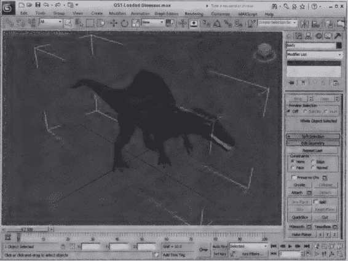

恐龙模型已加载并合并为单个对象。

## 教程：添加地面平面

在加载了恐龙模型后，我们接下来向场景中添加一个地面平面。这可以是一个简单的平面对象，我们对其应用噪声修改器以产生一些凸起。

要添加地面平面，请按照以下步骤操作：

- 1. 再次单击最大化视口切换按钮，或再次按 Alt+W 以查看全部四个视口。
- 2. 单击顶视图视口并缩小。然后在右侧命令面板中选择平面按钮，并在顶视图视口中从左上角拖动到右下角以创建大型平面对象。在创建面板中，将长度段数和宽度段数设置为 30 以增加平面的多边形密度。
- 3. 在平面对象仍处于选中的状态下，选择修改器 ⇨ 参数化变形器 ⇨ 噪声菜单以向平面对象应用噪声修改器。然后在参数展开栏中，将比例值设置为 350，将 Z 强度值设置为 200。

带有噪声修改器的地面平面创建了漂亮的起伏丘陵景观，如图 QS.2 所示。

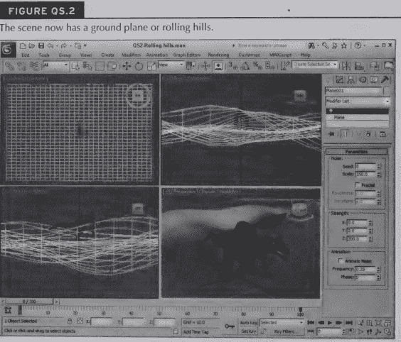

场景现在具有带有起伏丘陵的地面平面。

## 添加材质和灯光

建模阶段通常相当耗时，但当我们使用现有模型时进展非常快。下一阶段是向模型添加材质并向场景添加灯光。由于我们的模型已应用了材质，因此此阶段也进展相当快。

一个关键的更改是，将默认的扫描线渲染引擎切换为 mental ray 渲染引擎。这提供了更丰富的材质选择，并改善了场景中反射和折射的细微细节。它也改善了我们的照明。

## 教程：启用 mental ray 并添加材质

在建模完成后，您可以向对象添加材质以改善其外观。材质是通过材质编辑器添加的，可通过渲染 ⇨ 材质编辑器 ⇨ 石板材质编辑器菜单命令打开，或按 M 键盘快捷键打开。

Max 包含一套特殊的材质，用于装饰建筑和建筑设计，称为 Autodesk 材质库，但它们需要 mental ray 渲染引擎启用。在使用渲染场景对话框启用 mental ray 渲染引擎后，您可以在材质/贴图浏览器中访问该库。

要向沙漠地面平面添加材质，请按照以下步骤操作：

- 1. 选择渲染 > 渲染设置菜单命令（或按 F10）以打开渲染设置对话框。在“常用”面板的最底部是“分配渲染器”展开栏。在该展开栏中，单击“生产渲染器”右侧的按钮，然后在打开的“选择渲染器”对话框中双击 mental ray 渲染器选项。然后关闭渲染场景对话框。
- 2. 选择渲染 > 材质编辑器 > 石板材质编辑器菜单命令（或按 M 键）以打开材质编辑器。在材质/贴图浏览器中查找并双击沙材质。它位于 Autodesk 材质库的场地工作文件夹中。该材质的节点将在材质编辑器中显示。
- 3. 在视口中选择地面平面后，单击材质编辑器工具栏中的“将材质分配给选择”按钮。这会将材质应用到所选对象。

其余模型已有材质，因此我们可以继续进行灯光。图 QS.3 显示了石板材质编辑器。

## 图 QS.3

材质编辑器让您可以配置并将材质应用到场景对象。

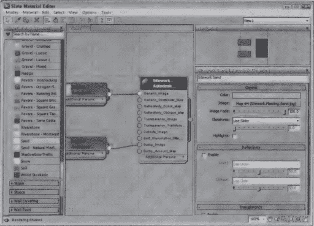

## 教程：添加太阳与天空系统

启用 mental ray 渲染器的另一个好处是您也可以使用太阳与天空系统。该系统模拟来自太阳等远距离光源的户外照明，并为背景生成天空。

要向场景添加太阳与天空系统，请按照以下步骤操作：

- 1. 选择创建 ▸ 灯光 ▸ 日光系统菜单命令，并在顶视图视口中拖动以向场景添加罗盘辅助对象。然后在顶视图视口中单击并拖动以放置太阳灯图标。

## 注

应用日光系统时，会自动出现一个对话框，建议您使用对数曝光控制并询问是否要进行此更改。单击“是”继续。

- 2. 选择渲染 ▸ 环境菜单命令（或按 8 键）以打开环境和效果对话框。单击环境贴图按钮，并在材质/贴图浏览器的贴图/mental ray 文件夹中选择 mr 物理天空贴图。然后启用“使用贴图”选项并关闭环境对话框。
- 3. 选择视图 ▸ 视口背景 ▸ 视口背景菜单命令（或按 Alt+B）以打开视口背景对话框。选择透视图视口，启用“使用环境背景”和“显示背景”选项，然后关闭对话框。
- 4. 单击界面右下角的最大化视口按钮（Alt+W），使透视图视口全屏显示。
- 5. 在选择日光灯时，单击修改面板中日光参数展开栏中的设置按钮。然后将时间小时数设置为 11。这将时间设定为下午晚些时候。
- 6. 要在视口中看到灯光和阴影，请单击视口左上角的视口着色标签并选择照明和阴影 ▸ 启用硬件着色（或按 Shift+F3 快捷键）。然后在同一照明和阴影菜单中打开启用视口曝光控制、启用阴影和启用环境光遮蔽。

视口现在显示带有背景天空的场景，如图 QS.4 所示。

## 教程：渲染预览

在进入动画之前，现在可以渲染场景，因为已添加了灯光。渲染使用渲染场景对话框进行配置。

要渲染恐龙场景的预览，请按照以下步骤操作：

- 1. 选择渲染 ▸ 渲染菜单命令（或按 F10 键），并打开间接照明面板。打开“启用最终聚集”选项，并将预设设置为中等。这通过确定光线如何在场景中反射来计算全局照明模型。
- 2. 返回渲染场景对话框的常用面板中，在常用参数展开栏中选择图像尺寸并单击渲染按钮。活动视口将被渲染并显示在渲染帧窗口中。

## 提示

此场景相当简单，渲染速度很快，但如果您需要测试渲染更快，可以启用 Quicksilver 硬件渲染器而不是 mental ray。

渲染的恐龙图像，如图 QS.5 所示，包含了所有材质和照明效果。

## 图 QS.4

天空背景在视口中可见。

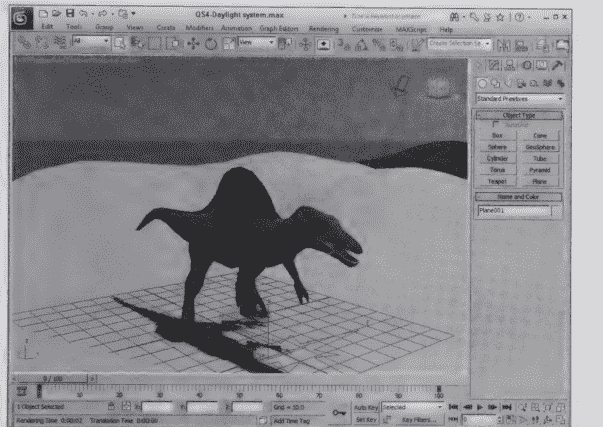

## 图 QS.5

场景的渲染图像包含了照明效果。

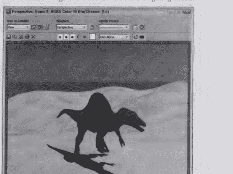


## 动画恐龙

测试渲染完成后，场景看起来不错，我们可以进入动画阶段。此阶段涉及使用 Character Animation Toolkit (CAT) 工具为恐龙添加骨骼绑定。骨骼可以轻松动画化，从而使恐龙网格蒙皮跟随。

## 教程：添加预设 CAT 绑定

为角色动画化的第一步是添加与恐龙网格相匹配的底层骨骼绑定。完成此操作后，动画任务会变得迅速。

要为恐龙添加预设 CAT 绑定，请按照以下步骤操作：

- 1. 点击界面右下角的最大化视口切换按钮，切换回四个视口。然后放大 Top 视口，以便可以看到整个场景。
- 2. 选择恐龙对象，并选择 Edit ⇨ Select Invert 菜单；然后在视口中右键单击，并在弹出四菜单中选择 Hide Selected 选项。这会隐藏恐龙以外的所有内容。
- 3. 打开 Create 面板，并选择 Helpers 类别。然后选择 CAT Objects 子类别。点击 CAT Parent 按钮，选择 Allosaurus 预设，并在 Top 视口中拖动，直到 CAT 绑定与脚对齐，并且在 Left 视口中与恐龙背部一样高。
- 4. 使用主工具栏中的 Move 工具，在 Front 视口中选择左侧绑定脚并向左拖动，使其与蒙皮网格脚对齐。然后在 Left 视口中向前移动上部和下部左侧腿骨以匹配蒙皮网格腿。
- 5. 使用 Front 和 Left 视口移动绑定臂的骨骼，使其与蒙皮网格的臂匹配，仅限左侧臂。
- 6. 打开 Modify 面板，并选择左侧上腿骨，然后点击 Ankle Setup 展开区中的 Copy Bone Settings 按钮。然后选择右侧脚踝骨，并选择 Mirror Bone Settings 按钮。这会使左侧腿的骨骼更改应用于右侧。然后对臂重复此步骤。
- 7. 在 Left 视口中向前拖动头部骨骼以与蒙皮网格的头部对齐。选择其中一个尾骨，并在 Tail Setup 展开区中将 Num Links 设置为 5；然后移动并定向骨骼以匹配蒙皮网格。
- 8. 当绑定与蒙皮网格对齐时，选择蒙皮网格并选择 Modifiers ⇨ Animation ⇨ Skin 菜单命令以将 Skin 网格应用于恐龙。点击 Parameters 展开区中的 Add 按钮，并在 Select Bones 对话框中选择除 Allosaurus 辅助对象和两个腿部平台辅助对象之外的所有对象，然后点击 Select 按钮。图 QS.6 显示了与蒙皮网格对齐的 CAT 绑定的恐龙。

### Tip

如果发现自己选择蒙皮网格太频繁，可以右键单击它并选择 Freeze Selection 以冻结它，使其无法被选择。完成后使用 Unfreeze All 选项将其解冻。

## FIGURE QS.6

CAT 绑定与恐龙蒙皮网格下方对齐。

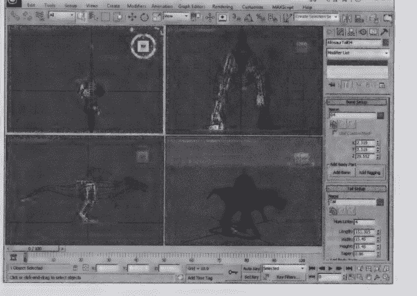

## 教程：创建行走运动路径

绑定和蒙皮应用后，您就可以开始动画化恐龙行走。这就是应用 CAT 绑定显示其用处的地方。

要动画化恐龙行走，请按照以下步骤操作：

- 1. 在视口中右键单击，并选择 Unhide All 选项以使所有场景对象再次可见。
- 2. 选择 CAT Parent 对象，并在 Top 视口中将其拖动到平面对象的右上角；然后将其旋转以面向平面对象的中心。
- 3. 在底部边缘的主界面中，找到 Time Configuration 按钮并点击它。在 Time Configuration 对话框中，将 End Time 设置为 300 并关闭对话框。这会将帧范围增加到 300。
- 4. 选择 Create > Helpers > Dummy 菜单命令，并在 Top 视口中拖动以在恐龙位置附近创建一个虚拟对象。虚拟对象仍处于选中状态时，点击界面底部的 Auto Key 按钮，将 Time Slider 拖动到第 300 帧，并将虚拟对象在视口中移动到 Top 视口的左下角。然后关闭 Auto Key 按钮。

### Tip

记住在完成动画后关闭 Auto Key 按钮，否则在编辑场景时您会继续创建关键帧。

- 5. 选择 CAT Parent 对象，打开 Motion 面板，点击 Layer Manager 展开区中层列表下方的 Add Layers 按钮，并选择 CAT Motion 层选项。列表中会添加一个新层。
- 6. 点击 Layer Manager 展开区中列表上方的 Animation 模式按钮，然后点击列表下方的 CAT Motion Editor 按钮。在打开的对话框中，在左窗格中选择 Globals 面板，点击 Path Node 按钮，然后选择动画化的虚拟对象。暂时保持 CAT Motion 对话框打开。
- 7. 选择虚拟对象，并将其旋转，使恐龙直立并指向虚拟对象移动的方向。
- 8. 再次选择 CAT Parent 对象，并在 CAT Motion 对话框中选择 Limb Phases 面板。然后点击 Pick Ground 按钮，并在视口中选择地面平面对象。这会使 CAT 绑定的所有脚印跟随地面平面。
- 9. 放大并在 Perspective 视口中旋转视图，使恐龙从视野中走过。
- 10. 点击主工具栏中的 Select by Name 按钮，选择所有骨骼对象，在视口中右键单击并选择 Hide Selected 选项以隐藏所有骨骼。

点击 Play 按钮即可看到添加到恐龙的步行循环。图 QS.7 显示了视口中的行走恐龙。

## FIGURE QS.7

恐龙以笨重的步态在山丘上行走。

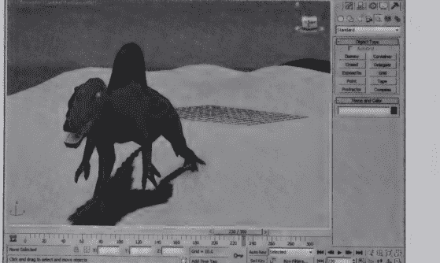

## 教程：渲染最终动画

一旦恐龙行走在视口中看起来不错，您就可以准备渲染最终动画。这是一个可以通过指定动画格式开始的过程。一旦开始，Max 会自动处理动画的所有帧，并在完成后通知您。

要渲染最终动画，请按照以下步骤操作：

- 1. 选择 Render→ Render Setup 菜单以打开 Render Setup 对话框。
- 2. 在对话框顶部，启用 Active Time Segment，以便渲染动画的所有 300 帧。然后将 Output Size 设置为 640x480。
- 3. 在 Render Output 部分，点击 Files 按钮以打开文件对话框。将格式设置为 AVI，为文件命名为 Walking Dinosaur 之类的名称，然后点击 Save 按钮。在出现的 AVI Compression Setup 对话框中，只需选择默认值并点击 OK。
- 4. 在 Render Setup 对话框的底部，确保选择了 Perspective 视图并点击 Render 按钮。

Max 然后渲染动画的每一帧，并在对话框中显示其进度。完成后，最终动画文件将以您输入的文件名保存。然后您可以找到并播放它。图 QS.8 显示了最终动画的一帧。

## FIGURE QS.8

最终动画包括每一帧的渲染结果。

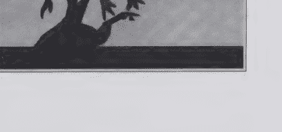

## Summary

我希望您对进入 Max 的第一步感到满意。本章让您接触到 Max 的许多重要方面，包括以下内容：

- 设置场景
- 启用 mental ray
- 为场景对象应用材质
- 使用 Sun & Sky 系统并在视口中启用灯光和阴影
- 将预设 CAT 绑定与蒙皮网格匹配
- 使用 CAT Motion 层创建步行循环
- 渲染最终动画

但请系好安全带，因为软件中还有太多内容等待您。在第 1 章中，您将轻松开始深入了解 Max 界面。如果您准备好迎接更高级的挑战，请查看目录并深入研究任何看起来不错的主题。


## 探索 Max 界面

好吧，我们又迎来了一个新版本的 Max，现有用户脑中第一个问题是：“界面变了吗？” 答案是令人愉快的“变化很少”。大多数资深用户宁愿去做根管手术也不愿让他们的用户界面（UI）发生变化，Autodesk 已经认识到并尊重了这一宝贵意见，将界面更改控制在最小范围内。

当你浏览新界面时，你会发现一切仍然都在，但 Max 有了一些新添内容。你在导航界面时可能会说：“这是从哪里来的？” 但就像在你的社区里遇到一栋新房子一样，随着时间的推移，你会逐渐习惯于这个新增部分，甚至可能结识一些新朋友。

为什么软件界面如此重要？想想看：界面是一组使你能够访问程序功能的控件。如果没有一个好的界面，你可能永远不会使用软件的许多最佳功能，或者在寻找这些功能时浪费令人沮丧的时间。一款软件可以拥有所有最伟大的功能，但如果用户找不到或无法访问它们，那么软件就无法发挥其全部潜力。Max 是一款功能强大的软件，拥有一些令人惊叹的功能，幸运的是，界面使这些令人惊叹的功能易于查找和使用。

界面的目的是使软件功能易于访问，而在 Max 中，你有多种方式来访问功能。其中一些访问方式比其他方式更快。这种设计是有意为之，因为它为初学者提供直观的命令，为高级用户提供直接访问。例如，要撤消一个命令，你可以选择 Edit→Undo（需要两次鼠标点击），但随着你获得更多经验，你只需单击工具栏上的撤消图标（只需一次点击）；熟练使用键盘的专家可以按 Ctrl+Z 而完全不必伸手去拿鼠标。所有这三种方法的结果相同，但你可以使用对你来说最容易的一种。

Max 界面成功了吗？是的，在某种程度上，但像大多数界面一样，它总是有改进的空间，我们希望每个新版本都能让我们更进一步

### 本章内容

- 学习界面元素
- 预览菜单命令
- 熟悉工具栏
- 使用命令面板
- 检查下部界面栏
- 与界面交互
- 获取帮助

## Cross-Ref

本章考察了 Max 界面的最新版本，并提供了一些使界面感觉舒适而非繁琐的技巧。

## 学习界面元素

如果你是 Max 界面的新手，第一要务是绕着街区走一走，认识一下邻居。Max 界面有许多界面元素，它们整齐地将相似的命令分组在一起。例如，所有用于控制视口的命令都分组在视口导航控件中，该控件位于界面的右下角。

### Note

如果本章涵盖了每个界面命令的所有细节，那将是一个非常长的章节。因此，对于在其他地方更详细介绍的那些命令，我提供了交叉引用，指出你可以在其中找到其介绍的章节。

整个界面可以分为六个简单的元素。每个界面元素又包含子元素的分组。六个主要界面元素如下列出，并在图 1.1 中分开显示：

- **标题栏和菜单**：这是大多数命令的默认来源，但也是最耗时的界面方法之一。标题栏和菜单位于 Max 窗口的顶部边缘。
- **工具栏**：Max 包含多个图标按钮工具栏，可提供对功能的单次点击访问。这些工具栏可以独立浮动，也可以停靠到界面边缘。主工具栏是默认唯一可见的工具栏。
- **建模功能区**：可配置的选项卡和面板提供对建模功能的快速访问，包括 Graphite 建模工具。
- **视口**：四个独立的场景视图显示顶部、正面、左侧和透视视角。
- **命令面板**：位于四个视口右侧的主要控制面板，其顶部有六个选项卡图标可供点击以打开各个面板。每个面板包含包含参数和设置的展开区。这些展开区会根据所选对象和选项卡而变化。
- **下部界面栏**：沿界面窗口底部边缘排列着一组杂项控件。

除了这些默认元素之外，还有几个在 Max 首次加载时最初不可见的附加界面元素。这些附加界面元素包括以下内容：

## 第 1 章：探索 Max 界面

## 图 1.1

Max 包含六个主要界面元素。

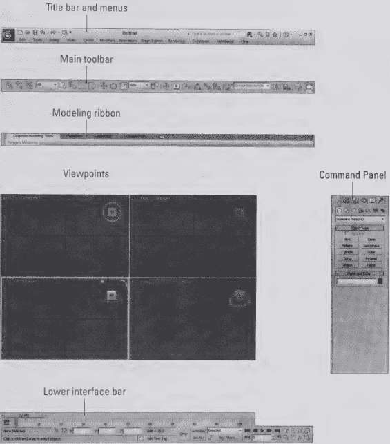

- **浮动工具栏：** 还有多个工具栏可作为浮动工具栏使用。你可以通过选择 Customize > Show UI > Show Floating Toolbars 或从工具栏的右键弹出菜单中选择它们来访问它们。
- **Quadmenus：** 右键单击活动视口会显示一个包含最多四个窗格的弹出菜单，称为 quadmenu。Quadmenus 提供基于所点击对象或位置的上下文相关命令，并提供访问命令的最快方式之一。
- **Caddy 设置：** 在建模时，你可以应用 Caddy 设置。这些控件集浮动在当前选择上方，并提供在视口中立即更新的多个设置。

example, pressing and holding down the Alt and then E (for Edit) and then pressing U (for Undo) executes the Edit⇨Undo command; or you can press Alt, use the down arrow to select the Undo command, and press the Enter key.

### Tip

通过学习菜单中的下划线字母，你可以使用键盘快速访问菜单命令，即使该菜单命令没有分配键盘快捷键。而且由于你不必在按住 Ctrl 键的同时伸手去按 Y 键，下划线菜单字母可能更快。例如，通过依次按 Alt、G 和 U，你可以访问 Group⇨Ungroup 菜单命令。键盘缓冲区会记住你输入字母的顺序，无论你输入的速度如何，这使得使用键盘快速访问菜单命令成为可能。随着时间的推移，你可以学习模式来帮助你记住如何访问某些菜单命令，例如 Alt、C、H、E 用于创建椭圆。■

并非所有菜单命令在所有时间都可用。如果菜单命令不可用，则它会变灰，如图 1.3 所示，并且你无法选择它。例如，Clone 命令仅在选择对象时可用，因此如果未选择任何对象，Clone 命令会变灰且不可用。在你选择对象后，此命令将变为可用。

### Tip

如果你右键单击菜单栏，你可以访问一个弹出命令来隐藏菜单栏。如果你不小心关闭了菜单栏，你可以使用快速访问工具栏菜单中的 Show Menu Bar 命令将其恢复。■

## 图 1.3

所有菜单都具有视觉提示。

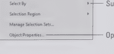

Keyboard shortcut

Disabled command

Submenu exists

Opens dialog box

## 使用工具栏

现在你已经学会了菜单的二步操作，是时候进行工具栏的一步操作了。主工具栏默认出现在 Max 窗口顶部菜单的正下方。使用工具栏是执行命令最方便的方法之一，因为大多数命令只需单击一次即可。

### Docking and floating toolbars

默认情况下，主工具栏停靠在视口上方界面的顶部边缘，但你可以通过点击并拖动工具栏左侧（或顶部）末端的两条垂直线，使任何停靠的工具栏（包括主工具栏）成为浮动工具栏，远离界面边缘。在将其与窗口分离后，你可以通过拖动其边缘或角落来调整浮动工具栏的大小。然后你可以将其拖动并停靠到窗口的任何边缘，或双击工具栏标题栏以自动将工具栏停靠到其最新位置。图 1.4 显示主工具栏作为浮动面板。

如果你右键单击远离按钮的任何浮动工具栏，你可以访问一个弹出菜单，其中包含停靠或浮动当前工具栏、访问 Customize UI 窗口，或显示或隐藏任何工具栏或命令面板的选项。主工具栏可以使用 Alt+6 键盘快捷键切换来隐藏和再次显示。

## 图 1.4

主工具栏包含按钮和下拉列表，用于控制许多最受欢迎的 Max 功能。

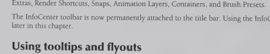

## Cross-Ref

你可以自定义出现在任何工具栏上的按钮。参见第 4 章，“自定义 Max 界面和设置首选项。” ■

如果你选择 Customize→Show UI→Show Floating Toolbars 菜单命令，多个附加工具栏会出现。这些是浮动工具栏。你也可以通过从工具栏右键弹出菜单中单独选择它们来使它们出现。这些浮动工具栏包括 Axis Constraints、Layers、reactor、Extras、Render Shortcuts、Snaps、Animation Layers、Containers 和 Brush Presets。

InfoCenter 工具栏现在永久附加到标题栏。使用 InfoCenter 工具栏的内容将在本章后面介绍。

### 使用工具提示和飞出菜单

所有图标按钮（包括工具栏、命令面板以及其他对话框和窗口中的按钮）都包含工具提示，即标识文本标签。如果你将鼠标光标悬停在图标按钮上，工具提示标签就会出现。此功能有助于识别按钮。如果你记不起某个特定按钮的作用，将光标悬停在其上方，工具提示就会显示其名称。


所有右下角带小三角形的工具栏按钮都是飞出按钮。飞出按钮是一个单一的工具栏按钮，展开后可显示更多按钮。单击并按住飞出按钮可显示附加图标，然后拖动以选择其中一个。图1.5显示了主工具栏上“对齐”按钮的飞出菜单。

## 图1.5

飞出菜单将多个工具栏按钮捆绑在一起。

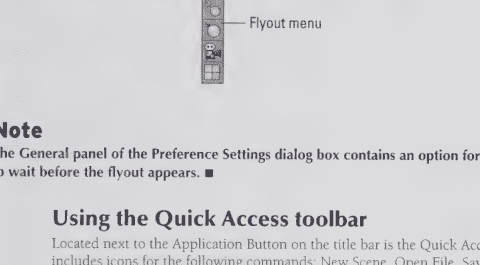

## 注意

“首选项设置”对话框的“常规”面板包含一个选项，用于设置显示飞出按钮前需要等待的毫秒数。

## 使用快速访问工具栏

标题栏上“应用程序”按钮旁边是“快速访问”工具栏。这个迷你工具栏包含以下命令的图标：新建场景、打开文件、保存文件、撤销、重做和设置项目文件夹。如果单击工具栏右端的向下箭头图标，可以访问一个菜单，其中包含隐藏任意一个图标或整个工具栏的选项。您还可以选择在功能区下方显示该工具栏。

## 了解主工具栏

在较小分辨率的屏幕上，主工具栏过长，无法完全显示。要查看完整的主工具栏，您需要将显示器分辨率设置为至少1280像素宽。要滚动工具栏以查看末尾，请将光标置于工具栏上远离按钮的位置，例如某个下拉列表的下方（光标会变为手形）；然后按住并朝任意方向拖动工具栏。使用手形光标滚动在“命令”面板、“材质编辑器”以及任何面板超出给定空间的区域也同样有效。

## 提示

滚动主工具栏最简单的方法是使用鼠标中键拖动。

打开对话框的工具栏按钮（如“图层管理器”、“材质编辑器”和“渲染场景”按钮）是切换按钮。当对话框打开时，按钮会以黄色高亮显示，表示对话框已打开。单击高亮的切换按钮将关闭对话框。相应的菜单（和键盘快捷键）也是如此，当对话框打开时，菜单命令左侧会出现一个小对勾标记。

## 第一部分：3ds Max入门

表1.1列出了主工具栏中的控件。带有飞出菜单的按钮以逗号分隔。

## 表1.1

## 主工具栏按钮

| 工具栏按钮 | 名称 | 说明 |
|---|---|---|
|  | 选择并链接 | 在对象之间建立链接。 |
|  | 取消链接选择 | 断开对象之间的链接。 |
|  | 绑定到空间扭曲 | 将对象指定为由空间扭曲修改。 |
|  | 选择过滤器下拉列表 | 限制可以选择的对象类型。 |
|  | 选择对象（Q） | 选择一个对象。 |
|  | 按名称选择（H） | 打开一个对话框，按名称选择对象。 |
|  | 矩形选择区域、圆形选择区域、围栏选择区域、套索选择区域、绘制选择区域（按Ctrl+F循环切换） | 确定使用鼠标选择对象的形状。 |
|  | 窗口/交叉切换 | 指定选择对象时必须完全包含在窗口内还是只需交叉。 |
|  | 选择并移动（W） | 选择对象并允许位置平移。 |
|  | 选择并旋转（E） | 选择对象并允许旋转变换。 |
|  | 选择并均匀缩放、选择并非均匀缩放、选择并挤压（按R循环切换） | 选择对象并允许使用不同方法进行缩放变换。 |
|  | 参考坐标系下拉列表 | 指定用于变换的坐标系。 |
|  | 使用轴点中心、使用选择中心、使用变换坐标中心 | 指定旋转所围绕的中心。 |
|  | 选择并操纵 | 选择对象并允许通过操纵器进行参数操纵。 |
|  | 键盘快捷键覆盖切换 | 启用后，可使用主界面以及活动对话框或功能集的键盘快捷键。禁用时，仅可使用主界面快捷键。 |

## 第1章：探索Max界面

| 工具栏按钮 | 名称 | 说明 |
|---|---|---|
| 2 2.5 3 | 捕捉切换2D、捕捉切换2.5D、捕捉切换3D（S） | 指定捕捉模式。2D仅捕捉到活动构造网格，2.5D捕捉到构造网格或从网格投影的几何体，3D捕捉到3D空间中的任意位置。 |
|  | 角度捕捉切换（A） | 使旋转捕捉到指定角度。 |
| % | 百分比捕捉（Shift+Ctrl+P） | 使缩放捕捉到指定百分比。 |
|  | 微调器捕捉切换 | 确定每次单击时微调器值更改的量。 |
|  | 编辑命名选择集 | 打开一个对话框，用于创建和管理选择集。 |
| New Set | 命名选择集下拉列表 | 列出并允许您选择一组已命名的对象。 |
|  | 镜像选定对象 | 创建选定对象的镜像副本。 |
|  | 对齐（Alt+A）、快速对齐、法线对齐（Alt+N）、放置高光（Ctrl+H）、对齐到摄像机、对齐到视图 | 打开用于定位对象的对齐对话框，允许通过法线对齐对象，确定高光的位置，并将对象对齐到摄像机或视图。 |
|  | 管理图层 | 打开“图层管理器”界面，您可以在其中处理图层。 |
|  | Graphite建模工具 | 打开“Graphite建模工具”面板。 |
|  | 打开曲线编辑器 | 打开“函数曲线编辑器”。 |
|  | 打开示意图视图 | 打开“示意图视图”窗口。 |
|  | 精简材质编辑器（M）、板岩材质编辑器（M） | 打开精简材质编辑器窗口或板岩材质编辑器窗口。 |
|  | 渲染设置（F10） | 打开“渲染设置”对话框以设置渲染选项。 |
|  | 渲染帧窗口 | 打开“渲染帧窗口”。 |
|  | 快速渲染（产品级）、迭代渲染、快速渲染（ActiveShade） | 使用产品级设置、迭代渲染模式或ActiveShade窗口，在不打开“渲染设置”对话框的情况下，对当前视口进行快速测试渲染。 |

## 使用功能区

功能区界面是一个高级工具栏，包含许多不同的工具区。它目前包含各种建模工具，统称为Graphite建模工具。您可以使用主工具栏上的“Graphite建模工具”按钮打开或关闭功能区。启用后，将显示Graphite建模工具、自由形式、选择和对象绘制选项卡。

## 交叉参考

大多数功能区按钮仅在选中“可编辑多边形”对象时才可见。您可以在第13章“使用多边形和面片建模”和第14章“使用Graphite建模工具和对象绘制”中了解有关可编辑多边形对象和Graphite建模工具的更多信息。

使用功能区右端的“最小化”按钮，您可以将显示模式切换为仅显示选项卡、仅显示面板标题或仅显示面板按钮，也可以启用“最小化”按钮以循环切换每种模式。您还可以双击功能区选项卡以最小化功能区或循环切换最小化模式。

右键单击功能区标题栏可访问菜单选项，以显示或隐藏特定选项卡或面板、自定义功能区、保存或加载自定义功能区配置、在水平和垂直方向之间切换、将功能区重置为默认状态或启用工具提示。图1.6显示了不同的功能区显示模式。

## 图1.6

功能区可以设置为使用多种不同模式显示。

功能区选项卡显示模式

最小化功能区按钮

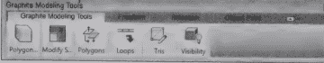

面板标题显示模式

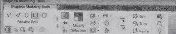

面板按钮显示模式


完整功能区


## 新功能

在水平和垂直方向之间切换功能区界面的功能是3ds Max 2011新增的。

## 交叉参考

功能区自定义功能在第4章“自定义Max界面和设置首选项”中介绍。

整个功能区以及每个单独的面板按钮都可以通过将功能区标题栏或下面板栏拖离其他按钮，从而变成浮动控件。当面板变成浮动面板时（如图1.7所示），浮动面板右上角的图标可让您将面板返回到功能区或切换垂直和水平方向。您还可以通过拖动面板两侧的灰色栏来移动浮动面板。

## 图1.7

功能区面板可以独立浮动。

将面板返回到功能区

切换方向

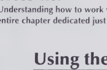

## 使用视口

四个视口构成了整个界面中最大的区域，并提供了一种查看场景中对象的方式。每个视口都是可配置的，并且可以与其他视口不同。

## 交叉参考

了解如何使用视口对于使用Max完成任务至关重要，因此视口有专门的一章——第2章“控制和配置视口”。

## 使用命令面板

如果说Max中除了视口之外还有一个您会花上所有时间的地方，那就是命令面板（至少直到您足够熟悉四元菜单为止）。命令面板位于视口右侧，沿界面右边缘放置。这里列出了所有具体的参数、设置和控件。命令面板分为六个面板，每个面板通过位于其顶部的选项卡图标访问。这六个选项卡是“创建”、“修改”、“层次”、“运动”、“显示”和“工具”。

您可以单击命令面板顶部选项卡图标右侧的空白区域，并拖动离开界面边缘，将命令面板从右侧窗口边缘拉出，使其成为浮动对话框，如图1.8所示。您也可以将其停靠在左侧窗口边缘，这非常方便


# Part I: Getting Started with 3ds Max

if you're left-handed. While it's a floating panel, you can resize the Command Panel by dragging on its edges or corners (but its width remains constant).

After you've pulled the Command Panel or any of the toolbars away from the interface, you can redock them to their last position by double-clicking their title bar. You also can right-click the title bar to access the pop-up menu of floating toolbars, but the pop-up menu also includes options to Dock (either Left or Right for the Command Panel or Left, Right, Top, or Bottom for toolbars) and Float.

The right-click pop-up menu for the Command Panel also includes a Minimize command. If enabled, the Command Panel collapses to the edge of the interface, but moving the mouse near the interface where the Command Panel is minimized expands the Command Panel again. Moving the mouse away from the Command Panel makes it collapse to the interface edge again. You can take the Command Panel out of Minimize mode by selecting one of the Dock commands.

## FIGURE 1.8

The Command Panel includes six separate panels accessed via tab icons.

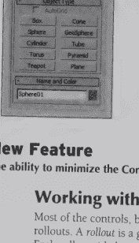

## New Feature

The ability to minimize the Command Panel is new to 3ds Max 2011.

## Working with rollouts

Most of the controls, buttons, and parameters in the Command Panel are contained within sections called rollouts. A rollout is a grouping of controls positioned under a gray, boxed title, as shown in Figure 1.9.

Each rollout title bar includes a plus or minus sign (a minus sign indicates that the rollout is open; a plus sign shows closed rollouts). Clicking the rollout title opens or closes the rollout. You also can reposition the order of the rollouts by dragging the rollout title and dropping it above or below the other rollouts.

## Note

You cannot reposition some of the rollouts, such as the Object Type and the Name and Color rollouts, found in the Create panel.

Right-clicking away from the buttons in a rollout presents a pop-up menu where you can select to close the rollout you’ve clicked in, Close All, Open All, or Reset Rollout Order. The pop-up menu also lists all available rollouts within the current panel with a check mark next to the ones that are open.

Expanding all the rollouts often exceeds the screen space allotted to the Command Panel. If the rollouts exceed the given space, then a small vertical scroll bar appears at the right edge of the Command Panel. You can drag this scroll bar to access the rollouts at the bottom of the Command Panel, or you can click away from the controls when a hand cursor appears. With the hand cursor, click and drag in either direction to scroll the Command Panel. You also can scroll the Command Panel with the scroll wheel on the mouse.

## FIGURE 1.9

Open and close rollouts by clicking the rollout title.

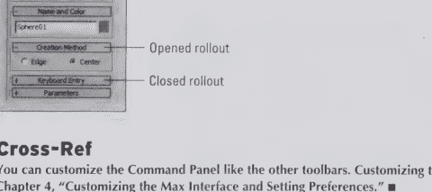

## Cross-Ref

You can customize the Command Panel like the other toolbars. Customizing the Command Panel is covered in Chapter 4, “Customizing the Max Interface and Setting Preferences.”

## Increasing the Command Panel’s width

The Command Panel can be doubled or tripled (or any multiple, as long as you have room) in width by dragging its left edge toward the center of the interface. The width of the Command Panel is increased at the expense of the viewports. Figure 1.10 shows the Command Panel double its normal size.

## Tutorial: Rearranging the interface for lefties

I used to work for a company that required that all computers have the mouse to the left of the keyboard. We swapped computers often, and the boss hated having to move the mouse to the other side of the keyboard (and you thought your work environment was weird). The reality is that some people like it on the left and others prefer it on the right, and Max can accommodate both.

With the Command Panel on the right side of the interface, the default Max interface obviously favors right-handers, but with the docking panels, you can quickly change it to be friendly to lefties.

To rearrange the interface for lefties, follow these steps:

- 1. Click the Command Panel on the empty space to the right of the Utilities tab, and drag toward the center of the interface. As you drag the Command Panel away from the right edge, the cursor changes.
- 2. Continue to drag the Command Panel to the left edge, and the cursor changes again to indicate that it will be docked when released. Release the mouse button, and the Command Panel docks to the left side.
- 3. For an even easier method, you can right-click the Command Panel's title bar and select Dock Left from the pop-up menu.

Figure 1.11 shows the rearranged interface ready for all you southpaws.

## Tip

To save the interface changes, use the Customize Save Custom UI Scheme menu. The maxstart.cui file is loaded by default when Max is started.

## FIGURE 1.10

Increase the width of the Command Panel by dragging its left edge.

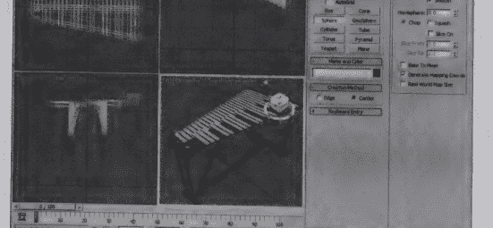

## FIGURE 1.11

Left-handed users can move the Command Panel to the left side.

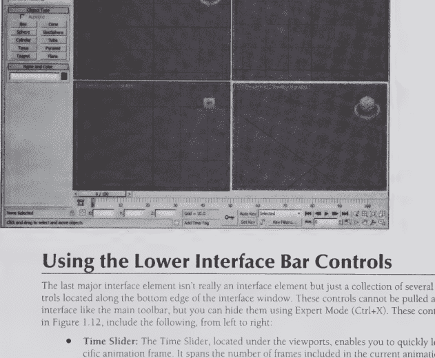

## Using the Lower Interface Bar Controls

The last major interface element isn't really an interface element but just a collection of several sets of controls located along the bottom edge of the interface window. These controls cannot be pulled away from the interface like the main toolbar, but you can hide them using Expert Mode (Ctrl+X). These controls, shown in Figure 1.12, include the following, from left to right:

- **Time Slider:** The Time Slider, located under the viewports, enables you to quickly locate a specific animation frame. It spans the number of frames included in the current animation. Dragging the Time Slider moves you quickly between frames. Clicking the arrow buttons on either side of the Time Slider moves to the previous or next frame (or key).
- **Track Bar:** The Track Bar displays animation keys as color-coded rectangles with red for positional keys, green for rotational keys, and blue for scale keys. Parameter change keys are denoted by gray rectangles. Using the Track Bar, you can select, move, and delete animation keys. The button at the left end of the Track Bar is the Open Mini Curve Editor button. It provides access to the animation function curves.
- **Status Bar:** The Status Bar is below the Track Bar. It provides valuable information, such as the number and type of objects selected, transformation values, and grid size. It also includes the Selection Lock Toggle, Transform Type-In fields, and the value of the current Grid size.

# Part I: Getting Started with 3ds Max

- Prompt Line: The Prompt Line is text located at the bottom of the window. If you're stuck as to what to do next, look at the Prompt Line for information on what Max expects. The Prompt Line also includes buttons for enabling Adaptive Degradation and adding and editing Time Tags, which are used to name specific animation frames.
- Key Controls: These controls are for creating animation keys and include two different modes—Auto Key (keyboard shortcut, N) and Set Key (keyboard shortcut, '). Auto Key mode sets keys for any changes made to the scene objects. Set Key mode gives you more precise control and sets keys for the selected filters only when you click the Set Keys button (keyboard shortcut, K).
- Time Controls: Resembling the controls on an audio or video device, the Time Controls offer an easy way to move through the various animation frames and keys. Based on the selected mode (keys or frames), the Time Controls can move among the first, previous, next, and last frames or keys.
- Viewport Navigation Controls: In the lower-right corner of the interface are the controls for manipulating the viewports. They enable you to zoom, pan, and rotate the active viewport's view.

## FIGURE 1.12

The Lower Interface Bar includes several sets of controls.

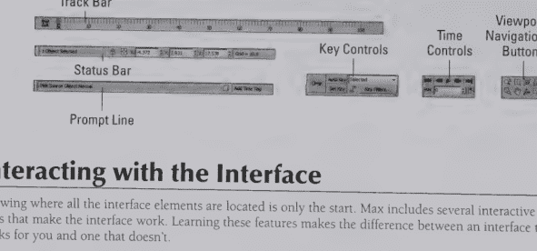

## Interacting with the Interface

Knowing where all the interface elements are located is only the start. Max includes several interactive features that make the interface work. Learning these features makes the difference between an interface that works for you and one that doesn't.

## Gaining quick access with the right-click quadmenus

Quadmenus are pop-up menus with up to four separate sections that surround the cursor, as shown in Figure 1.13. Right-clicking in the active viewport opens these quadmenus. The contents of the menus depend on the object selected.

## Tip

Many of the real pros use quadmenus extensively. One reason is that they can access the commands from the mouse's current location using a couple of clicks without having to go all the way to the Command Panel to click a button.


## 第 1 章：探索 Max 界面

### 图 1.13

四合菜单在易于访问的位置包含大量命令。

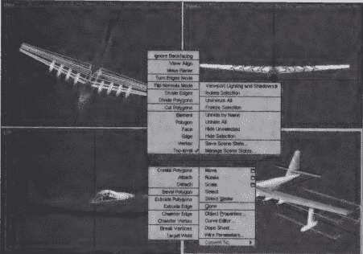

用鼠标左键在四合菜单之外单击即可关闭菜单。对于每个菜单，最后一次选择的菜单项会以蓝色显示。要快速再次访问蓝色菜单项，只需单击包含蓝色菜单项的象限的灰色阴影条即可。使用 Customize > Customize User Interface，可以指定在四合菜单上显示哪些命令，但默认选项几乎涵盖了你所需的一切。

### Cross-Ref

**你可以在第 4 章“Customizing the Max Interface and Setting Preferences”中了解更多关于自定义界面的信息。**

如果在活动视口中按住 Alt、Ctrl 和 Shift 键的同时右键单击，你可以访问特定的一组命令；Shift+右键单击打开捕捉选项，Alt+右键单击打开动画命令，Ctrl+右键单击打开基本体菜单，Alt+Shift+右键单击打开反应堆命令菜单，而 Ctrl+Alt+右键单击打开渲染命令菜单。

### 使用 Caddy 控制

四合菜单非常适合访问特定命令，但更改各种功能的设置仍然需要你访问命令面板。这就是 Caddy 控制发挥作用的地方。某些建模功能（如倒角和挤出）允许你在所选对象上叠加打开一组控件，称为 Caddy，如图 1.14 所示。更改这些设置中的任何一个都会更新选择并让你看到更改是否符合你的预期。如果对设置满意，可以接受更改并关闭 Caddy 控制。

## Part I: Getting Started with 3ds Max

Caddy 控制的一个主要好处是，即使你更改视口，它们仍会保持在所选子对象附近。除了会立即更新的多个设置外，还有用于接受并提交当前更改的按钮、应用更改并继续使用该工具，或取消。 使用 Apply and Continue 按钮可使工具保留下来以便继续工作。

### 图 1.14

Caddy 控制显示在选择上方，让你尝试多种不同的设置。

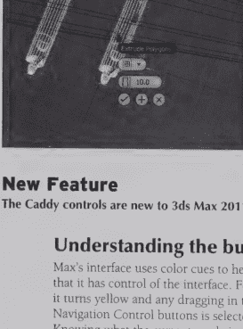

### 新功能

Caddy 控制是 3ds Max 2011 的新功能。

### 理解按钮颜色提示

Max 的界面使用颜色提示来帮助提醒你当前模式。当按钮为黄色时，表示它已控制界面。例如，如果主工具栏上的选择按钮之一被选中，它会变黄，视口中的任何拖动都会影响对象；然而，如果视口导航控制按钮之一被选中，它会变黄，拖动视口会改变视图。随时知道当前模式是什么可以让你避免麻烦。

### Tip

在活动视口中右键单击会退出任何控制视口导航模式的模式，并将控制权返回到最近的变换工具。在非活动视口之一中右键单击会保持焦点不变，并使被单击的视口处于活动状态。

另一种常见的按钮颜色是红色。当 Auto Key 或 Set Key 按钮被按下时，它们会变红。正在随时间轴一起动画的活动视口的边缘也会变红。这提醒你任何修改都将被保存为关键帧。

切换按钮可以打开和关闭。切换按钮的示例包括捕捉按钮。当切换按钮启用时，它也会变黄。以蓝色突出显示的切换按钮是非排他的，但它们会通知你已启用的模式，例如 Key Mode Toggle 或 Affect Pivot Only 按钮。

### Cross-Ref

所有界面颜色都可以使用 Customize User Interface 对话框进行自定义，该对话框在第 4 章“Customizing the Max Interface and Setting Preferences”中进行了讨论。

### 使用拖放功能

处理文件的对话框从 Max 的拖放功能中获益匪浅。材质编辑器、背景图像、视图文件和环境设置对话框都使用拖放。这些对话框让你可以选择文件或材质并将其拖到你想要应用的位置。例如，在材质编辑器的 Maps 展开面板打开时，你可以将纹理图像文件名从 Windows 资源管理器或资源管理器拖动到 Map 按钮上。你甚至可以将 Max 文件从 Windows 资源管理器拖放到 Max 界面中以打开它们。

### 控制微调器

微调器是界面中随处可见的小控件，具有值字段和右侧的两个小箭头。正如你所期望的那样，单击上箭头会增加值，单击下箭头会减少值。增加或减少的幅度取决于首选项设置对话框的 General 选项卡中的设置。右键单击微调器会将值重置为其最低可接受值。控制微调器值的另一种方法是单击箭头并用鼠标拖动。向上拖动会增加值，向下拖动会减少值。

如果在视图菜单中启用了 Update During Spinner Drag 菜单选项，则微调器拖动的效果会在视口中显示。如果光标位于微调器内，你可以按 Ctrl+N 打开数值表达式求值器，该求值器允许你使用表达式设置值。例如，你可以通过像使用计算器一样将数字相加来设置微调器值。表达式 30+40+35 将值设置为 105。

### Cross-Ref

第 35 章“Animating with the Expression Controller and Wiring Parameters”更详细地介绍了数值表达式求值器。

### 理解无模式和持久对话框

Max 中的许多对话框都是无模式的，这意味着在关闭对话框之前你就可以在后台视口中处理对象。材质编辑器就是无模式对话框的一个示例。在材质编辑器打开时，你可以在后台创建、选择和变换对象。其他无模式对话框包括材质/贴图浏览器、渲染场景对话框框、Caddy 控制、视频后期对话框、变换输入对话框、显示和选择浮动窗口以及各种图表编辑器。按 Ctrl+` 键盘快捷键会关闭所有打开的对话框。再次按相同的键盘快捷键会重新打开之前关闭的对话框。

## Part I: Getting Started with 3ds Max

许多但并非所有对话框的另一个功能是持久性，这意味着添加到对话框中的值在重新打开对话框时仍会保留。此功能仅适用于给定的 Max 会话。选择 File ▸ Reset 命令按钮或退出并重新启动 Max 会重置所有对话框。

### 获取帮助

如果你遇到困难，Max 不会让你无助。你可以在 Max 中的多个地方获得帮助。帮助菜单是一个宝贵的资源，提供对参考资料和教程的访问。3ds Max 帮助和 MAXScript 帮助是全面的帮助系统，其工作原理类似于 Web 浏览器。附加帮助提供对加载的任何外部插件的帮助系统。教程命令加载教程，提供获得宝贵经验的机会。

### 使用 InfoCenter 工具栏

由于各种帮助文件众多，有时很难知道确切应该在哪个文件中查找所需信息。为此，3ds Max 包含一个位于标题栏左端的 InfoCenter 工具栏。

当你在 InfoCenter 工具栏中输入关键字时，Max 会执行搜索并列出关键字在所有各种帮助文件中出现的位置，包括 Max 文档和在线资源，如图 1.15 所示。

### Tip

**你可以在搜索关键字时使用通配符。** 星号 (*) 替换一个或多个字符，问号 (?) 替换单个字符，而波浪号 (~) 查找添加到单词的前缀和/或后缀。例如，con* 找到 controller、construct 和 contour；sta? 找到 star 和 stat；~lit 找到 prelit 和 relit；limit~ 找到 limited 和 limitless。

单击搜索文本字段右侧的搜索图标（看起来像一副迷你望远镜）会打开一个弹出菜单，其中包括仅搜索特定资源或向 InfoCenter 添加搜索位置的选项。此添加搜索位置的选项会打开一个对话框，你可以在其中浏览到要包含在搜索中的特定文档。可以搜索多种文档类型，包括文本文件、DOC 文件、帮助文件、HTML 和 XML 页面以及 PDF。

弹出菜单还包括访问 InfoCenter Settings 对话框的选项，如图 1.16 所示。InfoCenter Settings 对话框还包括用于配置通信中心的设置，通信中心是获取 Autodesk 信息和公告的资源。你可以配置通信中心以在有更新可用时通知你、显示产品支持问题，甚至包含来自 Autodesk 的 RSS 源。

### Tip

在 InfoCenter Settings 对话框中有一个选项可以禁用界面底部弹出烦人的气球通知，或者你可以使它们半透明。


## 第 1 章：探索 Max 界面

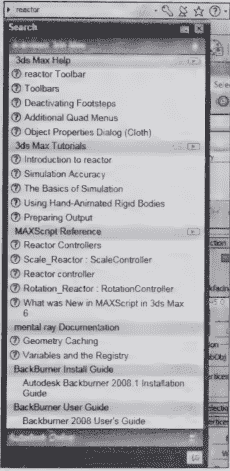

InfoCenter 工具栏可让您同时搜索多个帮助文件。

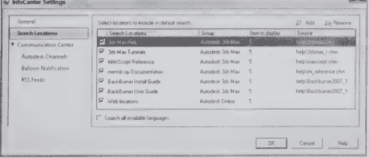

InfoCenter 设置对话框可让您指定哪些项目可被搜索。

## 第一部分：开始使用 3ds Max

您可以通过单击搜索列表中每个文章右侧末尾出现的图标，将特定搜索项目保存到收藏夹列表中。

要将 3ds Max 2011 Bible PDF 添加到 InfoCenter，请按以下步骤操作：

- 1. 从书籍的 DVD 上找到并复制 3ds Max 2011 Bible PDF 到硬盘上的某个位置。
- 2. 通过单击 InfoCenter 工具栏中的搜索图标，从搜索弹出菜单中选择添加搜索位置选项。
- 3. 单击浏览按钮，找到书籍 PDF 的保存位置，然后单击确定。书籍的 PDF 将被添加到 InfoCenter 列表中。

## 查看 Essential Skills 影片

当 Max 启动时，用户会看到一个学习影片对话框，如图 1.17 所示，其中包含六个 Essential Skills 影片（3ds Max 2009 Design 中提供七个影片）。这些简单的影片解释了使用 Max 的基础知识。

学习影片对话框还包含指向“What's New”和“Learning Path”的链接，它们是 Autodesk 网站上的页面，您可以在其中找到更多教程和资源。观看完 Essential Skills 影片后，您可以禁用启动时显示此对话框选项，以防止下次启动 Max 时此对话框出现。您可随时通过帮助菜单访问学习影片对话框。

### 注意

Essential Skills 影片需要安装 QuickTime。

### 图 1.17

学习影片对话框包含视频剪辑，展示了使用 Max 所需的基本技能。

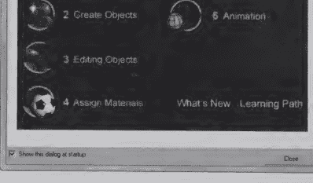

## 使用基于浏览器的参考指南

Autodesk 3ds Max 帮助、What's New、MAXScript 帮助和教程都是基于 Web 浏览器的帮助界面。左侧导航窗格中提供了有组织的主题列表，如图 1.18 所示，右侧包含显示所选主题详细信息的窗格。顶部有多个工具栏按钮用于控制界面。隐藏按钮隐藏左侧导航窗格，后退和前进按钮在已访问页面之间移动，主页按钮返回到帮助文件的第一页，打印按钮打印右侧窗格中的信息，选项按钮显示选项弹出菜单。

### 提示

您也可以通过单击 InfoCenter 工具栏中的问号按钮访问帮助参考。

左侧导航窗格上方有四个选项卡，选中时打开单独的面板。内容面板显示主题列表；索引面板按字母顺序列出所有主题；搜索面板包含一个文本字段，您可以在其中搜索特定关键字；收藏夹面板保留您添加到列表中的主题书签列表。

在整个文本描述中，与其他相关主题链接的关键字以蓝色显示并带下划线。

### 图 1.18

用户参考包含用于查看命令索引和搜索参考的面板。

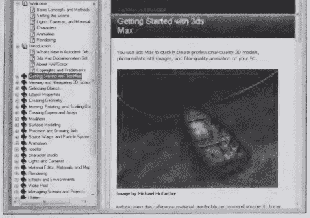

## 控制和配置视口

虽然 Max 由许多不同的界面元素组成，例如面板、对话框和菜单，但视口是会吸引您注意的主要区域。四个主要视口构成了界面的大部分。您可以将视口想象成观看电视屏幕而不是遥控器。学习控制和使用视口可以极大地提高您对 Max 的舒适度。没有什么比无法旋转、平移和缩放视图更令人沮丧的了。

视口具有大量设置和控件，可用于提供成千上万种查看场景的方式，而初学者可能会因无法控制所见内容而感到沮丧。Max 包含几个方便的小工具，使导航视口变得更加容易。本章包含您需要了解的所有细节，以便让视口揭示其秘密。

## 理解 3D 空间

谈论 3D 空间似乎很愚蠢，因为我们生活和移动于 3D 空间中。如果我们停下来思考一下，3D 空间对我们来说是自然的。例如，考虑在游泳池中定位您的孩子。如果您站在泳池边，孩子可能在您的左边或右边，在您前面或后面，或在您下面的水中或在您上面的高台上。每组方向都代表 3D 空间中的一个维度。

现在想象您正在绘制一张地图，标出孩子在游泳池中的位置。使用绘图（它是 2D 的），您可以用左、右、上或下描述孩子在地图上的位置，但上面和下面的描述已经丢失。通过从 3D 参考移动到 2D 参考，维度的数量减少了。

| 本章内容 |
|---|
| 理解 3D 空间 |
| 使用 ViewCube 和 SteeringWheels |
| 使用视口导航控件按钮 |
| 使用视口配置对话框控制视口设置 |
| 加载视口背景图像 |

## 第一部分：开始使用 3ds Max

3D 计算机艺术家面临的难题是，如何在计算机屏幕等 2D 设备上表示 3D 对象？3ds Max 提供的答案是呈现场景的多个视图，称为视口。视口是一个小窗口，从一个视角显示场景。这些视口是进入 Max 3D 世界的窗口。每个视口都有许多设置和查看选项。

## 学习轴测图与透视

在 3D 世界的视图中，存在两种不同类型——轴测图和透视。轴测图视图在 CAD 世界中很常见，查看者与物体相距无限远，使得所有平行线保持平行。透视视图模拟我们眼睛的实际工作方式，并将所有点收敛到远处的一个位置。

如果您沿着一排物体看，就能清楚地看到这两种视图之间的区别。例如，如果您沿着道路旁一排长长的树木看，树木最终会在地平线上合并。在轴测图视图中，线条在远去时保持平行。图 2.1 用左侧的轴测图视图和右侧的透视视图展示了此示例。

### 图 2.1

轴测图和透视视图

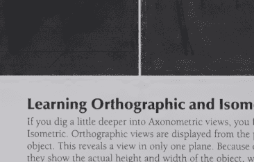

## 学习正交和等距视图

如果您更深入地研究轴测图视图，会发现两种不同类型——正交和等距。正交视图是从沿着轴线直视物体角度显示的。这仅显示一个平面中的视图。因为正交视口受限于一个平面，所以它们显示物体的实际高度和宽度，这就是 CAD 世界广泛使用正交视图的原因。等距视图不受单一轴线的限制，可以从任何位置查看场景，但所有尺寸仍然保持不变。

## 第 2 章：控制和配置视口

## 发现 Max 中的视口

Max 中可用的正交视口包括前、后、上、下、左和右。Max 启动时可见上、前和左正交视口。视口的左上角显示视口名称。第四个默认视口是透视视图。一次只有一个视口，即活动视口处于启用状态。黄色边框突出显示活动视口。

图 2.2 显示了带有 PT-328 美国鱼雷艇 Viewpoint 模型的视口。您可以在每个视口中从不同方向看到模型。如果您想从船尾到船艏测量船的长度，可以使用上视口或左视口获得准确的测量值，而可以使用前视口和左视口来测量其精确高度。因此，使用这些不同的视口，您可以准确地处理所有物体尺寸。

Max 中的等距视图称为正交视口。您可以通过旋转任何默认的非透视视图来创建正交视口。

### 提示

Max 包含多个键盘快捷键，可快速更改活动视口中的视图，包括 T（顶视图）、B（底视图）、F（前视图）、L（左视图）、C（摄像机视图）、$（聚光灯视图）、P（透视视图）和 U（正交用户视图）。按 V 键会打开四象限菜单，让您选择新视图。

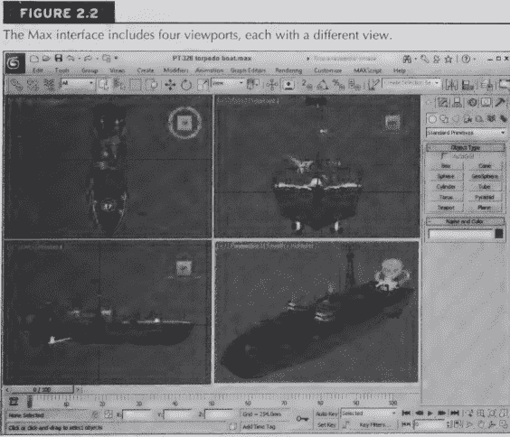


## 使用导航小工具

在 3D 中工作的一个关键优势是你可以从无数的视角查看模型，但你必须先学会导航视口，才能切换到这些无尽的视角。能够快速导航视口对于在 Max 中工作至关重要，也是你应该掌握的第一个技能。

为了使在视口内导航和在各种视图之间切换的过程更轻松，Max 提供了一些导航小工具，使这项工作变得简单。这些半透明的小工具悬浮在每个视口的右上角，提供了一种无需访问工具、选择菜单或甚至使用键盘快捷键即可更改视图的方法。

## 使用 ViewCube

ViewCube 由一个在地面平面上环形中央的 3D 立方体组成，每个面都标有标签。其目的是显示视口的当前方向，但它也是交互式的，并提供了一种快速在不同视图之间移动的方法。

如果将光标拖动到 ViewCube 的顶部，如图 2.3 所示，你会注意到随着光标在其上移动，立方体的面、角和边会被高亮显示。如果在立方体的任何部分被高亮时单击，视口将被动画化并移动到新视图，使其定位为好像指向所选部分。通过缓慢动画化到新视图的过渡，你可以更好地了解模型的尺寸和形状。它也使在模型被扭转到奇怪角度时重新定向模型变得容易。例如，如果你单击标有 Top 的立方体面，那么视图将从其当前视图移动，直到假设 Top 视图。

### FIGURE 2.3

ViewCube 让你可以快速更改当前视图。

Go to home view

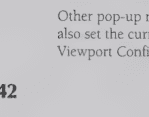

ViewCube 还允许你单击并拖动立方体来旋转视图。你也可以单击并拖动底座环来围绕其当前方向旋转模型。ViewCube 上方有一个小房子图标。单击此图标会将视图更改为定义的 home view。你可以通过右键单击 ViewCube 并从弹出菜单中选择 Set Current View as Home 选项来设置 Home 视图。这些相同的菜单选项也在 Views ▸ ViewCube 菜单中可用。如果 ViewCube 不可见，你可以使用 Views ▸ ViewCube ▸ Show For Active View 来启用它。还有一个 Show For All Views 选项。

其他弹出菜单选项让你在正交和透视视图之间切换视图。你还可以将当前视图设为 Front、重置 Front 视图，并打开位于视口配置对话框中的 ViewCube 面板，如图 2.4 所示。

### FIGURE 2.4

视口配置对话框中的 ViewCube 面板让你控制 ViewCube 的出现位置和方式。

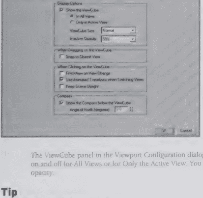

视口配置对话框中的 ViewCube 面板包括用于为 All Views 或仅为 Only the Active View 打开和关闭 ViewCube 的设置。你还可以设置 ViewCube 的大小和非活动不透明度。

### Tip

如果你喜欢 ViewCube，但觉得它占用了太多视口空间，那么你可以将其大小更改为 Small 或 Tiny，或者将其非活动不透明度设为 0。当其非活动不透明度设为 0 时，ViewCube 完全不可见，直到你将光标移至其位置，导致其出现。

你还有选项来控制单击或拖动 ViewCube 时发生的情况。你可以在拖动 ViewCube 时吸附到最近的视图，并有选项在视图更改时自动使模型适合视图、使用动画过渡以及保持场景直立。如果你发现拖动 ViewCube 时视图总是以奇怪的角度结束，请尝试启用 Keep Scene Upright 选项。最后，你有一个在 ViewCube 下方显示罗盘的选项，以及一个用于更改罗盘方向的北角度设置。罗盘有助于旋转模型，但如果你的模型是像没有顶部或底部的行星之类的东西，禁用罗盘是有意义的。

## 使用 SteeringWheels

ViewCube 对于在默认视图之间切换和旋转当前视图非常有用，但还有许多其他导航工具未被 ViewCube 覆盖。为了处理这些其他导航工具，例如缩放和平移，Max 包含 SteeringWheels，另一个用于导航视口的小工具

## Part I: Getting Started with 3ds Max

当 Max 首次启动时，SteeringWheels 已关闭，但你可以使用 Views➜SteeringWheels➜Toggle SteeringWheels 菜单或按 Shift+W 快捷键启用此小工具。一旦启用，不同部分会在你移动到其上时高亮显示。完整的导航轮，如图 2.5 所示，包括以下模式：

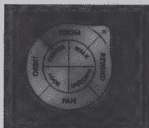

SteeringWheel 小工具包含多种导航视口的方式。

- **Zoom:** 使视图围绕枢轴缩放进出场景。枢轴通过按住 Ctrl 键同时单击设置。
- **Orbit:** 使视图围绕枢轴轨道。枢轴通过按住 Ctrl 键同时单击设置。
- **Pan:** 使视图在你拖动光标的方向平移。
- **Rewind:** 当你更改场景时，Max 会记住你停止的每个视图并将这些视图保存在缓冲区中。Rewind 模式将这些视图显示为小缩略图，如图 2.6 所示，并让你通过拖动鼠标在它们之间移动。这允许你倒回到缓冲区视图并向前移动。

### Tip

**使用 Rewind 功能在缓冲的缩略图视图之间移动会逐渐动画化相邻缩略图之间的过渡，并允许你单击以将视图更改为两个缓冲视图之间的视图。**

- **Center:** 让你单击一个对象使其成为缩放和轨道的枢轴中心。
- **Walk:** 使你像在其中行走一样向前穿过场景。按住 Shift 键可让你上下移动。
- **Look:** 使摄像机左右旋转，好像在向侧面看。
- **Up/Down:** 使视图从当前位置上下移动。

在轮子的右上角有一个小 X 图标。此图标用于关闭 SteeringWheel 小工具。在轮子的右下角有一个小向下箭头。此图标打开一个弹出菜单。使用弹出菜单，你可以选择不同的轮类型、转到由 ViewCube 定义的 home view、增加或减少行走速度、恢复原始中心，或打开视口配置对话框中的 SteeringWheels 面板，如图 2.7 所示。这些相同的选项也在 Views➜SteeringWheels 菜单中可用，以及一个用于打开和关闭 SteeringWheels 的 Toggle 选项（Shift+W）。

使用视口配置对话框中的 SteeringWheels 面板，你可以设置 SteeringWheels 的大小和不透明度。还有用于控制不同模式如何显示的设置。

## Chapter 2: Controlling and Configuring the Viewports

### FIGURE 2.6

Rewind 模式让你在最近的视图之间前后移动。

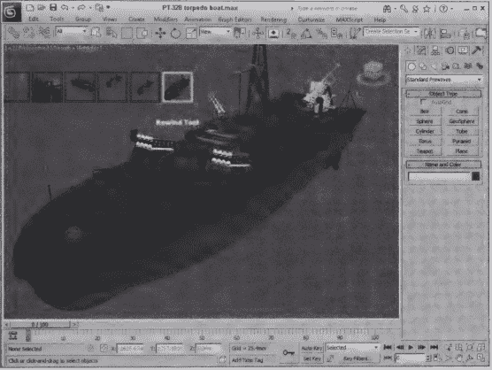

### FIGURE 2.7

视口配置对话框中的 SteeringWheels 面板包含各种轮的设置。

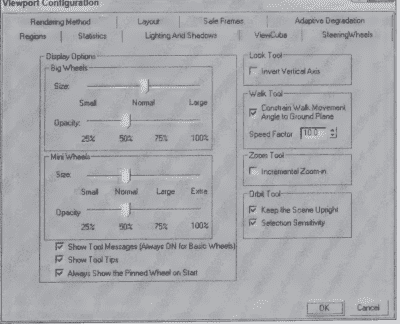

## Part I: Getting Started with 3ds Max

## Tutorial: Navigating the active viewport

随着时间的推移，导航视口对你来说会变得自然，但你需要练习才能达到这一点。在本教程中，你有机会让视口转一转——字面意思。

要练习导航视口，请按照以下步骤操作：

- 1. 打开 DVD 上 Chap 02 目录中的 Bruce the dog.max 文件。
  此文件包含由 Viewpoint 创建的狗模型（亲切地命名为 Bruce）。它在你导航视口时提供参考。活动视口是 Perspective 视口。
- 2. 单击 Min/Max Toggle 按钮（或按 Alt+W）使 Perspective 视口填满四个视口的空间。
- 3. 单击 ViewCube 中的 Front 面以过渡到前视图。然后将光标移至 ViewCube 的右上角并单击以将视图设为透视视图。
- 4. 选择 Views↔SteeringWheels↔Toggle SteeringWheels（或按 Shift+W），然后按住 Ctrl 键并单击 Bruce 的头部以设置枢轴。然后将光标移至 Zoom 按钮并拖动，直到 Bruce 的头部填满视口。
- 5. 在 Steering Wheel 仍处于活动状态时，将光标移至 Pan 按钮并拖动窗口，直到 Bruce 的头部均匀居中于视口中，如图 2.8 所示。右键单击视口以切换关闭 SteeringWheel 小工具。

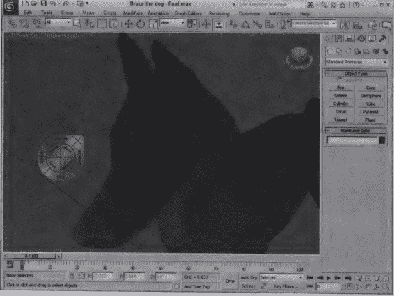

使用 Zoom 和 Pan 控制，Perspective 视口已放大到狗的头部。


## 使用滚轮鼠标控制视口

现在我已经解释了视口导航小工具，我将再介绍一种轻松控制视口的方法。通常，使用鼠标控制视口是最快捷的方式。要真正发挥鼠标的优势，你需要使用带滚轮的鼠标（滚轮同时也作为中键）。

在活动视口中滚动滚轮会像中括号键（[ 和 ]）一样分步放大和缩小视口。你可以通过按住 Ctrl 和 Alt 键同时拖动滚轮来实现精确缩放。

点击并拖动滚轮按钮可平移活动视口。按住 Alt 按钮点击并拖动可旋转活动视口。如果滚轮无法工作，请检查“首选项设置”对话框中的“视口”面板。你可以选择使用滚轮控制来平移和缩放视口，或定义和使用笔划。

### 警告

**使用滚轮放大时要小心。如果放大过度，内部视野宽度将接近其最小值，缩放会变得不稳定。如果发生这种情况，你可以选择“视图 → 撤消视图更改（Shift+Z）”菜单命令来撤消缩放，或使用“缩放全部”按钮。**

### 交叉引用

笔划在第 4 章“自定义 Max 界面和设置首选项”中进行了介绍。

## 使用视口导航控件

尽管 ViewCube、SteeringWheels 和滚轮使导航视口变得简单，但你仍然可以使用位于界面右下角的标准导航工具。标准视口会显示当前产品的多个不同视图，但在每个视口中，你可以放大特定对象、平移视图或围绕视口中心旋转。要缩放、平移和旋转默认视图，可以使用视口导航控件按钮。点击任一视口导航控件中的视口会自动使所选视口成为活动视口。在表 2.1 中，每个按钮的键盘快捷键在其名称旁的括号中列出。

**表 2.1**

### 视口导航控件

| 工具栏按钮 | 名称 | 描述 |
|---|---|---|
| [Zoom icon] | 缩放 (Alt+Z 或 [ 或 ]) | 通过拖动鼠标或使用中括号键分步缩放，更靠近或远离活动视口中的对象。 |
| [Zoom All icon] | 缩放全部 | 通过拖动鼠标同时放大或缩小所有视口。 |

第 I 部分：入门 3ds Max

| 表 2.3（续） |  |  |
|---|---|---|
| 工具栏按钮 | 名称 | 描述 |
|  | 缩放全部范围 (Ctrl+Alt+Z)、缩放所选对象全部范围 | 放大所有对象或仅所选对象，直到其填满活动视口。 |
|  | 缩放全部视口全部范围 (Ctrl+Shift+Z)、缩放全部视口所选对象全部范围 (Z) | 放大所有对象或仅所选对象，直到其填满所有视口。 |
|  | 视野、区域缩放 (Ctrl+W) | 视野按钮（仅在透视视图中可用）控制视图的宽度。区域缩放按钮可放大通过拖动鼠标所选的区域。 |
|  | 平移 (Ctrl+P 或 I)、漫游 | 通过拖动鼠标或按住 I 键移动鼠标，将视图向左、向右、向上或向下移动。漫游功能使用箭头键或鼠标像第一人称视频游戏一样在场景中移动。 |
|  | 弧形旋转 (Ctrl+R)、弧形旋转所选对象、弧形旋转子对象 | 通过拖动鼠标围绕全局轴、所选对象或子对象旋转视图。 |
|  | 最小/最大切换 (Alt+W) | 使活动视口填满屏幕，取代四个独立视口。再次点击此按钮会再次显示全部四个视口。 |

### 警告

当其中一个视口导航按钮被选中时，它会以黄色高亮显示。在这些按钮高亮显示时，你无法选择、创建或转换对象。在活动视点中右键单击可恢复到选择对象模式。

### 缩放视图

你可以通过多种方式缩放场景。点击“缩放（Alt+Z）”按钮进入缩放模式，你可以通过拖动鼠标放大和缩小视口。这在你拖动所在的任何视口中都有效。缩放按钮右侧是“缩放全部”按钮，其作用与“缩放”按钮相同，只是同时作用于全部四个视口。如果你按住 Ctrl 键在缩放模式下拖动，缩放动作会更快，只需少量鼠标移动即可获得较大缩放量。按住 Alt 键在缩放模式下拖动则效果相反——缩放会变得非常缓慢，需要大幅移动鼠标才能获得少量缩放量。这有助于微调缩放。

### 提示

每当选择了任一视口导航工具时，你可以通过在活动视口中右键单击立即退出该工具。

“缩放全部范围（Ctrl+Alt+Z）”按钮会缩放活动视口，使所有对象（或使用“缩放所选对象全部范围”按钮的所选对象）在视口中可见。可提供“缩放全部视口全部范围（Ctrl+Shift+Z）”按钮，用于将所有视口缩放至所有对象的范围；最受欢迎且最易记住的缩放命令是“缩放全部视口所选对象全部范围（Z）”，用于将所有视口缩放至所选对象的范围。

你可以使用中括号键分步放大（[）和缩小（]）。每次按键都会再缩放一步。区域缩放（Ctrl+W）按钮让你可以拖动以选择要放大的区域。如果你选择了非正交视图，例如透视视图，区域缩放按钮会有一个弹出菜单，称为“视野”。使用此按钮，你可以控制视图的宽窄。这就像在相机上使用广角或长焦镜头一样。该功能与缩放不同，因为随着视野的增加，透视会失真。

### 交叉引用

> **视野**在第 19 章“配置和对准摄像机”中有更详细的介绍。

### 平移视图

视口导航控件还提供两种在视口中平移的方法。在“平移”模式（Ctrl+P）下，在视口中拖动可平移视图。请注意，这不会移动对象，只会移动视图。平移的第二种方式是按住 I 键同时移动鼠标。这称为*交互式平移*。此外，可以按住 Ctrl 和 Alt 键来加快或减慢平移动作。

### 漫游视图

“漫游”按钮是“平移”按钮下的弹出按钮，允许你使用箭头键或鼠标在透视或摄像机视口中穿过场景，就像玩第一人称电脑游戏一样。当此按钮处于活动状态时，光标会变为带箭头的圆圈，箭头指向你移动的方向。你需要在视口中先点击一次，然后才能使用箭头键。

### 警告

> “平移”按钮只有在选择了透视视图或摄像机视图时才是弹出菜单。

“漫游”功能包含多个用于控制摄像机移动的按键。箭头键可使摄像机向前、向左、向后和向右移动（或你也可以使用 W、A、S 和 D 键）。你可以使用 Q（加速）和 Z（减速）键或 [（减小步长）和 ]（增大步长）键来改变移动速度。E 和 C 键（或 Shift+上箭头或 Shift+下箭头）用于在场景中上下移动。Shift+空格键可使摄像机保持水平。拖动鼠标同时摄像机移动会改变摄像机指向的方向。

“漫游”模式的一个方便替代方案是“漫游助手”，可在“动画”菜单上找到。此实用程序打开一个对话框，其中包含用于创建和向路径添加摄像机的按钮。它还具有在摄像机沿路径移动时控制视图左右转动的控件。

### 交叉引用

> “漫游助手”在第 22 章“使用约束和简单控制器进行动画”中有更详细的介绍。

### 旋转视图

旋转视图可能是所有视图更改中最具揭示性的。当选择“弧形旋转（Ctrl+R）”按钮时，如图 2.9 所示，活动视口中会出现一个旋转指南。该旋转指南是一个圆圈，每个象限上都有一个正方形。点击并拖动左右正方形可旋转视图。


## Part I: Getting Started with 3ds Max

左右移动；使用上下两个方块进行相同操作时，视图会上下旋转。点击圆圈内并拖动会在单一平面内旋转，点击并拖动圆圈外部则会绕圆心顺时针或逆时针旋转视图。如果感到困惑，请观察光标，它会根据旋转类型而改变。Ctrl 和 Alt 键也可以加快或减慢旋转视图。图 2.9 还显示了一个使用 Min/Max Toggle 按钮最大化的视口。

**Figure 2.9** — The rotation guide appears whenever the Arc Rotate button is selected.

Rotation guide

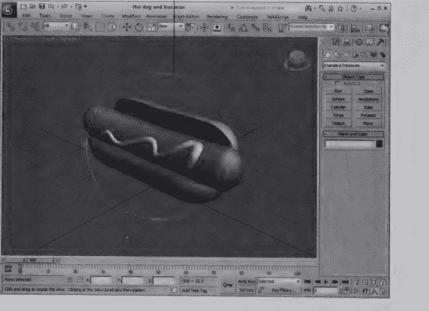

> **Note:** If you rotate one of the default non-perspective views, it automatically becomes an Orthographic view, but you can undo the change using the Views → Undo View Change command or the Shift+Z shortcut.

### Maximizing the active viewport

迟早有一天，视口会感觉太小了。当这种情况发生时，你有几种方法可以增大视口大小。第一个要尝试的技巧是点击并拖动任意视口边框来改变视口大小。拖动视口交汇处可以同时调整所有视口大小。图 2.10 显示了动态调整大小后的视口。

**Figure 2.10** — You can dynamically resize viewports by dragging their borders.

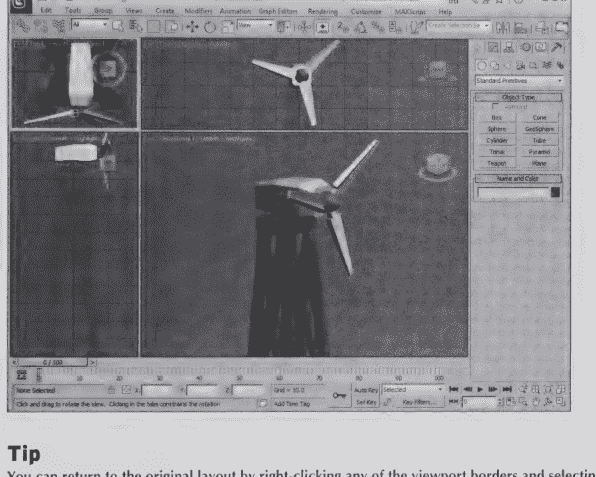

> **Tip:** You can return to the original layout by right-clicking any of the viewport borders and selecting Reset Layout from the pop-up menu.

第二个技巧是使用 Min/Max Toggle (Alt+W) 将活动视口扩展以填满四个视口所占的空间。再次点击 Min/Max Toggle（或按 Alt+W）即可返回到定义的布局。

最大化视口只能暂时解决问题，但在此之前，你可以再进一步，在说服老板给你买更大显示器之前。你可以通过选择 Views → Expert Mode (Ctrl+X) 进入专家模式。它通过移除主工具栏、命令面板和大部分下部界面栏来最大化视口空间。

在大部分界面元素被移除后，你需要依靠菜单、键盘快捷键和四键菜单来执行命令。要重新启用默认界面，请点击 Max 窗口右下角的 Cancel Expert Mode 按钮（或再次按 Ctrl+X）。图 2.11 显示了专家模式下的界面。

**Figure 2.11** — Expert Mode maximizes the viewports by eliminating most of the interface elements.

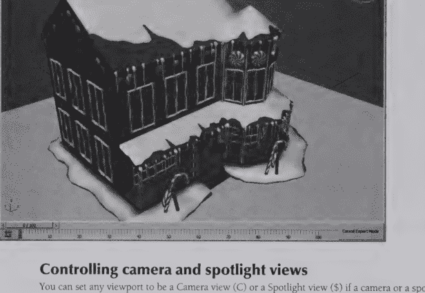

### Controlling camera and spotlight views

如果场景中存在摄像机或聚光灯，你可以将任意视口设置为摄像机视图 (C) 或聚光灯视图 ($)。当其中任一视图处于活动状态时，视口导航控件按钮会发生变化。在摄像机视图中，推拉、滚动、横移、平移、环绕和视场控制会激活。灯光视图包含衰减和热点控制。

> **Cross-Ref:** Chapter 19, “Configuring and Aiming Cameras,” and Chapter 20, “Using Lights and Basic Lighting Techniques,” cover these changes in more detail.

### Changing the Viewport Display

尽管视口导航控件侧重于控制视口中可见的内容，但 Views 菜单中以及每个视口顶部的视口标签中也有许多有用的命令，可直接影响视口。三个视口标签包括通用视口标签（即简单的加号）、视点视口标签和着色视口标签。

### Undoing and saving viewport changes

如果你在视图中迷路了，可以使用 Views → Undo View Change (Shift+Z) 和 Views → Redo View Change (Shift+Y) 来撤消和重做视口更改。这些命令与 Edit → Undo 和 Edit → Redo 命令不同，后者可以撤消或重做几何体更改。

你可以使用 Views → Save Active Viewport 菜单命令保存对视口所做的更改。此命令保存视口导航设置以便召回。要恢复这些设置，请使用 Views → Restore Active Viewport。

> **Note:** The Save and Restore Active Viewport commands do not save any viewport configuration settings, just the navigated view. Saving an active view uses a buffer, so it remembers only one view for each viewport.

### Disabling and refreshing viewports

如果场景变得过于复杂，你可能会在等待每个视口更新更改时出现减速，但不用担心，因为有几个选项可以帮助你。第一个要尝试的选项是禁用视口。

你可以通过右键单击通用视口标签并从弹出菜单中选择 Disable View 菜单命令来禁用视口，也可以通过键盘快捷键 D 来操作。当禁用的视口处于活动状态时，它会正常更新；当它处于非活动状态时，视口根本不会更新，直到它再次变为活动状态。禁用的视口会在左上角视口标签旁边显示“Disabled”字样来标识。

提高视口更新速度的另一个技巧是禁用 Views → Update During Spinner Drag 菜单选项。更改参数微调器可能会导致减速，因为微调器变化时每个视口都需要更新。如果微调器变化很快，即使是强大的系统也会明显变慢。禁用此选项会导致视口等待微调器停止变化后再更新。

有时在进行更改后，视口并未完全刷新。这通常发生在其他程序的对话框被移动到视口前面或对象被移动时发生，因为它们经常相互遮挡并且线条会消失。如果发生这种情况，你可以使用 Views → Redraw All Views 菜单命令（键盘快捷键，\`）强制 Max 刷新所有视口。Redraw All Views 命令刷新每个视口并使所有内容再次可见。

### Viewing materials in the viewports

Views 菜单还包括几个用于在视口中显示场景细节（如材质、灯光和阴影）的命令。这些选项中的每一个都可能降低刷新率，但它们提供了即时反馈，这通常很有帮助。

贴图也会占用大量内存。Views → Show Materials in Viewport As → Standard Display with Maps 命令会在视口中显示所有应用的贴图。如果你不需要查看贴图，则切换到 Views → Show Materials in Viewport As → Standard Display 将加快显示速度。还有 Hardware Display 和 Hardware Display with Maps 选项，可使用显卡内存来显示应用的纹理。

> **Cross-Ref:** More on applying texture maps is covered in Chapter 17, "Adding Material Details with Maps."

### Displaying lights and shadows in the viewports

视口着色标签菜单中包含用于在视口中启用灯光和阴影效果的选项。

视口着色标签子菜单中的选项默认处于禁用状态，这表示不显示阴影并将灯光数量限制为 8 个。有使用场景灯光或默认灯光照亮场景的选项。视口中阴影不可见，除非启用了硬件着色。视口着色标签菜单中有一个启用硬件着色的选项。你也可以使用 Shift+F3 键盘快捷键启用此选项。启用硬件着色后，你可以打开视口阴影，如图 2.12 所示。

在视口中预览阴影需要使用 Direct3D 驱动程序，并且你的显卡必须支持 Shader Model 2.0（适用于 Good 显示选项）或 Shader Model 3.0（适用于 Best 显示选项）。你可以通过选择 Help → Diagnose Video Hardware 菜单命令来检查可以使用哪种视口着色方法。这会运行一个脚本，并在 MAXScript Listener 窗口中报告其结果，如图 2.13 所示。

> **Note:** If your computer doesn’t support either of these Shader models, then the options will be disabled in the viewport shading label menu and in the Viewport Configuration dialog box.

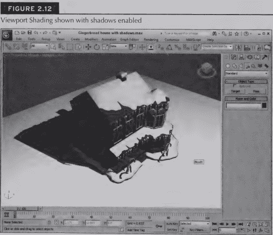


## 图 2.13

“帮助→诊断视频硬件”菜单会在 Listener（侦听器）窗口中运行一个脚本，显示你的显卡支持哪种着色方法。

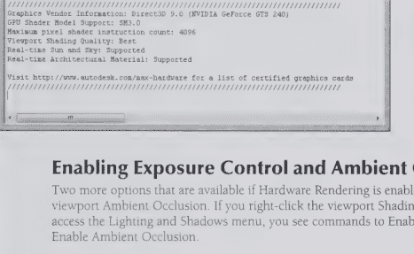

## 启用曝光控制和环境光遮蔽

如果启用了硬件渲染，还可以使用另外两个选项：视口曝光控制和视口环境光遮蔽。如果在视口顶部的视口着色标签上右键单击，并访问“照明和阴影”菜单，就可以看到“在视口中启用曝光控制”和“启用环境光遮蔽”命令。

## 交叉引用

曝光控制是一种高级渲染设置，在第46章“使用大气和渲染效果”中有更详细的介绍。环境光遮蔽是一种照明效果，它通过使物体根据其对光线的遮挡方式在周围物体上投射阴影来增加场景的真实感；这在第45章“使用高级照明、光线跟踪和辐射度”中有所介绍。

## 配置视口照明和阴影

“视口配置”对话框在“照明和阴影”面板中包含许多用于视口照明和阴影的设置，如图 2.14 所示。该面板包含许多与视口着色标签菜单中相同的命令。它还包含用于将照明方法的“质量”设置为“良好”或“最佳”的选项。还有用于调整环境光遮蔽效果质量的选项，并且你可以选择显示硬阴影或软阴影。你还可以覆盖视口阴影强度，以在阴影过暗时将其调暗。

“默认照明”切换开关会停用你当前的灯光并使用默认灯光。当你在黑暗环境中查看对象时，此选项很有帮助，因为默认照明会照亮整个场景，而无需你移除或关闭灯光。你还可以指定默认照明使用一盏灯还是两盏灯。单灯光选项会创建一盏位于观察者身后并与场景成一定角度的灯光。使用一盏灯的场景比使用两盏灯的场景更新更快。

## 图 2.14

“照明和阴影”面板包含用于在视口中显示交互式灯光和阴影的默认设置。

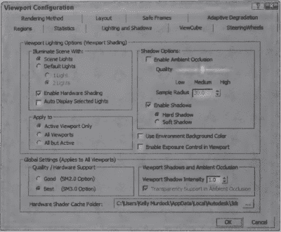

要在视口中启用照明和阴影，请执行以下步骤：

- 1. 从 DVD 上的 Chap 02 目录中打开 Foot bones.max 文件。
- 该文件包含一组由 Viewpoint Datalabs 创建的足部骨骼。场景中还添加了一盏泛光灯。
- 2. 在视口着色标签上右键单击，然后选择“照明和阴影 ▸ 启用硬件着色”选项。然后从同一菜单中选择“配置”选项，以访问“视口配置”对话框中的“照明和阴影”面板。
- 选择“启用环境光遮蔽”设置，并将“质量”设置为“高”。选择“启用阴影”选项，并选择“软阴影”选项。然后点击“确定”按钮。
- 3. 点击“选择并移动”工具栏按钮，并在场景中拖动灯光对象。
- 随着灯光的移动，足部骨骼下方的阴影会自动更新，如图 2.15 所示。注意视口着色标签如何列出环境光遮蔽已启用以及阴影如何变得柔和。

“照明和阴影”面板中的另一个选项是“自动显示选定灯光”。此选项也可以在“视图 ▸ 视口照明和阴影”菜单中找到。在场景中放置和对准灯光时，此选项很有用。它会使选定的灯光自动显示在着色视口中。“视图 ▸ 视口照明和阴影”菜单还包含用于锁定和解锁选定灯光的选项。

## 图 2.15

当灯光在场景中移动时，灯光和阴影会实时更新。

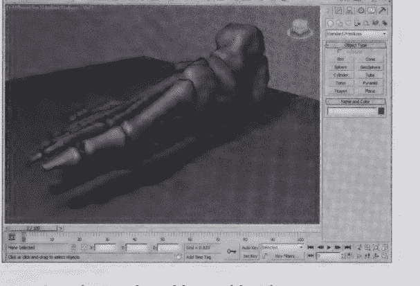

## 使用 xView 定位网格问题

在建模或导入网格对象时，几何体可能存在许多问题，这些问题的几何体可能会导致渲染瑕疵，例如法线翻转、面重叠和开放边。定位这些有问题的区域可能很棘手，需要进行多次渲染才能正确找到。视口内有一个强大的分析功能，可用于定位许多特定的问题区域。此功能称为 xView，你可以从“视图”菜单或视口着色标签中访问它。

xView 分析工具可以定位并高亮显示以下异常：

- 面朝向：高亮显示当前选择中面的背面，以快速识别法线翻转的面。
- 重叠面：高亮显示任何相互堆叠的面，这些面可能会导致渲染问题。
- 开放边：识别几何体中不需要的孔洞。
- 多重边：检查相互堆叠的边。每条边应仅连接到两个面。
- 孤立顶点：高亮显示未连接到任何对象的顶点。这些顶点只会占用空间。
- 重叠顶点：标记在给定容差范围内的顶点。
- T 型顶点：高亮显示三条边相交的顶点。这可能会终止边循环。
- 缺少 UVW 坐标：显示任何没有用于应用纹理的 UVW 坐标的面。
- 翻转 UVW 面：高亮显示法线指向相反方向的任何翻转面。
- 重叠 UVW 面：显示纹理相互重叠的任何面。

无论选择哪个选项，都会以绿色显示在视口底部，并列出违规子对象的数量，例如“孤立顶点：12 个顶点”。菜单中还包括“选择结果”选项。如果所选选项具有设置（例如重叠边的容差），你可以选择“配置”选项来设置此设置，或点击视口底部的“单击此处进行配置”文本。

## 配置视口

如果视口导航控件有助于定义你看到的内容，那么“视口配置”对话框则有助于定义你在视口中看到对象的方式。你可以使用此对话框配置每个视口。要打开此对话框，请选择“视图►视口配置”菜单命令。你也可以通过右键单击位于每个视口左上角的视口常规标签，然后从弹出菜单中选择“配置”来打开此对话框。

视口标签分为常规菜单（显示为加号）、视点标签和着色方法。这些标签的各种弹出菜单也包含“视口配置”对话框中的许多设置，但该对话框允许你一次更改多个设置。你也可以通过右键单击右下角的任意视口导航控件按钮，使此对话框为活动视口显示。

“视口配置”对话框包含多个面板，包括“渲染方法”、“布局”、“安全框”、“自适应降级”、“区域”、“统计信息”、“照明和阴影”、“ViewCube”和“SteeringWheels”。“首选项设置”对话框还包括许多用于控制视口行为和外观的设置。

## 交叉引用

有关“首选项设置”对话框及其所有选项的更多信息，请参阅第4章“自定义 Max 界面和设置首选项”。

## 设置视口渲染方法

复杂的场景需要更长的时间来显示和渲染。用于视口的渲染器经过高度优化，速度非常快，但如果你正在处理一个具有大量复杂纹理的巨大模型，并且每个视口都设置为显示最高质量的视图，那么更新每个视口可能会使程序运行缓慢。如图 2.16 所示，“视口配置”对话框的“渲染方法”面板可让你为活动视口、所有视口或除活动视口之外的所有视口设置渲染设置。

## 提示

如果你在等待 Max 完成任务（例如重绘视口）时卡住，你随时可以按 Escape 键立即挂起任何任务并将控制权返回到界面。


## 图 2.16

渲染方法面板包含用于指定渲染级别和其它几个视口渲染选项的控件。

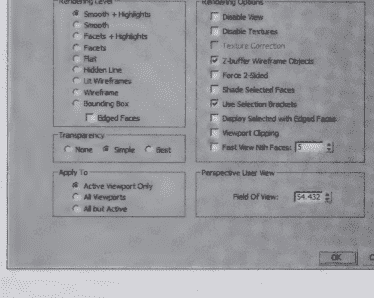

### 注

这些设置对使用渲染菜单指定的最终渲染没有影响。它们仅影响视口中的显示。

## 渲染级别

渲染级别选项从最慢到最快包括以下内容：

- Smooth+Highlights：显示带光照高光的光滑表面
- Smooth：显示没有任何光照效果的光滑表面
- Facets+Highlights：显示单个多边形面和光照高光
- Facets：显示没有任何光照效果的单个多边形面
- Flat：使用单一颜色显示整个对象
- Hidden Line：仅显示面向摄像机的多边形边缘
- Lit Wireframes：显示带光照效果的所有多边形边缘
- Wireframe：仅显示所有多边形边缘
- Bounding Box：显示会包围对象的盒子

虽然它实际上并不是一种渲染方法，但 Edged Faces 选项在选择了着色渲染方法时会显示每个面的边缘。你可以使用 F4 键盘快捷键启用和禁用此选项。图 2.17 并排显示了所有各种视口渲染方法应用于一个简单球体。

## 第一部分：开始使用 3ds Max

## 图 2.17

视口渲染方法从左到右显示。第一行：Smooth+Highlights、Smooth、Facets+Highlights、Facets 和 Flat。第二行：Hidden Line、Lit Wireframes、Wireframe、Bounding Box 和应用于 Smooth+Highlights 的 Edged Faces。

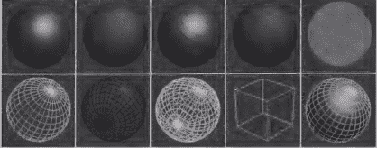

最简单的渲染设置是 Wireframe。它在重绘时非常快速，同时能很好地表示对象。默认情况下，Top、Front 和 Left 视口设置为 Wireframe，而 Perspective 视口设置为 Smooth+Highlights。面片渲染将每个面显示为平面，但它将对象显示为实体模型，有助于检查对象是否重叠。Smooth 渲染级别显示最终渲染的粗略近似。将渲染级别设置为包含高光可以显示场景中灯光的效果。

### 注

**许多效果，例如凹凸贴图、透明贴图和高级光照，在视口中无法看到，仅在最终渲染中出现。**

## 查看透明度

除了这些着色类型之外，你还可以将视口设置为显示包含透明度的对象（在材质编辑器对话框中设置）。三个透明度选项为 None，不显示任何透明度；Simple，以交叉阴影显示透明对象；以及 Best，包含透明效果以获得平滑的外观。图 2.18 借助一个饥饿的小动画生物及其幽灵般的对手展示了这三种透明度选项。

## 图 2.18

视口透明度选项包括 None、Simple 和 Best。

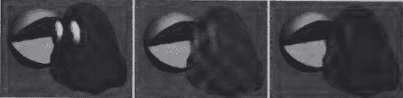

## 渲染选项

渲染方法面板中的渲染选项部分包含其它几个选项，例如禁用视图 (D) 和禁用纹理。这些选项可以帮助加快视口更新或增加视口中对象的视觉细节。

### 提示

在视口更新的任何时候，你都可以单击鼠标或按键盘键来取消重绘。Max 不会让你等待屏幕重绘才能使用鼠标或键盘快捷键执行命令。

禁用纹理选项关闭纹理渲染以实现快速视口更新。纹理校正选项通过插值当前纹理而不是重新渲染来加快渲染更新。

z 缓冲区是用于跟踪每个对象与摄像机距离的内存区域。启用 Z-Buffer Wireframe Objects 会使线框对象从后到前绘制。如果你的线框线似乎消失了，可能是视口按任意顺序绘制线条，一些本应在后面的线条被绘制在前面的线条之上。启用此选项有助于防止这种情况。

强制双面使所有面的两侧都可见。例如，假设你有一个带孔的球体。此设置使你能够通过孔看到球体的内部表面。图 2.19 显示了一个表面被星形切除的球体。左图已禁用强制双面选项，右图已启用。

## 图 2.19

强制双面选项使对象的内部可见。

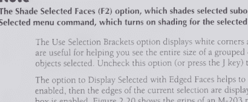

## 使选定对象可见

你可以使用 Shade Selected Faces (F2) 将选定的子对象面着色为红色，使其易于看到。

### 注

Shade Selected Faces (F2) 选项，该选项将选定的子对象面着色，与 Views→ Shade Selected 菜单命令不同，后者将在所有视口中为选定对象打开着色。

Use Selection Brackets 选项会在当前选择周围显示白色角落。选择括号有助于你看到分组对象的整个大小，但在选择了许多对象时如果一直开启可能会很烦人。取消选中此选项（或按 J 键）可使这些括号消失。

Display Selected with Edged Faces 选项有助于突出显示选定对象。如果启用此选项，则当前选择的边缘会显示，无论 Edged Faces 复选框是否启用。图 2.20 显示了由 Viewpoint Datalabs 创建的 M-203 步枪的控制点，已启用 Display Selected with Edged Faces 和 Use Selection Brackets 选项。这些选项使当前选择易于看到。

## 第一部分：开始使用 3ds Max

## 图 2.20

Display Selected with Edged Faces 和 Use Selection Brackets 选项使识别当前选择变得容易。

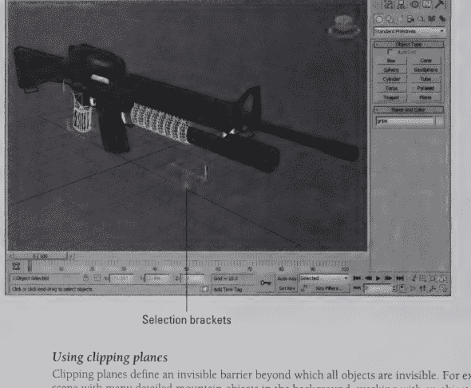

选择括号

## 使用裁剪平面

裁剪平面定义了一个不可见的屏障，超出该屏障的所有对象都不可见。例如，如果你有一个场景，其中背景中有许多详细的山脉对象，在前景对象上工作会很困难。通过将裁剪平面设置在两者之间，你可以在更新场景时无需每次都重绘山脉对象即可在前景对象上工作。这仅影响视口，不影响渲染输出。

启用 Viewport Clipping 选项会在视口右侧放置一条带有两个箭头的黄色线，如图 2.21 所示。顶部箭头代表后裁剪平面，底部箭头是前裁剪平面。上下拖动箭头以设置裁剪平面。你可以通过右键单击视口透视图标签并从弹出菜单中选择 Viewport Clipping 来快速打开或关闭 Viewport Clipping。

## 启用快速视图

Fast View 选项通过仅绘制有限数量的面来加快视口更新。微调值决定面的绘制频率。例如，设置为 5 仅绘制每第五个面。此选项使视口更新渲染得更快，并让你了解对象而无需显示整个对象。

## 第 2 章：控制和配置视口

## 图 2.21

裁剪平面可用于显示此汽车模型的内部。

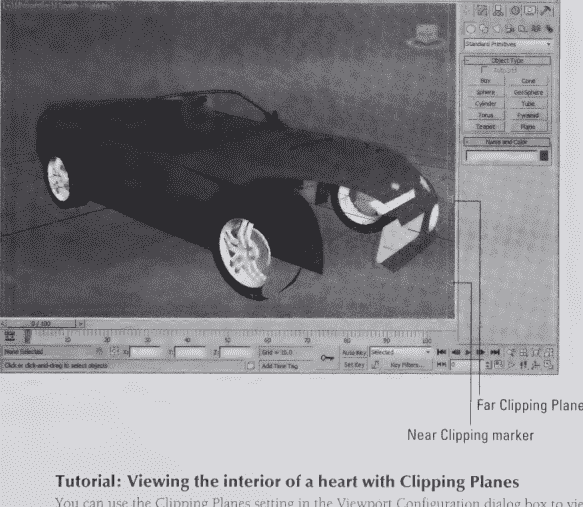

远裁剪平面标记

近裁剪标记

## 教程：使用裁剪平面查看心脏内部

你可以在视口配置对话框中使用裁剪平面设置来查看由 Viewpoint 创建的此类心脏模型等模型的内部。

要查看心脏模型的内部，请按照以下步骤操作：

- 1. 从 DVD 上的 Chap 02 目录打开 Heart interior.max 文件。
- 2. 选择 Views > Viewport Configuration 打开视口配置对话框。启用 Viewport Clipping 选项和 Force 2-Sided 选项，然后关闭对话框。
- 3. 裁剪平面标记出现在视口右侧。顶部标记控制后裁剪平面，底部标记控制前裁剪平面。将底部裁剪平面标记向上拖动以切过心脏模型，显示其内部，如图 2.22 所示。

## 设置视场

你还可以在视口配置对话框中更改透视图的视场 (FOV)。要创建鱼眼视图，将 FOV 设置增加到 10 或更小。最大 FOV 值为 180，默认值是 45。你还可以使用视口导航控件中的视场按钮更改视场。然而，视口配置对话框让你输入精确值。


## 第一部分：3ds Max 入门

### 图 2.22

通过使用裁剪平面，可以显示模型的内部。

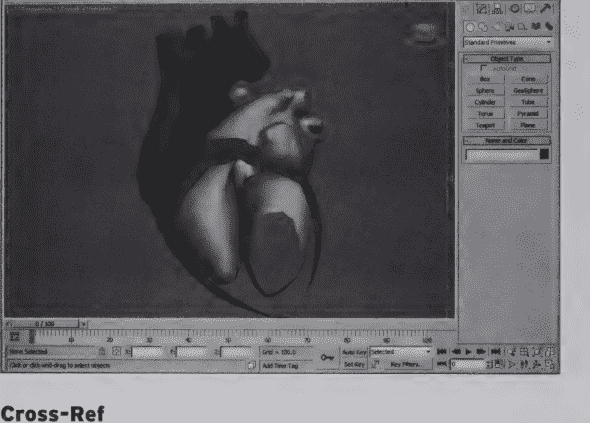

### 交叉引用

有关视野的更多内容，请参阅第 19 章“配置并瞄准摄影机”。

### 抓取视口图像

这不是渲染，但你可以使用“工具”→“抓取视口”抓取活动视口的图像。抓取图像之前，会弹出一个简单的对话框，要求你为抓取的图像添加标签。图像会加载到渲染帧窗口中，其标签显示在图像的右下角，如图 2.23 所示。“工具”→“抓取视口”菜单还包括创建、查看和重命名动画序列文件的选项，这提供了一种快速创建动画预览的方法。

### 交叉引用

有关使用动画预览的更多内容，请参阅第 21 章“理解动画和关键帧”。

### 更改视口布局

既然你已开始了解视口，你可能想更改所显示视口的数量和大小。如图 2.24 所示，“视口配置”对话框中的“布局”面板提供了多种布局，可替代默认布局（并不是说默认布局及其四个大小相同的视口有什么问题）。

### 图 2.23

可以使用“工具”菜单中的菜单命令抓取视口图像。

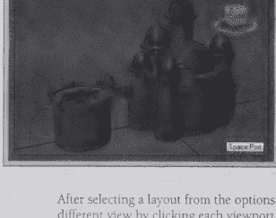

从面板顶部的选项中选择一种布局后，你可以通过单击“布局”面板中的每个视口并从弹出菜单中选择一个视图，为每个单独视口指定不同的视图。视图选项包括透视、正交、前、后、顶、底、左、右、ActiveShade、轨迹、网格（前、后、顶、底、左、右、显示平面）、场景资源管理器、扩展（资源浏览器、Biped 动画工作台、运动混合器、材质资源管理器、MAXScript 侦听器）和图形。这些视图选项也可以通过右键单击视口左上角的视角标签来获得。图 2.25 显示了打开轨迹视图、示意图视图、资源浏览器和透视视图的视口布局。

### 图 2.24

“布局”面板提供了许多布局选项。

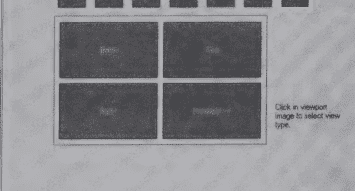

## 第一部分：3ds Max 入门

### 图 2.25

其他界面（如轨迹视图、示意图视图和资源浏览器）可以在视口内打开。


如果场景中存在摄影机和聚光灯，也可以将视图设置为摄影机和聚光灯。每个存在的摄影机和灯光都会按名称列在弹出菜单的顶部。

### 使用安全框

完成一个动画并将其转换到某种广播媒体，却发现在最终放映时动画的整个左侧被裁剪掉，这可能会让人沮丧。如果你依赖活动视口的大小来显示最终输出的边缘，那可能会大错特错。使用安全框功能，你可以在视口中显示一些参考线，以显示内容必须处于什么位置才能避免此类问题。

“视口配置”对话框中的“安全框”面板允许你定义几个安全框选项，如图 2.26 所示，包括以下各项：

- 活动区域：标记将要渲染的区域，显示为黄色线条。如果向视口添加背景图像并选择“匹配渲染输出”选项，则背景图像将适合活动区域。
- 动作安全区：确保最终渲染文件中可见的区域，以浅蓝色线条标记；此区域外的对象将位于显示器边缘，可能会变形。
- 标题安全区：标题可以安全显示而不会变形或溢出的区域，以橙色线条标记。
- 用户安全区：由用户定义的输出区域，以洋红色线条标记。
- 12 格栅格：在视口中显示网格，以粉红色网格标记。

### 图 2.26

“安全框”面板允许你指定要渲染的区域。


对于每种类型的安全框，你可以通过输入“水平”、“垂直”或“两者”字段中的值来设置百分比缩减。“12 格栅格”选项提供 4×3 和 12×9 的纵横比。

“在活动视图中显示安全框”选项会在活动视口中显示安全框边框。你可以通过右键单击视口左上角的视角标签，然后在弹出菜单中选择“显示安全框”（或使用 Shift+F 键盘快捷键），快速启用或禁用安全框。

图 2.27 显示了一个示例透视视口，其中启用了所有安全框参考线。安全框显示我的恐龙的顶部和底部在渲染时会被裁剪掉。

### 了解自适应降级

当你在视口中预览包含数百个对象的复杂场景时，更新视口可能会变得极其缓慢。这会使你难以且缓慢地查看作品。Max 中解决此问题的功能称为自适应降级，虽然它听起来像是某种外星人用来解除你武装的武器，但它可以强制视口按指定的每秒帧数显示。如果显示更新耗时太长而无法维持目标帧速率，它会自动降低渲染级别以保持帧速率。此选项非常有用，因为在测试动画时，你不太关心模型细节或纹理。

“自适应降级”面板可在“视口配置”对话框中找到，如图 2.28 所示。

你可以使用“视图”→“自适应降级”菜单命令（或按 O 键）启用自适应降级。你也可以通过位于界面底部“程序栏”和“添加时间标记”之间的按钮打开和关闭自适应降级。“自适应降级”按钮看起来像一个简单的立方体。启用后，自适应降级会在需要时使用，以保持显示更新快速。当“自适应降级”按钮启用时，它会高亮显示为黄色。当视口正在降级时，该按钮会变为蓝色。

## 第一部分：3ds Max 入门

### 图 2.27

安全框提供了参考线，帮助你查看场景对象何时超出边界。

标题安全区线
动作安全区线
活动区域线
用户安全区线


### 提示

右键单击“自适应降级”按钮，可在“视口配置”对话框中打开“自适应降级”面板。

“按优先级调整对象显示”部分包含几个显示选项，按从最难渲染（使用当前显示模式）到最容易（隐藏对象）的顺序列出。每个选中的显示选项都可在降级过程中使用。例如，如果启用了“快速着色”、“线框”和“边界框”选项，并且视口更新遇到困难，则高优先级对象将使用“边界框”渲染方法显示，其他对象将使用“线框”或“快速着色”方法显示。如果显示仍然低于目标每秒帧数，则更多高优先级对象会被降级为“边界框”方法。

### 图 2.28

“自适应降级”面板通过降低渲染级别来维持定义的帧速率。


不同的场景对象可以根据其优先级降级到不同级别。对象优先级使用滑块设置，该滑块可以基于对象与摄影机的距离，或基于屏幕大小（相当于对象在视口中的大小）。如果滑块一直向左，则离场景前面较远的对象会首先降级。如果滑块一直向右，则较小的对象会首先降级。另一个选项可以强制所有小于指定大小的对象降至最低的启用显示设置。

在“保持每秒帧数”字段中，输入你想要保持的帧速率。

### 注意

请记住，电影通常以 24 fps、电视以 30 fps、Web 动画以 12 fps、高分辨率游戏以 60 fps 运行。

FPS 设置包括几个选项。“降级期间绘制背面”选项会使所有对象的背面显示。“不降级选定对象”选项使选定对象保持其显示设置不变，如果你希望主角保持其当前显示模式显示，这会是一个有用的选项。

### 提示

如果场景中还有另一个未选中的对象，而你希望它保持可见，可以在“对象属性”对话框中启用“永不降级”选项。此选项可防止该对象被降级。

“降级为默认灯光”选项会关闭所有灯光效果（这可能是显示瓶颈），并且仅使用默认灯光。“降级后不重绘”选项可防止在启用自适应降级时释放鼠标按钮后刷新视口。


## Part 1: Getting Started with 3ds Max

### Tip

加速活动视口中帧速率的另一种方法是禁用（D）非活动视口。

要启用视口中的自适应降级，请按照以下步骤操作：

1. 打开 DVD 上 Chap 02 目录中的 Delfino Feroce 2001.max 文件。此文件包含由 Viewpoint Databals 创建的逼真汽车模型。

2. 选择 Edit > Select All（Ctrl+A）菜单命令以选择汽车的所有对象。

3. 按住 Shift 键并使用 Select and Move 工具拖动汽车。打开的 Clone Options 对话框中，Number of Copies 的值输入为 5。如果你的计算机足够快，可以在没有任何问题下显示汽车的所有副本，请尝试增加副本数量。这会创建所选汽车的另外五个副本。

4. 右键单击界面底部的 Adaptive Degradation 按钮。在 Viewport Configuration 对话框的 Adaptive Degradation 面板中，将 Maintain Frames Per Second 值设置为 25，启用 Use Current Display Mode、Wireframe 和 Bounding Box 选项，并将滑块向左拖动到 Distance from Camera 侧。然后单击 OK。单击 Adaptive Degradation 按钮以启用它。启用时，Adaptive Degradation 按钮会变黄。

5. 单击 Viewport Navigation Controls 中的 Arc Rotate 按钮并在视口中拖动。注意最远离摄像机的汽车已被降级为包围盒。

6. 右键单击 Adaptive Degradation 按钮并将滑块一直拖到最右边，使 Screen Size 影响降级内容。然后关闭 Viewport Configuration 对话框并再次在视口中拖动。这次注意较小的对象会被降级，如图 2.29 所示。

### Tip

按下 7 键可在视口中启用统计模式，以便实时查看每秒帧数。

## Defining Regions

Regions 面板使你能够定义区域并将渲染精力集中在较小的区域上。复杂场景的渲染可能需要相当长的时间和机器资源。有时，你只想测试渲染视口的一部分以检查材质分配、纹理贴图放置或灯光。

你可以在 Viewport Configuration 对话框的 Regions 面板中定义各种 Regions 的大小，如图 2.30 所示。

在指定了 Blowup Region 或 Sub Region 后，你可以通过选择 Render Frame Window 中的 Region 或 Blowup 并单击 Render 按钮来选择使用这些区域进行渲染。如果你单击 Edit Region 按钮，指定的区域会以轮廓形式显示在视口中。你可以移动此轮廓以重新定位它，或拖动其边缘或角落手柄以调整区域大小。新的位置和尺寸值将在 Regions 面板中更新，供下次使用。单击 Render 按钮开始渲染过程。

这两个区域的区别在于，Sub Region 会将 Rendered Frame Window 显示为黑色，除指定的子区域外。Blowup Region 会填满整个 Rendered Frame Window，如图 2.31 所示。

## Chapter 2: Controlling and Configuring the Viewports

### Figure 2.29

较小的对象会根据其在当前视口中的大小被降级为线框和包围盒。


### Figure 2.30

Regions 面板使你能够在场景中处理较小的区域。


## Part I: Getting Started with 3ds Max

### Figure 2.31

左图使用 Sub Region 选项渲染；右图使用 Blowup Region。


### Cross-Ref

你可以在第 23 章“Rendering a Scene and Enabling Quicksilver”中了解更多关于 Render Types 和 Rendered Frame Window 的信息。

Virtual Viewport 是一个功能，允许你使用数字键盘在视口图像中放大和平移。此功能仅在你使用 OpenGL 显示驱动程序时可用。你可以通过选择 Help > About 3ds Max 来检查当前使用的显示驱动程序。此命令会打开一个列出当前驱动程序的鸣谢屏幕。你可以在 Preference Settings 对话框的 Viewport 面板中更改当前显示驱动程序。

如果将 OpenGL 设置为当前显示驱动程序，则可以选择 Use Virtual Viewport 以在右侧区域显示视口。你可以使用 Zoom、X 和 Y Offset 值指定虚拟视口查看的位置，或拖动可见屏幕右侧的矩形轮廓。

一旦启用 Virtual Viewport 功能，你可以使用数字键盘上的除法键（/）打开和关闭虚拟视口。使用数字键盘上的加号（+）和减号（–）键放大和缩小，并使用数字键盘上的 2、4、6 和 8 键在虚拟视口中平移。

### Caution

Virtual Viewport 功能仅在你使用 OpenGL 驱动程序时可用。如果你指定了 Software Z-Buffer 或 Direct X 驱动程序，则此选项不可用。

## Viewing Statistics

Statistics 面板，如图 2.32 所示，可让你在视口窗口中显示有价值的统计信息。这些统计信息可包括 Polygon Count、Triangle Count、Edge Count、Vertex Count 和 Frames Per Second。你还可以选择为场景中的所有对象（Total）、仅选定对象或两者显示这些统计信息。你可以使用 7 键为活动视口切换统计信息显示的开和关。

通过启用 Show Statistics in Active View 选项，所选统计信息会叠加在活动视口上，如图 2.33 所示。

## Chapter 2: Controlling and Configuring the Viewports

### Figure 2.32

Statistics 面板可让你在视口中显示多边形计数和每秒帧数。


### Figure 2.33

活动视口可以设置为显示所选统计信息。


## Working with Viewport Backgrounds

还记得在小学时你意识到使用描图纸可以立即画得很好（你只需要跟随线条）吗？这并不完全是描图纸，但你可以将背景图像加载到视口中，这有助于你在创建和定位对象时使用。

## Loading Viewport Background Images

Views ▸ Viewport Background ▸ Viewport Background 菜单命令（Alt+B）会打开一个对话框，如图 2.34 所示，在其中你可以选择一个图像或动画出现在视口后面。每个视口可以有不同的背景图像。显示的背景图像有助于在场景中对齐对象，但仅用于显示目的，不会被渲染。要创建将被渲染的背景图像，你需要在 Environment 对话框中指定背景，该对话框可通过 Rendering ▸ Environment（键盘快捷键，8）菜单命令打开。

如果背景图像发生变化，你可以使用 Views ▸ Viewport Background ▸ Update Background Image 菜单命令（Alt+Shift+Ctrl+B）更新视口。这在你同时在 Photoshop 中打开背景图像时很有帮助。你可以更新背景图像、保存它，然后立即在 Max 中更新图像。Views ▸ Viewport Background ▸ Reset Background Transform 菜单命令会自动重新缩放并重新居中背景图像以适应视口。如果你更改了视口大小或更改了背景的大小，应该使用此命令。

Viewport Background 对话框中的 Files 按钮会打开 Select Background Image 对话框，在其中你可以选择要加载的图像。Devices 按钮可让你从 Video Recorder 等设备获取背景。如果 Environment 对话框中已加载环境贴图，你只需单击 Use Environment Background 选项即可。请记住，除非将其制作成 Environment 贴图，否则背景图像不会被渲染。

### Cross-Ref

Environment 贴图在第 23 章“Rendering a Scene and Enabling Quicksilver”中介绍。

## Loading Viewport Background Animations

Viewport Background 对话框的 Animation Synchronization 部分可让你设置背景动画序列中显示哪些帧。Use Frame 和 To 值决定了加载的动画中使用哪些帧。Step 值通过每隔 N 帧选择一帧来修剪要使用的帧数。例如，Step 值为 4 将使用每第四帧。

### Tip

将动画序列作为视口背景加载可以在你开始为复杂运动（如奔跑的马）制作动画时提供很大帮助。通过逐步浏览动画帧，你可以将模型与背景图像对齐以实现逼真的动画。

Start At 值是在当前场景中此背景动画首次出现的位置。Sync Start to Frame 值是应首先出现的背景动画的帧。Start 和 End Processing 选项可让你确定在 Start 和 End 帧之前出现的内容。选项包括显示空白、保持当前帧和循环。

如果你选择动画作为背景，请确保选择了 Animate Background 选项。另请注意，如果未选择 Display Background 选项，视口背景将不可见。

Aspect Ratio 部分提供设置背景图像大小的选项。你可以选择 Match Viewport、Match Bitmap 或 Match Rendering Output。

Lock Zoom/Pan 选项在选择 Match Bitmap 选项或 Match Rendering Output 选项时可用。此选项将背景图像锁定到几何体，以便当场景中的对象被缩放或平移时，背景图像会跟随。如果背景出现错位，你可以使用 Views ▸ Viewport Background ▸ Reset Background Transform 命令重置其位置。


# 第一部分：3ds Max 入门

# 图 2.35

在视口中添加背景图像可以在您开始建模对象时提供帮助：-


# 小结

视口是通往 Max 世界的窗口。请记住，如果您看不到它，就无法操作它，因此您需要学会使用视口。您还可以将视口配置为以您希望的方式显示。

本章涵盖以下主题：

- 3D 空间和各种视口类型
- 使用 ViewCube 和 SteeringWheels
- 各种视口导航控制按钮
- 视口配置对话框中的渲染级别和显示选项
- 视口配置对话框的其他面板，允许您更改布局、安全框、区域、统计信息和视口着色选项
- 如何使用自适应降级来保持视口的恒定帧速率
- 视口背景图像

在下一章中，您将了解有关处理文件的所有细节，包括加载、保存和合并场景文件。下一章还将介绍用于与其他软件包交互的导入和导出选项。

# 处理文件、导入和导出

复杂的场景最终可能成为数百个文件的集合，其中任何一个文件放错位置都会影响最终输出，因此学习处理文件至关重要。本章重点介绍如何处理文件，无论是对象文件、纹理图像还是背景图像。文件使您能够将场景部件移入和移出 Max。您还可以从其他软件包导出和导入文件。

本章还介绍了 Max 中可能最重要的功能——保存功能，我建议您经常使用它。记住这句口头禅：尽早保存，经常保存。

## 处理 Max 场景文件

在所有不同的文件类型和格式中，您可能最常使用的一种文件类型是 Max 格式。Max 有其专有的场景文件格式。这些文件具有 .max 扩展名，允许您将工作保存为文件并在以后返回。Max 还支持使用 .chr 扩展名保存的字符文件。

## 使用应用程序按钮

所有各种文件命令都位于左上角的 3ds Max 徽标处。该徽标称为应用程序按钮。应用程序按钮菜单（如图 3.1 所示）将其菜单选项显示为图标。应用程序按钮右侧的快速访问工具栏上也提供了一些快捷方式。

应用程序按钮菜单的右半部分显示了最近打开的 Max 文件的广泛列表。此列表用最近访问的文件填满给定空间，但单击文件名右侧的图钉图标会使所选文件保留在列表中。

**本章内容**

- 保存、打开、合并和归档文件
- 导入和导出对象和场景
- 从外部软件包导入对象
- 使用文件实用程序（如资源浏览器）
- 访问场景文件信息


# 第一部分：3ds Max 入门

# 图 3.1

应用程序按钮包含所有各种文件命令。

应用程序按钮   图标/图像大小选项

快速访问栏

保留最近文件


列表顶部的图标按钮允许您更改显示图标的大小。选项包括小图标、大图标、小图像和大图像。

# 提示

图像选项显示 Max 文件的缩略图。

应用程序按钮右侧是快速访问工具栏，如图 3.2 所示。此栏包含以下命令的图标：新建、打开、保存、撤销、重做和设置项目文件夹。撤销和重做图标右侧的箭头显示缓冲命令列表，您可以选择一个来撤销或重做直到所选命令的所有命令。单击工具栏右端的小箭头图标会显示一个菜单，您可以在其中切换每个图标的可见性。其他选项允许您隐藏菜单栏并将快速访问工具栏移动到功能区下方。

# 新建

当 Max 启动时，会打开一个新场景。您可以随时使用快速访问工具栏上的按钮或应用程序按钮→新建（Ctrl+N）命令开始新场景。虽然每个 Max 实例一次只能打开一个场景，但如果您有足够的内存，您可以打开多个 Max 副本，每个副本都有自己的场景实例。

# 图 3.2

快速访问工具栏提供打开和保存文件的快速访问。它还包含撤销和重做按钮。


开始新场景会删除当前场景，但 Max 会为您提供选项以保留对象和层次结构、保留对象或全新创建。如果您使用应用程序按钮，这些选项可作为子菜单选项使用；如果使用快速访问工具栏图标或键盘快捷键，则会显示一个对话框（如图 3.3 所示）。

# 图 3.3

创建新场景时，您可以保留当前对象或选择“全部新建”。


开始新场景会保留所有当前界面设置，包括视口配置、任何界面更改、视口背景以及对命令面板的任何更改。要重置界面，请选择应用程序按钮→重置。重置后，所有界面设置将恢复为其默认状态，但界面更改不受影响。

# 保存文件

启动 Max 后，您应该学习的第一件事是如何保存您的工作。场景更改后，您可以将其保存为文件。在文件保存之前，标题栏中会出现“未命名”字样；保存文件后，其名称会出现在标题栏中。选择快速访问工具栏上的保存图标或应用程序按钮→保存（Ctrl+S）来保存场景。如果场景尚未保存，则会显示“文件另存为”对话框，如图 3.4 所示。您也可以使用应用程序按钮→另存为命令使此对话框出现。文件保存后，使用保存命令将直接保存文件，而不会打开文件对话框。非常简单——只是不要忘记经常保存。

在“文件另存为”对话框的“保存类型”字段中，有一个选项可以将文件保存为 3ds Max 2010 文件。使用此功能保存的文件可以在 3ds Max 2010 中打开。请注意，Max 2011 中包含的任何新功能（例如 CAT 装备、身体对象或 Autodesk 材质库中的材质）都不会包含在保存的文件中。

# 新功能

将 Max 文件保存为 3ds Max 2010 文件的功能是 3ds Max 2011 的新增功能。

# 警告

请注意，超出 3ds Max 2010 的 Max 文件不具有向后兼容性。使用 3ds Max 2011 保存的 .max 文件无法在早期版本的 3ds Max 中打开。解决兼容性问题的方案是使用 FBX 格式导出文件，然后将其导入旧版本的 Max。

# 图 3.4

使用“文件另存为”对话框将场景保存为文件。


应用程序按钮的“另存为”命令包括“另存为”、“保存副本为”、“保存选定对象”和“归档”选项。“文件另存为”对话框会保留您最近打开的多个目录的历史记录列表。您可以从对话框顶部的“历史记录”下拉列表中选择这些目录。此对话框中的按钮是标准的 Windows 文件对话框按钮，用于转到上次访问的文件夹、向上移动一级目录、创建新文件夹以及查看文件视图选项的弹出菜单。

# 注意

如果您尝试将场景保存到现有场景之上，Max 会显示一个对话框来确认此操作。

单击“保存”按钮右侧带加号的按钮会自动在当前文件名末尾附加一个数字并保存文件。例如，如果您选择 myScene.max 文件并单击加号按钮，则会保存一个名为 myScene01.max 的文件。

# 提示

使用自动递增文件编号和“保存”按钮来保存场景的渐进版本。这是一个简单的版本控制系统。如果您需要回溯到早期版本，也可以这样做。

应用程序按钮“另存为”→“保存副本为”菜单命令允许您将当前场景保存为不同的名称，而不会更改其当前名称。应用程序按钮“另存为”→“保存选定对象”选项


## 第3章：文件操作、导入与导出

将当前选中的对象保存到独立的场景文件中。如果你创建了一个可能再次使用的单个对象，请选中该对象并使用“保存选中对象”选项将其保存到模型目录中。

**提示：** 另一个有用的文件保存功能是在“首选项设置”对话框的“文件”面板中启用“自动备份”功能。可以通过“自定义”➜“首选项”菜单命令访问此对话框，本章稍后将对此进行介绍。

### 归档文件

通过将 Max 场景及其引用的位图一起归档，可以确保文件包含所有必要的文件。如果你需要将项目发送给表弟炫耀或发送给老板，并且不想遗漏任何辅助文件，此功能尤其有用。选择“应用程序按钮”➜“另存为”➜“归档”可将所有场景文件保存为压缩归档文件。默认归档格式为 .zip（但你可以在“首选项设置”对话框的“文件”面板中更改它，以使用你想要的任何归档格式）。

将归档保存为 ZIP 文件会将所有外部文件（如位图）编译到单个压缩文件中。除了所有场景文件外，还会自动创建一个文本文件，列出所有文件及其路径。

### 打开文件

当你想打开已保存的文件时，可以选择“快速访问工具栏”上的“打开”图标或“应用程序按钮”➜“打开”（Ctrl+O），这将打开一个与保存文件时相同的文件对话框。Max 可以打开扩展名为 .max 和 .chr 的文件。Max 还可以打开扩展名为 .drf 的 VIZ Render 文件。选择文件并单击加号按钮将打开所选文件的副本，并在其名称后附加新的版本号。

**交叉参考：** “应用程序按钮”➜“打开”菜单还包含从 Vault 打开文件的命令。Vault 是 Max 资源的版本控制系统。有关更多详细信息，请参阅第24章“使用容器和外部参照构建复杂场景以及使用资源跟踪”。

如果在打开 Max 文件时，Max 无法定位场景中使用的资源（例如贴图），则会显示“缺少外部文件”对话框，如图 3.5 所示，该对话框允许你选择“继续”（不使用该文件）或“浏览”以查找缺失的文件。如果单击“浏览”按钮，将打开“配置外部文件路径”对话框，你可以在其中添加缺失文件的路径。

**图 3.5**  
“缺少外部文件”对话框标识当前场景中缺失的文件。


如果你打开使用旧版 Max 保存的文件，且该文件包含自旧版以来已更改的功能，Max 将显示过时数据格式警告。重新保存文件可以解决此问题。但是，如果你将使用旧版 Max 创建的文件保存为 Max 2011 场景文件，则你将无法在旧版 Max 中再次打开该文件。

**提示：** 你可以在“首选项设置”对话框的“文件”面板中禁用“过时文件消息”。

**注意：** 你也可以通过命令行打开文件，方法是在可执行文件名后加上文件名，例如 `3dsmax.exe myFile.max`。你还可以在可执行文件名后使用 `-L` 开关来打开上次打开的文件。

### 设置项目文件夹

默认情况下，Max 的“打开文件”对话框会打开到 Max 安装目录下的 Scenes 目录，但你可以设置一个项目文件夹，该文件夹可以位于本地硬盘或网络上的任何位置。之后，所有文件对话框都将自动打开到新的项目文件夹。“快速访问工具栏”上的“设置项目文件夹”图标或“应用程序按钮”➜“管理”➜“设置项目文件夹”菜单会打开一个对话框，你可以在其中选择项目文件夹。选择项目文件夹后，该文件夹会自动填充一系列资源子文件夹。

在项目文件夹的根目录中，有一个扩展名为 .mxp 的文件，其名称与项目文件夹相同。此文件是一个简单的文本文件，可以在文本编辑器中打开。编辑此文件可以定义在项目文件夹中创建哪些子文件夹。定义的项目文件夹也会显示在标题栏中。

### 合并和替换对象

如果你碰巧在一个场景中创建了完美的道具，并希望将该道具整合到另一个场景中，可以使用“合并”菜单命令。选择“应用程序按钮”➜“导入”➜“合并”可将另一个场景中的对象加载到当前场景中。使用此菜单命令会打开一个与“打开文件”对话框完全相同的文件对话框，但选择场景并单击“打开”按钮后，将显示“合并”对话框，如图 3.6 所示。此对话框显示所选场景文件中的所有对象。它还具有对对象进行排序和过滤特定类型对象的选项。选择对象并单击“确定”即可将该对象加载到当前场景中。

**注意：** “合并”对话框与“选择对象”对话框非常相似。

如果你曾经参与过建模决斗，那么你可能会在某个时候使用“应用程序按钮”➜“导入”➜“替换”菜单命令。建模决斗是指两位建模师处理同一个粗略的命名对象模型，然后由动画师（或老板）决定使用哪个对象。使用“替换”命令，你可以用不同场景中同名的对象替换命名对象。对象使用相同的对话框进行选择，但只显示两个场景文件中名称完全相同的对象。如果两个场景文件中没有同名对象，则会显示一个警告框。

**图 3.6**  
“合并”对话框列出了合并场景中的所有对象。


**提示：** 在团队合作时，一个人（例如环境建模师）可以向场景中添加一个与更详细模型（例如“家具”）同名的虚拟对象。当详细模型完成后，“替换”命令会将详细模型添加到场景中。这样，即使详细模型尚未完成，环境建模师也可以继续工作。

### 退出程序

你可能已经猜到，可以使用右下角的“应用程序按钮”➜“退出 3ds Max”命令来退出程序，但在此之前，它会给你一个保存工作的机会。单击右上角带有 X 的窗口图标也有同样的效果（但我相信你已经知道了）。

### 设置文件首选项

“首选项设置”对话框的“文件”面板包含用于备份、归档和记录 Max 文件的控件。你可以使用“应用程序按钮”面板右下角的“选项”按钮或“自定义”➜“首选项”菜单命令打开此对话框。图 3.7 显示了此面板。

**图 3.7**  
“文件”面板包含“自动备份”功能。


### 处理文件

“文件”面板包含几个定义如何处理文件的选项。第一个选项是“将文件路径转换为 UNC（通用命名约定）”。此选项为通过映射驱动器访问的任何文件显示 UNC 格式的文件路径。“将本地文件路径转换为相对路径”选项会使所有路径在内部保存为相对于项目文件夹的相对路径。如果你使用的所有文件都在同一文件夹中，此选项很有用，但如果你使用来自不同文件夹的文件（如位图），请务必禁用此选项。

下一个选项是“保存时备份”。当你使用“应用程序按钮”➜“保存”（Ctrl+S）菜单命令保存文件时，现有文件会被覆盖。“保存时备份”选项会在保存新文件之前，将当前场景文件保存为备份（在 `3dsmax\autobak` 目录中命名为 `MaxBack.bak`）。如果你所做的更改是错误的，你可以通过将 `MaxBack.bak` 文件重命名为 `MaxBack.max` 并在 Max 中重新打开它来恢复到上次更改之前的文件。

另一个防止覆盖更改的选项是“保存时增量”。此选项会在每次保存时，在现有文件名的末尾添加一个递增的数字（与在“另存为”对话框中单击加号按钮的效果相同）。这会保留文件的多个副本，是一种简单的场景文件版本控制方法。这样，当客户改变主意时，你总能回到较早的文件。启用此选项后，将不使用 `MaxBack.bak` 文件。

“保存时压缩”选项会在保存文件时自动压缩文件。压缩文件占用更少的文件空间，但加载时间更长。如果你的硬盘空间不足，则需要启用此选项。


## 提示

启用“保存时压缩”选项的另一个原因是，大文件（100MB 或更大）在压缩后用于网络渲染时，加载到网络队列管理器中的速度会快得多。

“保存视口缩略图图像”选项会将活动视口的 64 × 64 像素缩略图与文件一起保存。该缩略图会显示在“打开”对话框中，在 Windows XP 上也可以从 Windows 资源管理器中看到，如图 3.8 所示。随场景保存缩略图会使文件大小增加约 9K。

## 警告

虽然在 Windows XP 中查看时会显示缩略图，但在 Windows Vista 或 Windows 7 中不会显示。

## 提示

“保存视口缩略图图像”选项是另一个值得保持启用的好选项。缩略图有助于你日后查找场景文件，没有什么比看到一个没有缩略图的场景文件名更令人沮丧的了。

除了缩略图之外，Max 还提供了一个将“示意图视图”与文件一起保存的选项。虽然 Max 可以从现有文件生成新的示意图视图，但如果你经常使用此视图，将示意图视图与文件一起保存会更快捷。将“文件属性”与文件一起保存也很有帮助，但请注意，将额外信息与文件一起保存会略微增加文件大小。尽管如此，这样做是值得的，因为日后你可以轻松定位和理解场景文件。

## 图 3.8

带有缩略图的 Max 文件会显示在 Windows XP 的 Windows 资源管理器中。


## 交叉参考

有关使用示意图视图的更多详细信息，请参阅第 25 章“使用示意图视图”。

当打开在旧版 Max 中创建的 Max 文件时，会出现一个警告对话框，提示“发现过时的数据格式——请重新保存文件”。要消除此警告，请禁用“显示过时文件消息”选项。该警告对话框还包含一个“不再显示”选项，选中后即可启用此选项。

当纹理更新时，“更改时重新加载纹理”选项会强制在纹理被修改时重新加载它们。这会在 Max 等待纹理重新加载时降低系统速度，但能立即呈现最新外观。

“文件菜单中的最近文件”选项决定了“应用程序按钮”的“最近使用的文档”菜单中显示的最近打开文件的数量。最大值为 50。

## 备份文件

Max 中的“自动备份”功能可以让你免于因系统崩溃而丢失所有工作的噩梦。启用自动备份后，你可以选择要保留的 Autobak 文件数量以及文件备份的频率。备份文件将保存到“配置路径”对话框指定的目录中。默认情况下，这些备份会保存到 `3dsmax\autoback` 目录中。你还可以为备份文件选择名称。

## 注意

即使启用了此功能，你仍应经常手动保存文件。

其工作原理如下：如果你将备份文件数设置为 2，间隔设置为五分钟，备份名称设置为 MyBackup，那么五分钟后，当前文件将保存为 MyBackup1.max。再过五分钟，将保存另一个名为 MyBackup2.max 的文件，然后再过五分钟，MyBackup1.max 文件将被最新更改覆盖。

如果你因断电或孩子不小心拔掉插头而丢失了工作，你可以通过找到日期最新的 Autobak 文件并将其重新加载到 Max 中来恢复工作。此文件不会包含所有最新更改——只包含截至上次备份保存时的更新。

## 提示

我强烈建议你保持启用“自动备份”选项。此功能不止一次救了我的命。此外，如果你为不同的项目输入不同的自动备份名称，就不会意外覆盖已备份的项目。

## 教程：设置自动备份

既然我已经强调了设置自动备份是重要的一步，下面就来介绍具体的设置方法。

要设置自动备份功能，请按照以下步骤操作：

- 1. 通过选择“自定义”➜“首选项”打开“首选项设置”对话框，然后点击“文件”面板。
- 2. 在“自动备份”部分选择“启用”选项，打开自动备份功能。
- 3. 将 Autobak 文件数设置为 5。

## 注意

要保持 Max 场景的版本控制，请使用“保存时递增”功能，而不是增加 Autobak 文件的数量。

- 4. 将“备份间隔”设置为两次备份之间等待的时间。
- “备份间隔”应设置为你愿意重做的最大工作量。（我将设置保持为 15 分钟。）你还可以为自动备份文件命名。
- 5. 自动备份会将文件保存在“自动备份路径”指定的目录中。要查看此路径的位置，请选择“自定义”➜“配置用户路径”。

## 维护日志文件

你还可以使用“文件”面板来控制日志文件。日志文件会跟踪所有错误和警告、常规命令信息以及任何调试信息。你可以将日志文件设置为永不删除、在若干天后过期，或者保持指定文件大小并包含最新信息。如果你的系统出现问题，检查错误日志可以让你对问题所在有所了解。如果你计划开发任何自定义脚本或插件，日志是必不可少的。你可以选择日志包含所有“错误”、“警告”、“信息”和“调试”语句。

日志文件中的每个条目都包含一个日期时间戳和一个三字母的消息类型标识：DBG 表示调试，INF 表示信息，WRN 表示警告，ERR 表示错误消息，后面跟着消息内容。日志文件的名称为 Max.log。

## 导入和导出

如果你还没注意到，Max 并不是唯一的 3D 软件。市面上有许多不同的 3D 软件包，而它们之间交换文件正是“导入”和“导出”菜单命令的用武之地。你可以在“文件”菜单中找到这两个命令。

## 导入支持的格式

选择“应用程序按钮”➜“导入”➜“导入”以打开“导入”对话框。此对话框看起来像一个典型的 Windows 文件对话框。真正的强大之处在于每种格式都提供了各种“导入设置”对话框。这些对话框会在你选择要导入的文件后出现。“导入设置”对话框中的设置因格式类型而异。

Max 可以导入多种不同的格式。所有可接受的文件都会自动显示在文件对话框中，或者你可以使用文件对话框底部的“文件类型”下拉列表筛选特定格式。可用的导入格式包括以下内容：

- Autodesk (FBX)
- 3D Studio 网格、项目和图形 (3DS, PRJ, SHP)
- Adobe Illustrator (AI)
- Collada (DAE)
- LandXML/DEM/DDF
- AutoCAD 和旧版 AutoCAD (DWG, DXF)
- Flight Studio OpenFlight (FLT)

## 第一部分：3ds Max 入门

- 运动分析 (HTR, TRC)
- 初始图形交换标准 (IGES, IGS, IGES)
- Autodesk Inventor (IPT, WIRE, IAM)
- Lightscape (LS, VW, LP)
- OBJ 材质和对象 (OBJ)
- ACIS SAT (SAT)
- Google SketchUp (SKP)
- 立体光刻 (STL)
- VIZ 材质 XML 导入 (XML)

## 新功能

对导入 ACIS SAT 和 Google SketchUp 格式的支持是 3ds Max 2011 中的新功能。

## 交叉参考

有关导入和导出 SAT 文件的更多信息，请参阅第 28 章“使用实体和主体对象”。

## 注意

请注意，这些格式用于不同类型的数据。例如，Adobe Illustrator 文件通常只包含 2D 数据，而运动分析文件则包含动画的运动捕捉数据。

## 导入首选项

“首选项设置”对话框的“文件”面板有一个与导入相关的选项——“导入时缩放范围”。启用此选项后，它会自动将所有视口缩放到导入对象的范围。导入的对象有时可能缩放得非常小，以至于根本看不到。此选项可帮助你在导入对象时定位它。

## 导出支持的格式

除了导入之外，有时你还需要导出 Max 对象以供其他程序使用。你可以通过选择“应用程序按钮”➜“导出”➜“导出”来访问“导出”命令。你还可以选择“导出选定对象”（仅当选中对象时可用）和“导出到 DWF”。

Max 可以导出多种不同的格式，包括以下内容：

- Autodesk (FBX)
- 3D Studio (3DS)
- Adobe Illustrator (AI)
- ASCII 场景导出 (ASE)
- AutoCAD (DWG, DXF)
- Collada (DAE)
- 初始图形交换标准 (IGS)
- Flight Studio OpenFlight (FLT)
- JSR-184 (M3G)


- Lightscape 材质、块、参数、图层、准备和视图 (ATR, BLK, DF, LAY, LP, VW)
- 运动分析 (HTR)
- 发布到 DWF (DWF)
- OBJ 材质和对象 (OBJ)
- ACIS SAT (SAT)
- 立体光刻 (STL)
- VRML97 (WRL)

## 新功能

在 3ds Max 2011 中新增了对导出 ACIS SAT 格式的支持。

## 在 Maya 和 MotionBuilder 之间移动文件

Autodesk 还拥有许多其他处理 3D 的产品，包括 Maya 和 MotionBuilder，因此有时你可能需要在 Max 和 Maya 之间移动场景文件。在 Max、Maya 和 MotionBuilder 之间传输文件的最佳格式是 FBX 格式。Autodesk 控制着这种格式，并赋予了它在这些软件包之间无缝传输文件的能力。

### 提示

与 Softimage XSI 来回传输文件，以及在旧版 3ds Max 中打开 Max 文件时，FBX 格式也是首选格式。

FBX 格式支持所有场景结构，包括动画、骨骼系统、变形目标和动画缓存文件。它可以选择将纹理嵌入导出文件，或将其转换为 TIF 格式。其他导入和导出设置涉及系统单位和世界坐标方向。你还可以筛选特定对象。FBX 导出对话框如图 3.9 所示。

FBX 导入和导出对话框支持保存和加载配置预设。这很有用，因为一旦你确定了在 Max 中导入和导出模型的正确设置，就可以保存预设，下次需要移动文件时立即选择它。“Web updates”按钮可让你在线检查 FBX 格式的更新。

### 提示

导出用于 Maya 或旧版 Max 的文件时，请务必将 Up Axis（上轴）设置为 Y-up，否则模型将显示为旋转状态。

导出到 FBX 格式时，你可以使用 Type（类型）选项将文件导出为 ASCII 文本文件或二进制文件。二进制文件通常更小，但 ASCII 文件可以在文本编辑器中编辑。

FBX 格式不断更新，但 FBX 导出对话框允许你选择要使用的 FBX 版本。如果需要在旧版 Max 中使用导出的 Max 文件，请务必在 FBX Version（FBX 版本）下拉列表中选择较旧的 FBX 版本。

## 使用 OBJ 格式

OBJ 格式是一种基于文本的格式，自 Wavefront（早期的 3D 软件包）问世初期就已存在。它是一种常见的格式，用于与各种程序交换 3D 数据，包括 Mudbox 和 Poser。

## 图 3.9

FBX 导出对话框提供了在 Max、Maya 和 MotionBuilder 之间传输的最佳方式。


OBJ 格式的一个特点是它将模型数据和纹理数据分离到两个不同的文件中。OBJ 文件保存几何数据，MTL 文件保存纹理数据。旧版 Max 要求分别导入这些数据文件，但新的 OBJ 工作流会将这两个数据文件一起导入。新的 OBJ 工作流是由 GuruWare 开发的插件。

新的 OBJ 导入和导出工作流更加顺畅，并能自动为对象获取正确的材质和纹理。导入 OBJ 文件的对话框如图 3.10 所示。请注意，每个单独的对象都会被识别并显示在列表中。这样你就可以只导入特定对象。你还可以控制法线的处理方式、转换单位的能力，以及处理材质的多个选项。某些选项左侧的小绿灯和红灯指示该选项是否存在于 OBJ 文件中。绿色表示存在，红色表示不存在。

将场景导出为 OBJ 格式时，会出现类似的设置对话框，如图 3.11 所示。

OBJ 导出对话框包含大多数常见 3D 应用程序的预设，包括 Amapi Pro、Blender、Bryce、Carrara、Cinema-4D、DAZ Studio、Deep Paint、Hexagon、Lightwave、Maya、Modo、Motion Builder、Mudbox、Poser、Realflow、Rhino、Silo、Softimage XSI、UV Mapper、VUE、Worldbuilder 和 ZBrush。

## 第 3 章：处理文件、导入和导出

## 图 3.10

OBJ 导入对话框为从其他软件包传输文件提供了另一个绝佳选择。


不在 OBJ 文件中（红色）

在 OBJ 文件中（绿色）

预设按钮

单击 Map Export 按钮，可以指定导出贴图的路径，场景的纹理将保存在该路径中。你还可以自动将贴图转换为特定的大小或格式。对于每种贴图格式，你可以配置每像素位数以及任何压缩设置。

如果在 OBJ 导出对话框中单击 Presets 按钮，则会以表格形式显示每种格式的导出选项，如图 3.12 所示。使用此对话框可以快速更改这些设置。

## 第一部分：3ds Max 入门

## 图 3.11

OBJ 导出对话框允许你将 Max 场景导出到其他软件包。


预设按钮

## 图 3.12

“编辑 OBJ 导出预设”对话框允许你快速更改多种格式的设置。


## 导出为 JSR-184 (M3G) 格式

JSR-184 导出选项允许你将场景保存为可在支持 Java 2 Micro Edition 标准接口的移动设备（如手机和 PDA 设备）上查看的格式。

由于无线设备的带宽非常有限，JSR-184 导出器对话框（如图 3.13 所示）包含多个用于优化导出场景的选项。此对话框列出了 Max 场景层次结构、JSR-184 场景层次结构以及所选场景对象的参数。使用对话框顶部的工具栏按钮，可以更改要导出的层次结构。

## 图 3.13

JSR-184 导出对话框允许你选择要导出的资源。

添加世界对象

新建 JSR-184 场景

将网格转换为精灵

移除对象


添加 3ds Max 场景

纹理工具

添加组

在导出场景之前，Max 场景必须包含一个摄影机，并且必须在 JSR-184 导出对话框中指定活动摄影机。当从 JSR-184 层次结构列表中选择材质贴图时，工具栏上的纹理工具图标将变为活动状态。单击此按钮将打开纹理工具对话框（如图 3.14 所示），你可以在其中精确控制导出贴图的大小和格式。

要查看导出的 M3G 文件，Max 的默认安装中包含一个 M3G 播放器，可以在“开始 ▸ 程序 ▸ Autodesk ▸ 3ds Max 2011 ▸ JSR Viewer”中与其他 Max 程序一起找到。要使用此播放器，需要安装 Java 运行时环境。你可以从 Max 安装光盘中安装它。

### 注意

JSR Viewer 应用程序是使用 Java 构建的。如果你在使用查看器时遇到问题，请尝试从安装 DVD 安装最新的 Java 版本。

## 第一部分：3ds Max 入门

## 图 3.14

纹理工具允许你指定要为移动设备导出的纹理贴图的精确大小。


## 导出为 DWF 格式

设计网页格式 (DWF) 是一种理想的格式，可通过 Web 向其他人展示带纹理的模型。它生成相对较小的文件，可以轻松附加到电子邮件中。你可以使用“应用程序按钮 ▸ 导出 ▸ 导出为 DWF”菜单命令将当前场景导出为此格式。此命令会打开一个选项对话框（如图 3.15 所示），用于指定按对象分组或按图层分组。你还可以选择发布对象属性、材质、仅选中对象或隐藏对象。另一个选项是将位图重新缩放为以像素为单位输入的大小。

## 图 3.15

DWF 发布选项对话框允许你设置导出的 DWF 文件的选项。


## 第 3 章：文件操作、导入和导出

保存的文件可以在 Autodesk DWF Viewer 中查看，如图 3.16 所示。Autodesk DWF Viewer 可从 Autodesk 网站免费下载。这为未安装 Max 的用户提供了一种查看模型的方式。

### 图 3.16

Autodesk DWF Viewer 用于查看使用 DWF 格式导出的文件。

Copy to Clipboard
Print Orbit
Open Pan Zoom tools


如果您想在查看器中查看导出的文件，只需在 DWF 发布选项对话框中启用“在查看器中显示 DWF”选项即可。查看器包含用于转换模型、更改其着色和视图以及打印当前视图的控件。

## 导出实用工具

除了文件菜单中的菜单命令外，Max 还包含几个导出特定信息的实用工具：照明数据导出实用工具和材质 XML 导出实用工具。您可以通过在命令面板中单击实用工具面板上的更多按钮并从出现的弹出列表中选择它们来访问这些实用工具。

### 照明数据导出实用工具

照明数据导出实用工具导出场景的照度和亮度值的曝光控制数据。这些文件可以保存为 PIC 或 TIF 文件，您可以在 2D 照明数据导出器卷展栏中进行选择。您还可以设置图像的宽度和高度尺寸。

### 注意

必须启用曝光控制才能启用此实用工具。您可以在第 46 章“使用大气和渲染效果”中了解有关曝光控制的信息。

## 材质 XML 导出实用工具

材质 XML 导出实用工具将所选材质导出为 XML 文件格式，以便轻松与其他用户共享。选择此实用工具后，参数卷展栏提供四种选择要导出的材质的选项：材质/贴图浏览器、对象列表、场景中拾取对象和场景中所有对象。

该实用工具还提供多种导出选项，包括本机 XML、导出到 Autodesk 工具目录以及使用 XSLT 模板。您还可以选择导出材质时带缩略图以及其映射修改器。

## 全景导出实用工具

全景导出实用工具将场景导出为一种格式，允许查看场景的全部 360 度。使用此实用工具，您可以打开渲染参数以渲染全景场景，或访问查看器以查看已渲染的全景场景。

### 交叉引用

有关创建全景场景的更多信息，请参阅第 23 章“渲染场景并启用 Quicksilver”。

## 教程：从 Illustrator 导入矢量绘图

在离开本节之前，让我们看一个将文件导入 Max 使用的示例。

在大多数公司中，专业的创意团队使用 Illustrator 等高级矢量绘图工具来设计公司标志。如果您需要使用此类标志，学习如何导入外部创建的文件将为您的项目提供快速入门。

### 注意

将基于矢量的文件导入 Max 时，仅导入线条。Max 无法导入填充、混合或其他专用矢量效果。所有导入的线条在 Max 中都会自动转换为贝塞尔样条线。

尽管 Max 可以绘制和处理样条线，但 Max 的样条线功能远不及 Adobe Illustrator 中可用的矢量功能。如果您有 Illustrator（AI）文件，可以直接将其导入 Max。

要将 Adobe Illustrator 文件导入 Max，请按照以下步骤操作：

- 1. 在 Illustrator 中，使用“应用程序按钮 ▸另存为”将文件保存为“Box It Up Co logo”，文件格式为 .ai。

### 注意

保存 Illustrator 文件时，请勿使用最新文件格式。在此示例中，我使用 Illustrator 8 格式保存了文件，而不是最新的 Illustrator CS 格式之一。

图 3.17 显示了使用 Illustrator 创建的标志。

- 2. 打开 Max，并选择“应用程序按钮 ▸导入 ▸导入”。
- 文件对话框打开。

### 图 3.17

在 Illustrator 中创建的公司标志，准备保存并导入到 Max


- 3. 选择 Adobe Illustrator（AI）作为文件类型。找到要导入的文件，然后单击“确定”。
- AI 导入对话框会询问您是否要将对象与当前场景合并或替换当前场景。
- 4. 为您的目的，选择替换当前场景选项，然后单击“确定”。
- 5. 形状导入对话框会询问您是否要将形状作为单个或多个对象导入。选择多个，然后单击“确定”。

图 3.18 显示了导入到 Max 后的标志。请注意，所有填充都已丢失。

### 交叉引用

从 Illustrator 导入的样条线对象在 Max 中显示为可编辑样条线对象。您可以在第 12 章“绘制和编辑 2D 样条线和形状”中了解有关可编辑样条线的更多信息。

## 第 I 部分：开始使用 3ds Max

### 图 3.18

在 Illustrator 中创建的公司标志并导入到 Max


## 使用文件实用工具

由于各种文件众多，Max 包含了一些实用工具，使操作它们变得更容易。命令面板的实用工具面板包含几个用于处理文件的有用实用工具。您可以通过打开实用工具面板并单击“更多”按钮来查看可用实用工具列表，从而访问这些实用工具。

### 使用资产浏览器实用工具

资产浏览器实用工具是实用工具面板中的第一个默认按钮。单击此按钮将打开资产浏览器窗口。资产浏览器类似于 Windows 资源管理器，只是它以缩略图形式显示当前目录中包含的所有受支持格式。使用此窗口，如图 3.19 所示，您可以浏览目录文件并查看图像和场景的缩略图。

### 注意

**即使在 Vista 或 Windows 7 上的 Windows 资源管理器中看不到缩略图，使用资产浏览器时缩略图也是可见的。**

### 图 3.19

资产浏览器窗口显示当前目录中文件的缩略图。


受支持的文件类型包括 AVI、BMP、CIN、CEL、DDS、GIF、HDRI、IFL、IPP、JPEG、MPEG、PNG、PSD、MOV、RGB、RLA、RPF、VST、TIF 和 YUV。这些类型与应用程序按钮“查看图像文件”命令可以打开的类型相同。所有具有这些扩展名的文件都可以在资产浏览器中查看。您可以使用“筛选”菜单选择仅查看某种类型的文件。您还可以查看和筛选 MAXScript 和 AutoCAD DWG 文件。

### 提示

通过右键单击视口“视点”标签并从弹出菜单中选择“扩展资产管理器”，在视口中打开并显示资产管理器。

您还可以将文件从资产浏览器窗口拖放到 Max。拖动场景文件并将其放到 Max 的标题栏上，即可在 Max 中打开场景文件。您可以将图像文件拖放到材质编辑器窗口中的贴图按钮上，或将图像文件拖放到视口上以使对话框出现，让您将图像应用为环境贴图或视口背景。

资产浏览器窗口是无模式的，因此您可以在资产浏览器窗口打开时使用 Max 界面。双击图像即可在渲染帧窗口中全尺寸打开。

资产浏览器还可以充当 Web 浏览器来查看在线内容。资产浏览器首次打开时，会出现一个对话框，提醒您在线内容可能受版权保护，未经所有者同意不得使用。

“显示”菜单包含三个可选择的窗格。缩略图窗格以缩略图形式显示文件。您可以使用“缩略图”菜单更改这些缩略图的大小。资源管理器窗格以与在 Windows 资源管理器中看到的图标相同的方式显示文件。Web 窗格显示地址字段中列出的站点的网页。


## 第一部分：3ds Max 入门

要查看网站，您需要连接到互联网。资源浏览器可以使用“收藏夹”菜单记住您最常访问的网站。资源浏览器窗口还包含标准的Web浏览器导航按钮，如“后退”、“前进”、“主页”、“刷新”和“停止”。您也可以在“浏览”菜单中找到这些命令。

Max会在其缓存中保存您访问过的所有图像的缩略图。缓存是一个目录，用于存放最近访问过的所有图像的缩略图。每个缩略图都指向图像所在的实际目录。选择“应用程序按钮”>“首选项”以打开“首选项”对话框，您可以在其中指定缓存目录的位置。要查看缓存的文件，请选择“过滤器”>“缓存中的所有内容”。“首选项”对话框还包含用于定义如何处理拖放文件的选项。这些选项包括“始终合并或导入”、“始终外部参照”或“每次询问”。

选择“文件”>“打印”以打印文件视图或Web窗口。

### 使用Max文件查找器工具查找文件

另一个用于定位文件的有用工具是Max文件查找器工具，您可以通过命令面板的“工具”面板中的“更多”按钮访问它。选择此工具后，“工具”面板中会出现一个带有“开始”按钮的卷展栏。单击此按钮将打开MAXFinder对话框。使用MAXFinder，您可以根据“文件属性”对话框中列出的任何信息搜索场景文件。

### 提示

**您还可以使用与3ds Max安装在同一文件夹中的MaxFind图标访问MAXFinder对话框。**

您可以使用“浏览”按钮指定要搜索的根目录。您可以选择让搜索同时检查任何子文件夹。图3.20显示了MAXFinder对话框，其中定位了所有包含单词*blue*的场景文件。


您可以使用MAXFinder工具按属性搜索场景文件。

### 使用资源收集器工具收集文件

创建场景时，图像和对象文件可能来自多个不同的位置。资源收集器工具可帮助您将所有文件整合到一个位置。此工具的设置显示在命令面板的“工具”面板的“参数”卷展栏中，如图3.21所示。

“输出路径”是收集文件的位置。您可以使用“浏览”按钮更改此位置。

# 图3.21

资源收集器工具可以将所有引用的文件编译到单个位置。


该工具包含“收集位图”、包含Max场景文件以及将文件压缩为WinZip压缩文件的选项。“复制”选项会复制文件，而“移动”选项会将实际文件移动到“输出路径”字段中指定的目录。“更新材质”选项会更新材质编辑器中的所有材质路径。当您对设置满意后，单击“开始”按钮即可开始收集。

### 使用文件链接管理器工具

文件链接管理器工具（也可以通过“应用程序按钮”⇨“引用”⇨“文件链接管理器”菜单访问）允许您使用外部AutoCAD和Revit文件，其方式与使用Max的外部参照功能相同。通过在当前Max场景与外部AutoCAD或Revit文件之间创建链接，您可以在外部AutoCAD或Revit文件更新后重新加载链接的文件，并在Max中查看更新。

### 交叉引用

外部参照在第24章“使用容器和外部参照构建复杂场景并使用资源跟踪”中介绍。

此工具分为三个面板——“附加”、“文件”和“预设”。“附加”面板包含一个“文件”按钮，用于选择和打开DWG或DXF文件。“附加”面板还包含用于重新缩放文件单位的选项、用于选择要包含的图层的按钮以及用于附加文件的按钮。“文件”面板显示每个链接的AutoCAD文件，并带有图标以指示链接的文件是否已更改。“重新加载”按钮允许您单击以在Max中重新加载链接的文件。“预设”面板允许您定义文件链接预设。

### 使用i-drop

为了更方便地从Web访问所需文件，Autodesk创建了一种称为i-drop的技术，它允许您从支持i-drop的网页中拖拽文件，并将其直接放入Max中。使用i-drop，您可以将Max创建的灯具模型、纹理或任何其他Max支持的文件从灯具制造商的网站拖放到场景中，而无需导入和定位文件。此格式允许您添加几何体、光度数据和材质。

## 第一部分：3ds Max 入门

### 访问文件信息

在处理文件时，Max中的几个对话框会为您提供有关场景的额外信息。您可以使用此信息来跟踪文件并记录有关场景的有价值统计信息。

### 显示场景信息

如果您喜欢保留文件的统计信息（以查看是否打破了公司拥有最多面数的模型记录），您会发现“摘要信息”对话框非常有用。使用“应用程序按钮”▸“属性”▸“摘要信息”菜单命令打开一个对话框，该对话框显示当前场景的所有相关详细信息，例如对象、灯光和摄像机的数量；顶点和面的总数；以及各种模型设置，以及一个可以描述场景的“描述”字段。图3.22显示了“摘要信息”对话框。


# 图3.22

“摘要信息”对话框显示当前场景的所有基本信息。

“摘要信息”对话框上的“插件信息”按钮显示当前系统上安装的所有插件的列表。即使没有安装任何外部插件，该列表也相当长，因为Max中的许多核心功能都是作为插件实现的。“摘要信息”对话框还包含一个“保存到文件”按钮，用于将场景摘要信息保存为文本文件。

### 查看文件属性

随着系统上文件数量的增加，您会希望有一个卡片目录来跟踪所有文件。Max有一个“信息”区域，您可以使用它将关键字和其他描述性信息附加到文件的场景中。“应用程序按钮”▸“属性”▸“文件属性”菜单命令打开“文件属性”对话框。此对话框（如图3.23所示）包含三个面板：“摘要”、“内容”和“自定义”。“摘要”面板包含Max文件的标题、主题和作者等信息，对于管理协作项目非常有用。“内容”面板包含有关场景的信息，例如对象总数等。其中许多信息也可以在“摘要信息”对话框中找到。“自定义”面板（也显示在图3.23中）提供了一种输入自定义属性列表的方法，例如客户信息、语言等。

### 注意

您还可以在Windows资源管理器中工作时查看“文件属性”对话框信息，方法是右键单击文件并选择“属性”。可以看到三个独特的选项卡：“摘要”、“内容”和“自定义”。“摘要”选项卡包含文件标识信息，包括标题、主题、作者、类别、关键字和注释。

# 图3.23

“文件属性”对话框包含工作流信息，例如场景作者、注释和修订日期。


### 查看文件

有时查看图像的缩略图不足以帮助您确定是否找到了正确的图像。对于这些情况，您可以快速将相关图像加载到查看器中以仔细查看。“渲染”>“查看图像文件”菜单命令打开“查看文件”对话框，如图3.24所示。此对话框允许您使用“渲染帧窗口”或系统的默认媒体播放器加载和查看图形及动画文件。

### 交叉引用

“渲染帧窗口”将在第23章“渲染场景并启用Quicksilver”中更详细地讨论。

“查看文件”对话框包含几个用于查看文件的控件。“设备”和“设置”按钮允许您使用外部设备（如录像机）设置和查看文件。“信息”按钮允许您查看有关所选文件的详细信息。“查看”按钮打开文件以供查看，同时保持“查看文件”对话框打开。“打开”按钮打开所选文件并关闭对话框。在“查看文件”对话框的底部，显示当前文件的统计信息和路径。


# 图 3.24

“查看文件”对话框可以打开多种图像和动画格式。


“查看文件”对话框可以打开许多类型的文件，包括 Microsoft 视频（AVI）、MPEG 文件、位图图像（BMP）、柯达 Cineon 图像（CIN）、Combustion 文件（CWS）、图形交换格式图像（GIF）、Radiance HDRI 图像文件（HDR）、图像文件列表文件（IFL）、JPEG 图像（JPG）、OpenEXR 图像文件（EXR）、便携式网络图形图像（PNG）、Adobe Photoshop 图像（PSD）、QuickTime 电影（MOV）、SGI 图像（RGB）、RLA 图像、RPF 图像、Targa 图像（TGA、VST）、标签图像文件格式图像（TIF）、Abekas 数字磁盘图像（YUV）以及 DirectDraw Surface（DDS）图像。

您可以使用“查看文件”对话框上的 Gamma 区域来指定图像是否使用其自身的伽马设置或系统的默认设置，或是否应使用覆盖值。

# 摘要

使用文件可以保存您的工作、与其他人共享并重新加载以进行更多工作。本章涵盖了以下主题：

- 创建、保存、打开、合并和归档文件
- 了解各种导入和导出类型
- 从其他程序导入模型，例如 Illustrator、Maya 和 MotionBuilder
- 使用文件实用程序，例如资源浏览器
- 使用“摘要信息”和“文件属性”对话框来跟踪场景文件

到目前为止，您应该对用户界面和使用文件感到更加熟悉，但如果您想对界面进行一些更改，下章将介绍如何自定义它。

# 自定义 Max 界面和设置首选项

当您进入一辆新车时，您做的第一件事之一就是重新调整座椅和后视镜。您这样做是为了让自己感到舒适。相同的原则也适用于软件包：排列或自定义界面使其更舒适地使用。

早期版本的 Max 仅允许对界面进行最小的更改，但后期版本允许进行重大自定义。Max 界面可以自定义为仅显示您想要看到的图标和工具。Max 还有一套相当庞大的首选项，您可以使用它来设置程序的几乎每个方面。本章介绍各种使 Max 界面更适合您的方法。

## 使用“自定义用户界面”窗口

“自定义”菜单提供了用于自定义和设置 Max 界面的命令。第一个菜单项是“自定义用户界面”菜单命令。此命令打开“自定义用户界面”对话框。此对话框包含五个面板：键盘、工具栏、四边形、菜单和颜色。您也可以通过右键单击远离按钮的任何工具栏并从弹出菜单中选择“自定义”来访问此对话框。

### 自定义键盘快捷键

如果使用得当，键盘快捷键可以极大地提高您的效率。图 4.1 显示了“自定义用户界面”对话框的键盘面板。在此面板中，您可以将快捷键分配给任何命令并定义快捷键集。您可以为“组”下拉列表中列出的任何界面分配键盘快捷键。当从“组”下拉列表中选择一个界面时，其所有命令都会在下面列出，并附带其当前的键盘快捷键。您可以使用下拉列表旁边的“活动”选项禁用这些界面的键盘快捷键。

# 第 4 章

**本章内容**

- 使用“自定义用户界面”对话框
- 创建自定义键盘快捷键、工具栏、四边形菜单、菜单和颜色
- 自定义功能区
- 自定义命令面板按钮
- 加载和保存自定义界面
- 配置路径
- 设置系统单位
- 设置首选项

# 第 I 部分：入门 3ds Max

# 注

要访问各种界面的已定义键盘快捷键，主工具栏上的“键盘快捷键覆盖切换”按钮必须启用。如果此按钮被禁用，则只有主 UI 的键盘快捷键处于活动状态。


键盘面板使您能够为任何命令创建键盘快捷键。

具有大量命令的组被拆分为类别。您可以使用“类别”下拉列表仅过滤特定类型的命令。这有助于您快速找到特定的命令，例如控制器、修改器或空间扭曲。在“热键”字段中输入键盘快捷键会在“分配给”字段中显示该键当前是否已分配给某个命令。您可以将热键分配给所选命令或从其当前分配中删除热键。

如果启用了“覆盖活动”选项，则以粗体文本标记的“可编辑多边形”命令可以通过按住键盘快捷键来激活。释放键盘快捷键后，原模式将被恢复。例如，如果您正在“挤出”模式下工作，您可以按住 Shift+Ctrl+B 键盘快捷键来访问“倒角”命令。释放键盘快捷键后，“挤出”模式将再次处于活动状态。在按住键盘快捷键变为活动状态之前经过的时间由“延迟覆盖”值设置。

您可以使用“写入键盘图表”按钮将所有键盘命令输出到文本文件。使用此功能，您可以打印并在计算机显示器旁边张贴键盘快捷键图表。您也可以加载、保存和重置所选的键盘快捷键集。键盘快捷键集以 .kbd 文件保存在 Max 安装的 UI 目录中。

# 光盘上的内容

您可以在光盘上找到可用默认键盘快捷键的参考资料，“3ds Max 2011 键盘快捷键”。

# 自定义工具栏

您可以使用“自定义用户界面”对话框的“工具栏”面板创建自定义工具栏。图 4.2 显示了该面板。

# 图 4.2

“自定义用户界面”对话框中的“工具栏”面板使您能够创建新的工具栏。


“自定义用户界面”对话框的“工具栏”面板包括与键盘面板相同的“组”和“类别”下拉列表以及命令列表。单击“新建”按钮会打开一个简单的对话框，您可以在其中创建并命名新工具栏。“删除”按钮可让您删除工具栏。您只能删除自己创建的工具栏。“重命名”按钮可让您重命名当前工具栏。“隐藏”选项可使所选工具栏隐藏。

使用“加载”和“保存”按钮将您新创建的界面（包括新工具栏）保存到自定义界面文件。保存的工具栏具有 .cui 扩展名。

创建新工具栏后，您可以将“操作”列表中的命令拖动到使用“新建”按钮创建的新空白工具栏或现有工具栏。通过按住 Alt 键，您可以将按钮从另一个工具栏拖出并移动到新工具栏。按住 Ctrl 键并拖动按钮会保留按钮在第一个工具栏上的副本。

如果您拖动一个带有相关图标的命令，则该图标会出现在新工具栏上。如果命令没有图标，则命令的文本会出现在新工具栏上。

在“工具栏”面板的右侧，有一个部分，您可以在其中填充和排列出现在标题栏上的“快速访问工具栏”。

# 教程：创建自定义工具栏

如果您使用 Max 一段时间了，您可能有几个经常使用的常用命令。您可以创建一个包含所有常用命令的自定义工具栏。要了解如何执行此操作，您将为复合对象创建一个自定义工具栏。

要为创建复合对象创建自定义工具栏，请按照以下步骤操作：

- 1. 通过选择“自定义 ▸ 自定义用户界面”打开“自定义用户界面”对话框。
- 2. 打开“工具栏”面板并单击“新建”按钮。在出现的“新建工具栏”对话框中，将工具栏命名为“复合对象”。单击“确定”后，一个新的空白工具栏会出现。
- 3. 从左侧的下拉列表中选择“主 UI”组和“对象复合”类别。然后将“操作”列表中的每个命令拖到新的空白工具栏。
- 4. 单击“保存”按钮以将更改保存到自定义界面文件。您可以从 DVD 上的 Chap 04 目录加载生成的工具栏。其名称为“复合对象工具栏.cui”。

# 注

如果工具栏图标显示为灰色，请不要惊慌。灰色图标只是被禁用。当工具启用时，它们会以彩色显示。

图 4.3 显示了新的工具栏。创建新工具栏后，您可以像其他工具栏一样浮动、停靠或编辑此工具栏。请注意，其中一些工具具有图标，而其他工具具有文本名称。

# 图 4.3

使用“自定义用户界面”对话框创建的复合对象的新工具栏


您可以右键单击任何现有工具栏上的任何按钮（主工具栏除外）以访问弹出菜单。此弹出菜单使您能够更改按钮的外观、删除按钮、编辑按钮的宏脚本或打开“自定义用户界面”对话框。

# 交叉引用

要了解有关编辑宏脚本的更多信息，请参阅第 49 章“使用 MAXScript 自动化”。

# 更改按钮的外观

从右键单击弹出菜单中选择“编辑按钮外观”命令会打开“编辑宏按钮”对话框，如图 4.4 所示。此对话框使您能够快速更改按钮的图标、工具提示或文本标签。每个图标组都显示标准图标和灰显的禁用版本图标。默认按钮也可以更改。“仅奇数”复选框仅显示标准图标。

# 注

如果文本标签不适合工具栏按钮，您可以使用“首选项设置”对话框的“常规”面板中的“固定宽度文本按钮”微调器增加按钮宽度。


## 第一部分：开始使用 3ds Max

**图 4.4**

编辑宏按钮对话框提供了一种快速更改图标、工具提示或文本标签的方法。


### 教程：添加自定义图标

Max 界面使用两种不同尺寸的图标。大型图标为 24 × 24 像素，小型图标为 16 × 15 像素。大型图标可以是 24 位彩色，而小型图标必须仅为 16 位。多个图标可以并排放置在单个文件中。创建一些自定义工具栏的最简单方法是复制现有的一组图标到图像编辑程序中，进行修改，然后以不同的名称保存。你可以在 3dsmax\UI\Icons 目录中找到 Max 保存为 BMP 并使用的所有图标。

要创建一组新的图标，请按照以下步骤操作：

- 1. 从 UI 目录中选择一组当前图标进行编辑，并在 Photoshop 中打开。我选择了 Patches 组，其中包括所有以单词 Patches 开头的文件。该组仅包含两个图标。要编辑同时用于大型和小型图标设置以及活动和非活动状态的图标，请打开以下四个文件：Patches_16a.bmp、Patches_16i.bmp、Patches_24a.bmp 和 Patches_24i.bmp。
- 2. 在每个文件中，图标都并排包含在同一文件中，因此前两个文件为 32 × 15，后两个文件为 48 × 24。编辑文件，确保每个图标在其要求的尺寸内。
- 3. 完成图标的编辑或创建后，以图标组名称加下划线字符的形式保存每个文件。我的文件保存为 Kels_16a.bmp、Kels_16i.bmp、Kels_24a.bmp 和 Kels_24i.bmp，因此它们在编辑宏按钮对话框中显示在 Kels 组中。将这四个编辑后的文件从 DVD 上的 Chap 04 目录复制到 3dsmax\UI\Icons 目录。
- 4. 文件保存后，需要重新启动 Max。图标组随后可在自定义用户界面对话框中分配给命令时使用。

图 4.5 显示了编辑宏按钮对话框，其中打开了我命名的自定义图标组 Kels。

**图 4.5**

编辑宏按钮对话框中选择了自定义图标组


**图 4.6**

自定义用户界面对话框的 Quads 面板让你可以修改弹出式四象限菜单。


Quads 面板右上角的下拉列表包含许多不同的四象限菜单集。这些四象限菜单出现在不同的位置，例如在 ActiveShade 窗口内。不仅可以自定义默认视口四象限菜单，还可以使用 New 按钮创建自己的命名自定义四象限菜单，或重命名现有四象限菜单。Quad 快捷方式字段让你可以将键盘快捷方式分配给自定义四象限菜单。

> **提示：** 有几个四象限菜单已应用了键盘快捷方式。按住 Shift 键的同时右键单击会打开 Snap 四象限菜单。其他快捷方式包括 Alt+右键单击打开动画四象限菜单，Ctrl+右键单击打开建模四象限菜单，Shift+Alt+右键单击打开 reactor 四象限菜单，以及 Ctrl+Alt+右键单击打开灯光/渲染四象限菜单。

如果禁用了显示所有四象限选项，则在未选中时一次只显示一个四象限菜单。尽管一次只显示一个四象限菜单，但每个菜单的角都会显示，你可以通过将鼠标移到菜单角上来在不同菜单之间切换。如果想要限制四象限菜单的大小，这很有用。

当前四象限菜单的四个象限显示为四个方框。当前选中的四象限菜单以黄色高亮显示，其标签和命令显示在相邻的字段中。单击灰色方框以选择不同的四象限菜单。

要向所选四象限菜单添加命令，请将左侧窗格中的操作、分隔符或菜单拖到右侧的四象限菜单命令窗格。你可以通过拖动命令并将其放置在新位置来重新排列四象限菜单命令窗格中的命令。要删除命令，只需选择它并按 Delete 键，或从右键单击弹出菜单中选择删除菜单项。

如果在右窗格中右键单击命令，会出现一个弹出菜单，其中包含删除或重命名命令的选项。另一个命令允许你展平子菜单，这会将所有子菜单命令显示在顶层，与其他命令一起显示。

自定义四象限菜单可以作为菜单文件加载和保存（扩展名为 .mnu）。

Quads 面板还包括一个高级选项按钮。单击此按钮会打开高级四象限菜单选项对话框，如图 4.7 所示。使用此对话框，你可以设置四象限菜单中使用的颜色等选项。

**图 4.7**

高级四象限菜单选项对话框让你可以更改四象限菜单的字体和颜色。


对高级四象限菜单选项对话框的更改会影响所有四象限菜单。你可以将这些设置加载和保存到文件（扩展名为 .qop）。起始象限决定了访问四象限菜单时首先出现的象限。你可以选择为每个四象限菜单独立更改颜色，而不受其他菜单影响。带有 L 的列会在启用时锁定颜色，使其对所有四象限菜单保持一致。

高级四象限菜单选项对话框的其余部分包括用于控制四象限菜单的显示和定位方式以及所使用字体的设置。

动画部分让你可以定义四象限菜单出现时使用的动画样式。动画类型包括无、拉伸和淡入。拉伸样式会缓慢拉伸四象限菜单，直到它们在指定步数内达到全尺寸，而淡入样式会缓慢使四象限菜单出现。

> **提示：** 我个人不喜欢等待四象限菜单出现，所以我将动画设置保持为无。

### 自定义菜单

自定义用户界面对话框的菜单面板允许你自定义 Max 窗口顶部使用的菜单。图 4.8 显示了此面板。

此面板包含与 Quads 面板中相同的组和类别下拉列表以及操作、分隔符和菜单窗格。你可以将这些命令拖放到右侧的菜单窗格中。菜单可以保存为文件（扩展名为 .mnu）。在右侧的菜单窗格中，你可以使用 Delete 键删除菜单项，或右键单击并从弹出菜单中选择删除项。

> **提示：** 如果在自定义菜单名称字母前放置一个与号（&）字符，该字母将被下划线标出，并可使用 Alt 键访问；例如，Alt+E 打开编辑菜单。

### 教程：添加新菜单

使用自定义用户界面对话框添加新菜单很容易。对于此示例，你将另一个菜单附加到工具菜单的末尾。

要向工具菜单添加另一个菜单项，请按照以下步骤操作：

- 1. 选择自定义 ▸ 自定义用户界面以打开自定义用户界面对话框。
- 2. 单击菜单选项卡以打开菜单面板。
- 3. 在左上角的下拉列表中，从组下拉列表中选择主 UI，从类别下拉列表中选择工具。
    通过单击其左侧的加号在右窗格中展开工具菜单。
- 4. 在操作列表中定位十字光标切换菜单项，将其拖到右侧，并在通道信息编辑器菜单项之后放置。
    拖动时，蓝色线条指示菜单将位于的位置。
- 5. 单击保存按钮将菜单保存为文件。你可以在 DVD 上的 Chap 04 目录中找到此示例中的自定义菜单。

保存新菜单文件后，需要重新启动 Max 才能看到更改。你可以通过选择自定义 ▸ 恢复为启动布局来重置默认 UI。


# 第 4 章：自定义 Max 界面和设置首选项

## 图 4.8

你可以使用“自定义用户界面”对话框的“菜单”面板来修改菜单。


## 自定义颜色

在 Max 中，颜色通常表示你正在使用的模式。例如，红色标记动画模式。使用“自定义用户界面”对话框的“颜色”面板，你可以为所有 Max 界面元素设置自定义颜色。该面板如图 4.9 所示，包含两个窗格。上面的窗格显示在“元素”下拉列表中选择的界面的可用项目。 在列表中选择一个项目会在右侧的颜色样本中显示其颜色。你还可以设置颜色的强度、反转颜色，或使应用程序框架为浅色或深色。

下面的窗格显示了可以更改以影响界面外观的自定义颜色列表。例如，突出显示文本不是一个元素；它是一个界面外观。“方案”下拉列表可以将配色方案在自定义颜色和 Windows 默认颜色之间切换。对于这些颜色，你可以设置饱和度、值、透明度、对比度和渐变映射。对比度和渐变映射值仅适用于图标。

你可以将自定义颜色设置保存为 .clr 扩展名的文件。你可以使用“立即应用颜色”按钮立即更新界面颜色。

## 图 4.9

你可以使用“自定义用户界面”对话框的“颜色”面板来设置界面中使用的颜色。


## 自定义 Ribbon

Ribbon 界面还包括一个用于自定义其面板的对话框。要访问此对话框，请右键单击 Ribbon 标题栏并选择 Ribbon 配置 ▸ 自定义 Ribbon 菜单命令。这将打开如图 4.10 所示的“自定义 Ribbon”对话框。

### 新功能

能够自定义 Ribbon 界面是 3ds Max 2011 的新功能。

“自定义 Ribbon”对话框使用起来相当容易。左上角的面板按类别分组显示所有可用命令，与“自定义用户界面”对话框类似。左下方的面板包含一组特定于 Ribbon 界面的控件，包括选项卡、面板和子面板。中间的面板包含当前 Ribbon 界面的分层列表，右侧的面板显示当前选择的预览以及所选项目的全部属性。

要将命令添加到当前 Ribbon 面板，只需在“自定义 Ribbon”对话框的“操作项”面板中找到该命令，将其拖到“现有 UI”面板中，并在你希望命令出现的位置释放它。如果该命令有与其关联的图标按钮，则该按钮将出现在指定位置。预览窗口会准确显示它在 Ribbon 面板中的外观。

如果将命令拖到“现有 UI”中时该命令没有图标按钮，则可以使用“标准图标”属性加载自定义图标。其他属性可让你显示或隐藏图标或文本，输入新的工具标签，或指定工具的高度和宽度。使用“说明”属性可以输入在工具提示中显示的文本。

## 图 4.10

“自定义 Ribbon”对话框可让你重新填充现有面板，甚至创建自己的面板。


## 创建动态工具和面板

某些属性，例如标准命令的“可见”属性或面板的“可用”属性，可让你选择 True、False 和 Conditional 值。Conditional 选项会打开一个对话框，如图 4.11 所示，在其中你可以指定命令可见或可用的所需条件。例如，你可以让按钮仅在选择了可编辑多边形对象时出现，或在切片模式启用时出现。这赋予你使自定义 Ribbon 动态化的能力。

“条件”对话框还包括一个用于输入 MAXScript 条件的字段，例如仅在选择多个对象时启用对象。单击“打开编辑器”按钮会打开 MAXScript 编辑器窗口，以便你可以测试你的条件。

## 保存 Ribbon 更改

对 Ribbon 更改感到满意后，你可以按“保存”按钮立即将更改应用到当前 Ribbon。“另存为”按钮会打开一个对话框，你可以在其中将自定义 Ribbon 保存为具有 .ribbon 扩展名的单独文件。保存的 Ribbon 文件可以使用“加载”按钮重新加载到“自定义 Ribbon”对话框中。

## 教程：构建一个包含基本体的 Ribbon 面板

使用 Ribbon 很棒，我在建模时通常喜欢隐藏命令面板，但偶尔我需要创建一个基本体对象来使用。创建菜单太麻烦了，因此创建一个包含所有基本体的 Ribbon 面板很有帮助。

要创建基本体对象的 Ribbon 面板，请按照以下步骤操作：

- 1. 单击主工具栏中的石墨建模工具按钮以打开 Ribbon 界面。

## 第 I 部分：入门 3ds Max

## 图 4.11

“条件”对话框可让你指定工具或面板出现的所需条件。


- 2. 右键单击 Ribbon 标题栏并选择 Ribbon 配置 ▸ 自定义 Ribbon 菜单命令。

- 3. 将 Ribbon 控件面板中的选项卡选项拖动到现有 UI 面板中 Object Paint 条目下方。在“属性”面板中，为“名称”和“标题”字段输入 Primitives。

### 注意

在“名称”字段中为其指定唯一名称之前，新选项卡无法填充。

- 4. 将 Ribbon 控件面板中的面板项拖动到现有 UI 面板中新 Primitives 选项卡下。将“标题”属性更改为 Standard。

- 5. 在“操作项”面板中，将组设置为 Main UI，将类别设置为 Objects Primitives，然后找到并将每个标准基本体拖到现有 UI 面板中的新 Standard 面板中。

- 6. 将行分隔项从 Ribbon 控件面板拖动到现有 UI 面板中 Teapot 项下方，以分隔新 Standard 面板中图标的行。

- 7. 单击“保存”按钮以将更改应用到当前 Ribbon 界面。

图 4.12 显示了自定义 Ribbon，其中包含新的基本体面板。

## 图 4.12

已向 Ribbon 界面添加了自定义基本体面板。


## 自定义修改器和实用程序面板按钮

命令面板中的修改器面板和实用程序面板都包含一个名为“配置按钮集”的按钮，可让你配置修改器的分组方式以及在实用程序面板中出现的实用程序按钮。

在修改器面板中，“配置修改器集”按钮是修改器堆栈正下方最右边的按钮。此按钮会打开一个弹出菜单，其中列出所有修改器类别。顶部的弹出菜单命令是“配置修改器集”，它会打开一个对话框，如图 4.13 所示。 使用此对话框，你可以控制哪些修改器与哪些集合分组。

## 图 4.13

“配置修改器集”对话框可让你按你想要的方式对修改器进行分组。


要将修改器添加到集合中，请从“集合”下拉列表中选择集合，并将修改器从左侧的修改器列表拖到右侧的按钮集中。要创建新集合，只需在“集合”字段中输入新名称即可。集合更改后，需要使用“保存”按钮保存它。

你可以在实用程序面板上找到相同的“配置按钮集”按钮。单击此按钮会打开一个类似的对话框，你可以在其中从实用程序列表拖动到右侧的按钮列表中。这些按钮随后会显示在实用程序面板中。使用此功能，你可以将最喜欢的修改器和实用程序添加到在任一面板打开时出现，从而节省你查找它们的时间。

## 使用自定义界面

如果你更改了界面，你会很高兴知道“自定义”菜单包含一种保存然后重新加载自定义设置的方法。此功能对于共享 Max 副本的用户尤其有帮助。

### 提示

任何自定义 .ui 文件都可以通过在命令行中添加 -c 和 .ui 文件名作为 3dsmax.exe 文件之后（例如，3dsmax.exe -c my_interface.ui）加载为默认界面。


## 第一部分：开始使用 3ds Max

## 保存和加载自定义界面

自定义界面方案使用 .ui 扩展名保存，可通过 Customize ➜ Save Custom UI Scheme 菜单命令进行保存。当你保存自定义方案时，Max 会打开一个文件对话框让你命名 .ui 文件，然后打开如图 4.14 所示的 Custom Scheme 对话框。此对话框让你选择要包含在自定义方案中的自定义项。它还让你选择要使用的图标类型。选项为 Classic 和 2D Black and White。


保存自定义界面时会出现 Custom Scheme 对话框，让你选择要包含的项目。

你可以使用 Customize ➜ Load Custom UI 加载已保存的用户界面方案。这些自定义 UI 文件保存在 Program Files\Autodesk\3ds Max 2011\UI 文件夹中。默认的 Max 安装包含位于 UI 目录中的多个预定义界面设置。这些标准界面可供使用：

- **DefaultUI:** Max 首次安装时打开的默认界面。
- **Ame-dark:** 以黑色窗口、背景和视口显示标准界面。所有图标和菜单均为浅灰色，且许多图标有所不同，如图 4.15 所示。
- **Ame-light:** 与 Ame-dark 布局相同，只是图标和菜单为黑色，背景均为浅灰色。这里的许多图标也不同。
- **ModularToolbarUI:** 将主工具栏拆分为多个更小的工具栏的界面，更易于移动和排列。

你还可以使用 Load Custom UI 和 Save Custom UI 菜单命令保存和加载任何自定义用户界面文件类型，包括以下类型：

- Interface Scheme files (.ui)
- UI files (.cui)
- Menu files (.mnu)
- Color files (.clr)
- Keyboard Shortcut files (.kbd)
- Quadmenu Options files (.qop)

> **Note:** 你可以设置 Max 在退出时自动保存界面更改。在 Preference Settings 对话框的 General 选项卡中选择 Save UI Configuration on Exit 选项。

### Figure 4.15

如果你偏爱更深色的界面，可以尝试加载 Ame-dark 方案。


## 锁定界面

在你对界面更改感到满意后，锁定界面以防止意外更改是个好主意。要锁定当前界面，请选择 Customize ➜ Lock UI Layout（或按 Alt+0 键盘快捷键）。锁定界面会阻止通过拖动界面元素进行更改，但你仍可使用弹出菜单进行界面更改。

## 恢复到启动界面

当你首次尝试 Max 的自定义功能时，很容易把事情搞得很糟。如果遇到困难，你可以使用 Customize ➜ Revert to Startup Layout 命令重新加载默认启动界面（MaxStart.ui）。使用 Application Button ➜ Reset 菜单命令不会重置布局更改。

> **Note:** 如果你的 MaxStart.ui 文件损坏，你可以在启动 Max 之前删除 MaxStart.ui 文件来恢复原始默认界面设置。但是，不要覆盖默认 UI 文件，因为该文件是恢复默认 UI 所必需的。

## 在默认和自定义界面之间切换

Customize ➜ Custom UI and Defaults Switcher 菜单命令会打开一个交互窗口，呈现用于选择初始设置和界面方案的多个选项，如图 4.16 所示。在窗口顶部，你可以选择一个选项，然后会显示所选选项的详细信息。

### Figure 4.16

此窗口解释了不同初始设置和方案选择的优点。


工具选项列表的初始设置包括 Max、Max.mentalray、DesignVIZ 和 DesignVIZ.mentalray。这些不同的选择会导致各种控件的默认设置发生变化。例如，Max 的默认渲染器是 Scanline 渲染器，但对于 Max.mentalray 选项，mental ray 是默认渲染器。

方案列表包括前面列出的相同自定义界面，以及已保存的任何自定义界面。

选择要使用的初始设置和方案后，单击 Set 按钮以将选择提交到界面。左下角带有箭头的按钮会再次显示初始信息页面。

> **Note:** 如果 CurrentDefaults.ini 文件中的任何设置或新设置文件夹中的其他文件丢失，则会使用默认 Max 目录中的设置和文件。

## 配置路径

在公园漫步时，你很可能会看到几条不同的小路。一条可能通往湖边，另一条通往游乐场。了解各种小路的去向可以帮助你在公园中导航。Max 中的路径指向各种资源，无论是本地还是网络上的资源。

所有路径都可通过 Customize 菜单中的两个不同的 Configure Paths 对话框进行配置：Configure User Paths 和 Configure System Paths。Configure User Paths 对话框用于指定查找场景资源文件的位置，例如场景、动画和纹理。Configure System Paths 对话框用于指定系统查找 Max 使用的文件的位置，例如字体、脚本和插件。

## 配置用户路径

如图 4.17 所示的 Configure User Paths 对话框保存了所有各种资源文件夹的路径定义。对话框包含三个面板：File I/O、External Files 和 XRefs。

Configure User Paths 对话框中的主面板是 File I/O 面板。Project Folder 列在对话框顶部，可以在此对话框中更改，也可通过 Application Button ➜ Manage ➜ Set Project Folder 菜单更改。此面板包含 Animations、Archives、Auto Backup、Bitmap Proxies、Downloads、Export、Expressions、Images、Import、Materials、Max Start、Photometric、Previews、Render Assets、Render Output、Render Presets、Scenes、Sounds 和 Video Post 的条目。如果你选择其中任何一个条目，可以单击 Modify 按钮更改其路径。所有路径默认设置为 Project Folder 内的文件夹，但你可以将其更改为任意位置。Make Relative 和 Make Absolute 按钮会使所选条目以相对于 Project Folder 的相对路径或绝对路径显示。


Configure User Paths 对话框指定查找各种资源的位置。

> **Tip:** 我个人喜欢将所有内容保存在与应用程序安装位置不同的目录中。这样，新安装或升级就不会有覆盖我的文件的风险。要做到这一点，只需将 Project Folder 更改为与 3ds Max 安装目录分开的位置即可。

在 External Files 和 XRefs 面板下，你可以添加和删除指定 Max 查找特定文件位置的路径。两个面板中指定的所有路径在查找资源（如插件）时都会按列出顺序搜索，但文件对话框仅打开到第一个路径。使用 Move Up 和 Move Down 按钮重新排列路径条目。

> **Caution:** 使用 Customize ➜ Revert to Startup UI Layout 命令不会重置路径配置更改。

Configure User Paths 对话框底部有用于保存、加载和合并定义的配置路径到单独文件的按钮。这些文件使用 .mxp 格式保存。该文件可在 Project Folder 的根目录中找到。

> **Tip:** 在网络上设置 Project Folder 可让每个团队成员访问所有项目文件并同步项目的路径。

## 配置系统路径

如图 4.18 所示的 Configure System Paths 对话框列出了 Max 的默认路径。安装 Max 时，所有路径都设置为指向 Max 安装的默认子目录。要修改路径，请选择该路径并单击 Modify 按钮。文件对话框让你定位新目录。

Configure System Paths 对话框还包含 3rd Party Plug-Ins 面板，你可以在其中添加 Max 在查找插件时搜索的目录。

### Figure 4.18

Configure System Paths 对话框指定附加路径。


## 选择系统单位

在开始建模之前，你需要完成的首要任务之一是设置系统单位。系统单位直接影响建模，并定义坐标值所代表的单位。单位与通过键盘输入的参数直接相关。例如，将单位设置为米时，使用半径参数为 2 创建的球体直径为 4 米。

Max 支持多种不同的测量系统，包括 Metric 和 U.S. Standard 单位。你还可以定义 Custom 单位系统。（如果你在制作太空场景，我建议使用秒差距。）使用单位系统可以让你使用真实值以精确和准确的方式工作。

> **Tip:** 大多数游戏引擎使用米，因此如果你为游戏制作资源，请将单位设置为米。


## 第一部分：入门 3ds Max

## 第 4 章：自定义 Max 界面和设置首选项

要指定单位系统，请选择 Customize ▸ Units Setup 以显示 Units Setup 对话框，如图 4.19 所示。对于 Metric 系统，选项包括 Millimeters、Centimeters、Meters 和 Kilometers。U.S. Standard 单位系统可以设置为默认单位 Feet and Inches，以小数或分数单位显示。您还可以选择以分数英寸显示英尺，或以小数英寸显示英尺。分数值可以从 1/16 到 1/256 的增量进行划分。

**FIGURE 4.19** The Units Setup dialog box lets you choose which units system to use. Options include Metric, U.S. Standard, Custom, and Generic.


### 使用 Custom 和 Generic 单位

要定义 Custom 单位系统，请修改 Custom 选项下的字段，包括单位标签及其与已知单位的等价关系。最后的选项是使用默认的 Generic 单位。Generic 单位将距离相互关联，但数字本身无关紧要。您还可以将照明单位设置为使用 American 或 International 标准。照明单位用于定义 Photometric 灯光。

在 Units Setup 对话框顶部是 System Unit Setup 按钮。此按钮打开 System Unit Scale 对话框，也显示在图 4.19 中。此对话框使您能够定义 Max 使用的测量系统。选项包括 Inches、Feet、Miles、Millimeters、Centimeters、Meters 和 Kilometers。

例如，当使用 Max 创建要在 Unreal 游戏编辑器中使用的模型时，您可以使用 Custom 选项定义一个名为 Unreal Foot 单位的单位，将 1 Uft 设置为等于 16 个单位，这与 Unreal 编辑器中的单位完全匹配。

Multiplier 字段允许您更改每个单位的值。Respect System Units in Files 切换按钮会在遇到系统单位设置不同的文件时弹出对话框。如果禁用此选项，所有新对象都会自动转换为当前单位系统。

Origin 控制有助于您确定对象远离场景原点移动时的准确性。如果您知道对象将位于原点多远的位置，则输入该值即可告诉您 Resulting Accuracy。您可以使用此功能来确定参数的准确性。距离原点越远的对象准确性越低。

**Caution**

在处理位于场景原点很远处的对象时要谨慎。对象距离原点越远，其准确性越低，您移动它的精确度也越低。如果您在精确放置对象时遇到困难（尤其是从外部文件导入的对象），请检查对象与原点的距离。将其移近原点应该有助于解决问题。

### 处理单位不匹配

想象一下设计一个新的滑雪度假村布局。对于此类项目，您可能希望使用公里作为文件单位。如果您的下一个项目是为赛车设计定制的车身设计，那么您将希望使用米作为新的单位。如果您需要在单位设置为米时重新打开滑雪度假村项目，则会收到 File Load: Units Mismatch 对话框，如图 4.20 所示。

**FIGURE 4.20** The Units Mismatch dialog box lets you synch up units between the current file and the system settings.


此对话框提醒您，正在打开的文件中指定的单位与当前单位设置不匹配。在尝试合并具有不同单位设置的对象时也会发生这种情况。对话框列出了文件和系统中使用的单位，并提供两个选项。Rescale the File Objects to the System Unit Scale 选项会将文件中的单位更改为与当前系统单位设置匹配。第二个选项会将系统单位更改为与文件单位设置匹配。

**Tip**

如果您将文件对象重新缩放以匹配系统文件单位设置，则对象在当前场景中可能会显得非常小或非常大。使用 Zoom Extents All 按钮可在视口中查看重新缩放的对象。

### 重新缩放世界单位

如果您在场景进行到一半时发现自己使用的是错误的单位，可以使用 Rescale World Units 实用工具来缩放整个场景或仅选定的对象。要访问此实用工具，请单击 Utilities 面板，然后单击 More 按钮。在实用工具列表中，选择 Rescale World Units 实用工具并单击 OK。

Rescale World Units 对话框具有 Scale Factor 值，即场景或对象增加或减少的数值。如果您的世界使用毫米单位创建，而您需要在米中工作，则增加 Scale Factor 1000 将使世界恢复正常。

### 设置首选项

Preference Settings 对话框让您可以配置 Max 以最舒适的方式工作。您可以通过选择 Customize ▸ Preferences 打开它。对话框包含多个面板：General、Files、Viewports、Gamma and LUT、Rendering、Animation、Inverse Kinematics、Gizmos、MAXScript、Radiosity、mental ray 和 Containers。

**Tip**

我发现打开 Preference Settings 对话框最快的方法是右键单击主工具栏上的 Spinner Snap Toggle 按钮。

### General 首选项

Preference Settings 对话框中的第一个面板是 General 设置，如图 4.21 所示。General 面板包含许多影响整个界面的全局设置。


General 面板让您可以更改许多 UI 设置。

**Undo Levels 和 Reference Coordinate System**

Scene Undo 旋转器设置可以保留在缓冲区中以供撤销的命令数量。较小的数字可以释放内存，但无法让您回溯到工作中的更远位置。默认 Undo Levels 为 20。

**Tip**

虽然会占用一些宝贵的内存，但我发现增加撤销次数非常有帮助。在建模时，执行 20 个命令几乎不需要时间。

Reference Coordinate System 设置使所有变换工具在启用 Constant 选项时使用相同的坐标系统和变换中心。如果禁用，每个变换（移动、缩放和旋转）都会使用最后选择的坐标系统。

**加载 Plug-Ins 和 Sub-Material 设置**

Load Plug-Ins When Used 选项会将插件保留在内存之外，直到访问它们为止。这可以节省宝贵的内存，同时仍可访问插件。

当选中 Automatic Sub-Material Assignment 选项时，可以将材质直接拖放到子对象选择上。这会将 Multi/Sub-Object 材质应用于对象，其中拖放的材质对应于子对象选择的 Material ID。如果您经常使用 Multi/Sub-Object 材质，启用此选项可以大大节省时间，但如果您不熟悉 Multi/Sub-Object 材质，此选项可能会导致混淆，使定位已应用的材质变得困难。

**Scene Selection 设置**

Auto Window/Crossing by Direction 选项允许您同时使用窗口方法（整个对象必须在选定的窗口区域内才会被选中）和交叉方法（当鼠标与对象边界交叉时选择对象）来选择场景对象，具体取决于鼠标拖动的方向。如果您选择第一个选项，则当鼠标从右向左拖动时使用 Crossing 方法，当鼠标从左向右拖动时使用 Window 方法。

**Tip**

我喜欢保持 Auto Window/Crossing by Direction 选项禁用。我使用 Crossing 选择方法，发现我并不总是从同一侧开始选择。

Paint Selection Brush Size 值设置 Paint Selection Brush 的默认大小。在默认界面中，此大小设置为 20。如果您每次使用此工具时都发现自己在更改画笔大小，则可以使用此设置更改其默认大小。

**Spinner、Rollout 和 Vertex Normal 设置**

Spinners 是界面控件，可让您输入值或通过单击右侧的箭头交互式地增加或减少值。Preference Settings 对话框包含用于更改 Spinner 中显示的小数位数以及单击箭头时的增量或减量值的设置。Use Spinner Snap 选项启用吸附模式。

您还可以使用主工具栏上的 Spinner Snap 按钮启用吸附模式。

**Tip**

右键单击 Spinner 可自动将其值设置为 0 或其最低阈值。

您还可以通过单击 Spinner 并向上拖动来增加值，向下拖动来减小值来更改 Spinner 中的值。Wrap Cursor Near Spinner 选项在您通过鼠标拖动更改值时使光标保持靠近 Spinner 附近，这样您就可以连续拖动鼠标，而不必担心碰到屏幕顶部或底部。

Rollout Threshold 值设置在滚动条移动到另一列之前可以滚动的像素数。这仅在您使 Command Panel 更宽或浮动时使用。

Use Legacy R4 Vertex Normals 选项基于 Max 版本 4 而不是更新的方法来计算顶点法线。更新的方法更准确，但可能会影响平滑组。仅在计划使用使用 Max R4 或更早版本创建的模型时才启用此设置。


## 界面显示设置

UI 显示区域中的选项控制界面的其他方面。“启用视口工具提示”选项可以打开或关闭工具提示。在你刚开始学习 Max 界面时，工具提示很有帮助，但很快它们就会变得烦人，你会想将它们关闭。

“自动播放预览文件”设置在预览文件渲染完成后自动在默认媒体播放器中播放它们。如果禁用此选项，则需要使用“工具”>“抓取视口”>“查看动画序列文件”菜单命令来播放预览。“显示十字准星光标”选项将光标从 Windows 默认箭头更改为类似于 AutoCAD 中使用的十字准星光标。

对于某些操作，例如非均匀缩放，Max 会显示一个警告对话框，询问你是否确认该操作。要禁用这些警告，请取消选中此选项（或者你可以选中对话框中的“禁用此警告”复选框）。带有警告的操作包括拓扑依赖和折叠修改器堆栈。

“退出时保存 UI 配置”开关会在你退出 Max 时自动保存任何界面配置更改。你可以取消选中“使用大工具栏按钮”选项，从而使用较小的工具栏按钮和图标，这可以回收宝贵的屏幕空间。

“垂直工具栏中的横向文本”选项解决了文本按钮占用过多空间的问题，尤其是在垂直工具栏上水平显示文本时。你还可以指定文本按钮的宽度。任何大于此值的文本都会被裁剪在按钮边缘。

“弹出时间”微调器调整系统在显示弹出按钮之前等待的时间。“颜色选择”下拉列表允许你选择 Max 使用的颜色选择器界面。

## 图层设置

如果你选择一个对象并打开其“属性”对话框，“显示属性”、“渲染控制”和“运动模糊”区域各有一个按钮，可以在 ByLayer 和 ByObject 之间切换。如果选择了 ByObject，则这些选项处于启用状态，你可以在“属性”对话框中为对象设置它们；但如果选择了 ByLayer 选项，则设置由“图层管理器”中为该图层中所有对象定义的设置决定。

“首选项设置”对话框中的设置将 ByLayer 选项设置为新对象和新灯光的默认选项。你还可以选择将所有取消隐藏和取消冻结命令传播到图层。你可以选择“传播”、“不传播”或“询问”。

## 真实世界纹理坐标设置

“使用真实世界纹理坐标”设置会使“坐标”卷展栏中的“真实世界比例”或“真实世界贴图大小”选项启用。此设置默认关闭，但可以通过此设置将其启用为默认设置。

### 交叉引用

真实世界纹理坐标是一种映射方法，在第17章“使用贴图添加材质细节”中有更详细的说明。

## 文件面板首选项

“文件”面板包含用于备份、归档和记录 Max 文件的控件。你可以设置文件在保存时进行备份、增量保存或压缩。

### 交叉引用

“文件”面板在第3章“使用文件、导入和导出”中介绍。

## 视口首选项

视口是你观察场景的窗口。如图4.22所示的“视口”面板包含许多用于控制这些视口的选项。

### 图4.22

“视口”面板包含几个视口参数设置。


### 交叉引用

虽然视口是第2章“控制和配置视口”的主要主题，但视口首选项设置在此处介绍。

### 视口参数选项

“使用双平面”选项启用了一种旨在加速视口重绘的方法。靠近场景的对象包含在前平面中，较远的对象包含在后平面中。启用此选项后，只会重绘前平面上的对象。

在子对象模式下，默认将顶点显示为小的加号。“将顶点显示为点”选项将顶点显示为小点或大点。“将链接绘制为线”选项将所有显示的链接显示为连接两个链接对象的线。

#### 警告

我发现保持“将链接绘制为线”选项开启可能会使清晰查看对象变得混乱，因此我倾向于将其关闭，但在尝试确定哪些对象已链接以及链接到哪个其他对象时，它偶尔会很有用。

当启用“创建对象时背面剔除”选项时，线框模式下对象的背面不会显示。如果禁用，你可以看到构成对象背面的线框线。“背面剔除”选项设置是在创建对象时确定的，因此场景中的某些对象可能会被背面剔除，而其他对象可能不会。图4.23包含左侧一个被背面剔除的球体和一个立方体，以及右侧一个未被剔除的球体和一个立方体。

### 图4.23

背面剔除通过隐藏对象背面来简化对象。


#### 注意

“对象属性”对话框也包含一个“背面剔除”选项。

“衰减灯光”选项会使视口中较远的对象看起来更暗。衰减是使灯光随距离减弱的属性。

在“视口配置”对话框中，你可以设置安全区域，这些区域是渲染器包括的边框。“将视口遮罩到安全区域”选项会使安全区域边界之外的对象不可见。

“播放时更新背景”选项会在动画序列播放时更新视口背景位图。如果启用了“过滤环境背景”选项，则可以对视口背景进行过滤，但这会减慢更新速度。如果禁用此选项，背景图像将出现锯齿和像素化。

“显示世界轴”选项在每个视口的左下角显示轴。当你学习在3D空间中导航时，这会很有帮助。“网格微调距离”是使用网格微调键（数字键盘上的+和-）时对象移动的距离。没有缩放的对象（例如灯光和相机）根据“不缩放对象大小”值出现在场景中。将此值设置得很大会使灯光和相机对象非常明显。

### 启用重影

重影类似于传统动画中“洋葱皮”的使用，会显示对象先前的位置和下一个位置。在制作动画时，了解你将要去哪里以及你从哪里来是很有帮助的。

Max 提供了几种重影选项。你可以设置重影出现在当前帧之前、当前帧之后，还是当前帧之前和之后。你可以设置重影帧的总数以及它们应出现的频率。你还可以设置一个选项来显示帧号。

#### 交叉引用

有关重影的更详细讨论，请参阅第21章“理解动画和关键帧”。

### 使用鼠标中键

如果你使用的鼠标带有中键（包括带有滚轮的鼠标），那么你可以定义中键的使用方式。两个选项是“平移/缩放”和“笔势”。

#### 使用鼠标中键平移、旋转和缩放

“平移/缩放”选项在按住中键时平移活动视口，在移动滚轮时逐步缩放，在按住 Alt 键拖拽时旋转视图，在按住 Ctrl 和 Alt 键拖拽中键时平滑缩放。你也可以在按住 Ctrl 键时使用滚轮快速缩放，或在按住 Alt 键时更慢地缩放。你可以选择在正交和透视视口中围绕鼠标点缩放的选项。如果禁用，你将围绕视口中心缩放。“仅在选定对象上显示右键菜单”选项使四元菜单仅在你右键单击所选对象上方时出现。如果你经常使用四元菜单，这是一个坏主意。

##### 提示

我发现使用中键加 Alt 键进行旋转是在视口中导航的最简单、最轻松的方法，所以虽然笔势是一个巧妙的想法，但我总是将中键设置为“平移/缩放”。

#### 使用笔势

“笔势”选项允许你通过在视口中拖拽预定义的笔势来执行命令。选择“笔势”选项后，关闭“首选项设置”对话框，并在其中一个视口中按住中键拖拽。一个简单的对话框会识别该笔势并执行与其关联的命令。如果没有关联命令，则会出现一个简单的对话框，允许你“继续”（不执行任何操作）或“定义笔势”。

另一种使用笔势的方法是启用“笔势”工具。这可以通过选择“工具”面板、单击“更多”按钮，然后从工具弹出列表中选择“笔势”来完成。此工具会使“绘制笔势”按钮处于活动状态。当按钮启用时，它会变为黄色，你可以使用鼠标左键绘制笔势，并使用鼠标中键访问已定义的笔势。

如果你选择定义笔势，则会打开“定义笔势”对话框，如图4.24所示。你也可以通过在按住 Ctrl 键的同时用鼠标中键拖拽笔势来直接打开此对话框。此对话框的左上角是一个网格。笔势通过绘制时在此网格上穿过的线来识别。例如，“HK”笔势将是一条从视口顶部垂直向下拖拽到底部的线。


# 第 4 章：自定义 Max 界面和设置首选项

## 图 4.24

定义笔划对话框允许您定义通过中键绘制笔划时执行的特定命令笔划。


## 图 4.25

“查看笔划”和“笔划首选项”对话框列出了所有已定义的笔划及其各自的命令。


## 选择和配置显示驱动程序

安装 Max 时，它会加载最新的 DirectX 驱动程序并将显示设置为使用这些驱动程序，但如果您的显卡不支持所需的驱动程序，您可以更改显示驱动程序为 OpenGL 或 Software。

首选项设置对话框的 Viewports 面板中的显示驱动程序部分列出了当前已安装的驱动程序。单击“配置驱动程序”按钮会打开当前驱动程序的设置对话框。单击“选择驱动程序”按钮会打开如图 4.26 所示的 Direct3D 驱动程序设置对话框。此对话框可让您更改 Direct3D 版本，但除非您有理由更改它，否则请将其保持为 DirectX 9.0 或 10.0，否则您将禁用某些功能。Software (RefRast) 和 Debug Use Flags 选项仅在您的系统上安装了 Direct3D 调试版本时才启用。

## 第一部分：入门 3ds Max

如果您单击“恢复 Direct3D”按钮，图形驱动程序设置对话框也会打开，如图 4.26 所示。此对话框可让您更改显示驱动程序。选项包括 Software、OpenGL、Direct3D（推荐，因为 Max 安装包含最新的驱动程序）和 Custom。如果您更改显示驱动程序，则需要重新启动 Max。

## 警告

图形驱动程序设置对话框仅显示它在您的系统上找到的驱动程序的选项，但仅仅因为存在一个选项并不意味着它能正常工作。如果某个驱动程序导致系统挂起，您可以在命令行中通过在 3dsmax.exe 后加上 –h 标志重新启动它，以强制 Max 再次显示图形驱动程序设置对话框，或使用“开始 ▸ 程序 ▸ Autodesk ▸ 3ds Max 2011 ▸ 更改图形模式”程序图标重新启动程序。

## 图 4.26

您使用 Direct3D 驱动程序设置和图形驱动程序设置对话框来选择不同的显示驱动程序。


“配置驱动程序”选项会打开当前已安装驱动程序的配置对话框。各种配置对话框包括诸如指定纹理大小之类的选项，即用于对对象进行纹理映射的位图的尺寸。更大的贴图具有更好的图像质量，但可能会减慢显示速度。

所有显示驱动程序配置设置都在图像质量和显示速度之间进行权衡。通过调整配置设置，您可以优化这些设置以满足您的需求。一般来说，显卡上的内存越多，结果越好。

## 光盘内容

您可以在 DVD 上的附录第 1 章“安装和配置 3ds Max 2011”中了解有关各种显示驱动程序的更多信息。

## Gamma 首选项

如图 4.27 所示的 Gamma 和 LUT 面板控制显示和位图文件的伽马校正。它还包括一个浏览按钮，用于加载 Autodesk 查找表 (LUT) 文件。查找表是一种文件，其中包含可在工作室中不同类型的软件和硬件之间共享的所有颜色校准设置，以保持一致性。

## 第一部分：入门 3ds Max

## 注

将输入伽马值与显示伽马值匹配，以便为纹理加载的位图能正确显示。

## 其他首选项面板

其余首选项面板，包括渲染、动画、逆向动力学、Gizmos、MAXScript、Radiosity、mental ray 和容器，将在相关章节中介绍。

## 交叉引用

渲染首选项面板的详细信息在第 23 章“渲染场景和启用 Quicksilver”中介绍。动画首选项面板在第 21 章“理解动画和关键帧”中介绍。要了解有关 Applied IK 和 Interactive IK 的更多信息，请参阅第 38 章“使用逆向动力学”。有关 Gizmo 首选项的更多详细信息，请参阅第 7 章“变换对象、枢轴、对齐和捕捉”。有关 MAXScript 命令和首选项的更多信息，请查看第 49 章“使用 MAXScript 自动化”。有关 Radiosity 首选项的更多详细信息，请转到第 45 章“使用高级照明、光线追踪和 Radiosity”。有关 mental ray 渲染器的更多详细信息，请参阅第 47 章“使用 mental ray 渲染”。第 9 章“分组、链接和父化对象”介绍了容器首选项。

## 摘要

您可以以多种方式自定义 Max 界面。其中大部分自定义选项包含在“自定义”菜单下。在本章中，您学习了如何使用此菜单及其命令来自定义界面的许多方面。自定义使 Max 界面对您来说更高效、更舒适。

具体来说，本章涵盖了以下主题：

- 使用“自定义用户界面”对话框来自定义键盘快捷键、工具栏、四菜单、菜单和颜色
- 自定义 Ribbon 界面
- 自定义“修改”和“实用程序”面板上的按钮
- 保存和加载自定义界面
- 配置路径
- 设置系统单位
- 设置首选项

接下来是第二部分“使用对象”。第一章介绍基本对象，并将一些对象放入场景供您操作。

## 第二部分

## 使用对象

## 本部分内容

- 第 5 章
  创建和编辑基本对象
- 第 6 章
  选择对象和设置对象属性
- 第 7 章
  变换对象、枢轴点、对齐和捕捉
- 第 8 章
  克隆对象和创建对象阵列
- 第 9 章
  约束、链接和父化对象

## 创建和编辑基本对象

罗马人到底用什么建造了他们的文明？答案是大量基本块。Max 中的基本构建块称为基本体。您可以使用这些基本体开始任何建模工作。创建基本体后，您可以将其弯曲、拉伸、压碎或切割以创建新对象，但现在，您将专注于以默认形状使用基本体。

本章介绍基本体对象类型的知识，并介绍各种基本体对象，包括如何准确创建和控制它们。您还将在接下来的章节中使用这些基础对象来学习选择、克隆、分组和变换。

建模将在第三部分深入介绍，但首先您需要学习如何创建一些基本块并移动它们。以后，您可以着手建造文明。我敢肯定，罗马的工人们会嫉妒的。

## 创建基本对象

Max 完全是关于创建对象和场景的，因此学习如何创建对象是首先要学习的事情之一。尽管您可以创建复杂的模型和对象，但 Max 包含许多简单的默认几何对象，称为基本体，可用作起点。创建这些基本体对象可能只需在视口中单击并拖动即可。

## 使用“创建”菜单

“创建”菜单可快速访问“创建”面板中的按钮。您可以使用“创建”面板创建的所有对象都可以通过“创建”菜单访问。从“创建”菜单中选择一个对象会自动打开“创建”面板并选择创建该对象所需的正确类别、子类别和按钮。选择菜单选项后，只需在其中一个视口中单击即可创建对象。

## 本章内容

- 创建基本对象
- 命名对象和设置对象颜色
- 使用创建方法
- 设置对象参数
- 探索各种基本体类型
- 使用 AEC 对象


## 使用“创建”面板

所有默认 Max 对象的创建（例如基本体、球体、图形、灯光和摄影机）都始于“创建”面板（或指向“创建”面板的“创建”菜单）。该面板是命令面板中的第一个面板，以星形图标表示。

在命令面板的所有面板中，只有“创建”面板（如图 5.1 所示）同时包含类别和子类别。单击“创建”选项卡后，会显示七个类别图标。从左到右依次为：几何体、图形、灯光、摄影机、辅助对象、空间扭曲和系统。

“创建”面板是您为场景创建对象的地方。这些对象可以是几何对象，如球体、圆锥体和长方体，也可以是其他对象，如灯光、摄影机或空间扭曲。“创建”面板包含种类繁多的对象。要创建对象，您只需找到要创建的对象对应的按钮，单击它，然后在某个视口中单击，瞧——对象瞬间出现。

选择“几何体”按钮（其图标为一个球体）后，类别图标正下方会出现一个包含几个子类别的下拉列表。第一个可用的子类别是“标准基本体”。选择此子类别后，会出现几个文本按钮，使您能够创建一些简单的基本体对象。

### 注意

第二个子类别称为“扩展基本体”。它同样包含基本体对象。扩展基本体更加专用，使用频率不那么高。

例如，单击标记为“球体”的按钮（不要与具有球体图标的“几何体”类别混淆）。命令面板底部会出现多个卷展栏：这些用于球体基本体的卷展栏包括“名称和颜色”、“创建方法”、“键盘输入”和“参数”。每个基本体的卷展栏以及每个卷展栏内的参数都略有不同。

如果您想忽略这些卷展栏，直接创建球体，只需在某个视口中单击并拖动，一个球体对象就会出现。球体的大小取决于您在释放鼠标按钮之前拖动的距离。图 5.2 显示了新球体及其参数。

### 图 5.1

“创建”面板包含类别和子类别。

“创建”面板


类别图标

子类别下拉列表

### 图 5.2

您可以通过在视口中拖动轻松创建基本球体。


当某个对象按钮（如“球体”按钮）被选中时，它会变为深黄色。这种颜色变化提醒您正处于创建模式。在任意视口中单击并拖动会创建一个额外的球体。在创建模式下，您可以多次在某个视口中单击并拖动来创建许多球体。要退出创建模式，请在活动视口中右键单击，或单击“选择对象”按钮，或单击主工具栏上的某个变换按钮。

选择基本体按钮后，会神奇地出现额外的卷展栏。这些新卷展栏包含所选对象的参数，并显示在“创建”面板中“名称和颜色”卷展栏的下方。更改这些参数会修改最近创建的对象。

## 命名和重命名对象

场景中的每个对象都可以拥有名称和颜色。首次创建时，每个对象都会被赋予一个默认名称和随机颜色。默认名称是对象类型后跟一个数字。例如，当您创建一个球体对象时，Max 将其标记为“Sphere01”。这些默认名称不太有趣，如果对象很多，可能会让人困惑。您可以随时通过修改命令面板“名称和颜色”卷展栏中的“名称”字段来更改对象的名称。

### 注意

Max 会为每个新创建的对象赋予唯一名称。Max 很智能，通过在名称末尾添加顺序编号，它会为每个新对象提供不同的名称。

### 警告

请注意，Max 允许您为两个不同的对象指定相同的名称。

### 交叉参考

名称和颜色对于定位和选择对象非常有用，您将在第 6 章“选择对象和设置对象属性”中了解这一点。

“工具”→“重命名对象”菜单命令会打开一个对话框，让您一次更改多个对象的名称。“重命名对象”对话框（如图 5.3 所示）允许您设置“基础名称”以及“前缀”、“后缀”或编号。这些新名称可以应用于选定的对象，或应用于您从“选择对象”对话框中挑选的特定对象。

### 图 5.3

“重命名对象”对话框可以一次重命名多个对象。


## 指定颜色

对象颜色显示在对象名称右侧的颜色样本中。该颜色用于在视口中显示对象，并在未应用材质时用于渲染对象。要更改对象的颜色，只需单击“名称”字段旁边的颜色样本，即可打开“对象颜色”对话框。该对话框（如图 5.4 所示）允许您选择不同的颜色或选取自定义颜色。

“对象颜色”对话框包括标准的 3ds Max 调色板和 AutoCAD ACI 调色板。AutoCAD 调色板包含的颜色比 Max 调色板多得多，但 Max 调色板允许有一行自定义颜色。“取消”按钮上方是“按颜色选择”按钮。单击此按钮可打开“选择对象”对话框，您可以在其中选择具有特定颜色的所有对象。

在“对象颜色”对话框中，如果选中“分配随机颜色”选项，则每次创建新对象时都会从调色板中选择一种随机颜色。如果未选择此选项，则所有新对象的颜色都相同，直到您选择不同的对象颜色。使对象具有不同颜色可以让您更轻松地区分两个对象以进行选择和变换。

“对象颜色”对话框还包含一个在“按层”和“按对象”之间切换的按钮，该按钮仅在选中对象时出现。使用此按钮，您可以使对象根据其对象定义或其所在图层接受颜色。

## 第 5 章：创建和编辑基本体对象

### 图 5.4

您可以使用“对象颜色”对话框来定义视口中显示的对象颜色。


“按颜色选择”按钮

您可以通过单击“添加自定义颜色”按钮来选择自定义颜色。此按钮会打开“颜色选择器”对话框，如图 5.5 所示。选择一种颜色并单击“添加颜色”按钮，即可将所选颜色添加到“对象颜色”调色板中的“自定义颜色”行。您也可以通过单击“当前颜色”样本打开“颜色选择器”。然后可以将当前颜色拖到“自定义颜色”行中。

### 提示

您可以通过反复单击“添加颜色”按钮来填满整个“自定义颜色”行。

### 图 5.5

“颜色选择器”对话框允许您选择新的自定义颜色。


“屏幕颜色采样”

“颜色选择器”对话框使用 RGB（红、绿、蓝）和 HSV（色调、饱和度、值）颜色系统来定义颜色。另一种选择颜色的方式是围绕左侧的彩虹调色板拖动光标。当您找到完美的自定义颜色并想要添加到“对象颜色”对话框中时，请单击“添加颜色”按钮。此后，无论在哪里打开“对象颜色”对话框，都可以使用此自定义颜色。

对象颜色也很重要，因为您可以使用它们来选择和过滤对象。例如，使用“编辑”>“选择”>“颜色”菜单（或单击“对象颜色”对话框中的“按颜色选择”按钮）来选择与所选颜色匹配的对象。

## 第 II 部分：使用对象

### 注意

您可以将对象设置为显示对象的默认颜色或其材质颜色。这些选项位于“显示”面板（命令面板中左起第五个选项卡，带显示器图标）下的“显示颜色”卷展栏中。您可以为“线框”和“明暗处理”视图分别设置不同的选项。

“颜色选择器”对话框底部的“屏幕颜色采样”工具允许您从任何打开的 Max 窗口（包括“渲染场景”窗口）中选择颜色。这使得您可以直接从渲染图像中采样颜色。要使用此工具，只需在屏幕上单击并拖动。光标会变为吸管形状。如果您在窗口中单击并拖动，颜色会在“颜色选择器”对话框中即时更新。如果您在拖动时按住 Shift 键，则所选颜色会混合在一起，形成一种合并后的颜色。

### 注意

“屏幕颜色采样”工具仅在 Max 窗口中有效。

## 使用“颜色剪贴板”

对象颜色是颜色最初出现的场所之一，但肯定不会是最后一个。如果您找到喜欢并想在其他地方使用的特定颜色，可以使用“颜色剪贴板”工具将颜色携带到其他界面。您可以使用“工具”→“颜色剪贴板”菜单命令访问此工具，这将打开“工具”面板，如图 5.6 所示。


“颜色剪贴板”工具提供了一种传递颜色的方法。

选中后，“颜色剪贴板”会作为卷展栏出现在“工具”面板中，并包含四个颜色样本。这些颜色样本可以拖到其他界面中，例如“材质编辑器”。单击这些样本中的任意一个都会启动“颜色选择器”。新的“浮动器”按钮会打开一个可浮动的“颜色剪贴板”，可容纳 12 种颜色，如图 5.7 所示。右键单击颜色样本会打开一个带有“复制”和“粘贴”选项的弹出菜单。使用此剪贴板，您可以打开和保存颜色配置。文件保存为扩展名为 .ccb 的“颜色剪贴板”文件。


浮动调色板“颜色剪贴板”可容纳 12 种颜色。


## 第二部分：使用对象

## 使用不同的创建方法

你实际上有几种方法可以通过在视口中拖动来创建基本对象。使用第一种方法，第一次点击的位置设定对象的初始位置。然后你需要拖动鼠标来定义对象的第一个尺寸，然后再次点击以设置每个所需的额外尺寸。具有不同数量维度的基本对象需要不同数量的点击和拖动。

例如，球体是最简单的对象之一。要创建球体，在视口中点击以设置球体中心的<|message|>位置，拖动鼠标到所需的半径，然后释放鼠标按钮即可完成。与此相反，Box 对象需要一次点击并拖动移动来定义基面（宽度和深度），然后再进行一次拖动并点击移动来设置高度。如果你在使用这些尺寸定义过程中迷失方向，请查看提示行以了解界面接下来期望的尺寸。

当你点击一个基本对象按钮时，创建方法卷展栏会出现并提供创建该基本对象的不同方法。例如，点击 Sphere 按钮，创建方法卷展栏会显示两个选项：Edge 和 Center。当你选择 Edge 方法时，第一次在视口中的点击设定球体的一条边，拖动并再次点击设定球体的直径。Center 创建方法定义球体的中心位置；拖动设定球体的半径。每个基本对象的创建方法可能不同。例如，Box 基本对象具有创建完美立方体的创建方法，只需一次点击和拖动即可。表 5.1 显示了创建对象所需的点击次数以及每个基本对象的创建方法。

### 提示

如果你正在拖动以创建基本对象，并在创建过程中途改变了主意，可以右键单击以消除该对象的创建。

**表 5.1 — 基本对象创建方法**

| 基本对象 | 基本对象名称 | 创建所需视口点击次数 | 默认创建方法 | 其他创建方法 |
|---|---|---:|---|---|
| [illustration] | Box | 2 | Box | Cube |
| [illustration] | Cone | 3 | Center | Edge |
| [illustration] | Sphere | 1 | Center | Edge |
| [illustration] | GeoSphere | 1 | Center | Diameter |
| [illustration] | Cylinder | 2 | Center | Edge |
| [illustration] | Tube | 3 | Center | Edge |
| [illustration] | Torus | 2 | Center | Edge |
|  | Pyramid | 2 | Base/Apex | Center |
|  | Teapot | 1 | Center | Edge |
|  | Plane | 1 | Rectangular | Square |
|  | Hedra | 1 | - | - |
|  | Torus Knot | 2 | Radius | Diameter |
|  | ChamferBox | 3 | Box | Cube |
|  | ChamferCyl | 3 | Center | Edge |
|  | OilTank | 3 | Center | Edge |
|  | Capsule | 2 | Center | Edge |
|  | Spindle | 3 | Center | Edge |
|  | L-Ext | 3 | Corners | Center |
|  | Gengon | 3 | Center | Edge |
|  | C-Ext | 3 | Corners | Center |
|  | RingWave | 2 | - | - |
|  | Hose | 2 | - | - |
|  | Prism | 3 | Base/Apex | Isosceles |

### 注意

一些基本对象，例如 Hedra、RingWave 和 Hose，没有任何创建方法。

## 使用键盘输入卷展栏进行精确尺寸设定

创建基本对象时，你可以通过在视口中点击并拖动来定义其位置和尺寸，也可以在创建面板中的键盘输入卷展栏中输入精确值。在此卷展栏中，你可以输入用于定位基本对象原点的偏移 XYZ 值以及对象的尺寸。偏移值相对于活动构造平面定义，通常是 Home Grid。

当所有尺寸字段都设置好后，点击创建按钮即可创建实际的基本对象。你可以通过多次点击创建按钮来创建多个对象。基本对象创建后，修改键盘输入卷展栏中的字段不会影响当前对象，但你始终可以使用撤销功能重试。

## 修改对象参数

所有基本对象的最后一个卷展栏是参数卷展栏。此卷展栏包含对象的各种设置。与只能在创建基本对象时使用的键盘输入卷展栏相比，你可以在对象创建之前或之后使用参数卷展栏来修改基本对象的参数。例如，在创建对象后增加半径值会使现有球体变大。这仅在基本模式仍启用时有效。

参数因每个基本对象而异，但通常可用于控制尺寸、构成对象的段数以及对象是否被切分为段。你还可以选择生成映射坐标选项（自动创建用于定位纹理贴图的材质映射坐标）和真实世界贴图尺寸选项（让你定义纹理的尺寸，无论对象大小如何都保持不变）。

### 注意

在你取消选择对象后，参数卷展栏会从创建选项卡消失并移动到修改选项卡。你可以通过选择对象并点击修改选项卡来进行未来的参数调整。

## 从错误中恢复和删除对象

在继续之前，你需要重温如何使用撤销菜单命令撤销上一个操作。撤销（Ctrl+Z）菜单命令将撤销上一个操作，无论是创建对象还是更改参数。重做（Ctrl+Y）菜单命令可让你重做已撤销的操作。

### 注意

在视图菜单中提供了一个单独的撤销功能，用于撤销视图更改。视图 ▸ 撤销视图更改（Shift+Z）适用于任何视口更改，如缩放、平移和旋转视图。

你可以在首选项设置对话框的常规面板中设置撤销级别。如果你点击快速访问工具栏上撤销按钮或重做按钮左侧的小箭头，将显示最近操作列表。你可以从此列表中选择任何操作以撤销。

### 提示

使用编辑菜单中的保存（Ctrl+H）和提取（Alt+Ctrl+F）功能也是尝试对象的另一种方法。保存命令将整个场景，包括任何视口配置，保存在临时缓冲区中。你可以使用提取命令随时召回已保存的场景。这是在保存文件之外的快速替代方案。

编辑→删除菜单命令会从场景中移除所选对象（或对象）。（此命令的键盘快捷键很幸运的是删除键，因为其他任何键都会令人困惑。）

## 教程：探索柏拉图立体

在古希腊数学家和哲学家柏拉图的众多发现中，就包括定义完美几何体的数学公式。完美几何体是由贯穿整个对象的多边形面构成的。符合这些标准的五个立体后来被称为柏拉图立体。

使用 Max，你可以创建和探索这些有趣的几何形状。这些形状中的每一个都可用作基本对象，使用 Hedra 基本对象。Hedra 基本对象是扩展基本对象之一。

要将五个柏拉图立体创建为基本对象，请按照以下步骤操作：

1. 打开创建面板，点击几何类别按钮，并从子类别下拉列表中选择扩展基本对象。点击 Hedra 按钮进入 Hedra 创建模式，或选择创建→扩展基本对象→Hedra 菜单命令。
2. 在顶视视口中点击并向左拖动以创建简单的四面体对象。对象创建后，你可以通过修改参数卷展栏中的设置来调整其设置。
3. 在参数卷展栏中选择 Tetra 选项，将家族参数部分中的 P 值设为 1.0，并将半径输入为 50。输入值后请务必按 Enter 键以更新对象。在对象名称字段中输入 Tetrahedron。
4. 再次在顶视视口中点击并拖动以创建另一个 Hedra 对象。在参数卷展栏中选择 Cube/Octa 选项，并在家族参数的 P 字段中输入 1.0 的值，并在半径字段中输入 50。将此对象命名为 Octagon。
5. 在顶视视口中拖动以创建另一个对象。Cube/Octa 选项仍被选中。这次在家族参数的 Q 字段中输入 1.0 的值，并将半径设为 50。将此对象命名为 Cube。
6. 再次在顶视视口中拖动以创建第四个 Hedra 对象。在参数卷展栏中选择 Dodeca/Icos 选项，将 P 字段输入为 1.0，并将半径值设为 50。将对象命名为 Icosahedron。
7. 在顶视视口中拖动以创建最后一个对象。在 Dodeca/Icos 选项设置下，将 Q 值输入为 1.0，并将半径设为 50。将此对象命名为 Dodecahedron。
8. 为了更好地查看对象，点击透视视口，按下缩放至全图按钮，并通过点击窗口右下角的最小化/最大化切换按钮（或按 Alt+W）最大化视口。

### 警告

基本对象参数仅在创建面板中在新对象被选中的时候可用。如果你取消选择新对象，则参数在创建面板中不再可见，但你可以在修改面板中访问对象的参数。

图 5.8 显示了五个完美立体基本对象。使用修改面板，你可以返回这些对象并更改其参数以了解它们之间的关系。本章后面你将更详细地阅读关于 Hedra 基本对象的内容。


# 图5.8

这些八边形、立方体、四面体、二十面体和十二面体物体会让柏拉图惊叹不已。


## 探索基本体对象类型

在“创建”面板中，实际上有两个不同的几何基本体子类别：标准基本体和扩展基本体。这些基本体包括各种各样的对象，从简单的长方体和球体到复杂的环形结。您可以从“创建”面板创建所有这些基本体。

## 从标准基本体开始

标准基本体包括许多最基本且最常用的对象，例如长方体、球体和圆柱体。图5.9显示了所有标准基本体。

## 长方体

使用“长方体”基本体可以创建任意宽度、长度和高度的规则立方体和长方体。在拖动长方体底面时按住 Ctrl 键可创建完美的正方形底面。要创建立方体，请在“创建方法”卷展栏中选择“立方体”选项。单击并拖动即可完成立方体的创建。

“长度”、“宽度”和“高度”分段值指示每个维度由多少个多边形组成。默认值只有一个分段。

## 第二部分：使用对象

# 图5.9

标准基本体：长方体、球体、圆柱体、圆环体、茶壶、圆锥体、几何球体、管状体、棱锥体和平面


## 球体

球体无处不在，从运动用球到太空中的行星。球体也是创建起来最容易的基本体之一。单击“球体”按钮后，只需在视口中单击并拖动即可。

在“参数”卷展栏中，“分段”值指定组成球体的多边形数量。分段数越高，球体越平滑。默认值32会生成平滑的球体，而值4实际上会生成菱形对象。“平滑”选项可让球体平滑或带面。带面球体对于识别要进行修改的面很有用。图5.10显示了五个球体。左侧的球体有32个分段，并启用了“平滑”选项。其余的球体禁用了“平滑”选项，分段值分别为32、16、8和4。

# 图5.10

各种分段值且启用和禁用“平滑”选项的球体基本体


“参数”卷展栏还允许您创建半球。半球形状由“半球”值设定，该值范围可以是0.0到1.0，其中0表示完整球体，1表示什么都没有。（值为0.5将是一个完美的半球。）指定“半球”值后，您现在有两个选项可用于处理构成原始球体的未使用多边形：“切除”选项会移除未使用的多边形，而“挤压”选项则保留这些多边形，但将它们“挤压”以适配半球形状。

图5.11显示两个半球，半球值均为0.5。已启用“边面”选项，以便您可以看到多边形的面。左侧半球使用“切除”选项创建，右侧半球使用“挤压”选项创建。注意右侧半球包含多少额外的多边形。

“切片”选项允许您将球体切割成多个切片（如同将橙子分成瓣）。“切片起始”和“切片结束”字段接受范围从0到360度的值。图5.12显示了四个已切片的球体。请注意，由于分段数未改变，所有切片都具有相同数量的面。

# 图5.11

使用“切除”和“挤压”选项创建半球


## 注意

您可以在多个基本体上使用“切片”功能，包括球体、圆柱体、圆环体、圆锥体、管状体、油罐、纺锤体、切角圆柱体和胶囊体。

# 图5.12

使用“切片”选项创建球体切片


“轴心底部”参数确定轴心点（即对象绕其旋转的点）的位置是在球体底部还是中心。默认情况下（未启用“轴心底部”设置），球体的轴心点位于球体中心。

## 圆柱体

圆柱体可用于许多地方，例如作为房屋前的柱子或汽车传动轴。要创建一个圆柱体，首先指定底部圆，然后指定高度。默认边数为18，这会生成平滑的圆柱体。“高度”和“端面分段”值定义构成圆柱体侧面和端面的多边形数量。“平滑”和“切片”选项的工作方式与球体相同（请参阅上一节）。

## 提示

如果您不打算修改圆柱体的端面，请将“端面分段”设为1以降低模型复杂度。

## 圆环体

圆环体（英文名为“甜甜圈”的数学名称）是一个具有圆形横截面的环。要创建圆环体，需要指定两个半径值。第一个是从圆环体中心到环中心的距离；第二个是圆形横截面的半径。默认设置会创建一个具有24个分段和12条边的圆环体。“旋转”和“扭曲”选项使边在环绕环时按指定值扭曲。

图5.13显示了一些“平滑”设置为“无”的圆环体示例。前三个的分段值分别为24、12和6。最后两个的“扭曲”值分别为90和360。分段数越高，从上方观察圆环体时看起来越圆。默认值24足以创建平滑的圆环体。边数定义横截面的圆形平滑度。

# 图5.13

在圆环体上使用“分段”和“扭曲”选项


“参数”卷展栏包括四种不同“平滑”选项的设置。“全部”选项平滑所有边缘，“无”选项将所有多边形显示为带面。“边”选项平滑边之间的边缘，从而生成具有带状边的圆环体。“分段”选项平滑分段之间的边缘，从而在圆环体周围形成单独的光滑部分。

“切片”选项在圆环体上的工作方式与在球体和圆柱体对象上的工作方式相同；请参阅本章前面的“球体”一节。

## 茶壶

好的，让我们一起唱：“我是一只小茶壶，矮矮胖胖……”茶壶是另一种和球体一样易于创建的对象。在“参数”卷展栏中，您可以指定分段数、表面是平滑还是带面，以及要显示哪些部分，包括壶身、壶柄、壶嘴和壶盖。

## 注意

您可能会认为这些基本体中的大多数都是标准形状，但茶壶除外。茶壶在计算机图形学中占有特殊地位。在早期的计算机图形学开发实验室中，茶壶被选为许多早期算法的测试模型。至今，它仍然作为计算机图形学程序员宝贵的基准测试对象。

## 圆锥体

“圆锥体”对象，无论是用于创建冰淇淋甜筒还是扩音器，其创建方式与圆柱体对象完全相同，不同之处在于第二个端面的半径可以与第一个端面不同。您可以通过单击并拖动来指定底部圆，拖动以指定圆锥体的高度，然后再次拖动以指定第二个端面，从而创建圆锥体。

除了两个端面半径和高度之外，参数选项还包括“高度”和“端面分段”的数量、边数，以及“平滑”和“切片”选项。

## 几何球体

“几何球体”对象是一种使用比标准“球体”对象更少的多边形面创建的球体。这种球体会将多边形面（大小大致相等）分布在对象周围，而不是像普通“球体”对象那样集中在两端。这使得“几何球体”成为曲面建模的更好选择，因为其多边形分辨率是一致的。几何球体也比普通球体渲染更快，变换时间更短。原因之一是几何球体使用三角形面而不是矩形面。


## 第 5 章：创建和编辑基本对象

在 Parameters 展开面板中，有多个 Geodesic Base Type 选项，包括 Tetra、Octa 和 Icosa。Tetra 类型基于四面四面体，Octa 类型基于八面八面体，Icosa 类型基于 20 面二十面体。将 Segment 值设置为 1 会产生每种 Hedra 形状。每种类型以不同的方式排列三角形面。

GeoSpheres 也有与 Sphere 基本体相同的 Smooth、Hemisphere 和 Base to Pivot 选项。选择 Hemisphere 选项会将 GeoSphere 更改为半球，但你没有像 Chop 和 Squash 这样的额外选项。GeoSphere 基本体不包括切片选项。

## 教程：比较 Spheres 和 GeoSpheres

为了证明 GeoSpheres 比 Sphere 对象更高效，请按照以下步骤操作：

- 1. 创建一个普通 Sphere，并将其 Segment 值设置为 4。
- 2. 在 Sphere 对象旁边，创建一个具有 Tetra Base Type 且 Segments 数量设置为 4 的 GeoSphere 对象。
- 3. 创建另一个具有 Octa Base Type 和 4 个 Segments 的 GeoSphere 对象。
- 4. 最后，创建一个具有 Icosa Base Type 和 4 个 Segments 的 GeoSphere。

图 5.14 显示了这些球体作为比较。左侧显示的普通球体看起来像钻石，但 GeoSpheres 仍然类似于球体。请注意，右侧显示的 Icosa 类型 GeoSphere 产生的球体最光滑。


即使段数相似，GeoSpheres 也更接近球形。

## Tube

Tube 基本体在任何时候都需要管道对象时都很有用。你也可以用它来创建具有矩形横截面的环形对象。创建 Tube 对象与 Cylinder 和 Cone 对象非常相似。Tube 参数包括内管壁和外管壁的两个半径。Tube 也有 Smooth 和 Slice 选项。

## Pyramid

Pyramid 基本体由矩形底面和在每条边上升起并在顶部相遇的三角形构成，就像埃及的金字塔一样，只是更容易建造。用于创建底面矩形的两种不同创建方法。与 Base/Apex 方法一起，你可以通过从角到角拖动来创建底面，而使用 Center 方法，你可以从底面中心拖动到角。

Width 和 Depth 参数定义底面尺寸，而 Height 值决定金字塔的高度。你还可以指定每个维度的段数。

## 第 II 部分：使用对象

## Plane

Plane 对象使你能够建模大平原（好双关语，嗯？）。Plane 基本体创建一个看起来像矩形的简单平面，但它包含 Multiplier 参数，让你可以在渲染时指定平面的大小。此功能使在视口中工作变得方便，因为你不必担心创建代表地面平面的巨大平面对象，从而使场景中的所有其他对象相比之下变得非常小。

### Tip

密集的平面对象可以通过使用 Noise 修改器随机改变每个内部顶点的高度来制成地形。

Plane 基本体包括两种创建方法：Rectangle 和 Square。Square 方法在拖动时在视口中创建一个完美的正方形。在创建 Plane 对象时按住 Ctrl 键也会创建一个完美的正方形。你还可以定义 Length 和 Width Segments，但 Plane 对象的真正好处来自于 Render Multipliers 的使用。

Scale Multiplier 值决定平面在渲染时应大多少倍。Length 和 Width 都乘以相等的值。Density Multiplier 指定在渲染时产生的段数。Total Faces 值让你知道使用指定的 Density Multiplier 值添加到场景中的多边形数量。

使用这些乘数，你可以在场景中创建一个小的 Plane 对象，该对象在渲染时会自动增加到所需的尺寸和密度。这使你可以使用 Zoom Extents 按钮查看所有对象，而无需一个巨大的 Plane 对象来定义范围。

## Extended Primitives

你可以通过在 Create 面板的子类别下拉列表中选择 Extended Primitives 来访问 Extended Primitives。这些基本体不如 Standard Primitives 那样通用，但如图 5.15 所示同样有用。

### FIGURE 5.15

Extended Primitives：Hedra、ChamferBox、OilTank、Spindle、Gengon、RingWave、Hose、Torus Knot、ChamferCyl、Capsule、L-Ext、C-Ext 和 Prism


## Hedra

Hedras 或 Polyhedra 构成了由基本数学原理定义的一类几何体的基础。除了柏拉图之外，约翰内斯·开普勒还将这些多面体作为他著名的“天体和谐”理论的基础。Max 中可用的 Hedra 基本体有 Tetrahedron、Cube/Octahedron、Dodecahedron/Icosahedron，以及两种称为 Star1 和 Star2 的星形类型。从这些基本多面体中，你可以创建许多不同的变体。

Family 部分选项决定 Hedra 的形状。Hedra 对中的每个成员在数学上都与另一个成员相关。Family Parameters 包括 P 和 Q 值。这些值在构成该对的两个形状之间改变 Hedra。例如，如果 Family 选项设置为 Cube/Octa，则 P 值为 1 显示 Octahedron，Q 值为 1 显示 Cube。当 P 和 Q 值都设置为 0 时，形状变为介于 Cube 和 Octahedron 之间的中间形状。由于值相互关联，因此在任何给定时间只能有一对形状的值为 1。P 和 Q 不能同时设置为 1。

图 5.16 从左到右按列显示了每种基本 Hedra Family：Tetra、Cube/Octa、Dodec/Icos、Star1 和 Star2。顶行 P 值为 1，Q 值为 0，中间行 P 和 Q 都设置为 0，底行 P 设置为 0，Q 设置为 1。请注意，中间行的形状是顶部和底部行的组合。

### FIGURE 5.16

Hedra Families，顶部和底部行为标准形状，中间行为中间形状


P 和 Q 之间的关系可以这样描述：当 P 值设置为 1 且 Q 值设置为 0 时，显示该对中的一个形状。随着 P 值减小，每个顶点变成单独的面。这些新面的边随着值减小到 0 而增加。Q 值也适用。

### Tip

更改 P 和 Q 参数可以创建许多独特的形状。对于每个 Hedra，请尝试以下组合：P = 0，Q = 0；P = 1，Q = 0；P = 0，Q = 1；P = 0.5，Q = 0.5；P = 0.5，Q = 0；P = 0，Q = 0.5。这些代表主要中间对象。

## 第 II 部分：使用对象

随着对象几何形状的变化，Hedra 可以有高达三种不同类型的多边形构成面。这些多边形由 P、Q 和 R Axis Scaling 值表示。每种类型的面都可以缩放，从而从每个面上延伸出尖点。如果面仅使用一种唯一的多边形，则只有一个 Axis Scaling 参数处于活动状态。Reset 按钮只是将 Axis Scaling 值返回到默认的 100。例如，使用 R Axis Scaling 值，可以从立方体的每个面上延伸出金字塔形状。

图 5.17 显示了使用 Axis Scaling 选项的一些结果。每个家族类型各创建一个并在顶部行中显示以供参考。底部行已将一个轴缩放至 170 的值。此设置导致一种类型的多边形面被延伸，从而产生新的形状。

### FIGURE 5.17

Hedras 具有扩展的面，Axis Scaling 选项的功劳


Vertices 参数选项为每个扩展多边形的中心添加更多顶点和边。三个选项为 Basic，即默认且不向 Hedra 添加任何新信息；Center，为每个扩展多边形的中心添加顶点；以及 Center and Sides，为使用 Axis Scaling 选项扩展的每个面添加中心顶点和连接边。设置这些选项后，你可以自行决定扩展多边形面。

Parameters 展开面板最底部的 Radius 值通常设置 hedra 对象的大小。

## ChamferBox

倒角对象是指其边缘已被平滑处理的对象，因此 ChamferBox 基本体是一个具有倒角边缘的盒子。决定边缘圆润程度的参数是 Fillet。在许多方面，这个对象只是 Box 基本体的简单扩展。

Parameters 展开面板中唯一的添加是两个用于控制 Fillet 尺寸和 Fillet Segments 的字段。图 5.18 显示了一个 Fillet 值为 0、5、10、20 和 30 且 Smooth 选项打开的 ChamferBox。

## Cylindrical Extended Primitives

Extended Primitives 包括几种基于 Cylinder 基本体的对象，它们非常相似。唯一真正的不同之处是两端盖的形状。这四个相似的对象包括 OilTank、Spindle、ChamferCyl 和 Capsule。图 5.19 并排显示了这些相似的对象。


## FIGURE 5.18

具有逐渐增加的 Fillet 值的 ChamferBox


## FIGURE 5.19

存在多种不同的圆柱形 Extended Primitive 对象，包括 OilTank、Spindle、ChamferCyl 和 Capsule。


## OilTank

OilTank 对于一个基元来说似乎是一个奇怪的名字。该对象本质上是带有圆顶盖的 Cylinder 基元，就像你在运油的柴油卡车上看到的那样。Parameters rollout 包含一个额外的选项用于指定 Cap Height。Height 值可以设置为使用 Overall 选项指示对象的整个高度，或使用 Centers 选项指示到圆顶边缘的高度。唯一的另一个新选项是 Blend，它使圆柱体与盖子之间的边缘平滑。所有圆柱形基元也可以像球体对象一样被切片。

## Spindle

Spindle 基元与 OilTank 基元相同，只是圆顶盖被圆锥形盖取代。Parameters rollout 中的所有其他选项都与 OilTank 基元相同。

## ChamferCyl

ChamferCyl 基元与 ChamferBox 基元非常相似，但应用于圆柱体而不是盒子。Parameters rollout 包含一些额外的字段来处理 Fillet 值。

## Capsule

Capsule 基元是又一个基于圆柱体的基元，但这次带有半球形盖。该对象与 OilTank 基元非常接近。唯一明显的区别在于圆柱体与盖子之间的边界。

## Gengon

Gengon 基元创建并挤出规则多边形，如三角形、正方形和五边形。甚至还有一个选项可以 Fillet（或平滑）边缘。要指定要使用的多边形，请在 Sides 字段中输入一个值。

图 5.20 显示了五个具有不同边数的简单 Gengon。

## Part II: Working with Objects

## FIGURE 5.20

Gengon 基元实际上只是挤出的规则多边形。


## RingWave

RingWave 基元是一个专门的基元，可用于创建简单的齿轮或闪烁的太阳。它由构成环的两个圆组成。你可以设置圆的边缘呈波浪状，甚至随时间波动。你也可以使用 RingWaves 来模拟行星爆炸产生的快速膨胀气体。如果你考虑 Shockwave 效果，那么你应该考虑使用 RingWave 基元。

Radius 设置定义 RingWave 的外边缘，Ring Width 定义内边缘。该环也可以有 Height。Radial 和 Height Segments 以及 Sides 的数量决定了对象的复杂程度。

RingWave Timing 控制设置膨胀值。Start Time 是环从零开始的帧，Grow Time 是达到其完整大小所需的帧数，End Time 是 RingWave 对象停止膨胀的帧。No Growth 选项阻止对象膨胀，它从 Start 帧到 End 帧保持相同的大小。Grow and Stay 选项使 RingWave 从 Start Time 膨胀到 Grow Time 帧，然后保持完全长大直到 End Time。Cyclic Growth 开始在达到 Grow Time 之前膨胀对象。然后它从零重新开始并重复膨胀，直到达到 End Time。

Parameters rollout 的最后两个部分定义了内外边缘的外观和动画方式。如果 Edge Breakup 选项打开，则其余设置将被启用。这些附加设置控制 Major 和 Minor Cycles 的数量、这些周期的 Width Flux，以及 Crawl Time，即动画的帧数。

Surface Parameters 部分包含一个用于创建 Texture Coordinates 的选项，它们与用于应用纹理的映射坐标相同。还有一个用于平滑对象表面的选项。

图 5.21 显示了 RingWave 对象的五个动画帧，其中内外边缘都启用了 Edge Breakup 设置。请注意，边缘在不同帧中发生变化。

## Tutorial: Creating a pie

本教程提供了一种使用 RingWave 对象创建馅饼的非常不同的方法。尽管 RingWave 对象可以被动画化，但你也可以用它来创建静态对象，如这个馅饼，或移动对象，如一组齿轮。

## FIGURE 5.21

五个快速膨胀且湍流的 RingWave 对象的帧


要使用 RingWave 对象创建馅饼，请按照以下步骤操作：

- 1. 选择 Create > Extended Primitives > RingWave，并在 Top 视口中拖动以创建 RingWave 对象。
- 2. 在 Parameters rollout 中，将 Radius 设置为 115，将 Ring Width 设置为 90，将 Height 设置为 30。
- 3. 在 RingWave Timing 部分，选择 No Growth 选项。然后启用 Outer Edge Breakup 选项，将 Major Cycles 设置为 25，将 Width Flux 设置为 4.0，将 Minor Cycles 设置为 0。
- 4. 启用 Inner Edge Breakup 选项。将 Major Cycles 设置为 6，将 Width Flux 设置为 15，将 Minor Cycles 设置为 25，Width Flux 为 10。

图 5.22 显示了一个像祖母做的那样漂亮的馅饼对象。你可以通过选择 Modifiers > Parametric Deformers > Taper 来应用 Taper 修改器并将 Amount 设置为 0.1，从而更进一步。

## Prism

Prism 基元本质上是一个挤出的三角形。如果你选择 Base/Apex 创建方法，则底面三角形的每个边都可以具有不同的长度。使用此创建方法，视口中的第一次点击设置底面三角形的一条边，第二次点击设置影响其他两条边的三角形的相对角，最后一次点击设置对象的高度。

另一种创建方法是 Isosceles，它不允许你在设置高度之前扭曲三角形。

## FIGURE 5.22

这个馅饼对象是使用 RingWave 对象创建的。


## Torus Knot

Torus Knot 与前面介绍的 Torus 相似，只是圆形横截面遵循 3D 曲线而不是简单的圆。创建 Torus Knot 基元的方法与创建 Torus 相同。Parameters rollout 甚至允许你指定基曲线为圆而不是结。结是一种标准、数学定义的 3D 曲线。

在 Radius 和 Segment 参数下方是 P 和 Q 值。这些值可用于创建变化极大的 Torus Knots。P 值是计算结绕其垂直轴缠绕方式的数学因子。最大值为 25，这使得结看起来像紧密缠绕的线轴。Q 值使结水平缠绕。它也有 25 的最大值。将两个值设置为相同数字会产生一个简单的圆形环。

图 5.23 显示了通过改变 Torus Knot 的 P 和 Q 值可能产生的一些美丽形状。这些 Torus Knots 的值如下：第一个 P = 3，Q = 2；第二个 P = 1，Q = 3；第三个 P = 10，Q = 15；第四个 P = 15，Q = 20；第五个 P = 25，Q = 25。

## FIGURE 5.23

各种 Torus Knots 展示了数学之美。


当 Base Curve 设置为 Circle，如图 5.23 中那样时，P 和 Q 值将被禁用，而 Warp Count 和 Warp Height 字段将被激活。这些字段控制环中的波纹数量及其高度。图 5.24 显示了几种可能性。从左到右，设置如下：Warp Count = 5，Warp Height = 0.5；Warp Count = 10，Warp Height = 0.5；Warp Count = 20，Warp Height = 0.5；Warp Count = 50，Warp Height = 0.5；Warp Count = 100，Warp Height = 0.75。

## FIGURE 5.24

具有 Circle Base Curve 的 Torus Knots 对于创建令人印象深刻的环非常有用。


除了 Base Curve 设置之外，你还可以控制 Cross Section 的几个设置。Radius 和 Sides 值决定圆形横截面的大小以及用于创建横截面的段数。Eccentricity 值通过沿其一个轴拉伸使圆形横截面呈椭圆形。Twist 值使每个连续的横截面相对于前一个旋转，从而在对象上产生扭曲的外观。Lumps 值设置 Torus Knot 中出现的凸块数量，而 Lump Height 和 Offset 值设置这些凸块的高度和起始点。

Smooth 选项的工作方式与 Torus 对象相同，可平滑整个对象、仅平滑侧面或不平滑。你还可以为映射坐标设置 U 和 V 轴的 Offset 和 Tiling 值。


## L-Ext

L-Ext 原语代表 L-Extension。你可以把它想象成两个矩形盒子以直角相互连接。要创建 L-Ext 对象，首先需要拖动以创建定义对象整体区域的矩形。接下来，拖动以定义对象的高度，最后，拖动以定义每个腿的宽度。

Parameters 展开面板包括侧面和正面长度、侧面和正面宽度以及高度的尺寸。你还可以为每个尺寸定义段数。

## C-Ext

C-Ext 原语与 L-Ext 原语相同，只是多了一个矩形盒子。C 形将三个矩形盒子以直角相互连接。

Parameters 展开面板包括侧面、正面和背面长度和宽度以及高度的尺寸。你还可以为每个尺寸定义段数。这些原语非常棒，如果你的名字是 Clive Logan 或 Carrie Lincoln。 不，实际上，这些原语用于创建建筑梁。

## Hose

Hose 原语是一个灵活的连接器，可以放置在两个其他对象之间。它就像弹簧一样工作，但没有动态属性。在 Hose Parameters 展开面板中，你可以将 Hose 指定为 Free Hose 或 Bound to Object Pivots。如果选择 Free Hose 选项，可以设置 Hose Height。如果选择 Bound to Object Pivots 选项，则会出现用于 Top 和 Bottom 对象的两个 Pick Object 按钮。一旦绑定到两个对象，软管在任一对象移动时都会在两个对象之间伸展。你还可以为每个绑定对象设置 Tension。

对于 Bound Hose 或 Free Hose，你可以设置构成软管的段数；是否启用灵活部分；沿 Sides、Segments、两者都不或全部进行平滑；软管是否可渲染；以及为应用纹理贴图而生成映射坐标。如果启用了灵活部分，则可以设置灵活部分的 Starts 和 Ends、Cycles 数量及其 Diameter。

你还可以将 Hose Shape 设置为 Round、Rectangular 或 D-Section。图 5.25 显示了一个绑定到两个球体对象的灵活软管对象。

## Tutorial: Creating a bendable straw

如果你曾经在建模果汁盒时（或喝果汁盒时想，“我该如何建模这个可弯曲的吸管？”），那么本教程适合你。Hose 原语的好处是，一旦创建了模型，你可以重新定位吸管，弯曲会根据需要变化，就像真正的吸管一样。

要创建可弯曲吸管，请按照以下步骤操作：

- 1. 从 DVD 上的 Chap 05 目录打开 Bendable straw.max 文件。
- 该文件包含两个 Tube 原语，用于表示吸管的顶部和底部部分。我已将它们的轴点定向，使 Z 轴指向 Hose 原语所在的位置。

- 2. 选择 Create > Extended Primitives > Hose，并在 Top 视口中靠近两个吸管相遇的位置拖动。选择 Bound to Object Pivots 选项，单击 Pick Top Object 按钮并选择顶部的 Tube 对象。然后单击 Pick Bottom Object 按钮并选择底部的 Tube 对象。此步骤将 Hose 对象放置在两个 Tube 部件之间。

- 3. 在 Hose Parameters 展开面板中，将 Top 对象的 Tension 设置为 35，将底部对象的 Tension 设置为 10.0。将 Segments 设置为 40，Starts 值设置为 0，Ends 值设置为 100，Cycles 设置为 10，Diameter 设置为 24。确保启用 Renderable 选项，并启用 Round Hose 选项，Diameter 为 20.0。

## FIGURE 5.25

Hose 对象在其两个绑定对象之间弯曲。


图 5.26 显示了使用 Hose 原语创建的完成的弯曲吸管。

## Modifying object parameters

原语对象为许多其他建模类型提供了良好的起点。它们也提供了一种展示基于参数建模的好方法。

所有对象都有参数。这些参数有助于定义对象的外观。例如，考虑原语对象。Max 中包含的原语对象是参数化的。参数化对象是数学定义的，你可以通过修改其参数来更改它们。最简单的对象修改就是简单地更改这些参数。例如，半径为 4 的球体可以通过在 Radius 字段中简单输入 10 变成半径为 10 的球体。按下 Enter 键时，视口会自动显示这些更改。

## Note

创建对象时，其参数会显示在 Create 面板的 Parameters 展开面板中。只要对象保持为当前对象，你就可以使用此展开面板修改其参数。在选择不同的工具或对象后，Parameters 展开面板将无法从 Create 面板访问，但如果选择该对象并打开 Modify 面板，则可以更改所选对象的全部参数。

## FIGURE 5.26

使用 Hose 原语连接两个对象。


## Tutorial: Filling a treasure chest with gems

我最近没有找到很多宝箱，但如果我没记错的话，它们通常装满了明亮、闪烁的宝石。在本教程中，你将用多个 Hedra 原语填充宝箱，并在 Modify 面板中更改对象属性，以创建多样化的宝石。

要创建装有许多独特宝石的宝箱，请按照以下步骤操作：

- 1. 从 DVD 上的 Chap 05 目录打开 Treasure chest of gems.max 文件。
- 该文件包含一个简单的宝箱模型。
- 2. 选择 Create > Extended Primitives > Hedra 以在 Create 面板中打开 Extended Primitives 子类别。在 Object Type 展开面板顶部，启用 AutoGrid 选项并选择 Hedra 按钮。
- AutoGrid 选项会在其他对象的表面创建所有新对象。
- 3. 创建几个 Hedra 对象。
- 此时对象的大小并不重要。
- 4. 打开 Modify 面板，并选择其中一个 Hedra 对象。
- 5. 修改 Parameters 展开面板中的值以产生漂亮的宝石。
- 6. 对宝箱中的所有 Hedra 对象重复步骤 5。

图 5.27 显示了具有各种宝石的结果宝箱。

## FIGURE 5.27

通过更改对象参数快速创建的装满宝石的宝箱


## Using Architecture Primitives

如果你在 Autodesk 的各个部门游荡，你会遇到几个处理建筑可视化产品的团队，包括众所周知的 AutoCAD 产品。该产品被大量工程师和建筑师用来设计建筑物理结构的布局。

与 AutoCAD 配套的是 Revit，另一个非常受欢迎的软件包，可被视为 Max 的近亲。AutoCAD Revit 用于创建 AutoCAD 数据的可视化，并且像 Max 一样处理建模、渲染和着色 3D 对象。事实上，Max 中找到的许多新功能最初是为 Revit 开发的。

## Using AEC Objects

从 AutoCAD 世界迁移过来的功能中包括建筑中常见的各种建筑对象。所有这些对象都可以在 Create AEC Objects 菜单中找到。AEC Objects 菜单包括许多不同的建筑原语：Foliage、Railings、Walls、Doors、Stairs 和 Windows。

## Foliage

Foliage 类别包括几种不同的植物，所有这些植物都列在 Favorite Plants 展开面板中，并在图 5.28 中显示。可用植物包括 Banyan tree、Generic Palm、Scotch Pine、Yucca、Blue Spruce、American Elm、Weeping Willow、Euphorbia、Society Garlic、Big Yucca、Japanese Flowering Cherry 和 Generic Oak。

## Caution

各种植被对象都是大型模型，如果向场景中添加多个副本，场景会迅速变慢。例如，单个 Banyan tree 有超过 100,000 个多边形。将几个这样的树添加到场景中会使其变得非常缓慢。

### FIGURE 5.28

Favorite Plants 展开面板显示了各种植物的缩略图。


在 Favorite Plants 展开面板底部有一个名为 Plant Library 的按钮，打开一个对话框，你可以在其中查看所有植物的详细信息，包括总面数。获胜者是具有 100,000 个面的 Banyan tree。使用 Parameters 展开面板，你可以为每种植物设置 Height、Density 和 Pruning 值。此外，根据树木类型，你可以选择显示 Leaves、Trunk、Fruit、Branches、Flowers 和 Roots，并且可以设置 Level of Detail 为 Low、Medium 或 High。

## Tip

一段时间后，Foliage 集合开始感觉相当有限。你可以使用 Help > 3ds Max on the Web > Download Vegetation 菜单访问 Autodesk Seek 网站。该网站保存了建筑相关对象的存储库，包括大量植物和树木。

## Railings

Railings 选项让你选择护栏将遵循的路径。然后你可以选择用于创建护栏的 Segments 数量。对于 Top Rail，你可以选择使用 No Railing 或 Round 或 Square Profile 并设置 Depth、Width 和 Height。你还可以为 Lower Rails、Posts（出现在任一端）和 Fencing（支撑护栏的垂直隔板）设置参数。

Lower Rails、Posts 和 Fencing 部分具有可用于设置这些元素 Spacing 的图标。打开的 Spacing 对话框看起来与 Spacing Tool 使用的对话框相同，你可以指定 Count、Spacing 值和 Offsets。

## Walls

Walls 很简单，具有 Width 和 Height 参数。你还可以将 Justification 设置为 Left、Center 或 Right。创建墙对象的好处是你可以像连接几个墙对象一样连接它们


## 第二部分：与对象协作

Line tool. For example, creating a single wall in the Top viewport extends a connected wall from the last point where you clicked that is connected to the previous wall. Right-click to exit wall creation mode. Figure 5.29 shows a room of walls created simply by clicking at the intersection points in the Top view.

## FIGURE 5.29

Rooms of walls can be created simply by clicking where the corners are located.


## Doors

The Doors category includes three types of doors: Pivot, Sliding, and BiFold. Each of these types has its own parameters that you can set, but for each of these door types you can set its Height, Width, and Depth dimensions and the amount of space it opens.

Be aware when creating doors that Doors have two different Creation Methods—Width/Depth/Height and Width/Height/Depth. The first is the default, and it requires that the first click sets the Width, the second click sets the Depth, and the third click sets the Height. The Parameters rollout includes options to flip the direction in which the door opens. This is very handy if you position your door incorrectly.

## Stairs

The Stairs category includes four types of stairs: LType, Spiral, Straight, and UType. For each type, you can select Open (single slats with no vertical backing behind the stairs), Closed (each stair includes a horizontal and vertical portion), or Box (the entire staircase is one solid object). For each type, you also can control the parameters for the Carriage (the center support that holds the stairs together), Stringers (the base boards that run along the sides of the stairs), and Railings.

The Rise section determines the overall height of the staircase. It can be set by an Overall height value, a Riser Height value (the height of each individual stair), or by a Riser Count (the total number of stairs). You also can specify the Thickness and Depth of the stairs.

## Windows

The Windows category includes six types of windows: Awning, Casement, Fixed, Pivoted, Projected, and Sliding. As with doors, you can choose from two different Creation Methods. The default Creation Method creates windows with Width, then Depth, and then Height. Parameters include the Window and Frame dimensions, the Thickness of the Glazing, and Rails and Panels. You can also open all windows, except for the Fixed Window type.

## Tutorial: Adding stairs to a clock tower building

I'll leave the architectural design to the architects, but for this example, you'll create a simple staircase and add it to the front of a clock tower building.

To add stairs to a building, follow these steps.

- 1. Open the Clock tower building.max file from the Chap 05 directory on the DVD. This file includes a building with a clock tower extending from its center, but the main entrance is empty.
- 2. Select Create > AEC Objects > Straight Stair. Click and drag in the Top viewport from the location where the lower-left corner of the stair is located and drag to the upper-left corner of the stairs where the stairs meet the entryway into the building to set the stair's length. Then drag across to set the stairs' width and click at the opposite side of the entryway. Then drag downward in the Left viewport to set the stairs' height and click. Then right-click in the Top viewport to exit Stairs creation mode.
- 3. With the stairs selected, click the Select and Move (W) button in the main toolbar and drag the stairs in the Front viewport until they align with the front of one side of the entryway.
- 4. Open the Modify panel, and select the Box option in the Parameters rollout. Then adjust the Overall Rise value so it matches the entryway.
- 5. Select Tools > Mirror, and select the Copy option with an Offset of around -140 about the X-Axis. Click OK.

Figure 5.30 shows the clock tower building with stairs.

## FIGURE 5.30

The AEC Objects category makes adding structural objects like stairs easy.


## Summary

Primitives are the most basic shapes and often provide a starting point for more ambitious modeling projects. The two classes of primitives—Standard and Extended—provide a host of possible objects. This chapter covered the following topics:

- - The basics of creating primitives by both dragging and entering keyboard values
- - How to name objects and set and change the object color
- - The various creation methods for all the primitive objects
- - The various primitives in both the Standard and Extended subcategories
- - The possible parameters for each of the primitive objects
- - Creating AEC Objects, including plants, railings, doors, and windows

Now that you know how to create objects, you can focus on selecting them after they’re created, which is what the next chapter covers. You can select objects in numerous ways. Layers and setting object properties are also discussed.

## Selecting Objects and Setting Object Properties

Now that you’ve learned how to create objects and had some practice, you’ve probably created more than you really need. To eliminate, move, or change the look of any objects, you first have to know how to select the object. Doing so can be tricky if the viewports are all full of objects lying on top of one another. Luckily, Max offers several selection features that make looking for a needle in a haystack easier.

Max offers many different ways to select objects. You can select by name, color, type, and even material. You also can use selection filters to make only certain types of objects selectable. And after you’ve found all the objects you need, you can make a selection set, which will allow you to quickly select a set of objects by name. Now where is that needle?

All objects have properties that define their physical characteristics, such as shape, radius, and smoothness, but objects also have properties that control where they are located in the scene, how they are displayed and rendered, and what their parent object is. These properties have a major impact on how you work with objects; understanding them can make objects in a scene easier to work with.

## Selecting Objects

Max includes several methods for selecting objects—the easiest being simply clicking the object or dragging over it in one of the viewports. Selected objects turn white and are enclosed in brackets called selection brackets.

In addition to turning white and displaying selection brackets, several options allow you to mark selected objects. You can find these options in the Viewport Configuration dialog box (which you access with the Views ▸ Viewport Configuration menu command); they include selection brackets (keyboard shortcut, J) and edged faces (F4). Either or both of these options can be enabled, as shown in Figure 6.1. Another way to detect the selected object is that the object’s axes appear at the object’s pivot point. The Views ▸ Shade Selected command turns on shading for the selected object in all viewports.

## IN THIS CHAPTER

- - Selecting objects using toolbars and menus
- - Using named selection sets
- - Setting object properties
- - Hiding and freezing objects
- - Working with layers
- - Exploring the Scene Explorer

## Part II: Working with Objects

## Caution

The Viewport Configuration dialog box also includes an option to Shade Selected Faces (F2), but this option shades only selected subobject faces.

## FIGURE 6.1

Selected objects can be highlighted with selection brackets (left), edged faces (middle), or both (right).


With many objects in a scene, clicking directly on a single object, free from the others, can be difficult, but persistence can pay off. If you continue to click an object that is already selected, then the object directly behind the object you clicked on is selected. For example, if you have a row of spheres lined up, you can select the third sphere by clicking three times on the first object.

## Tip

In complicated scenes, finding an object is often much easier if it has a relevant name. Be sure to name your new objects using the Name and Color rollout. If a single object is selected, its name appears in the Name and Color rollout.

## Selection filters

Before examining the selection commands in the Edit menu, I need to tell you about Selection Filters. With a complex scene that includes geometry, lights, cameras, shapes, and so on, selecting the exact object that you want can be difficult. Selection filters can simplify this task.

A selection filter specifies which types of objects can be selected. The Selection Filter drop-down list is located on the main toolbar to the left of the Select Object button. Selecting Shapes, for example, makes only shape objects available for selection. Clicking a geometry object with the Shape Selection Filter enabled does nothing.

The available filters include All, Geometry, Shapes, Lights, Cameras, Helpers, and Space Warps. If you're using Inverse Kinematics, you also can filter by Bone, IK Chain Object, and Point.

The Combos option opens the Filter Combinations dialog box, shown in Figure 6.2. From this dialog box, you can select combinations of objects to filter. These new filter combinations are added to the drop-down list. For example, to create a filter combination for lights and cameras, open the Filter Combinations dialog box, select Lights and Cameras, and click Add. The combination is listed as LC in the Current Combinations section, and the LC option is added to the drop-down list.

The Filter Combinations dialog box also includes a list of additional objects. Using this list, you can filter very specific object types, such as a Boolean object or a Box primitive. In fact, the Bone, IK Chain Object, and Point filters that appear in the default main toolbar drop-down list all come from this additional list.


# 图 6.2

“过滤器组合”对话框允许您创建自定义选择过滤器。


## 选择按钮

主工具栏上有几个用于选择对象的按钮，如表 6.1 所示。“选择对象”按钮看起来像箭头光标。另外三个按钮用于选择并变换对象。它们分别是“选择并移动”（W）、“选择并旋转”（E）和“选择并缩放”（R）。这些命令也可以在四元菜单中找到。最后一个选择按钮是“选择并操纵”按钮。使用此按钮，您可以选择并使用特殊辅助对象，例如滑块。

## 表 6.1

### 选择按钮

| 按钮 | 说明 |
| --- | --- |
|  | 选择对象（Q） |
|  | 选择并移动（W） |
|  | 选择并旋转（E） |
|  | 选择并缩放（R） |
|  | 选择并操纵 |

## 交叉引用

有关“选择并变换”按钮的更多详细信息，请参阅第 7 章“变换对象、枢轴、对齐和捕捉”。

## 使用“编辑”菜单进行选择

“编辑”菜单包含几个便捷的选择命令。“编辑 ▸ 全选”（Ctrl+A）菜单命令的功能正如其名称所示：它选择当前场景中由选择过滤器定义的所有未冻结且未隐藏的对象。“编辑 ▸ 全部不选”（Ctrl+D）菜单命令取消选择所有对象。您也可以通过在任何视图端口中的空白区域单击来模拟此命令。“编辑 ▸ 反选”（Ctrl+I）菜单命令选择当前未被选择但由选择过滤器定义的所有对象，并取消选择当前所有已选对象。

“编辑 ▸ 选择相似”（Ctrl+Q）命令选择与当前选择相似的所有对象。如果选择了多个对象，“选择相似”命令将选择符合与每个已选对象相似条件的对象。对象符合以下任一条件即视为相似：

-   相同的对象类型，例如灯光、辅助对象或空间扭曲
-   相同的基本对象，例如球体、长方体或异面体
-   相同的建模类型，例如可编辑样条线、可编辑多边形或可编辑面片
-   从应用了相同样式的 AutoCAD DWG 文件导入的对象
-   相同的已应用材质
-   位于同一图层上的对象

图 6.3 显示了在第 5 章中创建的异面体宝石宝箱。选择单个对象后，选择“编辑 ▸ 选择相似”（Ctrl+Q）将选中所有异面体基本对象。

## 按名称选择

选择“编辑 ▸ 选择方式 ▸ 名称”会打开“从场景选择”对话框，这是“场景资源管理器”对话框的一个版本，但您无法更改任何参数。单击主工具栏上“选择对象”按钮右侧的“按名称选择”按钮，或按键盘快捷键 H 键，也会打开此对话框。

## 交叉引用

“场景资源管理器”对话框将在本章后面详细说明。

您可以通过在列表中单击对象名称，然后单击“确定”来选择对象，也可以直接双击单个项目。要挑选多个对象，请在选择时按住 Ctrl 键。按住 Shift 键可以选择一个范围内的对象。

## 按图层选择

图层管理器允许您将所有场景对象分隔到各个图层中，以便于选择。“编辑 ▸ 选择方式 ▸ 图层”命令会打开一个简单的对话框，列出已定义的图层，并允许您选择一个图层。所选图层中的所有对象即被选中。图层管理器将在本章后面详细说明。

# 图 6.3

“选择相似”命令选择所有异面体对象。


## 按颜色选择

选择“编辑 ▸ 选择方式 ▸ 颜色”命令后，您可以在任意视图端口中单击单个对象。所有与所选对象颜色相同的对象都会被选中。即使您已经选中了具有该颜色的对象，仍然必须选择所需颜色的对象。请注意，这是对象颜色，而非已应用材质颜色。此命令当然不适用于任何没有关联颜色的对象，例如空间扭曲。

## 按区域选择

“编辑 ▸ 选择区域”命令允许您通过两种不同的方法之一，使用鼠标在视图端口中选择对象。首先，确保您处于选择模式，然后从任意对象外单击并拖动到要选择的对象上。第一种选择对象的方法是“窗口选择”。此方法选择完全包含在拖出的轮廓内的所有对象。“交叉选择”方法选择在拖出的轮廓内部或与其重叠的任何对象。您也可以通过主工具栏上的“窗口选择”按钮访问这两种选择方法——“窗口”和“交叉”，如表 6.2 所示。

## 第 II 部分：处理对象

### 提示

如果您无法决定使用“交叉”还是“窗口”选择方法，您可以选择同时使用两者。“首选项设置”对话框的“常规”面板提供了一个启用“自动按方向窗口/交叉”的选项。启用此选项后，您可以选择一个方向，从该方向进行的所有选择都将使用“交叉”选择方法。从相反方向进行的所有选择将使用“窗口”选择方法。例如，如果您为“交叉”选择方法选择了“从左到右”，那么从左到右移动将使用“交叉”选择方法，而从右到左选择则使用“窗口”选择方法。

### 表 6.2

**窗口选择按钮**

| 按钮 | 说明 |
|---|---|
| [图标] | 窗口 |
| [图标] | 交叉 |

您还可以更改选择轮廓的形状。主工具栏上“选择过滤器”下拉列表左侧的“选择区域”按钮包括用于矩形、圆形、围栏、套索和绘制选择区域的弹出按钮，如表 6.3 所示。

### 表 6.3

**形状可变的选择区域按钮**

| 按钮 | 说明 |
|---|---|
| [图标] | 矩形 |
| [图标] | 圆形 |
| [图标] | 围栏 |
| [图标] | 套索 |
| [图标] | 绘制 |

“矩形”选择方法允许您通过在视图端口上拖出一个矩形区域（从一角到另一角）来选择对象。“圆形”选择方法选择位于从中心向外扩展的圆形区域内的对象。“围栏”方法允许您通过在每个角单击来绘制多边形形状的选择区域。只需双击即可完成围栏选择。“套索”方法允许您通过手绘方式绘制选择区域。“绘制”方法允许您通过绘制一个区域来选择对象。所有被画笔区域覆盖的对象都会被选中。

# 图 6.4

使用“矩形”、“圆形”、“围栏”和“套索”选择方法选择电钻的前部。


## 选择多个对象

在 Max 中处理对象时，有时您希望同时将修改或变换应用于多个对象。您可以通过多种方式选择多个对象。使用“编辑 ▸ 选择方式 ▸ 名称”命令、主工具栏上的“按名称选择”按钮或按 H 键，都可以打开“从场景选择”对话框。打开“从场景选择”对话框后，您可以使用标准的 Ctrl 和 Shift 键从列表中选择多个对象。按住 Ctrl 键可选择或取消选择多个列表项，而按住 Shift 键可选择第一个选定项和第二个选定项之间的所有连续列表项。

当使用主工具栏上的某个“选择”按钮在视图端口中选择对象时，Ctrl 键同样有效。您可以通过查找呈黄色高亮显示的按钮来判断是否处于选择模式。如果按住 Ctrl 键并单击某个对象，则该对象会被添加到当前选择集中。如果在按住 Ctrl 键的同时拖动到多个对象上，则拖动选择中的所有项目都会被添加到当前选择集中。

### 新功能

在 Max 的早期版本中选择多个项目时，按住 Ctrl 键会切换选择对象，但在 3ds Max 2011 中，Ctrl 键仅用于向选择集中添加项目。Alt 键用于从选择集中移除项目。

Alt 键会从当前选择集中取消选择对象，这与 Ctrl 键的作用相反。

如果在按住 Shift 键的同时拖动到多个对象上，则选择集将被反向。每个先前选定的项目都会被取消选择，反之亦然。

对象层次结构使用主工具栏上的“链接”按钮建立。您可以通过双击其父对象来选择整个对象层次结构。您还可以在层次结构中选择多个对象。双击某个对象时，该对象的任何子对象也会被选中。当选择具有层次结构的对象时，Page Up 和 Page Down 键会选择层次结构中上方或下方的下一个对象。

选择多个对象的另一种方法是在视图端口内拖动，使用前面在“按区域选择”部分中讨论过的“窗口”和“交叉”选择方法。


## 第二部分：处理对象

### 注意

尽管“移动”、“旋转”和“缩放”按钮也可用于选择对象，但在选择多个对象时它们可能会导致问题。如果你使用“选择并移动”工具选择多个对象，并且在移动到下一个对象时不小心拖动了鼠标，那么整个选区将被移动错位。你可以使用“撤销”功能将其恢复到原始位置。为防止这种情况发生，在选择多个对象时应使用“选择”工具。

### 使用“绘制选择区域”工具

“绘制选择区域”工具是“矩形选择区域”按钮下的最后一个弹出按钮。使用此工具，你可以拖出一个圆形画笔区域在视口上移动，画笔下方所有对象或子对象都会被选中。

选择该工具时，“选择绘制”画笔的大小显示为一个圆圈，并且可以在“首选项设置”对话框的“常规”面板中使用“绘制选择画笔大小”字段更改。右键单击主工具栏上的“绘制选择区域”按钮会自动打开“首选项设置”对话框。图6.5展示了如何使用“绘制选择区域”工具通过拖拽选择多个球体。


使用“绘制选择区域”工具可以通过拖拽轻松选择球体。

绘制选择画笔

### 教程：选择对象

为了练习选择对象，你将使用一个简单的狮子玩具模型。完成后，你可以把这个模型扔给你的狗当咀嚼玩具。

选择对象的具体步骤如下：

1. 打开 Lion toy.max 场景，你可以在 DVD 的 Chap 06 目录中找到它。
2. 单击“选择对象”按钮（或按 Q 键），然后在某个视口中单击狮子的身体。
   在命令面板中，该对象的名称“lion”显示在“名称和颜色”卷展栏中。
3. 单击“选择并移动”按钮（或按 W 键），单击狮子的身体，然后在“透视”视口中向右拖动。
   如你所见，狮子的头部和身体构成了一个独立于狮子对象其他部分的对象。移动它会使其与模型的其他部分分离。
4. 选择“编辑”→“撤销移动”（或按 Ctrl+Z）将狮子重新拼合。
5. 在仍选中“选择并移动”工具的情况下，在“顶”视图中围绕整个狮子拖出一个轮廓框以选择所有狮子部件，然后再次单击并拖动整个狮子。
   这一次，整个狮子作为一个整体移动，名称字段显示“多重选择”。
6. 通过单击主工具栏上的“按名称选择”按钮（或按 H 键）打开“选择对象”对话框。
   构成该模型的所有独立部件都会列出。
7. 双击对话框中列出的“nose”对象。
   “选择对象”对话框将自动关闭，并且 nose 对象在视口中被选中。

图6.6显示了我们的狮子朋友仅选中其鼻部对象时的状态。请注意，“名称和颜色”卷展栏中选中对象的名称显示为“nose”。

### 锁定选择集

如果最终你已精确选中了要处理的对象，可以使用状态栏上的“选择锁定”切换按钮禁用任何其他选择。（它看起来像一把锁。）启用该按钮后，它显示为黄色，在视口中单击对象不会对当前选区产生任何影响。此命令的键盘快捷键是空格键。

### 注意

在 Photoshop 和 Illustrator 中，空格键是平移的键盘快捷键，但在 Max 中它用于锁定当前选择。如果你不小心锁定了当前选择，那么在解除锁定之前，你将无法选择任何其他对象。

### 图6.6

一个狮子卡通角色，其白色鼻子处于选中状态


### 使用命名选择集

对于一组选定的对象，你可以建立一个选择集。一旦建立了选择集，你可以随时通过在主工具栏的“命名选择集”下拉列表中选择其名称，或打开图6.7所示的“命名选择集”对话框来调出这组选定的对象。

你可以通过主工具栏上的“编辑命名选择集”按钮或选择“编辑”→“管理选择集”菜单命令来访问此对话框。要建立选择集，请在主工具栏右端的“命名选择集”下拉列表中键入一个名称，或使用该对话框。

你还可以为子对象选择创建命名选择集。请注意，这些子对象选择集仅在处于子对象编辑模式且仅针对当前选定的对象时才可用。

### 编辑命名选择

创建多个命名选择集后，可以使用“命名选择集”对话框来管理这些选择集。顶部的按钮允许你创建和删除集、向集中添加或移除对象，以及选择和突出显示集中的对象。你还可以将对象名称拖到你想添加到的集名称上，从而在集之间移动对象。将一个集名称拖到另一个集名称上会将两个集中的所有对象合并到第二个集名称下。双击一个集名称将选择该集中的所有对象。

### 图6.7

“编辑命名选择”对话框允许你查看和管理选择集。

减去选定对象

添加选定对象

选择集中的对象

移除

按名称选择

创建新集

突出显示选定对象


### 隔离当前选择

“工具”→“隔离选择”（Alt+Q）菜单命令会隐藏除选定对象之外的所有对象。它还会在活动视口中将对象缩放至最大化显示。并且它会打开一个带有“退出隔离”按钮的简单对话框。单击此按钮或再次选择“隔离”命令可退出隔离模式并重新显示所有对象。

隔离选择模式对于处理某个特定区域非常方便。图6.8显示了“隔离选择”模式，该模式用于包含狮子玩具面部所有元素的选择集。

## 第二部分：处理对象

### 图6.8

隔离选择模式让你能够专注于选定对象的细节。


### 在其他界面中选择对象

除了在视口中选择对象外，你还可以使用许多其他界面和对话框来选择对象。例如，材质编辑器中包含一个按钮，可以选择场景中应用了相同材质的所有对象。

“按材质选择”按钮会打开“选择对象”对话框，所有使用所选材质的对象都会被突出显示。

另一种选择对象的方法是在“轨迹视图”中，可以通过“图表编辑器”→“新建轨迹视图”菜单命令打开。要查看所有对象，请单击“对象”轨迹前面的+号。你可以通过一个小的黄色立方体来识别“对象”轨迹。场景中所有对象的层次结构都会显示出来。在“轨迹视图”窗口的左下方是“按名称选择”文本框。在此字段中键入对象名称会自动选择编辑器窗口中的对象轨迹，但不会在视口中选择。单击黄色立方体图标会在视口中选择该对象。

可用来选择对象的第三个界面是“示意图视图”，它通过“图表编辑器”→“新建示意图视图”菜单命令打开。它以层次结构方式显示场景，并显示对象之间的所有链接和关系。示意图视图中的每个对象都显示为一个矩形节点。

要在视口中选择对象，请在“示意图视图”中找到它的矩形表示并直接单击它。要在“示意图视图”中选择多个对象，你需要使用“示意图视图”菜单中的“选择同步选择”命令启用“同步选择”模式，然后拖出一个轮廓框覆盖所有想要选择的矩形节点。

“示意图视图”也包含“按名称选择”文本框，与“曲线编辑器”一样，可以通过键入名称来选择对象。

### 交叉引用

第15章“使用板岩材质编辑器”详细介绍了材质编辑器；第36章“在轨迹视图中使用功能曲线”介绍了轨迹视图；第25章“使用示意图视图”介绍了示意图视图界面。

## 设置对象属性

选择了一个或多个对象后，你可以通过选择“编辑”→“对象属性”来查看它们的对象属性。或者，你可以右键单击对象并从弹出菜单中选择“属性”。图6.9显示了“对象属性”对话框。此对话框包含四个面板：常规、高级照明、mental ray 和用户定义。

### 图6.9

“对象属性”对话框显示有关选定对象的有用信息。


# 第二部分：使用对象

## 查看对象信息

对于单个对象，“对象属性”对话框的“常规”面板会在“对象信息”部分列出有关该对象的详细信息。这些详细信息包括：对象名称；颜色；沿 X、Y、Z 轴从原点延伸的距离；顶点数和面数；对象的父对象；对象的材质名称；附加到该对象的子对象数量；如果对象是组的一部分，则包括其组名；以及对象所在的图层。所有这些信息（除了名称和颜色）仅供显示，无法更改。

### 注意

**“顶点”和“面”下方的两个字段仅在显示“图形”的属性时使用。**
**这些字段显示“图形顶点”和“图形曲线”的数量。**

如果要显示多个对象的属性，“对象属性”对话框会在“名称”字段中放置文本“多重选择”。同时会显示所有这些对象之间的共同属性。选择多个对象后，你可以一次性设置它们的显示和渲染属性。

“对象属性”对话框可以显示所有几何对象和图形，以及灯光、摄影机、辅助对象和空间扭曲。并非所有属性对所有对象都可用。

### 交叉引用

**“交互”部分中包含的“隐藏”和“冻结”选项将在本章后面的“隐藏和冻结对象”部分中介绍。**

## 设置显示属性

显示属性不会影响对象的渲染方式，只会影响其在视口中的显示方式。在本部分以及“渲染控制”和“运动模糊”部分中，有三个“按对象/按图层”切换按钮。如果显示的是“按对象”按钮，则可以为选定的对象设置选项；但如果启用了“按图层”选项，则所有选项都会被禁用，对象将从“图层管理器”中的图层设置获取其显示属性。

### 注意

**你也可以在命令面板的“显示”面板的“显示属性”卷展栏和“显示浮动框”中找到并设置与“对象属性”对话框中列出的相同的显示属性。**

“透明”选项会使着色对象显示为透明。此选项类似于“渲染控制”部分中的“可见性”设置，只是它不影响渲染图像。它仅用于在视口中显示对象。此选项在线框视口中实际上没有帮助。图 6.10 显示了狮子玩具模型及其后面的球体，分别处于选中和未选中此选项的状态。

这些显示属性中的许多可以加快或减慢视口刷新率。例如，对于复杂场景，“显示为框”可以大幅提高视口更新率，但会牺牲所有细节。此设置有助于查看对象之间的大致适配关系。也可以通过“视口配置”对话框或“视口名称”右键弹出菜单访问此选项，但“对象属性”对话框允许你为单个对象而不是整个视口设置此选项。

### 图 6.10

“透明”显示属性可以使对象在视口中透明。


启用“背面消隐”选项后，对象背面的面将不显示。Max 会考虑每个法线的指向方向，如果其法线背离视图，则不显示该面。法线是垂直于面延伸的矢量，用于确定各个面的方向。此选项与“视口配置”对话框中的“强制双面”选项产生的结果相同，只不过它可以应用于单个对象而不是整个视口。此显示选项仅在线框视口中有效。

当视口设置为线框模式时，“仅边”选项仅显示每个对象的边。当未选择“仅边”时，虚线表示各个面的交界。

当为对象选择“顶点”子对象模式时，所选对象的所有顶点都显示为蓝色 + 号。“顶点标记”选项以同样的方式显示所有对象顶点，而无需“顶点”子对象模式。图 6.11 显示了启用此选项后的狮子玩具网格。“轨迹”选项显示对象遵循的动画路径。你也可以通过选择“运动”面板中的“轨迹”按钮来显示所选对象的轨迹，而无需启用“轨迹”选项。

### 图 6.11

“顶点标记”选项将所有顶点显示为小的蓝色刻度标记。


“轨迹”选项将任何动画运动显示为样条线路径。

### 交叉引用

要了解有关使用动画运动路径的更多信息，请参阅第 21 章“理解动画和关键帧”。

“忽略范围”选项使对象在使用“视口导航”控件中的“缩放范围”按钮时被忽略。例如，如果摄影机或灯光与场景中的对象相距较远，那么每次使用“缩放范围全部”按钮时，中心对象都会因为太小而无法看到，因为“缩放范围”需要包含远处的灯光。如果你为摄影机或灯光设置了“忽略范围”选项，那么“缩放范围全部”按钮将仅放大几何对象。

当对象被冻结时，它们会显示为深灰色，但如果禁用了“以灰色显示冻结对象”选项，则对象在视口中会正常显示。“永不降级”选项会使对象从“自适应降级”设置中排除，该设置用于保持给定的帧速率以确保动画时序正确。

“顶点通道显示”选项显示已指定颜色的任何对象顶点的颜色。你可以选择使用“顶点颜色”、“顶点照明”、“顶点Alpha”、“贴图通道颜色”或“软选择颜色”。“着色”按钮使网格按顶点颜色着色。如果“着色”按钮被禁用，则对象不着色。你只能将顶点颜色指定给可编辑网格、可编辑多边形和可编辑面片。如果选择了“贴图通道颜色”选项，则可以指定贴图通道。

### 交叉引用

> 有关顶点颜色的更多信息，请参阅第 33 章“创建烘焙纹理和法线贴图”。

## 设置渲染控制

在“对象属性”对话框中，“渲染控制”部分包含影响对象渲染方式的选项。

“可见性”微调器定义对象的不透明（非透明）程度值。值为 1 时，对象完全可见。值为 0 时，对象几乎透明。“继承可见性”选项使对象采用与其父对象相同的可见性设置。

### 提示

> “可见性”选项也可以设置动画，使对象慢慢消失。

“可渲染”选项决定对象是否被渲染。如果未选择此选项，则其余选项将被禁用，因为如果对象不被渲染，它们就不会有任何效果。如果你有一个复杂的对象需要一段时间来渲染，“可渲染”选项会很有用。你可以禁用该单个对象的可渲染性，以快速渲染场景中的其他对象。

你可以使用“对摄影机可见”和“对反射/折射可见”选项，使对象对摄影机或任何反射/折射不可见。当你测试渲染场景元素和光线跟踪对象时，此功能非常有用。

### 提示

> 如果对象禁用了“对摄影机可见”选项并启用了“投射阴影”选项，则该对象不会被渲染，但其阴影会被渲染。

“接收阴影”和“投射阴影”选项控制如何为所选对象渲染阴影。“应用大气”选项启用或禁用渲染大气效果。在某些情况下，大气效果会使渲染时间增加 10 倍。


## Cross-Ref

大气效果和渲染效果在第 46 章“使用大气效果和渲染效果”中有所介绍。

启用“渲染被遮挡对象”选项后，渲染引擎会渲染被选定对象隐藏的所有对象。被隐藏或被遮挡的对象可以应用发光或其他效果，如果被渲染的话这些效果会显示出来。

你可以使用 G-Buffer 对象通道值来对对象应用渲染或视频后期效果。通过将对象通道值与效果 ID 匹配，你可以使对象接收该效果。G 缓冲区是用于处理图像的临时内存片段，其数据传输不会被中断到硬盘。

## Cross-Ref

视频后期界面在 DVD 上的附录第 4 章“使用渲染元素和视频后期界面进行合成”中有所介绍。

## Enabling Motion Blur

你也可以在对象属性对话框中设置运动模糊。运动模糊效果会使快速移动的对象（如 Road Runner）变得模糊，这有助于表现速度。渲染引擎通过渲染该对象或图像的多个副本来实现此效果。

## Cross-Ref

有关这些模糊选项的更多信息，请参阅第 23 章“渲染场景并启用 Quicksilver”。

对象属性对话框可以设置两种不同类型的运动模糊：对象和图像。对象运动模糊仅影响该对象，不受摄像机移动的影响。图像运动模糊将效果应用于整个图像，并在渲染后应用。

## Cross-Ref

第三种运动模糊类型称为场景运动模糊，可在视频后期界面中使用。有关使用场景运动模糊的信息，请参阅第 49 章“使用渲染元素和视频后期界面进行合成”。

你可以在动画播放过程中打开和关闭“启用”选项，从而对动画序列的特定部分进行运动模糊。乘数值的启用仅适用于图像运动模糊类型。它用于设置模糊效果的长度。乘数值越高，模糊拖尾越长。对象属性对话框中的运动模糊设置可能会被渲染场景对话框中的设置覆盖。

## Caution

如果对象属性对话框中的运动模糊选项已启用，但渲染场景对话框的渲染器面板中的运动模糊选项已禁用，则最终渲染图像中将不包含运动模糊。

## Using the Advanced Lighting and mental ray panels

对象属性对话框中的第二个和第三个面板包含用于与高级照明和 mental ray 渲染器配合工作的对象设置。使用高级照明面板中的设置，你可以使对象排除在任何高级照明计算之外，设置对象投射阴影并接收照明，并设置要完成的细化迭代次数。

mental ray 面板包含用于使对象生成和/或接收焦散和全局照明的选项。

## Cross-Ref

高级照明在第 45 章“使用高级照明、光线追踪和放射率”中有所介绍，而 mental ray 渲染器在第 47 章“使用 mental ray 渲染”中有所介绍。

## Using the User-Defined panel

用户定义面板包含一个简单的文本窗口。在此窗口中，你可以输入任何类型的信息。此信息会随场景一起保存，可作为有关对象的笔记参考。

## Hiding and Freezing Objects

隐藏和冻结的对象无法被选中，因此无法从其现有位置移动。这在场景中移动对象时非常方便。如果某个对象处于正确位置，你可以冻结它以防止其被意外移动，也可以完全将其从视口中隐藏。这两种模式之间的主要区别在于，冻结的对象仍会被渲染，而隐藏的对象则不会。

你可以通过多种方式隐藏和冻结对象。你可以通过在对象属性对话框中选择隐藏或冻结选项来隐藏或冻结场景中的对象。你也可以使用显示浮动对话框来隐藏和冻结对象，该对话框可通过选择工具 ⇔ 显示浮动器访问。

## Tip

可以使用多个键盘快捷键来隐藏特定对象。这些快捷键是切换开关，因此按一次会使对象消失，再按一次会使它们重新出现。可以使用这些快捷键隐藏的对象类型包括
- 相机 (Shift+C)
- 几何体 (Shift+G)
- 网格 (G)
- 辅助对象 (Shift+H)
- 灯光 (Shift+L)
- 粒子系统 (Shift+P)
- 形状 (Shift+S)
- 以及空间扭曲 (Shift+W)。

隐藏选项会使场景中选定的对象不可见，而冻结选项会使选定的对象变为暗灰色（如果对象属性对话框中的“以灰色显示冻结”选项已启用），并且不允许对其进行变换或选择。你无法通过在视口中单击来选择隐藏的对象。

## Note

当你使用缩放至全部按钮调整视口以适应当前对象时，隐藏的对象不会被包含在内。

## Using the Display Floater dialog box

显示浮动对话框包含两个选项卡：隐藏/冻结和对象级别。隐藏/冻结选项卡将对话框分为两列，一列用于隐藏，一列用于冻结。两列都有类似的按钮，可让你隐藏或冻结选定或未选定的对象，按名称或按点击。按名称按钮会打开选择对象对话框（标记为隐藏或冻结对象）。按点击选项允许你在其中一个视口中单击以选择要隐藏或冻结的对象。每列还具有额外的按钮，可取消隐藏或取消冻结所有对象、按名称或在冻结的情况下按点击。你还可以选择隐藏冻结对象的选项。

## Note

在显示面板的隐藏和冻结卷展栏以及命令面板中，以及在右键单击四菜单中，也可以找到显示浮动器中的相同按钮。

显示浮动器的对象级别面板允许你按类别隐藏对象，例如所有灯光或摄像机。你还可以查看和更改对象属性对话框中列出的许多显示属性。

## FIGURE 6.12

显示浮动对话框包含两个面板：隐藏/冻结和对象级别。


## Using the Display panel

如果你将显示浮动器和对象属性对话框的许多功能混合在一起，结果就是显示面板。你可以通过单击命令面板中从左数第五个图标（看起来像显示器屏幕的图标）来访问此面板。

显示面板中的第一个卷展栏，如图 6.13 所示，是显示颜色卷展栏。此卷展栏包含用于设置视口中线框和着色对象是使用对象颜色还是材质颜色显示的选项。

## Part II: Working with Objects

该面板还包含一个按类别隐藏卷展栏。使用此卷展栏，你可以添加新的类别，这些类别将出现在显示浮动器的对象级别面板中。要添加新类别，请单击按类别隐藏卷展栏的添加按钮。添加显示过滤器列表会出现，如图 6.14 所示。从此列表中，你可以选择要添加到按类别隐藏列表中的特定对象类别。

显示面板还包含隐藏和冻结卷展栏，其中包含与显示浮动器的隐藏/冻结面板相同的按钮和功能。你还可以找到显示属性卷展栏，其与显示浮动器的对象级别面板和对象属性对话框中的列表相同。

## FIGURE 6.13

显示面板包含与显示浮动器和对象属性对话框相同的许多功能。


## FIGURE 6.14

从此对话框中，你可以向按类别隐藏列表添加新类别。


## 第 6 章：选择对象和设置对象属性

“显示”面板底部的“链接显示”卷展栏包含用于在视口中显示链接的选项。链接显示为从子对象延伸到其父对象的线。使用“链接替换对象”选项，可以隐藏视口中的对象，仅查看链接。

## 教程：隐藏的牙刷

在本例中，我在场景中隐藏了几把牙刷，你的任务是找出它们。要找到隐藏的对象，请按照以下步骤操作：

- 1. 打开 Toothbrushes.max 场景文件。
- 此文件看起来只包含一把牙刷，但实际上包含更多牙刷。你能找到它们吗？牙刷模型由 Viewpoint Datalabs 创建。你可以在 DVD 的 Chap 06 目录中找到该文件。
- 2. 打开“显示浮动窗口”（选择“工具”>“显示浮动窗口”），在场景中定位隐藏的对象。
- 3. 在“显示浮动窗口”中，选择“隐藏/冻结”选项卡。在“取消隐藏”区域中，单击“名称”按钮。
- 此时会出现“取消隐藏对象”对话框，其中列出了场景中的所有隐藏对象。
- 4. 从列表中选择绿色牙刷对象，然后单击“取消隐藏”按钮。
- “取消隐藏对象”对话框关闭，隐藏的对象重新变为可见。

## 注意

请注意，“显示浮动窗口”仍处于打开状态。这是因为它属于非模态窗口。你无需关闭它即可继续工作。

- 5. 要查看其余所有对象，请单击“显示浮动窗口”的“取消隐藏”列中的“全部”按钮。

图 6.15 显示了所有牙刷均可见的完成场景。

## 图 6.15

这里有全家人使用的四把牙刷；只要记住哪种颜色是你的即可。


## 使用图层

那么，3ds Max 和婚礼蛋糕有什么共同点？答案是图层。图层提供了一种将场景对象分隔成易于选择和操作的组的方法。这些独立图层具有可以打开或关闭的属性。

### 交叉引用

> 动画序列也可以使用“动画图层”拆分为多个图层。有关这些图层的更多信息，请参阅第 34 章“使用动画图层、修改器和复杂控制器”。

## 使用图层管理器

你可以通过图 6.16 所示的“图层管理器”对话框创建、访问和管理图层。该对话框是一个浮动窗口，在视口中处理对象时可以保持打开状态。你可以使用“工具”⇨“管理图层”菜单命令访问“图层管理器”，也可以单击主工具栏上的“图层管理器”按钮，或单击“图层”工具栏中的同名按钮。

### 交叉引用

> 这些图层不同于用于将动画序列拆分为多个部分并将其混合在一起的“动画图层”。“动画图层”将在第 34 章“使用动画图层、修改器和复杂控制器”中介绍。

## 图 6.16

“图层管理器”列出了所有图层以及每个图层中包含的对象。


设置好图层后，你可以使用图 6.17 所示的“图层”工具栏来控制图层，而不必保持“图层管理器”打开。要访问“图层”工具栏，可以在主工具栏中远离按钮的位置单击鼠标右键，然后从弹出菜单中选择“图层”工具栏；也可以选择“自定义”⇨“显示 UI”⇨“浮动工具栏”菜单命令。

## 图 6.17

使用“图层”工具栏设置当前图层。

图层管理器

创建新图层

选择当前图层中的对象

图层选择下拉列表

将选定对象添加到当前图层

将当前图层设置为选定对象所在的图层

表 6.4 列出了“图层管理器”中的按钮。

## 表 6.4

## 图层管理器按钮

| 按钮图标 | 名称 | 描述 |
|---|---|---|
|  | 创建新图层 | 创建一个包含选定对象的新图层 |
|  | 删除突出显示的空图层 | 如果图层处于突出显示状态且为空，则删除该图层 |
|  | 将选定对象添加到突出显示的图层 | 将所有选定对象添加到当前突出显示的图层 |
|  | 选择突出显示的对象和图层 | 在视口中选择所有突出显示的图层或对象 |
|  | 突出显示选定对象所在的图层 | 在“图层管理器”中突出显示视口中选定对象所属的图层 |
|  | 隐藏/取消隐藏所有图层 | 在隐藏和取消隐藏所有图层之间切换 |
|  | 冻结/解冻所有图层 | 在冻结和解冻所有图层之间切换 |

打开“图层管理器”后，可以单击“创建新图层”按钮来创建新图层。此操作会在管理器中添加一个新图层，将其命名为“Layer01”，并将所有选定对象作为该图层的一部分。如果单击图层名称，可以重命名图层。图层 0 是默认图层；如果不存在其他图层，所有对象都会添加到该图层。图层 0 不能重命名。

## 注意

虽然可以在“图层管理器”中重命名图层，但不能使用“图层管理器”重命名对象。要从“图层管理器”中重命名对象，只需单击对象图标以打开“对象属性”对话框，然后即可更改对象名称。

## 第二部分：处理对象

创建新图层会自动将新图层设为当前图层，这一点由“图层管理器”第一列中的复选标记表示。创建的所有新对象都会自动添加到当前图层。一次只能有一个当前图层，但可以突出显示多个图层或对象。要突出显示某个图层，请在“图层管理器”中单击该图层。突出显示的图层会以黄色显示。

使用“删除突出显示的空图层”按钮可以删除突出显示的图层，但该图层不能是当前图层，并且不能包含任何对象。

新创建的对象会添加到当前图层，即“图层管理器”第一列中带有复选标记的图层。如果忘记为新对象选择正确的图层，可以在视口中选择这些对象，突出显示正确的图层，然后使用“将选定对象添加到突出显示的图层”按钮，将对象添加到正确的图层。

## 注意

每个对象只能添加到一个图层。不能将同一个对象添加到多个图层。

“选择突出显示的对象和图层”按钮会在视口中选择突出显示的图层（和对象）。这提供了一种选择指定图层中所有对象的方法。如果在视口中选中了某个对象，则可以使用“突出显示选定对象所在的图层”按钮快速查看该对象所属的图层。

如果在“图层管理器”中展开图层名称，就会看到该图层中包含的所有对象列表。如果单击“图层”图标（位于图层名称左侧），就会打开图 6.18 所示的“图层属性”对话框。单击“对象”图标会打开“对象属性”对话框。也可以右键单击图层名称，然后从弹出菜单中选择相应选项来打开这两个对话框中的任意一个。

## 图 6.18

“图层属性”对话框与“对象属性”对话框类似，但它应用于整个图层。


## 使用图层列表

“图层管理器”的主要区域（以及“图层”工具栏中的相同区域）是图层列表及其列，这些列允许你打开或关闭某些属性。这些列中的属性包括“隐藏”“冻结”“渲染”“颜色”和“光能传递”。如果某个属性已启用，则显示一个简单图标；如果已禁用，则显示一个短横线。如果对象设置为从图层获取其属性（方法是在“对象属性”对话框中单击“按图层”按钮），则会显示一个圆点图标。图层中的各个对象可以拥有不同的属性。单击列标题可以对列属性进行排序。

单击这些属性即可打开或关闭它们。也可以在“图层”工具栏中设置这些属性。“隐藏”切换按钮决定图层中的对象是否在视口中可见。“冻结”切换按钮会使图层中的对象无法选择。“渲染”切换按钮启用图层对象的渲染。“颜色”切换按钮设置图层颜色。图层 0 设置为分配随机颜色，且无法更改。“光能传递”切换按钮将图层中的对象纳入光能传递计算。

“图层管理器”还包含一个右键弹出菜单，其中包含许多与按钮相同的命令。不过，右键弹出菜单中有一组独有的命令，即“剪切”和“粘贴”命令。使用这些命令，可以选择一个图层中的对象，然后将其剪切并粘贴到另一个图层中。

## 警告

如果在“图层管理器”中选中了多个对象，那么右键单击某个对象名称会取消选择所有已选对象。要保持当前选择状态，请在“图层管理器”中远离“图层”列的位置单击鼠标右键。

## 教程：将场景划分为图层

随着场景逐渐成形，你会发现很难跟踪所有不同的组成部分。这时，图层界面就能真正发挥作用。在本例中，你将把一个简单场景划分为多个图层。

要将场景划分为图层，请按照以下步骤操作：

- 1. 打开 Elk on hill layers.max 场景文件。
- 你可以在 DVD 的 Chap 06 目录中找到该文件。此文件包含一个由 Viewpoint Datalabs 创建的麋鹿模型。
- 2. 选择“工具”>“管理图层”，打开“图层管理器”。
- 3. 在未选择任何对象的情况下，单击“创建新图层”按钮，并将图层命名为 Hill and trees。再次单击“创建新图层”按钮，并将该图层命名为 Elk。再次单击“创建新图层”按钮，并创建名为 Background and light 的图层。“图层管理器”现在包含四个图层，其中包括图层 0。
- 4. 在“图层管理器”中，单击 Elk 图层的第一列，将其设为当前图层。使用“编辑”>“全选”（Ctrl+A）菜单命令选择场景中的所有对象，然后单击“图层管理器”中的“将选定对象添加到突出显示的图层”按钮。
- 5. 单击 Elk 名称左侧的 + 图标，展开 Elk 图层。
- 此操作会显示该图层中的所有对象。
- 6. 按住 Ctrl 键并在“图层管理器”中单击每个对象名称，选择所有树木和山丘对象。然后在远离名称的位置单击鼠标右键，并从弹出菜单中选择“剪切”。接着选择 Hill and trees 图层，再从右键弹出菜单中选择“粘贴”。
- 7. 在 Elk 图层中选择背景和灯光对象，然后单击“选择突出显示的对象和图层”按钮。接着选择 Background and light 图层，并单击“将选定对象添加到突出显示的图层”按钮，将背景和灯光对象移动到正确的图层。


# 第二部分：使用对象

你现在可以根据需要添加对象或进行操作的对象，切换图层，并且可以按需更改属性。例如，要专注于鹿对象，你可以使用图层管理器快速隐藏其他图层。

## 使用场景资源管理器

场景资源管理器是所有场景对象和显示属性的一站式商店。它以分层列表的形式显示场景中的所有对象以及各种显示属性。它允许你过滤显示内容，以便只看到你想要的内容，并自定义显示内容，使只有你想要看到的属性可见。场景资源管理器还允许你选择、重命名、隐藏、排序、冻结、链接和删除对象，并更改对象颜色。

场景资源管理器对话框，如图 6.19 所示，使用 Tools↔ New Scene Explorer 菜单命令（Alt+Ctrl+O）打开。每个后续的场景资源管理器视图都会编号，但这些单独的视图也可以使用每个场景资源管理器窗口顶部的 View 字段进行命名。每个新视图或命名视图都可以通过 Tools↔ Saved Scene Explorers 菜单调用，并且 Tools↔ Manage Scene Explorers 打开一个简单的对话框，你可以在其中加载、保存、删除和重命名已保存的视图。

### Note

场景资源管理器视图会随 Max 文件自动保存并重新加载。

场景资源管理器中的所有场景对象都按层次顺序列出，子对象在其父对象下方缩进。你可以通过单击父对象左侧的加号 (+) 或减号 (–) 图标来展开或收缩子对象。

## 选择和过滤对象

如果你在场景资源管理器对话框中单击一个对象，该对象行将被高亮显示。按住 Ctrl 键可以单击以选择多个对象，或者你可以使用 Shift 键选择一系列相邻对象。按住 Ctrl 键也可以将所选对象从当前选择中移除。

Select 菜单还包括选择对象的选项。All (Ctrl+A)、None (Ctrl+D) 和 Invert (Ctrl+I) 菜单命令按预期工作，选择所有对象、取消选择所有对象以及选择当前选择的反向选择。你也可以使用对话框底部的按钮访问这些命令。

Select Children (Ctrl+C) 选项会在选择父对象时自动选择所有子对象。Select Influences 选项会选择附加到所选对象的全部影响对象。影响对象是控制或塑造另一个对象的对象。例如，当一个球体被约束为跟随动画路径时，该路径就是球体的一个影响对象。另一个例子是蒙皮网格受双足骨骼驱动。Select Dependencies 选项会选择依赖于所选对象的任何对象，例如实例和引用。

当启用 Select↔ Sync Selection 选项时，在场景资源管理器对话框中选择的任何对象都会自动在视口中被选中。这也可以反向工作，导致在视口中选择的任何对象都会在场景资源管理器对话框中被选中。

场景资源管理器识别任何定义的 Selection Sets，并允许你从界面底部的下拉列表中选择这些集合。

## FIGURE 6.19

场景资源管理器对话框显示所有场景对象及其显示属性。

- Display Bones
- Display Object Refs
- Display Groups
- Display Space Warps
- Display Helpers
- Display Camera
- Display Lights
- Display Shapes
- Display Geometry


- Lock Cell Editing
- Configure
  - Advanced Filter
- Enable
  - Advanced Filter
- Invert Display
- Display None
- Display All
- Display Hidden Objects
- Display Frozen Objects
- Display Containers

- Filter Selection Set
- Sync Selection
- Select Invert
- Select None
- Select All

## Part II: Working with Objects

显示工具栏包含几个对象类型图标。黄色图标表示已选中并允许在场景资源管理器中查看。要过滤掉特定对象类型，请禁用其图标，然后该类型的所有对象都将不再在列表中显示。这些相同的命令也在 Display ▸ Object Types 菜单中可用。

Display 菜单还包括显示子对象、影响和依赖项的一些附加命令。你还有一个 Display in Track View 的选项。此选项会打开 Track View，并显示所选对象的轨道。

## Cross-Ref

Track View 界面在第 36 章“在 Track View 中使用函数曲线”中有更详细的介绍。■

## 查找对象

你也可以使用 Find 字段按名称在层次结构中搜索特定对象。所有匹配输入字符的对象都会被选中。如果你启用 Select ▸ Find Case Sensitive 选项，大写字符会与小写字符区分开。

如果选择 Select ▸ Find Using Wildcards 选项，你可以使用通配符来定位对象。可接受的通配符包括用于连续多个字符的星号 (*) 和用于单个字符的问号 (?)。例如，hedra* 的条目会选择所有以“hedra”开头的对象，而不管结尾如何，而 hedra?1 会找到“hedra01”和“hedra11”，但找不到“hedra02”或“hedra0001”。

Select ▸ Find Using Regular Expressions 选项提供了另一种搜索特定对象的方法。正则表达式通常用于各种脚本语言，并且需要特定的语法才能定位对象。表 6.5 列出了一些常见的正则表达式字符。

## TABLE 6.5

### Common Regular Expression Syntax

| Character | Description | Example |
|---|---|---|
| [htk] | Used to define a group of search characters | Matches all objects beginning with the letters h, t, and k |
| Eye\|light\|key | Used to separate words to search for | Matches all objects beginning with eye, light, or key |
| \w | Used to identify any letter or number, just like the ? wildcard | Matches any number or letter |
| \s | Used to identify any white space | Matches any space between words, no matter the length |
| \d | Used to identify any single digit number | Matches any single-digit number, 0 through 9 |
| [^geft] | Used to match all objects except for the ones inside the brackets | Matches all objects except for those that begin with g, e, f, or t |
| t.*1 | Used to match multiple letters in between two specified characters | Matches all objects that begin with the letter t and end with the number 1 |

## Chapter 6: Selecting Objects and Setting Object Properties

如果正则表达式看起来令人困惑，你也可以使用如图 6.20 所示的高级搜索对话框进行搜索。此对话框可通过 Select Search 或单击 Configure Advanced Filter 按钮打开。在 Property 字段中，你可以按 Name、Type、Color、Faces 或其他可用列进行搜索。在 Condition 中，选项包括 Starts With、Does Not Start With、Contains String、Does Not Contain String、Regular Expression Matches 和 Inverse Regular Expression Matches。可以将多个条件添加到搜索列表中。

## FIGURE 6.20

高级搜索对话框允许你使用下拉列表选择搜索条件。


## 在场景资源管理器中编辑

场景资源管理器中列出的任何显示属性都可以通过简单地单击复选框来启用该属性。如果在启用或禁用属性时选择了多个对象，则同一属性会同时为所有所选对象启用或禁用。

### Note

如果启用了 Lock Cell Editing 按钮，则无法更改任何属性。

如果你单击列名，可以按降序或升序对所有列出的对象进行排序。单击列名一次即可按升序排序，再次单击即可按降序排序。你也可以右键单击并从弹出菜单中选择排序顺序。例如，如果你单击 Faces 列，所有对象都会被排序，使面数最少的对象列在界面的顶部，面数最多的对象列在底部。

你也可以通过拖放来重新排列列。选择 Customize Configure Columns 菜单会打开如图 6.21 所示的 Configure Columns 对话框。此对话框列出了所有可用的剩余显示属性列。要将其添加到场景资源管理器，只需从 Configure Columns 对话框中选择它并将其拖放到所需位置即可。

Configure Columns 对话框包含大量可作为场景资源管理器列添加的属性，包括 Revit Category、Revit Family、Revit Level、Revit Type 和 Application Origin。

### Tip

每个列的宽度可以通过拖动两侧来更改。要重置所有列宽，请右键单击列名并从弹出菜单中选择 Best Fit (all columns)。


## 图 6.21

“配置列”对话框包含场景资源管理器中当前不可用的所有显示属性。


使用“编辑”菜单，你还可以剪切、复制和粘贴所选对象，称为节点。粘贴对象时会打开“克隆选项”对话框。“自定义”菜单还包括隐藏各种工具栏的选项，以及使用水平或垂直图标布局窗口的选择。

## 摘要

选择对象使你能够对其进行操作，而 Max 包含多种不同的选择对象的方式。在本章中，你已完成以下操作：

- 学会如何使用选择过滤器
- 通过“编辑”菜单按名称、图层、颜色和区域选择对象
- 选择多个对象并使用命名选择集轻松找到该集合
- 使用其他界面选择对象
- 访问“对象属性”对话框以设置对象的显示和渲染设置
- 学会如何隐藏和冻结对象
- 使用图层分离对象
- 使用“场景资源管理器”对话框

现在你已经学会如何选择对象，可以使用变换工具移动它们，这些工具将在下一章中介绍。

## 变换对象、枢轴、排列和捕捉

尽管变换听起来像是超级英雄电影高潮时才会发生的事情，但变换只是“重新定位”或改变对象的位置、旋转或缩放的过程。因此将对象从此处移动到那里就是一种变换。超人会如此羡慕。

Max 包含多种工具来帮助对象的变换，包括变换小工具、变换输入对话框和变换管理器。

本章介绍这些工具以及其他几种使变换更自动化的工具，例如排列、网格和捕捉功能。

## 平移、旋转和缩放对象

所以你创建了一个对象，它就只是坐在那里——坐着等待。等待什么？等待被变换。等待向左移动一点或旋转以展示其好的一面或缩小一点。这些操作被称为变换，因为它们将对象变换到不同的状态。变换与修改不同。修改会改变对象的几何形状，但变换根本不会影响对象的几何形状。

三种不同的变换类型是平移（这是移动对象的花哨说法）、旋转和缩放。

### 平移对象

第一种变换类型是平移，即移动对象。这在各种变换界面中被标识为对象的“位置”。你可以沿三个轴中的任何一个或在三个平面内移动对象。你可以将对象移动到绝对坐标位置，或将其移动到相对于当前位置的特定偏移距离。

### 本章内容

- 变换对象
- 使用变换小工具、变换输入和变换管理器控制变换
- 处理枢轴点和轴约束
- 使用排列工具排列对象
- 使用网格和将对象捕捉到公共点

### 第二部分：处理对象

要移动对象，请单击主工具栏上的“选择并移动”按钮（或按 W 键），选择要移动的对象，然后在视口中拖动对象到所需位置。平移以场景中定义的系统单位测量，可能是英寸、厘米、米等。

### 旋转对象

旋转是围绕其变换中心点旋转对象的过程。要旋转对象，请单击主工具栏上的“选择并旋转”按钮（或按 E 键），选择要旋转的对象，然后在视口中拖动它。旋转以度为单位测量，其中 360 度为完整旋转。

### 缩放对象

缩放会增加或减小对象的整体大小。大多数缩放操作是均匀的，即在所有方向上相等。所有缩放都是围绕变换中心点进行的。

要均匀缩放对象，请单击主工具栏上的“选择并均匀缩放”按钮（或按 R 键），选择要缩放的对象，然后在视口中拖动它。缩放以原始值的百分比衡量。例如，缩放至 200% 的立方体比原始大两倍。

### 非均匀缩放

“选择并缩放”按钮包含两个用于非均匀缩放对象的弹出按钮，允许对象在不同维度上不等比例缩放。两个附加工具是“选择并非均匀缩放”和“选择并压扁”，如表 7.1 所示。使用“选择并非均匀缩放”工具调整篮球的大小可能会导致一个细长且比宽更高的小球。缩放是围绕使用“轴约束”工具栏上的“限制轴”按钮约束（或限制）的轴进行的。

### 压扁对象

“压扁”选项是一种特殊的非均匀缩放类型。这种缩放会导致受约束的轴在相反轴向相反方向缩放的同时被缩放。例如，如果你通过缩放 Z 轴向下按篮球顶部，则 X 和 Y 轴即侧面会向外鼓起。这模拟了橡胶和塑料等材料的实际结果。

**提示：** 你可以通过重复按 R 键在不同的缩放工具之间循环。

图 7.1 显示了一个使用均匀缩放、非均匀缩放和压扁模式缩放的篮球。

### 图 7.1

这些篮球已使用均匀、非均匀和压扁模式进行缩放。


**注意：** 了解顺序也很重要。变换通常在堆栈顶部发生，在所有对象属性和修改器应用之后。有关堆栈的更多信息将在第 11 章“介绍修改器和使用修改器堆栈”中介绍。

### 使用变换按钮

位于主工具栏上的三个变换按钮是“选择并移动”、“选择并旋转”和“选择并均匀缩放”，如表 7.1 所示。使用这些按钮，你可以选择对象并通过在视口之一中用鼠标拖动来变换它们。你可以使用四个主要键盘快捷键中的三个访问这些按钮——Q 用于选择对象，W 用于选择并移动，E 用于选择并旋转，R 用于选择并均匀缩放。

**表 7.1 — 变换按钮**

| 工具栏按钮 | 名称 | 描述 |
|---|---|---|
| [Move icon] | 选择并移动 (W) | 进入移动模式，点击并拖动对象会移动它。 |
| [Rotate icon] | 选择并旋转 (E) | 进入旋转模式，点击并拖动对象会旋转它。 |
| [Scale icons] | 选择并均匀缩放 (R)、选择并非均匀缩放、选择并压扁 | 进入缩放模式，点击并拖动对象会缩放它。 |

## 处理变换工具

为了帮助你进行变换，你可以使用多种工具来变换对象（而且你甚至不需要电话亭！）。这些工具包括变换小工具、变换输入对话框（F12）、状态栏变换字段和变换管理器。

### 处理变换小工具

当你单击其中一个变换按钮时，变换小工具会出现在所选对象的中心（实际上是在对象的枢轴点）。出现的 gizmo 类型取决于所选的变换模式。你可以从三个不同的 gizmo 中选择，每个变换类型一个。每个 gizmo 包含三个彩色编码的箭头、圆圈和线条，表示 X、Y 和 Z 轴。X 轴为红色，Y 轴为绿色，Z 轴为蓝色。图 7.2 显示了每种变换类型——移动、旋转和缩放的变换小工具。

如果变换 Gizmo 不可见，你可以通过选择“视图→显示变换 Gizmo”或按 X 键将其切换开/关来启用它。你可以使用 −（减号）和 =（等号）键减小或增大 gizmo 的大小。

#### 使用交互式 gizmo

将光标移动到活动视口中变换 Gizmo 的其中一个轴上方会选择该轴，其颜色变为黄色。拖动所选轴会将变换限制在该轴上。例如，选择移动 Gizmo 上的红色 X 轴并拖动会仅沿 X 轴移动所选对象。


## 第二部分：使用对象

### 图 7.2

Transform Gizmos 允许将变换约束到单个轴或平面。


### 注

变换小工具提供了一种替代的（且可视化）方法来沿轴或平面约束变换。这减少了对轴约束按钮的需求，这些按钮已被移至单独的浮动工具栏。学习使用这些小工具是值得花费时间的。

### 移动小工具

除了每个轴的箭头外，移动小工具的每个角落都有两条垂直线对应每个平面。这些线允许你同时沿两个轴进行变换。这些线的颜色与用于轴的各种颜色相匹配。例如，在透视视图中，拖动红色和蓝色角落会将移动约束到 XZ 平面。选择其中一条线会将其高亮显示。移动小工具的中心有一个中心框，用于标记枢轴点的原点。

### 旋转小工具

旋转小工具在所选对象周围环绕一个球体。每个轴都有一个彩色线环绕周围的球体。当你选择一个轴并拖动时，会高亮显示一个弧，显示沿该轴的旋转距离，并且偏移值会以文本形式显示在对象上方。点击远离轴的球体可以使所选对象向所有方向旋转。拖动外层的灰色圆圈会使所选对象绕其中心旋转。

### 缩放小工具

缩放小工具由每个轴的两个三角形和一条线组成。选择并拖动中心三角形可均匀缩放整个对象。选择外层三角形的切片可沿相邻的两个轴缩放对象，而拖动轴线则以非均匀方式沿单个轴缩放对象。

### 提示

要记住各种小工具的颜色，只需记住 RGB = XYZ。

### 设置小工具首选项

对于这些小工具中的每一个，你都可以使用首选项设置对话框中的 Gizmos 面板来设置首选项，如图 7.3 所示，该面板可通过 Customize 菜单访问。在此面板中，对于所有小工具，你

## 第 7 章：变换对象、枢轴、排列和捕捉

可以打开或关闭小工具，设置为显示轴标签、允许多个小工具，并设置小工具轴的大小。允许多个小工具选项为每个选择集对象启用单独的小工具。标签选项用 X、Y 或 Z 为每个轴标注。

### 图 7.3

首选项设置对话框中的 Gizmos 面板让你控制 Transform Gizmos 的外观。


对于移动小工具部分，你可以设置小工具的相对大小，该大小相对于顶部的大小值，因此设置为 100% 会使小工具大小为完整的 30，而设置为 50% 则使其为 15，即为完整大小值的一半。你还可以选择打开或关闭平面手柄，并设置其大小和偏移值，这些值决定了高亮平面的大小以及它们相对于小工具中心的位置。大小值为 100% 时，平面手柄会延伸到与轴手柄一样长。你还可以启用中心框手柄以在三个轴上移动。

旋转小工具的首选项还包括相对大小值。自由旋转选项允许你在轴之间点击并拖动以自由沿所有轴旋转对象。显示三脚架选项在对象中心显示轴三脚架。屏幕手柄选项显示一个额外的灰色圆圈，环绕所有轴。拖动此手柄会使对象绕视口中心旋转。显示扇形切片会在所选轴上高亮显示一个切片，其大小与偏移距离相同。角度数据选项在旋转小工具时在小工具上方显示旋转值。

Gizmos 面板提供三种旋转方法：线性滚动、圆形曲柄和旧版 R4。线性滚动方法在旋转开始的源点显示一条切线。圆形曲柄方法使用环绕对象的 gizmo 轴进行旋转。旧版 R4 方法使用的小工具看起来就像上一个 Max 版本中可用的移动小工具。平面角度阈值决定了在平面内旋转的最小值。

## 第二部分：使用对象

缩放小工具部分也可以设置小工具的相对大小。均匀手柄大小值设置内层三角形大小，而 2 轴手柄大小值设置外层三角形大小。均匀 2 轴缩放选项使使用外层三角形的缩放在两个轴上均匀。

移动/旋转/变换部分有一些额外的设置，控制对象在透视视口中的移动方式。相交和投影选项用于两种不同的模式。相交模式下，对象离中心越远移动越快。在投影模式下，透视灵敏度值用于将鼠标移动设置为变换的距离。小值会导致大鼠标拖动产生小的变换。旋转增量值设置给定鼠标拖动距离发生的旋转量，而视口弧旋转捕捉角度设置弧的捕捉位置。

### 使用变换工具箱

变换工具箱，如图 7.4 所示，是一个弹出面板，提供对最常用变换操作的快速访问。你可以使用 Edit > Transform Toolbox 菜单命令打开此面板。面板可以通过将其拖动到窗口边框附近停靠到界面侧面。

变换工具箱分为四个部分——旋转、大小、对齐枢轴和对象。旋转部分包括根据当前视图按顺时针或逆时针方向将当前选择旋转设定度数的按钮。下拉列表包括从 1、5 和 10 到 180 和 240 的旋转值。


大小部分包括缩放对象的控件。设置大小按钮将当前对象沿指定轴或如果选择了全部选项则均匀地缩放至大小值。R 按钮通过自动应用 XForm 修改器然后将堆栈折叠到其基本对象来重置对象变换。

## 第 7 章：变换对象、枢轴、排列和捕捉

获取按钮打开一个小弹出面板，列出每个轴的缩放值，而放置大小按钮将所选对象的缩放值放置到指定轴的大小字段中。

对齐枢轴部分可在无需打开层级面板的情况下更改所选对象的枢轴位置。使用最小值、最大值、中心和原点选项，你可以移动 X、Y 或 Z 轴的枢轴原点，或者使用中心和原点按钮将其移动到全部三个轴。

对象部分仅包括两个按钮。中心按钮将整个对象移动到世界原点。QClone 按钮，即快速克隆，会创建原始对象的副本并将其移动到原始对象旁边。

### 交叉引用

有关快速克隆功能的更多信息，请参阅第 8 章“克隆对象和创建对象数组”。

### 使用变换输入对话框

变换输入对话框（F12）让你为移动、旋转和缩放对象输入精确值。此命令比用鼠标拖动提供更精确的对象放置控制。

变换输入对话框允许你输入可用于精确变换的数值坐标或偏移量。通过选择 Edit > Transform Type-In 或按 F12 键打开此对话框。

### 提示

右键单击任何变换按钮都会打开所点击变换按钮的变换输入对话框。

变换输入对话框是无模式的，允许你根据需要选择新对象或在各种变换之间切换。当对话框出现时，它会在绝对：世界列中显示当前选择的枢轴点的坐标位置。

变换输入对话框内有两个列。第一列显示当前的绝对坐标。更新这些坐标会变换视口中的所选对象。第二列显示偏移值。这些值在对话框首次打开时都设置为 0.0，但更改这些值会使对象沿指定轴按输入值变换。图 7.5 显示了移动变换的变换输入对话框。

### 图 7.5

变换输入对话框显示当前的绝对坐标和偏移值。


# 注释

此对话框的名称会根据所执行的变换类型和坐标系而变化。如果同时选择了“选择并移动”按钮和世界坐标系，则“变换输入”对话框会标记为“移动变换输入”，并且列标题会指示坐标系。

## 使用状态栏输入字段

状态栏包含三个标记为 X、Y 和 Z 的字段，用于显示变换坐标。移动、旋转或缩放对象时，X、Y 和 Z 偏移值会显示在这些字段中。显示的值取决于所执行的变换类型。平移显示单位距离，旋转显示以度为单位的角度，缩放显示相对于原始大小的百分比值。

单击“选择对象”按钮时，这些字段会根据活动视口显示光标在世界坐标中的绝对位置。

你也可以使用这些字段输入值，就像使用“变换输入”对话框一样。变换类型取决于所选择的变换按钮。根据变换字段左侧显示的“变换输入”切换按钮的设置，输入的值可以是绝对坐标，也可以是偏移值。此切换按钮允许你在绝对模式和偏移模式之间切换，如表 7.2 所示。

### 提示

如果右键单击其中任何一个字段，会弹出一个菜单，你可以在其中剪切、复制或粘贴当前值。

## 表 7.2

### 绝对/偏移按钮

| 按钮 | 描述 |
| --- | --- |
|  | 绝对 |
|  | 偏移 |

## 了解变换管理器

为了跟踪场景中每个对象的位置，Max 会在内部记录对象顶点相对于通用坐标系（UCS）的位置。此坐标系使用场景原点的 X、Y 和 Z 坐标来定义顶点位置。

但是，尽管 Max 使用 UCS 在内部跟踪所有点，这并不总是引用对象位置的最便捷方式。想象一列由多节车厢组成的火车。对于每节单独的车厢来说，将其位置描述为相对于前一节车厢的偏移，通常更加容易。

变换管理器是三类控件，用于帮助你定义对象进行变换所依据的系统。这些控件位于主工具栏和轴约束工具栏上，会直接影响你的变换。它们包括：

- 参考坐标系：定义执行变换所依据的坐标系。
- 变换中心设置：包括轴心点中心、选择中心和变换坐标中心。这些设置指定执行变换所依据的中心。
- 轴约束设置：允许变换仅沿一个轴或一个平面进行。这些按钮位于轴约束工具栏上。

## 第 7 章：变换对象、设置轴心、对齐和捕捉

## 了解参考坐标系

Max 支持多种基于 UCS 的参考坐标系。在变换对象时，了解当前使用的参考坐标系非常重要。使用错误的参考坐标系可能会产生意外的变换结果。

在视口中，UCS 坐标会以一组坐标的形式显示在视口左下角，变换操纵器则会根据参考坐标系进行定向。

为了理解参考坐标系的概念，想象一下你正在游览大峡谷，并且正危险地站在一个观景台边缘。对于那些紧张地向公园管理员报警的旁观者来说，你的位置描述会因观察角度不同而有所变化。站在你旁边的人会说你就在他身边。站在峡谷另一侧的人会说你在她的对面。站在峡谷底部的人会说你在他上方。而飞机上的人则会说你位于峡谷的东侧。每个人看待你（这个对象）的角度都不同，即使你根本没有移动。

Max 支持以下参考坐标系：

- 视图坐标系：一种基于视口的参考坐标系；X 轴指向右方，Y 轴指向上方，Z 轴指向屏幕外（朝向你）。视图是固定的，因此这可能是最直观、最容易使用的坐标系。
- 屏幕坐标系：与视图坐标系相同，但活动视口决定坐标系轴的方向，而非活动视口则显示由活动视口定义的坐标轴。
- 世界坐标系：规定 X 轴指向右方，Z 轴指向上方，Y 轴指向屏幕内（远离你）。无论对对象应用了何种变换，坐标轴都保持固定。对于 Max 而言，此系统与 UCS 相对应。
- 父对象坐标系：使用应用于链接对象父对象的参考坐标系，并在层级变换之间保持一致性。如果对象没有父对象，则世界是其父对象，该系统的工作方式与世界坐标系相同。
- 局部坐标系：根据选定对象设置坐标系。坐标轴位于对象的轴心点处。你可以使用“层次”面板中的“轴心”按钮重新定向和移动轴心点。
- 万向节坐标系：为使用 Euler XYZ 控制器的对象提供交互式反馈。如果对象未使用 Euler XYZ 控制器，则此坐标系的工作方式与世界坐标系相同。
- 网格坐标系：使用活动网格的坐标系。
- 工作坐标系：允许你围绕“层次”面板中定义的场景工作轴心变换选定对象。
- 拾取坐标系：允许你选择一个对象，并以该对象作为变换依据。“坐标系”列表会保留最近拾取的四个对象，将其作为坐标系选项。

所有变换都相对于当前参考坐标系进行，该坐标系是在主工具栏的“参考坐标系”下拉列表中选择的。

## 第二部分：处理对象

三个基本变换中的每一个都可以指定不同的坐标系，也可以将其设置为在选择新坐标系时统一更改。要执行此操作，请打开“首选项设置”对话框中的“常规”面板，然后在“参考坐标系”部分选择“恒定”选项。

## 使用变换中心

所有变换都围绕一个中心点进行。变换对象时，你必须了解对象当前的中心点，以及你正在使用的坐标系。

“变换中心”弹出工具栏包含三个按钮：“使用轴心点中心”、“使用选择中心”和“使用变换坐标中心”，如表 7.3 所示。每个按钮都会改变变换的执行方式。变换操纵器的原点始终位于这些按钮指定的中心点。

| 按钮 | 描述 |
|---|---|
| [图标] | 使用轴心点中心 |
| [图标] | 使用选择中心 |
| [图标] | 使用变换坐标中心 |

### 轴心点中心

对象首次创建时，轴心点通常会设置在对象中心，但也可以将其重新定位到场景中的任意位置，包括对象外部。重新定位轴心点可以改变对象旋转所围绕的点。例如，如果你有一个希望放置在斜坡上的汽车模型，将轴心点移动到其中一个轮胎的底部，可以轻松地使汽车与斜坡对齐。

如果选择“使用轴心点中心”按钮，“选择并旋转”工具就会围绕选定对象的轴心点进行旋转，该轴心点可以位于场景中的任意位置。

### 交叉引用

> 下一节将详细讨论轴心点。

### 选择中心

“使用选择中心”按钮会将变换中心设置为选定对象的中心，而不考虑各个对象自身的轴心点。如果选择了多个对象，则中心会计算为包围所有对象的边界框的中心。


## 第 7 章：变换对象、枢轴、排列和吸附

## 变换坐标中心

变换坐标中心按钮使用局部坐标系的中心。如果选择了视图坐标系，则所有对象都将围绕视口网格的中心进行变换。如果使用 Pick 选项选择对象作为坐标系，则所有变换都将围绕该对象的中心进行。

当你选择局部坐标系时，将忽略使用变换中心按钮，并且对象将围绕其局部轴进行变换。如果选择多个对象，则它们将各自围绕其局部轴进行变换。群组对象将围绕群组轴进行变换。

例如，圆柱体对象的默认枢轴点位于圆柱体底部的中间，因此如果将变换中心设置为使用枢轴点选项，则圆柱体将围绕其底部枢轴点旋转。如果选择使用选择中心选项，则圆柱体将围绕其中心点旋转。如果为视图坐标系选择使用变换坐标中心选项，则圆柱体将围绕网格原点旋转。

图 7.6 显示了左视口中使用不同变换中心模式的简单圆柱体对象。左图显示的是枢轴点中心模式，中间图显示的是选择中心模式且两个对象均被选中，右图显示的是变换坐标中心模式。对于每种模式，请注意旋转 Gizmo 位于不同的位置。

### 图 7.6

旋转 Gizmo 的位置取决于所选的变换中心模式。


## 选择轴约束

三维空间由三个轴 X、Y 和 Z 定义的三个基本方向组成。如果你站在每个轴上观看场景，你会看到三个单独的平面：XY 平面、YZ 平面和 ZX 平面。这些平面每次只显示两个维度，并将任何变换限制在两个轴上。这些平面可在顶视、左视和前视视口中看到。

默认情况下，顶视、左视和前视视口仅显示单个平面，从而将变换限制在该单个平面。顶视限制移动到 XY 平面，左视或右视限制移动到 YZ 平面，前视限制移动到 ZX 平面。此设置对于大多数建模目的来说是足够的，但有时你可能需要在所有视口中将变换限制为单个平面。在 Max 中，你可以使用轴约束工具栏中的限制轴按钮将移动限制到特定的变换轴。你可以通过右键单击主工具栏（远离按钮处）并从弹出菜单中选择轴约束选项来访问此工具栏，如图 7.7 所示。

### 图 7.7

轴约束工具栏包含用于将变换限制为单个轴或平面的按钮。


该工具栏上的前四个按钮是限制轴按钮：限制到 X（F5）、限制到 Y（F6）、限制到 Z（F7）以及弹出按钮，限制到 XY、YZ 和 ZX 平面（F8）。最后一个按钮是吸附使用轴约束切换按钮。选择其中一个限制轴按钮的效果取决于所选的坐标系。例如，如果你单击限制到 X 按钮并且参考坐标系设置为视图，则对象始终向右变换，因为在视图坐标系中 X 轴始终向右。如果你单击限制到 X 按钮并且坐标系设置为局部，则轴会附着到对象上，因此沿 X 轴的变换在所有视口中保持一致（使用此设置时，对象在左视中不会移动，因为它仅显示 YZ 平面）。

> **Caution:** 如果轴约束似乎不起作用，请检查首选项设置对话框并查看常规面板，以确保参考坐标系选项设置为恒定。

此外，你还可以使用限制到平面的弹出菜单将移动限制到单个平面，其中包括限制到 XY、限制到 YZ 和限制到 ZX。（使用 F8 键可快速在各个平面之间循环。）

> **Note:** 如果启用了变换 Gizmo，则轴约束工具栏中最初选择的轴或平面会以黄色显示。如果你使用变换 Gizmo 变换对象，则在完成变换后相应的轴约束工具栏按钮将被选中。

### 锁定轴变换

要更永久地锁定对象的变换轴，请转到命令面板并选择层级选项卡。单击链接信息按钮以打开锁展开面板，如图 7.8 所示。展开面板显示三种变换类型的每个轴：移动、旋转和缩放。确保对象已选中，然后单击要锁定的变换轴。请注意，如果选择了所有移动轴，则在取消选择轴之前将无法移动对象。

### 图 7.8

锁展开面板可以防止沿轴进行任何变换。


## 教程：在港口降落飞船

变换是你将要做的最基本的对象操作，也是最常见的操作。本教程包含一个飞船对象和一个太空港。目标是将飞船放置在太空港的着陆垫上，但它太大并且位置错误。通过几次巧妙的变换，你就可以完成。

要将飞船变换到太空港降落，请按照以下步骤操作：

1. 从 DVD 上的 Chap 07 目录打开 Transforming spaceship.max 文件。
2. 为防止太空港发生任何多余的移动，通过单击选择太空港。打开层级面板，单击链接信息按钮。然后在锁展开面板中选择全部九个方框以限制所有变换，从而防止太空港被意外移动。
3. 为将飞船定位在着陆平台上方，选择飞船对象并单击主工具栏中的选择并移动按钮（或按 W 键）。移动 Gizmo 会出现在飞船对象的中心。如果看不到移动 Gizmo，请按 X 键。确保参考坐标系设置为视图，并且已启用使用选择中心选项。右键单击左视口使其处于活动状态，选择 Gizmo 的红色 X 轴线并向右拖动，直到飞船的中心位于着陆垫上方。
4. 右键单击前视口，并向左拖动红色 X 轴 Gizmo 线以使飞船与着陆垫中心对齐。
5. 单击选择并均匀缩放按钮（或按 R 键）。将光标放在中心 Gizmo 三角形上，并向下拖动直到飞船适合着陆垫内。
6. 再次单击选择并移动按钮（或按 W 键），并在前视口中向下拖动绿色 Y 轴 Gizmo 线以将飞船移向着陆垫。
7. 单击选择并旋转按钮（或按 E 键）。右键单击顶视口，并向下拖动蓝色 Z 轴 Gizmo 圆圈以顺时针旋转飞船，使其前端远离建筑物。

图 7.9 显示了飞船正确定位。

### 图 7.9

变换按钮和变换 Gizmo 用于定位此飞船。


## 使用枢轴点

对象的枢轴点是对象旋转和缩放的中心，也是大多数修改器应用的中心。枢轴点在对象创建时默认创建，通常创建在对象的中心或底部。你可以向任何方向移动和定向枢轴点，但重新定位枢轴点不能被动画化。枢轴点存在于所有对象中，无论它们是否属于层级结构。

> **Caution:** 尝试在对场景中的任何对象进行动画之前设置枢轴点。如果你放置动画关键帧后重新定位枢轴点，所有变换都将修改为使用新的枢轴点。

### 定位枢轴点

要移动和定向枢轴点，请在命令面板中打开层级面板并单击枢轴按钮。调整枢轴展开面板顶部有三个按钮；每个按钮代表不同的模式。仅影响枢轴模式使变换按钮仅影响当前选择的枢轴点。对象不会移动。仅影响对象模式导致对象被变换，但枢轴点不变。仅影响层级模式允许对象的链接被移动。

枢轴点很容易识别为对象被选中时变换 Gizmo 所在的位置，如图 7.10 所示。


## FIGURE 7.10

Transform Gizmo 位于对象的枢轴点处。


## Note

在使用其中一种模式选中的情况下使用缩放变换会改变所选对象，但对枢轴点或链接没有影响。

## Aligning pivot points

在模式按钮下方还有三个用于对齐枢轴点的按钮。这些按钮仅在选择了模式时才处于活动状态。这些按钮为 Center to Object/Pivot、Align to Object/Pivot 和 Align to World。前两个按钮根据所选模式在 Object 和 Pivot 之间切换。您一次只能选择一种模式。按钮在选中时变为浅蓝色。

Center to Object 按钮将枢轴点移动使其与对象中心对齐，而 Center to Pivot 按钮将对象移动使其在其自身枢轴点上居中。Align to Object/Pivot 按钮旋转对象或枢轴点，直到对象的局部坐标系与枢轴点对齐。Align to World 按钮将对象或枢轴旋转到世界坐标系。例如，如果选择了 Affect Object Only 模式并且对象与枢轴点分离，点击 Center to Pivot 按钮会将对象移动使其中心位于枢轴点上。

在这三个对齐按钮下方还有一个标记为 Reset Pivot 的按钮，您可以使用它将枢轴点重置到其原始位置。

## Using the Working Pivot

在 Adjust Pivot 展开面板下方是 Working Pivot 展开面板。如果您想使用临时枢轴定位对象而无需更改默认对象枢轴，Working Pivot 非常方便。要定位 Working Pivot，请点击 Edit Working Pivot 按钮。这会进入一种模式，就像前面描述的 Affect Pivot Only 按钮一样，只是它适用于工作枢轴。

在 Working Pivot 就位后，您可以通过点击 Use Working Pivot 按钮选择使用它而不是对象枢轴。Working Pivot 保持激活状态，直到您在层级面板中禁用它。Working Pivot 对场景中的所有对象都有效。当 Working Pivot 处于活动状态时，提醒文字 “USE WP” 会出现在所有视口的视口名称下方；当 Edit Working Pivot 模式启用时，此文字显示为 “EDIT WP。”

## Tutorial: A bee buzzing about a flower

通过调整对象的枢轴点，您可以控制对象在场景中如何变换。在此示例中，您通过重新定位翅膀的枢轴点来为蜜蜂的拍打翅膀制作动画。然后您重新定位整个蜜蜂的枢轴点，使其能够绕花对象旋转。

要控制蜜蜂如何绕花旋转，请按照以下步骤操作：

- 1. 从 DVD 上的 Chap 07 目录打开 Buzzing bee.max 文件。此文件包含一个由基本体创建的蜜蜂和由 Zygote Media 创建的花模型。
- 2. 点击蜜蜂对象将其选中，并按 Z 在所有视口中放大。点击右翼，打开层级面板并点击 Affect Pivot Only 按钮。这会在翅膀表面中心显示枢轴点。从主工具栏的列表中选择 Local 坐标系。这会使变换小工具的朝向与枢轴的朝向匹配。沿其 X 轴拖动翅膀的枢轴点到翅膀接触身体对象的位置。然后禁用 Affect Pivot Only 按钮。然后选择并对左翼重复此步骤。
- 3. 点击 Auto Key 按钮（或按 N）以启用动画模式，并将时间滑块拖到第 1 帧。然后，使用选择和旋转按钮（E），在前视口中将翅膀绕其 Z 轴旋转，直到几乎垂直。注意翅膀如何绕其新的枢轴点旋转。然后将时间滑块拖到第 2 帧，并将翅膀旋转回其原始位置。再次点击 Auto Key 按钮（N）以禁用关键帧模式。
- 4. 如果您想使用 Track View 使这些旋转在整个动画中重复，请右键单击翅膀对象并在出现的弹出四菜单中选择 Curve Editor。这将打开一个 Track View，其中选择了旋转轨道。在 Track View 中，选择 Controller > Out-of-Range Types 以打开 Param Out-of-Range Types 对话框，选择 Loop 选项，然后点击 OK。然后关闭 Track View。

### Cross-Ref

> **Working with the Track View** 超出了本章的范围，但您可以在第 36 章“Working with Function Curves in the Track View”中找到有关 Track View 的更多信息。

- 5. 对第二个翅膀对象重复步骤 3 和 4。按播放动画按钮查看两个翅膀在整个动画中拍打。
- 6. 在顶视口中选择组成蜜蜂的所有部件，选择 Group > Group，并将对象命名为 Bee。然后在左视口中选择蜜蜂和花，并按 Z 放大。
- 7. 在选择蜜蜂组的情况下，在层级面板中点击 Affect Pivot Only 按钮并将枢轴点移动到前视口中花的中心。再次点击 Affect Pivot Only 按钮以禁用它。

### Note

> **如果您不想在步骤 7 中移动对象枢轴，您可以使用 Working Pivot 使蜜蜂绕花旋转，或者您可以选择 Pick 坐标系并选择花。**

- 8. 再次启用 Auto Key 按钮（N），并拖到第 35 帧。使用选择和旋转按钮（E），在顶视口中将蜜蜂绕花旋转三分之一。然后将时间滑块拖到第 70 帧，并将蜜蜂再旋转三分之一。在时间滑块位于第 100 帧时完成旋转。再次点击 Auto Key 按钮以显示关键帧模式。
- 9. 点击播放按钮查看最终旋转的蜜蜂。

图 7.11 显示了蜜蜂绕其枢轴点所在的花移动的情况。

## Part II: Working with Objects

## FIGURE 7.11

通过移动蜜蜂的枢轴点，您可以控制它如何绕花旋转。


## Using the Align Commands

Align 命令是自动变换对象的简便方法。您可以使用这些命令对齐对象中心或边缘、对齐法线和高光、对齐视图和网格，甚至对齐摄像机。

## Aligning objects

任何可以变换的对象都可以对齐，包括灯光、摄像机和 Space Warps。在选择要对齐的对象后，点击主工具栏上的 Align 飞出按钮或选择 Tools → Align → Align（或按 Alt+A）。光标变为 Align 图标。现在，点击您想要对齐所有所选对象的目标对象。点击目标对象会打开 Align Selection 对话框，并在对话框的标题中显示目标对象的名称，如图 7.12 所示。

Align Selection 对话框包括用于对齐所选或目标对象边界框的最小值、中心、枢轴点或最大值尺寸的 X、Y 和 Z 位置设置。当您在对话框中更改设置时，对象会重新定位，但实际变换要等到您点击 Apply 或 OK 时才会发生。

### Cross-Ref

> 另一种对齐对象的方法是使用 Clone and Align 工具，该工具在第 8 章“Cloning Objects and Creating Object Arrays”中介绍。

## Part II: Working with Objects

## FIGURE 7.13

Normal Align 对话框允许您在对齐法线时定义偏移值。


## Tutorial: Aligning a kissing couple

对齐法线会将两个对象面直接相对放置，那么练习此工具的最佳方法莫过于对齐两个面。

要使用 Normal Align 命令连接接吻情侣，请按照以下步骤操作：

- 1. 从 DVD 上的 Chap 07 目录打开 Kissing couple.max 文件。
- 此文件包含男孩和女孩的两个挤出形状。挤出形状为您提供了易于对齐的平面。
- 2. 选择女孩形状，并选择 Tools▹Align▹Normal Align 菜单命令（或按 Alt+N）。然后点击并拖动光标越过挤出形状，直到蓝色向量从嘴唇前方指向外部，如图 7.14 所示。
- 3. 然后点击并拖动光标越过男孩形状，直到绿色向量从嘴唇前方指向外部。此从面指向外部的向量是表面法线。然后点击并释放鼠标，Normal Align 对话框会出现。在 Z-Axis Offset 字段中输入值 5，然后点击 OK。

图 7.14 显示了法线对齐面后的 resulting couple。

## FIGURE 7.14

使用 Normal Align 功能，您可以对齐对象面。


## Cross-Ref

在 Align 按钮的弹出菜单中还有两种常见的对齐方式：Align Camera 和 Place Highlight（Ctrl+H）。要了解这些功能，请分别参阅第 19 章“Configuring and Aiming Cameras”和第 20 章“Using Lights and Basic Lighting Techniques”。

## Aligning to a view

Align to View 命令提供了一种简便快捷的方式，将对象重新定位到其中一个轴上。要使用此命令，请选择一个对象并选择 Tools ◇ Align ◇ Align to View。Align to View 对话框会出现，如图 7.15 所示。在此对话框中更改设置会在视口中显示结果。您可以使用 Flip 命令来改变对象点的方向。如果没有选择对象，则无法使用 Align to View 命令。


## FIGURE 7.15

Align to View 对话框是快速将对象与轴对齐的方法。

Align to View 命令在您在错误视图中创建对象时特别有用，用于修正对象的方向。所有对齐都是相对于对象的局部坐标系完成的。如果选择了多个对象，每个对象都会根据其局部坐标系重新定向。

## Note

对对称对象（如球体）使用 Align to View 命令在视口中不会产生任何明显差异。

## Using Grids

启动 Max 时，唯一可见的元素是 Home Grid。该网格用于在 3D 空间中创建对象时提供参考点。每个网格的中心都有两条较暗的线。这些线在世界坐标系的原点相交，其中 X、Y 和 Z 的坐标均为 0.0。所有对象默认都放置在此点。

除了 Home Grid 之外，您还可以在场景中创建和放置新的网格。这些网格不会被渲染，但您可以使用它们来帮助您在 3D 空间中定位和对齐对象。

## The Home Grid

您可以通过选择 Tools ◇ Grid and Snaps ◇ Show Home Grid 来打开和关闭 Home Grid。（您也可以使用 G 键为活动视口打开和关闭 Home Grid。）如果 Home Grid 是场景中唯一的网格，则默认情况下它也是构造网格，新创建的对象会放置在此网格上。

要使用 AutoGrid，请在选择要创建的对象类型后单击 AutoGrid 选项。如果场景中没有对象，则对象会按常规方式创建。如果场景中有对象，光标会在对象的表面上移动，其坐标轴垂直于光标所在表面。单击并拖动会根据鼠标下方对象的精确位置创建新对象。

AutoGrid 选项会一直保持活动状态，直到您通过取消选中该框将其关闭为止，为您创建的所有新对象启用该选项。

**Tip**
在创建对象之前按住 Alt 键会使新的构造网格可见，禁用 AutoGrid 选项，并使所有新对象使用新的活动构造网格。您可以通过再次启用 AutoGrid 选项来禁用此活动构造网格。

## Tutorial: Creating a spyglass

当您开始为现有场景构建对象时，如果为创建的新对象启用 AutoGrid 功能，则远离场景原点的工作会容易得多。此功能使您可以将新对象放置在（或靠近）附近对象的表面上。它适用于具有位于边缘的轴点的对象效果最佳，例如 Box 和 Cylinder 对象。

在此示例中，您使用 AutoGrid 快速创建了一个望远镜对象，而无需执行额外的移动操作。

要使用 AutoGrid 和 Snap 功能创建望远镜，请按照以下步骤操作：

- 1. 开始前，单击左侧视口并大幅缩放，以便可以看到望远镜零件的高度。
- 2. 选择 Create > Standard Primitives > Cylinder，并在 Top 视口中从原点拖动以创建 Cylinder 对象。将 Radius 值设置为 40，Height 值设置为 200。然后在 Object Type 展开面板中启用 AutoGrid 选项。
- 3. 再次在 Top 视口中从原点拖动以创建另一个 Cylinder 对象。将其 Radius 设置为 35，Height 设置为 200。重复此步骤三次，每次将 Radius 减少 5。

图 7.17 显示了 resulting 望远镜对象。

## Using Snap Options

通常，当对象正在变换时，您确切知道要将其放置在何处。Snap 功能可以使对象精确到达应有的位置。例如，如果您使用盒状基元构建一组楼梯，可以启用 Edge Snap 功能，使每个相邻台阶沿着前一个台阶的边缘精确对齐。启用 Snap 功能后，当您将其放置得足够接近时，对象会自动移动（或吸附）到指定的吸附位置。如果启用了 Snap 功能，它们会影响场景中进行的任何变换。

吸附点在 Grid and Snap Settings 对话框中定义，您可以通过选择 Tools > Grid and Snaps > Grid and Snap Settings 或右键单击主工具栏上的前三个 Snap 按钮中的任何一个来打开该对话框。（这些 Snap 按钮中带有小磁铁图标。）图 7.18 显示了 Standard 和 NURBS 对象的 Grid and Snap Settings 对话框的 Snaps 面板。NURBS 代表 Non-Uniform Rational B-Splines。它们是一种由样条曲线创建的特殊类型的对象。

**Cross-Ref**
除了标准对象的吸附点之外，Snaps 面板还包括 NURBS 对象的吸附点列表。有关 NURBS 的更多信息，请参阅 DVD 上的附录第 3 章“Working with NURBS”。

## Part II: Working with Objects

## FIGURE 7.17

此望远镜对象使用 AutoGrid 选项快速轻松地创建。


## FIGURE 7.18

Snaps 面板包含许多不同的吸附点，具体取决于对象类型。


定义吸附点后，主工具栏上的 Snap 按钮可激活 Snap 功能，或您可以按 K 键。第一个 Snap 按钮包含一个弹出菜单，其中有三个按钮：3D Snap 切换、2.5D Snap 切换和 2D Snap 切换。2D Snap 切换按钮将所有吸附限制在活动构造网格上。2.5D Snap 切换按钮可吸附到构造网格上的点以及场景中对象投影的点。3D Snap 切换按钮可吸附到 3D 空间中的任何点。

## Chapter 7: Transforming Objects, Pivoting, Aligning, and Snapping

启用吸附时，轴点中心会出现一个小圆圈。这是吸附已启用的视觉提醒。当您在启用吸附的情况下移动对象时，可以拖动小圆圈在吸附点之间自由移动对象，或拖动 Move 工具的控件来约束对象的移动。

拖动对象时，会标记其起始位置，并在该起始点与目标点之间绘制一条线。可用的吸附点用一组十字准线标记。如果释放对象，它会吸附到高亮的十字准线组上。当对象位于可用吸附点上方时，连接起始点和终点以及吸附点十字准线的线条为绿色；否则为黄色。

除了小圆圈图标和 Move 工具控件之外，您还可以将鼠标移至对象上，对象上任何可用的吸附点都会被高亮显示。例如，如果在 Grid and Snap Settings 对话框中启用了 Vertex 选项，将鼠标移至盒状对象的其中一个角上时，该角会用一组黄色十字准线高亮显示。在顶点十字准线高亮显示时拖动，可以将所选角吸附到另一个位置。

## New Feature

视觉标记和选择并吸附特定对象位置的能力是 3ds Max 2011 的新功能。

## Tutorial: Creating a 2D outline of an object

2.5D 吸附可能令人困惑。它将吸附限制在活动构造网格上，但在活动网格内，它可以吸附到投影到活动网格上的 3D 点。您可以通过吸附到悬空对象的顶点来创建 3D 对象的 2D 表示。

要创建圆柱对象的 2D 轮廓，请按照以下步骤操作：

- 1. 选择 Create > Standard Primitives > Cylinder 菜单以创建简单的圆柱对象。
- 2. 选择并旋转圆柱，使其悬空并以角度位于构造网格上方。
- 3. 单击并按住 Snap 切换按钮，选择 2.5D Snap 弹出选项。然后右键单击 Snap 切换并在 Snaps 面板中仅选择 Vertex 选项。然后关闭 Grid and Snap Settings 对话框。
- 4. 选择 Create > Shapes > Line 菜单，并在 Top 视口中通过吸附到构成圆柱轮廓的点来创建线条。

图 7.19 显示了完成的轮廓。

## Tip

右键单击 Snap 切换会打开 Grid and Snap Settings 对话框，除了 Spinner Snap 切换，它会打开 Preference Settings 对话框。

这些 Snap 按钮控制平移的吸附。右侧还有另外两个按钮：Angle Snap 切换和 Percent Snap。这些按钮控制旋转和缩放的吸附。

## Note

打开和关闭 Snap 功能的键盘快捷键是 S 键。


# 第二部分：处理对象

# 图 7.19

2.5D 捕捉功能可捕捉到三维对象投影到活动网格上的顶点。


# 设置捕捉点

在“网格和捕捉设置”对话框的“捕捉”选项卡中，有许多可以捕捉的点，分为两类：标准（Standard）和 NURBS。标准捕捉点（之前在图 7.18 中显示）包括：

- **网格点：** 捕捉到网格交点
- **网格线：** 仅捕捉到位于网格线上的位置
- **轴点：** 捕捉到对象的轴点
- **边界框：** 捕捉到边界框的某个角点
- **垂直点：** 捕捉到样条线的下一个垂直点
- **切点：** 捕捉到样条线的下一个切点
- **顶点：** 捕捉到多边形顶点
- **端点：** 捕捉到样条线的端点或多边形边的端点
- **边/线段：** 仅捕捉到边上的位置
- **中点：** 捕捉到样条线的中点或多边形边的中间点
- **面：** 捕捉到面的表面上的任意点
- **中心面：** 捕捉到面的中心

图 7.18 中还显示了一些特定于 NURBS 对象的捕捉点，如 NURBS 点和曲线。这些点包括：

- **CV：** 捕捉到任意 NURBS 控制顶点子对象
- **点：** 捕捉到 NURBS 点
- **曲线中心：** 捕捉到 NURBS 曲线的中心
- **曲线法线：** 捕捉到与 NURBS 曲线垂直的点
- **曲线切线：** 捕捉到与 NURBS 曲线相切的点
- **曲线边：** 捕捉到 NURBS 曲线的边
- **曲线端点：** 捕捉到 NURBS 曲线的末端
- **曲面中心：** 捕捉到 NURBS 曲面的中心
- **曲面法线：** 捕捉到与 NURBS 曲面垂直的点
- **曲面边：** 捕捉到 NURBS 曲面的边

# 设置捕捉选项

“网格和捕捉设置”对话框包含一个“选项”面板，如图 7.20 所示，您可以在其中设置标记的大小以及是否显示。捕捉预览半径定义了在将正在移动的对象显示到目标捕捉点作为预览之前，需要距离捕捉点多远。该值可以大于实际捕捉半径，旨在为捕捉操作提供视觉反馈。捕捉半径设置决定了光标必须离捕捉点多近才能捕捉到它。

“角度”（Angle）和“百分比”（Percent）值分别用于设置旋转和缩放变换的强度。“捕捉到冻结对象”（Snap to Frozen Objects）可控制是否可以捕捉到冻结的项目。您还可以使用“使用轴约束”（Use Axis Constraints）选项，使平移受指定轴约束的影响。“显示橡皮筋”（Display Rubber Band）选项会从对象的起始位置到其捕捉位置绘制一条线。


“选项”面板包括标记大小和颜色以及捕捉强度值的设置。

在任何视口中，按住 Shift 键并右键单击视口，可以访问一个包含网格点和选项的弹出菜单。这个弹出式四元菜单让您可以快速添加或重置所有当前捕捉点，并更改捕捉选项，例如“变换约束”和“捕捉到冻结对象”。

# 克隆对象和创建对象阵列

唯一比一个完美对象更好的事情是两个完美对象。克隆对象是创建对象副本的过程。这些副本可以与原始对象保持内部连接（称为实例或参考），从而允许它们随原始对象一起修改。例如，如果你创建了一张课桌，并以实例的方式多次克隆它来填满一个房间，那么更改其中一张课桌的参数也会自动更改所有其他课桌的参数。

阵列是一组离散的、有规则顺序的对象。因此，创建对象阵列涉及按某种模式克隆对象的多个副本，例如按行和列或围成一个圆圈。

我相信你的妙计锦囊中已经藏着完美对象的概念，本章让你在把它拿出来之后，一遍又一遍地复制它。

# 克隆对象

在 Max 中，你可以通过几种方式克隆对象（幸运的是，克隆与 DNA 或基因拼接无关）。一种方法是使用“编辑” → “克隆”（Ctrl+V）菜单命令，另一种方法是在按住 Shift 键的同时变换对象。你无需担心这些克隆体会攻击任何人（不像《星球大战：第二部》）。

# 使用克隆命令

您可以通过选择“编辑” → “克隆”（Ctrl+V）菜单命令来创建一个重复对象。必须先选择一个对象，“克隆”命令才会变为可用状态，并且必须不在创建模式下。选择此命令会打开“克隆选项”对话框，如图 8.1 所示，您可以在其中为克隆体命名，并将其指定为“复制”、“实例”或“参考”。您还可以将与对象关联的任何控制器复制为“复制”或“实例”。

**本章内容**

- 克隆对象
- 理解复制、实例和参考
- 使用“镜像”和“快照”工具
- 使用“间隔”工具沿路径分布克隆体
- 使用“克隆和对齐”工具
- 创建对象阵列
- 使用“环形阵列”系统

# 第二部分：处理对象

# 注意

“编辑”菜单不包含常见的 Windows 剪切、复制和粘贴命令，因为许多对象和子对象无法轻松粘贴到其他位置。不过，您会找到一个“克隆”（Ctrl+V）命令，它能够复制选定的对象。


“克隆选项”对话框将新对象定义为“复制”、“实例”或“参考”。

# 交叉引用

复制、实例和参考之间的区别将在本章的“理解克隆选项”一节中讨论。

当使用“克隆”菜单创建克隆体时，它会直接位于原始对象之上，这使得很难将其与原始对象区分开。要验证是否已创建克隆体，请按 H 键打开“按名称选择”对话框，查找克隆对象（名称相同，但会添加一个递增的编号）。要查看两个对象，请单击主工具栏上的“选择并移动”按钮，将其中一个对象移离另一个对象。

# 使用 Shift 克隆方法

创建克隆体的一种更简单的方法是使用 Shift 键。当使用“选择并移动”、“选择并旋转”和“选择并缩放”命令变换对象时，可以使用 Shift 键。在对对象使用其中任一命令时按住 Shift 键会克隆该对象，并打开“克隆选项”对话框。该“克隆选项”对话框与之前显示的对话框相同，只是多了一个用于指定副本数量的微调器。

按住 Shift 键进行变换会定义一个偏移量，该偏移量会重复应用于每个副本。例如，按住 Shift 键将对象向左移动五个单位（并将“副本数”设置为 5）会将第一个克隆对象放置在距原始对象五个单位处，第二个克隆对象放置在距原始对象十个单位处，依此类推。

# 教程：克隆恐龙

《侏罗纪公园》背后的故事相当令人兴奋，但在 Max 中，你可以在没有恐龙 DNA 的情况下克隆恐龙。

要研究克隆对象，请按照以下步骤操作：

1. 打开 DVD 中“Chap 08”目录下的“Cloning dinosaurs.max”文件。
2. 在任意视口中单击恐龙对象以将其选中。

# 第 8 章：克隆对象和创建对象阵列

3. 选中恐龙模型后，选择“编辑” > “克隆”（或按 Ctrl+V）。出现“克隆选项”对话框。
4. 将克隆体命名为 **第一个克隆体**，选择“复制”选项，然后点击“确定”。
5. 在主工具栏上单击“选择并移动”按钮（或按 W 键）。然后在顶视口中，单击并向右拖动恐龙模型。移动模型时，其下方的原始模型会显露出来。
6. 依次选择每个模型，注意“创建”面板的“名称”字段中的名称变化。注意，克隆体的对象颜色甚至与原始对象相同。
7. 在“选择并移动”按钮仍处于激活状态时，按住 Shift 键，在顶视口中单击克隆的恐龙，再次将其向右拖动。在出现的“克隆选项”对话框中，选择“复制”选项，将“副本数”设置为 3，然后点击“确定”。
8. 点击右下角的“最大化显示全部”按钮（或按 Shift+Ctrl+Z）以查看所有新恐龙。

出现了三只额外的恐龙，它们彼此等距。间距由您在释放鼠标之前移动第二个克隆体的距离决定。图 8.2 显示了我们的恐龙克隆实验的结果。（现在你需要建造一道非常坚固的围栏。）


使用 Shift 克隆功能可以轻松克隆多个对象。


## 使用快速克隆

在 Transform Toolbox 中有一个 QClone 按钮。此快速克隆按钮会创建所选对象的克隆并将其放置在所选对象的旁边。放置位置正好是所选对象宽度的二分之一，因此克隆对象刚好触及原对象。按住 Shift 键可创建实例副本，按住 Alt 键可创建两个副本。这提供了一种快速简便的方法，可在克隆对象的同时移动对象。

## 理解克隆选项

在 Max 中克隆时，您可以选择将克隆创建为副本、实例或引用。这不仅适用于对象，也适用于材质、修改器和控制器。

## 处理副本、实例和引用

克隆对象时，会出现克隆选项对话框。此对话框使您可以选择将原始对象制作成副本、实例或引用。这三种克隆类型各不相同，并提供不同的功能。

副本就是字面意思——原始对象的精确复制品。新的副本与原始对象没有任何关联，是一个独立的唯一对象。对副本的任何更改都不会影响原始对象，反之亦然。

实例与副本不同之处在于它们与原始对象保持紧密联系。对象的全部实例都是相互关联的，因此对任何一个实例进行的几何修改（使用修改器或对象参数完成）都会改变所有实例。例如，如果您创建了几个邮箱的实例，然后对其中一个应用修改器，则所有实例也会被修改。

### Note

实例和引用可以具有不同的对象颜色、材质、变换（移动、旋转或缩放）以及对象属性。

引用是继承其父对象修改器更改的对象，但修改时不会影响父对象。引用对象会获得应用于父对象的所有修改器，并且也可以拥有自己的修改器。例如，假设您有一个苹果对象和大量对该苹果的引用。对基础苹果应用修改器会改变所有剩余的苹果，但您也可以对其中任何一个引用应用修改器，而不会影响其余部分。

### Cross-Ref

实例和引用与所应用的对象修改器相关联，这些修改器在第 11 章“介绍修改器和使用修改器堆栈”中有更详细的介绍。

在任何时候，您都可以使用修改器堆栈中的 Make Unique 按钮来解除对象之间的关联。Views ▸ Show Dependencies 命令会在打开 Modify 面板时以洋红色显示任何实例化或引用的对象。这意味着您可以轻松地看到当前选择中哪些对象是实例化或引用的。

## Part II: Working with Objects

- 5. 选择周围的一个苹果，并应用 Modifiers ➔ Parametric Deformers ➔ Taper 命令。将 Amount 值设为 0.5，关于 Z 轴。
- 6. 选择另一个周围的苹果，并应用 Modifiers ➔ Parametric Deformers ➔ Squeeze 命令。将 Axial Bulge Amount 值设为 0.3。
- 7. 选择另一个周围的苹果，并应用 Modifiers ➔ Parametric Deformers ➔ Squeeze 命令。将 Radial Squeeze Amount 值设为 0.2。
- 8. 选择另一个周围的苹果，并应用 Modifiers ➔ Parametric Deformers ➔ Bend 命令。将 Angle 值设为 20，关于 Z 轴。

### Note

当您对引用对象应用修改器时，请注意修改器堆栈中粗灰色条。此条称为 Derived Object Line，它分隔了应用于所有引用对象（线条下方）的修改器和仅应用于所选对象（线条上方）的修改器。如果您将修改器从灰色条上方拖到灰色条下方，则该修改器将应用于所有引用。

使用引用对象，您可以对相似对象应用主要更改，同时仍可对对象进行细微更改，使其略有不同。图 8.4 显示了苹果。请注意，它们并不完全相同。

## FIGURE 8.3

两打准备上釉的甜甜圈实例


## FIGURE 8.4

即使来自同一棵树的苹果也应略有不同。


## 镜像对象

你是否曾把镜子的边缘举到脸上，看见自己头部的一半在镜子里？许多对象具有自然的对称性，您可以利用它来只需建模对象的一半。人脸就是一个很好的例子。您可以使用 Mirror 命令克隆对称部件。

## 使用 Mirror 命令

Mirror 命令会根据当前坐标系创建所选对象的克隆（或如您所选则不克隆）。要打开如图 8.5 所示的 Mirror 对话框，请选择 Tools > Mirror，或单击主工具栏上的 Mirror 按钮。只有在选择了对象时才能访问 Mirror 对话框。

在 Mirror 对话框中，您可以指定要镜像所选对象的轴或平面。您还可以定义 Offset 值。与其他克隆命令一样，您可以指定克隆是 Copy、Instance 还是 Reference，或选择 No Clone，这会将对象围绕您指定的轴翻转。对话框还允许您镜像 IK（逆向动力学）限制，从而减少需要设置的 IK 参数数量。

### Cross-Ref

在第 38 章“使用逆向动力学”中了解更多关于逆向动力学的信息。

## Part II: Working with Objects

## FIGURE 8.5

Mirror 对话框可以创建对象的倒置克隆。


## Tutorial: Mirroring a robot’s leg

许多角色具有可利用的对称性，但要使用对称性，不能仅仅克隆一半。考虑角色右耳相对于其右眼的位置。如果克隆耳朵，则每个耳朵的位置将完全相同，耳朵在眼睛的右侧，这会使生物看起来很奇怪。您需要使用的是 Mirror 命令，它会克隆对象并围绕所选轴旋转它。

在此示例中，您有一个复杂的机械机器人，其中一条腿已创建。使用 Mirror，您可以快速克隆并定位其第二条腿。

要镜像机器人的腿，请按照以下步骤操作：

- 1. 打开 DVD 上 Chap 08 目录中的 Robot mech.max 文件。此文件包含一个机器人，其中一条腿已被删除。
- 2. 在 Left 视口中选择构成机器人腿的所有对象，并使用 Tools → Mirror 菜单命令打开 Mirror 对话框。
- 3. 在 Mirror 对话框中，选择 X 作为 Mirror Axis 并选择 Instance 作为 Clone Selection。更改 Offset 值直到克隆的腿处于正确位置，应约为 −2.55。

### Note

**镜像轴取决于视口，因此请确保已选择 Left 视口。**

- • 对对话框所做的任何更改都会立即在视口中显示。
- 4. 单击 OK 关闭对话框。

### Note

通过将克隆选择设为实例，您可以确保对人物右半部分所做的任何未来修改都会自动应用于左半部分。

图 8.6 显示了 resulting robot——现在它不会再倒下了。

## FIGURE 8.6

一个完美对称的机器人，Mirror 工具的功劳


## 随时间克隆

创建多个对象副本的另一种有用方法是让对象基于动画中特定帧的位置创建。这在特定时间点的克隆是通过 Snapshot 功能实现的。

## 使用 Snapshot 命令

Snapshot 命令会创建所选对象在沿动画路径移动时的静态副本、实例、引用甚至网格。例如，您可以通过动画化一组脚印从第 1 帧移动到第 100 帧，然后选择 Tools ▷ Snapshot 并在 Snapshot 对话框中输入在此帧范围内出现的步数，来创建一系列脚印。指定数量的步骤会在动画范围内以规律间隔创建。请注意，Snapshot 命令仅适用于已定义动画路径的对象。

您可以通过选择 Tools ▷ Snapshot 或单击 Extras 工具栏上 Array 飞出的 Snapshot 按钮来打开 Snapshot 对话框。Snapshot 是飞出菜单中的第二个按钮。在如图 8.7 所示的 Snapshot 对话框中，您可以选择在给定帧数上生成单个克隆或一系列克隆。选择 Single 会在当前帧创建单个克隆。


## 第二部分：使用对象

### 注释

当你在快照对话框中输入副本数量时，一个副本会放置在指定范围的开头和结尾，因此如果你的动画路径是闭合路径，则两个对象会堆叠在一起。例如，如果你有一个正方形动画路径，并且希望在每个角落放置一个副本，则需要输入值为 5。

### 图 8.7

快照对话框可让你克隆副本、实例、引用或网格。


### 提示

快照工具也可以与粒子系统一起使用。

### 教程：创建穿过迷宫的路径

快照工具可用于在模型沿动画路径移动时创建对象。在此示例中，你将通过迷宫创建一个系列的脚印。

要使用快照工具通过迷宫创建一组脚印，请按照以下步骤操作：

- 1. 从 DVD 上的 Chap 08 目录打开 Path through a maze.max 文件。此文件包含一组动画脚印，它们前往迷宫的出口。
- 2. 选择迷宫入口处的两个脚印对象。
- 3. 选择 Tools> Snapshot 菜单以打开快照对话框。选择 Range 选项，将副本数量设置为 20，并选择 Instance 选项。然后单击 OK。

图 8.8 显示了引导穿过迷宫的脚步路径，比面包屑更容易跟随。

## 第 8 章：克隆对象和创建对象阵列

### 图 8.8

快照工具有助于构建穿过迷宫的一组脚印。


### 间隔克隆对象

快照工具提供了一种沿动画路径克隆对象的便捷方法，但如果要沿非动画路径克隆对象怎么办？答案是间隔工具。间隔工具可以通过选择路径和克隆对象的数量，或通过在视口中选择两点来在路径上以规则间隔放置克隆。

### 使用间隔工具

你可以通过单击 Extras 工具栏上 Array 按钮下方飞出菜单中的按钮来访问间隔工具（Extras 工具栏可以通过右键单击主工具栏远离按钮的位置使其可见）。你也可以使用 Tools > Align > Spacing Tool（Shift+I）菜单命令访问它。访问后，它会打开如图 8.9 所示的间隔工具对话框。此对话框顶部有两个按钮：Pick Path 和 Pick Points。如果选择了路径，其名称将显示在 Pick Path 按钮上。

你还可以指定 Count、Spacing、Start Offset 和 End Offset 值。下拉列表提供多个预设选项，包括 Divide Evenly、Free Center、End Offset 等。这些值和预设选项用于定义对象数量和间距。对象的间距和位置取决于所包含的值。例如，如果只包含 Count 值，则对象将沿路径均匀分布，包括两端的对象。如果包含偏移值，则第一项或最后一项将远离末端移动偏移值。如果包含 Spacing 值，则将自动包含满足该值所需的对象数量。

## 第二部分：使用对象

### 图 8.9

间隔工具对话框可让你选择如何沿路径定位克隆。


Start 和 End Offset 值旁边的锁定图标会强制 Start 或 End Offset 值与 Spacing 值相同。这会使对象远离其端点推移。

在使用 Pick Path 或 Pick Points 按钮之前，你必须先选择要克隆的对象。使用 Pick Path 按钮，你可以在场景中选择一条路径，并根据你选择的值以规则间隔放置克隆对象。Pick Points 方法可让你单击选择起点，再次单击选择终点。克隆对象将在两点之间以直线间隔放置。

确定间距宽度的两个选项为 Edges 和 Centers。Edges 选项将对象从其边界框边缘间隔到相邻边界框边缘，而 Centers 选项基于其中心间隔对象。Follow 选项会在选择路径时使对象与路径对齐。每个对象可以是原始对象的副本、实例或引用。对话框底部的文本字段会显示供你参考的对象数量和每个对象之间的间距值。

### 提示

**使对象正确跟随路径对齐可能很棘手。** 如果对象未对齐，可以更改对象的轴点，使其与视口坐标匹配。这会使对象以正确位置跟随路径。■

你可以在对话框保持打开状态时继续修改间隔工具对话框的值，但对象不会在单击 Apply 按钮之前添加到场景中。Cancel 按钮关闭对话框。

### 教程：堆叠一排多米诺骨牌

使用间隔工具实现现实生活中难以完成的事情的一个好例子是堆叠一排多米诺骨牌。在 Max 中这非常简单，无论路径如何。

要使用间隔工具堆叠一排多米诺骨牌，请按照以下步骤操作：

- 1. 从 DVD 上的 Chap 08 目录打开 Row of dominoes.max 文件。
- 此文件包含一个多米诺骨牌和一条波浪样条路径。
- 2. 选择多米诺骨牌对象，并通过选择 Extras 工具栏上 Array 按钮下方的飞出按钮打开间隔工具（或按 Shift+1）。
- 3. 在间隔工具对话框中，单击 Pick Path 按钮并选择波浪路径。
- 路径名称会显示在 Pick Path 按钮上。
- 4. 从间隔工具对话框参数部分中的下拉列表中，选择值为 35 的 Count 选项。
- 这与下拉列表中的 Divide Evenly, Objects at Ends 选项相同。
- 5. 选择 Edges 上下文选项，选中 Follow 复选框，并使所有克隆为实例。当结果看起来正确时单击 Apply，并关闭间隔工具对话框。

图 8.10 显示了简单的结果。间隔工具对话框保持打开状态，直到你单击 Cancel 按钮。

### 图 8.10

这些多米诺骨牌比我客厅里的那套容易堆叠得多。


## 第二部分：使用对象

### 使用克隆和对齐工具

想象一下，你正在制作团队工作，负责项目的建模师说他需要更多时间来让建筑柱子“与众不同”。就在你准备发表“截止日期不会死”的演讲时，你想起了克隆和对齐工具。使用此工具，你可以在详细对象应放置的位置放置代理对象。然后，当详细对象准备好时，克隆和对齐工具可让你克隆详细对象并将其放置在所有代理所处的位置。这当然会让建模师高兴，并且不会打乱你的工作流程。制作团队的又一次胜利。

### 将源对象对齐到目标对象

在选择 Tools ▸ Align ▸ Clone and Align 工具之前，你需要选择要放置的详细对象。此对象称为源对象。选择克隆和对齐工具会打开一个对话框，如图 8.11 所示。从此对话框中，你可以选择放置在源对象应放置位置的代理对象。这些代理对象称为目标对象。对话框显示所选源对象和目标对象的数量。

### 交叉引用

对齐工具在第 7 章“变换对象、轴点、对齐和捕捉”中介绍。▪

克隆和对齐对话框还可让你选择源对象是作为副本、实例还是引用进行克隆。在 Align Parameters 展开面板中，你可以使用与对齐对象相同的控件指定对象的位置和方向，包括任何偏移值。

在克隆和对齐对话框中进行更改时，对象会在视口中更新，但这些更改在单击 Apply 按钮之前不会永久生效。克隆和对齐对话框是持久的，意味着应用后设置会保留直到更改。


克隆和对齐对话框可让你选择标记源对象应放置位置的对象。


## 第 8 章：克隆对象和创建对象数组

### 教程：在海滩上克隆和对齐树木

为了练习使用克隆和对齐工具，你将打开一个包含一组树木的海滩场景。场景中还有多个方块对象被放置并旋转。树木将作为源对象，方块对象将作为目标对象。

要使用克隆和对齐工具定位和定向多个高分辨率树木，请按照以下步骤操作：

- 1. 从 DVD 上的 Chap 08 目录打开 Trees on beach.max 文件。
  
  该文件包含由 Viewpoint Datalabs 创建的海滩场景。
  
- 2. 选择已分组在一起的树木对象，并通过选择 Tools ⇔ Align ⇔ Clone and Align 菜单命令打开克隆和对齐对话框。

### 注意

> 克隆和对齐对话框会记住上次使用的设置，这可能与你想要的不同。
> 你可以使用对话框底部的 Reset All Parameters 按钮重置所有设置。

- 3. 在克隆和对齐对话框中，点击 Pick 按钮并选择场景中的每个方块对象。
  
- 4. 在 Align Parameters 展开面板中，启用 Positions 的 X 和 Y 轴以及 Orientation 的 X、Y 和 Z 轴。然后点击 Apply 按钮。

图 8.12 显示了简单的结果。请注意，目标对象并未被替换，仍然存在。

### 图 8.12

使用克隆和对齐对话框，你可以将这些树木放置到与占位对象的位置和方向相匹配。


## 第二部分：使用对象

## 创建对象数组

现在你可能已经弄清楚如何通过 Shift-clone 方法手动创建对象数组，Array 命令通过使其易于即时创建大量副本来让乐趣倍增。Array 对话框让你可以指定数组维度、偏移量和变换值。这些参数使你能够轻松创建对象数组。

通过选择对象并选择 Tools → Array，或点击 Extras 工具栏上的 Array 按钮来访问 Array 对话框。图 8.13 显示了 Array 对话框。Array 对话框顶部显示了坐标系和执行变换的中心。

Array 对话框也是持久的。你可以通过点击 Reset All Parameters 按钮一次性重置所有值。你还可以使用 Preview 按钮在不实际创建对象数组的情况下预览当前数组设置。Display as Box 选项让你将数组显示为边界框，以便了解数组的大小。

### 图 8.13

Array 对话框定义了数组中元素的数量和变换偏移量。


### 线性数组

线性数组是对象形成直线，例如行和列的数组。使用 Array 对话框，你可以在对话框顶部沿 X、Y 和 Z 轴指定偏移量，并将此偏移量定义为增量量或总量。要在增量值和总值之间切换，请点击 Move、Rotate 和 Scale 标签左侧和右侧的箭头。例如，具有 10 个元素和增量值为 5 的数组将使每个连续对象与前一个对象相距 5 个单位。具有 10 个元素和总量为 100 的数组将使每个元素相距 10 个单位，通过将总量除以克隆数量。

Move 行值代表 Units Setup 对话框中指定的单位。Rotate 行值代表度数，Scale 行值是所选对象的百分比。所有值可以是正值或负值。

点击 Re-Orient 复选框会导致在每次旋转后重新定向坐标系。如果未启用此复选框，则数组中的对象不会连续旋转。点击 Scale 行值右侧的 Uniform 复选框会禁用 Y 和 Z Scale 值列并强制缩放变换均匀作用。要执行非均匀缩放，只需取消选择 Uniform 复选框即可。

## 第 8 章：克隆对象和创建对象数组

Type of Object 部分让你定义新对象是副本、实例还是引用，但与其它克隆工具不同，Array 工具默认为 Instance。如果你计划以类似的方式建模所有对象，那么你将希望选择 Instance 或 Reference 选项。

在 Array Dimensions 部分，你可以指定沿三个不同维度复制对象的数量。你还可以为每一行定义增量偏移量。

### 警告

**你可以使用 Array 对话框创建大量对象。如果你的对象数组过大，系统可能会崩溃。**

### 教程：建造白色木栅栏

作为一个简单的示例，你将创建一个白色木栅栏。因为栅栏是重复的，你只需要创建一个单块木板；然后使用 Array 命令一致地复制它。

要创建木栅栏，请按照以下步骤操作：

- 1. 从 DVD 上的 Chap 08 目录打开 White picket fence.max 文件。
- 2. 在选择单个栅栏板的情况下，选择 Tools → Array 或点击 Extras 工具栏上的 Array 按钮以打开 Array 对话框。
- 3. 在 Array 对话框中，点击 Reset All Parameters 按钮以从干净的状态开始。然后在 Incremental 部分下 Move 行的 X 列中输入值 50。 （这是为每个连续栅栏隔开的增量值。）接下来，在 Array Dimensions 部分在 1D 单选按钮旁边输入 20。 （这是数组中包含的对象数量。）点击 OK 以创建对象。

### 提示

**Preview 按钮让你在创建之前看到 resulting 数组。不要担心第一次没有得到正确的值。你输入到 Array 对话框中的最新值会一直保留，直到你退出 Max。**

- 4. 点击 Max 窗口右下角的 Zoom Extents All 按钮 （或按 Shift+Ctrl+Z）以在视口中看到整个栅栏。

图 8.14 显示了完成的栅栏。

### 圆形数组

你可以使用 Array 对话框创建不仅仅是线性数组。所有变换都是相对于中心点进行的。你可以使用主工具栏上的 Use Selection Center 按钮更改执行变换的中心点。三个弹出选项为 Use Pivot Point Center、Use Selection Center 和 Use Transform Coordinate Center。

### 交叉引用

**有关这些设置如何影响变换的更多信息，请参阅第 7 章，“变换对象、枢轴、对齐和捕捉。”**

## 第 8 章：克隆对象和创建对象数组

- 3. 选择淡蓝色椅子对象，并通过选择 Tools ↔ Array 或点击 Extras 工具栏上的 Array 按钮打开 Array 对话框。在输入任何值到 Array 对话框之前，点击 Reset All Parameters 按钮。
  
- 4. 在 Incremental 和 Totals 部分之间是 Move、Rotate 和 Scale 标签。点击 Rotate 标签右侧的箭头按钮。将 Rotate 行的 Z 列值设置为 360 度，并确保 Re-Orient 选项处于禁用状态。
  
  360 度的值定义了一次完整旋转。禁用 Re-Orient 选项可防止每个椅子对象逐渐翻转。
  
- 5. 在 Array Dimensions 部分，将 1D Spinner Count 值设置为 8 并点击 OK 以创建数组。
  
- 6. 接下来选择绿色支柱，并再次使用 Tools ↔ Array 命令打开 Array 对话框。选择 Re-Orient 选项，并保持其余设置不变。点击 OK 以创建数组。

图 8.15 显示了 resulting 摩天轮。你可以点击右下角的 Min/Max 切换按钮以再次查看全部四个视口。


**图 8.15**

通过围绕 Transform Coordinate Center 旋转对象创建的圆形数组


## 使用环形阵列

你可以通过打开创建面板并选择系统类别来找到环形阵列系统。点击环形阵列按钮会打开一个参数展开面板。在该展开面板中包含环形的半径、振幅、周期、相位以及要包含的元素数量的参数。

你可以通过在其中一个视口中点击并拖动来创建实际的阵列。最初，所有元素都是围绕一个绿色虚拟对象的简单盒子对象。

振幅、周期和相位值定义了圆的正弦特性。振幅是你能将对象放置在水平面外的最大距离。如果振幅设置为 0，则所有对象都位于同一水平面。周期值是整个圆周上出现的波的数量。相位决定了圆周上哪个位置从上位置开始。

### 教程：使用环形阵列创建旋转木马

延续主题公园游乐设施的主题，本示例创建了一个旋转木马。马模型来自 Poser，但已使用 MultiRes 修改器进行了简化。

要使用环形阵列系统创建旋转木马，请按以下步骤操作：

- 1. 从 DVD 上的 Chap 08 目录打开 Carousel.max 文件。此文件包含由基本体制作的旋转木马结构以及一匹旋转木马马。
- 2. 打开创建面板，选择系统类别，然后点击环形阵列按钮。在顶视口中从旋转木马中心拖动以创建环形阵列。然后输入半径值为 250，振幅为 20，周期值为 3，数量值为 6。然后在活动视口中右键单击以取消选择环形阵列工具。

### 注意

如果环形阵列对象被取消选择，你可以在运动面板中访问其参数，而不是在修改面板中。

- 3. 在左视口中选择环形阵列的虚拟对象，选择工具▸对齐▸对齐菜单命令，然后点击中心圆柱体。对齐选择对话框打开。启用 X、Y 和 Z 位置选项，并为当前对象和目标对象都选择中心选项，然后点击应用按钮。这将环形阵列与旋转木马中心对齐。
- 4. 选择马对象，并选择工具▸对齐▸克隆并对齐菜单命令。在打开的克隆并对齐对话框中，选择即时选项以及 X、Y 和 Z 位置和方向选项。然后点击选取按钮并点击环形阵列中的每个盒子。将 X 和 Y 方向的偏移值设置为 90 以固定放置马匹的方向。然后点击应用按钮并关闭克隆并对齐对话框。

图 8.16 显示了完成的旋转木马。请注意，每匹马的高度都不同。放置马匹后，你可以删除或隐藏环形阵列对象。

## 第 8 章：克隆对象和创建对象阵列

### 图 8.16

旋转木马中的马匹是使用环形阵列系统创建的。


## 摘要

有许多克隆对象的方法。你可以使用编辑菜单下的克隆命令或 Shift-克隆功能快速创建大量克隆。克隆可以是副本、实例或引用。它们在保留与原始对象的链接方式上各不相同。你也可以使用镜像、快照和间隔工具进行克隆。

阵列是另一种克隆方式。你可以使用阵列对话框在三个不同维度上生成克隆，并指定偏移变换。

本章涵盖了以下克隆主题：

- 克隆对象和 Shift 克隆
- 理解副本、实例和引用
- 使用镜像、快照、间隔和克隆并对齐工具
- 构建对象的线性、圆形和螺旋阵列
- 使用环形阵列系统

在下一章中，你将学习如何对对象进行分组并将其链接成层次结构。然后你将能够将所学创建的所有对象组织成结构。

## 分组、链接和父化对象

现在你已经学会了如何选择和克隆对象，你将想要学习如何以易于访问的形式对对象进行分组，尤其是在场景变得更复杂时。Max 的分组和容器功能使你能够组织所有正在处理的物体，从而使工作流程更高效。

组织对象的另一种方式是构建链接层次结构。链接层次结构将一个对象附加或链接到另一个对象，并使你能够通过移动其链接的对象来变换附加的对象。手臂是链接层次结构的经典示例：当肩膀旋转时，肘部、手腕和手指也会随之移动。建立链接层次结构可以使移动、定位和动画化多个对象变得容易。

| 本章内容 |
|---|
| 分组对象 |
| 构建装配体 |
| 理解根、父和子关系 |
| 链接和取消链接对象 |

### 使用组

分组对象可以组织它们并使它们更容易选择和变换。组与选择集不同，因为组像一个对象一样存在。选择组中的任何对象都会选择整个组，而选择选择集中的对象只会选择该对象而不是选择集。你可以打开组以在组内添加、删除或重新定位对象。组还可以包含其他组。这称为嵌套组。

#### 创建组

组命令使你能够创建组。为此，只需选择所需对象并选择组 ➜ 组。一个简单的命名组对话框打开，使你能够为组命名。新建组会显示一个新的包围盒，涵盖组中的所有对象。

#### 提示

**你可以在选择自场景对话框中轻松识别组**，方法是使用组显示切换。组在命令面板的名称和颜色展开面板中以粗体显示。

## 第二部分：使用对象

### 取消分组对象

取消分组命令使你能够拆分一个组（有点像一张糟糕的音乐专辑）。为此，只需选择所需组并选择组➜取消分组。此菜单命令会溶解组，组内的所有对象都会恢复为单独的对象。取消分组命令仅拆分当前选定的组。组内的所有嵌套组保持完整。

#### 警告

**如果你对一个组进行动画，然后稍后使用取消分组命令，则为整个组创建的所有关键帧在取消分组时都会丢失。**

溶解整个组（包括任何嵌套组）的最简单方法是使用爆炸命令。此命令消除组和组内的组，并使每个对象分离。

### 打开和关闭组

打开命令使你能够访问组内的对象。分组对象在变换时作为一个整体移动、缩放和旋转，但在你使用打开命令打开组后，组内的单个对象可以独立变换。

要移动组中的单个对象，请选择组并选择组➜打开。白色包围盒变为粉色框。然后选择组内的一个对象，并使用选择和移动按钮（键盘快捷键，W）移动它。选择组➜关闭以恢复组。

### 附加和分离对象

附加和分离命令使你能够在不溶解组的情况下将对象插入或从打开的组中移除。要将对象附加到现有组，你选择一个对象，选择附加菜单命令，然后点击要添加对象的组。要从组中分离对象，你需要打开组并选择分离菜单命令。完成后记得关闭组。

### Cross-Ref

**可编辑对象，如可编辑多边形，也可以使用附加功能，但将对象附加到可编辑对象会永久将对象合并在一起。你可以在第 13 章“使用多边形和面片建模”中了解有关可编辑多边形对象的更多信息。**

### Cross-Ref

**使一组对象便携的另一种便捷方法是将其组合到容器中。容器在第 24 章“使用容器和 XRefs 构建复杂场景以及使用资源跟踪”中进行了讨论。**

### 教程：将飞机的部件分组在一起

将对象相对于彼此定位需要仔细和精确的工作。在花费时间将机翼、尾翼和螺旋桨放置在飞机上所需位置之后，单独变换每个对象可能会使所有部件错位。通过将所有对象分组在一起，你可以一次性移动所有对象。

在本教程中，你可以练习将飞机的所有部件分组在一起。按以下步骤操作：


## 第9章：分组、链接和父子关系

- 1. 从 DVD 上的 Chap 09 目录打开 T-28 Trojan plane.max 文件。该文件包含一个由 Viewpoint Datalabs 创建的模型。
- 2. 单击主工具栏上的“按名称选择”按钮（或按 H 键）以打开“从场景选择”对话框。在此对话框中，注意所有不同的飞机部件。单击“全选”按钮选择所有独立对象，并单击“确定”关闭对话框。
- 3. 选择所有对象后，选择“组 > 组”以打开“组”对话框。将组命名为 Plane，并单击“确定”。
- 4. 单击“选择并移动”按钮（或按 W 键），然后点击并拖动飞机。

现在整个组一起移动。

图 9.1 显示了被分组成一个整体的飞机。注意，在透视视口中，飞机周围只有一组括号。命令面板的“名称”字段中显示的是组名称，而不是所选对象的数量。

### 构建装配体

在“组”菜单底部有一个名为“装配”的菜单项，其子菜单与“组”菜单惊人地相似。组与装配之间的区别在于，装配可以包含一个灯光对象，并以一个“灯具辅助对象”作为其头部。这使你可以构建灯具，将灯光与灯架对象实际分组（或装配）在一起。构建完成后，你可以通过选择并移动灯光装配来控制灯光。


对象被分组后，飞机作为一个整体移动。

## 第9章：分组、链接和父子关系

场景中的所有对象，无论是否链接，都属于某个层级。未链接到任何其他对象的对象，默认是世界对象的子对象；世界对象是一个虚构的对象，包含所有对象。

### 注意

你可以在轨迹视图中查看标记为“Objects”的世界对象。各个对象按对象名称列在“Objects”轨迹下。

在 Max 中，你有多种方式建立层级。最简单的方法是使用主工具栏上的“链接”和“取消链接”按钮。你也可以在“示意图视图”窗口中找到这些按钮。命令面板中的“层级”面板提供了对已建立层级的有用控件和信息的访问。创建复杂层级时，骨骼系统可以提供帮助。

### 交叉引用

> 第25章“使用示意图视图”将介绍示意图视图窗口，第37章“理解绑定并使用骨骼”将介绍骨骼系统。

### 在对象间建立链接

主工具栏包括两个可用于建立层级的按钮：“链接”和“取消链接”。选择的顺序决定了哪个对象成为父对象，哪个成为子对象。

### 链接对象


“链接”按钮始终将子对象链接到父对象。为了记住这个顺序，请记住：一个父对象可以有许多子对象，但一个子对象只能有一个父对象。

要链接两个对象，请单击“链接”按钮。这将使你进入链接模式，该模式会一直持续到你选择另一个按钮（例如“选择”按钮和/或某个“变换”按钮）来关闭它。当你处于链接模式时，“链接”按钮会以深黄色高亮显示。

在“链接”按钮高亮显示时，点击一个对象（即子对象），并拖出一条线到目标父对象。当光标箭头位于潜在父对象上时，会变为链接图标。释放鼠标按钮时，父对象会闪烁一次，链接即建立。如果将同一子对象拖到另一个父对象上，则之前父对象的链接会被新父对象的链接替换。

一旦链接，应用于父对象的所有变换都会围绕父对象的轴心点等量应用于其子对象。轴心点是对象旋转所围绕的中心。

### 取消链接对象


“取消链接”按钮用于断开链接，但仅断开与父对象的链接。例如，如果选定对象同时具有子对象和父对象，单击“取消链接”按钮会断开该对象与其父对象的链接，但不会断开与其子对象的链接。

要消除整个层级的全部链接，请双击一个对象以选择其整个层级，然后单击“取消链接”按钮。

## 第二部分：使用对象工作

### 教程：链接鸭子一家

还有什么比用一家人来展示父子关系更好的方式呢？我本可以给我的家人建模，但出于某种原因，我的小鸭子们并不总是喜欢跟着我。

要创建链接的鸭子一家，请按照以下步骤操作：

- 1. 从 DVD 上的 Chap 09 目录打开 “Linked duck family.max” 文件。该文件包含几只排成一列的简单鸭子。
- 2. 单击主工具栏中的“选择并链接”按钮，然后从最后一只鸭子拖出一条线到它前面的一只。

### 提示

你可以通过高亮选择所有要链接的对象，并将其拖到父对象上，从而一次链接多个对象。此过程会在父对象与每个选定对象之间建立链接。

- 3. 继续将每只鸭子连接到它前面的那只鸭子。
- 4. 单击“选择并移动”按钮（或按 W 键），移动鸭子妈妈。注意所有小鸭子是如何随她一起移动的。

图 9.2 显示了鸭子一家排成一行向前移动的情景。“链接”按钮使得只需移动父鸭子就能移动所有鸭子成为可能。

# 图 9.2

链接的子鸭子继承其父鸭子的变换。


### 显示链接和层级

“显示”面板包含一个卷展栏，可让你在视口中显示所有链接。

建立链接后，你可以在多个位置看到以层级形式列出的已链接对象。使用“按名称选择”按钮（或 H 键）打开的“选择对象”对话框，以及“示意图视图”和“轨迹视图”，都可以按这种方式显示对象。

### 在视口中显示链接

你可以在“显示”面板的“链接显示”卷展栏中选择“显示链接”选项，以在视口中查看选定对象之间的链接。“显示链接”选项将链接显示为对象轴心点之间的线条，每条线末端有一个菱形标记；这些线条和标记与对象的颜色相同。

### 注意

场景中的每个对象都可以单独启用或禁用“显示链接”选项。要显示所有对象的链接，请使用“编辑 → 全选”（Ctrl+A）命令，然后启用“显示链接”选项。

“链接显示”卷展栏还提供“链接替换对象”选项，该选项会移除对象，仅显示链接结构。此功能可消除视口中对象的复杂外观，让你直接处理链接。虽然对象消失了，你仍然可以使用链接标记来变换对象。

### 查看层级

“从场景选择”对话框（也称为“场景资源管理器”）以及“示意图视图”和“轨迹视图”可以将场景中的对象层级显示为有序列表，子对象在父对象下缩进显示。

单击主工具栏上的“按名称选择”按钮（H）会打开“场景资源管理器”对话框；选择“显示 → 显示子对象”菜单，可以查看选定对象下的所有子对象。图 9.3 显示了启用“显示子对象”菜单后的“从场景选择”对话框。

“示意图视图”（通过“图形编辑器 → 新建示意图视图”菜单命令打开）以图形方式呈现对象，对象由矩形节点表示，它们之间的层级链接绘制为线条。

### 交叉引用

> 你可以在第6章“选择对象和设置对象属性”中了解更多关于场景资源管理器的内容。


## 第 II 部分：处理对象

### 交叉引用

有关使用示意图视图的更多信息，请参见第 25 章“使用示意图视图”。

轨迹视图（通过“图形编辑器 ⇨ 新建轨迹视图”菜单命令打开）除了显示对象层次之外，还显示了大量场景细节。在轨迹视图中，你可以轻松地展开和收拢层次，以专注于你想要查看或选择的部分。

### 交叉引用

有关使用轨迹视图的更多信息，请参见第 36 章“在轨迹视图中使用功能曲线”。

## 处理链接对象

如果你将一些对象链接在一起并设置了一些动画关键点，然后神奇的“播放”按钮开始让对象飞向太空，那么很可能你有一个自己都不知道的链接对象。理解对象层次并能够变换这些层次，是制作高效动画序列的关键。

所有变换都是围绕对象的轴点进行的。你可以通过单击“层次”面板下的“轴”按钮，根据需要移动和重新定位这些轴点。

在命令面板的“层次”面板下（“层次”面板选项卡看起来像一个小型组织结构图），还有一些用于控制链接的附加设置。只需单击“链接信息”按钮即可。如果选中了链接对象，该按钮会打开两个卷展栏。你可以使用“锁定”和“继承”卷展栏来限制对象的变换，并指定其继承的变换。

### 交叉引用

我将在第 7 章“变换对象、轴、对齐和捕捉”中介绍更多关于对象变换的信息。

### 锁定继承的变换

“继承”卷展栏与“锁定”卷展栏一样，包含针对每个轴和每种变换的复选框，不同之处在于，这里的变换默认全部选中。通过取消选中某个复选框，你可以指定对象不从其父对象继承哪些变换。只有当选定对象是层次的一部分时，“继承”卷展栏才会出现。

例如，假设创建了一个子对象并将其链接到父对象，同时取消选中“X 移动继承”复选框。当父对象沿 Y 或 Z 方向移动时，子对象会跟随移动；但如果父对象沿 X 方向移动，子对象则不会跟随。如果父对象不继承某种变换，那么它的子对象也不会继承。

### 使用链接继承工具

“链接继承”工具的工作方式与“层次”面板的“继承”卷展栏相同，不同之处在于，你可以同时将其应用于多个对象。要使用该工具，请打开“工具”面板并单击“更多”按钮。在“工具”对话框中，选择“链接继承”工具并单击“确定”。该工具的卷展栏与上一节讨论的“继承”卷展栏完全相同。

## 第 9 章：成组、链接和父化对象

### 选择层次

在变换层次之前，你需要先选择该层次，并且有几种方法可以做到这一点。最简单的方法是直接双击对象。双击根对象将选择整个层次，而双击层次中的某个对象将选择该对象及其所有子对象。

在层次中选择一个对象后，按 Page Up 或 Page Down 键盘快捷键可选择其父对象或子对象。例如，如果你选择“鸭妈妈”对象并按 Page Down，则会选中第一只“鸭宝宝”对象，同时取消选中“鸭妈妈”对象。选择任意一个“鸭宝宝”对象并按 Page Up，则会选中它前面的鸭子对象。

### 链接到虚拟对象

虚拟对象作为控制层次运动的根对象非常有用。通过将层次的父对象链接到虚拟对象，你可以通过移动虚拟对象来控制所有对象。

要创建虚拟对象，请选择“创建 → 辅助对象 → 虚拟对象”，或打开“创建”面板，单击“辅助对象”类别按钮（该按钮看起来像一个小卷尺），然后选择“标准”类别。在“对象类型”卷展栏中有“虚拟对象”按钮；单击它，然后在视口中单击你想要放置虚拟对象的位置。虚拟对象在视口中看起来像线框盒子对象，但不会被渲染。

### 教程：环绕地球飞行

当你处理具有大量部件的复杂模型时，如果将对象链接到虚拟对象，然后为虚拟对象设置动画而不是为整个模型设置动画，则可以更轻松地控制该对象。为了练习这一操作，你将创建一个飞机绕地球飞行的简单动画。要完成这一操作，你可以在球体中心创建一个虚拟对象，将飞机模型链接到它，然后旋转虚拟对象。本教程涉及对象的变换和动画设置，这些内容将在其他章节中介绍。

### 交叉引用

> 旋转对象的内容在第 7 章“变换对象、轴、对齐和捕捉”中介绍，动画基础知识在第 21 章“理解动画和关键点”中介绍。

要使用虚拟对象链接和旋转对象，请按照以下步骤操作：

- 1. 打开 DVD 上 Chap 09 目录中的 Circling the globe.max 文件。
- 该文件包含一个带有纹理贴图的球体，球体上方有一个飞机模型。该飞机模型由 Viewpoint Datalabs 创建。
- 2. 选择“创建 → 辅助对象 → 虚拟对象”，然后在球体中心拖动以创建虚拟对象。
- 选中虚拟对象后，选择“工具 → 对齐”菜单命令（或按 Alt+A 快捷键）并单击地球。在“对齐选择”对话框中，启用“X 位置”、“Y 位置”和“Z 位置”选项以及“中心”选项，然后单击“确定”以对齐虚拟对象和地球的中心。
- 3. 由于虚拟对象位于球体内部，在飞机和虚拟对象之间创建链接可能很困难。为简化此过程，请选择球体对象并右键单击，然后从弹出菜单中选择“隐藏选定对象”。
- 这将隐藏球体，以便你可以在飞机和虚拟对象之间创建链接。
- 4. 单击主工具栏上的“选择并链接”按钮，然后从飞机拖出一条线到虚拟对象。
- 5. 单击“自动关键点”按钮（或按 N）以启用动画关键点模式，然后将时间滑块拖动到第 100 帧。接着单击主工具栏上的“选择并旋转”按钮（或按 E），并选择虚拟对象。然后围绕其 X 轴旋转虚拟对象，注意链接的飞机是如何也沿着球面旋转的。

## 第 II 部分：处理对象

6. 选择虚拟对象并右键单击以访问弹出式四元菜单。然后选择“全部取消隐藏”菜单命令，使球体再次可见。

通过将飞机链接到虚拟对象，你无需担心为了获得正确的运动而移动飞机的轴点。图 9.4 显示了最终场景中的一帧。

### 图 9.4

通过链接到虚拟对象，让飞机绕地球飞行变得很简单。


## 小结

随着场景变得越来越复杂，关键在于组织。你可以通过多种方式组织场景中的对象，包括成组、链接和构建层次。

在本章中，你完成了以下内容：

- 使用“组”菜单对对象进行成组，并学习了如何处理组
- 了解了父对象、子对象和根对象的关系
- 使用“链接”和“取消链接”功能创建了对象层次
- 在视口中查看了链接
- 学习了如何创建和使用虚拟对象

在下一章中，你将一头扎进建模，学习建模基础知识以及处理子对象和辅助对象。

## 第 III 部分

## 建模基础

| 本部分内容 |
|---|
| **第 10 章**<br>访问子对象和使用<br>建模辅助对象 |
| **第 11 章**<br>修改器简介和使用<br>修改器堆栈 |
| **第 12 章**<br>绘制和编辑 2D<br>样条线和图形 |
| **第 13 章**<br>使用多边形<br>和面片建模 |
| **第 14 章**<br>使用 Graphite 建模<br>工具和用对象绘制 |


## 访问子对象和使用建模助手

建模是纯粹的创造过程。无论是雕塑、用积木搭建、建筑施工、雕刻、建筑设计，还是先进的注塑成型，都有许多不同的方式来创建物体。Max 包含许多不同的模型类型，以及更多的工作方式。

本章介绍 Max 中的各种建模方法。它还解释了常见的建模组件，包括法线和子对象。本章还涵盖了许多实用工具和助手，它们在你开始建模物体时有所帮助。本章的目的是激发你对建模的兴趣，并介绍适用于所有模型的一般概念。关于各种建模类型的更具体细节将在后续章节中介绍，因此让我们进入创造的领域。

**本章内容**

- 了解建模类型
- 使用法线
- 处理子对象
- 使用软选择
- 使用辅助对象和实用工具

## 探索模型类型

你可以以多种方式攀登一座山，也可以以多种方式建模。你可以用基本物体如块、立方体和球体制作山模型，也可以用多边形网格创建。随着经验的增长，你会发现有些物体使用一种方法建模更容易，有些则使用另一种方法更容易。Max 提供了几种不同的建模类型来处理各种建模情况。

### 参数化对象与可编辑对象

Max 中所有几何对象都可以分为两个大类——参数化对象和可编辑对象。参数化意味着物体的几何形状由称为参数的变量控制。修改这些参数会修改物体的几何形状。这一强大的概念赋予参数化对象很大的灵活性。例如，球体对象有一个名为半径的参数。更改此参数会改变球体的大小。Max 中的参数化对象包括创建菜单中找到的所有对象。


## 第10章：访问子对象和使用建模助手

- **复合对象：** 一组杂项模型类型，包括布尔对象、放样对象和散布对象。其他复合对象擅长建模一种专门类型的对象，例如地形或 BlobMesh 对象。所有复合对象均在第27章“使用复合对象”中介绍。
- **体对象：** 从像 Revit 这样的实体建模应用程序生成的 SAT 文件导入的实体对象，具有体积概念。Max 网格对象通常只处理表面，但可以转换为体对象。有关体对象的所有信息均在第28章“使用实体和体对象”中介绍。
- **粒子系统：** 一组协同工作的小对象。它们可用于创建雨、雪和火花等效果。粒子与粒子流界面一起在第41章“创建粒子和粒子流”中介绍。
- **头发和毛发：** 用数十万个圆柱体对象建模头发会迅速拖慢任何系统，因此头发使用单独的系统建模，每个头发都表示为样条线。头发和毛发修改器在第29章“添加和造型头发和毛发，以及使用布料”中介绍。
- **布料系统：** 布料——具有波动、自由流动的特性——在某些情况下表现得像水，在其他情况下则像固体。Max 包含一套专门的修改器来处理布料系统。创建和使用布料系统的讨论在第29章“添加和造型头发和毛发，以及使用布料”中。

> **注意**
> 
> 头发、毛发和布料通常被视为效果或动态模拟，而不是建模结构，因此将它们包含在此列表中应被视为一种牵强。

有了这么多选择，Max 中的建模可能令人望而生畏，但你使用 Max 的越多，就越学会使用这些类型。从一开始，使用基本或导入的对象，然后通过转换为可编辑对象来扩展。单个 Max 场景可以包含多种对象类型。

## 转换为可编辑对象

在创建菜单和创建面板中找到的所有命令中，你找不到用于创建可编辑对象的任何菜单或子类别。

要创建可编辑对象，你需要导入它或从另一种对象类型转换它。你可以通过在视口中右键单击对象并从弹出菜单中选择“转换为”子菜单来转换对象，或通过在修改器堆栈中右键单击基本对象并从弹出菜单中选择要转换到的对象类型来转换对象。

转换后，所选类型的所有编辑功能都可在修改面板中使用，但对象不再是参数化的，并且无法访问其常见参数，如半径和段数。然而，Max 还包括专门的修改器，例如编辑多边形修改器，它们在保持基本对象的参数化性质的同时，让你可以使用可编辑对象的编辑功能。有关这些修改器的更多信息将在后面的建模章节中介绍。

> **警告**
> 
> 如果已将修改器应用于对象，则在修改器堆栈弹出菜单中“转换为”菜单选项不可用，直到你使用“全部折叠”命令。

## 第三部分：建模基础

弹出菜单包括转换为可编辑网格、可编辑多边形、可编辑补丁和 NURBS 的选项。如果选择了形状或样条线对象，则对象也可以转换为可编辑样条线。使用“转换为”菜单中的任何选项都会折叠修改器堆栈。

> **注意**
> 
> **对象可以在不同类型之间多次转换，但每次转换都可能细分对象。因此，不建议多次转换。**

对象类型之间的转换是使用 Max 的最佳猜测自动完成的，但如果你将其中一个转换修改器应用于对象，则会显示多个参数，让你定义对象的转换方式。例如，转为网格修改器包括一个使用不可见边选项，该选项使用不可见边分割多边形。如果此选项被禁用，则整个对象将被三角化。转为补丁修改器包括一个将四边形转换为四边形补丁的选项。如果此选项被禁用，所有四边形都将被三角化。

转为多边形修改器包括保持多边形凸出、限制多边形大小、要求平面多边形和删除中点顶点选项。保持多边形凸出选项会在启用时添加任何凹多边形。限制多边形大小选项让你指定最大允许的多边形大小。这可用于从网格中消除任何五边形和六边形。要求平面多边形选项会在相邻多边形之间的角度大于指定阈值时将相邻多边形保持为三角形。删除中点顶点选项会删除由不可见边相交引起的任何顶点。

所有转换修改器还包括保留当前子对象选择（包括任何软选择）的选项以及指定选择级别。来自管道选项使用在给定对象上选择的当前子对象选择。转换修改器应用于对象后，你必须折叠修改器堆栈才能完成转换。

## 了解法线

在继续介绍各种子对象之前，你需要了解法线是什么以及它如何用于指示表面朝向。法线是垂直于物体表面向外延伸的向量。这些向量不会被渲染，仅用于指示表面面片指向的方向。如果法线向量指向摄像机，则多边形可见，但如果它背离摄像机，则你正在看它的背面，只有在对象属性对话框中禁用背面剔除选项时才可见。

其他几个属性也使用法线向量来确定多边形面片的着色、平滑和光照方式。法线还用于动态模拟中以确定对象之间的碰撞。

## 查看法线

在除边之外的所有网格子对象模式中，你可以选择显示法线选项来查看任何对象的法线并设置比例值。图10.1显示了一个平面、一个盒子和一个球体对象。每个对象都已转换为可编辑网格，在面子对象模式下选择了所有面，并选择了显示法线选项。


Tip

你也可以使用右键四键菜单访问子对象模式。要退出子对象模式，请在四键菜单中选择 Top Level。

## FIGURE 10.3

在 Modifier Stack 中展开可编辑对象会显示其子对象。


Subobjects icons

子对象选择可以使用 Selection Lock Toggle（空格键）锁定，并可通过在主工具栏的 Named Selection Set 下拉列表中输入名称将其制作成 Selection Set。创建 Selection Set 后，只要在同一子对象模式下即可随时召回它。Named Selection Sets 然后可以使用在大多数可编辑对象中 Selection rollout 找到的 Copy 和 Paste 按钮在对象之间复制和粘贴。

## Using Soft Selection

在处理可编辑网格、poly、补丁或样条时，子对象模式下会出现 Soft Selection rollout，如图 10.4 所示。Soft Selection 会选择当前选择周围的所有子对象，并以较小程度对其应用变换。例如，如果选择一个面并移动 2 个单位，则在线性 Soft Selection 下，软选择范围内的相邻面会移动 1 个单位。整体效果是过渡更平滑。

Note

各种建模类型的 Soft Selection 选项是不同的。例如，可编辑网格包含如图 10.4 所示的标准选项集，但 Editable Poly 对象有更多选项，包括 Paint Soft Selection 模式。

## FIGURE 10.5

Soft Selection 曲线受 Falloff、Pinch 和 Bubble 值的影响。


## Tutorial: Soft selecting a heart shape from a plane

Soft Selection 使子对象之间过渡平滑，但有时你想要急剧的边缘。本教程介绍在启用和未启用 Soft Selection 的情况下移动平面对象的一些子对象顶点。

要启用和禁用 Soft Selection 移动子对象顶点，请按以下步骤操作：

- 1. 从 DVD 上的 Chap 10 目录打开 Soft selection heart.max 文件。该文件包含两个已转换为 Editable Mesh 对象的简单平面对象。已选择了形状为心形的多个顶点。
- 2. 第一个平面对象的顶点已选中；在 Vertex 子对象模式下，单击 Select and Move 按钮（或按 W 键），将光标移至所选顶点，并在 Left 视口中远离平面的方向向上拖动。
- 3. 退出子对象模式，选择第二个平面对象，并进入 Vertex 子对象模式。相同的顶点再次被选中。打开 Soft Selection rollout，启用 Use Soft Selection 选项，并将 Falloff 值设置为 40。
- 4. 单击 Select and Move 按钮（或按 W 键），并向上移动所选顶点。注意 Soft Selection 带来的差异。

图 10.6 显示了带有心形选择的两个 resulting 平面对象。

## FIGURE 10.6

Soft Selection 使被移动的子对象与未被移动的子对象之间产生平滑过渡。


## Part III: Modeling Basics

当你选择子对象时，它们会变红。未选中的子对象为蓝色，而软选中的子对象则根据其与所选子对象的距离呈现从橙色到黄色的渐变。这种视觉提示提供了有关 Soft Selection 如何影响子对象的有价值反馈。图 10.7 显示了前一教程中选中的顶点，其 Falloff 值分别为 0、20、40、60 和 80。

## FIGURE 10.7

颜色渐变显示了软选中子对象的过渡区域。


对于 Editable Poly 和 Editable Patch 对象，Soft Selection rollout 在其曲线下方包含一个 Shaded Face Toggle 按钮。此按钮使用软选择渐变颜色对表面进行着色，如图 10.8 所示。此着色表面会显示在任何着色视口中。较冷的颜色对变换的影响较小。

## FIGURE 10.8

Shaded Face Toggle 使用软选择渐变颜色对表面进行着色。


## Part III: Modeling Basics

Constant Screen Size 选项可保持 Point 对象的大小恒定，无论你如何缩放场景。Draw on Top 选项会在所有其他场景对象之上绘制 Point 对象，使其易于定位。Point 对象的主要用途是在场景中标记位置。

## Caution

Point 对象难以看到且容易丢失。如果你使用点对象，请务必为其命名，以便在 Select from Scene 对话框中轻松找到它。■

## Measuring coordinate distances

Helpers 类别还包括用于测量尺寸和方向的几个实用工具。这些是 Tape、Protractor 和 Compass 对象。所有单位均基于当前选定的系统单位。

## Using the Measure Distance tool

在 Tools 菜单中有一个 Measure Distance 命令。此工具易于使用。只需选择它，然后在起点单击一次，在终点再次单击；两次单击之间的距离会显示在界面底部的 Status Bar 中。Measure Distance 还会报告 X、Y 和 Z 方向的 Delta 值。你可以在启用 Snap 功能的情况下使用此工具进行精确测量。

## Using the Tape helper

你使用 Tape 对象来测量距离。要使用它，只需拖动你想要测量的距离，并在 Parameters rollout 中查看 resulting 尺寸。你还可以使用 Specify Length 选项设置 Tape 对象的长度。你可以使用 Select and Move 按钮移动和重新定位 Tape 对象的端点，但 Rotate 和 Scale 按钮无效。

## Using the Protractor helper

Protractor 对象的工作方式与 Tape 对象类似，但它测量两个对象之间的角度。要使用 Protractor 对象，请在视口中单击以定位 Protractor 对象。 （Protractor 对象看起来像两个尖端对齐的金字塔，表示角度的原点。）然后单击 Pick Object 1 按钮，并选择场景中的一个对象。从 Protractor 对象到所选对象会绘制一条线。接下来，单击 Pick Object 2 按钮。角度形成的对象和 Protractor 对象会显示在 Parameters rollout 中。当任一所选对象或 Protractor 移动时，该值会发生变化。

## Note

所有测量值均以灰色字段形式显示在 Parameters rollout 中。此灰色字段表示该值无法修改。■

## Using the Compass helper

Compass 对象在平面星形对象上标识 North、East、West 和 South 位置。你可以拖动 Compass 对象以增加其大小。

## Cross-Ref

Grid helper 对象与 Chapter 7 “Transforming Objects, Pivoting, Aligning, and Snapping” 中的网格一起讨论。Compass 对象主要与 Sunlight System 结合使用，你可以在 Chapter 20 “Using Lights and Basic Lighting Techniques” 中了解它。■

## Chapter 10: Accessing Subobjects and Using Modeling Helpers

## Using the Measure utility

在 Utilities panel 中还有另一个用于获取当前所选对象信息的实用工具：Measure utility。你可以打开 Measure utility 作为浮动对话框，如图 10.9 所示。此对话框显示对象的名称以及其 Surface Area、Volume、Center of Mass、Length（针对形状）和 Dimensions。它还包括锁定当前选择的选项。


## Using the Level of Detail utility

随着场景的动画制作，一些对象靠近摄像机，而另一些则远离它。渲染远离摄像机的复杂对象意义不大。使用 Level of Detail（LOD）实用工具，你可以让 Max 在对象远离摄像机时渲染模型的简化版本，在靠近摄像机时渲染更复杂的版本。

## Cross-Ref

> MultiRes modifier 也可创建实时细节级别更新。它在 Chapter 26 “Deforming Surfaces and Using the Mesh Modifiers” 中介绍。

要打开该实用工具，请单击 Utility panel 中的 More 按钮并选择 Level of Detail utility。单个 rollout 会加载到 Utility panel 中，如图 10.10 所示。要使用此实用工具，你需要创建对象的多个版本并将它们组合在一起。Create New Set 按钮可让你从视口中选择一个对象组。组内的对象会单独列在 rollout 窗格中。

如果选择列出的对象，你可以指定 Threshold Units，单位为像素或目标图像的百分比。对于每个列出的项目，你可以指定最小和最大阈值。Image Output Size 值用于指定输出图像的大小，而使用的不同模型则基于对象在最终图像中的大小。Display in Viewports 复选框会导致适当的 LOD 模型出现在视口中。


## Part III: Modeling Basics

## FIGURE 10.10

The Level of Detail utility (split into two parts) can specify how objects are viewed, based on given thresholds.


## Summary

Understanding the basics of modeling helps you as you build scenes. In this chapter, you’ve seen several different object types that are available in Max. Many of these types have similar features, such as Soft Selection. Several helper objects can assist as well. This chapter covered the following topics:

- Understanding parametric objects and the various modeling types
- Viewing normals
- Using subobjects and soft selections
- Using helper objects and utilities

In the next chapter, you learn another excellent tool for deforming mesh objects. Modifiers allow specific types of deformation to be applied to an object such as bending, twisting, or rippling a surface.

## Introducing Modifiers and Using the Modifier Stack

Think for a moment of a wood shop, with all its various (and expensive) tools and machines. Some tools, like a screwdriver or a sander, are simple, and others, like a lathe or router, are more complex, but they all change the wood (or models) in different ways. In some ways, you can think of modifiers as the tools and machines that work on 3D objects.

Each woodshop tool has different parameters that control how it works, such as how hard you turn the screwdriver or the coarseness of the sandpaper. Likewise, each modifier has parameters that you can set that determine how it affects the 3D object.

Modifiers can be used in a number of different ways to reshape objects, apply material mappings, deform an object's surface, and perform many other actions. Many different types of modifiers exist. This chapter introduces you to the concept of modifiers and explains the basics on how to use them. The chapter concludes by exploring two different categories of modifiers that are used to deform geometry objects: Parametric Deformers and Free Form Deformers (FFD).

## Exploring the Modifier Stack

All modifiers applied to an object are listed together in a single location known as the Modifier Stack. This Stack is the manager for all modifiers applied to an object and can be found at the top of the Modify panel in the Command Panel. You can also use the Stack to apply and delete modifiers; cut, copy, and paste modifiers between objects; and reorder them.

## Understanding Base Objects

The first entry in the Modifier Stack isn't a modifier at all; it is the Base Object. The Base Object is the original object type. The Base Object for a primitive is listed as its object type, such as Sphere or Torus. Editable meshes, polys, patches, and splines can also be Base Objects. NURBS Surfaces and NURBS Curves are also Base Objects.

## IN THIS CHAPTER

- Using the Modifier Stack to manage modifiers
- Learning to work with modifier gizmos
- Exploring the Select modifiers
- Deforming objects with the Parametric Deformer and FFD modifiers

## FIGURE 11.1

The Modifier Stack rollout displays all modifiers applied to an object.


## TABLE 11.1

| Button | Name | Description |
|---|---|---|
| [icon] | Pin Stack | Makes the parameters for the selected modifier available for editing even if another object is selected (like taking a physical pin and sticking it into the screen so it won't move). |
| [icon] | Show End Result On/Off Toggle | Shows the end results of all the modifiers in the entire Stack when enabled and only the modifiers up to the current selected modifier if disabled. |
| [icon] | Make Unique | Used to break any instance or reference links to the selected object. After you click this button, an object will no longer be modified along with the other objects for which it was an instance or reference. Works for Base Object and modifiers. |
| [icon] | Remove Modifier from the Stack | Used to delete a modifier from the Stack or unbind a Space Warp if one is selected. Deleting a modifier restores it to the same state it was in before the modifier was applied. |
| [icon] | Configure Modifier Sets | Opens a pop-up menu where you can select to show a set of modifiers as buttons above the Modifier Stack. You can also select which modifier set appears at the top of the list of modifiers. The pop-up menu also includes an option to configure and define the various sets of modifiers. |

## Part III: Modeling Basics

## Cross-Ref

For more information on configuring modifier sets, see Chapter 4, “Customizing the Max Interface and Setting Preferences.”

If you right-click on a modifier, a pop-up menu appears. This pop-up menu includes commands to rename the selected modifier, which you might want to do if the same modifier is applied to the same object multiple times. This pop-up menu also includes an option to delete the selected modifier among other commands.

## Copying and Pasting Modifiers

The pop-up menu also includes options to Cut, Copy, Paste, and Paste Instance modifiers. The Cut command deletes the modifier from the current object but makes it available for pasting onto other objects. The Copy command retains the modifier for the current object and makes it available to paste onto another object. After you use the Cut or Copy command, you can use the Paste command to apply the modifier to another object. The Paste Instance command retains a link between the original modifier and the instanced modifier, so that any changes to either modifier affect the other instances.

You can also apply modifiers for the current object onto other objects by dragging the modifier from the Modifier Stack and dropping it on the other object in a viewport. Holding down the Ctrl key while dropping a modifier onto an object in a viewport applies the modifier as an instance (like the Paste Instance command). Holding down the Shift key while dragging and dropping a modifier on an object in the viewport removes the modifier from the current object and applies it to the object on which it is dropped (like the Cut and Paste commands).

## Cross-Ref

You can also cut, copy, and paste modifiers using the Schematic View window. See Chapter 25, “Working with the Schematic View,” for more details.

## Using Instanced Modifiers

When you apply a single modifier to several objects at the same time, the modifier shows up in the Modifier Stack for each object. These are instanced modifiers that maintain a connection to each other. If one of these instanced modifiers is changed, the change is propagated to all other instances. This feature is very helpful for modifying large groups of objects.

When a modifier is copied between different objects, you can select to make the copy an instance.

To see all the objects that are linked to a particular modifier, select an object in the viewport and choose Views → Show Dependencies. All objects with instanced modifiers that are connected to the current selection appear in bright pink. At any time, you can break the link between a particular instanced modifier and the rest of the objects using the Make Unique button in the Modifier Stack rollout.

## Identifying Instances and References in the Modifier Stack

If you look closely at the Modifier Stack, you will notice that it includes some visual clues that help you identify instances and references. Regular object and modifier copies appear in normal text, but instances appear in bold. This applies to both objects and modifiers. If a modifier is applied to two or more objects, then it appears in italics.

Referenced objects and modifiers can be identified by a Reference Object Bar that splits the Modifier Stack into two categories—ones that are unique to the referenced object (above the bar) and ones that are shared with the other references (below the bar).

Figure 11.2 shows each of these cases in the Modifier Stack.

## Chapter 11: Introducing Modifiers and Using the Modifier Stack

## FIGURE 11.2

The Modifier Stack changes the text style to identify instances and references.

Referenced modifier applied to two or more objects


Referenced modifier

Instanced modifier

Instanced object

Reference object bar

## Disabling and Removing Modifiers

Clicking the light bulb icon to the left of the modifier name toggles the modifier on and off. The right-click pop-up menu also offers options to turn the modifier off in the viewport or off for the renderer.

To remove a modifier from the Modifier Stack, just select the modifier and press the Remove Modifier button below the stack. This button removes the selected modifier only. You can select multiple modifiers at once by holding down the Ctrl key while clicking individually on the modifiers or by holding down the Shift key and clicking on the first and last modifiers in a range.

## Reordering the Stack

Modifiers are listed in the Modifier Stack with the first applied ones on the bottom and the newest applied ones on the top. The Stack order is important and can change the appearance of the object. Max applies the modifiers starting with the lowest one on the Stack first and the topmost modifier last. You can change the order of the modifiers in the Stack by selecting a modifier and dragging it above or below the other modifiers. You cannot drag it below the object type or above any World-Space modifiers or Space Warp bindings.

## Tutorial: Creating a Molecular Chain

Whether you’re working with DNA splices or creating an animation to show how molecular chains are formed, you can use the Lattice and Twist modifiers to quickly create a molecular chain. Using these chains shows how reordering the Modifier Stack can change the outcome.


## 第三部分：建模基础

要按照下列步骤使用修改器创建分子链：

1. 选择“创建 ▷ 标准基本体 ▷ 平面”，并在顶视口中拖动以创建一个平面对象。将其长度设置为300，宽度设置为60，长度分段设置为11，宽度分段设置为1。
2. 选中平面对象后，选择“修改器 ▷ 参数化变形器 ▷ 晶格”以应用晶格修改器。启用“应用到整个对象”选项。然后将“支柱半径”值设置为1.0，侧数为12，并将“接头基本类型”设置为“二十面体”，半径为6.0，分段数为6。
3. 选择“修改器 ▷ 参数化变形器 ▷ 扭曲”，并将扭曲角度设置为360度，绕Y轴。
4. 注意，球体对象已经随平面对象一起扭曲了。你可以通过交换修改器堆栈中的修改器顺序来修复这个问题。选择“晶格”修改器，并在堆栈中将其拖放到“扭曲”修改器之上。

- 此步骤可修正被拉长的球体。

图11.3显示了修正后的分子链。

### 图11.3

在堆栈中更改修改器的顺序会影响最终结果。


## 保持和获取场景

在进一步操作之前，你需要了解Max中一个重要的功能，它可以为当前场景设置一个停止点。“编辑 ▷ 暂存”命令将场景保存到临时缓冲区中，方便恢复。使用“暂存”命令（Ctrl+H）设置场景后，你可以通过“编辑 ▷ 取回”命令（Alt+Ctrl+F）立即将其恢复。这些命令提供了一种快速回溯的方法。

一旦选定，如果你更改底层子对象，可能会改变生成的拓扑。例如，横截面和曲面修改器使用一组样条线构建表面，但如果更改原始样条线，则可能会破坏生成的曲面对象。你可以通过折叠修改器堆栈来消除此问题。

你可以通过选择对话框中的“不再显示此消息”选项，或者打开“首选项设置”对话框，在“常规”面板中关闭“显示拓扑相关警告”选项来禁用该警告。禁用警告并不能消除潜在问题，只会阻止警告对话框出现。

## 探索修改器类型

为了保持各种修改器的条理性，Max将它们分成了几个不同的修改器组。修改器菜单中列出的修改器组如表11.2所示。

**表11.2 — 修改器菜单项**

| 菜单 | 子菜单项 |
|---|---|
| 选择修改器 | FFD选择，网格选择，面片选择，多边形选择，按通道选择，样条线选择，体积选择 |
| 面片/样条线编辑 | 横截面，删除面片，删除样条线，编辑面片，编辑样条线，圆角/倒角，车削，规范化样条线，可渲染样条线修改器，曲面，扫描，修剪/延伸 |
| 网格编辑 | 补洞，删除网格，编辑网格，编辑法线，编辑多边形，挤出，面挤出，多分辨率，法线修改器，优化，专业优化器，四边形化网格，平滑，STL检查，对称，细化，顶点绘制，顶点焊接 |
| 转换 | 转换为网格，转换为面片，转换为多边形 |
| 动画修改器 | 属性持有器，Flex，链接的XForm，融化，变形器，面片变形，面片变形(WSM)，路径变形，路径变形(WSM)，蒙皮，蒙皮变形，蒙皮包裹，蒙皮包裹面片，样条线IK控制，曲面变形，曲面变形(WSM) |
| 布料 | 布料，服装生成器，焊接器 |
| 毛发和皮毛 | 毛发和皮毛(WSM) |
| UV坐标 | 摄像机贴图，摄像机贴图(WSM)，贴图缩放器(WSM)，投影，展开UVW，UVW贴图，UVW贴图添加，UVW贴图清除，UVW变换 |
| 缓存工具 | 点缓存，点缓存(WSM) |
| 细分曲面 | HSDS修改器，网格平滑，涡轮平滑 |
| 自由形式变形器 | FFD 2x2x2，FFD 3x3x3，FFD 4x4x4，FFD长方体，FFD圆柱体 |
| 参数化变形器 | 影响区域，弯曲，置换，晶格，镜像，噪波，体形，推进，保留，松弛，涟漪，壳，切片，倾斜，拉伸，球形化，挤压，扭曲，锥化，替换，XForm，波浪 |
| 曲面 | 位移近似，位移网格(WSM)，材质，按元素材质 |
| NURBS编辑 | 位移近似，曲面变形，曲面选择 |
| 光能传递 | 细分，细分(WSM) |
| 摄像机 | 摄像机校正 |

如果你单击“修改器堆栈”中的“配置修改器集”按钮，也可以找到大致相同的这些集合。在此列表中有一个选定的集合。选定集合的左侧有一个箭头标记。选定集合中包含的修改器会出现在修改器列表的最顶部。

## 交叉引用

如果一起讨论所有修改器，会导致一章内容非常冗长。因此，我决定在各自的章节中介绍大部分修改器。例如，你可以学习第26章“变形曲面和使用网格修改器”中的网格编辑修改器；第34章“使用动画层、修改器和复杂控制器”中的动画修改器；第32章“展开UV和贴图纹理”中的UV坐标修改器；等等。本章涵盖选择修改器、参数化变形器和FFD修改器。

## 对象空间修改器与世界空间修改器

如果你查看修改器列表中列出的修改器，它们分为两类：对象空间修改器和世界空间修改器（除了位于最顶部以便快速访问的选定修改器集）。对象空间修改器的数量比世界空间修改器多。对于大多数世界空间修改器，也有一个对象空间版本。所有世界空间修改器都以缩写WSM标识，该缩写出现在修改器名称旁边。

对象空间修改器是应用于单个对象并使用对象局部坐标系的修改器，因此当对象移动时，修改器会随对象一起移动。

世界空间修改器基于世界空间坐标而不是对象的局部坐标系，因此应用世界空间修改器后，无论与其关联的对象移动到何处，它都会保持不动。

另一个关键区别是，世界空间修改器在修改器堆栈中出现在所有对象空间修改器之上，因此它们仅在所有其他修改器应用之后才影响对象。

## 交叉引用

所有空间扭曲也使用世界空间坐标应用，因此它们的名称旁边也有WSM字母。你可以从第42章“使用空间扭曲”中获得有关空间扭曲的更多信息。

## 选择修改器

“修改器”菜单中可用的第一批修改器是选择修改器。你可以使用这些修改器为各种对象类型选择子对象。然后可以将其他修改器应用于这些子对象选择。修改器堆栈中出现在选择修改器之上的任何修改器都应用于子对象选择。

选择修改器可用于每种建模类型，包括网格选择、多边形选择、面片选择、样条线选择、体积选择、FFD选择和按通道选择。在NURBS编辑类别中还有一个曲面选择。你可以将网格选择、多边形选择、面片选择和体积选择修改器应用于任何3D对象，但只能将样条线选择修改器应用于样条线和形状对象，只能将FFD选择修改器应用于FFD空间扭曲对象，并且只能将NURBS曲面选择修改器（在NURBS编辑子菜单中找到）应用于NURBS对象。修改器堆栈中出现在这些选择修改器之一之上的任何修改器都仅应用于选定的子对象。

## 第三部分：建模基础

## 交叉引用

每种建模类型的选择修改器都在其各自的章节中介绍。例如，要了解面片选择修改器，请参阅DVD上的增补第3章“使用NURBS”。

当选择修改器应用于对象时，主工具栏上的变换按钮将变为非活动状态。如果要变换子对象选择，可以使用XForm修改器。

## 体积选择修改器

在选择修改器中，体积选择修改器是独特的。它根据修改器的Gizmo定义的区域选择子对象。体积选择修改器从单个对象或多个对象中选择体积内的所有子对象。使用此修改器的好处之一是，在动画序列中移动对象时，体积内的子对象可以发生变化。它还可以同时处理多个对象。

在体积选择修改器的“参数”卷展栏中，你可以指定在给定体积内选定的子对象应为对象、顶点或面子对象。任何新选择都可以替换、添加到或减去当前选择。你可以使用“反转”选项来选择当前体积之外的子对象。你还可以选择“窗口”或“交叉”选择类型。

Gizmo的实际形状可以是长方体、球体、圆柱体或网格对象。要使用网格对象，请单击“网格对象”选项下方的按钮，然后在视口中单击要使用的对象。除了通过Gizmo定义的体积进行选择外，你还可以根据某些表面特征选择子对象，例如材质ID、平滑组或包括贴图通道或顶点颜色的纹理贴图。这样可以快速选择所有已指定顶点颜色的顶点。

“对齐”选项可以将Gizmo拟合或居中到当前子对象选择上。“重置”按钮将Gizmo移动到其原始位置和方向，通常这是对象的边界框。“自动拟合”选项会在其所包围的对象变化时自动更改Gizmo的大小和方向。

### 注意

体积选择修改器还包含一个“软选择”卷展栏。软选择允许你以较小程度选择相邻子对象。结果是在更广泛的表面区域上进行更平滑的选择。第10章“访问子对象和使用建模辅助工具”中解释了软选择选项。

## 教程：为汽车施加损坏

在本教程中，你将使用体积选择修改器选择汽车的前角，然后应用噪波和XForm修改器，使该角看起来像在碰撞中损坏了。

要按照下列步骤使用修改器使汽车的一部分看起来受损：

1. 从DVD上的“Chap 11”目录中打开“Damaged car.max”文件。
   该文件包含一个由Viewpoint Databanks创建的汽车模型。
2. 选中汽车前端后，选择“修改器 → 选择修改器 → 体积选择”菜单命令。
   此命令将体积选择修改器应用于该组。


## 第11章：介绍修改器并使用修改器堆栈

+   3. 在修改器堆栈中，单击修改器名称左侧的加号图标并选择 Gizmo 子对象。将 gizmo 在 Top 视口中移动，使仅选择汽车的前角。在 Parameters 展开面板中，选择 Vertex 选项。

+   4. 选择 Modifiers ⇨ Parametric Deformers ⇨ Noise 菜单命令，将 Noise 修改器应用到所选体积。在 Parameters 展开面板中，启用 Fractal 选项并将 X、Y 和 Z Strength 值设为 30。

+   5. 选择 Modifiers ⇨ Parametric Deformers ⇨ XForm 应用 XForm 修改器，并使用其 gizmo 在 Top 视口中将所选区域向上并向左推。此步骤使该部分看起来凹陷。

图 11.7 显示了 resulting 受损汽车。请注意，对象的其余部分完好无损，只有所选体积区域受损。

# FIGURE 11.7

Noise 和 XForm 修改器仅应用于子对象选择。


# Cross-Ref

您可以在第 10 章“访问子对象和使用建模助手”中看到另一个关于如何使用 Selection 修改器来选择并将修改器应用于子对象选择的示例。

## 参数化变形修改器

也许最具代表性的修改器组是 Parametric Deformers。这些修改器通过拉伸、推动和拉伸来影响对象的几何形状。它们都可以应用于任何建模类型，包括基本体对象。

### Note

在即将到来的示例中，您可能会开始厌倦反复看到锤子模型，但使用相同的模型可以更轻松地比较各种修改器的效果，而且比简单的盒子更有趣。

### Affect Region 修改器

Affect Region 修改器可以使局部表面区域隆起或内陷。Affect Region 参数包括 Falloff、Pinch 和 Bubble 值。Falloff 值设置受影响区域的大小。Pinch 值使区域高而薄，Bubble 值使受影响区域圆润。您还可以选择 Ignore Back Facing 选项。图 11.8 显示了 Affect Region 修改器应用于 Quad Patch，左侧 Falloff 值为 80，右侧 Bubble 值为 1.0。区域的高度和方向由修改器 gizmo 的位置决定，gizmo 是一条由两个点连接的线。

### Note

Affect Region 修改器实现了与 Soft Selection 功能相同的效果，但 Affect Region 将效果作为修改器应用，使其更容易丢弃。


Affect Region 修改器可以抬高或降低对象的表面区域。

### Bend 修改器

Bend 修改器可以沿任意轴弯曲对象。Bend 参数包括 Bend Angle 和 Direction、Bend Axis 和 Limits。Bend Angle 定义垂直方向的弯曲，Direction 值定义水平方向的弯曲。

Limit 设置是修改器无效的边界。您可以相对于对象的中心设置 Upper 和 Lower Limits，该中心位于对象的轴点。Limits 在您只想将修改器应用于对象的一半时很有用。Upper 和 Lower Limits 在修改器 gizmo 上显示为一个简单的平面。例如，如果您想弯曲一个高圆柱体对象并使上半部分保持笔直，只需在您希望其保持线性的位置为圆柱体设置 Upper Limit 即可。

### Note

多个修改器都有对修改器施加限制的选项，包括 Upper 和 Lower Limit 值。

图 11.9 中的锤子显示了几种弯曲选项。左侧锤子显示 Z 轴周围 Bend 值为 75 度，中间锤子还具有 Direction 值为 60，右侧锤子具有 Upper Limit 为 8。

# FIGURE 11.9

Bend 修改器可以使对象绕任意轴弯曲。


### 教程：弯曲一棵树

如果您有一棵树模型，想要像风吹一样弯曲，可以应用 Bend 修改器。树然后绕其 Pivot Point 弯曲。幸运的是，AEC Objects 类别中找到的所有树和植物都将其 Pivot Point 设置在其基部附近，因此弯曲树非常容易。

要使用 Bend 修改器弯曲树，请按照以下步骤操作：

+   1. 选择 Create > AEC Objects > Foliage 菜单命令以访问可用的树。选择一棵细长树，如 Yucca，并在 Top 视口中单击以将其添加到场景中。
+   2. 在选择树的情况下，选择 Modifiers > Parametric Deformers > Bend 菜单命令将 Bend 修改器应用于树。
+   3. 在 Modify 面板中找到的 Parameters 展开面板中，将 Bend Axis 设置为 Z，将 Bend Angle 设置为 60。
      树按预期弯曲。

图 11.10 显示了弯曲的 Yucca 植物。要使这棵树来回弯曲动画，只需为 Angle 参数设置关键帧即可。

### Displace 修改器

Displace 修改器提供两组独特的功能。它可以通过 gizmo 移动元素来改变对象的几何形状，或者它可以使用灰度位图图像来改变对象的表面。Displace gizmo 可以有四种不同的形状：Planar、Cylindrical、Spherical 或 Shrink Wrap。此 gizmo 可以放置在对象外部或对象内部以从内部推动它。

## 第三部分：建模基础

# FIGURE 11.10

Bend 修改器可用于弯曲树木。


### Caution

为了使 Displace 修改器正常工作，表面需要密集的网格，这可能导致非常高的多边形数量。■

Displace 修改器参数包括 Strength 和 Decay 值。您还可以指定 gizmo 的尺寸。圆柱形 gizmo 可以封顶或不封顶。Alignment 参数让您可以将 gizmo 对齐到 X 轴、Y 轴或 Z 轴，或将其对齐到当前视图。其余参数涉及使用位图图像位移表面。图 11.11 显示了应用了 Plane 形状 gizmo 且 Strength 值为 25 的 Quad Patch。右侧是应用了 Sphere 形状 gizmo 的 Quad Patch。

# Cross-Ref

Displace 修改器也可以使用灰度位图图像来改变对象的几何形状。这类似于 Displacement map，其内容在第 17 章“使用贴图添加材质细节”中介绍。在许多方面，Displace gizmo 的工作方式类似于 Conform 复合对象。您可以在第 27 章“使用复合对象”中了解 Conform 复合对象。

## 第11章：介绍修改器并使用修改器堆栈

# FIGURE 11.11

您可以使用 Displace 修改器的 gizmo 作为建模工具来改变对象的表面。


### Lattice 修改器

Lattice 修改器通过在所有边所在的位置创建支柱或用对象替换每个关节，将对象变为晶格。Lattice 修改器将所有边视为支柱，将所有顶点视为关节。

此修改器的参数包括多个确定如何应用效果的选项。这些选项包括 Apply to Entire Object、仅应用于 Joints Only、仅应用于 Struts Only 或 Both（Struts and Joints）。如果未选择 Apply to Entire Object 选项，则修改器将应用于当前子对象。

对于支柱，您可以指定 Radius、Segments、Sides 和 Material ID 值。您还可以指定 Ignore Hidden Edges、创建 End Caps 以及 Smooth the Struts。

对于关节，您可以选择 Tetra、Octa 或 Icosa 类型，并具有 Radius、Segments 和 Material ID 值。还有 Mapping Coordinates 的控制。

### Note

尽管关节设置使您只能选择三种不同类型中的一种，但您可以使用 Scatter 复合对象将任何类型的对象放置在三个默认值之外。为此，应用 Lattice 修改器，然后在 Scatter Objects 展开面板中选择 Distribute Using All Vertices 选项。

图 11.12 显示了 Lattice 修改器的效果。左侧锤子仅应用了关节，中间锤子仅应用了支柱，右侧锤子两者都应用了。

### Mirror 修改器

您可以使用 Mirror 修改器创建对象或子对象的镜像副本。Parameters 展开面板让您可以选择镜像轴或平面以及 Offset 值。Copy 选项创建镜像对象的副本并保留原始选择。

### Note

Mirror 修改器的工作方式与 Tools 菜单中找到的 Mirror 命令相同，但如果您希望能够快速丢弃镜像更改，修改器会很方便。


## 噪波修改器

噪波修改器会沿选定轴的方向随机改变对象顶点的位置。噪波参数包括种子和缩放值、带有粗糙度和迭代次数设置的“分形”选项、各轴向上的强度以及动画设置。

种子值用于设定噪波的随机性。如果两个相同的对象具有相同的设置和相同的种子值，即使应用了随机噪波，它们的外观也完全相同。如果更改其中一个对象的种子值，它们的外观将产生显著差异。

缩放值决定位置变化的大小，因此较大的缩放值会使形状更平滑、更不粗糙。“分形”选项可启用分形迭代，从而产生更凹凸不平的表面。如果启用了“分形”，则“粗糙度”和“迭代次数”变为可用。“粗糙度”值设置变化量，“迭代次数”值定义完成分形计算的次数。迭代次数越多，表面越不规则或越混乱，但计算时间也越长。

如果选中“动画噪波”选项，顶点位置将在帧持续时间内发生变化。“频率”值决定对象噪波变化的速度，“相位”设置决定噪波波的起始和结束位置。

图11.13展示了将噪波修改器应用于多个球体对象的效果。这些球体比锤子对象更容易观察噪波修改器的效果。左侧球体的种子、缩放和所有三个轴上的强度值均设置为1.0，中间球体的强度值增加到2.0，右侧球体启用了“分形”选项，粗糙度值为1.0，迭代次数值为6.0。

### 交叉参考

> Physique修改器是原始Character Studio工具之一。尽管这两个修改器仍然存在，但Skin修改器更受青睐。相关内容将在第40章“角色蒙皮”中介绍。

## 第11章：修改器介绍与修改器堆栈的使用


**图11.13**  
噪波修改器可以为对象应用平滑或狂野的外观。

### 推挤修改器

推挤修改器将对象的顶点向内或向外推，就像它们被充气一样。推挤修改器只有一个参数：推挤值。该值是相对于对象中心移动的距离。

正的推挤值将顶点向外推离中心，负的推挤值将顶点向中心拉近。推挤修改器可以通过拉近顶点来增大角色尺寸或使对象变薄。图11.14展示了以0.05、0.1和0.15的值推挤的锤子。

**图11.14**  
推挤修改器可以增加对象的体积。


## 第三部分：建模基础

### 保留修改器

保留修改器用于在对象变形和编辑时保持边长、面角度和体积。在修改对象之前，先制作一个额外的副本。然后编辑其中一个副本。要应用保留修改器，请单击“拾取原始对象”按钮，然后选择未修改的对象，最后单击已修改的对象。对象将被修改以保留权重值中定义的边长、面角度和体积。这有助于防止修改后对象的拓扑结构变得过于不规则。

### 注意

> 为了使保留修改器能够控制对象和修改器，它必须放置在它所监视的对象和修改器之上。

“迭代次数”选项决定应用该过程的次数。您还可以指定应用于整个网格、仅应用于选定顶点或应用于反向选择。

### 松弛修改器

松弛修改器通过分离距离小于平均距离的顶点来平滑整体几何体。参数包括松弛值，即顶点移动距离的百分比。值的范围可以在1.0到−1.0之间。值为0对对象没有影响。负值产生相反的效果，使对象变得更紧密、更扭曲。

### 提示

> 在建模过程中，网格中常常会出现过于密集的部分，即网格中大量顶点集中在一起的位置。松弛修改器可用于使这些过于密集的区域得到松弛。

“迭代次数”值决定此计算执行的次数。“保持边界点固定”选项会移除紧邻开放孔洞的任何点。“保存外角”保持对象角的顶点位置。

### 涟漪修改器

涟漪修改器在对象表面产生涟漪效果。此修改器最适合用于单个对象；如果多个对象需要涟漪效果，请使用涟漪空间扭曲。涟漪通过您可以控制的Gizmo来应用。此修改器的参数包括两个振幅值以及涟漪的波长、相位和衰减值。

两个振幅值会使涟漪的高度相对增加。图11.15展示了将涟漪修改器应用于一个简单的四边形面片，振幅1值为10，波长值为50。右侧的四边形面片还设置了振幅2值为20。

### 壳修改器

当网格子对象被删除时，会在表面留下一个孔洞，使对象内部可见。这个内部部分没有指向正确方向的法线，因此除非在视口配置对话框中选择“强制双面”选项，否则对象看起来是空白的。壳修改器将对象变成一个具有内外表面的壳。

# 图11.15

涟漪修改器可以在对象表面产生微小的波纹。


对于壳修改器，您可以指定内部和外部数量值。这是内部或外部表面从原始位置移动的距离。这些值共同决定了壳的厚度。“斜切边”和“斜切样条线”选项允许您对壳的边缘进行斜切。通过单击“斜切样条线”按钮，您可以选择一条样条线来定义斜切形状。

对于每个材质ID，您可以为内部部分或外部部分使用材质ID。“自动平滑边”允许您平滑角度阈值内的所有边。边也可以使用“边贴图”选项进行贴图。选项包括复制、无、条带和插值。“复制”选项使用与原始面相同的贴图，“无”分配新的贴图坐标，“条带”将边映射为一条完整的条带，“插值”在内部和外部贴图之间插值贴图。

最后的选项使选择边、内部面或外部面变得容易。“拉直边角”选项移动顶点以使边变直。

### 教程：从球体制作角色

从球体创建一个小游戏角色是展示壳修改器用途的好例子。

要使用壳修改器创建角色，请按照以下步骤操作：

- 1. 从DVD上的Chap 11目录打开Gobbleman shell.max文件。
- 此文件包含一个简单的球体对象，该对象已删除了几个面。
- 2. 选中球体对象后，选择“修改器”▸“参数化变形器”▸“壳”以应用壳修改器。将外部数量设置为5.0。
- 这将使空心球体变成薄壳。请注意，球体内部的照明现在正确了。

图11.16显示了生成的壳。

### 切片修改器

您可以使用切片修改器将对象分割为两个独立的对象。应用切片修改器会创建一个切片Gizmo。此Gizmo看起来像一个简单的平面，可以变换和定位以定义切片位置。要变换Gizmo，您需要从堆栈层次结构中选择它。


## 第三部分：建模基础

## 图11.16

壳修改器可以为中空对象添加内部。


### 注意

你可以使用切片修改器让对象一层一层地缓慢消失。

切片参数包括四个切片类型选项。细化网格只是在gizmo与对象相交处添加新的顶点和边。分割网格选项创建两个单独的对象。移除顶部和移除底部选项会删除gizmo相交平面上方或下方的所有面和顶点。

使用三角形或多边形面，你还可以指定面是否被分割。图11.17显示了锤子对象的上下两半。右侧的锤子以一定角度切片。

### 注意

可编辑网格也有一个切片工具，可以产生类似的结果。不同之处在于切片修改器可以用于任何类型的对象，而不仅仅是网格。

### 倾斜修改器

倾斜修改器通过移动对象的顶部而保持下半部分固定来改变对象的倾斜。倾斜参数包括数量和方向值、倾斜轴以及限制。图11.18显示了左侧锤子的倾斜值为2.0，中间为5，右侧的上限为8。

## 第11章：修改器简介和使用修改器堆栈

## 图11.17

切片修改器可以将对象切成两个单独的部分。


## 图11.18

你可以使用倾斜修改器倾斜对象。


### 拉伸修改器

拉伸修改器将一个轴沿一个方向移动，同时将其他轴向相反方向移动，就像从气球两侧向内推一样。拉伸参数包括拉伸和放大值、拉伸轴以及限制。

拉伸值等同于对象被拉伸的距离，放大值是对拉伸值的乘数。正值会放大效果，负值会减小拉伸效果。

图11.19显示了绕Z轴应用0.2的拉伸值作用于锤子；中间的锤子还应用了2.0的放大值；右侧锤子的上限值为8。

## 第三部分：建模基础

## 图11.19

拉伸修改器沿一个轴拉伸，同时挤压另外两个轴。


### 球形化修改器

球形化修改器将对象扭曲成球形。唯一的球形化参数是应用效果的百分比。图11.20显示了球形化值分别为10%、20%和30%时的锤子。

球形化修改器不同于推挤修改器。虽然两者都应用于整个对象，但推挤修改器将所有顶点连续向外推，而球形化修改器使用球形作为限制边界。可见的区别是球形化修改器产生凸起效果。

## 图11.20

球形化修改器像球一样将所有顶点向外推。


### 教程：制作一只胖鳄鱼

使用球形化修改器的一个好方法是为对象添加凸起。例如，在本教程中，你将通过应用球形化修改器使一只圆胖的鳄鱼变得更胖。

要使用球形化修改器将鳄鱼角色变胖，请按照以下步骤操作：

- 1. 从DVD上的Chap 11目录打开Fat crocodile.max文件。该文件包含由Viewpoint Datalabs创建的鳄鱼模型。
- 2. 选中鳄鱼后，选择“修改器 ▸ 参数化变形器 ▸ 球形化”菜单命令，将球形化修改器应用于鳄鱼。凸起会出现在对象的轴心点周围。
- 3. 在“参数”卷展栏中，将百分比值设置为15。

图11.21显示了胖乎乎的鳄鱼。

### 注意

球形化修改器的缺点是你无法控制其放置位置，因为没有可以定位的gizmo。解决此问题的一种方法是使用体积选择修改器选择特定体积，并将其沿堆栈向上传递到球形化修改器。

## 图11.21

球形化修改器可以将鳄鱼变胖。


### 挤压修改器

挤压修改器将靠近一个轴的点移离对象中心，同时将其他点移向中心，以产生凸起效果。挤压参数包括用于轴向凸起和径向挤压的数量和曲线值，以及限制和效果平衡设置。

## 第三部分：建模基础

效果平衡设置包括一个偏置值，它在最大轴向凸起和最大径向挤压之间改变对象。体积设置增加或减少修改器gizmo内对象的体积。

图11.22中左侧锤子启用了轴向凸起，数量和曲线值分别为0.2和2.0；中间锤子还添加了径向挤压值0.4和2.0；右侧锤子的上限值为8。

## 图11.22

挤压修改器可以沿两个不同的轴凸起或挤压。


### 扭曲修改器

扭曲修改器通过将一个轴的一端沿一个方向旋转，另一端沿相反方向旋转来使对象变形。扭曲参数包括角度和偏置值、扭曲轴以及限制。

角度值是应用于对象的扭曲度数。偏置值使扭曲集中在轴心点附近（负值）或远离轴心点（正值）。

图11.23中左侧锤子显示了绕Z轴120度的扭曲角；中间锤子显示了偏置值20；右侧锤子的上限值为8。

### 锥化修改器

锥化修改器缩放对象的一端。被缩放的一端是与轴心点相对的一端。锥化参数包括数量和曲线、主轴和效果轴，以及限制。数量值定义应用于受影响端的锥度量。曲线值使锥形向内（负值）或向外（正值）弯曲。如果你查看修改器的gizmo，可以清楚地看到曲线。例如，你可以使用锥化修改器和正的曲线值创建一个简单的花瓶或邦戈鼓。

主轴定义了应用锥度的轴。效果轴可以是单个轴或一个平面，选项会根据你的主轴而变化。这定义了沿其缩放对象端的轴或平面。例如，如果选择Z轴作为主轴，那么选择XY效果平面将沿X轴和Y轴均等缩放对象。选择Y效果轴将只沿Y轴缩放末端。你还可以选择对称选项来均等缩放两端。锥化限制的工作方式与弯曲修改器相同。

## 第11章：修改器简介和使用修改器堆栈

## 图11.23

扭曲修改器可以绕轴扭转对象。


图11.24中左侧锤子显示了绕Z轴锥化量为1.0；中间锤子的曲线值为-2；右侧锤子选择了对称选项。

## 图11.24

锥化修改器可以按比例缩放对象的一端。


### 教程：制作一个溜溜球

锥化修改器可以快速创建各种简单对象，例如溜溜球。

要使用锥化修改器制作溜溜球，请按照以下步骤操作：

- 1. 选择**“创建 > 标准基本体 > 球体”**，并在“前”视口中拖动以创建球体对象。
- 2. 选中球体对象后，选择**“修改器 > 参数化变形器 > 锥化”**以应用锥化修改器。将锥化数量设置为4.0，主轴为Z，效果平面为XY，并启用对称选项。

图11.25显示了生成的溜溜球；只需加一根绳子即可。


## 第三部分：建模基础

### 图 11.25

Taper 修改器可用于创建简单的悠悠球。


### Substitute 修改器

Substitute 修改器允许你在场景中放置一个对象，并在渲染时将其替换为更高分辨率的对象。替换对象可以来自场景或来自 XRef 文件。要移除替换对象，只需从堆栈中移除 Substitute 修改器即可。

### XForm 修改器

XForm 修改器使你能够对对象和/或子对象应用诸如移动、旋转和缩放之类的变换。此修改器是通过一个 gizmo 应用的，该 gizmo 可使用主工具栏上的变换按钮进行变换。XForm 修改器没有参数。

XForm 修改器解决了建模过程中出现的一个棘手问题。当你在场景中缩放、链接并动画化对象时，只会注意到对象在移动时发生扭曲。扭曲的原因是变换是堆栈中最后执行的操作。因此，当对象首次被缩放并应用修改器时，如果你使用 XForm 修改器在修改器应用之前在堆栈中执行缩放变换，那么对象的子对象将不会继承缩放变换。

### 注意

XForm 是 transform 这个词的缩写。■

## 第 11 章：介绍修改器和使用修改器堆栈

### Wave 修改器

Wave 修改器在对象的表面产生波浪状效果。Wave 参数的所有参数都与 Ripple 修改器参数相同。不同之处在于，Wave 修改器产生的波是平行的，并且沿直线传播。图 11.26 显示了 Wave 修改器应用于一个简单的 Quad Patch，振幅 1 的值为 5，波长值为 50。右侧的 Quad Patch 振幅值也为 20。


Wave 修改器在对象的表面产生平行波。

### 教程：使旗帜飘动

Wave 修改器可以为旗帜等对象添加轻微的波浪效果。如果对 Phase 值进行动画，可以显示旗帜在微风中展开。

### Cross-Ref

为了获得更逼真的旗帜外观，你可以应用 Cloth 修改器。有关 Cloth 修改器的更多信息，请参阅第 29 章“添加和设置头发和毛发样式，以及使用布料”。

要使用 Wave 修改器为旗帜添加飘动动画，请按照以下步骤操作：

- 1. 从 DVD 上的 Chap 11 目录打开 Waving US flag.max 文件。
- 此文件包含由基本对象制作的简单旗帜和旗杆。
- 2. 选择旗帜后，选择 Modifiers > Parametric Deformers > Wave 菜单命令，将 Wave 修改器应用于旗帜。
- 3. 注意波浪是从旗帜顶部运行到底部。你可以通过旋转 gizmo 来改变这一点。单击修改器堆栈中 Wave 修改器左侧的加号，选择 Gizmo 子对象。使用选择和旋转工具 (E)，将 gizmo 旋转 90 度，然后使用选择和缩放工具 (R) 缩放 gizmo，使其覆盖旗帜对象。再次单击 Gizmo 子对象以取消选择 gizmo 子对象模式。
- 4. 将 Amplitude 1 设置为 25，Amplitude 2 设置为 0，波长设置为 50。然后单击自动关键帧按钮 (N)，将时间滑块拖动到第 100 帧，并将 Phase 值设置为 4。再次单击自动关键帧按钮 (N) 以退出关键帧模式。

图 11.27 显示了飘动的旗帜。

### 图 11.27

Wave 修改器可以轻轻地使旗帜飘动。


### Free Form Deformer 修改器

Free Form Deformers 类别的修改器会在对象周围出现一个晶格。此晶格绑定到对象，你可以通过移动晶格控制点来改变对象的表面。修改器包括 FFD（自由形式变形）和 FFD（Box/Cyl）。

### FFD（自由形式变形）修改器

自由形式变形修改器在对象周围创建控制点晶格。当你移动控制点时，对象的表面可以变形对象。对象只有在 FFD 晶格的体积内时才会变形。FFD 的三种不同分辨率是 2 × 2 × 3、3 × 3 × 3 和 4 × 4 × 4。

你还可以选择显示晶格或源体积，或两者都显示。如果禁用 Lattice 选项，则仅显示控制点。Source Volume 选项显示在移动任何顶点之前原始晶格。

两种变形选项为 Only In Volume 和 All Vertices。Only In Volume 选项将可移动的顶点限制为仅内部顶点。如果选择 All Vertices 选项，则 Falloff 值决定顶点不再受 FFD 影响的点。Falloff 值可在 0 到 1 之间。Tension 和 Continuity 值控制移动时晶格线的紧密程度。

FFD 参数展开面板底部的三个按钮有助于选择控制点。如果选择了 All X 按钮，则当选择单个控制点时，X 轴上相邻的所有控制点也会被选中。此功能使选择整行控制点变得更容易。All Y 和 All Z 按钮在其他维度上以类似的方式工作。

使用 Reset 按钮可将体积恢复到原始形状，以防你犯错。Conform to Shape 按钮可设置 Control Points 的偏移，并提供 Inside Points、Outside Points 和 Offset 选项。

要移动控制点，请选择 Control Points 子对象。这使你能够单独更改控制点。

### FFD（Box/Cyl）修改器

FFD（Box）和 FFD（Cyl）修改器可以为变形对象创建盒状或圆柱状的控制点晶格。Set Number of Points 按钮使你能够指定要包含在 FFD 晶格中的点数。图 11.28 显示了你如何使用 FFD 修改器通过选择 Control Points 子对象来扭曲锤子。左侧的锤子使用 2 × 2 × 2 FFD 扭曲，中间的锤子使用 4 × 4 × 4 FFD，右侧的锤子周围环绕着 FFD（Cyl）修改器。

### 图 11.28

FFD 修改器通过移动围绕它的控制点晶格来改变对象的形状。


### Cross-Ref

FFD（Box）和 FFD（Cyl）晶格也可用作 Space Warps。要了解有关 Space Warps 的更多信息，请参阅第 42 章“使用 Space Warps”。

### 教程：建模轮胎撞击路缘

FFD 修改器非常适合改变被坚硬物体撞击的软体对象的形状。软体对象在接触时会在刚性物体周围变形。在本教程中，你将变形一个撞击路缘的轮胎。

要使用 FFD 修改器变形撞击路缘的轮胎，请按照以下步骤操作：

- 1. 从 DVD 上的 Chap 11 目录打开 Tire hitting a curb.max 文件。
- 此文件包含一个简单的管状对象和一个路缘。
- 2. 选择轮胎后，选择 Modifiers ▸ Free Form Deformers ▸ FFD Cyl 菜单选项。
- 轮胎周围会出现一个圆柱形 gizmo。
- 3. 单击修改器堆栈中的 FFD 名称，并从层次结构列表中选择 Control Points 子对象。然后在左侧视口中选择所有中心控制点，并使用选择和缩放工具 (R) 向外缩放控制点，以增加轮胎的圆润度。
- 4. 然后在左下方的正面视口中选择所有控制点，并将这些点沿对角线向上并向右移动，直到轮胎边缘与路缘对齐。

图 11.29 显示了轮胎撞击坚硬路缘时的情况。


此轮胎正在通过 FFD 修改器进行变形。

### 总结

使用 Modify 面板中的修改器，你可以以多种方式更改对象。修改器可以与对象的各个方面一起工作，包括几何变形、材质和一般对象维护。在本章中，你查看了修改器堆栈以及修改器的应用方式，并检查了几个有用的修改器集。本章涵盖了以下主题：

- - 使用修改器堆栈来应用、重新排序和折叠修改器
- - 探索选择修改器
- - 使用参数化变形器和 FFD 修改器

现在你已经掌握了基础知识，可以深入研究各种建模类型了。列表中的第一个建模类型是样条线和形状，将在下一章中介绍。


# 绘图与编辑
2D 样条线和形状

许多建模项目都是从基础开始的，而且你可以比 2D 更深入。但这本书是关于 3D 的，你说？2D 形状有什么位置？在 3D 世界中，你经常会遇到平面——建筑物的侧面、桌子的顶部、广告牌等等。所有这些物体都有平坦的 2D 表面。了解物体是如何由 2D 表面构成的，将有助于你在开始在 3D 中构建物体时。 本章探讨 3D 物体的 2D 元素，并介绍处理它们所需的工具。

在 3ds Max 中进行 2D 工作时，你使用两种通用对象：样条线和形状。样条线是一种特殊的线，根据数学原理弯曲。在 Max 中，样条线用于创建各种形状，如圆、椭圆和矩形。

你可以使用 Create → Shapes 菜单创建样条线和形状，这将在 Create 面板上打开 Shapes 类别。 与其他类别一样，有多个基于样条线的形状基元可用。样条线形状可以被渲染，但它们通常用于通过挤出或车削样条线来创建更高级的 3D 几何对象。你甚至可以找到一整组适用于样条线的修改器。你也可以使用样条线来创建动画路径以及 Loft 和 NURBS（非均匀有理 B 样条）对象，你会发现样条线和形状虽然只有 2D，但在 Max 中使用频率很高。

**本章内容**
- 使用形状基元
- 编辑样条线和形状
- 使用样条线子对象
- 使用样条线修改器

## 在 2D 中绘图

Max 中的形状与其他对象不同，因为它们是在 2D 中绘制的，这将它们限制在单个平面上。该平面由用于创建形状的视口定义。例如，在 Top 视图中绘制形状会将形状限制在 XY 平面，而在 Front 视图中绘制形状会将其限制在 ZX 平面。即使在 Perspective 视图中绘制的形状也受限于 Home Grid 等平面。

你通常在 Adobe Illustrator（AI）或 CorelDRAW 等绘图软件包中制作 2D 形状。Max 支持使用 AI 格式导入线条图。

### Cross-Ref

请参阅第 3 章“使用文件、导入和导出”，了解有关导入 AI 文件的信息。

虽然新创建或导入的形状是 2D 且被限制在单个平面内，但样条线可以在 3D 空间中存在。例如，Helix 样条线存在于 3D 中，具有高度和宽度值。动画路径尤其通常会移动到 3D 空间中。

## 使用形状基元

当选择 Create ▸ Shapes 或 Create ▸ Extended Shapes 菜单时，形状基元按钮会显示在 Create 面板的 Object Type 展开区中。Shapes 类别包含许多基本形状，包括 Line、Circle、Arc、NGon（你可以设置边数的多边形）、Text、Section、Rectangle、Ellipse、Donut、Star 和 Helix，如图 12.1 所示。Extended Shapes 类别包含一些对建筑师有用的形状，包括 WRectangle、Channel、Angle、Tee 和 Wide Flange，如图 12.2 所示。单击这些形状按钮中的任何一个即可通过在其中一个视口中拖动来创建形状。创建形状后，会出现几个新的展开区。

### FIGURE 12.1

形状基元在它们所有的 2D 辉煌中：Line、Circle、Arc、NGon、Text、Section、Rectangle、Ellipse、Donut、Star 和 Helix


在 Shape 按钮上方有两个复选框：AutoGrid 和 Start New Shape。AutoGrid 创建一个临时网格，你可以使用它将形状与鼠标在创建时下方最近物体的表面对齐。此功能有助于在物体的表面上开始新的样条线。

### Cross-Ref

有关 AutoGrid 的更多详细信息，请参阅第 7 章“转换对象、枢轴、对齐和捕捉”。

## Chapter 12: Drawing and Editing 2D Splines and Shapes

### FIGURE 12.2

扩展形状基元：WRectangle、Channel、Angle、Tee 和 Wide Flange


Start New Shape 选项会在视口中绘制的每个新形状时创建一个新对象。保持此选项未选中可以让你创建复合形状，由多个形状组成一个对象。因为复合形状由多个形状组成，所以形状会自动转换为 Editable Spline 对象，并且你无法使用 Parameters 展开区编辑它们。例如，如果你想从几个同心圆创建一个靶子，请保持 Start New Shape 选项未选中，以便所有圆都成为同一对象的一部分。

与几何基元一样，创建的每个形状都会被赋予名称和颜色。你可以在 Name and Color 展开区中更改其中任何一个。

大多数形状基元有几个常见的展开区：Rendering、Interpolation、Creation Method、Keyboard Entry 和 Parameters，如图 12.3 所示。我首先介绍这些展开区，然后介绍各个形状基元。

### FIGURE 12.3

这些展开区对大多数形状基元是通用的。


## Rendering 展开区

Rendering 展开区包含使样条线成为可渲染对象的选项。使样条线成为可渲染对象会将样条线转换为 3D 对象，在渲染场景时可见。对于可渲染对象，你可以选择使样条线为 Radial 或 Rectangular。对于 Radial 选项，你可以指定 Thickness、Sides 数量和 Angle 值；对于 Rectangular 选项，你可以指定 Length、Width、Angle 和 Aspect 值。

Radial Thickness 是可渲染样条线的直径。Sides 数量设置可渲染样条线横截面构成的边数。最低可能值为 3，这会创建三角形横截面。Length 和 Width 值分别设置矩形边的 Y 轴和 X 轴尺寸。Angle 值决定边横截面的角从何处开始，因此你可以设置三边样条线使其角或边向上指向。Aspect 值设置 Length 与 Width 的比率。如果 Aspect 值右侧的 Lock 图标启用，则纵横比被锁定，更改一个值会影响另一个值。

**Note**

**默认情况下，可渲染样条线的横截面是一个 12 边形的圆。**

你可以使用 Radial 选项上方的 Viewport 和 Renderer 选项为视口和渲染器选择不同的渲染值。这些设置中的每一个都可以使用 Rendering 展开区顶部的 Enable in Renderer 和 Enable in Viewport 选项启用或禁用。Renderable 样条线在视口中显示为普通样条线，除非选择了 Enable in Viewport 选项。Use Viewport Settings 选项提供在视口和渲染器中设置样条线渲染属性不同的选项。

Auto Smooth 选项和 Threshold 值提供了一种在可渲染样条线上平滑边缘的方法。如果两个相邻多边形之间的角度小于 Threshold 值，则它们之间的边缘会被平滑。如果大于阈值，则硬边会被保留。

Generate Mapping Coordinates 选项会自动生成用于标记材质贴图放置位置的映射坐标，而 Real-World Map Size 选项允许在将纹理映射到可渲染样条线时使用真实世界缩放。

### Cross-Ref

**要了解有关映射坐标和真实世界缩放的更多信息，请参阅第 17 章“使用贴图添加材质细节”。**

## Interpolation 展开区

在 Interpolation 展开区中，你可以定义构成形状的插值步数或段数。Steps 值决定相邻顶点之间包含的段数。例如，Steps 值为 0 的圆形状只有四个段，看起来像菱形。将 Steps 值增加到 1 会使圆由八个段组成。对于由直线组成的形状（如 Rectangle 和简单 NGon），Steps 值设置为 0，但对于具有许多边的形状（如 Circle 或 Ellipse），Steps 值会产生很大影响。较大的步值会导致曲线更平滑。

Adaptive 选项会自动设置步数以产生平滑曲线，通过根据样条线的曲率添加更多插值点。当启用 Adaptive 选项时，Steps 和 Optimize 选项将被禁用。Optimize 选项试图减少步数以产生更简单的样条线，通过消除与形状相关的所有额外段。

**Note**

**Section 和 Helix 形状基元没有 Interpolation 展开区。**


## 第12章：绘制和编辑2D样条线和形状

图12.4显示了使用线条基元在前视口中绘制的数字5。该线已被设为可渲染，以便您可以看到横截面。从左到右的图像显示了线条的 Steps 值为0、1和3的情况。第四张图像启用了 Optimize 选项。请注意，它对直线边缘仅使用一个段。第五张图像启用了 Adaptive 选项。


使用 Interpolation 展开面板，您可以控制构成一条线的段数。

## Creation Method 和 Keyboard Entry 展开面板

大多数形状基元还包括 Creation Method 和 Keyboard Entry 展开面板（Text、Section 和 Star 是例外）。Creation Method 展开面板提供选项，用于指定通过在视口中拖动来创建样条线的不同方式，例如从边缘到边缘或从中心向外。表12.1列出了每种形状和扩展形状的各种创建方法选项。

| Primitive Object | Primitive Object Name | Number of Viewport Clicks to Create | Default Creation Method | Other Creation Method |
|---|---|---:|---|---|
| Line | Line | 2 to Infinite | Corner Initial, Bézier Drag | Smooth, Initial, Corner, or Smooth Drag |
| Circle | Circle | 1 | Center | Edge |
| Arc | Arc | 2 | End-End-Middle | Center-End-End |
| NGon | NGon | 1 | Center | Edge |
| Text | Text | 1 | none | none |
| Section | Section | 1 | none | none |
| Rectangle | Rectangle | 1 | Edge | Center |
| Ellipse | Ellipse | 1 | Edge | Center |

(continued)

## Part III: Modeling Basics

**TABLE 12.1** *(continued)*

| Primitive Object | Primitive Object Name | Number of Viewport Clicks to Create | Default Creation Method | Other Creation Method |
|---|---|---:|---|---|
| Donut | Donut | 2 | Center | Edge |
| Star | Star | 2 | none | none |
| Helix | Helix | 3 | Center | Edge |
| WRectangle | WRectangle | 2 | Edge | Center |
| Channel | Channel | 2 | Edge | Center |
| Angle | Angle | 2 | Edge | Center |
| Tee | Tee | 2 | Edge | Center |
| Wide Flange | Wide Flange | 2 | Edge | Center |

某些形状基元如 Star、Text 和 Section 没有任何创建方法，因为 Max 仅提供一种创建这些形状的方式。

Keyboard Entry 展开面板提供了一种输入精确位置和尺寸值的方法。输入值后，单击 Create 按钮即可在活动视口中创建样条线或形状。设置因形状而异。

Parameters 展开面板包括基元的基本设置，如 Radius、Length 和 Width。您可以在创建对象后立即更改这些设置。但是，在取消选择对象后，Parameters 展开面板会移动到 Modify 面板，您必须在那里对形状进行任何更改。

## Line

Line 基元包含多个创建方法设置，使您能够创建硬直的尖角或平滑的拐角。您可以将 Initial Type 选项设置为 Corner 或 Smooth，以为创建的第一个点创建尖锐或平滑的拐角。

单击初始点位置后，您可以通过在视口中单击来添加点。在创建新点时拖动可以根据 Creation Method 展开面板中选择的 Drag Type 选项使点成为 Corner、Smooth 或 Bézier。Smooth 选项创建的曲率由相邻顶点之间的距离决定，而您可以通过在点创建后用鼠标拖动所需距离来控制 Bézier 选项创建的曲率。Bézier 拐角具有与其关联的控制手柄，使您能够更改其曲率。

## Chapter 12: Drawing and Editing 2D Splines and Shapes

### Tip

按住 Shift 键单击时创建的点在垂直或水平方向上受约束。这使得创建彼此成直角的直线变得容易。按住 Ctrl 键可使新点根据 Angle Snap 设置以相对于上一段的角度吸附。

创建所有点后，通过单击鼠标右键退出线模式。如果最后一个点位于第一个点之上，则对话框会询问是否要关闭样条线。单击 Yes 以创建闭合样条线，或单击 No 以继续添加点。即使在创建闭合样条线后，如果未选择 Start New Shape 选项，您也可以向当前选择添加更多点以创建复合形状。如果第一点和最后点不对应，则创建开放样条线。

图12.5显示了使用各种创建方法设置创建的多个样条线。左侧样条线使用所有选项设置为 Corner 创建，第二个样条线使用所有选项设置为 Smooth 创建。第三个样条线使用 Corner Initial 类型，并显示拖动使许多点平滑的位置。最后一个样条线使用 Bézier 选项创建。


# FIGURE 12.5

线条形状可以创建具有平滑和尖锐拐角的各种形状组合。

在 Keyboard Entry 展开面板中，您可以通过输入其 X、Y 和 Z 尺寸并单击 Add Point 按钮来添加点。您可以通过单击 Close 按钮随时关闭样条线，或通过单击 Finish 按钮保持其打开。

## Rectangle

Rectangle 形状产生简单的矩形。在 Parameters 展开面板中，您可以指定 Length 和 Width 以及 Corner Radius。按住 Ctrl 键拖动时可创建完美的正方形形状。

## Circle

Circle 按钮创建——您猜对了——圆形。Parameters 展开面板中唯一可调参数是 Radius。所有其他展开面板与前面解释的相同。用 Circle 按钮创建的圆只有四个顶点。

## Ellipse

椭圆是 Circle 形状的简单变体。您通过 Length 和 Width 值来定义它们。按住 Ctrl 键拖动时可创建完美的圆形（或您可以使用 Circle 形状）。

## Arc

Arc 基元有两种创建方法。使用 End-End-Middle 方法通过单击并拖动指定两个端点，然后拖动完成形状来创建弧形。使用 Center-End-End 方法通过从中心单击并拖动到其中一个端点，然后拖动弧长到第二个端点来创建弧形。

## Part III: Modeling Basics

其他参数包括 Radius 以及 From 和 To 设置，您可以在其中输入以度为单位的弧的开始和结束值。Pie Slice 选项将弧的端点连接到其中心以创建饼片形状，如图12.6所示。Reverse 选项可让您反转弧的方向。

# FIGURE 12.6

启用 Pie Slice 选项会将弧端与圆心连接起来。


## Donut

作为 Circle 形状的另一种变体，Donut 形状由两个同心圆组成，您可以通过拖动一次指定外圆，再次拖动指定内圆来创建它。该对象的参数仅为两个半径。

## NGon

NGon 形状允许您通过指定 Number of Sides 和 Corner Radius 来创建正多边形。您还可以指定 NGon 是 Inscribed 还是 Circumscribed，如图12.7所示。Inscribed 多边形位于触及所有外部多边形顶点的圆内。Circumscribed 多边形位于触及每个多边形边中点的圆外。Circular 选项将多边形更改为内切多边形的圆。

# FIGURE 12.7

一个内接五边形和一个外接五边形


## Star

Star 形状还包括两个半径值——较大的 Radius 值定义 Star 形状的外点与其中心的距离，较小的 Radius 值是星形中心到内点的距离。Point 设置表示点的数量。该值范围为3到100。Distortion 值会导致内点相对于外点旋转，可用于创建一些有趣的新星形类型。Fillet Radius 1 和 Fillet Radius 2 值调整内点和外点的 Fillet。图12.8显示了使用 Star 形状可能实现的示例。


## 第三部分：建模基础

### 注释

可用字体列表仅包括安装在系统上的 Windows TrueType 字体和 Type 1 PostScript 字体，以及在“配置路径”对话框中列出的字体路径中位于的任何额外字体。字体路径中的字体在被 Max 识别之前需要重新启动 Max。

文本的大小由 Size 值决定。Kerning（即相邻字符之间的间距）和 Leading（即文本相邻行之间的间距）值实际上可以为负数。将 Kerning 值设置为较大的负数实际上会使文本倒着显示。图 12.9 显示了 Max 界面中一些文本和字距调整值的示例。

您可以在文本区域输入要创建的文本。如果右键单击文本区域，您可以从外部应用程序剪切、复制和粘贴文本到此文本区域。设置参数并输入文本后，只要单击其中一个视口，文本就会立即出现。当任何参数（包括文本）发生变化时，文本会自动更新。要关闭自动更新，请选择 Manual Update 切换。您可以使用 Update 按钮进行更新。

要在文本区域输入特殊字符，请按住 Alt 键，同时使用数字键盘输入字符代码。例如，按住 Alt 键并在数字键盘上输入 0188，则会出现 ¼ 符号。如果打开字符映射表应用程序，您可以看到所有特殊字符的完整列表以及使它们出现的数字组合。图 12.10 所示的字符映射表应用程序可以通过在 Windows 中选择“开始 ➔ 所有程序 ➔ 附件 ➔ 系统工具 ➔ 字符映射表”来打开。


Text 形状可让您控制字母之间的间距，称为字距调整。

## 第 12 章：绘制和编辑 2D 样条线和形状

### 图 12.10

字符映射表应用程序显示所有可用的特殊字符。


### Helix

Helix 类似于弹簧线圈形状，并且是所有 Shape 原语中唯一存在于 3D 中的形状。Helix 参数包括两个单选按钮，用于指定内半径和外半径。这两个值可以相等以创建线圈，也可以不相等以创建螺旋。参数还包括高度和圈数。Bias 参数会导致 Helix 圈全部聚集在形状顶部或底部。CW 和 CCW 选项可让您指定 Helix 是顺时针还是逆时针旋转。

图 12.11 显示了 Helix 形状的采样：第一个 Helix 的半径值相等，第二个 Helix 的第二个半径较小，第三个 Helix 螺旋到第二个半径值为 0，最后两个 Helix 对象的 Bias 值分别为 0.8 和 −0.8。

### 图 12.11

Helix 形状可以是直线或螺旋形。


### Section

Section 代表横截面。Section 形状是任何 3D 对象的边缘的横截面，该横截面穿过 Section 的切割平面。过程包括在视口中拖动以创建横截面平面。然后您可以移动、旋转或缩放横截面平面以获得所需的横截面。在 Section Parameters 展开栏中有一个 Create Shape 按钮。单击此按钮会打开一个对话框，您可以在其中为新形状命名。您可以使用一个 Section 对象创建多个形状。

## 第三部分：建模基础

### 注释

您只能从与 3D 对象相交处制作截面。如果横截面平面不与 3D 对象相交，则不会创建形状。即使是可渲染的样条线，也不能在形状上使用 Section 原语。

Parameters 展开栏包括用于更新 Section 形状的设置。您可以在 Section 平面移动时、在选择 Section 时或手动（使用 Update Section 按钮）时更新它。您还可以将 Section Extents 设置为 Infinite、Section Boundary 或 Off。Infinite 设置会将横截面样条线创建为好像横截面平面是无限大小一样，而 Section Boundary 则将平面的范围限制在可见平面的边界内。颜色样本决定了相交形状的颜色。

为了让您了解 Section 形状可以产生什么，图 12.12 显示了对两个 Cone 对象进行截面后得到的形状，包括圆、椭圆、抛物线和双曲线。这些形状已被移至两侧以便更清晰可见。

### 图 12.12

您可以使用 Section 形状原语从一组 3D 圆锥体创建圆锥截面（圆、椭圆、抛物线、双曲线）。


## 第 12 章：绘制和编辑 2D 样条线和形状

### 教程：绘制公司标志

3D 绘图的早期用途之一是制作公司标志的动画，虽然 Max 仍然可以毫无问题地做到这一点，但它现在的功能远远超出了早期的可用功能。Shape 工具甚至可用于设计标志。在此示例中，您将使用 Shape 工具为虚构公司 Expeditions South 设计并创建简单的标志。

要使用 Shape 工具设计和创建公司标志，请按照以下步骤操作：

- 1. 通过单击 Star 按钮并在 Top 视图中拖动来创建一个四角星形。更改此星形的参数如下：Radius1 = 60，Radius2 = 20，Points = 4。
- 2. 选择并将星形移动到视口的左侧。
- 3. 现在单击 Text 按钮，并将字体更改为 Impact，大小更改为 50。在 Text 区域中，输入 Expeditions South，并在两个词之间包含一个换行符和若干空格，使其偏移。单击 Top 视口以放置文本。
- 4. 使用选择和移动按钮（W）重新定位文本，使其靠近 Star 形状。
- 5. 单击 Line 按钮，并在星形底部周围创建几条短的突出线。

完成的标志现在准备好进行挤出和动画。图 12.13 显示了结果。

### 图 12.13

一个完全在 Max 中使用形状创建的公司标志


### 教程：查看心脏内部

作为 Section 原语的示例，您将探索一个 Heart 模型的截面。该模型由 Viewpoint Datalabs 创建，非常逼真——逼真到足以用于向医学生教授心脏内部结构。

要从心脏横截面创建样条线，请按照以下步骤操作：

- 1. 从 DVD 上的 Chap 12 目录打开 Heart section.max 文件。
  此文件包含由 Viewpoint Datalabs 创建的心脏物理模型。
- 2. 选择 Create > Shapes > Section，并在 Front 视口中拖动一个足够大的平面以覆盖心脏。
  此平面是您的横截面平面。
- 3. 在主工具栏上选择“选择和旋转”按钮（或按 E 键），并旋转横截面平面以以所需角度穿过心脏。
- 4. 在 Modify 面板的 Parameters 展开栏中，单击 Create Shape 按钮并将新形状命名为 Heart Section。
- 5. 从“按名称选择”对话框（使用 H 键打开）中，按名称选择该截面，将其与模型分离并重新定位使其可见。

图 12.14 显示了 resulting 模型和截面。

### 图 12.14

您可以使用 Section 形状查看心脏的内部区域。


### 编辑样条线

创建形状原语后，您可以通过修改其参数来编辑它，但形状的参数相当有限。例如，Circle 形状的唯一参数是 Radius。所有形状都可以转换为可编辑样条线，或对其应用 Edit Spline 修改器。执行任一操作都可以启用大量编辑功能。在使用这些编辑功能之前，您必须将形状原语转换为可编辑样条线（Line 形状除外）。您可以通过在视口中右键单击样条线形状并从弹出式四菜单中选择 Convert to > Convert to Editable Spline 来执行此操作，或通过右键单击 Modifier Stack 中的 Circle 基对象并在弹出菜单中选择 Convert to Editable Spline。启用这些功能的另一种方法是应用 Edit Spline 修改器。

### 可编辑样条线与 Edit Spline 修改器

将样条线转换为可编辑样条线后，您可以编辑样条线内的各个子对象，包括顶点、线段和样条线。应用 Edit Spline 修改器与将形状转换为可编辑样条线之间存在细微差别。应用 Edit Spline 修改器会保留形状参数并启用 Geometry 展开栏中的编辑功能。但是，可编辑样条线会失去更改与样条线形状相关联的基础参数的能力。

### 注释

**当您创建包含两个或多个样条线的对象时（例如当您使用“开始新形状”选项禁用创建样条线时），对象中的所有样条线都会自动转换为可编辑样条线。**

另一个区别是，形状原语基本名称会与 Modifier Stack 中的 Edit Spline 修改器一起列出。选择形状原语名称会使 Rendering、Interpolation 和 Parameters 展开栏可见，而选择 Modifier Stack 中的 Edit Spline 修改器会使 Selection、Soft Selection 和 Geometry 展开栏可见。对于可编辑样条线，Modifier Stack 中仅显示一个基本对象名称，所有展开栏都在其下可访问。

### 注释

**另一个关键区别是，Edit Spline 修改器的子对象不能被动画化。**

### 使样条线可渲染

样条线通常不会出现在渲染图像中，但使用 Rendering 展开栏中的 Renderable 选项并为样条线指定厚度会使它们出现在渲染图像中。图 12.15 显示了 Expeditions South 标志的渲染图像，所有形状都已设为可渲染并分配了 3.0 的厚度。

### Cross-Ref

**Rendering 和 Interpolation 展开栏中的设置与本章前面介绍的新创建形状所使用的设置相同。**

### 选择样条线子对象

编辑样条线时，您必须选择要工作的子对象级别。例如，编辑样条线时，您可以处理顶点（1）、线段（2）或样条线（3）子对象。在编辑样条线子对象之前，您必须先选择它们。要选择子对象类型，请单击 Editable


## 第三部分：建模基础

Modifier Stack 中的样条线对象。此处列出了该对象可用的所有子对象。点击 Modifier Stack 中的子对象即可选中它。或者，你也可以点击 Selection 展开区下方的红色图标，如图 12.16 所示。你还可以使用 1、2 和 3 键盘快捷键来选择不同的子对象模式。当你选择一个子对象时，Modifier Stack 中的选择以及 Selection 展开区中的关联图标会变为黄色。

### 图 12.15

使用厚度为 3.0 的可渲染样条线，标志可以被渲染。


### 注意

Sub-Object 按钮在被选中时会变黄，以提醒你处于子对象编辑模式。记住，在你能够选择其他对象之前，必须先退出此模式。

你可以通过在视口中拖动轮廓来同时选择多个子对象。你也可以按住 Ctrl 键同时点击来选择和取消选择顶点。按住 Alt 键会从选择集中移除任何已选顶点。

在选择了多个顶点后，你可以通过在主工具栏的 Name Selection Sets 下拉列表中输入名称来创建一个命名选择集。然后你可以使用 Selection 展开区中的按钮将这些选择集复制并粘贴到其他形状上。

Lock Handles 选项在启用时允许你一起移动所有选中顶点的手柄，但禁用时每个手柄单独移动。当选择 Lock Handles 和 All 选项时，所有选中的手柄一起移动。Alike 选项会使同一侧的所有手柄一起移动。

Area Selection 选项会选择在你点击位置一定半径范围内的所有顶点。Segment End 选项在启用时允许你通过点击线段来选择一个顶点。最接近你点击的线段的顶点将被选中。此功能在你尝试选择位于其他顶点附近的顶点时很有用。Select By 按钮会打开一个包含 Segment 和 Spline 按钮的对话框。这些按钮允许你选择所选线段或样条线上的所有顶点。

### 图 12.16

Selection 展开区提供了进入各种子对象模式的图标。


样条线子对象模式

线段子对象模式

顶点子对象模式

样条线子对象模式

线段子对象模式

顶点子对象模式

Selection 展开区还具有 Show Vertex Numbers 选项，可显示样条线上的所有顶点编号，或仅显示选中顶点的编号。这对于理解样条线的构成以及帮助你找到不重合的顶点非常方便。Selected Only 选项在启用时仅为选中的子对象显示顶点编号。

### 注意

> 顶点顺序对于使用 Loft 和 Sweep 命令时横截面扫掠的方向至关重要。你始终可以通过其为黄色来识别样条线中的第一个顶点。

图 12.17 显示了一个简单的星形，已转换为可编辑样条线。左图显示样条线处于顶点子对象模式。所有顶点都用小加号标记，起点用小方块标记。中间图像启用了 Show Vertex Numbers 选项。右图在 Spline 子对象模式下使用 Reverse 按钮后显示顶点编号。

## 第三部分：建模基础

### 图 12.17

显示顶点编号已打开的多个样条线形状


样条线端点

顶点标记

在 Selection 展开区底部会显示 Selection Information。此信息会告诉你所选样条线（或线段）和顶点的编号，或所选项目的数量以及样条线是否闭合。

### 注意

Soft Selection 展开区允许你在移动选中的子对象时以较小程度改变相邻的未选子对象，从而创建平滑过渡。有关此展开区的详细信息，请参阅第 10 章“访问子对象和使用建模助手”。

### 控制样条线几何体

编辑样条线的强大功能大部分包含在图 12.18 所示的 Geometry 展开区中，包括添加新样条线、将对象附加到样条线、焊接顶点以及使用 Trim 和 Extend 等布尔运算，还有更多功能。某些 Geometry 按钮可能会根据你选择的子对象类型而被禁用。Geometry 展开区中的许多功能都可以在所有子对象模式下使用。其中一些功能甚至不需要处于子对象模式。这些功能首先介绍。

### 提示

quadmenu 为每个子对象模式的主要功能提供了快速访问。在熟悉了各种功能后，你可以通过在视口中右键单击快速通过 quadmenu 访问它们。

### 创建线条

在编辑样条线时，你可以通过点击 Create Line 按钮然后在视口中点击来向样条线添加新线条。你可以同时添加多条线条，所有这些新样条线都是同一对象的一部分。在视口中右键单击即可退出此模式。任何新线条都是其自己的样条线，但你可以将它们焊接到现有样条线上。

### 断开

选择一个顶点并在顶点子对象模式下点击 Break 按钮，会在所选顶点处断开线段，通过创建两个独立的端点。 你也可以在 Segment 子对象模式下使用 Break 按钮，通过在任何线段上点击来在线段上添加两个分离的顶点，从而将线段分为两段。你也可以在顶点和线段子对象模式下使用 Break 按钮。

### 第 12 章：绘制和编辑 2D 样条线和形状

### 图 12.18

对于可编辑样条线，Geometry 展开区包含大多数功能。


### 附加和附加多个

Attach 按钮允许你将任何现有样条线附加到当前选中的样条线。当鼠标悬停在可附加的样条线顶部时，光标会发生变化。点击未选中的对象会使其成为当前对象的一部分。Reorient 选项会将所附加样条线的坐标系统与所选样条线的坐标系统对齐。

例如，使用 Boolean 按钮要求对象是同一对象的一部分。你可以使用 Attach 按钮将多个样条线附加到同一对象。

Attach Mult. 按钮可一次附加多个样条线。当你点击 Attach Mult. 按钮时，会打开 Attach Multiple 对话框（看起来很像 Select by Name 对话框）。使用此对话框选择要附加到当前选择的对象的对象。完成后点击对话框中的 Attach 按钮。你可以在所有三个子对象模式下同时使用 Attach 和 Attach Mult. 按钮。

### 注意

> 如果正在附加的样条线对象已应用材质，则会出现一个对话框，提供处理材质的选项。这些选项包括 Match Material IDs to Material、Match Material to Material IDs 或 Do Not Modify Material IDs or Material。应用材质的内容在第 15 章“使用 Slate Material Editor”中介绍。

### 横截面

Cross Section 按钮的工作方式与 Cross Section 修改器类似，通过创建从一个横截面形状到另一个横截面形状的样条线。例如，想象通过放置每个直径变化的圆形横截面并将每个横截面从一端连接到另一端来创建棒球棒。所有横截面都需要是同一可编辑样条线对象的一部分，然后使用 Cross Section 按钮，你可以从一个横截面点击到另一个横截面。当鼠标位于可使用的形状上方时，光标会发生变化。完成横截面形状的选择后，可以右键单击退出 Cross Section 模式。

用于创建在不同横截面之间运行的新样条线的顶点类型是 Geometry 展开区顶部 New Vertex Type 部分中指定的类型。

### 警告

尽管连接横截面的样条线位于横截面形状旁边，但它们并未连接。

创建样条线后，你可以使用 Surface 修改器将样条线转换为 3D 表面。

### 自动焊接端点

为了处理表面，通常需要闭合样条线。当你在 End Point Auto-Welding 部分启用 Automatic Welding 选项并指定 Threshold 时，所有在阈值值范围内的端点都会被焊接在一起，从而形成闭合样条线。

### 插入

Insert 按钮会在所选样条线上添加顶点。点击 Insert 按钮，然后点击样条线以放置新顶点。此时，你可以重新定位新顶点及其附着的线段——再次点击即可将其固定到位。单击添加的是 Corner 类型顶点，单击并拖动添加的是 Bézier 类型顶点。

定位新顶点后，你可以通过拖动鼠标并点击在第一个顶点旁边添加另一个顶点。要向不同线段添加顶点，请右键单击以释放当前选中的线段，但仍保持在 Insert 模式。要退出 Insert 模式，请再次在视口中右键单击或点击 Insert 按钮以取消选择它。

### 教程：使用横截面创建门把手

你可以通过多种方式使用横截面。你可以使用可编辑样条线的 Cross Section 功能、Cross Section 修改器或 Loft 复合对象。所有这些方法都有优点，但第一种方法可能是最简单、最宽容的方法。

要使用可编辑样条线 Cross Section 按钮创建一个简单的门把手，请按以下步骤操作：

- 1. 右键单击主工具栏上的任意 Snap 切换按钮，并在 Grid and Snap Settings 对话框中选择 Grid Points。然后点击主工具栏上的 Snap 切换按钮（或按 S 键）以启用网格吸附。
- 2. 选择 Create Shapes Circle 菜单命令，并从 Top 视口的中心网格点拖动以创建一个小圆。重复此步骤创建另外两个圆：一个与第一个大小相同，一个大得多。
- 3. 选择 Create Shapes Rectangle 菜单命令，并在 Top 视口中按住 Ctrl 键拖动以创建一个小于第一个圆的正方形。重复此步骤创建另一个相同大小的正方形。如果在 Creation Method 展开区中选择 Center 选项，对齐正方形会更容易。
- 4. 点击主工具栏上的 Select and Move（W）按钮，并在 Left 视口中按以下顺序向上拖动形状：正方形、正方形、小圆、大圆、小圆。将正方形之间的距离与门的宽度分开，并将圆圈展开到门把手的宽度。
- 5. 选择最底部的正方形形状，然后右键单击并在弹出 quadmenu 中选择 Convert To Editable Spline。


## 第12章：绘制和编辑2D样条线和形状

6. 在 Geometry 展开面板中，单击 Attach 按钮，然后选择其他形状将其添加到所选的 Editable Spline 对象中。

7. 旋转 Perspective 视口，直到所有形状都可见且易于选择。然后选择每个形状并在 Top 视口中旋转每个横截面，使其第一个顶点对齐。这有助于防止在横截面尝试对齐第一个顶点时可能发生的扭曲。

8. 在 Geometry 展开面板的 New Vertex Type 部分中选择 Linear 选项，然后单击 Cross Section 按钮。单击 Perspective 视口中最低的正方形形状，然后是较高的正方形形状，然后是较低的小圆圈。这会在这三个最低的横截面形状之间创建一条线性运行的样条线。在 Perspective 视口中右键单击以退出 Cross Section 模式。

9. 在 New Vertex Type 部分中选择 Bezier 选项，然后再次单击 Cross Section 按钮。单击 Perspective 视口中最低的圆形形状，然后是较大的圆形形状，然后是较高的小圆圈。这会在最后三个横截面形状之间创建一条平滑运行的样条线。在 Perspective 视口中右键单击以退出 Cross Section 模式。

### Tip

构造样条线轮廓后，您可以使用 Surface 修改器为对象添加表面。

图 12.19 显示了在不同横截面之间运行的样条线。Editable Spline 方法的一个关键优势是，您不需要按精确顺序排列横截面形状。您只需按所需顺序单击它们即可。

### FIGURE 12.19

Editable Splines 的 Cross Section 功能可以创建在多个横截面形状之间运行的样条线。


## 第三部分：建模基础

### 编辑顶点

要编辑顶点，请单击 Modifier Stack 中的 Vertex 子对象，或从 Selection 展开面板中选择顶点图标（键盘快捷键，1）。选择 Vertex 子对象类型后，您可以使用主工具栏上的变换按钮移动、旋转和缩放所选顶点或顶点。移动顶点会导致关联的样条线段跟随移动。

选择顶点后，您可以通过右键单击并从弹出四菜单中选择类型，将其类型从 Corner、Smooth、Bézier 或 Bézier Corner 更改。

### Caution

**Geometry 顶部 New Vertex Type 部分中的设置仅设置在您 Shift 复制段和样条线时创建的新顶点类型，或使用 Cross Section 按钮创建的新顶点类型。这些选项不能用于更改现有顶点的类型。**

选择 Bézier 或 Bézier Corner 类型顶点会在顶点的两侧显示绿色手柄。拖动这些手柄远离顶点会改变线段的曲率。Bézier 类型顶点的两个手柄在同一条线上，但 Corner Bézier 类型顶点的手柄则不会。这使它们能够创建尖锐的角度。

### Note

**按住 Shift 键同时单击并拖动手柄会导致手柄独立于另一个手柄移动，将其变为 Bézier Corner 类型顶点而不是普通 Bézier。您可以使用它来创建尖锐的角点。**

图 12.20 显示了 Bézier 和 Bézier Corner 手柄的工作原理。第一张图像显示了圆的所有顶点都被选中，您可以看到手柄从每个顶点的两侧突出。第二张图像显示了移动其中一个手柄后圆的变化。Bézier 顶点的手柄一起移动，因此向上移动一个会导致另一个向下移动。第三张图像显示了 Bézier Corner 顶点，手柄可以独立移动以创建尖锐点。第四张图像显示了启用 Lock Handles 和 Alike 选项后移动的两个 Bézier Corner 顶点。这会导致顶点左侧的手柄一起移动。最后一张图像选择了 Lock Handles 和 Alike 选项，导致所有所选顶点的手柄一起移动。


弹出四菜单还包括 Reset Tangents 命令。此选项使切线恢复到手柄移动前的原始方向。

### Refine

Refine 按钮可让您在不改变曲率的情况下向样条线添加顶点，从而更精确地控制样条线的细节。选择 Refine 按钮后，只需单击样条线上想要放置新顶点的位置，即可添加一个顶点。

## 第12章：绘制和编辑2D样条线和形状

Connect 选项会在使用 Refine 工具添加的每两个连续点之间添加新的线段。这些线段在禁用 Refine 按钮之前实际上不会出现。这提供了一种复制现有样条线的一部分的方法。启用 Connect 选项时，Linear、Closed、Bind First 和 Bind Last 选项将被启用。Linear 选项创建 Corner 类型顶点，从而产生线性线段。Closed 选项通过连接第一个和最后一个顶点来闭合样条线。Bind First 和 Bind Last 选项将第一个和最后一个顶点绑定到所选线段的中心。Refine 仅在 Vertex 和 Segment 子对象模式下可用。

### Weld and Fuse

当两个端点顶点被选中并且在指定的 Weld Threshold 范围内时，它们可以使用 Weld 按钮焊接成一个顶点，并移动到焊接点平均的位置。可以同时焊接多个顶点。焊接顶点的另一种方法是移动一个顶点到另一个顶点上方。如果它们在阈值距离内，会弹出一个对话框询问是否要焊接它们。单击 Yes 按钮即可焊接它们。

### Caution

Weld 按钮只能用于焊接样条线端点。

Fuse 按钮与 Weld 命令类似，只是它不会删除任何顶点。它只是将两个顶点放置在所选顶点的平均位置上。

在图 12.21 中，左图显示了一个星形，其所有下部顶点都被选中。中图显示了在选中顶点焊接在一起后的同一星形，右图显示了选中顶点融合后的星形。Selection 展开面板显示融合版本有五个选中顶点。


FIGURE 12.21
使用 Fuse 和 Weld 按钮，星形中的多个顶点已被合并。

您可以使用 Fuse 按钮将所选顶点移动到单个位置。这是通过选择要重新定位的所有顶点并单击 Fuse 按钮来实现的。所有所选顶点之间的平均点成为新位置。您可以在融合后通过单击 Weld 按钮将这些顶点合并为一个。

### Connect

Connect 按钮可让您连接端顶点以创建新线。这仅适用于端顶点，而不适用于样条线内的连接点。要连接端点，请单击 Connect 按钮并将光标从一个端点拖到另一个端点（当光标位于有效端点上方时，光标会变为加号），然后释放。图 12.22 中的第一张图像显示了使用 Line 基础体绘制的不完整星形，中间图像显示了在端点之间绘制线条（请注意光标），第三张图像是生成的星形。

## 第三部分：建模基础

### FIGURE 12.22

您可以使用 Connect 按钮连接形状的端点。


### Make First

Selection 展开面板中的 Show Vertex Numbers 选项会显示每个顶点的编号。第一个顶点由黄色标识。Make First 按钮可让您更改样条线中要作为第一个顶点的顶点。要执行此操作，请选择单个顶点并单击 Make First 按钮。如果选择了多个顶点，Max 会忽略该命令。如果所选样条线是开放样条线，Max 也会忽略该命令；必须选择端点。

### Note

**顶点编号很重要，因为它决定了路径动画的第一个关键帧以及 Loft 对象开始的位置。**

### Cycle

如果选择了单个顶点，Cycle 按钮会导致按 Vertex Number 顺序选择下一个顶点。Cycle 按钮可用于开放和闭合样条线，并且可以重复应用于样条线。确切的顶点编号显示在 Selection 展开面板底部。这对于定位彼此靠近的顶点组中的单个顶点非常有用，例如已融合的组。

### CrossInsert

如果同一对象的两个样条线重叠，您可以使用 CrossInsert 按钮在它们相交的位置为每个样条线创建顶点。两个样条线之间的距离必须小于 Threshold 值才能生效。请注意，此按钮不会连接两个样条线；它只是在每个样条线上创建顶点。使用 Weld 按钮连接样条线。图 12.23 显示了如何使用 CrossInsert 按钮在两个椭圆形样条线的交点处添加顶点。请注意，每个椭圆现在都有八个顶点。

### FIGURE 12.23

CrossInsert 按钮可以为同一对象的任何重叠样条线添加顶点。


## 第12章：绘制和编辑2D样条线和形状

### 倒角

Fillet 按钮用于在样条线的两条边相交处使拐角圆滑。要使用 Fillet 命令，请单击 Fillet 按钮，然后在视口中拖动拐角顶点。拖动越多，Fillet 越大。您也可以在 Fillet 旋转框中输入 Fillet 值，适用于所选顶点。Fillet 的最大值基于样条线的几何形状。图 12.24 显示了 Fillet 命令应用于八角星，数值为 10、15 和 20。请注意，每个所选顶点都已分裂成两个。

###  caution

请注意不要对所选顶点多次应用倒角命令。如果新顶点相互交叉，则法线会错位，这在使用修改器时会引起问题。

### Note

您可以通过选择多个顶点，然后单击 Fillet 按钮并拖动 Fillet 距离，一次倒角多个顶点。


### 斜切

Chamfer 按钮的工作方式与 Fillet 按钮非常相似，只是拐角被直线段代替，而不是平滑曲线。这使生成的形状更简单并保持硬拐角。要使用 Chamfer 命令，请单击 Chamfer 按钮并在顶点上拖动以创建斜切。您也可以在展开面板中输入 Chamfer 值。图 12.25 显示了对同一八角形形状应用的斜切，数值同样为 10、15 和 20。


### 切线复制和切线粘贴

如果您花费大量时间将贝塞尔或贝塞尔拐角顶点的手柄定位到合适的位置，那么再次为其他手柄重复这些精确位置会很棘手。使用 Tangent Copy 和 Tangent Paste 按钮，您可以在不同手柄之间复制手柄位置。操作方法很简单：选择要复制的手柄并单击 Copy 按钮，然后选择要复制到的顶点并按下 Paste 按钮。Paste Length 按钮在启用时可连同方向一起复制手柄长度。

## 第三部分：建模基础

### 隐藏/显示全部

Hide 和 Unhide All 按钮可隐藏和显示样条线子对象。它们可在任何子对象模式下使用。要隐藏子对象，请选择该子对象并单击 Hide 按钮。要显示已隐藏的子对象，请单击 Unhide All 按钮。

### 绑定/解除绑定

Bind 按钮将端点顶点附加到线段。绑定的顶点然后无法独立移动，只能作为绑定线段的一部分移动。Unbind 按钮移除顶点上的绑定，使其可再次独立移动。要绑定顶点，请单击 Bind 按钮，然后从顶点拖动到要绑定的线段。要退出 Bind 模式，请在视口中右键单击或再次单击 Bind 按钮。

对于图 12.26，先创建圆形形状并将其转换为可编辑样条线对象。选择右侧顶点，然后使用 Break 按钮将其与圆分离。然后单击 Bind 按钮并将顶点拖动到相对的线段上，顶点即被绑定到该线段。样条线的任何移动都会使该顶点保持绑定到线段。


**图 12.26**  
Bind 按钮将圆形形状的一端附着到线段上。

### 删除

Delete 按钮删除所选子对象。您可用于删除顶点、线段或样条线。该按钮在所有子对象模式下均可用。当子对象被选中时，按 Delete 键效果相同。

### 显示所选线段

Show Selected Segs 选项可使所选线段在顶点子对象模式以及线段子对象模式下继续高亮显示。此功能有助于在移动顶点时跟踪正在操作 的线段。

### 教程：制作忍者星

如果您参与格斗游戏的制作或游玩，那么当您看到 Star 基础体时，很可能会想：“哇，这非常适合制作忍者星武器。”如果不是，也请假装一下。

要使用样条线制作忍者星，请按以下步骤操作：

- 1. 右键单击主工具栏上的任意 Snap 切换按钮，并在网格和捕捉设置对话框中选择 Grid Points。然后单击主工具栏上的 Snap 切换按钮（或按 S 键）以启用网格捕捉。
- 2. 选择 Create > Shapes > Circle 菜单命令，并从 Top 视口的中心网格点拖动以创建圆形。
- 3. 选择 Create > Shapes > Star 菜单命令，并再次从 Top 视口中心拖动以使星形与圆形居中对齐。使星形大小约为圆形的三倍，并将 Points 数设为 10。
- 4. 选择星形后，在 Top 视口中右键单击并选择 Convert To > Editable Spline。在 Modify 面板中，单击 Attach 按钮并单击圆形形状。然后单击 Selection 展开面板中的 Vertex 图标（或按 1）进入顶点子对象模式。
- 5. 在 Geometry 展开面板中单击 Create Line 按钮；然后单击圆形的顶点和底部顶点，然后右键单击以结束线条，再次右键单击以退出 Create Line 模式。
- 6. 选择刚创建的线条的顶部顶点（请注意不要选择圆形的顶部顶点；您可以使用 Cycle 按钮找到正确的顶点）。右键单击该顶点，并从 quadmenu 中选择 Bezier 顶点类型。然后拖动其下部手柄，直到位于圆形的左侧顶点上方。对底部顶点重复此步骤，并将手柄拖动至圆形的右侧顶点上方，以在忍者星中心创建阴阳符号。
- 7. 按住 Ctrl 键的同时单击星形的所有内部顶点。单击 Chamfer 按钮，并更改数值直到斜切看起来像图 12.27 所示，然后按 Enter 键。

图 12.27 显示了生成的忍者星。


## 第12章：绘制和编辑2D样条线和形状

## 第三部分：建模基础

### 编辑线段

要编辑线段，请单击修改器堆栈中的 Segment 子对象或从 Selection 展开面板中选择线段图标以进入线段子对象模式。再次单击即可退出此模式。线段是连接两个顶点的线或边。许多编辑选项的工作方式与编辑顶点子对象时相同。您可以通过按住 Ctrl 键单击线段来选择多个线段，或按住 Alt 键以从选择集中移除所选线段。您也可以通过按住 Shift 键在变换线段时复制线段。克隆的线段会与原始样条线分离，但仍是 Editable Spline 对象的一部分。

您可以通过右键单击线段并从弹出 quadmenu 中选择 Line 或 Curve 将线段从直线更改为曲线。使用 Corner 类型顶点选项创建的线段无法更改为曲线，但使用 Smooth 或 Bézier 类型顶点选项创建的线可以相互切换。

几个 Geometry 展开面板按钮可作用于多种子对象类型。

### 连接复制

当您按住 Shift 键移动线段来创建线段副本时，可以启用 Connect Copy 选项，使复制的线段与原始线段相连。例如，如果您有一个单一的水平直线段，向上拖动并启用 Copy Connect 选项会创建与原始线段相连的副本，形成矩形。请注意，连接到原始线段的顶点不会与原始线段焊接。

### 分割

选择线段时，Divide 按钮会变为活动状态。此按钮会在所选线段或线段上添加指定数量的顶点。这些新顶点的位置基于线段的曲率，曲率更大的区域会添加更多顶点。图 12.28 显示了菱形（第二行，右数第二）经过选择全部四个线段、旋转框中输入值为 1 并单击 Divide 按钮后的效果。


# 图 12.28

Divide 按钮为样条线添加线段。

### 分离

Detach 按钮将所选子对象与对象其余部分分离（与 Attach 按钮相反）。单击此按钮时，会打开 Detach 对话框，允许您为新的分离子对象命名。当线段被分离时，您可以选择 Same Shape 选项以使其仍为原始对象的一部分。Reorient 选项会使新的分离子对象重新对齐以匹配当前活动网格的位置和方向。Copy 选项会创建分离子对象的新副本。

您可以在所选样条线或线段子对象上使用 Detach。


## 教程：使用“连接复制”创建一朵简单的花

“连接复制”是你会用到并感叹以前怎么没它不行的功能之一。在本教程中，你将使用“连接复制”功能，从一个圆形形状创建一朵简单的花。

要使用“连接复制”功能创建一朵简单的花，请按照以下步骤操作：

- 1. 选择“创建”>“形状”>“圆”，然后在顶视口中拖动以创建一个简单的圆形形状。
- 2. 右键单击圆形，然后选择“转换为”>“可编辑样条线”来转换该形状。
- 3. 在修改器堆栈中，选择“线段”子对象模式（键盘快捷键：2），并在“连接复制”部分启用“连接”选项。
- 4. 选择圆形的一个线段，按住 Shift 键，将其向外拖离圆形。然后对每个线段重复此步骤。

图 12.29 显示了结果。使用“连接复制”选项，你无需担心连接线的问题。

### 图 12.29

“连接复制”功能会将新复制的线段连接到原始线段上。


## 曲面属性

对于线段和样条线子对象，你可以访问“曲面属性”卷展栏，为子对象指定材质 ID。这些材质 ID 与材质编辑器中可用的“多维/子对象材质”配合使用。例如，假设你使用一组属于同一对象的样条线创建了一条道路。你可以为道路边缘的线条（将成为路缘石）指定一个材质 ID，并为道路中央的黄色线条指定另一个不同的材质 ID。然后，可以使用匹配的材质 ID 将不同的材质分别应用于每个部分。

### 第三部分：建模基础

## 交叉参考

你可以在第 16 章“创建和应用标准材质”中找到有关材质 ID 的信息。

使用“按 ID 选择”按钮和下拉列表，你可以定位并选择所有具有特定材质 ID 的子对象。只需选择你要查找的材质 ID，然后点击“按 ID 选择”按钮，所有具有该材质 ID 的线段（或样条线）都会被选中。“按 ID 选择”按钮下方是另一个下拉列表，允许你按材质名称选择线段。当点击“按 ID 选择”按钮时，“清除选择”选项会清除所有选择。如果禁用该选项，则所有新选择都将添加到当前选择集中。

## 编辑样条线子对象

要编辑样条线，请在修改器堆栈中单击“样条线”子对象，或从“选择”卷展栏中选择样条线图标。在子对象模式下，变换仅包含一条样条线的样条线对象的方式与正常变换相同。使用样条线子对象模式可以相对于彼此移动样条线。在子对象模式下右键单击样条线会打开一个弹出式四元菜单，允许你在“曲线”和“线性”类型之间进行转换。“曲线”类型选项会将所有顶点更改为贝塞尔类型，而“线性”类型选项会使所有顶点变为角点类型。样条线子对象模式包含许多之前讨论过的按钮，以及“几何体”卷展栏中的一些新按钮。

## 反转

“反转”按钮仅适用于样条线子对象。它会反转顶点编号的顺序。例如，一个从 1 到 4 顺时针编号的圆，在使用“反转”按钮后将变为逆时针编号。顶点顺序对于用于动画路径或放样复合对象的样条线非常重要。

## 轮廓

“轮廓”按钮会创建一条与所选样条线相同的新样条线，并通过拖动或指定“偏移”值来设置偏移量。“中心”选项会在所选样条线的两侧创建轮廓，并以原始样条线为中心。当未选择“中心”选项时，则仅通过在原始样条线的一侧偏移样条线的副本（复制品）来创建轮廓。要退出“轮廓”模式，请再次单击“轮廓”按钮或在视口中右键单击。图 12.30 显示了一条应用了“轮廓”功能的弧线。在右侧图像中，“中心”选项已启用。


“轮廓”按钮会创建原始样条线的副本（复制品）并对其进行偏移。

## 布尔

布尔运算适用于两条或多条相互重叠的样条线。可以执行三种不同的操作。你可以合并样条线以创建单个样条线（并集），也可以从一个样条线中减去另一个样条线（差集），或者仅保留重叠部分（交集）。

### 交叉参考

**你还可以使用布尔运算来组合或减去 3D 体积，这将在第 27 章“使用复合对象”中介绍。**

“布尔”按钮适用于重叠的闭合样条线，并具有三个不同的选项——并集、差集和交集——如表 12.3 所示。这些样条线必须都是同一对象的一部分。“并集”选项合并两个样条线的区域，“差集”选项从第一个样条线中移除第二个样条线的区域，而“交集”选项仅保留重叠的区域。

**表 12.3 — 布尔按钮选项**

| 按钮 | 描述 |
|---|---|
| [图标] | 并集 |
| [图标] | 差集 |
| [图标] | 交集 |

要使用“布尔”功能，请选择其中一条样条线，然后选择其中一个布尔运算选项。接着点击“布尔”按钮，再选择第二条样条线。根据你选择的布尔运算，重叠区域会被删除、第二条样条线会切掉第一条样条线上的重叠区域、或者仅保留重叠区域。要退出“布尔”模式，请在视口中右键单击。

### 注意

**布尔运算只能在存在于 2D 平面内的闭合样条线上执行。**

图 12.31 显示了对圆形和星形形状应用样条线布尔运算的结果。第一张图像是未应用任何布尔运算的圆形和星形形状。第二张图像显示了“并集”功能的结果；第三张（先选择圆形）和第四张（先选择星形）使用了“差集”功能，第五张图像使用了“交集”功能。


### 第三部分：建模基础

## 镜像

你可以使用“镜像”按钮水平、垂直或沿两个轴镜像样条线对象。要使用此功能，请选择要镜像的样条线对象，然后找到“镜像”按钮。“镜像”按钮的右侧是三个较小的按钮，每个按钮指示一个方向——水平镜像、垂直镜像和双向镜像——如表 12.4 所示。选择一个方向，然后点击“镜像”按钮。如果选择了“复制”选项，则会创建一条新的样条线并进行镜像。“关于枢轴”选项会使镜像围绕枢轴点轴完成。

**表 12.4**

**镜像按钮选项**

| 按钮 | 描述 |
|---|---|
| [水平镜像图标] | 水平镜像 |
| [垂直镜像图标] | 垂直镜像 |
| [双向镜像图标] | 双向镜像 |

图 12.32 显示了一个小生物，它分别进行了水平、垂直和双向镜像。右侧图像是在禁用“关于枢轴”选项的情况下进行水平镜像的。请注意，眼睛样条线是围绕其自身的枢轴进行镜像的。


## 修剪和延伸

“修剪”按钮会剪掉两条重叠样条线之间任何延伸出的部分。这些样条线必须是同一对象的一部分。要使用“修剪”功能，请选择要保留的样条线，点击“修剪”按钮，然后点击要修剪的线段。你点击的样条线会被修剪回所选对象的最近交点。此按钮仅在样条线子对象模式下有效。修剪命令取决于当前激活的视口。当透视或相机视图处于激活状态时，此命令使用顶视口进行修剪。

图 12.33 显示了一个被两个椭圆形状相交的圆形。使用“修剪”按钮切掉了椭圆形状的中间部分。

“延伸”按钮的工作方式与“修剪”按钮相反。“延伸”按钮会延长样条线的末端，直到它遇到交点。（必须存在一个样条线段与之相交。）要


使用 Extend 命令，点击 Extend 按钮然后点击要延长的线段。所点击的样条线将被延长。要退出 Extend 模式，请在视口中右键单击或再次点击 Extend 按钮。

Infinite Bounds 选项适用于 Trim 和 Extend 按钮。启用时，它会将所有开放样条线视为无限样条线，以便定位交点。Extend 命令与 Trim 一样，取决于活动视口。

## FIGURE 12.33

你可以使用 Trim 按钮剪切掉样条线的多余部分。


## Close

Close 按钮完成一个开放样条线并通过在第一个和最后一个顶点之间附加一段来创建一个封闭样条线。你可以通过在 Selection 展开面板中启用 Show Vertex Numbers 来检查哪个顶点是第一个。这与 Connect 功能类似（可在 Vertex 子对象模式下访问），但 Connect 功能可以将一个样条线的端点连接到另一个样条线的端点，只要它们是同一个 Editable Spline 对象的一部分。Close 功能仅在 Spline 子对象模式下工作，并且只连接每个给定样条线的端点。

## Explode

Explode 按钮对所有子对象样条线一次性执行 Detach 命令。它将每个线段分离为单独的样条线。你可以选择将所有样条线对象爆炸为分离的 Splines 或 Objects。如果选择爆炸为 Objects，则会出现一个对话框要求你输入名称。每个样条线都使用你输入的名称并附加两位数字以区分不同的样条线。

## Tutorial: Spinning a spider’s web

现在你已经熟悉了编辑样条线的各个方面，你将尝试模仿世界上最好的样条线生产者之一——蜘蛛。蜘蛛擅长将线条连接在一起以创建复杂的图案。（幸运的是，与依赖蛛网觅食的蜘蛛不同，如果这个示例失败，你不会挨饿。）

要从样条线创建蜘蛛网，请按照以下步骤操作：

- 1. 选择 Create→ Shapes→ Circle，并在 Front 视口中拖动以创建蛛网周边的较大圆圈（想象蜘蛛在秋千轮胎内建造这个网）。右键单击该圆圈，并选择 Convert To→ Editable Spline 以转换圆圈形状。
- 2. 在 Modifier Stack 中选择 Spline 子对象（或按 3 键）以进入 Spline 子对象模式。
- 3. 在 Geometry 展开面板中点击 Create Line 按钮，在圆圈中心点击然后在圆圈外再次点击以创建一条线。然后右键单击结束该线。重复此步骤直到大约 12 条径向线从圆圈中心向外延伸。
- 4. 在主工具栏中选择并右键单击 2D Snaps Toggle。在 Grid and Snap Settings 对话框中启用 Vertex 和 Edge/Segment 选项并关闭对话框。在你仍处于 Create Line 模式时，点击圆圈中心并通过点击你相交的每个径向线来创建螺旋图案的线。当你最终到达圆圈边缘时右键单击结束该线。然后再次右键单击以退出 Create Line 模式。

## Part III: Modeling Basics

- 5. 选择圆圈形状并点击 Trim 按钮。然后点击延伸超出圆圈部分的每个线段。这会将径向线修剪到圆圈边缘。完成后再次点击 Trim 按钮以退出 Trim 模式。
- 6. 通过在 Modifier Stack 中点击 Vertex（或按 1）切换到 Vertex 子对象模式。关闭 Snap 切换，然后选择圆圈中心的全部顶点并点击 Fuse 按钮。

Figure 12.34 显示了完成的蜘蛛网。（我对蜘蛛有了新的尊重。）


## Using Spline Modifiers

Modifiers 菜单中有一个完整的子菜单，其中包含专门应用于样条线的修改器。你可以在 Modifiers ↔ Patch/Spline Editing 菜单中找到这些修改器。

## Spline-specific modifiers

在仅适用于样条线的修改器中，其中几个复制了 Editable Splines 可用的功能，例如 Fillet/Chamfer 修改器。将这些功能作为修改器应用可以让你更好地控制结果，因为你可以在任何时候使用 Modifier Stack 将其移除。

## Edit Spline modifier

Modifiers↔Patch/Spline Editing↔Edit Spline 修改器（在章节开头提到）使样条线对象可以被编辑。它具有与 Editable Spline 对象相同的全部功能。Edit Spline 修改器实际上不是一个修改器，而是一种 Object 类型。它显示在 Modifier Stack 中基本对象之上。Edit Spline 修改器的主要好处是它使你能够在保持原始对象的参数化特性的同时编辑样条线子对象。

## Spline Select modifier

此修改器使你能够选择样条线子对象，包括 Vertex、Segment 和 Spline。你可以复制和粘贴命名选择集。然后选择可以传递到堆栈中的下一个修改器。Spline Select 修改器提供了一种将修改器应用于子对象选择的方法。

Modifiers ⇨ Selection Modifiers ⇨ Spline Select 修改器让你可以从 Editable Spline 对象中可用的任何子对象模式中选择对象。它还包括基于其他子对象模式选择子对象的按钮。例如，如果你选择 Vertex 子对象模式，则在 Select Vertex 展开面板中可用的两个按钮是 Get Segment Selection 和 Get Spline Selection。点击其中任一按钮可获取属于其他子对象模式的所有顶点。

你也可以使用 Copy 和 Paste 按钮复制和粘贴选择集。

## Delete Spline modifier

你可以使用 Delete Spline 修改器删除样条线子对象。如果想从对象中移除样条线使其不渲染而不破坏对象中其他样条线的曲率，这很有帮助。为此，只需在 Spline 子对象模式下选择要从对象中移除的样条线，然后应用 Delete Spline 修改器。选择将被传递到堆栈。

## Normalize Spline modifier

Normalize Spline 修改器向样条线添加新点。这些点基于 Segment Length 值规则分布。Figure 12.35 显示了一个简单的花形，应用了 Spline Select 修改器以便可以看到顶点。然后应用了 Normalize Spline 修改器，Segment Length 值为 1、5、10 和 15。请注意，随着顶点数减少，形状正在发生变化。


Normalize Spline 修改器通过移除顶点来放松形状。

## Fillet/Chamfer modifier

你可以使用 Fillet/Chamfer 修改器对形状的角进行倒角或倒圆。Fillet 创建平滑的角，而 Chamfer 在两个边相遇处添加另一段。参数包括 Fillet Radius 和 Chamfer Distance。两者都包括 Apply 按钮。此修改器的结果与使用 Editable Spline 的 Fillet 或 Chamfer 功能相同。

## Renderable Spline modifier

Renderable Spline 修改器让你可以使任何选定的样条线可渲染。Parameters 展开面板包括与 Editable Splines 相同的控件，包括 Thickness、Sides 和 Angle 值。

## Part III: Modeling Basics

## Sweep modifier

Sweep 修改器的工作方式与 loft 复合对象类似，让你可以用定义的横截面沿样条线路径跟随，只是 Sweep 修改器是一个修改器，使其更容易应用于和从样条线和形状中移除。Sweep 修改器的另一个好处是它有多个 Built-In Sections 可供选择或你也可以选择自己的。内置截面包括许多适用于建筑结构的有用截面，包括 Angle、Bar、Channel、Cylinder、Half Round、Pipe、Quarter Round、Tee、Tube 和 Wide Flange。

使用 Merge From File 按钮，你可以从另一个文件中选择形状。你也可以设置插值步数。Sweep Parameters 展开面板包括镜像、偏移、平滑、对齐和倾斜生成的扫掠的选项。Union Intersection 选项会导致路径的自相交部分使用 union Boolean 命令合并。你还可以选择在扫掠对象上生成映射坐标。

## Tutorial: Plumbing with pipes

如果你想创建在场景中渲染的形状，你可以使用 Renderable Spline 选项或应用 Sweep 修改器。在此示例中，你将 Sweep 修改器应用于定义浴室水槽排水路径的线。

要创建跟随样条线的管道，请按照以下步骤操作：

- 1. 从 DVD 上的 Chap 12 目录打开 Bathroom sink.max 文件。
- 此文件包含一个简单的浴室水槽和定义其排水路径的线。
- 2. 选择样条线后，选择 Modifiers ▸ Patch/Spline Editing ▸ Sweep 菜单命令以应用 Sweep 修改器。
- 3. 在 Section Type 展开面板中，从 Built-In Section 下拉列表中选择 Cylinder 选项。然后将 Radius 值设置为 10。

Figure 12.36 显示了使用圆柱形横截面创建的排水管的完整水槽。

## Trim/Extend modifier

Trim/Extend 修改器让你可以修剪样条线的延伸端或延长样条线直到它在顶点处与另一条样条线相遇。Pick Locations 按钮打开 Pick 模式，当光标位于有效点上方时光标会发生变化。操作包括 Auto、Trim Only 和 Extend Only，并有计算 Infinite Boundaries 的选项。你还可以将 Intersection Projection 设置为 View、Construction Plane 或 None。

## Using the Shape Check utility

Shape Check 实用程序有助于验证形状是否不与自身相交。具有此问题的形状在挤出、放样或车削时会出现问题。要使用此实用程序，请打开 Utilities 面板（Utilities 面板的图标看起来像一个锤子）并点击 More 按钮。从 Utilities 对话框列表中选择 Shape Check，然后点击 OK。

## Note

**Shape Check 实用程序位于 Utilities 面板中，而不是 Modifiers 菜单中。**

Shape Check 展开面板仅包括两个按钮：Pick Object 和 Close。点击 Pick Object 按钮，然后点击要检查的形状。任何相交点都显示为红色方块，如 Figure 12.37 所示，并且响应字段显示“Shape Self-Intersects”。如果形状没有相交，则响应字段报告“Shape OK”。

## Note

**你可以在普通样条线和 NURBS 样条线上使用 Shape Check 实用程序。**


## 第12章：绘制和编辑二维样条线和图形

### 图12.36

生成的排水管是使用“扫描”修改器创建的。


### 将样条线移动到三维空间

尽管样条线可以被渲染，但在Max中样条线的真正好处是用于创建三维对象和动画路径。在建模三维对象时，可以通过多种方式使用样条线，包括放样对象和修改器。使用样条线制作三维对象的一种方式是使用修改器。

### 注意

在构建将用于创建网格对象的样条线时，请记住，样条线中的顶点数决定了最终网格中的分段数。例如，如果一条样条线有10个点，并被挤出五次，那么最终将产生超过50个多边形；但同样的样条线如果有80个点，则会有超过400个多边形。

### 交叉参考

使用样条线创建动画路径的内容在第21章“理解动画和关键帧”中介绍，放样对象在第27章“使用复合对象”中介绍。有关使用修改器的一般信息在第11章“修改器简介及修改器堆栈的使用”中介绍。

### 挤出样条线

由于样条线是在二维平面中绘制的，因此它们已经包含了三个维度中的两个。通过向形状添加“高度”值，可以创建一个简单的三维对象。向形状添加高度的过程称为挤出。

## 第12章：绘制和编辑二维样条线和图形

要使用样条线布尔运算创建自定义书架，请按照以下步骤操作：

- 1. 从DVD的Chap 12目录中打开Bookshelf.max文件。该文件包含一个使用“线”基本体绘制的三角形，该三角形被三个圆重叠。所有这些形状都已转换并合并为一个可编辑样条线对象。
- 2. 选择形状，打开“修改”面板，选择“样条线”子对象模式（或按3键），然后选择三角形形状。
- 3. 在“几何体”卷展栏中选择“减法”布尔运算（中间图标），并单击“布尔”按钮。然后选择每个圆并右键单击以退出布尔模式。然后再次单击修改器堆栈中的“样条线”以退出子对象模式。
- 4. 回到“修改”面板，从修改器下拉列表中选择“挤出”修改器，并输入“数量”1000。选择“最大化显示所有视图”以调整视口大小，切换到“透视”视口，并查看您的书架。

图12.39显示了“透视”视口中已完成的书架，可以挂在墙上了。


### 车削样条线

另一个对二维样条线有用的修改器是“车削”。该修改器绕轴旋转样条线，以创建具有圆形横截面的对象（如棒球棒）。在“参数”卷展栏中，可以指定旋转的“度”（值360表示完整旋转）和“封口”，后者会为生成的网格添加端面。其他选项包括“焊接内核”，它会使车削中心的所有顶点焊接在一起，以及“翻转法线”，它会重新对齐所有法线。

## 第三部分：建模基础

“方向”选项确定旋转所绕的轴。旋转围绕对象的轴心点进行。

### 警告

**如果您的形状是在“顶”视图中创建的，那么绕屏幕Z轴车削将产生一个没有厚度的薄圆盘。**

### 教程：车削坩埚

作为“车削”修改器的一个示例，您可以创建一个简单的坩埚，尽管您可以生成任何具有圆形横截面的对象。坩埚是一种用于熔化化学品的厚瓷杯。我选择它作为示例是因为它简单（而且“坩埚”听起来比“杯子”科学得多）。

要使用“车削”修改器创建坩埚，请按照以下步骤操作：

- 1. 从DVD的Chap 12目录中打开Crucible.max文件。
  该文件包含一条坩埚的粗略轮廓截面线，该线已转换为可编辑样条线。
- 2. 选择该线，并选择“修改器>面片/样条线编辑>车削”菜单命令。将“参数”卷展栏中的“度”值设置为360。由于您将车削一整圈，因此无需选中“封口”选项。在“方向”区域中，选择Y按钮（Y轴），这样就完成了。

图12.40显示了最终产品。您可以通过添加手柄轻松地将其变成一个咖啡杯。要制作手柄，只需沿一条曲线路径放样一个椭圆。

### 图12.40

车削一个简单的轮廓可以创建一个圆形对象。


## 第12章：绘制和编辑二维样条线和图形

### 倒角和倒角剖面修改器

另一组可与样条线和图形一起使用的常见修改器是“倒角”和“倒角剖面”修改器。

### 注意

“倒角”和“倒角剖面”修改器均不在“修改器”菜单中。要应用它们，请使用“修改器堆栈”中的“修改器列表”。它们属于对象空间修改器。

使用“倒角”修改器，您可以在一次操作中挤出和轮廓化（缩放）形状。使用“倒角”修改器，您可以设置最多三个不同倒角级别的“高度”和“轮廓”值。“封口”选项允许您选择封住倒角形状的任一端。“封口类型”可以是“变形”或“栅格”。“变形”类型适用于将要变形的对象。您可以指定“曲面”使用“线性”或“曲线”侧面，并指定一定的分段数。您还可以选择自动“平滑跨层”。“保持线条不相交”选项可避免由相交线条引起的问题。

“倒角剖面”修改器允许您选择一条样条线用作倒角剖面。

### 教程：建模独特戒指

您可以使用“管状体”或“圆环”基本体对象（或使用挤出的圆环形状）来创建简单的戒指，但如果您希望戒指具有独特的轮廓，那么“倒角”和“倒角剖面”修改器正是您所需要的。

要使用“倒角”和“倒角剖面”修改器创建几个独特的戒指，请按照以下步骤操作：

- 1. 选择“创建>图形>圆环”，并在“顶”视口中拖动以创建两个并排放置的圆环对象。将两个圆环的“半径1”值设置为80，“半径2”值设置为75。
- 2. 在“顶”视口中选择左侧的圆环，打开“修改”面板，然后从“修改器堆栈”中的“修改器列表”下拉列表中选择“倒角”修改器。在“倒角值”卷展栏中，将“起始轮廓”设置为0，将级别1、2和3的“高度”值设置为20，级别1的“轮廓”设置为15，级别3的“轮廓”值设置为-15。然后启用“平滑跨层”选项。
- 3. 选择“创建>图形>线”，并在“前”视口中从下到上绘制一条与第一个圆环高度大致相同的轮廓曲线。该曲线不必是闭合样条线。
- 4. 选择右侧的圆环形状，打开“修改”面板，并从“修改器堆栈”中的“修改器列表”中选择“倒角剖面”修改器。在“参数”卷展栏中，单击“拾取剖面”按钮并选择轮廓曲线。

图12.41显示了完成的戒指。

### 横截面修改器

“横截面”修改器是统称为曲面工具的两个修改器之一。曲面工具提供了一种用曲面覆盖一系列相连横截面的方法。“横截面”修改器使用额外的样条线将若干横截面样条线的顶点连接在一起，为“曲面”修改器做准备。这些横截面样条线可以具有不同数量的顶点。参数包括不同的样条线类型，如“线性”、“平滑”、“贝塞尔”和“贝塞尔角点”。

### 交叉参考

> 曲面工具的后半部分是“曲面”修改器。您可以在DVD上的附加第3章“使用NURBS”中找到此修改器及其示例。曲面工具在许多方面与放样复合对象相似，后者在第27章“使用复合对象”中介绍。


# 第三部分：建模基础

## 图 12.4

对形状应用倒角可以产生独特的轮廓边缘。


## 摘要

正如本章所示，样条线远不止点、线和控制手柄。Max 中的样条线是基本构建块之一，也是使用 NURBS 进行高级建模技能的途径。

本章涵盖了以下样条线主题：

- 理解各种形状基元
- 编辑样条线
- 使用各种样条线子对象
- 对样条线应用修改器

下一章将继续你沿着建模路径的旅程，介绍也许最常见的建模类型——网格和多边形。

# 第三部分：建模基础

随着开发的持续进行，许多新功能已添加到可编辑多边形对象中，而可编辑网格主要保留用于向后兼容。可编辑网格对象相对于可编辑多边形的一个优势是可应用编辑网格修改器，但从第 7 版开始，Max 拥有编辑多边形修改器，它让你可以作为可轻松移除的修改器对对象进行更改。

即使添加了编辑多边形修改器，可编辑网格对象类型仍然存在，有时你会想要使用每种类型，如图 13.1 所示。可编辑网格对象将所有多边形拆分为三角形面，而可编辑多边形对象保持四边形或更多边形面。另一个关键区别在于子对象。可编辑网格可使用顶点、边、面、多边形和元素子对象；可编辑多边形可使用顶点、边界、多边形和元素子对象。

一些游戏引擎仍要求所有面共面，对于此类条件，你需要继续使用可编辑网格对象。可编辑网格对象有帮助的另一个情况是执行某些面向面的操作。此外，普通网格的内存占用更小，这使其渲染更快，尤其是在你有许多网格时。无论如何，Max 允许你在这两种建模类型之间无缝转换。

尽管两种对象类型都可用许多相同功能，但可编辑多边形对象可用的高级功能使其成为网格建模的首选对象类型。本章重点介绍使用可编辑多边形对象。虽然未涵盖可编辑网格对象的具体功能，但大多数这些相同命令同样适用于可编辑网格对象。然而，Graphite 建模工具只能用于可编辑多边形对象。

## 图 13.1

可编辑网格对象具有三角形面；可编辑多边形对象使用具有四个或更多顶点的面。

### 可编辑网格对象

### 可编辑多边形对象


## 创建可编辑多边形对象

创建面板没有制作网格对象的方法——网格对象必须从其他对象类型转换而来或作为修改器的结果产生。可转换的对象类型包括形状、基元、布尔对象、补丁和 NURBS。许多导入的模型以网格对象形式出现。大多数 3D 格式，包括 3DS 和 DXF，以网格对象导入。

> **注意**
> 
> 你甚至可以将样条线形状转换为可编辑多边形对象，无论它们是开放的还是封闭的。封闭样条线会被多边形填充，而开放样条线仅为单条边且难以看到。

在你可以使用本章讨论的许多网格编辑功能之前，需要将对象转换为可编辑多边形对象、折叠已应用修改器的对象，或应用编辑多边形修改器。

### 转换对象

要将对象转换为可编辑多边形对象，右键单击该对象并从弹出四菜单中选择 转换到 > 转换为可编辑多边形。你也可以通过在修改器堆栈中右键单击对象并从弹出菜单中选择其中一个转换选项来转换对象。

### 折叠为网格对象

当对象被折叠时，它会失去其参数化特性以及与任何已应用修改器相关的参数。只有已应用修改器的对象才能被折叠。对象在你使用修改器堆栈中右键单击弹出菜单中的 折叠到 选项或使用 折叠 实用工具时被制作为可编辑多边形对象。

> **提示**
> 
> 你也可以使用在实用工具面板中找到的 折叠 实用工具来折叠对象。

大多数对象折叠为可编辑多边形对象，但某些对象，如复合对象，会给你选择要折叠到的结构。

### 应用编辑多边形修改器

启用网格编辑功能的另一种方法是向对象应用编辑多边形修改器。你通过选择对象并选择 修改器 > 网格编辑 > 编辑多边形，或在修改面板的修改器下拉列表中选择编辑多边形来应用此修改器。

编辑多边形修改器与可编辑多边形对象不同之处在于，作为已应用的修改器，它保持原始对象的参数化特性。例如，你无法更改已转换为可编辑多边形的球体对象的半径值，但如果应用了编辑多边形修改器，则可以更改。

## 编辑多边形对象

对象转换为可编辑多边形后，你可以通过应用修改器来改变其形状，或使用网格子对象。你可以在修改面板中找到这些对象的编辑功能，但查找可编辑多边形功能的更好位置是在 Graphite 建模工具中。

# 第三部分：建模基础

## 交叉引用

本章介绍了修改面板中发现的许多编辑功能。这些相同功能在 Graphite 建模工具的 Ribbon 中可用，该 Ribbon 在第 14 章“使用 Graphite 建模工具和用对象绘画”中介绍。

## 交叉引用

网格相关修改器在第 26 章“变形表面和使用网格修改器”中介绍。

## 可编辑多边形子对象模式

在你编辑多边形子对象之前，必须先选择它们。要选择子对象模式，请在修改器堆栈中选择可编辑多边形，单击其左侧的小加号以显示子对象层次结构，然后单击你想要工作的子对象类型。选择子对象类型的另一种方法是单击选择 rollout 中的相应子对象按钮。选择 rollout 中的子对象按钮和修改器堆栈中列出的子对象在被选中时都会变为明亮黄色。你也可以输入 1 到 5 之间的数字进入子对象模式，其中 1 为顶点，2 为边，3 为边界，4 为多边形，5 为元素。

顶点子对象模式让你选择并处理对象中的所有顶点。边子对象模式使在两个顶点之间运行的所有边可供选择。边界子对象模式让你选择围绕对象中开口（如孔）运行的所有边。多边形子对象模式让你处理单个多边形面，而元素子对象模式在对象包含多个不同元素时选择单个对象。

要退出子对象编辑模式，再次单击子对象按钮（显示为黄色）。记住，在你可以选择另一个对象之前，必须退出此模式。

## 注意

**选中的子对象边在视口中以红色显示，以区别于所选对象的边，后者在以线框显示时为白色。**

进入子对象模式后，你可以单击子对象（或拖动以选择多个子对象）来选择它，并使用主工具栏上的变换按钮编辑子对象。你可以像处理其他对象一样变换子对象。

## 交叉引用

有关变换对象的更多信息，请参阅第 7 章“变换对象、枢轴、对齐和捕捉”。

使用可编辑多边形对象在子对象模式下工作时，你可以使用按压并释放键盘快捷键。这些快捷键在自定义用户界面对话框的键盘面板的可编辑多边形组中以粗体标识。使用这些键盘快捷键时，你可以在不必退出子对象模式的情况下访问不同的编辑模式。例如，如果你在多边形子对象模式下按住 Alt+C，你可以使用切割工具进行切割，释放键后你将返回到多边形子对象模式。

## 交叉引用

你可以在第 4 章“自定义 Max 界面和设置首选项”中了解有关自定义用户界面对话框的更多信息。


## 第13章：使用多边形和面片建模

你可以通过拖动一个轮廓框来同时选择多个子对象。你也可以按住 Ctrl 键同时点击来选择多个子对象。Ctrl 键也可以在保持其余选择不变的同时取消选定的子对象。按住 Alt 键会从当前选择集中移除选定的顶点。

在选择了某个变换按钮后，按住 Shift 键同时点击并拖动一个子对象即可克隆它。克隆过程中会弹出“克隆网格部件”对话框，让你选择“克隆到对象”或“克隆到元素”。使用“克隆到对象”选项会使选择成为一个全新的对象，并且你可以为新对象命名。如果选择“克隆到元素”选项，克隆体仍属于现有对象，但它是该对象中的一个新元素。

如果你在选择不同的子对象模式时按住 Ctrl 键，当前选择会保留到新的子对象类型。例如，如果你使用多边形子对象模式选择了模型上半部的全部多边形，然后按住 Ctrl 键点击顶点子对象模式，则模型上半部的全部顶点都会被选中。这仅适用于适用的子对象。如果多边形的选择没有边界，则按住 Ctrl 键点击边界子对象模式时不会选中任何内容。

你也可以按住 Shift 键来仅选择位于当前选择边界上的子对象。例如，使用多边形子对象模式选择模型上半部的全部多边形，然后按住 Shift 键点击顶点子对象模式，只会选中包围选择的那些顶点，而不会选中内部顶点。

## 子对象选择

如图13.2所示的选择卷展栏包含用于选择子对象的选项。By Vertex 选项在顶点子对象模式下除外，其他模式下均可用。它要求你点击一个顶点以选择一条边、边界、多边形或元素。当顶点被选中时，它会选中与该顶点相连的所有边和边界。Ignore Backfacing 选项仅选择法线指向当前视口的子对象。例如，如果你试图在球体上选择一些面，则只会选中离你最近一侧的面。如果此选项关闭，则球体两侧的面都会被选中。当视口中存在大量重叠的子对象时，此选项很有帮助。

### 提示

**编辑菜单中的选择命令也适用于子对象。例如，在顶点子对象模式下，你可以执行 Edit > Select All（或按 Ctrl+A）来选择所有顶点。**

By Angle 选项会选择在指定阈值范围内的相邻多边形。阈值定义为相邻多边形法线之间的角度。例如，如果你有一个地形网格，中间有一个光滑平坦的湖泊区域，你可以将 Planar Threshold 设置为 0 并点击湖泊，即可选中整个湖泊区域。

选择卷展栏还包含四个按钮。这些按钮包括 Shrink、Grow、Ring 和 Loop。使用 Grow 按钮可以沿当前选择的周界扩大当前选择，如图13.3所示。点击 Shrink 按钮则做相反操作。

Ring 和 Loop 按钮仅在边和边界子对象模式下可用。使用 Ring 和 Loop 可以在整个对象周围水平和垂直地选择所有相邻子对象。Ring 选择会查找平行边，而 Loop 选择会查找与初始选择对齐方式相同的围绕对象的全部边。例如，如果你选中球体的一条边，Ring 按钮会选中围绕球体的所有边，而 Loop 按钮会选中从球体顶部到底部的整条边线。

## 第三部分：建模基础

### 图 13.2

选择卷展栏包含用于确定选择哪些子对象的选项。


顶点子对象模式

顶点子对象模式

边界子对象模式

多边形子对象模式

元素子对象模式

Ring 和 Loop 按钮旁边有一组上下箭头。这些箭头用于将当前环/环选择向左/右移动，Ring 选择用于左右移动，Loop 选择用于上下移动。按住 Ctrl 键会在当前选择中添加相邻的环或环，按住 Alt 键会移除相邻选择。图13.4展示了 Ring 和 Loop 按钮的工作方式。第一个球体显示了使用 Ring 按钮所做的选择；第二个球体通过按住 Ctrl 键同时点击 Loop 按钮旁的向上箭头增加了该选择；第三个球体显示了使用 Loop 按钮所做的选择；第四个球体通过按住 Ctrl 键同时点击 Ring 按钮旁的向上箭头增加了该选择。

### 图 13.3

使用 Grow 按钮可以增加子对象选择。


### 注意

对于可编辑多边形对象，Hide Selected、Unhide All、Copy 和 Paste 按钮位于编辑几何体卷展栏底部。

## 第13章：使用多边形和面片建模

### 交叉引用

Soft Selection 卷展栏允许你在移动选定子对象时改变相邻的未选定子对象，从而创建平滑过渡。有关该卷展栏的详细信息，请参阅第10章“访问子对象和使用建模助手”。


Ring 和 Loop 按钮可以选中整行和/或整列的边。

## 教程：建模小丑头

现在你已经知道如何选择子对象，可以使用变换工具来移动它们。在此示例中，你将快速变形一个球体，通过选择、移动和操作一些顶点来创建一个小丑脸。

要通过移动顶点创建小丑头，请按以下步骤操作：

- 1. 选择 **Create > Standard Primitives > Sphere**，并在前视口中拖动以创建球体对象。然后右键单击球体并在弹出四菜单中选择 **Convert To > Editable Poly**。
- 2. 打开修改面板。现在通过从球体对象向外拉动一个顶点来制作一个长长的尖鼻子。点击修改器堆栈中 Editable Poly 对象左侧的小加号，选择层次结构中的 Vertex（或按 1 键）。这会激活顶点子对象模式。在选择卷展栏中启用 Ignore Backfacing 选项，并选择前视口中央的单个顶点。确保已选择选择和移动按钮（W），然后在左视口中沿 Z 轴拖动顶点，直到它从球体上突出。
- 3. 接下来，通过在前视口中鼻子下方选择并内陷一行顶点来创建嘴巴。按住 Ctrl 键可以轻松选择多个顶点。在鼻子下方，选择一个呈圆弧状的多个顶点形成微笑。然后在左视口中沿负 Z 轴移动所选顶点。
- 4. 对于眼睛，选择 **Create > Standard Primitives > Sphere** 并启用 AutoGrid 选项。然后在前视口中拖动以在鼻子上方创建两个眼睛。

这个小丑头只是通过编辑子对象可以实现效果的一个简单示例。图13.5显示了着色视图中的小丑头。

## 编辑几何体

编辑网格的大部分功能都包含在如图13.6所示的编辑几何体卷展栏中。此处包含的功能包括但不限于创建新子对象、将子对象附加到网格、焊接顶点、倒角顶点、切片、爆炸和对齐。某些编辑几何体按钮会根据你选择的子对象模式而被禁用。本节中详细说明的功能在进入子对象模式之前对可编辑多边形对象启用。


## Part III: Modeling Basics

### FIGURE 13.5

A clown head created from an editable poly by selecting and moving vertices


### FIGURE 13.6

The Edit Geometry rollout includes many general-purpose editing features.


Many of the buttons for the Editable Poly include a small icon to the right of the button that opens a settings caddy. These caddy interfaces appear around the selected subobject and allow you to change the settings and immediately see the results in the viewports. The OK button (a check mark icon) applies the settings and closes the dialog box, and the Apply button (a plus sign icon) applies the settings and leaves the dialog box open. These caddy interfaces are included next to the buttons such as Extrude, Bevel, Outline, and Inset.

Editable Poly objects include all their common buttons in the Edit Geometry rollout and all subobject-specific buttons is a separate rollout named after the subobject mode, such as Edit Vertices or Edit Edges.

### Repeat Last

The first button in the Edit Geometry rollout is the Repeat Last button. This button repeats the last subobject command. This button does not work on all features, but it’s very convenient for certain actions.

### Tip

The tooltip for this button displays the last repeatable command.

### Enabling constraints

The Constraints options limit the movement of subobjects to a specified subobject. The available constraints are None, Edge, Face, and Normal. For example, if you select and move a vertex with the Edge constraint enabled, then the movement is constrained to the adjacent edges.

### Tutorial: Creating a roof truss

When creating houses, modeling the roof can be tricky, but using an edge constraint makes it much easier.

To create a triangular roof truss, follow these steps:

- 1. Select Create Standard Primitives Box, and drag in the Top viewport to create a Box object centered over the Y-axis.
- 2. Right-click the box object and select Convert To Editable Poly in the pop-up quadmenu.
- 3. Open the Modify panel, and choose the Vertex subobject mode. In the Constraints drop-down list of the Edit Geometry panel, select the Edge option.
- 4. With the Select and Move tool, drag over the top-left corners and drag them to the Y-axis, then repeat for the top-right corners.

Notice that the points are constrained to the top edge as they are dragged. Moving both sets of points results in a simple perfect triangle.

### Tip

An even easier way to create such a triangle would be to use the Gengon primitive found among the Extended Primitives.

### Preserve UVs

UV coordinates define how a texture map is applied to an object’s surface. These UV coordinates are tied closely to the surface subobject positions, so moving a subobject after a texture is applied moves the texture also. This could cause discontinuities to the texture map. The Preserve UVs option lets you make subobject changes without altering the UV coordinates for an existing texture.

## Chapter 13: Modeling with Polygons and Patches

### Collapse

The Collapse button is used to collapse all the selected subobjects to a single subobject located at the averaged center of the selection. This button is similar to the Weld button, except that the selected vertices don’t need to be within a Threshold value to be combined. This button works in all subobject modes.

### Attach and Detach

The Attach button is available with all subobject modes, even when you are not in subobject mode. Use the Attach button to add objects to the current Editable Poly object. You can add primitives, splines, patch objects, and other mesh objects. Any object attached to a mesh object is automatically converted into an editable poly and inherits the object color of the object to which it is attached. Any objects added to a poly object can be selected individually using the Element subobject mode.

### Caution

**If you attach an object that is smoothed using NURMS, the NURMS are lost when the object is attached.**

To use this feature, select the main object and click the Attach button. Move the mouse over the object to be attached; the cursor changes over acceptable objects. Click the object to select it. Click the Attach button again or right-click in the viewport to exit Attach mode.

### Note

**If the object that you click to attach already has a material applied that is different from the current Editable Poly object, then a dialog box appears giving you options to Match Material IDs to Material, Match Material to Material IDs, or Do not Modify Material IDs or Material. Materials and Material IDs are discussed in more detail in Chapter 15, “Using the Slate Material Editor.”**

Clicking the Attach List button opens the Attach List dialog box (which looks just like the Select Objects (H) dialog box) where you can select from a list of all the objects to attach. The list contains only objects that you can attach.

### Note

**When you enter a subobject mode, the Attach List button changes to a Detach button for poly objects.**

Attaching objects is different from grouping objects because all attached objects act as a single object with the same object color, name, and transforms. You can access individual attached objects using the Element subobject mode.

Use the Detach button to separate the selected subobjects from the rest of the object. To use this button, select the subobject and click the Detach button. The Detach dialog box opens, enabling you to name the new detached subobject. You also have the options to Detach to Element or to Detach as Clone. All subobject modes except Edge have a Detach option. This button appears in place of the Attach List button in all subobject modes.

### Slicing and cutting options

The Slice Plane button lets you split the poly object along a plane. When you click the Slice Plane button, a yellow slice plane gizmo appears on the selected object. You can move, rotate, and scale this gizmo using the transform buttons. After you properly position the plane and set all options, click the Slice button to finish slicing the mesh. All intersected faces split in two, and new vertices and edges are added to the mesh where the Slice Plane intersects the original mesh.

## Part III: Modeling Basics

The Slice Plane mode stays active until you deselect the Slice Plane button or until you right-click in the viewport; this feature enables you to make several slices in one session. The Slice Plane button is enabled for all subobject modes. For the Editable Poly object, a Reset Plane button is located next to the Slice Plane button. Use this button to reset the slice plane to its original location. You use the Split option to double the number of vertices and edges along the Slice Plane, so each side can be separated from the other. When used in Element mode, the Split option breaks the sliced object into two separate elements.

The QuickSlice button lets you click anywhere on an Editable Poly object where you want a slicing line to be located. You can then move the mouse, and the QuickSlice line rotates about the point you clicked on. When you click the mouse again, a new vertex is added at every place where the QuickSlice line intersects an object edge. This is a very convenient tool for slicing objects because the slice line follows the surface of the object, so you can see exactly where the slice will take place.

For the QuickSlice and Cut tools, you can enable the Full Interactivity option (located near the bottom of the Edit Geometry rollout). With this option enabled, the slice lines are shown as you move the mouse about the surface. With Full Interactivity disabled, the resulting lines are shown only when the mouse is clicked.

For Editable Poly objects, the Cut button is interactive. If you click a polygon corner, the cut edge snaps to the corner, and a new edge extends from the corner to a nearby corner. As you move the mouse around, the edge moves until you click where the edge should end. If you click in the middle of an edge or face, then new edges appear to the nearest corner.

### Tutorial: Combining, cutting, and separating a car model

When dealing with a model that includes interior parts, you may want to slice the object and separate a portion to reveal the interior. Although this can be accomplished using a camera clipping plane, which is explained in Chapter 19, “Configuring and Aiming Cameras,” a more permanent solution uses the QuickSlice and Detach operations.

To combine, slice, and detach a car model, follow these steps:

- 1. Open the Sliced car.max file from the Chap 13 directory on the DVD.
- 2. Before you can slice the car, you'll need to combine the entire car into a single Editable Poly object. Select one of the body parts, right-click on it, and select the Convert To▸Editable Poly in the pop-up quadmenu.
- 3. Open the Modify panel, and click on the dialog box icon next to the Attach button in the Edit Geometry rollout.
- 4. In the Attach List dialog box that opens, click the Select All button (or use the Ctrl+A shortcut) and select the Attach button. In the Attach Options dialog box that appears, select the Match Material IDs to Material option, you can leave the Condense Materials and IDs option checked, and then click OK. All objects are now combined into a single Editable Poly object.
- 5. Click the QuickSlice button, which is also in the Edit Geometry rollout, and click in the Top viewport at the point where you want to slice the car. Then drag to align the slicing plane, and click again to make the slice. Click on the QuickSlice button again to exit QuickSlice mode.
- 6. Select the Polygon subobject mode, and drag over all the polygons below the slice line in the Top viewport. Then click the Detach button in the Edit Geometry rollout. In the Detach dialog box, enter the name Car Front and click OK.
- 7. Disable Polygon subobject mode, and use the Select and Move tool to separate the car front from the rest of the car.

Figure 13.8 shows the separated car front.


## 第三部分：建模基础

图 13.10 显示了一个简单的菱形多面体，它已使用 MSmooth 按钮进行了 MeshSmooth 处理，然后连续进行了三次细分。

### 图 13.10

使用 MSmooth 可减少尖锐边缘，细分可增加可编辑面数。


## 细分

细分用于增加面或边的密度。在建模时，你可能希望在特定区域获得更多细节。这时细分命令就派上用场了。细分可以应用于单个选定的子对象，也可以应用于整个对象。

你可以使用细分按钮通过将面或多边形拆分为多个面或多边形来提高网格的分辨率。你有两种选项可以做到这一点：Edge 和 Face。

Edge 方法将每条边在其中点处分割。例如，一个三角形面将被分割成三个较小的三角形。细分按钮右侧的 Tension 旋转器指定一个值，用于使细分后的面呈凹形或凸形。

Face 选项在面的中心创建一个顶点，并创建三条新的边，这些边从中心顶点延伸到每个原始顶点。对于正方形多边形，此选项将创建六个新的三角形面。（请记住，正方形多边形实际上由两个三角形面组成。）

图 13.11 显示了一个立方体的面，该立方体已使用 Edge 选项细分一次，然后再次使用 Face-Center 选项细分。

## 使平面化

单个顶点或两个顶点并不能定义一个平面，但三个或更多顶点可以。如果选择了三个或更多顶点，你可以使用 Make Planar 按钮使这些顶点共面（这意味着所有顶点都在同一平面上）。这样会将所选顶点定位使其位于同一平面上。这在你想要构建新的多边形面时很有帮助。多边形面需要共面。此按钮在所有子对象模式下均可使用。X、Y 和 Z 按钮可将当前对象或子对象选择折叠到指定轴上的单个平面上。

## 视图和网格对齐

视图和网格对齐按钮将所有选定顶点移动并定向到当前活动视口或当前构造网格。这些按钮也可以在所有子对象模式下使用。这会导致所有选定面的法线直接指向网格或视图。

## 松弛

松弛按钮的工作方式与 Relax 修改器类似，通过根据设置对话框中列出的 Amount 值移动顶点，使其尽可能远离相邻顶点。设置对话框还包括一个 Iterations 值，该值确定操作的执行次数。你还可以选择阻止所有边界和外部点被移动。

### 图 13.11

一个立方体被细分了两次，每种选项各用一次


## 隐藏、复制和粘贴

隐藏按钮隐藏所选子对象。你可以使用取消隐藏全部按钮再次使隐藏对象可见。

在选择多个子对象后，你可以通过在主工具栏的“名称选择集”下拉列表中输入名称来创建一个命名选择集。然后你可以将这些选择集复制并粘贴到其他形状上。

选择卷展栏底部是选择信息，它是一行文本，会自动显示所选项目的数量和子对象类型。

## 编辑顶点子对象

在使用可编辑多边形对象时，在选择顶点子对象模式（键盘快捷键，1）并选择顶点后，你可以使用主工具栏上的变换按钮对其进行变换。所有顶点特定命令都位于编辑顶点卷展栏中，如图 13.12 所示。

## 删除

删除按钮可让你删除所选顶点。删除按钮会自动调整周围的子对象以保持网格完整性。

### 注意

你也可以使用 Delete 键删除可编辑多边形子对象。

### 图 13.12

当选择顶点子对象模式时，这些顶点命令即可使用。


图 13.13 显示了一个球体对象，其中选择了多个顶点子对象。中间的图像是使用删除功能的可编辑网格，右侧的图像是使用删除功能的可编辑多边形。

### 图 13.13

删除顶点也会删除相邻的面和边，但删除会保持网格完整。


删除按钮也在边子对象模式下可用。如果在选择边时按住 Ctrl 键单击删除按钮，已删除边的两端顶点也会被删除。

## 断开

你使用断开按钮为由单个顶点连接的相邻面创建单独的顶点。

在正常的网格中，面都通过顶点连接。移动一个顶点会改变所有相邻面的位置。断开按钮使你能够独立于其他面移动每个面关联的顶点。该按钮仅在顶点子对象模式下可用。

图 13.14 显示了一个多面体对象。断开按钮用于将中心顶点分离为每个面的单独顶点。面顶点可以独立操作，如图所示。

## 拉伸

拉伸按钮复制并移动所选子对象，使其沿垂直方向移动给定距离，并将新副本与原始副本连接。例如，由四条边形成的正方形被拉伸后会形成一个没有盖子的盒子。要使用此功能，请选择一条或多条边，单击拉伸按钮，然后在视口中拖动。边会交互式显示拉伸深度。达到所需距离时释放按钮。

或者，你可以在拉伸旋转器中设置拉伸深度。组选项会沿所有所选边的法线平均方向拉伸所有所选边（法线垂直于面），而局部法线选项会沿其局部法线移动每条单独的边。对于多边形，你可以按多边形拉伸，这会沿其法线作为单独的拉伸拉伸每个单独的多边形。要退出拉伸模式，请再次单击拉伸按钮或在视口中右键单击。

## 第 13 章：使用多边形和补丁建模

### 图 13.14

你可以使用断开按钮为每个面提供自己的顶点。


拉伸按钮对可编辑多边形对象的面、Polygon 和元素子对象模式启用。图 13.15 显示了一个 GeoSphere 对象，其中所有边都被选中并被拉伸。组法线选项平均所有法线并沿平均方向拉伸边。局部法线选项沿每条边的自身法线拉伸。

拉伸设置对话框包括设置拉伸高度和拉伸基部宽度的选项。

### 图 13.15

子对象可以沿平均法线或局部法线拉伸。


## 第三部分：建模基础

## 焊接和倒角

彼此接近或重叠的顶点和边可以使用焊接命令合并为一个。焊接和倒角按钮包括设置对话框，可让你交互式查看不同设置的結果。焊接设置对话框包括一个焊接阈值值，并显示焊接过程前后的顶点数量，这对于检查焊接是否成功非常有用。

### 提示

**如果在使用焊接按钮及其阈值值时遇到问题，请尝试使用折叠按钮。**

目标焊接按钮可让你单击单个顶点并将光标移至相邻顶点。一条橡皮筋线从第一个选定顶点延伸到目标焊接顶点，光标会发生变化以指示光标下的顶点可能被选中。单击目标顶点会将两个顶点焊接在一起。

### 注意

**当两个顶点被焊接时，新顶点位于两个顶点之间的中间位置，但在使用目标焊接时，第一个顶点会移动到第二个顶点的位置。**

倒角按钮——在顶点、边和边界子对象模式下启用——可让你切掉角上的边并用面替换它。使用设置对话框，你可以交互式指定倒角量和段数。设置对话框还包括一个开放选项，该选项会在多边形面上切出一个孔，而不是用新多边形替换它。图 13.16 显示了两个平面对象，它们已使用开放选项启用进行了倒角。左侧平面选择了所有内部顶点，右侧平面选择了内部边的集合。

## 连接

连接按钮可用于向子对象添加新的边。在顶点子对象模式下，该按钮连接面相对侧的顶点。在边和边界子对象模式下，该按钮会显示一个设置对话框，其中包括连接边段设置。此值是在所选边或边界之间添加的边段数。它还包括夹紧和滑动值。夹紧值使段彼此靠近或远离；滑动值使段沿原始边移动。

## 删除孤立和未使用的贴图顶点

删除孤立顶点按钮删除所有孤立顶点。顶点会因某些操作而变得孤立，并在文件中添加不必要的数据。你可以使用此按钮快速搜索并删除它们。孤立顶点的良好示例是使用创建按钮创建但从未连接到边的那些顶点。

删除未使用贴图顶点按钮会删除对象上剩余的贴图顶点。

## 权重和折痕

权重设置控制顶点在 NURMS细分或 MeshSmooth 修改器使用时所具有的拉力。权重值越高，顶点对平滑的抵抗力就越大。对于边和边界子对象，权重值后面跟着一个折痕值，该值决定在网格平滑时边的可见程度。1.0 的值可确保折痕可见。

## 编辑边子对象

边是连接两个顶点的线。边可以是封闭的，这意味着边的每一侧都连接到一个面，或是开放的，这意味着只有一个面连接到边。当连接中存在孔时，与孔相邻的所有边都是开放边。网格边，例如


## 分割并插入顶点

Split 按钮会在边的中间添加一个新顶点，并将边分割成两个相等的部分。当你需要快速提高某个区域的分辨率时，此按钮非常方便。

Insert Vertex 按钮允许你在边的任意位置添加新顶点。当光标位于边上时，光标会变为十字准线。单击即可创建顶点。在 Edge、Border、Polygon 或 Element 子对象模式下，此按钮还能使顶点可见。

## 桥接边

Bridge 按钮用于边，可让你创建连接所选边的新多边形集。如果在按下 Bridge 按钮时选择了两条边，则它们会自动通过一个新多边形连接起来。如果没有选择边，则在单击 Bridge 按钮后可以单击边来进行桥接。桥接两侧的所选边数量可以不同。

你也可以访问 Bridge 功能的设置对话框。此对话框提供 Bridge Specific Edges 或 Use Edge Selection 选项。Bridge Specific Edges 选项为每条边各有两个按钮。如果单击其中一个按钮，你可以在视口中选择一条边。Use Edge Selection 选项允许你在视口中拖动选取框来选择边。Bridge Edges 对话框还包括用于设置 Segments 数量、Smooth 值以及 Bridge Adjacent 值的选项，后者可增加高于给定阈值的角度的三角剖分。

图 13.18 显示了一些已被桥接的边的简单示例。桥接前的字母在上方，桥接后在下方。

## 从选择创建形状

Create Shape from Selection 按钮可从所选边创建一个新的样条形状。Create Shape 对话框会出现，如图 13.19 所示，让你为新形状命名。你还可以选择 Smooth 或 Linear 形状类型选项。

## 编辑三角剖分

对于 Editable Poly 对象，Edge、Border、Polygon 和 Element 子对象都包含 Edit Triangulation 按钮。Edit Triangulation 按钮允许你通过从一个顶点拖动到另一个顶点来更改多边形的内部边。单击此按钮后，所有隐藏边都会显示出来。要编辑隐藏边，只需单击一个顶点，然后再次单击你希望隐藏边到达的位置。如果处理的是多个四边形多边形，则 Turn 按钮更快。

## Turn 和 Spin

Turn 按钮会旋转分割多边形为三角形的隐藏边（所有多边形面都包含这些隐藏边）。例如，如果一个四边形面具有从顶点 1 到顶点 3 的隐藏边，则 Turn 按钮会将此隐藏边更改为在顶点 2 和 4 之间运行。这会影响多边形不共面时表面的平滑方式。

此按钮适用于除 Vertex 之外的所有子对象模式。启用后，你单击的所有子对象都会被旋转，直到再次禁用该按钮。图 13.20 显示了 Box 对象的顶面，其上有一条对角的隐藏边。Turn 按钮已被用于旋转此隐藏边。

### FIGURE 13.18

在 Edge 子对象模式下选择两条相对的边并单击 Bridge 按钮会创建新的连接多边形。


### FIGURE 13.19

Create Shape 对话框让你可以为从所选边子对象创建的形状命名。


### FIGURE 13.20

Turn 功能用于更改边的方向。


## Part III: Modeling Basics

### Tip

表面只能沿着边的位置发生形变，因此在创建模型时请注意边的放置位置以及边如何相互流动。在构建角色时，使边遵循肌肉走向对于正确形变非常重要。

## 编辑 Border 子对象

Editable Poly 对象不需要 Editable Mesh 对象中存在的 Face 子对象，因为它们支持多边形面。相反，它们具有 Border 子对象。Border 子对象是没有面、实际上是几何体内部孔洞的多边形。Border 展开面板如图 13.21 所示。

### FIGURE 13.21

许多 Border 子对象命令与 Edges 的相同。


## Cap

Cap 按钮会用单个共面多边形填充现有的边框选择。使用此功能后，Border 子对象不再被识别为 Border 子对象。

## Bridge

Bridge 功能会用多边形管将两个所选 Border 子对象连接起来。两个所选边框必须属于同一对象，且不必具有相同数量的段。

Bridge 对话框如图 13.22 所示，让你为每条边指定扭转值、段数以及 Taper、Bias 和 Smooth 值。

### FIGURE 13.22

Bridge 对话框让你可以指定诸如段数、Taper 以及桥接是否扭转等选项。


## Chapter 13: Modeling with Polygons and Patches

## Tutorial: Bridging a forearm

Bridge 工具非常适合处理两个边框选择，允许你创建在它们之间平滑流动的多边形集。在此示例中，你将通过桥接高分辨率手模型和一个简单圆柱体来创建一个前臂。手和圆柱体上要连接的多边形已被移除。

要通过桥接圆柱体和手模型创建前臂对象，请按照以下步骤操作：
- 1. 从 DVD 上的 Chap 13 目录打开 Forearm bridge.max 文件。
- 2. 选择身体部件后，打开 Modify 面板，并选择 Border 子对象模式。然后按住 Ctrl 键，单击手和圆柱体对象的边框。
- 3. 在选择了两个面向的 Border 子对象后，单击 Edit Borders 展开面板中 Bridge 按钮旁边的对话框图标。
- 4. 在 Bridge 对话框中，选择 Use Border Selection 并将 Segments 值设置为 6。然后单击 OK。

图 13.23 显示了 resulting 前臂对象。

### FIGURE 13.23

Bridge 功能可快速连接身体部件，例如此前臂。


## Part III: Modeling Basics

## 编辑 Polygon 和 Element 子对象

与其它子对象模式一样，Editable Poly 也可在多边形和元素子对象级别进行编辑。这些模式的按钮位于 Edit Polygons 和 Edit Elements 展开面板中。图 13.24 显示了 Polygon 展开面板。


Polygon 子对象命令位于 Polygons 展开面板中。

## Outline and Inset

Outline 按钮将所选多边形偏移指定量。这会增加所选多边形或元素的大小。Inset 按钮会在所选多边形内创建另一个多边形集并连接它们的边。对于这两个按钮，都提供了一个设置对话框，其中包含 Outline 或 Inset Amount 值。

## Bevel

Bevel 按钮会挤出 Polygon 子对象选择，然后让你倒角边。要使用此功能，请选择一个多边形，单击 Bevel 按钮，在视口中向上或向下拖动至 Extrusion 深度，然后释放按钮。再次拖动以指定 Bevel 量。Bevel 量决定挤出面的相对大小。

图 13.25 显示了一个多面体十二面体。每个面都已局部挤出，值为 20，然后局部倒角，值为 −10。

## Flip

Flip 按钮会翻转所选子对象的法线向量。Flip 按钮仅在 Polygon 和 Element 子对象模式下可用。

## Retr triangulate

Retriangulate 按钮会自动为你计算所选子对象的所有内部边。

## Hinge From Edge

Hinge From Edge 按钮会将所选多边形旋转，仿佛其一条边是铰链。铰链的角度取决于鼠标拖动的距离，或你可以使用可用的设置对话框。在设置对话框中，如图 13.26 所示，你可以指定 Angle 值以及铰链部分使用的段数。


## 第 13 章：使用多边形和补丁建模

**图 13.25** — 该十二面体的顶部面已被单独挤出并倒角。


**图 13.26** — 铰链多边形来自边缘对话框让你选择一个铰链。


默认情况下，多边形的一个边缘将被用作该部分旋转的铰链，但在设置对话框中，你可以点击 Pick Hinge 按钮并选择一个边缘（该边缘不需要附加到多边形）。图 13.27 显示了一个球体基元，其中心边缘周围铰接了四个多边形面。

要使用 Extrude Along Spline 功能创建章鱼，请按照以下步骤操作：

1. 打开 DVD 上 Chap 13 目录中的 Octopus.max 文件。

    该文件包含一个由压扁的球体基元创建并转换为可编辑多边形的章鱼底座。八条样条线环绕该对象。

2. 选择章鱼对象以自动打开修改面板。在 Selection 展开栏中，点击 Polygon 子对象按钮（键盘快捷键，4）并在 Selection 展开栏中启用 Ignore Backfacing 选项。

3. 右键点击透视视口标题，并从弹出菜单中选择 Edged Faces 选项（或按 F4 键）。

    这使得多边形更容易看到。

4. 点击球体对象底部的一个面对象，并点击 Extrude Along Spline 设置对话框按钮以打开 Extrude Polygons Along Spline 对话框。

5. 点击 Pick Spline 按钮，并选择面旁边的样条线。将 Segments 设置为 6，Taper Amount 设置为 −1.0，然后点击 OK。确保未选择 Align to Face Normal 选项。

6. 对章鱼周围的每条样条线重复步骤 4 和 5。

7. 在 Subdivision Surface 展开栏中，启用 Use NURMS Subdivision 选项并将 Display Iterations 值设置为 2 以平滑整个章鱼。

图 13.29 显示了 resulting 章鱼。


该章鱼的触手使用 Extrude Along Spline 功能轻松创建。

### 表面属性

在 Edit Geometry 展开栏下方有几个展开栏选项，可让你设置顶点颜色、材质 ID、平滑组和 NURMS 子分割等附加属性。

#### 顶点表面属性

在顶点子对象模式下，Vertex Properties 展开栏让你定义对象顶点的 Color、Illumination 和 Alpha 值。颜色样本让你为所选顶点选择 Color 和 Illumination 颜色。Alpha 值设置顶点的透明度。分配颜色后，你可以通过在 Select Vertices By 部分中选择一种颜色（或照明颜色）并点击 Select 按钮来召回具有相同颜色的顶点。RGB（红、绿、蓝）值匹配这些值定义的范围内所有颜色。

> **交叉引用：** 你可以在第 31 章“在视口画布中绘画和渲染表面贴图”中找到有关顶点颜色的更多信息。

#### 多边形和元素表面属性

对于多边形和元素子对象，图 13.30 所示的 Polygon Properties 展开栏包括 Material IDs 和 Smoothing Groups 选项。Material IDs 选项设置由 Multi/Sub-Object 材质类型使用，以将不同的材质应用于对象内的面或多边形。通过选择多边形子对象，你可以使用这些选项设置将唯一材质应用于所选多边形。Select ID 按钮选择具有指定材质 ID 的所有子对象，或者你可以使用 Select ID 按钮下方的下拉列表中的材质名称选择子对象。

> **交叉引用：** 你可以在第 16 章“创建和应用标准材质”中找到有关 Multi/Sub-Object 材质类型的更多信息。

**图 13.30** — Polygon Properties 展开栏包括 Material IDs、Smoothing Groups 和 Vertex Colors 的设置。


你使用 Smoothing Groups 选项将子对象分配给唯一的平滑组。为此，选择一个子对象并点击一个 Smoothing Groups 数字。Select By SG 按钮与 Select By ID 按钮类似，会打开一个对话框，你可以在其中输入一个 Smoothing Groups 数字，所有具有该数字的子对象将被选中。Clear All 按钮清除所有 Smoothing Groups 数字分配，而 Auto Smooth 按钮根据面之间的角度自动分配 Smoothing Groups 数字，该角度由 Auto Smooth 按钮右侧的值设置。

Polygon Properties 展开栏还包括用于设置顶点 Color、Illumination 和 Alpha 值的选项。

### 子分割表面

可编辑多边形对象包含一个额外的展开栏，称为 Subdivision Surface，可在启用时自动平滑对象。图 13.31 所示的 Subdivision Surface 展开栏应用一种称为 NURMS 的平滑算法，即 Non-Uniform Rational MeshSmooth。它产生的效果与 MSmooth 按钮相似，但提供了对平滑应用程度的控制；视口和渲染器的设置可以不同。

**图 13.31** — Subdivision Surface 展开栏包括 NURMS 子分割的控件。

Cage Selection color

Cage color


要启用 NURMS 子分割，你需要启用 Use NURMS Subdivision 选项。Smooth Result 选项将所有多边形放入同一平滑组并将 MeshSmooth 应用于整个对象。使用高 Iterations 值应用 NURMS 会产生非常密集的网格，但 Isoline Display 选项会显示简化的边缘数量，使对象更易于操作。平滑过程会在对象上添加许多边缘，而 Isoline Display 选项仅显示等距线。Show Cage 选项使周围的笼子可见或不可见。Show Cage 选项右侧的两个颜色样本让你设置笼子和选择的颜色。

Iterations 值决定在添加额外面来平滑它之前角落必须有多尖锐。值为 0 不平滑任何角落，最大值为 1.0 平滑所有多边形。

> **警告：** 每次平滑迭代都会使面数增加四倍。如果你将迭代次数提高得太高，系统可能会迅速变得不稳定。

Render 部分中的两个复选框可用于为 Display 和 Render 部分设置不同的值。如果禁用，则视口和渲染器使用相同的设置。平滑算法可以设置为忽略跨越 Smoothing Groups 和 Materials 的平滑。

如果启用了 Show Cage 选项（在 Edit Geometry 展开栏底部），一个橙色笼子会围绕 NURMS 对象并显示如果禁用 NURMS 时多边形面的位置。此笼子使选择多边形面变得更容易。

### 教程：建模一颗牙齿

如果你曾经做过根管治疗，那么你就知道牙科工作会带来多大的痛苦。幸运的是，建模一颗牙齿完全不痛苦，正如你在本示例中看到的那样。

要使用 NURMS 建模一颗牙齿，请按照以下步骤操作：

1. 选择 Create ➜ Standard Primitives ➜ Box，并在 Top 视口中拖动以创建 Box 对象。将其尺寸设置为 140 × 180 × 110，Segments 为 1 × 1 × 1。然后右键点击，并从弹出四菜单中选择 Convert To ➜ Editable Poly。

2. 点击 Selection 展开栏中的 Polygon 图标以启用多边形子对象模式。然后选择 Top 视口，并按 B 将其更改为 Bottom 视口。然后在 Bottom 视口中点击盒子的底部多边形。

3. 点击 Select and Scale 按钮（R），并将底部多边形缩放 10%。

4. 拖动整个对象以选择所有多边形，并在 Edit Geometry 展开栏中点击 Tessellate 按钮一次以将多边形划分为更多多边形。然后选择 Edit ➜ Region ➜ Window（或点击主工具栏中的 Window/Crossing 按钮）以启用 Window 选择方法，并在 Left 视口中拖动盒子底部以仅选择底部多边形。再次点击 Tessellate 按钮。

5. 在 Selection 展开栏中选择 Vertex 子对象模式，按住 Ctrl 键并选择每个象限中心的顶点。然后在 Left 视口中将这些顶点向下移动一段距离，约为盒子高度。

6. 再次选择 Bottom 视口，并按 T 将其改回 Top 视口。在 Selection 展开栏中启用 Ignore Backfacing 选项后，选择多边形中心的单个顶点，并在 Left 视口中将其稍微向下拖动。

7. 在 Selection 展开栏中禁用 Ignore Backfacing 选项，并选择 Left 视口中整个第二行顶点。使用 Select and Scale 工具，在 Top 视口中将这些顶点向多边形中心缩放。

8. 在 Subdivision Surface 展开栏中，启用 Use NURMS Subdivision 选项并将 Iterations 值设置为 2。

图 13.32 显示了完成的牙齿。


## FIGURE 13.32

这种牙齿的有机外观是通过 NURMS 实现的。


## Introducing Patch Grids

由于补丁边缘上有样条线，因此补丁可以以普通多边形无法实现的方式变形。例如，多边形始终必须是共面的，这意味着如果你从边缘看它，它看起来像一条线。补丁没有这个要求，实际上可以弯曲，这使得对表面有更大的控制力，并且更适合建模衣服和叶子等自然物体。

## Cross-Ref

补丁与 NURBS 建模类型有很多相似之处。NURBS 代表 Non-Uniform Rational B-Spline。NURBS 的介绍在 DVD 上的附录第 3 章中。

补丁对象的另一个关键优势是它们有效地表示对象几何体。如果你检查一些网格对象，你会注意到它们在每条边的交点、每个面的角落都有一个离散的顶点。另一方面，补丁网格只在每个补丁的角落有一个顶点。每个补丁可以由多个面组成。这种顶点数量的减少使得补丁成为更干净、更易于工作的对象。

### Caution

即使补丁对象看起来很简单，所生成的表面也会产生大量的面。

### Creating a patch grid

补丁根据其边缘的顶点数量命名；例如，Tri Patch 有三个顶点，Quad Patch 有四个顶点，以此类推。默认的 Quad Patch 由 36 个可见的矩形面组成，而默认的 Tri Patch 有 72 个三角形面，如图 13.33 所示。


要创建补丁，请选择 Create ▷ Patch Grids ▷ Quad Patch 或 Tri Patch 菜单命令。这将打开 Create 面板。选择 Geometry 类别，然后在下拉列表中选择 Patch Grids。要创建补丁网格，在视口中单击并拖动以指定网格的尺寸。

你也可以使用 Keyboard Entry rollout 以精确的尺寸创建补丁网格。要使用此 rollout，输入网格的位置坐标及其尺寸，然后单击 Create 按钮。X、Y 和 Z 坐标定义网格中心的所在位置。

Patch Grid Parameters rollout 包括 Length 和 Width 值以及每个维度的 Segments 数量值（但仅适用于 Quad Patch）。Segment 值为 1 会创建六行或六列的段，因此 Quad Patch 的多边形总数永远不会低于 36。Tri Patches 没有 Segments 参数。你也可以选择自动 Generate Mapping Coordinates。

新创建的补丁始终是平的。

### Tutorial: Creating a checkerboard

在本教程中，你将创建一个简单的棋盘。为了使白色方块与黑色方块分开，你将使用 Quad 和 Tri Patches。

要从补丁表面创建棋盘，请按照以下步骤操作：

- 1. 右键单击主工具栏上的 Snap 按钮，在出现的 Grid and Snap Settings 对话框中，确保在 Snaps 选项卡中启用了 Grid Points 选项。然后启用主工具栏上的 Snap 按钮（键盘快捷键，S）。
- 2. 选择 Create ▷ Patch Grids ▷ Quad Patch，并在 Top 视图中利用网格点创建一个完美的正方形。单击 Name and Color rollout 中的颜色样本，并选择颜色黑色。
- 3. 在 Command Panel 中，单击 Tri Patch 按钮并在 Top 视图中拖动，以创建与第一个对象等大的补丁，位于其右侧。选择 Tri Patch，单击其颜色样本，并将其对象颜色更改为白色。

### Caution

将 Tri Patch 的对象颜色设置为白色后，很难判断它是否被选中。

- 4. 重复步骤 2 和 3，交替颜色的先后顺序，直到整个 8×8 棋盘完成。

### Tip

完成棋盘的一个更简单的方法是创建前两个方块，然后使用 Array 对话框创建其余部分。有关 Array 对话框的更多信息，请参阅第 8 章“Cloning Objects and Creating Object Arrays。”

图 13.34 显示了完成的棋盘。

## FIGURE 13.34

使用补丁网格创建的棋盘


### Editing Patches

创建和操作补丁很容易，但由于它们始终是平的，因此功能有限。使补丁真正有用的关键是将对象转换为 Editable Patch 对象。任何类型的几何对象都可以转换为 Editable Patch 对象。甚至使用前面描述的 Quad Patch 和 Tri Patch 按钮创建的补丁网格在子对象级别编辑之前也需要转换。

你有几种方法可以将对象转换为 Editable Patch。一种方法是在弹出 quadmenu 中右键单击选定的对象并选择 Convert To⇨ Convert to Editable Patch。另一种方法是通过在 Modifier Stack 中的 Modifier List 中选择它，或通过选择 Modifiers⇨ Patch/Spline Editing⇨ Edit Patch 来应用 Edit Patch modifier。这两种方法创建的 Editable Patches 略有不同。

## Editable patches versus the Edit Patch modifier

Editable Patches 与应用了 Edit Patch modifier 的对象之间的差异很微妙。这两者之间的主要区别体现在 Modifier Stack 中。Editable Patch 对象在 Stack 中显示的类型为 Editable Patch。应用了 Edit Patch modifier 的补丁网格保留其创建参数，并且 Edit Patch modifier 显示在 Stack 中对象类型之上，你可以随时移动或删除它。

另一个主要区别是 Editable Patch 子对象的变换可以被动画化，而应用了 Edit Patch modifier 的补丁网格则不能。

Editable patches 和应用了 Edit Patch modifier 的补丁网格都以相同的方式访问子对象及其参数。这些内容将在下一节中介绍。

### Note

使用 Edit Patch modifier 在建模阶段提供更大的灵活性，并且在建模完成后可以将其折叠为 Editable Patch 对象以提高速度。

Edit Patch modifier 也可以应用于封闭样条线。这使样条线一步变成表面，而无需应用 Cross Section 和 Surface modifiers。

## Selecting patch subobjects

Editable patches 和 Edit Patch modifier 都使补丁子对象可访问。补丁的子对象包括 Vertex（键盘快捷键，1）、Handle（5）、Edge（2）、Patch（3）和 Element（4）。在编辑补丁子对象之前，必须先选择它们。要选择子对象类型，请单击 Modifier Stack 中 Editable Patch 对象左侧的小加号。或者，你也可以单击 Selection rollout 下方的红色图标。当选中时，子对象按钮和层次结构会变成黄色。

进入子对象编辑模式的第三种方法是右键单击 Editable Patch 并从弹出 quadmenu 中选择 Sub-Object 和要编辑的子对象类型。你也可以使用 1–5 键盘快捷键选择不同的子对象模式——1 进入 Vertex 模式，2 进入 Edge 模式，以此类推。

再次单击子对象按钮或层次结构对象即可退出子对象模式。请记住，在选择另一个对象之前必须退出此模式。这在 quadmenu 中称为 Top Level。

要一次选择多个子对象，请在它们上面拖动一个轮廓。你也可以按住 Ctrl 键同时单击它们来选择和取消选择多个子对象。按住 Alt 键可从当前选择集中移除任何选定的顶点。

选择子对象后，Selection rollout 中的选项将被启用。使用这些控件可以更轻松地选择所需子对象。图 13.35 显示了 Selection 和 Soft Selection rollouts。

选择多个子对象后，你可以通过在主工具栏上的 Name Selection Sets 下拉列表中输入名称来创建一个命名选择集。然后你可以使用 Selection rollout 中的 Copy 和 Paste 按钮将这些选择集复制并粘贴到其他补丁对象上。在 Vertex 子对象模式下，Selection rollout 允许你在选中时仅查看 Vertices、仅查看 Vectors 或同时查看两者。Lock Handles 选项会导致所有选定的 Bézier 手柄在移动其中一个手柄时一起移动。


## 图 13.35

“选择”卷展栏中包含用于选择各种子对象模式的图标按钮。

边子对象模式

控制柄子对象模式

面片子对象模式

顶点子对象模式

元素子对象模式


“按顶点”选项可用于除“顶点”子对象模式之外的所有模式。使用该选项时，需要单击一个顶点，以选择边、面、多边形或元素。当选定某个顶点时，它会选择与该顶点连接的所有边和面。这样很方便，因为选择顶点通常比选择大量面或边更容易。

“忽略背面”选项仅选择法线指向当前视口的子对象。当视口中有许多子对象相互堆叠时，该选项很有用。例如，如果将球体对象转换为可编辑面片，可以启用“忽略背面”选项，然后选择球体正面的子对象时，就不会同时选择球体背面的子对象。

“收缩”和“扩展”按钮通过向当前选择添加或删除所有相邻子对象来减小或增大所选的子对象。“环形”和“循环”按钮仅在“边”子对象模式下可用。“环形”选择与当前边平行的所有边，“循环”选择与当前边对齐的所有其他边。

“选择开放边”选项仅在“边”子对象模式下可用。此按钮可让你选择面片中仅与一个面连接的所有边。这提供了一种快速定位当前模型中所有孔洞的简便方法。

“选择”卷展栏底部显示有关当前选择的信息。这里列出了当前的子对象类型和选定数量。

## 第 III 部分：建模基础

## 交叉引用

“软选择”卷展栏允许你在移动所选子对象时，以（较小程度）改变相邻的未选子对象，从而创建平滑的过渡。有关此卷展栏的详细信息，请参阅第 10 章“访问子对象和使用建模辅助工具”。

## 使用面片几何体

编辑面片的大部分功能都包含在“几何体”卷展栏中，如图 13.36 所示。你可以使用此卷展栏附加新的面片、焊接和删除顶点，以及绑定和隐藏元素。在某些子对象模式下，“几何体”卷展栏中的某些按钮可能被禁用，但在其他子对象编辑模式之一中会被启用。


“几何体”卷展栏（分为两部分显示）包含用于编辑面片的控件。

## 附加

“附加”按钮在所有子对象模式下都可用，即使不在子对象模式下也是如此。你可以使用它将对象添加到当前的可编辑面片对象中，例如基本体、网格对象和其他面片对象。请注意，你不能附加样条线。附加到可编辑面片的对象也会变为可编辑面片。大多数可编辑面片功能只有在所有涉及的面片部件都附加为同一面片对象的一部分时才有效。

要使用此功能，请选择一个对象，单击“附加”按钮，然后将鼠标移到要附加的对象上。光标在可接受的对象上方时会发生变化。单击要附加的对象。再次单击“附加”按钮，或在视口中右键单击以退出“附加”模式。“重定向”选项会将附加对象的局部坐标系与其所附加的面片的局部坐标系对齐。

## 警告

将网格对象转换为面片对象会导致对象包含许多顶点。

## 图 13.38

移动顶点控制柄会改变相邻的面。


你可以在顶点子对象模式下，通过右键单击顶点并从弹出的四元菜单中选择所需类型，来在这两种顶点类型之间切换。

## 注意

在按住 Shift 键的同时单击并拖动控制柄，可以解锁控制柄，并自动将顶点类型更改为“角点”。

## 绑定和解绑

你可以使用“绑定”按钮将一个面片的边顶点连接到另一个面片的边，这对于连接具有不同顶点数的边很有用。请注意，这两个面片必须是同一对象的一部分（你可以使用“附加”按钮使它们成为同一对象的一部分），并且必须先焊接角顶点。如果在焊接角顶点之前尝试绑定顶点，则绑定操作将不起作用。要使用绑定功能，请单击“绑定”按钮，然后从顶点拖动一条线到它应该连接的边。

“绑定”按钮将顶点附加到边；要将顶点附加到顶点，请使用“焊接”按钮之一。当你绑定顶点时，两个面片之间的接触点是无缝的，并且顶点成为内部的一部分。要退出“绑定”模式，请再次单击“绑定”按钮，或在视口中右键单击。

你可以使用“解绑”按钮来分离已使用“绑定”按钮连接的顶点。

## 创建

你可以使用“顶点”子对象模式下的“创建”按钮，通过在视口中单击来创建面片顶点。使用“面片”或“元素”子对象模式下的“创建”按钮，可以将创建的顶点连接成三边或四边面片。右键单击视口或再次单击“创建”按钮可退出“创建”模式。

单击顶点的顺序决定了法向量的方向，这决定了面片在视口中的可见性（除非启用了“强制双面”显示选项）。如果按顺时针方向单击顶点，则法向量指向远离当前视口的方向。按逆时针顺序单击，法向量指向用户方向（这使其可见）。

## 提示

确定法向量方向的一种简单方法是，将右手手指弯曲，指向单击顶点的方向。大拇指指向法向量的方向。这称为右手定则。

## 第 13 章：使用多边形和面片建模

## 删除

“删除”按钮（或按 Delete 键）可删除选定的顶点。此按钮适用于所有子对象类型。

## 注意

删除一个顶点也会删除与该顶点连接的所有面和边。例如，从已转换为可编辑面片对象的球体上删除一个（顶部）顶点，只会留下一个半球。

## 断开

单击“断开”按钮可为通过单个顶点连接的相邻面创建一个单独的顶点。

面片都通过顶点连接：移动一个顶点会改变所有相邻面片的位置。“断开”按钮使你可以独立于其他面片移动与每个面片关联的顶点。此按钮仅在“顶点”子对象模式下可用。

## 隐藏和全部取消隐藏

“隐藏”和“全部取消隐藏”按钮用于隐藏和取消隐藏选定的顶点。它们可以在任何子对象模式下使用。要隐藏子对象，请选择该子对象并单击“隐藏”按钮。要取消隐藏隐藏的子对象，请单击“全部取消隐藏”按钮。单击“全部取消隐藏”按钮会使所有子对象（无论类型如何）都可见。

## 焊接选定和焊接目标

“焊接”按钮使你可以将两个或多个顶点焊接为一个顶点。要使用此功能，请将顶点彼此靠近移动，在它们上拖动一个轮廓以选择它们，然后单击“焊接”按钮。你可以通过查看“选择”卷展栏底部的选定顶点数来判断焊接是否成功。如果焊接不成功，请增加微调器指定的焊接阈值，然后重试。

“焊接目标”按钮使你可以选择一个顶点，并将其拖放到另一个顶点上。如果目标顶点位于微调器指定的像素数内，则这些顶点将焊接为一个顶点。要退出“焊接目标”模式，请再次单击“目标”按钮，或在视口中右键单击。

图 13.39 显示了两个已组合的倒置倾斜面片。右侧面片的分辨率是左侧面片的两倍。使用“绑定”按钮将中心顶点附加到另一个面片的边。请注意，两个面片之间的接缝是平滑的。

## 复制和粘贴切线

让顶点之间的控制柄位置恰到好处可能很棘手，但当你将其调整正确后，“切线”部分的“复制”和“粘贴”按钮可以让你复制控制柄在顶点之间的方向。“粘贴长度”选项还允许你粘贴控制柄的长度。

## 顶点曲面属性

在“顶点”子对象模式下，出现的“曲面属性”卷展栏使你可以通过向顶点指定颜色来为对象着色。对于每个顶点，你还可以指定“照明颜色”和“Alpha 值”，后者用于设置透明度。你还可以在“面片”和“元素”子对象模式下指定顶点颜色。

## 交叉引用

有关顶点颜色的更多信息，请参阅第 33 章“创建烘焙纹理和法线贴图”。


## FIGURE 13.39

使用 Bind 和 Weld 按钮将不同分辨率的两个补丁组合在一起。


在分配颜色后，您可以通过在 Select Vertices By 部分中选择一种颜色（或照明颜色）并单击 Select 按钮来召回具有相同颜色的顶点。RGB 值匹配这些值定义的范围内所有颜色。例如，如果 RGB 范围值全部设置为 255，则会选择每个顶点。

## Editing handles

Handle 子对象模式可让您直接访问顶点句柄，而不会受到顶点或边的干扰。您仍然可以在 Vertex 子对象模式下使用句柄，但 Handle 子对象模式更方便，并且您无需担心在过程中意外移动顶点。

启用 Handle 子对象模式时，整个补丁对象的全部顶点句柄都可见。可以同时选择和转换多个句柄。此模式也提供 Copy 和 Paste Tangent 选项。

## Editing edges

边是连接两个顶点之间的线。您可以通过按住 Ctrl 键同时单击边来选择多条边，或按住 Alt 键以从当前选择集中移除所选边。

## Chapter 13: Modeling with Polygons and Patches

Geometry rollout 中的许多功能与 Vertex 子对象的工作方式相同，但 Geometry rollout 还包括在 Edge 子对象模式下启用的一些功能，如以下各节所述。

## Subdivide

您可以使用 Subdivide 按钮增加补丁的分辨率。这是通过将一条边分割成两条独立的边，并在原始边的中心处分割来实现的。要使用此功能，请选择一条或多条边并单击 Subdivide 按钮。Propagate 选项会导致边或相邻补丁也被细分。使用未启用 Propagate 选项的 Subdivide 可能会导致补丁出现裂缝。Subdivide 按钮在 Patch 子对象模式下也有效。

在图 13.40 中，我在选择右上角边角边后将 Quad Patch 边细分了三次。


通过细分边子对象，您可以控制分辨率最大的位置。

## Add Tri and Add Quad

您可以向补丁的任何开放边添加 Quad 和 Tri 补丁。为此，请选择开放边或边，然后单击 Add Tri 或 Add Quad 按钮。您可以使用 Selection rollout 中的 Select Open Edges 按钮找到所有开放边。新的补丁会沿着补丁当前的曲率延伸。要向封闭表面（如盒子）添加补丁，您首先需要分离其中一个补丁以创建开放边。此功能提供了一种扩展当前补丁的方法。

图 13.41 显示了一个简单的四边形补丁，它已被细分，然后使用 Add Quad 按钮进行了添加。这提供了一种快速创建要建模对象的粗略轮廓的简便方法。

## Create Shape

您可以使用 Geometry rollout 底部在 Edge 子对象模式下出现的 Create Shape 按钮，从所有选定的边创建样条形状。要使用此按钮，请选择几个边子对象并单击该按钮。会出现一个对话框，允许您为新形状命名。然后您可以使用 Select by Name 对话框（键盘快捷键，H）选择新创建的形状。

## Tutorial: Modeling a shell

现在您已经看到了各种工具，是时候尝试一些了。您可以使用 Patch 对象创建一个常见的海滩贝壳，就像本教程中要做的那样。

要使用补丁建模贝壳，请按照以下步骤操作：

- 1. 从 DVD 上的 Chap 13 目录打开 Patch seashell.max 文件。
  该文件包含一个已转换为 Editable Patch 对象的简单圆盘，并且所有下部顶点都已焊接在一起。

## Part III: Modeling Basics

## FIGURE 13.41

通过选择边子对象并添加 Quad 补丁创建了一个钥匙的快速轮廓。


- 2. 选择贝壳对象并打开 Modify 面板。单击 Modifier Stack 中 Editable Patch 对象左侧的小加号图标，然后从层次结构中选择 Edge（或按 2）。您现在处于 Edge 子对象模式。

- 3. 在 Front 视口中按住 Ctrl 键选择贝壳中每隔一个内部径向边集。确保选择前后边。Shell Selection rollout 底部的 Info 行会告诉您选择了什么（应选择 14 条边）。选择边后，按空格键锁定选择。

- 4. 单击 Select and Move 按钮（或按 W），并在 Top 视图中向上移动边。补丁表面会出现锯齿状图案。

图 13.42 显示了完成的贝壳。

## Editing patch and element subobjects

仅包含一个补丁的补丁对象的变换在子对象模式下与正常变换的工作方式相同。对包含多个补丁的对象使用补丁子对象可让您变换单个补丁。使用补丁子对象的关键优势是使用 Geometry rollout 中的按钮控制其 Geometry。以下各节讨论了在补丁子对象模式下可用的附加功能。

## Detach

Detach 按钮将所选补丁或元素子对象与对象的其余部分分离。使用此按钮会打开 Detach 对话框，您可以在其中命名分离的子对象。Reorient 选项会重新对齐分离的子对象补丁，使其与当前活动补丁的位置和方向相匹配。Copy 选项会创建分离子对象的副本。

## FIGURE 13.42

该贝壳是由移动每隔一个内部边创建的 Editable Patch。


## Note

此功能与 Delete 不同。Detach 保留子对象并为其分配单独的名称，但 Delete 功能会消除子对象。

## Extrude

Extrude 按钮通过复制补丁表面并创建连接新补丁表面与原始表面的侧面，为补丁添加深度。例如，被挤出的正方形补丁网格会形成一个立方体。要使用此功能，请选择一个补丁，单击 Extrude 按钮，然后在视口中拖动——补丁会交互式显示挤出深度。达到所需距离时释放按钮。

或者，您可以在 Extrusion spinner 中指定挤出深度。Outlining 值可让您调整挤出补丁的大小。正向轮廓值会导致挤出变大，而负值

Surface Properties rollout 包括 Flip 和 Unify 按钮，用于控制法线向量的方向。Flip 会反转每个所选面的法线方向；Unify 会根据多数情况使所有法线朝同一方向。Flip Normal Mode 按钮激活一种模式，您可以在其中单击单个面并翻转其法线。该模式保持激活状态，直到您再次单击 Flip Normal Mode 按钮或在视口中右键单击为止。

Material IDs 由 Multi/Sub-Object 材质类型使用，用于将不同材质应用于对象内的不同补丁。通过选择补丁子对象，您可以使用此控件为每个补丁应用独特的材质。

## Cross-Ref

您可以在第 16 章“Creating and Applying Standard Materials”中了解有关 Multi/Sub-Object 材质类型的更多信息。

您还可以将补丁分配给唯一的 Smoothing Group。为此，请选择一个补丁并单击一个 Smoothing Group 数字。

## Tutorial: Creating a maple leaf from patches

由于补丁是建模有机物体的良好类型，让我们通过尝试创建枫叶来测试它。由于叶子的对称性，您实际上只需要创建叶子的半部分。然后您可以使用 Mirror 工具创建另一半。

要使用补丁建模枫叶，请按照以下步骤操作：

- 1. 从 DVD 上的 Chap 13 目录打开 Maple leaf.max 文件。
  该文件包含一个真实枫叶的背景图像，已加载到 Front 视口中。
- 2. 选择 Create→ Patch Grids→ Tri Patch，并在 Front 视口中拖动，从茎基部创建一个正方形补丁网格到叶子的左上内侧区域。补丁的右边缘应沿着叶子的中线向上运行约一半。
- 3. 在 Modify 面板中，右键单击 Tri Patch 名称并从弹出菜单中选择 Convert to Editable Patch。
- 4. 在 Modifier Stack 中，选择 Element 子对象模式（或按 4 键），然后选择补丁元素。在选中 Propagate 选项的情况下，单击 Subdivide 按钮。
- 5. 选择 Edge 子对象模式（或按 2 键），并选择一条完全位于背景叶图像内部区域的边。然后按 Add Tri 按钮扩展补丁。重复此步骤，直到为叶子外周边的每个点添加了补丁。
- 6. 选择 Vertex 子对象模式（或按 1 键）。使用主工具栏上的 Select and Move 按钮，选择并拖动边顶点，使其与背景叶的角对齐。移动所有内部顶点，使其位于叶区域内。选择位于叶子外边缘的每个顶点，并移动其句柄，使补丁边缘与背景叶的边界对齐。如果句柄一起移动，请按住 Shift 键以单独移动它们。
- 7. 取消选择 Vertex 子对象模式。在 Surface Properties rollout 中启用所有选项，并将 Relax Value 设置为 1.0，将 Iterations 设置为 50。这会平滑补丁中的皱纹。

图 13.44 显示了完成的枫叶补丁（至少是其中一半）。要完成这片叶子，请使用 Mirror 工具并添加一个样条对象作为茎。


## 第三部分：建模基础

**图 13.44**

通过重新定位顶点句柄，您可以使贴片对象精确匹配叶片的边缘。


### 在贴片对象上使用修改器

有多个修改器专门用于贴片对象。修改器 ▷ 贴片/样条线编辑子菜单包含其中大部分修改器。

**提示：** 还有许多其他修改器可用于贴片对象。要查看哪些修改器可用于贴片对象，请选择贴片对象并检查修改器菜单，以查看哪些修改器已启用。

#### Patch Select 修改器

Patch Select 修改器使您能够选择贴片子对象，包括顶点、边、贴片和元素。您可以复制和粘贴命名选择集。然后选择可以传递到堆栈中的下一个修改器。Patch Select 修改器提供了一种方法，可将单独的修改器应用于子对象选择。

#### Edit Patch 修改器

此修改器包含用于编辑贴片对象的工具。此修改器的功能与可编辑贴片对象相同。如果您想为可编辑贴片的功能设置动画，请使用 Edit Patch 修改器。您甚至可以将 Edit Patch 修改器应用于可编辑贴片。Edit Patch 修改器的主要优点是它使您能够在保持对象参数化特性的同时编辑贴片子对象。

#### Delete Patch 修改器

您可以使用 Delete Patch 修改器从贴片对象中删除贴片子对象。您使用 Patch Select 修改器选择要删除的贴片子对象，并将 Delete Patch 修改器应用于 Patch Select 修改器。

### 使用曲面工具

曲面工具包括 CrossSection 和 Surface 修改器，提供了一种类似于放样建模的方法。CrossSection 修改器将多个横截面形状连接起来，并通过额外的样条线连接它们的顶点，从而创建样条线框架。然后您可以使用 Surface 修改器用皮肤覆盖此框架。

> **交叉引用：** 放样是通过 Loft 复合对象完成的。有关它的更多信息，请参阅第 27 章“使用复合对象”。

#### CrossSection 修改器

CrossSection 修改器和 Surface 修改器是样条线和贴片修改器合并到单个子菜单中的主要原因。

CrossSection 修改器仅适用于样条线对象。此修改器将多个横截面样条线的顶点通过另一条沿其边缘运行的样条线连接起来，如脊柱。各种横截面样条线可以具有不同数量的顶点。参数包括不同的样条线类型，例如线性、平滑、贝塞尔和贝塞尔角。

要应用此修改器，所有横截面样条线都需要属于同一个可编辑样条线对象。您可以使用附加按钮将它们连接起来。横截面样条线按其存在的顺序附加，如果您以不同的顺序创建它们，这可能会成为一个问题。图 13.45 左侧的对象显示了使用 CrossSection 修改器创建的样条线网络。

**注意：** 可编辑样条线包含一个 CrossSection 功能，其工作原理与 CrossSection 修改器完全相同。

#### Surface 修改器

Surface 修改器是曲面工具的另一部分。它从多个组合样条线创建曲面。它可以使用任何样条线网络，但使用 CrossSection 修改器创建的结构效果最好。此修改器创建的曲面是贴片曲面。

此修改器的参数包括样条线阈值值以及翻转法线、删除内部贴片和仅使用所选段的选项。您还可以指定用于创建贴片拓扑的样条线形状。创建曲面后，您可以应用 Edit Patch 修改器以进一步编辑和细化贴片曲面。

为了使曲面正确创建，样条线笼的顶点应尽可能接近重合。阈值表示它们必须有多接近才被视为重合。此外，样条线笼中的任何闭合环不能超过四个顶点，否则不会创建贴片。

**注意：** 如果结构已经创建，您可以通过简单地应用 Edit Patch 修改器从样条线创建曲面。

**图 13.45**

CrossSection 修改器将多个横截面样条线连接成一个准备好进行曲面的样条线网络。


图 13.46 右侧的对象显示了应用 Surface 修改器的样条线结构。

### 教程：建模黄铜天鹅

在第 2 章中，您将黄铜天鹅的背景图像添加到视口中。在本教程中，您使用 CrossSection 和 Surface 修改器根据这些背景图像创建天鹅。

要创建黄铜天鹅，请按照以下步骤操作：

1. 打开 DVD 上第 13 章目录中的 Brass swan.max 文件。此文件包含创建天鹅模型所需的背景图像。

2. 选择创建 > 形状 > 椭圆，并在顶视中拖动以创建简单的椭圆，其形状大致为天鹅的鼻子。使用变换工具移动、旋转和缩放椭圆以匹配背景图像的横截面。

3. 按住 Shift 键，并将椭圆形状拖动到天鹅鼻子的底部以创建克隆。使用变换工具将此克隆与前视和左视中的背景图像对齐。

**注意：** 尽管已为顶视、前视和左视加载了背景图像，但您只需要两个视口即可对齐所有横截面。在此示例中，顶视与其他两个视口不对齐。

4. 继续创建椭圆形状的克隆副本，并将它们与背景图像中的每个变化横截面相匹配。

5. 对于底部的横截面，右键单击椭圆形状并从弹出四菜单中选择**转换为可编辑样条线**。然后启用顶点子对象模式，在几何体卷展栏中单击细化按钮，然后单击椭圆的左下角和右下角以向形状添加两个新顶点。选择并右键单击这些新顶点，并将其顶点类型更改为贝塞尔角，以使它们的横截面底部平坦。

6. 选择天鹅鼻子处的第一个横截面形状，并将其转换为可编辑样条线。然后单击附加按钮，并按从鼻子到尾部的顺序选择每个克隆的横截面形状。这会使所有形状成为同一个可编辑样条线对象的一部分。

7. 选择**修改器 > 贴片/样条线编辑 > CrossSection**以将 CrossSection 修改器应用于可编辑样条线对象。然后选择**修改器 > 贴片/样条线编辑 > Surface**以应用 Surface 修改器。接下来，您可能需要启用翻转法线选项才能看到最终的天鹅模型。此命令创建覆盖样条线框架的曲面。创建的曲面是贴片对象。

**注意：** 根据您创建初始样条线的方式，您可能不需要启用翻转法线选项。

图 13.46 显示了完成的天鹅模型。使用曲面工具创建贴片对象会产生易于修改的对象。您可以通过应用 Edit Patch 修改器并使用修改面板中的卷展栏来更改任何贴片子对象。

创建此天鹅模型的另一种方法是使用可编辑样条线的 CrossSection 功能，然后应用 Edit Patch 修改器以创建最终曲面。此方法更简洁，涉及的修改器更少。

**图 13.46**

黄铜天鹅是使用 CrossSection 和 Surface 修改器创建的。


> **交叉引用：** 另一种常与贴片对象一起使用的修改器是 PatchDeform。有关此修改器的更多信息，请参阅第 21 章“了解动画和关键帧”。

### 总结

网格可能是最常见的 3D 建模类型。您可以通过将对象转换为可编辑网格或可编辑多边形对象或折叠堆栈来创建它们。Max 中的可编辑多边形对象具有大量用于编辑网格的功能，如本章所述。

贴片没有 NURBS 对象的开销，并且比网格对象更优化。可编辑贴片对象包含大量可用于编辑和修改它们的工具。更具体地说，本章涵盖了以下主题：

- 通过转换其他对象或应用 Edit Poly 修改器创建可编辑多边形对象
- 编辑可编辑多边形对象的功能
- 如何选择和使用各种网格子对象模式
- 使用编辑几何体卷展栏中找到的各种功能编辑网格对象
- 使用 NURMS 等功能更改表面属性
- 创建四边形和三角形贴片网格
- 发现可编辑贴片对象的功能
- 使用可编辑贴片子对象
- 使用贴片专用修改器，例如曲面工具

本章介绍了网格、多边形和贴片对象的入门知识，但下一章将介绍 Graphite 建模工具，这些工具可与可编辑多边形对象一起使用。


## 使用石墨建模工具和对象绘制

上一章涵盖了使用多边形建模所需了解的所有内容，但多边形工作流的问题在于当前模型和命令面板之间来回切换的“乒乓效应”。虽然你可以浮动命令面板，甚至使用四元菜单访问大多数命令，但 Max 开发者基于新的功能区界面提供了一种全新的工作流。

功能区方便地位于视口上方，但你可以根据需要拉出并浮动各个面板。功能区面板是动态的，因此只显示适用于当前选择的工具。这让你在需要时，所需工具就摆在眼前。

功能区中包含了命令面板中所有用于处理可编辑多边形对象的功能。它还包含大量全新的工具，用于选择和处理多边形对象。这些工具统称为石墨建模工具。

功能区还容纳了几个新的工具面板，允许你绘制模型变形、进行独特选择，并使用画笔选择和绘制对象。这些新工具的最大优点在于它们都消除了“乒乓效应”。我们的脖子感谢你，Autodesk。

### 本章内容

- 使用石墨建模工具
- 使用自由形式工具
- 选择特定子对象
- 使用对象绘制

## 使用石墨建模工具

功能区界面（如图14.1所示）可以通过主工具栏上的按钮或使用“自定义 → 显示 UI → 显示功能区”菜单来打开和关闭。启用后，按钮变为黄色，功能区会以上次打开时的状态显示。双击功能区标题栏，可以在仅显示顶部选项卡、仅显示选项卡和面板标题、仅显示选项卡、面板标题和面板按钮，或显示整个面板之间切换。如果你想保留功能区但隐藏大部分按钮，这非常有用。

## 第三部分：建模基础

### 交叉引用

你可以在第1章“探索 Max 界面”中了解更多关于使用功能区界面的详细信息。

展开时，“石墨建模工具”选项卡会显示几个工具面板。每个面板都可以从功能区中分离出来并独立浮动。你也可以通过将面板拖到新位置来重新排列它们。如果面板内显示的图标无法容纳，一个小向下箭头会提供对其他工具的访问。

构成功能区的所有面板和工具都是自适应的，并根据你选择的子对象模式而变化。只有相关的工具可见，这节省了空间，也更容易找到你想要使用的工具。

### 交叉引用

如果你不喜欢功能区中工具的布局，你可以自定义自己的工具面板，这将在第4章“自定义 Max 界面和设置首选项”中介绍。

### 图14.1

功能区包含几个建模工具面板。


如果你右键单击功能区的标题栏，可以访问一个弹出菜单，其中包含隐藏和显示不同选项卡和面板的选项。还有一个“功能区配置”选项，包括自定义功能区、加载和保存自定义配置，以及切换到垂直方向功能区的选项。

### 图14.4

“拓扑”弹出面板让你选择要应用于对象的图案。


“大小”、“迭代次数”和“平滑”值让你配置所选图案。“ScrapVerts”按钮会移除任何有两条边连接的顶点。“平面”按钮会创建一个简单的平面对象，其中“S”值设置分辨率。图14.5显示了四个应用了不同拓扑的平面。

### 图14.5

更改平面的拓扑会提供一组独特的表面来处理。


## 使用对称工具

“多边形建模”面板还包含一个用于访问对称工具的链接。此命令会打开“对称工具”对话框，如图14.6所示。使用此对话框，你可以使用顶部按钮选择一个对象，并通过“+ 到 −”和“− 到 +”按钮自动将任一轴两侧的更改复制到另一侧。你还可以使用“翻转对称”按钮将移动的子对象切换到模型的另一侧。

“复制选定项”按钮允许你复制整个对象或仅选定顶点的位置，并将其粘贴到具有相同顶点数的另一个对象上。

### 图14.6

“对称工具”对话框允许你跨轴镜像子对象移动。


### 教程：构建滑板轮

从一个简单的球体开始，你可以使用对称工具快速创建一个对称的滑板轮。

要创建滑板轮，请按照以下步骤操作：

- 1. 使用“创建标准基本体球体”菜单，并在前视口中拖动以创建球体对象。
- 2. 通过单击主工具栏中的按钮打开石墨建模工具。然后在功能区中的“多边形建模”面板中选择“转换为多边形”选项。
- 3. 在“多边形建模”面板中选择“对称工具”选项，单击“对称工具”对话框中的顶部按钮，然后拾取球体对象。
- 4. 在“多边形建模”面板中选择“顶点”子对象模式，并在顶视口中拖动选择顶部四行顶点。然后在顶视口中使用移动工具向下拖动。
- 5. 返回“对称工具”对话框，启用“Z 轴”并单击“− 到 +”按钮，以对称方式复制移动的顶点，如图14.7所示。

## 使用修改选择面板

功能区还包含用于进行循环和环形选择的工具。这些工具位于“修改选择”面板中，如图14.8所示。当选择循环或环形时，还有用于增长和收缩相邻行或列的按钮。还有称为“循环模式”和“环形模式”的工具，启用后，当拾取单个边时，会自动选择整个边循环或边环形。启用“循环模式”时，视口中会出现文本标签。称为“点循环”和“点环形”的工具允许选择有间隙的边循环和边环形。功能区的循环和环形工具还允许你选择顶点和面的行和列。

## 第14章：使用石墨建模工具和对象绘制

### 图14.7

滑板轮是对称的，可以滚动了。


### 图14.8

功能区的“修改选择”面板包括用于处理循环和环形的工具。


另一个用于切割孔洞的便捷功能区工具是 PConnect，代表“绘制连接”。此工具允许你在表面上绘制孔洞的位置。绘制时，你穿过的每条边都会被标记，并在相邻标记之间创建新边。通过按住 Shift 键，你可以在每条边的中间进行连接。按住 Ctrl 键允许你在相邻顶点之间绘制新边。按住 Alt 键单击顶点会移除该顶点，而 Ctrl+Alt 键一起使用会移除一条边。Ctrl+Shift 键用于移除整个边循环，Shift+Alt 键用于在边之间绘制两条平行线。

### 提示

某些工具（如 PConnect）提供了帮助视频。这些视频位于工具的工具提示中，当鼠标悬停在工具上时会出现。■

## NURMS

“编辑”面板还包括一个 NURMS 按钮。NURMS 代表非均匀有理网格平滑。它产生与“网格平滑”按钮类似的结果，但提供了对平滑应用强度的控制；视口和渲染器的设置可以不同。启用 NURMS 后，“使用 NURMS”面板（如图14.10所示）会出现。

### 图14.10

功能区的“使用 NURMS”面板包括 NURMS 细分的控件。


要启用 NURMS 细分，你需要启用“使用 NURMS 细分”选项。“平滑结果”选项将所有多边形放入同一平滑组，并将“网格平滑”应用于整个对象。使用高“迭代次数”值应用 NURMS 会产生非常密集的网格，但“等值线显示”选项会显示简化数量的边，使对象更易于处理。平滑过程会向对象添加许多边，而“等值线显示”选项仅显示等值线。“显示笼”


option makes the surrounding cage visible or invisible. The two color swatches to the right of the Show Cage option let you set the color of the cage and the selection.

The Iterations value determines how aggressive the smoothing is. The higher the Iterations value, the more time it takes to compute and the more complex the resulting object. The Smoothness value determines how sharp a corner must be before adding extra faces to smooth it. A value of 0 does not smooth any corners, and a maximum value of 1.0 smoothes all polygons.

## Caution

Each smoothing iteration quadruples the number of faces. If you raise the number of Iterations too high, the system can become unstable quickly.

The two check boxes in the Render section can be used to set the values differently for the Display and Render sections. If disabled, then both the viewports and the renderer use the same settings. The smoothing algorithm can be set to ignore smoothing across Smoothing Groups and Materials.

If the Show Cage option is enabled (at the bottom of the Use NURMS panel), an orange cage surrounds the NURMS object and shows the position of the polygon faces that exist if NURMS is disabled. This cage makes selecting the polygon faces easier.

## Tutorial: Smoothing an Ice Cube

NURMS can give a general smoothing to an object, which is just what we need to build an ice cube.

To create an ice cube, follow these steps:

- 1. Use the Create→ Standard Primitives→ Box menu and drag in the viewport to create a rectangular-shaped box object.
- 2. Open the Graphite Modeling Tools by clicking its button in the main toolbar. Then select the Convert to Poly option from the Polygon Modeling panel in the Ribbon.
- 3. Select the Vertex subobject mode and drag over the lower four vertices. Then drag inward with the Scale tool to make the base of the box smaller than the top.
- 4. Select the Edges subobject mode and drag over all the edges of the box object, and then Shift+click on the Chamfer button in the Edges panel to open the Chamfer caddy. Enter the values of 1 for the Chamfer Amount and the Edge Segments and click the Ok button to apply the settings.
- 5. In the Edit panel, click the NURMS button and set the Iterations value in the Use NURMS panel to 1. This smoothes all the selected edges, as shown in Figure 14.11.

## Relax

The Relax button works just like the Relax modifier by moving vertices so they are as far as possible from their adjacent vertices according to the Amount value listed in the pop-up caddy. The caddy also includes an Iterations value, which determines the number of times the operation is performed. You can also select to hold all Boundary and Outer points from being moved.

## Create

The Create button lets you create new subobjects, specifically polygons, by connecting isolated vertices and border vertices. When the cursor is over a valid vertex, it changes to a crosshair, and you can click to create a polygon edge from the last clicked point. If no vertices are available, you can Shift-click to create one. This creates a vertex where you click. Be aware that creating a vertex doesn't add it to any of the edges, but the Create button in Edge subobject mode can connect edges to these isolated vertices.

## Part III: Modeling Basics

## FIGURE 14.11

A simple ice cube made smooth with the NURMS feature.


## Tip

As you create new polygons, the normal is determined by the direction in which you create the polygon using the right-hand rule. If you bend the fingers of your right hand in the direction (clockwise or counterclockwise) that the vertices are clicked, then your thumb will point in the direction of the normal. If the normal is pointing away from you, then the backside of the polygon will be visible and the lighting could be off.

You can use the Create button to create new polygons based on new or existing vertices. To create a new face, click the Create button, which highlights all vertices in the selected mesh. Next, click a vertex to start the polygon; after you click two more vertices, a new face is created. You can also create a new vertex not based on any existing vertices by holding down the Shift key while clicking.

Polygons aren’t limited to three vertices. You can click as many times as you want to add additional vertices to the polygon. Click the first vertex, or double-click to complete the polygon.

## Attach

The Attach button is available with all subobject modes, even when you are not in subobject mode. Use the Attach button to add objects to the current Editable Poly object. You can add primitives, splines, patch objects, and other mesh objects. Any object attached to a mesh object is automatically converted into an editable poly and inherits the object color of the object to which it is attached. Any objects added to a poly object can be selected individually using the Element subobject mode.

## Chapter 14: Using the Graphite Modeling Tools and Painting with Objects

## Caution

If you attach an object that is smoothed using NURMS, the NURMS are lost when the object is attached.

To use this feature, select the main object and click the Attach button. Move the mouse over the object to be attached; the cursor changes over acceptable objects. Click the object to select it. Click the Attach button again or right-click in the viewport to exit Attach mode.

## Note

If the object that you click to attach already has a material applied that is different from the current Editable Poly object, then a dialog box appears giving you options to Match Material IDs to Material, Match Material to Material IDs, or Do Not Modify Material IDs or Material. Materials and Material IDs are discussed in more detail in Chapter 15, “Using the Slate Material Editor.”

Selecting the Attach From List option opens the Attach List dialog box (which looks just like the Select Objects (H) dialog box) where you can select from a list of all the objects to attach. The list contains only objects that you can attach.

## Note

When you enter a subobject mode, the Attach List button changes to a Detach button for poly objects.

Attaching objects is different from grouping objects because all attached objects act as a single object with the same object color, name, and transforms. You can access individual attached objects using the Element subobject mode.

## Quadrify All

The Ribbon’s Geometry (All) panel also includes a Quadrify All tool in the pop-up section of the panel, for converting triangles to quads. You have options to Quadrify All, Quadrify Selection, Select Edges from All, and Select Edges from Selection. This is an awesome tool if you like to work with edge loops and edge rings.

Figure 14.12 shows a face model that has been built using triangular faces on the left. Using the Quadrify All command, the face on the right is aligned to much neater rows and columns of four-sided polys. This allows the edge loop features to be used.

MSmooth and Tessellate Within the Subdivision panel are buttons for smoothing and tessellating the object. Both the MSmooth and Tessellate buttons include caddies, as shown in Figure 14.13. The MSmooth setting for Smoothness rounds all the sharp edges of an object. Tessellation can be done using Edges or Faces, and the Tension setting controls how tight the adjacent faces are.

The MSmooth button can be used to smooth the selected subobjects in the same way as the MeshSmooth modifier. This button can be used several times. The Smoothness value determines which vertices are used to smooth the object. The higher the value, the more vertices are included and the smoother the result. You can also select that the smoothing is separated by Smoothing Groups or by Materials.

Tessellation is used to increase the density of the faces or edges. When modeling, you may want more details in a select area. This is where the tessellation command comes in. Tessellation can be applied to individual selected subobjects or to the entire object.

You can use the Tessellate button to increase the resolution of a mesh by splitting a face or polygon into several faces or polygons. You have two options to do this: Edge and Face.


## 第 14 章：使用 Graphite 建模工具和对象绘制

**图 14.12**

“全部四边形化”命令大幅简化了该模型，使其更易于处理。


**图 14.13**

MSmooth 和 Tessellate 按钮的对话框可让您交互式设置平滑度和张力值。

- 张力
- 边/面选项
- 平滑度


- 按材质 ID 分离
- 按平滑组分离

Edge（边）方法会将每条边从中点处分割。例如，一个三角形面会被分割成三个更小的三角形。Tessellate 按钮右侧的张力微调器指定一个值，用于使细化后的面呈凹面或凸面。

Face（面）选项会在面的中心创建一个顶点，并创建三条从中心顶点延伸到每个原始顶点的新边。对于方形多边形，此选项将创建六个新的三角形面。（请记住，方形多边形实际上由两个三角形面组成。）

### 使用置换

启用“使用置换”工具时，会打开“细分”面板，如图 14.14 所示。使用此面板，您可以指定所使用的细分方法以及置换的设置。

> **交叉引用：** 您可以在第 18 章“创建复合材质和使用材质修改器”中了解更多关于使用置换贴图的信息。

**图 14.14**


“细分”面板包含所有细分设置。

### 对齐选项

单个顶点或两个顶点无法定义一个平面，但三个或更多顶点可以。如果选择了三个或更多顶点，您可以使用“Make Planar”（平面化）按钮使这些顶点共面（即所有顶点位于同一平面上）。这样可以将选定的顶点定位到同一平面上。如果您想要构建新的多边形面，这会很有帮助。多边形面需要共面。此按钮适用于所有子对象模式。X、Y 和 Z 按钮允许您将当前对象或子对象选择塌陷到位于指定轴上的单个平面。

“视图对齐”和“网格对齐”按钮可将所有选定顶点移动并定向到当前活动视口或当前构建网格。这些按钮也可以在所有子对象模式下使用。这会使所有选定的面法线直接指向网格或视图。

### 编辑顶点子对象

在使用可编辑多边形对象时，选择顶点子对象模式（键盘快捷键 1）并选择顶点后，您可以使用主工具栏上的变换按钮对它们进行变换。所有顶点专用命令都位于“顶点”面板中，如图 14.15 所示，但“几何体（全部）”面板中也出现了一些新工具，包括“塌陷”、“分离”和“封口多边形”（Cap Poly）。

**图 14.15**

当选择顶点子对象模式时，这些顶点命令将变为可用。


**塌陷**

“塌陷”按钮用于将所有选定的子对象塌陷为位于选择平均中心处的单个子对象。此按钮类似于“焊接”按钮，不同之处在于所选顶点不需要处于阈值范围内即可合并。此按钮适用于所有子对象模式。

**分离**

使用“分离”按钮可将选定的子对象与对象的其余部分分离。要使用此按钮，请选择子对象并单击“分离”按钮。此时会打开“分离”对话框，使您能够为新分离的子对象命名。您还可以选择“分离为元素”或“分离为克隆”。除了“边”之外，所有子对象模式都具有“分离”选项。

**挤出**

“挤出”按钮会复制选定的子对象，将其垂直移动给定距离，并将新副本与原始子对象连接起来。例如，构成正方形的四条边挤出后将形成一个无盖的盒子。要使用此功能，请选择一条或多条边，单击“挤出”按钮，然后在视口中拖动。这些边会交互式显示挤出深度。当达到所需距离时，松开按钮。

或者，您可以在对话框的“挤出”微调器中设置挤出深度。“组”选项沿组所有法线的平均方向挤出所有选定的边（法线垂直于面），而“局部法线”选项则沿其局部法线移动每条单独的边。对于多边形，您可以“按多边形”挤出，这会沿其法线将每个单独的多边形作为独立的挤出进行挤出。要退出挤出模式，请再次单击“挤出”按钮，或在视口中右键单击。

对于可编辑多边形对象，“挤出”按钮在面、多边形和元素子对象模式下可用。“局部法线”选项会沿每条边自身的法线挤出。

“挤出设置”对话框包含用于设置“挤出高度”和“挤出基底宽度”的选项。

**移除**

“移除”按钮允许您删除选定的顶点。“移除”按钮会自动调整周围的子对象以保持网格完整性。

> **注意：** 您也可以使用 Delete 键删除可编辑多边形子对象。

“移除”按钮在“边”子对象模式下也可用。如果在选中边时，按住 Ctrl 键并单击“移除”按钮，则被删除边两端的顶点也会被移除。

**断开**

使用“断开”按钮可为通过单个顶点连接的相邻面创建单独的顶点。

在普通网格中，面都通过顶点连接：移动一个顶点会改变所有相邻面的位置。“断开”按钮允许您独立于其他面移动与每个面关联的顶点。此按钮仅在“顶点”子对象模式下可用。

**切角和焊接**

“切角”按钮在“顶点”、“边”和“边界”子对象模式下可用，它允许您切掉拐角的边并用面替换它。使用“切角”对话框，您可以交互式指定切角量和分段数。该对话框还包含一个“打开”选项，它会在多边形面上切出一个孔，而不是用新多边形替换它。

使用“焊接”命令可以将靠近或重叠在一起的顶点和边合并为一个。“焊接”和“切角”按钮包含对话框，让您可以交互式查看不同设置的结果。“焊接”对话框包含焊接阈值，并显示焊接过程前后的顶点数量，这对于检查焊接是否成功非常有用。

“目标”按钮允许您单击一个顶点，然后将光标移到相邻顶点上。一条橡皮筋线从第一个选定顶点延伸到目标焊接顶点，光标会发生变化，以指示光标下的顶点可能被选中。单击目标顶点会将这两个顶点焊接在一起。

> 当两个顶点焊接时，新顶点位于两个顶点之间的中间位置，但使用“目标焊接”时，第一个顶点会移动到第二个顶点的位置。

**权重和折痕**

“权重”设置控制在使用 NURMS 细分或“网格平滑”修改器时顶点所受拉力的大小。权重值越高，顶点对平滑的抵抗力越强。对于边和边界子对象，权重值后面是一个“折痕”值，该值决定网格平滑时边的可见程度。值为 1.0 可确保折痕可见。

**移除孤立顶点和未使用的贴图顶点**

“移除孤立顶点”按钮会删除所有孤立顶点。某些操作会使顶点变为孤立顶点，并为您的文件添加不需要的数据。您可以使用此按钮快速搜索并删除它们。孤立顶点的典型示例是使用“创建”按钮创建但从未附加到边的顶点。

“移除未使用的贴图顶点”按钮会移除对象中任何剩余的贴图顶点。

### 编辑边和边界子对象

所有边编辑工具都位于“边”和“边界边”面板中，如图 14.16 所示。许多“边”子对象选项的工作方式与“顶点”子对象选项相同。

**桥接边**

用于边的“桥接”按钮允许您创建一组新的多边形来连接选定的边。如果在按下按钮时选择了两条边，则它们会自动通过一个新多边形连接。如果未选择任何边，则您可以在单击“桥接”按钮后单击要桥接的边。桥接两侧选定的边数可以不同。


## 第三部分：建模基础

## 图 14.16

启用“边”子对象模式后，可以使用所有边专用命令。“边界”子对象的许多命令与“边”的命令相同。


### 插入顶点

你还可以访问“桥接”功能的对话框。该对话框提供“桥接特定边”或“使用边选择”选项。“桥接特定边”选项为每条边提供两个按钮。如果单击其中一个按钮，可以在视口中选择一条边。“使用边选择”选项允许你在视口中拖动选框以选择边。“桥接边”对话框还包括“分段数”、“平滑值”和“桥接相邻值”，这些值用于增加超过给定阈值的角度的三角剖分。

### 分割与插入顶点

“分割”按钮在边的中间添加一个新顶点，并将边分成两个相等的部分。当需要快速提高某部分的分辨率时，此按钮非常有用。

“插入顶点”按钮允许你沿边任意位置添加新顶点。当光标位于边上时，会变为十字准线。单击即可创建顶点。在“边”、“边界”、“多边形”或“元素”子对象模式下，此按钮也会使顶点可见。在功能区的“边”页面中，你可以使用“插入顶点”工具旁边的数字微调器，设置沿所选边均匀放置的顶点数量。

### 从选择创建图形

“从选择创建图形”按钮从所选边创建新的样条线图形。你还可以选择“平滑”或“线性”图形类型选项。

### 旋转

“旋转”按钮旋转将多边形分解为三角形的隐藏边（所有多边形面都包含这些隐藏边）。例如，如果四边形（四边）面有一条隐藏边连接顶点 1 和顶点 3，则“旋转”按钮会将该隐藏边改为连接顶点 2 和顶点 4。这会影响当多边形不共面时表面的平滑方式。

### 封口多边形

“几何体（全部）”面板中的“封口多边形”按钮会将现有的边界选择用单个共面多边形填充。使用此功能后，“边界”子对象不再被视为“边界”子对象。

### 桥接

“桥接”功能通过连接两个边界的多边形管将两个选定的“边界”子对象连接起来。这两个选定的边界必须是同一对象的一部分，并且不一定需要具有相等的分段数。

## 编辑多边形和元素子对象

与其他子对象模式一样，可编辑多边形可以在多边形和元素子对象级别进行编辑。这些模式的按钮位于“多边形”和“元素”面板中。图 14.17 显示了功能区的“多边形”和“元素”面板。

### 倒角

“倒角”按钮挤出所选多边形子对象，然后允许你对边进行倒角。要使用此功能，请选择一个多边形，单击“倒角”按钮，在视口中向上或向下拖动至“挤出深度”，然后释放按钮。再次拖动以指定“倒角量”。“倒角量”决定挤出面的相对大小。

### GeoPoly

“GeoPoly”按钮移动所选多边形的顶点，以生成一个所有顶点等距的规则多边形。结果多边形的形状取决于多边形面中包含的顶点数量。

### 插入和轮廓

“轮廓”按钮将所选多边形偏移指定量。这会增大所选多边形或元素的大小。“插入”按钮在所选多边形内部创建另一组多边形，并连接它们的边。这两个按钮都有一个可用的对话框，其中包含“轮廓”或“插入”量值。

### 翻转

“翻转”按钮翻转所选子对象的法线向量。“翻转”按钮仅在“多边形”和“元素”子对象模式下可用。

### 铰链

“铰链”按钮旋转选定的多边形，如同其一条边是铰链一样。铰链的角度取决于鼠标拖动的距离，或者你可以使用可用的对话框。默认情况下，多边形的一条边将用作截面绕其旋转的铰链，但在对话框中，你可以单击“拾取铰链”按钮并选择一条边（该边不一定要连接到多边形）。

### 沿样条线挤出

“沿样条线挤出”按钮可用于沿样条线路径挤出选定的多边形。对话框包含一个“拾取样条线”按钮，可用于选择要使用的样条线。你还可以指定分段数、锥化量和曲率，以及旋转值。你还可以选择将挤出与面法线对齐或绕法线旋转。


多边形和元素子对象命令位于“多边形”和“元素”面板中。

## 第三部分：建模基础

## 教程：为马克杯添加手柄

使用“车削”修改器创建杯子相当容易，但添加手柄则是另一回事。可以将其创建为半个圆环，然后通过布尔运算连接到杯子上，但本示例演示如何使用多边形建模功能来铰接手柄。

要为马克杯添加手柄，请按照以下步骤操作：

- 1. 从 DVD 上的 Chap 14 目录中打开 Mug.max 文件。
- 该文件包括一个使用“车削”修改器创建的简单杯子，并且已转换为可编辑多边形对象。通过单击主工具栏上的按钮打开“石墨建模工具”。
- 2. 在“编辑”面板中选择“快速切片”按钮，在“前”视口中从杯子底部约三分之一处单击，然后将线调整为水平，再次单击。
- 3. 在“编辑”面板中单击“切割”按钮，在杯子底部附近一个多边形面的每个角上切割边。然后在杯子中间再切割一条水平边。在视口中右键单击以退出“切割”工具。
- 4. 在“多边形建模”面板中选择“多边形”子对象模式，并单击刚切割的多边形内部。按住 Shift 键单击“多边形”面板中的“铰链”按钮。在“从边铰链”对话框中，单击“拾取铰链”按钮，并单击所切割的中线边，将“分段数”设置为 10，将“角度”设置为 185，然后单击“确定”按钮。

图 14.18 显示了杯子上生成的手柄。你可以添加 NURMS 命令来平滑杯子手柄。


## 第14章：使用石墨建模工具和用对象绘图

### 镜像元素

“元素”面板中包含用于围绕 X、Y 或 Z 轴镜像当前选择的命令。这些命令会将元素移动到另一侧，但单击“克隆”按钮会创建所选元素的克隆。

### 新功能

“镜像元素”功能是 3ds Max 2011 的新增功能。

### 曲面属性

“属性”面板中提供了若干其他属性设置，例如顶点颜色、材质 ID 和平滑组。

### 顶点曲面属性

在“顶点”子对象模式下的“顶点属性”面板中，可以定义对象顶点的“颜色”、“照明”和“Alpha”值。颜色样本允许你为选定顶点选择“颜色”和“照明”颜色。“Alpha”值设置顶点的透明度。指定颜色后，你可以通过在“按顶点选择”部分中选择颜色（或照明颜色）并单击“选择”按钮来调用具有相同颜色的顶点。RGB（红、绿、蓝）值匹配由这些值定义的“范围”内的所有颜色。

### 交叉引用

> 有关顶点颜色的更多信息，请参阅第31章“在视口画布中绘图和渲染曲面贴图”。

### 多边形和元素曲面属性

对于“多边形”和“元素”子对象，“属性”面板（如图 14.19 所示）包括“材质 ID”和“平滑组”选项。“材质 ID”选项设置由“多维/子对象”材质类型使用，以将不同材质应用于对象中的面或多边形。通过选择多边形子对象，可以使用这些选项设置将独特材质应用于所选多边形。“选择 ID”按钮选择所有具有指定“材质 ID”的子对象，或者你可以使用“选择 ID”按钮下方的下拉列表中的材质名称来选择子对象。

### 交叉引用

> 有关“多维/子对象”材质类型的更多信息，请参阅第16章“创建和应用标准材质”。


“属性”面板包括“材质 ID”、“平滑组”和“顶点颜色”的设置。


您可以使用“平滑组”选项将子对象指定到唯一的平滑组。操作方法是：选择子对象，然后点击某个平滑组编号。“按SG选择”按钮与“按ID选择”按钮类似，会打开一个对话框，您可以在其中输入平滑组编号，所有具有该编号的子对象都会被选中。“全部清除”按钮会清除所有平滑组编号的指定，而“自动平滑”按钮会根据“自动平滑”按钮右侧数值所设定的面间角度，自动指定平滑组编号。

“属性”面板还包含用于设置顶点颜色、照明和Alpha值的选项。

## 使用自由形式工具

“石墨建模工具”中间的选项卡包含一系列自由形式工具，可用于像处理黏土一样对曲面进行雕刻和建模。这些工具分为两个面板——“PolyDraw”和“绘制变形”，如图14.20所示。

### 图14.20

自由形式工具让您可以通过雕刻进行建模。


## 使用PolyDraw工具

各种PolyDraw工具让您可以使用类似于常见绘图程序的工作方式来创建和扩展曲面子对象。

### 拖动

“拖动”工具允许您通过直接用鼠标拖拽来移动选定的子对象。单击子对象会自动将其选中，并允许您将其拖到新位置。按住Shift键或Ctrl键，无论当前处于何种子对象模式，都可以拖拽边或多边形。同时按下Shift+Ctrl键可以拖拽整个边循环，而Alt键则可以让子对象沿垂直于视图轴的方向移动，这对于将子对象拖到对象侧面非常有用。

### 逐步构建

“逐步构建”工具允许您通过点击在对象表面放置新的顶点。这些新顶点的位置取决于当前网格、当前对象的曲面，或者使用“逐步构建”按钮右侧的“在...上”选项在选区内放置。如果选择“在：曲面”选项，则可以使用“拾取”按钮来选择要在其表面上创建顶点的对象。创建独立的顶点后，您可以按住Shift键并拖过这些新顶点来创建多边形。Ctrl键可以移除多边形，Alt键可以移除顶点。利用这些控制，您可以快速移除和重建多边形以创建新形状。

### 扩展

“扩展”工具作用于边界子对象，允许您通过拖拽边界顶点来添加新多边形以填补孔洞。如果在拖拽边时按住Shift键，您可以拉出该边以创建新多边形。使用Shift+Ctrl键拖拽可以同时拉出两条相邻的边。Ctrl键加点击可删除多边形，而按住Alt键拖拽则可使多边形沿垂直于视图轴的方向移动。

### 优化

“优化”工具可快速塌陷子对象。使用此工具点击一条边可将其移除，并将其两个端点合并为一个。Shift键用于将两个顶点焊接为一个，Alt键用于移除顶点。Shift+Ctrl键组合可以一次移除整个边循环。

### 教程：打开钻石

有没有想过钻石里面是什么？此示例使用一些PolyDraw工具来打开一颗钻石。也许里面有宝藏！

要编辑钻石形状的对象，请按照以下步骤操作：

- 1. 选择“创建”↔“标准基本体”↔“球体”，并在顶视口中拖拽以创建球体对象。将其“分段”值设置为6。然后右键单击，并从弹出的四元菜单中选择“转换为”↔“可编辑多边形”。
- 2. 打开“石墨建模工具”，单击“自由形式”选项卡，选择“逐步构建”工具，按住Ctrl键并单击中心多边形将其删除。然后在中心多边形内部单击，创建四个顶点，形成正方形形状。接着按住Shift键，并在这些顶点附近拖拽以创建多边形。
- 3. 选择“拖动”工具，拖拽新顶点，直到它们彼此对齐形成正方形。
- 4. 选择“扩展”工具，按住Shift键，将开放多边形左侧的边向中间拖拽，以创建新的扩展多边形。然后对左侧重复此操作。

图14.21显示了生成的钻石。

### 绘制于和拾取

“绘制于”下拉列表为您提供了三个用于指定绘制对象的选项：网格、曲面和选择。如果选择了“曲面”，则可以使用“拾取”按钮来选择曲面对象。您还可以设置“偏移”，即绘制的对象出现在曲面之上的距离。

### 提示

在对象表面绘制时，最好保持非零偏移值，尤其是当绘制的对象与边重叠时。这可以防止曲面相互穿透。

### 形状和求解曲面

“形状”工具允许您直接在对象表面绘制多边形形状。图14.22显示了在圆环体表面上绘制的三个多边形。您也可以使用Ctrl键删除已绘制的多边形。完成的多边形可能包含多个顶点，但您可以使用“求解曲面”按钮将多边形减少为三角形和四边形。

### 图14.21

PolyDraw工具让您能够快速添加、移除和重建多边形。


### 图14.22

使用“形状”工具，您可以绘制贴合底层对象表面的多边形。


## 第14章：使用石墨建模工具和对象绘制

### 样条线

“样条线”工具允许您绘制遵循底层对象表面的样条线对象。Ctrl键可用于删除已绘制的样条线。

### 曲面、拓扑、条带和分支

“曲面”工具通过在对象上绘制，用四边形网格覆盖对象。您可以在按住Ctrl键的同时单击任何多边形将其删除。“拓扑”工具允许您绘制一系列平行线，然后绘制一组垂直线以形成四边形。“自动焊接”选项会自动将顶点焊接在一起以形成网格。Ctrl键可从最近的端点延伸一条线。

“条带”工具绘制一排连续流动在对象表面的四边形。Shift键可从最近的边延伸条带。“分支”工具从单个多边形延伸出一个锥形分支。对于分支，您可以设置“锥化”量；“最小距离”值设置分段之间的距离。这对于创建触手非常有用，如图14.23所示。

### 图14.23

使用“分支”工具，您可以从多边形拖出延伸的臂。


## 使用绘制变形工具

“绘制变形”工具允许您通过推、拉以及像处理黏土一样有机地塑造对象来雕刻对象表面。每当选中“绘制变形”面板上的任何工具时，其画笔的“大小”和“强度”设置（有时还包括“偏移”，具体取决于工具）会出现在“绘制变形”面板旁边的“绘制选项”面板中。

### 移动

“移动”工具允许您拖拽画笔半径内的所有子对象，而衰减半径内的所有子对象则移动程度较小。您可以在“选项”面板中控制画笔大小和衰减，或者按住Ctrl键并拖拽来改变画笔的半径。Shift+拖拽可更改画笔的衰减，衰减由内部白色圆圈指示。

## 第三部分：建模基础

### 推/拉

“推/拉”工具也有“大小”和“强度”值，但其不同之处在于画笔会跟随对象的表面。在某个区域上拖拽会将画笔半径内的顶点向外拉，而按住Ctrl键则会将顶点向内推。Shift键可松弛画笔下的区域。

### 松弛/柔化

“松弛/柔化”画笔可消除表面上的任何剧烈变化，例如立方体的硬边。Alt键允许您在保持体积不变的情况下松弛表面，而Ctrl键则使表面恢复到之前的状态。

### 压平与收缩/扩散

“压平”画笔会将网格中的部分拉出并弯曲，使对象被处理成一个平坦的平面。Ctrl键使对象恢复到之前的状态，Shift键可访问“松弛/柔化”画笔。“收缩/扩散”工具会使顶点相互拉近，而按住Alt键则产生相反的效果，将它们推开。

### 涂抹、噪波和夸张

“涂抹”工具将周围的顶点从画笔中心推开。多次拖过相同的顶点会每次都移动它们。按住Alt键会导致顶点仅沿表面移动，而不会沿法线方向移动。“噪波”工具随机移动顶点以创建随机的噪波图案。“夸张”工具将顶点沿当前方向推得更远，以强调细节。

### 还原

在任何时候，您都可以使用“还原”工具逐渐将对象更改回其最后保存的点。您可以通过单击“提交”按钮（看起来像一个绿色对勾）来设置保存点。“取消”按钮（红色X）会移除对象上的最近更改。

## 使用选择工具

下一个选项卡提供了几个额外的选择工具。这些工具使得通过查找特定标准（如凹度、法线和对称性）来定位特定子对象成为可能。图14.24显示了此选项卡的面板。

### 选择顶部、开放和非四边形

“选择”选项卡中的前三个工具是“顶部”、“开放”和“非四边形”工具。“顶部”工具选择所有由挤出部分产生的顶点。这使您可以快速抓取所有延伸部分，并根据需要扩展或缩减它们。“开放”工具选择所有开放边界，“非四边形”工具查找所有由三角形或超过四个角组成的多边形。在处理边循环时，这是一个有价值的工具。

### 复制和粘贴选择

“存储选择”面板允许您将子对象的选择复制到两个可用的存储槽中。这些复制的选择可以随时通过单击“粘贴”按钮恢复。其他按钮允许您组合两个选择存储，将一个从另一个中减去，或者仅获取两者之间的相交选择。“清除”按钮会从存储中移除选择。


## 第14章：使用 Graphite 建模工具和用对象绘画

复制和粘贴集合按钮可让你从主工具栏复制一个选择集合并按需粘贴。

### 图 14.24

选择选项卡包含用于选择特定子对象选择的面板。


Number Random Grow


Percent Random Shrink

## 按条件选择

剩余的选择条件可让你使用多种不同方法定位子对象。

## 按表面、法线和透视

按表面面板可让你指定凹度的程度，工具会定位当前对象中的所有凹区域。负值也可用于查找凸区域。图 14.25 显示了所选的凹区域。

### 图 14.25

按表面工具可用于查找对象的凹区域。


按法线面板可让你选择一个轴和一个值，所有在所选轴的 Angle 值范围内的子对象都会被选中。这是一种快速确定哪些多边形背对当前视图的好方法。反转按钮可以找到所有指向负轴侧的法线。

## 第 III 部分：建模基础

按透视面板选择那些在视图轴的 Angle 值范围内的多边形。如果启用了轮廓按钮，则仅选择多边形的外部边界。单击选择按钮即可查看所有符合条件的所选多边形。

## 按随机、半数和轴心点距离

按随机面板可让你随机选择当前对象中的多边形。你可以设置随机选择给定数量或总数的百分比。选择按钮可进行随机选择，或可在当前选择中进行随机选择。额外的按钮可扩大或缩小选择。图 14.26 显示了一个随机选择。

### 图 14.26

按随机工具可用于对多边形进行随机选择。


按半数面板可让你根据轴快速选择一半的可用多边形。反转轴按钮可让你选择轴的负侧。按轴心点距离选择距离当前轴心点最远的多边形，形成圆形选择区域。减小距离值会使选择更靠近轴心点的位置。

## 按视图、对称和数值

按视图面板选择最接近当前视图摄像机的多边形。增加此值会将选择扩展得更深入场景中，如图 14.27 所示。

### 图 14.27

按视图工具用于选择最接近当前视图的多边形。


## 第14章：使用 Graphite Modeling Tools and Painting with Objects

无论当前选择如何，你都可以使用按对称面板使选择关于三个轴中的任意一个对称。按数值面板仅在顶点和多边形模式下可用，可让你选择具有给定边数的所有顶点或具有给定边数的多边形。相等、小于和大于按钮用于数学上确定这些子对象。

## 按颜色

按颜色面板在顶点模式下可用，可让你根据指定的 RGB 值定位具有给定颜色或 Illuminate 顶点颜色设置的任何顶点。

## 使用对象绘画工具

最后一个选项卡是对象绘画选项卡。该选项卡包含工具，可让你选择并用特定对象绘画。这非常适合在场景中散布对象。该选项卡还包含多个用于随机化所绘画对象的大小、方向和放置的选项。

## 选择要绘画的对象

在图 14.28 所示的绘画对象面板中，有两种绘画和填充模式。每[content]

## 第14章：使用 Graphite 建模工具和用对象绘画

复制和粘贴集合按钮可让你从主工具栏复制一个选择集合并按需粘贴。

### 图 14.24

选择选项卡包含用于选择特定子对象选择的面板。


Number Random Grow


Percent Random Shrink

## 按条件选择

剩余的选择条件可让你使用多种不同方法定位子对象。

## 按表面、法线和透视

按表面面板可让你指定凹度的程度，工具会定位当前对象中的所有凹区域。负值也可用于查找凸区域。图 14.25 显示了所选的凹区域。

### 图 14.25

按表面工具可用于查找对象的凹区域。


按法线面板可让你选择一个轴和一个值，所有在所选轴的 Angle 值范围内的子对象都会被选中。这是一种快速确定哪些多边形背对当前视图的好方法。反转按钮可以找到所有指向负轴侧的法线。

## 第 III 部分：建模基础

按透视面板选择那些在视图轴的 Angle 值范围内的多边形。如果启用了轮廓按钮，则仅选择多边形的外部边界。单击选择按钮即可查看所有符合条件的所选多边形。

## 按随机、半数和轴心点距离

按随机面板可让你随机选择当前对象中的多边形。你可以设置随机选择给定数量或总数的百分比。选择按钮可进行随机选择，或可在当前选择中进行随机选择。额外的按钮可扩大或缩小选择。图 14.26 显示了一个随机选择。

### 图 14.26

按随机工具可用于对多边形进行随机选择。


按半数面板可让你根据轴快速选择一半的可用多边形。反转轴按钮可让你选择轴的负侧。按轴心点距离选择距离当前轴心点最远的多边形，形成圆形选择区域。减小距离值会使选择更靠近轴心点的位置。

## 按视图、对称和数值

按视图面板选择最接近当前视图摄像机的多边形。增加此值会将选择扩展得更深入场景中，如图 14.27 所示。

### 图 14.27

按视图工具用于选择最接近当前视图的多边形。


## 第14章：使用 Graphite Modeling Tools and Painting with Objects

无论当前选择如何，你都可以使用按对称面板使选择关于三个轴中的任意一个对称。按数值面板仅在顶点和多边形模式下可用，可让你选择具有给定边数的所有顶点或具有给定边数的多边形。相等、小于和大于按钮用于数学上确定这些子对象。

## 按颜色

按颜色面板在顶点模式下可用，可让你根据指定的 RGB 值定位具有给定颜色或 Illuminate 顶点颜色设置的任何顶点。

## 使用对象绘画工具

最后一个选项卡是对象绘画选项卡。该选项卡包含工具，可让你选择并用特定对象绘画。这非常适合在场景中散布对象。该选项卡还包含多个用于随机化所绘画对象的大小、方向和放置的选项。

## 选择要绘画的对象

在图 14.28 所示的绘画对象面板中，有两种绘画和填充模式。每种按钮都是切换按钮，可打开和关闭绘画模式。在每个模式激活时，你可以根据需要在对象和子对象之间切换。

### 图 14.28

绘画对象面板可让你用对象绘画或填充。


在开始用对象绘画之前，你需要使用选取对象按钮选择一个对象。只需单击选取对象按钮并在场景中选择一个对象。所选对象会被高亮显示并添加到绘画对象列表中。如果再次选择选取对象按钮，你可以向绘画对象列表添加另一个对象。单击编辑对象列表按钮会打开当前绘画对象的列表，如图 14.29 所示。使用此列表，你可以更改项目的顺序、选取新项目、使用选择对象对话框添加项目、添加所选场景对象，或从列表中删除所选项目。

### 注意

只能在绘画和填充模式被禁用时对绘画对象列表进行编辑。

### 图 14.29

绘画对象列表可让你管理正在绘画的对象。


## 用对象绘画

选择绘画对象后，你可以单击绘画按钮启用绘画模式，然后在视口中拖动，如图 14.30 所示。用画笔绘制的每笔笔画都会放置一条新的曲线。撤销命令可用于删除最后一次笔画，但在刷子设置面板中的提交按钮被单击之前，所有笔画都不会添加到场景中。取消按钮会删除自上次提交以来绘制的所有笔画。

### 图 14.30

选择对象后，只需在视口中拖动即可用所选对象绘画。


## 第14章：使用 Graphite Modeling Tools and Painting with Objects

### 警告

用对象绘画会显著增加场景的总体多边形数量，尤其是在使用复杂对象绘画时。尽量让绘画对象尽可能简单，以避免场景过于庞大。

在将绘画的对象集合提交到场景之前，你可以使用图 14.31 所示的刷子设置面板中的设置来更改对象的对齐方式、间距、旋转和缩放。你有多个选项可随机散布对象。绘画对象的默认对齐方式是匹配所选取的对象，或你可以将对象对齐到 X、Y 或 Z 轴，或使用翻转轴按钮将其关于指定轴翻转。


刷子设置面板可让你更改绘画对象的放置、旋转和缩放。

间距值可让你更改每个对象与其邻居之间的距离。散布设置可让你在 U、V 或 W 方向移动对象。旋转设置会统一旋转所有对象，或你可以通过单击每个轴右侧的小箭头并启用随机选项来允许随机旋转。

对于缩放设置，你可以启用锁定轴（统一缩放）选项以均匀缩放所有对象，或启用随机选项以在设定的值范围内随机缩放对象。渐变选项会使对象从笔画开始逐渐缩放至笔画结束至给定大小。图 14.32 显示了具有不同设置的金字塔线。顶线为默认值。第二行更改了间距值，第三行关于 Y 轴定向，最后一条线使用渐变缩放。

## 第 III 部分：建模基础

### 图 14.32

绘画对象可通过间距、方向和缩放进行更改。


## 用多个对象绘画

如果绘画对象列表中有多个对象，你可以使用绘画对象面板中的选项选择要绘画的对象。第一个选项是用最近选取的对象绘画。第二个选项是用列表中的所有对象按顺序绘画，最后一个选项是随机用所有对象绘画。图 14.33 显示了这三个选项。


## 第14章：使用Graphite建模工具和对象绘制

### 图14.33

使用多个对象绘制时，可以选择按顺序或随机绘制对象。


### 在对象上绘制

“对象绘制”（Object Paint）功能允许你在默认构造网格、选定对象或整个场景上绘制。这些选项可在“绘制对象”面板中找到。图14.34展示了在简单球体上绘制一些圆锥体的效果。默认情况下，这些圆锥体与球体的表面法线对齐。

当选择“场景”选项时，绘制的对象会被放置在默认网格上，除非遇到场景对象，此时会被放置在场景对象的顶部。使用“偏移”值可以将绘制的对象移入或移出底层对象的表面。

### 图14.34

对象也可以绘制在场景中另一个对象的表面上。


### 使用“绘制填充”模式

“绘制填充”模式允许你沿选定的边以规则间隔放置绘制对象。在启用“绘制填充”模式之前，你需要选择一个绘制对象以及一条边或边循环。选择后，点击“绘制填充”按钮即可将绘制对象沿边放置。“填充数量”值决定沿选定边循环放置的对象数量。图14.35展示了使用此模式在球体上填充多个圆锥对象的效果。

### 使用动画对象进行绘制

如果你用于绘制的对象带有相关动画，则可以为对象的运动指定偏移。动画对象播放方式的选项位于“绘制对象”面板中，包括“连续”（Consecutive），它会按顺序播放每个绘制对象的动画，偏移量由“帧数”值决定。例如，如果你有一个旋转的盒子，并将“帧数”值设置为2，那么绘制线中的第一个盒子将从第0帧开始旋转，第二个盒子从第2帧开始，依此类推。另一个“偏移变换运动”选项是“随机”，它会为每个对象随机启动动画。

### 图14.35

“绘制填充”模式沿选定的边循环放置对象。


### 教程：绘制伤疤

虽然医疗公司正在寻找去除伤疤的简便方法，但我们将使用“对象绘制”功能为角色添加一道伤疤。

要使用“对象绘制”功能添加角色伤疤，请按照以下步骤操作：

- 1. 从DVD上的Chap 14目录中打开Futureman with scar.max文件。
- 2. 单击主工具栏上的“Graphite建模工具”按钮以显示功能面板，然后选择“对象绘制”选项卡。
- 3. 单击“绘制对象”面板中的“拾取对象”按钮，然后点击伤疤对象。选择“绘制位置”选项，并选择未来人的面部对象。
- 4. 单击“绘制”按钮，并在未来人的面部上拖动以放置伤疤。
- 5. 在“笔刷设置”面板中，启用“锁定轴（统一缩放）”按钮，将“缩放X”值设置为17，然后拖动“间距”值，直到伤疤以约11.5的间距均匀分布。图14.36显示了应用后的伤疤。
- 6. 单击“笔刷设置”面板中的“提交”按钮，将伤疤应用到面部。

### 图14.36

使用“对象绘制”功能可以轻松地在角色表面应用伤痕。


## 第三部分：建模基础

### 小结

在使用多边形建模时，Graphite建模工具将成为你最好的朋友。所有工具触手可及，你可以更快、更轻松地进行建模。除了基本建模功能外，自由形式建模工具、选择工具和对象绘制功能也让建模变得愉快。更具体地说，本章涵盖以下主题：

- 访问和使用Graphite建模工具
- 在各种子对象模式下建模
- 使用自由形式工具雕刻表面
- 使用选择工具进行特定选择
- 使用“绘制对象”面板绘制对象和填充边

本章到此结束第三部分“建模基础”。现在你已准备好学习使用材质、相机和灯光来装饰对象。下一章将介绍应用材质的基础知识。

## 第四部分

### 材质、相机和灯光基础

| 本部分内容 |
|---|
| **第15章**<br>使用Slate材质编辑器 |
| **第16章**<br>创建和应用标准材质 |
| **第17章**<br>使用贴图添加材质细节 |
| **第18章**<br>创建复合材质和使用材质修改器 |
| **第19章**<br>配置和瞄准相机 |
| **第20章**<br>使用灯光和基本照明技术 |

## 使用Slate材质编辑器

材质用于装饰、着色和绘制对象。正如现实生活中的材质可以被描述为鳞状、柔软、光滑、不透明或蓝色，应用于3D对象的材质可以模拟颜色、纹理、透明度等属性。在本章中，你将学习处理材质的基础知识，以及材质编辑器和材质资源管理器的所有功能。

**本章内容**

- 理解材质属性
- 使用Slate材质编辑器
- 使用材质/贴图浏览器
- 处理材质库
- 使用材质资源管理器

### 理解材质属性

在深入了解材质编辑器之前，让我们仔细看看你将处理的材质属性类型。理解这些属性将有助于你开始创建新材质。

到目前为止，应用于对象的唯一材质属性是Max随机分配的默认对象颜色。材质编辑器可以通过模拟许多不同类型物理属性的材质，为场景增添全新的真实感。

**注意**

许多材质属性在场景渲染之前是不可见的。

### 颜色

颜色可能是最简单的材质属性，也是最容易识别的。然而，与在“创建”和“修改”面板中定义的对象颜色不同，没有一个单一的颜色样本可以控制对象的颜色。

想象一篮鲜红发亮的苹果。当你用明亮的蓝色聚光灯照射它们时，所有苹果都会变成紫色，因为灯光的蓝色高光与苹果表面的红色混合在一起。因此，即使苹果被指定了红色材质，图像中的最终颜色也可能非常不同，因为光线会改变颜色。

## 第四部分：材质、相机和灯光基础

在材质编辑器中有几个不同的颜色样本，它们控制对象颜色的不同方面。以下列表描述了可用于各种材质的颜色样本类型：

- 环境光：定义影响场景中所有对象的整体背景照明，包括对象处于阴影中时的颜色。默认情况下，此颜色与“漫反射”颜色锁定，以便它们一起更改。
- 漫反射：对象在正常、全白光照下的表面颜色。对象的正常颜色通常由其“漫反射”颜色定义。
- 高光：光线聚焦在光泽材质表面时高光的颜色。
- 自发光：对象从内部发光的颜色。此颜色会覆盖对象上的任何阴影。
- 过滤色：光线穿过透明对象时透射的颜色。
- 反射色：光线跟踪材质反射到场景中其他对象的颜色。
- 发光度：使对象以定义的颜色发光。它与“自发光”颜色相似，但可以独立于“漫反射”颜色。

**注意**

标准材质没有“反射率”和“发光度”颜色样本，但这些样本是光线跟踪材质的一部分。

如果你问某人一个物体的颜色是什么，他会回答“漫反射”颜色，但所有这些属性在给材质带来真实感方面都起着重要作用。试着为每个颜色样本应用非常不同、明亮的材质，并注意结果。这会让你感受到每种颜色的贡献。

**提示**

对于逼真的材质，你选择的颜色很大程度上取决于场景灯光。室内灯光与室外灯光（如阳光）的效果不同。你可以通过将高光颜色设置为偏黄色调，将环境光颜色设置为互补的、深色的、几乎是黑色或紫色，来模拟阳光直射下的物体。对于室内物体，可以将高光颜色设置为亮白色，并使用与“漫反射”颜色相同的环境光颜色，只是更暗。另一种选择是改变灯光颜色，而不是改变高光颜色。

### 不透明度和透明度

不透明物体是你看不透的物体，如岩石和树木。另一方面，透明物体是你可以看穿的物体，如玻璃和透明塑料。Max的材质包括多个用于调整这些属性的控件，包括“不透明度”和几个“透明度”控件。

不透明度是对象拒绝让光通过它的程度。它与透明度相反，通常以百分比衡量。不透明度为0%的对象完全透明，而不透明度为100%的对象不让任何光线通过。

透明度是允许通过对象的光量。因为这与不透明度相反，所以透明度可以由不透明度值来定义。有几个选项可以控制透明度，包括“衰减”、“数量”和“类型”。这些选项将在本章后面讨论。


## 使用 Slate 材质编辑器

材质编辑器是定义、创建和应用材质的界面。您可以通过选择 Rendering➔Material Editor、点击主工具栏上的材质编辑器按钮，或使用 M 键盘快捷键来访问材质编辑器。

材质编辑器有两种类型：常规版和加强版。Max 早期版本的材质编辑器仍然存在，但现在称为 Compact Material Editor，而新的材质编辑器界面称为 Slate 界面。您可以在 Rendering➔Material Editor 菜单中选择其中之一，或使用材质编辑器中的 Modes 菜单在两者之间切换。

### 新功能

Slate 材质编辑器是 3ds Max 2011 的新功能。

### 注意

尽管 Slate 编辑器和 Compact Material Editor 共享大部分控件，但 Slate 材质编辑器具有更多功能，并且是我们讨论的重点。Compact Material Editor 保留用于向后兼容，并且对现有用户来说更容易使用。

### 使用 Slate 材质编辑器控件

如图 15.1 所示的 Slate 材质编辑器由四个面板组成：材质/贴图浏览器面板、材质节点视图面板、导航器面板和参数编辑器面板。在这些面板中，只有材质贴图浏览器面板始终打开。其他面板可通过 Tools 菜单关闭和重新打开。如果将面板标题从界面拖出，面板将独立浮动。如果将浮动面板拖回界面，会出现多个箭头图标。将面板放置在这些箭头之一上，可将浮动面板定位到箭头方向的面板侧面。此界面让您可以按自己的意愿设置 Slate 材质编辑器。

### 提示

您也可以使用键盘快捷键来显示或隐藏各个面板：O 显示材质/贴图浏览器，P 显示参数编辑器，N 显示导航器面板。

默认 Slate 材质编辑器窗口顶部是一个选项菜单。这些菜单中的菜单命令提供了与工具栏按钮几乎相同的功能，但菜单通常比您不熟悉的按钮更容易找到。

## 图 15.1

Slate 材质编辑器有四个独特的面板。


菜单下方有几个工具栏按钮。这些按钮在表 15.1 中定义。

## 表 15.1

| 工具栏按钮 | 名称 | 描述 |
|---|---|---|
| [图标] | 选择工具 | 启用用于选择、移动和处理材质树和节点的工具。 |
| [图标] | 从对象拾取材质 | 允许您从场景中的对象中选择材质并将材质加载到节点视图面板中。 |
| [图标] | 将材质分配给选择 | 将所选对象应用所选材质。 |
| [图标] | 删除选择 | 删除任何修改过的属性并将材质属性重置为默认值。所选节点也会从节点视图面板中删除。 |

*continued*

## 第 15 章：使用 Slate 材质编辑器

从弹出菜单重命名。材质名称下方列出了该材质可用的所有参数。这些参数在参数编辑器面板中各有一个对应的参数。

如果拖动材质标题（名称所在位置），您可以移动材质节点块。您还可以通过点击隐藏未使用节点槽按钮来减小材质块的大小。如果存在多个材质块，可以使用布局全部按钮将它们对齐为列或行。图 15.2 显示了一些材质节点块。

导航器面板显示所有材质块，并提供快速拖动以查看其他节点集的方式。红色轮廓对应于材质节点视图面板中的可视区域。材质节点视图面板的导航是通过 Slate 材质编辑器右下角的导航工具完成的。这些工具包括缩放值列表和平移、缩放、区域缩放、缩放全部、缩放所选范围和平移至所选工具。

## 图 15.2

材质视图面板可容纳多个材质块。


隐藏未使用节点槽

放大材质预览

材质节点输出插槽

## 第四部分：材质、摄像机和灯光基础

### 提示

您也可以通过按住鼠标中键拖动来平移视图，通过滚动鼠标滚轮来缩放，就像在视口中一样。

除了材质编辑器右下角的导航工具外，View 菜单还包括多个用于更改材质节点视图面板的选项，包括显示/隐藏网格（G）、显示滚动条以及布局所有节点（L）的选项。

如果右键点击节点视图标签，可以访问用于重命名或删除当前视图的菜单。您也可以创建新视图。此新视图将作为材质编辑器顶部的另一个标签出现。新视图独立于其他视图进行导航，可以容纳完全不同的材质集。创建多个视图后，可以拖动标签以按需重新排序面板。

### 选择和应用材质

只需点击其标题即可选择材质节点块。选中后，标题栏在材质节点视图和导航器面板中都会变为深蓝色。选中的材质可通过材质编辑器工具栏中的分配材质给选择按钮、通过材质 ▸ 分配材质给选择（A）菜单或通过右键弹出菜单应用到视口中选中的对象。您也可以通过拖动材质节点的输出插槽并将材质放置到视口对象上，无论该对象是否被选中，来将材质应用到场景对象。

按住 Ctrl 键同时点击材质节点块可一次选择多个节点。按 Delete 键可删除所选材质节点。

材质节点视图面板是材质和贴图的临时占位符。实际场景可能包含数百种材质。通过将材质加载到材质节点中，您可以更改其参数、将其应用到其他对象，或将其保存到库中以便在其他场景中使用。保存文件时，材质编辑器中的所有材质都会随文件一起保存。

### 更改材质预览

材质名称旁边是材质的预览。如果双击预览，预览将被放大以显示更多细节。您可以使用右键弹出菜单中的预览对象类型菜单将材质块中显示的采样类型对象更改为球体、圆柱体或盒子。

右键弹出菜单还包括在预览中显示背景、显示背光以及更改已应用贴图的预览平铺的选项。打开预览窗口选项会将材质预览在单独的窗口中打开，如图 15.3 所示。在此浮动窗口中，您可以调整预览大小使其更大，显示更多细节。显示最终结果按钮会显示应用了所有材质和贴图的材质。

### 提示

材质预览面板也可以停靠到材质编辑器。

当您将材质分配给场景中的对象时，该材质会变为“热”。热材质会在材质参数更改时自动在场景中更新。热材质在其材质预览周围显示白色角括号。您可以通过复制其材质块来“冷却”材质。要复制材质块，只需按住 Shift 键拖动即可。这会将材质节点与场景中应用它的对象分离，因此对材质的任何更改都不会应用到该对象。

每当材质应用到场景中的对象时，该材质就会被添加到随场景保存的特殊材质库中。材质无需出现在材质节点视图面板中即可存在于场景库中。您可以通过选择场景材质 rollout 在材质/贴图浏览器中查看场景库中包含的所有材质。

## 图 15.3

材质预览可以打开在浮动窗口中。

显示最终结果


### 按材质选择对象

如果您想选择场景中应用了特定材质（例如闪亮的金色材质）的所有对象，请在采样槽中选择材质，然后点击工具栏中的按材质选择按钮。此命令会打开选择对象对话框，其中列出所有应用了所选材质的对象。点击选择按钮可在视口中选择这些对象。

### 设置 Slate 材质编辑器首选项

您可以通过选择 Options→Preferences 菜单打开如图 15.4 所示的 Slate 材质编辑器选项对话框。顶部选项让您选择节点的方向。您还可以选择隐藏附加参数和 mr 连接参数集、使用抗锯齿字体，并设置多子对象材质的默认材质数量和网格间距。位图路径编辑器让您设置查找贴图的位置。默认情况下，此处设置为 Max 安装的贴图目录，但您可以将其更改为当前项目文件夹。

### 删除材质和贴图

如果您不小心将不需要的材质应用到对象上，可以通过将新材质应用到对象上来替换该材质。如果您想在视口中查看对象颜色，请打开显示面板，并在显示颜色 rollout 中，为线框和着色选择对象颜色选项。材质颜色选项会在视口中显示材质颜色。


# 第四部分：材质、摄像机和灯光基础

如果您对应用到物体上的材质或贴图不满意，并且调整也无济于事，您可以随时通过移除应用到物体上的材质或任何贴图来回到起点。用于移除材质和贴图的工具是 UVW Remove 实用工具。您可以通过点击工具面板中的 More 按钮并从实用工具列表中选择 UVW Remove 来访问此实用工具。

## 图 15.4

Slate Material Editor Options 对话框为控制 Slate Material Editor 窗口提供了许多选项。


此实用工具包含一个单一的展开面板，列出了所选物体的数量。它还包含两个按钮。UVW 按钮会从所选物体中移除任何映射坐标，而材质按钮会从所选物体中移除任何材质。此按钮会将所选物体的原始物体颜色恢复。或者，您也可以选择 Set Gray 选项，这将在移除材质时使所选物体变为灰色。

## 使用 Fix Ambient 实用工具

标准材质类型始终将 Ambient 和 Diffuse 颜色锁定在一起。如果您有旧文件，其 Diffuse 和 Ambient 颜色未锁定，则可以使用 Fix Ambient 实用工具来定位并修复场景中所有具有此条件的材质。要访问此实用工具，请打开 Utilities 面板，点击 More 按钮，并选择 Fix Ambient 实用工具。点击 Find All 按钮会打开一个对话框，列出场景中所有 Diffuse 和 Ambient 颜色未锁定的材质。

## 教程：给复活节彩蛋上色

每个人都喜欢春天，喜欢它明亮的色彩和生命的焕发。季节的亮点之一就是给复活节彩蛋上色的传统。在本教程中，您将使用虚拟彩蛋——没有凌乱的染料，也没有接下来两周的蛋沙拉三明治。

# 第 15 章：使用 Slate Material Editor

要创建您的虚拟复活节彩蛋并为其应用不同的颜色，请按照以下步骤操作：

- 1. 从 DVD 上的 Chap 15 目录打开 Easter eggs.max 文件。此文件包含多个蛋形物体。
- 2. 通过选择 Rendering ➜ Material Editor ➜ Slate Material Editor（或按 M 键）打开 Slate Material Editor。
- 3. 在 Material/Map Browser 中双击 Standard 材质。在 Node View 中选择材质节点，然后在 Parameter Editor 面板中点击 Diffuse 颜色色块。从出现的 Color Selector 中，将光标在调色板上拖动直到找到您想要的颜色，然后点击 Close。
- 4. 在任意视口中选择一个蛋，然后在 Material Editor 中点击 Assign Material to Selection 按钮，或者您可以直接从材质节点的输出插槽拖动到视口物体上。
- 5. 对所有彩蛋重复步骤 4 和 5。

图 15.5 显示了我们刚刚创建的彩蛋组合。


这些彩蛋已被赋予了具有不同 Diffuse 颜色的材质。

右键弹出菜单还提供了一个创建新库的选项。新的库也可以通过右键弹出菜单保存和加载。

# 注意

Max 附带了多种材质库，包括 Backgrounds、Bricks、Concrete、Fabric、Ground、Metal、Nature、RayTraced、ReflectionMaps、Skys、Space、Stones、Wood 以及多个建筑材质集。您可以在 matlibs 目录中找到所有这些库。

使用 Material/Map Browser Options ⇨ Additional Options ⇨ Save Layout As 保存当前材质的布局。这些文件以 .mpl 扩展名保存。

# Cross-Ref

虽然材质可以保存为库，但也许在应用程序之间共享材质的最简单方法是使用 Material XML Export 实用工具或 Material ⇨ Export As XML File 命令。

# 教程：加载自定义材质库

为了练习加载材质库，我使用 Kai's Power Tools 创建的各种纹理创建了一个自定义材质库。

要将自定义材质库加载到 Slate Material Editor 中，请按照以下步骤操作：

- 1. 选择 Rendering ⇨ Material Editor（或按 M 键）以打开 Material Editor。然后确保 Material/Map Browser 处于活动状态，或选择 Tools ⇨ Material/Map Browser 菜单以打开 Material/Map Browser。
- 2. 选择 Material/Map Browser Options ⇨ Open Material Library 菜单。
- 3. 从 DVD 上的 Chap 15 目录中选择并打开 KPT samples.mat 文件。库将加载到 Material/Map Browser 中。
- 4. 在 Search 字段（样本槽上方）中输入 Bug 以定位并选择 bug eyes 材质。

图 15.7 显示了 Material/Map Browser 中打开的自定义材质库。

# 使用 Material Explorer

Scene Explorer 已得到很好的认可，并且使处理场景物体变得更加容易。容易到 Max 团队寻找其他可以采用类似界面的地方，而第一个目标就是材质。其结果就是 Material Explorer。

Material Explorer，如图 15.8 所示，让您能够在一个界面中快速查看所有场景材质及其层次结构和所有属性。它还允许您按各种属性对材质进行排序，甚至可以同时更改多个材质。您可以通过 Rendering ⇨ Material Explorer 命令访问 Material Explorer。

Material Explorer 与 Scene Explorer 完全一样，并且具有可配置的列。它分为两个面板。顶部面板显示当前场景中的所有材质；底部面板显示所选材质或子材质的层次结构。

除了菜单之外，几个工具栏按钮水平排列在菜单下方，几个显示按钮垂直排列在界面左侧。这些按钮在表 15.2 和 15.3 中进行了描述。

# 第四部分：材质、摄像机和灯光基础

## 图 15.7

Material/Map Browser 还允许您使用已保存的自定义材质库。


# Cross-Ref

要了解更多关于 Scene Explorer 界面的信息，请参阅第 6 章“Selecting Objects and Setting Object Properties。”

## 图 15.8

Material Explorer 将分层材质显示为层次结构。


Scene panel

Material panel

### 表 15.2

#### Material Explorer 显示按钮—垂直

| 工具栏按钮 | 名称 | 描述 |
|---|---|---|
| [图标] | Display Thumbnails | 以样本槽中显示的方式显示各种材质组件的缩略图 |
| [图标] | Display Materials | 在层次结构中包含材质 |
| [图标] | Display Maps | 在材质层次结构中包含贴图 |
| [图标] | Display Objects | 在材质层次结构中包含应用的物体 |
| [图标] | Display Sub-Materials/Maps | 在材质层次结构中包含任何应用的子材质/贴图 |
| [图标] | Display Unused Map Channels | 将所有未使用的贴图通道作为层次结构的一部分包含在内 |
| [图标] | Sort by Object | 根据材质应用的物体对材质进行排序并列在下方 |
| [图标] | Sort by Material | 对材质进行排序并列出下方的物体 |

### 表 15.3

#### Material Explorer 工具栏按钮—水平

| 工具栏按钮 | 名称 | 描述 |
|---|---|---|
| Find | Find 文本字段 | 允许搜索特定命名的材质和贴图 |
| [图标] | Select All Materials | 选择场景中的所有材质 |
| [图标] | Select All Maps | 选择场景中的所有贴图 |
| [图标] | Select All | 选择列表中的所有条目 |
| [图标] | Select None | 取消选择列表中的所有条目 |

*continued*

# 第四部分：材质、摄像机和灯光基础

**表 15.3（续）**

**Material Explorer 工具栏按钮—水平**

| 工具栏按钮 | 名称 | 描述 |
|---|---|---|
| [icon] | Select Invert | 反转当前选择 |
| [icon] | Lock Cell Editing | 锁定所有单元格使其无法编辑 |
| [icon] | Sync to Material Explorer | 导致在顶部面板中选择的材质在下部面板中可见 |
| [icon] | Sync to Material Level | 在启用时在下部面板中显示所选材质的整个层次结构 |

Material Explorer 允许您通过简单地将材质缩略图拖放到物体上来直接将材质应用到场景物体。您也可以将贴图拖放到其他材质和通道上。Material Explorer 也与 Material Browser 配合使用；例如，您可以将材质类型拖动并放到 Material Explorer 中的 Type 列上以更改材质类型。

# 总结

材质可以为您的模型增添很多真实感。学习使用 Material Editor、Material/Map Browser 和 Material/Map Navigator 使您能够处理材质。本章涵盖了以下主题：

- 理解各种材质属性
- 使用 Material Editor 按钮和样本槽
- 使用 Material/Map Browser 和材质库
- 使用 Material Explorer 快速查看场景中的所有材质

下一章将更深入地探讨材质主题，包括标准材质及其所有设置。


## 创建和应用标准材质

现在你已经学习了基本的材质属性并熟悉了材质编辑器和材质/贴图浏览器，本章将给你机会创建一些简单的原创材质并将其应用到场景中的对象上。最简单的材质基于 Standard 材质类型，这是默认的材质类型。

### 使用 Standard 材质

Standard 材质是 Max 的默认材质类型。它们提供由 Ambient、Diffuse、Specular 和 Filter 颜色样本确定的单一、均匀的颜色。Standard 材质可以使用几种不同的着色器中的任意一种。着色器是用于计算材质在给定其参数的情况下应如何显示的算法。

Standard 材质具有用于控制高光、透明度和自发光的参数。它们还包括许多散布在许多不同卷展栏中的其他参数。凭借各种各样的卷展栏，即使是标准材质也具有无限多的可能性。

### 使用着色器类型

Max 包含几种不同的着色器类型。这些着色器都可以在 Slate 材质编辑器中参数编辑器面板顶部的 Shader Basic Parameters 卷展栏中的下拉列表中使用。Slate 材质编辑器可通过 Rendering ➜ Material Editor ➜ Slate Material Editor 菜单命令打开，或按 M 键打开。每种着色器类型在其各自的 Basic Parameters 卷展栏中显示不同的选项。图 16.1 显示了 Blinn 着色器的基本参数。其他可用的着色器包括 Anisotropic、Metal、Multi-Layer、Oren-Nayar-Blinn、Phong、Strauss 和 Translucent Shader。

| IN THIS CHAPTER |
|---|
| Using standard materials |
| Learning the various shaders |
| Exploring the Material rollouts |
| Apply materials to scene objects |

## Part IV: Materials, Cameras, and Lighting Basics

### Cross-Ref

材质/贴图浏览器包含所有各种材质类型。其他材质类型在第 18 章“Creating Compound Materials and Using Material Modifiers”和第 30 章“Using Specialized Material Types”中介绍。

Shader Basic Parameters 卷展栏还包括用于着色材质的几个选项，包括 Wire、2-Sided、Face Map 和 Faceted，如图 16.1 所示。Wire 模式使模型看起来像线框模型。2-Sided 选项使材质出现在面的两侧，通常与 Wire 选项或透明材质一起使用。Face Map 模式将贴图应用于对象上的每个单独面。Faceted 忽略面之间的平滑处理。

### Note

使用 Wire 选项或 2-Sided 选项与视口中的线框显示选项不同。Wire 和 2-Sided 选项定义了对象在渲染时的外观。


### Blinn shader

这是默认着色器。它渲染简单的圆形高光并平滑相邻面。

Blinn 着色器包含用于设置 Ambient、Diffuse、Specular 和 Self-Illumination 颜色的颜色样本。要更改颜色，请单击颜色样本并在 Color Selector 对话框中选择新颜色。

### Note

你可以将颜色在各种颜色样本之间拖动。这样做时，会出现 Copy or Swap Colors 对话框，可让你复制或交换颜色。

你可以使用颜色样本左侧的 Lock 按钮将颜色锁定在一起，以便两个颜色相同，并且对其中一个的更改会自动更改另一个。你可以将 Ambient 锁定到 Diffuse，并将 Diffuse 锁定到 Specular。

Ambient、Diffuse、Specular、Self-Illumination、Opacity、Specular Level 和 Glossiness 控制右侧的小方形按钮是用于代替相应参数添加贴图的快捷按钮。单击这些按钮会打开材质/贴图浏览器，在其中可以選擇贴图类型。你还可以使用贴图按钮右侧的锁图标将 Ambient 和 Diffuse 贴图锁定在一起。Ambient 和 Diffuse 颜色默认锁定在一起。

当贴图加载并处于活动状态时，它会出现在 Maps 卷展栏中，并且其按钮上会出现大写字母 M。当贴图已加载但未激活时，会出现小写 m。应用贴图后，这些按钮会打开以使贴图成为活动级别并在卷展栏中显示其参数。图 16.2 显示了这些贴图按钮。

### Cross-Ref

有关 Maps 和各种贴图类型的更多信息，请参阅第 17 章“Adding Material Details with Maps。”

### FIGURE 16.2

Blinn Basic Parameters 卷展栏让你选择和控制 Blinn 着色器的属性。


Active map

Locked colors

Locked maps icon

Inactive map

自发光可以使用颜色，如果启用了 Color 选项。如果此选项被禁用，则会出现一个微调器，可让你调整用于照明的默认颜色的量。自发光值为 100 或明亮颜色如白色的材质会失去所有阴影并看起来从内部发光。这是因为自发光颜色取代了环境光颜色，但具有自发光的材质仍可具有高光。要移除自发光效果，将微调器设置为 0 或将颜色设置为黑色。图 16.3 显示了一个球体，其自发光值（从左到右）分别为 0、25、50、75 和 100。

Opacity 微调器设置对象的透明度级别。值为 100 使材质完全不透明，而值为 0 使材质完全透明。使用 Background 按钮（位于材质编辑器右上侧）启用带图案的背景图像，以便更轻松地查看 Opacity 设置的效果。图 16.4 显示了 Opacity 值为 10、25、50、75 和 90 的材质。

## Part IV: Materials, Cameras, and Lighting Basics

### FIGURE 16.3

增加 Self-Illumination 值会减少对象中的阴影。


### FIGURE 16.4

Opacity 值设置材质的透明度。


高光是表面上光线反射达到最大值时的亮点。Specular Level 值决定高光的亮度。其值范围从 0，即没有高光，到 100，即高光达到最大值。值右侧的图表显示了高光横截面的强度随距离的变化。Specular Level 定义了曲线的高度或高光中心最亮处的值。此值可以超载以接受大于 100 的数字。超载值会创建更大、更宽的高光。

Glossiness 值决定高光的大小。值为 100 产生针点高光，而值为 0 会使高光增加到图表的边缘。Soften 值不影响图表，但它会在 Glossiness 值定义的区域内扩展高光。其范围从 0（更宽）到 1（更薄）。图 16.5 显示了具有高光的材质样本。左图 Specular Level 为 20，Glossiness 为 10，第二张图 Specular Level 增加到 80，第三张图 Specular Level 超载为 150，最后两张图 Glossiness 值分别增加到 50 和 80。

### FIGURE 16.5

你可以通过改变亮度和大小来控制高光。


### Phong shader

Phong 着色器创建与 Blinn 类似的光滑表面，但没有质量高光，并且渲染速度比 Blinn 着色器更快。Phong 着色器的参数与 Blinn 着色器的参数相同。Blinn 和 Phong 之间的差异非常细微，但 Blinn 可以为与表面低角度的光产生高光，并且其高光通常更柔和。


## Tip

Blinn 着色器通常用于模拟橡胶等较柔软的材料，而 Phong 着色器更适合塑料等硬质材料。

## Anisotropic shader

Anisotropic 着色器的特点是非圆形高光。Anisotropy 值是构成高光的两个轴之间的差异。值为 0 时为圆形，但值越高，轴之间的差异越大，高光越呈椭圆形。

该着色器的大多数参数与 Blinn 着色器相同，但 Anisotropic 类型的几个参数是独有的。Diffuse Level 值决定 Diffuse 颜色看起来有多亮。这与 Self-Illumination 相似，但它不影响镜面高光或阴影。值范围为 0 到 400。

与 Blinn 着色器相比，Specular Highlight 图表看起来非常不同。那是因为它显示了在中间相交的两个高光分量。Specular Level 值仍然控制曲线的高度，Glossiness 仍然控制宽度，但 Anisotropy 值会改变一个轴相对于另一个轴的宽度，从而产生椭圆形高光。Orientation 值旋转高光。图 16.6 比较了 Blinn 和 Anisotropic 着色器的 Specular Highlight 图表。

## Tip

由于 Anisotropic 着色器可以产生椭圆形高光，因此它常用于具有强烈沟槽和纤维的表面，如织物和不锈钢物体。

## FIGURE 16.6

Blinn 和 Anisotropic 着色器的 Specular Highlight 图表


图 16.7 显示了应用了 Anisotropic 着色器的几种材质。前三张图像的 Anisotropic 值为 30、60 和 90，最后两张图像的 Orientation 值为 30 和 60。

## Multi-Layer shader

Multi-Layer 着色器包含两个 Anisotropic 高光。这两个高光可以具有不同的颜色。该着色器的所有参数都与前面描述的 Anisotropic 着色器相同，只是它有两个 Specular Layers 和一个额外的参数：Roughness。Roughness 参数定义 Diffuse 颜色与 Ambient 颜色融合的程度。当 Roughness 设置为 0 时，物体看起来与 Blinn 着色器相同，但随着值升高，最高可达 100，材质会变暗。

图 16.8 显示了应用了 Multi-Layer 着色器的几种材质。前两张图像有两个镜面高光，每个高光的 Orientation 值为 60，Anisotropy 值为 60 和 90。第三张图像将 Specular Level 提高到 110，并将 Glossiness 降低到 10。第四张图像将其中一个高光的 Orientation 值更改为 20，最后一个图像将 Anisotropy 值降低到 10。

## Part IV: Materials, Cameras, and Lighting Basics

## FIGURE 16.7

应用了 Anisotropic 着色器的材质具有椭圆形高光。


## Tip

Multi-Layer 着色器有助于赋予材质表面深度的感觉。例如，它可以营造出木材上有一层虫胶或瓷砖上有一层蜡的错觉。

## FIGURE 16.8

应用了 Multi-Layer 着色器的材质可以具有两个交叉高光。


## Oren-Nayar-Blinn shader

Oren-Nayar-Blinn 着色器适用于创建布料和织物等哑光表面的材质。参数与 Blinn 着色器相同，只是增加了 Diffuse Level 和 Roughness 值。

## Metal shader

Metal 着色器模拟金属表面的光泽。Highlight 曲线的形状与其他着色器不同。顶部更圆，并且不包含平坦的边缘。它还可以接受比其他着色器更高的 Specular Level 值（最高可达 999）。此外，您无法指定 Specular 颜色。所有其他参数都与 Blinn 着色器相似。图 16.9 显示了应用了 Metal 着色器的几种材质。这些材质的 Specular Level 值不同，从左到右分别为 50、100、200、400 和 800。

## Note

对于 Metal 着色器，镜面颜色始终与材质的漫反射颜色相同。

## Strauss shader

Strauss 着色器提供了创建金属材质的另一种选择。该着色器只有四个参数：Color、Glossiness、Metalness 和 Opacity。Glossiness 控制整个高光形状。Metalness 值通过影响主要和次要高光使材质看起来更像金属。这两个值均可在 0 到 100 之间。

## FIGURE 16.9

应用了 Metal 着色器的材质会产生自己的高光。


## Tip

由于其平滑度值以及 Metalness 属性混合颜色的能力，Strauss 着色器通常比 Metal 着色器更适合制作金属。

## Translucent shader

Translucent 着色器允许光线轻松穿过物体。它旨在用于薄的平面物体，例如用于展示影子木偶的床单。该着色器的大多数设置与其他着色器相同，只是它包含一个 Translucent 颜色。该颜色是光线穿过应用了此材质的物体时变成的颜色。该着色器还包括一个 Filter 颜色以及禁用物体背面镜面高光的选项。

## Tutorial: Making curtains translucent

Translucent 着色器可用于创建有趣的效果。不仅光线会透过应用了此着色器的物体照射，而且阴影也可见。

要使窗帘半透明，请按照以下步骤操作：

- 1. 从 DVD 上的 Chap 16 目录打开 Translucent curtains.max 文件。
- 该文件包含一个简单的场景，其中一棵树位于窗外。
- 2. 通过选择 Rendering→ Material Editor→ Slate Material Editor，点击主工具栏上的 Material Editor 按钮，或按 M 键打开材质编辑器。
- 3. 在材质编辑器的 Material/Map Browser 面板中，双击 Standard 材质，然后选择材质块节点，并在 Name 字段中将材质命名为 Curtains。从 Shader Basic Parameters 展开区选择 Translucent Shader。点击 Diffuse 颜色色块，选择浅蓝色。点击 Close 按钮退出颜色选择器。
- 4. 点击 Translucent Color 色块，将其颜色更改为浅灰色，并将 Opacity 设置为 75。
- 5. 将 Curtains 材质拖到左视口中的窗帘对象上。

图 16.10 显示了 resulting 图像。请注意，树的阴影投射在窗帘上。

## Chapter 16: Creating and Applying Standard Materials

左侧的材质使用 In 选项，右侧的两个使用 Out 选项。两者 Amount 值均设置为 100。

## Tip

如果仔细观察玻璃球体，您会注意到当您透过球体边缘看时，玻璃比透过球体中心时更厚。这可以使用高级透明度部分中的 In 选项创建。


三种透明度类型为 Filter、Subtractive 和 Additive。Filter 类型将 Filter 颜色与透明物体后面出现的任何颜色表面相乘。使用此选项时，您可以选择要使用的 Filter 颜色。Subtractive 和 Additive 类型从透明物体后面的颜色中减去或添加颜色。

折射率是光线穿过透明物体时引起的畸变量的度量。不同的物理材料具有不同的折射率值。畸变量还取决于透明物体的厚度。水 的折射率为 1.33，玻璃为 1.5。默认的 1.0 没有任何效果。

Wire 部分允许您指定线框大小或厚度。如果在 Shading Basic Parameters 展开区启用了 Wire 选项或 2-Sided 选项，请使用此设置。大小可以用 Pixels 或 Units 测量。图 16.13 显示了线框值从 1 到 5 像素的材质。


Reflection Dimming 控制反射的强度。您可以通过使用 Apply 选项启用它。Dim Level 设置控制阴影中反射的强度，而 Refl Level 设置非阴影中所有反射的强度。

## Super Sampling rollout

像素是构成整个屏幕的小方点。在物体边缘处材质颜色从物体变为背景时，这些方形像素可能会导致锯齿状边缘


## 第16章：创建和应用标准材质

### 交叉引用

有关贴图的更多信息，请参阅第17章“使用贴图添加材质细节”。

### Dynamic Properties 展开面板

Dynamic Properties 展开面板中的属性，包括 Bounce Coefficient、Static Friction 和 Sliding Friction，与 Dynamics 实用程序一起用于模拟中。这些属性定义了对象在碰撞期间的动画方式。如果未为对象指定这些属性，则使用默认材质设置，该设置类似于钢。

### 注意

这些动态属性仅与 Dynamic 实用程序一起使用。reactor 是一种更通用、更强大的动态解决方案，使这些属性过时；它们仅为向后兼容而保留。

### DirectX Manager 展开面板

DirectX Manager 展开面板允许您在启用 DX Display of Standard Material 选项时，将当前材质在视口中显示为 DirectX 着色器。当前材质也可以保存为 .fx 材质文件。许多游戏引擎使用 DirectX 渲染，因此此选项可让您在视口中查看材质，就像它们在游戏中的外观一样。

### 注意

DirectX Manager 展开面板仅在选择 Direct3D 显示驱动程序时出现。

DirectX Manager 展开面板底部有一个下拉列表，用于选择要使用的可用 DirectX 着色器。两个可用的 DirectX 着色器是 LightMap 和 Metal Bump 9。这些着色器是通用的，因此可用于许多不同类型的对象。Light Map 着色器包含用于加载自定义光照贴图的<|message|> 参数，Metal Bump 9 着色器包含用于指定两个纹理贴图；镜面光；以及法线、凹凸和反射贴图的 f 参数。

### mental ray connection 展开面板

mental ray connection 展开面板包含用于启用 mental ray 渲染引擎使用的不同属性的选项。这些属性包括 Surface and Shadow Shaders、Photon and Photon Volume，以及 Extended Shaders 和 Advanced Shaders，包括 Contour 和 Light Map。

### 交叉引用

mental ray 渲染引擎及其属性在第47章“使用 mental ray 渲染”中进行了介绍。

### 教程：为海豚着色

作为应用材质的快速示例，您将使用 Zygote Media 创建的海豚模型，并将其放置在水面平面上。然后，您将为两个对象应用自定义材质。

要为海豚添加材质，请按照以下步骤操作：

- 1. 从 DVD 上的 Chap 16 目录打开 Dolphin.max 文件。
此文件包含一个简单的平面对象和一个海豚网格。

## 第四部分：材质、摄像机和照明基础

- 2. 通过选择 Rendering↳ Material Editor↳ Slate Material Editor，单击主工具栏上的 Material Editor 按钮，或按 M 键打开 Material Editor。

- 3. 在 Material/Map Browser 面板中，双击 Standard 材质；选择标准材质块，并在 Parameter Editor 面板中的 Name 字段中将材质重命名为 Dolphin Skin。单击 Diffuse 颜色样本，并选择浅灰色。然后单击 Specular 颜色样本，并选择浅黄色。单击 Close 按钮退出 Color Selector。在 Specular Highlights 部分，将 Specular Level 增加到 45。

- 4. 在 Material/Map Browser 中再次双击 Standard 材质并将其命名为 Ocean Surface。单击 Diffuse 颜色样本，并选择浅蓝色。将 Specular Level 和 Opacity 值设置为 80。在 Maps 展开面板中，单击 Bump 选择右侧的 None 按钮。在打开的 Material/Map Browser 中，双击 Maps 展开面板中的 Noise 选择。单击 Noise 贴图按钮以访问 Noise 参数，然后启用 Fractal 选项并在 Noise Parameters 展开面板中将 Size 值设置为 15。

- 5. 在视口中选择海豚主体，并在 Material Editor 中选择 Dolphin Skin 材质后，单击 Material Editor 工具栏中的 Assign Material to Selection 按钮。然后对海洋表面执行相同的操作。

### 注意

此模型还包括眼睛、嘴巴和舌头的单独对象。这些对象可以应用不同的材质，但在此图像中它们太小，您无需担心它们。

- 6. 选择 Rendering↳ Environment（键盘快捷键，8），单击 Background Color 样本，并将其更改为浅天蓝色。

图 16.14 显示了 resulting 图像。

### 图 16.14

应用材质后的水上海豚


## 第16章：创建和应用标准材质

### 摘要

本章介绍了 Standard 材质，并让您有机会创建一些简单的原创材质。

在本章中，您做了以下工作：

- 了解各种材质类型
- 发现并学习使用各种材质参数
- 了解使用标准材质的基础知识
- 学习如何使用各种着色器
- 探索其他 Material 展开面板
- 将材质应用到模型

本章应该足以激发您对材质的兴趣，但实际上它只涵盖了方程式的一部分。材质的另一个关键部分是贴图，您将在下一章深入研究这些内容。

## 使用贴图添加材质细节

除了使用材质之外，增强对象的一种方法还包括使用贴图——但不是道路地图。在 3ds Max 中，贴图是位图，其图案可应用于对象的表面。一些贴图将图像包裹到对象上，但其他贴图，例如置换和凹凸贴图，则根据贴图的强度修改表面。例如，您可以使用漫反射贴图为汤罐添加标签，或使用凹凸贴图为橙子的表面添加一些纹理。

在创建纹理贴图时，有几个外部工具非常有帮助。这些工具包括 Photoshop 等图像编辑软件包、数码相机和扫描仪。有了这些工具，您可以创建和捕获可作为材质应用于对象表面的位图图像。

### 了解贴图

要了解材质贴图，请考虑以下示例。将汤罐上的标签剪下，扫描到计算机中，并将图像保存为位图。然后，您可以使用与罐子大致相同的尺寸创建圆柱体，将扫描的标签图像加载为材质贴图，并将其应用于圆柱体对象以模拟原始汤罐。

#### 不同贴图类型

存在不同类型的贴图。一些贴图将图像包裹在对象周围，而另一些则通过比较贴图中像素的强度来定义要修改的区域。凹凸贴图的示例就是如此。标准凹凸贴图将是灰度图像——当映射到对象上时，浅色部分将被抬高到纯白色的最大值；较暗的部分将是应用最小或不应用凹凸的区域。这使您可以轻松创建表面纹理，例如机器侧面的铆钉，而无需对其进行建模。

贴图的其他用途还包括称为 *environment maps* 的背景图像和 *projection maps*，它们与灯光一起使用。

- ## 本章内容
- 
- - **了解映射**
- - **将贴图连接到材质节点**
- - **探索所有贴图类型，包括 2D 和 3D 贴图、合成器、颜色修改器等**
- - **使用 Maps 展开面板将贴图应用于材质属性**
- - **使用 Bitmap Path Editor**
- - **使用 Photoshop 创建纹理**


## 第四部分：材质、摄像机和照明基础

### 交叉引用

有关环境贴图的信息，请参阅第23章“渲染场景并启用 Quicksilver”。第20章“使用灯光和基本照明技术”介绍了投影贴图。

用于创建材质的贴图都使用 Material Editor 应用。Material/Map Browser 提供对所有可用贴图的访问。这些贴图具有许多共同功能。

### 启用全局视口渲染设置

要在视口中查看已应用的贴图，请在 Material Editor 中选择 Show Standard Map in Viewport 按钮，或使用 Views ⇨ Show Materials in Viewport As ⇨ Standard Display with Maps 菜单命令启用所有场景贴图。

为了获得更准确的显示高光的贴图，您可以启用 Views ⇨ Show Materials in Viewport As ⇨ Hardware Display with Maps 选项。当场景对象使用 Arch & Design 材质时，此选项特别有帮助。视口中的硬件渲染仅在 Direct3D 显示驱动程序正在使用并且您使用支持硬件渲染的显卡时可用。

### 新功能

在视口中显示 MetaSL 着色器材质的能力是 3ds Max 2011 的新功能。▪

### 使用真实世界贴图

当贴图应用于场景对象时，它们是基于对象的 UV 坐标应用的，UV 坐标控制已应用贴图的大小。但是，每个位图都可以沿每个轴进行缩放，以将贴图拉伸到表面上。应用纹理贴图的另一种方法是调整贴图应用到的几何对象大小。这是贴图的默认行为，但还有另一种选项可用。

创建几何对象时，您可以启用 Real-World Map Size，该选项通常位于 Generate Mapping Coords 选项旁边。此选项在将 UVW Mapping 修改器应用于对象时也可用。启用后，此选项允许您使用场景单位指定已应用纹理的大小。启用此选项后，纹理贴图会在几何对象调整大小时保持其大小。在 Coordinates 展开面板中设置已应用纹理贴图的尺寸。

### 提示

您可以通过在 Preference Settings 对话框的 General 面板中启用 Use Real-World Texture Coordinates 选项，使所有新对象默认启用 Real-World 映射。▪

### 使用贴图

贴图通常与材质一起使用。您可以通过 Material/Map Browser 打开大多数材质贴图。如果 Slate Material Editor 中不可见 Material/Map Browser，请选择 Tools ⇨ Material/Map Browser 菜单或在 Slate Material Editor 中按 O 键。您也可以通过单击 Parameter Editor 面板中任意的贴图按钮打开 Material/Map Browser，包括 Maps 展开面板中找到的按钮。图 17.1 显示了此浏览器及其可用的贴图。

在 Material/Map Browser 中，所有可用贴图默认在 Maps/Standard 展开面板中显示，但如果启用了 Quicksilver Hardware 或 mental ray 渲染器，则 mental ray 贴图和 MetaSL 贴图的展开面板也会显示。如果在 Material/Map Browser 中远离任何展开面板的位置右键单击


and choose the Show Incompatible option from the pop-up menu, all map rollouts including mental ray maps are displayed even if the mental ray renderer isn't enabled.

## FIGURE 17.1

Use the Material/Map Browser to list all the maps available for assigning to materials.


To load a map node into the Node View panel of the Slate Material Editor, simply double-click on it or drag the material from the Material/Map Browser to the Node View panel. All map nodes are easily identified by their green title bars in the Node View and Navigator panels.

## Connecting maps to materials

A map by itself in the Node View panel cannot be applied to objects in the scene. To add a map to a material it must be connected to one of the material properties. This is done by dragging on the map node's output socket and dropping the connecting line on the input socket for the material property where the map is being applied. For example, Figure 17.2 shows a connection between the Checker map node and the Standard material node’s Diffuse Color. Once a connection is made, the material preview is updated to show the applied map and the sockets at either end of the connection are highlighted green.

### Tip

If you drag from a map node’s output socket and drop anywhere on the blank Node View, a pop-up menu lets you choose to select and create a material, map, controller, or sample slot material node.

### Note

When some maps are connected to a material node, a Controller node also appears. This controller node provides a way to animate the material’s parameters. More on animating materials is covered in Chapter 21, “Understanding Animation and Keyframes.”

Double-clicking the map node’s title opens the map’s parameters in the Parameter Editor. Maps also can be applied by clicking on a map button in the Parameter Editor and selecting a map type from the Material/Map Browser that opens.

A single map node can be connected to several different material parameters on the same or on different nodes. Map nodes can also be connected to other map nodes. For example, Figure 17.3 shows a Marble and a Noise map connected to a Checker map node, which is connected to a standard material node.

## FIGURE 17.2

Map nodes need to be connected to material properties in order to show up in the material.

Map to Material connection
Output socket
Map node
Input socket


## Part IV: Materials, Cameras, and Lighting Basics

## FIGURE 17.3

Map nodes also can be connected to other map nodes.


To disconnect a map from a material node, simply select the connection line and press the Delete key. This removes the connection but leaves both the map and material nodes in place.

## Understanding Map Types

Within the Material/Map Browser are a wide variety of different map types. Understanding these maps and their parameters enables you to create lots of different materials.

### Note

In previous versions of Max, the maps were divided into several different groups including 2D Maps, 3D Maps, Compositors, Color Mods, and Other, but now all maps are in the same group within the Material/Maps Browser.

## 2D maps

A two-dimensional map can be wrapped onto the surface of an object or used as an environment map for a scene’s background image. Because they have no depth, 2D maps appear only on the surface. The Bitmap map is perhaps the most common 2D map. It enables you to load any image, which can be wrapped around an object’s surface in a number of different ways.

Many maps have several rollouts in common. These include Coordinates, Noise, and Time. In addition to these rollouts, each individual map type has its own parameters rollout.

## Part IV: Materials, Cameras, and Lighting Basics

## The Coordinates rollout

Every map that is applied to an object needs to have mapping coordinates that define how the map lines up with the object. For example, with the soup can label example mentioned earlier, you probably would want to align the top edge of the label with the top edge of the can, but you could position the top edge of the map at the middle of the can. Mapping coordinates define where the map’s upper-right corner is located on the object.

All map coordinates are based on a UVW coordinate system that equates to the familiar XYZ coordinate system, except that it is named uniquely so as not to be confused with transformation coordinates. For UVW coordinates, U represents the horizontal coordinate, V is the vertical coordinate, and W is along the surface normal. To keep them straight, remember that the UVW coordinate system applies to surfaces and that the XYZ coordinate system applies to spatial objects. These coordinates are required for every object to which a map is applied. In most cases, you can generate these coordinates automatically when you create an object by selecting the Generate Mapping Coordinates option in the object’s Parameter rollout.

### Note

**Editable meshes don’t have any default mapping coordinates, but you can generate mapping coordinates using the UVW Map modifier.**

In the Coordinates rollout for 2D Maps, shown in Figure 17.4, you can specify whether the map will be a texture map or an environment map. The Texture option applies the map to the surface of an object as a texture. This texture moves with the object as the object moves. The Environ option creates an environment map. Environment maps are locked to the world and not to an object. This causes the texture to change as the object is moved. Moving an object with an environment map applied to it scrolls the map across the surface of the object.


Different mapping types are available for both the Texture and Environ options. Mapping types for the Texture option include Explicit Map Channel, Vertex Color Channel, Planar from Object XYZ, and Planar from World XYZ. The Explicit Map Channel option is the default. It applies the map using the designated Map Channel. The Vertex Color Channel uses specified vertex colors as its channel. The two planar mapping types place the map in a plane based on the Local or World coordinate systems.

The Environ option includes Spherical Environment, Cylindrical Environment, Shrink-Wrap Environment, and Screen mapping types. The Spherical Environment mapping type is applied as if the entire scene were contained within a giant sphere. The same applies for the Cylindrical Environment mapping type, except that the shape is a cylinder. The Shrink-Wrap Environment plasters the map directly on the scene as if it were covering it like a blanket. All four corners of the bitmap are pulled together to the back of the wrapped object. The Screen mapping type just projects the map flatly on the background.

The Show Map on Back option causes planar maps to project through the object and be rendered on the object's back.

The U and V coordinates define the X and Y positions for the map. For each coordinate, you can specify an Offset value, which is the distance from the origin. The Tiling value is the number of times to repeat the image and is used only if the Tile option is selected. If the Use Real-World Scale option is selected, then the Offset fields change to Height and Width and the Tiling fields change to Size. The Mirror option inverts the map. The UV, VW, and WU options apply the map onto different planes.

Tiling is the process of placing a copy of the applied map next to the current one and so on until the entire surface is covered with the map placed edge to edge. You will often want to use tiled images that are seamless or that repeat from edge to edge.

### Tip

Tiling can be enabled within the material itself or in the UVW Map modifier.

Figure 17.5 shows an image tile that is seamless. Notice how the horizontal and vertical seams line up. This figure shows three tiles positioned side by side, but because the opposite edges line up, the seams between the tiles aren't evident.

## FIGURE 17.5

Seamless image tiles are a useful way to cover an entire surface with a small map.


The Material Editor includes a button that you can use to check the Tiling and Mirror settings. The Sample UV Tiling button (fourth from the top) is a flyout button that you can switch to 2 × 2, 3 × 3, or 4 × 4.

You can also rotate the map about each of the U, V, and W axes by entering values in the respective fields, or by clicking the Rotate button, which opens the Rotate Mapping Coordinates dialog box, shown in Figure 17.6. Using this dialog box, you can drag the mouse to rotate the mapping coordinates. Dragging within the circle rotates about all three coordinates, and dragging outside the circle rotates the mapping coordinates about their center point.

The Blur and Blur Offset values affect the blurriness of the image. The Blur value blurs the image based on its distance from the view, whereas the Blur Offset value blurs the image regardless of its distance.


## 第四部分：材质、摄像机和灯光基础

### 图 17.6

当您在 Coordinates 展开栏中单击 Rotate 按钮时，会出现 Rotate Mapping Coordinates 对话框。


### 提示

您可以使用 Blur 设置来帮助使贴图接缝不那么明显。

### Noise 展开栏

您可以使用 Noise 展开栏以预定义的方式随机更改贴图设置。噪声可以被视为添加到位图上的电视上看到的静态。这种功能有助于使纹理更粗糙，这对某些材质很有用。

Amount 值是应用的噪声函数的强度；该值从 0 表示无噪声到 100 表示最大噪声。您可以使用 On 选项随时禁用此噪声函数。

Levels 值定义噪声函数应用的次数。Size 值根据几何体确定噪声函数的范围。您也可以 Animate 噪声。Phase 值控制噪声随时间变化的速度。

### Time 展开栏

可以加载动画的贴图，例如位图，也包括 Time 展开栏用于控制动画文件。在此展开栏中，您可以选择 Start Frame 和 Playback Rate。默认 Playback Rate 为 1.0；较高值会使动画播放更快，较低值会使其播放更慢。您还可以将动画设置为 Loop、Ping-Pong 或在最后一帧 Hold。

### Output 展开栏

Output 展开栏包括用于控制贴图最终外观的设置。Invert 选项创建位图的负片版本。Clamp 选项可防止任何颜色超过 1.0 的值，并在亮度增加时防止贴图变得自发光。

Alpha From RGB Intensity 选项根据贴图的强度生成 alpha 通道。黑色区域变得透明，白色区域不透明。

### 注意

对于不包含 Output 展开栏的材质，您可以应用一个 Output 贴图，该贴图接受子材质。

Output Amount 值控制当贴图作为复合材质的一部分时应混合多少贴图。您使用 RGB Offset 值来增加或减少贴图的色调值。使用 RGB Level 值来增加或减少贴图的饱和度级别。Bump Amount 值仅在贴图用作 bump 贴图时使用——它决定凸起的高度。

## 第 17 章：使用贴图添加材质细节

Enable Color Map 选项启用 Output 展开栏底部的 Color Map 图表。此图表显示贴图的色调范围。调整此图表会影响贴图的亮部、中调和阴影。图 17.7 显示了一个 Color Map 图表。

### 图 17.7

Color Map 图表使您能够调整贴图的亮部、中调和阴影。


图表的左端相当于阴影，右端用于亮部。RGB 和 Mono 选项可让您将图表显示为独立的红色、绿色和蓝色曲线，或作为单一的单色曲线。Copy CurvePoints 选项可将 Mono 模式下已有的点复制到 RGB 模式，反之亦然。图表顶部的按钮用于管理图表点。

图表上方的按钮包括 Move（带展开按钮用于 Move Horizontally 和 Move Vertically）、Scale Point、Add Point（带展开按钮用于添加带手柄的点）、Delete Point 和 Reset Curves。图表底部有用于管理图表视图的按钮。底部左侧的两个字段包含当前所选点的水平和垂直值。其他按钮用于 Pan 和 Zoom 图表。

### Bitmap 贴图

从 Material/Map Browser 中选择 Bitmap 贴图会打开 Select Bitmap Image File 对话框，如图 17.8 所示，您可以在其中定位图像文件。支持多种图像和动画格式，包括 AVI、MPEG、BMP、CIN、CWS、DDF、EXR、GIF、HDRI、IFL、IFP、FLC、JPEG、MOV、PNG、PSD、RGB、RLA、RPF、TGA、TIF 和 YUV。

当前位图文件的名称显示在 Bitmap Parameters 展开栏的按钮上，如图 17.9 所示。如果需要更改位图文件，请单击 Bitmap 按钮并选择新文件。使用 Reload 按钮在外部程序中更改位图图像后更新位图。

### 注意

保存为 AVI、MPEG 和 MOV 格式的**视频序列**可以作为贴图加载。

### 图 17.8

Select Bitmap Image File 对话框可让您在打开前预览图像。


### 图 17.9

Bitmap Parameters 展开栏提供多个用于控制位图贴图的设置。


Bitmap Parameters 展开栏包括三种 Filtering 选项：Pyramidal、Summed Area 和 None。这些方法执行像素平均操作以抗锯齿图像。Summed Area 选项需要更多内存但产生更好的结果。

您还可以指定单通道或 RGB 通道的输出。对于仅使用图像中单色信息（例如不透明度贴图）的贴图，可以使用 Mono Channel as RGB Intensity or Alpha 选项。对于使用颜色信息（例如漫反射贴图）的贴图，RGB Channel 可以是 RGB（全彩）或 Alpha as Gray。

Cropping/Placement 控制可让您裁剪或放置图像。裁剪是剪切图像的一部分的过程，而放置是在保持整个图像的同时调整图像大小并进行定位。View Image 按钮会在 Cropping/Placement 对话框中打开图像，如图 17.10 所示。选择 Crop 模式时，矩形可在图像内使用。您可以移动此矩形的句柄以指定裁剪区域。

### 注意

选择 Crop 选项时，Cropping/Placement 对话框右上角会显示一个 UV 按钮。单击此按钮可将 U 和 V 值更改为 X 和 Y 像素。

### 图 17.10

在 Cropping/Placement 对话框中查看图像可让您设置裁剪标记。

Cropping/Placement controls


您还可以调整 U 和 V 参数，它们定义裁剪矩形的左上角，以及 W 和 H 参数，它们定义裁剪或放置的宽度和高度。Jitter Placement 选项与 Place 选项配合使用，可随机放置和调整图像大小。

### 注意

U 和 V 值是总图像的百分比。例如，U 值为 0.25 将图像的左边缘定位在距原始图像左边缘总宽度的 25% 的位置。

如果位图具有 alpha 通道，您可以使用 Image Alpha 选项指定是否使用它，或者您可以将 alpha 值定义为 RGB Intensity 或 None。您还可以选择使用 Premultiplied Alphas。Premultiplied Alphas 是使用图像中存储的透明度信息的图像。

### Checker 贴图

Checker 贴图创建具有两种颜色的棋盘图像。Checker Parameters 展开栏包括两个颜色 swatch 用于更改棋盘颜色。您也可以加载替代每种颜色的贴图。使用 Swap 按钮切换两种颜色的位置，并使用 Soften 值模糊两种颜色之间的边缘。

图 17.11 显示了三个 Checker 贴图，其 U 和 V 方向的 Tiling 值为 2，Soften 值为（从左到右）0、0.2 和 0.5。

### 图 17.11

Checker 贴图可以像这三个贴图一样被柔化，其 Soften 值为 0、0.2 和 0.5。


### Combustion 贴图

此贴图与 Autodesk 的 Combustion 软件包配合使用，该软件包用于后期处理合成。Combustion 贴图使您能够将 Combustion 生成的效果作为材质贴图包含在内。

Project 按钮可让您加载用于绘制的文件。这些文件仅限于 Combustion 支持的类型。使用 Edit 按钮加载 Combustion 界面。

在 Live Edit 部分，Unwrap 按钮在位图图像上放置标记以显示映射坐标的位置。UV 按钮可让您在 UV、VW 和 UW 坐标系统之间切换。Track Time 按钮可让您更改当前帧，这使您能够绘制随时间变化的材质。Paint 按钮将视口光标更改为可在视口中交互式绘制。Operator 按钮可让您从 Combustion 中选择合成运算符。

Combustion 贴图还包括有关当前项目设置的<|message|> 用于指定自定义分辨率。您还可以控制动画序列的 Start Frame 和 Duration。Filtering 选项为 Pyramidal、Summed Area 或 None，End Conditions 可设置为 Loop、Ping Pong（在开始和结束位置之间来回移动）或 Hold。

### 警告

要使用此贴图类型，您必须拥有 Combustion 程序。如果未安装该程序，Combustion Parameters 展开栏顶部会显示文本“Error: Combustion Engine DLL Not Found”。


## Gradient map

Gradient map 使用三种颜色创建渐变图像。Gradient Parameters 展开面板包含每个颜色的颜色样本和贴图按钮。您可以使用 Color 2 Position 值旋钮将中间颜色放置在两端之间的任意位置。该值范围为 0 到 1。展开面板让您在 Linear 和 Radial 渐变类型之间进行选择。

Noise Amount 如果其值不为零则会为渐变添加噪点。Size 值缩放噪点效果，而 Phase 控制噪点随时间变化的速度。可以选择的三种噪点类型为 Regular、Fractal 和 Turbulence。Levels 值决定噪点函数应用的次数。High 和 Low Threshold 以及 Smooth 值设置噪点函数的限制以消除不连续性。

Figure 17.12 显示了线性渐变和径向 Gradient maps。

### FIGURE 17.12

Gradient map 可以是线性的（左）或径向的（右）。


## Gradient Ramp map

这种 Gradient map 的高级版本可以使用许多不同的颜色。Gradient Ramp Parameters 展开面板，如 Figure 17.13 所示，包含一个颜色条，其底部边缘有几个标记。您只需沿底部边缘单击即可添加标记。您也可以拖动标记重新定位它们，或通过将内部标记一直拖到任一端直到变红来删除它们。

要定义每个标记的颜色，请右键单击该标记，然后从弹出菜单中选择 Edit Properties。Flag Properties 对话框也会在 Figure 17.13 中显示，以便您可以选择要使用的颜色或纹理。

Gradient Ramp Parameters 展开面板中的 Gradient Type 下拉菜单提供各种 Gradient Types，包括 4 Corner、Box、Diagonal、Lighting、Linear、Mapped、Normal、Pong、Radial、Spiral、Sweep 和 Tartan。您还可以从包括 Custom、Ease In、Ease In Out、Ease Out、Linear 和 Solid 在内的几种 Interpolation 类型中进行选择。

Figure 17.14 显示了 Gradient Ramp map 可用的几种渐变类型。

### FIGURE 17.13

Flag Properties 对话框使您能够指定 Gradient Ramp 中要使用的颜色及其位置。

Gradient Marker


Show/hide in Track View

### FIGURE 17.14

Gradient Ramp map 提供几种不同的渐变类型，包括（从左上到右下）Box、Diagonal、Normal、Pong、Spiral 和 Tartan。


## Swirl map

Swirl map 创建两种颜色的漩涡图像：Base 和 Swirl。Swirl Parameters 展开面板包含两个颜色样本和贴图按钮来指定这些颜色。Swap 按钮交换两种颜色。其他选项包括 Color Contrast，控制两种颜色之间的对比度；Swirl Intensity，定义漩涡颜色的强度；以及 Swirl Amount，即 Swirl 颜色混合到 Base 颜色中的程度。

## Chapter 17: Adding Material Details with Maps

### Note

所有使用两种颜色的贴图都包含一个 Swap 按钮用于在颜色之间切换。

Twist 值设置漩涡的数量。负值会导致漩涡改变方向。Constant Detail 值决定漩涡中包含的细节量。

使用 Swirl Location X 和 Y 值，您可以移动漩涡的中心。随着中心远离材质中心移动，漩涡环变得更紧。Lock 按钮使两个值同等变化。如果禁用锁定，则可以独立更改这些值。

Random Seed 设置漩涡效果的随机性。

Figure 17.15 显示了具有三种不同 Twist 值的 Swirl map。从左到右，Twist 值分别为 1、5 和 10。

### FIGURE 17.15

Swirl map 将两种颜色以漩涡图案组合。


## Tiles map

Tiles map 创建砖块图案。Standard Controls 展开面板包含一个 Preset 下拉列表，其中列出了瓷砖集图案。这些图案是流行的瓷砖图案，包括 Running Bond、Common Flemish Bond、English Bond、½ Running Bond、Stack Bond、Fine Running Bond 和 Fine Stack Bond。

在 Advanced Controls 展开面板下的 Tile 和 Grout Setup 两个部分中，您可以使用自定义纹理贴图和颜色。您可以指定 Tiles 的水平和垂直数量以及 Grout 的水平和垂直间隙，以及两者各自的颜色和 Fade Variance 值。水平和垂直间隙可以锁定以始终相等。对于 Grout，您还可以定义孔洞的百分比。孔洞是指瓷砖被遗漏的地方。Rough 值控制砂浆的粗糙度。

Random Seed 值控制图案的随机性，而 Swap Texture Entries 选项交换瓷砖纹理与砂浆纹理。

在 Stacking Layout 部分，Line Shift 和 Random Shift 值用于将每一行瓷砖移动定义的或随机的距离。

Row and Column Editing 部分提供选项，可让您更改每行或每列的瓷砖数量以及每行或每列的更改（或剩余）量。

Figure 17.16 显示了三种不同的 Tile map 样式。

## Part IV: Materials, Cameras, and Lighting Basics

### FIGURE 17.16

从 Standard Controls 展开面板，您可以从多个预设 Tile 样式中进行选择，包括 Running Bond、English Bond 和 Fine Running Bond。


## 3D maps

3D maps 是程序化创建的，这意味着这些贴图不仅仅是一组像素；它们实际上是使用数学算法创建的。该算法以三维方式定义贴图，因此如果对象的某一部分被切除，贴图将在每个边缘对齐。

3D maps 的 Coordinates 展开面板与 2D maps 的 Coordinates 展开面板类似，但有几个例外；差异包括 Coordinate Source 选项为 Object XYZ、World XYZ、Explicit Map Channel 和 Vertex Color Channel。X、Y、Z 轴还有 Offset、Tiling 和 Angle 值，以及 Blur 和 Blur offset 选项。

## Cellular map

Cellular 3D map 创建称为 cells 的小型物体图案。在 Cellular Parameters 展开面板的 Cell Color 部分，您可以指定单个 cells 的颜色或应用贴图。设置 Variation 值可以改变 cell 颜色。

在 Division Colors 部分，使用两个颜色样本来定义 cells 之间出现的颜色。这个空间是两种颜色之间的渐变。

在 Cell Characteristics 部分，您可以通过选择 Circular 或 Chips 来控制 cells 的形状、Size 以及 cells 的分布方式。Bump Smoothing 值平滑 cells 的锯齿状。Fractal 选项会导致 cells 使用分形算法生成。Iterations 值决定算法应用的次数。Adaptive 选项自动确定要完成的迭代次数。Roughness 设置决定 cells 表面有多粗糙。

Size 值影响贴图的整体比例，而 Threshold 值指定单个 cells 的特定大小。设置包括 Low、Mid 和 High。

Figure 17.17 显示了三个 Cellular maps：第一个使用 Circular cells 且 Size 值为 20，第二个使用 Chips cells，最后一个启用了 Fractal 选项。

## Dent map

Dent 3D map 作为 bump map 工作，在物体表面创建凹痕。在 Dent Parameters 展开面板中，Size 值设置凹痕的整体大小。Strength 值决定凹痕的深度，而 Iterations 值设置算法计算的次数。您还可以指定 Dent map 的颜色。默认颜色为黑色和白色。黑色定义被压入的区域。

## Chapter 17: Adding Material Details with Maps

### FIGURE 17.17

Cellular map 创建小而规则形状的 cells。


Figure 17.18 显示了三个球体，Dent map 作为 bump mapping 应用。三个球体从左到右的 Size 值分别为 500、1000 和 2000。

### FIGURE 17.18

当 Dent map 作为 bump mapping 应用时，会在物体上造成凹痕。


## Falloff map

Falloff 3D 根据表面法线的方向创建灰度图像。法线与视图平行的区域为黑色，法线与视图垂直的区域为白色。该贴图通常作为不透明度贴图应用，使您能够更好地控制物体的不透明度。

### Tip

Falloff map 也可用于通过其反射在釉面表面上创建 Fresnel 效果。■

Falloff Parameters 展开面板包含两个颜色样本、各自的 Strength 值以及可选的贴图。还有用于设置 Falloff Type 和 Falloff Direction 的下拉列表。Falloff Types 包括 Perpendicular/Parallel、Towards/Away、Fresnel、Shadow/Light 和 Distance Blend。Falloff Direction 选项包括 Viewing Direction（Camera Z axis）；Camera X Axis；Camera Y Axis；Object；Local X、Y 和 Z Axis；以及 World X、Y 和 Z Axis。

在 Mode Specific Parameters 部分，多个参数基于 Falloff Type 和 Direction。如果选择 Object 作为 Falloff Direction，则激活一个按钮让您选择对象。Fresnel Falloff Type 基于折射率并提供覆盖材质折射率值的选项。Distance Blend Falloff Type 提供 Near 和 Far 距离的值。


## 第四部分：材质、摄影机和灯光基础

## 第17章：使用贴图添加材质细节

衰减贴图还包含一个混合曲线图和卷展栏，让您可以精确控制衰减渐变。图形顶部的点值为1，代表衰减的白色区域。图形底部的点值为0，代表黑色。

### 大理石贴图

大理石3D贴图可创建带有随机彩色纹理的大理石材质。“大理石参数”卷展栏包含两个颜色样本：颜色 #1 是纹理颜色，颜色 #2 是基色。您还可以选择为每种颜色加载贴图。“交换”按钮可切换两种颜色。“大小”值决定纹理之间的距离，“纹理宽度”定义纹理的厚度。

图17.19显示了三个大理石贴图，其“纹理宽度”值（从左到右）分别为0.01、0.025和0.05。

**图17.19** 大理石贴图创建大理石表面。


### 噪波贴图

噪波3D贴图使用两种颜色随机改变对象表面。“噪波参数”卷展栏提供三种噪波类型：规则、分形和湍流。每种类型使用不同的算法来计算噪波。两个颜色样本可让您更改用于表示噪波的颜色。您还可以选择为每种颜色加载贴图。“大小”值缩放噪波效果。为防止不连续，可使用“高”和“低”噪波阈值来设置噪波限制。

图17.20显示了启用（从左到右）规则、分形和湍流选项时的噪波贴图。

**图17.20** 噪波贴图在对象表面生成随机噪波图案。


### 粒子年龄贴图

粒子年龄贴图与粒子系统一起使用，用于在粒子生命周期内更改其颜色。“粒子年龄参数”卷展栏包含三个不同的颜色样本和年龄值。

### 粒子运动模糊贴图

粒子运动模糊贴图也用于粒子系统。此贴图用于在粒子速度增加时使其模糊。“粒子运动模糊参数”卷展栏包含两种颜色：第一种颜色用于粒子的较慢部分，第二种颜色用于较快的部分。当您将此贴图用作不透明度贴图时，粒子会变得模糊。“锐度”值决定模糊的程度。

> **交叉引用**
> 有关粒子年龄和粒子运动模糊贴图的更多信息，请参阅第41章“创建粒子和粒子流”。

### Perlin 大理石贴图

此贴图使用不同的算法创建大理石纹理。Perlin 大理石比大理石贴图更加混乱和随机。“Perlin 大理石参数”卷展栏包含“大小”参数（用于调整大理石图案的大小）和“级别”参数（用于确定算法应用多少次）。两个颜色样本决定基色和纹理颜色，或者您可以指定贴图。还有颜色“饱和度”值。

图17.21显示了Perlin 大理石贴图的“大小”值（从左到右）分别为50、100和200。


### 烟雾贴图

烟雾贴图可以创建基于分形的随机图案，例如您在烟雾中看到的图案。在“烟雾参数”卷展栏中，可以设置烟雾区域的“大小”和“迭代次数”（分形算法计算多少次）。“相位”值会移动烟雾，“指数”值会产生细长的烟雾线条。该卷展栏还包含用于烟雾粒子和烟雾粒子之间区域的两种颜色，或者您可以改为加载贴图。

图17.22显示了“大小”值（从左到右）分别为40、80和200的烟雾贴图。

**图17.22** 烟雾贴图在不透明度贴图中应用时模拟烟雾的外观。


### 斑点贴图

斑点贴图会产生随机分布的小斑点。“斑点参数”卷展栏可让您控制斑点的大小和颜色。两个颜色样本分别用于基色和斑点颜色。

图17.23显示了“大小”值（从左到右）分别为100、200和400的斑点贴图。

**图17.23** 斑点贴图在对象表面绘制小而随机的斑点。


### 泼溅贴图

泼溅贴图可以创建用泼溅的油漆覆盖对象的外观。在“泼溅参数”卷展栏中，可以设置泼溅区域的“大小”和“迭代次数”（即分形算法的计算次数）。每增加一次迭代，就会出现一组更小的泼溅。“阈值”值决定每种颜色的混合程度。该卷展栏还包含用于泼溅部分的两种颜色，或者您可以改为加载贴图。

图17.24显示了“大小”值为60、“迭代次数”为6，“阈值”值（从左到右）分别为0.2、0.3和0.4的泼溅贴图。

**图17.24** 泼溅贴图将油漆随机泼溅到对象表面。


### 灰泥贴图

灰泥贴图生成随机的渐变图案，如果用作凹凸贴图，可以创建灰泥表面的外观。在“灰泥参数”卷展栏中，“大小”值决定这些区域的大小。“厚度”值决定图案的模糊程度，这会改变凹凸贴图的凹凸锐度。“阈值”值决定每种颜色的混合程度。该卷展栏还包含用于斑块部分的两种颜色，或者您可以改为加载贴图。

图17.25显示了“阈值”值为0.5、“厚度”为0.02、“大小”值（从左到右）分别为10、20和40的灰泥贴图。

**图17.25** 灰泥贴图在用作凹凸贴图时会创建柔和的凹痕。


### 波浪贴图

此贴图创建波浪状、看起来像水面的贴图，可以用作漫反射贴图和凹凸贴图来创建水面。您可以使用“波浪参数”卷展栏中的多个值来设置波浪特征，包括“波浪组数量”、“波浪半径”、“最小和最大波长”、“振幅”和“相位”。您还可以将波浪分布为2D或3D，并且可以使用“随机种子”值。

图17.26显示了“波浪组数量”值（从左到右）分别设置为1、3和9的波浪贴图。

**图17.26** 您可以使用波浪贴图创建水面。


### 木材贴图

木材贴图产生双色木纹。“木材参数”卷展栏选项包括“纹理厚度”、“径向”和“轴向噪波”。您可以选择用于木纹的两种颜色。

图17.27显示了“纹理厚度”值（从左到右）分别为8、16和30的木材贴图。

**图17.27** 木材贴图创建带有木纹的贴图。


### 合成器贴图

合成器贴图是通过将多个贴图合并为一个贴图而生成的。合成器贴图类型包括“合成”、“遮罩”、“混合”和“RGB 倍增”。

### 合成贴图

合成贴图使用alpha通道将指定数量的贴图合并为单个贴图。每个单独的贴图都列在单独的层上，并且层从顶层向下合成。“合成参数”卷展栏列出了层数，并包含用于添加新层的按钮，如图17.28所示。

每个层都有用于指定纹理和遮罩的预览样本。这些预览样本旁边有用于隐藏层或遮罩以及分别进行颜色校正的按钮。还有用于删除、重命名和复制每个层的按钮。

“不透明度”值设置层的透明度，您还可以使用每个层底部的下拉列表更改混合模式。混合模式定义当前层上的纹理如何与其下方的层组合。可用的混合模式包括：

- 正常
- 平均值
- 相加
- 减去
- 变暗
- 正片叠底
- 颜色加深
- 线性加深
- 变亮
- 滤色
- 颜色减淡
- 线性减淡
- 聚光灯
- 聚光灯混合
- 叠加
- 柔光
- 强光
- 点光
- 实色混合
- 差值
- 排除
- 色相
- 饱和度
- 颜色
- 明度


## FIGURE 17.28

The Composite Layers rollout lists each composite map as a separate layer.

Hide the mask on this layer

Delete this layer

Add a new layer

Rename this layer

Color correct this mask

Hide this layer

Duplicate this layer


Color correct this layer

Blending modes

Texture Preview

Mask preview

### Note

Composite maps and blending modes in 3ds Max 2009 work similar to layers in Photoshop.

Figure 17.29 shows three different uses for the Composite map. The left image combines a Checker map with a Gradient map. The last two images combine a Swirl map with Checker and Cellular maps.

## FIGURE 17.29

The Composite map can use multiple maps.


## Mask map

In the Mask Parameters rollout, you can select one map to use as a Mask and another one to display through the holes in the mask simply called Map. You also have an option to Invert the Mask. The black areas of the masking map are the areas that hide the underlying map. The white areas allow the underlying map to show through. The result of the Mask map is visible only when rendered.

## Mix map

You can use the Mix map to combine two maps or colors. It is similar to the Composite map, except that it uses a Mix Amount value to combine the two colors or maps instead of using the alpha channel. In the Mix Parameters rollout, the Mix Amount value of 0 includes only Color #1, and a value of 100 includes only Color #2. You can also use a Mixing Curve to define how the colors are mixed. The curve shape is controlled by altering its Upper and Lower values.

Figure 17.30 shows the Mix map with Perlin Marble and Checker maps applied as sub-maps and Mix values (from left to right) 25, 50, and 75.


## RGB Multiply map

The RGB Multiply map multiplies the RGB values for two separate maps and combines them to create a single map. Did you notice in the preceding figure that the Mix map fades both maps? The RGB Multiply map keeps the saturation of the individual maps by using each map’s alpha channel to combine the maps.

The RGB Multiply Parameters rollout includes an option to use the Alpha from either Map #1 or Map #2 or to Multiply the Alphas.

Figure 17.31 shows three samples of the RGB Multiply map. Each of these images combines a Wood map with (from left to right) a Checker map, a Gradient map, and a Stucco map. Notice that the colors aren’t faded for this map type.

## Color Modifier maps

You can use this group of maps to change the color of different materials. Color Modifier map types include Output, RGB Tint, and Vertex Color.

## FIGURE 17.31

The RGB Multiply map combines maps at full saturation using alpha channels.


## Color Correction map

The Color Correction map lets you change the colors of a texture. The corrections are applied using a stack approach. The Color Correction map includes four rollouts: Basic Parameters, Channels, Color, and Lightness, as shown in Figure 17.32, and each of these settings is in order starting from the top rollout.

The Basic Parameters rollout includes a color swatch and a map button that you can use to specify the color to affect the map. In the Channels rollout, you can select to make the map Normal, Monochrome, Invert, or Custom. If Custom is selected, then you can specify a specific color for each of the RGB and alpha channels. The available channel options are Red, Green, Blue, Alpha, the inverse for each, Monochrome, One, and Zero.

In the Color rollout, you can adjust the Hue Shift, Saturation, Hue Tint, and Strength for the map, and the Lightness rollout gives you two options: Standard and Advanced. In Standard mode, you can adjust the Brightness and Contrast using simple sliders, but Advanced mode gives you control over the Gain, F-Stops, and Printer Lights settings for each channel.

## Output map

The Output map provides a way to add the functions of the Output rollout to maps that don't include an output rollout. Details on this map type are presented in the earlier section that covers the Output rollout.

## RGB Tint map

The RGB Tint map includes color swatches for the red, green, and blue channel values. Adjusting these colors alters the amount of tint in the map. For example, setting the red color swatch in the RGB Tint Parameters rollout to white and the green and blue color swatches to black creates a map with a heavy red tint. You can also load maps in place of the colors.

## Vertex Color map

The Vertex Color map makes the vertex colors assigned to an Editable Mesh, Poly, or Patch object visible when the object is rendered. When an Editable Mesh, Poly, or Patch object is in Vertex subobject mode, you can assign the selected vertices a Color, an Illumination color, and an Alpha value. These settings are in the Surface Properties rollout. You can also assign vertex colors using the Assign Vertex Colors utility. Use this utility to assign color to the current object or to assign material colors to the object's vertices using the given lights. A third way to assign vertex colors is with the Vertex Paint modifier, which you access using the Modifiers* Mesh Editing* Vertex Paint menu command. This modifier lets you color vertices by painting directly on an object.

## FIGURE 17.32

The Color Correction map lets you work with textures as if you had a photo lab.


## Cross-Ref

For more detail on the Vertex Paint modifier, see Chapter 18, “Creating Compound Materials and Using Material Modifiers.”

After vertex colors are assigned, you need to apply the Vertex Color map to the diffuse color in the Material Editor and apply it to the object for the object to render the vertex colors. This map doesn't have any settings.

## Miscellaneous maps

These maps are actually grouped into a category called Other, but they mostly deal with reflection and refraction effects. Maps in this category include Camera Map Per Pixel, Flat Mirror, Normal Bump, Raytrace, Reflect/Refract, and Thin Wall Refraction.

## Camera Map Per Pixel map

The Camera Map Per Pixel map lets you project a map from the location of a camera. You use this map by rendering the scene, editing the rendered image in an image-editing program, and projecting the image back onto the scene.

The Camera Map Parameters rollout includes buttons that let you select the Camera, Texture, ZBuffer Mask, and Mask.

## Flat Mirror map

The Flat Mirror map reflects the surroundings using a coplanar group of faces. In the Flat Mirror Parameters rollout, you can select a Blur amount to apply. You can specify whether to Render the First Frame Only or Every Nth Frame. You also have an option to Use the Environment Map or to apply to Faces with a given ID.

### Note

Flat Mirror maps are applied only to selected coplanar faces using the material ID.

The Distortion options include None, Use Bump Map, and Use Built-In Noise. If the Bump Map option is selected, you can define a Distortion Amount. If the Noise option is selected, you can choose Regular, Fractal, or Turbulence noise types with Phase, Size, and Levels values.

## Tutorial: Creating a mirror surface

Mirror, mirror on the wall, who’s the best modeler of them all? Using the Flat Mirror map, you can create, believe it or not, mirrors. To create and configure a flat mirror map, follow these steps:

- 1. Open the Reflection in mirror.max file from the Chap 17 directory on the DVD.
This file includes a mesh of a man standing in front of a mirror. The mirror subobject faces have been selected and assigned a material ID of 1.

- 2. Choose Rendering→ Material Editor→ Slate Material Editor (or press the M key) to open the Material Editor.

- 3. Locate and double-click the Flat Mirror option in the Material/Map Browser to add a node to the Node View. Drag a connection wire from the output socket, drop it anywhere on the Node View, and then select the Materials/Standard material from the pop-up menu and the Reflection channel from the parameters pop-up menu. This adds a standard material node to the Node View and connects the Flat Mirror node to the material’s Reflection parameter.

### Note

If the Flat Mirror map isn’t available, select the Map radio button in the Show section.

- 4. Double-click the Flat Mirror node to make its parameters appear in the Parameter Editor. In the Flat Mirror Parameters rollout, deselect the Apply Blur and Use Environment Map options and select the Apply to Faces with ID option. Then set the ID value to 1.

- 5. Drag the material node’s output socket to the mirror object in the viewport to apply the material to the mirror.

Figure 17.33 shows a model being reflected off a simple patch object with a Flat Mirror map applied to it. The reflection is visible only in the final rendered image.

## Normal Bump map

The Normal Bump map lets you alter the appearance of the details on the surface using a Normal map. Normal maps can be created using the Render to Texture dialog box. The Parameters rollout for this map type lets you specify a normal map along with another additional bump map. You also can set the amount each map is displaced. Additional options let you flip and swap the red and green channel directions, which define the X and Y axes.


## Cross-Ref

渲染到纹理对话框和法线贴图在第33章“创建烘焙纹理和法线贴图”中有更详细的介绍。

## FIGURE 17.33

平面镜像贴图使物体反射其周围环境。


## Raytrace map

Raytrace 贴图是光线追踪材质的替代方案，作为贴图使用，可以在光线追踪材质无法使用的地方使用。

## Cross-Ref

有关 Raytrace 材质和贴图的更多信息，请查看第47章“使用 mental ray 渲染”。

## Reflect/Refract map

Reflect/Refract 贴图是为物体创建反射和折射的又一种方法。这些贴图通过从物体的每个轴产生渲染，就像为立方体的每个面各产生一个一样来工作。这些渲染图像称为立方体贴图，然后投影到物体上。

这些渲染图像可以自动创建，也可以使用 Reflect/ Refract Parameters 展开面板从预渲染图像中加载。使用自动立方体贴图更容易，但耗时明显更长。如果选择 Automatic 选项，可以选择渲染 First Frame Only 或 Every Nth Frame。如果选择 From File 选项，则会提供六个按钮，可为不同方向加载立方体贴图。

在 Reflect/Refract Parameters 展开面板中，还可以指定 Blur 设置和 Atmospheric Ranges。

## Thin Wall Refraction map

Thin Wall Refraction 贴图模拟由玻璃片（如放大镜）引起的折射。Reflect/Refract 贴图也能实现相同效果，但 Thin Wall Refraction 贴图以更短的时间实现此效果。

Thin Wall Refraction Parameters 展开面板包含用于设置 Blur、渲染帧以及折射值的选项。Thickness Offset 决定偏移量，可在 0 到 10 之间。Bump Map Effect 值根据 bump 贴图的存在改变折射。

## Tutorial: Creating a magnifying glass effect

除了反射之外，玻璃的另一个常见特性是折射。当玻璃较厚时，折射会使物体变大，例如当你透过一杯水看房间另一侧时。使用 Thin Wall Refraction 贴图，可以模拟放大镜的效果。

要创建放大镜效果，请按以下步骤操作：

- 1. 从 DVD 上的 Chap 17 目录打开 Magnifying glass.max 文件。
- 此文件包含一个应用了 Perlin Marble 贴图的简单球体，以及由基本对象建模的放大镜。

- 2. 选择 Rendering ▸ Material Editor ▸ Slate Material Editor（或按 M 键）打开材质编辑器。

- 3. 在材质/贴图浏览器中定位并双击 Thin Wall Refraction 选项，在节点视图中添加一个节点。从输出插槽拖动连接线，在节点视图中任意位置放置，然后从弹出菜单中选择 Materials/Standard 材质，并从参数弹出菜单中选择 Refraction 通道。这将在节点视图中添加一个标准材质节点，并将 Thin Wall Refraction 节点连接到材质的 Reflection 参数。

- 4. 双击 Thin Wall Refraction 节点以在参数编辑器中打开其参数。在 Thin Wall Refraction Parameters 展开面板中，将 Thickness Offset 设置为 10 以增加放大程度。

- 5. 拖动材质节点的输出插槽并将其放置在视口中的放大镜对象上，以将材质应用到该对象。

图 17.34 显示了 resulting 渲染图像。请注意，放大镜中的纹理看起来被放大了。

## Part IV: Materials, Cameras, and Lighting Basics

## FIGURE 17.34

Thin Wall Refraction 贴图应用于放大镜。


## Using the Maps Rollout

现在你已经了解了不同类型的贴图，我们将重新审视 Maps 展开面板（在第15章中介绍），如图 17.35 所示，并对其进行更详细的介绍。

Maps 展开面板是应用贴图到各种材质的地方。要使用贴图，点击 Map 按钮；这将打开材质/贴图浏览器，你可以在其中选择要使用的贴图。Amount 旋钮设置贴图的强度，并且提供启用或禁用贴图的选项。例如，白色的漫反射颜色配合强度为 50% 的红色 Diffuse 贴图会产生粉色材质。

Maps 展开面板中可用的贴图取决于材质类型和使用的 Shader。光线追踪材质可用的贴图比标准材质多得多。Maps 展开面板中常见的一些映射类型在表 17.1 中讨论。

## FIGURE 17.35

Maps 展开面板可以打开或关闭贴图。


## TABLE 17.1

## Material Properties for Maps

| Material Property | Description |
|---|---|
| Ambient Color | 替换基础材质的环境色分量。你可以使用此功能使物体的阴影显示为贴图。Diffuse 映射（接下来讨论）也会影响 Ambient 颜色。Maps 展开面板中的锁定按钮可让你将这两个映射锁定在一起。 |
| Diffuse Color | 替换基础材质的漫反射色分量。这是物体使用的主要颜色。当你选择 Wood 等贴图时，物体看起来像是木头制成的。如前所述，如果选择锁定按钮，漫反射映射也会影响环境色。 |
| Diffuse Level | 将漫反射颜色级别从 0 改变，贴图为黑色，到最大值，贴图为白色。此映射仅在 Anisotropic、Oren-Nayar-Blinn 和 Multi-Level Shaders 中可用。 |
| Diffuse Roughness | 将材质的粗糙度值从 0 设置，贴图为黑色，到最大值，贴图为白色。此映射仅在 Oren-Nayar-Blinn 和 Multi-Layer Shaders 中可用。 |
| Specular Color | 替换基础材质的高光颜色分量。此选项使你能够在高光颜色位置包含不同的颜色或图像。它与 Specular Level 和 Glossiness 映射不同，后两者也会影响高光。 |
| Specular Level | 控制高光强度，从 0，贴图为黑色，到 1，贴图为白色。为获得最佳效果，请将此映射与 Glossiness 映射一起应用。 |
| Glossiness | 定义高光将出现的区域。你可以使用此选项使物体看起来更旧，从而减弱某些区域。贴图上的黑色区域显示非光泽区域，而白色区域为光泽度最大值。 |
| Self-Illumination | 使物体某些区域发光，并且由于它们发光，因此不会受到任何光照效果的影响，例如高光或阴影。黑色区域表示没有自发光的区域，白色区域获得完全自发光。 |

**TABLE 17.1 (continued)**

**Material Properties for Maps**

| Material Property | Description |
|---|---|
| Opacity | 确定哪些区域可见，哪些区域透明。此贴图的黑色区域为透明，白色区域为不透明。此映射与 Basic Parameters 展开面板中的 Opacity 值协同工作。即使完全透明，透明区域仍会接收高光。 |
| Filter Color | 为创建彩色玻璃等材质而为透明区域着色。透过使用滤色映射投射到物体上的白光会以滤色着色。 |
| Anisotropy | 控制各向异性高光的形状。此映射仅在 Anisotropic 和 Multi-Layer Shaders 中可用。 |
| Orientation | 控制各向异性高光的位置。各向异性高光为椭圆形，此映射可将其定位在不同角度。Orientation 映射仅在 Anisotropic 和 Multi-Layer Shaders 中可用。 |
| Metalness | 控制区域看起来有多金属。它指定从 0，贴图为黑色，到最大值，贴图为白色的金属度值。此映射仅在 Strauss Shader 中可用。 |
| Bump | 使用位图的强度抬高或压入物体的表面。贴图的白色区域被抬高，较暗区域被降低。虽然 bump 映射看起来会改变几何体，但实际上它不会影响表面几何体。 |
| Reflection | 如镜子一样将图像反射到表面。Reflection 映射有三种类型：Basic、Automatic 和 Flat Mirror。Basic 反射映射模拟物体周围环境的反射。Automatic 反射映射将贴图从物体中心向外投影。Flat-Mirror 反射映射反射一系列共面面的镜像。反射映射不需要映射坐标，因为坐标基于世界坐标而不是物体坐标。因此，如果移动物体，贴图会有所不同，这就是现实世界中反射的工作方式。 |
| Refraction | 弯曲光线并通过透明物体显示图像，就像透过一杯水看到房间一样。此效果的量由称为折射率的值控制。该值在父材质的 Extended Parameters 展开面板中设置。 |
| Displacement | 改变物体的几何形状。贴图的白色区域向外推，暗色区域向内推。表面位移的量基于构成物体边界框对角线的百分比。Displacement 映射在视口中不可见，除非已应用 Displace NURBS（用于 NURBS 或非均匀有理 B 样条对象）或 Displace Mesh（用于可编辑网格）修改器。 |

## Tutorial: Aging objects for realism

我不知道你的工具箱是否像我的那样磨损严重——一定是它所处的恶劣环境（或我总是把东西掉在它上面/掉在它里面）。用漂亮的高光渲染一个工具箱感觉就不对劲。本教程展示了几种使物体看起来更旧、更磨损的方法。

要添加贴图使物体看起来老旧，请按以下步骤操作：

- 1. 从 DVD 上的 Chap 17 目录打开 Toolbox.max 文件。
- 此文件包含一个使用挤出样条线创建的简单工具箱网格。

- 2. 按 M 键打开 Slate Material Editor。在材质/贴图浏览器中定位并双击 Standard 材质，然后从 Shader Basic Parameters 展开面板的下拉列表中选择 Metal shader。在 Metal Basic Parameters 展开面板中，将 Diffuse 颜色设置为


nice, shiny red and increase the Specular Level to 97 and the Glossiness value to 59. Name the material Toolbox.

- 3. In the Maps rollout of the Material/Map Browser, double-click the option for the Splat map and connect this node to the Glossiness parameter. In the Splat Parameters rollout, set the Size value to 100 and change Color #1 to a rust color and Color #2 to white.
- 
- 4. Double-click the Dent option in the Material/Map Browser and connect its node to the Bump parameter. Select the Dent map node and in the Dent Parameters rollout, set the Size value to 200, Color #1 to black, and Color #2 to white.
- 
- 5. Create another standard material node and name it Hinge. Select the Metal shader from the Shader Basic Parameters rollout for this material also, and increase the Specular Level in the Metal Basic Parameters rollout to 26 and the Glossiness value to 71. Also change the Diffuse color to a light gray. Click the map button next to the Glossiness value, and double-click the Noise map in the Material/Map Browser. In the Noise Parameters rollout, set the Noise map to Fractal with a Size of 10.
- 
- 6. Drag the output socket for the “Toolbox” material to the toolbox object and the “Hinge” material to the hinge and the handle.

## Note

**Bump and glossiness mappings are not visible until the scene is rendered.** To see the material’s results, choose Rendering > Render and click the Render button. ▪

Figure 17.36 shows the well-used toolbox.


## Using the Map Path Utility

After you have all your maps in place, losing them can really make life troublesome. However, Max includes a utility that helps you determine which maps are missing and lets you edit the path to them to quickly and easily locate them. The Bitmap/Photometric Path Editor utility is available in the Utility panel. To find it, click the More button and select Bitmap/Photometric Path Editor from the list of utilities.

## Cross-Ref

This utility is used for bitmaps as well as photometric lights. You can learn about photometric lights in Chapter 20, “Using Lights and Basic Lighting Techniques.”

When opened, the Path Editor rollout includes the Edit Resources button that opens the Bitmap/Photometric Path Editor window, shown in Figure 17.37. The rollout also includes two options for displaying the Materials Editor and Material Library bitmap paths. The Close button closes the rollout.

## FIGURE 17.37

The Bitmap/Photometric Path Editor window lets you alter map paths.


The Info button in the Bitmap/Photometric Path Editor dialog box lists all the nodes that use the selected map. The Copy Files button opens a File dialog in which you can select a location to which to copy the selected map. The Select Missing Files button selects any maps in the list that can’t be located. The Find Files button lists the maps in the current selection that can be located and the number that are missing. Stripping paths removes the path information and leaves only the map name. The New Path field lets you enter the path information to apply to the selected maps. The button with three dots to the right of the New Path field lets you browse for a path, and the Set Path button applies the path designated in the New Path field to the selected maps.

## Using Map Instances

Using the same bitmap for many different map channels is common. For example, you may use the same bitmap for the Diffuse and Bump map channels. If a file includes the same bitmaps over and over, the file size can increase, and replacing a bitmap when you make changes can become difficult. This potential problem can be fixed easily by making the maps into instances instead of copies. If you have an existing

Max file, you can use the Instance Duplicate Maps utility to find all the common maps and make them instances automatically.

Access this utility from the Utilities menu in the Material Editor or from the Utilities panel. Both commands open the same dialog box, shown in Figure 17.38. From this dialog box, you can select which maps to make instances or click Instance All to consolidate all the found maps into instances.

## FIGURE 17.38

The Instance Duplicate Maps dialog box lets you consolidate maps into a single instance.


## Creating Textures with External Tools

Several external tools can be valuable when you create material textures. These tools can include an image-editing program like Photoshop, a digital camera or camcorder, and a scanner. With these tools, you can create or capture images that can be applied as maps to a material using the map channels.

After the image is created or captured, you can apply it to a material by clicking a map shortcut button or by selecting a map in the Maps rollout. This opens the Material/Map Browser, where you can select the Bitmap map type and load the image file from the file dialog box that appears.

## Creating material textures using Photoshop

When you begin creating texture images, Photoshop becomes your best friend. Using Photoshop's filters enables you to quickly create a huge variety of textures that add life and realism to your textures.

Table 17.2 is a recipe book of several common textures that you can create in Photoshop. The table provides only a quick sampling of some simple textures. Many other features and effects are possible with Photoshop.

## Chapter 17: Adding Material Details with Maps

| Texture | Technique | Create in Photoshop | Apply in Max as |
|---|---|---|---|
| [Brushed metal texture image] | Brushed metal | Apply the Add Noise filter (Filter → Noise → Add Noise), followed by the Angled Strokes filter (Filter → Brush Strokes → Angled Strokes). | Diffuse and Bump maps |
| [Frosted glass texture image] | Frosted glass | Apply the Clouds filter (Filter → Render → Clouds), and then apply the Glass (Filter → Distort → Glass) filter and select the Frosted option. | Diffuse map |
| [Pumice stone texture image] | Pumice stone | Apply the Add Noise filter (Filter → Noise → Add Noise), followed by the Chalk & Charcoal filter (Filter → Sketch → Chalk & Charcoal). | Diffuse and Bump maps |
| [Planet islands texture image] | Planet islands | Apply the Difference Clouds filter (Filter → Render → Difference Clouds), and then apply the Note Paper (Filter → Sketch → Note Paper) filter. | Diffuse and Shininess maps |
| [Netting texture image] | Netting | Apply the Mosaic Tiles filter (Filter → Texture → Mosaic Tiles), followed by the Stamp (Filter → Sketch → Stamp) filter. | Diffuse and Opacity maps |
| [Leopard skin texture image] | Leopard skin | Apply the Grain filter (Filter → Texture → Grain) with the Clumped option, followed by the Poster Edges (Filter → Artistic → Poster Edges) filter applied twice. | Diffuse and Opacity maps |

## Capturing digital images

Digital cameras and camcorders are inexpensive enough that they’re really necessary items when creating material textures. Although Photoshop can be used to create many unique and interesting textures, a digital image of riverbed stones is much more realistic than anything that can be created with Photoshop. The world is full of interesting textures that can be used when creating images.

## Avoiding specular highlights

Nothing can ruin a good texture taken with a digital camera faster than the camera’s flash. Taking a picture of a highly reflective surface like the surface of a table can reflect back to the camera, thereby ruining the texture.

You can counter this several ways. One technique is to block the flash and make sure that you have enough ambient light to capture the texture. Taking pictures outside can help with this because they don’t need the flash. Another technique is to take the image at an angle, but this might skew the texture. A third technique is to take the image and then crop away the unwanted highlights.

## Tip

The best time to take outdoor photos that are to be used for materials is on an overcast day. This eliminates the direct shadows from the sun, which are very difficult to remove. It also makes the light gradient across the surface much cleaner for tiling the photo.


## 第四部分：材质、摄像机与照明基础

### 调整亮度

使用数码相机拍摄的数字图像通常是预先照亮的，也就是说它们已经有光源照射。当这些预先照亮的图像被添加到包含灯光的 Max 场景中时，图像会受到双重光照，通常会导致图像发白。

你可以通过在将图像加载到 Max 之前调整其亮度来解决这个问题。对于在正常室内光线下拍摄的图像，你需要将亮度值降低 10% 到 20%。对于阳光充足的室外场景，你可能需要更大幅度地降低亮度。

你可以在 Photoshop 的“图像”→“调整”→“亮度/对比度”菜单中找到亮度/对比度控件。

### 扫描图像

除了使用数码相机拍摄数字图像外，你还可以从其他来源扫描图像。例如，第 13 章“使用多边形和面片建模”中使用的枫叶模型，就是从我院子里找到的一片真叶子扫描而来的。

扫描图像时，请使用扫描仪的“去网纹”选项，以去除印刷图像中的抖动波纹。如果你将图像放在一张哑光黑色绘图纸上，扫描灯泡产生的内部眩光将获得更均匀的光线分布。

### 注意

**大多数杂志和书籍中的图像都受版权保护，未经许可不得扫描和使用。**

### 教程：创建渔网

有些建模任务使用材质比修改几何体更容易解决。渔网就是一个很好的例子。使用几何体来创建渔网上的孔洞会很棘手，但一个简单的“不透明度”贴图就能让这个复杂的建模任务变得简单。

要创建渔网，请按照以下步骤操作：

1.  在 Max 中操作之前，先在 Photoshop 中创建所需的纹理。在 Photoshop 中，选择“文件”→“新建”，在“新建”对话框中输入 512 像素 × 512 像素的尺寸，然后单击“确定”创建新的图像文件。
2.  选择“滤镜”→“纹理”→“马赛克拼贴”菜单命令，应用“马赛克拼贴”滤镜。将“拼贴大小”设置为 30，“缝隙宽度”设置为 3，然后单击“确定”。接着选择“滤镜”→“素描”→“图章”菜单命令，应用“图章”滤镜，将“明/暗平衡”值设置为 49，“平滑度”值设置为 50。
3.  选择“文件”→“存储为”，将文件保存为 **Netting.tif**。
    该文件的副本位于 DVD 的 Chap 17 目录中。
4.  从 DVD 的 Chap 17 目录中打开 Fish net.max 文件。
    该文件包含一个渔网模型，该模型是通过拉伸半个球体并应用“壳”修改器创建的。
5.  选择“渲染”→“材质编辑器”→“板岩材质编辑器”菜单命令（或按 M 键）打开材质编辑器。在“材质/贴图浏览器”中双击“标准”选项，创建一个材质节点。将材质命名为 net。

### 第 17 章：使用贴图添加材质细节

6.  在“材质/贴图浏览器”中找到并双击“位图”选项，在节点视图中添加一个节点。在打开的文件对话框中，找到并选择 netting.tif 图像文件。将位图节点的输出插孔拖出一条连接线，放到材质节点“不透明度”参数的输入节点上。然后将材质节点的输出插孔拖到视口中的 net 对象上。
7.  如果你此时渲染视口，渔网看起来会相当奇怪，因为黑色线条是透明的，而白色区域不透明。要解决这个问题，请选择位图节点，打开“输出”卷展栏并启用“反转”选项。这会反转纹理图像。

### 注意

虽然你可以在材质编辑器中启用“在视口中显示贴图”按钮，但透明度只有在渲染场景时才会显示。

### 图 17.39

应用了“不透明度”贴图的渔网纹理，轻松完成的渔网效果


### 总结

本章涉及的内容非常广泛，因为 Max 拥有许多不同的贴图。学会使用这些贴图将极大地提升材质的真实感。

在本章中，你学习了以下内容：

-   在板岩材质编辑器中将贴图节点连接到材质节点。
-   多个类别中的所有不同贴图类型，包括 2D、3D、合成器、颜色修改以及反射/折射。

## 第四部分：材质、摄像机与照明基础

### 创建复合材质和使用材质修改器

既然你已经学会了使用“标准”材质类型创建材质，现在可以看看在 Max 中可以创建的各种材质类型。你可以从“材质/贴图浏览器”中选择所有各种 Max 材质。通过选择“渲染”→“材质/贴图浏览器”可以自动打开此浏览器。

虽然其中许多材质被称为复合材质，但它们实际上只是协同工作的材质集合。就像网格对象可以包含多个元素一样，材质也可以由多种材质组成。使用材质 ID，你可以将多种材质应用于单个网格对象的子对象选择。本章最后简要介绍了应用于材质的各种修改器。

### 使用复合材质

复合材质将几种不同的材质组合成一种。你可以通过在“材质/贴图浏览器”中双击材质类型来选择复合对象类型。“材质/贴图浏览器”中的大多数条目都是复合对象。

复合材质通常包含几个不同的层级。例如，“顶/底”材质包含一个单独的顶部材质和一个单独的底部材质。每个子材质又可以包含另一个“顶/底”材质，依此类推。这些不同子材质之间的链接在“查看节点”面板中清晰可见。

每种复合材质在“参数编辑器”中都包含一个定制的卷展栏，用于指定与复合材质关联的子材质。

### 交叉参考

某些材质类型与特定对象和其他 Max 功能紧密相关。这些材质将在各自的章节中介绍。“高级照明覆盖”和“Lightscape”材质在第 45 章“使用高级照明、光线跟踪和光能传递”中介绍，光线跟踪和各种 mental ray 材质设置在第 47 章“使用 mental ray 渲染”中有详细说明，XRef 材质则在第 24 章“使用容器和 XRefs 构建复杂场景并使用资源追踪”中介绍。

### 混合

“混合”材质将两种独立的材质在表面进行混合。“混合基本参数”卷展栏（如图 18.1 所示）包含两个子材质各自的节点。这些按钮右侧的复选框用于启用或禁用每个子材质。“交互”选项使你可以选择其中一个子材质在视口中显示。

“遮罩”按钮（出现在两个子材质按钮下方）允许你加载贴图来指定子材质的混合方式。贴图上的灰色区域表示良好混合，白色区域显示“材质 1”，黑色区域显示“材质 2”。除了遮罩之外，“混合量”决定了显示多少子材质。值为 0 时仅显示“材质 1”，值为 100 时仅显示“材质 2”。该值可以设置动画，使对象能够在材质之间逐渐变化。

### 图 18.1

“混合”材质可以包含遮罩来定义混合区域。


“混合曲线”定义了两种材质边缘之间的过渡。“上”和“下”微调器帮助你控制曲线。

### 合成

“合成”材质通过添加、减去或混合不透明度，最多可混合十种不同的材质。“合成基本参数”卷展栏（如图 18.2 所示）包含基础材质和九种可以合成在基础材质之上的附加材质的按钮。材质按从上到下的顺序应用。

### 图 18.2

合成材质从顶部到底部应用，最后一层位于其余层的上方。


你可以使用每个材质左侧的复选框启用或禁用该材质。标有字母 A、S 和 M 的按钮指定不透明度类型：“相加”、“相减”或“混合”。“相加”选项通过将背景颜色添加到当前材质来使其变亮。“相减”选项效果相反，从当前材质中减去背景颜色。“混合”选项根据其“数量”值混合材质。

在 A、S 和 M 按钮的右侧是“混合数量”。该值的范围可以从 0 到 200。值为 0 时，其下方的材质都将不可见。值为 100 时，完全合成。大于 100 的值会使透明区域变得更加不透明。


## Cross-Ref

你可以在 DVD 上的附录第 4 章“Compositing with Render Elements and the Video Post Interface.” 中了解更多关于合成和 Video Post 界面的内容。

## Double Sided

Double Sided材质为物体面的正面和背面指定不同的材质。你还可以选择使材质半透明。此材质适用于表面有孔洞的物体。通常，具有表面孔洞的物体无法正确显示，因为只有法线指向外侧的表面才可见。应用 Double Sided 材质可以显示此类物体的内部和外部。

Double Sided Basic Parameters 展开面板包含两个按钮，一个用于 Facing 材质，一个用于 Back 材质。Translucency 值设置一个材质在另一个材质中显示的程度。

## Multi/Sub-Object

你可以使用 Multi/Sub-Object 材质通过材质 ID 将多个不同的材质分配给单个物体。你可以使用 Mesh 或 Poly Select 修改器来选择每个子物体区域以接收不同的材质。

在图 18.3 所示的 Multi/Sub-Object Basic Parameters 展开面板顶部，有一个 Set Number 按钮，可让你选择要包含的子物体材质数量。此数字显示在按钮左侧的文本字段中。每个子材质在样本槽中作为样本物体上的单独区域显示。使用 Add 和 Delete 按钮，你可以有选择地在列表中添加或删除子材质。

### Tip

你可以使用 Options→ Preferences 对话框设置 Multi/Sub-Object 材质中默认包含的材质数量。创建 Multi/Sub-Object 材质节点时也会默认包含每个材质的节点，但你可以通过在 Preferences 对话框中启用 Empty Sub-Material Slots 选项来确保不包含多余的材质节点。

每个子材质都包含子材质的样本预览和左侧列出的索引号、一个可输入子材质名称的 Name 字段、用于选择材质的按钮、用于创建纯色材质的颜色样本，以及用于启用或禁用子材质的复选框。你可以通过单击每列顶部的 ID、Name 或 Sub-Material 按钮对子材质进行排序。

将 Multi/Sub-Object 材质应用到物体后，将物体转换为 Editable Mesh 或 Poly，或使用 Mesh 或 Poly Select 修改器进行子物体选择，并将 Surface Properties 展开面板中的 Material IDs 与子物体选择对应的材质匹配。在此子物体选择的 Material 部分中，选择一个材质 ID 与子材质 ID 关联，或从下拉列表中按名称选择材质。

## Tutorial: Creating a patchwork quilt

当我想到 patches 时，我想到的是 3D Max 的一种物体类型，但对许多人来说，“patches” 让人联想到用于制作被子的布料碎片。由于它们名称相同，此示例使用 Max patches 来创建被子。然后你可以使用 Multi/Sub-Object 材质对各个补丁进行适当着色。

### FIGURE 18.3

Multi/Sub-Object 材质根据材质 ID 定义材质。


## Cross-Ref

你可以在第 13 章“Modeling with Polygons and Patches.” 中了解更多关于使用 patches 建模的内容。

要使用 patches 创建被子，请按照以下步骤操作：

- 1. 打开 DVD 上 Chap 18 目录中的 Patch quilt.max 文件。
  此文件包含一个由 patch 物体组合成一个物体的被子。
- 2. 通过选择 Rendering→ Material Editor→ Slate Material Editor（或按 M）打开 Material Editor，并在 Material/Map Browser 面板中双击 Multi/Sub-Object 材质。
  Multi/Sub-Object 材质节点加载到 Node View 中，Multi/Sub-Object Basic Parameters 展开面板在 Parameter Editor 面板中显示。
- 3. 在 Multi/Sub-Object Basic Parameters 展开面板中，单击 Material 按钮右侧的颜色样本以打开 Color Selector。为前十个材质 ID 槽中的每一个选择不同的颜色。
- 4. 将 Multi/Sub-Object 材质节点的输出插槽拖动并放置到视口中的 patch 物体上。关闭 Material Editor。
- 5. 在 Modify 面板中，选择 Patch 子物体并滚动到 Modify 面板底部的 Surface Properties 展开面板。
- 6. 通过单击一个 patch 并在展开面板字段中更改 ID 数字，为每个 patch 分配单独的材质 ID。

图 18.4 显示了完成的被子。因为它是 patch，所以你可以轻松地将其 draped 在物体上。

### FIGURE 18.4

由 patches 组成并使用 Multi/Sub-Object 材质着色的被子


## Morpher

Morpher 材质类型与 Morpher 修改器配合使用，可在物体变形时改变材质。例如，你可以将脸颊上涂抹的淡红色与害羞效果关联，以显示尴尬。你只能将此材质用于其 Stack 中包含 Morpher 修改器的物体。Morpher 修改器在 Global Parameters 展开面板中包含一个名为 Assign New Material 的按钮，用于将 Material Editor 加载为 Morpher 材质类型。

## Cross-Ref

在第 34 章“Using Animation Layers, Modifiers, and Complex Controllers.” 中了解更多关于 Morpher 修改器的内容。

对于 Morpher 材质，Morpher Basic Parameters 展开面板中的 Choose Morph Object 按钮可让你在视口中选择一个 morpher 物体，然后打开一个用于将 Morpher 材质绑定到已应用 Morpher 修改器的物体的对话框。Refresh 按钮更新所有通道。基础材质是在使用任何通道效果之前使用的材质。

Morpher 材质包含 100 个通道，这些通道与 Morpher 修改器中的通道相对应。每个通道都可以打开或关闭。在参数展开面板底部有三个 Mixing Calculation 选项，可用于确定混合的计算频率。Always 设置会消耗大量内存并可能减慢系统速度。其他选项为 When Rendering 和 Never Calculate。

## Shell

Shell 材质由原始材质和烘焙材质组成。对于这两种材质，你可以指定哪些在视口中显示，哪些进行渲染。

## Cross-Ref

有关烘焙材质的更多内容，请参阅第 33 章“Creating Baked Textures and Normal Maps.”

## Shellac

Shellac 材质添加在 Base 材质之上。Shellac Basic Parameters 展开面板仅包含每个材质的两个按钮以及一个 Color Blend 值。Blend 值没有上限。

## Top/Bottom

Top/Bottom 材质为物体的顶部和底部分配不同的材质。Top 和 Bottom 区域由面法线的指向方向决定。这些法线可以按照 World 或 Local 坐标系。你还可以混合两种材质。

Top/Bottom Basic Parameters 展开面板包含两个用于加载 Top 和 Bottom 材质的按钮。你可以使用 Swap 按钮交换两种材质。使用 World 坐标可让你在不改变材质位置的情况下旋转物体。Local 坐标将材质绑定到物体。

Blend 值范围为 0 到 100，0 为硬边缘，100 为平滑过渡。Position 值设置两种材质相遇的位置。0 的值代表物体的底部，仅显示顶部材质。100 的值代表物体的顶部，仅显示底部材质。

## Tutorial: Surfing the waves

没有什么比清晨冲浪更令人兴奋的了，除非你认为清晨冲虚拟浪更令人兴奋。作为复合材质的示例，你将 Top/Bottom 材质应用于冲浪板。

要将 Top/Bottom 复合材质应用于冲浪板，请按照以下步骤操作：

- 1. 打开 DVD 上 Chap 18 目录中的 Surfboard.max 文件。
  此文件包含一个冲浪板模型和一个代表海洋的无限平面。
- 2. 通过将材质节点的输出插槽从 Material Editor 拖动到 Plane 物体，将已在 Material Editor 中创建的 Ocean Surface 材质应用到平面物体。
- 3. 在 Material Editor 中，选择并双击 Top/Bottom 材质以创建新的材质节点。
- 4. 选择新的材质节点并将其命名为 Surfboard。然后单击 Top Material 节点，将材质命名为 Surfboard Top，并将 Diffuse 颜色更改为白色。在材质下拉列表中选择 Surfboard，然后单击 Bottom Material 节点。为此材质命名为 Surfboard Bottom，并将 Diffuse 颜色更改为黑色。
- 5. 然后将此材质节点的输出插槽拖动到冲浪板物体。

图 18.5 显示了 resulting 图像。


## 教程：映射骰子面

作为将多个材质映射到单个对象的示例，考虑一个骰子。将构成骰子的立方体对象拆分为几个不同的部分是没有意义的，因此你将使用 Multi/Sub-Object 材质。

要创建骰子模型，请按照以下步骤操作：

- 1. 打开 DVD 上 Chap 18 目录中的 Pair of dice.max 文件。
该文件包含两个简单的立方体基元，表示一对骰子。我还使用了 Adobe Photoshop 并创建了六张带有骰子点图案的图像。所有这些图像大小相同。

- 2. 打开材质编辑器并在材质/贴图浏览器中双击 Multi/Sub-Object 材质。然后选择材质节点并将材质命名为 Die Faces。

- 3. 在 Multi/Sub-Object Basic Parameters 展开面板中，单击 Set Number 按钮并输入值为 6。

- 4. 将第一个材质面命名为 1，然后单击材质按钮以打开第一个材质的参数展开面板。然后单击 Diffuse color 样本右侧的贴图按钮以打开材质/贴图浏览器，并双击 Bitmap 贴图。在 Select Bitmap Image File 对话框中，从 DVD 上 Chap 18 目录中选择 dieface1.tif 图像并单击 Open。

- 5. 返回材质编辑器，回到 Multi/Sub-Object Basic Parameters 展开面板并对每个骰子面重复步骤 4。

- 6. 当 Multi/Sub-Object 材质定义完成后，选择立方体对象并单击 Assign Material to Selection 按钮。

### Note

由于本示例中使用的立方体对象是 box 基元，因此你不需要将材质 ID 分配给不同的子对象选择。box 基元会自动为立方体的每个面分配不同的材质 ID。当需要分配材质 ID 时，你可以在 Surface Properties 展开面板中为可编辑网格指定它们。

Figure 18.6 显示了两个骰子被掷出的渲染图像。

### Tip

如果启用 Views⇨Show Materials in Viewports As⇨Standard Display with Maps 菜单命令，则子对象材质在视口中可见。

## 使用 Clean MultiMaterial 实用工具

所有复合材质都有用于添加材质细节层的子材质，但如果这些子材质未被使用，它们会占用内存和磁盘空间。你可以使用 Clean MultiMaterial 实用工具定位并消除场景中未使用的子材质。此实用工具可通过单击实用工具面板中的 More 按钮或从材质编辑器中的 Utilities 菜单访问。例如，如果你创建了一个包含七个子材质的 Multi/Sub-Object 材质，但在建模过程中后来发现只需要五个，则可以清理掉两个不需要的子材质。

单击 Find All 按钮会找到所有未使用的子材质并将它们列出，你可以在其中选择要清理的项。

## Part IV: Materials, Cameras, and Lighting Basics

### FIGURE 18.6

这些骰子的每个面都应用了不同的位图。


## Material Modifiers

在众多可用的修改器中，大多数修改器会改变对象的几何形状，但有几个专门用于材质和贴图，包括 Surface 类别中的 Material、MaterialByElement、Disp Approx 和 Displace Mesh (WSM) 修改器，以及 Mesh Editing 类别中的 Vertex Paint 修改器。在本节中，你将有机会使用几种材质专用修改器。

### Material modifier

Material 修改器让你可以更改对象的材质 ID。此修改器的唯一参数是 Material ID。当你选择子对象并应用此修改器时，材质 ID 仅应用于子对象选择。此修改器与 Multi/Sub-Object Material 类型结合使用，以创建具有多个材质的单个对象。

### MaterialByElement modifier

MaterialByElement 修改器使你能够随机更改材质 ID。你可以将此修改器应用于具有多个元素的对象。对象需要应用 Multi/Sub-Object 材质。

此修改器的参数可设置为使用 Random Distribution 选项随机分配材质 ID，或根据所需的 Frequency 进行分配。ID Count 是要使用的材质 ID 的最小数量。你可以在 List Frequency 选项下的字段中指定每个 ID 的百分比。Seed 选项会改变材质 ID 的模式。

## 教程：使用 MaterialByElement 修改器创建随机霓虹灯

MaterialByElement 修改器使你能够随机更改材质 ID。在本教程中，你将通过使用 Multi/Sub-Object 材质与 MaterialByElement 修改器结合，复制灯光随机打开和关闭霓虹招牌的效果。

要创建随机点亮的霓虹招牌，请按照以下步骤操作：

- 1. 打开 DVD 上 Chap 18 目录中的 Marquee Lights.max 文件。
此文件包含一些显示在矩形对象上的文字，并由代表灯光的球体包围。
- 2. 打开材质编辑器并在材质/贴图浏览器中双击 Multi/Sub-Object 材质。将材质命名为 Random Lights。
- 3. 在 Multi/Sub-Object Basic Parameters 展开面板中，单击 Set Number 按钮并将其值更改为 2。然后单击 Material 1 按钮，并在 Material name 字段中将材质命名为 Light On。将 Diffuse 颜色设置为黄色并将 Self-Illumination 设置为黄色。然后再次单击主材质节点。
- 4. 将第二个材质命名为 Light Off，并选择灰色的 Diffuse 颜色。然后单击 Multi/Sub-Object 材质节点。
- 5. 选择所有球体，并单击 Assign Material to Selection 按钮将材质分配给球体。
- 6. 在所有球体仍被选择的情况下，打开 Modify 面板并从 Modifier 列表下拉列表中选择 MaterialByElement 修改器。在 Parameters 展开面板中，选择 Random Distribution 选项并将 ID Count 设置为 2。

Figure 18.7 显示了带有随机灯光的霓虹招牌。（我一直想看到我的名字在灯光中！）

## Disp Approx 和 Displace Mesh 修改器

你可以使用位图以多种方式更改对象的几何形状。一种方法是使用 Displace 修改器（位于 Modifiers ➜ Parametric Deformers 菜单中）。Displace 修改器让你可以指定一个位图和一个用于改变对象几何形状的贴图。位图上的黑色区域保持不动，灰色区域会被内陷，而白色区域会被内陷更远的距离。有多个控件可用于指定图像如何映射到对象以及如何平铺，并且有按钮可用于设置其对齐方式，包括 Fit、Center、Bitmap Fit、Normal Align、View Align、Region Fit、Reset 和 Acquire。

使用位图置换几何形状的另一种方法是使用置换贴图。置换贴图可以直接应用于 Editable Poly 和 Mesh、NURBS 和 Patch 对象。如果你想将置换贴图应用于其他对象类型，例如基元，则首先需要应用 Modifiers ➜ Surface ➜ Disp Approx 修改器，即 Displacement Approximation 的缩写。此修改器包含三个默认预设 Low、Medium 和 High，使其易于使用。

## Part IV: Materials, Cameras, and Lighting Basics

### FIGURE 18.7

这个霓虹招牌是随机点亮的，得益于 MaterialByElement 修改器。


## Cross-Ref

有关使用贴图的更多详细信息，请参阅第 17 章“Adding Material Details with Maps。”

使用置换贴图的缺点之一是无法在视口中看到其结果，但如果你应用 Modifiers ➜ Surface ➜ Displace Mesh (WSM) 修改器，则置换贴图在视口中变得可见。如果你更改任何置换贴图设置，可以通过单击 Displacement Approx 展开面板中的 Update Mesh 按钮来更新结果。

### Note

Displace 修改器需要密集的网格才能看到置换贴图的结果，但 Disp Approx 修改器会在渲染时创建所需的密度。

## 教程：使用位图置换几何形状

当面临如何使用位图置换对象时，Max 再次提供了多种实现方法。你选择的方法取决于流程。你可以选择将置换保留在 Modifier Stack 中或材质级别。本简单教程比较了这两种方法的使用。

要比较 Displace 修改器与置换贴图，请按照以下步骤操作：


## 第18章：创建复合材质和使用材质修改器

+   1. 在顶视图中使用 Create > Standard Primitives > Plane 菜单命令，在旁边创建两个方形平面对象。然后将左侧平面对象的 Length 和 Width Segments 设置为 150，将右侧平面对象的设置为 20。

**提示**  
使用位图置换几何体时，请确保将被置换的对象面具有足够的分辨率来表示置换。

+   2. 选择第一个平面对象并使用 Modifiers > Parametric Deformers > Displace 菜单命令应用 Displace 修改器。在 Parameters 展开面板中，将 Strength 值设置为 2 并单击 Bitmap 按钮。在 Select Displacement Image 对话框中，从 DVD 上的 Chap 18 目录中选择 Tulip logo.tif 文件。

+   3. 选择第二个平面对象并按 M 键打开 Material Editor。在 Material Editor 中，打开 Maps 展开面板，将 Displacement Map Amount 值设置为 10，然后单击 Displacement map 按钮。然后在 Material/Map Browser 中双击 Bitmap 选项，并从 DVD 上的 Chap 18 目录中加载相同的 Tulip logo.tif 文件。然后通过按 Assign Material to Selection 按钮将材质应用到第二个平面对象，并关闭 Material Editor。

+   4. 在第二个平面仍被选中的情况下，选择 Modifiers > Subdivision > Displace Mesh (WSM) 菜单命令。在 Displacement Approx. 展开面板中，启用 Custom Settings 选项并单击 High subdivision 预设。

图 18.8 显示了两个平面对象上的置换结果。


## 摘要

本章介绍了可在 Max 中创建的几种复合材质。本章介绍了各种材质类型，包括复合材质和 Multi/Sub-Object 材质。本章还展示了多个关键材质修改器，包括 Displace Mesh 和 Vertex Paint 修改器。

本章涵盖了以下主题：

+   - 各种复合材质类型
+   - 使用材质 ID 将多个材质应用到对象上
+   - 探索多个材质修改器，包括 Material 和 MaterialByElement
+   - 比较不同的置换方法

在下一章中，你将获得使用相机创建和捕捉场景独特视角的经验。

## 配置和对准相机

你还记得小时候第一次拿到自己的相机吗？在拍完狗和邻居栅栏的常规照片后，你很快就学会了相机摆放有多有趣，比如从旗杆顶部拍摄旗杆的照片，或是你妈妈在发现你躲在烘干机里时的永恒表情。Max 中的相机也能为你的场景提供各种有趣的视角。

相机的好处是你可以将其放置在场景内的任何位置以提供自定义视图。相机视图让你可以从不同位置查看场景，例如从顶部、正面或左侧。你可以在视口中打开相机视图，也可以用它们来渲染图像或动画序列。Max 中的相机也可以被动画化（无需担心损坏相机，即使你顽皮的哥哥打开了烘干机）。

在 Camera Parameters 展开面板中有一个用于启用多遍相机效果的部分。这些效果包括 Motion Blur 和 Depth of Field。从本质上讲，这些效果是通过拍摄场景的几张渲染图像并通过一些处理将它们组合在一起实现的。

## 学习使用相机

如果你是摄影爱好者或喜欢拿着摄像机拍摄自己的素材，那么本节中的许多术语对你来说都很熟悉。Max 中用于获取场景自定义视图的相机在许多方面都与真实世界的相机类似。

Max 和真实世界的相机都使用不同的镜头设置，这些设置以毫米为单位进行测量和定义。你可以从多种预设标准镜头中选择，包括 35mm、80mm，甚至 200mm。Max 相机还提供对相机焦距、视野和透视的完全控制，以实现广角或远摄拍摄。最大的区别是你永远不必担心设置闪光灯、更换电池或装胶卷。

## 本章内容

+   - 了解相机基础知识
+   - 创建相机对象
+   - 在视口中查看相机
+   - 使用视口相机控件控制相机
+   - 将相机对准对象
+   - 修改相机参数
+   - 使用 Camera Correction 修改器
+   - 使用相机效果

## 第四部分：材质、相机和照明基础

进入相机的光线会通过相机镜头弯曲并聚焦在胶片上，图像在那里被捕捉。胶片与镜头之间的距离称为焦距。该距离以毫米为单位测量，你可以通过更换镜头来改变它。在拍摄 35mm 胶片的相机上，焦距为 50mm 的镜头产生的视图与你的眼睛所见相似。焦距小于 50mm 的镜头被称为广角镜头，因为它显示了更宽的场景视图。焦距大于 50mm 的镜头称为远摄镜头，因为它能够像望远镜一样更清晰地显示物体的细节。

*视野* 与焦距直接相关，是可见场景范围的测量值。以度为单位测量。焦距越短，视野越宽。

当你看一个场景时，近处的物体看起来比远处的物体更大。这种效果被称为*透视*，有助于你解读距离。如前所述，50mm 镜头提供的透视与你的眼睛相似。使用广角视野拍摄的图像看起来会失真，因为透视效果增强了。

## 创建相机对象

要创建相机对象，可以使用 Create➜Cameras 菜单，也可以通过打开熟悉的 Create 面板并单击 Cameras 类别按钮来操作。你可以创建的两种相机类型是 Free camera 和 Target camera。

相机对象在视口中显示为图标，但不会被渲染。相机图标看起来像一个带有前面一个小方块的方块，表示相机的镜头或前端。Free 和 Target 两种相机类型都包括一个矩形锥体，显示相机指向的位置。

### Free camera

Free camera 对象提供直接位于相机前方的区域视图，如果相机将被动画化，则是更好的选择。当 Free camera 初始创建时，它指向活动视口的负 Z 轴。

### Target camera

Target camera 总是指向相机前方某个距离的可控目标点。Target 相机易于对准，并且适用于相机不会移动的场景。要创建这种类型的相机，请单击视口以定位相机并拖动到其目标位置。目标可以与相机一起命名。当创建目标时，Max 会自动通过在相机名称末尾附加“_target”来命名目标。你可以通过在 Name 字段中输入不同的名称来更改此默认名称。目标和相机都可以独立于彼此进行选择和变换。

## 创建相机视图

你可以将任何视口更改为显示相机的视点。为此，右键单击视口的标题，并从弹出菜单中选择 View 和相机的名称。对相机进行的任何移动都会立即反映在视口中。

选择视口的另一种方法是按 C 键。此键盘快捷键将活动视口更改为相机视图。如果场景中存在多个相机，则会显示 Select Camera 对话框，从中可以选择要使用的相机。你也可以选择一个相机并从右键单击弹出菜单中选择 Set View to Selected Camera。图 19.1 显示了指向一辆车的两个 Target 相机。右侧的两个视口是这些相机的视图。


# 图 19.1

两架不同相机所看到的汽车


您可以使用“显示”面板关闭相机对象图标。在“显示”面板的“按类别隐藏”卷展栏中，选择“相机”选项。选中后，相机图标在视口中将不可见。

## 注意

相机通常放置在离场景其他对象一定距离的位置。当使用“最大化显示”按钮时，其较远的位置会使场景对象显得非常小。如果关闭了相机图标的可见性，“最大化显示”不会将它们包含在缩放范围内。您还可以在相机的“对象属性”对话框中启用“忽略范围”选项。

## 教程：设置对手视角

场景中可以放置的相机数量没有限制。在一个显示跳棋游戏的场景中放置两架相机，可以让您从任一玩家的视角观看游戏。

要按照对手的视角创建新的对齐视图，请按照以下步骤操作：

- 1. 打开DVD上“Chap 19”目录中的“Checkers game.max”文件。
- 2. 选择“创建 ⇨ 相机 ⇨ 目标相机”，并在“顶”视口中拖动以创建相机。然后将新相机命名为“对手相机”。
- 3. 通过在“前”视口中向上拖动相机，将新的目标相机定位在对手棋子的后方，与其他相机大致对称。
- 4. 选中新相机后，拖动目标点并将其定位在另一相机目标点的上方，位于棋盘中心下方某处。

要查看新的相机视图，请右键单击“透视”视口标题，然后选择“视图 > Black Camera”（或选中相机和“透视”视口，然后按C键）。图 19.2 显示了该相机的视图。

# 图 19.2

在黑色玩家棋子的后方放置额外的相机可提供对手的视角。


## 第IV部分：材质、相机和光照基础

## 提示

由于视口可以调整大小，您在视口中看到的视图不一定是最终渲染的视图。使用“视口配置”对话框“安全框”面板中的“安全框”功能，您可以看到一个边框，准确框出将要渲染的内容。

## 控制相机

有一次我在迪士尼乐园乘坐游乐设施时，身后一个人公然无视禁止拍照的标志。当他俯身去拍另一张照片时，我听到一阵摸索声，一声微弱的“哦不”，然后是他的相机掉入游乐设施深处的清晰声音。（实际上那比游乐设施本身更有趣。他活该。）正如这个例子所示，控制相机可能很困难。本章提供了许多处理Max中相机的提示和技巧，您不必担心会掉相机。

您可以通过屏幕右下角的“相机导航”控件来控制视口中的相机视图。当选中相机视图时，这些控件会替换视口控件，并且与普通的“视口导航”控件不同。“相机导航”控件在表 19.1 中进行了标识和定义。

## 注意

其中许多控件与灯光控件相同。

按住Shift键可以将移动限制在单个轴上。Ctrl键会使移动快速增加。例如，拖动“透视”工具时按住Ctrl键会放大应用于视口的透视量。

您可以使用“视图→撤消”（Shift+Z）命令撤消普通视口中的更改，但撤消相机视口更改需要使用常规的“编辑→撤消”命令，因为这涉及对象的移动。

# 表 19.1

## 相机导航控制按钮

| 控制按钮 | 名称 | 描述 |
|---|---|---|
|  | 推拉相机、推拉目标点、推拉相机和目标点 | 沿相机指向的方向，将相机、其目标点，或相机及其目标点移近或移远场景。 |
|  | 透视 | 通过推拉相机并改变其视野来增大或减小视口的透视。 |
|  | 旋转相机 | 绕其局部Z轴旋转相机。 |
|  | 缩放所有对象、缩放所有选中对象 | 通过减小视野，将视图拉近所有对象或所选对象，直到对象填满视口。 |
|  | 视野 | 改变视图的宽度，类似于更换相机镜头或在不移动相机的情况下变焦。 |
|  | 平移相机、漫游 | “平移相机”按钮使相机垂直于视线移动；“漫游”按钮启用一种模式，在此模式下您可以使用方向键和鼠标控制相机。 |
|  | 环绕、摇移相机 | “环绕”按钮使相机围绕目标点旋转，“摇移”按钮使目标点围绕相机旋转。 |
|  | 最小/最大切换 | 使当前视口填满整个屏幕。再次单击此按钮可恢复为多个视口显示。 |

## 注意

如果选择了“自由相机”，则“推拉目标点”和“推拉相机和目标点”按钮不可用。

# 图 19.3

将相机的目标点定位在火箭上，可使相机跟随火箭升空。


## 交叉引用

“对齐相机”命令对相机的作用与“放置高光”命令对灯光的作用相同。关于“放置高光”命令的讨论见第20章“使用灯光和基本光照技术”。■

可以自动定位相机以匹配视口可显示的任何视图，包括灯光和“透视”视图。“视图→从视图创建相机”（Ctrl+C）菜单命令会在不存在相机时创建一个新的自由相机，匹配当前活动视口，并使活动视口成为相机视图。这使您能够使用“视口导航”控件定位视图，并自动生成显示该视图的相机。如果场景中已存在相机且处于选中状态，此命令将使用所选相机作为视图。

## 警告

如果在相机视图为活动视口时使用“匹配相机到视图”命令，两架相机将彼此重叠定位。■

## 教程：查看恐龙的较好一面

使用“对齐相机”工具，您可以放置相机，使其直接指向某个项目或对象的表面，例如恐龙较好的侧面（如果恐龙有较好的一面）。要将相机与对象点对齐，请按照以下步骤操作：

- 1. 打开DVD上“Chap 19”目录中的“Dinosaur.max”文件。
- 此文件包含由Viewpoint Datalabs创建的恐龙模型。
- 2. 选择“创建 > 相机 > 自由相机”，然后在“顶”视口中单击，在场景中创建新的自由相机。
- 3. 选中相机后，选择“工具 > 对齐 > 对齐相机”，或单击主工具栏上的“对齐相机”弹出按钮。
- 光标将变为一个小型相机图标。
- 4. 选择“透视”视口，并在“透视”视口中将光标单击到恐龙眼睛正下方的面部。
- 该点就是相机将指向的位置。
- 5. 要查看新的相机视图，请右键单击视口标题，然后选择“视图 > Camera01”（或按C键）。
- 尽管相机指向所选点，您可能需要更改视野或推拉相机以修正缩放比例。

图 19.4 显示了从新对齐相机中看到的恐龙。

# 图 19.4

这幅恐龙的新相机视图展示了它最好的一面。


“对齐相机”命令仅在当前帧将相机指向对象。如果对象在动画期间移动，它不会跟随对象。要让相机跟随对象，您需要使用“注视约束”，相关内容在第22章“使用约束和简单控制器进行动画”中介绍。

## 设置相机参数

首次创建相机时，只要新相机处于选中状态，您就可以直接在“创建”面板中修改相机参数。在取消选择相机对象后，您可以在“修改”面板的“参数”卷展栏中进行修改。

## 镜头设置和视野

“参数”卷展栏中的第一个参数设置“镜头”值，或者更简单地说，设置相机的焦距（以毫米为单位）。

第二个参数FOV（即视野）设置相机显示区域的宽度。该值以度为单位指定，可以使用其左侧的弹出按钮设置为水平、垂直或对角距离，如表 19.2 所示。

# 表 19.2

## 视野按钮

| 按钮 | 描述 |
| --- | --- |
| ↔ | 水平距离 |
| ↕ | 垂直距离 |
| ↖ | 对角距离 |

“正交投影”选项以类似于任何正交视口（如“顶”、“左”或“前”）的方式显示相机视图。这样可消除场景中较远对象的透视失真，并显示场景中所有边的真实尺寸。这种视图在建筑领域大量使用。

专业摄影师和电影摄制组在工作中使用标准定焦镜头。可以通过单击“定焦镜头”按钮之一在Max中模拟这些镜头。预设的定焦镜头包括15、20、24、28、35、50、85、135和200毫米焦距。选择定焦镜头后，“镜头”和“FOV”字段会自动更新。

## 提示

对于使用35mm胶片的相机，典型的默认镜头为50mm。


## 相机类型和显示选项

Type 选项使你能够将 Free 相机更改为 Target 相机，然后随时改回。

Show Cone 选项使你能够显示相机的锥体，在相机未被选择时显示相机视野的边界。（当相机被选择时，相机的锥体始终可见。）Show Horizon 选项在相机视野内设置一条地平线，这是一条位于地平线位置的深灰色线条。

## 环境范围和裁剪平面

你使用 Near 和 Far Range 值来指定大气效果如雾和体积光应包含的体积。Show 选项会将这些限制显示为相机锥体内的黄色矩形。

你使用裁剪平面来指定相机可以看到的最接近和最远的对象。在 Max 中，它们在相机锥体中显示为带有交叉对角线的红色矩形。如果禁用 Clip Manually 选项，则裁剪平面会自动设置，Near Clip Plane 设为 3 个单位。图 19.5 显示了一个指定了 Clipping Planes 的相机。前 Clipping Plane 与汽车相交并切掉了其前端。远 Clipping Plane 在汽车后面很远的地方。

### Tip

裁剪平面可用于创建模型的剖面视图。

### FIGURE 19.5

显示 Clipping Planes 的相机锥体


## Camera Correction modifier

要理解 Camera Correction modifier，你首先需要理解什么是两点透视。Max 中的默认相机使用三点透视，这会导致所有线条向远处的消失点汇聚，但两点透视会使所有垂直线保持垂直。

此修改器的视觉效果是，修正后超高的物体看起来会向相机弯曲。例如，如果你有一个对准摩天大楼的相机，那么使用 Camera Correction modifier 修正相机后，建筑物的顶部看起来会更近，而不是向后退去。

Camera Correction modifier 具有 Amount 值，让你指定要应用多少修正，以及 Direction 值，用于定向场景中垂直线的角度。还有一个 Guess 按钮，可根据 Z 轴垂直方向自动为你设置修正值。

### Caution

Camera Correction modifier 不会在 Modifier Stack 的 Modifier List 中出现，但你可以在 Modifiers ▸ Cameras 菜单中选择它。

## 创建多通道相机效果

所有相机都有将其设为多通道相机的选项。你可以在选择相机对象时在 Parameters rollout 中找到这些设置。通过选中 Enable 按钮并从下拉列表中选择效果来创建多通道相机。当前可用的效果包括 Depth of Field (mental ray)、Depth of Field 和 Motion Blur。对于每种效果，都会打开一个关联的参数 rollout。

### Cross-Ref

Depth of Field (mental ray) 效果选项在第 47 章“Rendering with mental ray”中有所介绍。

Parameters rollout 的 Multi-Pass Effect 部分还包括一个 Preview 按钮。此按钮可在当前帧的视口中显示效果。这可以为你节省原本用于测试渲染场景的大量时间。Preview 按钮物有所值。使用此按钮，你可以在无需渲染整个序列的情况下预览效果。

### Caution

除非 Camera 视图是活动视口，否则 Preview 按钮不起作用。

Render Effect Per Pass 选项会导致任何应用的 Render Effect 在每个通道中应用。如果禁用，则任何应用的 Render Effect 会在通道完成后应用。

### Cross-Ref

你也可以将这些多通道效果作为 Render Effects 应用。参见第 46 章“Using Atmospheric and Render Effects。”

## 使用景深效果

当在 Parameters rollout 的 Multi-Pass Effect 部分中选择 Depth of Field 选项时，会出现 Depth of Field Parameters rollout，如图 19.6 所示。它包含用于控制景深多通道效果的设置。

## Part IV: Materials, Cameras, and Lighting Basics

### FIGURE 19.6

使用 Depth of Field Parameters rollout 设置通道数。


你可以选择使用 Target Distance（即到相机目标的距离），也可以指定单独的 Focal Depth 距离。此位置是相机对焦的点。所有比此位置更近和更远的场景对象都会根据其与焦点距离的远近程度被模糊。

### Note

即使是 Free 相机也有 Target Distance。此距离显示在 Parameters rollout 底部。

在 Depth of Field Parameters rollout 中，你还可以通过 Display Passes 选项在 Rendered Frame Window 中显示每个单独的通道，并通过启用 Use Original Location 选项使用相机的原始位置进行第一次渲染通道。

Total Passes 是为了产生效果而渲染场景的次数，Sample Radius 是场景在通道期间可能移动的潜在距离。通过围绕半径值移动场景并重新渲染通道，对象会离焦距离越远越模糊。如果你的场景比较紧凑，默认的 Radius 值不会产生非常明显的结果。尝试增加 Sample Radius 值并重新渲染。图 19.7 显示了 Sample Radius 值为 1 和 5 的场景。

### FIGURE 19.7

更改 Sample Radius 值会改变添加到场景的模糊量。


### Note

景深效果仅应用于已渲染的场景对象。它不应用于任何背景图像。

Sample Bias 值会使模糊更靠近焦点（值越高）或远离焦点（值越低）。如果你想突出焦点并极大地模糊场景中的其他对象，请将 Sample Bias 设为 1.0。Sample Bias 设置为 0 会导致更均匀的模糊。

Normalize Weights 选项允许你控制各个通道如何混合。当启用时，你可以避免沿对象边缘的条纹。Dither Strength 值控制抖动发生的程度。较高的 Dither Strength 值会使图像更颗粒化。Tile Size 值也通过指定抖动图案大小来控制抖动。

指定大量通道时，渲染时间可能相当陡峭。为了降低整体渲染时间，你可以禁用抗锯齿和滤波计算。这会加快渲染时间，但以图像质量为代价。

## 教程：为一排风车应用景深效果

在美国西南部的干旱平原，风势猛烈。一排排风车排成一列，试图利用这种能量。在此示例中，你使用景深效果来显示风车。

要为一排风车应用景深效果，请按照以下步骤操作：

- 1. 打开 DVD 上 Chap 19 目录中的 Depth of field windmills.max 文件。此文件包含一个风车对象（由 Viewpoint Datalabs 创建）多次复制并排成一排。
- 2. 选择 Create > Cameras > Target Camera，并在 Top 视口中从左下角向风车的中心拖动。在 Left 视口中，选择相机并向上移动，然后选择 Camera Target 并将其向上移动到风车高度的上三分之一处，以便可以看到整排风车。如果风车未填满相机视野，请调整 Field of View (FOV) 设置。

### Tip

你可以通过单击连接它们的线来同时选择相机及其目标。

- 3. 选择 Perspective 视口，右键单击视口标题，并选择 Views > Camera01（或直接按 C 键）以使此视口成为 Camera 视图。
- 4. 选择相机后，打开 Modify 面板，启用 Multi-Pass Effect 选项，然后在下拉列表中选择 Depth of Field。
- 5. 在 Depth of Field Parameters rollout 中，启用 Use Target Distance 选项并将 Total Passes 设为 15，Sample Radius 设为 3.0，Sample Bias 设为 1.0。
- 6. 选择 Camera 视口，然后单击 Parameters rollout 中的 Preview 按钮。这会在视口中显示景深效果。

图 19.8 显示了视口中风车排的景深效果结果。


## 第四部分：材质、摄像机和灯光基础

### 图 19.8

多遍摄像机效果可通过预览按钮在视口中查看。


### 使用 Motion Blur 效果

Motion Blur 是一种通过模糊移动物体来表现运动的效果。如果一个静止物体被多个移动物体包围，Motion Blur 效果会模糊移动物体，而静止物体无论在场景中的位置如何都保持清晰可见。物体移动越快，模糊程度越大。

这种模糊可以通过多种方式实现，但使用多遍摄像机时，摄像机会渲染动画的后续帧，然后将图像混合模糊。

当在 Parameters  rollout 的 Multi-Pass Effect 部分选择 Motion Blur 选项时，会出现如图 19.9 所示的 Motion Blur Parameters rollout。其中的许多参数与景深效果的工作方式相同。

Display Passes 选项会在渲染时显示不同的帧，Total Passes 是参与平均的帧数。你还可以选择 Duration，即效果中包含的帧数。Bias 选项会使平均值偏向当前帧。较高的 Bias 值会使平均值更偏向后期的帧，而较低的值则偏向早期的帧。

其余选项的工作方式与景深效果相同。

### 图 19.9

对于 Motion Blur 效果，你可以设置要包含的帧数。


### 教程：使用 Motion Blur 多遍摄像机效果

Motion Blur 效果仅对移动的物体有效。将此效果应用于静止的 2D 形状不会产生任何明显效果。在本教程中，你将把此效果应用于由 Viewpoint Datalabs 创建的高速行驶汽车模型。

要将 Motion Blur 多遍效果应用于观察汽车网格的摄像机，请按以下步骤操作：

- 1. 打开 DVD 上第 19 章目录中的 Car at a stop sign.max 文件。此文件包含一个汽车网格（由 Viewpoint Datalabs 创建）、一个摄像机和一个由基本体制作的简单停车标志。汽车是动画的。
- 2. 单击主工具栏上的按名称选择按钮打开按名称选择对话框（或按 H 键）。双击 Camera01 对象以选择它。
- 3. 在选择摄像机对象后，打开 Modify 面板。在 Parameters rollout 的 Multi-Pass Effect 部分，单击 Enable 复选框并从下拉列表中选择 Motion Blur 效果。
- 4. 在 Motion Blur Parameters rollout 中，将 Total Passes 设置为 10，将 Duration 设置为 1.0，将 Bias 设置为 0.9。
- 5. 将时间滑块拖动到第 57 帧。这是汽车刚驶过停车标志的位置。
- 6. 在活动视口中选择摄像机后，单击命令面板中的 Modify 选项卡以显示摄像机的 Parameters rollout。单击 Multi-pass effects 下的 Preview 按钮。

图 19.10 显示了 Motion Blur 效果的结果。此效果已被夸大以显示其效果。请注意，停车标志没有被模糊。此示例中唯一的问题是，在启用 Motion Blur 效果后，你无法看清车牌号码，因此无法给这个超速者开罚单。

## 第四部分：材质、摄像机和灯光基础

### 图 19.10

使用摄像机的 Motion Blur 多遍效果，你可以模糊场景中移动的物体。


### 摘要

摄像机可以为你的场景提供独特的视角。你可以将其放置和移动到任何位置。在本章中，你了解了摄像机的工作原理以及如何控制和对准它们的目标物体。通过多遍摄像机效果，你可以添加景深和 Motion Blur 效果。

在本章中，你完成了以下内容：

- 学习了摄像机基础知识
- 创建了摄像机对象和视图
- 了解了如何控制摄像机
- 将摄像机对准物体
- 更改摄像机参数
- 学习使用 Camera Correction 修改器校正摄像机透视
- 使用多遍摄像机创建景深效果
- 使用多遍摄像机创建 Motion Blur 效果

虽然导演通常会说“灯光，摄像机，动作”，但你已将顺序改为先摄像机后灯光（动作将在本书后面的动画部分出现）。你刚刚完成了摄像机部分，接下来将进入灯光部分。

### 使用灯光和基本灯光技术

灯光在视觉过程中起着重要作用。你是否曾被告知一张空白页面是暴风雪中的北极熊图片，或一张全黑的图像是渲染的黑蜘蛛在烟囱上爬行？这两个例子的要点是，光线过多或过少，你几乎什么也看不到。

在 3D 世界中，光线参与每一次渲染计算，3D 艺术家经常面临光线过多或过少的问题。本章介绍如何在场景中创建和控制灯光。

### 了解灯光基础知识

灯光是任何 Max 场景的关键组成部分。了解灯光基础知识可以极大地影响渲染场景的整体感觉和氛围。大多数 Max 场景通常使用两种类型的灯光之一：自然光或人工光。自然光用于室外场景，使用太阳和月亮作为光源。人工光通常保留用于室内场景，其中灯泡提供光线。然而，在处理灯光时，你有时会在室内使用自然光，例如透过窗户照射的阳光，或在室外使用人工光，例如路灯。

### 自然光和人工光

自然光最好使用从单一方向发出平行光线的灯光来创建：你可以使用 Direct Light 创建这种类型的光线。自然光的强度还取决于太阳的时间、日期和位置：你可以使用 Max 的 Sunlight 或 Daylight 系统精确控制这种强度。

天气也会影响光线的颜色。在晴朗天气下，阳光颜色为淡黄色；在多云时，阳光呈蓝色调；在黑暗、暴风雨天气下，阳光为深灰色。日出和日落时的光线颜色更偏橙色和红色。月光通常为白色。

### 本章内容

- 学习灯光基础知识
- 了解 Max 的灯光类型
- 创建和定位灯光对象
- 从灯光视角查看场景
- 修改灯光参数
- 使用 Sunlight 和 Daylight 系统
- 使用 Volume 灯光效果
- 使用投影贴图和光线追踪阴影

## 第四部分：材质、摄像机和灯光基础

人工光通常由多个低强度的灯光产生。Omni 灯通常是室内照明的良好选择，因为它从单一光源向所有方向投射光线。标准的白色荧光灯通常具有淡绿色或淡蓝色色调。

### 标准灯光方法

在为场景布光时，最佳做法是不依赖单一光源。良好的灯光方法包括一个主光和几个次要光。

聚光灯是作为主光的良好选择。它应放置在主体前方并略高于主体，通常应设置为投射阴影，因为它将是场景中主要的投射阴影光源。

次要光用于填补照明的空隙和孔洞。你可以将它们放置在主体两侧的地面位置，强度设置为明显低于主光，并设置为不投射阴影。你可以在场景后方放置一个额外的灯光来为主体背光。此灯光应非常暗淡且也不投射阴影。从用户视角看，场景中的所有物体都会被照亮，但普通用户只会将聚光灯识别为光源，因为它投射阴影。

图 20.1 显示了在麋鹿模型上使用标准灯光模型时灯光的位置，该模型使用一个主光、两个次要光和一个背光。此模型适用于大多数标准场景，但如果你想突出特定物体，则需要额外的灯光。


## 第 20 章：使用灯光和基本照明技术

图 20.2 显示了使用不同级别的标准照明模型渲染的麋鹿模型。左上方的图像使用默认照明且没有灯光。右上方的图像仅使用主光。这使得阴影可见，但头部周围的细节难以定义。左下方的图像包含次要灯光，使头部细节更容易可见，并在鹿角上添加了一些高光。右下方的图像包含背光，这突出了模型的后端，如果从正面观看，会在边缘周围投射出光晕。


需要牢记的最后一种光线类型是*环境光*。环境光并非来自直接光源，而是由光线从墙壁和物体上反射后产生的。它为整个场景提供整体照明，并防止阴影变得完全漆黑。全局照明（包括环境光）可在环境面板中设置。

### 阴影

阴影是物体后面光线被遮挡的区域。Max 支持多种类型的阴影，包括区域阴影、阴影贴图和光线追踪阴影。

区域阴影基于投射光的区域创建阴影。它不需要大量内存，并产生由多条光线模糊阴影而形成的柔和阴影。阴影贴图是渲染器产生的实际位图，并与完成后的场景结合以生成图像。这些贴图可以具有不同的分辨率，但分辨率越高需要的内存越多。阴影贴图通常会产生相当逼真、较柔和的阴影，但不支持透明度。

Max 通过追踪照射场景的每条光线的路径来计算光线追踪阴影。此过程需要大量的处理周期，但可以产生非常准确、边缘清晰的阴影。光线追踪使您能够为阴影贴图无法处理的物体创建阴影，例如透明玻璃。阴影下拉列表还包括一个名为高级光线追踪阴影的选项，该选项比标准光线追踪阴影更有效地使用内存。另一个选项是 mental ray 阴影贴图。

## 第四部分：材质、摄像机和照明基础

### 交叉引用

**您可以在第 47 章“使用 mental ray 渲染”中了解更多关于光线追踪和 mental ray 的信息。**

图 20.3 显示了使用不同阴影类型渲染的几张图像。左上方图像不包含阴影。右上方图像使用区域阴影。左下方图像使用阴影贴图，右下方图像使用高级光线追踪阴影。后两张图像的创建时间明显更长。Viewport Delta 创建了本图中显示的麋鹿模型。

### 图 20.3

使用不同阴影类型渲染的图像，包括无阴影（左上）、区域阴影（右上）、阴影贴图（左下）和高级光线追踪阴影（右下）


### 了解灯光类型

Max 包含几种不同类型的灯光。这些类型的主要区别在于光线如何投射到场景中。光线可以来自场景中尚未添加任何用户创建灯光时存在的默认灯光。光线也可以来自环境光，即从其他物体反射的光。Max 包含可按需添加到场景中的几种标准灯光对象，包括 Omni、Direct、Spot 和天光，每种都有其自身的特点。Max 还包含一类光度学灯光，它们基于真实世界的灯光。了解这些光源将帮助您知道在哪里控制照明。

### 默认照明

于是你安装了 Max，迫不及待地启动应用程序，向场景中添加一些物体并渲染它……你会对输出感到失望，因为你忘了在场景中放置灯光。对吧？错了！Max 足够智能，可以在没有灯光的场景中放置默认照明。

## 第 20 章：使用灯光和基本照明技术

默认照明会在场景中创建灯光后立即消失（即使灯光处于关闭状态）。当场景中的所有灯光都被删除时，默认照明会神奇地重新出现。因此，你可以始终确信你的物体是使用某种照明渲染的。默认照明实际上由两盏灯组成。第一盏灯是主光，位于上方左侧，第二盏灯是补光，位于下方右侧。

视口配置对话框的“照明和阴影”面板具有为任何视口启用默认照明或将默认照明设置为仅使用一盏灯、即主光的选项。你可以通过选择“视图 ➜ 视口配置”或点击视口标签旁的加号并从弹出菜单中选择“配置”来打开此对话框。

如果你想访问场景中的默认灯光，可以使用“创建 ➜ 灯光 ➜ 标准灯光 ➜ 将默认灯光添加到场景”命令将默认灯光转换为可控制和重新定位的实际灯光对象。此命令会打开一个简单的对话框，你可以在其中选择要添加到场景的灯光并设置距离缩放值。此功能让你可以从默认灯光开始并按需修改它们。

### 警告

**“创建 ➜ 灯光 ➜ 标准灯光 ➜ 将默认灯光添加到场景”菜单命令仅在视口配置对话框中选择了“默认照明”和“2 灯光”选项时才启用。**

### 环境光

环境光是均匀照亮整个场景的整体照明。它由从其他物体反射的光线引起。使用环境对话框，你可以设置环境光颜色。你也可以在首选项设置对话框的渲染面板中设置默认环境光颜色。这是场景中可能出现的最暗颜色，通常出现在阴影中。

除了这些全局环境设置外，每个材质在材质编辑器中都可以选择环境颜色。

### 警告

**不要依赖环境光来填补场景中未受光照的部分。如果你使用大量环境光代替放置次要灯光，你的场景物体看起来会很平坦，你将无法获得使物体脱颖而出的所需对比度。**

### 标准灯光

在创建面板中，可用的灯光分为两个子类别：标准和光度学。每个子类别都有其独特的属性。标准灯光类型包括 Omni、Spot（目标和自由）和 Direct（目标和自由）、天光，以及与 mental ray 配合使用的两个区域灯光（Spot 和 Omni）。

### Omni 灯光

Omni 灯光就像灯泡一样：它向各个方向投射光线。两盏默认灯光都是 Omni 灯光。

### 聚光灯

聚光灯是定向的。它们可以指向并调整大小。Max 中可用的两种聚光灯是目标聚光灯和自由聚光灯。目标聚光灯由一盏灯光对象和聚光灯指向的目标标记组成。自由聚光灯没有目标，这使其能够使用选择和旋转变换按钮向任何方向旋转。聚光灯在视口中始终显示为锥体，灯光位于锥体顶点处。

### 交叉引用

**目标聚光灯和目标平行光在功能上与第 19 章“配置和对准摄像机”中介绍的目标摄像机对象非常相似。**

### 平行光

平行光以单一方向投射平行光线，如同太阳。就像聚光灯一样，平行光也有两种类型：目标平行光和自由平行光。目标平行光的位置始终指向目标，你可以使用选择和移动按钮在场景中移动目标。自由平行光可以旋转以确定其指向方向。平行光在视口中始终显示为圆柱体。

### 天光

天光就像可控的环境光。你可以像移动其他灯光一样在场景中移动它，并且可以选择使用场景环境设置或选择天空颜色。

### 区域 Omni 和区域 Spot

区域灯光从定义的区域而非单点投射光线。这会产生在更宽区域投射光线且累积强度高于点光源的效果。区域灯光仅由 mental ray 渲染器支持。如果你使用扫描线渲染器，这些灯光会像简单的点光源一样表现。

区域 Omni 灯光允许你在区域灯光参数展开栏中将其形状设置为球体或圆柱体。区域 Spot 灯光可以设置为矩形或圆盘形。请注意，区域灯光的渲染时间可能比点光源长得多。

### 交叉引用

**有关 mental ray 渲染器的更多详细信息，请参阅第 47 章“使用 mental ray 渲染”。**

### 光度学灯光

标准 Max 灯光依赖于倍增器、衰减和衰减等参数，但上次我在五金店寻找一个倍增器值为 2.5 的灯泡时，我很失望。现实世界中的灯光有一套自己的测量标准来定义产生的光线类型。光度学灯光是基于真实世界光测量值（如流明中的强度和开尔文温度）的灯光。

如果你选择灯光菜单或创建面板中的灯光类别，你会注意到另一个名为光度学的子类别。光度学灯光基于光度学值，即光能量的值。此子类别中的灯光包括自由灯光和目标灯光。

### 交叉引用

**光度学类别还包括一个 mr 天空门选项，用于聚焦从外部来源进入的光线。此功能在第 47 章“使用 mental ray 渲染”中介绍。**


## 第20章：使用灯光和基本照明技术

为了让选择合适的灯光更轻松，Max 包含了一个用于光度灯的 Templates 展开面板，让你能够为多种常见的现实世界灯光设置配置，包括 40、60、75 和 100W 灯泡、多种卤素聚光灯、嵌入式灯、荧光灯，甚至街道灯和体育场灯。

### 注意

每当创建光度灯时，都会出现一个警告对话框，提示建议启用 Logarithmic Exposure Control。它还提供了一个启用此设置的选项。你可以在第 46 章“使用大气和渲染效果”中了解更多关于此功能的信息。

### 创建和定位灯光对象

Max 在默认设置下可以创建许多不同类型的灯光。每种灯光都有不同的属性和功能。要创建灯光，只需选择 Create ◊ Lights 并选择灯光类型，或在 Create 面板中点击 Lights 分类按钮。然后点击你想要创建的灯光类型的按钮并在视口中拖动以创建它。大多数灯光类型只需单击即可创建，但创建 Target 灯光时需在灯光位置单击并拖动到目标位置。

### 变换灯光

灯光可以像其他几何对象一样进行变换。要变换灯光，点击其中一个变换按钮，然后选择并拖动灯光。

Target 灯光可以独立变换灯光和目标，或者你可以通过点击连接它们的线来同时选择灯光和目标。只有在灯光和目标一起被选择时，Target 灯光才能绕 X 和 Y 轴旋转。即使目标未被选择，目标灯光也可以绕其局部 Z 轴旋转。缩放目标灯光会增加其锥体或圆柱体。仅选择灯光时缩放 Target Direct 灯光会增加灯光光束的直径，但如果选择了灯光和目标，则直径和距离都会被缩放。

选择或取消选择目标的一种简便方法是右键单击灯光并从弹出菜单中选择 Select Target。所有变换都适用于自由灯光。

### 在视口中查看灯光和阴影

如果使用 Direct3D 显示驱动程序，则可以在视口中显示灯光和阴影。你可以使用 Help ◊ Diagnose Video Hardware 菜单命令检查你的显卡是否支持交互式灯光和阴影。该命令运行一个脚本并将结果返回到 MAXScript Listener 窗口。

如果你的显卡支持视口着色，你可以使用右键弹出四菜单或 Views 菜单中的 Viewport Lighting and Shadows ◊ Viewport Shading ◊ Good 或 Best 菜单命令启用视口着色。Good 选项使用 Direct3D Shading Model 2.0 实现快速阴影，Best 选项使用 Direct3D Shading Model 3.0 实现逐像素质量的灯光。

Viewport Lighting and Shadows 四菜单还包括锁定和解锁所选灯光的选项、为所选灯光启用和禁用阴影的命令、选择所有显示阴影的灯光和所有显示灯光的灯光的命令，以及自动显示所选灯光和仅显示所选灯光的选项。图 20.4 显示了在视口中启用阴影的雪人。

## 第四部分：材质、摄像机和照明基础

### 图 20.4

通过启用视口阴影，你可以实时查看阴影。


### 列出灯光

Tools > Light Lister 菜单命令打开 Light Lister 对话框，如图 20.5 所示，你可以在其中一目了然地查看场景中所有灯光的详细信息。此对话框还允许你更改灯光设置。它分为三个部分：Configuration，允许你选择查看 All Lights、Selected Lights 或适用于所有灯光的 General Settings；以及 Lights，其中包含每个单独灯光的详细信息。

### 图 20.5

Light Lister 对话框在一个地方包含全面的灯光设置列表。


## 第四部分：材质、摄像机和照明基础

### 图 20.6

雪人，在使用 Place Highlights 命令自动重新定位灯光后


### 注意

如果启用了 Best 或 Good 着色选项，则灯光的效果可以在视口中完全看到。■

### 从灯光查看场景

你可以配置视口以显示任何灯光的视角，但 Omni 灯除外。为此，右键单击视口标题，然后选择 Views 和弹出菜单顶部的灯光名称。

### 注意

使活动视口成为 Light 视图的键盘快捷键是 $（位于 4 上方的美元符号）键。如果存在多个灯光，则会显示 Select Light 对话框，让你选择要使用的灯光。这只能用于聚光灯和定向灯。■

### 灯光视口控件

当视口更改为显示灯光视图时，屏幕右下角的 Viewport Navigation 按钮会变为 Light Navigation 控件。表 20.1 描述了这些控件。

## 第20章：使用灯光和基本照明技术

### 注意

其中许多控件对于显示灯光或摄像机的视口是相同的。

| 工具栏按钮 | 名称 | 描述 |
|---|---|---|
| [icon] | Dolly, Target, Both | 将灯光、其目标或灯光和目标一起沿其指向的方向向摄像机靠近或远离。 |
| [icon] | Light Hotspot | 调整灯光热点角度，以蓝色锥体显示。 |
| [icon] | Roll Light | 使灯光绕其局部 Z 轴旋转。 |
| [icon] | Zoom Extents All, Zoom Extents All Selected | 缩放到所有对象或所选对象，直到它们填满视口。 |
| [icon] | Light Falloff | 更改灯光衰减锥的角度。 |
| [icon] | Truck Light | 使灯光垂直于视线移动。 |
| [icons] | Orbit, Pan Light | Orbit 按钮使灯光绕目标旋转，而 Pan Light 按钮使目标绕灯光旋转。 |
| [icon] | Min/Max Toggle | 使当前视口填满屏幕。再次点击此按钮会将显示恢复为多个视口。 |

如果你在按下 Ctrl 键的同时使用 Light Hotspot 或 Falloff 按钮，Max 会保持热点和衰减锥之间的距离。按住 Alt 键会导致大小以更慢的速度变化。热点锥不能比衰减锥更大，但如果你按住 Shift 键，然后尝试使热点大小大于衰减锥，则两者都会增加，反之亦然。

你可以通过按住 Shift 键将任何灯光移动限制在单个轴上。Ctrl 键会导致移动迅速增加。

对于 Free 灯光，一个不可见的目标由从其他灯光属性计算出的距离决定。你可以使用 Shift 键将旋转限制为垂直或水平。

### 注意

你可以使用 Views↔Undo 命令撤消在普通视口中的更改，但使用常规 Edit↔Undo 命令撤消灯光视口更改。

## 第四部分：材质、摄像机和照明基础

### 教程：为台灯照明

为了练习使用灯光，你将尝试让台灯模型正常工作。

要向台灯模型添加灯光，请按照以下步骤操作：

- 1. 打开 DVD 上 Chap 20 目录中的 Lamp.max 文件。
  
  此文件包含一个台灯网格，周围有一些平面对象用于创建墙壁和地板。台灯模型由 Zygote Media 创建。它看起来像你在任何百货商店都能买到的标准客厅台灯。
  
- 2. 选择 Create → Lights → Standard Lights → Omni 菜单命令，并在任意视口中单击。
  
- 3. 使用 Select and Move 变换按钮（W）将灯光对象定位在台灯的灯泡内部。

结果图像如图 20.7 所示。请注意，离灯光越近的地方光强度越大。

### 图 20.7

渲染的点亮台灯图像


### 修改灯光参数

灯光会影响场景中的每个对象，并且可以真正决定渲染图像的成败，因此每个灯光都附带许多控件和参数也就不足为奇了。多个不同的展开面板与灯光一起工作。

如果你正在寻找一个灯光开关来打开和关闭灯光，请查看 Modify 面板。当选择灯光时，会出现多个不同的展开面板。这些展开面板中的选项使你能够打开和关闭灯光、选择灯光颜色和强度，并确定灯光如何影响物体表面。


# 第 20 章：使用灯光和基础照明技术

## 通用参数

通用参数 rollout 中的 Light Type 下拉列表可让你即时更改灯光类型，从而可以轻松地从 Omni 灯切换到聚光灯。你也可以在有目标和无目标灯光之间切换。Targeted 选项右侧显示的是灯光与目标之间以场景单位计的距离。此功能提供了一种便捷的方式来查看使用不同类型灯光的结果。当你更改灯光类型时，会丢失之前灯光的设置。

通用参数 rollout 还包括一些阴影设置。可以轻松打开或关闭阴影。在此 rollout 中，通过选择 Use Global Settings 选项可遵循全局设置。此选项有助于在多个灯光之间保持一致的设置。它将相同的设置应用于所有灯光，因此更改一个灯光的值会更改所有选择了此选项的灯光的相同值。

你还可以从下拉列表中选择阴影是使用 Area Shadows、Shadow Map、常规或高级光线追踪阴影，还是 mental ray 阴影贴图。选择后会显示一个新的 rollout。

Exclude 按钮会打开 Exclude/Include 对话框，在其中你可以选择要从照明和/或阴影中包含或排除的对象。左侧窗格列出了场景中当前的所有对象。要排除对象不被点亮，请选择 Exclude 选项，从左侧窗格中选择要排除的对象，然后单击指向右侧的双箭头图标，将对象移动到右侧窗格。

图 20.8 显示了 Exclude/Include 对话框。此对话框还识别你之前定义过的任何 Selection Sets。你可以从 Selection Sets 下拉列表中选择它们。


Exclude/Include 对话框可让你设置哪些对象被排除或包含在照明中。

作为 Exclude/Include 功能的示例，图 20.9 显示了鹿模型，其鹿角（左）和身体（右）已从阴影通道中排除。

## 第四部分：材质、摄像机和照明基础

### 图 20.9

使用 Exclude/Include 对话框，你可以排除对象投射阴影。


## 强度/颜色/衰减 Rollout

在 Intensity/Color/Attenuation rollout 中，Multiplier 值控制灯光强度。Multiplier 设置为 2 的灯光比 Multiplier 设置为 1 的灯光亮两倍。较高的 Multiplier 值会使灯光无论灯光颜色如何都显得呈白色。Multiplier 值也可以为负值。负值可用于从场景中抽取光线，但应谨慎使用。

Multiplier 值右侧是一个颜色样本。单击颜色样本会打开颜色选择器，你可以在其中选择新的灯光颜色。

衰减是一种属性，决定光线随距离衰减的方式。例如房间中的一支蜡烛。你离蜡烛越远，光线越暗。

你使用三个基本参数来模拟逼真的衰减。Near Attenuation 设置光线开始衰减的距离，Far Attenuation 设置光线衰减至 0 的距离。这两个属性都是范围，包括 Start 和 End 值。第三个参数设置 Decay 值，该值使用数学公式模拟衰减，以计算光强随时间下降的情况。

选择 Use 选项可启用 Near 和 Far Attenuation 值；两者均具有 Start 和 End 值，可设置这些衰减类型的范围。Show 选项可在视口中显示衰减距离和衰减值。可供选择的三种衰减类型为 None、Inverse 和 Inverse Square。Inverse 类型随远离灯光的距离线性衰减。Inverse Square 类型随距离呈指数衰减。

> **Note**  
> Inverse Square 类型最接近真实灯光，但对于计算机图形图像来说通常太暗。你可以通过增加 Multiplier 值来补偿。

## 聚光灯和定向灯参数

Spotlight Parameters rollout 包含用于设置 Hot Spot 和 Falloff 锥体角度距离的值。Show Cone 选项可在灯光未被选择时在视口中显示 Hotspot 和 Falloff 锥体。Overshoot 选项使灯光像 Omni 灯一样向所有方向照射，但投影和阴影仅在 Falloff 锥体内发生。你还可以将灯光形状设置为圆形或矩形。对于矩形聚光灯，你可以控制纵横比。你可以使用 Bitmap Fit 按钮使纵横比与特定位图匹配。

Directional Light Parameters rollout 在 Direct 灯光类型下出现，与 Spotlight Parameters rollout 相同，也包括 Hot Spot 和 Falloff 值设置。

## 高级效果

Advanced Effects rollout 的 Affect Surface 部分中的选项控制灯光与物体表面的交互方式。Contrast 值改变漫反射表面区域与环境光表面区域之间的对比度。Soften Diffuse Edge 值模糊表面漫反射区域与环境光区域之间的边缘。Diffuse 和 Specular 选项可让你禁用物体表面的这些属性。当 Ambient Only 选项打开时，灯光仅影响表面的环境光属性。

> **Cross-Ref**  
> 有关 Diffuse、Specular 和 Ambient 属性的更多细节，请参阅第 15 章“使用 Slate Material Editor”。

你可以使用任何灯光作为投影仪；此选项位于 Advanced Effects rollouts 中。选择 Map 选项可让你将灯光用作投影仪。你可以通过单击地图选项右侧的按钮来选择要投影的贴图。你可以直接从 Material/Map Browser 将材质贴图拖到 Projector Map 按钮上。

## 阴影参数

所有灯光类型都有一个 Shadow Parameters rollout，可用于通过单击颜色样本来选择阴影颜色。默认颜色为黑色。Density 设置代表“密度”，控制阴影的暗度。较低的值产生浅色阴影，较高的值产生深色阴影。此值也可以为负值。

Map 选项与 Projection Map 类似，可用于在阴影颜色的同时投影贴图。Light Affects Shadow Color 选项如果被选中，会通过将其与灯光颜色混合来改变 Shadow Color。

在 Atmosphere Shadows 部分，On 按钮可让你确定大气效果，例如雾，是否可以投射阴影。你还可以控制 Opacity 以及大气颜色与 Shadow Color 混合的程度。

当你选择灯光并打开 Modify 面板时，会出现一个额外的 rollout：Atmospheres and Effects rollout。此 rollout 是 Environment 对话框的快捷方式，你可以在其中指定大气效果，例如雾和体积灯。

> **Note**  
> 唯一可与灯光一起使用的效果是 Volume Light 和 Lens Effects。

> **Cross-Ref**  
> 第 46 章“使用大气和渲染效果”涵盖了大气效果。

如果在 General Parameters rollout 中选择了 Area Shadows 选项，则会出现 Area Shadows rollout，其中包含控制此阴影类型的多个设置。在 rollout 顶部的下拉列表中，你可以从多个 Basic Options 中选择，包括 Simple、Rectangle Light、Disc Light、Box Light 和 Sphere Light。你可以根据所选选项选择尺寸。你还可以设置 Integrity、Quality、Spread、Bias 和 Jitter 量。

对于 Shadow Map 选项，Shadow Map Params rollout 包含 Bias、Size 和 Sample Range 的值。Sample Range 值使阴影边缘变软。你还可以选择使用 Absolute Map Bias 和 2 Sided Shadows。

如果在 Shadow Parameters rollout 中选择了 Ray Traced Shadows 选项，则 Ray Traced Shadows Parameters rollout 会在其下方出现。此简单的 rollout 仅包含两个值：Bias 和 Max Quadtree Depth。Bias 设置使阴影朝向或远离投射阴影的对象移动。Max Quadtree Depth 通过控制光线路径跟随的时长来确定阴影的准确性。还有一个选项可启用 2 Sided Shadows，这使面的两侧都能投射阴影，包括背面对象。

对于 Advanced Raytraced Shadows 选项，rollout 包含更多选项，包括 Simple、1-Pass 或 2-Pass 反锯齿。此 rollout 还包含在 Area Shadows rollout 中找到的相同质量值。

> **Note**  
> 根据场景中的对象数量，阴影可能需要很长时间才能渲染。启用复杂场景的光线追踪阴影会大大增加渲染时间。

## 优化灯光

如果选择 Area Shadows 类型或 Advanced Raytracing Shadows 类型，则会出现单独的 Optimizations rollout。此 rollout 包含有助于加快阴影渲染过程的设置。使用此 rollout，你可以启用 Transparent Shadows。你还可以指定在 Anti-aliasing Threshold 处使用的颜色。你还可以为启用了 SuperSampling 或 Reflection/Refraction 的材质关闭抗锯齿。或者，你可以让阴影渲染器跳过具有给定阈值的共面面。

## 操作热点和衰减锥体

当主工具栏上的 Select and Manipulate 模式启用时，所选聚光灯的 Hotspot 和 Falloff 锥体的末端会呈绿色。当你将鼠标移到这些线条上时，线条会变红，允许你拖动线条并使 Hotspot 和/或 Falloff 角度值更大。这些操纵器在调整聚光灯锥体大小时提供视觉反馈。

## 照度灯参数

光度灯的灯光 rollouts 中的许多与标准灯光相同，但光度灯有几个关键参数是独有的，例如能够选择光分布模型和形状类型。

### 分布选项

Distribution 选项列在 General rollout 中的下拉列表中。Free 和 Target 光度灯都可以设置为四种分布类型中的一种。每种类型在视口中显示为不同的图标：

- **Uniform Spherical**：此分布类型从中心点向所有方向均匀发出光线，如标准 Omni 灯。


+   - **均匀漫射：** 这种分布类型使光线在半球的各个方向上均匀扩散，例如当光源放置在墙壁对面时。
+   - **聚光灯：** 这种分布类型使光线呈锥形扩散，像手电筒或汽车前灯。
+   - **光度网：** 这种分布类型可以是任意的三维表示，并在单独的文件中定义，该文件可以从灯具制造商处获得并加载到灯光对象中。加载后，分布图会在 Distribution 展开面板中可见。

Uniform Spherical 选项使光线在所有方向上均匀分布。Uniform Diffuse 选项在从其发出的表面法线方向的直角处分布最大，并在远离法线的角度逐渐增加时强度逐渐降低。对于这两种选项，光线会随着与光源距离的增加而逐渐变弱。

Spotlight 选项将光能集中到从光源发出的锥形中。这个光能锥是方向性的，可以通过 Hotspot 和 Falloff 值进行控制。

Photometric Web 选项是一个自定义选项，可让您打开一个描述灯光发射模式的单独文件。这些文件具有 .ies、.cibse 或 .lti 扩展名。灯具制造商拥有他们销售的各种真实灯具的数据。您可以使用 Distribution（Photometric Web）展开面板中找到的 Choose Photometric File 按钮加载这些文件。您还可以指定 X、Y 和 Z 轴的旋转值。

## 颜色选项

Intensity/Color/Attenuation 展开面板中的 Color 部分，如图 20.10 所示，提供了两种指定灯光颜色的方法。第一种是选项下拉列表。列表中的选项包括 Cool White、Mercury 和 Halogen 等标准真实世界灯光类型。表 20.2 列出了这些类型中的每一种及其近似颜色。

### 图 20.10

光度灯的 Intensity/Color/Attenuation 展开面板使用真实世界的强度值。


## 光度灯颜色

| 灯光类型 | 颜色 |
|---|---|
| Cool White | 黄白色 |
| Custom | 任意颜色 |
| D65White | 白色 |
| Daylight Fluorescent | 大多为白色，带轻微灰色调 |
| Fluorescent | 黄白色 |
| Halogen | 米色白 |
| High-Pressure Sodium | 棕褐色 |
| Incandescent | 米色白 |
| Low Pressure Sodium | 浅橙色 |
| Mercury | 绿白色 |
| Metal Halide | 黄白色 |
| Phosphor Mercury | 浅绿色 |
| Quartz | 黄白色 |
| White Fluorescent | 黄白色 |
| Xenon | 白色 |

除了可用灯光类型的列表外，您还可以根据以开尔文度表示的温度指定颜色。基于温度的颜色从 1,000 度的冷色开始，为淡紫粉色，经过淡黄色和白色（在 6,000 开尔文时）到 20,000 开尔文时的热淡蓝色。典型的室内照明在开尔文标度上相对较低，大约为 3,300 度 K。直射阳光约为 5,500 度 K。雷电、弧焊机和电弧等温度要高得多，从 10,000 到 20,000 开尔文。

您还可以使用本节中的颜色样本设置 Filter Color。Filter Color 模拟了将有色玻璃纸放置在灯光前所产生的颜色。

## 强度和衰减选项

强度选项可以以流明、坎德拉或在给定距离处的勒克斯指定。灯具制造商有此信息。您还可以指定 Multiplier 值，该值决定灯光的有效性。还有一个用于指定因调光效果而产生的强度的设置，并且 Incandescent lamp color shift when dimming 选项会导致白炽灯光在调暗时变得更黄。这种效果在远离灯泡时很常见。

所有真实世界的灯光都有衰减，并且也可以为光度灯设置 Far 衰减值。这有助于通过限制投射光线的范围来加快包含大量灯光的场景的渲染速度。

## 灯光形状

除了分布类型之外，您还可以选择灯光形状，这会影响场景中阴影的投射方式。选择不同形状的灯光会导致灯光分布在更宽的区域，因此在大多数情况下，Point 灯光会产生最亮的强度和更清晰的阴影，而覆盖更大面积的灯光则强度较低，阴影更柔和。以下为可用的光度灯形状：

- **Point：** 这种形状从单点发出光线，如灯泡。
- **Line：** 这种形状从直线发出光线，如荧光灯管。
- **Rectangle：** 这种形状从区域发出光线，如一组荧光灯。
- **Disc：** 这种形状从圆形区域发出光线，如遮光灯顶部的光线。
- **Sphere：** 这种形状从球形发出光线，如中国灯笼。
- **Cylinder：** 这种形状从圆柱形发出光线，如某些轨道灯。

对于每种形状，您都可以在 Shape/Area Shadows 展开面板中设置形状的尺寸。该展开面板还允许您在不同形状之间切换。如果需要查看实际的灯光形状，则可以在 Shape/Area Shadows 展开面板中启用 Light Shape Visible in Rendering 选项。

## 使用 Sunlight 和 Daylight 系统

Sunlight 和 Daylight 系统可通过 Create 面板的 Systems 类别访问，可创建模拟特定地理位置、日期、时间以及罗盘方向的太阳的光线。

### 注意

Daylight 系统可以使用 Create > Lights 菜单或 Create > Systems 菜单创建，但 Sunlight 系统无法使用菜单创建。

要创建其中任一系统，请打开 Create 面板并单击 Systems 类别按钮。然后单击 Sunlight（或 Daylight）按钮，并在视口中拖动鼠标。会出现一个 Compass 辅助对象。再次单击以创建代表太阳的 Direct 灯光（或 Skylight）。图 20.11 显示了作为 Sunlight 系统一部分创建的 Compass 辅助对象。这两个系统的主要区别在于 Sunlight 系统使用 Directional 灯光，而 Daylight 系统使用 IES Sun 和 Sky 灯光。

### 注意

当您首次创建 Daylight 系统时，会出现一个警告对话框，提示您启用外部光的对数曝光控制。单击 Yes 按钮会自动为您进行此更改。

### 注意

Compass 辅助对象的方向与 ViewCube 的方向对齐。

### 提示

当您使用 mr Sun 和 mr Sky 选项时，Daylight 系统的效果最佳。使用 Daylight 系统与这些选项还能启用 mr Physical Sky 环境设置。有关此系统的更多内容，请参阅第 47 章“使用 mental ray 渲染”。

## 使用 Compass 辅助对象

Compass 辅助对象在处理 Sunlight 系统时很有用。它可用于定义地图方向的北、东、南和西。Sunlight 系统使用这些方向来定向系统灯光。此辅助对象不可重新排序，并在您定义阳光对象时自动创建。Compass 辅助对象可在 Create > Helpers 菜单中找到。

创建 Sunlight 系统后，您可以通过转换 Compass 辅助对象来更改太阳指向的点。执行此操作会导致直接灯光对象相应移动。灯光在天空中的位置由 Time、Date 和 Location 参数控制，但如果您想独立于这些参数移动灯光，可以选择 Manual 选项并使用变换工具移动灯光。

### 图 20.11

Compass 辅助对象为在 Sunlight 系统中定位太阳提供了方向。


### 注意

您可以通过从 Select by Name 对话框中选择灯光并打开 Modify 面板来更改作为太阳的灯光的设置。阳光对象默认使用光线追踪阴影。

创建后，Daylight 系统的灯光参数，包括光强和阴影，位于 Modify 面板中，但 Date、Time 和 Location 参数位于灯光对象被选中时的 Motion 面板中。您可以通过单击 Daylight Parameters 展开面板中的 Setup 按钮来访问 Motion 面板参数。

## 理解方位角和高度角

方位角和高度角是两个有助于定义太阳在天空中的位置的值。两者均以度为单位测量。方位角指的是罗盘方向，范围为 0 到 360，其中 0 度为北，90 度为东，180 度为南，270 度为西。高度角是太阳与水平面之间的角度，以度为单位。该值通常在 0 到 90 之间，其中 0 度为日出或日落，90 度为太阳正位于头顶时。


## 指定日期和时间

“控制参数”卷展栏中的“时间”部分允许您定义时间和日期。“时区”值是您当前时区的偏移小时数。您还可以设置时间以转换为夏令时。

## 指定位置

单击“控制参数”卷展栏中的“获取位置”按钮，将打开“地理位置”对话框，如图 20.12 所示，其中显示地图或城市列表。使用此对话框选择位置会自动更新纬度和经度值。除了“获取位置”按钮之外，您还可以直接在“控制参数”卷展栏中输入纬度和经度值。

### 图 20.12

“地理位置”对话框允许您指定要在何处使用“日光”系统。您可以从许多不同的城市中进行选择。


“日光”系统还包含一个选项，可将“天空”值从“晴朗”设置为“部分多云”至“多云”。

## 教程：在 20 秒内制作一天的动画

您可以对“日光”系统设置动画，在少量帧内展示从日出到日落的完整一天。在本教程中，您将聚焦于亚利桑那州凤凰城某地的一棵老树，时间设定在圣诞节。这棵树当然不会移动，但请注意观察它的阴影。

要使用“日光”系统为阴影设置动画，请按照以下步骤操作：

- 1. 从 DVD 的 Chap 20 目录中打开 Sunlight system.max 文件。该文件包含由 Zygote 创建的树网格。
- 2. 通过在选择“创建”面板中的“系统”类别并单击“日光”按钮来添加“日光”系统。然后在“顶”视图中拖动以创建“指南针”辅助对象，再次单击以创建灯光。在“控制参数”卷展栏（位于“运动”面板中）中，为“日期”输入 12/25 和当前年份，为“时间”输入清晨时刻。
- 3. 单击“获取位置”按钮，在“城市”列表中找到“凤凰城”，然后单击“确定”。在“顶”视图中旋转指南针辅助对象，使北方指向视口顶部。

## 第 IV 部分：材质、相机和照明基础

- 4. 单击“自动关键点”按钮（或按 N 键），并将时间滑块移动到第 100 帧。
- 5. 在“控制参数”卷展栏中，将“时间”值更改为傍晚时刻。然后再次单击“自动关键点”按钮（N）以禁用动画模式。

### 注意

您可以通过查看每小时的“海拔高度”值来判断太阳何时升起和落下。负的“海拔高度”值表示太阳位于地平线以下。

图 20.13 展示了这个快速一天的快照。左上角的图像显示第 20 帧的动画，右上角的图像显示第 40 帧，左下角的图像显示第 60 帧，最后的图像显示第 80 帧。

### 图 20.13

一个动画的几个帧，展示了从日出到日落的树木场景


## 使用体积光

当光线穿过雾、烟或灰尘时，光束会变得可见。这种效果称为体积光。要向场景中添加体积光，请选择“渲染”→“环境”（或按 8 键）打开“环境和效果”对话框。然后在“大气”卷展栏中单击“添加”按钮，打开“添加大气效果”对话框，并选择“体积光”。体积光的参数显示在“体积光参数”卷展栏中。

您也可以在选中灯光时，从“修改”面板的“大气和效果”卷展栏中访问体积光效果。

## 交叉引用

**第 46 章“使用大气和渲染效果”涵盖了其他大气效果。**

## 体积光参数

在“体积光参数”卷展栏顶部（如图 20.14 所示）有一个“拾取灯光”按钮，使您能够选择要应用效果的灯光。您可以选择多个灯光，这些灯光随后会出现在下拉列表中。您可以使用“移除灯光”按钮从列表中移除灯光。

**图 20.14**
“环境和效果”对话框中的“体积光参数”卷展栏允许您选择要将哪些灯光包含在效果中。


在“体积”部分中，“雾颜色”色样允许您为灯光内部可见的雾选择颜色。此颜色会与灯光的颜色混合。“衰减颜色”是雾在远离光源处看起来呈现的颜色。此颜色也会与“雾颜色”混合，最好将其设置为深色。

“密度”值决定雾的厚度。“指数”选项会使密度随距离呈指数增加。“最大亮度%”和“最小亮度%”值决定体积光产生的发光量，而“衰减倍增”控制衰减颜色的强度。

## 第 IV 部分：材质、相机和照明基础

您有四个用于阴影过滤的选项：“低”、“中”、“高”和“使用灯光采样范围”。“低”选项渲染阴影速度快，但不够精确。“高”选项需要较长时间，但能产生最佳质量。“使用灯光采样范围”选项基于“采样体积”值进行过滤，可以设置为“自动”。“采样体积”的范围可以从 1 到 10,000。“低”选项的“采样体积”值为 8；“中”为 25；“高”为 50。

### 注意

只有“阴影贴图”类型的阴影才会穿过体积雾投射阴影。

“开始衰减”和“结束衰减”值是灯光衰减的“开始范围”和“结束范围”值的百分比。只有在为灯光启用衰减时，这些值才会产生影响。

“噪波”设置有助于确定体积光的随机性。噪波效果可以启用并指定“数量”。您也可以将噪波“链接”到灯光，而不是使用世界坐标。噪波类型包括“规则”、“分形”和“湍流”。另一个选项可以反转噪波图案。“噪波阈值”限制噪波的效果。“风力”设置影响灯光根据风向、风力强度和解剖相位移动的方式。

图 20.15 展示了多种体积光可能性。左侧图像包含体积光效果，中间图像启用了阴影，右侧图像包含一些湍流噪波。

### 图 20.15

体积光效果使光线可见。


## 教程：显示汽车前灯

使用体积光的一个常见用途是显示汽车的前灯。在本教程中，您将使用由 Viewpoint Datalabs 创建的 Delfino Feroce 2001 汽车模型。

要显示汽车的前灯，请按照以下步骤操作：

- 1. 从 DVD 的 Chap 20 目录中打开 Car headlights.max 文件。该文件包含一个汽车模型。
- 2. 选择“创建”→“灯光”→“标准灯光”→“目标聚光灯”菜单命令，并在“左”视口中拖动以创建聚光灯对象。选择并移动聚光灯及其目标，使其看起来像光从左前灯射出。
- 3. 打开“修改”面板，在“聚光灯参数”卷展栏中，将“聚光区/光束”值设置为 20，“衰减区/光域”设置为 25；在“强度/颜色/衰减”卷展栏中，将“衰减”设置为“平方反比”，其“开始”值为 3.0。在“大气和效果”卷展栏中，单击“添加”按钮，在出现的“添加大气或效果”对话框中选择“体积光”，然后单击“确定”。

### 注意

当灯光添加到场景中时，默认灯光会自动关闭。要提供任何额外的照明，请在汽车上方添加一些泛光灯。

- 4. 在“大气和效果”卷展栏的列表中选择“体积光”效果，并单击“设置”按钮。此时会打开“环境和效果”对话框，您可以在其中为新创建的灯光编辑体积光参数。将“密度”值设置为 100。
- 5. 现在创建另外三个前灯。为此，请选择第一个聚光灯对象及其目标，并在按住 Shift 键的同时将其向右前灯方向移动，从而创建克隆副本。定位其他聚光灯，使它们从其他前灯向外射出。

图 20.16 展示了最终亮起前灯的汽车。

### 图 20.16

这辆车现在有了前灯，这要归功于聚光灯和体积光效果。


## 教程：创建激光束

激光束是非常有用的灯光。从 CD-ROM 驱动器到激光打印机，激光在现代办公室中随处可见。它们也非常适用于奇幻和科幻图像。您可以使用平行光和体积光效果轻松创建激光束。在本教程中，您将为由 Viewpoint Datalabs 创建的宇宙飞船模型添加一些激光。

要向场景中添加一些激光束，请按照以下步骤操作：

- 1. 从 DVD 的 Chap 20 目录中打开 Spaceship laser.max 文件。
- 该文件包含一个宇宙飞船模型。


## Part IV: Materials, Cameras, and Lighting Basics

- 2. 选择 Create ➜ Lights ➜ Standard Lights ➜ Directional 菜单命令，并在 Front 视口中将一个 Free Direct 灯添加到激光枪之一的末端。缩小灯光直到圆柱体的大小为所需激光束的大小并旋转它使其远离激光束指向。
- 
- 3. 在选择灯光的情况下，打开 Modify 面板。在 Atmospheres and Effects 展开栏中，点击 Add 按钮并双击 Volume Light 选择。然后在列表中选择 Volume Light 选项，并点击 Setup 按钮打开 Environment 对话框。将 Fog Color 改为红色，将 Density 值改为 50 并确保 Use Attenuation Color 已禁用。
- 
- 4. 在向场景添加了直接灯光后，默认灯光将被停用，因此你需要在太空船上方添加一些 Omni 灯来照亮它。为此，选择 Create ➜ Lights ➜ Standard Lights ➜ Omni 菜单命令，并在 Front 视图中在太空船上方点击三次以创建三组灯光。将第一个灯光的 Multiplier 设置为 1.0，并将其定位在太空船正上方。将另外两个灯光设置为 0.5，并将它们定位在太空船两侧且低于第一个灯光。

Figure 20.17 显示了从太空船射出的激光束。


## Using projector maps and raytraced shadows

如果在 Parameters 展开栏中向灯光添加了贴图，则该灯光会成为投影仪。投影仪贴图可以是简单的图像、动画图像或用于投射阴影的黑白遮罩。要加载投影仪贴图，请选择一个灯光并打开 Modify 面板。在 Spotlight Parameters 展开栏下，点击 Projector Map 按钮并从 Material/Map Browser 中选择要使用的贴图。

Raytraced shadows 的渲染时间比 Shadow Maps 或 Area Shadows 选项更长，但阴影始终具有硬边缘并且是对物体的准确表示。

### Note

你只能通过使用 raytraced shadows 为具有透明度的线框对象创建阴影。

在 Shadow Parameters 展开栏中，你可以选择是否使用 shadow maps 或 raytraced shadows 计算阴影。使用后者选择可以让你将透明物体的颜色投影到阴影上。

## Tutorial: Projecting a trumpet image on a scene

作为投影仪灯的示例，你创建一个包含多个音符的音乐场景并将小号的图像投影到它们上面。

要将图像投影到渲染场景上，请按照以下步骤操作：

- 1. 从 DVD 上的 Chap 20 目录打开 Trumpet mask.max 文件。
- 此文件包含在最大化的 Left 视口中显示的小号模型。此文件用于生成项目贴图。

- 2. 选择 Rendering→Render（或按 F10 键）以打开 Render 对话框；将分辨率设置为 640 × 480，并选择 Left 视口。然后选择 Render Elements 选项卡，并点击 Add 按钮。从 Render Elements 对话框中选择 Alpha，点击 OK，然后点击 Render 按钮。小号的侧视图将在 Rendered Frame Window 中与小号的 alpha 通道渲染一起渲染。渲染完成后，点击 Rendered Frame Window 中的 Save File 按钮保存 alpha 通道并将文件保存为 trumpet mask.tif

- 3. 从 DVD 上的 Chap 20 目录打开 Musical notes.max 文件。
- 此文件包含由基本对象创建的多个音符。

- 4. 选择 Create→Lights→Standard Lights→Target Spotlight 菜单命令，并在 Top 视口中拖动以创建两个灯光。将第一个聚光灯定位为垂直于场景并从上方照射到其上。

- 5. 打开 Modify 面板；在 Advanced Effects 展开栏中，点击 Projector Map 按钮并从 Material/Map Browser 中双击 Bitmap。找到并选择 Trumpet Mask.tif 文件，然后点击 Open。这将在场景上投影小号的剪影。使用第二个聚光灯来照亮音乐音符。

Figure 20.18 显示了带有小号投影贴图的音乐音符。

## Tutorial: Creating a stained-glass window

当使用 raytraced shadows 的灯光照射具有透明材质的物体时，材质的 Filter 颜色会被投影到其后面的物体上。在本教程中，你创建一个彩色玻璃窗并使用 raytraced shadows 通过它照射灯光。

要创建彩色玻璃窗，请按照以下步骤操作：

- 1. 从 DVD 上的 Chap 20 目录打开 Stained glass window.max 文件。
- 此文件包含一个鱼市场的彩色玻璃窗。（别问我为什么鱼市场会有彩色玻璃窗。）

- 2. 选择 Create→Lights→Standard Lights→Target Spotlight 菜单命令，并在 Left 视图中从窗口右侧上方的位置向窗口拖动。
- 这会创建一个目标聚光灯，使其穿过彩色玻璃窗照射到其后面的地板上。

- 3. 在 General Parameters 展开栏中，确保在 Shadows 部分中启用了 On 选项并从下拉列表中选择 Ray Traced Shadows。

## Part IV: Materials, Cameras, and Lighting Basics

Figure 20.19 显示了彩色玻璃窗及其在场景地板上投射的有色阴影。

## FIGURE 20.18

你可以使用投影贴图在场景中投影图像，如此小号。


## FIGURE 20.19

使用 raytraced shadows 创建的彩色玻璃窗效果


## Summary

我希望你觉得本章内容富有启发性。（对不起这个糟糕的双关语，但我需要在能用的地方使用它们。）Max 有许多不同的灯光，每个灯光都有大量的控制。学会掌握这些控制可以让你在提高场景真实感方面走得很远。在本章中，你完成了以下内容：

- - 学习了灯光的基础知识
- - 发现了 Max 的标准和光度学灯光类型
- - 创建并定位了灯光对象
- - 学习了如何将视口视图更改为灯光
- - 使用了 Sunlight 和 Daylight 系统
- - 使用了 Volume Light 大气效果
- - 向灯光添加了投影贴图
- - 使用 raytraced shadows 创建了彩色玻璃窗

在下一章中你终于开始为物体制作动画，从基础开始，包括关键帧。

## Animation and Rendering Basics

## IN THIS PART

- - Chapter 21
- Understanding Animation and Keyframes
- - Chapter 22
- Animating with Constraints and Simple Controllers
- - Chapter 23
- Rendering a Scene and Enabling Quicksilver

## Understanding Animation and Keyframes

Max 可用于创建一些非常惊人的图像，但我敢打赌你们中更多的人去看电影而不是去博物馆看图像。区别在于观看动态图像与静态图像。

在本章中，我开始讨论你可能决定学习 3ds Max 的主要原因之一——动画。Max 包含许多用于创建动画的不同功能。本章涵盖了这些功能中最简单和最基本的功能——关键帧动画。

在过程中，你将检查用于创建、编辑和控制动画关键帧的所有各种控件，包括 Time Controls、Track Bar 和 Motion 面板。关键帧可用于为物体变换制作动画，但也可以用于为诸如材质等其他参数制作动画。如果你能在本章结束前完成，可能还有时间看一部电影。

## Using the Time Controls

在进入动画之前，你需要了解使其成为可能的控件。这些控件统称为 Time Controls，可以在位于键控件和 Viewport Navigation Controls 之间的下部界面栏上找到。Time Controls 还包括直接位于视口下方的 Time Slider。

Time Slider 提供了一种轻松浏览动画帧的方法。为此，只需将 Time Slider 按钮向任一方向拖动即可。Time Slider 按钮标有当前帧号和总帧数。其两侧的箭头按钮的工作方式与 Previous 和 Next Frame（Key）按钮相同。

Time Control 按钮包括跳转到动画开始或结束的按钮，或向前或向后移动一帧的按钮。你也可以通过在帧号字段中输入帧号来跳转到确切的帧。Time Controls 在 Table 21.1 中呈现。

## IN THIS CHAPTER

- - Controlling time
- - Using the animation mode buttons to create keys
- - Using the Track Bar
- - Viewing and editing key values
- - Using the Motion panel and trajectories
- - Enabling ghosting
- - Setting animation preferences
- - Animating materials
- - Creating previews


## 第五部分：动画与渲染基础

## 表 21.1

### 时间控制

| 工具栏按钮 | 名称 | 描述 |
|---|---|---|
| ⏮ | 转到开始 | 将时间设置为第 1 帧。 |
| ◀◀ | 上一帧/关键帧 | 将时间减少一帧或选择上一个关键帧。 |
| ▶ | 播放动画、播放所选 | 循环播放各帧；动画播放时此按钮变为停止按钮。 |
| ▶▶ | 下一帧/关键帧 | 将时间增加一帧或选择下一个关键帧。 |
| ⏭ | 转到结束 | 将时间设置为最后一帧。 |
| ◀▶ | 关键帧模式切换 | 在关键帧模式和帧模式之间切换；关键帧模式开启时，图标变为浅蓝色，且上一帧和下一帧按钮分别更改为上一个关键帧和下一个关键帧。 |
| 0 | 当前帧字段 | 显示当前帧；可在该字段中输入帧号，以获得比时间滑块更精确的控制。 |
| ⚙ | 时间配置 | 打开时间配置对话框，可在此设置帧率、时间显示和动画长度等设置。 |

默认场景以 100 帧开始，但这很少是你实际需要的。你可以随时通过点击帧号字段右侧的时间配置按钮来更改帧数。点击此按钮会打开如图 21.1 所示的时间配置对话框。你也可以通过右键单击任意一个时间控制按钮来访问此对话框。

### 设置帧率

在此对话框中，你可以设置多个选项，包括帧率。帧率提供了帧数与时间之间的联系。它以每秒帧数为单位。选项包括标准帧率，如 NTSC（国家电视系统委员会，约每秒 30 帧）、Film（电影，约每秒 24 帧）和 PAL（逐行倒相，用于欧洲国家，约每秒 25 帧），或选择自定义并输入自己的帧率。

时间显示部分让你可以设置时间滑块上时间的显示方式。选项包括帧、SMPTE（美国电影电视工程师协会）、帧:滴答，或 MM:SS:Tics（分钟和秒）。SMPTE 是视频和电视中使用的标准时间测量单位。一个滴答为 1/480 秒。

### 设置速度和方向

播放部分设置动画序列的播放方式。实时选项会跳过帧以保持指定的帧率。仅活动视口选项会使动画仅在一个视口中播放，从而加快动画速度。循环选项会反复播放动画。循环选项仅在实时选项被禁用时可用。如果设置了循环选项，则可以指定方向为正向、反向或乒乓（即正向播放后反向重复）。速度设置可以为正常速度的 ¼、½、1、2 或 4 倍。

## 图 21.1

时间配置对话框让你可以设置场景中包含的帧数。


时间配置对话框还让你可以指定开始时间、结束时间、长度和当前时间值。这些值相互关联，因此例如设置长度和开始时间会自动更改结束时间。这些值可以在任何时候更改，而不会破坏任何关键帧。例如，如果你有一个 500 帧的动画，并且将开始时间和结束时间设置为 30 和 50，则时间滑块仅控制这 21 帧。此时间之前或之后的键仍可用，可通过将开始时间和结束时间值重置为 0 和 500 来访问。

重新缩放时间按钮通过拉伸或压缩关键帧之间的帧数，将所有关键帧适配到活动时间段。你可以使用此功能将动画调整为由开始时间和结束时间值定义的数量的帧。

关键帧步骤组让你可以设置在关键帧模式下导航哪些关键对象。如果选择使用轨道栏，关键帧模式将仅在轨道栏上的关键帧之间移动。如果选择仅选定对象选项，关键帧模式将仅跳转到当前选定对象的关键帧。你还可以过滤以在位置、旋转和缩放关键帧之间移动。使用当前变换选项仅定位与当前选定变换按钮相同的那些关键帧。

### 使用时间标签

在提示行右侧有一个标记为添加时间标签的字段。点击此字段会弹出一个菜单，其中包含添加或编辑时间标签的选项。可以在场景的每一帧上设置时间标签。一旦设置，时间标签会在选择该时间时在时间标签字段中可见。

### 与关键帧一起工作

整个 Max 界面中最大的按钮恰好带有一个键，这并非巧合。创建和处理关键帧就是实现动画的方式。关键帧定义了对象在特定时间点的特定状态。动画是在对象在两个不同的关键帧状态之间移动或变化时创建的。复杂的动画可以用很少的关键帧生成。

## 第五部分：动画与渲染基础

你可以通过多种方式创建关键帧，但最简单的方法是使用位于下部界面栏上的关键帧控制。这些控件位于时间控制的左侧。表 21.2 显示并解释了所有这些控件。与关键帧控制密切相关的是轨道栏，它位于时间滑块下方。

## 表 21.2

### 关键帧控制

| 工具栏按钮 | 名称 | 描述 |
|---|---|---|
|  | 设置关键帧 (K) | 在设置关键帧模式下创建动画关键帧。 |
| 自动关键帧 | 切换自动关键帧模式 (N) | 启用时为所选对象自动设置关键帧。 |
| 设置关键帧 | 切换设置关键帧模式 (') | 启用时根据关键帧过滤器为所选对象设置关键帧。 |
| 已选定 | 选择集下拉列表 | 指定用于给定关键帧的选择集。 |
|  | 新关键帧的默认入/出切线 | 分配用于所有新关键帧的默认切线。 |
| 关键帧过滤器... | 打开过滤器对话框 | 包含用于过滤关键帧的弹出选项。 |

Max 包含两种动画模式：自动关键帧 (N) 和设置关键帧 (?)。你可以通过点击界面底部的相应按钮来选择其中任一模式。激活时，按钮会变为亮红色，活动视口周围的边框也会变红，以提醒你处于动画模式。动画参数的旋转器周围也会出现红色。

### 自动关键帧模式

启用自动关键帧按钮后，每次变换或参数更改都会创建关键帧，定义对象在该特定帧应如何显示。

要创建关键帧，将时间滑块拖动到想要创建关键帧的帧，然后移动所选对象或更改参数，即会自动创建关键帧。当创建第一个关键帧时，Max 会自动返回并为第 0 帧创建关键帧，保存对象的原始位置或参数。设置关键帧后，Max 会在关键帧之间插值所有位置和变化。关键帧会显示在轨道栏中。

每一帧可以保存多个不同的关键帧，但每种变换类型和每个参数只有一个。例如，如果在启用自动关键帧模式的情况下移动、旋转、缩放球体对象并更改其半径参数，则会为位置、旋转、缩放和参数更改分别创建关键帧。

### 设置关键帧模式

设置关键帧按钮 (?) 提供了对关键帧创建的更多控制，并且仅在你点击设置关键帧按钮 (K) 时设置关键帧。它也仅为关键帧过滤器对话框中启用的关键帧类型创建关键帧。你可以点击

关键帧过滤器按钮打开如图 21.2 所示的关键帧过滤器对话框。可用的关键帧类型包括全部、位置、旋转、缩放、IK 参数、对象参数、自定义属性、修改器、材质和其他（允许为操纵器值设置关键帧）。

## 图 21.2

使用关键帧过滤器对话框指定要创建的关键帧类型。


### 教程：旋转风车的叶片

最好的学习方式是实践，而现在正是练习的好时机。对于这个快速示例，你将为风车的叶片制作动画。

要为风车叶片制作旋转动画，请按照以下步骤操作：

- 1. 从 DVD 上的 Chap 21 目录打开 Rotating windmill blades.max 文件。
  
  此文件包含由 Viewpoint Datalabs 创建的风车模型。
  
- 2. 点击 Max 窗口底部的自动关键帧按钮（或按 N 键），并将时间滑块拖动到第 50 帧。
  
- 3. 在前视口中选择风车顶部的“prop”对象。叶片附着在中心 prop 上并围绕其枢轴点旋转。然后点击主工具栏上的选择并旋转按钮（或按 E 键），并围绕其 Y 轴旋转“prop”对象。
  
- 4. 再次点击自动关键帧按钮（或按 N 键）以禁用动画模式。选择位于第 1 帧的轨道栏中的关键帧，按住 Shift 键并将关键帧拖动到第 100 帧（或按 End 键）。
  
  此步骤将关键帧从第 1 帧复制到第 100 帧。这样可确保平滑的循环动画（即使它使 prop 先向前旋转然后向后旋转；我想这一定是吹着奇怪的风）。
  
- 5. 点击时间控制中的播放动画按钮以查看动画。

图 21.3 显示了此简单动画的第 50 帧。

另一种创建关键帧的方法是选择要制作动画的对象并右键单击时间滑块按钮。这会打开如图 21.4 所示的创建关键帧对话框，你可以在其中为当前选定对象设置位置、旋转和缩放关键帧。你只能使用此方法创建变换关键帧。

如果已存在关键帧，可以通过按住 Shift 键拖动所选关键帧来克隆它。按住 Ctrl 和 Alt 键拖动轨道栏会更改活动时间段。


## 第五部分：动画与渲染基础

### 图 21.3

这个简单风车动画的第 50 帧


### 图 21.4

“创建关键点”对话框使您能够快速创建位置、旋转或缩放关键点。


### 复制参数动画关键点

如果在“自动关键点”模式启用时更改了某个参数，则会为该参数设置关键点。您可以判断参数何时设置了关键点，因为当时间滑块位于设置关键点的帧上时，其微调器右侧的箭头会以红色轮廓显示。如果您在红色高亮显示时更改参数值，则关键点值会被更改（并且无需启用“自动关键点”模式）。

如果您高亮显示并右键单击参数值，会出现一个弹出菜单。使用此弹出菜单，您可以剪切、复制、粘贴和删除参数值。您还可以选择“复制动画”，该选项会复制与此参数关联的所有关键点，并允许您将它们粘贴到另一个参数上。

粘贴动画关键点可以以“复制”、“实例”或“关联”的方式进行。“复制”是独立的；“实例”将动画关键点与原始副本关联起来，以便两者中任一更改时，另一个也会随之更改；而“关联”则允许一个参数控制其他某个参数。

### 注意

要复制参数值，请务必选中该值并右键单击。如果您右键单击参数的微调器，该值将被设置为 0。

右键单击弹出菜单还包含一些命令，可让您编辑关联参数、在轨迹视图中显示参数，或在“参数关联”对话框中显示参数。

### 交叉参考

有关参数关联和“参数关联”对话框的更多详细信息，请参见第 34 章“使用动画层、修改器和复杂控制器”。

### 删除所有对象动画关键点

可以使用轨迹栏或右键单击弹出菜单选择和删除单个关键点，但如果对象具有许多关键点，这可能会很耗时。要快速删除选定对象的所有动画关键点，请选择“动画”▸“删除选定动画”菜单命令。

### 使用轨迹栏

Max 界面提供了一种处理关键点的简单方法：即轨迹栏，它位于时间滑块的正下方。轨迹栏为选定对象的每个关键点显示一个矩形标记。这些标记根据关键点的类型进行颜色编码。位置关键点为红色，旋转关键点为绿色，缩放关键点为蓝色，参数关键点为深灰色。

### 注意

在“轨迹视图—摄影表”界面中，位置、旋转和缩放关键点分别为红色、绿色和蓝色，但参数关键点为黄色。

当前帧也以浅蓝色透明矩形显示在轨迹栏中，如图 21.5 所示。轨迹栏左端的图标是“打开迷你曲线编辑器”按钮，它会打开一个迷你轨迹视图。

### 交叉参考

有关轨迹视图界面的更多信息，请参见第 36 章“在轨迹视图中使用功能曲线”。

### 图 21.5

轨迹栏显示选定对象的所有关键点。


使用轨迹栏，您可以移动、复制和删除关键点。轨迹栏仅显示当前选定对象的关键点标记，每个标记可以代表多个不同的关键点。当鼠标移动到这些标记上方时，光标会变为加号，您可以通过单击来选择一个标记（选中的标记变为白色）。使用 Ctrl 键，您可以同时选择多个关键点。您还可以通过单击轨迹栏中不包含关键点的区域并拖动轮廓框选所有要选择的关键点来选择多个关键点标记。如果将光标移动到选定关键点上方，光标会显示为一组箭头，使您能够将选定的关键点向左或向右拖动。按住 Shift 键同时拖动关键点会创建该关键点的副本。按 Delete 键会删除选定的关键点。

### 提示

如果将关键点拖出轨迹栏末端，帧号会显示在界面底部的提示行中，并且该关键点不包含在当前时间范围内。如果您想隐藏关键点而不删除它，可以将其拖出轨迹栏末端，然后通过在“时间配置”对话框中重置时间来恢复它。

由于每个标记可以代表多个关键点，您可以通过右键单击标记，在弹出菜单中查看与该标记关联的所有关键点。

### 注意

在弹出菜单中，关键点旁边的复选标记表示该关键点与另一个实例共享。

标记弹出菜单还提供删除选定关键点或过滤关键点的选项。此外，还有一个“转到时间”命令，选中后会自动将时间滑块移动到关键点的位置。

要删除带有其所有关键点的关键点标记，请右键单击打开弹出菜单并选择“删除关键点”。或者，选择关键点标记并按 Delete 键。

### 查看和编辑关键点值

在标记的右键单击弹出菜单顶部，是选定对象的当前关键点列表（如果标记的关键点过多，它们会放在“关键点属性”菜单下）。当您选择其中一个关键点时，会打开一个关键点信息对话框。该对话框根据所选关键点的类型显示不同的控件。图 21.6 显示了位置关键点的对话框。此对话框根据关键点类型略有不同。


### 注意

您还可以在“运动”面板中通过单击“参数”按钮来访问选定对象的关键点特定对话框。■

每个关键点对话框中都有一个“时间”值，显示当前帧。“时间”值旁边有两个箭头，使您能够轻松移动到场景中的其他关键点。该对话框还包含多个文本字段，您可以在其中更改关键点参数。

大多数关键点对话框还包含用于选择“关键点切线”的弹出按钮。“关键点切线”决定动画如何进入和离开关键点。例如，如果“入切线”设置为“慢”而“出切线”设置为“快”，则对象会以缓慢的方式接近关键点位置，但在离开关键点位置时会加速。“关键点切线”按钮两侧的箭头按钮可以将当前的“关键点切线”选择复制到上一个或下一个关键点。

可用的切线类型详见表 21.3。

**表 21.3 — 关键点切线**

| 工具栏按钮 | 名称 | 描述 |
|---|---|---|
| [图标] | 平滑 | 产生平直、平滑的运动；这是默认类型。 |
| [图标] | 线性 | 在关键点之间以恒定速率移动。 |
| [图标] | 阶跃 | 导致关键点之间的不连续运动；仅发生在匹配的入-出对之间。 |
| [图标] | 慢 | 接近关键点时减速。 |
| [图标] | 快 | 接近关键点时加速。 |
| [图标] | 自定义 | 允许您在功能曲线模式下控制切线手柄。 |
| [图标] | 自定义 – 锁定手柄 | 允许您在功能曲线模式下控制切线手柄，且手柄被锁定。 |

### 使用运动面板

您还有另一种创建关键点的方法：使用“运动”面板。命令面板中的“运动”面板包含用于动画对象的设置和控件。“运动”面板顶部有两个按钮：“参数”和“轨迹”。

### 设置参数

“运动”面板上的“参数”按钮允许您指定控制器以及创建和删除关键点。控制器是自定义的关键点创建算法，可以通过“参数”卷展栏定义，如图 21.7 所示。您可以通过选择位置、旋转或缩放轨迹并单击“指定控制器”按钮来指定这些控制器，打开一个可选择的适用控制器列表。

### 交叉参考

有关控制器的更多信息，请参见第 22 章“使用约束和简单控制器进行动画设置”。

### 图 21.7

“运动”面板的“参数”部分允许您指定控制器和创建关键点。


当选定一个可设置关键点的对象时，“指定控制器”卷展栏下方是“PRS 参数”卷展栏，您可以在其中创建和删除位置、旋转和缩放关键点。无论“自动关键点”或“设置关键点”按钮是否启用，您都可以使用此卷展栏创建位置、旋转和缩放关键点。根据所选控制器的不同，可能还会显示其他卷展栏。

在“PRS 参数”卷展栏下方是两个“关键点信息”卷展栏：“基础”和“高级”。这些卷展栏包含与您使用轨迹栏中的右键单击弹出菜单访问的关键点特定信息相同的内容。

### 使用轨迹

轨迹是动画实际遵循的路径。当您单击“运动”面板中的“轨迹”按钮时，动画轨迹会显示为样条线，每个关键点显示为一个节点，每帧显示为一个白点。然后，您可以通过单击“运动”面板顶部的“子对象”按钮来编辑轨迹及其节点，如图 21.8 所示。唯一可用的子对象是“关键点”。启用“子对象”按钮后，您可以使用变换按钮来移动和重新定位轨迹节点。您还可以使用“添加关键点”和“删除关键点”按钮来添加和删除关键点。


### 图21.8

运动面板中的“轨迹”卷展栏使你能够以样条线形式查看动画路径。


为了对轨迹路径进行更多控制，你可以使用“转换为”按钮将轨迹路径转换为常规的可编辑样条线。你还可以使用“转换自”按钮将现有样条线转换为轨迹。

要使用“转换自”按钮，请选择一个对象，单击“转换自”按钮，然后在场景中单击一条样条线路径。这会为所选对象创建一条新的轨迹路径。该路径的第一个关键点放置在样条线的第一个顶点处，最后一个关键点放置在样条线的最后一个顶点位置。其他关键点沿样条线分布，其间距由“采样范围”组中列出的“采样数”值所确定的样条线曲率决定。所有这些新关键点大致分布在开始时间和结束时间之间，但较小的贝塞尔手柄会导致关键点分布得更紧密。

单击“轨迹”卷展栏底部的“塌陷”按钮，将所有变换关键点缩减为一条可编辑路径。你可以使用“塌陷”按钮下方的选项选择要塌陷的变换，包括位置、旋转和缩放。例如，可以塌陷一个分配了多个控制器的对象，从而降低所有关键点的复杂度。

**注意**

如果你塌陷了所有关键点，则无法再通过控制器卷展栏更改其参数。

“视图”菜单中有一个“显示关键点时间”选项。“显示关键点时间”命令沿轨迹路径显示每个动画关键点所在的帧号。启用此选项后，帧号将显示在轨迹路径上任何关键点的旁边。你可以通过在“对象属性”对话框中启用“轨迹”选项，使任何对象的轨迹可见。

### 教程：让飞机沿循环路径飞行

进行特技飞行的飞机通常会沿平滑路径飞行。观看空中写字机时，你可以清楚看到这一点。在本示例中，我使用“线”样条线基本体创建了一条简单的循环路径，你将使用该路径让飞机完成一个循环。

要使飞机沿循环路径飞行，请按照以下步骤操作：

1. 从DVD上的“Chap 21”目录中打开“Looping airplane.max”文件。

   该文件包含一条简单的循环样条线路径和一架由Viewpoint Datalabs创建的飞机。

2. 选中飞机后，打开“运动”面板并单击“轨迹”按钮。然后在“轨迹”卷展栏中单击“转换自”按钮，并在“前”视口中选择该路径。

3. 如果拖动“时间滑块”，你会注意到飞机沿路径移动，但不会随路径旋转。要解决此问题，请单击“时间控件”中的“关键点模式切换”按钮，以便轻松在关键点之间移动。单击“关键点过滤器”按钮，仅选择“旋转”，然后单击“设置关键点”按钮（或按K键）进入设置关键点模式。

4. 在移动“时间滑块”之前，单击“设置关键点”按钮在第0帧创建一个旋转关键点。然后，单击“选择并旋转”按钮，单击“下一关键点”按钮，在“前”视口中旋转飞机以匹配路径，再单击大的“设置关键点”按钮（或按K键）创建旋转关键点。单击“下一关键点”按钮移至下一个关键点，重复此步骤，直到为整个路径设置旋转关键点。

5. 拖动“时间滑块”，观察飞机绕循环飞行。

**交叉引用**

> Max提供了使用路径约束让飞机沿路径移动的更简单方法。要了解更多关于约束的信息，请参阅第22章“使用约束和简单控制器进行动画设置”。

图21.9显示了飞机的轨迹。

### 使用“跟随/倾斜”工具

当对象沿着定义其轨迹的路径移动时，它会保持相同的方向而不旋转。想象一辆过山车，它在轨道上移动时会旋转和倾斜。可以使用“跟随/倾斜”工具将这种旋转和倾斜运动添加到沿路径移动的对象上。可以通过打开“工具”面板并单击“更多”按钮来访问此工具。双击“跟随/倾斜”工具将其加载到“工具”面板中。

**警告**

“跟随/倾斜”工具在应用时会将对象的局部X轴与样条线的局部Z轴对齐，因此你需要在应用该工具之前正确设置对象的轴点方向。否则，对象将与路径成直角对齐。

“跟随/倾斜”工具允许你启用“倾斜”选项并设置其“量”和“平滑度”。另一个选项允许对象翻转（不建议用于传统的过山车）。单击“应用跟随”按钮可添加关键点，使对象跟随并倾斜。“采样数”参数决定创建多少个关键点。

### 图21.9

当你使用样条线路径时，该飞机的位置关键点会自动设置。


### 使用重影

在尝试为对象设置动画时，使用重影功能会非常有用。此功能会显示被动画对象在当前位置之前和之后的副本。要启用重影，请选择“视图 ▸ 显示重影”。“显示重影”命令会显示所选对象在前几帧、后几帧或两者的位置。此命令使用“首选项设置”对话框中设置的选项。要访问此对话框，请选择“自定义 ▸ 首选项”。在此对话框的“视口”面板中有一个“重影”部分。

你可以使用“重影”部分设置要显示的重影对象数量；重影对象是出现在当前帧之前、之后，还是前后都出现；以及是否显示帧号。你还可以指定显示每隔N帧。你还可以选择以线框显示重影对象（如果不启用此选项，则以着色显示），以及“显示帧号”选项。当前帧之前的对象显示为黄色，之后的对象显示为浅蓝色。

图21.10显示了一个狮子玩具对象，在启用重影的情况下，以凹凸不平的圆形路径进行动画。首选项设置为在当前帧前后每隔一帧显示三个重影帧。

### 图21.10

启用重影可以让你了解对象当前的位置及其去向。


### 动画首选项

“首选项设置”对话框的“动画”面板（如图21.11所示）包含几个与动画相关的首选项选项。当选择特定帧时，所有在该帧有关键点的对象都会被白色括号包围。“动画”面板提供了指定哪些对象会显示这些括号的选项。选项包括“所有对象”、“选定对象”和“无”。你还可以将括号限制为仅显示具有特定变换关键点的对象。

**提示**

“关键点括号显示”选项在需要定位特定关键点时非常有用。当给定帧的选定对象有关键点时，该对象会被括号包围。

“动画期间使用局部中心”选项会使所有对象围绕其局部中心进行动画。关闭此选项可以围绕其他中心（如屏幕和世界）进行动画。

“MIDI时间滑块控件”包括一个“启用”选项和一个“设置”按钮。“设置”按钮会打开如图21.12所示的“MIDI时间滑块控件设置”对话框。设置好此控件后，你可以使用MIDI设备控制动画。

### 图21.11

“动画”面板包括用于显示关键点括号的设置。


### 图21.12

“MIDI时间滑块控件设置”对话框允许你设置特定的音符来开始、停止和步进动画。


你可以使用“动画”面板分配新的声音插件，以及设置所有动画控制器的默认值。“默认情况下覆盖参数控制器范围”选项会使控制器在整个动画序列中处于活动状态，而不仅仅是其指定范围。“弹簧快速编辑”选项允许你在一个位置更改整个场景中所有弹簧控制器的精度。“回退”设置是弹簧控制器返回到其原始位置所使用的帧数。


## 第五部分：动画和渲染基础

单击“设置默认值”按钮会打开“设置控制器默认值”对话框。此对话框包含所有控制器的列表以及一个“设置”按钮。当您选择一个控制器并单击“设置”按钮时，会出现另一个对话框，其中包含该控制器的所有值。

当您首次启动 Max 时，时间轴上的默认第一帧是第 0 帧，但如果启用“自动关键帧默认帧”选项，您可以设置第一帧为任意帧。如果您喜欢使用一些帧来设置镜头，或镜头起始帧不在第 0 帧，这很方便。

### 交叉引用

您可以在第 22 章“使用约束和简单控制器进行动画”中了解有关特定控制器的更多信息。

### 动画对象

Max 中的许多不同对象都可以进行动画，包括几何对象、摄像机、灯光和材质。在本节中，您将查看几种可以进行动画的对象和参数。

### 动画摄像机

您可以使用主工具栏上找到的标准变换按钮来动画摄像机。当动画摄像机在场景中实际移动时，使用自由摄像机最好。目标摄像机可以通过移动其目标来指向，但如果目标 ever 直接位于摄像机正上方，您可能会使其翻转。如果您想使用目标摄像机，请使用“链接”按钮将摄像机及其目标都附加到一个虚拟对象上，然后移动该虚拟对象。

在动画摄像机时，两个有用的约束是路径约束和注视约束。您可以在“动画约束”菜单中找到这两个约束。路径约束可以使摄像机沿样条路径跟随，而注视约束可以使摄像机的焦点跟随对象，即使摄像机或对象在场景中移动。

### 交叉引用

有关约束的更多信息，包括这两个约束，请参阅第 22 章“使用约束和简单控制器进行动画”。

### 教程：动画飞镖击中飞镖板

作为使用“自动关键帧”按钮动画对象的简单示例，您将动画多个飞镖击中飞镖板。

要动画飞镖击中飞镖板，请按照以下步骤操作：

- 1. 从 DVD 上的第 21 章目录打开 Dart and dartboard.max 文件。此文件包含由 Zygote Media 创建的飞镖和飞镖板对象。
- 2. 单击“自动关键帧”按钮（或按 N 键）以启用动画模式。将时间滑块拖动到第 25 帧，然后单击主工具栏上的“选择和移动”按钮（或按 W 键）。
- 3. 在左侧视口中选择第一个飞镖，并将其向左拖动，直到其尖端刚好触及飞镖板。此步骤为第 0 帧和第 25 帧在跟踪栏中创建关键帧。
- 4. 单击主工具栏上的“选择和旋转”按钮，将参考坐标系设置为“局部”，并将旋转约束到 Y 轴。然后在前视口中拖动所选飞镖，使其绕其局部 Y 轴旋转。

此步骤也在跟踪栏中设置了关键帧。

- 5. 选择第二个飞镖，然后再次单击“选择和移动”按钮。右键单击时间滑块以使“创建关键帧”对话框出现。确保“位置”和“旋转”复选框被选中，然后单击“确定”。

此步骤创建了一个关键帧，使第二个飞镖在准备好之前不会移动。

- 6. 在第二个飞镖仍被选中的情况下，将时间滑块拖动到第 50 帧并将飞镖移动到飞镖板，如步骤 3 所示。然后重复步骤 4 为第二个飞镖设置旋转关键帧。
- 7. 对最后两个飞镖重复步骤 3、4 和 5。
- 8. 再次单击“自动关键帧”按钮（或按 N 键）以禁用动画模式，最大化透视视口，然后单击“播放动画”按钮以查看动画。图 21.13 显示了飞镖飞向飞镖板时的情况。


## 第 21 章：理解动画和关键帧

### 动画灯光

动画灯光的过程包括与动画摄像机相同的许多技术。对于移动灯光，使用自由聚光灯或将目标聚光灯附加到虚拟对象上。您也可以使用灯光的注视和路径控制器。

## 第五部分：动画和渲染基础

### 交叉引用

如果您需要在一天中的不同时间动画太阳，请使用“日光”或“阳光”系统，这些系统在第 20 章“使用灯光和基本照明技术”中进行了讨论。

要使灯光闪烁，请在不同帧启用和禁用“开启”参数并分配“阶梯切线”。要调暗灯光，只需在几帧上更改“乘数”值。

### 动画材质

如果在“自动关键帧”按钮处于活动状态时更改其属性，则可以对材质进行动画。Max 会在动画过程中在值之间进行插值。材质必须在整个动画中保持一致：您不能在不同关键帧更改材质；您只能更改现有的材质参数。

如果您想随着动画的进行更改材质，可以使用组合多种材质的材质，例如混合材质。此材质包含一个“混合量”值，可以在不同关键帧更改。下一个教程展示了如何以这种方式使用混合材质。

几个贴图包含“相位”值，包括所有具有“噪声”卷展栏的贴图。此值提供了动画贴图的方法。例如，使用噪声贴图并在许多关键帧上更改相位值会动画噪声效果。

### 注意

动画材质的另一种常见方法是使用在“材质编辑器”中应用的控制器节点。使用这些控制器节点，您可以更改不同帧的材质参数，甚至可以访问这些控制器的曲线编辑器。

查看动画材质的一种有用方法是单击紧凑材质编辑器中“制作预览”按钮（从顶部数起第六个按钮）以打开“创建材质预览”对话框，如图 21.14 所示。选择“活动时间段”选项，然后单击“确定”。材质会逐帧渲染并自动打开并播放材质预览。

### 图 21.14

“创建材质预览”对话框可以渲染整个帧范围或选定数量的帧。


## 第 21 章：理解动画和关键帧

### 创建图像文件列表

在任何可以加载位图贴图的地方，您也可以加载动画文件，例如 Microsoft 视频（AVI）或 QuickTime（MOV）文件。创建动画材质的另一种方法是使用图像文件列表，这是一个文本文件，其中列出了动画中包含的每个单独图像文件。Max 支持两种不同的图像文件格式——Autodesk ME 图像序列文件（IMSQ）和 3ds Max 图像文件列表（IFL）文件。

IMSQ 和 IFL 文件是列出应出现哪些图像以及应出现哪些帧的文本文件。您将它们保存为 .imsq 或 .ifl 扩展名并使用位图贴图加载。图像文件列表可以在渲染过程中通过在“渲染场景”对话框的“通用参数”卷展栏中选择“在输出路径中放置图像文件列表”选项来创建。还有一个“立即创建”按钮，可在任何时候创建图像文件列表。

要手动创建 IMSQ 或 IFL 文件，请打开文本编辑器并输入图像名称，后跟应显示的帧数。确保在名称和帧数之间包含空格。图像会按列出顺序显示并重复，直到所有帧都显示完毕。一旦应用，图像文件列表在拖动时间滑块时会在样本槽中可见，或者您可以创建材质预览。

### 注意

您还可以在 IFL 文件中使用 * 和 ? 通配符字符。例如，flyby* 包含以“flyby”开头的任何图像文件，而 flyby? 包含以“flyby”开头并多一个字符的任何图像文件。

### 使用 IFL 管理员实用程序生成 IFL 文件

如果您不想自己创建文本文件，可以使用 IFL 管理员实用程序为您生成 IFL 文件。要使用此实用程序，请打开“实用程序”面板并单击“更多”按钮。然后选择“IFL 管理员实用程序”，然后单击“确定”。

在图 21.15 所示的 IFL 管理员卷展栏中，“选择”按钮会打开一个文件对话框，您可以在其中选择要包含在 IFL 文件中的一系列图像。选择一系列图像后，您可以指定“开始”和“结束”图像。您可以通过在“开始”字段中放置比“结束”字段更大的数字来使图像以相反顺序显示。“每 N 个”字段可以指定使用每 N 个图像。您使用“乘数”字段指定每个图像应出现的帧数。

“创建”按钮会打开一个文件对话框，您可以在其中保存 IFL 文件。“编辑”按钮会在系统的默认文本编辑器中打开 IFL 文本文件以进行编辑。


IFL 管理员实用程序可以帮助创建 IFL 文件。


# 教程：电视上有什么？

诸如 AVI 和 MOV 之类的动画文件可以打开并映射到对象以动画化纹理，但你也可以使用 IFL 文件。

要创建将映射到电视模型前面的 IFL 文件，请按照以下步骤操作：

1. 打开 Windows 标准记事本文本编辑器，并输入以下内容：

```
; these frames will be positioned on a television screen.
static.tif 20
Exploding planet - frame 10.tif 2
Exploding planet - frame 15.tif 2
Exploding planet - frame 20.tif 2
Exploding planet - frame 25.tif 2
Exploding planet - frame 30.tif 2
Exploding planet - frame 35.tif 2
Exploding planet - frame 40.tif 2
Exploding planet - frame 45.tif 2
Exploding planet - frame 50.tif 2
Exploding planet - frame 55.tif 2
static.tif 60
```

## Note

第一行文本被称为注释行。你可以通过在行首加上分号（;）字符的方式在 IFL 文件中输入注释。

2. 将文件另存为 tv.ifl。确保你的文本编辑器不会在文件末尾添加 .txt 扩展名。

你可以用我创建的文件来检查你的文件，该文件位于 DVD 上的 Chap 21 目录中。

## Note

如前所述，IFL 文件会在与 IFL 文件相同的目录中查找图像文件。确保图像包含在此目录中。

3. 从 DVD 上的 Chap 21 目录打开 Television—IFL File max 文件。

该文件包含由 Zygote Media 创建的电视模型。

4. 选择电视前面板对象，打开材质编辑器，并双击材质/贴图浏览器中的标准材质。将材质命名为 Television Screen。然后创建位图贴图节点并将其连接到漫反射颜色色块。在文件对话框中，定位 tv.ifl 文件并单击 OK。然后单击分配材质到选择按钮将材质应用到屏幕上。

## Tip

要查看视口中的贴图，请单击视口中显示贴图按钮。此按钮使 IFL 文件的帧在视口中可见。

5. 因为屏幕对象是网格对象，所以你需要使用 UVW Map 修改器为贴图创建一些映射坐标。打开修改面板，并选择 UVW Map 修改器。将映射选项设置为平面。然后选择 Gizmo 子对象模式并转换平面 gizmo，直到它覆盖屏幕。

6. 单击播放按钮（ ）查看最终动画。

# 第 21 章：理解动画和关键帧

图 21.16 显示了应用了 IFL 文件的电视的一个渲染帧。

## FIGURE 21.16

IFL 文件通常用于通过一系列图像来动画化材质，例如电视前面板上的图像。


# 使用预览

很可能，你的最终输出将使用最高质量的设置并启用所有效果进行渲染，你可以预计这需要相当长的时间。在等待序列渲染数天后才发现你的动画关键帧有误是糟糕的时机。即使在视口中使用播放动画按钮查看动画序列也无法捕捉所有问题。

捕捉潜在问题的一种方法是创建示例预览动画。预览是测试动画序列，可快速渲染以让你了解最终输出。Tools→Grab Viewport 菜单包括用于创建、重命名和查看预览的多个命令。预览可用的渲染选项与视口中可用的着色选项相同。

## 创建预览

你可以通过选择 Tools→Grab Viewport→Create Animated Sequence File 来创建预览，以打开如图 21.17 所示的 Make Preview 对话框。

在 Make Preview 对话框中，你可以使用 Active Time Segment 或 Custom Range 选项指定要包含的帧。你还可以选择 Every Nth Frame 或在 Playback FPS 字段中选择特定帧速率。图像大小由 Percent of Output 值决定，这是最终输出大小的百分比。分辨率也会显示。

Display in Preview 部分提供多种可包含在预览中的选项。这些选项包括 Geometry、Shapes、Lights、Cameras、Helpers、Space Warps、Particle Systems、Active Grid、Safe Frames、Frame Numbers、Background 和 Bone Objects。因为预览输出像视口一样渲染，所以某些选定对象如 Lights 和 Cameras 实际上会将其图标作为文件的一部分显示。Frame Numbers 选项在每帧的左上角打印帧号。

## FIGURE 21.17

Make Preview 对话框让你指定预览文件的范围、大小和输出。


Rendering Level 下拉列表包括用于在视口中显示对象的相同着色选项，包括 Smooth + Highlights、Smooth、Facets + Highlights、Facets、Flat、Hidden Line、Lit Wireframes、Wireframe 和 Bounding Boxes。

输出选项包括默认的 AVI 选项；Custom File Type 选项，可让你选择自己的格式；以及 Use Device 选项，可用于将预览渲染到不同设备。对于 AVI 选项，你可以选择 CODEC，用于压缩 resulting 文件。选项包括 Cinepak Codec by Radius、Logitech Video (1420)、Intel IYUV、Microsoft Video 1、Intel Indeo Video 4.5、DivX 5.0.5 和 Full Frames (uncompressed)，取决于系统上安装的 CODEC。当选择 Use Device 选项时，Choose Device 按钮变为活动状态。单击此按钮会打开 Select Output Image Device 对话框，在其中你可以选择和配置输出设备，例如 Digital Recorder。

在对话框底部是 Render Viewport 下拉列表，你可以在其中选择用于创建预览文件的视口。Create 按钮开始渲染过程。当预览正在渲染时，视口会被当前渲染帧的单张图像替换，并且状态栏会被进度条和取消按钮替换。

## Tip

你可以使用键盘上的 Esc 键取消渲染作业。

如果取消渲染，Make Preview 警告框会提供 Stop and Play、Stop and Don’t Play 和 Don’t Stop 选项。

# 使用约束和简单控制器进行动画

当你第一次开始动画制作并使用关键帧时，让 Max 计算开始和结束关键帧之间的所有帧似乎很神奇，尤其是如果你曾经通过绘制每一帧来制作 2D 动画的话。但很快你就会意识到，使用关键帧进行动画对于复杂逼真的运动来说可能很耗时，而 Max 又来救援了。你可以使用动画约束和控制器来自动化某些类型运动的关键帧创建。

约束和控制器存储并管理 Max 中所有动画的关键值。当你使用 Auto Key 按钮为对象制作动画时，会自动分配默认控制器。你可以使用 Motion 面板或 Track View 更改分配的控制器或更改其参数。

本章解释如何使用约束和一些简单控制器。例如，你可以使用 Noise 控制器为在风中飘动的旗帜添加随机运动，或使用 Surface 约束使碰碰车保持在表面上移动。

## 使用约束限制运动

动画对象的技巧是让它去你想要它去的地方。动画对象不仅涉及控制对象的运动，还涉及控制其缺乏运动。约束是一种动画控制器，你可以使用它来限制对象的运动。

使用这些约束，你可以强制对象保持附着在另一个对象上或沿路径跟随。例如，Attachment 约束可用于使机器人的脚在移动时保持连接到地面平面。这些约束的目的是使动画对象变得更容易。


**IN THIS CHAPTER**

- Using constraints
- Attaching an object to the surface of an object
- Making an object travel along a path with the Path constraint
- Controlling the weighted position and orientation of objects
- Shifting between two controlling objects using the Link constraint
- Following objects with the LookAt constraint
- Understanding the controller types
- Assigning controllers using the Motion panel and the Track View
- Setting default controllers


## 第五部分：动画和渲染基础

## 使用约束

你可以使用 Animation ⇔ Constraints 菜单将约束应用于选中的对象。该菜单中包含的约束包括 Attachment、Surface、Path、Position、Link、LookAt 和 Orientation。

所有约束在 Motion 面板或 Track View 中显示相同的控制器图标。

在从 Animation ⇔ Constraints 菜单中选择其中一个约束后，一条虚线链接会从当前选中的对象延伸到鼠标光标。你可以在任意视口中选择目标对象以应用约束。当光标位于可选择的目标对象上方时，光标会变为加号。 从 Constraints 菜单中选择约束还会打开 Motion 面板，在此可以修改约束的设置。

你也可以使用 Motion 面板和 Track View 窗口中提供的 Assign Controller 按钮来应用约束。

## Cross-Ref

> 在第 36 章“在 Track View 中使用函数曲线”中了解有关 Track View 窗口的更多信息。

## 使用约束

每个约束略有不同，但学习如何使用这些约束将有助于你在场景中控制动画对象。你可以向单个对象应用多个约束。应用于对象的全部约束都显示在 Motion 面板中的列表中。从该列表中，你可以选择要激活的约束以及要删除的约束。你也可以在对象之间进行剪切和粘贴。

## Attachment 约束

Attachment 约束通过将其附着到另一个对象的面上来确定对象的位置。此约束让你可以将一个对象附着到另一个对象的表面。例如，你可以动画化火箭发射，助推火箭通过 Attachment 约束附着。助推火箭会随飞船一起移动，直到被抛弃的时间。

约束所应用的对象的轴点附着到目标对象。Attachment Parameters 展开面板顶部有一个 Pick Object 按钮，用于选择要附着到的目标对象。你可以使用此按钮更改目标对象，或在未使用 Animation ⇔ Constraints 菜单时选择目标对象。还有一个将对象与表面对齐的选项。Update 部分让你可以手动或自动更新附着值。

## Note

> **Attachment 约束在 Assign Controller 展开面板的 Position 轨道中显示为 Position List 控制器。为最小化其他控制器的效果，将 Position List 展开面板中的 Weight 值设置为 0。**

Attachment Parameters 展开面板的 Key Info 部分显示键号并让你在各个键之间移动。Time 值是当前键值。在 Face 字段中，你可以指定要附着到的面的确切编号。要设置此面，请单击 Set Position 按钮并在目标对象上拖动。A 和 B 值代表用于定义对象位于面上的方式的 barycentric 坐标。你可以通过输入值或拖动 A 和 B 值下方框中的红色十字准线来更改这些坐标值。定位对象最简单的方法是使用 Set Position 按钮放置对象，然后使用 A 和 B 值增强其位置。Set Position 按钮保持激活状态，直到你再次单击它为止。

TCB 部分设置约束的 Tension、Continuity 和 Bias 值。你也可以设置 Ease To 和 Ease From 值。

## Tutorial: Attaching eyes to a melting snowman

当模型的某一部分被变形，例如将 Melt 修改器应用于雪人身体时，较小的部件如眼睛要么被遗留下来，要么被完全应用 Melt 修改器。如果未将 Melt 修改器应用于这些项目，它们会在空中悬浮，而雪人的其余部分在它们周围融化。此问题可通过 Attachment 约束解决，该约束使眼睛保持附着在融化的雪球上。

## Cross-Ref

将 Melt 修改器应用于雪人的教程包含在第 34 章“使用动画图层、修改器和复杂控制器”中。■

要将实体对象约束到融化的雪人，请按照以下步骤操作：

- 1. 从 DVD 上的 Chap 22 目录打开 Melting snowman.max 文件。
- 该文件包含上一章中融化的雪人文件，并已将 Melt 修改器应用于所有对象。
- 2. 在场景中选择左眼对象。在 Modifier Stack 中选择 Melt 修改器并单击 Remove Modifier 按钮以丢弃该修改器。
- 3. 在左眼仍被选中的情况下，选择 Animation → Constraints → Attachment Constraint。活动视口中会出现一条连接线。单击顶部雪球以将其选为附着对象。这会将眼对象移动到雪球顶部雪球的第一面所在位置。
- 4. 在 Attachment Parameters 展开面板中更改 Face 值，直到眼睛位于应处的位置。这大约是面 315。然后更改 A 和 B 值（或在 Position 图中拖动）以将眼睛定位到看起来合适的位置。
- 5. 对右眼以及场景中你想要附着的任何其他对象重复步骤 5。
- 6. 单击 Play 按钮 （/）并注意雪融化，但眼对象保持相同大小。

图 22.1 显示了最终的融化雪人。

## Surface 约束

Surface 约束移动对象使其位于另一个对象的表面。应用 Surface 约束的对象被定位，使其轴点位于目标对象的表面。你只能对某些对象使用此约束，包括 Spheres、Cones、Cylinders、Toruses、Quad Patches、Loft 对象和 NURBS 对象。

## Caution

由于 Surface Constraint 使用附着表面的参数特性，只有某些对象类型可与表面约束一起使用，包括球体、圆锥体、圆柱体、补丁和 NURBS 对象等基本对象。■

Surface Controller Parameters 展开面板中显示在菜单命令后选择的目标对象的名称。Pick Surface 按钮让你选择不同的表面进行附着。你也可以选择特定的 U 和 V Position 值。对齐选项包括 No Alignment、Align to U、Align to V 以及一个 Flip 切换。

## Note

不要因为展开面板命名为 Surface Controller Parameters 而非 Surface Constraint Parameters 而感到困惑。Autodesk 的开发人员一定是漏掉了这一点。■

## FIGURE 22.1

Attachment 约束将一个对象粘贴到另一个对象的表面。


## Tutorial: Rolling a tire down a hill with the Surface constraint

如果需要放置每个旋转和位置关键帧，将车辆移动到景观上可能是一项困难的程序，但使用 Surface 约束则变得简单。在本教程中，你将使用 Surface 约束使轮胎沿山坡滚动。

要使用 Surface 约束使轮胎沿山坡滚动，请按照以下步骤操作：

- 1. 从 DVD 上的 Chap 22 目录打开 Tire rolling on a hill.max 文件。该文件包含一个补丁网格山丘和一个由基本体构成的轮对象。
- 2. 从 Helpers 类别创建 dummy 对象，并将轮胎对象作为子对象链接到它。这会导致轮胎随 dummy 对象一起移动。将 dummy 对象的轴点定位在轮胎底部和山丘顶部。轴点可使用 Hierarchy 面板中的 Affect Pivot Only 按钮移动。
- 3. 选择 dummy 对象，选择 Animation ⇨ Constraints ⇨ Surface Constraint，并选择山丘对象。
- 4. 在 Surface Controller Parameters 展开面板中，选择 Align to V 和 Flip 选项以将 dummy 和轮胎对象定位在山丘顶部。将 V Position 值设置为 50 以将轮胎向下移动。
- 5. 单击 Auto Key 按钮（或按 N 键），将 Time Slider 拖动到第 100 帧，并将 U Position 更改为 100。再次单击 Animate 按钮以将其停用，然后单击 Play Animation 按钮查看轮胎沿山坡移动。


## 第22章：使用约束和简单控制器制作动画

图22.2显示了轮胎滚下山坡时的运动。在顶视图中，你可以看到该运动的函数曲线。

### 图22.2

表面约束可以动画显示一个对象在另一个对象表面上的移动。


### 路径约束

路径约束允许你选择一条样条线路径供对象跟随。对象被锁定到该路径上，即使样条线被更改，它也会沿着路径移动。这是最实用的约束之一，因为你可以使用样条线精确控制对象的运动。借助Max的样条线功能，你可以非常精确地控制受路径约束的对象的运动。一个很好的例子是动画中的火车沿着轨道行驶。使用样条线创建铁轨，你可以轻松地使用路径约束为火车制作动画。

当你选择“动画”→“约束”→“路径约束”菜单命令时，可以为对象选择一条要遵循的路径。该路径会被添加到“路径参数”卷展栏中的路径列表中。

“路径参数”卷展栏还包含“添加路径”和“删除路径”按钮，用于在列表中添加和删除路径。如果列表中添加了两条路径，对象将跟随这两条路径中心之间的位置。通过调整每条路径的“权重”值，可以使对象更偏向某个特定路径。

“路径选项”包括“% 沿路径”值，用于定义对象在路径上的位置。该值的范围从一端的0到另一端的100。“跟随”选项使对象在移动时与路径对齐，“倾斜”选项使对象旋转以模拟倾斜运动。

## 第五部分：动画与渲染基础

“倾斜量”值设置倾斜深度，“平滑度”值决定倾斜的平滑程度。“允许翻转”选项允许对象绕轴完全旋转，“恒定速度”选项保持速度均匀。“循环”选项使对象在动画的最后一帧回到其原始位置，从而建立循环动画序列。“相对”选项使对象保持其当前位置，而不会将对象移动到路径的起点。从其原始位置开始，对象会从其相对位置沿路径运动。在“路径参数”卷展栏底部，你可以选择要使用的轴。

### 教程：创建太空船飞行路径

使用样条线的另一种方式是创建动画路径。例如，你可以使用“线”样条线创建动画路径。使用样条线作为动画路径有两种方式。一种方式是创建一条样条线，然后使用“路径约束”或“路径跟随空间扭曲”让对象跟随它。样条线的第一个顶点标记动画的第一帧。另一种方式是先为对象制作动画，然后编辑“轨迹”路径。

在本教程中，你将使用一条简单路径并将其附加到太空船模型。太空船模型由 Viewpoint Datalabs 提供。

要将对象附加到样条线路径，请按照以下步骤操作：

- 1. 从DVD上的“Chap 22”目录打开“Spaceship and asteroids.max”文件。该文件包含太空船模型和几个小行星对象。
- 2. 选择“创建”→“图形”→“线”，然后在顶视口中单击并拖动以创建一条动画路径，使太空船穿过小行星。路径完成后右键单击。然后选择“修改”面板，在“选择”卷展栏中单击“顶点”按钮以启用顶点子对象模式，并在前视口中编辑几个顶点。然后右键单击退出顶点子对象模式。
- 3. 选中太空船，选择“动画”→“约束”→“路径约束”。然后点击动画路径，将其选为要跟随的路径。在“路径参数”卷展栏中选择“跟随”选项，并选择“Y轴”选项。
- 4. 在“时间控制”区域点击“播放动画”按钮，即可看到太空船沿着路径移动。

图22.3显示了太空船在小行星之间移动的场景。

### 位置约束

你可以使用“位置约束”将对象的位置绑定到多个目标对象的加权位置。例如，你可以通过动画化一架喷气式战斗机，并对所有相邻战斗机应用位置约束，来使一个战斗机编队产生动画。

“位置约束”菜单选项允许你选择一个目标对象，从而将两个对象的轴心点相互对齐。要添加另一个目标对象，请单击“运动”面板中“位置约束”卷展栏中的“添加位置目标”按钮。此按钮允许你在视口中选择另一个目标对象；目标名称将出现在该卷展栏的目标列表中。

### 图22.3

太空船对象已被附加到一条它要跟随的样条线路径上。


### 链接约束

“链接约束”可以在对象之间传递层级链接。该约束可以使子对象的链接在动画过程中发生切换。当你使用虚拟对象为复杂模型制作动画时，链接约束使得在动画序列中从一个虚拟对象切换到另一个虚拟对象成为可能。这保持了虚拟对象运动的简单性。

“链接参数”卷展栏包含“添加链接”和“删除链接”按钮、一个链接对象列表以及“开始时间”字段。要切换对象的链接，请在“开始时间”中输入希望切换链接的帧，或拖动时间滑块并单击“添加链接”按钮，然后选择新的父对象。当在列表中选择一个链接时，“删除”键将变为可用。

### 注意

如果你使用“链接约束”创建链接，该对象不会被识别为任何层级中的子对象。

所有链接都保存在“链接参数”卷展栏的列表中。你可以使用“添加链接”按钮向该列表添加链接，使用“链接到世界”按钮创建与世界对象的链接，或使用“删除链接”按钮删除链接。“开始时间”字段指定所选对象何时接管链接。列在列表中的对象是父对象，因此“开始时间”设置决定了每个父对象何时接管。

“关键点模式”部分允许你选择“无关键点”选项。该选项不会为对象写入任何关键帧。如果你想设置关键点，可以选择“关键点节点”选项，并为对象本身设置关键点。

## 第五部分：动画与渲染基础

（子对象选项）或整个层级（父对象选项）。“关键点整个层级”为对象及其父对象（子对象选项）或对象及其目标及其层级（父对象选项）设置关键点。

该约束还包括“PRS参数”和“关键点信息”卷展栏。

### 图22.4

你可以使用“位置约束”来控制对象相对于其目标的位置。


### 警告

你不能将链接约束与反向运动学系统一起使用。

### 教程：滑出八字形

要使动画对象在动画中途将其链接从一个父对象切换到另一个父对象，你需要使用“链接约束”。让对象围绕一个静态点旋转非常简单：只需将对象链接到一个虚拟对象，然后旋转该虚拟对象即可。八字形运动则更为复杂，但你可以使用链接约束来实现。

要按八字形移动对象，请按照以下步骤操作：

- 1. 从DVD上的“Chap 22”目录打开“Figure skater skating a figure eight.max”文件。该文件包含一个从Poser导入的花样滑冰选手模型和两个虚拟对象。花样滑冰选手已链接到第一个虚拟对象。
- 2. 单击“自动关键点”按钮（或按N键），将时间滑块拖动到第100帧，然后在顶视口中将第一个虚拟对象旋转两整圈。

## 第22章：使用约束和简单控制器制作动画

- 3. 选择第二个虚拟对象，并向相反方向旋转两整圈。再次单击“自动关键点”按钮以停用它。

### 提示

如果你启用主工具栏上的“角度捕捉切换”按钮，那么将对象精确旋转两整圈会更容易。

- 4. 选中花样滑冰选手，选择“动画”→“约束”→“链接约束”。然后点击第一个虚拟对象（顶视图中的上方那个）。
- “链接约束”被分配给花样滑冰选手。

- 5. 在“链接参数”卷展栏中，单击“添加链接”按钮。在视口中选择第一个虚拟对象，将“开始时间”值设置为0。然后点击第二个虚拟对象，并将“开始时间”设置为25。最后，再次点击第一个虚拟对象，并将“开始时间”设置为75。

- 6. 单击“播放动画”按钮（或按/键）以查看动画播放。

### 提示

实现相同运动的另一种方法是创建一条八字形样条线并使用“路径约束”。

图22.5显示了滑冰选手围绕两个虚拟对象滑行的路径。

### 图22.5

使用链接约束，花样滑冰选手可以通过围绕两个虚拟对象旋转来走出八字形。


## LookAt 约束

LookAt 约束不会移动对象，但会旋转对象，使其始终朝向目标对象。例如，你可以使用 LookAt 约束来制作角色头部注视一只飞舞的大黄蜂的动画。它也非常适用于在整个动画中跟随特定对象的摄影机对象。

选择目标对象后，从对象延伸出一条指向目标对象的直线。这条线称为视线（Viewline），仅在视口中可见。

LookAt 约束的卷展栏与其他许多约束一样，包含一个目标列表。使用“添加 LookAt 目标”和“删除 LookAt 目标”按钮，可以向列表中添加目标或从列表中删除目标。如果列表中有多个目标，对象将居中于它们之间的某个位置。使用“权重”值，可以让各个目标对对象的方向产生更大的影响。“保持初始偏移”选项可防止在应用约束时对象重新定向。任何移动都相对于其原始位置。

您可以设置视线长度，即视线从对象延伸出的距离。“绝对视线长度”选项会绘制从对象到其目标的视线，忽略长度值。

“设置方向”按钮允许您使用主工具栏上的“选择并旋转”按钮更改对象的偏移方向。如果您迷失方向，“重置方向”按钮会将方向恢复到其原始位置。您可以选择哪个局部轴指向目标对象。

向上节点（Upnode）是定义向上方向的对象。如果 LookAt 轴与向上节点轴对齐，对象就会上下翻转。为防止这种情况，您可以选择哪个局部轴用作 LookAt 轴，以及哪个轴指向向上节点。世界是默认的向上节点对象，但您可以通过取消选择世界对象并单击其右侧的按钮，选择任何对象作为向上节点对象。

要控制向上节点，您可以选择“LookAt”选项或“轴对齐”选项，这会启用“对齐到向上节点轴”选项。使用此选项，您可以指定哪个轴指向向上节点。

## 警告

当目标点位于对象轴心点的正上方或正下方时，使用 LookAt 约束的对象会发生翻转。

当您指定 LookAt 约束时，旋转的“创建关键点”按钮会变为“滚动”。这是因为摄影机被锁定为指向指定对象，不能旋转；它只能绕轴滚动。

您可以使用 LookAt 约束让摄影机在场景中跟随对象移动。它是目标摄影机对象的默认变换控制器。

## 方向约束

您可以使用方向约束将一个对象的旋转锁定到另一个对象。您可以独立移动和缩放对象，但受约束的对象会随目标对象一起旋转。使用此类约束的动画的一个典型例子是绕地球运行的卫星。您可以偏移卫星，同时仍将其约束到地球表面。然后，当地球移动时，卫星也会跟随。

在“方向约束”卷展栏中，您可以选择多个方向目标，并像“位置约束”一样为它们设置权重。权重值最大的目标对对象方向的影响最大。您也可以将对象约束到世界对象。“保持初始偏移”选项保留对象的原始方向，并使其相对于原始方向旋转。“变换规则”设置决定对象是使用局部坐标系还是世界坐标系进行旋转。

## 第 22 章：使用约束和简单控制器制作动画

### 使用穿行助手

使用“路径约束”和“LookAt 约束”的一种替代方法是使用“穿行助手”。此工具可通过“动画”菜单访问。它会打开一个工具面板，其中包含多个卷展栏，如图 22.6 所示。使用此面板，您可以创建新的摄影机、选择路径，并将视口设置为使用所创建的摄影机。然后，您可以使用“视图控制”卷展栏使视图在沿路径移动时向左或向右倾斜。这将自动完成让摄影机沿路径跟随的过程。

**图 22.6**

穿行助手将多个约束自动化到单个界面中。


穿行助手还包含一个“渲染预览”，用于查看结果。如果将“时间滑块”拖动到另一帧并单击“渲染预览”窗格，预览会更新。在特定帧处，您可以拖动“转头”滑块来更改摄影机查看的位置。您甚至可以将摄影机上下以及左右倾斜。

在“高级控制”卷展栏（仅在创建摄影机后出现）中，有更改“视野”和“目标距离”的选项，这在使用“景深”效果时非常有用。您还可以将摄影机设置为以恒定速度移动，并设置一个让摄影机跟随路径的选项。

### 了解控制器类型

控制器用于为动画序列设置关键点。每个被动画化的对象和参数都分配了一个控制器，几乎每个控制器都有您可以更改以改变其功能的参数。有些控制器将这些参数显示为“运动”面板中的卷展栏，另一些则使用“属性”对话框。

Max 有五种基本控制器类型，它们仅适用于单个参数或轨迹，还有一种专门的控制器类型可同时管理多个轨迹（变换控制器）。类型取决于控制器处理的值的类型。这些类型包括：

- **变换控制器：** 一种特殊的控制器类型，同时应用于所有变换（位置、旋转和缩放），例如“位置/旋转/缩放”（PRS）控制器
- **位置控制器：** 控制对象的位置坐标，由 X、Y 和 Z 值组成
- **旋转控制器：** 控制对象沿所有三个轴的旋转值
- **缩放控制器：** 控制对象每个轴的缩放值，以百分比表示
- **浮点控制器：** 用于所有具有单个数值的参数，例如“风力强度”和“球体半径”
- **Point3 控制器：** 由红、绿、蓝颜色分量组成，例如“漫反射”和“背景”颜色

**注意**

了解不同的控制器类型非常重要。当您在不同轨迹之间复制和粘贴控制器参数时，两个轨迹必须具有相同的控制器类型。

浮点控制器适用于使用浮点数的参数，例如球体的“半径”或平面对象的“缩放倍增”值。浮点值是带有小数部分的数字，例如 2.3 或 99。浮点控制器分配给任何被动画化的参数。分配后，您可以在“轨迹视图”和“轨迹栏”中访问此控制器的功能曲线和关键点。由于浮点控制器和 Point3 控制器是分配给参数而不是对象的，因此它们不会出现在“动画”菜单中。

### 分配控制器

任何被动画化的对象或参数都会自动分配一个控制器。所分配的控制器是默认控制器。“首选项设置”对话框中的“动画”面板列出了默认控制器，并允许您更改它们。您可以使用“轨迹视图”窗口或“运动”面板中的变换轨迹来更改此自动默认控制器。

#### 自动分配的控制器

创建对象时，会自动为对象的变换轨迹分配默认控制器。例如，如果您创建一个简单的球体，然后打开“运动”面板（其图标看起来像一个轮子），您可以在“指定控制器”卷展栏中找到变换轨迹。默认位置控制器是 Position XYZ，默认旋转控制器是 Euler XYZ，默认缩放控制器是 Bézier 缩放控制器。

默认控制器取决于对象的类型。例如，当您创建变形复合对象时，会自动分配 Barycentric Morph 控制器；而任何被动画化的顶点或控制点子对象都会自动分配 Master Point 控制器。


## 第22章：使用约束和简单控制器进行动画

### 注意
由于控制器会自动分配给动画轨迹，因此无法移除它们；只能将其更改为不同的控制器。没有删除控制器的功能。

## 使用“动画”菜单分配控制器
为对象分配控制器最简单的方法是使用“动画”菜单。“动画”菜单下包含四个控制器子菜单，分别是“变换”、“位置”、“旋转”和“缩放”。

### 注意
尽管约束位于单独的菜单中，但它们与控制器一样控制键的动画。

当使用“动画”菜单为对象分配控制器时，现有控制器不会被移除，而是将新控制器作为列表的一部分与其他控制器一起添加。你可以在“运动”面板中查看所有这些控制器。

例如，图22.7显示了一个球体对象的“运动”面板，该对象的位置轨迹分配了默认的“位置XYZ”控制器。如果你选择“动画”▸“位置控制器”▸“噪波”，则“位置列表”控制器将被添加到位置轨迹中，其中“位置XYZ”和“噪波”是两个可用的控制器。这使你可以为多种运动设置动画，例如一辆化油器有故障的汽车在路上行驶时的抖动。

### 图22.7
“运动”面板显示应用于对象的所有变换控制器。


“列表”控制器可以将多个控制器添加到单个轨迹中。它还允许你为每个控制器设置“权重”。使用“位置列表”卷展栏，你可以设置活动控制器并从列表中删除控制器。你还可以将控制器剪切并粘贴到其他轨迹。

## 在“运动”面板中分配控制器
“运动”面板的顶部包含两个按钮：“参数”和“轨迹”。单击“参数”按钮即可使用“指定控制器”卷展栏。

要更改变换轨迹的控制器，请选择该轨迹并单击直接位于列表上方的“指定控制器”按钮。系统会打开一个“指定控制器”对话框，该对话框特定于你选择的轨迹。

### 交叉参考
有关“轨迹”按钮的更多信息，请参见第21章“了解动画和关键帧”。

例如，图22.8显示了“指定位置控制器”对话框，用于为“位置”轨迹选择控制器。箭头标记（>）显示当前选定的控制器。在对话框底部，列出了默认控制器类型。从列表中选择一个新控制器，然后单击“确定”。这个新控制器现在会列在轨迹中，并且该控制器的卷展栏会出现在“指定控制器”卷展栏下方。

### 图22.8
“指定位置控制器”对话框允许你选择要指定的控制器。


### 注意
变换控制器可以在“运动”面板中应用，但“轨迹视图”可用于将控制器应用于所有参数，包括变换。

## 在“轨迹视图”中分配控制器
你也可以使用“轨迹视图”来分配控制器。为此，请定位并选择要应用控制器的轨迹，然后在“控制器”工具栏上单击“指定控制器”按钮，选择“控制器指定”菜单命令（键盘快捷键：如果主工具栏上的“键盘快捷键覆盖切换”已启用，则为C键），或右键单击轨迹并从弹出菜单中选择“指定控制器”。此时将打开一个“指定控制器”对话框，你可以在其中选择要使用的控制器。

### 交叉参考
第36章“在轨迹视图中使用函数曲线”详细介绍了“轨迹视图”。■

你还可以使用“控制器”工具栏在轨迹之间复制和粘贴控制器，但只能将控制器粘贴到相似类型的轨迹。粘贴控制器时，“粘贴”对话框允许你选择将控制器粘贴为副本或实例。更改实例化控制器的参数会更改所有实例的参数。“粘贴”对话框还包含一个“替换所有实例”选项。此选项会替换控制器的所有实例，无论它们是否被选中。

## 设置默认控制器
当你在“轨迹视图”中分配控制器时，“指定控制器”对话框包含“设为默认值”选项。使用此选项，所选控制器将成为所选轨迹的默认控制器。

你还可以通过选择“自定义”▸“首选项”，选择“动画”面板，然后点击“设置默认值”按钮，为每种类型的轨迹设置全局默认控制器。此时会打开“设置控制器默认值”对话框，你可以在其中设置默认参数设置，例如控制器的“入”和“出”曲线。要设置默认控制器，请从列表中选择一个控制器，然后点击“设置默认值”按钮，打开一个特定于控制器的对话框，你可以在其中调整控制器参数。“动画”面板还包含一个用于恢复原始设置的按钮。

### 注意
更改默认控制器不会更改任何当前已分配的控制器。■

## 检查一些简单控制器
既然你已经学会了如何分配控制器，现在让我们来看一些简单的控制器。

### 交叉参考
还有更多可用的控制器。你可以在第34章“使用动画层、修改器和复杂控制器”中了解这些控制器。■

在本章前面，我提到了六种特定的控制器类型。这些类型定义了控制器处理的数据类型。本节将根据控制器所使用的轨迹类型来介绍各种控制器。

### 注意
查看控制器的函数曲线可以很好地了解如何控制它，因此接下来的许多图都显示了不同控制器的各种函数曲线。■

每个控制器在“轨迹视图”中都有一个独特的图标来表示它。这使得它们易于识别。

## Bézier控制器
Bézier控制器是许多参数的默认控制器。它允许你使用可调整的Bézier样条线在值之间进行插值。通过拖动其切线顶点手柄，你可以控制样条线的曲率。当切线手柄位于同一条线上时，它们会产生平滑的过渡，或者你可以在它们之间创建一个角度以形成尖锐的点。图22.9显示了指定到位置轨迹的Bézier控制器。

### 图22.9
Bézier控制器产生平滑的动画曲线。


Bézier控制器的参数显示在“运动”面板的两个卷展栏中：“关键点信息（基本）”和“关键点信息（高级）”。

在“关键点信息（基本）”卷展栏的顶部有两个箭头和一个显示关键点编号的字段。箭头允许你在“上一个”和“下一个”关键点之间移动。函数曲线中显示的每个顶点都代表一个关键点。“时间”字段显示关键点所在的帧号。“时间”字段旁边的“时间锁定”按钮可以设置为防止关键点在“轨迹视图”中被拖动。值字段显示所选轨迹的值；字段的数量根据所选轨迹的类型而变化。

在“关键点信息（基本）”卷展栏的底部有两个弹出按钮，用于指定关键点的“入”和“出”曲线。这些按钮两侧的箭头可在各种“入/出”曲线类型之间切换。曲线类型包括“平滑”、“线性”、“步幅”、“慢速”、“快速”、“自定义”和“切线复制”。

### 交叉参考
第36章“在轨迹视图中使用函数曲线”描述了这些不同的“入/出”曲线类型。

“关键点信息（高级）”卷展栏中的“入”和“出”值仅在选择了“自定义”曲线类型时启用。这些字段允许你定义应用于曲线每个轴的速度。“锁定”按钮以相等且相反的量更改两个值。“归一化时间”按钮平均所有关键点的位置。“恒定速度”选项将关键点在其相邻关键点之间进行插值，以提供更平滑的运动。

## “线性”控制器
“线性”控制器在两个值之间进行插值，通过随时间以恒定速率改变其值来创建一条直线。

“线性”控制器不包含任何参数，可以应用于时间或值。图22.10显示了分配“线性”控制器后前一个示例中的曲线——所有曲线都已替换为直线。


# 第22章：使用约束和简单控制器进行动画制作

## 图22.10

线性控制器使用直线。


### 噪波控制器

噪波控制器会对轨道值应用随机变化。在如图22.11所示的“噪波控制器”对话框中，“种子”值决定噪波的随机性，“频率”值决定噪波的起伏程度。您还可以设置每个轴上的“强度”。每个轴的“> 0”选项可使噪波值保持为正数。

## 图22.11

噪波控制器属性允许您设置每个轴的噪波强度。


您还可以选择启用带有“粗糙度”设置的分形噪波。

“渐入”和“渐出”值决定噪波达到全值之前或之后所需的时间。“特征图”可直观显示整个范围内的噪波变化。图22.12显示了分配给“位置”轨道的噪波控制器。如果您需要更改任何噪波属性，请右键单击噪波轨道，然后从弹出菜单中选择“属性”。

### 弹簧控制器

弹簧控制器在许多方面与“柔体”修改器类似，它在施加力然后移除后，会添加与弹簧摆动相关的次级运动。应用弹簧控制器后，会出现一个带有两个卷展栏的面板。这些卷展栏如图22.13所示，允许您控制弹簧的物理属性以及影响弹簧的力。

## 第V部分：动画与渲染基础

## 图22.12

噪波控制器允许您随机更改轨道值。


## 图22.13

弹簧控制器卷展栏可以添加额外的弹簧和力。


在“弹簧动力学”卷展栏中，您可以更改“质量”和“阻尼”值。较高的质量值会在对象移动时产生更大的次级运动，而“阻尼”值控制弹跳运动停止的速度。您可以添加多个弹簧，每个弹簧都拥有各自的“张力”和“阻尼”值，并可设置为“相对”或“绝对”应用。

# 第22章：使用约束和简单控制器进行动画制作

“力、限制和精度”卷展栏允许您添加影响弹簧运动的力。“添加”按钮可让您指定这些力（通常是空间扭曲），并且您可以将效果限制在特定的轴上。

### 教程：使用弹簧控制器摇动尾巴

弹簧控制器的最佳用途之一就是为现有运动添加次级运动。例如，如果角色移动，那么诸如尾巴之类的附肢在应用弹簧控制器后就能轻松地跟随运动。

要使用弹簧控制器摇动一串球体，请按照以下步骤操作：

- 1. 从DVD上的“第22章”目录中打开“Dog wagging tail.max”文件。该文件包含一串链接的球体，其中头部球体已设置为来回旋转的动画。
- 2. 选择最小的球体，然后选择“动画 ▸ 位置控制器 ▸ 弹簧”菜单命令。这将使球体移动到其父对象。选择“选择并移动”按钮（或按W键），然后将球体返回到其原始位置。
- 3. 对其余球体重复步骤2，从小到大依次操作。
- 4. 单击“播放动画”按钮（或按/键）以查看最终运动效果。

图22.14显示了最终运动的一帧。请注意，球体并未完全对齐。最小的球体移动的距离最大，因为所有弹簧都在累加它们的效果。

## 图22.14

弹簧控制器为最大球体的现有运动添加了次级运动。


### 位置XYZ控制器

位置XYZ控制器将位置变换拆分为三个独立的轨道，每个轴一个。每个轴都应用了一个贝塞尔控制器，但每个分量轨道都可以分配不同的控制器。“位置XYZ参数”卷展栏允许您在各个分量轴之间切换。

旋转轨道使用多种控制器，其中许多与位置轨道通用的。本节列出只能用于旋转轨道的控制器。

### 缩放XYZ控制器

Max有一个只能用于缩放轨道的控制器。缩放XYZ控制器将缩放变换拆分为三个独立的轨道，每个轴一个。此功能使您能够精确控制对象沿各个轴的缩放。它是比使用主工具栏上的“选择并非均匀缩放”更好的替代方案，因为它独立于对象几何体。

“缩放XYZ参数”卷展栏允许您选择要处理的轴。该控制器的工作方式与其他位置和旋转XYZ控制器相同。

## 小结

通过使用“动画>约束”菜单，您可以将约束应用于对象。此菜单还允许您选择目标对象。您可以使用各种约束来限制对象的运动，这在您开始制作动画时非常有用。如果您是动画师，您应该庆幸有控制器的存在。控制器为对象动画提供了强大的灵活性——而且想想那些您不必手动设置的所有关键帧吧。

本章涵盖了使用表达式控制器的基础知识。使用数学公式来控制对象变换和参数的动画提供了强大的功能。您还可以使用一个对象的值来控制另一个对象。

在本章中，您完成了以下内容：

- 使用“附着”和“曲面”约束将对象约束到另一个对象的表面
- 使用“路径”约束强制对象沿路径行进
- 使用带权重的“位置”和“方向”约束控制对象的位置和方向
- 使用“链接”约束在两个不同的控制对象之间切换
- 使用“注视”约束跟随对象
- 了解了各种控制器类型
- 发现了如何使用“运动”面板和“轨迹视图”指定控制器
- 仅查看了几个使用控制器的示例

在下一章中，您将学习如何最终渲染场景，以便有输出成果可以贴在妈妈的冰箱上。

# 渲染场景并启用Quicksilver

经过数小时的艰苦工作，下一步——渲染——就是真正见真章的时候了，您将看到自己如此努力工作的成果。在建模、应用材质、放置灯光和摄影机以及为场景设置动画之后，您终于可以准备渲染最终输出了。渲染涉及在不同细节级别下输出构成场景的对象。

Max包含一个经过优化的扫描线渲染器，可加速此过程，并且还有一些设置可以用来使此过程更快。理解“渲染场景”对话框及其功能可以为您省去许多麻烦和计算机运算周期。不过，还有其他渲染选项可用。

之所以需要所有这些不同的渲染引擎，是因为速度和质量之间存在权衡。例如，用于在视口中显示对象的渲染器针对速度进行了优化，而用于输出最终图像的渲染器则倾向于质量。每种渲染器都包含许多设置，您可以使用这些设置来加速渲染过程或提高结果质量。

## 渲染参数

用于渲染图像的命令和设置包含在“渲染场景”对话框中。此对话框包含多个选项卡面板。

当您对场景文件感到满意并准备好渲染文件时，需要通过“渲染 ▸ 渲染设置”菜单命令（F10）或单击主工具栏上的“渲染场景”按钮来打开“渲染场景”对话框，如图23.1所示。此对话框有多个面板：“公用”、“渲染器”、“渲染元素”、“光线跟踪器”和“高级照明”。“公用”面板包含所有渲染器通用的命令，而“渲染器”面板包含所选渲染器的特定设置。


**本章内容**

- 设置渲染参数和首选项
- 使用渲染帧窗口
- 使用ActiveShade窗口和RAM播放器
- 理解渲染类型
- 创建环境


## 第五部分：动画与渲染基础

### 交叉引用

本章涵盖了默认扫描线渲染器的通用面板和渲染器面板。mental ray 渲染器的光线追踪器和渲染器面板在第 47 章“使用 mental ray 渲染”中介绍，渲染元素面板在 DVD 上的附录第 4 章“使用渲染元素和视频后期接口进行合成”中介绍，而高级照明面板则在第 45 章“使用高级照明、光线追踪和放射性”中介绍。


你使用渲染场景对话框来渲染最终输出。

### 启动渲染作业

在渲染场景对话框底部，有几个对所有面板都可见的控件；这些控件可让你启动渲染作业。渲染模式有生产、迭代（下拉列表中的选项）和 ActiveShade。每种模式都可以使用不同的渲染器，并使用分配渲染器展开面板中定义的不同渲染设置。

### 注意

如果渲染场景中的任何对象缺少映射坐标，则在尝试渲染场景时会出现一个对话框，提供继续或取消的选项。如果缺少任何外部文件或缺少任何 XRefs，也会出现类似的对话框，提供继续、取消或从缺失文件浏览的选项。

## 第 23 章：渲染场景并启用 Quicksilver

迭代渲染模式与生产模式不同之处在于，它不会将渲染结果保存到文件中，也不会使用网络渲染或渲染多帧。使用此模式，你可以在保持渲染场景对话框中的设置不变的同时快速获得测试渲染结果。这使其成为快速获取测试渲染的理想模式。

预设选项可让你保存和加载已保存的渲染器设置预设。在保存或加载预设时，选择预设类别对话框会打开，如图 23.2 所示（在文件对话框中选择预设文件后）。在此对话框中，你可以选择要包含在预设中的设置面板。列出的面板将取决于所选的渲染器。所有预设均以 .rps 文件扩展名保存。

### 图 23.2

选择预设类别对话框可让你选择要包含在预设中的设置。


视口下拉列表包含所有可用的视口。渲染场景对话框打开时，当前活动的视口会出现在视口下拉列表中。所选的视口就是在单击渲染按钮（或按 Shift+Q）时将被渲染的视口。渲染按钮启动渲染过程。你可以在不更改任何设置的情况下单击渲染按钮，默认参数将被使用。

### 提示

视口旁边的锁图标表示所选视口在单击渲染按钮时始终会被渲染，而不管活动视口是什么。

当你单击渲染按钮时，渲染对话框会出现。此对话框如图 23.3 所示，显示当前渲染作业的所有设置并跟踪其进度。渲染对话框还包括暂停和取消按钮，用于停止渲染过程。如果渲染被停止，渲染对话框会消失，但渲染帧窗口保持打开。

### 警告

如果关闭渲染帧窗口，渲染作业仍会继续。要取消渲染，请单击暂停或取消按钮，或按键盘上的 Esc 键。

### 提示

在为图像设置好渲染设置后，你无需打开渲染场景对话框即可重新渲染图像，只需单击主工具栏上的快速渲染按钮，选择渲染→渲染菜单命令，使用 Shift+Q 键盘快捷键，或从渲染快捷工具栏中选择渲染选项。F9 快捷键会再次渲染上一个视口。

### 图 23.3

渲染对话框显示当前渲染设置和渲染作业的进度。


### 通用参数

渲染场景对话框中的通用参数展开面板包含与所使用的渲染器无关的相同控件。

### 指定范围和大小

时间输出部分定义要包含在输出中的动画帧。单帧选项渲染由时间滑块指定的当前帧。活动时间段选项渲染完整的帧范围。范围选项可让你通过输入开始和结束帧号来设置唯一的帧范围。最后一个选项是帧，你可以在其中使用逗号和连字符输入单个帧和范围。例如，输入“1, 6, 8-12”将渲染第 1、6 和 8 到 12 帧。每 N 帧值对活动时间段和范围选项有效。它渲染活动段中的每第 n 帧。例如，输入 3 将导致每第三帧被渲染。此选项对于加速动画很有用。文件编号基数是添加到当前帧号或从中减去的数字，用于附加到每个图像文件末尾的参考编号。例如，文件编号基数值为 10，范围值为 1-10，则文件将被标记为 image0011、image0012 等。

### 提示

不要使用 .avi、.mpeg 或 .mov 格式渲染长动画序列。如果渲染出现问题，整个文件将损坏。相反，选择将帧渲染为单独的图像。然后，这些单独的图像可以使用 Max 的 RAM Player、视频后期接口或 Adobe 的 Premiere 等外部软件重新组装成视频格式。

输出大小部分定义渲染图像或动画的分辨率。下拉列表包含标准电影和视频分辨率列表，包括各种 35mm 和 70mm 选项、变形、派拉蒙、IMAX、VistaVision、NTSC（国家电视标准委员会）、PAL（相位交替线）和 HDTV 标准。自定义选项允许你选择自己的分辨率。

### 提示

在项目开始时设置最终渲染的纵横比是有帮助的。一旦确定了纵横比，你就可以在视口配置对话框中的安全帧面板中使用它来在视口中显示渲染区域的边界。

光圈宽度是相机的一个属性，定义镜头与视野之间的关系。光圈宽度下拉列表中的分辨率会通过修改场景中的镜头值来更改此值，而不会改变视图。

对于每个分辨率，你可以更改宽度和高度值。每个分辨率还具有六个预设按钮，用于设置这些值。

### 提示

你可以通过右键单击要更改的按钮来设置任何预设按钮的分辨率。配置预设对话框将打开，你可以在其中设置按钮的宽度、高度和像素纵横比值。

图像纵横比是图像宽度与其高度的比率。你还可以设置像素纵横比以校正不同设备上的渲染。这两个值在其左侧都有锁定图标，可锁定所设置分辨率的纵横比。锁定纵横比会在更改高度值时自动更改宽度尺寸，反之亦然。仅当在下拉列表中选择自定义时，才能设置光圈宽度、图像纵横比和像素纵横比值。

### 渲染选项

选项部分包括以下选项：

- 大气效果：渲染在环境对话框中设置的大气效果。
- 效果：启用已设置的任何渲染效果。
- 位移：启用由应用的位移贴图引起的任何表面位移。
- 视频色彩检查：将无法在电视使用的 HSV（色相、饱和度、明度）色彩空间中显示的任何颜色显示为黑色。
- 渲染为场：启用动画以场的形式渲染。场由视频格式使用。视频动画包含一个包含所有奇数扫描线的场和一个包含所有偶数扫描线的场。这些场在显示时会合成。
- 渲染隐藏几何体：渲染场景中的所有对象，包括隐藏对象。使用此选项，你可以隐藏对象以实现快速视口更新，并在最终渲染中包含它们。
- 将区域光/阴影作为点：渲染区域光和阴影可能非常耗时，但点光渲染速度要快得多。通过启用此选项，可以加快渲染过程。
- 强制双面：渲染每个面的两侧。此选项基本上使渲染时间翻倍，仅应在可见单面或对象内部时使用。
- 超黑：启用超黑，用于视频合成。具有黑色背景的渲染图像在某些视频格式中会出现问题。超黑选项可防止这些问题。


高级照明部分提供了在需要时使用高级照明或计算高级照明的选项。高级照明的计算可能需要很长时间，因此这两个选项使您能够打开或关闭高级照明。

## Cross-Ref

高级照明在第 45 章“使用高级照明、光线追踪和放射率”中有更详细的介绍。

## 位图代理

位图代理部分包含一个设置按钮，用于启用可将当前场景的所有贴图降级的特性。单击设置按钮会打开位图代理的全局设置和默认值对话框，如图 23.4 所示。

### FIGURE 23.4

位图代理对话框可让您用代理图像替换所有纹理贴图。


降级贴图选项可让您选择将所有贴图降级为半分辨率、三分之一、四分之一或八分之一，或保持其当前大小。这使您可以用高质量贴图创建场景，并在需要时快速减小其大小，而无需打开并缩放每个单独的贴图。代理系统可让您选择在当前贴图大于指定像素大小时使用代理图像。

此对话框还可让您将渲染模式设置为针对性能或内存进行优化。选项包括使用代理渲染、使用全分辨率[图像贴图]在内存中渲染，以及使用全分辨率渲染并在渲染后释放内存。

## 选择渲染输出选项

渲染输出部分可让您将图像或动画输出到文件、设备或渲染帧窗口。要将输出保存到文件，请单击文件按钮并在渲染输出文件对话框中选择位置。支持的格式包括 AVI、BMP、DDS、Postscript (EPS)、JPEG、Kodak Cineon (CIN)、Open EXR、Radiance Image File (HDRI)、QuickTime (MOV)、PNG、RLA、RPF、SGI 的格式 (RGB)、Targa (TGA) 和 TIF。设备按钮可输出到视频记录仪等设备。如果选择了渲染帧窗口选项，则文件和设备按钮将被禁用。（本章后面会讨论渲染帧窗口。）

## 分配渲染器

Max 在多个地方执行渲染操作：渲染场景对话框可渲染到渲染帧窗口或文件；材质编辑器中的示例槽也会被渲染；ActiveShade 窗口显示另一层渲染。

Max 的插件特性使您可以选择用于输出图像的渲染器。要更改默认渲染器，请在渲染场景对话框（F10）的公共面板中的分配渲染器展开区中查找。您可以为生产、材质编辑器和 ActiveShade 模式选择不同的渲染器。对于每个模式，您可以从默认扫描线渲染器、mental ray 渲染器、Quicksilver 硬件渲染器和 VUE 文件渲染器中进行选择。

### Note

VUE 文件渲染器用于创建 VUE 文件，这是一个可编辑的文本文件，保存场景的所有细节。

材质编辑器选项旁边的锁表示生产和材质编辑器使用相同的渲染器。

## 扫描线 A-Buffer 渲染器

默认扫描线渲染器展开区位于渲染器面板中，如图 23.6 所示，是在渲染场景对话框中出现的默认渲染器展开区。如果加载了不同的渲染器，则渲染器面板中会显示该渲染器的不同展开区。

### FIGURE 23.6

默认扫描线渲染器展开区包含此渲染器特有的设置。


您可以使用默认扫描线渲染器展开区顶部的选项部分快速禁用各种渲染选项以获得更快的成果。这些选项包括映射、阴影、自动反射/折射和镜面，以及强制线框。对于强制线框选项，您可以在像素中定义线宽值。启用的 SSE 选项使用流式 SIMD（单指令多数据）扩展来加快渲染过程，通过每条指令处理更多数据。

### Tip

Intel Pentium III 及更高版本处理器包含 SSE 指令，可通过启用此选项受益。

### 抗锯齿滤镜

加快渲染的另一种方法是禁用抗锯齿和滤镜贴图功能。抗锯齿可平滑颜色变化处出现的锯齿边缘。滤镜贴图选项可让您禁用过滤材质贴图在计算上昂贵的过程。滤镜下拉列表可让您选择在渲染期间在像素级别应用的图像滤镜。下拉列表下方是对当前滤镜的描述。滤镜大小值仅适用于柔化滤镜。可用滤镜包括以下内容：

- **Area：**使用滤镜大小值指定的指定区域进行抗锯齿扫描。
- **Blackman：**在 25 像素区域内锐化图像；不提供边缘增强。
- **Blend：**介于锐化和较粗滤镜之间；包括滤镜大小和混合值。
- **Catmull-Rom：**使用 25 像素滤镜锐化并包含边缘增强。
- **Cook Variable：**对于较小的滤镜大小值可产生锐利结果，对于较大的值则产生模糊图像。
- **Cubic：**基于三次样条曲线；产生模糊效果。
- **Mitchell-Netravali：**包括模糊和振铃参数。
- **Plate Match/MAX R2：**将映射对象与 Max R2 中使用的背景板匹配。
- **Quadratic：**基于二次样条；在一个 9 像素区域内产生模糊。
- **Sharp Quadratic：**从 9 像素区域产生锐利效果。
- **Softer：**引起轻微模糊并包含滤镜大小值。
- **Video：**使用针对 NTSC 和 PAL 视频优化的 25 像素滤镜模糊图像。

### 超采样

全局超采样是可应用于材质的额外抗锯齿过程。此过程可提高图像质量，但渲染时间可能很长；您可以使用禁用所有采样器选项将其禁用。超采样可在材质编辑器中为特定材质启用，但材质编辑器中的超采样展开区还包括使用全局设置选项。全局设置在默认扫描线渲染器展开区中定义。

Max 将抗锯齿滤镜作为渲染过程的一部分包含在内。您可以从多个超采样方法中进行选择。

如果禁用抗锯齿选项，则超采样将被禁用。全局超采样可使用启用全局超采样器选项启用。

在超采样过程中，会对像素中心周围不同点的颜色进行采样。然后使用这些样本计算每个像素的最终颜色。Max 有四种可用的超采样方法：Max 2.5 Star、Hammersley、Adaptive Halton 和 Adaptive Uniform。

### Cross-Ref

> **您可以在第 16 章“创建和应用标准材质”中找到有关这些采样方法的更多信息。**

### 运动模糊

默认扫描线渲染器展开区还提供两种不同类型的运动模糊：对象运动模糊和图像运动模糊。您可以使用应用选项启用其中任一选项。

## 第 V 部分：动画和渲染基础

对象运动模糊在每个对象的属性对话框中设置。渲染器通过在多帧上渲染对象来完成此模糊。摄像机的移动不会影响这种模糊类型。持续时间值决定对象在帧间被模糊的时间长度。样本值指定采样持续时间单位的数量。持续时间细分值是在每个持续时间段内渲染的副本数。所有这些值均可设置为最大 16。持续时间和样本值相等时模糊最平滑。

图像运动模糊也在每个对象的属性对话框中设置。这种模糊类型受摄像机移动的影响，并在图像渲染后应用。您通过按比例模糊图像来实现此模糊，以反映各种对象的移动。持续时间值决定帧间模糊的时间长度。应用到环境贴图选项可让您将模糊效果应用于背景以及对象。使用透明度选项可模糊透明对象而不影响其透明区域。使用此选项会增加渲染时间。

## Cross-Ref

您可以向场景添加两种额外的模糊效果：渲染效果对话框中的模糊渲染效果（第 46 章“使用大气和渲染效果”中介绍）和通过视频后期对话框可用的场景运动模糊效果（DVD 上附录第 4 章“使用渲染元素和视频后期界面进行合成”中介绍）。

## 其他选项

自动反射/折射贴图部分可让您为场景中的反射贴图指定渲染迭代值。值越高，反射计算中包含的对象越多，渲染时间越长。

颜色范围限制提供两种纠正应用滤镜引起的过亮的方法。钳制方法将高于相对上限 1 的任何值降低到 1，并将低于 0 的任何值提高到 0。缩放方法在最大值和最小值之间缩放所有颜色。

保留内存选项可优化渲染过程以使用尽可能少的内存。如果您计划在渲染时使用 Max（或其他程序），应启用此选项。

## Quicksilver 硬件渲染器

Quicksilver 硬件渲染器利用现代显卡上先进的图形处理能力。此渲染选项的优势是速度。Quicksilver 硬件渲染器可以比 mental ray 更快地渲染场景，并且质量优于扫描线渲染器。

### New Feature

Quicksilver 硬件渲染器是 3ds Max 2011 中的新选项。

### Caution

某些 Max 功能与 Quicksilver 不兼容，包括灯光的排除/包含、对象属性对话框中的可见性、顶点颜色、透明度的多层，以及多种贴图类型，包括蜂窝、平面镜面、粒子年龄、粒子 mblur、薄壁折射和非规则噪声。

Quicksilver 硬件渲染器仅在显卡支持 Shader Model 3.0 时可用。如果选择帮助 > 诊断视频硬件，Max 会运行一个实用程序来检查并报告当前显卡的功能。请查找 GPU Shader Model 支持为 SM3.0 或更高版本。


## 第23章：渲染场景并启用Quicksilver

启用Quicksilver硬件渲染器时，“渲染器”面板会显示该渲染器可用的选项，如图23.7所示。该渲染器支持更高级的mental ray渲染器中的许多选项，包括mental ray材质和灯光。如果场景中使用了任何硬件着色器，可以在面板底部的“硬件着色器缓存文件夹”中指定其目录。

**交叉引用**

你可以在第47章“使用mental ray渲染”中了解更多关于mental ray渲染选项的信息。

**图23.7** Quicksilver硬件渲染器的许多选项与其他渲染器类似。


### 渲染首选项

除了“渲染场景”对话框中可用的设置之外，“首选项设置”对话框中的“渲染”面板还包含许多全局渲染设置。可以使用“自定义 ▸ 首选项”菜单命令打开“首选项设置”对话框。图23.8显示了该面板。

“视频颜色检查”选项指定如何标记或校正不安全的视频颜色。“用黑色标记”选项显示不安全的颜色，而“缩放亮度”和“缩放饱和度”选项通过缩放亮度或饱和度将其校正到范围内。你还可以选择检查NTSC或PAL格式。

**警告**

请注意，“缩放”选项可能会使某些对象变色。

“输出抖动”选项可以启用或禁用颜色抖动。这些选项包括用于24位图像的“真彩色”和用于8位图像的“调色板”。

“场顺序”选项允许你选择先渲染哪个场。一些视频设备使用偶数场优先，另一些使用奇数场优先。请检查你的特定设备以确定哪个设置是正确的。

“超级黑阈值”设置是黑色显示为超级黑的级别下限。

“角度分离”值设置灯光的聚光区和衰减区光锥之间的角度。如果聚光区角度等于衰减区角度，则会出现锯齿伪影。

**图23.8** “首选项设置”对话框中的“渲染”面板允许你设置全局渲染设置。


如果计划将渲染对象用作合成图像的一部分，则应启用“不对背景进行抗锯齿”选项。“过滤背景”选项将背景图像包含在抗锯齿计算中。“使用环境Alpha”选项将背景图像的Alpha通道与场景对象的Alpha通道组合在一起。

“默认环境光颜色”是场景中渲染阴影的最暗颜色。选择黑色以外的颜色会使阴影变亮。

如果启用了“第N个序列编号”选项，则可以设置“输出文件排序”选项以按顺序列出帧。如果禁用“第N个序列编号”选项，则序列使用实际帧编号。

在“渲染终止警报”部分，你可以选择在渲染作业完成时触发蜂鸣声。“频率”值改变声音的音调，“持续时间”值改变声音的长度。你还可以选择加载并播放不同的声音。“选择声音”按钮会打开一个文件对话框，可以在其中选择要播放的声音文件。

你还可以指定是否显示错误消息以及将哪些消息添加到日志文件中。默认情况下，日志文件写入renderassets文件夹，但你可以选择其他路径。

“G缓冲区层数”值是渲染期间允许的最大图形缓冲区数量。该值范围介于1到1000之间。你可以使用的值取决于系统内存。

“多线程”选项使渲染器能够以单独的线程完成不同的渲染任务。线程通过细分任务来更有效地利用可用的处理器周期。此选项应保持启用，尤其是在多处理器计算机上渲染时。

### 使用渲染帧窗口

“渲染帧窗口”是一个临时窗口，用于承载任何渲染图像。在开发场景时，通常需要测试渲染图像，以查看视口中不可见的某些材质或透明度。如图23.9所示，“渲染帧窗口”使你无需将任何数据保存到网络或硬盘驱动器即可查看这些测试渲染。

**图23.9** “渲染帧窗口”显示渲染图像，而无需将它们保存到文件。

- 自动区域选择
- 渲染设置
- 环境和效果对话框（曝光控制）
- 编辑区域
- 切换UI叠加
- 锁定到视口
- 切换UI


当你选择“渲染帧窗口”选项并单击“渲染场景”对话框中的“渲染”按钮时，该缓冲区会打开。你还可以使用“文件→查看图像文件”菜单命令，在“渲染帧窗口”中查看来自本地硬盘驱动器或网络驱动器的图像。

要在缓冲区中放大，请按住Ctrl键并单击窗口。按住Ctrl键的同时单击鼠标右键可缩小。Shift键可让你平移缓冲区图像。你还可以使用鼠标滚轮（如果鼠标支持滚动）在帧缓冲区中缩放和平移。

**提示**

你可以在渲染过程中缩放和平移图像。

### 使用渲染类型

在“渲染帧窗口”顶部，“渲染区域”下拉列表使你可以渲染场景的各个子区域。默认设置为“视图”。从列表中选择一个选项后，单击“渲染”按钮开始渲染。可用的渲染类型如表23.1所述。

**表23.1** 渲染类型选项

| 渲染类型 | 描述 |
| --- | --- |
| 视图 | 渲染活动视口中显示的整个视图。 |
| 选定对象 | 仅渲染活动视口中选定的对象。 |
| 区域 | 在活动视口中放置一个带手柄的虚线框。此框可让你定义要渲染的区域。你可以通过拖动手柄来调整框的大小。定义区域后，单击活动视口右下角的“确定”按钮。 |
| 裁剪 | 与“区域”类似，它也使用一个框来定义区域，但“裁剪”设置不包含所定义框外部的区域。 |
| 放大 | 获取所定义的区域并将其放大以填满渲染窗口。“放大”的框受最终分辨率宽高比的约束。 |

帧缓冲区窗口顶部有多个控件和图标按钮。

- 当选择“区域”选项时，“编辑区域”按钮被激活。它可以让你拖动区域的中心进行移动，或拖动区域的边缘和角点手柄来调整渲染区域的大小。此选项可让你精确地定义要渲染的区域。
- “自动区域选择”选项会自动将渲染区域设置为视口中的当前选择。
- “锁定到视口”会使所有渲染都使用指定视口执行，无论哪个视口处于活动状态。使用此选项，即使你使用不同的视口，也可以将渲染锁定到“透视”视口。
- “渲染设置”按钮会打开“渲染场景”对话框。
- “环境和效果对话框”按钮会打开此对话框，其中包含“曝光控制”设置。
- 第一个是“保存位图”按钮，它可以让你保存当前的帧缓冲区图像。
- “复制位图”按钮会将“渲染帧窗口”中的图像复制到Windows剪贴板，你可以将其粘贴到Photoshop等其他应用程序中。
- “克隆渲染帧窗口”按钮会创建另一个帧缓冲区对话框。任何新的渲染都会渲染到此新对话框中，这对于比较两个图像非常有用。
- “打印图像”按钮会将渲染图像发送到默认打印机。
- “清除”按钮会从窗口中删除图像。


这幅战士图像是“守护者”。在对面页面，上面的图像是“延迟”，下面的图像是“蜈蚣”。所有这些图像均由 Papay Balazs 创建。更多 Papay 的优秀作品可在 www.bgx.hu 上找到。


这两种室内渲染图，连同对面页面的两种室外渲染图，均由 Wolfgang Ortner 和 Rainer Ertl 创建。更多他们惊人的作品可在 www.mm-vis.at 上找到。


这四幅图像来自 Saeed Moghboul（smpt67@yahoo.com）创作的一部短篇动作动画。Saeed 在角色的制服和武器上投入了大量细节，同时简化了角色的其他方面，如头发。


上面的图像“黄金时刻”由 Ricky Linton（www.rickylinton.com）创作。下面的图像由 Dragos Jieanu 创作。两幅图像在为每栋建筑添加细节的数量方面都令人瞩目。更多 Dragos 的作品可在 www.jieanu.com 上看到。


Jose Maria Andres Martin 创作了这两种幽默图像。上面的图像标题为“ Bless You!!! ”；下面的图像标题为“Don’t Isolate, Innovate.” 在两幅图像中，注意 Jose 如何使用投影灯来模拟场景中的光线。更多 Jose 的作品可在 www.altzhem.com 上找到。


Jonatan Catalan Navarrete 创作了上面的图像。“Kimochis”，用于儿童读物。下面的图像是为万圣节制作的。更多 Jonatan 的作品可在 www.jonatancatalan.com 上找到。

上面的图像“独特的”由 Jose Luis Sendra Noguera（renjoss@gmail.com）创作。下面的图像“创意世界”由 Andre Kutscheraue 创作。更多 Andre 的作品可在 www.ak3d.de 上找到。

e design
本页和对面页面的图像由 Geoffery Packer 创建。更多 Geoffery 的渲染图可在 www.eedesign.co.uk 上找到 这些图像都利用了 Autodesk Material Library 中可用的建筑材料
e stairs


# 第 23 章：渲染场景并启用 Quicksilver

接下来的五个按钮可启用红色、绿色、蓝色、Alpha 和单色通道。Alpha 通道保存图像的任何透明度信息。Alpha 通道是一个灰度图，其中黑色显示透明区域，白色显示不透明区域。Display Alpha Channel 按钮旁边是 Monochrome 按钮，它以灰度图像显示图像。

Channel Display 下拉列表可让您选择要显示的通道。右侧的颜色样本显示当前所选像素的颜色。您可以通过在图像上右键单击并按住来选择新像素。这会暂时显示一个小对话框，其中显示图像尺寸以及光标下方像素的 RGB 值。然后可以将颜色样本中的颜色拖放到其他对话框中，例如 Material Editor。

Toggle UI Overlays 按钮可使标记区域的框架在渲染时可见。

Toggle UI 按钮会隐藏 Rendered Frame Window 中的顶部控件选择。

# 使用 ActiveShade 预览

ActiveShade 窗口可快速以半渲染的方式查看当前场景。您可以通过单击每个视口左上角的视口标签并从弹出菜单中选择 Views ▷ ActiveShade 来在视口内打开 ActiveShade 显示。

# 注意

**ActiveShade 窗口过去非常有价值，但现在 Max 可以在视口中渲染灯光和阴影，ActiveShade 窗口就不那么有用了。**

一次只能打开一个 ActiveShade 视口。如果尝试打开多个窗口，警告对话框会通知您打开它将关闭之前的窗口。

# 提示

**您可以从 Material Editor 拖动材质并直接将其放置到 ActiveShade 窗口上。**

# 使用 RAM Player

就像您可以使用 Rendered Frame Window 来查看和比较渲染图像一样，RAM Player 使您能够在内存中查看渲染动画。动画加载到内存后，您可以有选择地更改帧速率。图 23.10 显示了 RAM Player 界面，您可以通过选择 Rendering ▷ RAM Player 打开该界面。您会看到两张渲染的姜饼屋图像重叠放置，各自显示一半。其中一张使用默认材质渲染，另一张使用 Ink ’n’ Paint 材质渲染。

RAM Player 界面窗口顶部的按钮，如表 23.2 所示，可让您将图像加载到名为 A 和 B 的两个通道中。两个 Open Channel 按钮打开文件对话框，您可以在其中选择要加载的文件。请注意，RAM Player 右侧的图像与左侧的图像是不同帧。

# 第 V 部分：动画和渲染基础

# 图 23.10

RAM Player 界面可让您加载两种不同的图像或动画进行比较。


# 表 23.2

# RAM Player 界面按钮

| Button | Description |
| --- | --- |
|  | Open Channel |
|  | Open Last Rendered Image |
|  | Close Channel |
|  | Save Channel |
| A/B | Horizontal/Vertical Screen Split |
|  | Double Buffer |

RAM Player 界面窗口中的 Open Last Rendered Image 按钮可快速访问最后渲染的图像。Close Channel 按钮可清除通道。Save Channel 按钮打开文件对话框以保存当前文件。

# 警告

所有加载到 RAM Player 的文件都将转换为 24 位图像。

Channel A 和 Channel B（切换）按钮可启用任一通道或同时启用两个通道。Horizontal/Vertical Screen Split 按钮可在两个通道之间切换分割线为水平线或垂直线。当图像上下对齐时，两个小三角形标记一个通道结束和另一个通道开始的位置。您可以拖动这些三角形来改变每个通道的空间。

帧控件可让您在帧之间移动。您可以移动到第一帧、上一帧、下一帧或最后一帧，并向前或向后播放动画。帧控件右侧的下拉列表显示当前帧速率设置。

您可以通过按住 Ctrl 键同时用右鼠标按钮单击图像来捕获图像中任何像素的颜色。这会将所选颜色放入颜色样本中。该像素的 RGB 值显示在蓝色的标题栏中。

Double Buffer 按钮可同步两个通道的帧。

# 提示

您可以使用箭头键和 Page Up 和 Page Down 键在动画帧之间移动。A 和 B 键用于启用两个通道。

# 教程：使用 RAM Player 将渲染图像合并为视频文件

RAM Player 不仅可用于加载和比较图像，还可处理动画文件。它还可以加载保存为单独图像文件的动画的多个帧，并将其保存回为动画文件。

要使用 RAM Player 将多个渲染图像文件合并为视频文件，请按照以下步骤操作：

- 1. 选择 Rendering→ RAM Player 菜单命令打开 RAM Player。然后单击 Open Channel A 按钮并找到 DVD 上 Chap 23 目录中的 Exploding Planet - frame 10.tif 文件。
  
  该文件是十帧动画的第一帧。

- 2. Image File List Control 对话框打开。您可以使用此对话框指定要加载的 Start and End Frames。您还可以选择加载每第 n 帧。将 Start Frame 选择为 0，将 End Frame 选择为 9，然后单击 OK。

- 3. 接下来加载 RAM Player Configuration 对话框，可让您设置加载文件的 Resolution 和 Memory Usage。单击 OK 接受默认值。
  
  所有与所选文件具有相同基本名称的图像文件都将按顺序加载到 RAM Player 中。按下 Play 按钮即可查看加载的动画。

- 4. 单击 Save Channel A 按钮以访问文件对话框，您可以在其中使用 AVI、MPEG 或 MOV 视频格式保存加载的动画。

图 23.11 显示了加载的动画文件的一帧。


## 第五部分：动画和渲染基础

## 图 23.11

此渲染图像只是可在 RAM Player 中查看的一系列渲染动画帧中的一个。


## 使用命令行渲染

在默认安装目录中有一个名为 3dsmaxcmd.exe 的文件。此文件可让您使用命令行界面启动文件的渲染。此功能使您能够创建批处理文件，用于启动 Max、加载多个场景，并在夜间您睡觉时自动渲染它们。您可以在 Windows XP 中通过 开始 ➔ 所有程序 ➔ 附件 ➔ 命令提示符 找到命令提示符界面。

### 交叉引用

如果您不习惯使用命令行执行命令，可以使用第 48 章“批处理和网络渲染”中介绍的批处理渲染功能来设置批处理渲染。

如果您输入 3dsmaxcmd -?，命令行会返回可用的参数列表。输入 3dsmaxcmd -x 会返回多个示例命令。渲染名为 coolstuff.max 的场景的最简单命令是 3dsmaxcmd coolstuff.max。

使用各种命令行标志，您可以指定图像大小和格式，使用渲染预设文件控制渲染器设置，甚至可以提交网络渲染作业。

## 创建全景图像

全景导出器工具（可在渲染菜单和实用程序面板中找到）可用于创建全景场景，该场景由从当前相机渲染的六个方向的图像组成并拼接在一起。

## 第 23 章：渲染场景并启用 Quicksilver

需要在全景视图中心添加相机到场景中，并且需要选择该相机。您可以使用透视视图快速创建相机，使用 视图 ▸ 从视图创建相机（Ctrl+C） 命令。然后单击全景导出卷展栏中的渲染按钮。这将打开渲染场景对话框，您可以在其中指定图像大小和其他渲染参数。单击按钮渲染全景场景。

渲染完成后，全景场景将在查看器中打开，如图 23.12 所示，您可以使用鼠标在场景中移动。用鼠标左键拖动可在中心点旋转场景。用鼠标中键拖动可缩放场景。用鼠标右键拖动可平移场景。查看器界面包含一个文件菜单，可用于打开或导出场景文件。导出选项包括圆柱体、球体和 QuickTime VR。


## 获取打印帮助

从 Max 打印静止图像一直是个问题，因为您永远不知道会得到什么。为了解决这个问题，Max 现在在渲染菜单中包含了一个打印尺寸助手。此菜单命令打开打印尺寸向导，如图 23.13 所示。此向导将渲染图像的输出调整为众多纸张尺寸之一。

### 注意

尽管打印尺寸向导可以调整渲染图像的尺寸，但它无法打印渲染图像。

使用此打印尺寸向导，您可以选择纸张尺寸和方向，以及 DPI 设置，图像尺寸会自动计算。然后您可以单击渲染设置按钮打开具有这些尺寸的渲染场景对话框。您也可以使用文件按钮选择文件名并单击渲染按钮，使用指定的尺寸渲染图像。唯一可用的图像格式是 TIFF。

## 第五部分：动画和渲染基础

## 图 23.13

打印尺寸向导可让您根据纸张尺寸和 DPI（每英寸点数）设置设置图像尺寸。


## 创建环境

无论是美丽的风景还是飘过的云朵，场景背后的环境都可以使场景更具真实感。在本节中，您将学习如何使用 渲染 > 环境（8） 菜单命令定义环境。

环境贴图用作场景的背景，也可用于作为反射在光滑物体上的图像。环境贴图仅在最终渲染中显示，而不在视口中显示，但您可以为任何视口添加背景，甚至可将环境贴图设置为视口背景。

### 交叉引用

第 2 章“控制和配置视口”介绍了向视口添加背景图像的方法。

但环境不仅仅是背景。它还涉及改变全局照明、控制曝光并引入大气效果。

## 定义渲染环境

您可在环境和效果对话框中创建环境，如图 23.14 所示，您可以通过选择 渲染 > 环境（或按 8 键）打开它。环境由多个设置组成，包括背景颜色或图像、全局照明、曝光控制和大气效果。

## 设置背景颜色

环境面板中的第一个颜色样本可让您指定背景颜色。如果未指定环境贴图或禁用了使用贴图选项，则默认显示此颜色（默认情况下为黑色）。背景颜色可动画化，因此您可以将背景颜色设置为从黑色开始缓慢淡变为白色。

## 使用背景图像

要选择用作环境贴图的背景图像，请单击环境面板中的环境贴图按钮打开材质/贴图浏览器。如果要将位图图像加载为背景图像，请双击位图选择以打开选择位图图像对话框。找到要使用的位图，然后单击确定。位图名称会显示在环境贴图按钮上。

## 第 23 章：渲染场景并启用 Quicksilver

## 图 23.14

环境和效果对话框可让您选择背景颜色或图像、定义全局照明、控制曝光并处理大气效果。


### 提示

如果您要使用的环境贴图已显示在材质编辑器样本槽之一中，您可以直接将其从材质编辑器拖动并放置到环境面板中的贴图按钮上。

要更改环境贴图的任何参数（例如映射坐标），您需要将环境贴图加载到材质编辑器中。您可以通过将环境面板中的贴图按钮拖到材质编辑器中的一个样本槽来完成此操作。释放材质后，实例（复制）贴图对话框会询问您是否要创建实例或副本。如果选择实例，您对材质所做的任何参数更改都会自动更新环境面板中的贴图。

进入材质编辑器后，您可以使用环境贴图创建球面环境贴图，用于在场景中的物体上反射。

### 交叉引用

有关可用映射参数类型的更多信息，请参阅第 17 章“使用贴图添加材质细节”。

背景图像不一定是图像：您还可以加载动画。支持的格式包括 AVI、MPEG、MOV 和 IFL 文件。

图 23.15 显示了一个场景，其中金门大桥的图像作为环境贴图加载。Viewpoint Datalabs 创建了飞机模型。

## 设置全局照明

环境面板全局照明部分中的色调颜色样本指定用于为所有灯光着色的颜色。级别值可增加或减少场景中所有灯光的整体照明水平。环境光颜色样本设置场景中环境光的颜色，即场景中阴影可以达到的最暗颜色。您可以为所有这些设置设置动画。

## 图 23.15

将背景图像加载到环境面板的结果


## 摘要

本章介绍了使用渲染场景对话框生成输出的基础知识。虽然渲染场景可能需要很长时间才能完成，但 Max 包含许多可加快此过程的设置以及有用的工具，例如渲染帧窗口和 RAM Player。

在本章中，您完成了以下操作：
- 了解如何控制各种渲染参数
- 配置全局渲染首选项
- 切换到不同的渲染器
- 了解命令行渲染界面
- 使用渲染帧窗口和 RAM Player
- 了解不同的渲染类型
- 探索全景导出器和打印尺寸向导工具
- 使用环境面板更改背景颜色和图像

下一章将介绍如何使用容器和 XRefs 将外部对象和场景组合到当前场景中。还将介绍使用 Vault 进行资产跟踪。


## 第 VI 部分
## 高级建模

| 本部分内容 |
|---|
| **第 24 章**<br>使用容器和 XRefs 构建复杂场景以及使用资产跟踪 |
| **第 25 章**<br>使用 Schematic View |
| **第 26 章**<br>变形表面和使用网格修改器 |
| **第 27 章**<br>使用复合对象 |
| **第 28 章**<br>使用实体和体对象 |
| **第 29 章**<br>添加和设置头发与毛发样式，以及使用布料 |

## 使用容器和 XRefs 构建复杂场景以及使用资产跟踪

使用容器和外部引用（XRefs），您可以将多个场景、对象、材质和控制器合并到单个场景中。这两项功能都允许不同的团队同时在场景的不同部分工作。它们也提供了重用现有资源的好方法。

您在冬季几个月里有多常去车库？除非您有一件保暖的工作服或一个空间加热器，否则您可能只是把使用的工具、圣诞灯、备用机油和孩子们的自行车随处乱扔以便尽快回到温暖的房子里，然后到了春天，您就会手上有一堆乱七八糟的东西。

Max 项目也可能如此。在一个紧迫的项目中，Max 文件、纹理和渲染通道会被保存在网络的各处。等到项目完成时，您可能很难重用东西，仅仅因为您找不到任何东西。这种困境在您与多个成员组成的团队合作时最常见，每个人都在到处乱扔东西。

资产跟踪系统可以通过引入一个系统来帮助解决这个问题，该系统充当一个小秘书，记录每个被扔到网络上的对象。这个小秘书也足够聪明，可以跟踪所有文件的最新更新，确保每个被访问的文件都包含它们。它还会锁定正在使用的任何文件，以防止不必要的干扰。

**本章内容**

- 使用容器
- 外部引用对象和场景
- 设置资产管理系统
- 了解 Autodesk 的 Vault 系统
- 使用 Asset Tracking 界面

### 使用容器

容器提供了一种将多个对象分组在一起的好方法，但容器还有许多额外的功能，超出了简单地将对象分组的范围。例如，容器可以保存为外部文件，这使得它们易于在其他场景中重用。容器也可以从场景中卸载，以使场景其余部分的加载更快并提高性能。容器也可以被锁定，并且创建者可以为其他人设置编辑权限。

## 第 VI 部分：高级建模

### 创建和填充容器

容器使用 Create ➜ Helpers ➜ Container 菜单创建，并在场景中拖动以创建容器图标，该图标看起来像一个打开的盒子，如图 24.1 所示。创建容器时，它最初是空的，但您可以通过在 Modify 面板的 Local Content 展开区中单击 Add 按钮轻松地向容器添加对象。这会打开一个 Object Selection 列表，您可以在其中选择要添加到容器的对象。

### 图 24.1

容器显示为简单的打开盒子。


容器图标

您也可以使用 Tools ➜ Container ➜ Create Container from Selection 菜单命令创建容器并自动添加所选对象。容器对象可以使用 Remove 按钮移除，该按钮也会打开一个 Object Selection 列表。

另一种添加和移除容器内容的方式是通过 Containers 工具栏，如图 24.2 所示。您可以通过右键单击主工具栏远离按钮的位置出现的弹出菜单中选择它来访问此工具栏。Containers 工具栏按钮在表 24.1 中描述。

## 第 24 章：使用容器和 XRefs 构建复杂场景

### 注

这些用于操作容器的相同命令在 Tools ➔ Containers 菜单中可用。

**表 24.1 — Containers 工具栏按钮**

| 工具栏按钮 | 名称 | 描述 |
|---|---|---|
| [icon] | Inherit Container | 打开一个文件对话框，在当前场景中加载源容器 |
| [icon] | Create Container from Selection | 创建一个新容器并将当前选择添加到容器中 |
| [icon] | Add Selected to Container | 打开一个对象对话框，您可以在其中选择要添加到当前容器的对象 |
| [icon] | Remove Selected from Container | 打开一个对象对话框，您可以在其中选择要从当前容器中移除的对象 |
| [icon] | Load Container | 加载并显示当前容器的对象到场景中 |
| [icon] | Unload Container | 保存当前容器并移除其对象的显示 |
| [icon] | Open Container | 允许容器的对象被编辑 |
| [icon] | Close Container | 保存容器并使其对象无法被编辑 |
| [icon] | Save Container | 保存当前容器 |
| [icon] | Update Container | 使用任何新编辑重新加载已保存的容器 |
| [icon] | Reload Container | 丢弃任何最近的编辑并重新加载已保存的容器 |
| [icon] | Make All Content Unique | 将所有显示的容器对象包括嵌套容器转换为唯一容器 |
| [icon] | Merge Container Source | 加载最近保存的容器而不打开其嵌套容器 |
| [icon] | Edit Container | 允许当前容器被打开和编辑 |
| [icon] | Override Object Properties | 使用容器对象的显示设置而不是单个对象的显示设置 |
| [icon] | Override All Locks | 临时覆盖当前本地容器的锁 |

## 第 VI 部分：高级建模

### 图 24.2

Containers 工具栏


### 注

各种容器命令可以通过在 Scene Explorer 中启用 Containers 工具栏来访问。

创建容器后，您只需先选择容器图标，即可移动、旋转、缩放并更改容器内所有对象的显示属性。

### 关闭和保存容器

创建容器时，默认情况下它是打开的。打开容器的图标显示一个打开的盒子。当您选择关闭容器的命令时，图标会更改为显示一个关闭的盒子。第一次发生这种情况时，会打开一个文件对话框，您可以在其中保存并命名容器。Max 容器文件使用 .max 文件扩展名保存。

### 注

在文件对话框中，您可以使用 Save as Type 下拉列表将容器保存为 Max 2011 Container 或 Max 2010 Container。

除创建者外，关闭的容器不能被任何人编辑。关闭容器还会导致其对象从场景中移除，但其显示仍然可见，因为对象是从保存的文件中引用的。

### 更新和重新加载容器

当容器使用 Inherit Content 按钮从已保存的容器文件加载到场景中时，它会被继承到当前场景中。继承的文件保持与原始容器的链接，如果原始容器被编辑，您可以使用 Update 按钮获取最近保存的更改。

如果容器是打开的并且允许编辑，则可以单击 Edit in Place 按钮以允许当前用户对容器内容进行编辑。这会在 Edit in Place 按钮启用时将容器锁定给所有其他用户。一旦释放，编辑将被保存并可供其他用户使用。

如果您做了想要忽略的编辑，可以使用 Reload 命令丢弃自上次保存以来发生的任何更改。您也可以使用 Make All Content Unique 按钮断开与容器的链接。

### 设置容器规则

在容器关闭之前，您可以设置规则来定义其他用户可以编辑的确切内容。这些规则在 Rules 展开区中，如图 24.3 所示。选项包括 No Access，在容器关闭时应用；Only Edit in Place，给予打开容器的人完全编辑容器内容的权限；Only Add New Objects，给予打开容器的用户


# 第24章：使用容器和 XRefs 构建复杂场景

有权向容器添加新对象，但不能编辑任何现有内容；以及“任何内容均可解锁”，这会赋予打开容器的用户编辑所有已解锁内容的权限。使用规则 rollout 底部四个切换按钮，你可以选择锁定所有修改器、材质、变换和对象。单击“编辑”按钮会打开“轨道视图”，在其中可以选择要锁定的轨道。

## 新功能

容器的“规则”rollout 是 3ds Max 2011 中的新功能。


“规则”rollout 让你可以精确定义容器中哪些内容可以被编辑。

## 使用容器代理

作为从内存中卸载容器的替代方案，你可以使用“代理”rollout 指定一个代理容器来代替当前容器，如图 24.4 所示。下拉列表可以保存多个代理容器，让你能够在不同分辨率之间快速切换。单击“修改列表”按钮即可向列表中添加代理容器。

## 新功能

容器的“代理”rollout 是 3ds Max 2011 中的新功能。


“代理”rollout 让你可以为当前容器替换代理容器。

## 设置全局容器首选项

在“首选项设置”对话框中有一个用于设置全局容器首选项的面板，如图 24.5 所示。使用这些设置你可以定义保存为 Max 2010 容器格式时使用的规则。你还可以设置容器的刷新频率以及是否显示场景容器的状态。

## 新功能

“首选项设置”对话框中的“容器”面板是 3ds Max 2011 中的新功能。

### 图 24.5

“首选项设置”对话框的“容器”面板保存全局容器设置。


## 引用外部对象

没有人是孤岛，如果 Autodesk 愿意，也没有 Max 用户会是孤岛。XRefs（即 eXternal References 的缩写）让创意团队能够在无需等待另一位团队成员完成其各自的生产任务的情况下协作完成项目。外部引用是包含在单独 Max 文件中并在 Max 会话期间提供引用的对象和场景。这种安排使团队中的数位艺术家能够在不相互干扰或更改彼此工作的情况下处理项目的不同部分。

Max 包含两种不同类型的 XRefs：XRef 场景和 XRef 对象。你也可以对材质、修改器和控制器使用 XRef。

## 注意

尽管 XRefs 有帮助且为向后兼容而保留，但在许多方面容器是加载外部文件的首选方法。

## 使用 XRef 场景

外部引用场景是指出现在当前 Max 会话中但不可编辑或更改的场景。当链接到父对象时，该场景可以被定位和变换，并且可以设置为在源文件更改时自动更新。

作为 XRef 场景如何促进项目的示例，假设设计团队正在为项目创建环境，而动画师正在为角色模型制作动画。动画师可以作为 XRef 场景访问正在制作的环境，以便帮助他正确地在环境中移动角色。设计团队成员很高兴，因为动画师没有修改他们的灯光、地形模型、贴图和道具。动画师也很高兴，因为他不必等待设计团队成员完成所有微调后才能开始。最终结果是一个庞大而快乐的生产团队（如果他们能按时完成截止日期的话）。

选择“应用程序按钮” ▶ “引用” ▶ “XRef 场景”打开如图 24.6 所示的“XRef 场景”对话框，你用它将 XRef 场景加载到文件中。

### 图 24.6

“XRef 场景”对话框让你指定要作为外部引用加载的场景。


## XRef 场景选项

在“XRef 场景”对话框中有多个选项用于控制场景对象的外观、场景更新频率以及场景绑定到的对象。此对话框为无模式，你可以随时打开并更改此对话框中的选项。

左侧窗格列出当前场景中的所有 XRef 场景。这些场景使用其完整路径显示，除非在“首选项设置”对话框的“文件”面板中启用了“将本地文件路径转换为相对”选项。右侧是设置，可以针对列表中的每个 XRef 场景不同。要查看或应用设置，首先需要从列表中选择场景。你可以通过从列表中选择场景并单击“删除”按钮来删除任何场景。

## 警告

如果列表中的 XRef 场景以红色显示，则场景无法加载。如果路径或名称不正确，可以在列表底部的“路径”字段中更改它。

“转换所选”按钮会将当前场景中选中的任何对象转换为 XRef 对象，通过将其保存为单独文件来实现。此按钮会打开一个对话框，让你命名并保存新文件。如果当前场景中未选择对象，则此选项为禁用。

使用“启用”选项可启用或禁用所有 XRef 场景。已禁用的场景以灰色显示。“合并”按钮可将当前 XRef 场景插入到当前场景中。此按钮会将场景从列表中移除，其作用与“应用程序按钮”导入合并命令相同。

## 更新外部场景

“自动”是可将任何 XRef 场景设置为自动更新的关键选项。选择列表中的场景并选中“自动”选项框即可启用此选项；此后，只要源文件更新，场景就会更新。如果外部场景频繁更新，此选项可能会减慢系统速度，但好处是你可以使用最新更新。

“立即更新”按钮用于手动更新 XRef 场景。单击此按钮可将外部场景更新到最新保存版本。

## 外部场景外观

其他选项让你决定场景在视口中的显示方式。你可以选择使外部场景不可见或将其显示为框。使外部场景不可见会将其从视口中移除，但场景仍包含在渲染输出中。要从渲染输出中移除场景，请取消选择“启用”选项。

“忽略”部分列出诸如灯光、摄像机、形状、辅助对象和动画等对象；选择它们会使其被忽略且在场景中不起作用。如果忽略外部场景的动画，则场景将显示为第 0 帧时的样子。

## 定位外部场景

定位外部场景是通过将场景绑定到当前场景中的对象（例如一个虚拟对象）来实现的。“XRef 场景”对话框为无模式，因此你可以在不关闭对话框的情况下选择要绑定的对象。选择绑定对象后，外部场景会变换到绑定对象的轴心点。父对象的名称也会在“XRef 场景”对话框中显示。

变换绑定场景的对象可以控制外部场景的重新定位。要取消绑定对象，请单击“XRef 场景”对话框中的“取消绑定”按钮。未绑定的场景位于当前场景的世界原点。

# 第24章：使用容器和 XRefs 构建复杂场景

## 指定 XRef 作为覆盖

“XRef 场景”对话框中的“覆盖”选项使 XRef 对当前场景可见，但对引用该覆盖场景的任何其他场景不可见。这提供了一种方法来隐藏多级中的 XRef 内容。覆盖 XRef 还可以避免循环依赖。例如，在之前的 Max 版本中，Max 不允许两位设计师相互引用对方的场景，但如果其中一个场景是覆盖，则可以做到。

## 使用 XRef 场景

你不能在当前场景中编辑 XRef 场景。它们的对象在“按名称选择”对话框或“轨道”和“示意图视图”中不可见。你也不能访问外部场景对象修改器堆栈。然而，你可以以其他方式使用外部场景对象。例如，你可以更改视口以显示外部场景中任何摄像机或灯光的视图。外部场景对象包含在“摘要信息”对话框中。

## 提示

使用 XRef 场景的另一种方法是创建一个场景，其中灯光和/或摄像机以规则间隔放置在场景周围。然后你可以使用“XRef 场景”对话框打开和关闭这些灯光，或在不创建新摄像机的情况下从不同视图中进行选择。■

你也可以将 XRef 场景嵌套在彼此内部，因此你可以为远处的山脉设置一个 XRef 场景，其中包含一辆汽车的 XRef 场景。

## 注意

如果 Max 文件加载了无法定位的 XRef 文件，会出现警告对话框，让你浏览到文件的新位置。如果你单击“确定”或“取消”，场景仍会加载，但外部场景会丢失。■

## 教程：添加 XRef 场景

作为会从 XRefs 中受益的项目示例，我创建了一个迷宫环境。我打开一个新 Max 文件并为一只穿过作为 XRef 场景打开的迷宫的简单老鼠制作动画。

要设置 XRef 场景，请按照以下步骤操作：

- 1. 通过选择“应用程序按钮” ➜ “新建”创建一个新的 Max 文件。
- 2. 选择“应用程序按钮” ➜ “引用” ➜ “XRef 场景”打开“XRef 场景”对话框。
- 3. 单击“添加”按钮，定位 DVD 上第 24 章目录中的 Maze.max 文件，然后单击“打开”将其添加到 XRef 场景对话框列表中，但暂时不要关闭对话框。

## 提示

你可以通过再次单击“添加”按钮来添加多个 XRef 场景。你也可以通过从 Windows 资源管理器或“资源管理器”窗口拖动 .max 文件将其添加到 XRef 场景对话框中。■

- 4. 选择“创建” ➜ “辅助对象” ➜ “虚拟对象”，并在透视视口中拖动以创建一个新的虚拟对象。
- 5. 在“XRef 场景”对话框中，单击“绑定”按钮并选择虚拟对象。这使你能够根据需要重新定位 XRef 场景。
- 6. 选择“自动更新”选项，然后单击“关闭”退出 XRef 场景对话框。
- 7. 现在为穿过迷宫移动的对象制作动画。


## 第六部分：高级建模

图 24.7 显示了当前 Max 文件中作为 XRef 包含的 Maze.max 场景。

### 提示

使用简单的鼠标动画，你可以在稍后使用 Application Button → Import → Replace 命令将其替换为毛茸茸的老鼠的详细模型。


### 使用 XRef 对象

XRef 对象与 XRef 场景略有不同。XRef 对象出现在场景中，可以进行变换和动画，但原始对象的结构和修改器堆栈不能被更改。

使用此功能的一种创新方式是创建一个对象库，可以根据需要即时加载。例如，如果你有一个家具库，你可以加载几种不同的样式，直到得到你想要的外观。

你也可以使用 XRef 对象加载复杂模型的低分辨率代理，以减轻 Max 会话期间的系统负载。此方法可提高视口刷新率。

图 24.8 所示的 XRef Objects 对话框中的许多选项与 XRef Scenes 对话框中的选项相同。

XRef Objects 对话框的界面按钮在表 24.2 中列出。

## 第 24 章：使用容器和 XRefs 构建复杂场景

### 图 24.8

XRef Objects 对话框让你可以选择要在其中查找外部对象的哪些文件。


### 表 24.2

### XRef Objects 对话框

| Button | Name | Description |
|---|---|---|
|  | Create XRef Record from File | 打开 XRef Merge 对话框，在其中可以选择 XRef 源文件。 |
|  | Remove XRef Record | 删除选定的 XRef 记录。 |
|  | Combine XRef Record | 允许指向同一文件的两个或多个选定 XRef 记录合并为单个记录。 |
|  | Update | 更新所有 XRefs 的内容。 |
|  | Merge in Scene | 使所选记录的所有 XRefs 成为场景文件的一部分。这也会从对话框中删除 XRef 记录。 |
|  | Convert Selected Objects to XRefs | 打开保存对话框，并将选定的场景对象保存为单独的场景文件，该文件在当前场景中为 XRef。 |

## 第六部分：高级建模

**表 24.2（续）**

| Button | Name | Description |
|---|---|---|
| [icon] | Select | 选择属于所选 XRef 记录的对象。 |
| [icon] | Select by Name | 打开 Select Objects 对话框，列出属于所选 XRef 记录的所有对象。 |
| [icon] | Highlight Selected Object’s XRef Records | 突出显示视口中选定对象的 XRef 记录。 |
| [icon] | Add Objects | 打开 XRef Merge 对话框，可以在其中添加来自所选 XRef 记录的附加对象。 |
| [icon] | Delete XRef Entity | 从 XRef 记录中删除当前对象。 |
| [icon] | Merge in Scene | 将所选对象合并到当前场景并删除其 XRef。 |
| [icon] | List Objects | 过滤显示以显示 XRef 对象。 |
| [icon] | List Materials | 过滤显示以显示 XRef 材质。 |
| [icon] | List Controllers | 过滤显示以显示 XRef 控制器。 |

XRef Objects 对话框分为两个部分。顶部部分显示外部引用的源文件（或记录），下部部分显示从源文件选择的的对象、材质或控制器。如果引用了多个文件，则需要在顶部窗格中选择一个文件，以便在底部窗格中显示其对象和材质。

Convert Selected 按钮的工作方式与 XRef Scenes 对话框中的相同。它使你能够将当前场景中的选定对象保存到单独的文件中，就像 Application Button ➜ Save As ➜ Save Selected 命令一样，并使它们即时变为 XRefs。

在 XRef Objects 对话框中，你可以选择自动更新外部引用的对象或使用 Update 按钮，也可以启用 Automatic Update 选项。你还可以使用 Enabled 选项启用或禁用文件中的所有对象。Include All 选项跳过 XRef Merge 对话框并自动包含源文件中的所有对象。

如果在添加 XRef 文件之前启用了 Merge Transforms、Merge Materials 和 Merge Manipulators 选项，则所有变换、材质和操纵器都会自动与当前场景合并，而不是被引用。合并后，源文件的链接将被切断，因此对源文件的更改不会传播。

### 使用材质 XRef

当源文件加载到 XRef Objects 对话框中时，其对象和材质都会被加载并包含在内。如果在加载源文件之前选择了 Merge Materials 选项，则材质会随对象一起包含，但如果未启用 Merge Materials 选项，则对象和材质会作为单独的实体出现。你可以使用 List Objects 和 List Materials 按钮仅列出一种类型的实体。

## 第 24 章：使用容器和 XRefs 构建复杂场景

材质也可以直接在 Material Editor 中引用。如果你之前在场景中使用过一种材质，在当前场景中非常完美，你只需从 Material/Map Browser 中选择 XRef Material 即可。此材质类型包含字段，你可以在其中浏览到外部场景文件并选择特定对象。所选材质会自动添加到 XRef Objects 对话框中。

### 跨引用

你可以在第 15 章“使用 Slate Material Editor”中了解更多关于应用材质和使用 Material Editor 的信息。■

### 合并修改器

如果在加载 XRef 文件之前启用了 Merge Manipulators 选项，则 XRef 对象的一部分的任何操纵器都会与对象一起合并并加载。你也可以指定修改器如何与 XRef 对象一起包含，但必须在选择文件之前从 Modifier 下拉列表中选择该选项。XRef 选项会将所有修改器与 XRef 对象一起加载，但会隐藏它们不被编辑。可以向对象添加新的修改器。Merge 选项会将所有修改器添加到 XRef 对象，并使这些修改器可通过 Modifier Stack 访问。Ignore 选项会从 XRef 对象中删除所有修改器。

XRef 对象在场景中出现并像任何其他对象一样工作。如果你打开 Modifier Stack，可能会看到轻微的差异。堆栈将其唯一条目显示为“XRef Object”。

### 使用代理

当在视口中选择 XRef 对象时，有关 XRef 对象的详细信息——包括其源文件名、对象名称和状态——都会在 Modify 面板中列出。Modify 面板还包括一个 Proxy Object rollout，你可以在其中选择单独文件中的单独对象作为代理对象。File 或 Object Name 按钮会打开文件对话框，你可以在其中选择低分辨率代理对象来代替更复杂的对象。此功能通过不需要将更复杂的对象保留在内存中来节省内存。你还可以选择启用或禁用代理或在渲染中使用代理。

### 提示

使用代理的真正好处是用更新更快的更简单对象替换复杂的引用对象。在创建复杂对象时，请记住同时创建低分辨率版本以用作代理。■

### 控制器 XRef

除了对象、材质和修改器之外，控制器也可以外部引用。这意味着你可以借用单独场景中对象的控制器运动，从而节省一些动画时间。要引用外部控制器，请选择 Transform 轨道并选择 XRef Controller 选项。这会打开一个文件对话框，然后打开一个 Select Object 对话框，你可以在其中选择要引用的对象的控制器。XRef 控制器也会作为 XRef Objects 对话框中的记录出现。

### 跨引用

你可以在第 22 章“使用约束和简单控制器进行动画”中了解更多关于应用和使用控制器的信息。■

### 配置 XRef 路径

Configure Paths 对话框包含一个 XRefs 选项卡，用于设置 XRef 场景和对象的路径，如图 24.9 所示。选择 Customize > Configure User Paths 以打开 XRefs 面板。


## 图 24.9

配置用户路径对话框中的 XRefs 面板可让你指定在无法找到 XRef 时要搜索的路径。


Max 会跟踪场景中使用的任何 XRefs 的路径，但如果找不到它们，它会查看配置路径对话框的 XRefs 面板中指定的路径。对于使用大量 XRefs 的项目，将潜在路径填充到此列表中是一个好主意。路径会按列出的顺序进行扫描，因此请将最可能的路径放在列表顶部。

要向面板添加新路径，请单击添加按钮。你也可以使用修改和删除按钮修改或删除此面板中的路径。

## 设置资产跟踪

Max 的资产跟踪功能为多种不同的系统提供支持，包括 Autodesk 的 Vault、Microsoft 的 Visual SourceSafe、CVS 和 Perforce。所有这些系统都可以通过资产跟踪界面中的服务器启动提供程序菜单命令访问。此界面可通过应用程序按钮管理资产跟踪菜单命令打开（Shift+T）。

### 注意

为了使资产跟踪系统能与 Max 配合使用，它必须符合 MSSCC 标准。

对于目前不使用资产跟踪系统的项目团队，你会很高兴知道 Autodesk 已在其 3ds Max 2010 安装光盘上包含了一份 Vault 系统的副本。Vault 服务器和 Vault 客户端都可以从安装光盘安装。Vault 安装需要与标准 3ds Max 2010 安装分开进行设置。只需在安装向导的第一页的安装工具和实用程序部分下找到 Vault 设置链接即可。

### 注意

Vault 服务器的安装和配置应由你的网络管理员负责。管理员还负责设置用户配置文件、为访问系统发放用户名和密码，以及创建项目文件夹。

## 第 24 章：使用容器和 XRefs 构建复杂场景

对于资产跟踪系统，资产被定义为用作项目一部分的任何文件。这可能包括 Max 场景文件、XRefs、位图纹理、MAXScript 文件等等。Vault 资产管理系统的主要优点之一是它以层次结构存储数据，其中纹理等文件作为 Max 场景文件的依赖项。

## 签入和签出

要从资产跟踪系统请求资产，你需要“签出”该文件。此命令会锁定文件，以便你可以在不担心其他人同时进行更改的情况下编辑它。如果另一用户尝试签出已签出的文件，他会收到一条礼貌的消息，说明所请求的文件可供只读访问，并列出你为签出该文件的人。所请求的文件可以加载和查看，但不能编辑。

编辑文件完成后，你可以“签入”该文件，使其可供其他用户使用。在文件签入时，会出现一条注释对话框，你可以在其中输入有关最新更改的消息。随着时间的推移，这些注释会被编译成历史列表，标记文件生命周期中的更改。资产跟踪系统还可用于在文件历史的任何时间点召回文件。

### 注意

**诸如 Vault 之类的资产跟踪系统非常擅长提醒你签出和签入文件，以免更改丢失。** 例如，如果你对已签出的 Vault 文件进行了更改并尝试打开另一个文件，则会出现一个对话框，提醒你在打开另一个文件之前先将文件签回。■

## 使用资产跟踪界面

资产跟踪界面如图 24.10 所示，使用应用程序按钮↪引用↪资产跟踪菜单命令打开。它也可以使用 Shift+T 键盘快捷键打开。此界面还允许你在其打开时访问主 Max 界面中的命令。

在此界面中会出现打开的 Vault 文件，包括所有依赖文件，如纹理位图、XRefs、光度文件、渲染文件等。使用界面顶部的按钮，你可以刷新当前列表以查看最新更新、查看状态日志（即所有 Vault 命令的运行列表），并在树视图和表格视图之间切换视图。

每个文件名左侧都有一个小图标，标记文件的状态。这些图标在启用树视图时非常有用，或者你可以在表格视图中以文本形式读取状态。表格视图包括用于显示各种文件的名称、完整路径、状态、代理解析和代理状态的单独列。

在界面的左侧有两个用于过滤资产的按钮。第一个按钮突出显示材质和贴图资产。第二个按钮突出显示所选对象的资产。

## 登录

使用资产跟踪系统的第一步是登录系统。这让系统知道你是谁、你拥有的访问权限以及在你编辑的资产旁边放置哪个名称。你可以使用资产跟踪对话框中的服务器↪登录菜单命令登录到指定的资产跟踪系统（参见图 24.10）。

### 注意

**如果未安装 Vault 或其他资产跟踪软件，则登录命令不可用。**■

## 第 VI 部分：高级建模

## 图 24.10

资产跟踪界面显示所有已签出的文件及其状态。


## 选择工作文件夹

从资产跟踪系统签出文件时，它们会被复制到当前计算机上的本地目录中，更改会在文件签回之前保存在该目录中。第一次尝试从资产跟踪系统签出文件时，系统会要求你选择一个工作文件夹。此文件夹是签出文件在工作时保存的临时文件夹。你可以通过在资产跟踪界面中选择服务器➜选项菜单命令手动设置工作文件夹。

你可以使用资产跟踪界面中的选项➜提示菜单命令设置哪些警告对话框出现以及哪些自动处理。此命令会列出所有可用的提示对话框，并让你右键单击每个对话框以使其出现或不出现。

资产跟踪对话框在文件菜单下具有签入和签出文件的命令。每次签入文件时都会出现确认对话框，如图 24.11 所示。在此对话框中，你可以输入有关最新更改的注释。然后文件将以递增的版本号保存到 Vault 服务器。保存和跟踪文件的不同版本的能力被称为“版本控制”，是资产管理系统的主要功能之一。

文件菜单中提供了一个撤销签出命令，可丢弃当前更改并恢复当前的 Vault 文件。

## 获取和添加 Vault 文件

在为项目创建数据库并登录后，你可以使用文件➜添加文件菜单命令将打开的文件添加到 Vault 服务器。此命令将当前文件添加到 Vault 项目文件夹中，但文件必须先保存到本地工作文件夹，然后才能添加到 Vault 文件夹。你可以通过按住 Ctrl 键同时单击它们来选择多个文件，例如位图纹理；你也可以使用此命令同时添加多个文件。

## 图 24.11

每次签入 Vault 文件时都会出现输入最新更改注释的对话框。


文件 ▸ 从提供程序获取菜单命令则相反。它会将所选文件从 Vault 文件夹下载到你的本地工作文件夹。

如果缺少文件，例如纹理已移动到不同的本地文件夹，你可以使用文件 ▸ 浏览菜单命令找到丢失的文件。

## 加载旧文件版本

每次签入文件时，都会为其分配新的版本号。这使得可以加载文件的旧版本。例如，如果你想重用为之前的游戏制作的角色，但想在应用任何纹理之前访问该角色，你可以找到并加载在应用纹理之前保存的版本。

旧文件版本可以在历史对话框中找到，该对话框也在文件菜单中。此对话框如图 24.12 所示，列出了文件的不同版本及其创建日期、创建者以及签入文件时输入的任何注释。要加载旧版本，只需从列表中选择文件并单击获取版本按钮即可。

## 更改资产路径

路径菜单包括设置和更改各种资产路径的选项。突出显示可编辑资产命令会选择资产跟踪界面中路径可更改的所有资产。通常，只有从 Vault 加载的基础 Max 文件无法编辑。设置路径命令会打开一个简单的对话框，你可以在其中浏览到资产的新路径。如果资产已移动并被标记为丢失，这很有帮助。路径菜单还包括重新定位根路径的命令，即所有资产共有的路径，从资产中剥离路径以仅显示文件名，使路径相对于项目文件夹为绝对或相对，以及将路径转换为通用命名约定（UNC）。


# 使用示意图视图

示意图视图窗口是选择、链接和组织场景对象的重要工具。该窗口提供场景中对象的鸟瞰视图。从整个场景的视角，您可以找到所需的确切项目。

示意图视图窗口将所有对象显示为简单节点，并使用箭头显示对象之间的关系。这种结构使示意图视图窗口成为建立链接和连接参数的最简单场所。您还可以使用此视图快速查看对象的所有实例。

## 使用示意图视图窗口

组织并选择对象的一个好方法是使用示意图视图窗口。示意图视图中的每个对象都以带标签的矩形框显示。这些框（或节点）相互连接以显示它们之间的关系。您可以重新排列它们，并保存自定义视图以供日后访问。

您可以通过“图形编辑器”菜单命令或单击主工具栏上的按钮访问示意图视图窗口。窗口打开时，会浮动在 Max 界面之上，可通过拖动其标题栏进行移动。您也可以通过拖动边框调整窗口大小。该窗口是非模态的，允许您访问其下方界面中的视口和按钮。

## “图形编辑器”菜单选项

示意图视图菜单选项使您能够管理多个不同的视图。“图形编辑器”→“新建示意图视图”命令可打开示意图视图窗口，如图 25.1 所示。如果在窗口顶部的“视图名称”字段中输入名称，则可以命名并保存当前视图。该名称随后会出现在“图形编辑器”→“已保存的示意图视图”子菜单中，当保存的视图打开时也会出现在标题栏中。

每次使用“图形编辑器”→“新建示意图视图”菜单命令时，都会创建一个新视图名称，并将另一个视图添加到“已保存的示意图视图”子菜单中。“示意图视图”→“删除示意图视图”命令会打开一个对话框，您可以在其中选择要删除的视图。

### 本章内容

- 使用示意图视图窗口
- 处理层级
- 设置示意图视图首选项
- 使用列表视图

> **提示：** 您可以通过右键单击视口标题，选择“视图”→“示意图”，然后在弹出菜单中单击视图名称，在任何视口中打开任何已保存的示意图视图窗口（或新的示意图视图窗口）。

**图 25.1** 示意图视图窗口将所有对象显示为节点。


## 示意图视图界面

示意图视图窗口包含若干常见的界面元素，包括菜单、工具栏按钮和右键单击四元菜单。与主界面一样，您可以通过多种方式访问命令。

### 使用示意图视图菜单

示意图视图窗口的界面顶部包含菜单，包括“编辑”、“选择”、“列表视图”、“布局”、“选项”、“显示”和“视图”。

“编辑”菜单包括“连接”（C）和“取消链接选定对象节点”命令。它还包括“删除”命令，该命令可从视口和对象节点中删除对象。“编辑”菜单还包含“指定控制器”、“关联参数”以及打开“对象属性”对话框的命令。

> **注意：** 示意图视图窗口的许多键盘快捷键与主界面中的相同。如果启用“键盘快捷键覆盖切换”，则可以使用示意图视图键盘快捷键。

“选择”菜单包括用于访问“选择”工具（S 或 Q）的命令；选择“全部”（Ctrl+A）、“无”（Ctrl+D）和“反转”（Ctrl+I）；选择（Ctrl+C）和取消选择子对象；以及将示意图视图中的选定节点与场景同步（“从场景选择”）和反向同步（“选择到场景”）的命令。

“列表视图”菜单决定示意图视图中显示的内容。选项包括“全部关系”、“选定关系”、“全部实例”、“选定实例”、“显示出现”和“所有动画控制器”。其中许多选项也可在“显示浮动框”中使用。

“布局”菜单包含用于控制节点排列方式的各种选项。“对齐”子菜单允许您将选定节点向左、右、上、下、水平居中或垂直居中对齐。您还可以“排列子对象”或“排列选定对象”。“释放选定对象”（Alt+S）和“释放全部”（Alt+F）命令可将节点从自动排列中移除。通过“布局”菜单，您还可以“收缩选定对象”、“取消收缩选定对象”、“全部取消收缩”和“切换收缩”（Ctrl+S）。

“选项”菜单允许您选择“始终排列”选项和视图模式（“层级”或“参考”模式）。您还可以选择“移动子对象”（Alt+C）选项，并打开“示意图视图首选项”（P）对话框。

“显示”菜单提供对“显示浮动框”的访问。“显示浮动框”（D）命令打开“显示浮动框”，可用于选择要显示的节点类型。您还可以隐藏和取消隐藏节点，以及展开或折叠选定节点。

“视图”菜单包括用于选择“平移”（Ctrl+P）、“缩放”（Alt+Z）和“缩放区域”（Ctrl+W）工具的命令。您还可以访问“缩放范围”（Alt+Ctrl+Z）、“缩放范围选定项”（Z）和“平移到选定项”命令。“视图”菜单还包括“显示/隐藏网格”（G）、“显示/隐藏背景”和“刷新视图”（Ctrl+U）选项。

### 了解工具栏按钮

您也可以从工具栏中选择大多数这些命令。许多工具栏按钮是启用或禁用某些查看模式的切换开关。选中时，这些切换按钮的背景会以黄色高亮显示。您还会在窗口底部找到一些按钮。所有示意图视图图标按钮均显示在表 25.1 中，并在以下章节中介绍。

> **注意：** 示意图视图工具栏按钮永久停靠在界面中，无法移除。

**表 25.1 示意图视图工具栏按钮**

| 工具栏按钮 | 名称 | 说明 |
|---|---|---|
| [icon] | 显示浮动框 | 打开“显示浮动框”，您可以在其中切换显示或隐藏哪些项目。 |
| [icon] | 选择（S） | 切换选择模式，在此模式下可以通过单击选择节点。 |
| [icon] | 连接（C） | 使您能够在示意图视图窗口中的对象之间创建链接；也可用于在对象之间复制修改器和材质。 |
| [icon] | 取消链接选定对象 | 销毁选定对象与其父对象之间的链接。 |
| [icon] | 删除对象 | 在示意图视图和视口中均删除选定对象。 |
|  | 层级模式 | 将所有子对象缩进显示在其父对象下方。 |
|  | 参考模式 | 显示所有对象引用和实例。此模式会显示与对象关联的所有材质和修改器。 |
|  | 始终排列 | 使所有节点在层级或参考模式下自动排列，并禁止移动单个节点。 |
|  | 排列子对象 | 自动重新排列选定对象节点的子节点。 |
|  | 排列选定对象 | 自动重新排列选定的对象节点。 |
|  | 释放全部 | 允许所有对象自由移动，无需自动排列。 |
|  | 释放选定对象 | 允许选定的对象自由移动，无需自动排列。 |
|  | 移动子对象 | 使子对象随其父节点一起移动。 |
|  | 展开选定项 | 显示选定节点下方的所有节点。 |
|  | 折叠选定项 | 收起选定节点下方的所有节点。 |
|  | 首选项 | 打开“示意图视图首选项”对话框。 |
| 我的已保存视图 | 视图名称字段 | 允许您为当前显示命名。已命名的显示将显示在“图形编辑器”→“已保存的示意图视图”子菜单下。 |
| 我的书签 | 书签名称 | 标记一组节点，之后您可以返回该选择。 |
|  | 转到书签 | 缩放和平移到选定的书签对象。 |
|  | 删除书签 | 从“书签”选择列表中移除书签。 |

在示意图视图窗口中导航时，您可以通过在“书签”下拉列表中输入标识名称，将特定视图保存为书签。要稍后调用这些视图，请从下拉列表中选择它们，并单击示意图视图工具栏中的“转到书签”图标。可以使用“删除书签”按钮删除书签。

> **注意：** 大多数菜单命令和工具栏按钮都可通过在示意图视图窗口中右键单击访问的弹出菜单获得。


## 浏览 Schematic View 窗口

随着节点数量的增加，定位并查看要操作的正确节点可能会变得棘手。Schematic View 窗口底部边缘有几个导航按钮，其工作原理与 Viewport Navigation Control 按钮类似。使用这些按钮，您可以平移、缩放以及缩放至所有节点的范围。这些按钮在表 25.2 中进行了描述。

Schematic View 导航按钮也可以通过 View 菜单访问。这些菜单命令包括 Pan Tool（Ctrl+P）、Zoom Tool（Alt+Z）、Zoom Region Tool（Ctrl+W）、Zoom Extents（Alt+Ctrl+Z）、Zoom Extents Selected（Z）和 Pan to Selected。

### Tip

您还可以使用鼠标及其滚动轮浏览 Schematic View 窗口。滚动鼠标滚轮可分步放大和缩小窗口。按住 Ctrl 键并使用滚动轮按钮拖动可平滑放大和缩小窗口。拖动滚动轮可在窗口内平移。

## TABLE 25.2

## Schematic View Navigation Buttons

| Toolbar Button | Name | Description |
|---|---|---|
|  | Zoom Selected Viewport Object | 将焦点缩放到与所选视口对象对应的节点上 |
| Search | Search Name field | 输入名称时定位对象节点 |
|  | Pan | 拖动窗口时移动节点视图 |
|  | Zoom | 在窗口中拖动鼠标时缩放 |
|  | Region Zoom | 拖动轮廓选择区域时缩放至该区域 |
|  | Zoom Extents | 放大窗口视图直到所有节点都可见 |
|  | Zoom Extents Selected | 放大窗口视图直到所有所选节点都可见 |
|  | Pan to Selected | 在当前缩放级别下将节点视图移动到所选对象 |

## Working with Schematic View nodes

场景中显示的每个对象都有一个节点——一个代表对象或属性的简单矩形框。每个节点都包含一个标签，并且节点的颜色取决于节点类型。

### Node colors

节点具有配色方案以帮助识别它们。各种节点的颜色在表 25.3 中列出。

## Part VI: Advanced Modeling

**TABLE 25.3**

### Schematic View Node Colors

| Color | Name |
|---|---|
| White | Selected node |
| Blue | Geometry Object node |
| Cyan | Shape/Object node |
| Yellow | Light Object node |
| Dark Blue | Camera Object node |
| Green | Helper Object node |
| Purple | Space Warp Object node |
| Goldenrod | Modifier node |
| Dark Yellow | Base Object node |
| Brown | Material node |
| Dark Green | Map node |
| Salmon | Controller node |
| Magenta | Parameter Wires |

### Note

如果您不喜欢这些颜色中的任何一种，可以使用 Customize ▸ Customize User Interface 对话框的 Colors 面板设置 Schematic View 中使用的颜色。

## Selecting nodes

单击 Select（S）按钮时，您将进入选择模式，这使您可以通过单击对象节点在 Schematic View 窗口中选择节点。您可以通过拖动轮廓围绕它们来选择多个对象。按住 Ctrl 键同时单击对象节点可选择或取消选择它。所选节点显示为白色。

Select 菜单包含多个选择命令，可让您快速选择（或取消选择）多个节点，包括 Select All（Ctrl+A）、Select None（Ctrl+D）、Select Invert（Ctrl+I）、Select Children（Ctrl+C）和 Deselect Children。

如果 Select 菜单中的 Select ▸ Sync Selection 选项已启用，则在视口中选择的任何对象的节点也会在 Schematic View 窗口中被选中，反之亦然。如果禁用 Sync Selection 选项，则可以同时在视口和 Schematic View 中选择不同的对象。视口中选中的对象的节点以白色轮廓显示，所选节点的内部为白色。要在未启用 Sync Selection 选项的情况下选择与所选节点匹配的视口中的所有对象，只需使用 Select ▸ Select to Scene。Select ▸ Select From Scene 会为视口中选择的所有对象选择节点。

### Tip

所有动画对象的节点边框均以红色绘制。

## Chapter 25: Working with the Schematic View

## Rearranging nodes

Schematic View 包含多个排列节点的选项。在 Options 菜单中，您可以在 Hierarchy 和 Reference 模式之间切换。Hierarchy 模式以垂直方式显示节点，子对象在其父对象下方缩进。Reference 模式以水平方式显示节点，为每个父节点下的各种引用节点提供充足的显示空间。图 25.2 并排显示了这两种模式。

## FIGURE 25.2

Schematic View 窗口可以自动以两种不同模式排列节点：Hierarchy 和 Reference。


您可以移动节点并按任意顺序重新排列它们。要移动节点，只需单击并将其拖动到新位置。当节点被拖动时，所有选中的节点一起移动，任何链接都会跟随节点移动。如果子节点被移动，所有剩余的子节点会收拢在一起以保持指定的排列模式。移动后的节点随后变为自由状态，这由节点左侧边缘的开放矩形表示。图 25.3 显示了两个被移动从而变为自由的节点。其他子节点会自动靠拢以填补移动节点留下的空隙。

使用 Layout ⇨ Free Selected（Alt+S）和 Free All（Alt+F）菜单命令，您可以释放所选节点或所有节点。您还可以使用 Layout ⇨ Arrange Children 菜单命令指定节点的全部子节点自动排列，或仅排列所选节点（Layout ⇨ Arrange Selected）。Options ⇨ Move Children（Alt+C）命令会在父节点移动时将其所有子节点一起移动。这会导致自由和非自由节点随其父节点移动。

如果启用了 Options ⇨ Always Arrange 选项，则 Max 会使用 Hierarchy 或 Reference 模式自动排列所有节点，但在启用此选项时您无法移动任何节点。如果在选择了 Always Arrange 选项时移动了任何节点，将出现一个对话框，提示您的自定义布局将被丢失。如果启用了 Always Arrange 选项，则 Arrange Children、Free All（Alt+F）、Free Selected（Alt+S）、Move Children（Alt+C）以及所有 Align 选项都将被禁用。如果选择了两个或多个节点，您可以使用 Layout ⇨ Align 菜单将它们对齐。选项包括 Left、Right、Top、Bottom、Center Horizontal 和 Center Vertical。

## Hiding, shrinking, and deleting nodes

如果您的 Schematic View 窗口开始变得杂乱，您始终可以隐藏节点以简化视图。要隐藏节点，请选择要隐藏的节点并使用 Display ⇨ Hide Selected 菜单命令。Display ▸ Unhide All 菜单命令可用于再次显示隐藏的节点。

## FIGURE 25.4

Shrunken nodes appear as simple dots in the Schematic View.


要重新排列太阳系节点，请按照以下步骤操作。

- 1. 从 DVD 上的 Chap 25 目录打开 Ordered solar system.max 文件。
  该文件包含几个代表太阳系的命名球体。
- 2. 选择 Graph Editors ▸ New Schematic View 以打开 Schematic View 窗口。
  所有行星都显示为太阳对象下的蓝色节点。
- 3. 选择 Options ▸ Reference Mode（如果尚未选择）以将所有节点水平放置。单击主工具栏上的 Select 工具（或按 S 键）。
- 4. 确保 Options ▸ Always Arrange 选项已禁用。然后单击并拖动 Mercury 节点到左侧，并将其放置在 Venus 节点前面。
- 5. 选择 Options ▸ Move Children（Alt+C）菜单命令，并将 Saturn 节点拖放到 Jupiter 和 Uranus 节点之间。
  启用 Move Children 选项时，Saturn rings 节点会随其父节点移动。
- 6. 将 Pluto 节点拖放到 Neptune 节点之外。
- 7. 选择所有行星节点，然后选择 Layout ▸ Align ▸ Top 以将所有节点对齐。

### Note

尽管天文学家不再将 Pluto 分类为行星，但我怀疑这本书是天文学家必读的。我想我们可以继续称 Pluto 为行星。

图 25.5 显示了重新排列的层次结构，所有行星按顺序排列。


## 图 25.5

将节点重新排列为正确顺序后，可以轻松找到各个行星。


## 使用层级

Schematic View 的另一个重要优势是可以查看不同对象之间的关系。打开 Schematic View 后，你可以快速判断哪些对象是子对象，哪些对象是父对象。你还可以查看哪些对象具有修改器，以及哪些对象应用了材质。通过 Schematic View，你可以获取大量信息。

## 使用 Display 浮动面板

启用所有关系后，Schematic View 会变得一团糟。幸运的是，你可以使用如图 25.6 所示的 Display 浮动面板，控制显示哪些关系和哪些实体。

## 图 25.6

Display 浮动面板可以在 Schematic View 中打开或关闭节点和连线。


Display 浮动面板的顶部区域用于显示或隐藏节点之间的关系，这些关系以连线表示。你可以控制的关系包括约束、控制器、参数线、灯光包含关系和修改器。如果将鼠标悬停在这些关系线上，出现的工具提示会显示该关系的详细信息。

## 第 25 章：使用 Schematic View

### 提示

对于某些关系，可以双击关系线，打开用于编辑该关系的对话框。例如，双击参数线关系会打开 Parameter Wiring 对话框。

Display 浮动面板的下方区域用于显示或隐藏以节点形式显示的实体，包括基本对象、修改器堆栈、材质和控制器。P、R 和 S 按钮可分别用于打开位置、旋转和缩放控制器。当一个节点与另一个节点存在关系时，该节点的右端会显示一个箭头。单击此箭头可以切换关系线的显示和隐藏。

启用 Expand 按钮后，会显示实际节点；禁用该按钮后，则只显示一个箭头，单击该箭头即可访问节点。Focus 按钮会将所有相关对象显示为彩色节点，而其他所有节点则不着色。

图 25.7 显示了一个 Schematic View，其中在 Display 浮动面板中选中了基本对象和控制器实体。同时，Expand 按钮处于禁用状态。这会使每个节点上方出现向上和向下箭头。单击向上箭头可以折叠节点，将其收起到父节点中。单击向下箭头可以展开节点，并显示所单击节点的基本对象和控制器节点，例如图 25.7 中的 Earth 节点。你还可以使用 Display ▷ Expand Selected 和 Collapse Selected 菜单命令展开和折叠节点。

## 图 25.7

单击向上和向下箭头，可以折叠或展开 Schematic View 节点。


折叠（向上）箭头

展开（向下）箭头

层级关系以连接节点的连线表示。即使移动节点，连线也会根据需要跟随节点，以显示节点之间的关系。

## 连接节点

要创建层级，请使用 Edit ▷ Connect 菜单命令（或按 C 快捷键），也可以单击 Schematic View 工具栏上的 Connect 按钮。这样会进入 Connect 模式，使你能够将对象连接在一起、在节点之间复制修改器、材质或控制器，甚至连接参数。

连接节点时，Connect 按钮的使用方式与主工具栏中的相同——选中子节点，然后将连线从子节点拖动到父节点。你甚至可以同时选择多个节点并一次性将它们全部连接起来。

Edit Unlink Selected 菜单命令（以及工具栏按钮）会销毁任意对象与其直接父对象之间的连接。请记住，每个子对象只能有一个父对象。

## 在节点之间复制修改器和材质

在节点之间复制材质或修改器之前，需要确保它们处于可见状态。只有在 Display 浮动面板中启用了材质节点和修改器节点后，它们才会显示。单击 Display 浮动面板按钮（或按 D 键）即可访问此浮动面板。

要复制材质或修改器，请选中一个对象的材质节点，单击 Connect（C）按钮，然后将材质拖动到另一个对象节点上。

### 注意

在 Schematic View 中，只能在对象之间复制材质；不能从 Material Editor 向 Schematic View 节点应用新材质。

在节点之间复制修改器时，会出现一个对话框，让你选择复制、移动或实例化修改器。你还可以使用 Schematic View 窗口重新排列修改器堆栈。使用 Connect 工具，将修改器节点拖动到你希望其位于下方的修改器节点上，堆栈就会重新排序。

### 交叉引用

有关应用修改器和修改器堆栈的更多信息，请参阅第 11 章“介绍修改器和使用修改器堆栈”。

## 分配控制器和连接参数

如果控制器节点处于可见状态，可以使用与材质和修改器相同的 Connect（C）按钮，将控制器复制到另一个节点。你还可以使用 Edit Assign Controller 菜单命令，为没有控制器的对象节点分配控制器。此命令会打开图 25.8 所示的 Assign Controller 对话框，你可以在其中选择要应用的控制器。

可以使用 Schematic View 窗口连接节点。要连接参数，只需选中要连接的节点，然后选择 Edit Wire Parameters。此时会出现一个参数线下拉菜单，其工作方式与视口中的相同。所有参数连接关系都以洋红色显示。

### 交叉引用

有关参数连接的更多信息，请参阅第 21 章“理解动画和关键帧”。

## 教程：使用 Schematic View 连接角色

Schematic View 最大的优势之一，或许就是它能够连接对象。在视口中进行连接可能比较棘手，因为某些对象很小，而且隐藏在其他对象后面。Schematic View 中的节点大小都相同，因此连接会变得很容易，但前提是对象名称必须正确。

## 图 25.8

可以使用 Schematic View 窗口分配控制器。


要使用 Schematic View 连接角色模型，请按照以下步骤操作：

- 1. 从 DVD 的 Chap 25 目录中打开 Futuristic man.max 文件。  
  此文件包含一个由 Viewpoint Datalabs 创建的简化未来人模型，各个部件之间没有连接。
- 2. 选择 Graph Editors > New Schematic View，打开 Schematic View 窗口，并将视图命名为 Linked character。单击右下角的 Region Zoom 按钮，然后在 Schematic View 左端的节点上拖动。  
  对于此模型，需要将骨盆设为父节点。
- 3. 单击工具栏上的 Connect 按钮（或按 C 键），然后将连线从 handr 节点拖动到 armr 节点，以连接这两个节点。继续连接以下节点：handl 到 arml、head 到 neck、pupil 到 eyes、bootr 到 legr、bootl 到 leg l，以及 torso 到 pelvis。
- 4. 选中 eyes、mask、patch 和 hair 节点，然后将它们全部拖动到 head 节点上。
- 5. 最后，选中 armr、arml、neck 和 katana 节点，并将它们拖动到 torso 节点；再将 legr 和 leg l 节点拖动到 pelvis 节点。  
  至此，层级关系创建完成。

### 注意

通常，在绑定角色时，需要将骨盆设为父对象，因为骨盆是角色大部分运动的中心。

图 25.9 显示了连接后角色的最终几何对象节点。如果在视口中移动骨盆部件，所有部件都会一起移动。

## 图 25.9

现在，角色的所有部件都已连接到人物的骨盆部件。


## 设置 Schematic View 首选项

Preferences 按钮（或 Options>Preferences 命令）会打开图 25.10 所示的 Schematic View Preferences 对话框。在此对话框中，可以设置显示或隐藏哪些项目、设置网格和背景图像，以及指定 Schematic View 窗口的外观。

## 图 25.10

Schematic View Preferences 对话框可以让你自定义 Schematic View 窗口的许多方面。


## 限制节点

打开 Schematic View 窗口时，Max 会遍历整个层级，查找可以作为节点显示的对象和特征。如果场景很复杂，并且你不打算使用 Schematic View 查看材质或修改器，可以在 Schematic View Preferences 对话框的 Include in Calculation 区域中禁用它们。这样可以简化所显示的数据。数据越少，查找和操作目标内容就越容易。


“包含在计算中”部分包括以下限制选项：

- **基础对象**：构成节点的几何体类型。节点是命名对象，例如“地球”；基础对象是其图元，例如“球体（对象）”。
- **修改器堆栈**：识别所有应用了修改器的节点。
- **材质/贴图**：识别所有应用了材质和贴图的节点。
- **控制器**：识别所有应用了控制器的节点。
- **静态值**：显示未设置动画的参数值。
- **主点控制器**：显示包含控制器的任何子对象选择的节点。
- **皮肤细节**：显示将“皮肤”修改器应用于骨骼系统时使用的修改器和控制器的节点。

你还可以通过“仅包含”选项来限制节点数量。其中“选定对象”选项仅显示在视口中选定的对象。当在视口中选中新对象时，节点会随之变化。“可见对象”选项仅显示在视口中未被隐藏的对象的节点，而“动画对象”选项仅显示已设置动画的对象的节点。

可隐藏的对象类别包括几何体、图形、灯光、摄像机、辅助对象、空间扭曲和骨骼对象。图 25.11 显示了在选中所有“包含在计算中”选项时，“示意图视图”窗口中的单个球体对象。

## 图 25.11

如果不限制节点，“示意图视图”窗口可能会变得非常杂乱。


## 使用网格和背景

“示意图视图首选项”对话框包括“显示网格”、“捕捉到网格”和设置“网格间距”的选项。用于切换网格开关的键盘快捷键是 `G`。启用“捕捉到网格”选项会使节点捕捉到最近的网格交点。这有助于保持节点对齐并显得整洁。

“示意图视图首选项”对话框的“背景图像”部分包括一个“文件”按钮，点击后会打开文件对话框。选择图像文件后，该图像将作为背景图像打开并显示。这在排列节点时很有帮助。你需要选中“显示图像”选项才能看到背景图像，而“锁定缩放/平移”选项会将节点锁定到背景图像，因此放大一组节点时也会同时放大背景图像。

## 提示

获取用于示意图视图的模型背景图像的最简单方法之一是渲染单帧，然后从“渲染帧窗口”将其保存到某个位置，以便稍后重新打开作为“示意图视图”的背景。如果要打印层次结构，可以对“示意图视图”窗口进行屏幕截图，不过如果该窗口能添加打印功能就更好了。

## 显示首选项

在“示意图视图首选项”对话框中，你可以选择用于关系线的样式。选项包括“贝塞尔”、“直线”、“电路”和“无”。当使用“始终排列”、“排列子对象”或“排列选定对象”选项时，你可以选择将节点排列为“堆叠”、“水平”或“垂直”。“同步选择”选项使你可以将示意图视图与视口之间的选择同步，或与“全部”同步。如果选择了“全部”选项，则不仅在视口中选中几何对象，而且如果在示意图视图中选中了材质，则该材质也会在“材质编辑器”中被选中。“同步选择全部”还会影响“修改器堆栈”、“显示”面板中的“控制器”窗格以及“连线参数”对话框。

“示意图视图首选项”对话框还包括一个“首选项”部分。这些首选项设置包括“双缓冲区”，该选项启用双缓冲区显示，有助于提高视口更新性能。“缩放关于鼠标指针”首选项使你能够通过鼠标滚轮或按住 `Ctrl` 键的同时按下鼠标中键进行缩放。“移动子对象”选项会使子节点随其父节点一起移动。“平移到已添加节点”首选项会自动调整大小和移动节点，以便你查看已添加的任何额外节点。

“使用线框颜色”选项会将节点颜色更改为与视口对象颜色相同。“显示布局警告”可让你禁用每次使用“始终排列”功能时出现的警告。“仅更新激活项”选项会使示意图视图仅在窗口被选中时才更新。在此之前，任何更改都不会传播到该窗口。当复杂场景需要重绘时，这可以节省时间。

“显示工具提示”选项允许你在需要时禁用工具提示。当光标悬停在节点顶部时，工具提示会显示在“示意图视图”窗口中。如果你缩小到无法读取节点标签的程度，工具提示会非常方便；只需将光标移到节点上，其标签就会显示出来。“捕捉浮动器”选项使“显示”和“列表”浮动器能够捕捉到窗口边缘以便于访问，而“相对浮动器”选项会随“示意图视图”窗口一起移动和调整浮动器的大小。

## 教程：向示意图视图添加背景图像

你可以将节点放置在“示意图视图”窗口中的任意位置。例如，你可以将节点排列成类似于所链接模型的形状。在定位不同对象时，拥有背景图像会非常方便。

要向“示意图视图”添加背景图像，请按照以下步骤操作：

1. 打开 DVD 上“Chap 25”目录中的 `Futuristic man with background.max` 文件。
   该文件使用了与前面示例相同的未来主义人物模型。
2. 最大化透视视口后，选择“工具”→“抓取视口”。将视口命名为“未来主义人物–前视图”，然后点击“抓取”按钮。
   视口图像会在“渲染帧窗口”中打开。
3. 点击左上角的“保存位图”按钮。将图像保存为“未来主义人物–前视图”。然后关闭“渲染帧窗口”。
4. 选择“图形编辑器”→“新建示意图视图”以打开“示意图视图”窗口，并将该视图命名为“背景”。点击“示意图视图”工具栏上的“首选项”按钮，然后在“背景图像”部分点击“文件”按钮。
5. 找到保存的图像并打开它。在“示意图视图首选项”对话框中选择“显示图像”选项，然后点击“确定”。
   如果你愿意，也可以使用 DVD 上“Chap 25”目录中保存的图像文件执行此步骤。
6. 选择“视图”→“显示网格”菜单命令（或按 `G` 键）以关闭网格。拖动“示意图视图”界面的角落以增大窗口尺寸，使整个背景图像可见。
7. 在移动任何节点之前，请启用“示意图视图首选项”对话框中的“锁定缩放/平移”选项，以便图像随节点一起调整大小。然后，选择每个节点并将它们拖动到大致位于所代表部件上方的位置。先移动父对象，然后依次处理其子对象。

图 25.12 显示了所有节点与其各自部件对齐的情况。通过这种排列，你可以清楚地看到链接是如何组织的。

## 图 25.12

使用背景图像，你可以看到链接与模型之间的关系。


## 第 25 章：使用示意图视图

## 使用列表视图

示意图视图的最终用途之一是列出所有具有共同点的节点。使用“列表视图”菜单，你可以选择查看“所有关系”、“选定关系”、“所有实例”、“选定实例”、“显示出现次数”和“所有动画控制器”。

“列表视图”→“所有关系”菜单命令会显示一个单独的对话框（如图 25.13 所示），其中包含节点及其关系的列表。“选定关系”菜单命令会将列表限制为仅包含具有关系的选定对象。“列表视图”对话框还包括一个“分离”按钮，用于在需要时移除关系。双击列表中的某个关系会打开其对话框，你可以在其中编辑该关系。

## 提示

你可以点击每个列标题来对条目进行排序。■

## 图 25.13

“列表视图”对话框包含一个具有关系的节点列表。


“列表视图”→“所有实例”菜单命令会显示场景中找到的所有实例。这包括所有类型的实例，包括几何体、修改器、控制器等等。对于“实例”列表视图，“分离”按钮会被“使唯一”按钮替代。

## 注意

识别实例的另一种方法是查找节点中的粗体文本。所有实例节点的标签文本都以粗体显示。■

如果选中了一个节点，并且你想查看所有其他共享相同类型关系或共享属性的节点，则“列表视图”→“显示出现次数”会将其显示出来。最后一个列表视图显示“所有动画控制器”。


## 摘要

在视口中，某些任务，例如将对象链接成层次结构，可能很困难。示意图视图将所有数据表示为简单的矩形节点。这些节点使完成各种任务变得轻松。

在本章中，您已完成以下操作：

- 使用示意图视图窗口将所有对象作为节点查看
- 学习示意图视图界面
- 使用示意图视图窗口选择、删除和复制对象、材质和修改器
- 使用示意图视图分配控制器并连接参数
- 设置示意图视图窗口的首选项
- 列出具有共同属性的节点视图

在下一章中，您将了解更多关于使网格变形的功能，包括 Paint Deformation 工具以及可应用于网格对象的各种修改器。

## 变形表面和使用网格修改器

当选择一个可编辑多边形对象时，可以在 Paint Deformation 展开面板中选择三种特定的变形画笔。使用这些画笔，您可以通过拖动所选画笔在表面上拖动来变形对象的表面。

除了可用于可编辑网格和可编辑多边形对象的编辑功能以及 Paint Deformation 画笔之外，您还可以使用修改器修改网格几何体。修改器菜单包含一个专门针对网格（和多边形）对象的修改器子菜单。这些修改器位于 Mesh Editing 子菜单中，可用于增强这些对象的可用功能。

另一组专门适用于网格对象的修改器是细分曲面修改器。这些修改器也在本章中介绍。

### 变形绘画的基础知识

关于 Paint Deformation 功能首先要记住的是，它仅适用于可编辑多边形对象（或应用了 Edit Poly 修改器的对象）。当选择可编辑多边形对象时，Paint Deformation 展开面板会出现在命令面板的最底部。

### 绘画变形

在 Paint Deformation 展开面板顶部有三个按钮，用于选择要使用的变形画笔类型。这三种画笔是 Push/Pull 画笔、Relax 画笔和 Revert 画笔。

当其中一种画笔被选中时，鼠标光标会变成一个圆形画笔，如图 26.1 所示，该画笔会跟随对象表面，当您将鼠标在对象上移动时。圆圈中心有一条线指向外，方向为表面法线。拖动鼠标会以某种方式影响表面，具体取决于所选的画笔。

### 本章内容

- 使用 Paint Deformation 画笔
- 使用 Edit Mesh 和 Edit Poly 修改器维护基本对象
- 使用修改器更改网格几何体
- 编辑网格法线
- 使用细分曲面

### 图 26.1

Paint Deformation 画笔看起来像一个跟随表面的圆圈。

Paint Deformation brush


将 Paint Deformation 画笔拖过对象表面会通过移动画笔区域内的顶点来变形表面。顶点移动的方向默认遵循表面法线，或者您可以使变形遵循变形法线或沿指定的变换轴。例如，如果您选择沿 X 轴变形顶点，则当画笔拖过表面时，画笔下方的所有顶点都会沿 X 轴移动。

# Note

使用 Paint Deformation 画笔创建的变形不能被动画化。对于应用了 Edit Poly 修改器的对象，在 Animate 模式下，Paint Deformation 画笔将被禁用。

Push/Pull 值决定顶点移动的距离，从而设置变形的量。Brush Size 设置画笔的大小（或半径）并决定变形的区域。Brush Strength 值设置顶点移动的速率。例如，如果 Push/Pull Value 设置为 100 mm，则 Brush Strength 值为 1.0 会使画笔中心正下方的顶点移动 100 mm；Brush Strength 值为 0.4 会使相同顶点仅移动 40 mm。

# Tip

在视口中拖动时按住 Shift 和 Alt 键可让您交互式更改 Brush Strength 值。

### 访问画笔预设

如果您在远离任何按钮的主工具栏上右键单击，可以从弹出菜单中访问如图 26.2 所示的 Brush Presets 工具栏。

### 图 26.2

Brush Presets 工具栏让您可以快速从预定义画笔的集合中选择。


第一个工具栏按钮打开如图 26.3 所示的 Brush Preset Manager。从此界面中，您可以选择为使用画笔的每个不同功能创建预设画笔——Vertex Paint、Paint Deformation、Paint Soft Selection、Viewport Canvas 和 Paint Skin Weights。Add 按钮的工作方式与 Add New Preset 工具栏按钮相同。它会打开一个对话框，您可以在其中为新预设命名。新预设随后会添加到预设列表中。

# Note

Brush Presets 工具栏中的画笔只有在选择了使用画笔的功能之一时才会激活。

### 图 26.3

Brush Preset Manager 让您可以创建新的预设画笔。


当在 Brush Presets 工具栏上选择一个画笔预设时，您可以使用 Painter Options 对话框更改其属性。Paint Deformation 展开面板还包括一个用于访问 Painter Options 对话框的按钮。对画笔属性的任何更改都会自动更新到 Brush Preset Manager 中。Brush Preset Manager 对话框中的 Load 和 Save 按钮可让您保存和加载画笔预设集。画笔选项将在本章后面介绍。

### 使用变形画笔

Push/Pull 画笔可用于将顶点从对象表面拉出，或通过将表面移向对象中心来使表面内陷。区别由 Push/Pull 值决定。正值拉动顶点，负值推动顶点。

# Tip

拖动时按住 Alt 键会反转 Push/Pull 画笔的方向，导致拉动画笔变为推动，反之亦然。

### 控制变形方向

默认情况下，使用 Push/Pull 画笔拖过顶点会导致受影响的顶点沿其法线向内或向外移动。如果您多次拖过相同的顶点，它们仍将使用原始面法线进行变形。

Deformed Normals 选项会导致顶点沿法线方向移动，同时法线被变形。使用 Original Normals 选项会导致变形区域像一座山丘一样从表面隆起，高度逐渐增加。Deformed Normals 选项会导致变形区域像气泡一样从表面凸出。

Transform Axis 选项会导致顶点沿所选变换轴方向移动。如果您想倾斜或移动变形区域，此选项很有用。

### 限制变形

如果存在子对象选择，则被移动的顶点将限制在所选的子对象区域。您可以利用这一点来确保只有特定区域被变形。

### 提交任何更改

在进行一些变形更改后，Commit 和 Cancel 按钮会变为活动状态。按下 Commit 按钮会使更改永久化，这意味着您无法再使用 Revert 画笔将顶点返回到原始位置。Cancel 按钮会拒绝所有最近的变形更改。

### 使用 Relax 和 Revert 画笔

Relax 画笔提供更微妙的变化。它将靠得太近的顶点移开，使任何尖锐点得到整体平滑。其工作方式与可编辑多边形对象的 Relax 功能和 Relax 修改器相同。

Revert 画笔用于将已移动的顶点返回到其原始位置。例如，如果您推动并拉动了几个顶点，Revert 画笔可以撤消画笔光标下方区域的所有这些更改。

# Tip

拖动 Push/Pull 画笔时按住 Ctrl 键可让您临时访问 Revert 画笔。


## 教程：为前臂添加静脉

Paint Deformation 功能在为有机物体添加表面细节（如前臂的静脉）方面非常有用。

要为前臂物体添加静脉，请按照以下步骤操作：

- 1. 从 DVD 上的 Chap 26 目录打开 Forearm with veins.max 文件。

  组成前臂物体的多边形已被选中并细分为以提高其分辨率。

- 2. 选择前臂物体后，打开 Modify 面板，并在 Paint Deformation 展开区中单击 Relax 按钮。将 Brush Size 设置为 1.0，并拖动覆盖整个前臂。

  这会平滑前臂上沿着其运行的一些垂直线。

- 3. 单击 Push/Pull 按钮，并将 Push/Pull Value 设置为 0.15，Brush Size 设置为 0.08，Brush Strength 设置为 0.5。然后从肘部向手绘制一些静脉。

- 4. 将 Brush Strength 值降低到 0.25，并将静脉延伸到手臂更下方。然后将 Brush Strength 降至 0.1，并完成静脉。

- 5. 在 Push/Pull 画笔仍被选中的情况下，按住 Alt 键并在手腕附近拖动，以压入手部肌腱所在区域周围的表面。

图 26.4 显示了 resulting 前臂。

## 图 26.4

Paint Deformation 画笔有助于在表面上绘制凸起和内陷的特征。


## 设置 Painter 选项

Paint Deformation 展开区的底部有一个标记为 Brush Options 的按钮。单击此按钮会打开如图 26.5 所示的 Painter Options 对话框。使用此对话框，您可以设置多个自定义画笔选项，包括画笔的灵敏度。

## Cross-Ref

Painter Options 对话框也由画笔用于为 Vertex Paint 修改器绘制顶点颜色以及作为 Skin 修改器的一部分绘制蒙皮权重。Vertex Paint 修改器在第 33 章“Creating Baked Textures and Normal Maps”中介绍，而 Skin 修改器在第 40 章“Skinning Characters”中介绍。

## 图 26.5

Painter Options 对话框包括用于定义最小和最大画笔强度和大小的图表。


Min/Max Strength 和 Min/Max Size 值决定了最小和最大权重值以及绘画小工具的大小。您可以使用曲线定义画笔衰减。这可以防止权重发生突变（发生这种情况时肌肉往往看起来很奇怪）。曲线下方有几个按钮可快速定义衰减曲线的形状，包括 Linear、Smooth、Slow、Fast 和 Flat。

Display Options 部分包括确定绘画小工具外观的选项。Draw Ring、Draw Normal 和 Draw Trace 选项会显示一个环；表面法线或显示跟踪方向的箭头会出现。法线可以缩放，并且 Marker 选项会在法线末端显示一个小圆形标记。

Pressure Options 允许您使用图形板进行绘画，其中压力会影响 Strength、Size 或两者组合。您可以为画笔小工具启用 Pressure Sensitivity。选项包括 None、Strength、Size 和 Both。使用图表，您可以预定义 Strength 和 Size 压力曲线，然后选择使用它们。

Mirror 选项在指定轴的对侧对称地在小工具上进行绘画。您还可以设置 Offset 和 Gizmo Size。这对于您想要对称变形的肌肉非常方便。

在 Miscellaneous 部分，Tree Depth、Update on Mouse Up 和 Lag Rate 选项控制场景和绘制笔触更新的频率。

## Primitive Maintenance Modifiers

在 Mesh Editing 修改器中包含两个独特的修改器，可以应用于基本体对象，使其保持参数化特性。

## Note

使用 Edit Mesh 或 Edit Poly 修改器会增加处理对象所需的文件大小和内存。您可以通过折叠修改器堆栈来减少开销。

## Edit Mesh modifier

所有网格对象默认都是 Editable Mesh 对象。此修改器使对象能够使用 Editable Mesh 功能进行修改，同时保持其基本创建参数。

当对象转换为 Editable Mesh 时，其参数化特性将被消除。但是，如果您使用 Edit Mesh 修改器，您仍然可以保留相同的对象类型及其参数化特性，同时访问所有 Editable Mesh 功能。例如，如果您创建一个球体并应用 Edit Mesh 修改器然后挤出几个面，您仍然可以通过在修改器堆栈中选择 Sphere 对象并在 Parameters 展开区中更改 Radius 值来更改球体的半径。

如果在应用修改器后选择了 Sphere 基对象，则会显示 Topology Dependence 警告对话框。此对话框不会阻止您对基对象参数进行任何更改，但它会提醒您，对基对象参数所做的更改可能会破坏修改器对表面所做的更改。警告对话框还包括一个 Hold 按钮，用于将当前场景加载到缓冲区，以防您不喜欢结果。

## Caution

Edit Mesh 修改器的一个缺点是其子对象不能被动画化。

## Edit Poly modifier

Edit Poly 修改器让您可以使用 Editable Poly 展开区中找到的操作符来处理基本体对象。此修改器的一个巨大好处是，如果更改不成功，您可以随时将其移除。

Edit Poly 修改器包含两种独立模式：Model 和 Animate。您可以在如图 26.6 所示的 Edit Poly Mode 展开区中选择这些模式。

## 图 26.6

Edit Poly Mode 展开区让您可以在 Model 和 Animate 模式之间切换。


Model 模式让您可以使用与 Editable Poly 对象相同的功能。Animate 模式让您可以使用用于编辑对象的功能来动画化子对象更改。要动画化这些子对象更改，您使用 Auto Key 或 Set Key 按钮来设置关键帧。

Commit 按钮让您冻结更改并为当前更改设置关键帧。当前更改列在 Commit 按钮正上方。Settings 按钮让您访问用于进行更改的对话框。Cancel 按钮取消上一次更改，而 Show Cage 选项会在对象周围显示一个橙色笼子；您可以使用颜色样本更改笼子的颜色。笼子在使用 MeshSmooth 修改器时很有用，可以看到平滑前的对象原始形状。

Edit Poly 修改器和 Editable Poly 对象可用功能的差异很细微。在 Selection 展开区中有一个 Get Stack Selection 按钮。单击此按钮会将子对象选择从堆栈向上传递。此外，Edit Poly 修改器不包括 Subdivision Surfaces 展开区，但您可以使用 MeshSmooth 修改器获得此功能。

## Edit Geometry Modifiers

大多数 Mesh Editing 修改器用于更改对象的几何形状。其中一些修改器，例如 Extrude 和 Tessellate，执行的操作与为 Editable Mesh 或 Editable Poly 对象提供的按钮相同。将它们作为修改器应用会将操作与基几何形状分离。

## Cross-Ref

您可以在第 11 章“Introducing Modifiers and Using the Modifier Stack”中找到关于修改器的更一般性解释。■

## Cap Holes modifier

Cap Holes 修改器修补几何对象中发现的任何孔。有时当对象被导入时，它们会缺少面。此修改器可以检测并消除这些孔，通过在开放边缘沿创建面。

例如，如果挤出一条样条线并且您未指定 Caps，则挤出的样条线在其端部会有孔。Cap Holes 修改器会检测这些孔并创建 Cap。Cap Holes 参数包括 Smooth New Faces、Smooth with Old Faces 和 Triangulate Cap。Smooth with Old Faces 应用与边界面相同的平滑组。

## Delete Mesh modifier

您可以使用 Delete Mesh 修改器删除网格子对象。可以删除的子对象包括 Vertices、Edges、Faces 和 Objects。Delete Mesh 修改器的好处是它保留在修改器堆栈中，可以被移除以恢复已删除的子对象。

Delete Mesh 修改器会删除由 Mesh Select（或 Poly Select）修改器定义的当前选择。它可用于删除 Vertices、Edges、Faces、Polygons 的选择，甚至如果不存在子对象选择，则可删除整个网格。Delete Mesh 修改器没有参数。

## Note

即使使用 Delete Mesh 修改器删除了整个网格，对象仍然存在。要完全删除对象，请使用 Delete 键。■


## 教程：挤出子弹

作为一个使用几个网格修改器的简单示例，您将使用半球对象创建一颗子弹。您可以通过其他方式创建这个简单的对象，但这里提供了一些很好的练习机会。

要使用“面挤出”修改器创建子弹，请按照以下步骤操作：

- 1. 选择“创建”>“标准基本体”>“球体”，然后在顶视口中拖动以创建球体对象。将“半径”值设置为 60，将“半球”值设置为 0.5，以创建半个球体。
- 2. 右键单击球体对象，并在弹出的四元菜单中选择“转换为”>“可编辑多边形”，将半球转换为可编辑多边形对象。
- 3. 选择顶视口，右键单击视口名称，并从弹出菜单中选择“视图”>“底”（或按 B 键）切换到底视图。
- 4. 在“选择”卷展栏中，单击“顶点”按钮进入顶点子对象模式，并启用“忽略背面”选项。然后选择半球中心的单个顶点，并按 Delete 键。
- 5. 在“选择”卷展栏中，单击“边界”按钮进入边界子对象模式，然后在前视口中单击半球的边缘，以选择因删除中心顶点而产生的孔洞边界。接着单击“编辑边界”卷展栏中的“封口”按钮。
- 6. 在“选择”卷展栏中选择“多边形”按钮进入多边形子对象模式，并在旋转对象后在透视视口中选择底部的多边形子对象。然后选择“修改器”>“网格编辑”>“面挤出”，将“面挤出”修改器应用于选定的多边形面。将“数量”值设置为 200。
- 7. 选择“创建”>“标准基本体”>“圆柱体”，并在底视口中拖动以创建一个比挤出后的半球稍宽的薄圆柱体对象。然后移动新的圆柱体对象，直到它位于子弹对象的末端。

图 26.8 显示了完成的简单子弹。

## ProOptimizer 修改器

尽管最新的游戏主机在处理大量多边形方面已经做得越来越好，但有时您仍希望降低高分辨率模型的复杂度。例如，如果场景中有一个高分辨率的雕像，您可能希望同一个雕像在用作背景的一部分时分辨率较低。Max 提供了一个出色的修改器，使您能够在保持模型形状的同时减少模型中的多边形总数。

首次应用 ProOptimizer 修改器时，它不会执行任何操作。要使用它，您需要先选择设置，然后点击“计算”按钮。“优化选项”卷展栏中的设置允许您定义哪些顶点可以被移除。例如，您可以将优化设置为“压缩边界”、“保护边界”或“排除边界”。边界是指仅连接到一个面的边。“压缩边界”选项使边界成为优化的候选对象。这可以产生最大程度的减面效果，但也可能改变模型的表面。“保护边界”选项可最大限度地减少边界处的减面量，而“排除边界”选项则会将任何边界面排除在减面考虑范围之外。最后一个选项限制了可能的减面量，但能严格保持表面形状。

其他设置允许您指定“材质边界”、“纹理”和/或“UV 边界”为不可优化区域。其他设置可保护任何已应用的“顶点颜色”和“法线”。“合并”工具会在优化网格之前，将给定“阈值”内的所有顶点和/或面合并。这有助于消除任何可能导致问题的多余顶点或共面。最后，“子对象选择”设置允许您保留给定的顶点选择，并可以仅优化模型的一部分。

配置完所有设置后，点击“计算”按钮以运行优化过程。“统计”面板（位于“计算”按钮下方）显示模型中的点数和面数。通过调低“顶点 %”值，您可以交互式地减少总面数。

图 26.9 显示了一个使用 ProOptimizer 修改器优化过的鳄鱼模型。请注意，从左侧到右侧，面数显著减少。以制作高分辨率模型而闻名的 Viewpoint Datalabs 创建了此模型。在“修改”面板中，您可以看到面数已从 34,404 个减少到 6,937 个。（我想这会让右边的鳄鱼变得“精简而强悍”。）

### 注意

**“优化”和“多分辨率”修改器是 ProOptimizer 修改器的旧版本，保留它们是为了与旧文件兼容。**

如果您有一个装满需要优化模型的文件夹，可以使用“批量 ProOptimizer”工具。该工具可从“工具”面板中获取，并会打开一个对话框，您可以在其中指定要优化的源文件、所有优化设置以及输出文件名和位置。配置完成后，只需点击“确定”按钮，即可在批处理过程中优化多个模型文件。

## 图 26.8

可以通过挤出半球的一个面来创建简单的子弹。


## 图 26.9

您可以使用 ProOptimizer 修改器来降低鳄鱼模型的复杂度。


## 第 VI 部分：高级建模

## 教程：创建低分辨率手部模型

您可以使用 ProOptimizer 修改器动态地将分辨率调整到您想要的水平。在此示例中，您将在由 Viewpoint Datalabs 创建的高分辨率手部模型上使用 ProOptimizer 修改器。该手部模型包含 2,906 个多边形，对于任何游戏引擎来说都略显繁重。

要创建多分辨率手部模型，请按照以下步骤操作：

- 1. 从 DVD 的 Chap 26 目录中打开 ProOptimizer hand.max 文件。
- 此文件包含一个简单的手部模型。
- 2. 选中手部模型后，从“修改器列表”中选择“ProOptimizer”，将修改器应用于手部模型。
- 3. 在“优化选项”卷展栏中，启用“保护边界”选项、“合并顶点”选项（阈值设置为 0.05）以及“合并面”选项（阈值设置为 0.5）。然后点击“计算”按钮。
- 4. 按住 Shift 键并向右拖动手部模型以创建副本。在出现的“克隆选项”对话框中，选择“复制”，将克隆对象命名为 Hand – Lo，然后点击“确定”。
- 5. 选中克隆的手部模型后，将“顶点 %”设置为 10。
- 请注意，面数已从超过 2,906 个下降到 286 个。

图 26.10 显示了多分辨率修改器的结果。如果仔细观察，您会发现右侧的手部模型不够平滑，但看起来仍然不错，而且游戏引擎不会抱怨。

## 第 26 章：变形曲面和使用网格修改器

### 警告

不应在动画对象（如角色）上动态降低网格密度，因为网格可能会变得混乱和粗糙，导致较差的变形效果。但是，ProOptimizer 修改器对于静态背景对象效果非常好。

## 图 26.10

您可以使用 ProOptimizer 修改器动态地降低网格的复杂度。


## 网格四边形化修改器

如果您查看大多数模型中多边形的单独形状，会发现它们要么是三条边的三角形，要么是四条边的矩形。矩形多边形称为四边形，它们通常更易于处理，因为它们能整齐地排列成相等的行和列。另一方面，三角形即使排列整齐也会来回翻转，使其更难处理。

您可以通过多种方式将四边形转换为三角形。在 Max 中，可以使用“三角剖分”命令或修改器来完成此操作。此命令简单地将四边形一分为二，但从三角形转换为四边形则不那么容易，需要一些巧妙的计算。但 Max 已经解决了这个问题，并通过“网格四边形化”修改器将其变为一项功能。

此修改器的唯一参数是“四边形大小 %”。较大的值会产生更大但更少的四边形，而较小的值会增加四边形的数量。图 26.11 显示了一个已四边形化的简单壳体。

### 提示

“网格四边形化”修改器对于已挤出的形状效果很好。


## FIGURE 26.11

The Quadify Mesh modifier converts the model into regular-shaped quad faces.


## Smooth modifier

You can use the Smooth modifier to auto-smooth an object. This automates the creation of different smoothing groups based on the angular threshold. Smooth parameters include options for Auto Smooth and Prevent Indirect Smoothing along with a Threshold value. The Parameters rollout also includes a set of 32 Smoothing Groups buttons labeled 1 through 32. These same Smoothing Groups are available as options for the Polygon and Element subobjects.

## Symmetry modifier

The Symmetry modifier allows you to mirror a mesh object across a single axis. You can also select to Slice Along Mirror and weld along the seam with a defined Threshold. The gizmo for this modifier is a plane, which matches the selected axis and the arrow vector that extends from the plane.

## Tutorial: Creating symmetrical antlers

Using symmetry, you can create one half of a model and then use the mirror tool to create the other half. If you need to see the changes as you make them, you can use the Symmetry modifier. In this example, I've taken the antlers off an elk model so you can practice putting them back on.

To create a set of symmetrical antlers, follow these steps:

## Chapter 26: Deforming Surfaces and Using the Mesh Modifiers

- 1. Open the Elk with short antlers.max file from the Chap 26 directory on the DVD. This file contains an elk model created by Viewpoint Datalabs with its antlers removed.
- 2. With the hide object selected, select the Modifiers ➜ Mesh Editing ➜ Symmetry menu command to apply the Symmetry modifier. Its default setting has the X-Axis selected, which places a plane running down the center of the elk model, but you need to enable the Flip option so the symmetry goes the right way.
- 3. In the Modifier Stack, select the Editable Poly object and enable the Polygon subobject mode. Then rotate the view until you're looking at the elk from behind its head. Select a polygon on the left side of the elk where the antler should be located.
- 4. In the Edit Polygons rollout, click the option dialog box button for the Bevel tool. Set the Height value to 2.0, the Outline Amount to -0.15, and click OK.
- 5. With the polygon still selected, move the beveled polygon outward away from the elk’s head.
- 6. Disable the polygon subobject mode and click on the Symmetry modifier in the Modifier Stack to see the symmetrical antler.

### Tip

If you toggle the Show End Result button in the Modifier Stack, then you can see the results of the Symmetry modifier in real time. ■

## FIGURE 26.12

When you use the Symmetry modifier, you have to model certain objects only once.


## Tessellate modifier

You use the Tessellate modifier to subdivide the selected faces for higher-resolution models. You can apply tessellation to either Triangle or Polygonal faces. The Edge option creates new faces by dividing the face from the face center to the middle of the edges. The Face-Center option divides each face from the face center to the corners of the face. The Tension setting determines whether the faces are convex or concave. The Iterations setting is the number of times the modifier is applied.

### Caution

Applying the Tessellate modifier to an object with a high Iterations value produces objects with many times the original number of faces.

## Vertex Weld modifier

The Vertex Weld modifier is a simple modifier that welds all vertices within a certain Threshold value. This is a convenient modifier for cleaning up mesh objects.

## Miscellaneous Modifiers

Several of the Mesh Editing modifiers are unique, special-purpose modifiers. The Edit Normals modifier, for example, lets you change the direction of face normals, which doesn't really change the geometry, but it can have a big impact on how the object is smoothed and shaded.

### Edit Normals

The Edit Normals modifier enables you to select and move normals. Normals appear as blue lines that extend from the vertex of each face. The Edit Normal modifier includes a Normals subobject that you can select and change its direction. To move (or rotate) a normal, you can use the transform tools on the main toolbar. If your viewport has shading enabled, you can see the effect of moving the normals.

### Tip

The Edit Normals modifier can be used to create the illusion of surface geometry. For example, by selecting and flipping specific localized normals, you can create what look like dents in a metal plate.

You can select normals by Normal, Edge, Vertex, or Face. Selecting normals by Face, for example, selects all normals attached to a face when you click on a face. Moving a normal then moves all selected normals together.

## Chapter 26: Deforming Surfaces and Using the Mesh Modifiers

## FIGURE 26.13

The Edit Normals parameters let you work with normals.


The direction of selected normals can be copied and pasted between normals. The Specify button marks a normal as a Specified normal. These normals appear cyan in the viewport and ignore any smoothing group information associated with the vertex. Explicit normals are green in the viewport, which denotes a normal that has deviated from its regular position. The Make Explicit button can be used to make normals explicit, thereby removing them from the normal computation task. The Reset button returns a normal to its regular type and position. At the bottom of the Parameters rollout is an information line that displays which normal is selected or how many normals are selected.

## Normal modifier

The Normal modifier is the precursor to the Edit Normals modifier. It enables object normals to be flipped or unified. When some objects are imported, their normals can become erratic, producing holes in the geometry. By unifying and flipping the normals, you can restore an object's consistency. This modifier includes only two options: Unify Normals and Flip Normals.

## STL Check modifier

The STL Check modifier checks a model in preparation for exporting it to the StereoLithography (STL) format. STL files require a closed surface: Geometry with holes or gaps can cause problems. Any problems are reported in the Status area of the Parameters rollout.

## Part VI: Advanced Modeling

This modifier can check for several common errors, including Open Edge, Double Face, Spike, or Multiple Edge. Spikes are island faces with only one connected edge. You can select any or all of these options. If found, you can have the modifier select the problem Edges or Faces, or neither, or you can change the Material ID of the problem area.

## Subdivision Surface Modifiers

The Modifiers menu also includes a submenu of modifiers for subdividing surfaces. These include the MeshSmooth and HSMDS Modifiers. You can use these modifiers to smooth and subdivide the surface of an object. Subdividing a surface increases the resolution of the object, allowing for more detailed modeling.

## MeshSmooth modifier

The MeshSmooth modifier smoothes the entire surface of an object by applying a chamfer function to both vertices and edges at the same time. This modifier has the greatest effect on sharp corners and edges. With this modifier, you can create a NURMS object. NURMS stands for Non-Uniform Rational MeshSmooth. NURMS can weight each control point. The Parameters rollout includes three MeshSmooth types: Classic, NURMS, and Quad Output. You can set it to operate on triangular or polygonal faces. Smoothing parameters include Strength and Relax values.

Settings for the number of Subdivision Iterations to run and controls for weighting selected control points are also available. Update Options can be set to Always, When Rendering, and Manually using the Update button. You can also select and work with either Vertex or Edge subobjects. These subobjects give you local control over the MeshSmooth object. Included within the Local Control rollout is a Crease value, which is available in Edge subobject mode. Selecting an Edge subobject and applying a 1.0 value causes a hard edge to be retained while the rest of the object is smoothed. The MeshSmooth modifier also makes the Soft Selection rollout available. The Reset rollout is included to quickly reset any crease and weight values.

## TurboSmooth modifier

The TurboSmooth modifier works just like the MeshSmooth modifier, except that it is much faster and doesn't require as much memory.

## Tutorial: Smoothing a birdbath

One effective way to model is to block out the details of a model using the Editable Poly features and then smooth the resulting model using the TurboSmooth modifier. This gives the model a polished look and increases the resolution.

To create a smoothed birdbath object, follow these steps:

- 1. Open the Birdbath.max file from the Chap 26 directory on the DVD.
- This file includes a simple birdbath created by selecting and scaling rows of cylinder vertices. The water is simply an inverted cone.
- 2. Select and clone the existing birdbath as an instance by pressing the Shift key and moving the birdbath.
- 3. Select the cloned birdbath, and apply the TurboSmooth modifier with the Modifiers⇨ Subdivision Surfaces⇨ TurboSmooth menu.


# 第26章：变形曲面与使用网格修改器

4. 在TurboSmooth卷展栏中，将“迭代次数”值设置为2。
请注意，整个鸟浴盆变得平滑，分辨率大幅提高，如图26.14所示。

## 图26.14

TurboSmooth修改器可以使模型流动得更好。


## HSDS修改器

您可以使用HSDS（层级细分曲面）修改器来增加局部区域的解析度和平滑度。它的工作原理类似于“细化”修改器，但区别在于它可以处理较小的子对象区域，而不是整个对象表面。HSDS修改器允许您处理顶点、边、多边形和元素子对象。选择子对象区域后，您可以单击“细分”按钮对该区域进行细分。每次按下“细分”按钮，选定的子对象都会被再次细分，每个细分层级都会出现在“细分”按钮上方的列表中。

使用细分列表，您可以在各个细分层级之间来回切换。当选中边时，您可以指定一个“折痕”值来保持锐利的边缘。在“高级选项”卷展栏中，您可以选择“平滑结果”、“隐藏”或“删除多边形”。“自适应细分”按钮会打开“自适应细分”对话框，您可以在其中指定细节参数。此修改器还包含一个“软选择”卷展栏。

## 总结

“绘制变形”功能是一个受欢迎的补充，它允许您通过直观且易于使用的界面添加表面细节。Max包含几个专门应用于网格对象的独特修改器。本章涵盖了以下主题：

-   使用各种“绘制变形”笔刷
-   使用“画笔选项”对话框设置笔刷选项
-   如何使用“编辑网格”和“编辑多边形”修改器，在保持其参数化特性的同时，利用“可编辑网格”和“可编辑多边形”功能编辑基本体对象
-   如何使用多个网格修改器来编辑曲面几何体
-   如何编辑法线及其效果
-   使用“细分曲面”修改器来平滑网格对象

下一章将重点介绍如何使用一组杂项变形对象，称为复合对象。这些对象是独一无二的，用于特殊目的。

# 使用复合对象

到目前为止，我已经介绍了多种建模类型，包括图形、网格和多边形。“复合对象”子类别包括几种额外的建模类型，这些类型似乎不适合其他任何地方。正如您将在本章中看到的，这些建模类型提供了一些新颖且独特的对象建模方式，例如使用布尔对象、将对象散布到另一个对象的表面，或沿着样条线路径放样横截面。

## 理解复合对象类型

“复合对象”子类别包括几种独特的对象类型。您可以通过“创建”→“复合”菜单访问这些对象类型，或者单击“创建”面板中的“几何体”类别按钮，并在子类别下拉列表中选择“复合对象”。“复合对象”子类别中包含的所有对象类型都作为按钮显示在“创建”面板的顶部。它们包括以下内容：

-   **变形**：由两个或多个具有相同数量顶点的对象组成。顶点在几帧内从一个对象插值到另一个对象。
-   **散布**：在场景中随机散布源对象。您还可以选择一个“分布对象”，该对象定义了对象散布的体积或表面。
-   **一致**：将一个对象的顶点包裹到另一个对象上。您可以使用此选项来模拟具有不同顶点数量的对象之间的变形。
-   **连接**：通过使用附加面连接孔洞，将两个具有开放面的对象连接起来。
-   **水滴网格**：创建一个类似水滴的元球对象，像水一样从一个对象流向另一个对象。

## 本章内容

-   理解复合对象
-   变形对象
-   使用“一致”和“形状合并”复合对象
-   创建地形对象
-   使用“网格化”对象
-   使用“散布”和“连接”复合对象
-   使用水滴网格对象
-   放样对象
-   变形放样对象
-   使用ProBoolean和ProCutter对象

## 第六部分：高级建模

-   **形状合并**：允许您将样条线嵌入网格对象中，或从网格对象中减去样条线区域。
-   **布尔**：通过对两个或多个重叠对象执行布尔运算创建。运算包括并集、差集、交集和剪切。
-   **地形**：根据等高线创建地形，类似于地形图上的等高线。
-   **放样**：沿着样条线路径扫掠横截面形状。
-   **网格化**：创建一个对象，随着帧的推进将粒子系统转换为网格对象。这使得为粒子系统指定修改器成为可能。
-   **ProBoolean**：取代了原始的布尔复合对象，能够一次对多个对象执行布尔运算。
-   **ProCutter**：使用多个切割器对象将单个毛坯对象切割成多个对象。

## 注意

当两个或多个对象组合成一个复合对象时，它们使用单一的对象材质。可以使用“多维/子对象”材质类型将不同的材质应用于各个部分。

## 变形对象

变形对象用于通过将一个对象中的顶点插值到第二个对象的顶点位置来创建变形动画。原始对象称为“基础对象”，第二个对象称为“目标对象”。基础对象和目标对象必须具有相同数量的顶点。一个基础对象可以变形为多个目标。

## 警告

为确保基础对象和目标对象具有相同数量的顶点，请创建一个对象的副本并将其修改为目标。务必避免使用诸如“细化”和“优化”之类的修改器，因为它们会改变顶点的数量。

要将基础对象变形为目标对象，请选择基础对象并选择“创建”→“复合”→“变形”。然后，单击“拾取目标”卷展栏中的“拾取目标”按钮（如图27.1所示），并在视口中选择一个目标对象。当光标位于可接受的对象上时，它会变为加号。不可用的对象（具有不同顶点数量的对象）无法被选中。“拾取目标”选项包括“复制”、“实例”、“参考”和“移动”。（“移动”选项会删除选定的原始对象。）目标对象会出现在“当前目标”卷展栏下的“变形目标”列表中。

每个变形对象可以有多个目标对象。您可以使用“拾取目标”按钮选择多个目标，列表中这些目标出现的顺序就是它们变形的顺序。要删除目标对象，请从列表中选择它并单击“删除变形目标”按钮。列表下方是一个“名称”字段，您可以在其中更改选定目标对象的名称。

## 创建变形关键点

在“变形目标”列表中选中目标对象名称后，您可以将时间滑块拖动到某一帧，并通过单击卷展栏底部的“创建变形关键点”按钮来设置变形关键点。此选项设置用于在不同变形状态之间插值的帧数。

## 图27.1

“变形”卷展栏允许您拾取目标并创建变形关键点。


## 注意

如果变形对象变化剧烈，请设置变形关键点以包含足够的帧来平滑插值。

如果在拾取目标对象时选择了第0帧以外的帧，则会自动创建变形关键点。

## 变形对象与变形修改器

Max提供了两种不同的变形对象方式。您可以创建变形对象或将变形修改器应用于现有对象。变形对象与变形修改器不同，但结果相同；然而，这两者之间存在一些微妙的差异。

变形对象可以包含多个变形目标，但只能创建一次。每个目标可以有多个变形关键点，这使得控制变得容易。例如，您可以设置一个对象变形为不同的形状，然后仅使用两个变形关键点恢复到其原始形态。

另一方面，变形修改器可以多次应用，并且与其他修改器配合良好，但每个修改器的控制都深埋在堆栈中。变形修改器可用的“参数”卷展栏选项比变形对象要广泛得多，并且包括通道和对变形材质的支持。

## 交叉参考

您可以在第21章“理解动画和关键帧”中找到有关变形修改器的更多信息。

为了两全其美，可以将变形修改器应用于变形对象。

## 教程：变形女性面部

虽然这个例子相当简单，但它演示了一种强大的技术，在您开始为角色设置动画时会非常有帮助。变形的一个关键用途是复制一个角色并移动它以创建新的姿势。然后，您可以在不同姿势之间进行变形，以创建流畅的动作、手势或面部运动。


要变形女性的面部，请按照以下步骤操作：

- 1. 打开 DVD 上 Chap 27 目录中的 Greek woman head morph.max 文件。此文件包含一个女性头部。所有对象都已附加到面部对象上，以便于操作。
- 2. 选择头部对象，按住 Shift 键在 Top 视口中向右拖动。在打开的 Clone Options 对话框中，选择 Copy 并将 Number of Copies 设置为 2。将其中一个副本命名为 frown face，另一个命名为 smiling face。
- 3. 选择名为 "smiling face" 的对象，并打开 Modify 面板。放大嘴部区域，并启用 Vertex 子对象模式。在 Selection rollout 中启用 Ignore Backfacing 选项，并在 Soft Selection rollout 中打开 Use Soft Selection 选项，Falloff 值为 1.4。然后选择嘴角的顶点，并在 Front 视口中向上拖动，使女性微笑。对嘴部另一侧的顶点重复此操作。再次单击 Vertex 子对象按钮以退出子对象模式。
- 4. 选择原始头部对象，并选择 Create ⇨ Compound ⇨ Morph 将此对象变为一个 morph 对象。在 Pick Targets rollout 中，选择 Copy 选项并单击 Pick Target 按钮。然后单击 "frown face" 对象，或按 H 键并从 Select Objects 对话框中选择它。（实际上，这是你唯一可以选中的对象。）然后单击 "smiling face" 对象。两个目标现在都已添加到列表中。再次单击 Pick Target 按钮以禁用选择模式。
- 5. 在 Morph Targets 列表中，选择 "frown face" 对象并单击 Create Morph Key 按钮。然后将 Time Slider（位于视口下方）拖动到第 50 帧，选择 Morph Targets 列表中的 "smiling face" 对象，并再次按下 Create Morph Key 按钮。
- 6. 单击 Play 按钮（位于 Max 窗口底部 Time Controls 部分）以查看变形。女性头部对象在你将 Time Slider 移动到 0 到 50 帧之间时会变形。图 27.2 显示了变形对象的不同阶段。

## FIGURE 27.2

女性的面部被变形为微笑


## Creating Conform Objects

Conform 复合对象将一个对象塑形到另一个对象的表面上。此复合对象可用于向对象添加几何细节，例如棒球或被子的缝线。

被修改的对象称为 Wrapper 对象。另一个对象是 Wrap-To 对象。这些对象必须是网格对象或可以转换为网格对象的对象。

## Cross-Ref

使用 Conform Space Warp 也可以将一个对象塑形到另一个对象的表面上。有关此 Space Warp 的更多信息，请参阅第 42 章“Using Space Warps。”

## Tutorial: Placing a facial scar

作为 Conform 对象的示例，你将向角色的脸上添加一道恐怖的疤痕。使用 Conform 复合对象，此类疤痕细节可以是网格对象，并且仍然能完美匹配面部对象的轮廓。

要使用 Conform 对象创建面部疤痕，请按照以下步骤操作：

- 1. 打开 DVD 上 Chap 27 目录中的 Facial scar.max 文件。此文件包含一个面部网格和放置在其侧面的网格疤痕。面部网格由 Viewpoint Datalabs 创建。
- 2. 单击主工具栏上的 Select and Move 按钮，选择疤痕并在 Front 和 Top 视口中将其移动到面部网格前方。
- 3. 选择疤痕后，选择 Create > Compound > Conform 菜单命令。
- 4. 在 Parameters rollout 下，选择 Use Active Viewport 选项并确保 Front 视口处于活动状态。在 Wrapper Parameters 部分，将 Standoff Distance 值设置为 1.0。
- 5. 单击 Pick Wrap-To Object 按钮，然后单击面部网格。选择 Move 选项。

图 27.4 显示了在最大化的 Perspective 视图中手术的特写。

## FIGURE 27.4

一个补丁网格被构形到面部对象的前方


## FIGURE 27.6

使用 Cookie Cutter 选项的 ShapeMerge 对象


## Note

要查看面的背面，右键单击对象，从弹出菜单中选择 Properties，并禁用 Backface Cull 选项。

## Tutorial: Using the ShapeMerge compound object

当轮廓文本导入到 Max 时，通常包含形状在形状内的字母。例如，字母 p 在轮廓化时包含字母 p 的轮廓和表示字母内部部分的圆形形状。当这种轮廓文本转换为网格对象时，字母轮廓及其内部部分都会被覆盖，使文本难以辨认。你可以使用 ShapeMerge 复合对象来解决这个棘手的情况。

你可以使用虚构的 Box It Up 公司的标志来练习处理这种情况。在此标志可以挤出之前，需要进行一些涉及 ShapeMerge 对象的操作。

要使用 ShapeMerge 对象从挤出中移除中心区域，请按照以下步骤操作：

- 1. 打开 Chap 27 目录中 DVD 上的 Box It Up Co logo.max 文件。
- 2. 选择标志中的所有字母，按住 Alt 键并取消选择 B、O 和 P 字母中的内部形状。然后应用 Modifiers→Mesh Editing→Extrude 修改器，Amount 值为 0.010 英尺。
- 3. 再次选择字母 B 形状。然后选择 Create→Compound→ShapeMerge 菜单命令。
- 4. 将 Operation 设置为 Cookie Cutter，并在 Pick Operand roll-out 中使用 Copy 选项单击 Pick Shape 按钮。选择字母 B 的两个内部形状。然后再次单击主工具栏上的 Select Object 按钮以退出 ShapeMerge 模式。然后对字母 O 和 P 重复此步骤。

图 27.7 显示了完成的标志。请注意，字母的内部部分已被移除。

## FIGURE 27.7

使用 ShapeMerge 对象从挤出字母中移除内部中心后的标志


## Creating a Terrain Object

Terrain 对象是一个很棒的对象，可让你使用代表海拔等高线的样条线创建地形。这些等高线样条线可以在 Max 中创建，也可以使用 AutoCAD 的 DWG 等格式导入。如果样条线在 Max 中创建，请确保每个等高线样条线都是单独的对象。所有样条线都必须是封闭样条线。如果所有样条线具有相同数量的顶点，则 resulting 地形对象会更干净。你可以通过复制和缩放基样条线来确保这一点。

要创建地形，请在不同海拔高度创建样条线，选择所有样条线，然后单击 Terrain 按钮。Terrain 按钮仅在选择封闭样条线时可用。你可以使用 Pick Operand rollout 中的 Pick Operand 按钮选择要添加到 Terrain 对象的其他样条线。对象中的所有样条线都成为操作数并在 Operands 列表中显示。

Form 组包含三个确定地形形成方式的选项：Graded Surface、Graded Solid 和 Layered Solid。Graded Surface 选项在等高线样条线上显示一个表面网格；Graded Solid

在对象底部添加底部；Layered Solid 将每个等高线显示为平坦的台阶区域。Stitch Border 选项通过创建闭合样条线的单条边来创建多边形以闭合开放样条线。Triangulate 选项优化多边形的划分方式，以更好地表示等高线。

Display 组包含显示 Terrain 网格、Contour 线或 Both 的选项。你还可以指定如何更新地形。

Simplification rollout 让你通过选择要使用的垂直和水平点和线的数量来改变地形的分辨率。选项包括使用所有点（无简化）、一半点、四分之一点、两倍点或四倍点。

## Coloring elevations

Color by Elevation rollout，如图 27.8 所示，显示了 Maximum 和 Minimum Elevations 作为参考。在两者之间是 Reference Elevation 值，即陆地与水相遇的位置。输入 Reference Elevation 并单击 Create Defaults 按钮会自动创建几个单独的颜色区域。你可以使用 Add、Modify 或 Delete Zone 按钮添加、修改或删除区域。


Color by Elevation rollout 让你更改不同海拔的颜色。

你可以从列表中访问每个颜色区域。要更改区域的颜色，请选择它并单击颜色样本。你可以将颜色设置为 Blend to the Color Above 或设置为 Solid to Top of Zone。

## Tutorial: Creating an island with the Terrain compound object

在本教程中，你将创建一个简单的岛屿。Color by Elevation rollout 使区分水域和陆地变得容易。

要使用 Terrain 对象创建岛屿，请按照以下步骤操作：

- 1. 选择 Create ⇨ Shapes ⇨ Ellipse，并在 Top 视图中拖动以创建多个不同大小的椭圆，表示岛屿的等高线。
- 你创建的第一个椭圆应为最大，椭圆应逐渐变小。

## Part VI: Advanced Modeling


## 第27章：使用复合对象

2. 在左视图中，选择椭圆并上下移动，使最大的椭圆位于底部，最小的椭圆位于顶部。您可以通过在同一级别放置两个椭圆来创建两个较小的山丘。

### 注意

如果您按照从大到小的正确顺序创建椭圆，则可以使用“全选”命令。如果不是，则在单击“地形”按钮之前，按从上到下的连接顺序选择样条线。

- 3. 使用“编辑 > 全选”(Ctrl+A) 菜单命令选择所有椭圆，然后选择“创建 > 复合 > 地形”。
  
  椭圆会自动连接在一起。将所有椭圆连接起来就形成了岛屿。
  
- 4. 在“按海拔着色”卷展栏中，选择“参考海拔”为 5，并单击“创建默认值”按钮。
  
  这将自动为岛屿创建颜色区域。每个区域的海拔值会显示在“按海拔着色”卷展栏的列表中。在列表中选择一个海拔值，其颜色会显示在颜色样本中。
  
- 5. 逐个选择每个海拔值，并将所有区域设置为“混合到上方颜色”选项，但最浅蓝色的区域除外。
  
  这会在海洋和岛屿陆地之间创建明显的分界。

图27.9显示了最终的地形。在本章后面的示例中，您将使用“散布”复合对象为这个小地形岛屿添加树木。

### 图27.9

使用“地形”复合对象创建的地形岛屿


## 第六部分：高级建模

### 使用“网格器”对象

您可以使用“网格器”复合对象在动画进行过程中将对象即时转换为网格对象。此功能对于粒子系统等对象非常有用。将对象转换为网格对象后，您可以应用之前无法应用的修改器，例如“优化”、“UVW 贴图”等。

网格器对象的另一个优点是，您可以将多个复杂的修改器应用于单个网格器对象，并将其加载到粒子系统中，而不是将修改器应用于构成粒子系统的所有碎片。

网格器对象的“参数”卷展栏包含一个“拾取对象”按钮。单击此按钮，然后在视口中选择一个对象，使所选对象成为网格器对象的实例。此操作不会删除原始对象，并且网格器实例会定向到网格器对象的坐标系。随后对象名称会显示在按钮上。您可以再次单击该按钮并选择新对象来更改对象。

### 警告

**不要删除原始对象，否则网格器实例也会消失。如果只想渲染网格器实例，请选择原始对象并使用“工具 > 显示浮动框”命令将其隐藏。**

“时间偏移”是动画相对于原始对象应前进的帧数（值可以为负）或后退的帧数。如果设置了“仅在渲染时构建”选项，则网格器实例在视口中不可见，但会出现在最终渲染的图像中。修改原始对象的设置后，您可以使用“更新”按钮手动强制更新网格器实例。

当您使用网格器对象创建粒子系统的实例时，粒子系统在流动粒子时的边界框会随着时间变得又长又细。这种细长的边界框可能会导致某些修改器出现问题。您可以通过选择不随时间变化的替代边界框来防止这些问题。要选择新的边界框，请选择“自定义边界框”选项，单击“拾取边界框”按钮，然后在视口中单击一个对象。您可以选择原始对象作为新的边界框。选中网格器对象后，边界框无论位于何处都会以橙色显示。自定义边界框的角坐标会显示在“拾取边界框”按钮下方。网格器对象也可以用作“粒子流”事件，使用“参数”卷展栏底部的“添加”和“移除”按钮。

### 交叉引用

第41章“创建粒子和粒子流”提供了有关使用粒子系统的更多信息。

### 使用“水滴网格”对象

水滴网格对象是简单的球体。如果您只有一个这样的球体，它们完全没什么意思，但如果将它们放在一起，它们会像金属水银一样相互融合。这使它们成为建模流动液体和柔软有机形状的理想选择。

水滴网格对象是作为对象集而不是单个对象使用的。如果您单击“复合对象”子类别中的“水滴网格”按钮，然后在视口中创建一个水滴网格，它会显示为一个球体，其半径由“大小”参数设置。真正的好处来自于单击“水滴对象”列表下方的“拾取”或“添加”按钮，然后在视口中选择一个对象。

### 注意

“拾取”、“添加”和“移除”按钮仅在“修改”面板中才可用。

被拾取的对象会添加到“水滴对象”列表中，并且该对象的每个顶点都会添加一个水滴网格。如果水滴网格对象足够大以致重叠，则整个对象都会被这些对象覆盖，并且它们会融合在一起形成流动的粒子团。

### 设置水滴网格参数

“大小”值设置水滴网格对象的半径。较大的尺寸会导致周围对象更多重叠。对于粒子系统，“大小”会被忽略，粒子的大小决定水滴网格对象的大小。“张力”值设置水滴网格对象表面的松散或紧密程度。较小的张力值会导致对象更松散，更容易融合在一起。

“评估粗糙度”值设置水滴网格对象的密度。启用“相对粗糙度”选项后，对象的密度会随对象大小的变化而变化。视口和渲染引擎的“粗糙度”值可以不同。

当选中水滴网格对象并将其应用于被拾取的对象时，每个顶点都会附加一个对象，但如果您将选择修改器（例如“网格选择”修改器）应用于被拾取的对象，则只有选定的子对象会获得水滴网格对象。您还可以使用“软选择”选项来选择与选定子对象相邻的子对象。“最小大小”值是在启用“软选择”时使用的最小水滴网格对象大小。

“大数据优化”选项是渲染大量水滴网格对象的一种更快、更高效的方法。当需要渲染超过 2000 个水滴网格对象时，此方法的优势就会体现出来。如果由于水滴网格对象数量过多而导致视口更新缓慢，您可以选择在视口中将其关闭。

### 交叉引用

当水滴网格对象应用于粒子系统时，它们可以用作粒子流工作流程的一部分。“粒子流参数”卷展栏包含一个要应用于水滴网格对象的事件列表。粒子流将在第41章“创建粒子和粒子流”中详细讨论。

### 教程：使用水滴网格创建冰冻几何体

水滴网格对象可以与几何体对象组合，以创建对象被冰封住的效果。使用水滴网格的“拾取”功能，您可以选择一个几何体对象，水滴网格会放置在该对象的每个顶点上。我建议使用顶点数量相当有限的对象。

要创建对象被冰覆盖的效果，请按照以下步骤操作：

- 1. 从 DVD 上的“Chap 27”目录中打开“Icy sled.max”文件。
  该文件包含由 Viewpoint Datalabs 创建的雪橇模型。
- 2. 选中雪橇后，选择“创建 > 复合 > 水滴网格”，然后在顶视图中单击创建一个简单的水滴网格。将“大小”值设置为 6.0。然后右键单击退出水滴网格模式，单击“参数”卷展栏中的“拾取”按钮，并选择“雪橇”对象。
- 3. 按 M 键打开材质编辑器，选择第一个示例窗。将漫反射颜色改为浅蓝色，并将不透明度设置为 20。然后将高光级别提高到 90，光泽度设置为 40，并将材质应用于水滴网格对象。
- 4. 渲染透视图窗口以查看最终结果。雪橇被嵌入冰中。


## 第六部分：高级建模

图27.10显示了生成的雪橇，已经准备好解冻了。

### 图27.10

BlobMesh对象可以用来覆盖物体，使其看起来像被冰包裹。


### 创建散布对象

散布对象可以在场景中或指定区域内复制多个物体。被散布的物体称为*源*对象，而散布对象可以放置的区域由*分布*对象定义。

#### 交叉引用

> 粒子系统（在第41章“创建粒子和粒子流”中讨论）也可以创建许多重复的物体，但使用散布对象可以更好地控制物体的放置位置。

要创建散布对象，请选择一个将要散布到表面上的物体，然后选择“创建 ▸ 复合 ▸ 散布”菜单命令。选中的物体将成为源对象。随后会打开一个卷展栏，您可以在其中选择分布对象或使用定义的变换。

在“散布对象”卷展栏下，“对象”部分列出了源对象和分布对象。名称字段也可用于更改任一对象的名称。“提取操作数”按钮仅在“修改”面板中可用；它允许您从列表中选择一个操作数并制作其副本或实例。

### 注意

源对象在分布对象上的放置位置由源对象的轴心点决定。

### 使用源对象

源对象是要被复制的对象。图27.11显示了一个圆柱体基本体散布在球形分布对象上，共500个副本。已设置“垂直”和“使用偶数分布”选项。

### 图27.11

一个由圆柱体组成的散布对象，分布区域由球体定义


在“散布对象”卷展栏中有几个控制源对象的参数。在“源对象参数”部分，“重复数”值指定要散布多少个对象。您还可以指定“基础缩放”和“顶点混乱”值。“基础缩放”是对象在散布之前被缩放到的数值。所有新对象都按此值均匀缩放。“顶点混乱”按钮随机分布对象的顶点。

“动画偏移”定义新副本与前一个副本之间的帧数。

### 注意

如果您仔细观察散布对象，会发现源对象和分布对象具有相同的对象颜色。要分别着色，请使用“多维/子对象材质”。

### 使用分布对象

要选择分布对象，请单击“拾取分布对象”按钮，然后在视口中选择一个对象。（确保在“散布对象”卷展栏中选中了“使用分布对象”选项。）您可以将分布对象指定为“复制”、“实例”、“参考”或“移动”。

在“分布对象参数”卷展栏下有多个控制分布对象的选项。“垂直”选项使源对象与分布对象垂直对齐。如果禁用“垂直”选项，则方向保持与默认源对象相同的方向。图27.12显示了与上图相同的散布对象，但使用了几个不同的选项。

### 图27.12

一个散布对象，应用了不同选项：基础缩放为20%，顶点混乱为2.0，禁用“垂直”选项，重复数为100


“仅使用选定面”选项允许您选择副本所定位的面。所选面是通过“网格选择”修改器向上传递给堆栈的面。

其他分布对象参数选项包括“区域”、“偶数”、“跳过N”、“随机面”、“沿边”、“所有顶点”、“所有边中点”、“所有面中心”和“体积”。“区域”选项将对象均匀分布在表面区域上，“偶数”选项将副本放置在每隔一个面上。“跳过N”选项允许您指定在放置对象之前要跳过的面数。“随机面”和“沿边”选项将副本随机分布在分布对象周围。“所有顶点”、“所有边中点”和“所有面中心”选项会忽略“重复数”值（该值指定副本数量），并在每个顶点、边中点和面中心放置一个副本。图27.13显示了其中几个选项。

### 图27.13

一个散布对象，应用了不同的分布选项：区域、跳过N（N=7）、随机面、所有顶点和所有面中心


### 第27章：使用复合对象

到目前为止描述的所有选项都将副本放置在对象表面上，但“体积”选项将副本散布在分布对象的体积内部。

### 设置变换

“变换”卷展栏用于指定重复对象的各个变换限制。例如，如果Z轴值设置为90，则每个新副本将围绕其局部Z轴随机旋转，旋转范围在−90到90之间。

您可以将这些变换与分布对象一起使用，或者如果在“散布对象”卷展栏下选中了“仅使用变换”选项，则可以单独使用这些变换。“使用最大范围”选项使所有三个轴采用相同的值。“锁定纵横比”选项保持源对象的相对尺寸，以确保均匀缩放。

### 使用代理加快更新速度

使用大量副本可能会使视口更新变得非常缓慢。为了加快这些更新，请选择“显示”卷展栏中的“代理”选项。此选项将每个副本替换为一个楔形对象。例如，如果您使用散布对象将人物放置在人行道上，则可以使用“代理”选项在视口中显示简单的圆柱体，而不是人物网格的细节。

另一种加快视口更新的方法是使用“显示”微调器。使用此微调器，您可以选择在视口中显示总副本数的百分比。渲染图像仍使用实际指定的数量。

“隐藏分布对象”选项允许您使分布对象可见或不可见。“种子”值用于确定对象的随机性。

### 加载和保存预设

由于参数众多，“加载/保存预设”卷展栏允许您保存、加载或删除各种预设。您可以将保存的预设与另一个源对象一起使用。

### 教程：用树木覆盖岛屿

您可以组合几种不同类型的复合对象来创建有趣的效果。在本教程中，您将使用散布对象将树木添加到本章前面创建的“地形”对象岛屿上。

要使用散布对象向岛屿添加树木，请按照以下步骤操作：

- 1. 从DVD上的“Chap 27”目录打开“Island terrain with trees.max”文件。该文件是您在本章前面完成的同一个岛屿地形示例，但其中添加了一棵简单的树。
- 2. 选中树对象后，选择“创建 > 复合 > 散布”菜单命令。
- 3. 单击“拾取分布对象”按钮，然后选择岛屿地形。将“重复数”设置为100，并禁用“垂直”选项。现在所有树木都直立起来了。
- 4. 选择“随机面”选项。树木会在面较多的山丘周围变得更密集。

## 第六部分：高级建模

图27.14显示了带有树木的岛屿。

### 图27.14

使用散布对象，您可以为岛屿地形添加树木。


### 创建连接对象

连接对象对于在两个单独对象之间建立连接桥非常有用。每个对象必须有一个开放的面或孔洞，用于指定两个对象的连接位置。

要使用此对象，请在两个可编辑网格对象上删除一个面，然后将孔洞彼此相对放置。选择其中一个对象，并选择“创建 > 复合 > 连接”菜单命令。然后，单击“拾取操作数”按钮，并选择第二个对象。连接对象将构建连接两个孔洞所需的额外面。


## 第27章：使用复合对象

### 填充对象孔洞

如果对象之间存在多个孔洞，Connect 对象会尝试全部修补。你也可以多次使用该按钮将单个对象连接到多个对象。

### 注意事项

**Connect 对象与 NURBS（非均匀有理 B 样条）对象配合效果不佳。**

Parameters 展开面板包含连接中涉及的所有操作数或对象的列表。你可以使用 Delete Operand 按钮删除其中任何一个。Extract Operand 按钮可让你将 Operand 对象与 Connect 对象分离。

在 Interpolation 部分，Segments 值是用于创建桥接部分的段数，Tension 值是在尝试平滑连接的桥接时使用的曲率量。

Bridge Smoothing 选项可平滑桥接的面，Ends 选项可平滑桥接与原始对象连接处。

### 教程：创建公园长椅

Connect 对象最适合在需要连接的两个对称复制对象之间使用，例如桌子或桥梁。对于本教程，你将使用 Connect 对象在两个端件之间创建公园长椅。

### 注释

**尽管 Connect 复合对象工作正常，但它要求两个孔洞具有相同数量的顶点。更稳健的解决方案是 Editable Poly 的 Bridge 功能。**

- 要连接公园长椅的两端，请按以下步骤操作：
- 
- 1. 打开 DVD 上 Chap 27 目录中的 Park bench.max 文件。  
   该文件包含公园长椅的对称端件。其中一个端件是通过挤出样条形状并使用 ShapeMerge 工具在朝内表面上切割匹配孔洞创建的。然后使用 Mirror 工具创建并旋转对称克隆体。
- 2. 选择公园长椅的一个端件，并选择 Create → Compound → Connect 菜单命令。
- 3. 在 Pick Operand 展开面板中，单击 Pick Operand 按钮，选择 Move 选项，然后单击公园长椅的另一侧。  
   两个端件连接起来。
- 4. 在 Parameters 展开面板中，选择 Smoothing: Bridge 选项以平滑长椅的座位。

图 27.15 显示了 resulting 公园长椅。

## 第 VI 部分：高级建模

### 图 27.15

Connect 复合对象可以将两个开放孔洞连接在不同的对象中。


### 创建 Loft 对象

Lofting 这一术语来自造船业。它描述了一种建造船舶的方法，该方法创建并定位横截面，然后沿横截面长度附着表面或蒙皮。

要创建 Loft 对象，你需要至少有两个样条形状：一个定义 Loft 路径的形状，另一个定义其横截面。形状创建后，选择 Create ◇ Compound 菜单命令。如果视口中存在两个或多个样条，则会启用 Loft 按钮。

### 提示

**在应用 loft 之前，请注意横截面形状和 loft 路径的朝向。** 横截面的局部 Z 轴始终与路径的局部 Y 轴对齐。通过在应用 loft 之前做出正确的朝向，你可以节省一些麻烦。如果朝向不正确，你可以编辑任一对象的枢轴。

### 使用 Get Shape 和 Get Path 按钮

单击 Loft 按钮后，Creation Method 展开面板会显示 Get Path 和 Get Shape 按钮，你可以使用它们指定哪个样条是路径，哪个样条是横截面。选择一个样条，然后单击 Get Path 按钮或 Get Shape 按钮。如果你单击 Get Shape 按钮，所选样条为路径，下一个你选择的样条形状为横截面。如果你单击 Get Path 按钮，所选样条为形状，下一个你选择的样条形状为路径。

### 注释

单击 Get Path 或 Get Shape 按钮后，虽然光标在有效样条上方时会发生变化，但并非所有样条形状都可用于创建 Loft 对象。例如，不能使用 Donut 按钮创建的样条作为路径。

使用 Get Shape 和 Get Path 按钮创建 Loft 对象时，你可以指定是 Move 样条形状还是创建其 Copy 或 Instance。Move 选项用 Loft 对象替换两个样条。Copy 选项保留两个样条在视口中并创建新的 Loft 对象。Instance 选项在样条和 Loft 对象之间保持链接。此链接使你能够修改原始样条。Loft 对象会自动更新。

路径样条的顶点顺序很重要。Loft 对象从编号为 1 的顶点开始创建。

### 注释

你可以通过在可编辑样条的 Selection 展开面板中启用 Vertex Numbering 来判断哪个顶点是第一个。第一个顶点也用黄色框标识。

### 控制表面参数

所有 Loft 对象都包含 Surface Parameters 展开面板。使用此展开面板，你可以使用两种不同的选项设置 Loft 对象的平滑度：Smooth Length 和 Smooth Width。你可以使用 Mapping 选项通过设置纹理在 Loft 的 Length 或 Width 上重复的次数来控制纹理的映射。Normalize 选项会根据形状的顶点间距均匀或按比例应用贴图。你可以设置 Loft 对象自动生成材质和形状 ID，并可指定 Loft 的输出为 Patch 或 Mesh。

### 更改路径参数

Path Parameters 展开面板，如图 27.16 所示，可让你在 Loft 路径的不同位置放置多个不同的横截面形状。Path 值表示沿路径此新形状应位于的 Distance 或 Percentage。Snap 选项如果打开，可让你在路径上捕捉到一致的距离。Path Steps 选项可让你在路径上位于顶点处的位置放置新形状。每个路径的步数不同，取决于其复杂性。

视口在新横截面形状将被插入的位置显示一个小的黄色 X。展开面板底部有三个按钮，其说明和说明见表 27.1。

## 第 VI 部分：高级建模

### 图 27.16

Loft 复合对象展开面板


### 表 27.1

### Path 展开面板按钮

| 工具栏按钮 | 名称 | 描述 |
|---|---|---|
| Pick Shape | 选择要在指定位置插入的新横截面样条 |
| Previous Shape | 沿 Loft 路径移动到上一个横截面形状 |
| Next Shape | 沿 Loft 路径移动到下一个横截面形状 |

### 设置蒙皮参数

Skin Parameters 展开面板包含许多用于确定 Loft 蒙皮复杂度的选项。你可以使用 Cap Start 和/或 Cap End 选项指定是否封盖 Loft 的任一端。封盖可以是 Morph 或 Grid 类型。

此展开面板还包含以下用于控制蒙皮外观的选项：

- - Shape and Path Steps：设置每个样条的横截面形状中出现的段数以及路径上各分段之间的段数。如果选择 Optimize Path 选项，则会忽略直线段。
- - Optimize Shapes and Paths：通过删除任何不需要的边或顶点来减少 Loft 的复杂度。
- - Adaptive Path Steps：自动确定用于路径的步数以保持平滑曲线。

## 第27章：使用复合对象

- - **Contour：** 确定横截面形状如何与路径对齐。如果启用此选项，横截面将始终与路径垂直对齐。如果禁用，此选项会导致横截面形状在遍历路径时保持其朝向。
- - **Banking：** 导致横截面形状在路径弯曲时旋转。
- - **Constant Cross-Section：** 缩放横截面形状以保持路径上的均匀宽度。关闭此选项会导致横截面在路径上的任何尖锐角度处收缩。
- - **Linear Interpolation：** 导致不同横截面形状之间出现直线边。关闭此选项会导致各种形状之间连接成平滑曲线。
- - **Flip Normals：** 用于纠正 Loft 创建时可能出现的法线问题。通常法线在创建 Loft 时会被意外翻转。
- - **Quad Sides：** 创建四边多边形以连接具有相同数量边的相邻横截面形状。
- - **Transform Degrade：** 在子对象变换时使 Loft 蒙皮消失。此功能可以帮助你在移动时更好地可视化横截面区域。

Skin Parameters 展开面板底部的 Display 选项可让你选择在所有视口中显示蒙皮，或仅在打开着色显示的视口中显示 Loft 蒙皮。

### 教程：设计防滑挂钩

作为使用不同横截面形状创建 Loft 对象的示例，你将设计一个新挂钩，其底部部分沿底部包含一些粗糙边缘，以防止衣物滑落。

要设计具有不同横截面的挂钩 Loft 对象，请按以下步骤操作：

- 1. 打开 DVD 上 Chap 27 目录中的 Lofted slip-proof hanger.max 文件。该文件包含挂钩的样条轮廓和两个简单形状。
- 2. 选择挂钩样条，并选择 Create > Compound > Loft 菜单命令。
- 3. 在 Creation Method 展开面板中，单击 Get Shape 按钮，然后单击小圆圈形状（确保选择了 Copy 选项）。这将使用圆形横截面对整个挂钩进行 loft。
- 4. 在 Path Parameters 展开面板中，选择 Path Steps 选项。会出现一个对话框，警告这可能会更改重新定位形状。单击 Yes 继续。增加 Path 值，直到视口中的黄色 X 标记位于挂钩底部杆的开头（本教程中为 Step 53）。再次单击 Get Shape 按钮，然后再次单击小圆形形状。这会将圆形横截面从起点 Step 0 延伸到 Step 53。
- 5. 将 Path 值增加 1 到 Step 54，单击 Get Shape 按钮，并选择星形形状。这会使挂钩的其余部分使用星形横截面。再次增加 Path 值到挂钩底部杆的末端（Step 60），单击 Get Shape 按钮，并再次选择星形形状以结束星形横截面。
- 6. 在 Path Parameters 展开面板中，最后一次将 Path 值增加到 Step 61，单击 Get Shape 按钮，然后单击圆形形状。单击 Path Parameters 对话框底部的 Pick Shape 图标按钮以更改挂钩到路径末端的横截面。在视口中右键单击以退出 Get Shape 模式。

> **Note**
> 
> 如果你忘记用相同的横截面开始和结束一个区段，loft 会在两个不同的横截面之间混合。


# 第六部分：高级建模

图27.17展示了制作完成的创意衣架。

# 图27.17

使用两种不同横截面形状创建的放样衣架


# 变形放样对象

当您选择一个放样对象并打开“修改”面板时，会出现“变形”卷展栏。该卷展栏包含五个按钮，可让您沿路径对横截面形状进行**缩放**、**扭曲**、**倾斜**、**倒角**和**拟合**。这五个按钮都会打开类似的图形窗口，其中包含控制点和一条代表效果应用程度的线。每个按钮旁边都有一个带有灯光开关的切换按钮，用于启用或禁用相应的效果。

# 变形窗口界面

所有五种变形选项都使用相同的基本窗口和控件。窗口内的垂直线代表放样路径上顶点的位置。作为变形窗口界面的示例，图27.18显示了“缩放变形”窗口。

直接拖动曲线即可修改变形曲线。您还可以在曲线上的任意位置插入控制点。这些控制点可以是三种不同类型之一：**角点**、**贝塞尔角点**或**贝塞尔平滑**。贝塞尔类型的点带有用于控制该点曲率的手柄。要更改点类型，请选中该点并右键单击，然后从弹出菜单中选择。端点必须始终为**角点**或**贝塞尔角点**类型。

# 图27.18

变形对话框界面允许您控制路径长度上的横截面。


要移动控制点，请选择并拖动它，或者在窗口底部的字段中输入水平和/或垂直值。

表27.2描述了变形窗口顶部的按钮。

# 表27.2

| 工具栏按钮 | 名称 | 描述 |
|---|---|---|
| [图标] | 使对称 | 将两条曲线链接起来，使得对一条曲线所做的更改也会应用到另一条曲线上 |
| [图标] | 显示X轴 | 使控制X轴的线可见 |
| [图标] | 显示Y轴 | 使控制Y轴的线可见 |
| [图标] | 显示XY轴 | 使两条线都可见 |
| [图标] | 交换变形曲线 | 切换两条线 |
| [图标] | 移动控制点 | 允许您移动控制点，并包含用于水平和垂直移动的弹出按钮 |
| [图标] | 缩放控制点 | 缩放选定的控制点 |
| [图标] | 插入角点、插入贝塞尔点 | 在变形曲线上插入新点 |
| [图标] | 删除控制点 | 删除当前控制点 |

**表27.2（续）**

| 工具栏按钮 | 名称 | 描述 |
|---|---|---|
| [图标] | 重置曲线 | 恢复原始曲线 |
| [图标] | 平移 | 拖动鼠标时平移曲线 |
| [图标] | 缩放范围 | 缩放以显示整个曲线 |
| [图标] | 水平缩放范围 | 缩放以显示整个水平曲线范围 |
| [图标] | 垂直缩放范围 | 缩放以显示整个垂直曲线范围 |
| [图标] | 水平缩放 | 在水平曲线范围上缩放 |
| [图标] | 垂直缩放 | 在垂直曲线范围上缩放 |
| [图标] | 缩放 | 拖动鼠标时放大和缩小 |
| [图标] | 缩放区域 | 缩放到鼠标指定的区域 |

# 注意

在“扭曲”和“倒角”变形窗口中，有几个按钮被禁用，因为这些对话框只有一条变形曲线。

在变形对话框的底部有两个值字段。这些值字段显示当前选定点的X和Y坐标值。导航按钮使您能够在对话框内平移和缩放。

图27.19和图27.20展示了应用于放样柱的各种变形选项。

# 图27.19

放样复合对象变形选项：缩放、扭曲和倾斜


# 图27.20

放样复合对象变形选项：倒角和拟合


# 缩放变形

“缩放变形”窗口可以更改放样对象在其路径上任意点的相对比例。该窗口包含两条线：一条红色，一条绿色。红线显示X轴比例，绿线显示Y轴比例。默认情况下，两条线都位于100%的数值处。指定大于100%的值会增加比例，而指定小于100%的值则产生相反的效果。

# 扭曲变形

“扭曲变形”沿形状的局部Z轴将一个横截面相对于其他横截面进行旋转，可用于创建沿其路径螺旋的对象。此选项类似于“倾斜”选项，后者也可以产生绕路径的旋转。

“扭曲变形”窗口仅包含一条代表旋转值的红线。默认情况下，此线设置为0度旋转值。正值导致逆时针旋转，负值则产生相反的效果。

# 倾斜变形

“倾斜变形”旋转横截面，使其外边缘更靠近路径。这是通过绕其局部X轴或Y轴旋转横截面来实现的。其结果类似于“轮廓”选项产生的效果。

“倾斜变形”窗口包含两条线：一条红色，一条绿色。红线显示X轴旋转，绿线显示Y轴旋转。默认情况下，两条线都位于0度值处。正值导致逆时针旋转，负值则产生相反的效果。

# 倒角变形

“倒角变形”对横截面形状进行倒角。对边缘进行倒角就是通过添加更多平行边缘来使边缘变得平滑。 “倒角变形”窗口仅包含一条代表所应用倒角量的红线。默认情况下，此线设置为0值。正值增加倒角量，这相当于减小形状面积，负值则产生相反的效果。

您还可以使用“倒角变形”窗口选择三种不同类型的倒角：**法线**、**自适应线性**和**自适应立方**。表27.3显示并描述了这三种倒角类型的按钮。您可以从窗口右端的弹出按钮中选择它们。

**表27.3 — 倒角变形按钮**

| 工具栏按钮 | 名称 | 描述 |
|---|---|---|
| [按钮图片] | 法线倒角 | 产生具有平行边缘的法线倒角，无论路径角度如何 |
| [按钮图片] | 自适应（线性） | 基于路径角度线性地改变倒角 |
| [按钮图片] | 自适应（立方） | 基于路径角度使用三次样条线改变倒角 |

# 拟合变形

“拟合变形”窗口，如图27.21所示，允许您为横截面形状的外边缘指定一个轮廓。该窗口包含两条线：一条红色，一条绿色。红线显示X轴比例，绿线显示Y轴比例。默认情况下，两条线都位于100%的数值处。指定大于100%的值会增加比例，而指定小于100%的值则产生相反的效果。

# 注意

**使用拟合变形时，不能使曲面在路径上向后延伸。**

“拟合变形”窗口包含十个其独有的按钮，用于控制轮廓曲线。这些按钮在图27.21中进行了图示，并在表27.4中进行了描述。


**表27.4**

### 拟合变形对话框按钮

| 工具栏按钮 | 名称 | 描述 |
|---|---|---|
| [图标] | 水平镜像 | 水平镜像所选内容 |
| [图标] | 垂直镜像 | 垂直镜像所选内容 |
| [图标] | 逆时针旋转90度 | 将所选内容逆时针旋转90度 |
| [图标] | 顺时针旋转90度 | 将所选内容顺时针旋转90度 |
| [图标] | 删除控制点 | 删除选定的控制点 |
| [图标] | 重置曲线 | 将曲线恢复为其原始形式 |
| [图标] | 删除曲线 | 删除选定的曲线 |
| [图标] | 获取图形 | 选择一条单独的样条线用作轮廓 |
| [图标] | 生成路径 | 用一条直线替换当前路径 |
| [图标] | 锁定纵横比 | 保持高度和宽度之间的关系 |

# 修改放样子对象

当您选择一个放样对象时，您可以在“修改”面板中处理其子对象。放样对象的子对象包括**路径**和**图形**。**路径**子对象会打开“路径命令”卷展栏。此卷展栏只有一个按钮——**放置**——用于创建放样路径的副本。如果单击此按钮，将出现“放置到场景”对话框，使您能够为路径命名，并选择将其创建为**副本**或**实例**。

如果您的路径是作为**实例**创建的，您可以编辑它来控制放样路径。

# 提示

**缩放或变换横截面不会对放样产生影响，因为无法访问形状变换。如果在横截面上添加XForm修改器，则可以在放样后控制其变换。**

**图形**子对象会打开“图形命令”卷展栏。此卷展栏还包括一个**放置**按钮以及一些附加控件。**路径级别**值调整形状在路径上的位置。**比较**按钮打开“比较”对话框，将在下一节中讨论。**重置**按钮将形状恢复到任何旋转或缩放发生之前的状态，而**删除**按钮则完全删除该形状。


## 第六部分：高级建模

### 注释

如果它是 Loft 对象中唯一的形状，则无法删除该形状。■

Shape Commands 展开面板还包括六个对齐按钮，用于将形状对齐到 Center、Default、Left、Right、Top 和 Bottom。对于 Loft 对象的局部坐标，Left 和 Right 会沿 X 轴移动形状，而 Top 和 Bottom 会沿 Y 轴移动它。

### 比较形状

Compare 对话框将 Loft 对象中包含的所选横截面形状叠加在一起，以检查其中心对齐情况。左上角的按钮是 Pick Shape 按钮。此按钮可让您选择要在对话框中显示的形状。其右侧的按钮是 Reset 按钮，用于从对话框中移除形状。图 27.22 显示了 Compare 对话框，其中选择了柱子示例中的两个形状。请注意，这两个形状的第一个顶点位于不同位置。这导致柱子的顶部和底部出现奇怪的扭曲。

### 图 27.22

您可以使用 Compare 对话框来对齐 Loft 中包含的形状。


### 注释

您可以通过在 Edit Spline 模式下对正方形形状进行细分并使用 Make First 按钮选择新的第一个顶点来对齐这两个顶点。■

在 Compare 对话框打开时，Shape Commands 展开面板中的 Align 按钮仍然处于活动状态，您可以使用它们来移动和定位形状。每个形状上的第一个顶点显示为一个小方块。如果这些顶点没有正确地彼此对齐，则生成的 Loft 对象将具有倾斜的边缘。对话框的右下角包含 View Extents、Pan、Zoom 和 Zoom Region 按钮。

### 编辑 Loft 路径

用于创建 Loft 对象的原始形状可以随时编辑。这些更新也会修改 Loft 对象。如果形状不可见，可以使用 Select by Name 按钮进行选择。形状保持其基本参数不变，也可转换为可编辑样条线。

### 教程：创建窗帘

对家庭室内进行建模是专业建筑师和室内设计师常做的任务，而创建窗帘可能很棘手。在本教程中，您将使用 Loft 对象创建一些简单的窗帘。

要使用 Loft 对象创建窗帘，请按照以下步骤操作：

- 1. 从 DVD 上的 Chap 27 目录打开 Lofted drapes.max 文件。此文件包含两个可用于创建放样的样条线。
- 2. 选择直线样条线，并选择 Create > Compound > Loft 菜单命令。在 Creation Method 展开面板中，单击 Get Shape 按钮，然后单击横截面样条线。
- 3. 打开 Modify 面板，并在 Skin Parameters 展开面板下关闭 Contour 和 Banking 选项。
- 4. 在 Deformations 展开面板中，单击 Scale 按钮。在打开的 Scale Deformation 对话框中，使用 Insert Corner Point 按钮在大约 75 处创建一个新点。切换到 Move Control Point 按钮并向下拖动新点，以创建类似系在一起的效果，如图 27.23 所示。

### 图 27.23

使用 Loft 对象建模的窗帘


### Loft 对象与曲面工具

您可以完全从 2D 形状样条线创建复合 Loft 对象：通常一个开放样条线用作 Loft 路径，而其他封闭样条线用作横截面。您可以有多个不同的横截面，并且这些横截面会随着路径的移动而变化。Loft 横截面不需要具有相同数量的顶点，并且您可以使用 Deformation 选项修改横截面的比例和旋转。

### Cross-Ref

> 有关曲面工具的更多详细信息，请参阅 DVD 上的 Bonus Chapter 3，“Working with NURBS”。

曲面工具包括 CrossSection 和 Surface 修改器，提供另一种与放样类似的建模方法。CrossSection 修改器采用多个横截面形状并连接其顶点，添加额外的样条线以创建样条线框架。然后您可以使用 Surface 修改器用皮肤覆盖此框架。

虽然性质相似，但 Loft 对象和曲面工具具有不同的细微差别和优势。

一个区别是 CrossSection 修改器根据其顺序连接样条线横截面。如果顺序不正确，可能会导致奇怪的结果。Loft 始终遵循路径，因此横截面顺序不是问题。

另一个区别是曲面工具为您提供了对创建对象的表面更强的控制。由于底层结构是一系列样条线，因此您可以轻松地添加新的分支和对象。用 Loft 对象实现这一点则比较困难。

作为一般指导，Loft 对象更适合建模具有相对均匀横截面的刚性对象，而曲面工具更适合建模更具有机类型的模型。

### 使用 ProBoolean 和 ProCutter 对象

原始的 Boolean 复合对象足以用于组合、减去和相交对象，但它存在一些局限性，这些局限性已通过 ProBoolean 和 ProCutter 复合对象得到克服。原始 Boolean 只能组合两个操作数，但 ProBoolean 对象可以同时执行多个 Boolean 操作。ProBoolean 还可以将结果细分为四边形面。ProBoolean 和 ProCutter 对象的结果比原始 Boolean 对象更干净、更准确。

原始 Boolean 复合对象仍可用于向后兼容，但如果您执行新的 Boolean 操作，真的应该使用 ProBoolean 对象。

### 使用 ProBoolean

当两个对象重叠时，您可以对它们执行不同的 Boolean 操作以创建独特的对象。ProBoolean 操作包括 Union、Intersection、Subtraction、Merge、Attach 和 Insert。还有两个附加选项：Imprint 和 Cookie。

Union 操作将两个对象合并为一个。Intersection 操作仅保留两个对象的重叠部分。Subtraction 操作从另一个对象中减去一个对象的重叠部分。Merge 操作在不移除内部面的情况下组合对象，并在对象重叠处添加新边。图 27.24 显示了原始对象以及前四个可能的 Boolean 运算符。

### 注释

与处理实体对象的许多 CAD 软件包不同，Max 的 Booleans 应用于表面，因此如果两个对象的表面不重叠，则所有 Boolean 操作（Union 除外）都不会产生任何效果。

### 图 27.24

对象在任何操作之前以及使用 Boolean 操作：Union、Intersection、Subtraction 和启用 Imprint 选项的 Merge 后的效果


Attach 操作像 Union 一样组合对象，但将它们保留为同一复合对象的独立元素。例如，如果您查看使用 Union 创建的复合对象内部，您将看不到组合对象的内部多边形，但使用 Attach，内部多边形仍会存在。

Insert 操作从第一个对象中减去第二个对象，然后将两个对象合并为一个。如果减去的体积在第一个对象上形成凹痕或孔，则该孔在合并后仍然存在，但如果第二个表面可以通过孔访问第一个对象，则第一个表面会覆盖减去的体积。在图 27.25 中，两个管状对象与一个盒状对象重叠。左侧的管子在底部封口，形成封闭体积，但右侧的管子在底部是开放的。当使用 Insert 操作制作成 ProBoolean 对象时，封闭体积会被减去，但开放体积不会被减去。

Cookie 选项会导致操作切割原始对象，而不会将所选对象的任何面添加到原始对象。Imprint 选项会导致操作轮廓出现在原始对象上。

所有 Boolean 操作都按应用顺序添加到 Parameters 展开面板中的列表中。您可以随时选择列表中的任何操作并更改操作。例如，如果您从列表中选择 Subtraction 操作，然后将操作类型更改为 Union 并单击 Change Operation 按钮，则 Subtraction 将更改为 Union。选择列表中的操作时，Extract Selected 按钮会恢复原始对象。使用此按钮时，您可以选择 Remove、Copy 或 Instance 该操作。


## 第六部分：高级建模

操作的执行顺序会影响结果。您可以通过选择列表中的一个操作、选择其在列表中的位置，然后单击 Reorder Ops 按钮来重新排序操作。

## 交叉引用

您还可以使用几何体展开（Geometry rollout）中为可编辑网格提供的布尔运算符，对形状应用布尔运算。第 12 章“绘制和编辑 2D 样条线和形状”介绍了这些 2D 布尔运算符。

## 图 27.25

Insert 操作仅在进行减法时保持封闭体积。


应用于 ProBoolean 结果的材料可以设置为使用 Operand Material 或保留 Original Material。如果在减法操作中使用 Operand Material，则与所选对象接触的表面会保留被移除对象的材质，而对象的其余部分则具有原始对象的材质。如果选择了 Retain Original Material 选项，则整个结果将获得原始对象的材质。

在 Advanced Options rollout 中，有用于更新场景和降低对象复杂度的选项。Decimation 值是结果中要移除的边的百分比。如果您计划对对象进行平滑处理或将其转换为 Editable Poly 对象，则希望启用 Make Quadrilaterals 选项，这会使多边形简化避免使用三角形而优先使用四边形。您还可以设置 Quad Size，并可以选择如何处理平面边。

## 第 27 章：使用复合对象

### 注意

如果您计划将网格作为蒙皮对象或布料模拟的一部分进行变形，则生成的网格必须干净，否则变形会出现问题。

### 教程：创建钥匙孔

爱丽丝透过钥匙孔看到的是什么？ProBoolean 功能是切割门把手板上钥匙孔的完美工具。

要使用 ProBoolean 对象创建钥匙孔，请按以下步骤操作：

- 1. 从 DVD 上的 Chap 27 目录打开 Doorknob.max 文件。
- 2. 选择位于钥匙孔位置的门把手板对象，并选择 Create → Compound → ProBoolean 菜单命令。在 Parameters rollout 中，选择 Subtraction 选项。
- 3. 在 Pick Boolean rollout 中，单击 Start Picking 按钮并选择位于钥匙孔应处位置的 Box 和 Cylinder 对象。

图 27.26 显示了完成的钥匙孔。

## 图 27.26

使用 ProBoolean 对象构建的钥匙孔


## 使用 ProCutter

原始布尔复合对象包含一个 Cut 选项。此功能已被 ProCutter 取代，ProCutter 提供了比原始选项更多的功能。ProCutter 允许您用多个切割器对象切割单个对象（称为 Stock 对象）。

您可以使用 Cutter Picking Parameters rollout 中找到的按钮拾取 Stock 和 Cutter 对象。每次选择都有四个选项：Reference、Move、Copy 或 Instance。Auto Extract Mesh 选项会自动用提取的结果替换所选的库存对象。Explode by Elements 选项仅在启用 Auto Extract Mesh 选项时有效。它将每个切割元素分离为一个对象。

在 Cutter Parameters rollout 中，您可以从三种 Cutting Options 中进行选择。Stock Outside Cutter 选项保留位于切割器外部的库存对象部分。Stock Inside Cutter 选项则相反，保留位于切割器内部的库存部分。Cutters Outside Stock 选项保留切割器中位于库存外部的部分。

所有选定的切割器和库存对象都会添加到 Cutter Parameters 中的列表中。使用 Extract Selected 按钮，您可以恢复任何作为 Copy 或 Instance 进行操作的切割器或库存对象。Materials 和 Decimation 与 ProBoolean 对象的工作方式相同。

### 提示

ProCutter 功能有助于分割将被动画化为爆炸成碎片的对象。

### 教程：创建拼图

ProCutter 可用于创建破坏性场景，例如将玻璃粉碎成碎片和拆解建筑物，但它也可以用于建设性切割，例如创建拼图。

要使用 ProCutter 复合对象将对象分割成拼图，请按以下步骤操作：

- 1. 从 DVD 上的 Chap 27 目录打开 ProCutter puzzle.max 文件。此文件包含一个贴有风景图像的简单盒子以及几条挤出的线条，标记拼图的边缘。
- 2. 选择标记切割位置的挤出线条之一（称为切割器），并选择 Create > Compound > ProCutter 菜单命令。
- 3. 然后，单击 Pick Cutter Objects 按钮并选择所有剩余的切割器对象。在 Cutter Parameters rollout 中，同时启用 Stock Outside Cutter 和 Stock Inside Cutter 选项。还选择 Retain Original Material 选项。
- 4. 在 Cutter Picking Parameters rollout 中，启用 Auto Extract Mesh 和 Explode By Elements 选项，然后选择 Pick Stock Objects 按钮并在视口中选择 Box 对象。
- 5. 打开 Material Editor 并将图像材质拖动到每个拼图块上。

### 注意

如果您不想看到切割线，可以选择并隐藏它们。

图 27.27 显示了最终的拼图，其中一块被移开。

## 图 27.27

使用 ProCutter 复合对象切割的拼图


## 总结

复合对象为您的建模工具包增加了多种额外的建模类型。从形态对象到复杂的变形放样，您可以使用这些专用类型来建模许多不同的对象。本章涵盖了以下主题：

- 各种复合对象类型
- 使用相同数量顶点的形态对象
- 使用不同数量顶点的创建 Conform 对象
- 使用样条线和网格对象创建 ShapeMerge 对象
- 使用样条线创建 Terrain 对象
- Mesher 对象
- 使用 BlobMesh 对象模拟水
- 创建 Scatter 对象
- 创建 Connect 对象以连接两个对象
- 创建 Loft 对象

## 第六部分：高级建模

- 如何控制 Loft 参数
- 使用 Loft 变形
- 修改 Loft 子对象
- 比较 Loft 对象与曲面工具的优势
- 使用 ProBoolean 和 ProCutter 对象建模

Max 通常使用多边形和网格作为默认建模类型，但 CAD 软件通常使用实体。Body Object 是在实体和网格之间工作的解决方案，下文将介绍它。

## 图 28.1

SAT Import 对话框包含导入 CAD 对象的选项。


Single Body 选项可将所有对象一起作为单个对象导入 Max。如果所有对象未焊接在一起，您可以在 Element 子对象模式下单独选择和移动它们。如果它们被焊接，则作为单个对象工作。如果您正在加载背景或某些地形数据，这可能是理想的。最后一个选项将每个修剪曲面作为单独的体对象导入。

Viewport Body Mesh Quality 设置用于设置视口中显示的网格密度。3D Trimming Tolerance 选项可让您设置导入对象的修剪精度。最好从较低的公差开始，并在出现导入问题（如缺失面）时逐步增加。

### 警告

SAT 文件可能很大，选择任何 Fine 设置都会导致巨大的 Max 文件。

启用 Automatic Face Flipping 选项会使导入器尝试纠正指向错误方向的法线。大多数 CAD 格式具有不同的坐标系统，Z 轴向上而不是 Y 轴。启用 Convert SAT Y Axis to Z Axis 选项可为导入的对象修复此问题。

Select Additional SAT Files for Import 按钮会打开一个文件对话框，您可以在其中选择更多文件以使用当前设置导入。由于导入 SAT 文件需要很长时间，因此一次选择并导入多个文件是个好主意。

## 将 Max 对象转换为 Body 对象

从 SAT 格式导入的对象在 Max 中以 Modify 面板中的 Body Object 类型出现。Max 对象可以通过在 Create 面板中打开 Body Objects 子类别找到的 Body Object 按钮转换为 Body Object 类型。只需选择要转换的对象，然后按 Body Object 按钮即可。

转换在仅用于最基本的原始对象时效果最佳。如果需要转换更复杂的网格对象，请先尝试将其转换为 NURBS 对象，然后再转换为 Body 对象。


# 第28章：使用实体和实体对象

# 注意

转换为实体对象的Max对象仍然只是外壳，并非真正的实体。

如果有多个对象要转换为实体对象，可以使用“实体工具”按钮，该按钮同样位于“创建”面板中。此按钮还可用于同时更改多个实体对象的属性。

# 使用实体对象

如果在“修改”面板中打开实体对象，可以处理三个子对象：边、面和元素。在“修改器堆栈”中还有另一个子对象模式——“操作数”，它允许处理布尔运算产生的各个部分。

子对象的概念是实体对象所独有的。例如，图28.2中选中的面子对象几乎环绕了圆环对象的大部分区域。这对于CAD对象的面来说很常见。您还会注意到，当选中子对象时，变换工具会被禁用。

# 图28.2

实体对象的子对象与其他建模类型不同。


# 编辑实体对象

实体对象的边与多边形边不同，它们通常只显示对象的轮廓。当一个实体对象切入另一个实体对象时，会创建一条开放边。开放边不会被焊接。

# 图28.3

可以使用“三维剪切”或“视图剪切”操作来剪切实体对象。


生成的对象是“连接实体”对象类型，允许您将操作数作为子对象在“操作数参数”卷展栏中重新访问。如果对结果满意，可以使用“创建”面板中的“实体对象”按钮将生成的对象转换为实体对象。

“实体剪切器”的工作方式类似于ProCutter工具，允许您剪切掉重叠体积的一部分。首先选择一个对象；该对象不必是实体对象。然后点击“创建”面板中的“实体剪切器”按钮。这将创建一个实体剪切器对象，并显示多个选项卷展栏。实体剪切器对象是一个剪切器，您可以在“实体剪切器参数”卷展栏中选择“拾取原料”按钮来选择基础对象。您还可以使用“拾取剪切器”按钮选择其他剪切器对象。

剪切完成后，您可以使用“剪切选项”选择要显示的部分。这些选项包括“原料外部剪切器”、“原料内部剪切器”和“剪切器外部原料”。图28.4显示了一个从立方体对象中切出的圆柱体。

# 图28.4

实体剪切器功能的工作方式类似于ProCutter工具。


# 设置显示和渲染属性

尽管实体对象在Max世界中显示和工作，但您可以控制对象在视口中显示和渲染时的精细程度。“渲染近似”卷展栏允许您定义实体对象在渲染时的处理方式。简单的方法是使用“草稿”、“良好”和“生产”预设，具体取决于您能等待渲染完成的时间。对于每个预设，您都可以更具体地定义面、边和弦的近似方式。

“视口显示设置”卷展栏中提供了许多相同的值以及三个质量设置。这些设置影响对象在视口中的显示方式。

# 导出实体对象

如果要将实体对象移回CAD软件包，可以使用“文件”▸“导出”菜单并选择ACIS格式。这将打开“SAT导出”对话框，如图28.5所示。导出时，您可以选择切换回标准CAD轴，以Z轴为向上方向。您还需要指定要导出的对象类型。它可以是简单的图元、NURBS对象或网格对象。

如果要导出的对象已应用了修改器，则应使用“导出网格对象”选项，并注意在导出过程中堆栈将被折叠。

# 图28.5

“SAT导出”对话框允许您指定要导出的对象类型。


# 总结

实体对象在CAD对象和Max之间提供了关键的桥梁。可以使用SAT格式导入实体对象，也可以将Max对象转换为实体对象类型。可以使用多种布尔功能组合实体对象，并可将其导出回CAD软件包。本章涵盖以下主题：

- 导入CAD对象
- 将Max对象转换为实体对象
- 将修改器应用于实体对象
- 使用“连接实体”和“实体剪切器”工具
- 导出实体对象

下一章的内容真的“毛茸茸”的。事实上，它完全是关于为模型添加毛发、皮毛和布料。

## 大型科技股 股息成新磁铁

过去十年，大型科技公司以惊人的速度成长，股价翻倍再翻倍，为股东创造巨额回报。如今，这些科技巨头开始改变策略，纷纷加入股息派发的行列，形成新的投资吸引力。


根据最新数据，标普500指数中的科技股平均股息收益率已从十年前的1.2%上升至目前的2.1%，虽仍低于整体市场平均水平，但增长势头十分显著。苹果、微软、谷歌等巨头纷纷提高股息发放比例，向投资者传递信心。

分析人士指出，大型科技公司之所以转向股息政策，一方面是因为现金储备充裕，账上现金超过千亿美元；另一方面，传统的高增长赛道日渐饱和，回购股票的方式已不足以吸引长期投资者。稳定的股息派发被认为是成熟企业的标志。

> > 「股息不是增长的对立面，而是企业进入成熟期后的自然选择。」
> > ——某资产管理公司首席投资官

### 科技巨头分红概况

| 公司 | 股息收益率 | 股息支付率 | 现金储备(亿美元) |
|------|-----------|-----------|----------------|
| 苹果 | 0.9% | 25% | 2,150 |
| 微软 | 1.1% | 30% | 1,430 |
| 谷歌 | 0.8% | 20% | 1,850 |
| 亚马逊 | 0.3% | 10% | 1,080 |
| 英伟达 | 0.2% | 12% | 420 |

从表格中可以看出，虽然科技巨头的股息收益率仍低于能源、金融等传统高息板块，但其派息稳定性及未来的增长潜力，使得这些股息更具吸引力。尤其值得关注的是，这些公司均保持较高的现金储备，股息可持续性较有保障。


市场分析师表示，科技股纳入股息投资组合，将吸引更多追求稳定现金流的资金流入。特别是在利率下行周期中，科技股兼具成长性与收益性，成为平衡型投资者的首选标的。预计未来几年，越来越多科技企业将跟进股息的发放与上调。

不过也有观点认为，股息政策并非万能药。科技公司若过度追求派息，可能削弱研发投入，影响长期竞争力。如何在回报股东与持续创新之间找到平衡，将是每一家科技巨头需要面对的课题。

# 添加和设计毛发与皮毛，并使用布料

我想用一句大胆的话开始本章：“光头也很美。”我之所以这样说，是因为我有一个兄弟，在发现自己的头发开始变稀薄后，决定光头才是正道。但是，在看到太多因为Max中缺乏合适的毛发插件而光头的3D模型后，我也要声明：“光头很无聊。”

现在Max有了毛发和皮毛功能，我预计包括我自己在内的许多Max艺术家的作品真实感水平将实现质的飞跃。

创建布料并不那么困难。事实上，使用一个平面图元，您可以轻松创建一条笔直的毯子、毛巾或旗帜。然而，让布料逼真地垂落在角色身上并制作动画则非常困难，最好交给像reactor这样的动力学引擎来处理。

尽管您仍然可以使用reactor来动画布料集合，但Max也有一个独立的、单独的布料模拟系统，恰如其分地命名为“布料”，您可以使用它来创建可变形布料并为其设置动画。

# 交叉参考

Max中的毛发和布料系统是动态的，这意味着它们会受到场景中力（如风和重力）的影响。毛发和布料的动态特性将在第44章“为毛发和布料设置动画”中介绍。

# 理解毛发

虽然“理解毛发”这一节听起来像是美容院指南里的内容，但Max处理毛发的方式是独特的，需要一些解释。毛发与粒子系统类似，处理的是成千上万的小项目，如果管理不当，即使是最强大的计算机也可能陷入停滞。

在Max中，毛发并非作为几何体存在，而是作为单独的修改器应用于场景对象。这种分离级别使毛发解决方案独立于几何体，并在需要时易于移除或关闭毛发解决方案。

# 本章内容

- 理解毛发
- 生长毛发并设置毛发参数
- 设计毛发造型
- 理解布料系统
- 使用“服装生成器”创建布料面板
- 使用“布料”修改器

# 第六部分：高级建模

这也能防止视口显示变得迟缓。“毛发和皮毛”修改器是一个世界空间修改器（WSM），这意味着它使用世界空间坐标而非局部坐标进行应用。

“毛发和皮毛”解决方案的另一半是一个渲染效果，允许毛发被渲染。当“毛发和皮毛”修改器应用于对象时，此渲染效果会自动应用和配置。这会导致带有毛发的场景分两次渲染。首先渲染几何体，然后渲染毛发。

# 注意

只有在选择透视或相机视图时，毛发才能被渲染。毛发无法在任何正交视图中渲染。■

与粒子系统的另一个相似之处是，毛囊可以被实例几何体替换，因此您可以通过将毛发替换为火柴棍的实例来创建火柴棍头角色。

# 提示

将实例几何体与毛发系统结合使用是创建和定位植物及地被植物的绝佳方式。■

毛发使用的材质在“修改”面板的“材质参数”卷展栏中定义，而不是在“材质编辑器”中。许多毛发参数的右侧都有一个方形按钮，允许您将贴图应用于该参数。

当“毛发和皮毛”修改器添加到场景中的对象时，会提供一个“毛发和皮毛”渲染元素，您可以使用它仅渲染毛发以进行合成。

# 使用毛发

将毛发应用于对象就像选择一个对象并选择“毛发和皮毛WSM”修改器一样简单，该修改器位于“修改器”▸“毛发和皮毛”▸“毛发和皮毛WSM”中。将毛发应用于对象后，您可以使用“修改”面板中的参数来更改毛发的属性。

# 生长毛发

毛发可以在任何几何体表面（包括样条线）上生长，只需将“毛发和皮毛WSM”应用于所选对象即可。当“毛发和皮毛”修改器首次应用于对象时，它会应用于所选对象的整个表面，而当应用于一组样条线时，毛发会出现在第一条和最后一条样条线之间。

如果要将毛发生长定位到对象的特定区域，可以使用“选择”卷展栏中的控件进行子对象选择。可用的子对象包括“面”、“多边形”、“元素”和“导向线”。进行子对象选择后，点击“更新选择”以仅在视口中的选定区域显示导向毛发。图29.1显示了在男性面部生长毛发以创建胡须的效果。

# 提示

花时间进行子对象选择后，为毛发区域创建一个选择集，以便快速调用。■


# 第 VI 部分：高级建模

# 图 29.2

可以使用“常规参数”和“材质参数”卷展栏来更改毛发属性。

贴图按钮


“常规参数”卷展栏中大多数参数右侧的按钮可以添加贴图，通过灰度位图控制相应属性。图 29.3 显示了一个应用了位图的简单平面对象，该位图用于控制毛发密度。位图中的黑色区域不会生长毛发，而白色区域会达到最大生长量。这为在角色或生物上创建斑驳的毛发提供了一种方法。

# 图 29.3

许多毛发属性都可以使用贴图定义。


# 第 29 章：添加和设置毛发、皮毛样式，以及使用布料

“材质参数”卷展栏（同样显示在图 29.2 中）包括以下设置：控制尖端和根部颜色的“遮蔽环境光”值、色相和明度变化、添加变异毛发及其占比，以及高光和光泽度设置。“遮蔽环境光”值用于设置毛发照明的对比度。值越小，对比度越强；值越高，外观越发灰白。色相和明度变化值定义了毛发颜色相对于指定颜色的偏离百分比，从而使毛发呈现更自然的颜色。“变异”百分比定义了变色毛发（例如白发）的比例和颜色。

# 注意

“遮蔽环境光”属性作为一种效果应用，因此实际上是一个模拟的全局照明通道。

“尖端淡化”选项会使毛发在靠近尖端的位置变得更加透明。“高光色调”颜色会改变高光的颜色。“尖端淡化”和“高光色调”选项仅适用于使用 mental ray 渲染的毛发。“自身阴影”值用于设置单根毛发在其他毛发上投射阴影的程度；“几何体阴影”设置用于确定其他几何体对象贡献的阴影量。“几何体材质 ID”用于为以几何体方式渲染的毛发分配材质。

“材质参数”卷展栏中的许多属性也可以使用其右侧的贴图按钮进行控制。

# 警告

贴图颜色会与基础颜色值相乘，因此在使用贴图前，请将基础颜色设置为白色。

除了常规参数和材质参数外，还有用于控制毛发“卷曲”和“扭结”程度，以及毛发“多股”特性的卷展栏。“卷曲”会使毛发在尖端或根部弯曲。“扭结”参数会使毛发呈锯齿状；“多股”参数会使毛发分成类似草的多组。图 29.4 显示了应用不同毛发属性的四个区域，包括没有卷曲或扭结的普通直发、应用了“卷曲”的区域、应用了“扭结”的区域，以及“多股”区域。

# 教程：为被子添加样条线流苏

被子的设计目的是让人感到温暖舒适，而有什么能比环绕被子的柔软流苏更蓬松呢？流苏还能让人更容易抓住被子。

要使用样条线为被子添加毛发状流苏，请按照以下步骤操作：

- 1. 从 DVD 的 Chap 29 目录中打开 Patch quilt.max 文件。
- 2. 选择“创建 ▸ 图形 ▸ 线”菜单命令，并在“顶视图”中从被子的每个角落绘制几条与边角成直角延伸的简单样条线。这些样条线将用于指定被子流苏的起始和结束样条线。毛发丝将放置在这两条简单样条线之间。从一个角开始，然后按顺时针方向依次处理每个角。在第一条线的上方再添加第二条线，以完成样条线组。
- 3. 选择第一条样条线，然后使用右键四元菜单将其转换为“可编辑样条线”对象。接着单击“附加”按钮，并按照创建顺序选择各条样条线。
- 4. 选中所有样条线后，选择“修改器 ▸ 毛发和皮毛 ▸ 毛发和皮毛 WSM”菜单命令，将“毛发和皮毛”修改器应用于样条线。
- 5. 打开“修改”面板，在“常规参数”卷展栏中，将“毛发数量”设置为 2500，将“随机缩放”值设置为 10，并将“尖端厚度”和“根部厚度”设置为 5.0。然后打开“材质参数”卷展栏，将“尖端”和“根部”颜色改为白色。

图 29.5 显示了添加流苏后的被子效果，整体看起来温暖而蓬松。

# 第 VI 部分：高级建模

# 图 29.4

更改毛发属性可以显著改变毛发的外观，使其从普通样式变为卷曲、扭结和多股样式。


# 图 29.5

可以将毛发或流苏添加到子对象选择区域，也可以添加到整个对象。


# 第 29 章：添加和设置毛发、皮毛样式，以及使用布料

# 设置毛发样式

“显示”卷展栏（位于卷展栏列表最下方）包括用于控制视口中显示毛发数量的设置。若要查看所有毛发，需要渲染场景。你可以选择显示“引导毛发”和实际毛发，并分别设置其颜色。“覆盖”选项会使用颜色样本中指定的颜色，而不是渲染颜色。你还可以选择在视口中显示总毛发数量的百分比，但显示数量不会超过“最大毛发数”值。启用“作为几何体”选项后，毛发会显示为几何体对象，而不是线条。

引导毛发控制所有相邻毛发的位置。引导毛发从附加对象的每个顶点延伸出来。引导毛发默认为黄色，视口毛发默认为红色，但你可以在“显示”卷展栏中分别更改它们的颜色。

引导毛发为设置、梳理和刷理毛发提供了一种简单方法。通过调整引导毛发的位置，可以控制其余毛发的外观。

# 注意

当“毛发和皮毛”修改器应用于样条线选择时，不提供引导毛发，因为样条线本身会充当引导。 ■

# 使用“样式”界面

除了毛发属性外，还可以使用各种毛发样式功能来改变毛发外观。这些功能位于“样式”卷展栏中。“设置毛发样式”按钮会在视口中激活交互式样式模式，你可以在其中刷理、梳理和操纵单根毛发。选择“引导”子对象模式后，“设置毛发样式”按钮也会自动激活。

“样式”卷展栏中包含多个图标按钮。这些按钮如表 29.1 所述。在“画笔”模式下，可以按住 Ctrl 和 Shift 键并拖动鼠标来交互式设置画笔大小；也可以使用“忽略背面毛发”选项下方的滑块更改画笔大小。“距离淡化”选项会使刷理效果在接近边缘时逐渐减弱，从而使毛发尖端产生更柔和的效果。

**表 29.1**

### 毛发样式按钮

| 工具栏按钮 | 名称 | 说明 |
|---|---|---|
| [图标] | 按毛发末端选择（Ctrl+1） | 在毛发上拖动时选择末端顶点。 |
| [图标] | 选择整条引导线（Ctrl+2） | 在毛发上拖动时选择整根毛发中的所有顶点。 |
| [图标] | 选择引导顶点（Ctrl+3） | 在毛发上拖动时选择指定顶点。 |
| [图标] | 按根部选择引导线（Ctrl+4） | 在毛发上拖动时只选择根部顶点，即可选择整根毛发。 |

*接下页*

# 第 VI 部分：高级建模

**表 29.1（续）**

| 工具栏按钮 | 名称 | 说明 |
|---|---|---|
| 盒状标记 | 标记样式下拉列表 | 选择用于标记选定顶点的样式。选项包括“方框”“加号”“X”和“点”。 |
| [图标] | 反转选择（Shift+Ctrl+N） | 取消当前选择，并选择当前未被选中的所有毛发。 |
| [图标] | 旋转选择（Shift+Ctrl+R） | 旋转当前选择。 |
| [图标] | 扩展选择（Shift+Ctrl+E） | 增大选择区域，将更多对象添加到当前选择集中。 |
| [图标] | 隐藏选定对象（Shift+Ctrl+H） | 隐藏选定顶点。 |
| [图标] | 显示隐藏对象（Shift+Ctrl+W） | 取消隐藏所有隐藏顶点。 |
| [图标] | 毛发画笔（Ctrl+B） | 沿画笔方向移动所有选定顶点。按 Esc 退出此模式。 |
| [图标] | 剪切毛发（Ctrl+C） | 缩短毛发长度。 |
| [图标] | 选择（Ctrl+S） | 进入选择模式，此时可以通过在毛发上拖动来选择毛发。 |
| 距离淡化 | 距离淡化（Shift+Ctrl+F） | 使画笔效果随距离逐渐减弱。仅在“毛发画笔”模式下可用。 |
| 忽略背面毛发 | 忽略背面毛发（Shift+Ctrl+B） | 仅影响朝向摄像机的毛发。 |
| [滑块] | 画笔大小滑块（Ctrl+Shift+鼠标拖动） | 更改画笔大小。 |
| [图标] | 平移（Shift+Ctrl+1，Ctrl+T） | 拖动时沿画笔方向移动选定的引导线。 |
| [图标] | 直立（Shift+Ctrl+2，Ctrl+N） | 使选定的引导线笔直立起。 |
| [图标] | 根部蓬松（Shift+Ctrl+3，Ctrl+P） | 使每条选定引导线的根部出现轻微偏移。 |
| [图标] | 成簇（Shift+Ctrl+4，Ctrl+M） | 将选定的引导线拉向画笔中心，使其聚拢。 |
| [图标] | 旋转（Shift+Ctrl+5，Ctrl+R） | 围绕画笔中心旋转选定的引导线。 |
| [图标] | 缩放（Shift+Ctrl+6，Ctrl+E） | 使用画笔拖动时缩放选定的引导线。 |
| [图标] | 衰减（Shift+Ctrl+A） | 根据多边形大小缩放毛发。 |


## 第 VI 部分：高级建模

## 图 29.6

可以通过改变导发的位置和方向来造型头发。


## 使用头发预设

如果你有一组特定的参数能创建出你满意的独特发型，可以在 Tools  rollout 中的 Save presets 按钮将其保存。头发预设文件会即时渲染并添加到图 29.7 所示的 Hair and Fur Presets 对话框中。要将预设配置添加到当前对象，只需双击它即可。

除了预设之外，通过造型头发创建的发型也可以复制并粘贴到其他头发选择上。

### 提示

如果在造型头发时遇到问题，可以在 Tools rollout 中点击 Regrow Hair 按钮，将所有造型重置为原始状态。

## 使用头发实例

默认的头发看起来很棒，但如果你想用实例化几何体替换头发样条，可以使用 Tools rollout 中的 Pick Instance Node 来实现。Instance Node Pick 按钮右侧的 X 按钮用于移除实例。图 29.8 显示了一个使用火柴作为头发实例创建的有趣头部。

## 第 29 章：添加和造型头发与毛皮，以及使用布料

## 图 29.7

Hair and Fur 预设对话框显示了可用预设的渲染缩略图。


### 提示

在选择实例化对象之前，请务必调整 Hair Count 值。复杂的实例化对象只能与可管理的数量一起使用。

## 图 29.8

Mr. Matchstick 头的头发全部被火柴替换，这是一个实例。


## 第 VI 部分：高级建模

## 渲染头发

你可以通过使用 Rendering → Effects 菜单打开 Effects 面板来更改头发渲染设置。Tools rollout 中的 Render Settings 按钮可快速访问 Effects 面板。Hair and Fur rollout 包含 Hairs 和 Lighting 渲染方法的设置。

头发可以使用三种选项进行渲染。Buffer 方法单独渲染每根头发并组合效果。它使用最少的内存需求。当选择缓冲方法时，可以选择 Raytrace Reflections/Refractions 选项以获得更好的质量。Geometry 方法将每根头发转换为几何对象进行渲染。mr Prim 方法使用 mental ray 渲染器渲染头发。对于此选项，可以设置用于渲染头发的 Voxel Resolution。

### Cross-Ref

> 有关 mental ray 的更多内容，请参阅第 47 章“使用 mental ray 渲染。”

可以启用 Motion Blur 使快速移动的头发看起来模糊。Oversampling 设置为渲染添加抗锯齿通道。选项包括 Draft、Low、Medium、High 和 Maximum。Composite Method 选项取决于所选的渲染方法。还提供了一个遮挡对象列表和 Shadow Density 设置。

默认情况下，所有灯光（除直接灯光和日光系统外）都用于照亮头发，但如果在场景中添加了聚光灯，可以选择该聚光灯并点击 Hair and Fur rollout 底部的 Add Hair Properties 按钮。这将在 Modify 面板中为所选聚光灯添加 Hair Light Attributes rollout，你可以在其中设置头发对象投射的光的阴影贴图的 Resolution 和 Fuzz。

## 理解布料

如果你把一件衬衫扔在椅子上，它会怎样落地？它会在覆盖坚硬物体的过程中折叠和堆积。还要注意不同类型的布料垂坠方式不同。比较丝绸与毛巾浴巾的反应。能够准确模拟布料对场景物体和力的反应是让最终场景更出色的另一个关键要素。

Max 中的布料使用修改器创建。此修改器可以应用于任何对象使其成为布料对象，或者你可以使用 Garment Maker 修改器专门创建一套衣服。在将对象制作成布料对象的过程中，对象会使用几种细分方法之一划分为多个面。这为网格提供了足够的分辨率以便准确变形。

布料对象具有特性，使其能够响应场景中的外部力，包括重力、风以及与其他场景对象的碰撞。在所有场景对象、力和布料对象都添加到场景后，可以开始模拟，定义布料在其他场景对象和力作用下在场景中的运动方式。

### Cross-Ref

> 本章重点介绍创建和定义布料对象。布料的动态特性在第 44 章“动画头发和布料”中介绍。

## 创建布料

开始建模布料对象时，请记住模型必须具有足够的分辨率，以便能够准确地多次折叠。如果分辨率不够，则布料的弯曲就不真实。

### 注意

尽管动态布料可以在力的作用下变形，但布料不能对变形对象施加反作用力。这是 reactor 可以处理的场景，因为它处理场景中的所有对象。例如，蹦床就是一个可变形的布料表面，可以使用 reactor 对变形对象施加反作用力的好例子。

可以通过几种方式提高模型的分辨率。Garment Maker 修改器包含可提高网格分辨率的参数，或者你可以使用 HSDS（分层细分曲面）修改器来提高对象的分辨率。

### 提示

制作布料对象时，使用单面 Plane 对象而不是 Box 对象。使用 Box 对象会不必要地使模拟中包含的多边形数量翻倍。

## 使用 Garment Maker 定义布料

衣服可以通过与真实衣服制作类似的方法添加到模型中。每个布料部分称为面板，使用 Top 视口中的线条和样条线勾勒出来。也可以导入并使用服装纸样。在面板的每个角落包含一个断点，否则修改器会将角落圆化。在创建所有面板后，将其中一个面板转换为 Editable Spline 对象并将所有面板附加为单个对象。你可以将 Modifiers ▸ Cloth ▸ Garment Maker 应用于面板集合。

### 提示

创建布料面板最简单的方法是先绘制整个布料面板，然后在 Vertex 子对象模式下使用 Break Vertex 命令断开每个角。

首次应用 Garment Maker 修改器时，面板轮廓会被制作成网格对象并使用 Delaunay 算法细分，如图 29.9 所示。该算法使用随机三角剖分并将三角形划分为大致相等的形状。这有助于防止布料沿着规则图案造成的常见线条折叠。你可以使用 Density 值更改细分网格中的多边形数量。如果禁用 Auto Mesh 选项，则可以使用 Mesh It 按钮更新密度更改。Preserve 选项保持对象的 3D 形状。如果禁用 Preserve，则面板会变平。

## 图 29.9

Garment Maker 修改器使用 Delaunay 算法对布料网格进行细分。


下一步是定位面板，使其围绕将被覆盖的模型。被动衣服的主体可以通过在 Main Parameters rollout 中点击 Figure 按钮来选择。选择对象后，点击 Mark Points on Figure 按钮会在视口左上角出现一个小的人物轮廓。此人物轮廓具有对应于胸部、颈部、骨盆、肩部和手腕的标记。在角色身体上拖动可以标记角色上的对应位置。

标记身体部位后，可以选择布料面板并使用 Panel rollout 中的 Panel Position 按钮将各种布料面板定位在身体周围。Panel Position 按钮包括 Front Center、Front Right、Back Center、Right Arm 等。你也可以手动定位面板。

Garment Maker 修改器有三个子对象：Curves、Panels 和 Seams。面板就位后，可以使用 Curves 子对象模式对平铺面板进行缝合，或使用 Seams 子对象模式对围绕模型定位的面板进行缝合。每条接缝边缘的长度应大致相同。Seam Tolerance 值设置两个边缘可以偏离多远。对于每条接缝，可以设置 Crease Angle 和 Strength。Sewing Stiffness 值决定接缝被拉合的强度。

定义接缝后，可以应用 Modifiers ▸ Cloth ▸ Cloth 修改器将面板拉合并模拟布料的运动。


## 第29章：添加和设计头发与毛发，以及使用布料

### 从几何对象创建布料

使用“修改器 → 布料 → 布料”菜单命令添加的布料修改器可以将任何几何对象转变为布料对象。尽管修改器已添加到对象上，但默认情况下它是“非活动”状态。要激活布料，你需要打开“对象属性”对话框，如图29.10所示。

### 图29.10

“对象属性”对话框包含布料和碰撞对象的所有参数。


左侧的列表保存了布料模拟中涉及的所有对象。可以通过“添加对象”按钮向列表中添加新对象。每个对象可以设置为“非活动”、“布料”或“碰撞对象”，并且可以为每种类型设置属性。对于布料，属性包括弯曲、拉伸、剪切、密度、厚度、摩擦力和缩放值。已定义的布料设置可以保存和重新调用。布料属性文件使用 `.sti` 文件扩展名保存。Max 还包含一个庞大的预设下拉列表，其中包括粗麻布、羊绒、棉布、法兰绒、橡胶、缎子、丝绸、毛巾布和羊毛等。

## 第六部分：高级建模

除了场景中已添加的对象外，布料模拟还可以包括力。“布料力”按钮会打开一个对话框，你可以在其中选择场景中可以添加到布料模拟中的力。默认情况下，重力会自动添加到模拟中。你可以在“模拟参数”卷展栏中设置重力值，以及包括“开始帧”和“结束帧”在内的其他几个参数。

添加所有对象和力后，点击“模拟本地”按钮来设置布料模拟的初始状态。这将使布料垂落在场景对象上，并将服装生成器修改器中定义的所有接缝拉合在一起。有时“模拟本地”按钮会过快地移动布料面板，因此你可以使用“模拟本地（阻尼）”按钮为场景添加大量阻尼，以防止面板因移动过快而产生问题。

### 教程：为3D模型穿衣

如果你曾经想为一组模型设计并定制一系列服装，现在机会来了。使用“服装生成器”和“布料”修改器，你可以为3D模型穿上衣服。敬请期待明年春天本地零售商的这一新系列。这个优秀的女性角色由Zygote Media提供。

要创建一套衣服并将其应用于3D角色，请按照以下步骤操作：

- 1. 从DVD上的Chap 29目录打开Zygote woman with clothes.max文件。
- 2. 选择“创建 > 图形 > 线”菜单命令，并在顶视图窗口中沿着简单的背心和简单裙子的正面轮廓绘制。确保面板是闭合样条线。然后在视图窗口中右键单击退出“线”模式。
- 3. 选择“工具 > 镜像”菜单命令，为背面创建衣服的镜像副本。然后将其中一个面板转换为“可编辑样条线”，并将所有其他面板附加到一起成为一个对象。在“顶点”子对象模式下，选择所有面板中的所有角点，并点击“断开”按钮。
- 4. 选择衣服后，选择“修改器 > 布料 > 服装生成器”修改器。这会自动将所有布料面板细分为多个多边形。
- 5. 在“主要参数”卷展栏中，点击“图形”按钮并选择女性角色。然后点击“在图形上标记点”按钮。每个视图窗口的左上角会出现一个小图形，其上胸部区域用红色标记。在角色上拖动光标直至找到匹配的上胸部区域，然后点击。对所有标记位置重复此操作。当所有点都标记完成后，再次点击“在图形上标记点”按钮以退出标记模式。
- 6. 在“修改”面板中，选择“面板”子对象模式，并选择背心的前面板。选择“颈部顶部”级别，然后点击“前中心”按钮。这将把背心的正面放置在角色前方。对其他面板重复此放置操作。如果放置不正确，请手动移动面板，直到它们位于角色的前方和后方，如图29.11所示。
- 7. 在“修改”面板中，选择“接缝”子对象模式。在“前视图”窗口中，选择两条应连接的边，然后点击“创建接缝”按钮。对所有接缝重复此操作，包括裙子和衬衫的侧面以及衬衫的顶部。接缝两侧之间会绘制连接线。如果接缝边界交叉，则点击“反转接缝”按钮。
- 8. 接缝定义好后，选择“修改器 > 布料”以应用“布料”修改器。在“对象”卷展栏中，点击“对象属性”按钮。在“对象属性”对话框中，选择衣服对象并启用“布料”选项。然后点击“添加对象”按钮，选择角色网格，并将其标记为“碰撞对象”。将衣服的“偏移”值设置为0.3，然后在“对象属性”对话框中点击“确定”。
- 9. 点击“模拟本地”按钮。布料接缝被拉合在一起，衣服垂落在角色上。


使用图形标记，你可以近似确定衣服在角色上的位置。

## 第六部分：高级建模

图29.12显示了穿着简单长袍的女性角色。

### 图29.12

“模拟本地”按钮使衣服垂落在身体上。


### 总结

“头发和毛发”修改器允许你向场景对象添加头发。使用各个卷展栏中的参数，你可以定义所创建头发的类型。“布料”修改器启用了一个布料动力学系统，可以模拟布料与场景中的对象和力相互作用时的复杂运动。

具体来说，本章涵盖以下主题：

- 生长头发并设置头发参数
- 设计发型并使用头发预设
- 理解布料系统的工作原理
- 使用“服装生成器”修改器
- 使用“布料”修改器从几何对象创建布料对象

下一部分是第七部分“高级材质”。该部分的第一章展示了所有酷炫的专业材质类型。

## 第七部分

## 高级材质

| 本部分内容 |
|---|
| **第30章**<br>使用专业材质类型 |
| **第31章**<br>在视口画布中绘制<br>和渲染表面贴图 |
| **第32章**<br>展开UV并映射<br>纹理 |
| **第33章**<br>创建烘焙纹理和<br>法线贴图 |

## 使用专业材质类型

你可能已经注意到，在关于复合材质的章节中，材质/贴图浏览器中列出的一些有趣材质类型并未讨论。这些材质类型很重要，但它们不能归类为复合材质。

这些专业材质有点像你的华夫饼机。它们是为满足特定需求而从你的工具箱中取出来使用的。你不会在华夫饼机上煎鸡蛋，对吧？

专业材质包括“无光/投影”材质、“墨水和绘画”材质、“建筑”材质和“DirectX 着色器”材质。这些材质让你可以隐藏场景中的对象，将场景渲染为卡通效果，使用建筑材质，以及查看对象在游戏中的显示效果。

在启用 mental ray 渲染器后，还会列出更多特殊材质类型。这些材质非常特殊，需要更换渲染引擎。这些 mental ray 材质包括一组更新后的建筑材质、一种汽车油漆材质和几种表面散射材质。

使用这些专业材质，你可以创建一些真正高级、逼真的效果。可惜它们不能做华夫饼。

### 使用无光/投影材质

你可以将无光/投影材质应用于对象，使模型的部分区域不可见。这可以让对象后面或背景中的任何对象透显出来。这种材质也有助于将3D对象合成到摄影背景中。应用了无光/投影材质的对象还可以投射和接收阴影。这些材质的效果只有在对象渲染时才可见。

### 无光/投影基本参数卷展栏

你可以通过在材质/贴图浏览器中双击“无光/投影”来应用无光/投影材质。无光/投影材质只包含一个卷展栏：“无光/投影基本参数”。

- ## 本章内容
- 使用无光/投影材质
- 使用“墨水和绘画”材质
- 使用“建筑”材质
- 使用“DirectX 着色器”材质
- 使用专业的 mental ray 材质


Opaque Alpha 选项会导致哑膜材质出现在 alpha 通道中。这本质上是一个用于打开和关闭哑膜对象的开关。

你可以将大气效果（如雾和体积光）应用于哑膜材质。At Background Depth 选项会将雾应用于背景图像。At Object Depth 选项会像对象被渲染一样应用雾。

## Cross-Ref

了解有关大气效果的信息，请参阅第 46 章“使用大气和渲染效果。” ■

Receive Shadows 部分可启用在哑膜对象上投射阴影。你还可以指定 Shadow Brightness 和颜色。增加 Shadow Brightness 值会使阴影更透明。Affect Alpha 选项会使阴影成为 alpha 通道的一部分。

哑膜对象也可以具有反射。Amount 旋钮控制使用多少反射，Map 按钮打开 Material/Map Browser。

## Tutorial: Adding 3D objects to a scene

哑膜/阴影贴图的常见用途是将 3D 对象添加到背景图像中。例如，如果你添加一个与背景图像中地面平面对齐的 Plane 对象，并对其应用哑膜/阴影材质，那么 Plane 对象可以捕捉 3D 对象的阴影，但哑膜/阴影材质允许背景透过 Plane 对象看到。结果是 3D 对象看起来被添加到背景图像场景中。

要使用哑膜/阴影材质将对象添加到背景图像，请按照以下步骤操作：

- 1. 打开 DVD 上 Chap 30 目录中的 Xylophone on shadow matte.max 文件。
该文件包含在波士顿会议中心前拍摄的牛雕像背景图像。场景还包括放置在 Plane 对象上的木琴。Plane 对象具有 4 的 Scale multiplier，以便在场景渲染时形成完整的地面平面。
- 2. 通过按 M 键盘快捷键打开 Slate Material Editor。双击 Material/Map Browser 中的 Matte/Shadow 选项。命名材质为 Shadow plane，并将其应用于 Perspective 视口中的 Plane 对象。
- 3. 选择 Create▶Lights▶Standard Lights▶Omni 菜单并在 Top 视口中单击以创建灯光。在 General Parameters 展开面板中启用 Shadows 选项。然后在 Shadow Parameters 展开面板中，单击 Color 样本。 在打开的 Color Selector 中，选择 Sample Screen Color 吸管工具并单击牛的阴影颜色以选择它。然后将 Density 设置调整为 0.7 以使阴影略微透明。
- 4. 右键单击视口左上角 Perspective 视口的渲染标签并选择 Lighting and Shadows▶Enable Hardware Shading。然后选择 Lighting and Shadows▶Enable Shadows 选项。
这会使阴影在 Plane 对象上出现在视口中。
- 5. 在 Left 和 Top 视图中移动 Omni 灯，直到阴影沿着与牛阴影相同的路径投影。

## Tip

帮助对齐阴影的一种方法是使平行几何对象的阴影，如木琴的垂直腿和牛的腿，保持平行。 ■

6. 要查看最终结果，你需要渲染图像。为此，选择 Rendering→ Render（或按 F10）以打开 Render Scene 对话框。单击对话框底部的 Render 按钮，图像将在 Rendered Frame Window 中渲染，或按 F9 键。

Figure 30.1 显示了 resulting 渲染图像。

## FIGURE 30.1

由于其阴影投射到应用了哑膜/阴影材质的对象上，因此渲染的木琴完美融入场景。


## Using the Ink ‘n’ Paint Material

虽然看起来可能很傻，但许多不同的制作公司使用 Max 来创建 2D 手绘卡通。这是通过使用 Ink ‘n’ Paint 材质实现的。传统上，卡通是通过纸和笔手工绘制的。然后动画公司发现，使用计算机可以轻松填充卡通特征，但使用 Max 这样的 3D 程序，其能够使用关键帧进行动画，进一步简化了动画任务。区别在于对象的渲染方式；Ink ‘n’ Paint 材质控制这一点。

选择 Ink ‘n’ Paint 材质后，会出现多个展开面板，包括 Basic Material Extensions。该展开面板包括使材质 2-Sided、启用 Face Map 和使材质 Faceted 的选项。其他选项会导致在不绘制时背景变雾，并使 alpha 通道不透明。可用的贴图包括 Bump 和 Displacement。

## Controlling paint and ink

Paint Controls 展开面板包括有关油漆（或墨水轮廓内的颜色）如何应用的设置。你可以为 Lighted、Shaded 和 Highlight 颜色指定颜色。Lighted 颜色用于面向场景灯光的材质部分，Shaded 颜色用于处于阴影中的部分，而 Highlight 颜色用于高光。对于每种颜色，你还可以选择一个具有 amount 值的贴图。Paint Levels 值设置用于为材质着色的颜色数量。Glossiness 值决定高光的大小。Figure 30.2 显示了 Paint Level 值为 2–6 的材质。


Ink Controls 展开面板包括一个 Ink 选项，可用于完全关闭轮廓墨水。你还可以将 Ink Quality 设置为 1 到 3 之间的值。质量越高，边缘描绘越好，但完成所需时间更长。墨水笔划的宽度可以设置为 Variable Width 或 Clamped 宽度。对于每个选项，你可以选择 Minimum ink width，如果启用 Variable Width，你还可以选择 Maximum ink width。对于 Variable Width 选项，笔划会发生变化，以便在光照区域使用最小设置，在阴影区域使用最大宽度。这有助于强调光照。你还可以将墨水宽度作为贴图应用。Figure 30.3 显示了 Ink ’n’ Paint 材质应用于立方体。第一张图像显示标准材质；第二张图像已禁用 Ink 选项。最后三张图像的 Width 值分别为 1、10 和 30。

## Tip

在 Ink Width 属性上放置一个 noise 贴图是让墨水轮廓呈现手绘外观的好方法。


Ink Controls 展开面板中的其余选项用于控制墨水应用于对象的何处。选项包括 Outline、Overlap、Underlap、Smoothing Group 和 Material ID。对于这些选项中的每一个（Smoothing Group 除外），你可以更改 Bias 值以调整相交边缘。这些选项中的每一个都可以作为贴图应用。

## Tutorial: Cartooning a turtle

作为 Ink ’n’ Paint 材质的示例，你将渲染一个由 Zygote Media 创建的卡通风格乌龟模型，使其成为适合周日版报纸的卡通。

要将 Ink ’n’ Paint 材质应用于乌龟模型，请按照以下步骤操作：

- 1. 打开 DVD 上 Chap 30 目录中的 Cartoon turtle.max 文件。
该文件包含一个简单的乌龟模型。
- 2. 选择乌龟模型后，通过选择 Rendering > Material Editor > Slate Material Editor 菜单命令打开 Material Editor（或按 M 键）。
- 3. 在 Utility 面板中，选择 Color Clipboard 按钮，并在 Color Clipboard 展开面板中单击 New Floater 按钮。调色板打开。将 Material Editor 中每个当前材质的 Diffuse 颜色拖到 Color Clipboard。Max 会询问你是否要 Swap、Copy 或 Cancel 材质。选择 Copy 选项。保持 Color Clipboard 窗口打开。
- 4. 选择第一个样本槽，并单击 Material Type 按钮以打开 Material/Map Browser。从列表中双击 Ink ’n’ Paint 材质类型。然后从 Color Clipboard 拖动相应的颜色并将其复制到 Paint Controls 展开面板的 Lighted 颜色样本中。对每个五个材质重复此操作。
- 5. 使用 Render Scene 对话框打开并渲染 Perspective 视口。

Figure 30.4 显示了 resulting 卡通。

## FIGURE 30.4

使用 Ink ‘n’ Paint 材质轻松制作卡通


## Using Architectural Materials

如果你查看 Material/Map Browser，你会注意到一个 Architectural 材质。该材质专门设计用于创建逼真的材质，可应用于建筑物和室内。Architectural 材质使用预定义模板来创建建筑物中几乎任何类型的材质，包括陶瓷、织物、金属、玻璃、石头、木材和水。使用 Architectural 材质的好处在于它们与真实世界灯光的交互。使用 Photometric 灯光和 Radiosity 可产生逼真效果。

## Cross-Ref

> 如果你已选择 mental ray 渲染器，则 Arch & Design 材质和各种 ProMaterials 将可用。这些材质是更强大、更全面的建筑材质集。你可以在本章后面了解有关此和其他 mental ray 材质的更多信息。

## Part VII: Advanced Materials

## Chapter 30: Using Specialized Material Types


## 第七部分：高级材质

图 30.5 显示了一座使用了其中几种建筑材质的房屋。请注意屋顶上的瓦片保持一致。

## 图 30.5

建筑材质使为建筑物添加纹理变得容易。


## 使用 DirectX 和 MetaSL 着色器材质

材质编辑器包含对使用 DirectX 着色器材质的 DirectX 9 和 10 着色器的支持。这些着色器以 .fx 文件保存，并且只有在启用 Direct3D 显示驱动程序时才可用。FX 文件是使用高级着色器语言 (HLSL) 创建的文本文件。DirectX 着色器还可以加载 NVidia CgFX 文件和 mental image 的 MetaSL 着色器，以 .XMSL 扩展名保存。

## 注

只有在使用 DirectX 显示驱动程序时，DirectX 着色器材质才可用。

在 Max 安装目录的 maps/fx 目录中，有几个 DirectX 着色器示例。您可以使用 DirectX 着色器展开面板中的按钮加载这些示例着色器。每个着色器的可用参数各不相同。图 30.6 显示了应用了各种 FX 着色器的几支步枪。

FX 着色器通常用于游戏中，并且将 FX 着色器应用于对象会在视口中显示该着色器。此显示看起来与对象在游戏引擎中渲染时相同。但是，如果您渲染应用了 FX 着色器的对象，除非您在 Software Render Style 展开面板中指定要显示的材质，否则它将显示为默认灰色。

## 图 30.6

Direct X 着色器材质让您可以在视口中查看游戏资源。


如果启用了 Quicksilver 硬件或 mental ray 渲染器，您还可以在视口中使 MetaSL 着色器树材质可见。材质/贴图浏览器在 Maps/MetaSL 展开面板中包含多个 MetaSL 着色器。由于这些着色器在材质编辑器中表示为贴图，因此您需要使用 Map to Material Conversion 材质节点使着色器在视口中可见。您还需要启用硬件着色才能在视口中查看这些着色器。MetaSL 材质还可以使用 Slate Material Editor 中的 Material > Export As XMSL File 菜单命令导出。

## 新功能

在视口中查看 MetaSL 着色器并导出 XMSL 文件的能力是 3ds Max 2011 的新功能。

## 注

MetaSL 着色器可以使用 mental mill, Artist Edition 创建，可在 Autodesk 网站上下载。

## 使用 mental ray 材质和着色器

如果启用了 mental ray 或 Quicksilver 硬件渲染器，您可以打开材质编辑器中的材质/贴图浏览器，您将看到许多额外的材质和贴图类型，以及 Autodesk 材质库，其中包含数百种按类别组织的预设材质，如图 30.7 所示。mental ray 渲染器可以在渲染场景对话框的公共面板底部找到的 Assign Renderer 展开面板中启用。

## 第七部分：高级材质

## 新功能

Autodesk 材质库的包含是 3ds Max 2011 的新功能。

## 注

如果您在材质/贴图浏览器选项菜单中启用不兼容选项，则即使未启用 mental ray 渲染器，您也可以查看 mental ray 材质列表。

## 交叉引用

您可以在第 47 章“使用 mental ray 渲染”中了解有关启用 mental ray 渲染器的更多信息。


材质/贴图浏览器包含来自 Autodesk 材质库的许多额外的 mental ray 材质。

## 理解着色器

着色器是一种算法，用于定义场景中所有像素的表面颜色。表面着色器通过考虑纹理文件、反射、折射和大气效果等细节得出此结论。大气着色器会改变光线穿过体积时的光线属性。着色器可以被编程并应用于对象和场景，而 mental ray 等渲染器则基于这些着色器渲染场景。

### 访问 mental ray 材质和着色器

选择 mental ray（或 Quicksilver）渲染器后，所有非 mental ray 材质都包含一个额外的展开面板，标记为 mental ray Connection。该展开面板如图 30.8 所示，只有在首选项设置对话框的 mental ray 面板中启用了 mental ray 扩展时才可用。它们让您可以覆盖扫描线渲染器使用的现有着色器，并启用 mental ray 渲染器支持的额外着色器。


材质编辑器中的 mental ray Connection 展开面板让您可以覆盖默认着色器。

着色器按钮右侧的锁定图标是扫描线渲染器使用的默认着色器。要选择新的着色器，只需通过单击着色器按钮解锁这些着色器即可。如果材质是不透明的，您可以通过使用展开面板底部的选项将材质标记为不透明来加快渲染过程。

如果您想直接访问 mental ray 使用的着色器，请使用 mental ray 材质类型，它会列出 mental ray Connection 展开面板中列出的所有着色器。

### 使用 Autodesk 材质库和 Arch & Design 材质

Autodesk 材质库和 Arch & Design 材质是一组高级 mental ray 材质，专为建筑师设计，用于添加到建筑渲染中建筑物和表面中。所有这些材质都基于在全局照明下通常在环境中发现的物理属性。例如，缎面清漆木模板包括轻微模糊的反射和高光泽度，使其具有逼真的外观。

Autodesk 材质库中包含的材质按组和子组分类。每个材质都有多个参数，允许您更改颜色、光泽度、反射率等。可用参数根据所选材质而变化。

Arch & Design 材质中的许多材质已经定义并在 Templates 展开面板中可用。可用预设包括 Pearl Finish、Satin Varnished Wood、Glazed Ceramic、Glossy Plastic、Masonry、Leather、Frosted Glass、Translucent Plastic Film、Brushed Metal 和 Patterned Copper。

## 第七部分：高级材质

对于每个模板，都有多个参数展开面板可用于定义漫反射、反射、折射、半透明、各项异性、菲涅尔反射、凹凸和自发光属性，以及完整的贴图选择。图 30.9 显示了可用材质的示例。

## 图 30.9

mental ray Arch & Design 集合中的材质包括广泛的物理属性。


在 Special Effects 展开面板中，有两个专门的选项可增加渲染真实感。环境光遮蔽根据场景对象对环境光的接近程度来照亮场景。它是一种材质着色器解决方案，不基于灯光。面向墙壁或被其他物体遮挡的区域会在阴影中凹陷。面向灯光的区域会更突出。使用 Samples 和 Max Distance，您可以控制结果图像的对比度。默认情况下，环境光遮蔽使用黑灰色调来显示被遮挡区域，但如果启用 Use Color From Other Materials（Exact AO），则对象的漫反射颜色会反射到被遮挡区域。图 30.10 显示了环境光遮蔽的示例。

另一个有用的特殊效果选项是 Round Corners。当您将此选项应用于机械对象时，对象的边缘会减小，以便光源突出边缘，但对象的几何形状不会发生变化。这会在不使用几何形状创建所需的时间或额外多边形的情况下创建逼真的柔和边缘。

使用 Self Illumination（Glow）展开面板，您可以使材质充当场景的光源。此展开面板包含基于真实世界值（如开尔文度）的光度属性预设。

## 使用 ProMaterials

ProMaterials 基于 Arch & Design 材质，并代表建筑项目中常用的各种真实世界材质。ProMaterials 的设计比


Arch & Design材质。ProMaterials的另一个好处是它们同时包含在3ds Max和Autodesk的Revit中，因此用户可以在两个软件包之间共享材质。


环境光遮蔽（Ambient Occlusion）允许你通过控制场景中反弹的环境光来照亮场景。

## 提示

鉴于ProMaterials模拟真实世界的材质，当它们在包含光度学灯光的场景中使用时，效果最佳。

## 使用汽车漆材质

当汽车在工厂喷漆时，油漆由两层组成，赋予汽车独特的外观。底漆层称为闪光层，它透过顶层显现出来。mental ray汽车漆材质包含用于定义这两层的设置。图30.11展示了使用此材质喷漆的汽车。

## 组合凹凸贴图与置换贴图

当启用mental ray时，你还可以利用“实用程序凹凸与置换组合器”材质。这些材质允许你将最多三种不同的凹凸或置换贴图组合到单一材质中。每个贴图都有自己的倍增器，用于设置其强度。

## 使用次表面散射材质

四种以“SSS”开头的mental ray材质是用于着色人体皮肤的次表面散射材质。皮肤具有一个有趣的特性，当它置于强光源前时会变得略微半透明。耳朵尤其是一个很好的例子，因为它们允许光线穿透并突出其特征。大多数有机物体，包括树叶、橡胶、牛奶和皮肤，都可以从这些材质中受益。

## 第七部分：高级材质

## 图30.11

使用mental ray汽车漆着色器渲染的汽车使用多层结构，就像真实汽车一样。


## 交叉参考

如果你想了解更多关于mental ray的信息，请查看第47章“使用mental ray渲染”。

## 总结

本章涵盖了各种专用材质，这些材质能够实现特定类型的特效。这些专用材质包括哑光/阴影、水墨卡通、DirectX着色器，以及各种mental ray材质，包括Arch & Design、汽车漆和次表面散射材质。

在本章中，你学习了以下内容：

-   使用哑光/阴影材质隐藏对象
-   使用水墨卡通材质创建卡通渲染
-   使用DirectX着色器查看游戏资源
-   使用Arch & Design和ProMaterials材质
-   应用多层汽车漆材质
-   使用次表面散射材质

在下一章中，你将了解如何将视口变成画布，以便直接在场景对象上绘画。还将介绍渲染表面贴图的功能。

## 图31.1

视口画布面板将视口转变为2D绘画画布。

黑色

当前颜色


白色

打开颜色调色板

## 设置对象以进行绘画

画布在使用前需要进行一些设置。视口画布可用于任何具有贴图坐标的对象。贴图坐标通过启用命令面板中的“生成贴图坐标”选项，或通过向对象添加UVW贴图或UVW展开修改器来应用于基本体对象。

## 新功能

Max先前版本中的视口画布功能仅允许在可编辑多边形对象上使用，但此新版本可以在任何对象上绘画。

## 第31章：在视口画布中绘画和渲染表面贴图

选中对象后，在画布调色板中选择一个画笔；如果对象具有应用了位图的材质，你可以立即开始绘画。如果对象没有应用材质或纹理，则会显示“指定材质”对话框，如图31.2所示。

## 图31.2

“指定材质”对话框允许你选择要绘画的通道。


“指定标准材质”按钮会弹出一个可用通道列表，纹理可以使用标准材质应用到这些通道。“浏览要指定的材质”按钮会打开材质/贴图浏览器，你可以在其中选择要使用的材质类型。可用通道列表包括环境光颜色、漫反射颜色、高光颜色、高光级别、光泽度、自发光、不透明度、过滤颜色、凹凸、反射、折射和置换。选择纹理通道后，会出现“创建纹理”对话框，如图31.3所示，你可以在其中设置纹理贴图的大小并指定纹理的保存位置，或者可以选择现有纹理。如果创建新纹理，则需要为新纹理文件指定路径和名称。纹理会自动映射到对象材质的选定通道。“颜色”设置用于纹理的初始背景颜色。

## 图31.3

“创建纹理”对话框自动执行应用带纹理材质的过程。


## 使用画布画笔

纹理设置完成后，你可以通过单击“绘制”画笔图标并在视口中拖动到选定对象上来开始绘画。使用画笔图标下方的设置，你可以设置颜色、半径、不透明度、硬度、间距、散布和模糊/锐化值。可用设置会根据所选画笔而变化。

当选择一个画笔时，它会在视口画布调色板中高亮显示，并保持激活状态，直到选择另一个画笔或在视口中右键单击。表31.1列出了可用的画笔和图层工具。

## 表31.1

## 视口画布画笔图标

| 调色板图标 | 名称 | 描述 |
|---|---|---|
|  | 绘制 | 使用选定的颜色或图像应用绘画。 |
|  | 擦除 | 从选定图层上的任何画笔中移除已应用的绘画，但不能从背景图层中移除。 |
|  | 克隆 | 从当前纹理的其他部分复制绘画。按住Alt键单击以设置复制点。绿点标记复制位置。在“绘画行为”卷展栏中，你可以选择克隆源为当前图层、所有图层或视口。 |
|  | 填充 | 用绘画填充整个纹理。如果你使用图像绘画，可以使用“绘画行为”卷展栏中的选项将图像设置为平铺或3D包裹。 |
|  | 渐变 | 允许你拖动以在对象表面延伸渐变。在你首次单击的位置绘制全色（或图像），在停止拖动的位置绘制完全透明。渐变的方向与拖动方向对齐。 |
|  | 模糊 | 模糊画笔下方的区域。 |
|  | 锐化 | 锐化画笔下方的区域。 |
|  | 对比度 | 增加画笔下方区域的对比度。 |
|  | 减淡 | 提亮画笔下方的区域。 |
|  | 加深 | 变暗画笔下方的区域。 |
|  | 涂抹 | 扭曲和涂抹画笔下方的区域。 |
|  | 移动图层 | 允许移动当前图层。 |
|  | 旋转图层 | 允许围绕纹理中心旋转当前图层。 |
|  | 缩放图层 | 允许围绕纹理中心缩放当前图层。 |

## 警告

背景图层不能移动、旋转或缩放。

## 第31章：在视口画布中绘画和渲染表面贴图

如果选择了“绘制”画笔，你可以通过按住Shift键立即切换到“擦除”画笔。按住Ctrl键可以单击从当前纹理中选择不同的颜色。按空格键会从上次绘画位置到当前光标位置绘制一条直线。空格键快捷键也适用于橡皮擦画笔。

使用任何标准画笔时，你可以按住Ctrl+Shift键拖动以更改画笔半径。Alt+Shift键更改画笔不透明度，Ctrl+Alt键更改画笔的硬度值。

单击颜色样本会打开“颜色选择器”对话框，你可以在其中选择新颜色。你还可以使用“打开颜色调色板”按钮加载自定义颜色调色板，或快速在黑色和白色之间切换，这对于绘画数值贴图很有帮助。

在绘画过程中，你可以随时在视口中自由旋转模型以在不同位置绘画。

如果在将绘画纹理应用到对象后你不喜欢结果，请单击“撤销/重做”按钮以移除最后一组更改。再次单击“撤销/重做”按钮会重新应用最近的更改。

## 使用图像绘画

在“画笔图像”卷展栏中有两个样本，用于选择要绘画的图像和蒙版。单击样本会打开预设调色板，如图31.4所示。单击“浏览自定义贴图目录”按钮会打开Windows资源管理器，进入Max安装目录下的“视口画布”文件夹。此文件夹中包含调色板中的所有自定义图像和蒙版。

## 图31.4

自定义图像和蒙版可以添加到视口画布中的可用预设中。


将新图像或带有Alpha通道的图像（用于蒙版）放入此文件夹中，会使它们出现在预设调色板中，并允许你选择并使用它们进行绘画。“重新加载自定义贴图”按钮会重新加载放置在文件夹中的任何图像，以便可以看到它们。

要使用图像或蒙版，只需启用每个旁边的“使用”选项。你还有几个旋转选项，包括“无”、“随机”和“跟随笔触”。图31.5展示了使用星星进行绘画的每个选项的示例。左眼显示“无”选项，所有星星的方向完全相同。右眼显示“随机”选项，每个星星的方向不同；下方线条显示“跟随笔触”选项，星星沿画笔笔触方向对齐。


# 图 31.5

图像旋转选项决定了星星的朝向。


在 Brush Image Settings 展开面板中，有一些用于设置图像如何投影到对象上的选项。这些选项包括 Hit Normal 和 From Screen。Hit Normal 选项将图像应用于对象法线的方向，就像向下投影一样。From Screen 选项将纹理应用于对象，就像从屏幕位置投影一样。其他选项使图像适配画笔大小，并提供平铺选项，包括 None、Tile 和 Across Screen。

## 使用画笔图层

Viewport Canvas 调色板让你像在 Photoshop 中一样在图层上绘画。要访问图层，请在 Viewport Canvas 对话框中单击 Layers Dialog 按钮。图 31.6 所示的 Layers 调色板显示当前图层的堆栈。每个图层都可以命名，并且图层放置在对象上，上层图层显示在下层图层之上。你还可以选择混合方法和不透明度值。Layers 调色板底部的按钮让你创建新图层、复制当前图层或删除图层。图层名称左侧的小灯泡图标让你打开或关闭图层。

当选择除 Background 图层以外的图层时，可以使用位于 Viewport Canvas 调色板顶部的 Layer 工具图标。这些 Layer 工具让你移动、旋转和/或缩放当前图层。

## 第 31 章：在 Viewport Canvas 中绘画和渲染表面贴图

# 图 31.6

Layers 调色板让你使用当前纹理的图层。


混合方法

复制图层

添加新图层

删除图层

## 注意

请注意，使用 Erase 工具无法擦除应用到 Background 图层上的任何绘画。■

Layers 调色板包含一些菜单，其中包含 Photoshop 中找到的许多相同命令。例如，你可以使用 Layer 菜单添加图层蒙版、下移合并图层、水平或垂直翻转图层，或合并所有可见图层。

Adjust 菜单包含更改亮度、对比度、色相、饱和度、色阶或色彩平衡的选项。你还可以获得自动色阶选项。Filter 菜单包含模糊、锐化、查找边缘、中值、阈值、高通和扭曲的滤镜。

File 菜单中包含从剪贴板粘贴、将位图加载到当前图层、保存当前位图（作为平面文件）或将图像连同所有图层一起保存为可在 Photoshop 中重新打开的 PSD 文件的选项。

## 提示

如果你想在完成绘画后保留各种图层，请务必使用支持图层的图像格式保存纹理，例如 PSD。■

如果你已向纹理添加了图层并退出 Canvas，则会打开图 31.7 所示的 Save Texture Layers 对话框。使用此对话框，你可以选择继续绘画、将文件保存为 PSD 文件以保留各种图层、合并所有图层并保存纹理、保存并替换、保存、合并后再保存，或直接丢弃。如果你计划重新访问纹理的图层，请将其保存为 PSD 文件，但如果你对结果满意，可以合并并保存纹理。

## 第 VII 部分：高级材质

# 图 31.7

Save Texture Layers 对话框让你保留各种纹理图层。


## 在 2D 中绘画

直接在 3D 对象上绘画有其优点，但在随机表面上绘画时，结果可能不规则。Viewport Canvas 对话框包含一个 2D 绘画模式，该模式以矩形窗口显示当前纹理，并让你直接在纹理上绘画。这对于需要投影到对象上的纹理很有帮助，例如带有文字的纹理。

要访问 2D 绘画模式，只需在颜色下方单击 2D View 按钮，当前纹理就会在窗口中打开，如图 31.8 所示。此窗口顶部的按钮让你查看 UV 线框、将纹理适配到视图中，或以实际大小查看图像。在 2D 绘画模式下对纹理所做的任何更改都会立即反映在视口中选定对象上。

再次单击 2D View 按钮可切换关闭 2D 绘画模式，2D Paint 窗口将关闭。

## 使用绘画选项

当 Viewport Canvas 调色板打开时，几个额外的展开面板包含影响各种画笔和纹理的选项。在 Options 展开面板中，你可以选择要绘画的贴图类型和通道。还有一个保存纹理的选项。如果此选项被禁用，则应用到纹理上的任何绘画都不会被保存。这让你可以在不保存的情况下尝试不同的外观。你也可以通过在可以删除的新图层上绘画来实现。Brush Preview 选项在绘画时显示画笔的轮廓和大小。

在 Paint Behavior 展开面板中，有选项可使绘画影响对象上画笔球形半径内的任何区域，或使用 Depth 选项将绘画应用到整个对象。Mirroring 选项让你在 X、Y 或 Z 轴上镜像所有绘画笔触。

图 31.9 所示的 Randomize 展开面板让你设置多个不同设置的最小值和最大值，包括 Brush Radius、Opacity、Spacing、Scatter 和 Color。

## 第 31 章：在 Viewport Canvas 中绘画和渲染表面贴图

# 图 31.8

2D 绘画模式让你在没有透视失真的情况下直接在纹理上绘画。


# 图 31.9

使用 Randomize 展开面板，你可以为纹理增加变化。


使用 Table Pressure 展开面板，你可以选择哪些属性受平板压力增加的影响。选项包括 Brush Radius、Opacity、Hardness 和 Scatter。

## 第 VII 部分：高级材质

Load/Save Settings 展开面板包含保存和加载 Viewport Canvas 设置的按钮。设置使用简单的文本文件保存。还有一个按钮可将当前设置保存为默认值。

## 教程：面部绘画

为了展示 Viewport Canvas，我们在女性头部模型上进行面部绘画。该模型由 Zygote Media 创建，是高分辨率模型的良好示例。

要使用 Viewport Canvas 在角色脸上绘画，请按照以下步骤操作：

- 1. 从 DVD 上的 Chap 31 目录打开 Face painting.max 文件。此文件包含由 Zygote Media 创建的女性头部网格。
- 2. 旋转头部模型，使脸颊清晰可见，应用 UVW Map 修改器以确保对象具有平面贴图的映射坐标，然后单击 View Align 按钮。
- 3. 使用 Tools⋗Viewport Canvas 菜单命令打开 Viewport Canvas 面板。
- 4. 选择模型，并在 Viewport Canvas 面板中单击 Paint Brush 图标，然后在弹出菜单中选择 Diffuse Color 选项。在随后弹出的 Create Texture 对话框中，选择 512 × 512 预设，然后单击 Save New Texture 字段旁边的 file 按钮以打开文件对话框。将文件保存为 Face Painting texture.tif，然后单击 OK 按钮。
- 5. 将画笔 Radius 设置为 32，混合模式设置为 Normal，不透明度设置为 100，并选择明亮的红色。然后单击 Brush 图标，并在女性脸颊上画一个心形。然后再次单击 Paint 图标以将纹理应用到模型上。

图 31.10 显示了 resulting 应用的纹理。


## 使用顶点颜色

与 Viewport Canvas 类似的另一个功能是 Vertex Paint 修改器。此修改器让你在不使用纹理重量的情况下将颜色应用到模型上。在为游戏创建模型时，纹理贴图的尺寸可能具有限制性。我是说，哪个重 16KB 或更少的模型想携带 2MB 的纹理贴图呢？游戏世界中大量依赖的解决方案是为顶点应用单一颜色。让每个顶点记住其颜色（甚至几个颜色）所需的额外信息非常少，并且可以创建一些良好的着色。颜色随后在多边形面上相邻顶点的两种不同颜色之间插值。

结果不如纹理贴图那么干净和详细，但就其尺寸而言，顶点颜色物有所值。

## 分配顶点颜色

顶点颜色可以在 Editable Mesh 和 Editable Patch 对象的 Surface Properties 展开面板中分配，也可以在 Editable Poly 对象的 Vertex 和 Polygon Properties 展开面板中分配。它们还可以在 Face、Polygon 和 Element 子对象模式中使用一个名为 Edit Vertex Colors 的小展开面板部分进行分配。在此部分中，有两个颜色样本用于选择 Color 和 Illumination 值。Alpha 值设置顶点的 alpha 透明度值。

## 使用 Vertex Paint 修改器绘画顶点

对顶点进行着色的另一种更交互式的方法是使用 Vertex Paint 修改器。此修改器让你通过为每个顶点指定颜色来在对象上绘画。如果相邻顶点分配了不同的颜色，则会在面上创建渐变。此着色选项的好处是它非常高效，几乎不需要内存。

Vertex Paint 修改器让你指定一种颜色并通过绘画顶点直接在对象表面上绘画。颜色使用画笔形光标应用。修改器可以多次应用到对象上，让你能够混合多个顶点绘画图层。你可以在 Modifiers ➜ Mesh Editing 子菜单中找到此修改器。

## 注意

在对象上应用 Vertex Paint 修改器后，每当重新选择对象时，Paintbox 都会自动重新出现。

应用此修改器会打开一个名为 Paintbox 的 Vertex Paint 对话框，如图 31.11 所示。Paintbox 顶部有四个图标，可用于在视口中显示绘画的可见结果。选项包括 Vertex Color Display—Unshaded、Vertex Color Display—Shaded、Vertex Color Display 和 Toggle Texture Display On/Off。

Vertex Color 图标让你在 Vertex Color、Illumination、Alpha 或 99 个可用贴图通道中的任何一个上工作。锁定图标将显示锁定到所选通道，或你可以查看与正在绘画的通道不同的通道。

大型的 Paint 和 Erase 按钮让你使用颜色样本中指定的颜色添加或删除顶点颜色。你还可以使用吸管工具从视口中的对象中选择颜色，然后设置不透明度。


## 图31.11

“顶点绘制”修改器的画框面板包含丰富的功能。

顶点颜色、照明、Alpha、贴图通道切换

顶点颜色显示——无明暗处理

顶点颜色显示——明暗处理

禁用顶点颜色显示

切换纹理显示开/关


全部模糊

模糊画笔

合并为单个图层

全部擦除

删除图层

拾取颜色

新建图层

全部绘制

“大小”值决定用于绘制的画笔大小。Max支持数位板等压力感应设备，你可以通过“画笔选项”对话框设置画笔选项。在对象表面绘制时，会出现一条蓝色的法线。这条线在绘制时起到引导作用，确保你位于正确的表面上。

### 交叉参考

“绘制器选项”对话框同样用于“蒙皮”修改器和“绘制变形”工具。该对话框在第13章“使用多边形和面片建模”中有详细描述。

“画笔选项”按钮下方是“调色板”按钮，单击后会打开“颜色调色板”界面，如图31.12所示。“颜色调色板”保存自定义颜色，并允许你在不同色板之间复制和粘贴颜色。右键单击“颜色调色板”并选择“另存为”命令，即可保存颜色集合。调色板以颜色剪贴板文件形式保存，扩展名为`.ccb`。

## 第31章：在视口画布中绘制并渲染表面贴图

## 图31.12

“颜色调色板”可以以列表或色板形式显示颜色。

复制

删除 粘贴

新建颜色拾取器


画框还包含三个子对象选择图标。这些图标可用于选择特定的顶点、面或元素进行绘制。这样可将绘制范围限制在所选子对象上。你还可以选择忽略背面，并使用软选择。

“模糊画笔”按钮允许你使用与“绘制”和“擦除”画笔功能类似的画笔，在多边形上模糊颜色。

“调整颜色”对话框允许你使用HSV或RGB颜色滑块更改应用于对象的所有已绘制颜色。如果选中“预览”选项，颜色调整会在视口中可见。“调整颜色”图标下方是“模糊选定”图标，它会根据指定的“数量”值将所有顶点颜色混合模糊。

可以使用各种混合模式在图层之间混合颜色。单击“新建图层”按钮会在修改器堆栈中添加一个新的“顶点绘制”修改器实例；“删除图层”按钮则执行相反操作。单击“合并为单个图层”按钮，可以使用选定的混合模式将所有连续的“顶点绘制”修改器合并为单个实例。

### 教程：标记心脏张力

以使用“顶点绘制”修改器为例：假设一位医生拥有一个三维人体心脏模型。在与患者讨论最新检测结果时，医生可以对心脏模型的部分区域着色，以说明各个要点。

要使用“顶点绘制”修改器在人体心脏上着色，请按照以下步骤操作：

1. 打开DVD“第31章”目录中的 `Vertex paint on the heart.max` 文件。该文件包含由Viewpoint Datalabs创建的心脏网格。

2. 选择心脏模型的一部分，然后选择“修改器”→“网格编辑”→“顶点绘制”以应用“顶点绘制”修改器。

## 第七部分：高级材质

3. 在打开的画框中，选择“顶点绘制”对话框顶部的“顶点颜色显示——明暗处理”按钮，选择红色，单击“绘制”按钮。然后在透视视图的表面上拖动鼠标。

图31.13显示了最终颜色。

## 图31.13

“顶点绘制”修改器可以通过为顶点分配颜色来为对象着色。


### “分配顶点颜色”工具

“分配顶点颜色”工具的工作方式略有不同。它将任何现有的材质颜色转换为顶点颜色。要使用此工具，请从“工具”面板中单击“更多”按钮打开的“工具”列表中选择该工具，选择一个对象，选择一个通道，选择一种光照模型（“光照+漫反射”、“仅光照”或“仅漫反射”），然后单击“分配给选定对象”按钮。

## 渲染表面贴图

Max可以根据对象的几何体创建一些有用的贴图。例如，“凹陷贴图”通过分析模型的凹陷程度生成。生成的贴图为灰度贴图，凸起部分为白色，凹陷部分为黑色。此类贴图可以复用为漫反射污垢子材质贴图，用于表现狭窄下凹的区域。这些紧密凹陷的区域通常是非镜面高光和旧化风化模型上污垢容易出现的位置。

## 第31章：在视口画布中绘制并渲染表面贴图

Max可以使用“渲染表面贴图”功能渲染多种类型的表面贴图，包括：

- **凹陷贴图：** 凹陷贴图创建灰度贴图，凸起区域显示为白色，凹陷区域显示为黑色。对比度值定义黑白值之间的差异。
- **密度贴图：** 密度贴图选项创建的贴图，顶点最密集的区域显示为白色，顶点较稀疏的区域显示为黑色。
- **灰尘贴图：** 灰尘贴图选项创建灰度贴图，朝上的区域显示为白色，下方区域显示为黑色，如同灰尘从上方落下并落在所有白色区域。
- **次表面贴图：** 次表面贴图用于标识网格中最厚的区域为黑色，最薄的区域为白色。此贴图类型用于显示光穿透给定区域的可能性。模糊值用于模糊黑白区域之间的过渡。
- **选择到位图：** 此贴图用于标识特定的子对象选择。每个选定的顶点显示为一个白点。
- **纹理包裹：** 纹理包裹功能允许你加载一个纹理，并以消除所有接缝的方式包裹在对象周围。该纹理可以是简单的皮肤或毛皮纹理。平铺值表示纹理首尾相接重复覆盖表面的次数。
- **位图选择：** 此功能允许你根据所应用位图的颜色选择特定的子对象选择。例如，如果你加载的位图中有白色线条穿过，则所有接触这些线条的多边形面都会被选中。

要访问“渲染表面贴图”面板，如图31.14所示，请选择“渲染”→“渲染表面贴图”。此功能仅适用于具有贴图坐标的可编辑多边形对象。如果缺少任何这些条件，单击任一贴图按钮时都会出现警告对话框。

## 图31.14

“渲染表面贴图”面板可以创建几种不同类型的贴图。


## 第七部分：高级材质

“宽度”和“高度”值设置渲染位图的分辨率。“大小”按钮提供多个预设。你还可以设置“贴图通道”和“接缝出血”值。单击贴图类型后，贴图会生成并显示在“渲染帧窗口”中。图31.15显示了鳄鱼模型的凹陷贴图。锯齿状鳍片因突出而全部显示为白色。

## 图31.15

凹陷贴图显示凸起和凹陷的区域。


## 总结

本章介绍了应用材质的几个关键功能。视口画布允许你直接在视口中绘制，并将结果传送到选定对象上。表面贴图可以渲染出来，提供有关对象表面的信息。

在本章中，你学习了以下内容：

- 使用视口画布在对象上绘制
- 使用顶点颜色绘制模型
- 渲染各种表面贴图

在下一章中，你将学习如何使用“展开UVW”修改器自定义对象的贴图坐标。你还会更深入地研究一种特定类型的贴图。“毛皮”贴图方法允许你通过使用接缝来分割和展开复杂的模型。


## Cross-Ref

Projection 修改器用于创建法线贴图，并在第 33 章“创建烘焙纹理和法线贴图”中进行了介绍。

## UVW Map 修改器

UVW Map 修改器让你可以为对象指定映射坐标。基本体、放样对象和 NURBS 可以自行生成映射坐标，但你需要使用此修改器为网格对象和面片应用映射坐标。

### Note

自行创建映射坐标的对象会将其应用到贴图通道 1。如果将 UVW Map 修改器应用到已拥有映射坐标的对象的贴图通道 1，则应用的坐标会覆盖现有的坐标。

你可以将 UVW Map 修改器应用到不同的贴图通道。应用此修改器会在对象上放置一个贴图小工具。你可以移动、缩放或旋转此小工具。要转换 UVW Map 小工具，必须从子对象列表中选择它。缩放小于对象的 Gizmo 可以进行平铺。

存在许多不同类型的映射，此修改器的参数展开面板让你可以选择使用哪一种。Length、Width 和 Height 值是 UVW Map 小工具的尺寸。你也可以在所有方向上设置平铺值。

### Note

最好在 UVW Map 修改器中调整平铺，而不是在材质编辑器中进行，因为材质编辑器中的更改会影响所有应用了该材质的对象，而修改器的更改仅影响该对象。

Alignment 部分提供八个按钮来控制 Gizmo 的对齐方式。Fit 按钮将 Gizmo 适配到对象的边缘。Center 按钮将 Gizmo 中心与对象中心对齐。Bitmap Fit 按钮会打开文件对话框，让你将 Gizmo 与所选位图的分辨率对齐。Normal Align 按钮让你可以在对象表面拖动，松开鼠标按钮时，Gizmo 原点会与法线对齐。View Align 按钮将 Gizmo 对齐以匹配当前视口。Region Fit 按钮让你可以在视口中拖动一个区域并将 Gizmo 匹配到该区域。Reset 按钮将 Gizmo 移回其原始位置。Acquire 按钮将 Gizmo 与另一个对象的坐标对齐。

图 32.1 显示了使用球面映射将砖块贴图应用到雨伞上。

## Tutorial: Using the UVW Map modifier to apply decals

在映射坐标自动应用或使用 UVW Map 修改器应用之后，你可以使用 UVW XForm 修改器移动、旋转和缩放映射坐标。

大多数对象都可以自动生成映射坐标——网格除外。对于网格，你需要使用 UVW Map 修改器。UVW Map 修改器包含七种不同的映射选项。每种映射选项以不同的方式包裹贴图。选项包括 Planar、 Cylindrical、 Spherical、 Shrink Wrap、 Box、 Face 和 XYZ to UVW。

在本教程中，你将使用 UVW Map 修改器将贴花应用到火箭模型上。Zygote Media 创建了该火箭模型。

## Chapter 32: Unwrapping UVs and Mapping Textures

## FIGURE 32.1

UVW Map 修改器让你可以为材质贴图指定各种映射坐标。


要使用 UVW Map 修改器，请按照以下步骤操作：

- 1. 从 DVD 上的 Chap 32 目录打开 Nasa decal on rocket.max 文件。
- 此文件包含一个已应用适当材质的火箭模型。DVD 上的 Chap 32 目录还包含一张 300 × 600 的图像，图像中 NASA 一词以黑色大写字母显示在白色背景上。此图像的背景颜色设置为透明，并以 .gif 格式保存。

### Note

GIF 格式通常用于网页，可以轻松使图像区域透明。这些透明区域在加载到 Max 时会成为 alpha 通道。

- 2. 打开材质编辑器（或按 M 键），并在材质/贴图浏览器中双击 Standard 材质。将材质命名为 NASA Logo。单击漫反射颜色色块并选择白色颜色。然后在材质/贴图浏览器中双击位图贴图按钮。找到 DVD 上 Chap 32 目录中的 NASA 图像，然后单击打开。位图图像加载，位图参数在展开面板中显示。在 Coordinates 展开面板中，在 W Angle 字段中输入值 −90。字母会垂直旋转。然后，在 Bitmap Parameters 展开面板中，选择 Image Alpha 选项。

## UVW XForm modifier

UVW XForm 修改器让你可以调整映射坐标。它可以应用于自动创建的映射坐标，也可以应用于使用 UVW Map 修改器创建的映射坐标。参数展开面板包括 UVW Tile 和 UVW Offsets 的值。你还可以选择要使用的贴图通道。

## Map Scaler modifier

Map Scaler 修改器同时作为 Object-Space 修改器和 World-Space 修改器提供。此修改器的 World-Space 版本在对象本身被调整大小时保持应用到对象的全部贴图的大小。Object-Space 版本将贴图绑定到对象，因此贴图会随对象一起缩放。Wrap Texture 选项通过将纹理首尾相接放置直到整个对象被覆盖，从而将纹理包裹在对象周围。

## Camera Map modifier

Camera Map 修改器基于摄像机位置创建平面映射坐标。它有两种形式——一种使用 Object-Space 应用，另一种使用 World-Space 应用。

此修改器的唯一参数是 Pick Camera。要使用此修改器，单击 Pick Camera 按钮并选择一个摄像机。映射坐标会应用到所选对象。

## Using the Unwrap UVW Modifier

Unwrap UVW 修改器让你可以控制贴图如何应用到子对象选择上。它也可以用于展开对象的现有映射坐标。然后你可以根据需要编辑这些坐标。你也可以使用 Unwrap UVW 修改器将多个平面贴图应用到对象上。你可以通过为对象的各个面创建平面贴图，然后在 Edit UVWs 界面中编辑映射坐标来实现此任务。

Unwrap UVW 修改器让你可以精确控制贴图如何应用到对象上。Unwrap UVW 修改器具有 Vertex、Edge 和 Face 子对象模式。在子对象模式下，你可以选择一个子对象，相同的选择会在 Edit UVWs 界面中显示，反之亦然。Edit UVW 窗口与视口之间的这种同步有助于确保你始终在处理相同的子对象。当选择 Edge 子对象时，Ring 和 Loop 按钮会变为活动状态。

在 Modify 面板中你会找到两个展开面板：Selection Parameters 和 Parameters。Selection Parameters 展开面板包含一个带加号的按钮和一个带减号的按钮。这些按钮会扩大或缩小当前选中的子对象选择。你还可以选择 Ignore Backfacing、Select by Element（而不是面）、设置 Planar Angle，或按材质 ID 或平滑组选择。

## The Edit UVWs interface

Parameters 展开面板包含一个名为 Edit 的按钮。此按钮会打开 Edit UVWs 界面，如图 32.3 所示，适用于一个简单的立方体。你还可以使用 Parameters 展开面板中的 Save 和 Load 按钮加载和保存编辑后的映射坐标，而 Reset UVWs 按钮会重置所有映射坐标。保存的映射坐标文件具有 .uvw 扩展名。Parameters 展开面板的 Display 部分让你可以设置平面贴图边缘的显示方式。选项包括 Show Seam、Show Map Seam、

Thin Seam Display 和 Thick Seam Display。通过使接缝可见，你可以轻松判断纹理在何处与对象的折痕不匹配。

## FIGURE 32.3

Edit UVWs 界面让你可以控制不同平面贴图如何与模型对齐。


表 32.1 显示并描述了 Edit UVWs 对话框中的按钮。

## TABLE 32.1

## Edit UVW Interface Buttons

| Buttons | Name | Description |
|---|---|---|
| Move, Move Horizontal, Move Vertical | Moves the selected vertices when dragged. |
| Rotate | Rotates the selected vertices when dragged. |


## 第32章：展开 UV 并映射纹理

| 按钮 | 名称 | 描述 |
|---|---|---|
|  | 缩放、水平缩放、垂直缩放 | 拖动时缩放所选顶点。 |
|  | 任意变形模式 | 显示一个小工具，可用于转换子对象选择。 |
|  | 水平镜像、垂直镜像、水平翻转、垂直翻转 | 将所选顶点关于选择的中心进行镜像或翻转。 |
|  | 显示贴图 | 在对话框中切换贴图的显示。 |
|  | 坐标 | 显示 UV、UW 和 WU 轴的顶点。 |
| MAP #1 (CELLULAR) | 选择纹理下拉列表 | 显示应用于此对象的全部贴图的下拉列表。您可以使用 Pick Texture 选项显示新的贴图。 |
|  | 绝对/相对切换 | 允许您将 U、V 和 W 值输入为绝对值或相对偏移量。 |
| U: V: W: | U、V、W 值 | 显示所选顶点的坐标。您可以使用这些值移动顶点。 |
|  | 锁定所选顶点 | 锁定所选顶点并防止选择其他顶点。 |
|  | 过滤所选面 | 仅显示所选面的顶点。 |
| 所有 ID | 所有 ID 下拉列表 | 过滤所选材质 ID。 |

Edit UVWs 对话框右下角的按钮的工作方式与前面章节中描述的视口导航按钮完全相同，包括吸附到网格和吸附到像素的按钮。您还可以使用滚动轮在 Edit UVW 窗口中导航，通过滚动轮缩放窗口并拖动滚动轮平移视图。

在 Pick Texture 下拉列表中有一个 Checker Pattern 选项。此选项可在不分配材质的情况下将棋盘格贴图应用于网格。棋盘格图案使查找模型上的拉伸变得容易。

### 使用选项面板

菜单中发现的许多命令也可以在界面底部的选项面板中找到。您可以通过单击图 32.4 所示的选项按钮来展开这些控件。使用这些控件，您可以使用指定的衰减值启用软选择。UV 和 XY 选项可让您在纹理坐标和对象坐标之间切换以用于衰减。边缘距离可让您以距离选择的边数而不是衰减值来指定软选择衰减。您还可以将衰减曲线选择为 Smooth、Linear、Slow Out 或 Fast Out。

## 第 VII 部分：高级材质

### 图 32.4

选项弹出界面包含与菜单相同的许多功能。


在软选择控件右侧是选择模式，其中包含用于选择顶点、边和面子对象的按钮。Edit UVW 界面中选中的子对象以红色突出显示。使用 + 和 − 按钮，您可以扩展或收缩当前选择。画笔图标按钮用于 Paint Select 子对象，其右侧的两个小 + 和 − 按钮可让您增大和减小画笔大小。Select Element 选项会选择给定簇中的所有子对象。这仅在从修改器堆栈启用 Select Face 子对象模式时发生。

Loop 按钮会自动选择与当前所选边形成环的所有边。边环是首尾相连的边。您还可以使用 Ring 按钮选择彼此平行的相邻边。Loop 和 Ring 按钮旁边的 + 和 − 按钮用于在环或环方向上选择当前选择两侧的相邻边。

### 提示

**Loop 和 Ring 按钮也可以在选择两个或多个顶点和面时使用。**

Stitch 按钮在顶点模式下用于匹配边上的所选顶点与其对应的顶点。单击 Stitch 按钮会将两个面移动到平均位置。左箭头将对应顶点移动以匹配所选顶点的位置，右箭头移动所选顶点。

Rotate +90 和 Rotate −90 按钮将所选子对象在 Edit UVW 界面中旋转 90 度。Align Horizontal 和 Align Vertical 按钮将所选顶点或边对齐到平均位置的直线。如果按住 Shift 键，则整个边环将被对齐。当用于边环时，所有单独的边都将被定向为完全平行。Space Horizontal 和 Space Vertical 按钮用于使所有所选顶点或边等距分布。Shift 键将此应用于整个边环。

Bitmap Options 部分可让您指定加载位图的确切大小。这仅影响位图在界面中的显示方式，不会更改实际位图文件的尺寸。Tile Bitmap 选项将位图首尾相连放置，指定平铺数量。Constant Update 选项会导致视口随着纹理贴图的更新而更新。Show Hidden Edges 选项可让您使隐藏边可见或不可见。Center Pixel Snap 会导致界面右下角的 Pixel Snap 按钮吸附到背景像素的中心而不是其边缘。

### 使用 Edit UVW 界面的菜单命令

文件菜单也可以用于加载 (Alt+Shift+Ctrl+L)、保存和重置 UV 坐标。编辑菜单可让您指定用于转换子对象选择的模式。这些模式包括移动 (W)、旋转 (E)、缩放 (R) 和任意变形，可让您使用小工具转换子对象。工具栏上提供了相应的按钮。编辑菜单还包括复制和粘贴以及粘贴焊接命令。复制和粘贴命令可让您复制映射并将其粘贴到另一组面上。粘贴焊接命令在粘贴映射时焊接顶点。

小工具只是一个矩形小工具，围绕当前选择。单击小工具中的位置并拖动即可移动选择；Shift+拖动可将选择约束为水平或垂直移动。中心处的加号标记旋转和缩放中心点。通过拖动其中一个手柄来缩放选择。Ctrl+拖动手柄可保持选择的纵横比。单击并拖动中间手柄可旋转选择。Ctrl+拖动可吸附到 5 度位置，Alt+拖动可吸附到 1 度位置。

在 Edit UVWs 界面中，您可以选择顶点、边或面。选择菜单命令可让您在顶点、边和面之间转换选择。选择菜单中的其他选项可让您选择所有倒置和重叠的面，从而找到潜在问题区域。在一个平面贴图中选择的子对象也会在其他平面贴图中突出显示。这使得拼接元素变得容易。

工具菜单包括翻转、镜像、焊接、断开和分离子对象的命令。Tools→Stitch Selected 菜单命令可将映射段拼接成单个簇。Stitch 对话框包括一个选项，可缩放整个簇而不是仅缩放所选边。

Pack UVs 菜单命令可将 UV 组合到更小的空间中。打包的 UV 易于移动和操作，因为它们使用更小的分辨率位图。Pack 对话框中提供了两种打包算法。线性打包方法速度快但效率不高，而递归打包选项效率更高但耗时更长。在 Pack 对话框中，间距值设置每个段之间的空间量，Normalize Clusters 选项将所有簇适配到给定空间中。Rotate Clusters 选项允许段旋转以更好地适配，Fill Holes 选项将较小的段放置在较大的开放段内。

Tools→Sketch Vertices 命令可让您通过拖动选择顶点。然后可以将顶点对齐到包括直线、圆形、方框或任意变形在内的形状。您还可以设置用于选择顶点的光标大小。此工具仅在顶点选择模式下可用。

映射菜单包括三种自动映射选项：Flatten、Normal 和 Unfold Mapping。Flatten Mapping 选项根据相邻面之间的角度将网格拆分为段。此选项适用于具有尖锐角度的对象，如机器人或机器。图 32.5 显示了应用了 Flatten Mapping 的塑料瓶。


## 第七部分：高级材质

**图 32.5**

展平映射选项将模型的每个部分显示为独立的片段。


法线映射选项允许你仅使用特定视图来映射网格，包括顶/底、前/后、左/右、盒体、无顶盒体和菱形。这些视图基于网格面的法线方向。它对于蝴蝶翅膀或硬币等薄模型非常有用。

展开映射选项很独特，因为它从一个面开始，尽可能地将所有相邻面逐步展开成一个片段。图32.6显示了一个使用此方法展开的简单圆柱体。这种映射的优点是生成的贴图没有扭曲。它包含两个选项：“漫游到最近的面”和“漫游到最远的面”。你几乎总是希望使用“漫游到最近的面”选项。

**注意：** 在单个网格中，可以使用多种不同的映射方法。例如，汽车的车轮会使用柱面映射，而引擎盖可能会使用平面映射。即使是子对象选择也可以使用不同的映射方法。

**图 32.6**

展开映射选项会将模型分割，并通过相邻面将其展开为单个片段。


“选项 ➔ 首选项 (Ctrl+O)”菜单命令会打开“展开选项”对话框，如图32.7所示，你可以设置线条颜色和选择颜色，以及“Edit UVWs”对话框的首选项。你可以按指定的贴图分辨率加载背景图像并使其平铺，或使用“使用自定义位图大小”选项。还有“焊接阈值”设置，以及用于不断更新、在视口中显示选定顶点和吸附到中心像素的选项。

### 教程：控制有篷马车的映射

由 Viewpoint Datalabs 创建的有篷马车模型足够坚固，可以载着拓荒者穿越平原，但你可以使用 Unwrap UVW 修改器在马车上添加一条鼓舞人心的标语。在本教程中，你将使用 Unwrap UVW 修改器为有篷马车添加并编辑映射坐标。

要控制平面贴图如何应用于有篷马车的侧面，请按照以下步骤操作：

1. 从 DVD 上的“Chap 32”目录中打开“Covered wagon.max”文件。
   该文件包含一个有篷马车模型。“Chap 32”目录中还包含一幅 256 × 256 的图像，该图像在 Photoshop 中创建，是你要应用到马车侧面的油漆图案。文件保存为“Oregon or bust.tif”。（请注意，图像中的拼写比较粗糙。）

**图 32.7**

在“展开选项”对话框中，你可以设置“Edit UVWs”对话框的首选项。


2. 选中带篷部分后，选择“修改器 ➔ UV坐标 ➔ Unwrap UVW”。在“参数”卷展栏中，单击“编辑”按钮。

此时会打开“Edit UVWs”界面。在修改器堆栈中，选择“面”子对象模式。

3. 在“Edit UVWs”界面中，选择“映射 ➔ 法线映射”。在“法线映射”对话框中，从下拉列表中选择“左/右映射”选项，并单击“确定”。

马车顶部的左视图和右视图将显示在“Edit UVWs”界面中。

4. 从界面顶部的下拉列表中选择“拾取纹理”选项。此时会打开“材质/贴图浏览器”。双击“位图”选项，并从 DVD 上的“Chap 32”目录中选择“Oregon or bust.tif”图像。

纹理将出现在窗口中。

5. 在马车篷下半部分的面片上拖动鼠标，然后选择“工具 ➔ 水平翻转”菜单命令来翻转 UV，使其与顶部未选中的 UV 匹配。然后将选中的 UV 拖动并放置在未选中的 UV 之上。

通过将这两个 UV 部分匹配在一起，你可以将相同的纹理应用到篷布的两侧。

6. 然后选择所有 UV 面，使用“移动”工具将它们拖动到“Edit UVWs”窗口的中心。在“缩放”工具上单击并按住，然后选择“垂直缩放”工具。在窗口中拖动，垂直缩放顶点，直到它们与纹理适配。然后稍微水平缩放顶点，直到背景纹理位于马车顶部内。完成后，单击右上角的 X 按钮以关闭“Edit UVW”窗口。

图32.8显示了使用位图映射后的有篷马车。

**图 32.8**

“Edit UVWs”界面允许你通过移动顶点来变换映射坐标。


7. 按 M 键打开材质编辑器。单击“漫反射颜色”旁边的映射按钮，并在“材质/贴图浏览器”中双击“位图”类型。然后从 DVD 上的“Chap 32”目录中选择“Oregon or bust.tif”文件。将此材质应用于有篷马车的顶部。单击“在视口中显示贴图”按钮（小棋盘立方体图标）以查看有篷马车上的贴图。

图32.9显示了新映射坐标的结果。

**图 32.9**

有篷马车纹理贴图的位置已通过 Unwrap UVW 修改器设置。


### 渲染 UV 模板

将所有 UV 坐标映射到模型后，你可以在外部绘画程序（如 Photoshop）中绘制所需的纹理，并将纹理重新加载到“Edit UVWs”窗口中，在那里它们可以与正确的 UV 对齐。使用“工具 ➔ 渲染 UVW”菜单命令，你可以创建模板，该模板可以保存并加载到 Photoshop 中，精确显示 UV 边界的位置。

“工具 ➔ 渲染 UVW 模板”菜单命令会打开“渲染 UV”对话框，如图32.10所示。此对话框允许你设置模板的尺寸、设置模板的填充色和边线颜色，并显示重叠和接缝。填充模式可设置为“无”、“实体”、“法线”和“着色”，以提供有关对象的更多信息。

单击“渲染 UV 模板”按钮会将模板渲染到“渲染帧缓冲区”窗口中，并可保存为所需的图像格式。然后，在 Photoshop 中，你可以将模板图层设为背景图层，并可以打开或关闭该图层，以显示在创建纹理时需要保持在其中的线条。

**图 32.10**

“渲染 UV”对话框允许你渲染并保存用于绘制纹理的模板。


### 松弛顶点

如果你的映射坐标过于紧凑，并且难以移动它们，则可以使用“松弛”菜单命令（位于“Edit UVW”界面的“工具”菜单中）来均匀间隔顶点。此工具的工作方式类似于“松弛”修改器，将靠近的顶点推开，并将较远的顶点拉近。选择此菜单选项会打开“松弛工具”对话框，如图32.11所示，其中提供了三种不同的松弛方法：“按面角度松弛”、“按边角度松弛”和“按中心松弛”。“迭代次数”值是应用松弛算法的次数。“数量”值表示顶点移动的力度，“伸展”值控制顶点允许移动的程度。你还可以选择“保持边界点固定”和“保存外部角点”。

**图 32.11**

“松弛”工具可以让处理顶点变得更容易。


### 使用快速平面贴图

隔离映射曲面的最简单方法之一是使用“贴图参数”卷展栏中的“快速平面贴图”按钮。如果在视口或“Edit UVW”窗口中选择一组面，则可以单击此按钮，将基于 X、Y、Z 轴或平均法线的平面贴图分离出来，并用贴图接缝标记所选区域。

### 映射多个对象

如果你的模型被分成多个不同的部件，那么你很幸运，因为 Max 允许你同时将 Unwrap UVW 修改器应用于多个部件。当加载到“Edit UVW”窗口中时，每个部件的线框都会使用其对象颜色显示，这使得识别各个分离的部件变得容易。

### 教程：为战斗机创建映射

作为展开的最后一个示例，你将一枚海军标志添加到 T-28 Trojan 战斗机上。这架飞机由 Viewpoint Datalabs 创建。该标志被创建并保存为 PNG 文件，其背景可以保存为透明。这样，闪亮的金属材质便可以从应用的标志中透出。

在本教程中，你将标志添加到其中一个机翼上。本教程的棘手部分在于机翼的副翼与机翼分离，而之前的火箭教程中没有这种情况。这使得副翼可以设置动画。

> **注意：** 我知道你们这些军机爱好者都知道标志实际上应该放在机身上，而不是机翼上，但机身不像机翼那样分成多个独立部分，所以为了教程，我采用了创造性的自由发挥。

要向飞机的多个部件添加纹理贴图，请按照以下步骤操作：

1. 从 DVD 上的“Chap 32”目录中打开“T-28 Trojan plane.max”文件。

2. 在透视视图中，选择机翼、副翼和襟翼。不要选择机翼与副翼之间的成型件。

3. 选择“修改器 ➔ UV坐标 ➔ Unwrap UVW”菜单，将修改器应用于所有选定部件。然后，在“参数”卷展栏中单击“编辑”按钮，以打开“Edit UVWs”窗口。

4. 从“Edit UVWs”界面右上角的下拉列表中选择“拾取纹理”选项。此时会打开“材质/贴图浏览器”。在“按名称搜索”字段中，输入 Bitmap 并双击“位图”选项，然后从 DVD 上的“Chap 32”目录中选择“T-28 Trojan logo.png”图像。要将位图聚焦，请在“Edit UVWs”窗口的“选项”面板中禁用“平铺位图”选项。纹理将出现在窗口中。

5. 在修改器堆栈中选择“面”子对象模式，并在视口中单击右机翼的中心。然后，在“Edit UVWs”窗口底部的“扩展选区”按钮（带加号的那个）上单击，以扩大选区。持续单击“扩展选区”按钮，直到选中整个右半机翼。然后选择“工具 ➔ 断开”命令。接着在“Edit UVWs”窗口中缩小视图，并将分离的机翼移动到窗口顶部，使其不与其他部分重叠。

选中的机翼 UV 将与机翼对象的其余部分分离，该对象包括两个机翼。

> **提示：** 另一种选择面的方法是使用“平面角度”值，它可以选中机翼一侧的所有多边形。


## 第七部分：高级材质

9. 按 M 键打开材质编辑器。点击漫反射颜色旁边的贴图按钮，并在材质/贴图浏览器中双击位图类型。然后从 DVD 上的 Chap 32 目录中选择 T-28 Trojan logo.png 文件。将此材质应用到选定的机翼和副翼上。点击“在视口中显示贴图”按钮（小棋盘格立方体图标）以在飞机上看到贴图。

图 32.13 显示了飞机贴图的结果。贴图应用到飞机上并在视口中可见后，您可以再次打开编辑 UVW 窗口并微调贴图坐标。

## 图 32.13

标志贴图位于机翼上并延伸到副翼上，即使它们是分开的部件。


## 使用样条贴图

样条贴图使用样条及其横截面来定义贴图坐标。用放样复合对象或 Sweep 修改器创建的管状物体通常很难正确贴图，因为它们不符合任何现有的贴图结构。它们可以展开，但这些物体通常有很多多边形，这使得展开或皮贴图变得困难。

解决这种棘手物体类型的方法是使用样条贴图方法。通过这种贴图方法，您可以选择将贴图与圆形或平面横截面对齐。如果放样物体使用不同的横截面，您还可以添加不同的横截面。

## 教程：样条贴图一条蛇

样条贴图非常适合像触角、手臂和绳索这样具有强弯曲会导致贴图失真的物体。它也适用于简单盘绕准备攻击的蛇。

要将纹理贴图添加到蛇上使其沿其长度方向跟随，请按照以下步骤操作：

- 1. 从 DVD 上的 Chap 32 目录打开 Snake max 文件。此物体使用 Sweep 修改器创建，包含大量多边形。在转换为可编辑多边形并形成头部之前，我克隆了用于创建蛇的路径，因此场景中也有一条沿蛇中线运行的样条线。

- 2. 选择 Modifiers → UV Coordinates → Unwrap UVW 菜单以将修改器应用到蛇上。注意棋盘格纹理如何沿蛇的颈部和头部拉伸。

- 3. 在修改面板中，选择面子对象并在视口中拖动以选择所有多边形。然后点击贴图参数 rollout 中的样条贴图按钮。这会打开一个简单的面板，您可以在其中选择 Pick Spline 按钮。然后在视口中选择中线样条线。注意贴图如何立即更新并对齐以沿蛇的长度方向运行，如图 32.14 所示。

## 图 32.14

样条贴图让您可以将贴图纹理对齐以跟随所选样条线的长度。


## 使用皮贴图

考虑对复杂网格如人头进行贴图。使用传统贴图方法，您会根据图 32.15 中的平面投影将头部分成若干部分。此头部 UV 包含头部正面和背面的平面视图。这些为与投影正面的特征提供了良好的 UV 坐标，但使用此方法时，耳朵和鼻子两侧都是错误的。您可以将网格分成更多投影，包括头部每一侧和下巴下方的一个投影，但然后您需要处理不同部分之间接缝的匹配，这是一个艰巨的挑战。

## 图 32.15

平面贴图不是复杂头部网格的良好解决方案。


皮贴图通过允许用户定义网格的接缝来克服这些困难。这些接缝可以位于材质边界或网格边界上。沿这些定义接缝的顶点随后被放置在称为拉伸器 Stretcher 的圆的边缘周围并被拉动，直到网格 UV 被拉平。这会清晰地显示并展平所选部分的全部 UV，使您能够轻松绘制和应用纹理贴图。

在开始拉紧皮之前，您需要定义将用于切割模型的接缝。这些接缝应位于模型不易明显可见的区域。例如，如果您正在展开头部模型，头部后部和顶部是很好的选择，因为它可能被头发覆盖从而隐藏接缝。将接缝定位在脸部前部中线是糟糕的选择，因为在贴图的相对两端对齐面部细节如嘴唇和鼻子是困难的。

## 选择接缝

皮贴图的第一步是为贴图选择接缝。为此，点击面子对象模式，然后使用贴图参数 rollout 中位于的四个按钮来定义皮接缝。这些接缝在创建时会以浅蓝色显示。

### 注意

所有开放边界都会自动变成接缝。

Rollout 底部的编辑接缝按钮让您可以点击边将其高亮为接缝。如果网格复杂，这可能很耗时。点到点接缝按钮让您可以点击起点；然后会出现一条橡皮筋线，让您可以延伸到终点。在这两个点之间使用最短路径创建接缝。选择终点后，橡皮筋保持存在，让您可以继续添加接缝。右键单击以退出橡皮筋并选择新的起点。图 32.16 显示了添加到头部模型的接缝。

### 提示

放置皮贴图接缝时，尽量将接缝放置在不易明显可见的地方，例如腋下和腿下或后背中间。

边选择到皮接缝按钮将现有边选择转换为皮接缝，而扩展面选择到皮接缝按钮选择所有与皮接缝相邻的面。

参数 rollout 包含一个始终显示皮接缝的选项。如果启用此选项，则皮接缝会清晰显示。您还可以将接缝大小设置为细或粗。

## 定位投影 gizmo

定义接缝后，选择要贴图的所有面并点击贴图参数 rollout 中的 Pelt 按钮。这会打开编辑 UVW 窗口以及图 32.17 所示的 Pelt Map 面板。

## 图 32.16

接缝定义了网格可以被分割的位置。


## 图 32.17

Pelt Map 对话框包含用于拉伸皮贴图的命令。


## 拉伸皮贴图

编辑 UVWs 窗口打开并显示正面投影，所有接缝点都位于所选面周围的圆圈中，如图 32.18 所示。接缝点圆圈称为拉伸器 Stretcher，而连接拉伸器点与所选面的线是弹簧。

## 图 32.18

皮贴图将所有接缝点定位在所选面周围的圆圈中。


开始皮贴图按钮会使弹簧拉动所选 UV 面，导致它们根据定义的弹簧属性向拉伸器拉伸。拉伸会一直继续，直到您点击停止皮贴图按钮。如果启用显示局部失真选项，则所有严重失真的 UV 都会以红色显示。图 32.19 显示了拉伸后的 UV 面。

## 图 32.19

拉伸后，UV 面排列得相当好。


在皮选项 rollout 中有用于更改拉伸器位置的设置。选择拉伸器和选择皮 UV 按钮让您可以选择和操作所选面和拉伸器点。您还可以拉直和镜像拉伸器，或使 UV 吸附到接缝。吸附到接缝按钮在处理像手这样向内弯曲的物体时特别有帮助。如果在拉伸前吸附到接缝，则拉伸器会假设接缝的形状。

如果您感到困惑，重置拉伸器按钮会将贴图恢复到其起始位置。放松按钮可用于进一步移动 UV 以消除贴图中的任何张力。

### 提示

要创建高效的皮贴图，您应旋转拉伸器以使弹簧距离最小化。

## 教程：使用皮贴图

皮贴图对角色特别有帮助，因为它们具有不规则的接缝和表面。皮贴图方法非常适合平滑角色纹理。


## 摘要

本章涵盖了大量的内容，因为有许多不同的贴图。学会使用这些贴图将大大改善材质的真实感。

在本章中，你学习了以下内容：

- 了解贴图坐标的基础知识
- 使用贴图修改器
- 使用 UVW 贴图修改器应用标签
- 使用 Unwrap UVW 修改器控制贴图坐标
- 渲染 UV 模板
- 编辑毛皮接缝
- 使用毛皮贴图方法

在下一章中，你将学习如何使用“渲染到纹理”界面将纹理烘焙到对象中。还会介绍如何创建法线贴图。

## 创建烘焙纹理和法线贴图

3D 游戏面临一个有趣的难题——创建以最高质量图形实时显示的交互动画场景。为了实现这一点，游戏开发者使用了大量旨在加快渲染速度的技巧。其中一种技巧是预渲染包含所有光照信息的纹理，并将这些预渲染的纹理作为纹理贴图应用。这样，就可以在游戏中包含全局光照等高级光照解决方案，而无需额外时间来渲染如此复杂的解决方案。将预渲染纹理作为贴图应用的过程称为烘焙纹理。

渲染纹理是渲染过程中非常重要的一部分，而烘焙纹理并不会移除这个步骤；它只是提前完成了这个步骤，这样游戏引擎就不需要进行纹理计算了。

另一种常见的效率技巧是使用法线贴图。法线贴图计算用于照亮对象表面突出的小细节的光照结果。然后，通过将法线贴图应用到对象的简化版本上，重新创建这些细节。法线贴图使这些细节无需额外的多边形即可模拟出来。通过让简单的基座对象无需额外多边形就能具有螺栓、铆钉等细节，对象可以在不损失视觉质量的情况下快速重新绘制。

本章介绍 Max 中的一些功能，这些功能能够实现最新实时游戏中的惊人图形效果。

- 本章内容
- 使用通道
- 使用“渲染到纹理”界面
- 创建法线贴图

## 使用通道

当 3D 模型在游戏中使用时，模型的颜色和材质数据存储在通道中。游戏引擎知道，如果它想要因为发生了爆炸而改变一组顶点的颜色，它只需在预设的通道中查找，找到所需的顶点，更改颜色，然后继续运行游戏。

## 第七部分：高级材质

使用通道是与游戏引擎交互的一种非常有效的方式，但粗心的游戏开发者可能会将带有各种多余或夸张通道的模型引入游戏引擎。如果发生这种情况，游戏引擎可能会忽略额外的通道并获得错误的信息，这可能会导致你的英雄在没有武器的情况下步入战场。更糟糕的是，它可能导致系统崩溃。

为了防止问题并精简游戏模型中包含的通道数量，Max 提供了一个贴图通道信息编辑器，你可以使用它来处理各种通道数据。这个编辑器如图 33.1 所示，可以通过“工具 > 通道信息”菜单命令打开。

### 图 33.1

“贴图通道信息”对话框允许你编辑通道数据。


### 使用“贴图通道信息”对话框

“贴图通道信息”对话框显示大量信息，包括对象名称、其 ID、其通道名称、顶点、面和死顶点（未连接的顶点）的数量，以及其大小。有了这些信息，你可以快速确定哪些通道占用空间最多，并将其消除。

所有对象都包含一些默认通道：mesh（保存几何体）、vsel（保存选定的顶点）、-2:Alpha（保存 alpha 通道信息）、-1:Illum（保存照明值）和 0:vc 通道（保存顶点颜色信息）。对象还包含至少一个默认贴图通道（即使它是空的）。这些通道无法删除。

### 交叉引用

顶点颜色以及对象绘画将在第 18 章“创建复合材质和使用材质修改器”中介绍。

该界面允许你复制和粘贴选定的通道。你可以使用“名称”按钮为每个通道命名。在“复制”按钮下方，会显示当前复制到“复制缓冲区”中的信息文本。选定的通道只能在具有相同顶点数的通道之间复制。

“清除”按钮会清除选定的通道，但如果上方有另一个贴图通道，则无法清除该贴图通道。“添加”按钮会向对象添加一个新的贴图通道。对象最多可以容纳 99 个贴图通道。“清除”和“添加”按钮还会向修改器堆栈应用“UVW 贴图清除”或“UVW 贴图添加”修改器。“粘贴”命令也会添加一个修改器。这些修改器非常方便，因为它们可以在堆栈中轻松删除或重新排序。如果在修改器堆栈中进行了更改，“更新”按钮会在“贴图通道信息”对话框中反映这些更改。

“子组件”按钮会显示通道组件（如果存在）。例如，贴图通道可以分为 X、Y 和 Z 分量，而其他通道（如 Alpha）则具有 R、G 和 B 分量。“锁定”按钮会保持当前通道，即使选择了另一个对象也不会更改。

### 按通道选择修改器

创建新通道后，你可以随时使用“按通道选择”修改器来调用它们。该修改器位于“修改器 > 选择 > 按通道选择”菜单命令下。使用此修改器，你可以选择替换、添加或从选区中减去给定通道。可用于选择的通道会在下拉列表中按其通道名称列出。

### 渲染到纹理

在使用游戏引擎时，游戏设计师总是在寻找提高游戏中对象速度和细节的方法。加快游戏计算的一种常见方法是预渲染游戏中使用的纹理，然后将这些纹理保存为纹理贴图。纹理贴图会占用更多内存来保存，但可以大大加快游戏引擎所需的渲染时间。这种预渲染纹理的过程称为纹理烘焙。

### 警告

如果你将纹理烘焙到对象中，然后将其与场景的其余部分一起渲染，该对象将获得双重光照。

在 Max 中，可以使用“渲染 > 渲染到纹理”菜单命令（或按 0 键）完成纹理烘焙。这将打开“渲染到纹理”对话框。在某些方面，“渲染到纹理”对话框（如图 33.2 所示）类似于“渲染场景”对话框，包括界面底部的“渲染”按钮。

### 图 33.2

“渲染到纹理”面板的“常规设置”卷展栏包括用于所有对象的设置。


## 第七部分：高级材质

要创建烘焙纹理，请从“输出”卷展栏中选择一个纹理元素，然后单击“渲染”按钮。单击“渲染”按钮会为选定的对象创建烘焙纹理，并将其保存到“常规设置”卷展栏中指定的目录中。它还会将“自动展平 UVs”修改器应用到修改器堆栈，并将“外壳材质”应用于对象。“外壳材质”包含对象的原始材质以及新的烘焙材质。你可以使用“渲染到纹理”对话框右下角的选项来选择在视口中显示哪个材质以及渲染哪个材质。

### 注意

你还可以选择“使用现有通道”作为贴图坐标。这是一个不错的选择，因为“自动展开”选项对于 UV 坐标的控制可能不如你期望的那样好，有时它在展开网格时表现不佳。

该界面还包含一个“仅展开”按钮。此按钮可用于展平选定对象的 UVW 坐标，并自动创建一个贴图通道。

### 常规设置

“常规设置”卷展栏包括一个输出路径，保存烘焙纹理的位置。默认情况下，文件以 Targa 文件格式保存。“跳过现有文件”选项仅渲染目标目录中尚不存在的元素。“渲染帧窗口”选项会将生成的贴图显示在“渲染帧窗口”中，同时将图像保存为文件。对于渲染过程，你可以选择要使用的渲染设置，包括 mental ray 渲染引擎。“设置”按钮会打开“渲染场景”面板，你可以在其中更改渲染设置。

### 选择要烘焙的对象

在“要烘焙的对象”卷展栏（如图 33.3 所示）中，列表会准确显示哪些对象、子对象和通道将包含在渲染的纹理中。“填充”值定义纹理的像素重叠量。“要烘焙的对象”卷展栏还包含一个“预设”列表，允许你保存和重新加载已定义的设置。

“投影贴图”部分允许你使用“投影”修改器启用法线贴图的创建。这些设置将在本章后面的“创建法线贴图”一节中详细介绍。

“贴图坐标”部分允许你选择使用对象或指定通道中包含的子对象选择的贴图坐标，或者你可以选择使用“使用自动展开”功能，该功能会自动展平贴图坐标。如果选择了“使用自动展开”选项，则可以在“自动贴图”卷展栏中设置贴图选项。默认情况下，展开贴图使用通道 3，但如果你愿意，可以更改此通道。如果不同的贴图使用通道 3，而你没有更改它，则新贴图将替换旧贴图。“清除展开器”按钮会从对象的堆栈中移除任何现有的“Unwrap UVW”修改器。

你可以选择烘焙单个对象、所有选定对象或所有已准备的对象（即至少包含一个纹理元素的所有对象）。


## 第33章：创建烘焙纹理和法线贴图

## 图33.3

“渲染到纹理”面板中的“要烘焙的对象”卷展栏可用于指定哪些对象被烘焙到纹理贴图中。


## 输出设置

“输出”卷展栏（如图33.4所示）列出了纹理贴图中包含的纹理元素。“启用”选项可用于禁用选定的纹理元素，也可以使用“删除”按钮删除元素。

单击“添加”按钮可以选择要渲染的纹理元素类型。根据贴图的用途，你会需要使用不同的贴图，并且可能需要一次渲染多个贴图。可用的类型包括 CompleteMap、SpecularMap、DiffuseMap、ShadowsMap、LightingMap、NormalsMap、BlendMap、AlphaMap 和 HeightMap。你也可以更改贴图大小，或使用“自动贴图大小”选项，该选项会根据对象大小来确定贴图大小。某些贴图元素会显示一个列表，列出要包含在贴图中的组件。这些组件出现在大小设置的下方。

## 提示

如果选用了 mental ray 渲染器，则环境光遮蔽会添加到可用纹理元素列表中。“环境光遮蔽”选项创建的贴图可以重现由周围对象引起的有限光线反弹所产生的效果。

## 第七部分：高级材质

## 图33.4

“渲染到纹理”面板中的“输出”卷展栏可让你选择要烘焙的纹理元素。


## 烘焙材质和自动贴图设置

“烘焙材质”和“自动贴图”卷展栏（如图33.5所示）提供了一种使用 Shell 材质保留现有对象的方法。“清除 Shell 材质”按钮会移除烘焙对象的 Shell 材质，并恢复其原始材质。

## 图33.5

“渲染到纹理”面板的最后两个卷展栏包含处理烘焙材质和纹理贴图方式的设置。


## 第33章：创建烘焙纹理和法线贴图

在“自动贴图”卷展栏中，你可以设置贴图的应用方式。如果启用了“要烘焙的对象”卷展栏中的“使用自动展开”选项，则要对要烘焙的对象应用“自动平铺 UV”修改器。对于此类型，你可以设置“阈值角度”（即相邻面法线之间的差异；如果角度值大于“阈值角度”值，则面之间会创建一条硬边）、“间距”（即不同贴图块之间的空间量），以及贴图块是否可以旋转并用于填充较大贴图块中的孔洞。

纹理贴图的大小取决于对象的大小，但你可以设置“缩放”值以获得更高分辨率，并设置“最小值”和“最大值”以将贴图控制在合理范围内。默认情况下，贴图保存到 /images 目录，但如果你愿意，也可以选择其他目录。“最接近的 2 的幂”选项会将贴图优化为 2 的幂次方像素尺寸的正方形像素大小，例如 8 × 8、16 × 16、32 × 32 或 64 × 64。

## 注意

**大多数游戏引擎需要方形纹理贴图，因为它们可以高效地加载到内存中。主要角色可以使用 1024 × 1024 甚至 2048 × 2048 的纹理贴图，但背景角色和道具通常只有 256 × 256 或 512 × 512 的纹理贴图，因此区块聚集非常重要，以便尽可能多地将内容包含到纹理中。**

## 教程：烘焙狗模型的纹理

要练习烘焙纹理，你将烘焙一个仅包含狗的头部完整贴图。

要烘焙狗的头部纹理，请按照以下步骤操作：

- 1. 从 DVD 的 Chap 33 目录中打开 Doberman.max 文件。
  - 该文件包含一个由 Viewpoint Datablas 创建的狗模型。
- 2. 选择“渲染”→“渲染到纹理”（或按 0 键）以打开“渲染到纹理”对话框。
- 3. 选择狗的身体对象。在“渲染到纹理”对话框中，在“自动贴图”卷展栏中设置“阈值角度”为 **75**，并确保“常规设置”卷展栏中的“渲染帧窗口”选项已设置。在“输出”卷展栏中，单击“添加”按钮并双击“CompleteMap”选项。将“贴图大小”设置为 **512**，选择“漫反射颜色”选项作为“目标贴图槽”，然后单击“渲染”按钮。

图33.6显示了生成的纹理贴图。如果你查看“修改”面板，会看到“自动平铺 UV”修改器已应用于该对象。如果你查看应用于该对象的材质，会看到它由 Shell 材质组成。

## 图33.6

使用“渲染到纹理”面板创建的纹理贴图


## 创建法线贴图

法线贴图在游戏中越来越常见，因为它们提供了一种通过将高细节凹凸信息映射到低分辨率模型上来增加模型凹凸细节的方法。法线贴图使用“渲染到纹理”界面创建，并使用材质编辑器中找到的“法线凹凸”贴图类型应用于对象。

“法线凹凸”贴图类型通常作为凹凸贴图应用于“贴图”卷展栏中，并包含一个单独的按钮（如图33.7所示），用于应用额外的凹凸贴图。

## 警告

只有在选择了 DirectX 显示驱动程序时，法线贴图才能在视口中显示。

## 第33章：创建烘焙纹理和法线贴图

## 图33.7

虽然法线贴图是使用“渲染到纹理”对话框创建的，但需要使用材质编辑器来应用它们。


## 使用投影修改器

投影修改器用于创建法线贴图。它的工作方式是应用于低分辨率对象，然后选择与低分辨率对象相似的高分辨率对象。投影修改器用一个笼子包围对象，可以操纵该笼子以包含所有对象细节。投影修改器通过“修改器 ▸ UV 坐标 ▸ 投影”命令应用。

在修改器堆栈中，投影修改器包含三个子对象模式：笼子、面和元素。“几何体选择”卷展栏包括一个对象列表、一个“拾取”按钮和一个“拾取列表”，用于选择要使用的高分辨率对象。

“笼子”卷展栏包括用于显示和将笼子从对象表面推出的设置。“容差”设置用于将笼子包裹在表面周围。“面选择”检查卷展栏会通知你材质 ID 或几何体面是否重叠。

## 设置投影贴图选项

对选定对象应用投影修改器后，可以在“渲染到纹理”对话框的“要烘焙的对象”卷展栏中启用“投影贴图”选项。对象实际上可以包含多个投影修改器，因此可以使用一个下拉列表来选择要使用的修改器，也可以使用“拾取”按钮在视口中选择目标对象。

“选项”按钮会打开“投影选项”对话框，如图33.8所示。使用此对话框，你可以设置投影方法，确定如何解析顶点投影，并定义“贴图空间”。

## 图33.8

“投影选项”对话框可让你指定如何确定投影值。


在“投影选项”对话框的顶部是“源对象”。“全部同步”按钮会使每个对象将其活动源用于投影。两种投影方法是“光线跟踪”（从源到目标跟踪每条法线）和“UV 匹配”（通过匹配源对象和目标对象之间的 UV 坐标来工作）。

对于透明对象，两条投影光线可能会击中间一点。“解决命中”选项可让你设置选择哪一个，即“最近”或“最远”。大多数投影使用“切线贴图空间”，但你也可以选择使用“世界”、“屏幕”或“局部”贴图空间。

## 注意

在应用投影修改器之前，你需要将高分辨率对象和低分辨率对象放置在相同的位置。

## 教程：为优化后的鳄鱼模型创建法线贴图

在此示例中，我们重用前面在介绍网格修改器时创建的优化鳄鱼模型。使用 ProOptimizer 修改器将此高分辨率鳄鱼模型从 34,000 个面减少到不到 1,000 个面。这种减少对模型质量来说是一个巨大的下降，但它在游戏中使用时可以使其速度飞快。法线贴图使得在恢复大部分显示质量的同时使用较低多边形模型成为可能。

要为优化后的鳄鱼模型创建法线贴图，请按照以下步骤操作：

- 1. 从 DVD 的 Chap 33 目录中打开 ProOptimized gator.max 文件。
- 2. 在顶视口中，选择低分辨率鳄鱼模型并将其移动到高分辨率鳄鱼模型上方。
- 3. 在选中低分辨率鳄鱼模型的情况下，选择“渲染”→“渲染到纹理”菜单命令（或按 0 键）以打开“渲染到纹理”对话框。在“常规设置”卷展栏中，选择“扫描线渲染器，无高级照明”选项作为渲染设置。在出现的“选择预设类别”对话框中，单击“加载”按钮。


## 第33章：创建烘焙纹理和法线贴图

+   4. 在“对象烘焙”卷展栏中，单击“拾取”按钮，在弹出的“选择目标”对话框中选择gator对象（高分辨率gator模型），单击“添加”按钮，然后启用“投影映射”。

+   5. 在“输出”卷展栏中，单击“添加”按钮并选择“法线贴图”。从“目标贴图通道”下拉列表中选择“凹凸”选项。单击512按钮设置贴图大小，并启用“输出到法线凹凸”选项。

+   6. 单击“渲染到纹理”对话框底部的“渲染”按钮。

+   7. 将低分辨率gator模型拖离高分辨率模型。

+   8. 要在渲染时查看法线贴图，请打开材质编辑器，并使用“材质”→“获取场景中的所有材质”菜单。这将加载包括法线贴图在内的所有材质节点。皮肤、眼睛和爪子分别有单独的材质。找到并选择绿色的材质节点。法线贴图连接到此材质的“凹凸”贴图。在“参数编辑器”卷展栏的“贴图”卷展栏中找到“凹凸”贴图，将“凹凸量”增加到100，然后拖动绿色材质的输出端口并将其放到低分辨率gator的皮肤上。

+   9. 并排渲染两只gator。

图33.9显示了渲染在右侧gator上的法线贴图结果。

### 图33.9

gator的法线贴图可以作为凹凸贴图应用，以恢复高分辨率细节。


## 第八部分

## 高级动画技术

| 本部分内容 |
|---|
| **第34章**<br>使用动画层、修改器和复杂控制器 |
| **第35章**<br>使用表达式控制器和布线参数进行动画 |
| **第36章**<br>在轨迹视图中使用功能曲线 |

## 使用动画层、修改器和复杂控制器

正如层可以通过将独特对象放置在不同的层上来组织场景一样，您也可以将各种动画动作分离到不同的层中。这使您可以对动作的组织和混合方式拥有极大的控制权。

如果您已经成功地为某个Max对象制作了动画并对结果满意，您可以保存该动画片段并重新使用它。可以将多个动画片段混合在一起，创建一个全新的动画序列。

修改器可用于变形或以其他方式改变对象的几何体，但它们也可以用于影响对象的其他方面，包括动画变化。其中一个重要的动画修改器是“点缓存”修改器。该修改器可以将场景中每个顶点的运动保存到缓存文件中，以便即时调用并同时为多个对象制作动画。

“修改器”菜单还包含一个“动画”子菜单，其中包含许多此类修改器。这些修改器的独特之处在于它们都会随时间变化。它们可以作为控制器的替代方案，但其效果非常具体。该子菜单中包含的修改器包括“变形器”（允许对象在多个不同的预设形状之间移动）和“柔体”（用于为场景添加柔体动力学）。其他动画修改器包括“融化”和“路径变形”。

本章还讨论了之前未涉及的各类控制器。这些控制器更为复杂，能够实现各种独特的运动。

### 本章内容

- 使用动画层
- 保存和加载动画文件
- 使用点缓存修改器
- 使用变形器修改器
- 使用柔体修改器添加辅助动画
- 动画几何体变形
- 使用其他动画修改器
- 检查控制器

### 使用动画层工具栏

在后台，动画层会为运动面板和轨迹视图界面中可见的对象添加几个新的控制器轨道，但前端可通过简单的工具栏访问。动画层工具栏如图34.1所示，它在很多方面类似于“层”工具栏。

### 交叉参考

“层”工具栏在第6章“选择对象和设置对象属性”中介绍。

### 图34.1

动画层工具栏包括用于定义和合并层的图标。


您可以通过右键单击主工具栏上远离按钮的位置，并从弹出菜单中选择“动画层”来打开动画层工具栏。每个工具栏按钮在表34.1中都有标注和说明。

### 表34.1

### 动画层工具栏控件

| 工具栏按钮 | 名称 | 说明 |
|---|---|---|
|  | 启用动画层 | 打开动画层系统 |
|  | 选择激活层对象 | 选择视口中位于激活动画层上的对象 |
| AnimLayer01下拉列表 | 层选择下拉列表 | 显示所有可用动画层的选择列表 |
| 100.0 | 动画层权重 | 显示当前动画层的权重值 |
|  | 动画层属性 | 打开“动画层属性”对话框 |
|  | 添加动画层 | 添加另一个动画层 |
|  | 删除动画层 | 删除当前动画层 |
|  | 复制动画层 | 复制当前动画层 |
|  | 粘贴激活动画层 | 将当前动画层的键粘贴到所选对象 |
|  | 粘贴新层 | 将复制的动画层键粘贴到新层 |
|  | 塌陷动画层 | 将当前动画层与其上方层合并并删除 |
|  | 停用动画层 | 关闭当前动画层 |

### 第34章：使用动画层、修改器和复杂控制器

当使用“添加动画层”按钮创建新的动画层时，动画层选择列表中将添加一个新条目。该列表将动画层的默认名称显示为带有编号的AnimLayer。原始层名为“基础层”。动画层名称左侧是一个小灯泡图标，指示该动画层是启用还是停用。

### 警示

您无法重命名动画层名称。

每个层都可以指定一个权重值。这些权重值控制当前动画层的影响程度。权重值也可以进行动画。例如，如果一辆汽车在50帧内向前移动100米，那么将动画层权重设置为30会使汽车在50帧内仅向前移动30米。

### 使用动画层

动画层非常适合将动作组织成可以轻松打开和关闭的集合，但您也可以使用它们在动作之间进行混合，以创建全新的动作集。

### 注意

动画可以分为主要动作（即主要运动）和次要动作（即依赖于其他部分动画的衍生运动）。使用动画层，您可以将主要动作（如脚部定位）与次要动作（如摆动手臂）分开，并独立调整它们。

### 启用动画层

动画层工具栏上的第一个按钮是“启用动画层”按钮。单击此按钮会打开一个对话框，如图34.2所示，您可以在其中筛选要包含在动画层中的键类型。

### 图34.2

“启用动画层”对话框允许您限制包含的键类型。


可以使用“停用动画层”按钮停用基础动画层。此按钮仅在您塌陷其所有层时才可用。这会将选择列表上的灯泡图标更改为指示该层已停用。

### 第八部分：高级动画技术

### 注意

如果为已加载到运动混合器中的动画对象启用了动画层，则会自动出现一个对话框，询问您是否要为该动画创建新的映射文件。

### 设置动画层属性

权重值右侧的按钮会打开“层属性”对话框，如图34.3所示。此对话框允许您指定层塌陷到的控制器类型。选项包括Bézier（用于位置和缩放轨迹）或Euler（用于旋转轨迹）、线性或TCB，以及默认。您还可以指定要塌陷的范围。


“层属性”对话框允许您设置塌陷到的控制器类型。

### 塌陷动画层

通过塌陷层，您可以将每个层上的动画键合并为包含所有各种运动的单个键集。塌陷时要小心；结果可能会出乎意料。塌陷动画层通过“塌陷动画层”按钮完成。

### 教程：使用动画层为飞机起飞制作动画

您是否去过小型机场，观看通勤飞机起飞？有时它们离开地面，然后又返回地面，最后才真正起飞。很可能它们需要一次良好的弹跳来克服重力。这是动画层派上用场的很好例子。

要使用动画层为喷气式飞机的起飞制作动画，请按照以下步骤操作：

+   1. 从DVD上的Chap 36目录打开Mig take-off.max文件。该文件包含一个由Viewpoint Datalabs创建的详细的Mig-29喷气式飞机模型。
+   2. 选择喷气式飞机后，右键单击主工具栏上远离按钮的位置，并从弹出菜单中选择“动画层”，打开动画层工具栏。
+   3. 单击“启用动画层”按钮，并启用“位置”轨迹。这会在选择列表中添加一个“基础层”。
+   4. 单击“自动关键点”，将时间滑块拖动到第100帧，并将喷气式飞机移动到跑道远端。然后禁用“自动关键点”按钮。将此层的权重值设置为0。
+   5. 在动画层工具栏中，单击“添加动画层”按钮以添加新层。在弹出的“创建新动画层”对话框中，选择“复制激活控制器类型”选项，单击“确定”。选择列表中将添加一个标记为AnimLayer01的新层。


# 第34章：使用动画图层、修改器和复杂控制器

+   6. 再次单击自动关键按钮，将时间滑块拖动到第100帧，并将喷气式飞机向上远离跑道移动。然后再次禁用自动关键按钮。
+   7. 在动画图层工具栏的选取列表中选取基图层，并将其权重值设置为100。然后拖动时间滑块，注意喷气式飞机在100帧内以角度向上移动。
+   8. 再次单击自动关键按钮，将时间滑块拖动到第0帧，并将 AnimLayer01 的权重值设置为0；将时间滑块拖动到第30帧，并将权重设置为60；将时间滑块拖动到第50帧，并将权重恢复为0；最后将时间滑块拖动到第80帧，并将权重设置为80。然后再次禁用自动关键按钮。

拖动时间滑块可显示喷气式飞机在起飞前沿跑道弹跳，如图34.4所示。

## 图 34.4

动画图层功能提供了一个单一参数来控制飞机的高度。


## 保存动画文件

在动画序列可以在运动混音器中混合之前，必须先保存它。运动混音器可以轻松加载当前打开的 Max 文件中的任何现有动画序列，但将序列保存到本地硬盘使其可供其他 Max 场景访问。运动混音器可通过图形编辑器运动混音器菜单命令访问。本章后面将详细介绍运动混音器。

# 第七部分：高级动画技术

## 保存通用动画

可以使用 XML 动画文件（XAF）格式保存对象的动画。要保存所选对象的动画，请使用动画 ➔ 保存动画打开如图34.5所示的保存 XML 动画文件对话框。

## 图 34.5

保存 XML 动画文件对话框用于保存所选对象的动画。


对于通用动画，您可以选择包含轨道、约束、仅可键控轨道以及特定范围。用户数据字段让您输入有关动画序列的注释或插件使用的特定数据。

## 加载动画序列

加载 XML 动画文件对话框，如图34.6所示，使用动画 ➔ 加载动画菜单命令打开。它看起来像一个普通的文件对话框，但具有一些额外的功能。

## 注意

在角色对象的角色装配展开面板中有一个保存动画按钮。此按钮使用 ANM 文件格式保存角色动画，该格式无法使用动画 ➔ 加载动画菜单命令打开。■

相对和绝对选项决定动画是相对于对象的当前位置加载还是加载到其保存的帧中。替换和插入选项可让新关键帧覆盖现有关键帧或将其移出以插入加载的关键帧。您甚至可以选择新关键帧加载的帧。加载运动按钮可让您加载与动画文件同名的现有映射文件（如果存在），或创建新的映射文件。

## 注释

动画 ➔ 加载动画和动画 ➔ 保存动画菜单命令仅在选择对象时处于活动状态。

## 图 34.6

加载 XML 动画文件对话框可让您从一个场景加载动画文件并将其应用于另一个场景。


映射文件列在下拉列表中以便轻松选择，或您可以使用获取映射按钮选择不同的映射文件进行加载。映射文件以 .xmm 文件扩展名保存。编辑映射按钮在加载动画对话框中打开的文件关联的映射时处于活动状态，会打开映射动画对话框，您可以在其中定义两个场景中对象之间的映射。

## 映射动画对象

映射文件定义了已保存动画文件中的对象与当前 Max 文件中的对象之间的关系。这些关系允许动画关键帧从一个场景对象传输到另一个场景对象。

## 第八部分：高级动画技术

### 使用映射动画对话框

映射动画对话框，如图34.7所示，包含多个展开面板。运动映射参数展开面板包含允许 Max 最佳猜测映射对象的选项。如果场景相当相似，则此选项可能正是您需要的。精确名称、最接近名称和层次结构按钮允许 Max 尝试自行进行映射。这在特别使用默认命名约定的双足生物上效果很好。您还可以选择让 Max 在尝试匹配对象时查看使用的各种控制器。

## 图 34.7

映射动画对话框可让您映射对象以接收动画。


筛选器部分可让您筛选出不想查看的轨道。锁定按钮将所选筛选器应用于当前和传入列表。

映射轨道到轨道展开面板由三个列表组成。左侧列表包含当前场景对象的所有轨道，中间列表包含所有已映射的轨道，右侧列表包含传入动画文件的所有轨道。选择轨道并单击带左指向箭头的按钮以将轨道添加到已映射列表；单击另一个箭头按钮将其移除。

在映射动画对话框底部有用于保存当前映射文件的按钮。

### 重新定位动画

重新定位展开面板，如图34.8所示，可让您指定某些已映射对象之间缩放变化的方式。可以为每个轴的已映射节点输入绝对或派生缩放值。派生缩放值可以从特定原点对象获得。设置正确后，设置按钮会将缩放应用于所选映射。

# 第八部分：高级动画技术

## 教程：飓风中的树木

作为使用点缓存修改器的示例，您将使用一棵在飓风等剧烈力量下弯曲的树并将其复制多次。

要创建飓风中的树林，请按以下步骤操作：

+   1. 从 DVD 上的第34章目录打开 Bending tree.max 文件。
+   此文件包含一棵使用弯曲修改器左右摇摆的动画树。
+   2. 选择树并选择修改器→缓存工具→点缓存菜单，将点缓存修改器应用于树。
+   3. 在参数展开面板中，单击新建按钮并创建一个名为“Bending tree.xml”的文件。然后单击记录按钮将所有动画数据保存到文件中。
+   4. 选择树并删除其弯曲修改器。然后使用工具→阵列对话框创建几排树。务必将树创建为副本而不是实例。
+   5. 选择几棵随机树并在参数展开面板中将播放类型更改为自定义开始，并将开始帧更改为−2以产生一些随机运动。
+   6. 按播放动画按钮查看结果。

图34.9显示了几棵树被风暴移动。

## 图 34.9

使用点缓存修改器，您可以为整片树林制作动画。


## 使用动画修改器

动画不仅仅是将对象从这里移动到那里。所有对象不仅以主要变换移动，还伴随着大量次要运动。当人类角色行走时，他的手臂和腿的运动是主要的，但他臀部摆动和肩膀起伏的次要运动使行走显得逼真。许多动画修改器可实现这些关键的次要运动。

本章介绍的所有动画修改器均位于修改器 ▸ 动画子菜单中。

## 交叉引用

动画修改器中还包括几个蒙皮修改器，用于通过将其附加到底层骨架使对象移动。蒙皮修改器在第40章“蒙皮角色”中介绍。

## 变形器修改器

变形器修改器可让您将形状从一种形式改变为另一种形式。您只能将此修改器应用于具有相同顶点数的对象。

## 交叉引用

在许多方面，变形器修改器与第27章“使用复合对象”中介绍的变形复合对象相似。

变形器修改器对于创建面部表情和角色口型同步非常有用。您还可以用它来变形材质。Max 为变形目标提供100个独立通道，并且通道可以混合。您可以在变形器修改器与变形材质结合使用。例如，您可以使用变形材质让角色在尴尬的表情中脸红。

## 提示

当谈到制作面部表情时，一面镜子和你自己的脸可能是最大的帮助。同事可能会对你感到奇怪，但你的面部表情会从练习中受益。

在使用此修改器之前，首先要创建所有不同的变形目标。因为变形目标需要与基对象包含相同数量的顶点，所以为每个要创建的变形目标制作基对象的副本。在创建这些目标时，请注意不要向对象添加或删除任何顶点。

## 注释

由于变形目标独立处理每个顶点，因此您不能镜像变形目标，因此如果您想要一个抬起左眉的变形目标和一个抬起右眉的变形目标，则需要手工创建每个变形目标。

创建所有变形目标后，选择通道参数展开面板，如图34.10所示中的一个通道，并使用从场景中选取对象按钮选择该通道的变形目标。选取的另一种选择是使用捕获当前状态。在变形目标添加到通道后，您可以在通道列表展开面板中查看它。

在动画时，您可以使用通道列表展开面板中通道名称右侧的值来指定帧中包含的每个变形目标的量。通道名称左侧的细彩色条


## 第 VIII 部分：高级动画技术

指定通道的状态。您可以在 Channel Color Legend 展开面板中找到每个颜色代表的含义信息。

### 图 34.10

Morpher 修改器的展开面板


Channel Parameters 展开面板还包括一个 Progressive Morph 部分。此功能可让您为变形如何进行定义一个中间步骤，最终步骤为变形目标。使用这些中间步骤，您可以控制对象如何变形。

### 教程：变形面部表情

当您尝试变形面部表情时，例如让角色说话时，Morpher 修改器非常有帮助。通过将各种声音添加到不同的通道中，您可以快速在它们之间变形。在此示例中，您使用 Morpher 修改器来改变通用角色的面部表情。

### 提示

创建面部表情时，请务必启用 Soft Selection 功能，这会使修改面部网格变得容易得多。■

要使用 Morpher 修改器更改面部表情，请按照以下步骤操作：

- 1. 从 DVD 上的 Chap 34 目录打开 Morphing facial expressions.max 文件。此文件包含由 Viewpoint Datalabs 创建的头部模型。该模型已被复制两次，并且通过修改嘴部周围的子对象，变形目标已创建。
- 2. 选择左侧的面部，并选择 Modifiers > Animation Modifiers > Morpher 菜单命令以应用 Morpher 修改器。
- 3. 在 Channel List 展开面板中，选择通道 1，单击 Pick Object from Scene 按钮，并选择中间的面部对象。然后从 Channel List 展开面板中选择第二个空通道；在 Channel Parameters 展开面板中，再次单击 Pick Object from Scene 按钮并选择右侧的面部。

如果您查看 Channel List 展开面板，您会看到 Channel 1 中为“cheesy smile”，Channel 2 中为“frown”。

- 4. 单击 Auto Key 按钮（或按 N 键），将 Time Slider 拖动到第 50 帧，然后将 Channel List 展开面板中的“cheesy smile”通道增加到 50。将 Time Slider 拖动到第 100 帧，并将“frown”通道增加到 100，将“cheesy smile”通道增加到 0。然后将 Time Slider 返回到 50，并将“frown”通道设置为 0。

- 5. 单击 Time Controls 中的 Play Animation 按钮以查看 resulting 动画。

图 34.11 显示了三个面部表情。Morpher 修改器已应用于左侧面部。

### 提示

请务必保留变形目标对象。您可以在场景中隐藏它们，或选择它们并使用 File → Save Selected 菜单命令将它们保存到单独的文件中。

### 图 34.11

使用 Morpher 修改器，您可以将一个面部表情变形为另一个。


### 使用 Flex 修改器

Flex 修改器可以为对象添加软体动力学特性。软体的特性是在力作用下自由移动。软体对象的例子有衣服、头发和气球。软体动力学的

相反是 **刚体** 动力学。想想公园里的雕像。当风吹来时，它不会移动。雕像是刚体的例子。另一方面，图书馆上空飘扬的旗帜在风吹时到处移动。旗帜是软体的例子。

### Cross-Ref

> 软体对象也可以使用 reactor 定义和模拟，reactor 在第 43 章“使用 reactor 模拟基于物理的运动”中介绍。

另一种思考软体的方法是思考可以弯曲的事物。诸如晾衣绳之类的物体在很小的应力下就会弯曲，但像 CD 这样的其他物体在施加较大力时才会稍微弯曲。Flex 修改器的设置使得能够表示各种软体对象。

图 34.12 显示了 Flex 修改器可用的许多展开面板。

### 图 34.12

Flex 修改器展开面板可让您控制弯曲设置。


### Flex 子对象

在 Modifier Stack 中，Flex 修改器有三个可访问的子对象：Center、Edge Vertices 和 Weights and Springs。Center 子对象是一个简单的盒状 gizmo，标记弯曲效果的中心。距离中心更远的对象部分具有更大的距离。Edge Vertices 子对象可被选中以控制弯曲效果的方向和衰减。Weights and Springs 展开面板控制 Weights and Springs 子对象。

### 设置弯曲强度

Parameters 展开面板包括一个 Flex 值，控制对象弯曲的程度；一个 Strength 值，控制对象的刚度；以及一个 Sway 值，控制弯曲对象在停止前来回摆动的时间。汽车上的天线是具有相当高的 Flex 和 Sway 值以及低 Strength 值的对象的例子。

Chase Springs 使对象在力移除时返回其原始位置。树上的小树枝是具有 Chase Springs 的对象的例子。Use Chase Springs 选项可让您禁用这些弹簧。一块布就是您希望禁用 Chase Springs 的例子。

选择 Weights and Springs 子对象可让您对选定的弹簧应用权重。您可以使用 Use Weights 选项禁用这些权重。如果禁用这些权重，整个对象将一起作用。

Flex 修改器提供三种求解方法来计算对象的运动。这些方法以下拉列表呈现。Euler 求解是最简单的方法，但通常需要五个样本才能完成准确的求解。Midpoint 和 Runge-Kutta4 求解更准确且需要更少的样本，但需要更多计算时间。设置更高的 Samples 值可产生更准确的求解。

### 创建简单的软体

在 Simple Soft Bodies 展开面板中，使用 Create Simple Soft Body 按钮可自动设置所选对象的弹簧，使其像软体一样作用。您还可以设置对象的 Stretch 和 Stiffness 量。对于布料，您希望使用高 Stretch 值和低 Stiffness 值，但网球则具有高 Stretch 和 Stiffness 值。

### 提示

您可以使用 Advanced Springs 展开面板手动设置对象的弹簧设置。

### 绘制权重

当您选择 Weights and Springs 子对象模式时，弹簧顶点会显示在对象上。顶点被着色以反映其权重。默认情况下，距离对象轴点最远的顶点具有最低的权重值。权重值最大（接近 1）的顶点为红色，弹簧顶点权重值最低（接近 -1）为蓝色。介于两者之间的顶点为橙色和黄色。权重较低的顶点移动距离最大，权重较高的顶点移动最少。

选择 Weights and Springs 子对象还会启用 Weights and Springs 展开面板中的 Paint 按钮。单击此按钮会进入 Paint 模式，您可以通过在视口中将画笔 gizmo 拖过对象顶部来更改弹簧顶点的权重。随着您绘制弹簧顶点，它们会改变颜色以反映其新的权重。

Strength 值设置应用于顶点的权重量。此值可以为负值。Radius 和 Feather 设置可更改 Paint 画笔的大小和柔和度。图 34.13 显示了一个应用了 Flex 修改器的恐龙模型。恐龙已绘制了一些权重，使其尾巴、手臂和颈部在 Flex 修改器的作用下移动。蓝色顶点是不怎么移动的权重。

使用 Paint 按钮应用的权重相对于现有顶点权重。如果选择 Absolute Weight 选项，则 Vertex Weight 值将应用于所选顶点。


## 第 VIII 部分：高级动画技术

### 图 34.13

使用“绘制”按钮可以更改弹簧顶点的权重。


## 添加力和导向器

要查看“Flex”修改器的效果，您需要在场景中添加一些运动。弹性对象只在运动时才会弯曲。为场景添加运动的最简单方法之一就是使用空间扭曲。

“力和导向器”卷展栏包含两个列表：一个用于“力”，一个用于“导向器”。每个列表下方都有“添加”和“移除”按钮。使用这些按钮，您可以向列表中添加或移除空间扭曲。“力”列表可以使用“力”子类别中的任何空间扭曲（路径跟随除外）。“导向器”列表可以包括“导向器”子类别中的任何空间扭曲。

### 提示

> 当您为“Flex”修改器添加空间扭曲到“力和导向器”列表时，这些空间扭曲不需要绑定到对象上。

## 手动创建弹簧

“Flex”修改器最后两个卷展栏是“高级参数”和“高级弹簧”。“高级参数”卷展栏包含用于控制“开始”和“结束”帧的设置，这些帧是“Flex”修改器生效的时间范围。“影响所有点”选项会忽略任何子对象选择，并将修改器应用到整个对象。“设置参考”按钮可更新所有视口，“重置”按钮可将所有顶点的权重重置为其默认值。

## 第 34 章：使用动画层、修改器和复杂控制器

您可以使用“高级弹簧”卷展栏手动向对象添加和配置弹簧。单击“选项”按钮会打开一个对话框，您可以在其中选择要添加到所选顶点的弹簧类型，包括“边”弹簧和“形状”弹簧。边弹簧应用于对象边缘的顶点，形状弹簧应用于顶点之间。对于这些高级弹簧，您可以设置“拉伸强度”、“拉伸摇摆”、“形状强度”和“形状摇摆”。

## 融化修改器

“融化”修改器通过随时间使边缘下垂和扩散来模拟对象融化。“融化”参数包括“数量”和“扩散”值、“固态”（可以是冰、玻璃、果冻或塑料）以及“融化轴”。

图 34.14 显示了应用于雪人模型的“融化”修改器（这不可避免）。


“融化”修改器将对象缓慢变形为一个平面。

## PatchDeform 和 SurfDeform 修改器

在动画修改器中，有几个功能相似但作用于不同类型对象的修改器。“PatchDeform”修改器使用面片，“SurfDeform”修改器根据 NURBS 曲面使对象变形。

在每一个修改器的“参数”卷展栏中都有一个“拾取面片（或曲面）”按钮，用于选择在变形过程中使用的对象。选择对象后，您可以输入 U 和 V 方向的“百分比”和“拉伸”值，以及“旋转”值。

### 注意

“PatchDeform”修改器也可作为世界空间修改器（WSM）使用。WSM 与普通对象空间修改器（OSM）类似，不同之处在于它们使用世界空间坐标而不是对象空间坐标。最明显的区别是 WSM 不使用 gizmo，并且 OSM 会移动面片来匹配对象的位置，而 WSM 则会移动对象到面片的位置。

## 教程：使汽车在翻越山丘时变形

您见过那些广告吗？广告中使用橡胶汽车在行驶时贴合道路的曲率。在本教程中，您将使用“PatchDeform”修改器使汽车在由面片制作的山丘上弯曲变形。

要根据面片曲面使汽车变形，请按照以下步骤操作：

- 1. 从 DVD 上的 Chap 34 目录中打开“Car bending over a hill.max”文件。此文件包含一个由面片对象构成的简单山丘，以及一个由 Viewpoint Datalabs 创建的汽车模型。
- 2. 选择汽车模型，然后选择“修改器” ⇔ “动画修改器” ⇔ “PatchDeform (WSM)”。接着单击“参数”卷展栏中的“拾取面片”按钮，并选择山丘对象。这会将世界空间 PatchDeform 修改器（WSM）应用于汽车对象，并移动汽车使其与山丘对齐。
- 3. 将“参数”卷展栏中的“V 百分比”值设为 0。然后，单击“自动关键点”按钮（或按 N 键）以启用关键点模式，并将时间滑块拖到第 100 帧。接着将“V 百分比”值设为 −50，并再次单击“自动关键点”按钮以禁用关键点模式。
- 4. 单击“播放”按钮（或按 / 键）可查看汽车在山丘上变形的效果。

图 34.15 显示了本教程的结果。

## PathDeform 修改器

“PathDeform”修改器使用样条线路径使对象变形。“拾取路径”按钮允许您选择用于变形过程的样条线。您可以选择开放或闭合的样条线。“参数”卷展栏还包含用于控制对象的“百分比”、“拉伸”、“旋转”和“扭曲”的微调器。“百分比”值是对象沿路径移动的距离。

### 注意

如果使用“PathDeform”修改器，您可以受益于“跟随/倾斜”工具，该工具让您可以控制对象如何沿路径跟随和倾斜。

图 34.16 显示了一些环绕在样条线路径上的文本。

## 链接变换修改器

“链接变换”修改器将一个对象的所有变换传递给另一个对象，但反之则不行。控制变换的对象被指定为“控制对象”，并通过“拾取控制对象”按钮进行选择（这是此修改器“参数”卷展栏中唯一的控件）。选择“控制对象”后，控制对象将控制所选中对象的变换，但被控制的对象可以独立于控制对象移动，而不会影响控制对象。

## 第 34 章：使用动画层、修改器和复杂控制器

### 图 34.15

得益于“PathDeform”修改器，汽车模型贴合路面。


### 图 34.16

此示例中的文本已使用“PathDeform”修改器沿样条线路径变形。


## 第 VIII 部分：高级动画技术

## 样条线 IK 控制修改器

“样条线 IK 控制”修改器只能应用于样条线对象。在“样条线 IK 控制参数”卷展栏中，您可以单击“创建辅助对象”按钮，这将为样条线上的每个顶点添加一个虚拟对象。这些虚拟对象使控制样条线变得更加容易，而无需进入顶点子对象模式。您还可以指定虚拟对象的链接方式及其显示方式。

## 属性持有器修改器

“属性持有器”修改器在自身的卷展栏中显示所有自定义属性。创建自定义属性和连接属性将在第 35 章“使用表达式控制器和连接参数进行动画设置”中讨论。

## 检查复杂控制器

既然您已经对控制器及其工作方式有了一定的了解，让我们来看一些更复杂的控制器。Max 包含了各种各样的控制器，您还可以通过插件方式添加更多控制器。

## 变换控制器

多轨变换控制器同时处理“位置”、“旋转”和“缩放”轨迹。您可以通过在“运动”面板中选择“变换”轨迹，然后点击“指定控制器”按钮，或选择“动画” ▸ “变换控制器”菜单命令来访问它们。

### 注意

每种可用的约束都会在相应的控制器子菜单中再次列出。 ■


## 位置/旋转/缩放变换控制器

“位置/旋转/缩放”变换控制器是所有变换的默认控制器。此控制器为“位置”和“缩放”轨迹包含一个 Bézier 控制器，并为“旋转”轨迹包含一个 Euler XYZ 控制器。

图 34.17 中显示的“PRS 参数”卷展栏允许您为“位置”、“旋转”和“缩放”参数创建和删除关键点。“位置”、“旋转”和“缩放”按钮控制显示在“PRS 参数”卷展栏下方的“关键点信息”卷展栏中出现的字段。


## 脚本控制器

“脚本”控制器与“表达式”控制器类似，不同之处在于它可以与 MAXScript 代码行配合使用来控制场景。右键单击已指定“脚本”控制器的轨迹并选择“属性”，会打开“脚本控制器”对话框。脚本控制器可用于所有变换轨迹，包括“变换”、“位置”、“旋转”和“缩放”。脚本控制器的灵活性非常强大。与本章末尾的“表达式”控制器一样，“脚本”控制器将在那里进行更详细的介绍。

## 交叉引用

有关 MAXScript 的更多信息，请参见第 49 章“使用 MAXScript 实现自动化”。 ■

## XRef 控制器

如果您需要访问另一个文件中某个对象使用的已定义运动，可以使用“XRef”控制器。此控制器只能指定给“变换”轨迹。指定此控制器后，将打开一个文件对话框，您可以在其中选择 XRef 文件；然后在“合并对象”对话框中，您可以选择一个具有您要使用的控制器和运动的具体对象。


## FIGURE 34.17

PRS Parameters rollout 是默认的变换控制器。


在 Parameters rollout 中，XRef 控制器是一个用于打开 XRef Object 对话框的按钮，其中 XRef Record 为高亮显示。Parameters rollout 还列出了 XRef 文件、对象和状态。

## Cross-Ref

XRefs 在第 3 章“Working with Files, Importing, and Exporting”中有详细说明。

## Position track controllers

Position track 控制器类型包括一些常见的默认控制器，可以分配给 Position track。它们通常使用代表 X、Y、Z 轴的三个唯一值。这些控制器可以从 Animation > Position Controllers 菜单中分配。菜单中许多控制器也在 Rotation and Scale Controllers 菜单中可以找到。

## Audio controller

Audio 控制器可以根据声音文件的振幅控制对象的变换、颜色或参数值。图 34.18 所示的 Audio Controller 对话框包括 Choose Sound 和 Remove Sound 按钮，用于加载或移除声音文件。您可以通过右键单击分配了 Audio Controller 的轨道并从弹出菜单中选择 Properties 菜单，或直接双击该轨道来访问 Audio Controller 对话框。

Real Time Control 下拉列表让您可以指定用于控制系统的设备。要控制声音输入，您可以指定 Sample Threshold 和 Oversampling 率。您还可以为每个轴设置 Base Point 和 Target Point 值。Channel 选项让您可以指定使用的通道：Left、Right 或 Mix。

## Part VIII: Advanced Animation Techniques

## FIGURE 34.18

Audio Controller 对话框让您根据声音文件的振幅更改值。


## Motion Clip Slave controller

Motion Clip Slave 控制器让在 Motion Mixer 中加载并定义的链接 motion clip 控制对象的变换。

## Motion Capture controller

Motion Capture 控制器允许您使用外部设备（如鼠标、键盘、操纵杆或 MIDI 设备）控制对象的变换。此控制器与 Motion Capture 实用程序配合使用以捕获运动数据。

在将 Motion Capture 控制器分配给轨道后，右键单击该轨道并从弹出菜单中选择 Properties 以打开图 34.19 所示的 Motion Capture 面板。此对话框让您选择用于控制轨道值的设备。选项包括 Keyboard、Mouse、Joystick 和 MIDI 设备。

## FIGURE 34.19

Motion Capture 控制器让您使用外部设备控制轨道值。


## Chapter 34: Using Animation Layers, Modifiers, and Complex Controllers

对于 Keyboard 控制，Keyboard Input Device rollout 会出现，如图 34.20 所示。Assign 按钮让您选择要跟踪的键。其他设置控制 Envelope Graph，该图定义了按键按下被跟踪的速度。

Motion Capture 对话框仅定义哪个设备控制哪个值。实际的数据捕获由 Motion Capture 实用程序完成。在 Utility 面板中选择 Motion Capture 实用程序会显示 Motion Capture rollout。该 rollout 包含用于启动、停止和测试数据捕获过程的按钮。

## FIGURE 34.20

Keyboard Input Device rollout 让您选择捕获哪个按键。


在使用 Start、Stop 和 Test 按钮之前，您需要从 Tracks 列表中选择要捕获的轨道。Record Range 部分让您设置 PreRoll、In 和 Out 值，即包含的帧号。您还可以设置每帧的采样数。Reduce Keys 选项在启用时可移除不必要的键。

## Tutorial: Drawing with a pencil with the Motion Capture controller

一些动作，如用铅笔作画，是我们手部的自然动作，但在尝试使用关键帧进行动画时变得非常困难。本教程使用 Motion Capture 控制器和实用程序来为用铅笔作画的自然动作制作动画。

要为铅笔在纸上作画制作动画，请按以下步骤操作：

- 1. 打开 DVD 上 Chap 34 目录中的 Drawing with a pencil.max 文件。该文件包含一个放置在纸上的铅笔对象。
- 2. 选择铅笔对象，打开 Motion 面板，并选择铅笔对象的 Position track。然后单击 Assign Controller 按钮，并双击 Position Motion Capture 选择。Motion Capture 对话框打开。
- 3. 单击 X Position 按钮，并双击 Mouse Input Device 选择。然后单击 Y Position 按钮，并再次双击 Mouse Input Device 选择。在 Mouse Input Device rollout 中，选择 Vertical 选项。这将 X Position 设置为水平鼠标移动，Y Position 设置为垂直鼠标移动。关闭 Motion Capture 对话框。

## Part VIII: Advanced Animation Techniques

- 4. 打开 Utilities 面板，并单击 Motion Capture 按钮。在 Motion Capture rollout 中，选择 Position track，并准备好移动鼠标。然后在 Record Controls 部分单击 Start 按钮，并像用鼠标作画一样移动鼠标。铅笔对象会随着鼠标移动在视口中移动。

Motion Capture 实用程序为每一帧创建一个关键帧。当达到第 100 帧时，它会停止捕获运动。

- 5. 单击 Play Animation 按钮（或按 / 键）查看结果。

图 34.21 显示了 Motion Capture 控制器计算完所有帧后的场景。

## FIGURE 34.21

Motion Capture 控制器和实用程序让您可以使用鼠标、键盘、操纵杆或 MIDI 设备进行动画制作。


## Quaternion (TCB) controller

Quaternion (TCB) 控制器产生与 Bézier 控制器类似的曲线动画路径，但它使用 Tension、Continuity 和 Bias 值来定义其曲率。此控制器的好处是它能够在不出现万向节锁问题的情况下旋转对象，而万向节锁在使用 Euler XYZ 控制器时可能会发生。万向节锁可能发生在两个旋转轴对齐时，导致对象失去一个自由度。

此控制器的参数显示在单个 Key Info rollout 中。与 Bézier 控制器 rollout 类似，Quaternion (TCB) 控制器 rollout 包括箭头和 Key、Time 和 Value 字段。它还包括 TCB 值的图表；红色加号代表当前关键帧的位置，而图表的其余部分以黑色加号显示时间的常规增量。更改图表下方字段中的 Tension、Continuity 和

Bias 值会改变其形状。右键单击轨道并从弹出菜单中选择 Properties 会打开图 34.22 所示的 TCB 图表对话框。

## Chapter 34: Using Animation Layers, Modifiers, and Complex Controllers

## FIGURE 34.22

此对话框显示由 Tension、Continuity 和 Bias 值定义的曲线，并让您控制该曲线。


Tension 值控制曲率的量：高 Tension 值会在关键帧进入和离开时产生直线，低 Tension 值会产生圆润的曲线。Continuity 值控制曲线在关键帧周围的连续性或平滑度。默认值 25 会产生最平滑的曲线，而高和低 Continuity 值会在顶部或底部产生尖锐的形状。Bias 值控制曲线进入和离开关键点的方式，高 Bias 值会在关键帧右侧产生凸起，低 Bias 值会在左侧产生凸起。

Ease To 和 Ease From 值控制接近或离开关键帧的速度。

### Note

通过在 Motion 面板中单击 Trajectory 按钮启用轨迹路径，您可以在 Key Info rollout 中进行更改时看到路径的变化。

图 34.23 显示了分配给对象 Position track 的三个 TCB 曲线。

### Note

一些控制器通过 Animation 菜单分配，其他则通过 Assign Controller 对话框分配。如果找不到特定控制器，请同时查看两者。

## FIGURE 34.23

TCB 控制器提供了一种不同方式来处理曲线。


## 第 VIII 部分：高级动画技术

### 反应控制器

反应控制器会根据另一个控制器的变化而改变自身的值。该控制器与附着控制器不同之处在于，运动不需要朝同一方向。例如，你可以让一个物体上升，同时另一个物体向侧面移动。

### 交叉引用

不要将反应控制器与 reactor 插件混淆，后者是基于物理动力学计算运动的。reactor 插件在第 43 章“使用 reactor 模拟基于物理的运动”中介绍。

将反应控制器分配给轨道后，你可以使用图 34.24 所示的反应管理器对话框定义反应。选择并右键单击分配了此控制器的轨道，然后从弹出菜单中选择属性，即可打开此对话框。你也可以使用动画 ▸ 反应管理器菜单打开反应管理器对话框。

### 图 34.24

反应管理器对话框让你设置反应的参数。


反应管理器由两个列表和一个函数曲线图组成。顶部的列表包含参与反应的所有对象值。这些值按层次结构列出，主对象列在从对象之上。单个主对象可以控制多个从参数。

反应列表上方的按钮可让你向列表中添加新的主对象、从对象和所选对象。单击这些按钮中的任何一个后，光标会发生变化，允许你在视口中单击一个对象并从弹出菜单中选择一个值。

对于在反应列表中选择的从对象，你可以使用状态列表上方的按钮设置状态。要设置状态，请单击创建模式按钮，将时间滑块拖动到适当的帧，并更改从对象的值。然后单击创建状态按钮以创建目标对象状态。每个从对象都可以定义多个唯一状态。

可以通过访问编辑模式按钮或编辑反应管理器对话框底部显示的曲线来更改状态值。

### 旋转和缩放轨道控制器

旋转和缩放轨道控制器类型包括一些常见的默认控制器，可以分配给旋转和缩放轨道。它们通常使用代表 X、Y 和 Z 轴的三个唯一值进行工作。这些控制器可以从动画 ▸ 旋转（缩放）控制器菜单中分配。此菜单中的许多控制器也可在位置控制器菜单中找到。这里仅介绍旋转和缩放轨道独有的控制器。

### Euler XYZ 旋转控制器

Euler XYZ 旋转控制器让你能够根据每一帧的单个浮点值控制沿 X、Y 和 Z 轴的旋转角度。Euler 旋转与 Max 的默认旋转方法不同（默认旋转方法是四元数旋转，且不够平滑）。

主要区别在于，Euler 旋转让你可以访问函数曲线。使用这些曲线，你可以平滑地定义对象的旋转运动。

### 注意

Euler XYZ 旋转值以弧度而不是度为单位。如果将其作为表达式的一部分使用，请确保使用弧度而不是度。弧度是比度小得多的值。一整圈是 360 度或 2 倍 Pi 弧度，因此 1 度约等于 0.0174 弧度。

Euler 参数 rollout 让你可以选择轴顺序，即轴的计算顺序。你也可以选择要使用的轴。

### 警告

Euler XYZ 控制器容易出现万向节锁，当三个轴中的两个轴相互对齐时，就会发生万向节锁，导致对象失去一个自由度。可以通过使旋转最少的轴成为中间轴来最小化这种情况。你也可以在轨道视图中使用 Euler Filter 实用工具来避免万向节锁，或者改用四元数控制器。

### 平滑旋转控制器

平滑旋转控制器会自动产生平滑的旋转。此控制器不会添加任何新关键帧；它只是更改现有关键帧的时序以产生平滑旋转。它没有任何参数。

### 参数控制器

其他控制器用于影响参数的动画变化，无论它们是浮点、Point3 还是其他参数类型。其中许多控制器将多个控制器组合成一个，例如列表和块控制器。其他控制器包括单独的界面，例如用于定义控制器函数的波形控制器。

大多数这些专用控制器只能通过轨道视图窗口进行分配。运动面板仅包含变换的轨道。

### 布尔控制器

布尔控制器与开关控制器类似，可以保存两种状态之一：0 表示关闭，1 表示打开。但与开关控制器不同，布尔控制器仅在遇到不同状态时才会更改。

### 限制控制器

限制控制器为所选控制器的运动或参数设置限制。它是在现有控制器之上应用的，并在应用时打开图 34.25 所示的限制控制器对话框。


### 图 34.25

限制控制器对话框让你为当前控制器值设置上限和下限。

上限是控制器可以设置的最大值，下限是控制器使用的最小值。控制器值可能超过上限和下限值，但在启用限制控制器时，对象的运动会在限制值处停止。平滑缓冲区值提供了一个范围，在值接近限制值时逐渐改变该值。

将限制控制器应用到对象后，你可以通过在轨道视图中右键单击对象并在四菜单中访问限制控制器选项来快速更改其上限和下限值。

### 提示

你可以使用动画 ▷ 切换限制菜单命令一次性禁用所有限制。

### 列表控制器

你可以使用列表控制器同时应用多个控制器。此功能使你能够产生更小、更细微的偏差，例如向正常的路径控制器添加一些噪声。

应用列表控制器时，默认轨道会显示为子轨道，并附带另一个标记为可用 的子轨道。通过选择可用子轨道并单击分配控制器按钮，你可以将其他控制器分配给当前轨道。

所有子轨道控制器都包含在运动面板的列表 rollout 中。你也可以通过右键单击轨道并从弹出菜单中选择属性来访问此列表。列表的顺序很重要，因为它定义了控制器的计算顺序。

## 第 34 章：使用动画图层、修改器和复杂控制器

设置活动按钮让你指定可以在视口中交互式控制的控制器；活动控制器会用箭头标记，显示在名称左侧。你也可以从一个轨道剪切并粘贴控制器到列表中。由于你可以使用同一控制器类型多次，因此可以通过在名称字段中输入名称来区分每个控制器。

### 开关控制器

开关控制器作用于保存二进制值的轨道，例如可见性轨道；你可以使用它来打开或关闭轨道，或启用和禁用选项。在轨道视图中，每个开 部分以蓝色显示，关键帧在开和关之间交替。此控制器没有参数。图 34.26 显示了一个已添加到球体对象的可见性轨道。此轨道是通过轨道 → 可见性轨道 → 添加菜单命令添加的。你可以使用添加关键帧按钮添加关键帧。每个新关键帧都会切换轨道的开和关状态。

### 注意

你也可以通过在对象属性对话框中更改可见性值来添加可见性轨道。■

### 图 34.26

开关控制器让你使对象出现和消失。


### 波形控制器

波形控制器可以产生规则的周期性波形，例如正弦波。几种不同的波形类型可以组成完整的波形。图 34.27 所示的波形控制器对话框包含所有组合波形的列表。要向此列表添加波形，请单击添加按钮。

当你在列表中选择一个波形时，你可以为其命名并使用按钮和值编辑其形状。预设波形形状包括正弦、方波、三角波、锯齿波和半正弦。你也可以反转和翻转这些形状。

周期值定义完成一个完整模式所需的帧数。振幅值设置波的高度，相位值决定其在周期开始时的位置。占空比值仅用于方波，以定义其保持启用状态的时长。

你可以使用垂直偏差选项设置波形的数值范围。选项包括居中，将波形的中心设为 0；自动 > 0，使所有值都为正；自动 < 0，使所有值都为负；以及手动，允许你设置波形中心的数值。


## 第VIII部分：高级动画技术

## 图34.27

波形控制器对话框可用于生成正弦运动。


“效果”选项决定了列表中不同波形如何组合。它们可以被添加、相乘、向上钳制或向下钳制。“添加”选项只是将波形值相加，“相乘”选项则将各个值相乘。“向上钳制”和“向下钳制”选项会将一条曲线的值强制到其最大值或最小值，同时不超过另一条曲线的值。“特征图”显示所选波形、输出或最终结果曲线。图34.28显示了将正弦波和方波组合时，每种“效果”选项对应的“特征图”。

## 图34.28

使用“添加”、“相乘”、“向上钳制”和“向下钳制”效果选项组合正弦波和方波


## 第34章：使用动画层、修改器和复杂控制器

### Color RGB 控制器

您可以使用 Color RGB 控制器来为颜色设置动画。颜色值不同于常规的浮点值，因为它们包含三个值，分别表示颜色中红、绿、蓝（称为RGB值）的分量。这种数据类型称为 Point3。

Color RGB 控制器会将包含颜色信息的轨迹拆分到其RGB分量轨迹中。您可以使用此控制器为每个颜色分量应用不同的控制器，也可以为 Max 中的任何颜色样本设置动画。

### Cubic Morph 控制器

您可以将 Cubic Morph 控制器指定给一个变形复合对象。可以在“对象”轨迹下找到该对象的轨迹。变形对象的一个子轨迹是“变形”轨迹，其中包含变形关键点。

Cubic Morph 控制器使用张力、连续性和偏置值来控制目标之间的混合方式。您可以通过右键单击任意变形关键点，或右键单击“变形”轨迹并从弹出菜单中选择“属性”，在“关键点信息”对话框中访问这些 TCB 值。

#### 注意

**您还可以通过右键单击轨迹栏中的关键点来访问 TCB 值。**

### Barycentric Morph 控制器

创建变形复合对象时，会自动应用 Barycentric Morph 控制器。系统会根据“修改”面板中“当前目标”卷展栏下为变形复合对象设置的变形目标，为此控制器创建关键点。您可以使用 Barycentric 控制器的“关键点信息”对话框编辑这些关键点，可以通过在“轨迹视图”或“轨迹栏”中右键单击变形关键点来打开该对话框。

Cubic Morph 控制器与 Barycentric Morph 控制器之间的主要区别在于，后者可以为各个变形关键点应用权重。

Barycentric Morph 控制器的“关键点信息”对话框包含一个变形目标列表。如果选择了某个目标，其“百分比”值将设置该目标的影响程度。“时间”值是该关键点所在的帧。TCB 值和显示的曲线控制此控制器的张力、连续性和偏置参数。“约束到100%”选项会使所有权重之和等于100%；如果选中此选项，更改一个值将按比例更改其他值。

### Block 控制器

Block 控制器将多条轨迹组合成一个块，以便您可以同时处理它们。此控制器位于“全局轨迹”轨迹中。如果向 Block 控制器添加了一条轨迹，则会在该轨迹的原始位置放置一个“从属”控制器。

要添加 Block 控制器，请在“全局轨迹”轨迹下选择“块控制”轨迹下的“可用”轨迹，然后在打开的“指定常量控制器”对话框中单击“指定控制器”按钮，选择“主块”，然后单击“确定”。右键单击“主块”轨迹并选择“属性”，打开“主块参数”对话框，如图34.29所示。

在“主块参数”对话框中，您可以使用“添加”按钮将轨迹添加到 Block 控制器。所有添加的轨迹都会显示在左侧的列表中。您可以使用“名称”字段为每条轨迹命名。您还可以使用“添加选定”按钮添加选定轨迹。“替换”按钮允许您选择一个新的控制器来替换当前选定的轨迹。“加载”和“保存”按钮使您能够将块作为单独文件加载或保存。

单击“添加”按钮会打开“轨迹视图拾取”对话框，如图34.30所示。此对话框以较深的颜色显示所有有效轨迹，使其更容易看到，同时将无效轨迹置灰。

## 图34.29

“主块参数”对话框列出了应用于 Block 控制器的所有轨迹。


## 图34.30

“轨迹视图拾取”对话框允许您选择要包含在 Block 控制器中的轨迹。


选择要包含的轨迹，单击“确定”。此时会打开“块参数”对话框，如图34.31所示，您可以在其中为块命名，指定开始帧和结束帧，并选择颜色。完成此对话框的设置后，单击“确定”。

返回“主块参数”对话框，单击“加载”按钮打开一个文件对话框，您可以在其中加载已保存的动画参数块。保存的块文件具有 .blk 扩展名。参数加载后，会打开“附加控件”对话框，如图34.32所示。此对话框包含两个窗格。左侧的“传入控件”窗格列出了已保存块中的所有运动。通过单击“添加”按钮，您可以添加当前场景中的轨迹，并将已保存块的运动复制到这些轨迹。

由于“传入控件”窗格中已保存的运动将与右侧窗格中的“复制到”条目匹配，因此如果您不希望复制某个运动，“添加空”按钮会在特定轨迹的位置添加一个空位。“按节点匹配”按钮通过“轨迹视图拾取”对话框匹配轨迹。

## 图34.31

“块参数”对话框允许您为块命名。


## 图34.32

“附加控件”对话框允许您将已保存的轨迹附加到 Block 控制器。


### IK 控制器

IK 控制器作用于骨骼系统，用于控制 IK（反向运动学）系统的骨骼对象。IK 控制器包含许多不同的卷展栏，用于定义关节约束和其他参数。

#### 交叉引用

有关 IK 控制器的更多信息，请参阅第37章“了解装配和使用骨骼”。

### Master Point 控制器

Master Point 控制器控制任何点或顶点子对象选择的变换。Master Point 控制器是一个您可以选择和添加的控制器，但它会作为轨迹添加到其子对象被变换的对象上。该轨迹下的子轨迹会为每个子对象列出。Master 轨迹中的关键点呈绿色。

右键单击绿色主关键点会打开“主轨迹关键点信息”对话框，如图34.33所示。此对话框显示关键点编号，带有用于选择上一个或下一个关键点的箭头，一个显示当前帧编号的“时间”字段，以及所有顶点的列表。从列表中选择一个顶点，其参数将显示在对话框底部。

## 第VIII部分：高级动画技术

## 图34.33

“主轨迹关键点信息”对话框允许您更改每个顶点的关键点值。


## 摘要

动画层功能提供了一种简单的方法，将动画运动组织成易于管理的方式。动画层工具栏包含管理这些独特层所需的所有工具。标准对象的动画剪辑可以在“运动混合器”中添加和混合。“文件 ▸ 加载动画”选项及其映射和重定向功能，让您可以通过将已保存的动画应用于其他场景来重用它们。本章还介绍了所有可用的动画修改器，并向您展示了如何使用其中几个。最后，本章涵盖了几个复杂控制器。

在本章中，您学习了以下内容：

- 使用动画层工具栏
- 创建新图层并使用权重
- 折叠动画层
- 加载已保存的XML动画文件
- 在对象之间重新映射动画轨迹
- 重定向以调整比例变化
- 使用点缓存修改器
- 使用变形器修改器使面部变形
- 使用 Flex 修改器和其他变形修改器
- 使用各种杂项动画修改器
- 检查几个不同类别中的各种控制器

下一章将深入介绍表达式控制器，它使您能够编写控制器行为的脚本。该章还介绍了参数关联，以便一个参数可以控制另一个参数，以及创建自定义参数。


## 使用表达式控制器进行动画制作和连接参数

Expressions（表达式）是你试图唤醒自己时在镜子里做出的表情；但在 Max 中，表达式是一系列用于定义对象行为的方程。Max 表达式可以简单到将两个数字相加，也可以复杂到包含多行 MAXScript。不过，表达式可以帮助你创建自定义的动画反应。

虽然 Max 表达式可以与任意 Max 微调器配合使用，但它们主要用于 MAXScript 脚本或 Expression controller（表达式控制器）中。Expression controller 是一种专用控制器，可让你使用脚本表达式控制对象的行为。

本章接下来将介绍一种基于对象参数驱动动画的独特方式。一个对象的参数可以连接到另一个对象的参数，这样当一个参数发生变化时，与之连接的参数也会随之变化。例如，你可以将灯光的 On/Off 参数连接到开关的移动。所有可以制作动画的参数都可以进行连接。

只要你处理的是参数，Max 就提供了多个用于查看和处理可用参数的实用工具，其中包括 Parameter Collector（参数收集器）。如果 Parameter Collector 没有收集到你确切需要的参数，你还可以创建自己的自定义参数。

## 本章内容

- 使用 Numerical Expression Evaluator（数值表达式求值器）
- 了解 Expression controller 界面
- 了解运算符、变量和函数
- 使用操纵器辅助对象连接参数
- 收集参数
- 创建自定义参数

## 使用微调器中的表达式

虽然本章主要介绍 Expression controller 的使用方法，但 Expression Controller Interface（表达式控制器界面）并不是唯一可以使用表达式的地方。你还可以使用 Numerical Expression Evaluator（数值表达式求值器）在微调器控件中输入表达式，如图 35.1 所示。选择一个微调器并按下 Ctrl+N，即可访问这个简单的对话框。

### 交叉引用

另一个经常使用表达式的地方是 Parameter Wiring（参数连接）对话框，本章后面会介绍该对话框。

## 图 35.1

Numerical Expression Evaluator 对话框允许你为微调器输入表达式。


要使用此求值器，只需在字段中输入表达式；结果会显示在结果字段中。结果字段会随着你输入表达式而更新。如果输入有误，Result 字段会被清空。Paste 按钮会将结果值放入微调器中，Cancel 按钮则会关闭对话框而不进行任何更改。

### 提示

你可以通过输入字母 R 和一个数值，在微调器中输入相对值。例如，如果球体对象的 Segments 值为 32，那么输入 R20 会将该值更改为 52，而输入 R-20 会将该值更改为 12。

## 了解 Expression controller 界面

Expression（表达式）是指一种数学表达式或简单公式，它根据其他值计算出一个值。这些表达式可以很简单，例如根据踏板的旋转来移动自行车；也可以很复杂，例如根据船下方的波浪计算船只在海面上的正弦平移。

你几乎可以将任何值用作表达式中的变量，包括对象坐标、修改器参数以及灯光和材质设置。表达式的结果会在每一帧中进行计算，并用于影响场景中的各种参数。你可以在表达式中加入帧数和时间变量，使动画结果在整个序列中重复。

### 注意

虽然 Expression controller 不如 Script controller（脚本控制器）强大，但它比 Script controller 快得多，因为不需要任何编译时间。

在所有可用的控制器中，Expression controller 的可能性几乎无穷无尽，足以写满一整本书。本节将介绍构建表达式的基础知识，并包含几个示例。

Expression controller 只是众多用于自动化动画的控制器之一。该控制器允许你通过数学公式或表达式定义对象的变换方式，并且可以将其应用于对象的任意轨迹。它在控制器列表中的名称取决于所分配轨迹的类型，可能显示为 Position Expression、Rotation Expression、Scale Expression、Float Expression 或 Point3 Expression controller。

## 第 35 章：使用 Expression controller 进行动画制作和连接参数

在轨迹上使用 Expression controller 之前，必须先将其分配给轨迹。你可以使用 Motion 面板或 Track View，将控制器分配给 Position、Rotation 和 Scale 轨迹；也可以在 Track View 中右键单击轨迹，然后选择 Assign Controller 选项来应用控制器。分配控制器后，Expression Controller 对话框会立即打开；你也可以随时右键单击轨迹，并从弹出菜单中选择 Properties 来访问该对话框。例如，在场景中选择一个对象，打开 Motion 面板，然后选择 Position 轨迹。接着单击 Assign Controller rollout 顶部的 Assign Controller 按钮，并从 Controllers 列表中选择 Position Expression。这会打开 Expression Controller 对话框。

你可以使用此对话框定义变量并编写表达式。如图 35.2 所示，该对话框包含四个独立窗格，用于显示 Scalar 和 Vector 变量列表、构建表达式，以及输入表达式说明。

## 图 35.2

你可以使用 Expression controller 构建表达式并定义其结果。


### 定义变量

*变量*是不同值的占位符。例如，为球体的半径创建一个名为“r”的变量，可以将用于将其尺寸加倍的表达式从“获取球体的半径并将其乘以二”简化为“r 乘以 2”。

要将变量添加到 Expression Controller 对话框的列表窗格中，请在 Name 字段中输入名称，选择 Scalar 或 Vector 选项类型，然后单击 Create 按钮；新变量会显示在 Scalars 或 Vectors 列表中。要删除变量，请从列表中选择该变量，然后单击 Delete 按钮。Tick Offset 值是添加到当前时间上的时间值，可用于延迟变量。

你可以将任何新变量分配给常量或控制器。将变量分配给常量，与直接在表达式中输入该常量的值作用相同。常量变量只是为了方便编写表达式。Assign to Controller 按钮会打开 Track View Pick 对话框，如图 35.3 所示，你可以在其中为变量选择特定的控制器轨迹，例如对象的位置轨迹。

## 图 35.3

Track View Pick 对话框显示场景中的所有轨迹。可以选择的轨迹以黑色显示。


将变量分配给控制器后，你就可以根据场景中的其他对象为所选对象制作动画。具体操作是：创建一个变量，并将其分配给另一个对象的动画轨迹。例如，如果创建一个名为 boxPos 的 Vector 变量，并将其分配给盒子对象的 Position 轨迹，那么在表达式中就可以使用该变量，根据盒子的位置来控制被分配对象的运动。

### 构建表达式

你可以直接在 Expression Controller 对话框的 Expression 窗格中输入表达式。要使用变量列表（Scalars 或 Vectors）中的命名变量，请在 Expression 窗格中输入其名称。诸如 F 和 NT 等预定义变量（将在本章后面介绍）不需要在变量窗格中定义。Function List 按钮会打开一个函数列表，如图 35.4 所示，你可以在其中查看能够包含在表达式中的函数。该列表仅供显示；你仍然需要在 Expression 窗格中输入函数。

### 提示

学习不同表达式语法的一种方法，是在 MAXScript Listener 窗口中启用 MacroRecorder，并在视口中执行操作时查看上方的窗格。

### 注意

Expression 窗格会忽略所有空白字符，因此你可以使用换行和空格，让表达式更容易查看和阅读。


# 第35章：使用表达式控制器和连线参数进行动画

## 图35.4

“函数列表”对话框允许你查看表达式中可用的所有函数。


## 调试和求值表达式

在“表达式”窗格中键入表达式后，你可以通过单击“调试”按钮来检查任意帧上所有变量的值。这将打开“表达式调试”窗口，如图35.5所示。该窗口显示所有变量的值以及返回值。当你移动时间滑块时，这些值会自动更新。

## 图35.5

“表达式调试”窗口提供了一种在应用表达式之前对其进行测试的方法。


“表达式控制器”对话框中的“求值”按钮会将表达式的结果提交到当前帧段。如果表达式包含错误，则会出现警告对话框提醒你。用其他控制器替换该控制器可能会擦除由表达式控制器生成的动画。

## 管理表达式

你可以使用“保存”和“加载”按钮来保存和调用表达式。保存的表达式将以.xpr扩展名保存为文件。表达式文件不保存变量定义。

## 警告

**如果要将保存的表达式加载到“表达式控制器”对话框中，必须先重新指定所有变量，然后才能使用加载的表达式。**

## 教程：创建跟随眼睛

作为一个快速示例，我们先从一个简单的表达式开始。表达式控制器对于设置眼球瞳孔对象随球体运动而移动非常有用。使用操纵器和连线参数也能实现同样的功能，但这里我们使用“浮点表达式”控制器来展示。

要使眼球瞳孔对象跟随移动的球体对象，请按照以下步骤操作：

- 1. 打开DVD上“Chap 35”目录中的“Following eyes.max”文件。  
  该文件包含一个来自Viewpoint Datalabs制作的希腊模型的面部，以及一个被动画化为来回移动的球体。
- 2. 选择名为“pupil_l”的左眼瞳孔对象（右瞳孔已链接到左瞳孔一起移动），然后打开“运动”面板。选择“位置”轨迹，单击“指定控制器”按钮。选择“位置表达式”控制器，并单击“确定”。  
  此时将打开“表达式控制器”对话框。
- 3. 通过在“名称”字段中键入名称、选择“向量”选项，并单击“创建”按钮，创建一个名为 **ballPos** 的新向量变量。
- 4. 选中 ballPos 变量后，单击“指定到控制器”按钮。在“轨迹视图拾取”对话框中，找到并选择“对象”，单击左侧的“+”。然后选择 Sphere01，并单击其左侧的“+”。最后选择“位置：位置XYZ”，如图35.6所示，并单击“确定”。
- 5. 在“表达式”窗格中，删除现有表达式并键入以下内容：

```
[ -3.1 + ballPos.x/20, -2.9, 41.0 ]
```

然后，单击“调试”按钮。将出现“表达式调试”窗口，在此窗口中，你可以看到变量值随着场景中项目的变化而变化。表达式完成后，你可以来回拖动时间滑块，观察瞳孔跟随球体左右移动。如果你对运动效果满意，单击“求值”按钮，再单击“关闭”按钮退出界面。

## 图35.6

在“轨迹视图拾取”对话框中为Sphere01对象选择“位置”轨迹。


这是一个简单的示例，但它展示了可以实现的效果。图35.7显示了最终的面部结果。

## 图35.7

在此示例中，使用表达式控制器来为跟随球体的眼睛设置动画。


## 使用表达式控制器

你可以使用表达式来控制对象的变换。你可以从“轨迹视图”或“运动”面板访问这些变换。你还可以使用表达式来控制对象参数，例如盒子的长度，或材质属性，例如应用于材质的照明量。你可以从“轨迹视图”访问所有这些参数。

## 使用表达式控制器为变换设置动画

为变换轨迹指定控制器后，“表达式控制器”对话框中的“表达式”窗格将包含所选对象的当前值。位置变换显示对象的X、Y、Z坐标；旋转变换以弧度显示旋转值；缩放变换显示描述每个轴相对缩放值的数值。

## 注意

弧度是测量角度的另一种方式。一整圈等于360度，相当于2 × pi弧度。“表达式”对话框包含degToRad和radToDeg函数，可以在这两种测量系统之间进行转换。

## 使用浮点表达式控制器为参数设置动画

要指定“浮点表达式”控制器，请选择应用了参数或修改器的对象，并打开“轨迹视图”。找到要更改的参数轨迹，单击“指定控制器”按钮。从列表中选择“浮点控制器”，并单击“确定”。

## 注意

实际控制器类型取决于所选的参数。许多参数使用浮点表达式，但有些参数使用变换控制器。

指定“表达式”控制器后，“表达式控制器”对话框将打开；你也可以通过右键单击轨迹并从弹出菜单中选择“属性”来加载该对话框。在此对话框中，“表达式”窗格包含所选参数的当前值。

## 教程：为气球充气

“推力”修改器通过将所有顶点向外推来模拟向气球中充气。在本教程中，你将使用由Zygote Media创建的气球模型，来了解如何使用“浮点表达式”控制器控制修改器的参数。

要使用“浮点表达式”控制器为气球充气，请按照以下步骤操作：

- 1. 打开DVD上“Chap 35”目录中的“Balloon and pump.max”文件。该文件包含一个由基本体创建的泵，以及应用了“推力”修改器的气球模型。
- 2. 接下来，通过选择“图形编辑器”→“轨迹视图—曲线编辑器”打开“轨迹视图”。选择气球并浏览气球对象的轨迹，直到找到“推力值”轨迹（位于“对象”→“b3”→“修改对象”→“推力”→“推力值”下）。选择“推力值”轨迹，单击“指定控制器”按钮（或从右键弹出菜单中选择）。从控制器列表中选择“浮点表达式”，并单击“确定”。

将打开“表达式控制器”对话框。

- 3. 在“表达式”窗格中，你应该会看到一个标量值0。将表达式修改为如下所示：

```
2 * NT
```

单击“调试”按钮查看值结果。打开“表达式调试”窗口后，拖动时间滑块，注意气球会膨胀。

## 注意

如果在表达式中使用诸如“半径”之类的参数，则在“修改”面板中手动更改该参数时，该参数将不可用。■

图35.8显示了正在膨胀的气球。


# 第八部分：高级动画技术

## 使用表达式控制器为材质设置动画

你可以在“轨迹视图”中找到材质参数，并为其指定“表达式”控制器来控制材质参数。其中一些参数是标量值，但任何用颜色样本设置的材质参数都具有Point3返回类型。

使用材质参数和颜色值时，请确保不要在表达式中将它们与向量值组合。

## 连线参数

当参数被连线在一起时，一个参数的值控制着与之连线的参数的值。这是一种强大的动画技术，允许场景某一部分的变化控制场景的另一方面。使用连线参数的另一种方式是创建自定义动画控件，例如一个可以调暗光源的滑块，动画师可以根据需要使用它。

## 使用“参数连线”对话框

你可以通过多个位置访问“参数连线”对话框。通过“动画”→“连线参数”→“连线参数”(Ctrl+5)菜单会弹出一个参数菜单。从菜单中选择一个参数会将光标变为虚线（类似于链接对象时使用的光标）。单击要连线的对象，另一个弹出菜单将让你选择要连线的参数。此时会出现“参数连线”对话框，其中每个对象的参数都已从层级树中选中。

你也可以通过右键单击四元菜单并选择“连线参数”来连线参数。如果选择了多个对象，“连线参数”选项将不可用。

“参数连线”对话框 (Alt+5) 如图35.9所示，显示两个树列表，其中包含所有可用参数。该树列表看起来与“轨迹视图”非常相似，并允许你在任一方向连接参数或相互连接。如果你使用“连线参数”功能打开“参数连线”对话框，则每个对象的参数都已选中并以黄色高亮显示。

## 图35.9

“参数连线”对话框可以与表达式一起使用。


## 第35章：使用表达式控制器和关联参数制作动画

两个树形列表之间的三个箭头按钮用于指定连接方向。这些按钮将一个窗格中的参数连接到对面窗格中选定的参数。方向决定左侧窗格中的参数是控制右侧窗格中的参数，还是反之。你也可以选择顶部的双向按钮，使参数相互影响。每个树形列表下方是一个文本区域，你可以在其中输入表达式。表达式是一种数学语句，遵循特定语法，用于定义一个参数如何控制另一个参数。这些表达式可以是“动画控制器”对话框或 MAXScript 中接受的任何有效表达式。

### 交叉参考

你可以在第22章“使用约束和简单控制器制作动画”中了解有关创建和使用表达式的更多信息。

输入表达式后，点击“连接”按钮完成关联。根据连接方向，“主控”单选按钮指示哪个对象控制另一个对象。你也可以使用此对话框断开现有的关联参数。你可以使用表35.1所示的对话框顶部的图标按钮来“显示全部轨迹”、查找下一个关联参数以及刷新树视图。

## 表35.1

## 参数关联对话框图标

| 按钮 | 说明 |
| --- | --- |
|  | 显示全部轨迹 |
|  | 下一个关联参数 |
|  | 刷新树视图 |

关联完成后，“参数关联”对话框保持打开状态。你可以通过移动主控对象来尝试关联效果。如果结果不符合你的要求，可以编辑表达式并点击“更新”按钮（“连接”按钮会变为“更新”按钮）。

### 注意

当你选择要关联的对象时，对象的选中顺序无关紧要，因为在“参数关联”对话框中你可以选择控制方向。

一旦你在“参数关联”对话框中建立了连接，控制对象的轨迹名称将变为绿色，被控制对象的轨迹名称将变为红色。如果你建立双向连接，则两条轨迹都会变为绿色。

## 操纵器辅助对象

为了创建可用于关联以控制各种属性的通用控件，Max 提供了三个操纵器辅助对象。这些辅助对象是“圆锥角度”、“平面角度”和“滑块”。它们可以在“创建”面板的“辅助对象”类别下作为子类别使用，也可以在“创建 ▶ 辅助对象 ▶ 操纵器”菜单中使用。

## 第八部分：高级动画技术

对于“圆锥角度”辅助对象，你可以设置“角度”、“距离”和“纵横比”设置。默认圆锥是一个圆形，但你可以将其设置为正方形。“平面角度”辅助对象包括“角度”、“距离”和“边”设置。

你可以为“滑块”辅助对象命名。该名称显示在视口中滑块对象的上方。你还可以设置默认值以及最大值和最小值。要定位对象，你可以设置“X 位置”、“Y 位置”和“宽度”设置。你还可以为滑块设置“捕捉”值。

创建后，当主工具栏上的“选择并操纵”按钮启用时（必须禁用该按钮后才能创建操纵器辅助对象），你可以使用这些操纵器辅助对象。这些辅助对象的优点在于，可以将参数关联起来，通过辅助对象来控制参数。

## 教程：控制鳄鱼的咬合

使用操纵器辅助对象和关联参数的一种方法是在一定范围内控制某些可动画参数。这为你的动画团队提供了可以快速构建动画序列的控制手段。在此示例中，你使用一个滑块来控制鳄鱼的下颌运动。

要创建一个滑块来控制鳄鱼的咬合动作，请按照以下步骤操作：

- 1. 从 DVD 上的 Chap 35 目录中打开“Biting crocodile.max”文件。

  该文件包含由 Viewpoint Datalabs 创建的鳄鱼模型。对于此模型，头部、眼睛和上牙齿已合并为单个对象，并且该对象的轴心点已移动到下颌铰接的位置。
  
- 2. 选择“创建 ▶ 辅助对象 ▶ 操纵器 ▶ 滑块”，并在透视视图中鳄鱼上方单击。将滑块命名为“Croc Bite”，并将“最大值”设置为 60。
  
- 3. 选中滑块后，选择“动画 ▶ 关联参数 ▶ 关联参数”（或按 Ctrl+5）以访问弹出菜单。选择“对象（滑块）▶ 值”选项，（将虚线拖动到鳄鱼的头部对象上，然后点击。选择“变换 ▶ 旋转 ▶ Y 轴旋转”。

  “参数关联”对话框出现。
  
- 4. 在“参数关联”对话框中，点击从滑块指向头部的方向箭头，使滑块设置为控制头部。然后点击“连接”按钮并拖动滑块。

### 注意

在拖动滑块之前，你需要在主工具栏中启用“选择并操纵”按钮。

- 5. 在头部对象下方的表达式文本区域中，输入表达式 `degToRad(value)` 并点击“更新”按钮。然后再次拖动滑块。

  现在这些值以度为单位，范围正确，但鳄鱼的上颌不切实际地旋转穿过下颌。这可以通过乘以负 1 来修复。
  
- 6. 在头部对象下方的表达式文本区域中，将表达式更新为 `-1*degToRad(value)` 并点击“更新”按钮。
  
- 7. 点击主工具栏上的“选择并操纵”按钮，并将滑块向右拖动。鳄鱼的嘴巴张开。

## 第35章：使用表达式控制器和关联参数制作动画

图35.10显示了使用滑块控制鳄鱼咬合的效果。

## 图35.10

滑块控件被关联以打开鳄鱼的嘴巴。


## 收集参数

为了帮助你组织用于制作场景动画的各种参数，你可以使用“参数收集器”来收集场景中使用的所有自定义和动画参数。“参数编辑器”可用于创建自定义属性和参数，但自定义属性会附加到创建该属性时选定的特定对象或元素上。这使得查找自定义属性变得困难，但 Max 提供了另一个工具，你可以使用它将所有自定义属性收集到单个位置——“参数收集器”。

使用“动画 ▶ 参数收集器”（Alt+2）菜单命令打开“参数收集器”对话框，如图35.11所示。此对话框允许你将一组参数收集到自定义卷展栏中，该卷展栏可以从任何位置打开和访问。这提供了一种便捷的方式，可以仅编译和查看你为特定任务制作动画时所需的参数。菜单下方是几个工具栏按钮，在表35.2中进行了说明。

## 第八部分：高级动画技术

## 图35.11

“参数收集器”对话框用于将多个不同参数收集到自定义卷展栏中。


## 表35.2

## 参数收集器工具栏按钮

| 工具栏按钮 | 名称 | 说明 |
|---|---|---|
| 球形集合 | 集合名称 | 为当前集合输入名称或选择现有集合。 |
| [新建集合图标] | 新建集合 | 创建新的参数集合。 |
| [复制集合图标] | 复制集合 | 创建现有集合的副本。 |
| [删除集合图标] | 删除集合 | 删除当前集合。 |
| [多项编辑图标] | 多项编辑 | 切换按钮，启用后允许一次更改多个参数。 |
| [绝对/相对图标] | 绝对/相对 | 切换按钮，在“绝对”模式下保持当前值，在“相对”模式下释放鼠标时将值重置为 0。 |
| [设置关键点图标] | 为选中项设置关键点 | 在启用“自动关键点”模式时为选中参数创建关键点。 |
| [重置选中项图标] | 重置选中项 | 将选定的参数值设置为 0。 |


## 第 35 章：使用表达式控制器和关联参数制作动画

| 工具栏按钮 | 名称 | 说明 |
|---|---|---|
|  | 向下移动参数 | 在卷展栏顺序中向下移动选定的参数。 |
|  | 向上移动参数 | 在卷展栏顺序中向上移动选定的参数。 |
|  | 添加到选定卷展栏 | 打开“轨迹视图拾取”对话框，您可以在其中选择要添加到选定卷展栏的参数。 |
| + | 添加到新卷展栏 | 打开“轨迹视图拾取”对话框，您可以在其中选择要添加到新卷展栏的参数。 |
|  | 删除选定项 | 删除选定的参数。 |
|  | 全部删除 | 删除当前集合中的所有参数。 |
|  | 属性 | 如果已设置关键点，则为选定的参数打开“关键点信息”对话框。此按钮位于参数的右侧。 |

在“参数收集器”对话框中，您可以创建并命名新的卷展栏，使用“轨迹视图拾取”对话框将参数添加到这些卷展栏，并将多个卷展栏保存到可随时调用的集合中。

集合的命名方式是在界面左上角的下拉列表中输入新名称。此下拉列表包含所有可用的集合。可以使用“集合”菜单（或工具栏按钮）来创建、重命名、复制或删除集合。

一个参数集合可以包含多个卷展栏。当前活动的卷展栏通过卷展栏标题正下方的黄色条和包围卷展栏名称的方括号来标记。使用“卷展栏”菜单（或工具栏按钮），您可以创建新卷展栏，或重命名、重新排序、删除现有卷展栏。

使用“参数 ➜ 添加到选定卷展栏”和“参数 ➜ 添加到新卷展栏”菜单命令可将参数添加到卷展栏。这两个命令都会打开“轨迹视图拾取”对话框，您可以在其中选择要添加到当前卷展栏的特定参数。每个参数的左侧都有一个用于选择该参数的小框。您还可以使用“编辑”菜单命令选择参数。

如果选择了多个参数，则可以通过启用“编辑 ➜ 多重编辑”选项同时更改所有选中参数的值。启用“多重编辑”选项后，更改任意参数值也会同时更改所有其他选中参数的值。

### 注意

仅当多个参数的类型相同时，才可将它们一起更改。

“编辑”菜单底部是“编辑注释”菜单命令。使用此菜单命令，您可以更改参数的名称、将其链接到 URL，并输入一些关于该参数工作方式的注释。

“参数收集器”对话框也可用于创建动画关键点。要为选定的参数创建关键点，您需要启用“自动关键点”按钮，然后选择“参数 ➜ 设置选中项关键点”或“参数 ➜ 设置全部关键点”菜单命令。如果所选参数已有关键点，则参数右侧的“属性”按钮会变为可用状态，单击时会显示“关键点信息”对话框。

## 第八部分：高级动画技术

使用“集合 ➜ 在轨迹栏中显示选定键”菜单命令，您可以看到所选参数的关键点，无论这些对象是否在视口中被选中。

### 添加自定义参数

另一种扩展参数数量的有用方法是创建自定义参数。这些自定义参数可以定义对您有意义的场景的某个方面。例如，如果您创建了一个自行车模型，可以为踏板旋转定义一个自定义参数。您可以使用“参数编辑器”对话框（如图 35.12 所示）添加自己的自定义参数。可以通过选择“动画 ➜ 参数编辑器”（或按 Alt+1 键）打开此无模式面板。

### 图 35.12

您可以使用“参数编辑器”对话框创建自定义参数。

拾取显式轨迹


“参数编辑器”对话框中“属性”卷展栏顶部的“添加到类型”下拉列表允许您选择要添加的自定义属性类型。可以为对象、所选修改器、对象的材质或轨迹视图中的任意轨迹创建自定义属性。“拾取显式轨迹”按钮会打开一个对话框，您可以在其中选择特定的轨迹。

“添加”按钮会创建自定义属性，并将其添加到指定元素的“自定义属性”卷展栏中。如果指定元素已被选中，您可以单击“编辑/删除”按钮打开“编辑属性/参数”对话框，如图 35.13 所示。将显示与所选元素关联的所有自定义属性。

### 注意

自定义属性会显示在名为“自定义属性”的卷展栏中，该卷展栏位于所有其他卷展栏下方，但如果您在创建新属性之前向对象添加“属性持有器”修改器，则“自定义属性”卷展栏将出现在“属性持有器”修改器下方。

### 图 35.13

“编辑属性/参数”对话框允许您编辑或删除自定义属性。


“编辑属性/参数”对话框允许您在其卷展栏中选择并重新排序自定义属性。选择自定义属性还会将其设置加载到“参数编辑器”中，以便在那里进行更改。

“参数类型”下拉列表允许您选择参数格式。可能的类型包括角度、数组、布尔（真或假）、颜色、浮点（带小数点的数字）、IRGBA、整数、材质、节点、百分比、字符串、纹理贴图、世界单位。“UI 类型”下拉列表定义参数在卷展栏中的显示方式。参数的外观取决于参数的类型。浮点和整数值可以是微调器或滑块，布尔值可以是复选框或单选按钮，数组值是下拉列表，节点是拾取按钮（允许您在视口中选择对象），颜色和 RGB 值是颜色选择器，纹理贴图是贴图按钮。您还可以为参数命名。

“选项”卷展栏会根据所选参数类型而变化。这些卷展栏包含界面宽度、值范围、默认值、对齐（左、右或居中）和列表项的设置。

“测试属性”卷展栏会显示界面元素的外观，并允许您更改属性以查看自定义参数的工作方式。

当您开始关联参数时，自定义属性的价值就会显现出来。

## 小结

本章介绍了使用“表达式控制器”的基础知识。使用数学公式控制对象的变换和参数的动画，功能非常强大。您还可以使用一个对象的值来控制另一个对象。

除了“表达式控制器”之外，“参数关联”对话框中的参数关联能力开辟了一条控制对象的全新方式。本章还介绍了如何使用“参数收集器”对话框创建新参数。所有这些工具都让您能够使用参数和表达式对场景进行大量控制。在本章中，您完成了以下内容：

- 练习在“表达式控制器”对话框中构建表达式
- 了解表达式及其功能
- 回顾了可用的运算符、变量和函数
- 尝试了控制对象变换和参数的示例
- 创建并关联了参数
- 使用“参数收集器”一次收集并编辑多个参数
- 使用“参数编辑器”创建了自定义参数

在下一章中，您将学习使用“轨迹视图”来显示和管理当前场景的所有细节。

## 在轨迹视图中使用函数曲线

当您在视口中移动对象时，常常需要目测对象在场景中的精确位置。如果您曾经希望精确地看到场景背后的所有值，那么您需要找到“轨迹视图”。“轨迹视图”可以使用三种不同的布局进行查看：“曲线编辑器”、“摄影表”和“轨迹栏”。每种界面都提供了查看场景细节的独特视角。

“轨迹视图”布局可以显示当前场景的所有细节，包括所有参数和关键点。该视图让您无需在多个不同位置查看，即可管理和控制所有这些参数和关键点。

“轨迹视图”还包含其他功能，使您能够编辑关键点范围、向场景中添加并同步声音，以及使用函数曲线处理动画控制器。

### 了解轨迹视图界面

尽管“轨迹视图”可以使用不同的布局来查看，但基本界面元素是相同的。它们都有菜单、工具栏、“控制器”窗格、“关键点”窗格和“时间标尺”。图 36.1 显示了这些界面元素。您可以通过右键单击标题栏时出现的弹出菜单中的“显示 UI 元素”选项，隐藏这些界面元素中的任何一个。

## 第 36 章

**本章内容**
- 了解轨迹视图界面
- 理解轨迹视图的“曲线编辑器”和“摄影表”布局
- 处理关键点与时间范围
- 调整函数曲线
- 筛选轨迹
- 指定控制器
- 优化动画关键点
- 使用范围外类型
- 向轨迹添加注释
- 将动画与音轨同步


# 图 36.1

轨迹视图界面以完整的层级结构展示了你的场景。


## 轨迹视图的布局

轨迹视图包含三种不同的布局：曲线编辑器、摄影表和轨迹栏。曲线编辑器布局将所有参数和运动变化显示为随时间变化的图形。你可以像操作普通样条线一样操作这些曲线。你可以使用摄影表布局来协调不同参数轨迹之间的关键点范围。而轨迹栏布局提供了一种在视口中快速查看轨迹视图的方式。

你可以使用“图形编辑器”菜单打开曲线编辑器和摄影表布局。通过选择“图形编辑器 ▸ 轨迹视图–曲线编辑器”或单击主工具栏上的“曲线编辑器”按钮，即可打开曲线编辑器窗口。通过类似的方式选择“图形编辑器 ▸ 轨迹视图–摄影表”，即可打开摄影表界面。

### 交叉参考

你也可以使用“图形编辑器”菜单访问“示意图视图”界面。有关示意图视图界面的更多信息，请参见第 25 章“使用示意图视图”。

轨迹视图打开后，你可以使用“名称：轨迹视图”工具栏上的“轨迹视图–曲线编辑器”字段为其指定唯一名称。如果“名称”工具栏不可见，请右键单击标题栏，然后从弹出菜单中选择“显示工具栏 ▸ 名称：轨迹视图”。这些已命名的视图随后会列在“图形编辑器 ▸ 已保存的轨迹视图”菜单中。任何已命名的已保存轨迹视图都会随场景文件一起保存。

要在视口中打开轨迹栏布局，请使用时间线左端的“打开迷你曲线编辑器”按钮展开轨迹栏。通过单击工具栏上的“关闭”按钮关闭轨迹栏布局。图 36.2 显示了此轨迹视图。

打开轨迹视图后，你可以使用“模式”菜单，或右键单击菜单栏或工具栏（避开按钮），然后从“加载布局”菜单中选择新布局，在曲线编辑器和摄影表之间切换。你还可以使用“保存布局”或“另存布局为”菜单命令保存自定义布局。

# 图 36.2

轨迹栏提供了对轨迹视图的快速访问。


## 轨迹视图菜单和工具栏

在许多情况下，菜单和工具栏提供相同的功能。一个区别是“模式”菜单，它允许你在曲线编辑器和摄影表布局之间切换当前界面。曲线编辑器菜单包括“模式”、“控制器”、“轨迹”、“关键点”、“曲线”、“选项”、“显示”、“视图”和“工具”。摄影表菜单没有“曲线”菜单，但增加了“时间”菜单。轨迹栏菜单与曲线编辑器菜单相同，只是没有“模式”菜单。

轨迹视图由多个工具栏组成。你可以通过右键单击工具栏（避开按钮）并选择“显示工具栏”子菜单来打开这些工具栏。可用的工具栏取决于布局（曲线编辑器或摄影表），但可以包括“名称”、“导航”、“关键点统计”、“关键点切线”、“控制器”、“轨迹选择”、“关键点”、“时间”、“范围”、“显示”、“附加”、“曲线”、“工具”和“两足动物”。所有这些工具栏都可以停靠、浮动和隐藏。你还可以使用右键单击弹出菜单添加和删除新工具栏。

### 交叉参考

你可以在第 1 章“探索 Max 界面”中了解更多关于停靠和浮动工具栏的信息。

## 第 VIII 部分：高级动画技术

对于“轨迹视图—曲线编辑器”布局，界面顶部默认显示四个工具栏。这些工具栏包括“关键点”、“曲线”、“关键点切线”和“名称”工具栏。对于“轨迹视图—摄影表”，界面顶部的默认工具栏包括“关键点”、“时间”、“显示”和“名称”工具栏。

### 注意

根据轨迹视图窗口的大小，你可能需要将工具栏向左拖动才能看到工具栏右端的按钮。

## 关键点工具栏

“关键点”工具栏是曲线编辑器和摄影表的默认工具栏之一。该工具栏在每种布局中略有不同。表 36.1 描述了这些按钮。

# 表 36.1

## 关键点工具栏按钮

| 工具栏按钮 | 名称 | 描述 |
|---|---|---|
|  | 过滤器 | 打开“过滤器”对话框，你可以在其中指定将显示哪些轨迹 |
|  | 移动关键点、水平移动关键点、垂直移动关键点 | 允许你移动选定的关键点，或将其移动限制为水平或垂直方向 |
|  | 滑动关键点 | 允许你滑动选定的关键点 |
|  | 缩放关键点 | 允许你缩放选定的关键点 |
|  | 缩放值 | 垂直缩放选定关键点的值；仅限曲线编辑器布局 |
|  | 添加关键点 | 允许你向轨迹添加新关键点 |
|  | 绘制曲线 | 通过拖动鼠标创建函数曲线；仅限曲线编辑器布局 |
|  | 减少关键点 | 通过消除不必要的关键点来优化当前时间选择；仅限曲线编辑器布局 |
|  | 编辑关键点 | 启用编辑关键点模式；仅限摄影表布局 |
|  | 编辑范围 | 启用编辑范围模式；仅限摄影表布局 |

## 曲线工具栏

“曲线”工具栏是曲线编辑器的另一个默认工具栏。此工具栏与“显示”工具栏共享一些按钮，“显示”工具栏是摄影表布局中的默认工具栏。表 36.2 描述了这些按钮。

# 表 36.2

## 曲线和显示工具栏按钮

| 工具栏按钮 | 名称 | 描述 |
|---|---|---|
|  | 锁定选择 | 防止对当前选择进行任何更改 |
|  | 捕捉帧 | 使移动的轨迹捕捉到最近的帧 |
|  | 参数曲线超出范围类型 | 打开“参数曲线超出范围类型”对话框，你可以在其中使轨迹循环和重复；仅限曲线编辑器布局 |
|  | 显示可设置关键点图标 | 在所有可设置动画的轨迹旁边显示关键点图标 |
|  | 显示所有切线 | 显示所有关键点的贝塞尔曲线手柄；仅限曲线编辑器布局 |
|  | 显示切线 | 显示选定关键点的贝塞尔曲线手柄；仅限曲线编辑器布局 |
|  | 锁定切线 | 防止曲线手柄移动；仅限曲线编辑器布局 |
|  | 修改子树 | 使对父级的更改影响层级中父级下方的所有轨迹；仅限摄影表布局 |
|  | 修改子关键点 | 当父关键点更改时，使子关键点也发生更改；仅限摄影表布局 |

## 关键点切线工具栏

“关键点切线”工具栏是曲线编辑器的另一个默认工具栏。它用于设置“入”和“出”曲线类型。此工具栏也可在摄影表布局中使用。表 36.3 描述了这些按钮。

# 表 36.3

## 关键点切线工具栏按钮

| 工具栏按钮 | 名称 | 描述 |
|---|---|---|
|  | 将切线设置为自动、将入切线设置为自动、将出切线设置为自动 | 将曲线设置为以自动方式接近和离开关键点 |
|  | 将切线设置为自定义、将入切线设置为自定义、将出切线设置为自定义 | 将曲线设置为以手柄位置定义的自定义方式接近和离开关键点 |
|  | 将切线设置为快、将入切线设置为快、将出切线设置为快 | 将曲线设置为以递增方式接近和离开关键点 |
|  | 将切线设置为慢、将入切线设置为慢、将出切线设置为慢 | 将曲线设置为以递减方式接近和离开关键点 |

## 第 VIII 部分：高级动画技术

**表 36.3（续）**

| 工具栏按钮 | 名称 | 描述 |
|---|---|---|
| [图标] | 将切线设置为阶跃、将入切线设置为阶跃、将出切线设置为阶跃 | 将曲线设置为以阶跃方式接近和离开关键点 |
| [图标] | 将切线设置为线性、将入切线设置为线性、将出切线设置为线性 | 将曲线设置为以线性方式接近和离开关键点 |
| [图标] | 将切线设置为平滑、将入切线设置为平滑、将出切线设置为平滑 | 将曲线设置为以平滑方式接近和离开关键点 |

## 时间工具栏

“时间”工具栏是摄影表的默认工具栏之一。它用于处理时间范围。表 36.4 描述了这些按钮。

**表 36.4**

**时间工具栏按钮**

| 工具栏按钮 | 名称 | 描述 |
|---|---|---|
| [图标] | 选择时间 | 允许你通过单击并拖动来选择一段时间块 |
| [图标] | 删除时间 | 删除选定的时间块 |
| [图标] | 反转时间 | 反转选定时间块的顺序 |
| [图标] | 缩放时间 | 缩放当前时间块 |
| [图标] | 插入时间 | 插入额外的时间量 |
| [图标] | 剪切时间 | 删除选定的时间块并将其放在剪贴板上以供粘贴 |
| [图标] | 复制时间 | 复制选定的时间块并将其放在剪贴板上以供粘贴 |
| [图标] | 粘贴时间 | 插入当前剪贴板上的时间选择 |

## 控制器工具栏

“控制器”工具栏在曲线编辑器和摄影表中均可用。它用于为轨迹指定控制器。表 36.5 描述了这些按钮。


## 第36章：在轨迹视图中使用函数曲线

### 表36.5
### 控制器工具栏按钮

| 工具栏按钮 | 名称 | 描述 |
|---|---|---|
|  | 过滤器 | 打开“过滤器”对话框，可在其中指定显示哪些轨迹；与“关键帧”工具栏中的按钮相同 |
|  | 复制控制器 | 复制选定的轨迹，以便粘贴到其他位置 |
|  | 粘贴控制器 | 粘贴上次复制的轨迹 |
|  | 指定控制器 | 允许您为选定的轨迹指定控制器 |
|  | 删除控制器 | 移除当前控制器 |
|  | 使控制器唯一 | 将实例化轨迹更改为唯一条目 |

### 工具工具栏

“工具”工具栏在曲线编辑器中可用，包含用于添加一些附加轨迹（如注释和可见性）的按钮。表36.6描述了这些按钮。

### 表36.6
### 工具工具栏按钮

| 工具栏按钮 | 名称 | 描述 |
|---|---|---|
|  | 添加注释轨迹 | 向当前轨迹添加注释轨迹，用于记录信息 |
|  | 删除注释轨迹 | 删除关联的注释轨迹 |
|  | 添加可见性轨迹 | 向对象添加轨迹以控制其可见性 |
|  | 吸附帧 | 使移动的轨迹吸附到最近的帧；也位于“曲线”工具栏中 |
|  | 锁定选择 | 锁定当前选定的关键帧，使其他关键帧无法被选定 |
|  | 属性 | 显示与轨迹关联的属性对话框 |
|  | 轨迹视图实用工具 | 打开可用的轨迹视图实用工具对话框 |

## 第八部分：高级动画技术

### Biped工具栏

“Biped”工具栏仅在曲线编辑器中可用，包含用于显示各种Biped轨迹的按钮。表36.7描述了这些按钮。

### 表36.7
### Biped工具栏按钮

| 工具栏按钮 | 名称 | 描述 |
|---|---|---|
|  | 显示Biped位置曲线 | 显示选定Biped的位置曲线 |
|  | 显示Biped旋转曲线 | 显示选定Biped的旋转曲线 |
|  | 显示Biped X曲线 | 显示选定Biped的X轴曲线 |
|  | 显示Biped Y曲线 | 显示选定Biped的Y轴曲线 |
|  | 显示Biped Z曲线 | 显示选定Biped的Z轴曲线 |

### 其他工具栏

“摄影表”布局包含两个额外的工具栏：“范围”和“附加”。表36.8描述了这些按钮。

### 表36.8
### 范围和附加工具栏按钮

| 工具栏按钮 | 名称 | 描述 |
|---|---|---|
|  | 编辑范围 | 启用编辑范围模式；与“关键帧”工具栏中的按钮相同 |
|  | 位置范围 | 启用位置范围模式 |
|  | 重新耦接范围 | 将关键帧与范围对齐 |
|  | 排除左端点 | 将左端点排除在当前时间段之外 |
|  | 排除右端点 | 将右端点排除在当前时间段之外 |

## 控制器和关键帧窗格

在菜单（以及顶部停靠的工具栏）下方是两个窗格。左侧窗格称为“控制器”窗格，显示所有轨迹的层级列表。右侧窗格称为“关键帧”窗格，它根据布局显示时间范围、关键帧或函数曲线。您可以通过单击并拖动窗格的空白区域来平移“控制器”窗格。当光标变为手形时，表示您可以平移该窗格。

每个轨迹可以包含多个子轨迹。要显示这些子轨迹，请单击轨迹名称左侧的加号（+）。要折叠轨迹，请单击减号（−）。您也可以使用“设置”菜单来“自动展开”选定的层级。在“选项”▸“自动展开”菜单下，有“仅选定对象”、“变换”、“XYZ分量”、“限制”、“可设置关键点”、“已动画”、“基础对象”、“修改器”、“材质”和“子对象”等选项。例如，如果启用了“自动展开”▸“变换”选项，则场景中所有对象的变换轨迹都会在轨迹视图中自动展开。使用这些设置可以使您快速找到所需的轨迹。

“选项”▸“自动选择”▸“已动画”开关会自动选择所有已被动画的轨迹。您也可以自动选择“位置”、“旋转”和/或“缩放”轨迹。“选项”▸“自动滚动”菜单命令可以设置为“选定”和/或“对象”轨迹。此命令会自动将选定轨迹或对象轨迹移动到“控制器”窗格的顶部。

### 注意

**您还可以使用右键单击弹出的四元菜单来选择、展开和折叠轨迹。**

“控制器”窗格包含许多不同类型的轨迹。默认情况下，每个场景都包含以下轨迹：“世界”、“声音”、“全局轨迹”、“视频后期处理”、“动画层控制管理器”、“光线追踪引擎全局”、“Max动作剪辑管理器”、“环境”、“渲染效果”、“渲染元素”、“渲染器”、“全局阴影参数”、“场景材质”、“Medit材质”（用于材质编辑器中的材质）和“对象”，如图36.3所示。


默认情况下有多个轨迹可用。

Shift、Ctrl和Alt键使得可以多选或取消选择多个轨迹。要选择连续范围的轨迹，请先选择一个轨迹，然后在按住Shift键的同时选择另一个轨迹。这样会选中这两个轨迹以及它们之间的所有轨迹。在按住Ctrl键的同时选择轨迹，可以选中多个不连续的轨迹。Alt键会将选定项从选择集中移除。

## 第八部分：高级动画技术

右窗格下方是“时间标尺”，它显示“时间配置”对话框中指定的当前时间。当前帧以浅蓝色时间条标记。该时间条与“时间滑块”相关联，移动其中一个会自动更新另一个。

在“关键帧”窗格的右上角（垂直滚动条上方）有一个拆分选项卡，您可以使用它将“控制器”和“关键帧”窗格拆分为两个独立的视图，如图36.4所示。使用此功能，您可以同时查看树的两个不同部分。这使得在不同轨迹之间复制和粘贴关键帧变得很容易。

### 提示

**您可以在右窗格中垂直拖动时间标尺。**

### 图36.4

将垂直滚动条上方的选项卡拖出，可将轨迹视图拆分为两个视图。


拆分选项卡

### 底部界面工具栏

在轨迹视图窗口的底部边缘，有三个默认显示的工具栏。这些工具栏是“轨迹选择”、“关键帧统计”和“导航”工具栏。使用这些工具栏，您可以定位特定轨迹、查看各种关键帧的信息以及浏览界面。

在“轨迹选择”工具栏中，有“缩放选定对象”按钮和“按名称选择”字段，您可以在该字段中输入名称以定位具有该名称的任何轨迹。

### 注意

**在“按名称选择”字段中，您还可以使用通配符，如*（星号）和?（问号）来查找多个轨迹。**

“关键帧统计”工具栏包括“关键帧时间”和“值显示”字段，用于显示当前时间和值。您可以在这些字段中输入值，以更改当前时间的值。您也可以在这些字段中输入表达式，其中变量n等于关键帧时间或值。例如，要指定一个距离当前帧20帧的关键帧值，请输入n + 20（在n的位置提供关键帧值）。您还可以包含对“表达式”控制器有效的任何函数，例如sin()或log()。单击“显示选定关键帧统计”按钮，可在“关键帧”窗格中显示关键帧值。

### 交叉参考

第22章“使用约束和简单控制器进行动画”介绍了属于“表达式”控制器的函数。

### 表36.9
### 轨迹选择、关键帧统计和导航工具栏按钮

| 状态栏按钮 | 名称 | 描述 |
|---|---|---|
|  | 缩放选定对象 | 将当前选择置于层级顶部 |
|  | 编辑轨迹集 | 打开一个对话框，可在其中编辑选定的轨迹集合 |
|  | 过滤器选定轨迹 | 切换为在“控制器”窗格中仅显示选定的轨迹 |
|  | 过滤器选定对象 | 切换为在“控制器”窗格中显示选定对象的轨迹 |
|  | 过滤器已动画轨迹 | 切换为在“控制器”窗格中仅显示已动画的轨迹 |
|  | 过滤器未锁定属性 | 切换为在“控制器”窗格中仅显示具有未锁定属性的轨迹 |
|  | 显示选定的关键帧统计 | 在每个关键帧旁边显示帧编号和值 |
|  | 平移 | 平移视图 |
|  | 缩放水平范围，缩放水平范围关键帧 | 显示整个水平轨迹或关键帧 |
|  | 缩放值范围 | 显示整个垂直轨迹 |
|  | 缩放，缩放时间，缩放值 | 放大和缩小视图 |
|  | 缩放区域 | 在通过拖动鼠标选择的区域内缩放 |

### 使用关键帧

关键帧定义了动画中的主要动画点。3ds Max会在关键帧点之间插值所有位置和值，以生成动画。使用轨迹视图，您可以精确地编辑这些动画关键帧。关键帧可以在任一布局中编辑，但可能最容易的是在“摄影表”布局中启用“编辑关键帧”按钮进行编辑。


## Cross-Ref

第 21 章“理解动画和关键帧”更详细地介绍了关键帧的创建。

在曲线编辑器中，关键帧显示为沿曲线排列的小方块。在 Dope Sheet 中，关键帧显示为延伸跨越适用轨道的有色线条，如图 36.5 所示。位置轨道的关键帧为红色，旋转轨道的关键帧为绿色，缩放轨道的关键帧为蓝色，参数轨道（所有非变换关键帧）为灰色。父轨道（如对象的名称）为灰色着色。选择父关键帧会选择其所有子关键帧。任何被选中的关键帧都会显示为白色。包含关键帧的轨道标题会高亮显示为黄色。

## Caution

如果 Key 面板不够宽，则关键帧会显示为粗的黑色线条。

## FIGURE 36.5

在 Dope Sheet 中，位置关键帧为红色，旋转关键帧为绿色，缩放关键帧为蓝色，参数关键帧为灰色。


红色位置关键帧
绿色旋转关键帧

灰色参数关键帧
蓝色缩放关键帧

## Selecting keys

在移动和编辑关键帧之前，你需要能够选择它们。就像在 Track Bar 上选择关键帧一样，你可以通过单击它们来选择关键帧。选中的关键帧会变成白色。要选择多个关键帧，请按住 Ctrl 键同时单击多个关键帧，或拖动轮廓框覆盖多个关键帧以选择它们。单击远离关键帧的位置即可取消选择所有已选关键帧。

选中一个或多个关键帧后，你可以使用锁定选择按钮锁定选择。空格键是该按钮的键盘快捷键。选择被锁定后，你无法选择任何新关键帧。

## Chapter 36: Working with Function Curves in the Track View

### Tip

如果你想在 Track View 中访问特定参数，可以右键单击该参数并从弹出菜单中选择 Show in Track View 命令，Track View 将加载并显示该参数。

### Using soft selection

Keys 菜单还包括 Use Soft Select 选项。此功能类似于在子对象上工作时修改面板中的软选择，只是它适用于关键帧，导致相邻关键帧随所选关键帧一起移动，但移动幅度较小。Keys > Soft Select Settings 菜单命令会打开一个简单的工具栏，你可以在其中启用软选择并设置 Range 和 Falloff 值。

启用后，所有在指定范围内的关键帧也会被选中并移动，但移动程度小于所选关键帧。启用时，函数曲线在曲线编辑器布局中以渐变显示，在 Dope Sheet 布局中则以关键帧标记上的渐变显示。这显示了曲线的范围和衰减。

Keys > Soft Select Settings 菜单打开一个隐藏的工具栏，可让你通过一个标记为 Soft 的按钮启用和禁用软选择功能。Range 值设置软选择覆盖的帧数。此工具栏可以停靠在窗口边缘。

### Adding and deleting keys

你可以通过单击 Add Keys 按钮（或按 A 键）并单击新关键帧应出现的位置来添加关键帧。每个新关键帧都设置为现有关键帧之间的插值。

要删除关键帧，请选择关键帧，然后单击 Delete Keys 按钮或按键盘上的 Delete 键。通过选择轨道名称并按 Delete 键，可以删除轨道中的所有关键帧。

### Moving, sliding, and scaling keys

Move Keys 按钮（键盘快捷键为 M）可让你选择并将关键帧移动到新位置。你可以通过按住 Shift 键在移动关键帧时克隆关键帧。使用弹出按钮，你可以选择限制水平或垂直移动。你也可以使用 Keys > Align to Cursor 菜单命令将所选关键帧移动到光标位置。

Slide Keys 按钮可让你选择一个关键帧并将所有相邻关键帧统一向左或向右移动。如果所选关键帧向右移动，则从该关键帧到动画结束的所有关键帧都会向右滑动。如果关键帧向左移动，则从动画开始到该关键帧的所有关键帧都会向左滑动。

Scale Keys 按钮可让你使一组关键帧更靠近或更远。缩放中心是当前帧。你可以使用 Shift 键在拖动时克隆关键帧。

如果启用了 Snap Frames 按钮（键盘快捷键为 S），则所选关键帧在移动时会吸附到最近的关键帧。这使得将关键帧对齐到同一帧变得容易。

### Editing keys

要编辑任何控制器的关键帧参数，请单击 Properties 按钮；这将为大多数控制器打开 Key Info 对话框。你也可以通过右键单击关键帧并从弹出菜单中选择 Properties 来访问此对话框。这些命令也可以在选择同一轨道或不同轨道上的多个关键帧时使用。

### Using the Randomize Keys utility

Randomize Keys 实用程序可让你使用偏移值生成随机的时序或关键帧位置。要访问此实用程序，请选择要随机化的关键帧轨道并选择 Utilities→ Track View Utilities 以打开 Track View Utilities 对话框。从此对话框中，从实用程序列表中选择 Randomize Keys 并单击 OK；Randomize Keys 实用程序对话框将打开，如图 36.6 所示。

在此对话框中，你可以为 Time 和 Value 指定正负偏移值。单击 Apply 按钮以应用随机化过程。

## FIGURE 36.6

使用 Randomize Keys 实用程序创建随机的关键帧位置和值。


### Using the Euler Filter utility

欧拉旋转易于理解和使用。它们提供绕三个轴的旋转，也可以被视为偏航、俯仰和滚转，但它们有一个固有缺陷——它们容易出现万向节翻转和万向节锁。万向节翻转可能发生在旋转指向正上方或正下方时。这会导致对象瞬间翻转 180 度以继续其旋转。万向节锁可能发生在两个欧拉旋转角度对齐时，导致对象失去一个自由度。

为了解决这些问题，Max 具有使用四元数代替欧拉角的能力。四元数基于向量而不是角度，因此不受万向节翻转和锁问题的影响，但许多动画师发现四元数难以理解和使用，因此他们坚持使用欧拉旋转并注意潜在问题。

Track View 具有一个可帮助处理欧拉旋转的实用程序。Euler Filter 实用程序分析当前帧范围并纠正检测到的任何万向节翻转。从 Track View Utilities 对话框中选择此实用程序会打开一个简单的对话框，你可以在其中设置要分析的范围。你还有一个在需要时添加关键帧的选项。

### Displaying keyable icons

如果你不小心，可能会动画化你本不想动画化的轨道（尤其是在启用了 Auto Key 模式时）。通过将轨道标记为不可键控或可键控，你可以控制哪些轨道可以被动画化。为此，打开 Curves 工具栏并单击 Show Keyable Icons 按钮（看起来像一个无键图标），或选择 Display→ Keyable Icons 菜单。这会在每个可动画化的轨道左侧放置一个小红钥匙图标。然后你可以单击该图标将其更改为不可键控轨道。图 36.7 显示了启用此功能时的曲线编辑器。

## FIGURE 36.7

Keyable Icons 功能在所有可设置关键帧的轨道旁边显示一个图标。

可键控轨道

Show Keyable Icons 按钮


不可键控轨道

### Editing Time

在某些情况下，直接处理关键帧并不是你想要做的。例如，如果你需要将动画长度从六秒更改为五秒，你希望在 Dope Sheet 的 Edit Ranges 模式下工作。要切换到此模式，请单击 Keys 工具栏上的 Edit Ranges 按钮。在此模式下，关键帧范围显示为带有两端方形标记的黑色线条，如图 36.8 所示。

## FIGURE 36.8

单击 Edit Ranges 按钮以在 Key 面板中显示关键帧范围。


### Selecting time and the Select Keys by Time utility

在缩放、剪切、复制或粘贴时间之前，你需要先选择一个轨道，然后选择一个时间块。要选择一段时间内的时间，请单击 Select Time 按钮并将鼠标拖动到时间块上。


## 删除、剪切、复制和粘贴时间

在你选择一段时间后，可以通过点击删除时间按钮来删除它。另一种删除时间块的方法是使用剪切时间按钮，它会移除所选的时间块，但会将它的副本放置到剪贴板以便粘贴。复制时间按钮也会将时间块添加到剪贴板以便粘贴，但它会保留轨道中的所选时间。

在你将时间块复制到剪贴板后，可以将其粘贴到 Track View 中的不同位置。你粘贴它的轨道必须与你复制它的轨道类型相同。

时间块内的所有键也会被粘贴，并且你可以选择它们是相对粘贴还是绝对粘贴。绝对粘贴会以与剪贴板上完全相同的值添加键。相对粘贴会将键值添加到键被粘贴位置处的当前初始值。

当粘贴多个相邻的段落时，可以在 Extras 工具栏上启用排除左端点和排除右端点按钮。通过排除任一端点，时间块可以无缝循环。

## 反转、插入和缩放时间

反转时间按钮会翻转所选时间块内的键。

插入时间按钮让你可以在当前轨道内的任何位置插入一段时间。要插入时间，请点击并拖动以指定要插入的时间量；插入点之后的所有键都会滑动以适应插入的时间。

缩放时间按钮会缩放所选的时间块。此功能会导致所有键变得更靠近或更远。缩放围绕当前帧进行。

## 设置范围

范围工具栏上的位置范围按钮使你能够在不移动键的情况下移动范围。在此模式下，你可以独立于其键移动和缩放范围条，忽略超出范围的任何键。例如，启用后，你可以在不移动键的情况下移除动画的前几帧。重新耦合范围按钮可用于再次将键与范围对齐。范围的左端与第一个键对齐，右端与最后一个键对齐。

## 编辑曲线

当物体在场景中移动时，有时很难估计其位置改变方向的确切点。函数曲线通过以时间为函数呈现控制器的值来提供此信息。函数曲线的斜率显示值的变化率。陡峭的曲线显示快速移动。平缓的线条是缓慢移动的值。每个键都是曲线中的一个顶点。函数曲线仅在曲线编辑器和轨道栏布局中可见。

## 第36章：在轨道视图中使用函数曲线

函数曲线模式让你可以编辑和处理这些曲线，从而完全控制动画参数。图36.9显示了球体在场景中移动时的位置曲线。

## 图36.9

函数曲线以方形标记沿曲线显示键。


## 插入新键和移动键

只有两个键的函数曲线具有缓慢的进出切线，使动画开始缓慢，加速，然后减速。你可以通过添加另一个键来增加线的曲率。要添加另一个键，请点击添加键按钮，然后点击曲线上你想要放置键的位置。

### 提示

将键的总数保持在最小值。更多的键会使编辑变得更加困难。

如果曲线包含多个曲线，例如位置或 RGB 颜色值的曲线，则会在每个曲线上添加一个点。移动键按钮使你可以通过拖动它们来移动单个键。它还包括用于将键移动约束为水平或垂直方向的飞出菜单。

点击缩放键按钮可将所选键朝向或远离当前时间移动。键仅水平移动。点击缩放值按钮可将所选键朝向或远离零值移动。键仅垂直移动。

## 教程：动画化单轨列车

作为使用函数曲线的示例，你将动画化一辆沿轨道移动、改变速度并为乘客停靠的单轨列车。

要使用函数曲线动画化单轨列车，请按照以下步骤操作：

- 1. 从 DVD 上的 Chap 36 目录打开 Monorail.max 文件。
- 该文件包含由基本体制作的简单单轨列车设置。
- 2. 点击播放按钮，观看火车绕轨道移动。
- 默认情况下，路径约束的百分比轨道具有线性控制器，导致火车以恒定速度移动。要细化动画，你需要更改它。

## 第 VIII 部分：高级动画技术

## 图36.12

单轨列车和“原始城镇”


## 绘制曲线

如果你知道想要的曲线应该是什么样子，你可以使用启用绘制曲线按钮在键窗格中实际绘制它。此模式会在曲线每次变化时添加一个键。你可能希望在绘制曲线后使用减少键选项。

### 提示

如果你犯了错误，只需在现有曲线上方绘制即可进行修正。

图36.13显示了使用绘制曲线功能创建的曲线。

## 减少键

减少键按钮使你能够优化动画中使用的键数。某些 IK（逆向动力学）方法和动态实用程序会为场景中的每一帧计算键，这会大大增加你的文件大小。通过使用减少键按钮进行优化，你可以减少动画的文件大小和复杂性。

点击减少键按钮会打开减少键对话框。阈值决定了解决方案必须与实际位置有多接近才能消除该键。图36.14显示了使用绘制曲线功能创建的同一曲线，在使用减少键按钮以阈值 0.5 进行优化后。

## 图36.13

绘制曲线会产生大量键。


## 图36.14

减少键按钮通过减少键来优化曲线。


## 处理切线

贝塞尔控制器的函数曲线与每个键相关联的切线。要查看和编辑这些切线，请点击显示所有切线按钮。这些切线是从键点延伸的线，每端有一个手柄。通过移动这些手柄，你可以改变键周围曲线的曲率。

你可以在键切线工具栏上选择切线类型。这些对于曲线的进出部分可以不同。你也可以使用键对话框进行选择。所有新键的默认切线类型由 Max 界面底部键过滤器按钮左侧的按钮设置。使用此按钮，你可以快速从任何可用切线类型中进行选择。

你可以通过选择一个键并点击属性按钮或右键点击该键来打开键对话框，如图36.15所示。它让你指定两种不同的切线点类型：连续和不连续。连续切线是两手柄在同一直线上的点。连续切线的曲率始终平滑。不连续切线在两手柄线之间有任意角度。这些切线形成尖点。

## 第 VIII 部分：高级动画技术

### 提示

按住 Shift 键同时拖动手柄可让你独立于另一手柄拖动手柄。

## 图36.15

键对话框让你更改键的时间、值或进出切线曲线。


锁定切线按钮让你同时更改多个键的手柄。如果此按钮被禁用，调整切线手柄仅会影响该手柄的键。

## 教程：动画化流动的河流

默认自动切线类型创建的函数曲线在曲线中内置了缓入和缓出。这会导致动画缓慢开始，加速，然后减速停止。虽然这可能是许多动画的良好起点，但对于应具有恒定速度的动画则不适用。此示例展示了如何创建材质以恒定速度动画化的河流。

要创建流动的河流，请按照以下步骤操作：

- 1. 从 DVD 上的 Chap 36 目录打开 River.max 文件。
- 该文件包含由放样制作的河流表面。河流水材质漫反射通道的 V 偏移已被动画化以模拟流动的水（是的，这条河有过斑点过去……）。
- 2. 点击播放按钮。
- 河流流动开始缓慢，加速，然后减速停止。

### 注意

河流使用棋盘纹理贴图流动。确保选择启用纹理的视口以看到流动效果。

- 3. 打开轨道视图–曲线编辑器，找到并选择河流材质的 V 偏移轨道。（你可以在场景材质 ⇨ 河流水 ⇨ 贴图 ⇨ 漫反射颜色：贴图 #2（棋盘）⇨ 坐标 ⇨ V 偏移菜单命令下找到此轨道。）
- 4. 你有两个简单选项来创建恒定速度的动画。第一个更改整个控制器类型；第二个更改单个键的切线类型。
- 选项 1：右键点击 V 偏移轨道并选择分配控制器，或在菜单栏上选择控制器上的分配以打开分配浮点控制器对话框。选择线性浮点，然后点击确定。
- 或
- 选项 2：通过点击一个键、按住 Ctrl 按钮并点击另一个键，或通过拖动轮廓围绕两个键来选择两个键。点击将切线设置为线性的按钮。


## 第36章：在轨迹视图中使用函数曲线

无论使用哪种方法，两个关键帧之间的线条现在都是直的。

- 5. 单击“播放”按钮。
- 河流现在以恒定速度流动。
- 6. 要提高流动速度，请从“移动关键帧”按钮的弹出菜单中选择“垂直移动关键帧”，然后在图表中选择并将末端关键帧上移。
- 河流流动得更快。

图36.16显示了河流流动时的状态。

### 图36.16

棋盘格河流均匀流动。


## 应用超出范围、缓和和倍增曲线

超出范围曲线定义了当曲线超出指定关键帧范围时应执行的操作。例如，您可以告诉曲线循环或重复其之前的关键帧范围。要应用这些曲线，请选择一条轨道，并单击“曲线”工具栏上的“参数曲线超出范围类型”按钮（或从“控制器”菜单中选择“超出范围”菜单命令）。这将打开一个对话框，如图36.17所示，您可以在其中选择可用的曲线类型。

### 注意

您也可以使用“创建超出范围关键帧”工具将超出范围曲线应用于选定的帧范围。该工具可通过“轨迹视图工具”按钮访问。

## 第36章：在轨迹视图中使用函数曲线

编辑范围时，可以使所选轨道的范围小于整个动画的范围。这些轨道随后会在动画的某个时刻超出范围。“缓和/倍增曲线超出范围类型”按钮用于告知轨道如何处理其超出范围的时间。

## 教程：制作一个发条茶壶的动画

作为使用倍增曲线的示例，您将创建一个在表面上振动前行的发条茶壶。

要在轨迹视图中制作振动动画，请按照以下步骤操作：

- 1. 从DVD上的“Chap 36”目录中打开“Wind-up teapot.max”文件。

该文件包含一个带腿的茶壶。

- 2. 单击“播放”按钮。

茶壶的关键帧大约在第40帧时上紧发条，然后随着茶壶稍微移动而逐渐放松。要添加随机运动和旋转来产生振动，您需要使用“噪波”控制器和“倍增”曲线来限制噪波。

- 3. 打开“轨迹视图–曲线编辑器”，向下导航到“Wind-up Key”的“X Rotation”轨道，该轨道位于“Objects”、“Teapot Group”、“Key”、“Rotation: Euler XYZ”、“X Rotation”下。花点时间观察曲线的形状，如图36.18所示。

关键帧是“上紧”的，过程中有短暂停顿，然后放松，逐渐减速直至停止。振动应该在中间位置开始，然后随着发条放松而逐渐减弱。

### 图36.18

发条关键帧对象的旋转


- 4. 单击视口中的茶壶，以便在轨迹视图中选择并居中显示其变换曲线。

添加噪波控制器时，您应该首先指定一个“列表”控制器，以便保留独立于噪波变换对象的能力。

### 注意

通过“动画”菜单指定控制器会自动先创建一个“列表”控制器。

## 第VIII部分：高级动画技术

5. 选择茶壶的“Position”轨道，并按C键访问“指定控制器”对话框。选择“Position List”。在“Position”轨道下现在出现了X、Y和Z位置轨道以及一个“Available”轨道。选择“Available”轨道，再次访问“指定控制器”对话框，并选择“Noise Position”。默认控制器应保持为“Position XYZ”控制器，因此关闭“列表控制器”对话框。单击“播放”。

### 注意

请记住，只有当主工具栏上的“键盘快捷键覆盖切换”按钮启用时，C键快捷方式才有效。

茶壶在整个动画期间都在振动。您需要添加一个倍增曲线来修正这种情况。

6. 选择“Noise Position”轨道，并选择“曲线”>“应用-倍增曲线”。选择“Multiplier curve”轨道。将第一个关键帧赋值为0。将其“输出”切线改为“步进”，使其保持该值直到下一个关键帧。单击“添加关键帧”按钮，在第50帧处添加一个值为1的关键帧。将最后一个关键帧移动到第120帧，并设置值为0。现在，“倍增曲线”应如图36.19所示。选择“Noise Position”轨道。

噪波曲线现在与倍增轨道保持一致。

### 图36.19

倍增曲线控制噪波轨道。


7. 在“Noise Position”轨道仍处于选中状态时，右键单击并选择“属性”。在“Noise Position”对话框中，将X和Y强度设置为30，Z强度设置为20，并选中“>0”复选框，以防止茶壶穿过地板。关闭对话框，单击“播放”。动画效果好了很多。接下来，为“Rotation”轨道添加一些噪波。

8. 选择“Rotation”轨道，右键单击并选择“指定控制器”，或按C键打开“指定控制器”对话框。选择“Rotation List”，并单击“确定”。选择“Available”轨道，再次访问“指定控制器”对话框，并选择“Noise Rotation”。单击“播放”。同样，噪波失控了。

9. 这次，选择“Noise Strength”轨道并添加一个倍增曲线。您已经有了一个很好的倍增曲线，因此可以将其实例化到新轨道中。

## 第36章：在轨迹视图中使用函数曲线

- 10. 选择位置倍增轨道，右键单击并选择“复制”。现在选择旋转“Noise Strength”倍增轨道，右键单击并选择“粘贴”。选择“实例”，并关闭对话框。
- 
- 11. 单击“播放”按钮，观察茶壶上紧发条，然后振动前进，直到最后停下来。

图36.20显示了茶壶在场景中舞动的情形，这归功于受控的噪波控制器。


发条茶壶在场景中移动。

## 过滤轨道和创建轨道集

由于轨迹视图中包含大量信息，找到所需的确切轨道可能很困难。“键”工具栏（或“控制器”工具栏）上的“过滤器”按钮可以提供帮助。单击此按钮将打开“过滤器”对话框，如图36.21所示。

### 提示

右键单击“过滤器”按钮会显示一个快速的过滤器项目列表。

## 第VIII部分：高级动画技术

### 图36.21

“过滤器”对话框让您可以专注于特定轨道。


## 使用过滤器对话框

使用此对话框，您可以限制在轨迹视图中显示的轨道数量。“显示”部分包含许多显示选项。“按控制器类型隐藏”窗格列出了所有可用的控制器。从此列表中选择的任何控制器类型都不会显示在轨迹视图中。您还可以通过在“按类别隐藏”部分中选中复选框来选择不显示对象。

“仅显示”组包括仅显示“动画轨道”、“选中对象”、“选中轨道”、“可见对象”、“可设置关键帧的轨道”、“活动层”或这些选项任意组合的选项。例如，如果您想查看选中对象的动画轨道，请选择“动画轨道”选项并单击“确定”；然后再次打开“过滤器”对话框，选择“选中对象”，并单击“确定”。

您还可以指定函数曲线显示是否包括每个轴的“位置”、“旋转”和“缩放”组件，或RGB颜色组件。

## 创建轨道集

通过单击轨迹视图界面底部的“编辑轨道集”按钮，可以将选中的轨道保存到轨道集中。此按钮将打开“轨道集编辑器”，如图36.22所示。在“轨道集编辑器”中单击“创建新轨道集”按钮，将创建一个包含所有当前选中轨道的新轨道集，并将其列在编辑器窗口中。可以使用其他编辑器按钮添加、删除和选择选中的轨道。

创建轨道集后，可以通过从轨迹视图窗口底部“编辑轨道集”按钮旁边的下拉列表中选择轨道集的名称，来立即选择其轨道。


## 第36章：在轨迹视图中使用函数曲线

### 图36.22

“轨迹集编辑器”对话框允许你命名轨迹选择，以便于快速调用。


### 使用控制器

控制器提供了一种手动定位关键点的替代方案。每个控制器都可以自动控制关键点的位置或参数值。控制器工具栏包含几个用于处理控制器的按钮。“复制控制器”和“粘贴控制器”按钮允许你在不同轨迹之间移动现有控制器，“指定控制器”按钮允许你向轨迹添加新控制器。

### 交叉参考

第22章“使用约束和简单控制器进行动画”涵盖了用于自动化动画序列的所有各种控制器。■

尽管按钮标记为“复制控制器”和“粘贴控制器”，但它们也可以用于复制不同的轨迹。只有类型相同的轨迹才能被复制和粘贴。你一次只能复制一个轨迹，但该单个控制器可以粘贴到多个轨迹。粘贴的轨迹可以是副本或实例，并且你可以选择替换所有实例。例如，如果有多个对象一起移动，则在修改一个对象的轨迹时使用“替换所有实例”选项，将修改共享相同运动的所有对象的轨迹。

当某个轨迹的任何实例被修改时，该轨迹的所有实例副本都会随之更改。要断开实例之间的链接，可以使用“使控制器唯一”按钮。

单击“指定控制器”按钮会打开“指定控制器”对话框，你可以在其中选择要应用的控制器。如果控制器类型相似，则关键点会保留，但完全不同的控制器会替换轨迹中任何现有的关键点。

## 第VIII部分：高级动画技术

### 使用可见性轨迹

选中对象轨迹后，你可以使用“添加可见性轨迹”按钮或“对象属性”对话框添加可见性轨迹。该轨迹允许你使对象可见或不可见。选中的轨迹会自动指定为贝塞尔控制器，但如果需要那种控制类型，你可以将其更改为开/关控制器。你可以使用函数曲线模式来编辑可见性轨迹。

### 添加备注轨迹

你可以向任何轨迹添加备注轨迹，并使用它们附加有关轨迹的信息。“添加备注轨迹”按钮用于添加备注轨迹，该轨迹以黄色三角形标记，且无法设置动画。

在控制器窗格中添加备注轨迹后，使用“添加关键点”按钮，在关键点窗格中单击备注轨迹来放置备注关键点。这会添加一个小备注图标。右键单击备注图标会打开“备注”对话框，你可以在其中输入备注，如图36.23所示。每个备注轨迹可以包含多个备注关键点。

“备注”对话框包含箭头控件，可用于在各个备注之间移动。箭头右侧的字段显示当前备注关键点编号。“时间”值显示所选备注所在的帧，“锁定关键点”选项可将备注锁定到该帧，使其无法移动或缩放。

你可以使用“轨迹”⇔“备注轨迹”⇔“移除”菜单命令删除选中的备注轨迹。

### 图36.23

“备注”对话框允许你输入备注并将它们放置在关键点旁边。


### 教程：为警示灯设置动画

作为使用轨迹视图的一个示例，在本教程中，你将为一个闪烁的警示灯设置动画。

要使用函数曲线为闪烁的警示灯设置动画，请按照以下步骤操作：

- 1. 从DVD上的“Chap 36”目录打开Hazard.max文件。
  该文件包含一个带灯的警示屏障。
- 2. 选择Omni01，打开“轨迹视图—曲线编辑器”，并找到泛光灯的“倍增”轨迹。（你可以在“对象”⇔“Omni01”⇔“对象（泛光灯）”⇔“倍增”菜单命令下找到此轨迹。）单击“添加关键点”按钮（或按A键），并在第0帧和第15帧的虚线（其当前倍增器值）上创建一个关键点。将结束关键点设置为1.2的值。
- 3. 选择第一个关键点，通过向下移动关键点或在值显示字段中输入0，将其位置设置为0。单击“缩放值范围”按钮以更好地查看曲线形状。单击“播放”按钮。

灯缓慢亮起。它应该要么亮要么灭，所以你需要将切线类型更改为“阶跃”。

- 4. 选择两个关键点，并单击“将切线设置为阶跃”按钮。单击“播放”按钮。
  灯在第15帧亮起。
- 5. 选择第一个关键点，然后从“移动关键点”弹出按钮中选择“水平移动关键点”按钮。按住Shift键并向右拖动，在第30帧复制关键点。
  现在灯在第30帧熄灭。你可以继续以这种方式创建其余关键点，但使用“参数越界”功能来完成动画更容易。
- 6. 选中“倍增”曲线后，单击“参数曲线越界类型”按钮，或从“控制器”菜单项中选择“越界类型”。“越界类型”对话框出现。选择“循环”，并单击“确定”。
  图36.24显示了阶跃切线。

### 图36.24

具有阶跃入切线和出切线以及“循环”参数越界类型的曲线


- 7. 单击“播放”。
  灯闪烁熄灭和亮起。如果灯透镜对象也看起来亮起和熄灭，动画会更有说服力，你可以为透镜材质设置自发光动画。
- 8. 在泛光灯的“倍增”轨迹仍处于选中状态时，右键单击控制器窗格中的轨迹并选择“复制”。找到并选择“光透镜”材质的“自发光”轨迹。（你可以在“场景材质”▸“镜头（标准）”▸“着色器基本参数”▸“自发光”菜单命令下找到此轨迹。）右键单击，选择“粘贴”，并粘贴为“复制”。
- 9. 由于自发光应达到100%，而不是120%，请选择第二个关键点并将其值更改为100。单击“播放”按钮。
  泛光灯和透镜一起闪烁熄灭和亮起。

图36.25显示了警示灯反复闪烁亮起和熄灭的情况。

## 第VIII部分：高级动画技术

### 图36.25

警示灯闪烁亮起


### 教程：为跳棋移动设置动画

作为使用函数曲线的一个示例，在本教程中，你将为一个跳棋的移动设置动画。通常，使用关键帧来规划动画，然后在轨迹视图中细化动画是最容易的。

要为白色棋子制作移动动画，请按照以下步骤操作：

- 1. 从DVD上的“Chap 36”目录打开Checkers.max文件。
  该文件包含一个简单的棋盘，上面有一个白色棋子和三个红色棋子。
  白色棋子开始位于颜色错误的方格上，所以首先你将其移动到正确位置，然后再移动到每个后续位置。
- 2. 打开“自动关键点”。将时间滑块移动到第25帧，并将白色棋子移动到带有“1”文本对象（在顶视口中可见）的方格上。将时间滑块移动到50，并将白色棋子移动到“2”位置。在第75帧，将其移动到“3”位置，在第100帧，将其移动到“4”位置。关闭“自动关键点”。
- 3. 右键单击白色棋子，并选择“曲线编辑器”以打开“轨迹视图-曲线编辑器”。白色棋子的X、Y和Z位置轨迹应被高亮显示，你应该能够在图形编辑器中看到函数曲线。如果没有，请通过选择“对象”→“白色棋子”→“变换”→“位置”→“X、Y和Z位置”来找到它们。
  请记住RGB（红、绿、蓝）= XYZ，你可以看到白色棋子在整个棋盘上的移动。从0到25，它仅沿X方向移动。从25到100，它沿对角线移动穿过棋盘，这由X和Y曲线的斜率所指示。请注意，当对象在第75帧沿X方向返回另一侧时，曲线会朝相反方向延伸，如图36.26所示。

### 图36.26

白色棋子的分块动画曲线


- 4. 单击“播放”按钮。

白色棋子笨拙地在棋盘上滑动。接下来，你创建关键点，使其跳过红色棋子。

- 5. 单击“添加关键点”按钮，或从右键单击菜单中选择“添加关键点”。在Z位置轨迹上，于第二、第三、第四和第五个关键点之间单击以添加关键点。
- 6. 从“移动关键点”弹出按钮中选择“垂直移动关键点”，然后选择三个新关键点。将它们向上移动约50个单位，如图36.27所示。

### 图36.27

新关键点被向上移动。


白色棋子跳过了红色棋子，但运动不正确。入切线和出切线应该很快，这样棋子就不会在棋盘上花费太多时间。

- 7. 在仍选中新关键点的情况下，按住Shift键，并移动关键点上的手柄，使其成为不连续的切线类型，如图36.28所示。


## 图 36.29

棋盘上的跳棋棋子


## 使用 ProSound 插件

Max 包含一个名为 ProSound 的音频插件，用于向场景添加多个音频轨道。你需要在开始之前使用首选项设置对话框中的动画面板初始化该插件。你可以通过 自定义 > 首选项 菜单访问此对话框。

要选择 ProSound 插件，请单击分配按钮并选择 ProSound 选项。启用后，你可以通过在轨道视图中右键单击声音轨道并选择属性菜单来访问 ProSound。这将打开 ProSound 对话框，如图 36.30 所示。

使用 ProSound 对话框，你可以加载和排列多个声音文件。ProSound 支持加载 WAV 和 AVI 声音文件。对于所选声音文件，你可以查看其长度、格式和统计信息。你还可以设置声音的开始帧和结束帧。还有许多其他选项可用于控制音频文件的播放方式以及它与其他声音的交互方式。

ProSound 对话框还包含一些节拍器设置，用于保持固定的节拍。对于节拍器，你可以指定每分钟节拍数和每小节节拍数。第一个选项设置节拍发生的频率，第二个选项决定不同音调播放的频率。此对话框还包含一个活动选项，用于打开和关闭节拍器。

## 第 36 章：在轨道视图中使用函数曲线

## 注

ProSound 对话框包含一个播放按钮，可在加载之前播放声音。

- 3. 输入开始帧值为 2 的音频文件，以使其与弹簧杆的向上运动对齐。
- 4. 单击播放动画按钮，声音文件将随动画播放。

## 图 36.32

为了帮助同步声音，音频轨道可以在轨道栏下方显示。


## 摘要

使用轨道视图，你可以在一个方便的位置访问场景中的所有键、参数和对象。不同的布局提供不同的功能。在本章中，你完成了以下内容：

- 学习了轨道视图界面元素
- 了解了不同的轨道视图布局，包括曲线编辑器、杜普表和轨道栏
- 了解了如何使用键、时间和范围

## 第 VIII 部分：高级动画技术

- 控制和调整函数曲线
- 使用过滤器对话框选择特定轨道
- 分配控制器
- 探索不同的超出范围类型
- 向轨道添加注释
- 使用 ProSound 添加多轨音频

下一章将深入介绍与角色、绑定和骨骼的工作。

## 第 IX 部分

## 与角色协作

## 本部分内容

- 第 37 章
  了解绑定和与骨骼协作
- 第 38 章
  与逆向动力学协作
- 第 39 章
  使用 CAT 进行动画制作和创建人群
- 第 40 章
  为角色蒙皮

## 了解绑定和与骨骼协作

墓地和动画角色有什么共同点？答案是骨骼。骨骼用作附加到待动画制作角色的底层结构。通过使用骨骼结构，你可以通过简单地为骨骼设置动画，而无需移动与高分辨率角色相关联的所有顶点，从而产生复杂的角色动作。

尽管 Max 包含 Biped 和 CAT 系统的预建骨架，但有时你可能想要构建自定义骨骼系统，因为并非所有角色都是双足的。你是否看过科幻电影中外星人看起来不像人类？如果你的角色不能通过修改双足人来创建，那么你需要使用传统的绑定手动方法。

本章重点介绍手动绑定角色的过程，具体取决于角色的复杂程度，这可能比使用双足人更容易。它还让你清楚地了解绑定的概念。

## 本章内容

- 创建绑定工作流程
- 构建骨骼系统
- 设置骨骼参数和 IK 求解器
- 将链接对象制作成骨骼系统

## 创建绑定工作流程

绑定角色始于链接层次结构。链接层次结构将一个对象附加或链接到另一个对象，并使通过移动所链接的对象来转换附加对象成为可能。手臂是链接层次结构的经典示例：当肩膀旋转时，肘部、手腕和手指也会随之移动。建立链接层次结构可以使移动、定位和为许多对象设置动画变得容易。

骨骼系统是具有特定结构的链接层次结构的特殊情况。你可以从现有层次结构创建骨骼结构，也可以创建骨骼系统并将对象附加到它。骨骼系统的一个关键优势是，你可以使用 IK（逆向动力学）求解器来操作和为结构设置动画。这些 IK 求解器使父级在子级移动时旋转。这样，IK 求解器保持链的完整性。骨骼结构的另一个优势是，你可以限制骨骼的运动，使运动被迫保持真实，就像真正的角色一样。

## 第 IX 部分：与角色协作

## 交叉引用

IK 求解器在第 38 章“与逆向动力学协作”中进行了介绍。

在骨骼结构创建后，需要对其进行编辑以使其适合将控制的蒙皮网格。你还需要定义每个骨骼和关节的限制。这有助于防止骨架以不切实际的方式移动。应用 IK 系统是控制骨骼和关节运动的另一种方法。创建骨骼结构并定义其限制的过程称为绑定。

在编辑完骨骼系统后，你可以用应用了蒙皮修改器的对象覆盖骨骼。此修改器使覆盖对象能够随下面的骨骼结构一起移动和弯曲。将模型附加到骨骼系统的过程称为蒙皮。

## 交叉引用

蒙皮修改器连同为角色蒙皮的其他方面一起在第 40 章“为角色蒙皮”中介绍。

在角色绑定和蒙皮后，角色就可以进行动画制作了。

## 构建骨骼系统

在某些情况下，在链接对象之前先建立对象的层次结构会更容易。通过先构建层次结构，你可以确保对象之间的链接。构建此层次结构的一种方法是使用骨骼系统。骨骼系统由许多链接在一起的骨骼对象组成。这些骨骼对象通常不会被渲染，但你可以将它们设置为可渲染，就像样条线一样。你还可以为骨骼系统分配 IK 求解器以控制其运动。

要创建骨骼系统，请选择 创建 ⇨ 系统 ⇨ 骨骼 IK 链，在视口中单击以创建根骨骼，单击稍远的位置以创建另一个骨骼，并重复几次。每次后续单击都会创建另一个链接到前一个的骨骼。完成添加骨骼后，右键单击以退出骨骼创建模式。以这种方式，你可以创建一条由所有链接在一起的骨骼对象组成的长链。

这些骨骼实际上是链接的关节。移动一个骨骼会将其链中的邻居一起拉动。骨骼也可以旋转、缩放和拉伸。缩放骨骼系统会影响骨骼之间的距离。

## 警告

骨骼在未应用 XForm 修改器的情况下绝不能被缩放，否则所有动画关键帧的行为都会变得不稳定。

要在仍处于骨骼创建模式时分支骨骼层次结构，只需单击要开始分支的骨骼即可。会自动创建新的分支骨骼。再次单击骨骼按钮以创建新骨骼。然后继续单击以向分支添加新骨骼。

图 37.1 显示了用于创建骨骼的可用 rollout。

## 分配 IK 求解器

当你在创建面板的 IK 链分配 rollout 中首次创建骨骼链时，你可以从四个 IK 求解器中选择：历史依赖、IKHI 求解器、IK 肢体和 SplineIK 求解器。你可以使用可用选项将每种求解器类型分配给子级和根骨骼。你需要选择两者


## 图37.2

这块骨骼带有鳍状突起，有助于理解其方向。


## 教程：为鳄鱼创建骨骼系统

为了练习创建骨骼系统，我们将前往南方深处的鳄鱼之乡。这只鳄鱼的主要运动发生在尾巴上，因此那里需要最多的骨骼。前腿较小，用两根简单的骨骼即可控制，而且我们也不必担心手指。

要为鳄鱼创建骨骼系统，请按照以下步骤操作：

- 1. 从DVD的Chap 37目录中打开Alligator bones.max文件。该文件包含由Viewpoint Datalabs创建的鳄鱼模型。
- 2. 选择“创建 ⇨ 系统 ⇨ 骨骼 IK 链”，在“IK 链指定”卷展栏中，从“IK 解算器”下拉列表中选择“IK 肢体”。然后将“宽度”和“高度”值设置为10，并启用所有骨骼鳍，将其“大小”设置为5。
- 3. 在顶视口中，单击骨盆处，再依次单击腹部中段、颈部基部和鼻尖处。然后右键单击以结束骨骼链。
- 4. 仍处于骨骼模式时，在骨盆下方单击，再创建五根额外的骨骼以定义尾巴。然后右键单击以结束链。选择尾巴链中的第一根骨骼，使用“选择并链接”工具将其链接到从骨盆延伸到鼻子的第一个关节，即根部关节。

### 提示

如果无法看到要链接的骨骼，可以隐藏身体，使骨骼清晰可见。

## 第37章：理解装备与骨骼操作

- 5. 单击“创建”面板中的“骨骼”按钮，在顶视口中选中腿部正前方的骨骼（当光标位于骨骼上方时会变成十字准线），然后向上拖动以形成左肩、左上臂和左前臂骨骼。右键单击结束链。重复操作以创建左腿的骨骼。

- 6. 选择“动画 → 骨骼工具”菜单命令，打开“骨骼工具”对话框。选中左臂和左腿的所有骨骼，单击“镜像”按钮。在“骨骼镜像”对话框中，选择Y轴并单击“确定”。

- 7. 单击主工具栏上的“选择对象”按钮退出骨骼模式，然后选择并命名每根骨骼对象，以便日后轻松识别。

### 提示

“示意图视图”窗口是快速标记骨骼的良好界面。

图37.3显示了鳄鱼的完整骨骼系统。

## 图37.3

这个鳄鱼骨骼系统很容易创建。


## 使用骨骼工具

创建骨骼系统后，可以使用“骨骼工具”来编辑和处理骨骼系统。通过“动画 → 骨骼工具”菜单命令打开一个面板，即可访问这些工具。

## 第IX部分：角色处理

图37.4显示了该工具面板，其中包含三个独立的卷展栏：骨骼编辑工具、鳍调整工具和对象属性。

## 图37.4

“骨骼工具”面板包含多个用于处理骨骼系统的按钮。


## 重新排列骨骼

您可以使用主工具栏上的变换按钮来移动、旋转和缩放骨骼及其所有子对象，但如果要在不影响任何子对象的情况下变换父对象，则需要通过“动画 > 骨骼工具”菜单命令打开“骨骼工具”面板。“骨骼编辑模式”允许您移动和重新对齐骨骼，而不影响其子对象。

单击“移除骨骼”按钮会移除选定的骨骼，并通过拉伸子骨骼来重新连接骨骼链。如果在移除骨骼时按住Shift键，则会拉伸父骨骼。单击“删除骨骼”按钮会删除选定的骨骼，并为最后一个子对象添加一个末端骨骼。

### 注意

使用Delete键删除骨骼不会添加末端骨骼，并且骨骼链在IK解算器下无法正常工作。

如果存在未连接到其他骨骼的骨骼，可以使用“创建末端”按钮为其添加末端骨骼。骨骼链必须以末端骨骼结束，IK解算器才能使用它。

“连接骨骼”按钮允许您将选定的骨骼与另一根骨骼连接。单击此按钮后，您可以从选定骨骼拖动一条线到另一根骨骼，以连接这两根骨骼。

使用“重新指定根部”按钮可以反转链，并将末端骨骼从父对象移动到最后一个子对象。

## 细化和镜像骨骼

当您开始处理已创建的骨骼系统时，可能会发现怪物的骨干那根长骨骼太长，无法让怪物按您希望的方式运动。如果出现这种情况，可以使用“细化”按钮来细化单个骨骼。该按钮位于“骨骼编辑工具”卷展栏中“骨骼工具”部分的底部。

单击“细化”按钮后，您可以在视口中选择骨骼。每次单击的位置都会将所选的每根骨骼分成两部分。再次单击“细化”按钮可退出细化模式。

“镜像”按钮可以让您创建选定骨骼的镜像副本。该按钮会弹出“骨骼镜像”对话框，您可以在其中选择“镜像轴”和“翻转骨骼轴”。您还可以指定“偏移”值。在前面的示例中，您手动创建了手臂和腿，但也可以只创建其中一侧，然后使用“镜像”按钮创建其对应侧。

## 为骨骼着色

骨骼与其他对象一样，会被赋予默认的对象颜色，并且可以从材质编辑器应用材质。对于每根单独的骨骼，可以在“修改”面板或“骨骼工具”面板中更改其对象颜色。

您还可以使用“骨骼工具”面板为骨骼链应用渐变。此选项仅在选中两根或更多骨骼时才可用。“起始颜色”应用于链的头部，“结束颜色”应用于最后选中的子对象。单击“应用渐变”按钮时，颜色会被应用或更新。图37.5显示了一条长长的螺旋形骨骼链，应用了从白色到黑色的渐变。

## 图37.5

这条螺旋形骨骼链应用了白色到黑色的渐变。


## 第IX部分：角色处理

## 调整鳍

“鳍调整工具”卷展栏包含与“骨骼参数”卷展栏中相同的参数。您可以指定骨骼及其鳍的尺寸和锥化量。但您也可以指定这些参数是使用“绝对”值还是“相对”值应用。相对值基于链中当前骨骼上方骨骼的参数。

该卷展栏还包含“复制”和“粘贴”按钮，您可以使用它们将骨骼参数从一根骨骼复制到另一根骨骼。

## 将对象转化为骨骼

您可以使任何对象像骨骼一样工作。要将对象转化为骨骼，需要打开“骨骼工具”面板中的“对象属性”卷展栏。“对象属性”卷展栏包含“骨骼”开关设置。如果启用，该对象就会像骨骼一样工作。当“骨骼”开/关选项启用时，其余的骨骼控制项将变为可用。“自动对齐”选项会使相邻骨骼的轴心点自动对齐。“冻结长度”选项会使骨骼在骨骼系统移动时保持其长度。如果禁用“冻结长度”，则可以指定“拉伸”类型。“无”可防止任何拉伸发生；“缩放”会沿一个轴改变大小；而“挤压”会使骨骼在长度减小时变宽，在伸长时变细。您还可以选择拉伸的轴，并选择是否“翻转”该轴。

您可以使用“重新对齐”按钮重新对齐骨骼：单击“重置拉伸”按钮可将拉伸值归一化为其当前值。

## 总结

骨骼系统的优势在下一章介绍反向运动学时将变得更加明显。在本章中，您学习了如何创建和处理骨骼系统以及骨骼工具。本章涵盖以下主题：

- 创建骨骼系统
- 设置骨骼参数和IK解算器
- 使用骨骼工具
- 将对象转化为骨骼系统

如果您对自己创建的骨架感到满意，那么装备的下一步就是应用IK解算器，它用于告诉骨骼如何相对于彼此运动。这同时也为您提供了约束骨骼运动的机会。角色装备的第二部分将在下一章中与反向运动学一起介绍。


# 使用逆向运动学

运动学是力学的一个分支，研究物体系统的运动，因此逆向运动学就像是它的邪恶孪生兄弟，研究物体系统的非运动。好吧，不完全是这样。

在 Max 中，物体系统是一组链接在一起的物体。系统构建完成且链接参数定义后，随着父物体的移动，可以使用运动学公式确定父物体下方所有部件的运动。

逆向运动学（IK）类似，只是当层级链中的最后一个物体被移动时，它会确定系统中所有物体的运动。最后一个物体的位置，例如手指或脚，通常是你关心的。使用 IK，你就可以通过移动系统中的最后一个物体来使用这些解来为物体系统制作动画。

## 本章内容

- 理解正向和逆向运动学
- 使用交互式和应用式 IK 方法
- 在首选项设置对话框的逆向运动学面板中设置阈值
- 学习使用 HI、HD 和 IK 四肢求解器

## 正向运动学与逆向运动学

在你理解 IK 之前，需要意识到还存在另一种运动学——正向运动学。运动学解只作用于运动学链，你可以通过将子物体链接到其父物体来创建该链。

### Cross-Ref

第 9 章“Grouping, Linking, and Parenting Objects” 介绍了链接物体和创建运动学链。

正向运动学使链接结构底部的物体随其父物体一起移动。例如，考虑一个手臂的链接结构，上臂连接到前臂，前臂连接到手，手再连接到手指。使用正向运动学，当上臂移动时，下臂、手和手指都会一起移动。

让链接的子物体随其父物体移动是你所期望和想要的，但假设你真正想要放置的物体是手。IK 使子物体能够控制其父物体。因此，使用 IK，你可以将手拖动到想要的确切位置，系统中的所有其他部件都会跟随。

Max 中的正向运动学只是简单地变换链接的层级结构。只要你移动、旋转或缩放链接的层级结构，子物体就会随父物体移动，但子物体也可以独立于其父物体进行变换。

## 创建逆向运动学系统

在你为 IK 系统制作动画之前，需要构建并链接系统，通过定位枢轴点来定义关节，并定义你想要的任何关节约束。

### 构建和链接系统

创建 IK 系统的第一步是创建并链接多个物体。你可以使用主工具栏上的 Link 按钮创建链接。

系统链接完成后，将子物体的枢轴点定位在其与父物体之间的关节中心。例如，上臂和下臂之间的关节位于肘部，因此下臂的枢轴点应位于此处。

### Cross-Ref

第 9 章“Grouping, Linking, and Parenting Objects” 介绍了创建链接系统，第 7 章“Transforming Objects, Pivoting, Aligning, and Snapping” 介绍了移动枢轴点。

在创建链接系统的同时，你可以在 Create 面板中选择 IK Solver，并在正确定位枢轴点后，可以通过单击 Hierarchy 面板上的 IK 按钮访问 IK 参数。会打开多个 rollout，让你控制 IK 系统，包括图 38.1 所示的 Object Parameters rollout。

### 选择终止器

由于 IK 系统中的子物体可以使其父物体移动，移动子物体可能会导致系统一直向上到根物体产生不必要的移动。例如，拉动人体模型的小指实际上可能会移动头部。为防止这种情况，你可以选择系统中的一个物体作为终止器。

终止器是 IK 系统中受子物体移动影响的最后一个物体。将上臂设为终止器将防止手指的移动影响手臂以上的任何物体。

要设置终止器，请选择一个物体，然后在 Object Parameters rollout 中启用 Terminator 选项。

对于 Interactive IK 模式，你还可以启用 Auto Termination rollout 中包含的 Auto Termination 选项。Number (#) of Links Up 值将终止器设置为当前选择上方指定数量的链接。

## 第 38 章：使用逆向运动学

### FIGURE 38.1

IK rollout 让你控制 IK 系统的绑定。


## 定义关节约束

下一步是定义关节约束，你在 Sliding Joints 和 Rotational Joints rollout 中指定这些约束。这些限制的可用性取决于所选的 IK Solver 及其选项。默认情况下，每个关节有六个自由度，这意味着构成关节的两个物体可以沿 X、Y 或 Z 轴各自移动或旋转。所有其他滑动和旋转关节的轴设置相同。定义关节约束使你能够限制这些运动，以防止不自然的运动，例如肘部向后弯曲。要约束一个轴，请选择包含该关节枢轴点的物体，在相应的 rollout 中找到你想要限制的轴的区域，然后取消选择 Active 选项。如果取消选择轴的 Active 选项，则该轴将被约束。你也可以通过选择 Limited 选项来限制关节的运动。

当选择 Limited 选项时，物体只能在 From 和 To 值设定的范围内移动。Ease 选项会使物体在接近任一极限时减慢运动。Spring Back 选项让你为物体设置一个静止位置；当物体被拉离时，它会返回到该位置。Spring Tension 设置物体抵抗远离其静止位置移动时使用的力大小。Damping 值设置关节中的摩擦，即物体抵抗任何运动的数值。

### Note

当你在 From 和 To 字段中输入值时，物体会移动到该值，以直观显示指定的位置。你也可以按住鼠标在 From 和 To 值上，使物体临时移动到其极限。这些设置基于当前的 Reference Coordinate 系统。

## 复制、粘贴和镜像关节

定义关节约束可能是一项繁重的工作——如果你不必重复，就不希望重复。Object Parameters rollout 中的 Copy 和 Paste 按钮使你能够将 Sliding Joints 或 Rotational Joints 约束从一个 IK 关节复制到另一个。

要使用这些按钮，请选择一个 IK 系统并单击 Copy 按钮；然后选择以类似方式受约束的每个关节，并单击 Paste 按钮。你还有一个关于轴镜像关节的选项。这对于复制人体或动物模型中相反的手臂或腿部的 IK 系统非常有用。

## 绑定物体

使用应用式 IK 时，你需要将 IK 系统中的一个物体绑定到一个跟随物体。绑定到跟随物体的 IK 关节随后会跟随该跟随物体在场景中移动。绑定控件位于 Hierarchy 面板下的 Object Parameters rollout 中。要将物体绑定到跟随物体，请单击 Object Parameters rollout 中的 Bind 按钮并选择跟随物体。

除了绑定到跟随物体外，IK 关节还可以按位置和方向为每个轴绑定到世界。这会使物体锁定在其当前位置，因此它不会沿所选轴移动或旋转。你还可以分配一个 Weight 值。当 IK 计算确定两个物体需要在相反方向移动时，解决方案会偏向 Weight 值最大的物体。

Unbind 按钮会消除绑定。

## 理解优先级

当 Max 计算 IK 解时，关节求解的顺序决定了最终结果。Precedence 值（位于 Object Parameters rollout 中）让你设置关节求解的顺序。要为物体设置优先级，请选择该物体并在 Precedence 值设置中输入一个值。Max 会先计算优先级值更高的物体。

所有物体的默认关节优先级为 0。这假设链接最远端的物体移动最多。Object Parameters rollout 还包含两个默认优先级设置。Child to Parent 按钮将根物体的优先级值设为 0，并将根下方每一层的优先级递增 10。Parent to Child 按钮设置相反的优先级，根物体的值为 0，每个后续物体的优先级值递减 10。

## 教程：控制挖掘机

作为运动学系统的示例，你将从一台挖掘机开始，这是一个简单的连杆系统，具有可向前移动的履带、可独立旋转的驾驶室，以及可绕枢轴旋转的臂和铲斗。当你完成本教程后，你就可以把挖掘机开出去为游泳池挖个坑。我想你应得的。

要为挖掘机创建逆向运动学系统，请按照以下步骤操作：

- 1. 从 DVD 上的 Chap 38 目录打开 Backhoe.max 文件。
- 2. 使用 Graph Editors→New Schematic View 菜单打开 Schematic View 窗口。单击 Connect 按钮，并将履带连接到底板，将底板和驾驶室连接到


## FIGURE 38.3

本场景中的对象是逆向运动学系统的一部分。


## 使用各种逆向运动学方法

创建链接层次链后，在对其进行动画制作之前，需要对其应用 IK 方法。Max 包含多种用于 IK 动画的不同方法。传统的交互式 IK 和应用式 IK 方法现已与 IK 求解器结合使用。交互式 IK 和应用式 IK 方法通过层次面板应用；IK 求解器可以应用于骨骼系统，或您可以使用 Animation→ IK Solvers 菜单。

IK 求解器是一种专用控制器，用于计算 IK 解。此解用于自动设置动画所需的全部关键帧。Max 提供四种不同的 IK 求解器：历史依赖型 HD IK、历史独立型 HI IK、IK 肢体和样条 IK 求解器。

## 交互式 IK

交互式 IK 是让你在不同帧中定位链接层次对象的方法。Max 然后在各个关键帧之间进行插值。这种方法不够精确，但使用最少数量的关键帧，适用于涉及多帧的动画序列。交互式 IK 在两个不同关键帧之间插值位置，而应用式 IK 为每个关键帧计算位置。由于运动是两个关键帧之间的简单插值，结果可能不准确，但运动是平滑的。

## Chapter 38: Working with Inverse Kinematics

### Caution

请注意，交互式 IK 并非适用于所有 IK 求解器。

在建立 IK 系统后，使用交互式 IK 方法进行动画制作很简单。首先，需要启用 Auto Key 按钮并在层次面板的 IK 展开区中选择交互式 IK 按钮。启用此按钮会使您进入交互式 IK 模式，导致系统作为一个层次一起移动。然后在不同帧中重新定位系统；Max 会在两个位置之间自动插值并创建动画关键帧。要退出交互式 IK 模式，只需再次单击交互式 IK 按钮即可。

IK 展开区包含多个选项。仅应用于关键帧选项强制 Max 仅为当前具有关键帧的帧求解 IK 位置。更新视口选项在求解进行时显示动画解，而清除关键帧选项在计算解时删除任何现有关键帧。开始和结束值标记要包含在解中的帧。

## IK Preference settings

IK 解所需的精度可使用首选项设置对话框中的逆向运动学面板进行设置，如图 38.4 所示。您可以通过选择 Customize > Preferences 打开此对话框。对于交互式和应用式 IK 方法，您可以设置位置和旋转阈值。这些阈值决定移动对象必须与定义位置有多接近，解才有效。

## FIGURE 38.4

首选项设置对话框的逆向运动学面板让您设置全局阈值。


您还可以为两种方法设置迭代次数限制。迭代次数值是执行计算的最大次数。此值限制了 Max 寻找有效解所花费的时间。迭代次数设置控制每个 IK 解的速度和精度。

### Note

如果在没有有效解的情况下达到迭代次数值，Max 将使用最后一次计算的迭代结果。

使用次要阈值选项提供了一种确定 Max 是否应继续寻找有效解的备用方法。如果您希望 Max 在遇到特别困难的情况时退出而不是继续尝试寻找解，则应使用此方法。如果您使用非常小的阈值，则希望启用此选项。

始终转换世界子对象选项使您能够在单独选择根对象时移动根对象，但在移动其任何子对象时限制其移动。

## Tutorial: Animating a simple IK propeller system

机器是运动学系统的良好示例。在此示例中，您使用应用式 IK 方法对一个简单的齿轮和螺旋桨系统进行动画制作。

要对具有螺旋桨的逆向运动学系统进行动画制作，请按照以下步骤操作：

- 1. 从 DVD 上的 Chap 38 目录打开 Gear and prop.max 文件。
- 此文件包含一个简单的手柄和螺旋桨系统。
- 2. 第一个任务是链接模型。单击主工具栏上的选择并链接按钮。然后从每个子对象拖动到其父对象。将螺旋桨连接到轴，将轴连接到齿轮，将齿轮连接到手柄。
- 3. 打开层次面板，单击 IK 按钮。接下来通过选择手柄对象来约束部件的运动。所有滑动关节都可以停用，只有 Z 轴旋转关节需要激活。为此，请确保在活动选项旁边有一个复选标记。当此设置用于手柄对象时，单击两种关节类型的复制按钮，选择齿轮对象，然后单击粘贴以复制这些约束。然后选择轴对象，再次单击两个粘贴按钮，并对螺旋桨重复此过程。
- 4. 最后，启用 Auto Key 按钮（或按 N 键），将时间滑块拖动到第 100 帧（或按 End 键），然后单击层次面板的逆向运动学展开区中的交互式 IK 按钮。然后选择选择并旋转按钮（E），并在左视口中拖动以绕其 Z 轴旋转手柄。

图 38.5 显示了螺旋桨系统。

## 应用式 IK

应用式 IK 在一系列帧上应用解，为每一帧计算关键帧。此任务是通过将 IK 系统绑定到其跟随的对象来完成的。这种方法比交互式 IK 方法更精确，但会创建大量关键帧。由于为每个对象和每个变换设置关键帧，此解会设置大量关键帧，从而增加场景的大小和复杂性。每一帧都有自己的一组关键帧，这可能导致卡顿、不平滑的结果。

### Note

由于应用式 IK 方法更准确，您希望将其阈值设置得比交互式 IK 方法更低。

要使用应用式 IK 方法进行动画制作，您需要将系统的一个或多个部件绑定到跟随对象，该对象可以是虚拟对象或场景中的对象。您可以通过在层次面板的对象参数展开区中单击绑定按钮并在其中一个视口中选择一个对象来执行此操作。在系统具有绑定的跟随对象后，选择系统中的一个对象。打开层次面板；在逆向运动学展开区中，单击应用 IK 按钮。然后 Max 会为展开区中指定的开始和结束帧之间的每一帧计算关键帧。单击应用 IK 按钮以启动计算过程，为指示的帧范围设置所有动画关键帧。

## FIGURE 38.5

螺旋桨通过转动手柄并使用 IK 旋转。


### Tip

如果您计划使用应用式 IK 方法，请在首选项设置对话框的逆向运动学面板中将阈值设置得较小，以确保结果准确。

## History Independent IK solver

历史独立型 HI IK 求解器在进行解时独立查看每个关键帧。您可以通过定位目标对象来对应用了此 IK 求解器的链接链进行动画制作；求解器然后将链中最后一个对象的轴点位置设关键帧以匹配目标对象。

您可以将 IK 求解器应用于任何对象层次。当您创建骨骼系统时，IK 求解器会自动应用于骨骼系统。您也可以选择 Animation ⇨ IK Solvers 来选择一个 IK 求解器。

当您选择 Animation ⇨ IK Solver 时，会从所选对象出现一条虚线。您可以在视口内拖动此线并单击层次结构中的另一个对象作为末端关节。白色线是


在起始关节和结束关节之间绘制。结束关节的枢轴点是 IK 解算器的目标，称为末端效应器。IK 解算器的末端效应器以蓝色十字标记。运动面板中还会出现几个卷展栏，用于设置 IK 解算器的参数。

在“指定控制器”卷展栏之后的第一个卷展栏是“IK 解算器”卷展栏，如图 38.6 所示。使用此卷展栏，你可以选择在 HI IK 解算器和 IK 肢体解算器之间切换。“启用”按钮允许你禁用解算器。通过禁用解算器，你可以使用正向运动学来移动对象。要返回 IK 解算，只需再次单击“启用”按钮。即使 IK 解算器被禁用，“用于 FK 姿势的 IK”选项也会启用 IK 控制。这样，你可以在使用 IK 解算的同时，通过正向运动学操纵对象的层次结构。如果“用于 FK 姿势的 IK”和“启用”按钮都被禁用，则目标可以移动而不影响对象的层次结构。

## 图 38.6

IK 解算器卷展栏允许你启用或禁用 IK 解算器。


如果目标移离末端链接，单击“IK/FK 捕捉”按钮会自动移动目标以匹配末端链接的位置。“自动捕捉”会自动将目标和末端链接保持在一起。“设置为首选角度”按钮会记住 IK 系统的角度。可以随时使用“采用首选角度”按钮调用这些角度。

当你选择“动画”▶“IK 解算器”▶“HI 解算器”时，起始关节是选定对象，结束关节是你将虚线拖到的对象。如果要更改这些对象，可以单击“拾取起始关节”或“拾取结束关节”按钮。

## 提示

使用“拾取起始/结束关节”按钮选择对象的最佳方法是按 H 键打开“按名称选择”对话框。使用此对话框，你可以选择准确的对象，而不必在复杂的视口中错选。

## 警告

如果你选择一个子对象作为起始关节，并选择该子对象上方的对象作为结束关节，则移动目标对 IK 链没有影响。

## 第 38 章：使用反向运动学

## 定义旋转角度

IK 解算器属性卷展栏包括旋转角度值。旋转角度定义了包含关节对象以及连接起始关节和结束关节的直线的平面。该平面至关重要，因为它定义了关节弯曲时的移动方向。

旋转角度值可以在动画期间更改。使用“拾取目标”按钮，你还可以选择目标对象来控制旋转角度。“使用”按钮可打开和关闭目标。父空间组定义是使用 IK 目标的父对象还是起始关节的父对象来定义平面。如果一条 IK 链上应用了两个或多个 IK 解算器，则可以使用一个选项选择两个不同的父对象来控制旋转平面。

你还可以使用操纵器更改旋转角度值。要查看操纵器，请单击主工具栏上的“选择并操纵”按钮。该操纵器是一条绿线，末端带有一个方块。在视口中拖动此操纵器会改变旋转角度。

要理解旋转角度，请考虑图 38.7 中显示的两个木偶骨骼系统。HI 解算器已应用于两个木偶的右臂，其中上臂为起始关节，手为结束关节。左侧骨骼系统的旋转角度为 90 度，右侧骨骼系统的旋转角度为 180 度。你可以看到两个骨骼系统的操纵器。左侧的操纵器指向上方，右侧的操纵器从木偶的头部笔直伸出。请注意，旋转角度决定了肘关节指向的方向。左侧骨骼系统的肘部指向上方并远离脊柱，右侧骨骼系统的肘部则痛苦地指向木偶前方，朝向操纵器的方向。

## 图 38.7

旋转角度定义关节移动所沿的平面。


## 第九部分：使用角色

IK 解算器属性卷展栏还包括阈值。这些值确定结束关节和目标必须接近到什么程度，解算才会被视为有效。你可以为位置和旋转设置阈值。迭代次数值设置尝试解算的次数。

## 提示

将迭代次数设置为较大的值会产生更平滑（较少抖动）的结果，但会增加找到解算所需的时间。

## 显示 IK 控件

IK 显示选项卷展栏可以启用、禁用和设置使用 IK 解算器时所用 gizmo 的大小。使用此卷展栏，你可以启用末端效应器、目标、旋转角度操纵器和 IK 解算器（即连接起始关节和结束关节的线）。

## 教程：使用 HI IK 解算器为木偶设置动画

HI 解算器可能是为角色设置动画的最佳解算器。这个由骨骼制成的好伙伴是尝试 HI 解算器的理想选择。

要使用 HI IK 解算器为鳄鱼设置动画，请按照以下步骤操作：

- 1. 打开 DVD 上“第 38 章”目录中的 Dancing puppet.max 文件。该文件是使用骨骼系统创建的同一个文件。
- 2. 通过选择左上臂并选择“动画”→“IK 解算器”→“HI 解算器”，将 HI 解算器应用于手臂链。视口中会出现一条从选定对象延伸的虚线。将光标移动到左手对象上，然后点击。
- 3. 对右臂和两条腿链重复步骤 2。
- 4. 单击“自动关键点”按钮，并将时间滑块拖动到第 20 帧。选择左腿 IK 链的目标，单击主工具栏上的“选择并移动”按钮（或按 W 键），然后将左腿目标向上移动。
- 5. 对第 40、60、80 和 100 帧重复步骤 4，向不同方向移动各个 IK 链。
- 6. 将时间滑块移动到第 50 帧，然后通过选择“编辑”→“全选”(Ctrl+A) 选择所有对象。然后将所有对象向上拖动一小段距离。将时间滑块拖动到第 100 帧（或按 End 键），然后再次将所有对象向下拖动。
- 7. 单击“播放动画”按钮 (▶) 查看生成的舞蹈。

图 38.8 显示了跳舞木偶的一帧。

## 历史依赖 IK 解算器

历史依赖（HD）IK 解算器在求解时会考虑先前的关键帧。该解算器可以实现非常平滑的运动，但计算解算所需的时间成本显著增加。你还可以通过在“IK 链指定”卷展栏中指定历史依赖解算器，或选择“动画”→“IK 解算器”→“HD 解算器”，将此 IK 解算器指定给骨骼系统。

选中 IK 链时，此 IK 解算器会在运动面板中显示为一个控制器。设置包含在名为“IK 控制器参数”的卷展栏中，如果你选择其中一个末端效应器 gizmo，该卷展栏会在运动面板中可见。末端效应器 gizmo 是你移动以控制 IK 链的对象。它显示为一组交叉的轴。

## 图 38.8

移动每个 IK 链的目标使角色动画制作变得容易。


你可以在运动面板中访问“IK 控制器参数”卷展栏，如图 38.9 所示。任何参数更改都会影响当前结构中的所有骨骼。在“阈值”部分，“位置”和“旋转”值分别指定末端效应器必须接近其目标点的程度，解算才会完成。在“解算”部分，“迭代次数”值决定尝试解算的最大次数。这些阈值和迭代次数值与“首选项设置”对话框中的值相同，不同之处在于它们只影响当前链接。开始时间和结束时间值设置 IK 解算的帧范围。

“显示初始状态”选项显示链接的初始状态，并允许你通过拖动末端效应器对象来移动它。“锁定初始状态”选项可防止除末端效应器之外的任何链接移动。

“更新”部分允许你设置 IK 解算的更新方式，可选项为“精确”、“快速”和“手动”。“精确”选项解算每一帧，“快速”选项仅解算当前帧，而“手动”选项仅在单击“更新”按钮时解算。“显示关节”选项决定关节是始终显示还是仅在选中时显示。

首次创建骨骼系统时，末端效应器会自动设置到最后一个关节。在“IK 控制器参数”卷展栏底部的“末端效应器”部分，你可以将任何关节设置为位置或旋转末端效应器。要使骨骼成为末端效应器，请选择该骨骼并单击“创建”按钮。如果该骨骼已经是末端效应器，则“删除”按钮可用。你还可以使用“链接”按钮将骨骼链接到链接结构内的另一个父对象。然后，链接的对象将继承此新父对象的变换。


## 第九部分：与角色协同工作

## 图 38.9

IK 控制器参数 rollout 设置了 IK 解算的边界。


点击 Remove IK 部分中的 Delete Joint 按钮即可删除一个关节。如果将骨骼设置为末端执行器，则 Position 或 Rotation 按钮会显示所选骨骼的 Key Info 参数。

### 教程：使用 HD IK 解算器为望远镜设置动画

伸缩式望远镜是展示 HD 解算器的运动学系统的一个很好的例子。这个示例的建模也很简单，因为它由一组逐渐变小的圆柱体组成。

要使用 HD IK 解算器为望远镜设置动画，请按照以下步骤操作：

- 1. 从 DVD 上的 Chap 38 目录打开 Spyglass.max 文件。此文件包含由基本对象制作的简单望远镜。望远镜的各个部件从最小的部分链接到最大的部分。望远镜末端有一个与最后一个管状对象链接的 dummy 对象。
- 2. 首先，你需要定义关节属性。选择最大的管状对象，打开 Hierarchy 面板，然后点击 IK 按钮。在 Object Parameters rollout 中，选择 Terminator、Bind Position 和 Bind Orientation 选项，以防止该关节移动。
- 3. 在选择最大的管状部分时，在 Sliding Joints rollout 中激活 Z Axis 选项，并在 Rotational Joints rollout 中禁用所有轴。然后在 Object Properties rollout 中同时点击 Sliding Joints 和 Rotational Joints 的 Copy 按钮。
- 4. 单独选择每个剩余的管状对象，然后点击 Sliding Joints 和 Rotational Joints 的 Paste 按钮。这将为所有管状对象启用局部 Z 轴滑动运动。
- 5. 再次选择最大的管状部分，然后选择 Animation > IK Solvers > HD Solver。然后将虚线拖动到望远镜末端的 dummy 对象上。
- 6. 选择第二大的管状对象，对于 Sliding Joint Z Axis，选择 Limited 选项，数值为 0.0 到 -80。然后点击 Object Parameters rollout 中的 Sliding Joints 的 Copy 按钮。然后单独选择 3 到 6 号管，并点击 Sliding Joints 的 Paste 按钮，将相同的限制应用于其他管状对象。
- 7. 点击 Auto Key 按钮 (N)，将 Time Slider 拖动到第 100 帧 (End)，在主工具栏上选择 Select and Move 按钮 (W)，并将 dummy 对象远离最大的管状对象拖动。

## 第 38 章：使用逆运动学

图 38.10 显示了望远镜内部末端管段的收缩。

## 图 38.10

HD IK 解算器用于控制望远镜。


### IK Limb 解算器

IK Limb 解算器是专门为与四肢协同工作而创建的。它用于由三个骨骼组成的链条，例如髋部、大腿和小腿。链条中只有两个骨骼会实际移动。这三个关节的目标位于第三块骨骼的枢轴点。此解算器非常适合游戏角色绑定。

该解算器的工作方式是将其视为第一个关节为球形关节，可以沿三个不同轴旋转，如髋部或肩部关节。第二关节只能在一个方向上弯曲，如肘部或膝关节。

IK Limb 解算器的 rollout 和控件与本章前面介绍的 HI 解算器完全相同。

### 教程：使用 IK Limb 解算器为蜘蛛腿设置动画

作为 IK Limb 解算器的示例，你应该为四肢设置动画，因此我创建了一个简单的蜘蛛骨架，不是两条腿，而是八条腿。我使用四个骨骼为腹部创建了这个骨架，然后创建了一条腿并克隆了三次。然后我使用 Bone Tools 将腿骨连接到腹部骨骼，最后选择并镜像了四条腿上的骨骼以获得对侧腿。最困难的部分是为所有骨骼命名。

## 第九部分：与角色协同工作

要使用 IK Limb 解算器为蜘蛛骨架的腿设置动画，请按照以下步骤操作：

- 1. 从 DVD 上的 Chap 38 目录打开 Spider skeleton.max 文件。
- 2. 点击主工具栏上的 Select by Name 按钮（或按 H 键）以打开 Select Objects 对话框。双击 “RUpperLegBone01” 对象以选择上腿骨对象。
- 3. 在选择上腿骨时，选择 Animation → IK Solvers → IK Limb Solver。视口中会出现一条虚线。再次按 H 键以打开 Pick Object 对话框，然后双击 “RFootBone01” 对象以选择它。此骨骼对应于足骨，即四肢层级的末端。
- 4. 在选择 IK Chain01 对象时，点击 Auto Key 按钮（或按 N 键）并将 Time Slider 拖动到第 100 帧 (End)。使用 Select and Move 按钮 (W)，在视口中移动 IK 链。随着你移动末端执行器，腿部链条会弯曲。

图 38.11 显示了蜘蛛腿通过 IK Limb 解算器被移动。IK Limb Solver 提供了一种简单快速的方式在四肢末端添加一个执行器，为你提供了一个良好的控制，以便为蜘蛛的行走循环设置动画。

**图 38.11**
你可以使用 IK Limb 解算器来控制腿部和手臂等四肢。


### Spline IK 解算器

Limb IK 解算器对于中间有关节的手臂和腿部效果很好，但对于尾巴效果不佳。尾巴是独特的，因为它们需要多个骨骼才能正确变形。Spline IK 解算器非常适合尾巴，但也非常适合绑定触手、链条和绳索。

要使用 Spline IK 解算器，你需要创建一个骨骼链和一个样条路径。通过选择第一块和最后一块骨骼，然后选择样条，骨骼链会移动到样条上。样条上的每个控制点都有一个关联的 dummy 对象。通过移动这些 dummy 对象，你可以控制骨骼的位置。在样条的两端有操纵器，可用于扭转和旋转骨骼。

使用此 IK 解算器的最简单方法是，在创建骨骼结构时从 IK Chain Assignment rollout 的下拉列表中选择 SplineIKSolver。骨骼结构完成后，Spline IK Solver 对话框会出现。在此对话框中，你可以为 IK 链选择一个名称，指定曲线类型，并设置样条节点的数量。曲线类型选项包括 Bézier、NURBS Point 和 NURBS CV。你还可以选择创建 Helpers 并显示多个不同的选项。

使用此 IK 解算器的另一种方法是使用现有的骨骼结构。为此，你需要在场景中有一个样条曲线，其形状与你希望骨骼链的外观相匹配。然后选择要应用解算器的第一块骨骼，并选择 Animation ▸ IK Solvers ▸ Spline IK。在视口中会出现一条拖动线；将线移动到要包含的最后一块骨骼，然后再次拖动到要使用的样条上。

骨骼结构随后会采用样条曲线的形状。每个曲线顶点位置都会放置一个辅助对象。这些辅助对象可让你细化曲线的形状。

### 教程：构建 IK Spline 鳄鱼

IK Spline 解算器非常适合创建蛇或鳄鱼尾巴等长而蜿蜒的对象。对于此示例，你将采用现有的骨骼结构，并使用 Spline IK 解算器使其与样条曲线匹配。

要使用 IK Spline 解算器为鳄鱼创建一个跟随样条的骨骼结构，请按照以下步骤操作：

- 1. 从 DVD 上的 Chap 38 目录打开 Alligator spline IK.max 文件。此文件包含由 Viewpoint Datalabs 创建的鳄鱼模型、一个简单的骨骼链、Skin 修改器和一个样条。

**提示**

如果难以看到位于鳄鱼内部的骨骼，你可以在 Object Properties 对话框中启用 See Through 选项或按 Alt+X 键盘快捷键。

- 2. 在选择尾部链中的第一块骨骼时，选择 Animation ▸ IK Solvers ▸ SplineIK Solver。视口中会出现一条从第一块骨骼延伸的拖动线。
- 3. 拖动并点击光标到骨骼尾部链中的最后一块骨骼。
- 4. 另一条拖动线会出现；拖动并点击样条曲线，骨骼结构会移动以匹配样条曲线的曲线。

图 38.12 显示了鳄鱼尾部的骨骼结构。你现在可以通过沿样条移动 dummy 对象来控制鳄鱼的尾巴。


## 第九部分：角色处理

## 图 38.12

IK 样条线解算器非常适合创建蛇和动物尾巴等对象。


## 小结

反向运动学（IK）提供了一种独特的方式，通过变换子节点来控制和动画化层级结构。在本章中，你完成了以下内容：

- 学习了 IK 背后的基本概念
- 探索了交互式 IK 与应用式 IK 方法之间的区别
- 创建并动画化了一个 IK 系统
- 在“首选项设置”对话框中使用了 IK 设置
- 学习了如何使用 IK 解算器

现在你已经学习了角色装配和使用 IK 的流程，接下来我们将了解角色动画工具包（CAT），并发现使用预装配骨骼的优势。

## 使用 CAT 制作动画并创建人群

Max 一直拥有出色的角色创建和动画制作方式，但在早期版本的 Max 中，它仅作为名为 Character Studio 的独立插件提供。幸运的是，Character Studio 已被集成到 Max 中，以至于难以将其视为一个单独的软件包。Character Studio 是很好的一步，它至今仍存在于 Max 中，但它存在许多缺点，使其难以使用。

另一个名为角色动画工具包（简称 CAT）的插件包已被许多 Max 动画师所接纳，如今 CAT 已内置于 3ds Max 中。CAT 提供了简洁的界面，无论你是构建自定义骨骼还是为现有的预设骨骼制作动画，都能获得出色的效果。

虽然 Max 还包含其他角色装配功能，但如果你计划为角色制作动画，那么 CAT 绝对是首选。它能极大地节省时间。

没有人喜欢人群（某些类型的虫子除外），但借助 Character Studio 的人群动画工具，控制人群会变得非常有趣。当你意识到人群动画工具所能实现的所有动作若用手工制作动画需要花费数周时间时，乐趣便随之而来。

包含在人群模拟中的角色被称为代理（delegate），这些代理可以被分配行为，告诉它们跟随某个对象或某条路径，并避开指定对象。当你开始模拟人群时，你会欣喜地发现，这就像带着全家人一起购物一样，只不过代理确实会按你说的去做。

## 本章内容

- 学习创建角色的基础知识
- 创建和编辑 CAT 预设骨骼
- 创建自定义 CAT 骨骼
- 使用 CAT 制作动画
- 使用肌肉
- 使用人群和代理

## 角色创建工作流程

在 Max 中创建角色的典型工作流程是首先创建皮肤网格对象。皮肤网格完成后，你可以创建骨骼系统来驱动其动画。骨骼由一组预装配的骨骼组成，为角色提供底层结构。为这些骨骼设置动画可以轻松地赋予角色生命力。

## 图 39.1

CAT 包含多个默认预设骨骼，例如这个外星人角色。


CAT 骨骼相对于 Character Studio 和 Biped 中可用的骨骼的一个关键优势是它们不受结构限制。尽管可用的 CAT 骨骼预设包括用于动画化人类角色的 Base Human 甚至 Bip01 骨骼，但其他一些预设包括龙、马、蜥蜴、蜘蛛和蜈蚣。这些不同的骨骼具有多条腿、手臂和翅膀，并且都易于控制。

## 修改预构建的 CAT 骨骼

将预构建骨骼添加到场景后，你可以使用变换工具选择并移动骨骼以匹配皮肤网格。手臂默认设置为正向运动学（FK）链，因此旋转上臂骨会自动带动其余手臂骨骼一起旋转。腿部设置为反向运动学（IK）链，因此你可以通过拖动脚部来定位腿部，其余腿部骨骼会随之跟随。默认情况下，所有 CAT 预构建骨骼都具有可拉伸骨骼，因此如果你选择并移动一根骨骼，所选骨骼及其连接的骨骼会拉伸以保持关节连接。

### 提示

如果你双击一根骨骼，该骨骼及其所有子骨骼都会被选中。例如，双击锁骨会选择整个手臂，从而轻松地将整个手臂移动到合适位置。

CAT 骨骼会跟踪不同类型的身体部位，并根据所选骨骼显示相应的参数集。例如，如果你选择手臂的任何部分，修改面板中会出现“肢体设置”卷展栏。该卷展栏具有针对手臂和腿部的特定参数，如图 39.2 所示。CAT 还能识别脊柱、尾巴、手掌、指（手指和脚趾）、枢纽（头部和骨盆）以及通用骨骼。

## 图 39.2

选择任何手臂骨骼时，会出现“肢体设置”卷展栏。


使用这些设置，你可以指定所选手臂是左臂、中臂还是右臂。你还可以选择该手臂是否具有锁骨或手掌。“骨骼数”值决定组成手臂的骨骼数量。默认值为 2，但你可以将其更改为 1 到 20 之间的任意整数。由于手臂可以位于头部上方或下方，因此“向上向量”允许你确定哪根骨骼指向上方。

在“名称”下方有三个图标，用于在两个骨骼之间复制设置。“复制”和“粘贴设置”按钮允许你将一根骨骼的设置和方向转移到另一根骨骼。“粘贴/镜像设置”按钮将一根骨骼的位置镜像到对侧。这样你可以先设置好一只手臂，然后快速将设置复制到另一只手臂。

对于脊柱，你可以使用简单图形设置链中的骨骼数量、脊柱骨骼的长度和大小以及脊柱弯曲度。尾巴具有相同的参数，外加高度和锥化值。对于手掌和脚踝，你可以指定长度、宽度、高度和指数量。

组成手臂和腿部的单个骨骼也具有可设置的“分段数”值。“肢体设置”中有一个用于设置肢体中骨骼数量的值，但你可以使用“分段数”值来设置每根骨骼的分段数量。这样你可以将长骨（如大腿骨）变为一系列可以独立旋转的分段。这允许骨骼扭转，如图 39.3 中前臂所示。你还可以为具有多个分段的骨骼设置权重曲线。

如果你在做出一些更改后想要保存预设骨骼，只需选择 CAT 父对象并单击“CAT 骨骼加载/保存”卷展栏中的“保存预设骨骼”按钮。骨骼默认以 .rg3 扩展名保存到 CATRigs 文件夹中。保存后，这些骨骼会与其他 CAT 骨骼预设一起出现在列表中，便于调用。

骨骼也很容易删除。只需选择 CAT 父对象并按 Delete 键。

## 图 39.3

增加骨骼分段数可以使骨骼像这样扭转前臂。


## 使用自定义网格

构成 CAT 骨骼的默认骨骼是简单的长方体对象。这样可以使它们快速移动且延迟最小，但骨骼不必过于简单。现代计算机的强大性能允许复杂场景在没有延迟的情况下进行动画制作。如果你选择一根骨骼并在“设置”卷展栏中启用“使用自定义网格”选项，你可以访问和修改现有骨骼，使其更能代表网格。

要编辑现有骨骼，只需向骨骼对象应用修改器或“编辑多边形”修改器，然后按你的意愿编辑骨骼。你还可以将另一个网格附加到“编辑多边形”修改器上。编辑完成后，只需将更改塌陷到基础骨骼对象，然后你可以使用“使用自定义网格”选项在普通长方体骨骼和自定义网格之间来回切换。图 39.4 显示了一个食尸鬼的预设。

### 提示

如果你费尽心思构建了皮肤网格，那么你可以通过简化其细节并将其用作自定义网格，快速将同一皮肤网格用作骨骼。


## 图 39.4

简化网格可以用作自定义骨骼，例如这个gnou预设。


## 教程：编辑头部骨骼

以alien预设CAT骨骼为例，本示例编辑alien的头部骨骼，以展现更多角色特征，并演示如何使用自定义网格。

要编辑CAT骨骼上的头部骨骼，请按照以下步骤操作：

- 1. 从DVD的Chap 39目录中打开Custom alien head bone.max文件。该文件包含Alien CAT预设骨骼。
- 2. 选择头部骨骼并打开修改面板。在Hub Setup卷展栏中启用Use Custom Mesh选项。
- 3. 从修改器列表应用TurboSmooth修改器，并缩放头部对象以匹配其他骨骼。
- 4. 打开创建面板并选择Sphere按钮。在Object Type卷展栏顶部启用AutoGrid选项，然后在头部表面拖动以创建两只眼睛和一个鼻子。
- 5. 再次打开修改面板，选择头部骨骼，并对对象应用Edit Poly修改器。然后点击Attach按钮，拾取两只眼睛和鼻子对象，将它们合并到头部对象中。
- 6. 在修改器堆栈中右键单击，从弹出菜单中选择Collapse All选项，并在出现的警告对话框中点击Yes。

图39.5显示了自定义alien头部骨骼。您可以通过禁用Use Custom Mesh选项切换回默认的盒状骨骼。

## 图 39.5

骨骼可以被自定义网格对象替换。


## 构建自定义CAT骨骼

构建自定义CAT骨骼时，从CAT Parent对象开始，但确保在CAT Rig Load Save卷展栏中选择None选项。这将创建不带任何骨骼的父对象。定位CAT Parent对象，使皮肤网格的双脚都包含在父对象的轮廓内。

### 提示

如果将皮肤网格对象冻结，并在Object Properties对话框中启用See-Through选项，则可以轻松地将骨骼放置在需要的位置。

创建自定义CAT骨骼的第一步是使用预设列表下方的Create Pelvis按钮创建骨盆。骨盆对象以简单的盒状出现在CAT Parent对象上方。然后您可以使用变换工具移动、缩放和旋转骨盆，使其与皮肤网格匹配。

骨盆对象就位并选中后，您可以在Hub Setup卷展栏（如图39.6所示）中选择选项来添加腿、手臂、脊柱或尾巴（如果需要）。Add Leg按钮会向骨盆添加一条延伸到地面的腿（包含两根骨骼）和一个脚踝。您可以通过拖动脚部来定位腿部骨骼。当一条腿就位后，您可以再次选择骨盆并点击Add Leg按钮来创建另一条腿。另一条腿使用与第一条相同的设置和位置创建。

再次选择骨盆后，点击Add Spine按钮。这会添加一组脊柱骨骼，并在顶部放置另一个hub对象。顶部的hub对象用于连接手臂和颈部。颈部只是另一组脊柱骨骼，顶部带有一个用于头部的hub对象。

## 第九部分：角色制作

## 图 39.6

Hub Setup卷展栏包含用于创建连接的腿、手臂和脊柱的按钮。


### 注意

对于具有多条手臂和腿的生物，肢体之间的区别在于腿从hub延伸到地面，而手臂则松散地悬挂。

然后您可以选择骨盆、肩部或头部hub对象，并使用Add Tail按钮根据需要添加尾巴、翅膀或马尾辫。图39.7显示了仅需几次点击即可创建的自定义CAT骨骼。该骨骼在两条腿上包含IK链，在手臂上包含FK链。通过选择手掌或脚踝对象并指定指/趾数量，可以轻松添加手指和脚趾。

## 图 39.7

使用CAT工具可以轻松创建自定义CAT骨骼。


## 命名CAT骨骼

当向CAT骨骼添加骨骼时，它们会自动使用Name字段中输入的文本进行命名。整个骨骼的默认名称取自选择CAT Parent时在Name字段中输入的名称，每个身体部位的名称与各个对象部件相关联，例如RLeg和LArm。链中的每根骨骼都分配了一个默认编号，因此上臂对象标记为1，下臂标记为2。

如果您更改名称字段，所有受名称更改影响的骨骼名称都会自动更新，因此将CAT Parent中的Name字段更改为Reuben会自动将所有骨骼的名称以该名称开头。这使得跟踪所有各种骨骼变得更加容易和直观。当您开始为骨骼设置动画时，这也很有帮助。

## 教程：构建匹配皮肤网格的自定义CAT骨骼

在本示例中，我们使用CAT工具创建一个与网格皮肤匹配的自定义骨骼。所选网格皮肤正是Marvin Moose。

要创建自定义CAT骨骼，请按照以下步骤操作：

- 1. 从DVD的Chap 39目录中打开Marvin Moose.max文件。该文件包含位于原点位置的Marvin Moose皮肤网格。
- 2. 选择并右键单击moose皮肤网格对象，然后从四元菜单中选择Object Properties选项。在Object Properties对话框中启用See-Through和Freeze选项。

### 提示

使对象半透明的键盘快捷键是Alt+X。

- 3. 点击Helpers类别，在创建面板中打开CAT Objects子类别，点击CAT Parent按钮，然后在视口中拖动以创建对象。使CAT Parent的大小刚好足以容纳moose的脚。
- 4. 选中CAT Parent对象后，打开修改面板并点击Create Pelvis按钮。然后选择并调整骨盆对象的大小，并将其定位以匹配皮肤网格。
- 5. 选中骨盆对象后，点击Add Leg按钮创建左腿。选择并旋转脚踝，使脚平放在地面上。缩放脚部以大致匹配皮肤网格的脚。
- 6. 选择骨盆，点击Add Leg创建另一条腿；然后点击Add Spine按钮创建脊柱和一个用于肩部的对象。定位并缩放肩部hub对象。选择肩部hub对象，点击Add Arm按钮。定位手臂骨骼以匹配皮肤网格。
- 7. 选择肩部hub对象，点击Add Arm创建另一条手臂；然后点击Add Spine按钮创建另一组脊柱和一个用于头部的对象。选择一根新的脊柱骨骼，将名称更改为Neck，并将骨骼数量更改为2。然后缩放头部骨骼以匹配moose的头部和角，并将头部骨骼命名为Head。

图39.8显示了已完成的自定义CAT骨骼，准备进行蒙皮和动画制作。

## 第九部分：角色制作

## 图 39.8

moose的皮肤已使用CAT工具进行了骨骼绑定。


## 为CAT骨骼设置动画

如果您无法很好地为骨骼设置动画，那么世界上最好的骨骼也用处不大。幸运的是，CAT的动画工具和它的绑定工具一样出色。CAT使用动画层的概念来存储其动画关键帧。这允许您在不同的动作之间进行混合。

### 交叉引用

动画层也在第34章“使用动画层、修改器和复杂控制器”中进行了讨论。■

只要选中骨骼中的任何一根骨骼，CAT骨骼的所有动画控件都会出现在运动面板中。在Layer Manager卷展栏（如图39.9所示）中，列出了可用的动画层。要创建新的动画层，请使用列表右下角的Add Layer下拉列表从四种不同类型中选择。四种动画层类型包括：

- - 绝对层：保存定义完整动作的动画关键帧数据
- - 局部调整层：保存相对于上方图层局部坐标系的相关关键帧数据
- - 世界调整层：在世界空间中应用与先前图层无关的相对运动
- - CAT运动层：用于创建基于程序化的循环运动，例如行走循环


## 图 39.9

“层管理器”卷展栏包含各种动画层。

设置/动画模式切换

层颜色

骨骼着色模式

删除层

摄影表：层范围


上移层
下移层

折叠层

粘贴层

将关键姿势粘贴到层

复制层

显示层变换 gizmo

添加层

添加并选择一个动画层后，需要按下“设置/动画模式”切换按钮，才能开始向所选动画层添加关键点。可以像平时一样使用“自动”或“设置关键点”模式来创建关键点。任何时候添加新动画，它都会自动放置在当前选定的动画层上方。

### 提示

如果你使用“自动关键点”来为某些骨骼设置动画，但关键点没有出现在轨迹栏上，请检查是否已单击“设置/动画模式”切换按钮以启用动画。

## 第 IX 部分：处理角色

可以使用“删除层”按钮从列表中移除选定的动画层。还可以使用“复制层”和“粘贴层”按钮在不同骨骼之间复制和粘贴层。“上移层”和“下移层”按钮用于对选定层重新排序。每个层都可以使用“名称”字段指定唯一名称。

“忽略”选项会禁用选定的动画层，“单独”选项会禁用除当前选择之外的所有动画层。

### 混合绝对动画层

当添加了多个绝对动画层时，这些层将按照它们在“层管理器”列表中的顺序从上到下进行评估。每个层可以有一个“全局权重”值，该值决定动画层的混合程度。

例如，如果顶部绝对动画层包含角色抬起手臂的关键点，而第二个绝对动画层包含角色挥手的关键点，则可以通过将第二个绝对动画层的“全局权重”设置为 50 百分比来混合这两层，从而创建角色抬起手并挥动的组合动作，如图 39.10 所示。如果第二层设置为 0 百分比，角色只是抬起手臂；如果第二层的“全局权重”设置为 100 百分比，则该层接管整个动画，而角色则在不抬起手臂的情况下挥手。

## 图 39.10

如果“层管理器”中包含多个动画层，则可以使用“全局权重”值在其间进行混合。


除了影响骨骼所有部分的“全局权重”值之外，你还可以为特定骨骼设置“局部权重”值。例如，如果设置一个绝对动画层，将骨骼移动到某个特定位置，配合行走循环，创建出较慢的跑步循环。你还可以打开“曲线编辑器”来更改权重曲线的形状。

## 图 39.11

CAT 运动对话框允许你更改行走循环参数。


打开 CAT 运动预设

保存 CAT 运动预设

新建 CAT 运动层

移除 CAT 运动预设

打开曲线编辑器

### 设置全局参数

单击 CAT 运动对话框最左侧窗格中的“全局”选项，会打开一个全局 CAT 运动参数面板，如图 39.12 所示。全局参数顶部是更改行走循环开始帧和结束帧的设置。请注意，这些设置不同于“时间配置”对话框中的开始和结束时间设置，它们只影响 CAT 骨骼运动。

## 图 39.12

CAT 运动对话框的“全局”面板允许你更改行走节奏、速度和方向。

曲线编辑器


“最大步长时间”定义每一步的移动速度。低值会使角色走得异常快，而较高的值则会产生较慢、更随意的行走。“最大步幅长度”设置每一步的距离。这两个值共同决定“速度”，但你无法更改“速度”设置。

默认情况下，角色指向 CAT 父对象上指示的方向，但你可以通过更改“方向”值来改变角色行走的方向。设置为 0 使角色朝其指向的方向行走，设置为 90 使角色向右平移，设置为 180 使角色向后行走，设置为 270 使角色向左平移。“坡度”设置控制角色指向的角度。负值使角色向前倾斜，如同下坡行走；大的正值使角色如同上坡行走。

### 沿路径行走

默认情况是让角色原地行走，但如果你选择“在线上行走”选项，角色将沿直线向前行走。当帧范围到达后，角色会返回到起始位置并再次沿直线行走。如果更改了“方向”值，角色将沿指定方向直线移动。

如果你单击“路径节点”按钮，可以选择角色将跟随的场景对象。例如，如果将路径节点设置为一个虚拟对象，则角色会被定位并行走在该虚拟对象之上。然后你可以在场景中为虚拟对象的运动设置动画，角色会跟随它。

要使角色沿路径行走，只需使用“线”工具创建一条路径。然后选择虚拟对象，使用“动画”>“路径约束”菜单将虚拟对象附加到路径。建立链接后，如果在“运动”面板中启用“跟随”选项，角色会转身以保持在路径上。

当角色跟随带有急转弯的路径时，它在尝试保持在路径上时可能会发生扭曲。“保持角色形状”设置可让你最小化这种扭曲。设置为 0 会允许急转弯造成的扭曲。

### 控制脚步和四肢

CAT 运动对话框中的“肢体相位”面板（如图 39.13 所示）控制脚步的放置以及每条腿和手臂的摆动。角色行走时出现的脚印与骨骼相关联，因此更改脚印也会更改骨骼。如果在选择行走循环时脚印没有出现，可以使用“创建”按钮让它们出现。你也可以使用“删除”按钮删除它们。如果你移动或旋转了任何脚印，可以使用“重置”按钮来移除所有脚印或仅所选脚印的任何更改。

## 图 39.13

“肢体相位”面板允许你设置手臂和腿如何相对摆动。


“肢体相位”面板底部的每条腿和手臂的滑块允许你更改手臂和腿如何相对摆动。默认情况下，相对的腿和手臂一起摆动，但你可以更改这些滑块，为行走循环赋予不同的外观。

### 将脚步匹配到地面

脚步出现后，你可以选择它们并使用“拾取地面”按钮。这允许你选择一个地面平面对象。该地面对象必须是单个对象，但一旦选定，脚步将垂直移动以对齐到地面平面，从而使角色沿地面表面行走。

### 控制次要运动

CAT 运动对话框中的其余面板用于控制其他骨骼组（如骨盆、头部和胸腔）的运动。如果你打开“骨盆”组，会看到几个可以访问的参数，包括“扭曲”、“滚动”、“俯仰”、“提升”、“推动”、“重心转移”以及位置和旋转偏移。这些参数中的每一个都显示一条动画曲线，你可以使用该曲线来夸大或平缓所选运动，例如图 39.14 中所示的“扭曲”参数。

## 图 39.14

使用 CAT 运动对话框中的参数曲线，你可以控制诸如骨盆扭转之类的运动。


### 教程：制作角色沿路径行走的动画

在本示例中，你将使用默认的外星人骨骼角色，并让它沿着绘制好的路径行走。

要为沿路径行走的角色设置动画，请按照以下步骤操作：

- 1. 从 DVD 上的“Chap 39”目录中打开“Wandering alien.max”文件。该文件包含默认的 CAT 外星人骨骼和一条随机路径。


## 第39章：使用 CAT 进行动画制作和创建人群

+   2. 在选择外星人绑定组的父对象后，打开 Motion 面板并在 Layer Manager 列表中添加一个 CAT Motion 动画层。然后单击 Animation Mode 按钮。如果单击 Play 按钮，你可以看到外星人原地行走。

+   3. 单击 Helpers 类别，并创建一个 dummy 对象。

+   4. 再次选择绑定组中的任意部分，并在 Motion 面板中单击 CAT Motion Editor 按钮。选择 Globals 面板，并单击 Path Node 按钮。然后在场景中选择 dummy 对象。

+   5. 在选择 dummy 对象的状态下，移动并旋转角色使其面向路径的起始端。然后选择 Animation Path Constraint 菜单，并单击路径。打开 Motion 面板，并在 Path Parameters 展开栏中启用 Follow 选项。你需要再次旋转 dummy 对象以使角色与路径对齐。

+   6. 单击 Play 按钮；角色沿着路径行走，并且脚步会标记角色每一步的落点。

+   7. 选择 File Import Merge 菜单命令，并将 Hilly surface.max 文件中的对象合并到当前场景中。这个弯曲的表面会作为地面平面出现。选择角色绑定组，并在 CAT Motion 对话框的 Limb Phases 面板中单击 Pick Ground 按钮并选择地面平面。脚步会升高以匹配地面平面，如图 39.15 所示。

### FIGURE 39.15

将路径节点约束到路径上可使角色沿路径行走。


## 使用肌肉

骨骼对于控制刚性运动非常出色，但在创建肌肉隆起或皮肤在肌肉上流畅运动时帮助不大。CAT 也为这些情况提供了解决方案，采用两种不同类型的肌肉。肌肉束由一组球体组成，当其端点链接到骨骼时，这些球体会压缩和拉伸。第二种肌肉类型是一系列矩形面板，它们会一起流动和移动。

肌肉束和 CAT 肌肉对象都使用命令面板中 Helpers 面板下的 CAT Objects 子类别中的各自按钮创建。

### Note

通常，肌肉束用于手臂和腿部，而 CAT 肌肉用于腹部、胸部和肩部。

### 使用肌肉束

肌肉束对象是通过在视口中单击放置控制手柄来创建的。单个肌肉束有四个独特的手柄，分为两组。单击并拖动以创建第一组，重复操作以创建第二组。第一个和最后一个手柄标记肌肉束的端点，而中间两个手柄可以移动以影响肌肉中心线的[content]

## 第39章：使用 CAT 进行动画制作和创建人群

+   2. 在选择外星人绑定组的父对象后，打开 Motion 面板并在 Layer Manager 列表中添加一个 CAT Motion 动画层。然后单击 Animation Mode 按钮。如果单击 Play 按钮，你可以看到外星人原地行走。

+   3. 单击 Helpers 类别，并创建一个 dummy 对象。

+   4. 再次选择绑定组中的任意部分，并在 Motion 面板中单击 CAT Motion Editor 按钮。选择 Globals 面板，并单击 Path Node 按钮。然后在场景中选择 dummy 对象。

+   5. 在选择 dummy 对象的状态下，移动并旋转角色使其面向路径的起始端。然后选择 Animation Path Constraint 菜单，并单击路径。打开 Motion 面板，并在 Path Parameters 展开栏中启用 Follow 选项。你需要再次旋转 dummy 对象以使角色与路径对齐。

+   6. 单击 Play 按钮；角色沿着路径行走，并且脚步会标记角色每一步的落点。

+   7. 选择 File Import Merge 菜单命令，并将 Hilly surface.max 文件中的对象合并到当前场景中。这个弯曲的表面会作为地面平面出现。选择角色绑定组，并在 CAT Motion 对话框的 Limb Phases 面板中单击 Pick Ground 按钮并选择地面平面。脚步会升高以匹配地面平面，如图 39.15 所示。

### FIGURE 39.15

将路径节点约束到路径上可使角色沿路径行走。


## 使用肌肉

骨骼对于控制刚性运动非常出色，但在创建肌肉隆起或皮肤在肌肉上流畅运动时帮助不大。CAT 也为这些情况提供了解决方案，采用两种不同类型的肌肉。肌肉束由一组球体组成，当其端点链接到骨骼时，这些球体会压缩和拉伸。第二种肌肉类型是一系列矩形面板，它们会一起流动和移动。

肌肉束和 CAT 肌肉对象都使用命令面板中 Helpers 面板下的 CAT Objects 子类别中的各自按钮创建。

### Note

通常，肌肉束用于手臂和腿部，而 CAT 肌肉用于腹部、胸部和肩部。

### 使用肌肉束

肌肉束对象是通过在视口中单击放置控制手柄来创建的。单个肌肉束有四个独特的手柄，分为两组。单击并拖动以创建第一组，重复操作以创建第二组。第一个和最后一个手柄标记肌肉束的端点，而中间两个手柄可以移动以影响肌肉中心线的


## FIGURE 39.19

使用 Setup  rollout 来定义人群系统。

Scatter

Object/Delegate Associations
Biped/Delegate Associations
Multiple Delegate Editing
Behavior Assignments
Cognitive Controllers


## Cross-Ref

各种克隆方法在第 8 章“克隆对象和创建对象数组”中有所介绍。

单击 Scatter 按钮会打开如图 39.20 所示的 Scatter Objects 对话框。此对话框包含多个面板，用于随机化克隆委托的 Position、Rotation 和 Scale。在 Clone 面板中，你可以选择要克隆的 Object 以及要创建的 How Many 个克隆。设置正确后，单击 Generate Clones 按钮即可创建副本。

## FIGURE 39.20

Scatter Objects 对话框可让你快速创建对象人群。


## Chapter 39: Animating with CAT and Creating Crowds

## Setting delegate parameters

每个选定的委托都有可在 Modify 面板中设置的参数，包括其尺寸、Speed、Acceleration 和 Turning 值。选中 Crowd 对象后，你可以单击 Multiple Delegate Editing 按钮打开如图 39.21 所示的对话框，该对话框可让你同时更改多个委托的参数。


Edit Multiple Delegates 对话框可让你快速设置多个委托的参数。

在左上角，你可以使用 Add 按钮选择要更改的委托对象。然后你可以为参数指定两个值。如果指定了 Random 选项，则参数会在两个值之间随机取值。你还可以使用界面左下角的下拉列表保存设置集。

## Assigning behaviors

在 Crowd 对象的 Setup rollout 中有一个 New 按钮，可让你添加可与人群系统一起使用的新行为。添加到人群系统的所有行为都会出现在下拉列表中。通过在列表中输入新名称，你可以为每个行为命名。可用行为包括以下内容：

- **Avoid:** 防止场景对象与其他委托发生碰撞
- **Orientation:** 控制委托面向的方向
- **Path Follow:** 强制委托仅沿指定路径移动
- **Repel:** 强制委托远离目标对象

## Part IX: Working with Characters

- **Scripted:** 使委托使用 MAXScript 行为
- **Seek:** 使委托朝向目标对象移动
- **Space Warp:** 使用 Space Warp 对象控制行为
- **Speed Vary:** 在场景中移动时改变委托的速度
- **Surface Arrive:** 使委托朝向表面移动
- **Surface Follow:** 使委托在表面上移动
- **Wall Repel:** 使用网格对象排斥委托
- **Wall Seek:** 使用网格对象吸引委托
- **Wander:** 使委托随机移动

从 Setup rollout 选择行为后，会出现所选行为的参数自定义 rollout。使用这些参数，你可以控制行为的运作方式并选择目标对象。

设置完行为的参数后，你可以在如图 39.22 所示的 Behavior Assignments and Teams 对话框中为特定委托或委托团队分配使用某些行为。此对话框可通过 Setup rollout 中的 Behavior Assignment 按钮打开。

## FIGURE 39.22

Behavior Assignments and Teams 对话框可让你组织委托团队并将其分配给行为。


所有行为分配都列在中心窗格中，每个分配都可以赋予权重。如果委托有两个冲突的行为需要遵循，则它会遵循权重值最大的那个。

## Solving the simulation

流程的最后一步是求解模拟。此步骤为场景中的所有运动创建关键帧。要求解模拟，请单击 Solve rollout 中的 Solve 按钮，或单击 Step Solve 按钮一次求解一帧。默认情况下，解决方案为每一帧保存关键帧，但你可以增加 Positions 和 Rotations 值以更快地计算模拟。

## Tutorial: Rabbits in the forest

本示例使用链接到兔子网格的委托基元在森林中导航。通过数组对象移动多个对象手工操作起来可能很耗时，但 Crowd 系统使其变得简单。

要将一组兔子委托通过树木阵列移动，请按以下步骤操作：

- 1. 打开 DVD 上 Chap 39 目录中的 Bunny in the forest.max 文件。此文件包含几棵松树和一群兔子。
- 2. 选择 Create→ Helpers→ Crowd 菜单命令，并在视口中拖动以创建 Crowd 对象。使 Crowd 对象足够大以便轻松选择。
- 3. 选择 Create→ Helpers→ Delegate 菜单命令，并在 Left 视口中拖动以创建位于树木外部的 Delegate 对象。旋转兔子以设置其方向，然后将兔子链接到委托对象。然后 Shift+拖动委托以创建总共六个位于立方体周围的委托兔子。
- 4. 选择人群对象，单击 Modify 面板中 Setup rollout 的 New 按钮，选择 Avoid 行为并将其命名为 Avoid trees。在 Avoid Behavior rollout 中，单击 Multiple Selection 按钮。在出现的 Select 对话框中，选择所有树对象并单击 Select 按钮。启用 Display Hard Radius 按钮，然后将 Hard Radius 值减小到 0.2，以便兔子可以通过树木。
- 5. 再次单击 New 按钮。这次选择 Seek 行为并将其命名为 Seek hole。在 Seek Behavior rollout 中，单击 None 按钮并选择代表洞的红色盒子对象。
- 6. 在 Setup rollout 中，单击 Behavior Assignment 按钮打开 Behavior Assignment and Teams 对话框。单击 New Team 按钮，选择所有委托对象并单击 OK。然后选择 Team0 团队和 Avoid cubes 行为，并单击中间的 New Assignment 按钮（带右向箭头的长细按钮）。再次选择 Team0 团队和 Seek goal 行为，并再次单击 New Assignment 按钮。两个分配都列在中心窗格中；单击 OK。
- 7. 将 Solve time 设置为动画长度 300 帧。在 Solve rollout 中，单击 Solve 按钮。
- 人群系统求解所有委托朝向目标移动的运动。
- 8. 单击 Play Animation 按钮查看 resulting 解决方案。

图 39.23 显示了模拟结束后的委托位置。请注意各个委托的随机位置。

## Part IX: Working with Characters

## FIGURE 39.23

Crowd 模拟会自动计算如何移动委托兔子以到达目标同时避开树木。


## Summary

本章介绍了 CAT 并涵盖了使用 CAT  rig 的各个方面，包括其预设、自定义 rig 和动画。Character Studio 的 Crowd 功能对于为遵循指定行为的委托制作动画很有用。以下主题已涵盖：

- 学习创建角色的基本工作流程
- 创建和编辑 CAT rigs
- 创建自定义 CAT rig
- 为 CAT rigs 制作动画
- 使用 CAT Motion 对话框创建步行循环
- 使用肌肉 strands 和肌肉 planes
- 使用辅助对象创建人群
- 分配行为

无论你使用的是自定义 rig 还是 CAT rig，下一步都是开始蒙皮过程，这将在下一章介绍。蒙皮用网格皮肤包围骨架并匹配皮肤与底层 rig 的对齐和移动方式。


## 皮肤角色

在剥制动物标本的世界里，给动物剥皮通常是指去除它的皮肤，但在 Max 世界里，给角色“贴皮”是指为一组控制骨骼添加一个皮肤网格。贴皮角色还涉及定义皮肤在骨骼移动时如何变形。

在 Max 中创建的角色皮肤可以是任何类型的对象，并通过 Skin 修改器附加到双足人形或骨骼上。Skin 修改器并不孤单。Max 还包括 Skin Wrap 和 Skin Morph 等其他修改器，使你的皮肤具有可移植性。本章介绍各种 Skin 修改器如何附加到骨骼上并用于帮助动画制作你的角色。

## 了解你的角色

你的角色的主要方面是什么？它是强壮挺拔，还是驼背并以缓慢扭曲的抽搐移动？在开始建模角色之前，你需要了解该角色。开始之前先绘制角色草图是有帮助的。此步骤为你提供了一个设计，你可以根据需要随时返回。

### Tip

草图设计也可以加载并平面映射到平面对象上，以提供建模的参考。

你拥有无限数量的参考角色可供使用（如果你想不出新东西，只要走下城市街道即可）。如果你不知道从哪里开始，那么可以先从人形开始。建模人类的好处是例子就在附近（试着照镜子）。

我们都知道人类的基本结构：两只手臂、两条腿、一个头部，没有尾巴。如果你的角色是人类，那么从人形角色开始并根据需要更改元素是最简单的方法。随着你开始建模

### IN THIS CHAPTER

- Planning your character
- Using the Skin modifier
- Painting skin weights
- Using the Weight Tool
- Working with the Skin Wrap and Skin Morph modifiers

## Part IX: Working with Characters

人形，了解解剖学是有帮助的。了解肌肉和骨骼系统的结构有助于解释你在肘部看到的那些有趣的凸起以及肌肉为何以特定方式隆起。

### Tip

如果你没有模特般的身材，那么一本《格雷解剖学》就可以帮到你。凭借其对底层肌肉和骨骼系统的详细图片，你将拥有所需的所有细节，而无需把自己的皮肤拉开。

## 对称的诅咒与祝福

人体的另一个好处是它是对称的。你可以在构建角色时利用这一点，但要注意，除非你正在创建一群杀人机器人，否则往往是角色中的不完美之处赋予了它们，嗯，个性。将一只眼睛稍微移位可能会赋予你的角色你需要的那种凶狠目光。

## 处理细节

当你开始建模人形时，你很快就会意识到身体包含大量细节，但在开始给对象命名为“左脚脚趾缝的皮屑”之前，先寻找你不需要的细节。例如，如果你的角色会穿鞋并且不会脱鞋，那么建模脚趾是没有意义的。（事实上，我认为鞋子就是为了让动画师不必建模脚趾而发明的。）

与此同时，合适位置的细节会增加你的角色魅力。寻找合适的细节来帮助赋予角色生命——一个戴耳环的海盗，一个有大红鼻子的小丑，一只带爪子的老虎，一个带铆钉的机器人，等等。

图 40.1 显示了两个很好的例子。左边的忍者战士不需要嘴巴或牙齿的细节，因为它们被面具遮住了。事实上，如果你取下面具，它会留下大大的空洞。右边的希腊女性雕像模型包含了许多必要的细节，包括指甲、脚趾、肚脐，以及，呃，嗯，其他细节。

### Note

你实际上可以在本书后面的 DVD 上找到这两个角色模型，由 Viewpoint Datalabs 提供。

## FIGURE 40.1

这些两个角色在需要的地方建模了细节。


## 动画皮肤修改器

在所有动画修改器中，有几个专门用于处理皮肤。Skin 修改器是实现角色动画的关键修改器。Skin Morph 修改器可让你变形皮肤对象并创建变形目标。它旨在帮助修复标准 Skin 修改器难以处理的问题区域，例如肩膀和臀部。Skin Wrap 提供了一种方法来为低分辨率代理动画，然后将相同的动画应用到高分辨率的包裹对象上。

### Note

来自 Character Studio 工具套件的 Physique 修改器已被集成到 Max 中。Physique 修改器也用于将皮肤网格绑定到骨骼，但 Skin 修改器更容易使用且更强大。Physique 修改器保留用于向后兼容。

## 了解贴皮过程

除非你喜欢仅使用骨骼或单独的双足人形进行动画，否则骨骼系统将附带皮肤。任何网格都可以使用 Skin 修改器制成皮肤。Skin 修改器用于将皮肤网格绑定到骨骼系统并定义皮肤顶点与骨骼之间的关联。第一步是将皮肤网格绑定到骨骼对象上。皮肤附着在骨骼系统上后，你可以移动骨骼系统，皮肤会跟随，但它跟随骨骼运动的好坏取决于一个称为贴皮的过程。

### Cross-Ref

创建骨骼系统的详细内容在第 37 章“了解绑定和操作骨骼”中介绍。双足人形在第 39 章“使用 CAT 进行动画和创建人群”中介绍。

贴皮就是告诉皮肤网格的哪些部分应随哪些骨骼移动。显然，你希望手部的皮肤顶点都随手骨移动，但腰部和肩膀周围的皮肤顶点就棘手多了。

围绕每根骨骼的每个皮肤区域都被一个胶囊形包围盒所包围。包围盒内的所有顶点都会随骨骼一起移动。当两个包围盒重叠时，它们的表面会像骨骼关节周围的皮肤一样融合。大多数贴皮过程涉及将皮肤顶点放入正确的包围盒中。Skin 修改器包含多个工具来帮助简化此操作，包括 Skin Weight 表和绘制权重功能。

## 绑定到骨骼

在你拥有骨骼和皮肤网格后，在编辑影响包围盒之前需要将皮肤绑定到骨骼上。绑定过程相当简单：只需选择皮肤网格，然后使用 Modifiers ▸ Animation ▸ Skin 菜单命令将其应用 Skin 修改器。

### Tip

在将骨骼绑定到皮肤网格之前，花点时间使骨骼的大小和尺寸与皮肤网格相匹配。皮肤网格绑定到骨骼，包围盒会自动创建。如果骨骼与皮肤匹配，那么新包围盒就非常接近所需的状态。

在 Parameters 展开面板中，单击骨骼列表上方的 Add 按钮。这将打开一个 Select Bones 对话框，你可以在其中选择用于动画此皮肤的骨骼。所选骨骼会出现在骨骼列表中。骨骼列表正下方的文本字段允许你通过输入名称来定位列表中的特定骨骼。一次只能从列表中选择一根骨骼。Remove 按钮会将所选骨骼从骨骼列表中移除。

## 教程：为 CAT 绑定附加皮肤

对于人形，使用双足人形骨骼可以节省大量时间。对于此示例，因为他是人形，所以你将把双足人形骨骼绑定到 Future man 模型上。

要将模型的皮肤绑定到双足人形骨骼，请按照以下步骤操作：

- 1. 打开 DVD 上 Chap 40 目录中的 Marvin Moose CAT rig - final.max 文件。此文件包含在第 39 章为 Marvin Moose 角色构建的 CAT 绑定。
- 2. 将 CAT 绑定与皮肤网格对齐后，从右键单击四菜单中选择 Unfreeze All 并在 Object Properties 对话框中禁用 See-Through 选项。选择 moose 模型，并选择 Modifiers > Animation Modifiers > Skin 以应用 Skin 修改器。
- 3. 在 Parameters 展开面板中，单击 Add 按钮。Select Bones 对话框打开。单击 All 按钮选择所有骨骼，然后单击 Select。不要包含 Footsteps、Character001 或 Leg Platform 对象。
- 4. 在 Parameters 展开面板中，选择列表中的每根骨骼并单击 Edit Envelopes 按钮。放大突出显示的骨骼（即左胫骨），选择该骨骼的横截面手柄，并将 Radius 值设置为身体附近为 0.15，另一端为 0.1。图 40.2 显示了添加了所有 CAT 绑定骨骼的 moose 皮肤。

## FIGURE 40.2

骨骼引用已添加到皮肤修改器。


应用“蒙皮”修改器并将其绑定到蒙皮网格后，每根骨骼都会包含一个称为“封套”的影响区域，该区域定义了其所控制的蒙皮顶点。如果任何蒙皮网格顶点位于骨骼封套之外，或被包含在错误骨骼的封套中，那么当骨骼移动时，这些顶点就会被遗留。这会导致蒙皮出现易于识别的奇怪拉伸。

要检查封套，请选择并旋转骨架中的几根关键骨骼。如果存在任何封套问题，则很容易发现，如图40.3所示。靴子顶点的不正确拉伸仅意味着需要调整封套。

## 图40.3

如果任何蒙皮顶点的封套偏移，蒙皮就会错误地拉伸。


## 编辑封套

当选中“蒙皮”修改器时，“参数”卷展栏包含一个“编辑封套”按钮，该按钮会将您置于一种特殊模式，允许您编辑骨骼列表中选定骨骼的封套。通过选择修改器堆栈顶部“蒙皮”修改器下的“封套”子对象，也可以启用此模式。

当“编辑封套”模式启用时，整个蒙皮网格会以渐变颜色着色，以直观地显示封套的影响。红色区域完全位于封套影响范围内，绿色区域在一定程度上受骨骼影响，而灰色区域则完全在封套影响范围之外。

图40.4显示了一个简单的放样对象，它包围着三根应用了“蒙皮”修改器的骨骼对象。使用“添加骨骼”按钮将这三根骨骼包含在“蒙皮”修改器列表中。蒙皮已在“属性”对话框中设置为“透视”，因此骨骼是可见的。在骨骼列表中选择了第一根骨骼，并单击了“编辑封套”按钮，从而显示了第一根骨骼的封套。

## 第九部分：处理角色

## 图40.4

封套定义了哪些蒙皮顶点随底层骨骼移动。


封套由两个相互嵌套的胶囊形体积组成，称为“内部封套”和“外部封套”。内部封套内的任何顶点都完全由该骨骼控制。位于内部和外部封套之间的任何顶点都由衰减控制，其影响在骨骼之间共享。

在这些封套的任一端都有四个小手柄，可以拖动以更改横截面半径。选中时，横截面区域会变为粉色。选定横截面的半径显示在“参数”卷展栏“封套属性”部分的“半径”字段中。“挤压”值决定了应用于可拉伸骨骼对象的挤压量。您可以通过更改其“半径”值或拖动横截面手柄来更改封套的大小。在“参数”卷展栏的“选择”部分中，您可以选择编辑“顶点”、“封套”和/或“横截面”。如果选择“顶点”选项，选定的顶点将显示为小方块，并且“收缩”、“增长”、“环形”和“循环”按钮将变为活动状态。这些按钮允许您轻松选择所需的顶点集。如果启用了“选择元素”选项，则会选择元素中的所有顶点，而“背面剔除顶点”选项可防止选择对象背面的顶点。

如果选中了横截面，则可以使用“添加”按钮添加不同的横截面形状。此按钮允许您在视口中选择一个横截面形状。“移除横截面”按钮可从封套中移除添加的横截面。

## 注意

封套样条线的方向由骨骼的最长尺寸决定。这对于手臂和腿部骨骼效果很好，但骨盆或锁骨最终可能会出现方向错误的情况。

“参数”卷展栏的“封套属性”部分（位于“半径”和“挤压”按钮正下方）包含五个图标按钮，如表40.1所示。第一个按钮在“绝对”和“相对”之间切换。当设置为“绝对”时，所有位于外部封套内的顶点都被完全加权，但当选择“相对”时，只有位于两个封套内的顶点才被完全加权。

## 表40.1

## 封套属性

| 按钮 | 名称 | 描述 |
|---|---|---|
| A | 绝对/相对 | 在“绝对”和“相对”之间切换 |
| ✏️ | 封套可见性 | 使封套在选择另一根骨骼时保持可见 |
| ✏️ S ⌐ ⌭ | 衰减线性、衰减正弦、衰减快出、衰减慢出 | 设置衰减曲线形状 |
| 📋 | 复制封套 | 将封套设置复制到临时缓冲区 |
| 📋 📋 📋 | 粘贴封套、粘贴到所有骨骼、粘贴到多根骨骼 | 将封套设置粘贴到选定骨骼、所有骨骼或从对话框中选择的多根骨骼 |

第二个图标按钮使封套即使未被选中也能保持可见。这有助于您查看相邻骨骼如何重叠。第三个图标按钮设置封套的衰减曲线。此弹出按钮中的选项为“线性”、“正弦”、“快出”和“慢出”。最后两个图标按钮可用于将封套设置复制和粘贴到其他骨骼。“粘贴”按钮的弹出选项包括“粘贴”（到单根骨骼）、“粘贴到所有骨骼”和“粘贴到多根骨骼”（这会打开一个选择对话框）。

## 使用权重

对于选定的顶点集，您可以将其影响值（称为其“权重”值）设置在0（无影响）到1.0（最大影响）之间。这提供了一种在两根或多根骨骼之间混合顶点运动的方法。例如，角色肩部顶部的顶点对于肩部骨骼的权重值可以为1.0，对于上臂骨骼的权重值为0.5，而对于所有其他骨骼的权重值为0。这样，当肩部骨骼移动时，肩部皮肤区域会完全移动，而当上臂移动时，只会移动一半。

## 注意

随着顶点权重在0到1之间变化，视口中的着色也会发生变化。权重值约为0.125的颜色为蓝色，权重值约为0.25的颜色为绿色，权重值约为0.5的颜色为黄色，权重值约为0.75的颜色为橙色。

## 第九部分：处理角色

“绝对效果”字段允许您为选定的顶点指定权重值。“刚性”选项使选定的顶点仅随单根骨骼移动。“刚性手柄”使面片对象上选定顶点的手柄仅随单根骨骼移动。如果角色穿着硬质物品（如盔甲或护板），这一点很重要。通过启用此选项，您可以确保盔甲板不会变形。“归一化”选项要求分配给选定顶点的所有权重之和为1.0。

在“参数”卷展栏的“权重属性”部分中找到的其他按钮在表40.2中定义。“包含顶点”和“排除顶点”按钮允许您将选定的顶点从受选定骨骼影响的顶点中移除。“选择排除顶点”按钮可选择所有被排除的顶点。

**表40.2**

### 封套属性

| 按钮 | 名称 | 描述 |
|---|---|---|
| [图标] | 排除选定顶点 | 将选定的顶点从当前骨骼的影响中排除。 |
| [图标] | 包含选定顶点 | 将所有选定的顶点包含在骨骼的影响中。 |
| [图标] | 选择排除的顶点 | 选择所有被排除的顶点。 |
| [图标] | 烘焙选定顶点 | 将顶点权重烘焙到模型中，使其不会随封套更改。可以使用“权重表”或“绝对效果”值更改烘焙的顶点。 |
| [图标] | 权重工具 | 打开“权重工具”界面。 |

## 使用权重工具

“参数”卷展栏中的“权重工具”按钮会打开“权重工具”对话框，如图40.5所示。“收缩”、“增长”、“环形”和“循环”按钮的工作方式与“选择网络”选择中的相同，它们允许您快速选择精确的顶点组。第二行上的值按钮允许您通过单击按钮或从当前值中加/减来更改权重值。

“复制”、“粘贴”和“粘贴位置”按钮允许您在顶点之间快速复制权重。“粘贴位置”按钮根据“公差”值将给定权重粘贴到周围的顶点。“混合”按钮快速将周围所有顶点的权重从当前权重值混合到0，从而创建平滑的混合权重。“权重工具”对话框还列出了复制缓冲区中以及当前选定的顶点数量。对话框底部的列表列出了选定顶点的权重和骨骼。

## 使用权重表

“权重表”按钮会打开“权重表”界面，如图40.6所示。此表在界面左侧的一列中按ID显示蒙皮对象的所有顶点。所有骨骼都列在顶部的一行中。对于每个顶点和骨骼，您都可以设置权重。


## 图 40.5

权重工具对话框包含用于快速更改权重值以及混合相邻顶点权重的按钮。


## 图 40.6

权重表允许你为每个顶点和每个骨骼指定权重值。


编辑菜单包含复制和粘贴权重的命令。它还包含“全选”、“反选”和“无”命令。顶点的选择可以组合成顶点集并命名。“顶点集”菜单允许你创建和删除这些集合。

“选项”菜单允许你翻转界面，使骨骼显示在第一列，顶点ID沿顶部行显示。“鼠标弹起时更新”选项会限制更新，直到鼠标释放。其中还包含几个用于显示和隐藏界面元素的选项。“显示受影响骨骼”选项只列出受影响的骨骼。“显示属性”选项显示一列标记为S、M、N、R和H的属性。“显示排除”选项使每个单元格中出现一个复选框。勾选后，该顶点被排除。“显示全局”选项提供一个下拉列表，使你能够为所有顶点设置属性。“显示锁定”选项（类似“显示排除”选项）使一个复选框

## 第IX部分：处理角色

对每个单元格可用。启用此复选框（左侧那个）会锁定权重，使其无法更改。“设置集”UI提供了两个用于创建和删除顶点集的按钮。

S属性在顶点被选中时标记，M属性标记已修改的顶点权重，N属性标记归一化权重，R属性标记刚性顶点，H属性标记带有刚性手柄的顶点。

要设置权重，只需找到骨骼的顶点，单击单元格，然后输入新值。如果单击单元格并向左或向右拖动，权重值会改变。权重值可以在单元格之间拖动。右键单击单元格将其值设置为0，按住Ctrl键右键单击将其值设置为1.0。

设置顶点权重后，可以单击“烘焙选定的顶点”以锁定权重值。对封套的更改不会影响烘焙的顶点。

## 绘制权重

使用“绘制权重”按钮，你可以在蒙皮对象的表面上用画笔进行绘制。“绘制强度”值设置每个画笔描边的值。对于将随骨骼移动的顶点，此值可以为正（最大1.0），对于不随骨骼移动的顶点，可以为负（至-1.0）。

“绘制权重”按钮右边是“画笔选项”按钮（上面有三个点），它将打开“画笔选项”对话框。

## 交叉引用

“画笔选项”对话框也用于“顶点绘制”修改器和“绘制变形”工具。第13章“使用多边形和面片建模”中对此进行了详细描述。

## 教程：应用皮肤权重

在此示例中，你更改未来人角色的皮肤权重，以尝试修复你看到的靴子问题。

要将皮肤权重应用于角色，请按照以下步骤操作：

- 1. 从DVD上的Chap 40目录中打开Future man with skin final.max文件。
- 2. 选中网格蒙皮后，打开修改面板，并在骨骼列表中选择Bip01 L Foot骨骼。然后点击“参数”卷展栏顶部的“编辑封套”按钮。这将显示足部对象周围的封套。放大足部对象，并将显示选项更改为“平滑+高光”或按F3键，以便看到权重着色。
- 3. 确保“参数”卷展栏“选择”部分中的“横截面”选项已选中。然后选择外部封套上的横截面手柄，并将它们向内拉向脚部。旋转侧面，确保靴子的脚趾和脚跟仍被覆盖。
- 4. 点击“参数”卷展栏中的“顶点”选项，并禁用“背面剔除顶点”选项。拖动选择包含在靴子下部的所有顶点，并启用“刚性”选项。然后选择蒙皮中靴子上方的顶点。你可以使用“循环”按钮选择靴子周围的所有顶点，并按住Alt键以移除属于靴子下部的任何顶点。
- 5. 在“参数”卷展栏的“权重属性”部分，点击“权重工具”按钮。在“权重工具”对话框中，点击.25按钮。这将更改所选顶点的权重。然后点击“混合”按钮以平滑过渡区域。
- 6. 点击“编辑封套”按钮以退出“编辑封套”模式。然后选择并旋转大腿上部，看看问题是否已修复。当我旋转模型时，我注意到靴子背面的一些顶点被遗留下来，这意味着它们没有受到足部骨骼的影响。

## 警告

在更改封套之前务必备份大腿旋转，否则封套将随旋转一起移动。

- 7. 再次进入“编辑封套”模式，然后点击“绘制权重”按钮。光标变为圆形画笔。点击“画笔选项”按钮（位于“绘制权重”按钮旁边，带三个点）。这将打开“画笔选项”对话框。将“最大强度”值设置为1.0，并关闭对话框。然后在视口中绘制靴子后跟背面的顶点，包括那些未着色为红色的区域。图40.7显示了带有封套的正确靴子。

## 图 40.7

顶点的权重可以通过“权重工具”和“绘制权重”修复。


- 8. 再次退出“编辑封套”模式，并通过旋转大腿上部的骨骼来检查更改。

## 镜像设置

大多数角色具有自然的对称性，你可以利用这种对称性在模型的不同侧之间镜像封套和顶点权重。你可以通过点击“镜像参数”卷展栏中的“镜像模式”按钮来使用此功能。这个按钮只有在“编辑封套”按钮激活时才可用。

在镜像模式下，你会看到一个橙色平面Gizmo，它标记模型的对称线。你可以使用“镜像偏移”和“镜像平面”控件移动和定向此平面。定向后，Max会根据镜像平面两侧的体积计算匹配的顶点。角色一半上的所有顶点

## 第IX部分：处理角色

显示为蓝色，所有匹配的顶点显示为绿色。所有无法匹配的顶点显示为红色。

如果你在视口中拖动选择骨骼或顶点，可以选择它们。点击“镜像粘贴”按钮将所选顶点的封套和顶点权重粘贴到其匹配项。或者，你可以选择“将绿色骨骼粘贴到蓝色骨骼”按钮或其相邻按钮之一，将所有绿色骨骼或顶点复制到其匹配项，反之亦然。

“显示投影”下拉列表将所选顶点的位置投影到镜像平面上，以便你可以比较它们相对于彼此的位置。如果蒙皮中有大量顶点，则应启用“手动更新”，否则视口刷新会变慢。

## 教程：镜像皮肤权重

既然你已花时间更正了左靴子的皮肤权重，就可以使用“镜像权重”功能将相同的权重应用于另一只脚。

要将皮肤权重应用于角色，请按照以下步骤操作：

- 1. 从DVD上的Chap 40目录中打开Future man with corrected weights - final.max文件。
- 2. 在封套模式打开的情况下，点击“镜像参数”卷展栏中的“镜像模式”按钮。视口中添加了一个橙色Gizmo来划分模型，如图40.8所示。
- 3. 拖动选择构成左靴子的所有顶点，然后点击“将蓝色顶点粘贴到绿色顶点”按钮。模型左侧的所有顶点权重都会被复制到右侧。粘贴后的顶点会变为黄色。

## 图 40.8

在镜像模式下，匹配的骨骼和顶点显示为绿色和蓝色。


## 显示和高级设置

显示卷展栏控制在视口中可见的特性。选项包括显示彩色顶点、显示彩色面、着色全部权重、显示全部包络、显示全部顶点、显示全部小工具、显示无包络、显示隐藏顶点、顶层绘制截面、顶层绘制包络。

通过这些显示选项，你可以打开或关闭顶点和面上的权重颜色着色。你还可以选择显示所有包络、顶点和小工具。着色全部权重选项是独一无二的。它为每根骨骼分配不同的颜色并显示权重如何在骨骼之间混合。

高级参数卷展栏包含一个反向变换顶点的选项。此选项可避免将变换关键帧应用到蒙皮，因为骨骼控制运动。刚性顶点和刚性补丁手柄选项将顶点设置为仅由一根骨骼控制。此卷展栏还包括重置所选顶点、重置所选骨骼和重置全部骨骼的按钮。如果你的蒙皮工作真的搞砸了，这很有用，因为它给了你重新开始的机会。它还包括保存和加载包络的按钮。包络以 .env 扩展名的文件形式保存。

可动画包络选项让你为包络创建关键帧。权重全部顶点是一个有用的选项，它会自动为所有没有权重的顶点应用最近骨骼的权重。移除零权重按钮会移除任何权重值低于零限制的顶点的顶点权重。如果需要给模型“减肥”，这可以用来移除大量不必要的数据。

## 使用变形器

高级参数卷展栏下方是小工具卷展栏。你使用此卷展栏将变形器应用于所选蒙皮对象顶点。小工具卷展栏中提供三种变形器：关节角度变形器、隆起角度变形器和形态角度变形器。

这些变形器各不相同。它们包括以下特性：

- 关节角度变形器：变形两根骨骼之间关节周围的顶点，在此处蒙皮可能会堆积并造成问题。此变形器移动父骨骼和子骨骼上的顶点。
- 隆起角度变形器：将顶点移离骨骼以模拟隆起的肌肉。此变形器仅在父骨骼上工作。
- 形态角度变形器：可用于父骨骼和子骨骼上的顶点，将顶点移动到形态位置。

添加到蒙皮对象的所有变形器都列在 Gizmo 卷展栏中。你可以使用添加和移除 Gizmo 按钮向此列表添加和移除变形器。你还可以复制和粘贴变形器到其他顶点集。在变形器小工具应用之前，你需要选择蒙皮对象内的顶点。要选择顶点，请启用参数卷展栏的顶点复选框，并在视口中拖动以选择顶点。

在 Gizmo 卷展栏列表中选择的变形器的参数会在变形器参数卷展栏中选择变形器时出现。此卷展栏列出所选顶点的父骨骼和子骨骼以及它们之间的角度。此卷展栏会根据选择的变形器类型而变化。

对于关节和隆起角度变形器，会出现一个名为 Gizmo 参数或变形器参数的新卷展栏。Gizmo 参数卷展栏包括编辑控制晶格和编辑变形器关键曲线的按钮。编辑晶格按钮让你在视口中移动晶格控制点。编辑角度键曲线会打开一个图表窗口，显示变形的变换曲线。

## 使用 Skin Wrap 修改器

如果你创建了一个高分辨率模型，想要将其作为蒙皮对象进行动画，但网格过于复杂无法移动，那么 Skin Wrap 修改器可能正是你需要的。Skin Wrap 修改器可以应用于高分辨率网格，并且通过参数卷展栏你可以选择一个低分辨率控制对象。低分辨率控制对象所做的任何移动都会自动应用于高分辨率网格。

### 提示

Skin Wrap 对于为角色动画化衣服也非常有用。

Skin Wrap 修改器有两个可用的变形引擎：面变形和顶点变形。控制对象中包含的每个顶点都充当控制顶点。顶点变形选项在控制顶点移动时移动最接近每个控制顶点的顶点，而面变形选项则移动最接近的面。

对于每种变形模式，你可以设置一个衰减值，该值会使远离移动控制顶点的顶点移动程度较小，以确保表面更平滑。对于顶点变形模式，你还可以设置距离影响值和面限制值，以增加控制顶点的影响范围。

重置按钮可用于将控制对象重置为高分辨率网格对象。如果需要将控制对象重新对齐到 Skin Wrap 对象，这很有用。当你完成控制对象的动画后，可以使用转换为蒙皮按钮将动画关键帧传输到高分辨率对象。

高级参数卷展栏包括一个按钮，用于将所选顶点镜像到控制对象的另一侧。

修改器菜单还包括一个 Skin Wrap 补丁修改器，其工作原理与 Skin Wrap 修改器相同，但允许控制对象为补丁。

## 教程：制作一个简单的喷瓶行走

创建骨骼结构并应用 Skin 修改器对于具有结构的角色效果很好，但要动画化无定形对象（如喷瓶）的运动，Skin Wrap 修改器比骨骼效果好得多。

要使用 Skin Wrap 修改器为喷瓶对象制作行走动画，请按照以下步骤操作：

- 1. 从 DVD 上的 Chap 40 目录打开 Walking squirt bottle.max 文件。
- 此文件包含一个喷瓶模型，其所有部件都已连接在一起。该文件还包含一个形状大致与喷瓶相同的简单盒子对象。盒子已被动画化向前行走。
- 2. 选择喷瓶对象后，选择修改器→动画→Skin Wrap 菜单命令以应用 Skin Wrap 修改器。
- 3. 在参数卷展栏中，单击添加按钮并选择 Box 对象。Box 对象将被添加到参数卷展栏中的 Skin Wrap 列表中。
- 4. 选择 Box 对象并在场景中隐藏它。
- 5. 单击播放动画按钮，高分辨率瓶子将跟随与盒子对象相同的动画。

图 40.9 显示了喷瓶在场景中移动时的样子。

## 图 40.9

并非所有动画对象都需要骨骼结构。


## 使用 Skin Morph 修改器

使用 Skin 修改器中发现的变形选项，你可以变形蒙皮的任何部分，但此功能依赖于已有的复杂包络编辑模式中的小工具。Skin Morph 提供了另一种使用底层骨骼变形蒙皮对象的方法。Skin Morph 修改器应用于 Skin 修改器之上，让你可以选择在变形中使用哪些骨骼。例如，对于隆起的肌肉，前臂骨骼会被旋转并应添加到参数卷展栏的列表中。

从参数卷展栏列表中选择骨骼后，选择变形达到最大值的帧。然后在本地属性卷展栏中单击创建形态按钮以创建形态目标。形态目标可以命名以便以后轻松选择。本地属性卷展栏中的编辑按钮随后让你移动变形用的顶点。

## 教程：隆起的臂肌

角色最常见的隆起变形之一是当前臂抬起时肱二头肌隆起。此效果可使用 Skin Morph 修改器简化。

要使用 Skin Morph 修改器使手臂肌肉隆起，请按照以下步骤操作：

- 1. 从 DVD 上的 Chap 40 目录打开 Bulging bicep.max 文件。
- 此文件包含一个粗糙的手臂模型，已应用 Skin 修改器并附着在一个四骨骼链上。


## 第 IX 部分：处理角色

+   2. 选择蒙皮后，选择 Modifiers > Animation > Skin Morph 菜单命令，在 Skin 修改器之上应用 Skin Morph 修改器。
+   3. 在 Parameters 展开面板中，单击 Add Bone 按钮并选择前臂骨骼对象。
+   骨骼对象被添加到 Parameters 展开面板中的 Skin Morph 列表中。
+   4. 选择并旋转前臂骨骼，使其位于变形最大位置。然后从 Parameters 展开面板中的列表中选择骨骼对象，并在 Local Properties 展开面板中单击 Create Morph 按钮。在 Morph Name 窗口中将形态命名为 Bulging bicep。

### Tip

前臂骨骼在蒙皮下可能难以看到，但您始终可以使用 Select by Name 对话框选择骨骼，该对话框通过按 H 打开。

+   5. 在 Local Properties 展开面板中，单击 Edit 按钮。这将启用 Points 子对象模式。然后在 Selection 展开面板中启用 Edge Limit 选项，以免意外选择前臂上的顶点。在 Left 视口中拖动二头肌前部的点，并启用 Selection 展开面板中的 Use Soft Selection 选项。将 Radius 值设置为 0.5，并在 Left 视口中向右缩放点以形成隆起。再次单击 Edit 按钮以退出编辑模式。
+   6. 选择并旋转前臂骨骼以查看隆起的二头肌。
+   图 40.10 显示了手臂肌肉随前臂旋转而隆起的样子。

### FIGURE 40.10

使用 Skin Morph，您可以使肌肉在前臂旋转时隆起。


## 使用角色动画技术

在角色动画方面，有几种技术非常有帮助。在动画角色时牢记这些要点会带来不同：

+   - 使用 Biped：手动绑定对于 Biped 无法工作的情况很有用，但 Biped 中找到的工具和功能使人们对于人类角色不再去别处寻找显得很愚蠢。
+   - 使用动力学：像 reactor 这样的动态包可以根据物理属性提供极其逼真的运动。学习即使在最基本的动画序列中也能使用这一强大工具是值得付出的努力。
+   - 以示例学习：如果您正在制作卡通角色，那么务必观看卡通。传统卡通理解并发明了卡通运动的语言，包括 squash and stretch、夸张的运动或将眼睛放大以表示惊讶。如果您的角色运动更逼真，请找到该运动，录像，然后反复观看以捕捉细微的次要运动。
+   - 使用背景动画：Viewport Background 可以加载动画剪辑，这可以使角色定位以匹配真实运动变得容易。这是一个穷人的动作捕捉系统。
+   - 包含次要运动：角色的主要运动通常是主要焦点，但您可以通过寻找次要运动来增强动画。例如，当一个人行走时，您会看到他的腿迈步，他的胳膊与腿的运动相反，但次要运动包括他的头发左右摆动和鞋带乱晃。
+   - 使用 Flex 修改器：Flex 修改器为软体，如尾巴、头发、耳朵和服装，提供逼真的次要运动，使其更可信。
+   - 使用 Morph 修改器：Morph 修改器可用于在两个姿势之间对角色进行变形，或在角色说话时使其面部在不同音素之间变形。
+   - 使用 IK：下一章详细介绍了这一点，但这里有一个快速提示：通过定位角色的脚或手来移动角色通常比将其推到位置更容易。
+   - 使用 Spring Controller：获得次要运动的另一种好方法是使用 Spring Controller。此控制器与四肢配合良好。
+   - 使用 Noise Controller 添加随机性：通常，完美的动画序列看起来并不逼真，使用 Noise Controller 可以使序列看起来更逼真，无论 Noise Controller 应用于行走序列还是眼睛的细微移动。
+   - 使用操纵器：可以创建操纵器并将其连接以控制单个运动的动画值，例如打开和关闭角色的眼睛。

## 摘要

角色在 Max 世界中变得越来越重要，可以像 Max 场景文件一样保存为单独的文件。将详细的蒙皮网格与骨骼双足结合使用，您可以利用 Character Studio 独特的动画功能。本章涵盖了以下主题：

+   - 在构建之前设计您的角色
+   - 使用 Skin 修改器
+   - 使用 Skin Wrap 重用动画
+   - 使用 Skin Morph 使肌肉隆起

在第 X 部分“Dynamic Animation”中，您将研究动态动画功能，从粒子系统开始。

## 第 X 部分

## 动态动画

### IN THIS PART

+   - **Chapter 41**
+     Creating Particles and Particle Flow
+   - **Chapter 42**
+     Using Space Warps
+   - **Chapter 43**
+     Simulating Physics-Based Motion with reactor
+   - **Chapter 44**
+     Animating Hair and Cloth

## 创建粒子和粒子流

您添加到场景中的每个对象都会在一定程度上减慢 Max 的速度，因为 Max 需要跟踪每个对象。如果您向场景中添加数千个对象，不仅 Max 会明显变慢，而且对象也变得难以识别。例如，如果您必须为雪暴场景创建数千个简单的雪花，系统就会变得难以管理，并且在您用完内存之前数量不会变得很高。

粒子系统是作为单个实体管理的专门对象组。通过将所有粒子对象分组到单个可控系统中，您可以使用单个参数轻松修改所有对象。本章讨论使用这些特殊系统来产生雨雪效果、烟花火花、闪烁的蝴蝶翅膀，甚至喷火的龙。

## 了解各种粒子系统

粒子是大量复制的小而简单的对象，如雪、雨或尘埃。就像现实生活一样，Max 包含许多不同类型的粒子，其大小、形状、纹理、颜色和运动各不相同。这些不同类型的粒子包含在各种粒子系统中。

创建粒子系统时，在视口中可以看到的只是单个称为发射器图标的 gizmo。发射器图标是粒子起源的对象（通常是 gizmo，但也可以是场景对象）。选择粒子系统 gizmo 会使粒子系统的参数出现在 Modify 面板中。

Max 包含以下粒子系统：

+   - **Particle Flow Source：** 可以使用 Particle Flow 窗口定义并使用操作和事件控制的粒子。
+   - **Spray：** 模拟水滴。这些水滴可以是 Drops、Dots 或 Ticks。粒子在创建后从发射器表面沿直线行进。

| In This Chapter |
|---|
| Understanding the various particle systems |
| Creating a particle system |
| Using the Spray and Snow particle systems |
| Using the Super Spray and Blizzard particle systems |
| Working with MetaParticles |
| Using an object as an emitter |
| Using particle system maps |
| Using the Particle Flow interface |


## 第 X 部分：动态动画

+   - Snow：与 Spray 系统类似，增加了一些字段以使粒子在下落时 Tumble。您还可以将粒子渲染为看起来像雪花的六角形形状。
+   - Blizzard：Snow 系统的进阶版本，可以使用与 Super Spray 系统相同的网格对象类型。将系统绑定到 Wind Space Warp 可以创建风暴。
+   - PArray：可以使用单独的分布对象作为粒子的来源。对于此系统，您可以将粒子类型设置为 Fragment 并将其绑定到 PBomb Space Warp 以创建爆炸。
+   - PCloud：将所有生成的粒子限制在特定体积内。此系统的良好用途是再现玻璃中的气泡或道路上的汽车。
+   - Super Spray：Spray 系统的进阶版本，可以使用不同的网格对象、紧密排列的粒子称为 MetaParticles，或实例化对象作为其粒子。Super Spray 适用于雨和喷泉。将它绑定到 Path Follow Space Warp 可以创建瀑布。

## 创建粒子系统

您可以在 Create 面板和 Create 菜单下找到所有各种粒子系统。要访问这些系统，请单击 Geometry 类别并从下拉列表中选择 Particle Systems 子类别。所有粒子系统将作为按钮出现。或者您可以选择 Create→Particles 菜单。

选择 Particle Systems 子类别后，单击要使用的粒子系统类型的按钮，然后在视口中单击以创建粒子系统发射器图标。发射器图标是一个看起来像平面或球体的 gizmo，它定义了系统中所有粒子起源的位置。图标附带一条单线，表示粒子在生成时移动的方向。该线默认指向创建时指向构造网格的负 Z 轴。图 41.1 显示了每个粒子系统类型的发射器图标，包括从左到右的 Particle Flow Source；Super Spray；Spray、Snow 和 Blizzard（它们都具有相同的发射器图标）；PArray；和 PCloud。

### FIGURE 41.1

每个粒子系统类型的发射器图标


您可以使用主工具栏上的标准变换按钮变换这些图标。旋转发射器会改变粒子最初移动的方向。

创建图标后，您可以在 Parameter 展开面板中设置粒子的数量、形状和大小，并定义其运动。要将材质应用于粒子，只需将材质应用于系统的图标即可。此材质将应用于系统中的所有粒子。

### Note

请注意，粒子在视口中显示为简单的对象，如 ticks 或 dots。要查看实际生成的粒子，您需要渲染场景文件。

您可以在创建时在 Create 面板中设置 Max 粒子系统的参数，也可以在任何时候在 Modify 面板中设置。较简单的系统 Spray 和 Snow 只有一个 Parameters 展开面板，但


the advanced systems—Particle Flow Source, Super Spray, and Blizzard—include multiple Parameters rollouts. The PArray and PCloud systems have similar multiple rollouts, with a few subtle differences, and the Particle Flow system includes several rollouts, but most of the action is with the Particle Flow window. The following sections describe how to use these rollouts to set the parameters for the various particle systems.

## Using the Spray and Snow Particle Systems

All I can say about the Spray and Snow particle systems is that when it rains, it pours. The Spray Parameters rollout includes values for the number of particles to be included in the system. These values can be different for the viewport and the renderer. By limiting the number of particles displayed in the viewport, you can make the viewport updates quicker. You also can specify the drop size, initial speed, and variation. The Variation value alters the spread of the particles’ initial speed and direction. A Variation value of 0 makes the particles travel in a straight line away from the emitter.

Spray particles can be Drops, Dots, or Ticks, which affect how the particles look only in the viewport. Drops appear as streaks, Dots are simple points, and Ticks are small plus signs. You also can set how the particles are rendered—as Tetrahedron objects or as Facing objects (square faces that always face the viewer).

### Note

The Facing option is visible only in the Perspective view but can be rendered using any viewport, including a camera viewport.

The Timing values determine when the particles appear and how long the particles stay around. The Start Frame is the first frame where particles begin to appear, and the Life value determines the number of frames in which the particles are visible. When a particle’s lifetime is up, it disappears. The Birth Rate value lets you set how many new particles appear in each frame; you can use this setting or select the Constant option. The Constant option determines the Birth Rate value by dividing the total number of particles by the number of frames.

The emitter dimensions specify the width and height of the emitter gizmo. You also can hide the emitter with the Hide option.

### Note

The Hide option hides the emitter only in the viewports. Emitters are never rendered.

The parameters for the Snow particle system are similar to the Spray particle system, except for a few unique settings. Snow can be set with a Tumble and Tumble Rate. The Tumble value can range from 0 to 1, with 1 causing a maximum amount of rotation. The Tumble Rate determines the speed of the rotation.

The Render options are also different for the Snow particle system. The three options are Six Point, Triangle, and Facing. The Six Point option renders the particle as a six-pointed star. Triangles and Facing objects are single faces.

## Tutorial: Creating rain showers

One of the simplest uses for particle systems is to simulate rain or snow. In this tutorial, you use the Spray system to create rain and then learn how to use the Snow system to create snow.

To create a scene with rain using the Spray particle system, follow these steps:

- 1. Open the Simple rain.max file from the Chap 41 directory on the DVD.

## Part X: Dynamic Animation

This file includes an umbrella model created by Zygote Media.

- 2. Select the Create > Particles > Spray menu command, and drag the icon in the Top viewport to cover the entire scene. Position the icon above the objects, and make sure that the vector is pointing down toward the scene objects.

- 3. Open the Modify panel, and in the Parameters rollout, set the Render Count to 1000 and the Drop Size to 2. Keep the default speed of 10, and select the Drops option; these settings make the particles appear as streaks. Select the Tetrahedron Render method, and set the Start and Life values to 0 and 100, respectively.

### Note

To cover the entire scene with an average downpour, set the number of particles to 1000 for a 100-frame animation.

- 4. Open the Material Editor (by pressing the M key), and drag a light blue-colored material to the particle system icon.

### FIGURE 41.2

Rain created with the Spray particle system


## Tutorial: Creating a snowstorm

Creating a snowstorm is very similar to what you did in the preceding tutorial. To create a snowstorm, use the Snow particle system with the same number of particles and apply a white material to the particle system.

To create a scene with snow using the Snow particle system, follow these steps:

- 1. Open the Snowman in snowstorm.max file from the Chap 41 directory on the DVD. This file includes a snowman created using primitive objects.

- 2. Select the Create→Particles→Snow menu command, and drag the icon in the Top viewport to cover the entire scene. Position the icon above the objects, and make sure that the vector is pointing down toward the scene objects.

- 3. Open the Modify panel, and in the Parameters rollout, set the Render Count to 1000 and the Flake Size to 6, and use the Six Point Render option. Set the Start and Life values to 0 and 100, respectively.

- 4. Open the Material Editor (by pressing the M key), and drag a white-colored material with some self-illumination added to the particle system gizmo.

### FIGURE 41.3

A simple snowstorm created with the Snow particle system


## Using the Super Spray Particle System

If you think of the Spray particle system as a light summer rain shower, then the Super Spray particle system is like a fire hose. The Super Spray particle system is considerably more complex than its Spray and Snow counterparts. With this complexity comes a host of features that make this one of the most robust effects creation tools in Max.

Unlike the Spray and Snow particle systems, the Super Spray particle system includes several rollouts.

### Super Spray Basic Parameters rollout

The Super Spray particle system emits all particles from the center of the emitter icon. The emitter icon is a simple cylinder and an arrow that points in the direction in which the particles will travel. In the Basic Parameters rollout, shown in Figure 41.4, the Off Axis value sets how far away from the icon's arrow the stream of particles will travel. A value of 0 lines up the particle stream with the icon's arrow, and a value of

## Part X: Dynamic Animation

180 emits particles in the opposite direction. The Spread value can range from 0 to 180 degrees and fans the particles equally about the specified axis. The Off Plane value spins the particles about its center axis, and the Spread value sets the distance from this center axis that particles can be created. If all these values are left at 0, then the particle system emits a single, straight stream of particles, and if all values are 180, then particles go in all directions from the center of the emitter icon.

### FIGURE 41.4

The Basic Parameters rollout lets you specify where and how the particles appear in the viewports.


The icon size can be set or the icon can be hidden in the viewport. You also can set the particles to be displayed in the viewport as Dots, Ticks, Meshes, or Bounding Boxes. The Percentage value is the number of the total particles that are visible in the viewport and should be kept low to ensure rapid viewport updates.

### Particle Generation rollout

The Particle Generation rollout, shown in Figure 41.5, is where you set the number of particles to include in a system as either a Rate or Total value. The Rate value is the number of particles per frame that are generated. The Total value is the number of particles generated over the total number of frames. Use the Rate value if you want the animation to have a steady stream of particles throughout the animation; use the Total value if you want to set the total number of particles that will appear throughout the entire range of frames.

### FIGURE 41.5

The Particle Generation rollout lets you control the particle motion.


在 Particle Motion 组中，Speed 值决定了粒子的初始速度和方向。Variation 值会以 Speed 值的百分比形式改变此初始速度。Variation 值较高会导致粒子具有各种不同的速度。

### Note

务必慷慨地使用 Variation 值，以获得更逼真的粒子行为。■

在 Particle Timing 组中，你可以设置发射过程的开始和停止时间。使用 Display Until 值，还可以使粒子在发射停止后继续显示。Life 值是粒子停留的时间长短，其数值可根据另一个 Variation 设置而变化。

当发射器被动画化（例如来回移动）时，粒子会在系统改变方向的地方聚集成团。这种聚团效应称为 puffing。Subframe Sampling 选项有助于减少这种效应。三个选项分别是 Creation Time（控制随时间发射的粒子）、Emitter Translation（控制发射器移动时发射的粒子）以及 Emitter Rotation（控制发射器旋转时发射的粒子）。三个选项都可以启用，但每个启用的选项都会增加渲染所需的计算时间。

### Note

Subframe Sampling 选项会增加渲染时间，应仅在必要时使用。■

你可以指定粒子大小并附带一个 Variation 值。你还可以使粒子在一定帧数内生长并淡出。

Seed 值有助于确定粒子的随机性。点击 New 按钮会自动生成新的 Seed 值。

### Note

如果你克隆一个粒子系统并且每个系统的 Seed 值相同，则这两个系统将完全相同。两个具有不同 Seed 值的克隆粒子系统将是独一无二的。■

## Particle Type rollout

Particle Type rollout，如图 41.6 所示，可让你定义粒子的外观。rollout 顶部有三个 Particle Type 选项：Standard Particles、MetaParticles 和 Instanced Geometry。

### FIGURE 41.6

Particle Type rollout（分为四部分显示）可让你定义粒子外观。


## Part X: Dynamic Animation

如果选择 Standard Particles 作为粒子类型，你可以从 Standard Particles 部分选择想要使用的几何形状。选项有 Triangle、Special、Constant、SixPoint、Cube、Facing、Tetra 和 Sphere。

Special 类型由三个相交平面组成，如果对其应用贴图则很有用。Facing 类型也适用于贴图；它创建一个始终面向观众的简单正方形面。Constant 类型保持相同的像素大小，无论与摄像机或观众的距离如何。Six Point 选项将每个粒子渲染为 2D 六角星。其他所有类型都是常见的几何对象。

## Tutorial: Creating a fireworks fountain

作为 Super Spray 粒子系统的示例，你创建一个烟花喷泉。烟花本质上只是大量寿命短且自发光量高的粒子。（下次观看烟花表演时告诉自己这一点。）

### Cross-Ref

此示例的现成材质使用 Glow Render 效果使粒子发光。你可以在第 46 章“使用大气和渲染效果”中了解更多关于渲染效果的信息。

要使用粒子系统创建烟花喷泉，请按照以下步骤操作：

- 1. 打开 DVD 上 Chap 41 目录中的 Fireworks fountain.max 文件。
此文件包含一个简单的喷泉底座和 Gravity 空间扭曲，以使粒子向地面弯曲。

### Tip

一些最令人惊叹的特效是通过将粒子系统与 Space Warps 结合而实现的。

- 2. 选择 Create Particles Super Spray 菜单命令，在 Top 视图中拖动，并将系统定位在圆柱体的顶部，方向箭头指向天空。

- 3. 打开 Modify 面板，将 Off Axis Spread 设置为 45，将 Off Plane Spread 设置为 90。在 Particle Generation rollout 中，将粒子的 Total 设置为 2000，Speed 为 20，Variation 为 100。将 Emit Start 设置为 0，将 Emit Stop 设置为 100。将 Display Until 设置为 100，将 Life 设置为 25，Variation 为 20。粒子的 Size 应为 5。

- 4. 打开 Material Editor（按 M 键），并选择第一个样例槽。此槽包含一个名为 Spark 的材质。将材质从 Material Editor 拖到粒子系统的图标上。

- 5. 选择 Super Spray 图标，右键单击以打开弹出菜单，并选择 Properties 菜单选项。在 Object Properties 对话框中，选择 Object Motion Blur 选项。

### Caution

观看动画时，请最大化单个视口。如果 Max 尝试同时用这么多粒子对象更新全部四个视口，更新会很慢。最大化视口的快捷键是 Alt+W。

### FIGURE 41.7

Super Spray 粒子系统用于创建烟花火花。


## Tutorial: Adding spray to a spray can

Super Spray 粒子系统足够复杂，值得再举一个例子。没有喷雾的喷雾罐有什么用？在本教程中，你创建一个喷雾罐模型，然后使用 Super Spray 粒子系统创建从其中喷出的喷雾。

要为喷雾罐创建喷雾流，请按照以下步骤操作：

- 1. 打开 DVD 上 Chap 41 目录中的 Spray can.max 文件。此文件包含一个使用圆柱体制作罐体底座和喷嘴，并使用拉伸样条制作罐顶的简单喷雾罐对象。

- 2. 从下拉列表中选择 Particle Systems 子类别按钮，然后单击 Super Spray 按钮。在 Top 视口中拖动以创建 Super Spray 图标，并将其定位在喷嘴口处。

- 3. 在 Basic Parameters rollout 中，将 Off Axis Spread 设置为 20，将 Off Plane Spread 设置为 90。在 Particle Generation rollout 中，将 Emit Rate 设置为 1000，Speed 设置为 20，Life 设置为 30。将粒子的 Size 设置为 5。

- 4. 打开 Material Editor（按 M），并选择名为 Spray Mist 的材质。然后将此材质拖到 Super Spray 图标上，以将此材质应用到 Super Spray 粒子系统。

### FIGURE 41.8

使用 mostly 透明的材质，你可以创建细雾喷雾。


## Using the MetaParticles option

Particle Type rollout 中的 MetaParticles 选项使粒子系统释放 Metaball 对象。Metaballs 是粘性球体，像水银一样在靠近时会相互流动。这些粒子渲染时间稍长，但对于模拟水和液体非常有效。MetaParticles 类型可用于 Super Spray、Blizzard、PArray 和 PCloud 粒子系统。

在 Particle Types 部分中选择 MetaParticles 选项会启用 MetaParticle Parameters 组。此组中包含控制 MetaParticles 行为的选项。Tension 值决定了物体融合的难易程度。Tension 较高的 MetaParticles 会抵抗与其他粒子合并。你可以使用 Variation 值来改变张力的大小。Tension 值可在 0.1 到 10 之间变化，Variation 可在 0 到 100% 之间变化。

由于 MetaParticles 可能需要很长时间渲染，Evaluation Coarseness 设置可让你设置渲染过程的计算密集程度。这可以为视口和渲染器分别设置——值越高，结果越快。你也可以将其设置为 Automatic Coarseness，它会根据渲染器的速度和能力自动控制粗糙度设置。One Connected Blob 选项通过忽略所有未连接的粒子来加快渲染过程。

## Tutorial: Spilling soda from a can

MetaParticles 是创建液体滴落的良好选择，例如来自汽水罐的液体。

要创建从罐中流出的液体，请按照以下步骤操作：

- 1. 打开 DVD 上 Chap 41 目录中的 MetaParticles from a soda can.max 文件。此文件包含由 Zygote Media 创建的汽水罐模型，罐子被放置在侧面。

- 2. 选择 Create Particles Super Spray 菜单命令，并在 Front 视口中拖动图标。将图标定位使其原点位于罐口，方向向量指向外部。


- 3. 选中“超级喷射”图标后，打开“修改”面板，在“基本参数”卷展栏中，将“偏离轴扩散”和“偏离平面扩散”值设置为 40。
- 4. 在“粒子生成”卷展栏中，保留默认的“速率”和“速度”值，但将“速度变化”设置为 50，以改变不同粒子的速度。将“粒子大小”设置为 20。
- 5. 在“粒子类型”卷展栏中，选择“元粒子”选项，将“张力”值设置为 1，并确保选中“自动粗糙度”选项。
- 6. 打开“材质编辑器”（按 M 键），将“紫色苏打”材质拖到粒子系统图标上。

图 41.9 显示了第 25 帧时从汽水罐中溢出的元粒子的渲染图像。

**图 41.9**

从汽水罐开口处发射的元粒子


## 实例化几何体

使用“粒子类型”卷展栏，可以选择一个对象作为粒子。如果选择“实例化几何体”作为粒子类型，则可以选择一个对象用作粒子。要选择用作粒子的对象，请单击“拾取对象”按钮，然后从视口中选择一个对象。如果选中“同时使用子树”选项，则所有子对象也会包含在内。

**注意：**使用复杂对象作为粒子可能会降低系统速度并增加渲染时间。

“动画偏移关键帧”选项决定了选作粒子的动画对象的动画方式。“无”选项会使所有对象以相同方式进行动画处理，而不考虑它们生成的时间。“出生”选项会在每个对象创建时开始其动画；“随机”选项则会根据“帧偏移”值随机错开动画时间。例如，如果选择了一只会扇动翅膀的动画蜜蜂作为粒子，并将“动画偏移关键帧”选项设置为“无”，则所有蜜蜂会同步扇动翅膀。改为选择“出生”选项后，每只蜜蜂会在生成时开始扇动翅膀；选择“随机”选项则会使每个实例的动画时间各不相同。

对于材质，“时间”和“距离”值决定了粒子完全贴图前所经过的帧数或距离。可以将材质应用于创建粒子系统时出现的图标。“从对象获取材质”按钮允许选择要从中获取材质的对象。可选对象包括图标和实例化几何体。

## 旋转和碰撞卷展栏

“旋转和碰撞”卷展栏中有一个用于启用粒子间碰撞的选项。启用此选项后，当对象边界相互重叠时，对象会彼此弹开。

“旋转和碰撞”卷展栏如图 41.10 所示，其中包含多个用于改变单个粒子旋转的控件。“旋转时间”是完成一整圈旋转所需的帧数。“相位”值是粒子的初始旋转角度。可以使用“变化”值分别改变这两个值。

**注意：**“旋转和碰撞”卷展栏中的选项也可能增加场景的渲染时间。

**图 41.10**

“旋转和碰撞”卷展栏中的选项可以控制对象之间的碰撞方式。


还可以设置粒子围绕哪个轴旋转。选项包括“随机”、“运动方向/运动模糊”和“用户定义”。“运动方向”选项下的“拉伸”值会使对象沿运动方向变长。“用户定义”选项允许指定对象围绕每个轴的旋转角度。

粒子间碰撞需要大量计算，可以使用“启用”选项轻松启用或禁用。还可以设置碰撞的计算频率。“反弹”值决定碰撞后粒子的速度，该速度以碰撞速度的百分比表示。可以使用“变化”值改变反弹程度。

## 教程：篮球投篮练习

当整支球队在篮球比赛前进行热身时，篮球 hoop 周围的空间会非常混乱——篮球向各个方向飞去。在本教程中，将篮球对象用作粒子，并将其散布在篮筐周围。（小心飞来的篮球！）

要将篮球对象用作粒子，请按照以下步骤操作：

- 1. 从 DVD 的 Chap 41 目录中打开 Basketballs at a hoop.max 文件。此文件包含由 Zygote Media 创建的篮球和篮筐模型。
- 2. 选择“创建粒子”>“超级喷射”菜单命令，然后在视口中拖动图标。在“前视图”中放置图标，使其原点位于篮筐上方且略微靠前的位置，并使方向向量朝下。（需要旋转发射器图标。）
- 3. 打开“修改”面板，在“基本参数”卷展栏中，将“偏离轴扩散”值设置为 90，将“偏离平面扩散”值设置为 40；这会使篮球随机散布在篮筐周围。在“基本参数”卷展栏的“视口显示”组中，选择“网格”选项。将“粒子百分比”设置为 100%，以便在视口中查看每个篮球对象的位置。
- 4. 在“粒子生成”卷展栏中，选择“使用总数”选项，并输入值 30。（这个数量合理，也符合热身时的常见情况。）将“速度”值设置为 0.2，将“寿命”值设置为 100，因为不希望篮球消失。由于粒子数量较少，可以禁用“子帧采样”选项。将“增长时间”和“淡出时间”值设置为 0。
- 5. 在“粒子类型”卷展栏中，选择“实例化几何体”选项，然后单击“拾取对象”按钮。确保选中“同时使用子树”选项，以获取整个组，然后在视口中选择篮球组。在此卷展栏底部，选择“实例化几何体”选项，并单击“从对象获取材质”按钮，使所有粒子都具有与原始对象相同的材质。
- 6. 在“旋转和碰撞”卷展栏中，将“旋转时间”设置为 100，使篮球在场景中移动时旋转。将“旋转轴控制”设置为“随机”。同时启用“粒子间碰撞”选项，并将“计算间隔”设置为 1，将“反弹”值设置为 100。启用“碰撞”选项后，可以防止篮球彼此重叠。
- 7. 在篮球 hoop 的地面上有一个“导向器”空间扭曲。单击主工具栏上的“绑定到空间扭曲”按钮，然后从该地面导向器拖动到“超级喷射”图标。这会使篮球从地面反弹。

**注意：**由于篮球是一个相当复杂的模型，使用“网格”选项会严重降低视口更新速度。可以使用“包围盒”选项加快视口显示，但必须在选择“实例化几何体”选项后再进行选择。

图 41.11 显示了第 30 帧时场景的渲染图像，其中多个篮球粒子在篮筐周围混乱地飞行并反弹。

**图 41.11**

在篮筐周围飞行的多个篮球粒子


## 对象运动继承卷展栏

“对象运动继承”卷展栏中的设置如图 41.12 所示，用于决定发射器移动时粒子的运动方式。“影响”值定义了粒子跟随发射器运动的紧密程度；值为 100 时，粒子会完全跟随发射器运动，值为 0 时，粒子完全不跟随。

**图 41.12**

“对象运动继承”卷展栏用于设置粒子如何继承发射器的运动；“气泡运动”卷展栏用于定义粒子表现得像气泡时的运动方式。


“乘数”值可以夸大或减弱发射器运动的影响。乘数较高的粒子甚至可能领先于发射器。

## 气泡运动卷展栏

“气泡运动”卷展栏也显示在图 41.12 中，用于模拟气泡在液体中上升时的摇摆运动。三个值及其各自的变化值共同定义了这种运动。“振幅”是距离，粒子可以在该距离内摇摆。 


粒子在两侧之间移动。周期是完成一次侧向运动循环所需的时间。相位定义了粒子沿振幅曲线开始的位置。

## Particle Spawn rollout

Particle Spawn rollout（如图 41.13 所示）设置在粒子死亡或与其他粒子碰撞时生成新粒子的选项。如果设置为 None，碰撞的粒子会相互弹开，而死亡的粒子则直接消失。Die After Collision 选项会导致粒子在碰撞后消失。Persist 值设置粒子在消失前停留的时间长短。Variation 值会使 Persist 值按定义的百分比变化。

## FIGURE 41.13

Particle Spawn rollout（分为两部分显示）可使粒子生成新的粒子。


Spawn on Collision、Spawn on Death 和 Spawn Trails 选项均启用生成控制并定义粒子何时生成新粒子。Spawns 值是粒子可以生成其他粒子的次数。Affects 值是可以生成新粒子的粒子百分比；降低此值会产生一些不生成的粒子。Multiplier 值决定生成的粒子数量。

### Note

Spawn Trails 选项会导致每个粒子在每一帧都生成一个新粒子。此选项可能会迅速产生大量粒子，应谨慎使用。

Chaos 设置定义了生成粒子的方向和速度。Direction Chaos 值为 100 时，生成的粒子可以向任何方向移动，而设置为 0 时则与源粒子方向相同。

Chaos Speed Factor 是生成粒子与其源粒子之间的速度差。此因子可能比原始速度更快或更慢。选择 Both 选项会随机加速一些粒子并减慢其他粒子。您也可以选择让生成粒子使用其父粒子的速度，或将因子值用作固定值。

## Part X: Dynamic Animation

Scale Chaos Factor 的工作原理与 Chaos Speed Factor 类似，只是它会将粒子缩放为比其源粒子更大或更小。

Lifespan Value Queue 允许您定义不同的生命周期级别。原始粒子的生命周期等于队列中的第一个条目。从这些粒子生成的粒子持续时间与第二个值相同，以此类推。要向列表添加值，请在 Lifespan 微调器中输入值并单击 Add 按钮。Delete 按钮可从列表中删除值，Replace 按钮可切换值位置。

如果 Instanced Geometry 是所选的粒子类型，您可以向 Object Mutation Queue 填充在每个生成级别使用的附加对象。这些对象在粒子生成后出现。要选择要添加到队列的新对象，请使用 Pick 按钮。您可以选择多个对象，它们将按列出顺序使用。

## Load/Save Presets rollout

您可以使用如图 41.14 所示的 Load/Save Presets rollout 保存和加载每个粒子配置。要保存配置，请在 Preset Name 字段中输入名称并单击 Save 按钮。所有已保存的预设都显示在列表中。要使用其中一个预设配置，请选择它并单击 Load 按钮。

## FIGURE 41.14

Load/Save Presets rollout 使您能够保存不同的参数设置。


### Note

已保存的预设仅对用于保存它的粒子系统类型有效。例如，您不能保存 Super Spray 预设并将其加载到 Blizzard 系统中。

Max 包含多个默认预设，可在入门时使用。这些预设包括 Bubbles、Fireworks、Hose、Shockwave、Trail、Welding Sparks 和 Default（产生直线粒子）。

## Using the Blizzard Particle System

Blizzard 粒子系统使用与 Super Spray 系统相同的 rollout，只是某些选项略有不同。Blizzard 发射器图标是一个带有指向粒子方向的线的平面（类似于 Spray 和 Snow 粒子系统）。粒子从整个平面表面发射。

Blizzard 与 Super Spray 参数之间的差异包括 Blizzard 图标的尺寸。在 Particle Generation rollout 中，您会找到 Tumble 和 Tumble Rate 值。另一个区别是 Particle Type rollout 的 Material Mapping 组下的 Emitter Fit Planar 选项。此选项根据粒子在发射器上的出现位置设置粒子在出生时进行映射。另一个主要区别是 Blizzard 粒子系统没有 Bubble Motion rollout，因为雪花不太适合做气泡。最后，您会在 Load/Save Presets rollout 中找到不同的预设集，包括 Blizzard、Rain、Mist 和 Snowfall。

## Using the PArray Particle System

PArray 粒子系统是一个独特的粒子系统。它从所选对象的表面发射粒子。这些粒子可以从对象的表面、边缘或顶点发射。粒子从与发射器图标分开的对象发射。

PArray 粒子系统包含与 Super Spray 粒子系统相同的许多 rollout。PArray 粒子系统的发射器图标是一个内部有三个四面体对象的立方体。该系统有一些有趣的参数差异，从如图 41.15 所示的 Basic Parameters rollout 开始。

## FIGURE 41.15

PArray 粒子系统的 Basic Parameters rollout 允许您选择粒子形成的位置。


在 PArray 系统中，您可以使用 Pick Object 按钮选择单独的对象作为发射器。您还可以选择对象上粒子形成的位置。选项包括 Over Entire Surface、Along Visible Edges、At All Vertices、At Distinct Points 和 At Face Centers。对于 At Distinct Points 选项，您可以选择要使用的点数。

Use Selected SubObject 选项在 Pick Object 按钮选择的地点形成粒子，但仅限于通过 Stack 传递的子对象选择。这在您只想从网格的特定选择发射粒子时很有用，例如龙的嘴或消防水带的末端。PArray 系统 Basic Parameters rollout 中的其他选项与其它系统相同。

Particle Generation rollout 包含一个 Divergence 值。此值是每个粒子相对于发射器法线的速度角变化。

## Splitting an object into fragments

PArray 系统的 Particle Type rollout 包含一种独特的粒子类型：Object Fragments。此类型将所选对象分解为多个碎片。Object Fragment 设置包括 Thickness 值。此值为每个碎片提供深度。如果值设置为 0，碎片将全部为单面多边形。

在 Particle Type rollout 中，All Faces 选项将每个单独的三角形面分离为单独的碎片。此选项的替代方案是使用 Number of Chunks 选项，它使您能够将对象划分为块并定义要使用的块数。第三个选项根据平滑角度拆分对象，可以指定该角度。

在 Particle Type rollout 的 Material 部分，您可以选择用于碎片内部、外部和背面的材质 ID。

Load/Save Presets rollout 包含大量有趣的预设，包括 Blast、Disintegrate、Geyser 和 Comet。

## Tutorial: Creating rising steam

在本教程中，您将创建从街道通风口升起的蒸汽效果。使用 PArray 粒子系统，您可以控制蒸汽的确切位置。

要创建从通风口升起的蒸汽效果，请按照以下步骤操作：

- 1. 打开 DVD 上 Chap 41 目录中的 Street vent.max 文件。此文件包含一个带有通风口的街景。汽车模型由 Viewpoint Datalabs 创建。
- 2. 选择 Create > Particles > PArray 菜单命令，并在 Front 视口中拖动以创建系统。
- 3. 在 Basic Parameters rollout 中，单击 Pick Object 按钮并选择位于通风口对象正下方的 Quadpatch 对象。将 Particle Formation 选项设置为 Over Entire Surface。
- 因为 Plane 对象只有一个面，所以粒子沿着 Plane 的法线方向移动。
- 4. 在 Particle Generation rollout 中，将 Emit Stop 值设置为 100，将 Life 值设置为 60，Variation 为 50。将 Particle Size 值设置为 5.0，Variation 为 30。
- 5. 在 Particle Type rollout 中，选择 Standard Particles 和 Constant Particles 选项。
- 6. 打开 Material Editor（选择 M 键），并将所选的样本槽命名为 steam。单击 Opacity 值右侧的贴图按钮，并在 Material/Map Browser 中双击 Mask 贴图类型。在 Mask Parameters rollout 中，单击贴图按钮并选择 Noise 贴图类型。然后单击 Go to Parent 按钮返回到 Mask 贴图，单击 Mask 按钮并选择 Gradient 贴图类型。对于 Gradient 材质，将黑色颜色样本拖到白色颜色样本上，在出现的对话框中选择 Swap，并启用 Radial 选项。最后，将 steam 材质拖到 PArray 图标上。

图 41.16 显示了第 60 帧的蒸汽通风口。


**图 41.16** 位于排气口下方的平面对象是粒子系统的发射器。


## 使用 PCloud 粒子系统

PCloud 粒子系统会将所有发射的粒子保持在选定的体积内。该体积可以是长方体、球体、圆柱体或选定对象。发射器图标的外形与选定的体积形状相同。该粒子系统包含与超级喷射系统相同的卷展栏，但有一些细微差别。

“基本参数”卷展栏中的选项是该系统独有的。该系统可以使用单独的网格对象作为发射器。要选择此发射器对象，请单击“拾取对象”按钮，然后选择要使用的对象。其他选项包括“长方体”、“球体”和“圆柱体”发射器。对于这些发射器，“半径/长度”、“宽度”和“高度”值可用来定义其尺寸。

除了“基本参数”卷展栏中的这些差异外，“粒子生成”卷展栏中的几个“粒子运动”选项对于 PCloud 系统也有所不同。粒子运动可以设置为随机方向、指定矢量，或参照对象的 Z 轴方向。

该粒子系统在“加载/保存预设”卷展栏中仅有两个预设：“云/烟雾”和“默认”。

## 使用粒子系统贴图

在粒子上使用材质贴图是为粒子系统增添细节的另一种方式，且不会增加其几何复杂度。你可以将材质编辑器中的所有材质和贴图应用到粒子系统。要应用它们，请选择粒子系统图标，然后在材质编辑器中单击“将材质指定给选定对象”按钮。

**交叉参考：** 有关使用贴图的更多详细信息，请参阅第 17 章“使用贴图添加材质细节”。

### 使用粒子年龄贴图

粒子年龄贴图参数包含三种不同颜色，可根据粒子的“寿命”值在不同的时间应用。每种颜色都包含一个色样、一个贴图按钮、一个“启用”复选框，以及一个用于指定该颜色何时出现的“年龄”值。

此贴图通常用作“漫反射”贴图，因为它会影响颜色。

### 使用粒子运动模糊贴图

粒子运动模糊贴图会根据其参数卷展栏中指定的颜色值和清晰度，改变粒子前部和后部的不透明度。如果将其用作“不透明度”贴图，则会形成运动模糊的效果。

**注意：** 运动模糊不适用于“恒定”、“正面”、“元粒子”或 PArray 对象碎片。

### 教程：制作喷气发动机火焰

粒子年龄和运动模糊贴图非常适用于为粒子系统添加随时间变化的不透明度和颜色，例如炽热的火焰喷射。

要制作喷气发动机火焰，请按照以下步骤操作：

- 1. 从 DVD 上的 Chap 41 目录中打开 Jet airplane flames.max 文件。
  该文件包含由 Viewpoint Datalabs 创建的 A-10 飞机模型。
- 2. 选择“创建 > 粒子 > 超级喷射”菜单命令，并在视口中拖动图标。旋转并定位发射器图标，使其原点正好位于喷气式发动机的排气口处，且方向矢量指向外部，远离喷气式发动机。
- 3. 打开“修改”面板，在“基本参数”卷展栏中，将“轴偏离”的“扩散”值设置为 20，并将“平面偏离”的“扩散”值设置为 90。
  这些设置可将火焰聚焦到喷气式发动机的排气口。
- 4. 在“粒子生成”卷展栏中，将“发射停止”设置为 100，“寿命”值设置为 30，“粒子大小”设置为 5.0。
- 5. 在“粒子类型”卷展栏中，选择“标准粒子”选项，并选择“球体”类型。
- 6. 按 M 键打开材质编辑器，选择第一个示例窗。将此材质命名为“Jet's Exhaust”，并单击“漫反射”颜色右侧的贴图按钮。
- 7. 在打开的“材质/贴图浏览器”中，选择“粒子年龄”贴图。在“粒子年龄参数”卷展栏中，为年龄 0、50 和 100 选择深红色、深黄色和黑色。由于场景中有光照，你应该使用较深的颜色。
- 8. 单击“转到父对象”按钮以再次访问“Jet's Exhaust”材质，然后单击“不透明度”设置右侧的贴图按钮。选择“粒子运动模糊”贴图。

有两种贴图类型专门设计用于粒子系统：粒子年龄和粒子运动模糊。你可以在“材质/贴图浏览器”中找到这些贴图。你可以使用“渲染 > 材质/贴图浏览器”菜单命令访问“材质/贴图浏览器”，也可以在材质编辑器中单击“获取材质”按钮来访问。

- 9. 在“粒子运动模糊参数”卷展栏中，将“颜色 #1”设为白色，“颜色 #2”设为黑色，“清晰度”值设为 0.1。然后，将此材质从示例窗拖放到粒子系统的图标上以应用该材质（如果发射器图标仍处于选中状态，也可以单击“将材质指定给选定对象”按钮）。
- 10. 按住 Shift 键，在“前”视口中将超级喷射图标拖动到另一个排气口。将新的超级喷射设为原始对象的实例。

图 41.17 显示了第 30 帧时喷气式飞机及其炽热尾焰。

**图 41.17** 使用粒子年龄和运动模糊贴图创建的逼真喷气式飞机火焰


## 使用粒子流控制粒子

像超级喷射这样的粒子系统非常适合某些应用，但它们有一个不够灵活的缺点。每个系统都有大量参数，但一旦设置了参数，粒子就会遵循这些参数而不做改变。粒子流系统是一个事件驱动系统，它会不断测试其粒子是否满足某些条件，并根据这些定义的条件改变其行为。这使你能够以其他系统无法实现的方式，对粒子进行编程，使其以独特而不同的方式做出反应。

“创建 > 粒子”菜单中的“粒子流源”选项不仅仅是一个新的粒子系统：它是一个全新的界面和范例，可用于控制粒子在整个生命周期中的行为。这是通过“粒子视图”窗口实现的，你可以在其中以可视化方式对粒子流进行编程。

### 粒子视图窗口

粒子视图窗口（如图 41.18 所示）可在选中“粒子流源”图标时，通过单击“设置”卷展栏中的“粒子视图”按钮打开，也可以按键盘快捷键 6 打开。即使其图标未被选中，按 6 也会打开“粒子视图”窗口。

**图 41.18** 粒子视图窗口允许你使用可视化编辑器对粒子流进行编程。


粒子视图窗口分为四个窗格。“事件显示”包含所有事件节点。这些节点包含单独的操作，并且节点可以相互连接以定义流。右上角的“参数”窗格显示在“事件显示”中选择的操作的卷展栏参数。“仓库”窗格位于“事件显示”窗格下方，包含所有可用于粒子的操作。右下角是“说明”窗格，简要描述在“仓库”窗格中选择的操作。除了“事件显示”窗格，你可以使用“显示”菜单关闭其他窗格。

窗口右下角有多个显示工具。这些工具可用于在“事件显示”中导航。“显示”工具包括“平移”、“缩放”、“区域缩放”、“缩放范围”和“不缩放”。“不缩放”按钮可消除所有缩放，并以正常大小显示节点。

**提示：** 在粒子视图窗口打开时，你可以通过拖动鼠标上的滚轮来平移“事件显示”。

### 标准流

当创建“粒子流 (PF) 源”图标并首次打开“粒子视图”窗口时，“事件显示”中会出现两个节点。这些节点称为“标准流”。这两个节点标识粒子流源，并连接到一个包含“出生”操作的事件节点。“出生”操作定义粒子的“开始”和“停止”时间以及“数量”或“速率”。你可以通过选择“事件显示”中的“出生”事件，并在“参数”窗格中出现的卷展栏中更改其参数来修改这些值。

此默认事件节点中还出现了其他几个默认事件，包括“位置图标”、“速度”、“旋转”、“形状”和“显示”。每个事件都有可更改的参数，当选中该操作时，这些参数会显示在“参数”窗格中，并且每个事件和操作都有一个编号（例如 01）显示在其名称旁边。每个新事件或操作都会获得一个递增的编号。你也可以右键单击事件并从弹出菜单中选择“重命名”，来重命名其中任何一个事件。

可以使用“编辑 > 新建 > 粒子系统 > 标准流”菜单命令创建新的标准流。“空流”仅包含“PF 源”节点。当在“粒子流”窗口中创建新的“标准流”（或“空流”）时，视口中会添加一个“PF 源”图标。如果在视口中删除了“PF 源”图标，则“粒子流”窗口中关联的事件节点也会被删除。

### 使用操作

“仓库”窗格包含所有可能影响粒子的不同操作。这些操作可分为“出生”操作（以绿色图标标识）、“操作符”操作（以蓝色图标标识）、“测试”操作（以黄色图标标识）和“杂项”操作（也是蓝色）。这些类别也可以在“编辑 > 新建”菜单中找到。

可以将新事件从“仓库”窗格拖到“事件显示”中。如果将其放在现有节点内，则会出现一条蓝色线条，指示放下时操作将出现的位置。粒子在节点内按从上到下的顺序受到操作影响。如果将“仓库”中的新操作拖到“事件显示”中现有操作的上方，则现有操作上方会出现一条红色线条。当你放下新操作时，它将替换现有操作。

操作也可以放在事件节点之外，从而形成新的事件节点。如果某个事件是新节点，则你可以连接某些被测试为 true 的操作。例如，如果有一组粒子被分配了随机速度，则可以使用“测试”事件来确定哪些粒子的移动速度快于某个速度，并将这些粒子连接到新事件节点以改变其大小。

单击操作的图标可禁用该操作。

### 教程：创建雪崩

使用粒子时需要注意的一点是，如果不小心，你可能会快速生成足够多的粒子，足以让任何系统陷入瘫痪。使用粒子繁殖功能是最容易导致这种情况的操作之一。在本教程中，你将使用“碰撞繁殖”操作来创建雪崩，但必须确保繁殖粒子的数量得到控制。

要使用粒子流制作雪崩效果，请按照以下步骤操作：

- 1. 从 DVD 上的 Chap 41 目录中打开 Avalanche.max 文件。
  该文件包括一个覆盖着雪的简单山坡。
- 2. 选择“创建 > 空间扭曲 > 导向器 > SOmniFlect”，并在“顶”视口中拖动以创建一个覆盖整个山坡的球形导向器。单击“选择并缩放”工具，在“左”视口中沿 Z 轴将 SOmniFlect 球体缩小，直到其厚度与山坡对象大致相同。然后旋转 SOmniFlect，使其与山坡平行对齐。该导向器将使雪球粒子保持在山坡上。
- 3. 选择“创建 > 粒子 > 粒子流源”，并在“顶”视口中拖动以创建发射器图标。缩放并旋转发射器图标，使其位于 SOmniFlect 对象内部、靠山坡上方的一侧，并指向山坡下方。发射器可以相当小，以便适合导向器内部。


## 第 X 部分：动态动画

4. 在保持粒子流源选中的状态下，在命令面板的修改面板中单击粒子视图按钮以打开粒子视图窗口（或按 6）。在 Event 01 框中选择 Shape01 操作，并在右侧出现的展开面板中将形状设为球体，大小设为 5.0。选择 Speed01 操作，并将速度值设为 100。单击 Display01 操作右侧的彩色点，并选择白色作为新颜色。

5. 从仓库窗格中选择 Collision Spawn 操作，并将其拖放到 Event01 下方 Display01 操作之下。然后选择 Collision Spawn 操作，在参数窗格中单击 By List 按钮，并选择 SOmniFlect 对象。然后禁用 Test True for Parent and Spawn Particles 选项，启用 Spawn On Each Collision 选项，并将子代值设为 10。

图 41.19 显示了一场雪球雪崩正从雪坡上狂泻而下。

### 图 41.19

使用 Collision Spawn 和一个放置良好的偏转器，你可以创建雪崩效果。


### 使用粒子流助手

除了标准流事件外，还有其他几个操作会在视口中创建图标，这些图标使用操作参数进行控制。其中一个助手在将 Find Target 操作添加到事件节点时出现。该助手是一个简单的球体，但场景中的所有粒子都被它吸引。它也可以被动画化。

Speed By Icon 操作会创建一个图标，迫使粒子沿其轨迹路径跟随。

### 布线事件

每个新创建的事件节点都有一个从节点左上角延伸的输入，而每个添加的测试事件都有一个延伸到其图标左侧的输出，如图 41.20 所示。测试操作输出可以通过从一个拖到另一个来布线到事件输入。光标在每个上方时会发生变化。

### 图 41.20

事件输出可以布线到事件输入。

事件输出

事件输入


布线后，所有被测试为真的粒子都会转移到新的事件节点，并受制于布线事件节点中的操作。

### 教程：追逐灯光的飞蛾

粒子流界面提供的另一个很酷的功能是让粒子追逐目标对象。在此示例中，你使用 Target 事件让一些讨厌的虫子跟随灯笼的光。

要使用粒子流让几只虫子追逐灯光，请按以下步骤操作：

- 1. 从 DVD 上的 Chap 41 目录打开 Moths chasing light.max 文件。此文件包含一个由基本体创建的简单灯笼，它悬挂在链条上并动画化为前后摇摆。该文件还包含一只简单的飞蛾。
- 2. 选择 Create > Particles > Particle Flow Source，并在前视口中拖动以创建发射器图标。单击粒子视图按钮以打开粒子视图界面。
- 3. 在 Event01 节点中，选择 Birth01 操作并将 Emit Stop 设为 100，数量设为 50。
- 4. 从仓库窗格中拖动 Position Object 操作，并将其放在 Position Icon 操作上方以替换它。选择新的 Position Object 操作，在参数窗格的发射器对象列表下单击 By List 按钮，并选择 Sphere01 对象。此球体围绕灯笼并是飞蛾的来源。它具有不透明度设置为 0 的材质，因此在场景中不可见。
- 5. 选择 Event01 节点中的 Rotation 操作，并将 Orientation Matrix 选项更改为 Speed Space Follow。这会在飞蛾跟随摇摆灯笼时旋转它们。
- 6. 从仓库窗格中拖动 Shape Instance 操作，并将其放在 Shape 操作上方以替换它。选择新的 Shape Instance 操作，在参数窗格中单击粒子几何对象按钮，并在视口中选择飞蛾对象。

## 第 X 部分：动态动画

7. 从仓库窗格中拖动 Find Target 操作，并将其放在 Event01 节点的底部。这会在视口中添加一个新的 Find Target 图标。选择视口中的 Find Target 图标，并将其移动到灯笼火焰的位置。选择 Group to Attach，并单击灯笼对象以将 Find Target 图标添加到灯笼组中。这使得目标随灯笼移动。启用 Use Cruise Speed 选项，然后将速度设为 1000，变化设为 50，加速限制设为 5000，缓动 % 设为 50。你还需要启用 Follow Target Animation 选项。

8. 从仓库窗格将 Material Dynamic 拖到事件显示窗格，并将其放在 Event01 节点外部以创建一个名为 Event02 的新节点。在参数窗格中，启用 Assign Material 按钮并单击材质按钮。从材质/贴图浏览器中选择 Flash 材质（选择材质编辑器选项以查看示例槽材质）。然后从 Event01 拖动一根线到 Event02。

9. 从仓库窗格中拖动 Age Test 操作，并将其放在 Material Dynamic 操作下方。然后在参数窗格的下拉列表中选择 Event Age，并将测试值设为 2。

10. 最后，从仓库窗格中拖动 Delete 操作，并将其放在其他事件之外。然后将 Event02 布线到新的事件节点，并在参数窗格中选择 Selected Particles Only 选项。

图 41.21 显示了几只飞蛾热切地追逐摇摆的灯笼。

### 图 41.21

此场景中的所有飞蛾都是粒子，并跟随链接到灯笼的目标。


### 调试测试操作

任何测试操作都可以通过在粒子视图界面中单击测试操作图标的左侧（表示真）或右侧（表示假）来使其返回真或假值。这可以让你调试粒子流。设置为真的测试显示绿色灯图标，设置为假的测试显示红色灯图标。

### 教程：向逃窜的宇宙飞船开火

好吧，是时候做一个太空场景了，我们都知道太空中漂浮着很多粒子——恒星、小行星、彗星等等。它们都是很棒的动画素材。对于此场景，你使用粒子流功能向逃窜的宇宙飞船发射激光束。

要使用粒子流向逃窜的宇宙飞船开火，请按以下步骤操作：

- 1. 从 Chap 41 目录的 DVD 上打开 Fleeing spaceship.max 文件。
- 此文件包含一个由 Viewpoint Datalabs 创建的宇宙飞船模型，已动画化为正在逃窜
- 2. 选择 Create→ Particles→ Particle Flow Source，并在前视口中拖动以创建发射器。选择选择和移动（W）按钮后，移动发射器直到它与激光枪的末端对齐。然后单击选择和链接按钮，并从发射器拖动到枪对象以将发射器绑定到枪。
- 发射器现在会随动画化的激光枪移动。
- 3. 在选择粒子流源图标后，打开修改面板并单击设置展开面板中的粒子视图按钮（或按 6 键）以打开粒子视图界面。
- 4. 在 Event01 节点中，选择 Birth 03 事件；在参数面板中，将 Emit Stop 设为 100，数量设为 50。这会在每两帧产生一次激光爆。单击事件节点右下角的蓝色点，并从出现的颜色选择器中选择红色。
- 5. 选择 Create→ Standard Primitives→ Cylinder，并在前视口中拖动以创建圆柱体对象。在层级面板中，选择仅影响轴点按钮并旋转圆柱体的轴点，直到其 Y 轴指向宇宙飞船。然后在粒子视图窗口中，从仓库拖动 Shape Instance 事件并将其放在 Event 01 节点的 Shape 事件上方。这会用 Shape Instance 事件替换 Shape 事件。在参数展开面板中，单击粒子几何对象按钮并选择圆柱体对象。选择 Rotation 事件，并用 Delete 键删除它。
- 6. 选择 Create→ Space Warps→ Deflectors→ SOmniFlect，并在顶视口中拖动以创建包围宇宙飞船的球形偏转器。单击选择和非均匀缩放按钮，并缩放 X 和 Z 轴直到偏转器刚好适合宇宙飞船周围。然后将偏转器空间扭曲链接到宇宙飞船。
- 7. 在粒子视图窗口中，从仓库将 Collision 事件拖到 Event 01 节点的底部。在展开面板中，在偏转器列表下方，单击添加按钮并选择包围宇宙飞船的 SOmniFlect01 对象。
- 8. 从仓库将 Spawn 事件拖到事件显示中，然后通过从其输出拖动到新 Spawn 事件的输入来连接 Collision 事件。然后单击新事件粒子的颜色，并将其更改为橙色。选择 Spawn 01 事件，启用 Delete Parent 选项，并将子代设为 200，变化 % 设为 20。然后将继承 % 设为 50，变化设为 30。
- 9. 将 Delete 事件拖到 Event 02 节点的底部，选择 By Particle Age 选项，并将寿命设为 20，变化设为 30。将 Shape 事件拖到 Event 02 节点，并将形状设为球体，大小设为 0.5。
- 10. 最后，单击播放按钮以查看 resulting 动画。

图 41.22 显示了最终的粒子视图流程，图 41.23 显示了视口中动画的一帧。你仍然可以做一些改进此动画的事情，例如为激光爆添加辉光渲染效果，并使用具有一些透明度的粒子年龄材质来改善爆炸的外观。


## 图 41.22

粒子视图窗口显示了动画中粒子的流动。


## 图 41.23

飞船正试图逃离激光弹。


## 摘要

本章介绍了粒子系统并展示了如何使用它们。本章还对每个系统进行了深入研究，包括 Spray、Snow、Super Spray、Blizzard、PArray、PCloud 和 Particle Flow。本章涵盖了以下主题：

- 了解各种粒子系统
- 创建用于产生雨和雪的粒子系统
- 使用 Super Spray 粒子系统
- 使用 MetaParticles
- 指定用作粒子和用作发射器的对象
- 使用 PArray 和 PCloud 粒子系统
- 在粒子上使用 Particle Age 和 Particle MBlur贴图
- 使用 Particle Flow 窗口控制和编程粒子的流动

下一章解释了如何使用 Space Warps 为场景添加力。这些力可用于控制场景中物体的运动。

## 使用 Space Warps

Space Warps 听起来像是科幻电影中的特效，但实际上它们是非可渲染对象，可让你以多种独特方式影响其他对象以创建特效。

你可以将 Space Warps 视为控制场景中物体运动的无形力量，例如重力、风和波浪。几个 Space Warps，例如 Push 和 Motor，处理动态模拟并可定义真实世界单位中的力。一些 Space Warps 可以变形物体的表面；其他则提供与某些修改器相同的功能。

Space Warps 在与粒子系统结合使用时特别有用。本章包含了一些 Space Warps 与粒子系统结合使用的示例。

## 创建和绑定 Space Warps

Space Warps 是一种向场景添加力的方式，该力可作用于对象。Space Warps 无法渲染，必须绑定到对象才能产生效果。单个 Space Warp 可以绑定到多个对象，单个对象也可以绑定到多个 Space Warps。

在许多方面，Space Warps 与修改器相似，但修改器通常应用于单个对象，而 Space Warps 可以同时应用于多个对象，并且使用世界空间坐标应用。这种处理多个对象的能力使 Space Warps 成为更改粒子系统以及为动态毛发和布料系统添加力的首选方式。

## 创建 Space Warp

Space Warps 位于 Create Space Warps 菜单中，该菜单打开 Create 面板中的 Space Warps 类别（图标为三条波浪线）。从

### 本章内容

- 创建并将 Space Warps 绑定到对象
- 了解各种 Space Warp 类型
- 使用 Space Warps 和粒子系统

子类别下拉列表中，你可以从多个不同的子类别中进行选择。每个子类别都有按钮可启用多个不同的 Space Warps，或你可以使用 Create Space Warps 菜单命令进行选择。要创建 Space Warp，请单击按钮或选择菜单选项，然后在视口中单击并拖动。

创建 Space Warp 时，会在场景中放置一个小工具。该小工具可以像其他对象一样进行变换：使用标准变换按钮。Space Warp 小工具的大小和位置通常会影响其结果。创建 Space Warp 后，它仅影响绑定到的对象。

## 将 Space Warp 绑定到对象

Space Warp 的影响仅作用于其绑定的对象，因此你可以有选择地仅对某些对象应用重力。Bind to Space Warp 按钮位于主工具栏上，靠近 Unlink 按钮。单击 Bind to Space Warp 按钮后，从 Space Warp 拖动到要链接到的对象，或反之亦然。

所有 Space Warp 绑定都出现在修改器堆栈中。你可以使用 Edit Modifier Stack 对话框在对象之间复制和粘贴 Space Warps。

某些 Space Warps 只能绑定到特定类型的对象。每个 Space Warp 都有一个 Supports Objects of Type 展开区，其中列出了支持的对象。如果你在绑定 Space Warp 到对象时遇到问题，请检查此展开区以查看对象是否受支持。

## 了解 Space Warp 类型

正如自然界存在许多不同类型的力一样，也存在许多不同类型的 Space Warp。它们根据其功能出现在多个不同的子类别中。子类别为 Forces、Deflectors、Geometric/Deformable、Modifier-Based、Particles & Dynamics 和 reactor。

### 交叉引用

Particles & Dynamics 子类别包括一个 Vector Field 按钮，该按钮与第 39 章“使用 CAT 进行动画制作和创建人群”中讨论的 biped 人群一起使用。虽然它在 Create Space Warps 菜单中不可用，但 Create 面板包含一个 reactor 类别，可使 Water 按钮可用。Water reactor 对象将在第 43 章“使用 reactor 模拟基于物理的运动”中与 reactor 对象的其余部分一起讨论。

## Force Space Warps

Space Warps 的 Forces 子类别主要与粒子系统和动态模拟一起使用。此子类别中的 Space Warps 包括 Motor、Vortex、Path Follow、Displace、Wind、Push、Drag、PBomb 和 Gravity。图 42.1 显示了这些 Space Warps 的小工具。

## Motor

Motor Space Warp 对对象施加旋转扭矩。这种力使对象径向加速而不是线性加速。Basic Torque 值是以牛顿米、英尺磅或英寸磅为单位的扭矩测量值。

On Time 和 Off Time 选项分别设置施加力和禁用力的帧。许多 Space Warps 都有这些相同的值。

### 图 42.1

Force Space Warps：Motor、Vortex、Path Follow、Displace、Wind、Push、Drag、PBomb 和 Gravity


Feedback On 选项会导致力随着对象速度的变化而变化。当此选项关闭时，力保持恒定。你还可以设置 Target Revolution 单位，单位为每小时转数（RPH）、每分钟转数（RPM）或每秒转数（RPS），即如果启用 Feedback 选项，力开始变化时的速度。可逆选项会导致力在达到目标速度时改变方向，而增益值是力调整的速度。

电机力还可以使用周期性变化进行调整，这会导致电机力以规律的模式增加然后减少。你可以定义两组不同的周期性变化参数：Period 1、Amplitude 1、Phase 1；以及 Period 2、Amplitude 2、Phase 2。

对于粒子系统，你可以启用并设置范围值。Motor Space Warp 不会影响此距离之外的粒子。在 Parameters 展开区的底部，你可以设置小工具图标的大小。你可以在所有 Space Warps 中找到此相同值。

图 42.2 显示了 Motor Space Warp 使 Super Spray 粒子系统发射的粒子沿图标箭头方向扭转。

## Push

Push Space Warp 使对象沿 Space Warp 图标从大圆柱体到小圆柱体的方向加速。Push Space Warp 的许多参数与 Motor Space Warp 相似。使用 Parameters 展开区，你可以以牛顿或磅为单位指定力强度。

Feedback On 选项会导致力随着对象速度的变化而变化，只是它处理的是目标速度而不是像 Motor Space Warp 那样的目标转数。

推力也可以设置为包含与 Motor Space Warp 相同的周期性变化。图 42.3 显示了 Push Space Warp 推动 Super Spray 粒子系统发射的粒子。

## 第 X 部分：动态动画

## 图 42.2

你可以使用 Motor Space Warp 对粒子和动态对象施加扭转力。


## 图 42.3

你可以使用 Push Space Warp 对粒子和动态对象施加受控力。


## Vortex

你可以使用 Vortex 空间扭曲对粒子系统进行操作，使粒子像漩涡一样沿螺旋旋转。你可以使用 Timing 设置来设定效果开始和结束的帧。

你还可以指定 Taper Length 和 Taper 值，它们决定了漩涡的形状。较低的 Taper Length 会使漩涡缠得更紧，而 Taper Curve 值可在 1.0 到 4.0 之间，控制漩涡顶部与底部螺旋直径的比例。

Axial Drop 值指定螺旋每圈与相邻圈之间的距离。Damping 值设定 Axial Drop 值生效的速度。Orbital Speed 是粒子远离中心的旋转速度。Radial Pull 值是粒子可在每个螺旋路径中心旋转的距离。如果禁用 Unlimited Range 选项，则每个设置都包含 Range 和 Falloff 值。你还可以指定漩涡是顺时针还是逆时针旋转。

图 42.4 显示了一个 Vortex 空间扭曲绑定到粒子系统。

### FIGURE 42.4

你可以使用 Vortex 空间扭曲使粒子系统形成像漩涡一样的螺旋。


## Drag

Drag 是另一种可以用 Space Warp 模拟的常见力。Drag Space Warp 可以是 Linear、Spherical 或 Cylindrical。这种 Space Warp 会降低粒子速度，例如模拟空气阻力或流体粘度。使用 Time On 和 Time Off 选项来设定 Space Warp 生效的帧。

## Part X: Dynamic Animation

对于每种 Damping 形状类型——Linear、Spherical 和 Cylindrical——你可以设置阻力，对于 Linear 形状可以在每个轴上设置，对于 Spherical 和 Cylindrical 形状可以在 Radial、Tangential 和 Axial 方向上设置。如果未选择 Unlimited Range 选项，则 Range 和 Falloff 值可用。

图 42.5 显示了一个 Drag Space Warp 包围粒子系统。注意粒子穿过 Drag 空间扭曲时被减速并向侧面移动。

### FIGURE 42.5

你可以使用 Drag Space Warp 来降低粒子的速度。


## PBomb

PBomb（粒子炸弹）Space Warp 专门为 PArray 粒子系统设计，但可与任何粒子系统一起使用。要用 PBomb Space Warp 爆炸一个物体，创建一个物体，使其成为 PArray 发射器，然后将 PBomb Space Warp 绑定到 PArray。

### Cross-Ref

你可以在第 41 章“创建粒子和粒子流”中了解有关 PArray 粒子系统的更多信息。

此 Space Warp 的基本参数包括三种爆炸对称类型：Spherical、Cylindrical 和 Planar。你还可以将 Chaos 值设为百分比。

在 Explosion Parameters 部分，Start Time 是爆炸发生的帧，Duration 定义爆炸力施加的时间长度。Strength 值是爆炸的威力。

可以设置 Range 值来确定爆炸的范围。它是从 Space Warp 图标中心测量的。如果选择 Unlimited Range 选项，则 Range 值将被禁用。Linear 和 Exponential 选项改变爆炸力衰减的方式。Range Indicator 选项显示 PBomb 的有效爆炸范围。

图 42.6 显示了一个盒子被选为 PArray 的发射器。PBomb 绑定到 PArray 而不是盒子物体。PArray 的 Speed 值已设为 0，Particle Type 设为 Fragments。注意 PBomb 的图标决定了爆炸的中心。

### FIGURE 42.6

你可以使用 PBomb Space Warp 与 PArray 粒子系统一起创建爆炸。


## Path Follow

Path Follow Space Warp 使粒子沿由样条线定义的路径移动。此 Space Warp 的 Basic Parameters 展开栏包括 Pick Shape Object 按钮，用于选择要使用的样条路径。你还可以指定 Range 值或 Unlimited Range 选项。Range 距离是从路径到粒子的距离。

### Cross-Ref

Path Follow Space Warp 与 Path Constraint 类似，后者在第 22 章“使用约束和简单控制器进行动画”中进行了讨论。

在 Motion Timing 部分，Start Frame 值是粒子开始沿路径移动的帧，Travel Time 是遍历整个路径所需的帧数，Last Frame 是粒子不再沿路径移动的位置。还有一个 Variation 值，可为粒子的移动添加一些随机性。

Basic Parameters 展开栏还包括 Particle Motion 部分，其中有两个选项可控制粒子沿路径的进行方式：Along Offset Splines 和 Along Parallel Splines。前者使粒子沿偏离原路径的样条线移动，后者使所有粒子从初始位置沿平行路径样条线移动。Constant Speed 选项使所有粒子以相同速度移动。

Particle Motion 部分中还包括 Stream Taper 值。该值是粒子随时间远离路径的量。选项包括 Converge、Diverge 或 Both。收敛流使所有粒子更靠近路径，发散流则相反。Stream 值是粒子沿路径进行的螺旋圈数。这种旋转运动可以是 Clockwise、Counterclockwise 或 Bidirectional。Seed 值决定流设置的随机性。

图 42.7 显示了一个 Path Follow Space Warp 绑定到 Super Spray 粒子系统。一个 Helix 形状被选为路径。

### FIGURE 42.7

绑定到 Super Spray 粒子系统发射器的 Path Follow Space Warp 并跟随 Helix 路径


## Gravity

Gravity Space Warp 为场景添加重力效果。这会导致物体沿 Gravity Space Warp 指定的方向加速，就像 Wind Space Warp 一样。Parameters 展开栏包括 Strength 和 Decay 值。附加选项可使重力为平面或球形。你可以打开 Range Indicators 以显示重力为其最大值一半的平面或球体。

## Wind

Wind Space Warp 使物体加速。Parameters 展开栏包括 Strength 和 Decay 值。附加选项可使重力为平面或球形。Turbulence 值随机使物体向不同方向移动，而 Frequency 值控制这些随机湍流变化发生的频率。较大的 Scale 值会导致湍流影响较大区域，但较小的值更狂野、更混乱。

你可以像 Gravity Space Warp 一样打开 Range Indicators。图 42.8 显示 Wind Space Warp 推动 Super Spray 粒子系统发出的粒子。

### FIGURE 42.8

你可以使用 Wind Space Warp 吹动粒子和动态物体。


## Displace

Displace Space Warp 就像一个力场：它推动物体，应用于粒子系统时很有用。它也可以作用于除粒子系统外的任何可变形物体。位移的强度可以用 Strength 和 Decay 值定义，也可以用灰度位图定义。

Strength 值是几何体被位移的距离，可以为正或负。Decay 值导致位移随距离增加而减小。Luminance Center 是不发生位移的灰度点；任何比该中心值更暗的颜色都会被移开，任何更亮的区域都会移近。

Bitmap 和 Map 按钮让你加载图像用作位移贴图；位移量与图像的亮度相对应。Blur 设置会模糊图像。你可以用不同的映射选项应用这些贴图，包括 Planar、Cylindrical、Spherical 和 Shrink Wrap。你还可以调整 Length、Width 和 Height 尺寸以及 U、V 和 W Tile 值。

### Cross-Ref

**Displace Space Warp 在功能上与 Displace 修改器相似。Displace 修改器在第 17 章“使用贴图添加材质细节”中进行了讨论。**

图 42.9 显示了两个 Strength 值相反的 Displace Space Warps。

### FIGURE 42.9

Displace Space Warp 可以抬高或压入补丁网格的表面。


## Deflector Space Warps

Deflectors Space Warps 子类别包括 PDynaFlect、SDynaFlect、UDynaFlect、POmniFlect、SOmniFlect、UOmniFlect、Deflector、SDeflector 和 UDeflector。你都可以用它们与粒子系统一起使用，但只有 DynaFlect Space Warps 可与动态物体一起使用。此类别包括几种不同类型的偏转器，以 P、S 和 U 开头。这些类型之间的区别在于其形状。P 型（平面）偏转器为盒状，S 型（球形）偏转器为球形，U 型（通用）偏转器包括 Pick Object 按钮，可用于选择任何物体作为偏转器。


图 42.10 显示了每种 Space Warp 的图标。所有 P 型偏转器都在第一列，S 型偏转器在第二列，U 型偏转器在第三列。

**提示：** 当你使用偏转器对象时，多边形的数量会产生很大影响。偏转器对象使用法线来计算反弹方向，因此如果偏转器对象包含大量多边形面，则系统会大幅变慢。对此的一个解决方案，尤其是在你使用简单的平面偏转器时，因为它的所有多边形法线都相同，就是使用简化的代理对象作为偏转器并将其隐藏，这样粒子看起来就像撞击到复杂对象一样。

**图 42.10：** Deflector Space Warps：POmniFlect、SOmniFlect、UOmniFlect、PDynaFlect、SDynaFlect、UDynaFlect、Deflector、SDeflector 和 UDeflector


**注意：** PDynaFlect、SDynaFlect 和 UDynaFlect space warps 允许撞击偏转器对象的粒子对偏转器施加力，但该力仅在 Dynamics 实用程序用于创建动态模拟时才会被检测到。如果包含动态模拟，则偏转器就像 OmniFlect 偏转器一样工作。鉴于 reactor 比 Dynamics 实用程序更强大且更有帮助，建议使用 OmniFlect 偏转器而不是这些 DynaFlect 偏转器，因为 DynaFlect 偏转器需要更多内存，并且响应速度比其 OmniFlect 对应物慢。

## POmniFlect、SOmniFlect 和 UOmniFlect

POmniFlect Space Warp 是一个平面偏转器，用于定义粒子如何反射和弹跳到其他对象上。SOmniFlect Space Warp 与 POmniFlect Space Warp 完全相同，只是其形状为球形。UOmniFlect Space Warp 是另一个偏转器，但它可以采用另一个

## Deflector、SDeflector 和 UDeflector

Deflector 和 SDeflector Space Warps 是 POmniFlect 和 SOmniFlect Space Warps 的简化版本。它们的参数包括 Bounce、Variation、Chaos、Friction 和 Inherit Velocity 的值。UDeflector Space Warp 是 UOmniFlect Space Warp 的简化版本。它有一个 Pick Object 按钮用于选择作为偏转器的对象，并且具有与 SDeflector Space Warp 相同的全部参数。

## Geometric/Deformable Space Warps

你使用 Geometric/Deformable Space Warps 来变形对象的几何形状。此子类别中的 Space Warps 包括 FFD (Box)、FFD (Cyl)、Wave、Ripple、Displace、Conform 和 Bomb。这些 Space Warps 可以应用于任何可变形对象。图 42.12 显示了每种 Space Warps 的图标。

**图 42.12：** Geometric/Deformable Space Warps：FFD (Box)、FFD (Cyl)、Wave、Ripple、Displace、Conform 和 Bomb


### FFD (Box) 和 FFD (Cyl)

FFD (Box) 和 FFD (Cyl) Space Warps 显示为盒子和圆柱形状的控制点晶格；你可以选择并移动构成 Space Warp 的控制点，以变形绑定到该 Space Warp 的对象。对象仅在绑定对象位于 Space Warp 体积内时才会被变形。

这些 Space Warps 具有与 Modifiers > Free Form Deformers 菜单中同名修改器相同的参数。不同之处在于 Space Warps 在世界坐标中起作用，并且不绑定到特定对象。这允许单个 FFD Space Warp 影响多个对象。

**交叉引用：** 要了解 FFD (Box) 和 FFD (Cyl) 修改器，请参阅第 11 章“介绍修改器和使用修改器堆栈”。

要移动控制点，请选择 Space Warp 对象，打开 Modify 面板，并选择 Control Points 子对象，这可以让你单独更改控制点。

### FFD Select modifier

FFD Select modifier 是另一个独特的选取修改器。它使你能够为 FFD (Box) 或 FFD (Cyl) Space Warps 选择一组控制点子对象，并对该选择应用额外的修改器。当 FFD Space Warp 应用于对象时，你可以选择 Control Points 子对象并对选择应用修改器。FFD Select modifier 让你为不同的修改器选择不同的控制点集。

### Wave 和 Ripple

Wave 和 Ripple Space Warps 在它们绑定的对象中创建线性和径向波。展开面板中的参数有助于定义波的形状。Amplitude 1 是波沿 X 轴的高度，Amplitude 2 是波沿其 Y 轴的高度。Wave Length 值定义每个波的长度。Phase 值决定波在其原点处如何开始。Decay 值设置波衰减的速度。Decay 值为 0 可在整个波上保持相同的振幅。

Sides (Circles) 和 Segments 值决定 X 轴和 Y 轴的段数。Division 值可改变图标的大小而不改变波形效果。图 42.13 显示了一个应用于简单 Box 原语的 Wave Space Warp。请注意，Space Warp 图标小于盒子，但它影响整个对象。

**图 42.13：** Wave 和 Ripple Space Warps 应用于补丁网格对象


**注意：** 请确保绑定对象中包含足够的段，否则效果将不可见。

### 教程：创建池塘涟漪

在本教程中，你将放置一个补丁对象，使其与背景图像对齐，并将 Ripple Space Warp 应用于它。

要为池塘添加涟漪，请按照以下步骤操作：

- 1. 打开 DVD 上 Chap 42 目录中的 Pond ripple.max 文件。
   该文件包含一座桥的背景图像，与池塘所在位置的补丁网格相匹配，并分配了反射材质。

**提示：** 如果你难以找到补丁网格，请按 F3 切换到线框模式。

- 2. 选择 Create > Space Warps > Geometric/Deformable > Ripple 菜单命令。在透视图中拖动以创建 Space Warp 对象。在 Parameters 展开面板中，将 Amplitudes 设置为 2，将 Wave Length 设置为 30。

- 3. 单击 Bind to Space Warp 按钮，并从补丁对象拖动到 Space Warp。

图 42.14 显示了 resulting 图像。

**图 42.14：** 使用 Ripple Space Warp 产生的池塘涟漪


### Conform

Conform Space Warp 将所有对象顶点推向另一个称为 Wrap To Object 的目标对象，直到它们相撞，或移动到预设距离为止。Conform Parameters 展开面板包含一个 Pick Object 按钮，可让你选择 Wrap To Object。对象顶点不会移动超过此 Wrap To Object。

你还可以指定 Default Projection Distance 和 Standoff Distance。Default Projection Distance 是顶点在未与 Wrap To Object 相交时移动的最大距离。Standoff Distance 是 Wrap To Object 与移动顶点之间保持的分离量。另一个选项 Use Selected Vertices 仅移动子对象选择。

**交叉引用：** Conform Space Warp 在功能上与第 27 章“使用复合对象”中介绍的 Conform 复合对象相似。

图 42.15 显示了一些文本正在使用 Conform Space Warp 进行变形。已选择一个扭曲的四边形补丁作为 Wrap To 对象。

**图 42.15：** Conform Space Warp 将一个对象的表面包裹在另一个对象周围。


### Bomb

Bomb Space Warp 使对象从其各个面爆炸。Strength 值是炸弹的威力，决定爆炸时物体移动的距离。Spin 值是各个碎片旋转的速率。Falloff 值定义受炸弹影响的面的边界。超出此距离的对象面不受影响。你必须选择 Falloff On 才能使 Falloff 值生效。


Min 和 Max 碎片大小值设置了爆炸引起的最小和最大面数。

Gravity 值决定了重力的强度，可以为正也可以为负。重力始终指向世界的 Z 轴。Chaos 值可在 0 到 10 之间，以为爆炸增加变化。Detonation 值是爆炸应发生的帧数，而 Seed 值会改变事件的随机性。图 42.16 显示了由 Bomb Space Warp 产生的爆炸的一帧。

## FIGURE 42.16

Bomb Space Warp 会使物体爆炸。


## Note

Bomb Space Warp 随时间可见。在第 0 帧，物体没有效果。

## Tutorial: Blowing a dandelion puff

你可以用 Space Warps 与粒子系统之外的其他类型的物体一起使用。例如，Scatter 对象可以快速创建许多可由 Space Warp 控制的独特物体。在本教程中，你创建一个简单的蒲公英绒球，可以在风中吹散。

要创建并吹散蒲公英绒球，请按照以下步骤操作：

- 1. 从 DVD 上的 Chap 42 目录打开 Dandelion puff.max 文件。
- 该文件包含一个覆盖有 Scatter 复合对象的球体，表示蒲公英的种子。

## Cross-Ref

有关 Bend、Noise、Skew、Taper、Twist 和 Stretch 修改器及其参数的详细信息，请参阅第 11 章“Introducing Modifiers and Using the Modifier Stack。” ■

## FIGURE 42.18

基于修改器的 Space Warps：Bend、Noise、Skew、Taper、Twist 和 Stretch


这些 Space Warps 包含一个 Gizmo Parameters 展开面板，其中包含 gizmo 的长度、宽度和高度值。你还可以指定变形衰减。Decay 值会导致 Space Warp 的效果随距离绑定对象而减弱。

你可以将基于修改器的 Space Warp 的 gizmo 作为单独的对象重新定位，但普通修改器要求你选择 gizmo 子对象才能重新定位它。与修改器不同，Space Warps 没有任何子对象。

## Combining Particle Systems with Space Warps

为了结束本章，你将查看一些使用 Space Warps 与粒子系统一起的示例。所有这些 Space Warps 及其各种参数与粒子系统结合，可能性是无穷无尽的。这些示例只是可能情况的少量代表。

## Tutorial: Shattering glass

当玻璃破碎时，它非常混乱，碎片向各个方向飞去。在本教程中，你将破碎墙上的一面玻璃镜。墙壁阻止碎片飞走，大多数碎片直接掉到地板上。

要破碎玻璃，请按照以下步骤操作：

- 1. 从 DVD 上的 Chap 42 目录打开 Shattering glass.max 文件。
- 该文件包含一个由补丁网格对象创建的简单镜子。该文件还包含一个简单的球体，其动画为撞击镜子。

- 2. 选择 Create ⇨ Particles ⇨ PArray 菜单命令。然后在 Front 视口中拖动以创建 PArray 图标。在 Basic Parameters 展开面板中，单击 Pick Object 按钮并选择第一个补丁对象。在 Viewport Display 部分，选择 Mesh 选项。在 Particle Generation 展开面板中，将 Speed 和 Divergence 设置为 0。还将 Emit Start 设置为 30，将 Life 值设置为 100，以便与最后一帧匹配。在 Particle Type 展开面板中，选择 Object Fragments 选项，并将 Thickness 设置为 1.0。然后在 Object Fragment Controls 部分，选择 Number of Chunks 选项，最小值为 30。在 Rotation and Collision 展开面板中，将 Spin Time 设置为 100，将 Variation 设置为 50。
这些设置会导致补丁以缓慢、逐渐的旋转发射 30 个对象碎片。

- 3. 选择 Space Warps 类别按钮，并从下拉列表中选择 Forces 子类别。单击 PBomb 按钮，并在 Top 视图中创建 PBomb Space Warp；然后将其居中置于 Mirror 补丁上方。在 Modify 面板中，将 Blast Symmetry 选项设置为 Spherical，Chaos 值为 50%。将 Start Time 设置为 30，Strength 值为 0.2。然后单击 Bind to Space Warp 按钮，并从 PBomb Space Warp 拖动到 PArray 图标。

- 4. 选择 Create Space Warps Forces Gravity 菜单命令，并在 Front 视口中拖动以创建 Gravity Space Warp。放置 Gravity Space Warp，使其图标箭头在 Front 视口中向下指向。在 Modify 面板中，将 Strength 值设置为 0.1。然后将此 Space Warp 绑定到 PArray 图标。

- 5. 选择 Create Space Warps Deflectors PDynaFlect 菜单命令。在 Top 视图中拖动此 Space Warp，使其足够宽以完全位于镜子对象下方。旋转 PDynaFlect Space Warp，使单个大箭头指向镜子。将其放置在与构成地板的平面对象相同的平面上。在 Modify 面板中，将 Reflects 值设置为 100%，Bounce 值设置为 0。将此 Space Warp 也绑定到 PArray；这可防止碎片穿过地板。按 Play 查看结果。

图 42.19 显示了镜子被球撞击后立即的状况。

## FIGURE 42.19

破碎的镜子


## Summary

Space Warps 对于向场景中的对象添加力和效果非常有用。Max 有几种不同类型的 Space Warps，其中大多数只能应用于某些对象类型。在本章中，你学习了以下内容：

- 如何创建 Space Warps
- 如何将 Space Warps 绑定到对象
- 如何在多个子类别中使用各种 Space Warps
- 如何将 Space Warps 与粒子系统结合以破碎玻璃和使行星爆炸

你可以使用基于物理的 reactor 引擎让 Max 动态计算场景中的所有动画帧，这将在下一章中介绍。

## Simulating Physics-Based Motion with reactor

当你在 Max 中谈论 reactor 时，你实际上是在谈论物理。物理是科学中最酷的分支之一，因为它处理物质和能量的科学，并包括支配物体运动和相互作用的定律。对于动画师来说，这是个好消息，因为你试图做的就是动画化物体之间的运动和相互作用。

那么，所有动画师都应该学习物理吗？答案是绝对的。通过学习和经验理解这些定律将提高你的动画技能。但你也可以利用其他动画师在理解物理定律并将其转化为随 Max 发货的产品方面所做的工作。其他动画师是一个名为 Havok 的团队，而产品就是 reactor。

包含在 Max 中的 Havok 物理引擎是游戏中常用的同一引擎，用于模拟游戏世界物理，例如 Valve 的 Half Life 2 中的反应。

使用 reactor，你可以模拟许多物理属性，并在物体相互作用时自动捕获关键帧。这就像免费获得物理学位一样。

reactor 菜单包含访问 reactor 物理模拟引擎所需的一切。使用 reactor，你可以将对象定义为刚体，如椅子或保龄球，或软体，如填充动物。你还可以定义专用对象，包括布料和绳索。

在定义物理属性后，你可以定义作用于这些对象的物理力并模拟由此产生的动画。reactor 不仅使困难的物理运动变得逼真，而且玩起来也很有趣。

## Understanding Dynamics

Dynamics 是物理学的一个分支，处理力和它们引起的运动，无论你在学校有多少经验，物理都是你的朋友——尤其是在 3D 世界中。Max 中的 Dynamics 可以通过根据物理方程计算物体之间的位置、旋转和碰撞来自动创建动画关键帧。

## IN THIS CHAPTER

- Exploring the reactor utility
- Learning to use collections
- Applying reactor modifiers
- Assigning object properties
- Working with reactor objects
- Previewing animations


## 第 X 部分：动态动画

考虑一个简单的悠悠球的运动。用关键帧动画制作这种运动是相当简单的：在动画中途设置旋转和位置关键帧，并在末尾再次设置，然后就完成了。

现在思考控制悠悠球的力。重力使悠悠球加速向地面坠落，导致绳子解开，从而使悠悠球绕其轴旋转。当它到达绳子的末端时，旋转会反转，悠悠球会上升。使用重力和马达空间扭曲，你可以模拟这种运动，但对于这几个物体来说，手动设置关键帧可能更容易。

但在你否定动力学之前，思考爆米花爆开的运动。考虑到其中涉及的所有碎片，设置所有位置和旋转关键帧需要很长时间。对于这个系统，使用动力学是有意义的。

动态工具让你可以指定要包含在模拟中的对象、它们相互作用的力以及参与碰撞的对象。系统定义后，Dynamics 实用程序会根据所涉及的力自动计算这些对象的移动和碰撞，然后为你设置关键帧。

### 注意

Max 包含几种不同的动态工具，包括弹簧和阻尼器等动态对象、材质编辑器中发现的动态材质属性、专门的动态 Space Warps 以及 Dynamics 实用程序。在投入太多时间到 Dynamics 实用程序之前，请注意，对于动态模拟，reactor 功能更稳健且更容易设置。Dynamics 实用程序仅为向后兼容而存在。

### 使用 reactor

reactor 插件由一家名为 Havok 的公司开发。reactor 是一套功能丰富的复杂软件，其功能众多，可让你定义物理属性和力，并使场景在对象按照物理定律相互作用时自动生成由此产生的动画关键帧。

### 注意

请注意，reactor 插件与第 22 章“使用约束和简单控制器进行动画制作”中讨论的 Reaction 控制器不同。

reactor 插件界面位于 Utilities 面板中，是默认实用程序之一，但你也可以从 reactor 菜单和 reactor 工具栏访问它，如图 43.1 所示。reactor 菜单和 reactor 工具栏提供了一种快速简便的方式来访问各种 reactor 元素。例如，单击 Rope Collection 按钮会打开命令面板中的 Helper 类别，选择 reactor 子类别，并选择 RP Collection 按钮。

### 图 43.1

使用 reactor 工具栏定义物理对象属性。


### reactor 流程

在深入 reactor 的细节之前，我想简要解释一下使用 reactor 的流程。reactor 使用具有特定物理属性定义的几何体。在这些属性定义后，reactor 引擎可以接管并确定所有各种对象如何相互作用。在 reactor 实用程序中，你可以选择使用 reactor 版本 1 引擎（Havok 1）或 reactor 版本 3 引擎（Havok 3）。reactor 引擎的版本 3 比版本 1 精确得多且速度快得多，但如果你的模拟包含布料、绳索或软体对象，则需要坚持使用版本 1。

在 Utilities 面板中，有几个选项卷展栏用于控制模拟。在 Preview & Animation 卷展栏中，你可以设置模拟范围、帧数和每关键帧的子步数。在 Havok 1 World 卷展栏中，你可以设置全局重力值、世界比例和碰撞容差。Add Deactivator 选项可让你从模拟中移除被认为处于静止状态的对象。这可以防止它们在仍是模拟的一部分时晃动。Short 和 Long Frequency 值有助于确定对象何时处于静止状态。

如果选择了 Havok 3 选项，则可以选择以连续方式或离散方式计算对象的运动，离散方式仅在每一步的开始和结束时检查对象运动，并在这两个状态之间进行插值。你还可以设置对象的最大线性速度和刚度值。

Collisions 卷展栏可让你指定如何存储碰撞。通过存储碰撞，你可以触发事件以使粒子显示火花，但启用碰撞存储可能会减慢模拟速度。定义碰撞的窗口可让你确保某些对象不会碰撞而其他对象会碰撞。

Display 面板可让你指定在 Preview 窗口中显示模拟对象时使用的摄像机、剪裁平面、灯光和纹理。

Utils 面板包括一个 Analyze World 按钮，你可以在开始模拟前使用它。还有用于减少总关键帧数以及测试对象凸性的控件。

定义具有物理属性的几何体有几种不同的方法。对象可以添加到集合中。集合是一种 reactor 对象，具有几种继承的物理属性，例如刚体集合。对象也可以与 reactor 对象（如弹簧或马达）链接。这些对象受为不同 reactor 对象预设的力影响。最后，你可以使用 Object Property 卷展栏设置属性，该卷展栏可让你定义质量、摩擦力和弹性等属性。在所有对象都被定义并附加到正确的反应集合或对象后，你可以打开一个预览窗口，让你看到对象在当前力作用下的反应。你也可以在预览窗口中与各种对象进行交互操作。

当你对动画感到满意时，Animation reactor Create Animation 菜单命令会为动画序列创建所有关键帧。

### 教程：填充玻璃碗

想象一下尝试为一堆弹珠掉入玻璃碗中制作动画。如果使用关键帧，判断一个对象是否与其他对象重叠会很困难，但通过这个快速示例，你可以看到 reactor 的强大功能。

要为弹珠掉入玻璃碗制作动画，请按照以下步骤操作：

- 1. 从 DVD 上的 Chap 43 目录打开 Glass bowl of marbles.max 文件。
  此文件包含一个玻璃碗和位于其开口上方的几个弹珠。

- 2. 选择 Animation reactor Create Objects Rigid Body Collection，然后在 Front 视口中单击以创建图标。在 RB Collection Properties 卷展栏中，单击 Add 按钮以打开 Select Objects 对话框。

- 3. 在 Select Objects 对话框中，单击 Select All 按钮，然后单击 Select 按钮以选择并使场景中的所有对象都成为刚体对象。然后右键单击以退出 Rigid Body Collector 模式。

- 4. 选择构成地板和碗的 Box 和 sphere 对象，选择 Animation → reactor → Open Property Editor，并启用 Unyielding 选项。这可防止这两个对象移动。然后选择 sphere bowl 对象，并启用 Concave Mesh 选项。

- 5. 选择场景中的所有弹珠对象，并将 Mass 值设置为 5.0。

- 6. 然后选择 Animation → reactor → Preview Animation 以打开预览窗口，并按 P 键开始模拟。

- 7. 如果动画看起来不错，请选择 Animation → reactor → Create Animation 让 reactor 计算所有关键帧。

图 43.2 显示了使用 reactor 定位的装满弹珠的碗。


reactor 可以计算所有这些弹珠之间的碰撞。

### 使用 reactor Collections

创建模拟的第一步之一是定义对象属性。例如，Max 中的一个简单球体对象可以代表一个保龄球、一个橙子或一个网球。当动画使其掉落在地板上时，这些对象各自的反应非常不同。


## 第43章：使用 reactor 模拟基于物理的运动

在 reactor 中，模拟通过对象所属的集合类型来识别各种对象。reactor 有五种集合类型：刚体、布料、软体、绳索和变形网格，如表 43.1 所描述。

**表 43.1 — reactor 集合**

| 工具栏按钮 | 名称 | 描述 |
|---|---|---|
| [icon] | Rigid Body collection | 刚体会抵抗力。 |
| [icon] | Cloth collection | 布料对象会向所有力流动和弯曲。 |
| [icon] | Soft Body collection | 软体在接触力时会弯曲。 |
| [icon] | Rope collection | 绳索对象支持张力但不支持压缩。 |
| [icon] | Deforming Mesh collection | 网格可被力变形。 |

刚体是在受推时保持形状的对象；软体在受推时会变形。布料和绳索很直观，而可变形网格是任何具有关键帧动画的对象，包括骨骼和蒙皮系统。

### Note

**请记住，布料、绳索和软体对象的灵活性仅取决于构成该对象的线段数量。例如，由三个顶点组成的样条线制成的绳索只能在中间弯曲。**

包含在这些集合之一中的所有对象都具有相似的属性。要将集合包含在场景中，请选择 Animation > reactor > Create Objects 菜单或单击 reactor 工具栏中的集合按钮，然后在活动视口中单击以添加集合图标。图 43.3 显示了这些集合的 gizmos。

### FIGURE 43.3

每个集合的 gizmo 图标


场景中的集合 gizmos 不会被渲染，首次创建时显示为红色。选中时，gizmo 显示为白色；当对象已添加到集合中时，它显示为蓝色。这使得很容易看出哪些集合是空的。

在集合添加到场景后，您可以使用其 Properties rollout 中的 Pick 按钮将单个对象选择到集合中。当光标位于可添加到集合的对象上方时，光标会变为十字准线。或者，您可以单击 Add 按钮打开 Select Object 对话框，在其中可以从列表中选择对象。集合对象随后显示在 Properties rollout 中找到的列表中。单击 Properties rollout 中的高亮按钮会暂时将集合中所有对象的颜色变为白色。

### Caution

单个对象可以添加到多个集合中，但这会在您尝试预览动画时导致出现警告。

如果在创建集合图标之前选择了对象，则所选对象会自动添加到集合中，并且集合图标会放置在所选对象或对象的 Pivot Point 处。

### Collection modifiers

如果您多次尝试将对象添加到 Cloth 集合但没有成功，那么本节适合您。在您可以将对象添加到 Cloth、Rope 或 Soft Body 集合之前，需要将 Cloth、Rope 或 Soft Body 修改器应用到对象。要将修改器应用到对象，请在视口中选择对象，选择 Animation reactor Apply Modifier，然后选择要应用的修改器类型。表 43.2 显示了三个 reactor 修改器。

### Note

Rope 修改器只能应用于样条线或形状。

TABLE 43.2

reactor Modifiers

| 工具栏按钮 | 名称 | 描述 |
|---|---|---|
|  | Cloth Modifier | 允许对象作为布料进行模拟 |
|  | Soft Body Modifier | 允许对象作为软体进行模拟 |
|  | Rope Modifier | 允许对象作为绳索进行模拟 |

每个 reactor 修改器在 Modifier Stack 中都有一个 Vertex 子对象模式可用。选择顶点后，您可以为其赋予与其它顶点不同的物理属性。例如，您可以选择绳索一端上的顶点，使其 Mass 值更高，在那里它与挂钩连接。该端随后会在重力作用下先于另一端下落。

### Setting object properties

在集合已添加到场景并且对象已添加到集合后，您可以使用属性编辑器定义物理属性，如图 43.4 所示。您可以通过选择 Animation reactor Open Property Editor 来打开属性编辑器。要设置对象的属性，您需要选择对象而不是集合图标。属性编辑器允许您同时为多个选定对象设置属性。属性编辑器的标题栏标识您正在设置属性的集合。

### FIGURE 43.4

属性编辑器可以为场景中包含的几何对象设置物理属性。


### Mass, friction, and elasticity

Mass 属性定义对象的重量。例如，保龄球的 mass 值高于乒乓球。Elasticity 值定义对象的弹性；网球比大理石更具弹性。Friction 值定义对象在地面上滚动或滑动的阻力。例如，砖块的摩擦值高于冰块。

### Tip

Mass 值为 0 的刚体会被排除在所有计算之外，并在模拟中保持固定。

属性编辑器还包括其他几个选项。Inactive 选项会将对象从模拟计算中移除。Disable All Collisions 选项会导致对象不与其他对象发生碰撞。Unyielding 选项使对象不可移动，适用于地板和墙壁对象，而 Phantom 选项使对象对场景中的其他对象没有影响。

Shell 值定义围绕凸形形状的额外半径，用于碰撞检测。如果指定 shell 值，模拟会运行得快得多，并且对象相互穿透的可能性会大大降低。Penetration 值是对象之间允许的穿透量。通过提供非零值，可以更快地求解模拟。Quality 设置让您设置对象的运动对动画的重要性。选项包括 Debris，用于重要性低的对象；Moving，用于重要性中等的对象；Critical，用于不应穿透其他对象的对象；以及 Bullet，用于快速移动的对象。Shell、Penetration 和 Quality 值仅适用于版本 3 reactor 引擎。

### Defining collision boundaries

另一个常见的属性与对象如何处理碰撞检测有关。您可以选择用于确定两个对象何时相互碰撞的体积。如果这听起来有点奇怪，因为不使用实际网格的任何碰撞体积都会不准确，那么您需要意识到，具有大量复杂对象复杂碰撞的复杂模拟可能需要很长时间来计算。如果 reactor 只需根据对象的包围盒而不是实际网格对象计算碰撞，模拟就会运行得快得多，而且不准确性甚至不会被注意到。

在决定使用哪种碰撞边界之前，您需要确定对象是凸面还是凹面。凹面对象是您可以用射线穿透并仅穿过其网格边界两次的对象。凸面对象需要用想象中的射线进行超过两次的穿过。您可以使用 Animation ▸ reactor ▸ Utilities ▸ Convexity Test 菜单命令或 Utilities 面板中的 Utils rollout 中的名为 Test Convexity 的按钮来测试对象是否为凸面。

凸面对象可以使用对象属性对话框的 Simulation Geometry rollout 中找到的任何选项作为其碰撞边界，包括 Bounding Box、Bounding Sphere、Mesh Convex Hull、Proxy Convex Hull、Concave Mesh、Proxy Concave Mesh 或 Not Shared。如果选择了 Proxy 选项，您可以使用 Simulation Geometry rollout 中找到的 Proxy 按钮选择代理对象。代理只是此处用于碰撞检测的对象的低分辨率版本。

### Note

材质编辑器包含一个 Dynamics Properties rollout，其中包含 Bounce Coefficient、Static 和 Sliding Friction 的值。这些值与 Dynamics 实用程序一起使用，但不与 reactor 引擎一起使用。

### Modifier properties

除了属性编辑器中的属性外，应用了 reactor 修改器之一的对象还有额外的特定于集合类型的属性。这些属性在选择对象时显示在 Modify 面板中。

### Note

所有修改器都包括一个 Avoid Self-Intersections 选项。因为这些对象类型是灵活的，它们经常移动并聚在一起。此选项可防止对象翻转并与自身相交。

对于 Cloth 修改器，这些附加属性包括 Mass、Friction、Relative Density 和 Air Resistance。您还可以选择使用 Simple Force Model 或 Complex Force Model，后者启用 Stretch、Bend、Shear 和 Damping 值。您还可以定义 Fold Stiffness，这决定了布料褶皱的硬度。

### Note

当对象的属性编辑器和 Modify 面板中存在相似的属性时，Modify 面板中的值优先。实际上，属性编辑器中的属性仅适用于刚体对象。

Soft Body 修改器在 Mass 和 Friction 值之外增加了 Stiffness 和 Damping 值。您还可以选择让对象使用基于网格的或基于（Free Form Deformer）FFD 的算法进行变形。基于 FFD 的算法使用控制点，是一种更简单的方法，不需要太多内存。

Rope 修改器包括 Mass、Thickness、Friction 和 Air Resistance 值。您还可以选择绳索为 Spring 或 Constraint 类型。弹簧绳索的行为类似于弹力绳或橡皮筋。


## 教程：把衬衫扔到椅子上

在前面的示例中，你看到了 reactor 使其变得更加容易的东西，但在本次示例中，你会看到一些如果没有 reactor 就不可能实现的动画。布料变形非常难以动画化，但如果正确应用物理定律来描述这种运动，则会容易得多。在这个简单的示例中，你将把一件硬挺的衬衫扔到一把静止的椅子上，看看它的反应。

要制作布料落到硬物上的动画，请按以下步骤操作：

- 1. 从 DVD 上的 Chap 43 目录打开 Shirt over chair.max 文件。此文件包含一把椅子对象和一件衬衫，该衬衫只不过是一个经过充分细分的外放形状。
- 2. 选择 Animation ▸ reactor ▸ Create Object ▸ Rigid Body Collection，并在 Front 视口中单击以创建集合图标。单击 Add 按钮，并选择椅子和地面对象将其都添加到 Rigid Body Collection 中。
- 3. 选择椅子和地面对象，并选择 Animation ▸ reactor ▸ Open Property Editor。选择 Unyielding 选项。然后右键单击以退出 Rigid Body Collector 模式。
- 4. 选择衬衫对象，并选择 Animation ▸ reactor ▸ Apply Modifier ▸ Cloth Modifier。
- 5. 在衬衫对象仍被选中的情况下，选择 Animation ▸ reactor ▸ Create Object ▸ Cloth Collection 以创建一个包含衬衫对象的 Cloth 集合。
- 6. 现在在计算之前预览动画。选择 Animation ▸ reactor ▸ Preview Animation 以打开预览窗口，然后按下 P 按钮。当动画结束时（衬衫落在椅子上），关闭预览窗口。
- 7. 选择 Animation ▸ reactor ▸ Create Animation 以使此动画的键帧得以计算。然后单击播放按钮以查看最终动画。

图 43.5 显示了完成动画的一个帧。


## 创建 reactor 对象

除了集合之外，reactor 还包含多个默认对象，这些对象以独特定义的方式与场景发生反应。这些对象可以使用 Animation ▸ reactor ▸ Create Object 菜单命令创建，也可以通过单击 reactor 工具栏中的图标并在其中一个视口中拖动来创建。

默认对象包括 Spring、Plane、Linear Dashpot、Angular Dashpot、Motor、Wind、Toy Car、Fracture 和 Water，如表 43.3 所列。

### 表 43.3

### reactor 对象

| 工具栏按钮 | 名称 | 描述 |
|---|---|---|
|  | Spring | 作用于使连接的子对象和父对象更靠近 |
|  | Plane | 在场景中添加一个实体平面对象 |
|  | Linear Dashpot | 作用于限制连接的子对象和父对象之间的线性运动 |
|  | Angular Dashpot | 作用于限制连接的子对象和父对象之间的角运动 |
|  | Motor | 用于向场景添加角力 |
|  | Wind | 用于向场景添加线性力 |
|  | Toy Car | 模拟带有旋转车轮和线性运动的简单汽车 |
|  | Fracture | 标识可被拆分为碎片的对象 |
|  | Water | 在场景中添加会贴合凹表面的水 |

这些对象的 gizmo 与集合 gizmo 类似，最初创建时对于大多数这些对象显示为红色，然后在选中时变为白色，在连接到几何对象时变为蓝色。图 43.6 显示了每个 reactor 对象的 gizmo 图标。

大多数这些对象需要与一个对象关联才能包含在 reactor 中。例如，Toy Car reactor 对象必须连接到一个几何对象作为底盘，以及最多四个几何对象作为车轮。这是通过单击属性展开面板中的相应按钮并在视口中选择几何对象来完成的。例如，你可以将 Spring 对象同时连接到子对象和父对象。其他 reactor 对象，如 Plane 和 Wind 对象，无需连接到对象即可工作。

### 图 43.6

每个 reactor 对象的 gizmo 图标


## Springs 和 Dashpots

Spring 和 Dashpot 对象可以在子对象和父对象之间链接。只需在 Spring 属性展开面板中选择 Child 按钮，然后单击场景对象即可使 Spring 的子对象。如果未选择父对象，则 Spring 连接在子对象和 Spring 对象 gizmo 位置之间。

Align 选项可让你将 Spring 移动到子体或父体，并使用子空间或父空间。选择 Each Body 选项可将 Spring 对象等距放置在子对象和父对象之间。

对于 Spring 对象，你可以设置 Stiffness、Rest Length 和 Damping 值，以及是否作用于 Compression 或 Extension。子对象和父对象距离 Spring 对象图标越远，拉向图标的力就越强，因此将 Rest Length 值更改为较小的值会导致两个对象被迅速拉在一起。

### 注意

子对象和父对象仍需要添加到 Rigid Body 集合等集合中才能在模拟中使用。

Dashpot 对象的工作方式与 Spring 类似。它们可以链接到子对象和父对象，并包含 Strength 和 Damping 值。线性阻尼器迫使父对象和子对象保持其位置，就像它们由弹簧杆连接一样。角阻尼器迫使两个对象保持相同的方向，旋转其中一个会导致另一个以相同方式旋转。

## Plane

Plane 对象创建一个实体墙，如果对象属于 Rigid Body 集合，则对象无法穿透它，但只有法线从其延伸出的面才是实体的。此对象可以缩放，其唯一属性是 Show Normal 选项。另请注意，此对象不可渲染，在预览窗口中不可见。

## Motor 和 Wind

Motor 对象可用于旋转场景中属于 Rigid Body 集合的对象。对于这些对象，你可以选择 Rotation Axis 值，以及 Angular Speed 和 Gain 值。

Wind 对象可用于向场景添加线性力。该力在全局方向上指向 Wind 对象图标上显示的方向，因此你需要小心将此图标放置在正确的视口中，以便风吹向正确的方向。风的强度由 Wind Speed 值决定。风移动物体的能力取决于其强度和物体的 Mass 值。较重的物体更难被吹走。

Perturb Speed 选项可让你使风变得阵阵。Variance 是其强度与基准值的差异程度，Time Scale 决定这些阵风发生的频率。你还可以设置 Ripple 选项，以在给定 Magnitude 和 Frequency 下导致风强度的左右、上下或前后变化。你还可以扰动（或更改）时间并查看结果。

Use Range 可让你指定风起作用的范围。所有在设定范围内的对象都会受到风的影响，但范围外的对象则不会。Enable Sheltering 选项可让位于其他对象后面的对象免受风的影响。你可以选择风可以影响的对象，包括 Rigid Bodies、Cloth、Soft Bodies 和 Ropes。

## Toy Car

Toy Car reactor 对象是一种特定对象类型，模拟一辆通过旋转车轮产生线性运动的驾驶汽车。对于此对象，你可以选择代表汽车车身的 Chassis 对象，并挑选一系列对象作为车轮。对于此系统，你可以指定 Angular 和 Linear Strength 值以及 Suspension 值。

你还可以使用图标（箭头指向汽车行驶的方向）或使用 Common Local Orientation 来指定汽车的方向。对于车轮，你可以指定 Allow Wheel Penetration，这允许系统在移动过粗糙表面时有一定的回弹，以及车轮是否旋转。为了给汽车提供动力，你可以设置车轮的 Angular Speed 和 Gain。

对于 reactor 版本 3 引擎，还提供了一组额外的参数。

### 提示

如果你使用 reactor 版本 3 引擎与 Toy Car 对象，则可获得一组用于控制其强度、悬挂和可破坏阈值的新参数。

## Fracture

Fracture reactor 对象提供了一种让 reactor 对象被吹散的方式。属性展开面板包含要参与破碎的 Pieces 列表。如果你从列表中选择一个 Piece，你可以将其指定为 Broken、Normal、Unbreakable 或 Keystone，或在 Break at Time 处破碎。Keystone 选项是导致所有碎片在该碎片破碎时一起破碎的主要碎片。Now 按钮将破碎时间设置为当前帧。

Use Connectivity 选项可使链接的对象保持在一起，例如连接到弹簧的两个部件。你还可以选择 Break On 并设置 Impulse 值或 Velocity 值。Energy Loss 是每次碰撞损失的能量量。

## 教程：砸碎姜饼屋

无论你母亲多少次要求你不要在屋里玩球，你总是会忘记。而墨菲定律说，你总会在最糟糕的时候忘记，就像姜饼屋刚刚完成的时候一样。

要砸碎姜饼屋，请按以下步骤操作：


## 第43章：使用 reactor 模拟基于物理的运动

- 1. 打开 DVD 上 Chap 43 目录中的 Smashed gingerbread house.max 文件。此文件包含由 Viewpoint Datalabs 创建的姜饼屋模型。
- 2. 选择 Animation→ reactor→ Create Objects→ Rigid Body Collection，并在 Top 视口中单击以创建集合图标。然后单击 Add 按钮打开 Select Objects 对话框。单击 All 按钮，并使用 Select 按钮关闭对话框。
- 3. 选择 Animation→ reactor→ Create Objects→ Fracture，并在 Top 视口中单击以创建 Fracture 图标。在 Properties 展开面板中单击 Add 按钮，选择除 "Sphere01" 和 "ground" 对象之外的所有对象，然后单击 Select。在 Properties 展开面板的 Pieces 列表中选择所有对象，启用 Break at Time 选项，并将时间设置为 30。
- 4. 在场景中选择 "ground" 对象，选择 Animation→ reactor→ Open Property Editor，并启用 Unyielding 选项。然后选择 "Sphere01" 对象，并将其 Mass 值设置为 60。最后，选择所有姜饼屋对象，并将其 Mass 值设置为 20，Friction 值设置为 1.0。为了更逼真，你应该将较小的碎片的 Mass 值设置为更小的值，但对于本示例，它们可以相同
- 5. 选择 Animation→ reactor→ Preview Animation 以打开 Preview 窗口。会出现一个对话框，指出许多较小的碎片的密度值可能过高，你已经知道这一点，因此单击 Continue 按钮关闭警告窗口。然后按 P 按钮查看动画。球体下落，房屋爆炸成碎片。
- 6. 选择 Animation→ reactor→ Create Animation。会出现一个警告对话框，提醒你此操作无法撤销。单击 OK。然后动画完成后，单击 Play 按钮查看最终结果。

图 43.7 显示了姜饼屋破碎成碎片的样子。

### FIGURE 43.7

reactor 中的 fracture 对象可用于计算逼真的爆炸。


## Water

Water reactor 对象创建了一个逼真的表面，其作用和行为类似于液体。对于水，你可以指定其在 X 和 Y 坐标值中的大小以及其细分。要注意的是，如果细分不足，水就不会逼真地工作。Landscape 选项让你选择一个环绕对象，该对象像水相互作用的对象一样起作用。

你还可以设置 Wave Speed、Minimum 和 Maximum Ripple 大小、Density、Viscosity 和 Depth。如果禁用 Depth 选项，则水只有表面效果。

reactor water 以 Space Warp 的形式应用。Space Warps 不会被渲染，因此要看到水面，你需要创建一个 Plane 对象并使用主工具栏上的 Bind to Space Warp 图标将其绑定到 Space Warp。

### Tutorial: Working with water

reactor 最酷的功能之一是它能够创建和模拟水的效果。在使用水之前，你必须有一个可以容纳水的模型。

要使用 reactor 创建水体，请按照以下步骤操作：

- 1. 打开 DVD 上 Chap 43 目录中的 Pool of water.max 文件。此文件包含由基本体创建的用于容纳水的泳池，以及三个不同质量的球体。
- 2. 选择 Animation reactor Create Objects Rigid Body Collection，并在 Front 视口中单击。在 RB Collection Properties 展开面板中，单击 Add 按钮并选择所有 Box 和 Sphere 对象。然后右键单击以退出 Rigid Body Collector 模式。
- 3. 选择 Animation reactor Create Objects Water，并在 Top 视口中单击并拖动以创建填充盒子的水平面。然后在 Left 视口中向上拖动水平面，将水位移向盒子的顶部。
- 4. 在 Front 视口中选择左侧球体，并使用 Animation reactor Open Property Editor 菜单命令打开 Property Editor。将 Mass 值设置为 3 kg。选择中间球体，并将其 Mass 设置为 100 kg，然后将右侧球体设置为 5000 kg。
- 5. 通过选择 Animation reactor Preview Animation 在 Preview 窗口中检查动画。按 P 开始动画。
- 6. 使用 Animation reactor Create Animation 菜单命令记录动画关键帧。
- 7. 选择 Create Standard Primitives Plane，并在 Top 视口中拖动以创建与 Water 平面大小和密度相同的 Plane 对象。然后单击主工具栏上的 Bind to Space Warp 按钮，并从 Plane 拖动到 Water Space Warp。打开 Material Editor，并创建一个浅蓝色、Opacity 值为 20 且 Specular 值为 75 的材质。将此材质拖到 Plane 对象上。

图 43.8 显示了 Preview 窗口中的模拟。注意质量值如何决定球体是浮起还是下沉。

### FIGURE 43.8

根据质量属性，物体下沉或浮起。


## Calculating and Previewing a Simulation

虽然你在示例中已经对 Preview 窗口有了一定的经验，但除了播放动画之外，还有更多控件可用。要预览模拟，请选择 Animation ▸ reactor ▸ Preview Animation 或单击 reactor 工具栏上的 Preview Animation 按钮。这会打开如图 43.9 所示的 Havok 窗口。此窗口让你可以操作你的模拟。Simulation ▸ Play/ Pause 菜单（键盘快捷键，P）执行模拟。用鼠标左键拖动可旋转场景，并可使用滚轮放大和缩小。

### Caution

Preview 窗口仅在 OpenGL 或 Direct3D 显示驱动程序使用时运行。窗口默认使用 OpenGL，也可通过 Display 展开面板中的 DirectX 选项将其设置为使用 DirectX。正在使用的显示驱动程序显示在 Preview 窗口的标题栏中。

## Using the Preview window

预览窗口的有趣之处在于你可以与对象交互。右键单击（模拟播放时）并在对象上拖动可移动它。如果你找到一个想要捕获到 Max 的位置，可以使用 MAX ▸ Update Max 菜单命令来设置 Max 中对象的起始位置。

### FIGURE 43.9

Preview 窗口是玩模拟的乐趣所在。


### Tip

如果选择了 reactor version 3 引擎，则可以通过按住空格键并拖动鼠标与 Preview 窗口中的对象交互。

如果你想将动画重置为其起始位置，可以使用 Simulation↔ Reset 菜单命令。Display 菜单包括多个可打开的选项来更改显示。对象可以显示为 Faces 或 Wireframes。如果你有一个特别复杂的场景需要预览，那么线框可能更容易操作。你还可以显示 Simulation Edges（显示对象的碰撞边界）、Grids、Origin 以及用于为场景添加光线的 Flashlight。Display 菜单还包括 Camera Settings 选项，可用于设置近和远 Clipping Planes 以及 Preview 窗口的 Field of View。

### Note

reactor version 3 引擎不提供相同的显示菜单选项。

Performance 菜单包括设置每秒帧数和用于计算模拟的子步骤数的选项。对于大多数动画，默认的十个子步骤已足够，但如果你希望 Max 花更多时间计算精确的解，可以尝试更高的子步骤值。

### Caution

不要对水使用较高的子步骤值。

## Creating animation keys

要计算模拟的动画关键帧，请选择 Animation↔ reactor↔ Create Animation 菜单命令或按 reactor 工具栏中的 Create Animation 按钮。进度显示在 Max 界面的底部。你可以随时使用 Esc 键取消模拟。


**图 43.10**

使用 reactor 将这些模拟为软体对象的掉落甜甜圈进行动画制作非常容易。


## 约束对象

约束是限制对象运动量的方式。使用约束可以帮助控制场景中对象与其他对象交互时的行为。也许最简单的约束根本不是约束。如果在属性编辑器中启用 Unyielding 选项，则刚体将被设置为不会移动，并且是地面平面的良好选择。它还允许手工关键帧动画对象与刚体对象交互，而无需依赖动态引擎。

其他约束可以在 Animation reactor Create Objects 菜单中找到，由约束求解器、布偶约束、铰链约束、点-点约束、棱柱约束、汽车-轮约束和点-路径约束组成，如表 43.4 所列。

在场景中添加约束对象后，您可以使用属性 rollout 中的按钮选择将作为子对象和父对象包含的对象。属性 rollout 还包括将约束与子体、父体、子空间或父空间对齐的按钮。对于每个约束，您可以设置连接的强度和 Tau。这决定了链接的强度以及易于断裂的程度。除了强度和 Tau 值之外，您还可以设置限制并允许铰链在定义的线性或角力值下可断裂。阈值定义了约束的可断裂性。较高的阈值使其不太可能断裂。阈值仅适用于 reactor 版本 3。

**表 43.4：reactor 约束**

| 工具栏按钮 | 名称 | 描述 |
|---|---|---|
|  | 约束求解器 | 包含场景中使用的所有活动约束 |
|  | 布偶约束 | 使模型像人形一样作用 |
|  | 铰链约束 | 允许像铰链一样的角旋转 |
|  | 点-点约束 | 将两个点连接在一起；适合绳索末端 |
|  | 棱柱约束 | 用于将两个刚体的运动约束到单一轴且无旋转 |
|  | 汽车-轮约束 | 使汽车随轮对象旋转而线性移动 |
|  | 点-路径约束 | 限制点只能沿路径移动 |

当约束的子对象首次被选择时，约束的图标会定位在子对象的轴点处。如果您查看约束对象的修改器堆栈，您会找到子空间和父空间的子对象模式。如果选择这些子对象模式，您可以更改约束的子对象和父对象的位置。

### 使用约束求解器

为了使用大多数约束，您需要在场景中添加一个约束求解器。然后您可以使用修改面板将约束添加到待求解的列表中。约束求解器需要知道附加到场景中任何约束的任何刚体集合。为了识别属于约束求解器的所有约束，请单击高亮按钮。

**提示**

如果模拟包含约束求解器不知道的任何约束，则约束求解器图标在视口中会显示为红色。

### 布偶约束

布偶约束定义了人形中常见的所有关节限制。它可用于为与各种刚体对象碰撞的无生命身体制作动画。使用布偶约束，您可以手动定义身体关节如何扭转、旋转和移动。

这些关节对于人体来说相当常见。Autodesk 创建了一个脚本来创建人体代理，该代理创建了一个已预先定义好正确约束的布偶。该脚本名为 `rctRagdollScript.ms`。它可以在安装 3ds Max 的脚本目录中找到。

您可以通过打开实用工具面板，单击 MAXScript 按钮并单击运行脚本按钮来执行此脚本。这会打开一个文件对话框。找到脚本并单击打开，脚本就会运行。运行此脚本会打开如图 43.11 所示的布偶对话框。使用此对话框，您可以为布偶提供名称并设置其身高和椎骨数量。单击创建人形按钮即可使布偶出现在视口中。

定位后，您可以按约束人形 rollout 中的约束人形按钮。这会将所有必要的约束添加到布偶中。

**提示**

您可以使用布偶脚本将 reactor 约束放置在 Biped 对象上。

**图 43.11**

使用 `rctRagdollScript.ms` 脚本可以创建完全受约束的人形。


### 点到点约束

点到点约束允许您通过公共点将两个对象连接在一起。连接点是子对象和父对象的轴点。

### 教程：摆动撞墙

玩布偶对象纯粹就是乐趣。记住在预览窗口中，您可以使用右键按钮将布偶扔来扔去。对于此示例，您使用几个点到点约束以及一个布偶约束来创建一个简单场景，其中布偶从绳子上摆动撞向砖墙。

要为在绳子上摆动的布偶制作动画，请按照以下步骤操作：

1. 打开 DVD 上 Chap 43 目录中的 `Swinging into a wall.max` 文件。此文件包含一个简单的场景，由几个盒子、一个用作绳子的圆柱体和一堵砖墙组成。

2. 打开实用工具面板，单击 MAXScript 按钮。在 MAXScript rollout 中单击运行脚本按钮。在文件对话框中，找到 Max 安装的 Scripts 目录。选择 `rctRagdollScript.ms` 文件，然后单击打开按钮。脚本文件将在 MAXScript 窗口中打开。在 MAXScript 窗口中，选择文件 → 执行全部菜单命令以使布偶面板出现。

3. 在出现的布偶面板中，打开创建人形 rollout 并单击创建人形按钮。然后将布偶面板移至一侧，但不要关闭它。选择出现在原点处的布偶，并将其移动，使其其中一只手靠近圆柱体对象的末端。

4. 在布偶面板中，打开约束人形 rollout 并单击约束人形按钮。这会自动为布偶添加所有需要的约束。然后关闭布偶面板。

5. 选择长圆柱体对象，选择 Animation ▸ reactor ▸ Create Object ▸ Point-to-Point Constraint，并在左视口中靠近布偶处单击。在属性 rollout 中，单击子按钮并选择靠近圆柱体的手对象。然后启用父选项，单击父按钮并选择圆柱体。打开修改面板，选择父空间子对象模式，并在前视口中将 gizmo 移动到圆柱体上。对子空间子对象执行相同的操作。这定义了两个对象将被连接的位置。

6. 重复步骤 5 创建一个点到点约束，其中圆柱体接触屋顶对象，圆柱体作为子对象，屋顶作为父对象。选择第二个点到点约束后，在修改面板中单击对齐空间到父体按钮。

7. 按 H 键打开选择对象对话框，并选择 RagdollRBCollection 对象。然后在 RB 集合属性 rollout 中单击添加按钮。在选择刚体对话框中单击全部按钮，然后单击选择。对 RagdollCSolver 图标重复此步骤以添加两个新的点到点约束。

8. 选择场景中的全部三个盒子对象，并选择 Animation ▸ reactor ▸ 打开属性编辑器。在物理属性 rollout 中启用 Unyielding 选项。然后选择圆柱体对象，并将其质量值设置为 0.5。

9. 选择 Animation ▸ reactor ▸ 预览动画以查看 resulting 预览。然后选择 Animation ▸ reactor ▸ 创建动画以创建动画关键帧。

图 43.12 显示了摆动的布偶。

**图 43.12**

使用约束可以控制动画运动。


## reactor 故障排除

reactor 在你尝试预览或计算模拟之前就会识别出问题。这些问题会显示在错误窗口中。以下是一些常见的错误，你可以避免。使用 Analyze World 按钮查找警告：

- 不要使用默认的 Plane 原始体：reactor 会抱怨如果平面对象是共面的。问题在于没有深度，reactor 无法准确计算碰撞。相反，使用 Box 原始体或使用 reactor 的 Plane Primitive 对象（可在其工具栏中找到）。然而，如果你将其设为 Concave Mesh，则可以使用平面对象。
- 注意质量值过低：reactor 会抱怨如果任何对象的 Mass 值过低。要修复此问题，请增加所识别对象的 Mass 值。
- 不要让对象相互穿透：相交的对象会在 reactor 中导致错误。确保没有任何对象相互相交。
- 按比例构建所有 reactor 对象：当所有对象都在彼此一米范围内时，reactor 倾向于工作良好。过小或过大的对象在碰撞方面往往会出现问题。

## 摘要

本章介绍了使用 reactor 为动态模拟制作动画的基础知识。在本章中，你完成了以下内容：

- 尝试了 reactor 插件
- 使用了集合
- 应用了 reactor 修改器
- 使用了 reactor 对象
- 预览了 reactor 动画
- 使用了约束

下一章将介绍 Max 的头发和布料系统的动态能力。

## 制作头发和布料动画

专门的头发和布料系统可以创建逼真、真实的头发，但让头发和布料栩栩如生的真正好处在于两者的动态能力。

在本章中，你将查看头发和布料系统的动态能力。使用这些系统，你可以模拟被风吹动的头发以及 drapes 在底层物体上和周围的布料。

## Cross-Ref

创建和定义 Hair 和 Cloth 系统的内容见第 29 章，“添加和设计头发和毛发，以及使用布料。”

## 使用头发动力学

能够设计头发很棒，但你是否曾离开理发店后让风对你的头发进行自己的造型？Hair and Fur 的 Dynamics 展开面板让你可以定义特定的力，并让头发随处飘落。

### Tip

对头发系统施加的力要保守。过多的力或过极端的力很容易破坏你创建的任何造型。

## 让头发活起来

Dynamics 展开面板只有在 Hair and Fur (WSM) 修改器已应用于对象时才可用。Dynamics 展开面板顶部有三种模式：None、Live 和 Precomputed。如果选择 Live 模式，则围绕

## 本章内容

- 启用头发动力学
- 模拟布料动力学

## 第 X 部分：动态动画

生长对象的头发会立即在实时中受到重力和其它力的作用，导致头发在生长对象周围下垂。此外，如果你在视口中移动对象，头发会像你移动一个带头发的真实物体一样在对象周围流动。图 44-1 显示了一个带有头发的简单老鼠。左边的图像显示了启用 None 模式的头发粒子，右边的图像显示了启用 Live 模式后的头发。注意头发粒子如何围绕老鼠对象落下。

## 图 44.1

Live 动态模式使头发实时对场景力做出反应。


如果在 Live 模式下按下 Escape 键，会出现一个对话框，给你冻结、停止或继续的选项。如果点击 Freeze 按钮，则头发会保持在当前位置。

Precomputed 模式只有在你指定了 Stat File 名称后才可用。此模式让你可以将头发运动保存到单独的 stat 文件中。

## 设置属性

只需定义几个属性即可启用头发动力学。在 Dynamics 展开面板中，你会找到 Gravity、Stiffness、Root Hold 和 Dampen 的值。这些属性控制头发对环境力的响应方式。Gravity 值可以为负值，如果你希望头发上升而不是下落。可以通过将重力设为 0 来模拟太空环境。Stiffness 值如果设为 1.0 则会消除所有动态运动。如果你希望头发仅随对象移动而轻微移动，则接近 1.0 的 Stiffness 值应该有效。Root Hold 值类似于刚度，但仅适用于根部。Dampen 值会导致运动迅速衰减。

除 Gravity 外的所有动态属性都可以使用灰度贴图控制，使用值字段右侧的小按钮。

## 启用碰撞

要处理的第一个动态力类型是启用头发与其它场景对象之间的碰撞。要在生长对象与其头发之间启用碰撞，只需启用 Use Growth Object 选项。此选项只有在先启用 Sphere 或 Polygon Collisions 时才可用。除了生长对象之外，还可以将其它场景对象添加到头发将与其碰撞的列表中。要添加其它对象，请点击 Add 按钮并在视口中选择要添加的对象。每个碰撞对象都可以使用边界 Sphere 来定义其碰撞体积，或使用 Polygon，后者基于实际表面几何进行碰撞。后者的计算时间更长，但更准确。

## 启用力

除了无处不在的重力之外，你还可以启用头发与生长对象以及任何其它场景对象之间的碰撞。要将另一个场景对象添加到碰撞计算中，请点击 Add 按钮并选择新的碰撞对象。External Forces 列表让你可以添加 Space Warps 以获得额外的力，例如 Wind。

## 运行模拟

Precomputed 模式让你可以将头发动力学保存到单独的 stat 文件中。如果你想捕获动态模拟，首先必须通过点击 Stat File 部分右侧的按钮来指定 stat 文件。指定 stat 文件后，点击 Simulation 部分中的 Run 按钮来计算动态解。Start 和 End 字段让你输入模拟的范围。每个动画帧都会生成一个单独的 stat 文件。

如果在渲染前启用 Precomputed 模式选项，则 stat 文件将在渲染过程中被读取并使用。你可以使用名称稀少的 Delete all files 按钮快速删除所有 stat 文件。

## 教程：模拟头发动力学

动态头发在场景中围绕其它被动画化的对象移动和流动。作为示例，你将前后移动一个女性角色的头部并模拟头发的移动。我选择了 Mohawk  hairstyle，因为我很潮很酷，一个真正的叛逆者。实际上，Mohawk 是一个简单的风格，给你一个机会来玩 Stiffness 属性。

要模拟头发系统的动力学，请按照以下步骤操作：

- 1. 从 DVD 上的 Chap 44 目录打开 Female head with mohawk.max 文件。此文件包含由 Zygote Media 创建的女性角色模型的头部。头发修改器已添加到此角色并进行了设计。
- 2. 点击 Auto Key 按钮，将 Time Slider 拖到第 5 帧，并在 Top 视口中向右移动角色。然后将 Time Slider 拖到第 10 帧，并将角色移回左侧。这种简单的运动足以使头发弯曲。然后禁用 Auto Key 模式。
- 3. 选择头部后，打开 Dynamics 展开面板并将 Stiffness 值设为 0.8。这应该使头发保持直立。要检查这一点，请启用 Live 模式并观察头发的反应。
- 4. 将 Simulation 设为从 0 到 10 帧运行，然后打开并指定 stat 文件位置。stat 文件位置的路径会显示。然后点击 Run 按钮开始模拟。预计算的值会保存到 stat 文件中。
- 5. 选择 Precomputed 模式选项并拖动动画帧以查看头发的反应。

图 44.2 显示了随着女性头部移动，头发向一侧弯曲。


## FIGURE 44.2

使用预计算的头发可以在渲染时为你节省大量时间。


## Simulating Cloth Dynamics

头发并不是唯一受益于动态运动的系统。布料也可以从动态模拟中受益。设置动态布料模拟的步骤与头发类似。首先，应用布料修改器并定义布料属性和作用于布料的环境力。然后运行模拟。

## Defining cloth properties and forces

要将对象（布料和碰撞对象）添加到模拟中，请在 Object rollout 中单击 Object Properties 按钮。这将打开如图 44.3 所示的 Object Properties 对话框。单击 Add Objects 按钮即可选择要添加到模拟中的场景对象。只有添加到场景中的对象才会被包含在模拟中。如果未添加某个对象，则会被忽略。所有添加到模拟中的对象都会添加到左侧的列表中。列表中选中的对象可以指定为 Inactive、Cloth 或 Collision Object。对于 Cloth 和 Collision Objects，可以设置属性。你还可以加载和保存布料预设。布料预设使用 .sti 扩展名保存。

### Tip

如果布料倾向于穿过物体，则可以增加碰撞对象的 Offset 值。

## FIGURE 44.3

Object Properties 对话框让你可以定义布料和碰撞对象的属性。


在所有参与模拟的对象都被包含并定义后，你可以在 Simulation Parameters rollout 中设置模拟范围。待覆盖对象的初始状态可以使用位于 Object rollout 中的 Set Initial State 按钮进行设置。Object rollout 中的 Cloth Forces 按钮会打开一个简单的对话框，你可以在其中选择向模拟添加额外的力。重力默认添加，但你可以在 Simulation Parameters rollout 中更改其值。

## Creating a cloth simulation

完成初始设置后，单击 Simulate 按钮即可开始模拟过程。随着每一帧的计算，对象会在视口中更新。计算完每一帧后，你可以通过拖动 Time Slider 或单击 Play Animation 按钮来查看整个动态模拟。如果想在不运行多帧的情况下覆盖布料，可以使用 Simulate Local 按钮。Simulate Local (damped) 按钮会使模拟以局部方式运行并具有大量阻尼，这在布料覆盖过快时很有用。如果想因为某些属性已更改而删除当前模拟，请单击 Erase Simulation 按钮，或者使用 Truncate Simulation 按钮删除当前模拟帧之后的所有帧。

### Tip

如果模拟计算时间过长，可以按 Escape 按钮取消模拟。

如果需要更改布料或力属性，请单击 Erase Simulation，进行更改，然后再次运行模拟。模拟运动可以用 Create Keys 按钮保存为关键帧。图 44.4 显示了一个简单的平面对象，在 100 帧的过程中被覆盖在椅子上。

## FIGURE 44.4

在定义布料和力属性后，执行的模拟会将布料覆盖在椅子上。


## Viewing cloth tension

对于使用 Garment Maker 修改器创建的布料对象，你可以使用 Simulation Parameters rollout 中的 Tension 选项查看布料的张力。该选项以阴影颜色显示张力最大的区域。图 44.5 显示了第 29 章“添加和造型头发和毛发，以及使用布料”中女性模型上覆盖的连衣裙的张力。你还可以选择在施加足够力时撕裂的接缝。

## Tutorial: Draping cloth over a jet

作为布料系统的更大示例，你将把一块遮布覆盖在喷气式飞机上。

要模拟布料对象的动态，请按照以下步骤操作：

- 1. 打开 DVD 上 Chap 44 目录中的 Sheet over Mig jet.max 文件。

该文件包含由 Viewpoint Datalabs 创建的 Mig-29 喷气式飞机模型。

- 2. 选择 Create ▸ Standard Primitives ▸ Plane 菜单命令，并在 Top 视口中拖动以创建覆盖飞机的平面对象。将 Length 和 Width 值设置为 150，将 Length 和 Width Segment 值设置为 100 以获得布料所需的足够分辨率，并在 Front 视口中向上拖动平面对象，使其位于飞机上方。

## FIGURE 44.5

你可以使用 Garment Maker 修改器查看创建的布料的张力。


### Note

你也可以从应用了 Garment Maker 修改器的矩形样条创建布料。这种方法使用 Delaunay 三角剖分，比 Plane 对象中的矩形部分更适合模拟布料。

- 3. 选择平面对象后，选择 Modifiers ▸ Cloth ▸ Cloth 菜单命令以将 Cloth 修改器应用于该对象。

- 4. 打开 Modifier 面板，并在 Object rollout 中单击 Object Properties 按钮以打开 Object Properties 对话框。在左侧列表中选择 Plane01 对象，并选择 Cloth 选项。然后从 Presets 下拉列表中选择 Silk 选项，并将 Thickness 设置为 0.5。

- 5. 在 Object Properties 对话框仍打开的情况下，单击 Add Objects 按钮，单击 Select All 按钮，然后单击 Add 按钮。选中左侧列表中所有添加的属性后，选择 Collision Object 选项并单击 OK 关闭对话框。

## Part X: Dynamic Animation

6. 在 Simulation Parameters rollout 中启用 End Frame 选项并将结束帧设置为 100。然后在 Object rollout 中单击 Simulate 按钮。平面对象下降并在下落时覆盖被覆盖的喷气式飞机。

图 44.6 显示了覆盖在喷气式飞机上的布单。

## FIGURE 44.6

使用布料系统可以计算布料对象的动态。


## Summary

使用动态模拟，你可以控制和计算头发、毛发和布料的运动。这些运动考虑了场景中包含的各种力和碰撞对象。

具体来说，本章涵盖了以下主题：

- Enabling hair dynamics
- Simulating cloth dynamic motion by initiating a simulation process

接下来是第 XI 部分“高级灯光和渲染”。它包括从高级灯光选项开始的多个高级主题的介绍。

## Part XI

## Advanced Lighting and Rendering

- **IN THIS PART**
- **Chapter 45**
Working with Advanced Lighting, Light Tracing, and Radiosity
- **Chapter 46**
Using Atmospheric and Render Effects
- **Chapter 47**
Rendering with mental ray
- **Chapter 48**
Batch and Network Rendering

## Working with Advanced Lighting, Light Tracing, and Radiosity

如果你走进一个黑暗的房间并伸手去找灯开关，如果发现一个单独控制高级灯光的开关，你会感到困惑。但在 Max 中，高级灯光控件值得付出努力。它们使你能够将灯光解决方案提升到下一个层次。

Max 中的高级灯光控件使你能够使用两种单独的全局照明技术来灯光场景，即光线追踪和光子映射。两种解决方案都处理光线从物体反射并被反射到环境中的效果。

光线追踪通常用于室外场景，其中光线由远离场景的单一强光源组成。光线追踪包括表面之间颜色渗色的支持。光线追踪的另一个方面是阴影更柔和。

Radiosity 计算的灯光解决方案比使用标准灯光更逼真。随着你学习使用 radiosity，你很快就会发现它是一个复杂的系统，需要大量调整才能做到完美。

## IN THIS CHAPTER

- Using advanced lighting
- Understanding light tracing
- Setting local advanced lighting parameters
- Understanding radiosity
- Setting global advanced lighting parameters
- Using the Advanced Lighting materials and the Lighting Analysis Assistant

## Selecting Advanced Lighting

你可以在 Advanced Lighting 面板中控制场景的高级灯光设置，该面板是 Render Scene 对话框的一部分。你可以通过选择 Rendering ⇨ Light Tracer 或 Rendering ⇨ Radiosity（或按 9 键）访问此面板。Advanced Lighting 面板包括一个 rollout，其中有一个下拉列表，你可以在其中选择要使用的灯光插件。选项为 None、Light Tracer 和 Radiosity。

### Note

如果启用了 mental ray 渲染器，则 Light Tracer 和 Radiosity 选项不可用。


## 光线追踪的工作原理

Light Tracer 是一种全局照明（GI）系统，在许多方面类似于光线追踪，但它更侧重于计算光线如何从场景中的表面反弹。其结果相当逼真，同时不会消耗过多的计算资源，并且其解决方案的渲染速度比辐射度解决方案快得多。

## 交叉引用

Light Tracer 在许多方面类似于光线追踪。第 47 章“使用 mental ray 进行渲染”将介绍更多有关光线追踪的信息。

Light Tracer 的工作方式是将场景划分为多个采样点。这些采样点会更密集地分布在场景中对象的边缘处。然后，系统会向每个采样点发射一条假想光线，并记录光线接触位置处的光线强度；接着计算光线会反弹到哪里，并记录一个降低后的强度值。其中一项设置用于指定光线在场景中的反弹次数，该值越大，计算解决方案所需的时间就越长。当所有光线及其反弹过程都计算完成后，会汇总并取平均每个采样点的总光线强度值。

## 注意

透明对象会将每条光线分成两条。一条光线会发生反弹，第二条光线则会穿过透明对象投射出去。场景中的透明对象会迅速使计算解决方案所需的时间增加一倍。

光线追踪解决方案的最终结果是，通常隐藏在阴影中的对象会变得更容易看见。图 45.1 显示了一个房屋模型：左侧使用带有光线追踪阴影的标准照明解决方案进行渲染，右侧使用 Light Tracer 进行渲染，并在 RAM Player 中并排显示。请注意，一个图像中隐藏在阴影里的许多细节，在另一个图像中都清晰可见。

## 启用光线追踪

要在场景中启用光线追踪，请选择 Rendering ⇨ Light Tracer，在 Render Scene 对话框中打开 Advanced Lighting 面板，如图 45.2 所示。

Global Multiplier 值会增加 Light Tracer 的整体效果，其作用类似于增加灯光的倍增值。最终结果是使场景变亮。使用 Sky Lights 值还可以增加天光的倍增值。Object Multiplier 用于设置从对象表面反弹的光能量。

## 颜色溢出

全局照明的另一个特征是颜色溢出。当光线照射到对象表面并发生反弹时，会将被照射对象的颜色带到下一个对象上。结果是，一个对象的颜色会溢出到相邻对象上。可以使用 Color Bleed 设置控制此效果。通过同时增加 Object Multiplier 和 Color Bleed 值，可以大幅夸大颜色溢出的程度。还可以选择颜色，将其用作颜色滤镜和额外的环境光。

## 第 45 章：使用高级照明、光线追踪和辐射度

## 图 45.1

使用标准照明（左）和光线追踪（右）渲染的房屋场景


## 图 45.2

Light Tracer Parameters 卷展栏用于设置 GI 照明值。


## 第 XI 部分：高级照明与渲染

## 注意

除非将 Bounce 值设置为 2 或更高，否则不会产生颜色溢出效果。

使用颜色溢出时，还应为场景启用 Exposure Control。Exposure Control 位于 Environment 面板中（键盘快捷键为 8），可以通过 Rendering⇄ Environment 菜单命令打开该面板。

## 提示

更改 Exposure Control 设置时，可以单击 Environments and Effects 对话框中 Exposure Control 卷展栏内的 Render Preview 按钮，快速预览场景。

## 交叉引用

第 23 章“渲染场景并启用 Quicksilver”介绍了 Exposure Control 功能。

图 45.3 展示了颜色溢出的示例：多个彩色圆柱体从一个灰色 Box 对象中伸出。Object Multiplier 值设置为 4.0，Color Bleed 设置为最大值 25.0，Bounce 值设置为 3。使用 Exposure Control 设置，可以分离出颜色溢出效果。

## 图 45.3

颜色溢出会将颜色扩散到整个场景中。Exposure Control 可以使用 Automatic（左）和 Logarithmic（右）突出显示该效果。


## 质量与速度

全局照明需要在质量和渲染时间之间进行权衡。为每个采样指定的光线越多，质量越好，渲染时间也越长。这由 Rays/Sample 设置控制。Rays/Sample 设置和 Bounces 数量都会显著增加渲染时间。Ray Bias 设置会使光线偏向对象边缘，而不是平坦区域。

## 提示

如果希望查看使用光线追踪的场景预览，请将 Rays/Sample 值设置为正常值的约 10%，然后渲染场景。生成的图像会带有颗粒感，但无需更改 Bounce 值，就能显示场景照明的大致效果。

## 第 45 章：使用高级照明、光线追踪和辐射度

如果场景中包含的光线数量不足，场景中就会出现噪点图案。Filter Size 可以帮助控制场景中出现的噪点数量。

Bounces 数值指定光线在从解决方案中移除之前反弹的次数。设置为 0 等同于禁用 Light Tracer，而最大值 10 则需要较长时间进行计算。Cone Angle 定义光线投射所在的锥形区域。Volumes 选项是 Volume Light 和 Volume Fog 大气效果的倍增值。

## 自适应欠采样

启用 Adaptive Undersampling 选项后，Light Tracer 会重点处理对比度最高的区域，这些区域通常位于对象边缘。启用此选项后，可以指定采样点之间的间距，以及采样点细分的精细程度。Initial Sample Spacing 选项的范围从 1 × 1 到非常密集的 32 × 32。Subdivision Contrast 会影响对象与阴影之间对比边缘的密度。该值表示允许的最小对比度。如果对比度大于此值，则会将该区域进一步细分为更多采样点。这些高对比度区域使用 Subdivide Down To 设置。Show Samples 选项会在渲染图像中将每个采样点显示为红点。

## 教程：查看颜色溢出

Light Tracer 最容易观察到的效果之一就是颜色溢出。虽然这种效果通常并不理想，但它是全局照明的明显标志。

要比较常规渲染与 Light Tracer 渲染之间的差异，请按照以下步骤操作：

- 1. 从 DVD 的 Chap 45 目录中打开 Hotplate.max 文件。
- 该文件包含一个简单的电热板模型。
- 2. 选择 Rendering > Light Tracer（或按 9 键），打开 Advanced Lighting 面板。在 Parameters 卷展栏中，将 Object Multiplier 设置为 10，将 Color Bleed 设置为 25，并将 Bounces 设置为 1。
- 3. 选择 Rendering > Environment（8）菜单命令，打开 Environment and Effects 面板。在 Exposure Control 卷展栏中，选择 Linear Exposure Control 选项，并启用 Process Background and Environment Maps 选项。在 Linear Exposure Control Parameters 卷展栏中，将 Brightness 调整为 40，然后单击 Render Preview 按钮，在 Exposure Control 卷展栏中快速预览结果。
- 4. 在 Render Scene 对话框中，单击 Render 按钮。
- 这会在 Rendered Frame Window 中渲染场景。

## 注意

请记住，选择高级照明选项会显著增加渲染时间。

图 45.4 显示了使用高级照明渲染的场景。

## 第 XI 部分：高级照明与渲染

## 图 45.4

只有启用全局照明时才会产生颜色溢出。


## 使用局部高级照明设置

如图 45.5 所示，可以使用 Object Properties 对话框为特定对象设置局部高级照明设置。

在 Object Properties 对话框的 Advanced Lighting 面板顶部，会显示选定对象和灯光的数量。此对话框允许指定是否将该对象排除在高级照明计算之外。属性可以按对象（By Object）或按图层（By Layer）设置。如果包含该对象，则可以选择对象是否投射阴影、是否接收照明，以及如何处理辐射度。Number Regathering Rays Multiplier 选项用于设置选定对象投射的光线数量。对于大型、平滑的表面，增大此值有助于减少伪影。此面板中的其余设置用于处理辐射度。


## 第45章：使用高级灯光、光线跟踪和光能传递

### 图45.5

在“对象属性”对话框中使用“高级灯光”面板可以禁用高级灯光。


### 教程：从光线跟踪中排除对象

使用“对象属性”对话框，可以从光线跟踪计算中排除某些对象。

要从光线跟踪器中排除对象，请按照以下步骤操作：

- 1. 打开DVD上Chap 45目录中的Hotplate.max文件。
  该文件包含一个简单的电热板模型。
- 2. 通过选择“渲染”⇨“光线跟踪器”（或按9键）打开“高级灯光”面板。在“参数”卷展栏中，将“反弹”值设置为2。
- 3. 在“前”视口中，选择插头、电线和地板对象，然后选择“编辑”⇨“对象属性”以打开这些对象的“属性”对话框。在“对象属性”对话框中，打开“高级灯光”面板并启用“从高级灯光计算中排除”选项。然后点击“确定”。
- 4. 在“渲染场景”对话框中，点击“渲染”按钮。
  这将在“渲染帧窗口”中渲染场景。

图45.6显示了使用排除某些对象的高级灯光渲染的场景。

### 图45.6

更高的“反弹”值会使颜色溢出变得更强。


### 理解光能传递

想象一个包含一把伞的场景，伞的正上方有一盏光源。如果你渲染这个场景，处于伞影中的物体会因为太暗而无法看清。为了解决这种情况，你需要添加一些额外的灯光在伞下，并将其设置为不投射阴影。尽管这种变通方法提供了你想要的解决方案，但有趣的是，现实生活中的情况并非如此。

变通方法与现实生活之间的差异与光能经被照亮物体反射（或反弹）的效果有关。正是这种现象让我能够顺着走廊看过去，判断孩子们的灯是否在就寝时间后还亮着。即使我不能直接看到灯光，但通过其他墙壁反射的光线，我知道灯是亮着的。

光能传递是一种基于热量或能量如何在表面间传递的照明算法。每当一个称为光子的细微光能粒子击中表面时，光能会减少，但光能会反弹到周围的面上。计算的反弹次数越多，照明解决方案越真实，但计算所需的时间也越长。因此，使用光能传递时，伞下的物体即使处于阴影中也是可见的。由于光线的计算方式，光能传递解决方案无法生成直接镜面高光。

光能传递主要用于室内场景的照明，因为这是光线反弹效果最明显的地方。光能传递与光线跟踪一样，是计算全局照明的另一种方法。图45.7展示了博物馆中恐龙展品在有和没有光能传递情况下的效果。注意普通照明图像中阴影有多暗。

### 图45.7

该场景分别使用普通照明（左）和光能传递照明（右）进行照明。


### 光能传递的照明

Max中的“高级灯光”面板包含“光线跟踪”和“光能传递”选项。您可以在“渲染场景”对话框的“高级灯光”面板中选择任一选项。您可以使用“渲染”>“光能传递”菜单命令打开该面板，并选中“光能传递”选项。按9键会打开“渲染场景”对话框，并显示“高级灯光”面板。

光能传递照明不会显示，直到您通过在“光能传递处理参数”卷展栏中点击“开始”按钮让Max计算它。计算完光能传递解决方案后，结果将保存为光照贴图。这些贴图易于应用于场景，并可以在视口中查看。但是，当场景的几何体或灯光发生变化时，您需要重新计算照明解决方案。

图45.8所示的“光能传递处理参数”卷展栏允许您设置光能传递解决方案的质量。您还可以指定用于场景和所选对象的迭代次数。这些是光能传递计算中不同的步骤。“初始质量”定义了在场景中反弹的光线的精度。此阶段设置场景的亮度。“细化迭代”会改善每次迭代的照明解决方案的整体质量。您只能对所选对象进行细化迭代。这使您可以将迭代集中在目标对象上，而不是为整个场景计算它们。

“交互工具”部分允许您指定“过滤”值。较大的“过滤”值会通过平均来自所有周围表面的照明来消除相邻表面之间的噪点。“设置”按钮提供了对“环境”面板中“曝光控制”卷展栏的访问。您还可以在视口中关闭光能传递。

### 交叉引用

第23章“渲染场景并启用Quicksilver”包含“曝光控制”卷展栏的内容。

### 为光能传递细分网格

当你开始尝试光能传递时，你会很快发现，要获得准确的结果，你需要良好、干净的模型。如果任何模型有长而薄的面，那么结果将不可预测。

“光能传递网格参数”卷展栏包含一个启用网格的选项和一个“网格大小”值。此设置与“细分”修改器的“大小”值参数相同，只是它是全局应用的。

## 第XI部分：高级灯光和渲染

### 图45.8

“光能传递处理参数”卷展栏包含用于计算解决方案的按钮。


### 提示

如果您使用“长方体”对象创建室内房间，请注意“长方体”对象只有一个带有法线的外表面，因此盒体对象的内部将不会有正确的照明。您可以通过对“长方体”对象应用“壳”修改器轻松修复此问题。这会给“长方体”对象添加一组内部面。

### 使用“细分”修改器

“修改器”菜单包含一个用于光能传递修改器的子菜单。此子菜单仅包含“细分”修改器及其“世界空间”版本。该修改器完成一个简单的任务——创建具有规则、等边三角形的网格，这些三角形面在计算光能传递解决方案时效果良好。

### 提示

尽管此修改器是为辅助光能传递解决方案而创建的，它也有助于其他需要规则网格面的命令，例如“布尔”和“地形”复合对象。

“参数”卷展栏包含一个决定网格密度的“大小”值。值越低，网格越密集，生成的光能传递解决方案越好，但解决方案计算所需的时间也越长。

## 第45章：使用高级灯光、光线跟踪和光能传递

相同的“细分大小”设置也可以在“高级灯光”面板的“光能传递网格参数”卷展栏中找到（并全局设置）。它也可以在“对象属性”对话框的“高级灯光”面板中找到。图45.9显示了一个应用了“细分”修改器的简单立方体，其“大小”值设置为（从左到右）50、30、25、20和12。

### 提示

如果您拖动“大小”值，您可能希望将“更新”选项设置为“手动”，否则您会发现自己要等待Max计算一些非常密集的网格，或者您可以直接禁用“显示细分”选项。

### 图45.9

“细分”修改器将所有网格面更改为规则形状的三角形面。


### 教程：为光能传递准备网格

当涉及具有长、薄和不规则面的网格时，您只需看看布尔复合对象即可。这些对象通常沿着奇怪的角度进行划分，产生难看的网格。好消息是这些网格很容易细分。

为了细分不规则网格以准备光能传递解决方案，请按照以下步骤操作：

- 1. 打开DVD上Chap 45目录中的Boolean object.max文件。
  该文件包含两个“长方体”对象的副本，每个副本通过布尔运算减去了一个拱形形状。
- 2. 选择顶部对象，然后选择“修改器”→“光能传递修改器”→“细分”菜单命令。
  这将对对象应用“细分”修改器。
- 3. 在“参数”卷展栏中，选择“手动更新”选项，将“大小”值设置为5.0，然后点击“立即更新”。
  如果启用了“显示细分”选项，则更改在视口中可见。
- 4. 使用“渲染”→“光能传递”菜单命令（或按9键）打开“高级灯光”面板。从下拉菜单中选择“光能传递”。

图45.10显示了应用和未应用“细分”修改器的两个对象。顶部对象已准备好进行光能传递解决方案。

### 绘制灯光

“灯光绘制”卷展栏（位于“渲染场景”对话框的“高级灯光”面板中）如图45.11所示，包含“添加照明”、“减去照明”和“从场景中拾取照明值”按钮。使用这些工具，您可以在场景中的对象上绘制照明。“清除”按钮可移除您使用“灯光绘制”工具所做的所有更改。


## 第十一部分：高级照明与渲染

### 图 45.10

细分不规则网格可以为光能传递照明做好准备。


### 图 45.11

由于照明以光照贴图的形式保存，您可以使用笔刷工具在场景中添加或减去光照。


### 渲染参数与统计信息

渲染过程中会使用“渲染参数”卷展栏（如图 45.12 所示）中的设置。“重用”和“渲染直接照明”选项使您可以在渲染时重用现有的光能传递解决方案，或将其作为渲染过程的一部分重新计算。这可以在渲染过程中节省一些时间。

## 第 45 章：使用高级照明、光跟踪和光能传递

### 图 45.12

“渲染参数”和“统计信息”卷展栏提供光能传递解决方案的渲染选项和统计信息。


“重新聚集间接照明”选项可以在光能传递解决方案的基础上执行类似光跟踪器的步骤，并生成兼具两种解决方案优点的图像。重新聚集选项与光跟踪器定义的选项相同。

“统计信息”卷展栏包含有关光能传递过程的信息。利用这些信息，您可以判断设置是过高还是过低。

### 教程：使用光能传递照亮房屋室内

光能传递最适合室内场景或大部分为室内的场景。该场景唯一的光源是日光系统和前厅中的单个泛光灯。

要使用光能传递照亮房屋室内，请按照以下步骤操作：

- 1. 从 DVD 的 Chap 45 目录中打开 House interior.max 文件。
- 2. 使用“渲染 ⇨ 光能传递”菜单命令（或按 9 键）打开“高级照明”面板。在“选择高级照明”卷展栏的下拉列表中选择“光能传递”。
- 3. 在“光能传递处理参数”卷展栏中，将“优化迭代次数”值设置为 2，然后单击“开始”按钮，让 Max 计算光能传递解决方案。
- 4. 在“渲染参数”卷展栏中，启用“渲染直接照明”、“重新聚集间接照明”和“自适应采样”选项。然后单击“渲染”按钮开始渲染过程。

图 45.13 显示了渲染完成的房屋室内。请注意，尽管场景中的灯光数量有限，但所有表面都得到了良好的照明。

### 图 45.13

该场景的光能传递解决方案提升了整个房间的照明水平。


### 交叉引用

同一房屋室内场景在第 47 章“使用 mental ray 渲染”中使用 mental ray 进行渲染。

### 使用局部和全局高级照明设置

与光跟踪器一样，您可以使用“编辑 ▸ 对象属性”菜单命令打开“对象属性”对话框，为特定对象局部设置高级照明设置。该对话框包含一个“高级照明”面板，其中有多项设置是光能传递所特有的。

对于选定的对象，您可以指定它们是否投射阴影和接收照明。对于光能传递解决方案，您还可以选择启用或禁用漫反射、高光反射、从重新聚集中排除以及细分。“光能传递优化迭代次数”值允许您为当前选择设置迭代次数。可以将“优化迭代次数”视为质量设置。您可以将其设置为应用于所有对象，或仅应用于选定的对象。它通过比较相邻面之间的差异来工作。

如果选择了任何灯光对象，您可以选择将其从光能传递处理中排除，或将照明值存储到网格中。

“首选项设置”对话框也包含一个“光能传递”面板。使用此面板（如图 45.14 所示），您可以设置全局应用于所有对象的高级照明设置。

在“首选项设置”对话框的“光能传递”面板中，有一个“显示反射率与透射率信息”选项。如果启用此选项，该信息（平均值和最大百分比值）将直接显示在示例窗下方。您还可以选择在视口中显示光能传递解决方案，并自动处理“对象属性”对话框中为给定对象记录的优化迭代。光能传递处理过程中会弹出两个警告对话框——一个在重置当前解决方案时出现，另一个在单击“开始”按钮更新解决方案时出现。您可以禁用这两个警告。最后一个选项是将光能传递解决方案与 Max 文件一起保存。这会略微增加文件大小，但在再次打开文件时无需重新计算光能传递解决方案。

### 图 45.14

使用“首选项设置”对话框的“光能传递”面板来设置全局参数。


### 使用高级照明材质

应用高级照明解决方案会直接影响场景中的材质。“材质编辑器”包含两种对高级照明有用的材质：高级照明覆盖和 Lightscape 材质。

### 高级照明覆盖

“高级照明覆盖”材质类型包含覆盖全局高级照明解决方案的材质参数。这些参数允许您设置材质使用的反射率、颜色溢出、透射率、亮度和凹凸贴图缩放量。这提供了一种让特定材质拥有其自身定义的照明参数的方法。

#### 注意

“高级照明覆盖”材质不需要应用于所有将要接收高级照明的对象。它仅用于覆盖场景中某些材质的现有设置。

## 第十一部分：高级照明与渲染

作为这种材质使用方式的一个示例，请考虑电热板示例。与其将对象排除在高级照明计算之外，您可以使用“光跟踪器”面板设置场景的全局设置，并将“高级照明覆盖”材质应用于电热板线圈，并设置较高的颜色溢出值。这会使线圈产生颜色溢出，但场景的其余部分不会。

这种材质的另一个常见用途是使用“亮度缩放”值使自发光材质为全局照明计算增加光能。换句话说，增大此值会使自发光材质在场景中充当灯光。

“高级照明覆盖”材质参数（如图 45.15 所示）允许您设置材质使用的反射率、颜色溢出、透射率、亮度和间接光凹凸缩放量。

### 图 45.15

“高级照明覆盖材质”卷展栏定义了光如何与材质交互。


### Lightscape 材质

“Lightscape 材质”类型允许您将材质应用于从 Lightscape 导入的对象。它们用于控制光能传递如何映射到对象。“基本参数”卷展栏包含亮度、对比度、环境光和凹凸量值。您还可以启用“日光”和“室外场景”选项。这些值在基础材质的基础上应用。

### 使用照明分析

要获取有关当前照明解决方案的信息，您可以使用“照明分析助手”。场景中必须包含照明解决方案，此工具才可用。您可以通过选择“照明分析”菜单命令来访问此工具。这将打开“照明分析助手”对话框，如图 45.16 所示。

#### 注意

此功能仅在 3ds Max 2010 Design 中可用。

为了使“照明分析助手”工具正常工作，您需要为当前场景提供照明解决方案，并且需要启用使用真实世界参数和光度学灯光的 mental ray。如果这些条件中的任何一项未满足，则会显示在“常规”面板中并以粗体列出。进行更改后，您可以按“更新状态”按钮重新检查设置。“常规”面板还包含一个


# 第45章：使用高级照明、光线追踪和辐射度

颜色光谱将覆盖在场景上，以不同颜色显示照明值。这有助于您识别光线不足或灯光过亮的位置。

## 图 45.16

照明分析助手对话框显示指定位置的光照值。


照明面板显示当前应用于场景的光源，并允许您从一个位置编辑其参数。如果其中任何光源无效，则会在照明面板中标识出来。如果您单击“选择无效光源”按钮，则会选择任何无效光源，您可以在修改面板中将其打开。

照明分析工具还要求所有场景材质都使用 mental ray 架构材质或 ProMaterials 物理正确。无效材质会在材质面板中标识，如果场景复杂，数量可能很大。材质面板包含一个“为所选对象分配通用有效材质”按钮，可用于快速重新分配任何无效材质。

分析输出面板包含一个用于创建光度计的按钮，可测量场景中放置位置的光照强度。光度计也可以使用“创建 > 辅助对象 > LightMeter”菜单命令创建和放置。当您在照明分析助手对话框中按下“立即计算所有光度计”按钮时，场景将被渲染，并且光照值会显示在视口中。此信息也可以导出到 CSV 文件。光度计可以设置为测量总照度、直接照度、间接照度或日光因子。

照明分析助手对话框中的照明输出面板包含一个“创建图像叠加渲染效果”的功能。此按钮向场景添加一个渲染效果，显示整个场景的照明水平。当场景被渲染时，照明值会显示在渲染帧窗口中，如图 45.17 所示。

## 图 45.17

照明分析助手以显示照明值的形式渲染场景。


## 摘要

高级照明为您的场景提供了照亮场景的新方式。有了这些功能，可用的照明选项变得更多。高级照明启用了两种全局照明方法：光线追踪和辐射度。在本章中，您完成了以下操作：

- 启用高级照明
- 了解光线追踪
- 设置本地高级照明设置
- 了解辐射度
- 使用细分修改器
- 设置本地和全局高级照明设置
- 使用高级照明材质和照明分析助手

下一章涉及火焰和烟雾以及其他大气效果。它还涉及 Max 可以生成的各种渲染效果。

# 使用大气和渲染效果

在现实世界中，一种环境包围着所有物体。环境在很大程度上决定了场景的氛围。例如，夜间森林中的动画与白天在赛马场设置的动画环境非常不同。Max 包含用于设置颜色、背景图像和照明环境的对话框；这些功能可以帮助定义您的场景。

本章涵盖曝光控制、大气效果，包括云、雾和火焰等。这些效果只能在场景渲染后看到。

Max 还有一类效果，您可以在不使用任何后期制作功能（如视频后期对话框）的情况下交互式地渲染到渲染帧窗口。这些效果称为渲染效果。渲染效果可以为您节省大量时间，这些时间通常会花费在渲染图像、修饰它，然后一遍又一遍地重复该过程。

## 使用曝光控制

环境面板的曝光控制 rollout 允许您控制输出级别和颜色渲染范围。您可以通过“渲染→环境”菜单命令访问环境面板，或按 8 键。控制胶片曝光是在使用胶片工作时常见的操作，可以为场景带来不同的外观。启用曝光控制可以为渲染图像增加动态范围，使其更接近眼睛实际看到的效果。如果您使用过 Photoshop 中的直方图，那么您就会理解曝光控制可能产生的影响。默认选择为自动曝光控制。

活动选项允许您打开或关闭此功能。处理背景和环境贴图选项会导致曝光设置影响背景和环境图像。当此选项被禁用时，只有场景对象受曝光控制设置影响。曝光控制 rollout 还包含一个渲染预览按钮，可在很小的窗格中显示渲染场景。预览窗格很小，但对于大多数类型的曝光控制设置来说已经足够。当您单击渲染预览按钮时，场景将被渲染。此预览在设置更改时会自动更新。

### 本章内容

- 使用曝光控制
- 使用大气装置 gizmo 来定位大气效果
- 使用火焰效果
- 处理雾
- 添加渲染效果
- 使用镜头效果添加光晕、光线和条纹
- 了解其他类型的渲染效果

## 自动、线性对数曝光控制

从下拉列表中选择自动曝光控制会自动调整渲染输出，使其更接近眼睛可以检测到的效果。显示器在降低渲染图像中颜色的动态范围方面 notoriously 很差。此设置提供了所需的调整以匹配眼睛的扩展动态范围。

当选择自动曝光控制选项时，环境面板中会出现一个新的 rollout。此 rollout 包含亮度、对比度、曝光值和物理比例的设置。您还可以启用颜色校正、选择颜色并选择褪色低电平选项。对比度和亮度设置范围为 0 到 100。对比度值为 0 会以相同的平坦灰色显示所有场景对象，而亮度值为 100 会以相同的平坦白色显示所有场景对象。曝光值范围为 -5 到 5，并决定场景中允许的光量。

另一种曝光控制选项是线性曝光控制。虽然此选项呈现与自动曝光控制相同的设置，但在光谱中最小值和最大值之间的差异是一条直线。

### 提示

棘手的部分是知道何时使用哪种曝光控制。对于静止图像，自动曝光控制是最佳选择，但对于动画，您应使用对数曝光控制。自动也是具有许多照明效果的场景的良好选择。使用对数曝光控制以外的任何曝光控制进行动画制作都可能导致闪烁。线性曝光控制应用于低动态范围场景，例如夜间或多云场景。

对数曝光控制选项用中间调设置替换曝光值设置。此设置控制最低值和最高值之间的颜色。此曝光控制选项还包括影响间接光和外部日光选项。如果您仅在场景中使用标准灯光，则应启用影响间接光选项，但如果场景包含 IES Sun 灯光，则应启用外部日光选项以降低光照强度。

### 交叉引用

您应始终在启用高级照明功能时使用对数曝光控制设置，因为它与低电平光配合良好。您可以在第 45 章“使用高级照明、光线追踪和辐射度”中了解有关高级照明辐射度功能的更多信息。

## 伪彩色曝光控制

当您使用高级照明解决方案和辐射度时，确定室内空间和物体是否光线过多或不足可能很困难，尤其是在比较场景相对两侧的物体时。这就是伪彩色曝光控制选项派上用场的地方。


此曝光控制选项将材质和物体颜色替换为一组颜色（或灰度），以表示场景的照明或亮度值。通过这些伪色，您可以快速确定所有光照一致的位置以及需要处理的位置。

在图 46.1 所示的伪色曝光控制卷展栏中，您可以选择将颜色应用于显示照明或亮度。您还可以选择使用彩色或灰度样式，并将比例设为线性或对数。最小值和最大值设置可让您控制颜色的范围，并包含物理比例设置。颜色（或灰度）带显示在卷展栏底部，带下方的每个颜色都有对应的数值。

## FIGURE 46.1

伪色曝光控制卷展栏可以将照明和亮度值显示为颜色。


使用此曝光控制时，关联的渲染元素会自动设置在渲染场景对话框的渲染元素卷展栏中。如果渲染场景，则相应的（照明或亮度）渲染元素也会被渲染。

## Cross-Ref

有关渲染元素的更多信息，请参阅 DVD 上的附录第 4 章，“使用渲染元素和视频后期接口进行合成”。

## Photographic Exposure Control

如果您习惯使用快门速度、光圈和胶片速度等相机设置，那么摄影曝光控制会使用真实世界的值将这些设置触手可及。即使您不熟悉相机设置，您也可以使用卷展栏顶部列表中的可用预设之一，如图 46.2 所示。

### Note

摄影曝光控制仅适用于 mental ray 渲染引擎。

## FIGURE 46.2

摄影曝光控制卷展栏可使用真实世界的相机设置。


## Tutorial: Using the Logarithmic Exposure Control

开始使用新的光度灯时，您可能会发现很难将设置调到恰到好处。结果会出现过饱和或欠饱和，但幸运的是，对数曝光控制可以快速修复出现的问题。

要使用对数曝光控制调整光度灯的效果，请按照以下步骤操作：

- 1. 从 DVD 上的 Chap 46 目录打开 Array of chrome spheres.max 文件。此文件包含大量带有高级照明启用的镀铬贴图球体。
- 2. 选择 Rendering→Render（或按 F10 键）打开渲染场景对话框，然后单击渲染按钮。
- 3. 选择 Rendering→Environment（或按 8 键）打开环境和效果对话框。在曝光控制卷展栏中，从下拉列表中选择对数曝光控制，并启用活动和处理背景和环境贴图选项。然后单击渲染预览按钮。
- 4. 在对数曝光控制卷展栏中，将亮度值设为 60，将对比度值设为 100，并启用降低低电平饱和度选项。
- 5. 在渲染场景对话框中，再次单击渲染按钮以查看更新后的渲染结果。

图 46.3 右侧的图像显示了启用曝光控制后的渲染图像。

## Chapter 46: Using Atmospheric and Render Effects

## FIGURE 46.3

此渲染图像显示了在启用曝光控制之前和之后的图像。


## Creating Atmospheric Effects

环境和效果对话框（键盘快捷键，8）包含用于向场景添加大气效果的卷展栏，但第一个问题是大气效果放置在称为大气装置 gizmo 的容器内，它告诉效果应位于何处。然而，只有火焰和体积雾效果需要大气装置 gizmo。要创建大气装置 gizmo，请选择 Create ➜ Helpers ➜ Atmospheric 并选择适当的大气装置类型。

三种不同的大气装置 gizmo 为 BoxGizmo、SphereGizmo 和 CylGizmo。每个都有不同的形状，类似于基本体。

## Working with the Atmospheric Apparatus

选择 gizmo 并打开修改面板会显示两个不同的卷展栏：一个用于定义基本参数（如 gizmo 尺寸），另一个标记为 Atmospheres & Effects，可用于向 gizmo 添加或删除环境效果。每个 gizmo 参数卷展栏还包括种子值和新种子按钮。种子值设置用于计算大气效果的随机数，新种子按钮自动生成随机种子。两个种子值相同的 gizmo 具有几乎相同的结果。

## Adding effects to a scene

添加按钮打开添加大气对话框，您可以在其中选择大气效果。所选效果随后包含在 Atmospheres & Effects 卷展栏的列表中。您可以通过从列表中选择它们并单击删除按钮来删除这些大气。设置按钮在列表中选择效果时处于活动状态。它打开环境和效果对话框。在修改面板中添加大气效果纯粹是为了方便。它们也可以使用环境和效果对话框添加。

除了修改面板之外，您还可以使用环境和效果对话框中的大气卷展栏向场景添加大气效果，如图 46.4 所示。此卷展栏在您添加效果之前相当无聊。您可以通过单击添加按钮添加效果。这将打开添加大气效果对话框，其中默认包含四个大气效果：火焰效果、雾、体积雾和体积光。有了插件，您可以增加此列表中的效果数量。所选效果将添加到大气卷展栏的效果列表中。

## Part XI: Advanced Lighting and Rendering

## FIGURE 46.4

环境和效果对话框让您可以选择大气效果。


您可以通过选择效果并单击删除按钮，从环境和效果对话框中的当前效果列表中删除效果。效果按其在列表中的顺序应用，因此列表底部的效果会叠加在所有其他效果之上。效果窗格右侧是上移和下移按钮，用于在列表中定位效果。效果窗格下方是名称字段，您可以在其中为该字段中的任何效果输入新名称。这使您可以使用相同的效果多次。合并按钮打开合并大气效果对话框，您可以在其中选择单独的 Max 文件。然后您可以选择并加载来自其他文件的任何渲染效果。

## Using the Fire Effect

要将火焰效果添加到场景中，请选择渲染 ⇔ 环境（8）菜单命令并打开环境面板；然后单击添加按钮并选择火焰效果选择。这将打开图 46.5 所示的火焰效果参数卷展栏。火焰效果参数卷展栏顶部是拾取 gizmo 按钮；单击此按钮可让您在场景中选择 gizmo。所选 gizmo 会出现在右侧的下拉列表中。您可以选择多个 gizmo。要从列表中删除 gizmo，请选择它并单击删除 gizmo 按钮。

### Note

火焰效果仅在非正交视图中渲染，例如透视或相机视图。

三个颜色样本定义了火焰效果的颜色，包括内部颜色、外部颜色和烟雾颜色。烟雾颜色仅在爆炸选项设置时使用。默认的红色和黄色使火焰相当逼真。

形状部分包含两种火焰类型选项：藤蔓和火球。藤蔓形状产生火焰的脉络，火球形状更圆润、更蓬松。图 46.6 显示了四个火焰效果。左侧两个为藤蔓形状，右侧两个设置为火球。区别在于密度和火焰细节设置。

拉伸值沿 gizmo 的 Z 轴拉长单个火焰。图 46.7 显示了使用拉伸值的结果。这些 gizmo 的拉伸值从左到右分别为 0.1、1.0、5.0 和 50。


## FIGURE 46.5

Fire Effect Parameters rollout 让你定义效果的外观。


## FIGURE 46.6

Fire 大气效果可以是 Tendril 或 Fireball 形状。


## FIGURE 46.7

Stretch 值可以拉长火焰。


## Part XI: Advanced Lighting and Rendering

Regularity 值决定了大气装置被填充的程度。前面几张图中的球形小工具都设置为 0.2，因此整个球形并未被填充。设置为 1.0 会使 Fire 效果呈现球形外观，因为整个小工具都被填充了。若要获得更随机的形状，请使用较小的 Regularity 值。

Flame Size 值会影响每个火焰的整体大小（尽管这也取决于小工具的大小）。Flame Detail 值控制每个火焰的边缘锐度，范围为 1 到 10。较低的值会产生模糊、平滑的火焰，而较高的值则会产生更尖锐、更清晰的火焰。

Density 值决定了每个火焰中心的厚度；较高的 Density 值会导致火焰中心更亮，而较低的值会产生更细、更飘逸的火焰。图 46.8 显示了从左到右 Density 值为 10、20、50 和 100 时产生的差异。

## FIGURE 46.8

Fire 效果的亮度与火焰的 Density 值密切相关。


Samples 值设置效果的采样率。需要更高的采样值才能获得更多细节，但这会增加渲染时间。

Motion 部分包含设置火效 Phase 和 Drift 的选项。Phase 值决定火焰燃烧的狂野程度。对于狂暴失控的火焰，请动画化 Phase 值使其快速变化。对于恒定稳定的火焰，请在整个帧中保持该值恒定。Drift 值设置火焰的高度。较高的 Drift 值会产生高耸、燃烧猛烈的火焰。

选中 Explosion 复选框时，火焰将被设置为爆炸。爆炸的开始和结束时间在 Setup Explosion Phase Curve 对话框中设置，该对话框在点击 Setup Explosion 按钮时打开。如果选中 Smoke 选项，则当 Phase 值在 100 到 200 之间时，火焰颜色会变为烟雾颜色。Fury 值会改变火焰的翻滚程度。大于 1.0 的值会导致翻滚更快，小于 1.0 的值会导致翻滚更慢。

### Tutorial: Creating the sun

你可以使用 Fire 效果创建逼真的太阳。建模部分很简单——只需要一个简单的球体——但真正的效果来自材质和 Fire 效果。

要创建太阳，请按照以下步骤操作：

- 1. 从 DVD 上的 Chap 46 目录打开 Sun.max 文件。
- 该文件包含一个简单的球体，并应用了明亮的黄色材质。
- 2. 选择 Create > Helpers > Atmospherics > Sphere Gizmo，并在 Front 视口中拖动一个包围“太阳”球体的球体。

## Chapter 46: Using Atmospheric and Render Effects

- 3. 在 SphereGizmo 仍被选中的情况下，打开 Modify 面板并在 Environment and Effects 对话框的 Atmospheres rollout 中点击 Add 按钮，该对话框可通过 Rendering→ Environment 菜单命令或按 8 键打开。从 Add Atmosphere 对话框中选择 Fire Effect，然后点击 OK。然后选择 Fire 效果并点击 Setup 按钮。Environment and Effects 对话框将打开。
- 4. 在 Fire Effects Parameters rollout 中，保持默认颜色不变——Inner Color 为黄色，Outer Color 为红色，Smoke Color 为黑色。对于 Flame Type，选择 Tendril，Stretch 和 Regularity 值为 1。将 Flame Size 设置为 30，Density 设置为 15，Flame Detail 设置为 10，Samples 设置为 15。

图 46.9 显示了渲染后得到的太阳。

## FIGURE 46.9

使用简单球体、带有 Noise Bump 贴图的材质以及 Fire 效果创建的太阳图像


### Tutorial: Creating clouds

天空图像很容易找到，或者你也可以将相机拿到室外自行拍摄。难点在于当你试图让物体穿梭于云层之间时。虽然你可以用 Shadow/Matte 遮罩来实现这一点，但如果云是真正的 3D 物体则会更容易。在本教程中，你将使用 Fire 效果创建一些简单的云。

要为天空背景创建一些云，请按照以下步骤操作：

## Part XI: Advanced Lighting and Rendering

- 1. 从 DVD 上的 Chap 46 目录打开 Clouds.max 文件。
- 该文件包含几个半球形的大气装置小工具。
- 2. 选择 Rendering→Environment（或按 8 键）打开 Environment and Effects 对话框。点击 Background Color 样本，选择浅蓝色。在 Atmosphere 部分，点击 Add 按钮，从 Add Atmospheric Effect 列表中选择 Fire Effect，然后点击 OK。
- 3. 将效果命名为 Clouds，点击 Pick Gizmo 按钮，选择视口中的每个 Sphere Gizmo 对象，然后点击每个颜色样本。将 Inner Color 改为深灰色，Outer Color 改为浅灰色，Smoke Color 改为白色。将 Shape 设置为 Fireball，Stretch 为 1，Regularity 为 0.2。将 Flame Size 设置为 35，Flame Detail 设置为 3，Density 设置为 15，Samples 设置为 15。

### Tip

如果你想为云添加一些运动，点击 Animate 按钮，将 Time Slider 拖到最后一帧，并将 Phase 值改为 45，Drift 值改为 30。云会缓慢地在天空中漂移。完成后禁用 Animate 按钮。

- 4. 在 Fire Effect Parameters rollout 中，点击 Pick Gizmo 按钮，然后点击视口中的其中一个小工具。重复此步骤，直到选择了所有小工具。

图 46.10 显示了 resulting 天空背景。通过改变 Fire 参数，你可以创建不同类型的云。

## FIGURE 46.10

你可以使用 Fire 大气效果创建云。


## Using the Fog Effect

Fog 是一种大气效果，通过引入朦胧层来遮挡物体或背景；离视点越远的物体可见度越低。普通的 Fog 效果无需 Atmospheric Apparatus 小工具即可使用，并出现在摄像机环境范围值之间。摄像机的 Near 和 Far Range 设置决定了这些值。

在 Environment and Effects 对话框中，当 Fog 效果添加到 Effects 列表时会出现 Fog Parameters rollout。该 rollout 如图 46.11 所示，包含用于设置雾色的颜色样本。它还包含用于加载贴图的 Environment Color Map 按钮。如果选择了贴图，Use Map 选项可将其打开或关闭。你还可以为 Environment Opacity 选择贴图，这会影响雾的密度。

Fog Background 选项可将雾应用于背景图像。Type 选项包括 Standard 和 Layered 雾。选择其中一个雾背景选项会启用其对应的参数。

## FIGURE 46.11

Fog Parameters rollout 让你使用 Standard 雾或 Layered 雾。


Standard 参数包括 Exponential 选项，用于随距离增加密度。如果禁用此选项，密度将随距离线性变化。Near 和 Far 值用于设置范围密度。

Layered fog 模拟从浓雾区到淡雾区的雾层。Top 和 Bottom 值设置雾的限制，Density 值设置其厚度。Falloff 选项让你设置雾密度降为 0 的位置。Horizon Noise 选项会根据 Size、Angle 和 Phase 值在地平线处的雾层添加噪声。

图 46.12 显示了几种不同的雾选项。左上图像显示无雾的场景，右上图像使用 Standard 选项，左下图像使用 Density 为 50 的 Layered 选项。右下图像启用了 Horizon Noise 选项。


# 第 XI 部分：高级光照与渲染

## 图 46.12

应用了几种不同雾效选项的渲染图像


## 使用体积雾效果

你可以通过单击“添加”按钮并选择“体积雾”选项，将体积雾效果添加到场景中。此效果与“雾”效果不同，它让你可以更精确地控制雾的确切位置。该位置由“大气装置”辅助对象设置。“体积雾参数”卷展栏（如图 46-13 所示）让你可以通过“拾取装置”按钮选择要使用的辅助对象。所选辅助对象包含在按钮右侧的下拉列表中。可以选择多个辅助对象。“移除装置”按钮可从列表中移除所选辅助对象。

### 注意

> “大气装置”辅助对象仅包含整个体积雾效果的一部分。如果移动或缩放该辅助对象，它会显示雾的另一个裁剪部分。

“柔化装置边缘”值会对每个边缘处的雾效果进行羽化处理。该值的范围可以为 0 到 1。

体积雾的许多设置与雾效果的设置相同，但体积雾有一些独特的设置。这些设置有助于设定体积雾的斑驳特性。“步长大小”决定雾斑块的大小。“最大步数”值限制这些微小步长的采样，以控制渲染时间。

“噪波”部分中的设置也有助于确定体积雾的随机性。噪波类型包括“规则”、“分形”、“湍流”和“反转”。“噪波阈值”限制噪波的效果。“风”设置包括方向和强度。“相位”值决定雾如何在整个体积中移动。

## 图 46.13

体积雾参数卷展栏包含用于控制雾密度和类型的参数。


## 教程：创建沼泽场景

提到雾，我就会想到沼泽。在本教程中，你将建模一个沼泽场景。要使用体积雾效果创建该场景，请按照以下步骤操作：

- 1. 从 DVD 上的“Chap 46”目录中打开“Dragonfly in a foggy swamp.max”文件。该文件包含几株香蒲植物，还有一只蜻蜓停在其中一株香蒲的顶部。
- 2. 选择“创建”➔“辅助对象”➔“大气”➔“长方体装置”，然后在“顶”视口中拖动出一个覆盖香蒲下半部分的长方体。
- 3. 选择“渲染”➔“环境”（或按 8 键）以打开“环境和效果”对话框。在“添加大气效果”对话框中，单击“添加”按钮，然后选择“体积雾”。单击“确定”。在“体积雾参数”卷展栏中，单击“拾取装置”按钮，并在视口中选择“BoxGizmo”。
- 4. 将“密度”设置为 0.5，启用“指数”选项，并选择“噪波类型”为“湍流”。然后将“均匀性”设置为 1.0，并将“风力强度”设置为 10，方向为“左”。

图 46.14 显示了完成后的图像。使用大气装置辅助对象，你可以将雾精确放置在需要的位置。

## 使用体积光效果

“环境和效果”对话框中的最后一个选项是“体积光”效果。此效果与其它大气效果共享许多相同的参数。虽然这是大气效果之一，但它处理高光，因此更适合放在该部分。

> **交叉引用**
> 
> 要了解体积光大气效果，请参阅第 20 章“使用灯光和基本光照技术”。

## 图 46.14

使用体积雾效果渲染的图像


## 添加渲染效果

在许多情况下，渲染场景只是生成最终输出的开始。后期制作过程通常用于添加各种不同的效果，正如你在讨论“视频后期处理”界面时会看到的那样。但可以在后期制作中添加并不意味着必须在那里添加。渲染效果允许你在渲染过程中应用某些效果。

你可以在“渲染效果”面板中设置所有渲染效果，通过选择“渲染效果”命令即可打开该面板。图 46.15 显示了这个对话框。

“效果”窗格显示当前场景中包含的所有效果。要添加新效果，请单击“添加”按钮打开“添加效果”对话框，在此对话框中你可以从默认的九种效果列表中进行选择：“毛发和皮毛”、“镜头效果”、“模糊”、“亮度和对比度”、“色彩平衡”、“景深”、“文件输出”、“胶片颗粒”和“运动模糊”。你可以通过选择列表中的某个效果并单击“删除”按钮，将其从当前列表中删除。

“效果”窗格下方是一个“名称”字段。你可以在该字段中为任何效果键入新名称，这样便可多次使用同一效果。效果按照在“效果”窗格中列出的顺序应用。“效果”窗格右侧是“上移”和“下移”按钮，用于重新调整效果在列表中的位置。效果按照列表中的顺序添加到场景中。

### 警告

一个效果有可能覆盖另一个效果。重新排列顺序有助于解决此问题。

“合并”按钮会打开“合并效果”对话框，你可以在其中选择单独的 Max 文件。如果选择了一个 Max 文件并单击“打开”，则“合并渲染效果”对话框会显示所打开 Max 文件中使用的渲染效果列表。然后你可以选择并将其中任何渲染效果加载到当前场景中。

## 图 46.15

“效果”面板允许你对图像应用交互式后期制作效果。


“预览”部分包含用于交互式查看各种效果的控件。预览显示在“渲染帧窗口”中，并且可以设置为查看“全部”效果或仅查看“当前”效果。“显示原图”按钮在任何效果应用之前显示场景，“更新场景”按钮在场景发生更改时更新渲染图像。

### 注意

如果“渲染帧窗口”未打开，这些按钮中的任何一个都会将其打开，并使用“渲染场景”对话框中的当前设置渲染场景。

“交互”选项会在效果参数或场景对象更改时自动更新图像。如果禁用此选项，则可以使用“更新效果”按钮手动更新图像。

### 警告

如果启用了“交互”选项且“渲染效果”面板处于打开状态，则每次对场景进行更改时，图像都会在“渲染帧窗口”中重新渲染。这可能会大大降低系统速度。

“正在更新”栏显示渲染更新的进度。

“渲染效果”面板的其余部分包含所选渲染效果的全局参数和卷展栏。这些卷展栏将在本章中连同其对应的效果一起介绍。

### 交叉引用

“毛发和皮毛”渲染效果提供了向模型添加毛发和皮毛的功能。“毛发和皮毛”功能（包括渲染效果）在第 29 章“添加和设计毛发与皮毛，以及使用布料”中介绍。

## 创建镜头效果

在八种可用的渲染效果中，列表中的第一个效果的使用频率可能超过其它所有效果的总和。“镜头效果”选项本身包含多种不同的效果，从光晕和光环到光芒和星光。

镜头效果模拟了真实相机镜头和滤镜所能产生的光照效果类型。当将“镜头效果”添加到“效果”列表并选中后，“镜头效果参数”卷展栏中会出现几种不同的效果，包括“光晕”、“光环”、“射线”、“自动二级光斑”、“手动二级光斑”、“星形”和“光芒”。当这些效果中的一种包含在场景中时，该效果的卷展栏和参数也会添加到面板中。

可以同时使用多种镜头效果。要包含一种效果，请使用“渲染效果”菜单命令打开“环境和效果”对话框，单击“添加”按钮，并从可用效果中选择“镜头效果”。然后，进入“镜头效果参数”卷展栏，从左侧列表中选择所需效果，并单击指向右侧的箭头按钮。右侧窗格列出了已包含的效果。使用指向左侧的箭头按钮可从列表中移除效果。

## 全局镜头效果参数

在“渲染效果”面板的“镜头效果参数”卷展栏下方是“镜头效果全局”卷展栏。镜头效果中的所有可用效果都使用此卷展栏中的两个常见选项卡面板：“参数”和“场景”。这两个选项卡面板并排显示在图 46.16 中。

## 图 46.16

“镜头效果全局”卷展栏的“参数”选项卡面板允许你加载和保存参数设置。“场景”选项卡面板允许你设置效果的“大小”和“强度”。


## “全局参数”选项卡面板

“镜头效果全局”卷展栏的“参数”面板包含“加载”和“保存”按钮，用于加载和保存在各卷展栏中指定的参数设置。这些设置保存为 LZV 文件。

“大小”值决定效果的总体大小，以渲染图像的百分比表示。图 46.17 显示了“星形”镜头效果的中心，其“强度”值为 500，“大小”值分别为 5、10、20、50 和 100。“大小”值会增大整个效果的直径，同时也会增大每条径向线的宽度。

“强度”值控制效果的亮度和不透明度。较大的值更亮且更不透明，较小的值更暗且更透明。“大小”和“强度”值可以锁定在一起。“强度”和“大小”值的范围可以是 0 到 500。图 46.18 显示了一种光晕效果，其“强度”值（从左到右）分别为 50、100、200、350 和 500。


## FIGURE 46.17

这些星形镜头效果大小各异。


## FIGURE 46.18

镜头效果的强度也可以变化，如这些光晕。


Seed 值提供了效果的随机性。更改 Seed 值会改变效果的外观。Angle 值使效果围绕摄像机的轴旋转。Squeeze 值对正值会拉长水平轴，对负值会拉长垂直轴。Squeeze 值范围为 −100 到 100。图 46.19 显示了一个 Ring 效果，其 Squeeze 值从左到右分别为 −30、−15、0、10 和 20。

## FIGURE 46.19

这些 Ring 效果在 Stretch 值上各不相同。


所有效果都应用于光源，并且 Pick Light 按钮可让您在视口中选择一个光源来应用效果。每个选定的光源都会显示在下拉列表中。您可以使用 Remove Light 按钮移除这些光源中的任何一个。

## The Global Scene tabbed panel

对所有效果通用的第二个 Lens Effects Globals 选项卡面板是 Scene 面板。此展开区包含一个 Affect Alpha 选项，可让效果与图像的 alpha 通道配合使用。alpha 通道保存渲染对象的透明度信息，如果启用此选项，也保存效果的透明度信息。如果您计划在合成图像中使用该效果，则启用此选项。

## Tip

在 Rendered Frame Window 中点击 Display Alpha Channel 按钮以查看 alpha 通道。

Affect Z Buffer 选项将效果信息存储在 Z Buffer 中，用于确定对象相对于摄像机视点的深度。

## Part XI: Advanced Lighting and Rendering

Distance Affects 选项会根据效果与摄像机的距离改变其 Size 和/或 Intensity。Off-Center Affects 选项类似，只是它会根据 Off-Center 距离影响效果的大小和强度。Direction Affects 选项可以根据聚光灯指向的方向影响效果的大小和强度。

Occlusion 设置可用于使效果被位于效果与摄像机之间的物体遮挡。Inner Radius 值定义了物体必须遮挡的区域才能隐藏效果。Outer Radius 值定义了效果开始被遮挡的位置。您还可以为效果设置 Size 和 Intensity 选项。Affected by Atmospheres 选项允许效果被大气效果遮挡。

## Glow

图 46.20 所示的 Glow Element 展开区包含用于控制 Glow Lens Effect 外观的参数。此展开区有两个选项卡面板：Parameters 和 Options。

## FIGURE 46.20

Glow Element 展开区可让您设置 Glow 效果的参数。


## The Glow Element Parameters tabbed panel

在 Glow Element 展开区的 Parameters 选项卡面板中，有一个 Name 字段。可以向场景添加多个光晕效果，每个效果可以有不同的名称。On 选项可打开和关闭每个光晕。

Parameters 面板还包括 Size 和 Intensity 值。这些值与全局设置配合使用以确定光晕的大小，可以设置为任何正值。Occlusion 和 Use Source Color 值是百分比。Occlusion 值确定在 Lens Effects Globals 展开区的 Scene 面板中设置的遮挡要使用多少。如果 Use Source Color 为 100%，则光晕颜色由光的颜色决定；如果设置为低于 100 的值，则在 Source 和 Circular Color 部分指定的颜色会与光的颜色组合。

此面板还包括 Glow Behind 和 Squeeze 选项。Glow Behind 使光晕效果在物体后面可见。Squeeze 启用 Parameters 面板中指定的任何挤压设置。

如果 Use Source Color 值设置为 0%，则只有 Radial Color 采样器决定光晕颜色。径向颜色从光晕圆的中心向外边缘延伸。第一个采样器是内部颜色，第二个是外部颜色。Falloff Curve 按钮打开图 46.21 所示的 Radial Falloff 函数曲线对话框，您可以在其中使用曲线设置颜色变化的快慢。

## FIGURE 46.21

Radial Falloff 对话框可让您控制内部径向颜色如何变化为外部径向颜色。

Move Add Point Scale Delete Point


Circular Color 采样器指定从顶部点开始顺时针围绕光晕圆的光晕颜色。Mix 值是将 Circular 颜色与 Radial 颜色混合的百分比；值为 0 时仅显示 Radial 颜色，值为 100 时仅显示 Circular 颜色。您也可以访问 Circular Color Falloff 曲线的 Falloff Curve 对话框。

您还可以通过点击 Size Curve 按钮使用曲线控制 Radial Size。点击 Size Curve 按钮可访问 Radial Size 对话框。图 46.22 显示了径向大小曲线被修改后的多个光晕效果。曲线从左到右大致为下降线性曲线、v 形曲线、宽 u 形曲线、m 形曲线和正弦曲线。

## FIGURE 46.22

这些光晕效果使用 Radial Size 函数曲线进行扭曲。


所有这些颜色和函数曲线都有地图按钮（最初标记为 None），可让您加载贴图。可用的贴图包括 Falloff、Gradient 和 Gradient Ramp、Noise 和 Swirl。您可以使用其右侧的复选框启用贴图。

## The Glow Element Options tabbed panel

Glow Element 展开区的 Options 面板定义了应用光晕效果的位置。在 Apply Element To 部分，第一个选项是将光晕应用于 Lights。这些灯在 Lens Effects Globals 展开区的 Lights 部分使用 Pick Light 按钮选择。其他两个选项——Image 和 Image Centers——使用 Options 面板中包含的设置应用光晕。

在 Image Sources 部分，您可以使用 Object ID 选项和设置将光晕应用于特定对象。Object ID 在 Object Properties 对话框中为对象设置。如果在 Options 面板中选择并启用了相应的 Object ID，则该对象将赋予 Glow Lens Effect。

Effects ID 选项和设置的工作方式与 Object ID 类似，只是它们在 Material Editor 中分配给材质。您可以使用 Effects ID 使子对象选择发光。

Unclamp 选项和设置可使颜色比纯白更亮。纯白的值为 1。Unclamp 值是发光的最低值。Surf Norm（表面法线）选项和值可让您根据表面法线与摄像机之间的角度设置对象区域发光。右侧的“I”按钮可反转该值。

图 46.23 显示了启用了 Surf Norm 光晕的球体阵列。由于光晕会相乘，因此仅应用了 2 的值。请注意，中心的球体具有更强的光晕。

## FIGURE 46.23

Surf Norm 选项会根据其表面法线与摄像机之间的角度使对象发光。


在 Image Sources 部分，选项可将这些光晕应用于整个场景、Alpha 通道或具有指定 Hi 和 Lo 值的 Z 缓冲区。

Image Filters 部分可以进一步细化要应用光晕效果的对象。选项包括 All、Edge、Perim（Perimeter）Alpha、Perim、Brightness 和 Hue。All 选项将效果应用于源的所有像素。Edge、Perim Alpha 和 Perim 选项仅将效果应用于边缘、alpha 通道的周界或源的周界。Brightness 选项包含一个值和一个“I”反转按钮。这仅将效果应用于亮度大于指定值的区域。Hue 选项还包含一个值和一个颜色采样器，用于设置接收效果的色调。

Additional Effects 部分可让您使用 Apply 选项和贴图按钮将贴图应用于 Glow Lens Effect。您还可以控制 Radial Density 函数曲线或为 Radial Density 添加贴图。

## Tutorial: Creating shocking electricity from a plug outlet

除了灯光对象外，场景的照明还可以通过自发光对象和使用 Glow 渲染效果来实现。通过应用具有大于 0 的 Self-Illumination 值或除黑色以外的颜色的材质来实现对象的自发光。您可以使用 Render Effects 对话框或 Video Post 对话框创建光晕。

## Cross-Ref

有关使用 Video Post 界面应用光晕的更多信息，请参阅 DVD 上的附录第 4 章“Compositing with Render Elements and the Video Post Interface。”

使用有故障的电插座可能是一次令人震惊的经历。在本教程中，您将创建一个从插座到插头的电弧。为了创建电力的效果，您可以使用带有多个顶点的可渲染样条线并应用 Noise 修改器使其跳动。您可以使用自发光材质和 Glow 渲染效果设置灯光。

要创建在插座和插头之间运行的电弧，请按照以下步骤操作：

- 1. 从 DVD 上的 Chap 46 目录打开 Electricity.max 文件。此文件包含一个插座和一个电插头。一个样条线在轮廓和插头之间运行，并应用了 Noise 修改器，这将是我们电弧。
- 2. 按 M 键打开 Material Editor，并选择第一个示例槽。选择黄色漫反射颜色和同样明亮的黄色的 Self-Illumination 颜色。通过点击 Material Effects ID 按钮并按住不放，直到出现数字弹出数组，然后拖动到数字 1 并释放鼠标，将 Material Effects Channel 设置为 1。将此新材质拖到电弧上并关闭 Material Editor。
- 3. 通过选择 Rendering→Effects 打开 Render Effects 对话框。点击 Add 按钮，选择 Lens Effects 选项，然后点击 OK。然后从列表中选择 Lens Effects，并双击 Lens Effects Parameters 展开区中的 Glow。选择列表中的 Glow；在 Glow Element 展开区中，将 Size 设置为 1，将 Intensity 值设置为 50。然后打开 Options 面板，将 Material ID 设置为 1 并启用它。

图 46.24 显示了由此产生的电弧。


## 第十一部分：高级光照与渲染

### 图 46.24

你可以使用简单的样条线、噪波修改器和发光渲染效果来创建电光效果。


### 教程：创建霓虹灯

你也可以使用发光渲染效果来创建霓虹灯招牌。这些招牌的字母可以是简单的可渲染样条线，如本教程所示。

要创建霓虹灯招牌，请按照以下步骤操作：

- 1. 从 DVD 的 Chap 46 目录中打开 Blues neon.max 文件。
  该文件包含一个写着“Blues”的简单招牌。

- 2. 按 M 键打开材质编辑器，选择第一个示例球，并将其命名为 Blue Neon。将其漫反射颜色设置为蓝色，自发光颜色设置为深蓝色。将材质效果通道设置为 1，并将该材质应用于招牌。

- 3. 打开渲染效果面板，单击“添加”按钮。双击“镜头效果”选项将其添加到效果列表中。在“镜头效果”卷展栏中，双击“发光”选项并在列表中选择它，以启用其卷展栏。在“镜头效果全局”卷展栏中，将“大小”和“强度”值设置为 1。在“发光元素”卷展栏中，将“大小”设置为 10，“强度”设置为 100，并确保选中“背面发光”选项。对于霓虹灯颜色，将“使用源颜色”设置为 100。最后，打开“选项”面板，将“材质 ID”设置为 1，并启用它。

### 注意

作为使用源颜色的替代方案，你可以将“使用源颜色”值设置为 0，并将“径向颜色”色样设置为蓝色。这样可以让你更好地控制发光颜色。

图 46.25 显示了渲染后的霓虹灯效果。

### 图 46.25

霓虹灯的光芒，通过渲染效果轻松创建


### 光环

光环镜头效果也是圆形的，并且包含与发光镜头效果相同的所有控件和设置。唯一额外的值是“平面”和“厚度”值。“平面”值用于定位光环中心相对于屏幕中心的位置，“厚度”值用于确定光环带的宽度。

图 46.26 显示了几个具有不同“厚度”值（从左到右）的光环效果：1、3、6、12 和 24。

### 图 46.26

光环效果的厚度可以变化。


### 射线

射线镜头效果会从光源向所有方向发出明亮的、半透明的射线。它也使用与发光效果相同的设置，但“数量”和“锐化”值除外。“数量”值是射线的数量，“锐化”值的范围可以从 0 到 10，用于确定射线的模糊程度。

图 46.27 显示了应用于简单泛光灯的射线效果，其“数量”值不断增加：6、12、50、100 和 200。请注意，射线不是对称的，而是随机放置的。

## 第十一部分：高级光照与渲染

### 图 46.27

射线效果从效果中心向外延伸出指定数量的射线。


### 星形

星形镜头效果会从效果中心以固定间隔辐射出半透明的光带。它使用与发光效果相同的控件，并额外增加了“宽度”、“锥化”、“数量”和“锐化”值。“宽度”设置每条光带的宽度。“锥化”值决定宽度向一点收拢的速度。“数量”值是光带的数量，“锐化”值决定光带的模糊程度。

图 46.28 显示了几个星形效果，其光带数量（从左到右）分别为 3、4、5、6 和 12。

### 图 46.28

星形效果允许你设置从中心辐射出的光带数量。


### 条纹

条纹镜头效果会在所选对象的中心添加一条水平光带。它与星形效果类似，只是它只有两条向相反方向延伸的光带。

图 46.29 显示了几个倾斜 45 度的条纹效果，其“宽度”值（从左到右）分别为 2、4、10、15 和 20。

### 图 46.29

条纹效果允许你创建水平光带。


### 自动二级光斑

当相机移过一个明亮的光源时，会出现几个小圆圈从光源中心排成一行。这些二级镜头光斑是由光线在镜头上折射引起的。你可以使用自动二级镜头效果来模拟这种效果。

自动二级元素卷展栏中的许多设置与前面描述的发光效果卷展栏中的设置相同，但自动二级元素卷展栏有几个独特的数值。图 46.30 显示了此卷展栏。

### 图 46.30

自动二级元素卷展栏设置此效果的参数。


“最小”和“最大”值定义了光斑的最小和最大尺寸。“轴”是光斑沿其定位的轴的长度。较大的值比较小的值更能使光斑分散开来。光斑的实际角度取决于相机与效果对象之间的角度。

“数量”值是要包含的光斑数量。“边数”下拉列表允许你选择圆形光斑或具有三到八条边的光斑。在“边数”下拉列表下方，另一个下拉列表中提供了几个预设选项。这些选项包括“棕环”、“蓝圈”和“绿彩虹”等。

你还可以使用四种“径向颜色”来定义光斑。从左到右的颜色色样定义了从内到外的颜色。每个颜色色样下方的微调器指示该颜色应在何处结束。

图 46.31 显示了使用“彩虹”预设并将“强度”增加到 50 的自动二级效果。

### 手动二级光斑

除了自动二级镜头效果之外，你还可以添加手动二级镜头效果，以添加一些具有不同大小和外观的光斑。此效果包括一个“平面”值，用于将光斑放置在光斑源的前方（正值）或后方（负值）。

图 46.32 显示了与前一图中相同的光斑，并添加了额外的手动二级效果。

## 第十一部分：高级光照与渲染

### 图 46.31

自动二级效果显示多个光斑从效果中心成角度延伸。


### 图 46.32

手动二级效果可以为光斑序列添加一些随机性。


### 教程：让飞机闪闪发光

当闪亮的金属飞机飞过天空时，它们通常会发出闪闪发光的效果。为飞机场景添加一些镜头效果可以模拟这种效果。

要使用镜头效果使对象明亮闪亮，请按照以下步骤操作：

- 1. 从 DVD 的 Chap 46 目录中打开 Spruce Goose.max 文件。
  该文件包含由 Viewpoint Datalabs 创建的著名“云杉鹅”飞机模型。

- 2. 打开创建面板，单击灯光类别按钮。创建几个泛光灯，并将它们放置在场景周围以提供足够的照明。将一个灯光放置在靠近飞机表面的位置，即你希望高光所在的位置——使其靠近表面，并将倍增器值设置为 0.5。

- 3. 通过选择“渲染”→“效果”（或按 8 键）打开渲染效果面板。单击“添加”按钮，然后选择“镜头效果”。然后，在“镜头效果参数”卷展栏中，在左侧窗格中选择“发光”效果，并单击指向右侧窗格的按钮。

- 4. 在“参数”面板中，单击“拾取灯光”按钮，然后选择靠近表面的灯光。将“大小”设置为 30 左右，“强度”设置为 100。转到“发光元素”卷展栏，在“参数”面板中，将“使用源颜色”设置为 0。然后，在“径向颜色”部分，单击第二个“径向颜色”色样，并在“颜色选择器”对话框中，选择类似黄色的颜色，然后单击“关闭”按钮。

- 5. 返回“镜头效果参数”卷展栏，选择“星形”，并将其添加到效果列表中。它会自动使用为“发光”效果指定的相同灯光。在“星形元素”卷展栏中，将“数量”值设置为 6，“大小”设置为 200，“强度”设置为 100。

图 46.33 显示了最终带有漂亮光泽的飞机。

### 图 46.33

使用“发光”和“星形”镜头效果为“云杉鹅”飞机添加了闪光效果。


## 使用其他渲染效果

现在我已经介绍了渲染效果的大哥，让我们回到添加效果对话框，在那里还有六个其他渲染效果可用。如果这些选择还不够，Max 还允许您通过插件向此列表添加更多选项。

### 模糊渲染效果

模糊渲染效果在模糊类型面板中显示三种不同的模糊方法：均匀、定向和径向。您可以在模糊参数展开栏中的模糊类型标签面板中找到这些选项，如图 46.34 所示。

### 图 46.34

模糊参数展开栏让您选择均匀、定向或径向模糊类型。


均匀模糊方法将模糊均匀地应用于整个图像。像素半径值定义模糊的程度。定向模糊方法可用于沿特定方向模糊图像。U 像素半径和 U 拖尾值定义水平方向的模糊，而 V 像素半径和 V 拖尾值在垂直方向上模糊。旋转值旋转模糊轴。

径向模糊方法创建由半径和拖尾值确定的同心模糊环。当选择使用对象中心选项时，无和清除按钮变为活动状态。单击无按钮可让您选择一个对象，以此为中心进行径向模糊。清除按钮清除此选择。

图 46.35 显示了由 Viewpoint Datalabs 创建的恐龙模型。实际渲染图像显示了多边形的尖锐边缘。模糊效果可以通过软化所有硬边缘来帮助这一点。左图是原始恐龙，右图应用了定向模糊。

模糊参数展开栏还包括如图 46.36 所示的像素选择标签面板，其中包含用于指定图像的哪些部分被模糊的参数。选项包括整个图像、非背景、亮度、贴图蒙版、对象 ID 和材质 ID。

您可以使用模糊参数展开栏底部的羽化衰减曲线来定义提亮和混合曲线。此曲线上方的按钮用于添加点、缩放点以及在曲线界面中移动它们。

### 图 46.35

模糊效果可以软化原本坚硬的模型。


### 图 46.36

模糊参数展开栏的像素选择标签面板（分为两部分显示）让您选择图像中应用模糊效果的部分。


### 亮度和对比度渲染效果

亮度和对比度渲染效果可以改变图像中的这些数值。亮度和对比度参数展开栏是一个简单的展开栏，具有亮度和对比度的值，范围为 0 到 1。它还包含一个忽略背景选项。

### 色彩平衡渲染效果

色彩平衡效果使您能够使用单独的青色/红色、洋红色/绿色和黄色/蓝色通道为图像着色。要更改色彩平衡，请拖动色彩平衡参数展开栏中的滑块。其他选项包括保留亮度和忽略背景。保留亮度选项在保持图像亮度的同时为图像着色，而忽略背景选项仅为渲染对象着色，而不为背景图像着色。

## 第十一部分：高级灯光和渲染

### 文件输出渲染效果

文件输出渲染效果使您能够在渲染效果的后期处理期间的任何时间将渲染文件保存到文件或设备。图 46.37 显示了文件输出参数展开栏。


使用参数部分中的通道下拉列表，您可以保存整个图像，以及灰度亮度、深度和 Alpha 图像。

### 胶片颗粒渲染效果

胶片颗粒效果使图像呈现颗粒状外观，从而使图像整体外观更硬。您还可以使用此效果使渲染对象与背景图像的颗粒相匹配。这有助于对象更好地融入场景。图 46.38 显示了该效果。

颗粒值范围为 0 到 1。忽略背景选项仅对场景中的对象应用颗粒效果，而不应用于背景。


### 运动模糊渲染效果

运动模糊效果对渲染输出应用简单的图像运动模糊。运动模糊参数展开栏包括用于处理透明度的设置以及模糊持续时间的值。场景中快速移动的对象会被模糊。

### 景深渲染效果

景深效果通过模糊靠近或远离摄像机的对象来增强深度感。图 46.39 所示的景深参数展开栏中的选择摄像机按钮让您在视口中选择一个摄像机用于此效果。可以选择多个摄像机，所有选中的摄像机都显示在下拉列表中。删除按钮可让您删除摄像机。

### 图 46.39

景深参数展开栏让您选择摄像机或焦点以应用效果。


在焦点部分，选择节点按钮让您选择一个对象作为焦点。此对象是摄像机聚焦的位置。远离此对象的对象会被模糊。这些节点也列在下拉列表中。您可以通过选择它们并单击删除按钮从列表中删除对象。使用摄像机选项使用摄像机自身的设置来确定焦点。

在焦点参数部分，如果选择自定义选项，则可以为水平和垂直焦点损失、焦点范围和焦点限制指定值。损失值表示模糊的程度。焦点范围是图像开始模糊的位置，焦点限制是图像停止模糊的位置。

图 46.40 显示了由 Viewpoint Datalabs 创建的海滩场景。对于此图，我使用选择节点按钮应用了景深效果并选择了树上的一些叶子。然后我将焦点范围设置为 100，焦点限制设置为 200，水平和垂直焦点损失值都设置为 10。

### 交叉引用

景深和运动模糊效果也可以使用多通道摄像机应用，如第 19 章“配置和瞄准摄像机”中所述。

### 图 46.40

景深效果使摄像机聚焦于中间的对象，并模糊更近或更远的对象。


### 总结

创建合适的环境可以为任何渲染场景增添大量真实感。使用环境和效果对话框，您可以处理大气效果。大气效果包括火焰、雾、体积雾和体积光。

渲染效果很有用，因为它们使您能够创建效果并以交互方式更新它们。这提供了以前无法获得的控制级别。本章解释了如何使用渲染元素和渲染效果，并描述了各种类型。

本章涵盖了以下主题：
- 为定位大气效果创建大气装置 gizmo
- 使用火焰大气效果
- 创建雾和体积雾效果
- 应用渲染效果
- 使用镜头效果创建光晕、光线和星星
- 使用剩余的渲染效果来控制亮度和对比度、胶片颗粒、模糊等
- 学习曝光控制的工作原理

下一章将深入探讨令人惊叹的 mental ray 渲染引擎。

### 使用 mental ray 渲染

Max 包含一个插件架构，让您可以替换或扩展软件的任何部分，包括渲染引擎。Mental ray 是一个插件渲染引擎，提供许多高级功能。该引擎将 Max 中的渲染提升到新水平，使您能够以惊人的准确度渲染场景。它还包括大量高级渲染功能，包括焦散和全局照明，这些都是物理上真实的。

### 启用 mental ray

如果您习惯使用默认扫描线渲染器，并且想知道 mental ray 渲染引擎是否适合您，答案是肯定的。实际上，您应该先尝试几个测试渲染并尝试不同的设置，但在与 mental ray 合作时，我对它的结果感到惊讶。mental ray 的主要优点之一是其速度。它可以在不牺牲质量的情况下，以很短的时间渲染完全光线追踪的场景。

### 注意

如果您需要更快的速度并且不介意牺牲一点质量，那么请尝试 Quicksilver 硬件渲染器。它与大多数 mental ray 材质、灯光和设置兼容。

### 注意

mental ray 是一个外部渲染引擎，插入到 3ds Max 中。它由名为 mental images 的公司开发，因此其开发与 Max 分开。mental ray 渲染引擎的版本也可以在 Maya 和 Softimage 中找到，以及独立版本。

### 本章内容
- 启用 mental ray 渲染器
- 使用 mental ray 灯光
- 创建焦散和全局照明
- 添加 mental ray 代理


mental ray 还包括在无需启用高级照明设置的情况下支持全局照明。此外，mental ray 可以使用 Max 的所有现有材质，而无需使用像光线追踪材质这样有限的专用材质。每种材质都有一个新的 rollout，让您可以专门化 mental ray 设置。

## Note

mental ray 不能使用高级照明设置。mental ray 拥有自己的照明解决方案，该方案独立于 Advance Lighting。

## Cross-Ref

许多可用的 mental ray 材质在第 30 章“使用专用材质类型”中有所介绍。

mental ray 还包括对区域光、着色器、景深和运动模糊的原生支持。它还包括一些专用灯光，提供诸如焦散等在扫描线渲染器中不可用的功能。

要将 mental ray 选择为场景的渲染器，只需在渲染场景对话框的公共面板的分配渲染器 rollout 的可用渲染器列表中选择它。您可以为生产、材质编辑器和 ActiveShade 查看器设置不同的渲染器。要将 mental ray 设置为默认渲染器，请在此 rollout 中单击保存为默认值按钮。

一旦选为生产渲染器，您无需修改任何其他设置，渲染器即可工作。材质编辑器、灯光类别和对象属性对话框中的 mental ray 设置可启用 mental ray 可利用的额外功能，但它们不是渲染场景所必需的。当前 mental ray 版本为 3.8。

## mental ray preferences

在首选项设置对话框中有一个全局 mental ray 设置面板，如图 47.1 所示。在此面板中，您可以选择启用 mental ray Extensions。这些扩展在多个 mental ray 面板中添加了一些额外的控件。

当扫描线渲染器渲染场景时，它一次逐行渲染像素向下移动图像，但 mental ray 通过将图像分割成块并一次渲染一个块来渲染图像。显示当前桶的括号选项会在图像渲染时在当前块周围显示白色括号。

## Note

如果您在网络上渲染或使用多处理器计算机，可能会看到多个白色括号。

## FIGURE 47.1

首选项设置对话框包括一个 mental ray 设置面板。


显示视觉最终收集进度选项会在等待最终收集解决方案之前显示渲染场景的粗略近似值。这让您在计算最终收集解决方案之前快速查看场景。您还可以选择在渲染前清除帧。

消息部分让您指定在文件渲染时显示哪些消息。选项包括错误、日志信息、日志进度、调试消息，以及是否将此信息写入文件。

## mental ray Lights and Shadows

如果您查看创建 ▸ 灯光 ▸ 标准灯光菜单的灯光类别，您会看到两个 mental ray 特定灯光：mental ray Area Omni 和 mental ray Area Spot。这些区域灯从区域光参数 rollout 中定义的区域发出光。默认情况下，所有 mental 灯光都使用其照明值的全局设置，但通过在修改面板中找到的 mental ray 间接照明 rollout，如图 47.2 所示，您可以覆盖所选灯光的全局设置。

## FIGURE 47.2

mental ray 间接照明 rollout 让您可以为单个灯光定义灯光设置。


## Enabling mental ray Shadow Maps

在阴影参数 rollout 的阴影下拉列表中有一个选项可启用 mental ray 阴影贴图。这些阴影贴图比普通阴影贴图更准确。

## Using mental ray Sun & Sky

如果您想快速创建室外场景并使用 mental ray 渲染它，那么使用 mr Sun 和 Sky 的日光系统就是一个简单的高质量解决方案。在将日光系统添加到场景之前，请在渲染对话框中将渲染器切换为 mental ray。然后将日光系统添加到场景中，并在修改面板中，在阳光下拉列表中选择 mr Sun，在天空光下拉列表中选择 mr Sky。当您首次选择日光系统时，会出现一个对话框，建议您使用启用了外部日光标志的对数曝光控制。单击是按钮以启用此控制。当您选择 mr Sky 选项时，另一个对话框会出现，询问您是否要启用 mr 物理天空环境贴图。同样单击是。

如果您查看环境面板，您可以看到已应用 mr 物理天空材质。此材质定义了天空和地面平面的外观。默认设置看起来相当不错。

日光系统包括基于物理位置、一年中的某天和一天中的时间来定位太阳的控件。通过更改这些控件，您可以操纵太阳相对于场景物体的天空位置。如果太阳出现在视口中，它会以镜头光晕渲染，如图 47.3 所示。

## FIGURE 47.3

日光可以配备 mr Sun 和 mr Sky。


## FIGURE 47.4

Sun & Sky 系统可以在视口中查看并交互更新。


## Using mental ray Sky Portal

如果您仔细查看光度学灯光类别，您会注意到在 mr Sky 和 mr Sun 灯光之间夹着另一种灯光类型。mr Sky Portal 提供了一种通过指定门户将外部光源流向室内空间的光线聚焦的方法。这可以被认为是使所有最终收集光线聚焦到特定区域的天空光。它在较少的光线下产生更好的最终收集结果。Sky Portal 是直接光，如果禁用最终收集，则可免费获得一次反弹。

要使用 Sky Portal，您必须启用 mental ray，包含天空光或 Sun & Sky 系统，并打开最终收集。然后只需在窗口所在区域拖动，所有进入室内空间的光线都会聚焦在由 Sky Portal 定义的这些区域上。Sky Portal 的 gizmo 是一个简单的矩形框，箭头指向光线的方向。如果光线指向外部，您可以使用翻转光通量方向选项来更改其方向。

## Tip

为了获得使用外部照明的室内场景的更好效果，请启用 mr 摄影曝光控制并使用基于物理的照明、室内日光预设。

在 mr 天空光门户参数 rollout 中，您可以启用或禁用 Sky Portal。乘数值和滤色器颜色的工作方式与其他灯光一样。如果图像看起来有颗粒感，您可以增加阴影样本值以消除墙壁上的斑点效果，但这会增加渲染时间。在高级参数 rollout 中，可见于渲染器使 Sky Portal 在渲染图像中可见，导致外部物体被遮挡。

您还可以将颜色源设置为使用场景环境，如果您希望光线从环境贴图中提取。Sky Portal 也支持 HDRI 贴图作为光源。图 47.5 显示了一个使用 mental ray、最终收集和两个 Sky Portal 照明的房屋内部。

## FIGURE 47.5

Sky Portal 可以将所有来自外部光源的光线聚焦以加快最终收集传递。


## Understanding Caustics and Photons

mental ray 渲染器的光属性包括四个独特属性：能量、衰减、焦散光子和全局照明 GI 光子。您可以在 mental ray 间接照明 rollout 中找到这些属性的设置。在了解这些属性之前，您需要了解什么是焦散和光子。

焦散是您在室内游泳池底部看到的由光线通过水折射造成的奇特发光线条。焦散在自然界中很常见，现在借助 mental ray 您可以将这些效果添加到场景中。光子是光能的小束，与光线追踪光线一样，它们从光源发出，具有一定的能量。随着光子传播和撞击场景中的物体，其能量会损失。

能量值是每个光子开始时的光能大小，而衰减值指定该能量消散的速度。焦散和 GI 光子的数量决定了照明结果的准确性。光子越多，结果越好，但数量越大也会大幅增加渲染时间。乘数和颜色 swatch 让您可以设置焦散的强度和颜色。

图 47.6 显示了一个游泳池，焦散在墙壁侧面发光。左图显示了禁用焦散的泳池场景，右图显示了启用焦散的效果。

## FIGURE 47.6

此室内游泳池场景在禁用焦散（左）和启用焦散（右）下渲染。


要在场景中实现焦散，您需要在想要产生焦散的材料上向反射贴图通道添加光线追踪、平面镜或反射/折射贴图。

## Tutorial: Using Caustic Photons to create a disco ball

使用 mental ray 渲染器时，您可以看到焦散光子在房间中反射，以帮助您确定所需的正确设置，但这些光子本身可用于制作良好的迪斯科球效果。

## Tip

获得良好清晰焦散效果的常见方法是使用比全局照明所需的光子多得多的光子——数量级为数百万个光子——以获得良好效果。


## 第 XI 部分：高级照明与渲染

要使用焦散光子创建迪斯科球效果，请按照以下步骤操作：

- 1. 打开 DVD 上 Chap 47 目录中的 Disco ball.max 文件。该文件包含一个简单的房间。
- 2. 打开“渲染场景”对话框（F10），然后在“公用”面板的“指定渲染器”卷展栏中，将“产品渲染器”切换为 mental ray 渲染器。
- 3. 选择“创建 ▸ 标准基本体 ▸ 球体”，然后在“顶”视口中单击，创建一个位于房间顶部附近的球体。
- 4. 按 M 键打开“板岩材质编辑器”，在“材质/贴图浏览器”中双击“标准”材质，然后在“材质/贴图浏览器”中双击“光线跟踪”贴图类型。接着，拖拽“光线跟踪”贴图的输出插口，放到“反射”参数上，并在出现的“复制贴图”对话框中选择“实例”选项。然后启用“着色器基本参数”卷展栏中的“刻面”选项；将“不透明度”设置为 50，“高光级别”设置为 95，“光泽度”设置为 30；并将标准材质的输出插口拖拽到球体对象上。
- 5. 选择“创建灯光 ▸ 标准灯光 ▸ mr 区域泛光灯”，然后在“顶”视口中单击，创建围绕球体对象的四盏灯光。从主菜单中选择“工具 ▸ 灯光列表”选项，可以在其中快速将每盏灯光的“倍增”值更改为 0.3。然后，使用“移动”工具，将每盏灯光在垂直方向上与其他灯光错开。
- 6. 选中每盏灯光并右键单击，从弹出的四元菜单中选择“对象属性”对话框。在“对象属性”对话框中打开 mental ray 面板，并为每盏灯光启用“生成焦散”选项。
- 7. 打开“渲染场景”对话框（F10）。在“间接照明”面板中找到“焦散”部分。启用“焦散”选项，将“倍增”设置为 10，启用“最大采样半径”选项，并将“最大采样半径”值设置为 1.0。在“焦散和全局照明（GI）”卷展栏的底部，启用“所有对象生成并接收 GI 和焦散”选项。然后点击“渲染”按钮。

## 注意

如果焦散不可见，请确保“渲染设置”对话框中的“使用高级照明”选项已启用。

图 47.7 显示了最终的迪斯科场景，墙壁上可见成千上万的光点。

## 为对象启用焦散和全局照明

处理焦散和全局照明时的另一个“陷阱”是，每个对象都可以被指定为生成和/或接收焦散和全局照明。这些设置位于“对象属性”对话框的 mental ray 面板中，如图 47.8 所示。可以使用“编辑 ▸ 属性”菜单命令打开此对话框。如果场景没有生成焦散，而你又找不到原因，请检查此对话框，因为“生成焦散”选项默认是禁用的。还有一个选项可以将对象从焦散和 GI 中排除。

“对象属性”对话框中的 mental ray 面板还包含一些设置，使你能够配置对象在“最终聚集”过程中的处理方式。使用“返回黑色”或“通过”选项，可以使对象在“最终聚集”中不被着色或不可见。

## 图 47.7

这个迪斯科球只是将焦散光子反射到房间各处。


## 图 47.8

“对象属性”对话框包含用于生成和接收焦散及全局照明的选项。


## 第 XI 部分：高级照明与渲染

## 提示

“渲染场景”对话框的“间接照明”面板包含一个选项，可用于让所有对象生成并接收焦散和 GI。启用此选项后，无论对象的“对象属性”设置如何，都会为所有对象启用这些选项。

## 控制间接照明

除了灯光设置之外，你还可以在“渲染场景”对话框的“间接照明”面板的两个卷展栏中设置许多控制焦散、全局照明和最终聚集计算方式的属性，如图 47.9 所示。这两个卷展栏分别是“最终聚集”卷展栏和“焦散和全局照明（GI）”卷展栏。

## 图 47.9

“间接照明”面板包含用于焦散、GI 和最终聚集的设置。


“最终聚集”卷展栏分为两部分。顶部部分提供一组“基本”设置，其中包含多个“预设”，免去了手动调整设置时的猜测工作。只需从下拉列表中选择一个预设，所有关键设置就会自动为你完成。预设选项包括“草稿”、“低”、“中”、“高”和“非常高”。“倍增”和颜色样本用于更改间接光的强度和颜色。“权重”值用于设置间接光对最终聚集解的影响程度。

对于焦散和全局照明，“每个采样最大光子数”值决定了焦散光子的混合方式。值越大，混合越多，边缘越柔和。“最大采样半径”值设置每个光子的大小。该值会根据场景大小自动设置。不过，你可以启用“半径”值并手动输入新值。

“体积”设置用于体积材质着色器设置光子的大小。“跟踪深度”设置决定光子在被忽略之前可以进行的最大反射和折射次数。

对于复杂的场景，生成光子贴图和最终聚集贴图可能需要一段时间，但一旦计算完成，就可以保存并重新加载它们。这些文件使用 .pmap 和 .fgm 扩展名保存。要生成光子贴图，请单击“立即生成光子贴图”按钮；要生成最终聚集贴图，请单击“立即生成最终聚集贴图”按钮。

最终聚集会向已经计算了焦散和全局照明的场景发出光线，并计算该位置的光照。然后，所有这些光线组合在一起，生成场景的整体光照图像，并进行混合，以帮助修复场景中可能存在的任何光照异常。“样本”值决定投射到场景中的光线数量。计算完成后，最终聚集光照通道可以保存到文件中。

## 渲染控制

mental ray 渲染器的核心渲染设置位于“渲染场景”对话框的“渲染器”面板中，如图 47.10 所示。使用这些设置，你可以提高渲染器的速度（但会牺牲图像质量）。

## 图 47.10

“渲染器”面板包含多个用于控制 mental ray 渲染器的设置卷展栏。


“采样”设置用于对渲染图像执行抗锯齿处理。这些样本可以被过滤，你可以控制样本之间对比度的细节。“存储块宽度”是识别和渲染的块的大小。较小的存储块渲染时间较短，并在“渲染”窗口中提供更快的反馈。

mental ray 渲染器使用多种不同的渲染算法，你可以在“渲染算法”卷展栏中指定忽略哪些算法，以加快渲染周期。如果禁用了某个必需的算法，则依赖该算法的功能将被跳过。你还可以设置“反射”和“折射”的“跟踪深度”，并控制“光线跟踪加速”值。

当 mental ray 启用时，如果在“渲染帧窗口”中渲染预览图像，窗口下方会出现一个附加选项面板，如图 47.11 所示。此面板上的选项允许你快速调整“抗锯齿”、“软阴影”、“最终聚集精度”、“反射”和“折射”设置的精度值。如果“几何体”和“最终聚集”解没有变化，你还可以通过重复使用它们来加快重新渲染的速度。“渲染”按钮允许你立即重新渲染场景。


## 第十一部分：高级光照与渲染

### 图 47.11

当 mental ray 在渲染帧窗口中进行渲染时，其下方会出现一个选项面板，用于调整图像。


### 高级 mental ray

mental ray 渲染器还包含许多可供使用的附加功能，包括景深、运动模糊、轮廓、置换和相机着色器。这些附加功能的设置位于渲染器面板底部的卷展栏中。例如，如果在相机着色器部分将 Glare 贴图添加到输出贴图中，就可以从场景中的光源获得强烈的眩光效果，如图 47.12 所示的房屋内部场景。

### 使用 mental ray 代理

复杂场景可能包含数百个对象，在使用 mental ray 渲染时，单帧可能需要数小时才能完成渲染。这使得获取预览来测试光照和大气效果变得困难。如果你确定对象看起来没问题，就可以使用 mental ray 代理对象来替换多个对象或单个高分辨率对象。

要使用 mental ray 代理对象，请使用“创建 > mental ray > mr 代理”菜单命令将 mr 代理对象添加到场景中。选择“修改”面板并单击“源对象”按钮，然后选择要替换为代理的对象。

### 图 47.12

将 Glare 贴图放置在输出相机着色器中，可以从窗户的光线中获得强烈的眩光效果。


### 注意

只能在“修改”面板中选择源对象。

选择源对象后，可以将对象保存到文件中。源对象保存为 .mib 文件。然后，该对象在场景中显示为点云或边界框，并且源对象的预览会显示在“参数”卷展栏中。你还可以更改在视口中显示的顶点数量。

渲染场景时，会读取源对象文件并将其用于渲染。

### 小结

如果你正在寻找一种能够完美计算反射、折射和透明度的渲染选项，那么光线追踪就是你所需要的。光线追踪设置可以全局设置，并使用材质和贴图应用于选定的材质。当光线追踪需要额外提升时，可以选择 mental ray 渲染器来渲染场景。

在本章中，你完成了以下内容：

-   了解了全局光线追踪设置
-   探索了光线追踪材质
-   使用了光线追踪贴图
-   学会了启用 mental ray 渲染器
-   创建了 mental ray 灯光
-   使用了焦散和光子
-   使用了 mental ray 代理

既然我已经告诉了你如何让渲染引擎超负荷运转，下一章将提供一种通过批处理渲染和网络渲染来获得帮助的方法。

## 批处理和网络渲染

Max 可以帮助你创建一些令人惊叹的图像和动画，但这种能力是以巨大的时间成本为代价的。建模场景和动画序列本身就需要花费大量时间，但在你完成这些工作后，仍然需要等待渲染完成，而对于最高细节设置的最终渲染，这可能需要数天时间。由于渲染所需的时间与你可用的处理能力直接成正比，Max 允许你使用网络渲染来增加更多硬件，从而加速那些令人痛苦的缓慢任务。

本章将向你展示如何设置 Max，将渲染工作负载分配到整个计算机网络中，帮助你以创纪录的时间完成大型渲染任务。

### 批处理渲染场景

如果你整天都在建模、贴图和制作动画序列，却发现自己大部分时间都花在等待序列渲染上，那么幸运的是，你有几种解决方案。你可以购置第二台系统，在第一台系统上工作的同时用它进行渲染；你可以使用网络渲染功能通过网络进行渲染；或者你还有第三种选择：使用批处理渲染工具。

除非你全天候工作（这在许多游戏制作中很常见），否则你可以在晚上离开前使用批处理渲染工具设置一个批处理渲染队列。该队列会整夜运行，让你在早上获得一组可供审阅的镜头。

### 使用批处理渲染工具

批处理渲染窗口（如图 48.1 所示）可从“渲染”菜单访问。通过单击“添加”按钮可以将渲染任务添加到列表中。通过取消选中任务名称左侧的复选框，可以禁用渲染任务。

### 本章内容

-   设置批处理渲染
-   使用网络渲染
-   在网络上渲染
-   使用网络渲染服务器
-   记录错误
-   使用监视器
-   事件通知

### 图 48.1

批处理渲染窗口允许你定义要作为批处理过程运行的渲染任务。


对于每个任务，你可以设置任务的名称、输出路径、相机和渲染预设。“场景状态”下拉列表允许你选择使用“工具→ 管理场景状态”命令定义的任何场景状态。

添加到批处理渲染窗口的每个新任务都使用默认渲染参数来设置其帧范围、尺寸和像素纵横比，但如果启用“覆盖预设”选项，则可以为所选任务自定义这些参数中的每一个。

通过在批处理渲染窗口底部启用“网络渲染”选项，可以通过网络渲染批处理渲染队列。

### 管理场景状态

单个场景文件可能有许多你希望尝试作为不同渲染效果的不同设置。例如，你可以设置具有不同灯光设置、不同相机属性或独特材质的场景。场景状态允许你定义不同的属性集，这些属性集可以在批处理渲染之前被调用。这些场景状态中的每一个都可以是单个 Max 文件的一部分。

当选择“工具→ 管理场景状态”菜单命令时，会出现“管理场景状态”对话框，如图 48.2 所示，该对话框允许你保存、恢复、重命名和删除现有的场景状态列表。单击“保存”按钮会打开“保存场景状态”对话框，也显示在图 48.2 中。在“保存场景状态”对话框中，你可以输入场景状态的名称，并选择要使用的设置组。选项包括灯光属性、灯光变换、对象属性、相机变换、相机属性、图层属性、图层分配、材质和环境。

### 图 48.2

“管理场景状态”和“保存场景状态”对话框允许你定义要将哪些属性保存为状态，以便在批处理渲染任务中调用。


### 创建独立可执行文件

建立批处理渲染队列后，可以单击“导出到 .bat”按钮打开“批处理渲染导出到批处理文件”对话框，在该对话框中可以将批处理文件保存为 .bat 文件。此保存的文件可以从命令行或使用代理程序执行。

### 了解网络渲染

当你使用网络渲染来渲染动画时，Max 会将工作分配给通过网络连接的多台机器，每台机器渲染部分帧。速度的提升取决于你可以投入多少台机器来渲染帧：只需添加一台计算机，渲染速度就会翻倍。添加七八台机器，你不仅不会错过那个重要的一周期限，反而可以提前完成，多休息一天。

连接起来处理网络渲染的机器通常统称为渲染农场。网络渲染的基本过程如下：一台机器管理整个过程，并将工作分配给农场中的所有计算机。每台机器在准备好处理另一帧时向管理计算机发出信号。然后，管理器发送或“分配”一个新帧，由渲染农场中的一台计算机处理，完成的帧以你选择的任何格式保存。

Max 中使网络渲染成为可能的软件称为 Backburner。你可能已经注意到它在安装 Max 时被安装了。Max 有几个功能可以使网络渲染过程更容易。如果你的渲染农场中有一台计算机崩溃或与管理器失去连接，管理器会收回分配给该故障计算机的帧，并将其分配给另一台机器。你可以监视正在运行的任何渲染作业的状态，甚至可以让 Max 在作业完成时通过电子邮件通知你。


## 注意

使用网络渲染时还有一个额外的注意事项：你无法保证动画的帧会按顺序渲染。每台参与渲染的计算机都会尽可能快地渲染帧，并将其保存为单独的文件，因此你不能使用网络渲染来创建 .avi 或 .mov 文件。相反，你必须将场景渲染为每一帧保存为单独的位图文件，然后使用 RAM Player、Video Post 或第三方程序（如 Adobe Premiere）将它们合成为动画文件格式（如 .avi）。

## 注意

进行网络渲染需要获得许可的 Max 版本，但好消息是，你的渲染农场中只需要一台机器安装经过授权的 Max 副本。仅用于网络渲染的机器不需要任何授权。只需安装 Max，每台网络渲染机器都会从其发起渲染任务的计算机获取授权。

## 设置网络渲染系统

在深入探讨如何设置 Max 进行网络渲染之前，理解网络渲染系统的各个组成部分非常重要。以下列表列出了涉及的主要角色：

- **管理器：** 管理器是一个程序（manager.exe），充当网络管理器的角色。网络管理器的任务是协调渲染农场中所有其他计算机的工作。你的网络上只需要一台机器运行管理器，而这台机器也可以同时用于渲染。
- **服务器：** 渲染服务器是网络上用于渲染动画帧的任何一台计算机。当你运行服务器程序（server.exe）时，它会联系网络管理器，并告知其这台计算机可以用于渲染。当管理器发送一帧进行渲染时，服务器会启动 Max。
- **3ds Max：** 你的渲染农场中至少有一台计算机必须运行经过授权的 Max 副本，尽管它不必是运行管理器的那台计算机。你正是从这台机器上发起渲染任务的。
- **监视器：** 监视器（monitor.exe）是一个专用程序，可让你监控渲染农场。你可以使用它来检查正在运行或已排队作业的当前状态，也可以用它来安排网络渲染时间。监视器与实际渲染过程完全独立，因此你可以在一台渲染农场机器上使用它，也可以通过连接网络远程查看各项状态。

## 启动网络渲染系统

既然你已经了解了所有组成部分，接下来需要设置网络，并在计划使用的所有网络机器上安装 Max 副本。在网络机器上安装 Max 时，可以使用 Compact 选项，这样 Max 只会安装渲染所需的最少文件。你还需要选择要安装 Max 的目标目录。如果可能，只需接受显示的默认目标目录并点击 Next。

## 提示

在每台计算机上将 3ds Max 安装到同一目录可以避免日后的一些维护麻烦。如果每台机器具有相同的目录结构，管理位图和插件目录会容易得多。

你还需要在网络上设置多个共享目录，以便访问场景和材质，并保存渲染后的场景。准备好这些共享文件夹后，就可以启动网络渲染系统了。

## 教程：初始化网络渲染系统

第一次启动渲染农场时，你需要帮助 Max 做一点初始化工作。

要初始化网络渲染系统，请按照以下步骤操作：

1. 在渲染农场中的一台机器上启动网络管理器。该程序 Manager.exe 位于 Backburner 目录中。你可以在 Windows 资源管理器中选中它并按 Enter 来启动管理器。启动后，首先会看到 Backburner Manager General Properties 对话框。此对话框仅在您第一次运行 Manager.exe 程序时或选择 Edit → General Settings 时出现。我将在本章后面介绍其设置。设置好这些属性后，点击 OK，就会出现如图 48.3 所示的管理器窗口。

## 图 48.3

启动网络管理器


2. 现在，在每台计划用于渲染的计算机上启动网络服务器。为此，请像操作 Manager.exe 一样找到并启动 Server.exe 程序。首次启动该程序时，会出现 Backburner Server General Properties 对话框。此对话框将在本章后面介绍。点击 OK，就会出现如图 48.4 所示的网络服务器窗口。

## 图 48.4

启动网络服务器。注意，服务器已经在寻找管理器。


## 第 XI 部分：高级照明与渲染

当服务器找到管理器时，它会显示一条消息，提示注册已被接受。网络管理器窗口也会显示类似的消息。

如果服务器无法连接到管理器，您需要执行以下两个额外步骤：

1. 如果自动检测管理器失败，服务器会持续重试，直到超时。如果超时，或者您只是不想再等下去，请选择 Edit > General Settings，打开如图 48.5 所示的 Backburner Server General Properties 对话框。在此对话框中，取消选中 Automatic Search 复选框，然后输入运行网络管理器的计算机的名称或 IP 地址。在本例中，服务器尝试过但未能找到管理器，因此需要告知它管理器正在 IP 地址为 150.150.150.150 的计算机上运行。

## 图 48.5

手动选择管理器的 IP 地址


2. 点击 OK 关闭 Backburner Server General Properties 对话框，然后点击 Close 关闭服务器（这样做会强制服务器保存您所做的更改）。以与之前相同的方式重新启动服务器，现在服务器和管理器就能够找到彼此了。

## 注意

网络管理器不需要独占一台计算机，因此您也可以在同一台计算机上运行网络服务器，并让它参与渲染。

## 教程：完成您的第一个网络渲染任务

您的渲染农场已经启动并运行，正急切地等待着渲染任务，那么就让这些机器开始工作吧。

要启动网络渲染任务，请按照以下步骤操作：

1. 启动 Max，并创建简单的动画场景。

   此场景应尽可能简单，因为这里所做的只是验证渲染农场是否正常工作。

2. 在 Max 中，选择 Rendering > Render（F10）打开 Render Setup 对话框。在此对话框的 Time Output 部分，确保选择了 Range，以便实际渲染多帧，而不是默认的单帧。

3. 在 Render Scene 对话框的 Render Output 部分，点击 Files 打开 Render Output File 对话框。在 Save In 部分，选择可通过网络访问的输出驱动器和您之前创建的目录。

4. 在 Render Output File 对话框的 File name 部分，输入第一帧的名称。Max 会自动为每帧编号。从 Save as type 列表中选择位图格式（请记住，动画格式将无法使用）。

5. 点击 Save 关闭 Render Output File 对话框。（某些文件格式可能会要求您提供文件的其他信息；如果是这样，只需点击 OK 接受默认选项。）回到 Render Scene 对话框后，Max 会显示输出目录的完整路径。

6. 在 Render Scene 对话框的 Render Output 部分，勾选 Net Render 选项，如图 48.6 所示。更改您想要的任何其他设置，例如选择视口，然后点击 Render。

## 图 48.6

必须启用 Net Render 选项才能启动网络渲染任务。


此时会打开一个 Network Job Assignment 对话框，如图 48.7 所示。

7. 在 Network Job Assignment 对话框的 Enter Subnet 部分，如果选中了 Automatic Search 复选框，则点击 Connect。如果未选中，或者您的服务器在本章前面的“初始化网络渲染系统”教程中难以找到管理器，请键入运行管理器的计算机的 IP 地址，然后点击 Connect。

8. Max 随后会搜索任何可用的渲染服务器，与它建立连接，并将其名称添加到可用服务器列表中。点击服务器名称一次，然后点击 Submit。

## 提示

如果您尝试再次提交同一作业（无论是渲染失败还是成功后），Max 都会报错，因为该作业已存在于作业队列中。您可以使用 Monitor 移除该作业，也可以点击 Network Job Assignment 对话框上的 + 按钮，Max 会在作业名称后面添加一个数字以使其唯一。

提交作业后，管理器和服务器上会出现通知（如图 48.8 和 48.9 所示），表明作业已被接收。不久，每台服务器都会启动 Max，您会看到一个 Rendering 对话框显示渲染任务的进度。如您所见，它会显示有用的信息，例如正在渲染哪一帧以及作业耗时情况。当整个动画渲染完成后，您可以前往输出目录获取 Max 生成的位图文件。渲染服务器和渲染管理器会持续运行，随时准备接收下一个作业请求。


## 第十一部分：高级光照与渲染

## 图 48.7

使用“网络作业分配”对话框来定位负责处理渲染作业的管理器。


## 图 48.8

网络管理器检测到新作业。


## 图 48.9

其中一个网络服务器接收到启动新作业的命令。


## 作业分配选项

前面在图 48.7 中显示的“网络作业分配”对话框，有一个重要的部分，你在第一次简单渲染作业时没有用到；它被称为“选项”。

“选项”部分包含以下设置：

- **启用通知：** 允许你告诉 Max 何时通知你某些事件已发生。如果勾选“启用通知”选项，“定义”按钮将变为可用状态。“定义”按钮会打开一个“通知”对话框，如图 48.10 所示。


“通知”对话框允许你指定要接收的通知类型。

- **分割扫描线：** 此选项将渲染图像分割成可以单独渲染的条带。“定义”按钮允许你指定条带高度、条带数量和任何重叠。
- **忽略场景路径：** 使用此选项强制服务器通过 TCP/IP 检索场景文件。如果禁用，管理器会将场景文件复制到服务器。
- **渲染帧窗口：** 如果你希望在服务器上看到渲染过程中的图像，请使用此选项。
- **包含贴图：** 勾选此框会使 Max 将渲染场景所需的一切（包括贴图）压缩到一个文件中，并将其发送到每个服务器。如果你正在通过互联网设置渲染农场，此选项非常有用，尽管发送所有这些额外信息需要更多的时间和网络带宽。
- **初始挂起：** 此选项在渲染开始前将其暂停，以便你可以在网络就绪时手动启动它。
- **使用选定/使用组/使用所有服务器：** “服务器使用”选项使选定的服务器、一组服务器或“服务器”面板中列出的所有服务器都可用于渲染。
- **使用备用路径文件：** 此选项允许你为贴图和其他文件指定备用路径，该路径在复选框下方的文本字段中输入。

## 配置网络管理器和服务器

你可以使用它们各自的“常规属性”对话框来配置管理器和服务器。通过选择“编辑”→“常规设置”来打开这些对话框。

### 网络管理器设置

渲染管理器有一些选项，允许你修改其行为方式。你在“网络管理器常规属性”对话框中指定这些选项，如图 48.11 所示。要打开此对话框，请在管理器窗口中选择“编辑”→“常规设置”。

## 图 48.11

Backburner 管理器常规属性对话框


此对话框包含以下部分：

- TCP/IP： 在这里，你可以更改管理器和服务器使用的通信端口。通常，保持这些设置不变是个好主意。但是，如果其他程序正在使用这些端口之一，Max 将无法通过网络进行渲染，因此你需要更改它们。如果更改了服务器端口号，请确保在所有渲染服务器上将其更改为相同的数字。如果更改了管理器端口号，还需要更改硬盘上的两个文件以匹配：queueman.ini（在你的 3dsmax 目录中）和 client.ini（在你的 3dsmax\network 目录中）。两者都有管理器端口的行，你可以使用任何文本编辑器或文字处理器编辑这些文件。
- 常规： “最大并发分配”字段用于指定渲染管理器一次发送多少个作业。如果将此数字设置得过高，管理器发送作业的速度可能会超过服务器处理它们的速度。在大多数情况下，此处的默认值就足够了。

### 注意

网络管理器可以自动尝试重新启动失败的服务器，从而使你的渲染农场更加稳定。

- **失败的服务器：** 通常，Max 不会向先前失败的服务器发送更多帧。如果勾选“重新启动失败的服务器”框，Max 会尝试给该服务器另一次机会。“重试次数”字段告诉 Max 在最终放弃某个特定服务器之前应尝试重新启动该服务器多少次，“重试间隔分钟数”字段告诉 Max 在尝试给失败的服务器分配另一个作业之前应等待多少分钟。

### 注意

渲染管理器将配置设置写入磁盘上的一个文件，该文件在管理器加载时被读取。如果你更改了任何设置，最好关闭管理器并重新启动它，以确保更改生效。

- **作业路径的直接访问：** 此设置允许你指定网络上任何位置存在的不同路径，无论管理器在哪里运行。Win32 路径和 Unix 路径有单独的字段。如果选择了“使用作业路径”选项，则使用指定的路径。

- **默认作业处理：** 此部分允许你告诉管理器在渲染作业完成后要做什么。选项包括“不执行操作”、“删除或存档”以及“在指定天数后删除或存档”。此选项为你提供了一种清理队列的方法。

### 网络服务器设置

你可能已经猜到，“网络服务器”窗口上的“属性”按钮与“网络管理器”窗口上的按钮用途相似：它允许你指定网络服务器的行为。单击此按钮会显示“Backburner 服务器常规属性”对话框。

此对话框包含以下部分：

- **TCP/IP：** 端口号的功能与上一节中描述的渲染管理器相同。如果你在管理器属性中更改了它们，请在此处更改。如果你在此处更改了它们，请在管理器属性中更改。

### 注意

“管理器名称或 IP 地址”设置允许你覆盖对渲染管理器的自动检测，并指定其在网络上的确切位置。通常，让 Max 自行尝试查找管理器是最好的；如果失败，请通过清除“自动”复选框来覆盖自动检测。如果你碰巧在同一网络上运行多个管理器，服务器将连接到它们找到的第一个管理器。在这种情况下，你必须手动选择正确的服务器。

请记住，服务器属性不会在你的服务器之间共享，因此如果你希望在所有服务器上进行更改，则必须在每台机器上进行更改。

### 注意

与渲染管理器设置一样，如果你在“网络服务器属性”对话框中更改了任何内容，请务必关闭服务器并重新启动它。

## 记录错误

“网络管理器”和“网络服务器”窗口都有一个“日志记录”按钮，你可以单击该按钮访问“日志记录属性”对话框，在其中可以配置日志信息的处理方式。此对话框如图 48.12 所示，对于管理器和服务器看起来相同。你可以通过“编辑”>“日志设置”命令访问此对话框。

## 图 48.12

管理器和服务器的日志记录选项允许你告诉 Max 在哪里报告什么内容。


Max 生成以下类型的消息：

- 错误： 任何出错且严重到足以停止渲染帧的问题。
- 警告： Max 仍然可以解决的问题。例如，如果服务器失败，则会生成警告，但 Max 会通过使用其他服务器继续渲染作业。
- 信息： 一般信息消息，例如作业已到达或帧已完成的通知。
- 调试： 提供信息以帮助调试渲染农场问题的低级消息。
- 扩展调试： 与“调试”选项相同，但包含更多详细信息。

Max 在两个位置显示消息类型和消息本身：在列表窗口和日志文件中（在你的 3dsmax\network 目录中）。“日志记录属性”对话框允许你选择每种类型的消息是报告到屏幕、日志文件、两个位置，还是都不报告。你还可以使用“清除”按钮删除旧消息。

## 使用监视器

监视器是一个强大的实用程序，可帮助你管理渲染农场及其中的所有作业。如果你经常使用网络渲染，那么监视器很快就会成为你最好的朋友。你启动它的方式与启动渲染服务器或管理器的方式相同：转到 3dsmax 目录，找到 QueueManager.exe，然后


双击它。每台安装了 Max 的计算机也都装有 Monitor 的副本，因此你可以从网络上的任何一台机器使用它。主屏幕如图 48.13 所示。

## 图 48.13

Monitor 让渲染农场的管理变得快速而简单。


Monitor 启动时，会自动搜索渲染管理器并连接到它。（如果你运行了多个管理器，则必须选择要连接哪一个。）

主屏幕分为三个窗格。左上窗格显示作业队列及其优先级和状态，右上窗格显示你在左窗格中所选内容的详细信息。你可以使用此窗格顶部的选项卡来选择要查看的信息。信息选项卡包括作业摘要、帧摘要、高级（显示渲染参数）、渲染元素和日志。

底部窗格列出所有可用的服务器。左窗格中每台服务器旁边都有一个反映其当前状态的图标。绿色图标表示作业或服务器处于活动状态并正在努力工作。黄色表示服务器处于空闲状态。红色表示出现了问题，灰色表示作业已停用，或者服务器已分配给某个作业但处于缺席状态。作业完成后，可以将其从队列中删除。

## 作业

如果你在左上窗格中选择一个作业，右上窗格将显示有关所选作业的信息。右上窗格中的面板如下：

-   作业摘要：列出你在提交作业之前选择的一些渲染选项。除其他信息外，图中的示例显示该作业渲染为 640 × 480 像素。
-   帧摘要：列出动画中每一帧渲染的详细信息，包括渲染所需的时间和所使用的服务器。
-   高级：列出“渲染场景”对话框中的高级设置，并提供有关场景本身的有限信息。

## 第 XI 部分：高级照明和渲染

-   **渲染元素：** 列出作业中包含的每个渲染元素的详细信息。
-   **日志：** 显示作业日志中的重要消息。虽然每台服务器上的日志文件列出了特定服务器的事件，但此窗格允许你查看与特定作业相关的所有消息。

当你在左上窗格中指向一个作业并右键单击时，会出现一个小弹出菜单。在此菜单上，你可以从队列中删除作业，或选择激活或停用它。如果停用一个作业，所有处理该作业的服务器都会将当前进度保存到磁盘，然后继续处理队列中的下一个作业。当你有一个低优先级作业，在没有其他作业等待时运行，而又有更重要的事情出现时，此功能非常有用；你可以停用该作业，以便在服务器再次空闲时重新激活它。

作业的最后一个有用功能是，你可以通过将作业拖到其他作业的上方或下方来重新排序。屏幕上方较高的作业会先于下方的作业渲染，这使你可以“提升”特定作业的优先级，而无需停用其他作业。

## 注意

具有“关键”优先级的文件会立即渲染。

## 服务器

如果你右键单击服务器并从弹出菜单中选择“属性”，将打开“服务器属性”对话框，如图 48.14 所示。此对话框包含有关所选服务器的信息。

## 图 48.14

“服务器属性”对话框显示有关服务器的信息。


右键单击弹出菜单中还有许多其他功能。使用此弹出菜单，你可以将服务器分配给选定的作业、从选定的作业中移除服务器、显示特定的服务器信息、创建服务器组或查看周计划，如图 48.15 所示。使用“周计划”对话框，你可以设置服务器的活动渲染时段。

## 图 48.15

“周计划”对话框可以设置一周中服务器可用于渲染的时间。


“周计划”对话框允许你决定特定机器何时可用于渲染。（例如，你可以让同事的计算机在他或她晚上回家后自动变为可用于渲染。）

用鼠标单击并拖动不同的时间段以选择一组时间。或者，你可以单击一周中的某一天以选择整天，或单击某个时间以选择每天的那个时间。在图 48.15 所示的示例中，服务器计划在晚上和周末进行渲染。

选择一组时间后，单击“允许”以使服务器在该时间段内可用于渲染，或单击“禁止”以阻止渲染。完成后，单击“确定”关闭“服务器属性”对话框并返回到 Monitor 对话框。

如果你同时有多个作业在进行，但突然需要快速完成其中一个，你可以将服务器从一个作业中移除并分配到另一个作业上。要移除服务器，请在 Monitor 对话框的左窗格中右键单击其名称，然后从弹出菜单中选择“删除服务器”（Ctrl+Enter）。服务器旁边的图标变为黑色，表示它已被取消分配。要将此服务器分配到另一个作业，请在要分配到的作业的服务器列表中右键单击服务器名称，然后选择“分配到选定作业”。

## 总结

如果你的目标是花更多时间建模，减少等待渲染作业完成的时间，那么 3ds Max 提供的网络渲染服务可以帮助你朝着正确的方向迈出一步。在完成设置渲染农场的初始复杂性之后，网络渲染可以成为帮助你赶上重要截止日期的巨大资产，并让你更快地享受完成的作品。即使你只能为当前设置添加一两台计算机，你也会看到生产力的巨大提升——这种提升只有在你以过去所需时间的一小部分完成一个作业时，才能真正体会到！

## 第 XII 部分

## MAXScript 和插件

| 本部分内容 |
|---|
| **第 49 章** 使用 MAXScript 实现自动化 |
| **第 50 章** 使用第三方插件扩展 Max |

## 使用 MAXScript 实现自动化

Max 的设计者不遗余力地确保你在 Max 中能做的事情只受限于你的想象力。他们集成了如此多的不同功能以及使用这些功能的不同方式，以至于你可能使用 Max 多年，仍能学到新的做事方法。

尽管 Max 功能广泛，但有时你可能希望有一个新的 Max 功能。借助 MAXScript，你实际上可以扩展 Max 以满足你的需求，将其定制为按你想要的方式工作，甚至让它为你处理一些更单调的任务。

## 什么是 MAXScript？

在本章中，你将了解 MAXScript——它的用途以及为什么你会想要使用它。但在深入细节之前，我将从简要概述开始。

简而言之，MAXScript 是一种可用于扩展 Max 功能的工具。你可以使用它来添加新功能或自定义 Max 的行为方式，使其适合你的需求和工作风格。你也可以将 MAXScript 用作一种录像机：它可以记录你的操作，以便你稍后回放，从而消除重复性任务。

你可以使用 MAXScript 与 Max“对话”关于场景并告诉它你希望发生什么，既可以让 Max 观察你的操作，也可以输入你希望 Max 执行的指令列表。

MAXScript 的美妙之处在于其灵活性和简单性：它易于使用，并且从一开始就被设计为 Max 的组成部分。但不要被它的简单性所迷惑；作为一种语言，MAXScript 足够丰富，可以让你控制几乎所有内容。

## 本章内容

-   熟悉 MAXScript
-   学习 MAXScript 工具，例如 MAXScript 编辑器和侦听器窗口
-   使用宏录制器录制脚本
-   设置 MAXScript 首选项
-   了解各种脚本类型
-   编写你自己的脚本
-   了解 Visual MaxScript 编辑器界面
-   使用 Visual MAXScript 编辑器构建自定义卷展栏


事实上，你已经在不知不觉中使用了 MAXScript。一些按钮和 rollout 使用了 MAXScript 的片段来执行你的命令。而且在你使用 MAXScript 创建了一个新功能后，你可以将其透明地集成到 Max 中，并像使用任何其他 Max 功能一样轻松地使用它。

MAXScript 是一种功能齐全且非常强大的计算机语言，但你不必是计算机程序员，甚至不需要任何之前的编程经验就能从 MAXScript 中受益。在接下来的几个部分中，你将看到使用 MAXScript 的一些简单方法。现在，就把 Max 中的脚本想象成电影或戏剧中的脚本——它告诉将会发生什么，谁来做什么，以及何时发生。以你的场景作为舞台，脚本指导 Max 为你表演。

在你深入之前最后一点说明：MAXScript 如此强大，以至于可以写一整本书来介绍它以及它支持的每一个特性，但这不是这里的目的。本章的组织方式旨在让你入门 MAXScript 的世界，并教授你需要的基本技能，以便从中获得一些收益。这里提供的内容是一个基础，你可以根据自己的兴趣和需求在此基础上构建。

## MAXScript 工具

MAXScript 无处不在，可以在许多不同的地方找到。本节介绍 MAXScript 工具以及不同脚本是如何创建和使用的。

让我们看看在处理 MAXScript 时使用的一些工具。Max 有几个工具，可以使创建和使用脚本尽可能简单。

## MAXScript 菜单

MAXScript 菜单包括你可以用来创建新脚本、打开和运行脚本、打开 MAXScript Listener 窗口（键盘快捷键，F11）或 MAXScript Editor 窗口、启用 Macro Recorder、打开 Visual MAXScript Editor，或访问 Debugger 对话框的命令。

New Script 命令打开一个 MAXScript Editor 窗口，这是一个用于编写 MAXScript 的文本编辑器。有关此编辑器窗口的更多信息，请参阅本章后面的“MAXScript Editor 窗口”部分。Open Script 命令打开一个文件对话框，你可以用它来定位 MAXScript 文件。打开后，脚本文件会在 MAXScript Editor 窗口中打开，如图 49.1 所示。MAXScript 文件具有 .ms 或 .mrc 扩展名。Run Script 命令也会打开一个文件对话框，你可以在其中选择要执行的脚本。

### Note

当你使用 Run Script 时，一些脚本会立即执行，而其他脚本则会作为新工具安装。

MAXScript Listener 命令打开 MAXScript Listener 窗口。你也可以通过按 F11 键盘快捷键打开此窗口。Macro Recorder 命令开始记录 MAXScript 宏。MAXScript Listener 和记录宏将在本章后面介绍。

## MAXScript Utility rollout

你可以通过在 Command Panel 中打开 Utilities 面板并单击 MAXScript 按钮来访问 MAXScript Utility rollout，如图 49.2 所示。这会打开一个 rollout，你可以在其中执行与 MAXScript 菜单相同的许多命令。

MAXScript rollout 还包括一个 Utilities 下拉列表，其中包含任何已安装的脚本化实用程序。每个脚本化实用程序都作为一个新功能供你使用。这些实用程序的参数会显示在 MAXScript rollout 下方出现的新 rollout 中。

## FIGURE 49.1

MAXScript 使用标准语法在简单的文本编辑器窗口中编写。


## FIGURE 49.2

Utilities 面板上的 MAXScript rollout 是开始使用 MAXScript 的绝佳位置。


## Tutorial: Using the SphereArray script

这是一个让你玩一玩并在过程中获得 MAXScript 经验的机会。在 DVD 的 Chap 49 目录中有一个名为 SphereArray.ms 的简单脚本。它类似于 Tools 菜单中的 Array 命令，只是 SphereArray 创建对象的副本并以球形图案随机放置它们。

要加载和使用 SphereArray 脚本，请按照以下步骤操作：

- 1. 选择 Create↳ Standard Primitives↳ Box，并在 Top 视口中拖动以创建一个长度为 10，宽度和高度值均为 1.0 的 Box 对象。
- 2. 选择该 box 对象，在 Command Panel 中打开 Utilities 面板（图标是一个锤子），并单击 MAXScript 按钮。
- MAXScript rollout 出现。
- 3. 在 MAXScript rollout 中单击 Run Script 按钮以打开 Choose Editor file 对话框，从 DVD 上的 Chap 49 目录中找到 SphereArray.ms 文件，然后单击 Open。
- SphereArray 实用程序安装并出现在 Utilities 下拉列表中。（因为 SphereArray 是一个脚本化实用程序，运行它只会安装它。）
- 4. 从 Utilities 下拉列表中选择 SphereArray。确保 box 对象已选中。
- 5. 在 Sphere Array rollout 中，在 Object Count 字段中输入 50，在 Radius 字段中输入 2.0。现在单击 Go! 按钮运行脚本。
- 脚本在场景中添加了 50 个 box 的副本，并将它们随机放置在距离 box 位置两单位的位置。

图 49.3 显示了 SphereArray MAXScript 实用程序的结果。请注意，SphereArray 脚本看起来与 Max 中的任何其他功能或工具一样。

## FIGURE 49.3

SphereArray MAXScript 实用程序的结果


## MAXScript Listener window

图 49.4 显示了 MAXScript Listener 窗口（键盘快捷键 F11），它让你能够与解释 MAXScript 命令的 Max 部分进行交互。Listener 窗口的顶部窗格（粉色区域）让你输入 MAXScript 命令；结果在底部窗格（白色区域）中报告

Listener 窗口。你也可以在底部窗格中输入 MAXScript 命令，但将它们输入顶部窗格可以使命令与结果分开。如果你拖动两个窗格之间的间隔，你可以根据需要调整两个窗格的大小。

## Chapter 49: Automating with MAXScript

### Note

当你第一次打开 MAXScript Listener 时，顶部窗格不可见，但如果你拖动分隔线，你可以使两个窗格都可见。


## FIGURE 49.4

MAXScript Listener 窗口解释你的命令。

当你键入命令到任一窗格并按 Enter 时，MAXScript 解释器会评估该命令并以结果作出响应。例如，如果你键入简单的数学表达式 2+2 并按 Enter，则结果 4 会以蓝色显示在下一行。大多数结果以蓝色显示，但任何发生的错误结果会以红色显示。例如，如果你输入命令 hello there，则会出现红色 Type 错误结果，因为 MAXScript 解释器不理解该命令。

### Caution

MAXScript 解释器非常挑剔。拼写错误会产生错误，但 MAXScript 不区分大小写，这意味着就 Max 而言，大写和小写字母是相同的。因此，你可以键入 sphere、Sphere 或 SPHERE，Max 看不出任何区别。

Listener 窗口具有以下菜单：

- **File:** 你可以使用此菜单关闭窗口（Ctrl+W）、保存你的工作（Ctrl+S）、运行脚本（Ctrl+R）、打开脚本进行编辑（Ctrl+O），或从头创建新脚本（Ctrl+N）。
- **Edit:** 此菜单是你访问所需所有常用编辑功能的地方，例如剪切、粘贴和撤销。
- **Search:** 你使用此菜单在窗口中搜索特定文本（Ctrl+F）、查找下一个实例（Ctrl+G）或替换文本（Ctrl+H）。
- **MacroRecorder:** 此菜单让你为 MAXScript Macro Recorder 设置各种选项。
- **Debugger:** 此菜单提供了一种打开 Debugger 对话框的方法。
- **Help:** 此菜单提供对 MAXScript Reference（F1）的访问。


## 教程：与 MAXScript 解释器对话

本教程让你在 MAXScript Listener 窗口中操作时获得一些经验，并有机会尝试一些基本的 MAXScript 命令。

要开始使用 MAXScript，请按以下步骤操作：

- 1. 选择 File↩ Reset 重置 Max。
- 2. 选择 MAXScript↩ MAXScript Listener（或按 F11）打开 MAXScript Listener 窗口。
- 3. 在 Listener 窗口的底部窗格中单击任意位置，输入以下内容，然后按 Enter：
  sphere()
  会创建一个具有默认参数的球体对象。
- 4. 接下来在下部窗格中输入以下内容，然后按 Enter 键：
  torus radius1:50 radius2:5
  Max 创建一个环面并将其添加到场景中。正如你在 MAXScript 中指定的那样，外半径（radius1）为 50，环面本身的半径（radius2）为 5。输出告诉你 Max 在坐标系原点创建了一个新的环面，并为该环面命名为：Torus01。
- 5. 现在使用 MAXScript 移动环面。在 Listener 窗口中，输入以下内容：
  $Torus01.position.x = 20
  按下 Enter 后，你会看到环面沿正 X 轴移动。Max 中的每个对象都有某些属性或特性来描述它，而你所做的是以编程方式访问其中一个属性，而不是使用 rollout 或鼠标。在这种情况下，你是在告诉 Max，“Torus01 有一个 position 属性。将该位置的 X 坐标设置为 20。”

### Note

$ 符号标识一个命名对象。你可以用它来引用任何命名对象。

- 6. 要查看环面特有的一些属性列表，输入以下内容：
  Showproperties $Torus01
  Torus01 属性的列表会出现在窗口中。

图 49.5 显示了带有所有相关命令和结果的 MAXScript Listener 窗口。

从本教程中需要理解的一个重要事项是，你可以用 MAXScript 做几乎任何事情。任何可以通过 rollout 访问的对象的任何属性，也都可以通过 MAXScript 访问。你甚至可以仅使用 MAXScript 创建整个场景，尽管真正的强大之处在于使用 MAXScript 自动为你完成事情。

### Tip

Max 会记住它执行的最后一个 MAXScript 命令的值，你可以通过一个特殊变量访问该值：?（问号）。例如，如果你在 Listener 窗口中输入 5 + 5，Max 会显示结果 10。然后你可以使用问号变量在下一个 MAXScript 命令中使用该结果。例如，你可以输入 $Torus01.radius2 = ?，Max 就会在内部用数字 10 替换问号。

在状态栏的左端，你可以通过将状态栏的左边缘向右拖动来访问 MAXScript Mini Listener 控制。右键单击此控件，你可以打开 Listener 窗口并查看 Listener 记录的所有当前命令。图 49.6 显示了此控件以及来自上一个示例的另一个命令和对象。

## 第 49 章：使用 MAXScript 自动化

### FIGURE 49.5

使用 MAXScript Listener 窗口查询 Max 关于对象属性的信息。


### FIGURE 49.6

通过 MAXScript Listener 窗口创建的结果对象


## MAXScript 编辑器窗口

MAXScript 编辑器窗口与 MAXScript Listener 不同。它使你能够打开和编辑任何类型文本文件，尽管其最常见的用途是编辑 MAXScript 文件。虽然你只能打开一个 Listener 窗口，但你可以打开任意多个编辑器窗口。每个打开的脚本都会在编辑器窗口顶部出现一个单独的选项卡。

要打开新的 MAXScript 编辑器窗口，你可以从 MAXScript 菜单中选择 New Script，从 MAXScript Listener 窗口中选择 File New，或在工具面板的 MAXScript rollout 中单击 New Script 按钮。你也可以使用 MAXScript 编辑器窗口编辑现有脚本。

要创建新脚本，通常最好同时打开编辑器窗口和 Listener 窗口。然后你可以在 Listener 窗口中尝试操作，当 MAXScript 的各个部分工作正常时，你可以将它们剪切并粘贴到主编辑器窗口中。然后你可以返回 Listener 窗口，处理下一个新内容，并继续创建、剪切和粘贴，直到脚本完成。

### Tip

你也可以将文本发送回 Listener 窗口供 Max 评估。只需使用光标或鼠标选择一些文本，然后按 Shift+Enter（或数字键盘上的 Enter）。Max 会将所选文本复制到 Listener 窗口并为你评估它。

File 菜单包含用于处理脚本文件的多个命令，包括 New、Open、Save、Save As 和 Revert。另一个命令可将打开的脚本导出为 HTML、RTF、PDF、LaTeX 或 XML。编辑器还集成了源代码控制存储库。最后，编辑器的 File 菜单包含打印打开脚本的功能。

Edit 菜单包含用于撤消、重做、剪切、复制和在不同脚本之间以及与 Listener 窗口之间粘贴脚本段的命令。Match Brace 和 Select to Brace 命令可让你轻松创建和编辑脚本；Block Comment 命令可让你快速注释掉脚本的某些区域；Make Selection Uppercase 可让你快速使变量易于识别。

Search 菜单包含查找和替换功能。另一个功能可在文件目录中查找文本。你还可以设置书签，以便快速移动到代码中的特定位置。Views 菜单包含使编辑器全屏显示的选项。你还可以展开和收缩脚本的括号部分，并显示编辑器元素，包括工具栏、状态栏、行号和缩进指南。

Tools 菜单包含 Evaluate All 命令。此命令可快速让 Max 评估整个脚本。结果与手动选择所有文本、复制到 Listener 窗口并按 Enter 的效果相同。Evaluate Selection 选项也可用。Tools 菜单还提供对 Visual MAXScript 窗口的访问，其中包含 New Rollout 和 Edit Rollout 菜单命令。你还可以访问各种选项和属性文件，包括 User 和 Global Options、Abbreviations 文件以及 MAXScript Properties 文件，如图 49.7 所示。

## 宏记录器

MAXScript 宏记录器是一个工具，它记录你的操作并创建可召回以重复这些操作的 MAXScript。使用宏记录器不仅是快速轻松地编写整个脚本的好方法，也是制作可供你随后完善的脚本工作版本的好方法。宏记录器从你的记录操作创建 MAXScript 后，你可以使用 MAXScript 编辑器窗口编辑脚本以进行任何更改。

你可以通过选择 MAXScript Macro Recorder 或在 MAXScript Listener 窗口中选择 Macro Recorder Enable 来打开和关闭宏记录器。MAXScript 菜单上 Macro Recorder 命令旁边的复选标记表示宏记录器已打开。

### FIGURE 49.7

MAXScript 编辑器可以同时打开多个脚本文件。


当宏记录器打开时，每个操作都会转换为 MAXScript 并发送到 MAXScript Listener 窗口的顶部窗格。然后你可以将 MAXScript 输出保存到文件或复制到 MAXScript 编辑器窗口进行额外编辑。宏记录器会继续监控你的操作，直到你将其关闭，关闭方式与打开方式相同。

MAXScript Listener 窗口中的 MacroRecorder 菜单包含多个用于自定义宏记录器的选项，包括

- **Enable:** 此选项打开或关闭宏记录器。
- **Explicit scene object names:** 使用此选项，宏记录器会使用你修改的对象的名称编写 MAXScript，以便脚本始终修改完全相同的对象，而不管再次运行脚本时你选择了什么对象。例如，如果宏记录器观察你在场景中移动一个名为 $Pyramid01 的金字塔，那么生成的 MAXScript 将始终且仅对名为 $Pyramid01 的场景对象进行操作。
- **Selection-relative scene object names:** 使用此选项，宏记录器会编写在当前选定对象上操作的 MAXScript。因此，如果（在你记录脚本时）你移动了名为 $Pyramid01 的金字塔，你以后可以选择不同的对象并运行脚本，新对象就会移动。

### Note

要决定使用哪种选项，请问自己：“我希望脚本始终操作这个特定对象，还是希望脚本操作我所选择的对象？” ■


# 第 XII 部分：MAXScript 和插件

## 绝对变换赋值
这告诉宏记录器，你所做的任何变换都不是相对于对象的当前位置或方向的。例如，如果你将一个球体从 (0,0,0) 移动到 (10,0,0)，宏记录器会编写 MAXScript 说：“将对象移动到 (10,0,0)。”

## 相对变换操作
使用此选项可使宏记录器相对于对象的当前状态应用变换。例如，如果你将一个球体从 (0,0,0) 移动到 (10,0,0)，宏记录器会说：“将对象从其当前位置沿 X 方向移动 +10 个单位。”

## 显式子对象集
如果你选择此选项然后记录一个操作子对象集的脚本，重新运行脚本时始终会操作那些相同的子对象，即使你在再次运行脚本时选择了其他子对象。

## 相对于选择的的子对象集
这告诉宏记录器，你希望脚本在运行脚本时操作所选的任何子对象。

## 显示命令面板切换
此选项告诉宏记录器是否要为在命令面板上进行的操作编写 MAXScript。

## 显示工具选择
如果选择此选项，宏记录器会记录更改为不同工具的 MAXScript。

## 显示菜单项选择
此选项告诉宏记录器是否希望它为你在记录脚本时选择的菜单项生成 MAXScript。

# 教程：记录一个简单的脚本

在本教程中，你将创建一个简单的脚本，该脚本会压扁你所选的任何对象并将其变成紫色。

要使用宏记录器创建脚本，请按照以下步骤操作：

- 1. 打开 DVD 上第 49 章目录中的 Purple pyramid.max 文件。此文件包含一个简单的金字塔对象。
- 2. 在选择金字塔对象后，选择 MAXScript ⇨ MAXScript Listener（或按 F11）打开 MAXScript Listener 窗口。
- 3. 在 Listener 窗口中，打开 MacroRecorder 菜单并确保所有选项都设置为相对而不是绝对对象设置，从而告诉脚本在任何所选对象上工作，而不是始终修改同一个对象。
- 4. 返回到 MacroRecorder 菜单，选择 Enable。宏记录器现在已打开并准备开始编写 MAXScript。最小化宏记录器窗口（或至少将其移开，以便可以看到其他视口）。
- 5. 通过右键单击视口名称并选择 Views ⇨ Extended ⇨ MAXScript Listener，将 MAXScript Listener 窗口停靠到左侧视口。现在你可以在工作时保持界面整洁。
- 6. 在选择 Pyramid01 对象后，选择 Modifiers ⇨ Parametric Deformers ⇨ XForm 为对象添加 XForm 修改器。
- 7. 选择非均匀缩放工具并将其限制在 Y 轴。右键单击正面视口中的任意位置使其处于活动状态（如果尚未处于活动状态），然后向下拖动 Y 轴 gizmo 以压扁金字塔。
- 8. 在 Modify 面板中，单击对象名称字段旁边的颜色样本以打开 Object Color 对话框。选择其中一种紫色，然后单击 OK。
- 9. 脚本已完成，因此在 MAXScript Listener 窗口中，选择 MacroRecorder ▸ Enable 以关闭宏记录器。
- 10. 现在是尝试你的第一个 MAXScript 作品的时候了。将一个球体添加到你的场景中。在进入下一步之前确保它已被选中。
- 11. 在 MAXScript Listener 窗口的顶部窗格中，选择所有文本（一种简便的方法是按 Ctrl+A），然后按住 Shift 键并按 Enter 键，告诉 Max 执行 MAXScript

在图 49.8 中，你可以看到脚本以及已被压扁并改变颜色的球体。

# 图 49.8

运行新的压扁并变紫脚本


# MAXScript 调试器

MAXScript 调试器，如图 49.9 所示，是一个单独的窗口，允许你使用断点停止脚本的执行，并在脚本运行时查看变量的值。此信息提供了宝贵的信息，可帮助识别脚本中的错误。

MAXScript 调试器对话框是通过各种 MAXScript 工具窗口中的 Debugger 菜单命令或主界面上的 MAXScript ▸ Debugger Dialog 菜单命令打开的。调试器窗口顶部的 Command 字段允许你直接向调试器输入命令。Output 区域显示结果。调试器窗口底部的几个按钮可让你控制调试器的工作方式：

- **Break:** 导致当前脚本中断其执行
- **Run:** 启动当前脚本的执行
- **Evaluate:** 执行输入到 Command 字段中的命令
- **Watch:** 打开 Watch Manager 窗口，在其中你可以指定要监视的特定变量
- **Config:** 打开 MAXScript Debugger Parameters 对话框，在其中你可以配置调试器
- **Stop:** 中止当前脚本的执行
- **Clear:** 清除 Output 字段中的所有文本


**图 49.9**  
MAXScript 调试器让你在脚本运行时检查变量的值。

# 监视变量

Watch 按钮打开 Watch Manager，如图 49.10 所示。单击 Variable 列即可输入要监视的新变量。Value 列在脚本执行时显示所列变量的值。


**图 49.10**  
Watch Manager 让你监视特定变量的值。

# 使用调试器命令

一旦通过单击 Break 按钮使脚本的执行被挂起，你就可以在调试器顶部的 Command 字段中输入特定命令并单击 Evaluate 按钮来执行它们。表 49.1 列出了可用的调试器命令。

# 表 49.1

# MAXScript 调试器命令

| Command | What It Does |
|---|---|
| threads | Displays a list of all current threads. |
| setThread (thread no.) | Makes the specified thread number the active thread. |
| stack | Dumps the stack for the active thread. |
| setFrame (frame no.) | Makes the specified frame number the active frame. |
| locals (variable) | Dumps the value for the specified variable for the active thread and frame. If no variable is listed, then all variable values are dumped. |
| getVar (variable) | Gets the value of the specified variable. |
| setVar (variable) | Sets the value of the specified variable. |
| eval (expression) | Evaluates the specified expression. |
| ? | Displays a list of debugger commands. |

# 配置调试器

Config 按钮打开 MAXScript Debugger Parameters 对话框，如图 49.11 所示。此对话框包含多个选项，用于决定何时中断脚本执行。它还让你定义每次中断的时间。

# 图 49.11

MAXScript Debugger Parameters 让你设置中断周期时间等设置。


# 设置 MAXScript 首选项

Preference Settings 对话框，通过 Customize > Preference Settings 菜单命令打开，包含 MAXScript 设置面板，如图 49.12 所示。使用这些设置，你可以设置自动加载哪些脚本、宏记录器的默认设置，甚至 Script Editor 窗口中显示的字体。Use Fast Node Name Lookup 选项会导致所有索引的 MAXScript 名称保存在缓存缓冲区中以加快脚本的执行。

Max 在其默认安装中包含两个可用于在 Max 启动时自动加载脚本的目录。这些目录是 scripts 和 scripts\\startup，但你可以使用 Configure Paths 对话框更改它们。Load Startup Scripts 选项会导致在 Max 启动时自动加载这些目录中的任何脚本。


Preference Settings 对话框中的 MAXScript 面板包含用于控制 MAXScript 的选项。

# 脚本类型

并非所有脚本都一样，Max 根据它们的工作方式对不同脚本进行分类。有关更多信息，MAXScript 在线帮助提供了有关其各种选项的详尽信息。

在决定要创建何种类型的脚本时，主要考虑的是用户界面。问问自己对于你正在创建的工具类型，最合乎逻辑的用户界面是什么，这可以提示你哪种类型的脚本适合该任务。

# 宏脚本

宏脚本是使用宏记录器创建的脚本。任何与工具栏按钮关联的脚本都被视为宏脚本。Max 按其类别组织宏脚本，你可以通过编辑脚本文件来更改它。要从另一个脚本调用宏脚本，可以使用 macros 命令。例如，

```
macros.run "objects" "sphere"
```

运行“objects”类别中的“sphere”脚本。

宏脚本通常不需要其他用户输入；你只需单击按钮，脚本就会发挥其魔力。


# 脚本化工具

脚本化工具是一种在“实用工具”面板中拥有自定义卷展栏的MAXScript，例如SphereArray示例。当你的脚本需要用户输入参数（如SphereArray脚本中的半径）时，这类脚本特别有用。使用可视化MAXScript编辑器可以轻松构建脚本化工具。

# 脚本化右键菜单

当你在场景中右键单击某个对象时，Max会弹出一个选项菜单，类似于四元菜单。脚本化右键菜单允许你将自定义菜单项附加到右键菜单中。如果你创建了一个修改对象某些属性的脚本，通过右键菜单提供该脚本可以使其更易于访问。

# 脚本化鼠标工具

你可以使用脚本化鼠标工具来创建处理视口中鼠标输入的脚本。这些脚本会监听来自鼠标的命令，例如单击鼠标按钮以及单击并拖动光标。例如，如果你要创建一种新的基本对象类型，以便用户像创建球体或长方体一样创建新对象，就可以使用这类MAXScript。

# 脚本化插件

脚本化插件是目前可用的最复杂的MAXScript类型。它们模仿了非MAXScript插件（使用C++等其他编程语言编写）的功能。你可以创建用于生成新几何体、创建新图形、控制灯光、充当修改器、控制纹理贴图和材质，甚至产生特殊渲染效果的脚本化插件。

# 编写你自己的MAXScript

本节介绍MAXScript语言的基础知识，并展示如何在你的脚本中使用MAXScript的各个部分。你可以使用MAXScript侦听器窗口测试任何这些脚本命令。

# 交叉参考

如果你已经阅读过第35章“使用表达式控制器和连线参数设置动画”中关于表达式的内容，那么接下来的许多讨论听起来会很熟悉。表达式使用的许多结构与MAXScript相同。

# 变量和数据类型

MAXScript中的变量有点像代数中的变量。它表示某个其他值，当你在方程中提到一个变量时，实际上是在谈论该变量所保存的值。你可以将MAXScript中的变量视为容器，可以向其中放入内容，也可以稍后取出。但不同于代数中的变量，MAXScript中的变量除了数字之外，还可以“保存”其他内容，你很快就会看到。

要将值存入变量，可以使用等号。例如，如果你在MAXScript侦听器窗口中输入

```
X = 5 * 3
```

Max会计算等号右侧的表达式，并将结果存储在名为X的变量中。在这种情况下，Max会将5和3相乘，并将结果（15）存储在X中。然后你只需在侦听器窗口中输入X并按Enter键，就可以看到X中的内容。Max随后会显示存储在X中的值，即15。

你可以随意命名变量，而且为变量取一个有助于记住其用途的名称是个好主意。例如，如果你想用一个变量来跟踪将要操作的对象数量，名称“objCount”会比“Z”之类的名称更好。

### 注意

变量名几乎可以是任何内容，但变量名必须以字母开头。此外，变量名不能包含任何特殊字符，如空格、逗号或引号。不过，你可以使用下划线字符和任何普通字母字符。

变量还可以保存字符串，即一组字符。例如，

```
badDay = "Monday"
```

将单词“Monday”存储在变量badDay中。你可以使用加号将两个字符串连接在一起，如下所示：

```
grouchy = "My least favorite day is" + badDay
```

现在变量grouchy保存的值是“My least favorite day is Monday”。

试试这个：

```
wontWork = 5 + "cheese"
```

Max会打印出一个错误，因为它被搞糊涂了：你要求它将一个数字与一个字符串相加。问题在于5和“cheese”是两种不同的数据类型。数据类型是你可以存储在变量中的不同类别的值。你几乎总是可以混合使用相同数据类型的值，但不同数据类型的值通常放在一起没有意义。

### 注意

要查看变量的数据类型，可以使用classof命令。使用前面的示例，你可以输入classof grouchy，Max随后会打印出String。

另一种非常常见的数据类型是Point3，它表示一个三维点。以下是一些使用点的示例及解释性注释：

```
Pos = [5,3,2]      -- 标记一个点位于(5,3,2)
Pos.x = 7          -- 将x坐标改为7
                   -- 现在该点位于(7,3,2)
Pos = Pos + (1,2,5) -- 取Pos的旧值，
                   -- 将其移动(1,2,5)到(8,5,7)
                   -- 并将新值存储在Pos中
```

除了这些基本数据类型外，场景中的每个对象都有自己的数据类型。例如，如果你对球体对象使用classof，Max会打印出Sphere。场景对象的数据类型实际上是复杂的数据类型或结构，这意味着它们是多个其他数据类型的组合单元。较大对象内部的数据片段称为成员或属性。大多数场景对象都有一个名为Name的成员，它是String类型。Name成员用于表示该对象的具体名称。另一个常见属性是Position，它是一个Point3变量，用于表示对象的位置。

Max有一个特殊的内置变量，表示当前选中的任意对象。这个变量是$（美元符号），在以下教程中会用到。

# 教程：使用变量

在本教程中，你将通过在MAXScript中使用变量来操作场景中的对象，从而了解更多关于变量的知识。

要使用变量操作场景对象，请按照以下步骤操作：

- 1. 从DVD上的Chap 49目录中打开Teapot.max文件。
  该文件中有一个简单的茶壶对象。

- 2. 右键单击“左”视口的标题，然后选择“视图” ⇔ “扩展” ⇔ “MAXScript侦听器”，在左视口中打开MAXScript侦听器窗口。

- 3. 选择茶壶对象，输入$，然后按Enter键。
  Max会显示有关该茶壶的信息。（你的数字可能会因茶壶放置位置的不同而有所差异。）

- 4. 在顶部窗格中逐行输入以下行，以查看作为茶壶对象一部分存储的属性值：
  $.position
  $.wirecolor
  $.radius
  $.name
  $.lid

- 5. 现在逐行输入以下行，以设置茶壶对象的属性值：
  $.lid = false
  $.position.x = -20
  $.segs = 20

图49.13显示了这些命令、它们在MAXScript侦听器窗口中的结果以及最终得到的茶壶对象。

# 程序流程和注释

通常，当Max开始执行脚本时，它会从脚本的第一行开始，处理该行，然后继续处理下一行。脚本的执行会一直持续到脚本文件中没有更多行为止。（稍后，你将看到一些MAXScript关键字，它们可以让你改变脚本的执行流程。）

Max允许你在脚本文件中嵌入注释或备注，以帮助解释正在发生的事情。要插入注释，请在其前面加上两个连字符（--）。当Max遇到双连字符时，它会跳过该注释以及该行上的所有其他内容，并转到脚本的下一行。例如，在这行MAXScript中

```
$Torus01.pos = [0,0,0]  -- 将其移回原点
```

Max会处理该行的第一部分（并将对象移动到原点），然后在遇到注释后转到下一行。

在MAXScript文件中使用注释非常重要，因为随着脚本开始变得复杂，弄清楚正在发生的事情可能会变得困难。此外，当你在几个月后回来改进脚本时，注释会帮你唤醒记忆，并帮助你避免重蹈第一次犯过的错误。

### 注意

由于Max会忽略双连字符后的任何内容，因此你可以使用注释暂时从脚本中移除MAXScript行。如果某些内容运行不正常，你可以注释掉希望Max跳过的行。之后，当你想重新添加它们时，不必重新输入，只需删除注释标记，脚本就会恢复正常。


**图 49.13**

在 MAXScript 监听器中输入的脚本命令会影响视口中的对象。


## 表达式

表达式是 Max 用于做出决策的方式。表达式比较两个事物，并基于该比较得出简单的结论。

**交叉引用：** 这些相同的表达式也可以在 Expression 控制器内使用。有关此控制器的详细信息，请参阅第 35 章“使用 Expression 控制器和 Wiring Parameters 进行动画制作。”

### 简单表达式

表达式

```
1 < 2
```

是一个简单的表达式，它问“1 是否小于 2？”表达式总是问是/否类型的问题。当你在 MAXScript 监听器窗口中输入表达式时，或在脚本内部输入时，Max 会评估该表达式，如果表达式有效则打印 true，如前例所示，如果无效则打印 false。尝试在监听器窗口中输入以下表达式，Max 会打印如图 49.14 所示的结果（你不必输入注释）：

```
1 < 2          -- 1 确实小于 2，所以表达式为 true
1 > 2          -- 1 并非大于 2，所以为 false
2 + 2 == 4     -- '==' 表示“等于”。2 + 2
               -- 等于 4，所以为 true
2 + 2 == 5     -- 4 不等于 5，所以为 false
3 * 3 == 5 + 4 -- 9 等于 9，所以为 true

3 * 3 != 5 + 4 -- '!=' 表示“不等于”。'9 不等于 9' 是一个
               -- 错误的陈述，所以表达式为 false

a = 23         -- 将 23 存储在变量 a 中
b = 14 + 9     -- 将 23 存储在变量 b 中
a == b         -- 23 等于 23，所以为 true
```

在你熟悉它们含义并对表达式是否会求值为 true 或 false 有直观感觉之前，多尝试一些简单表达式。

### 复杂表达式

有时你需要一个表达式来决定不仅仅是两个数据。MAXScript 提供了 and、or 和 not 运算符来帮助你做到这一点。

**图 49.14**

使用 MAXScript 监听器评估表达式


and 运算符组合两个表达式并问“两个表达式都为真吗？”如果两者都为真，则整个表达式求值为真。但如果其中一个为假，或两者都为假，则整个表达式为假。你可以使用括号对表达式进行分组，因此使用 and 运算符的表达式可能看起来像这样：

```
(1 < 2) and (1 < 3)   -- 为 true 因为 (1 < 2) 为真 且
                       -- (1 < 3) 为真
```

or 运算符与 and 类似，只是使用 or 的表达式如果任一表达式为真，或两者都为真时为真。以下是一些示例：

```
(2 > 3) or (2 > 1)    -- 尽管 (2 > 3) 为假，但整个表达式为真，因为
                       -- (2 > 1) 为真
(2 > 3) and (2 > 1)    -- 为假，因为两个表达式都不是真
```

尝试一些这些复杂表达式以确保你理解它们的工作方式：

```
a = 3
b = 2
(a == b) or (a > b)    -- 为真，因为 a 确实大于 b
(a == b) and (b == 2)  -- 为假，因为两个表达式都不是真
(a > b) or (a < b)     -- 为真，因为至少一个为真
(a != b) and (b == 3)  -- 为假，因为 b 不等于 3
```

not 运算符否定或翻转表达式的值，从 true 变为 false，或反之。例如：

```
(1 == 2)              -- 为假，因为 1 不等于 2
not (1 == 2)           -- 为真。'not' 将假翻转为真
```

## 条件

条件是你可以在脚本中控制程序流程的一种方式。通常，Max 处理每一行，无论如何，然后退出；但有了条件，Max 仅在表达式为真时执行某些行。

例如，假设你有一个包含以下行的脚本：

```
a = 4
If (a == 5) then
(
  b = 2
)
```

Max 不会执行行 `b = 2`，因为表达式 `(a == 5)` 求值为 false。条件语句，或“if”语句，基本上说：“如果此表达式求值为真，则执行括号内块中的内容。如果表达式求值为假，则跳过这些脚本行。”

条件语句遵循以下形式：

```
If <expr> then <stuff>
```

其中 `<expr>` 是要评估的表达式，`<stuff>` 是如果表达式求值为真时要执行的某些 MAXScript。你也可以使用关键字 `else` 来指定如果表达式求值为假时会发生什么，如以下示例所示：

```
a = 4
if (a == 5) then
(
  b = 2
)
else
(
  b = 3
)
```

在此块 MAXScript 之后，变量 b 的值将为 3，因为表达式 `(a == 5)` 求值为假。因此，Max 执行了语句的 else 部分中的 MAXScript。

## 集合和数组

MAXScript 有一些非常有用的功能来帮助你操作对象组。对象组称为集合。你可以将集合视为一个装满对象或变量的袋子。袋子里的东西没有特定顺序；它们只是被分组在一起。

你可以使用集合来处理特定类型的对象组。例如，MAXScript

```
a = $Pokey*
a.wirecolor = red
```

创建一个包含场景中名称以“Pokey”开头的每个对象的集合，并使该集合中的每个对象变为红色。

MAXScript 有几个内置集合，你可能会觉得有用，例如 cameras 和 lights，包含场景中的所有摄像机和灯光。所以

```
delete lights
```

会从场景中删除所有灯光对象（这可能是一个好主意，也可能不是）。

数组是一种集合类型，其中所有对象都有固定顺序，你可以通过索引访问数组的每个成员。例如

```
a = #()      -- 创建一个空数组以供使用
a[1] = 5
a[2] = 10
a[5] = 12
a
```

在最后一行之后，Max 打印数组的当前值：

```
#(5, 10, undefined, undefined, 12)
```

注意 Max 会使数组足够大以容纳你想要放入的任意多个元素，并且如果你没有在某个位置放入任何内容，Max 会自动放入 undefined，这仅仅意味着该数组位置没有任何值。

最后一个有用的技巧是 Max 允许你使用 `as` 关键字将集合转换为数组：

```
LightArray = (lights as array)
```

Max 获取内置的灯光集合，将其转换为数组，并将数组命名为 LightArray。

数组或集合的成员不必全部具有相同的数据类型，因此完全可以拥有包含数字、字符串和对象的数组，如下所示：

```
A = #(5, "Mr. Nutty", box radius:5)
```

**注意：** 你可以使用 `as` MAXScript 关键字在数据类型之间转换。例如，`(5 as string)` 将数字 5 转换为字符串 "5"，而 `(5 as float)` 将整数 5 转换为浮点数 5.0。

## 循环

循环是 MAXScript 构造，允许你覆盖正常的执行流程。不是处理脚本中的每一行一次然后退出，Max 可以使用循环来做某事多次。

例如，

```
j = 0
for i = 1 to 5 do
(
    j = j + i
)
```

此 MAXScript 使用两个变量——i 和 j——但你可以在循环中使用任何你想要的变量。脚本将变量 j 设置为 0，然后使用变量 i 从 1 数到 5。Max 重复括号之间的代码五次，每次变量 i 增加 1。在循环内部，Max 将 i 的当前值加到 j。你能算出脚本结束时 j 的值吗？如果你猜 15，你是对的。要了解原因，请查看脚本运行时每个变量的值：

| 何时 | j | i |
|---|---|---|
| 第一行 | 0 | 0 |
| 循环开始 | 0 | 1 |
| 第一次循环后 | 1 | 1 |
| 第二次循环开始 | 1 | 2 |
| 第二次循环后 | 3 | 2 |
| 第三次循环开始 | 3 | 3 |
| 第三次循环后 | 6 | 3 |
| 第四次循环开始 | 6 | 4 |
| 第四次循环后 | 10 | 4 |
| 第五次循环开始 | 10 | 5 |
| 第五次循环后 | 15 | 5 |

循环对于处理数组或集合的每个成员也很有用。以下 MAXScript 显示了一种将场景中每个茶壶变为蓝色的办法：

```
teapots = $teapot*      -- 获取茶壶集合
for singleTeapot in teapots do
(
    singleTeapot.wirecolor = blue
)
```

你可以使用 `for` 循环为你创建一堆对象。尝试此 MAXScript：

```
for i = 1 to 10 collect
(
    sphere radius:15
)
```

`collect` 关键字告诉 Max 使用括号内代码块中 MAXScript 的结果创建一个集合。行

```
sphere radius:15
```

告诉 Max 创建一个半径为 15 的球体，因此整个脚本创建了 10 个球体并将它们添加到你的场景中。不幸的是，Max 将它们全部放在同一个位置，所以四处移动它们以便可以看到它们：


```
i = -50
For s in spheres do
(
    s.position = [i,i,i]
    i = i + 10
)
```

研究这个脚本，确保你理解其含义。你使用一个 for 循环来处理球体集合中的每个球体。对于每一个球体，你将其位置设置为 [i, i, i]，然后改变 i 的值，以便下一个球体位于不同的位置。

## 函数

你将了解的基本 MAXScript 的最后一个特性是函数。函数是 MAXScript 中的小片段，它们像程序构建块一样工作。例如，假设你在编写脚本时需要多次计算一组数字的平均值。实现此功能的 MAXScript 可能如下：

```
Total = 0
Count = 0
For n in numbers do
(
    total = total + n
    count = count + 1
)
average = total / (count as float)
```

给定一个名为 numbers 的数字集合，这段 MAXScript 计算平均值。不幸的是，每次需要计算平均值时，你都必须重新输入所有这些 MAXScript。或者你可能很聪明，每次需要时直接剪切并粘贴。然而，你的脚本很快就会变得庞大且杂乱，而且你总是需要修改脚本以匹配你正在计算平均值的集合名称。

函数解决了你的问题。在脚本的开头，你可以定义一个 average 函数，如下所示：

```
Function average numbers =
    ( -- 用于计算集合中数字平均值的函数
    local Total = 0
    local Count = 0
    For n in numbers do
    (
        total = total + n
        count = count + 1
    )
    total / (count as float)
)
```

现在，无论何时你需要在脚本中计算任何数字集合的平均值，你都可以使用这个函数来获取名为 num 的集合中的所有数字，并将其平均值存储在名为 Ave 的变量中：

```
Ave = average num      -- 假设 num 是一个集合
```

这不仅使你的脚本在需要频繁计算平均值时变得更短，而且使其更具可读性。对于普通读者来说，很明显你正在计算一些数字的平均值。此外，如果你后来意识到你编写的 average 函数有误，你只需在脚本顶部修复它即可。

## 第十二部分：MAXScript 和插件

脚本。如果你不使用函数，你将不得不遍历脚本，找到每个计算平均值的地方，然后修复问题。（真是头疼！）

现在再看一下函数定义。第一行

```
Function average numbers =
```

告诉 Max 你正在创建一个名为 average 的新函数。它还告诉 Max，要使用这个函数，你必须传入一条数据，并且在函数内部，你使用一个名为 numbers 的变量来引用该数据。调用函数时实际变量的名称无关紧要；在函数内部，你只需将其称为 numbers 即可。

创建使用多条数据的函数也很容易。例如，

```
Function multEm a b c = (a * b * c)
```

创建一个将三个数字相乘的函数。要使用此函数将三个数字相乘并将结果存储在名为 B 的变量中，你只需输入

```
B = multEm 2 3 4
```

接下来的两行

```
local Total = 0
local Count = 0
```

创建两个变量并将它们都设置为 0。local 关键字告诉 Max 该变量属于此函数。函数外部的脚本部分无法看到此变量，并且如果函数外部存在同名变量，在函数内部更改该变量不会影响函数外部的该变量。这样，你永远不必担心有人调用 average 时使用了哪些其他变量；即使存在名为 Total 或 Count 的变量，它们也不会受到影响。

最后一行

```
total / (count as float)
```

## 教程：创建一群鱼

让我们看一个示例，将本章中学到的一些知识付诸实践。在这个多部分教程中，你将使用 MAXScript 创建一小群鱼，它们跟随一个虚拟对象沿路径移动。

## 第 1 部分：让鱼跟随路径

在本教程的这一部分，你将使用 MAXScript 将其中一条鱼沿场景中的路径移动。为此，请按照以下步骤操作：

- 1. 从 DVD 上的 Chap 49 目录打开 Fish scene.max 文件。
- 该场景由两条鱼和一个沿路径移动的虚拟对象组成。你需要做的是使用 MAXScript 创建一小群鱼，它们跟随虚拟对象沿路径移动。

- 2. 按 F11 打开 MAXScript 侦听器窗口。在窗口中，选择“文件”⇨“新建脚本”以打开 MAXScript 编辑器窗口，并输入以下脚本：

## 第 49 章：使用 MAXScript 实现自动化

```
pathObj = $Dummy01
fishObj = $Fish1/FishBody
relPos = [0,-150,-50]   -- 鱼与路径的接近程度

animate on
(
    for t = 1 to 100 do at time t
    (
        fishObj.position = pathObj.position + relPos
    )
)
```

3. 选择 Camera01 视口。选择“工具”->“全部计算”（或按 Ctrl+E）来计算编辑器窗口中的所有 MAXScript，右键单击 Camera01 视口以将其激活，然后点击“播放动画”按钮。
鱼严格跟随虚拟对象的路径。图 49.15 显示了此动画的一帧。

# 图 49.15

首次尝试让鱼跟随路径


现在你将解释上一个教程中输入的 MAXScript。前几行创建了脚本其余部分使用的一些变量。pathObj 指定鱼将跟随的对象的名称，fishObj 是鱼身体的名称。（请注意，你可以通过使用对象名称、正斜杠和子部分来引用组层次结构中的部分。）为什么要为鱼对象创建变量？在第一条鱼工作正常后，你想将相同的脚本应用于另一条鱼。你只需将 Fish1 重命名为 Fish2，重新执行脚本，就完成了！

脚本还创建了一个名为 relPos 的变量，用于引用鱼相对于虚拟对象的位置。如果场景中有多条鱼，你不希望它们都在完全相同的位置，因此这是一种轻松定位每条鱼的方法。

下一个 MAXScript 块是新的：你正在使用 animate on 构造。这告诉 Max 为你的动画生成关键帧。这与你按下 Max 的动画按钮、运行脚本然后关闭动画相同。因此，animate on 括号内的任何 MAXScript 都会创建动画关键帧。这些括号定义了你称之为块的脚本部分。

在动画块内部，你有一个从 1 到 100 计数的循环（对应于动画的每一帧）。在循环行的末尾，你有 at time t，它告诉 Max 每次循环时，你希望所有变量具有该时间点的值。例如，如果你希望鱼跟随虚拟对象，你必须知道对象在每个时间点的位置，而不仅仅是在开始时；因此每次循环时，Max 都会为你计算出虚拟对象的位置。

在循环内部，你将鱼对象的位置设置为虚拟对象（在该时间点）的位置，然后通过 relPos 调整鱼的位置。

## 第 2 部分：添加身体旋转和尾巴动画

接下来，你将通过动画化鱼的尾巴并使其旋转身体以实际跟随路径，让鱼看起来更逼真。此外，你还会为其运动添加一点不可预测性，这样当你添加其他鱼时，它们不会完全相同。

要改进鱼的动画，请按照以下步骤操作：

- 1. 输入脚本的修订版本（新行以粗体显示）：

```
pathObj = $Dummy01
fishObj = $Fish1/FishBody
fishTail = $Fish1/FishBody/FishTail
relPos = [0,-150,-50]  -- 鱼与路径的接近程度

fishTail.bend.axis = 0  -- 0 是 x 轴
zadd = 4  -- 每一步的垂直移动量
tailFlapOffset = (random 0 100)
tailFlapRate = 25 + (random 0 25)
animate on
(
for t = 0 to 100 do at time t
(
fishObj.position = pathObj.position + relPos
fishObj.position.z = relPos.z
relPos.z += zadd

-- 假设有 10% 的几率鱼会
-- 改变垂直方向
if ((random 1 100) > 90) then
(
zadd = -zadd
)

fishTail.bend.angle = 50 * sin (t * tailFlapRate +
tailFlapOffset)
)
```


```
oldRt = fishObj.rotation.z_rotation
newRt = (in coordsys pathObj pathObj.rotation.z_rotation)

if ((random 1 100) > 85) then
(
    fishObj.rotation.z_rotation += (newRt - oldRt) *
    (random 0.5 1.5)
)
)
```

2. 保存脚本（文件 > 保存），然后按 Ctrl+E 再次计算脚本。此脚本保存在 Chap 49 目录下，名为 FishPath2.ms。激活 Camera01 视口，单击“播放动画”按钮。图 49.16 显示了动画的另一帧。如你所见，这次鱼朝着正确的方向前进，尾巴也在疯狂地摆动。

## 图 49.16

一条跟随路径朝正确方向前进的摆尾鱼


好的，来看看改了什么。首先，你添加了一个变量来引用鱼的尾巴，这样在添加另一条鱼时很容易修改。其次，你访问了尾巴的弯曲修改器，并将其轴设为 0，对应于 X 轴。（你可以尝试其他值，看看它确实会改变卷展栏中的轴参数。）

## 第 XII 部分：MAXScript 与插件

接下来，你创建了更多变量。你使用 zadd 来告诉 Max 每一步在 Z 方向上移动鱼多少。（你不希望鱼总在同一水平面上游动。）tailFlapOffset 和 tailFlapRate 是用于控制尾巴摆动的两个变量。（当你看到脚本中使用它们的部分时，我会解释这一点。）

在 for 循环内部，注意你覆盖了鱼的 Z 位置，并将其替换为相对 Z 位置，这样每条鱼都在自己的深度游泳，而不是虚拟对象的深度。然后，每一步你都将 zadd 加到 Z 位置上，使鱼缓慢改变深度。你必须小心，否则鱼会继续爬出场景或撞到地面，因此每一步你还要用函数 (random 1 100) 在 1 到 100 之间选择一个随机数。如果 Max 选出的随机数大于 90，你就翻转 zadd 的符号，让鱼开始朝另一个方向移动。这是一种委婉的说法：“鱼有 90% 的几率继续向同一方向移动，有 10% 的几率改变方向。”

在下一部分，你再次访问尾巴的弯曲修改器，这次是设置弯曲角度。为了让尾巴产生漂亮的前后摆动，你使用了 sin 函数。如果你已经忘了学生时代学的数学，正弦波会反复在 1 到 -1 再到 1 之间振荡。将此函数乘以 50，你就能得到在 50 和 -50 之间振荡的值（作为弯曲角度使用非常好）。你使用 tailFlapOffset 来平移正弦波，使额外添加的鱼的尾巴摆动与这条鱼略有不同步（记住，你希望至少获得一点真实感），并使用 tailFlapRate 让每条鱼以略有不同的速度摆动尾巴。

剩下唯一要做的事情就是让鱼“跟随”路径；也就是说，旋转它的身体，使它面向移动的方向。最简单的方法是使用以下 MAXScript（分成两行以便阅读）：

```
newRt = (in coordsys pathObj pathObj.rotation.z_rotation)
fishObj.rotation.z_rotation = newRt
```

in coordsys 构造告诉 Max 从特定坐标系的角度给你一个值。除了 pathObj，你也可以请求世界、局部、屏幕或父坐标系中的 Z 旋转。在这种情况下，你想在虚拟对象相同的坐标系中旋转鱼。为了让鱼的方向有一点随机性，你让旋转变得稍微复杂一些：

```
oldRt = fishObj.rotation.z_rotation
newRt = (in coordsys pathObj pathObj.rotation.z_rotation)

if ((random 1 100) > 85) then
(
    fishObj.rotation.z_rotation += (newRt - oldRt) *
                                    (random 0.5 1.5)
)
```

首先，你将旧的 Z 旋转保存在 oldRt 中，然后将新的旋转放入 newRt。同样，你选择一个随机数来决定是否要执行某些操作；在这种情况下，你是在说：“有 85% 的几率我根本不会改变方向。”然而，如果你的随机数确实落在另外 15% 中，你会稍微调整鱼的旋转。你取新旋转与旧旋转之间的差值，并将其乘以 0.5 到 1.5 之间的随机数，这意味着你会按两个旋转差值的 50% 到 150% 来调整旋转。所以任何鱼基本上都会沿同一条路径行进，但会在这里或那里有一些细微的变化。

## 注

Max 允许你在修改变量值时使用简写。你可以不说 a = a + b，而直接说 a += b。两者效果相同。

## 第 3 部分：为第二条鱼制作动画

这个场景中实际上有两条鱼（另一条一直耐心地待在旁边），因此在本教程的最后部分，你让两条鱼都参与动画。要让第二条鱼与第一条鱼一起动画，请执行以下步骤：

- 1. 在脚本顶部，更改以下三行（更改处为粗体）：
- ```
pathObj = $Dummy01
fishObj = $Fish2/FishBody
fishTail = $Fish2/FishBody/FishTail
relPos = [50,75,0]  -- How close the fish is to the path
```

- 2. 选择“工具 » 计算全部”（或按 Ctrl+E）再次运行脚本，然后运行动画。图 49.17 显示两条鱼正在快乐地游动。

该脚本会为第二条鱼生成关键帧，因为你已将 fishObj 和 fishTail 变量改为引用第二条鱼。你还调整了第二条鱼的相对位置，使两条鱼不会相互碰撞。

## 图 49.17

两条鱼一起游动


## 第 XII 部分：MAXScript 与插件

## 了解 Visual MAXScript 编辑器界面

构建脚本可能很复杂，而手工为脚本化工具拼装一个卷展栏尤其耗时且令人沮丧。为了帮助创建此类自定义卷展栏，Max 提供了 Visual MAXScript 编辑器。使用此编辑器，你可以拖放卷展栏元素，并自动为某些事件创建代码骨架。

处理文本命令可能非常耗时。要使脚本正常工作，你需要准确输入命令。当你试图为卷展栏布置控件时，这一点尤其棘手。Visual MAXScript 编辑器可以加快卷展栏的创建。

要访问如图 49.18 所示的 Visual MAXScript 窗口，请从 MAXScript 菜单中选择它。另一种访问此窗口的方式是在 MAXScript 编辑器窗口中选择“编辑 ▸ 新建卷展栏”或“编辑卷展栏”(F2)。

在 Visual MAXScript 窗口中创建的卷展栏布局，可以使用“文件”菜单保存为扩展名为 .vms 的文件。如果你从 MAXScript 编辑器窗口访问该窗口，那么“保存”菜单会自动更新编辑器窗口。

## 编辑器界面

该窗口包含两个主要窗格。左侧窗格用于组装各种卷展栏元素，右侧窗格包含“值”和“事件处理器”选项卡面板。“值”面板列出所选元素的所有属性和关联值。你可以通过单击属性并输入新值来更改属性值。例如，如果在左侧面板中选择一个“按钮”元素，则该控件的属性会显示在“值”面板中。如果单击“标题”属性，其值会高亮显示；你可以输入新的标题，新标题会出现在按钮上。


Visual MAXScript 窗口使构建卷展栏变得轻松。

“事件处理器”面板列出了可与所选元素关联的所有可用事件。单击这些事件左侧的复选框即可启用事件。对于按钮元素，你可以启用 pressed 事件。启用此事件后，代码中会包含一个函数，你可以在此函数中定义该事件触发时要执行的操作。

## 菜单和主工具栏

界面顶部是一些菜单选项和一个主工具栏。“文件”菜单还允许你新建布局 (Ctrl+N)、将布局保存到文件 (Ctrl+S) 以及打开已保存的布局 (Ctrl+O)。“编辑”菜单允许你剪切 (Ctrl+X)、复制 (Ctrl+C) 和粘贴 (Ctrl+V) 表单元素。你可以在顶部工具栏上以按钮形式找到这些相同的功能。

“布局”菜单包含以下选项：向左对齐 (Ctrl+向左箭头)、向右对齐 (Ctrl+向右箭头)、向上对齐 (Ctrl+向上箭头)、向下对齐 (Ctrl+向下箭头)、垂直居中 (F9) 和水平居中 (Shift+F9)；水平均匀间距 (Alt+向右箭头) 或垂直均匀间距 (Alt+向上箭头)；使元素按宽度、高度或两者相同大小排列；在对话框中垂直居中 (Ctrl+F9) 或水平居中 (Ctrl+Shift+F9)；以及翻转。你可以使用“布局 > 参考线设置”菜单命令来指定网格捕捉和间距。使用主工具栏右端的“切换网格/捕捉”按钮可启用网格。

当你在左侧窗格中单击时，还可以通过右键单击弹出菜单访问这些命令。

## 工具栏元素

窗口底部的工具栏包含可放到表单上的表单元素。这些按钮和元素包括表 49.2 中所示的内容。

## 表 49.2

## Visual MAXScript 表单元素

| 按钮 | 元素 | 功能 |
|---|---|---|
| 位图 | 允许你向卷展栏添加位图图像 | 
| 按钮 | 添加一个简单按钮 | 
| 贴图按钮 | 添加一个打开“材质/贴图浏览器”的贴图按钮 | 
| 材质按钮 | 添加一个也会打开“材质/贴图浏览器”的材质按钮 | 
| 拾取按钮 | 添加一个让你在视口中拾取对象的按钮 | 
| 复选按钮 | 添加一个可以打开和关闭的按钮 | 
| 颜色选择器 | 添加一个颜色样本，单击时打开“颜色选择器”对话框 | 
| 组合框 | 添加一个包含多个项目的列表 | 


# 表49.2（续）

| Button | Element | What It Does |
|---|---|---|
| | 下拉列表 | 添加一个显示一个项目的列表 |
| | 列表框 | 添加一个显示多个项目的列表 |
| | 编辑框 | 添加一个可以修改的文本字段 |
| | 标签 | 添加一个文本标签 |
| | 分组框 | 添加一个分组轮廓以包围多个控件 |
| | 复选框 | 添加一个可以打开或关闭的复选框控件 |
| | 单选按钮 | 添加一组只能选择其中一个的按钮 |
| | 微调器 | 添加上下箭头组，可以修改值字段 |
| | 进度条 | 添加一个进度条，当函数完成时从左到右高亮 |
| | 滑块 | 添加一个可以从最小值移动到最大值的滑块控件 |
| | 计时器 | 添加一个计算时间间隔的计时器 |
| | ActiveX 控件 | 添加由单独供应商创建的通用 ActiveX 控件 |
| | 自定义 | 添加一个可以根据需要定义的自定义控件 |

窗口右下角有两个文本字段，显示当前鼠标光标位置的坐标和卷展栏的大小。卷展栏的默认大小为 162 × 300，这是完美适合命令面板所需的大小。

## 布局卷展栏

卷展栏空间在左窗格中显示为灰色，可以通过拖动窗体边缘的黑色方形手柄来选择并调整大小。当您更改其大小时，其尺寸会显示在界面的右下角。正确调整卷展栏空间的大小后，就可以向空间添加元素了。

要向窗体添加其中一个元素，请单击工具栏上的元素按钮，然后在窗体上拖动。元素出现并被选中。选中的元素很容易通过其周围的黑色手柄来识别。拖动这些手柄可调整元素大小，单击并拖动元素中心可在卷展栏空间内重新定位它。

“值”和“事件”面板会自动更新，以显示选定元素的值和事件。如果拖动元素或拖动其手柄调整大小，宽度和 x-pos 等值会自动更新。

## 对齐和间隔元素

虽然一次只能有一个元素被黑色手柄包围，但实际上您可以在卷展栏空间中拖动一个轮廓来一次选择多个元素。选择多个元素后，您可以将它们全部左对齐（Ctrl+左箭头）、水平居中（Shift+F9）、右对齐（Ctrl+右箭头）、顶部对齐（Ctrl+上箭头）、垂直居中（F9）或底部对齐（Ctrl+下箭头）。

多个元素还可以水平分布（Alt+右箭头）或垂直分布（Alt+上箭头）。要使多个元素具有相同的宽度、高度或两者，请使用“布局⇒设为相同大小”菜单命令。“在对话框中居中”菜单可以将元素在垂直方向（Ctrl+F9）或水平方向（Ctrl+Shift+F9）上对齐到对话框的中心。“翻转”命令会反转选定元素的位置。

图49.19显示了一个添加了多个对齐元素的窗体。

## 图49.19

您可以在 Visual MAXScript 窗口中向窗体添加控件元素。


## 教程：使用 Visual MAXScript 编辑器构建自定义卷展栏

现在您需要练习使用这个强大的工具。在本示例中，您将使用 Visual MAXScript 窗口来布局卷展栏，并为脚本编写代码以使其正常工作。

## 第 XII 部分：MAXScript 和插件

要使用 Visual MAXScript 编辑器创建自定义卷展栏，请按照以下步骤操作：

- 1. 打开 DVD 上 Chap 49 目录中的 BuildCube.max 文件。该文件包含一个简单的球体对象。
- 2. 选择“MAXScript ▸ 新建脚本”以打开 MAXScript 编辑器窗口。在编辑器窗口中，输入以下内容：
```
utility buildCube "Build Cube" ( )
```
此行创建一个名为 buildCube 的工具。卷展栏名称为 Build Cube。确保在括号之间包含一个空格。

- 3. 从窗口菜单中选择“工具 ▸ 新建卷展栏”（或按 F2 键）。Visual MAXScript 窗口打开。此卷展栏的属性显示在“属性”面板中。拖动右下角的黑色方形手柄来调整卷展栏窗体的大小。
- 4. 单击底部工具栏上的微调器按钮，并在卷展栏窗体中拖动以创建微调器元素。在“属性”面板中，将名称设置为 SideNum，将标题值设置为 No. of Side Objects，选择类型，并将范围设置为 [1,100,5]。范围值设置微调器的下限、上限和默认值。然后拖动元素手柄以调整元素大小，使其适合窗体。
- 5. 再次单击微调器按钮，并在卷展栏窗体中拖动以创建另一个微调器元素。在“属性”面板中，将名称设置为 length，将标题值设置为 Side Length，选择类型，并将范围设置为 [1,1000,50]。然后拖动元素手柄以调整元素大小，使其适合窗体。
- 6. 单击底部工具栏上的按钮图标，并在卷展栏窗体中拖动以在微调器下方创建一个按钮。在“属性”面板中，将名称设置为 createCube，将标题值设置为 Create Cube。然后拖动元素手柄调整按钮大小，使文本适合按钮。打开“事件处理程序”面板，并选中 Pressed 复选框。
- 7. 在两个微调器的顶部拖动以同时选择它们，然后选择“布局 ▸ 对齐 ▸ 右对齐”（或按 Ctrl+右箭头）来对齐微调器。图49.20显示了卷展栏布局的外观。

## 图49.20

在 Visual MAXScript 窗口中布局的卷展栏


8. 布局完成后，选择“文件 ▸ 保存”（或按 Ctrl+S）保存布局，然后关闭 Visual MAXScript 窗口。
与布局关联的脚本代码会自动放置在编辑器窗口中。

9. 通过在 on createCube pressed do 事件后面的行上出现的左括号之后立即输入脚本命令来完成脚本，如图49.21所示。然后，从 DVD 上的 Chap 49 目录中复制并粘贴 BuildCube.ms 文件中的代码。

## 图49.21

MAXScript 编辑器窗口会使用来自 Visual MAXScript 窗口的代码进行更新。


10. 打开“工具”面板，单击“MAXScript”按钮。然后点击“运行脚本”按钮，并从 DVD 上的 Chap 49 目录中选择 BuildCube.ms 文件。
该工具将安装并出现在 MAXScript 卷展栏的“工具”下拉列表中。

11. 从 MAXScript 卷展栏的下拉列表中选择 BuildCube 工具，然后向下滚动命令面板以查看“Build Cube”卷展栏。选择球体对象，并单击“Create Cube”按钮。
脚本执行，并创建一个球体立方体。

图49.22显示了 BuildCube.ms 脚本的结果。您可以将此脚本用于任何选定的对象。

## 图49.22

BuildCube.ms 脚本的结果


## 小结

本章简要介绍了 MAXScript——3ds Max 强大且内置的脚本语言。除了描述可以创建的不同类型的脚本外，本章还涵盖了以下主题：

- MAXScript 基础知识
- 使用 MAXScript 工具，例如 MAXScript 编辑器和监听器窗口
- 使用宏录制器创建脚本
- 使用 MAXScript 调试器
- 不同的脚本类型
- 编写自己的脚本的基础知识
- Visual MAXScript 编辑器界面
- 每个卷展栏元素的功能
- 如何使用自定义卷展栏创建脚本化工具

现在您对脚本已经更加熟悉了，接下来您将了解附加功能的巅峰——插件。

## 使用第三方插件扩展 Max

插件是一种外部程序，可与 Max 界面无缝集成以提供附加功能。Autodesk 为 Max 采用了一种开放的架构，使程序的各个方面都能得到增强。Max 附带一个软件开发人员工具包（SDK），使用户能够生成自己的插件。目前许多公司都在生产插件，其他用户也会创建并分发免费软件和共享软件插件。

本章的目的不是涵盖所有可用的插件，也不是教您如何创建插件，而只是向您展示如何安装和访问插件。本章末尾有一个 Web 链接列表，可用于查找适用于 Max 的插件。Max 的整个架构都围绕插件构建，并且 Max 的许多核心组件都是作为插件实现的。Max 附带一个功能强大的 SDK，其中包含创建自己的插件所需的所有信息。

Max 能够变得并保持如此受欢迎的一个关键特性是用户可以下载和安装能够扩展 Max 威力和功能的插件。插件使 Max 能够适应每个用户的需求，并跟上新的想法。

一个值得更仔细检查的插件随 Max 一起提供，并默认安装。Turbo Squid Tentacles 插件提供对内容网站的访问，您可以在该网站上购买、下载和使用内容。这些内容包括模型、纹理，甚至插件。

## 使用 Turbo Squid Tentacles

如果您的场景背景需要一只青蛙，而您没有时间或没有意愿去创建一只（也许您担心长疣），那么另一种选择是购买一个已经制作好的模型。

Turbo Squid Tentacles 是一个单独的安装程序，可从安装光盘访问。安装后，它会作为菜单选项出现在所有其他菜单的右侧。菜单选项包括：Search Marketplace 用于在线浏览内容，Open My Files 用于检索您已购买的任何已下载内容，以及 Save to Tentacles 用于将内容上传到 Turbo Squid 市场。

## 本章内容

- 使用 Turbo Squid Tentacles
- 理解插件
- 查找插件
- 安装、查看和管理插件
- 查看插件示例


## 第十二部分：MAXScript 和插件

当您选择“搜索市场”菜单命令时，Web 浏览器将打开，并显示可用内容的缩略图，如图 50.1 所示。该浏览器允许您按产品、文件格式和价格排序。大多数项目都有评分，并列出了每个项目的价格和创建者。

### 图 50.1

Turbo Squid Tentacles 是一个提供可购买内容的在线市场。


### 注意

无需注册即可浏览 Turbo Squid 市场，但如果您计划下载或购买任何内容，则需要创建一个账户。

产品类别包括 3D 模型、材质与着色器、纹理贴图、动作捕捉和脚本。许多免费项目可供下载。

当您选择并购买某个项目后，会出现一个下载链接，文件会下载到本地文件夹，或保存到名为 My Files 的在线文件夹中。您可以使用 Tentacles 的“打开 My Files”命令访问在线 My Files 文件夹。

Tentacles 的“保存到 Tentacles”菜单允许您将当前场景上传到 My Files 空间，并可将其提供给他人下载。

## 使用插件

在您找到想要添加到系统中的插件后，需要安装该插件。大多数商业插件都带有可执行的安装程序，可自动完成安装，但也有一些插件需要手动安装，这并不困难。

### 图 50.2

“插件信息”对话框包含所有当前已加载插件的列表，包括内部插件和外部插件。


### 图 50.3

使用“插件管理器”对话框可禁用插件。


“插件管理器”对话框中的每一列都包含有关插件的信息。这些列包括“标签”、“名称”、“描述”、“状态”、“大小”和“完整路径”。单击列名即可按该列对插件列表进行字母排序。用于排序的列标题右侧会出现一个星号。

在“配置系统路径”对话框中指定的每个唯一目录都会出现在“插件管理器”的底部窗格中。使用复选框可从列表中移除该目录中的所有插件。

### 提示

如果您将所有插件安装到自定义目录中，则可以使用底部窗格筛选出仅包含您已安装的插件。

在插件列表中，您可以通过单击来选择特定插件。您可以使用 Ctrl 和 Shift 键选择列表中的多个插件。右键单击弹出的选项菜单可让您控制所选插件。您还可以使用右键单击弹出菜单中的“标记所选”选项来标记（或标示）某些插件。对于已标记的插件，其左列会出现一个白色对勾。

## 教程：安装和使用 AfterBurn 插件演示版

如果您想在购买某些插件之前试用一下，可以查看 3ds Max 安装光盘上的“合作伙伴和示例”部分，或者访问开发者的网站下载插件的演示副本。

### 警告

这些演示版功能齐全，但大多数都禁用了保存功能，这使您无法保存包含该插件功能的文件。在安装插件时，请查看自述文件以了解哪些功能已被禁用。

要从 Max 安装光盘安装演示插件，请按照以下步骤操作：

- 1. 将 3ds Max 安装光盘插入 CD-ROM 驱动器。当出现选项菜单时，单击“合作伙伴和示例”链接，然后点击“Autodesk 认证动画插件”链接。
- 此时将出现一个认证插件演示页面，包括 AfterBurn、Absolute Character Tools、DreamScape 等。
- 2. 单击 AfterBurn 将其选中，然后点击“安装”按钮启动安装向导。按照安装向导的说明操作，并按“下一步”完成每一步。安装完成后，单击“完成”按钮。
- 3. 您需要先重新启动 Max，插件功能才会生效，因此请选择“开始”>“程序”> Autodesk > Autodesk 3ds Max 2011 > 3ds Max 2011 以重新启动 Max。
- 4. 您可以使用已安装的帮助文件来学习使用 AfterBurn 插件；选择“帮助”>“附加帮助”，然后在出现的列表中双击 AfterBurn 参考项，即可打开该插件的帮助文件。
- 5. 查看帮助文件后，选择“创建”>“辅助对象”>“大气装置”>“球体 Gizmo”，然后在顶视口中拖拽以创建一个 Gizmo。
- 6. AfterBurn 插件的大部分功能位于“环境和效果”对话框中。选择“渲染”>“环境”（键盘快捷键：8），然后在“大气”卷展栏中单击“添加”按钮。在“添加大气效果”列表中，双击“AfterBurn 燃烧演示效果”。这会连同 AfterBurn 渲染器一起将“AfterBurn 燃烧”效果添加到“效果”列表中，并显示多个新的卷展栏。
- 7. 在“AfterBurn 燃烧参数”卷展栏中，单击“拾取 Gizmo”按钮，然后在顶视口中选择“球体 Gizmo”图标。
- 8. 选择“渲染”>“渲染”（F10）以打开“渲染场景”对话框。确保“大气效果”选项已启用，然后渲染透视视口以查看最终生成的 AfterBurn 火焰效果。

图 50.4 显示了使用 AfterBurn 演示插件创建的效果火球。

您还可以使用右键弹出菜单选择加载或延迟加载所选或已勾选的插件。状态为“已加载”的插件当前已加载到内存中并可用；在“状态”列中，这些插件以绿色圆圈标识。延迟加载的插件处于待命状态，在需要时才会加载；这些插件以黄色圆圈标识。标记为“未加载”（红色圆圈）的插件不在内存中。

使用右键弹出菜单，您还可以选择“加载新插件”，这将打开“选择插件文件”对话框，您可以在其中选择插件文件。随后，系统将从该目录访问此文件，并将其加载到“插件管理器”列表中。

### 图 50.4

这个简单的火球是使用 AfterBurn 插件创建的。


## 查找插件

在您能够利用插件之前，需要先查找、获取并安装它们。您可以从各种来源找到插件：商业软件、共享软件或免费软件。

寻找商业插件的首选之地是 Digimation。它不仅是一个插件开发商，还代理销售其他公司的许多插件。另一个值得查看的网站是 Autodesk 的列表。Autodesk 会通过“认证插件”计划对插件进行评估，以确保与 Max 的兼容性。

除了商业开发的插件外，许多插件还以免费软件或共享软件的形式提供。您可以通过网络找到并下载其中的许多插件。

无论您是在寻找商业插件还是共享软件，都应访问以下网站：

- Digimation: www.digimation.com/
- BoboLand: www.scriptspot.com/bobo/
- Max Plugins.De: www.maxplugins.de/
- Creative Crash: www.creativecrash.com/3dsmax
- Autodesk: http://usa.autodesk.com/adsk/servlet/index?id=5659455&siteID=123112
- Turbo Squid: www.turbosquid.com/

### 警告

插件通常不能在不同版本的 Max 之间兼容。例如，为 2.5 版编写的插件无法在 2009、2010 或 2011 版上运行，反之亦然。在下载和购买插件时，请务必获取与您当前使用的 Max 版本相匹配的版本。

## 总结

通过添加插件，您可以让 Max 的功能远远超出其默认设置。在本章中，我介绍了以下主题：

- 使用 Turbo Squid Tentacles
- 什么是插件以及它们如何扩展 Max
- 如何安装、查看和管理插件
- 在何处查找插件

好了，您做到了。您已经读到了本书的结尾。恭喜！在您一头扎进 Max 之前，不妨先看看附录。另外，您最好把这本书放在手边，因为它既是一本有用的参考书，也可以用来拍打悄悄爬过来的蜘蛛。


## 3ds Max 2011 有什么新功能

每次 Max 更新时，我总是对其中包含的新功能感到惊讶。Max 是一款庞大而复杂的软件，就在我认为它再也容不下任何东西时，一个包含大量新功能的新版本就会出现。Max 2011 也不例外。

您可以在各章节中找到新功能的深入介绍，但本附录提供了这些新功能的快速概述，并附带了更多了解它们的参考资料。在整本书中，新功能图标标识了 3ds Max 2011 的新功能。

### Note

如果 Max 需要一些尚未包含在最新版本中的改进，您可以使用 Help ▸ Customer Involvement Program 菜单命令加入 Autodesk 的客户参与计划。该计划让您可以向 Max 团队提供反馈和建议。

## 主要改进

3ds Max 2011 包含大量新改进。其中一些被认为是主要的，因为它们可能会影响每个用户的 workflow，而另一些则是次要的，因为规模较小。然而，被列为次要的改进可能正是您一直在等待的。

### Note

在 Max 帮助文件的 Introduction 部分中，有一个 What’s New in 3ds Max 2011 页面。您也可以在 Help 菜单中访问 What’s New 链接。

## IN THIS APPENDIX

- Finding the new features in Max
- Enjoying the minor enhancements that Max has to offer

## Quicksilver Hardware Renderer

也许 Max 2011 中最大的新功能就是包含了 Quicksilver 硬件渲染器。该渲染器在 Render Setup 对话框中选择，可在很短的时间内渲染出 mental ray 质量的图像。例如，使用 mental ray 渲染 2 分钟的场景，在 Quicksilver 中只需 5 秒钟。其优势在于 Quicksilver 使用显卡的能力，并需要支持 Shader Model 3.0。您可以在第 23 章“Rendering a Scene and Enabling Quicksilver”中了解更多关于此渲染器的信息。

## Composite 2011

Max 用户曾向 Autodesk 抱怨 Maya 和 Softimage 软件包都包含完整的合成工具，因此 Autodesk 将合成工具捆绑到了 3ds Max 2011 中。Composite 2011 是 Autodesk 自家的 Toxik 工具。您可以在第 49 章“Compositing with Render Elements and the Video Post Interface”中了解更多关于此新工具的信息。

## Slate Material Editor

3ds Max 2011 中的材质编辑器已进行了全面改造。新的界面将连接的贴图显示为连接的节点，并且不受采样槽数量的限制。它还经过简化，使构建和处理材质变得更容易。旧的材质编辑器仍然存在，但它被称为 Compact Material Editor。Slate Material Editor 在第 15 章“Using the Slate Material Editor”中有更详细的介绍。

## Viewport Canvas

Viewport Canvas 虽然在 Max 的上一个版本中就已推出，但又得到了改进。它现在允许您使用任何类型的贴图直接在任何 3D 对象上绘画。它还包括多个新的绘画工具，包括 Blur、Sharpen、Dodge 和 Burn。Canvas 中的图层功能与 Photoshop 非常相似，使移动、旋转和缩放纹理变得容易。所有这些新功能都在第 31 章“Painting in the Viewport Canvas and Rendering Surface Maps”中进行了介绍。

## Object Paint

作为 Graphite Modeling 工具的一部分，一个名为 Object Paint 的新面板可让您通过拖动鼠标来选择和放置对象。您还可以控制绘制对象的大小和方向。您还可以选择一条边，并在所选边的路径上规律地放置对象。Graphite Modeling 工具和新的 Object Paint 功能在第 14 章“Using the Graphite Modeling Tools and Painting with Objects”中进行了介绍。

## Improved containers

容器是 Max 上一个版本中的另一个新功能，现在又得到了进一步更新。新功能包括定义规则和锁定特定参数的能力。您还可以使用代理容器。容器在第 24 章“Building Complex Scenes with Containers and XRefs and Using Asset Tracking”中进行了介绍。

## Autodesk Material Library

在 Material/Map Browser 中，有一个巨大的分类预设材质库，来自 Autodesk Material Library。这些材质为应用材质提供了良好的首选，并且每个材质都可以通过调整参数按需自定义。虽然没有完全介绍，但您可以在第 16 章 "Creating and Applying Standard Materials." 中了解如何访问这组材质。

## Character Animation Toolset (CAT)

Character Animation Toolset (CAT) 一直作为插件存在一段时间，但该工具已集成到 3ds Max 2011 中。该工具集包含多个预设骨架，并可让您轻松快速地为双足和多腿角色创建骨架。CAT 在第 39 章 "Animating with CAT and Creating Crowds." 中进行了介绍。

## Parameter caddies

打开对话框的可编辑多边形参数现在显示为一个名为 Caddy 的界面元素。Caddies 直接出现在您正在工作的区域上方，使您无需移动到静态对话框即可轻松更改参数。Caddies 在第 13 章 "Modeling with Polygons and Patches." 中进行了展示。

## Ribbon customization

Ribbon 界面可以自定义，让您可以创建自己的工具面板。您还可以编辑和更改现有面板的外观。按钮可以设置为动态，以便仅在特定条件下出现。自定义 Ribbon 在第 4 章 "Customizing the Max Interface and Setting Preferences." 中进行了介绍。

## Minor Improvements

除了主要改进之外，许多次要改进使使用对象、材质和 Max 的其他方面变得更容易。2011 版本中的次要改进包括以下内容：

- MetaSL Shaders in Viewport: 使用 Map to Material Conversion 节点，您可以在视口中查看 MetaSL 着色器。
- Body Objects: 实体模型可以作为新的 Body 对象导入 Max。Body 对象可以使用布尔运算进行组合。
- SketchUp Import: Google SketchUp (SKP) 文件现在可以导入到 Max。
- Save As Previous: Save As 对话框包含一个新选项，可将当前文件保存为 Max 2010 格式。
- Visual Snapping: 启用捕捉时，会显示视觉标记以显示精确的捕捉位置。您还可以选择要捕捉到的特定对象点。
- Preview Animations: 创建、查看和重命名预览的命令已移至 Tools > Grab Viewport 菜单。
- mental ray 2011: mental ray 的最新版本包含在 Max 2011 中。
- Windows 7 support: 3ds Max 2011 可与 Windows XP、Windows Vista 和 Windows 7 配合使用。

## What’s on the DVD

在本书中，您会发现许多教程，帮助您理解所讨论的原理。创建这些教程所使用的所有示例文件都包含在随书附带的 DVD 上。除了这些文件外，您还将找到示例 3D 模型和电子版图书。

本附录为您提供了 DVD 内容的信息。如需最新信息，请参阅位于 DVD 根目录的 Readme 文件。

## System Requirements

请确保您的计算机满足本节中列出的最低系统要求。如果您的计算机与其中大多数要求不匹配，您在使用 DVD 内容时可能会遇到问题。

适用于 Windows 7（推荐）、Windows Vista、Windows XP Professional SP2 或 Windows XP Home Edition SP2：

- Intel® Pentium® III 或 AMD® 处理器，500 MHz 或更高（双 Intel）
- Xeon® 或双 AMD Athlon® 或 Opteron®（推荐 32 位系统）
- 512MB RAM（推荐 1GB）
- 500MB 交换空间（推荐 2GB）
- 支持 1024 × 768 × 16 位色的显卡，64MB RAM（支持 OpenGL® 和 Direct3D® 硬件加速；推荐 3D 显卡加速器 1280 × 1024 × 32 位色，256MB RAM）
- Microsoft® Windows® 兼容的指向设备（针对 Microsoft IntelliMouse® 优化）
- Microsoft Internet Explorer 6
- DVD 驱动器

## IN THIS APPENDIX

- System requirements
- Using the DVD with Windows
- What’s on the DVD
- Troubleshooting


## 在Windows中使用DVD

要将DVD中的项目安装到硬盘上，请按照以下步骤操作：

- 1. 将DVD插入计算机的DVD驱动器。此时将显示许可协议。

### 注意

如果你禁用了自动运行，界面将不会启动。在这种情况下，请单击“开始”→“运行”。在出现的对话框中，键入D:\start.exe。（如果你的DVD驱动器使用不同的盘符，请将D替换为正确的字母。如果你不知道盘符，请查看“我的电脑”中DVD驱动器的列出方式。）单击“确定”。

- 2. 通读许可协议，如果你想使用DVD，请单击“接受”按钮。单击“接受”后，“许可协议”窗口将不再出现。
- 将出现DVD界面。该界面允许你只需单击一（或两）个按钮即可安装程序并运行演示。

## DVD中包含的内容

以下各节概述了你在DVD上可以找到的软件和其他材料。

## 作者创建的材料

本书各教程中使用的示例文件包含在“Chapter Example Files”目录中。该目录中为每一章提供了单独的子目录。模型和图像等补充文件也包含在这些目录中。动画场景包含动画的渲染AVI文件。对于每个教程，完成所有步骤后的结果示例文件名中都带有“final”一词。你可以使用这些最终示例将自己的工作结果与示例进行比较。

## 应用程序

DVD中包含以下应用程序：

- Adobe Reader：一款免费应用程序，用于查看Adobe可移植文档格式（PDF）的文件
- Autodesk 3ds Max试用版：试用软件，允许你在有限时间内使用本书的示例文件

共享软件是受版权保护程序的试用版，功能完备且免费。如果你喜欢某个程序，可以向其作者支付少量费用进行注册，并获得许可证、增强版本和技术支持。

免费软件是免费的受版权保护的游戏、应用程序和实用工具。你可以免费将它们复制到任意数量的PC上，但它们不提供技术支持。

GNU软件受其自己的许可证管辖，该许可证包含在GNU软件的文件夹中。GNU软件的分发不受任何限制。有关更多详细信息，请参阅DVD根目录下的GNU许可证。

软件的试用版、演示版或评估版通常在使用时间或提供的功能方面受到限制（例如，创建项目后不允许保存项目）。

## 3D模型

Viewpoint Datalabs和Zygote Media提供了示例3D模型。这些模型中有许多已在教程中使用过，你可以在“3D Models”目录中找到完整的模型集。

## 3ds Max 2011圣经电子书版本

本书的所有文本都以PDF格式包含在DVD上，并附带Adobe Reader。使用本书的电子版本，你可以搜索文本。你还可以看到本书的彩色插图。

## 故障排除

如果你在安装或使用随书DVD上的任何材料时遇到困难，请尝试以下解决方案：

- 关闭你可能正在运行的任何防病毒软件。安装程序有时会模拟病毒活动，使你的计算机错误地认为它正被病毒感染。（请务必稍后重新打开防病毒软件。）
- 关闭所有正在运行的程序。你运行的程序越多，其他程序可用的内存就越少。安装程序通常还会更新文件和程序；如果你保持其他程序运行，安装可能无法正常工作。
- 查看ReadMe文件。请参阅位于DVD根目录的ReadMe文件，以获取发布时的最新产品信息。

## 客户服务

如果你仍然遇到DVD问题，请拨打Wiley产品技术支持电话：(800) 762-2974。在美国境外，请拨打1 (317) 572-3994。你也可以通过http://support.wiley.com联系Wiley产品技术支持。John Wiley & Sons仅提供安装和其他一般质量控制方面的技术支持。有关应用程序本身的技术支持，请咨询程序供应商或作者。

如需下更多订单或索取有关其他Wiley产品的信息，请致电(800) 225-5945。

## 索引

## 数字

- 2D贴图
  - 位图，475–477
  - 棋盘格，478
  - 燃烧，478
  - 坐标卷展栏，472–474
  - 渐变，479
  - 渐变坡度，479–480
  - 噪波卷展栏，474
  - 输出卷展栏，474–475
  - 漩涡，480–481
  - 平铺，481–482
  - 时间卷展栏，474
- 2.5D捕捉功能，222
- 3D贴图
  - 细胞，482
  - 凹痕，482
  - 衰减，483
  - 大理石，484
  - 噪波，484
  - 粒子年龄，485
  - 粒子运动模糊，485
  - Perlin大理石，485
  - 烟雾，485
  - 斑纹，486
  - 泼溅，486
  - 灰泥，486–487
  - 波浪，487
  - 木材，487–488
- ActiveX控件元素，Visual MAXScript，1190
- 自适应降级功能，67–70
- 自适应Halton超级采样方法，462
- 自适应欠采样，1081
- 自适应均匀超级采样方法，462
- “调整颜色”对话框，785
- “调整”菜单，图层调色板，779
- “调整变换”卷展栏，212
- Adobe After Effects，1160
- Adobe Illustrator（AI）格式，307
- Adobe Premiere，1159
- 高级照明覆盖材质，1091–1092
- 高级照明面板，184
- “高级四方菜单选项”对话框，111–112
- “高级搜索”对话框，195
- AEC对象，162–164
- 影响Alpha选项
  - 镜头效果全局卷展栏，1111
  - 遮罩/阴影基本参数卷展栏，762
- 仅影响层次模式，210
- 仅影响轴心模式，210
- 影响区域修改器，288
- 影响曲面部分，高级效果卷展栏，551
- AI（Adobe Illustrator）格式，307
- “对齐”按钮，主工具栏，23
- 对齐命令
  - 对齐到视图，217
  - 法线，215–216
  - 对象，214–215
  - 快速对齐工具，215
- 对齐轴心部分，“变换”工具箱，203
- “对齐选择”对话框，215
- “对齐到摄影机”按钮，主工具栏，23
- “对齐到视图”按钮
  - 主工具栏，23
  - “工作轴心”卷展栏，212
- 对齐部分，UVW贴图修改器，790
- 所有ID下拉列表，“编辑UVW”界面，795

## A

- 绝对动画层，956–957
- 绝对坐标，“变换输入”对话框，203
- 绝对粘贴，时间，896
- “绝对/相对”切换，“编辑UVW”界面，795
- 活动视口，46，50–52
- ActiveShade，627
- Alpha来自RGB强度选项，输出卷展栏，474
- 高度值，556
- 环境光颜色样本，“材质编辑器”，438
- 环境光，541
- 环境光遮挡选项，视口，55
- Ame-dark界面，118
- Ame-light界面，118
- 数量微调器，“贴图”卷展栏，496
- 分析输出面板，“照明分析助手”对话框，1093
- “角度捕捉切换”按钮，主工具栏，23
- 角度阻尼器reactor对象，1054
- 动画模式，“编辑多边形”修改器，681
- 动画蒙皮修改器
  - 绑定到骨骼，975–985
  - 过程，975
  - 蒙皮包裹修改器，986–988
- 动画
  - 属性持有器修改器，848
  - 布料，1070–1072
  - 使用表达式控制器，870–872
  - 柔体修改器，841–845
  - 头发和毛发，1067–1070
  - 层，829–833
  - 链接变换修改器，846–847
  - 加载序列，834–837
  - 融化修改器，845
  - 变形器修改器，839–841
  - 面片变形修改器，845–846
  - 路径变形修改器，846
  - 点缓存修改器，837–838
  - 保存动画文件，833–834
  - 样条线IK控制修改器，848
  - 曲面变形修改器，845–846
- “动画层”工具栏，829–831
- “动画”菜单，605–606
- “动画”部分，“高级四方菜单选项”对话框，112
- 各向异性着色器，457
- 抗锯齿过滤器，621
- 抗锯齿，462
- 应用式IK方法，936–937
- 弧基本体，313
- Arch & Design材质，769–770
- 建筑材质，765–766
- 建筑基本体，162–166
- 归档文件，81
- 区域抗锯齿过滤器，621
- 区域泛光灯，542
- 区域阴影，539–540
- 区域聚光灯，542
- “阵列”对话框，242
- “阵列尺寸”部分，“阵列”对话框，243
- 阵列
  - 定义，227
  - MAXScript，1179
  - 对象阵列，242–247
- 伪影，定义，462
- 人造光，537–538
- 资源浏览器界面，65–66
- 资源浏览器工具，98–100
- “资源跟踪”对话框，652
- 资源跟踪功能
  - 更改资源路径，653–654
  - 签入和签出，651
  - 获取和添加Vault文件，652–653
  - 界面，651
  - 加载旧版文件，653
  - 登录，651–652
  - 选择工作文件夹，652
  - 使用代理，654
- “指定材质”对话框，775
- “指定位置控制器”对话框，606–607
- “指定顶点颜色”工具，786
- 大气阴影部分，“阴影参数”卷展栏，551
- 大气装置gizmo，1106
- 大气效果
  - 添加到场景，1099–1100
  - “曝光控制”卷展栏，1095–1099
  - 火效果，1100–1108
- 大气着色器，768
- “附加”按钮
  - “编辑几何体”卷展栏，359
  - “几何体”卷展栏，325
- “附加控制”对话框，860
- “附加列表”对话框，411
- “附加多个”按钮，“几何体”卷展栏，325
- “附加选项”对话框，5
- “附加”面板，“文件链接管理器”工具，101


attaching objects, 250
Attachment constraint, 593, 594
attenuation, defined, 550
Attenuation Color, Volume Light Parameters rollout, 559
Attribute Holder modifier, 848
Audio controller, 849-850
Auto Backup feature, 81, 86-87
auto increment file number, 80
Auto key mode, 572
Auto Reflect/Refract Maps section, Default Scanline Renderer rollout, 622
Auto Secondary Lens effect, 1118-1119
Auto Welding end points button, Geometry rollout, 326
AutoCAD, 162
Autodesk (FBX) format, 89
Autodesk Composite, 1204
Autodesk DWF Viewer, 95
Autodesk i-drop technology, 101
Autodesk Look-up Table (LUT) file, 132
Autodesk Material Library, 769-770, 1235
Automic ME Image Sequence File (IMSQ) file, 587
Automatic Exposure Control, 1096
Automatic Mapping rollout, 820-821
AVI (Microsoft Video) file, 587
Avoid behavior, 969
Axis Constraint settings, 205
Axonometric view, 40
Azimuth value, 556

B
Backburner Manager General Properties dialog box, 1150
Backburner Server General Properties dialog box, 1146
Background Image section, Schematic View Preferences dialog box, 669
backgrounds, viewport, 73-76
backing up files, 86
backward-compatibility, Max files, 80
Baked Material rollout, 820-821
Bar controls, lower interface, 29-30
Barycentric Morph controller, 604, 859
Base Curve settings, Torus Knots, 158
Base object, 275-276, 696
Basic Parameters rollout, Super Spray particle system, 997-998
batch rendering, 1141-1143

Behavior Assignments and Teams dialog box, 970
Bend modifier, 288-289
Bevel button
Geometry rollout, 392
Polygons rollout, 372
Bevel Deformation window, 721-722
Bevel modifier, 347
Bevel Profile modifier, 347
Bézier controller, 608
Bézier Corner control point, 718
Bézier Corner type vertex, 328
Bézier Smooth control point, 718
Bézier vertices, 328
Binary files, 89
Bind to Space Warp button, Main toolbar, 22
binding
objects, 932
to skeletons, 975-985
Space Warps, 1024
Biped toolbar, Track View interface, 888
Birth actions, 1015
Bitmap element, Visual MAXScript, 1189
bitmap gamma, 133-134
Bitmap map, 471, 475-477
Bitmap Parameters rollout, 476-477
Bitmap Proxies, 618
Bitmap Select feature, 787
Bitmap/Photometric Path Editor dialog box, 500
Blackman anti-alias filter, 621
Blend anti-alias filter, 621
Blend material, 508
blending modes, Composite Parameters rollout, 488
Blinn shader, 454-456
Blizzard particle system, 994, 1008-1009
Blob Objects list, 707
BlobMesh compound objects, 706-707
BlobMesh Pick feature, 707-708
Block controller, 859-861
Block Parameters dialog box, 860
Blur render effect, 1122-1123
Body Cutter feature, 736-738
Body objects
Body Cutter feature, 736-738
Boolean operations, using with, 736
converting Max objects to, 734-735
display and rendering properties, 738

## Index
- Body objects (continued)
- editing, 735–736
- exporting, 738–739
- importing CAD objects, 733–734
- Join Bodies feature, 736–738
- modifiers, applying to, 736
- overview, 263
- Bomb Space Warp, 1038–1039
- Bone Edit Mode, 926
- Bone rollouts, 923
- bones
- adjusting fins, 928
- assigning IK Solvers, 922–923
- bones system, 922–924
- coloring, 927
- making objects into, 928
- mirroring, 926–927
- parameters, setting, 923–924
- refining, 926–927
- reordering, 926
- Boolean controller, 336–337, 856
- Boolean operations, 282, 736
- Border rollout, 370
- Border subobjects
- Bridge button, 370
- Bridge edges button, 415–416
- Bridge feature, 416
- Cap Poly button, 416
- Create Shape from Selection button, 416
- Spin button, 416
- Split and Insert Vertex buttons, 416
- Bounding Box rendering method, 68
- Bounding Box snap point, 222
- Box primitive object, 143, 147–148
- Branches tool, 423
- Bridge feature, 416
- Brightness and Contrast render effect, 1123
- Browse menu, Asset Browser, 100
- browser-based reference guides, 37
- Brush Image Settings rollout, 778
- Brush Images rollout, 777
- Brush Preset Manager, 677
- Brush Presets toolbar, 677
- Brush Settings panel, 429
- Brushed metal technique, Photoshop, 503
- Bubble edit mode, 402
- Bubble Motion rollout, Super Spray particle system, 1006–1007
- Built-In Sections, Sweep Modifier, 342
- Bulge Angle Deformer, 985
- bump maps, 467, 771
- Bump property, maps, 498
- Burlap soak technique, Photoshop, 502
- Burn icon, Viewport Canvas, 776
- button color cues, 32–33
- Button element, Visual MAXScript, 1189
- C
- cache, defined, 100
- Cache Tools menu, 284
- caddies, 1235
- Caddy controls, 31–32
- Caddy Settings, 17
- Cage rollout, Projection modifier, 823
- Camera Correction modifier, 531
- Camera Map modifier, 793
- Camera Map Per Pixel map, 492
- camera navigation control buttons, 525
- camera view, 52
- cameras
- aiming, 526
- aligning, 526–527
- Camera Correction modifier, 531
- clipping planes, 530
- controlling, 524–525
- creating view, 522–523
- Depth of Field effect, 531–534
- environment ranges, 530
- Free camera, 522
- Motion Blur effect, 534–536
- multi-pass camera effects, 531
- setting parameters, 529–536
- Target camera, 522
- Canvas brushes, 775–777
- Cap End option, 716
- Cap Holes modifier, 682
- Cap Poly button, 416
- Cap Start option, 716
- Capsule primitive object, 144, 155
- Car Paint material, 771
- Car-Wheel Constraint, 1063

CAT (Character Animation Toolkit)
adjustment animation layers, 959
blending absolute animation layers, 958–959
character creation workflow, 947–948
custom, 953–955
custom meshes, 951–952
improvements to, 1235
muscles, 964–967
naming CAT bones, 955
prebuilt, 948–951
walk cycle, 959–962
CAT Motion Animation Layer, 956–957
CAT Motion dialog box, 12, 959–960
CAT Rig Load Save rollout, 948
CAT rigs. See CAT (Character Animation Toolkit)
Catmull-Rom anti-alias filter, 621
caustics, mental ray, 1133–1135
Cavity map, 786–788
Cell Characteristics section, Cellular 3D map, 482
Cellular map, 482
Center creation method, 143
Center Face snap point, 222
Center mode, SteeringWheel gizmo, 44
Center subobject, Flex modifier, 842
Center-End-End method, Arc primitive, 313
C-Ext primitive object, 144, 159
Chamfer button
editing vertices, 331
vertex subobjects, 415
Chamfer settings dialog box, 367
ChamferBox primitive, 144, 154
ChamferCyl primitive, 144, 155
Channel Display drop-down list, Rendered Frame Window, 627
Channel Parameters rollout, 839–840
channels, 815–817
Channels rollout, Color Correction map, 491
Chaos settings, Particle Spawn rollout, 1007–1008
Character Animation Toolkit (CAT). See CAT (Character Animation Toolkit)
Character Map application, 316–317
Characteristic Graph
Noise Controller dialog box, 609
Waveform controller dialog box, 858
Checker map, 478
Checker map node, Material/Map Browser, 470
child relationships, 252–253
Circle primitive, 313
circular arrays, 243–244
Circular Crank rotation method, Gizmo panel, 201
Circular selection method, 172–173
Circular Selection Region button, Main toolbar, 22
circumscribed pentagon, 314
Clean MultiMaterial utility, 515–516
Clear Keys option, IK rollout, 935
clipping planes, 62–63, 530
Clone and Align Tool, 240–241
Clone command, 227–228
Clone icon, Viewport Canvas, 776
Clone Options dialog box, 227–228
Clone Part of Mesh dialog box, 353
cloning objects
Clone command, 227–228
over time, 235–237
Quick Clone button, Transform Toolbox, 230
Shift-clone method, 228
spacing, 237–239
understanding cloning options, 230–233
closed edge, 366
Closed rollout button, Command Panel, 27
closed splines, 351
cloth
animating, 1070–1074
Garment Maker, 753–754
from geometry objects, 755–756
overview, 752
Cloth menu, 284
Cloth modifier, 1052
Cloth Modifier button, reactor, 1050
Cloth systems model type, 263
Collapse utility, Modifier Stack, 281–282
collections
MAXScript, 1209
reactor, 1048–1053
collisions
boundaries, defining, 1052
hair and fur, 1068
Color Balance render effect, 1123
color bleeding, 1078–1082
Color by Elevation rollout, 704–705
Color Contrast option, Swirl Parameters rollout, 480


# 索引

Color Map 图表，475
Color Modifier 贴图，490–492
Color Palette，785
Color Range Limiting 部分，Default Scanline Renderer 展开面板，622
Color 展开面板，Color Correction 贴图，491
Color Selector 对话框，141，777
coloring bones，927
colors
  自定义，113–114
  Material Editor，437–438
Colors 面板，Customize User Interface 对话框，113–114
Combine XRef Record 按钮，XRef Objects 对话框，647
Combo Box 元素，Visual MAXScript，1189
Combustion 贴图，478
Command Panel
  增加宽度，27
  为左撇子重新排列界面，28–29
  展开面板，26–27
command-line rendering，630
comments，MAXScript，1175–1176
Commit 按钮，Edit Poly 修改器，682
Common parameters，渲染，616–619
Compact Material Editor，440
Compare 对话框，724
comparing shapes，Loft 复合对象，724
Compass helper，272，555–556
complex controllers
  parameter controllers，855–862
  Rotation and Scale track controllers，855
  transform controllers，848–855
complex expressions，MAXScript，1177–1178
Composite material，509–510
compositor maps
  Mask 贴图，490
  Mix 贴图，490
  概述，488–489
  RGB Multiply 贴图，490
compound materials
  Blend，508
  Composite，509–510
  Double Sided，510
  Morpher，512
  Multi/Sub-Object，510
  Shell，513
  Shellac，513
  Top/Bottom，513
compound objects. See also Loft compound objects
BlobMesh，706–708
Conform，698–700
Connect，712–714
Mesher，706
Morph，696–698
ProBoolean，726–729
ProCutter，730–731
Scatter，708–712
ShapeMerge，701–703
Terrain，703–705
类型，695–696
concave object，1052
Conditional 对话框，115–116
conditions，MAXScript，1178–1179
Cone Angle manipulator helper，873–874
Cone primitive object，143，150
Configure Columns 对话框，195–196
Configure External File Paths 对话框，81
Configure Modifier Sets 对话框，117
Configure Paths 对话框，649–650
Configure Preset 对话框，617
Configure User Paths 对话框，120–121
configuring paths，120–122
Conform 复合对象
  概述，698–699
  Vertex Projection Direction 设置，Parameters 展开面板，699
Conform Space Warp，1038
Connect 复合对象
  填充对象孔洞，713
  概述，712
Connect 功能，样条线，339
connecting to materials，469–471
Connection 展开面板，Material Editor，769
constraining objects
Constraint Solver，1063
  概述，1062–1063
  Rag Doll 约束，1063–1064
Constraint Solver，1063
constraints
  Attachment，594
  Link，599–600
  LookAt，602
  Orientation，602
  Path，597–598
  Position，598–599
Surface，595–596
Walkthrough Assistant，603
containers
关闭并保存，640
创建并填充，638–640
改进，1204
设置全局容器首选项，642
设置规则，640–641
更新和重新加载，640
使用代理，641
Containers 面板，Preferences Settings 对话框，642
Containers 工具栏，638–639
Contents 面板
File Properties 对话框，102
Info Center 工具栏，37
continuous tangents，901
Contrast filter，1172
Control Parameters 展开面板，557
Controller 区域，Track View 界面，889–890
controllers
分配，604–607
Bézier，608
默认，607
定义，578
Linear，608–609
Noise，609
Spring，609–612
类型，604
Controllers 工具栏，Track View 界面，886–887
convex object，1052
Cook Variable 反锯齿滤镜，621
Cookie Cutter 选项，Parameters 展开面板，701–702
coordinate distances，测量
Compass helper，272
Level of Detail 实用工具，273–274
Measure Distance 工具，272
Measure 实用工具，273
Protractor helper，272
Tape helper，272
Coordinates 展开面板，472–474
copies，克隆对象，230
coplanar vertices，385
Copy or Swap Colors 对话框，454
copying
joints，932
modifiers，278
time，896
CorelDRAW，307
Corner control point，718
corner vertices，385
Create Assembly 对话框，252
Create 按钮，Edit Geometry 展开面板，358，409–410
Create Key 对话框，573–574
Create line 按钮，Geometry 展开面板，324
Create Material Preview 对话框，586
Create panel
Compound Object 类型，695
创建基本体对象，147
Create Shape from Selection 按钮，416
Create Texture 对话框，775
Create XRef Record from File 窗口，XRef Objects 对话框，647
Creation Method 展开面板，143，311–312，715
Cropping/Placement controls，Bitmap Parameters 展开面板，477
Cropping/Placement 对话框，477
Cross Fade Transition compositor，1175
Crossing Selection 方法，171–172
CrossSection 修改器，284，347–348，395，726
Crowd Animation 工具
分配行为，969–970
Crowd helpers，967
Crowd Animation 工具
Delegate helpers，967
散布代理，967–968
设置代理参数，969
求解模拟，970
Crowd helpers，967
Cubic 反锯齿滤镜，621
cubic map，494
Cubic Morph controller，859
Current Targets 展开面板，696
Curve Center 吸附点，223
Curve Edge 吸附点，223
Curve Editor 菜单，883
Curve End 吸附点，223
Curve Normal 吸附点，223
Curve Tangent 吸附点，223
curves
绘制，900
缓动曲线，903–905
插入关键帧，897
移动关键帧，897
curves （续）
  multiplier 曲线，903–905
  超出范围曲线，903–905
  概述，896–897
  减少关键帧，900–901
  切线，901–902
Curves 工具栏，Track View 界面，884
custom interface，119–120
Custom 面板，File Properties 对话框，103
Custom Scheme 对话框，118
custom toolbar，108–109
Custom units，123–124
Customer Involvement Program，38
Customize User Interface 窗口
  添加新菜单，112–113
  颜色，113–114
  创建自定义工具栏，108–109
  键盘快捷键，105–107
  菜单，112
  quadmenus，109–112
  工具栏，107–108
customizing Max Interface
  配置路径，120–122
Customize User Interface 窗口，105–114
  锁定，119
Modify and Utility 面板按钮，117
  恢复为启动界面，119
Ribbon，114–116
  保存和加载自定义界面，118–119
  选择系统单位，122–124
  在默认和自定义界面之间切换，119–120
Cutter Picking Parameters 展开面板，730
cutting，时间，896
cutting options，Edit Geometry 展开面板，359–360
CV 吸附点，223
Cylinder light shape，555
Cylinder 基本体，143，149
Cylindrical Environment 映射类型，472–473
cylindrical Extended Primitives，154–155

D
Dashpot object，1055
data types，MAXScript，1173–1174
Daylight system
  Altitude 值，556
  Azimuth 值，556
  Compass helper，555–556
  定义，4
  指定日期和时间，557
  指定位置，557
Debug （DBG）日志文件消息，87
Debug Extended 消息，1152
Debug 消息，1152
Debugger 菜单，Listener 窗口，1163
default interface，119–120
default controllers，604
Default Job Handling 部分，Backburner Manager General Properties 对话框，1151
default lighting，540–541
Default Lighting 切换，55
Default Projection Distance，699，1038
Default Scanline Renderer 展开面板，621–622
Defaults Switcher 菜单命令，119
DefaultUI 界面，118
Define Stroke 对话框，130–131
Deflector Space Warps
  Deflector，1035
  概述，1032–1033
  POmniFlect，1033–1034
  SDeflector，1035
  SOmniFlect，1033–1034
  UDeflector，1035
  UOmniFlect，1033–1034
deformation brushes，678–679
Deformation 对话框界面，719
Deformation 窗口界面，718–721
deformers，985
deforming objects，718–723
deforming surfaces
访问笔刷预设，677
笔刷，678–679
Edit Geometry 修改器，682–690
Edit Normals 修改器，690–691
Normal 修改器，691
绘制形变，675–676
设置画笔选项，680
STL Check 修改器，691–692
细分曲面修改器，692–693
Delegate helpers，967
Delete Mesh 修改器，682
Delete Patch 修改器，395
Delete Spline 修改器，341
Density 贴图，787
Dent 贴图，482
Depot 区域，Particle View 窗口，1014
Depth of Field 效果，531–534，1125–1126
Derived Object Line 栏，Modifier Stack，232
Description 区域，Particle View 窗口，1014
Detach 按钮
编辑段落，334
Geometry 展开面板，补丁，391
顶点子对象，414
detaching objects，250
Diffuse Color 属性，贴图，497
Diffuse 颜色色块，Material Editor，438
Digimation，1200
dimming lights，586
Direct Access to Jobs Path 部分，Backburner Manager
General Properties 对话框，1151
direct light，542
direct3D Driver Setup 对话框，131–132
direction，关键帧动画，570–571
directional light parameters，550–551
DirectX Manager 展开面板，463
DirectX Shader 材质，766–767
Disc light shape，555
discontinuous tangents，901
Disp Approx 修改器，517–518
Displace Mesh 修改器，517–518
Displace 修改器，289–291
Displace Space Warp，1031–1032
displacement maps，771
display，视口，52–58
display drivers，131–132
Display Floater 对话框，185
Display in Preview 部分，Make Preview 对话框，589
Display Options 部分，Painter Options 对话框，680
Display 面板，185–187
Display 展开面板，985
Display 设置，界面，127
Display spinner，711
Display 工具栏，Scene Explorer 对话框，194
Distance Blend Falloff Type，483
Distortion 选项，Flat Mirror Parameters 展开面板，493
Distribution object，708，710–711
Distribution Object Parameters 展开面板，710
Division Colors 部分，Cellular 3D 贴图，482
docking toolbars，20
Donut 基本体，314
Doors 类别，AEC Objects，164
Double Sided 材质，510
Drag Space Warp，1027–1028
drag-and-drop 功能，33
Draw On 下拉列表，421
drawing in 2D
Arc 基本体，313
Circle 基本体，313
Creation Method 展开面板，311–312
Donut 基本体，314
Ellipse 基本体，313
Helix 基本体，317
Interpolation 展开面板，310–311
Keyboard Entry 展开面板，311–312
Line 基本体，312–313
NGon 基本体，314
Rectangle 基本体，313
Rendering 展开面板，309–310
Section 基本体，317–318
Star 基本体，314
Text 基本体，315–317


## 索引

- 下拉列表元素，Visual MAXScript，1190
- 虚拟对象，271–272
- 灰尘贴图，787
- DWF 文件格式，94–95
- DWF 发布选项对话框，94
- 动态属性卷展栏，463
- 动力学卷展栏，1067–1070

### E

- Ease Curve Out-of-Range Types 对话框，904–905
- 缓动曲线，903–905
- 边和边界子对象模式，366
- 边创建方法，143
- 边方法，Quadrify All 工具，413
- 边吸附功能，219
- 边子对象模式，352
- 边子对象，415–416
- 边顶点子对象，Flex 修改器，842
- 边/线段吸附点，222
- 编辑属性/参数对话框，879
- 编辑框元素，Visual MAXScript，1190
- 编辑边卷展栏，367–368
- 编辑几何体修改器
  - 封孔，682
  - 删除网格，682
  - 挤出，683
  - 面挤出，683
  - ProOptimizer，684–686
  - Quadrify Mesh，687–688
  - 平滑，688
  - 对称，688
  - Tessellate，690
  - 顶点焊接，690
- 编辑几何体卷展栏
  - 附加按钮，359
  - 折叠按钮，359
  - 创建按钮，358
  - 启用约束，357
  - 使平面按钮，362
  - MSmooth 按钮，361–362
  - 保留 UV 选项，357–358
  - 重复上一步按钮，357
  - 切片和切割选项，359–360
- 编辑宏按钮对话框，108–109
- 编辑菜单，170–173
- 编辑 UVW 界面
  - 监听器窗口，1163
  - MAXScript 编辑器窗口，1166
  - 反应管理器对话框，855
  - 示意图视图窗口，656
  - 按颜色选择对象，171
  - 按图层选择对象，170–171
  - 按名称选择对象，170
  - 按区域选择对象，171–173
  - 权重表，981
- 编辑网格修改器，681
- 编辑多个委托对话框，969
- 编辑命名选择集对话框，177
- 编辑法线修改器，690–691
- 编辑 OBJ 导出预设对话框，92
- 编辑补丁修改器，382，394
- 编辑多边形修改器，263，351，681–682
- 编辑样条线修改器，321，340–341
- 编辑 UVWs 界面
  - 菜单命令，797–799
  - 选项面板，795–797
  - 概述，793–795
- 可编辑网格对象，350
- 可编辑对象
  - 转换为，263–264
  - 与参数化对象对比，261–263
- 可编辑多边形子对象模式，352–353
- 可编辑样条线修改器，321
- 编辑器，定义，18
- 效果轴，Taper 修改器，300
- 效果平衡设置，Squeeze 修改器，300
- 效果窗格，环境和效果对话框，1108–1109
- 弹性属性，1051
- 元素子对象模式，352
- 元素子对象
  - 倒角按钮，417
  - 沿样条线挤出按钮，417
  - 翻转按钮，417
  - GeoPoly 按钮，417
  - 铰链按钮，417
  - 内切和轮廓按钮，417
  - 镜像元素，419
- 椭圆基本体，313

### F

- Favorites 面板，InfoCenter 工具栏，37
- FBX 导出对话框，90
- FBX 格式，80，89
- 围栏选择方法，172–173
- 获取命令，编辑菜单，145
- FFD（Box）空间扭曲，1035
- FFD（Cyl）空间扭曲，1035
- FFD（自由形式变形器）修改器，304–306
- FFD 选择修改器，1035–1036
- 视场，522
- 视场角（FOV）设置，透视视图，63–64
- 文件 I/O 面板，配置用户路径对话框，121
- 文件链接管理器实用工具，101
- 文件菜单
  - 编辑 UVW 界面，797
  - 图层调色板，779
  - 监听器窗口，1163
  - MAXScript 编辑器窗口，1166
- 文件输出渲染效果，1124
- 文件属性对话框，102–103
- 文件
  - 访问信息，102–104
  - 导出，88–89，92–96
  - 导入，87–92，96–98
  - 场景文件，77–83
  - 设置首选项，83–87
  - 实用工具，98–101
- 文件面板
  - 文件链接管理器实用工具，101
  - 首选项设置对话框，83–84
  - 文件面板首选项，127
- 填充工具，修改选择面板，406
- 倒角/倒棱修改器，341
- 胶片颗粒渲染效果，1124
- 过滤器颜色色块，材质编辑器，438
- 过滤器组合对话框，168–169
- 过滤器菜单，图层调色板，779
- 选择过滤器，168–169
- 过滤器对话框，908
- 鳍调整工具卷展栏，928
- 最终聚集卷展栏，1136–1137
- 查找目标动作，1016
- 火焰效果，1100–1102
- 拟合变形窗口，722–723
- 修复环境光实用工具，446
- 旗帜属性对话框，479–480
- 亮片绘画图层，771
- 闪烁灯光，586
- 平面镜像贴图，493
- 平面对象，4
- 压平画笔，424
- Flex 修改器
  - Flex 值，843
  - 力和偏转器卷展栏，844
  - 概述，841–842
  - 简单软体卷展栏，843
  - 弹簧，844–845
  - 子对象，842
  - 权重，843–844
- Flex 值，Flex 修改器，843
- 翻转按钮，多边形卷展栏，372
- 翻转 UVW 面功能，58
- 浮点控制器，604
- 浮点表达式控制器，870–871
- 浮动工具栏，17，20
- 工具栏飞出菜单，20–21
- 焦距参数区，景深参数卷展栏，1125
- 焦点区，景深参数卷展栏，1125
- 雾颜色色块，体积光参数卷展栏，559
- 雾效果
  - 概述，1105–1106
  - 体积雾效果，1106–1107
  - 体积光效果，1107–1108
- 植被类别，AEC 对象，162–163
- 双面强制选项
  - 渲染场景对话框，617
  - 渲染方法面板，61
  - 视口配置对话框，294
- 力
  - 布料，1070–1071
  - 毛发和皮毛，1069
- 力、限制和精度卷展栏，611
- 力和偏转器卷展栏，844
- 正向运动学，252，929–930
- FOV（视场角）设置，透视视图，63–64
- 分形选项
  - Cellular 3D 贴图，482
  - Noise 修改器，292
- 破碎对象，1056
- 帧速率，关键帧动画，570
- 帧摘要窗格，监视器实用工具，1153
- 自由摄像机，522
- 自由直接光，542
- 自由形式变形器修改器（FFD），304–306
- 自由形式变形器菜单，284
- 自由工具
  - 绘画变形工具，423–424
  - PolyDraw 工具，420–423
- 免费软件，1238
- 冻结对象，184–187
- 摩擦属性，1051
- 霜化玻璃技术，Photoshop，503
- 函数曲线，896–897
- 函数列表对话框，867
- MAXScript 函数，1181–1182
- 毛发。参见毛发和皮毛
- FX 文件，766

### G

- Gamma 和 LUT 面板，首选项设置对话框，132–133
- Gamma 区域，查看文件对话框，104
- gamma 首选项
  - 概述，132–133
  - 传播设置，133
  - 设置位图 gamma，133–134
  - 设置屏幕 gamma，133
- Garment Maker，753–754
- Garment Maker 修改器，1073
- 通用面板
  - 对象属性对话框，180
  - 首选项设置对话框，125
  - 首选项设置对话框，108
- 通用参数，灯光，549–550
- 通用首选项，125–127
- 通用区，Backburner 管理器通用属性对话框，1150
- 通用设置卷展栏，818
- 通用视口标签，52
- 生成映射坐标选项
  - 骨骼参数卷展栏，923
  - 参数卷展栏，145
  - 真实世界映射，468
  - 渲染卷展栏，310
- 通用单位，123–124
- Gengon 基本体对象，144，155–156
- 地理位置对话框，557
- 几何/可变形空间扭曲
  - 炸弹，1038–1039
  - 贴合，1038
  - FFD（Box），1035
  - FFD（Cyl），1035
  - FFD 选择修改器，1035–1036
  - 涟漪，1037
  - 波浪，1036–1037
- 几何对象，755–756
- 几何卷展栏
  - 补丁，384–385，391–392
  - 多边形，362–363
  - 样条线，324–327
- 几何选择卷展栏，投影修改器，823
- GeoSphere 基本体对象，143，150–151
- 获取形状和获取路径按钮，创建方法卷展栏，715
- 幽灵
  - 关键帧动画，581–582
  - 视口首选项，129–130
- GI（全局光照）系统，1078
- 万向节坐标系统，205
- 万向节翻转，894
- 万向节锁，852，894
- 变换器
  - 首选项，200–202
  - 空间扭曲和，1024
  - 子对象，282
- Gizmos 面板，首选项设置对话框，201
- 全局光照（GI）系统，1078
- 全局光照区，环境和效果对话框，633
- 全局参数标签页面板，1110–1111
- 全局场景标签页面板，1111–1112
- 全局视口渲染设置，468
- Globals 面板，CAT Motion 对话框，960–961
- 光泽度值
  - Blinn 着色器，456
  - 贴图，497
  - 绘画控制卷展栏，764
  - 高光，439
- 发光，镜头效果过滤器，1181–1182
- 发光镜头效果
  - 发光元素选项标签页面板，1114–1115
  - 发光元素参数标签页面板，1112–1113
- GNU 软件，1238
- Grab 视口菜单，64–65
- 渐变贴图，479
- 渐变坡度贴图，479–480
- 图形编辑器菜单，655–656
- 图形驱动程序设置对话框，132
- 石墨建模工具
  - 编辑边和边界子对象，415–416
  - 编辑几何体，406–413
  - 编辑多边形和元素子对象，417–419
  - 编辑顶点子对象，413–415
  - 自由工具，420–424
  - 修改选择面板，404–406
  - 对象绘画工具，427–434
  - 多边形建模面板，401–404
  - 选择工具，424–427
  - 表面属性，419–420
- 重力空间扭曲，1030–1031
- 网格和吸附设置对话框，218，223
- 网格坐标系统，205
- 网格线吸附点，222
- 网格点吸附点，222
- 网格
  - AutoGrid，218–219
  - 创建和激活，218
  - 主网格，217–218
- 地面平面，添加到动画，5–6
- 组框元素，Visual MAXScript，1190
- 组下拉列表，自定义用户界面对话框，109
- 分组对象
  - 附加和分离对象，250
  - 构建装配体，251–252
  - 创建组，249
  - 打开和关闭组，250
  - 解组对象，250

### H

- 毛发和皮毛
  - 动画，1067–1070
  - 生长，742–743
  - 概述，741–742
  - 设置属性，743–745
  - 渲染，752
  - 造型，747–751
- 毛发和皮毛菜单，284
- Hammersley 超采样方法，462
- 手柄子对象模式，388
- 手柄，编辑，388
- Havok 物理引擎，1045
- HD（历史依赖）IK 求解器，940–942
- Hedra 基本体对象，144，153–154
- Helix 基本体，317
- Helix 样条线，308
- 帮助功能
  - 基于浏览器的参考指南，37
  - Essential Skills Movies，36
  - 帮助菜单，38
  - InfoCenter 工具栏，34–36
- 帮助菜单，监听器窗口，1193
- 半球值，参数卷展栏，148
- HI（历史独立）IK 求解器
  - 显示控件，940
  - 概述，937–938
  - 定义摆动角度，939–940
- 隐藏线选项，渲染方法面板，59–60
- 隐藏控制器类型窗格，过滤器对话框，908
- 隐藏对象，184–187
- 层次细分曲面（HSDS）修改器，693
- 层次结构，示意图视图窗口，664–668
- 层次模式按钮，示意图视图工具栏，658
- 高亮颜色，绘画控制卷展栏，763
- 高亮曲线，金属着色器，458
- 高光，镜面，439
- 铰链约束，1063
- 从边铰链按钮，多边形卷展栏，372–374
- 从边铰链多边形对话框，373
- 历史依赖（HD）IK 求解器，940–942
- 历史对话框，653–654
- 历史独立（HI）IK 求解器
  - 显示控件，940
  - 概述，937–938
  - 定义摆动角度，939–940
- 保持命令，编辑菜单，145
- Hose 基本体对象，144，159
- 热材质，444
- 热点锥，552
- HSDS 修改器，693
- Hub 设置卷展栏，953–954


## 索引

- i-drop，101
- IFL Manager Utility，587
- Ignore section，XRef Scenes 对话框，644
- IK（逆向动力学）。另见 Inverse Kinematics（IK）
- IK（逆向动力学）求解器，921–923
- IK 控制器，861
- IK Controller Parameters 展开面板，941–942
- IK Limb 求解器，943
- IK Solver 展开面板，938
- Image File List（I）文件，587
- image file lists，关键帧动画，587
- Image Filters 部分，Glow Element Options 选项卡面板，1115
- Image Motion Blur，Default Scanline Renderer 展开面板，622
- Image Sequence File（IMSEQ）文件，587
- Image Sources 部分，Glow Element Options 选项卡面板，1114
- importing
  - CAD 对象，733–734
  - 文件，87–92，96–98
- IMSQ（Image Sequence File）文件，587
- Include in Calculation 部分，Schematic View 窗口，669
- Increment or Save 功能，87
- Index of Refraction，439，461
- Index 面板，InfoCenter 工具栏，37
- indirect illumination，mental ray，1136–1139
- Indirect Illumination 面板，Render Scene 对话框，1136
- Info（INF）日志文件消息，87
- Info 消息，1152
- InfoCenter 工具栏，18，34–36
- Inherit 展开面板，256
- Initial State 部分，IK Controller Parameters 展开面板，941–942
- Ink Controls 展开面板，764
- Ink ’n’ Paint 材质
  - Ink Controls 展开面板，764
  - Paint Controls 展开面板，763
- inner envelope，978
- inscribed pentagon，314
- Insert 按钮，Geometry 展开面板，326
- Insert Vertex 按钮，416
- inserting
  - 键，897
  - 时间，896
- Instance（Copy）Map 对话框，633
- Instance（Duplicate）Map 对话框，501
- instanced modifiers，278
- instances
  - 克隆对象，230
  - 识别，278–279
  - 贴图，500–501
- Intensity/Color/Attenuation 展开面板，550
- interactive gizmos，109–110
- Interactive IK 方法
  - 概述，930，934–935
  - 首选项，设置，935–936
- Interactive Tool 部分，Radiosity Processing Parameters 展开面板，1085
- interface
  - 按钮颜色提示，32–33
  - Caddy 控制，31–32
  - Command Panel，25–29
  - 控制微调器，33
  - 拖放功能，33
  - Help 功能，34–38
  - 底部界面栏控制，29–30
  - 菜单，18–19
  - 无模式和持久对话框，33–34
  - 概述，16–18
  - 右键单击四菜单，30–31
  - Schematic View 窗口，656–659
  - 工具栏，20–25
  - 视口，25
- Interpolation 展开面板，310–311
- Inverse Kinematics（IK）
  - Applied IK 方法，936–937
  - 与前向运动学对比，929–930
  - History Dependent IK 求解器，940–943
  - History Independent IK 求解器，937–940
  - IK Limb 求解器，943–944
  - Interactive IK 方法，934–936
  - Spline IK 求解器，945–946
  - 系统，930–934
- Inverse Kinematics（IK）求解器，921–923
- Inverse Kinematics 面板，Preference Settings 对话框，935
- Inverse Squared 衰减类型，550
- invisible edge，367
- Isolate Selection 模式，177–178
- Isolated Vertices 功能，57

Isometric 视图，40  
Isosceles 创建方法，157

J

- Job Summary 窗格，Monitor 实用程序，1153
- jobs，Monitor 实用程序，1153–1154
- Join Bodies 功能，736–738
- Joint Angle Deformer，985
- joints
  - 复制，932
  - 定义约束，931
  - 镜像，932
  - 粘贴，932
- JSR Viewer 应用程序，93
- JSR-184（M3G）格式，92–94

K

- Kepler，Johannes，153
- Kerning 值，文本，316
- Key Controls，Lower Interface Bar，30
- Key Info（Advanced）展开面板，Motion 面板，608
- Key Info（Basic）展开面板，Motion 面板，608
- Key Info 部分，Attachment Parameters 展开面板，594
- Key Mode 部分，Link Params 展开面板，599
- Key 窗格，Track View 接口，889–890
- Key Stats 工具栏，890
- Key Steps 组，Time Configuration 对话框，571
- Key Tangents，577
- Key Tangents 工具栏，Track View 接口，885–886
- Keyboard Entry 展开面板，380
- Keyboard Input Device 展开面板，851
- Keyboard 面板，Customize User Interface 对话框，105–106
- Keyboard Shortcut Map，38
- keyboard shortcuts，105–107
- keyframe animation
  - 动画摄像机，584
  - 幽灵显示，581–582
  - IFL Manager Utility，987
  - 图像文件列表，587
  - 键，571–577
  - 灯光，585–586
  - 材质，586
  - Motion 面板，577–581
  - 首选项，582–584
  - 预览，589–591
  - 时间控制，569–571
  - Track Bar，573–576
- keys
  - 添加，893
  - 删除，893
  - 显示可键控图标，894–895
  - 编辑，893
  - Euler filter 实用程序，894
  - 插入，897
  - 移动，893，897
  - 概述，891–892
  - Randomize Keys 实用程序，894
  - 减少，900–901
  - 缩放，893
  - 选择，892–893
  - 滑动，893
- Keys 工具栏，Track View 接口，884

L

- Label 元素，Visual MAXScript，1190
- Lasso 选择方法，172–173
- lathing splines，345–346
- Lattice 修改器，291
- Launch Provider 菜单命令，Asset Tracking 接口，650
- Layer Manager 对话框，188–190
- Layer Manager 展开面板，956–958
- Layer 菜单，Layers 调色板，779
- Layer Properties 对话框，832
- Layered fog，1105
- layers
  - 动画，829–833
  - 层列表，191
  - Layer Manager，188–190
  - 设置，127
- Layers 调色板，778–779
- Layout 面板，Viewpoint Configuration 对话框，65
- Legacy R4 旋转方法，Gizmo 面板，201
- Lens Effects
  - Auto Secondary Lens 效果，1118–1119
  - 滤镜，1178–1185
  - 全局参数，1110–1112
  - Glow Lens 效果，1112–1115

- Local Coordinate System，205
  - locking
    - 继承变换，256
    - Max Interface，119
- selection sets，175–176
- LOD（Level of Detail）实用程序，273–274
- Loft 复合对象
  - 比较形状，724
  - Creation Method 展开面板，715
  - 变形，718–723
  - 编辑路径，724
  - 修改子对象，723–724
  - 概述，714
  - Path Parameters 展开面板，715–716
  - Skin Parameters 展开面板，716–717
  - Surface Parameters 展开面板，715
  - 与曲面工具对比，725–726
- log files，维护，87
- Log 窗格，Monitor 实用程序，1154
- Logarithmic Exposure Control，1096，1098–1099
- Look At 约束，584
- Look 模式，SteeringWheel gizmo，44
- LookAt 约束，602
- LookAt Constraint 展开面板，602
- loop events，1176
- Loop Mode 工具，Modify Selection 面板，404
- Loop 选项
  - Param Curve Out-of-Range Types 对话框，904
  - Path Parameters 展开面板，598
  - Time Configuration 对话框，570
- loops，MAXScript，1180–1181
- Lower Interface Bar，16–17
- lower interface bar controls，29–30
- Luminaire 对象，252
- Luminance Center，Displace Space Warp，1031
- Luminosity 颜色色块，Material Editor，438
- Lumps 值，Torus Knots，158
- LUT（Look-up Table）文件，132

## M

- M3G Player，93
- Macro Recorder，1196–1198
- Macro scripts，1202
- MacroRecorder 菜单，Listener 窗口，1163
- main toolbar，21–23
- Make All Content Unique 按钮，Containers 工具栏，639–640
- Make Controller Unique 按钮，Controllers 工具栏，887
- Make Explicit 按钮，Edit Normals 修改器，691
- Make First 按钮，Selection 展开面板，330
- Make Planar 按钮，Edit Geometry 展开面板，362
- Make Preview 对话框，589–590
- Manual Secondary Lens 效果，1119–1120
- Map Animation 对话框，836
- Map Button 元素，Visual MAXScript，1219
- Map Channel Info 对话框，816–817
- Map Parameters 展开面板，809
- Map Path 实用程序，500
- Map Scaler 修改器，793
- Map to Material Conversion 材质节点，767
- Map Track to Track 展开面板，Map Animation 对话框，836
- mapping coordinates，774
- Mapping 菜单，Edit UVW 接口，797
- mapping modifiers
  - Camera Map，793
  - Map Scaler，793
  - 概述，789
  - UVW Map，790–792
  - UVW Mapping Add，792
  - UVW Mapping Clear，792
  - UVW Xform，793
- maps。另见 2D maps
  - 3D，482–488
  - Camera Map Per Pixel，492
  - Color Modifier，490–492
  - compositor，488–490
  - 连接到材质，469–471
  - 使用外部工具创建纹理，501–505
  - 定义，439–440
  - Flat Mirror，493
  - 全局视口渲染设置，468
  - 实例，500–501
  - Map Path 实用程序，500
  - Maps 展开面板，496–499
  - Normal Bump，493–494
  - 概述，468–471
  - Raytrace，494
  - Real-World，468
  - Reflect/Refract，494–495
  - Thin Wall Refraction，495
  - 类型，471–496


# 索引

+   贴图卷展栏，462–463, 496–499
+   大理石贴图，484
+   遮罩贴图，490
+   质量属性，1051
+   主块参数对话框，859–860
+   主点控制器，861–862
+   主轨迹关键帧信息对话框，861–862
+   材质编辑器
+     附加属性，439–440
+     将材质应用于场景对象，7
+     颜色，437–438
+     启用超级采样，621
+     材质资源管理器，449–452
+     材质/贴图浏览器，448–449
+     不透明度，438
+     反射，439
+     折射，439
+     光泽度，439
+     板岩材质编辑器，440–447
+     高光，439
+     透明度，438
+   材质ID，曲面属性卷展栏，335–336
+   材质修改器
+     Disp Approx，517–518
+     Displace Mesh，517–518
+     MaterialByElement，516–517
+     概述，516
+   材质 XML 导出工具，96
+   MaterialByElement 修改器，516–517
+   材质/贴图浏览器，448–449
+   材质。另请参阅标准材质
+     添加到动画，6–9
+     使用表达式控制器设置动画，872
+     建筑材质，765–766
+     定义，439–440
+     DirectX 着色器材质，766–767
+     水墨材质，763–765
+     关键帧动画，586
+     照明，1091–1092
+     遮罩/阴影材质，761–763
+     mental ray 材质，769–772
+     MetaSL 着色器材质，766–767
+     着色器，767–769
+   材质面板，照明分析助手对话框，1093

+   材质/贴图选项，示意图视图首选项对话框，669
+   遮罩/阴影材质，761–762
+   Max 2.5 星形超级采样方法，462
+   Max 文件查找工具，100
+   Max 四叉树深度设置，光线跟踪阴影参数卷展栏，552
+   MAXScript
+     数组，1179
+     集合，1179
+     注释，1175–1176
+     条件，1178–1179
+     数据类型，1173–1174
+     调试器，1169–1171
+     定义，1159–1160
+     编辑器窗口，1166
+     表达式，1176–1178
+     函数，1181–1182
+     布局卷展栏，1190–1194
+     侦听器窗口，1162–1164
+     循环，1170–1171
+     宏录制器，1166–1168
+     宏脚本，1172
+     菜单，1160
+     程序流，1175–1176
+     脚本化鼠标工具，1173
+     脚本化插件，1178
+     脚本化右键菜单，1173
+     脚本化工具，1173
+     设置首选项，1171–1172
+     工具卷展栏，1160–1161
+   MAXScript
+     变量，1173–1174
+     可视化 MAXScript 编辑器界面，1188–1190
+   Maya 软件，93
+   测量距离工具，272
+   测量工具，273
+   熔化修改器，845
+   mental ray
+     焦散，1133–1135
+     启用，1127–1129
+     间接照明，1136–1139
+     灯光和阴影，1129–1132
+     材质，769–772
+     光子，1133–1135
+     着色器，768

## 3.2.1 单源最短路径

给定一个带权有向图 G=(V,E)，其中每条边的权是一个实数。另外，还给定 V 中的一个顶点，称为源。我们要计算从源到所有其他各顶点的最短路径长度。这里路径的长度是指路径上各边权之和。这个问题通常称为单源最短路径问题。

Dijkstra 算法是解决单源最短路径问题的一个贪心算法。它通过逐步扩展已知最短路径的顶点集合来求解。

算法描述：

+   1. 初始化：设源点为 s，dist[s]=0，其余顶点 dist[v]=∞。
+   2. 选择：从未处理的顶点中选择 dist 值最小的顶点 u。
+   3. 更新：对于 u 的所有邻接边 (u,v)，若 dist[u]+w(u,v) < dist[v]，则更新 dist[v]。
+   4. 标记：将 u 标记为已处理。
+   5. 重复步骤 2-4，直到所有顶点都被处理。

下面给出一个示例图：


算法复杂度为 O(V²)，若使用优先队列可优化至 O((V+E)logV)。

```
```python
def dijkstra(graph, source):
    dist = {v: float('inf') for v in graph}
    dist[source] = 0
    visited = set()
    while len(visited) < len(graph):
        u = min((v for v in graph if v not in visited), key=lambda x: dist[x])
        visited.add(u)
        for v, w in graph[u].items():
            if dist[u] + w < dist[v]:
                dist[v] = dist[u] + w
    return dist
```
```

方向约束，602
方向约束卷展栏，602
原点控件，系统单位缩放对话框，123
正交视图，40
OSM（对象空间修改器），846
外部包络，978
轮廓按钮
编辑子对象，336
多边形卷展栏，372
轮廓工具，修改选择面板，406
越界曲线，903-905
输出路径，资源收集器工具，101
输出卷展栏，474-475, 819-820
重叠面功能，57
重叠 UVW 面功能，58
重叠顶点功能，58

P
绘制行为卷展栏，780
绘制连接（PConnect）工具，408
绘制控件卷展栏，763
绘制变形工具
夸张工具，424
扁平笔刷，424
噪波工具，424
收缩/扩散工具，424
推/拉工具，424
松弛/柔化工具，424
还原工具，424
偏移工具，423
涂抹工具，424
绘制图标，视口画布，776
绘制对象面板，427
绘制选择区域工具，174
调色板，顶点绘制修改器，784
绘制器选项对话框，680
绘制，另请参阅对象绘制工具；绘制变形工具；视口画布
变形，675-676
使用光照，1087-1088
权重，982
PaintSS 面板，402
平移模式，方向盘 gizmo，44
面板按钮显示模式，功能区，24
面板标题显示模式，功能区，24
平移视图，49
全景导出工具，96, 630
全景图像，630-631
参数曲线越界类型对话框，904
参数收集器对话框，875-876
参数控制器
重心变形控制器，859
块控制器，859-861
布尔控制器，856
立体变形控制器，859
IK 控制器，861
限制控制器，856
列表控制器，856-857
主点控制器，861-862
开/关控制器，857
波形控制器，857-859
参数编辑器对话框，878
参数关键点，轨迹栏，575
参数窗格，粒子视图窗口，1014
参数关联对话框，872-873
参数选项卡面板，镜头效果全局卷展栏，1110
参数化变形器修改器
影响区域修改器，288
弯曲修改器，288-289
置换修改器，289-291
晶格修改器，291
镜像修改器，291-292
噪波修改器，292-293
保留修改器，294
推挤修改器，293
松弛修改器，294
涟漪修改器，294
壳修改器，294-295
倾斜修改器，296-297
切片修改器，295-296
球化修改器，298
挤压修改器，299-300
拉伸修改器，297-298
替换修改器，302
锥化修改器，300-301
扭曲修改器，300
波浪修改器，303
XForm 修改器，302
参数化变形器菜单，284
参数化对象，160, 261-263
父坐标系，205
父对象化对象，252-253

# 索引

+   - PArray 粒子系统——概述，994, 1009–1010
+   - 拆分对象，1010
+   - 粒子年龄贴图，485, 1012
+   - 粒子流系统
+     - 动作，1015
+     - 调试测试动作，1018
+     - 事件，706
+     - 辅助对象，1016
+     - 概述，993
+     - 粒子视图窗口，1013–1014
+     - 标准流，1014–1015
+     - 连接事件，1016–1017
+   - 粒子生成卷展栏，超级喷射粒子系统，998–999
+   - 粒子运动模糊贴图，485, 1012
+   - 粒子产卵卷展栏，超级喷射粒子系统，1007–1008
+   - 粒子系统。*另请参阅*超级喷射粒子系统
+     - 暴风雪，1008–1009
+     - 与空间扭曲结合，1041–1043
+     - 创建，994–995
+     - 贴图，1011–1013
+     - 概述，993–994
+     - PArray，1009–1011
+     - 粒子流，1014–1020
+     - PCloud，1011
+     - 雪，996–997
+     - 喷射，995–996
+   - 粒子系统模型类型，263
+   - 粒子视图窗口，1013–1014
+     - 粘贴
+       - 关节，932
+       - 修改器，278
+       - 时间，896
+   - 面片选择修改器，394
+   - 面片变形修改器，845–846
+   - 面片
+     - 编辑面片修改器，382
+     - 编辑边，388–390
+     - 编辑手柄，388
+     - 编辑子对象，390–393
+     - 编辑顶点，385–388
+     - 几何体卷展栏，384–385
+     - 面片网格，379–381
+     - 选择子对象，381–382
+     - 在对象上使用修改器，394–398

+   - 面片模型类型，262
+   - 面片/平面编辑菜单，284
+   - 路径命令卷展栏，拟合变形对话框，723
+   - 路径约束，584, 597–598
+   - 路径跟随行为，969
+   - 路径跟随空间扭曲，1029–1030
+   - 路径菜单，资源跟踪界面，653
+   - 路径参数卷展栏，597, 715–716
+   - 路径值，715–716
+   - 路径变形修改器，846
+   - 路径
+     - 配置，120–122
+     - 放样复合对象，724
+   - PBomb 空间扭曲，1028–1029
+   - PCloud 粒子系统，994, 1011
+   - PConnect（绘制连接）工具，408
+   - 毛皮贴图
+     - 定义，789
+     - 概述，808–809
+     - 定位投影 gizmo，809–810
+     - 选择接缝，809
+     - 拉伸，811–812
+   - 毛皮选项卷展栏，812
+   - 性能菜单，预览窗口，1060
+   - Perlin 大理石贴图，485
+   - 垂直捕捉点，222
+   - 持久对话框，33–34
+   - 透视，522
+   - 透视图，40, 65–66
+   - Phong 着色器，456–458
+   - 摄影曝光控制，1097–1098
+   - 光度学灯光参数
+     - 颜色选项，553–554
+     - 分布选项，552–553
+     - 强度和衰减选项，554
+     - 灯光形状，554–555
+   - 光度学灯光，542–543
+   - 光度学 Web 分布类型，553
+   - 光子，mental ray，1133–1135
+   - Physique 修改器，292, 948, 975
+   - 拾取按钮，421
+   - 拾取按钮元素，可视化 MAXScript，1189
+   - 拾取坐标系，205
+   - 拾取目标卷展栏，696–697
+   - 拾取纹理下拉列表，编辑 UVW 界面，795
+   - 收缩按钮，软选择功能，268
+   - 收缩编辑模式，402


Pinch 值，Affect Region 修改器，288
Pinch/Spread 工具，424
Pivot Point Center 按钮，Transform Center 弹出菜单，206
枢轴点
  对齐，211
  定义，253
  定位，210–211
  Reset XForm 实用工具，212
  变换调整，212
  Working Pivot，211–212
Pivot 吸附点，222
Pixel Selections 选项卡面板，Blur Parameters  rollout，1123
像素，定义，461
Planar hair 技术，Photoshop，502
Plane Angle 操纵器辅助工具，874
Plane 对象，1055
Plane 原始对象，144，152
Plane reactor 对象，1054
Planet islands 技术，Photoshop，503
Plate Match/MAX R2 抗锯齿滤镜，621
Play Animation 按钮，Time Controls，570
Playback 部分，Time Configuration 对话框，570
Plug-In Info 对话框，1198
Plug-in Manager 对话框，1198
插件
  安装，1197
  定位，1200
  Turbo Squid Tentacles，1195–1196
  查看，1227–1229
Plug-Ins 设置，126
Point 对象，271–272
Point 吸附点，223
Point3 控制器，604
Point-of-View 标签，52，65
Point-Path 约束，1063
Point-Point 约束，1063
Poly 模型类型，262
PolyDraw 工具
  Branches 工具，423
  Draw On 下拉列表，421
  Pick 按钮，421
  Shapes 工具，422
  Solve Surface 按钮，422
  Splines 工具，423
  Strips 工具，423
  Surface 工具，423
  Topology 工具，423
Polygon 和 Element 表面属性，376–377
Polygon Modeling 面板，401–404
Polygon  rollout，372
Polygon 子对象模式，352
Polygon 子对象
  Bevel 按钮，417
  Extrude Along Spline 按钮，417
  Flip 按钮，417
  GeoPoly 按钮，417
  Hinge 按钮，417
  Inset 和 Outline 按钮，417
  镜像元素，419
多边形
  应用 Edit Poly 修改器，351
  Border 子对象，370–371
  折叠为网格对象，351
  转换对象，351
  Edit Geometry rollout，355–363
  Editable Poly 子对象模式，352–353
  编辑 Border 子对象，370–371
  编辑边子对象，366–369
  编辑顶点子对象，363–366
  Geometry rollout，362–363
  概述，349–350
  Polygons rollout，372–375
  子对象选择，353–355
  表面属性，376–378
P OmniFlect Space Warp，1033–1034
Position 约束，598–599
Position 控制器，604
position 关键帧，Track Bar，575
Position track 控制器
  Audio，849–850
  Motion Capture，850–852
  Motion Clip Slave，850
  Quaternion，852–853
  Reaction，854–855
Position XYZ 控制器，605，612
Position/Rotation/Scale Transform 控制器，848
后渲染脚本，619
Precomputed 模式，1069
Preference Settings 对话框，21，33，58，81
首选项设置
  Files 面板首选项，127
  gamma 首选项，132–134
  通用首选项，125–127
  视口首选项，128–132

## Index

Preferences 部分，Schematic View Preferences 对话框，670
Property Editor，1050–1051
Premultiplied Alphas，477
ProSound 插件，915–916
预渲染脚本，619
Protractor 辅助工具，272
Preserve 修改器，294
代理
Asset Tracking 和，654
Preserve UVs 选项
容器和，641
Edit Geometry rollout，357–358
XRefs 和，649
编辑几何体，406–407
Proxies rollout，641
预设 CAT 骨架，10–11
PRS Parameters rollout，578
Preset 面板，File Link Manager 实用工具，101
Pseudo Color Exposure Control，1096–1097
Pressure Options 部分，Painter Options 对话框，680
P-type（平面）偏转器，1032
Preview 窗口，1059–1060
拉动，999
预览，589–591
Pumice stone 技术，Photoshop，503
Primary Axis，Taper 修改器，300
Push 修改器，293
原始体维护修改器，681–682
Push Space Warp，1025–1026
原始对象
Push/Pull 画笔，Paint Deformation rollout，675–676
改变参数，145
Push/Pull 工具，424
建筑原始体，162–166
Put To Scene 对话框，723
分配颜色，140–142
Pyramid 原始对象，144，151
Color Clipboard，142
Create 菜单，137
Create 面板，138–139
创建方法，143–144
删除，145–146
Extended Primitives，152–160
精确尺寸的 Keyboard Entry rollout，145
修改参数，160–161
命名和重命名对象，139–140
Standard Primitives，147–152
原始体，定义，137
Primitives 模型类型，262
Print Size Assistant 命令，Rendering 菜单，631
Print Size Wizard，631–632
Prism 原始对象，144，157
Prismatic Constraint，1063
ProBoolean 复合对象，726–729
ProCutter 复合对象，730–731
程序流程，MAXScript，1175–1176
Progress Bar 元素，Visual MAXScript，1190
Progressive Morph 部分，Channel Parameters rollout，840
投影贴图，467
Projection 修改器，790，823–824
projector 贴图，562–563
ProMaterials，770–771
Prompt Line 控制，Lower Interface Bar，30
ProOptimizer 修改器，684–686
Q
Quad Patch，380
Quadify Mesh 修改器，687–688
quadmenus
自定义，109–112
定义，17
右键单击，30–31
Quadratic 抗锯齿滤镜，621
Quads 面板，Customize User Interface 对话框，110
Quaternion（TCB）控制器，852–853
四元数，894
Quick Access 工具栏，21，77
Quick Align 工具，215
Quick Clone 按钮，Transform Toolbox，230
Quick Planar Map 按钮，803
Quicksilver Hardware Renderer，8–9，622–623，1204
QuickTime（MOV）文件，587
R
Radial blur 方法，Blur Parameters rollout，1122
Radial Falloff 对话框，1113
弧度，870
Radio Buttons 元素，Visual MAXScript，1190

radiosity
概述，1084–1089
用光绘画，1087–1088
渲染参数和统计，1088–1089
Subdivide 修改器，1086–1087
为其细分网格，1085–1086
Radiosity 面板，Preference Settings 对话框，1090–1091
Radius 参数，261
Radius 值，Star 形状，314
Rag Doll 约束，1063–1064
Railings 类别，AEC Objects，163
RAM Player，627–630
Randomize Keys 实用工具，894
Randomize rollout，780–781
范围，1177–1178
Ray Lens 效果，1117–1118
Raytrace 贴图，494
Raytrace 投影方法，824
光线追踪阴影，539–540，562–563
Reaction 控制器，854–855
Reaction Manager 对话框，854
reactor
集合，1048–1053
约束对象，1062–1065
创建对象，1054–1059
动力学，1045–1046
过程，1046–1047
模拟，1059–1062
故障排除，1066
Real Time Control 下拉列表，Audio Controller 对话框，849
Real-World 贴图，468
Real-World Texture Coordinates 设置，127
Reassign Root 按钮，Bones Tools 调色板，926
Recalculate Projection 按钮，699
Receive Shadows 部分，Matte/Shadow Basic Parameters rollout，762
Rectangle 灯光形状，555
Rectangle 原始体，313
Rectangular 选择方法，172–173
Rectangular Selection Region 按钮，主工具栏，22
减少关键帧，900–901
Reference Coordinate System，125–126，205
Reference Coordinate System 下拉列表按钮，主工具栏，22
Reference Object Bar，Modifier Stack，278
引用
克隆对象，230
识别，278–279
References Mode 按钮，Schematic View Toolbar，658
Reflect 颜色样本，Material Editor，438
反射，439
Reflection Dimming 设置，Extended Parameters rollout，461
Reflect/Refract 贴图，494–495
折射，439
正则表达式字符，194
相对粘贴，时间，896
Relax 画笔，Paint Deformation rollout，675
relax 修改器，294
Relax Tool 对话框，803
放松顶点，803
Relax/Soften 工具，424
Rename Objects 对话框，140
渲染效果
Blur，1122–1123
Brightness and Contrast，1123
Color Balance，1123
Depth of Field，1125–1126
File Output，1124
Film Grain，1124
Lens Effects，1115–1120
Motion Blur，1125
概述，1108–1109
渲染元素，1163–1164
Render Elements 画布，Monitor 实用工具，1154
Render Frame Window，8
Render 参数，Panorama Exporter Utility，96
Render Preview 画布，Walkthrough Assistant，603
Render Scene 对话框，7–8，614–615
Render Setup 对话框，462
Render to Texture 对话框，Normal Bump 贴图，493–494
Render UVs 对话框，802–803
Render Viewport 下拉列表，Make Preview 对话框，590
Renderable Spline 修改器，341
Rendered Frame Window，18，625–627
渲染。另见批处理渲染；网络渲染
分配渲染器，620
命令行渲染，630

## Index

选择对象（续）
  隔离当前选择，177–178
  锁定选择集，175–176
  多个对象，173–174
  命名选择集，176
  在其他界面中，178–179
  Paint Selection Region 工具，174
  选择按钮，169–170
  选择过滤器，168–169
  选择括号，167
Selection Center 按钮，Transform Center 弹出菜单，206
Selection Check rollout，Projection 修改器，823
Selection Modes，Edit UVWs 界面，796
选择修改器，285–287
Selection Modifiers 菜单，284
Selection rollout，322–323，383
Selection Set 下拉列表，Key controls，572
Selection to Bitmap 功能，787
Selection Tools
  复制和粘贴选择，424–425
  Non-Quads，424
  Open，424
  按条件选择，425–427
  Tops，424
Self Illumination（Glow）rollout，770
Self-Illumination 颜色样本，Material Editor，438
Self-Illumination 属性，贴图，497
序列，1167–1168
服务器，网络渲染系统，1144
Server Properties 对话框，1154
服务器，Monitor 实用工具，1154–1155
Set Controller Defaults 对话框，607
Set Key Filters 对话框，573
Set key 模式，572–573
Shaded 颜色，Paint Controls rollout，763
Shader Basic Parameters rollout，454
着色器
  Anisotropic，457
  Blinn，454–456
  定义，453
  Metal，458
  Multi-Layer，457
  Oren-Nayar-Blinn，458
  Phong，456–458
  Strauss，458–459
  Translucent，459
Shading 视口标签，52，54
Shadow maps，539–540
阴影参数，551–552
阴影
  配置，55–57
  mental ray，1129–1132
  概述，539–540
Shape Check 实用工具，342–343
Shape Commands rollout，Fit Deformation Dialog Box，723
Shape 部分，Fire Effect Parameters rollout，1100
ShapeMerge 复合对象，701–703
形状
  Arc 原始体，313
  Circle 原始体，313
  Creation Method rollout，311–312
  Donut 原始体，314
  Ellipse 原始体，313
  Helix 原始体，317
  Interpolation rollout，310–311
  Keyboard Entry rollout，311–312
  Line 原始体，312–313
  NGon 原始体，314
  Rectangle 原始体，313
  Rendering rollout，309–310
  Section 原始体，317–318
  Star 原始体，314
  Text 原始体，315–317
Shapes and splines 模型类型，262
Shapes 工具，422
共享软件，1208
Sharp Quadratic 抗锯齿滤镜，621
Sharper 图标，Viewport Canvas，776
Shell 材质，513
Shell 修改器，294–295
Shellac 材质，513
Shift 工具，423
Shift-clone 方法，228
shininess，439
Show Only 组，Filters 对话框，908
Show 部分，Filters 对话框，908
Shrink-Wrap Environment 映射类型，473
Sides 下拉列表，Auto Secondary Element rollout，1119
Similar 工具，Modify Selection 面板，406
Simple Additive Compositor，1175
简单表达式，MAXScript，1276–1277
Simple Soft Bodies rollout，Flex 修改器，843


简化展开, 704
模拟参数展开, 1072
大小部分，Transform 工具箱, 202–203
倾斜修改器, 296–297
皮肤修改器, 948
皮肤形态修改器, 975, 987–988
皮肤参数展开, 716–717
皮肤包裹修改器, 975, 986–987
为角色蒙皮。另见动画蒙皮修改器
角色动画技术, 989
细节, 974
概述, 922, 973–974
对称, 974
天空门户, 1132
天空灯, 542
Slate 材质编辑器。另见材质编辑器
更改材质预览, 444–445
控制, 440–442
Fix Ambient 实用工具, 446
改进, 1234
材质节点视图面板, 442–444
删除材质和贴图, 445–446
选择和应用材质, 444
按材质选择对象, 445
设置首选项, 445
切片修改器, 295–296
切片选项，参数展开, 148
切片平面模式, 360
切片选项，编辑几何展开, 359–360
滑动键按钮，键工具栏, 884
滑块元素，Visual MAXScript, 1220
滑块操纵器助手, 874
滑动键, 893
烟雾贴图, 485
平滑修改器, 688
平滑旋转控制器, 855
SMPT E（电影电视工程师协会）, 570
涂抹工具, 424
捕捉功能
设置捕捉选项, 223
设置捕捉点, 222–223
使用捕捉工具栏, 224
快照命令, 235–236
快照对话框, 235
快照工具, 237
雪粒子系统, 994, 996–997
电影电视工程师协会（SMPT E）, 570
软体动力学, 841–842
软体修改器, 1052
Soft 面板, 402
软选择展开, 267–269, 286, 324, 355, 384
软化抗锯齿滤镜, 621
求解表面，IK 控制器参数展开, 941–942
求解表面按钮, 422
S OmniFlect 空间扭曲, 1033–1034
源和分布对象, 708
源对象, 240, 708–710
空间扭曲
绑定, 1024
与粒子系统结合, 1041–1043
创建, 1023–1024
偏转空间, 1032–1035
力空间, 1024–1031
几何/可变形空间, 1035–1040
间隔克隆对象, 237–239
间距工具, 237–238
特殊效果展开, 770
斑点贴图, 486
镜面颜色属性，贴图, 497
镜面颜色色块，材质编辑器, 438
镜面高光, 439, 456
镜面等级属性，贴图, 497
速度，关键帧动画, 570–571
按图标速度动作, 1016
速度变化行为, 970
球形灯光形状, 555
球体基本对象, 143, 148–149
球形环境映射类型, 472
球化修改器, 298
旋转按钮, 416
主轴基本对象, 144, 155
微调器元素，Visual MAXScript, 1190
微调器捕捉切换按钮，主工具栏, 23
微调器, 33, 126, 863–864
飞溅贴图, 486
样条 IK 求解器, 945–946
样条映射方法, 806
样条选择修改器, 341
SplineIK 控制修改器, 848

## 索引
- 样条
  - 控制样条几何体, 324–327
  - 定义, 307
  - 编辑样条修改器, 321
  - 可编辑样条修改器, 321
  - 编辑段, 334–336
  - 编辑子对象, 336–340
  - 编辑顶点, 328–332
  - 设为可渲染, 321
  - 修改器, 340–348
  - 选择子对象, 321–324
- 样条工具, 423
- 分割按钮, 416
- 聚光灯, 541–542, 550–551
- 聚光灯分布类型, 553
- 聚光灯视图, 52
- 喷射粒子系统, 993, 995–996
- 弹簧控制器, 609–612
- 弹簧动力学展开, 610
- 弹簧对象, 1054–1055
- 弹簧，Flex 修改器, 844–845
- 方形创建方法, 152
- 压扁对象, 198
- 挤压修改器, 299–300
- 堆叠布局部分，Tiles 贴图, 481
- 布料上的污渍技术，Photoshop, 502
- 楼梯类别，AEC 对象, 164
- 标准控件展开，Tiles 贴图, 481
- 标准流, 1014–1015
- 标准雾, 1105
- 标准灯光
  - Area Omni, 542
  - Area 聚光灯, 542
  - 直接, 542
  - 全向, 541
  - 概述, 538–539
  - 天空灯, 542
  - 聚光灯, 541–542
- 标准材质
  - DirectX 管理员展开, 463
  - 动态属性展开, 463
  - 扩展参数展开, 460–461
  - 贴图展开, 462–463
  - mental ray 连接展开, 463
  - 概述, 453
  - 着色器, 453–460
  - 超采样展开, 461–462
- 标准基本体
  - 盒子, 147–148
  - 圆锥, 150
  - 圆柱, 149
  - GeoSphere, 150–151
  - 平面, 152
  - 金字塔, 151
  - 球体, 148–149
  - 茶壶, 150
  - 圆环, 149–150
  - 管道, 151
- 标准捕捉点, 222
- 星形镜头效果, 1111, 1118
- 星形基本体, 314
- 启动界面, 119
- 统计面板，视口配置对话框, 72–73
- 统计展开，放射率, 1089
- 状态栏控件，下方界面栏, 29–30
- 状态栏 Type-In 字段, 204
- SteeringWheels 工具, 43–45
- SteeringWheels 面板，视口配置对话框, 44–45
- 立体光刻（STL）格式, 691
- STL 检查修改器, 691–692
- 存储选择面板, 424
- Strauss 着色器, 458–459
- 拖尾镜头效果, 1118
- 拉伸修改器, 297–298
- 拉伸，皮革映射, 811–812
- 条带选项，Shell 修改器, 295
- 条带工具, 423
- 笔画首选项对话框, 131
- 灰泥贴图, 486–487
- 造型展开，头发和毛发, 747–749
- S 型（球形）探测器, 1032
- 分割修改器, 1086–1087
- 分形曲面修改器, 692–693
- 分形曲面展开, 377–378
- 分形曲面菜单, 284
- 子材质设置, 126
- 子对象
  - 应用修改器到, 271
  - 转换为可编辑对象, 263–264
  - 编辑, 336–340
  - 法线, 264–266
  - 参数化对象与可编辑对象, 261–263
- 软选择展开, 267–269

## 索引
- 薄壁折射贴图, 495
- 3D 贴图
  - Dent, 482
  - Falloff, 483
  - 大理石, 484
  - 噪声, 484
  - 粒子年龄, 485
  - 粒子 MBlur, 485
  - Perlin 大理石, 485
  - 烟雾, 485
  - 斑点, 486
  - 飞溅, 486
  - 灰泥, 486–487
  - 波浪, 487
  - 木纹, 487–488
- 阈值部分，IK 控制器参数展开, 941–942
- 缩略图窗格，资源浏览器, 99
- TIF 格式, 89
- 瓷砖地面技术，Photoshop, 502
- 瓷砖贴图, 481–482
- 时间, 895–896
- 时间配置对话框, 570–571
- 时间控件，关键帧动画, 569–571
- 时间控件，下方界面栏, 30
- 时间偏移，Mesher 对象, 706
- 时间输出部分
  - 通用参数展开, 616
  - 执行视频后期界面, 1168
- 时间展开, 474
- 时间滑块, 29–30, 696
- 时间标签，关键帧动画, 571
- 时间工具栏，Track View 界面, 886
- 计时器元素，Visual MAXScript, 1190
- 染色颜色色块，环境和效果对话框, 633
- 标题栏, 16–17
- 工具栏
  - 自定义, 107–108
  - 停靠和浮动, 20
  - 主工具栏, 21–23
  - 快速访问工具栏, 21
  - 功能区, 24–25
  - 工具提示和弹出菜单, 20–21
- 工具栏面板，自定义用户界面对话框, 107
- 工具菜单，编辑 UVW 界面, 797
- 工具工具栏，Track View 界面, 887
- 工具提示，工具栏, 20–21
- 上/下材质, 513
- 拓扑依赖警告对话框, 681
- 拓扑依赖，修改器堆栈, 283–284
- 拓扑弹出面板, 403
- 拓扑工具, 423
- 圆环结基本对象, 144, 158
- 圆环基本对象, 143, 149–150
- 玩具汽车对象, 1054, 1056
- 轨道栏控件，下方界面栏, 29–30
- 轨道选择工具栏, 890
- 轨道集，创建, 908–909
- 轨道集编辑器对话框, 909
- Track View
  - 分配约束, 606–607
  - 控制器, 909–915
  - 曲线, 897–907
  - 过滤轨道, 907–908
  - 层级, 256
  - 界面, 65–66, 881–891
  - 隔离选择模式, 178
  - 键, 891–895
  - ProSound 插件, 915–917
  - 时间, 895–896
  - 轨道集，创建, 908–909
- Track View Pick 对话框, 859–860, 866
- 轨道，过滤, 907–908
- 变换中心弹出菜单, 206–207
- 变换中心点, 198
- 变换控制器
  - 位置轨道控制器, 849–855
  - 位置/旋转/缩放变换控制器, 848
  - 脚本控制器, 848
  - XRef 控制器, 848–849
- 变换坐标中心按钮，变换中心弹出菜单, 207
- 变换工具
  - 交互式, 199–200
  - 移动, 200
  - 旋转, 200
  - 缩放, 200
- 变换管理器
  - 锁定轴变换, 208–209
  - 参考坐标系, 205–206
  - 选择轴约束, 207–208
- 变换中心弹出菜单, 206–207


## 索引

- Transform Rule 设置，Orientation Constraint 展开面板，602
- Transform Toolbox，202–203
- Transform Type-In 对话框，203–204
- 转换对象
  - Align 命令，214–217
  - gizmo 首选项，200–202
  - 网格，217–219
  - 枢轴点，210–214
  - 旋转，198
  - 缩放，198–199
  - Snap 功能，219–225
  - 状态栏 Type-In 字段，204
  - transform 按钮，199
  - Transform Gizmos，199–202
  - Transform Managers，204–209
  - Transform Toolbox，202–203
  - Transform Type-In 对话框，203–204
  - 平移，197–198
  - 使用转换工具，199–210
- transforms，使用 Expression 控制器进行动画制作，870
- Transforms 展开面板，711
- 平移对象，197–198
- Translucent shader，459
- 透明度
  - 定义，438
  - 查看，60
- Tri Patch，380
- Trim/Extend 修改器，342
- 故障排除，1066，1209
- Tube 原始对象，143，151
- Turbo Squid Tentacles，1195–1196
- TurboSmooth 修改器，692
- Turn 功能，369
- Turn to Mesh 修改器，264
- Turn to Patch 修改器，264
- T-Vertices 功能，58
- Twist Deformation 窗口，721
- Twist 修改器，300
- 2D 贴图
  - Bitmap，475–477
  - Cellular，482
  - Checker，478
  - Combustion，478
  - Coordinates 展开面板，472–474
  - Gradient，479
  - Gradient Ramp，479–480
  - Noise 展开面板，474
  - Output 展开面板，474–475
  - Swirl，480–481
  - Tiles，481–482
  - Time 展开面板，474
- 2.5D Snap 功能，222
- Type of Object 部分，Array 对话框，243

### U

- U 值，Edit UVWs 界面，795
- UCS（通用坐标系统），204
- UDeflector Space Warp，1035
- Unbind 按钮，XRef Scenes 对话框，644
- UNC（通用命名约定），653
- 理解贴图类型，471–496
- undo 级别，Reference Coordinate System，125–126
- 取消分组对象，250
- Uniform blur 方法，Blur Parameters 展开面板，1122
- Uniform Diffuse 分布类型，553
- Uniform Spherical 分布类型，552–553
- Units Mismatch 对话框，124
- Units Setup 对话框，4，123
- Universal Coordinate System（UCS），204
- Universal Naming Convention（UNC），653
- Unwrap UVW 修改器
  - Edit UVWs 界面，793–802
  - 映射多个对象，804
  - Quick Planar Map 按钮，803
  - 放松顶点，803
  - Spline 映射方法，806
  - UV 模板，渲染，802–803
- UOmniFlect Space Warp，1033–1034
- Update 部分，
  - Attachment Parameters 展开面板，594
  - IK Controller Parameters 展开面板，941–942
- Update Viewports 选项，IK 展开面板，935
- Up/Down 模式，SteeringWheel gizmo，44
- Upnode 对象，LookAt Constraint 展开面板，602
- Use Soft Selection 参数，268
- Use Track Bar，Time Configuration 对话框，571
- 用户路径，121–122
- User-Defined 面板，184
- 实用工具
  - Asset Browser，98–100
  - Clean MultiMaterial，515–516
  - File Link Manager，101
  - Fix Ambient，446
  - i-drop，101
  - Level of Detail，273–274
  - Lighting Data Export，95
  - Link Inheritance，256
  - Material XML Exporter，96
  - Max File Finder，100
  - Measure，273
  - Panorama Exporter，96
  - Resource Collector，100–101
  - Utilities 下拉列表，MAXScript 展开面板，1160–1161
  - Utilities 选项卡图标，Command Panel，26
  - Utility 面板，117
- U-type（通用）deflectors，1032
- UV 按钮，Combustion 贴图，478
- UV Coordinates 菜单，284
- UV Match 投影方法，824
- UV 模板，渲染，802–803
- UVW 坐标系统，472
- UVW Map 修改器，790
- UVW Mapping Add 修改器，792
- UVW Remove 实用工具，446
- UVW XForm 修改器，793

### V

- Value 面板，Visual MAXScript 窗口，1188
- 变量
  - 定义，865–866
  - MAXScript，1173–1174
- Vault 文件，652–653
- Vault 版本控制系统，81
- 顶点颜色
  - Assign Vertex Color 实用工具，786
  - 分配，783
  - 概述，783
  - Vertex Paint 修改器，783–785
- Vertex Paint 修改器，783–785
- Vertex Projection Direction 设置，Parameters 展开面板，699
- Vertex 快照点，222
- Vertex 子对象模式，352，366
- 顶点子对象
  - Break 按钮，415
  - Chamfer and Weld 按钮，415
  - Collapse 按钮，414
  - Detach 按钮，414
  - 编辑，363–366
  - Extrude 按钮，414
  - Remove 按钮，414
  - Remove Isolated and Unused Map Vertices 按钮，415
  - Weight and Crease 按钮，415
- Vertex 表面属性，376
- Vertex Weld 修改器，690
- Vertical Material Explorer 显示按钮，451
- 顶点
  - 编辑，328–332，385–388
  - 放松，803
- Vertices 参数选项，Hedra 原始体，154
- Video anti-alias filter，621
- View Controls 展开面板，Walkthrough Assistant，603
- View Coordinate System，205
- View File 对话框，103–104
- View 菜单，Schematic View 窗口，657
- ViewCube gizmo，42–43
- Viewport Data 块，700
- Viewport Body Mesh Quality 设置，SAT Import 对话框，734
- Viewport Canvas
  - Canvas 画笔，775–777
  - 改进，1204
  - Options 展开面板，780–782
  - 概述，773–774
  - 在 2D 中绘画，780
  - 使用图像绘画，777–778
  - 使用图层绘画，778–780
  - 为绘画设置对象，774–775
  - 顶点颜色，783–786
- Viewport Configuration 对话框，42–43
- Viewport 下拉列表，Render Scene 对话框，615
- Viewport Navigation Control 按钮，Lower Interface Bar，30
- Viewport Navigation Controls
  - 控制相机和聚光灯视图，52
  - 最大化活动视口，50–52
  - 平移，49
  - 旋转视图，49–50
- Wrap-To 对象，698–699
- WRN（Warnings）日志文件消息，87
- WSM（World Space Modifier），276，846

### X

- XForm 修改器，302
- XML Animation File（XAF）格式，834
- XRef controller，848–849
- XRef Objects 对话框，646–647，648
- XRefs（外部引用）。参见外部引用（XRefs）
- XRefs 面板，Configure User Paths 对话框，121
- XView，57–58

### Z

- ZIP 文件，81
- Zoom 模式，SteeringWheel gizmo，44
- 缩放视图，48–49

Wiley Publishing, Inc.

## 终端用户许可协议

请阅读。您应在打开本图书“Book”随附的软件包之前仔细阅读条款和条件。这是您与 Wiley Publishing, Inc. “WPI”之间的许可协议“Agreement”。通过打开随附的软件包，您承认已阅读并接受以下条款和条件。如果您不同意且不希望受此类条款和条件约束，请立即将图书和未打开的软件包退回您获得它们的地点以获得全额退款。

- 1. 许可授予。WPI 授予您（个人或实体）非独占许可，使用一个随附软件程序的副本（统称“Software”）仅用于您自己的个人或商业目的在一台计算机上（标准计算机或多用户网络的工作站组件）。当软件被加载到临时内存（RAM）或安装到永久内存（硬盘、CD-ROM 或其他存储设备）时，软件即在计算机上使用。WPI 保留本文未明确授予的所有权利。

- 2. 所有权。WPI 拥有磁盘或 CD-ROM 上记录的 Software 编译物的所有权利、所有权和利益，包括版权。“Software Media”。记录在 Software Media 上的各个程序的版权由每个程序的作者或其他授权版权所有者拥有。Software 的所有权和与其相关的所有专有权利仍归 WPI 及其许可方所有。

- 3. 使用和转让限制。
  - （a）您只能（i）为备份或存档目的制作一份 Software 副本，或（ii）将 Software 传输到单个硬盘，前提是您保留原件用于备份或存档目的。您不得（i）出租或租赁 Software，（ii）通过局域网或其他网络系统或通过任何计算机订阅系统或公告板系统复制或复制 Software，或（iii）修改、改编或基于 Software 创建衍生作品。
  - （b）您不得对 Software 进行逆向工程、反编译或反汇编。您可以在永久基础上转让 Software 和用户文档，前提是受让人同意接受本协议的条款和条件，并且您不保留任何副本。如果 Software 是更新或已被更新，任何转让必须包括最新更新和所有先前版本。

- 4. 对单个程序使用的限制。您必须遵循本图书“DVD 上内容”附录中为每个单独程序详细说明的单独要求和限制。这些限制也包含在记录在 Software Media 上的单独许可协议中。这些限制可能包括要求在一段时间内使用程序后，用户必须支付注册费或停止使用。通过打开 Software 包，您将同意遵守“DVD 上内容”附录和 Software Media 中详细说明的这些单独程序的许可和限制。本 Software Media 或本图书中列出的任何材料不得以原始或修改形式出于商业目的重新分发。

- 5. 有限保证。
  - （a）WPI 保证 Software 和 Software Media 在正常使用下在购买本图书之日起六十（60）天内无材料和工艺缺陷。如果 WPI 在保修期内收到材料或工艺缺陷的通知，WPI 将更换有缺陷的 Software Media。


(b) WPI 和本书作者声明不提供除此之外的任何其他保证，包括但不限于与软件、程序、其中包含的源代码和/或本书中描述的技术有关的适销性和特定用途适用性的默示保证。WPI 不保证软件中包含的功能将满足您的要求，或软件的运行不会出现错误。

(c) 本有限保证赋予您特定的法律权利，您可能还享有因司法管辖区而异的其他权利。

## 6. 补救措施。

(a) WPI 的全部责任以及您对材料和工艺缺陷的唯一补救措施应限于更换软件介质，您可以将软件介质连同收据复印件退回至以下地址：软件介质履行部，收件人：3ds Max 2011 Bible，Wiley Publishing, Inc.，10475 Crosspoint Blvd.，Indianapolis, IN 46256，或致电 1-877-762-2974。请允许四到六周的送达时间。如果软件介质的故障是由事故、滥用或误用造成的，则本有限保证无效。任何更换的软件介质的保证期为原保证期剩余时间或三十（30）天，以较长者为准。

(b) 在任何情况下，WPI 或作者均不对因使用本书或软件或无法使用本书或软件而产生的任何损害承担责任（包括但不限于业务利润损失、业务中断、业务信息丢失或任何其他金钱损失），即使 WPI 已被告知此类损害的可能性。

(c) 由于某些司法管辖区不允许排除或限制对 consequential 或附带损害的责任，上述限制或排除可能不适用于您。

## 7. 美国政府限制权利。

代表或代表美利坚合众国、其机构和/或其下属机构“美国政府”使用、复制或披露软件须遵守 DFARS 252.227-7013 中技术数据和计算机软件权利条款第 (c)(1)(ii) 段，或 FAR 52.227-19 中商业计算机软件 - 限制权利条款第 (c)(1) 和 (2) 段，以及适用的 NASA FAR 补充条款中的类似条款中规定的限制。

## 8. 一般条款。

本协议构成双方的全部理解，撤销并取代双方之间先前达成的任何口头或书面协议，除非双方在此签署的书面文件中明确提及本协议，否则不得修改或修订。本协议应优先于可能与其冲突的任何其他文件。如果本协议中任何一项或多项条款被任何法院或法庭认定为无效、非法或不可执行，每一项其他条款应保持完全有效。

# 3ds Max 2011 Bible

006.696
MUR

Kelly L. Murdock

通过拆封本软件包，您接受随本产品提供的最终用户许可协议和/或 GNU 通用公共许可证的条款和条件。

WILEY

DVD-ROM 程序受版权保护。版权所有 © 2010 Wiley Publishing, Inc。保留所有权利。单个程序由各自所有者享有版权，可能需要单独许可。在未获得订阅者事先书面许可的情况下，不得重新分发本 DVD-ROM 的任何部分。拥有本 DVD-ROM 并不能使个人有权重新分发 DVD-ROM。DVD-ROM 上的程序需要许可才能重新分发每个程序的详细信息。Wiley 和 Wiley Publications 标志是 John Wiley & Sons, Inc. 或其附属公司的商标。3ds Max 是 Autodesk, Inc. 的注册商标。所有其他商标均为其各自所有者的财产。

Part #9780476159
DVD ID #800046184

# 涵盖 3ds Max 2011 和 3ds Max 2011 Design

## 最好的 3ds Max 书籍，无可争议！

如果您只需要一本涵盖所有 3ds Max 方面的综合指南，这本书就是它。无论您是寻求 3D 基础知识的初学者，还是寻求创造性新方法以吸引众人注意的资深动画师，这里应有尽有。本书包含超过一千页的专业技巧、大量精明建议和超过 150 个逐步教程，很快就能让您像专业人士一样使用 3ds Max。

- 使用 CAT 系统快速绑定和动画复杂角色
- 使用改进的 Viewport Canvas 在视口中通过图层绘制贴图
- 使用 Quicksilver 硬件渲染器在极短时间内渲染预览
- 使用 Object Paint 系统快速在场景中定位对象
- 使用 SAT 文件格式导入、编辑和导出 CAD 模型
- 在新的 Slate Material Editor 中使用材质节点


Animate a walking dinosaur


Add CAT muscle objects


Paint with objects

## DVD 上有什么？

您会找到本书中每个教程的前后示例文件。DVD 还包括：

- 可供您自定义设计的独特新模型和纹理
- 书籍的可搜索 PDF 版

系统要求：请参阅 DVD 附录了解详细信息和完整的系统要求。

## 书中还包括

- 16 页全彩插页展示了 3ds Max 艺术家的前沿作品

上架类别：
COMPUTERS / Programming / Games
读者级别：
Beginning to Advanced

$49.99 USA
$59.99 Canada


