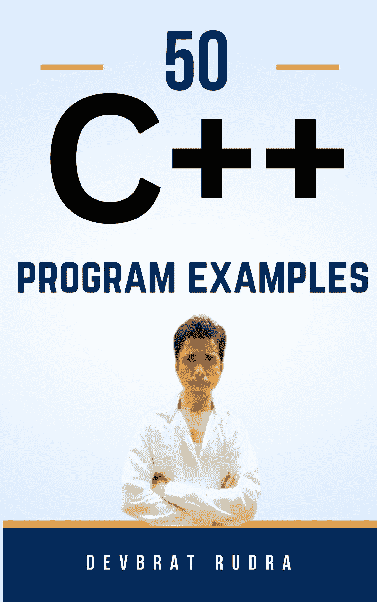

# 50 个 C++ 程序示例





## 1. Hello World
```cpp
#include <iostream>

int main() {
  std::cout << "Hello, World!" << std::endl;
  return 0;
}
```

## 2. 基础输入输出
```cpp
#include <iostream>

int main() {
  int num;
  std::cout << "Enter a number: ";
  std::cin >> num;
  std::cout << "You entered: " << num << std::endl;
  return 0;
}
```

## 3. 算术运算
```cpp
#include <iostream>

int main() {
  int a = 5, b = 3;
  std::cout << "Sum: " << a + b << std::endl;
  std::cout << "Difference: " << a - b << std::endl;
  std::cout << "Product: " << a * b << std::endl;
  std::cout << "Quotient: " << a / b << std::endl;
  return 0;
}
```

## 4. 条件判断语句 (if-else)
```cpp
#include <iostream>

int main() {
  int num;
  std::cout << "Enter a number: ";
  std::cin >> num;
  if (num > 0) {
    std::cout << "Positive" << std::endl;
  } else if (num < 0) {
    std::cout << "Negative" << std::endl;
  } else {
    std::cout << "Zero" << std::endl;
  }
  return 0;
}
```

## 5. 循环 (for 循环)
```cpp
#include <iostream>

int main() {
  for (int i = 1; i <= 5; ++i) {
    std::cout << i << " ";
  }
  std::cout << std::endl;
  return 0;
}
```

## 6. 循环 (while 循环)
```cpp
#include <iostream>

int main() {
  int i = 1;
  while (i <= 5) {
    std::cout << i << " ";
    i++;
  }
  std::cout << std::endl;
  return 0;
}
```

## 7. 循环 (do-while 循环)
```cpp
#include <iostream>

int main() {
  int i = 1;
  do {
    std::cout << i << " ";
    i++;
  } while (i <= 5);
  std::cout << std::endl;
  return 0;
}
```

## 8. 数组
```cpp
#include <iostream>

int main() {
  int arr[5] = {1, 2, 3, 4, 5};
  for (int i = 0; i < 5; ++i) {
    std::cout << arr[i] << " ";
  }
  std::cout << std::endl;
  return 0;
}
```

## 9. 函数
```cpp
#include <iostream>

int add(int a, int b) {
  return a + b;
}

int main() {
  int result = add(3, 5);
  std::cout << "Sum: " << result << std::endl;
  return 0;
}
```

## 10. 递归
```cpp
#include <iostream>

int factorial(int n) {
  if (n <= 1) {
    return 1;
  }
  return n * factorial(n - 1);
}

int main() {
  int num = 5;
  int fact = factorial(num);
  std::cout << "Factorial of " << num << " is " << fact << std::endl;
  return 0;
}
```

## 11. 字符串
```cpp
#include <iostream>
#include <string>

int main() {
  std::string greeting = "Hello, C++";
  std::cout << greeting << std::endl;
  return 0;
}
```

## 12. 字符串输入输出
```cpp
#include <iostream>
#include <string>

int main() {
  std::string name;
  std::cout << "Enter your name: ";
  std::cin >> name;
  std::cout << "Hello, " << name << "!" << std::endl;
  return 0;
}
```

## 13. 字符串拼接
```cpp
#include <iostream>
#include <string>

int main() {
  std::string first_name = "John";
  std::string last_name = "Doe";
  std::string full_name = first_name + " " + last_name;
  std::cout << "Full Name: " << full_name << std::endl;
  return 0;
}
```

## 14. 字符串长度
```cpp
#include <iostream>
#include <string>

int main() {
  std::string text = "C++ Programming";
  int length = text.length();
  std::cout << "Length of the string: " << length << std::endl;
  return 0;
}
```

## 15. 字符串比较
```cpp
#include <iostream>
#include <string>

int main() {
  std::string str1 = "apple";
  std::string str2 = "banana";
  if (str1 == str2) {
    std::cout << "Strings are equal" << std::endl;
  } else {
    std::cout << "Strings are not equal" << std::endl;
  }
  return 0;
}
```

## 16. 字符串数组
```cpp
#include <iostream>
#include <string>

int main() {
  std::string fruits[] = {"apple", "banana", "cherry"};
  for (int i = 0; i < 3; ++i) {
    std::cout << "Fruit: " << fruits[i] << std::endl;
  }
  return 0;
}
```

## 17. 多维数组
```cpp
#include <iostream>

int main() {
  int matrix[3][3] = {{1, 2, 3}, {4, 5, 6}, {7, 8, 9}};
  for (int i = 0; i < 3; ++i) {
    for (int j = 0; j < 3; ++j) {
      std::cout << matrix[i][j] << " ";
    }
    std::cout << std::endl;
  }
  return 0;
}
```

## 18. 指针
```cpp
#include <iostream>

int main() {
  int num = 42;
  int *ptr = &num;
  std::cout << "Value: " << *ptr << std::endl;
  std::cout << "Address: " << ptr << std::endl;
  return 0;
}
```

## 19. 动态内存分配
```cpp
#include <iostream>

int main() {
  int *arr = new int[5];
  for (int i = 0; i < 5; ++i) {
    arr[i] = i + 1;
  }
  for (int i = 0; i < 5; ++i) {
    std::cout << arr[i] << " ";
  }
  delete[] arr;
  return 0;
}
```

## 20. 结构体
```cpp
#include <iostream>
#include <string>

struct Person {
  std::string name;
  int age;
};

int main() {
  Person person;
  person.name = "John";
  person.age = 30;
  std::cout << "Name: " << person.name << std::endl;
  std::cout << "Age: " << person.age << std::endl;
  return 0;
}
```

## 21. 类与对象
```cpp
#include <iostream>
#include <string>

class Student {
public:
  std::string name;
  int age;
  void display() {
    std::cout << "Name: " << name << std::endl;
    std::cout << "Age: " << age << std::endl;
  }
};

int main() {
  Student student;
  student.name = "Alice";
  student.age = 20;
  student.display();
  return 0;
}
```

## 22. 类构造函数
```cpp
#include <iostream>
#include <string>

class Person {
public:
  std::string name;
  int age;
  Person(std::string n, int a) {
    name = n;
    age = a;
  }
  void display() {
    std::cout << "Name: " << name << std::endl;
    std::cout << "Age: " << age << std::endl;
  }
};

int main() {
  Person person("Bob", 25);
  person.display();
  return 0;
}
```

## 23. 类继承
```cpp
#include <iostream>
#include <string>

class Animal {
public:
  std::string name;
  Animal(std::string n) : name(n) {}
  void speak() {
    std::cout << "Animal speaks" << std::endl;
  }
};

class Dog : public Animal {
public:
  Dog(std::string n) : Animal(n) {}
  void speak() {
    std::cout << "Dog barks" << std::endl;
  }
};

int main() {
  Dog dog("Buddy");
  std::cout << "Name: " << dog.name << std::endl;
  dog.speak();
  return 0;
}
```

## 24. 运算符重载
```cpp
#include <iostream>

class Complex {
public:
  double real;
  double imag;
  Complex(double r, double i) : real(r), imag(i) {}
  Complex operator +(const Complex& other) {
    return Complex(real + other.real, imag + other.imag);
  }
  void display() {
    std::cout << real << " + " << imag << "i" << std::endl;
  }
};

int main() {
  Complex c1(2.0, 3.0);
  Complex c2(1.0, 1.0);
  Complex result = c1 + c2;
  result.display();
  return 0;
}
```

## 25. 异常处理
```cpp
#include <iostream>

int main() {
  try {
    int denominator = 0;
    if (denominator == 0) {
      throw "Division by zero!";
    }
    int result = 10 / denominator;
    std::cout << "Result: " << result << std::endl;
  } catch (const char* error) {
    std::cerr << "Error: " << error << std::endl;
  }
  return 0;
}
```

## 26. 文件输入输出
```cpp
#include <iostream>
#include <fstream>

int main() {
  std::ofstream outfile("sample.txt");
  if (outfile.is_open()) {
    outfile << "Hello, C++ File IO!" << std::endl;
    outfile.close();
  }
  return 0;
}
```


```cpp
std::cout << "File written successfully." << std::endl;
} else {
    std::cerr << "Unable to open file." << std::endl;
}

return 0;
}
```

## 27. 从文件读取

```cpp
#include <iostream>
#include <fstream>
#include <string>

int main() {
    std::ifstream infile("sample.txt");
    if (infile.is_open()) {
        std::string line;
        while (std::getline(infile, line)) {
            std::cout << line << std::endl;
        }
        infile.close();
    } else {
        std::cerr << "Unable to open file." << std::endl;
    }
    return 0;
}
```

## 28. 写入与读取二进制数据

```cpp
#include <iostream>
#include <fstream>

int main() {
    // 写入二进制数据
    int data[] = {1, 2, 3, 4, 5};
    std::ofstream outfile("data.bin", std::ios::binary);
    if (outfile.is_open()) {
        outfile.write(reinterpret_cast<char*>(data), sizeof(data));
        outfile.close();
        std::cout << "Binary data written successfully." << std::endl;
    } else {
        std::cerr << "Unable to open file." << std::endl;
    }
    // 读取二进制数据
    int readData[5];
    std::ifstream infile("data.bin", std::ios::binary);
    if (infile.is_open()) {
        infile.read(reinterpret_cast<char*>(readData), sizeof(readData));
        infile.close();
        for (int i = 0; i < 5; ++i) {
            std::cout << readData[i] << " ";
        }
        std::cout << std::endl;
    } else {
        std::cerr << "Unable to open file." << std::endl;
    }
    return 0;
}
```

## 29. 模板函数

```cpp
#include <iostream>
template <typename T>
T max(T a, T b) {
    return (a > b) ? a : b;
}

int main() {
    int a = 5, b = 8;
    std::cout << "Max: " << max(a, b) << std::endl;
    double x = 3.14, y = 2.71;
    std::cout << "Max: " << max(x, y) << std::endl;
    return 0;
}
```

## 30. 模板类

```cpp
#include <iostream>
template <typename T>
class Pair {
public:
    T first;
    T second;
    Pair(T f, T s) : first(f), second(s) {}
};

int main() {
    Pair<int> intPair(1, 2);
    Pair<double> doublePair(3.14, 2.71);
    std::cout << "Int Pair: " << intPair.first << ", " << intPair.second << std::endl;
    std::cout << "Double Pair: " << doublePair.first << ", " << doublePair.second << std::endl;
    return 0;
}
```

## 31. 标准模板库 (STL) Vector

```cpp
#include <iostream>
#include <vector>

int main() {
    std::vector<int> numbers;
    numbers.push_back(1);
    numbers.push_back(2);
    numbers.push_back(3);
    for (int i : numbers) {
        std::cout << i << " ";
    }
    std::cout << std::endl;
    return 0;
}
```

## 32. STL 迭代器

```cpp
#include <iostream>
#include <vector>

int main() {
    std::vector<int> numbers = {1, 2, 3, 4, 5};
    for (std::vector<int>::iterator it = numbers.begin(); it != numbers.end(); ++it) {
        std::cout << *it << " ";
    }
    std::cout << std::endl;
    return 0;
}
```

## 33. STL Map

```cpp
#include <iostream>
#include <map>

int main() {
    std::map<std::string, int> scores;
    scores["Alice"] = 95;
    scores["Bob"] = 85;
    scores["Charlie"] = 90;
    std::cout << "Alice's score: " << scores["Alice"] << std::endl;
    for (const auto& pair : scores) {
        std::cout << pair.first << ": " << pair.second << std::endl;
    }
    return 0;
}
```

## 34. STL Sets

```cpp
#include <iostream>
#include <set>

int main() {
    std::set<int> numbers;
    numbers.insert(5);
    numbers.insert(2);
    numbers.insert(8);
    for (int n : numbers) {
        std::cout << n << " ";
    }
    std::cout << std::endl;
    return 0;
}
```

## 35. Lambda 表达式

```cpp
#include <iostream>
#include <vector>
#include <algorithm>

int main() {
    std::vector<int> numbers = {3, 1, 4, 1, 5, 9, 2, 6, 3, 5};
    std::cout << "Even numbers: ";
    std::for_each(numbers.begin(), numbers.end(), [](int n) {
        if (n % 2 == 0) {
            std::cout << n << " ";
        }
    });
    std::cout << std::endl;
    return 0;
}
```

## 36. C++ 算法

```cpp
#include <iostream>
#include <vector>
#include <algorithm>

int main() {
    std::vector<int> numbers = {3, 1, 4, 1, 5, 9, 2, 6, 3, 5};
    // 排序 vector
    std::sort(numbers.begin(), numbers.end());
    // 打印 vector
    for (int n : numbers) {
        std::cout << n << " ";
    }
    std::cout << std::endl;
    // 在 vector 中查找 5 的位置
    auto pos = std::lower_bound(numbers.begin(), numbers.end(), 5);
    if (pos != numbers.end()) {
        std::cout << "Found 5 at position " << (pos - numbers.begin()) << std::endl;
    } else {
        std::cout << "5 not found" << std::endl;
    }
    return 0;
}
```

## 37. C++ 线程

```cpp
#include <iostream>
#include <thread>

void hello() {
    std::cout << "Hello from thread!" << std::endl;
}

int main() {
    std::thread t1(hello);
    t1.join();
    return 0;
}
```

## 38. 互锁与线程同步

```cpp
#include <iostream>
#include <thread>
#include <mutex>

std::mutex mtx;
void printNumbers() {
    for (int i = 1; i <= 10; ++i) {
        std::lock_guard<std::mutex> lock(mtx);
        std::cout << i << " ";
    }
    std::cout << std::endl;
}

int main() {
    std::thread t1(printNumbers);
    std::thread t2(printNumbers);
    t1.join();
    t2.join();
    return 0;
}
```

## 39. C++ 智能指针

```cpp
#include <iostream>
#include <memory>

int main() {
    std::shared_ptr<int> ptr1 = std::make_shared<int>(42);
    std::shared_ptr<int> ptr2 = ptr1;
    std::cout << "ptr1: " << *ptr1 << ", ptr2: " << *ptr2 << std::endl;
    return 0;
}
```

## 40. Lambda 捕获

```cpp
#include <iostream>

int main() {
    int x = 10;
    auto lambda = [x]() {
        std::cout << "Captured value: " << x << std::endl;
    };
    lambda();
    return 0;
}
```

## 41. C++ RAII (资源获取初始化)

```cpp
#include <iostream>
#include <fstream>

class FileWriter {
public:
    FileWriter(const std::string& filename) {
        file.open(filename);
    }
    ~FileWriter() {
        if (file.is_open()) {
            file.close();
        }
    }
    void write(const std::string& text) {
        if (file.is_open()) {
            file << text;
        }
    }
private:
    std::ofstream file;
};

int main() {
    FileWriter writer("output.txt");
    writer.write("Hello, RAII!");
    return 0;
}
```

## 42. C++ 移动语义

```cpp
#include <iostream>
#include <vector>

int main() {
    std::vector<int> source = {1, 2, 3};
    std::vector<int> destination = std::move(source);
    std::cout << "Source size: " << source.size() << std::endl;
    std::cout << "Destination size: " << destination.size() << std::endl;
    return 0;
}
```

## 43. C++ 类型别名 (using)

```cpp
#include <iostream>
using Age = int;

int main() {
    Age myAge = 30;
    std::cout << "My age is: " << myAge << std::endl;
    return 0;
}
```

## 44. C++ 枚举

```cpp
#include <iostream>
enum Color { RED, GREEN, BLUE };

int main() {
    Color myColor = GREEN;
    if (myColor == GREEN) {
        std::cout << "It's green!" << std::endl;
    }
    return 0;
}
```

## 45. C++ 枚举类

```cpp
#include <iostream>
enum class Color { RED, GREEN, BLUE };

int main() {
    Color myColor = Color::GREEN;
    if (myColor == Color::GREEN) {
        std::cout << "It's green!" << std::endl;
    }
    return 0;
}
```

## 46. C++ 标准输入输出操纵符

```cpp
#include <iostream>
#include <iomanip>

int main() {
    double pi = 3.1415926535893;
    std::cout << "Default: " << pi << std::endl;
    std::cout << std::fixed << pi << std::endl;
    std::cout << std::scientific << pi << std::endl;
    return 0;
}
```

## 47. C++ 位运算运算符

```cpp
#include <iostream>

int main() {
    int a = 5;  // 101
    int b = 3;  // 011
    int bitwiseAnd = a & b;
    int bitwiseOr = a | b;
    int bitwiseXor = a ^ b;
    int bitwiseNotA = ~a;
    int leftShift = a << 1;
    int rightShift = a >> 1;
    std::cout << "AND: " << bitwiseAnd << std::endl;
    std::cout << "OR: " << bitwiseOr << std::endl;
    std::cout << "XOR: " << bitwiseXor << std::endl;
    std::cout << "NOT A: " << bitwiseNotA << std::endl;
    std::cout << "Left Shift: " << leftShift << std::endl;
    std::cout << "Right Shift: " << rightShift << std::endl;
    return 0;
}
```

## 48. C++ 异常类

```cpp
#include <iostream>
#include <stdexcept>

int main() {
    try {
        throw std::runtime_error("This is a custom exception");
    } catch (const std::exception& e) {
        std::cerr << "Exception: " << e.what() << std::endl;
    }
    return 0;
}
```

## 49. C++ 闭包 (std::function)

```cpp
#include <iostream>
#include <functional>

int main() {
    std::function<int(int, int)> add = [](int a, int b) {
        return a + b;
    };
    std::cout << "Sum: " << add(3, 5) << std::endl;
    return 0;
}
```

## 50. C++ 自定义迭代器

```cpp
#include <iostream>
#include <vector>

class MyIterator {
```


```cpp
private:
    int index;
    std::vector<int>& data;

public:
    MyIterator(std::vector<int>& arr) : index(0), data(arr) {}

    bool hasNext() {
        return index < data.size();
    }

    int next() {
        return data[index++];
    }
};

int main() {
    std::vector<int> numbers = {1, 2, 3, 4, 5};
    MyIterator iterator(numbers);
    while (iterator.hasNext()) {
        std::cout << iterator.next() << " ";
    }
    std::cout << std::endl;
    return 0;
}
```

感谢

