# C 语言 77 个示例与练习


# 致谢

我要感谢我们的家人、朋友以及Sultan Idris Shah理工学院高管理层的帮助与鼓励，他们对本书的成功出版做积极贡献。

Ts. Mohd At-Tarmizi Bin Abu Hassan

# 序言

本书献给理工学院所有修读 DEC20012 - 基础编程课程的电气工程学生。内容旨在通过各种示例和练习来增强对 C 编程的理解和技能。“熟能生巧！”


# C语言编程的77个示例

## 1. 顺序结构

### 1. HelloWorld.c 源代码

```c
HelloWorld.c
#include <stdio.h>
void main() {
    printf("Hello world! \nwelcome to C Programming ;");
}
```

### 1. HelloWorld.c 输出文件

```
Hello World!
Welcome to C Programming ;
```

### 2. WelcomeKEPSIS.c 源代码

```c
WelcomeToKEPSIS.c
#include <stdio.h> //头文件
void main() // 函数
{ // 函数开始的左括号
printf("welcome to\t"); // 输出到电脑屏幕， \t = 水表符
printf("Electrical Engineering Department \nPolytechnic Sultan Idris Shah.\n") // \n = 换行
printf("Good luck!\n");
getchar();
} // 函数结束的右括号
```

### 2. WelcomeToKEPSIS.c 输出文件
```
Welcome Electrical Engineering Department
Polytechnic Sultan Idris Shah.
Good Luck!
```

### 3. ComputerGenie_getch.c 源代码

```c
#include <stdio.h>
int main()
{
    char num;
    printf("I am your computer genie!\n");
    printf("Enter a number from 0 to 9: ");
    num = getch();
    printf("\nYou typed in %c!\n",num);
    printf("The genie knows all, sees all!\n");
    return(0);
}
```

### 3. ComputerGenie_getch.c 输出文件
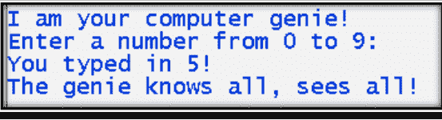

### 4. ComputerGenie_getchar.c 源代码 

```c
#include <stdio.h>
int main()
{
    char num;
    printf("I am your computer genie!\n");
    printf("Enter a number from 0 to 9: ");
    num = getch();
    printf("\nYou typed in %c!\n",num);
    printf("The genie knows all, sees all!\n");
    return(0);
}
```

### 4. ComputerGenie_getchar.c 输出文件
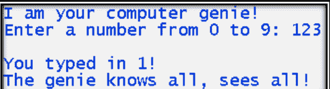

### 5. ComputerGenie_getche.c 源代码 

```c
5_ComputerGenie_getche.c
#include <stdio.h>
int main()
{
    char num;
    printf("I am your computer genie!\n");
    printf("Enter a number from 0 to 9: ");
    num = getche();
    printf("\nYou typed in %c!\n",num);
    printf("The genie knows all, sees all!\n");
    return(0);
}
```

### 5. ComputerGenie_getche.c 输出文件
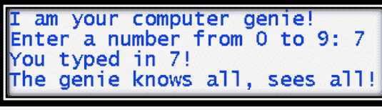

### 6. Understand_Various_Data_Types.c 源代码 

```c
Understand_Various_Data_Types.c
/* 各种数据类型允许他人更好地理解
various data types allowing others to better understand what
to accomplish and greatly helping in.
Comments of code or especially
lines of source code or which many contributors
#include <stdio.h>
int main() {
    char c = 'B'; // single character only 'B'
    char name[30] = "C";
    float f = 1.23456789; // decimal places
    int num = 15; // integer value
    printf("Character is %c \n", c);
    printf("Name is %s\n", name);
    printf("Float value is %.2f\n", f);
    printf("Integer value is %d\n", num);
    }
*/
```

### 6. Understand_Various_Data_Types.c 输出
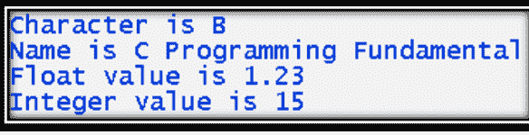

### 7. Draw_Guns_in_the_format.c 源代码 

```c
Draw_Guns_in_the_format.c
// Draw gun in the specified format
#include <stdio.h>
main() {
    printf("-------");
    printf("\n|      |");
    printf("\n|______|
    printf("\n|______");
    printf("\n / XXXXX |");
    printf("\n / XXXXX /");
    printf("\n / XXXXX/-------");
    printf("\n / XXXXX /\n");
    printf("\n / XXXXX /\n");
    printf("(())");
    printf("\n-------");
}
```

### 7. Draw_Guns_in_the_format.c 输出文件
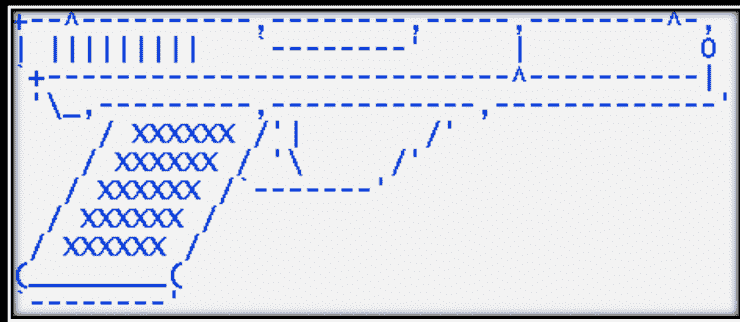

### 8. Basic_Calculator.c 源代码

```c
// Basic Arithmetic / Mathematical Operators
// This program demonstrates binary expression
#include <stdio.h> // 头文件
void main(void) // 主函数
{
    int num1; // 定义标识 'num1' 为整数值, num1 =变量名
    int num2=5; // 定义标识 'num2' 为整数值, 常数名 num2 = 5;
    printf("Please enter a value for number 1: %d\n",
    // 控制台输入（通常分配到电脑屏幕）
    scanf("%d", &num1); // 控制台输入到键盘
    // 加法运算
    printf("%d + %d = %d\n", num1, num2, num1+num2);
    // 减法运算
    printf("%d - %d = %d\n", num1, num2, abs(num1-num2));
    // 乘法运算
    printf("%d * %d = %d\n", num1, num2, num1*num2);
    // 除法运算
    printf("%d / %d = %d\n", num1, num2, num1/num2);
    // 参考模运算或“余数”
    printf("%d %% %d = %d\n", num1, num2, num1%num2);
} // // 关闭的括号
```

### 8. Basic_Calculator.c 输出文件

| Please enter a value for number 1: 25 |
| 25 + 5 = 30 |
| 25 - 5 = 20 |
| 25 * 5 = 125 |
| 25 / 5 = 5 |
| 25 % 5 = 0 |


## 10 - Understanding_Precedence.c 源代码

```c
Understanding_Precedence.c
//Understanding_Precedence
//检查优先级对表达式的影响。
#include <stdio.h>
void main() {
    int a = 10, b = 20, c = 30; // (10*20) + 30 = 230
    printf("a * b + c is: %d\n", a * b + c); // 30 + (10*20) = 230
    printf("a * (b + c) is: %d\n", a * (b + c)); // 10 * (20+30) = 500
    printf("b / a * c is: %d\n", b / a * c); // (20/10) * 30 = 60
    printf("b / (a * c) is: %d\n", b / (a * c)); // (20 / (10*30)) = 0
    printf("(b / a) * c is: %d\n", (b / a) * c); // ((20/10)*30) = 60
    printf("\n");
}
```

## 10 - Understanding_Precedence.c 输出文件

| a = 10, b = 20, c = 30 |
| a * b + c is: 230 |
| c + a * b is: 230 |
| a * (b + c) is: 500 |
| b / a * c is: 60 |
| b / (a * c) is: 0 |
| a * c / b is: 15 |
| (b / (a * c)) is: 0 |

## 11 - Understanding_Relational_Operator.c 源代码

```c
// 理解关系运算符 / 比较运算符
// 展示关系运算符的结果。
// 如果为假或错误答案返回 0，如果为真正确答案返回 1
#include <stdio.h>
void main() {
    int a = 8, b = 9;
    printf("a = %d, b = %d\n", a, b);
    printf("%d < %d is %d\n", a, b, a < b); // 为字符留 1 个空格，答案 0
    printf("%d == %d is %d\n", a, b, a == b); // 为字符留 2 个空格，答案 0
    printf("%d > %d is %d\n", a, b, a > b); // 为字符留 3 个空格，答案 1
    printf("%d >= %d is %d\n", a, b, a >= b); // 为字符留 4 个空格，答案 1
    printf("%d <= %d is %d\n", a, b, a <= b); // 为字符留 5 个空格，答案 0
    printf("%d != %d is %d\n", a, b, a != b); // 为字符留 6 个空格，答案 1
    system("pause");
}
```

## 11 - Understanding_Relational_Operator.c 输出文件

| a = 8, b = 9 |
|---|---|
| 8 < 9 | 1 |
| 8 == 9 | 0 |
| 8 != 9 | 1 |
| 8 > 9 | 0 |
| 8 <= 9 | 1 |
| 8 >= 9 | 0 |

## 12 - Compound_Assignment.c 源代码

```c
// https://www.ibm.com/docs/en/i/7.2?topic=operators-compound-assignment
// 此程序演示复合赋值运算符的示例
#include <stdio.h>
void main () {
    int x = 10; // x 初始值常量为 10
    int y = 5; // y 初始值常量为 5
    printf("x: %d | y: %d, x*: %d\n", x, y, x); // x*=y
    printf(" x is now: %d\n", x); // x=50 (答案)

    x = 10;
    printf("x: %d | y: %d, x/: %d\n", x, y, x); // x/=y
    printf(" x is now: %d\n", x); // x=2 (答案)

    x = 10;
    x %= y; // 处理算术
    printf("x: %d | y: %d, x%%: %d\n", x, y, x); // x%=y
    printf(" x is now: %d\n", x); // x=0 (答案)

    return 0;
}
```

## 12 - Compound_Assignment.c 输出文件

| x | y | x*=y | x is now: |
|---|---|---|---|
| 10 | 5 | 50 | 50 |
| 10 | 5 | 2 | 2 |
| 10 | 5 | 0 | 0 |

## 13 - Average_Temperature.c 源代码

```c
CalculateAverageTemperature.c
// 计算平均温度
#include<stdio.h>
void main()
{
    float Min_Temp, Max_Temp, Average_Temp;
    printf("插入最低温度: ");
    scanf("%f", &Min_Temp);
    printf("插入最高温度: ");
    scanf("%f", &Max_Temp);
    // 数字之和除以 2
    Average_Temp = (Min_Temp + Max_Temp) / 2;
    printf("\n 平均温度: %.1f", Average_Temp);
}
```

## 13 - Average_Temperature.c 输出文件

插入最低温度: 20
插入最高温度: 38
平均温度: 29.0

## 14 - Calculate_Circumference_Area.c 源代码

```c
CalculateCircumferenceandArea.c
/* 此程序根据半径计算圆的周长和面积 */
#include<stdio.h>
void main() 
{
    float Pi = 3.14;
    float Radius;
    float Circumference, Area;

    printf("输入半径: ");
    scanf("%f", &Radius);

    Circumference = Pi * Radius;
    Area = Pi * Radius;

    printf("\n 周长为: %.2f", Circumference);
    printf("\n 面积为: %.2f", Area);
}
```

## 15 - Calculate_Cubic_Area_Volume.c 源代码

```c
CalculateCubicAreaAndVolume.c
/* 此程序计算立方体的面积和体积 */
#include<stdio.h>
void main() {
    int Length, Area, Volume;
    printf("输入立方体的边长: ");
    scanf("%d", &Length);
    Volume = Length * Length * Length; // 处理体积
    Area = Length * Length * 6; // 处理表面积
    printf("面积: %d\n", Area);
    printf("体积为: %d\n", Volume);
}
```

## 16 - Calculate_Monthly_Saving.c 源代码

```c
CalculateMonthlySaving.c
// 计算每月储蓄
#include<stdio.h>
void main() {
    int Salary, Saving;
    printf("输入你的工资: RM%d");
    scanf("%d",&Salary);
    Saving = 0.4* Salary; // 储蓄 = 总支出
    printf("\n 储蓄金额为: RM%d", Saving);
}
```

## 17 - Convert_Distance.c 源代码

```c
ConvertDistance.c
/* 此程序将距离从公里转换为米和厘米 */
#include<stdio.h>
void main() {
    float Kilo, Meter, Cm;
    printf("插入距离 (公里): %f",
    scanf("%f", &Kilo);
    Meter = Kilo * 1000; // 1 公里 = 1000 米
    Cm = Meter * 100; // 1 米 = 100 厘米
    printf("\n 米为: %.0f", Meter);
    printf("\n 厘米为: %.2f", Cm);
}
```

## 18 - Convert_Temperature_Fahrenheit.c 源代码

```c
ConvertTemperatureFahrenheit.c
// 此程序将温度从华氏转换为摄氏
#include<stdio.h>
void main() {
    float centigrade, fahrenheit;
    printf("插入华氏温度 (F): %f",
    scanf("%f", &fahrenheit);
    centigrade = (fahrenheit - 32) * 5/9; // °C = (F - 32) * 5/9
    printf("\n 摄氏度为: %.1f", centigrade);
}
```

## 19 - Convert_Temperature_Centigrade.c 源代码

```c
ConvertTemperatureCentigrade.c
#include<stdio.h>
void main()
{
    float centigrade, fahrenheit;
    printf("插入摄氏温度: %f",
    scanf("%f", &centigrade);
    fahrenheit = (centigrade * 9/5)+32; // °F = (°C x 9/5) + 32
    printf("\n 华氏度数值为: %.1f", fahrenheit);
}
```

## 20 - Base_and_Power.c 源代码

```c
Base_and_Power.c
#include <stdio.h>
#include <math.h>
int main()
{
    double base, power, result;
    printf("输入底数: %f");
    scanf("%f",&base);
    printf("输入指数: %f");
    scanf("%f",&power);
    result = pow(base,power);//计算数字的幂
    printf("%.1f^%.1f = %.2f\n",base, power, result);
    return 0;
}
```


## 21 - Square_Root.c 源代码

```c
#include <stdio.h>
#include <math.h>
int main()
{
    float number, square_root;
    printf("Enter a number: %f");
    scanf("%f", &number);
    // 计算 number 的平方根并存储在 square_root
    square_root = sqrt(number);
    printf("Square root of %.2f = %.2f", number, square_root);
    return 0;
}
```

## 21 - Square_Root.c 输出文件

Enter a number: 4
Square root of 4.00 = 2.00

## 22 - Bigger_or_Smaller_or_Equal.c 源代码

```c
//理解比较 / 关系运算符
/* 程序显示从键盘读取的
两个数字之间的关系 */
#include <stdio.h>
int main()
{
    int num1, num2;
    printf("Please enter two integers: %d %d");
    scanf("%d %d", &num1, &num2);
    if (num1 < num2)
        printf("%d < %d\n", num1, num2);
    if (num1 > num2)
        printf("%d > %d\n", num1, num2);
    if (num1 == num2)
        printf("%d = %d\n", num1, num2);
    printf("\n");
    return 0;
}
```

## 22 - Bigger_or_Smaller_or_Equal.c 输出文件

Please enter two integers: 18 30
18 < 30

## 2. 选择结构

## 23 - If under age.c 源代码

```c
#include<stdio.h>
void main() {
    int age;
    printf("Please insert your age: ");
    scanf("%d", &age);
    if (age < 18) // 条件
    {
        printf("You are still under age!"); // if 语句
    }
}
```

## 23 - If under age.c 输出文件

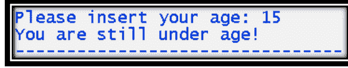

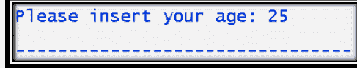

## 24 - AgeForVoting.c 源代码

```c
AgeForVoting.c
1 //投票年龄
2 #include<stdio.h>
3 void main()
4 {
5 int age;
6 printf("\n Please insert your age: ");
7 scanf("%d", &age);
8 
9 if(age<18)
10 {
11 printf("\nForgive me! You are underage and not eligible to vote.");
12 }
13 else
14 {
15 printf("\nCongratulations! You are 18 years old and above and eligible to vote.");
16 }
17 }
```

## 24 - AgeForVoting.c 输出文件

### A. if 语句输出文件

| Please insert your age: 17 |
| Forgive me! You are underage and not eligible to vote. |

### B. else 语句输出文件

| Please insert your age: 30 |
| Congratulations! You are 18 years old and above and eligible to vote. |

## 25 - Find_Largest_Number.c 源代码

```c
Find_Largest_Number.c
// //条件结构 (if..else if.. else)
// //此程序演示选择结构的使用
#include <stdio.h>
int main () {
    int num1, num2, num3;
    printf("Enter any three integer number here:\n");
    scanf("%d%d%d",&num1,&num2,&num3);
    if (num2>num1 && num1>num3) {
        printf("Number %d is largest",num1);
    } else if (num2>num1 && num2>num3) {
        printf("Number %d is largest",num2);
    } else if (num3>num1 && num3>num2) {
        printf("Number %d is largest",num3);
    } else {
        printf("wrong input!");
    }
    getch();
}
```

## 25 - Find_Largest_Number.c 输出文件

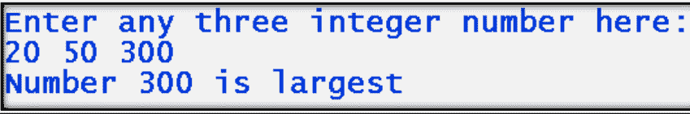

## 26 - Find_Smallest_Number.c 源代码

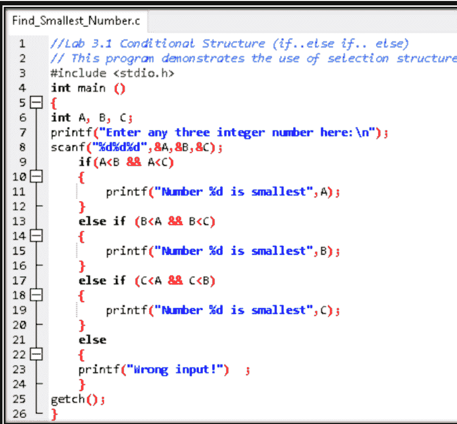

```c
// 实验 3.1 条件结构 (if..else if.. else)
// 此程序演示选择结构的使用
#include <stdio.h>
int main () {
    int A, B, C;
    printf("Enter any three integer number here:\n");
    scanf("%d%d%d",&A,&B,&C);
    if (A<B && A<C) {
        printf("Number %d is smallest",A);
    } else if (B<A && B<C) {
        printf("Number %d is smallest",B);
    } else if (C<A && C<B) {
        printf("Number %d is smallest",C);
    } else {
        printf("wrong input!");
    }
    getch();
}
```

## 26 - Find_Smallest_Number.c 输出文件

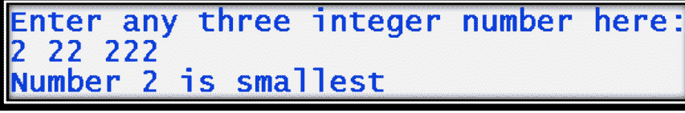

## 27 - Odd_or_Even_Number.c 源代码

```c
Odd_or_Even_Number.c
// 检查奇偶程序
#include <stdio.h>
int main ()
{
    int number;
    printf("Enter an integer: ");
    scanf("%d", &number);

    // 如果数字被 2 整除则为偶数
    if(number % 2==0)
        printf("%d is even number.", number);
    else
        printf("%d is odd number.", number);
    return 0;
}
```

## 27 - Odd_or_Even_Number.c 输出文件

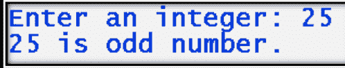

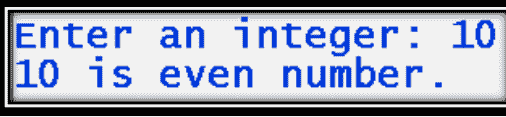

## 28 - Switch_Case_Fruits.c 源代码

```c
Switch_Case_Fruits.c
// 条件结构 (switch)
#include<stdio.h>
void main() {
    int choice;
    printf("Please choose your fruits: ");
    scanf("%d", &choice);
    switch (choice) {
        case 1:
            printf("Strawberry");
            break;
        case 2:
            printf("Apple");
            break;
        case 3:
            printf("Banana");
            break;
        case 4:
            printf("Durian");
            break;
        case 5:
            printf("Watermelon");
            break;
        default:
            printf("Invalid choice");
    }
}
```

## 28 - Switch_Case_Fruits.c 输出文件

```
Please choose your fruits:
1: Strawberry
2: Apple
3: Banana
4: Durian
5: Watermelon
```

## 29 - Switch_Case_Blood_Type.c 源代码

```c
Switch_Case_Blood_Type.c
// 条件结构 (switch)
#include <stdio.h>
int main() {
    int blood_choice;
    printf("Please choose your blood type (1-8): ");
    scanf("%d", &blood_choice);
    switch (blood_choice) {
        case 1:
            printf("You can give blood to O+, and AB+. Meanwhile you can receive blood from O and O-");
            break;
        case 2:
            printf("You can give blood to A-, and O-. Meanwhile you can receive blood from A, A-");
            break;
        case 3:
            printf("You can give blood to B-, and O-. Meanwhile you can receive blood from B, B-");
            break;
        case 4:
            printf("You can give blood to AB+, AB-. Meanwhile you can receive blood from B+, B-, and O-");
            break;
        case 5:
            printf("You can give blood to O+. Meanwhile you can receive blood from everyone.");
            break;
        case 6:
            printf("You can give blood to A-. Meanwhile you can receive blood from O-");
            break;
        case 7:
            printf("You can give blood to B-. Meanwhile you can receive blood from A-, B-, and O-");
            break;
        case 8:
            printf("You can give blood to AB-. Meanwhile you can receive blood from A-, B-, and O-");
            break;
        default:
            printf("You not entering the correct choice");
    }
    printf("\nexit the program.");
    return 0;
}
```

## Switch_Case_Blood_Type.c 输出文件

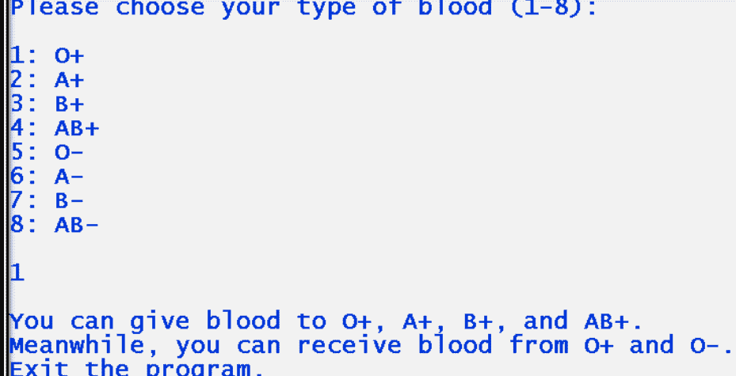

## 30 – Nested_If_Voted.c 源代码

```c
#include <stdio.h>
int main() {
    int age;
    char nation[];

    printf("This program will check your eligibility to vote\n");
    printf("Are you a Malaysian (Yes=Y/No=N) ?\n");
    scanf("%s", &nation);

    if(nation=='Y' || nation=='y') {
        printf("How old are you?\n");
        scanf("%d", &age);
        if(age>=21) {
            printf("You are eligible to vote!\n");
        } else {
            printf("You are not eligible to vote!\n");
        }
    } else if (nation=='N' || nation=='n') {
        printf("You are not eligible to vote!\n");
    } else {
        printf("wrong input!\n");
    }
}
```

## 30 – Nested_If_Voted.c 输出文件

This program will check your eligibility to vote
Are you a Malaysian (Yes=Y/No=N) ?
Y
How old are you?
25
You are eligible to vote!

this program will check your eligibility to vote
Are you a Malaysian (Yes=Y/No=N) ?
N
You are not eligible to vote!

this program will check your eligibility to vote
Are you a Malaysian (Yes=Y/No=N) ?
X
wrong input!


## 32 – Blood_Pressure.c 源代码

```c
Blood_Pressure.c
#include <stdio.h>
int main() {
    int systolic, diastolic;

    printf("Enter systolic in mm Hg (upper number): \n");
    scanf("%d", &systolic);
    printf("Enter diastolic in mm Hg (lower number): \n");
    scanf("%d", &diastolic);

    if(systolic<120 && diastolic<80) {
        printf("Your Blood Pressure category is: Normal\n");
    }
    else if(systolic>=120 && systolic<=129 && diastolic<80) {
        printf("Your Blood Pressure category is: Elevated stage to worsen into high blood pressure\n");
    }
    else if(systolic>=130 && systolic<=139 || diastolic<80) {
        printf("Your Blood Pressure category is: High Blood Pressure (Hypertension Stage 1) \n");
    }
    else if(systolic>=140 || diastolic>=90) {
        printf("Your Blood Pressure category is: High Blood Pressure (Hypertension Stage 2) \n");
    }
    else if(systolic>=180 || diastolic>=120) {
        printf("Your Blood Pressure category is: Hypertensive Crisis (consult your doctor immediately) \n");
    }
    else {
        printf("wrong entry\n");
    }
    return 0;
}
```

## 32 – Blood_Pressure.c 输出文件

```
Enter systolic in mm Hg (upper number)
140
Enter diastolic in mm Hg (lower number)
95
Your Blood Pressure category is: High Blood Pressure (Hypertension Stage 2)
```

## 33 - Body_Mass_Index.c 源代码

```c
Body_Mass_Index.c
#include <stdio.h>
int main() {
    float height, weight, bmi, ideal_weight, weighttollose;
    printf("Enter height in meter\n");
    scanf("%f", &height);
    printf("Enter weight in kg\n");
    scanf("%f", &weight);

    bmi = weight / (height * height);
    ideal_weight = 21.75 * (height * height);

    printf("Your Body Mass Index (BMI) is %.2f\n", bmi);

    if (bmi <= 15.0) {
        printf("Your BMI category is: Starvation\n");
    } else if (bmi > 15.1 && bmi <= 17.5) {
        printf("Your BMI category is: Anoreic\n");
    } else if (bmi > 17.6 && bmi <= 18.5) {
        printf("Your BMI category is: Underweight\n");
    } else if (bmi > 18.6 && bmi <= 24.9) {
        printf("Your BMI category is: Ideal\n");
    } else if (bmi > 25 && bmi <= 29.9) {
        printf("Your BMI category is: Overweight\n");
    } else if (bmi > 30 && bmi <= 39.9) {
        printf("Your BMI category is: Obese\n");
    } else if (bmi > 40) {
        printf("Your BMI category is: Morbidly Obese\n");
    } else {
        printf("Wrong entry\n");
    }

    printf("\nYour ideal weight is %.2f\n", ideal_weight);

    if (bmi>=25)
    {
        weighttollose = (weight - ideal_weight);
        printf("Weight to lose = %.0f", weighttollose);
    }
    if (bmi<=18.5)
    {
        weighttollose = fabs(weight - ideal_weight);
        printf("Weight to gain = %.0f", weighttollose);
    }
    if (bmi >= 18.6 && bmi <= 24.9)
    {
        printf("Don't worry! Your weight is just fine.");
        return 0;
    }
}
```

## 33 - Body_Mass_Index.c 输出文件

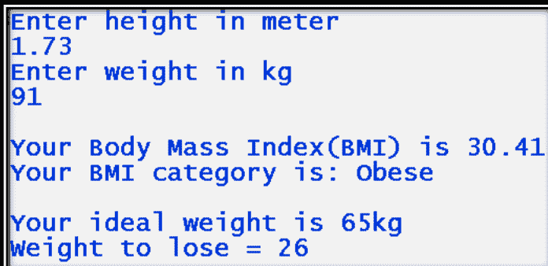

## 34 - Fever_Check.c 源代码

```c
Fever_Check.c
#include <stdio.h>
// 判断患者是否发烧
void main() {
    float Temperature;
    printf("Enter temperature: ");
    scanf("%f", &Temperature);
    if (Temperature > 37) {
        printf("\n 你发烧了");
    }
    else {
        printf("\n 你很健康状况");
    }
}
```

## 34 - Fever_Check.c 输出文件

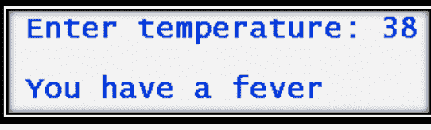
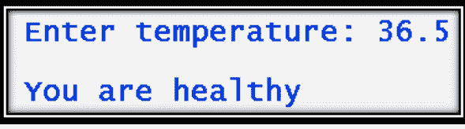

## 35 - Calculate_Electricity_Bill.c 源代码

```c
Calculate_Electricity_Bill.c
// 计算民用电费单的程序
#include <stdio.h>
int main() 
{
    int unit_kwh;
    float amount;
    printf("Enter units in kWh: ");
    scanf("%d", &unit_kwh);
    if (unit_kwh <= 0) {
        printf("\n电费为 RM3.00 (最低收费)。");
        printf("\n每月费用为 RM3.00");
    } else if (unit_kwh > 0 && unit_kwh < 200) {
        amount = unit_kwh * 0.218;
        printf("\n电费为 RM%.2f", amount);
    } else if (unit_kwh >= 200 && unit_kwh < 300) {
        amount = (unit_kwh - 200) * 0.334 + (200*0.218);
        printf("\n总电费为 RM%.2f", amount);
    } else if (unit_kwh >= 301 && unit_kwh < 600) {
        amount = (unit_kwh - 300) * 0.516 + (100*0.334) + (200*0.218);
        // 用电超过 600kWh 的收 6% 服务费
        printf("\n总电费为 RM%.2f", amount);
    } else if (unit_kwh >= 601) {
        amount = (unit_kwh - 600) * 0.57 + (200*0.218) + (100*0.334) + (300*0.516);
        // 用电超过 600kWh 的收 6% 服务费
        printf("\n总电费为 RM%.2f", amount);
    } else {
        printf("\n输入错误!");
    }
    return 0;
}
```

## 35 - Calculate_Electricity_Bill.c 输出文件

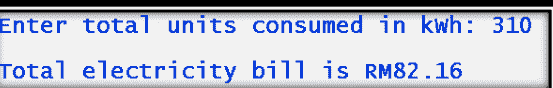

## 36 - Calculate_Water_Bill.c 源代码

```c
// 计算民用或工业用水费单的 C 程序
#include <stdio.h>
int main() {
    int cubic_meters;
    float total;
    char typeoftiff;
    printf("请选择民用或工业用费标准: ");
    printf("民用 - D\n");
    printf("工业 - I\n");
    scanf("%c", &typeoftiff);
    switch (typeoftiff) {
        case 'D':
            /* 输入民用用量 */
            // 0-20 m3 = 每立方米 0.57
            // 21-35 m3 = 每立方米 1.03
            // 35 m3 以上 = 每立方米 2
            printf("\n输入立方米数: %d");
            scanf("%d", &cubic_meters);
            /* 根据给定条件计算水费 */
            if (cubic_meters <= 20) {
                printf("\n水费为 RM6.00 (最低每月费用)。\n");
                printf("\n每月费用为 RM6.00\n");
            } else if (cubic_meters > 20 && cubic_meters <= 35) {
                total = (cubic_meters - 20) * 1.03 + (20*0.57);
                printf("\n水费为 RM%.2f\n", total);
            } else if (cubic_meters > 35) {
                total = (cubic_meters - 35) * 2 + (20*0.57) + (15*1.03);
                printf("\n水费为 RM%.2f\n", total);
            }
            break;
        case 'I':
            /* 输入工业用量 */
            // 0-30 m3 = 每立方米 0.80
            // 31-60 m3 = 每立方米 1.20
            // 61 m3 以上 = 每立方米 1.50
            printf("\n输入立方米数: %d");
            scanf("%d", &cubic_meters);
            /* 根据给定条件计算水费 */
            if (cubic_meters <= 30) {
                printf("\n水费为 RM24.00 (最低每月费用)。\n");
                printf("\n每月费用为 RM24.00\n\n");
            } else if (cubic_meters > 30 && cubic_meters <= 60) {
                total = (cubic_meters - 30) * 1.20 + (30*0.80);
                printf("\n水费为 RM%.2f\n", total);
            } else if (cubic_meters > 60) {
                total = (cubic_meters - 60) * 1.50 + (30*1.20) + (30*0.80);
                printf("\n水费为 RM%.2f\n", total);
            }
            break;
        default:
            printf("\n输入错误!");
    }
    return 0;
}
```

## 37 - Calculate_Resistor_Value.c 源代码

| 该程序计算电阻器的欧姆值。它打印电阻器上色带的颜色菜单，并要求用户输入每个品牌的字符代码；例如，用户可以输入 'B' 代表黑色。程序解码字符，计算电阻值并输出结果。 | `main` 函数调用 `print_codes` 打印代码，调用 `getchar` 从键盘读取三个代码，并调用 `decode_char` 进行解码。`main` 使用标准库函数 `pow`（计算幂）来帮助计算，最后以浮点数形式输出电阻值。 | #include <stdio.h>
#include <stdlib.h>
#include <math.h>
void print_codes(void ) { /* 代码菜单 */ double decode_char(char code ); }main(){ { char code1,code2,code3; /* 每个色带一个代码 */ double resistance; double color1,color2,color3; /* 解码值 */ int flag; /* 打印代码并提示用户输入。 */ print_codes(); printf("\nEnter三个代码: "); code1 = getchar(); /* 读取三个字符代码。 */ code2 = getchar(); code3 = getchar(); /* 解码每个字符代码。 */ color1 = decode_char(code1); color2 = decode_char(code2); color3 = decode_char(code3); |


# C语言编程 77 个示例与练习

| 35 | /* 检查代码是否合法。 */ |
| 36 | if (color1 == -999.0 || color2 == -999.0 || color3 == -999.0) |
| 37 |     printf("\n\n无效代码 --无法计算电阻\n"); |
| 38 |     /* 如果代码合法，计算并打印欧姆单位电阻。 */ |
| 39 | } else { |
| 40 |     resistance = (10.0 * color1 + color2) * pow(10.0, color3); |
| 41 |     printf("\n\n欧姆电阻为: %.0f\n\n", resistance); |
| 42 | |
| 43 | | |
| 44 |     return EXIT_SUCCESS; |
| 45 | } /* * 此函数打印颜色代码菜单，引导用户 |
| 46 |     输入内容。 */ |
| 47 | void print_codes(void) |
| 48 | { |
| 49 |     printf("\n\n色环编码如下：\n\n\t"); |
| 50 |     printf("\t颜色1\t代码\n\t"); |
| 51 |     printf("\t------------------------------------\n\n"); |
| 52 |     printf("\t黑色------------------> B\n"); |
| 53 |     printf("\t棕色------------------> M\n"); |
| 54 |     printf("\t红色------------------> R\n"); |
| 55 |     printf("\t黄色----------------> Y\n"); |
| 56 |     printf("\t绿色----------------> G\n"); |
| 57 |     printf("\t蓝色----------------> E\n"); |
| 58 |     printf("\t紫色----------------> V\n"); |
| 59 |     printf("\t灰色----------------> A\n"); |
| 60 |     printf("\t白色----------------> W\n"); |
| 61 | |
| 62 | | |

# C语言编程 77 个示例与练习

c
/* 此函数接收一个字符（颜色代码）并返回一个
双倍精度浮点数作为其值。
如果代码不合法，它返回一个表示此事实的值。 */
{
    switch ( code ) {
        case 'B':
            return 0.0;
        case 'N':
            return 1.0;
        case 'R':
            return 2.0;
        case 'O':
            return 3.0;
        case 'Y':
            return 4.0;
        case 'G':
            return 5.0;
        case 'E':
            return 6.0;
        case 'V':
            return 7.0;
        case 'A':
            return 8.0;
        case 'W':
            return 9.0;
        default:
            return -999.0; /* 非法代码 */
    }
}
```

# 37 - Calculate_Resistor_Value.c 输出文件

色环编码如下：

| 颜色 | 代码 |
|---|---|
| 黑色 | B |
| 棕色 | N |
| 红色 | R |
| 橙色 | O |
| 黄色 | Y |
| 绿色 | G |
| 蓝色 | E |
| 紫色 | V |
| 灰色 | A |
| 白色 | W |

输入三个代码：RBR

欧姆电阻为：2000

## 3. 重复结构

38 - While_Statement_CountDown_In_Ascending_Order.c 源代码

```
While_Statement_CountDown_In_Ascending_Order.c
1 //(while 语句) - 先测试（入口控制）
2 //升序递减的 while 语句
3 /*
4 输出示例:
5 1
6 2
7 3
8 4
9 5
10 Boom!
11 */
12 #include<stdio.h>
13 int main()
14 {
15 int count; // 定义输出计数的变量
16 count=1; // count 的初始值
17 while (count<5) // count>= 0 条件
18 {
19 printf("%d\n", count); // 警报声 \n 换行
20 sleep(1); // 延迟一秒
21 count=count+1; // 更新值，减少 1
22 }
23 printf("Boom!!\n"); // 最后输出
24 }
```

38 - While_Statement_CountDown_In_Ascending_Order.c 输出文件

(img/e92476a5d6aa5bdedf97a2e75f15734b_41_0.png)

# 39 - While_Statement_CountDown_In_Descending_Order.c 源代码

```
While_Statement_CountDown_In_Descending_Order.c
1 //(while 语句) - 先测试（入口控制）
2 //降序递减的 while 语句
3 /*
4 输出示例:
5 5
6 4
7 3
8 2
9 1
10 0
11 Boom!!
12 */
13 #include<stdio.h>
14 int main()
15 {
16 int count; // 定义输出计数的变量
17 count=5; // count 的初始值
18 while (count>=0) // while 循环条件
19 printf("%d\n", count); // 警报声 \n 换行
20 sleep(1); // 延迟一秒
21 count=count-1; // 更新值，减少 1
22 }
23 printf("Boom!!\n");
```

39 - While_Statement_CountDown_In_Descending_Order.c 输出文件

(img/e92476a5d6aa5bdedf97a2e75f15734b_42.png)

# 40 - Do_While_Statement_CountDown_In_Ascending_Order.c 源代码 

```
Do_While_Statement_CountDown_In_Ascending_Order.c
1 //(do while 语句) - 后测试（出口控制）
2 //升序递减的 do-while 语句
3 /*
4 输出示例:
5 1
6 2
7 3
8 4
9 5
10 Boom!
11 */
12 #include<stdio.h>
13 int main()
14 {
15 int count; // 定义输出计数的变量
16 count=1; // count 的初始值
17 do
18 printf("%d\n", count); // 警报声 \n 换行
19 sleep(1); // 延迟一秒
20 count--; // 更新值减少 1
21 } while (count<=5); // do-while 循环条件
22 printf("Boom!!\n");
23 }
```

40 - Do_While_Statement_CountDown_In_Ascending_Order.c 输出文件

(img/e92476a5d6aa5bdedf97a2e75f15734b_43.png)

Boom!!

# 41 - Do_While_Statement_CountDown_In_Ascending_Order.c 源代码

```
//任务 A (do while 语句) - 后测试（出口控制）
/*
输出示例:
5
4
3
2
1
0
Boom!!
*/
#include<stdio.h>
int main() {
    int count; // 定义输出计数的变量
    count=5; // count 的初始值
    do {
        printf("%d\n", count); // 声 \换行
        sleep(1); // 延迟一秒
        count=count-1; // 更新值减少 1
    } while (count>=0); // while 循环条件
    printf("Boom!!\n");
}
```

41 - Do_While_Statement_CountDown_In_Ascending_Order.c 输出文件

(img/e92476a5d6aa5bdedf97a2e75f15734b_44.png)

# 42 - For_Statement_CountDown_In_Ascending_Order.c 源代码 

```
For_Statement_CountDown_In_Ascending_Order.c
1 //(for 语句) - 后测试（出口控制）
2 //升序递减的 for 语句
3 /*
4 输出示例:
5 5
6 2
7 3
8 4
9 5
10 Boom!
11 */
12 
13 #include<stdio.h>
14 int main()
15 {
16 int count;定义输出计数的变量
17 // count 的初始值
18 for (count=1;count<5;count++) // for(初始值;条件;更新值)
19 {
20 printf("%d\n\n", count); // 警报声 \n 换行
21 sleep(1); // 延迟一秒
22 // 更新值减少 1
23 }
24 printf("Boom!!\n");
```

42 - For_Statement_CountDown_In_Ascending_Order.c 输出文件

(img/e92476a5d6aa5bdedf97a2e75f15734b_45.png)

# 43 - For_Statement_CountDown_In_Descending_Order.c 源代码 

```
For_Statement_CountDown_In_Descending_Order.c
1 //任务 A (for 语句) - 后测试（出口控制）
2 /*
3 输出示例:
4 5
5 4
6 3
7 2
8 1
9 0
10 Boom!!
11 */
12 #include<stdio.h>
13 int main() {
14 {
15 int count; // 定义输出计数的变量
16 for(count=5; count>=0; count--) // for(初始化;条件;更新值)
17 {
18 // count 的初始值
19 // while 循环条件
20 printf("%d\n", count); // 警报声 \n 换行
21 sleep(1); // 延迟一秒
22 }
23 printf("Boom!!\n");
```

43 - For_Statement_CountDown_In_Descending_Order.c 输出文件

(img/e92476a5d6aa5bdedf97a2e75f15734b_46.png)

# 44 - Pre_Test_Statement.c 源代码

```
Pre_Test_Statement.c
1 //循环结构 (while)
2 //先测试 - 入口控制
3 #include<stdio.h>
4 void main()
5 {
6 char chyes;
7 printf("请输入字符 (y/n): ");
8 chyes = getchar();
9 while ((chyes == 'y') || (chyes == 'Y')) {
    printf("继续");
    fflush(stdin);
    printf("请输入字符 (y/n):");
    chyes = getchar(); // 循环体从第11行到14行
15 printf("\n结束!");
```

44 - Pre_Test_Statement.c 输出文件

# 45 - Post_Test_Do_Statement.c 源代码

```
Post_Test_Do_Statement.c
1 //条件结构 (do while)
2 //后测试 - 出口控制
3 #include<stdio.h>
4 void main() {
5 { int n5, n10, nRANS, n50sen, n20sen, n10sen;
6 float total=0.0;
7 char chrChoice;
8 do printf("你有以下货币的纸币/硬币:\n");
9 scanf("%d", &nRM5);
10 printf("RM 5: %d\n", nRM5);
11 scanf("%d", &n10);
12 printf("RM 10: %d\n", n10);
13 scanf("%d", &nRANS);
14 printf("RANS: %d\n", nRANS);
15 scanf("%d", &nRM1);
16 printf("RM 1: %d\n", nRM1);
17 scanf("%d", &n50sen);
18 printf("50分钱: %d\n", n50sen);
19 scanf("%d", &n20sen);
20 printf("20分钱: %d\n", n20sen);
21 scanf("%d", &n10sen);
22 printf("10分钱: %d\n", n10sen);
23 scanf("%d", &n5sen);
24 printf("5分钱: %d\n", n5sen);
25 scanf("%d", &nRM1);
26 printf("1分钱: %d\n", nRM1);
27 total = (nRM5*5.0) + (n10*10.0) + (nRANS*1.0) + (n50sen*0.50) + (n20sen*0.20) + (n10sen*0.10) + (n5sen*0.01);
28 printf("你的总金额为: RM %.2f\n", total);
29 printf("你想继续吗？输入 Y 继续或 N 否）:\n");
30 scanf("%c", &chrChoice); // 循环体从第10行到32行
31 } while ((chrChoice == 'Y' || chrChoice == 'y')); // 条件
32 printf("退出 do while 循环体");
33 }
```

45 - Post_Test_Do_Statement.c 输出文件


## 46 - Average_Marks_For_Statement.c 源代码

```c
//条件结构 (for)
//复循环结构
#include <stdio.h>
char strName[50];
int nmarks[5], count;
float average;
void main() { 
 
    printf("Insert your name: %s\n");
    scanf("%s", &strName);
    for(count=0; count<5; count++)
        // (初始值; 条件值; 更新值)
    {
        printf("First marks you enter: %d\n", nmarks[1]);
        printf("Second marks you enter: %d\n", nmarks[2]);
        printf("Third marks you enter: %d\n", nmarks[3]);
        printf("Fourth marks you enter: %d\n", nmarks[4]);
        printf("Fifth marks you enter: %d\n", nmarks[5]);
    }
    average=((nmarks[1]+nmarks[2]+nmarks[3]+nmarks[4]+nmarks[5])/5);
    printf("The average marks for %s: %.2f\n", strName, average);
 
    getch();
}
```

## 46 - Average_Marks_For_Statement.c 输出

```
Insert your name: John_Labu_bin_John_Labi
Insert marks 1: 75
Insert marks 2: 80
Insert marks 3: 66
Insert marks 4: 91
Insert marks 5: 77
First marks you enter: 75
Second marks you enter: 80
Third marks you enter: 66
Fourth marks you enter: 91
Fifth marks you enter: 77
The average marks for John_Labu_bin_John_Labi is: 77.00
```

## 47 - Reverse_Number.c 源代码

```c
Reverse_Number.c
// 反转数字数字的程序
#include <stdio.h>
int main()
{
    int number, right_digit;
    printf("Enter your number.\n");
    scanf("%d", &number);
    do {
        right_digit = number % 10;
        printf("%d", right_digit);
        number = number / 10;
    }
    while (number != 0);
    printf("\n");
    return 0;
}
```

## 47 - Reverse_Number.c 输出文件

```
Enter your number.
123456789
987654321
```

## 48 - Countdown_In_Descending_Order.c 源代码

```c
Countdown_In_Descending_Order.c
// 倒序计数
//(do-while 语句)
/*
请输入一个数字: 7
7
 
5
4
3
2
1
0
Boom!!
*/
 
#include<stdio.h>
void main()
{
    int i,number;
    printf("Please enter a number: ");
    scanf("%d", &number);
    i=number; // 循环的初始值
    do
    {
        printf("%d\n\a",i);
        sleep(1); // 延迟一秒
        i=i-1; // i 减用于更新值
    } while (i>=1); // while 循环重复的条件值
 
    printf("Boom!!\n");    // 已退出循环
}
```

## 48 - Countdown_In_Descending_Order.c 输出文件

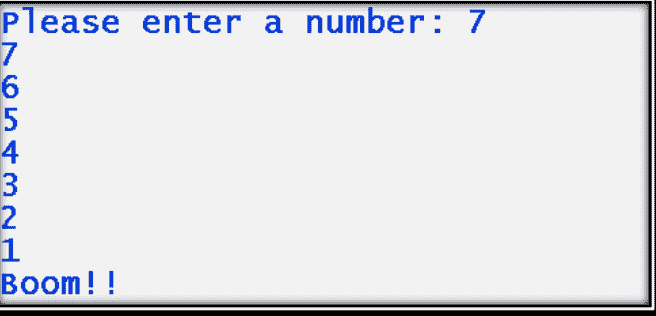

## 49 - Electrical_Power_Calculator.c 源代码

```c
Electrical_Power_Calculator.c
// 电功率
/*功率是在单位时间内传输电能的速率，用 SI 单位表示。功率通常由电机产生并供应给家庭。在电阻电路中，电池提供的功率可以与欧姆定律结合产生消耗的功率，如下所示：
//V=IR
//P=VI
//P=(V*V)/R
#include <stdio.h> // 头文件
int choice;
int main() // 用于换行的函数
{
    printf("\n"); // 
    printf("\tElectrical Power Calculator-\n"); // 水平制符
    printf("\tP = Electrical Power (watts or W)\n");
    printf("\tI = Electrical Current (amperes or A)\n");
    printf("\tV = Electrical Voltage (volts or V)\n");
    printf("\tR = Electrical Resistance (ohms)\n");
    printf("\t----------------------\n");
    // 循环
    // 供用户选择的主菜单。
    printf("\t1. Calculate Electrical Voltage (V)\n");
    printf("\t2. Calculate Electrical Current (I)\n");
    printf("\t3. Calculate Electrical Power (P)\n");
    printf("\t4. Exit\n"); // 退出选择以终止程序。
    printf("\tchoice: ");
    printf("\tPlease enter your choice (1-4): ");

switch (choice) // switch 用于制作循环
{
    float V, I, P;
    case 1: // V = P/I
        printf("\n");
        printf("\nP enter the value for ");
        printf("\nPower (watt): \n");
        scanf("%f", &P);
        printf("\nCurrent (I): \n");
        scanf("%f", &I);
        V = P / I;
        printf("\nElectrical Voltage: %.2f\n", V);
        sleep(1); // 延迟1秒
        break; // break 跳过其他语句
    case 2: // I = P/V
        printf("\n");
        printf("\enter the value for ");
        printf("\Power (watt): \n");
        scanf("%f", &P);
        printf("\nCurrent (V): \n");
        scanf("%f", &V);
        I = P / V;
        printf("\nElectrical Current: %.2f\n", I);
        sleep(1);
        break;
    case 3: // P = IV
        printf("\n");
        printf("enter the value for ");
        printf("\Voltage (V): \n");
        scanf("%f", &V);
        printf("\nCurrent (I): \n");
        scanf("%f", &I);
        P = I * V;
        printf("\nElectrical Power. %.2f\n", P);
        sleep(1);
        break;
    case 4:
        break;
    default:
        printf("\n Invalid Choice!\n");
        printf("\n");
}
while(choice!=4);
return 0;
}
```

## 49 - Electrical_Power_Calculator.c 输出文件

```
+-POWER Calculator-+
P = Electrical Power (watts or W)
I = Electrical current (amperes or A)
V = Electrical voltage (voltage or V)
R = Electrical Resistance (ohms)

1. Calculate Electrical voltage (V)
2. Calculate Electrical current (I)
3. Calculate Electrical Power (P)
4. Exit

Please enter your choice (1-4): 1

Please enter the value for
Power (Watt): 300
Current (I): 2
Electrical voltage: 150.00V

1. Calculate Electrical voltage (V)
2. Calculate Electrical current (I)
3. Calculate Electrical Power (P)
4. Exit

Please enter your choice (1-4): 2

Please enter the value for
Power (watt): 1500
voltage(V): 32
Electrical current: 46.88A

1. Calculate Electrical voltage (V)
2. Calculate Electrical current (I)
3. Calculate Electrical Power (P)
4. Exit

Please enter your choice (1-4): 3

Please enter the value for
voltage(V): 250
Current(I): 6
Electrical Power 1500.00 W

1. Calculate Electrical Voltage (V)
2. Calculate Electrical current (I)
3. Calculate Electrical Power (P)
4. Exit

Please enter your choice (1-4): 4

## 4. ARRAY

## 50 - 1Array_Initializing.c 源代码

```c
// 在C语言中初始化和访问数组
#include <stdio.h>
int main ()
{
    /* 初始化包含12个整数的数组 n */
    int n[12] = {100, 200, 102, 103, 99, 105, 75, 1010, 108, 10, 0, 0};
    n[0]=100;
    n[1]=200;

    /* 输出每个数组的值 */
    printf("Element[0] = %d\n", n[0]);
    printf("Element[1] = %d\n", n[1]);
    printf("Element[2] = %d\n", n[2]);
    printf("Element[3] = %d\n", n[3]);
    printf("Element[4] = %d\n", n[4]);
    printf("Element[5] = %d\n", n[5]);
    printf("Element[6] = %d\n", n[6]);
    printf("Element[7] = %d\n", n[7]);
    printf("Element[8] = %d\n", n[8]);
    printf("Element[9] = %d\n", n[9]);
    printf("Element[10] = %d\n", n[10]);
    printf("Element[11] = %d\n", n[11]);
    return 0;
}
```

## 50 - 1Array_Initializing.c 输出文件

| Element[0] | 100 |
| Element[1] | 200 |
| Element[2] | 102 |
| Element[3] | 103 |
| Element[4] | 99 |
| Element[5] | 105 |
| Element[6] | 75 |
| Element[7] | 1010 |
| Element[8] | 108 |
| Element[9] | 10 |
| Element[10] | 0 |
| Element[11] | 0 |

## 51 - 2Array_with_Loop.c 源代码

```c
2Array_with_Loop.c
// 使用循环初始化和访问数组
#include <stdio.h>
int main () {
    int n[10]; /* n 是一个包含10个整数的数组 */
    int i; /* 将数组n的元素初始化为0 */
    for (i=0; i<10; i=i+1) // for (初始值; 条件值; 更新值)
        n[i] = i + 100; /* 将位置i的元素设置为i + 100 */
        printf("\n[%d] = %d\n", i, n[i]);
    return 0;
}
```

## 51 - 2Array_with_Loop.c 输出文件

| Element[0] | 100 |
| Element[1] | 101 |
| Element[2] | 102 |
| Element[3] | 103 |
| Element[4] | 104 |
| Element[5] | 105 |
| Element[6] | 106 |
| Element[7] | 107 |
| Element[8] | 108 |
| Element[9] | 109 |


## 52 - 3Array_Two_Dimensional.c 源代码

```c
// 初始化并访问二维数组
#include <stdio.h>
int main () {
    /* 一个包含 5行2列的数组*/
    int a[5][2] = {{0,0}, {1,2}, {2,4}, {3,6}, {4,8}};
    int i, j;
    /* 输出每个数组元素的值 */
    for (i = 0; i < 5; i++) {
        for (j = 0; j < 2; j++) {
            printf("a[%d][%d] = %d\n", i,j, a[i][j]); // a[5][2]
        }
    }
    return 0;
}
```

## 52 - 3Array_Two_Dimensional.c 输出文件

```
a[0][0] = 0
a[0][1] = 0
a[1][0] = 1
a[1][1] = 2
a[2][0] = 2
a[2][1] = 4
a[3][0] = 3
a[3][1] = 6
a[4][0] = 4
a[4][1] = 8
```

## 53 - 4Passing_Arrays_as_Function_Arguments.c 源代码

Passing_Arrays_as_Function_Arguments.c

```c
// 将数组作为参数参数
#include <stdio.h> // 头文件
/* 函数声明 */
double getAverage(int arr[], int size);
int main() {
    /* 一个包含 5 个元素的 int 数组 */
    int balance[5] = {1000, 2, 3, 17, 50};
    // balance[0] = 1000, balance[1] = 2, balance[2] = 3, balance[3]=17, balance[4]=50
    double avg;
    /* 作为参数传递数组基指针 */
    avg = getAverage(balance, 5); // 函数调用
    /* 输出返回值 */
    printf("\nAverage value is: %.2f\n", avg); // 平均值 = 214.40
    return 0;
}

double getAverage(int arr[], int size) // 函数定义
    int i;
    double avg;
    double sum=0;
    for (i = 0; i < size; ++i) {
        printf("\n%d\n", arr[i]);
        sum += arr[i]; // 1000+2+3+17+50 = 1072
    }
    avg = sum / size; // avg = 1072/5 = 214.4
    return avg;
}
```

## 53 - 4Passing_Arrays_as_Function_Arguments.c 输出文件

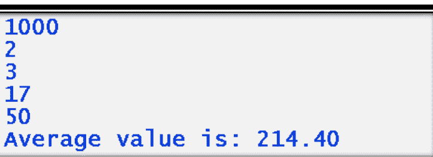

## 54 - 5Array_Find_Average.c 源代码

```c
// 使用数组计算 n 个数字平均值的程序
#include <stdio.h>
int main() {
    int marks[50], i, n, sum = 0;
    float average;
    printf("Enter number of elements: ");
```

## 54 - 5Array_Find_Average.c 输出文件

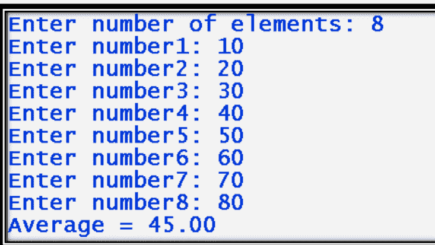

## 55 - 6Array_Find_Total.c 源代码

```c
#include <stdio.h>
#define SIZE 4
void main() {
    int house[SIZE] = {3,2,6,4}; // house [4] = {3,2,6,4}
    /* house[0]=3;
       house[1]=2;
       house[2]=6;
       house[3]=4; */
    int index, total = 0;
    for (index = 0; index < SIZE; index++) {
        printf("\nHouse[%d]: %d\n", index, house[index]);
        total+= house[index]; // total = total + house[index];
    }
    printf("\nthe total: %d", total);
}
```

## 55 - 6Array_Find_Total.c 输出文件

House [0]: 3
House [1]: 2
House [2]: 6
House [3]: 4
The total: 15

## 56 - 7Array_Total_Daily_Rainfall_For_A_Weeks.c 源代码

```c
/* 写一个程序，要求用户输入一周的
每日雨量，并将其赋值一个名为 rain[] 的数组。
程序必须能够使用 for 循环计算
每日雨量的总和，并在屏幕上显示总和。 */
#include <stdio.h>
void main() {
    int rain[8], i;
    // rain[0], rain[1], rain[2], rain[3], rain[4], rain[5], rain[6], rain[7];
    for (i = 0; i < 8; i++) {
        printf("Enter daily rain %d (mm): ", i);
        scanf("%d", &rain[i]);
    }
    printf("\n");
    for (i = 0; i < 8; i++) {
        printf("Daily rain %d (mm): %d\n", i, rain[i]);
        // 缺少逻辑片段
    }
}
```

## 56 - 7Array_Total_Daily_Rainfall_For_A_Weeks.c 输出文件

| rain 1 (mm) : 10 |
| rain 2 (mm) : 0 |
| rain 3 (mm) : 25 |
| rain 4 (mm) : 0 |
| rain 5 (mm) : 0 |
| rain 6 (mm) : 20 |
| rain 7 (mm) : 0 |

Daily rain 1 : 10
Daily rain 2 : 0
Daily rain 3 : 25
Daily rain 4 : 0
Daily rain 5 : 0
Daily rain 6 : 20
Daily rain 7 : 0
Total rain: 55

## 57 - 8Array_Average_Marks.c 源代码

```c
Array_Average_Marks.c
/* 写一个程序来分析 5 个学生的最终成绩。
要求用户输入成绩，计算并在屏幕上打印总分和平均分。 */
#include <stdio.h>
void main(void)
{
    int studentMarks[6], i;
    int sum=0;
    float average;
    for (i=1; i<=5; i++) // 循环；更新值
    {
        printf("Please enter the marks for student %d: ", i);
        scanf("%d", &studentMarks[i]);
        sum += studentMarks[i]; // 根据上下文推断逻辑
    }
    average=sum/5;
    printf("\nFinal sum is: %d\n", sum);
    printf("average marks is: %.2f\n", average);
}
```

## 57 - 8Array_Average_Marks.c 输出文件

| Please enter the marks for student no 1 : 85 |
| Please enter the marks for student no 2 : 77 |
| Please enter the marks for student no 3 : 79 |
| Please enter the marks for student no 4 : 65 |
| Please enter the marks for student no 5 : 60 |

The marks for student no 1: 85
Update sum is: 85
The marks for student no 2: 77
Update sum is: 162
The marks for student no 3: 79
Update sum is: 241
The marks for student no 4: 65
Update sum is: 306
The marks for student no 5: 60
Update sum is: 366
Final sum is: 366
Average marks is: 73.00

## 58 - 9Array_Find_Even_Number.c 源代码


```c
#include <stdio.h>
main() {
    int numbers[12]={}; // number[0]=0;
    // 只使用数字1到10
    // 数组大小至少为11，因为我们不使用数字0
    int i, sum=0; // i 计数计数
    for (i=1; i<11; i++) {
        printf("Please enter number %d: ", i);
        scanf("%d", &numbers[i]);
    }
    printf("The even numbers are: \n");
    for (i=1; i<11; i++) {
        if (numbers[i]%2==0) // 确定并打印偶数
            printf("%d\n", numbers[i]); // 输出偶数
            sum+=numbers[i]; // 求偶数的和
    }
    printf("Total even numbers are: %d\n", sum);
    printf("Array element 1: %3d\n", numbers[1]); // 留3个空格
    printf("Array element 0: %5d\n", numbers[0]); // 留5个空格
    printf("Array element 10: %2d\n", numbers[10]); // 留2个空格
}
```

## 58 - 9Array_Find_Even_Number.c 输出文件

```
Please enter number 1: 10
Please enter number 2: 9
Please enter number 3: 8
Please enter number 4: 7
Please enter number 5: 6
Please enter number 6: 5
Please enter number 7: 4
Please enter number 8: 3
Please enter number 9: 2
Please enter number 10: 1
The even numbers are:
10
8
6
4
2
Total even numbers are: 5
Array element 11: 0
Array element 0: 0
Array element 10: 1
```

## 59 - 10Array_Find_Average_For_Two_Dimensional_Marks.c 源代码 

10Array_Find_Average_For_Two_Dimensional_Marks.c

```c
  /* 写一个使用名为 grades 的二维数组的程序，
  能够计算五个学生在两个学科的平均分。 */
  #include <stdio.h>
int main() {

    int grades[2][5]; // grades [i][j]
    float average, sum;
    int i, j;
    grades[0][0] = 80;
    grades[0][1] = 70;
    grades[0][2] = 65;
    grades[0][3] = 89;
    grades[0][4] = 90;
    grades[1][0] = 85;
    grades[1][1] = 80;
    grades[1][2] = 82;
    grades[1][3] = 82;
    grades[1][4] = 87;
  for (i=0; i<2; i++) { // 初始值=0; 条件; 更新值 i=i+1
    sum = 0;
    for (j=0; j<5; j++) { // 初始值=0; 条件; 更新值 j=j+1
      sum += grades[i][j]; // sum = sum+grades[i][j]
    }

    average=sum/5;
    printf("The average marks obtained in subject %d is: %.2f\n", i, average);
    //平均分成绩0, 学科1 = 394/5 = 78.8
    //平均分成绩1, 学科2 = 414/5 = 82.8
  }
  return 0;
}
```


## 5. 函数。

## 60 - 1Function_User_Defined.c 源代码

```c
Function_User_Defined.c
/*重写以下程序，通过实现一个名为 myIO() 的用户定义函数。
程序应从 main 函数中调用该函数。
读取和打印任务必须在 myIO() 函数中完成。 */
#include<stdio.h>
main ()
{
	int num;
	printf("Enter an integer [or -99 to exit]:");
	scanf("%d", &num);
	do
	{
		printf("Number is: %d\n",num);
		printf("Enter an integer [or -99 to exit]:");
		scanf("%d", &num);
	} while (num != -99);
}
```

```c
#include<stdio.h> // 头文件
int myIO (void) { /* 函数声明 *
//局部变量定义
int num = 0; // 声明变量
}
int main () // main 函数
{
	myIO(); // 调用 myIO 函数
	do
	{
		printf("Number is: %d\n",num);
		myIO(); // 调用 myIO 函数
	} while (num != -99);
	return 0;
}

int myIO () // myIO 函数定义
{
	printf("Enter an integer [or -99 to exit]:");
	scanf("%d", &num);
}
```

## 60 - 1Function_User_Defined.c 输出文件

```
Enter an integer [or -99 to exit]:99
Number is: 99
Enter an integer [or -99 to exit]:76
Number is: 76
Enter an integer [or -99 to exit]:1234
Number is: 1234
Enter an integer [or -99 to exit]:-99
```

## 61 - 2Function_Find_Minimum_Value.c 源代码

```c
Function_Find_Minimum_Value.c
1 // 函数语句_
2 // 返回两个数之间最小值函数
3 #include <stdio.h>
4 /* 函数声明 */
5 int min(int num1, int num2);
6 int main ()
7 {
8 /* 局部变量定义 */
9 int a = 10;
10 int b = 50;
11 int ret;
12 /* 调用函数获取最大值 */
13 ret = min(a, b); // 函数调用
14 printf("Min value is : %d\n", ret);
15 return 0;
16
16 /* 返回两个数之间最小值函数 */
17 int min(int num1, int num2) // 函数定义
18 {
19 /* 局部变量声明 */
20 if (num1 < num2)
21 result = num1;
22 else
23 result = num2;
24 return result;
25 }
```

## 61 - 2Function_Find_Minimum_Value.c 输出文件

```
Min value is : 10
```

## 77 C语言编程示例与练习

## 62 - 3Function_Call_By_Value.c 源代码

```c
Function_Call_By_Value.c
1 // 函数语句（按值传递）
2 #include <stdio.h>
3 /* 函数声明 */
4 void swap(int x, int y);
5 int main ()
6 {
7 /* 局部变量定义 */
8 int a = 100;
9 int b = 200;
10 printf("Before swap, value of a : %d\n", a);
11 printf("Before swap, value of b : %d\n", b);
12 /* 调用函数交换值 */
13 swap(a, b);
14 printf("After swap, value of a : %d\n", a);
15 printf("After swap, value of b : %d\n", b);
16 }
17 /* 交换值的函数定义 */
18 swap(int x, int y)
19 {
20 int temp;
21 temp = x;
22 /* 保存 x 的值 */
23 x = y; /* 将 y 放入 x */
24 y = temp; /* 将 x 放入 y */
25 }
```

## 62 - 3Function_Call_By_Value.c 输出文件

```
Before swap, value of a : 100
Before swap, value of b : 200
After swap, value of a : 100
After swap, value of b : 200
```

## 63 - 4Function_Call_By_Reference.c 源代码

| 4Function_Call_By_Reference.c | |
| :--- | :--- |
| 1 | // 函数语句（按引用传递） |
| 2 | #include <stdio.h> |
| 3 | /* 函数声明 */ |
| 4 | void swap(int *x, int *y); |
| 5 | int main () |
| 6 | { |
| 7 | /* 局部变量定义 */ |
| 8 | int a = 100; |
| 9 | int b = 200; |
| 10 | printf("Before swap, value of a : %d\n", a); |
| 11 | printf("Before swap, value of b : %d\n", b); |
| 12 | /* 调用函数交换值 */ |
| 13 | swap(&a, &b); |
| 14 | printf("After swap, value of a : %d\n", a); |
| 15 | printf("After swap, value of b : %d\n", b); |
| 16 | return 0; |
| 17 | /* 交换值的函数定义 */ |
| 18 | void swap(int *x, int *y) |
| 19 | { |
| 20 | int temp; |
| 21 | temp = *x; |
| 22 | /* 保存 x 的值 */ |
| 23 | *x = *y; /* 将 y 放入 x */ |
| 24 | *y = temp; /* 将 x 放入 y */ |
| 25 | } |

## 63 - 4Function_Call_By_Reference.c 输出文件

```
Before swap, value of a : 100
Before swap, value of b : 200
After swap, value of a : 200
After swap, value of b : 100
```

## 64 - 5Function_Annual_Income.c 源代码

```c
Annual_Income.c
/*编写一个程序，调用名为 printMessage() 的用户定义函数。
在 main 函数中询问用户的年收入。将值传递给 printMessage 函数。
如果用户年收入超过 RM 100,000，打印祝贺信息；
否则打印鼓励信息。 */
#include<stdio.h>
void printMessage(int); // 函数声明
int income;
main() {
    printf("enter your annual income: RM ");
    scanf("%d", &income);
    printMessage(income); // 调用函数
    return 0;
}
if(income>=100000)
{
    printf("\nCongratulations! You earned more than RM 100,000.");
}
else
{
    printf("\n harder and smarter.");
}
```

## 64 - 5Function_Annual_Income.c 输出文件

```
Please enter your annual income: RM 80000
Work harder and smarter.

Please enter your annual income: RM 150000
Congratulations! You earned more than RM 100,000.
```

## 65 - 6Function_Calculate_Volume_For_Sphere.c 源代码

```c
Calculate_Volume_For_Sphere.c
// 球体的体积计算
#include <stdio.h>
int main() {
    float calculateVolume(float);
    float radius, displayVol;
    printf("Please enter the radius for sphere: ");
    scanf("%f", &radius);
    displayVol = calculateVolume(radius);
    printf("Volume of the sphere: %.2f \n", displayVol);
    return 0;
}

float calculateVolume(float radius) {
    float Volume;
    Volume = (4.0*3.142*radius*radius)/3.0; // pi=3.142
    return Volume;
}
```

## 77 C语言编程示例与练习

## 66 - 7Function_Draw_Face.c 源代码

```c
// 口巴函数定义
void drawMouth(void) {
    printf("\n // \n");
}
// 嘴巴函数定义
void drawChin(void) {
    printf("\n // /\n");
}
// 头发函数定义
void drawHair(void) {
    printf("\\\\\\\\n");
}
// 眼睛函数定义
void drawEyes(void) {
    printf("| | \n");
    printf("--- + + -- )\n");
}
// 鼻子函数定义
void drawNose(void) {
    printf("| | \n");
}
```

## 77 C语言编程示例与练习

## 67 - 8Function_Choose_Face_To_Draw.c 源代码

```c
Choose_To_Draw.c
/*改进为任务 编写的程序，使得除了笑脸之外，
还可以根据请求显示以下脸。由于头发、鼻子和嘴巴的形状对所有脸都是的，
使用与之前程序相同的函数。
示例输出：
 H - 笑脸
 S - 伤脸
 A - 愤怒脸 */

#include <stdio.h> // main 函数
 // 函数声明 / 函数原型
void drawHair(void);
void drawEyes(void);
void drawNose(void);
void drawMouth(void);
void drawChin(void);
void main(void) // main 函数
{
 char face;
    printf("H - Happy face\n");
    printf("S - Sad face\n");
    printf("A - Angry face\n");
    printf("I wish to display (H/S/A): ");
    scanf("%c", &face);

    if(face=='H' || face=='h')
    {
        // 笑脸的函数调用
        drawHair();
        drawEyes();
        drawNose();
        drawHMouth();
        drawChin();
    }
    else if(face=='S' || face=='s')
    {
        // 伤脸的函数调用
        drawHair();
        drawEyes();
        drawNose();
        drawSMouth();
        drawChin();
    }
    else if (face=='A' || face=='a')
    {
        // 愤怒脸的函数调用
        drawHair();
        drawEyes();
        drawNose();
        drawAMouth();
        drawChin();
    }
    else
    {
        printf("wrong input");
    }
    return 0;
}
```


```c
62  //定义函数
63  void drawHair(void)
64  {
      printf("vvvvvvvvvvvvv\n"
               " / //vvvvvvvvvvvv //\n"
               " | vvvvvvvvvvvv |\n");
68  }
69  void drawHDEyes(void)
70  {
      printf("| ------ ------ \n"
               "| | | |\n"
               "( + + )\n");
74  }
75  void drawSEyes(void)
76  {
      printf("| // // \n"
               "( / - - // )\n"
               "( * * / * )\n");
79  }
80  void drawAEyes(void)
81  {
      printf("| --- | \n"
               "( // // )\n"
               "( * // / * )\n");
85  }
86  void drawNose(void)
87  {
      printf("| | | \n");
89  }
```

# 77 C 语言编程示例与练习

```c
void drawHMouth(void)
{
    printf("  \n  \n");
}
void drawSMouth(void)
{
    printf("  \n  \n");
}
void drawAMouth(void)
{
    printf("  \n  \n");
}
void drawCmouth(void)
{
    printf("  \n  \n");
}
```

# 8 - 8Function_Choose_Face_To_Draw.c 输出文件

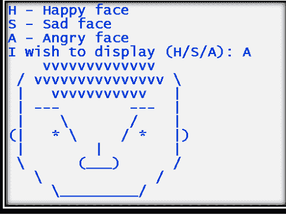

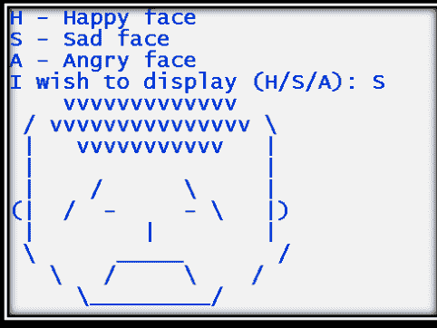

# 68 - 9Function_Draw_House.源代码

```c
#include <stdio.h> // 头文件
void drawUFloor(void); // 函数声明 / 函数原型
void drawGFloor(void); // 函数声明 / 函数原型
void drawRoof(void); // 函数声明 / 函数原型

void main(void) // 主函数
{
    int x, level; // 定义变量名
    printf("请输入你梦想中的房屋所需要的层数: ");
    scanf("%d,%d", &x, &level);
    sleep(1); // 延迟 1 秒以查看源代码运行情况
    drawRoof(); // 函数调用
    sleep(1); // 延迟 1 秒以查看源代码运行情况
    for (x=0; x<level; x+=1) // for循环 (初始值; 条件 ; 更新)
    {
        drawRoof(); // 函数调用
        sleep(1); // 延迟 1 秒以查看源代码运行情况
        drawGFloor(); // 函数调用
        sleep(1); // 延迟 1 秒以查看源代码运行情况
        printf("\n完成你的梦想房屋!");
    }
}
```

```c
// 函数声明
void drawRoof(void)
{
    printf("\n
        ||
                ||
        ""

        

                ||||
                


 draw drawvoidFloor(void)
{
    
("\n        


                


                


        \n||
        ""
        
        \n");
}
```

# 68 - 9Function_Draw_House.c 输出文件

```
请输入你梦想中的房屋所需要的层数: 3
   _
  |_ | 
  |   |
  |--|
  |   |
  |--|
  |   |
  |--|
  |   |
  |_

完成你的梦想房屋!
```

# 69 - 10Function_Pass_by_Value.c 源代码

10Function_Pass_by_Value.c

```c
// 参数值传递
// 在函数中通过值传递参数给另一个函数
#include <stdio.h>
int add(int a, int b);函数声明 / 函数原型
int main() //主函数
{
    int x, y, z;
    x = 5;
    y = 5;
    z = add(x,y); // 值传递调用
    printf("\nz = %d",z); //z=10
    return 0;
}
// 程序结束
int add(int a, int b) // 函数定义
{
    a=7;
    b=8;
    printf("\na+b = %d", a+b);
    return(a + b);
}
```

# 69 - 10Function_Pass_by_Value.c 输出文件

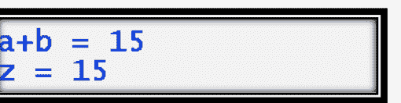

# 70 - 11Function_Sum1.c 源代码

```c
#include <stdio.h> // 头文件
int getInput(void); /* 函数原型 / 函数声明 **/
void main(void) // 主函数
{
    int num1, num2, sum;
    // 输入和输出变量
    num1 = getInput(); // 调用函数
    num2 = getInput(); // 调用函数
    sum = num1 + num2;
    printf("Sum is %d\n",sum);
}
int getInput(void) // 函数定义
{
    int number;
    printf("输入一个数字:");
    scanf("%d",&number);
    return number;
}
```

# 70 - 11Function_Sum1.c 输出文件

```
输入一个数字:5
输入一个数字:5
Sum is 10
```

# 71 - 12Function_Sum2.c 源代码

```c
#include <stdio.h>
int calSum(int val1, int val2);/* 函数原型*/
void main(void)
{
    int sum, num1, num2;
    printf("输入两个数字计算和:");
    scanf("%d%d",&num1,&num2);
    sum = calSum(num1,num2);/* 函数调用 */
    printf("\n%d + %d = %d", num1, num2, sum);
}
int calSum(int val1, int val2) /* 函数定义*/
{
    int sum;
    sum = val1 + val2;
    return sum;
}
```

输入两个数字计算和:50123
50 + 123 = 73

# 6. POINTER (指针)

# 72 - Pointer.c 源代码

```c
Pointer.c
// C语言编程中的指针
/* 内存块 A 的值 101 被预留。
假设地址 648780 属于 A。
因此：&A 用于输出值和地址。*/
#include <stdio.h>
int main() {
    int A = 101;
    printf("Value of A = %d, A = %p\n", A, &A); //A=101, 地址=648780
    return 0;
}
```

[/content]

[content]
# 72 - Pointer.c 输出文件


# 73 - Pointer_AccessThevaluevariables.c 源代码

```c
Pointer_AccessThevaluevariables.c
// 使用指针变量访问变量的值
#include <stdio.h>
int main() {
    int a, b, c;
    int *Num1, *Num2; // 指针变量声明
    a = 5;
    b = 6;
    Num1 = &a; // x的地址
    Num2 = &b; // Num1和Num2 指向a和b
    c = *Num1 + *Num2;
    printf("Total = %d",c); //30
    return 0;
}
```

# 73 - Pointer_AccessThevaluevariables.c 输出文件


# 74 - Pointer_ReferenceOperatorDereferenceOperator.c 源代码

```c
Pointer_ReferenceOperatorDereferenceOperator.c
// 解引用运算符 (*) 和 引用运算符 (&)
/* 运算符 & 返回变量的地址。
运算符 * 返回地址的值。*/
#include <stdio.h>
int main() {
    int num1, num2, num3;
    /* 运算符 & 返回变量的地址。
    运算符 * 返回地址的值。 */
    num1 = 10;
    num2 = 20;
    num3 = 30;
    int *ptr1, *ptr2, *ptr3;
    /* 运算符 & 返回变量的地址。
    运算符 * 返回地址的值。 */
    ptr1 = &num1;
    ptr2 = &num2;
    ptr3 = &num3;
    /* 运算符 & 返回变量的地址。
    运算符 * 返回地址的值。 */
    printf("Value of num1: %d\n", *ptr1);
    printf("Value of num2: %d\n", *ptr2);
    printf("Value of num3: %d\n", *ptr3);
    printf("Address of num1: %p\n", ptr1);
    printf("Address of num2: %p\n", ptr2);
    printf("Address of num3: %p\n", ptr3);
    // 通过指针修改值
    *ptr1 = 50;
    printf("New value of num1: %d\n", *ptr1);
}
```

# 74 - Pointer_ReferenceOperatorDereferenceOperator.c 输出文件

```
Value of num1 = 10
Value of num2 = 20
Value of num3 = 30
Address of num1 = 0x...
Address of num2 = 0x...
Address of num3 = 0x...
New value of num1 = 50
```


## 76 - Games_Tic_Tac_Toe.c 源代码

Games_Tic_Tac_Toe.c

```c
/*此程序用于构建一个双玩家的 TIC-TAC-TOE ('X' 'O') 游戏*/
TIC-TAC-TOE 是一种由两个玩家交替在两条垂直线与水平线交叉所构成的图形格子中放置 'X' 和 'O' 的游戏，每个人都试图让自己的三个 'X' 或三个 'O' 排成一行，并阻止对手获胜*/
#include <stdio.h> // 头文件
char square[10] = {'0','1','2','3','4','5','6','7','8','9'};
// 游戏中可能出现的数字，必须由玩家选择
int checkWin();
int main() { // 主函数
{ // 打开左括号
    int player = 1, i, choice; // 声明整数数据类型
    char mark;
    do {
        drawBoard();
        player = (player % 2) ? 1 : 2; // 2 // 玩家
        printf("\n%d, enter the choice :%%d",player);
        scanf("%d",&choice); // choice
        if(choice == 1 && square[1] == '1')
            square[1] = mark;
        else if(choice == 2 && square[2] == '2')
            square[2] = mark;
        else if(choice == 3 && square[3] == '3')
            square[3] = mark;
        else if(choice == 4 && square[4] == '4')
            square[4] = mark;
        else if(choice == 5 && square[5] == '5')
            square[5] = mark;
        else if(choice == 6 && square[6] == '6')
            square[6] = mark;
        else if(choice == 7 && square[7] == '7')
            square[7] = mark;
        else if(choice == 8 && square[8] == '8')
            square[8] = mark;
        else if(choice == 9 && square[9] == '9') {
            square[9] = mark;
        } else {
            printf("\n\n Invalid option!");
            // 当选择了指定数字以外的数字时出现
            player--;
            getch();
        }
        i = checkWin();
        while(i == -1) {
            drawBoard();
            if(i==1) {
                // 左大括号
                printf("\n\n=>%d won",--player);
            } // 右大括号
            else {
                printf("\n\n=>Game draw");
            }
            getch();
            return 1;
        } // 右大括号
    } while (1);
} 

int checkWin() {
    // 左大括号
    if(square[1] == square[2] && square[2] == square[3]) {
        return 1;
    } else if(square[4] == square[5] && square[5] == square[6]) {
        return 1;
    } else if(square[7] == square[8] && square[8] == square[9]) {
        return 1;
    } else if(square[1] == square[4] && square[4] == square[7]) {
        return 1;
    } else if(square[2] == square[5] && square[5] == square[8]) {
        return 1;
    } else if(square[3] == square[6] && square[6] == square[9]) {
        return 1;
    }
    return -1;
} // 右大括号

void drawBoard() {
    // 左大括号
    system("cls");
    printf("Tic Tac Toe \n\n");
    printf("Player (X) - Player (O) \n\n");
    printf("%c | %c | %c\n", square[1],square[2],square[3]);
    printf("---------------------\n");
    printf("%c | %c | %c\n", square[4],square[5],square[6]);
    printf("---------------------\n");
    printf("%c | %c | %c\n", square[7],square[8],square[9]);
    printf("---------------------\n");
    return 1;
} // 右大括号
exit(0); // 退出程序
```

## 76 - Games_Tic_Tac_Toe.c 输出文件

```text
Tic Tac Toe
Player1 (X) - Player2 (o)
| 0 | X | X |
| X | X | O |
| O | X | O |

==Player 1 won
```

```text
Tic Tac Toe
Player1 (X) - Player2 (o)
| 0 | O | O |
| 4 | X | 6 |
| X | X | 9 |

==Player 2 won
```

```text
Tic Tac Toe
Player1 (X) - Player2 (o)
| 0 | X | O |
| O | X | X |
| X | O | X |

==Game draw
```

## 77 - Ohms Law Calculator.c 源代码

```c
Oms Law Calculator.c
1   //欧姆定律计算器
2   //V=IR
3   #include <stdio.h> // 头文件
4   int choice;
5   int main() { // 用于换行
6     printf("\n"); //
7     printf("---------------------\nOms' Law Calculator\n"); //
8     printf("---------------------\n");
9     do {
10        // 玩家选择菜单：
11        printf("1. Calculate Voltage (V)\n");
12        printf("2. Calculate Current (I)\n");
13        printf("3. Calculate Resistance (R)\n");
14        printf("4. Exit\n"); // 退出程序。
15        printf("\n");
16        printf("Please enter your choice (1-4): \n"); // 获取输入
17        scanf("%d", &choice);//用于存储输入
18        switch (choice) { // 用于处理循环和选择。
19        {
20          case 1: //电压 = IR
21            printf("\n---------------------\n");
22            printf("Please enter the value for I and R\n");
23            scanf("%f, %f", &I, &R);
24            printf("Resistance (Ohm): %f\n", R);
25            V = I * R;
26            printf("Voltage: %.2f\n", V); // V=I*R
27            printf("---------------------\n");
28            sleep(1); // 并跳过其他语句
29            break;
30        case 2: //电流 = V/R
31            printf("\n---------------------\n");
32            printf("Please enter the value for (V)\n"); // 电压值
33            scanf("%f", &V);
34            printf("Resistance (Ohm): %f\n"); // 电阻值
35            I = V / R;
36            printf("\nCurrent: %.2f\n", I); // V/R=I
37            printf("\n");
38            sleep(1);
39            break;
40        case 3: //电阻 = V/I
41            printf("\n---------------------\n");
42            printf("Please enter the value for (V)\n"); // 电压值
43            scanf("%f", &V);
44            printf("\nCurrent (I): %f\n"); // 电流值
45            I = V / I;
46            printf("Resistance: %.2f Ohm\n", R);
47            printf("\n");
48            sleep(1);
49            break;
50        case 4:
51            break;
52        default:
53            printf("\n Invalid Choice!\n");
54            printf("\n-----------------------\n");
55        }
56    } while (choice!=4);
57return 0;
```

## 77 - Ohms Law Calculator.c 输出文件

```text
Ohm's Law Calculator
1. calculate voltage (V)
2. calculate current (I)
3. calculate Resistance (R)
4. Exit

please enter your choice (1-4): 1
----------------------------
please enter the value for
Current (I): 3
Resistance (Ohm): 1000
Voltage: 3000.00V

1. calculate voltage (V)
2. calculate current (I)
3. calculate Resistance (R)
4. Exit

please enter your choice (1-4): 2
----------------------------
please enter the value for
Voltage(V): 240
Resistance(Ohm): 2000
Current: 0.12A
--------------------------------
1. Calculate voltage (V)
2. Calculate Current (I)
3. Calculate Resistance (R)
4. Exit

please enter your choice (1-4): 3
----------------------------
please enter the value for
Voltage(V): 220
Current(I): 2
Resistance: 110.00 Ohm
----------------------------
1. calculate voltage (V)
2. calculate Current (I)
3. calculate Resistance (R)
4. Exit

please enter your choice (1-4): 4
```

## 77 C语言编程练习

1. “编程语言”术语定义为
   - A. 机器与机器通信的语言
   - B. 机器与人类通信的语言
   - C. 人类与计算机通信的语言
   - D. 机器的特殊语言

2. 算法定义为
   - A. 提供问题解决方案所需的步骤序列
   - B. 提供案例解决方案的序列
   - C. 获取输出的指令
   - D. 组合程序中的指令

3. 字母和数字的组合，但它们必须以字母开头。下划线 (_) 可以用作特殊字符。
该语句指的是
   - A. 常数
   - B. 变量
   - C. 标识符
   - D. 关键字

4. 从下项中选择程序的输出：
```c
#include<stdio.h>
int main()
{
int i=1;
i=2+2*i++;
printf("%d",i);
return 0;
}
```
   - A. 3
   - B. 4
   - C. 5
   - D. 6

5. 在“switch-case”语句中，以下哪个不能检查？
   - A. enum
   - B. integer
   - C. character
   - D. float

6. 丹尼想设计一个程序来生成申请驾照的年龄。
选择合适的控制结构解决问题。
   - A. if-else
   - B. switch-case
   - C. for
   - D. do-while

7. “根据指定的次数重复程序的某部分。”
上述语句指的是
   - A. for
   - B. if
   - C. if-else
   - D. switch-case

8. 程序的结果是什么？
```c
#include<stdio.h>
int main () {
  int i=0;
  for (i=1; i<=5; i++) {
    printf("%d", i);
  }
  return 0;
}
```
   - A. 0 1 2 3 4
   - B. 0 1 2 3 4
   - C. 1 2 3 4
   - D. 1 2 3 4 5

9. 识别规划过程中的元素。
   - i. 计算
   - ii. 处理
   - iii. 输入
   - iv. 输出
   - v. 进度
   - A. 只有 i、ii 和 iii
   - B. 只有 ii、iii 和 iv
   - C. 只有 iii 和 iv
   - D. 以上所有

10. 如果 a 是整数变量，取模运算后 a = 5%%2; 将返回值
    - A. 0
    - B. 1
    - C. 2
    - D. 2.5


[content]

+ 11. 程序的定义是什么？
A. 设计、编写和测试计算机程序的人员。
B. 一种允许程序员以特定格式编写命令的计算机工具。
C. 计算机可以理解并执行的翻译后的代码。
D. 计算机执行的一组特定的有序操作。

+ 12. 编程语言的结构或语法指的是 C 的
A. 语法 (Syntax)
B. 语法 (Grammar)
C. 语言 (Language)
D. 语义 (Semantics)

+ 13. C 语言被认为是一种
A. 低级语言
B. 中级语言
C. 高级语言
D. 汇编语言

+ 14. ____ 更接近人类语言更容易理解。也用于开发复杂的应用程序。
A. 机器语言
B. 中级语言
C. 高级语言
D. 汇编语言

+ 15. 下列是编译过程中预处理器和编译器发生的过程，除了？
A. 将宏替换为代码
B. 删除注释
C. 生成可执行文件
D. 包含头文件

+ 16. 下列是程序的接受定义，除了？
A. 一组组织良好的准则，规定计算机需要做什么以及如何做。
B. 一系列编号的指令列表，用于执行某些任务，通常用于概述算法的大致步骤而无需编写实际代码。
C. 一组用计算机编程语言编写的源代码，用于特定任务并按特定顺序执行。
D. 一个包含根据 C 语法组合的 C 语义序列的文本文件。

# C 语言编程的 77 个示例与练习 90

+ 17. ____ 仅包含数值信息，人类难以理解。
A. 机器语言
B. 中级语言
C. 高级语言
D. 汇编语言

+ 18. C 程序在 ____ 的帮助下转换为机器语言。
A. 解释器
B. 编辑器
C. 构建器
D. 编译器

+ 19. 下列哪种陈述最能描述程序员？
A. 设计计算机程序的人员。
B. 为计算机系统编写指令的人员。
C. 设计、编写和测试计算机程序的人员。
D. 测试计算机程序的人员。

+ 20. 人类理解并可以转换为语言 ____ 的命令词汇，指的是 C 的
A. 语法 (syntax)
B. 语法 (grammar)
C. 语言 (language)
D. 语义 (Semantics)

+ 21. 下列是编程的类型，除了：
A. 模块化编程
B. 结构化编程
C. 高级编程
D. 面对象编程

+ 22. 该编程工具使用链接符号来显示解决编程所需的步骤序列。
A. 伪代码 (Pseudocode)
B. 流程图 (Flowchart)
C. 输入处理输出 (IPO) 表
D. 网格表 (Grid Table)

+ 23. 写出下方流程图符号。
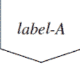
A. 终端 (Terminal)
B. 页内连接器 (On-page Connector)
C. 页外连接器 (Off-page Connector)
D. 子程序 (Subroutine)

+ 24. 下列关于算法的描述哪项是错误的？
A. 算法必须指定一个按正确顺序执行的步骤列表。
B. 算法可以使用流程图或伪代码表示。
C. 算法可以描述为解决问题的过程。
D. 算法仅在代码编译后才编写。

+ 25. 下面的伪代码是 ________ 结构的示例。
```
START
1. Get Num
2. While(Num>0)
   2.1 Sum = Sum + Num
   2.2 Num = Num + 1
   1. Display Sum
STOP
```
A. 选择结构 (Selection)
B. 嵌套结构 (Nested)
C. 顺序结构 (Sequential)
D. 循环结构 (Looping)

+ 26. 下面流程图代表 C 编程中的哪种控制结构？
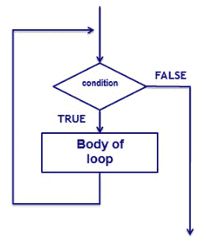
A. if else 选择结构
B. switch case 选择结构
C. while 重复结构
D. do while 重复结构

+ 27. 下列流程图的优点中哪项不是？
A. 更容易编码
B. 便于调试
C. 有效的分析
D. 不当的文档记录

+ 28. ____ 是记录算法的一种紧凑且非正式的文本方法。
A. 直方图 (Histogram)
B. 伪代码 (Pseudocode)
C. 流程图 (Flowchart)
D. IPO 图

+ 29. 在流程图中，所示的几何图形表示。
A. 输入和输出
B. 子程序
C. 判定 (Decisions)
D. 过程 (Process)

+ 30. 下面的伪代码是 结构的示例。
```
START
1. Read A, B
2. Calculate Sum = A + B
3. Display Sum
STOP
```
A. 选择结构 (Selection)
B. 顺序结构 (Sequential)
C. 重复结构 (Repetition)
D. 嵌套结构 (Nested)

+ 31. 识别以下流程图代表 C 编程中的哪种控制结构？
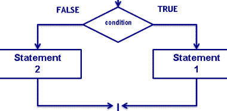
A. if else 结构
B. switch case 结构
C. if else 结构
D. 嵌套结构 (nested)

+ 32. 下列哪项是伪代码的优点？
A. 对初学者困难
B. 它提供了分析
C. style
D. 导致语法错误

+ 33. 下列哪项不是基本数据类型？
A. float
B. real
C. int
D. char

+ 34. 下列哪项符合标识符？
A. 8 bit
B. 24 bit
C. 32 bit
D. 64 bit

+ 35. C 中的标识符
A. 不能包含任何大写字母或数字
B. 可以包含多个
C. 可以以下划线开头
D. 可以是保留字

+ 36. 从下列符号中选择可以包含变量名的
A. 星号 (*)
B. 散列 (#)
C. 加号 (+)
D. 下划线 (_)

+ 37. 如果 'a' 是整数，那么 ____ = 5 返回
A. 标记 (Tokens)
B. 变量 (Variables)
C. 常量 (Constants)
D. 模块 (Modules)

+ 38. 程序成功运行后，值应该是？
A. -1
B. 0
C. 1
D. 2

+ 39. 下列哪项是所有需要的？
A. system ()
B. program ()
C. start ()
D. function ()

+ 40. 什么是标记了代码的开始和结束？
A. { }
B. ( )
C. [ ]
D. BEGIN AND END

# C 语言编程的 77 个示例与练习 94

+ 41. C 中的每条语句必须以 ____ 结尾。
A. 点 (.)
B. 反斜杠 (\)
C. 冒号 (:)
D. 分号 (;)

+ 42. 在 ____
A. 给处理器提供指令
B. 声明内存需求。
C. 被编译器忽略。
D. 导致语法错误。

+ 43. 下列哪些是标识符？
i. R3D
ii. per-capita
iii. phone#
iv. ice_cream
v. 91_gold
A. i, ii, iv, v
B. i, iv
C. ii, v
D. ii, iii

+ 44. 声明常量的正确语句是？
A. constant a=10;
B. const int a=10
C. const int a=10;
D. #define a 10

+ 47. 选择优先级最低的运算符
A. +
B. =
C. *
D. <

+ 48. 下列标识符无效？
i. integer
ii. printf
iii. Net-total
iv. _sum
A. i, ii 和 iii
B. i, iii, 和 iv
C. ii 和 iii
D. i, ii, iii, iv

+ 49. 下列哪项是选择语句？
A. switch case
B. while
C. do while
D. for

+ 50. 下面流程图代表 C 中的哪种结构？
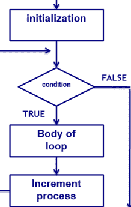
A. if else 选择结构
B. switch case 选择结构
C. while 重复结构
D. for 重复结构

+ 51. 下列哪种陈述最能描述“伪代码”？
A. 通过符号连接流程线来详细说明数据、信息和工作流的图形描述。
B. 定义为执行某些任务的指令列表，通常用于概述算法的大致步骤而无需编写实际代码。
在实际程序开发之前，建立解决问题的措施列表以确保使用正确的解决问题技术。
D. 它列出了程序的输入、输出以及将输入转换为程序输出的步骤。


52. 下列陈述中哪一个最能描述*流程图 (Flow Chart)*？........................................

- A. 使用某些符号对数据、信息和工作流进行图形化表示，这些符号通过流程线连接，用于描述解决问题时执行的指令。
- B. 执行某些任务的编号指令列表，通常用于概述算法的大步骤，而无需编写实际代码。
- C. 在实际程序代码之前创建一个解决问题的措施列表，以确保使用正确的解题方法。
- D. 识别程序的输入、输出以及将输入转换为输出所需的处理步骤。

53. 对 X 最好的描述是/一个 .........................................................

| | |
| X 是计算机内存中的一个内存位置，用于存储各种数据。为了指明该内存位置，每个 X 都应该被赋予一个唯一的名称。X 是表示内存位置的符号。 |

- A. 运算符
- B. 常数
- C. 变量
- D. 数据类型

54. 为了打印下面的 a 和 b，应该使用以下哪一个 printf() 语句？

```
#include <stdio.h>
void main ()
{float a=3.14;
unsigned char b='&';
}
```

- A. printf(" %f %d", a, b);
- B. printf(" %f %x", a, b);
- C. printf(" %f %s", a, b);
- D. printf(" %f %c", a, b);

55. 根据下面的流程图，程序的输出是什么？

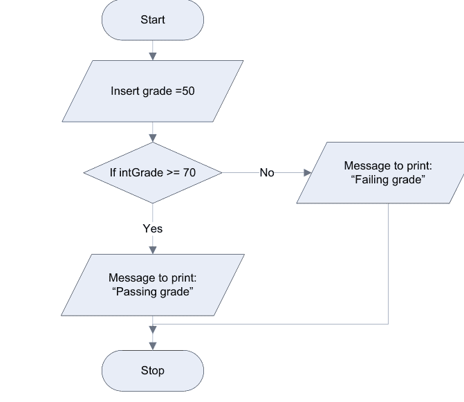

- A. 打印的消息：“Failing grade. (不合格)。”
- B. 打印的消息：“Passing grade. (合格)。”
- C. Failing grade. (不合格)
- D. Passing grade. (合格)

56. 在编程项目的文档中，程序员需要确定应该使用的函数、变量和公式。这一陈述指的是：

- A. 确定需求规范过程
- B. 编写项目建议书、流程图和项目计划过程
- C. 制定规格测试过程
- D. 编写源代码过程

57. 编译器生成文件。 

- A. 可执行代码
- B. 对象代码
- C. 汇编代码
- D. 以上均非

58. 单个 if-else 语句可以实现多少不同的结果？

- A. 1
- B. 2
- C. 3
- D. 4

59. 如果 'for' 循环中缺少条件，则无法通过 _________ 避免无限循环。

- A. continue 语句
- B. goto 语句
- C. return 语句
- D. break 语句

60. 关于 while 循环语句，以下哪些陈述是正确的？

- i. 它也被称为退出控制循环。
- ii. 它是一个入口控制循环。
- iii. 即使测试条件为假，循环体也会至少执行一次。
- iv. 如果测试条件最初为假，则循环体完全不执行。

- A. i 和 iii
- B. i 和 iv
- C. ii 和 iii
- D. ii 和 iv

61. C 程序的例子将是？

- A. 变量
- B. 语句
- C. 函数
- D. 以上皆是

62. 写出下面流程图符号的名字。

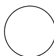

- A. 终端 (Terminal)
- B. 页内连接器 (On-page connector)
- C. 子程序 (Subroutine)
- D. 页外连接器 (Off-page connector)

63. 下面 C 代码的输出是什么？

```
#include<stdio.h>
int main()
{
    int a=2;
    if (a==2)
    {
        a=-a+2<1;
        printf("%d",a);
    }
    else
    {
        break;
    }
}
```

- A. 它什么都不打印
- B. 0
- C. -2
- D. 编译错误

64. 流程图在 C 中表示哪种控制结构？

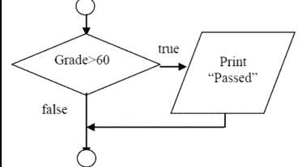

- A. if
- B. if else
- C. 嵌套 if else
- D. switch case

65. 为了防止从一个 case 穿透到下一个 case，必须做什么？

- A. stop;
- B. break;
- C. end;
- D. 一个分号

66. 下面的代码产生什么结果？

```
int x=0;
switch(x)
{
    case 1: printf("One");break;
    case 0: printf("Zero"); break;
    case 2: printf("Hello World");break;
}
```

- A. One
- B. Zero
- C. HelloWorld
- D. ZeroHelloWorld

67. 下列哪不是循环语句？

- A. for
- B. do while
- C. while
- D. repeat until

68. 下面的流程图表示 C 中的哪种控制结构？

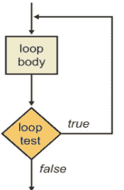

- A. if else
- B. switch case
- C. while 结构
- D. do 结构

69. 代码 (x>100) 的意思是？

- A. x 小于百
- B. x 大于百
- C. x 等于百
- D. while

70. 不慎使用 goto 语句会导致？

- A. 无结构化代码
- B. 无限循环
- C. Break 语句
- D. 以上均非

71. 执行 (int x=0; x<10; x++) 时，x 的最终值是多少？

- A. 0
- B. 1
- C. 9
- D. 10

72. 你认为下面代码的输出是什么？

```
#include<stdio.h>
void main()
{
    int i;
    for(i=0;i<10;i++)
    printf("%d ",i);
}
```

- A. 012345679
- B. 01234568
- C. 123456789
- D. 4567

73. 关于 Do-While 循环，以下哪些陈述是正确的？

- i. 它也被称为退出控制循环。
- ii. 它是一个入口控制循环。
- iii. 即使测试条件为假，循环体也会至少执行一次。
- iv. 如果测试条件最初为假，循环体完全不执行。

- A. i 和 iii
- B. i 和 iv
- C. ii 和 iii
- D. ii 和 iv

74. 在下面的代码中，x 被测试了多少次？

```
#include <stdio.h>
int main()
{
    int x = 0;
    while (x<3)
    {
        x++;
        printf("%d\n", x);
    }
}
```

- A. 2
- B. 4
- C. 3
- D. 1

75. 选择 i 的值使得输出为 6：

```
#include <stdio.h>
int main()
{
    int i;
    for (i=6;i>4;i-=2)
    printf("%d", i);
}
```

- A. 2
- B. 4
- C. 6
- D. 8

76. 函数是指什么？

- A. 函数是执行特定活动的语句集合。
- B. 函数是基本单元。通常，创建函数是为了执行特定的职责。
- C. 函数是执行特定任务的代码块。它是可重用的并在名称。
- D. 以上皆是。

77. 任何 C 程序：

- A. 需要输入
- B. 需要包含任何函数
- C. 必须包含一个函数
- D. 以上均非

答案：

1. C
2. A
3. C
4. B
5. D
6. A
7. A
8. D
9. B
10. B
11. D
12. A
13. C
14. C
15. C
16. B
17. A
18. D
19. C
20. D
21. C
22. B
23. C
24. D
25. D
26. C
27. D
28. B
29. C
30. B
31. C
32. B
33. B
34. D
35. B
36. C
37. B
38. C
39. A
40. D
41. C
42. C
43. C
44. C
45. D
46. B
47. C
48. A
49. D
50. B
51. A
52. C
53. D
54. C
55. B
56. B
57. B
58. A
59. D
60. D
61. D
62. B
63. D
64. A
65. B
66. B
67. D
68. C
69. A
70. A
71. D
72. A
73. A
74. B
75. C
76. D
77. C

## 参考与进一步阅读

1. Gookin, D. (2013). Beginning Programming with C for Dummies. John Wiley & Sons.
2. Hooi, Y. K. (2018). Fundamentals of Programming Polytechnic Series. Oxford Fajar Sdn. Bhd.
3. Kanetkar, Y. (2016). Let us C (15th Edition). BPB publications.
4. Klemens, B. (2015). 21st Century C (Second Edition). O'Reilly Published.
5. Kochan, S. G. (2013). Programming in objective-C. Pearson Education India.
6. Learn-c.org. (n.d.). learn-c-org free interactive C tutorial. Retrieved from learn-c-org: https://www.learn-c.org/
7. Programiz. (n.d.). Parewa Labs Pvt. Ltd. Retrieved from Learn C Programming: https://www.programiz.com/c-programming
8. Allain, A. (2019). Cprogramming.com. Retrieved from Learn C and C++ Programming: https://www.cprogramming.com/
