# ADA 编程入门指南


`Concurrent` 提供 `MAXAda`，一个适用于 `Linux/Xeon` 和 `PowerPC` 平台的 Ada 95 编译器，以及针对 `POSIX` 和 X/Motif 的 Ada 绑定。[`www.ccur.com/pdf/cpb-sw-maxada.pdf`](http://www.ccur.com/pdf/cpb-sw-maxada.pdf)

商业用，专利所有。


74 第 [18] 页 [2.4.8] 章节

75 [`www.irvine.com/`](http://www.irvine.com/)

76 [`www.rrsoftware.com`](http://www.rrsoftware.com)

77 [`www.ccur.com/`](http://www.ccur.com/)

78 [`www.ccur.com/products_rt_maxada.aspx`](http://www.ccur.com/products_rt_maxada.aspx)

## 2.8 Atego 的 ObjectAda（原 Aonix）

`Atego` 提供针对各种平台的原生和交叉编译器。它们配备了一个 IDE、一个调试器、一个 `Eclipse` 插件，以及一个 `POSIX` 绑定 [`www.aonix.com/pdf/`](http://www.aonix.com/pdf/oa-linux.pdf) [oa-linux.pdf](http://www.aonix.com/pdf/oa-linux.pdf)。

在 Microsoft Windows 和 `i386` 上的 `GNU/Linux` 上，`Aonix` 提供两种定价模式供客户选择：可以是带有可选支持的永久许可费用，或者仅支付年度支持费：对于 Linux，单用户费用为 3000 美元，5 用户服务包为 12000 美元。详见完整新闻稿。

此外，他们还提供“ObjectAda 特别版”：一个 `ObjectAda` 的免费评估版本，它限制了可编译程序的大小，但在其他方面功能完备，包含 IDE 和调试器。需要免费注册。

`Atego` 最近的一项贡献是用于 `Eclipse` 的 `ADT`。Ada 开发工具 (ADT) 为 `Eclipse` 开源开发平台增加了 Ada 语言支持。`ADT` 可以配合 `Aonix` 编译器以及 `GNAT` 使用。`Eclipse` 中的 `ADT` 是一个开源供应商支持的项目。该项目代号为 `Hibachi`，并在 2007 年英国 Ada 会和 Ada-Europe 2007 期间进行过展示，现在已正式创建。

商业用，专利所有。

## 2.9 OC Systems 的 PowerAda

`OC Systems` 提供 Ada 编译器以及与 `POSIX` 和 X-11 的绑定：

* `PowerAda`，一个适用于 `Linux` 和 AIX 的 Ada 95 编译器，

* `LegacyAda/390`，一个适用于 `IBM System 370` 和 `390` 主机的 Ada 83 编译器。商业用，专利所有。

## 2.10 Atego 的 Rational Apex（原 IBM Rational）

用于原生和嵌入式开发的 `Rational Apex`。


79 [`www.atego.com/`](http://www.atego.com/)

80 [`en.wikibooks.org/wiki/Ada%20Programming%2FPlatform%2FPOSIX`](http://en.wikibooks.org/wiki/Ada%20Programming%2FPlatform%2FPOSIX)

81 [`www.atego.com/pressreleases/pressitem/aonix-shatters-ada-price-barrier-for-linux`](http://www.atego.com/pressreleases/pressitem/aonix-shatters-ada-price-barrier-for-linux)

82 [`www.atego.com/support/eval-aonix-objectada/`](http://www.atego.com/support/eval-aonix-objectada/)

83 [`www.aonix.com/adt.html`](http://www.aonix.com/adt.html)

84 [`www.eclipse.org/`](http://www.eclipse.org/)

85 [`www.eclipse.org/proposals/adt/`](http://www.eclipse.org/proposals/adt/)

86 [`www.eclipse.org/hibachi/`](http://www.eclipse.org/hibachi/)

87 [`www.ocsystems.com/`](http://www.ocsystems.com/)

88 [`www.ocsystems.com/prod_powerada.html`](http://www.ocsystems.com/prod_powerada.html)

89 [`www.ocsystems.com/prod_legacyada.html`](http://www.ocsystems.com/prod_legacyada.html)

90 `Atego` 收了 IBM `Rational Apex Developer` 产品

91 [`www-306.ibm.com/software/awdtools/developer/ada/`](http://www-306.ibm.com/software/awdtools/developer/ada/)


商业用，专利所有。

## 2.11 DDC-I 的 SCORE

`DDC-I` 提供适用于嵌入式开发的 `SCORE` 交叉编译器。`SCORE` 代表安全关键、面向对象、实时。

商业用。

## 2.12 SWEP-EDS 的 XD Ada

`SWEP-EDS` 提供嵌入式 `XD Ada` 交叉编译器。主机包括 `VAX`、`Alpha` 以及运行 `OpenVMS` 的系统；目标包括 `Motorola 6800` 和 `MIL-STD-1750A` 处理器。

商业用。

## 2.13 XGC 的 XGC Ada

`XGC` 提供适用于航空航天应用的 `XGC Ada`。运行时内核非常小，不支持异常传播（即你只能在引发异常的子程序处理异常）。

商业用但某些版本提供免费下载。

| | |

| :--- | :--- |

| 支持的语言 | Ada 83, Ada 95, C |

| 运行时许可证 | `GNAT`-Modified |

| 原生平台 | 无 |


| 交叉平台 | 主机：`sun-sparc-solaris`, `pc-linux`；目标为带有 `ERC32`、`MIL-STD-1750A`、`Motorola 6800` 系列或 `Intel 32-bit` 处理器的裸板。 |

| 编译器后端 | `GCC` 2.8.1 |

| 获取方式 | [`www.xgc.com/`](http://www.xgc.com/) |

| 支持 | 商业 |

| 包含附加 | 符合 Ravenscar 标准的运行时内核，适用于航空航天应用；`gdb` 交叉调试器；目标模拟器。 |

## 2.14 参考文献

参考文献


94 [`en.wikipedia.org/wiki/ERC32`](http://en.wikipedia.org/wiki/ERC32)

95 [`en.wikipedia.org/wiki/MIL-STD-1750A`](http://en.wikipedia.org/wiki/MIL-STD-1750A)

96 [`en.wikipedia.org/wiki/Motorola_6800`](http://en.wikipedia.org/wiki/Motorola_6800)

97 [`en.wikipedia.org/wiki/IA_32`](http://en.wikipedia.org/wiki/IA_32)

98 [`en.wikipedia.org/wiki/PowerPC`](http://en.wikipedia.org/wiki/PowerPC)

99 [`en.wikipedia.org/wiki/Intel_80186`](http://en.wikipedia.org/wiki/Intel_80186)

# 3 构建

Ada 程序的构建通常比 C 或 C++ 等其他语言更简单，后者经常需要 Makefile。这是因为 Ada 源文件已经指定了其源单元的依赖关系。更多信息请参见 `with` 关键字。

参考手册并未定义 Ada 程序的构建，因此该过程完全取决于编译器。通常编译器工具包包含一个 make 工具，用于编译主程序及其所有依赖项，并链接成可执行文件。

此列表尚未完整。你可以通过添加其他编译器的构建信息来帮助 Wikibooks。

### 3.1.1 GNAT

使用 `GNAT`，你可以运行此命令：

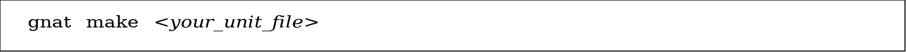

如果文件包含一个过程（procedure），`gnatmake` 将生成一个以该过程作为主程序的可执行文件。否则，例如一个包（package），`gnatmake` 将编译该单元及其所有依赖项。

#### GNAT 命令行

`gnatmake` 可以写成一个单词 `gnatmake` 或两个单词 `gnat make`。要查看完整的选项列表，请输入 `gnat`。输出将如下所示：


- [1. with](http://.wikibooks.org/Programming%2Fwith)

- [2. wikibooks.org](http://.wikibooks.org/index.php?action=edit)

- [3. GNAT](http://en.wikipedia.org/wiki/GNAT)

- [4. image0663.jpeg](https://en.wikipedia.org/wiki/GNAT%2FProgramming)

- [5. Integrated development environment](http://en.wikipedia.org/wiki/Integrated%20development%20environment)

- [6. Studio](http://en.wikipedia.org/wiki/Studio)

- [7. graphical interface](http://en.wikipedia.org/wiki/Graphical%20user%20interface)

- [8. Emacs](http://en.wikipedia.org/wiki/Emacs)

- [9. KDevelop](http://en.wikipedia.org/wiki/KDevelop)

- [10. Vim (text editor)](http://en.wikipedia.org/wiki/Vim%20%28text%20editor%29)

- [11. script.php?script_id=1609](http://www.vim.org/scripts/script.php?script_id=1609)

- [12. gnuada.org/](http://gnuada.org/)

- [13. GNU Compiler Collection](http://en.wikipedia.org/wiki/GNU%20Compiler%20Collection)

- [14. Debugger](http://en.wikipedia.org/wiki/Debugger)

`GNAT` 工具链包含一个名为 `GPS` 的 IDE。你需要单独下载并安装它。`GPS` 具有图形化界面。

### 3.1.2 Rational

`Rational` 是一个包含编辑器、编译器、调试器、覆盖率分析等的环境。视图（view）是一个开发环境。每个 Ada 编译单元必须位于自己的文件中。在编译单元时，编译器会跟踪 `with` 子句。如果在一个执行编译的子系统中没有找到该单元，编译器将搜索导入列表（仅考虑直接导入）。单元可以纳入版本控制。在每个子系统中，可以定义一组历史。一个 Ada 单元可以在历史中被控制。如果你想编辑它，必须先将其检出（checkout）——它将获得一个新的版本号。更改后，你可以再次将其检入（check in），即使更改永久（或者放弃更改，即返回之前的版本）。你通常只在开发视图中检出单元；发布视图可以禁止检出。

### 3.1.3 ObjectAda

`ObjectAda` 是一套用于编辑、编译、导航和调试用 Ada 编写的程序的工具。`ObjectAda` 有多个版本。对于某些版本，你为运行工具的相同平台和操作系统编译程序。这些被称为原生（native）。一个可能的平台是 Java 虚拟机。

这些说明适用于原生的 Microsoft Windows 版本。你可以从 IDE 或命令行运行翻译工具。

无论你倾向于从 IDE 还是从命令行工作，都需要进行一些记录工作。这是通过创建一个项目来实现。每个项目由若干源文件以及若干设置组成，例如附加 Ada 库的搜索路径和其他依赖项。每个项目还至少有一个目标（target）。通常，有一个调试目标（debug）和一个发布目标（release）。目标的名称指示了它们的用途。在某些时候为了调试进行编译（通常在开发期间），而在其他时间使用不同的设置进行编译，例如当程序准备发布时。`ObjectAda` 的某些（所有商业？）版本允许 `Java (VM)` 目标。

### 3.1.4 用于 VMS 的 DEC Ada

`DEC Ada` 是一个用于 VMS 的 Ada 83 编译器。虽然“DEC Ada”可能是大多数用户熟悉的名称，但该编译器现在被称为“HP Ada”。它之前也被称为 "VAX Ada" 和 "Compaq Ada"。

`DEC Ada` 使用真正的库管理系统——因此你需要做的第一件事是创建并激活一个库：

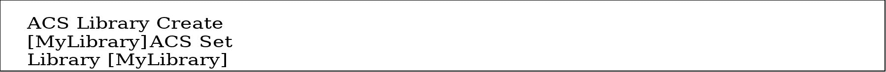

在创建库时，你已经设置了一些限制条件，例如对 `Long_Float` 的支持或可用内存大小。所以请仔细阅读

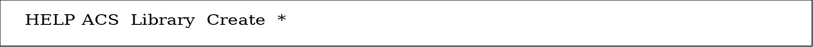

接一步是将你的 Ada 源文件加载到库中：

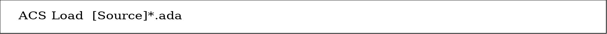

源文件在此阶段不需要完美，但在语法上要足够正确，以便编译器确定声明的包（packages）并分析 `with` 语句。`Dec Ada` 允许你在一个源文件中拥有多个包，并且可以使用任何你喜欢的命名约定。`ACS Load` 的目的是创建源文件之间的依赖树。


接下来你对它们编译：

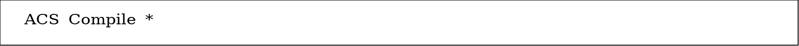

注意，编译取的是包名而不是文件名。通配符 `*` 意味着所有加载的包。编译器会自动确定正确的编译顺序，因此严格来说不需要 `make` 工具。

最后但同样重要的是，你将你的文件链接到一个

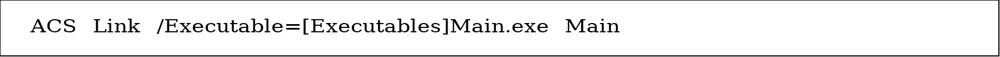

在大型系统中，你可能想将源文件拆分为几个库——在这种情况下，你还需要

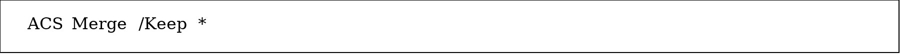

将当前库的内容与层次结构中更高处的库合并。较大的库应该用以下命令创建：

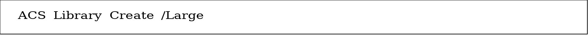

这使用了更适合大型库的目录布局。

#### DEC Ada IDE

`Dec Ada` 本身不带 IDE，但 `DEC LSE` 以及 `Vim` 文本器的 Ada Mode 都支持 `DEC Ada`。

### 3.2 编译我们的示例源码

一旦你下载了我们的示例程序，你可能会好奇如何编译它们。


首先，你需要提取源文件。使用你最喜欢的 zip 工具来完成操作。解压时，会创建一个与文件名同名的目录。注意：WinZip 可能也会创建一个与文件名同名的目录，因此用户需要小心地使用正确的选项，否则最终会得到 `wikibook-ada-1_2_0\wikibook-ada-1_2_0`。

提取完文件后，你将在 `wikibook-ada-1_2_0/Source` 中找到所有源文件。你可以在那里编译它们。为了方便起见，我们还为以下 IDE 提供了现成的项目文件（如果你发现某个 IDE 的目录没有被命名，那说明它可能正在开发中且无法工作）。

#### 3.2.1 GNAT

你会在 `wikibook-ada-2_0_0/GNAT` 中找到多目标 GNAT 项目文件和一个多 `Makefile`。对于 i686 Linux 和 Windows，你可以使用以下命令编译任何示例：

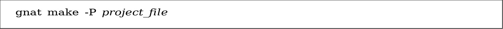

你也可以在 GPS 中打开它们：

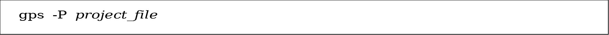

对于其他目标平台来说稍微困难一点，因为你需要告诉项目文件你想创建哪个目标。可以使用以下选项：

##### style Debug Release

你可以定义你喜欢调试版本还是发布版本，以便比较选项如何影响大小和速度。

##### os Linux OS2 Windows_NT VMS

OS/2 没有可用的 Ada 2005，不要期望所有示例都能编译。

##### target i686 x86_64 AXP

选择你的 CPU —— `i686` 是任何形式的 32 位 Intel 或 AMD CPU，`x86_64` 是 64 位 Intel 或 AMD CPU，如果你有 `AXP`，你自然知道。

记住按照所示所示输入所有选项。要在 x86-64 Linux 上编译调试版本，输入：


如开头所述，还有一个`Makefile`可以自动确定使用的目标。因此，如果你有`GNU make`，可以使用以下命令来减少大量的输入工作：

甚至可以使用

一次性生成所有示例的调试和发布版本。

每次编译结果都存储在自己的目录中，格式为`wikibook-ada-2_0_0/GNAT/OS-Target-Style`。存档内提供了空目录。

## 3.2.2 Rational APEX

APEX 使用子系统和视图目录结构，因此你必须先创建这些，并将源文件复制到视图（view）中。在使用选择的架构模型创建视图后，使用菜单选项"Compile -> Maintenance -> Import Text Files"。在 Import Text Files 对话中，添加`wikibook-ada-2_0_0/Source/*.ad?`以从你最初提取的目录中选择 Ada 源文件。Apex 使用扩展名`.1.ada`表示规范（spec），使用`.2.ada`表示体（body）——不用，import text files 命令会自动更改这些。

要链接示例，在目录查看器中选择其主子程序并点击工具栏上的链接按钮，或从菜单选择"Compile -> Link"。双击可执行文件运行它。你可以使用 shift 键修饰来跳过链接或运行对话框。

### ObjectAda 命令行

以下介绍了在 Windows 控制台窗口中使用 ObjectAda 工具的方法。在从命令行使用 ObjectAda 工具之前，请确保`PATH`环境变量列出了包含 ObjectAda 工具的目录。例如：

一个极简的 ObjectAda 项目可以只包含一个源文件。例如在提供的 Hello World 程序：

要从此源文件构建可执行文件，请按照以下步骤操作（假设当前目录是一个新的目录，且包含了上述源文件）：

- 注册你的源文件：

这使得 ObjectAda 工具识别你的源文件。如果你想了解底层发生了什么，可以查看在当前目录下由`adareg`创建的`UNIT.MAP`文件。

- 编译源文件：

- 构建可执行程序：

请注意，你指定的是主单元的名称作为`adabuild`的参数，而不是源文件的名称。在这种情况下，它是`Hello_World_1`，如：

更多关于工具的信息可以在随 ObjectAda 工具一同安装的《使用命令行界面》用户指南中找到。

## 3.3 外部链接

外部链接

- GNAT 在线文档:
- GNAT 用户指南 26
- DEC Ada:
- 在 OpenVMS 上开发 Ada 产品 27 (PDF)
- DEC Ada — 语言参考手册 28 (PDF)
- DEC Ada — 运行时参考手册 29 (PDF)

26 [`gcc.gnu.org/onlinedocs/gcc-4.0.1/gnat_ugn_unw/`](http://gcc.gnu.org/onlinedocs/gcc-4.0.1/gnat_ugn_unw/)

27 [`h71000.www7.hp.com/commercial/ada/ada_dap.pdf`](http://h71000.www7.hp.com/commercial/ada/ada_dap.pdf)

28 [`h71000.www7.hp.com/commercial/ada/ada_lrm.pdf`](http://h71000.www7.hp.com/commercial/ada/ada_lrm.pdf)

29 [`h71000.www7.hp.com/commercial/ada/ada_rtr.pdf`](http://h71000.www7.hp.com/commercial/ada/ada_rtr.pdf)

# 4 控制语句

## 4.1 条件语句

条件语句是仅当特定表达式（条件）为真时才会执行的代码块 1。

### 4.1.1 if-else

`if-else`语句是条件语句中最简单的。它们也被称为分支，因为当程序在执行过程中遇到`if`语句时，控制将“分支”到两个或多个“方向”之一。`if-else`语句通常具有如下形式：

如果满足原始条件，则执行第一个语句中的所有代码。可选的`else`部分指定了在条件为假时执行的备选语句。确切语法会随编程语言而异，但大多数编程语言（特别是过程化 4 和结构化 3）都具有某种形式的内置`if-else`。`if-else`语句通常可以扩展为以下形式：

1 [`en.wikipedia.org/wiki/Truth_function`](http://en.wikipedia.org/wiki/Truth_function)

2 [`en.wikibooks.org/wiki/Computer_Programming/Procedural_programming`](http://en.wikibooks.org/wiki/Computer_Programming/Procedural_programming)

3 [`en.wikibooks.org/wiki/Computer_Programming/Structured_programming`](http://en.wikibooks.org/wiki/Computer_Programming/Structured_programming)

整个块中只有一个语句会被执行。该语句将是第一个条件求值为真的语句。通过示例的帮助，`if-else-if`结构的概念更容易理解：

### 4.1.2 优化提示

当此程序执行时，计算机将顺序检查所有条件，直到其中一个条件符合其对真的理解。一旦发生这种情况，程序将立即执行条件后的语句并继续运行，不再检查其他条件是否为真。正因如此，当你尝试优化 4 程序时，将你的`if-else`条件按概率 5 降序排列是一个好主意。这将确保在最常见的情况下，计算机执行最少的工作。在第一次编写程序时，不要过早考虑这一点 6。

尽管如此，要意识到优化编译器 7 可能会重排你的`if`语句，在没有副作用 8 的情况下甚至应用跳转表 9 或二分查找 10。

在 Ada 中，多个条件的语句默认不使用短路计算。为了模拟 C/C++ 的短路计算，请在条件之间使用`or`或`else`

4 [`en.wikipedia.org/wiki/Optimization_(computer_science)`](http://en.wikipedia.org/wiki/Optimization_(computer_science))

5 [`en.wikibooks.org/wiki/Probability_Introduction`](http://en.wikibooks.org/wiki/Probability_Introduction)

6 [`en.wikipedia.org/wiki/Premature_optimization_When_to_optimize`](http://en.wikipedia.org/wiki/Premature_optimization_When_to_optimize)

7 [`en.wikipedia.org/wiki/Optimizing_compiler`](http://en.wikipedia.org/wiki/Optimizing_compiler)

8 [`en.wikipedia.org/wiki/Side-effect_(computer_science)`](http://en.wikipedia.org/wiki/Side-effect_(computer_science))

9 [`en.wikipedia.org/wiki/Jump_table`](http://en.wikipedia.org/wiki/Jump_table)

10 [`en.wikipedia.org/wiki/Binary_search`](http://en.wikipedia.org/wiki/Binary_search)

### 4.1.3 case

通常需要将一个特定变量与多个常量表达式进行比较。对于这种条件表达式可以使用`case`语句。例如：

`X`的子类型必须是离散类型，即枚举类型或整数类型。

在 Ada 中，`case`语句的一个优势是编译器会检查选择的覆盖范围，即变量`X`子类型的所有值必须存在，或者有一个默认分支来指定在剩余情况下需要做什么。

## 4.2 无条件语句

无条件语句允许你在没有条件的情况下改变程序的流。在使用无条件语句时应小心。它们通常会让程序难以理解。阅读《`goto`是邪恶的吗？11 获取更多信息。

### 4.2.1 return

结束函数并返回到调用的过程或函数。对于过程：

对于函数：

11 第 4.2 位于 39 页

### 4.2.2 goto

`goto`将控制转移到标签后的语句。

# `goto` 邪恶吗？

人们经常听到`goto`是邪恶的，应该避免使用`goto`。但人们经常忽略的是，任何不是过程或函数内部最后一个语句的`return`也是一种无条件语句——一个伪装的`goto`。不过，它们存在一个重要的区别：`return`是`goto`的仅正向用法。异常也是一种`goto`语句；更糟糕的是，它们甚至不需要指定去往何处！

因此，如果你有包含多个`return`语句的函数和过程，你完全可以使用`goto`。在涉及到可读性时，以下两个示例几乎是相同的：

由于使用`goto`需要声明标签（label），因此`goto`的可读性实际上是`return`的两倍。所以，如果你关注的是可读性而不是严格的“不要使用`goto`”编程规则，那么你应该尽量使用`goto`而不是多个`return`。当然，最好的方法是结构化方法，即不需要`goto`也不需要多个`return`：

## 4.3 循环

循环允许让一组语句重复执行。

### 4.3.1 无限循环

无限循环是一个永远不会结束的循环，内部语句永远重复。这里的“永远”是一个相对术语——如果计算机关闭，即使是无限循环也会非常突然地结束。

循环名称（在此例中为`"Endless_Loop"`）是 Ada 的可选特性。命名循环有利于可读性，但并非严格需要。不过，如果程序需要跳出内部循环（见下文），循环名称就会很有用。

### 4.3.2 条件在开头的循环

这种循环在开头有一个条件。只要满足条件，语句就会重复执行。如果在开头就没有满足条件，则循环内部的语句将永远不会执行。

### 4.3.3 条件在结尾的循环

这种循环在末尾有一个条件，语句会重复执行直到满足条件。由于检查是在末尾进行的，语句至少会被执行一次。

### 4.3.4 条件在中间的循环

有时你需要先进行某种计算，并在满足某些标准时退出循环。然而，当不满足标准时，还有其他事情要做。因此，你需要一个退出条件在中间的循环。

在 Ada 中，退出条件也可以与任何其他循环语句结合。你可以有多个退出语句。如果你有嵌套的循环，还可以退出命名的外层循环。

### 4.3.5 for 循环

通常人们需要一个循环，让特定变量从给定的开始值递增或递减特定的结束值。你可以在这里使用`while`循环——但这是一个非常常见的循环，所以有更简单的语法。

你不需要像示例那样同时声明类型和范围。如果你省略了类型，编译器将根据上下文确定类型；如果省略了范围，则循环将遍历该类型的每个有效值进行迭代。

正如 Ada 一如既往：当“由上下文确定”给出两个或更多可能的选项时，将显示错误，此时你必须指定要使用的类型。Ada 只在安全的情况下才会进行“猜测”。

#### 数组上的 for 循环

另一个非常常见的情况是需要一个遍历数组每个元素的循环。下面的示例代码向你展示了如何实现：

假设`X`是一个数组。注意：这种语法主要用于数组——因此得名如此——但在需要完整迭代时也适用于其他类型。与其他循环计数器不同，`for`语句中的循环计数器`i`的值是修改的。以下是非法的：

```
for i in 1..10 loop
  i := i + 1;
end loop;
```

此外，循环的声明在循环体之后停止。

#### 演示

下面的演示展示了如何遍历`integer`类型的每个元素。

## 4.4 另

### 4.4.1 Wikook

- Ada 编程

### 4.4.2 Ada 手册

- 5.3 If 语句
- 5.4 Case 语句
- 5.5 循环语句
- 5.6 块语句
- 5.7 Exit 语句
- 5.8 Goto 语句
- 6.5 Return 语句

# 5 类型系统

`Ada`的类型系统允许程序员构建表示真实的强大抽象，并为编译器提供有用信息，以便编译器在错误变成 bug 之前发现许多逻辑或设计错误。它是语言的核心，优秀的 Ada 程序员学会了充分利用它。四个原则支配着类型系统：

- **强类型**：类型之间是互不兼容的，因此无法将苹果和橘子混合。然而，有方法可以在类型之间转换。
- **静态类型**：在编译时检查类型，这允许尽早发现类型错误。
- **抽象**：类型表示现实世界或当前处理的问题；而不是计算机内部表示数据的方式。有方法可以精确指定类型在位级别上的表示方式，但我们将该讨论推迟到另一章节。
- 名称等效（Name equivalence），与大多数其他语言中使用的结构等效相反。两种类型当且仅当它们具有相同的名称时才是兼容的；而不是仅仅因为它们的大小或位表示相同。因此，你可以声明两个范围相同但完全不兼容的整数类型，或者声明两个组件完全相同但互斥的记录类型。

类型之间是不兼容的。然而，每个类型都可以拥有任意数量的子类型，这些子类型彼此以及与它们的基类型是兼容的。

## 5.1 预定义类型

有几种预定义类型，但大多数程序员更定义特定类型。尽管如此，这些预定义类型作为独立开发的库之间的接口非常有用。预定义库显然使用了这些类型。

这些类型在`Standard`包中预定义：

#### 整数 (Integer)

该类型至少涵盖$-2^{15} +1 .. +2^{15} -1$的范围（RM 3.5.4 (21) [http://www.adaic.org/resources/add_content/standards/05rm/html/RM-3-5-4.html]）。标准还定义了该类型的`Natural`（自然）和`Positive`（正）子类型。

#### 浮点数 (Float)

该类型只有一个非常弱的实现要求（RM 3.5.7 (14) [http://www.adaic.org/resources/add_content/standards/05rm/html/RM-3-5-7.html]）；大多数情况下，你会定义自己的浮点类型，并指定你的精度和范围要求。

#### 持续时间 (Duration)

一种用于计时的定点类型。它表示以秒为单位的时间（RM A.1 (43) [http://www.adaic.org/resources/add_content/standards/05rm/html/RM-A-1.html]）。

#### 字符 (Character)

`Enumerations`（枚举）的一种特殊形式。字符类型有三种预定义的种类：8 位字符（称为`Character`）、16 位字符（称为`Wide_Character`）和 32 位字符（`Wide_Wide_Character`）。`Character`自语言的第一版本（Ada 83）起就存在，`Wide_Character`包含在 Ada 95 中，而`Wide_Wide_Character`类型在 Ada 2005 中可用。

#### 字符串 (String)

三种不确定数组类型，分别为`Character`、`Wide_Character`和`Wide_Wide_Character`。标准库包含处理三种变体字符串的包：固定长度（Ada）、在某个上限以下变长（Ada）以及无界长度（Ada）。这些每个包都有一个`Wide_and`和`Wide_Wide_variant`。

#### 布尔值 (Boolean)

Ada 中的`Boolean`是`False`和`True`的`Enumeration`（枚举），具有特殊的语义。

`System`和`System`包预定义了一些类型，这些类型主要用于底层编程和硬件接口交互。


#### System.Address

内存中的地址。

#### System.Storage_Elements.Storage_Offset

偏移量，可以加到地址上获得新地址。你也可以从一个地址减去另一个地址来获得它们之间的偏移量。`Address`、`Storage_Offset` 及其相关程序提供了地址算术。

#### System.Storage_Elements.Storage_Count

`Storage_Offset` 的子类型，不能为负数，表示数据结构的内存大小（类似于 `size_t`）。

#### System.Storage_Elements.Storage_Element

在大多数计算机中，这是一个字节。形式上讲，它是具有地址的最小内存单元。

#### System.Storage_Elements.Storage_Array

一个`Storage_Elements`数组，没有任何特殊含义，在进行原始内存访问时有用。

## 5.2 类型层次结构

### 类型层次结构

类型按分级结构组织。类型继承其层次结构中上方类型的属性。例如，所有标量类型（整数、枚举、模数、定点和浮点类型）都定义了运算符`<`、`>`以及算术运算符，并且所有离散类型都可以作为数组索引。

以下是每类类型的粗略概述；请遵循链接查看详细说明。括号内是为熟悉这些语言的读者提供的 C 和 Pascal 中的等价项。

#### 有符号整数 (int, INTEGER)

有符号整数通过所需的数值范围定义。

#### 无符号整数 (unsigned, CARDINAL)

无符号整数被称为模数类型（Modular Types）。除了无符号外，它们还具有回绕功能。

#### 枚举 (enum, char, bool, BOOLEAN)

Ada`Enumeration`类型是一个独立的类型族。

#### 浮点数 (float, double, REAL)

浮点类型由所需的位数和相对误差界定义。

#### 普通和十进制定点 (DECIMAL)

定点类型由其`delta`（绝对误差界）定义。

#### 数组 ([ ], ARRAY [] OF, STRING)

支持在编译时和运行时确定的数组。

#### 记录 (struct, class, RECORD OF)

记录是一种分组了一个或多个字段的复合类型。

#### 访问 (*, ^, POINTER TO)

Ada的`Access`类型可能不仅仅是一个简单的内存地址。

#### 任务与保护 (C 或 Pascal 中无等价项)

任务（Task）和保护（Protected）类型允许控制并发。

#### 接口 (C 或 Pascal 中无等价项)

# 第 69 页的第 6 章

# 第 71 页的第 7 章

# 第 73 页的第 8 章

# 第 77 页的第 9 章

# 第 79 页的第 10 章

# 第 83 页的第 11 章

# 第 91 页的第 12 章

[http://en.wikibooks.org/wiki/Ada%20Programming%2FTypes%23List%20of%20types]

# 第 99 页的第 13 章

# 第 173 页的第 21 章

[http://en.wikibooks.org/wiki/Ada%20Programming%2FKeywords%2Finterface]

这些类型是 Ada 2005 新引入的，类似于 Java 接口。

## 5.2.1 类型的分类

该层次结构中的类型可以分类如下。

### 特定类型（Specific）与类类型（Class-wide）

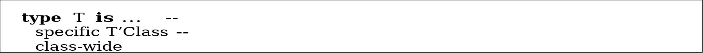

特定类型的操作是非分派的（non-dispatching），而类类型的操作是分派的（dispatching）。

新类型可以通过派生特定类型来声明；原始操作通过派生继承。你不能从类类型进行派生。

### 受约束类型（Constrained）与无约束类型（Unconstrained）

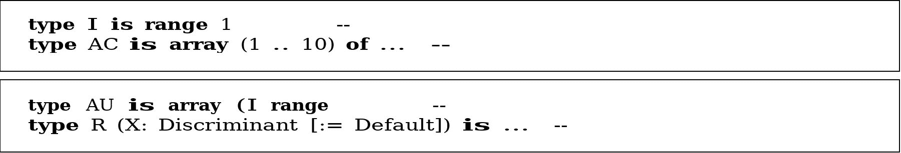

通过为无约束子类型提供一个约束，子类型或对象就变成了受约束的：

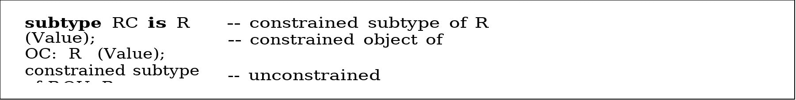

只有在上方类型声明中给出了默认值时，才能声明无约束对象。语言没有规定如何分配此类对象。GNAT 分配最大大小，因此由于判别符（discriminant）变化而可能发生的大小变化没有问题。另一种可能性是在堆上进行隐式动态分配，并在大小变化时释放并随后重新分配。

### 确定类型（Definite）与不确定类型（Indefinite）

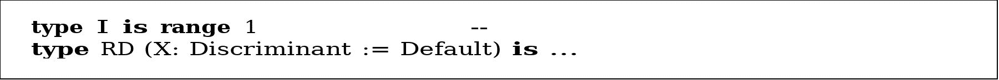

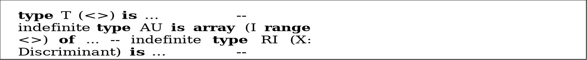

确定子类型允许在没有初始值的情况下声明对象，因为确定子类型的约束在创建时是已知的。不确定子类型的对象声明需要一个初始值来提供约束；它们将由初始值提供的约束进行约束。

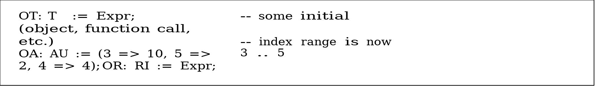

### 无约束类型与不确定类型

注意，无约束子类型并不一定是不确定的，如上文 RD 所示：它是一个确定无约束子类型。

## 5.3 并发类型

Ada 语言除了分类数据外，类型还用于另一个目的。类型系统集成了并发（线程、并行）。程序员将使用类型来表示程序的并发控制流。类型系统这部分的核心部分——任务类型和保护类型，将在后续章节中进行详细解释。

## 5.4 限制类型（Limited Types）

限制类型意味着不允许赋值。上述的“并发类型”总是受限制的。程序员可以定义自己的受限制类型，如下所示：

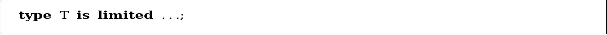

（省略号代表私有或记录定义，请参见本页的相应子节。）受限制类型也没有相等运算符，除非程序员定义一个。你可以在限制类型章节中学习更多信息。

## 5.5 定义新类型和子类型


第 173 页的第 21 章

第 113 页的第 14 章

### 定义新类型和子类型

你可以使用以下语法定义新类型：

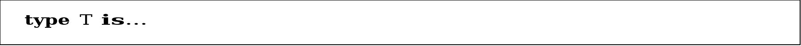

随后是该类型的描述，在每种类型类别中都有详细解释。从形式上讲，上述声明创建了一个类型及其第一个名为`T`的子类型。该类型本身（正确地称为“T 的类型”）是匿名的；RM（参考手册）将其称为`T`，但通常对该类型的表述并不严谨。不过，这只是学术上的考量；对于大多数目的来说，将`T`视为一个类型就足够了。对于标量类型，还有一个名为`T'Base`的基类型，它包含了`T`的所有值。

对于有符号整数类型，`T`的类型由数学整数的（完整）集合组成。基类型是一个特定的硬件类型，关于零对称（除可能有一个额外值外），包含了`T`的所有值。

如上文所述，所有类型之间都是不兼容的；因此：

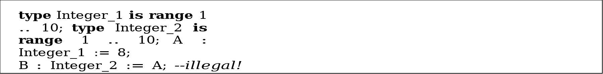

是非法的，因为`Integer_1`和`Integer_2`是不同的且不兼容的类型。正是这种特性允许编译器在编译时检测逻辑错误，例如将文件描述符加到字节数，或将长度加到重量。两种类型范围相同并不意味着它们兼容：这是名称等效性（name equivalence）的作用，而不是结构等效性。（在后面，我们将看到如何在不兼容类型之间进行转换；对此有严格的规则。）

#### 5.5.1 创建子类型

你也可以为给定类型创建新的子类型，它们之间是兼容的，如下所示：

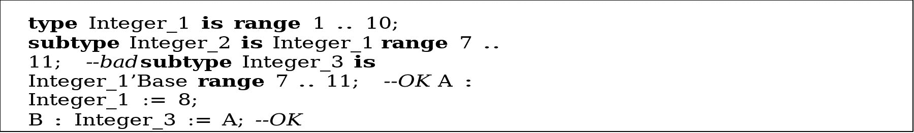

`Integer_2`的声明是错误的，因为约束`7 ..11`与`Integer_1`不兼容；它在子类型具体化时会抛出`Constraint_Error`。`Integer_1`和`Integer_3`是兼容的，因为它们都是相同类型的子类型，即`Integer_1'Base`。

子类型的范围没有必要重叠，或相互包含。当你将`A`赋值给`B`时，编译器会插入运行时范围检查；如果此时`A`的值恰好在`Integer_3`的范围之外，程序将抛出`Constraint_Error`。

有几个预定义的子类型非常有用：

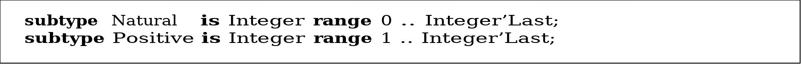

#### 5.5.2 派生类型（Derived types）

派生类型是从现有类型创建的、完整的类型。像任何其他类型一样，它与其父类型不兼容；但是，它继承了父类型定义的原始操作。

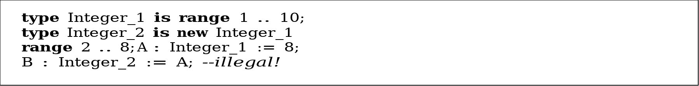

这里两种类型都是离散的；派生类型的范围必须在父类型的范围之内。将此与子类型对比。原因是派生类型继承了父类型定义的原始操作，而这些操作假设了父类型的范围。这里是该特性的说明：

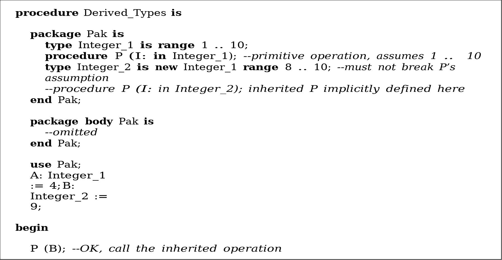

当我们调用`P (B)`时，参数`B`被转换为`Integer_1`；这种转换理然通过的，因为派生类型（此处为`8 .. 10`）的可接受值集合必须包含在父类型（`1 .. 10`）的范围之内。然后使用转换后的参数调用`P`。

然而，考虑上述示例的变体：

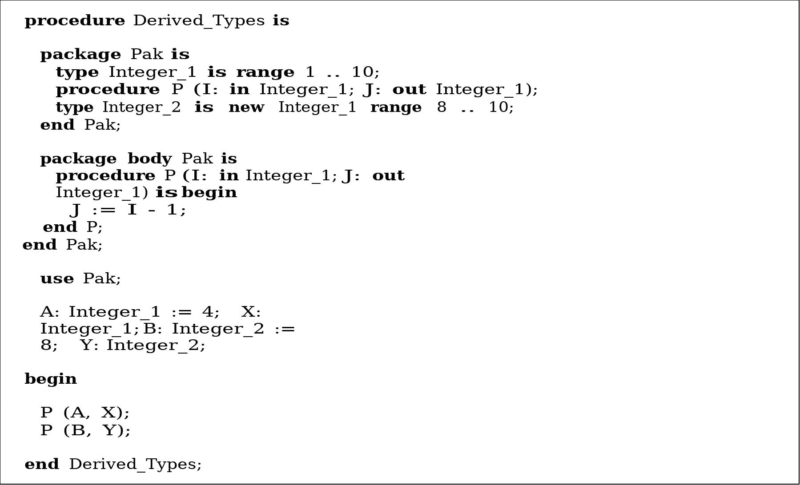

当调用`P (B, Y)`时，两个参数都会被转换为`Integer_1`。因此，`P`体内部对`J (7)`的范围检查将通过。然而，在返回时，参数`Y`被转换回`Integer_2`，对`Y`的范围检查自然会失败。

考虑到上述点，你将看到为什么在接下来的程序中运行时会调用`Constraint_Error`。

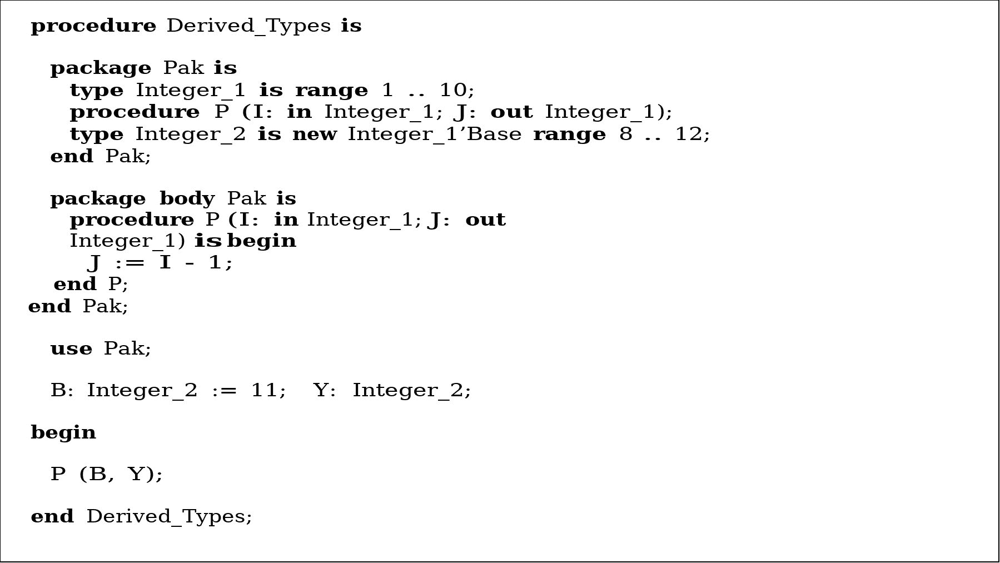

## 5.6 子类型分类

子类型分类

Ada 支持多种类型的子类型，它们具有不同的功能。以下是按字母顺序排列的概述。

### 5.6.1 匿名子类型

没有分配名称的子类型。此类子类型通过变量声明来创建：

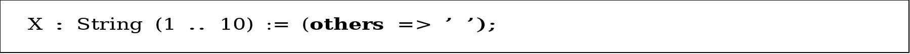

在这里，`(1 .. 10)`是约束。此变量声明等同于：

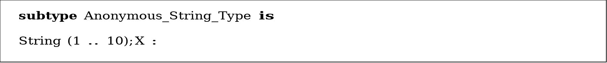

### 5.6.2 基础类型

在 Ada 中，所有类型都是匿名的，只有子类型可以命名。对于标量类型，匿名类型有一个特殊的子类型，称为“基础类型”（base type），可以使用`'Base`属性进行命名。基础类型包含了第一个子类型的所有值。示例示例：

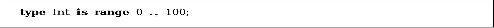

基础类型`Int'Base`是由编译器选择的硬件类型，包含了`Int`的值。因此，它的范围可能是`-2**7 .. 2**7-1`或`-2**15 .. 2**15-1`或任何其他类型。

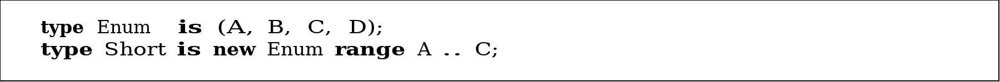

`Enum'Base`等于`Enum`，但`Short'Base`还额外持有字面量`D`。


### 5.6.3 受限子类型

一种增加了约束的未受限（indefinite）子类型。下面的示例定义了一个 10 字符的字符串子类型。

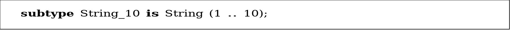

你不能对未受限子类型进行部分约束：

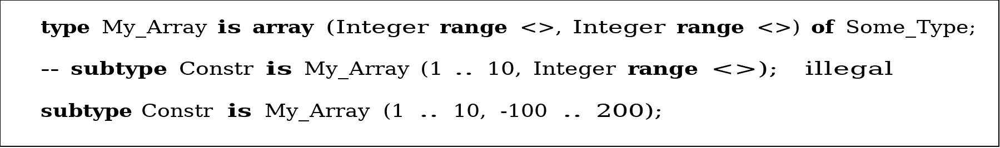

必须给出所有索引的约束，结果必然是一个确定子类型。

### 5.6.4 确定子类型

确定子类型是指大小在编译时已知的子类型。根据定义，所有非不定的子类型都是确定子类型。

声明确定子类型的对象可以不带额外的约束。

### 5.6.5 不定子类型

不定子类型是指大小在编译时未知但在运行时动态计算的子类型。不定子类型本身并不提供创建对象所需的信息；需要额外的约束或显式初始化表达式来计算实际大小并创建对象。

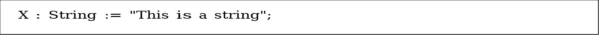

`X`是不定（子）类型`String`的对象。它的约束从其初始值隐式推导出。`X`可能会改变其值，但不会改变其边界。

需要注意的是，没有必要从字面量初始化对象。你也可以使用函数。例如：


编译器首先检查转换是否合法，如果合法，它会在转换点处插入一个运行时检查；因此这种转换被称为**检查转换**（checked conversion）。如果转换失败，程序将抛出`Constraint_Error`。大多数编译器非常智能，会优化掉约束检查；因此，你不需要担心任何性能损失。某些编译器还可以警告约束检查将始终失败（并用无条件抛出来优化该检查）。

显式类型转换是合法的：

* 在任意两种数值类型之间

* 在同类型的任意两个子类型之间

* 在任意两个源自同类型的类型之间（注意标记类型/tagged types 的特殊规则）

* 在某些条件下数组类型之间（参见`RM 4.6(24.2/2..24.7/2)`）

* 在其他任何地方都不允许

（随着类范围类型和匿名访问类型的引入，规则会变得更加复杂。）

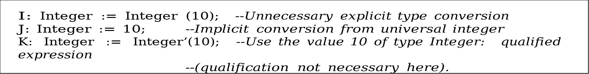

此示例说明了显式类型转换：

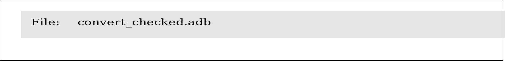

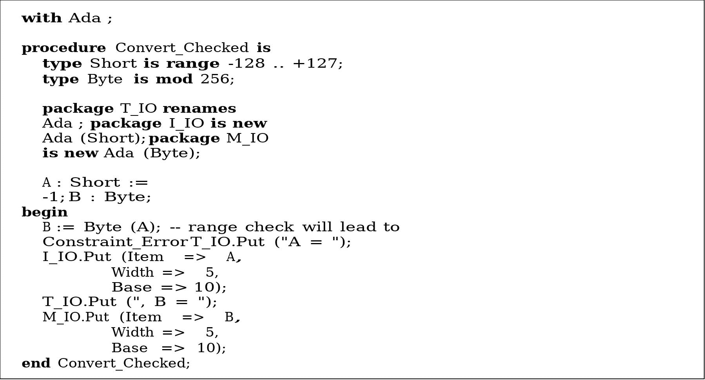

在任意两种数值类型（整数、定点型和浮点型）之间都可以进行显式转换。如果涉及的类型之一是定点或浮点类型，编译器不仅会检查范围约束（因此上述代码将抛出`Constraint_Error`），还会执行任何必要的精度损失。

示例 1：精度损失导致过程只打印“0”或“1”，因为`P / 100`是整数，且始终为零或一。

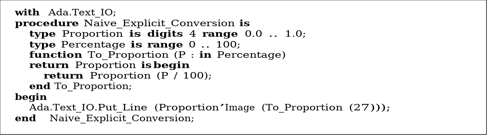

示例 2：我们使用中间浮点类型来保证精度。

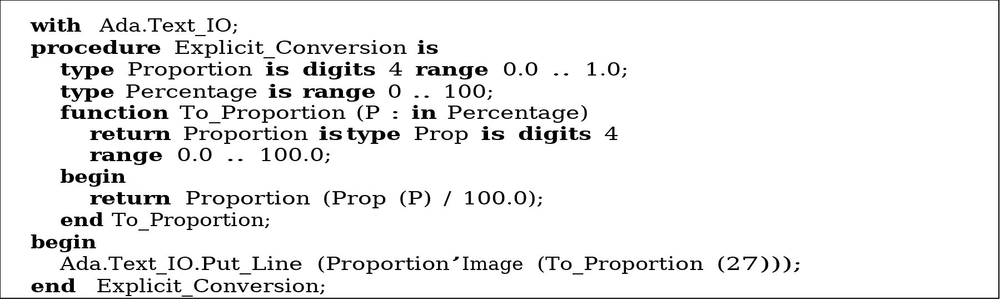

你可能会问为什么要在同一类型的子类型之间进行转换。一个示例将说明这一点。

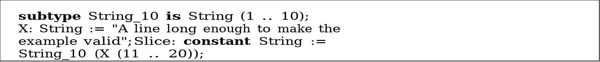

在这里，`Slice`的边界是 1 和 10，而`X (11 .. 20)`的边界是 11 和 20。

### 5.8.2 表示的变化

类型转换可以用于记录或数组的打包和解包。

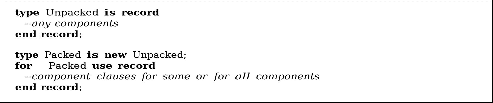

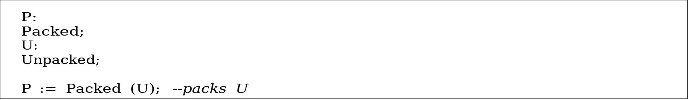

### 5.8.3 非数值类型的检查转换

上面的示例都围绕数值类型之间的转换展开；通过这种方式可以在任意两种数值类型之间进行转换。但非数值类型之间（例如数组类型或记录类型之间）会发生什么？答案是两方面的：

* 你可以在类型和派生自它的类型之间，或者在源自同类型的类型之间进行显式转换，

* 仅此而已。没有其他可能的转换。

你为什么想从一个记录类型派生另一个记录类型？这是因为表示子句（representation clauses）。在这里我们进入了底层系统编程领域，这可不是胆小者的领域，对桌面应用程序也没有什么用。所以请坐稳了，让我们深入其中。

假设你有一个使用默认高效表示的记录类型。现在你想将此记录写入一个使用特殊记录格式的设备。这种特殊表示更紧凑（使用的位较少），但效率极低。你想要一个分层编程接口：用于应用程序的上层使用高效表示；底层是直接访问硬件的设备驱动程序，使用低效表示。

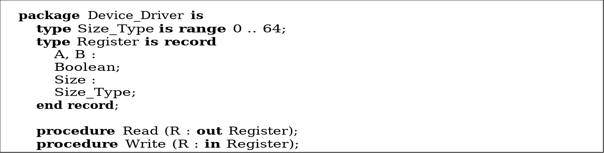

编译器为`Register`选择了默认的高效表示。例如，在 32 位机器上，它可能会使用三个 32 位的字，分别用于`A`、`B`和`Size`。这种高效表示对应用程序是有益的，但在某一点，我们希望将整个记录转换为仅 8 位，因为这是我们的硬件要求的。

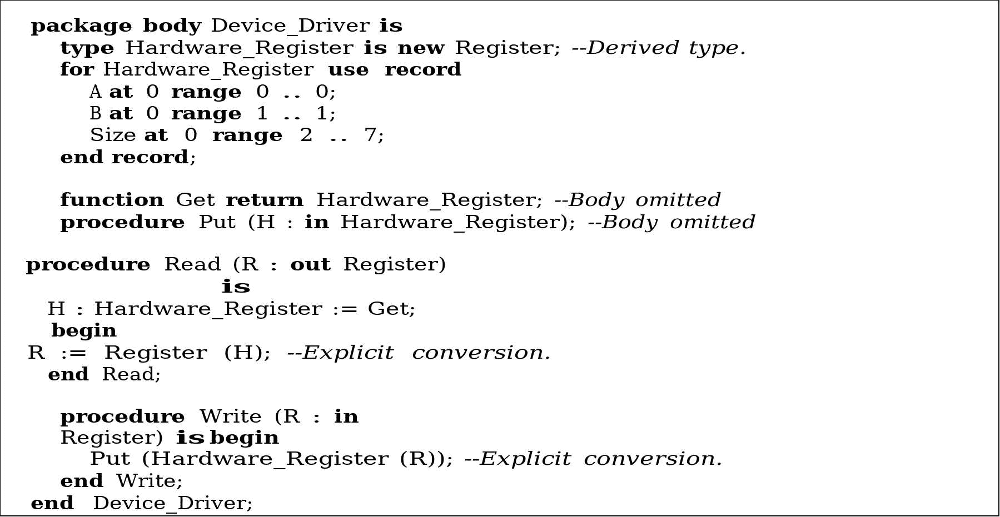

在上面的示例中，包体部声明了一个具有低效但紧凑表示的派生类型，并从其转换。这说明了类型转换可以导致表示的变化。

### 5.8.4 面向对象编程中的视图转换

在面向对象编程中，你必须区分特定类型（specific types）和类范围类型（class-wide types）。对于特定类型，只有向祖先的转换是可能的，且经过检查。在转换过程中，你并没有“丢”派生类型中存在的组件；它们只是存在那里。这被称为**视图转换**（view conversion）。


由于在面向对象编程中，子类型对象就是父类型对象，因此不需要运行时检查。对于类范围类型，向祖先和子类型的转换都是可能的，并且同样经过检查。这些转换也是视图转换，不会产生数据。

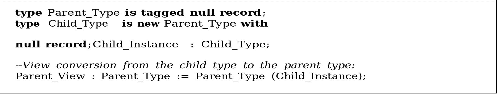

这种视图转换涉及运行时检查，以确定`Parent_View`确实是`Child_Type`对象的视图。在第二情况下，运行时检查接受`Child_Type`类型的对象。

重命名声明不创建任何新对象也不执行任何转换；它只是给已存在的东西起一个新名字。由于重命名完全在编译时完成，性能是最优的。我们在这里提到它是因为常用的用法。

现在，`Parent_View`不是一个新对象，而是视为父类的`Child_Instance`的另一个名称，即只有父类组件可见，进一步的子组件被隐藏了。

### 5.8.5 地址转换

Ada的访问类型（access type）不仅仅是一个内存位置（细指针）。取决于实现和使用的访问类型，访问可能会保留额外信息（胖指针/fat pointer）。例如，GNAT 为每次访问无限对象保留了两个内存地址——一个用于数据，另一个用于约束信息（Size, First, Last）。

如果你想将访问转换为简单的内存位置，可以使用`System`包。但注意，地址和胖指针之间不能相互可逆地转换。

数组对象的地址是其第一个组件的地址。因此，在此类转换中边界会丢失。

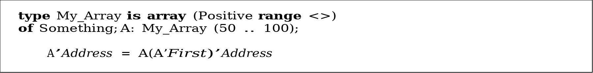

### 5.8.6 未检查转换

Pascal 受到的极大批评之一是“无处可逃”。原因是有时你必须转换那些不兼容的内容。为了这一目的，Ada 提供了泛型函数`Unchecked_Conversion`：

```
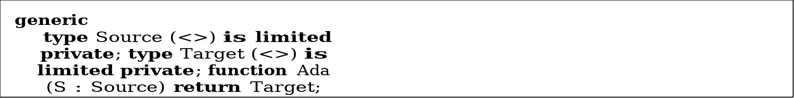
```


`Unchecked_Conversion` 将对源数据进行位拷贝，并在没有任何检查的情况下按照目标类型对其进行重新解释。你的任务是确保满足 `RM 13.9`（http://www.adaic.org/resources/add_content/standards/05rm/html/RM-13-9.html）中规定的关于未检查转换的要求；否则，结果将取决于实现，甚至可能导致数据异常。在出现问题的情况下，请使用“转换后的有效性属性（Valid attribute after the conversion）”来检查数据的有效性。

对`Unchecked_Conversion`（其实例）的函数调用会将源数据拷贝到目标。编译器也可能进行就地转换（每个实例都有约定`Intrinsic`）。

要使用`Unchecked_Conversion`，你需要实例化该泛型。


在下例示例中，你可以看到是如何操作的。运行时，该示例将输出“A = -1, B = 255”。不会报告错误，但这是你预期的结果吗？


在赋值`B := Convert (A);`中，当然存在范围检查。因此，如果`B`定义为`B: Byte range 0 .. 10;`，则会引发`Constraint_Error`。

### 5.8.7 覆盖（Overlays）

如果拷贝`Unchecked_Conversion`的结果在性能方面浪费太大，那么你可以尝试覆盖，即地址映射。通过使用覆盖，两个对象共享相同的内存位置。如果你为其中一个赋值，另一个也会发生变化。语法如下：

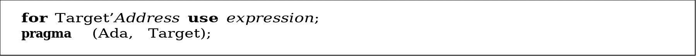

其中`expression`定义了源对象的地址。

虽然覆盖看起来比`Unchecked_Conversion`更优雅，但你应该意识到它们更加危险，并且具有更大的产生严重错误的潜力。例如，如果`Source'Size < Target'Size`且你向`Target`赋值，你可能会无意中写入分配给另一个对象的内存中。

你还需要处理目标类型对象的隐式初始化，因为它们会覆盖源对象的实际值。可以使用约定为`Ada`的`Import` pragma 来防止这一点，因为它避免了隐式初始化，`RM B.1`（http://www.adaic.org/resources/add_content/standards/05rm/html/RM-B-1.html）。下面的示例与“未检查转换”中的示例相同。

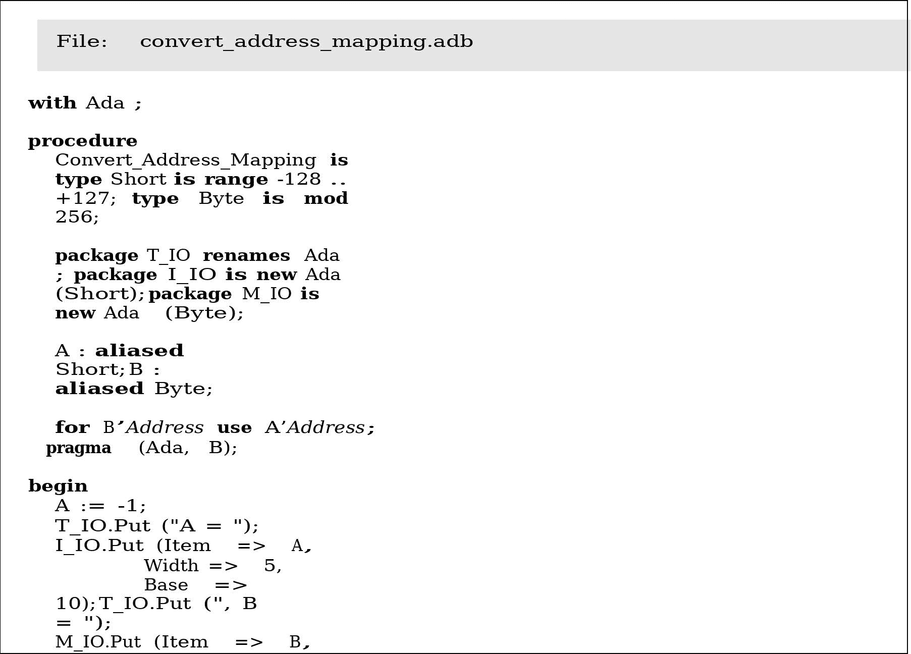

### 5.8.8 导出 / 导入（Export / Import）

仅供记录：还有另一种使用`pragma`和`pragma`指令的方法。然而，由于这种方法比覆盖更彻底地破坏 Ada 的可见性和类型概念，它在这个语言介绍中没有位置，留给专家处理。

## 5.9 有符号整数类型的详尽讨论

如前所述，类型声明：


声明了一个匿名类型`T`及其第一个子类型`T`。`T`包含了数学整数的全集。静态表达式和命名数字利用了这一事实。

所有数值整数都是`Universal_Integer`类型。在需要的地方，它们会被转换为相应的特定类型。`Universal_Integer`本身没有运算符。

带有静态命名数字的某些示例：

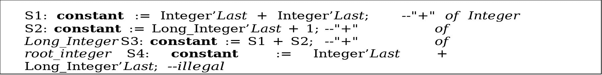

静态表达式在编译时在相应的类型上求值，没有溢出检查，即数学上的精确的（仅限于计算机存储）。结果随后被隐式转换为`Universal_Integer`。`S2`中的字面量`1`是`Universal_Integer`类型，并隐式转换为`Long_Integer`。`S3`隐式地将加数转换为`root_integer`，执行计算并转换回`Universal_Integer`。`S4`是非法的，因为它混合了两种不同的类型。不过，你可以将其写为：

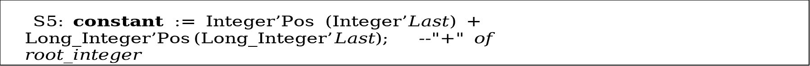

其中`Pos`属性将值转换为`Universal_Integer`，然后它们被隐式转换为`root_integer`、相加并将结果转换回`Universal_Integer`。`root_integer`是硬件可以表示的最大整数类型。它的范围是`System.Min_Integer .. System.Max_Integer`。所有整数类型都根自`root_integer`，即派生自它。`Universal_Integer`可以被看作`root_integer'Class`。

在运行时，计算当然是在相应的子类型上带有范围检查和溢出检查进行的。然而，中间结果超过了范围限制。因此，对于上述子类型`T`的`I`、`J`、`K`，以下代码将返回正确的结果：

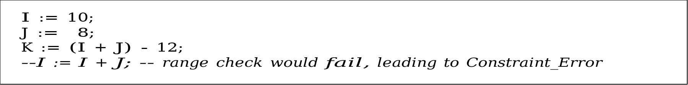

实数字面量是`Universal_Real`类型，适用于类似的规则。

## 5.10 类型之间的关系

类型由其他类型组成。例如，数组类型由两个类型组成：一个用于数组索引，另一个用于数组组件。数组表示了一种关联，即索引类型的一个值与组件类型的值之间的关联。


`Color`类型是数组`Colored_Point`的索引类型，`Intensity`类型是组件类型。

## 5.11 参见

### 5.11.1 Wikibook

- Ada 编程

### 5.11.2 Ada 参考手册

- `3.2.1 类型声明`（http://www.adaic.org/resources/add_content/standards/05rm/html/RM-3-2-1.html）
- `3.3 对象与命名数字`（http://www.adaic.org/resources/add_content/standards/05rm/html/RM-3-3.html）
- `3.7 判别符`（http://www.adaic.org/resources/add_content/standards/05rm/html/RM-3-7.html）
- `3.10 访问类型`（http://www.adaic.org/resources/add_content/standards/05rm/html/RM-3-10.html）
- `4.9 静态表达式与静态子类型`（http://www.adaic.org/resources/add_content/standards/05rm/html/RM-4-9.html）
- `13.9 未检查的类型转换`（http://www.adaic.org/resources/add_content/standards/05rm/html/RM-13-9.html）
- 
- 42 第 83 页章节
- [Ada 编程](http://en.wikibooks.org/wiki/Ada_Programming)
- `13.3 运算属性与表示属性`（http://www.adaic.org/resources/add_content/standards/05rm/html/RM-13-3.html）
- `附录 K (信息性)语言定义的属性`（http://www.adaic.org/resources/add_content/standards/05rm/html/RM-K.html）

# 6 整数类型

范围（range）是一个符号整数值，其取值从`First`到`Last`。它的定义如下：


当将一个值赋值给具有此类范围约束的对象时，会对该值进行有效性检查；如果值不在`First`到`Last`之间，将抛出`Constraint_Error`异常。

在声明范围类型时，语言会在相同位置隐式声明相应的数学运算符。

编译器可以自由为此自定义类型选择合适的底层硬件类型。

## 6.1 运行示例

以下`Demo`定义了一个从 -5 到 10 的新范围，然后打印出整个范围。


1 第 153 页章节


## 6.2 另参

### 6.2.1 Wikibook

- Ada 编程
- Ada 编程/类型
- Ada 编程/关键字/`range`

### 6.2.2 Ada 参考手册

- `4.4 表达式`（http://www.adaic.org/resources/add_content/standards/05rm/html/RM-4-4.html）
- `3.5.4 整数类型`（http://www.adaic.org/resources/add_content/standards/05rm/html/RM-3-5-4.html）

es:Programación en Ada/Tipos/Enteros


# 7 无符号整数类型

## 7.1 描述

Ada 中的无符号整数值范围从 0 到某个正数（不一定是 2 的幂减 1）。它们使用`mod`关键字定义，因为它们实现了回绕运算（wrap-around arithmetic）。


其中`'First`为 0，`'Last`为`Modulus-1`。回绕运算意味着`'Last + 1 = 0 = 'First`，且`'First - 1 = 'Last`。除了普通的算术运算符外，该类型还定义了位`and`、`or`和`xor`。预定义包`Interfaces`（RM B.2）提供了基于无符号整数的`shift`和`rotate`操作。值取决于编译器和目标架构。

你可以使用`range`对模数类型进行子范围划分：


但注意：`Half_Byte`的`Modulus`仍然是 256！至少可以说，对这种类型进行算术运算是非常有趣的。

## 7.2 另参

### 7.2.1 Wikibook

- Ada 编程
- Ada 编程/类型
- Ada 编程/关键字/`mod`

### 7.2.2 Ada 参考手册

- `4.4 表达式`（http://www.adaic.org/resources/add_content/standards/05rm/html/RM-4-4.html）
- `3.5.4 整数类型`（http://www.adaic.org/resources/add_content/standards/05rm/html/RM-3-5-4.html）


# 8 枚举类型

枚举类型定义为可能值的列表：


对于数值类型，例如 1 是一个整数字面量，`Red`、`Green`和`Blue`被称为该类型的字面量（literals）。没有其他值可以赋值给该类型的对象。

## 8.1 运算符与属性

除了相等（“=”），枚举类型上的唯一运算符是排序运算符：`<`、`<=`、`/=`、`>=`、`>`，其中顺序关系由字面量的序列隐式给出：每个字面量都有一个位置，从第一个开始为 0，之后递增 1。可以通过`'Pos`属性查询此位置；反操作`'Val`则返回对应的字面量。在我们的示例中：


还有两个重要的属性：`Image`和`Value`（不要混淆`Val`和`Value`）。`Image`返回值的字符串表示（全大写），`Value`是其反操作：


这些属性对于简单的 IO 非常重要（Ada 为枚举类型提供了更复杂的 IOset）。注意，由于 Ada 不区分大小写，传递给`'Value`的字符串可以是任意大小写。

## 8.2 枚举字面量


字面量是可以重载的，即你可以拥有另一个具有相同字面量的类型。


在字面量使用的上下文中，重载解析通常会解析出指的是哪一个`Red`。只有当遇到无法解决的重载冲突时，才能使用特殊语法来指定指的是哪个`Red`：


像许多其他声明式项一样，枚举字面量可以被重命名。事实上，这样的字面量实际上是一个函数，因此必须以此方式重命名：


在这里，假设`Primary_Color`被定义在包`P`中，并且在重命名声明处是可见的。重命名使得`Red`直接可见，而无需诉助于`use`子句。

注意，将其重新声明为函数不会影响字面量的静态性。

### 8.2.1 字符作为枚举字面量

Ada 特有的用法是可以使用字符字面量作为枚举字面量：


此字面量`'A'`与预定义类型`Character`（或`Wide_Character`）的字面量`'A'`没有任何共同之处。

任何至少有一个字符字面量的类型都是字符类型。对于每个字符类型，字符串字面量和连接运算符`"&"`也是隐式定义的。


在这个示例中，`S`和`T`具有相同的值。


Ada 的`Character`类型就是这样定义的。参见`Ada Programming/Libraries/Standard`。

### 8.2.2 布尔作为枚举字面量

布尔也被定义为枚举类型：


此声明隐含了特殊的语义，即该类型的对象和表达式可以作为条件。注意字面量`False`和`True`不是 Ada 关键字。

因此，仅仅声明带有这些字面量的类型并希望该类型的对象可以这样使用是不够的：


如果你需要自己的布尔类型（可能有特殊的尺寸要求），你必须从预定义的`Boolean`派生：


## 8.3 枚举子类型

你可以使用`range`来对枚举类型进行子类型化：


## 8.4 参见


### 8.4.1 Wikibook

- `Ada Programming`
- `Ada Programming/Types`
- `Ada Programming/Libraries/Standard`

### 8.4.2 Ada Reference Manual

- `3.5.1 Enumeration Types`（standards/05rm/html/RM-3-5-1.html）


# 9 浮点类型

## 9.1 描述

要定义一个浮点类型，只需要指定需要多少个`digits`，即定义相对精度：


如果你愿意，也可以声明最小范围：


这种功能是 Ada 相比其他编程语言的一大优势。在其他语言中，你只需要在`"float"`和`"long float"`之间选择，而大多数人的做法是：

- 如果他们不在乎精度，就选择`float`
- 否则，选择`long float`，因为这是你能获得的最好选择

在任何情况下，你都不知道得到的是什么样的精度。在 Ada 中，你指定所需的精度，编译器将选择一个至少达到请求精度的浮点类型。这样，你的需求就得到了保障。此外，如果计算机有多种浮点类型可用，编译器可以使用所有它们。

## 9.2 参见

### 9.2.1 Wikibook


- `Ada Programming`
- `Ada Programming/Types`
- `Ada Programming/Types/range`
- `Ada Programming/Types/delta`
- `Ada Programming/Types/mod`
- `Ada Programming/Keywords/digits`

### 9.2.2 Ada Reference Manual


# 10 定点类型

## 10.1 描述

定点算术：定点类型定义了一组具有给定绝对精度的等间距值集合。相比之下，浮点值都是根据相对精度分布的。

对于小数定点类型（Decimal Fixed Point），`small` 被定义为增量（delta），而它必须是 10 的整数幂。（因此，你无法通过属性子指定 `small`。）

例如，如果你定义了一个增量为 `0.1` 的小数定点类型，你将能够准确存储值 `0.1`、`1.0`、`2.2`、`5.7` 等。你将无法准确存储值 `0.01`。相反，该值将被向下取整为 `0.0`。

如果编译器接受你的定点类型定义，它保证该类型表示的值将至少具有指定的精度（或更高）。如果编译器无法支持该类型定义（例如由于硬件限制），将导致编译时错误。

## 10.2 普通定点

对于普通定点（Ordinary Fixed Point），你只需要定义 `delta` 和一个范围：

`delta` 可以是任意实值——例如，你可以通过以下方式定义一个分辨率为角秒的圆：

1[`en.wikipedia.org/wiki/Fixed-point%20arithmetic`](http://en.wikipedia.org/wiki/Fixed-point%20arithmetic)

[关于定点类型有一个相当奇怪的规则：由于它们的内部表示方式，范围可能只到 'Last - Delta'。这有点像圆——0° 和 360° 标记也是同一个点。]

需要注意的是，在上面的示例中，使用的最小值不是 `12 = 1`。

`603600`

编译器将选择一个较小的值，默认情况下是不大于 `delta` 的 2 的整数幂。

在我们的示例中，这可能是 `2−12 = 1`。在大多数情况下，这应该带来更好的性能，但是以牺牲精度为代价的。

这不是你所想要的，且精度确实更重要，你可以通过属性子 `'Small` 选择你自己的 `small` 值。

作为内部表示，你将获得一个 32 位符号整数类型。

## 10.3 小数定点

你通过定义 `delta` 和需要的位数来定义小数定点：

`Delta` 必须是 10 的正或负整数幂——否则声明是非法的。

如果你愿意，你也可以定义所需的范围：

## 10.4 普通定点与小数定点类型的区别

声明“小数”定点的另一种方法：你声明一个普通定点，并使用 10 的整数幂作为 `'Small`。以下两个声明

在内部表示方面是等价的：

你可能会好奇这两个声明之间的区别是什么。答案是：在精度、加法、减法、与整数乘法方面没有区别。

以下是普通定点类型和小数定点类型之间不完全的区别列表：

* 小数定点类型旨在反映具有给定位数的典型 COBOL 声明。

* 小数定点在乘法和除法中需要截断（`RM 4.5.5 (21) [`www.adaic.org/resources/add_content/standards/`](http://www.adaic.org/resources/add_content/standards/95lrm/ARM_HTML/RM-4-5.5)]`），而普通定点不需要。类型转换的操作完全指定，而普通定点则不然。

* 以下属性仅定义于小数定点：`T'Digits` (RM 3.5.10 (10)) 对应可表示的小位数；`T'Scale` (RM 3.5.10 (11)) 取自 COBOL，表示小数点相对于最右侧有效数字的位置；`T'Round` (RM 3.5.10 (12)) 可用于指定转换时的舍入。

* `Package Decimal` (RM F.2）（当然仅适用于小数定点）定义了 `Divide` 通用过程。如果支持附件 F（GNAT 支持），则必须至少支持 18 位数字（定点类型没有此类规则）。

* `Decimal_IO` (RM A.10.1 (73)) 的语义与 `Fixed_IO` (RM A.10.1 (68)) 不同。

* 小数定点的静态表达式必须是 `Small` 的倍数。

结论：对于普通的数值用途，应该定义一个普通定点（可能定义了 `'Small`）。只有当你对类 COBOL 的用法感兴趣，即具有定义良好的确定性小数语义（特别是对于财务计算，但它可能适用于货币以外的情况）时，才采用小数定点。

## 10.5 另另

### 10.5.1 Wikibook

* `Ada 编程`2

* `Ada 类型`3

* `Ada 类型/范围`4

* `Ada 类型/位数`5

* `Ada 类型/模`6

* `Ada 关键字/delta`7

* `Ada 属性/'Small`8

### 10.5.2 Ada 95 参考手册

* `3.5.9 定点类型`[`www.adaic.org/resources/add_content/`](http://www.adaic.org/resources/add_content/standards/95lrm/ARM_HTML/RM-3-5.9.html) [standards/95lrm/ARM_HTML/RM-3-5.9.html)]

### 10.5.3 Ada 2005 参考手册

* `3.5.9 定点类型`[`www.adaic.org/resources/add_content/`](http://www.adaic.org/resources/add_content/standards/05rm/html/RM-3-5-9.html) [standards/05rm/html/ARM_HTML/RM-3-5-9.html)]

es:Ada 编程/类型/定点数

# 11 数组

数组是元素的集合，可以通过一个或多个索引值来访问。在 Ada 中，任何确定类型都可以作为元素，并且任何离散类型（即 `Range`、`Modular` 或 `Enumeration`）都可以用索引。

## 11.1 声明数组

声明数组

Ada 的数组非常强大，因此有许多语法变体，如下所示。

### 11.1.1 基本语法

Ada 数组的基本形式为：

```
Images/image06786.jpeg
```

其中 `Index_Range` 是离散索引类型范围内的值范围，`Element_Type` 是一个确定子类型。数组对于给定范围内的每个可能的值都包含一个`Element_Type`类型的元素。例如，如果你想统计特定字母在文本中出现的次数，可以使用：

```
Images/image06787.jpeg
```

通用的建议是不要使用 `Integer` 作为索引范围，因为在大多数情况下负索引没有意义。在使用数值索引时，从 1 开始定义而不是从 0 开始是一个良好的习惯，因为这更符合人类的直觉，并且可以避免差一错误。

```
Images/image06788.jpeg
```

### 11.1.2 已知子范围

通常你不需要一个包含索引类型所有可能值的数组。在这种情况下，你可以将索引类型子类型为实际所需的范围。

```
Images/image06789.jpeg
```

由于这可能涉及大量的输入，而且你可能会耗尽新子类型的可用名称，数组声明允许一种快捷方式：

```
Images/image06790.jpeg
```

由于 `First` 和 `Last` 是 `Index_Type` 的表达式，上述内容的更简单形式为：

```
Images/image06791.jpeg
```

注意，如果 `First` 和 `Last` 是数字字面量，这暗示索引类型为 `Integer`。如果在上面的示例中字符计数器只统计大写字母并丢弃所有其他字符，可以使用以下数组类型：

```
Images/image06792.jpeg
```

### 11.1.3 未知子范围

有时，实际需要的范围在运行时才知道，或者你需要不同长度的对象。在某些语言中，你可能会求助于元素类型的指针。但 Ada 不会。这里我们有盒子 `<>`，它允许我们声明不定数组：

```
Images/image06793.jpeg
```

当你声明此类类型的对象时，必须给出边界，并且对象被限制在边界内。预定义类型 `String` 就是这样一种类型。它的定义为：

```
Images/image06794.jpeg
Images/image06795.jpeg
```

你通过多种方式定义此类无约束类型的对象（推广到 `String` 以外的数组是显而易见的）：

```
Images/image06796.jpeg
```

（这些声明定义了 `String` 的匿名子类型。）在第一个示例中，索引范围被显式给出。在第二个示例中，范围是从初始表达式隐式定义的，这里可以通过从某个文件读取数据的函数来实现。两个对象都受其范围限制，即它们既不能增长也不能缩小。

### 11.1.4 别名元素

如果你来自 C/C++，你可能习惯于数组的每个元素都有一个地址。C/C++ 标准实际上是要求此的。

在 Ada 中，情况并非如此。考虑以下数组：

```
Images/image06797.jpeg
```

由于我们压缩了数组，编译器将尽可能少使用存储。在大多数情况下，这意味着 8 个布尔值将放入一个字节中。因此， Ada 存在多个元素共享一个地址的数组。那么如果你需要访问每个单独元素呢？仅仅不使用 `pragma Pack` 是不够的。如果 CPU 具有非常快的位访问能力，编译器可能会在未告知的情况下压缩数组。你需要告诉编译器你需要通过访问指针（access）来访问每个元素。

```
Images/image06798.jpeg
```

### 11.1.5 多维数组

数组可以有多个索引。考虑以下 2 维数组：

```
Images/image06799.jpeg
```

该类型允许声明矩形字符数组。例如：

```
( 'A', 'R', 'E', 'P', 'O')
( 'T', 'E', 'N', 'E', 'T')
( 'O', 'P', 'E', 'R', 'A' )
```

```
Images/image06800.jpeg
```

或者，显式说明某些索引值：

```
2 => ( 'A', 'R', 'E', 'P', 'O')
3 => ( 'T', 'E', 'N', 'E', 'T')
4 => ( 'O', 'P', 'E', 'R', 'A' )
```

```
Images/image06801.jpeg
```

```
| 5  => | (  ’  R’  , | ’  O’  , | ’  T’  , | ’  A’  , | ’  S’  )  )  ; | |
```

 

第二个个维度的索引值（即每行字符的索引）在这里是 `1 .. 5`。通过选择不同的第二个范围，我们可以将其改为 `11 .. 15`：


通过向数组类型添加更多维度，我们可以拥有同质数据项的正方形、立方体（或“砖块”）等。

最后，字符数组就是一个字符串（参见 [Ada 编程/字符串[15](https://en.wikibooks.org/wiki/Ada_Programming/%E2%80%A9Strings#part0088.xhtml__bookmark310)]）。因此，`Magic_Square` 可以简单地声明如下：


## 11.2 使用数组


### 11.2.1 赋值

在访问元素时，索引在括号中指定。也可以通过这种方式访问切片（slices）：


注意，在这个示例中，索引范围是平移的：赋值后，`Vector_A (1) = Vector_B (3)`，其他索引也是如此。

同样注意，范围是重叠的，尽管如此 `Vector_A (3) /= Vector_B (3)`；交付此类结果的编译器将存在严重缺陷。

### 11.2.2 拼接

可以使用运算符 `"&"` 来拼接数组：


在两种情况下，如果结果数组无法放入目标数组中，则会抛出 `Constraint_Error`。

如果你尝试通过数组范围外的索引访问已存在的元素，将抛出 `Constraint_Error`（除非抑制了检查）。

### 11.2.3 数组属性

有四个对数组非常重要的属性：`'First`、`'Last`、`'Length` 和 `'Range`。让我们通过示例来看它们。假设我们有以下三个字符串：


| 数组 | 'First | 'Last | 'Length | 'Range |

| :--- | :--- | :--- | :--- | :--- |

| Hello_World | 1 | 12 | 12 | 1 .. 12 |

| World | 7 | 11 | 5 | 7 .. 11 |

| Empty_String | 1 | 0 | 0 | 1 .. 0 |

选择这个示例是为了展示几个常见的初学者错误：

1. 假设字符串从索引值 1 开始是错误的。

2. 假设（从第一个假设推导出的）`X'Length = X'Last` 是错误的。

3. 最后是假设 `X'Last >= X'First`；这对于空字符串来说是不正确的。

`'Range` 属性有点特殊，因为它返回的不是离散值，而是数组的抽象描述。人们可能会奇怪它有什么用。最常见的用法是在 `arrays[16](https://en.wikibooks.org/wiki/Ada_Programming/%E2%80%A9arrays#part0090.xhtml__bookmark312)` 的 `for` 循环中，但 `'Range` 也可以用于为索引子类型命名：


在编写索引检查时，`Range` 属性非常方便：


### 11.2.4 空数组或空数组

正如你在上一节中看到的，Ada 允许空数组。而且——当然——你可以拥有各种空数组，不仅仅是字符串：


注意：如果你给空数组提供一个初始表达式（对于常量这是必须的），聚合项中的表达式自然不会被求值，因为没有实际存储的内容。

## 11.3 参见

* [Ada 编程](https://en.wikibooks.org/wiki/Ada_Programming)

* [Ada 编程/类型](https://en.wikibooks.org/wiki/Ada_Programming/%E2%80%A9Types)

* [数据结构](https://en.wikibooks.org/wiki/Data_Structures)

* [数据结构/数组](https://en.wikibooks.org/wiki/Data_Structures/%E2%80%A9Arrays)


### 11.3.2 Ada 95 参考手册

* `3.6ArrayTypes{http://www.adaic.org/resources/add_content/standards/95lrm/ARM_HTML/RM-3.6}`

### 11.3.3 Ada 2005 参考手册

* `3.6ArrayTypes{http://www.adaic.org/resources/add_content/standards/05rm/html/RM-3.6}`

### 11.3.4 Ada 质量与风格指南

* `10.5.7 Packed Boolean Array Shifts{http://www.adaic.org/resources/add_content/docs/95style/html/sec_10/10-5.7}`

# 12 记录 (Records)

记录是将一个或多个字段组合在一起复合类型。字段可以是任何类型，甚至是记录。

## 12.1 基础记录


## 12.2 空记录

空记录是指不需要数据的类型。有两种声明空记录的方法：


对于编译器来说，它们是相同的。然而，如果类型尚未完成，程序员通常会使用第一种方式表示他们计划以后扩展该类型；如果标记（tagged）记录是对象编程中的基类，他们通常会使用第二种。

## 12.3 记录值

记录类型的值可以使用记录聚合来指定，给出一个命名组件列表如下


对于一个较大的记录类型，


可以使用位置表示法指定值，即按照声明顺序为每个记录组件指定一个值


然而，为 `Car` 聚合的组件命名具有许多优势。


重新排列组件顺序是可能的，因为组件名称会告知编译器（以及人类读者！）预期的值关联。由于向编译器传递了这些额外信息，编译器的信息也随之得到了改进。虽然由于 Ada 的覆盖规则[2]，遗漏的组件总是会被报告，但当存在命名的关联时，错误信息可以变得具体得多。考虑上述的 `Car` 类型，假设程序员在位置表示法中错误地仅为 `BMW` 指定了两个浮点值中的一个。编译器在寻找另一个组件值时，将无法判断指定的数值是用于 `Horse_Power_kW`（马力功率）还是 `Consumption`（油耗）。如果程序员改用命名关联，例如 `Horse_Power_kW => 190.0`，就能清楚地缺少了哪一个组件。


要访问记录实例（record instance）的组件，请使用点分隔符（`.`），例如 `BMW.Number_Wheels`。


2[`www.adacore.com/2007/05/14/gem-1/`](http://www.adacore.com/2007/05/14/gem-1/)

## 12.4 判别记录 (Discriminated record)

判别记录


## 12.5 变体记录 (Variant record)

变体记录

变体记录是一种特殊的判别记录，其中某些组件的存在取决于判别符（discriminant）的值。


### 12.5.1 可变与不可变变体记录

你可以声明变体记录类型，使其判别符以及变体结构可以在变量生命周期内更改。这种记录被称为可变的（mutable）。在“修改”记录时，你必须一次性为正在修改的变体结构的所有组件，用一个完整的变体结构替换记录。虽然变体记录的声明允许其类型的对象是可变的，但对于对象是否可变存在某些限制。限制对象可变的原因包括：

- 对象是带有判别符声明的（参见下文的 `Immutable_Traffic_Light`）

- 对象被别名化了（通过在对象声明中使用 `aliased`，或通过使用 `new` 在堆上分配）


相反，你可以声明记录类型，使得判别符以及变体记录结构不可更改。要使记录类型声明变为不可变，判别符不能有默认值。


## 12.6 联合 (Union)

联合

此语言特性仅适用于 Ada 2005


它与变体记录的区别在于 `Option` 并没有实际存储在记录内部，且从未进行正确性检查——它只是一个占位符。

这种记录通常用于与 C 交互，也可以用于其他用途（此时不使用 `pragma (C, Union);`）。

## 12.7 标记记录 (Tagged record)

标记记录

标记记录是其他语言中被称为“类”（class）的一部分。它是 Ada 中面向对象编程的基础[3]。 Ada 中的类所需的另外两个部分是包（package）[4]和原始操作（primitive operations）[5]。


3 第 [187] 页的第 [22] 章

4 第 [217] 页的第 [22.4.2] 章

5 第 [188] 页的第 [22.1.2] 章


Ada 2005 仅限：


## 12.8 抽象标记记录 (Abstract tagged record)

抽象标记记录

抽象类型至少包含一个抽象原始操作，即其操作之一没有被定义，那么它的派生类型必须提供实现。

## 12.9 带有别名的元素 (With aliased elements)

带有别名的元素

如果你来自 C[6]/C++[7]，你可能习惯于记录的每个元素（只要不是位字段的一部分）都有地址。在 Ada 中，情况并非如此，因为记录和数组一样是可以被压缩（packed）。就像数组一样，你可以使用 `aliased` 来确保可以通过访问类型（access type）访问元素。


请注意：每个元素都需要它们自己的 `aliased`。


6 http://en.wikibooks.org/wiki/C_Programming

7 http://en.wikibooks.org/wiki/C++_Programming

## 12.10 限制记录 (Limited Records)

限制记录

除了变体、标记和抽象之外，记录还可以是限制的（受限制类型没有赋值操作，也没有等值操作[8]）。在面向对象编程中，当通过引用而非拷贝来处理标记对象时，这与将对象设为限制契合。

## 12.11 参见

参见

### 12.11.1 Wikibook

- Ada 编程[9]

- Ada 编程/类型[10]

- Ada 编程/关键字/record[11]

- Ada 编程/关键字/null[12]

- Ada 编程/关键字/abstract[13]

- Ada 编程/关键字/case[14]

- Ada 编程/关键字/when[15]

- Ada 编程/Pr 指令/Unchecked_Union[16]

### 12.11.2 Ada 参考手册

#### Ada 95

- 3.8 记录类型

### Ada 2005

- 3.8 记录类型

- 附录 B.3.3 Pragma Unchecked_Union


8 第 [113] 页的第 [14] 章

15 [Ada 编程关键字/when](http://en.wikibooks.org/wiki/Ada%20Programming%2FKeywords%2Fwhen)

16 [Ada 编程指令/Unchecked_Union](http://en.wikibooks.org/wiki/Ada%20Programming%2FPragmas%2FUnchecked_Union)

# Ada 问题

• AI95-00216-01 未经检查的联合体 — 无运行时判符的变体记录 [`www.ada-auth.org/cgi-bin/cvsweb.cgi/AIs/AI-00216.TXT`](http://www.ada-auth.org/cgi-bin/cvsweb.cgi/AIs/AI-00216.TXT)

# 13 访问类型 (Access types)

## 13.1 什么是访问类型？

什么是访问类型？

Ada 中的访问类型就是其他语言中所说的指针。它们指向位于某个特定地址的对象。因此，通常可以将访问类型视为简单的地址（尽管这种简化视图也有例外）。Ada 并不说“指向”，而是说“授予对对象的访问权限”或“指定对象”。

访问类型的对象被隐式初始化为空（null），即在未显式初始化时，它们指向空内容。

在 Ada 中应极少使用访问类型。在其他语言使用指针的许多情况下，有无需使用指针的其他方法。如果你需要动态数据结构，首先检查是否可以使用 Ada 容器库。特别是对于不定的记录或数组组件，可以使用 Ada 2012 的 `Indefinite_Holders` 包 (RM A.18.18) 来代替指针。

Ada 中有四种访问类型：池访问类型 - 通用访问类型 - 匿名访问类型 - 访问子程序类型的访问类型。

## 13.2 池访问 (Pool access)

池访问

池访问类型处理对在特定堆（或 Ada 中称为存储池）上创建的对象的访问。此类类型的指针不能指向栈级或库级（静态）对象，也不能指向位于不同存储池的对象。因此，池访问类型之间的转换是非法的。（可以使用 `Unchecked_Conversion`，但请注意，通过与分配时不同的存储池关联的访问对象进行释放内存是错误的。）


可以使用 `size` 子句来限制相应的（实现定义的）存储池。`size` 子句设为 `0` 会禁用分配器的调用。


如果未指定，存储池由实现定义。Ada 支持用户定义的存储池，因此你可以通过以下方式定义存储池：


存储池中的对象使用关键字 `new` 来创建：


你通过附加 `.all` 来访问存储池中的对象。`Mother.all` 是完整的记录；组件像往常一样用点表示法表示：`Mother.all.First_Name`。在访问组件时，隐式解引用用（即省略 `all`）可以作为一种方便的简写：


隐式解引用用也适用于数组：


在拷贝访问对象时，请注意区分深拷贝和浅拷贝：


### 13.2.1 从存储池中删除对象

尽管 Ada 标准提到了垃圾回收器（它可以自动移除在堆上创建的所有需要的对象，未定义存储池时），但只有针对 Java 或 .NET 等虚拟机的 Ada 编译器才具有垃圾回收器。还有一个 `pragma Controlled` 指令，当它应用于此类访问类型时，可以防止对其创建的对象进行垃圾回收。请注意 `pragma Controlled` 将从 Ada 2012 中移除，详见 RM 2012 13.11.3。

因此，为了从堆中删除对象，你需要使用泛型单元。如示例所示，在释放对象时要极加小心，不要创建悬空指针。（并注意，当相应的存储池不同时，使用与创建对象时不同的访问类型来释放对象是错误的。）


正因为有了这种悬空指针问题，释放操作（deallocation）才被称为“未经检查的”（`unchecked`）。确保这种情况不发生是程序员的责任。

由于 Ada 允许用户定义存储池，你也可以尝试使用垃圾回收器库。


[Ada 库/多用途/AdaCL](http://en.wikibooks.org/wiki/Ada%20Programming%2FLibraries%2FMultiPurpose%2FAdaCL) [23 垃圾回收](http://en.wikibooks.org/wiki/Ada%20Programming%2FLibraries%2FMultiPurpose%2FAdaCL%23Garbage_Collector)2(Ada%20Programming%2FLibraries%2FMultiPurpose%2FAdaCL%23Garbage_Collector)

### 13.2.2 构建引用计数指针

你可以在网上找到引用计数指针的实现，称为安全指针或智能指针。使用此类类型可以避免对内存释放的担心，因为当没有更多指向对象的指针时，释放将自动完成。但要小心 - 大多数实现并没有防止故意的释放，从而破坏了使用它们据称获得的安全性。

关于如何构建此类类型的优秀教程可以在 AdaCore 网站的一系列 Gems 中找到。

Gem #97: Ada 中的引用计数 - 第一部分 这个小 Gem 构建了一个简单的引用计数指针，但它不能防止释放，即从本质上是不安全的。

Gem #107: 防止引用计数类型的释放 这个 Gem 进一步描述了如何获得一种安全性不会被破坏的指针类型（任务问题除外）。这种改进安全性的代价是语法晦涩。

Gem #123: Ada 2012 中的隐式解引用 这个 Gem 展示了如何用新的 Ada 2012 版本简化语法。（承认，这个 Gem 与引用计数关系不大，因为新语言特性可以应用于任何容器。）

## 13.3 通用访问 (General access)

通用访问

通用访问类型允许对在任何存储池、栈上或库级（静态）创建的对象进行访问。它们有两个版本，授予读写访问或只读访问。通用访问类型之间的转换是被允许的但取决于某些访问级别检查。

解引用与池访问类型类似。被引用的对象（池对象之外）必须声明为别名（aliased），对它们的引用通过属性 `'Access` 创建。访问级别限制防止访问存生存被访问对象，这会导致程序错误。`'Unchecked_Access` 属性会省略相应的检查。

### 13.3.1 访问变量

当在定义中使用关键字 `all` 时，它们授予读写访问。


### 13.3.2 访问常量

赋予被引用对象只读权限的通用访问类型在在定义中使用了 `constant` 关键字。被引用对象可以是常量，也可以是变量。


### 13.3.3 示例


## 13.4 匿名访问

### 匿名访问

匿名访问类型也像通用访问类型一样有两个版本，根据是否出现 `constant` 关键字，分别赋予读写权限或只读权限。

匿名访问可以作为子程序的参数，也可以作为判别符（discriminant）。以下是一些示例：


在使用匿名访问之前，你应该考虑使用具名的访问类型，或者更好的是，考虑 "out" 或 "in out" 修饰符是否更合适。

此语言特性仅在 Ada 2005 中可用

在 Ada 2005 中，匿名访问在更多情况下是被允许的：


## 13.5 隐式解引用

### 隐式解引用

Ada 2012 将通过新语法简化通过指针对对象的访问。假设你有一个持有某些元素的容器。


现在你如何访问存储在容器中的元素？当然你可以通过以下方式获取它们：


这将复制元素，如果元素很大，将非常遗憾。你可以通过以下方式直接访问：


现在指针是危险的，因为你可能会创建这样的悬空指针：


使用访问对象（accessor object）代替访问类型（access type）可以防止意外的释放（这在 Ada 2005 中仍然适用）：


（关于判别符声明中的 null 排除，请见下文）。通过此类访问器访问是安全的：判别符只能用于解引用，不能复制到类型为 `Element_Ptr` 的对象，因为它的可访问级别更深。在上述形式中，访问器提供了读写权限。如果加上 `constant` 关键字，则只有只读权限。


现在对容器对象的访问如下：


这里 Ada 2012 的新特性属性（aspects）派上了用场；对于目前的情况，我们需要 `Implicit_Dereference` 属性：


现在，我们不需要编写上面那种长而又丑的函数调用，只需像这样省略判别符及其解引用：


注意，调用 `Get (Cont)` 是重载的——它可以表示访问对象，也可以表示元素，编译器将根据上下文选择正确的解释。

## 13.6 Null 排除

### Null 排除

此语言特性仅在 Ada 2005 中可用

所有的访问子类型都可以用 `not null` 进行修改，这样该子类型的对象就永远不会有 `null` 值，因此初始化是强制的。


语言还允许在声明第一个子类型时直接带有空排除：


然而，在几乎所有情况下都不是一个好主意，因为这使得该类型的对象几乎无法使用（例如，你无法释放分配的内存）。`not null` 访问旨在访问子类型、对象声明和子程序参数。

## 13.7 子程序访问

### 子程序访问

对子程序的访问允许在不知道其名称或位置的情况下调用子程序。这种访问的一种用途是众名的回调函数（callbacks）。


要获取对子程序的访问，将具有适当参数和结果的 `Access` 属性应用于子程序名称。


#### 13.7.1 子程序的匿名访问

此语言特性仅在 Ada 2005 中可用


现在序列中 `constant` 的数量没有限制：


这是一个函数，它返回一个对函数的访问，而该函数又返回对某种类型的访问。

## 13.8 访问常见问题解答

### 访问常见问题解答

关于 Ada 访问类型的一些“常见问题”和“经常遇到的问题”（大多来自 C 语言用户）。


#### 13.8.1 Access vs. access all

`access all` 可以完成简单访问能做的任何事情。因此有人可能会问：“为什么要用简单访问？”——确实，有些程序员从不使用简单访问。

`Unchecked_Deallocation` 如果使用不当，总是危险的。两次释放一个特定池的对象同样容易，而且和释放栈对象一样危险。`access all` 的优势在于你可能根本不需要使用 `Unchecked_Deallocation`。

教训：如果你有（或可能）正当将 `'Access` 或 `'Unchecked_Access` 存储到访问对象中，请使用 `access all` 而不必担心。如果没有，“最小权限”原则建议省略 `all`（不要开启你将不会使用的功能）。


以下（可能是灾难性的）示例将尝试释放一个栈对象：


使用简单访问，你至少知道自己不会尝试释放栈对象。

### 13.8.2 Access vs. System.Address

访问可能不同于简单的内存地址，它可能包含更多内容。例如，“对字符串的访问”通常还需要存储字符串长度的方法。如果你只需要简单的地址且不担心强类型，请使用 `System.Address` 类型。

### 13.8.3 C 兼容指针

创建 C 兼容访问的正确方法是使用 `pragma`：


`pragma` 应应用于任何你想在 C 中使用的类型。如果类型无法兼容，编译器将向你警告。

在声明 `Day_Of_Month` 时，你也可以考虑以下更短的替代方案：


在 C 中使用访问类型之前，你应该考虑使用标准的 "in"、"out" 和 "in out" 修饰符。`pragma` 和 `pragma` 知道参数在 C 中是如何传递的，并在 C 也会使用它们的地方自动使用指针传递参数。

#### 13.8.4 Where is void*?

虽然这实际上是与 C 接口时的问题，但这里是一些可能的解决方案：


可移植性较差但可能更好用（对于 32 位 CPU）：


通过 GNAT，你可以使用以下方法获得 32/64 位可移植性：


更接近 `void` 的真实本质——指向零大小元素的指针是指向空记录的指针。这同时也具有为 `void` 和 `void*` 提供表示的优点：


# 13.9 细指针与胖访问类型 (Thin and Fat Access Types)

访问类型（access type）与地址（address）之间的区别将在下文中详细介绍。之所以使用 `pointer`（指针）一词是因为这是常用术语。

有一个预定义的单元 `System.Address_to_Access_Conversion` 可以在访问值和地址之间进行相互转换。请谨慎使用这些转换，如需文所述。

### 13.9.1 细指针 (Thin Pointers)

细指针允许访问受限子类型（constrained subtypes）。


此类子类型的对象具有静态大小，因此只需一个简单的地址即可访问它们。在数组的情况下，这通常是第一个元素的地址。

对于此类类型的指针，使用 `System.Address_to_Access_Conversion` 是安全的。

### 13.9.2 胖指针 (Fat Pointers)


子类型为 `Unc` 的对象需要约束，即起始索引和结束索引，因此指向它们的指针也需要包含这些信息。所以，像第一个组件那样的简单地址是不够的。注意，对于任何数组对象，`A'Address` 与 `A(A'First)'Address` 是相同的。

对于此类类型的指针，`System.Address_to_Access_Conversion` 可能无法理想地工作。

### 13.9.3 示例


在这里，`CO` 是一个名义受限对象（nominally constrained），指向它的指针不需要存储约束，即一个细指针即可。相比之下，`UO` 是一个名义未受限子类型的对象，其实际子类型由初始值约束。


RM（参考手册）中的相关章节很难理解。简而言之：

访问类型的目标类型被称为指定子类型（designated subtype），在我们的示例中为 `Unc`。RM` 3.10.2(27.1/2) 要求 `Unc_Acc` 的指定子类型在静态上与对象的名义子类型匹配。

现在 `CO` 的名义子类型是受限的匿名子类型 `Unc` (-1 .. +1)，`UO` 的名义子类型是未受限子类型 `Unc`。在非法情况下，指定子类型和名义子类型在静态上不匹配。

# 13.10 另另

另

### 13.10.1 Wikibook

• Ada 编程 7

• Ada 编程/类型 8


7 [`en.wikibooks.org/wiki/Ada%20Programming`](http://en.wikibooks.org/wiki/Ada%20Programming)

8 [`en.wikibooks.org/wiki/Ada%20Programming%2FTypes`](http://en.wikibooks.org/wiki/Ada%20Programming%2FTypes)

### 13.10.2 Ada 参考手册

#### Ada 95

• 4.8 Allocators ^[`www.adaic.org/resources/add_content/standards/95lrm/ARM-4-8`](http://www.adaic.org/resources/add_content/standards/95lrm/ARM-4-8)

• 13.11 StorageManagement ^[`www.adaic.org/resources/add_content/standards/95lrm/ARM-13-11`](http://www.adaic.org/resources/add_content/standards/95lrm/ARM-13-11)

• 13.11.2 Unchecked Storage Deallocation ^[`www.adaic.org/resources/add_content/standards/95lrm/ARM-13-11-2`](http://www.adaic.org/resources/add_content/standards/95lrm/ARM-13-11-2)

• 3.7 Discriminants ^[`www.adaic.org/resources/add_content/standards/95lrm/ARM-3-7`](http://www.adaic.org/resources/add_content/standards/95lrm/ARM-3-7)

• 3.10 Access Types ^[`www.adaic.org/resources/add_content/standards/95lrm/ARM-3-10`](http://www.adaic.org/resources/add_content/standards/95lrm/ARM-3-10)

• 6.1 Subprogram Declarations ^[`www.adaic.org/resources/add_content/standards/95lrm/ARM-6-1`](http://www.adaic.org/resources/add_content/standards/95lrm/ARM-6-1)

• B.3 Interfacing with C ^[`www.adaic.org/resources/add_content/standards/95lrm/ARM-B-3`](http://www.adaic.org/resources/add_content/standards/95lrm/ARM-B-3)

### Ada 2005

• 4.8 Allocators ^[`www.adaic.org/resources/add_content/standards/05rm/RM-4-8`](http://www.adaic.org/resources/add_content/standards/05rm/RM-4-8)

• 13.11 StorageManagement ^[`www.adaic.org/resources/add_content/standards/05rm/RM-13-11`](http://www.adaic.org/resources/add_content/standards/05rm/RM-13-11)

• 13.11.2 Unchecked Storage Deallocation ^[`www.adaic.org/resources/add_content/standards/05rm/RM-13-11-2`](http://www.adaic.org/resources/add_content/standards/05rm/RM-13-11-2)

• 3.7 Discriminants ^[`www.adaic.org/resources/add_content/standards/05rm/RM-3-7`](http://www.adaic.org/resources/add_content/standards/05rm/RM-3-7)

• 3.10 Access Types ^[`www.adaic.org/resources/add_content/standards/05rm/RM-3-10`](http://www.adaic.org/resources/add_content/standards/05rm/RM-3-10)

• 6.1 Subprogram Declarations ^[`www.adaic.org/resources/add_content/standards/05rm/RM-6-1`](http://www.adaic.org/resources/add_content/standards/05rm/RM-6-1)

• B.3 Interfacing with C ^[`www.adaic.org/resources/add_content/standards/05rm/RM-B-3`](http://www.adaic.org/resources/add_content/standards/05rm/RM-B-3)

### 13.10.3 Ada 与风格指南

• 5.4.5 DynamicData ^[`www.adaic.org/resources/add_content/docs/95style/sec_5-4-5`](http://www.adaic.org/resources/add_content/docs/95style/sec_5-4-5)

• 5.9.2 Unchecked Deallocation ^[`www.adaic.org/resources/add_content/docs/95style/sec_5-9-2`](http://www.adaic.org/resources/add_content/docs/95style/sec_5-9-2)

# 14 受限类型 (Limited types)

## 14.1 受限类型

当一个类型被声明为受限（limited）时，意味着该类型的对象不能赋值相同类型的值。

受限类型 `LT` 的对象 `b` 不能复制到相同类型 `LT` 的对象 `a` 中。

声明限制类型（limited type）的预期效果包括防止浅拷贝。此外，对象的（唯一）标识性得以保留：一旦声明，类型为 `LT` 的变量名将继续引用同一个对象。

接下来的示例将使用一个相当简单的类型 `Boat`。


当我们声明一个变量的类型为 `Boat` 时，它的名称从此起将代表一艘船。船与船之间不会互相拷贝。

船的完整视图可以实现为如下所示的记录（record）：


`Choose` 函数根据参数 `Load` 和 `Speed` 返回一个 `Boat` 对象。如果我们现在声明一个类型为 `Boat` 的变量，那么先 `Choosing` 一个初始的 `Boat` 会比较好（否则我们可能会掉入未初始的水域！）。但当我们这样做时，这种初始化过程看起来非常像赋值，而赋值在限制类型中是不可用的：


幸幸运的是，当前的 Ada 区分了初始化和拷贝。限制类型的对象可以通过分隔符 `:=` 右侧的初始化表达式来初始化。

（为了防止混淆：Ada 参考手册区分了赋值（assignment）和赋值语句（assignment statement），其中赋值是赋值语句的一部分。初始化当然是一种赋值，对于限制类型来说，这种赋值是原地完成的。赋值语句涉及拷贝，而拷贝对于限制类型来说是被禁止的。）

与此特性相关的是限制类型的聚合（aggregates）以及用于限制类型的“构造函数”。在内部，`Choose` 函数的实现将返回一个限制记录。然而，由于返回类型 `Boat` 是限制的，任何地方都不能有拷贝。这可行得吗？第一次尝试可能是为 `Choose` 声明一个局部结果变量 `result`，操作 `result` 并返回它。但 `result` 是 `Choose` 的局部变量。当 `Choose` 返回时，`result` 将不再处于作用范围内。因此，看起来 `result` 必须被拷贝，但这在限制类型中是不允许的。语言提供了两种解决方案：扩展返回语句（参见 6.5 Return Statements）和限制类型的聚合。接下来的 `Choose` 函数体体在找到其组件的初始值后，返回一个限制类型 `Boat` 的聚合。


返回的对象同时是那个接收返回值的对象。因此，该函数原地初始化了 `Henrietta`。

与预定义类型 `Ada.Controlled` 并行，Ada 在同一个包中提供了 `Limited_Controlled` 类型。它是前者的限制版本。


## 14.2 初始化限制类型

初始化限制类型

这里介绍了初始化此类类型的方法。


注意 `D3` 是一个常量，而其他所有都是变量。

同样注意，为 `Preinitialised` 组件定义的初始值是在对象创建时进行求值的，也就是说如果使用了表达式而不是字面量，则该值可能取决于运行时。


在这一两个对象的声明中，初始化表达式将被计算两次，并可能交付不同的值，因为它等同于以下序列：


因此 `X` 在 `Y` 之前被初始化。

## 14.3 参见

### 14.3.1 Ada 95 参考手册

- 7.5 Limited Types

- ISO/IEC 8652:2007. 3.3.1 Object Declarations: 任何 [...]带有多个 `defining_identifier` 的声明等同于一系列包含列表 [...] 中一个 `defining_identifier` 的系列声明，且顺序相同。


### 14.3.2 Ada 2005 参考手册

- 7.5 Limited Types

### 14.3.3 Ada 质量与风格指南

- 5.3.3 Private

- 8.3.3 Formal Private and Limited Types

## 14.4 参考文献

# 15 Strings

Ada 支持三种不同的字符串类型。每种字符串类型的设计用于解决不同的问题。

此外，每种字符串类型都为每个可用类型（`Character`、`Wide_Character`、`Wide_Wide_Character`）实现，提供了九种组合。

## 15.1 固定长度字符串处理

固定长度字符串（Fixed-Length Strings）是 `Character` 的数组，因此具有固定长度。由于固定长度字符串是一个不定的子类型，因此其长度不需要在编译时已知——长度完全可以在运行时计算。在下面的示例中，长度是从命令行参数 1 计算的：


然而，一旦长度被计算且字符串被创建，长度就会保持不变。尝试以下程序，它展示了一个典型的错误：

!(Images/image06896.jpeg)


只有当第 1 和第 2 个参数长度相同时，程序才能工作。即使第二个参数较短也是如此。它既没有对短字符串进行自动填充，也没有对长字符串进行自动截断。

尽管如此，Ada 包包含一组用于固定长度字符串处理的过程和函数，允许对短字符串进行填充以及对长字符串进行截断。

尝试以下示例查看它是如何工作的：


## 15.2 有界长度字符串处理

有界长度字符串处理

当字符串的最大长度已知或受限时，可以使用有界长度的字符串。这在数据库应用中很常见，因为只能存储有限数量的字符。

与`Fixed-Length Strings`（固定长度字符串）一样，长度不需要在编译时知道——它也可以在运行时计算——如下例所示：


你应该知道，有界字符串具有一些明显的缺点。最显著的是，每个有界字符串都是不同的类型，这使得它们之间的转换相当繁琐。此外，有界字符串类型始终为该类型允许的最大字符串长度分配内存。有界字符串的内存分配等于字符串“字符”的最大数量加上一个包含字符串长度的取决于实现的数字（取决于字符串的底层字符类型，每个字符可能需要分配超过一个字节；例如，在 Windows GNAT Ada 编译器 `v3.15p` 中，长度数字为 4 字节）。

## 15.3 无界长度字符串处理

无界长度字符串处理

最后但同样重要的是还有无界长度字符串（Unbounded-Length String）。事实上：如果你不是在进行嵌入式或数据库编程，这将是你最经常使用的字符串类型，因为它提供了最大的灵活性。


正如名称所示，无界长度字符串可以包含几乎任何长度的字符串——仅限于`Integer`的最大值或你可用的堆内存。这是因为`Unbounded_String`类型在后台使用动态内存分配实现，虽然效率较低，但提供了最大的灵活性。


如你所见，无界字符串的示例也是最短的（舍弃第一个有错误的示例），这使得使用无界长度字符串变得非常有吸引力。

## 15.4 参见

参见

### 15.4.1 Wikibook

* Ada 编程

### 15.4.2 Ada 95 参考手册

* [2.6 字符串字面量](http://www.adaic.org/resources/add_content/standards/95lrm/ARM_HTML/RM-2-6.html) [95lrm/ARM_HTML/RM-2-6.html]

* [3.6.3 字符串类型](http://www.adaic.org/resources/add_content/standards/95lrm/ARM_HTML/RM-3-6.html) [95lrm/ARM_HTML/RM-3-6.html]

* [A.4.3 固定长度处理](http://www.adaic.org/resources/add_content/standards/95lrm/ARM_HTML/RM-A-3.html) [95lrm/ARM_HTML/RM-A-3.html]

* [A.4.4 有界长度字符串处理](http://www.adaic.org/resources/add_content/standards/95lrm/ARM_HTML/RM-A-4.html) [95lrm/ARM_HTML/RM-A-4.html]

* [A.4.5 无界长度字符串处理](http://www.adaic.org/resources/add_content/standards/95lrm/ARM_HTML/RM-A-5.html) [95lrm/ARM_HTML/RM-A-5.html]

### 15.4.3 Ada 2005 参考手册

* [2.6 字符串字面量](http://www.adaic.org/resources/add_content/standards/05rm/html/RM-2-6.html) [05rm/html/RM-2-6.html]

* [3.6.3 字符串类型](http://www.adaic.org/resources/add_content/standards/05rm/html/RM-3-6.html) [05rm/html/RM-3-6.html]

* [A.4.3 固定长度处理](http://www.adaic.org/resources/add_content/standards/05rm/html/RM-A-3.html) [05rm/html/RM-A-3.html]

* [A.4.4 有界长度字符串处理](http://www.adaic.org/resources/add_content/standards/05rm/html/RM-A-4.html) [05rm/html/RM-A-4.html]

* [A.4.5 无界长度字符串处理](http://www.adaic.org/resources/add_content/standards/05rm/html/RM-A-5.html) [05rm/html/RM-A-5.html]


3 [http://en.wikibooks.org/wiki/Ada%20Programming]

# 16 子程序

在 Ada 中，子程序被分为两类：`procedures`[#part0127.xhtml__bookmark382] 和 `functions`[#part0127.xhtml__bookmark383]。过程调用是一个语句，不返回任何值，而函数返回一个值，因此必须是一个表达式。

## 16.1 过程

过程

Ada 中的过程调用本身构成一个语句。例如：


当使用语句调用过程时：


表达式`5 + P`和`48`被求值（表达式仅允许出现在参数中），然后被赋值给形式参数`A`和`B`，它们的行为类似于常量。然后，值`A + B`被赋值给形式变量`C`，当过程执行结束时，该值将赋值给实际参数`Q`。

`C`作为一个`out`参数，在第一次赋值之前是一个未初始化的变量。（因此，在 Ada 83 中，存在对`out`参数为只写的限制。如果你想读取已写入的值，必须声明一个局部变量，用它进行所有计算，最后在返回之前将其赋值给`C`。这种做法很麻烦且容易出错，因此该限制在 Ada 95 中被删除了。）

在过程内部，可以使用不带参数的`return`语句来退出过程并将控制权返回给调用者。

例如，求解类似于`ax2 + bx + c = 0`类型的方程：


函数`SQRT`计算非负值的平方根。如果根是实数，它们将通过`R1`和`R2`返回；但如果根是复数或方程退化（`A = 0`），过程执行将在向`Valid`变量赋值`False`值后结束，以便在调用过程后对其进行控制。注意，`out`参数应该至少被修改一次，并且如果没有指定模式，则隐含该模式。

## 16.2 函数

### 函数

函数是一个可以作为表达式的一部分被调用的子程序。在 Ada 2005 之前，函数只能输入（默认）或访问参数；后者可以用作对函数不能拥有`out`参数这一限制的变通方法。Ada 2012 删除了这一限制。

这是一个函数体的示例：


或者在 Ada2012 中：


甚至更短，作为一种表达式函数


模式为`in`的形式参数的行为类似于局部常量，其值由相应的实际参数提供。`return`语句用于指示函数调用返回的值，并将控制权交给调用该函数的表达式。`return`语句的表达式可以是任意复杂度的，并且必须与规范中声明的类型相同。如果使用了不兼容的类型，编译器会报错。如果没有满足子类型的限制（例如范围），它将抛出`Constraint_Error`异常。

函数体可以包含多个`return`语句，执行其中任何一个都将结束函数，并将控制权返回给调用者。如果函数内部的控制流以多种方式分支，则需要确保每个分支都以`return`语句结束。如果在运行时到达函数末尾而没有遇到`return`语句，则将抛出`Program_Error`异常。因此，函数体必须至少有一个这样的`return`语句。

每次调用函数都会产生内部声明的任何对象的新副本。当函数结束时，其对象就会消失。因此，可以递归地调用函数。例如，考虑`factorial`函数的这种实现：


当评估表达式`Factorial (4)`时；函数将带有参数`4`被调用，在函数内部它将尝试求值表达式`Factorial (3)`，将自身作为函数调用，但在这种情况下参数`N`将是`3`（每次调用都会复制参数），依此类推，直到`N = 1`被求值，这将结束递归，然后表达式将按照反向顺序开始完成。

函数的形式参数可以是任何类型，包括向量或记录。然而，它不能是匿名类型，也就是说它的类型必须提前声明，例如：


在这个示例中，函数可以用于任意维度的向量。因此，传递给的参数中没有静态边界。

## 16.3 命名参数

### 命名参数

在子程序调用中，命名参数表示（即形式参数名后跟`=>`然后是实际参数）允许重新排列调用中的参数。例如：


## 16.4 默认参数

### 默认参数

另一方面，形式参数可以有默认值。因此，可以在子程序调用中省略它们。例如：


## 16.5 重命名

### 重命名

子程序可以被重命名。作为声明的重命名的参数和结果配置必须是模式一致的。

# 第 6 ：子程序 [http://www.adaic.org/resources/add_content/standards/05rm/html/RM-6.html]

## 4.4 表达式 [http://www.adaic.org/resources/add_content/standards/05rm/html/RM-4-4.html]

### 16.6.3 Ada 2005 参考手册

- 第 6 ：子程序 [http://www.adaic.org/resources/add_content/standards/05rm/html/RM-6.html]

- 4.4 表达式 [http://www.adaic.org/resources/add_content/standards/05rm/html/RM-4-4.html]


3 [http://en.wikibooks.org/wiki/Ada%20Programming]

4 第 301 页第 37 章

### 16.6.4 Ada 质量与风格指南

- 4.1.3 子程序 [http://www.adaic.org/resources/add_content/docs/95style/html/sec_4/4-1-3.html]

es: Programación en Ada/Subprogramas [5]


5 [http://es.wikibooks.org/wiki/Programaci%F3n%20en%20Ada%2FSubprogramas]

# 17 包 (Packages)

Ada 鼓励将代码划分为名为“包”的独立模块。每个包可以包含任意组合的项。

使用包的一些优点是：

- 包的内容被放置在独立的命名空间中，防止命名冲突；

- 包的实现细节可以对程序员隐藏（信息隐藏）；

- 面向对象要求在包内定义一个类型及其原始子程序；以及

- 包可以被单独编译。

包的某些更常用用法包括：

- 一组相关的子程序及其共享数据，其中这些数据在包外部不可见；

- 一个或多个数据类型以及操作这些数据类型的子程序；以及

- 一个可以在不同条件下实例化的泛型包（generic package）。

以下引用自当前版 Ada 参考手册第 7 章：包。RM 7(1) [http://www.adaic.org/resources/add_content/standards/05rm/html/RM-7-.html]

## 17.1 独立编译

独立编译

将包声明和包体编写在单独的文件中分别编译是非常常见的做法。这样做将包置于库级别，所有其他代码都可以通过`with`语句访问它——如果需要更严格的作用范围，只需在适当的作用范围内声明该包（如果需要，还需包体）即可。通过指定一个或多个子程序实现是相互独立的，可以将包体划分为多个文件。

Ada 相比大多数其他编程语言的最大优势之一是其定义良好的模块化和独立编译系统。尽管 Ada 允许独立编译，但它通过强制编译和兼容性规则，维持了多次编译之间的强类型检查。Ada 使用的是独立编译（类似于 Modula-2[1], Java[2]），而不是相互独立编译（如 C[4]/C++[5] 那样），在后者中各个部分是在不了解其他编译单元的情况下进行编译的。

给 C/C++ 用户的提示：是的，你可以使用预处理器来模拟独立编译——但这仅仅是模拟，最小的错误也会导致非常难以发现的缺陷。令人深思，包括 D[6] 在内的所有 C/C++ 后继语言都放弃了独立编译和预处理器的使用。因此，了解 Ada 从 Ada-83 开始就有独立编译且可能是最复杂的很好。

## 17.2 包的部分

包通常由两部分组成：规范（specification）和包体（body）。包规范可以进一步分为两个逻辑部分：可见部分和私有部分。规范的可见部分是强制性的。规范的私有部分是可选的，包规范可能没有包体——包体的存在仅是为了完成规范中的任何不完整项。子程序声明是最常见的不完整项。如果没有不完整的声明，则没有包体；如果规范中有不完整的声明，则必须有包体。

为了理解这种三分划分的价值，考虑一个已经发布并在使用的包。对规范的可见部分的更改需要所有软件的程序员验证该更改是否影响调用代码。对声明的私有部分的更改需要重新编译所有调用代码，但不需要审查。然而，对私有部分的某些更改可能会改变客户端代码的含义。一个例子是将私有记录类型更改为私有访问类型（access type）。这种更改可以在私有部分完成，但会改变客户端代码中赋值操作的语义含义。对包体的更改只需要重新编译包含包体的文件，因为包体外部的任何内容都无法访问包体内的任何内容（规范部分中的声明除外）。

这三个部分的常见用法是：在可见部分声明记录类型的存在以及一些操作该类型的子程序，在私有部分定义记录类型的实际结构，并在包体中提供实现子程序的代码。


1 [http://en.wikipedia.org/wiki/Modula-2]

2 [http://en.wikipedia.org/wiki/Java_programming_language]

3 [http://en.wikipedia.org/wiki/C%20Sharp%20programming%20language]

4 [http://en.wikipedia.org/wiki/C%20programming%20language]

5 [http://en.wikipedia.org/wiki/C%2B%2B]

6 [http://en.wikipedia.org/wiki/D_programming_language]

### 17.2.1 包规范 — 可见部分

包规范的可见部分描述了所有子程序规范、变量、类型、常量等，这些内容对任何想要使用该包的人可见。


### 17.2.2 私有部分

包的私有部分有两个作用：

*   完成私有类型和常量的延迟定义。

*   导出仅对包的子包可见的实体


### 17.2.3 包体

包体定义了包的实现。规范中定义的所有子程序必须在体中实现。在体中可以定义新的子程序、类型和对象，这些内容对包的用户是不可见的。


#### pragma

仅在运行`GNAT`7`(#part0138.xhtml__bookmark402)`时可用。

### 17.2.4 两种类型的包

上述包分别定义了一个类型以及该类型的操作。当类型的组合被放在包的私有部分时，该包就导出了所谓的抽象数据类型[8`(#part0138.xhtml__bookmark403)` 或简称`ADT`。然后通过调用与相应类型相关的子程序来构造该类型的对象。

另一种类型的包是抽象状态机。包将对问题领域中的单个项目进行建模，例如汽车的发动机。如果一个程序控制一辆汽车，通常只有一个发动机，或者说电机。包规范的公共部分仅声明模块（例如发动机）的操作，而不声明类型。模块的所有数据都隐藏在包体中，它们在那里作为状态变量，供包的子程序查询或操作。初始化部分将状态变量设置为它们的初始值。


7 [`en.wikipedia.org/wiki/GNAT`](http://en.wikipedia.org/wiki/GNAT)

8 [`en.wikipedia.org/wiki/Abstract_data_type`](http://en.wikipedia.org/wiki/Abstract_data_type)


(关于构造的说明：`begin`之后的包初始化部分对应于`ADT`包的构造子程序。然而，由于状态机是一个“对象”，因此“构造”是在包初始化期间发生的。（这里它将状态变量`The_A`设置为它的初始值。）一个`ASM`包可以被视为单例 9`(#part0139.xhtml__bookmark405)`。）

## 17.3 使用包

### 使用包

要利用一个包，需要在`with`子句中命名它；而要使该包具有直接可见性，则需要在`use`子句中命名它。

对于 C++ 程序员来说，Ada 的`with`子句类似于 C++ 预处理器的`#include`，而 Ada 的`use`类似于 C++ 中的`using namespace`语句。特别地，`use`会导致与`using namespace`相同的命名空间污染问题，因此应该节制使用。重命名可以将长复合名缩短为可接受的长度，而`use type`子句则使类型的操作符可见。这些特性减少了对普通`use`的需求。

#### 17.3.1 标准 with

标准的`with`子句为定义单元的公共部分提供了对后续单元的可见性。导入的包可以在定义单元的任何部分使用，包括当子句在规范中使用时的包体。

9 [`en.wikipedia.org/wiki/Singleton_pattern`](http://en.wikipedia.org/wiki/Singleton_pattern)

#### 17.3.2 Private with

此语言特性仅可用 Ada 2005 中


#### 17.3.3 Limited with

此语言特性仅可用 Ada 2005 中


### 17.3.4 使操作符可见

假设你有一个包 `Universe`，它定义了某种类型 `T`。


现在你遇到麻烦了。由于 `Universe` 尚未构建，你无法为 `Universe` 使用 `use_package` 子句来使操作符可见，由于同样的原因也无法限定。此外，为 `Pack` 使用 `use_package` 也没有帮助，因为操作符没有定义。

你有四种选择使其合法：

1. 使用 `use_package` 子句。这使得 `Universe` 中的所有声明都可见。
2. 使用重命名。这很容易出错，因为你重命名了许多操作符。
3. 使用限定限定。这既丑陋又不可读。
4. 使用 `use type` 子句。这使得仅 `Universe` 中的操作符可见。

等等，`use type` 子句有一种特殊的美感。假设你有一组包：


解决方案很简单：对 `Pack.T` 使用 `use type`，一切大好！


## 17.4 包组织

### 17.4.1 嵌套包

嵌套包是定义在包内部的包。像普通包一样，它有一个公共部分和一个私有部分。从外部来看，嵌套包 `N` 中声明的项具有常规可见性；程序员可以使用全点名如 `P.N` 来引用这些项。（但不是 `P.M`。）


在包内部，声明按照它们出现的顺序变得可见。也就是说，在某个声明 `D` 之后的嵌套包 `N` 可以引用该声明 `D`。在 `N` 之后的声明 `E` 可以引用 `N` 的项 [10](#part0143.xhtml__bookmark409)。但它们都无法“向前看”并引用任何在它们之后的声明。例如，上面的 `N` 无法以任何方式引用 `M`。

在以下示例中，类型在两个嵌套包 `Disks` 和 `Books` 中都派生了。注意父类型 `Item` 的完整声明出现在两个嵌套包之前。


10. 例如，`E: Integer := D + N.X;`


包也可以嵌套在子程序内部。事实上，包可以声明在任何声明部分，包括块的声明部分。

### 17.4.2 子包

Ada 允许通过所谓的孩子（子包）扩展单元（包）的功能。除某些例外外，父包的所有功能对子包可用。这意味着父包的所有公共和私有声明对所有子包都是可见的。

上述示例以包的分级结构重新构建后如下。注意，顶层包 `Shelf` 不需要包 `Ada`，因此它的 `with` 子句在这里没有出现（尽管我们添加了一个用于搜索书架的 `match` 函数）：


子包的名称由父单元的名称加上子包的标识符组成，两者之间用点（dot）分隔。


`Book` 有两个类型为 `Unbounded_String` 的组件，因此 `Ada` 现在子包的 `with` 子句中。这与嵌套包的情况不同，嵌套包要求任何一个嵌套包所需的所有单元都必须列在外层包的上下文子句中（参见 10.1.2 上下文子句 - With Clauses [`www.adaic.org/resources/add_content/standards/05rm/html/RM-10-1-2.html`](http://www.adaic.org/resources/add_content/standards/05rm/html/RM-10-1-2.html)）。因此，子包对包依赖提供了更好的控制。`With` 子句更具局部性。

新的子包 `Shelf.Disks` 看起来相似。原本在原始 `Shelf` 包私有部分的嵌套包 `Boxes` 现在被移动到了一个私有子包中：


包的私有性意味着它只能被同样私有性的客户端单元使用。这些客户端包括私有兄弟单元以及兄弟单元的体（因为体永远不是公共的）。

子包可以像普通包一样列在上下文子句中。对子包进行 `with` 也会 `with` 父包。

### 17.4.3 子单元（Subunits）

子单元只是一个将体移动到其独立空间的功能，以防止外围体变得过于庞大。它也可以用于限制上下文子句的范围。

子单元允许在物理上将包划分为不同的编译单元，而不破坏包的逻辑统一性。通常，每个分离的子单元对应不同的文件，允许对每个子单元进行单独编译，并为每个单元提供独立的版本控制历史。


## 17.5 注释

注释

## 17.6 参见

参见

### 17.6.1 Wikibook

- Ada 编程 11

### 17.6.2 Wikipedia

- 12

### 17.6.3 Ada 95 参考手册

- 附录 7：包 13

### 17.6.4 Ada 2005 参考手册

- 附录 7：包 14


11. [`en.wikibooks.org/wiki/Ada%20Programming`](http://en.wikibooks.org/wiki/Ada%20Programming)

12. [`en.wikipedia.org/wiki/Module%20%28programming%29`](http://en.wikipedia.org/wiki/Module%20%28programming%29)

13. [`www.adaic.org/resources/add_content/standards/95lrm/ARM_HTML/RM-7.html`](http://www.adaic.org/resources/add_content/standards/95lrm/ARM_HTML/RM-7.html)

14. [`www.adaic.org/resources/add_content/standards/05rm/html/RM-2-7.html`](http://www.adaic.org/resources/add_content/standards/05rm/html/RM-2-7.html)

# 18 输入输出

## 18.1 概述

概述

标准的 Ada 库提供了几种输入/输出设施，每种都适应了特定的需求。具体来说，语言定义了以下专用包：

- `Text_IO`
- `Sequential_IO`
- `Direct_IO`
- `Stream_IO`

程序员必须根据应用程序需求选择合适的包。例如，应该考虑应用程序处理的数据的以下属性：

- 数据内容：纯文本还是二进制数据？
- 数据访问：随机访问还是顺序访问？
- 介质：数据文件、控制台、网络/数据总线？
- 数据结构：同质文件（相同数据字段序列）、异质文件（不同数据字段）？
- 数据格式：遵循现有的数据格式，还是应用程序可以自由选择一个新的？

例如，`Stream_IO` 非常强大，可以处理复杂的数据结构，但可能比其他包重；`Sequential_IO` 轻量且易用，但不能用于需要随机数据的应用程序；`Text_IO` 只能处理文本数据，但处理命令行控制台已经足够。

下表提供了选择更合适包的一些建议：

| 选择 I/O 包的简单启发式方法 |  |  |
| --- | --- | --- |
| 数据访问 | 纯文本 | 二进制数据 |
| 同质、顺序 | `Text_IO` | `Sequential_IO` |
| 异质、顺序 |  | `Stream_IO` |
| 同质、随机 | `Text_IO` | `Direct_IO` |
| 异质、随机 |  | `Stream_IO` |

最重要的教训是选择正确的一个。本章将详细描述这些包，并说明如何使用。除了这些 Ada 定义的通用 I/O 包，还有专门的 I/O 库。

## 18.2 文本输出

文本输出

文本输出 2 可能是最常用的包。文件中的所有数据都是人类可读的。


它还包含几个泛型包，用于将数值和枚举类型转换为字符串，或处理边界和无边界字符串。最后，相同的 `Text_IO` 包族（包括子包）也适用于 `Wide_Character` 类型。

值得注意的是，`Text_IO` 包族提供了一些自动文本处理。例如，`Get_Line` 会忽略行首的空格（`Get_Immediate` 则不会），并在关闭文件时添加换行符。因此这对于处理简单数据的应用程序是足够的，但需要直接管理文本的用户必须考虑其他包，如 `Sequential_IO`。

## 18.3 直接输出

直接输出

直接输出用于包含一种特定类型的随机访问文件。通过 `Direct_IO`，你可以将文件指针置到该类型的任何元素（随机访问），但你不能自由选择元素类型，元素类型需要是一个确定的子类型 3。


## 18.4 顺序输出

顺序输出

顺序输出用于包含一种特定类型的随机访问文件。通过 `Sequential_IO` 情况则反过来：你可以在确定的 4 和不定的 5 元素类型之间进行选择，但你必须一个接一个地读写元素。

## 18.5 流输入/输出（Stream I/O）

流 I/O 是 Ada 提供的最强大的输入输出包。流 I/O 允许你在一个顺序文件中混合不同元素类型的对象。为了对流进行读/写，每个类型都提供了 `Read` 和 `Write` 属性，以及 `Input` 和 `Output` 属性。这些属性会为你声明的每个类型自动生成。

`Read` 和 `Write` 属性将元素视为原始数据。它们适用于低级输入输出以及与其他编程语言的接口交互。

`Input` 和 `Output` 属性为文件添加额外的控制信息，例如数组的 `First` 和 `Last` 属性。

在面向对象的编程中，你还可以使用 `ClassInput` 和 `ClassOutput` 属性——它们还会存储并恢复实际的对象类型。

流 I/O 也是最灵活的输入输出包。所有的 I/O 属性可以使用表示子（representation clauses）替换用户定义的函数或过程，你可以使用灵活的面向对象技术提供自己的流 I/O 类型。

## 18.6 参见


- 4 [Ada 编程子类型](http://en.wikibooks.org/wiki/ada%20Programming%2FSubtypes%23definite_subtype)
- 5 [Ada 编程子类型](http://en.wikibooks.org/wiki/ada%20Programming%2FSubtypes%23indefinite_subtype) [不定子类型](http://en.wikibooks.org/wiki/ada%20Programming%2FSubtypes%23indefinite_subtype)
- 6 [Read 属性](http://en.wikibooks.org/wiki/Ada%20Programming%2FAttributes%2F%27Read)
- 7 [Write 属性](http://en.wikibooks.org/wiki/Ada%20Programming%2FAttributes%2F%27Write)
- 8 [Input 属性](http://en.wikibooks.org/wiki/Ada%20Programming%2FAttributes%2F%27Input)
- 9 [Output 属性](http://en.wikibooks.org/wiki/Ada%20Programming%2FAttributes%2F%27Output)
- 10 [Read 属性](http://en.wikibooks.org/wiki/Ada%20Programming%2FAttributes%2F%27Read)
- 11 [Write 属性](http://en.wikibooks.org/wiki/Ada%20Programming%2FAttributes%2F%27Write)
- 12 [Input 属性](http://en.wikibooks.org/wiki/Ada%20Programming%2FAttributes%2F%27Input)
- 13 [Output 属性](http://en.wikibooks.org/wiki/Ada%20Programming%2FAttributes%2F%27Output)
- 14 [First 属性](http://en.wikibooks.org/wiki/Ada%20Programming%2FAttributes%2F%27First)
- 15 [Last 属性](http://en.wikibooks.org/wiki/Ada%20Programming%2FAttributes%2F%27Last)
- 16 [Class 属性](http://en.wikibooks.org/wiki/Ada%20Programming%2FAttributes%2F%27Class)
- 17 [Input 属性](http://en.wikibooks.org/wiki/Ada%20Programming%2FAttributes%2F%27Input)
- 18 [Class 属性](http://en.wikibooks.org/wiki/Ada%20Programming%2FAttributes%2F%27Class)
- 19 [Output 属性](http://en.wikibooks.org/wiki/Ada%20Programming%2FAttributes%2F%27Output)

## 18.7 维基书

- 20 [Ada 编程](http://en.wikibooks.org/wiki/Ada%20Programming)
- 21 [Direct I/O](http://en.wikibooks.org/wiki/Ada%20Programming%2FLibraries/Ada_Direct_IO)
- 22 [Sequential I/O](http://en.wikibooks.org/wiki/Ada%20Programming%2FLibraries/Ada_Sequential_IO)


- 23 [Streams](http://en.wikibooks.org/wiki/Ada%20Programming%2FLibraries/Ada_Streams)(http://en.wikibooks.org/wiki/Ada%20Programming%2FLibraries/Ada_Streams)
- 24 [Stream I/O](http://en.wikibooks.org/wiki/Ada%20Programming%2FLibraries/Ada_Streams.Stream_IO)(http://en.wikibooks.org/wiki/Ada%20Programming%2FLibraries/Ada_Streams.Stream_IO)
- 25 [Text I/O](http://en.wikibooks.org/wiki/Ada%20Programming%2FLibraries/Ada_Text_IO)(http://en.wikibooks.org/wiki/Ada%20Programming%2FLibraries/Ada_Text_IO)
- 26 [Enumeration I/O](http://en.wikibooks.org/wiki/Ada%20Programming%2FLibraries/Ada_Text_IO.Enumeration_IO)(http://en.wikibooks.org/wiki/Ada%20Programming%2FLibraries/Ada_Text_IO.Enumeration_IO)
- 28 [Ada.Text_IO.Integer_IO](http://en.wikibooks.org/wiki/Ada%20Programming%2FLibraries%2FAda.Text_IO.Integer_IO)
- 29 [Ada.Text_IO.Modular_IO](http://en.wikibooks.org/wiki/Ada%20Programming%2FLibraries%2FAda.Text_IO.Modular_IO)
- 30 [Ada.Text_IO.Float_IO](http://en.wikibooks.org/wiki/Ada%20Programming%2FLibraries%2FAda.Text_IO.Float_IO)
- 31 [Ada.Text_IO.Fixed_IO](http://en.wikibooks.org/wiki/Ada%20Programming%2FLibraries%2FAda.Text_IO.Fixed_IO)
- 32 [Ada.Text_IO.Decimal_IO](http://en.wikibooks.org/wiki/Ada%20Programming%2FLibraries%2FAda.Text_IO.Decimal_IO)
- 33 [Ada.Text_IO.Bounded_IO](http://en.wikibooks.org/wiki/Ada%20Programming%2FLibraries%2FAda.Text_IO.Bounded_IO)
- 34 [Ada.Text_IO.Unbounded_IO](http://en.wikibooks.org/wiki/Ada%20Programming%2FLibraries%2FAda.Text_IO.Unbounded_IO)
- 35 [Ada.Text_IO.Complex_IO](http://en.wikibooks.org/wiki/Ada%20Programming%2FLibraries%2FAda.Text_IO.Complex_IO)
- 36 [Ada.Text_IO.Editing](http://en.wikibooks.org/wiki/Ada%20Programming%2FLibraries%2FAda.Text_IO.Editing)
- 37 [Ada.Integer_Text_IO](http://en.wikibooks.org/wiki/Ada%20Programming%2FLibraries%2FAda.Integer_Text_IO)
- 38 [Ada.Float_Text_IO](http://en.wikibooks.org/wiki/Ada%20Programming%2FLibraries%2FAda.Float_Text_IO)
- 39 [Ada.Complex_Text_IO](http://en.wikibooks.org/wiki/Ada%20Programming%2FLibraries%2FAda.Complex_Text_IO)
- 40 [Ada.Storage_IO](http://en.wikibooks.org/wiki/Ada%20Programming%2FLibraries%2FAda.Storage_IO)
- 41 [Ada.IO_Exceptions](http://en.wikibooks.org/wiki/Ada%20Programming%2FLibraries%2FAda.IO_Exceptions)
- 42 [Ada.Command_Line](http://en.wikibooks.org/wiki/Ada%20Programming%2FLibraries%2FAda.Command_Line)
- Ada 编程/库/`Ada.Directories` 43
- Ada 编程/库/`Ada.Environment_Variables` 44
- Ada 编程/库/`GNAT.IO` 45（实现定义）
- Ada 编程/库/`GNAT.IO_Aux` 46（实现定义）
- Ada 编程/库/`GNAT.Calendar.Time_IO` 47（实现定义）
- Ada 编程/库/`System.IO` 48（实现定义）
- Ada 编程/库 49
- Ada 编程/库/`GUI` 50
- Ada 编程/库/`Web` 51
- Ada 编程/库/`Database` 52
- Ada 编程/库/`Platform` 53
- Ada 编程/库/`Linux` 54
- Ada 编程/库/`Windows` 55

### 18.6.2 Ada 参考

- `A.6 输入-输出`{[`www.adaic.org/resources/add_content/standards/`](http://www.adaic.org/resources/add_content/standards/05rm/html/RM-A-6) [05rm/html/RM-A-6]}](http://www.adaic.org/resources/add_content/standards/05rm/html/RM-A-6)
- `A.7 外部文件与对象`{[`www.adaic.org/resources/add_content/standards/`](http://www.adaic.org/resources/add_content/standards/05rm/html/RM-A-7) [content/05rm/html/RM-A-7]}](http://www.adaic.org/resources/add_content/standards/05rm/html/RM-A-7)
- `A.8 顺序文件与直接文件`{[`www.adaic.org/resources/add_content/standards/`](http://www.adaic.org/resources/add_content/standards/05rm/html/RM-A-8) [05rm/html/RM-A-8]}](http://www.adaic.org/resources/add_content/standards/05rm/html/RM-A-8)
- `A.10 文本-输出`{[`www.adaic.org/resources/add_content/standards/`](http://www.adaic.org/resources/add_content/standards/05rm/html/RM-A-10) [05rm/html/RM-A-10]}](http://www.adaic.org/resources/add_content/standards/05rm/html/RM-A-10)
- `A.11 宽字符输入-输出与宽字符输入-输出`{[`www.adaic.org/resources/add_content/`](http://www.adaic.org/resources/add_content/standards/05rm/html/RM-A-11)org/add_content/standards/05rm/html/RM-A-11]}](http://www.adaic.org/resources/add_content/standards/05rm/html/RM-A-11)
- `A.12 流式输入-输出`{[`www.adaic.org/resources/add_content/`](http://www.adaic.org/resources/add_content/standards/05rm/html/RM-A-12)standards/05rm/html/RM-A-12]}](http://www.adaic.org/resources/add_content/standards/05rm/html/RM-A-12)
- `A.13 输入-输出中的异常`{[`www.adaic.org/resources/add_content/`](http://www.adaic.org/resources/add_content/standards/05rm/html/RM-A-13)standards/05rm/html/RM-A-13]}](http://www.adaic.org/resources/add_content/standards/05rm/html/RM-A-13)
- `A.14 文件共享`{[`www.adaic.org/resources/add_content/standards/`](http://www.adaic.org/resources/add_content/standards/05rm/html/RM-A-14) [05rm/html/RM-A-14]}](http://www.adaic.org/resources/add_content/standards/05rm/html/RM-A-14)


- 43 [Ada.Directories](http://en.wikibooks.org/wiki/Ada%20Programming%2FLibraries%2FAda.Directories)
- 44 [Ada.Environment_](http://en.wikibooks.org/wiki/Ada%20Programming%2FLibraries%2FAda.Environment_) [Variables](http://en.wikibooks.org/wiki/Ada%20Programming%2FLibraries%2FAda.Environment_Variables)
- 45 [GNAT.IO](http://en.wikibooks.org/wiki/Ada%20Programming%2FLibraries%2FAGNAT.IO)
- 46 [GNAT.IO_Aux](http://en.wikibooks.org/wiki/Ada%20Programming%2FLibraries%2FAGNAT.IO_Aux)
- 47 [GNAT.Calendar.Time_IO](http://en.wikibooks.org/wiki/Ada%20Programming%2FLibraries%2FAGNAT.Calendar.Time_IO)
- 48 [Ada.Storage_IO](http://en.wikibooks.org/wiki/Ada%20Programming%2FLibraries%2FAda.Storage_IO)
- 49 第 40 页 331 页
- 50 第 48 页 361 页
- 51 第 51 页 371 页
- 52 第 50 页 365 页
- 53 第 53 页 375 页
- 54 第 54 页 377 页
- 55 第 55 页 379 页

### 18.6.3 Ada 95 质量与风格指南

### [7.7.1 名称与形式参数](http://www.adaic.org/resources/add_content/docs/95style/html/sec_7/7-7-1.html)

### [7.7.2 文件关闭](http://www.adaic.org/resources/add_content/docs/95style/html/sec_7/7-7-2.html)

### [7.7.3 访问类型上的输入/输出](http://www.adaic.org/resources/add_content/docs/95style/html/sec_7/7-7-3.html)

### [7.7.4 Ada.Streams.Stream_IO 软件包](http://www.adaic.org/resources/add_content/docs/95style/html/sec_7/7-7-4.html)

### [7.7.5 当前错误文件](http://www.adaic.org/resources/add_content/docs/95style/html/sec_7/7-7-5.html)

# 19 异常

## 19.1 健壮性

健壮性是指系统或系统组件在检测到异常时能够以“合理”的方式运行的能力，例如：

- 它接收到无效输入。
- 另一个系统组件（硬件或软件）发生故障。

以电话交换机控制程序为例。当线路故障时，控制程序应该做什么？仅仅停止是不可接受的——因为所有通话都会失败。更好的做法是仅放弃当前通话，记录该线路已离线并继续。更好的做法是尝试重用该线路——故障可能是瞬时的。健壮性在所有系统中都是理想的，但在关乎人类安全或福利的系统中至关重要，例如医院病人监控、飞机电传控制系统、核电站控制等。

## 19.2 模块、前置条件和后置条件

可以使用前置条件和后置条件定义模块。前置条件（precondition）是模块输入应当满足的条件。后置条件（postcondition）是满足前置条件的情况下模块输出必须满足的条件。如果模块的前置条件没有满足，模块应该做什么？

- 停止？即使有诊断信息，这通常也是不可接受的。
- 使用全局结果码？可以设置结果码来指示异常。随后，它可以由能够执行错误恢复的模块进行测试。问题：这会导致相关模块之间产生紧耦合。
- 每个模块都有自己的结果码？这是一个参数（或函数结果），可以被设置以指示异常，并由调用它的模块进行测试。问题：(1) 设置和测试结果码往往会淹没正常情况的逻辑；(2) 结果码通常会被忽略。
- 异常处理——Ada 的解决方案。模块在检测到异常时抛出一个异常。同一个模块或另一个模块可以处理该异常。

异常机制允许对异常情况进行清晰、模块化的处理：

- 单元（例如块或子程序体）可以抛出异常，以信号检测到了异常。抛出异常的计算将被放弃（并且永远无法恢复，尽管可以重新启动）。
- 单元可以传播自己抛出的异常（或从它所调用的另一个单元传播出来的异常）。
- 单元也可以选择处理此类异常，允许程序员对异常情况进行自定义恢复。异常处理程序与正常情况的代码是分离的。

## 19.3 预定义异常

预定义异常是在 `Standard` 中定义的异常。每种语言定义的运行时错误都会导致抛出一个预定义异常。示例包括：

- `Constraint_Error`：当子类型的约束未被满足时抛出。
- `Program_Error`：当在保护对象内部调用保护操作时抛出，例如。
- `Storage_Error`：由于存储耗尽抛出。
- `Task_Error`：当由于操作系统资源不足导致无法激活任务抛出，例如。

Ex. 1


Ex. 2


Ex. 3 比较以下方法：


传递 `Compute_Sqrt` 负参数会导致 `OK` 被设置为 `False`。`Triangle` 使用它来确定自己的状态参数，并一直向上调用树传递，相比之下：


传递 `Sqrt` 负参数会在 `Sqrt` 内部显式抛出 `Constraint_Error` 并向外传播。`Triangle` 只是传播了异常（通过不处理它）。或者，我们可以通过类型系统来捕获错误：


现在传递 `Sqrt` 负参数会在调用点抛出 `Constraint_Error`。`Sqrt` 甚至不会被进入。

## 19.4 输入输出异常

预定义软件包 `Ada.Text_IO` 中的子程序抛出的异常示例有：

- `End_Error`：由 `Get`、`Skip_Line` 等抛出，如果到达文件末尾。
- `Data_Error`：由 `Integer_IO` 中的 `Get` 等抛出，如果输入不是预期类型的字面量。
- `Mode_Error`：由尝试从输出文件读取或向输入文件写入等操作抛出。
- `Layout_Error`：由在文本 I/O 操作中指定了无效的数据格式抛出，Ex. 1


## 19.5 异常声明

异常的声明方式类似于对象，但它们并不是对象。例如，递归进入声明了异常的作用范围不会创建同名的新异常；而是重用外部作用范围中声明的异常。

Ex. 1


Ex. 2


## 19.6 抛出异常

`raise` 语句显式抛出一个指定的异常。Ex. 1


## 19.7 异常处理与传播

异常处理程序可以组合在块、子程序体的结尾。处理器可以是任何以下方式结束的语句序列：

* 完成；
* 执行返回语句；
* 抛出不同的异常（`raise e;`）；
* 重新抛出相同的异常（`raise;`）。

假设异常`e`在语句序列`U`（块、子程序体）中抛出。

* 如果`U`包含`e`的处理器：执行该处理器，然后离开`U`。
* 如果`U`不包含`e`的处理器：`e`传播出`U`；实际上，`e`在`U`的“调用点”抛出。

因此，抛出异常会导致负责的语句序列在异常发生点被放弃。它没有、也无法恢复。

Ex. 1


## 19.8 异常发生的信息

关于异常发生的信息

Ada 提供了关于`Exception_Occurrence`类型对象的异常信息，该类型定义在`Ada.Exceptions`中，并附带了以该类型作为参数的程序：

• `Exception_Name`：使用点号表示法并全大写字母返回完整的异常名称。例如，`Queue.Overflow`。

• `Exception_Message`：返回与发生次数关联的异常消息。

• `Exception_Information`：返回一个包含异常名称和相关异常消息的字符串。

获取异常发生对象使用以下语法：


当异常消息不是由抛出异常的用户设置时，其内容是由实现定义的（implementation defined）。它通常包含异常的原因和抛出位置。

用户可以使用程序`Raise_Exception`过程来指定消息。


从 Ada 2005 开始，可以使用更简单的语法将字符串消息与异常发生关联。


`Ada.Exceptions`包还提供了用于保存异常发生对象并重新抛出它们的子程序。

## 19.9 另参见

另参见

### 19.9.1 Wikibook

• Ada 编程


1[`en.wikibooks.org/wiki/Ada%20Programming`](http://en.wikibooks.org/wiki/Ada%20Programming)

### 19.9.2 Ada 95 参考手册

• 第 11 节：异常[`www.adaic.org/resources/add_content/`](http://www.adaic.org/resources/add_content/standards/95lrm/ARM_HTML/RM-11.html) [standards/95lrm/ARM_HTML/RM-11.html](http://www.adaic.org/resources/add_content/standards/95lrm/ARM_HTML/RM-11.html)

• 11.4.1 Exceptions 包[`www.adaic.org/resources/add_content/`](http://www.adaic.org/resources/add_content/standards/95lrm/ARM_HTML/RM-11-4-1.html) [standards/95lrm/ARM_HTML/RM-11-4-1.html](http://www.adaic.org/resources/add_content/standards/95lrm/ARM_HTML/RM-11-4-1.html)

### 19.9.3 Ada 2005 参考手册

• 第 11 节：异常[`www.adaic.org/resources/add_content/`](http://www.adaic.org/resources/add_content/standards/05rm/html/RM-11.html) [standards/05rm/html/RM-11.html](http://www.adaic.org/resources/add_content/standards/05rm/html/RM-11.html)

• 11.4.1 Exceptions 包[`www.adaic.org/resources/add_content/`](http://www.adaic.org/resources/add_content/standards/05rm/ARM_HTML/RM-11-4-1.html) [standards/05rm/ARM_HTML/RM-11-4-1.html](http://www.adaic.org/resources/add_content/standards/05rm/ARM_HTML/RM-11-4-1.html)

### 19.9.4 Ada 质量与风格指南

#### 第 4 章：结构

• 4.3 异常[`www.adaic.org/resources/add_content/`](http://www.adaic.org/resources/add_content/docs/95style/html/sec_4/4.3.html) [docs/95style/html/sec_4/4.3.html](http://www.adaic.org/resources/add_content/docs/95style/html/sec_4/4.3.html)

• 4.3.1 使用异常帮助定义抽象[`www.adaic.org/`](http://www.adaic.org/resources/add_content/docs/95style/html/sec_4/4.3.1.html) [docs/95style/html/sec_4/4.3.1.html](http://www.adaic.org/resources/add_content/docs/95style/html/sec_4/4.3.1.html)

#### 第 5 章：编程实践

• 5.8 使用异常[`www.adaic.org/`](http://www.adaic.org/resources/add_content/docs/95style/html/sec_5/5.8.html) [95style/html/sec_5/5.8.html](http://www.adaic.org/resources/add_content/docs/95style/html/sec_5/5.8.html)

• 5.8.1 处理异常与避免异常[`www.adaic.org/`](http://www.adaic.org/resources/add_content/docs/95style/html/sec_5/5.8.1.html) [add_content/docs/95style/html/sec_5/5.8.1.html](http://www.adaic.org/resources/add_content/docs/95style/html/sec_5/5.8.1.html)

• 5.8.2 其他异常[`www.adaic.org/`](http://www.adaic.org/resources/add_content/docs/95style/html/sec_5/5.8.2.html) [95style/html/sec_5/5.8.2.html](http://www.adaic.org/resources/add_content/docs/95style/html/sec_5/5.8.2.html)

• 5.8.3 异常传播[`www.adaic.org/`](http://www.adaic.org/resources/add_content/docs/95style/html/sec_5/5.8.3.html) [95style/html/sec_5/5.8.3.html](http://www.adaic.org/docs/95style/html/sec_5/5.8.3.html)

• 5.8.4 定位异常原因[`www.adaic.org/`](http://www.adaic.org/resources/add_content/docs/95style/html/sec_5/5.8.4.html) [95style/html/sec_5/5.8.4.html](http://www.adaic.org/docs/95style/html/sec_5/5.8.4.html)

#### 第 7 章：可移植性

• 7.5 异常[`www.adaic.org/resources/add_content/`](http://www.adaic.org/resources/add_content/docs/95style/html/sec_7/7.5.html) [docs/95style/html/sec_7/7.5.html](http://www.adaic.org/docs/95style/html/sec_7/7.5.html)

• 7.5.1 预定义与自定义异常[`www.adaic.org/`](http://www.adaic.org/resources/add_content/docs/95style/html/sec_7/7.5.1.html) [docs/95style/html/sec_7/7.5.1.html](http://www.adaic.org/docs/95style/html/sec_7/7.5.1.html)

• 7.5.2 实现特定的异常[`www.adaic.org/`](http://www.adaic.org/resources/add_content/docs/95style/html/sec_7/7.5.2.html) [docs/95style/html/sec_7/7.5.2.html](http://www.adaic.org/docs/95style/html/sec_7/7.5.2.html)

# 20 泛型

## 20.1 参数多态（泛型单元）

参数多态（泛型单元）

代码复用的想法源于构建结合良好区块系统的必要性。代码复用提高了软件生产力和质量。泛型单元是 Ada 语言支持此的一种方式。给 C++ 程序员的提示：泛型单元类似于 C++ 模板。

例如，定义一个交换任何（非限制）类型的变量程序：


`Swap`程序被称为泛型的。程序规范之前由`generic`关键字组成，后面跟着泛型形式参数列表，该列表可以为空。声明为泛型的实体不能直接使用，必须对其实例化。

要使用`Swap`，需要为所需的类型创建实例。例如：


现在`Swap_Integers`程序可以用于`Integer`变量。

泛型程序可以为所有需要的类型实例化。如果在实例化时使用相同的标识符，则每个声明都会重载该程序。

同样，可以使用泛型包，例如实现任何类型元素的栈：


可以通过这种方式定义一个给定大小和类型的栈：


## 20.2 泛型参数

泛型参数

泛型单元声明泛型形式参数，这些参数可以是：

• 对象（模式为`in`或`in out`但绝不是`out`）
• 类型
• 程序
• 其他指定的、泛型单元的实例。

在实例化泛型时，程序员为每个形式参数（formal parameter）传递一个实际参数（actual parameter）。形式值和子程序可以有默认值，因此为它们传递实际参数是可选的。

### 20.2.1 泛型形式对象

`accept`中的`mode`形式参数可以接受指定类型的任何值、常量或变量。实际参数被复制到泛型实例中，并在泛型内部表现得像一个常量；这意味着指定的类型不能被限制。可以指定默认值，如下所示：


对于`out`中的`mode`，实际参数必须是一个变量。

泛型形式对象的一个局限性是，它们从不被视为静态的，即使实际参数恰好是静态的。如果该对象是一个数字，它不能用于创建一个新类型。然而，它可以用于创建一个新的派生类型或子类型：


形式对象非静态的原因是允许编译器仅为泛型生成一次对象代码，并让所有实例共享该代码，通过将其实际对象的地址作为参数传递。这种编译器技术被称为**共享泛型**（shared generics）。如果形式对象是静态的，编译器将为每个实例生成一个嵌入了对象的对象代码副本，这可能导致对象代码量的爆炸式增长（代码膨胀）。

（给 C++ 程序员的备注：在 C++ 中，由于形式对象可以是静态的，编译器无法在通用情况下实现共享泛型；它必须在决定是否共享对象代码之前检查泛型的整个正体。相比之下，Ada 泛型设计使得编译器可以在不查看其正体的情况下实例化泛型。）

### 20.2.2 泛型形式类型

语法允许程序员指定哪些类型类别可以作为实际参数。根据经验法则：语法表达了泛型是如何看待该类型的（即它假设了最坏情况），而不是实例的创建者是如何看待该类型的。

这是 RM 12.5 的语法：


这非常复杂，因此下面给出了一些示例。用`type T (<>)`语法定义的类型表示具有未知判别符（discriminants）的类型。这是 Ada 对不确定类型（indefinite types）的术语，即在不给出初始表达式的情况下无法声明对象的类型。此类类型的示例是带有无默认值判别符的类型，另一个示例是无约束数组类型。

| 泛型形式类型 | 可接受的实际类型 |
| :--- | :--- |
| `type T (<>) is limited private;` | 任何类型。实际类型可以是限制的或未限制的、不确定或确定的，但泛型将其视为限制的且不确定的，即不假设该类型支持赋值。 |
| `type T (<>) is private;` | 任何非限制类型：泛型知道可以给该类型的变量赋值，但可以在没有初始值的情况下声明该类型的对象。 |
| `type T is private;` | 任何非限制确定类型：泛型知道可以给该类型的变量赋值，并可以在没有初始值的情况下声明对象。 |
| `type T (<>) is abstract tagged limited private;` | 任何标记类型，无论是抽象还是具体的，受限或未受限。 |
| `type T (<>) is tagged limited private;` | 任何具体的标记类型，无论是否受限。 |
| `type T (<>) is abstract tagged private;` | 任何非限制的标记类型，无论是抽象还是具体的。 |
| `type T (<>) is tagged private;` | 任何非限制的具体的标记类型。 |
| `type T (<>) is new Parent;` | 任何派生自`Parent`的类型。泛型知道`Parent`的操作，因此可以调用。`T`和`Parent`都不能是抽象的。 |
| `type T (<>) is abstract new Parent with private;` | 任何派生自`Parent`的类型（抽象或具体），其中`Parent`是标记类型，因此对`T`操作可以可以动态补丁。 |
| `type T (<>) is new Parent with private;` | 任何派生自标记`Parent`的具体类型。 |


| 泛型形式类型 | 可接受的实际类型 |
| :--- | :--- |
| `type T is (<>);` | 任何离散类型：整数、模数或枚举。 |
| `type T is range <>;` | 任何有符号整数类型 |
| `type T is mod <>;` | 任何模数类型 |
| `type T is delta <>;` | 任何（非十进制）定点类型 |
| `type T is delta digits <>;` | 任何十进制定点类型 |
| `type T is digits <>;` | 任何浮点类型 |
| `type T is array (I) of E;` | 任何索引类型为`I`元素类型为`E`的数组类型（`I`和`E`也可以是形式参数） |
| `type T is access O;` | 任何指向类型`O`访问类型（`O`也可以是形式参数） |

在正体中，我们只能使用为形式参数类型预定义的操作。也就是说，泛型规范是泛型实现者与实例化泛型的客户端之间的合约。这与其他语言（如 C++）的参数化特征不同。可以进一步限制可接受的实际类型集合，例如：

| 泛型形式类型 | 可接受的实际类型 |
| :--- | :--- |
| `type T (<>) is...` | 确定或不确定类型（泛义上：带或不带判别符的类型，但存在其他形式的不确定） |
| `type T (D : DT) is...` | 具有类型`DT`判别符的类型（也可以指定多个判别符） |
| `type T is...` | 确定类型（泛义上：不带判别符或带有默认值判别符的类型） |

### 20.2.3 泛型形式子程序

可以将子程序作为参数传递给泛型。泛型指定一个泛型形式子程序，包含参数列表和返回值（如果子程序是函数）。实际必须匹配此参数配置。不过，参数名称不需要匹配。


这是一个接收另一个子程序作为参数的泛型子程序的规范：


这是该泛型子程序的正体；它像调用其他子程序一样调用参数。


这个泛型函数可以用于矩阵，假设已定义矩阵乘法。


可以使用“方框”（即 `<>`）来指定默认值，例如所示：


这意味着如果在实例化点，为实际类型存在一个函数 `*`，且该函数是直接可见的，那么它将被默认作为实际子程序使用。

其主要用途之一是传递所需的运算符。下面的示例展示了这一点（完整示例请参阅下载链接）：


### 20.2.4 其他泛型包的泛型实例

泛型形式可以是一个包；它必须是泛型包的实例，这样泛型才能知道该包所导出的接口：


这意味着实际类型必须是泛型包 `Q` 的实例。`Q` 后面的方框意味着我们不在乎使用了哪些实际泛型参数来创建 `P` 的实际。可以指定具体的参数，或者指定必须使用默认值，如下所示：


这是全有或无的：如果你指定了泛型参数，就必须指定所有的。同样，如果你没有指定任何参数也没有方框，那么 `Q` 的所有泛型形式参数都必须有默认值。当然，实际包必须匹配这些约束。

泛型可以同时看到实际包的公共部分和泛型参数（上述示例中的 `Param1` 和 `Param2`）。

此特性允许程序员将任意复杂的类型作为参数传递给泛型单元，同时保持完全的类型安全和封装。（需要示例）

包无法将自己列为泛型形式，因此无法进行泛型递归。以下是非法的：


事实上，这只是以下情况的一种特殊情况：


这也是非法的，尽管 `A` 已经不再是泛型的。

## 20.3 实例化泛型

要实例化一个泛型单元，使用关键字 `new`：


对 C++ 程序员特别感兴趣的说明：

- 泛型形式类型完全定义了哪些类型可以接受作为实际；因此，编译器可以在不查看泛型体的情况下实例化泛型。
- 每个实例都有一个名称并且与其他所有实例都不同。特别是，如果一个泛型包声明了一个类型，而你创建了该包两个实例，那么你将得到两个不同的、不兼容的类型，即使实际参数是相同的。
- Ada 要求所有实例化必须是显式的。
- 不为泛型创建特例实例（在 C++ 中被称为“模板私有化”）。

由于上述原因，Ada 不允许模板元编程。然而，这种设计具有显著的优势：

- 对象代码可以由泛型的所有实例共享，除非程序员要求对子程序进行内联（inlined）；这样就不会有代码膨胀的危险。
- 在阅读他人编写的程序时，没有隐藏的实例化，也没有特例需要担心。Ada 遵循“最小惊讶直觉原则”。

## 20.4 高级泛型

### 20.4.1 泛型与嵌套

泛型单元可以嵌套在另一个单元内部，而该单元本身可以是泛型的。尽管没有特殊的规则适用（仅适用泛型的常规规则和关于嵌套单元的规则），但初学者可能会感到困惑。理解泛型单元与泛型单元实例之间的区别是非常重要的。

**示例 1。嵌套在非泛型包中的泛型子程序。**


要使用 `Apply_To_All`，你首先定义应用于 `Bag` 中每个 `String` 的过程。然后，实例化 `Apply_To_All`，最后调用该实例。


**示例 2。嵌套在泛型包中的泛型子程序。**

这与上面相同，现在 `Bag` 本身是泛型的：


如你所示，泛型子程序接收一个 `Element_Type` 参数。你不能直接实例化 `Bag.Apply_To_All`，所以你必须先创建一个 `Bag` 的实例，例如 `Bag_Of_Strings`，然后实例化 `Bag_Of_Strings.Apply_To_All`。


### 20.4.2 泛型与子单元

**示例 3。作为非泛型单元子单元的泛型单元。**

泛型的每个实例都是父单元的子单元，因此可以看到父单元的公共部分。（等待，文中说“泛型的每个实例都是父单元的子单元，因此可以看到父单元的公共部分。”）


与示例 1 的区别在于：

- `Bag_Of_Strings.Apply_To_All` 是单独编译的。如果你没有使用 `Bag_Of_Strings.Apply_To_All`，你的程序就不会包含它的代码。
- 因为 `Bag_Of_Strings.Apply_To_All` 处于库级，它可以声明受控类型；嵌套包在 Ada 95 中无法做到这一点。


**示例 4。作为泛型单元子单元的泛型单元**

这与示例 3 相同，现在 `Bag` 是泛型的：


**示例 5。无参数的泛型子单元**

泛型单元的子单元也必须是泛型的。如果你仔细考虑，这非常合乎逻辑：子单元可以看到父单元的公共和私有部分，包括在父单元中声明的变量。如果父单元是泛型的，子单元应该看到哪个实例？答案是子单元必须是父单元某个实例的子单元，因此子单元也必须是泛型的。


假设我们需要 `Generic_Hash_Map` 的子单元可以将映射序列化到磁盘；这需要按哈希值排序。因为我们知道 `Hash_Type` 是离散类型，因此具有小于运算符。执行序列化的子单元不需要任何泛型参数，但它仍然必须是泛型的，以便它能看到父单元的泛型参数、公共和私有部分。


要在磁盘读写映射，你首先创建 `Generic_Hash_Map` 的实例，例如 `Map_Of_Unbounded_Strings`，然后创建 `Map_Of_Unbounded_Strings.Serializer` 的实例：


## 20.5 另

### 20.5.1 Wikibook

- Ada 编程
- Ada 编程/面向对象：标记类型提供了 Ada 中其他多态手段

### 20.5.2 维基百科

- 泛型编程

### 20.5.3 Ada 参考手册

- `Section12:GenericUnits`

`es:Ada 编程/泛型单元 13`


10. [`en.wikibooks.org/wiki/Ada%20Programming`](http://en.wikibooks.org/wiki/Ada%20Programming)
11. 第 22 章，位于第 187 页
12. [`en.wikipedia.org/wiki/Generic%20programming`](http://en.wikipedia.org/wiki/Generic_programming)
13. [`es.wikibooks.org/wiki/Programaci%F3n_en_Ada%2FUnidades_gen%E9ricas`](http://es.wikibooks.org/wiki/Programaci%C3%B3n_en_Ada%2FUnidades_gen%C3%A9ricas)

# 21 任务（Tasking）

## 21.1 任务（Tasks）

任务单元是一个与 Ada 程序的其余部分并发执行的程序单元。相应的活动——即一个新的控制中心点——在 Ada 术语中被称为任务（task），它类似于线程，例如 `Java Threads`。主程序的执行也是一个任务，即匿名环境任务。任务单元既有声明也有体，且这两者都是强制性的。任务体可以作为子单元单独编译，但任务不能是库单元，也不能是泛型的。

每个任务都依赖于一个主任务（master），主任务是紧邻其的声明区域——一个块（block）、子程序、另一个任务或一个包（package）。在所有依赖的任务结束之前，主任务的执行不会完成。环境任务是所有其他任务的主任务；它只有在所有其他任务都结束后才会终止。

任务单元与包（package）相似之处在于，任务声明定义了从任务导出的实体，而其体则包含了任务的局部声明和语句。

单个任务的声明如下：


如果没有导出任何内容，任务声明可以简化，因此：


**示例 1**


1. [`en.wikibooks.org/wiki/Java%3AThreads`](http://en.wikibooks.org/wiki/Java%3AThreads)


可以声明任务类型，从而允许动态创建任务单元并将其纳入数据结构：


任务类型是有限的，即它们受限制的方式与限制私有类型相同，因此不允许赋值和比较。

### 21.1.1 会合（Rendezvous）

任务可以导出的唯一实体是入口（entries）。入口的形式非常像过程（procedure）。它有一个标识符，并可以有 `in`、`out` 或 `in out` 参数。

Ada 支持通过入口调用实现任务与任务之间的通信。信息通过调用的实际参数在任务之间传递。我们可以在任务内部封装数据结构，并通过入口调用对其进行操作，这种方式类似于使用包来封装变量。

主要区别在于，入口是由被调用任务执行的，而不是调用任务，调用任务会被挂起直到调用完成。如果被调用任务未准备好处理某个入口的调用，调用任务将在与入口相关的（先进先出）队列中等待。这种调用任务与被调用任务之间的交互被称为会合（rendezvous）。

调用任务通过调用特定命名任务的任一入口来请求与之会合。任务通过执行该入口的 `accept` 语句来接受与特定入口的任何调用者的会合。如果没有调用者在等待，它会被阻塞。因此，入口调用和 `accept` 语句的行为是对称的。（坦率地说，优化的对象代码可能会将上下文切换的次数降低到这种简单描述所暗示的数量以下。）

**示例 2**

下述任务类型实现了一个槽缓冲区，即一个 `Encapsulated_Buffer_Task`，它可以被插入和移除值。注意缓冲区不需要循环。


### 21.1.2 选择性等待（Selective Wait）

为了避免在可以进行有效工作时被阻塞，服务器任务通常需要自由接受任何入口。它通过选择性等待来实现这一点。如果备选方案中只有一个处于待处理状态，则接受该备选方案。如果有两个或多个备选方案处于待处理状态，实现可以随机选择一个。这在程序中引入了边界非确定性。一个健壮的程序不应该依赖于特定方法。

**示例 3**


创建了两个 `Encapsulated_Variable_Task` 变量。它们可以这样使用：


再次注意，体的控制结构确保了在接受任何 `Fetch` 操作之前，必须通过 `Store` 操作给 `Encapsulated_Variable_Task` 一个初始值。

### 21.1.3 守卫（Guards）

根据情况，服务器任务可能无法接受某些具有备选方案的入口调用。通过使用守卫（guard），可以使任何备选方案的接受变为条件，守卫是接受的 `Boolean`2 前置条件。这使得编写类似监控器的服务器任务变得简单，不需要显式的信号机制，也不需要互斥。

具有 `True` 守卫的备选方案被称为开启的。如果在执行选择性等待时没有开启的备选方案，这是一个错误并抛出 `Program_Error` 异常。

**示例 4**


2. [`en.wikibooks.org/wiki/Ada_Programming%2FTypes%23Boolean`](http://en.wikibooks.org/wiki/Ada_Programming%2FTypes%23Boolean)


## 21.2 保护类型（Protected types）

任务允许封装和安全使用变量数据，而不需要显式的互斥和信号机制。示例 4 展示了如何编写服务器任务来为多个客户端安全地管理局部声明的数据。由于所管理的数据不会被并发访问，因此不需要对访问进行互斥处理。

然而，仅仅为了提供某些数据而创建任务的开销可能过大。对于此类应用，Ada 95 提供了保护模块（protected modules）。保护模块封装了数据结构，并在自动互斥的情况下导出了对其操作的子程序。它还提供了客户端任务之间自动、隐式的条件信号传递。

再次，保护模块可以是单个保护对象，也可以是保护类型，允许创建许多保护对象。

### 保护模块的特性

受保护模块（protected module）可以导出过程、函数和入口，其体内部可以只包含过程、函数和入口的体。受保护数据在规范中声明在 `private` 之后，但仅在受保护模块体内部访问。

受保护过程和入口可以读取和/或写入其封装的数据，并且会自动相互互斥。受保护函数只能读取封装的数据，因此可以在同一个受保护对象中并发执行多个受保护函数调用，且具有完全安全性；但受保护过程调用和入口调用会排斥受保护函数调用，反之亦然。

受保护对象导出的入口和子程序由其调用任务（calling task）执行，因为受保护对象没有独立的控制点。（坦率地说，优化的对象代码可能会将上下文切换次数减少到低于这种简单描述所暗示的次数。）

像任务入口（task entry）一样，受保护入口可以使用守卫（guard）来控制准入。这提供了自动信号机制，并确保当受保护入口调用被接受时，其守卫条件为 `True`，从而为入口体提供了一个可靠的前置条件。

### 示例 5

以下是一个简单的受保护类型，类似于示例 2 中的 `Encapsulated_Buffer` 任务。


注意守卫如何使用状态变量 `Empty` 确保消息交替插入和移除，并确保无法尝试从空缓冲区获取数据。这一切都是在没有显式信号或互斥结构的情况下实现的，无论是在调用任务中还是受保护类型本身。

调用受保护入口或过程的符号与调用任务入口的符号完全相同。这使得易于用另一种实现来替换抽象类型，而不影响调用代码。

### 示例 6

以下任务类型实现了 `Dijkstra's` 信号量 ADT，并对恢复的进程进行 FIFO（先进先出）调度。算法接受对 `Wait` 和 `Signal` 的调用，只要不违反信号量不变。当接近这种情况时，对 `Wait` 的调用将被暂时忽略。


该任务可以使用如下方式：


或者，可以通过受保护对象提供信号量功能，从而获得显著的效率提升。

### 示例 7

该受保护类型的 `Initialize` 和 `Signal` 操作是无条件的，因此它们被实现为受保护过程，但 `Wait` 操作必须经过守卫，因此被实现为入口。


与上面的任务类型不同，它不确保在调用 `Wait` 或 `Signal` 之前调用了 `Initialize`，而是给 `Count` 一个默认初始值。恢复任务版本的这种防御性特性留给读者练习。

## 21.3 入口族（Entry families）

有时我们需要一组相关的入口。由离散类型索引的入口族满足了这种需求。

### 示例 8

该任务提供了一个多个缓冲区池。


注意，这里的 `busy wait else null` 是必要的，以防止任务在没有待处理调用时挂起在某个缓冲区上，因为这种挂起会延迟处理其他缓冲区的请求（可能是无限的）。

## 21.4 终止（Termination）

服务器任务通常包含无限循环，以便它们连续处理任意数量的调用。但在任务终止之前，控制无法离开任务主，因此我们需要一种让服务器知道何时应该终止。这是通过选择等待（selective wait）中的 `terminate` 备选分支来实现的。


### 示例 9


任务在以下情况下终止：

1. 至少有一个 `terminate` 备选分支开启；
2. 对其入口没有待处理的调用；
3. 同一主的所有其他任务处于相同状态（或已终止）；
4. 任务主已完成。

## 21.5 超时（Timeout）

任务可能需要避免被慢速服务器阻塞。定时入口（timed entry）允许客户端在尝试的入口被撤回并执行备用分支之前指定最大延迟。

### 示例 10


对称地，选择等待中的延迟允许服务器超时。

### 示例 11


## 21.6 条件入口调用（Conditional entry calls）

入口调用可以是条件的，以便在没有立即实现会合（rendezvous）时被撤回。这使用了 `else` 语句。


## 21.7 重排语句（Requeue statements）

`requeue` 语句允许接受语句或入口体在完成的同时重定向到不同的或相同的队列。调用的入口必须共享相同的参数。


## 21.8 调度 (Scheduling)

`FIFO`，优先级反转回避。

## 21.9 接口 (Interfaces)

此语言特性仅在 `Ada 2005` 中。任务和受保护类型也可以实现接口。


## 21.10 另请 (See also)

### 21.10.1 Wikibook

* `Ada Programming`

* `Ada Programming/Libraries/Ada_Storage`

### 21.10.2 Ada Reference Manual

#### Ada 95

* Section 9: Tasks and Synchronization

### Ada 2005

* 3.9.4 Interface Types

- 5 [Ada 编程](http://en.wikibooks.org/wiki/Ada%20Programming)

- 6 [Ada 存储输入输出](http://en.wikibooks.org/wiki/Ada%20Programming%2FLibraries%2FAda.Storage_IO)

- 第 9 节：任务与同步 [`www.adaic.org/resources/add_content/standards/05rm/html/RM-9.html`](http://www.adaic.org/resources/add_content/standards/05rm/html/RM-9.html)

## 21.11 Ada 质量与风格指南

`Ada` 质量与风格指南

### 第 4 章：程序结构

- 4.1.9 任务 [`www.adaic.org/resources/add_content/docs/95style/html/sec_4/4-1-9.html`](http://www.adaic.org/resources/add_content/docs/95style/html/sec_4/4-1-9.html)

- 4.1.10 保护类型 [`www.adaic.org/resources/add_content/docs/95style/html/sec_4/4-1-10.html`](http://www.adaic.org/resources/add_content/docs/95style/html/sec_4/4-1-10.html)

- 第 6 章：并发：`Ada` 编程/任务 78


- 7 [`www.adaic.org/docs/95style/html/sec_6/toc.html`](http://www.adaic.org/docs/95style/html/sec_6/toc.html)

- 8 [Ada 编程任务](http://es.wikibooks.org/wiki/Programaci%F3n%20en%20Ada%2FTareas](http://es.wikibooks.org/wiki/Programaci%F3n%20en%20Ada%2FTareas)

# 22 对象面向

## 22.1 Ada 中的面向对象

`Ada` 中的面向对象

面向对象编程是指根据“对象”来构建软件。一个“对象”包含数据并具有行为。数据通常由书中其他部分看到的常量和变量组成，但推测，它们也可能完全存储在程序之外，例如存储在磁盘或网络上。行为则由对数据进行操作的子程序组成。与过程化编程相比，面向对象的独特之处不在于某一个特性，而在于多个特性的组合：

- 封装（`encapsulation`），即将对象的实现与其接口分离开的能力；这反过来又将对象的“客户端”（它们只能以某些预定义方式使用对象）与对象的内部实现分离开来，而内部实现对外部客户端一无所知。

- 继承（`inheritance`），允许一种类型的对象继承另一种类型对象的数据和行为（子程序）的能力，而并不一定需要破坏封装；

- 类型扩展（`type extension`），允许对象在继承的基础之上添加新的数据组件和新的子程序，并用它自己的版本替换某些继承的子程序；这被称为覆盖（`overriding`）。

- 多态（`polymorphism`），允许“客户端”在不知道对象确切类型的情况下使用对象的服务的能力，即以抽象的方式。对象的实际类型确实可以在运行时从一次调用到下一次发生变化。

在任何语言（甚至是汇编）中都可以进行面向对象编程。然而，如果没有语言的支持，很难正确实现类型扩展和多态。

在 `Ada` 中，这些概念每一个都有对应的构造结构；这就是为什么 `Ada` 直接支持面向对象编程。

- 包（`Packages`）提供了封装；

- 派生类型（`Derived types`）提供了继承；

- 下文描述记录扩展（`Record extensions`）提供了类型扩展；

- 下文描述的类类型（`Class-wide types`）提供了多态。

`Ada` 从第一个版本（1980 年的 `MIL-STD-1815`）开始就有封装和派生类型，这导致一些人从非常狭义意义上将该语言描述为“面向对象”。记录扩展和类类型在 `Ada 95` 中引入。`Ada 2005` 增加了接口（`interfaces`）。本章其余部分将涵盖这些方面。

### 22.1.1 最简单的对象：单例


`Directory` 是一个由数据（电话号码和地址，假设存储在外部文件或数据库中）和行为（它可以查找并遍历匹配 `Name_Pattern` 的所有条目，并对每个条目调用 `Visit`）组成的对象。简单的包提供了封装（内部工作机制被隐藏），一对子程序提供了行为。当某种类型只能存在一个时，这种模式是合适的；因此，不需要类型扩展或多态。

### 22.1.2 原生操作

对于以下内容，我们需要原生操作的定义：类型 `T` 的原生操作集由符合条件的子程序组成：

- 立即声明在与类型相同的包内（而不是在嵌套包或子包内）；

- 接收该类型的参数，或者对于函数来说，返回该类型的对象；

- 接收该类型的访问参数（`access parameter`），或者对于函数来说，返回该类型的访问值（`access value`）。（预定义运算符如 `=` 是原生的。）

操作可以是多个类型的原生操作，但只能是标记类型（`tagged type`）的原生。如果 `B` 是标记类型，以下示例是非法的。


### 22.1.3 派生类型

类型派生从 `Ada` 诞生起就是其一部分。


上面的示例创建类型 `T`，它包含数据（这里是布尔，可以是任何类型）和由子程序组成的行为。通过将类型 `T` 的细节放在包的私有部分实现了封装。`T` 的原生操作是函数 `Create`、重载过程 `Work` 以及预定义的 `=`；`Proc` 不是原生的，因为它有一个 `T` 的访问类型——不要将其与第二个过程 `Work` 中使用的访问参数混淆。派生自 `T` 时，原生操作会被继承。


类型 `Q.Derived` 具有与 `P.T` 相同的数据和行为；它了数据和子程序。因此，可以写：


承认，这样写的原因看起来很晦懂。这类代码的目的是拥有 `P.T` 和 `Q.Derived` 类型的对象，它们是不兼容的：


该功能并不经常使用（例如用于声明物理尺寸的类型），但我在这里介绍它是为了引入后续步骤：类型扩展。

### 22.1.4 类型扩展

类型扩展是 `Ada 95` 的一项修订。

标记类型（`tagged type`）为动态多态和类型扩展提供了支持。标记类型带有隐藏的标记，可以在运行时标识类型。除了标记之外，标记记录就像任何其他记录，因此它可以包含任意数据。


正如你所看到的，`Person.Object` 是一个对象，因为它具有数据和行为（过程 `Put`）。然而，这个对象没有隐藏它的数据；任何带有 `Person` 字的程序单元都可以直接读取和写入 `Person.Object` 中的数据。这破坏了封装，也说明了 `Ada` 完全分离了封装和类型概念。这里有一个封装了数据的 `Person.Object` 版本：


由于类型 `Person.Object` 是带标记的，因此可以创建一个记录扩展（`record extension`），这是一种带有额外数据的派生类型。


`Programmer.Object` 类型从 `Person.Object` 继承了数据和行为，即该类型的原始操作；因此可以写成：


因此，`Programmer.Object` 类型作为 `Person.Object` 的记录扩展，隐式地声明了一个适用于 `Programmer.Object` 的过程 `Put`。

与未标记类型的情况一样，`Person` 和 `Programmer` 类型的对象是可以相互转换的。然而，在未标记对象可以双向转换的情况下，带标记类型的转换仅在指向根节点的方向有效。（离开根节点的转换将不得不凭空添加组件。）这种转换被称为**视图转换**（`view conversion`），因为组件并没有丢失，它们只是变得不可见了。

如果你要离开根节点，则必须使用扩展聚合（`Extension aggregates`）。

### 22.1.5 重写（Overriding）

既然我们已经介绍了带标记类型、记录扩展和原始操作，现在就可以理解重写了。在上面的示例中，我们引入了一个带有名为 `Put` 的原始操作类型 `Person.Object`。这里是包的体：


如你所示，这个简单的操作将记录类型的两个数据组件都打印到标准输出。现在，记住记录扩展 `Programmer.Object` 还有一个额外的数据成员。如果我们写：


那么程序将调用继承的原始操作 `Put`，它将打印名称和性别，但不会额外数据。为了提供这种额外的行为，我们必须这样重写继承的过程 `Put`：


`Programmer.Put` 重写了 `Person.Put`；换句话说，它完全替换了后者。由于意图是扩展行为而非替换它，`Programmer.Put` 将调用 `Person.Put` 作为其行为的一部分。它通过将其参数从 `Programmer.Object` 类型转换为其祖先类型 `Person.Object` 来实现。这种结构是一种视图转换；与普通的类型转换不同，它不会创建一个新对象，也不会产生任何运行时开销。当然，重写操作调用其祖先是可选的；在某些情况下，意图确实是替换而非扩展继承的行为。

（注意，对于未标记类型，重写继承的操作也是可能的。在这里讨论此点的原因是，未标记类型的派生很少发生。）

### 22.1.6 多态、类范围编程和动态分派

面向对象程序的完整威力通过多态、类范围编程和动态分派来实现，这些词其实是描述同一个单一概念的不同表述。为了解释这个概念，让我们扩展之前章节中的示例，在那个示例中，我们声明了一个带有原始操作 `Put` 的基础带标记类型 `Person.Object`以及一个带有额外数据和重写原始操作 `Put` 的记录扩展 `Programmer.Object`。

现在，让我们想象一个人集合。在集合中，某些人是程序员。我们想要遍历这个集合并对每个人调用 `Put`。当所考虑的人是程序员时，我们想要调用 `Programmer.Put`；当该人不是程序员时，我们想要调用 `Person.Put`。这在本质上就是多态、类范围编程和动态分派。

`Ada` 通过类范围类型（`class-wide types`）来实现这一概念。

每个带标记类型（如 `Person.Object`）都有一个对应的类型类，该类由 `Person.Object` 本身以及所有扩展 `Person.Object` 的类型组成。在我们的示例中，这个类包含两个类型：

* `Person.Object`

* `Programmer.Object`

`Ada 95` 定义了 `Person.Object'Class` 属性来表示对应的类范围类型。换句话说：


# 分发 (Dispatch)

分发基于对象的（隐藏）标签工作。那么，当一个原始操作 `Op1` 调用另一个原始操作 `Op2` 时会发生什么？当通过分发调用 `Op1` 时，会调用哪个操作？


在这个片段中，`Op1` 没有被重写，而 `Op2` 被重写了。`Op1` 的体调用了 `Op2`，那么当用类型为 `Derived` 的参数调用 `Op1` 时，会调用哪个 `Op2`？

答案是：`Ada` 对分发和重分发提供了完全的控制。如果你想要重分发，必须通过显式将参数再次转换为类范围类型（`class-wide type`）来要求它。（记住：视图转换不会丢失组件，它们只是隐藏了它们。转换为类范围类型会使它们重新变得可见。）

因此，`Op1` 的第一次调用（静态链接，即不分发）调用了继承的 `Op1` —— 在 `Op1` 内部，对 `Op2` 的第一次调用也是对继承的 `Op2` 的静态调用（没有重分发）。然而，第二次调用，由于参数 `R` 被转换为类范围类型，它会分发到重写的 `Op2`。

`Op1` 的第二次调用是对继承的 `Op1` 的分发调用，其行为与第一次调用完全相同。

为了理解这里发生了什么，隐式定义的继承自 `Op1` 只是在对参数进行视图转换后调用的父操作：


## 运行时类型识别 (Run-time type identification)

运行时类型识别允许程序在运行时（间接或直接）查询对象的标签，以确定对象属于哪种类型。这一特性显然只在多态和动态分发的语境下才有意义，因此仅对标记的类型有效。

你可以通过成员身份测试 `in` 来判断对象是否属于某一类类型或某个特定类型，如下：


得益于 `Ada` 的强类型规则，运行时类型识别实际上很少需要；类范围类型和特定类型之间的区别通常允许程序员在不诉助于该功能的情况下确保对象是适当类型。

此外，参考手册定义了包 `Ada.Tags` (RM 3.9(6/2))、属性 `'Tag` (RM 3.9(16,18)) 以及函数 `Ada.Tags.Generic_Dispatching_Constructor` (RM 3.9(18.2/2))，它们允许对标签进行直接操作。

### 22.1.7 创建对象

《语言参考手册》关于 3.3 对象与命名数字的章节 [`www.adaic.org/resources/add_content/standards/05rm/html/RM-3-3.html`](http://www.adaic.org/resources/add_content/standards/05rm/html/RM-3-3.html) 规定了对象何时创建以及何时再次销毁。本小节说明了对象是如何创建的。


对象在运行时创建并包含给定类型的值。一个对象 `LRM` 在展开声明（`elaborating a declaration`）、评估分配聚合或函数调用 `function_call` 时开始、创建并初始化。

例如，假设一个典型的面向对象类型层次结构：顶层类型 `Person`、派生自 `Person` 的 `Programmer` 类型，可能还有其他种类的人。每个人都有一个名字；假设 `Person` 对象拥有一个 `Name` 组件。同样，每个 `Person` 都有一个 `Gender` 组件。`Programmer` 类型继承了 `Person` 类型的组件和操作，因此 `Programmer` 对象也拥有 `Name` 和 `Gender` 组件。`Programmer` 对象可能具有特定于程序员的附加组件。

标记类型（`tagged type`）对象的创建方式与任何类型对象的创建方式相同。`LRM` 的第二个句子说明，例如当你声明一个类型的变量或常量时，将创建一个对象。对于标记类型 `Person`，


到目前为止还没有特别的。就像普通变量声明一样，它是被展开的。结果是一个名为 `P` 的类型为 `Person` 的对象。然而，`P` 只有 `Name` 和 `Gender` 组件。给对象赋值的一种方法是分配一个聚合。[`www.adaic.org/resources/add_content/standards/05rm/html/RM-3-3.html`](http://www.adaic.org/resources/add_content/standards/05rm/html/RM-3.3.html)

`LRM` 中提到的创建对象的另一种方法是调用函数。对象将作为函数的返回值创建。


引入适当隐藏，我们更改了包含 `Person` 的包，使 `Person` 成为私有类型。我们不能再引用 `P` 的 `Name` 组件。但声明了一个类型为 `Person` 的对应函数 `Name`。为了让包的客户端能够构造对象，我们声明了一个返回它们的函数。（该函数可以对对象执行一些有趣的工作。）

我们还声明了一个返回 `Person` 对象的函数。


对象可以拷贝到另一个。目标对象首先被销毁。然后将源对象的组件值赋值给目标对象的对应组件。在下面的示例中，默认初始化的 `P` 获得了通过 `Make` 调用创建的对象的副本。


到目前为止还没有提到派生自`Person`的`Programmer`类型。还没有多态性，同样初始化也没有提到继承。在处理`Programmer`对象及其初始化之前，先对类范围类型说几句话。

## 22.1.8 原始操作的更多细节

记住我们之前关于原始操作的说法。原始操作是：

* 以标记类型作为参数的子程序；
* 返回标记类型对象的函数；
* 以标记类型匿名访问类型作为参数的子程序；


2 章 22.1.2 第 188 页

* 仅限 Ada 2005，返回标记类型匿名访问类型的函数；

此外，原始操作必须在类型冻结（冻结的概念将在稍后解释）之前声明：

示例：


所有这些子程序都是原始操作。

基本操作也可以接受相同类型或其他类型的参数；同样，控制操作数不必是第一个参数：


基本操作的定义明确排除了命名访问类型（named access types）和类级类型，以及未直接定义在同一声明区域中的操作。反例如下：


### 高级主题：冻结规则（Freezing rules）

冻结规则（[`www.adaic.com/standards/05rm/html/RM-13-14.html`](http://www.adaic.com/standards/05rm/html/RM-13-14)）可能是 Ada 语言定义中最复杂的部分；这是因为标准试图尽可能准确地描述冻结。此外，语言定义的该部分涉及所有实体的冻结，包括泛型和通过访问值访问的对象的复杂情况。然而，如果你理解动态分发的工作原理，就可以对标记类型（tagged types）的冻结有一个直观的理解。在该节中，我们看到编译器为每个标记类型生成一个基本操作表。程序文中发生这一点的位置就是标记类型被冻结的点，即表完整的点。类型被冻结后，不能再向其添加更多基本操作。

该点是以下情况中最早的：

* 声明标记类型的包规范（package spec）的结束
* 第一个派生自该标记类型的出现。示例：


直观地说：在声明`Derived`时，编译器开始为派生类型创建一个新的基本操作表。这个新表最初等于父类型`Object`的基本操作表。因此，`Object`必须冻结。

* 标记类型变量的声明。示例：


直观地说：在声明`V`之后，可以调用该类型在该上的任何基本操作。因此，基本操作列表必须是已知且完整的，即已冻结。

* 标记类型常量的完成（而不是声明，如果有的话）：


#### 22.1.9 Ada 2005 的新特性

此语言特性仅在 Ada 2005 中可用

Ada 2005 增加了覆盖指示符（overriding indicators），允许在更多地方使用匿名访问类型，并提供了`object.method`表示法。

##### 覆盖指示符

新关键字`overriding`可用于指示操作是否覆盖了继承的子程序。由于与 Ada 95 的向上兼容性，其使用是可选。例如：


编译器将检查预期的行为。这是一个良好的编程习惯，因为它可以避免一些讨厌 Bug，例如因为程序员拼写错误的标识符而没有覆盖继承的子程序，或者因为以后在父类型中添加了新参数。

它也可以用于抽象操作、重命名或实例化泛型子程序时：


##### Object.Method 表示法

我们已经见过这种表示法了：


这种表示法仅适用于控制参数为第一个参数的基本操作。

#### 22.1.10 抽象类型

标记类型也可以是抽象的（因此可以具有抽象操作）：


抽象操作不能有任何体，因此派生类型被迫重写（除非派生类型本身也是抽象的）。信息见下一节。与非抽象类型的区别在于，你不能声明任何变量。然而，你可以声明对它的访问（access）。

#### 22.1.11 通过接口的多重继承

此语言特性仅在 Ada 2005 中可用

接口允许一种形式的继承。

```
only//000..)
```

Images//0007.jpeg)

接口使用如下方式声明：

```
Images/image0709.jpeg)
```

#### 22.1.12 通过 Mix-in 的多重继承

Ada 支持接口的多重继承，但仅支持实现部分的继承。这意味着标记类型可以实现多个接口，但只能扩展一个祖先。

```
Images/image0006.jpeg)
```

```
/Images/image0707.jpeg)
```

```
/Images/image0708.jpeg)
```

```
/Images/image0799.jpeg)
```

```
/Images/image0100.jpeg)
```

```
/Images/image0101.jpeg)
```

```
/Images/image0102.jpeg)
```


当然，我们不需要为 `Derived` 上的过程编写重写方法，因为它们确实没有可以重写的内容。它们的正体如下：


令我们失望的是，我们发现 `Further` 类型对象的 `Initialize`/`Finalize` 不会被调用，取而代之的是父类 `Derived` 的方法。为什么？


原因是 mix-in 在上面的 `renames` 语句中将局部对象 `Enclosing` 定义为 `Derived` 类型。为了解决这个问题，我们必须使用令人人生畏的重分发（redispatch）（以不同但等价的表示所示）：


另一种（可能更好）的方法是写成：


这样我们就可以获得重分发，并省略对 `Enclosing` 上的类型转换。

## 22.2 类名

### 类名

类包（class package）和类记录（class record）都需要名称。在理论上它们可以有相同的名称，但在实践中，当你使用 `use` 子句时，这会导致糟糕的（因为错误信息不直观）名称冲突。因此，随着时间的推移，三种事实上的命名标准被广泛使用。

#### 22.2.1 Classes/Class

包用复数命名，记录用对应的单数形式命名。


这种约定通常在 Ada 的内置库中使用。

缺点：某些“复数形式”拼写很复杂，特别是对于我们这些非英语母语者的人来说。

#### 22.2.2 Class/Object

包以类名命名，记录直接命名为 `Object`。


大多数 UML[5](http://en.wikipedia.org/wiki/Unified_Modeling_Language) 和 IDL[6](http://en.wikipedia.org/wiki/Interface_description_language) 代码生成器都使用这种技术。

缺点：你无法同一时间对超过一个这样的类包使用 `use` 子句。但你始终可以使用“类型”来代替包。


#### 22.2.3 Class/Class_Type

包以类名命名，记录后部带有 `_Type`。


缺点：有很多难陋的 `_Type` 后缀。

## 22.3 针对 C++ 程序员的面向对象 Ada

面向 C++ 程序员的面向对象 Ada

在 C++ 中，构造结构：


严格等同于 Ada 中的以下内容：


在 C++ 中，成员函数隐式地接收一个类型为 `C*` 的参数 `this`。在 Ada 中，所有参数都是显式的。因此，`u()` 不接受参数这一事实在 C++ 中是隐式的，但在 Ada 中是显式的。

在 C++ 中，这是一个指针。在 Ada 中，显式的 `This` 参数不需要是指针；因为所有标记类型（tagged type）的参数都是隐式按引用传递的。

### 22.3.1 静态分发

在 C++ 中，函数调用在以下情况下进行静态分发：

- 调用目标是一个对象类型。
- 成员函数是非虚的。

例如：


两者都进行静态分发。特别是，`v()` 的静态分发可能会令人困惑；这是因为对象既不是指针也不是引用。Ada 在这方面完全相同，只是 Ada 将此称为静态绑定（static binding）而不是分发：


### 22.3.2 动态分发

在 C++ 中，当同时满足以下两个条件时，函数调用进行动态分发：

- 调用目标是指针或引用。
- 成员函数是虚的。例如：


在 Ada 中，原始程序调用当且仅当满足以下条件时进行（动态）分发：

- 目标对象是类类型（class-wide type）。

注意：在 Ada 术语中，分发（dispatching）总是指动态。例如：


可以看到，不需要访问类型（access types）或指针即可完成分发。在 Ada 中，标记类型始终按引用传递给子程序，不需要访问值。还要注意，在 C++ 中，类充当了：

- 封装单元（Ada 使用包和可见性来实现此）。
- 类型，就像在 Ada 中一样。

因此，你在 C++ 中调用 `C::u()` 是因为 `u()` 被封装在 `C` 中，而在 Ada 中调用 `P.U` 是因为 `U` 被封装在包 `P` 中，而不是类型 `C` 中。

#### 22.3.3 类类型和特定类型

对于 C++ 程序员来说，最令人困惑的部分是“类类型”的概念。为了帮助你理解：

- C++ 中的指针和引用实际上是隐式的、类类型的。
- C++ 中的对象类型实际上是特定的（specific）。
- C++ 没有提供方法声明等同于以下内容：


- C++ 没有提供方法声明等同于以下内容：


这 Ada 中是两种不同的、不兼容的类型，可能从不同的存储池中分配内存！

- 在 Ada 中，不需要访问值来进行分发。
- 在 Ada 中，使用访问值进行内存管理（仅限），使用类类型进行分发（仅限）。
- 在 C++ 中，使用指针和引用同时进行内存管理和分发。
- 在 Ada 中，类类型是显式的（使用 `Class`）。
- 在 C++ 中，类类型是隐式的（使用 `*` 或 `&`）。

### 22.3.4 构造函数

在 C++ 中，用特殊语法声明构造函数：


构造函数不能是虚的。类可以根据参数需要多个构造函数。

Ada 没有这种构造函数。也许它们被认为是不必要的，因为在 Ada 中，任何返回标记类型对象的函数都可以作为构造函数。但这等同于 C++ 那种真正的构造函数；这种差异在派生树的情况下最为明显（见下文的 Finalization）。Ada 构造程序不需要特殊的名称，并且可以根据需要有多个构造函数；每个函数都可以根据情况带有参数。


如果一个 Ada 构造函数也是原始操作（如上例所示），它在派生时变为抽象的，如果派生类型本身不是抽象的，则必须重写。如果你不想这样做，可以在嵌套作用域内声明此类函数。

在 C++ 中，一种惯用法是拷贝构造函数及其赋值运算符：


这种拷贝构造函数在初始化时被隐式调用，例如：


Ada 通过控制类型（controlled types）提供了类似的功能。控制类型是扩展了定义类型 `Ada.Finalization.Controlled` 的类型：


注意 `Initialize` 不是构造函数；它在某些方面类似于 C++ 构造函数，但也有很多不同。假设你有一个派自 `T` 的类型 `T1`，并对 `Initialize` 有相应的重写。真正的构造函数（如 C++ 那种）会自动先构造父组件（`T`），然后构造子组件。在 Ada 中，这不是自动的。为了在 Ada 中模拟这种效果，我们必须写：


当没有给出初始值时，编译器在为每个类型为 `T` 的对象分配内存后插入一个对 `Initialize` 的调用。它还会在对对象的每次赋值后插入一个对 `Adjust` 的调用。因此，以下声明：


将执行：

- 为 `A` 分配内存。
- 调用 `Initialize(A)`。
- 为 `B` 分配内存。
- 将 `X` 的内容拷贝到 `B`。
- 调用 `Adjust(B)`。

由于使用了显式初始化，不会调用 `Initialize(B)`。因此，拷贝构造函数的等效实现是重写 `Adjust`。

如果你想为扩展其他非受控类型的类型提供此功能，请参见“多重继承”7。

### 22.3.5 析构函数

在 C++ 中，析构函数是一个只有一个隐式 `this` 参数的成员函数：


构造函数不能是虚的，但析构函数必须是虚的。遗憾的是，C++ 语言规则并没有强制这一点，因此程序员很容易因为忘记写 `virtual` 关键字而给程序带来灾难。

在 Ada 中，等效的功能再次通过受控类型提供，通过重写 `Finalize` 过程实现：


7 第 22.4.2 章，位于第 217 页


由于 `Finalize` 是一个基本操作，它是自动“虚”的；在 Ada 中，你不会忘记将析构函数设为虚。

### 22.3.6 封装：公共、私有保护成员

在 C++ 中，封装的单元是类；在 Ada 中，封装的单元是包（package）。这影响了 Ada 程序员放置对象类型各种组件的方式。


在 Ada 中模拟这种 C++ 类的一种方法是定义类型层次结构，其中基类型是公共部分，它必须是抽象的，以便无法定义该基类型的任何独立对象。如下所示：


私有部分仅定义为存根（stub），其完整实现隐藏在包体中。为了使其成为完整类型的一部分，我们必须使用指针，因为该组件的大小仍然未知（指针的大小是编译器已知的）。遗憾的是，使用指针时我们面临着内存泄漏的危险，因此我们必须将私有组件设为受控的。

为了进行简单测试，这是包体，其中子程序体提供了标识性打印：


我们看到，由于这种构造，私有过程并不是一个基本操作。让我们定义一个子类，以便可以保护操作：


子类可以查看父类的私有部分，因此可以看到该保护过程：


这是一个简单的测试程序，其输出所示。


这是测试程序的注释输出：


你可以看到，将 C++ 行为直接翻译成 Ada 是困难的，如果真的可行的话。我想，Ada 的基本子程序更对应于 C++ 的虚方法（在示例中，它们并不是的）。每种语言都有必须考虑的特殊之处，因此尝试将代码从一种语言直接翻译成另一种语言可能不是最佳方法。

### 22.3.7 解封装：友元与流输入输出

在 C++ 中，友元函数或类可以查看其所属友元类的所有成员。友元破坏了封装，因此不建议使用。在 Ada 中，由于封装的单元是包而不是类，因此“友元”子程序仅仅是指与标记类型（tagged type）在同一个包中声明的程序。

在 C++ 中，流输入输出是通常需要友元的特殊情况：


Ada 不需要这些，因为它默认定义了流输入输出操作：


默认情况下，`Output` 属性将对象的标记发送到流，然后调用更基础的 `Write` 属性，该属性按照声明相同的顺序将组件发送到流，即 A、B，然后 C。可以这样重写 `Input`、`Output` 和 `Write` 属性的默认实现：


在上面的示例中，`P.C'output` 调用了 `P.C'Write`，后者在包体中被重写。由于包 `P` 的规范没有定义任何子程序，它通常不需要包体，因此禁止使用包体。`pragma Elaborate_Body` 告诉编译器该包有一个由于其他原因需要的包体。请注意，流 IO 属性不是标记类型的基本操作。

### 22.3.8 术语

| Ada | C++ |
| :--- | :--- |
| 包（package） | 类（class） |
| 标记类型（tagged type） | 类（class） |
| 基本操作（primitive operation） | 虚方法（virtual method） |
| 访问值（access value） | 指针（pointer） |
| 类宽类型（class-wide type） | |

## 22.4 参见

### 22.4.1 Wikibook

- [Ada Programming](https://en.wikooks.org/wiki/Ada_Programming#part0219.xhtml__bookmark534)
- [Ada Programming/Types](https://en.wikooks.org/wiki/Ada_Programming/Types#part0219.xhtml__bookmark535)
- [record](https://en.wikooks.org/wiki/Ada_Programming/record#part0219.xhtml__bookmark536)
- [interface](https://en.wikooks.org/wiki/Ada_Programming/interface#part0219.xhtml__bookmark537)
- [tagged](https://en.wikooks.org/wiki/Ada_Programming/tagged#part0219.xhtml__bookmark538)

### 22.4.2 Wikipedia

- [Object-oriented programming](https://en.wikipedia.org/wiki/Object-oriented_programming#part0219.xhtml__bookmark539)

### 22.4.3 Ada Reference Manual

#### Ada 95

- [3.8 Record Types](http://www.adaic.org/resources/add_content/standards/95lrm/ARM_HTML/RM-3-8.html)
- [3.9 Tagged Types and Type Extensions](http://www.adaic.org/resources/add_content/standards/95lrm/ARM_HTML/RM-3-9.html)

### 3.9.1 类型扩展

([http://www.adaic.org/resources/add_content/standards/95lrm/ARM_HTML/RM-3-9-1.html])

### 3.9.2 标记类型的操作分发

([http://www.adaic.org/resources/add_content/standards/95lrm/ARM_HTML/RM-3-9-2.html])

### 3.9.3 抽象类型与子程序

([http://www.adaic.org/resources/add_content/standards/95lrm/ARM_HTML/RM-3-9-3.html])

### 3.10 访问类型

([http://www.adaic.org/resources/add_content/standards/95lrm/RM-3-10.html])

#### Ada 2005

- 3.8 记录类型 ([http://www.adaic.org/resources/add_content/standards/05rm/html/RM-3-8.html])
- 3.9 标记类型与类型扩展 ([http://www.adaic.org/resources/add_content/standards/05rm/html/RM-3-9.html])
- 3.9.1 类型扩展 ([http://www.adaic.org/resources/add_content/standards/05rm/html/RM-3-9-1.html])
- 3.9.2 标记类型的操作分发 ([http://www.adaic.org/resources/add_content/standards/05rm/html/RM-3-9-2.html])
- 3.9.3 抽象类型与子程序 ([http://www.adaic.org/resources/add_content/standards/05rm/html/RM-3-9-3.html])
- 3.9.4 接口类型 ([http://www.adaic.org/resources/add_content/standards/05rm/html/RM-3-9-4.html])
- 3.10 访问类型 ([http://www.adaic.org/resources/add_content/standards/05rm/html/RM-3-10.html])

#### 22.4.4 Ada 代码与风格指南

第 9 章：面向对象的特性（[http://www.adaic.org/resources/add_content/docs/95style/html/sec_9/]）

# 23 Ada 2005 新特性

本文介绍了 Ada 2005 中提供的主要特性，该版本是 2007 年 1 月前接受的 Ada 标准版本（以与之前的 Ada 83 和 Ada 95 区分来）。有关原理和更详细（且非常技术）的描述，请参阅《Ada 参考手册修订版》(AI)。虽然标准已经发布，但并非所有的编译器都能处理它。这些新增内容已由以下自由软件编译器实现：

- GNAT GPL 版
- GCC 4.1
- GNAT Pro 6.0.2（支持的 Ada 是完整实现）。

在下载并安装其中任何一个版本后，请在编译 Ada 2005 代码时使用 `-gnat05` 参数。请注意，Ada 2005 是 GNAT GPL 2007 版本的默认模式。

## 23.1 语言特性

### 23.1.1 字符集

Ada 2005 不仅支持一种名为 `Wide_Character` 的新 32 位字符类型——源代码本身也可以属于这种扩展集。例如，俄罗斯人和印度人可以在标识符和注释中使用母语。数学家们也将为之高兴：整个希腊字母和分数字符集均可用于标识符。例如，`Ada.Numerics` 将扩展一个新的常量：

这并不是一个新想法——GNAT 始终有一个 `-gnatic` 编译器选项来指定字符集（http://gcc.gnu.org/onlinedocs/gnat_ugn_unw/Character-Set-Control.html）。但现在这个想法已经标准化，因此所有的 Ada 编译器都将支持 Unicode 4.0 的标识符——正如新标准所要求的。

另请：

- AI95-00285-01 对 16 位和 32 位字符的支持（[http://www.ada-auth.org/cgi-bin/cvsweb.cgi/AIs/AI-00285.TXT]）
- AI95-00388-01 在 `Ada.Numerics` 中添加希腊字母 pi（[http://www.ada-auth.org/cgi-bin/cvsweb.cgi/AIs/AI-00388.TXT]）

### 23.1.2 接口

接口允许类似于 Java 和 C# 的有限多重继承。你可以在此处找到完整描述：Ada Programming/OO。

- AI95-00345-01 受保护与任务接口（[http://www.ada-auth.org/cgi-bin/cvsweb.cgi/AIs/AI-00345.TXT]）

### 23.1.3 Union（联合体）

除了 Ada 安全的变体记录（variant record）外，现在提供了未检查的 C 风格联合体。你可以在这里找到完整描述：`Ada Programming/Types/record#Union12`。

另请参：

- AI95-00216-01 未检查的联合体——无运行时判别符的变体记录（[http://www.ada-auth.org/cgi-bin/cvsweb.cgi/AIs/AI-00216.TXT]）
- Annex B.3.3 Pragma Unchecked_Union（[http://www.adaic.org/resources/add_content/standards/05rm/html/RM-B-3-3.html]）


9 [`en.wikipedia.org/wiki/GNAT`](http://en.wikipedia.org/wiki/GNAT)

10 [`en.wikipedia.org/wiki/Unicode`](http://en.wikipedia.org/wiki/Unicode)

11 第 22.4.2 章，位于第 217 页

12 第 12.6 章，位于第 95 页

### 23.1.4 With

`with` 语句得到了巨大的升级。首先是新的受限 `with`13，它允许两个包相互 `with` 对方。然后是 `private with`14，使得一个包仅在规范（specification）的私有部分可见。

另请参：

- AI95-00217-01 受限 `With` 子句（[http://www.ada-auth.org/cgi-bin/cvsweb.cgi/AIs/AI-00217.TXT]）
- AI95-00262-01 访问私有部分中的私有单元（[http://www.ada-auth.org/cgi-bin/cvsweb.cgi/AIs/AI-00262.TXT]）

### 23.1.5 Access types（访问类型）

#### 非空访问（Not null access）

`access type` 定义可以指定该访问类型永远不会为空。见 `Ada Programming/Types/access#Not null access`15。

另请参：AI95-00231-01 访问常量的参数和排除空的访问子类型（[http://www.ada-auth.org/cgi-bin/cvsweb.cgi/AIs/AI-00231.TXT]）

#### 匿名访问（Anonymous access）

匿名访问类型的可能用途得到了扩展。它们几乎在每种类型或对象定义中都被允许，包括对子程序参数的访问。匿名访问类型也可以指向常量对象。此外，它们可以被声明为空。随着在 `Standard` 中添加了以下操作，现在可以测试匿名访问类型的相等性。


见 `Ada Programming/Types/access#Anonymous`16。另请参：

- AI95-00230-01 匿名访问类型的通用用法（[http://www.ada-auth.org/cgi-bin/cvsweb.cgi/AIs/AI-00230.TXT]）
- AI95-00385-01 匿名访问类型的独立对象（[http://www.ada-auth.org/cgi-bin/cvsweb.cgi/AIs/AI-00385.TXT]）


13 第 17.3.3 章，位于第 138 页

14 第 23.1 章，位于第 95 页

15 第 12.6 章，位于第 10 页

16 第 [23.1] 章，位于第 13 页

- AI95-00318-01 限制匿名访问类型（[http://www.ada-auth.org/cgi-bin/cvsweb.cgi/AIs/AI-0318.TXT]）

## 23.2 库（library）

### 23.2.1 容器（Containers）

库的一项重大改进是用于容器的泛型包。如果你熟悉 `C++ STL`，你可能会在使用 Ada 时感到很熟悉。尽管如此，许多局部子程序可以提供迭代方案。AI95-00302-01 原始 Ada（[http://www.ada-auth.org/cgi-bin/cvsweb.cgi/AIs/AI-0302.TXT]）现在已转换为 `A.18`（[http://www.adaic.org/resources/add_content/standards/05rm/html/RM-B-3-3.html]）。

如果你知道如何编写 Ada 程序，并且需要向量、列表或映射（maps），请查看上述的 AI95-00302-01 文本。文中有一个 `!example` 章节详细介绍了容器的使用。Matthew Heaney 提供了他 `AI-302` 实现的许多演示程序，你可以在 `http://charles.tigris.org17` 找到。

历史背景：`C++ STL` 借鉴了 David R. Musser 和 Alexander A. Stepanov 的工作。在泛型编程的一些研究中，他们一直使用 Ada18。

#### 23.2.2 文件系统目录与环境变量（Filesystem Directories and Environment Variables）

另请参：

- AI95-00248-01 目录操作（[http://www.ada-auth.org/cgi-bin/cvsweb.cgi/AIs/AI-00248.TXT]）
- AI95-00370-01 环境变量（[http://www.ada-auth.org/cgi-bin/cvsweb.cgi/AIs/AI-00370.TXT]）


### 23.2.3 数值（Numerics）

除了 `Ada.Numerics` 包中的新常量外（见上文字符集20），最重要的添加是用于操作向量和矩阵的包。

另请参：

- AI95-00388-01 为 `Ada.Numerics` 添加希腊字母 pi（π）（[http://www.ada-auth.org/cgi-bin/cvsweb.cgi/AIs/AI-00388.TXT]）
- AI95-00296-01 向量与矩阵操作（[http://www.ada-auth.org/cgi-bin/cvsweb.cgi/AIs/AI-00296.TXT]）

（关于 Ada 编程工具的相关备注：AI-388 包含一个有趣的评估，分析了编译器编写者如何受限于目前在编程支持工具中持续维持缺乏对国际字符处理的现状。作为 Ada 程序的作者，请注意您的工具提供商或 Ada 顾问可能会建议程序文本仅使用 7 位 ASCII。）

## 23.3 实时与高完整性系统

另请：

- AI95-00297-01 事件（[http://www.ada-auth.org/cgi-bin/cvsweb.cgi/AIs/AI-00297.TXT]）
- AI95-00307-01 执行时间时钟（[http://www.ada-auth.org/cgi-bin/cvsweb.cgi/AIs/AI-00307.TXT]）
- AI95-00354-01 组执行执行时间预算（[http://www.ada-auth.org/cgi-bin/cvsweb.cgi/AIs/AI-00354.TXT]）
- AI95-00266-01 任务终止程序（[http://www.ada-auth.org/cgi-bin/cvsweb.cgi/AIs/AI-00266.TXT]）
- AI95-00386-01 返回 `Time_Span` 值的进一步函数（[http://www.ada-auth.org/cgi-bin/cvsweb.cgi/AIs/AI-00386.TXT]）

### 23.3.1 Ravenscar 配置

另请：

- AI95-00249-01 用于高完整性系统的 Ravenscar 配置（[http://www.ada-auth.org/cgi-bin/cvsweb.cgi/AIs/AI-00249.TXT]）
- AI95-00305-01 用于实时系统的新 pragma 和额外限制标识符（[http://www.ada-auth.org/cgi-bin/cvsweb.cgi/AIs/AI-00305.TXT]）
- AI95-00347-01 附件 H 的标题（[http://www.ada-auth.org/cgi-bin/cvsweb.cgi/AIs/AI-00347.TXT]）


第 20 章 23.1.1 位于第 219 页

- AI95-00265-01 高完整性系统的分区细化（[http://www.ada-auth.org/cgi-bin/cvsweb.cgi/AIs/AI-0265.TXT]）

### 23.3.2 新调度策略

另请：

- AI95-00355-01 包括轮询在内的优先级调度（[http://www.ada-auth.org/cgi-bin/cvsweb.cgi/AIs/AI-00355.TXT]）
- AI95-00357-01 截止时间支持和最早截止时间调度的支持（[http://www.ada-auth.org/cgi-bin/cvsweb.cgi/AIs/AI-00357.TXT]）
- AI95-00298-01 非抢占调度（[http://www.ada-auth.org/cgi-bin/cvsweb.cgi/AIs/AI-00298.TXT]）

### 23.3.3 保护对象的动态优先级

另请：AI95-00327-01 动态优先级（[http://www.ada-auth.org/cgi-bin/cvsweb.cgi/AIs/AI-00327.TXT]）

## 23.4 新内容总结

### 23.4.1 新关键字

新增 3 个关键字（共 72 个）：

- `interface`
- `overriding`
- `synchronized`

### 23.4.2 新 pragma

新增 11 个 pragma：

- `pragma`
- `pragma`
- `pragma`
- `pragma`
- `pragma`
- `pragma`
- `pragma`
- `pragma`
- `pragma`
- `pragma`

### 23.4.3 新属性

新增 7 个属性：

- `Machine_Rounding`
- `Mod`
- `Priority`
- `Stream_Size`
- `Wide_Image`
- `Wide_Value`
- `Wide_Width`

### 23.4.4 新程序包

- 断言：`Ada.Assertions`
- 容器库：`Ada.Containers`
- `Ada.Containers.Vectors`
- `Ada.Containers.Doubly_Linked_Lists`
- `Ada.Containers.Generic_Array_Sort(generic procedure)`
- `Ada.Containers.Generic_Constrained_Array_Sort(generic procedure)`
- `Ada.Containers.Hashed_Maps`
- `Ada.Containers.Ordered_Maps`
- `Ada.Containers.Hashed_Sets`
- `Ada.Containers.Ordered_Sets`
- `Ada.Containers.Indefinite_Vectors`
- `Ada.Containers.Indefinite_Doubly_Linked_Lists`
- `Ada.Containers.Indefinite_Hashed_Maps`
- `Ada.Containers.Indefinite_Ordered_Maps`
- `Ada.Containers.Indefinite_Hashed_Sets`
- `Ada.Containers.Indefinite_Ordered_Sets`
- 向量与矩阵操作：`Ada.Numerics.Real_Arrays`、`Ada.Numerics.Complex_Arrays`、`Ada.Numerics.Generic_Real_Arrays`、`Ada.Numerics.Generic_Complex_Arrays`
- 通用操作系统设施：`Ada.Directories`、`Ada.Directories.Information`、`Ada.Environment_Variables`
- 字符串哈希：`Ada.Strings.Hash(generic function)`、`Ada.Strings.Fixed.Hash(generic function)`、`Ada.Strings.Bounded(generic function)`、`Ada.Strings.Unbounded(generic function)`、`Ada.Strings.Wide(generic function)`、`Ada.Strings.Fixed.Wide(generic function)`、`Ada.Strings.Bounded.Wide(generic function)`、`Ada.Strings.Unbounded.Wide(generic function)`

### 23.5.2 Ada 2005 分类下的页面

- 类别：`Ada Programming/Ada 2005 feature`[34]

## 23.6 外部链接


### 23.6.1 论文与演讲

- Ada 2005：整合35（SIGAda 2004 演讲报告）
- GNAT 与 Ada 200536（SIGAda 2004 论文）
- 诚往 Ada 2005 的邀请37，以及该论文在 Ada-Europe 2004 上的演讲38

### 23.6.2 依据

- John Barnes 编写的 Ada 2005 依据3940：
  1. 引言
  2. 面向模型
  3. 访问类型（Access Types）
  4. 结构与可见性
  5. 任务处理与实时性
  6. 异常、泛型等
  7. 预定义库
  8. 容器（Containers）
  9. 可作为单份文档进行打印41。

### 23.6.3 语言需求

- `SC22/WG9` 向 Ada 报告员提供的准备 `ISO/8652` 修订案的说明42（10 月 10 日），以及该文档在 2002 年的演讲43

### 23.6.4 参考

- 带注释的 Ada 参考手册，`ISO/8652:1995(E)`，包含 `COR.1:2001` 和 `AMD.1:2007`44


### 23.6.5 Ada 问题

- 修订案 200Y47
- 修订引引 `http://www.ada-auth.org/cgi-bin/cvsweb.cgi/AIs/AI-00387.TXT`
- AI95-00284-01 新保留字
- AI95-00252-01 对象表示
- AI95-0018-01 意外重载
- AI95-0048-01 空过程
- AI95-0027-01 限制性聚合类型
- AI95-0326-01 不完全类型
- AI95-0037-01 形式包的部分参数列表
- AI95-0376-01 `Interfaces.C` 适用于 C++
- Ada 修订案列表46

- `AI95-00381-01` 新 `Restrictions` `identifier` `No_Dependence` [http://www.ada-auth.org/cgi-bin/cvsweb.cgi/AIs/AI-00381.TXT]
- `AI95-00224-01` `pragma` `Unsuppress` [http://www.ada-auth.org/cgi-bin/cvsweb.cgi/AIs/AI-00224.TXT]
- `AI95-00161-01` `Default-initialized` `objects` [http://www.ada-auth.org/cgi-bin/cvsweb.cgi/AIs/AI-00161.TXT]
- `AI95-00361-01` 带有消息的异常 [http://www.ada-auth.org/cgi-bin/cvsweb.cgi/AIs/AI-00361.TXT]
- `AI95-00286-01` `Assert` `pragma` [http://www.ada-auth.org/cgi-bin/cvsweb.cgi/AIs/AI-00286.TXT]
- `AI95-00328-01` `Complex_IO` 的 `Preinstantiations` [http://www.ada-auth.org/cgi-bin/cvsweb.cgi/AIs/AI-00328.TXT]
- `AI95-00301-01` 对 `language-defined` `string` `types` 的 `Operations` [http://www.ada-auth.org/cgi-bin/cvsweb.cgi/AIs/AI-00301.TXT]
- `AI95-00340-01` `Mod` `attribute` [http://www.ada-auth.org/cgi-bin/cvsweb.cgi/AIs/AI-00340.TXT]


45 [http://www.adaic.com/standards/05aarm/html/AA-TTL.html]

46 [http://www.ada-auth.org/amendment.html]

47 [http://www.ada-auth.org/AI-XREF.HTML#Amend_Doc]

- `AI95-00364-01` `Fixed-point` `multiply/divide` [http://www.ada-auth.org/cgi-bin/cvsweb.cgi/AIs/AI-00364.TXT]
- `AI95-00267-01` `Fast` `float-to-integer` `conversions` [http://www.ada-auth.org/cgi-bin/cvsweb.cgi/AIs/AI-00267.TXT]
- `AI95-00321-01` `dispatching` `policies` 的 `Definition` [http://www.ada-auth.org/cgi-bin/cvsweb.cgi/AIs/AI-00321.TXT]
- `AI95-00329-01` `pragma` `No_Return`——永远不返回的过程 [http://www.ada-auth.org/cgi-bin/cvsweb.cgi/AIs/AI-00329.TXT]
- `AI95-00362-01` 某些 `predefined` `packages` 被 `recategorized` [http://www.ada-auth.org/cgi-bin/cvsweb.cgi/AIs/AI-00362.TXT]
- `AI95-00351-01` `Time` `operations` [http://www.ada-auth.org/cgi-bin/cvsweb.cgi/AIs/AI-00351.TXT]
- `AI95-00427-01` `Default` `parameters` 和 `Calendar` `operations` [http://www.ada-auth.org/cgi-bin/cvsweb.cgi/AIs/AI-00427.TXT]
- `AI95-00270-01` `Stream` `item` `size` `control` [http://www.ada-auth.org/cgi-bin/cvsweb.cgi/AIs/AI-00270.TXT]

# 24 容器

以下是某些容器类型的简单演示。它没有涵盖所有内容，但应该足够让你入门。此语言特性仅在 Ada 2005 中可用。

### 第一个示例：Maps

下面的程序用多种人类语言向世界问候。问候语存储在表格或哈希映射（hashed map）中。映射将每个问候语（值）与语言代码（键）关联。也就是说，你可以使用语言代码作为键在表中查找问候值。

映射中的元素是国际字符的常量字符串，或者说，是指向此类常量字符串的指针。使用了 `Regional` 包来设置语言 ID 和 `Ada` 的实例。


这是该程序，细节将在稍后解释。


第一个 `Insert` 语句是以 Ada 95 编写的：


接下来的插入使用了所谓的区分接收者符号（distinguished receiver notation），你可以在 Ada 2005 中使用。虽然 `Insert` 调用涉及一个 `Container` 对象（`greetings`）、一个 `Key` 对象（`lang`）和一个 `New_Item` 对象（`"Hello, World!"`），但 `Container` 对象将被修改。


设置完成后，程序继续打印所有问候语。它使用游标来实现：

1. `Has_Element`：用于检查游标是否位于元素上。
2. `Element`：获取元素。
3. `Next`：将游标移动到另一个元素。

当没有剩余元素时，游标将具有特殊值 `No_Element`。实际上，这是一种适用于 Ada 中所有容器的迭代方案。

### 些微变化：选取元素

下一个程序展示了如何根据键从映射中选取值。实际上，你将提供该键。程序与上一个相似，不同之处在于它不只是打印映射中的所有元素，而是根据它从标准输入读取的 `Language_ID` 值来选取一个。


### 第二个示例：Vectors 和 Maps

让我们从字面上数数豆子。红豆、绿豆和白豆（是的，白豆确实存在）。你的任务是收集若干豆子，称它们的重，然后分别确定红豆、绿豆和白豆的平均重量。这里有一种方法。

同样，我们需要一个包，这次用于存储蔬菜相关的信息。引入 `Beans` 包（`Grams` 类型不属于蔬菜包，但为了保持简单，它被放在了那里）：


`Vectors` 实例提供了一个类似于数组的数据结构，该结构可以在运行时更改大小。它被称为 `Vector`。读取的每颗豆子都会追加到 `Bean_Vecs.Vector` 对象中。

以下程序首先调用 `read_input` 向缓冲区中填充豆子。接下来，它调用一个函数来计算相同颜色豆子的平均重量。该函数如下：


然后，程序将打印每种颜色豆子的平均值并停止。


所有的容器操作都在函数 `average_weight` 中完成。为了找到相同颜色豆子的平均重量，该函数会按顺序查看所有的豆子。如果豆子的颜色正确，`average_weight` 会将其重量累加到总重量中，并将计数加 1。

计算过程访问了所有的豆子。从一个豆子移动到下一个豆子并执行上述步骤所需的迭代，最好留给所有容器包包含的 `Iterate` 过程。要这样做，请将上述步骤封装在一个过程内部，并将该过程传递给 `Iterate`。效果是 `Iterate` 会为向量中的每个元素调用你的过程，并为你的过程传递一个游标值（每个元素一个）。

让容器机制执行迭代可能比你自己移动和检查游标更快，就像在 `Hello_World_Extended` 示例中所做的那样。


这种方法非常直接。然而，想象更大的向量。`average_weight` 为每种颜色重复访问所有元素。如果有 M 种颜色和 N 颗豆子，`average_weight` 将被调用 `M * N` 次，每有一种新颜色就需要额外的 `N` 次调用。一种可能的替代方案是在豆子被访问时收集其所有信息。然而，这可能需要更多变量，并且你找到一种方法返回多个结果（每种颜色一个平均值）等。试试看！

另一种方法可能更好。一种是将不同颜色的豆子拷贝到单独的向量对象。（记住灰姑娘的故事。）这样 `average_weight` 只需要访问每个元素一次。以下过程执行了这一点，它使用了来自 `Beans` 的新类型 `Bean_Pots`。


注意这个普通数组如何将颜色与 `Vectors` 关联。将豆子放入正确碗的过程使用豆子颜色作为数组索引来寻找正确的碗（向量）。


现在一切都就绪了。


作为每种颜色选择一个向量的副作用，我们可以调用 `Length` 函数来确定每个向量中豆子的数量。但 `average_weight` 也计算了向量中的元素数量。因此，这里可以用一个求和函数代替 `average_weight`。

### 全部都在一个 Map 中！

以下程序首先调用 `read_input` 向缓冲区中填充豆子。然后，这些豆子的信息被存储在表中，将豆子属性映射到出现次数。

从 `Iterate` 开始的处理使用了 Ada 迭代机制典型的链式过程调用。

示例中的 `Beans` 包实例化了另一个泛型库单元 `Ada`。在 Ada 需要一个哈希函数的地方，Ada 也需要一个比较函数。我们提供了一个 `<`，它首先按颜色后按重量对豆子排序。它将与对应的泛型形式函数关联，因为它的名称 `<` 与泛型形式函数的名称 `<` 匹配。


之前的示例使用了子程序，而这个 `bean_counting` 的变体将它们全部封装为局部子程序。


`end add_bean_info;`

`begin --bean_counting`

`read_input( buffer) ;`

--接下来，对于刚刚填充的向量`buffer`中的所有豆子，

--将每个豆子的信息存储在`stats_cw`表中。

`declare`

  `use Bean_Vecs;`

  `procedure count_bean(c:Cursor) is begin`

    `add_bean_info( Element(c) );`

  `end count_bean;`

`begin`

  `Iterate( buffer, count_bean );`

  --现在计算某些统计数据已经准备就绪。

-- map 的键（即豆子）按颜色然后按重量排序。

--`First`和`Ceiling`函数将找到表示

--一组末尾的游标。

`declare`

  `use Bean_Statistics;`

  `q_sum:Integer;`

  `q_count:Natural;`

  `procedure q_stats(lo, hi:Cursor) is`

    `k:Cursor := lo;`

  `begin`

    `q_count := 0;`

    `q_sum := 0;`

    `loop`

      `exit when k = hi;`

      `q_count := q_count + Element(k);`

      `q_sum := q_sum + Key(k) * Element(k);`

      `Next(k);`

    `end loop;`

  `end q_stats;`

--前置

  `pragma assert( not Is_Empty(stats_cw), "container is empty") ;`

  `lower, upper:Cursor := First(stats_cw);`

--分别表示一组的第一个键和下一个

--组的第一个键

`begin`

  --开始报告并触发计算

  `Wide_Text_IO.Put_Line( "Summary:");`


就像问候示例一样，你可以从表中选取值。这次，这些值表示具有某些属性的豆子数量。`stats_cw` 表按键（即豆子属性）排序。给定的特定属性，你可以使用 `Floor` 和 `Ceiling` 函数来查找表中最符合所需属性的豆子。

现在很容易打印一个直方图，显示每种豆子出现的频率了。如果 N 是某类豆子的数量，则在行上打印 N 个字符，或者画一个长度为 N 的图形条等。在计算出这种颜色豆子的总和后，可以使用像之前的示例那样的分组绘制每颜色豆子数量的直方图。你可以使用相同的技术从表中删除某种颜色的豆子。

最后，考虑从出现次数最少的种类开始排序豆子。即构造一个向量，首先追加出现一次的豆子，然后是出现两次的豆子（如果有），依此类推。从表开始是可能的，但请确保查看 `Ada` 的排序函数。

## 24.1 另参见

另参见

### 24.1.1 Wikibook

- `Ada Programming`[1]
- `Ada Programming/Libraries/Ada.Containers`[2]


[1] <http://en.wikibooks.org/wiki/Ada%20Programming>  
[2] <http://en.wikibooks.org/wiki/Ada%20Programming%2FLibraries%2FAda.Containers>

### 24.1.2 Ada 2005 Reference Manual

- A.18.1 The Package Containers <http://www.adaic.org/resources/add_content/standards/05rm/html/RM-A-18-1.html>

# 25.2 其他编程语言

其他编程语言

语言标准定义了 `C`、`Cobol` 和 `Fortran` 的接口。当然，任何实现都可能定义更多接口——例如 `GNAT` 定义了与 `C++` 的接口。

与其他语言的接口实际上通过 `pragma Export`、`Import` 和 `Convention` 提供。

## 25.3 硬件设备

硬件设备

嵌入式程序员通常需要编写设备驱动程序。`Ada` 为与硬件接口提供了广泛的支持，例如使用 `representation clauses`（表示子）来指定硬件所用类型的精确表示，或者使用标准中断处理来编写 `Interrupt service routine`（中断服务程序）。


1. [C 编程](http://en.wikibooks.org/wiki/C%20Programming)
2. [COBOL](http://en.wikibooks.org/wiki/COBOL)
3. [编程:Fortran](http://en.wikibooks.org/wiki/Programming%3AFortran)
4. [Ada 编程/GNAT](http://en.wikibooks.org/wiki/Ada%20Programming%2FGNAT)
5. [C++ 编程](http://en.wikibooks.org/wiki/C%2B%2B%20Programming)
6. [Ada 编程/Pragmas/Export](http://en.wikibooks.org/wiki/Ada%20Programming%2FPragmas%2FExport)
7. [Ada 编程/Pragmas/Import](http://en.wikibooks.org/wiki/Ada%20Programming%2FPragmas%2FImport)
8. [Ada 编程/Pragmas/Convention](http://en.wikibooks.org/wiki/Ada%20Programming%2FPragmas%2FConvention)
9. [Ada 编程/Representation clauses](http://en.wikibooks.org/wiki/Ada%20Programming%2FRepresentation%20clauses)
10. [中断服务程序](http://en.wikipedia.org/wiki/Interrupt%20service%20routine)

## 25.4 另另

另另

### 25.4.1 Wikibook

- Ada 编程
- Ada 编程/库/接口

### 25.4.2 Ada 参考手册

- 附录 B 其他语言的接口 [`www.adaic.org/resources/add_content/standards/05rm/html/RM-B.html`](http://www.adaic.org/resources/add_content/standards/05rm/html/RM-B.html)
- 附录 C 系统编程 [`www.adaic.org/resources/add_content/standards/05rm/html/RM-C.html`](http://www.adaic.org/resources/add_content/standards/05rm/html/RM-C.html)

### 25.4.3 Ada 95 理由说明

- `bInterface to Other Languages`

### 25.4.4 Ada 质量与风格指南

- 7.6.4 与外语言接口 [`www.adaic.org/resources/add_content/docs/95style/html/sec_7/7-6-4.html`](http://www.adaic.org/resources/add_content/docs/95style/html/sec_7/7-6-4.html)
- Ada 编程 [`en.wikibooks.org/wiki/Ada_Programming`](http://en.wikibooks.org/wiki/Ada_Programming)
- 第 43 章

## 26 编码标准

### 26.1 引言

每个项目都应该遵循特定的编码标准，以提高源代码的可读性和维护性，并减少错误的引入。根据项目的需求，一组指南可以帮助实现预期的性能、可移植性……有许多 `ASIS` 工具可以检查 Ada 源代码对指南的遵循情况。

### 26.2 工具

- `AdaControl`
- `gnatcheck`
- `GNAT Pretty-Printer`
- `GNAT Metric Tool gnatmetric`
- `RainCode Engine`
- `RainCode Checker`
- `AdaSTAT`

### 26.3 编码指南


1. [编码标准](http://en.wikipedia.org/wiki/coding_20standard)
2. [Ada 接口规范](http://en.wikipedia.org/wiki/Ada%20Interface%20Specification)
3. [AdaControl2](http://www.adalog.fr/adacontrol2.htm)
4. [AdaControl 规则](http://www.adalog.fr/compo/adacontrol_ug.html#Rules-reference)
5. [使用 gnatcheck 验证属性](http://gcc.gnu.org/onlinedocs/gnat_ug_unw/Verifying-Properties-Using-gnatcheck.html)
6. [预定义规则](http://gcc.gnu.org/onlinedocs/gnat_ug_unw/Predefined-Rules.html)
7. [GNAT Pretty-Printer - gnatpp](http://gcc.gnu.org/onlinedocs/gnat_ug_unw/The-GNAT_Pretty_02dPrinter-gnatpp.html)
8. [GNAT Metric Tool - gnatmetric](http://gcc.gnu.org/onlinedocs/gnat_ug_unw/The-GNAT-Metric-Tool-gnatmetric.html)
9. [Ada Engine](http://www.raincode.com/adaengine.html)
10. [RainCode Checker](http://www.raincode.com/adachecker.html)
11. [AdaSTAT](http://www.adastat.com/)

#### 编码指南

- Ada 质量与风格指南：专业程序员指南
- ISO/IEC TR 15942:2000，高完整性系统中 Ada 编程语言的使用指南，第一版（2000-03-01）。ISO 免费标准
- Stephen Leake, NASA 飞行软件分支 — Ada 编码标准（2004-01-30）
- ESA


. ,


. ,

- GNAT 编码风格：GNAT 开发者指南


```html
<map name="aw2"><area shape="rect" href="http://gcc.gnu.org/onlinedocs/gnat-style/" coords="115, 27, 459, 40"></map>
```

## 26.4 另另

另另

### 26.4.1 其他 Wikibooks

- Ada 风格指南


### 26.4.2 Wikibook

- Ada 编程

### 26.4.3 Ada 质量与风格指南

- 第 1 章：简介 [`www.adaic.org/resources/add_content/docs/95style/html/sec_1/`](http://www.adaic.org/resources/add_content/docs/95style/html/sec_1/)

### 26.5 外部链接

外部链接

- 编码规范简介


21. [`en.wikibooks.org/wiki/Ada%20Programming`](http://en.wikibooks.org/wiki/Ada%20Programming)
22. [`geekswithblogs.net/sdorman/archive/2007/06/13/Introduction-to-Coding-Standards.aspx`](http://geekswithblogs.net/sdorman/archive/2007/06/13/Introduction-to-Coding-Standards.aspx)

# 27 技巧

## 27.1 类型的完整声明可以推迟到单元体中

类型的完整声明可以推迟到单元体中。

通常，你想要修改私有类型的内部实现。这反过来又要求修改处理该类型的算法。如果类型在单元规格（unit specification）中完成定义，那么编辑并重新编译两个文件将是一件痛苦的事，即使使用了 `IDE` 1，但这是一些程序员学会并接受的现象。

事实证明，你不必这样做。`ARM` 2 中曾随口带过、且在教程中通常被忽略的一个事实是：私有类型可以在单元体本身中完成定义，使得它们与相关代码更接近，并节省了对规格以及每个依赖它的单元的编译。这看起来可能是一件小事，对于小项目来说确实如此。然而，如果你有那种需要进行几十次调整的难以配合的类型，或者你的依赖图深度很大，那么节省的时间和烦恼就会迅速累积。

此外，这种结构在编写共享库时非常有用，因为它允许在更改类型实现的同时仍提供兼容的 `ABI` 3。

代码示例：


公共部分中的类型是一个访问器 4。它的缺点是内存管理必须由包的实现提供。这就是为什么 `Private_Type` 是一个受限类型，客户端不允许拷贝访问值，以防止悬空引用。


1. [`en.wikipedia.org/wiki/Integrated%20development%20environment`](http://en.wikipedia.org/wiki/Integrated%20development%20environment)
2. [`www.adaic.org/standards/95lrm/html/RM-TTL.html`](http://www.adaic.org/standards/95lrm/html/RM-TTL.html)
3. [`en.wikipedia.org/wiki/Application_binary_interface`](http://en.wikipedia.org/wiki/Application_binary_interface)
4. 第 13 章，第 99 页

这些类型有时被称为“Taft 类型”——以 Ada 95 的主设计师 Tucker Taft 命名——因为它们是在针对 Ada 83 的所谓的“Taft 修正案”中引入的。在其他编程语言中，这种技术被称为“不透明指针” 5。

## 27.2 通过泛型实现 Lambda 演算

通过通过泛型实现 Lambda 演算。

假设你决定自己实现一套集合 6 类型。你可以向它添加内容、从中删除内容，并且你想让用户对它的所有成员应用某些函数。但作用域规则似乎在与你作对，迫使几乎所有内容都变成全局的。

思维上的障碍是，大多数给出的泛型 7 示例都是包，而 `Set` 包本身已经是泛型的。在这种情况下，解决方案是让 `Apply_To_All` 过程也变成泛型；即嵌套泛型。包内部的泛型过程处于一种奇怪的作用域临界状态，其中在实例化时作用范围内的任何内容都可以被实例化使用，而形式参数通常在作用范围内的任何内容都可以被形式参数访问。最终结果是相关的作用域规则不再适用。这并不是完整的 Lambda 演算，只是其中最有用的部分之一。


关于 Ada 中的函数式编程，请参阅 252.xhtml__bookmark656)。

## 27.3 编译器消息

不同的编译器诊断问题的方式可能不同，或者使用不同的消息诊断同一问题等。手头有两个编译器是有用的。

### 27.3.1 选定组件（selected component）

当源程序包含如 `Foo.Bar` 这样的结构时，你可能会看到类似 `selected component "Bar"` 的消息，或者类似 `selected component "Foo"` 的消息。这些短语可能会令人困惑，因为一个指向 `Foo`，而另一个指向 `Bar`。

它们都是正确的。原因是 `selected_component` 是 Ada 语法中的一项（4.1.3 选定组件 [`www.adaic.org/resources/add_content/docs/05rm/html/RM-4-1-3`](http://www.adaic.org/resources/add_content/docs/05rm/html/RM-4-1-3)）。它表示：前缀、点和 `selector_name`。在 `Foo.Bar` 示例中，这些分别对应 `Foo`、`.` 和 `Bar`。在编译器消息中寻找更多的语法词，例如“prefix”，并将它们与引号中的标识符关联起来。

例如，如果你向编译器提交以下代码，


编译器可能会打印关于前缀组件的诊断消息：`Foo` 的作者认为 `Pak` 表示包，但实际上它是泛型包的名字。（这需要先实例化；然后实例名称才是合适的前缀。）

5. [`en.wikipedia.org/wiki/opaque_pointer`](http://en.wikipedia.org/wiki/opaque_pointer)
6. [`en.wikipedia.org/wiki/Set%20(computer%20science)`](http://en.wikipedia.org/wiki/Set%20(computer%20science))
7. 第 20 章，第 161 页
8. Ada 中的函数式编程？[`okasaki.blogspot.com/2008/07/functional-programming-inada.html`](http://okasaki.blogspot.com/2008/07/functional-programming-inada.html)，作者 Okasaki

## 27.4 通用整数

通用整数。所有的整数字面量以及某些如 `'Length` 的属性都是匿名类型 `universal_integer`，它包含了数学整数的集合。命名数字也是这种类型，并且计算精确（除了机器存储限制外没有溢出），例如：


由于 `universal_integer` 没有运算符，在这个示例中它的值被转换为 `root_integer`（另一个匿名类型），进行计算后结果再次转换回 `universal_integer`。

通常 `universal_integer` 的值在某些表达式中使用会被隐式转换为相应的类型。因此，表达式 `not A'Length` 是允许的；`A'Length` 被解释为模整数，因为 `not` 只能应用于模整数（当然需要上下文来决定是指哪种模整数类型）。这种特性可能会导致陷阱。考虑


以及然后


第二个条件无法编译，因为 `in` 左侧的表达式与右侧的类型不兼容。注意，`not` 的优先级高于 `in`。它不会否定整个成员性测试，而仅否定 `A'Length`。

第四个条件以各种方式失败了。

第六个条件可能是正确的，因为 `not` 将 `A'Length` 转换为一个模值，如果该值被模类型 `Mod_6` 覆盖，那么就是可以的。

GNAT GPL 2009 分别给出了这些诊断：


避免这些问题的方法是使用 `not in` 进行成员性测试，


参见：

- 2.4 数字字面量 [`www.adaic.org/resources/add_content/standards/05rm/html/RM-2-4.html`](http://www.adaic.org/resources/add_content/standards/05rm/html/RM-2-4.html)
- 3.6.2 数组类型操作 [`www.adaic.org/resources/add_content/standards/05rm/html/RM-3-6-2.html`](http://www.adaic.org/resources/add_content/standards/05rm/html/RM-3-6-2.html)
- 4.5 运算符与表达式求值 [`www.adaic.org/resources/add_content/standards/05rm/html/RM-4-5.html`](http://www.adaic.org/resources/add_content/standards/05rm/html/RM-4-5.html)
- 4.5.2 关系运算符与成员性测试 [`www.adaic.org/resources/add_content/standards/05rm/html/RM-4-5-2.html`](http://www.adaic.org/resources/add_content/standards/05rm/html/RM-4-5-2.html)
- 成员性测试

## 27.5 I/O


9. 章 37.3 第 303 页

输入/输出

### 27.5.1 Text_IO 问题

从文本文件中读取一系列行的标准方法是使用标准过程 `Ada.Get_Line`。当到达输入结束时，`Get_Line` 将失败并抛出异常 `End_Error`。某些程序会使用 `Ada` 中的另一个函数来防止这种情况并测试 `End_of_Input`。然而，这并不总是最佳选择，正如在 comp.lang.ada 10 的 `Get_Line` 新组讨论中所解释的那样。

可行的解决方案是使用异常处理器：


## 27.6 奇特性

奇特性

在 Windows 上使用 GNAT 时，从 Ada 调用子程序可能需要特别注意。（例如，`Real_Time.Clock` 函数可能返回的值显示在两次调用之间没有时间流逝，但显然已经过去了一些时间。）据报告，这是由于当程序中没有其他实时功能时，缺少运行时支持的初始化。11 作为一种临时修复，建议在插入


在任何对 `Real_Time` 服务的使用之前。

### 27.6.1 栈大小

在某些实现中（特别是 GNAT），了解栈大小操作的知识将对你有利。使用 GNAT 工具和标准设置产生的可执行文件可能会达到栈大小限制。如果是这样，操作系统可能允许设置更高的限制。使用


10. [`groups.google.com/group.lang.ada/browse_thread/5afe981561c8`](http://groups.google.com/group.lang.ada/browse_thread/5afe981561c8)
11. Vincent Celier. 定时代码块 [groups.google.com/group.lang.ada/browse_thread/c8ac87bb183d](https://groups.google.com/group.lang.ada/browse_thread/c8ac87bb183d)。Usenet 文章转发了 AdaCore GNU/Linux 和 `Bash` shell 的这些信息，尝试


当向 `ulimit` 提供 `-s` 时，会打印当前值。

## 27.7 参考文献

## 27.8 另参见

另参见

### 27.8.1 Wikibook

- Ada 编程 12
- Ada 编程/错误 13

### 27.8.2 Ada 参考手册

- 3.10.1 不完全类型声明 [`www.adaic.org/resources/add_content/standards/05rm/html/RM-3-10.html`](http://www.adaic.org/resources/add_content/standards/05rm/html/RM-3-10.html)


12. [`en.wikibooks.org/wiki/Ada_Programming`](http://en.wikibooks.org/wiki/Ada_Programming)
13. 章 28 第 255 页

# 28 常见错误

某些语言特性经常被误解，导致性能下降和可移植性问题。以下是初学者编写的 Ada 错误用法。

## 28.1 pragma Atomic & Volatile

几乎使用 `atomic` 1 或 `volatile` 2 变量用于并发 3 几乎总是错误的。当对象是原子的，仅意味着它以原子方式从内存读取或写入。编译器在访问该对象时不会生成原子指令或内存屏障，它只是：

- 检查架构保证原子加载和存储；
- 禁止某些编译器优化，例如消除冗余访问。

例如，以下代码（`A` 是原子对象）可能会被误解：


编译器不会（且标准不允许 4）生成原子递增指令直接从内存更新变量 `A`。这是编译器生成的代码：


```
804969f: | a1 04 95 05 08 | mov | 0x805904,%eax

80496a4: | 40 | inc | %eax

80496a5: | a3 04 95 05 08 | mov | %eax,0x805904
```


如所示，没有生成原子递增指令或测试并设置操作码。与其他编程语言一样，如果程序需要这些特定的指令，必须显式使用机器代码插入 5。


1. [`en.wikibooks.org/wiki/Ada_Programming/Pragmas/Atomic`](http://en.wikibooks.org/wiki/Ada_Programming/Pragmas/Atomic)
2. [`en.wikibooks.org/wiki/Ada_Programming/Pragmas/Volatile`](http://en.wikibooks.org/wiki/Ada_Programming/Pragmas/Volatile)
3. 章 21 第 173 页
4. Volatile：在多线程编程中几乎无用 2008-05-30
5. Intel Software Network. Retrieved
6. Laurent Guerby Ada 95 Rationale. Intermetrics, 1995
7. 7


上述代码段等同于以下代码（两个代码序列产生完全相同的对象代码），其中 `T` 是一个（非原子）临时变量：


因此，从多个任务同时修改原子变量是不正确的。例如，两个任务并行增加计数器。即使在单处理器中，也应该使用其他的 Ada 任务特性，如保护对象（protected object）。在多处理器中，取决于内存一致性模型，使用各种原子或易变（volatile）变量进行任务通信可能会产生意想不到的后果。因此，在使用原子对象进行任务数据共享或同步时，应格外小心，特别是在多处理器环境中。

## 28.2 参考文献

参考文献

## 28.3 `pragma Pack`

`pragma Pack`

### 28.3.1 精确的数据表示

必须意识到，`pragma Pack` 不应用于指定数据类型的确切表示，而是为了帮助编译器提高生成代码的效率。编译器可以自由忽略该 pragma，因此，如果需要类型的特定表示，则应使用表示子句（representation clauses）（记录表示子句，和或属性 `'Size` 或 `'Component_Size`）。


9. [内存模型（编程）](http://en.wikipedia.org/wiki/Memory_model_%28programming%29)

10. Volatile [11]。检索于 2008-05-28

12. Sarita V. Adve, Kourosh Gharachorloo. 共享内存一致性模型：教程。共享内存一致性模型：教程。`www.hpl.hp.com/techreports/Compaq-DEC/WRL-95-7.pdf`。IEEE Computer, 29: 66–76，1996 年 12 月

13. [Ada 编程/Pragmas/Pack](http://en.wikibooks.org/wiki/Ada%20Programming%2FPragmas%2FPack)

14. Adam Beneschan. Pragma Pack 与 Convention C，可移植性问题？Pragma Pack 与 Convention C 的可移植性问题？`groups.google.es/group/comp.lang.ada/msg/6698960624779ec7`

15. [Ada 编程/表示子句](http://en.wikibooks.org/wiki/Ada%20Programming%2FRepresentation%20clauses)

16. [Ada 编程/属性/'Size](http://en.wikibooks.org/wiki/Ada%20Programming%2FAttributes%2F%27Size)

17. [Ada 编程/属性/'Component_Size](http://en.wikibooks.org/wiki/Ada%20Programming%2FAttributes%2F%27Component_Size)


### 28.3.2 位操作

虽然在 Ada 83 中使用紧凑布尔数组进行位操作，但由于 Ada 95 的模块化类型（modular types）更适合这些操作。根据用例，可以与命名布尔数组索引（如 `Traffic_Lights' (Red => True, others => False)`）的优势权衡。

## 28.4 `'Bit_Order` 属性

`'Bit_Order` 属性

`'Bit_Order` 属性并不是为了在大端字节和小端字节机器之间转换数据（它影响的是位编号，而不是字节顺序）。当指定了非原生位序时，编译器不会生成重新排序多字节字段的代码。

## 28.5 `'Size` 属性

`'Size` 属性

一个常见的 Ada 编程错误是假设为类型 `T` 指定 `'Size` 会强制编译器为对象分配恰好该数量的位。事实并非如此。指定的 `T'Size` 将强制编译器在紧凑数组和 `Unchecked_Conversion` 中使用此大小，但编译器仍然可以为独立对象分配更多位。在对象本身上使用 `'Size` 以强制对象为指定的值。

## 28.6 另另


18. 软件生产力联盟（1995 年 10 月）。Ada 95 质量与风格，“10.5.7 紧凑布尔数组移位” [`http://www.adaic.org/resources/add_content/95style/html/sec_10/10-5-7.html`](http://www.adaic.org/resources/add_content/95style/html/sec_10/10-5-7.html)
19. 第 71 页第 7 章
20. 软件生产力联盟（1995 年 10 月）。Ada 95 质量与风格，“10.6.3 模块化类型的操作” [`http://www.adaic.org/resources/add_content/95style/html/sec_10/10-6-3.html`](http://www.adaic.org/resources/add_content/95style/html/sec_10/10-6-3.html)
21. [`http://en.wikibooks.org/wiki/Ada%20Programming%2FAttributes%2F%27Bit_Order`](http://en.wikibooks.org/wiki/Ada%20Programming%2FAttributes%2F%27Bit_Order)
22. ISO/IEC 8652:2007。13.5.3 位排序（9/2）。Ada 2005 参考手册。`Bit_Order` 子句允许在不同位序的机器间编写 `representation_clauses`。它们并不保证机器之间的数据交换。 [`http://www.adaic.org/resources/add_content/05rm/html/RM-13-3.html`](http://www.adaic.org/resources/add_content/05rm/html/RM-13-3.html)
24. 25. 检索于
26. [`http://en.wikibooks.org/wiki/Ada%20Programming%2FAttributes%2F%27Size`](http://en.wikibooks.org/wiki/Ada%20Programming%2FAttributes%2F%27Size)

### 28.6.1 维基

- Ada 编程
- Ada 编程/技巧

## 28.7 参考文献

参考文献


27. [`http://en.wikibooks.org/wiki/Ada%20Programming`](http://en.wikibooks.org/wiki/Ada%20Programming)
28. 第 249 页第 27 章

# 29 算法

## 29.1 引言

引言

欢迎来到算法维基书。对于 Ada 编程的新手有几点说明：

- 所有示例都是功能完整的，包含了所有输入输出操作。然而，文中仅复制了概述算法所需的代码——完整示例可以通过下载链接获取。（注意：`cvs` 可能需要 48 小时才会更新）。
- 我们在示例代码中很少使用预定义类型，而是定义了适用于算法的特殊类型。
- Ada 允许默认函数参数；但我们总是填充并命名所有参数，以便读者可以看到哪些选项。

所有这些规则使得代码比可能需要的复杂。但我们也希望它们能让代码更容易理解。

分类：Ada 编程

## 29.2 第一章 引言

第 1 章 引言

以下子程序是发明算法示例的实现。

### 29.2.1 `To Lower`

Ada 示例代码并没有像算法那样向数组追加内容。相反，我们创建一个所需长度的空数组，然后替换内部的字符。


1. [算法](http://en.wikibooks.org/wiki/Algorithms)(http://en.wikibooks.org/wiki/Algorithms)
2. [Ada 编程](http://en.wikibooks.org/wiki/Ada%20Programming)(http://en.wikibooks.org/wiki/Ada%20Programming)
3. [Ada 编程分类](http://en.wikibooks.org/wiki/Category%3AAda%20Programming)(http://en.wikibooks.org/wiki/Category%3AAda%20Programming)
4. [算法简介：发明算法](http://en.wikibooks.org/wiki/Algorithms%2FIntroduction%23Inventing%20an%20Algorithm)(http://en.wikibooks.org/wiki/Algorithms%2FIntroduction%23Inventing%20an%20Algorithm)

在 Ada 中实现追加（append）是不可能的吗？不是，但它会变得复杂得多且更慢。

### 29.2.2 忽略大小写


## 29.3 第 6 章：动态规划

第 6 章：动态规划


### 29.3.1 斐波纳契数列

以下代码是斐波纳契数示例 5 的实现。

#### 简单实现


计算斐波纳契数时不需要负值，因此我们定义了一个从 0 开始的整数类型。定义该整数类型后，你可以计算到 `Fib (87)`。`Fib (88)` 将导致 `Constraint_Error`。


你可能会注意到，原始示例中的 `assert (n >= 0)` 没有对应的等效断言。Ada 会在调用函数之前测试参数的正确性。


#### 缓存实现


对于这种实现，我们需要一种特殊的缓存类型，它还可以存储 -1 作为“未计算”标记。


5. [动态规划：斐波纳契数](http://en.wikibooks.org/wiki/Algorithms%2FDynamic%20Programming%23Fibonacci_Numbers)(http://en.wikibooks.org/wiki/Algorithms%2FDynamic%20Programming%23Fibonacci_Numbers)


计算斐波纳契数的实际类型仍然从 0 开始。由于它是缓存类型的子类型，Ada 会在两者之间自动转换（转换会经过有效性检查）。


为了知道缓存需要多大，我们首先从命令行读取实际值。


`Cache` 数组从元素 `2` 开始，因为 `Fib (0)` 和 `Fib (1)` 是常量，并到我们想要计算的值结束。


`Cache` 初始化为缓存类型的第一个有效值——即 -1。


接下来是实际算法。


该实现忠实于《算法》6 书中的原文。然而，在 Ada 中，你通常会做得稍微不同：


6. [算法](http://en.wikibooks.org/wiki/Algorithms)(http://en.wikibooks.org/wiki/Algorithms)

当你使用稍大的数组时，该数组也存储元素 0 和 1，并将它们初始化为正确的值。


然后你就可以移除第一个 `if` 路径。


这将节省大约 45% 的执行时间（在 Linux i86 上测量），同时在缓存数组中多需要两个元素。

#### 内存优化实现

这个版本看起来和 WikiCode 中的原始版本一样。


#### 不支持 64 位整数

你的 Ada 编译器不支持 64 位整数吗？那么你可以尝试使用小数（decimal numbers）7。

你应该知道浮点数不适用于斐波纳契数的计算。当数值过大时，它们不会报错，而是会丢失精度，导致结果没有意义。


7. 10 第 9 页

# 30 函数重载

函数重载

## 30.1 Ada 中的函数重载

Ada 中的函数重载支持所有签名，但如果你使用参数选项，在调用函数时将必须命名参数，例如：


注意，你不能在同一个包内重载过程或函数。以下示例将编译失败：


## 30.2 参见

参见

### 30.2.1 Wikibook

- Ada 编程 (1)
- Ada 编程/子程序 (2)

### 30.2.2 Ada 95 参考手册

- [运算符重载](http://www.adaic.org/resources/add_content/95lrm/ARM_HTML/RM-6.html)(http://www.adaic.org/resources/add_content/95lrm/ARM_HTML/RM-6.html)
- [重载的上下文](http://www.adaic.org/resources/add_content/95lrm/ARM_HTML/RM-8.html)(http://www.adaic.org/resources/add_content/95lrm/ARM_HTML/RM-8.html)

### 30.2.3 Ada 2005 参考手册

- [运算符重载](http://www.adaic.org/resources/add_content/05rm/html/RM-6.html)(http://www.adaic.org/resources/add_content/05rm/html/RM-6.html)
- [重载的上下文](http://www.adaic.org/resources/add_content/05rm/html/RM-8.html)(http://www.adaic.org/resources/add_content/05rm/html/RM-8.html)

# 31 数学计算

Ada 非常适合各种计算。你可以定义自己的固定点和浮点类型，并——借助于泛型包调用你所需的所有数学函数。在这方面，Ada 与 Fortran 1 不相上下。本模块将向你展示如何使用它们，并在此过程中，我们将创建一个简单的 RPN [2](#part0271.xhtml__bookmark718) 计算器。

## 31.1 简单计算

简单计算

### 31.1.1 加法

加法可以使用预定义的运算符 `+` 完成。该运算符对于所有数值类型都是预定义的，以下可运行的代码演示了其用法：


`<map name="awmap3"><area shape="rect" href="_bookmark0" coords="173, 59, 180, 72"></map>`


1. [`en.wikibooks.org/wiki/Programming%3AFortran`](http://en.wikibooks.org/wiki/Programming%3AFortran)
2. [`en.wikipedia.org/wiki/Reverse%20Polish%20notation`](http://en.wikipedia.org/wiki/Reverse%20Polish%20notation)

### 31.1.2 减法

减法可以使用预定义的运算符 `-` 完成。以下扩展示例展示了 `+` 和 `-` 运算符的结合使用：


`<map name="awmap4"><area shape="rect" href="_bookmark0" coords="173, 59, 180, 72"></map>`

纯主义者可能会对 `goto` 的使用感到惊讶——但在函数内部，有些人可能更倾向于使用 `goto` 而不是多个返回语句——鉴于此，关于这一主题的意见分很大。请参阅 `isn't goto evil5` 文章。

### 31.1.3 乘法

乘法可以使用预定义的运算符 `*` 完成。示例请参见下一章关于除法的内容。

### 31.1.4 除法

除法可以使用预定义的运算符 `/`、`mod`、`rem` 完成。运算符 `/` 执行普通除法，`mod` 返回模，`rem` 返回模运算的余数。

以下扩展示例展示了 `+`、`-`、`*` 和 `/` 运算符的结合使用，以及如何使用四数宽栈来存储中间结果。

`mod` 和 `rem` 运算符未包含在演示中，因为它们仅定义整数类型。


第 5 章 4 位于第 37 页


## 31.2 指数计算

指数计算

所有指数函数都定义在通用包 `Ada` 内部。

### 31.2.1 幂

形式为 $x^y$ 的计算通过运算符 `**` 执行。注意：该运算符有两个版本。预定义的运算符 `**` 允许使用 `Standard.Integer` 作为指数。如果你需要使用浮点类型作为指数，则需要使用 `Ada` 中定义的 `**`。

### 31.2.2 根


平方根 $\sqrt{x}$ 使用函数 `Sqrt()` 计算。目前没有定义函数来


计算任意根 $\sqrt[n]{x}$。然而，你可以使用数学等式利用对数计算任意根：$\sqrt[b]{a} = e^{loge(a)/b}$，这在 `Ada` 中变为 `root := Exp (Log(a) / b)`。或者，使用 $\sqrt[b]{a} = a^{1/b}$，在 Ada 中为 `root := a**(1.0/b)`。

### 31.2.3 对数

Ada 为任意对数 `logn(x)` 和自然对数 `loge(x)` 都定义了函数，两者的名称相同，通过参数的数量来区分。

### 31.2.4 演示

以下扩展示例展示了如何在 Ada 中使用指数函数。新示例使用了 `Unbounded_String6` 代替 `Strings` 以使比较更加简单。请注意，从现在起不再拷贝源代码。请通过链接查看完整程序。


```ada
```


`function Get_Line return Unbounded_String is`

```ada
BufferSize: constant := 2000;
Retval: Unbounded_String := Null_Unbounded_String;
Item: String(1..BufferSize);
Last: Natural;
begin
  Get_Whole_Line: loop
    T_IO.Get_Line(Item => Item, Last => Last);
    Str.Append(Retval, Item => Item(1..Last));
    exit Get_Whole_Line when Last < Item;
  end Get_Whole_Line;
  return Retval;
end Get_Line;
```

...

```ada
begin
  Main_Loop: loop
    T_IO.Put(">");
    Operation := Get_Line;
    elsif Operation = "e" then
      -- 插入 e
      Push_Value;
      Values(1) := Ada.Numerics.e;
    elsif Operation = "**" or Operation = "^" then
      -- x^y 的幂
      Values(1) := Values(1) ** Values(2);
      Pop_Value;
    elsif Operation = "sqr" then
      -- 平方
      Values(1) := Sqrt(Values(1));
    elsif Operation = "root" then
      -- 任意根
      Values(1) := Exp (Log(Values(2)) / Values(1);
      Pop_Value;
    elsif Operation = "ln" then
      -- 自然对数
      Values(1) := Log(Values(1));
    elsif Operation = "log" then
      -- 常用对数
      Values(1) := Log(Base => Values(1), X => Values(2));
      Pop_Value;
    elsif Operation = "exit" then
      exit Main_Loop;
    else
      Push_Value;
      F_IO.Get(From => Str.To_String(Operation), Item => Values(1), Last => Dummy);
    end if;
  end Main_Loop;
```


## 31.3 高级数学

### 31.3.1 三角计算

全套三角 7 函数定义在通用包 `Ada` 中。所有函数支持角度和周期（弧度）。请注意调用 `Arctan()` 函数的差异。


7[`en.wikibooks.org/wiki/%2FTrigonometry`](http://en.wikibooks.org/wiki/%2FTrigonometry)


示例还包含了一个改进的数值输出，行为更像普通计算器。

### 31.3.2 双曲计算

你猜对了：全套双曲函数定义在通用包 `Ada` 中。


作为奖励，此版本支持错误处理，因此在执行非法计算时不会崩溃。

### 31.3.3 复数运算

对于复数运算 8，Ada 提供 `Ada` 包。该包是“特殊附件”的一部分，意味着它是可选的。开源 Ada 编译器 GNAT 实现了所有“特殊附件”，因此可以使用复数运算。

由于 Ada 支持自定义运算符，只要 `Ada` 包已实例化（`package ... is new ...`）且类型可见（`use type ...`），所有的 `+`、`-`、`*` 运算符都具有它们的通常含义。

Ada 还提供了 `Ada` 和 `Ada` 包，它们提供的功能与其普通版本相似。但存在一些差异：

- `Ada` 仅支持在复数运算中有意义的指数函数和三角函数。
- `Ada` 是 `Ada` 的子包，因此需要它自己的 `with`。注意：`Ada` 的 `Get()` 函数非常有容错性——如果你忘记了逗号或括号 `()`，它仍然能正确解析输入。

因此，只需极少量修改，你就可以将“普通”计算器转换为复数运算计算器：


8 [`en.wikibooks.org/wiki/Algebra%2FComplex%20Numbers`](http://en.wikibooks.org/wiki/Algebra%2FComplex%20Numbers)

```ada
use Complex_Functions;
Values: Value_Array :=
  (others => Complex_Types.Complex(Re => 0.0, Im => 0.0));
...
procedure Put_Line (Value : in Complex_Types.Complex) is
begin
  if (abs Value_Type'Exponent(Value.Re) >=
    abs Value_Type'Exponent(10.0 ** C_IO.Default_Aft))
  or else (abs Value_Type'Exponent(Value.Im) >=
    abs Value_Type'Exponent(10.0 ** C_IO.Default_Aft))
  then
    C_IO.Put(
      Item => Value,
      Fore => C_IO.Default_Aft,
      Aft => C_IO.Default_Aft,
      Exp => 4);
  end if;
```

```ada
Fore => C_IO.Default_Aft, Aft => C_IO.Default_Aft, Exp => 0);
end if; T_IO.New_Line;
return; end Put_Line;
begin
...
=> 0.0);
...
elsif Operation = "e" then
  -- insert e Push_Value; Values (1) :=
  Complex_Types.Complex'(Re => Ada.Numerics.e, Im
```


```ada
=> 0.0);
elsif Operation = "pi" or else Operation = "" then
  -- insert pi Push_Value; Values (1) :=
  Complex_Types.Complex'(Re => Ada.Numerics.Pi, Im
elsif Operation = "sin" then
  -- sinus
  Values (1) := Sin (Values (1));
elsif Operation = "cos" then
  -- cosinus
  Values (1) := Cot (Values (1));
elsif Operation = "tan" then
  -- tangents
  Values (1) := Tan (Values (1));
elsif Operation = "cot" then
  -- cotanents
  Values (1) := Cot (Values (1));
elsif Operation = "asin" then
  -- arc-sinus
  Values (1) := Arsin (Values (1));
elsif Operation = "acos" then
  -- arc-cosinus
```


## 31.3.4 向量与矩阵运算

Ada 支持针对普通实数类型和复类型的向量及矩阵运算。对于这些类型，使用了泛型包 `Ada.Numerics.Generic_Real_Arrays` 和 `Ada.Numerics.Generic_Complex_Arrays`。这两个包都提供了通常的操作集，但是，没有 I/O 包，理所当然地，也没有初等函数的包。

由于没有用于向量和矩阵的 I/O 包，创建一个演示要复杂得多——因此尚未准备就绪。你可以查看目前的进度，这将是一个合并所有功能的通用计算器。

状态：停滞 - 对于向量和矩阵栈，我们需要 `Indefinite_Vectors` —— 它们目前不是 `GNAT/Pro` 的一部分。好吧，我可以使用 booch 组件 ... ...

| 文件 |
|---|
| `numeric_8-complex_calculator.ada` |
| `numeric_8-get_line.ada` |
| `numeric_8-real_calculator.ada` |
| `numeric_8-real_vector_calculator.ada` |

## 31.4 另参

### 31.4.1 Wikibook

- Ada 编程 [11]


9. [`en.wikibooks.org/wiki/Linear%20Algebra%2FVectors%20in%20Space`](http://en.wikibooks.org/wiki/Linear_Algebra%2FVectors_in_Space)
10. [`en.wikibooks.org/wiki/Linear_Algebra%2FDescribing_the_Solution_Set%23matrix`](http://en.wikibooks.org/wiki/Linear_Algebra%2FDescribing_the_Solution_Set%23matrix)
11. [`en.wikibooks.org/wiki/Ada%20Programming`](http://en.wikibooks.org/wiki/Ada_Programming)

- Ada 编程/定界符/-12]
- Ada 编程/库/Ada.Numerics.Generic_Complex_Types[13]
- Ada 编程/库/Ada.Numerics.Generic_Elementary_Functions[14]

### 31.4.2 Ada 95 参考手册

- 4.4 表达式 [95lrm/ARM_HTML/RM-4-4.html](http://www.adaic.org/resources/add_content/standards/95lrm/ARM_HTML/RM-4-4.html)
- 附 A.5-1 初等函数
- 附 A.10-1 `Text_IO` 包
- 附 G.1 复数运算
- 附 G.3 向量与矩阵操作

### 31.4.3 Ada 2005 参考手册

- 4.4 表达式
- 附 A.5.1 初等函数
- 附 A.10.1 `Text_IO` 包
- G1 复数运算
- G3 向量与矩阵操作


# 32 语句

注意：下面的解释中存在简化。请不要字面地理解任何内容。

大多数编程语言都有“语句”的概念。语句是程序员给计算机的命令。例如：


如果你在文件中多个命令，每条命令都将按照从上到下的顺序执行。因此，文件可能包含：


## 32.1 赋值语句

# 33 变量

变量是引用，代表存储在特定内存地址的值。

变量被认为有一个值，并可能具有数据类型 [1]。如果一个变量有类型，则只能将该类型的值赋值给它。变量并不总是有类型。一个值可以具有许多不同类型的数值：整数 (`7`)、比例 (`1/2`)、(实数的)近似值 (`10.234`)、复数 (`4+2i`)、字符 (`'a'`)、字符串 (`"hello"`) 以及更多。

不同的语言对其类型使用不同的名称，并且不包含上述任何内容。

赋值语句用于为变量设置新值。赋值语句的形式为 `name = value`。


<map name="awmap5"><area shape="rect" href="_bookmark0" coords="71, 11, 77, 24"></map>

1. 重定向 模板：Computer Programming/Variables/2 Ada 是一样的。其声明如下：


<map name="awmap6"><area shape="rect" href="_bookmark0" coords="145, 22, 152, 35"></map>

## 33.2 用途

变量存储程序中的所有内容。任何有用程序的目的都是修改变量。

## 33.3 另


1. [`en.wikibooks.org/wiki/Computer%20Programming%2FTypes`](http://en.wikibooks.org/wiki/Computer_Programming%2FTypes)
2. [`en.wikibooks.org/wiki/Ada%20Programming%2FDelimiters%2F%3A%3D`](http://en.wikibooks.org/wiki/Ada_Programming%2FDelimiters%2F%3A%3D)
4. [`en.wikibooks.org/wiki/Template%3AComputer%20Programming%2FVariables%2F2`](http://en.wikibooks.org/wiki/Template%3AComputer_Programming%2FVariables%2F2)

### 33.3.1 Ada 参考手册

- 3.3 对象与命名数字 [`www.adaic.org/resources/add_content/standards/05rm/html/RM-3-3.html`](http://www.adaic.org/resources/add_content/standards/05rm/html/RM-3-3.html)

# 34 词法元素

## 34.1 字符集

Ada 程序使用的字符集由以下部分组成：

- 大写字母：`A, ..., Z` 和小写字母：`a, ..., z`。
- 数字：`0, ..., 9`。
- 特殊字符。

注意，在 Ada 95 中，字母范围包含了带重音的字母以及西欧语言使用的字母，即属于 ISO Latin-1 字符集的字母，如 `ç`、`ñ`、`ð` 等。

在 Ada 2005 中，字符集已扩展到整个 Unicode 集合，因此标识符和注释可以用世界上几乎任何语言编写。

Ada 是一种不区分大小写的语言，即除了字符字符串字面量和字符字面量外大写集合相当于小写集合。

## 34.2 词法元素

在 Ada 中，我们可以找到以下词法元素：

- 标识符
- 数字字面量
- 字符字面量
- 字符串字面量
- 分隔符
- 注释
- 关键字

示例：


这一行包含 5 个词法元素：

- 标识符 `Temperature_In_Room`。
- 复合分隔符 `:=`。
- 数字 `25`。
- 单分隔符 `;`。


1. [`en.wikipedia.org/wiki/ISO%208859-1`](http://en.wikipedia.org/wiki/ISO_8859-1)
2. 第 23 章第 219 页
3. [`en.wikipedia.org/wiki/Unicode`](http://en.wikipedia.org/wiki/Unicode)
4. 第 36 章第 297 页
5. 第 35 章第 293 页
- 注释 `--Temperature to be preserved in the room.`

### 34.2.1 标识符

BNF 定义：


从该定义中，我们必须排除语言中的保留关键字，它们不能用作标识符。

示例：

以下单词是合法的 Ada 标识符：


以下这些不是 Ada 标识符：


练习：你能给出每一个它们不合法的理由吗？

### 34.2.2 数字

数字字面量由以下字符组成：

- 数字 `0..9`
- 小数分隔符 `.`
- 指数符号 `e` 或 `E`
- 负号 `-`（仅在指数中）
- 下划线 `_`

下划线用作提高人类可读性的分隔符，但编译器会忽略它。你可以根据任何理由分隔数字，例如每三位一组十进制整数，或每八位一组二进制整数。

例如，实数 `98.4` 可以表示为：`98.4E1`、`98.4e0`、`984.0e-1` 或 `0.984E+2`，但不能表示为 `984e-1`。

对于整数，例如 `1900`，可以写成 `1900`、`19E2`、`190e+1` 或 `1_900+0`。

数字字面量还可以以非 10 进制表示，通过将数字封装在 `#` 字符之间，并在前面指定基数，基数可以是 2 到 16 之间的数字。例如，`2#101#` 是 5；带有指数的十六进制数 `16#B#E2` 是 11×16²=28。注意没有负字面量；例如 `-1` 不是字面量，而是负运算符作用于 `1`。


6. [http://en.wikipedia.org/wiki/Backus-Naur_form](http://en.wikipedia.org/wiki/Backus-Naur_form)

### 34.2.3 字符字面量

它们的类型为 `Standard.Character`、`Wide_Character` 或 `Wide_Wide_Character`。它们由单引号 `'` 分隔。

示例：


### 34.2.4 字符串字面量

字符串字面量的类型为 `Standard.String`、`Wide_String` 或 `Wide_Wide_String`。它们由双引号 `"` 分隔。

示例：


### 34.2.5 分隔符

单分隔符是以下特殊字符之一：


复合分隔符由两个特殊字符组成，它们是：


你可以在 Ada Programming/Delimiters 查看分隔符的完整引用。

### 34.2.6 注释

Ada 中的注释以两个连续的字符 `--` 开始，并在行尾结束。


注释可以出现在插入行尾的地方。

### 34.2.7 关键字

关键字在大小写上是等价的，尽管典型的风格是参考手册中的写法，即全小写。在 Ada 中，某些关键字根据上下文有不同的含义。你可以参考 Ada Programming/Keywords 以及每个关键字对应的页面。

```text
abort else new return

abs elsif not reverse

abstract (Ada 95) end null

accept entry ... select

access exception of separate

aliased (Ada 95) exit or some

(Ada 2012)

all for others subtype

and for out out synchronized

(Ada 2005)

array function overriding

(Ada 2005)

at ... tagged

(Ada 95)

generic package task
```


# 34 另见


11 第 35 章，位于第 293 页

12 `en.wikibooks.org/wiki/Ada%20Programming%2FAll%20Keywords`

## 34.3 另见

### 34.3.1 Wikibook

- Ada 编程 13
- Ada 编程/定界符 14
- Ada 编程/关键字 15

### 34.3.2 Ada 参考手册

- 第 2 节：词法元素 [`www.adaic.org/resources/add_content/standards/05rm/html/RM-2.html`](http://www.adaic.org/resources/add_content/standards/05rm/html/RM-2.html)
- 2.1 字符集 [`www.adaic.org/resources/add_content/standards/05rm/html/RM-2-1.html`](http://www.adaic.org/resources/add_content/standards/05rm/html/RM-2-1.html)
- 2.2 词法元素、分隔符和定界符 [`www.adaic.org/resources/add_content/standards/05rm/html/RM-2-2.html`](http://www.adaic.org/resources/add_content/standards/05rm/html/RM-2-2.html)

`es:Programación en Ada/Elementos del 语言` 16

13 `en.wikibooks.org/wiki/Ada%20Programming`
14 第 36 章，位于第 297 页
15 第 35 章，位于第 293 页
16 `es.wikibooks.org/wiki/Programaci%F3n%20en%20Ada%2FElementos%20del%20lenguaje`

# 35 关键字

## 35.1 语言摘要关键字

语言摘要关键字

大多数 Ada“关键字”根据其所所在的位置具有不同的功能。一个很好的例子是`for`1，当在声明部分中使用时，它控制表示子句；而在实现部分中使用时，它控制循环。

在 Ada 中，关键字是保留字，因此它们不能用作标识符。其中一些被用作属性名称 2。

## 35.2 关键字列表

关键字列表

### Ada 关键字 3


1 `en.wikibooks.org/wiki/Ada%20Programming%2FKeywords%2Ffor`
2 第 38 章，位于第 305 页
3 `en.wikibooks.org/wiki/Ada%20Programming%2FAll%20Keywords`

| `abort` | `else` | `return` |
| `abs` | `elsif` | `not` |
| `abstract (Ada 95)` | `null` | |
| `accept` | `entry` | `select` |
| `access` | `exception` | `separate` |
| `aliased (Ada 95)` | `exit` | `or` |
| `some` | `(Ada 2012)` | |
| `all` | `others` | `subtype` |
| `and` | `for` | `synchronized` |
| `out` | `(Ada 2005)` | |
| `array` | `function` | `overriding` |
| `(Ada 2005)` | | |
| `at` | `tagged` | |
| `(Ada 95)` |
| `generic` | `package` | `task` |
| `begin` | `goto` | `pragma` | `terminate` |
| `body` | `private` | `then` |
| `if` | `procedure` | `type` |
| `case` | `in` | `protected` | |
| `(Ada 95)` | | |
| `constant` | `interface` | | `until` |
| `(Ada 2005)` | | `(Ada 95)` |
| | `is` | `raise` | `use` |
| `declare` | | `range` | |
| `delay` | `limited` | `record` | `when` |
| `delta` | `loop` | `rem` | `while` |
| `digits` | | `renames` | `with` |
| `do` | `mod` | `requeue` | `xor` |
| | | `(Ada 95)` | |

## 35.3 另见

另见

### 35.3.1 Wikibook

- Ada 编程 13
- Ada 编程/定界符 14
- Ada 编程/关键字 15

### 35.3.2 Ada 参考手册

- 第 2 节：词法元素 [`www.adaic.org/resources/add_content/standards/05rm/html/RM-2.html`](http://www.adaic.org/resources/add_content/standards/05rm/html/RM-2.html)
- 2.1 字符集 [`www.adaic.org/resources/add_content/standards/05rm/html/RM-2-1.html`](http://www.adaic.org/resources/add_content/standards/05rm/html/RM-2-1.html)
- 2.2 词法元素、分隔符和定界符 [`www.adaic.org/resources/add_content/standards/05rm/html/RM-2-2.html`](http://www.adaic.org/resources/add_content/standards/05rm/html/RM-2-2.html)

#### Ada 83

#### Ada 95

### Ada 2005

### Ada 2012

### 35.3.3 Ada 质量与指南

- 3.1.3 大写规范 [`www.adaic.org/resources/add_content/docs/95style/sec_3/3-1.html`](http://www.adaic.org/resources/add_content/docs/95style/sec_3/3-1.html)

# 36 定界符

## 36.1 单字符定界符

单字符定界符

`&`1 符号（也是运算符 `&`2)
`'`3 引号
`(`4 左括号
`)`5 右括号
`*`6 星号（也是运算符 `*`7)
`+`8 加号（也是运算符 `+`9)
`,`10 逗号
`-`11 连字符、减号（也是运算符 `-`12)
`.`13 句号、点
`/`14 斜杠

斜杠，`divide`（也是运算符`/`15）

`:`16 冒号

`;`17 分号


1 `en.wikibooks.org/wiki/Ada%20Programming%2FDelimiters%2F%26`
2 `en.wikibooks.org/wiki/Ada%20Programming%2FDelimiters%2F%26`
3 `en.wikibooks.org/wiki/Ada%20Programming%2FDelimiters%2F%27`
4 `en.wikibooks.org/wiki/Ada%20Programming%2FDelimiters%2F%28`
5 `en.wikibooks.org/wiki/Ada%20Programming%2FDelimiters%2F%29`
6 `en.wikibooks.org/wiki/Ada%20Programming%2FDelimiters%2F%2A`
7 `en.wikibooks.org/wiki/Ada%20Programming%2FOperators%2F%2A`
8 `en.wikibooks.org/wiki/Ada%20Programming%2FDelimiters%2F%2B`
9 `en.wikibooks.org/wiki/Ada%20Programming%2FDelimiters%2F%2B`
10 `en.wikibooks.org/wiki/Ada%20Programming%2FDelimiters%2F%2C`
11 `en.wikibooks.org/wiki/Ada%20Programming%2FDelimiters%2F-`
12 `en.wikibooks.org/wiki/Ada%20Programming%2FOperators%2F-`
13 `en.wikibooks.org/wiki/Ada%20Programming%2FDelimiters%2Fdot`
14 `en.wikibooks.org/wiki/Ada%20Programming%2FDelimiters%2F%2F`
15 `en.wikibooks.org/wiki/Ada%20Programming%2FOperators%2F%2F`
16 `en.wikibooks.org/wiki/Ada%20Programming%2FDelimiters%2F%3A`
17 `en.wikibooks.org/wiki/Ada%20Programming%2FDelimiters%2F%3B`

`<`18 小于号（也是运算符 `<`）

`=`19 等号（也是运算符 `==20`）

`>`21 大于号（也是运算符 `>`）

`|`22 垂直线

# 36.2 复合字符分隔符

复合字符分隔符

`=>`23 箭头

`..`24 双点

`**`25 双星号，幂（也是运算符 `**`26）

`:=`27 赋值

`/=`28 不等于（也是运算符 `/`）

`>=`29 大于等于（也是运算符 `>=`）

`<=`30 小于等于（也是运算符 `<=`）

`<<`31 左括号

`>>`32 右括号

`>`33


18 `en.wikibooks.org/wiki/Ada%20Programming%2FDelimiters%2Fless%20than`
19 `en.wikibooks.org/wiki/Ada%20Programming%2FDelimiters%2F%3D`
20 `en.wikibooks.org/wiki/Ada%20Programming%2FOperators%2F%3D`
21 `en.wikibooks.org/wiki/Ada%20Programming%2FDelimiters%2Fgreater%20than`
22 `en.wikibooks.org/wiki/Ada%20Programming%2FDelimiters%2Fvertical%20line`
23 `en.wikibooks.org/wiki/Ada%20Programming%2FDelimiters%2Farrow`
24 `en.wikibooks.org/wiki/Ada%20Programming%2FDelimiters%2Fdouble%20dot`
25 `en.wikibooks.org/wiki/Ada%20Programming%2FDelimiters%2F%2A`
26 `en.wikibooks.org/wiki/Ada%20Programming%2FOperators%2F%2A`
27 `en.wikibooks.org/wiki/Ada%20Programming%2FDelimiters%2F%3A`
28 `en.wikibooks.org/wiki/Ada%20Programming%2FDelimiters%2F%3D`
29 `en.wikibooks.org/wiki/Ada%20Programming%2FDelimiters%2Fgreater%20than%20or%20equal%20to`
30 `en.wikibooks.org/wiki/Ada%20Programming%2FDelimiters%2Fless%20than%20or`
31 `en.wikibooks.org/wiki/Ada%20Programming%2FDelimiters%2Fleft`
32 `en.wikibooks.org/wiki/Ada%20Programming%2FDelimiters%2Fright`

## 36.3 其他

其他

以下是特殊字符但不是分隔符。

`"`34 引号，用于字符串字面量。

`#`35 井号，用于数值字面量[37]。

以下特殊字符在 Ada 代码中未使用 - 除了在字符串字面量和注释内部是合法的（它们用于参考手册的巴科-诺尔语法定义）：

```
[

左中括号

]右中括号

{

左大括号

}

右大括号
```


## 36.4 参见

### 36.4.1 维基书

- `Ada 编程`

### 36.4.2 Ada 95 参考手册

- 2.1 字符集: [`www.adaic.org/resources/add_content/standards/95lrm/ARM_HTML/RM-2.1.html`](http://www.adaic.org/resources/add_content/standards/95lrm/ARM_HTML/RM-2.1.html)
- 2.2 词法元素、分隔符: [`www.adaic.org/resources/add_content/standards/95lrm/ARM_HTML/RM-2.2.html`](http://www.adaic.org/resources/add_content/standards/95lrm/ARM_HTML/RM-2.2.html)

### 36.4.3 Ada 2005 参考手册

- 2.1 字符集: [`www.adaic.org/resources/add_content/standards/05rm/html/RM-2.1.html`](http://www.adaic.org/resources/add_content/standards/05rm/html/RM-2.1.html)

## 2.2 词法元素、分隔符与定界符


# 37 运算符

## 37.1 标准运算符

Ada 允许对所有标准运算符进行重载，因此以下摘要只能描述每个运算符建议的标准操作。完全有可能误用任何标准运算符来执行非常规的操作。

每个运算符要么是 `keyword`（关键字），要么是 `delimiter`（分隔符）——因此所有运算符页面都重定向到相应的 `keyword` 或 `delimiter`。

运算符带有参数，在参考手册（RM）中，二元运算符的操作称为 `Left` 和 `Right`，一元运算符称为 `Right`（表示相对于运算符符号的位置）。列表按低优先级到高优先级排序。

### 37.1.1 逻辑运算符

#### `and`


`and xy`（也可以使用关键字 `and`）

#### `or`


`or xy`（也可以使用关键字 `or`）

#### `xor`

异或 `(x ∧ y¯) ∨ (x¯ ∧ y)`（也可以使用关键字 `xor`）

### 37.1.2 关系运算符

#### `/`


不等于 `x = y`（也可以使用特殊字符 `/=`）

#### `=`

等于 `x = y`（也可以使用特殊字符 `=`）


### 37.1.3 二元加法运算符

#### `+`

加法 `x + y`（也可以使用特殊字符 `+`）

#### `-`


减法 `xy`（也可以使用特殊字符 `-`）

#### `&`

连接 `x & y`（也可以使用特殊字符 `&`）

### 37.1.4 一元加法运算符

#### `+`

加号 `+x`（也可以使用特殊字符 `+`）

#### `-`

负号 `-x`（也可以使用特殊字符 `-`）

### 37.1.5 乘法运算符

#### `*`

乘法 `x × y`（也可以使用特殊字符 `*`）


- [26](http://en.wikibooks.org/wiki/Ada%20Programming%2FDelimiters%2F%2B)
- [27](http://en.wikibooks.org/wiki/Ada%20Programming%2FDelimiters%2F-)
- [28](http://en.wikibooks.org/wiki/Ada%20Programming%2FDelimiters%2F-)
- [29](http://en.wikibooks.org/wiki/Ada%20Programming%2FDelimiters%2F%26)
- [30](http://en.wikibooks.org/wiki/Ada%20Programming%2FDelimiters%2F%26)
- [31](http://en.wikibooks.org/wiki/Ada%20Programming%2FDelimiters%2F%2B)
- [32](http://en.wikibooks.org/wiki/Ada%20Programming%2FDelimiters%2F%2B)
- [33](http://en.wikibooks.org/wiki/Ada%20Programming%2FDelimiters%2F-)
- [34](http://en.wikibooks.org/wiki/Ada%20Programming%2FDelimiters%2F-)
- [35](http://en.wikibooks.org/wiki/Ada%20Programming%2FDelimiters%2F%2A)
- [36](http://en.wikibooks.org/wiki/Ada%20Programming%2FDelimiters%2F%2A)

### 37.1.6 最高优先级运算符

#### `/`

除法 `x/y`（也可用特殊字符 `/`）

#### `mod`

取模（也是关键字 `mod`）

#### `rem`

取余（也是关键字 `rem`）

#### `**`

幂运算 `x**y`（也可用特殊字符 `**`）

#### `not`


逻辑非 `not x`（也是关键字 `not`）

#### `abs`

绝对值 `abs x`（也是关键字 `abs`）

## 37.2 短路控制形式

短路形式不是运算符，因此不能重载。

#### `and then`

例如 `if Y /= 0 and then X/Y > 1 then`

#### `or else`

例如 `if Ptr = 0 or else Ptr.all = 0 then`

## 37.3 成员测试

成员测试不能重载，因为它们不是运算符。

#### `in`


属于 `var type`，例如 `if I in Positive then`（也是关键字 `not in`）


- [37](http://en.wikibooks.org/wiki/Ada%20Programming%2FDelimiters%2F-)
- [38](http://en.wikibooks.org/wiki/Ada%20Programming%2FDelimiters%2F-)
- [39](http://en.wikibooks.org/wiki/Ada%20Programming%2FDelimiters%2Fmod)
- [40](http://en.wikibooks.org/wiki/Ada%20Programming%2FDelimiters%2Fmod)
- [41](http://en.wikibooks.org/wiki/Ada%20Programming%2FDelimiters%2Frem)
- [42](http://en.wikibooks.org/wiki/Ada%20Programming%2FDelimiters%2Frem)
- [43](http://en.wikibooks.org/wiki/Ada%20Programming%2FDelimiters%2F%2A)
- [44](http://en.wikibooks.org/wiki/Ada%20Programming%2FDelimiters%2F%2A)
- [45](http://en.wikibooks.org/wiki/Ada%20Programming%2FDelimiters%2Fnot)
- [46](http://en.wikibooks.org/wiki/Ada%20Programming%2FDelimiters%2Fnot)
- [47](http://en.wikibooks.org/wiki/Ada%20Programming%2FDelimiters%2Fabs)
- [48](http://en.wikibooks.org/wiki/Ada%20Programming%2FDelimiters%2Fabs)
- [49](http://en.wikibooks.org/wiki/Ada%20Programming%2FDelimiters%2Fand%20then)
- [50](http://en.wikibooks.org/wiki/Ada%20Programming%2FDelimiters%2For%20else)
- [51](http://en.wikibooks.org/wiki/Ada%20Programming%2FDelimiters%2Fin)
- [52](http://en.wikibooks.org/wiki/Ada%20Programming%2FDelimiters%2Fin)

### 37.3.1 范围成员测试


### 37.3.2 子类型成员测试


### 37.3.3 类成员测试


## 37.4 参见

### 37.4.1 维基书

- `Ada 编程`

### 37.4.2 Ada 95 参考手册

- 4.5 运算符与表达式

### 37.4.3 Ada 2005 参考手册

- 4.5 运算符与表达式

#### 37.4.4 Ada 质量与风格指南

- 2.1.3 运算符对齐
- 5.7.4 重载运算符
- 5.7.5 重载相等运算符

###### Ada 运算符

`and`, `and then`, `>`, `+`, `abs`, `&`, `or`, `or else`, `>=`, `-`, `xor`, `=`, `<`, `*`, `rem`, `in`, `not`, `<=`, `/`, `not in`


- [Ada 编程](http://en.wikibooks.org/wiki/Ada%20Programming)
- [Ada 编程运算符](http://en.wikibooks.org/wiki/Ada%20Programming%2FAll%20Operators)

# 38 属性

## 38.1 语言摘要属性

属性（Attributes）的概念在 Ada 中是相当独特的。属性允许你获取——有时也可以设置——关于对象或其他语言实体（如类型）的信息。一个很好的例子是 `Size` 属性。它描述了对象或类型以位为单位的大小。


然而，与 C/C++ 中的 `sizeof` 运算符不同，`Size` 属性也可以被设置：


当然，并不是所有属性都可以设置。属性以单引号 `'` 开头，后面紧跟其名称。编译器根据上下文判断单引号是属性的开头还是字符字面量的开头。


## 38.2 语言定义属性列表

- `Ada 2005`: 这是一个新的 Ada 2005 属性。
- `Ada 2012`: 这是一个新的 Ada 2012 属性。
- `过时 (Obsolescent)`: 这是一个过时的属性，不应在新代码中使用。


### 38.2.1 A

- `'Access`
- `'Address`
- `'Adjacent`
- `'Aft`
- `'Alignment`
- `'Base`
- `'Bit_Order`
- `'Body_Version`

### 38.2.2 C

- `'Callable`
- `'Caller`
- `'Ceiling`
- `'Class`
- `'Component_Size`
- `'Compose`
- `'Constrained`
- `'Copy_Sign`
- `'Count`

### 38.2.3 D — F

- `'Definite`
- `'Delta`
- `'Denorm`
- `'Digits`
- `'Emax` (过时)
- `'Exponent`
- `'External_Tag`
- `'Epsilon` (过时)
- `'First`
- `'First_Bit`
- `'Floor`
- `'Fore`
- `'Fraction`


### 38.2.4 G — L

- `'Has_Same_Storage` (Ada 2012)
- `'Identity`
- `'Image`
- `'Input`
- `'Large` (过时)
- `'Last`
- `'Last_Bit`
- `'Leading_Part`
- `'Length`

### 38.2.5 M

- `'Machine`
- `'Machine_Emax`
- `'Machine_Emin`
- `'Machine_Mantissa`
- `'Machine_Overflows`
- `'Machine_Radix`
- `'Machine_Rounding`
- `'Machine_Rounds`
- `'Mantissa`
- `'Max`
- `'Max_Alignment_For_Allocation`
- `'Max_Size_In_Storage_Elements`
- `'Min`
- `'Mod`
- `'Model`
- `'Model_Emin`
- `'Model_Epsilon`
- `'Model_Mantissa`
- `'Model_Small`
- `'Modulus`


### 38.2.6 R

- `'Old`
- `'Output`
- `'Overlaps_Storage`
- `'Partition_ID`
- `'Pos`
- `'Position`
- `'Pred`
- `'Priority`
- `'Range`
- `'Read`
- `'Remainder`
- `'Result` (Ada 2012)
- `'Round`
- `'Rounding`


#### 38.2.7 S

- `'Safe_Emax` (已淘汰)
- `'Safe_First`
- `'Safe_Large` (已淘汰)
- `'Safe_Last`
- `'Safe_Small` (已淘汰)
- `'Scale`
- `'Scaling`
- `'Signed_Zeros`
- `'Size`
- `'Small`
- `'Storage_Pool`
- `'Storage_Size`
- `'Stream_Size` (Ada 2005)
- `'Succ`

#### 38.2.8 T — V

- `'Tag`
- `'Terminated`
- `'Truncation`
- `'Unbiased_Rounding`
- `'Unchecked_Access`
- `'Val`
- `'Valid`
- `'Value`


#### 38.2.9 W — Z

- `'Wide`
- `'Wide_Image`
- `'Wide_Value`
- `'Wide_Width`
- `'Wide_Wide_Image` (Ada 2005)
- `'Wide_Wide_Value` (Ada 2005)
- `'Wide_Wide_Width` (Ada 2005)
- `'Width`
- `'Write`

## 38.3 实现属性

以下属性并非所有 Ada 编译器都可用，仅在实现了它们的编译器中可用。目前仅列出了少数编译器的实现属性。你可以帮助维基百科添加其他编译器的特定属性：

##### GNAT

来自 AdaCore/FSF 的 `GNAT` 编译器的实现属性。

##### HP Ada

`HP Ada` 编译器（以前称为“DEC Ada”）的实现定义属性。

### ICC

`Irvine ICC` 编译器的实现定义属性。

### PowerAda

`OC Systems' PowerAda` 的实现定义属性。

### SPARCompiler

`Sun's SPARCompiler Ada` 的实现定义属性。

#### 38.3.1 A — D

- `'Abort_Signal` (GNAT)
- `'Address_Size` (GNAT)
- `'Architecture` (ICC)
- `'Asm_Input` (GNAT)
- `'Asm_Output` (GNAT)
- `'AST_Entry` (GNAT, HP Ada)
- `'Bit` (GNAT, HP Ada)
- `'Bit_Position` (GNAT)
- `'CG_Mode` (ICC)
- `'Code_Address` (GNAT)
- `'Compiler_Key` (SPARCompiler)
- `'Compiler_Version` (SPARCompiler)
- `'Declared` (ICC)
- `'Default_Bit_Order` (GNAT)
- `'Dope_Address` (SPARCompiler)
- `'Dope_Size` (SPARCompiler)

#### 38.3.2 E — H

- `'Elaborated` (GNAT)
- `'Elab_Body` (GNAT)
- `'Elab_Spec` (GNAT)
- `'Emax` (GNAT)
- `'Enabled` (GNAT)
- `'Entry_Number` (SPARCompiler)
- `'Enum_Rep` (GNAT)
- `'Enum_Val` (GNAT)
- `'Epsilon` (GNAT)
- `'Exception_Address` (ICC)
- `'Extended_Aft` (PowerAda)
- `'Extended_Base` (PowerAda)
- `'Extended_Digits` (PowerAda)
- `'Extended_Fore` (PowerAda)
- `'Extended_Image` (PowerAda)
- `'Extended_Value` (PowerAda)
- `'Extended_Width` (PowerAda)
- `'Extended_Wide_Image` (PowerAda)
- `'Extended_Wide_Value` (PowerAda)
- `'Extended_Wide_Width` (PowerAda)
- `'Fixed_Value` (GNAT)
- `'High_Word` (ICC)
- `'Homogeneous` (SPARCompiler)
- `'Has_Access_Values` (GNAT)
- `'Has_Discriminants` (GNAT)


#### 38.3.3 I - N

- `'Img` (GNAT)
- `'Integer_Value` (GNAT)
- `'Invalid_Value` (GNAT)
- `'Linear_Address` (ICC)
- `'Low_Word` (ICC)
- `'Machine_Size` (GNAT, HP Ada)
- `'Max_Interrupt_Priority` (GNAT)
- `'Max_Priority` (GNAT)
- `'Maximum_Alignment` (GNAT)
- `'Mechanism_Code` (GNAT)
- `'Null_Parameter` (GNAT, HP Ada)

#### 38.3.4 O - T

- `'Object_Size` (GNAT)
- `'Old` (GNAT)
- `'Passed_By_Reference` (GNAT)
- `'Pool_Address` (GNAT)
- `'Range_Length` (GNAT)
- `'Ref` (ICC)
- `'Storage_Unit` (GNAT)
- `'Stub_Type` (GNAT)
- `'Target` (ICC)
- `'Target_Name` (GNAT)
- `'Task_ID` (SPARCompiler)
- `'Tick` (GNAT)
- `'To_Address` (GNAT)
- `'Type_Class` (GNAT, HP Ada)
- `'Type_Key` (SPARCompiler)


#### 38.3.5 U — Z

- `'UET_Address` (GNAT)
- `'Unconstrained_Array` (GNAT)
- `'Universal_Literal_String` (GNAT)
- `'Unrestricted_Access` (GNAT, ICC)
- `'VADS_Size` (GNAT)
- `'Value_Size` (GNAT)
- `'Wchar_T_Size` (GNAT)
- `'Word_Size` (GNAT)

## 38.4 另阅

### 38.4.1 Wikibook

- `Ada Programming`
- `Ada Programming/Aspects`
- `Ada Programming/Pragmas`
- `Ada Programming/Keywords`


# 39 编译指令 (Pragmas)

## 39.1 编译指令

`Pragmas`（指令）用于控制编译器，即它们是编译器指令。它们的标准形式为：


其中参数列表是可选。

# 39.2 语言定义的 pragmas 列表

某些 pragma 被特殊标记：

- `Ada 2005`: 这是一个新的 Ada 2005 pragma。
- `Ada 2012`: 这是一个新的 Ada 2012 pragma。
- `Obsolescent（过时）`: 这是一个已弃用的 pragma，不应在新的代码中使用。

### 39.2.1 A − H

- `All_Calls_Remote`
- `Assert` (Ada 2005)
- `Assertion_Policy` (Ada 2005)
- `Asynchronous` (自 Ada 2012 起过时)
- `Atomic` (自 Ada 2012 起过时)
- `Atomic_Components` (自 Ada 2012 起过时)
- `Attach_Handler` (自 Ada 2012 起过时)
- `Controlled`
- `Convention` (自 Ada 2012 起过时)
- `CPU` (Ada 2012)
- `Default_Storage_Pool` (Ada 2012)
- `Detect_Blocking` (Ada 2005)
- `Discard_Names`
- `Dispatching_Domain` (Ada 2012)
- `Elaborate`
- `Elaborate_All`
- `Elaborate_Body`
- `Export` (自 Ada 2012 起过时)


### 39.2.2 I − O

- `Import` (自 Ada 2012 起过时)
- `Independent` (Ada 2012)
- `Independent_Component` (Ada 2012)
- `Inline` (自 Ada 2012 起过时)
- `Inspection_Point`
- `Interface` (过时)
- `Interrupt_Handler` (自 Ada 2012 起过时)
- `Interrupt_Priority` (自 Ada 2012 起过时)
- `Linker_Options`
- `List`
- `Locking_Policy`
- `Memory_Size`
- `No_Return` (Ada 2005) (自 Ada 2012 起过时)
- `Normalize_Scalars`


### 39.2.3 P − R

- `Optimize`
- `Pack` (自 Ada 2012 起废弃)
- `Page`
- `Partition_Elaboration_Policy` (Ada 2005)
- `Preelaborable_Initialization` (Ada 2005)
- `Preelaborate`
- `Priority` (自 Ada 2012 起废弃)
- `Priority_Specific_Dispatching` (Ada 2005)
- `Profile` (Ada 2005)
- `Pure`
- `Queueing_Policy`
- `Relative_Deadline` (Ada 2005)
- `Remote_Call_Interface`
- `Remote_Types`
- `Restrictions`
- `Reviewable`

### 39.2.4 S — Z

- `Shared` (废弃)
- `Shared_Passive`
- `Storage_Size`
- `Storage_Unit` (废弃)
- `Suppress`


- `System_Name` (废弃)
- `Task_Dispatching_Policy`
- `Unchecked_Union` (Ada 2005)
- `Unsuppress` (Ada 2005)
- `Volatile`
- `Volatile_Components`

### 39.3 实现定义的编译指令 (pragmas) 列表

以下编译指令并不在所有 Ada 编译器中都可用，仅在那些实现了指令的编译器中可用。目前，仅列出了少数编译器的实现定义的编译指令。你可以帮助 Wikibooks 添加其他编译器的特定方面：

##### GNAT

来自 AdaCore 和 FSF 的 `GNAT` 编译器的实现定义的编译指令。

#### HP Ada

`HP Ada` 编译器（以前称为 `DEC`）的实现定义的编译指令。

### ICC

`ICC` 编译器的实现定义的编译指令。

### PowerAda

`PowerAda` 的实现定义的编译指令。

### SPARCompiler

`SPARCompiler` 的实现定义的编译指令。

#### 39.3.1 A — C

- `Abort_Defer` (GNAT)
- `Ada_83` (GNAT)
- `Ada_95` (GNAT)
- `Ada_05` (GNAT)
- `Ada_2005` (GNAT)
- `Ada_12` (GNAT)
- `Ada_2012` (GNAT)
- `Annotate` (GNAT)
- `Assume_No_Invalid_Values` (GNAT)
- `Ast_Entry` (GNAT, HP Ada)
- `Bit_Pack` (SPARCompiler)
- `Built_In` (SPARCompiler)
- `Byte_Pack` (SPARCompiler)
- `C_Pass_By_Copy` (GNAT)
- `Call_Mechanism` (ICC)
- `Canonical_Streams` (GNAT)
- `Check` (GNAT)
- `Check_Name` (GNAT)
- `Check_Policy` (GNAT)
- `CM_Info` (PowerAda)
- `Comment` (GNAT)
- `Common_Object` (GNAT, HP Ada)
- `Compatible_Calls` (ICC)
- `Compile_Time_Error` (GNAT)
- `Compile_Time_Warning` (GNAT)
- `Complete_Representation` (GNAT)
- `Complex_Representation` (GNAT)
- `Component_Alignment` (GNAT, HP Ada)
- `Compress` (ICC)
- `Constrain_Private` (ICC)
- `Convention_Identifier` (GNAT)
- `CPP_Class` (GNAT)
- `CPP_Constructor` (GNAT)
- `CPP_Virtual` (GNAT)
- `CPP_Vtable` (GNAT)


#### 39.3.2 D - H

- `Data_Mechanism` (ICC)
- `Debug` (GNAT)
- `Debug_Policy` (GNAT)
- `Delete_Subprogram_Entry` (ICC)
- `Elaboration_Checks` (GNAT)
- `Eliminate` (GNAT)
- `Error` (SPARCompiler)
- `Export_Exception` (GNAT, HP Ada)
- `Export_Function` (GNAT, HP Ada, SPARCompiler)
- `Export_Mechanism` (ICC)
- `Export_Object` (GNAT, HP Ada, SPARCompiler)
- `Export_Procedure` (GNAT, HP Ada, SPARCompiler)
- `Export_Value` (GNAT)
- `Export_Valued_Procedure` (GNAT, HP Ada)
- `Extend_System` (GNAT)
- `Extensions_Allowed` (GNAT)
- `External` (GNAT)
- `External_Name` (GNAT)
- `External_Name_Casing` (GNAT)
- `Fast_Math` (GNAT)
- `Favor_Top_Level` (GNAT)
- `Finalize_Storage_Only` (GNAT)
- `Float_Representation` (GNAT)
- `Foreign` (GNAT)
- `Generic_Mechanism` (ICC)
- `Generic_Policy` (SPARCompiler)


#### 39.3.3 I — L

- `i960_Intrinsic` (ICC)
- `Ident` (GNAT)
- `Images` (ICC)
- `Implemented` (GNAT), 曾名为 `Implemented_By_Entry`
- `Implicit_Code` (GNAT)
- `Implicit_Packing` (GNAT)
- `Import_Exception` (GNAT, HP Ada)
- `Import_Function` (GNAT, HP Ada, SPARCompiler)
- `Import_Mechanism` (ICC)
- `Import_Object` (GNAT, HP Ada, SPARCompiler)
- `Import_Procedure` (GNAT, HP Ada, SPARCompiler)
- `Import_Valued_Procedure` (GNAT, HP Ada)
- `Include` (GNAT)
- `Initialize` (SPARCompiler)
- `Initialize_Scalars` (GNAT)
- `Inline_Always` (GNAT)
- `Inline_Generic` (GNAT, Ada)
- `Inline_Only` (SPARCompiler)
- `Instance_Policy` (SPARCompiler)
- `Interface_Constant` (ICC)
- `Interface_Information` (PowerAda)
- `Interface_Mechanism` (ICC)
- `Interface_Name` (GNAT, Ada, ICC, SPARCompiler)
- `Interrupt_State` (GNAT)
- `Invariant` (GNAT)
- `Keep_Names` (GNAT)
- `Label` (ICC)
- `License` (GNAT)
- `Link_With` (GNAT, ICC, SPARCompiler)
- `Linker_Alias` (GNAT)
- `Linker_Constructor` (GNAT)
- `Linker_Destructor` (GNAT)
- `Linker_Section` (GNAT)
- `Long_Float` (GNAT: OpenVMS, Ada)


#### 39.3.4 M - P

- `Machine_Attribute` (GNAT)
- `Main` (GNAT)
- `Main_Storage` (GNAT, Ada)
- `No_Body` (GNAT)
- `No_Image` (SPARCompiler)
- `No_Strict_Aliasing` (GNAT)
- `No_Suppress` (PowerAda)
- `No_Reorder` (ICC)
- `No_Zero` (ICC)
- `noinline` (ICC)
- `Non_Reentrant` (SPARCompiler)
- `Not_Elaborated` (SPARCompiler)
- `Not_Null` (ICC)
- `Obsolescent` (GNAT)
- `Optimize_Alignment` (GNAT)
- `Optimize_Code` (SPARCompiler)
- `Optimize_Options` (ICC)
- `Ordered` (GNAT)
- `Parameter_Mechanism` (ICC)
- `Passive` (GNAT, HP Ada, SPARCompiler)
- `Persistent_BSS` (GNAT)
- `Physical_Address` (ICC)
- `Polling` (GNAT)
- `Postcondition` (GNAT)
- `Precondition` (GNAT)
- `Preserve_Layout` (PowerAda)
- `Profile_Warnings` (GNAT)
- `Propagate_Exceptions` (GNAT)
- `Protect_Registers` (ICC)
- `Protected_Call` (ICC)
- `Protected_Return` (ICC)
- `Psect_Object` (GNAT, HP Ada)
- `Pure_Function` (GNAT)
- `Put` (ICC)
- `Put_Line` (ICC)


#### 39.3.5 R - S

- `Reserve_Registers` (ICC)
- `Restriction_Warnings` (GNAT)
- `RTS_Interface` (SPARCompiler)
- `SCCS_ID` (PowerAda)
- `Share_Body` (SPARCompiler)
- `Share_Code` (SPARCompiler)
- `Share_Generic` (GNAT, HP Ada)
- `Shareable` (ICC)
- `Short_Circuit_Or` (GNAT)
- `Short_Descriptors` (GNAT)
- `Simple_Storage_Pool_Type` (GNAT)
- `Simple_Task` (ICC)
- `Source_File_Name` (GNAT)
- `Source_File_Name_Project` (GNAT)
- `Source_Reference` (GNAT)
- `Stack_Size` (ICC)
- `Static_Elaboration` (ICC)
- `Static_Elaboration_Desired` (GNAT)
- `Stream_Convert` (GNAT)
- `Style_Checks` (GNAT)
- `Subtitle` (GNAT)
- `Suppress_All` (GNAT, HP Ada, PowerAda, SPARCompiler)
- `Suppress_Elaboration_Checks` (SPARCompiler)
- `Suppress_Exception_Locations` (GNAT)
- `Suppress_Initialization` (GNAT)
- `System_Table` (ICC)


#### 39.3.6 T — Z

- `Task_Attributes` (SPARCompiler)
- `Task_Info` (GNAT)
- `Task_Name` (GNAT)
- `Task_Storage` (HP Ada)
- `Test_Case` (GNAT)
- `Thread_Body` (GNAT)
- `Thread_Local_Storage` (GNAT)
- `Time_Slice` (ICC)
- `Time_Slice_Attributes` (ICC)
- `Title` (HP Ada)
- `Unimplemented_Unit` (GNAT)
- `Universal_Aliasing` (GNAT)
- `Universal_Data` (GNAT)
- `Unmodified` (GNAT)
- `Unreferenced` (GNAT)
- `Unreferenced_Objects` (GNAT)
- `Unreserve_All_Interrupts` (GNAT)
- `Unsigned_Literal` (GNAT)
- `Use_VADS_Size` (GNAT)
- `Validity_Checks` (GNAT)
- `Warning` (SPARCompiler)
- `Warnings` (GNAT, SPARCompiler)
- `Weak_External` (GNAT)
- `Wide_Character_Encoding` (GNAT)

## 39.4 另参

### 39.4.1 Wikibook

- `Ada 编程`
- `Ada 编程/特性`
- `Ada 编程/属性`
- `Ada 编程/关键字`

### 39.4.2 Ada 参考手册

#### Ada 83

- 附件 2: `Pragmas` [`archive.adaic.com/standards/83lrm/html/lrm-2.html`](http://archive.adaic.com/standards/83lrm/html/lrm-2.html)
- 附件 B: 预定义 `Pragmas` [`archive.adaic.com/standards/83lrm/html/lrm-B.html`](http://archive.adaic.com/standards/83lrm/html/lrm-B.html)

#### Ada 95

- 2.8 `Pragmas`
- 附件 L: (信息性) 语言定义的 `Pragmas`


#### Ada 2005

- 2.8 `Pragmas`
- 附件 L: (信息性) 语言定义的 `Pragmas`

#### Ada 2012

- 2.8 `Pragmas`
- 附件 L: (信息性) 语言定义的 `Pragmas`

## 39.5 参考文献


# 40 库

## 40.1 预定义语言库

通常随 `Ada` 提供、特别是随 `GNAT` 的库。`Ada` 的内置库非常详尽且结构良好。这些章节也更具有参考性。

- `标准`
- `Ada`
- `接口`
- `系统`
- `GNAT`

## 40.2 其他语言库

不是标准部分但免费提供的其他库。

- 多功能库
- 容器库
- GUI 库
- 分布式对象
- 数据库
- Web 编程
- 输入/输出

## 40.3 另参


### 40.3.1 Wikibook

- `Ada 编程`

### 40.3.2 Ada 参考手册

- 附件 A (规范性) 预定义语言环境: [`www.adaic.org/resources/add_content/standards/05rm/html/RM-A.html`](http://www.adaic.org/resources/add_content/standards/05rm/html/RM-A.html)

### 40.3.3 资源

- 由 Ada 资源协会维护的工具和库集合。
- `es:Programación en Ada/Unidades predefinidas`

# 41 标准

`Standard` 包是隐式的。这意味着两点：

1. 你不需要 `with` 或 `use` 该包，实际上你也无法这样做（见下文）。它是始终可用的（除非被同名隐藏，请参阅 RM 8.3）。
2. `Standard` 可能包含不完全符合 Ada 的构造（例如 `Character` 和 `Wide_Character` 的定义）。

提及 `Standard` 的 `with` 子句指的是隐藏了预定义包的用户自定义包 `Standard`。请不要这样做。然而，任何被同名隐藏的库单元都可以通过使用 `Standard.` 限定其名称来重新变为可见，例如 `Standard.My_Unit`。

## 41.1 实现

由于 `Standard` 包对于可移植性非常重要，以下是针对各种编译器的示例：

- 来自 `ISO 8652` 的 `Standard` 包。
- 来自 `GNAT` 的 `Standard` 包。
- 来自 `Rational Apex` 的 `Standard` 包。
- 来自 `ObjectAda` 的 `Standard` 包。
- `AppletMagic` 的 `Standard` 定义。

## 41.2 可移植性

`Standard` 中唯一的强制类型是 `Boolean`、`Integer` 及其子类型、`Float`、`Character`、`Wide_Character`、`Wide_Wide_Character`、`String`、`Wide_String`、`Wide_Wide_String` 以及 `Duration`。`RM A.1 (51)` 中的一项实现允许存在更多的整数和浮点类型，以及一项实现建议 `RM A.1 (52)`。


注意，这些类型的范围和大小在每个平台上可能是不同的（当然 `Boolean` 和 `Wide_Character` 除外）。有一项实现要求 `Integer` 的大小至少为 16 位，`Long_Integer`（如果存在）的大小至少为 32 位 `RM 3.5.4 (21..22)`。因此，如果你希望类型具有完全的可移植性，请不要使用 `Standard` 中的类型（除非必须使用，见下文），而是定义你自己的类型。编译器将拒绝任何其无法满足范围的类型声明。这意味着例如，如果你需要一个 64 位的类型，并发现在你当前的实现中 `Standard.Long_Integer` 就是这种类型，那么当你将程序移植到另一个实现时，该类型可能会更短，但编译器不会通知你，你的程序很可能会崩溃。然而，当你定义自己的类型时，当移植到一个无法满足该范围的实现时，编译器将拒绝你的程序。当你使用宽字符串或指数时，`Integer` 类型是强制性的。某些项目甚至定义了自己的字符串，但这意味着“因噎废食”。在字符串和幂运算中使用 `Integer` 通常不会导致可移植性问题。

## 41.3 参见

### 41.3.1 Wikibook

- `Ada Programming`
- `Ada Programming/Libraries#Predefined Language Libraries`

### 41.3.2 Ada Reference Manual

- `A.1 The Package Standard`
- `3.5.4 Integer Types`
- `3.5.7 Floating Point Types`


### 41.3.3 Ada Quality and Style Guide

- `7.1.1 Obsolescent Features`
- `7.2.1 Predefined Numeric Types`

# 42 库：Ada

此包自 Ada 2005 起可用。

## 42.1 预定义语言库

### 42.1.1 A — C

- `Ada.Assertions` (Ada 2005)
- `Ada.Asynchronous_Task_Control`
- `Ada.Calendar`
- `Ada.Calendar.Arithmetic` (Ada 2005)
- `Ada.Calendar.Formatting` (Ada 2005)
- `Ada.Calendar.Time_Zones` (Ada 2005)
- `Ada.Characters`
- `Ada.Characters.Conversions` (Ada 2005)
- `Ada.Characters.Handling`
- `Ada.Characters.Latin_1`
- `Ada.Command_Line`
- `Ada.Complex_Text_IO` (Ada 2005)


- `Ada.Containers` (Ada 2005)
- `Ada.Containers.Doubly_Linked_Lists` (Ada 2005)
- `Ada.Containers.Generic_Array_Sort` (Ada 2005 generic procedure)
- `Ada.Containers.Generic_Constrained_Array_Sort` (Ada 2005 procedure)
- `Ada.Containers.Hashed_Maps` (Ada 2005)
- `Ada.Containers.Hashed_Sets` (Ada 2005)
- `Ada.Containers.Indefinite_Doubly_Linked_Lists` (Ada 2005)
- `Ada.Containers.Indefinite_Hashed_Maps` (Ada 2005)
- `Ada.Containers.Indefinite_Hashed_Sets` (Ada 2005)
- `Ada.Containers.Indefinite_Ordered_Maps` (Ada 2005)
- `Ada.Containers.Indefinite_Ordered_Sets` (Ada 2005)
- `Ada.Containers.Indefinite_Vectors` (Ada 2005)
- `Ada.Containers.Ordered_Maps` (Ada 2005)
- `Ada.Containers.Ordered_Sets` (Ada 2005)
- `Ada.Containers.Vectors` (Ada 2005)

### 42.1.2 D — F

- `Ada.Decimal`
- `Ada.Direct_IO`
- `Ada.Directories` (Ada 2005)
- `Ada.Directories.Information` (Ada 2005)
- `Ada.Dispatching` (Ada 2005)
- `Ada.Dispatching.EDF` (Ada 2005)
- `Ada.Dispatching.Round_Robin` (Ada 2005)
- `Ada.Dynamic_Priorities`
- `Ada.Environment_Variables` (Ada 2005)
- `Ada.Exceptions`
- `Ada.Execution_Time` (Ada 2005)
- `Ada.Execution_Time.Timers` (Ada 2005)
- `Ada.Execution_Time.Group_Budgets` (Ada 2005)
- `Ada.Finalization`
- `Ada.Float_Text_IO`
- `Ada.Float_Wide_Text_IO`
- `Ada.Float_Wide_Wide_Text_IO` (Ada 2005)


### 42.1.3 G − R

- `Ada.Integer_Text_IO`
- `Ada.Integer_Wide_Text_IO`
- `Ada.Integer_Wide_Wide_Text_IO` (Ada 2005)
- `Ada.Interrupts`
- `Ada.Interrupts.Names`
- `Ada.IO_Exceptions`
- `Ada.Numerics`
- `Ada.Numerics.Complex_Arrays` (Ada 2005)
- `Ada.Numerics.Complex_Elementary_Functions`
- `Ada.Numerics.Complex_Types`
- `Ada.Numerics.Discrete_Random`
- `Ada.Numerics.Elementary_Functions`
- `Ada.Numerics.Float_Random`
- `Ada.Numerics.Generic_Complex_Arrays` (Ada 2005)
- `Ada.Numerics.Generic_Complex_Elementary_Functions`
- `Ada.Numerics.Generic_Complex_Types`
- `Ada.Numerics.Generic_Elementary_Functions`
- `Ada.Numerics.Generic_Real_Arrays` (Ada 2005)
- `Ada.Numerics.Real_Arrays` (Ada 2005)


### 42.1.4 R − S

- `Ada.Real_Time`
- `Ada.Real_Time.Timing_Events` (Ada 2005)
- `Ada.Sequential_IO`
- `Ada.Storage_IO`
- `Ada.Streams`
- `Ada.Streams.Stream_IO`
- `Ada.Strings`
- `Ada.Strings.Bounded`
- `Ada.Strings.Bounded.Hash` (Ada 2005 泛型函数)
- `Ada.Strings.Fixed`
- `Ada.Strings.Fixed.Hash` (Ada 2005 泛型函数)
- `Ada.Strings.Hash` (Ada 2005 泛型函数)
- `Ada.Strings.Maps`
- `Ada.Strings.Maps.Constants`
- `Ada.Strings.Unbounded`
- `Ada.Strings.Unbounded.Hash` (Ada 2005 泛型函数)
- `Ada.Strings.Wide_Bounded`
- `Ada.Strings.Wide_Bounded.Wide_Hash` (Ada 2005 泛型函数)
- `Ada.Strings.Wide_Fixed`
- `Ada.Strings.Wide_Fixed.Wide_Hash` (Ada 2005 泛型函数)
- `Ada.Strings.Wide_Hash` (Ada 2005 泛型函数)
- `Ada.Strings.Wide_Maps`
- `Ada.Strings.Wide_Maps.Wide_Constants`
- `Ada.Strings.Wide_Unbounded`
- `Ada.Strings.Wide_Unbounded.Wide_Hash` (Ada 2005 泛型函数)
- `Ada.Strings.Wide_Wide_Bounded` (Ada 2005)
- `Ada.Strings.Wide_Wide_Bounded.Wide_Wide_Hash` (Ada 2005 泛型函数)
- `Ada.Strings.Wide_Wide_Fixed` (Ada 2005)
- `Ada.Strings.Wide_Wide_Fixed.Wide_Wide_Hash` (Ada 2005 泛型函数)
- `Ada.Strings.Wide_Wide_Hash` (Ada 2005 泛型函数)
- `Ada.Strings.Wide_Wide_Maps` (Ada 2005)
- `Ada.Strings.Wide_Wide_Maps.Wide_Wide_Constants` (Ada 2005)
- `Ada.Strings.Wide_Wide_Unbounded` (Ada 2005)
- `Ada.Strings.Wide_Wide_Unbounded.Wide_Wide_Hash` (Ada 2005 泛型函数)
- `Ada.Synchronous_Task_Control`


### 42.1.5 T — U

- `Ada.Tags`
- `Ada.Tags.Generic_Dispatching_Constructor` (泛型函数)
- `Ada.Task_Attributes`
- `Ada.Task_Identification`
- `Ada.Task_Termination` (Ada 2005)
- `Ada.Text_IO`
- `Ada.Text_IO.Bounded_IO` (Ada 2005)
- `Ada.Text_IO.Complex_IO`
- `Ada.Text_IO.Decimal_IO` (`Ada.Text_IO` 的嵌套包)
- `Ada.Text_IO.Editing`
- `Ada.Text_IO.Enumeration_IO` (`Ada.Text_IO` 的嵌套包)
- `Ada.Text_IO.Fixed_IO` (`Ada.Text_IO` 的嵌套包)
- `Ada.Text_IO.Float_IO` (`Ada.Text_IO` 的嵌套包)
- `Ada.Text_IO.Integer_IO` (`Ada.Text_IO` 的嵌套包)
- `Ada.Text_IO.Modular_IO` (`Ada.Text_IO` 的嵌套包)
- `Ada.Text_IO.Text_Streams`
- `Ada.Text_IO.Unbounded_IO`
- `Ada.Unchecked_Conversion` (泛型函数)
- `Ada.Unchecked_Deallocation` (通用过程)


### 42.1.6 W − Z

- `Ada.Wide_Characters` (Ada 2005)
- `Ada.Wide_Text_IO`
- `Ada.Wide_Text_IO.Bounded_IO` (Ada 2005)
- `Ada.Wide_Text_IO.Complex_IO`
- `Ada.Wide_Text_IO.Decimal_IO` (包 `Ada.Wide_Text_IO`)
- `Ada.Wide_Text_IO.Editing`
- `Ada.Wide_Text_IO.Enumeration_IO` (包 `Ada.Wide_Text_IO`)
- `Ada.Wide_Text_IO.Fixed_IO` (包 `Ada.Wide_Text_IO`)
- `Ada.Wide_Text_IO.Float_IO` (包 `Ada.Wide_Text_IO`)
- `Ada.Wide_Text_IO.Integer_IO` (包 `Ada.Wide_Text_IO`)
- `Ada.Wide_Text_IO.Modular_IO` (包 `Ada.Wide_Text_IO`)
- `Ada.Wide_Text_IO.Text_Streams`
- `Ada.Wide_Text_IO.Unbounded_IO` (Ada 2005)
- `Ada.Wide_Wide_Characters` (Ada 2005)
- `Ada.Wide_Wide_Text_IO` (Ada 2005)
- `Ada.Wide_Wide_Text_IO.Bounded_IO` (Ada 2005)
- `Ada.Wide_Wide_Text_IO.Complex_IO` (Ada 2005)
- `Ada.Wide_Wide_Text_IO.Decimal_IO` (包 `Ada.Wide_Wide_Text_IO`)
- `Ada.Wide_Wide_Text_IO.Editing` (Ada 2005)
- `Ada.Wide_Wide_Text_IO.Enumeration_IO` (Ada.Wide_Wide_Text_IO` 的嵌套包)
- `Ada.Wide_Wide_Text_IO.Fixed_IO` (Ada.Wide_Wide_Text_IO` 的嵌套包)
- `Ada.Wide_Wide_Text_IO.Float_IO` (Ada.Wide_Wide_Text_IO` 的嵌套包)
- `Ada.Wide_Wide_Text_IO.Integer_IO` (Ada.Wide_Wide_Text_IO` 的嵌套包)
- `Ada.Wide_Wide_Text_IO.Modular_IO` (Ada.Wide_Wide_Text_IO` 的嵌套包)
- `Ada.Wide_Wide_Text_IO.Text_Streams` (Ada 2005)
- `Ada.Wide_Wide_Text_IO.Unbounded_IO` (Ada 2005)


## 42.2 实现定义的单元

参考手册允许编译器供应商向标准库添加扩展，但这些扩展不能是 `Ada` 的直接子包，只能是类似 `Ada.Characters`。目前这里列出了 GNAT 编译器的实现单元。可以通过添加其他编译器的实现包来帮助 Wikibooks：

##### GNAT

由 `GNAT` 实现的包。

### ObjectAda

由 `ObjectAda` 实现的包。

### APEX

由 IBM/APEX 实现的包。


### 42.2.1 A — K

- `Ada.Characters.Latin_9` (GNAT)
- `Ada.Characters.Wide_Latin_1` (GNAT)
- `Ada.Characters.Wide_Latin_9` (GNAT)
- `Ada.Characters.Wide_Wide_Latin_1` (GNAT)
- `Ada.Characters.Wide_Wide_Latin_9` (GNAT)
- `Ada.Command_Line.Environment` (GNAT)
- `Ada.Command_Line.Remove` (GNAT)
- `Ada.Direct_IO.C_Streams` (GNAT)
- `Ada.Exceptions.Is_Null_Occurrence` (GNAT child function)
- `Ada.Exceptions.Traceback` (GNAT)

### 42.2.2 L — Q

- `Ada.Long_Float_Text_IO` (GNAT)
- `Ada.Long_Float_Wide_Text_IO` (GNAT)
- `Ada.Long_Integer_Text_IO` (GNAT)
- `Ada.Long_Integer_Wide_Text_IO` (GNAT)
- `Ada.Long_Long_Float_Text_IO` (GNAT)
- `Ada.Long_Long_Float_Wide_Text_IO` (GNAT)
- `Ada.Long_Long_Integer_Text_IO` (GNAT)
- `Ada.Long_Long_Integer_Wide_Text_IO` (GNAT)
- `Ada.Numerics.Long_Complex_Elementary_Functions` (GNAT)
- `Ada.Numerics.Long_Complex_Types` (GNAT)
- `Ada.Numerics.Long_Elementary_Functions` (GNAT)
- `Ada.Numerics.Long_Long_Complex_Elementary_Functions` (GNAT)
- `Ada.Numerics.Long_Long_Complex_Types` (GNAT)
- `Ada.Numerics.Long_Long_Elementary_Functions` (GNAT)
- `Ada.Numerics.Short_Complex_Elementary_Functions` (GNAT)
- `Ada.Numerics.Short_Complex_Types` (GNAT)
- `Ada.Numerics.Short_Elementary_Functions` (GNAT)


### 42.2.3 序列 IO - Z

- `Ada.Sequential_IO.C_Streams` (GNAT)
- `Ada.Short_Float_Text_IO` (GNAT)
- `Ada.Short_Float_Wide_Text_IO` (GNAT)
- `Ada.Short_Integer_Text_IO` (GNAT)
- `Ada.Short_Integer_Wide_Text_IO` (GNAT)
- `Ada.Short_Short_Integer_Text_IO` (GNAT)
- `Ada.Short_Short_Integer_Wide_Text_IO` (GNAT)
- `Ada.Streams.Stream_IO.C_Streams` (GNAT)
- `Ada.Strings.Unbounded.Text_IO` (GNAT)
- `Ada.Strings.Wide_Unbounded.Wide_Text_IO` (GNAT)
- `Ada.Text_IO.C_Streams` (GNAT)
- `Ada.Wide_Text_IO.C_Streams` (GNAT)
- `Ada.Wide_Wide_Text_IO.C_Streams` (GNAT)


## 42.3 另参

### 42.3.1 Wikibook

- `Ada 编程`
- `Ada 编程/库`
- `Ada 编程/库/标准`
- `Ada 编程/库/系统`
- `Ada 编程/库/接口`

### 42.3.2 Ada 参考手册

- `A.2 程序包 Ada` [`www.adaic.org/resources/add_content/standards/05rm/html/RM-A-2`](http://www.adaic.org/resources/add_content/standards/05rm/html/RM-A-2)


# 43 接口

`Interfaces` 包有助于与其他语言进行交互。Ada 是少数将与其他语言的交互作为语言标准一部分的语言之一。语言标准定义了 `C`、`Cobol` 和 `Fortran` 的接口。当然，任何实现都可能定义更多的接口——例如 `GNAT` 定义了与 `C++` 的接口。

与其他语言的接口实际上通过 `pragma`、`pragma` 和 `pragma` 提供。

## 43.1 子包

- `Interfaces.C`
- `Interfaces.C.Extensions` (GNAT)
- `Interfaces.C.Pointers`
- `Interfaces.C.Streams` (GNAT)
- `Interfaces.C.Strings`
- `Interfaces.CPP` (GNAT)
- `Interfaces.COBOL`
- `Interfaces.Fortran`
- `Interfaces.OS2Lib` (GNAT, OS/2)
- `Interfaces.OS2Lib.Errors` (GNAT, OS/2)
- `Interfaces.OS2Lib.Synchronization` (GNAT, OS/2)
- `Interfaces.OS2Lib.Threads` (GNAT, OS/2)
- `Interfaces.Packed_Decimal` (GNAT)
- `Interfaces.VxWorks` (GNAT, VxWorks)
- `Interfaces.VxWorks.IO` (GNAT, VxWorks)


## 43.2 另参

### 43.2.1 Wikibook

- `Ada 编程`
- `编程/库`
- `编程/库/标准`
- `编程/库/Ada`
- `编程/库/系统`

### 43.2.2 Ada 参考手册

#### Ada 95

- 附录 B 其他语言的接口
- `B.2 包接口`

### Ada 2005

- 附录 B 其他语言的接口
- `B.2 包接口`


# 44 库: 系统

# 45 库: GNAT

`GNAT` 包定义了编译器提供的几个用于通用编程的单元。它随编译器一起发布，并与 `Ada 编程/库/Interfaces.ObjectAda` 使用相同的许可证。

[GNAT-ObjectAda](http://en.wikibooks.org/wiki/Ada%20Programming%2FLibraries%2FInterfaces.ObjectAda) 是一个将 GNAT 库移植到 ObjectAda 编译器的项目。

## 45.1 子包

- `GNAT.Array_Split`
- `GNAT.AWK`
- `GNAT.Bounded_Buffers`
- `GNAT.Bounded_Mailboxes`
- `GNAT.Bubble_Sort`
- `GNAT.Bubble_Sort_A`
- `GNAT.Bubble_Sort_G`
- `GNAT.Calendar`
- `GNAT.Calendar.Time_IO`
- `GNAT.Case_Util`
- `GNAT.CGI`
- `GNAT.CGI.Cookie`
- `GNAT.CGI.Debug`
- `GNAT.Command_Line`
- `GNAT.Compiler_Version`
- `GNAT.CRC32`
- `GNAT.Ctrl_C`
- `GNAT.Current_Exception`
- `GNAT.Debug_Pools`
- `GNAT.Debug_Utilities`
- `GNAT.Directory_Operations`
- `GNAT.Directory_Operations.Iteration`
- `GNAT.Dynamic_HTables`
- `GNAT.Dynamic_Tables`
- `GNAT.Exception_Actions`
- `GNAT.Exceptions`
- `GNAT.Exception_Traces`
- `GNAT.Expect`
- `GNAT.Float_Control`
- `GNAT.Heap_Sort`
- `GNAT.Heap_Sort_A`
- `GNAT.Heap_Sort_G`
- `GNAT.HTable`
- `GNAT.IO`
- `GNAT.IO_Aux`
- `GNAT.Lock_Files`
- `GNAT.MD5`
- `GNAT.Memory_Dump`
- `GNAT.Most_Recent_Exception`
- `GNAT.OS_Lib`
- `GNAT.Perfect_Hash_Generators`
- `GNAT.Regexp`
- `GNAT.Registry`
- `GNAT.Regpat`
- `GNAT.Secondary_Stack_Info`
- `GNAT.Semaphores`
- `GNAT.Signals`
- `GNAT.Sockets` (GNAT.Sockets 示例)
- `GNAT.Sockets.Constants`
- `GNAT.Sockets.Linker_Options`
- `GNAT.Sockets.Thin`
- `GNAT.Source_Info`
- `GNAT.Spelling_Checker`
- `GNAT.Spitbol`
- `GNAT.Spitbol.Patterns`
- `GNAT.Spitbol.Table_Boolean`
- `GNAT.Spitbol.Table_Integer`
- `GNAT.Spitbol.Table_VString`
- `GNAT.Strings`
- `GNAT.String_Split`
- `GNAT.Table`
- `GNAT.Task_Lock`
- `GNAT.Threads`
- `GNAT.Traceback`


## 45.2 另参

### 45.2.1 外部链接

- `GNAT` 库

### 45.2.2 Wikibook

- `Ada 编程`
- `Ada 编程/库`

# 46 库：多功能

以下库包含多种用途的软件：

### AdaCL

Ada 类库。该库包含一系列相关组件，例如容器、字符串处理、CGI、网络等。

### Matreshka

信息系统开发的核心组件：Unicode 支持（大小写转换与折叠、排序、归一化）；正则表达式引擎；XML 处理器；FastCGI、SQL 数据库访问。

### Paraffin

“一组 Ada 2005 泛型，用于促进迭代和递归并行性”。特性包括栈的负载均衡和监控。

## 46.1 参见

### 46.1.1 Wikibook

- `Ada 编程`
- `Ada 编程/库`

### 46.1.2 Ada 参考手册

-- 不适用 --

### 46.1.3 参考文献


# 47 库：容器

以下库可以帮助你在容器类内部存储和管理对象：

### Booch Components

所有容器类库中最完整的（至少当与 `AdaCL`、`Ada Class Library` 配合使用时）。

### AdaCL, Ada Class Library

存储不确定对象的 `Booch Components` 扩展包。

### Charles

基于 C++ STL 构建，因此对 C++ 开发者来说非常易学习。

### AI302

`Ada.Containers` 的概念验证。

### Ada.Containers

此语言特性仅在 Ada 2005 中可用

### Stephe's Ada Library

动态数组、列表、树

## 47.1 参见

### 47.1.1 Wikibook

- `Ada 编程`
- `Ada 编程/库`

### 47.1.2 Ada 参考手册

- `A.18.1 软件包 Containers` [`www.adaic.org/resources/add_content/standards/05rm/html/RM-A-18-1.html`](http://www.adaic.org/resources/add_content/standards/05rm/html/RM-A-18-1.html)


# 48 库：GUI

以下库可用于制作图形界面：

### CLAW

用于 Windows 的商业 GUI 工具包。入门版根据 GMGPL 分发。

### GtkAda

对流行的 GTK+ 工具包的绑定。

### GWindows

用于 Windows 的 RAD GUI 开发框架。

### Qt4Ada

Qt4 的 Ada2005 绑定。采用 CeILL 许可证 V2。

### QtAda

Qt 库及相关工具的 Ada2005 绑定。采用 GPL 和 GMGPL（商业支持）许可证。

### libAgar

`libagar` OpenGL GUI 库的 Ada 绑定（BSD 许可证）。

### TASH

TclAdaSHell，一个 Tcl/Tk 的 Ada 绑定。带有“链接例外”的 GPL。

## 48.1 参见

### 48.1.1 Wikibook

- `Ada 编程`
- `Ada 编程/库`

### 48.1.2 Ada 参考手册

-- 不适用 --


### 48.1.3 外部链接

- adapower.com - GUI 的工具和绑定
- adapower.com - Ada 编程 GUI 的示例


# 49 库：分布式系统

以下库可以帮助你进行分布式编程：

### GLADE

Ada Annex E（附件 E）：分布式系统的完整实现。

### PolyORB

一种 CORBA 和 Annex E：分布式系统的实现。

## 49.1 另参

### 49.1.1 Wikibook

- `Ada 编程`
- `Ada 编程/库`
- `编程：CORBA`

### 49.1.2 Ada 参考手册

- `Annex E（规范性）分布式系统`


# 50 库：数据库

以下库可以帮助你进行数据库编程：

 

| 库 | 许可证 | Interbase/Firebird | MySQL | ODBC | Oracle | PostgreSQL | SQLite3 | Sybase | 其它数据库 | 二进制包 | 备注 |
| :--- | :--- | :--- | :--- | :--- | :--- | :--- | :--- | :--- | :--- | :--- | :--- |
| `APQ` | GMGPL | — | 是 | 是 | — | 是 | — | 是 | — | Debian | 线程安全的连接池 |
| `GNADE` (GNu Ada 数据库环境) | GMGPL | — | 3.x,4.x | 是 | — | 是 | 是 | — | — | Debian | 嵌入式 SQL 预处理器 |
| `gnadelite` | ? | ? | ? | ? | ? | ? | 是 | ? | ? | ? | |

  

| `Simple Components for Ada` | GMGPL | — | 是 | — | 是 | — | — | — | Debian | 旨在与 SQLite 合并包进行静态链接。ODBC 支持 32 位和 64 位形式 |
| `SOCI-Ada` | Boost | — | 是 | — | 是 | — | — | — | — | 需要 C++。 |
| `SQLite3-Ada` | 公有领域 | — | — | — | — | 是 | — | — | — | |

# 51 库：Web

以下库可以帮助你进行互联网或 Web 编程：

### AdaCL, Ada Class Library

强大的 CGI 实现。

### XML/Ada

支持 XML 和 Unicode。

### AWS

一个功能完整的 Web 服务器。

### Matreshka

支持 FastCGI、XML、Unicode 和本地化。

## 51.1 另参

### 51.1.1 Wikibook

- `Ada 编程`
- `Ada 编程/库`

### 51.1.2 Ada 参考手册

-- 不适用 --


# 52 库：输入/输出

以下库可以帮助你进行输入/输出操作：

### AdaCL, Ada Class Library

一个多功能库，具有文本文件过滤、字符串 I/O、命令行解析等功能。

### XML/Ada

支持 XML 和 Unicode。

### Matreshka

SAX 风格的 XML 读取器和写入器。支持 XML1.0（第五版）、XML1.1（第二版）、XML 命名空间和 XML 规范。字符串、文件和套接字均可用阻塞和非阻塞模式下的输入源。还提供了完整的 Unicode 支持和许多文本编码。

## 52.1 另参

### 52.1.1 Wikibook

- `Ada 编程`
- `Ada 编程/库`

### 52.1.2 Ada 参考手册

-- 不适用 --

# 53 平台支持

Ada 以具有良好的可移植性著称，但有时需要使用特定的平台特性。对于此，存在一些非标准库。

- Linux
- Windows
- POSIX 系统
- 虚拟机
- Java
- .NET

## 53.1 另参见

### 53.1.1 Wikibook

- `Ada 编程`

### 53.1.2 Ada 参考手册

-- 不适用 --

### 53.1.3 Ada 质量与风格指南

- 第 7 章：可移植性 [`www.adaic.org/resources/add_content/docs/95style/html/sec_7/`](http://www.adaic.org/resources/add_content/docs/95style/html/sec_7/)


# 54 平台：Linux

当你目标为 Linux 平台时，以下库可以为你提供帮助。

### Florist

POSIX.5 绑定。它允许你在 POSIX 子集内执行 Linux 系统调用。

### Ncurses

文本终端库。

### Texttools

基于 `ncurses` 的 Linux 控制台库。

### GtkAda

GUI 库（实际上是多平台的）。

## 54.1 另参见

### 54.1.1 Wikibook

- `Ada 编程`
- `Ada 编程/库`

### 54.1.2 Ada 参考手册

-- 不适用 --

### 54.1.3 外部资源

- Linux 编程在线大书
- Debian GNU/Linux 中的 Ada，由 Ludovic Brenta 提供的 50 分钟演示幻灯片。


# 55 平台：Windows

当你目标为 MS Windows 平台时，以下库和工具可以为你提供帮助。

- `Windows` Win32 绑定
- `CLAW` 另一个适用于任何 Ada 95 编译器的 Win32 绑定。非商业用途免费提供。
- `GNATCOM` COM/DCOM/ActiveX 绑定
- `GNAVI` Visual `RAD` (快速开发) 环境
- `/Console/` 控制台 I/O 库。
- `/Visual C++ - GNAT interface/` 使用 `GNAT` 和 `Visual C++` 调用 `Ada` 函数的指南。

## 55.1 另参见

### 55.1.1 Wikibook

- `Ada 编程`
- `Ada 编程/库`

### 55.1.2 Ada 参考手册

-- 不适用 --

# 56 平台：虚拟机

当你目标为虚拟机时，以下工具可以为你提供帮助。

### Java

为 Java JVM 编程 Ada 95 (`JGnat`, `AppletMagic`)

### .NET

为 .NET 平台编程 Ada (`GNAT Pro .NET`, `A#`)

## 56.1 另参见

### 56.1.1 Wikibook

- `Ada 编程`
- `Ada 编程/库`

### 56.1.2 Ada 参考手册

-- 不适用 --


# 57 门户

## 57.1 开源项目平台

### SourceForge

目前 `SourceForge` 上托管了 200 个 `Ada` 项目——包括 `Ada 编程入门维基书` 的示例程序。

### GitHub

一个基于 `Git` 的源代码仓库，有许多最近的进展。

### 以 Ada 为中心的平台

有一些由 `Ada` 协会和个人托管的以 `Ada` 为中心的平台：

- [http://forge.ada-ru.org]
- [http://www.ada-france.org:8081]
- [http://codelabs.ch/]
- [http://scm.ada.cx/]
- `BerliOS`

## 57.2 免费工具和库目录

### Ada 信息中心 — 免费工具和库

- `Oloh`（语言摘要、`ada tag`、语言搜索）
- `Oloh` 是一个开源项目目录。其主要功能是对公共仓库进行源代码分析以及对项目进行公开评审。
- `Freecode`（前身为 `Freshmeat.net`）是一个软件目录，开发者可以在此注册他们的项目，用户可以在此寻找感兴趣的软件。尽管内容与其他门户有些重复，但某些项目仅在此列出。

## 57.3 Ada 源代码集合

### AdaBasis

`AdaBasis` 包含约 560 MB 的公有领域源代码和文档，主要取自公共 `Ada` 库 (`PAL`)。该软件经过分类，并以分层的方式呈现，分为不同的应用领域，对于某些领域，还具有额外的多维度搜索功能。

其目的是为学生、教师和研究人员提供大量的可重用 `Ada` 组件和系统，用于语言和软件工程课程。

`AdaBasis` 由德国斯图加特大学计算机学院的编程语言小组建立。他们计划在未来扩大该库，并欢迎免费领域的贡献。如需更多建议性信息，请联系 `adabasis@informatik.uni-stuttgart.de`。

### 公共 Ada 库 (PAL)

`PAL` 是一个包含 Ada 和 VHDL 软件及课件的库，包含超过十亿字节的材料（主要为压缩格式）。`PAL` 中的所有项目已向公众发布并不受限制发行，在大多数情况下（共享软件除外），这些项目都是免费软件。

### Ada 工程库版本 2 (ASE2)

`ASE2` 库包含了通过 60 多个组织合作汇集的超过 1.1GB Ada 和软件工程材料。Walnut Creek CDROM 曾销售过该库的副本。现在它不再维护，但仍托管在 Ada FTP 服务器上。它可能包含有用资源，但与其他库相比高度重复。

### AdaPower

一个 `Ada` 工具和资源的目录及集合。


## 57.4 参见

### 57.4.1 维基书

- `Ada 编程`
- `Ada 编程/教程`
- `Ada 编程/维基`

### 57.4.2 Ada 参考手册

-- 不适用 --


### 57.4.3 Ada 质量与风格指南

-- 不适用 --

# 58 教程

此页面包含网络上其他 Ada 教程的列表。

1. 维基书上的 `Ada 编程` 是目前唯一基于 Ada 2005 标准的教程，目前正在更新到 Ada 2012。
2. `Lovelace` 是一个在万维网（WWW）上提供的免费（不收费）自学 Ada 95 教程。`Lovelace` 假设用户已经熟悉另一种编程语言，如 `C`、`C++` 或 `Pascal`。`Lovelace` 具有交互性，包含许多短章节，大部分章节都以问题结束，以帮助用户理解材料。`Lovelace` 可以直接从网上使用、下载或从 CD-ROM 运行。`Lovelace` 由 David A. Wheeler 开发。
3. `AdaTutor` 是一个作为公共领域 Ada 程序分发的交互式 Ada 95 教程。该教程也有网页版。
4. 《Ada-95: A guide for C and C++ programmers》是一个针对具有 C 或 C++ 风格编程语言背景程序员的简短超文本教程。它由 Simon Johnston 编写，Tucker Taft 提供了一些额外的文本。PDF 版本。
5. Dale Stanbrough 的《简介》（Introduction）是一组提供 Ada 简单介绍的笔记。这些材料已多年来被作为该语言的简单介绍。
6. `Coronado Enterprises Ada 95 教程`：共享软件版、商业版。


# 59 Web 2.0

这里是关于 Ada 的 Web 2.0 资源：

## 59.0.1 新闻与博客

- `reddit.com — Ada` [RSS]，一个社交新闻网站，用户可以在上面发布指向网络内容的链接。
- `Ada Gems` [RSS]，关于特定语言特性的编程技巧和文章。
- `Planet Ada` [RSS]，一个主要是与 Ada 相关的博客的聚合馈送。
- `Ada 编程博客` [RSS]，由 Martin Krischik 和其他作者撰写。
- `Kickin' the Darkness` [RSS]，由 Marc A. Riley 编写。
- `Archeia` [RSS]，由 Lucretia 编写。
- `Pragmatic Revelations` [RSS]

## 59.0.2 论坛与开发者社区

- `Stack Overflow — Ada` 问题
- `Linked In — Ada` 开发者小组（需要免费注册）
- `Tek-Tips — Ada` 论坛


## 59.0.3 维基百科

- 维基百科上的 `Ada` 信息：
- 维基百科上的 `Ada` 页面：
- 维基百科上的 `Ada` 视频：
- 维基百科上的 `Ada` 频道：
- 维基百科上的 `Ada` 共享：
- 维基百科上的 `Ada` 链接：
- 维基百科上的 `Ada` 词条：
- 维基百科上的 `Ada` 项目：
- 维基百科上的 `Ada` 评论：
- 维基百科上的 `Ada` 源：
- 维基百科上的 `Ada` 文档：
- 维基百科上的 `Ada` 规范：
- 维基百科上的 `Ada` 教程：
- 维基百科上的 `Ada` 字典：
- 维基百科上的 `Ada` 列表：
- 维基百科上的 `Ada` 分类：
- 维基百科上的 `Ada` 社区：
- 维基百科上的 `Ada` 资源：
- 维基百科上的 `Ada` 语言：
- 维基百科上的 `Ada` 软件：
- 维基百科上的 `Ada` 编译器：
- 维基百科上的 `Ada` 历史：
- 维基百科上的 `Ada` 架构：
- 维基百科上的 `Ada` 库：
- 维基百科上的 `Ada` 框架：
- 维基百科上的 `Ada` 平台：
- 维基百科上的 `Ada` 安全：
- 维基百科上的 `Ada` 并发性：
- 维基百科上的 `Ada` 性能：
- 维基百科上的 `Ada` 扩展：
- 维基百科上的 `Ada` 插件：
- 维基百科上的 `Ada` 模块：
- 维基百科上的 `Ada` 标准：
- 维基百科上的 `Ada` 协议：
- 维基百科上的 `Ada` 算法：
- 维基百科上的 `Ada` 工具：
- 维基百科上的 `Ada` 示例：
- 维基百科上的 `Ada` 开发者：
- 维基百科上的 `Ada` 应用：
- 维基百科上的 `Ada` 交互：
- 维基百科上的 `Ada` 界面：
- 维基百科上的 `Ada` 数据结构：
- 维基百科上的 `Ada` 对象类：
- 维基百科上的 `Ada` 函数：
- 维基百科上的 `Ada` 接口：
- 维基百科上的 `Ada` 异常：
- 维基百科上的 `Ada` 内存：
- 维基百科上的 `Ada` 进程：
- 维基百科上的 `Ada` 线程：
- 维基百科上的 `Ada` 网络：
- 维基百科上的 `Ada` 数据库：
- 维基百科上的 `Ada` 编译：
- 维基百科上的 `Ada` 调试：
- 维基百科上的 `Ada` 部署：
- 维基百科上的 `Ada` 包：
- 维基百科上的 `Ada` 库：
- 维基百科上的 `Ada` 模块：
- 维基百科上的 `Ada` 脚本：
- 维基百科上的 `Ada` 宏：
- 维基百科上的 `Ada` 变量：
- 维基百科上的 `Ada` 常量：
- 维基百科上的 `Ada` 表达式：
- 维基百科上的 `Ada` 运算符：
- 维基百科上的 `Ada` 标识符：
- 维基百科上的 `Ada` 作用域：
- 维基百科上的 `Ada` 范型：
- 维基百科上的 `Ada` 泛型：
- 维基百科上的 `Ada` 继承：
- 维基百科上的 `Ada` 多态：
- 维基百科上的 `Ada` 封装：
- 维基百科上的 `Ada` 抽象：
- 维基百科上的 `Ada` 组合：
- 维基百科上的 `Ada` 实现：
- 维基百科上的 `Ada` 接口实现：
- 维基百科上的 `Ada` 映射：
- 维基百科上的 `Ada` 集合：
- 维基百科上的 `Ada` 数组：
- 维基百科上的 `Ada` 列表：
- 维基百科上的 `Ada` 栈：
- 维基百科上的 `Ada` 队列：
- 维基百科上的 `Ada` 迭代：
- 维基百科上的 `Ada` 递归：
- 维基百科上的 `Ada` 循环：
- 维基百科上的 `Ada` 条件：
- 维基百科上的 `Ada` 序列化：
- 维基百科上的 `Ada` 反序列化：
- 维基百科上的 `Ada` 信号：
- 维基百科上的 `Ada` 信号量：
- 维基百科上的 `Ada` 互斥量：
- 维基百科上的 `Ada` 锁：
- 维基百科上的 `Ada` 同步：
- 维基百科上的 `Ada` 事务：
- 维基百科上的 `Ada` 回滚：
- 维基百科上的 `Ada` 提交：
- 维基百科上的 `Ada` 加密：
- 维基百科上的 `Ada` 解密：
- 维基百科上的 `Ada` 授权：
- 维基百科上的 `Ada` 身份：
- 维基百科上的 `Ada` 令牌：
- 维基百科上的 `Ada` 密钥：
- 维基百科上的 `Ada` 日志：
- 维基百科上的 `Ada` 监控：
- 维基百科上的 `Ada` 性能：
- 维基百科上的 `Ada` 优化：
- 维基百科上的 `Ada` 维护：
- 维基百科上的 `Ada` 测试：
- 维基百科上的 `Ada` 构建：
- 维基百科上的 `Ada` 集成：
- 维基百科上的 `Ada` 容器：
- 维基百科上的 `Ada` 虚拟机：
- 维基百科上的 `Ada` 云原生：
- 维基百科上的 `Ada` 分布：
- 维基百科上的 `Ada` 微服务：
- 维基百科上的 `Ada` 架构：
- 维基百科上的 `Ada` 设计模式：
- 维基百科上的 `Ada` 实践：
- 维基百科上的 `Ada` 最佳实践：
- 维基百科上的 `Ada` 社区：
- 维基百科上的 贡献：
- 维基百科上的 `Ada` 协作：
- 维基百科上的 `Ada` 创新：
- 维基百科上的 `Ada` 趋势：
- 维基百科上的 `Ada` 挑战：
- 维基百科上的 `Ada` 解决方案：
- 维基百科上的 `Ada` 工业：
- 维基百科上的 `Ada` 医疗：
- 维基百科上的 `Ada` 金融：
- 维基百科上的 `Ada` 航空：
- 维基百科上的 `Ada` 汽车：
- 维基百科上的 `Ada` 嵌入：
- 维基百科上的 `Ada` 移动：
- 维基百科上的 `Ada` Web：
- 维基百科上的 `Ada` 计算机科学：
- 维基百科上的 `Ada` 学术：
- 维基百科上的 `Ada` 教育：
- 维基百科上的 `Ada` AI：
- 维基百科上的 `Ada` 机器学习：
- 维基百科上的 `Ada` 深度学习：
- 维基百科上的 `Ada` 数据科学：
- 维基百科上的 `Ada` 大数据：
- 维基百科上的 `Ada` 视觉：
- 维基百科上的 `Ada` 语音：
- 维基百科上的 `Ada` 游戏：
- 维基百科上的 `Ada` 物联网：
- 维基百科上的 `Ada` 区块链：
- 维基百科上的 `Ada` 加密：
- 维基百科上的 `Ada` 机器人：
- 维基百科上的 `Ada` 隐私：
- 维基百科上的 `Ada` 伦理：
- 维基百科上的 `Ada` 法律：
- 维基百科上的 `Ada` 社会：
- 维基百科上的 `Ada` 哲学：
- 维基百科上的 `Ada` 科学：
- 维基百科上的 `Ada` 艺术：
- 维基百科上的 `Ada` 历史：
- 维基百科上的 `Ada` 未来：
- 维基百科上的 `Ada` 结论：
- 维基百科上的 `Ada` 总结：
- 维基百科上的 `Ada` 索引：
- 维基百科上的 `Ada` 链接：
- 维基百科上的 引用：
- 维基百科上的 参考文献：
- 维基百科上的 致谢：
- 维基百科上的 许可：
- 维基百科上的 版权：
- 维基百科上的 版本：
- 维基百科上的 修改：
- 维基百科上的 贡献者：
- 维基百科上的 社区：
- 维基百科上的 管理员：
- 维基百科上的 讨论：
- 维基百科上的 历史：
- 维基百科上的 首页：
- 维基百科上的 搜索：
- 维基百科上的 帮助：
- 维基百科上的 随机：
- 维基百科上的 捐赠：
- 维基百科上的 登录：
- 维基百科上的 注册：
- 维基百科上的 语言：
- 维基百科上的 维基媒体：
- 维基百科上的 维基共享：

## 59.0.4 维基词典

- `Ada`
- `ASIS`
- `Steelman 语言需求`
- `Stoneman 需求`
- `Ada 编程教程`，西班牙语版
- `Ada 编程教程`，法语版
- `Ada 编程教程`，意大利语版

## 59.0.5 维基名言

- 编程语言 — `Ada`

## 59.0.6 维基学院

- `Ada` 课程 (你可以报名！)

## 59.0.7 源代码

- `Ada 编程示例维基书`
- `Rosetta Code — Ada` 类别，多种语言的编程示例
- `literateprograms.org — Ada` 类别，多种语言的文学化编程示例

## 59.0.8 项目

- `AdaCL`
- `Ada 95 Booch` 组件
- GNU `Ada` 编译器
- `ASIS`
- `GLADE`
- `Florist`
- `GNAT` — GCC Wiki
- `RTEMSAda`
- `AVR-Ada` - 用于 Atmel 微控制器 (`Arduino`) 的 `Ada` 编译器


## 贡献者

- 10, 1, 2, 3, 4, 5, 6, 7, 8, 9, 10, 11, 12, 13, 14, 15, 16, 17, 18, 19, 20, 21, 22, 23, 24, 25, 26, 27, 28, 29, 30, 31, 32, 33, 34, 35, 36, 37, 38, 39, 40, 41, 42, 43

# 2 Jlenthe
# 4 Jomegat
# 1 Kayau


- 22 [Dirk Hünniger](http://en.wikibooks.org/w/index.php?title=User:Dirk_H%C3%BCnniger)
- 23 [Dmitry-kazakov](http://en.wikibooks.org/w/index.php?title=User:Dmitry-kazakov)
- 24 [Doug](http://en.wikibooks.org/w/index.php?title=User:Doug)
- 25 [DougP](http://en.wikibooks.org/w/index.php?title=User:DougP)
- 26 [Dragontamer](http://en.wikibooks.org/w/index.php?title=User:Dragontamer)
- 27 [Fraterm](http://en.wikibooks.org/w/index.php?title=User:Fraterm)
- 28 [Friess](http://en.wikibooks.org/w/index.php?title=User:Friess)
- 29 [Frikk](http://en.wikibooks.org/w/index.php?title=User:Frikk)
- 30 [Frodet](http://en.wikibooks.org/w/index.php?title=User:Frodet)
- 31 [Geocachernemesis](http://en.wikibooks.org/w/index.php?title=User:Geocachernemesis)
- 32 [GeorgBauhaus](http://en.wikibooks.org/w/index.php?title=User:GeorgBauhaus)
- 33 [Godunko](http://en.wikibooks.org/w/index.php?title=User:Godunko)
- 34 [Hagindaz](http://en.wikibooks.org/w/index.php?title=User:Hagindaz)
- 35 [Herbythyme](http://en.wikibooks.org/w/index.php?title=User:Herbythyme)
- 36 [JMatthews](http://en.wikibooks.org/w/index.php?title=User:JMatthews)
- 37 [James_Dennett](http://en.wikibooks.org/w/index.php?title=User:James_Dennett)
- 38 [Jclee](http://en.wikibooks.org/w/index.php?title=User:Jclee)
- 39 [Jcreem](http://en.wikibooks.org/w/index.php?title=User:Jcreem)
- 40 [Jeffinous](http://en.wikibooks.org/w/index.php?title=User:Jeffinous)
- 41 [Jesselang](http://en.wikibooks.org/w/index.php?title=User:Jesselang)
- 42 [Jguk](http://en.wikibooks.org/w/index.php?title=User:Jguk)
- 43 [Jlaire](http://en.wikibooks.org/w/index.php?title=User:Jlaire)
- 44 [Jlenthe](http://en.wikibooks.org/w/index.php?title=User:Jlenthe)
- 45 [Jomegat](http://en.wikibooks.org/w/index.php?title=User:Jomegat)
- 46 [Kayau](http://en.wikibooks.org/w/index.php?title=User:Kayau)

- 47 [Krischik](http://en.wikibooks.org/w/index.php?title=User:Krischik)
- 48 [whitefoot](http://en.wikibooks.org/w/index.php?title=User:whitefoot)
- 49 [Larry_Luther](http://en.wikibooks.org/w/index.php?title=User:Larry_Luther)
- 50 [LesmanaZimmer](http://en.wikibooks.org/w/index.php?title=User:LesmanaZimmer)
- 51 [Lincher](http://en.wikibooks.org/w/index.php?title=User:Lincher)
- 52 [Lodacom](http://en.wikibooks.org/w/index.php?title=User:Lodacom)
- 53 [Ludovic_Brenta](http://en.wikibooks.org/w/index.php?title=User:Ludovic_Brenta)
- 54 [Maciej_Sobczak](http://en.wikibooks.org/w/index.php?title=User:Maciej_Sobczak)
- 55 [Mahanga](http://en.wikibooks.org/w/index.php?title=User:Mahanga)
- 56 [ManuelGR](http://en.wikibooks.org/w/index.php?title=User:ManuelGR)
- 57 [Mike.lifeguard](http://en.wikibooks.org/w/index.php?title=User:Mike.lifeguard)
- 58 [Moskvax](http://en.wikibooks.org/w/index.php?title=User:Moskvax)
- 59 [Nikai](http://en.wikibooks.org/w/index.php?title=User:Nikai)
- 60 [Okellogg](http://en.wikibooks.org/w/index.php?title=User:Okellogg)
- 61 [Oleszkie](http://en.wikibooks.org/w/index.php?title=User:Oleszkie)
- 62 [Panic2k](http://en.wikibooks.org/w/index.php?title=User:Panic2k)
- 63 [Panzon](http://en.wikibooks.org/w/index.php?title=User:Panzon)
- 64 [Parallelized](http://en.wikibooks.org/w/index.php?title=User:Parallelized)
- 65 [Paxton](http://en.wikibooks.org/w/index.php?title=User:Paxton)
- 66 [Per.sandberg](http://en.wikibooks.org/w/index.php?title=User:Per.sandberg)
- 67 [Unusual](http://en.wikibooks.org/w/index.php?title=User:Unusual)
- 68 [Ramaccolo](http://en.wikibooks.org/w/index.php?title=User:Ramaccolo)
- 69 [Randhol](http://en.wikibooks.org/w/index.php?title=User:Randhol)
- 70 [Recentes](http://en.wikibooks.org/w/index.php?title=User:Recentes)
- 71 [Red4tribe](http://en.wikibooks.org/w/index.php?title=User:Red4tribe)

# 5 Robert Horning
# 1 Rosen
# 1 Rursus
# 3 SQL
# 2 Sam
# 5 Sjw
# 1 Sparre
# 5 Spongebob88
# 1 Stephen leake
# 711 Suruena
# 2 Swhalen
# 2 The bellman
# 3 Thenub314
# 3 Tkoskine
# 1 Tobias Bergemann
# 1 Van der Hoorn
# 3 Venullian
# 5 VillemtheVillain!
# 1 Vito Genovese
# 1 Warinthepocket
# 3 WhirlWind
# 1 Wikibob
# 1 Xania
# 1 robot


# 图表列表

- `GFDL`: [GNU 自由文档许可证](http://www.gnu.org/licenses/fdl.html)
- `cc-by-sa-3.0`: [知识共享 署名-相同许可协议 3.0](http://creativecommons.org/licenses/by-sa/3.0/)
- `cc-by-sa-2.5`: [知识共享 署名-相同许可协议 2.5](http://creativecommons.org/licenses/by-sa/2.5/)
- `cc-by-sa-2.0`: [知识共享 署名-相同许可协议 2.0](http://creativecommons.org/licenses/by-sa/2.0/)
- `cc-by-sa-1.0`: [知识共享 署名-相同许可协议 1.0](http://creativecommons.org/licenses/by-sa/1.0/)
- `cc-by-2.0`: [知识共享 署名许可协议 2.0](http://creativecommons.org/licenses/by/2.0/)
- `cc-by-2.5`: [知识共享 署名-相同许可协议 2.5](http://creativecommons.org/licenses/by/2.5/deed.en)
- `cc-by-3.0`: [知识共享 署名许可协议 3.0](http://creativecommons.org/licenses/by/3.0/deed.en)
- `GPL`: [GNU 通用公共许可证](http://www.gnu.org/licenses/gpl-2.0.txt)
- `LGPL`: [GNU 较小公共许可证](http://www.gnu.org/licenses/lgpl.html)
- `PD`: 此图像属于公有领域。
- `ATTR`: 该文件的版权所有者允许任何人出于任何目的使用它，只要正确注明版权所有者。允许重新分发、衍生作品和其他所有使用方式。
- `EURO`: 这是欧元硬币的正面（反面）。正面的设计版权属于欧洲委员会。允许以无浮雕格式（绘图、绘画、电影）进行复制，只要这些对欧元的形象没有损害。
- `LFK`: [Lizenz Freie Kunst (德语): 自由艺术许可](http://artlibre.org/licence/de)
- `CFR`: 版权自由使用。
- `EPL`: [Eclipse 公共许可证](http://www.gnu.org/licenses/epl-10.php)

GPL、LGPL 以及 GFDL 的副本包含在第 61 章中。请注意，公有领域的图像不需要注明。您可以点击下表中的图像编号，在您的浏览器中打开图像的网页。


| # | 用户 | 许可证 |
| :--- | :--- | :--- |
| 1 | ManualGR | GFDL |


为库选择该版本。

