# 编程初学者指南：使用 Scratch 和 Python 享受乐趣

J 005. 1

## 送给詹姆斯，一位父亲能有的最好的代码审查员。

13579108642

Scratch 由 MIT 媒体实验室的 Lifelong Kindergarten 小组开发。访问 `http://scratch.mit.edu`。SCRATCH 的名称和标志由 Scratch Team 拥有。使用条款请参见：`https://scratch.mit.edu/terms_of_use/`

## 本书指南

### 我将学习什么？

在接下来的章节中，你将学习如何使用两种不同的编程语言。第一种语言称为`Scratch`，第二种称为`Python`。你将能够在每种语言中完成令人兴奋的项目，并会有大量的帮助指导你学习编程。

- Scratch 编程语言：为儿童设计，使用代码块，这些块可以连接在一起形成程序
- Python 编程语言：基于文本输入，设计简单易学习和使用

``

在向电脑下载任何内容之前，先咨询成人的意见非常重要。这有助于你在互联网上保持安全，也能让你的电脑保持健康！

### 程序设计与编写代码

### 如何使用教程

学习编程的关键在于实践和实验。请仔细遵循每个教程，并确保阅读了说明并参考了图片指南。

最重要的是，一旦你完成了一个教程，请尽情玩你的代码。尝试更改和添加额外的部分，即使弄坏了代码也不要！世界上最棒的`程序员`都会犯错，但修复这些错误（称为`调试`）是学习的最佳方式。

甚至有一句关于编程和犯错误的著名格言，来自马克·扎克伯格——Facebook 的创始人。

`程序员` 设计和编写代码的人

> “快速行动，尽情打破常规。除非你正在打破常规，否则你移动得还不够快。”

`调试` 测试代码以发现并修复错误

### 什么是编程？

### 什么是计算机？

计算机无处不在。你家里可能有很多电脑，你可能没有意识到到底有多少！你或你的家人有笔记本电脑吗？当然，那是一台计算机。但手机呢？你知不知道手机也是一台计算机吗？你的电视机、微波炉和汽车里都有计算机。有时我们使用数百或数千英里外的计算机。当你使用互联网时，存储你正在查看的网页的计算机（称为服务器）可能位于完全不同的国家。

计算机是能够解决复杂数学问题答案的机器。例如，计算机可以进行加减法，也可以判断两个数字是否相等。它们计算数学非常快。如果你尝试数到百万，可能需要花费超过一周的时间。而计算机不到一秒钟就能数到百万。

能够快速计算数学令人印象深刻，但让计算机真正特殊的一点是它们可以遵循指令。这些指令被称为`程序`。计算机可以遵循这些指令并执行极其智能的事情，比如在电脑游戏的屏幕上移动怪物，或者驾驶一架真正的飞机带你去。

没有程序，计算机完全一无用处。真正让计算机如此特别的是为它们编写的程序。

``

> 程序：计算机为了执行任务而遵循的指令集

### 什么是编程？

当程序员编写程序时，他们不能使用人们交流时使用的任何语言。例如，你不能简单地对计算机说“数一千”。相反，你必须使用一种特殊的语言。你可以编写成百种不同的语言。

一旦你写完程序，它就必须被翻译成 1 和 0。这被称为`编译`或`解释`。如果我们想让计算机在 Scratch 中数一千，我们会写道：

```
when clicked
set i to 0
repeat 1000
change i by 1
```

当计算机运行程序时，它会一行一行地执行。在 Python（你将学习的语言）中，我们可能会写：

```python
for i in range(1001):
    print(i)
```

在另一种名为 JavaScript 的语言中，我们会这样写：

```javascript
for(i=0; i<1001; i++)
    console.log(i);
```

编程语言中使用的单词和符号被称为`代码`。所以我们经常把计算机程序称为`编程`。

> 代码：用编程语言编写的计算机可以遵循的指令
> 编程：为计算机编写代码

``

``

## 什么是语法？

语法是语言的规则。看这两个句子：

- 我是一个优秀的程序员。
- 程序员我是优秀的。

第一个句子是有意义的，因为它符合英语语法（或规则）。第二个句子不符合规则，也不通顺。你可能可以推断出句子的意思，即使单词顺序不对，因为你是一个聪明的人。但计算机并不像你一样聪明！当你编写不规范的代码时，它们无法推断你的意思。

如果你不遵守编程语言的规则，计算机将不会尝试编译或解释指令；相反，它只会告诉你犯了错误。这被称为语法错误。

> 语法错误：由编程语言规则导致的程序错误

``

## 为什么编程很重要？

计算机无处不见，它们每天都在执行许多重要工作。我们使用计算机学习、工作、玩耍、交流、旅行……每当我们使用计算机时，都是通过运行程序员编写的代码来工作的。没有程序员，计算机将无法工作，世界将变成一个完全不同的样子！

## 准备学习 SCRATCH

Scratch 是一种专为教学编程而设计的语言。你很快就能学会它，然后就可以用它来创建游戏、互动故事和动画。

在开始使用 Scratch 之前，你需要创建一个账户。如果你未满 13 岁，你需要与成人商量并使用他们的邮箱地址。

### 设置 Scratch 账户

1. 在你的电脑上打开网络浏览器。
2. 你需要访问 `www.scratch.mit.edu`
3. 你应该看到一个可以点击的“加入 Scratch”（`Join Scratch`）按钮。
4. 接下来你需要选择一个用户名和密码。确保不要使用你的真实姓名。完成后点击“下一步”（`Next`）。

``

### 互联网上的名称

互联网是一个结识新朋友和与朋友交流的好地方，但你不知道正在和谁说话，也不知道你是否可以信任他们。你应该始终选择与真实姓名不同的用户名。选择你喜欢的游戏或卡通角色，甚至是宠物的名字。

### 密码

密码可以确保没有人可以使用你的账户并冒充你。你应该选择一个别人无法猜到的密码。使用密码短语是个好主意，例如：`ILoveEatingHats` 或 `MyFishNeverSleeps`

> 短语：一组易于记忆但他人难以猜到的词组组合。

``

### 加入 Scratch

你对这些问题的回答将保持隐私。我们为什么要问这些？

| 出生月份和年份 | 1月 | 2008 |
| :--- | :--- | :--- |
| 性别 | 男 | 女 |
| 国家 | 英国 | |

``

5. 现在在点击“加入 Scratch”之前，你需要添加你的年龄、性别和位置。

``

6. 对于下一部分，你需要一位乐于帮助的成人。请让他们在提供的空格处填写你的邮箱地址。他们稍后可以检查邮箱以确认该地址。
7. 如果你看到像这样的一个屏幕，说明你已经在 Scratch 网站注册成功，准备好开始编程了！

### 加入 Scratch

欢迎来到 Scratch，awesome-coder-！你现在已登录！你可以开始探索并创建项目了。如果你想分享和评论，只需点击我们发送给你的邮件中的链接。邮箱错误？在“账户设置”中更改你的邮箱地址。遇到问题？请向我们提供反馈

``

8. 点击“确定吧”（`Ok Let Go!`）按钮，开始探索 Scratch。

``

### 导航

1. 为了理解书中的项目，你需要了解一点 Scratch 图形用户界面 (GUI)。
2. 在主页上，点击“创建”（`Create`）。
3. 你应该会看到像下一页那样的屏幕。

### 图形用户界面

(GUI) 屏幕允许你点击按钮或从菜单中选择项目，通常使用鼠标、触控板或触摸屏。

舞台（`Stage`）是你可以看到项目运行的地方。

角色面板（`Sprites Pane`）是你存放项目中所将用到的所有图像的地方。

工具栏（`Toolbar`）是你可以选择选项的地方，例如保存你的项目或创建一个新项目。

### 工具栏

``

### 舞台

``

### 角色面板

``

### 脚本区（Script Area）

脚本区是你放置项目所有代码的地方。

### 积木面板（Block Palette）

积木面板是你找到创建项目所需所有代码的地方。这些积木根据其功能有不同的颜色（例如，粉色积木控制声音）。关于 Scratch 的更多介绍，我们将在下一章开始，并动手编写你的第一个项目！

## 与动物对话

现在是时候开始了——看看你是否能编写一个让玩家能与动物角色对话的游戏。

### 角色（Sprites）

程序员将程序中图片称为“角色”（`sprites`）。

1. 在角色面板中，你会看到一个猫角色。
2. 右键点击它并点击“删除”（`delete`）来删除这个角色。
3. 点击角色面板查看可以在 Scratch 中使用的所有奇妙角色。
4. 这里有一只海星，但你可以选择任何角色——龙、恐龙或小大象怎么样？

``

``

``

### 说话

1. 现在我们将使用“自定义积木”（`custom block`）让角色说话。
2. 点击积木面板中的“更多积木”（`More Blocks`）菜单。
3. 点击“建立积木”（`Make a Block`）。
4. 通过在框中输入`sayHello`来命名这个新积木。
5. 点击“确定”（`OK`）。
6. 为我们的自定义积木添加代码！
7. 点击“外观”（`Looks`）菜单。
8. 我们想从积木面板拖出“说2秒”（`say for 2 secs`）并将其连接到“说”（`say sprite`）行，将新积木像拼图一样组合在一起！

### 自定义积木（Custom block）

一个执行特定任务的 Scratch 积木。

9. 现在，如果你点击脚本，角色就会说“你好！”

```
define sayHello
say Hello for 2 secs
```

``

``

``

``

### 脚本（Script）

一小段代码，可以只有几行，也可以有几百行。在 Scratch 中，脚本是你组合在一起的积木集合。

``

``

### 提问（Asking questions）

1. 我们的角色正在和我们说话，但如果我们能回它不是很酷吗？
2. 像之前一样创建一个新的自定义积木，但将其命名为`askName`。
3. 点击“感知”（`Sensing`）菜单，将“你叫什么名字？”（`What's your name?`）和“以及”拖到你的自定义积木上。
4. 点击它来测试你的新积木。
5. 在底部框中输入你的名字并按键盘上的回车键。
6. 虽然你给了程序名字，但你没有告诉程序记住它。为了让程序记住你的名字，我们可以使用变量。变量允许程序存储名称或数字数据。
7. 在“数据”（`Data`）菜单中点击“建立变量”（`Make Variable`）。
8. 我们将变量命名为`playerName`。
9. 现在积木面板中会有一些新积木可选。我们需要“将 playerName 设置”（`set playerName to`）积木。将其拖到你自定义积木的底部。

``

``

``

``

10. 我们需要更改`playerName`的值，因为目前它被设置为`'O'`，那不是你的名字！
11. 点击“感知”（`Sensing`）菜单，将“回答”（`answer`）积木拖入“将 playerName 设置”积木中，替换掉`O`。
15. 修改积木的第一部分，使其显示“很高兴见到你”（`It's lovely to meet you`）。确保在句子末尾留一个空格，这样最后一个单词就不会和你的名字开头合并在一起。
16. 现在点击“数据”（`Data`），并将变量`playerName`拖入拼接积木的第二部分。

``

``

12. 你的名字现在被程序保存了，角色可以使用你的名字了。
13. 点击“外观”（`Looks`），然后将“说 Hello 2秒”（`say Hello for 2 secs`）积木拖到自定义积木的底部。
14. 点击“运算符”（`Operators`），将“拼接 hello world”（`join hello world`）积木拖入你的自定义积木中，以替换单词`'Hello'`。
17. 左点击你完成的自定义积木查看它的运行情况……你的角色应该询问你的名字，当你回答时，它会说“很高兴见到你 [名字]”。真是一个礼貌的角色！

``

``

### 将它们整合运行起来

1. 现在我们有两个自定义模块了，我们可以将它们连接起来，让它们按顺序运行，而无需每次都点击它们。
2. 从“事件”（`Events`）面板将`when`模块拖动到“脚本区域”（`Script Area`）。
3. 从“更多积木”（`More Blocks`）中，你现在可以将你的两个自定义模块附加到它的底部。
4. 现在点击舞台上顶部的旗帜图标，查看你的程序运行情况。
5. 干得好：你创建了你的第一个计算机程序！你已经在成为一名优秀程序员的道路上了。

``

## 互动对话

1. 我们可以让角色在收到不同答案时表现出不同的状态。
2. 创建一个新的自定义模块，并将其命名为`askAge`。
3. 现在使用该模块，但修改它让它询问：“你好吗？”
4. 接下来我们需要一个名为`playerAge`的新变量。像之前做的那样，在“数据”（`Data`）中点击“建立变量”并输入`playerAge`。然后将“设置变量”积木添加到你的脚本中。如果你混淆了不同的变量名，可以通过点击小黑箭头来选择正确的那个。接着将其拖入模块中。当你准备好时，它看起来应该是这样的：
5. 我们现在将根据玩家的年龄让角色表现得不同。为了做到这一点，我们需要这个模块：你可以在积木面板的“控制”（`Control`）菜单中找到它。将其拖到你自定义模块的底部。

``

6. 在积木面板的“运算符”（`Operators`）部分找到`<`，并将其放入模块中：`if <playerAge < 10> then`，这表示小于，我们可以添加不同的响应。

``

7. 想一个你想让角色处于的年龄。我们可以通过`playerAge`积木将其添加到模块中，并使用`say Hello! for 2 secs`模块。看看你是否能使用这些积木完成这个脚本：

``

10. 最后通过将你的模块（来自“更多积木”）添加到该模块的底部来完成：

``

``

8. 我们可以使用另一个积木来完成它：将其拖到你自定义模块的底部，使其位于你之前使用的`else`分支内。


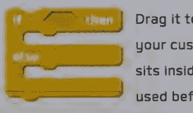

- 11. 点击旗帜运行你的程序，与你的动物角色进行简短对话吧！

# 你能接受挑战吗？

- 尝试创建一个新的自定义模块来询问另一个问题，例如：

你最喜欢的食物是什么？

- 你可以让你角色根据玩家的回答给出不同的响应。

- 看看你是否可以添加第二个角色来加入对话。

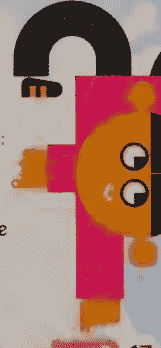

- 9. 我们可以使用该积木查看`playerAge`是否大于你选择的年龄，并让角色说些什么。如果年龄不等于或不大于你选择的数字。

## 在 SCRATCH 中画画

你能猜到这张图是怎么做出来的的吗？

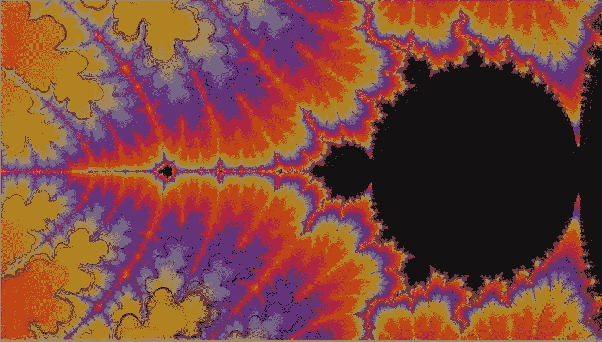

它是利用计算机和一些巧妙的数学创建的！它被称为分形（fractal），如果你在网上搜索，你会发现很多它的例子。分形是使用重复图案创建的惊人图片。

在这个项目中，你将使用 Scratch 创建一些你自己的画。

### 基础绘画

- 1. 首先，你应该创建一个新的 Scratch 项目并删除猫角色，就像你在上一个项目中做的那样。

- 2. 接下来，从库中选择新角色。这次选择一个箭头，因为它很容易看清它的指向方向。

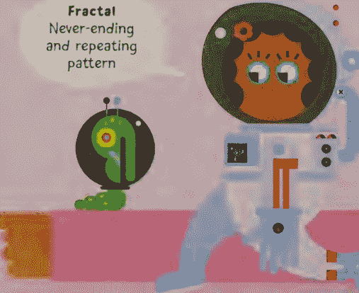

- 3. 现在你需要创建一个自定义模块（记得，我们可以在“更多积木”中找到它）。将其命名为`drawLine`。

- 4. 在积木面板中点击“画笔”（Pen）。

- 5. 从积木面板选择画笔积木并将其拖到脚本区域，然后将其添加到自定义模块的底部。

- 6. 我们需要移动角色以便画一条线。将`move 10 steps`积木拖到脚本区域并将其连接到画笔积木的底部。将 10 改为 100。然后在最后添加画笔。

- 7. 你的模块看起来应该是这样的：

- 8. 现在，当你点击积木时，你应该看到箭头移动并留下一条线。

- 9. 我们需要清除（clear）并将箭头移回中间。创建一个新的自定义模块并命名为`reset`。

- 10. 在模块底部添加“运动”（Motion）面板中的`go to x y`，然后添加`clear`。当你点击这个`reset`模块时，它应该清除屏幕并将箭头重置到中间。

- 11. 脚本区域现在应该是：

- 12. 每当你点击积木，线条就会消失，箭头会回到中间。每当你点击积木，都会画出新的线。

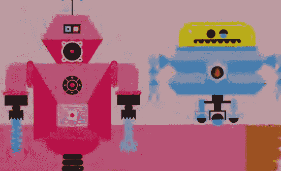

### 画形状

- 1. 线本身并不有趣，如果我们使用算法，就可以用来画许多其他形状。

- 2. 创建一个名为`drawShape`的自定义模块。

- 3. 为了画正方形，我们需要画 4 次线，并在每条线后旋转 90 度。尝试构建这个脚本：

```
define drawShape
drawLine
turn 90 degrees
drawLine
turn 90 degrees
drawLine
turn 90 degrees
drawLine
turn 90 degrees
```

```
define drawShape
repeat 4
drawLine
turn 90 degrees
```

- 4. 点击积木，你会看到舞台上画了一个正方形。

- 5. 如果我们画不同的形状，比如八边形，就需要大量的点击和拖拽。

- 6. 我们可以使用循环来让工作变得更容易。点击积木面板中的“控制”（Control）找到`repeat`模块。

- 7. 放在这个积木中的任何内容都会执行 10 次。这对我们来说太多了，所以将 10 改为 4。然后修改你的`drawShape`模块使其看起来像这样：

- 算法：解决问题的简单步骤。这个问题可能是安全地过马路，在这种情况下算法如下：

1. 向左看。

2. 向右看。

3. 再次向左看。

4. 如果没有车来。

5. 过马路。

- 8. 点击你的积木，正方形就会被画出来。

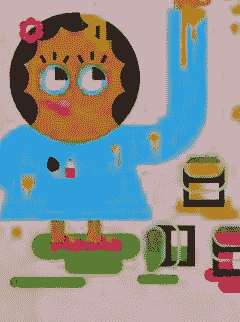

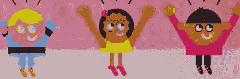


### 更复杂的形状

如果我们可以用`drawShape`自定义模块画不仅仅正方形，不是更好吗？有了“输入”（input），我们可以做到！

- 1. 按住键盘上的 'shift' 键并点击你的`drawShape`模块，弹出一个菜单。

- 2. 选择“编辑”（edit）：

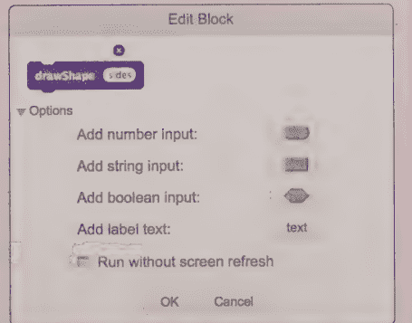

- 3. 点击“选项”（Options）旁的小箭头，会出现菜单。选择“添加数字输入”（Add number input）：

- 4. 在`drawShape`旁边的空间输入单词 "sides"。

- 5. 你的自定义模块现在看起来像这样：

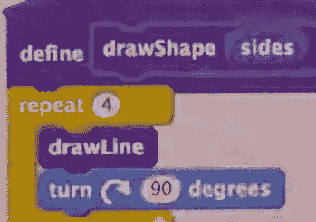

- 6. 你也可以在脚本的其他部分使用`sides`变量。将`sides`替换数字 4。

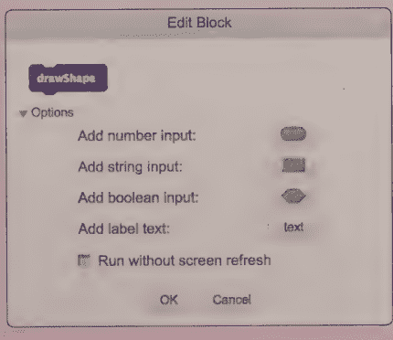

- 7. 现在我们需要更改角色旋转的角度。我们画正方形时旋转了 90 度，是因为正方形的每个角都是 90 度。我们可以这样计算：一整圈是 360 度。当我们用 360 除以 4（因为有 4 个角，所以是正方形），得到 90。这次我们将使用“运算符”（Operators）来计算角色必须旋转的角度以画出不同的形状。

### 更复杂的形状

再复杂一点的怎么样？让我们画一朵花。在这个项目中你不会得到太多寻找积木的帮助，因为到那时你应该已经成为一名专家了！

- 1. 首先我们需要画一个花瓣。使用你所学到的知识创建这里所示自定义模块：

- 2. 现在从积木中获取花瓣（petal）并将其放在脚本区域。你可以更改数字来设置花瓣的大小，然后点击它进行绘制。只需点击：

- 3. 如果你想清除屏幕。现在点击你的模块将不起作用，因为你需要告诉它要画几条边。将“更多积木”拖入脚本区域。

- 4. 将 1 改为 6 然后点击。看看发生了什么，然后尝试其他数字。

- 8. 修改你的自定义模块使其看起来像这样：

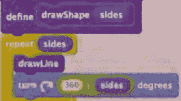

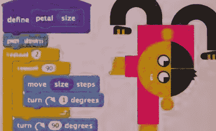


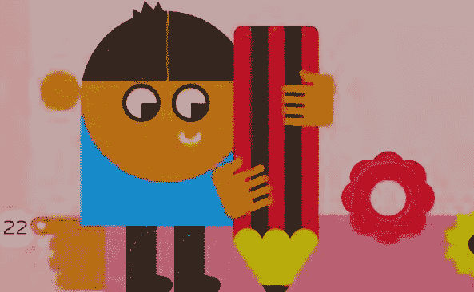

If you want to clear the screen.

- 3. 现在你有一个花瓣，可以画出一朵花了！尝试创建这个自定义区块。你需要点击两次“添加数字输入”，给它两个“添加数字输入”区块。

尝试变量的不同值将给你带来酷酷的图案。在点击“将 Scratch 切换到 Turbo 模式”来改变一些变化之前，请按住键盘上的`shift`键并点击旗帜来启动 Turbo 模式。

### 关于 Scratch 中坐标的说明

角色在舞台上的位置在 Scratch 中用两个数字 x 和 y 表示。

x 数字设置角色的左右位置。

y 数字设置角色的上下位置。

`x:0 y:0`是屏幕的中心点。

如果我们增加 x 的值，角色就会向右移动。

如果我们减小 x 的值，角色就会向左移动。

如果我们增加 y 的值，角色就会向上移动。

如果我们减小 y 的值，角色就会向下移动。

- 4. 抓取花朵区块并将其放在脚本区域的某个地方。如果你更改第一个数字，它会增加花瓣的数量。第二个数字将增加花瓣的大小。点击它来画出花。

### 超花

通过使用重复循环和改变画笔颜色，我们可以设计出一些棒的图案。如果你能构建这个区块：

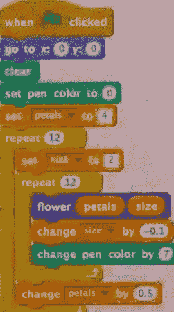

继续阅读，学习如何在太空游戏中使用坐标！

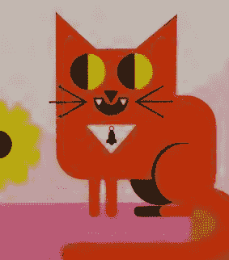

## 克隆体大攻

现在你已经熟悉了 Scratch 的操作，是时候制作我们的第一个游戏了！我们将从一个游戏开始，玩家控制一艘飞船并躲避一些飞行机器人。

### 控制飞船

- 1. 创建一个新的 Scratch 项目。

- 2. 删除猫角色并使用图标为舞台选择一个新的背景。太空背景非常适合这个游戏。

- 5. 现在是第一部分……让我们让飞船移动起来！为了实现这一点我们需要我们需要循环，只要游戏在运行，它就会一直运行。“`永远`”区块对于检测游戏中正在发生的事件非常有用，例如按键或角色之间的相互碰撞。

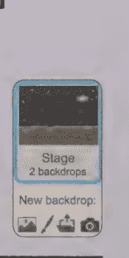

- 3. 接下来，你需要选择一个新角色：让我们使用飞船角色。

- 4. 我们先从确保当游戏开始时，飞船的大小正确、位置正确，并且面向正确的方向开始。为了做到，请像如下图所示创建一个区块。


- 6. 从区块面板中拖入一个“控制”区块到脚本的底部。我们希望程序在按下按键时做出反应。因此，在循环内部放置一个区块，并拖入“`当按下...键`”区块。

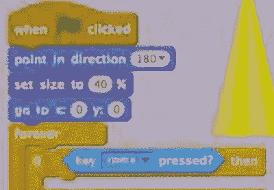

- 9. 复制 3 次，然后更改按下的按键和方向：在最后两次复制中，拖入“`将 x 增加 1`”区块来替换“`将 y 增加 10`”区块。最后看起来应该是这样的：

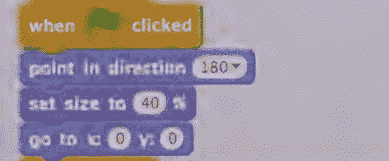

- 7. 我们应该选择哪个键？按下后会发生什么？让我们从“上”箭头键开始。每当按下“上”箭头键时，让飞船的 y 位置增加十。

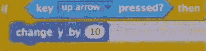

- 8. 通过按 shift 并点击此区块，我们可以从菜单中选择“复制”，这样就不用再次从面板中获取所有区块。

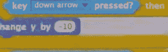

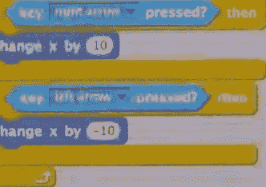

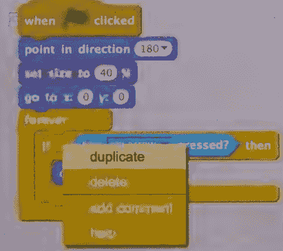

- 10. 你现在可以点击旗帜并尝试控制飞船了！

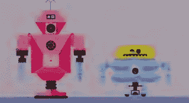

### 无尽机器人

现在我们的飞船可以工作了，让我们制作一些机器人来向它飞来。

- 1. 从角色面板中抓取机器人角色。

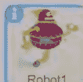

- 2. 它初始的方向是反的，所以我们需要让它转过来。点击“造型”选项卡来调整它的方向。

- 3. 接下来，让机器人出现在正确的方向。

- 4. 确保机器人在离开屏幕时消失。


# 舞动英雄

在本章节中，你将制作属于自己的舞蹈游戏，并使用自己的照片作为舞者！

### 获取图片

- 1. 请一位大人帮助你完成这一部分。你需要使用数码相机、手机、平板电脑甚至摄像头来拍摄自己的照片。确保你在光线充足的房间里，并尝试对着单色墙或门拍摄自己的照片。

2. 你需要五张照片：一张正常站立的照片和四张不同舞蹈姿势的照片。

3. 将照片传输到电脑，然后将它们分别重命名为‘Start’（开始）、‘Right’（右）、‘Left’（左）、‘Up’（上）和下。如果你没有相机，或者不想上传自己的图片，可以使用 Scratch 中现有的任何舞蹈角色。

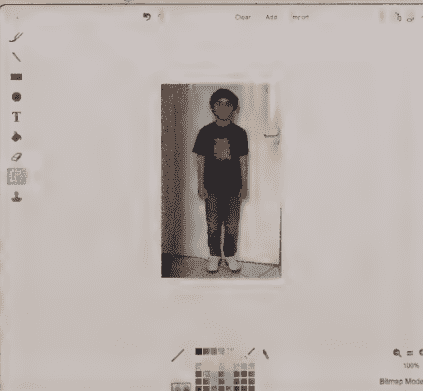

- 4. 我们需要移除照片中的背景。使用橡皮擦工具选择“擦除”工具，然后仔细地删除图片中的背景。

5. 如果你操作失误了，可以使用返回图标撤销上一步操作，并可以使用缩放控制进行放大或缩小。你最后的图片应该像这样

### 将图片添加到 Scratch

- 1. 开启一个新的 Scratch 项目并删除小猫角色。在“角色”面板中点击图标，从你的电脑中选择你命名为‘Start’的照片。

2. 点击“造型”（Costumes）标签页，你应该就能看到这张图片了。

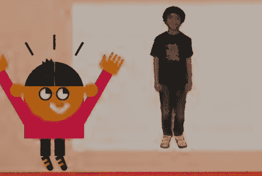

### 新造型：

5. 现在，留在“造型”标签页中，点击特效（effects）按钮上传第二个造型。接下选择‘Right’照片。

6. 再次移除背景，然后上传下一个造型。继续操作，直到你上传了所有照片，并且所有造型都列在左侧。

| 造型 | 大小 |

| :--- | :--- |

| 1. Start | 89x273 |

| 2. Right | 89x275 |

| 3. Left | 78x285 |

| 4. Up | 91x343 |

| 5. Down | 91x210 |

### 添加一些音乐

- 1. 你可以使用“声音”库中的音乐，从电脑麦克风录制一些音乐，或者从电脑上上传一些音乐。

- 2. 点击“声音”标签页。

- 3. 现在选择其中一个图标，选取一个音乐循环、录制一些音乐或从电脑上传文件。

- 4. 我们这个项目需要 5 段音乐。

### 新声音：

- 1. My Music (03:10.01)

- 2. dance space (00:04.00)

- 3. dance slow mo (00:20.21)

- 4. techno2 (00:14.83)

- 5. techno (00:07.96)

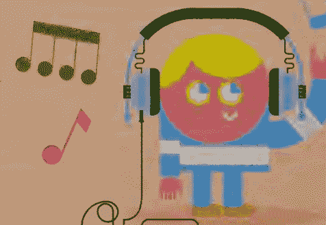

### 让音乐播放起来

### 设置舞台

- 1. 我们想要更改正在播放的曲目。因此我们需要创建一个变量来存储曲目编号。

- 1. 我们想为游戏准备一个迪斯克风格的背景！

- 2. 点击“脚本”标签页，然后点击“数据”。

- 3. 点击“建立变量”，并将变量命名为 Track。

- 4. 现在我们来构建开始播放音乐的脚本。尝试构建下方的脚本。你可以在“声音”菜单中找到“播放声音 My Music”。

- 2. 在右侧的“舞台”区域，点击图标选择一个新背景。

- 3. 选择你喜欢的任何一个“音乐与舞蹈”系列中的背景。

- 4. 将你的舞者放置在舞台上，如果需要，使用图标调整角色大小。

- 5. 点击绿旗帜并确保音乐正在播放。如果你听不到声音，请检查你的音量是否调大。

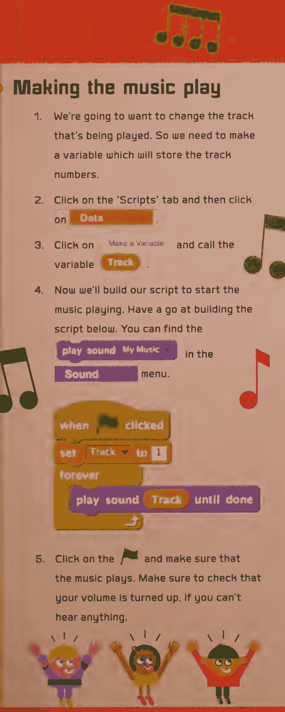

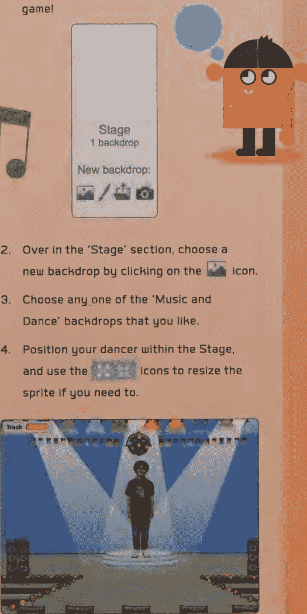

### 制作角色

5. 到目前为止你为舞者制作的所有脚本应该像这样：

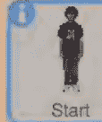

- 1. 确保你已经点击了‘Start’角色。

- 2. 现在修改‘Start’脚本来设置初始造型。

- 3. 你会随着时间学会接部分的！

```
when clicked
switch costume to Start
set Track to 1
forever
play sound Track until done
```

```
when down key pressed
switch costume to Down
forever
play sound Track until done
```

```
when up key pressed
switch costume to Up
```

```
when right key pressed
switch costume to Right
```

```
when left key pressed
switch costume to Left
```

我们需要四个小脚本，在玩家按键时切换角色造型。

- b. 点击角色，然后使用方向键让你的角色随音乐跳舞。

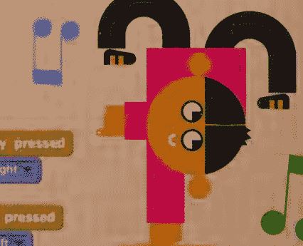

- 4. 添加以下脚本：

```
when down key pressed
switch costume to Down
```

```
when right key pressed
switch costume to Right
```

```
when up key pressed
switch costume to Up
```

```
when left key pressed
switch costume to Left
```

### 创建游戏

现在我们有一个跳舞的角色，可以开始制作游戏了。首先我们需要一个箭头角色：

- 1. 点击“角色”面板中的图标。

- 2. 找到箭头角色。

- 3. 现在我们在箭头角色上添加几个脚本。

- 4. 在我们的游戏中，玩家会有 5 次生命，游戏速度将从 1 开始增加。你的程序需要几个变量来存储这些数据。

- 5. 首先我们需要设置角色的初始位置并隐藏：

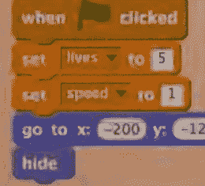

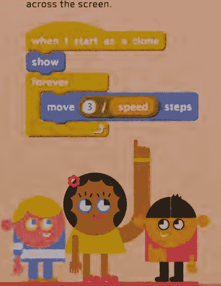


6. 接下来我们需要随机改变箭头的造型并创建它的克隆。

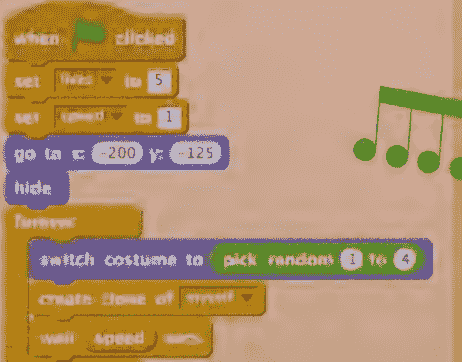

7. 当克隆被创建时，我们需要它显示并开始横穿屏幕。

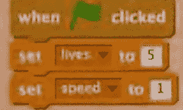

8. 点击图标并确保箭头正在横穿屏幕。

9. 让箭头在到达舞者位置时变色。我们可以让箭头在位置 `-30` 到 `30` 之间时改变特效。

```
when flag clicked
forever
  move 3 steps
  if x position < -30 or x position > 30 then
    change effect by 15
```

10. 点击图标并确保箭头会变色。

11. 现在是玩家的操作。我们希望玩家在箭头变色时按下正确的键——他们的时感必须非常棒！首先创建这个检测按键的脚本，检查箭头的造型是否指向右侧。

```
when right arrow pressed and costume # = 1 then
  delete this clone
```

12. 我们可以通过右键点击并选择“复制”再复制三次这个脚本。

```
when duplicate pressed and costume # = 1 then
  delete
  add comment
  help
```

13. 现在合并脚本，并更改所有三个副本的按键和造型值，使其看起来像这样：

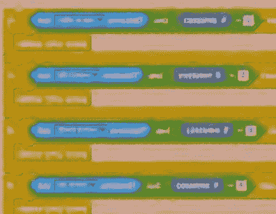

14. 我们现在完成了按键检测脚本，将其添加到克隆的脚本中：

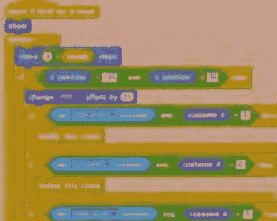

15. 点击绿旗帜，确保在正确的时间按下按键时箭头会被删除。

### 增加游戏难度

如果游戏随着玩变得变得就太好了。我们可以使用“传感器”中的计时器来实现这一点。

1. 在你的箭头角色上添加此脚本，它将启动计时器并让游戏每玩一分钟就更复杂：

2. 点击旗帜看看箭头在一分钟后是否变快。

3. 如果等一分钟太久了，你可以将计时器改为 15 秒：

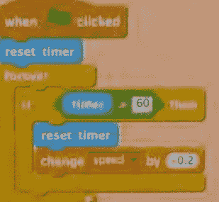

### 切换音乐

让我们在游戏加速时切换音乐吧！

1. 在箭头角色上，从“事件”中取一个“广播消息”模块。

2. 现在创建一个新消息：广播 `Change Track`，并将其放在速度更改之后的脚本。

3. 现在你需要点击你的角色。

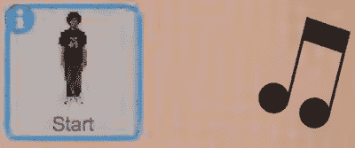

4. 为了更改曲目，添加这个新脚本：

```
when I receive Change Track
change Track by 1
stop all sounds
```

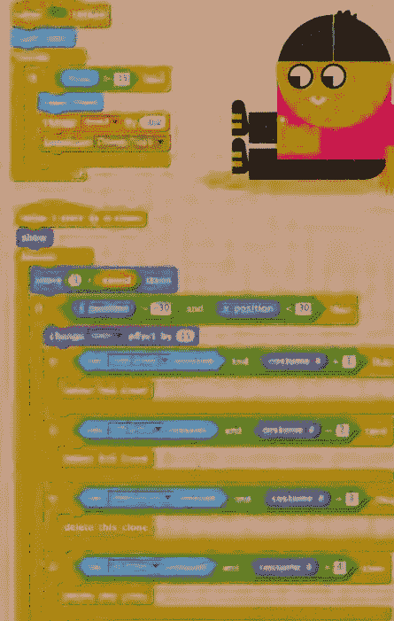

5. 点击图标并确保在箭头加速时音乐会切换。

### 游戏结束

1. 最后，我们希望如果玩家犯了太多错误，游戏就会结束。

2. 点击图标并创建这个脚本来检测克隆是否接触了屏幕边缘。

```
if touching edge then
change lives by -1
reset timer
delete this clone
```

3. 现在，将这个新脚本放入克隆的循环中，使脚本看起来如下：

4. 我们的最终脚本将告诉玩家游戏结束了。让我们把这个添加到我们的角色中：

```
when clicked
forever
if lives = 0 then
say You lost for 2 secs
stop all
```

```
when clicked
forever
if lives = 0 then
say You lost for 2 secs
stop all
```

5. 点击旗帜，在你的舞蹈英雄游戏里尽情表演吧！

# 你能接受挑战吗？

- 看看你是否能让背景在玩家生命值达到 `0` 时切换到游戏结束界面。
- 记录玩家正确按键的次数，这样你就可以在游戏结束告诉他们分数。
- 尝试调整你使用的速度和轨道顺序，让玩家的按键节奏与音乐节拍匹配。
- 你可以添加另一组箭头，并在游戏中增加第二个玩家，使用 `'w'`、`'a'`、`'s'`、`'d'` 键。

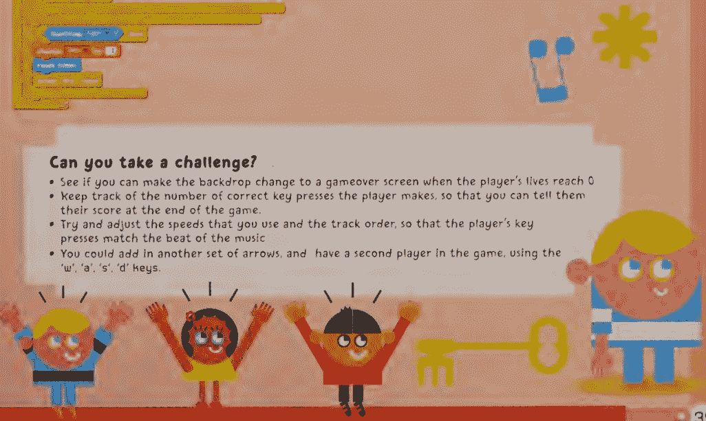

## 你准备好学习 Python 吗？

Python 是一种编程语言，就像 Scratch 一样，但它不是移动和拼接模块，而是使用文本编写代码。

当你编写 Python 代码时，它看起来像：

```python
def sayHello():
    print('Hello')
```

`sayHello()`

Python 是一个一个 Guido van Rossum 的人创建的。它比 Scratch 稍微难用一点但也非常强大的语言。像 Google 和 Apple 这样著名的公司使用 Python 来编写他们的软件。

你将学习如何使用名为 Python 3 的版本。首先请一位大人帮助你在电脑上安装 Python 3，访问 <https://www.python.org/downloads>。

### 软件

运行在你的计算机上的程序或程序集合。你的网络浏览器是一种软件，IDLE 也是，你将在本章中使用它。

在那里，你应该能找到下载并安装 Python 3 的链接。安装好 Python 后，你应该会在电脑上找到一个名为 IDLE 的新程序。你可以使用许多不同的程序编写 Python 代码，但对于初学者来说，使用 IDLE 是最简单的。

> 关于删除的简要说明
>
> 一旦你按下回车键，你就无法删除已编写的命令。
>
> 如果你犯错了不要担心——你只需要正确地重新输入代码即可。


### IDLE

1. 找到 IDLE 并打开它。现在你可以开始学习如何用 Python 写代码了！根据你的电脑，IDLE 看起来可能与书中的图片略有不同，但不用担心，这不会影响你的代码。

2. 你现在看到的是 Python **shell（终端）：**

```
Python 3.4.3 (default), Jun 10 2015, 19:54:18
[OS X 4.2.1 Compatible Apple LLVM 6.1.0 (clang-602.0.53)] on darwin
Type "copyright", "credits" or "license" for more information.
>>>
10+10
10-5
10*5
print("Hello")
print("Hello") * 100
```

### 语法

你还记得在第一章读到语法有多重要吗？让我们测试一下。

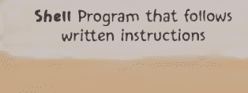

1. 在终端中输入以下命令：

`print("Hello")`

2. 你应该得到一个错误信息，提示你 `'SyntaxError: EOL while scanning string literal'`。

3. 终端有点像 Scratch 的舞台（Stage），但它只显示文本。它看起来没有 Scratch 那么有趣，但它可以做一些很酷的事情，你很快就会发现的！终端是你编写可以立即运行代码的地方。它是测试几行短代码以查看其作用的好地方。

4. 这意味着你忘记在单词 `Hello` 之后放置一个引号 `"`。

5. 再次输入命令，在单词后加上引号 `"`。

6. 与 Scratch 的舞台不同，在 Python 中我们可以直接在终端中输入代码。准备好会犯很多错误并收到很多这样的警告。记住，程序员是通过犯错并弄清楚他们做了什么来学习的。即使是世界上最好的程序员也会犯像忘记在代码中放入 `"` 这样的愚蠢错误。

7. 尝试这些命令看看会发生什么。每个命令后按 `'enter'`。

### 海龟（Turtles）

1. 打开 IDLE。

2. 我们将玩玩 Python 的一个名为 `'turtle'` 的部分。这是一个用于 Python 绘图的模块。其他人编写的代码，你可以在你的程序中使用。程序员不喜欢编写已经存在的代码，所以他们使用模块来简化工作。

3. 在终端中输入以下命令并按回车。如果没有发生什么，不要担心。

```
from turtle import *
3.4.3 (default), Jun 10 2015, 19:54:18 [OS X 4.2.1 Compatible Apple LLVM 6.1.0 (clang-602.0.53)] on darwin
Type "copyright", "credits" or "license" for more information.
>>> from turtle import *
>>> shape("turtle")
```

4. 记住语法很重要。确保你按照所示输入。`'*'` 字符通常通过使用 `'shift'` 和 `'*'` 找到。

5. 我们将给我们的海龟一个形状。在终端输入：

```
shape("turtle")
```

6. 将出现一个新窗口，中间有一个海龟的图片。最好这样排列你的屏幕：

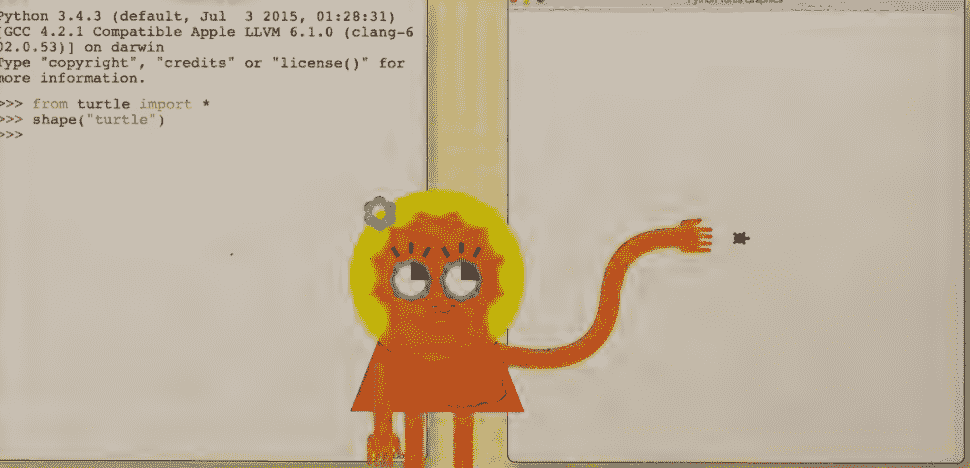

7. 现在让我们的海龟动起来。在终端输入：

```
fd(100)
rt(90)
fd(100)
```

你可能已经意识到 `fd` 代表向前，`rt` 代表向右。我们还可以使用 `bk` 向后，`lt` 向左。如果我们输入 `90`，我们的海龟旋转 90 度：

```
bk(100)
lt(90)
```

8. 现在让海龟在屏幕上移动。改变括号中的数字以移动不同的值。

9. 我们还可以控制海龟使用的笔颜色和宽度。尝试这个：

```
fd(50)
color('red')
fd(50)
color('green')
width(10)
fd(50)
```

10. 我们可以拿起笔和放下笔，如果我们想停止并开始绘图。

```
home()
clear()
fd(100)
pu()
fd(100)
pd()
```

11. 如果你犯了错，你可以一直撤销上一个命令：

```
undo()
```

12. 在开始挑战之前，让我们尝试最后一个命令。这是我们告诉海龟画圆：

```
circle(100)
```

### 控制海龟的笔

1. 让我们的海龟回到起点，然后清除到目前为止的绘画。

```
home()
clear()
```

你可以在任何时候开始新的绘画。

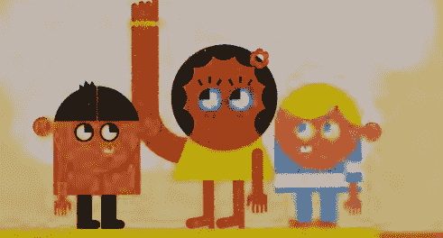

# 你能接受挑战吗？

你能用海龟画一个正方形吗？

三角形怎么样？

你能画一个带有一个交叉划线的圆吗？

### 保存你的海龟

1. 直到现在我们一直在终端中编写所有命令。这很容易，但意味着当我们关闭 IDLE 时会丢失之前的所有有趣图片。

2. 如果我们停止在终端编写并改用文件，我们就可以保存代码。

3. 在 IDLE 中点击 `'File'` 然后 `'New File'`。

```
File Edit Debug
New File ⌘N
Open... ⌘O
Open Module...
Recent Files ▶
Class Browser ⌘B
Path Browser
Close ⌘W
Save ⌘S
Save As... ↑S
Save Copy As... ⌥
Print Window ⌘P
```

4. 另一个窗口将打开。你可以在这里编写所有代码。我们可以像以前一样开始：

```python
from turtle import *
shape("turtle")
```

5. 这次按下键盘上的 `'enter'` 时没有任何发生。这是因为我们不在终端中。我们需要选择 `'save'` 和 `'Run'` 让文件生效。

6. 你可以这样从菜单操作：

```
File Edit Shell Debug
New File ⌘N
Open... ⌘O
Open Module...
Recent Files ▶
Class Browser ⌘B
Path Browser
Run F5
```

7. 第一次保存时，你需要命名文件。将其命名为 `'poly.py'`。

### 关于快捷键说明

使用快捷键比一直使用菜单更容易。

在 Windows 上保存文件只需按住 `'ctrl'` 键并按 `'s'`。

在 Mac 上保存文件只需按住 `'cmd'` 键并按 `'s'`。

在 Windows 上运行文件可以按键盘顶部的 `'F5'` 键。

在 Mac 上你也可以按 `'F5'`，但你可能需要同时按住 `'Fn'` 键。

8. 现在让我们尝试一些复杂的！添加更多行，让你的代码看起来像这样：

```
from turtle import *
shape("turtle")
for move in range(6):
    fd(50)
    lt(360/6)
```

9. 保存你的代码并运行它。

10. 你看到一个六边形了吗？如果没有，检查你的代码并再次尝试。

11. 你刚刚在 Python 中创建了第一个循环。单词 `'for'` 用于循环。`'in range()'` 短语让循环重复六次。

> 关于冒号和空格的说明
>
> 开始循环的代码行必须以冒号 `':'` 结尾。
>
> 它下面的所有行将以 4 个空格开头。IDLE 会为你输入这些，但如果你删除了它们，可以把它们放回去。
>
> 当你写完循环时，记住停止在行开头使用 4 个空格。

循环指令是被执行多次的指令。比多次写出代码要容易。你可以使用 `'for'` 循环重复某些次数的代码，或者使用 `'while'` 循环持续重复代码直到某些事情发生，例如变化为变量数量。

# 玩转 `for` 循环

我们可以用循环做很多事情——为什么不试试这个呢？

1. 创建一个新文件并将其命名为 `'star.py'`（点击 `'File'` 和 `'New File'`）。

2. 现在添加以下内容。它使用了 `for` 循环，但这次向前移动的距离存储在变量 `size` 中。

```python
from turtle import *
shape("turtle")
color("green","purple")
begin_fill()
size = 100
for move in range(9):
    fd(size)
    rt(160)
end_fill()
```

3. 这段代码让乌龟向前移动一百个单位，然后旋转 160 度，并重复了 9 次。

4. 保存并运行你的代码查看它的样子。当你改变 `size` 的值时会发生什么？尝试调整你的代码并看看你能做出什么。

5. 看看我们是否可以通过不同的颜色让它看起来更有趣。修改你的代码使其看起来像这样：


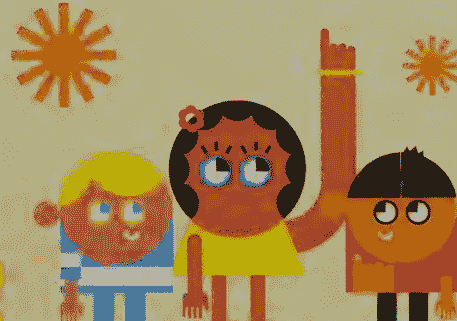

6. `color('green','purple')` 这一行让乌龟画出带有紫色填充的线条。记住颜色使用的是美式拼写方式：`color`。因为编程语言在全球范围内使用，必须选择一种某些单词的标准拼写方式。大多数语言使用英语。

7. `begin_fill()` 和 `end_fill()` 命令让乌龟在线条之间填充颜色。

8. 尝试改变颜色、大小、旋转角度和重复次数。你能画出更有趣的形状吗？

> `For` 循环可以按指定的次数重复指令

9. 你能自己写一个循环创建酷炫的图案和形状吗？你可以在循环中放入任意行的代码，只需确保每行都以 4 个空格开头即可。先从这个开始尝试：

```
from turtle import *
shape("turtle")
color("red","orange")
begin_fill()
for move in range(20):
    fd(120)
    bk(60)
    pu()
    rt(60)
    bk(50)
    pd()
    lt(24)
end_fill()
```

# 调用程序以执行函数中的指令

1. 修改代码使其看起来像这样：

```python
from turtle import *
shape("turtle")
```

```python
def square():
    for side in range(4):
        fd(100)
        rt(90)
```

2. 注意，和循环一样，函数需要一个冒号 `':'`，然后在内部每一行前面都有 4 个空格。

3. 如果你现在运行代码，什么都不会发生，因为我们需要调用这个函数——我们需要告诉电脑去使用这段函数代码。

4. 这很容易。我们通常通过输入函数名后跟上 `()` 来调用函数。

# 玩转函数

1. 函数是反复使用同一代码的极佳方法。它们就像你在 Scratch 中使用的自定义模块。

2. 创建一个新文件并将其命名为 `'fun.py'`。

3. 我们可以从一个简单的函数开始创建一个正方形：

```python
from turtle import *
shape("turtle")
```

```python
def square():
    for side in range(4):
        fd(100)
        rt(90)
```

4. 运行这段代码查看你的正方形。如果不起作用，仔细检查你的代码——记住，所有顶尖的代码员在学习时都会破坏代码。

5. 现在我们有一个画正方形的函数了。我们可以在循环内部调用这个函数。给你的代码添加几行，使其看起来像这样：

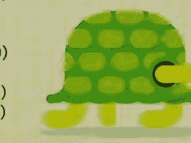

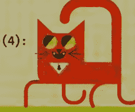


```python
from turtle import *
shape('turtle')

def square():
    for side in range(4):
        fd(100)
        rt(90)
```

```python
for times in range(5):
    square()
    rt(72)
```

如果你能让它看起来更漂亮一点。先从这个开始，然后看看你的想象力会带你去哪里：

```python
from turtle import *
shape('turtle')

def square():
    for side in range(4):
        fd(100)
        rt(90)

color("purple", "green")
begin_fill()
for times in range(5):
    square()
    rt(72)
end_fill()
```

## 设置程序

1. 我们可以从几个额外的命令开始设置我们的程序。尝试一下：

```python
from turtle import *
speed(10)
bcolor("black")
width(10)
```

2. 这将我们的乌龟设置为更速度，所以绘图不会太久。它还将背景颜色设置为黑色，笔宽设置为 10。

3. 我们首先想画一条很粗又很长的线。你可以修改代码使其像这样吗？

```python
from turtle import *
speed(10)
bcolor("black")
width(10)

def line():
    color("grey")
    fd(800)
    bk(2000)
    fd(1200)
```

4. 运行文件时什么都不会发生，因为我们还没有调用`line`。如果你想测试代码，请在 shell 中输入`line()`（而不是在文件中）。

5. 现在我们想使用我们的`line`函数画很多线。这次我们将用乌龟制作一个错觉。完成后，看看你能否让你的朋友惊叹。

6. 创建一个新文件并将其保存为`illusion.py`。


```python
from turtle import *
speed(10)
bgcolor("black")
width(10)

def line():
    color("grey")
    fd(800)
    bk(2000)
    fd(1200)
```

```python
def lines():
    pu()
    goto(-300,300)
    pd()
    for times in range(7):
        line()
        pu()
        rt(90)
        fd(100)
        lt(90)
    pd()
```

```python
def line():
    color("grey")
    fd(800)
    bk(2000)
    fd(1200)
```

```python
def lines():
    pu()
    goto(-300,300)
    pd()
    for times in range(7):
        line()
        pu()
        rt(90)
        fd(100)
        lt(90)
    pd()
```

```python
def line():
    color("grey")
    fd(800)
    bk(2000)
    fd(1200)
```

```python
def lines():
    pu()
    goto(-300,300)
    pd()
    for times in range(7):
        line()
        pu()
        rt(90)
        fd(100)
        lt(90)
    pd()
```

```python
def grid():
    lines()
    lt(90)
```

7. 这里我们将乌龟移动到屏幕角，然后告诉它画 7 次线。画完每条线后，乌龟都会移动一下。如果你想看到线条被画出来，保存并运行文件，然后在 shell 中输入`lines()`。

8. 现在我们将使用我们的`lines`函数画一个网格。添加一个新函数使你的代码像这样：

9. 保存并运行你的代码，在 shell 中输入`grid`以确保你的网格被画出来。

10. 现在我们将创建一个在网格中点的函数。这有助于创建视觉效果。给你的代码添加一个函数使其与下面相同：

```python
from turtle import *
speed(10)
bgcolor("black")
width(10)

def line():
    color("grey")
    fd(800)
    bk(2000)
    fd(1200)

def lines():
    pu()
    goto(-300,300)
    pd()
    for times in range(7):
        line()
        pu()
        rt(90)
        fd(100)
        lt(90)
    pd()
```

```python
def line():
    color("grey")
    fd(800)
    bk(2000)
    fd(1200)
```

```python
def lines():
    pu()
    goto(-300,300)
    pd()
    for times in range(7):
        line()
        pu()
        rt(90)
        fd(100)
        lt(90)
    pd()
```

```python
def grid():
    lines()
    lt(90)
```

```python
def dots():
    color("white")
    pu()
    goto(-300,300)
    setheading(0)
    for i in range(7):
        for i in range(7):
            dot(20)
            fd(100)
        rt(90)
        fd(100)
        lt(90)
```

```python
def grid():
    lines()
    lt(90)
    lines()
```

12. 运行你的代码看看发生了什么。圆圈对你来说像什么？让别人看看你的错觉，看看他们怎么想！

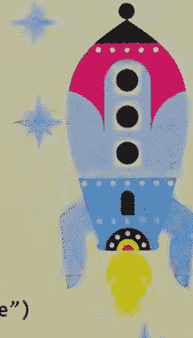

# 你能接受挑战吗？

- 如果改变点的大小，你的错觉会发生什么？如果改变线条的颜色会发生什么？
- 在互联网上查看其他错觉的图片。你可以尝试创建一个你自己的吗？像这样怎么样？

```python
grid()
dots()
```

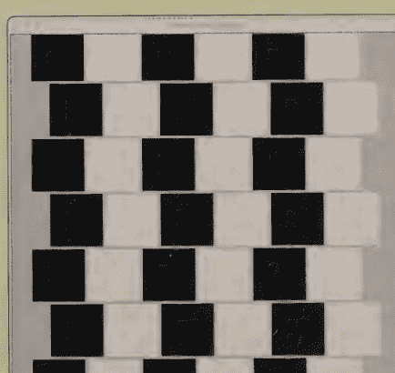

8. 你可以将名称`Poly`更改为你自己的名字，然后保存并运行你的代码。

9. 尝试输入自己的名字并再次运行，让你的朋友或家人输入他们的名字。

## 随机回复

1. 让我们让代码变得更有趣一点！

在程序的顶部添加一行，让它看起来像这样：

```python
from random import *
print("My name is Pippa the Python")
name = input("What is your name?")
if name == "Poly":
    print("You are an awesome coder")
    print("Hmm,", name, "that is not the name I expected.")
```

2. 现在我们可以为 Pippa 添加一些要说的话。我们将说的话放在一个用`[]`括起来的列表中。然后我们使用`choice`命令从列表中随机选择一个项。

```python
from random import *
praise = choice(["You are cool", "You are amazing", "You sound lovely"])
print("My name is Pippa the Python")
name = input("What is your name?")
if name == "Poly":
    print("You are an awesome coder,")
else:
    print("Hmm,", name, " is not the name I expected")
```

3. 然后我们就在 Pippa 的回复中使用那些好听的话。

```python
from random import *
praise = choice(["You are cool", "You are amazing", "You sound lovely"])
print("My name is Pippa the Python")
name = input("What is your name?")
if name == "Poly":
    print(praise,name)
else:
    print("Hmm,", name, "that is not the name I expected.")
```

4. 保存并运行你的代码以确保一切运行正常。

5. 也为 Pippa 拒绝别人时添加一些好听的话。修改你的代码使其看起来像这样：

6. 我们可以制作：

```python
from random import *

praise = choice(["You are cool", "You are amazing", "You sound lovely"])
denied = choice(["Access denied", "You’re not allowed here", "Abort"])
print("My name is Pippa the Python")
name = input("What is your name?")
if name == "Poly":
    print(praise, name)
else:
    print(denied, name)
```

7. 保存并运行你的代码，并在你自己、朋友和家人身上进行测试。

8. 在列表中添加更多随机短语，让它更有趣。

## 石、布、剪刀

1. 我们可以使用目前学到的知识来玩石头剪布刀游戏！

2. 创建一个新文件并将其保存为`game.py`。

3. 我们再次需要`random`模块。

```python
from random import *
items = ["ROCK", "PAPER", "SCISSORS"]
print("Welcome to rock, paper, scissors")
```

4. 保存并运行你的游戏，确保它能工作。

5. 现在让我们看看玩家想选择石头、剪子还是剪刀。

```python
items = ["ROCK", "PAPER", "SCISSORS"]
print("Welcome to rock, paper, scissors")
player = input("Choose rock, paper or scissors")
print("You chose")
```

6. 保存并运行你的代码。在 shell 中你可以输入你选择的石头、剪子或剪刀。

7. 计算机无法识别单词`ROCK`和`rock`是相同的，所以我们需要更改输入使其全部大大写。我们可以使用`upper()`命令来实现：

```python
from random import *
items = ["ROCK", "PAPER", "SCISSORS"]
print("Welcome to rock, paper, scissors")
player = input("Choose rock, paper or scissors").upper()
print("You chose," + player)
```

8. 保存并运行你的代码。如果你输入`rock`，它应该将其转换为`ROCK`。

9. 但如果玩家输入了石头、布或剪刀以外的内容怎么办？我们必须修改代码来处理这种情况！

```python
from random import *
items = ["ROCK", "PAPER", "SCISSORS"]
print("Welcome to rock, paper, scissors")
player = ""
while player not in items:
    player = input("Choose rock, paper or scissors").upper()
    print("You chose," + player)
```

10. 这里我们使用了一个`while`循环。`while`循环内部的行将一直运行，直到玩家从列表中选择一个项。保存并运行你的代码，用单词`roc`测试，然后再用拼写错误的单词`roc `测试，以确保它会要求你重新选择。

11. 计算机需要进行`choice()`。这段代码从列表中随机选取一个项：

```python
from random import *
items = ["ROCK", "PAPER", "SCISSORS"]
print("Welcome to rock, paper, scissors")
player = ""
while player not in items:
    player = input("Choose rock, paper or scissors").upper()
    print("You chose," + player)
```

12. 这里我们使用了一个`choice()`。这段代码从列表中随机选取一个项：

```python
from random import *
items = ["ROCK", "PAPER", "SCISSORS"]
print("Welcome to rock, paper, scissors")
player = ""
while player not in items:
    player = input("Choose rock, paper or scissors").upper()
    print("You chose," + player)
```

13. 计算机需要一个`choice()`。这段代码从列表中随机选取一个项：

```python
from random import *
items = ["ROCK", "PAPER", "SCISSORS"]
print("Welcome to rock, paper, scissors")
player = ""
while player not in items:
    player = input("Choose rock, paper or scissors").upper()
    print("You chose," + player)
```

14. 计算机需要一个`choice()`。这段代码从列表中随机选取一个项：

```python
from random import *
items = ["ROCK", "PAPER", "SCISSORS"]
print("Welcome to rock, paper, scissors")
player = ""
while player not in items:
    player = input("Choose rock, paper or scissors").upper()
    print("You chose," + player)
```

## 白帽黑客

利用自己的技能保护他人的黑客。

## AAA Games

AAA 游戏由大型公司制作。这些游戏是你在电视广告上看到的，并且通常售出数百万份。AAA 游戏由庞大的团队制作。他们有程序员编写代码，艺术家制作 3D 角色和场景，剧作家创作故事，音乐家创作音乐，设计师设计关卡，以及其他负责游戏广告和销售的庞大团队。

……资金用于寻找零日漏洞。甚至为白帽黑客举办了竞赛，发现最多零日漏洞的人将获得数千英镑的奖金。白帽黑客就像是黑客世界的超级英雄！

## 独立游戏与 AAA 程序员

许多人开始学习编程是因为他们想制作电脑游戏。也许这就是你现在正在读这本书的原因。如果你成为一名开发者，你可能想制作独立游戏或 AAA 游戏。

在 AAA 公司工作的程序员通常负责游戏中的一个非常微小的元素。他们可能是创建真实世界的专家，或者是决定非玩家角色行为规则的制定者，甚至是实现让旗帜在风中飘扬的特定效果。

## 独立游戏

独立游戏开发者通常独立工作，或与几个朋友一起创作他们的游戏。他们完成所有工作，从编写游戏代码、创建图形到讲述故事。独立开发者不为任何单一公司工作，因此他们可以自由地为主机、平板电脑、手机或 PC 制作任何他们喜欢的游戏。

如果你成为一名程序员，你将能够从事自由开源软件（FOSS）。这些程序由程序员独立编写或在许多其他程序员的帮助下编写。自由开源软件供人们使用、复制和分享。最棒的是，你被允许查看代码并进行改进。

一些独立游戏变得非常受欢迎，并能为开发者带来大量资金。有时开发者会免费提供游戏，因为他们更注重制作游戏的艺术。独立开发者可能只会向他们的粉丝出售几款游戏。也许史上最著名的独立游戏是《我的世界》（Minecraft）。


FOSS 真的非常重要。你在网上访问的大多数网站都运行在运行 GNU/Linux 服务器上。

自由开源软件（FOSS）：允许人们查看、更改和使用共享的计算机程序。

## GNU/Linux

世界上许多计算机上使用的自由开源系统。

这是一个 FOSS 操作系统组，每天都有全球成千上万的程序员对其进行改进。你或你的家人使用 Android 手机吗？那部手机运行着许多 FOSS。你使用 Firefox 作为网络浏览器吗？这也是基于 FOSS 的。

许多人帮助制作 FOSS。有些人是因为兴趣，另一些人是因为想帮助编程社区，而还有人将其作为他们的工作。

## 秘密密钥

加密是改变信息的方法，除非他们拥有秘密密钥，否则其他人无法读取它。

想象你想发送一条消息：

**“下午三点在公园见我。”**

但你不想让其他人看到它。

> 加密：伪装数据，使其在不知道如何被伪装的情况下无法读取。

你可以使用一种简单的加密方法来伪装你的消息。例如，你可以使用 5 作为密钥，然后将消息中的每个字母在字母表中向前移动 5 个字母，如下所示：

`abcdefghijklmnopqrstuvwxyz`

`fghijkluvwxyzabcdefc`

所以：

“Meet me at the park at three”

将变成：

“Rljyj rj fy ym ufw fy ymjjj”

如果你的朋友知道密钥是 5，他们就可以轻松地**解密你的消息**并读取真实含义！

今天使用的加密比这种方法要复杂得多，这种方法最初被罗马皇帝凯撒用于向他的将军发送消息。

> 解密：使加密数据变得可读。

这种被称为**凯撒密码**（Caesar cipher）的方法很容易解密，只需尝试所有二十六个密钥，并查看哪个密钥让消息变得合理。

程序员现在创建的信息加密方法非常复杂，在没有密钥的情况下是不可能破解的。这非常重要，尤其是当你使用互联网时。当你在互联网上来回发送消息时，其他人（可能是黑帽）看到你的消息非常容易。这意味着有人可能会看到你在输入密码、购物或使用银行账户时所做。为了防止他人读取你的计算机通过互联网发出的消息，这些信息经过了完全加密。

## 凯撒密码

通过将字母替换为其他字母来加密单词的方法。

你会知道自己是否在互联网上使用加密，因为你网络浏览器顶部的栏会显示 `https://` 而不是 `http://`。你可能还会看到像这样的一个小锁头符号，它告诉你你正在使用加密：🔒 `https:` 

1. 打开你的文本编辑器
2. 输入以下内容：

```html
<html>
<body>
  <p>This is a test.</p>
</body>
</html>
```

3. 将文件保存为 `index.html`
4. 在浏览器中打开该文件。

## 什么是自由开源软件？

（注：此部分提供的文本似乎在 OCR 来源中重复或重叠，遵循了上述建立的结构。）

# 术语表

**算法 (Algorithm)**：执行任务的指令集

**区块面板 (Block Palette)**：Scratch 图形界面区域，包含可在脚本中使用的区块

**黑帽 (Black hat)**：利用技能实施犯罪的黑客

**凯撒密码 (Caesar cipher)**：通过将字母替换为其他字母来加密单词的方法

**调用 (Call)**：告诉程序执行函数中的指令

**字符 (Characters)**：如字母、数字和标点符号等符号

**克隆 (Clones)**：精灵及其所有脚本的副本

**代码 (Code)**：用编程语言编写的计算机可以遵循的指令

**Codecademy**：一个教你学习多种不同编程语言的网站

**编码 (Coding)**：为计算机编写代码

**编译 (Compiling)**：将程序转换为计算机运行的语言

**自定义区块 (Custom block)**：执行特定任务的 Scratch 区块

**调试 (Debugging)**：测试代码以发现并修复错误

**解密 (Decrypt)**：使用密钥使加密数据变得可读

**字典 (Dictionary)**：一种组织数据的方式，使键和值关联在一起

**加密 (Encryption)**：伪装数据，使其在不知道密钥的情况下无法读取（其被伪装的方式）

**'For' 循环 ('For' loop)**：重复执行特定次数指令的代码

**自由且开源软件 (FOSS)**：允许你查看、修改和共享的软件

**分形 (Fractal)**：无止尽且重复的图案

**GNU/Linux**：世界上许多计算机上使用的自由开源操作系统

**图形用户界面 (GUI)**：让你能够使用鼠标、触控板或触摸屏点击按钮或从菜单中选择项目的屏幕

**黑客 (Hackers)**：使用计算机的专家

**输入 (Input)**：计算机程序接收的数据

**解释 (Interpreting)**：当计算机逐行运行程序时发生的行为

**循环 (Loop)**：被执行多次的指令

**恶意软件 (Malware)**：对计算机产生坏影响的计算机程序

**模块 (Module)**：可以在其他程序中使用以执行任务的代码

**操作系统 (Operating system)**：管理计算机的软件，如 Windows、OS X 和 GNU/Linux

**密码短 (Passphrase)**：一组为了记忆但他人难以猜测的词组

**程序设计 (Program Design)**：设计并编写代码

**程序 (Programs)**：计算机遵循以执行任务的指令集

**程序员 (Programmer)**：编写代码的人

**Pygame Zero**：一个让用 Python 编写游戏变得简单的库

**Python**：一种基于文本输入的编程语言，旨在易学习和使用

**树莓派 (Raspberry Pi)**：一种廉价、信用卡大小的计算机，旨在帮助人们学习如何编程

**Scratch**：为儿童创建的编程语言，使用连接在一起制成程序的代码区块

**脚本 (Script)**：一小段代码，可以短到几行，也可以长达数百行。在 Scratch 中，脚本是你组合在一起的区块集合

**脚本区 (Scripts Area)**：Scratch 图形界面中可以将区块组装成脚本的区域

**外壳 (Shell)**：遵循内部指令的程序

**Snap!**：一种类似于 Scratch 的编程语言

**软件 (Software)**：计算机程序或一组计算机程序的名称

**精灵 (Sprites)**：用于电脑游戏的图像

**精灵面板 (Sprites Pane)**：Scratch 图形界面中查看可用精灵的区域

**舞台 (Stage)**：Scratch 图形界面中显示游戏或动画的区域

**字符串 (String)**：字符序列

**语法 (Syntax)**：编程语言的规则

**语法错误 (Syntax error)**：由于未遵守编程语言规则而导致的计算机程序错误

**TouchDevelop**：一种类似于 Scratch 的编程语言，设计用于智能手机和平板电脑

**用户 (User)**：使用计算机或程序的人

**变量 (Variable)**：代表某个值的符号或名称

**'While' 循环 ('While' loop)**：持续重复直到某些情况发生的代码（例如变量变为某个特定数字）

**白帽黑客 (White hat hackers)**：利用其技能的人

**零日漏洞 (Zero-day exploit)**：某些软件中创建者未知且没有时间来修复的错误

# 索引

- AAA 游戏 58
- 恶意软件 (malware) 57
- 算法 (algorithm) 20
- 模块 (module) 42
- 背景 (backdrop) 24, 33, 39
- 黑帽黑客 (black hat hackers) 57, 59
- 音乐 (music) 32–33, 38
- 区块面板 (Block Palette) 11, 13–14, 16–17, 19, 24
- 视觉错觉 (optical illusion) 49–51
- 凯撒密码 (Caesar cipher) 59–60
- 密码短 (passphrase) 8
- 调用 (call) 48–49, 51
- 密码 (password) 8, 57, 59
- 字符 (characters) 52
- 图片 (pictures) 18–23
- 克隆 (clones) 26–30, 35, 37–39
- 程序员 (programmer) 4, 41, 57–58
- Codecademy 61
- 编程语言 (programming language) 6–8, 40
- 编译 (compiling) 6
- Pygame Zero 61
- 坐标 (coordinates) 23
- Python 4, b, 40–56
- 自定义区块 (custom block) 13–17, 19–23, 48
- 随机性 (randomness) 27–28, 30, 52–53
- 舞蹈游戏 (dance game) 31–39
- 树莓派 (Raspberry Pi) 61
- 调试 (debugging) 4
- Scratch 4–81, 48, 61
- 解密 (decrypt) 59
- Scratch 图形用户界面 (GUI) 10–11
- 字典 (dictionary) 56
- 脚本 (script) 13, 20–21, 27–30, 34–39
- 重复 (duplicate) 25, 36–37
- 脚本区 (Script Area) 11, 16, 19
- 加密 (encryption) 59–60
- 形状、绘制 (shapes, drawing) 20–23, 42–51
- for 循环 (for loop) 46–47, 51
- 外壳 (shell) 41, 45, 52
- 永久循环 (forever loop) 24, 27
- 快捷键 (shortcut keys) 46
- 分形 (fractal) 18
- snapl 61
- 自由且开源软件 (FOSS) 58–59
- 精灵 (sprite) 40
- 精灵 (sprites) 10, 12–19, 24, 26, 28, 31, 33–35–39
- 函数 (functions) 48–51
- 精灵面板 (Sprites Pane) 10, 26, 31
- 游戏结束 (game over) 38–39
- 舞台 (Stage) 10, 19, 33, 41
- 游戏 (games) 8, 12–13, 24–39, 54–56b
- 字符串 (strings) 52–56
- 图形用户界面 (GUI) 10–11
- 语法 (syntax) 7, 41–42
- 黑客 (hackers) 57–59
- 语法错误 (syntax error) 7, 41
- HTML 60–61
- TouchDevelop 61
- IDLE 40–42, 45, 52
- 乌龟 (turtle) 42–51
- if语句 (if statements) 56
- 图像 (images) 31–32, 61
- 变量 (variables) 14, 16, 23, 30, 33, 35, 52, 56
- 独立游戏 (Indie Games) 58
- Web 开发 (web development) 60–61
- 解释 (interpreting) 6
- while 循环 (while loop) 54
- JavaScript 6, 60–61
- 白帽黑客 (white hat hackers) 57–58
- 循环 (loops) 24, 27, 46b–48, 51, 54
- 零日 (zero-13), 漏洞 (exploits) 57–58

| | | |
|---|---|---|
| 南萨克区 (London Borough of Southwark) | | |
| SK 2618016 2 | | |
| A & H | 2017年6月16日 | | |
| 005:1 BROWN REF 8.99 | | |

你是否想过制作自己的电脑游戏？你是否能指令计算机击败机器人入侵者？现在是开始编码的时候了！

# 你将发现...

- 如何制作飞船游戏
- 如何编写视觉错觉代码
- 如何指令说话的动物精灵

这是一本易于理解的编程世界入门指南，使用了免费的 Scratch 和 Python 编程语言。

书中充满了精彩的项目并配有插图的逐步说明，这是最令人兴奋的编程指南！
