# C 语言编程指南


节选自《C语言编程：编程指南》，第四版

作者：Al Kelley 和 Ira Pohl


作者：Al Kelley 和 Ira Pohl

2005200099

EM

请访问我们的网站`www.pearsoncustom.com`


## 序言 xvii

1.9 文件 47

- 练习 60
- 2.8 运算符与标点符号 83
- 5.5 从编译器的视角看函数 204

练习 485

# 前言

本书书介绍了 C 语言的优雅简洁与强大。通过展示许多领域的应用程序，介绍了 ANSI C 语言。在适当的情况下，我们讨论了传统 C 与 ANSI C 的区别。本书假设读者对编程语言有通用知识，适用于第一门或第二门编程课程。通过大量的示例程序来演示每个语言特性，并在表中总结了关键信息以供日后参考。每个章节的最后都有总结和练习题。由于章节是自包含的，知识丰富的读者可以根据需要跳转到特定部分。

计算机专业人士将获得对该语言的完整处理，包括类型、列表处理和操作系统。第 1 章“C语言概述”对该语言进行了概述。在读完本章后，专业人士已经能够编写代码。第 11 章“输入/输出与操作系统”深入介绍了与操作系统的连接。这些信息将使在 MS-DOS 或 UNIX 环境下工作 C 语言的系统程序员受益。

## 序言

**新增 Java 部分**在第 14 章“从 C 迁移到 Java”中，我们讨论了 C 程序员如何自然而容易地开始学习 Java，这种网络工作感兴趣的语言。Java 语言借鉴了 C 和 C++ 的思想，并设计为以机器无关的方式运行。这使其适用于网络工作，例如编写浏览器使用的 applet。由于 Java 是 C 和 C++ 的扩展，C 程序员可以轻松掌握。

**完整的 ANSI C 语言**计算机专业人士将接触到该语言的完整处理，包括类型、列表处理和操作系统。本书完全是现代交互式环境编写的。书中鼓励实验。键盘和屏幕输入/输出被视为范式，并解释了其相关设备。因此，本书适用于小型家庭和商业电脑的用户，也适用于大型交互式系统的用户。我们假设读者能够访问交互式 ANSI C 系统。

**灵活的结构。**本书的结构设计非常灵活。第一章“C语言概述”分为两部分。第一部分解释了交互式输入/输出所需的关键编程技术，这是所有人必须理解的内容。第一章的第二部分则对整个语言进行了概述，对于熟悉其他语言类似特征的资深程序员来说这部分是容易理解的。在第一次编程课程中，可以推后学习这部分。注意：初学者应推后学习第一章第二部分。

**第二章“词法元素、操作符与 C 系统”**描述了语言的词法层面和语法规则，并选择性地使用这些规则来说明 C 语言构造。教师可以决定教授第二章中描述的 Backus-Naur-Form（BNF）表示法，也可以直接省略它而不影响连贯性。本书使用了 BNF 风格的语法描述，以便学生能够学习这种标准的编程语言描述形式。此外，书中还通过示例和普通解释对语言组件进行了详尽描述。

**参考性。**本书旨在成为 C 语言有价值的参考书。在全书中，许多表格简洁地阐明了语言的关键领域。ANSI C 标准库及其相关的头文件在附录 A“标准库”中进行了描述。附录章节专门解释每个标准头文件，如`ctype.h`、`stdio.h`和`string.h`。在适当的情况下，提供了示例代码来解释特定构造或函数的用法。

在附录 B“语言语法”中，我们提供了 C 语言的语法。在附录 C“ANSI C 与传统 C 的比较”中，我们列出了 ANSI C 与传统 C 之间的主要差异。最后，我们特别确保索引易用并适合作为参考工具。

**完整的 ANSI C 语言。**从 3 到 10 章逐功能地涵盖了 C 语言。书中讨论了许多高级主题，如果需要，这些主题在首次阅读时可以省略而不影响理解。例如，枚举类型对于该语言来说是新新的，在基础课程中可以省略其使用。书中强调了依赖机器的特征，如字长考虑和浮点数表示，但许多细节学者并不需要关注。

**预处理器。**第 8 章“预处理器”完全致力于预处理器，它用于扩展 C 语言的能力和表示法。宏可以生成替代函数调用的内联代码。使用宏可以缩短程序的执行时间。本章详细讨论了预处理器，包括 ANSI 委员会添加的新功能。在传统 C 中，预处理器在不同编译器之间差异很大。

**递归与列表处理。**第 5 章“函数”对递归进行了仔细讨论，递归对于初学者来说通常是一个神秘的话题。在第 8 章“预处理器”中通过快速排序算法再次说明了递归的使用，并在第 10 章“结构与列表处理”中通过基础列表处理技术说明了递归。在高级编程和数据结构中，深入掌握列表处理技术是必要的。

**操作系统连接。**第 11 章“输入/输出与操作系统”建立了与操作系统的连接。在本章中，我们解释了如何进行文件处理，并详细讨论了标准库中的各种输入/输出函数。我们还解释了如何在 C 程序内部执行系统命令，如何设置文件权限以及使用环境变量。我们给出了明确的示例展示了分析器（profiler）、库管理器（librarian）和 make 工具的使用。

**高级应用。**第 12 章“高级应用”。我们在本中讨论了许多高级应用，创建并发进程、进程重叠、进程通信和信号，所有这些通过代码实现。我们还为工程师和科学家讨论了向量和矩阵的动态分配。这些高级主题可以根据受众的需求进行选择。这些可以构成一门优秀的编程实践第二课程的基础。本书也可以作为采用 C 语言实现语言的高级计算机课程的辅助教材。

**表格、总结与练习。**全书中有很多表格和列表，简洁地总结了核心思想。这些表格有助于并测试对语言的理解。例如，C 语言符非常丰富，允许几乎任何有用的操作符组合。理解这些操作符单独及组合的求值顺序和关联至关重要。这些点在全文中得到了说明。作为参考工具，表格和代码易于查阅。

练习测试了语言的基础特性，并讨论了高级和依赖系统的特性。许多练习侧重于解决问题，另一些测试读者对 C 语法或语义的理解。某些练习包含了教程式的讨论，虽然与正文相关，但对某些读者具有特殊意义。练习题为教师提供了各个水平的问题，以便布置适合受众的作业。

# 致谢

特别感谢 Debra Dolsberry，她担任本书的主技术编辑。她很大程度上负责使用 FrameMaker 创建适用于本书排版的 PostScript 文件。我们还特别感谢来自加利福尼亚州山景 ParcPlace Systems 的 Robert Field，他是本书第一版的技术评审员。我们发现他的专业知识和建议非常有价值。第 5 章“函数”中的“哈诺塔”和第 10 章“结构与列表处理”中的“哲学家晚餐”归功于加利福尼亚大学河滨分 John de Pillis。我们也特别感谢他。

我们还要感谢其他提供有帮助建议的人：Murray Baumgartarten，加利福尼亚大学圣克鲁兹分；Michael Beeson，加州州圣何塞州立大学；Randolph Benton，科罗拉多州立大学科特林斯；Jim Booth，加利福尼亚大学伯克莱分；John Bowie，休尔斯惠惠公司；Ska Britton，加利福尼亚大学圣芭芭拉分；Timothy Budd，亚利桑那大学图森森；Nick Burgundy，加利福尼亚大学圣克鲁兹分；Jeff Donnelly，伊利诺伊大学；Dick Fritz，AT&T 实验室；Rex Gantenbein，怀俄明大学拉拉米；Harry Gayer，SRI 国际公司，乔治亚；Leonard Garrett，费城大学；William Giles，加州州何塞州立大学；加利福尼亚州俄勒冈州；Susan Graham，加利福尼亚大学伯克莱分；Jorge Hanker，加利福尼亚大学圣克鲁兹分；Robert Haxo，Auspex 公司，加利福尼亚州圣何塞；Mike Johnson，俄勒冈州立大学科维维；Keith Jolly，加利福尼亚州查博特学院；Carole Kelley，加利福尼亚大学圣克鲁兹分；Charlie McDowell，加利福尼亚大学阿普托斯；Clifford Layton，罗杰斯州大学；Darrell Long，加利福尼亚大学圣克鲁兹分；Andrew Pleszkun，科罗拉多大学博尔德；Geoffrey Pullum，加利福尼亚大学圣克鲁兹分；Peter Rosencrantz，圣克鲁兹运营公司；Mike Schoonoover，休尔斯惠惠公司；Peter Scott，加利福尼亚大学圣克鲁兹分；Al Shaw，华盛顿大学西雅图；Tilly Shaw，加利福尼亚大学圣克鲁兹分；Matt Stallmann，丹佛大学。

此外，我们要感谢我们的赞助编辑 Carter Shanklin 的热情、支持和鼓励；感谢 John Fuller 对本书 C 语言制作的精心关注。

Al Kelley

Ira Pohl

加利福尼亚大学圣克鲁兹分

# 第 0 章：从零开始

0 是 C 语言语言的自然起点。C 从 0 开始计数。C 使用 0 表示假，非 0 表示真。C 数组的下标以 0 为下界。C 字符串使用 0 作为字符串结束的哨兵。C 指针使用 0 来指定空值（null）。C 的外部变量和静态变量默认初始化为 0。本书将解释这些思想，并带你领略 C 编程的乐趣。

C 是一种通用编程语言，最初由贝尔实验室的丹尼斯·里奇（Dennis Ritchie）开发，并于 1972 年在 PDP-11 上实现。它首次被用作 UNIX 操作系统的系统级语言。UNIX 的开发者肯·汤普森（Ken Thompson）在 1970 年曾用过汇编语言和 B 语言生成了 UNIX 的初始版本。C 的发明是为了克服 B 语言的局限性。

B 语言是基于 BCPL 的编程语言，由马丁·里查兹（Martin Richards）在 1967 年开发，是一种无类型的系统编程语言。其基本数据类型是机器字，并大量使用指针和地址运算。这与结构化编程的精神背道而驰，结构化编程的特点是使用强类型语言（如类 ALGOL 语言）。C 从 B 和 BCPL 演变而来，并引入了类型系统。

到 20 世纪 80 年代初，原始的 C 语言通过添加`void`类型、枚举类型和其他改进，演变成了现在所谓的传统 C。20 世纪 80 年代后期，美国国家标准学会（ANSI）X3J11 委员会制定了被称为 ANSI C 或标准 C 的标准。该委员会增加了函数原型、一种新的定义语法，并增强了预处理器的功能，总的来说使语言的定义更加精确。今天，ANSI C 是一门成熟的通用语言，广泛应用于许多机器和操作系统。它是世界上最主要的工业编程语言之一，在各地的大学中十分常见。此外，ANSI C 是 C++ 的基础，C++ 是一种结合了面向对象构造的编程语言。本书描述了 C 语言的 ANSI 版本，并涵盖了 C++ 和 Java 的一些主题。

## 为什么选择 C？

C 是一门短小的语言，而且在编程中非常优美。C 的关键字比 Pascal 少（在 Pascal 中这些被称为保留字），但它被认为是一门更强大的语言。C 的力量源于精心地包含了正确的控制结构和数据类型，使得它们在有意义地使用时，其应用几乎不受限制。由于其功能上的极简主义，这门语言非常易学。

C 是 UNIX 的原生语言，而 UNIX 是工作站、服务器和大型机上主要的交互式操作系统。此外，C 还是个人电脑的标准开发语言。MS-DOS 和 OS/2 的大部分是用 C 编写的。许多窗口包、数据库程序、图形库和其他大型应用程序包都是用 C 编写的。

C 具有可移植性。在一种机器上编写的代码可以很容易移动到另一种机器上。C 为程序员提供了一个标准函数库，这些函数在所有机器上的运行方式相同。此外，C 还有一个内置的预处理器，帮助程序员隔离任何依赖于系统的代码。

C 是简洁的。它有一套非常强大的运算符，其中一些运算符允许程序员在位层级上访问机器。自增运算符`++`在许多机器的语言中都有直接对应物，使其成为一种高效的运算符。归纳和地址运算可以与表达式结合，在一条语句或表达式中完成其他语言中需要许多语句才能完成。对于许多程序员来说，这既优雅又高效。软件生产力表明，程序员平均每天只产生少量的有效工作。一门简洁的语言会显式地放大了程序员底层的生产力。

C 是模块化的。C 支持一种例例程风格，即外部函数，其参数通过值调用传递。它不允许函数嵌套。通过在文件内部使用`static`存储类，提供了一种有限的私有性。这些特性同操作系统提供的工具，可以很好地支持用户定义的函数库和模块化编程。

C 是 C++ 和 Java 的基础。这意味着 C 程序员经常使用的许多构造和方法论，C++ 和 Java 程序员也同样使用。因此，学习 C 可以被视为学习 C++ 或 Java 的第一步。

C 在大多数机器上都是高效的。因为语言中的某些构造是显式依赖机器的，所以 C 的实现方式可以符合机器架构的自然特性。由于机器能做的事情是而然的，编译后的 C 代码可以非常高效。当然，程序员必须意识到任何依赖于机器的代码。

C 并非没有批评。它有复杂的语法。它没有自动边界检查。它多次使用如`*`和`&`等符号。例如，一个常见的编程错误是使用运算符`=`代替运算符`==`。尽管如此，C 是一门优雅的语言。它没有限制程序员对机器的访问。它的缺陷比一种完美的限制性更容易接受。

C 因为其强大的运算符和不受束缚的本质而具有吸引力。C 程序员追求功能模块化和有效的极简主义。程序员欢迎实验和互动。事实上，实验和互动是本书的标志。

## 0.2 ANSI C 标准

ANSI 缩写代表“美国国家标准学会”。该学会参与了许多系统（包括编程语言）的标准制定。ANSI X3J11 委员会负责制定 C 编程语言的标准。20 世纪 80 年代后期，该委员会创建了被称为 ANSI C 或标准 C 的草案标准。到 1990 年，委员会完成了工作，国际标准化组织（ISO）也批准了 ANSI C 标准。因此，ANSI C（或 ANSI/ISO C）是一项国际认可的标准。

该标准规定了用 C 编写程序的形式，并确立了程序的解释方式。标准的目的是提高 C 程序的可移植性、可靠性、维护性以及在各种机器上的高效执行。几乎所有编译器都遵循 ANSI C 标准。

## 0.3 从 C 到 C++

今天，C 广泛应用于全球的 PC、工作站和大型机。与此同时，机器和操作系统不断演进。扩展 C 语言或为了符合特定学科而限制其构造的使用并不符合 C 的精神。

虽然 C 语言本身没有被扩展，但它经常作为更高级或更专门语言的内核。并发 C 通过引入并发原语扩展了该语言。Objective C 通过提供 Smalltalk 风格的对象扩展了语言。其他形式的 C 用于超级计算机以利用不同形式的并行性。

最重要的是 C++，一种已经广泛使用的面向对象的语言。由于它是 C 的扩展，它允许在大型软件项目中同时使用 C 和 C++ 代码。C 程序员可以很容易学习 C++。（参见第 13 章，“从 C 到 C++”。）

## 0.4 从 C 和 C++ 到 Java

Java 是为互联网工作设计的。它允许程序员编写安全且可移植的程序，这些程序可以从互联网下载并在本地机器上运行。这种新编程语言借鉴了 C 和 C++ 的思想，并设计为以独立机器和系统的方式运行。它的语义是基于虚拟机定义的，这意味着 Java 在不同的系统（如运行在 PC 上的 Windows 95 和运行在工作站上的各种 UNIX）之间具有内在的可移植性和一致性。

Java 常用于编写网页中供浏览器使用的 applet。通常，applet 为代码提供图形化用户界面。由于它是 C 和 C++ 的扩展，C 程序员可以很容易学习 Java。（参见第 14 章，“从 C 到 Java。”）

# 第 1 章：C 语言概述

本章将对 C 语言语言进行概述。书中介绍了一系列程序，并仔细解释了每个程序的各个元素。全文强调了实验和交互。在本章中，我们重点介绍如何使用 C 语言的基本输入/输出函数。请注意，所有的 C 代码同样适用于 C++ 代码，而且我们讨论的所有思想对于 C 和 C++ 同样成立。当然，C++ 程序员可以使用更丰富的工具和技术，利用这些工具来构建程序。（参见第 13 章“从 C 迁移到 C++”）

除了第 36 页的第 1.8 节“数组、字符串和指针”外，每个人都应该阅读本章的所有内容。任何在其他语言中具有数组、指针和文件处理经验的读者都可以阅读本章的所有章节，以获得对 C 的更完整的概述。其他人可以在觉得需要时再回来查看这些材料。大家在阅读本章时都应该理解，技术细节和进一步的解释将在后面的章节中出现。

## 1.1 编程与准备

机器上驻留着一组被称为操作系统的特殊程序。常用的操作系统包括 MS-DOS、OS/2 和 UNIX。操作系统管理机器资源，为用户提供软件，并在用户与硬件之间充当接口。在操作系统提供的许多软件包中，包含了 C 编译器和各种文本编辑器。UNIX 系统上的主要文本编辑器称为 vi。某些系统（如 Borland C++）集文本编辑器和编译器。我们假设读者能够使用某些文本编辑器创建包含 C 代码的文件。这些文件被称为源文件，它们在 UNIX 系统上使用`cc`命令进行编译，该命令会调用 C 编译器。由于`cc`命令调用了编译器，因此该命令的名称也是编译器的名称。因此，C 编译器和`cc`编译器是可以通用的。粗略来说，编译器将源代码翻译成可执行的目标代码。在 UNIX 系统上，这些编译后的代码会自动创建一个名为`a.out`的文件。在 MS-DOS 系统中，这些编译后的代码会自动创建一个与`.c`文件同名的文件，并用`.exe`扩展名替换`.c`扩展。在本章末尾，第 53 页的第 1.10 节“操作系统考虑”中，我们将详细介绍编辑、编译和执行程序所需的步骤。

## 1.2 程序输出

程序必须通过通信才能有用。我们的第一个示例是一个在屏幕上打印语句“from sea to shining C”的程序。完整程序如下：

在文件`sea.c`中：

```c
#include <stdio.h>
int main(void)
{
    printf("from sea to shining C\n");
    return 0;
}
```

使用文本编辑器，我们将这些内容输入到一个以`.c`结尾的文件中。文件名的选择应该具有记忆性。假设程序已经写在`sea.c`文件中。要编译该程序，我们输入命令：

```bash
cc sea.c
```


如果代码中没有错误，该命令将创建一个可执行文件`a.out`。现在，运行命令：

```
a.out
```

将执行程序并在屏幕上打印：

```text
from sea to shining C
```

## `sea`程序的剖析

- `#include <stdio.h>`

  C 编译器中内置了一个预处理器。当给出编译程序的命令时，代码会先进行预处理，然后进行编译。以`#`开头的行与预处理器通信。此行`#include`行导致预处理器在代码的此处包含头文件`stdio.h`的副本。头文件由 C 系统提供。`<stdio.h>`周围的角括号表示文件应在常规位置查找，这取决于系统。我们包含了这个文件，因为它包含了关于`printf()`函数的信息。

- `int main(void)`

  这是`main()`函数定义的第一行。（我们在名称后写上括号是为了提醒读者`main()`是一个函数。）`int`和`void`这两个单词是关键字，也称为保留字。它们对编译器有特殊意义。在第 77 页的第 2.4 节“关键字”中，我们将看到 C 语言中有 32 个关键字，包括`int`和`void`。

- `int main(void)`

  ```c
  {
      ....
  }
  ```

  每个程序都有一个`main()`函数。程序的执行始终从这个函数开始。顶行应该读作“`main()`是一个不接受参数并返回`int`值的函数”。在这里，关键字`int`告诉编译器该函数返回一个`int`类型的值。`int`单词代表整数（integer），该单词表示不能作为变量名使用。`main`后面的括号`()`告诉编译器`main`是一个函数。这起初很困惑，因为你看到`main`是`(void)`，但只有括号`()`构成运算符告诉编译器`main`是一个函数。关键字`void`告诉编译器该函数不接受任何参数。当我们讨论`main()`和`printf()`等函数时，我们通常会在名称后面加上括号。这告诉读者我们正在讨论一个函数。

- `{`

  大括号包围函数定义的体。它们也用于将语句分组在一起。

- `printf()`

  C 系统包含一个可以在程序中使用的标准函数库。这是该库中一个在屏幕上打印内容的函数。我们包含了头文件`stdio.h`，是因为它提供了某些信息。（参见第 63 页的练习 14。）

- `"from sea to shining C\n"`

  C 语言中的字符串常量是由双引号包围的一系列字符。这是该函数的参数。字符串末尾的两个字符`\n`代表换行符。它将光标移动到新行的开头。

- `return 0;`

  这是一个返回语句。它导致将零值返回给操作系统，操作系统可能会以某种方式使用该值，但不是必须这样做。（进一步的讨论请参阅第 579 页的第 12.7 节“返回状态”。）使用这个返回语句会让编译器感到满意。如果我们不使用它，编译器将会报错（参见第 60 页的练习 4）。编程的主要规则之一是“让你的编译器满意”。

- `}`

  右括号匹配上方的左括号，结束了`main()`函数。

第 10 章 第 1 章 C 概述

让我们写一次这个程序的变体，用星号组成的矩形将短语括起来。它将展示每个字符（包括空格和换行符）是如何关键的，并且在执行时，它将让我们对屏幕比例有一个直观的感受。

在文件`sea2.c`中：

```c
#include <stdio.h>
int main(void)
{
    printf("\n\n\n\n\n\n\n");
    printf("****************************************\n");
    printf("*      * from sea      *\n");
    printf("*      to shining C *\n");
    printf("****************************************\n");
    printf("\n\n\n\n\n\n\n");
    return 0;
}
```

## 1.3 变量、表达式与赋值

我们将编写一个程序，将马拉松的英里距离转换为公里。在英语单位中，马拉松距离被定义为 26 英里 385 码。这些数字是整数。为了将英里转换为公里，我们乘以转换因子 1.609，这是一个实数。在内存中，计算机表示整数的方式与实数不同。为了将码转换为英里，我们除以 1760.0，正如我们之后看到的，将此数字表示为实数而不是整数是非常关重要的。

我们的转换程序将使用能够存储整数值和实数值的变量。在 C 语言中，所有变量必须在程序的开头进行声明（或命名）。变量名（也称为标识符）由字母、数字和下划线的序列组成，但不能以数字开头。标识符的选择应该反映它们在程序中的用途。通过这种方式，它们可以起到文档的作用，使程序更具读性。

在文件`marathon.c`中：

```c
/* 马拉松的公里的距离。 */
#include <stdio.h>
int main(void) {
    int miles, yards;
    float kilometers;

    miles = 26;
    yards = 385;
    kilometers = 1.609 * (miles + yards / 1760.0);
    printf("\nA marathon is %f kilometers.\n\n", kilometers);
    return 0;
}
```

程序的输出是：

```text
A marathon is 42.185970 kilometers.
```

### 马拉松程序的剖析

- `/* 马拉松的公里的距离。 */`

  在字符`/*`和`*/`之间编写任何内容都是注释，编译器会忽略它们。书中所有以注释开头的程序都列在索引中。

- `int miles, yards;`

  这是一个声明。声明以分号结束。`int`是关键字，语言中的基本类型之一。它告诉编译器随后的变量是整数。因此，程序中的`miles`和`yards`是类型`int`。

- `float kilometers;`

  这是一个声明。`float`是关键字，语言中的基本类型之一。它告诉编译器随后的变量是浮点数。因此，程序中的`kilometers`是类型`float`。

- `miles = 26; yards = 385;`

  这些是赋值语句。等号是赋值运算符。`26`和`385`是整数常量。`26`被赋值给`miles`，`385`被赋值给`yards`。

- `kilometers = 1.609 * (miles + yards / 1760.0);`

  这是一个赋值语句。等号右侧表达式被赋值给`kilometers`。`*`、`+`和`/`分别代表乘、加、除。括号内的操作首先执行。（见附录 E，“运算符优先级和结合性”。）由于除法的优先级高于加法，`yards / 1760.0`先计算。该值与`miles`的值相加的结果乘以`1.609`。这个最终值被赋值给`kilometers`。

```c
printf("\nA marathon is %f kilometers.\n\n", kilometers);
```

这是一个调用`printf`函数的语句。`printf`函数可以有任意数量的参数。第一个参数总是字符串，称为控制字符串。此示例中的控制字符串是：

```text
"\nA marathon is %f kilometers.\n\n"
```

字符串内部是转换规范，或格式。控制字符串中的任何格式都会与`printf()`函数中的剩余参数匹配。在这种情况下，`%f`与参数`kilometers`匹配。它的效果是将`kilometers`的值作为浮点数打印，并插入到`%f`出现的打印流中。

某些单词被称为关键字，程序员不能将其作为变量名。例如，`int`、`float`和`double`是关键字。关键字表出现在第 77 页第 2.4 节“关键字”。其他名称是 C 系统已知的，程序员通常不会重新定义它们。`printf`就是一个例子。因为`printf`是标准库中的函数名，所以通常不用作变量名。

## 1.4 `#define`和`#include`的用法

C 编译器内置了预处理器。以`#`开头的行称为预指令。如果我们使用`#define`，它会将标识符的所有出现处替换为值。这对于定义整个程序使用的常量特别有用。例如，如果我们写下：

```c
#define LIMIT 100
```

那么预处理器会将所有的`LIMIT`替换为`100`。这使得代码更容易维护，因为只需要在一个处更改常量的值。

`#include`指令用于将另一个文件的内容引入程序。这对于将代码组织到多个文件中以及使用标准库有用。例如：

```c
#include <stdio.h>
```

编译时会将标准头文件`stdio.h`的副本包含到代码中。在 ANSI C 中，每当使用`printf()`或`scanf()`函数时，都应当包含标准头文件`stdio.h`。该文件包含了这些函数的声明，或函数原型。（进一步讨论请参见第 1.7 节。）

加利福尼亚大学圣克鲁斯分校区俯瞰着太平洋的蒙特利湾以及该海湾西北部的部分海域。我们喜欢把从校园可以看到的这部分海洋称为“太平洋”。为了说明`#include`机制的工作原理，我们将编写一个程序，以各种测量单位打印太平洋海的面积。首先，我们创建一个头文件并放入以下行：

在`pacific_sea.h`中：

```c
#include <stdio.h>

#define AREA 2337
#define SQ_MILES_PER_SQ_KILOMETER 0.386102158542458
#define SQ_FEET_PER_SQ_MILE (5280 * 5280)
#define SQ_INCHES_PER_SQ_FOOT 144
#define ACRES_PER_SQ_MILE 640
```

接下来，我们在`a.c`中编写主函数。

在`pacific_sea.c`中：

```c
/* 测量太平洋海。 */
#include "pacific_sea.h"

int main(void) {
    const int pacific_sea = AREA; /* 平方公里 */
    double acres, sq_miles, sq_feet, sq_inches;

    printf("\nThe Pacific Sea covers an area):\n\n");
    printf("%d square kilometers.\n", pacific_sea);
    sq_miles = SQ_MILES_PER_SQ_KILOMETER * pacific_sea;
    sq_feet = SQ_FEET_PER_SQ_MILE * sq_miles;
    sq_inches = SQ_INCHES_PER_SQ_FOOT * sq_feet;
    acres = ACRES_PER_SQ_MILE * sq_miles;
    printf("In other units of measure this is:\n\n");
    printf("%.22e acres\n", acres);
    printf("%.22e square miles\n", sq_miles);
    printf("%.22e square feet\n", sq_feet);
    printf("%.22e square inches\n", sq_inches);

    return 0;
}
```

# 第 1 章 C 语言概述

现在我们的程序写在两个文件中：一个`.h`文件和一个`.c`文件。该程序的输出结果为：

太平洋海的面积为 2337 平方公里。

在其他测量单位下为：

```text
5.7748528e+05 英亩

9.0232074e+02 平方里

2.5155259e+10 平方英尺

3.6232572e+12 平方英寸
```

新的编程思想在下面的解析表中描述。

## `pacific_sea`程序解析

- `#include "pacific_sea.h"`

  此行包含行是一个预处理指令。它导致在程序编译时包含一个`pacific_sea.h`文件的副本。因为该文件包含了这一行：

  ```c
  #include <stdio.h>
  ```

  预处理器会继续展开该行，并在代码中也包含标准头文件`stdio.h`的副本。我们包含`stdio.h`是因为我们使用了`printf()`。`pacific_sea.h`中定义了五个符号常量。

- `#define AREA 2337`

  此定义行是一个预处理指令。它导致预处理器将文件其余部分所有标识符`AREA`的出现处替换为`2337`。按照惯例，大写字母用于会被预处理器更改的标识符。如果将来的某一天制作了新地图并计算出太平洋海面积的新数值，则只需要更改此行即可更新程序。

- `#define SQ_MILES_PER_SQ_KILOMETER 0.3861021858424458`

  浮点常数`0.3861021858424458`是一个转换因子。为常量使用符号名称使程序更具可读性。

- `#define SQ_FEET_PER_SQ_MILE (5280 * 5280)`

  预处理器将第一序列字符序列替换为第二个。如果此程序的读者知道 1 英里有 5280 英尺，那么该读者就能很快识别出这行代码是正确的。由于 C 编译器在编译期间展开常量表达式，因此不会像使用`278784400`那样丢失运行时效率。虽然括号`(5280 * 5280)`不是必须的，但使用它们被认为是良好的编程习惯。出于技术原因，符号表达式周围通常需要括号。（参见第 368 页 8.3 节，“带参数的宏”。）

- `const int pacific_sea = AREA; /* 平方公里 */`

  编译时，预处理器首先将`AREA`改为`2337`。编译器将此行解释为标识符`pacific_sea`的声明。该变量被声明为`int`类型并初始化为`2337`。关键字`const`是 ANSI C 新引入的类型限定符。它意味着关联的变量可以初始化，但不能更改其值。（参见第 65 页第 18 道习题。）在某些系统上，这意味着变量可能被存储在 ROM（只读内存）中。

- `double acres, sq_miles, sq_feet, sq_inches;`

  此行声明了四个`double`类型的变量。

## 第 1 章：C 语言概览

`scanf()`函数返回一个`int`值，表示成功完成的转换次数或系统定义的数值结束标志。`printf()`函数返回一个`int`值，表示打印的字符数，如果发生错误则返回一个负值。

| 转换字符 | 输入流中的字符如何转换 |
| --- | --- |
| `%c` | 字符 |
| `%d` | 十进制整数 |
| `%f` | 浮点数（`float`） |
| `%lf` | 浮点数（`double`） |
| `%s` | 字符串 |

关于`printf()`和`scanf()`的细节请见第 493 页的第 11.1 节“输出函数`printf()`”以及第 499 页的第 11.2 节“输入函数`scanf()`”。在这里，我们只想提供足够的信息，以最简单的方式让数据进出机器。以下程序读取三个字符、一些数字，然后将它们打印。注意使用`char`类型的变量来存储字符值。

在文件`echo.c`中：

```c
#include <stdio.h>

int main(void)
{
    char c1, c2, c3;
    int i;
    float x;
    double y;

    printf("\n%s\n%s", "Input three characters,", "an int, a float, and a double: ");
    scanf("%c %d %f %lf", &c1, &i, &x, &y);
    // ... 剩余代码
}
```

## 1.6 控制流

如果我们编译程序、运行它并输入`ABC 3 55 77.7`，那么屏幕上会出现以下内容：

```text
Input three characters,
an int, a float, and a double:  ABC 3 55 77.7
Here is the data that you typed in:
A B C  3    5.500000e+01    7.770000e+01
```

在读取数字时，它会跳过空白字符（空格、换行和制表符）；但在读取字符时，不会跳过空白字符。因此，如果输入`ABC 3 55 77.1`，程序将无法正常运行。读取的第三个字符是空格，这是一个有效的字符；但随后`scanf()`尝试将`C`读取为十进制整数，这导致了困难。

程序中的语句通常按顺序执行。然而，大多数程序需要改变正常的顺序控制流。`if`和`if-else`语句提供了备选动作，而`while`和`for`语句提供了循环机制。这些结构通常需要评估逻辑表达式，即程序员认为为真或假的表达式。在 C 语言中，任何非零值都被认为表示真，而任何零值都被认为表示假。

`if`语句的一般形式为：

```c
if (expr)
    statement
```

如果`expr`是非零的（真），则执行`statement`；否则跳过它。重要的一点是，`if`语句虽然包含语句部分，但它本身是一个单一语句。考虑以下代码：

```c
a = 1;
if (b == 3)
    a = 5;
printf("%d", a);
```

符号`==`表示相等操作运算符。在上面的代码中，进行了一个测试以检查`b`的值是否等于`3`。如果是，则将`a`赋值为`5`，控制传递到`printf()`语句，导致打印`5`。然而，如果`b`的值不是`3`，则跳过语句`a = 5;`，控制直接传递到`printf()`语句，导致打印`1`。在 C 语言中，逻辑表达式的值为`int`值`1`或`int`值`0`。考虑逻辑表达式`b == 3`。如果`b`的值为`3`，该表达式的`int`值为`1`（真）；否则，它的`int`值为`0`（假）。


大括号包裹的一组语句组成了复合语句。在语法上，复合语句本身是一个语句；复合语句可以用任何可以使用语句的地方。下一个示例使用该语句来控制多个一个动作：

```c
if (a == 3) {
    b = 5;
    c = 7;
}
```

在这里，如果`a`的值为 3，则执行两个赋值语句；如果`a`的值不为 3，则跳过这两个语句。

`if-else`语句的形式为：

```c
if (expr)
    statement1
else
    statement2
```

重要的是要识别整个结构，尽管它包含语句，但它本身是一个单一语句。如果`expr`是非零的（真），则执行`statement1`；否则执行`statement2`。例如，考虑代码：

```c
if (cnt == 0) {
    a = 2;
    b = 3;
    c = 5;
} else {
    a = -1;
    b = -2;
    c = -3;
}
printf("%d", a + b + c);
```

如果`cnt`的值为 0，则会打印 0，否则打印 -6。

循环机制非常重要，因为它们允许重复动作。以下程序说明了`while`循环的使用。

在`consecutive_sums.c`中：

```c
#include <stdio.h>

int main(void) {
    int i = 1, sum = 0;

    while (i <= 5) {
        sum += i;
        i++;
    }
    printf("sum = %d\n", sum);
    return 0;
}
```

程序的上手模拟显示`while`循环执行了五次，`i`连续取值为 1, 2, 3, 4, 5。当控制传递过`while`语句时，`i`的值为 6，`sum`的值为 15。

## 26 第1章 C语言概述

在文件`running_sum.c`中：

```c
/* 计算最小值、最大值、和和平均值。 */
#include <stdio.h>
#include <stdlib.h>

int main(void) {
    int i;
    double x, min, max, sum, avg;
    if (scanf("%lf", &x) != 1) {
        printf("No data found - bye!\n");
        exit(1);
    }

    min = max = avg = x;
    printf("%5s%9s%9s%12s\n%5s%9s%9s%12s%9s%9s%12s\n",
           "Count", "Item", "Min", "Max", "Sum", "Average",
           "------", "----", "----", "----", "----", "--------");
    printf("%5d%9.1lf%9.1lf%12.3f%12.3f%12.3f\n",
           i, x, min, max, sum, avg);
    for (i = 2; scanf("%lf", &x) == 1; ++i) {
        if (x < min)
            min = x;
        else if (x > max)
            max = x;
        sum += x;
        avg = sum / i;
        printf("%5d%9.1lf%9.1lf%12.3f%12.3f%12.3f\n",
               i, x, min, max, sum, avg);
    }
    return 0;
}
```

该程序设计用于从文件中读取数字。我们可以从键盘输入它们，但如果这样做，屏幕上显示的内容将无法正确格式化。为了测试此程序，我们编译它并将可执行代码放在`running_sum`中。然后，我们创建一个名为`data`的文件并在其中放入以下数字：

- 3 -5 7 -9 11 -13 15 -17 19 -21

现在，当我们给出命令：

```shell
running_sum < data
```

## 1.6 ▼ 控制流 27

屏幕上会出现以下内容：

| Count | Item | Min | Max | Sum | Average |
| --- | --- | --- | --- | --- | --- |
| 1 | 3.0 | 3.0 | 3.0 | 3.000 | 3.000 |
| 2 | -5.0 | -5.0 | 3.0 | -2.000 | -1.000 |
| 3 | 7.0 | -5.0 | 7.0 | 5.000 | 1.667 |

命令中符号`<`的：

```c
running_sum < data
```

会导致输入被重定向。程序`running_sum`从标准输入文件读取输入，该文件通常连接到键盘。然而，操作系统已将输入重定向到文件`data`。在这种背景下，符号`<`被认为是一个指向左侧箭头。（进一步讨论请参见第 53 页的第 1.10 节“操作系统考虑因素”。）

### `running_sum`程序剖析

- `if (scanf("%f", &x) != 1) { printf("No data found - bye!\n"); exit(1); }`

记得`scanf`返回一个表示执行成功转换次数的`int`。如果`scanf`无法进行转换，我们就打印一条消息并退出程序。`exit()`函数位于标准库中，其原型在`stdlib.h`中。当`exit()`被调用时，会执行某些清理任务并终止程序。该函数接受一个类型为`int`的参数，按照惯例，如果程序员认为它是正常的，则为 0，否则为非零。

- `printf("%s%s%s%s%s%s%s%s%s%s%s%s%s%s%n\n" "Count", "Item", "Min", "Max", "Sum", "Average", "____", "____", "____", "____", "____", "____"`

该语句打印标题。格式中的字段宽度选择是为了让标题对齐列。

```c
printf("%5d%9.1f%9.1f%9.1f%12.3f%12.3f\n",
      1, x, min, max, sum, avg);
```

标题之后，这是要打印的第一行。注意，这里的字段宽度与之前的`printf()`语句中的字段宽度匹配。

```c
for (i = 2; scanf("%lf", &x) == 1; ++i) {
```

变量`i`初始被赋值为 2。然后进行测试以查看逻辑表达式：

```c
scanf("%lf", &x) == 1
```

是否为真。如果`scanf()`可以从标准输入流中读取字符并将其解释为`double`（读取为“long float”并值置于`x`的地址），则完成了一次成功转换。这导致`scanf()`返回`int`值 1，反而使得逻辑表达式为真。只要`scanf()`能够继续读取字符并转换它们，`for`循环体就会被重复执行。变量`i`在循环体末尾递增。

```c
if (x < min)
    min = x;
else if (x > max)
    max = x;
```

这个结构是一个单一的`if-else`语句。在每次循环中，这个`if-else`语句本身是一个`if`语句，导致在必要时更新`min`和`max`的值。

## 1.7 函数

C 编程的核心灵魂是函数。函数代表了解决问题过程中的构建块代码。所有函数都处于同一个外部层级；它们不能相互嵌套。一个 C 程序由一个或多个函数组成。（见见第 20 页的第 1.8 节“开发大型程序”。）为了说明函数的使用，我们为自己设定了以下任务：

### 创建`maxmin`程序

1. 打印程序信息。
2. 读取整数值`n`。
3. 读取`n`个实数。
4. 找到最小值和最大值。

让我们写一个名为`maxmin`的程序来完成该任务。它由写在文件`maxmin.c`中的三个函数组成。

在文件`maxmin.c`中：

```c
#include <stdio.h>

float maximum(float x, float y);
float minimum(float x, float y);
void prn_info(void);

int main(void) {
    int i, n;
    float max, min, x;

    prn_info();
    printf("Input n: ");
    scanf("%d", &n);
    printf("\Input %d real numbers: ", n);
    scanf("%f", &x);
    max = min = x;

    for (i = 2; i <= n; ++i) {
        scanf("%f", &x);
        max = maximum(max, x);
        min = minimum(min, x);
    }
    printf("\n%s%11.3f\n%s%11.3f\n\n",
        "Maximum value:", max,
        "Minimum value:", min);
    return 0;
}
```

```c
float maximum(float x, float y) {
    if (x > y)
        return x;
    else
        return y;
}
```

```c
float minimum(float x, float y) {
    if (x < y)
        return x;
    else
        return y;
}
```

```c
void prn_info(void) {
    printf("\n%s\n%s\n\n",
        "This program reads an integer value for n, and then",
        "processes n real numbers to find max and min values.");
}
```

## 32 第1章 C 语言概述

屏幕上显示的内容如下：

该程序读取一个整数值`n`，然后处理`n`个实数以找到最大值和最小值。

输入 n: 5

输入 5 个实数: 737.7799 -11.2e+3 -777 0.001 3.14159

最大值: 737.780

最小值: -11200.000


### `maxmin`程序的解析

```c
#include <stdio.h>
float maximum(float x, float y);
float minimum(float x, float y);
void prn_info(void);
int main(void)
{
....
```

函数`maximum()`、`minimum()`和`prn_info()`的函数原型出现在文件顶部，紧随任何`#include`行和`#define`行之后。前两个函数原型告诉编译器，函数`maximum()`和`minimum()`各接受两个`float`类型的参数，并返回一个`float`类型类型的值。第三个函数原型告诉编译器`prn_info()`不接受参数且没有返回值。注意，对于前两个函数原型，我们完全可以写成：

```c
float maximum(float, float);
float minimum(float, float);
```

编译器并不使用函数原型中的`x`和`y`等参数。这些参数仅作为代码读者的参考文档。

## 1.7 函数 33

```c
int main(void) {
    int i, n;
    float max, min, x;

    prn_info();
    printf("Input n: ");
    scanf("%d", &n);
}
```

变量在`main()`的开始处声明。`main()`中的第一条可执行语句是：

```c
prn_info();
```

该语句调用了函数`prn_info()`。该函数包含单一的`printf()`语句，用于在屏幕上打印有关程序的信息。用户通过在键盘上输入字符对提示做出响应。我们使用`scanf()`将这些字符解释为十进制整数，并将该整数的值放在`n`的地址处。

```c
printf("Input %d real numbers: ", n);
scanf("%f", &x);
max = min = x;
```

用户被输入`n`个实数。第一个数被读入，其值被放在`x`的地址处。因为赋值运算符是从右到左结合的：

```c
max = min = x;
```

等于：

```c
max = (min = x);
```

因此，`x`先赋值给`min`，然后赋值给`max`。（参见第 83 页的第 2.9 节“运算符的优先级和结合性”。）

```c
for (i = 2; i <= n; ++i) {
    scanf("%f", &x);
    max = maximum(min, x);
    min = minimum(min, x);
}
```

每次循环时都会读取一个新的`x`值。然后，将`max`和`x`的当前值作为参数传递给函数`maximum()`，返回两个值中较大的一个并赋值给`max`。同样，将`min`和`x`的当前值作为参数传递给函数`minimum()`，返回两个值中较小的一个并赋值给`min`。在 C 中，函数的参数总是通过值传递的。

这意味着会为每个参数的值创建一个副本，并由函数处理这些副本。其效果是，作为参数传递给函数的变量在调用环境中不会被改变。

```c
float maximum(float x, float y)
{
  if (x > y)
    return x;
  else
    return y;
}
```

这是函数`maximum()`的函数定义。它明确指定了函数在被调用或执行时的行为。一个函数定义由一个头部和一个体组成。头部是左大括号`{`之前的代码。体是由大括号`{`和`}`之间的声明和语句组成的。对于这个函数定义，头部是这一行：

```c
float maximum(float x, float y)
```

头部中的关键字`float`告诉编译器该函数将返回一个`float`类型的值。参数列表是由头部到函数定义之间括号`(`和`)`内用逗号分隔的标识符声明列表组成的。在这里，参数列表为：

```c
float x, float y
```

标识符`x`和`y`是形式参数。尽管我们在这里以及函数`main()`函数中都使用了标识符`x`和`y`，但没有必要这样做。除了助记符之外，`maximum()`中使用的`x`和`y`与`main()`中的`x`之间没有关系。函数定义中的参数可以被视为占位符。当表达式作为参数传递给函数时，表达式的值会与这些参数关联。值根据函数定义体中的代码进行处理。在这里，函数定义体由单一的`if-else`语句组成。该语句的作用是返回参数的两个值`x`和`y`中较大的一个。

- `return x;`

这是一个返回语句。返回语句的一般形式为：

```c
return;
```

或：

```c
return expr;
```

## 1.7 函数 35

返回语句导致控制传回调用环境。如果关键字后有一个表达式，则该值也会传回。

```c
float minimum(float x, float y)
{
    if (x < y)
        return x;
    else
        return y;
}
```

`minimum()`的函数定义紧随其后。函数头部与函数原型匹配。这是一种常见的风格。

```c
void prn_info(void)
{
```


在 C 中，函数的参数总是通过值传递的。这意味着会为每个参数的值创建一个副本，并由函数处理这些副本。其效果是，作为参数传递给函数的变量在调用环境中不会被改变。

### 值传递

这种传递约定被称为值传递。要改变变量的值，必须使用指针。（参见第 2 页的第 6.3 节“引用”。）

## 1.8 数组、字符串和指针

在 C 中，字符串是字符数组，而数组名本身就是一个指针。由于这一点，数组、字符串和指针的概念紧密相关。指针只是一个对象的地址，与大多数语言不同，提供了指针算术。

### 数组

当需要许多相同类型的变量时，可以使用数组。例如，声明：

```c
int a[3];
```

为三元素数组分配空间。数组元素类型为`int`，并通过`a[0]`、`a[1]`和`a[2]`进行访问。数组的索引（下标）从 0 开始。下一个程序演示了数组的使用。程序读取五个分数，进行排序，并按顺序输出。

在文件`scores.c`中：

```c
#include <stdio.h>

#define CLASS_SIZE 5

int main(void)

    int i, j, score[CLASS_SIZE], sum = 0, tmp;

    printf("Input %d scores: ", CLASS_SIZE);

    for (i = 0; i < CLASS_SIZE; ++++) {

        scanf("%d", &score[i]);

        sum += score[i];

    }

    for (i = 0; i < CLASS_SIZE - 1; ++++) { /* 泡排序 */

        for (j = CLASS_SIZE - 1; j > i; --j) {

            if (score[j-1] < score[j]) { /* 检查顺序 */

                tmp = score[j-1];
```


## C语言概述

如果我们执行该程序并在提示时输入分数 63, 98, 97, 53, 77，我们将在屏幕上看到：

```
输入 5 个分数: 63 88 97 53 77

排序后的分数:

score[0] = 97

score[1] = 88

score[2] = 77

score[3] = 63

score[4] = 53

378 是所有分数的总和

75.6 是班平均分
```

程序中使用冒泡排序对分数进行排序。这种构造通常通过嵌套的`for`循环实现，并在内层循环体内进行测试，以检查一对元素的顺序。如果元素的顺序不符合要求，则它们的值是可以交换的。在这里，这种交换通过以下代码完成：

```
tmp = score[j-1];
score[j-1] = score[j];
score[j] = tmp;
```

在第一条语句中，变量`tmp`被用来临时提升`score[j-1]`的值。在下一条语句中，存储在内存中的`score[j-1]`值被`score[j]`的值覆盖。在最后一条语句中，`score[j]`的值被原始的`score[1]`值（现在位于`tmp`中）覆盖。使用两个嵌套循环对冒泡排序进行手工模拟可以得到一个具有排序元素的数组。冒泡排序名称来源于：在外层循环的每一步中，待处理值中的目标值都会“浮”进去。虽然冒泡排序容易编写，但它们的效率相对较低。其他排序技术的执行速度快得多。当经常地排序少数项目时，这并不是问题；但如果项目数量很多或代码被反复使用，效率确实是一个重要的考虑因素。

表达式`(double) sum / CLASS_SIZE`作为第一个`printf()`语句的参数出现，使用了类型转换运算符。`(double) sum`的效果是将`sum`的`int`值转换为`double`类型。由于类型转换运算符的优先级高于除法运算符，因此转换在除法之前完成（参见第83页第2.9节“运算符的优先级和结合性”）。当一个`double`除以一个`int`时，就会产生所谓的混合表达式。此时会发生自动转换：`int`被提升为`double`，操作的结果也是`double`。如果没有使用类型转换，则会发生整数除法，任何小数部分都会被丢弃。此外，结果将是一个`int`，这会导致`printf()`语句中的格式出现错误。

## 1.8 数组、字符串和指针

### 字符串

在C语言中，字符串是字符数组。在本节中，除了演示字符串的使用外，我们还想引入`getchar()`和`putchar()`的使用。这些是在`stdio.h`中定义的宏。尽管在技术上存在差异，但宏的使用方式与函数相同。（参见第382页第8.7节“stdio.h和ctype.h中的宏”）。宏`getchar()`和`putchar()`分别用于从键盘读取字符和在屏幕上打印字符。

我们的下一个程序将用户输入的一行存储在字符数组（字符串）中，然后在屏幕上反向打印该行。该程序演示了C语言中的字符如何被视为较小的整数。

在文件`nice_day.c`中：

```c
/* 祝你有愉快的一天！ */
#include <ctype.h>
#include <stdio.h>

#define MAXSTRING 100

int main(void)
{
    char c, name[MAXSTRING];
    int i, sum = 0;

    printf("\nHI! What is your name? ");
```

## 第1章 C语言概述

如果我们运行程序并在提示时输入名字`Alice B. Carole`，屏幕上将出现：

```
Hi! What is your name? Alice B. Carole
Nice to meet you Alice B. Carole.
你的名字反过来是 eloraC B ecilA，你名字中的字母总和为 1142。
Have a nice day!
```

### nice_day程序的解析

```c
#include <ctype.h>
#include <stdio.h>
```

标准头文件`stdio.h`包含函数`printf()`的原型。它还包含`getchar()`和`putchar()`的宏定义，将分别用于从键盘读取字符和向屏幕写入字符。标准头文件`ctype.h`包含`isalpha()`的宏定义，用于判断一个字符是否为字母——即它是小写或大写字母。

```c
#define MAXSTRING 100
```

符号常量`MAXSTRING`将用于设置字符数组`name`的大小。我们假设该程序的用户不会输入超过99个字符。为什么是99个字符？因为系统会添加`\0`作为额外的守位字符来终止字符串。

```c
char c, name[MAXSTRING];
int i, sum = 0;
```

变量`c`的类型是`char`。标识符`name`是数组类型，其大小为`MAXSTRING`。在C语言中，所有的数组下标从0开始。因此，`name[0]`、`name[1]`直到`name[MAXSTRING - 1]`是数组的元素。变量`i`和`sum`的类型是`int`；`sum`初始化为0。

```c
printf("\nHi! What is your name? ");
```

这是用户的提示。程序现在期望输入一个名字。


在第一条语句中，变量 `tmp` 被用来临时提升 `score[j-1]` 的值。在下一条语句中，存储在内存中的 `score[j-1]` 值被 `score[j]` 的值覆盖。在最后一条语句中，`score[j]` 的值被原始的 `score[1]` 值（现在位于 `tmp` 中）覆盖。使用两个嵌套循环对冒泡排序进行手工模拟可以得到一个具有排序元素的数组。冒泡排序名称来源于：在外层循环的每一步中，待处理值中的目标值都会“浮”进去。虽然冒泡排序容易编写，但它们的效率相对较低。其他排序技术的执行速度快得多。当经常地排序少数项目时，这并不是问题；但如果项目数量很多或代码被反复使用，效率确实是一个重要的考虑因素。

## C语言概述

```text
输入 5 个分数: 63 88 97 53 77

排序后的分数:

score[0] = 97

score[1] = 88

score[2] = 77

score[3] = 63

score[4] = 53

378 是所有分数的总和

75.6 是班平均分
```

### 字符串

在 C 语言中，字符串是字符数组。在本节中，除了演示字符串的使用外，我们还想引入 `getchar()` 和 `putchar()` 的使用。这些是在 `stdio.h` 中定义的宏。尽管在技术上存在差异，但宏的使用方式与函数相同。（参见第382页第 8.7 节“stdio.h 和 ctype.h 中的宏”）。宏 `getchar()` 和 `putchar()` 分用于从键盘读取字符和在屏幕上打印字符。

我们的下一个程序将用户输入的一行存储在字符数组（字符串）中，然后在屏幕上反向打印该行。该程序演示了 C 语言中的字符如何被视为较小的整数。

在文件 `nice_day.c` 中：

```c
/* 祝你有愉快的一天！ */

#include <ctype.h>
#include <stdio.h>

#define MAXSTRING 100

int main(void)
{
    char c, name[MAXSTRING];
    int i, sum = 0;

    printf("\nHI! What is your name? ");
```

## 第1章 C语言概述

如果我们运行程序并在提示时输入名字 `Alice B. Carole`，屏幕上将出现：

```text
Hi! What is your name? Alice B. Carole
Nice to meet you Alice B. Carole.
你的名字反过来是 eloraC B ecilA，你名字中的字母总和为 1142。
Have a nice day!
```

### `nice_day` 程序的解析

```c
#include <ctype.h>
#include <stdio.h>
```

标准头文件 `stdio.h` 包含函数 `printf()` 的原型。它还包含 `getchar()` 和 `putchar()` 的宏定义，将分别用于从键盘读取字符和向屏幕写入字符。标准头文件 `ctype.h` 包含 `isalpha()` 的宏定义，用于判断一个字符是否为字母——即它是小写或大写字母。

```c
#define MAXSTRING 100
```

符号常量 `MAXSTRING` 将用于设置字符数组 `name` 的大小。我们假设该程序的用户不会输入超过 99 个字符。为什么是 99 个字符？因为系统会添加 `\0` 作为额外的守位字符来终止字符串。

```c
char c, name[MAXSTRING];

int i, sum = 0;
```

变量 `c` 的类型是 `char`。标识符 `name` 是数组类型，其大小为 `MAXSTRING`。在 C 语言中，所有的数组下标从 0 开始。因此，`name[0]`、`name[1]` 直到 `name[MAXSTRING - 1]` 是数组的元素。变量 `i` 和 `sum` 的类型是 `int`；`sum` 初始化为 0。

```c
printf("\nHi! What is your name? ");
```

这是用户的提示。程序现在期望输入一个名字。

## 1.8 数组、字符串和指针

这是一个用户的提示。程序现在期望输入一个名字。

```c
c = 0
```

该表达式作为第一个 `printf()` 语句的参数出现，使用了类型转换运算符。`(double) sum` 的效果是将 `sum` 的 `int` 值转换为 `double` 类型。由于类型转换运算符的优先级高于除法运算符，因此转换在除法之前完成（参见第83页第 2.9 节“运算符的优先级和结合性”）。当一个 `double` 除以一个 `int` 时，就会产生所谓的混合表达式。此时会发生自动转换：`int` 被提升为 `double`，操作的结果也是 `double`。如果没有使用类型转换，则会发生整数除法，任何小数部分都会被丢弃。此外，结果将是一个 `int`，这会导致 `printf()` 语句中的格式出现错误。

```c
tmp = score[j-1];

score[j-1] = score[j];

score[j] = tmp;
```

在第一条语句中，变量 `tmp` 被用来临时提升 `score[j-1]` 的值。在下一条语句中，存储在内存中的 `score[j-1]` 值被 `score[j]` 的值覆盖。在最后一条语句中，`score[j]` 的值被原始的 `score[1]` 值（现在位于 `tmp` 中）覆盖。使用两个嵌套循环对冒泡排序进行手工模拟可以得到一个具有排序元素的数组。冒泡排序名称来源于：在外层循环的每一步中，待处理值中的目标值都会“浮”进去。虽然冒泡排序容易编写，但它们的效率相对较低。其他排序技术的执行速度快得多。当经常地排序少数项目时，这并不是问题；但如果项目数量很多或代码被反复使用，效率确实是一个重要的考虑因素。

## C语言概述

```text
输入 5 个分数: 63 88 97 53 77

排序后的分数:

score[0] = 97

score[1] = 88

score[2] = 77

score[3] = 63

score[4] = 53

378 是所有分数的总和

75.6 是班平均分
```

### 字符串

在 C 语言中，字符串是字符数组。在本节中，除了演示字符串的使用外，我们还想引入 `getchar()` 和 `putchar()` 的使用。这些是在 `stdio.h` 中定义的宏。尽管在技术上存在差异，但宏的使用方式与函数相同。（参见第382页第 8.7 节“stdio.h 和 ctype.h 中的宏”）。宏 `getchar()` 和 `putchar()` 分用于从键盘读取字符和在屏幕上打印字符。

我们的下一个程序将用户输入的一行存储在字符数组（字符串）中，然后在屏幕上反向打印该行。该程序演示了 C 语言中的字符如何被视为较小的整数。

在文件 `nice_day.c` 中：

```c
/* 祝你有愉快的一天！ */

#include <ctype.h>
#include <stdio.h>

#define MAXSTRING 100

int main(void)
{
    char c, name[MAXSTRING];
    int i, sum = 0;

    printf("\nHI! What is your name? ");
```

## 第1章 C语言概述

如果我们运行程序并在提示时输入名字 `Alice B. Carole`，屏幕上将出现：

```text
Hi! What is your name? Alice B. Carole
Nice to meet you Alice B. Carole.
你的名字反过来是 eloraC B ecilA，你名字中的字母总和为 1142。
Have a nice day!
```

### `nice_day` 程序的解析

```c
#include <ctype.h>
#include <stdio.h>
```

标准头文件 `stdio.h` 包含函数 `printf()` 的原型。它还包含 `getchar()` 和 `putchar()` 的宏定义，将分别用于从键盘读取字符和向屏幕写入字符。标准头文件 `ctype.h` 包含 `isalpha()` 的宏定义，用于判断一个字符是否为字母——即它是小写或大写字母。

```c
#define MAXSTRING 100
```

符号常量 `MAXSTRING` 将用于设置字符数组 `name` 的大小。我们假设该程序的用户不会输入超过 99 个字符。为什么是 99 个字符？因为系统会添加 `\0` 作为额外的守位字符来终止字符串。

```c
char c, name[MAXSTRING];

int i, sum = 0;
```

变量 `c` 的类型是 `char`。标识符 `name` 是数组类型，其大小为 `MAXSTRING`。在 C 语言中，所有的数组下标从 0 开始。因此，`name[0]`、`name[1]` 直到 `name[MAXSTRING - 1]` 是数组的元素。变量 `i` 和 `sum` 的类型是 `int`；`sum` 初始化为 0。

```c
printf("\nHi! What is your name? ");
```

这是用户的提示。程序现在期望输入一个名字。

## 1.8 数组、字符串和指针

这是一个用户的提示。程序现在期望输入一个名字。

## 1.8 数组、字符串与指针 43

在文件 `abc.c` 中：

```c
#include <stdio.h>
#include <string.h>

#define MAXSTRING 100

int main(void) {
    char c = 'a', *p, s[MAXSTRING];

    p = &c;

    printf("%c%c%c", *p, *p + 1, *p + 2);

    strcpy(s, "ABC");

    printf("%s %c%c%c\n", s, *s + 6, *s + 7, s + 1);

    strcpy(s, "she sells shells by the seashore");

    p = s + 14;

    for (; *p != '\0'; ++p) {
        if (*p == 'e')
            *p = 'E';

        if (*p == ' ')
            *p = '\E';
    }

    printf("%s\n", s);

    return 0;
}
```

该程序的输出是：

```text
abc GHBC

she sells seashells

by theE

sEashorE
```

### `abc` 程序的解析

- `#include <string.h>`

标准库包含许多字符串处理函数。（参见第 272 页第 6.11 节“标准库中的字符串处理函数”）。标准头文件 `string.h` 包含了这些函数的原型声明。在程序中，我们将使用 `strcpy()` 来复制字符串。

- `char c = 'a', *p, s[MAXSTRING];`

变量 `c` 的类型是 `char`。它被初始化为值 `'a'`。变量 `p` 的类型是指向 `char` 的指针。字符串 `s` 的尺寸大小为 `MAXSTRING`。

- `p = &c;`

符号 `&` 是地址运算符。表达式 `&c` 的值是变量 `c` 在内存中的地址。将 `c` 的地址赋值给 `p`。我们现在将 `p` 视为指向 `c` 的指针。

- `printf("%c%c%c", *p, *p+1, *p+2);`

格式 `%c` 用于将表达式的值作为字符打印。符号 `*p` 是引用（或间接）运算符。表达式 `*p` 的值是 `p` 所指向的值。由于 `p` 指向 `c` 且值为 `'a'`，因此表达式 `*p` 的值为 `a`，并打印出 `a`。表达式 `*p+1` 的值比 `*p` 的值大 1，这导致打印出 `b`。表达式 `*p+2` 的值比 `*p` 的值大 2，这导致打印出 `c`。

- `"ABC"`

字符串常量以字符数组的形式存储在内存中，最后一个是空字符 `\0`。因此，字符串常量 `"ABC"` 的尺寸是 4 而不是 3。即使是空字符串 `""` 也包含一个字符，即 `\0`。重要的是要意识到，字符串常量的类型是 `char` 数组。数组名本身被视为指针，字符串常量也是如此。

- `strcpy(s, "ABC");`

函数 `strcpy()` 接受两个参数，类型都是指向 `char` 的指针，我们可以将其视为字符串。第二个参数所指向的字符串被复制到从第一个参数所指向的位置开始的内存中。包括空字符在内的所有字符都会被复制。其效果是将一个字符串复制到另一个中。程序员有责任确保第一个参数指向足够的空间来容纳所有复制的字符。在该语句执行后，我们可以认为内存中的 `s` 如下：

| A | B | C | \0 | * | .. | * |
|---|---|---|---|---|---|---|
| 0 | 1 | 2 | 3 | 4 |  | 99 |

## 1.8 数组、字符串与指针

- `printf("%c%s\n", s, *s + 6, *s + 7, s + 1);`

数组名 `s` 本身就是一个指针。我们可以认为 `s` 指向某处，或者认为 `s` 是数组的基地址，即 `s[0]` 的地址。以字符串格式打印 `s` 会导致打印 `ABC`。表达式 `*s` 的值是 `s` 所指向的值，即 `s[0]`。因为比 `A` 往后六个字母是 `G`，比 `A` 往后七个字母是 `H`，表达式 `*s + 6` 和 `*s + 7` 分别以字符格式打印；表达式 `*s + 1` 是指针算术的一个示例。该表达式的值是一个指向 `s[1]` 的指针，即数组中的下一个字符。因此，`s + 1` 以字符串格式打印会导致打印出 `BC`。

- `strcpy(s, "she sells shells by the seashore");`

将一个新字符串复制到 `s` 中。`s` 原有的任何内容都会被覆盖。

- `p = s + 14;`

将指针值 `s + 14` 赋值给 `p`。等效的语句是：

```c
p = &s[14];
```

如果你仔细数，会发现 `p` 现在指向 `"shells"` 单词中的第一个字母。注意，尽管 `s` 是一个指针，但它不是指针变量，而是指针常量。像 `p = s` 这样的语句是合法的，因为 `p` 是指针变量，但语句 `s = p;` 将导致语法错误。虽然 `s` 指向的值可以改变，但 `s` 本身的值不能改变。

```c
for (*p != '\0'; ++p) {
    if (*p == 'e')
        *p = 'E';

    if (*p == ' ')
        *p = '\E';
}
```

然后该程序应该读取文件 `chapter2` 并将其写入文件 `data2`。在我们的程序中，命令行上的三个单词可以通过三个指针 `argv[0]`、`argv[1]` 和 `argv[2]` 访问。

以下是我们的程序：

在 `cnt_letters.c` 中：

```c
/* 文件中中的大写字母 */

#include <stdio.h>
#include <stdlib.h>

int main(int argc, char *argv[])
{
    int c, i, letter[26];
    FILE *ifp, *ofp;

    if (argc != 3) {
        printf("\n%s\n%s\n%s\n\n",
               "Usage: %s", argv[0], "infile outfile",
               "The uppercase letters in infile will be counted.",
               "The results will be written in outfile.");
        exit(1);
    }

    ifp = fopen(argv[1], "r");
    ofp = fopen(argv[2], "w");

    for (i = 0; i < 26; ++i) /* initialize array to zero */
        letter[i] = 0;

    while ((c = getc(ifp)) != EOF) { /* find uppercase letters */
        if (c >= 'A' && c <= 'Z')
            ++letter[c - 'A'];

        for (i = 0; i < 26; ++i) { /* print results */
            if (i % 6 == 0)
                putc('\n', ofp);

            fprintf(ofp, "%c:%d", 'A' + i, letter[i]);
        }
    }

    putc('\n', ofp);

    return 0;
}
```


当我们给出命令后：

`cnt_letters chapter1 data1`

我们在文件`data1`中发现了以下内容：

# 第1章 C 语言概述

```text
A: 223 B: 62 C: 193 D: 31 E: 120 F: 89
G: 21 H: 48 I: 304 J: 1 K: 7 L: 50
M: 67 N: 77 O: 91 P: 71 Q: 19 R: 57
S: 196 T: 439 U: 33 V: 4 W: 68 X: 29
Y: 7 Z: 18
```

注意到，`chapter1`中字母的频率并不是普通文本中预期的那样。


## `cnt_letters`程序的解析

- `int c, i, letter[26];`
- `FILE *ifp, *ofp;`

数组`letter`将用于统计大写字母出现的次数。变量`ifp`和`ofp`的类型是指向`FILE`的指针。我们经常使用标识符`ifp`和`ofp`，它们分别代表输入文件指针（infile pointer）和输出文件指针（outfile pointer）。

```c
if (argc != 3) {
    printf("\n%s%s\n%s\n%s\n\n",
           "Usage: %s %s", argv[0], "infile outfile",
           "The uppercase letters in infile will be counted.",
           "The results will be written in outfile.");
    exit(1);
}
```

如果命令行上的单词数不是三个，说明程序的使用方式不正确。这会导致打印消息并退出程序。假设输入了以下命令行：

```text
cnt_letters chapter1 abc abc
```

由于该行包含四个参数，`argc`的值将为 4，这会导致屏幕上出现以下消息：

```text
Usage: cnt_letters infile outfile

The uppercase letters in infile will be counted.

The results will be written in outfile.
```

- `ifp = fopen(argv[1], "r");`
- `ofp = fopen(argv[2], "w");`

我们假设输入了命令行：

`cnt_letters chapter1 data1`

来执行此程序，`argv[0]`指向字符串`"cnt_letters"`，`argv[1]`指向字符串`"chapter1"`，而`argv[2]`指向字符串`"data1"`。C 系统会自动完成这一操作。因此，文件`chapter1`被打开读取，由文件指针`ifp`指向；文件`data1`被打开写入，由文件指针`ofp`指向。

```c
for (i = 0; i < 26; ++i)    /* initialize array to zero */
    letter[i] = 0;
```

在 ANSI C 中，自动分配的局部数组元素不需要初始化为零。为了保险起见，程序员必须手动完成。

- `(c = getc(ifp)) != EOF`

`getc()`函数是`stdio.h`中定义的一个宏。它与`getchar()`相似，但它接收一个指向`FILE`的指针参数。当调用`getc(ifp)`时，它从`ifp`指向的文件获取下一个字符。标识符`EOF`代表文件结束（end-of-file）。它是`stdio.h`中定义的一个符号常量，通常通过以下行定义：

```c
#define EOF (-1)
```

当文件中没有更多字符时，`getc()`会返回`EOF`值。

*注：此处的 OCR 文本变得非常混乱/重复，我将进行清理。*

## 1.10 操作系统注意事项

在本节中，我们讨论了许多与系统相关的话题。我们从编写和运行 C 程序开始。

### 编写和运行 C 程序

创建包含 C 代码的文件并编译执行它的精确步骤取决于操作系统、文本编辑器和编译器。然而，在所有情况下，通用流程都是相同的。我们详细描述了在 UNIX 环境中如何操作，然后讨论了在 MS-DOS 环境中如何操作。

在随后的讨论中，我们将使用`cc`命令来调用 C 编译器。但实际上，该命令取决于所使用的编译器。例如，如果我们使用的是 Borland 的 Turbo C 编译器的命令行版本，我们将使用`tcc`命令而不是`cc`。

# 第1章 C 语言概述

## 编写和运行 C 程序需要遵循的步骤

1. 使用编辑器创建一个文本文件，例如`pgm.c`，其中包含一个 C 程序。文件名必须以`.c`结尾，表示该文件包含 C 源代码。例如，在 UNIX 系统上使用 vi 编辑器，我们需要输入命令：

   ```text
   vi pgm.c
   ```

   要使用编辑器，程序员必须知道用于插入和修改文本的相应命令。

2. 编译程序。这可以通过命令完成：

   ```text
   cc pgm.c
   ```

   `cc`命令会调用预处理器、编译器和加载器。预处理器根据预处理指令修改源代码的副本，并产生所谓的`translation unit`（翻译单元）作为目标代码。编译器将该单元翻译成代码。如果出现错误，程序员必须回到第 1 步重新编辑源文件。在此阶段发生的错误被称为`syntax errors`（语法错误）或编译时错误。如果没有错误，加载器将使用编译器生成的目标代码以及从系统提供的各种库获取的目标代码，创建可执行文件`a.out`。现在程序已准备好执行了。

3. 执行程序。这通过命令完成：

   ```text
   a.out
   ```

   通常，程序将完成执行，屏幕上会重新出现系统提示。执行过程中发生的任何错误被称为`run-time errors`（运行时错误）。如果由于某种原因需要更改程序，程序员必须回到第 1 步重新开始。

如果我们编译一个不同的程序，文件`a.out`将覆盖，其之前的内容将丢失。如果需要保存可执行文件`a.out`的内容，则必须移动或重命名文件。假设我们输入命令：

```text
cc sea.c
```

这会导致可执行代码自动写入`a.out`。要保存此文件，我们可以输入命令：

```text
mv a.out sea
```

这会将`a.out`移动到`sea`。现在可以通过命令`sea`执行程序：

```text
sea
```

在 UNIX 中，通常做法是将可执行文件命名为与相应的源文件相同，只需去掉`.c`后缀。如果我们需要，可以使用`-o`选项来重定向`cc`命令的输出。例如，命令：

```text
cc -o sea sea.c
```

这会将`cc`的可执行输出直接写入`sea`，而保持`a.out`原有内容不变。

程序可能会发生不同类型的错误。语法错误由编译器捕获，运行时错误只在程序执行期间出现。例如，如果在程序输入尝试除以零的操作，在执行程序时可能会发生运行时错误。（见第 61 页的练习题 5 和第 61 页的练习题 6。）通常，运行时错误产生的错误消息对于发现问题没有太大帮助。

让我们考虑 MS-DOS 环境。在这里，最可能会使用其他文本编辑器。某些 C 系统（如 Turbo C）同时具有命令行环境和集成环境。（详情请参阅 Turbo C 手册。）集成环境同时包含文本编辑器和编译器。在 MS-DOS 和 UNIX 中，调用 C 编译器的命令取决于正在使用哪种 C 编译器。在 MS-DOS 中，C 编译器产生的可执行输出被写入一个与源文件同名的文件，但扩展名是`.exe`而不是`.c`。例如，假设我们正在使用 Turbo C 中的命令行环境。如果我们输入命令：

```text
tcc sea.c
```

那么可执行代码将被写入`sea.exe`。要执行该程序，我们输入命令：

```text
sea.exe 或等价的 sea
```

调用程序时，不需要输入`.exe`后缀。如果想重命名此文件，可以使用`rename`命令。

# 中断程序

在运行程序时，用户可能想要中断或杀掉该程序。例如，程序可能处于无限循环中。（在交互式环境中，程序中使用无限循环并不一定是错误的。）在本文中，我们假设用户知道如何中断程序。在 MS-DOS 和 UNIX 中，通常使用`control-c`来实现中断。在某些系统中，会使用特殊键，如`delete`或`rubout`。请确保你了解如何在你的系统上中断程序。

# 输入文件结束信号

当程序从键盘获取输入时，可能需要生成一个文件结束信号以便程序正常工作。在 UNIX 中，回车后接`control-d`是实现文件结束信号的典型方法。（进一步讨论见第 68 页的练习题 26）。

# 输入和输出的重定向

许多操作系统包括 MS-DOS 和 UNIX 都可以重定向输入和输出。要理解其工作原理，首先考虑 UNIX 命令：

```text
ls
```

此命令会将文件和目录列表写入屏幕。（MS-DOS 中对应的命令是`dir`。）现在考虑命令：

```text
ls > tmp
```

符号`>`导致操作系统将命令的输出重定向到文件`tmp`。之前写入屏幕的内容现在被写入文件`tmp`。

我们的下一个程序称为`db_out`。它可以配合输入和输出的重定向使用。程序从标准输入读取（通常连接到键盘），并写入标准输出（通常连接到屏幕）。

文件`db_out.c`：

```c
#include <stdio.h>

int main(void)
{
    char c;

    while (scanf("%c", &c) == 1) {
        printf("%c", c);
    }

    return 0;
}
```

如果我们编译程序并将可执行代码放在`db_out`中，通过重定向可以用四种方式调用程序：

- `db_out < infile`
- `db_out > outfile`
- `db_out < infile > outfile`

在此范围内，符号`<`和`>`可以被箭头。（进一步讨论见第 68 页的练习题 26。）某些命令不适用于重定向。例如，`ls`命令不从键盘读取字符。因此没有可以重定向的内容。

# 总结

1. 编程是向计算机传递算法的艺术。算法是一种步骤完全明确且简单的计算过程。

2. C 系统提供了一个供程序员使用的标准库。库中的两个函数是`printf()`和`scanf()`。它们分别用于输出和输入。`printf()`函数可以打印显式文本并使用以`%`开头的转换规范来打印后续参数的值。`scanf()`的用法类似，但控制字符串中的转换规范与参数匹配，所有参数必须是地址（指针）。

3. 编译器内置了预处理器。以`#`开头的行是预处理指令。`define`指令用于定义符号常量。`include`指令可以将文件内容复制到代码中。

4. 语句通常顺序执行。特殊语句如`if`、`if-else`、`for`和`while`语句可以在程序执行期间改变顺序控制流。

5. 程序由一个或多个文件的函数组成。执行从`main()`函数开始。其他函数可以在`main()`内部以及函数之间相互调用。

6. 函数定义的格式如下：

   ```c
   类型 函数名(参数 类型)
   {
       声明
       语句
   }
   ```

   函数定义由两部分组成：头部和正体。头部由第一个左括号之前的代码组成，正体由大括号之间的声明和语句组成。

7. 在函数定义中，所有声明必须出现在任何语句之前。所有变量都必须声明。复合语句由大括号包围`{`以及`}`。在语法上，复合语句本身就是一个语句。复合语句可以用于任何可以使用简单语句的地方。

8. 尽管在技术上有区别，但宏的使用方式与函数相似。宏`getchar()`和`putchar()`定义在`stdio.h`中。它们分别被用于从键盘读取一个字符并写入屏幕。程序员通常使用这些宏来处理字符数据。

9. 程序由位于一个或多个文件中的一个或多个函数组成。执行从`main()`函数开始。使用`cc`命令后跟一个构成程序的文件列表，可以创建一个可执行文件。

10. 函数的所有参数都是通过**值传递**（call-by-value）传递的。这意味着当一个表达式作为参数传递时，会计算该表达式的值，并把这个值传递给函数。因此，当一个变量作为参数传递给函数时，会计算变量的值（我们可以将其看作变量的拷贝），并将该拷贝传递给函数。因此，变量的值在调用环境中不会改变。

11. 当在函数中遇到`return`语句时，控制权将传回调用环境。如果存在表达式，则它的值也会被传回。

12. 采用许多小函数作为编程风格有助于程序的模块化和文档化。此外，由许多小函数组成的程序更容易调试。

13. 数组、字符串和指针之间存在着紧密的联系。字符串是字符数组，而数组名本身就是一个指向其第一个元素的指针。按照惯例，字符`\0`被用作字符串结束的哨兵。如`"abc"`之类的常量字符串可以被视为指向`char`类型的指针。该字符串中包含四个字符，最后一个是`\0`。

## 练习题

1. 在屏幕上写出单词：

   `she sells sea shells by the seashore`

   (a) 全部写在一行，(b) 分写三行，(c) 写在框内。

2. 使用手持计算器验证马拉松程序的输出是否正确。通过将浮点数常量`1760.0`改为整数常量`1760`来创建程序的另一个版本。编译并执行该程序，注意输出与之前不同了。这是因为整数除法会丢弃任何小数部分。

3. 在第 11 页第 1.3 节“变量、表达式与赋值”中编写一个马拉松程序的版本，其中所有常量和变量的类型均为`double`。程序的输出与原始程序完全相同吗？

4. 选取你一个运行良好的程序，通过删除以下行中的`void`关键字来修改它：

   ```c
   int main(void)
   ```

   当你编译程序时，你的编译器会报错吗？可能不会。（进一步讨论请参阅第 202 页第 5.3 节“函数原型”）。接下来，移除`void`关键字，并从`main()`函数体中删除以下行：

   ```c
   return 0;
   ```

   当你编译程序时，你的编译器会报错吗？这次它应该会。如果你的编译器没有报错，请学习如何为你的编译器设置更高的警告级别。通常情况下，程序员应该始终使用可能的警告级别。编程的基本规则之一是让你的编译器满意，但不要以关闭所有警告为代价。程序员应该反复重构代码，直到所有警告消失。

5. 以下程序可能存在运行时错误：

   ```c
   #include <stdio.h>

   int main(void)
   {
       int x, y = 0;

       x = 1 / y;

       printf("%d\n", x);

       return 0;
   }
   ```

   检查程序是否在没有任何错误信息的情况下编译。运行程序查看整数除零的影响。在大多数系统上，此程序将显示运行时错误。如果这在你的系统上发生了，请尝试重写程序，不使用变量`y`，但保留程序中的错误。即直接除以零。现在发生了什么？

6. 大多数 C 系统提供逻辑上的无限值。修改上一个练习中的程序，将`int`改为`double`，并在`printf()`语句中将`%d`改为`%f`。程序仍然显示运行时错误吗？大多数系统的答案是否。在你的系统上发生了什么？

7. 程序中的任何`#include`行通常出现在文件顶部。但它们必须在顶端吗？重写第 15 页第 1.4 节“#define 和 #include 的使用”中的`pacific_sea`程序，使`#include`行不在顶部。例如，尝试：

   ```c
   int main(void)
   {
       #include "stdio.h"
       ....
   ```

8. 选取你一个包含运行良好程序的文件，例如`sea.c`，并将文件重命名为`sea`。现在尝试编译它。某些 C 编译器会报错，另一些则不会。在 UNIX 系统上，报错可能是晦涩的，包含诸如`bad magic number`或`unable to process using libraries`这样的字样。标准头文件位于一个或多个取决于系统的目录中。例如，在 UNIX 系统上，这些头文件可能在`/usr/include`。在 Turbo C 系统上，它们可能在`\turboc\include`或`\tc\include`或`\bc\include`。在你的系统上找到标准头文件`stdio.h`的位置。

9. 以下程序在屏幕上写一个大字母：

   ```c
   #include <stdio.h>

   #define BOTTOM_SPACE "\n\n\n"
   #define HEIGHT 17
   #define OFFSET "    /* blanks */"
   #define TOP_SPACE "\n\n\n"

   int main(void)
   {
       int i;

       printf(TOP_SPACE);

       for (i = 0; i < HEIGHT; i++) {
           printf(OFFSET "\n");
           printf(OFFSET "\n");
       }

       printf(BOTTOM_SPACE);

       return 0;
   }
   ```

10. 选取一个运行良好的程序，通过省略函数原型来运行它。这会导致什么。例如，考虑以下代码：

    ```c
    #include <stdio.h>

    int main()
    {
        printf("nonsense");
    }
    ```

11. 编写一个交互式询问名称并回复`"Hello, name"`的程序。编写一个整齐地打印幂的程序。表格可能如下：

    ### TABLE OF POWERS

    | Count | Item | Average | Naive avg |
    | --- | --- | --- | --- |
    | 1 | 1 | 1 | |
    | 2 | 4 | 2 | |
    | 3 | 9 | 3 | |
    | 4 | 16 | 4 | |
    | 5 | 27 | 5 | |

    `for`循环具有这种形式：

    ```c
    for (expr1; expr2; expr3)
        statement
    ```

    如果三个表达式都存在，那么它等同于：

    ```c
    expr1;
    ```


```c
while (expr2) {
    statement
}
```

为什么`statement`后面没有分号？在 C 中，复合语句由花括号包围零或多个语句。因此，`{ }`和`{ statement;}`都是语句。尝试以下代码：

```c
int i;

for (i = 0; i < 3; i++)   /* 没有分号 */
    {}

for (i = 0; i < 3; i++)   /* 有三个分号 */
    {; ; /* 语句后面没有 */
```

你的编译器对这满意吗？（它应该是。）编译器关心的是合法性。你写的内容是合法的，编译器是满意的。

```c
for (i = 1; scanf("%lf", &x) == 1; ++i) {
    avg += (x - avg) / i;
    sum += x;
    navg = sum / i;
    printf("%5d%17e%17e%17e\n", i, x, avg, navg);
}

return 0;
```

运行这个程序以理解它的作用。注意，计算平均值的更好算法体现在这一行中：

```c
avg += (x - avg) / i;
```

解释为什么这个算法实际上计算的是运行平均值。*提示*：先进行一些手算。

### 16

在上一个练习中，我们使用了唐纳德·克努斯（Donald Knuth）建议的算法编写了一个计算运行平均值的程序。在本练习中，我们想通过使用该程序来观察当`sum`变得大到机器无法表示时会发生什么。（关于`double`能保存的值的细节，请参见第 119 页第 3.6 节“浮点类型”。）

创建一个文件，例如`data`，并将以下数字放入其中：

```text
1e308 1 1e308 1 1e308
```

运行程序，重定向输入使你的文件`data`中的数字读入。你看到更好算法的优势了吗？

### 17（进阶）

在本练习中，你将继续完成上一个练习中的工作。如果你运行`better_average`程序并从一个包含某些*普通*数字的文件读取输入，那么平均值和朴素平均值似乎是相同的。找到一种不符合这种情况的情况。即，通过实验证明，即使在`sum`没有溢出时，更好的平均算法确实更好。

### 18

尝试类型限定符`const`。你的编译器如何处理以下代码：

```c
const int a = 0;

a = 333;

printf("%d\n", a);
```

# 第 1 章：C 语言概述

### 19

将以下几行放入程序中并运行，以理解它的作用：

```c
int a1, a2, a3, cnt;

printf("Input three integers: ");

cnt = scanf("%d%d%d", &a1, &a2, &a3);

printf("Number of successful conversions: %d\n", cnt);
```

如果你在程序提示时输入字母`x`会发生什么？你的程序可以打印哪些数字？*提示*：如果`scanf()`在发生任何转换之前遇到文件结束标记，则返回值`EOF`，其中`EOF`在`std.h`中定义为符号常量，通常值为`-1`。你应该能够让你的程序打印出这个数字。

### 20

在 ANSI C 中，`printf()`函数返回一个`int`表示打印的字符数。为了查看它是如何工作的，写一个包含以下几行的程序：

```c
int cnt;

cnt = printf("abc abc");

printf("\nNo. of characters printed: %d\n", cnt);
```

如果将控制字符串替换为：

```c
"abc\nab\n" 或 "abc\0abc\0"
```

会打印什么？

### 21

在上一个练习中，你能够根据提供的输入打印不同的数字。将以下几行放入程序中：

```c
char c1, c2, c3;

int cnt;

printf("Input three characters: ");

cnt = scanf("%c%c%c", &c1, &c2, &c3);

printf("Number of successful conversions: %d\n", cnt);
```

通过改变输入，你可以让程序打印哪些数字？*提示*：你在第 66 页第 19 题编写的程序所打印的数字可以在这里打印，但你必须付出更多努力才能做到。

### 22

使用第 39 页第 1.8 节“数组、字符串和指针”中`nice_day`程序的思想，编写一个统计字母总数的程序。使用重定向来测试你的程序。如果`infile`是一个包含文本的文件，那么命令：

```bash
nletters < infile
```

应该会在屏幕上打印出类似的内容：

```text
Number of letters: 179
```

### 23

在第 43 页第 1.8 节“数组、字符串和指针”中的`abc`程序中，我们使用了循环：

```c
for (; *p != '\0'; ++p) {
    if (*p == 'e')
        *p = 'E';

    if (*p == ',')
        *p = '\n';
}
```

需要大括号是因为`for`循环体包含两个`if`语句。将代码改为：

```c
for (; *p != '\0'; ++p)
    if (*p == 'e')
        *p = 'E';
    else if (*p == ' ')
        *p = '\n';
```

解释为什么现在不需要大括号了。检查程序的运行时行为是否与之前相同。解释为什么这样。

### 24

假设`a`是某种类型的数组，`i`是一个`int`。表达式`a[i]`与某个对应的指针表达式之间存在基础的等效性。对应的指针表达式是什么？

### 25

通过编写一个`prn_string()`函数来完成以下程序，该函数使用`putchar()`来打印作为参数传递的字符串。

```c
#include <stdio.h>
#include <string.h>

#define MAXSTRING 100

void prn_string(char *);

int main() {
    char s1[MAXSTRING];
    char s2[MAXSTRING];
    int cnt;

    printf("Enter two strings: ");

    cnt = scanf("%s %s", s1, s2);

    printf("Number of successful conversions: %d\n", cnt);

    if (cnt == 2) {
        prn_string(s1);
        prn_string(s2);
    }

    return 0;
}

void prn_string(char *s) {
    while (*s != '\0') {
        putchar(*s);
        s++;
    }

    putchar('\n');
}
```

### 26

重定向像许多新思想一样，通过实验理解得最好。在第 57 页第 1.10 节“操作系统考虑”中，我们介绍了`dblout`。创建一个名为`my_file`的文件，包含几行。尝试以下命令：

```bash
dblout < my_file
```

这个命令特别值得关注：

```bash
dblout < my_file
```

该命令调用`dblout`从键盘获取输入并将其输出写入`tmp`，只要你执行了文件结束信号。有什么写入了`tmp`的吗？

程序员应该努力编写易于理解的代码。实现这一点的关键是生成注释良好且具有有意义标识符名称的代码。在本章中，我们将介绍这些重要的概念。

# 编译过程

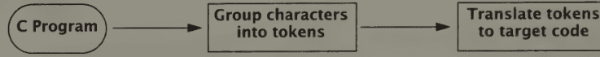

## 2.1 字符与词法元素

C 程序首先由程序员构造为字符序列。在程序中使用的字符包括以下这些：

| 程序中使用的字符 | 示例 |
|---|---|
| 小写字母 | `a b c ... z` |
| 大写字母 | `A B C ... Z` |
| 数字 | `0 1 2 3 4 5 6 7 8 9` |
| 其他字符 | `+ - * / = ( ) } [ ] < > ' " \n ! # $ & _ | ^ ~ . , : ?` |
| 空格字符 | 空格、换行、制表符等。 |

这些字符被编译器收集成称为*标记*（tokens）的语法单元。在进入 C 语法的严格定义之前，让我们看一个简单的程序并非正式地提取出其中的一些标记。

## 2.2 语法规则

### `sum`程序的词法分析

在文件`sum.c`中：

```c
/* 读取两个整数并打印它们的和。 */

#include <stdio.h>

int main(void)
{
    int a, b, sum;

    printf("Input two integers: ");

    scanf("%d%d", &a, &b);

    sum = a + b;

    printf("%d + %d = %d\n", a, b, sum);

    return 0;
}
```


- `/* 读取两个整数并打印它们的和。 */`

  注释由`/*`和`*/`定界。编译器首先将每个注释替换为空单个空格。之后，编译器要么忽略空白字符，要么使用它们来分隔标记。

- `#include <stdio.h>`

  这是一个预处理指令，导致包含标准头文件`stdio.h`。我们包含它是因为它包含了`printf()`和`scanf()`的函数原型。函数原型是一种声明。编译器需要函数原型来完成它的工作。

- `int main(void)`和`int a, b, sum;`

  编译器将这些字符分组为四类标记。函数名`main`是标识符，紧跟在`main`后的括号`()`是一个运算符。这个想法起初很令人困惑，因为你看到的`main`是`(void)`，但只有括号`()`本身构成了运算符。这个运算符告诉编译器`main`是一个函数。字符`{`、`,`、`;`是标点符号；`int`是关键字；`a`、`b`和`sum`是标识符。

- `int a, b, sum;`

  编译器使用`int`和`a`之间的空格来区分这两个标记。我们不能写成：

  ```c
  inta, b, sum;      /* 错误：必须空格 */
  ```

  另一方面，逗号后面的空格是多余的。我们可以写成：

  ```c
  int a, b, sum;
  ```

  但不能写成：

  ```c
  int absum;
  ```

  编译器会将`absum`视为一个标识符。

- `printf("Input two integers: ");`和`scanf("%d%d", &a, &b);`

  名字`printf`和`scanf`是标识符，它们后的括号告诉编译器它们是函数。在编译器翻译完 C 代码后，加载器将尝试创建一个可执行文件。如果程序员没有提供`printf()`和`scanf()`的代码，它们将从标准库中获取。程序员通常不会重新定义这些标识符。

- `"Input two integers: "`

  一系列包含在双引号内的字符是一个字符串常量。编译器将其视为单个标记。编译器还会在内存中提供空间来存储该字符串。

- `&a`、`&b`

  `&`是地址运算符。编译器将其视为一个标记。尽管字符`&`和`a`相邻，编译器也将它们每一个视为独立的标记。我们可以写成：

  ```c
  & a      & b
  ```

  或：

  ```c
  &a, &b
  ```

  但不能写成：

  ```c
  &a &b      /* 缺少逗号标点 */
  &, &b      /* & 要求其操作数在右侧 */
  ```

- `sum = a + b;`

  字符`=`和`+`是运算符。这里的空格会被忽略，所以我们可以写成：

  ```c
  sum = a + b;
  ```

  或者：

  ```c
  sum        =        a        +        b;
  ```

  但不能写成：

  ```c
  s  u  m  =  a  +  b;
  ```

  如果我们有后者，那么这一行上的每个字母都会被编译器视为独立的标识符。因为并不是所有的标识符都已声明，编译器将会报错。

编译器要么忽略空白字符，要么使用它们来分隔语言元素。程序员使用空格来提供更易读的代码。对于编译器来说，程序文本隐含是一个单个字符流，但对于人类读者来说，它是一个二维表格。

C 的语法将使用源自巴科斯-诺尔形式（BNF）的规则系统描述，该形式最早于 1960 年用于描述 ALGOL 60。尽管它们本身不足以描述 C 的合法字符串，但在（注：此处原文中存在大量重复的 OCR 错误，已按要求去重处理）。

以下展示了许多用于突出注释的样式之一：

```text
**************************************************

* 如果你愿意，你可以         *

*   将注释放在方框中。      *

**************************************************/
```

程序员使用注释作为文档辅助。文档的作用是清晰地解释程序如何工作以及如何使用。有时，注释会包含一个非正式的论证，用来证明程序的正确性。

注释应该在编写程序代码的同时编写。虽然有些程序员会在最后一步才插入注释，但这种方法有两个问题。第一个是，一旦程序运行，人们倾向于省略或缩减注释。第二个是，理想情况下，注释应该作为运行中的说明，指示程序结构并有助于清晰性和正确性。如果它们在编码完成之后才插入，它们就无法做到这一点。

在 C++ 中，C 风格的注释仍然有效。但此外，C++ 还提供了以`//`开头并持续到行尾的注释。

```cpp
// 这是一个 C++ 中的注释。
```

```cpp
// 这是在 C++ 中编写
// 注释的一种常见方式，
// 它由多行组成。
//
```

```cpp
/*
 // 这种 C 注释样式模仿了
 // 之前的 C++ 注释样式。
*/
```

## 2.4 关键字

关键字是 C 中显式保留的单词，作为单独的标记具有严格含义。它们不能被重新定义或在其他上下文中使用。

|  |  |  |  |  |
|---|---|---|---|---|
| `auto` | `do` | `goto` | `signed` | `unsigned` |
| `break` | `double` | `if` | `sizeof` | `void` |
| `case` | `else` | `int` | `static` | `volatile` |
| `char` | `enum` | `long` | `struct` | `while` |
| `const` | `extern` | `register` | `switch` |  |
| `continue` | `float` | `return` | `typedef` |  |
| `default` | `for` | `short` | `union` |  |

某些实现可能具有额外的关键字。这些关键字会根据不同的实现或系统而异。例如，以下是 Turbo C 中的一些额外关键字。

| Borland C 的额外关键字 |
|---|
| `asm`、`decl1`、`far`、`huge`、`interrupt`、`near`、`pascal` |

与其他主要语言相比，C 只有极少数关键字。例如，Ada 有 62 个关键字。C 的一个特征是，它可以用相对较少的特殊符号和关键字完成大量工作。

### 标识符

标识符是由字母、数字和特殊字符`_`（下划线）序列组成的标记。字母或下划线必须是标识符的第一个字符。在大多数 C 的实现中，大和小写字母被视为不同的。选择具有助记意义的标识符是一种良好的编程习惯，有助于程序的易读性和文档化。

```text
identifier ::= {letter | underscore}_1 {letter | digit}_0+

underscore ::= _
```

标识符的示例包括：

- `k`
- `_id`
- `iamanidentifier2`
- `so_am_i`

但不是：

```c
not#me      /* 不允许特殊字符 # */

101_south   /* 不得以数字开头 */

-plus       /* 不要混淆 - 和 _ */
```

创建标识符的目的是为了给程序中的对象提供唯一名称。关键字可以被认为是被保留以具有特殊含义的标识符。像`scanf`和`printf`这样的标识符已被 C 系统识别为标准库中的输入/输出函数。这些名称通常不会被重新定义。标识符`main`是特殊的，在 C 程序中，执行始终从名为`main`的函数开始。

操作系统和 C 编译器之间的一个主要区别是区分标识符的长度。在某些旧系统上，超过 8 个字符的标识符会被接受，但只使用前 8 个字符。剩余字符直接被忽略。例如，在这样的系统中，变量名`i_am_an_identifier`和`i_am_an_elephant`被认为是相同的。

在 ANSI C 中，标识符的前 31 个字符至少会被区分。许多 C 系统区分的字符更多。

## 2.6 常量

良好且显见的编程风格要求程序员选择有意义的名字。如果你编写一个程序来处理各种任务，你可能会使用`tax_rate`、`price`和`tax`等标识符，这样语句：

```c
tax = price * tax_rate;
```


就会具有明显的含义。下划线用于从通常由空格分隔的单词字符串创建一个单一标识符。意义化和避免混乱与易读性并存，构成了良好编程风格的主要指南。

**注意：**以下划线开头的标识符可能会与系统名称冲突。只有系统程序员应该使用此类标识符。考虑标识符`_iob`，它通常被定义为`stdio.h`中结构体数组的。如果程序员尝试将`_iob`用于其他目的，编译器可能会报错，或者程序可能会运行异常。建议应用程序程序员使用不以下划线开头的标识符。此外，外部标识符可能会受到系统的限制。

正如我们在一些简单的介绍程序中所看到的，C 处理各种值。像 0 和 17 等数字是整数常量的例子，而 1.0 和 3.14159 是浮点常量的例子。在大多数语言中，C 处理整数和浮点常量的方式不同。在第 3 章“基本数据类型”中，我们将详细讨论 C 如何理解数字。C 中还有字符常量，例如`'a'`、`'b'`和`'c'`。字符常量位于单引号之间，与整数密切相关。某些字符常量是特殊的，例如`'\n'`。反斜杠是转义字符，`\n`表示换行。

除了我们讨论过的常量，C 中还有枚举常量。我们将在第 45 页第 7.5 节“枚举类型”中与关键字`enum`一起讨论这些。整数常量、浮点和字符常量都由编译器收集。由于实现的限制，语法上可以表示的常量在特定机器上可能不可。例如，一个整数可能太大而无法存储在机器字中。

十进制整数是十进制数字的有限字符串。由于 C 提供了八进制、十六进制以及十进制整数，我们必须小心区分不同类型的整数。例如，17 是十进制常量，017 是八进制常量，0x17 是十六进制常量。（进一步讨论请参见第 3 章“基本数据类型”）。此外，负数常量整数如 -33 被视为常量表达式。

```c
decimal_integer := 0 | positive_decimal_integer

positive_decimal_integer ::= positive_digit {digit}

positive_digit := 1 | 2 | 3 | 4 | 5 | 6 | 7 | 8 | 9
```

常量十进制整数的示例：

```c
0

77

1234567890000 /* 对机器来说太大 */
```

但不是：

```c
0123 /* 八进制整数 */

-49 /* 常量表达式 */

123.0 /* 浮点常量 */
```

## 2.7 字符串常量

由双引号括起的字符序列（例如`"abc"`）是字符串常量，或字符串字面量。它被编译器收集为单个标记。在第 270 页第 6.10 节“字符串”中，我们将看到字符串常量被编译器存储为字符数组。字符串常量总是与字符常量不同。例如，`'a'`和`"a"`不是同一个。

注意，双引号`"`只是一个字符，而不是两个。如果字符`"`本出现在字符串常量，必须在其前面加上一个反斜杠`\`。如果反斜杠`\`本出现在字符串常量，必须在其前面加上一个反斜杠`\`。字符串常量的示例有：

```c
"a string of text"

"" /* the null string */

"" /** a string of blank characters */

"a = b + c;" /** this is not a comment */" /** nothing is executed */

"a string with double quotes \" within"

"a single backslash \\ is in this string"
```

但不是：

```c
/* this is not a string */

"and

neither is this
```

在字符串常量之外具有含义的字符序列，当被双引号包裹时，仅仅是字符序列。在之前的示例中，一个字符串包含了看起来像`a = b + c;`语句的内容，但由于它被双引号包裹，它明确就是这串字符序列。

仅由空白字符分隔的两个字符串常量会被编译器合并成单个字符串。因此，

```c
"abc" "def" is equivalent to "abcdef"
```

这是 ANSI C 中可用的一种语言新特性，但在传统 C 中没有。字符串常量被编译器视为标记。与其他常量一样，编译器会在内存中提供空间来存储字符串常量。我们将在第 270 页的第 6.10 节“字符串”中再次讨论字符串和指针时再次强调这一点。

## 2.8 运算符与标点符号

在 C 中，有许多具有特定含义的特殊字符。示例包括算术运算符：

```c
+ - * / %
```

分别代表加、减、乘、除和模等通常算术运算。记住，在数学中，模`a \pmod b`的值是通过用`a`除以`b`的余数得到的。例如，`5 % 3`的值为 2，`7 % 2`的值为 1。

在程序中，运算符可以分隔标识符。虽然通常会在二元运算符周围放置空格以提高可读性，但这不是必须的。

```c
a+b      /* this is the expression plus b */

a_b      /* this is a 3-character identifier */
```

某些符号的含义取决于上下文。作为这方面的例子，考虑两个语句中的`%`符号：

```c
printf("%d", a);      a = b % 7;
```

第一个`%`符号是转换规范（或格式）的开始，而第二个`%`符号代表模运算符。

标点符号的示例包括括号、大括号、逗号和分号。考虑以下代码：

```c
int main(void)
{
  int a, b = 2, c = 3;

  a = 17 * (b + c);
}
```

紧随`main`之后的括号被视为运算符。它们告诉编译器`main`是函数名。之后，符号`{`、`,`、`;`和`)`都是标点符号。

运算符和标点符号都会被编译器收集为标记，并结合空格用于分隔语言元素。

某些特殊字符用在许多不同的上下文，上下文本身可以确定其意图。例如，括号有时用于指示函数名；而在其他时候它们被用作标点符号。另一个例子如下所示表达式：

```c
a + b      ++a      a += b
```

它们都使用`+`作为字符，但`++`和`+=`都是单个运算符。让`+`符号的含义取决于上下文，使得符号集很小且语言非常简洁。

## 2.9 运算符的优先级和结合性

运算符具有优先级和结合性规则，用于确定表达式的求值顺序。这些规则并不能完全决定求值，因为编译器有余地根据自己的目的进行更改。括号内的表达式先求值，括号可以用于澄清或更改操作执行的顺序。考虑表达式：

```c
1 + 2 * 3
```

在 C 中，运算符`*`的优先级高于`+`，导致先执行乘法，后执行加法。因此，表达式的值为 7。一个等价的表达式是：

```c
1 + (2 * 3)
```

另一方面，因为括号内的表达式先求值，表达式：

```c
(1 + 2) * 3
```

则是不同的；其值为 9。现在考虑表达式：

```c
1 + 2 - 3 + 4 - 5
```

由于二元运算符`+`和`–`优先级相同，使用“从左到右”的结合性规则来确定其求值方式。“从左到右”规则意味着操作是从左到右执行的。因此，

```c
(((1 + 2) - 3) + 4) - 5
```

是一个等价表达式。

下表给出了 C 部分运算符的优先级和结合性规则。除了我们已经讨论过的运算符外，表中还包含了在本章稍后讨论的运算符。

### 运算符优先级和结合性

| Operator | Associativity |
|---|---|
| `()` `++` (postfix) `--` (postfix) | left to right |
| `+` (unary) `-` (unary) `++` (prefix) `--` (prefix) | right to left |
| `*` `/` `%` | left to right |
| `+` `-` | left to right |
| `=` `+=` `-=` `*=` `/=` etc. | right to left |

在给定行上的所有运算符（如`*`、`/`和`%`）彼此之间的优先级相等，但优先级高于其下方行出现的所有运算符。给定行上所有运算符的结合性规则出现在表格右侧。每当我们引入新运算符时，都会为它们制定规则。

## 2.10 增、减运算符

增运算符和减运算符用于将变量的值加一或减一。增运算符由`++`表示，减运算符由`--`表示。这些运算符可以使用前缀或后缀位置。在前缀位置，在表达式求值之前执行增或减操作；在后缀位置，先求值表达式，然后执行增或减操作。

## 2.11 赋值运算符

为了改变变量的值，我们已经使用了赋值语句，例如：

```c
a = b + c;
```

与其他语言不同，C 语言将`=`视为运算符。它的优先级低于我们到目前为止讨论的所有运算符，且结合性是从右到左的。在本节中，我们将详细解释这种特性的意义。

为了理解`=`作为一个运算符，让我们首先考虑`+`进行对比。二元运算符`+`接受两个操作数，如表达式`a + b`。该表达式的值是`a`和`b`的值之和。相比之下，一个简单的赋值表达式的形式如下：

```c
variable = right_side
```

其中`right_side`本身是一个表达式。注意，在末尾加上分号会使其成为赋值语句。赋值运算符`=`有两个操作数：`variable`和`right_side`。`right_side`的值被赋值给`variable`，该值随后变成了整个赋值表达式的值。为了说明这一点，考虑以下语句：

```c
b = 2;

c = 3;

a = b + c;
```

其中变量的类型均为`int`。通过利用赋值表达式，我们可以将其压缩为：

```c
a = (b = 2) + (c = 3);
```

赋值表达式`b = 2`将值`2`赋值给变量`b`，且赋值表达式本身具有该值。同样，赋值表达式`c = 3`将值`3`赋值给变量`c`，赋值表达式本身也具有该值。最后，这两个赋值表达式的值相加，结果的值被赋值给`a`。

尽管这个例子是人为构造的，但在许多情况下，赋值会作为表达式的一部分自然发生。一种常见的情况是多次赋值。考虑语句：

```c
a = b = c = 0;
```

因为运算符`=`是从右到左结合的，所以等效语句为：

```c
a = (b = (c = 0));
```

首先，给`c`赋值为`0`，表达式`c = 0`的值为`0`。然后，给`b`赋值为`0`，表达式`b = (c = 0)`的值为`0`。最后，给`a`赋值为`0`，表达式`a = (b = (c = 0))`的值为`0`。许多语言并不以这种复杂的方式使用赋值。在这方面，C 语言是不同的。

除了`=`之外，还有其他赋值运算符，例如`+=`和`-=`。如下表达式：

```c
k = k + 2
```

将向`k`的旧值加上`2`并将结果赋值给`k`，整个表达式将具有该值。表达式：

```c
k += 2
```

完成了相同的任务。下表包含了所有的赋值运算符：

| 赋值运算符 |
| :--- |
| `=` `+=` `-=` `*=` `/=` `%=` `>=` `<<` `^=` `&=` `|=` |

所有这些运算符的优先级相同，且它们都具有从右到左的结合性。其语义由下式指定：

```c
variable op= expression
```

这等价于：

```c
variable = variable op (expression)
```

例外是如果`variable`本身是一个表达式，它会被求值一次。在处理数组时，这是一个重要的技术点。请仔细注意，赋值表达式如`j *= k + 3`等价于`j = j * (k + 3)`，而不是`j = j * k + 3`。

下表说明了赋值表达式是如何求值的：

| 声明与初始化 |  |  |  |
| :--- | :--- | :--- | :--- |
| `int i = 1, j = 2, k = 3, m = 4;` |  |  |  |
| 表达式 | 等效表达式 | 值 |  |
| `i += j + k` | `i += (j + k)` | `i = (i + (j + k))` | 6 |
| `j *= k = m + 5` | `j *= (k = (m + 5))` | `j = j * (k = (m + 5))` | 18 |

## 2.12 示例：计算 2 的幂

为了说明本章提出的某些思想，我们将编写一个程序，在一行打印某些 2 的幂。以下是该程序：

```c
/* 打印 2 的某些幂。 */

#include <stdio.h>

int main(void)
{
    int i = 0, power = 1;

    while (++i <= 10)
        printf("%-6d", power *= 2);

    printf("\n");

    return 0;
}
```


程序的输出为：

```
2 4 8 16 32 64 128 256 512 1024
```

### `pow_of_2` 程序剖析

- `/* 打印 2 的某些幂。 */`

程序通常以解释程序意图或用途的注释开始。在大型程序中，注释可能非常多。编译器将注释视为空白字符。

- `#include <stdio.h>`

头文件`stdio.h`包含`printf()`函数的原型。这是`printf()`的一种声明。编译器需要它来正确完成工作。（更多细节见第 91 页第 2.13 节“C 系统”。）

- `int i = 0, power = 1;`

变量`i`和`power`的类型为`int`。

- `while (++i <= 10)`

只要`i`小于或等于 10，`while`循环就会继续。

- `printf("%-6d", power *= 2);`

`printf`函数打印`power`的值，该值在打印之前会乘以 2。

- `printf("\n");`

`printf`函数打印一个换行符。

## 2.13 C 系统

C 系统由语言、预处理器以及编辑器和调试器等工具组成。在本节中，我们将讨论预处理器。

### 预处理器

以`#`开头的行是预处理指令。在传统的 C 中，这些是必须的。在 ANSI C 中，这一限制已被移除。我们已经使用过预处理指令，如：

```c
#include <stdio.h>
```

另一种包含的形式是：

```c
#include "filename"
```

这会导致预处理器在当前目录查找该文件。

### 标准库

标准库包含许多有用函数，它们为 C 系统增加了大量的许多灵活性。许多函数被所有 C 程序员广泛使用，而其他函数的使用则选择性较强。大多数程序员在需要时才会熟悉标准库中的函数。

语法用于提供函数原型。这通常通过包含适当头文件来实现。

*注意：* 不要将头文件与库本身混淆。标准库包含了已经编译过的函数对象代码。标准头文件并不包含编译后的代码。

为了说明标准库中函数的用法，让我们展示一下如何使用`rand()`生成一些随机分布的整数。在随后的章节中，我们有机会机会使用`rand()`来填充数组和字符串以进行测试。在这里，我们用它在屏幕上打印一些整数。

在`prn_rand.c`文件中

```c
#include <stdio.h>
#include <stdlib.h>

int main(void) {
    int i, n;
    printf("\n%s\n%s",
           "Some randomly distributed integers will be printed.",
           "How many do you want to see?%d");
    scanf("%d", &n);
    for (i = 0; i < n; ++i) {
        if (i % 10 == 0)
            putchar('\n');
        printf("%d", rand());
    }
    printf("\n\n");
    return 0;
}
```

假设我们执行该程序并在提示时输入 19。屏幕上出现的内容如下：

```
Some randomly distributed integers will be printed.
How many do you want to see?
16838 5758 10113 17515 31051 5627 23010 7419
16212 4086 2749 12767 9084 12060 32225 17543
25089 21183 25137 25566 26966 4978 20495
```

### `prn_rand` 程序解析

- `#include <stdio.h>`
- `#include <stdlib.h>`

包含这些头文件是因为它们包含了函数原型。特别是，函数原型

`int rand(void);`

位于`stdlib.h`中。它告诉编译器`rand()`是一个不接受参数并返回`int`值的函数。与其包含`stdlib.h`，我们反而可以在文件顶部的`main()`之前自己提供它。然而，包含头文件既更简单又安全。

- `printf("\n%s\n%s", "Some randomly distributed integers will be printed.\nHow many do you want to see? ");`
- `scanf("%d", &n);`

屏幕上打印了给用户的提示。用户输入的字符被`scanf()`接收，转换为十进制整数格式，并放在`n`的地址处。

- `for (i = 0; i < n; i++) {`
    `....`
`}`

这是一个`for`循环。它等同于

```c
i = 0;
while (i < n) {
    ....
    i++;
}
```

## 2.13 C 系统 95

编写此程序的另一种方法是将`i`初始化为零，然后使用结构：

```c
while (i++ < n) {
}
```

请仔细注意`i++ < n`不同于`++i < n`。（参见第 101 页的练习 19。）

- `if (i % 10 == 0) {`
  `putchar('\n');`
  `printf("%7d", rand());`
`}`

运算符`==`是“等于”运算符。如果`expr1`和`expr2`是两个具有相同的表达式，那么表达式`expr1 == expr2`为真；否则为假。在第 152 页第 4.3 节“等关系运算符与表达式”中，我们将看到`==`的优先级低于`%`。

```c
i % 10 == 0 等于 (i % 10) == 0
```

在循环的第一次执行以及随后的每隔八次执行，整个表达式为真。每当表达式为真时，就会打印一个换行符。

- `printf("%7d", rand());`

每次循环时，调用`rand()`返回的值都会以十进制整数格式打印。打印整数的字段宽度为 7。


对于`rand()`的大多数用法，程序员在使用它之前需要为随机数生成器种子。这可以通过以下行实现：

```c
srand(time(NULL));
```

（进一步讨论请参见第 102 页的练习 22。其他随机数生成器的用法也请参见第 105 页的练习 25。）

# 总结

- 1 标记（Tokens）是 C 的基本语法单元。它们包括关键字、标识符、常量、字符串常量、运算符和标点符号。空白符同运算符、标点符号可以分隔标记。由于此原因，空白符、运算符和标点符号统称为分隔符。除了分隔标记之外，空白符会被编译器忽略。

- 2 注释（Comments）被成对括号`/*`和`*/`包围，被编译器视为空白符。它们对于良好的程序文档至关重要。注释应该有助于理解程序。

- 3 关键字也称为保留字，具有严格的含义。C 中有 32 个关键字。

- 4 标识符是程序员明智选择命名变量和函数的标记。它们以字母或下划线开头。

- 5 某些标识符是系统知的，因为它们是函数名。包括输入输出函数`scanf()`和`printf()`以及数学函数`sqrt()`、`cos()`和`tan()`。

- 6 常量包括各种整数常量和浮点常量、字符常量如`'a'`以及字符串常量如`"abc"`。所有常量被编译器视为标记。

- 7 字符串常量`"deep blue sea"`是双引号内的任意序列，包括空白字符。字符串存储为字符数组，但被编译器视为单个标记。

- 8 运算符和标点符号在 C 中非常多。跟随`main`的括号是一个运算符。例如

```c
int main(void)
{
    ....
```

是标点符号。

- 9 在 C 中，运算符的优先级和结合性决定了表达式如何求值。

- 10 递增运算符`++`可以用于前置后缀位置，可能会产生不同的影响。表达式`i++`的值为`i`的当前值。

此练习说明了运算符周围的空白符是重要的。`a++++b`可以解释为

# 练习

- 1 `main`是关键字吗？解释。

- 2 列出五个关键字并解释它们的用途。

- 3 为每种类型的标记给出两个示例。

- 4 下列哪些不是标识符？为什么？

```
3id    yes    o_no_o_no 00_go star*it
1_i_am one_aren't me_to-2 ShouldI int
```

- 5 设计一种标准的开头注释格式，为读者提供关于编写者的信息。

- 6 取一个符号如`+`展示它在程序中的不同用法。

- 7 ANSI C 不支持注释嵌套，尽管许多编译器提供了该选项。在你的编译器上尝试以下行并看看发生了什么：

```c
/* 这是一个尝试 /*嵌套 */ 注释。 */
```

- 8 写一个交互式程序，将磅和盎司转换为千克和克。使用文件顶部`main()`之外定义的符号常量。

`a++ + b`或`a ++b`取决于加号如何分组。正确的分组是第一种。这是因为编译器首先将最长的字符串作为一个标记（token），因此使用`++`而不是`+`作为第一个标记。写一个短程序来检查这一点。

- 11 对于第89页第2.12节“一个示例：计算 2 的幂”中的`pow_of_2`程序，解释如果将表达式`++i`改为`i++`，效果将会如何。

- 12 以下代码用于`pow_of_2`程序的变体。打印出什么？写一个程序来检查你的答案。

```c
int i = 0, power = 2048;
while ((power /= 2) > 0)
    printf("%-6d", power);
```

- 13 你在练习 12 中写的程序包含一个`while`循环。写另一个具有相同效果但使用`for`循环程序。

- 14 研究以下代码并写下你认为会打印的内容。然后写一个测试程序来检查你的答案。

```c
int a, b = 0, c = 0;
a = ++b + ++c;
printf("%d %d %d\n", a, b, c);
a = b++ + c++;
printf("%d %d %d\n", a, b, c);
a = ++b + c++;
printf("%d %d %d\n", a, b, c);
a = b-- --c;
printf("%d %d %d\n", a, b, c);
```

- 15 如果删除部分或全部括号，以下语句的影响是什么？请解释原因。

```c
x = (y = 2) + (z = 3);
```

- 16 首先完成后续表格中的条目。完成后，写一个程序检查你输入的值是否正确。解释表格中最后一个表达式的错误。它是编译时错误还是运行时错误？

## 第2章 词法元素、运算符与C 系统

声明与初始化

| 表达式 | 等效表达式 | 值 |
|---|---|---|
| `int a = 2, b = -3, c = 5, d = -7, e = 11;` | | |
| `a / b / c` | `(a / b) / c` | 0 |
| `7 + c* -- d / e` | `7 + ((c * (-- d)) / e)` | |
| `2 * a % - b + c + 1` | | |
| `39 / -- e + 29 % c` | | |
| `a += b = c += 1 + 2` | | |
| `7 - ++ a % (3 + b)` | | error |

考虑以下代码：

```c
int a = 1, b = 2, c = 3;
a += b = c += 7;
```

写一个完全带括号的等效语句。变量`a`、`b`和`c`的值是多少？先写下你的答案。然后写一个测试程序来检查。

良好的编程风格包含了良好的布局，而良好的布局风格对人类阅读者至关重要，尽管编译器只看到字符流。考虑以下程序：

```c
int main(void){
    float qx, zz, tt;
    scanf("%f %f", &qx, &tt);
    printf("average=%f", (qx+tt)/3.0);
    return 0;
}
```

虽然代码不可读，但它应该可以编译并执行。测试它看看是否确实如此。然后完全重写该程序。使用空白和注释使其变得可读。提示：包含一个头文件并选择新的标识符来替换`qx`、`zz`和`tt`。

重写第93页第2.13节“C系统”中的`pow_of_2`程序，将`for`循环替换为以下`while`循环：

```c
while (i < n) {
    ...
}
```

在运行程序并理解其效果后，重写程序，将`i < n`改为`i < RAND_MAX`。包含头文件`stdlib.h`并使用该行打印`RAND_MAX`的值：

```c
#include <stdlib.h>
printf("RAND_MAX = %d\n", RAND_MAX);
```

如果，在多个不同的系统上运行你的程序。你可能会发现`RAND_MAX`在所有系统上的值都相同。此的原因是 ANSI C 委员会建议了函数`rand()`的实现方式，大多数编译器都逐字遵循了这些建议。根据我们的经验，PC、UNIX工作站甚至圣地亚的 Cray 超计算机上的 C 系统使用相同的`RAND_MAX`值，且在所有这些系统中，`rand()`产生相同的输出（讨论见第105页的练习25）。

运行第93页第2.13节“C系统”中的`pow_of_2`程序三次，以打印出100个分布的整数。观察发现每次打印的都是相同的数字列表。对于许多应用程序，这并不是理想的。通过`srand()`为随机生成器种子来修改`pow_of_2`程序。你的程序的前几行应该如下：

```c
#include <stdio.h>
#include <stdlib.h>
#include <time.h>

int main(void) {
    int i, n, seed;
    seed = time(NULL);
    srand(seed);
    printf("\nHow many do you want to see? ");
```

- 22 在上一个练习中，我们建议代码为

```c
seed = time(NULL);
srand(seed);
```

大多数程序员会用`srand(time(NULL));`代替这些行。对你的程序进行此更改，然后编译并执行它，查看行为是否与之前相同。

- 23 在之前的两个练习中，我们使用`time()`返回的值来为随机生成器种子。在这个练习中，我们想使用`time()`返回的值来测量调用`rand()`所需的时间。这是实现的一种方法：

```c
#include <stdio.h>
#include <stdlib.h>
#include <time.h>

#define NCALLS 1000000 /* 调用次数 */
#define NCOLS 8 /* 列数 */
#define NLINES 3 /* 行数 */

int main(void) {
    int i, val;
    long begin, diff, end;

    begin = time(NULL);
    srand(time(NULL));
    printf("TIMING TEST: %d calls to rand()\n\n", NCALLS);
    for (i = 1; i <= NCALLS; ++i) {
        val = rand();
        if (i <= NCOLS * NLINES) {
            printf("%7d", val);
            if (i % NCOLS == 0)
                putchar('\n');
        } else if (i == NCOLS * NLINES + 1) {
            printf("%7s\n\n", "...");
        }
    }
    end = time(NULL);
    diff = end - begin;
    printf("%s%ld\n%s%ld\n%s%ld\n%s%.10f\n\n",
           "end time: %ld", end,
           "begin time: %ld", begin,
           "elapsed time: %ld", diff,
           "time for each call: %f", (double) diff / NCALLS);

    return 0;
}
```

这是在我们系统上的输出：

```
TIMING TEST: 10000000 calls to rand()

11753 27287 12703 5493 23634 23237 24988 31011
19570 432 12211 9712 30284 31480 32334 30292
```

## 练习


25. 在此练习中，我们将继续第 101 页练习 20 开始的讨论。调用`rand()`会产生一个 [0, `RAND_MAX`] 范围内的值，`RAND_MAX`的值通常为 32767。由于这个值较小，`rand()`对于许多科学问题并没有用。

UNIX 上的大多数 C 系统为程序员提供了`rand48`系列随机数生成器，因为它使用了所谓的 48 位的算术权重来生成数字。例如，`rand48()`函数可以生成 [0, 1] 范围内随机分布的浮点数，而`rand148()`函数可以生成 [0, `2^31 - 1`] 范围内的随机分布整数。通常，该系列函数的原型定义在`stdlib.h`中。

可以使用`rand48()`代替`rand()`。你会发现，平均而言，生成的数字更大。你在第 101 页练习 20 中写的数字是否更好取决于应用程序。

要了解更多关于通过伪随机数生成器的 C 语言知识，请参阅 William Press 等人编写的《Numerical Recipes》（Cambridge, England: Cambridge University Press, 1992），第 274-328 页。

26. 表达式`++a + a`和`a++`的值取决于系统，因为递增运算符`++`的副作用可能发生在不同的时间。这既是 C 语言的优点，也是缺点。一方面，编译器执行的是机器层面的自然操作；另一方面，这样的表达式在不同的机器上会有不同的值。

丰富的 C 程序员会意识到这种表达式具有潜在危险，并避免使用它们。在你的机器上进行实验，看看在`a`初始化为零后`++a + a`产生什么值。遗憾的是，许多编译器不会对此类表达式的危险发出警告。你的系统上发生了什么？

27. UNIX 系统中的库与 Win 95/NT 系统中的库通常以`.lib`结尾。看看你是否能在系统上找到标准 C 库。这些库是人类不可读的。

在 UNIX 系统上，你可以运行如下命令：

```bash
ar t /usr/lib/libc.a
```

来查看库中所有对象的标题（名称）。如果你没有看到任何数学函数，那么数学库可能在一个单独的文件中。尝试命令：

```bash
ar t /usr/lib/libm.a
```

## 第 2 章 词法元素、运算符与 C 系统

28. 在 ANSI C 和传统 C 中，字符串常量行尾的反斜杠具有将其延续到下一行的效果。这里有一个示例：

> "在行末尾使用反斜杠 \
>
> 字符串可以从一行扩展到另一行"

编写一个使用这种构造的程序。许多屏幕每行有 80 个字符。如果你尝试打印一个超过 80 个字符的字符串会发生什么？

29. 在 ANSI C 中，任何行末尾的反斜杠都应该具有延续到下一行的效果。这在任何 ANSI 或传统的 C 编译器的字符串常量和宏定义中都是可以预期正常工作的。然而，并不是所有的 ANSI C 编译器都以更通用的方式支持这一点。毕竟，除了宏定义外，这种构造很少使用。

你的 C 编译器以通用方式支持它吗？尝试以下代码：

```c
#include <stdio.h>
int main(void)
{
    printf("Will this work?\\n");
    return 0;
}
```

30. 当你调用编译器时，系统首先调用预处理器。在此练习中，我们故意制造一个预处理错误，看看发生什么。尝试以下程序：

```c
#include <stdix.h>  /* 这一行有两个错误 */
int main(void)
{
    printf("Try me.\n");
    return 0;
}
```

将`#incl`改为`#include`会发生什么？

## 第 3 章 基本数据类型

我们从简要回顾声明、表达式和赋值开始本章。然后我们对每种基本数据类型进行详细解释，特别关注 C 如何将字符视为小整数。在操作数类型不同的表达式中，会发生某些隐式转换。我们解释了转换规则并检查了强制转换运算符（cast），它强制执行显式转换。

### 3.2 基础数据类型

C 提供了几种基础数据类型，其中许多我们已经见过。有必要讨论每种类型可以存储内容的局限性。

| 基础数据类型：全称 | | |
|---|---|---|
| `char` | `signed char` | `unsigned char` |
| `signed short int` | `signed int` | `signed long int` |
| `unsigned short int` | `unsigned int` | `unsigned long int` |
| `float` | `double` | `long double` |

这些都是关键字，不能用作变量名。当然，`char`代表“字符”（character），`int`代表“整数”（integer），但只有`char`和`int`可以作为关键字。数组、指针和结构体等数据类型是派生基础类型的，它们将在后面的章节介绍。

通常不使用`signed`关键字。例如，`signed int`等同于`int`，因为较短的名字更容易输入，通常使用`int`。然而，`char`类型在这方面是特殊的。（参见第 111 页第 3.3 节“字符与数据类型 char”）。

此外，关键字`short int`、`long int`和`unsigned int`可以（且通常）分别缩短为`short`、`long`和`unsigned`。关键字`signed`本身等同于`int`，但在这种范围内很少使用。根据这些约定，我们得到了一个新列表：

| 基础数据类型 | | | |
|---|---|---|
| `char` | `signed char` | `unsigned char` |
| `short` | `int` | `long` |
| `unsigned short` | `unsigned` | `unsigned long` |
| `float` | `double` | `long double` |

假设类别类型`type`定义为上表提供的基础类型中的任意一种。使用该类别，我们可以提供简单声明的语法：

```text
declaration ::= type { identifier , identifier }+ ;
```

### 3.3 字符与数据类型 char

基础类型可以根据功能进行分组。整类型是指可以存储整数值的类型；浮点类型是指可用于存储实值的类型。它们都属于算术类型。

| 按功能分组的基础类型 | | | |
|---|---|---|---|
| 整类型 | `char` | `signed char` | `unsigned char` |
| | `short` | `int` | `long` |
| | `unsigned short` | `unsigned` | `unsigned long` |
| 浮点类型 | `float` | `double` | `long double` |
| 算术类型 | 整类型 + 浮点类型 | | |

这些统称是为了方便起见。例如，在第 6 章讨论数组时，我们会解释只允许整型表达式作为下标，这意味着只允许涉及整型的表达式。

在 C 中，任何整型变量都可以表示字符。特别是`char`和`int`变量都用于此目的。在某些情况下，由于技术原因可能需要`int`。（参见第 142 页第 3.9 节“`getchar()`和`putchar()`的使用”）。

我们认为是字符的常量如`'a'`和`'+'`是`int`类型，而不是`char`类型。C 中没有`char`常量。这是 C++ 不同于 C 的少数几个地方之一。在 C++ 中，字符常量是`char`类型。（参见第 142 页练习 14。）

除了表示字符外，`char`变量还可以用于存储小型整数值。每个`char`在内存中占用 1 字节。除了足以容纳字符集中的所有字符外，C 并没有指定字节的大小。然而，在大多数机器上，一个字节由 8 位组成，因此能够存储`2^8`（即 256）个不同的值。

这些值中只有部分子集表示实际的打印字符，包括大小写字母、数字、标点符号以及`%`和`+`等特殊字符。字符集还包括空白字符：空格、制表符和换行符。

大多数机器使用 ASCII 或 EBCDIC 字符编码。在随后的讨论中，我们将使用 ASCII 编码。该编码的表出现在附录 D“ASCII 字符编码”。对于任何其他编码，数字将所不同，但原理是类似的。下表说明了 ASCII 机器上某些字符与整数值的对应关系：

| 某些字符常量及其对应的整数值 | | | | | |
|---|---|---|---|---|---|
| 字符常量 | `'a'` | `'b'` | `'c'` | ... | `'z'` |
| 对应值 | 97 | 98 | 99 | ... | 112 |
| 字符常量 | `'A'` | `'B'` | `'C'` | ... | `'Z'` |
| 对应值 | 65 | 66 | 67 | ... | 90 |
| 字符常量 | `'0'` | `'1'` | ... | `'9'` | |
| 对应值 | 48 | 49 | 50 | ... | 57 |
| 字符常量 | `'&'` | `'*'` | `'+'` | | |
| 对应值 | 38 | 42 | 43 | | |

注意，表示数字的字符常量与数字本身的整数值之间没有特殊关系。也就是说，`'2'`的值**不是 2**。`'a'`、`'b'`、`'c'`等值按顺序出现的这一属性很重要。它使得字符、单词和行按字典序排序变得方便。这类工作需要字符数组。（参见第 270 页第 6.10 节“字符串”）。

某些非打印和难以打印的字符需要转义序列。例如，水平制表符写为`\t`。下表包含一些非打印字符：

| 字符名称 | 转义序列 | 整数值 |
|---|---|---|
| 警铃 | `\a` | 7 |
| 退格 | `\b` | 8 |
| 回车 | `\r` | 13 |
| 双引号 | `\"` | 34 |
| 换页 | `\f` | 12 |
| 换行 | `\n` | 10 |
| 空字符 | `\0` | 0 |
| 单引号 | `\'` | 39 |
| 制表符 | `\t` | 9 |
| 垂直制表符 | `\v` | 11 |
| 问号 | `\?` | 63 |

### 3.3 字符与数据类型 char

`d_n d_{n-1} \dots d_2 d_1 d_0`

其中每个`d_i`是一个十进制数字。注意，数字从低位到高位计数，从零开始。该数字的值由给出：

`d_n \times 10^n + d_{n-1} \times 10^{n-1} + \dots + d_2 \times 10^2 + d_1 \times 10^1 + d_0 \times 10^0`

同样地，由二进制数字 0 和 1 组成的位流可以解释为二进制数。二进制数的通用形式（也称为 2 进制数）由给出：

`b_n b_{n-1} \dots b_2 b_1 b_0`

其中每个`b_i`是一个位，或二进制数字。该数字的值由给出：

`b_n \times 2^n + b_{n-1} \times 2^{n-1} + \dots + b_2 \times 2^2 + b_1 \times 2^1 + b_0 \times 2^0`

现在我们准备好从位级别查看`char`是如何在内存中存储的。考虑声明：

```c
char    c = 'a';
```

我们可以认为`c`存储在内存中占 1 个字节，如下：

```text
01100001
```

其中 0 和 1 组成了字节中的 8 位。按照惯例，0 表示关闭的位，1 表示开启的位。这个二进制数字字符串可以被视为二进制数，其值由给出：

`1 \times 2^6 + 1 \times 2^5 + 0 \times 2^4 + 0 \times 2^3 + 0 \times 2^2 + 1 \times 2^1 + 1 \times 2^0`

在十进制表示法中为 64 + 32 + 1，即 97。

ANSI C 提供了三种类型：`char`、`signed char`和`unsigned char`。`char`类型等于`signed char`或`unsigned char`，取决于编译器。这三种`char`类型每种都存储在 1 个字节，可以包含 256 个不同的值。对于`signed char`，取值范围从 -128 到 127。对于`unsigned char`，取值范围从 0 到 255。要确定你系统上普通`char`的适用值，请参见第 141 页的第 10 题。

### 3.4 数据类型 int

`int`类型是 C 语言的主要工作类型。该类型以及`char`、`short`和`long`等其他整数类型，设计用于处理机器上可以表示的整数值。

在数学中，自然数是 0, 1, 2, 3, ...，这些数字加上它们的负数组成了整数。在机器上，对于给整数类型，只有这些整数的有限部分是可以表示的。

通常，`int`存储在 2 个字节（= 16 位）或 4 个字节（= 32 位）中。还有其他可能，但大多数 C 系统都是这样。在旧的 PC 上，`int`通常存储在 2 个字节中。在较新的 PC、工作站和主机上，`int`通常存储在 4 个字节中。

由于`int`的大小在不同的 C 系统之间有所不同，`int`能包含的不同值的数量取决于系统。假设我们有一台使用 4 字节`int`的计算机。因为 4 个字节等于 32 位，`int`可以取`2^{32}`种不同的状态。这些状态中有一半用于表示负整数，另一半用于表示非负整数：

```text
-2^{31}, -2^{31} + 1, \dots, -3, -2, -1, 0, 1, 2, 3, \dots, 2^{31} - 1
```

相反，如果我们正在使用一台具有 2 字节字的计算机，那么`int`只能取`2^{16}`种不同的状态。同样，这些状态中有一半用于表示负整数，另一半用于表示非负整数：

```text
-2^{15}, -2^{15} + 1, \dots, -3, -2, -1, 0, 1, 2, 3, \dots, 2^{15} - 1
```

令`N_{min_int}`代表`int`中可以存储的最小整数，`N_{max_int}`代表`int`中可以存储的最大整数。如果`i`是一个`int`类型的变量，则`i`可以取值的值范围由给出：

```text
N_{min_int} \le i \le N_{max_int}
```

其范围的端点取决于机器。典型情况是：

在具有 4 字节字的机器上：

```text
N_{min_int} = -2^{31} = -2147483648 \approx -2 亿
N_{max_int} = +2^{31} - 1 = +2147483647 \approx +2 亿
```

在具有 2 字节字的机器上：

```text
N_{min_int} = -2^{15} = -32768 \approx -32 千
N_{max_int} = +2^{15} - 1 = +32767 \approx +32 千
```

## 第 3 章 ▼ 基本数据类型

现在我们想要仔细地描述指数计数法。在给出精确的规则之后，我们将展示一些示例。像`333.77777e-22`这样的浮点常数可能不包含任何嵌入的空格或特殊字符。常数的每个部分都有一个名称：

| `333.77777e-22` 的浮点常数部分 | | |
|---|---|---|
| 整数部分 | 小数部分 | 指数 |
| 333 | 77777 | e-22 |

浮点常数可能包含整数部分、小数部分和指数部分。浮点常数必须包含小数点或指数部分，或两者兼有。如果存在小数点，则整数部分、小数部分或两者中必须有其一。如果没有小数点，则必须有一个整数部分和一个指数部分。

```text
floating_constant := f_constant {f_suffix} opt
f_constant ::= L_part . f_part e_part
              :: L_part . f_part
              :: L_part . e_part
              :: L_part
L_part ::= integer_part ::= {digit}+ 1+
f_part ::= fractional_part ::= {digit}+ 1+
e_part ::= exponential_part ::= {e|E} {+-} opt {digit}+ 1+
f_suffix ::= floating_suffix ::= f | F || L
```

浮点常数的示例包括：

```c
3.14159
314.159e-2F /* float 类型的八进制 */
0e0      /* 等于 0.0 */
1.       /* 等于 1.0，但更难阅读 */
```

但不是：

```c
3.14,159 /* 不允许使用逗号 */
314159   /* 需要小数点或指数部分 */
-e0      /* 需要整数部分或小数部分 */
-3.14159 /* 这是一个浮点常数表达式 */
```

通常，C 编译器为`double`类型变量提供的存储空间比为`float`类型变量多，尽管并非强制要求这样做。在大多数机器上，`float`存储在 4 字节，而`double`存储在 8 字节。其效果是`float`存储大约 6 位小数的精度，而`double`存储大约 15 位小数的精度。

ANSI 编译器为`long`类型变量提供的存储空间可能比为`double`类型多，尽管并非强制要求这样做。许多编译器将`long double`实现为`double`。（参见第 143 页的练习题 15。）

### 3.6 ▼ 浮点类型

浮点类型根据精度（precision）和范围（range）等属性具有其可以赋值的可能值。精度描述了浮点值所携带的有效数字位数。范围描述了该类型变量可以表示的最大和最小正浮点值的范围限制。

在许多机器上，`float`的近似精度为 6 位有效数字，近似范围为`10^{-38}`到`10^{+38}`。这意味着正浮点值在机器中的表示（仅为近似真实）。


`$d_1d_2d_3d_4d_5d_6 \times 10^n$`

其中每个`d_i`都是十进制数字；第一位`d_1`为正，且`-38 <= n <= +38`。浮点值在机器中的表示实际上是2进制而非10进制，但所呈现的概念提供了正确的理解。

在许多机器上，`double`的近似精度为15位有效数字，近似范围为`10^{-308}`到`10^{+308}`。这意味着正双精度值在机器中的表示（仅为近似真实）：

```
$d_1d_2 \dots d_{15} \times 10^n$
```

其中每个`d_i`都是十进制数字；第一位`d_1`为正；且`-308 <= n <= +308`。假设`x`是一个`double`类型变量。那么语句：

```
$x = 123.451234512341234; /* 20 位有效数字 */ */
```

将导致`x`被赋值一个以以下形式存储的值（仅为近似真实）：

```
$0.123451234512345 \times 10^{-3}$ ($15 位有效数字$)
```

你需要注意的主要点有(1)并不是所有的实数都是可表示的，以及(2)浮点运算与整数运算不同，不需要是精确的。对于小型计算，这通常不需要担心。对于非常大的计算，例如数值上求解大型常微分方程组，深入理解舍入效应、缩放等可能是必须的。这是数值分析的领域。

## 3.7 typedef 的使用

C语言提供了`typedef`机制，它允许程序员显式地将类型与标识符关联。一些示例如下：

```
typedef char uppercase;
typedef int INCHES, FEET;
typedef unsigned long size_t; /* 于 stddef.h 中 */
```

在这些类型定义中，命名的标识符以后可以像普通类型一样用于声明变量或函数。因此，

```
uppercase u;
INCHES;
```

（注：由于原文文本存在大量重复的句子，上述译文已根据逻辑结构进行了去冗化处理）

## 3.9 getchar() 和 putchar() 的使用

`#define EOF (-1)`

标识符`EOF`是"end-of-file"（文件结束）的缩写。实际上用于指示文件结束标记的值取决于系统。虽然经常使用`int`值`-1`，但不同的系统可能会有不同的值。通过包含文件`stdio.h`并使用符号常量`EOF`，我们使程序具有了可移植性。这意味着源文件可以移动到不同的系统并在无需更改的情况下运行。头文件`stdio.h`还包含`getchar()`和`putchar()`的宏定义。

`int c;`

变量`c`被声明为`int`而不是`char`。无论使用什么值来指示文件结束，它都不能是一个表示字符的值。由于`c`是一个`int`，它可以持有所有可能的字符值，以及特殊值`EOF`。

```c
while ((c = getchar()) != EOF) {
    ....
}
```

表达式：

```c
(c = getchar()) != EOF
```

由两部分组成。子表达式`c = getchar()`从键盘获取一个值并将其赋值给变量`c`，该子表达式的值也变为该值。符号`!=`代表"不等于"运算符。只要子表达式`c = getchar()`的值不等于`EOF`，就会执行`while`循环体。子表达式`c = getchar()`外围的括号是必要的。假设我们省略了括号并输入了：

```c
c = getchar() != EOF
```

由于运算符优先级，这等同于：

```c
c = (getchar() != EOF)
```

这在语法上是正确的，但不是我们想要的。

- `putchar(c);`

`c`的值将以字符的格式写入标准输出流。

在大多数C系统中，字符有一个底层的整数值表示法，即其ASCII码的数值。例如，字符常量`'a'`的值为`97`。小写字母和大写字母的值都按顺序出现。因此，表达式`'a' + 1`的值为`'b'`，表达式`'b' + 1`的值为`'c'`，依此类推。此外，由于字母表中有26个字母，表达式`'z' - 'a'`的值为`25`。考虑表达式`'A' - 'a'`。它的值与`'B' - 'b'`相同，与`'C' - 'c'`相同，依此类推。因此，如果变量`c`的值为一个小写字母，那么表达式`c + 'A' - 'a'`的值为对应的大写字母。这些思想被包含在下一个程序中，它会将所有小写字母大写。

在文件`capitalize.c`中：

```c
#include <stdio.h>

int main(void) {
    int c;
    while ((c = getchar()) != EOF && c <= 'z') {
        if (c >= 'a' && c <= 'z')
            putchar(c + 'A' - 'a');
        else
            putchar(c);
    }
    return 0;
}
```

由于运算符优先级，表达式：

`c >= 'a' && c <= 'z'` 和 `c >= 'a' && (c <= 'z')` 是等价的。

符号`<=`代表"小于或等于"运算符。子表达式`c >= 'a'`测试`c`是否大于或等于`'a'`的值。子表达式`c <= 'z'`测试`c`的值是否小于或等于`'z'`的值。符号`&&`代表"逻辑与"运算符。如果两个子表达式都真，则表达式`c >= 'a' && c <= 'z'`为真；否则为假。因此，该表达式仅当`c`为小写字母时才为真。如果表达式为真，则执行语句：

```c
putchar(c + 'A' - 'a');
```

导致打印出对应的大写字母。

## 3.10 数学函数

C中没有内置的数学函数。诸如`sqrt()`、`pow()`、`exp()`、`log()`、`sin()`、`cos()`、`tan()`在数学库中可用，数学库在概念上是标准库的一部分。除了幂函数`pow()`外，所有这些函数都接受一个`double`类型的参数，并返回一个`double`类型的值。幂函数接受两个`double`类型的参数并返回一个`double`类型的值。我们的下一个程序说明了`sqrt()`和`pow()`的用法。它要求用户输入`x`的值，然后打印出来，以及`x`的平方根和`x`的`x`次方。

在文件`power_square.c`中：

```c
#include <math.h>
#include <stdio.h>

int main(void)
{
    double x;

    printf("\n%s",
        "The following will be computed:\n"
        "\n"
        "the square root of x\n"
        "  x raised to the power x\n"
        "\n");

    while (1) {
        printf("Input x: ");
        if (scanf("%lf", &x) != 1)
            break;
        if (x >= 0.0)
            printf("\n%s = %15s%22.1e\n%s = %15s%22.1e\n",
                "sqrt(x) =", sqrt(x),
                "x raised to the power x =", pow(x, x));
        else {
            printf("\nNumber must be nonnegative.\n");
            break;
        }
    }
    printf("Bye!\n");
    return 0;
}
```

如果我们运行该程序并输入`2`，显示的内容如下：

```
The following will be computed:

  the square root of x

  x raised to the power x

Input x: 2

sqrt(x) = 1.414214e+00

x raised to the power x = 4.000000e+00

Input x: q

Bye!
```

### abs() 和 fabs() 的用法

在许多语言中，函数`abs()`返回其实部参数的绝对值。在这方面，C语言是不同的。在C中，`abs()`函数接受一个`int`类型的参数并返回其`int`类型的绝对值。它的函数原型定义在`stdlib.h`中。对于数学代码，C程序员应该使用`fabs()`，它接受一个`double`类型的参数并返回其`double`类型的绝对值。（参见第145页的练习25。）它的函数原型定义在`math.h`中。`fabs`的名称代表浮点绝对值。

### UNIX 与数学库

在ANSI C中，数学库在概念上是标准库的一部分。这意味着你不必进行任何特殊操作即可访问数学函数。然而，在旧的UNIX系统上，情况通常如此。假设你在一个文件（例如`pgm.c`）中编写了一个程序，该程序使用了`sqrt()`函数。以下命令可以编译你的程序：

```
cc pgm.c
```

但是，如果ANSI C系统没有正确连接，你会在屏幕上看到类似下面的输出：

> Undefined symbol: _sqrt

这意味着链接器查找了它提供的库，但未能找到包含`sqrt()`函数对象代码的`.o`文件。（有关库的进一步讨论，请第526页第11.15节"Libraries"。）如果你给出命令：

```
cc pgm.c -lm
```

数学库将被附加，允许加载器找到必要的`.o`文件。在`-lm`中，字母`l`代表"library"（库），字母`m`代表"mathematics"（数学）。随着旧版本的UNIX被新版本取代，使用`-lm`选项的必要性消失了。

## 3.11 转换与强制


如`x + y`的算术表达式既有值也有类型。如果`x`和`y`都是`int`类型，那么表达式`x + y`也是`int`类型。但如果`x`和`y`都是`short`类型，那么`x + y`的类型是`int`，而不是`short`。这是因为在任何表达式中，`short`总是会被提升或转换为`int`。在本节中，我们想要提供转换的精确规则。

### 整数提升

`char`或`short`（无论是符号还是无符号），或枚举类型都可以在任何可以使用`int`或`unsigned int`的表达式中使用。（参见第 345 页第 7.5 节“枚举类型”。）如果原始类型的所有值都可以由`int`表示，则该值被转换为`int`；否则，被转换为`unsigned int`。这被称为整数提升。这是一个示例：

```
char c = 'A';
printf("%c\n", c);
```

变量`c`作为`printf()`的参数单独出现。然而，由于发生了整数提升，表达式`c`的类型是`int`而不是`char`。

### 常规算术转换

当二元运算符的操作数求值时，会发生算术转换。例如，假设`i`是`int`，而`f`是`float`。在表达式`i + f`中，操作数`i`被提升为`float`，整个表达式`i + f`的类型为`float`。控制这些的规则被称为常规算术转换；这些规则如下：

## 常规算术转换

如果任一操作数的类型为`long double`，则另一个操作数转换为`long double`。否则，如果任一操作数的类型为`double`，则另一个操作数转换为`double`。否则，如果任一操作数的类型为`float`，则另一个操作数转换为`float`。否则，对两个操作数执行整数提升，并应用以下规则：

- 如果任一操作数的类型为`unsigned long`，则另一个操作数转换为`unsigned long`。

- 否则，如果一个操作数类型为`long`而另一个为`unsigned`，则会发生两种情况之一：

  - 如果`long`可以表示`unsigned`的所有值，则`unsigned`类型的操作数转换为`long`。

  - 如果`long`不能表示`unsigned`的所有值，则两个操作数都转换为`unsigned long`。

- 否则，如果任一操作数的类型为`long`，则另一个操作数转换为`long`。

- 否则，如果任一操作数的类型为`unsigned`，则另一个转换为`unsigned`。

- 否则，两个操作数类型均为`int`。

这种算术转换有几个别名：

- 自动转换 (automatic conversion)

- 隐式转换 (implicit conversion)

- 强制转换 (coercion)

- 提升 (promotion)

- 宽化 (widening)

下表说明了自动转换的概念：

| 声明 | | | |
|---|---|---|
| `char c;` | `short s;` | `int i;` |
| `long l;` | `unsigned u;` | `unsigned ul;` |
| `float f;` | `double d;` | `long ld;` |

| 表达式 | 类型 | 表达式 | 类型 |
|---|---|---|---|
| `c - s` | `int` | `u * 7` | `unsigned` |
| `u * 2.0` | `double` | `f * 7` | `float` |
| `c + 3` | `int` | `7 * s * ul` | `unsigned long` |
| `c + 5.0` | `double` | `d + c` | `long double` |
| `d + s` | `double` | `u - ul` | `unsigned long` |
| `2 * i / 1` | `long` | `u - 1` | 取决于系统 |

除了混合表达式中的自动转换外，自动转换也可能跨赋值发生。例如，`d = i`导致`i`的值（`int`）转换为`double`然后赋值给`d`，而`double`是整个表达式的类型。`d = i`的提升通常是良好的，但`d = i`的窄化可能会丢失信息。在这里，`d`的小数部分将被丢弃，取决于系统。

### 强制转换

除了跨赋值和混合表达式中发生的隐式转换外，还有显式转换，称为强制转换（casts）。如果`i`是`int`，那么`(double) i`将转换`i`的值，使表达式类型为`double`。变量`i`保持不变。强制转换可以应用于表达式。一些示例如下：

```
(double) ('A' + 1.0)
(float) (int) d + 1
(double) i / 3
(double) x = 27 /* 等同于 (double) x = 77 */
```

强制转换运算符是一个单运算符，与其他单运算符具有相同的优先级和从右到左的结合性。因此，表达式`(float) i + 3`等于`(float)(i + 3)`，因为强制转换运算符的优先级高于`+`。

### 基本数据类型

用 16 进制位置法表示的数字称为十六进制。共有 16 个十六进制位。

| 十进制位及其对应的十进制值 | | | | | | | | | |
|---|---|---|---|---|---|---|---|---|---|
| 十进制位: | 0 | 1 | ... | 9 | A | B | C | D | E | F |
| 十进制值: | 0 | 1 | ... | 9 | 10 | 11 | 12 | 13 | 14 | 15 |

以十六进制符号表示的正整数是十六进制位的字符串，形式为$h_n h_{n-1} \dots h_2 h_1 h_0$，其中$h_i$是十六进制位。值为$h_n \times 16^n + h_{n-1} \times 16^{n-1} + \dots + h_2 \times 16^2 + h_1 \times 16^1 + h_0$。例如，

```
A0F3C = A × 16⁴ + 0 × 16³ + F × 16² + 3 × 16¹ + C × 16⁰
```

十六进制数及其十进制等值如下表所示：

| 十进制数 | 转换为十进制 |
|---|---|
| `2A` | `2 × 16 + A = 42` |
| `B3` | `B × 16 + 3 = 179` |
| `113` | `1 × 16² + 1 × 16 + 3 = 275` |

在具有 8 位字节的机器上，一个字节表示为两个十六进制数字。此外，这种表示有两种有效的解释。首先，可以将字节中的 8 位视为二进制表示法。该数字可以唯一地表示为两位位的十六进制数。下表列出了 8 位字节和对应的两位十六进制数。为了方便起见，列出了十进制数，为了以后参考，也列出了八进制数。

| 十进制 | 二进制 | 十六进制 | 八进制 |
|---|---|---|---|
| 0 | 00000000 | 00 | 000 |
| 1 | 00000001 | 01 | 001 |
| 2 | 00000010 | 02 | 002 |
| 3 | 00000011 | 03 | 003 |
| ... | ... | ... | ... |
| 31 | 00111111 | 1F | 037 |
| 32 | 00100000 | 20 | 040 |
| ... | ... | ... | ... |
| 188 | 10111100 | BC | 274 |
| ... | ... | ... | ... |
| 254 | 11111110 | FE | 376 |
| 255 | 11111111 | FF | 377 |

这种对应关系的另一种解释也很有用。根据定义，一个半字节（nibble）包含 4 位，所以一个字节由 2 个半字节组成。每个半字节都有唯一的表示，作为一个单个十六进制位，以及 2 个半字节（nibbles）组成一个字节，可以用 2 个十六进制位表示。例如，

```
1011 1100 对应 BC
```

注意，这种对应关系也出现在表格中。在以位形式操作变量的值时，所有这些都非常有用。

八进制数字`0`, `1`, `2`, ..., `7`。用八进制符号表示的正整数是一个形如所示的数字字符串：

$o_n o_{n-1} \dots o_2 o_1 o_0$

其中每个$o_i$都是八进制数字。该值为

$o_n 8^n + o_{n-1} 8^{n-1} + \dots + o_2 8^2 + o_1 8^1 + o_0 8^0$

例如，

$7501 = 7 \times 8^4 + 5 \times 8^3 + 3 \times 8^2 + 0 \times 8^1 + 1 \times 8^0$

在具有 24 位或 48 位字的机器上，自然会有由 6 位的“字节”组成的字，每个“字节”由 2 个每个 3 位的“半字节”（nibble）组成。在这种情况下，一个“半字节”可以用单个八进制数字唯一地表示，而一个“字节”可以用两个八进制数字唯一地表示。

在源代码中，以`0`为前缀的正整数常量表示八进制表示法的整数，而以`0x`或`0X`为前缀的正整数常量表示十六进制表示法的整数。就像十进制常量一样，八进制常量和十六进制常量可能带有后缀来指定类型。字母`A`到`F`和`a`到`f`被用于编码十六进制数字。

```
hexadecimal_integer_constant ::= h_integer_constant { i_suffix }opt
h_integer_constant ::= { 0x | 0X } {1} { hexadecimal_digit }_{1+}
hexadecimal_digit ::= { 0 | 1 | . . | 9 | a | A | . . | f | F }
octal_integer_constant ::= o_integer_constant { i_suffix }opt
o_integer_constant ::= { 0 } { octal_digit \|_{1+}
octal_digit ::= { 0 | 1 | . . | 7 }
i_suffix ::= integer_suffix ::= { u | U } {1} | L } {L}opt
```

让我们写一个程序来解释这些思想。我们将作为注释显示每个`printf()`语句的输出。

```c
/* 十进制、十六进制、八进制转换。 */
#include <stdio.h>

int main(void)
{
    printf("%d %x %o\n", 19, 19, 19); /* 19 13 23 */
    printf("%d %x %o\n", 0x1c, 0x1c, 0x1c); /* 28 1c 34 */
    printf("%d %x %o\n", 0x17, 0x17, 0x17); /* 15 f 17 */
    printf("%d\n", 11 + 0x11 + 0x11); /* 37 */
    printf("%x\n", 2097151); /* 1ffffff */
    printf("%d\n", 0x1FFFF); /* 2097151 */

    return 0;
}
```

在具有 2 字节整数的机器上，最后两个必须分别改为`%lx`和`%ld`。`printf()`和`scanf()`函数在转换规范中使用转换字符`d`、`x`和`o`分别用于十进制、十六进制和八进制的转换。在`printf()`中，`%x`和`%o`格式会导致整数以十六进制和八进制表示法打印，而不是以`0x`或`0`前缀。格式`%#x`和`%#o`可用于提供前缀（参见第 493 页第 11.1 节“输出函数 printf()”，进一步讨论）。注意：使用`scanf()`读取十六进制数时，不要输入`0x`前缀。

## C.13 总结

1. 基本数据类型是`char`、`short`、`int`、`long`、这些类型的无符号版本以及两个浮点类型。`char`类型是一种 1 字节的整型类型，主要用于表示字符。

2. `int`类型被设计为“自然”或“工作”整型类型。其他整型类型如`short`、`long`和`unsigned`是为了更多情况提供的。

3. 提供了三种浮点类型`float`、`double`和`long double`来表示实数。通常，`float`存储在 4 字节中，`double`存储在 8 字节中。存储`long double`使用的字节数取决于不同的编译器。然而，随着编译器的更新，趋势是将`long double`存储在 16 字节中。`double`类型而不是`float`才是“工作”类型。

4. 与整数算术不同，浮点算术并不总是精确的。工程师和数值分析师在对浮点数进行大量计算时，往往必须考虑舍入效应。

5. 一元运算符`sizeof`可以用于找到存储类型所需的字节数或表达式的值。例如，在一些旧机器上`sizeof(int)`是 2，在具有大多数新机器上是 4。

6. 在具有 2 字节整数的机器上，最后两个必须分别改为`%lx`和`%ld`。`printf()`和`scanf()`函数在转换规范中使用转换字符`d`、`x`和`o`分别用于十进制、十六进制和八进制的转换。在`printf()`中，`%x`和`%o`格式会导致整数以十六进制和八进制表示法打印，而不是以`0x`或`0`前缀。格式`%#x`和`%#o`可用于提供前缀（参见第 493 页第 11.1 节“输出函数 printf()”，进一步讨论）。注意：使用`scanf()`读取十六进制数时，不要输入`0x`前缀。


在具有 24 位或 48 位字的机器上，自然会有由 6 位的“字节”组成的字，每个“字节”由 2 个每个 3 位的“半字节”（nibble）组成。在这种情况下，一个“半字节”可以用单个八进制数字唯一地表示，而一个“字节”可以用两个八进制数字唯一地表示。

在源代码中，以`0`为前缀的正整数常量表示八进制表示法的整数，而以`0x`或`0X`为前缀的正整数常量表示十六进制表示法的整数。就像十进制常量一样，八进制常量和十六进制常量可能带有后缀来指定类型。字母`A`到`F`和`a`到`f`被用于编码十六进制数字。

```c
hexadecimal_integer_constant ::= h_integer_constant { i_suffix }opt
h_integer_constant ::= { 0x | 0X } {1} { hexadecimal_digit \|_{1+}
hexadecimal_digit ::= { 0 | 1 | . . | 9 | a | A | . . | f | F
octal_integer_constant ::= o_integer_constant { i_suffix }opt
o_integer_constant ::= { 0 } { octal_digit \|_{1+}
octal_digit ::= { 0 | 1 | . . | 7 }
i_suffix ::= integer_suffix ::= { u | U } {1} | L } {L}opt
```

让我们写一个程序来解释这些思想。我们将作为注释显示每个`printf()`语句的输出。

```c
/* 十进制、十六进制、八进制转换。 */
#include <stdio.h>

int main(void)
{
    printf("%d %x %o\n", 19, 19, 19); /* 19 13 23 */
    printf("%d %x %o\n", 0x1c, 0x1c, 0x1c); /* 28 1c 34 */
    printf("%d %x %o\n", 0x17, 0x17, 0x17); /* 15 f 17 */
    printf("%d\n", 11 + 0x11 + 0x11); /* 37 */
    printf("%x\n", 2097151); /* 1ffffff */
    printf("%d\n", 0x1FFFF); /* 2097151 */

    return 0;
}
```

在具有 2 字节整数的机器上，最后两个必须分别改为`%lx`和`%ld`。`printf()`和`scanf()`函数在转换规范中使用转换字符`d`、`x`和`o`分别用于十进制、十六进制和八进制的转换。在`printf()`中，`%x`和`%o`格式会导致整数以十六进制和八进制表示法打印，而不是以`0x`或`0`前缀。格式`%#x`和`%#o`可用于提供前缀（参见第 493 页第 11.1 节“输出函数`printf()`”，进一步讨论）。注意：使用`scanf()`读取十六进制数时，不要输入`0x`前缀。

## C.13 总结

- 1 基本数据类型是`char`、`short`、`int`、`long`、这些类型的无符号版本以及两个浮点类型。`char`类型是一种 1 字节的整型类型，主要用于表示字符。
- 2 `int`类型被设计为“自然”或“工作”整型类型。其他整型类型如`short`、`long`和`unsigned`是为了更多情况提供的。
- 3 提供了三种浮点类型`float`、`double`和`long double`来表示实数。通常，`float`存储在 4 字节中，`double`存储在 8 字节中。存储`long double`使用的字节数取决于不同的编译器。然而，随着编译器的更新，趋势是将`long double`存储在 16 字节中。`double`类型而不是`float`才是“工作”类型。
- 4 与整数算术不同，浮点算术并不总是精确的。工程师和数值分析师在对浮点数进行大量计算时，往往必须考虑舍入效应。
- 5 一元运算符`sizeof`可以用于找到存储类型所需的字节数或表达式的值。例如，在一些旧机器上`sizeof(int)`是 2，在具有大多数新机器上是 4。
- 6 在具有 2 字节整数的机器上，最后两个必须分别改为`%lx`和`%ld`。`printf()`和`scanf()`函数在转换规范中使用转换字符`d`、`x`和`o`分别用于十进制、十六进制和八进制的转换。在`printf()`中，`%x`和`%o`格式会导致整数以十六进制和八进制表示法打印，而不是以`0x`或`0`前缀。格式`%#x`和`%#o`可用于提供前缀（参见第 493 页第 11.1 节“输出函数`printf()`”，进一步讨论）。注意：使用`scanf()`读取十六进制数时，不要输入`0x`前缀。

# 题目

- 1 练习：在数学中希腊字母ε（称为“epsilon”）常用于表示极小的正数。虽然它在数学上可以是任意小的，但在机器上没有“任意小”的概念。在数值分析中，有时会将ε（代表epsilon）声明为`double`类型的变量，并赋值为满足以下属性的最小正数：

```c
1.0 < 1.0 + eps
```

真。这个数取决于机器。尝试在你的机器上找到`eps`。通过给`eps`赋值`1e-37`，你会发现对于这个值表达式为假。

- 2 数学公式$\sin^2(x) + \cos^2(x) = 1$对所有`x`成立。在你的机器上尝试这个程序：

- 3 编写一个程序打印出的表格。

- 7 自动转换发生在混合表达式中。类型转换可以强制指定类型。

- 8 带有`0`前缀的整数指定十六进制和八进制。

- 9 后缀可以用于指定类型。

- 10 字符常量`'A'`在`C`中是无符号的，但在`C++`中是`float`。

- 6 ：在具有 2 字节整数的机器上，最后两个必须分别改为`%lx`和`%ld`。`printf()`和`scanf()`函数在转换规范中使用转换字符`d`、`x`和`o`分别用于十进制、十六进制和八进制的转换。在`printf()`中，`%x`和`%o`格式会导致整数以十六进制和八进制表示法打印，而不是以`0x`或`0`前缀。格式`%#x`和`%#o`可用于提供前缀（参见第 493 页第 11.1 节“输出函数`printf()`”，进一步讨论）。注意：使用`scanf()`读取十六进制数时，不要输入`0x`前缀。

## 练习 141

```c
int main(void)
{
    double x;
    for (x = -0.25; x <= +0.25; x += 0.01)
        printf("%.2f = %+.15f\n", x, f(x));
    return 0;
}

double f(double x)
{
    return (tan(sin(x)) - sin(tan(x)));
}
```

该程序的输出说明了$f$在原点附近的平坦性。你看到了吗？另外，作为一个实验，去掉格式字符串中的加号。你会发现输出没有正确对齐。

10 大多数机器使用补码表示来存储整数。在这些机器上，存储在整数类型中的值`-1`会将所有位都置1。假设你的系统是这样，有一种方法可以确定`char`等于有符号的`signed char`还是无符号的`unsigned char`。写一个包含以下行的程序：

```c
char c = -1;
signed char s = -1;
unsigned char u = -1;

printf("c = %d s = %d u = %d\n", c, s, u);
```

变量`c`、`s`和`u`在内存中都以位模式`11111111`存储。在你的系统上打印了什么？你能根据这个`char`等于什么来判断吗？你的 ANSI C 编译器是否提供选项将普通的`char`更改为（例如`unsigned char`？如果是，调用该选项，重新编译程序并再次运行。

11 解释为什么以下代码在你的系统上打印了最大的整数值：

```c
unsigned long val = -1;
printf("The biggest integer value: %lu\n", val);
```

在你的系统上打印了什么？虽然从技术上该值取决于系统，但在大多数系统中，该值大约是 40 亿。解释原因。

12`char`类型的变量可以用于存储小的整数值。如果将一个大值赋给`char`变量会发生什么？考虑代码：

```c
char c1 = 256, c2 = 257;   /* 太大了! */
printf("c1 = %d\nc2 = %d\n", c1, c2);
```

你的编译器会报错吗。它报错了吗？即使它报错，它可能也会产生可执行代码。你能猜出打印了什么吗？

13 下表显示了大多数机器上存储某些基础类型所需的字节数。对于你的机器，适当的值是多少？编写并执行一个程序，让你能够完成该表格。

| 基础类型 | 4 字节字机器所需的内存 | 2 字节字机器所需的内存 | 你的机器所需的内存 |
|---|---|---|---|
| char | 1 byte | 1 byte | 1 byte |
| short | 2 bytes | 2 bytes | 2 bytes |
| int | 4 bytes | 2 bytes | 4 bytes |
| unsigned | 4 bytes | 2 bytes | 4 bytes |
| long | 4 bytes | 4 bytes | 4 bytes |
| float | 4 bytes | 4 bytes | 4 bytes |
| double | 8 bytes | 8 bytes | 8 bytes |
| long double | ? | ? | 12 bytes |

14 字符常量（如`'A'`）的类型在`C`和`C++`中不同。在`C++`中，它的类型是`char`。先用`C`编译以下程序，再用`C++`编译。在每种情况下打印了什么？

```c
#include <stdio.h>

int main(void)
{
    printf("sizeof('A') = %u\n", sizeof('A'));
    return 0;
}
```

考虑以下代码：

```c
char c = 'A';

printf("sizeof(c) = %u\n", sizeof(c));
printf("sizeof('A') = %u\n", sizeof('A'));
printf("sizeof(c + c) = %u\n", sizeof(c + c));
printf("sizeof(c = 'A') = %u\n", sizeof(c = 'A'));
```

写下你认为打印了什么；然后写一个小程序来检查你的答案。如果你用`C++`编译程序，输出中有多少行发生了变化？

16$N_{min\_unsigned\_long}$和$N_{max\_unsigned\_long}$分别代表你的系统中`unsigned long`可以存储的最小值和最大值。这些值是多少？*提示：读取标准头文件`limits.h`。*

17 在 24 小时制中，0 点是午夜，23 点是晚上 11 点，即午夜前一小时。在这样的钟上，当 11 加上 23 时，我们得到的不是 24，而是 0。没有 24。同样，22 加上 5 得到 3，因为 22 加 2 是 0，而 3 是 3。这是模运算的一个例子，更准确地说，是模 24 算术。大多数机器对所有整数类型都执行模运算。用无符号类型最容易说明这一点。运行以下程序并解释打印了什么：

```c
#include <limits.h>            /* 用于 UINT_MAX */
#include <stdio.h>

int main(void)
{
    int unsigned u = UINT_MAX;
    // （注：这里的 OCR 文本似乎断断了）
```

26 在 C 语言中，十六进制常量使用的字母可以是大写、小写，或者两者兼有。请考虑以下代码：

```c
int a = 0xabc;
int b = 0xABC;
int c = 0XABC;

printf("a = %d b = %d c = %d\n", a, b, c);
```

写下打印的内容。然后写一个包含这些行的程序来检查你的答案。

27 下面的代码取决于机器的。如果你在执行代码时出现不符合预期的结果，请尝试解释一下发生了什么。

```c
char c = 0xff;

if (c == 0xff)
    printf("Truth!\n");
else
    printf("This needs to be explained!\n");
```

## 第 4 章

## 控制流

程序中的语句通常一个接一个地执行。这被称为顺序控制流。通常我们希望改变顺序控制流以提供动作的选择或动作的重复。通过`if-else`和`switch`语句，可以在备选动作之间进行选择。通过`while`、`for`和`do`语句，可以采取迭代动作。由于关系运算符、相等运算符和逻辑运算符在控制流结构中被频繁使用，首先对这些运算符进行彻底讨论。它们被用于我们认为为真或假的表达式中。我们还讨论了复合语句，它用于将要作为一个单元处理的语句组合在一起。

## 4.1 关系、相等和逻辑运算符

下表包含了经常影响控制流的运算符：

| 关系、相等和逻辑运算符 | | |
|---|---|---|
| 关系运算符 | 小于 < | |
| | 大于 > | |
| | 小于等于 <= | |
| | 大于或等于 >= | |
| 等等运算符 | 等于 = | |
| | 不等于 ! | |
| 逻辑运算符 | (一元) 否定 | |
| | 逻辑与 && | |
| | 逻辑或 \|\| | |

与其他运算符一样，关系、相等和逻辑运算符也有优先级和结合性规则，这些规则决定了涉及运算符的表达式具体是如何求值的。

## 运算符优先级和结合性

| 运算符 | 结合性 |
| --- | --- |
| `()` `++` (后缀) `--` (后缀) | 从左到右 |
| `+` (一元) `-` (一元) `++` (前缀) `--` (前缀) | 从右到左 |
| `*` `/` `%` | 从左到右 |
| `+` `-` | 从左到右 |
| `<` `<=` `>` `>=` | 从左到右 |
| `==` `!=` | 从左到右 |
| `&&` | 从左到右 |
| `\|\|` | 从左到右 |
| `?:` | 从右到左 |
| `=` `+=` `-=` `*=` `/=` 等 | 从右到左 |
| `,` (逗号运算符) | 从左到右 |

`!`运算符是一元元的。所有其他关系、相等和逻辑运算符都是二运算符的。它们作用于表达式并产生`int`值 0 或`int`值 1。这是因为在 C 语言中，假由零值表示，而真由任何非零值表示。假的值可以是任何非零值；它可以是 0、0.0、空字符`'\0'`或 NULL 指针值。真的值可以是任何非零值。直觉上，如`a < b`这样的表达式要么为真要么为假。在 C 中，如果该表达式为真，它将产生`int`值 1；如果为假，则产生`int`值 0。

## 4.2 关系运算符和表达式

关系运算符

```c
< > <= >=
```

都是二元的。每个运算符接受两个表达式作为操作数，并产生`int`值 0 或`int`值 1。

```c
relational_expression  := expr < expr
                          expr > expr
                          expr <= expr
                          expr >= expr
```

示例包括：

```c
a < 3
a > b
-1.3 >= (2.0 * x + 3.3)
a < b < c /* 语法正确，但混淆 */
```

但不是：

```c
a = b /* 顺序错误 */
a < = b /* 不允许空格 */
a >> b /* 这是一个移位表达式 */
```

考虑如`a < b`这样的关系表达式。如果`a`小于`b`，则表达式产生`int`值 1，我们认为它是真。如果`a`不小于`b`，则表达式产生`int`值 0，我们认为它是假。在数学上，`a < b`的值与`a - b < 0`相同。因为关系运算符的优先级低于算术运算符，表达式

```c
a - b < 0 等于 (a - b) < 0
```

在许多机器上，如`a < b`这样的表达式实现为`a - b < 0`。通常算术转换发生在关系表达式中。令`el1`和`el2`为任意算术表达式。下表显示了`el1 - el2`的值如何决定关系表达式的值：

### 关系表达式的值

| a - b | a < b | a > b | a <= b | a >= b |
|---|---|---|---|---|
| 正数 | 0 | 1 | 0 | 1 |
| 零 | 0 | 0 | 1 | 1 |
| 负数 | 1 | 0 | 1 | 0 |

下表说明了使用优先级和结合性规则评估关系表达式：

| 声明和初始化 | |
| char c = 'w' | |
| int i = 1, j = 2, k = -7 | |
| double x = 7e+33, y = 0.001 | |
| 表达式 | 等价表达式 | 值 |
|---|---|---|


| `'a' + 1 < c` | `('a' + 1) < c` | 1 |

| `i - 5 * j >= k + 1` | `((i - (5 * j)) >= (k + 1)` | 0 |

| `3 < j < 5` | `(3 < j) < 5` | 1 |

| `x - 3.333 <= x + y` | `(x - 3.333) <= (x + y)` | 1 |

| `x < x + y` | `x < (x + y)` | 0 |

表中的两个表达式给出了惊人的结果，它们不符合数学上的写法规则。在数学中，我们写 `3 < j < 5` 表示变量 `j` 具有大于 3 且小于 5 的属性。它也可以被视为一个数学语句，取决于 `j` 的值，可能不成立。例如，如果 `j = 4`，则数学语句 `3 < j < 5` 为真；如果 `j = 7`，则数学语句为假。现在考虑 C 代码：

```c
j = 7;
printf("%d\n", 3 < j < 5);   /* 输出的是 1，而不是 0 */
```

类比数学，可能会期望表达式为*假*并打印 0。但情况并非如此。因为关系运算符从左到右结合，

`3 < j < 5` 等于 `(3 < j) < 5`

因为表达式 `3 < j < j` 是*真*，它的值为 1。因此，

`(3 < j) < 5` 等于 `1 < 5`

其值为 1。在 C 语言中，正确的写法是

## 4.3 等价运算符与表达式

下表显示了如何使用优先级和结合性规则来求某些等价运算符表达式的值。

| 声明与初始化 |

| :--- |

| `int i = 1, j = 2, k = 3;` |

| 表达式 | 等价表达式 | 值 |

| :--- | :--- | :--- |

| `i == j` | `j == i` | 0 |

| `i != j` | `j != i` | 1 |

| `i + j + k == 2 * k` | `((i + j) + k) == (-2) * (- k))` | 1 |

观察此表达式

`a != b` 等价于 `! (a == b)`

此外，请仔细注意两个表达式

`a == b` 和 `a = b`

在视觉上非常相似。它们形式接近，但在功能上截然不同。表达式 `a == b` 是相等性测试，而 `a = b` 是一个赋值表达式。

写成

```c
if (a = 1)
    ....    /* 执行某些操作 */
```

而不是

```c
if (a == 1)
    ....    /* 执行某些操作 */
```

是一种常见的编程错误。第一个 `if` 语句中的表达式始终为真，这种错误可能非常难发现。

### 逻辑运算符与表达式

逻辑运算符 `!` 是一元运算符，逻辑运算符 `&&` 和 `||` 是二元运算符。所有这些运算符应用于表达式时，都会产生 `int` 类型的值 0 或 `int` 类型的值 1。

逻辑取反可以应用于算术类型或指针类型的表达式。如果表达式的值为 0，则其取反将产生 `int` 类型的值 1。如果表达式具有非零值，则其取反将产生 `int` 类型的值 0。

```
logical_negation_expression := ! expr
```

一些示例是

```c
! a
! (x + 7.7)
!(a < b || c < d)
```

但不是

```c
a /* 顺序错误 */
a a != b /* != 是“不等于”运算符的标记 */
```

通常的算术转换规则应用于作为 `!` 的操作数的表达式上。下表给出了 `!` 运算符的语义：

| `expr` | `! expr` |

| :--- | :--- |

| zero | 1 |

| nonzero | 0 |

虽然逻辑取反是一个非常简单的运算符，但有一个细微之处。C 中的运算符 `!` 与普通逻辑中的 `not` 运算符不同。如果 `s` 是一个逻辑语句，那么

```
not (not s) = s
```

## 4.4 逻辑运算符与表达式

而在 C 中，例如 `!!5` 的值为 1。因为 `!` 从右向左结合，与其他所有一元运算符相同，表达式

`!!5` 等价于 `!(!5)`

而 `!(!5)` 等价于 `!(0)`，其结果值为 1。下表显示了某些带有逻辑取反的表达式是如何被求值的：

| 声明与初始化 |

| :--- |

| `char c = 'A';`

| `int i = 7, j = 7;` |

| `double x = 0.0, y = 2.3` |

| 表达式 | 等价表达式 | 值 |

| :--- | :--- | :--- |

| `! c` | `! c` | 0 |

| `! (i - j)` | `!(i - j)` | 1 |

| `! i - j` | `(! i) - j` | -7 |

| `!! (x + y)` | `!(x + y)` | 1 |

| `! x * ! y` | `(! x) * (! y)` | 1 |

二元逻辑运算符 `&&` 和 `||` 同样作用于表达式，并产生 `int` 类型的值 0 或 `int` 类型的值 1。逻辑表达式的语法给出：

```
logical_expression      ::= logical_negation_expression
                            | logical_or_expression
logical_or_expression ::= expr || logical_and_expression
logical_and_expression ::= expr && expr
```

一些示例是

```c
a && b
a || b
!(a < b) && c
3 && (-2 * a + 7)
```

但不是

```c
a &&         /* 缺少一个操作数 */
a | b         /* 不允许额外的空格 */
a & b         /* 这是一个位运算 */
&b            /* b 的地址 */
```

# 第 4 章 控制流

运算符语义由下表给出：

| 以下项的值： | `expr1` | `expr2` | `expr1 && expr2` | `expr1 || expr2` |

| :--- | :--- | :--- | :--- | :--- |

| zero | zero | 0 | 0 |

| zero | nonzero | 0 | 1 |

| nonzero | zero | 0 | 1 |

| nonzero | nonzero | 1 | 1 |

`&&` 的优先级高于 `||`，但这两个运算符的优先级都低于所有一元、算术和关系型运算符。它们的结合性是从左到右的。下表显示了如何使用优先级和结合性规则计算某些表达式的值。

| 声明与初始化 |

| :--- |

| `char c = 'B';` |

| `int i = 3, j = 3;` |

| `double x = 0.0, y = 2.3;` |

| 表达式 | 等价表达式 | 值 |

| :--- | :--- | :--- |

| `i && j && k` | `(i && j) && k` | 1 |

| `x || i - 3` | `x || (j - 3)` | 0 |

| `i < j && x < y` | `(i < j) && (x < y)` | 1 |

| `i < j || x < y` | `(i < j) || (x < y)` | 1 |

| `'A' <= c && c == 'Z'` | `('A' <= c) && (c <= 'Z')` | 1 |

| `c - 1 == 'A' || c + 1 == 'Z'` | `((c - 1) == 'A') || ((c + 1) == 'Z')` | 1 |

通常的算术转换发生在作为逻辑运算符操作数的表达式中。注意，表中的许多表达式是混合类型的。

### 短路求值

在求值作为 `&&` 和 `||` 操作数的表达式时，一旦确定了真假结果，求值过程就会停止。这被称为短路求值。这是这些运算符的重要属性。假设 `expr1` 和 `expr2` 是表达式，且 `expr1` 的值为 0。在求值

```
expr1 && expr2
```

`expr2` 的求值不会发生，因为整个逻辑表达式的值已经确定为 0。如果 `expr1` 为非零，那么在求值

```
expr1 || expr2
```

`expr2` 的求值不会发生，因为整个逻辑表达式的值已经确定为 1。短路求值是一个重要的属性。假设 `expr1` 和 `expr2` 是表达式，且 `expr1` 的值为 0。在求值

```
expr1 && expr2
```

`expr2` 的求值不会发生，因为整个逻辑表达式的值已经确定为 0。如果 `expr1` 为非零，那么在求值

```
expr1 || expr2
```

`expr2` 的求值不会发生，因为整个逻辑表达式的值已经确定为 1。

## 4.5 复合语句

复合语句是由花括号括起来的声明和语句。

```
compound_statement ::= { declaration }+
```

复合语句是由花括号括起来的声明和语句。（参见第213页“作用域”，复合语句）

复合语句是由花括号括起来的声明和语句。

```
compound_statement ::= { statement }+
```

复合语句是由花括号括起来的声明和语句。在复合语句在花括号内额外缩进的复合语句。

```
compound_statement ::= { statement }+
```

复合语句是由花括号括起来的声明和语句。

```
compound_statement ::= { statement }+
```

复合语句是嵌套的复合语句。

```
compound_statement ::= { statement }+
```

复合语句是由花括号括起来的声明和语句。

```
compound_statement ::= { statement }+
```

复合语句是嵌套的复合语句。

```
compound_statement ::= { statement }+
```

复合语句是由花括号括起来的声明和语句。

```
compound_statement ::= { statement }+
```

复合语句是嵌套的复合语句。

```
compound_statement ::= { statement }+
```

复合语句是由花括号括起来的声明和语句。

```
compound_statement ::= { statement }+
```

复合语句是嵌套的复合语句。

## 4.6 表达式语句与空语句

表达式语句是一个表达式后面跟着一个分号。分号将表达式转换为一个必须完全执行的语句。

```
expr_statement ::= { expr }opt ;
```

复合语句是由花括号括起来的声明和语句。

```
compound_statement ::= { statement }+
```

复合语句是由花括号括起来的声明和语句。嵌套复合语句的复合语句。

```
compound_statement ::= { statement }+
```

复合语句是由花括号括起来的声明和语句。

```
compound_statement ::= { statement }+
```

复合语句是由花括号括起来的声明和语句。嵌套复合语句。

空语句写为一个单独的分号。它在语法上需要语句，但在语义上不需要操作。正如我们将看到的，这在某些影响控制流的结构中（如 `if-else` 语句和 `for` 语句）很有用。空语句是表达式语句的一种特例。

## 4.7 if 和 if-else 语句

`if` 语句的一般形式是

```c
if (expr)
  statement
```

如果 `expr` 为非零（真），则执行语句；否则，跳过语句并跳转到下一个语句。在示例中

```c
if (grade >= 90)
  printf("Congratulations!\n");
printf("Your grade is %d.\n", grade);
```

只有当 `grade` 的值大于或等于 90 时，才会打印祝贺信息。第二个 `printf()` 总是执行的。`if` 语句的语法给出

```
if_statement := if (expr) statement
```

通常 `if` 语句中的表达式是关系、相等或逻辑表达式，但正如语法所示，任何领域的表达式都是允许的。一些其他的 `if` 语句示例是

```c
if (y != 0.0)
    x /= y;
if (c == i; cnt++) {
  ++blank_cnt;
  printf("found another blank\n");
}
```

但不是：

```c
if (b == a)    /* 缺少括号 */
  area = a * a;
```

在适当的情况下，可以使用复合语句将一系列语句组合在单个 `if` 表达式的控制下。以下代码由两个 `if` 语句组成：

```c
if (j < k)
  min = j;
if (j < k)
  printf("j is smaller than k\n");
```

可以使用单个 `if` 语句配合复合语句作为主体，将代码写得更高效、更易理解。

```c
if (j < k) {
  min = j;
  printf("j is smaller than k\n");
}
```

`if-else` 语句与 `if` 语句密切相关。它的通用形式为：

```c
if (expr)
  statement1
else
  statement2
```

如果 `expr` 为非零，则执行 `statement1` 并跳过 `statement2`；如果 `expr` 为零，则跳过 `statement1` 并执行 `statement2`。在两种情况下，控制都会传递到下一个语句。考虑代码：

```c
if (x < y)
  min = x;
else
  min = y;
```

## 4.7 if 和 if-else 语句

如果 `x < y` 为真，则 `min` 将被赋值 `x` 的值；如果为假，则 `min` 将被赋值 `y` 的值。语法如下：

```c
if_else_statement      ::= if (expr) statement
                            else statement
```

示例如下：

```c
if (c >= 'a' && c <= 'z')
    ++c_cnt;
else {
    ++other_cnt;
    printf("%c is not a lowercase letter\n", c);
}
```

但不是：

```c
if (i != j) {
    i += 1;
    j += 2;
}
else
    i -= j;    /* 右括号后的分号导致了语法错误 */
```

语法错误发生是因为右括号后面的分号创建了一个空语句，导致 `else` 没有无处可以附加。

由于 `if` 语句本身是一个语句，因此它可以被用作另一个 `if` 语句的语句部分。考虑代码：

```c
if (a == 1)
    if (b == 2)
        printf("***\n");
```

这种形式的形式为：

```c
if (a == 1)
    statement
```

其中 `statement` 是下面的 `if` 语句：

```c
if (b == 2)
    printf("***\n");
```

同样，`if-else` 语句也可以作为另一个 `if` 语句的语句部分。例如：

```c
if (a == 1)
    if (b == 2)
        printf("***\n");
    else
        printf("###\n");
```

现在我们面临一个语义上的困难。这段代码说明了“悬链问题”（dangling problem）。从语法上并不清楚 `else` 部分与哪个部分关联。不要被代码的格式所误导。对于机器而言，以下代码等价于：

```c
if (a == 1)
    if (b == 2)
        printf("***\n");
else
    printf("###\n");
```

规则是 `else` 附加到最近的 `if` 上。因此，我们最初提供的代码格式是正确的：

```c
if (a == 1)
    statement
```

其中 `statement` 是这个 `if-else` 语句：

```c
if (b == 2)
    printf("***\n");
else
    printf("###\n");
```

## 4.8 while 语句

操作操作依赖计算机的原因之一。当存在大量数据时，拥有能够重复执行特定语句的控制机制非常方便。在 C语言中，`while`、`for` 和 `do` 语句提供了重复操作的能力。虽然我们已经在许多示例在使用 `while` 语句（或 `while` 循环），但现在我们想要精确解释这种迭代机制是如何工作的。语法为：

```c
while_statement ::= while (expr) statement
```

一些示例如下：

```c
while (i++ < n)
  factorial *= i;
while ((c = getchar()) != EOF) {
  if (c >= 'a' && c <= 'z')
    ++lowercase_letter_cnt;
  ++total_cnt;
}
```

但不是：

```c
while (++i < LIMIT) do {
  j = 2 * i + 3;
  printf("%d\n", j);
}
```

考虑如下结构：

```c
while (expr)
  statement
next statement
```

首先求值 `expr`。如果是非零（真），则执行 `statement` 并控制传回 `while` 循环的开头。这样做的效果是 `while` 循环的主体（即 `statement`）被重复执行，直到 `expr` 为零（假）。在该点，控制传递到下一个语句。因此，`while` 循环的效果是其主体被执行零或多次。


可能会无意中指定一个永远不会变为零的表达式，除非引入了其他退出`while`循环的方法，否则程序将陷入死循环。应该注意避免这种情况。例如，考虑代码：

```c
printf("Input an integer: ");
scanf("%d", &n);
while (n)
    /* do something */
```

意图是`while`循环执行直到`expr`为零。然而，如果给`n`赋值一个负整数，循环将无限循环。为了防止这种情况，最好使用：

```c
while (n > 0)
    /* do something */
```

或者，当`n`不为 0 时，`while`循环将执行一个空语句。这可能会无意中指定一个永远不会变为零的表达式，除非引入了其他退出`while`循环的方法，否则程序将陷入死循环。应该注意避免这种情况。例如，考虑代码：

```c
printf("Input an integer: ");
scanf("%d", &n);
while (n)
    /* do something */
```

意图是`while`循环执行直到`expr`为零。然而，如果给`n`赋值一个负整数，循环将无限循环。为了防止这种情况，最好使用：

```c
while (n > 0)
    /* do something */
```

或者，当`n`不为 0 时，`while`循环将执行一个空语句。这可能会：

```c
while ((c = getchar()) != EOF) {
  if (c >= 'a' && c <= 'z')
    ++lowercase_letter_cnt;
  ++total_cnt;
}
```

这个程序展示了我们在这一节中介绍的思想。

```c
#include <stdio.h>

int main(void)
{int blank_cnt = 0, digit_cnt = 0, letter_cnt = 0, nl_cnt = 0, other_cnt = 0, c;

while ((c = getchar()) != EOF) {
    if (c == ' ')
        ++blank_cnt;
    else if (c >= '0' && c <= '9')
        ++digit_cnt;
    else if (c >= 'a' && c <= 'z' || c >= 'A' && c <= 'Z')
        ++letter_cnt;
    else if (c == '\n')
        ++nl_cnt;
    else
        ++other_cnt;
    }

    printf("blanks: %d\n", blank_cnt);
    printf("digits: %d\n", digit_cnt);
    printf("letters: %d\n", letter_cnt);
    printf("lines: %d\n", nl_cnt);
    printf("others: %d\n", other_cnt);

    return 0;
}
```

为了执行此程序，使用其源文件作为数据，我们给出命令：

```bash
cntchar < cntchar.c
```

屏幕上显示的输出如下：

| blanks | digits | letters | lines | others |
|---|---|---|---|---|
| 197 | 31 | 348 | 27 | 180 |

### cntchar 程序的剖析

- `while ((c = getchar()) != EOF) { /* 不需要大括号 */ }`

不需要大括号是因为长`if-else`语句跟在`while`循环的主体后面。这个`while`语句重复执行其后的`if-else`语句。不需要大括号是因为`if-else`结构是一个单一语句。

- `if (c == ' ')`

  `++blank_cnt;`

`else if (c >= '0' && c <= '9')`

  `++digit_cnt;`

`else if (c >= 'a' && c <= 'z' || c >= 'A' && c <= 'Z')`

  `++letter_cnt;`

`else if (c == '\n')`

  `++nl_cnt;`

`else`

  `++other_cnt;`

该语句测试了一系列条件。当给定条件为真时，执行相应的表达式语句并跳过剩余测试。对于读入变量`c`的每个字符，恰有一个用于计数的变量会被加增。

- 注意，逻辑上我们可以把`if-else`写成：

```c
if (c == ' ')
  ++blank_cnt;
else
  if (c >= '0' && c <= '9')
    ++digit_cnt;
else
  if (c >= 'a' && c <= 'z' || c >= 'A' && c <= 'Z')
    ++letter_cnt;
else
  ....
```

当代码按这样格式化时，每个`if-else`都会对齐以显示代码的逻辑结构。然而，这种编码风格是不推荐的，因为长链的`if-else`语句会导致代码过度向右偏移。

## 4.9 for 语句

`for`语句像`while`语句一样用于循环执行代码。我们可以用`while`语句来解释它的作用。以下结构

```
for (expr1; expr2; expr3)
statement
next statement
```

在语义上等价于

```
expr1;
while (expr2) {
statement
expr3;
}
next statement
```

前提是`expr2`存在，且`for`体中没有`continue`语句。根据我们对`while`语句的理解，`for`语句的语义如下：首先，求值`expr1`。通常，`expr1`用于初始化循环。然后求值`expr2`。如果是非零（真），则执行`statement`，求值`expr3`，然后返回`for`的开头，但跳过`expr1`的求值。通常，`expr2`是控制迭代的逻辑表达式。这个过程一直持续到`expr2`为 0（假），此时控制传递到`next statement`。

`for`语句的语法由下式给出

```
for_statement ::= for (expr ; expr; expr) statement
```

一些示例如下：

```
for (i = 1; i <= n; ++i)
actorial *= i;
```

```
for (j = 2; k % j == 0; ++j) {
printf("%d is a divisor of %d\n", j, k);
sum += j;
}
```

但不是

```
for (i = 0, i < n, i += 3)   /* 需要分号 */
sum += i;
```

`for`语句中的任何或所有表达式都可以缺失，但两个分号必须保留。如果`expr1`缺失，则不作为循环的一部分执行初始化步骤。以下代码

```
i = 1;
sum = 0;
for ( ; i <= 10; ++i)
sum += i;
```

计算从 1 到 10 的整数的和，以下代码也是如此：

```
i = 1;
sum = 0;
for ( ; i <= 10; )
sum += i++;
```

`expr2`缺失时的特殊规则是测试始终为真。因此，对于代码中的循环

```
i = 1;
sum = 0;
for ( ; ; ) {
sum += i++;
printf("%d\n", sum);
}
```

是一个无限循环。

`for`语句可以作为`if`、`if-else`、`while`或另一个`for`语句的语句部分。例如，以下结构

```
for ( ...... )
  for ( ...... )

    for ( ...... )
      statement
```

是一个单一的`for`语句。

在很多情况下，使用`while`语句或`for`语句都可以实现程序控制。使用哪一个通常取决于喜好。循环的一个主要优势是控制和索引都可以保持在最顶部。当循环嵌套时，这可以便于代码的阅读。下一节中的程序说明了这一点。

## 4.10 示例：布尔变量

布尔代数在计算机电路的设计中起着重要作用。在这一代数中，所有变量只有 0 或 1 两个值。晶体管和内存技术通过电流、电压和磁取向来实现零-一值方案。通常，电路设计者心中有一个函数，并检查对于所有可能的零-一输入，输出是否具有所需的行为。

我们将使用`int`变量`b1`, `b2`, ..., `b5`来表示五个布尔变量。它们仅允许取值 0 或 1。这些变量的布尔函数是返回 0 或 1 的函数。布尔函数的典型示例是多数函数；如果大多数变量的值为 1，则返回 1，否则返回 0。我们想为以下函数创建一个值表

```
b1 || b3 || b5    and    b1 && b2 || b4 && b5
```

以及多数函数。记住，逻辑表达式始终具有`int`值 0 或 1。

# 第4章 控制流

在文件`bool_vals.c`中

```c
/* 某些布尔函数的值表。 */
#include <stdio.h>
int main(void)
{
    int b1, b2, b3, b4, b5; /* 布尔变量 */
    int cnt = 0;

    printf("\n%5d%5d%5d%5d%5d%5d%7d%11d\n", /* 表头 \n
           "cnt", "b1", "b2", "b3", "b4", "b5",
           "fct1", "fct2", "majority");
    for (b1 = 0; b1 <= 1; ++b1)
        for (b2 = 0; b2 <= 1; ++b2)
            for (b3 = 0; b3 <= 1; ++b3)
                for (b4 = 0; b4 <= 1; ++b4)
                    for (b5 = 0; b5 <= 1; ++b5)
                        printf("%5d%5d%5d%5d%5d%6d%7d%9d\n",
                               ++cnt, b1, b2, b3, b4, b5,
                               b1 || b2 || b3 || b4 && b5,
                               b1 + b2 + b3 + b4 + b5 >= 3);

    putchar("\n");
    return 0;
}
```

程序打印了所有输入对应输出的值表。这说明了嵌套循环的典型用法。是程序的某些输出：

| cnt | b1 | b2 | b3 | b4 | b5 | fct1 | fct2 | majority |
| :--- | :--- | :--- | :--- | :--- | :--- | :--- | :--- | :--- |
| 1 | 0 | 0 | 0 | 0 | 0 | 0 | 0 | 0 |
| 2 | 0 | 0 | 0 | 0 | 1 | 1 | 0 | 0 |
| 3 | 0 | 0 | 0 | 1 | 0 | 0 | 0 |

## 4.11 逗号运算符

逗号运算符是 C 语言中优先级的运算符。它是以表达式为操作数的二元运算符。逗号从左到右结合。

```
comma_expression ::= expr , expr
```

在形式为`expr1 , expr2`的逗号表达式中，`expr1`先求值，然后是`expr2`。整个逗号表达式的值和类型取决于其右操作数。示例是

a = 0, b = 1

如果`b`被声明为`int`，那么该逗号表达式的值为 1，类型为`int`。逗号运算符有时用于`for`语句。它允许多次初始化和多次索引处理。例如，代码

```
for (sum = 0, i = 1; i <= n; ++i)
sum += i;
```

可以计算从 1 到 n 的整数的和。进一步利用这个想法，可以将整个体放在括号内。之前的代码可以重写为

```
for (sum = 0, i = 1; i <= n; ++i)
sum += i;
```

但不是

```
for (sum = 0, i = 1; i <= n; ++i)
sum += i;
```

在逗号表达式`++i, sum += i`中，`++i`先求值，这会导致`sum`有一个不同的值。

逗号运算符应该只在自然的情况下使用。到目前为止，我们提供的示例是为了说明它的用法，但没有哪些代码是自然的。在 449 页的第 10.2 节“线性链表”中，当我们讨论链表时，将有机会同时跟踪索引和指针。可以通过以下自然的方式使用逗号运算符

```
for (i = 0, p = head; p != NULL; ++i, p = next)
```

逗号表达式的示例位于表中：

| 声明和初始化 | |
| :--- | :--- |
| int i, j, k = 3; | |
| double x = 3.3; | |

| 表达式 | 等效表达式 | 值 |
| i = 1, j = 2, ++ k + 1 | ((i = 1), (j = 2)), ((++ k) + 1) | 5 |
| k = 1, ++ x * 2.0 + 1 | (k = 1), ((++ x) * 2.0) + 1 | 9 |

程序中的大多数逗号并不代表逗号运算符。例如，用于分隔函数参数列表中的表达式或在初始化列表中使用的逗号不是逗号运算符。如果在这些地方使用逗号运算符，它所在的逗号表达式必须括在括号内。

## 4.12 do 语句

`do`语句可以被`while`语句的一种变体。它不是在循环顶部进行测试，而是在底部进行测试。它的语法是

```
do_statement := do statement while (expr);
```

一个示例是

```
i = 0;
sum = 0;
/* 累加整数输入直到输入 0 为止 */

do {
    sum += i;
    scanf("%d", &i);
} while (i > 0);
```

考虑形式如下的结构

```
do
    statement
while (expr);
next statement
```

首先执行语句并求值`expr`。如果`expr`的值为非零（真），则控制返回`do`语句的开头并重复过程。当`expr`为零（假）时，控制传递到`next statement`。

例如，假设我们想读取一个正整数，并且坚持该整数必须为正数。以下代码可以完成工作：

```
do {
    printf("Input a positive integer: ");
    scanf("%d", &n);
    if (error = (n <= 0))
        printf("\nERROR: Do it again!\n");
} while (error);
```

如果输入非负整数，用户将收到请求正整数的通知。只有在输入正整数后控制才会退出循环。

因为在 C 语言中，只有一部分循环倾向于`do`循环，所以即使在不需要时使用括号也被认为是良好的编程风格。结构中的括号

```
do {
    a single statement
} while (....);
```

让读者更容易意识到你写的是`do`语句而不是`while`语句后面跟着一个空语句。

现在我们已经详细讨论了`if`语句、`if-else`语句以及各种循环语句，我们想提到适用于它们所有控制表达式的提示。在适当的情况下，使用关系表达式而不是等价表达式是良好的编程风格。对于`float`或`double`类型的表达式，等价测试

可能会超出机器的精度。这里有一个示例，它在大多数机器上会进入死循环：

在文件`loop.c`中

```c
/* 一个会失败的测试。 */
#include <stdio.h>
int main(void)
{
    int cnt = 0;
    double sum = 0.0, x;
    for (x = 0.0; x != 9.9; x += 0.1) {
        sum += x;
        printf("cnt = %5d\n", ++cnt);
    }
    printf("sum = %f\n", sum);
    return 0;
}
```

## 4.13 示例：斐波契数列

斐波契数列序列通过递归定义：

$f_0 = 0, \quad f_1 = 1, \quad f_{i+1} = f_i + f_{i-1} \quad \text{对于} \quad i = 1, 2, \dots$。

除了$f_0$和$f_1$之外，序列中的每一个元素都是前两个元素的之和。很容易写出该序列的前五个元素：

$0, 1, 2, 3, 5, 8, 13, 21, 34, 55, 89, 144, 233, \dots$。

斐波契数有很多用途和许多有趣的属性。其中一个属性与定义的斐波契比值有关：

$q_i = \{f_i\} / \{f_{i-1}\} \quad \text{对于} \quad i = 2, 3, \dots$。

可以证明，比值序列收敛于黄金分割，即实数 (1 + \sqrt{5}) / 2。

我们想写一个程序来打印斐波契数和比值。如果$f_1$包含当前斐波契数的值，而$f_0$包含上一个斐波契数的值，那么我们可以执行以下操作：

### 斐波契程序

1. 将$f_1$的值（当前斐波契数）保存在一个临时变量中。


2. 将`f_0`和`f_1`相加，并将结果存储在`f_1`中，即新的斐波契数。

3. 将临时变量的值存入`f_0`，使得`f_0`包含上一个斐波契数。

4. 打印，然后重复此过程。

由于斐波契数增长非常快，我们无法计算其中许多项。这里是该程序：

### `fibonacci.c`

```c
/* 打印斐波契数和比值。 */
#include <stdio.h>

#define LIMIT 46

int main(void) {
    long  f0 = 0, f1 = 1, n, temp;

    printf("%7s%19s%29s\n%7s%19s%29s\n%7s%19s%29s\n",
           " 头部",
           "Fibonacci", "Fibonacci",
           "n", "number", "quotient",
           "n", "----------", "-----------");
    printf("%7d%19d%19d\n", n, 0, 0, 1, 1); /* 前2种情况 */
    for (n = 2; n <= LIMIT; ++n) {
        temp = f1;
        f1 += f0;
        f0 = temp;
        printf("%7d%19d%29.16f\n", n, f1, (double) f1 / f0);
    }
    return 0;
}
```

这是该程序的部分输出：

| n | 斐波契数 | 斐波契比值 |
|---|---:|---:|
| 0 | 0 | 1.0000000000000000 |
| 1 | 1 | 2.0000000000000000 |
| 2 | 2 | 1.5000000000000000 |
| 3 | 3 | 1.6666666666666667 |
| 4 | 5 | 1.6000000000000000 |
| 5 | 8 | 1.6250000000000000 |
| 6 | 13 | 1.6180339901755971 |
| ... | 28657 | 1.6180339820532520 |
| 23 | 46368 | 1.6180339889579021 |
| 24 | 75025 | 1.6180339887498499 |
| 25 | 70148733 | 1.6180339887498499 |
| 44 | 1134903170 | 1.6180339887498499 |
| 45 | 1836311903 | 1.6180339887498499 |
| 46 |  |  |

### 斐波契程序解析

#### `#define LIMIT 46`

循环被用于重复执行某个动作直到某个限制值。如果使用像`LIMIT`这样的符号常量，它可以作为自身的注释，并且其值可以方便更改。

#### `long f0 = 0, f1 = 1, n, temp;`

变量`f0`、`f1`和`temp`被声明为`long`类型，以便程序在 2 字节机器上也能正常工作，在 4 字节机器上也是如此。注意，某些斐波契数太大，无法存储在 2 字节整数中。`n`不需要是`long`类型；它也可以是`int`类型。

```c
for (n = 2; n <= LIMIT; ++n) {
  temp = f1;
  f1 += f0;
  f0 = temp;
  ....
```

首先，`n`初始化为 2。然后执行测试以检查`n`是否小于`LIMIT`。如果是，则执行`for`循环体，`n`递增，并将控制传回`for`循环的顶部。测试、循环体的执行以及`n`的递增重复进行，直到`n`的值大于`LIMIT`。每次循环，都会计算并打印一个相应的斐波契数。`for`循环体是用花括号括起的复合语句。循环体中变量`temp`的使用是关键的。

# 第 4 章 控制流

```c
while (1) {
    scanf("%lf", &x);
    if (x < 0.0)
        break;
    printf("%f\n", sqrt(x));
}
```

```c
/* break 跳到这里 */
```

这是`break`的一个典型用法。原本是一个无限循环，现在会根据`if`表达式测试的给定条件而终止。

`continue`语句导致循环的当前迭代停止，并立即开始循环的下一次迭代。以下代码处理所有数字字符：

```c
for (i = 0; i < TOTAL; i++) {
    c = getchar();
    if (c >= '0' && c <= '9')
        continue;
    .... /* 处理其他字符 */
} /* continue 将控制转移到这里开始下次迭代 */
```

`continue`语句只能出现在`for`、`while`和`do`循环内部。如示例所示，`continue`将控制转移到当前迭代的末尾，而`break`则终止循环。带有`continue`语句的格式如下的`for`循环：

```c
for (expr1; expr2; expr3) {
    ....
    continue;
}
```

等于：

```c
expr1;
while (expr2) {
    ....
    goto next;
....}
next:
expr3;
```

这不同于：

```c
expr1;
while (expr2) {
  ...
  continue;
  ...
  expr3;
}
```

（参见第 193 页的练习 29，那里有一个方便的测试方法。）

## 4.16 `switch`语句

`switch`是一种多路条件语句，是`if-else`语句的推广。让我们先看看`switch`语句的语法。

```text
switch_statement ::= switch ( integral_expression )
  {case_statement | default_statement | switch_block}_1
case_statement ::= { case constant_integral_expression :}_1+
default_statement ::= default : statement
switch_block ::= {declaration_list,}_opt {case_group}_+ {default_group}_opt
case_group ::= { case constant_integral_expression :}_1+ { statement}_1+
default_group ::= default : {statement}_1+
```

以下是`switch`语句的典型示例：

```c
switch (c) {
  case 'a':
    ++a_cnt;
    break;
  case 'b':
  case 'B':
    ++b_cnt;
    break;
  default:
    ++other_cnt;
}
```

注意示例中`switch`语句的体是一个复合语句。在所有最极端的情况下，情况都是如此。关键字`switch`后面括号中的控制表达式必须是整型。在示例中，它只是`int`类型的变量`c`。控制表达式会执行通常的自动转换。表达式求值后，控制跳转到相应的`case`标签。`case`标签后的常量整型表达式必须是唯一的。通常，在下一个`case`或`default`标签之前的最后一个语句是`break`语句。如果没有`break`语句，则执行将“穿透”到后续`case`中的下一条语句。缺少`break`语句是`switch`语句错误的常见原因。`switch`中最多可以有一个`default`标签。通常它出现在最后，尽管它可以出现在任何地方。关键字`case`和`default`不得出现在`switch`之外。

### `switch`的效果

1. 求值`switch`表达式。

2. 转到具有与步骤 1 找到的表达式值匹配的常量`case`标签；如果没有找到匹配，转到`default`标签；如果没有`default`标签，则终止`switch`。

3. 当遇到`break`语句时终止`switch`，或通过“运行到末”终止`switch`。

让我们回顾可用的各种跳转语句。这些包括`goto`、`break`、`continue`和`return`语句。`goto`的使用不受限制，是一种应避免的危险结构。`break`可以在循环中使用，对于`switch`语句的正确结构非常重要。`continue`被限制在循环内部使用，通常是不必要的。`return`语句必须在返回值的函数中使用。将在下一节讨论。

## 4.17 条件运算符

条件运算符`?:`的特殊之处在于它是一个三元运算符。它接受三个表达式。

```text
conditional_expression ::= expr ? expr : expr
```

在如下结构中：

```c
expr1 ? expr2 : expr3
```

首先求值`expr1`。如果是非零（真），则求值`expr2`，其值为整个条件表达式的值；如果`expr1`为零（假），则求值`expr3`，其值为整个条件表达式的值。因此，条件表达式可以用来完成`if-else`语句的工作。

```c
if (y < z)
    x = y;
else
    x = z;
```

上述代码的效果向`x`赋值`y`和`z`中的最小值。这也可以通过以下方式实现：

```c
x = (y < z) ? y : z;
```

由于条件运算符的优先级高于赋值运算符，括号并不是必要的。然而，括号经常用于明确测试的是什么。条件运算符从右到左结合。表达式：

```text
expr1 ? expr2 : expr3
```

类型由被求值的两个表达式`expr2`或`expr3`决定。如果它们的类型不同，则应用通常的转换规则。

| 声明和初始化 |  |
|---|---|
| `char a = 'a', b = 'b';` | `/* a 的值为 97 */` |
| `int i = 1, j = 2;` |  |
| `double x = 7.07;` |  |

| 表达式 | 等效表达式 | 值 | 类型 |
|---|---|---:|---|
| `i == j ? a - 1 : b + 1` | `(i == j) ? (a - 1) : (b + 1)` | 99 | `int` |
| `j % 3 == 0 ? i + 4 : x` | `(j % 3) == 0 ? (i + 4) : x` | 7.07 | `double` |
| `j % 3 ? i + 4 : x` | `(j % 3) ? (i + 4) : x` |  |  |

## 总结

1. 关系、相等和逻辑表达式的值为 0 或 1。

2. 否定运算符`!`是单元的。如`!!a`的否定表达式值为 0 或 1。

3. 关系、相等和逻辑的主要用途是进行比较。

4. 当比较两个表达式时可能会发生自动类型转换。

5. 分组结构`{ }`是一个复合语句。它允许包含的语句被视为单个单元。

6. `if`语句提供了一种选择是否执行`a`方法。

7. `if-else`的`else`部分与最近的`if`结合。这解决了“悬空`else`”问题。

8. `while`、`for`和`do`语句提供了代码的迭代执行。`do`语句体至少执行一次。

9. 为了防止无限循环，程序员必须确保控制循环的表达式变为零。控制表达式错误是常见错误。

10. 程序员经常需要在`while`或`for`之间选择。在要求控制和索引保持在顶部的情况下，`for`是自然选择。

11. 逗号运算符有时有用。在 C 的所有运算符中，它的优先级最低。

12. 四种语句类型`goto`、`break`、`continue`、`return`导致控制的无条件转移。应尽量减少它们。

13. `goto`被认为对良好的编程有害。避免使用它们。

14. `switch`语句提供了多路分支。在处理大量特殊情况时非常有用。

## 练习

### 1. 给出以下逻辑表达式的不否定等效形式

```c
!(a > b)
!(a <= b && c <= d)
!(a + 1 == b + 1)
!(a < 1 || b < 2 && c < 3)
```

### 2. 完成下表

| 声明和初始化 |  |
|---|---|
| `int a = 1, b = 2, c = 3;` |  |
| `double x = 1.0;` |  |

| 表达式 | 等效表达式 | 值 |
|---|---|---:|
| `a > b && c < d` | `1 > 2 && 3 < 3` | 0 |
| `a < !b || !a` | `a < b || !a` |  |
| `a + b < !c + c` | `1 + 2 < 3 + 3` | 1 |
| `a - x || b * c && b / a` | `1 - 0 || a * 3 * 5 // 1/230` |  |

### 3. 统计字符

写一个程序，从标准输入读取字符直到遇到`EOF`。使用变量`digit_cnt`和`other_cnt`分别统计数字和其他字符的数量。

### 4. 统计字母出现次数

写一个程序，统计一个文件中字母表前三个字母（`a`、`A`、`b`、`B`、`c`、`C`）出现的次数。不要区分大小写。

### 5. 编写一个包含循环的程序

```c
while (scanf("%lf", &salary) == 1) {
    ....
}
```

在循环体内部，计算 17% 的联邦预扣税和 3% 的州预扣税，并打印这些值以及相应的工资。累加打印的所有工资和税额的总和。在程序退出循环后打印这些总和。

### 6. 会打印什么内容？

```c
char c = 'A';
int i = 5, j = 10;

printf("%d %d %d\n", i, !i, !!!c);
printf("%d %d %d\n", - i, ! i, - i, ! i - ! j);
printf("%d %d %d\n", (6 * j + i - c), i-5, j - 10);
```

### 7. 解释以下代码的效果

```c
int i;
....
while (i = 2) {
    printf("Some even numbers: %d %d\n", i, i + 2, i + 4);
    i = 0;
}
```

将此代码与以下代码对比：

```c
int i;
....
if (i = 2)
    printf("Some even numbers: %d %d %d\n", i, i + 2, i + 4);
```

这两段代码在逻辑上都是错误的。其中一段的运行时效果非常显著，容易发现错误；而另一段代码的效果微妙，很难发现。请解释原因。

### 8. 会打印什么内容？

```c
char c = 'A';
double x = 1e+33, y = 0.001;

printf("%d %d %d\n", c == 'a', c == 'b', c != 'c');
printf("%d\n", c == 'A' && c <= 'B' || c == 'C');
printf("%d\n", 1 != !!c == !!!c);
printf("%d\n", x + y > x - y);
```

### 9. 会打印什么内容？解释原因

```c
int i = 7, j = 7;

if (i == 1)
    if (j == 2)
        printf("%d\n", i + j);
    else
        printf("%d\n", i = i - j);
printf("%d\n", i);
```

### 10. 运行包含这段代码的测试程序，找出编译器如何报告语法错误。解释原因

```c
while (+i < LIMIT) do { /* 语法错误 */
    j = 2 * i + 3;
    printf("j = %d\n", j);
}
```

> /* 许多语言需要 "do"，但 C 语言不需要 */

### 11. 以下代码可能导致死循环吗？解释原因

假设`i`和`j`的值在循环体中没有改变。

```c
printf("Input two integers: ");
scanf("%d%d", &i, &j);
while (i * j < 0 && ++i != 7 && j++ != 9) {
    /* 执行某些操作 */
}
```

### 12. 解释负值`n`导致无限循环的原因

在第 163 页第 4.8 节“`while`语句”中，我们提到如果`n`有负值，那么：

```c
while (--n)
    .... /* 执行某些操作 */
```

是一个无限循环。实际上，这取决于系统。你能解释为什么吗？

### 13. 分别使用`for`和`while`循环求和

编写一个程序，读取一个整数`n`，如果`n`为非负，则求从`n`到`2*n`的整数和；如果`n`为负，则求从`2*n`到`n`的和。编写两个版本，一个只使用`for`循环，另一个使用`while`循环。

### 14. `putchar()`的返回值

函数`putchar()`返回它写入的字符的`int`值。以下代码会打印什么？

```c
for (putchar('1'); putchar('2'); putchar('3');
    putchar('4');
```

### 15. 针对 C 语言，回答以下判断题

- 每条语句都以分号结尾。
- 每条语句都至少包含一个分号。
- 每条语句最多包含一个分号。
- 存在一个恰好有 33 个分号的语句。
- 存在一个由 35 个字符组成且包含 33 个分号的语句。


## 16

在第 170 页第 4.10 节“示例：布尔变量”中，我们展示了一个打印某些布尔函数数值表格的程序。执行该程序并检查其输出。对于 32 种不同的输入，有一半（16 个）的多数值为 1。

编写一个程序，打印多数函数（majority function）的数值表格，假设有 7 个布尔变量。在 128 种不同的输入中，有多少种多数值为 1？将一般情况陈述为一个定理并尝试给出证明。（你的机器可以通过检查特殊情况来帮助你发现定理，但通常情况下它不能给出证明。）

## 17

编写一个程序，计算前 `n` 个整数之和以及前 `n` 个奇数的和。`n` 的值应交互式输入。在程序的第一个版本中，使用以下代码：

```c
for (cnt = 0, i = 1, j = 2; cnt < n; cnt++, i += 2, j += 2)
    odd_sum += i, even_sum += j;
```

注意逗号运算符的大量使用。在第二个版本中，不要使用逗号运算符。在第三个版本中，使用 `while` 语句。

## 18

选择你在第 188 页编写的程序版本，将其整合到以下代码中：

```c
do {
    printf("Input an integer:");
    scanf("%d", &n);
    if (n <= 0)
        printf("ERROR!\n");
} while (error);
```

## 19

直到以下代码在屏幕上打印 TRUE。（实际上，请使用 `while` 语句）。

```c
int a = 0;
b = 0;
```

## 20

以下代码旨在让你理解短路逻辑：

```c
int a = 0;
b = 0;

, a,

= = 0

printf("%d %d\n", a, b);
```

## 21

语义意味着求值顺序至关重要。以下表达式哪个可能是正确的？

```c
if (x != 0) && ((z - x) / x))
```

或者：

```c
if ((x != 0) && ((z - x) / x))
```

## 22

假设我们有语句 `st1`、`st2` 和 `st3`。我们希望相应编写一个 `if-else` 语句。组合如下所示：

| | execute | execute | execute |
|---|---|---|---|
| 1 | `st1` | `st2` | `st3` |
| 2 | `st2` | `st1` | `st3` |
| 3 | `st3` | `st1` | `st2` |

编写程序交互式读取 `i`。使用适当的语句证明：

```c
if (i == 1)
  printf("statement_1\n");
```

## 23

次数最多为 2 的 `x` 多项式由给出：

```text
ax^2 + bx + c
```

它的判别式定义为：

```text
b^2 - 4ac
```

如果判别式非负，则：

```text
sqrt{b^2 - 4ac}
```

具有其通常含义，但如果判别式为负，则：

```text
sqrt{b^2 - 4ac}
```

其中 `i = \sqrt{-1}`。

编写一个程序读取 `a`、`b` 和 `c` 的值并打印判别式的值。例如，如果读入 1、2 和 3，则应打印 `2.28427`。

编写一个程序反复读取 `a`、`b` 和 `c` 的值，并找到多项式 `ax^2 + bx + c` 的根。

记得根是满足方程的实数或复数：

```text
ax^2 + bx + c = 0
```

当 `a = 0` 且 `b = 0` 时，我们考虑“极端退化”情况并此停止。当 `a = 0` 且 `b != 0` 时，我们考虑“退化”情况。在这种情况下，方程简化为：

```text
bx + c = 0
```

其根由 `x = -c / b` 给出。

当 `a != 0`（一般情况）时，根为：

```text
root_1 = \frac{1}{2a}(-b + \sqrt{b^2 - 4ac})
root_2 = \frac{1}{2a}(-b - \sqrt{b^2 - 4ac})
```

根号下的表达式被称为*判别式*。如果判别式为正，则存在两个实根。如果判别式为零，则两个根相等。在这种情况下，我们说该多项式有*重实根*。如果判别式为负，根为复数。

对于每组 `a`、`b` 和 `c` 的值，你的程序应该打印计算出的根，以及以下消息之一：

- `degenerate`
- `two real roots`
- `two complex roots`
- `multiple real roots`

例如，如果将值 1、2 和 3 分别读入 `a`、`b` 和 `c`，则应该打印以下内容：

```text
two complex roots: root1 = -1.000000 + i*1.414214
root2 = -1.000000 - i*1.414214
```

## 25

布尔函数的真值表由其变量的所有可能值以及相应的布尔函数值组成。在第 170 页的 4.10 节“示例：布尔变量”中，我们为多数函数和另外两个函数创建了真值表。在该表中，我们分别用 1 和 0 来表示真和假。

请为以下布尔函数创建单独的真值表：

- （a）`b1 || b2 || b3 || b4`
- （b）`b1 && b2 && b3 && b4`
- （c）`!(!b1 || b2) && !(b3 || b4)`

在你的真值表中使用字母 `T` 和 `F` 分别表示真和假。

提示：使用 `#define` 机制定义一个 `BOLEX`，并编写你的程序来对任意 `BOLEX` 进行操作。

## 26

编写一个程序来检查括号的配对正确性。你的程序有两个变量：一个用于跟踪左大括号（例如 `left_cnt`），另一个用于跟踪右大括号（例如 `right_cnt`）。这两个变量都应该读取并打印输入文件中的每个字符。每遇到一个括号，相应的变量就加 1。

如果 `right_cnt` 超过了 `left_cnt` 的值，你的程序应该在输出的该处插入字符对 `{}`。在处理完输入文件中的所有字符后，两个变量 `left_cnt` 和 `right_cnt` 的值应该相等。

如果不相等，且 `left_cnt` 大于 `right_cnt`，则应打印一条消息，其中包含缺失的右括号数量，并以一系列多个 `}` 的形式显示。例如：

```text
ERROR: Missing right braces:}}
```

使用宏 `getchar()` 和 `putchar()` 进行输入/输出。通过处理一些包含你编写的 C 代码的文件来测试你的程序。

## 27

扩展你在上一个练习中编写的程序，使其能够同时处理大括号和小圆括号。

## 28

在第 165 页的 4.8 节“`while` 语句”中，我们展示了一个统计空格、数字和字母的程序。修改该程序，以便对大写和小写字母分别计数。

## 29

重写以下两段代码以避免使用 `break` 或 `continue`：

```c
while (c = getchar()) {
    if (c == 'E')
        break;
    ++cnt;
    if (c >= '0' && c <= '9')
        ++digit_cnt;
}

int i = -5;
n = 50;
while (i < n) {
    i++;
    if (i == 0)
        continue;
    total += i;
    printf("i = %d and total = %d\n", i, total);
}
```

## 30

展示如何将 `while` 语句重写为 `goto` 语句和 `if` 语句。哪种结构更好，为什么？

因为会导致“面条代码”，`goto` 在当今的编程领域很少使用。以下代码说明了仅几个 `goto` 语句就能让控制流变得不连贯：

```c
d = b * b - 4.0 * a * c;
if (d != 0.0)
  goto L1;
else if (d > 0.0) {
  if (a != 0.0) {
    r1 = (-b + sqrt(d)) / (2.0 * a);
    r2 = (-b - sqrt(d)) / (2.0 * a);
    goto L4;
  }
  else
    goto L3;
}
else
  goto L2;

L1:
  if (a != 0.0)
    r1 = r2 = -b / (2.0 * a);
  else
    goto L3;

L2:
  if (a != 0.0) {
    printf("imaginary roots\n");
    goto L4;
  }

L3:
  printf("degenerate case\n");

L4:
  ....
```

程序员不断添加不同的情况并不得不修补代码，直到程序逻辑变得模糊。在不使用 `goto` 语句的情况下重写这段代码。

这里是一种测试 `for` 循环体中 `continue` 语句效果的简单方法。打印了什么？

```c
for (putchar('1'); putchar('2'); putchar('3')) {
  putchar('4');
  continue;
  putchar('5');
}
```

数学运算 `min(x, y)` 可以用条件表达式 `(x < y) ? x : y` 表示。

同样地，仅使用条件表达式，描述数学运算：

- `min(x, y, z)`
- `max(x, y, z, w)`

以下哪个语句是合？学习 `switch` 语句的语法来回答这个问题，然后编写一个测试程序查看你的编译器是否符合标准。

```c
switch (1);           /* version 1 */
switch (1);           /* version 2 */
```

在 ANSI C 中，标签有自己的命名空间，而在传统的 C 中则没有。这意味着在 ANSI C 中，同一个标识符可以同时用于变量和标签，尽管这样做并不好。编写一个测试程序查看。

# 第 5 章 函数

解决问题的核心是问题分解。将问题分解为小的、可管理的部分对于编写大型程序至关重要。在 C 语言中，函数结构用于实现这种自顶向下编程方法。

程序由一个或多个文件组成，每个文件包含零或多个函数，其中一个是 `main()` 函数。程序执行从 `main()` 开始，它可以调用其他函数，包括库函数如 `printf()` 和 `sqrt()`。函数操作程序变量，函数特定位置哪些变量取决于作用域规则。在本章中我们将讨论函数定义、函数声明、作用域、存储类和递归。

## 5.1 函数定义

描述函数作用的 C 代码被称为函数定义。它不能与函数声明混淆。函数定义具有以下通用形式：

```c
type function_name(parameter_list)
{
    declarations
    statements
}
```

第一个大括号之前的所有内容组成函数头部，大括号之间的内容组成函数体。参数列表是逗号分隔的声明列表。一个函数定义的示例是：

```c
int factorial(int n)    /* header */
{
    /* body starts here */
    int i, product = 1;
    for (i = 2; i <= n; ++i)
        product *= i;
    return product;
}
```

第一个 `int` 告诉编译器，函数的返回值在必要时将转换为 `int`。参数列表由声明 `int n` 组成。这告诉编译器函数接受一个 `int` 类型的参数。

诸如 `factorial(7)` 这样的表达式会导致函数的调用。其效果是执行编译函数定义的代码，此时 `n` 的值为 7。因此，函数充当了实用的缩写方案。

这里是另一个函数定义：

```c
void wrt_address(void)
{
    printf("%s\n%s\n%s\n%s\n\n",
           "********************",
           "** SANTA CLAUS **",
           "** NORTH POLE **",
           "** EARTH **",
           "********************");
}
```

第一个 `void` 告诉编译器该函数没有返回值；第二个 `void` 告诉编译器该函数不接受参数。表达式 `wrt_address()` 导致函数的调用。例如，为了调用该函数三次，我们可以写：

```c
for (i = 0; i < 3; ++i)
    wrt_address();
```

函数定义以函数的类型开始。如果没有返回值，则类型为 `void`。如果类型是 `void` 以外的其他类型，则函数的返回值在必要时将转换为该类型。

函数名之后是带括号的参数声明列表。参数充当函数被调用时传递的值的占位符。有时，为了强调它们作为占位符的作用，这些参数被称为函数的*形式参数*（formal parameters）。

函数体是一个块（或复合语句），它也可能包含声明。以下是函数定义的一些示例：

```c
void nothing(void) { }   /* 此函数什么都不做 */

double twice(double x)
{
    return (2.0 * x);
}

int all_add(int a, int b)
{
    int c;
    ....
    return (a + b + c);
}
```

如果函数定义没有指定函数类型，则默认为 `int`。例如，最后一个函数定义可以写成：

```c
all_add(int a, int b)
{
    ....
```

然而，显式指定函数类型被认为是良好的编程习惯。（进一步讨论请参见第 236 页的练习 5。）

在函数体中声明的任何变量都是函数的“局部”变量。其他变量可以在函数外部声明。这些被称为“全局”变量。例如：

```c
#include <stdio.h>

int a = 33;   /* a 是外部变量并初始化为 33 */

int main(void)
{
    int b = 77;   /* b 是 main() 的局部变量 */

    printf("a = %d\n", a);   /* a 是 main() 的全局变量 */
    printf("b = %d\n", b);

    return 0;
}
```

在传统的 C 中，函数定义具有不同的语法。参数列表中的变量声明出现在参数列表之后，紧接第一个大括号之前。示例如下：

```c
void f(a, b, c, x, y)
int    a, b, c;
double x, y;
{
    ....
```

参数声明的顺序会被使用。ANSI C 编译器既接受这种传统语法也接受新语法。因此，带有一对空括号的传统代码仍然被 ANSI C 编译器编译。

将程序写成许多小函数的集合有几个重要原因。编写一个执行单项任务的小函数更简单。编写和调试都变得更加容易。维护或修改此类程序也更容易。人们可以轻松更改需要重写的函数集，并期望代码的其他部分正常工作。

此外，小函数往往是自文档且具有高度可读性的。编写良好程序的有用启发式方法是：编写每个函数，使其代码适合单页纸。

## 5.2 `return` 语句

`return` 语句可能包含也可以不包含表达式。

```text
return_statement ::= return; | return expression ;
```

一些示例有：

- `return;`
- `return ++a;`
- `return (a * b);`

返回的表达式可以用括号括起来，但不是强制的。当遇到 `return` 语句时，函数的执行将终止，并将控制传回调用环境。如果 `return` 语句包含表达式，则该表达式的值也会传回调用环境。此外，该值在必要时将转换为函数定义中指定的函数类型。

```c
float f(char a, char b, char c)
{
    int i;
    ....
    return i; /* 返回的值将转换为 float */
}
```

一个函数中可以有零或多个 `return` 语句。如果没有 `return` 语句，当遇到函数体的结束大括号时，控制将传回调用环境。这被称为“掉出结尾”（falling off the end）。

下面的函数定义说明了如何使用两个 `return` 语句：

```c
double absolute_value(double x)
{
    if (x >= 0.0)
        return x;
    else
        return -x;
}
```

即使函数返回值，程序也不需要使用它：

```c
while (...) {
    c = getchar(); /* 获取一个字符，但不对其进行任何操作 */
    ....
}
```

## 5.3 函数原型

函数在使用之前应该声明。ANSI C 提供了一种名为“函数原型”的新语法。函数原型告诉编译器传递给函数的参数的数量和类型，以及函数返回值的类型。示例如下：

```c
double sqrt(double);
```

这告诉编译器 `sqrt()` 是一个接受单个 `double` 参数并返回 `double` 的函数。

函数原型的通用形式为：

```c
type function_name(parameter_list);
```

参数列表通常是逗号分隔的类型列表。标识符是可选的；它们不影响原型。例如，函数原型：

```c
void f(char, int);
```

等同于：

```c
void f(c, int);
```


函数原型参数列表中的标识符不会被编译器使用。其目的是为程序员和其他代码阅读者提供文档。如果函数没有返回值，使用关键字 `void`。如果函数接受可变数量参数，则使用省略号 `...`。参见标准头文件 `stdio.h` 中 `printf()` 的函数原型。

## C++ 中的函数原型

在 C++ 中，函数原型是强制的，且在函数原型和函数定义的参数列表中使用 `void` 是可选的。因此，例如，在 C++ 中：

```c
void f()          等同于    void f(void)
```

注意，这与传统的 C 会产生冲突。在传统的 C 中，如下的函数声明：

```c
int f();
```

意味着 `f()` 接受未知数量的参数。在传统的 C 中，`void` 不是关键字。因此，它不能用于函数声明或函数定义的参数列表中。

## 5.4 示例：创建一个幂表

在本节中，我们将提供一个使用多个函数编写的程序示例。为了简单起见，我们将所有函数一个接一个地写在一个文件中。该程序的目的是打印一个幂表。

```c
#include <stdio.h>

#define N 7

long power(int, int);
void prn_heading(void);
void prn_tbl_of_powers(int);

int main(void)
{
    prn_heading();
    prn_tbl_of_powers(N);
    return 0;
}

void prn_heading(void)
{
    printf("\n::::: A TABLE OF POWERS :::::\n");
}

void prn_tbl_of_powers(int n)
{
    int i, j;

    for (i = 1; i <= n; ++i) {
        for (j = 1; j <= n; ++j) {
            if (j == 1)
                printf("%9ld", power(i, j));
            else
                printf("%9ld", power(i, j));
            putchar('\n');
        }
    }
}
```

```c
long power(int m, int n)
{
  int i;
  long product = 1;

  for (i = 1; i <= n; ++i)
    product *= m;
  return product;
}
```

以下是程序的输出：

| ::::: A TABLE OF POWERS ::::: |
|---|
| 1 | 1 | 1 | 1 | 1 | 1 |
| 2 | 4 | 8 | 16 | 32 | 64 | 128 |
| 3 | 9 | 27 | 81 | 243 | 729 | 2187 |

注意，第一列是整数的 1 次方，第二列是整数的 2 次方，以此类推。在我们的程序中，我们将函数原型放在了文件的顶部。这使得它们在文件的其余部分都是可见的。我们使用了 `long` 类型，以确保无论机器是 2 字节还是 4 字节字，程序都能产生相同的输出。注意，函数 `power()` 计算的是 `m^n`，即 `m` 的 `n` 次方。

我们的程序以非常简单的方式说明了自顶向下设计的思想。程序员考虑要执行的任务，并将每个任务编码为一个函数。如果某个特定任务很复杂，那么该任务又可以进一步细分为其他任务，每个任务都同样编码为一个函数。这样做的额外好处是，程序整体变得更加易读且具有自文档性。

## 5.5 编译器视角的函数声明

对于编译器来说，函数声明通过多种方式生成：通过函数调用、通过函数定义，以及显式的函数声明和函数原型。如果在遇到某个函数调用（例如 `f(x)`）之前没有出现任何声明、定义或原型，编译器将假设该函数有一个默认声明：

```c
int f();
```

对该函数的参数列表不作任何假设。现在假设首先发生了以下函数定义：

```c
int f(x)           /* 传统的 C 风格 */
double x;
{
    ....
```

这为编译器提供了声明和定义。然而，对参数列表同样不作任何假设。程序员的责任是仅传递一个为 `double` 类型的参数。可以预见 `f(1)` 这样的调用会失败，因为 `1` 是 `int` 类型而不是 `double`。现在假设我们使用 ANSI C 风格定义：

```c
int f(double x)    /* ANSI C 风格 */
{
    ....
```

现在编译器也知道参数列表了。在这种情况下，可以预见 `f(1)` 这样的调用可以正常工作。当一个 `int` 作为参数传递时，它会被转换为 `double`。

函数原型是函数声明的一种特殊情况。良好的编程风格是在使用函数之前，要么提供函数定义（ANSI C 风格），要么提供函数原型。包含标准头文件的一个主要原因是因为它们包含了函数原型。

### 局限性

函数定义和原型具有某些局限性。函数存储类说明符（如果存在）可以是 `extern` 或 `static`，但不能两者兼有；`auto` 和 `register` 不能使用。（参见第 216 页第 5.11 节“存储类”）。“...数组”和“返回...”的类型不能由函数返回。然而，可以返回表示数组或函数的指针。（参见第 256 页第 6.6 节“作为函数参数的数组”）参数类型列表中唯一出现的存储类说明符是 `register`。参数不能被初始化。

## 5.6 函数定义顺序的另一种风格

假设我们想在一个文件中编写程序。如果我们的程序包含多个一个函数定义，我们通常会将 `#include` 和 `#define` 放在文件顶部，接下来是其他程序元素，例如枚举类型的模板（第 345 页第 7.5 节“枚举类型”）以及结构体和联合体的模板（第 416 页第 9.4 节“在函数中使用结构体”），然后是函数原型，最后是函数定义。这就是自顶向下的风格。

然而，还有另一种风格，即函数在调用之前就被定义。在这种情况下，函数原型是必需的，因为编译器在调用时就已经看到了函数定义。

## 5.7 函数调用与值传递

“按值传递”机制与“引用传递”形成对比。在第 252 页的 6.3 节“引用传递”中，我们将解释如何实现“引用传递”的效果。这是一种向函数传递变量的地址（引用）的方法，从而允许函数体修改调用环境中的值。

尽管 `n` 被传递给 `compute_sum()` 且函数内部 `n` 的值发生了变化，但调用环境中的 `n` 保持不变。传递的是 `n` 的值，而不是 `n` 本身。这是一个清晰说明“按值传递”的示例：

```c
#include <stdio.h>
int compute_sum(int n);
int main(void)
{
    int n = 3, sum;
    printf("%d\n", n);      /* 输出 3 */
    sum = compute_sum(n);
    printf("%d\n", sum);  /* 输出 6 */
    return 0;
}
```

```c
int compute_sum(int n)      /* 求从 1 到 n 的整数 */
  int sum = 0;
  for ( ; n > 0; --n)      /* 存储的 n 值发生了变化 */
    sum += n;
  return sum;
}
```

## 5.8 开发大型程序

通常，大型程序写在一个独立的目录中，由 `.h` 和 `.c` 文件的集合组成，每个 `.c` 文件包含一个或多个函数定义。每个 `.c` 文件可以根据需要重新编译，这为程序员和机器节省了时间。（进一步讨论请参阅第 532 页第 11.17 节“make 的使用”。）

假设我们正在开发一个名为 `pgm` 的大型程序。在每个 `.c` 文件的顶部，我们写下这一行：

```c
#include "pgm.h"
```

当预处理器遇到此指令时，它首先在当前目录查找 `pgm.h` 文件。如果存在该文件，则将其包含。如果不存在，预处理器会在其他依赖于系统的地方查找该文件。如果找不到 `pgm.h` 文件，预处理器将发出错误信息并停止编译。

我们的头文件 `pgm.h` 可能包含 `#include`、`#define`、枚举类型的模板、结构体和联合类型的模板、其他编程结构，最后在底部有一个函数原型列表。因此，`pgm.h` 包含了适用于我们整个程序的程序元素。由于头文件 `pgm.h` 出现在每个 `.c` 文件的顶部，它充当了将我们的程序结合在一起的“胶水”。

### 创建一个被所有 `.c` 文件包含的 `.h` 文件

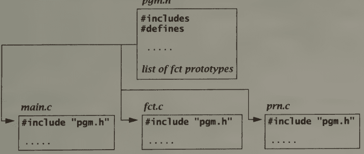

让我们展示一个其如何工作的非常简单的示例。我们将在单独的目录编写程序。它将由一个 `.h` 文件和三个 `.c` 文件组成。通常，目录的名称和程序的名称是相同的。以下是我们的程序：

#### 在文件 `pgm.h` 中

```c
#include <stdio.h>
#include <stdlib.h>

#define N 3

void fct1(int k);
void fct2(void);
void wrt_info(char *);
```

#### 在文件 `main.c` 中

```c
#include "pgm.h"
int main(void)
{
    char ans;
    int i, n = N;

    printf("%s",
           "%This program does not do very much.\n"
           "%Do you want more information? ");
```

#### 在文件 `ftc.c` 中

```c
#include "pgm.h"
void fct1(int n)
{
    int i;

    printf("Hello from fct1()\n");
    for (i = 0; i < n; ++i)
        fct2();
}
```

```c
void fct2(void)
{
    printf("Hello from fct2()\n");
}
```

#### 在文件 `wrt.c` 中

```c
#include "pgm.h>
void wrt_info(char pgm_name) {
    printf("Usage: %s\n\n", pgm_name);
    printf("%s\n");
    printf("This program illustrates how one can write a serious program,\n");
    printf("in more than one file. In this example, we have a\n");
    printf("single .h file that gets included at the top of our\n");
    printf("three .c files that gets. Thus, the .h file acts as the \"glue\n");
    printf("that binds the program together.\n");
    printf("\n");
    printf("Note that the functions fct1() and fct2() when called\n");
    printf("only say \"hello.\" When writing a serious program, the\n");
    printf("programmer sometimes does this in a first working\n");
    printf("version of the code.\n");
}
```

注意，函数 `fct1()` 和 `fct2()` 被调用时只说“hello”。在编写严谨的程序时，程序员有时会在代码的第一个工作版本中这样做。注意我们使用了类型 `char *`（指向字符）（参见第 248 页第 6.2 节）。我们使用命令编译程序：

```bash
cc -o pgm main.c ftc.c wrt.c
```

从三个 `.o` 文件生成可执行文件 `pgm`。（在 MS-DOS 中，它们是 `.obj` 文件）。关于这些 `.o` 文件以及编译器如何使用它们的进一步讨论，请参阅第 522 页第 11.13 节“C 编译器”。对于在单独文件中编写程序的更有趣的示例，请参见第 348 页第 7.6 节“纸、石头、剪刀游戏”。其他示例可以通过 `ftp` 获取，如果你连接了互联网，尝试以下命令：

```bash
ftp bc.com
```

建立连接后，你可以切换目录（`cd`）到 `bc`，然后进入 `kelley` 并查看。如果你有源代码，通过调试器调查大型程序容易得多（参见第 339 页第 11.19 节“其他工具”）。

## 什么构成大型程序？

对于个人来说，大型程序可能只包含几百行代码。计算哪些行？通常是任何包含至少一个行的 `.h` 文件、`.c` 文件以及 `Makefile`。（参见第 532 页第 11.17 节“make 的使用”。）在 UNIX 中，可以使用 `wc` 工具来实现：

```bash
wc *.h *.c
```

在工业界，程序通常由程序员团队编写，大型程序可能被认为超过十万行。在自己的目录中作为 `.h` 和 `.c` 文件的集合编写程序的风格适用于任何严谨的程序，无论大小，而且所有经验丰富的程序员都遵循这种风格。要精通这种风格，程序员必须学习如何使用 `make` 或类似的工具。（参见第 532 页第 11.17 节“make 的使用”。）

## 5.9 使用断言

C 系统提供了标准头文件 `assert.h`，程序员包含它可以访问 `assert()` 宏。（参见第 388 页第 8.11 节关于 `assert()` 宏的进一步讨论。）在这里，我们展示程序员如何使用断言来辅助编程过程。考虑以下代码：

```c
#include <assert.h>
#include <stdio.h>

int f(int a, int b);
int g(int c);

int main(void)
{
    int a, b, c;
    scanf("%d%d", &a, &b);
    c = f(a, b);
    assert(c > 0); /* 断言 */
}
```

如果作为 `assert()` 参数的表达式为假，系统将打印一条消息并终止程序。在这个示例中，我们假设 `f()` 封装了一个应该生成并返回正整数的算法。也许别人编写了 `f()` 函数定义的代码，你只需要确保 `f()` 返回的值是正数。在 `f()` 的定义中，参数 `a` 和 `b` 某些条件很重要。假设我们期望 `a` 的值为 1 或 -1，并且期望 `b` 落在 [7, 11] 区间。

```c
int f(int a, int b) {
    assert(a == 1 || a == -1);
    assert(b >= 7 && b <= 11);
}
```

断言很容易编写，增加了代码的健壮性，并帮助读者理解其意图。

## 5.10 作用域规则

作用域的基本规则是标识符仅在定义的块内可访问。在块外部是未知的。这是一个很容易遵循的规则，除非由于原因在不同的声明中使用相同的标识符。让我们给这种情况给出一个简单的示例：

```c
{
    int a = 2;              /* 外部块 a */
    printf("%d\n", a);    /* 输出 2 */
    {
        int a = 5;              /* 内部块 a */
        printf("%d\n", a);  /* 输出 5 */
    }                       /* 回到外部块 */
    printf("%d\n", ++a);   /* 输出 3 */
}
```

等效的代码为：

```c
{
    int a_outer = 2;
    printf("%d\n", a_outer);
    {
        int a_inner = 5;
        printf("%d\n", a_inner);
    }
    printf("%d\n", ++a_outer);
}
```

每个块都引入了自己的命名法。外部块名称是有效的，除非内部块重新定义了它。如果重新定义，外部块名称将被隐藏，或从内部块中屏蔽。内部块可以嵌套到由系统限制决定的任意深度。以下代码说明了三个嵌套块中的隐藏变量：

```c
{
    int a = 1, b = 2, c = 3;
    printf("%3d%3d%3d\n", a, b, c);      /* 1 2 3 */
    {
        int b = 4;
        float c = 5.0;
        printf("%3d%3d%3d.1f\n", a, b, c);  /* 1 4 5.0 */
        a = b;
        {
            int c;
            c = b;
            printf("%3d%3d%3d\n", a, b, c);      /* 4 4 4 */
        }
        printf("%3d%3d%3d.1f\n", a, b, c);      /* 4 4 5.0 */
    }
    printf("%3d%3d%3d\n", a, b, c);          /* 4 2 3 */
}
```


整数变量`a`在外部块中声明，且从未被重新声明。因此，它在两个嵌套的内部块中都是可用的。变量`b`和`c`在第一个内部块中被重新声明，从而隐藏了外部块中同名的外部块变量。在退出该块后，`b`和`c`再次作为外部块变量可用，且其值保持在外部块初始化时的状态不变。最内层的块再次重新声明了`c`，因此`c`（内部）和`c`（外部）都被`c`（最内层）所隐藏。

## 并行块与嵌套块

两个块可以连续出现，在这种情况下，第二个块对第一个块中声明的变量一无所知。这种位于同一级别的块被称为并行块。函数在最外层并行声明的。以下代码说明了嵌套在一个外部块中的两个并行块：

```
{
    int        a, b;
    {
        /* 内部块 1 */
        float      b;
        /* int a 是已知的，但 int b 不是 */
    }
    {
        /* 内部块 2 */
        float      a;
        /* int b 是已知的，但 int a 不是 */
        /* 内部块 1 中的内容都是不可知的 */
    }
}
```

并行块和嵌套块可以以任意复杂的方案组合。块的主要目的是允许在需要的地方为变量分配内存。如果内存稀缺，块的退出将释放分配给该块的存储空间，允许内存用于其他用途。此外，块将与其使用范围内的名称关联，使代码更具可读性。函数可以被视为允许带有参数和返回语句的命名块。

# 第 5 章 函数

### 使用块进行调试

块的一个常见用途是调试。假设我们正处于代码的某部分，某个变量（例如`v`）运行异常。通过在代码中临时插入一个块，我们可以使用不干扰程序其余部分的局部变量。

```c
/* 调试在此开始 */static int cnt = 0;
printf("*** debug: cnt = %d v = %d\n", ++cnt, v);
```

变量`cnt`是该块的局部变量。它不会与外部块中同名的另一个变量冲突。由于其存储类是静态的（`static`），当重新进入该块时，它会保留其值。在这里，它被用于计算该块执行的次数。（也许我们在一个`for`循环内部。）我们假设变量`v`已经在外部块中声明，因此在此块中是已知的。我们为了调试目的打印了它的值。稍后，在我们修复代码后，这个块就变得多余，我们将其删除。

## 5.11 存储类

C语言中的每个变量和函数都有两个属性：类型和存储类。四种存储类是自动（`automatic`）、外部（`external`）、寄存器（`register`）和静态（`static`），相应的关键字为：

- `auto`
- `extern`
- `register`
- `static`

到目前为止，变量最常用的存储类是自动的。然而，程序员需要了解所有的存储类。它们都有重要的用途。

### 存储类 auto

在函数体内部声明的变量默认是自动的。因此，`automatic`是四种存储类中最常见的。如果一个复合语句以变量声明开头，那么这些变量就可以在闭合复合语句的作用域内进行操作。带有声明的复合语句被称为“块”，以区别于不以声明开头的语句。

块内部的变量声明隐式具有存储类`automatic`。关键字`auto`可用于显式指定存储类。一个示例是：

```c
auto int      a, b, c;
auto float    f;
```

由于存储类默认为自动的，`auto`关键字很少使用。当进入一个块时，系统为自动变量分配内存。在该块内部，这些变量被定义并被视为该块的“局部”变量。当退出块时，系统会释放为自动变量留出的内存。块将其使用范围内的名称关联起来，使代码更可读性。函数可以被视为允许带有参数和返回语句的命名块。

声明`register int;`等同于`register int;`。

如果在声明中指定了存储类但未指定类型，则默认类型为`int`。

请注意，在我们的示例中，寄存器变量`i`被声明在尽可能靠近其使用的地方。这是为了最大限度地利用物理寄存器的可用性，仅在需要时使用它们。始终记住，`register`声明仅被视为编译器的建议。

## 存储类 static

`static`声明有两个重要且不同的用途。更基础的用法是允许局部变量在重新进入代码块时保留其先的值。这与普通的自动变量不同，后者在退出块时会丢失其值且必须重新初始化。第二种更微妙的用法是与外部声明有关。我们将在下一节中讨论这一点。

作为`static`值留存用例的示例，我们将编写一个函数的大纲，该函数的行为根据其调用次数而不同。

```c
void f(void)
{
    static int cnt = 0;

    cnt++;
    if (cnt % 2 == 0)
        /* 执行某些操作 */
    else
        /* 执行不同的操作 */
}
```

函数第一次被调用时，变量`cnt`初始化为零。在函数退出时，`cnt`的值保留在内存中。每当再次调用函数时，`cnt`都不会重新初始化。相反，它保留了上一次调用函数时的值。在`f()`内部将`cnt`声明为`static int`使其对`f()`是私有的。如果它声明在函数外部，那么其他函数也可以访问它。

## 5.12 外部变量

`static`的第二种更微妙的用法与外部声明有关。在外部结构中，它提供了一种“私有性”机制，这对于程序的模块化非常重要。我们所说的私有性，是指对原本可访问的变量或函数进行可见性或作用域限制。

乍一看，`static`外部变量似乎是多必要的。外部变量已经在跨块和函数退出时保留其值。区别在于，`static`外部变量是受作用域限制的外部变量。作用域是定义它们的源文件的剩余部分。因此，对于文件中定义较早函数或在其他文件中定义的函数，它们是不可用的，即使这些函数尝试使用`extern`存储类关键字。

```c
void f(void)
{
    ....    /* v 在这里不可用 */
}
static int v;    /* static 外部变量 */
void g(void)
{
    ....    /* v 在这里可以使用 */
}
```

让我们利用此功能提供一个对一组函数全局可见，但同时对该文件私有的变量。我们将编写两个伪随机数生成器，它们都使用相同的种子。（算法基于线性同发生器方法；参见 Donald Ervin Knuth 的《The Art of Computer Programming, 2d ed., vol. 2, Semineral Algorithms》(Reading, MA: Addison-Wesley, 1981)。

> /* 一组伪随机数生成器。 */

```c
#define INITIAL_SEED   17
#define MULTIPLIER      25173
#define INCREMENT       13849
#define MODULUS         65536
#define FLOATING_MODULUS 65536.0

static unsigned seed = INITIAL_SEED; /* 外部的，但 */
                    /* 对此文件私有 */
```

```c
unsigned random(void)
{
    seed = (MULTIPLIER * seed + INCREMENT) % MODULUS;
    return seed;
}
```

```c
double probability(void)
{
    seed = (MULTIPLIER * seed + INCREMENT) % MODULUS;
    return (seed / FLOATING_MODULUS);
}
```

`random()`函数产生一个在`0`到`MODULUS`之间看似随机的整数序列。`probability()`函数产生一个在`0`到`1`之间看似随机的浮点数序列。

注意，调用`random()`或`probability()`会产生变量`seed`的新值，该值取决于旧值。由于`seed`是`static`外部变量，它对此文件是私有的，其值在函数调用之间被保留。我们现在可以在其他文件中创建调用这些随机数生成器的函数，而必担心副作用。

`static`的最后一个用法是函数定义和原型对应的存储类分类。这种用法会导致定义函数的作用域受到限制。与可以从其他文件访问的普通函数不同，`static`函数在其整个文件中都可用，但在其他文件中不可用。同样，这种机制在开发私有函数定义模块时有用。

```c
static int g(void); /* 函数原型 */
void f(int a)
{
    .... /* 函数定义 */
    /* g() 在这里可用， */
    /*但在其他文件中不可用 */
}

static int g(void) /* 函数定义 */
{
    ....
}
```

## 5.13 默认初始化

在 C 中，程序员未显式初始化的外部变量`static`变量都由系统初始化为零。这包括数组、字符串、指针、结构和联合。对于数组和字符串，这意味着每个元素都被初始化为零；对于结构体和联合，这意味着每个成员都被初始化为零。与之相反，自动变量和寄存器变量通常不由系统初始化。这意味着它们从“垃圾”值开始。尽管某些 C 系统确实会将自动变量初始化为零，但这会导致代码具有不可移植性。

## 5.14 递归

如果一个函数直接或间接地调用它自己，则称为递归的。在 C 中，所有函数都可以递归使用。在最简单的形式中，递归是非常直观的。尝试以下程序：

```c
#include <stdio.h>

int main(void)
{
    printf("前5个整数的和是 %d\n", sum(5));
    return 0;
}

int sum(int n)
{
    if (n <= 1)
        return n;
    else
        return n + sum(n - 1);
}
```

`sum()`函数计算前$n$个正整数的和。递归情况如下表所示：

| 函数调用 | 返回值 |
|---|---|
| `sum(1)` | 1 |
| `sum(2)` | 3 |
| `sum(3)` | 6 |
| `sum(4)` | 10 |
| `sum(5)` | 15 |

与`factorial()`一样，递归在逐层返回原始调用之前会激活$n$个嵌套的函数副本。这意味着此计算使用了$n$次函数调用。大多数简单的递归函数可以重写为迭代函数。

下一个示例说明了一个处理字符的递归函数。它可以被重写为等效的迭代函数。我们将其留作练习题。程序首先提示用户输入一行。然后通过递归函数反序写入该行。

```c
/* 反序写入一行字。 */
#include <stdio.h>
void wrt_it(void);
int main(void)
{
    printf("输入一行字: ");
    wrt_it();
    printf("\n\n");
    return 0;
}
void wrt_it(void)
{
    int c;
    if ((c = getchar()) != '\n')
        wrt_it();
    putchar(c);
}
```

如果用户在提示时输入`sing a song of sixpence`，则屏幕上将出现以下内容：

```
Input a line: sing a song of sixpence
ecnepxis is gnos a gnis
```

## wrt_bkwrds 程序解析

- `printf("Input a line: ");`
  `wrt_it();`

首先，向用户打印一个提示。用户写一行内容并通过输入回车键（即字符`\n`）来结束输入。然后，调用递归函数`wrt_it()`。

- `void wrt_it(void)`
  {
  `int c;`

此函数没有对`EOF`进行测试；因此，`c`的类型可以是`char`。

- `if ((c = getchar()) != '\n')`
  `wrt_it();`

如果读取到的字符不是换行符，则再次调用`wrt_it()`，这会导致读取另一个字符，依此类推。每次调用对变量`c`都有自己的局部存储空间。每个`c`都是特定`wrt_it()`调用的局部变量，每个`c`存储输入流中的其中一个字符。函数调用会不断堆栈，直到读取到换行符。

- `putchar(c);`

只有在读取到换行符后，才会进行任何写入。现在每次调用`wrt_it()`都会打印存储在其局部变量`c`中的值。首先打印换行符，然后是紧随其后的字符，以此此类推直到打印出第一个字符。因此，输入行被反转了。

## 效率考量

许多算法都有迭代和递归两种形式。通常，递归更加优雅，并且只需要更少的变量就能完成相同的计算。递归通过为每次调用堆栈参数和变量来处理其自身的记录工作。这种参数的堆栈对用户是不可见的，但仍然会消耗时间和空间。在某些机器上，一个带有一个整数参数的简单递归调用可能在栈上需要 8 个 32 位的字。

让我们讨论一下计算斐波那契序列计算的效率问题，这是一个非常糟糕的例子。该序列的递归定义为：

```
$f_0 = 0, f_1 = 1, f_{i+1} = f_i + f_{i-1} for i = 1, 2, ...$
```

除了$f_0$和$f_1$之外，序列中的每个元素都是前两个元素之和。该序列从 0, 1, 1, 2, 3, 5, . . .。这是一个递归计算斐波那契数的函数：

```
int fibonacci(int n)
{
  if (n <= 1)
    return n;
  else
    return (fibonacci(n - 1) + fibonacci(n - 2));
}
```

如下表所示，即使$n$的值处于中间水平，计算第$n$个斐波那契数也需要大量的函数调用。

| n 的值 | `fibonacci(n)` 的值 | 递归计算 `fibonacci(n)` 需函数调用次数 |
|---|---|---|
| 0 | 0 | 1 |
| 1 | 1 | 1 |
| 2 | 1 | 3 |
| . . . | . | . |
| 23 | 28657 | 92735 |
| 24 | 46368 | 150049 |
| . . . | . | . |
| 42 | 267914296 | 866988873 |
| 43 | 433494437 | 1402817465 |

虽然使用递归很有吸引力，但必须注意运行时限制和低效问题。有时有必要将递归重写为等效的迭代。

有些程序员认为，因为使用递归效率低下，所以不应该使用。然而，这些低效通常无关紧要——正如第 8.5 节 372 页“示例：使用`qsort`排序”中的快速排序算法所示。对于许多应用程序，递归代码更容易编写、理解和维护。这些原因通常决定了它的使用。

## 5.15 示例：汉诺塔


在名为“汉诺塔”的游戏中，有三个标记为 A、B 和 C 的塔。游戏开始时，塔 A 上有 *n* 个盘片。为了起见，假设 *n* 为 3。盘片编号从 1 到 3，在不失一般性的情况下，我们可以假设每个盘片的直径与其编号相同。也就是说，盘片 1 的直径为 1（某个单位），盘片 2 的直径为 2，盘片 3 的直径为 3。三个盘片最初按 1, 2, 3 的顺序位于塔 A。游戏的目标是将塔 A 上所有的盘片移动到塔 C。每次只能移动一个盘片。A、B 或 C 任何一个塔都可以作为盘片的中间位置。每次移动后，每个塔上的盘片必须保持顺序。也就是说，在任何时候都不能将大盘放在小盘之上。

## 5.15 示例：汉诺塔

我们将编写一个程序，生成一个移动列表，展示如何完成将 n 个盘片从塔 A 转移到塔 C 的任务。以下是程序：

在文件 `hanoi.h` 中

```c
#include <hanoi.h>
#include <stdio.h>
#include <stdlib.h>

extern int cnt; /* 移动次数 */

int get_n_from_user(void);
void move(int n, char a, char b, char c);
```

在 `main.c` 中

```c
#include "hanoi.h"
int cnt = 0; /* 移动次数 */
int main(void) {
    int n; /* 盘片数量 */
    n = get_n_from_user();
    assert(n > 0);
    /* 将 n 个盘片从塔 A 移动到塔 C，
       使用塔 B 作为中间塔。 */
    move(n, 'A', 'B', 'C'); /* 递归函数 */
    return 0;
}
```

在文件 `get.c` 中

```c
#include "hanoi.h"
int get_n_from_user(void) {
    int n;
    printf("\n汉诺塔：\n");
    printf("有三个塔：A、B 和 C。\n");
    printf("必须将塔 A 上的盘片移动到塔 C。每次只能移动一个\n盘片，且每一步每个塔上的顺序\n必须保持。A、B 或 C 的任何一个塔\n都可以作为盘片的中间放置点。\n");
    printf("问题开始时塔 A 上有 n 个盘片。\n");
    printf("输入 n: %d ", &n);
    return n;
}
```

在文件 `move.c` 中

```c
#include "hanoi.h"
void move(int n, char a, char b, char c) {
    if (n == 1) {
        ++cnt;
        printf("%5d: 将盘片 %c 从塔 %c 移动到塔 %c.\n", cnt, a, a, c);
    } else {
        move(n - 1, a, c, b);
        ++cnt;
        printf("%5d: 将盘片 %c 从塔 %c 移动到塔 %c.\n", cnt, a, a, c);
        move(n - 1, b, a, c);
    }
}
```

```
Start: 1 2 3
1: move disk 1: 2 3
2: move disk 2: 3 1
3: move disk 1: 3 1 2
4: move disk 2: 1 2 3
5: move disk 1: 1 2 3
6: move disk 2: 1 2 3
7: move disk 1: 1 2 3
```

为了保存结果，每个塔上的圆盘是从左到右写入的，而不是垂直方向。从这个输出中，我们可以一眼看出较大的盘从没有被放在较小的盘之上。

根据传说，守着三座汉诺塔的修道院里的僧们每天都会移动其中一个盘。在世界之初，A 塔上有 64 块盘。根据传说，当最后一块盘被移动时，世界将终结。


# 总结

- 1 函数是 C 语言中最通用的结构化概念。它们应该用于实现“自顶向下”的问题解决方法——即将问题分解成越来越小的子问题，直到每个部分都能在代码中很容易地表达。

- 2 返回语句终止函数的执行，并将控制权传回调用环境。如果返回语句包含一个表达式，那么该表达式的值也会传回调用环境。

- 3 函数原型告诉编译器传递给函数的参数数量和类型。函数原型的通用形式是：

`type function_name ( parameter type list );`

参数类型列表通常是一个由逗号分隔的类型列表，并包含可选的标识符。如果函数不接受任何参数，则使用关键字 `void`。如果函数没有返回值，则函数类型为 `void`。

- 4 传递给函数的参数是通过值传递的。它们必须与函数定义或函数原型中给出的相应参数类型兼容。

- 5 函数的存储类始终是 `extern`，除非另显式声明，否则其类型限定符为 `int`。返回语句必须返回一个与函数类型兼容的值。

- 6 主要的存储类是 `automatic`。自动变量随块的进入和退出而出现和消失。当内部块重新声明外部块的标识符时，它们可以被隐藏。

- 7 作用域规则是与标识符相关的可见性限制。例如，如果在文件中我们

```c
static void f(void)
{
    ....
}
static int a, b, c;
    ....
```

那么 `f()` 在整个文件中都是可见的，但在其他文件中不可见；而 `a`、`b` 和 `c` 仅在该文件中可见，且仅在它们声明的位置之后可见。

- 8 外部存储类是所有函数和在函数外部声明的所有变量的默认存储类。这些标识符可以在整个程序中使用。此类标识符可以通过重新声明来隐藏，但它们的值不能被破坏。

- 9 关键字 `extern` 用于告诉编译器“在其他处寻找，要么在这个文件中，要么在其他文件中”。

- 10 存储类 `register` 可以尝试提高执行速度。它在语义上等同于 `automatic`。

- 11 存储类 `static` 用于保留变量退出时的值。它还用于限制外部标识符的作用域。后者的用法通过为函数和变量提供形式的私有性，增强了模块化的程序安全性。

- 12 程序员未显式初始化的外部和静态变量由系统初始化为零。

- 13 如果一个函数直接或间接地调用它自己，则认为它是递归的。在 C 语言中，所有函数都可以递归使用。

# 练习

- 1 编写一个函数 `double power(double x, int n)`，计算 $x^n$，即 $x$ 的 $n$ 次方。检查它是否正确计算了 3.5^7。（答案是 6433.9296875。）

- 2 使用库函数 `sqrt()` 编写一个函数，返回其参数 $k$ 的四次方根。返回的值应该是 `double` 类型。使用你的函数制作一个数值表。

- 3 打印了什么？请解释。

```c
#include <stdio.h>

int z;
void f(int x)
{
    x = 2;
    z += x;
}

int main(void)
{
    z = 5;
    f(z);
    printf("%d\n", z);
    return 0;
}
```

- 4 在传统的 C 语言中，函数的通用形式如下：

```c
function function_name( parameter list )
参数的声明
{ 声明 语句 }
```

请参第 198 页第 5.1 节“函数定义”中的示例。用这种风格重写上一个练习中 `f()` 的函数定义。检查你的编译器是否接受它。程序会产生相同的输出吗？（应该。）

- 5 在这个练习中，我们想要实验一下函数声明。我们将使用数学库中的函数 `pow()`，但我们不包含 `math.h`，而是提供我们自己的函数声明。开始执行以下程序：

```c
#include <stdio.h>

double pow(double, double);
int main(void)
{
    printf("pow(2.0, 3.0) = %g\n", pow(2.0, 3.0));
    return 0;
}
```

接下来，将 `printf()` 语句改为

```c
printf("pow(2, 3) = %g\n", pow(2, 3));
```

并再次运行程序。尽管你向 `pow()` 传递的是 `int` 而不是 `double`，但你得到正确的答案了吗？你应该能，因为编译器知道需要 `double` 参数，能够将提供的值转换为正确的格式。接下来，将函数原型替换为

```c
double pow();    /* 传统风格 */
```

现在发生了什么？最后，完全删除函数声明。虽然不指你的程序能正确运行，但它应该可以通过编译。它通过了吗？要记，，尽管 C 系统为库中的函数提供了对象代码，但提供正确的函数原型是程序员的责任。

- 6 在这个练习中，我们想要实验一下断言（assertion）。执行以下程序以理解它的影响。注意：这不是断言的典型用法。

```c
#include <assert.h>
#include <stdio.h>
#include <stdlib.h>
#include <time.h>

int main(void)
{
    int a, b, cnt = 0, i;
    srand(time(NULL));
    for (i = 0; i < 100; ++i) {
        a = rand() % 3 + 1;
        b = rand() % 30 + 1;
        if (b <= 1)
            continue;
        assert(b > 2);
        printf("%d\n", ++cnt);
    }
    return 0;
}
```

哪些 `a` 和 `b` 值会导致断言失败？平均而言，你预计通过多少次？

- 7 那么你的程序的输出可能如下所示：

大于 2 的每个偶数都是两个质数的和：

700 = 17 + 683

702 = 11 + 691

704 = 3 + 701

...

1098 = 5 + 1093

1100 = 3 + 1097

*提示：* 使用你在第 238 页第 11 题练习中编写的 `is_prime()` 函数。

- 8 编写一个函数，找到任意特定数字的所有因子。例如，

9 = 3 × 3, 17 = 17 (质数), 52 = 2 × 2 × 13

分解小数是很容易，你编写一个这样的程序应该不会遇到困难。但请注意，通常因数分解是非常困难的。如果一个整数包含数百位数字，即使使用非常强大的计算机也可能无法对其进行因数分解。

- 9 这个练习让你练习理解标识符的作用域。以下代码会打印什么？首先，手动模拟代码并记录你的答案。然后写一个程序来检查你的答案。

```
int a = 1, b = 2, c = 3;

a += b += ++c;
printf("%5d%5d%5d\n", a, b, c);
{
    float b = 4.0;
    int c;
    a += c = 5 * b;
    printf("%5d%5d.1f%5d\n", a, b, c);
}
printf("%5d%5d%5d\n", a, b, c);
```

- 10 重写“宇宙永无止境！”递归，使其在调用 17 次后终止。你的程序应该包含一个单一的 `main()` 函数，该函数递归调用自己。*提示：* 使用静态变量作为计数器。

- 11 下述函数在某些系统上产生错误的值：

```c
int factorial(int n)      /* 错误 */
{
    if (n == 0 || n == 1)
        return 1;
    else
        return (n * factorial(--n));
}
```

在你的系统上测试该函数。解释为什么该函数产生的值依赖于系统。

- 12 两个正整数的最大公约数是能同时整除这两个数的最大整数。例如，3 是 6 和 15 的最大公约数，1 是 15 和 22 的最大公约数。这里有一个计算两个正整数最大公约数的递归函数：

```c
int gcd(int p, int q)
{
    int r;
    if ((r = p % q) == 0)
        return q;
    else
        return gcd(q, r);
}
```

首先，写一个程序来测试该函数。然后写一个并测试一个等效的迭代函数。

- 13 在某些系统中，`extern` 关键字用于标准头文件中的函数声明和原型中。这在传统的 C 系统中是常见做法，但在 ANSI C 系统中通常不这样做。你的系统有这种做法吗？

*提示：* 例如，查看 `math.h` 等文件。

- 14 在接下来的程序中，我们特意在文件底部声明了一些外部变量。会打印什么？

```c
#include <stdio.h>

int main(void)
{
    extern int a, b, c;      /* 在别处查找 */
    printf("%3d%3d%3d\n", a, b, c);
    return 0;
}
```

int a = 1, b = 2, c = 3;

现在将程序的最后一行改为：

```c
static int a = 1, b = 2, c = 3;
```

文件底部的变量现在是静态外部的，因此它们不应该在 `main()` 中可用。由于 `main()` 中引用的外部变量不可用，你的编译器应该报错。它报错了吗？（我们发现大多数编译器都会感到困惑。）

- 15 在传统的 C 中声明变量时，允许以任何顺序编写存储类说明符和类型说明符。例如，我们可以写：

```c
register int i;  或  int register i;
```

在 ANSI C 中，存储类分类符应该在前面。尽管如此，大多数 ANSI C 编译器都会接受任何一种顺序。（如果它们不是，那么某些传统代码将无法编译。）检查你的编译器上反过来顺序是否有效。

- 16 描述以下程序的行为：

```c
#include <stdio.h>
#include <stdlib.h>

#define FOREVER 1
#define STOP 17
```

```c
int main(void)
{
    void f(void);
    while (FOREVER)
        f();
    return 0;
}
```

```c
void f(void)
{
    static int cnt = 0;
    printf("cnt = %d\n", ++cnt);
    if (cnt == STOP)
        exit(0);
}
```

- 17 $n_0$ 为一个正整数。对于 $i = 0, 1, 2, \dots$ 定义

如果 $n_i$ 是偶数，则 $n_{i+1} = n_i / 2$；如果 $n_i$ 是奇数，则 $3n_i + 1$；当 $n_i$ 的值为 1 时序列停止。这样生成的数字被称为“冰雹”。写一个程序生成一些冰雹。函数

```c
void hailstones(int n)
{
    ....
}
```

应该用于计算并打印由 $n$ 生成的序列。你的程序的输出可能如下：

77 生成的冰雹：

| 77 | 23 | 116 | 58 | 29 |

| :--- | :--- | :--- | :--- | :--- |

| 44 | 22 | 34 | 17 | 52 |

| 26 | 13 | 40 | 20 | 10 |

| 16 | 8 | 4 | 2 | 1 |

生成的冰雹数量：你会发现所有生成的序列都是有限的。这在通常情况下是否真的仍然是一个开放的问题。

- 18 写一个抛硬币程序，使用标准库中的随机数 `rand()` 来模拟抛掷。使用表达式 `rand() % 2` 生成值 0 或 1。让“正面”表示为 1，“反面”表示为 0。运行程序 1,000、10,000 和 100,000 次抛，并记录最长的正面序列和最长的交替反面序列。注意：在某些传统系统中，`rand()` 函数是著名的糟糕。如果你的 ANSI C 系统有该特定函数，那么这个练习虽然很有启发性，但将不再有趣。

- 19 如果你有除 `rand()` 外的随机数生成器，使用它重做上一个练习。结果不同吗？

- 20 涉及重复使用随机数生成器来产生概率事件的模拟被称为蒙特卡洛模拟，其来源于世界上最著名的赌场之一。让我们使用这种技术来寻找生日游戏变体中的盈亏平衡点。参见第 6 章第 324 页的第 36 题，“数组、指针和字符串”。在一个房间里的人中，至少有两个人的生日是相同的。

声明中的整数 `3` 代表数组中的元素个数。数组元素的索引从 `0` 开始。

一维数组的声明是一个类型，后面紧跟一个带有括号内常量整数表达式的标识符。该表达式的值（必须为正数）是数组的大小。它指定了数组中元素的数量。数组下标的范围从 `0` 到 `size - 1`。数组下标的下界为 `0`，上界为 `size - 1`。因此，以下关系成立：

```
int a[size];      /* 分配了 a[0], ..., a[size - 1] 的空间 */
lower bound = 0
upper bound = size - 1
size       = upper bound + 1
```

将数组的大小定义为符号常量是一个良好的编程习惯。

```
#define N 100
int a[N];      /* 分配了 a[0], ..., a[99] 的空间 */
```

给定此声明，处理数组元素的标准编程习惯是使用循环。例如：

```
for (i = 0; i < N; ++i)
    sum += a[i];      /* 处理元素 a[i] */
```

该迭代从元素 `a[0]` 开始，并逐个处理每个元素。因为终止条件是 `i < N`，我们避免了越界数组结尾的错误。最后一个处理的元素确实是 `a[N - 1]`。

## 初始化


数组可以是自动（automatic）、外部（external）或静态（static）存储类型类，但不能是寄存器（register）。在传统的 C 语言中，只有外部和静态数组可以使用数组初始化进行初始化。在 ANSI C 中，自动数组也可以被初始化。

```
one_dimensional_array_initializer := { initializer_list }
initializer_list := initializer { , initializer}+
initializer ::= constant_integral_expression
```

考虑以下示例：

```c
float f[5] = {0.0, 1.0, 2.0, 3.0, 4.0};
```

这会将 `f[0]` 初始化为 `0.0`，`f[1]` 初始化为 `1.0`，依此类推。当初始化列表比要初始化的数组元素个数短时，剩余元素将初始化为零。例如：

```c
int a[100] = {};
```

这会将 `a` 的所有元素初始化为零。如果外部或静态数组没有被显式初始化，则系统默认将所有元素初始化为零。相比之下，自动数组并不会被系统初始化。虽然某些编译器会这样做，但另一些不会。程序员应该假设未初始化的自动数组是从“垃圾”值开始的。

如果声明数组没有指定大小并将其初始化为一系列值，则大小是根据初始化器的个数隐式给定的。因此：

```c
int a[] = {2, 3, 5, -7};
```

与：

```c
int a[4] = {2, 3, 5, -7};
```

是等价的声明。这一特性也适用于字符数组。然而，对于字符数组，可以使用另一种表示法。如下声明：

```c
char s[] = "abc";
```

被编译器视为等同于：

```c
char s[] = {'a', 'b', 'c', '\0'};
```

## 下标

如果 `a` 是一个数组，我们可以写 `a[expr]` 来访问数组元素，其中 `expr` 是一个整数表达式。我们称 `expr` 为 `a` 的下标或索引。假设声明：

```c
int i, a[N];
```

已经完成，其中 `N` 是一个符号常量。通过给下标 `i` 赋值一个适当的值，表达式 `a[i]` 可以引用数组的任何元素。当 `i` 的值大于或等于 `0` 且小于或等于 `N-1` 时，就会访问数组元素 `a[i]`。如果 `i` 的值在这一范围之外，在访问 `a[i]` 时将发生运行时错误。

数组越界是一种常见的编程错误。该错误的影响取决于系统，并且可能会非常令人困惑。一个常见的结果是返回或修改了某个无关变量的值。确保所有数组下标都留在边界内是程序员的职责。

记住，标识符后面的括号 `()` 告诉编译器该标识符是一个函数名。例如 `main()` 和 `f(a, b)`。在 C 语言中，标识符后面的括号对被视为一个运算符。同样，方括号 `[]` 也被视为一个运算符。`()` 和 `[]` 两个运算符具有最高的优先级，并具有从左到右的结合性。

## 6.2 指针

程序中的简单变量存储在机器内存特定位置（或地址）的若干字节中。指针在程序中用于访问内存和操作地址。

如果 `v` 是一个变量，那么 `&v` 就是其存储值在内存中的位置（或地址）。地址运算符 `&` 是一元运算符，与其他一元运算符具有相同的优先级和从右到左的结合性。地址是一组可以被操作的值。指针变量可以在程序中声明，然后用于获取地址作为值。

声明：

```c
int *p;
```

将 `p` 声明为指向 `int` 的指针类型。它的合法值范围始终包含特殊的 `0` 和一组正整数，这些整数在给定的 C 系统上被解释为机器地址。以下是给指针 `p` 赋值的一些示例：

```c
p = 0;
pp = NULL;          /* 等同于 p = 0; */
pp = &i;
pp = (int *) 1776;  /* 内存中的绝对地址 */
```

在第三个示例中，我们将 `p` 视为“引用 `i`”或“指向 `i`”或“包含 `i` 的地址”。在第四个示例中，强制转换是必要的，以避免编译器错误。

间接或解引用运算符 `*` 是一元运算符，与其他一元运算符具有相同的优先级和从右到左的结合性。如果 `p` 是指针，那么 `*p` 就是 `p` 的地址的变量的值。

“间接”一词源于机器语言编程。`p` 的直接值是一个内存位置，而 `*p` 是 `p` 的间接值——即存储在 `p` 中的内存位置。在某种意义上，`*` 是 `&` 的逆运算符。

我们想要给出一个明确且基础的示例来说明指针机制的工作原理。让我们从声明开始。

## 6.2 指针

变量 `p` 的类型为 `int *`，其初始值为 `&i`。`i` 的声明必须在我们取其地址之前完成。变量在内存中的实际位置取决于系统。

运算符 `*` 解引用 `p`。也就是说，`p` 包含一个地址或位置，表达式 `*p` 是根据 `p` 的类型解释的该位置的值。下表说明了某些指针表达式的求值过程：

| 声明 | 等价表达式 | 值 |
|---|---|---|
| `int i = 3, j = 5, *p = &i, *q = &j; double x;` |  |  |
| `p == &i` | `p == (&i)` | `1` |
| `* * p` | `* (*p)` | `3` |
| `r = &x` | `r = (&x)` | 非法 |
| `7 * p / * q + 7` | `((7 * (*p)) / (*q)) + 7` | `11` |
| `(r = &j) *= *p` | `(*r = (&j)) *= (*p)` | `15` |

在此表中，我们尝试给 `r` 赋值 `&x`。因为 `r` 是指向 `int` 的指针，而表达式 `&x` 的类型是指向 `double` 的指针，这是非法的。此外，注意我们在表中使用了表达式 `(r = &j) *= *p`。

将其读为“给 `p` 赋值地址”，因为 `p` 指向 `a`。现在让我们使用 `%p` 格式打印指针的值，这在大多数系统上产生十六进制数。在 ANSI 系统上，优选 `%p` 格式。（参见第 312 页的练习 6。）

## 第 6 章 数组、指针、字符串

在文件 `locate.c` 中：

```c
/* 打印地址或位置。 */

#include <stdio.h>

int main(void)
{
    int i = 7, *p = &i;

    printf("%s%d\n", "Value of i: ", *p);
    printf("Location of i: %p\n", p);
    return 0;
}
```

该程序在我们的系统上的输出是：

```text
Value of i: 7
Location of i: ebb24
```

指针可以在声明中初始化。变量 `p` 的类型为 `int *`，其初始值为 `&i`。`i` 的声明必须在我们取其地址之前完成。变量在内存中的实际位置取决于系统。

如果我们没有写 `* * p / * q + 7 /?`，而是发现编译器会将 `/*` 视为注释的开始标记。这可能会导致一个难以排查的错误。

在传统的 C 语言中，不同指针类型之间赋值时的转换通常是允许的。在 ANSI C 中，除非其中一种类型是 `void` 指针，或者右侧是常量 `0`，否则是不允许此类转换的。因此，我们可以将 `void *` 视为一种通用指针类型。这是一个重要的点（参见第 262 页第 6.8 节“使用 `calloc()` 和 `malloc()` 进行动态内存分配”）。

| 声明 |  |
|---|---|
| `int *p;` |  |
| `float *q;` |  |
| `void *v;` |  |

| 合法赋值 | 非法赋值 |
|---|---|
| `p = 0;` | `p = 1;` |
| `p = (int *) 1;` | `v = 1;` |
| `p = v = q;` | `p = q;` |
| `p = (int *) q;` |  |

当然，并不是每个值都存储在可访问的内存位置中。记住以下禁止规则是有用的。

## 不可指向的结构

- 不要指向常量：`&3; /* illegal */`
- 不要指向普通表达式：`&(k + 99); /* illegal */`
- 不要指向寄存器变量：`register &v; /* illegal */`

地址运算符可以应用于变量和数组元素。如果 `a` 是一个数组，那么诸如 `&a[0]` 和 `&a[i+j+3]` 这样的表达式是有意义的。

## 6.3 引用传递（Call-by-Reference）

当变量作为参数传递给函数时，它们的值会被复制到对应的函数参数中，变量本身在调用环境中不会发生改变。C 语言严格遵守这种“按值传递”机制。为了改变调用环境中的变量值，其他语言提供了“引用传递”机制。在本节中，我们将展示如何通过将变量的地址作为函数的参数来产生“引用传递”的效果。

要使函数实现“引用传递”，必须在参数列表中使用指针。那么，当调用函数时，必须将变量的地址作为参数传递。为了说明这一点，让我们写一个函数来交换调用环境中两个变量的值。

```c
void swap(int *p, int *q) {
    int tmp;
    tmp = *p;
    *p = *q;
    *q = tmp;
}
```

为了测试我们的函数，我们可以写：

```c
#include <stdio.h>

void swap(int *, int *);

int main(void) {
    int i = 3, j = 5;

    swap(&i, &j);
    printf("%d %d\n", i, j);    /* 打印 5 3 */
    return 0;
}
```

注意，在调用环境中，我们将地址作为参数传递给函数；而在函数定义中，我们使用了指针。这是一个一致的模式。

## `swap()` 函数剖析

- `void swap(int *p, int *q) { int tmp;`

  该函数接受两个 `int` 指针类型的参数，并且没有返回值。变量 `tmp` 是该函数的局部变量，类型为 `int`。正如名称所示，我们将 `tmp` 视为这个临时存储器。

- `tmp = *p;`
- `*p = *q;`
- `*q = tmp;`

变量 `tmp` 被赋值为 `p` 所指向的值。`p` 指向的对象被赋值为 `q` 所指向的值。`q` 指向的对象被赋值为 `tmp` 的值。这样做的效果是交换了调用环境中 `p` 和 `q` 所指向的对象所存储的值。

“引用传递”的效果通过以下方式实现：

1. 将函数参数声明为指针。
2. 在函数体中使用解引用指针。
3. 在调用函数时将地址作为参数传递。

## 6.4 数组与指针之间的关系

数组名本身就是一个地址（或指针值），指针和数组一样都可以进行下标操作。尽管指针和数组在访问内存的使用上几乎是等同义的，但它们之间仍然存在差异，且这些差异是微妙而重要的。指针变量可以取不同的地址作为值。相比之下，数组名是一个固定的地址或指针。

假设 `a` 是一个数组且 `i` 是一个 `int`。一个基本事实是，表达式 `a[i]` 等价于 `*(a + i)`。

表达式 `a[i]` 的值是数组中第 `i` 个元素（从 0 开始计数），而 `*(a + i)` 是表达式 `a + i` 的解引用，该指针表达式指向 `a` 之后的 `i` 个元素。如果 `p` 是一个指针，那么类似地，表达式 `p[i]` 等价于 `*(p + i)`。

这意味着我们可以（并且确实可以）对指针使用数组表示法。诸如 `a + i` 和 `p + i` 的表达式是指针算术的示例。表达式 `a + i` 的值是第 `i` 个偏移量，该指针表达式指向 `a` 之后的 `i` 个元素。

数组名本身就是一个地址，它是固定的。表达式 `a + i` 的值是第 `i` 个偏移量，该指针表达式。`a + i` 的值是 `a` 数组的第 `i` 个偏移量……（注：此处部分文本由于原文存在 OCR 逻辑混乱或重复，已根据 C 语言逻辑进行了翻译和对齐，由于原文中存在大量乱码和重复的片段，此处保留了核心语义的翻译）。

## 6.7 示例：冒泡排序

| `sum()` 的各种调用方式 | 调用 | 计算并返回的内容 |
|---|---|---|
| `sum(v, 100)` | `v[0] + v[1] + ... + v[99]` |  |
| `sum(v, 88)` | `v[0] + v[1] + ... + v[87]` |  |
| `sum(&v[7], k - 7)` | `v[7] + v[8] + ... + v[k - 1]` |  |
| `sum(v + 7, 2 * k)` | `v[7] + v[8] + ... + v[2 * k + 6]` |  |

最后一次调用说明了指针算术是如何工作的。`v` 的起始地址偏移了 7，导致 `sum()` 中的局部指针变量 `a` 初始化为该值。这导致函数调用内部的所有地址计算都以相同的方式进行了偏移。

## 6.7 示例：冒泡排序

尽管我们在第 1.8 节“数组、字符串和指针”（第 37 页）中介绍冒泡排序，但我们将再次介绍它，并详细说明该函数是如何在一个特定的整数数组上工作的。我们将使用上一节中的 `swap()` 函数。

```c
void swap(int *, int *);

void bubble(int a[], int n)    /* n 是 a[] 的大小 */
{
  int i, j;
  for (i = 0; i < n - 1; ++i)
    for (j = n - 1; j > i; --j)
      if (a[j-1] > a[j])
        swap(&a[j-1], &a[j]);
}
```

由于指针算术，表达式 `a + i` 和 `&a[i]` 是等价的。因此，`swap()` 的函数调用可以写成：

```c
swap(a + i, a + j);
```

现在我们描述冒泡排序的原理。假设在 `main()` 中我们有：

```c
int a[] = {7, 3, 66, 3, -5, 22, 77, 2};
bubble(a, 8);
```

下表显示了 `bubble()` 函数中外层循环每轮之后 `a[]` 的元素情况：

| 状态 | `a[0]` | `a[1]` | `a[2]` | `a[3]` | `a[4]` | `a[5]` | `a[6]` | `a[7]` |
|---|---:|---:|---:|---:|---:|---:|---:|---:|
| 无序数据 | 7 | 3 | 66 | 3 | -5 | 22 | 77 | 2 |
| 第一轮： | -77 | 7 | 3 | 66 | 3 | -5 | 22 | 2 |
| 第二轮： | -77 | -5 | 7 | 3 | 66 | 3 | 2 | 22 |
| 第三轮： | -77 | -5 | 2 | 7 | 3 | 66 | 3 | 22 |
| 第四轮： | -77 | -5 | 2 | 3 | 7 | 3 | 66 | 22 |
| 第五轮： | -77 | -5 | 2 | 3 | 7 | 7 | 22 | 66 |
| 第六轮： | -77 | -5 | 2 | 3 | 3 | 7 | 22 | 66 |
| 第七轮： | -77 | -5 | 2 | 3 | 3 | 7 | 22 | 66 |

在第一轮开始时，`a[6]` 与 `a[7]` 进行比较。因为值是有序的，它们没有被交换。然后 `a[5]` 与 `a[6]` 比较，因为这些值无序的，所以它们被交换。接着 `a[4]` 与 `a[5]` 比较，依此类推。相邻的无序值会被交换。

第一轮的效果是将数组中的最小值“泡”到元素 `a[0]` 中。在第二轮中，`a[0]` 保持不变，首先将 `a[6]` 与 `a[7]` 比较，并依此类推。在第二轮之后，次小的值就到了 `a[1]`。

由于每一轮都将下一个最小元素移动到适当的数组位置，该算法在经过 `n-1` 轮后，将完成所有元素的排序。请注意，在这个例子中，可以修改算法，通过添加一个变量来检测某轮中没有发生任何交换，从而提前终止。

冒泡排序非常低效。如果数组大小为 `n`，那么执行的比较次数与 `n^2` 成正比。第 266 页第 6.9 节“示例：合并排序”中讨论的合并排序要高效得多；它是一个 `n log n` 算法。

## 使用 `calloc()` 和 `malloc()` 进行动态内存分配

C 语言在标准库中提供了 `calloc()` 和 `malloc()` 函数，它们的原型在 `stdlib.h` 中。`calloc` 的名字代表“连续分配”（contiguous allocation），`malloc` 的名字代表“内存分配”（memory allocation）。

程序员使用 `calloc()` 和 `malloc()` 为数组、结构体和联合体动态创建空间（见第 9 节“结构体和联合体”和第 10 节“列表处理”）。这是一个典型的示例，展示了如何使用 `calloc()` 为数组动态分配空间：

```c
#include <stdio.h>
#include <stdlib.h>

int main(void)
{
    int *a;         /* 将用作数组 */
    int n;          /* 数组的大小 */

    /* 从某处获取 n，可能是交互式的 */
    a = calloc(n, sizeof(int)); /* 为 a 获取空间 */
}
```

`calloc()` 函数接受两个参数，类型均为 `size_t`。在 ANSI C 中，`size_t` 必须是一个无符号整数。通常在 `stdlib.h` 中使用 `typedef` 使得 `size_t` 等于 `unsigned int`。

形如 `calloc(n, elsize)` 的函数调用会为 `n` 个元素的数组在内存中分配连续空间，每个元素的大小为 `elsize`。该空间的所有位都被初始化为零。如果调用成功，将返回一个指向内存中数组起始位置的 `void` 指针；否则返回 `NULL`。

请注意，使用 `sizeof` 运算符使得代码适用于 2 字节或 4 字节字长的机器。


程序员以类似的方式使用`malloc()`。该函数接受一个类型为`size_t`的参数。如果调用成功，它返回一个指向内存中请求空间的`void`指针；否则返回`NULL`。与其`calloc(n, sizeof(int))`，我们可以写成：

```c
a = malloc(n * sizeof(int));
```

与`calloc()`不同，`malloc()`函数不会初始化它所提供的内存空间。如果没有理由将数组初始化为零，那么使用`calloc()`或`malloc()`都是可以的。在大型程序中，`malloc()`可能花费更少。

通过`calloc()`或`malloc()`动态分配的空间在退出时不会返回系统。程序员必须显式使用`free()`来返回空间。形如下的调用

```c
free(ptr);
```

会导致`ptr`指向的内存空间被释放。如果`ptr`为`NULL`，函数无效。如果`ptr`不为`NULL`，它必须是之前通过`calloc()`、`malloc()`或`realloc()`分配且尚未通过`free()`或`realloc()`释放的地址。否则，该调用是错误的。错误的结果取决于系统。

让我们写一个小型程序来说明在本节中介绍的思想。程序中的第一个`printf()`语句告诉用户程序具体的功能。

```c
#include <stdio.h>
#include <stdlib.h>
#include <time.h>

void fill_array(int *a, int n);
int sum_array(int *a, int n);
void wrt_array(int *a, int n);

## 6.8 使用 calloc() 和 malloc()

int main(void)
{
    int *a, n;
    srand(time(NULL)); /* 随机数生成器 */
    printf("\n此程序执行以下操作：\n\n 1 创建大小为 n 的数组空间\n 2 用随机分布的数字填充数组\n 3 打印数组及其元素和\n 4 释放空间\n");
    for ( ; ; ) {
        printf("\n输入 n: ");
        if (scanf("%d", &n) != 1 || n < 1)
            break;
        putchar('\n');
        a = calloc(n, sizeof(int)); /* 为 a[] 分配空间 */
        fill_array(a, n);
        wrt_array(a, n);
        printf("sum = %d\n\n", sum_array(a, n));
        free(a);
    }
    printf("\nBye!\n\n");
    return 0;
}
```

```c
void fill_array(int *a, int n)
{
    int i;
    for (i = 0; i < n; ++i)
        a[i] = rand() % 19 - 9;
}
```

```c
int sum_array(int *a, int n)
{
    int i, sum = 0;
    for (i = 0; i < n; ++i)
        sum += a[i];
    return sum;
}
```

```c
void wrt_array(int *a, int n)
{
    int i;
    printf("a = [");
    for (i = 0; i < n; ++i)
        printf("%d%s", a[i], (i < n - 1) ? "," : ")");
    printf(")\n");
}
```

### 指针偏移

对于用于数学运算的数组（向量），我们通常希望从 1 而不是 0 开始索引。在小型程序中，我们可以这样做：

```c
int n;
double *a;
....
a = calloc(n + 1, sizeof(double));
```

因为数组的大小比$n$大一个，我们可以忽略`a[0]`并根据需要使用`a[1]`到`a[n]`。这无疑是可以接受的方案。然而，另一种方案是执行以下操作。首先我们写

```c
a = calloc(n, sizeof(double));
```

此时，内存中的情况如下：

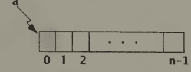

接下来，我们写

```c
--a;      /* 偏移指针 */
```

## 6.9 示例：合并与归并排序

内存中的情况变为如下：

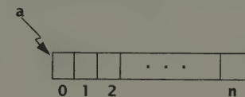

注意，阴影区域表示程序员不拥有的内存。因此，不应访问`a[1]`, ..., `a[ ]`：既不写入也不进行读取。然而，元素`a[1]`, ..., `a[n]`现在可以供程序员访问使用。要释放该空间，我们可以写`free(a + 1)`。

在第 571 页的第 12.6 节“矩阵的动态分配”中，当我们处理数学矩阵时，将扩展本节中介绍的思想。

## 6.9 示例：合并与归并排序

假设我们有两个有序的整数数组，例如`a[]`和`b[]`。如果我们想将它们合并到另一个有序数组`c[]`中处，那么实现此操作的算法非常简单。首先，比较`a[ ]`和`b[]`。哪一个较小（例如`b[0]`），将其放入`c[0]`。接下来，比较`a[0]`和`b[1]`。哪一个较小（例如`a[0]`），将其放入`c[1]`。接着，比较`a[1]`和`b[2]`，并将其放入`c[2]`，以此此类推。最终，数组`a[]`或`b[]`其中一个将耗尽。此时，另一个数组中剩余的元素只需复制到`c[]`中。这里有一个实现此操作的函数，以及一个将在测试我们函数的程序头文件：

在 mergesort.h 中

```c
#include <assert.h>
#include <stdio.h>
#include <stdlib.h>

void merge(int a[], int b[], int c[], int m, int n);
void mergesort(int key[], int n);
void wrt(int key[], int sz);
```

在 merge.c 中

```c
/* 将大小为 m 的 a[] 和大小为 n 的 b[] 合并到 c[]。 */
#include "mergesort.h"
void merge(int a[], int b[], int c[], int m, int n)
{
    int i = 0, j = 0, k = 0;

    while (i < m && j < n)
        if (a[i] < b[j])
            c[k++] = a[i++];
        else
            c[k++] = b[j++];

    while (i < m)
        c[k++] = a[i++];
    while (j < n)
        c[k++] = b[j++];
}
```

假设数组`c[]`包含足够的空间来存放`a[]`和`b[]`。程序员必须确保`c[]`的边界不会溢出。观察到用于提取任何剩余部分的最后一个`while`语句中，有一个（可能两个两个）不会执行。这是因为`i < m`和`j < n`这两个条件中至少有一个不成立。

接下来，我们将编写归并排序，它是非常高效的。我们的函数`mergesort()`将作用于一个数组`key[]`，其大小是 2 的幂。“2 的幂”的要求将有助于使解释变得更简单。在第 315 页的第 16 题中，我们说明了如何取消这一限制。为了理解归并排序的工作原理，让我们假设`key[]`包含以下 16 个整数：

- 4 3 1 67 55 8 0 4 -5 37 7 4 2 9 1 -1

该算法通过多次迭代对数据进行处理。下表显示了我们希望每轮迭代后数据的样子：

| 无序数据: | 4 | 3 | 1 | 67 | 55 | 8 | 0 | 4 | -5 | 37 | 7 | 4 | 2 | 9 | 1 | -1 |

|---|---|---|---|---|---|---|---|---|---|---|---|---|---|---|---|---|

| 第一轮迭代: | 3 | 4 | 1 | 67 | 8 | 55 | 0 | 4 | -5 | 37 | 7 | 4 | 2 | 9 | 1 | -1 |

| 第二轮迭代: | 1 | 3 | 4 | 67 | 0 | 4 | 8 | 55 | -5 | 4 | 7 | 37 | -1 | 1 | 2 | 9 |

| 第三轮迭代: | 0 | 1 | 3 | 4 | 4 | 8 | 55 | 67 | -5 | -1 | 1 | 2 | 4 | 7 | 9 | 37 |

| 第四轮迭代: | -5 | -1 | 0 | 1 | 2 | 3 | 4 | 4 | 4 | 7 | 8 | 9 | 37 | 55 | 67 | |

在第一轮迭代后，我们希望每一对相邻的整数有序。在第二轮迭代后，我们希望每组相邻的八个整数有序。在第三轮迭代后，我们希望每组相邻的八个整数有序。最后，在第四轮迭代后，我们希望所有 16 个整数都有序。在每个阶段，都使用`merge()`来完成所需的排序。例如，在第三轮迭代后，我们有两个子数组：

0 1 3 4 4 55 67 和 -5 -1 1 2 4 7 9 37

它们都是有序的。通过合并这两个子数组，我们得到了上表最后一行所示的完全有序数组。惊讶的是，实现此点的代码非常短，并且它说明了指针算法的威力。

在 mergesort.c 中

```c
/* 归并排序：使用 merge() 对大小为 n 的数组排序。 */
#include "mergesort.h"
void mergesort(int key[], int n) {
  int j, k, m, *w;
  for (m = 1; m < n; m *= 2) { /* m 是 2 的幂 */
    if (n < m) {
      printf("ERROR: Array size not a power of 2 - bye!\n");
      exit(1);
    }
    w = calloc(n, sizeof(int)); /* 分配工作空间 */
    assert(w != NULL); /* 检查 calloc() 是否工作 */
    for (k = 1; k < n; k *= 2) {
      /* 将 key[] 的子数组合并到一个子数组。 */
      merge(key, key + k, w, k, k);
      for (j = 0; j < 2 * k; j++)
        /* 写回 key */
        key[j] = w[j];
    }
    free(w); /* 释放工作空间 */
  }
}
```

### `mergesort()` 析

- `for (m = 1; m < n; m *= 2)`: 循环结束后，`m`的值为大于`n`的最小 2 的幂。如果`n`是 2 的幂，则`n`将等于`m`。

- `if (n < m) { printf("ERROR: Array size not a power of 2 - bye!\n"); exit(1); }`: 我们测试`n`是否为 2 的幂。如果不是，程序带有相应的消息退出。

- `w = calloc(n, sizeof(int));`: `calloc()`函数在标准库中，其原型在`stdlib.h`中。它用于为数组分配内存。函数的第一个参数指定数组中的元素个数，第二个参数指定存储每个元素的字节数。该函数返回一个指向分配空间的空指针。由于其类型是`void *`，该指针可以直接赋值给`w`。在传统的 C 中，我们会写成`w = (int *)calloc(n, sizeof(int))`以便将其作为数组使用。即使归并排序非常高效，需要额外的工作空间来排序也是一个缺点。

- `assert(w != NULL);`: 如果`calloc()`无法分配空间——例如系统堆耗尽——则返回`NULL`。我们使用了`assert.h`中的`assert()`宏来确保这种情况没有发生。如果表达式`w != NULL`为假，程序将在此处终止。

- `for (k = 1; k < n; k *= 2)`: 考虑第一个内部循环。在外层循环的第一轮迭代中，`k`为 1。

- `for (j = 0; j < n - k; j += k)`: `/* 将 key[] 的子数组合并到一个子数组。 */ merge(key, key + j, w, j, k);`

- `for (j = 0; j < 2 * k; j++)`: `/* 写回 key */ key[j] = w[j];`

这是算法的核心。假设开始时`key[]`中的数据如上表无序所示。在外层循环的第一轮迭代中，`k`为 1。

## 6.9 示例：合并与归排序

我们想要写一个程序来测试`merge()`和`mergesort()`函数。感兴趣的读者应该修改程序，在`mergesort()`中外层循环每次通过后打印数组`key[]`，以检查之前的表格是否正确生成。以下是组成程序的剩余两个函数：

在文件 main.c 中

```c
/* Test merge() and mergesort(). */
#include "mergesort.h"
int main(void)
{
    int sz, key[] = { 4, 3, 1, 67, 55, 8, 0, 4,
                     -5, 37, 7, 4, 2, 9, 1, -1 };
    sz = sizeof(key) / sizeof(int); /* the size of key[] */
    printf("Before mergesort:\n");
    wrt(key, sz);
    mergesort(key, sz);
    printf("After mergesort:\n");
    wrt(key, sz);
    return 0;
}
```

在文件 wrt.c 中

```c
#include "mergesort.h"
void wrt(int key[], int sz)
{
    int i;
    for (i = 0; i < sz; ++i)
        printf("%4d%s", key[i], (i < sz - 1) ? "" : "\n");
}
```

归排序对`n`个元素排序时的工作量与`n log n`成正比。与冒排序相比，这是一个非常显著改进。排序对于高效处理大量存储信息至关重要。然而，详细讨论该主题已超出本文范围；请参见Donald Ervin Knuth著的《The Art of Computer Programming, vol. 3, Sorting and Searching》（Reading, MA: Addison-Wesley, 1973）。

### 字符串

字符串是`char`类型的一维数组。按照习惯，C 语言中的字符串以字符串结束哨兵`\0`（或空字符）终止。空字符是一个所有位都关闭的字节；因此，其十进制值为零。处理字符串有其独特之处，将字符串视为具有可变长度并由`\0`分隔，但最大长度由字符串的大小决定，是很有用的。字符串的大小必须包含存储字符串结束哨兵所需的空间。与所有数组一样，程序员的职责是确保字符串不越界。

字符串常量写在双引号之间。例如，"abc" 是一个大小为 4 的字符数组，最后一个元素是空字符`\0`。注意，字符串常量与字符常量是不同的。例如，"a" 和 'a' 相等。数组 "a" 有两个元素，第一个值是 'a'，第二个值是 '\0'。

字符串常量像数组名本身一样被编译器视为指针。它的值是字符串的起始地址。考虑以下代码：

```c
char *p = "abc";
printf("%s\n", p, p + 1);  /* abc bc is printed */
```

变量`p`被赋值字符数组 "abc" 的起始地址。当以字符串格式打印指向`char`的指针时，会打印所指向的字符和每个随其后的字符，直到遇到字符串结束哨兵。因此，在`printf()`语句中，表达式`p`导致打印 abc，而表达式`p + 1`（指向字符串 "abc" 中的字母 b）导致打印 bc。因为像 "abc" 这样的字符串常量被视为指针，下面的表达式是可能的：

```c
"abc"[1]  *("abc" + 2)
```

（参见第 31 页的练习 22。）此类表达式在正式代码中并不使用，但它们有助于强调字符串常量被视为指针。正如我们看到的，数组和指针有类似的用途。它们也有不同——让我们考虑这两个声明：

```c
char *p = "abcde"; char s[] = "abcde";
```

在第一个声明中，编译器为`p`分配内存，在别处放置字符串常量 "abcde"，并用字符串的起始地址初始化`p`。现在认为`p`指向字符串。第二个声明等同于：

```c
char s[] = {'a', 'b', 'c', 'd', 'e', '\0'}; // 原应为 s[] = {'a', 'b', 'c', 'd', 'e', '\0'};
```

由于使用了括号，编译器为数组`s`分配内存。第一个字节用 'a' 初始化，第二个字节用 'b' 初始化，以此类推。以下是这些对象在内存中的存储方式：

![指针和字符串的内存表示]


`char` 始终存储在 1 个字节，在大多数机器上，指针存储在 4 个字节，而 `s` 存储在 6 个字节。由于技术原因，最好不要打印空字符。如果将空字符放入文件然后使用另一个工具处理，结果可能会产生混淆。（参见第 319 页。）然而，打印空字符串是可以接受的。在处理复数时会出现这种自然情况：

```c
char *s;
int count; /* get count from somewhere */
...
s = (count == 1) ? "s" : "s";
printf("We found %d s.\n", count);
```

为了说明字符串处理，我们将编写一个计算字符串中单词数量的函数。假设字符串中的单词由空格分隔。我们的函数将使用在 `ctype.h` 中定义的宏 `isspace()`。该宏用于测试字符是否为空、制表符、换行符或其他空白字符。如果是空白字符，则返回非零值（真）；否则返回零（假）。

## 第 6 章 数组、指针和字符串

```c
/* Count the number of words in a string. */
#include <ctype.h>
int word_cnt(const char *s) {
    int cnt = 0;
    while (*s != '\0') {
        while (isspace(*s)) { /* skip white space */
            ++s;
        }
        if (*s != '\0') { /* found a word */
            ++cnt;
            while (!isspace(*s) && *s != '\0') { /* skip the word */
                ++s;
            }
        }
    }
    return cnt;
}
```

这是一个典型的用于搜索各种字符或模式的字符串处理函数。通常使用字符指针来解析或解释字符串。

## 6.11 标准库中的字符串处理函数

ANSI C 为程序员提供了许多字符串处理函数；详情见附录 A“标准库”。在本节中，我们将说明几个选定的字符串处理函数并描述它们的工作原理。字符串处理函数的原型在标准头文件 `string.h` 中。

我们将看到字符串处理函数定义的某些参数类型为 `const char *`。在此上下文中，类型限定符 `const` 编译器不应修改所指向的字符。（参见第 321 页的练习 28。）然而，指针本身可以改变。

### 标准库中的一些字符串处理函数

- `char *strcat(char *s1, const char *s2);`

  该函数两个两个作为参数，连接它们并将结果放在 `s1` 中。程序员必须确保 `s1` 指向足够的空间来存储结果。返回字符串 `s1`。

- `int strcmp(const char *s1, const char *s2);`

  传递两个字符串作为参数。返回一个小于、等于或大于 `s2` 的整数，取决于 `s1` 在字典序上是否小于、等于或大于 `s2`。

- `char *strcpy(char *s1, const char *s2);`

  将字符串 `s2` 中的字符复制到 `s1`，直到移动了 `\0`。`s1` 中的任何内容都会被覆盖。假设 `s1` 有足够的空间存储结果。返回指针 `s1`。

- `size_t strlen(const char *s1);`

  返回 `\0` 之前的字符计数。ANSI C 要求 `size_t` 为无符号整数类型。通常，在 4 字节整数的系统中，它等同于 `unsigned int`；在 2 字节整数的系统中，它等同于 `unsigned long`。

这些函数并没有特别之处。可以用 C 语言编写，而且都非常短。它们中的变量通常被声明为 `register` 存储类，试图让它们执行得更快。这是 `strlen()` 函数的一种实现：

```c
size_t strlen(const char *s)
{
    size_t n;
    for (n = 0; *s != '\0'; ++s)
        ++n;
    return n;
}
```

# 第 4 章 数组、指针与字符串

循环持续计数直到检测到字符串结束字符 `'\0'`。例如，`strlen("abc")` 返回值 3，而 `strlen("")` 返回值 0。

`strcpy()` 的函数定义也很简单，但它包含一个需要详细解释的 C 语言用法。

```c
char *strcpy(char *s1, register const char *s2)
  register char *p = s1;
  while (*p++ = *s2++)
    ;
  return s1;
```

## strcpy() 函数剖析

- `register char *p = s1;`

观察到初始化的是 `p` 而不是 `*p`。指针 `p` 被初始化为指针 `s1`。因此，`p` 和 `s1` 指向同一个内存位置。

- `while (*p++ = *s2++)`

  ;

只要表达式 `*p++ = *s2++` 为真（不为 0），`while` 循环的体就会执行。然而，由于循环体是空的，所以它的执行没有产生任何影响。所有的操作都发生在控制 `while` 循环的表达式的副作用中。

- `*p++`

由于单元运算符 `++` 处于后置位置，它的优先级高于 `*` 运算符。因此，`*p++` 等于 `*(p++)`，这意味着 `p` 本身正在递增。相比之下，表达式 `(*p)++` 会增加 `p` 所指向的内容的值，而保持 `p` 本身的值不变。（参见 316 页的第 17 题）。表达式 `p++` 的值是 `p` 的当前值。该值被解引用；然后内存中 `p` 的值被增加，导致它指向字符串中的下一个字符。

- `*p++ = *s2++`

假设 `p` 指向一个字符串中的某个字符，假设 `s2` 指向另一个字符串中的某个字符。（另一种场景请参见 316 页的第 18 题。）`s2` 指向的值被赋值给 `p` 指向的值，而这正是整个表达式的值。然后 `p` 和 `s2` 都会被递增，使它们分别指向两个字符串中的下一个字符。

- `while (*p++ = *s2++);`

`p` 指向的字符被赋值为 `s2` 指向的字符的值。然后 `p` 和 `s2` 都会被递增，使它们分别指向下一个字符。这个过程持续到 `s2` 指向空字符 `'\0'`，其值为 0。在此时，值 0 被赋值给 `p` 指向的内容，放置了一个字符串结束哨兵，且整个表达式的值为 0，导致控制流退出 `while` 循环。所有这些操作的效果是将字符串 `s2` 复制到字符串 `s1` 中。

`strcat()` 函数也非常简单。可以用多种方式编写。这里是其中一种：

```c
char strcat(char *s1, register char *s2)
{
    register char *p = s1;
    while (*p)            /* 直到末尾 */
        ++p;
    while (*p++ = *s2++)    /* 拷贝 */
    ;
    return s1;
}
```

## strcat() 函数剖析

- `register char *p = s1;`

观察到初始化的是 `p` 而不是 `*p`。指针 `p` 被初始化为指针 `s1`。因此，`p` 和 `s1` 指向同一个内存位置。

- `while (*p)`

  `++p;`

只要 `p` 指向的值非零，`p` 就会增加，导致它指向字符串中的下一个字符。当 `p` 指向字符串结束哨兵 `'\0'` 时，表达式 `*p` 的值为 0。这导致控制退出 `while` 语句。注意，我们可以写成

```
while (*p != '\0') 代替 while (*p)
```

以达到相同的效果。函数通常写得比较稀疏。尽管人们可能认为稀疏的 C 代码产生运行更快的目标代码，但大多数 C 编译器为这两种形式的 `while` 语句产生相同的目标代码。

- `while (*p++) = *s2++`

  ;

在这个 `while` 语句开始时，`p` 指向 `s1` 所指字符串末尾的空字符。因此，`s2` 中的字符被一个接一个拷贝到内存中，覆盖 `s1` 末尾的空字符以及其后的任何内容。该 `while` 语句的整体效果是将 `s2` 拼接到 `s1` 的末尾。

下表展示了字符串处理函数。请仔细注意，为作为这些函数参数的字符串分配足够的空间是程序员的责任。

## 6.12 多维数组

| 定义与初始化 |

|---|---|

| `char s1[] = "beautiful big sky country", s2[] = "how now brown cow";` |

| 表达式 | 值 |

|---|---|

| `strlen(s1)` | 25 |

| `strlen(s2 + 8)` | 9 |

| `strcmp(s1, s2)` | 负整数 |

| 语句 | 输出的内容 |

| `printf("%s", s1 + 10);` | big sky country |

| `strcpy(s1 + 10, s2 + 8);` | |

| `strcat(s1, "!!");` | |

| `printf("%s", s1);` | beautiful brown cows! |

C 语言允许任何类型的数组，包括数组的数组。通过两对括号，我们得到了一个二维数组。这个思想可以迭代，以获得更高维的数组的数组。每增加一对括号，我们就增加一个数组维度。

| 数组定义的示例示例 | 备注 |

|---|---|

| `int a[100];` | 一个一维数组 |

| `int b[2][7];` | 一个二维数组 |

| `int c[5][3][2];` | 一个三维数组 |

一个 k 维数组的每个 k 维都有一个大小。如果 $s_i$ 表示其第 $i$ 维的大小，那么数组的定义将为 $s_1 \times s_2 \times \dots \times s_k$ 个元素分配空间。在前面的表中，$b$ 有 $2 \times 7$ 个元素，$c$ 有 $5 \times 3 \times 2$ 个元素。从数组的基地址开始，多维数组是连续存储的。（尽管这种机制通常不适用于处理矩阵；参见 571 页的 12.6 节“矩阵的动态分配”。）

## 二维数组

尽管数组元素是连续一个一个存储的，但将二维数组考虑为行和列的集合是方便的。例如，如果我们定义

```
int a[3][5];
```

那么我们可以这样考虑数组元素：

| 列 1 | 列 2 | 列 3 | 列 4 | 列 5 |

|---|---|---|---|---|

| 行 1 | `a[0][0]` | `a[0][1]` | `a[0][2]` | `a[0][3]` | `a[0][4]` |

| 行 2 | `a[1][0]` | `a[1][1]` | `a[1][2]` | `a[1][3]` | `a[1][4]` |

| 行 3 | `a[2][0]` | `a[2][1]` | `a[2][2]` | `a[2][3]` | `a[2][4]` |

由于数组与指针之间的关系，有多种方法访问二维数组的元素：

| 等于 `a[i][j]` 的表达式 |

|---|

| `*(a + i) + j` |

| `*(a + i)[j]` |

| `((a + i) + j)[0]` |

| `*(a[i] + j)` |

| `&a[0][0] + i*5 + j` |

括号是必要的，因为 `[]` 的优先级高于 `*`。

## 存储函数

对于任何数组，指针值与索引之间的映射被称为存储函数。考虑定义

```
int a[3][5];
```

对于数组 `a`，存储函数通过以下方式指定：

```
a[i][j]          同于      a[0][0] + 5*i + j
```

## 形式参数定义

当多维数组作为函数定义中的形式参数时，除第一个之外的所有尺寸都必须指定，以便编译器确定正确的存储映射函数。（由于这一点，多维数组通常不适用于数学编程；参见 571 页的 12.6 节“矩阵的动态分配”。）考虑定义

```
int a[3][5];
```

这为一个 3 × 5 的矩阵分配了空间。它的行大小为 3，列大小为 5。在矩阵元素赋值后，可以使用以下函数对矩阵元素求和。请注意必须指定列大小。

```c
int sum(int a[][])
{
    int i, j, sum = 0;
    for (i = 0; i < 3; ++i)
        for (j = 0; j < 5; ++j)
            sum += a[i][j];
    return sum;
}
```

在函数定义的头文件中，以下三个参数定义是等价的：

```
int a[][5]          int a[3][5]      int (*a)[5]
```

...是因为运算符的优先级。*注意：*这三个声明仅在函数定义的头文件中是等价的。

这些思想与一维数组的情况有关。回想一下，在函数定义的头文件中，以下三个声明是等价的：

```
int b[]          int b[3]          int *b
```

在第二个声明中，`3` 只是给读代码的人类阅读者一个提醒，但编译器会忽略它。*注意：*这三个声明仅在函数定义的头文件中是等价的。

`int` 类型并没有什么特殊之处。例如，在函数定义的头文件中，以下三个声明是等价的：

```
char *argv[]      char argv[3]      char **argv
```

虽然一对括号可以被一个 `*` 替换，但该规则并不适用于所有情况。例如，在函数定义的头文件中：

```
char x[][]      并不等价于      char **x
```

## 三维数组

维度大于二的数组工作方式类似。让我们描述一下三维数组是如何工作的。如果我们声明：

```
int a[7][9][2];
```

那么编译器将为 $7 \times 9 \times 2$ 个连续的 `int` 分配空间。数组的基地址是 `a[0][0][0]`，存储映射函数通过规定指定：

```
a[i][j][k]          等价于      *(a[0][0][0] + 9*2*i + 2*j + k)
```

如果在程序中使用如 $a[i][j][k]$ 的表达式，编译器将使用存储映射函数生成对象代码以访问内存中正确的数组元素。这里是一个求数组元素和的函数。请注意，第一个维度的大小*必须*指定。

```c
int sum(int a[][][9][2])
{
    int i, j, k, sum = 0;
    for (i = 0; i < 7; ++i)
        for (j = 0; j < 9; ++j)
            for (k = 0; k < 2; ++k)
                sum += a[i][j][k];
    return sum;
}
```

在函数定义的头文件中，以下三个参数声明是等价的：

```
int a[][][2]          int a[7][9][2]          int (*a)[9][2]
```

在第二个声明中，常量 `7` 充当对行数的人类读者的提醒，但编译器会忽略它。其他常量是编译器生成正确的存储映射函数所需要的。注意：这三个声明仅在函数定义的头文件中是等价的。

## 初始化

有多种方法初始化多维数组。让我们从考虑以下三个等价的初始化开始讨论：

```
int a[2][3] = {1, 2, 3, 4, 5, 6};
int a[2][3] = {{1, 2, 3}, {4, 5, 6}};
int a[][3] = {{1, 2, 3}, {4, 5, 6}};
```

如果没有内层括号（内部大括号），则每个数组元素 `a[0][0]`, `a[0][1]`, ..., `a[1][2]` 将被依次初始化。如果初始化器的数量少于数组元素的数量，则剩余元素将初始化为零。如果第一对内部括号为空，在任何情况下，除第一个之外的所有尺寸都必须显式给出。如果我们愿意放入所有的大括号，那么就不需要指定所有的零。

考虑初始化：

```
int a[2][2][3] = {
    {{1, 1, 0}, {2, 0, 0}},
    {{3, 0, 0}, {4, 4, 0}}
};
```

等价的初始化为：

```
int a[][][2][3] = {{1, 1}, {2}}, {3}, {4, 4}};
```

如果初始化器被完全且一致地括起来，那么在列出的初始化器不足的地方，剩余元素将初始化为零。

通常情况下，如果一个存储类为 `automatic` 的数组没有显式初始化，那么数组元素将从“垃圾”值开始。这里是将所有数组元素初始化为零的简单方法：

```
int a[2][2][3] = {0};               /* 所有元素初始化为零 */
```

与自动数组不同，所有静态和外部数组默认初始化为零。

## typedef 的使用

让我们通过定义少数操作向量和矩阵的函数来说明 `typedef` 的使用。

```c
#define N 3               /* 所有向量和矩阵的大小 */
typedef double scalar;
typedef scalar vector[N];
typedef scalar matrix[N][N];
```

我们使用了 `typedef` 机制创建了 `scalar`、`vector` 和 `matrix` 类型，这既是自文档的，在概念上也是合适的。我们的编程语言以自然的方式进行了扩展，以包含这些新类型作为一个领域。注意 `typedef` 如何用于构建类型的层次结构。例如，我们可以写：

```
typedef vector matrix[N];
```

来代替

```
typedef matrix[N][N];
```

使用 `typedef` 创建诸如 `scalar`、`vector` 和 `matrix` 等类型名允许程序员从应用程序的角度进行思考。现在，我们准备好创建操作我们域的函数了。


```c
void add(vector x, vector y, vector z) /* x + y */
{
    /* 省略 */
}

scalar dot_product(vector x, vector y)
{
    /* 省略 */
}

void multiply(matrix a, matrix b, matrix c)    /* a * b */
{
    /* 省略 */
}
```

这些例程不是通用的，因为它们只适用于固定大小。我们将展示如何消除这种限制。

# 6.1 指针数组

在 C 语言中，数组元素可以是任何类型。指针数组可以被视为字符串数组。为了对该文件中的单词，我们将给出命令：

```
sort_words < input
```

这应该会导致屏幕上打印出：

```
A
alphabet
```

现在我们准备好编写程序了。它将由头文件和 `.c` 文件组成。这里是头文件和`main()`函数：

文件`sort.h`

```c
#include <stdio.h>
#include <stdlib.h>
#include <string.h>

#define MAXWORD 50    /* 最大单词大小 */
#define N 300         /* w[] 数组大小 */
```

```c
void error_exit_calloc_failed(void);
void error_exit_too_many_words(void);
void error_exit_word_long(void);
void sort_words(char *w[], int n);
void swap(char **p, char **q);
void wrt_words(char *w[], int n);
```

文件`main.c`

```c
/* 按字典序排序单词。 */
#include "sort.h"

int main(void)
{
    char word[MAXWORD];    /* 工作空间 */
    char *w[N];             /* 指针数组 */
    int n;                  /* 要排序的单词数量 */
    int i = 0; scanf("%s", word) == 1; ++i) {
        if (i >= N)
            error_exit_too_many_words();
        if (strlen(word) >= MAXWORD)
            error_exit_word_long();
        w[i] = calloc(strlen(word) + 1, sizeof(char));
        if (w[i] == NULL)
            error_exit_calloc_failed();
        strcpy(w[i], word);
    }
    n = i;
    sort_words(w, n);      /* 排序单词 */
    wrt_words(w, n);       /* 打印排序后的单词列表 */
    return 0;
}
```

# 第 6 章 数组、指针与字符串

```c
char word[MAXWORD];      /* 工作空间 */
char       *w[N];               /* 一个指针数组 */
```

我们使用数组`word`来临时存储从输入文件中读取的每个单词，我们期望每个单词的长度少于`MAXWORD`个字符。如下声明：

```c
char       *w[N]; 等同于 char *(w[N]);
```

因此，我们得到了一个指向`char`类型的指针数组。该数组最终将存储我们从输入文件中读取的所有单词。

```c
for (i = 0; scanf("%s", word) == 1; ++i) {
    ....
```

只要`scanf()`能够从标准输入文件读取字符并存储在`word`中，`for`循环体就会执行。记住，`scanf()`接收的参数是一个控制字符串，后面紧跟了与控制字符串中格式相匹配的地址。`scanf()`的第二个参数是数组名本身。由于数组名本身被视为一个地址，因此我们不需要写`&word`。从技术上讲，这样做会是一个错误。某些编译器会就此类错误警告程序员，而另一些则不会。

```c
if (i >= N)
    error_exit_too_many_words();
    if (strlen(word) >= MAXWORD)
        error_exit_word_too_long();
```

如果单词太多，我们会打印一条错误消息并退出。如果此时读取的单词中字符过多，我们会打印错误消息并退出。通过调用错误函数来实现这些操作，我们减少了`main()`函数中的混乱代码。

```c
w[i] = calloc(strlen(word) + 1, sizeof(char));
```

`calloc()`函数位于标准库中，其原型在`stdlib.h`中。如下所示的函数

```c
calloc(n, sizeof(...))
```

会为一个包含`n`个元素的数组动态分配空间，每个元素在内存中需要`sizeof(...)`字节，并返回一个指向所分配空间的指针。存储字符串`word`（包括字符串结束哨兵符`\0`）所需的最小字节数是`strlen(word) + 1`。（`+1`是重要的，遗憾的是很容易被忘记）。`calloc()`函数动态分配这块空间并返回其指针。该指针被赋值给`w[i]`。

我们可以调用`malloc()`而不是`calloc()`。以下语句任一都可以正常工作：

```c
w[i] = malloc(strlen(word) + 1) * sizeof(char);
w[i] = calloc(strlen(word) + 1);
```

这两个语句是等价的，因为`sizeof(char)`的值为 1。这样写的目的是提醒读者程序请求了一个`char`数组的代码空间。使用`calloc()`时，分配的空间会被初始化为零，但使用`malloc()`则不进行初始化。由于我们将重写该空间，因此不需要初始化。

- `if (w[i] == NULL)`

  `error_exit_calloc_failed();`

良好的编程习惯要求我们检查`calloc()`和`malloc()`的返回值。如果请求的内存不可用，则返回`NULL`。如果是如此，我们会打印错误消息并退出。

- `strcpy(w[i], word);`

在分配空间后，使用`strcpy()`函数将`word`复制到从地址`w`开始的内存中。我们可以将`w`视为一个单词数组。

- `sort_words(w, n);`      /* 单词排序 */

  `wrt_words(w, n);`         /* 排序后的单词列表 */

`sort_words()`函数用于对数组`w`中的单词进行字典序排序。然后，使用`wrt_words()`将排序后的单词列表写到屏幕上。

我们来看`sort_words()`函数。它使用了一种与冒泡排序风格相似的交换排序。

在文件`sort.c`中：

```c
#include "sort.h"
void sort_words(char *w[], int n) /* 需要排序的 n 个元素 */
{
  int i, j;
  for (i = 0; i < n; ++i)
    for (j = i + 1; j < n; ++j)
      if (strcmp(w[i], w[j]) > 0)
        swap(&w[i], &w[j]);
}
```

注意`strcmp()`比较由`w[i]`和`w[j]`指向的字符串。如果它们的顺序错误，我们使用`swap()`函数交换两个指针的值。传递的是指针的地址，以便在调用环境中更改指针本身的值。内存中的底层字符字符串不会被交换，交换的只是指向它们的指针。

## 交换之前

## 交换之后

在文件`swap.c`中：

```c
#include "sort.h"
void swap(char **p, char **q)
{
    char *tmp;
    tmp = *p;
    *p = *q;
    *q = tmp;
}
```

传递给`swap()`的两个参数`w[i]`和`&w[j]`都是指向`char`指针的地址，等同于指向`char`指针的指针。因此，`swap()`函数定义中的参数类型为`char **`。`swap()`函数与我们写的非常相似；只是类型不同。考虑语句

```c
tmp = *p;
```

由于`p`是一个指向`char`指针的指针，表达式`*p`解引用后的类型为`char *`。因此，我们将`tmp`声明为`char *`。

在文件`error.c`中：

```c
#include "sort.h"
void error_exit_calloc_failed(void)
{
    printf("%s",
           "ERROR: The call to calloc() failed to allocate the requested memory\n");
    exit(1);
}
```

```c
void error_exit_too_many_words(void)
{
    printf("ERROR: At most %d words can be sorted\n", N);
    exit(1);
}
```

```c
void error_exit_word_too_long(void)
{
    printf("%s",
           "ERROR: A word was too long!\n");
    exit(1);
}
```

在文件`wrt.c`中：

```c
#include "sort.h"
void wrt_words(char *w[], int n)
{
    int i;
    for (i = 0; i < n; ++i)
        printf("%s\n", w[i]);
}
```

# 6.13 命令行参数

在 C 语言中，`main`函数接收两个参数：`argc`和`argv`。`argc`是命令行参数的数量，而`argv`是一个指向字符串常量的指针数组。

```c
int main(int argc, char *argv[])
{
    printf("You entered %d arguments.\n", argc);
    return 0;
}
```

当你运行程序时，命令行中的字符串会被传递给该程序。`argv[0]`通常是程序本身的名称。

# 6.14 输入输出

在 C 语言中，我们通常通过`printf()`进行输出，通过`scanf()`进行输入。

```c
#include <stdio.h>
int main()
{
    int age;
    printf("Enter your age: ");
    scanf("%d", &age);
    printf("You are %d years old.\n", age);
    return 0;
}
```

`printf()`使用格式字符串来控制如何输出数据。`scanf()`接收一个控制字符串，后面跟着与控制字符串中格式匹配的地址。

标识符`p`是一个指向`char`指针的一维数组。它的声明为两个指针开留了空间（在本机器上，每个指针占用 4 字节）。元素`p[0]`被初始化为指向"abc:"，这是一个需要 5 个字符空间的字符串。元素`p[1]`被初始化为指向"is ..."，这是一个需要 15 个字符空间的字符串，包括字符串末尾的空字符`\0`。因此，`p`完成工作所需的空间比`a`更少。此外，编译器没有生成用于访问`p[i][j]`的存储映射函数代码，这意味着`p`完成工作的速度比`a`快。注意，`a[0][14]`是一个有效表达式，但`p[0]`不是。表达式`p[0][14]`越出了`p[0]`所指字符串的边界。当然，`a[0][14]`越出了存储在`a[0]`中的字符串本身，但它并没有越出数组`a[0]`。因此，表达式`a[0][14]`是可以的。

另一个区别是，`p[0]`和`p[1]`指向的字符串是常量字符串，因此无法更改。相比之下，`a[0]`和`a[1]`指向的字符串是可以修改的。

其元素用于指向不同大小数组的数组被称为“锯形数组”（ragged array）。因为在前面的程序中，`p`的行长度不同，所以它是锯形数组的一个示例。如果我们认为元素`p[i][j]`是按行和列排列的“矩形”元素集合，那么不一致的行长度使得这个“矩形”看起来参差不齐。因此得名为“锯形数组”。

## 锯形数组

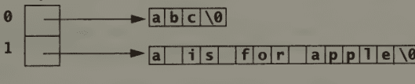

# 6.16 函数作为参数

在 C 语言中，函数指针可以作为参数传递、用在数组中、从函数返回等。在本节中，我们将描述这种机制是如何工作的。假设我们想用各种函数进行计算。考虑：

```
n = sum f(k)
k=m to n;
```

其中在一种实例中`f(k) = sin(k)`，在另一种实例中`f(k) = 1 / k`。以下例程完成了任务：

在文件`sum_sqr.c`中：

```
#include "sum_sqr.h"
double sum_square(double f(double x), int m, int n)
{
    int k;
    double sum = 0.0;
    for (k = m; k <= n; ++k)
        sum += f(k) * f(k);
    return sum;
}
```

在函数定义的头文件中，第一个参数声明告诉编译器`f`是一个接受`double`类型参数并返回`double`的函数。标识符`x`是给人类读者阅读的；编译器忽略它。因此，我们可以写成：

```
double sum_square(double f(double), int m, int n)
{
    ....
```

当函数出现在参数声明中时，编译器将其解释为指针。这里有一个与函数定义等效的头文件：

```
double sum_square(double (*f)(double), int m, int n)
{
    ....
```

我们将第一个参数声明读为：“`f`是一个函数指针，它接受一个`double`类型参数并返回一个`double`”。括号是必要的，因为`()`的优先级比`*`高。相比之下，考虑声明：

```
double *g(double);
```

这声明`g`是一个接受`double`类型参数并返回`double`指针的函数。

在`sum_square()`的函数定义体中，我们可以将指针像函数一样对待，也可以显式地解引用该指针。例如，我们可以写成：

```
sum += (*f)(k) * (*f)(k);      而不是      sum += f(k) * f(k);
```

将构造结构`(*f)(k)`思考如下形式是有帮助的：

- `f`          指向函数的指针

- `*f`         函数本身

- `(*f)(k)`    对函数的调用

为了说明如何使用函数`sum_square()`，让我们写一个完整的程序。在`main()`中，我们将使用来自数学库的`sin()`以及我们将定义的函数`f()`。

在文件`sum_sqr.h`中：

```
#include <math.h>
#include <stdio.h>

double f(double x);
double sum_square(double x, int m, int n);
```

在文件`main.c`中：

```
#include "sum_sqr.h"
int main(void)
{
    printf("%s.%%f\n%s.%%f\n",
           "First computation: ", sum_square(f, 1, 10000),
           "Second computation: ", sum_square(sin, 2, 13));
    return 0;
}
```

在文件`fct.c`中：

```
#include "sum_sqr.h"
double f(double x)
{
    return 1.0 / x;
}
```

该程序的输出是：

```
First computation: 1.6448341
Second computation: 5.7577885
```

在数学中已知，从 1 到无穷大的 $1/k^2$ 之和是 $\pi^2/6$。注意程序输出中的第一个数字就是它的近似值。

# 函数作为形式参数

有多种等效的方法可以写具有函数形式参数的原型。为了说明这一点，让我们为`sum_square()`写一组等效的函数原型：

```
double sum_square(double (double x), int m, int n);
double sum_square(double (double), int m, int n);
double sum_square(double (double), int, int);
double sum_square(double (*f) (double), int, int);
double sum_square(double **) (double), int, int);
double sum_square(g (double), int a, b);
```


在上述列表中，符`m`和`n`是可选的；如果存在，编译器会忽略它们。同样，标识符`(*f)`是可选的。因此，当我们把上述列表放在`sum_sqr.h`中，它可以像以前一样编译和运行。

## 6.17 示例：使用二分法求根

工程、数学和物理中出现的一个重要问题是找到连续函数的根。对于简单的情况——例如如果`f`是多项式——公式是已知的。但通常情况下，必须通过数值方法找到根。

假设`f`在区间`[a, b]`上连续。如果`f(a)`和`f(b)`符号相反，那么连续性保证它在`[a, b]`内有根。二分法的方法如下：令`m`为区间的中点。如果`f(m)`为零，我们找到了根。如果不是，且`f(a)`和`f(m)`符号相反，那么我们知道`f`在区间`[a, m]`内有根，现在重新开始该过程。每次迭代，我们都会得到一个长度为之前一半的区间。当区间足够小时，我们取其中点作为根的近似值。

## 6.17 ▼ 示例：使用二分法找到函数的根

在文件`fct.c`中：

```c
#include "find_root.h"

dbl f(dbl x)
{
    return (x * x * x * x * x - 7.0 * x - 3.0);
}
```

在数学中，希腊字母 "epsilon"（写作$\epsilon$）通常用于表示一个很小的正数（数值）。在数学编程中，标识符`eps`通常被用来扮演类似于数学中$\epsilon$的角色。

在`main()`中，`a`的值为-10，`b`的值为+10。因此，区间`[a, b]`等于区间`[-10, +10]`。显然，`f(-10)`是负数，而`f(+10)`是正数。也就是说，函数`f`在区间`[a, b]`的两端点取符号相反的值，这意味着可以使用二分法来找到`f`的近似根。该方程有三个实根和一对复根。二分法只能找到一个实根，且该根取决于最初选择的区间`[a, b]`。

以下是`fct`调用的输出：

- `fct`调用次数: 49
- 近似根: 1.719628091844341
- 函数值: -0.000000000000000977

如果我们在`main()`中用`1e-15`代替`1e-13`作为`eps`的值，那么打印出来将是零。我们没有在程序中使用`1e-15`，因为我们不想给读者留下找到实际根的印象。如果我们将程序改为使用`long double`代替`double`，将`eps`的值从`1e-13`改为`1e-31`，并将`printf()`语句中的格式`%16f`改为`%33f`，那么在我们的系统上将打印以下内容：

- `fct`调用次数: 109
- 近似根: 1.71962809184434572494221890955955
- 函数值: -0.00000000000000000000000055

无论我们做多少工作，我们都不期望得到根的精确十进制表示。尽管我们不确定，但该根可能是一个无理数。

格式中`%`之后的空格在相应参数为正数时会打印一个空格，但如果参数为负数则没有影响。这为对齐正负数提供了一种机制。（有关格式的细节，请参见第493页第11.1节“输出函数`printf()`”。）

# 开普勒方程

在17世纪初，约翰内斯·开普勒（Johannes Kepler）想要求解方程

$m = x - e \sin(x)$

对于参数`m`和`e`的各种值。观察此问题的一种方法是将

$y = x \quad \text{且} \quad y = m + e \sin(x)$

结合画图。开普勒方程的解即对应于两条图线的交点。

## 开普勒方程的解

我们想写一个程序，当参数值为`m = 2.2`和`e = 0.5`时求解开普勒方程。注意，求解

$m = x - e \sin(x) \quad \text{等同于求解} \quad x - e \sin(x) - m = 0$

我们的程序将通过二分法找到函数$x - e \sin(x) - m$的根来求解开普勒方程。以下是我们的程序：

在文件`kepler.h`中：

```c
#include <assert.h>
#include <math.h>
#include <stdio.h>

typedef double dbl;

extern int        cnt;
extern const dbl  eps;    /* epsilon,一个小数值 */
extern const dbl  e;       /* 开普勒方程中的一个参数 */
extern const dbl  m;       /* 开普勒方程中的一个参数 */

dbl bisection(dbl f(dbl x), dbl a, dbl b);
dbl kepler(dbl x);
```

在文件`main.c`中：

```c
/* 使用二分法求解开普勒方程。 */
#include "kepler.h"

int             cnt = 0;
const dbl eps = 1e-15;     /* epsilon,一个小数值 */
const dbl e = 0.5;          /* 开普勒方程中的一个参数 */
const dbl m = 2.2;          /* 开普勒方程中的一个参数 */

int main(void)
{
    dbl a = -100.0;
    dbl b = +100.0;
    dbl root;
    assert(kepler(a) * kepler(b) <= 0.0); /* 递归函数调用 */
    root = bisection(kepler, a, b);
    printf("%s%d\n%s%.15f\n%s%.15f\n",
           "No. of fct calls: ", cnt,
           "Approximate root: ", root,
           "Function value: ", kepler(root));
    return 0;
}
```

# 数组、指针和字符串

在文件`kepler.c`中：

```c
#include "kepler.h"
dbl kepler(dbl x)
{
    return (x - e * sin(x) - m);
}
```

`bisection()`函数与我们在第299页第6.17节“示例：使用二分法找到函数的根”中写的相同。以下是输出：

- `fct`调用次数: 59
- 近似根: 2.499454281635051
- 函数值: 0.0000000000000

## 6.18 函数指针数组

在上一节讨论的开普勒程序中，`bisection()`的第一个参数是一个函数，或者更准确地说，是一个函数指针。在C中，函数名本身被编译器视为指向函数的指针（这类似于数组名本身被视为指向内存中数组基地址的指针）。从技术上说，当我们把`kepler`作为参数传递给`bisection()`时，它被传递了`kepler`的地址。

以下是另一种编写`main()`函数的方式，为了使`kepler`的指针性质显而易见：

```c
int main(void)
{
    dbl a = -100.0;
    dbl b = +100.0;
    dbl root;
    assert(kepler(a) * kepler(b) <= 0.0); /* 递归函数调用 */
    root = bisection(kepler, a, b);
    printf("%s%d\n%s%.15f\n%s%.15f\n",
           "No. of fct calls: ", cnt,
           "Approximate root: ", root,
           "Function value: ", kepler(root));
    return 0;
}
```

注意：当我们把`kepler`作为参数传递给`bisection()`时，它传递了`kepler`的地址。在接下来的程序中，我们创建一个数组：

```c
int main(void)
{
    dbl a = -100.0;
    dbl b = +100.0;
    dbl root;
    assert(kepler(a) * kepler(b) <= 0.0); /* 递归函数调用 */
    root = bisection(kepler, a, b);
    printf("%s%d\n%s%.15f\n%s%.15f\n",
           "No. of fct calls: ", cnt,
           "Approximate root: ", root,
           "Function value: ", kepler(root));
    return 0;
}
```

（注：此处原文似乎存在文本错乱，已根据逻辑重新组织了翻译中的代码块）

`assert(kepler(a) * kepler(b) <= 0.0); /* 递归函数调用 */`

`root = bisection(kepler, a, b);`

`printf("%s%d\n%s%.15f\n%s%.15f\n", "No. of fct calls: ", cnt, "Approximate root: ", root, "Function value: ", kepler(root));`

（注：此处原文似乎存在文本错乱，已根据逻辑重新组织了翻译中的代码块）

```c
int main(void)
{
{    dbl a = -100.0;
    dbl b = +100.0;
    dbl root;
    assert(kepler(a) * kepler(b) <= 0.0); /* 递归函数调用 */
    root = bisection(kepler, a, b);
    printf("%s%d\n%s%.15f\n%s%.15f\n",
           "No. of fct calls: ", cnt,
           "Approximate root: ", root,
           "Function value: ", kepler(root));
    return 0;
}
```

（注：此处原文似乎存在文本错乱，已根据逻辑重新组织了翻译中的代码块）

```c
int main(void)
{
{
    dbl a = -100.0;
    dbl b = +100.0;
    dbl root;
    assert(kepler(a) * kepler(b) <= 0.0); /* 递归函数调用 */
    root = bisection(kepler, a, b);
    printf("%s%d\n%s%.15f\n%s%.15f\n",
           "No. of fct calls: ", cnt,
           "Approximate root: ", root,
           "Function value: ", kepler(root));
    return 0;
}
```

（注：此处原文似乎存在文本错乱，已根据逻辑重新组织了翻译中的代码块）

```c
int main(void)
{
{
    dbl a = -100.0;
    dbl b = +100.0;
    dbl root;
    assert(kepler(a) * kepler(b) <= 0.0); /* 递归函数调用 */
    root = bisection(kepler, a, b);
    printf("%s%d\n%s%.15f\n%s%.15f\n",
           "No. of fct calls: ", cnt,
           "Approximate root: ", root,
           "Function value: ", kepler(root));
    return 0;
}
```

（注：由于原文提供的待翻译文本存在段落重复和错乱，以下翻译基于逻辑结构进行了整理）

在文件`find_roots.h`中：

```c
#include <assert.h>
#include <math.h>
#include <stdio.h>

#define N 4                /* 指针数组的大小 */
typedef double dbl;

/* 定义函数指针 */
typedef double (*pfdd)(dbl);

extern int cnt;
extern const dbl eps;      /* epsilon,一个小数值 */

dbl bisection(pfdd f, dbl a, dbl b);
dbl f1(dbl x);
dbl f2(dbl x);
dbl f3(dbl x);
```

在文件`main.c`中：

```c
/* 使用二分法寻找根。 */
#include "find_roots.h"
int cnt = 0;               /* epsilon,一个小数值 */
const dbl eps = 1e-13;
int main(void)
{
    int begin_cnt;
    int i;
    int nfct_calls;
    dbl a = -100.0;
    dbl b = +100.0;
    dbl root;
    dbl val;
    pfdd f[N] = {NULL, f1, f2, f3};

    for (i = 1; i < N; ++i) {
        assert(f[i](a) + f[i](b) <= 0.0);
        begin_cnt = cnt;
        root = bisection(f[i], a, b);
        nfct_calls = cnt - begin_cnt;
        val = f[i](root);
        printf("%s%d%s%.15f\n%s%d%s%.15f\n%s%d\n\n",
               "For [", i, "]近似根为 x0 = ", "\n", root,
               "根处的函数求值: f[", i, "] = %f\n", val,
               "调用 bisection() 的次数 = %d\n", nfct_calls);
    }
    return 0;
}
```

在文件`bisection.c`中：

```c
#include "find_roots.h"
dbl bisection(pfdd f, dbl a, dbl b)
{
    dbl
    dbl m = (a + b) / 2.0;               /* 中点 */

    ++cnt;
    if (f(m) == 0.0 || b - a < eps) /* 递归函数调用 */
        return m;
    else if (f(a) * f(b) <= 0.0)
        return bisection(f, a, m);
    else
        return bisection(f, m, b);
}
```

# find_roots 程序的剖析

+   /* // 定义类型 ptr to fct taking a dbl and returning a dbl." */

```c
typedef double (*pfdd)(dbl);
```

这个`typedef` `pfdd`为“接受单个`double`类型参数并返回`double`的函数指针”类型提供了一个新名称。我们将看到使用`pfdd`使代码更容易编写，也更易读。

- ■ `dbl bisection(pfdd f, dbl a, dbl b);`

这是`bisection()`函数的原型。由于`pfdd`是一个类型别名（typedef），参数声明`pfdd`等同于在类型定义本身中将`f`替换为`pfdd`所得到的结果。因此，`pfdd`等同于`dbl (*f) (dbl)`，这里还有另外两个等价的`bisection()`函数原型。

```c
dbl bisection(dbl f(dbl), dbl a, dbl b);
dbl bisection(dbl f(dbl x), dbl a, dbl b);
```

虽然这些写法较长，但某些程序员更倾向于它们。任何一种风格都是可以的。

- ■ `pfdd f[N] = {NULL, f1, f2, f3};`

我们将`f`声明为一个包含`N`个元素的数组，每个元素的类型为`pfdd`。该数组用四个指针值初始化，第一个是`NULL`。初始化`f[0]`被赋值为`NULL`，`f[1]`被赋值为`f1`，`f[2]`被赋值为`f2`，依此类推。我们不能使用`f[0]`。以下声明是等价的：

```c
pfdd f[N] = {NULL, f1, f2, f3};
pfdd f[N] = {NULL, &f1, &f2, &f3};
dbl (*f[N]) (dbl) = {NULL, f1, f2, f3};
dbl (*f[N]) (dbl) = {NULL, &f1, &f2, &f3};
```

我们可以从此列表中任选一个作为`f`的声明。单独的函数名（如`f1`）可以被视为一个指针。但我们也可以将其视为函数名，而`&f1`是指向该函数的指针。ANSI C允许在这种问题上的歧义思维。

- ■ `root = bisection(f[i], a, b);`

在这里，指针`f[i]`被作为参数传递给`bisection()`。相应地，我们可以写成：

```c
root = bisection(*f[i], a, b);
```


当解引用指针时，我们得到它所指向的函数。但编译器将函数本身视为指向函数的指针，因此这两种写法是等价的。“函数本身”一词意味着函数后面没有跟着括号。如果函数名、函数指针或解引用后的函数指针后面跟着括号，则表示我们对该函数进行了调用。

- `f[i](a)`、`f[i](b)`、`f[i](root)`

这些是对 `f[i]` 所指向的函数的调用。如果我们愿意，可以使用：

```c
(*f[i])(a)
(*f[i])(b)
(*f[i])(root)
```

代替。输出显示对于每个 `i`，`f[i](root)` 都接近零，这应该是正确的。注意，我们的每个函数 `f1()`、`f2()` 和 `f3()` 在区间 `[-100, 100]` 的端点恰好取相反的值。如果该条件不成立，我们对 `bisection()` 的调用将无法完成。

## 6.19 类型限定符 `const` 和 `volatile`

ANSI 委员会向 C 语言增加了 `const` 和 `volatile` 关键字。这些关键字在传统的 C 中是不可用的。它们被称为类型限定符，因为它们限制了（或限定了）给定类型标识符的使用方式。

让我们先讨论 `const` 的用法。通常在声明中，`const` 位于存储类之后（任何存储类均可），但在类型之前。考虑声明：

```c
static const int k = 3;
```

我们将其读为“`k` 是一个具有静态存储类的常量型 `int`”。因为 `k` 的类型被 `const` 限定了，我们可以初始化 `k`，但此后 `k` 不能被赋值、递增、递减或以其他方式修改。

在 C 中，尽管变量被 `const` 限定了，它仍不能用于指定数组的大小。但在 C++ 中，这是可以的。

```c
const int n = 3;
int v[n];
```

在某些情况下，可以使用 `const` 限定的变量来代替符号常量；在其他情况下则不能。未限定的指针不应被赋值为 `const` 限定变量的地址。以下代码说明了这一点：

```c
const int a = 7;
int *p = &a; // 编译器会报错
```

由于 `p` 是普通的 `int` 指针，我们可以在稍后的表达式中使用 `++p` 来改变 `a` 的值，这违反了 `a` 是常量的概念。如果我们写成：

```c
const int a = 7;
const *p = &a;
```

那么编译器就会满意。最后的声明读为“`p` 是一个指向 `int` 的常量指针，其初始值为 `a`”。注意 `p` 本身不是常量。我们可以将其指向其他地址。我们不能给 `p` 赋值。`p` 指向的对象不应被修改。通过如下声明：

```c
int a;
int *const p = &a;
```

最后的声明告诉编译器 `p` 是一个指向 `int` 的常量指针，其初始值为 `a`。此后，我们不能给 `p` 赋值，但可以给 `*p` 赋值。

与 `const` 相比，类型限定符 `volatile` 很少使用。`volatile` 对象是可以被硬件修改的。现在考虑声明：

```c
extern volatile int a;
```

这意味着“在其他地方或其他文件中查找它”。该限定符表示该对象可以被硬件操作。由于 `const` 也是一种限定符，对象在程序内部不能被赋值、递增或递减。

## 总结

1. 括号 `[]` 在声明中用于告诉编译器标识符是一个数组。括号中的整数常量指定数组的大小。例如：

   ```c
   int a[100];
   ```

   这会导致编译器在内存中为 100 个 `int` 分配连续空间。数组元素从 0 编号到 99。数组名 `a` 本身是一个指针；其值为数组的基地址。

2. 指针变量接收地址作为值。典型值包括 `NULL`、变量的地址、字符串常量、指针值或从 `calloc()` 等函数返回的地址。如果分配失败（例如空闲存储耗尽），则返回 `NULL`。

3. 地址运算符 `&` 和间接或解引用运算符 `*` 与其他运算符具有相同的优先级和从右到左的结合性。如果 `v` 是变量，那么表达式：

   ```c
   *&v 等于 v
   ```

4. 指针在函数定义的头部中用作形式参数来实现“引用传递”。当变量地址作为参数传递时，可以在函数体中解引用以改变变量的值。

5. 在 C 中，数组和指针密切相关。如果 `a` 是数组且 `i` 是一个 `int`，那么表达式：

   ```c
   a[i] 等于 *(a + i)
   ```

   这些表达式可以访问数组元素。表达式 `a + i` 是指针运算的示例。它的值是 `a` 之后的第 `i` 个元素的地址。也就是说，`a + i` 等于 `&a[i]`。

6. 在函数定义的头部中，将参数声明为数组等同于将其声明为指针。例如：

   ```c
   int a[] 等于 int *a
   ```

   这种等效关系在其他地方并不成立。

7. 当数组作为参数传递给函数时，实际传递的是指针。数组元素本身不会复制。

8. 字符串是字符的一维数组。按照惯例，它们以空字符 `\0` 终止，作为字符串的结束哨兵。

9. 标准库包含许多字符串处理函数。例如，`strlen()` 返回字符串的长度，`strcat()` 拼接两个字符串。

10. 可以创建任何类型的数组，包括数组的数组。例如：

    ```c
    double a[3][7];
    ```

    声明为“包含 7 个 `double` 的数组”。`a` 的元素通过 `a[i][j]` 等表达式访问。数组的基地址是 `&a[0][0]`，而不是 `a`。数组名本身等于 `&a[0]`。

11. 在函数定义的头部中，多维数组的声明除第一个维度外，必须指定所有大小。这允许编译器生成正确的存储映射函数。

12. `main()` 的参数通常称为 `argc` 和 `argv`。`argc` 的值是命令行参数的数量。数组 `argv` 的元素是命令行参数的地址。我们可以将 `argv` 视为字符串数组。

13. 锯齿数组（Ragged arrays）是由指针数组构造的。数组元素可以指向不同大小的数组。

14. 像数组名一样，作为参数传递的函数名被视为指针。在函数体中，该指针可以使用普通方式调用函数，也可以显式地解引用。

15. 类型限定符 `const` 和 `volatile` 已添加到 ANSI C 中。在传统的 C 中是不可用的。

## 练习

### 1.

执行以下代码时，会打印四个值。这些值中有多少个是相同的？请解释。

```c
char *format = "%p %d %d\n";
int i = 3;
int *p = &i;
nprintf(format, p, p + 7, 3 * **p + 1, 5 * (p - (p - 2)));
```

### 2.

在上一个练习中，我们的一个编译器对表达式 `p - (p - 2)` 的整数溢出给出了警告。修改你在上一个练习中编写的程序，使其打印 `p` 和 `p - 2` 的值。看起来可能发生整数溢出吗？（进一步讨论请参见下一个练习）。

### 3.

考虑以下程序：

```c
#include <stdio.h>
#include <stddef.h>

int main(void)
{
    int a, b, *p = &a, *q = &b;
    ptrdiff_t diff = p - q;
    printf("diff = %d\n", diff);
    return 0;
}
```

在 ANSI C 中，两个指针表达式的差必须是一个有符号整数类型。在大多数 UNIX 系统上，该类型是 `int`；在大多数 MS-DOS 系统上，该类型是 `long`。在所有 ANSI C 系统上，该类型通过标准头文件 `stddef.h` 中的如下类型定义给出：

```c
typedef ptrdiff_t diff;
```

在你的系统的 `stddef.h` 中找到此 `typedef`，以便你知道 `printf()` 语句中 `diff` 的类型。注意，如果 `diff` 类型为 `int`，则 `%d` 是合适的；如果 `diff` 类型为 `long`，则 `%ld` 是合适的。运行程序以理解它的效果。然后通过添加以下两行修改程序：

```c
diff = p - (int *) 0;
printf("diff = %d\n", diff);
```

你对现在打印出的内容感到惊讶吗？你理解第 311 页练习 2 中讨论的编译器警告的原因吗？如果将 `int *` 替换为 `ptrdiff_t *`，程序的行为会有所不同吗？

### 4.

如果 `i` 和 `j` 是 `int`，而 `p` 和 `q` 是指向 `int` 的指针，以下哪些赋值表达式是非法的？

```c
p = i           p = &*i       i = (int) p    q = &p *q = &j
i = (*i)j        i = *&j       i = *p++ + *q
```

### 5.

当声明变量时，它们在内存中是连续的吗？编写带有如下定义的程序：

```c
char a, b, c, *p, *q, *r;
```

并打印编译器分配给所有变量的位置。这些位置是有序的吗？如果是有序的，是增加还是减少的？每个指针变量的地址能被 4 整除吗？如果是，这意味着每个指针值存储在一个机器字（machine word）中。

### 6.

以下程序使用 `%p` 格式打印一些地址：

```c
#include <stdio.h>

int main(void)
{
    int a = 1, b = 2, c = 3;

    printf("%p\n%p\n%p\n",
           "&a = %p\n", &a,
           "&b = %p\n", &b,
           "&c = %p\n", &c);
    return 0;
}
```

如果变量 `a`、`b`、`c` 未初始化，程序会产生相同的输出吗？在你的系统中，如果将 `%p` 改为 `%d` 会发生什么？你的编译器会报错吗？（它应该会）。如果可能，在 MS-DOS 系统上运行你的程序。因为指针是 4 字节而 `int` 是 2 字节，`%d` 格式是不合适的，可能会导致打印出负数。

### 7.

如果你想以十进制数而不是十六进制数打印地址，通常安全的做法是将地址强制转换为 `unsigned long` 并使用 `%lu` 格式。在你的系统上尝试这样做，将第 312 页练习 6 中的 `printf()` 语句替换为：

```c
printf("%s%lu\n%s%lu\n%s%lu\n",
      "&a = %lu", (unsigned long) &a,
      "&b = %lu", (unsigned long) &b,
      "&c = %lu", (unsigned long) &c);
```

### 8.

打印了什么？请解释。

```c
# <stdio.h>
typedef unsigned long ulong;

int main(void)
{
    char *pc = NULL;
    int *pi = NULL;
    double *pd = NULL;
    long double *pld = NULL;

    printf("%s%lu\n%s%lu\n%s%lu\n",
           (ulong)(pc + 1), (ulong)(pi + 1),
           (ulong)(pd + 1), (ulong)(pld + 1),
           (ulong)(pc + 3), (ulong)(pld + 3));
    return 0;
}
```

### 9.

以下数组声明有几个错误。识别出每一个错误。

```c
#define N 4
int a[N] = {0, 2, 2, 3, 4};
int b[N - 5];
int c[3.0];
```

### 10.

在以下程序中，调用 `change_it()` 似乎没有效果。请解释。

```c
#include <stdio.h>
void change_it(int x);
int main(void) {
    int a = 10;
    change_it(a);
    printf("%d\n", a);
    return 0;
}
void change_it(int x) {
    x = 20;
}
```

### 11.

以下程序有什么问题？请修正该程序并解释其输出。

```c
#include <stdio.h>
int main(void) {
    int a[] = {1, 2, 3, 4, 5};
    int *p = a;
    printf("%d\n", *p);
    return 0;
}
```

### 12.

如果 `i` 和 `j` 是 `int`，而 `p` 和 `q` 是指向 `int` 的指针，以下哪些赋值表达式是非法的？

```c
p = i           p = &*i       i = (int) p    q = &p *q = &j
i = (*i)j        i = *&j       i = *p++ + *q
```

### 13.

当变量被声明时，它们在内存中是连续的吗？编写带有如下定义的程序：

```c
char a, b, c, *p, *q, *r;
```

并打印编译器分配给所有变量的位置。这些位置是有序的吗？如果是有序的，是增加还是减少的？每个指针变量的地址能被 4 整除吗？如果是，这意味着每个指针值存储在一个机器字中。

### 14.

以下程序使用 `%p` 格式打印一些地址：

```c
#include <stdio.h>

int main(void)
{
    int a = 1, b = 2, c = 3;

    printf("%p\n%p\n%p\n",
           "&a = %p\n", &a,
           "&b = %p\n", &b,
           "&c = %p\n", &c);
    return 0;
}
```

如果变量 `a`、`b`、`c` 未初始化，程序会产生相同的输出吗？在你的系统中，如果将 `%p` 改为 `%d` 会发生什么？你的编译器会报错吗？（它应该会）。如果可能，在 MS-DOS 系统上运行你的程序。因为指针是 4 字节而 `int` 是 2 字节，`%d` 格式是不合适的，可能会导致打印出负数。

### 15.

如果你想以十进制数而不是十六进制数打印地址，通常安全的做法是将地址强制转换为 `unsigned long` 并使用 `%lu` 格式。在你的系统上尝试这样做，将第 312 页练习 6 中的 `printf()` 语句替换为：

```c
printf("%s%lu\n%s%lu\n%s%lu\n",
      "&a = %lu", (unsigned long) &a,
      "&b = %lu", (unsigned long) &b,
      "&c = %lu", (unsigned long) &c);
```

### 16.

打印了什么？请解释。

```c
# <stdio.h>
typedef unsigned long ulong;

int main(void)
{
    char *pc = NULL;
    int *pi = NULL;
    double *pd = NULL;
    long double *pld = NULL;

    printf("%s%lu\n%s%lu\n%s%lu\n",
           (ulong)(pc + 1), (ulong)(pi + 1),
           (ulong)(pd + 1), (ulong)(pld + 1),
           (ulong)(pc + 3), (ulong)(pld + 3));
    return 0;
}
```

### 17.

以下数组声明有几个错误。识别出每一个错误。

```c
#define N 4
int a[N] = {0, 2, 2, 3, 4};
int b[N - 5];
int c[3.0];
```

### 18.

在以下程序中，调用 `change_it()` 似乎没有效果。请解释。

```c
#include <stdio.h>
void change_it(int x);
int main(void) {
    int a = 10;
    change_it(a);
    printf("%d\n", a);
    return 0;
}
void change_it(int x) {
    x = 20;
}
```

### 19.

以下程序有什么问题？请修正该程序并解释其输出。

```c
#include <stdio.h>
int main(void) {
    int a[] = {1, 2, 3, 4, 5};
    int *p = a;
    printf("%d\n", *p);
    return 0;
}
```

### 20.

回文是一个正读和反向读都相同的字符串。一些例子如：

- `"ABCBA"`
- `"123343321"`
- `"otto"`
- `"i am ma i"`
- `"C"`

编写一个函数，接受一个字符串作为参数，如果该字符串是回文则返回整数值 1，否则返回 0。如果你可以使用 UNIX，你认为 `/usr/dict/words` 文件中可以找到多少个回文？

### 21.

修改你上一个回文函数，使得在匹配过程中忽略空格和大小写字母。根据这些规则，以下是回文的示例：

- `"Anna"`
- `"A man plan a canal Panama"`
- `"ott o"`

如果你可以使用 UNIX，你还能在 `/usr/dict/words` 文件中找到多少个回文？

### 22.

会打印出什么内容？请解释。

```c
printf("%%%%%c\%n",
"ghi"[1], *"def" + 1,
*"abc" + 11, "klm"[1], *"ghi" + 8);
```

### 23.

在第 116 页的第 3.4 节“数据类型 `int`”中，我们看到 `long int` 可以存储的最大值大约是 20 亿。在许多应用中，这些数字并不大。例如，联邦政府必须处理数万亿美元的数字。（还是数千万亿？）在练习中，我们想用一种原始的方法探索两个大整数如何相加。这里有一个将要编写的程序：

```c
#include <assert.h>
#include <stdio.h>

#define N 20 /* 所有数组的尺寸 */
typedef int chr;

void add(int sum[], int a[], int b[]); /* sum = a + b */
void wrt(char *s, int a[]);
```


## 代码示例

```c
int main(void) {
    int a[N] = {7, 5, 9, 8, 9, 7, 5, 0, 0, 9, 0, 8, 8};
    int b[N] = {7, 7, 5, 3, 1, 2, 8, 8, 9, 6, 7, 7};
    int sum[N];
    int ndigits;

    add(sum, a, b);
    wrt("Integer a: ", a);
    wrt("Integer b: ", b);
    wrt("Sum: ", sum);
    return 0;
}
```

```c
void add(int sum[], int a[], int b[]) {
    int carry = 0;
    int i;
    for (i = 0; i < N; i++) {
        sum[i] = a[i] + b[i] + carry;
        if (sum[i] < 10)
            carry = 0;
        else
            carry = sum[i] / 10;
        sum[i] %= 10;
    }
}
```

```c
void wrt(char *s, int a[]) {
    int i;

    printf("%s", s);
    /*
    // 将前导零打印为空格。
     */
    for (i = N - 1; i > 0 && a[i] == 0; --i)
        putchar(' ');
    /*
    // 找到大于零的前导数字后，
    // 打印所有剩余数字，包括零。
     */
    for (i = N - 1; i >= 0; --i)
        printf("%d", a[i]);
    putchar('\n');
}
```

当我们执行这个程序时，屏幕上会出现以下内容：

```
Integer a: 8809900578957
Integer b: 7769882123577
Sum: 88875994012534
```

注意，数字存储在从元素 0 到元素 `N-1` 的数组中，但打印的顺序是相反的。为了理解这个程序，请回顾一下你小学时是如何学习做加法的。编写一个类似的程序来计算两个整数的积。

## 24 `sizeof` 运算符

`sizeof` 运算符可以用于找到存储某种类型或表达式所需的字节数。当它应用于数组时，它*不会*产生数组的尺寸。会打印出什么内容？请解释。

```c
#include <stdio.h>

void f(int a[]);

int main(void)
{
    char s[] = "deep in the heart of texas";
    char *p = "deep in the heart of texas";
    int a[3];
    double d[5];

    printf("%s%d\n%s%d\n%s%d\n%s%d\n",
           printf("sizeof(s) = %d\n", sizeof(s)),
           printf("sizeof(p) = %d\n", sizeof(p)),
           printf("sizeof(a) = %d\n", sizeof(a)),
           printf("sizeof(d) = %d\n", sizeof(d)));
    return 0;
}

void f(int a[])
{
    printf("In f: sizeof(a) = %d\n", sizeof(a));
}
```

## 25 UNIX 实验

如果你的可以使用 UNIX 并且熟悉 `diff` 实用，请测试以下实验。使用两个语句：

```c
printf("abc\n");
```

和

```c
printf("a%c\n");
```

使用重定向将它们输出到两个文件，`tmp1` 和 `tmp2`。使用 `diff` 命令查看差异。

```
diff tmp1 tmp2
```

你会看到什么？使用 `cat` 查看两个文件：

```
cat tmp1
cat tmp2
```

你会得到什么输出？尝试修改第一个 `printf` 的内容，再次实验。输出发生了什么变化？

```c
#include <stdio.h>

int main(void)
{
    int a[3][5], i, j;
    int *p = *a; /* 一不错的初始化! */
    for (i = 0; i < 3; ++i)
        for (j = 0; j < 5; ++j)
            a[i][j] = i * 5 + j;
    for (i = 0; i < 3; ++i)
        for (j = 0; j < 5; ++j)
            printf("%s%12d", (j == 0) ? "" : " ", a[i][j]);
    printf("\n\n");
    for (i = 0; i < 15; ++i)
        printf("%s%12d", (i % 5 == 0) ? "\n" : " ", *(p + i));
    printf("\n%12d\n%12d\n%12d\n%12d\n%12d\n%12d\n\n",
        **a, **(a + 1),
        *(a[0] + 1), *(a + 1),
        *(a[1] + 2), *(a + 2),
        *(a[2] + 3), *(a + 2 + 3));
    printf("%-11s%s%d\n%-11s%s%d\n%-11s%s%d\n",
        "int a", " = ", (int) a,
        "int *a", " = ", (int) *a,
        "int **a", " = ", (int) **a);
    return 0;
}
```

## 34 修改 `my_echo` 程序

修改第 6.14 节“`main()` 的参数”中的 `my_echo` 程序，使其在存在选项 `-c` 的情况下用大写字母打印其参数。不要打印包含该选项的参数。

## 第 6 章 ▼ 数组、指针和字符串

### 35 完成下表

| 声明与初始化 | | |
| :--- | :--- | :--- |
| `char *p[2][3] = { "abc", "defg", "hi", "jklmno", "pqrstuv", "xyz" };` | | |

| 表达式 | 等价表达式 | 值 |
| `***p` | `p[0][0]` | `'a'` |
| `**p[1]` | | |
| `**(p[1] + 2)` | | |
| `*(*(p + 1) + 1)[7]` | /* 错误 */ | |
| `*(*(*(p + 1) + 1))[7]` | | |
| `*(p[1][2] + 2)` | | |

### 36 蒙特卡洛模拟

使用重复使用随机数生成器来重现概率事件的模拟被称为蒙特卡洛模拟，之所以得名是因为蒙特卡罗是世界上著名的赌场之一。在这次练习中，我们想要找到在一个有 $n$ 个人的房间里，至少有两个人的生日落在同年的同一天的概率。假设一年有 365 天，并假设每个人在一年中每一天的出生概率相同。单次试验实验包括向大小为 $n$ 的数组中填充从 1 到 365 随机分布的整数。如果数组中的任何两个元素具有相同的值，我们就称该试验为“真（true）”。因此，真试验对应于房间内至少有两个人在同年的同一天出生的情况。通过运行（例如）针对有 $n$ 个人的房间进行10,000 次试验来模拟该概率。使用以下表达式

```
rand() % 365 + 1
```

来计算每个人的出生日期。（如果你有更好的随机数生成器，如 `rand48()`，请使用它）。真试验的数量除以 10,000 即为计算出的模拟概率。盈亏点的值是多少？即，找到概率为 $1/2$ 或更大的最小 $n$ 值。

### 37 修改 `merge()` 和 `mergesort()` 函数

修改文中给出的 `merge()` 函数以及你在第 315 页第 16 题中写的 `mergesort()` 函数，使其处理指向 `char` 指针的数组而不是 `int` 数组。修改 `sort_words` 程序以使用这些函数。在大文件上对两个版本的程序进行计时。使用 `mergesort()` 的程序运行速度应该快得多。是吗？

### 38 反转字符串

下列代码可反转字符串中的字符：

```c
char *reverse(char *s)
{
    char *p, *q, tmp;
    int n;

    n = strlen(s);
    q = (n > 0) ? s + n - 1 : s;
    for (p = s; p < q; ++p, --q) {
        tmp = *p;
        *p = *q;
        *q = tmp;
    }
    return s;
}
```

通过编写一个包含以下行的程序来测试此函数：

```c
char str[] = "abcdefghijklmnopqrstuvwxyz";
printf("%s\n", reverse(str));
```

执行你的程序以理解其影响。下面显示了 `for` 循环开始时内存中的内容：

（显示内存状态的图片）

解释为什么这张图是正确的。画一系列类似的图片来描述状态。

### 39 `argc` 和 `argv`

记住，`argc` 和 `argv` 通常用于 `main()`。因为 `argc` 包含了参数，人们可能会认为 `argv` 的大小是 `argc`，但事实如此。在 `main` 之前执行 `for` 循环的影响。以下是 `argv` 的另一个版本：

```c
#include <stdio.h>

int main(int argc, char **argv) {
    while (argv != NULL) {
        putchar(argv++);
    }
}
```

执行你的程序以理解其影响。下面显示了 `for` 循环开始时内存中的内容：

（显示内存状态的图片）

解释为什么这张图是正确的。画一系列类似的图片来描述状态。

### 40 函数名作为指针

在 C 语言中，函数名本身被编译器视为指针。这是一个通用规则。以下代码是合法的？

```c
#include <stdio.h>

void f(void);
void g(void);
void h(void);

int main(void)
{
    (*f)();
    return 0;
}

void f(void)
{
    printf("Hello from f.\n");
    ((*g)());
}

void g(void)
{
    printf("Hello from g.\n");
    ((*h)());
}

void h(void)
{
    printf("Hello from h.\n");
}
```

在尝试编译程序之前写下答案。你的答案应该基于对编译器在多程度上程度上遵循规则的认知，即使该规则是以奇怪的方式应用的。

### 45 使用断言

`root()` 求解器的先决条件是 $f(a)$ 和 $f(b)$ 符号相反。在 `root()` 的开头使用断言来检查此条件。

### 46 删除元音

古埃及人使用象形文字写作。在这一文字系统中，元音不被表示，只有辅音。没有元音的英语通常还能理解吗？为了实验，写一个 `is_vowel()` 函数，如果字母是元音则返回 1，否则返回 0。使用你的函数编写一个从标准输入文件读取并写入标准输出文件的程序，删除所有元音。使用重定向一个包含一些英文文本的文件来测试你的程序。

# 第 7 章

## 位运算符与枚举类型

表示离散值还有两种额外方法：作为位和作为有限集合中的元素。在本章中，我们首先讨论位运算符。尽管涉及位运算符的表达式是显式依赖于系统的，但它们非常有用。我们将阐明它们在数据打包和解包中的用处。

在在本章的后半部分，我们将讨论枚举类型。枚举类型是用户定义的类型，允许程序员对有限集合及其元素进行命名，这些元素被称为枚举常量（enumerators）。程序员根据需要定义并使用这些类型。我们将通过实现一个完全完整的交互式游戏程序来阐明大部分这类内容。

## 7.1 位运算符与表达式

位运算符作用于表示为二进制位字符串的整型表达式。这些运算符是显式依赖于系统的。我们的讨论限制在具有 8 位字节、4 字节字、整数补码表示法以及 ASCII 字符编码的机器上。

| 位运算符 | |
|---|---|
| 逻辑运算符 | (一元)位取反 `~` |
| | 按位与 `&` |
| | 按位异或 `^` |
| | 按位或 `|` |
| 移位运算符 | 左移 `<<` |
| | 右移 `>>` |

与其他运算符一样，位运算符也有优先级和结合律规则，决定了涉及它们的表达式如何求值。

| | | `++` (后置) | `--` (后置) | | 结合律 |
|---|---|---|---|---|---|
| `()` | `[]` | | | | 从左到右 |
| `++` (前缀) | `--` (前缀) | `!` | `~` | `sizeof` (type) `+` | 从左到右 |
| (一元) | `-` (一元) | `&` (地址) | `*` (引用) | | 从左到右 |
| `*` | `/` | `%` | | | 从左到右 |
| `+` | `-` | | | | 从左到右 |
| `<<` | `>>` | | | | 从左到右 |
| `<` | `<=` | `>` | `>=` | | 从左到右 |
| `==` | `!=` | | | | 从左到右 |
| `&` | | | | | 从左到右 |
| `^` | | | | | 从左到右 |
| `|` | | | | | 从左到右 |
| `&&` | | | | | | 从左到右 |
| `||` | | | | | | 从左到右 |
| `?:` | | | | | | 从右到左 |
| `=` | `+=` | `-=` | `*=` | `/=` | | 从右到左 |
| `%=` | `>>=` | `<<=` | `&=` | `==` | `|=` | 从右到左 |
| `,` (逗号运算符) | | | | | | 从左到右 |

运算符 `~` 是一元运算符；所有其他位运算符都是二元运算符。它们作用于整型表达式。我们将详细讨论每种位运算符。

### 位取反

运算符 `~` 被称为*一码*取反运算符，或*按位取反运算符*。它反转其参数的位字符串表示；0 变成 1，1 变成 0。例如，考虑声明

```c
int a = 70707;
```

`a` 的二进制表示为

```
00000000 00000001 00101010 00110011
```

表达式 `~a` 是 `a` 的位取反，该表达式的二进制表示为

```
11111111 11111010 11101011 11001101
```

表达式 `~a` 的 `int` 值是 -70708。

### 补码

非负整数 *n* 的**补码表示**是通过将 *n* 写为二进制而得到的位字符串。如果对该位字符串取位取反并加 1，我们就得到 *-n* 的补码表示。下表给出了一些示例。为了节省空间，我们只显示两个低位字节。

| `n` 的值 | 二进制表示 | 位取反 | `-n` 的补码表示 | `-n` 的值 |
| --- | --- | --- | --- | --- |
| 7 | 00000000 00000011 | 11111111 11111100 | 11111111 11111001 | -7 |
| 8 | 00000000 00001000 | 11111111 11110111 | 11111111 11111000 | -8 |
| 9 | 00000000 00001001 | 11111111 11110110 | 11111111 11110111 | -9 |
| -7 | 11111111 11111001 | 00000000 00000110 | 11111111 10101111 | 7 |

上表从左到右读取。如果我们从一个正整数 *n* 及其二进制表示开始，对其取位取反并加 1，我们就得到 -n 的补码表示。在补码机器上，硬件加法和位取反可以实现减法运算 $a - b$。

### 位运算与枚举类型

在补码机器上，如果我们从负数 $-n$ 的二进制表示开始，我们得到补码表示或 $n$ 的二进制表示。这在表的最后一行所示。0 和 -1 的补码表示是特殊的。值 0 所有位关闭；值 -1 所有位开启。注意，如果对二进制字符串进行位取反，结果是 -1 的补码表示。负数的特征是高位开启。

### 逻辑运算符

三个运算符 `&`（与）、`^`（异或）和 `|`（或）是二元运算符。它们接受整型表达式作为操作数。经过适当扩展后的操作数按位操作。下表定义了运算符的语义。

| 值: `a` | `b` | `a & b` | `a ^ b` | `a | b` |
|---|---|---|---|---|
| 0 | 0 | 0 | 0 | 0 |
| 1 | 0 | 0 | 1 | 1 |
| 0 | 1 | 0 | 1 | 1 |
| 1 | 1 | 1 | 0 | 1 |

下一个表包含对 `int` 变量的位运算符示例。

| 声明和初始化 | `int a = 33333, b = -77777` |
| 表达式 | 表示 | 值 |
| `a` | 00000000 00000000 10000010 00110101 | 33333 |
| `b` | 11111111 11111111 11010000 01011111 | -77777 |
| `a & b` | 00000000 00000000 10000000 00010101 | 32805 |
| `a ^ b` | 11111111 11111111 01010100 00110110 | -110054 |
| `a | b` | 11111111 11111111 11010010 01111111 | -77249 |
| `~(a | b)` | 00000000 00000001 00101101 11000000 | 77248 |
| `~(a & ~b)` | 00000000 00000001 00101101 11000000 | 77248 |

### 左移与右移运算符


移位运算符的两个操作数必须是整型表达式。每个操作数都会进行整型扩展。整个表达式的类型是其扩展后的左操作数的类型。`expr1 << expr2` 形式的表达式会导致`expr1`的位表示向`expr2`指定的位数左移。在低位端，移入 0。

| 声明和初始化 | `char c = 'Z';` |
|---|---|
| 表达式 | 表示 | 动作 |
|---|---|---|
| `c` | `00000000 00000000 00000000 01011010` | 未移动 |
| `c << 1` | `00000000 00000000 00000000 10110100` | 左移 1 |
| `c << 4` | `00000000 00000000 00000101 10100000` | 左移 4 |
| `c << 31` | `00000000 00000000 00000000 00000000` | 左移 31 |

尽管`c`存储在 1 个字节中，但在表达式中它会被提升为`int`。在求值移位表达式时，会单独进行整型扩展，结果的类型是扩展后操作数的类型。右移运算符`>>`与左运算符并不对称。对于无符号整型表达式，移入 0。对于符号类型，机器会移入符号位（见第 357 页的练习 4）。符号位是高位；对于非负整数为 0，对于负整数为 1。

如果移位运算符的右操作数为负，或其值等于或超过表示左操作数所需的位数，则行为是未定义的。将右操作数的值保持在适当范围内是程序员的责任。

我们的下一个表说明了移位运算符的优先级和结合律。为了节省空间，我们只显示两个低位字节。

| 声明和赋值 | `unsigned a = 1, b = 2;` |
|---|---|
| 表达式 | 等效表达式 | 表示 | 值 |
|---|---|---|---|
| `a << b >> 1` | `(a << b) >> 1` | `00000000 00000010` | 2 |
| `a << 1 + 2 << 3` | `(a << (1 + 2)) << 3` | `00000000 01000000` | 64 |
| `a + b << 12 * a >> b` | `((a + b) << (12 * a)) >> b` | `00001100 00000000` | 3072 |

在 C++ 中，两个移位运算符被重载并用于输入/输出。C++ 中的重载是一种赋予现有运算符和函数额外含义的方法。（请参见第 603 页第 13.5 节“重载”，获取示例和解释。）

## 7.2 掩码（Masks）

掩码是一个常量或变量，用于从另一个变量或表达式中提取所需的位。由于整型常量 1 的位表示为：

```
00000000 00000000 00000000 00000001
```

它可以用于确定整型表达式的低位。以下代码使用了此掩码并打印出 0 和 1 的交替序列：

```c
int i, mask = 1;
for (i = 0; i < 10; ++i)
    printf("%d", i & mask);
```

如果我们想找到表达式中某个位的值，可以使用一个在该位置为 1 而其他位置为 0 的掩码。例如，我们可以使用表达式`1 << 2`作为第三个位（从右侧开始计数）的掩码。表达式

```
(v & (1 << 2)) ? 1 : 0
```

该表达式的值为 1 或 0，取决于`v`的第三位。

掩码的另一个例子是常量值 255，它是 $2^8 - 1$。它具有以下位表示：

```
00000000 00000000 00000000 11111111
```

由于只有低字节被开启，表达式

```
v & 255
```

将产生一个值，其位表示的所有高位字节均为 0，而低位字节与`v`中的低字节相同。我们将其表述为：“255 是低字节的掩码”。

## 7.3 软件工具：打印整型（`int`）

软件工具是程序员编写软件时使用的实用程序。大多数系统都提供各种软件工具，例如编译器、调试器和`make`实用程序。我们将在第 11 章“输入/输出与操作系统”中讨论这些内容。程序员经常根据需要编写其他软件工具供自己使用。我们在本节中讨论的`bit_print()`函数就是一个典型的例子。对于任何编写在位级别处理机器的软件的人来说，`bit_print()`工具都是必不可少的；它允许程序员看到正在发生的情况。对于初学者程序员来说，通过`bit_print()`进行探索提供了一个非常有用的概念框架。

我们的`bit_print()`函数使用掩码来打印整型的位表示。该函数可以用于探索表达式的值在内存中是如何表示的。事实上我们使用它来帮助创建本章中的表格。

在文件`bit_print.c`中：

```c
/* 打印整型表达式。 */
#include <limits.h>
void bit_print(int a)
{
    int i;
    int n = sizeof(int) * CHAR_BIT;      /* 在 limits.h 中 */
    int mask = 1 << (n - 1);              /* mask = 100...0 */

    for (i = 1; i <= n; ++i) {
        putchar((a & mask) == 0) ? '0' : '1');
        a <<= 1;
        if (i % CHAR_BIT == 0 && i < n)
            putchar(' ');
    }
}
```

### `bit_print()` 函数解析

- `#include <limits.h>`

在 ANSI C 中，符号常量`CHAR_BIT`定义在`limits.h`中。在传统的 C 中，这个头文件通常不可用。大多数系统上`CHAR_BIT`的值为 8。它代表一个`char`中的位数，或者等同于一个字节中的位数。ANSI C 要求一个字节至少有 8 位。

- `int n = sizeof(int) * CHAR_BIT; /* n 在 limits.h 中 */`

由于我们希望此函数能够在具有 2 字节或 4 字节字的机器上运行，我们使用变量`n`来表示机器字中的位数。我们期望表达式`sizeof(int)`的值可能是 2 或 4，并且期望定义在标准头文件`limits.h`中的符号常量`CHAR_BIT`为 8。因此，我们期望`n`初始化为 16 或 32，取决于机器。

- `int mask = 1 << (n - 1); /* mask = 100...0 */`

由于运算符优先级的关系，初始化时需要括号。我们将它们放在那里是为了使代码更具可读性。由于`<<`的优先级高于`=`，常量 1 只有其低位被开启。表达式`1 << (n - 1)`先求值。假设`n`的值为 32，常量 1 只有其低位被开启。表达式`1 << 31`将该位移到高位端。因此，`mask`的所有位都关闭了，只有其高位（符号位）是开启的。

- `for (i = 1; i <= n; ++i) {`

    `putchar((a & mask) == 0) ? '0' : '1');`

    `a <<= 1;`

  `}`

首先考虑表达式

`(a & mask) == 0`

### 位运算符与枚举类型

如果`a`中的高位是关闭的，那么表达式`a & mask`的所有位都是关闭的，那么表达式`(a & mask) == 0`为真。相反，如果`a`中的高位是开启的，那么表达式`a & mask`的高位就是开启的，那么表达式`(a & mask) == 0`为假。如果`a`中的高位是开启的，那么`a & mask`的高位就是开启的，那么表达式`(a & mask) == 0`为假。如果`a`中的高位是关闭的，那么`a & mask`的所有位都是关闭的，那么表达式`(a & mask) == 0`为真。如果`a`中的高位是开启的，那么`a & mask`的高位就是开启的，那么表达式`(a & mask) == 0`为假。如果`a`中的高位是关闭的，那么`a & mask`的所有位都是关闭的，那么表达式`(a & mask) == 0`为真。如果`a`中的高位是开启的，那么`a & mask`的高位就是开启的，那么表达式`(a & mask) == 0`为假。如果`a`中的高位是关闭的，那么`a & mask`的所有位都是关闭的，那么表达式`(a & mask) == 0`为真。如果`a`中的高位是开启的，那么`a & mask`的高位就是开启的，那么表达式`(a & mask) == 0`为假。如果`a`中的高位是关闭的，那么`a & mask`的所有位都是关闭的，那么表达式`(a & mask) == 0`为真。如果`a`中的高位是开启的，那么`a & mask`的高位就是开启的，那么表达式`(a & mask) == 0`为假。如果`a`中的高位是关闭的，那么`a & mask`的所有位都是关闭的，那么表达式`(a & mask) == 0`为真。如果`a`中的高位是开启的，那么`a & mask`的高位就是开启的，那么表达式`(a & mask) == 0`为假。如果`a`中的高位是关闭的，那么`a & mask`的所有位都是关闭的，那么表达式`(a & mask) == 0`为真。如果`a`中的高位是开启的，那么`a & mask`的高位就是开启的，那么表达式`(a & mask) == 0`为假。如果`a`中的高位是关闭的，那么`a & mask`的所有位都是关闭的，那么表达式`(a & mask) == 0`为真。如果`a`中的高位是开启的，那么`a & mask`的高位就是开启的，那么表达式`(a & mask) == 0`为假。

## 7.4 打包与解包（Packing and Unpacking）

位操作可以用于节省空间。在具有 4 字节字的机器上，我们可以将四个`char`变量打包到一个`int`中。反之，也可以从一个`int`中解包出四个`char`。这种技术在处理网络传输或存储受限的设备时非常有用。

将四个`char`打包到一个`int`：

```c
char a, b, c, d;
...
int packed = a | (b << 8) | (c << 16) | (d << 24);
```

在具有 4 字节字的机器上，我们可以通过这种位移操作来节省空间。

在文件`pack_bits.c`中：

```c
/* 将 4 个字符打包到一个 int。 */
#include <limits.h>
int pack(char a, char b, char c, char d)
{
    int p;
    p = a;
    p |= (b << 8);
    p |= (c << 16);
    p |= (d << 24);
    return p;
}

int main()
{
    char a = 'a', b = 'b', c = 'c', d = 'd';
    int packed = pack(a, b, c, d);
    printf("packed = %x\n", packed);
    printf("a = %c\n", packed);
    printf("b = %c\n", (packed >> 8));
    printf("c = %c\n", (packed >> 16));
    printf("d = %c\n", (packed >> 24));
    return 0;
}
```

测试程序的输出如下：

```
packed = 0x64636261
a = a
b = b
c = c
d = d
```

从一个`int`中解包四个`char`：

```c
/* 从 int 中解包一个字节。 */
#include <limits.h>
char unpack(int p, int k)
{
    return (p >> (k * CHAR_BIT)) & 0xFF;
}

int main()
{
    int packed = 0x64636261;
    printf("a = %c\n", unpack(packed, 0));
    printf("b = %c\n", unpack(packed, 1));
    printf("c = %c\n", unpack(packed, 2));
    printf("d = %c\n", unpack(packed, 3));
    return 0;
}
```

测试程序的输出如下：

```
a = a
b = b
c = c
d = d
```

通过位操作，我们可以高效地管理数据。在本章中，我们已经学习了位运算、位移和掩码操作。

## 7.4 封装与解包

+   `mask << n;`

让我们假设`CHAR_BIT`为 8。如果`n`的值为 0，则`mask`中的位不会发生变化。如果`n`的值为 8，则`mask`中的位将左移 8 位。在这种情况下，我们认为内存中存储的`mask`为

```
00000000 00000000 11111111 00000000
```

如果`n`的值为 16，则`mask`中的位将左移 16 位。在这种情况下，我们认为内存中存储的`mask`为

```
00000000 11111111 00000000 00000000
```

同样地，如果`n`的值为 24，`mask`只有其高位字节中的位会被开启。

+   `(p & mask) >> n`

之所以需要括号是因为`&`的优先级低于`>>`。假设`p`的值为 -3579753（我们选择它是因为它有一个合适的位模式），假设`n`的值为 16。下表说明了发生的情况：

| 表达式 | 二进制表示 | 数值 |
|---|---|---|
| `p` | `11111111 10010001 01100000 10010111` | -3579753 |
| `mask` | `00000000 11111111 00000000 00000000` | 16716280 |
| `p & mask` | `00000000 10010101 00000000 00000000` | 13172736 |
| `(p & mask) >> n` | `00000000 00000000 11010101` | 201 |

+   `return ((p & mask) >> n);`

因为函数`unpack()`的类型是`char`，所以整型表达式`(p & mask) >> n`在返回给调用环境之前会被转换为`char`。当`int`转换为`char`时，只保留低位字节；其他字节会被丢弃。

想象一下想在一个整数中存储一个简短的员工记录。我们假设一个“员工编号”可以用 9 位存储，一个“工作类型”可以用 6 位存储，这总共可以提供最多 64 种不同的工作类型。

员工的“性别”可以用 1 位存储。这三个字段将需要 16 位，在字长为 4 字节的机器上，这是一个短整型（`short` integer）。我们可以如下考虑这三个位域：

| 编号 | 工作类型 | 性别 |
|---|---|---|
| `bbbbbbbb` | `bbbbb` | `b` |

以下函数可以用于设计用于将员工数据录入`short`的程序。从`short`中读取数据的反向操作将通过使用掩码完成。

```c
/* 在 short int 中创建员工数据。 */
short create_employee_data(int id_no, int job_type, char gender)
{
    short employee = 0;      /* 从所有位关闭开始 */
    employee |= (gender == 'm' || gender == 'M') ? 0 : 1;
    employee |= job_type << 1;
    employee |= id_no << 7;
    return employee;
}
```

### 多字节字符常量

ANSI C 允许多字节字符常量。一个例子是`'abc'`。在字长为 4 字节的机器上，`'a'`、`'b'`、`'c'`被封装在一个字中。然而，它们的封装顺序取决于机器。某些机器将`'a'`放在低位字节；另一些将其放在高位字节。（参见第 359 页。）

## 7.5 枚举类型

`enum`关键字用于声明枚举类型。它提供了一个有限的标识符集合。例如：

```c
enum day {sun, mon, tue, thu, fri, sat};
```

默认情况下，第一个标识符是 0，随后的每一个都增加 1。你也可以初始化枚举值：

```c
enum suit {clubs = 1, diamonds, hearts, spades};
```

这声明了`clubs`、`diamonds`、`hearts`和`spades`分别具有 2、3 和 4 的值。这是另一个例子：

```c
enum fruit {apple = 7, pear, orange = 3, lemon};
```

因为`apple`被初始化为 7，`pear`为 8，`orange`为 3，而`lemon`为 4。

## 7.6 示例：剪刀石头布游戏


在头文件中，我们放置了`#include`指令、用于我们枚举类型的模板、类型定义和函数原型。

在文件`p_r_s.h`中：

```c
/* 剪刀、石头、布游戏。 */
#include <ctype.h>    /* 用于 isspace() */
#include <stdio.h>     /* 用于 printf() 等 */
#include <stdlib.h>    /* 用于 rand() 和 srand() */
#include <time.h>      /* 用于 time() */

enum p_r_s {paper, scissors,
    game, help, instructions, quit};
enum outcome {win, lose, tie, error};

typedef enum p_r_s     p_r_s;
typedef enum outcome  outcome;

outcome  compare(p_r_s player_choice,
    p_r_s machine_choice);
void      prn_final_status(int win_cnt, int lose_cnt);
void      prn_game_status(int win_cnt,
    int lose_cnt, int tie_cnt);
void      prn_help(void);
void      prn_instructions_and_tabulate(outcome result,
    int *win_cnt_ptr,
    int *lose_cnt_ptr,
    int *tie_cnt_ptr);
p_r_s    selection_by_machine(void);
p_r_s    selection_by_player(void);
```

我们通常不会注释掉`#include`行，但在这里，我们正试图让代码对初学者程序员更易读。以下是我们的`main()`函数：

在文件`main.c`中：

```c
#include "p_r_s.h"
int main(void) {
    int win_cnt = 0, lose_cnt = 0, tie_cnt = 0;
    outcome result;
    p_r_s player_choice, machine_choice;

    srand(time(NULL)); /* 为随机数生成器种子 */
    prn_instructions();
    while ((player_choice = selection_by_player()) != quit) {
        switch (player_choice) {
            case paper:
            case rock:
            case scissors:
                machine_choice = selection_by_machine();
                result = compare(player_choice, machine_choice);
                report_and_tabulate(result, &win_cnt, &lose_cnt, &tie_cnt);
                break;
            case game:
                prn_game_status(win_cnt, lose_cnt, tie_cnt);
                break;
            case instructions:
                prn_instructions();
                break;
            case help:
                prn_help();
                break;
            default:
                printf("\n程序员错误: 无法到达此地!\n\n");
                exit(1);
        }
    }
    prn_game_status(win_cnt, lose_cnt, tie_cnt);
    prn_final_status(win_cnt, lose_cnt);
    return 0;
}
```

`main()`中的第一个可执行语句是：

```c
srand(time(NULL));
```

这为随机数生成器`rand()`设置了种子，使其在每次执行程序时都能产生不同的整数序列。更显式地说，向`rand()`传递一个整数值决定了`rand()`从何开始。函数调用`time(NULL)`返回自 1970 年 1 月 1 日以来流过的秒数（UNIX 的近似生日）。`srand()`和`time()`都由标准库提供。`srand()`的原型在`stdlib.h`中，`time()`的函数原型在`time.h`中。这两个头文件都由系统提供。注意我们在`p_r_s.h`中包含了它们。

`main()`中的下一个可执行语句调用了`prn_instructions()`。它为用户提供了指令。指令中嵌入了一些关于编写此游戏的设计考虑。我们在`prn.c`中编写了这个函数，以及其他的打印函数。

在`prn.c`中：

```c
#include "p_r_s.h"

void prn_final_status(int win_cnt, int lose_cnt)
{
    if (win_cnt > lose_cnt)
        printf("恭喜 - 你赢了!\n\n");
    else if (win_cnt == lose_cnt)
        printf("平局 - 你平手了!\n\n");
    else
        printf("抱歉 - 你输了!\n\n");
}

void prn_game_status(int win_cnt, int lose_cnt, int tie_cnt)
{
    printf("%s\n%s%s%d\n%s%s%d\n%s%s%d\n%s%s%d\n\n",
        "游戏状态:",
        "胜利: ",
        "%d", win_cnt,
        "输负: ",
        "%d", lose_cnt,
        "平局: ",
        "%d", tie_cnt,
        "总计: ",
        "%d", win_cnt + lose_cnt + tie_cnt);
}

void prn_help(void)
{
    printf("%s\n%s\n",
        "可以使用以下字符进行输入:\n",
        "p 代表布\n",
        "r 代表石头\n",
        "s 代表剪刀\n",
        "g 打印游戏状态\n",
        "h 帮助，打印此内容\n");
}
```

## 7.6 示例：剪刀石头布游戏 355

在文件`report.c`中：

```c
#include "p_r_s.h"
void report_and_tabulate(outcome result,
    int *win_cnt_ptr, int *lose_cnt_ptr, int *tie_cnt_ptr)
{
    switch (result) {
        case win:
            ++win_cnt_ptr;
            printf("%27sYou win.\n", "");
            break;
        case lose:
            ++lose_cnt_ptr;
            printf("%27sYou lose.\n", "");
            break;
        case tie:
            ++tie_cnt_ptr;
            printf("%27sA tie.\n", "");
            break;
        default:
            printf("\nPROGRAMMER ERROR: Unexpected result!\n\n");
            exit(1);
    }
}
```

我们现在准备好编译我们的函数了。我们可以使用以下命令来实现：

```bash
cc -o p_r_s main.c compare.c prn.c report.c selection.c
```

稍后，在我们学习了`make`工具之后，可以通过使用适当的`Makefile`来方便程序开发。（参见第 532 页第 11.17 节“make 的使用”。）

# 总结

1. 位运算运算符为程序员提供了访问整数表达式中位的方法。通常，我们认为这些运算符的操作数是位串。

2. 使用位运算表达式允许跨越字节边界进行数据压缩。这种能力在节省空间方面有用，但在节省时间方面更有用。在具有 4 字节字的机器上，每个指令周期并行处理 32 位。

3. 大多数机器使用补码表示法整数。在这种表示法中，高阶位是符号位。对于负整数它为 1，对于非负整数为 0。

4. 位运算操作是显式依赖于机器的。左移会导致 0 被移入。右移的情况更为复杂。如果整数表达式是无符号的，则会移入 0。如果表达式是有符号类型之一，则移入的内容取决于机器。某些机器会移入符号位。这意味着如果符号位为 0，则移入 0；如果符号位为 1，则移入 1。某些机器在所有情况下都会移入 0。

5. 掩码是特定的值，通常与`&`运算符配合使用提取特定的位序列。打包（Packing）是将若干不同的值放入给定变量的各种子字段中的行为。解包（Unpacking）则是提取这些值。

6. 关键字`enum`允许程序员定义枚举类型。此类类型的变量可以从与类型关联的枚举常量集合中取值。

7. 枚举常量是根据其助记符意义而选择的独特标识符。它们的使用为程序员提供了类型检查限制，并为程序提供了自文档功能。

8. 枚举常量是`int`类型的常量。因此，它们可以用于`switch`语句中的`case`标签。可以使用强制转换来解决类型冲突。

# 练习

1. 假设整数有 16 位补码表示。写出 -1、-5、-101、-1023 的二进制表示。记住，负整数的补码是通过取正整数的位表示、对其取反并加 1 得到的。

2. Alice、Betty 和 Carole 都对 16 场独立的公投进行了投票。假设每个人的投票结果都以位的形式存储在一个 16 位整数中。写一个开头如下的函数定义：

```c
short majority(short a, short b, short c)
{
```

该函数应输入分别存储在`a`、`b`和`c`中的 Alice、Betty 和 Carole 的投票结果。它应该返回`a`、`b`和`c`的位多数决结果。

3. 写一个开头如下的函数定义：

```c
int circular_shift(int a, int n)
{
```

该函数将`a`向左移位`n`位，其中高阶位将作为低阶位重新引入。以下是为`char`而非`int`定义的循环移位的两个示例：

| 操作 | 结果 |
| :--- | :--- |
| 10000000 循环移动 1 | 00000001 |
| 01101011 循环移 3 | 01011010 |

4. 你的机器会移入符号位吗？这里有一些可以帮助你判断此代码。解释为什么这段代码有效。

```c
int i = -1; /* 将所有位置为 1 */
unsigned u = -1;
if (i >> 1 == u >> 1)
    printf("Zeros are shifted in.\n");
else
    printf("Sign bits are shifted in.\n");
```

## 第 7 章 位运算符和枚举类型

5. 写一个反转`int`位表示的函数。以下是为`char`而非`int`执行的反转操作的两个示例：

```text
01110101 反转得到 10101110
10101111 反转得到 11110101
```

6. 写一个函数，从 32 位表达式中提取每隔一个位。结果应作为 16 位表达式返回。

7. 写一个输入十进制字符串的函数。字符串中的每个字符都可以转换为 4 位字符串并打包到`int`中。如果`int`有 32 位，则可以将其打包 8 个数字。当你测试该函数时，你会看到：

```text
Input: string of digits: 12345678
12345678 = 00010010 00110100 01010110 1000
```

同时也写一个转换函数。它应该解包`int`并返回原始字符串。有一种方法如下：

```c
int convert(char *s)
{
    char *p;
    int a = 0;      /* 将所有位置 0 */

    for (p = s; *p != '\0'; ++p) {
        a <<= 4;
        switch (*p) {
            case '1':
                a |= 1;
                break;
            case '2':
            ....
        }
    }
```

8. 使用`bit_print()`函数创建一个包含`n`、`2^n`二进制表示的表格，其中`n=0, 1, 2, ...,31`。如果你的机器是 2 字节字，输出应该是这样的：

```text
0: 00000000 00000001
1: 00000000 00000010
2: 00000000 00000100
....
15: 00000000 10000000
```

完成这些后，手写一个包含`n`、`10^n`和`2^n`的表格，其中`n=0, 1, 2, ...,7`。以十进制写数字。看到这两个表格之间的相似性了吗？提示：使用以下代码：

```c
int i, power = 1;
for (i = 0; i < 32; ++i) {
    printf("%2d: ", i);
    bit_print(power);
    printf(" ");
    bit_print(power - 1);
    putchar('\n');
    power *= 2;
}
```

9. 章中的某些二进制表示很容易检查，有些不是。使用`bit_print()`检查一些困难的表示。

10. 写一个适用于 2 字节或 4 字节字的`bit_print()`函数版本。提示：使用`sizeof`运算符找到`int`的字节数。

11. 如果你不熟悉常量`0xff`、`0xff00`、`0xff0000`和`0xff00000`作为掩码的使用，请写一个测试程序，使用`bit_print()`将这些值打印位串。

12. 如果你的机器是 4 字节字，使用函数`bit_print()`查看`'abc'`在你的机器上是如何存储的。如果是 2 字节字，你可以放入两个字符。在这种情况下，尝试`'ab'`。

13. 写一个剪刀石头布程序。轮（机器）将随机选择 0 到 35 之间的一个数字。玩家可以下偶注，也可以投注特定数字。赢的偶注赔率为 2 比 1，但如果轮选择了 0，偶注则输。如果玩家投注特定数字并被选中，赔率是 35 比 1。如果你玩这个游戏，在输掉十美元之前可以下多少次 1 美元的赌？

14. 写一个名为`previous_month()`的函数，返回上个月。从代码开始：

```c
enum month {jan, feb, ... , dec};
typedef enum month month;
```

如果将`jan`作为参数传递给函数，则应返回`dec`。写另一个打印月份名称的函数。具体地，如果传递枚举常量`jan`，应该打印 January。编写`main()`调用你的函数并生成所有十二月份的表格，每个月份都列在其前一个月份旁边。注意：使用`printf()`时，枚举类型的变量将按其隐式整数值打印。也就是说：

```c
printf("%d\n", jan);
```

打印的是 0，而不是`jan`。

15. 写一个针对特定年份的第二天程序。该程序应输入两个整数，例如 17 和 5，代表 5 月 17 日，并应输出 5 月 18 日，即第二天。在程序中使用枚举类型，特别是处理从上个月到下个月的问题。

16. 二十世纪的日期可以以日/月/年的形式写入。例如 1/7/33，代表 1933 年 7 月 1 日。写一个紧凑存储日、月、年的函数。因为我们需要 31 个不同的日期值、12 个不同的月份值和 100 多个不同的年份值，我们可以使用 5 位表示日、4 位表示月、7 位表示年。你的函数应输入日、月、年作为整数，并返回打包成 16 位整数的日期。再写一个解包的函数。写一个程序测试你的函数。

17. 写一个直接作用于打包日期的函数，并产生打包形式的新日期。（参见上一个练习。）将其与你在上一个练习中写的程序进行对比。

18. 重写第 170 页第 4.10 节“示例：布尔变量”中的程序。使用`char`变量`b`的五个低阶位表示五个布尔变量`b1, ..., b5`。

19. 重写上一个练习中的程序，以利用机器算术的特性。通过手工模拟证明，在对`b`的位表示上加 1 的效果等同于嵌套语句的效果。在本次练习中，你的程序应该使用单个嵌套的`for`语句来生成表格。

20. （均衡饮食程序）使用枚举类型（enumeration types）定义五类基本食物：鱼类、鳟、谷物、肉类和蔬菜。使用随机数生成器从每个食物组中选择一个项目。编写一个函数`meal()`，它从这五组中各选取一个项目并打印出该菜单。打印 20 份菜单。共有多少种不同的菜单？


21 编写一个函数，从扑牌中随机抽取五张牌。你的函数应该检查手中的所有牌是否都是不同的。记住，扑牌上代表其数值的标记被称为“点数（pips）”。像红心7这样的扑牌，其点值为7，花色为红心（hearts）。A的点值为1，2为2，……，K为13。在你的函数中使用枚举类型来表示点值和花色值。编写另一个函数，以视觉美观的方式打印手牌。

22 编写一组程序，测试上一个练习生成的手牌是否为顺子（straight）、同花（flush）或葫芦（full house）。顺子由五张相同花色的牌组成。葫芦由三条加一对组成。运行你的随机手牌生成器，并打印任何这三种类型之一的手牌，并带有手牌号。继续打印手牌，直到这三种类型各都生成了一种，或者你已经生成了5,000手牌。如果发生后者，可能你的程序出了问题。你知道为什么吗？

23 在“剪刀、石头、布”游戏中，非平局的结果通过打印以下内容传给玩家：

你赢。（You win.）或你输。（You lose.）

重写程序，使得如下消息：

你选择了纸，我选择了石头。你赢。（You chose paper and I chose rock. You win.）

24 考虑第7.4节“打包与解包”中给出的`pack()`函数。该函数体由四个语句组成。重写该函数，使这四个语句合并为一个`return`语句。

25 重写`pack()`函数，使其仅使用算术操作。

## 第7章 位运算运算符与枚举类型

26 在任何机器上，`long`类型的掩码（mask）都是允许的。然而，当我们尝试在2字节机器上进行以下初始化时，我们的代码运行结果并不符合预期：

```c
long mask = 1 << 31; /* 开启高位：错误！ */
```

我们犯了一个极其严重的错误。你能解释一下这是什么吗？

27 多字符字符型常量（如`'abc'`）的存储方式取决于系统。因为程序员有时会写`'abc'`而不是`"abc"`，所以当使用多字符字符型常量时，即使用法是正确的，编译器也会提供警告。尝试以下代码：

```c
int c = 'abc';
printf("abc = %d\n", bit_print(c));
printf("\n");
```

这是在Sun工作站上的输出：

```
'abc' = 00000000 01100011 01100010 01100001
```

28 数学概念“集合”的一种有效实现是将`unsigned long`视为一个包含最多32个元素的集合。

```c
typedef unsigned long set;
const set empty = 0X0; /* 使用十六进制常量 */
```

编写一个使用位运算符实现并集（union）操作的例程。*注意*：由于`union`是关键字，请使用另一个名称。

```c
/* 此函数返回a和b的并集。 */
set Union(set a, set b);
```

通过使用掩码，你可以检查某个位位置是否为1。利用这个主意编写一个函数

```c
void display(set a);
```

以提供信息的方式打印出集合的成员。为了测试你的函数，你可以写：

```c
set a = 0X7;      /* a 包含元素 1, 2, 3 */
set b = 0X55;      /* b 包含元素 1, 3, 5, 7 */

display(Union(a, b)); /* 并集中包含 1, 2, 3, 5, 7 */
```

29 （项目）利用上一个练习中提出的思想，为大小小于32个元素的集合开发一个完整的集合处理包。因此，你需要编写：

```c
set Union(set a, set b);
set intersection(set a, set b);
set complement(set a);
```

在你编写并测试了这些函数后，使用`int`数组来表示更大的集合。数组的大小应允许包含1,000个或更少的成员。修改你的函数以处理这些集合。

## 第8章 预处理器

C语言使用预处理器来扩展其功能和表示法。在本章中，我们将对预处理器进行详细讨论，包括ANSI C委员会添加的新功能。我们首先解释`#include`的用法。然后深入讨论`#define`宏机制的使用。宏可以用于生成替代函数调用的内联代码。它们的使用可以缩短程序的执行时间。

以`#`开头的行被称为预处理指令（preprocessing directives）。这些行与预处理器通信。在ANSI C中，`#`之前可以有空格，而在传统C中，它必须出现在第1列。预处理指令的语法如下。

### 8.1 #include的用法

在任何机器上，`long`类型的掩码都是允许的。然而，当我们尝试在2字节机器上进行以下初始化时，我们的代码运行结果并不符合预期：

```c
long mask = 1 << 31; /* 开启高位：错误！ */
```

我们犯了一个极其严重的错误。你能解释一下这是什么吗？

多字符字符型常量（如`'abc'`）的存储方式取决于系统。因为程序员有时会写`'abc'`而不是`"abc"`，所以当使用多字符字符型常量时，即使用法是正确的，编译器也会提供警告。尝试以下代码：

```c
int c = 'abc';
printf("abc = %d\n", bit_print(c));
printf("\n");
```

这是在Sun工作站上的输出：

```
'abc' = 00000000 01100011 01100010 01100001
```

数学概念“集合”的一种有效实现是将`unsigned long`视为一个包含最多32个元素的集合。

```c
typedef unsigned long set;
const set empty = 0X0; /* 使用十六进制常量 */
```

编写一个使用位运算符实现并集（union）操作的例程。*注意*：由于`union`是关键字，请使用另一个名称。

```c
/* 此函数返回a和b的并集。 */
set Union(set a, set b);
```

通过使用掩码，你可以检查某个位位置是否为1。利用这个主意编写一个函数

```c
void display(set a);
```

以提供信息的方式打印出集合的成员。为了测试你的函数，你可以写：

```c
set a = 0X7;      /* a 包含元素 1, 2, 3 */
set b = 0X55;      /* b 包含元素 1, 3, 5, 7 */

display(Union(a, b)); /* 并集中包含 1, 2, 3, 5, 7 */
```

29 （项目）利用上一个练习中提出的思想，为大小小于32个元素的集合开发一个完整的集合处理包。因此，你需要编写：

```c
set Union(set a, set b);
set intersection(set a, set b);
set complement(set a);
```

在你编写并测试了这些函数后，使用`int`数组来表示更大的集合。数组的大小应允许包含1,000个或更少的成员。修改你的函数以处理这些集合。

### 8.3 带参数的宏

到目前为止，我们只考虑了简单的`#define`预处理指令。现在我们讨论如何使用`#define`功能来编写带有参数的宏定义。其通用形式如下：

```c
#define identifier( identifier, ... , identifier ) token_stringopt
```

第一个标识符与左括号之间不能有空格。参数列表中可以出现零个或多个标识符。带参数的宏定义示例如下：

```c
#define SQ(x) ((x) * (x))
```

`#define`中的标识符`x`是一个参数，它会在后续文中被替换。这种替换是简单的字符串替换，不考虑语法的正确性。例如，对于参数`7 + w`，宏调用

```
SQ(7 + w) 展开为 ((7 + w) * (7 + w))
```

类似地：

```
SQ(SQ(*p)) 展开为 (((*p) (* (*p))) (((*p) (* (*p))))
```

这种看似浪费的括号是为了防止宏在展开表达式时导致意料之外的评估顺序。理解为什么所有括号都是必要的非常重要。首先，假设我们定义的宏为：

```c
#define SQ(x) x * x
```

使用这种定义：

```
SQ(a + b) 展开为 a + b * a + b
```

由于运算符优先级的关系，这并不同于：

```
((a + b) * (a + b))
```

现在假设我们定义的宏为：

```c
#define SQ(x) (x) * (x)
```

使用这种定义：

```
4 / SQ(2) 展开为 4 / (2) * (2)
```

由于运算符优先级的关系，这并不同于：

```
4 / ((2) * (2))
```

最后，假设我们定义的宏为：

```c
#define SQ(x) ((x) * (x))
```

使用这种定义：

```
SQ(7) 展开为 ((x) * (x)) (7)
```

这与预期的结果完全不符。如果在宏定义中，宏名和随其后的左括号之间存在空格，那么该行的其余部分将被视为替换文本。

一个常见的编程错误是在`#define`行末尾加上分号，导致分号在不需要的情况下成为替换字符串的一部分。例如，请考虑：

```c
#define SQ(x) ((x) * (x));    /* 错误 */
```

这里的分号是误输入的，这种错误很容易发生，因为程序员经常在代码行的末尾加分号。当在函数体中使用该行时：

```
x = SQ(y); 展开为 x = ((y) * (y));
```

最后一个分号创建了一个不需要的空语句。如果我们写成：

```c
if (x == 2)
    x = SQ(y);
else
    ++x;
```

我们将得到一个由不需要的空语句引起的语法错误。多余的分号导致`else`无法连接到`if`语句上。

宏经常被用于内联代码替换函数调用，这样效率更高。例如，与其写一个函数来寻找两个值中的最小值，程序员可以写道：

```c
#define min(x, y) ((x) < (y)) ? (x) : (y))
```

在该定义之后，像如下的表达式

```
m = min(u, v)
```

会被预处理器展开为：

```
m = ((u) < (v)) ? (u) : (v))
```

`min()`的参数可以是类型兼容的任意表达式。此外，我们还可以使用`min()`构建另一个宏。例如，如果我们需要找到四个值的最小值，可以使用：

```c
#define min4(a, b, c, d) min(min(a, b), min(c, d))
```

宏定义可以在其体内同时使用函数和宏。例如：

```c
#define SQ(x) ((x) * (x))
#define CUBE(x) (SQ(x) * (x))
#define F_POW(x) sqrt(sqrt(CUBE(x))) /* 分数幂:3/4 */
```

形式如下的预处理指令

```c
#undef identifier
```

将取消一个宏的定义。它会导致之前的宏定义被遗忘。

注意：调试包含带参数宏的代码可能很困难。要查看预处理器的输出，你可以运行命令：

```bash
cc -E file.c
```

在预处理器完成工作后，不再进行进一步编译。（参见第396页的练习1。）

### 8.4 stddef.h中的类型定义和宏

C语言提供了`typedef`功能，使得标识符可以与特定类型关联。一个简单的示例是：

```c
typedef char uppercase;
```

这使得`uppercase`成为与`char`同义的类型，可以像其他类型一样用于声明。一个示例是：

```c
uppercase c, u[100];
```

`typedef`功能允许程序员使用适用于特定应用的类型名。（参见第408页的第9.1节“结构”，以及第10.6节“示例：波兰表示法与栈评估”）

在本节中，我们关注`stddef.h`中提供的与实现相关的类型定义和宏。

| 类型 | 描述 |
| :--- | :--- |
| `ptrdiff_t` | 差异 |
| `wchar_t` | 宽字符 |
| `size_t` | 对象的大小 |
| `NULL` | 空指针常量 |

（注：我们关注`stddef.h`中提供的实现相关的类型定义和宏。它们可能如下：）

```c
typedef int ptrdiff_t;   /* 差异 */
typedef wchar_t;         /* 宽字符 */
typedef unsigned size_t; /* 对象的大小 */
#define NULL ((void*)0)   /* 空指针 */
```

### 8.5 示例：使用qsort排序

程序员出于各种原因需要对数据排序。如果数据量很少或者程序不需要运行很快，可以使用冒泡排序或插入排序。然而，如果数据很多且对执行速度有利，可以使用标准库提供的`qsort()`函数。（*qsort*的名称代表“快速排序”参见第406页的示例33和34。）

`qsort()`的原型在*stdlib.h*中使用了*size_t*。它等同于：

```c
void qsort(void *array, size_t n_els, size_t el_size, int (*compare)(const void *, const void *));
```

注意使用了`size_t`类型。标准库中的许多函数也使用这种类型。当`qsort()`被调用时，它的第一个参数是要排序的数组，第二个参数是数组元素的个数，第三个参数是元素的字节数，第四个参数是一个函数，称为*比较函数*，用于比较数组元素。

```c
int compare(const void *, const void *);
```

这本身就是是比较函数的原型。比较函数接受两个void指针作为参数。当`compare()`被调用时，这两个指针将指向数组元素。比较函数返回一个整数，取决于其第一个参数被认为小于、等于还是大于第二个参数。这两个指针是`void`类型，因为它们是通用的。正如我们将看到的，`qsort()`可以用于排序任何类型的数组。`const`类型限定符告诉编译器指针指向的对象不应被修改。（参见第307页的第6.19节“类型限定符与volatile”）

让我们写一个演示`qsort()`使用的测试程序。在程序中，我们填充一个数组，打印它，使用`qsort()`排序，然后再次打印。

### 8.5 示例：使用qsort()进行排序

在文件try_qsort.c中


```c
#include <stdio.h>
#include <stdlib.h>
#include <time.h>
#define N 11 /* 数组的大小 */
enum when {before, after};
typedef enum when when;
int cmp(const void *vp, const void *vq);
void fill_array(double *a, int n);
void prn_array(when val, double *a, int n);
int main(void) {
    double a[N];
    fill_array(a, N);
    prn_array(before, a, N);
    qsort(a, N, sizeof(double), cmp);
    prn_array(after, a, N);
    return 0;
}
int cmp(const void *vp, const void *vq) {
    const double *p = vp;
    const double *q = vq;
    double diff = *p - *q;
    return ((diff >= 0.0) ? ((diff > 0.0) ? -1 : 0) : +1);
}
void fill_array(double *a, int n) {
    int i;
    srand(time(NULL)); /* seed rand() */
    for (i = 0; i < n; ++i)
        a[i] = (rand() % 1001) / 10.0;
}
```

```c
void prn_array(when val, double *a, int n)
{
    int i;
    printf("%s\n%s%s\n"
          "--",
          ((val == before) ? " Before " : " After"), "sorting:");
    for (i = 0; i < n; i++) {
        if (i % 6 == 0) putchar('\n');
        printf("%10.1f", a[i]);
    }
    putchar('\n');
}
```

我们想讨论关于这个测试程序的几点，但在此之前，让我们先看一些典型的输出：

**排序前：**

```text
1.5 17.0 99.5 45.3 52.6 66.3
3.4 70.2 23.4 57.4 6.4
```

**排序后：**

```text
99.5 70.2 66.3 57.4 52.6 45.3
23.4 17.0 6.4 3.4 1.5
```

## 解析 `try_qsort` 程序

### 定义数组大小

```c
#define N 11 /* 数组的大小 */
```

为了测试该函数，我们将创建一个大小为 `N` 的数组。在让代码在小数组上运行之后，我们可以在更大的数组上对其进行测试。

### 函数原型

```c
int cmp(const void *vp, const void *vq);

void fill_array(double *a, int n);

void prn_array(when val, double *a, int n);
```

这些是函数原型。我们可以为比较函数起任何我们喜欢的名称，但函数的类型以及其参数的数量和类型必须与 `qsort()` 函数原型中的最后一个参数一致。

```c
int main(void)
{
    double a[N];

    fill_array(a, N);
    prn_array(before, a, N);
    qsort(a, N, sizeof(double), cmp);
    prn_array(after, a, N);
    return 0;
}
```

在 `main()` 中，我们声明 `a` 为一个 `double` 类型的数组。因为我们程序的目的是测试 `qsort()`，所以我们没有做任何特别的操作。我们做的只是填充数组、打印它、使用 `qsort()` 对其排序，然后再次打印数组。

```c
qsort(a, N, sizeof(double), cmp);
```

当调用 `qsort()` 时，我们必须传递它要排序数组的基地址、数组中的元素个数、存储一个元素所需的字节数以及我们的比较函数的名称。

```c
int cmp(const void *vp, const void *vq)
{
    ....
```

这是我们的比较函数定义的开始。`vp` 和 `vq` 中的字母 `v` 是 `"void"` 的助记符。在 `main()` 的体中，我们将比较函数的名称作为最后一个参数传递给 `qsort()`。这发生在语句中：

```c
qsort(a, N, sizeof(double), cmp);
```

在程序员无法访问的 `qsort()` 体内部，指向数组元素的指针将传递给 `cmp()`。程序员不需要关心 `qsort()` 的内部细节。程序员只需要编写比较函数，并理解参数 `vp` 和 `vq` 是指向数组元素的指针。

```c
int cmp(const void *vp, const void *vq)
{
    const double *p = vp;
    const double *q = vq;
    double diff = *p - *q;
    ....
```

在我们的比较函数体中，我们将 `vp` 初始化为 `p`，`vq` 初始化为 `q`。如果我们不对 `p` 和 `q` 使用 `const` 修饰，编译器将会报错（参见第 6.19 节，“类型限定符与 volatile”，见第 370 页）。变量 `p` 和 `q` 是指向 `double` 的指针，因为数组 `a` 的元素类型是 `double`。我们将 `diff` 初始化为 `p` 和 `q` 所指向的对象之差。

```c
return ((diff >= 0.0) ? ((diff > 0.0) ? -1 : 0) : +1);
```

如果 `diff` 为正，我们返回 `-1`；如果 `diff` 为 `0`，我们返回 `0`；如果 `diff` 为负，我们返回 `1`。这会导致数组按降序排序。如果我们替换这一行，可以导致数组按升序排序：

```c
if (diff < 0.0)
    return -1;
if (diff == 0)
    return 0;
return 1;
```

```c
void fill_array(double *a, int n)
{
    int i;
    srand(time(NULL)); /* seed rand() */
    ....
```

通常，函数 `time(NULL)` 返回自 1970 年以来的秒数。ANSI C 不保证这一点，但这一约定广泛使用。将 `time(NULL)` 传递给 `srand()` 会导致每次调用程序时数组 `a` 都被不同的值填充。

```c
for (int i = 0; i < n; i++)
    a[i] = (rand() % 1001) / 10.0;
```

表达式 `rand() % 1001` 是一个 0 到 1000 之间的整数。因为我们将其除以 `double` 类型的 `10.0`，赋值给 `a[i]` 的值是在 0 到 100 之间的。

## 8.6 示例：带参数的宏

在本节中，我们再次使用 `qsort()` 填充并排序数组，这次我们使用带参数的宏。我们将在文件中调用程序：一个头文件 `sort.h` 和两个 `.c` 文件。在头文件中，我们包含了包含、定义以及函数原型。

### 文件 `sort.h` 解析

```c
#include <stdio.h>
#include <stdlib.h>
#include <string.h>
#include <time.h>
```

```c
#define M 32                /* a[] 的大小 */
#define N 11                /* b[] 的大小 */
#define fractional_part(x) (x - (int) x)
#define random_char()      (rand() % 26 + 'a')
#define random_float()     (rand() % 100 / 10.0)
```

```c
#define FILL(array, sz, type)
    if (strcmp(array, "char") == 0)
        for (i = 0; i < sz; ++i)
            array[i] = random_char();
    else
        for (i = 0; i < sz; ++i)
            array[i] = random_float()
```

```c
#define PRINT(array, sz, cntrl_string)
    for (i = 0; i < sz; ++i)
        printf(cntrl_string, array[i]);
    putchar('\n');
```

```c
int compare_fractional_part(const void *, const void *);
int lexico(const void *, const void *);
```

### `sort.h` 头文件解析

`stdio.h` 文件包含了用于 `NULL` 的宏和 `printf()` 的函数原型。`stdlib.h` 文件包含了 `rand()`、`srand()` 和 `qsort()` 的函数原型。`time.h` 文件包含了 `time()` 的函数原型。函数调用 `time(NULL)` 将初始化随机数生成器。

#### `fractional_part` 宏

```c
#define fractional_part(x) (x - (int) x)
```

如果 `x` 是正浮点数，表达式 `x - (int) x` 产生 `x` 的小数部分。

#### `random_char` 宏

```c
#define random_char() (rand() % 26 + 'a')
```

当 `rand()` 被调用时，它返回一个 0 到 `MAX_RAND` 之间的整数值。因为 `MAX_RAND` 通常大于 32000，表达式 `rand() % 26` 产生一个 0 到 25 之间的整数值。因为 `0 + 'a'` 的值为 `'a'`，而 `25 + 'a'` 的值为 `'z'`，

```c
rand() % 26 + 'a'
```

产生一个在 `'a'` 到 `'z'` 之间的字符值。

#### `random_float` 宏

```c
#define random_float() (rand() % 100 / 10.0)
```

表达式 `rand() % 100` 的值是 0 到 99 之间的整数。因为表达式 `10.0` 是 `double` 类型，`rand() % 100` 产生的值被提升为 `double`，整个表达式

```c
rand() % 100 / 10.0
```

也是 `double` 类型。它的值在 0 到 9.9 之间。

#### `FILL` 宏

```c
#define FILL(array, sz, type)
    if (strcmp(array, "char") == 0)
        for (i = 0; i < sz; ++i)
            array[i] = random_char();
    else
        for (i = 0; i < sz; ++i)
            array[i] = random_float()
```

在这个宏定义中，`array`、`sz` 和 `type` 是参数。与定义不同，这里没有类型检查。程序员有责任使用适当类型的参数调用宏。注意变量 `i` 在宏体中使用了。因为在这里没有声明，所以它必须在调用宏的 `main()` 中声明。考虑宏调用：

```c
FILL(a, n, "char");
```

当宏展开时，我们得到：

```c
if (strcmp("char", "char") == 0)
    for (i = 0; i < n; ++i)
        a[i] = random_char();
else
    for (i = 0; i < n; ++i)
        a[i] = random_float();
```

标识符 `array`、`sz` 和 `type` 分别被替换为 `a`、`n` 和 `"char"`。仔细注意，除了最后一个分号外，所有的都来自预处理器的展开机制。

#### `PRINT` 宏

```c
#define PRINT(array, sz, cntrl_string)
    for (i = 0; i < sz; ++i)
        printf(cntrl_string, array[i]);
    putchar('\n');
```

这个宏可以用来打印数组元素的值。注意 `printf()` 的控制字符串是宏定义中的一个参数。

现在让我们考虑程序的其余代码。在 `main()` 函数中，我们填充一个数组，打印它，对其进行排序，再次打印它。然后我们重复这个过程，但这次使用的是不同类型的数组。

### 文件 `main.c`

```c
#include "sort.h"
int main(void)
{
    char a[M];
    float b[N];
    int i;

    srand(time(NULL));
    FILL(a, M, "char");
    PRINT(a, M, "%-%2c");
    qsort(a, M, sizeof(char), lexico);
    PRINT(a, M, "%-%2c");
    printf("----\n");
    FILL(b, N, "float");
    PRINT(b, N, "%-%6.1f");
    qsort(b, N, sizeof(float), compare_fractional_part);
    PRINT(b, N, "%-%6.1f");
    return 0;
}
```

注意，我们每次调用 `qsort()` 时，都使用了不同的比较函数。以下是我们程序的输出：

| 输出 |
| :--- |
| qmz rhlajoet bkwll tzt tviem h p f y bp s waj |
| aab bee e f h i j j k l l m o o p q r s t t w w y z z z |
| 9.4 0.2 5.1 6.7 5.4 5.3 6.1 9.6 8.8 8.5 |
| 6.1 5.1 0.2 5.3 5.4 9.4 8.5 9.6 6.7 8.8 2.8 |

最后，我们来看看这两个比较函数。使用指向 `void` 的指针是因为 `stdlib.h` 中 `qsort()` 函数原型的要求。我们将仔细解释这些指针在比较函数中是如何被使用的。

### 文件 `compare.c`

```c
#include "sort.h"

int compare_fractional_part(const void *vp, const void *vq)
{
    const float *p = vp, *q = vq;
    float x;
    x = fractional_part(*p) - fractional_part(*q);
    return (x < 0.0) ? -1 : (x == 0.0) ? 0 : +1;
}

int lexico(const void *vp, const void *vq)
{
    const char *p = vp, *q = vq;
    return (*p - *q);
}
```

## 解析 `compare_fractional_part()` 函数

```c
int compare_fractional_part(const void *vp, const void *vq)

{
    ....
}
```

该函数接受两个 `const` 修饰的 `void` 指针作为参数并返回 `int`。正因为如此，该函数可以作为参数传递给 `qsort()`。

```c
int compare_fractional_part(const void *vp, const void *vq)
{
    const float *p = vp, *q = vq;
    ....
}
```

`vp` 和 `vq` 中的字母 `v` 是 `"void"` 的助记符。由于指向 `void` 的指针不能被解引用，我们将 `p` 和 `q` 声明为指向 `float` 的指针，并分别用 `vp` 和 `vq` 初始化它们。由于 ANSI C 编译器会将 `const` 修饰的指针赋值给非 `const` 修饰的指针并报错，因此我们将 `p` 和 `q` 声明为 `const` 修饰。注意我们没有将 `x` 声明为 `const` 修饰。如果我们这样做，我们就只能在初始化时给 `x` 赋值。

```c
x = fractional_part(*p) - fractional_part(*q);
```

```c
return ((x < 0.0) ? -1 : (x == 0.0) ? 0 : +1);
```

`p` 和 `q` 所指向的小数差被赋值给 `x`。然后根据 `x` 是负数、零还是正数，返回 `-1`、`0` 或 `+1`。因此，当我们通过传递 `compare_fractional_part()` 作为参数调用 `qsort()` 时，数组中的元素将根据它们的小数部分排序。

观察到在函数 `lexico()` 中，我们将 `p` 和 `q` 声明为指向 `char` 的指针，并分别用 `vp` 和 `vq` 初始化它们。然后我们返回了 `p` 和 `q` 所指向的内容之差。因此，当我们通过传递 `lexico()` 作为参数调用 `qsort()` 时，数组中的元素将按字典序排序。

## 8.7 `stdio.h` 和 `ctype.h` 中的宏

C 系统在 `stdio.h` 中提供了 `getc()` 和 `putc()` 宏。第一个用于从文件读取一个字符，第二个用于向文件写入一个字符。（参见第 509 页的第 11.5 节，“示例：文件双倍间距”）。因为头文件 `stdio.h` 包含以下行：

```c
#define getchar() getc(stdin)
#define putchar(c) putc(c, stdout)
```


我们看到`getchar()`和`putchar()`也是宏。C系统还提供了头文件`ctype.h`，它包含一组测试字符的宏和一组转换字符的函数。预处理指令

```c
#include <ctype.h>
```

包含了这些宏和函数原型。在下表中，我们列出了测试字符的宏。这些宏都接受一个`int`参数并返回`int`。

## 8.7 stdio.h 和 ctype.h 中的宏

| 宏 | 如果满足以下条件则非零（真） |
| :--- | :--- |
| `alpha(c)` | `c`是字母 |
| `isupper(c)` | `c`是大写字母 |
| `islower(c)` | `c`是小写字母 |
| `isdigit(c)` | `c`是数字 |
| `alnum(c)` | `c`是字母或数字 |
| `isigit(c)` | `c`是十六进制数字 |
| `isspace(c)` | `c`是空白字符 |
| `punct(c)` | `c`是标点字符 |
| `print(c)` | `c`是可打印字符 |
| `graph(c)` | `c`是非空白的可打印字符 |
| `iscntrl(c)` | `c`是控制字符 |

## 8.8 条件编译

预处理器具有用于条件编译的指令。它们可以编写易于机器间移植的代码。以下是其用法示例：

```c
#if defined(HP9000) || (defined(SUN4) && !defined(VAX))
    /* 机器相关代码 */
#endif
```

有时`printf()`语句对调试很有用。假设在文件顶部我们写入：

```c
#define DEBUG 1
```

因为符号常量`DEBUG`有非零值，`printf()`语句将被编译。以后，通过将符号常量的值改为0，可以从编译中移除这些行。

```c
#if DEBUG
printf("debug: a = %d\n", a);
#endif
```

另一种方案是定义一个没有值的符号常量。假设在文件顶部我们写入：

```c
#define DEBUG
```

然后我们可以使用`#ifdef`或`#if defined`条件编译。例如，如果我们写：

```c
#ifdef DEBUG
....
#endif
```

中间的代码将被编译。当我们从文件顶部移除定义`DEBUG`的行时，中间的代码不再编译。

假设我们在一个大型软件项目中编写代码。我们需要在所有代码顶部包含他人提供的某些头文件。我们的代码可能依赖这些头文件中的某些函数原型和宏，但由于这些头文件是针对整个项目的，我们的代码可能并没有使用所有内容。此外，我们可能不知道最终出现在头文件中的所有内容。为了防止宏名称冲突，我们可以使用`#undef`功能：

```c
#include "everything.h"
```

```c
#undef PIE
#define PIE ..."I like apple."
....
```

如果`PIE`在`everything.h`中被定义，那么我们就取消了它的定义。如果它在`everything.h`中没有定义，则`#undef`指令没有影响。

语句

更多语句

还有更多语句

为了调试或测试目的，你可能希望临时忽略或屏蔽你的部分代码。要实现这一点，你可以尝试将代码放入注释中。

```
statements
/*
more statements
*/
and still more statements
```

然而，如果要屏蔽的代码使用这种方法会导致语法错误，那么可以使用条件编译来解决这个问题。

```
statements
#if 0
more statements
#endif
and still more statements
```

预处理器具有与C语言中的`if-else`语句类似的结构。每个`#if`后面可以跟随任意数量的行，其中可能包含如下形式的预处理指令：

```
#elif constant_integral_expression
```

可能紧接着是预处理指令

```
#else
```

最后，后面是预处理指令

```
#endif
```

注意，`#elif`是"else-if"的缩写。条件编译的控制流与`if-else`语句提供的流类似。

## 8.9 预定义宏

在ANSI C中，有五个预定义宏。它们总是可用的，且不能被程序员取消。这些宏名称中的每一个都包含两个前导下划线和两个下划线。

| 预定义宏 | 值 |
|---|---|
| `__DATE__` | 包含当前日期的字符串 |
| `__FILE__` | 包含文件名的字符串 |
| `__LINE__` | 表示当前行号的整数 |
| `__STDC__` | 如果实现方案遵循ANSI标准C，则该值为非零整数。 |
| `__TIME__` | 包含当前时间的字符串 |

## 8.10 运算符 # 和 ##

预处理运算符`#`和`##`在ANSI C中可用，但在传统的C语言中不可用。一元运算符`#`会导致宏定义中的形式参数变为“字符串化”。以下是它的用例示例：

```c
#define message_for(a, b) \
    printf(#a " " #b ": We love you!\n")

int main(void)
{
    message_for(Carole, Debra);
    return 0;
}
```

当调用宏时，宏定义中的每个参数都会被替换为相应的参数，其中`#`会导致参数被双引号包围。因此，经过预处理器处理后，我们得到：

```c
int main(void)
{
    printf("Carole" " " "Debra" : We love you!\n");
    return 0;
}
```

由于用空格分隔的字符串常量会被合并，因此这个`printf()`语句等价于

```c
printf("Carole and Debra: We love you!\n");
```

在下一节中，我们在`assert()`宏中使用“字符串化”运算符`#`。二元运算符`##`用于合并标记。以下是该运算符的使用示例：

```c
#define X(i) x ## i
X(1) = X(2) = X(3);
```

经过预处理器处理后，留下了这一行：

```c
x1 = x2 = x3;
```

## 8.11 assert() 宏

ANSI C在标准头文件`assert.h`中提供了`assert()`宏。该宏可以用来确保表达式的值符合你的预期。假设你正在编写一个关键函数，并希望确保参数满足某些条件。以下是使用`assert()`实现此点的示例：

```c
#include <assert.h>
void f(char *p, int n)
{
    assert(p != NULL);
    assert(n > 0 && n < 7);
    ....
```

如果断言失败，系统将打印一条消息并终止程序。虽然`assert()`宏在每个系统上的实现不同，但其通用行为始终相同。以下是该宏的一种编写方式：

```c
#include <stdio.h>
#include <stdlib.h>

/* 用于 abort() */
#if defined(NDEBUG)
    #define assert(ignore) ((void) 0)   /* 忽略它 */
#else
    #define assert(expr) \
        if (!(expr) { \
            printf("\n%s\n%s\n%s\n%d\n\n", \
                   "Assertion failed: ", #expr, \
                   "in file ", __FILE__, \
                   "at line ", __LINE__); \
            abort(); \
        }
#endif
```

注意，如果定义了宏`NDEBUG`，则所有的断言将被忽略。这允许程序员在程序开发期间自由使用断言，稍后通过宏`NDEBUG`有效地丢弃它们。`abort()`函数位于标准库中。（参见附录A，“标准库”）

## 8.12 #error 和 #pragma

ANSI C增加了`#error`和`#pragma`预处理指令。下面的代码演示了如何使用`#error`：

```c
#if A_SIZE < B_SIZE
    #error "Incompatible sizes"
#endif
```

如果在编译过程中预处理器遇到了`#error`指令，则会发生编译错误，并且指令后的字符串将打印在屏幕上。在我们的示例中，我们使用`#error`宏来强制两个符号常量的一致性。类似地，该指令也可以用于强制其他条件。`#pragma`指令用于特定实现的用途。其通用形式为

```
#pragma tokens
```

它会导致取决于特定C编译器的行为。编译器无法识别的`#pragma`将会被忽略。

## 8.13 行号

在ANSI C中，许多宏都有对应的函数。例如，假设我们想要访问当前行号。实现此点的方法之一是编写

```c
#define LINE __LINE__
```

预处理器会在调用处将`LINE`替换为当前行号。

## 8.14 对应的函数

在ANSI C中，许多宏都有对应的函数。例如，假设我们想要访问文件名。实现此点的方法之一是编写

```c
#define FILE __FILE__
```

预处理器会将`FILE`替换为文件名。

## 8.15 示例：快速排序

快速排序由Anthony R. Hoare创建，并在其1962年的论文《Quicksort》（Computer Journal, vol. 5, no. 1）中描述。在所有各种排序技术中，快速排序可能是最常用的内部排序。内部排序是指所有数据完全在主内存中进行排序的排序。

我们的快速排序代码大量使用了宏。当数据很多时，速度至关重要，使用宏而不是函数有助于让代码更快。正如我们所看到的，我们使用的宏非常简单。假设我们想对一个大小为$n$的整数数组排序。如果元素的值随机分布，那么快速排序的平均比较次数为$n \log n$。但在最坏情况下，比较次数与$n^2$成比。这是快速排序的缺点。其他的排序方法，例如合并排序，工作效率与$n \log n$成比。然而，在所有知的$n \log n$排序方法中，快速排序平均最快。快速排序的另一个优点是就地工作。

我们的快速排序代码写在一个文件中。我们在展示代码时描述代码的元素。

```c
/* 快速排序！带宏指针版本。 */

#define swap(x, y)      { int t; t = x; x = y; y = t; }
#define order(x, y)     if (x > y) swap(x, y)
#define o22(x, y)       order(x, y)
#define o23(x, y, z)    o22(x, y); o22(x, z); o22(y, z)

typedef enum {yes, no} yes_no;
static yes_no  find_pivot(int *left, int *right, int *pivot_ptr);
static int     partition(int *left, int *right, int *pivot);
```

我们没有编写健壮的宏。它们旨在仅在此文件中使用。使用了`typedef`使得类型`yes_no`与枚举类型同名。两个函数`find_pivot()`和`partition()`具有静态存储类，它们仅在该文件中可见。

```c
void quicksort(int *left, int *right)
{
    int *p, pivot;
    if (find_pivot(left, right, &pivot) == yes) {
        p = partition(left, right, pivot);
        quicksort(left, p - 1);
        quicksort(p, right);
    }
}
```

快速排序通常通过递归实现。其核心思想是“分治法”。假设在`main()`中我们声明`a`为一个大小为N的数组。在数组填充完成后，我们可以通过调用以下语句对其排序：

```
quicksort(a, a + N - 1);
```

第一个参数是指向数组第一个元素的指针；第二个参数是指向数组最后一个元素的指针。在`quicksort()`的函数定义中，方便将这些指针分别看作数组的左侧和右侧。`find_pivot()`函数在可能的情况下选择数组中的某一个元素作为“基准元素”。`partition`函数用于重新排列数组，使得第一部分包含所有值小于基准元素的元素，而剩余部分包含所有值大于或等于基准元素的元素。此外，`partition()`返回一个指向数组中元素的指针。指针左侧的所有元素值都小于基准，指针右侧的元素以及指针指向的元素，值均大于或等于基准。一旦数组相对于基准完成了重新排列，就会对每个子数组调用`quicksort()`。

```c
static yes_no find_pivot(int *left, int *right, int *pivot_ptr)
{
    int a, b, c, *p;
    a = *left;                     /* 左值 */
    b = *(left + (right - left) / 2);  /* 中间值 */
    c = *right;                    /* 右值 */
    ord3(a, b, c);                   /* 对这 3 个值排序 */
    if (a < b) {                   /* 基准将是两个值中较大的 */
        *pivot_ptr = b;
    }
    return yes;
}

if (b < c) {
  *pivot_ptr = c;
  return yes;
}
for (p = left + 1; p <= right; ++p) {
  if (*p != *left) {
    *pivot_ptr = (*p < *left) ? *left : *p;
    return yes;
  }
}
return no;          /* 所有元素的值都相同 */
```

理想情况下，基准的选择应该使得数组在每一步中都被划分为两部分，每部分的元素数量相等（或几乎相等）。这将最大限度地减少`quicksort()`执行的总工作量。由于我们预先不知道这个值应该是什么，因此我们尝试从数组的第一个、中间和最后一个元素中选择中间值。为了进行划分，必须至少有一个元素小于基准值。如果所有元素的值都相同，则不存在基准值，函数将返回`no`。（进一步的讨论请参见第404页的第25题和第404页的第26题。）

```c
static int *partition(int *left, int *right, int pivot) {
  while (left <= right) {
    while (*left < pivot) {
      ++left;
    }
    while (*right >= pivot) {
      --right;
    }
    if (left < right) {
      swap(*left, *right);
      ++left;
      --right;
    }
  }
  return left;
}
```

主要工作是由`partition()`完成的。我们想详细解释该函数的工作原理。假设我们有一个包含12个元素的数组`array[]`：

7 4 3 5 2 5 8 2 1 9 -6 -3

调用`find_pivot()`时，会比较数组的第一个、中间和最后一个元素。中间值是5，因为这个值大于这三个值中的最小值，因此该值被选为基准值。下表显示了在`partition()`函数的外部`while`循环每轮后数组元素的值。在该轮中被交换的元素用方框标出。

| 轮次 | 元素 |
| :--- | :--- |
| 无序数据 | 7 4 3 5 2 8 2 1 9 -6 -3 |
| 第一轮 | -3 4 3 5 2 5 8 2 1 -9 -6 7 |
| 第二轮 | -3 4 3 -6 2 5 8 2 1 9 5 7 |
| 第三轮 | -3 4 3 -6 2 1 8 2 5 9 5 7 |
| 第四轮 | -3 4 3 -6 2 1 2 8 5 9 5 7 |

注意，在最后一轮之后，索引从0到6的元素值小于基准，剩余元素的值大于或等于基准。函数退出时，返回`a[7]`的地址。

# 总结

1. 预处理器提供了文件包含和定义宏的功能。可以使用形式如`#include <filename>`的预处理指令来包含文件。

2. `#define`指令用于定义符号常量。

3. `#define`宏可以带有参数。

4. `#define`宏用于字符串化。通过`#define`宏可以对代码中的字符串进行替换。

5. 预处理器提供了条件编译功能，如`#if`, `#ifdef`, `#ifndef`, `#elif`, `#else`和`#endif`。

6. `##`运算符用于连接两个标记。

7. `#`运算符可以将参数转换为字符串。

7. 你在小型系统上可以使用ANSI C编译器吗？在小型系统上，诸如Borland C和Microsoft C这样的编译器提供了不同的内存模型，每个内存模型通常需要为`ptrdiff_t`提供特定的类型定义。查看`stddef.h`，如果在你的小型系统上确实是这样，你能解释为什么不同的内存模型需要它们自己的`ptrdiff_t`类型吗？


8 在 ANSI C 中，在标准头文件中定义的许多带参数的宏被要求同样作为函数可用。你的系统提供这些函数吗？例如，如果你的系统接受以下代码：

```c
#include <ctype.h>                                     /* 函数原型在这里吗？ */
if ((isalpha('a'))
    printf("Find the isalpha() function!\n");
```

如果你的系统没有提供相应的函数，请不要惊讶。毕竟，它们并不经常被使用。

9 C 语言被誉为处理字符的极佳语言。这种声誉在某种程度上是因为在字符处理中大量使用了宏而不是函数。大多数人认为使用宏可以显著缩短执行时间。这真的是吗？在本次练习中，我们将测试这一信念。通过编写一个大量使用`stdio.h`和`ctype.h`中宏的程序。

```c
#include <ctype.h>
#include <stdio.h>
#include <time.h>

int main(void)
{
    int c;
    printf("Clock ticks: %ld\n", clock());   /* 启动计时 */
    while ((c = getchar()) != EOF)
        if (islower(c))
            putchar(toupper(c));
        else if (isupper(c))
            putchar(tolower(c));
        else if (isdigit(c))
            ..
```

完成这个程序。（阅读第 675 页 A.15 节“日期和时间：`<time.h>`”中关于`clock()`的内容。）如果`c`是数字，写入字符`x`；如果`c`是标点符号，则什么都不写；如果`c`是空白字符，则写两次。在从`main()`返回之前，编写该行：

```c
printf("Clock ticks: %ld\n", clock()); /* 计时到目前 */
```

现在，编写程序的另一个版本，其中每个宏都被替换为相应的函数。例如，不要写`lower(c)`，而是写`(islower)(c)`。使用`reduction`用每个版本的程序处理字符文件。对于小文件，由于系统开销，运行时间不应该大差异，但随着文件变大，差异应该变得更加明显。提示：给出命令

```bash
pgm < input > output
```

这样你就不需要浪费时间在屏幕上打印文件了。

10. 在 ANSI C 中，标准头文件可以重复包含，且顺序任意。通过在之前的练习中编写的程序第一个版本中多次复制文件顶部的`#include`行，修改该程序：

```c
#include <ctype.h>
#include <stdio.h>
#include <time.h>
#include <ctype.h>
#include <stdio.h>
#include <time.h>
....
/* 重复多次 */
int main(void)
{
    .....
```

你的编译器能编译吗？虽然程序的编译可能会慢一点，但它的执行速度应该一样快。真的如此吗？

11. 我们在`ctype.h`中将`isascii()`列为宏。然而，这个宏在 ANSI C 文档中并没有真正规定。（也许 ANSI C 委员会不想对 ASCII 相比任何其他代码显示任何偏袒。）检查你的系统是否提供了`isascii()`。

在本次练习中，我们想提醒你传统 C 和 ANSI C 之间的一个细微区别。在传统 C 中，`lower()`和`toupper()`以宏的形式在`ctype.h`中。在 ANSI C 中，相应的宏在`ctype.h`中可用，但被重命名为`_lower()`和`_toupper()`。（检查它们在你的系统上是否可用。）在传统 C 中，只有在你已经知道`c`是小写字母时，使用表达式`toupper(c)`才是合理的。在 ANSI C 中，`toupper()`被实现为一个函数，表达式`toupper(c)`无论`c`取什么整数值都没有关系。如果`c`不是小写字母，那么`toupper(c)`就不起作用；也就是说它返回`c`。对于`lower(c)`也有类似的说明。在你的系统上进行实验。看看这些表达式产生的结果：

```c
tolower('a')      _tolower('a')      toupper('A')      _toupper('A')
```

13. 字符串化运算符`#`会导致传递给宏的参数被双引号包围。如果参数已经被双引号字符包围会发生什么？编写包含以下代码的测试程序：

```c
#define YANK(x)    s = #x
char *s;
YANK("Go home, Yankee!");
printf("%s\n", s);
```

编写程序的另一个不包含`#`运算符的版本。执行两个版本。一个版本的输出与另一个版本有何不同？使用`-E`选项（或系统所需的任何选项）进入预处理器以展开你的代码。当存在`#`运算符时，预处理器执行了什么不同的操作？

14 打印了什么？请解释。

```c
#define GREETINGS(a, b, c) \
printf("#a \ "#b", and "#c": Hello!")

int main(void)
{
  GREETINGS(a, b, c);
}
```

预处理器之前生成了什么？你能找到`GREETINGS`吗？

15. 考虑指令

```c
#undef TRY_ME
```

如果`TRY_ME`之前定义为宏，则该行会被丢弃。如果`TRY_ME`之前没有定义，则该行没有任何影响。解释。

16 `assert()`宏在定义`NDEBUG`时应该被丢弃。它在你的系统上能工作吗？尝试以下程序：

```c
#define NDEBUG
#include <assert.h>
int main(void)
{
    int a = 1, b = 2;
    assert(a > b);
    return 0;
}
```

交换前两行会发生什么？

17 在上练习的程序中，将顶部的两行替换为如下：

```c
#include <assert.h>
#define NDEBUG
#include <assert.h>
```

你的 C 编译器会报错吗？你的 C 编译器应该报错吗？提示：检查`assert.h`头文件中是否存在

```c
#undef assert
```

# 第 8 章 预处理器

18 假设你将一个大型 C 程序从具有 4 字节字的机器迁移到具有 2 字节字的机器，`int`被限制在 -32000 到 +32000 之间。假设这个值范围对于你迁移的程序的某些部分太严格了。如果你将该行放入编译程序的每个头文件中：

```c
#define int long
```

可行？解释。

19 在你系统的`stddef.h`中找到`size_t`的类型定义。同样在`stdlib.h`中搜索此类型定义。假设你正在编写的代码开头如下：

```c
#include <stddef.h>
#include <stdlib.h>
```

由于重复类型定义无效，你的系统必须防止`size_t`被包含两次。解释这种机制是如何工作的。

20 如果你想使用`qsort()`，你必须知道它的函数原型是什么。在某些 ANSI 系统上，它在`stdlib.h`中给出：

```c
void qsort(void *base, size_t nlem, size_t width,
int (*compare)(const void *, const void *));
```

你的系统提供了什么？它等价于这个？记住，在函数原型中，参数标识符会被编译器丢弃。因此，一个等价的函数原型是：

```c
void qsort(void *, size_t, size_t, int (*)());
```

21 在`qsort`程序中，我们使用了两个比较函数。如果你这样重写比较函数，使其与`qsort`函数原型中的参数不匹配会发生什么？将它们重写为：

```c
int compare_decimal_part(float *p, float *q)
{
    float x;

    x = decimal_part(*p) - decimal_part(*q);
    return ((x == 0.0) ? 0 : (x < 0.0) ? -1 : +1);
}
```

```c
int lexico(char *p, char *q)
{
    return (*p - *q);
}
```

同时，修改`main()`中对应的函数原型声明。程序可以编译吗？如果可以，仔细查看你系统`stdlib.h`中提供的`qsort()`函数原型。它的最后一个参数是类似于`(compare *)`的吗？如果程序无法编译，你是否可以对两次`qsort()`调用中的最后一个参数进行类型转换以便使其通过编译？

编写一个程序来测试快速排序代码。从以下代码开始：

```c
#include <stdio.h>
#include <stdlib.h>
#include <time.h>

#define N 10000

void quicksort(int *, int *);

int main(void)
{
    int a[N];
    srand(time(NULL)); /* 初始化随机数生成器 */
    for (int i = 0; i < N; ++i)
        a[i] = rand() % 1000;
    quicksort(a, a + N - 1);
}
```

通过编写代码打印排序后的数组元素来完成此程序。如果你看腻了所有这些元素，可以只打印数组的开头、中间和结尾，只要你相信它已经排序好即可。

- 在上一个练习中，你对一个大小为 10000 的整数数组进行了排序，这些整数元素随机分布在`[0, 999]`区间。再次运行程序，这次记录下它的运行时间。现在修改程序，使数组中的元素随机分布在`[0, 9]`区间。给出一个启发性的解释，说明为什么时间会有如此巨大的差异。

- 快速排序算法可以用于排序各种数组，而不仅仅是整数数组。重写快速排序代码，使其能够用于排序字符串数组。编写一个程序来测试你的代码。

25 如果数组只有少数元素（7 个或更少），那么冒泡排序或交换排序应该比快速排序更快。以下`quicksort()`版本考虑了这一点：

```c
int quicksort(int *left, int *right)
{
    int *p, *q, pivot;
    static int cnt = 0;

    if (right - left < 7) {
        for (q = left + 1; q <= right; ++q)
            if (*p > *q)
                swap(*p, *q);
    }
    else if (find_pivot(left, right, &pivot) == yes) {
        p = partition(left, right, pivot);
        quicksort(left, p - 1);
    }
    quicksort(p, right);
    return ++cnt;
}
```

变量`cnt`的用法。返回给调用环境的值是函数被调用的次数。实验看看新版本的`quicksort()`执行是否更快。运行时间与函数调用次数之间是否存在相关性？

26 在快速排序中，拥有一个良好的寻找基准元素（pivot）的算法可能是关键。一个简单的算法是找到数组中两个不同的元素并选择较大的值作为基准。使用这种算法，如果数组恰好是有序的或接近有序，快速排序所需的时间与$n^2$成比例，而不是$n \log n$。这是一个重要的点，在实践中，数组通常是部分有序的。重写快速排序代码以实现该算法，并编写一个测试程序，说明当数组初始有序时快速排序的糟糕表现。如果数组是逆序的会发生什么？

27 为了找到基准元素，我们从数组的三个元素中进行选择。从五个元素中选择可以显著缩短运行时间。通过重写快速排序代码来实现这一策略，使用合适的宏。编写一个程序测试运行时间是否更短。寻找基准的最优策略取决于数组中的数据。从五个元素中选择是一种常用策略。从五个元素中选择呢？如果你很有野心，也尝试该策略。

假设`a[]`是一个大小为 100 的整数数组，对于每个`i`，元素`a[i]`的值为`i`。如果调用`quicksort(a, a + 99)`，会调用多少`quicksort()`？计算每个版本的数量。`partition()`返回的指针将数组分为两个子数组。计时排序第一个数组所需的时间。使用随机数生成器填充数组。这看起来是真实的吗？寻找基准的最优策略取决于——

33 如果数组只有少数元素（7 个或更少），那么冒泡排序或交换排序应该比快速排序更快。对于大量数据，快速排序通常更快。编写一个程序来测试这一点。

34 在上一个练习中，你计算了使用`qsort()`和`quicksort()`排序所需的运行时间比值。在练习中，你将再次计算这些比值，首先数组随机分布在`[0, 10000]`区间，然后数组随机分布在`[0, 1]`区间。这个练习的结果可能非常令人惊讶。尝试一下。

将 A 发送到王；变量`suit`（花色）将从`'c'`、`'d'`、`'h'`和`'s'`取值，分别代表梅花、方块、红心和黑桃。

此声明创建了派生数据类型`struct card`。这是一个用户定义类型的示例。该声明可以被认为是一个模板；它创建了`struct card`类型，但没有分配存储空间。现在可以使用标签名结合`struct`关键字来声明该类型的变量。

```c
struct card c1, c2;
```

此声明为标识符`c1`和`c2`分配了存储，它们的类型为`struct card`。另一种方案是写成

```c
struct card {
  int pips;
  char suit;
} c1, c2;
```

这同时定义了`struct card`类型并声明了`c1`和`c2`为该类型。

要访问结构体的成员，我们使用成员访问运算符`.`。让我们给`c1`赋值代表“黑桃 3”的值。

```c
c1.pips = 3;
c1.suit = 's';
```

形式如下的构造

```c
struct_variable.member_name
```

其作为变量的使用与使用简单变量或数组元素的方式完全相同。如果我们希望`c2`表示与`c1`相同的扑牌，那么可以写道

```c
c2 = c1;
```

这会导致`c2`的每个成员都被赋值为`c1`对应成员的值。程序员在在使用结构体类型时通常会使用`typedef`机制。其中一个示例是

```c
typedef struct card card;
```

现在，如果我们想用更多变量来表示扑牌，可以写道

```c
card c3, c4, c5;
```

注意在类型定义中标识符`card`被使用了两次。在 C 语言中，标签（tags）的命名空间与其他标识符是分开的。因此，`card`的类型定义是合适的。

在给定的结构内部，成员名必须是唯一的。然而，不同结构中的成员允许具有相同的名称。这不会引起混淆，因为成员总是通过结构标识符或表达式来访问的。考虑以下代码：

```c
struct fruit {
    char *name;
    int calories;
}

struct vegetable {
    char *name;
    int calories;
}
```

```c
struct fruit a;
struct vegetable b;
```

做出这些声明后，很显然我们可以无歧地访问`a.calories`和`b.calories`。它们可以是复杂的。它们可以包含本身是数组或结构的成员。此外，我们还可以拥有结构数组。在介绍一些示例之前，让我们给出结构体声明的语法：

```c
structure_declaration ::= struct_specifier declarator_list ;
struct_specifier ::= struct tag_name
| struct tag_name_opt { member_declaration } 1+
tag_name ::= identifier
member_declaration ::= type_specifier declarator_list;
declarator_list ::= declarator { , declarator } 0
```

一个例如：

```c
struct card {
    int pips;
    char suit;
} deck[52];
```

在这里，标识符`deck`被声明为`struct card`数组。

如果未提供标签名，则在后续声明中无法使用该结构类型。一个示例是

```c
struct {
    int day, month, year;
    char day_name[4];      /* Mon, Tue, Wed, etc. */
    char month_name[4];    /* Jan, Feb, Mar, etc. */
} yesterday, today, tomorrow;
```

这声明了`yesterday`、`today`和`tomorrow`代表三个日期。由于不存在标签名，后续无法声明多个此类类型的变量。相比之下，声明

```c
struct date {
    int day, month, year;
    char day_name[4];      /* Mon, Tue, Wed, etc. */
    char month_name[4];    /* Jan, Feb, Mar, etc. */
};
```


具有`date`这一结构标签名，但没有声明此类类型的变量。我们将其视为一个模板。我们可以写道

```
struct date yesterday, today, tomorrow;
```

来声明此类类型的变量。

将标签名与结构类型关联通常是一个良好的编程习惯。这对于后续的声明和文档编写都是方便的。然而，当使用`typedef`为结构体类型命名时，标签名可能是不重要的。一个示例是

```c
typedef struct {
    float re;
    float im;
} complex;

complex a, b, c[100];
```

类型`complex`现在替代了结构体类型。程序员通过使用`typedef`命名此类派生类型并将其存储在头文件中，实现了高度的模块化和可移植性。

## 9.2 访问结构体的成员

在本节中，我们将讨论访问结构体成员的方法。我们已经见过了成员访问运算符`.`的用法。我们将提供其使用的更多示例，并引入成员访问运算符`->`。

假设我们正在编写一个名为`class_info`的程序，用于生成100名学生班的信息。我们首先创建一个头文件。

在文件`class_info.h`中

```
#define CLASS_SIZE 100
struct student {
    char *last_name;
    int student_id;
    char grade;
};
```

现在这个头文件可以用于与组成程序的模块共享信息。假设在另一个文件中写道

```c
#include "class_info.h"
int main(void) {
    struct student tmp, class[CLASS_SIZE];
    ....}
```

我们可以使用如下语句给结构体变量`tmp`的成员赋值

```
tmp.grade = 'A';
tmp.last_name = "Casanova";
tmp.student_id = 910017;
```

现在假设我们想统计给定班级中不及格的学生人数。为了这一点，我们写一个名为`fail()`的函数，用于统计数组`class[]`中`F`级成绩的数量。在结构体数组的每个元素中，必须访问其`grade`成员。

```c
/* 计算不及格的分数 */
#include "class_info.h"
int fail(struct student class[])
{
    int i, cnt = 0;
    for (i = 0; i < CLASS_SIZE; ++i)
        cnt += class[i].grade == 'F';
    return cnt;
}
```

### fail()函数的剖析

- `int fail(struct student class[])`

  {

    int i, cnt = 0;

参数`class`的类型是`struct student`指针。该参数的等效声明为

```
struct student *class
```

我们可以将`class`视为单维结构数组。任何类型的参数（包括结构类型）都可以在函数头中使用。

- `for (i = 0; i < CLASS_SIZE; ++i)`

我们假设在调用此函数时传递了一个大小为`CLASS_SIZE`的`struct student`类型数组作为参数。

- `cnt += class[i].grade == 'F';`

这样的表达式展示了C语言的简洁。C运算符丰富的。为了熟练使用，程序员必须注意优先级和结合性。该语句等效于

```
cnt += ((class[i]).grade) == 'F';
```

选择了结构数组中从0开始的第i个元素的`grade`成员。测试其是否等于'F'。如果相等，表达式

```
class[i].grade == 'F'
```

值为1，`cnt`的值加1。如果不相等，表达式的值为0，`cnt`的值不变。

- `return cnt;`

将不及格的分数返回给调用环境。

C提供了成员访问运算符`->`来通过指针访问结构体的成员。（该运算符在键盘上输入为减号后跟大于号。）如果指针变量被赋值为结构的地址，则可以通过形式如下的构造访问结构的成员

```
pointer_to_structure -> member_name
```

等效构造为

```
(*pointer_to_structure).member_name
```

括号是必要的。与`()`和`[]`一起，`.`和`->`运算符具有最高的优先级并从左到右结合。因此，前面没有括号的构造等效于错误，因为`.`运算符只能用于结构，不能用于结构指针。

让我们通过编写一个相复数的函数来说明`->`的用法。首先，假设我们在头中有如下`typedef`

在文件`complex.h`中

```
struct complex {
    double re;      /* 实部 */
    double im;      /* 虚部 */
};
```

```c
typedef struct complex;
```

然后在另一个文件中我们写道

在文件`2_add.c`中

```c
#include "complex.h"
void add(complex *a, complex *b, complex *c) /* a = b + c */
{
    a->re = b->re + c->re;
    a->im = b->im - c->im;
}
```

注意`a`，`b`，和`c`是指向结构的指针。如果我们认为这些指针代表复数，那么我们正在将`b`和`c`相加并将结果存入`a`。这就是函数定义头部随后的后的注释的含义。

在下表中，我们说明了两个成员访问运算符的某些用法。在表中，我们假设之前介绍的用户定义结构体`student`已经声明。

| 声明与赋值       |
|------------------|
| `struct student, *p = &tmp;` |
| `tmp.grade = 'A';` |
| `tmp.last_name = "Casanova";` |
| `tmp.student_id = 910017;` |

| 表达式 | 等价表达式 | 概念值 |
|--------|------------|--------|
| `tmp.grade` | `p->grade` | A |
| `tmp.last_name` | `p->last_name` | Casanova |
| `(*p).student_id` | `p->student_id` | 910017 |
| `p->last_name + 1` | `((*p)->last_name) + 1` | D |
| `(*p->last_name + 2)` | `(p->last_name)[2]` | s |

## 运算符优先级与结合性：最后回顾

现在我们想要显示所有C运算符的优先级和结合性表。`.`和`->`在本章中介绍。这些运算符与`()`和`[]`具有最高优先级。

| 运算符 | 结合性 |
|--------|--------|
| `() [] . -> ++ (postfix) -- (postfix)` | 从左到右 |
| `++ (prefix) -- (prefix) ! ~ sizeof (type)` | 从右到左 |
| `+ (unary) - (unary) & (address) * (dereference)` | |
| `/ %` | 从左到右 |
| `+` | 从左到右 |
| `<< >>` | 从左到右 |
| `< <= > >=` | 从左到右 |
| `== !=` | 从左到右 |
| `&` | 从左到右 |
| `^` | 从左到右 |
| `\|` | 从左到右 |
| `&&` | 从左到右 |
| `\|\|` | 从左到右 |
| `?` `+= - *= /` | 从右到左 |
| `= %= >= << &= = ^` `=` | 从右到左 |
| `,`（逗号运算符） | 从左到右 |

虽然运算符完整表非常详尽，但适用一些简单的规则。主要的运算符是函数括号、下标和两个成员访问运算符。这四个运算符具有最高优先级。单元运算符之后是算术运算符。算术运算符遵循惯例；即乘法运算符的优先级高于加法运算符。所有类型的赋值优先级最低，优先级更低的逗号运算符除外。如果程序员不知道特定情况下的优先级和结合性，他或她要么查规则，要么使用括号。

## 9.4 在函数中使用结构体

如果你经常在某个特定工作，应该考虑将此表复制并贴在工作位置旁边的墙上。

在C中，结构可以作为参数传递给函数并从函数中返回。当结构作为参数传递给函数时，它是按值传递的，这意味着为函数体创建了一个副本。如果结构的某个成员是数组，那么数组也会被复制。如果结构拥有成员，或成员是大型数组，那么将结构作为参数传递可能效率相对较低。对于大多数应用程序，一种替代方案是编写函数，将结构的地址作为参数传递。

业务应用经常使用具有许多成员的结构。让我们假设我们有这样一个结构：

```c
typedef struct {
    char name[25];
    int employee_id;
    struct dept department;
    struct home_address *a_ptr;
    double salary;
} employee_data;
```

注意`department`成员本身是一个结构。因为编译器必须知道每个成员的大小，所以`struct dept`的声明必须先出现。让我们假设它是给出的

```c
struct dept {
    char dept_name[25];
    int dept_no;
};
```

注意`employee_data`类型定义中的`a_ptr`成员是一个指向结构的指针。因为编译器已经知道指针的大小，所以这个结构不需要先定义。

现在，假设我们要写一个函数来更新员工信息。有两种处理方法。第一种方法如下：

## 9.4 在函数中使用结构体 417

```c
employee_data update(employee_data e)
{
    ...
    printf("Input the department number: %d");
    scanf("%d", &n);
    e.department.dept_no = n;
    ...
    return e;
}
```

注意我们正在访问结构内部的成员，因为

`e.department.dept_no`等价于`(e.department).dept_no`

（注：由于440-442页的OCR文本存在重复，以上内容代表了这些段落中的唯一语义内容）。

我们从`main()`开始程序的开发。每当我们需要一个新函数时，将其写在文件的末尾，并在`main()`上方的列表中放置其函数原型。

```c
int main(void)
{
    cdhs suit;
    int i, pips;
    card deck[52];

    for (i = 0; i < 52; ++i) {
        pips = i % 13 + 1;
        if (i < 13)
            suit = clubs;
        else if (i < 26)
            suit = diamonds;
        else if (i < 39)
            suit = hearts;
        else
            suit = spades;
        deck[i] = assign_values(pips, suit);
    }
    for (i = 26; i < 39; ++i) { /* 打印红桃牌 */
        prn_card_values(&deck[i]);
        play_poker(deck);
    }
    return 0;
}
```

在`main()`函数中，我们首先为`deck`数组中的每个元素赋值。我们将这些元素视为一副中的扑牌。为了检查代码运行是否符合预期，我们打印出红桃牌。

```c
card assign_values(int pips, cdhs suit)
{
    card c;
    c.pips = pips;
    c.suit = suit;
    return c;
}
```

注意，标识符`pips`和`suit`既是函数定义中的参数，也是结构体`c`的成员。这种名称的双重用是很常见的。

```c
void prn_card_values(card *c_ptr)
{
    int pips = c_ptr->pips;
    cdhs suit = c_ptr->suit;
    char *suit_name;

    if (suit == clubs)
      suit_name = "clubs";
    else if (suit == diamonds)
      suit_name = "diamonds";
    else if (suit == hearts)
      suit_name = "hearts";
    else if (suit == spades)
      suit_name = "spades";
    printf("card: %2d of %s\n", pips, suit_name);
}
```

在`prn_card_values()`函数中，我们将`pips`和`suit`作为局部变量。编译器不会将这些标识符与`card`的成员混淆，因为结构体的成员只能通过`.`和`->`运算符访问。

我们的下一个函数是`play_poker()`。由于它是程序的核心并包含一些关键思想，我们将详细查看它。

```c
void play_poker(card deck[52])
{
    int flush_cnt = 0, hand_cnt = 0;
    int i, j;
    card hand[NPLAYERS][5]; /* 每个玩家发 5 张牌 */
    srand(time(NULL)); /* 为随机数生成器种子 */
    for (i = 0; i < NDEALS; ++i) {
        shuffle(deck, hand);
        for (j = 0; j < NPLAYERS; ++j) {
            hand_cnt++;
            if (is_flush(hand[j])) {
                ++flush_cnt;
                printf("%s\n%s\n%s%f\n",
                      "Hand number: " "%d", hand_cnt,
                      "Flush number: " "%d", flush_cnt,
                      "Flush probability: " "%f", (double) flush_cnt / hand_cnt);
            }
        }
    }
}
```

## `play_poker()`函数剖析

/* 每个玩家发 5 张牌 */ 标识符`hand`是一个二维数组。它也可以被看作数组的数组。通过符号常量`NPLAYERS`的值6，我们可以认为`hand`是六手手牌，每手五张牌。

函数`srand()`用于为`rand()`调用的随机数生成器设置种子。作为`srand()`参数提供的值将被使用。在这里，我们使用`time(NULL)`函数返回的值作为种子。该函数原型在`time.h`头文件中。由于`time()`产生从内部时钟获取的整数，因此我们每次运行程序都会产生不同的种子，导致`rand()`生成不同的数字。因此，每次运行程序时，发出的牌都是不同的。

```c
for (i = 0; i < NDEALS; ++i) {
    shuffle(deck);
    deal_the_cards(deck, hand);
}
```

在发牌之前，我们先洗牌。正如我们将要看到的，这就是我们使用`rand()`来模拟洗牌的地方。

```c
for (j = 0; j < NPLAYERS; ++j) {
    ++hand_cnt;
    if (is_flush(hand[j])) {
        ++flush_cnt;
    }
}
```

发牌后，我们检查每个玩家的手牌以查看是否为同花（flush）。如果是，我们就增加`flush_cnt`并打印。

接下来是洗牌的函数。它非常简单。我们遍历整个牌组，将每张牌与随机选择的另一张牌进行交换。注意，函数定义头部的52仅为了方便人类读者理解。编译器会忽略它。

## 9.6 示例：玩扑克

```c
void shuffle(card deck[52])
{
  int i, j;
  for (i = 0; i < 52; i++) {
    j = rand() % 52;
    swap(&deck[i], &deck[j]);
  }
}

void swap(card *a, card *b)
{
  card tmp;
  tmp = *a;
  *a = *b;
  *b = tmp;
}
```

```c
struct vegetable {
    char *name;
    int calories;
    int cooking_time; /* in minutes */
};
```

```c
union flower_fruit_or_vegetable {
    struct flower flw;
    struct fruit frt;
    struct vegetable veg;
};
```

```c
union flower_fruit_or_vegetable ffv;
```


完成这些声明后，我们可以使用类似`ffv.veg.cooking_time = 7;`的语句为联合体`ffv`中成员`veg`的成员`cooking_time`赋值。

## 9.8 位域 (Bit Fields)

结构或联合体中的`int`或`unsigned`成员可以声明为包含指定数的位。这种成员被称为位域（bit field），与之相关的位数数称为其宽度（width）。宽度由冒号后面的非负常量整数表达式指定。该宽度最多为机器字长（machine word）的位数。通常情况下，位域被声明为结构中连续的成员，编译器会将它们打包成最少数量的机器字长。例如：

```c
struct pcard {
    unsigned pips : 4; /* 一个紧凑表示 */
    unsigned suit : 2;
};
```

类型为`pcard`的变量有一个名为`pips`的 4 位域，能够存储 0 到 15 的 16 个值；以及有一个名为`suit`的 2 位域，能够存储值 0、1、2 和 3，它们可以分别代表花花、方块、红桃和黑桃。因此，表示扑牌所需的 13 个`pips`值和 4 个`suit`值可以用 6 位紧凑地表示。假设我们进行声明：

```c
struct pcard c;
```

为了给`c`赋值为方块9，我们可以写道：

```c
c.pips = 9;
c.suit = 1;
```

结构或联合体内内部位域的语法如下：

```
bit_field_member := { int | unsigned } { identifier }opt : expr
expr := constant_integral_expression
```

编译器是从左到右还是从右到左分配位取决于机器。某些机器跨越字边界分配位域，而大多数机器并不如此。在具有 4 字节字的机器上，声明：

```c
struct abc
    int a : 1, b : 16, c : 16;
} x;
```

通常会导致`x`存储在两个字中，`a`和`b`存储在第一个字中，`c`存储在第二个字中。`unsigned`位域只能存储非负值。对于`int`位域，发生的情况取决于系统。在某些系统中，域中的高位被视为符号位。（参见第 443 页的第 25 练习题）。在大多数应用程序中，使用`unsigned`位域。

使用位域的主要原因是节省内存。在具有 4 字节字的机器上，我们可以在一个字中存储 32 个 1 位变量。或者，我们可以使用 32 个`char`变量。使用位域节省的内存数量可能是巨大的。

然而，这也存在一些限制。不允许创建位域数组。此外，地址运算符`&`不能应用于位域。这意味着不能使用指针直接对位域赋值，尽管可以使用成员访问运算符`->`。

最后一点：无命名位域可以用于填充和对齐目的。假设我们的机器具有 4 字节字，并假设我们想要一个包含六个 7 位域的结构，其中三个位域在第一个字中，三个在第二个字中。以下声明实现了这一点：

```c
struct small_integers {
    unsigned i1 : 7, i2 : 7, i3 : 7,
    i1 : 11,
    /* 对齐到下一个字 */
    i4 : 7, i5 : 7, i6 : 7;
};
```

导致对齐到下一个字的另一种方法是使用零宽度的无命名位域。考虑代码：

```c
struct abc {
  unsigned a : 1, 0, b : 1, 0, c : 1;
};
```

这在三个独立的字中创建了 3 位域。

## 9.9 示例：访问位和字节

在本节中，我们将提供一个如何访问内存中一个字的位和字节的示例。我们可以做到此的一种方法是通过使用按位运算符和掩码，正如第 331 页第 7.1 节“按位运算符和表达式”以及第 337 页第 7.2 节“掩码”中所解释的。在这里，我们将说明如何使用位域来实现。我们的程序适用于 4 字节字的机器。

文件`check_bits.c`中：

```c
#include <stdio.h>

typedef struct {
  unsigned b0 : 8, b1 : 8, b2 : 8, b3 : 8;
} word_bytes;

typedef struct {
  unsigned
  b0 : 1, b1 : 1, b2 : 1, b3 : 1, b4 : 1, b5 : 1, b6 : 1,
  b7 : 1, b8 : 1, b9 : 1, b10 : 1, b11 : 1, b12 : 1, b13 : 1,
  b14 : 1,
（此处省略，原文在此处似乎被截断，但根据要求翻译已提供的全部内容）

## 9.10 栈 ADT (p. 433)

该结构体（de-structure）有两个成员：数组成员`s`和整型成员`top`。

```c
void reset(stack *stk) {

  stk -> top = EMPTY;

}
```

将`stk`指向的栈中的成员`top`赋值为值`EMPTY`。这在概念上重置了栈，使其变空。在调用环境中，如果`st`是一个栈，我们可以写道：

```c
reset(&st);
```

用来重置`st`或初始化它。在程序开始时，我们通常从空栈开始。

```c
void push(char c, stack *stk) {

  stk -> top++;

  stk -> s[stk -> top] = c;

}
```

```c
char pop(stack* stk) {

  return (stk -> s[stk -> top--]);

}
```

`push`操作实现为一个带有两个参数的函数。成员`top`递增。注意：

```c
stk -> top++ 等同于 (stk -> top++)
```

然后将值`c`推入栈顶。此函数假设栈未满。`pop`操作以类似的方式实现。它假设栈不为空。表达式

```c
stk -> top--
```

的值是当前存储在成员`top`中的值。假设该值为 7。那么返回的将是`stk -> s[7]`，且内存中存储的`top`的值会减 1，使其取值变为 6。

## 434 第9章 结构体与联合体

```c
boolean empty(const stack *stk) {

  return ((boolean)(stk -> top == EMPTY));

}

boolean full(const stack *stk) {

  return ((boolean)(stk -> top == FULL));

}
```

这些函数每个都测试栈成员`top`是否符合特定条件，并返回`boolean`类型的值（true 或 false）。假设`empty()`函数体中的表达式

`stk -> top == EMPTY`

为真。那么该表达式的整型值为 1。该值被强制转换为`boolean`类型，使其变为真，这就是返回的值。

为了测试我们的栈实现，我们可以将前面的代码放入`.c`文件中，并在底部添加以下代码。我们的`main()`函数将字符串的字符推入栈中并将其弹出，逐个打印每个字符。其效果是反序打印推入栈的字符。

在文件`stack.c`中

```c
/* 通过反转字符串来测试栈的实现。 */

#include <stdio.h>

int main(void)

{

  char str[] = "My name is Laura Pohl!";

  int i;

  stack s;

  reset(&s);                   /* 初始化栈 */

  printf("In the string: %s\n", str);

  for (i = 0; str[i] != '\0'; ++i)

    if (!empty(&s))

      push(str[i], &s);       /* 将字符推入栈 */

  printf("From the stack: ");

  while (!empty(&s))

    putchar(pop(&s));         /* 从栈中弹出一个字符 */

  putchar('\n');

  return 0;

}
```

该测试程序的输出为：

```
In the string: My name is Laura Pohl!
From the stack: !lhoP arual SI eman yM
```

注意，每当我们调用栈函数时，栈变量`s`的地址`&s`被用作参数。因为这些函数每个都期望一个`stack *`类型的指针，因此表达式`&s`是合适的。

## 总结

1. 结构体和联合体是程序员定义新类型的主要方法。
2. `typedef`功能可用于给类型起新名字。程序员经常使用`typedef`给结构体或联合体类型起一个新名。
3. 结构体是组件的聚合，可以被视为单个变量。结构体的组件被称为成员。
4. 可以通过成员访问运算符`.`访问结构体成员。如果`s`是一个具有名为`m`的成员的结构体变量，那么表达式`s.m`指向结构体内成员`m`的值。
5. 结构体成员也可以通过成员访问运算符`->`访问。如果`p`是一个被赋值为`&s`的指针，那么表达式`p -> m`也指向`s.m`。在 C 运算符中，“."和`->`具有最高优先级。
6. 在 ANSI C 中，如果`a`和`b`是两个相同类型的变量，赋值表达式`a = b`是有效的。它会导致`a`的每个成员被赋值为`b`对应成员的值。此外，结构体表达式可以作为参数传递给函数并从函数返回。（许多传统的 C 编译器也具有这些功能，但并非所有都具有）。
7. 当结构体变量作为参数传递给函数时，它是“按值传递”的。如果结构体有许多成员，或成员是大型数组，这可能是一种完成任务的低效方法。如果我们重新设计函数定义，使用结构体的指针而不是结构体本身，那么就不会创建结构体的局部副本。
8. 联合体类似于结构体，不同之处联合体的成员共享相同的内存空间。联合体主要用于节省内存。为联合体变量分配的空间可以存储一个值。
9. 结构体的成员可以嵌套在其他结构体或联合体中。这种复杂性是可能的。
10. 联合体可以是一种抽象数据类型 (ADT)，有许多用途，特别是在计算机科学中。
11. 栈是一种抽象数据类型 (ADT)，有很多用途，特别是在编程中。

## 练习题

1. 在某些情况下，`typedef`可以被`#define`替换。这里有一个例子：

```c
typedef float DOLLARS;

int main(void)

{

  DOLLARS amount = 100.0, interest = 0.07 * amount;

  printf("DOLLARS = %.2f\n", amount + interest);

  return 0;

}
```

执行此程序以理解其效果，然后将`typedef`替换为`#define DOLLARS float`。

2. 在某些情况下，`typedef`无法被`#define`替换。考虑以下程序：

```c
typedef float DOLLARS;

int main(void)

{

  DOLLARS amount = 100.0,

  interest = 0.07 * amount;

  /* 新块 */

  float DOLLARS;

  DOLLARS = amount + interest;

  printf("DOLLARS = %.2f\n", DOLLARS);

  return 0;

}
```

执行此程序以理解其效果。如果将`typedef`替换为`#define DOLLARS float`。

3. 上一个练习中的程序使用新块来说明一点。因为这个原因，代码并不自然。在本次练习中，我们再次使用了`typedef`，这次代码非常直观。

```c
typedef char * string;

int main(void) {

    string a[] = {"I", "like", "to", "fight"},

    b[] = {"pinch", "and", "bite."};

    printf("%s %s %s %s %s %s\n",

        a[0], a[1], a[2], a[3], b[0], b[1], b[2]);

    return 0;

}
```

执行程序以理解其效果。如果将`typedef`替换为行`#define string char`程序将无法编译。解释为什么`typedef`可以而`#define`不行。为了让程序配合`#define`工作，需要添加一个字符。这个字符是什么？

4. 写一个函数`add(a, b, c)`，其中变量`a`、`b`和`c`是矩阵类型。写一个程序来测试你的函数。

5. 速度不是一切，但它在计算世界中非常重要。如果结构体很大，传递结构体的地址比传递结构体本身更高效。如果结构体很小，这仍然成立吗？毕竟，处理指针也是成本的。假设你有许多复数要相乘。你应该如何设计你的乘法函数？你可以这样传递结构体：

```c
complex mult(complex b, complex c) {

    complex a;

    a.re = b.re * c.re - b.im * c.im;

    a.im = b.im * c.re + b.re * c.im;

    return a;

}
```

但传递地址可能会更快：

```c
void mult(complex *a, complex *b, complex *c)

{

    ......

}
```

完成这个`mult()`函数的版本，并编写一个测试程序来查看哪个版本更快。

- 本次练习中的程序使用了`typedef`来命名类型“接受一个 double 并返回一个 double 的函数指针”。首先，运行该程序以理解它的作用。

```c
#include <stdio.h>

#include <math.h>

#define PI 3.14159

typedef double dbl; /* 创建一个缩写 */

typedef dbl (*PFDD)(dbl); /* 指向接受 dbl 并返回 dbl 的函数 */

int main(void) {

    PFDD f = sin, g = cos;

    printf("f%%f = %f\n", PI, f(PI));

    printf("g%%f = %f\n", PI, g(PI));

    return 0;

}
```

现在修改代码，将第二个`typedef`替换为：

```c
typedef dbl FDD(dbl); /* 返回 dbl 的函数 */

typedef FDD (*PFDD); /* 指向 FDD 的指针 */
```

程序还能运行吗？（它应该是可以的。）仔细解释`PFDD`的`typedef`是如何工作的。

- 7 编写一个复数减法函数。编写两个版本：一个返回指向复数的指针，另一个返回类型为`complex`类型的值。

- 8 编写一组小函数，对复数向量和矩阵进行操作。在你的集合中包含在屏幕上打印复数向量和矩阵的函数。编写一个程序来测试你的函数。

编写一个能够产生均衡饮食的程序。定义一个结构体，包含食物名称、每份卡路里、食物类型（如肉类或水果）及其成本。食物应以结构体数组的形式存储。程序构造一个来自四种不同食物类型并符合卡路里和成本限制的饮食。程序能够产生大量的菜单。

创建一个可以描述餐厅的结构体。它应该包含名称、地址、平均成本和食物类型的成员。编写一个程序，按成本从低到高的顺序打印所有给定食物类型的餐厅。

- 将学生姓名、学号和成绩存入名为`data`的文件中。例如，文件的开头可能如下：

| Casanova | 910017 | A |
|---|---|---|
| Smith | 934422 | C |
| Jones | 877866 | B |
| .... | | | |

编写一个名为`reorder`的程序，可用于读取文件中的数据并将其放入`student`类型的数组类中。这可以通过重定向实现：

```
reorder < data
```


程序应该打印出有序的学生列表和成绩列表。`A` 等级的学生应排在前面，`B` 等级的学生次之，以此类推。在所有成绩相同的学生中，应按姓名字母顺序排列。

修改你在上一个练习中编写的程序，添加`class_average()`函数来计算并打印班级平均分。假设`A`等级分值为 4，`B`等级分值为 3，以此类推。

实验一下扑克游戏。在发完许多牌后，最后计算出的得到同花（flush）的概率应该接近数学概率。得到同花的数学概率是多少？如果你被发了一张牌，比如红心。你拿到的第二张牌也是红心的概率是多少？嗯，牌组里剩下 51 张牌，其中 12 张是红心，所以概率是 12/51。你得到的第三张牌也是红心的概率是多少？因为现在牌组里剩下 50 张牌，其中 11 张是红心，所以第二和第三张牌都是红心的概率是 `(12 / 51) × (11 / 50)`。以此类推，我们看到得到同花的数学概率是$12/51 \times 11/50 \times 10/49 \times 9/48$。这个乘积约为 0.00198。（使用你的手持计算器检查如此。）当你的机器玩扑克时，某些计算出的概率会比这个数大，某些小。情况是这样吗？

- 14 修改扑克程序，添加`is_straight()`函数，测试扑克牌组合是否为顺子。每当发出顺子时，打印计算出的概率。由于同花大过顺子，我们预计同花的概率低于顺子的概率。你的扑克程序确认了这一点吗？

- 15 修改扑克程序，添加`is_fullhouse()`函数，测试扑克牌组合是否为葫芦。每当发出葫芦时，打印计算出的概率。由于葫芦大过同花，我们预计葫芦的概率低于同花的概率。你的扑克程序确认了这一点吗？

- 16 丰富的扑克玩家会整理牌以反映其价值。编写一个程序，按点数值（pips value）排序并打印五张牌的手牌。假设 Ace 的值最高，King 次之，以此类推。

- 17 （高级）编写一个`hand_value()`函数，返回手牌的扑克值。最好的牌是同花顺，最差的牌是没有对。

- 18 考虑以下`assign_values(c)`的版本：

```c
void assign_values(struct c *c, int pips, int suit)
{
    c->pips = pips;
    c->suit = suit;
}
```

当我们用以下代码测试它时，发现它并不符合预期：

```c
struct c {
    int pips;
    int suit;
};
struct c c;
assign_values(&c, 13, diamonds);
```

## 44 结构体与联合

- 19 考虑以下联合：

```c
union a {
    int a;
    char b;
    float a;
} a;
```

有一个错误。是什么？

- 20 编写一个具有两个成员的结构体。一个成员应该是联合体 "flag"。

- 21 在商业应用中，有时使用 BCD 编码。一个 32 位字可以表示数字。编写两个例程，一个二进制，另一个 BCD。

- 22 在第 4.10 节“布尔变量”第 170 页，我们写了一个打印值的程序。使用位域（bit fields）重写该程序。将每个布尔变量表示为 1 位域。

- 23 （埃拉托筛法）使用结构体数组，每个结构体划分为位域，来实现筛法。对于 4 字节字的机器，我们可以使用 1000 个元素的数组来寻找小于 32000 的质数。让每个位表示一个整数，并将所有位初始化为 0。位为 1 表示合数。从质数 2 开始。将第 4 位设为 1。然后第 3 位仍为 0。从第 6 位开始，每隔 3 位设为 1。跳过 5 位是下一个质数。在这个过程结束后，只有值为 0 的位表示质数。

以下程序打印了什么？解释原因。

```c
#include <stdio.h>
struct test {
    unsigned a : 1, b : 2, c : 3;
};
int main(void) {
    int i;
    struct test x;
    for (i = 0; i < 23; i++) {
        x.a = x.b = x.c = i;
        printf("x.a = %d x.b = %d x.c = %d\n", x.a, x.b, x.c);
    }
    return 0;
}
```

如果你将`x.a = x.b = x.c = i;`替换为`x.c = x.b = x.a = i;`会发生什么？

你的系统对`int`位域实现符号算术吗？尝试以下代码：

```c
struct test {
    int a : 3, b : 4;
} x = {0};
for ( ; ) {
    printf("x.a = %2d x.b = %2d\n", x.a++, x.b++);
}
```

打印了什么？解释原因。

```c
typedef struct a { unsigned a : 1, : 0, b : 1; } a;
typedef struct b { unsigned a : 1, b : 1; } b;
printf("%.1f\n", (float) sizeof(a) / sizeof(b));
```

27 在这个练习中，我们想要考虑`=`和`==`用于结构体的情况。假设`a`和`b`是两个相同类型的结构体变量。那么`a = b`是有效的，但表达式`a == b`是无效的。`==`操作符的操作数不能是结构体。（初学者经常忽略这个微妙的点）。编写一个小型测试程序，看看当你尝试使用表达式`a ==`，其中`a`和`b`是相同类型的结构体时，编译器会做什么。

28 （项目）双端队列（double-ended queue）是一种非常有用的抽象数据类型（ADT）。实现这个 ADT，请从以下构造开始：

```c
struct deque {
    /* double ended queue */
    ....
};
typedef deque deque;
typedef enum {false, true} boolean;
typedef data char;
```

程序员定义的类型`deque`使用数组实现了一个双端队列。如果你希望队列中存储的数据是整数，请使用：

```c
typedef data int;
```

有用操作的原型包括：

```c
void    add_to_front(deque *, data);
void    add_to_rear(deque *, data);
data    take_from_front(deque *);
data    take_from_rear(deque *);
boolean empty(deque *);
boolean full(deque *);
```

编写并测试一个双端队列 ADT 的实现。（在第471页的第 10.7节“队列”中，我们将看到如何用链表来实现。）

29 尽管这个练习中的程序依赖于系统，但它可以在许多不同的系统上正确运行。看下它在你的机器上是否运行正常。

```c
/* The mystery program. */
#if VAX || PC
#define HEX0 0x6c6c6548
#define HEX1 0x77202c6f
#define HEX2 0x646c726f
#define HEX3 0x00000a21
#else
#define HEX0 0x4865566c
#define HEX1 0x6f2c2077
#define HEX2 0x6f726c64
#define HEX3 0x210a0000
#endif
typedef union {
  char what[16];
  long cipher[4];
} mystery;
int main(void) {
  mystery x;
  x.cipher[0] = HEX0;      /* put a hex on the mystery */
  x.cipher[1] = HEX1;
  x.cipher[2] = HEX2;
  x.cipher[3] = HEX3;
  printf("%s", x.what);
  return 0;
}
```

解释这个神秘程序是如何运行的。如果打印出来的短语对你来说很陌生，请教一位多年 C语言经验的程序员它的意义。

# 第 10 章

# 结构体与列表处理

在本章中，我们解释了自引用结构体。我们定义了带有指针成员的结构体，这些成员指向包含它们的结构体。这类数据结构被称为动态数据结构。与通常在块分配的数组或简单变量不同，动态数据结构通常需要存储管理程序来显式地获取和释放内存。

## 10.1 自引用结构体

让我们定义一个成员字段，该字段指向同一种结构体类型。我们这样做是为了让任意数量此类结构体嵌套在一起。

```c
struct list {
    int data;
    struct list *next;
} a;
```

这个声明可以存储在两个字的内存中。第一个字存储成员数据`data`，第二个字存储成员`next`。指针变量`next`被称为链接（link）。每个结构体通过成员`next`与后续结构体连接。这些结构体可以方便地以图形形式显示，链接显示为箭头。

### 类型为 struct list 的结构体

指针变量`next`包含后继列表元素在内存中的地址，或者定义为 0 的特殊值 `NULL`。`NULL`被用来表示列表的结束。让我们通过操作以下代码来看此这一切是如何工作的：

```c
struct list a, b, c;
```

我们将对这些结构体执行一些赋值：

```c
a.data = 1;
b.data = 2;
c.data = 3;
a.next = b.next = c.next = NULL;
```

从图形上看，这段代码的结果如下：

#### 赋值后

| a | b | c |
|---|---|---|
| 1 NULL | 2 NULL | 3 NULL |

让我们将它们链起来。

```c
a.next = &b;
b.next = &c;
```

这些指针赋值导致了 a 到 b 再到 c 的链接。

#### 链链后

| a | b | c |
|---|---|---|
| 1 | 2 | 3 NULL |

现在，链接允许我们从后继元素中检索数据。因此，

`a.next -> data`的值为 2，`a.next -> next -> data`的值为 3。

## 10.2 线性链表

线性链表像一根衣架，数据结构按顺序挂在上面。头指针指向列表的第一个元素，每个元素指向一个后继元素，最后一个元素具有一个 `NULL` 指针。

以下是一个头文件：

```c
#include <stdio.h>
#include <stdlib.h>
typedef struct linked_list {
    int d;
    struct linked_list *next;
} linked_list;
typedef linked_list ELEMENT;
```

### 存储分配

下面的代码演示了如何动态创建列表。`malloc()`是标准库的一部分，用于分配内存。作为第一个示例，我们将编写一个从字符串生成列表的函数。该函数将返回列表头的指针。函数的内核通过分配存储和赋值成员值创建一个列表元素。

```c
/* 使用递归创建列表。 */
#include <stdlib.h>
#include "list.h"
LINK string_to_list(char s[])
{
    LINK head;
    if (s[0] == '\0')   /* 基础情况 */
        return NULL;
    else
        head = malloc(sizeof(ELEMENT));
        head -> d = s[0];
        head ->next = string_to_list(s + 1);
        return head;
}
```

再次注意递归如何具有基础情况（创建空列表）和通用情况（创建剩余部分）。通用递归调用作为 `LINK` 指针返回剩余的子列表。

## 10.3 列表操作

以下列表包含基本的列表操作：

1. 创建列表
2. 元素计数
3. 查找元素
4. 合并两个列表
5. 插入元素
6. 删除元素

我们将演示同时使用递归和迭代来编写此类操作的技术。由于列表是递归定义的构造，因此使用递归函数是自然的。每个例程都需要`list.h`中的规范。

```c
else {
    head = malloc(sizeof(ELEMENT));
}
```

如果字符串 `s[]` 不是空字符串，则使用`malloc()`获取字节来存储一个类型为`ELEMENT`的对象。由于`malloc()`返回的是一个`void`指针，因此它可以赋值给变量`head`，这是一种不同的指针类型。不需要进行类型转换。指针变量`head`现在指向`malloc()`提供的存储块。

```c
head -> d = s[0];
```

分配的`ELEMENT`成员被赋值字符串 `s[]` 中的第一个字符。

```c
head -> next = string_to_list(s + 1);
```

指针表达式`s + 1`指向字符串的剩余部分。该函数以`s + 1`作为参数递归调用。指针成员`next`被赋值为`string_to_list(s + 1)`返回的指针值。该递归调用返回的值类型为`LINK`，或者等同于指向剩余子列表的`ELEMENT`指针。

```c
return head;
```

该函数带有列表头部的地址退出。

该函数也可以在辅助指针`tail`的帮助下写成迭代例程。我们将迭代版本命名为`s_to_l()`，以区分于递归版本`string_to_list()`。

在文件 `iter_list.c` 中

```c
/* 使用迭代创建列表。 */
#include <stdlib.h>
#include "list.h"
LINK s_to_l(char s[])
{
    LINK head = NULL, tail;
    int i;
if (s[0] != '\0') { /* 第元素 */
    head = malloc(sizeof(ELEMENT));
    head -> d = s[0];
    tail = head;
    for (i = 1; s[i] != '\0'; i++) { /* 添加到尾部 */
        tail -> next = malloc(sizeof(ELEMENT));
        tail = next;
        tail -> d = s[i];
    }
    tail -> next = NULL; /* 列表结束 */
}
return head;
```

操作列表的函数通常需要如`head`和`tail`等局部指针变量。应该自由使用这些辅助指针来简化代码。手动模拟这些例程也是重要的。尝试在空列表、单元列表（单元素列表）和双元素列表上运行你的程序是有用的。空列表和单元列表通常是特殊情况。

向`s_to_list()`传递空字符串会通过例程返回`NULL`来创建一个空列表。创建第一个元素由代码的第一部分完成。从字符串 "A" 创建的单元素列表在下图所示。这是在成员`next`被赋值为值`NULL`之前的计算状态。

### 单元素列表


对于双元素的情况（例如 "AB"），列表创建如图所示。首先创建一个包含 'A' 的单元素列表。然后执行该语句，此时`i`的值为 1，`s[1]`的值为 'B'。分配一个新元素并将其附加到列表中。

### 附加了第二个元素

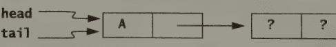

语句`tail = tail -> next;`将`tail`移动到新元素。它的`d`成员被赋值为 'B'。

## 10.4 某些列表处理函数

### 更新尾

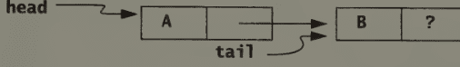

现在`s[2]`的值为`\0`，语句以双元素列表退出。最后，用`NULL`标记列表的结束。

### 赋值 NULL 后

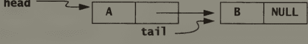

未定义的成员值是因为`malloc()`不需要将内存初始化为零。

## 10.4 某些列表处理函数

我们将编写两个额外的递归函数。第一个统计列表中的元素数量，第二个打印列表的元素。它们都涉及遍历列表并在找到`NULL`指针时终止。所有函数都使用了头文件`list.h`。

`count()`函数在列表为空时返回 0；否则返回列表中的元素数量。

```c
/* 递归计数列表。 */
int count(LINK head)
{
    if (head == NULL)
        return 0;
    else
        return (1 + count(head -> next));
}
```

该函数的迭代版本用`for`循环替换了递归。

```c
/* 迭代计数列表。 */
int count_it(LINK head)
{
    int cnt = 0;
    for ( ; head != NULL; head = head -> next)
        ++cnt;
    return cnt;
}
```


请记住`head`是按“值传递”传递的，因此调用`count_it()`不会破坏列表。

`print_list()`函数遍历列表并打印每个元素的值：

```c
/* 递归打印列表。 */
void print_list(LINK head)
{
    if (head == NULL)
        printf("NULL");
    else
        printf("%c -> ", head->d);
        print_list(head -> next);
    }
}
```

为了说明这些函数的使用，我们将编写一个获取字符串"ABC"并打印它的程序：

```c
#include <stdio.h>
#include <stdlib.h>
#include "list.h"

int main(void)
{
    LINK h;
    h = string_to_list("ABC");
    printf("The list is ");
    print_list(h);
    printf("\nThis has %d elements.\n", count(h));
    return 0;
}
```

由于`free()`接收一个`void *`类型的单一参数，我们可以将任何类型的指针传递给`free()`。我们不需要使用强制类型转换，因为`void *`是通用指针类型。

## 10.5 栈 (Stacks)

我们在第430页的第9.10节“栈ADT”中已经以数组的形式展示了抽象数据类型——栈。在这里，我们将使用线性链表重新实现ADT栈。栈的访问被限制在列表的头部，该头部被称为栈顶（top）。此外，插入和删除仅在栈顶发生，在这些限制下，这些操作分别称为推栈（push）和出栈（pop）。

栈可以被形象化为一叠托子。托子总是从顶部取下，也总是返回到顶部。在图示中，栈是垂直绘制的。

### 栈的实现

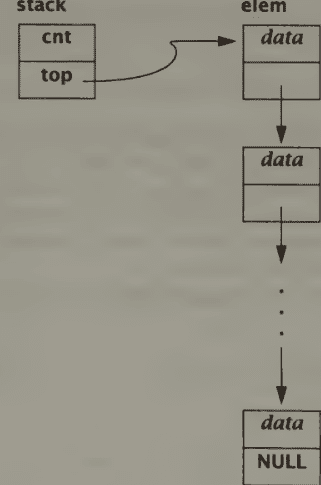

我们将编写一个栈程序，由一个`.h`文件和两个`.c`文件组成。这里是头文件：

在文件`stack.h`中

```c
/* 栈的链表实现。 */
#include <stdio.h>
#include <stdlib.h>

#define EMPTY 0
#define FULL  10000

typedef char data;
typedef enum {false, true} boolean;

struct elem {           /* 栈上的元素 */
    data d;
    struct elem *next;
};

typedef struct elem elem;

struct stack {
    int cnt;            /* 元素计数 */
    elem *top;          /* 指向顶元素的指针 */
};

typedef struct stack stack;

void initialize(stack *stk);
void push(data d, stack *stk);
data pop(stack *stk);
data top(stack *stk);
boolean empty(const stack *stk);
boolean full(const stack *stk);
```

我们要实现的六个标准栈操作函数原型列在头文件的底部。在概念上，这些函数的行为与我们在第430页第9.10节“栈ADT”中展示的函数相同。在这里，我们对`data`类型的使用使得代码具有可复用性。（参见第464页第10.6节“示例：波兰表达式与栈求值”，我们在那里再次使用了这些代码。）

在文件`stack.c`中

```c
/* 基础栈例程。 */
#include "stack.h"

void initialize(stack *stk)
{
    stk -> cnt = 0;
    stk -> top = NULL;
}

void push(data d, stack *stk)
{
    elem *p;
    p = malloc(sizeof(elem));
    p -> d = d;
    p -> next = stk -> top;
    stk -> top = p;
    stk -> cnt++;
}

data pop(stack *stk)
{
    data d;
    elem *p;
    d = stk -> top -> d;
    p = stk -> top;
    stk -> top = stk -> top -> next;
    stk -> cnt--;
    free(p);
    return d;
}

data top(stack *stk)
{
    return (stk -> top -> d);
}

boolean empty(const stack *stk)
{
    return ((boolean) (stk -> cnt == EMPTY));
}
```

```c
boolean full(const stack *stk)
{
    return ((boolean) (stk -> cnt == FULL));
}
```

`push()`例程使用存储分配器`malloc`来创建一个新的栈元素，而`pop()`例程将释放的存储空间还给系统。

栈是一种后进先出（LIFO）的数据结构。最后一个推入栈的项是第一个被弹出的项。如果我们向栈中推入'a'然后推入'b'，那么`pop()`将先弹出'b'。在`main()`函数中，我们利用这一属性反序打印字符串。这作为了我们对ADT栈实现的测试。

在文件`file.c`中

```c
/* 通过反转字符串测试栈的实现。 */
#include "stack.h"

int main(void)
{
    char str[] = "My name is Joanna Kelley!";
    int i;
    stack s;
    initialize(&s); /* 初始化栈 */
    printf("In the string: %s\n", str);
    for (i = 0; str[i] != '\0'; ++i) {
        if (!full(&s)) {
            push(str[i], &s); /* 将字符推入栈中 */
        }
    }
    printf("From the stack: ");
    while (!empty(&s)) {
        putchar(pop(&s)); /* 从栈中弹出字符 */
    }
    putchar('\n');
    return 0;
}
```

观察发现，我们的`main()`函数与我们在第434页第9.10节“栈ADT”中编写的内容非常相似。虽然在这里我们是用链表实现的ADT，而在第431页第9.10节“栈ADT”中，我们是用字符串实现的ADT，但操作的使用是相似的。这里是字符串：My name is Joanna Kelley!
From the stack: !lleK anna siM

## 10.6 示例：波兰表达式与栈求值

表达式的普通表示法称为*中缀*（infix）。另一种表达式表示法称为*波兰式*（Polish），它非常有用。在波兰表示法中，运算符位于操作数之前。因此，例如不需要括号。我们将使用一个程序通过两个栈来求值波兰表达式。

使用两个栈求值波兰表达式的算法如下：
- 从左到右扫描表达式。
- 如果标记是操作数，将其推入栈中。
- 如果标记是运算符，从栈中弹出所需数量的操作数，应用运算符，并将结果推回栈中。
- 重复直到表达式处理完毕。最终结果是栈中剩余的值。

让我们用表达式：13, 4, -, 2, 3, *, + . 来说明这一点。这等同于(13 - 4) * 2 + 3。

| 标记 | 操作 | 栈（栈顶在右侧） |
| :--- | :--- | :--- |
| 13 | 推 | 13 |
| 4 | 推 | 13, 4 |
| - | 推 | 13, 4 |
| 2 | 推 | 9, 2 |
| 3 | 推 | 9, 2, 3 |
| * | 弹出 | 9, 6 |
| + | 弹出 | 15 |

(注：由于原文文本在表格处不完整，此处表格内容根据逻辑进行了推断补充)

## 10.6 示例：波兰表示法与栈评估

在文件`eval.c`中

```c
/* 波兰栈的求值。 */
#include "polish.h"

int evaluate(stack *polish)
{
    data d, d1, d2;
    stack eval;
    initialize(&eval);
    while (!empty(polish)) {
        d = pop(polish);
        switch (d.kind) {
            case value:
                push(d, &eval);
                break;
            case operator:
                d2 = pop(&eval);
                d1 = pop(&eval);
                d.kind = value; /* 开始重写d */
                switch (d.op) {
                    case '+':
                        d.u.val = d1.u.val + d2.u.val;
                        break;
                    case '-':
                        d.u.val = d1.u.val - d2.u.val;
                        break;
                    case '*':
                        d.u.val = d1.u.val * d2.u.val;
                        break;
                }
                push(d, &eval);
        }
    }
    d = pop(&eval);
    return d.u.val;
}
```

`evaluate()`函数体现了我们之前介绍的双栈算法。我们首先从波兰栈中推入`d`。如果它是一个值，我们就将其推入`eval`栈。如果它是一个操作符，我们就从`eval`栈中弹出`d2`和`d1`，执行指定的操作，并将结果推入`eval`栈。当波兰栈为空时，我们从`eval`栈中弹出`d`并返回整数值`d.u.val`。

我们在文件`stack.c`中编写了栈操作。除了包含不同的头文件外，它与我们在第461页第10.5节“栈”中编写的`stack.c`文件没有任何区别。

在文件`stack.c`中

```c
/* 基本栈例程。 */
#include "polish.h"

void initialize(stack *stk)
{
  stk->cnt = 0;
  stk->top = NULL;
}

void push(data d, stack *stk)
{
  elem *p;
  p = malloc(sizeof(elem));
  p->d = d;
  p->next = stk->top;
  stk->top = p;
  stk->cnt++;
}
......
```

在第461页第10.5节“栈”的栈实现中，`data`类型等同于`char`；而这里`data`是一个结构类型。通过使用`typedef`嵌入“数据”的概念，我们使得ADT栈的实现变得可重用。这是一个重要的一点。通过使用已经编写并测试过的代码，程序员在当前项目中需要做的工作就更少了。

我们需要能够从一个包含波兰表示式的字符串中填充栈。以下是实现此Find的函数：

在文件`fill.c`中

```c
#include "polish.h"

void fill(stack *stk, const char *str)
{
  const char *p = str;
  char c1, c2;
  boolean b1, b2;
  data d;
  stack tmp;
  ......
  initialize(stk);
  initialize(&tmp);
```

```c
/*
// 第一步处理字符串并将数据推入tmp。
*/
while (*p != '\0') {
    while (isspace(*p) || *p == ',')
        p++;
    b1 = (boolean)(c1 = *p) == '+' || c1 == '-' || c1 == '*';
    b2 = (boolean)(c2 = *(p + 1)) == ',' || c2 == '\0';
    if (b1 && b2) {
        d.kind = operator;
        d.u.op = c1;
    } else {
        d.kind = value;
        assert(sscanf(p, "%d", &d.u.val) == 1);
    }
    if (!full(&tmp)) {
        push(d, &tmp); /** 将数据推入tmp */
        while (*p != ',' && *p != '\0')
            p++;
    }
}
/*
// 现在从tmp中弹出数据并推入stk。
*/
while (!empty(&tmp)) {
    d = pop(&tmp); /** 从tmp中弹出数据 */
    if (!full(stk)) /** 将数据推入stk */
        push(d, stk);
}
```

首先处理字符串以提取数据。当我们找到数据后，将其推入栈`tmp`。完成字符串处理后，我们从`tmp`中弹出数据并将其推入`stk`指向的栈。这样做是为了让`stk`指向的栈中的元素按照正确的顺序排列。

我们编写了两个打印函数，以便检查我们的代码是否正常工作。以下是这些函数：

在文件`print.c`中

```c
#include "polish_data.h"

void prn_data(data *dp)
{
    switch (dp->kind) {
        case operator:
            printf("%s%3c\n",
                "kind: operator ", dp->u.op);
            break;
        case value:
            printf("%s%3d\n",
                "value: val:", dp->u.val);
    }
}

void prn_stack(stack *stk)
{
    data d;
    printf("stack: ");
    while (!empty(stk)) {
        d = pop(stk);
        if (d.kind == operator)
            printf("%c ", d.u.op);
        else
            printf("%d ", d.u.val);
    }
    printf("\n");
}
```

在文件`main.c`中

```c
/* 使用队列调度两个资源。 */
#include "queue.h"

int main(void)
{
    int c;
    int cnt_a = 0;
    int cnt_b = 0;
    data pid; /* process id number */
    queue a, b;
    initialize(&a);
    initialize(&b);
    /* 入队请求。 */
    while ((c = getchar()) != EOF) {
        switch (c) {
            case 'A':
                assert(scanf("%u", &pid) == 1);
                if (!full(&a))
                    enqueue(pid, &a);
                break;
            case 'B':
                assert(scanf("%u", &pid) == 1);
                if (!full(&b))
                    enqueue(pid, &b);
        }
    }
    /* 出队请求并打印它们。 */
    printf("\nA's schedule:\n");
```


```c
while (!empty(&a)) {
    pid = dequeue(&a);
    printf(" JOB %u is %d\n", ++cnt_a, pid);
}

printf("\nB's schedule:\n");

while (!empty(&b)) {
    pid = dequeue(&b);
    printf(" JOB %u is %d\n", ++cnt_b, pid);
}

return 0;
}
```

为了测试我们的程序，我们创建了以下输入文件。

在文件`input`中：

```text
B 7702
A 1023
B 3373
A 5757
A 1007
```

当我们给出命令：

```bash
scheduler < input
```

屏幕上将打印以下内容：

```text
A's schedule:
JOB 1 is 1023
JOB 2 is 5757
JOB 3 is 1007
B's schedule:
JOB 1 is 7702
JOB 2 is 3373
```

## 10.8 二叉树

树是称为节点的元素的有限集合。树有一个唯一的节点，称为根节点，其余节点是子树的互不相交集合。如果节点`r`有子树`T1`、`T2`、...、`tn`，那么`r1`、`r2`、...、`rn`（这些子树的根）就是`r`的子节点。没有子节点的节点称为叶子节点。

### 通用树

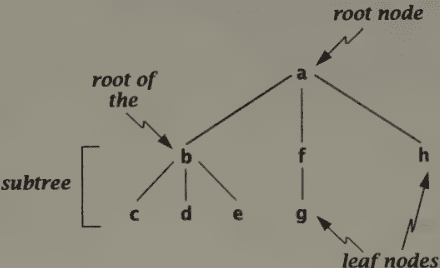

二叉树是元素具有两个孩子的树。作为数据结构的二叉树是由元素组成的对象，这些元素由两个称为左孩子和右孩子的链接字段描述。每个链接必须指向一个新对象或者为`NULL`。在这种表示中，叶子节点的左、右孩子的值均为`NULL`。将使用以下结构和类型定义来定义二叉树。

在`tree.h`中：

```c
#include <assert.h>
#include <stdio.h>
#include <stdlib.h>

typedef char DATA;

struct node {
    DATA d;
    struct node *left;
    struct node *right;
};

typedef struct node NODE;
typedef NODE *BTREE;

#include "fct_proto.h" /* function prototypes */
```

必须包含`tree.h`文件，其中包含了本节中定义的所有二叉树函数。

二叉树相对于线性列表的一个主要优势是，元素平均通常通过对数数量的链接遍历即可访问。这种检索信息效率的提高是以每个元素存储额外链接字段所需的空间为代价的。我们在练习题中说明了这种优势。

## 二叉树遍历

遍历线性列表只有一种方法，即从头到尾。然而，访问二叉树元素有几种自然的方法。最常见的方法有：

- 中序：左子树、根、右子树
- 前序：根、左子树、右子树
- 后序：左子树、右子树、根

这些标准的访问方法是处理二叉树的递归算法的基础。

```c
/* 中序二叉树遍历。 */

void inorder(BTREE root)
{
    if (root != NULL) {
        inorder(root->left); /* recur left */
        printf("%c %d", root->data);
        inorder(root->right); /* recur right */
    }
}
```

函数`inorder()`将打印由`root`指向的二叉树中每个节点的值。图中所示的二叉树将通过`inorder()`遍历，打印出：

- A B C D E F G H I J

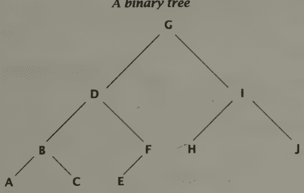

对应的前序和后序函数如下：

```c
/* 前序和后序二叉树遍历。 */

void preorder(BTREE root)
{
    if (root != NULL) {
        printf("%c ", root->d);
        preorder(root->left);
        postorder(root->right);
    }
}

void postorder(BTREE root)
{
    if (root != NULL) {
        postorder(root->left);
        postorder(root->right);
        printf("%c ", root->d);
    }
}
```

二叉树的前序访问将打印：

```text
G D B E H
```

后序访问将打印：

```text
A C E F G
```

不熟悉这些方法的读者应该仔细验证这些结果。访问是大多数树算法的核心。

## 创建树

我们将使用这些函数作为原语，从存储在数组中的值创建一个二叉树。

```c
/* 创建二叉树。 */

BTREE new_node(void)
{
    return malloc(sizeof(NODE));
}
```

```c
BTREE init_node(DATA d1, BTREE p1, BTREE p2)
{
    BTREE t;

    t = new_node();
    t->d = d1;
    t->left = p1;
    t->right = p2;

    return t;
}
```

## 10.9 通用列表

我们将使用一个类型为`GTREE`的数组`t`，其中`t[0]`是根节点的指针。兄弟通过链表访问，孩子通过数组索引访问。我们检查这样一个特定树的创建。我们首先编写创建单个节点的函数。

```c
/* 创建新节点。 */

BTREE new_node(void)
{
    return malloc(sizeof(NODE));
}
```

```c
BTREE init_gnode(DATA d1, int num, GTREE sibs)
{
    BTREE tmp;

    tmp = new_node();
    tmp->d = d1;
    tmp->child_no = num;
    tmp->sib = sibs;

    return tmp;
}
```

让我们使用这些函数来创建图中的树。因为它包含八个节点，我们需要一个大小为9、类型为`NODE`的数组`t[]`，其中`t[0]`是根节点。

```c
t[0] = init_gnode('a', 1, NULL);
t[1] = init_gnode('b', 2, NULL);
t[1]->sib = init_gnode('f', 6, NULL);
t[1]->sib = init_gnode('h', 8, NULL);
t[2] = init_gnode('c', 3, NULL);
t[2]->sib = init_gnode('d', 4, NULL);
t[2]->sib = init_gnode('e', 5, NULL);
t[3] = NULL;
t[4] = NULL;
t[5] = NULL;
t[6] = init_gnode('g', 7, NULL);
t[7] = NULL;
t[8] = NULL;
```

在这种表示中，很容易检测某些属性，例如节点是否是叶子节点或一个节点有多少个孩子。对于节点`n`，如果`t[n]`指向`NULL`，则该节点是叶子节点。

## 遍历

遍历变成了以下两种操作的结合：

1. 沿着列表移动；
2. 对指向列表的数组元素进行索引。

将前序、后序和中序遍历顺序推广到这些结构是相当直观的。这些算法是树上可以执行的更复杂函数的原型，因为它们保证了每个元素都能在线性时间内被访问。

```c
/* 通用树的前序遍历。 */

void preorder_g(GTREE t, int ind)
{
    GTREE tmp = t[ind]; /* tmp 遍历兄弟节点列表 */

    while (tmp != NULL) { /* tmp 是根节点 */
        printf("%d\n", tmp->child_no);
        preorder_g(t, tmp->child_no);
        tmp = tmp->sib;
    }
}
```

函数`preorder_g()`与相应的二叉树函数不同，需要一个`while`循环来沿着兄弟节点的线性列表移动。注意，递归允许干净地处理每个子树。

## `calloc()`的使用与树的构建

库函数`calloc()`提供连续的存储分配，可用于数组。其函数原型在`stdlib.h`中给出：

```c
void *calloc(size_t n, size_t size);
```

因此，`calloc()`的参数被转换为`size_t`，返回值的类型为`void`指针。通常，`size_t`等于`unsigned`。形式如下的函数调用：

```c
calloc(n, size)
```

返回指向连续存储的指针，用于`n`个对象，每个对象的大小为`size`字节。该存储由系统初始化为零。因此，`calloc()`可用于运行时定义的数组动态分配存储。这允许用户根据需要分配空间，而不是在编译时指定一个非常大的数组大小以适应所有可能的情况。

例如，我们需要一个例程，能够从边列表和类型为`DATA`的数组构建一个通用树。如果我们想要一个大小为10的数组来存储树头，可以写道：

```c
t = calloc(10, sizeof(GTREE));
```

现在我们可以将动态分配的类型为`GTREE`指针的数组`t`传递给函数`buildtree()`以构建通用树。该函数将接收树的边表示并计算其通用列表结构表示。

```c
/* 函数 buildtree 从边数组创建树。 */

typedef struct { /* PAIR 表示树中的一条边 */
    int out;
    int in;
} PAIR;
```

```c
void buildtree(PAIR edges[], DATA d[], int n, GTREE t[])
{
    int i;
    int x, y; /* 边的点 */

    t[0] = init_gnode(d[1], 1, NULL); /* t[0] 取节点 1 为根 */

    for (i = 1; i <= n; ++i)
        t[i] = NULL;

    for (i = 0; i < n - 1; ++i) {
        x = edges[i].out;
        y = edges[i].in;
        t[x] = init_gnode(d[y], y, t[x]);
    }
}
```

可以使用相似的数据结构和函数来开发通用图、稀疏矩阵和复杂网络的表示。

## 总结

1. 自引用结构使用指针以完全相同的方式处理线性链表。每个元素
2. 最简单的自引用结构是线性元素指向其下一个元素，最后一个元素指向`NULL`（定义为0）。
3. 函数`malloc()`用于动态分配存储。它接受一个类型为`size_t`的参数，并返回一个`void`指针，即所分配存储的地址。
4. 函数`free()`是一个存储管理例程，将其参数指向的块内存返回可用存储。
5. 列表处理的标准算法自然地以递归方式实现。通常，基本情况是检测到`NULL`链接。通用情况通过在列表结构中移动一个链接来实现递归。
6. 当算法以迭代方式实现时，使用迭代循环，并在检测到`NULL`时终止。迭代算法用辅助指针的使用交换了递归。
7. 抽象数据类型（ADT）栈可以实现为链表，其访问限制在第一个元素上，称为栈顶（top）。栈具有后进先出（LIFO）原则，通过`push()`和`pop()`例程实现。
8. ADT队列也可以实现为链表，其访问限制在头部和尾部。队列具有先进先出（FIFO）原则，通过`enqueue()`和`dequeue()`例程实现。
9. 二叉树表示为具有两个链接成员的结构，并结合了线性列表的动态特性，且平均到每个元素的路径显著缩短。二叉树元素距离通常是对数级的。
10. 二叉树最常见的遍历方式是三种主要模式之一：前序、中序或后序。每种顺序由访问根的时机决定。前序先访问根；中序在左子树之后；后序最后访问。这些遍历模式可以很容易地通过递归实现，链式处理左右子树。

可以指定具有极大复杂性的数据结构，涉及列表和数组。它们使用的一个例子是通用树，其中节点有任意数量的子节点。节点的节点表示为由头指向的列表。

## 练习题

1. 尝试以下代码。为什么编译器会报错？

```c
struct husband {
    int age;
    char name[10];
    struct wife;
} a;

struct wife {
    int age;
    char name[10];
    struct husband;
} b;
```

2. 修改`list.h`中的类型定义为：

```c
typedef struct {
    char name[10];
    int age;
    int weight;
} DATA;
```

并编写一个函数`create_l()`将此类数组转换为线性列表。编写另一个例程，统计给定重量和年龄的人数。

3. 给出一个上题中使用的列表，编写`sort_age()`根据年龄值排序列表。编写函数`sort_name()`按字母顺序排序名称。

4. 结合上一个题中的排序函数以共享大部分代码。最好的方法是定义一个返回0或1（取决于哪个元素较大）的例程`compare()`。将其作为参数传递给排序函数。

5. 画出`concatenate(a, a)`产生的列表，其中`a`指两个元素的列表。如果将`a`指向的列表传递给`print_list(a)`会发生什么？

6. 上题用于构造循环。循环是指向自身的指针链。循环是特别棘手的运行时错误。编写一个函数`iscycle(head)`，如果检测到循环则返回1，否则返回0。提示：保存列表初始元素的地址并移动直到遇到`NULL`或遇到初始地址。

7. 编写`print_list()`的迭代版本。

8. 修改`concatenate()`函数，使其返回结果列表的头部地址。此外，如果第一个列表为`NULL`，它应该返回第二个列表，插入第二个列表。测试两个列表是否相同。如果是，将产生循环，程序应返回相应的警告（见练习题5和6）。

9. 编写例程`copy_cat(a, b)`，返回列表`a`和`b`的合并拷贝。原始列表`a`和`b`应保持不受干扰。

双向线性链表的元素可以定义为：

```c
typedef struct dlist {
    DATA d;
    struct dlist *prev;
    struct dlist *next;
} ELEMENT;
```

这增加了一个成员，但允许更方便地沿链表遍历。

## 双向链表

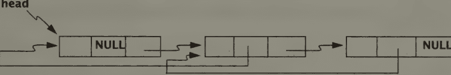

编写迭代程序来执行插入和删除。

16. 编写一个例程`del_dup1()`，删除双向链表中值相同的元素。

17. 手算评估以下波兰表达式：

- `+ * 7, 6, -, 3, *`
- `** 9, 2, 3, *, 4, -, +`
- `** 1, 2, +, 3, 4, 4, +, *`

18. 为以下表达式编写对应的波兰表达式：

```text
(7 + 8 + 9) * 4

(6 - 2) * (5 + 15 * 2)

6 - 2 * 5 + 15 * 2
```

19. 使用我们在第466页第10.6节“示例：波兰表示与栈评估”中编写的波兰程序，评估根据上述练习给出或得出的六个波兰表达式。

20. 以下行出现在`polish`程序的`evaluate()`函数中：

```c
case operator:
    d2 = pop(&eval);
    d1 = pop(&eval);
```

如果我们写成：

```c
case operator:
    d1 = pop(&eval);
    d2 = pop(&eval);
```

会发生什么？程序在某些波兰表达式上运行正常，但在另一些上面。请解释。

22. 创建`polish`程序的另一个版本。首先，编写一个反转栈元素顺序的例程。接下来，将此例程添加到`stack.c`文件中，并在头文件中添加函数原型。然后重写`fill()`函数以便使用你的例程。最后，测试你的程序。

23. 编写一个例程，允许你交互式初始化波兰栈的内容。编写一个程序来测试你的例程。

24. 当我们测试`polish`程序时，我们使用的波兰表达式没有一元运算符。尝试用以下表达式测试程序：

```text
2, -3, -, -4, 7, +, -1, -, +, *, *
```

`polish`程序能够正确处理吗？（它应该能够）。编写另一个版本的`polish`程序，能够同时处理列表中的一元运算符和减法运算符。例如，你的程序能够处理以下波兰表达式：

```text
2, -3, -, -4, 7, +, -1, -, +, +, *, *
```

在这个表达式中，某些加号和减号是一元的，而一些是二元的。

25. 编写一个函数原型为：

```c
queue data_to_queue(data d[], int n);
```

其中`n`是数组`d`的大小。当传递一个类型为`data`的数组时，该函数应使用数组中的元素来构建并返回一个队列。

练习题489

26. 编写一个函数原型为：

```text


```c
data *queue_to_data(queue q);
```

根据队列中找到的值构建一个 `data` 数组。数组的大小应为 `q.cnt`。

## 练习

### 27

当我们在测试第 474 页第 10.7 节“队列”中编写的调度程序时，我们的输入文件简单得多。尝试以下输入：

```text
x x x A 2323 B 1188 yyy zzz C 3397 3398 A 4545 X surprise!
```

你对它的运行感到惊讶吗？请解释。

### 28

编写一个四资源的调度程序版本。

### 29

修改为上一个练习编写的程序以支持优先级。将 `data` 类型更改为一个包含 ID 号和优先级的结构。优先级应该是 0 到 9 之间的无符号数。创建让高优先级进程首先被服务的调度器。

注意：不要混淆“进程（process）”和“处理器（processor）”的概念。

### 30

为二叉树编写例程，实现以下功能：

1. 统计节点数。
2. 统计具有特定值（例如 `'b'`）的节点数。
3. 仅打印叶子节点的值。

### 31

从一个 `int` 数组创建一个二叉树，使得左孩子的值小于其根节点的值，右孩子的值大于或等于其根节点的值。此类树如图所示：

#### 具有有序值的二叉树

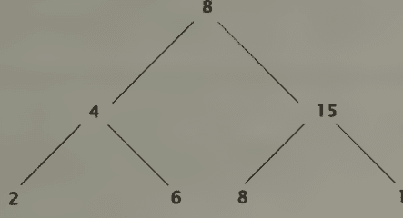

通过将其值与根节点比较并递归进入相应的子树，直到遇到 `NULL` 来插入新元素。

### 32

对于上一个练习的树，编写一个函数，使用中序遍历将节点值按顺序放入数组 `key[]` 中。

### 33

编写一个程序，删除二叉树的根节点并用最右边的叶子节点替换根节点。

#### 使用替换删除根节点

之前：

之后：

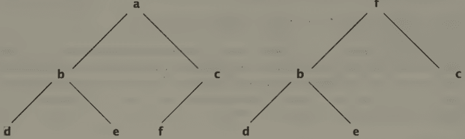

### 34（高级）

编写 `heapsort()`。这是一个基于有序二叉树的排序例程。堆是一种节点值小于其任何子节点的二叉树。该属性保证了根节点是树中的最小元素。我们希望取一个无序值数组，并用这些值作为数据创建一个堆。

#### 给定堆

1. 删除根节点，将其作为最小元素放入输出数组。
2. 取最右边的叶子节点并使其成为新根。
3. 将根值与两个孩子进行比较，并与较小值交换。
4. 继续交换值，直到当前节点的值小于其孩子。

现在树再次是一个堆。重复这些步骤，直到树为空且数组具有原始树值的有序排列。你必须弄清楚如何将树转换为堆顺序；参见 Aho、Hopcroft 和 Ullman 的《数据结构与算法》（Reading, MA: Addison-Wesley）。

在示例中：

```c
printf("she sells %d %s for f", 99, "sea shells", 3.77);
```

我们有：

```text
control_string: "she sells %d %s for f"

other_arguments: 99, "sea shells", 3.77
```

`other_arguments` 中的表达式将根据 `control_string` 中的格式进行求值和转换，然后直接放入输出流中。`control_string` 中不属于格式部分的字符将直接放入输出流中。`%` 符号引入了转换规范（或格式）。单个转换规范是一个以 `%` 开头并以转换字符结束的字符串：

| `printf()` 转换字符 | 相应参数的打印方式 |
| :--- | :--- |
| `c` | 作为字符打印 |
| `d, i` | 作为十进制整数打印 |
| `u` | 作为无符号十进制整数打印 |
| `o` | 作为无符号八进制整数打印 |
| `x, X` | 作为无符号十六进制整数打印 |
| `e` | 作为浮点数打印；示例：`7.123000e+00` |
| `E` | 作为浮点数打印；示例：`7.123000E+00` |
| `f` | 作为浮点数打印；示例：`7.123000` |
| `g` | 以 `e` 格式或 `f` 格式打印，以较短者优先 |
| `G` | 以 `E` 格式或 `f` 格式打印，以较短者优先 |
| `s` | 作为字符串打印 |
| `p` | 相应参数是指向 `void` 的指针；其值以十六进制数字打印 |
| `n` | 相应参数是指向整数的指针；将已写入字符数写入该整数；该参数不进行转换 |
| `%` | 使用格式 `%%` 在输出流中写入单个 `%`；没有相应的参数需要转换 |

## 11.1 输出函数 `printf()`

`printf()` 函数返回打印的字符数，其返回类型为 `int`。在示例中：

```c
printf("she sells %d %s for f", 99, "sea shells", 3.77);
```

我们可以将 `control_string` 中的格式与参数列表中的相应参数相匹配。

| 格式 | 相应参数 |
| :--- | :--- |
| `%d` | `99` |
| `%s` | `"sea shells"` |
| `%f` | `3.77` |

转换规范中可以包含显式的格式化信息。如果没有包含，则使用默认值。例如，格式 `%f` 对应参数 `3.77` 将导致打印出 `3.770000`。默认情况下，打印的数字在小数点后保留六位数字。

在起始转换规范的 `%` 和结束它的转换字符之间，可能会按顺序出现以下内容：

- 零个或多个标志字符（flag characters），用于修改转换规范的含义。这些标志字符将在下文中讨论。
- 可选的正整数，用于指定转换后参数的最小字段宽度（field width）。参数打印的位置称为其字段（field），打印参数时所用的空格数称为其字段宽度。如果转换后的参数字符少于指定的字段宽度，则会在其左侧或右侧填充空格，取决于转换后的参数是右对齐还是左对齐。如果转换后的参数字符多于指定的字段宽度，则字段宽度将扩展到所需的长度。如果定义字段宽度的整数以零开头，且打印的参数在其字段内是右对齐的，则使用零而不是空格进行填充。
- 可选的精度（precision），由点号后跟一个非负整数指定。对于 `d, i, o, u, x` 或 `X` 转换，它指定了打印的最小数字位数。对于 `e, E` 和 `f` 转换，它指定了小数点后的位数。对于 `g` 和 `G` 转换，它指定了最大有效数字数。对于 `s` 转换，它指定了从字符串中打印的最大字符数。
- `h` 或 `l`，分别是“短”（short）或“长型”（long）修饰符。如果 `h` 后面跟着 `d, i, o, u, x` 或 `X` 转换字符，则转换规范适用于 `short int` 或 `unsigned short int` 参数。如果 `h` 后面跟着 `n` 转换字符，相应参数是指向 `short int` 或 `unsigned short int` 的指针。如果 `l` 后面跟着 `d, i, o, u, x` 或 `X` 转换字符，则转换规范适用于 `long int` 或 `unsigned long` 参数。如果 `l` 后面跟着 `n` 转换字符，相应参数是指向 `long int` 或 `unsigned long int` 的指针。
- 可选的 `L`，是一个“长型”（long）修饰符。如果 `L` 后面跟着 `e, E, f, g, G` 转换字符，转换规范适用于 `long double` 参数。

标志字符有：

- 减号（`-`），意味着转换后的参数在其字段内左对齐。如果没有减号，则转换后的参数在其字段内右对齐。
- 加号（`+`），意味着来自有符号转换的非负数将加一个 `+`。这适用于 `d, i, e, E, f, g` 和 `G` 转换字符。所有负数都以减号开头。
- 空格，意味着来自有符号转换的非负数将加一个空格。这适用于 `d, i, e, E, f, g` 和 `G` 转换字符。
- `#`，意味着结果采用“交替形式”（alternate form）。在 `o` 转换中，`#` 会前导零。在 `x` 或 `X` 中，`#` 会打印一个小数点。在 `g` 或 `G` 转换中，它允许打印尾零。
- 零（`0`），意味着使用零而不是空格来填充字段。对于 `d, i, o, u, x, X, e, E, f, g, G` 转换，这将产生前导零。

在格式中，字段宽度和精度都可以由 `*` 指定，表示值从参数获取。以下是使用字段的示例：

```c
int m, n;

double x = 333.777;

/* 从某处获取 m 和 n */

printf("x = %.*f\n", n, x);
```

如果字段宽参数为负值，则被视为减号后跟正字段宽度。如果精度规范的参数为负值，则被视为缺失。

转换规范 `%%` 可在输出流中打印单个 `%` 符号。这是一个特殊情况，因为没有相应的参数需要转换。对于所有其他格式，都应该有一个相应的参数。如果参数不足，行为是未定义的。如果参数过多，多余的参数会被求值但忽略。

字段宽度是打印参数时使用的空格数。默认值是正确显示参数值所需的长度。因此，整数值 `255` 在十进制 `d` 或八进制 `o` 转换中需要三个空格，但在十六进制 `x` 中仅需要两个。

当打印参数时，符合转换规范的字符被放置在字段中。除非存在减号，否则字符右对齐。如果指定的字段宽度太短，无法正确显示参数值，则字段宽度将增加到默认值。如果整个字段不需要显示转换后的参数，则字段的剩余部分将在左侧或右侧填充空格，取决于转换后的参数是右对齐还是左对齐。通过以零开头指定字段宽度，可以将左侧填充字符变为零。

精度由点号右侧的非负整数指定。对于字符串转换，它是字符串中打印的最大字符数。对于 `e, E` 和 `f` 转换，它指定了小数点右侧的位数。下表给出了字符和字符串格式的示例。我们使用双引号字符来视觉上分隔字段。它们不会被打印。

### 字符和字符串格式示例

#### 声明与初始化

```c
char c = 'A', s[] = "Blue moon!";
```

| 格式 | 对应参数 | 在字段中的打印方式 | 备注 |
| :--- | :--- | :--- | :--- |
| `%c` | `c` | `"A"` | 默认字段宽度为 1 |
| `%2c` | `c` | `" A"` | 字段宽度为 2，右对齐 |
| `%-3c` | `c` | `"A "` | 字段宽度为 3，左对齐 |
| `%s` | `s` | `"Blue moon!"` | 默认字段宽度为 10 |
| `%-3s` | `s` | `"Blue moon!"` | 需要空格 |
| `%.6s` | `s` | `"Blue m"` | 精度为 6 |
| `%-11.8s` | `s` | `"Blue moon"` | 精度 8，左对齐 |

下一表给出打印数字的格式示例。同样，我们使用双引号字符在视觉上限定字段。它们不会被打印。

#### 声明与初始化

```c
int i = 123;

double x = 0.123456789;
```

| 格式 | 对应参数 | 在字段中的打印方式 | 备注 |
| :--- | :--- | :--- | :--- |
| `%d` | `i` | `"123"` | 默认字段宽度为 3 |
| `%05d` | `i` | `"00123"` | 用零填充 |
| `%7o` | `i` | `"  173  "` | 右对齐，八进制 |
| `%-9x` | `i` | `"7b       "` | 左对齐，十六进制 |
| `%#9x` | `i` | `"0x7b    "` | 左对齐，十六进制 |
| `%10.5f` | `x` | `"  0.12346"` | 字段宽度为 10，精度为 5 |
| `%-12.5e` | `x` | `"-1.23457e-01"` | 左对齐，`e` 格式 |

## 11.2 输入函数 `scanf()`

`scanf()` 函数有两个非常好的属性，允许在高级层进行灵活使用。第一个是可以扫描任意长度的参数列表，第二个是输入是由简单的转换规范（或格式）控制的。`scanf()` 函数从标准输入文件 `stdin` 读取字符。`scanf()` 的参数列表包含两个部分：

```text
控制字符串和其他参数
```

在示例中：

```c
char a, b, c, s[100];

int n;

double x;

scanf("%c%c%c%d%lf", &a, &b, &c, &n, s, &x);
```

我们有：

```text
control_string: "%c%c%c%d%s"

other_arguments: &a, &b, &c, &n, s, &x
```

控制字符串之后的其他参数由逗号分隔的指针表达式列表或地址组成。注意，在前面的示例中，写成 `&s` 是错误的；表达式 `s` 本身就是一个地址。

### `scanf()` 转换字符

| 转换字符 | 输入流中匹配的字符 | 对应参数是……的指针 |
| :--- | :--- | :--- |
| `c` | 任何字符，包括空白字符 | `char` |
| `d, i` | 可带符号的十进制整数 | `integer` |
| `u` | 可带符号的十进制整数 | `unsigned integer` |
| `o` | 可带符号的八进制整数 | `unsigned integer` |
| `x, X` | 可带符号的十六进制 | `unsigned integer` |
| `e, E, f, g, G` | 可带符号的浮点数 | `floating type`（浮点类型） |
| `s` | 非空白字符序列 | `char` |
| `p` | `printf()` 中 `%p` 生成的内容，通常是无符号十六进制整数 | `void *` |
| `n, %, [ ... ]` | 见下表 | |

三个转换字符具有特殊性质，其中 `[ ... ]` 甚至不是一个字符，尽管该结构被视为此类字符。

### `scanf()` 转换字符

| 转换字符 | 备注 |
| :--- | :--- |
| `n` | 输入流中没有匹配的字符。对应参数是一个指向整数的指针，用于存储已读取的字符数。 |
| `%` | 匹配输入流中的单个 `%` 字符。没有对应的参数。 |
| `[ ... ]` | 括号 `[]` 内部的字符集被称为扫描集（scan set）。它决定了匹配的内容。（见下文解释）。对应参数是一个字符数组的基指针，该数组足够容纳匹配的字符，包括自动附加的终止空字符。 |

### 11.2 函数 `scan()` 控制字符串

控制字符串可能包含：

- 空白字符，匹配输入流中的可选空白。
- 除 `%` 以外的普通非空白字符。每个普通字符必须匹配输入流中的下一个字符。
- 以 `%` 开头并以转换字符结尾的转换规范。在 `%` 和转换字符之间，可以有一个可选的 `*` 表示抑制赋值，随后是一个定义最大宽度的可选整数，最后是一个可选的 `h`、`1` 或 `L` 用于修改规范字符。
- 修饰符 `h`，可以位于 `d, i, o, u, x` 转换字符之前。表示转换值存储在 `short int` 或 `unsigned short int` 中。
- 修饰符 `1`，可以位于 `d, i, o, u, x` 转换字符之前。表示忽略字段宽度并抑制赋值。
- 修饰符 `L`，可以位于 `d, i, o, u, x` 转换字符之前。表示转换值存储在 `long int` 或 `unsigned long int` 中。
- 修饰符 `l`，可以位于 `f, e, f, g, G` 转换字符之前。表示转换值是 `double`。
- 修饰符 `ll`，可以位于 `f, e, f, g, G` 转换字符之前。表示转换值是 `long double`。

值 45 被存入 `i` 中，逗号被匹配，字符串 `"ignore_this"` 被忽略，`%` 被匹配，字符 `C` 被存入变量 `c` 中，字符串 `"read_"` 被存入 `string[0]` 到 `string[5]`，并在 `string[5]` 处放置了终止符 `\0`，最后，字符串 `"in_this**"` 被存入 `string[5]` 到 `string[14]`，其中 `string[14]` 包含 `\0`。因为成功进行了四次转换，`sprintf()` 返回了值 4。

## 11.3 函数 `fprintf()`、`sscanf()`、`sprintf()` 和 `scanf()`

`fprintf()` 和 `sscanf()` 分别是函数 `printf()` 和 `sscanf()` 的文件版本。在讨论它们的使用之前，我们需要了解 C 是如何处理文件的。

标识符 `FILE` 在 `stdio.h` 中定义为一个特定的结构，其成员描述了文件的当前状态。要使用文件，程序员不需要了解有关该结构的任何细节。在 `stdio.h` 中还定义的文件指针有 `stdin`、`stdout` 和 `stderr`。尽管它们是指针，但我们有时将它们称为文件。

| C 语言编写 | 名称 | 备注 |
| :--- | :--- | :--- |
| `stdin` | 标准输入文件 | 连接到键盘 |
| `stdout` | 标准输出文件 | 连接到屏幕 |
| `stderr` | 标准错误文件 | 连接到屏幕 |

文件处理函数的原型声明在 `stdio.h` 中给出。这里是 `fprintf()` 和 `sscanf()` 的原型声明：

```c
int fprintf(FILE *fp, const char *format, ...);

int sscanf(FILE *fp, const char *format, ...);
```

如下形式的语句：

```c
fprintf(file_ptr, control_string, other_arguments);
```

向 `file_ptr` 指向的文件写入。`control_string` 和 `other_arguments` 的约定与 `printf()` 一致。特别是：

```c
fprintf(stdout, ...);
```

等于：

```c
printf(...);
```

类似地，如下形式的语句：

```c
fscanf(file_ptr, control_string, other_arguments);
```

从 `file_ptr` 指向的文件读取。特别是：

```c
fscanf(stdin, ...);
```

等于：

```c
scanf(...);
```

在下一节中，我们将展示如何使用 `fopen()` 打开文件，以及如何使用 `fprintf()` 和 `sscanf()` 访问它们。

函数 `sprintf()` 和 `sscanf()` 分别是函数 `sprintf()` 和 `sscanf()` 的字符串版本。它们的原型在 `stdio.h` 中：

```c


`int sprintf(char *s, const char *format, ...);`

`sscanf(char *s, const char *format, ...);`

```c
`sprintf()` 函数向它的第一个参数（指向 `char` 字符串的指针）写入，而不是屏幕。它的剩余参数与 `printf()` 一致。`sscanf()` 函数从键盘从它的第一个参数读取。它的剩余参数与 `sscanf()` 一致。考虑代码：
```

```c
char str1[] = "1 2 3 go", str2[100], tmp[100];
int a, b, c;
```

```c
sscanf(str1, "%d%d%s", &a, &b, &c, tmp);
sprintf(str2, "%s %s %d %d\n", tmp, a, b, c);
printf("%s", str2);
```

`sscanf()` 函数从 `str1` 获取输入。它读取三个十进制整数和一个字符串，并将它们分别 `a`、`b`、`c` 和 `tmp` 中。`sprintf()` 函数向 `str2` 写入。更准确地说，它从地址 `str2` 开始在内存中写入字符。它的输出两个字符串和三个十进制整数。要查看 `str2` 中的内容，调用 `printf()`。它会在屏幕上打印以下内容：

```c
go 1 2 3
```

注意：为 `sprintf()` 的输出提供足够的内存空间是程序员的责任。

从字符串读取与从文件读取的区别在于：如果我们再次使用 `sscanf()` 从 `str1` 读取，输入将从字符串开始开始，而不是我们上次停止的地方。

## 11.4 函数 `fopen()` 和 `fclose()`

从抽象来说，文件可以被看作字符流。文件被打开后，可以使用标准库中的文件处理函数访问该流。在本节中，我们想解释 `fopen()` 和 `fclose()` 的用法。

文件有几个重要的属性：它们有名称。它们必须被打开和关闭。可以对其进行写入、读取或追加。从概念上讲，在文件被打开之前，对它无法进行任何操作。它就像一本合上的书。当它被打开时，我们可以访问它的开头或结尾。为了防止误用，我们必须告诉系统我们将对其执行三种活动——读取、写入或追加中的哪一种。当我们用完文件后，将其关闭。考虑以下代码：

```c
#include <stdio.h>
int main(void) {
    int a, sum = 0;
    FILE *ifp, *ofp;
    ifp = fopen("my_file", "r"); /* 打开以读取 */
    ofp = fopen("outfile", "w"); /* 打开以写入 */
    ....
```

这在当前目录下打开两个文件：用于读取的 `my_file` 和用于写入的 `outfile`。

```c
void prn_info(char *pgm_name)
{
    printf("\n%s%s\n\n%s%s\n\n",
           "Usage : %s", pgm_name, "infile outfile",
           "The contents of infile will be double-spaced ",
           "and written to outfile.");
}
```

假设我们已经编译了这个程序，并将执行代码放在文件 `dbl_space` 中。当我们输入命令时：

```c
dbl_space file1 file2
```

程序将从 `file1` 读取并写入 `file2`。`file2` 的内容将与 `file1` 相同，区别是每个换行字符都被复制了一份。


# `dbl_space` 程序解析

- `#include <stdio.h>`
  `#include <stdlib.h>`
  `void double_space(FILE *, FILE);`
  `void prn_info(char *)`

我们包含了 `stdlib.h`，因为它包含了 `exit()` 的函数原型，该函数在 `prn_info()` 中被使用。标识符 `FILE` 是 `stdio.h` 中定义的结构体。为了使用文件，我们不需要了解文件机制工作的系统实现细节。`double_space()` 的函数原型显示它接受两个文件指针作为参数。

- `int main(int argc, char **argv)`
  `{`
  `    FILE *ifp, *ofp;`
  `    if (argc != 3) {`
  `      prn_info(argv[0]);`
  `      exit(1);`
  `    }`

标识符 `ifp` 和 `ofp` 是文件指针。更明确地说，它们的类型是指向 `FILE` 的指针。该程序设计用于访问作为命令行参数输入的两个文件。如果命令行参数太少或太多，将调用 `prn_info()` 来

## 11.5 示例：文件双倍行距

打印关于程序的信息并调用 `exit()` 退出程序。按照惯例，当发生错误时，`exit()` 返回非零值。

- `ifp = fopen(argv[1], "r");` /* 以读取模式打开 */
  `ofp = fopen(argv[2], "w");` /* 以写入模式打开 */

我们可以将 `argv` 视为字符串数组。函数 `fopen()` 用于打开 `argv[1]` 中命名的文件进行读取。函数返回的指针赋值给 `ifp`。同样，`argv[2]` 中命名的文件以写入模式打开。

```c
double_space(ifp, off);
```

两个文件指针作为参数传递给 `double_space()`，然后由它执行双倍行距的工作。可以看到，可以编写这种形式的其他函数来对文件执行任何有用操作。

```c
fclose(ifp);
fclose(opf);
```

标准库中的函数 `fclose()` 用于关闭 `ifp` 和 `opf` 指向的文件。在打开文件的同一个函数显式关闭文件是良好的编程风格。程序员未显式关闭的任何文件都会在程序退出时由系统自动关闭。

```c
void double_space(FILE *ifp, FILE *opf)
{
    int c;
```

标识符 `c` 是一个整型。尽管它将用于存储从文件中获取的字符，但最终它会被赋值为 `EOF`，而这不是一个字符。

```c
while ((c = getc(ifp)) != EOF) {
    putc(c, opf);
    if (c == '\n')
        putc('\n', opf); /* 找到换行符 - 复制它 */
}
```

宏 `getc()` 从 `ifp` 指向的文件读取字符并将值赋给 `c`。如果 `c` 的值不是 `EOF`，则使用 `putc()` 将 `c` 写入 `opf` 指向的文件。如果 `c` 是换行符，则也会向文件中写入另一个换行符，实现输出的双倍行距。这个过程反复持续，直到遇到 `EOF`。宏 `getc()` 和 `putc()` 定义在 `stdio.h` 中。


# 11.6 使用临时文件和优雅函数

在 ANSI C 中，程序员可以调用库函数 `tmpfile()` 创建临时文件，该文件在关闭时或程序退出时会被删除。文件以 `"wb"` 模式打开更新。在 MS-DOS 中，二进制文件也可以用作文本文件。在 UNIX 中，二进制文件和文本文件是相同的。在本节中，我们编写了一个简单的程序来说明 `tmpfile()` 的用法以及 `fopen()` 的优雅版本。我们的程序名称是 `dbl_with_caps`。首先，它将文件内容读取到临时文件中，在此过程中将每个字母转换为大写。然后程序将临时文件的内容添加到第一个文件的底部。

在文件 `dbl_with_caps.c` 中

```c
/* 复制一个大写字母的文件。 */
#include <ctype.h>
#include <stdio.h>
#include <stdlib.h>

FILE *fopen(char *filename, char *mode);

int main(int argc, char **argv)
{
    int c;
    FILE *fp, *tmp_fp;
    if (argc != 2) {
        fprintf(stderr, "\n%s%s\n%s\n",
               "Usage : %s", argv[0], filename,
               "The file will be doubled and some letters capitalized.");
        exit(1);
    }
    fp = fopen(argv[1], "r");
    tmp_fp = tmpfile();
    while ((c = getc(fp)) != EOF)
        putc(toupper(c), tmp_fp);
    rewind(tmp_fp);
    fprintf(fp, "---\n");
    while ((c = getc(tmp_fp)) != EOF)
        putc(c, fp);
    return 0;
}
```

## 使用临时文件和优雅函数

```c
FILE *gopen(char *filename, char *mode)
{
    FILE *fp;
    if ((fp = fopen(filename, mode)) == NULL) {
        fprintf(stderr, "Cannot open %s - bye!", filename);
        exit(1);
    }
    return fp;
}
```

在解释程序之前，让我们看看它的效果。假设在文件 `apple` 中有一行：
`is for alphabet pie.`

当我们给出命令

```c
dbl_with_caps apple
```

文件的内容将变为：
`is for alphabet pie.`
`---`
`IS FOR ALPHABET PIE.`

 # `dbl_with_caps` 程序解析

- `fp = fopen(argv[1], "r+");` 我们使用 `fopen()` 的优雅版本来打开读写文件。如果由于某种原因无法打开，将打印一条消息并退出程序。
- `tmp_fp = tmpfile();` ANSI C 提供了 `tmpfile()` 函数创建一个临时文件。文件模式为 `"wb+"`。程序退出时，文件会被系统删除。（参见 A.12, "Input/Output: <stdio.h>", 第 656 页。）

```c
while ((c = getc(fp)) != EOF)
    putc(toupper(c), tmp_fp);
```

宏 `getc()` 和 `putc()` 定义在 `stdio.h` 中。它们用于从一个文件到另一个文件。`toupper` 的函数原型在 `ctype.h` 中。如果 `c` 是小写字母，`toupper(c)` 返回大写字母；否则返回 `c`。注意：某些 ANSI 编译器没有正确这一点；我们希望它们随时间改进。（参见第 8 章 "The Preprocessor", 第 400 页的进一步讨论。）你可能需要写：

```c
while ((c = getc(fp)) != EOF)
if (tolower(c))
  putc(toupper(c), tmp_fp);
else
  putc(c, tmp_fp);
```

- `rewind(tmp_fp);` 这导致 `tmp_fp` 指向的流的文件指针设置为文件开头。这条语句等同于

- `fseek(tmp_fp, 0, 0);` 参见 A.12, "Input/Output: <stdio.h>", 第 657 页，函数原型和 `fseek()` 的说明。

- `fprintf(fp, "---\n")`
  `while ((c = getc(tmp_fp)) != EOF)`
  `  putc(c, fp);` 现在我们从 `tmp_fp` 指向的流读取并写入 `fp` 指向的流。注意在切换到 `tmp_fp` 指向的流之前调用了 `rewind()`。

- `FILE *gfopen(char *filename, char *mode)`
  `{`
  `    ....`

这是 `fopen()` 的优雅版本。如果发生错误，屏幕上会打印消息并退出程序。注意我们写入了 `stderr`。在这个程序中，我们也可以写入 `stdout`。但在其他使用此函数的程序中，写入 `stderr` 有优势。（参见第 542 页的练习 1。）

## 11.7 随机访问文件

库函数 `fseek()` 和 `ftell()` 用于随机访问文件。形式如下的形式

```c
ftell(file_ptr)
```

返回文件指针的当前值。该值表示从文件开始从零计算的字节数。每当从文件中读取字符时，系统会将位置指针加 1。技术上讲，文件指针是 `file_ptr` 指向的结构的成员。注意：文件指针本身并不指向流中的单个字符。这是许多程序员犯的概念性错误。

`fseek()` 函数接受三个参数：一个文件指针、一个整数偏移量和一个指示从文件中位置计算偏移的整数。形式如下的语句

```c
fseek(file_ptr, offset, place);
```

将文件指针设置为一个表示距离 `place` 偏移字节的值。`place` 的值可以是 0、1 或 2，分别表示文件的开头、当前位置或末尾。注意：`fseek()` 和 `ftell()` 函数保证只在二进制文件上正常工作。在 MS-DOS 中，如果我们想使用这些函数，文件应该以二进制模式打开。在 UNIX 中，任何文件模式都有效。

常见的练习是反向写文件。在下面的程序中，对用户的提示被写入 `stderr`，以便程序可以与重定向工作。（参见第 542 页的练习 1。）我们以 `"rb"` 模式打开文件，以便程序在 MS-DOS 和 UNIX 中都能工作。

# 514 第 11 章 输入/输出与操作系统

在文件 `backward.c` 中

> /* 反向写入一个文件。 */

```c
#include <stdio.h>
#define MAXSTRING 100

int main(void)
{
    char fname[MAXSTRING];
    int c;
    FILE *ifp;
    printf(stderr, "\nInput a filename: ");
    scanf("%s", fname);          /* MS-DOS 的二进制模式 */
    ifp = fopen(fname, "rb");    /* 移动到文件末尾 */
    fseek(ifp, 0, SEEK_END);       /* 后退一个字符 */
    fseek(ifp, -1, SEEK_CUR);     
    while (ftell(ifp) > 0) {
        c = getc(ifp);            /* 向移动一个字符 */
        putchar(c);
        fseek(ifp, -2, SEEK_CUR);  /* 后退两个字符 */
    }
    return 0;
}
```

# 11.8 文件描述符输入/输出

文件描述符是一个与文件相关的一个非负整数。在本节中，我们将描述一组用于文件描述符的库函数。尽管这些函数不是 ANSI C 的一部分，但在大多数 MS-DOS 和 UNIX 的 C 系统中都是可用的。由于存在细微差异，将代码从 UNIX 移植到 MS-DOS 或反之时，需要小心。

| 文件名 | 关联的文件描述符 |
|---|---|
| 标准输入 | 0 |
| 标准输出 | 1 |
| 标准错误 | 2 |

使用 `FILE` 指针的标准库函数通常是有缓冲的。相比之下，使用文件描述符的函数可能需要程序员指定的缓冲区。让我们通过一个从一个文件读取并写入另一个文件的程序（改变每个字母的大小写）来演示文件描述符的使用。

在文件 `change_case.c` 中

```c
/* 修改文件中字母的大小写。 */
#include <ctype.h>
#include <fcntl.h>
#include <unistd.h>               /* MS-DOS 中使用 io.h */
#define BUFSIZE 1024

int main(int argc, char **argv)
{
    char mybuf[BUFSIZE], *p;
    int in_fd, out_fd, n;
    in_fd = open(argv[1], O_RDONLY);
    out_fd = open(argv[2], O_WRONLY | O_EXCL | O_CREAT, 0600);
    while ((n = read(in_fd, mybuf, BUFSIZE)) > 0) {
        for (p = mybuf; p - mybuf < n; ++p) {
            if (islower(*p))
                *p = toupper(*p);
            else if (isupper(*p))
                *p = tolower(*p);
        }
        write(out_fd, mybuf, n);
    }
    close(in_fd);
    close(out_fd);
    return 0;
}
```


# `change_case` 程序剖析

- `#include <ctype.h>`
- `#include <fcntl.h>`
- `#include <unistd.h>`               /* MS-DOS 中使用 `io.h` */

头文件`fcntl.h`包含了我们将要使用的符号常量。头文件`unistd.h`包含了`open()`和`read()`的函数原型。在 MS-DOS 中，我们应该包含`io.h`。

- `in_fd = open(argv[1], O_RDONLY);`

`open()`的第一个参数是文件名；第二个参数指定了如何打开文件。如果没有错误，该函数返回一个文件描述符；否则返回值 -1。标识符`in_fd`是“输入文件描述符”的助记符。在 MS-DOS 和 UNIX 系统上，符号常量`O_RDONLY`定义在`fcntl.h`中。它是“仅只读打开”的助记符。

- `out_fd = open(argv[2], O_WRONLY | O_EXCL | O_CREAT, 0600);`

`fcntl.h`中用于打开文件的符号常量可以用按位 OR 运算符结合起来。在这里，我们指定以只写方式打开文件、以排他方式打开文件（意味着如果文件已存在则视为错误），并且如果文件不存在则创建它。`O_EXCL`仅与`O_CREAT`配合使用。如果创建了文件，第三个参数设置文件权限；否则，该参数不起作用。我们将在下面解释文件权限。

```c
while ((n = read(in_fd, mybuf, BUFSIZE)) > 0) {

    ....

```

从与`in_fd`关联的流中读取最多`BUFSIZE`个字符并放入`mybuf`中。返回读取的字符数。只要`read()`能够从流中获取字符，`while`循环体就会执行。在循环体中，`mybuf`中的字母被更改为相反的大小。

```c
write(out_fd, mybuf, n);
```

`mybuf`中的`n`个字符被写入`out_fd`指向的流中。

- `close(in_fd);`
- `close(out_fd);`

这关闭了两个文件。如果程序员没有显式关闭文件，系统将在程序退出时关闭它们。

注意：此程序对用户并不友好。如果你给出命令`change_case file1 file2`且`file2`存在，文件将不会被覆盖，这是我们想要的行为。一个设计得更好的程序在这种情况下会对用户显示一些信息。

# 11.9 文件访问权限

在 UNIX 中，创建文件时带有关联的访问权限。权限决定了所有者、组和其他人对文件的权限。访问可以是读取、写入、执行，或者这些权限的任何组合，包括没有。当通过调用`open()`创建文件时，可以使用三位八进制整数作为第三个参数来设置权限。每个八进制数字控制读、写、执行权限。第一个八进制数字控制用户的权限，第二个八进制数字控制组的权限，第三个八进制数字控制其他人的权限（“其他人”包括所有人）。

现在，如果我们把三个八进制数字组合成一个数字，就得到了文件访问权限。使用助记符表示最容易记忆。第一个、第二个和第三个字母分别代表用户、组和其他人。

| 助记符 | 表示法 |
|---|---|
| `r--` | `400` |
| `-w-` | `020` |
| `--x` | `001` |
| `rw-` | `600` |
| `r-x` | `501` |
| `-wx` | `021` |
| `rwx` | `700` |

`rwx-xr-x`意味着所有者可以读、写和执行；组可以读和执行；其他人可以读和执行。在 UNIX 中，使用`ls -l`显示权限。

# 11.10 程序内部执行命令

库函数`system()`提供了访问操作系统命令的能力。在 MS-DOS 和 UNIX 中，`date`命令会将当前日期打印到屏幕上。如果我们要在程序内部打印此信息，我们可以写：

```c
system("date");
```

在 UNIX 中，`vi`是一种常用的文本编辑器。假设我们在程序内部想要使用`vi`编辑作为参数的文件。我们可以写：

```c
char command[MAXSTRING];

sprintf(command, "vi %s", argv[1]);

printf("vi on the file %s is coming up...\n", argv[1]);

system(command);
```

类似的示例在 MS-DOS 中有效，只需将`vi`替换为该系统的编辑器即可。

作为最后一个示例，假设我们厌倦了 MS-DOS 系统`dir`命令产生的所有大写字母。我们可以写一个程序与该命令交互，并将所有小写字母写到屏幕上。

在文件`case.c`中

```c
/* 在屏幕上只小写。 */

#include <ctype.h>

#include <stdio.h>

#include <stdlib.h>

#define MAXSTRING 100

int main(void) {

    char command[MAXSTRING], *tmp_filename;

    int c;

    FILE *ifp;

    tmp_filename = tmpnam(NULL);

    sprintf(command, "dir > %s", tmp_filename);

    system(command);

    ifp = fopen(tmp_filename, "r");

    while ((c = getc(ifp)) != EOF) {

        putchar(tolower(c));

    }

    remove(tmp_filename);

    return 0;

}
```

首先，我们使用库函数`tmpnam()`创建一个临时文件名。然后调用`system()`将`dir`命令的输出重定向到临时文件中。然后我们在屏幕上打印文件的内容，并将每个大写字母转换为小写。最后，当我们完成临时文件的操作后，调用库函数`remove()`将其删除。（有关这些函数的详细信息，请参见第 662 页的节 A.12，“输入/输出: `<stdio.h>`”）。

# 11.11 在 C 程序内部使用管道

UNIX 系统提供了`popen()`和`pclose()`来与操作系统通信。这些函数在 MS-DOS 系统中不可用。假设我们厌倦了在 UNIX 系统上查看`ls`命令产生的这些小写字母。

在文件`upper_case.c`中：

```c
#include <ctype.h>

#include <stdio.h>

int main(void)

{

    int c;

    FILE *ifp;

    ifp = popen("ls", "r");

    while ((c = getc(ifp)) != EOF)

        putchar(toupper(c));

    pclose(ifp);

    return 0;

}
```

`popen()`的第一个参数是一个被解释为操作系统命令的字符串；第二个参数是文件模式，"r" 或 "w"。当该函数被调用时，它会在调用环境与执行的系统命令之间创建一个管道（因此得名为 pop）。在这里，我们可以访问`ls`命令产生的任何内容。由于访问由`ifp`指向的流是通过管道进行的，因此我们无法使用文件定位函数。例如，`rewind(ifp)`将不起作用。我们只能顺序访问字符。由`popen()`打开的流应该通过`pclose()`关闭。如果没有显式关闭该流，那么它将在程序退出时由系统关闭。

# 11.12 环境变量

环境变量在 UNIX 和 MS-DOS 中均可用。可以使用以下程序将它们打印到屏幕上：

```c
#include <stdio.h>

int main(int argc, char *argv[], char *env[]){

    int i;

    for (i = 0; env[i] != NULL; ++i)

        printf("%s\n", env[i]);

    return 0;

}
```

`main()`的第三个参数是一个指向`char *`指针，我们可以将其视为指向`char`指针的数组，或者一个字符串数组。系统提供了这些字符串，并为它们留出了空间。数组`env`的最后一个元素是`NULL`指针。在我们的 UNIX 系统上，该程序打印出：

```
HOME=/c/blufox/center_manifold

SHELL=/bin/csh

TERM=vt102

USER=blufox
```

等号左侧是环境变量；等号右侧是它的值，应该被视为一个字符串。在我们的 MS-DOS 系统上，该程序打印：

```
COMSPEC=C:\COMMAND.COM

BASE=d:\base

INCLUDE=d:\msc\include
```

UNIX 系统提供了一个显示环境变量的命令，但该命令取决于你运行哪种 shell。在 C shell 中，命令是`printenv`，而在 Bourne shell 和 MS-DOS 中，命令是`set`。该命令的输出与我们程序的输出相同。

按照惯例，环境变量通常大写。在 C 程序中，我们可以使用库函数`getenv()`来访问作为参数传递的环境变量的值。这里是`getenv()`的用法示例：

```c
printf("%s\n%s\n%s\n%s\n%s\n",

"Name: %s", getenv("NAME"),

"User: %s", getenv("USER"),

"Shell: %s", getenv("SHELL"),

"Home directory: %s", getenv("HOME"));
```

函数原型定义在`stdlib.h`中。如果传递给参数的字符串不是环境变量，则返回`NULL`指针。

# 11.13 C 编译器

有很多 C 编译器，操作系统可能会提供其中任何一种。以下只是其中的几种可能性：

| 命令 |  C 编译器 |
|--- | --- |
| `cc` | 系统提供的原生 C 编译器 |
| `acc` | Sun Microsystems 提供的早期版本 ANSI 编译器 |
| `bc` | Borland C/C++ 编译器，集成环境 |
| `bcc` | Borland C/C++ 编译器，命令行版本 |
| `gcc` | 来自自由软件基金会的 GNU C 编译器 |
| `hc` | Metaware 的 High C 编译器 |
| `occ` | Oregon Software 的 Oregon C 编译器 |
| `qc` | Microsoft 的 Quick C 编译器 |
| `tc` | Borland 的 Turbo C 编译器，集成环境 |
| `tcc` | Borland 的 Turbo C 编译器，命令行版本 |

在本节中，我们将讨论在 UNIX 系统上使用`cc`命令时的一些选项。其他编译器也提供类似的选项。
如果一个完整的程序包含在一个文件中（例如`pgm.c`），那么命令

```
pgm.c
```

会将`pgm.c`中的 C 代码翻译成可执行的对象代码并将其写入文件`a.out`。
在 MS-DOS 中，可执行文件是`pgm.exe`。命令`a.out`执行该程序。
下一个`cc`命令将覆盖`a.out`中的任何内容。如果我们给出命令

```
cc -o pgm.c
```

那么可执行代码将直接写入文件`pgm`，而`a.out`中的任何内容都不会受到干扰。
`cc`命令实际上分三个阶段完成工作：首先调用预处理器，然后是编译器，最后是加载器。加载器（或链接器）将所有部分组合成最终的可执行文件。可以使用`-c`选项仅进行编译——也就是说，只调用预处理器和编译器，但不调用加载器。关于这如何运作的示例，假设我们在`main.c`中有一个错误。为了创建一个可执行文件，我们给出命令

```
cc -c main.c file2.c
```

这会创建对象文件`main.o`和`file2.o`。该命令的输出与我们程序的输出相同。如果没有错误，我们就可以使用

```
cc main.o file2.o
```

# 11.14 使用性能分析器

在第 8.5 节，示例：使用 排序

```c
#include <stdio.h>

#include <stdlib.h>

#include <time.h>

#define N 50000

int main(void)

{

    int a[N], i;

    srand(time(NULL));

    for (i = 0; i < N; ++i)

        a[i] = rand() % 10000;

    quicksort(a, N - 1);

    for (i = 0; i < N - 1; ++i)

        if (a[i] > a[i + 1]) {

            printf("SORTING ERROR - bye!\n");

            exit(1);

        }

    return 0;

}
```

为了获取程序的性能分析，我们首先使用`-p`选项进行编译：

```
cc -p -o quicksort main.c
```

接下来，给出命令

```
quicksort
```

这会创建一个`mon.out`文件。最后，为了获取性能分析，我们给出命令

```
prof quicksort
```

这会在屏幕上打印如下内容：

| time | cumsecs | #call | ms/call | name |
|---|---|---|---|---|
| 46.9 | 7.18 | 9931 | 0.72 | `_partition` |
| 16.1 | 9.64 | 1 | 2460.83 | `_main` |
| 11.7 | 11.43 | 19863 | 0.09 | `_find_pivot` |
| 10.8 | 13.08 | | | `_mcount` |
| 6.9 | 14.13 | 50000 | 0.02 | `_rand` |
| 6.4 | 15.12 | 19863 | 0.05 | `_quicksort` |
| 1.4 | 15.33 | | | `_monstartup` |
| 0.0 | 15.33 | 1 | 0.00 | `_gettimeofday` |
| 0.0 | 15.33 | 1 | 0.00 | `_profil` |
| 0.0 | 15.33 | 1 | 0.00 | `_rand` |
| 0.0 | 15.33 | 1 | 0.00 | `_time` |

并不是所有的命名函数都是用户定义的；某些（例如`_gettimeofday`）是系统例程。这样的性能分析在努力提高执行时间效率时非常有用。

# 11.15 库

许多操作系统都提供了用于创建和管理库的实用工具。在 UNIX 中，该工具被称为 archiver（归档器），通过`ar`命令调用。在 MS-DOS 世界，该工具被称为 librarian（库管理员），它是一个附加功能。例如，微软的库管理器是`lib`，而 Turbo C 的库管理器是`lib`。按照惯例，UNIX 中的库文件以`.a`结尾，而 MS-DOS 中以`.lib`结尾。我们将讨论与 UNIX 相关的情况，但通用思想适用于任何库管理器。

在 UNIX 中，标准 C 库通常位于`/lib/libc.a`文件，但标准库也可以完全或部分存在于其他文件中。如果可以使用 UNIX，请尝试命令：

```
ar t /usr/lib/libc.a
```

`t`键用于显示库中文件的标题（或名称）。库中的标题比你想查看的要多。要统计它们的数量，你可以输入命令：

```
ar t /usr/lib/libc.a | wc
```

这会将`ar`命令的输出通过管道传给`wc`命令的输入，从而对行、单词和字符进行计数。（`wc`的名称代表 "word count"）。标准库随时间推移而增长并不意外。在 1980 年代的 DEC V 11/780 机器上，标准库包含 311 个对象文件。在 1990 年较新的 Sun 机器上，标准库包含 498 个对象文件。在我们今天使用的 Sun 机器上，对象文件的数量为 563 个。

让我们说明程序员如何创建和使用自己的库。我们将在创建“优雅库”（graceful library）的背景下讨论此问题。在 511 页第 11.6 节“使用临时文件和优雅函数”中，我们介绍了`gfopen()`，它是`fopen()`的优雅版本。在名为`g_lib`的目录中，我们有 11 个这样的优雅函数，并且不断添加更多代码。这些函数包括`fclose()`、`galloc()`、`gmalloc()`等。每个函数都写在单独的文件中；为了构建库，它们也可以写在一个文件中。为了强化这些函数的概念，我们给出了`gcalloc()`的代码：

```c
#include <stdio.h>

#include <stdlib.h>

void *gcalloc(int n, unsigned sizeof_something)

{

    void *p;

    if ((p = calloc(n, sizeof_something)) == NULL) {

        fprintf(stderr, "\nERROR: calloc() failed - bye.\n\n");

        exit(1);

    }

    return p;

}
```

为了创建我们的库，我们必须先编译`.c`文件以获取相应的`.o`文件。完成此操作后，给出两个命令：

```
ar ruv g_lib.a gfopen.o gfcclose.o gcalloc.o ...

ranlib g_lib.a
```


## 11.15 库

许多操作系统都提供了用于创建和管理库的实用工具。在 UNIX 中，该工具被称为 archiver（归档器），通过`ar`命令调用。在 MS-DOS 世界，该工具被称为 librarian（库管理员），它是一个附加功能。例如，微软的库管理器是`lib`，而 Turbo C 的库管理器是`lib`。按照惯例，库文件以`.a`结尾，而 MS-DOS 中以`.lib`结尾。我们将讨论与 UNIX 相关的情况，但通用思想适用于任何库管理器。

在 UNIX 中，标准 C 库通常位于`/lib/libc.a`，但标准库也可以完全或部分存在于其他文件中。如果可以使用 UNIX，请尝试命令：

```bash
ar t /usr/lib/libc.a
```

`t`键用于显示库中文件的标题（或名称）。库中的标题比你想查看的要多。要统计它们的数量，你可以输入命令：

```bash
ar t /usr/lib/libc.a | wc
```

这会将`ar`命令的输出通过管道传给`wc`命令的输入，从而对行、单词和字符进行计数。（`wc`的名称代表 "word count"）。标准库随时间推移而增长并不意外。在 1980 年代的 DEC V 11/780 机器上，标准库包含 311 个对象文件。在 1990 年较新的 Sun 机器上，标准库包含 498 个对象文件。在我们今天使用的 Sun 机器上，对象文件的数量为 563 个。

让我们说明程序员如何创建和使用自己的库。我们将在创建“优雅库”（graceful library）的背景下讨论此问题。在 511 页第 11.6 节“使用临时文件和优雅函数”中，我们介绍了`gfopen()`，它是`fopen()`的优雅版本。在名为`g_lib`的目录中，我们有 11 个这样的优雅函数，并且不断添加更多代码。这些函数包括`fclose()`、`galloc()`、`gmalloc()`等。每个函数都写在单独的文件中；为了构建库，它们也可以写在一个文件中。为了强化这些函数的概念，我们给出了`gcalloc()`的代码：

```c
#include <stdio.h>
#include <stdlib.h>

void *gcalloc(int n, unsigned sizeof_something)
{
    void *p;

    if ((p = calloc(n, sizeof_something)) == NULL) {
        fprintf(stderr, "\nERROR: calloc() failed - bye.\n\n");
        exit(1);
    }
    return p;
}
```

为了创建我们的库，我们必须先编译 .c 文件以获取相应的 .o 文件。完成此操作后，给出两个命令：

```bash
ar ruv g_lib.a gfopen.o gfcclose.o gcalloc.o ...
ranlib g_lib.a
```

第一个命令中的键`rav`分别代表 replace（替换）、update（更新）和 verbose（详细）。如果库`g_lib.a`不存在，则该命令将创建该库。如果它已存在，命名的 .o 文件将替换库中同名的文件。如果任何命名的 .o 文件不在库中，则它们会被添加到库中。`ranlib`命令用于将库随机化为对加载器有用的格式。

现在，假设我们正在编写一个由`main.c`和另外两个 .c 文件组成的程序。如果我们的程序调用`gfopen()`，我们需要让我们的库对编译器可用。以下命令做到了这一点：

```bash
cc -o pgm main.c file1.c file2.c g_lib.a
```

如果我们的程序调用了`g_lib.a`中的函数，并且没有在标准库中提供该函数的定义，那么它将在库中进行搜索。只有需要的函数会被加载到最终的可执行文件中。

如果我们编写程序的日志，每个日志都由许多文件组成，那么每个程序的日志都应该写在自己的目录中。此外，我们还应该为如`g_lib.a`的库准备一个单独的目录，并为如`g_lib.h`的关联头文件准备另一个目录。对于每个函数，我们都将其原型放在`g_lib.h`中。该头文件随后会在需要的地方被包含。为了管理所有这些内容，我们使用`make`实用工具。（见 532 页第 11.17 节“make 的使用”）。

## 11.16 如何计时代码

大多数操作系统都提供访问底层机器内部时钟。在本节中，我们将展示如何使用某些计时函数。由于我们的函数旨在用于许多程序，我们将它们放入库`u_lib.a`，即我们的工具库。在 532 页第 11.17 节“make 的使用”中，我们将讨论一个使用来自我们的两个库`g_lib.a`和`u_lib.a`中函数的程序。

ANSI C 通过许多原型为`time`的函数可以访问机器时钟。该头文件还包含许多其他结构，包括`clock_t`和`time_t`的类型定义，这些对于处理时间很有用。通常，这两个类型定义为：

```c
typedef long clock_t;
typedef long time_t;
```

反之，这些类型被用于使用。以下是这三个函数的原型：

```c
clock_t clock(void);
double difftime(time_t, time_t);
time_t time(void);
```

当调用`clock()`时，它返回自 1970 年 1 月 1 日以来的时钟周期。单位随机器而异。要获得秒数，我们必须除以`CLOCKS_PER_SEC`。此宏用于将滴答转换为秒。`difftime()`函数返回两个`time_t`值之间的差（单位为秒）。`time()`函数返回自 1970 年 1 月 1 日以来的当前时间。

## 第11章 输入/输出与操作系统

注意结构`tk`是外部的，仅在该文件中已知。当调用`start_time()`时，它用于函数之间的通信。`clock()`和`time()`返回的值存储在`tk`中。当调用`prn_time()`时，将使用`clock()`和`time()`的新值来计算并打印经过的时间。用户时间是系统分配给程序运行的任何时间；程序时间是墙上时间。在分时系统中，它们不需要相同。

函数`prn_total_time()`在文件中，但没有显示。它与`prn_time()`相似，但经过的时间是相对于`start_time()`的最后一次调用的，而不是这三个函数的最后一次调用。

由于我们的计时程序旨在用于各种程序，我们将它们放入`u_lib.a`，我们的工具库。以下命令执行此操作：

```bash
cc -c time_keeper.c;
ar v u_lib.a time_keeper.o;
ranlib u_lib.a
```

在头文件`u_lib.h`中，我们将函数的原型放在`u_lib.a`。该头文件随后会在需要的地方包含。

现在演示如何使用我们的计时程序。在某些应用程序中，可能需要快速浮点乘法。我们应该使用`float`或`double`类型的变量吗？以下程序可以测试这一点：

在文件`mult_time.c`中

```c
/* 比较 float 和 double 的乘法时间。 */
#include <stdio.h>
#include "u_lib.h"
#define N  100000000      / 一亿 */
```

```c
int main(void)
{
    long i;
    float a, b = 3.333, c = 5.555; /* arbitrary values */
    double x, y = 3.333, z = 5.555;

    printf("Number of multiplies: %d\n\n", N);
    printf("Type float:\n\n");
    start_time();
    for (i = 0; i < N; ++i) {
        a = b * c;
        prn_time();
    }
    printf("Type double:\n\n");
    for (i = 0; i < N; ++i) {
        x = y * z;
        prn_time();
    }
    return 0;
}
```

在带有传统 C 编译器的旧款机器上，我们非常惊讶地发现，单精度乘法竟然比双精度乘法*慢*！在传统的 C 语言中，任何`float`都会自动提升为`double`。也许由于机器进行转换所需的时间。在另一台带有 ANSI C 编译器的机器上，我们发现单精度乘法快了约 30%。这符合我们的预期。当我们在 Sun Sparcstation 10 上尝试运行程序时，得到了以下结果：

```text
Number of multiplies: 100000000
Type float: 33.6 seconds
User time: 34.0 seconds
Real time: 33.5 seconds
Type double: 33.0 seconds
User time: 33.5 seconds
Real time: 33.0 seconds
```

我们再次感到惊讶！我们原以为浮点数乘法会节省 30% 的时间，但事实并非如此。列出的双精度实际时间小于用户时间。这是因为整个时钟机制只是近似的。*注意：*要准确测量机器乘法时间，必须考虑循环本身的开销以及通用的程序开销（相对可以忽略不计）。

## 11.17 make 的使用

对于程序员和机器来说，将一个中等规模或大型程序完全写在一个文件中并反复重新编译，是低效且昂贵的。一种更好的策略是将程序写在多个 .c 文件中，并根据需要分别编译它们。`make`工具用于跟踪源文件，并提供对库及其相关头文件的方便访问。这个强大的工具在 UNIX 中可用，通常在 MS-DOS 中也可用（作为附加功能）。它极大地方便了程序的构建和维护。

假设我们正在编写一个包含若干 .h 和 .c 文件的程序。通常，我们会将这些文件放在一个单独的目录中。`make`命令读取一个默认名为 `makefile` 的文件。该文件包含了组成程序的各个模块的依赖关系，以及要采取的相应操作。特别地，它包含了编译或重新编译程序的指令。这样的文件被称为 `makefile`。

为了简单起见，假设我们有一个包含两个文件中的程序，例如`main.c`和`sum.c`，并且每个 .c 文件都包含一个头文件，例如`sum.h`。我们希望该程序的代码在文件`sum`中执行。这是一个可以用于程序开发和维护的简单 `makefile`：

```makefile
sum: main.o sum.o
        cc -o sum main.o sum.o

main.o: main.c sum.h
        cc -c main.c

sum.o: sum.c sum.h
        cc -c sum.c
```


```makefile
sum.o: sum.c sum.h
```

```bash
cc -c sum.c
```

第一行表示文件`sum`依赖于两个对象文件`main.o`和`sum.o`。这是一个依赖行的示例；必须从第 1 列开始。第二行表示当一个或多个`.o`文件发生变化时，如何编译程序。它可以是一个操作行，也可以是一个命令。在依赖行之后可以有多个操作。一个依赖行及其随后的操作行构成了所谓的“规则”（rule）。注意：每个操作行必须以一个制表符开头。在屏幕上，制表符看起来像一串空格。

默认情况下，`make`命令将执行它在`makefile`中找到的第一条规则。但该规则中的依赖文件本身可能依赖于其他规则指定的其他文件，导致其他规则先被执行。这些文件反过来可能导致其他规则的执行。

我们`makefile`中的第二条规则规定`main.o`依赖于`main.c`和`sum.h`两个文件。如果这两个文件中的任何一个发生了变化，操作行就会显示更新`main.o`必须的操作。在创建此`makefile`后，程序员可以通过输入命令来编译或重新编译程序`sum`：

```bash
make
```

通过此命令，`make`读取`makefile`文件，为自己创建一个依赖树，并采取任何必要的操作。

### `make`内部使用的依赖树


某些规则是内置在`make`中的，包括`.o`文件依赖于相应`.c`文件的规则。基于此，等效的`makefile`如下：

```makefile
sum: main.o sum.o
	cc -o sum main.o sum.o

main.o: main.c sum.h
	cc -c main.c

sum.o: sum.c sum.h
	cc -c sum.c
```

第一行表示文件`sum`依赖于两个对象文件`main.o`和`sum.o`。这是一个依赖行的示例；必须从第 1 列开始。第二行表示当一个或多个`.o`文件发生变化时，如何编译程序。它可以是一个操作行，也可以是一个命令。在依赖行之后可以有多个操作。一个依赖行及其随后的操作构成了所谓的规则。注意：每个操作行必须以一个制表符开头。在屏幕上，制表符看起来像一串空格。

默认情况下，`make`命令将执行它在`makefile`中找到的第一条规则。但该规则中的依赖文件本身可能依赖于其他规则指定的其他文件，导致其他规则先被执行。这些文件反过来可能导致其他规则的执行。

我们`makefile`中的第二条规则规定`main.o`依赖于`main.c`和`sum.h`两个文件。如果这两个文件中的任何一个发生了变化，操作行就会显示更新`main.o`必须的操作。在创建此`makefile`后，程序员可以通过输入命令来编译或重新编译程序`sum`：

```bash
make
```

通过此命令，`make`读取`makefile`文件，为自己创建一个依赖树，并采取任何必要的操作。

### `make`内部使用的依赖树

某些规则是内置在`make`中的，包括`.o`文件依赖于相应`.c`文件的规则。基于此，等效的`makefile`如下：

```makefile
sum: main.o sum.o
	cc -o sum main.o sum.o

main.o: main.c sum.h
	cc -c main.c

sum.o: sum.c sum.h
	cc -c sum.c
```

第一行表示文件`sum`依赖于两个对象文件`main.o`和`sum.o`。这是一个依赖行的示例；必须从第 1 列开始。第二行表示当一个或多个`.o`文件发生变化时，如何编译程序。它可以是一个操作行，也可以是一个命令。在依赖行之后可以有多个操作。一个依赖行及其随后的操作构成了所谓的规则。注意：每个操作行必须以一个制表符开头。在屏幕上，制表符看起来像一串空格。

默认情况下，`make`命令将执行它在`makefile`中找到的第一条规则。但该规则中的依赖文件本身可能依赖于其他规则指定的其他文件，导致其他规则先被执行。这些文件反过来可能导致其他规则的执行。

我们`makefile`中的第二条规则规定`main.o`依赖于`main.c`和`sum.h`两个文件。如果这两个文件中的任何一个发生了变化，操作行就会显示更新`main.o`必须的操作。在创建此`makefile`后，程序员可以通过输入命令来编译或重新编译程序`sum`：

```bash
make
```

通过此命令，`make`读取`makefile`文件，为自己创建一个依赖树，并采取任何必要的操作。

## `compare_sort` Makefile 解析

- `# 用于比较例程的 Makefile`

  注释可以放在`makefile`中。注释以`#`开始并延伸到行尾。

- `BASE = /home/blufox/base`

  这是一个宏定义的示例。宏定义的通用形式是：

  ```makefile
  macro_name = replacement_string
  ```

  按照惯例，宏名通常大写，但并非强制。替换字符串可以包含空格。如果行尾出现反斜杠`\`，则替换字符串将到下一行。我们在该特定机器上的主目录是`/home/blufox`。我们创建了`base`子目录来存放其他主要的子目录。我们将其视为“操作基础”。宏`BASE`指该目录。

- `CC = gcc`

  `CFLAGS = -O -Wall`

  第一个宏指定了我们使用的编译器，在本例中是 GNU 编译器。第二个宏指定了调用`gcc`使用的选项（或 C flags）。`-O`选项开启优化器；`-Wall`选项请求所有警告。如果我们写成：

  ```makefile
  CC = gcc
  CFLAGS =
  ```

  那么`CFLAGS`的替换字符串将为空。

- `EFILE = $(BASE)/bin/compare_sorts`

  `EFILE`指定了我们放置可执行文件的位置。宏评估或调用通过`$(macro_name)`形式发生。这会产生`macro_name`的字符串值（可能为空）。宏的值也称为替换字符串。因此：

  ```makefile
  EFILE = $(BASE)/bin/compare_sorts
  ```

  等同于：

  ```makefile
  EFILE = /home/blufox/base/bin/compare_sorts
  ```

- `INCLS = -I$(LOC)/include`

  `LIBS = $(LOC)/lib/g_lib.a \`

  `      $(LOC)/lib/u_lib.a \`

  `LOC = /usr/local`

  第一个宏指定了`-I`选项，后面直接跟的是包含头文件的目录名称。第二个宏指定了两个库。第三个宏指定了另一个目录。注意，反斜杠用于换行。第一个库`g_lib.a`是图形库（graceful library），我们在第526页的第11.15节“库”中讨论过它。第二个库`u_lib.a`是工具库（utility library），我们在第530页的第11.16节“如何对C代码进行计时”中讨论过。由于我们的程序调用了这些库中的函数，因此必须对编译器可用。我们将相关的头文件`g_lib.h`和`u_lib.h`保存在`$(LOC)/include`目录中。编译器将被告知在该目录中查找头文件。注意，宏可以在其定义之前被求值。

- `OBJS = main.o another_qsort.o chk_order.o \`

  `compare.o quicksort.o`

  宏`OBJS`定义为等号右侧的对象文件列表。注意我们使用了反斜杠来延续行。尽管我们将`main.o`放在第一个并按字母顺序列出其他`.o`文件，但顺序并不重要。

- `$(FILE) = $(OBJS)`

  `@echo "linking..."`

  `@$(CC) $(CFLAGS) -o $(FILE) $(OBJS) $(LIBS)`

  第一行是依赖行。第二和第三行指定了要执行的操作。仔细注意，操作行以单个制表符（tab）开头。`@`符号意味着操作行本身不在屏幕上显示（参见第552页的第28题）。由于宏调用的形式为：

  ```makefile
  $( macro_name )
  ```

  结构`$(FILE)`被替换为：

  ```makefile
  $(BASE)/bin/compare_sorts
  ```

  进而被替换为：

  ```text
  /home/blufox/base/bin/compare_sorts
  ```

  同样，`$(OBJJS)`被替换为对象文件列表，以此类推。因此，依赖行说明可执行文件依赖于对象文件。如果一个或多个对象文件已更新，则发生指定的动作。第二条操作行被展开为：

  ```bash
  gcc -O -Wall -o /home/blufox/base/bin/compare_sorts main.o \
  another_gsort.o chk_order.o compare.o quicksort.o \
  /home/blufox/base/lib/g_lib.a /home/blufox/lib/u_lib.a
  ```

  虽然由于打印空间限制我们写了三行，但它实际上生成为单行。建议：如果你对`make`还不熟悉，起初使用`@`符号构建你的`Makefile`。稍后在你理解了它的作用后，可以使用`@`符号来防止回显。

- `$(OBJJS): compare_sorts.h`

  `$(CC) $(CFLAGS) $(INCLS) -c *.o`

  第一行是依赖行；它表示所有对象文件依赖于头文件`compare_sorts.h`。如果头文件已更新，所有对象文件也将被更新。这是通过操作行实现的。在 UNIX 中，操作行必须以制表符开头。在 MS-DOS 中，它们可以制表符开头，也可以以一个或多个空格开头。操作行中出现的`$*`是预定义的宏，称为基本文件名宏。它展开为正在构建的文件名，但不包含扩展名。例如，如果正在构建`main.o`，`*.`展开为`main.c`，操作行变为：

  ```bash
  gcc -O -Wall -I/usr/local/include -c main.c
  ```

  某些依赖构建在`make`工具中。例如，每个`.o`文件依赖于对应的`.c`文件。这意味着如果更改了`.c`文件，它将被重新编译生成新的`.o`文件，并导致所有对象文件重新链接。

- `-I/usr/local/include`

  格式为`-Idir`的选项“在目录 dir 中查找头文件”。此选项完成了我们对库的使用。构成此程序的`.c`文件的顶部有这样一行：

  ```c
  #include "compare_sorts.h"
  ```

  在`compare_sorts.h`的顶部有以下几行：

  ```c
  #include "g_lib.h"
  #include "u_lib.h"
  ```

  这些头文件包含了我们库中函数的声明。`-I`选项告诉编译器去哪里寻找这些头文件。

`make`工具可以维护任何语言的程序，而不只是 C 和 C++。更通地说，`make`可以用于任何由具有依赖关系的关联操作的文件组成的项目。

# 11.18 `touch`的用法

`touch`工具在 UNIX 中始终可用，在 MS-DOS 中通常可用。它为文件设置新时间。`make`工具通过比较文件时间决定采取哪些操作，而`touch`可以引导`make`的行为。

为了说明`touch`的用法，假设我们有上一节讨论过的`Makefile`以及相关的`.h`、`.c`和`.o`文件。要看看它可以做什么，请尝试命令：

```bash
touch compare_sorts.h
```

这会导致文件的时间比所有对象文件都要新。现在，如果`compare_sorts.h`被更新，所有对象文件将重新重新编译并链接以创建一个新的可执行文件。

# 11.19 其他实用工具

操作系统提供了许多有用工具。在这里，我们将列出在 UNIX 上找到的一些工具，某些在 MS-DOS 中也可用。

| 工具 | 备注 |
|---|---|
| `awk` | 模式扫描和处理语言 |
| `bison` | GNU 版本的`yacc` |
| `csh` | C shell，可编程的 |
| `flex` | GNU 版本的`lex` |
| `lex` | 为词法分析生成 C 代码 |
| `nauk` | 一种更新、更强大的`awk`版本 |
| `perl` | 实用提取和报告语言编辑器，从文件中读取命令 |
| `sed` | 流式编译器-编译器-编译器，用于生成 C 代码 |
| `yacc` | “又另一个编译器，the |

对程序员来说，`lex`和`yacc`，或者相应的 GNU 工具`flex`和`bison`特别重要；请参见 Brian Kernighan 和 Rob Pike 编写的*The UNIX Programming Environment*（Englewood Cliffs, NJ: Prentice-Hall, 1984）。自由软件基金会产生 GNU 工具。这些工具运行在许多平台上，可以通过互联网获取。如果你有互联网连接，命令：

```bash
ftp prep.ai.mit.edu
```

会将你连接到一台机器，你可以从那里下载 GNU 工具。（首次使用`ftp`的用户需要帮助。）

如`diff`、`grep`和`wc`等工具具有通用性。它们会被所有人使用，而不只是程序员。尽管这些是 UNIX 工具，但在 MS-DOS 中通常可用，尤其是`grep`，对程序员非常有用。

最后，让我们提到 C 可以与其他高级工具结合使用，其中一些工具本身就是语言。

# 摘要

1. `printf()`和`scanf()`函数以及这些函数的相关文件和字符串版本，都使用控制字符串中的转换规范来处理可变长度参数列表。

2. 如果使用了文件，则包含标准头文件`stdio.h`。它包含了标识符`FILE`（一个结构体）以及文件指针`stdin`、`stdout`和`stderr`的定义。它还包含了许多文件处理函数的原型以及宏`getc()`和`putc()`的定义。函数`getc(ifp)`从由指针`ifp`指向的文件中读取下一个字符。

3. 为了打开和关闭文件，我们分别使用`fopen()`和`fclose()`。在文件被打开后，将使用文件指针来引用该文件。

4. 文件可以被看作字符流。该流可以按顺序或按随机的方式进行访问。当从文件中读取一个字符时，操作系统会将文件位置指示器加 1。

5. 系统在每个程序开始时会打开三个标准文件`stdin`、`stdout`和`stderr`。`printf()`函数向`stdout`写入内容。`scanf()`函数从`stdin`读取。`stdout`和`stderr`文件通常连接到屏幕。`stdin`文件通常连接到键盘。重定向会导致操作系统建立其他连接。

6. 文件是稀缺资源。同时可以打开的文件数量由`stdio.h`中的符号常量`FOPEN_MAX`给出。这个数字取决于系统；通常，它在 20 到 100 之间。跟踪哪些文件处于打开状态是程序员的责任。在程序退出时，系统会自动关闭任何已打开的文件。

7. 大多数系统中都可用一组使用文件描述符的函数，尽管这些函数不是 ANSI C 的一部分。它们需要用户定义的缓冲区。`stdin`、`stdout`和`stderr`的文件描述符分别为 0、1 和 2。

8. 可以通过调用`system()`在程序内部执行操作系统命令。在 MS-DOS 中，语句：

   ```c
   system("dir");
   ```

   将导致在屏幕上列出目录和文件列表。

9. 在 UNIX 中，可以使用`popen()`函数与操作系统进行通信。考虑以下命令：

   ```bash
   wc *.c
   ```

   它会在屏幕上打印当前目录下所有`.c`文件的字数。为了在程序中访问此字符流，程序员可以写：

   ```c
   FILE *ifp;

   ipp = popen("wc *.c", "r");
   ```

   用`popen()`打开的流应该用`pclose()`关闭。

10. 许多操作系统提供了一个创建和管理库的实用工具。在 UNIX 中，该工具被称为 archiver（归档器），通过`ar`命令调用。在 MS-DOS 世界中，该工具被称为 librarian（库管理器），是一个附加功能。

11. `make`实用工具可以跟踪源文件，并提供对库及相关头文件的方便访问。

## 练习

1. 重写第 11.5 节（第 507 页，“示例：文件双倍行距”）中的`dbl_space`程序，使其通过命令行参数获取输入文件名，并写入`stdout`。完成此后，可以使用命令：

   ```bash
   dbl_sp infile outfile
   ```


对`infile`中的任何内容进行双倍行距处理，并将输出写入`outfile`。由于该程序旨在配合重定向使用，现在它在`prn_info()`中应调用`fprintf(stderr, ...)`而不是`printf(...)`。如果错误信息写入`stdout`，它将被重定向；用户不会在屏幕上看到该消息。符号`>`用于重定向写入`stdout`的任何内容。它不影响写入`stderr`的内容。尝试两种方式写程序：先将错误信息写入`stderr`然后写入`stdout`。

实验这两个版本的程序，以理解其效果差异。

- 重写第 11.5 节（第 507 页，“示例：文件双倍行距”）中的`dbl_space`程序，使其使用形式为`-n`的命令行选项，其中`n`可以是 1、2 或 3。如果`n`为 1，输出应该是单倍距。也就是说，输入文件中的两个或多个连续的换行符在输出文件中应写入单个换行符。如果`n`为 2，输出文件应该是严格的双倍行距。也就是说，输入文件中的一个或多个连续的换行符应重写为输出文件中的一对换行符。如果`n`为 3，输出文件应被重写为严格的三倍行距。

- 编写`writstring()`和`putstring()`函数。第一个函数应该使用文件指针和宏`getc()`从由`ifp`指向的文件读取一个字符串。第二个函数应该使用一个文件指针（例如`of`）和宏`putc()`向由`of`指向的文件写入字符串。写一个程序来测试你的函数。

- 编写一个程序为文件中的行进行编号。输入文件名应作为命令行参数传递给程序。程序应向`stdout`写入。输入文件中的每一行在写入输出文件时，前面应加上行号和空格。

- 阅读第 A.12 节（第 660 页，“输入/输出：`<stdio.h>`”）中关于`ungetc()`函数的内容。从文件中读取三个字符后，可以使用`ungetc()`将三个字符推回文件吗？

- 编写一个显示 20 行的程序。输入文件名应作为命令行参数传递给程序。程序应向`stdout`写入。输入文件中的每一行在前面加上行号和空格后写入输出文件。

- 编写一个显示 20 行的程序。文件名应作为命令行参数传递给程序。程序应向`stdout`写入。输入文件中的每一行在前面加上行号和空格后写入输出文件。

- 编写一个显示 20 行的程序。文件名应作为命令行参数传递给程序。程序应向`stdout`写入。输入文件中的每一行在前面加上行号和空格后写入输出文件。

- 编写一个显示 20 行的程序。文件名应作为命令行参数传递给程序。程序应向`stdout`写入。输入文件中的每一行在前面加上行号和空格后写入输出文件。

- 修改你之前写的程序。如果存在`-n`命令行选项，则应输出行号。如果文件已存在，应向用户报告此事实并请求覆盖文件。在这个练习中，我们想要写谨慎的代码。写一个显示 20 行的程序。文件名应作为命令行参数传递给程序。程序应向`stdout`写入。输入文件中的每一行在前面加上行号和空格后写入输出文件。

- 写一个名为`wrt_rand`的程序，创建一个随机分布数字的文件。文件名通过交互式输入。你的程序应使用三个函数。这里是第一个函数：

```c
void get_info(char *fname, int *n_ptr)
{
    printf("%s\n%s",
        "此程序创建一个随机数字文件。",
        "想要多少个随机数字？ ");
    scanf("%d", n_ptr);
    printf("%s\n存放在哪个文件？ ");
    scanf("%s", fname);
}
```

在`main()`中调用此函数后，你可以写

```c
ofp = fopen(fname, "w");
```

然而，命名的文件可能已经存在；如果是这样，覆盖它将破坏文件中当前所有内容。在这个练习中，我们想要写谨慎的代码。如果文件已存在，应向用户报告此事实并请求覆盖文件。

## `FILE *cfopen(char *fname, char *mode)`

```c
{
    char reply[2];
    FILE *fp;
    if (strcmp(mode, "w") == 0 && access(fname, F_OK) == 0) {
        printf("\nfile exists. Overwrite it? ");
        scanf("%1s", reply);
        if (*reply != 'y' && *reply != 'Y') {
            printf("\nbye!\n\n\n"); exit(1);
        }
    }
    fp = fopen(fname, mode);
    return fp;
}
```

（请参阅第 680 页 A.16 节“杂项”中的`access()`。）第三个函数是`gfopen()`，它是`fopen()`的优雅版本，在第 511 页 11.6 节“使用临时文件和优雅函数”中介绍。*提示：* 为了整齐写入随机分布数字，可以使用以下代码：

```c
for (i = 1; i <= n; ++i) {
    fprintf(ofp, "%12d", rand());
    if (i % 6 == 0 || i == n)
        fprintf(ofp, "\n");
}
```

访问字符串与访问文件不同。当文件被打开时，文件位置指示器会跟踪你在文件中的位置。字符串没有类似的机制。编写一个包含以下几行的程序，并解释`tmp1`和`tmp2`中打印了什么：

```c
char c, s[] = "abc", *p = s;
int i;
FILE *ofp1, *ofp2;
ofp1 = fopen("tmp1", "w");
ofp2 = fopen("tmp2", "w");
for (i = 0; i < 3; ++i) {
    sscanf(s, "%c", &c);
    fprintf(ofp1, "%c", c);
}
```

```c
for (i = 0; i < 3; ++i) {
    sscanf(p++, "%c", &c);
    printf(ofp2, "%c", &c);
}
```

13 在本次练习中，我们检查了`sscanf()`的典型用法。我们正在编写一个正交互式程序，要求用户输入一个正整数。为了防止错误，我们可以获取用户输入的整行字符串。以下是处理该字符串的一种方法：

```c
char line[MAXLINE];
int error, n;
```

```c
do {
    printf("Input a positive integer: ");
    fgets(line, MAXLINE, stdin);
    error = sscanf(line, "%d", &n) != 1 || n <= 0;
    if (error)
        printf("nERROR: Do it again.\n");
} while (error);
```

这可以捕获一些输入错误，但不是所有的。例如，如果输入 23e 而不是 233，该错误将不会被捕获。修改代码，使得如果输入除可选空格包围的数字字符串以外的内容，输入都被视为错误。使用这些思想重写你在第 545 页第 11 练习中编写的`wrt_rand`程序。

14 两个转换字符`x`和`X`可将表达式作为十进制数打印。这两个转换字符是对价的吗？提示：尝试

```c
printf("11259375 = %#lx\n", 11259375);
printf("11259375 = %#X\n", 11259375);
```

（如果你好奇的话，数字 11259375 是经过精心挑选的。）

15 你的编译器能处理转换字符`n`吗？（几年前，所有的都不能，现在可以了。）尝试以下代码：

```c
int a, b, c;
```

```c
printf("a%nb%nc %d\n", a, b, c);
```

# 第11 章 输入输出与操作系统

16 可以在任何顺序中使用转换规范中的字符吗？ANSI 文档对此并不具体，但似乎任何顺序都是可以接受的。尝试以下代码看看你的编译器会发生什么：

```c
printf("%01d\n", 1);
printf("%01d\n", 1);
```

17 以下代码会从字符串中获取十六进制数吗？如果字符串中删除了`0x`会发生什么？

```c
char s[] = "0abc";
int n;
sscanf(s, "%x", &n);
printf("Value of n: %d\n", n);
```

18 你读过`scanf()`的转换字符表吗？以下代码合理吗？

```c
char s[] = "-1";
unsigned n;
sscanf(s, "%u", &n);
printf("Value of n: %u\n", n);
```

19 调查`tmpnam()`如何生成文件名。尝试执行以下程序：

```c
#include <stdio.h>
int main(void)
{
  char tfn[100];
  tmpnam(tfn);
  printf("1: %s\n", tfn);
  tmpnam(tfn);
  printf("2: %s\n", tfn);
  tmpnam(tfn);
  printf("3: %s\n", tfn);
  return 0;
}
```

重复执行该程序，以理解其影响。注意它在程序内改变一种方式，每次执行时改变另一种方式。在我们的系统中，`stdio.h`中有以下行：

```c
#define TMP_MAX 15 /* ... */
```

在 ANSI C 中，重复调用`tmpname()`应该至少生成`TMP_MAX`个名称。在我们的系统中，生成的恰好是`TMP_MAX`个。在你的系统中会发生什么？

20 你有 Borland C++ 编译器吗？如果是，当没有提供文件时，屏幕上会打印所有选项的列表。这是一个很好的功能。尝试一下。

21 复制文件的程序可以通过命令调用：

```bash
cp outfile
```

如果`outfile`存在，它将被覆盖。这具有潜在危险。修改程序将其写入`stdout`。然后程序可以通过命令调用：

```bash
cp infile > outfile
```

这种设计安全得多。所有系统命令中，很少设计成覆盖文件的。毕竟没有人希望意外丢失文件。

22 在 MS-DOS 早期，文件内的控制字符被用作结束标记。虽然现在不再这样做，但如果文件包含控制字符并作为文本文件打开，其后的字符可能无法访问。编写带有以下行的程序：

```c
char ctrl = '\032'; /* 八进制转义 */
int c;
FILE *ifp, *ofp;
```

```c
ofp = fopen("tmp", "w");
fprintf(ofp, "%s%c%s\n", "A is for ", ctrl, " apple.");
fclose(ofp);
ifp = fopen("tmp", "r");    /* 作为文本文件打开 */
while ((c = getc(ifp)) != EOF) /* 打印文件 */
    putchar(c);
fclose(ifp);
printf("\n");            /* 作为标记 */
ifp = fopen("tmp", "rb");     /* 作为二进制文件打开 */
while ((c = getc(ifp)) != EOF)  /* 打印文件 */
    putchar(c);
```

打印了什么？（在 UNIX 系统上表现不同？）在 MS-DOS 中，尝试命令：只打印了控制字符之前的字符。你如何知道文件中还有内容的？提示：尝试`dir`命令。通常在文本文件中找不到控制字符，但二进制文件中肯定会发生。如果你用模式`"r"`而不是`"rb"`处理二进制文件，就会出现细微的问题。

23 如果你有 UNIX，实验看看以下程序的作用：

```c
#include <stdio.h>
#include <stdlib.h>
#define MAXSTRING 100
int main(int argc, char **argv)
{
    char command[MAXSTRING];
    sprintf(command, "sort -r %s", argv[1]);
    system(command);
    return 0;
}
```

实际上该程序需要改进。重写它，向用户打印提示。给出命令

`man sort`

来阅读`sort`工具。

如果你是一个 C 程序员，你应该关心汇编代码吗？惊讶的是，答案是肯定的。`-S`选项会让编译器产生一个`.s`文件，该文件对你可能有用，即使你读不懂一行汇编。编写一个包含以下几行的简单程序：

```c
int i = 10;
while (--i != 0) /* 效率低吗？ */
printf("i = %d\n", i);
```

表达式`--i != 0`的值控制`while`循环的执行。控制机制效率低吗？编写另一个包含以下行的程序：

```c
int i = 10;
while (--i) /* 更好？ */
printf("i = %d\n", i);
```

用`-S`编译两个程序。然后查看两个`.s`文件的差异。在 UNIX 中，可以通过命令完成：

```bash
diff pgm1.s pgm2.s
```

你的第二个程序比第一个更高效吗？

你有 Turbo 吗？如果是，对我们在第 515 页 11.8 节介绍的`change_case`程序进行以下修改。包含标准头文件`io.h`和`sys/stat.h`。将八进制常量`0600`替换为`S_IREAD S_IWWRITE`。（这些符号常量在 Turbo 手册中有讨论。）这些修改后程序应该编译并运行。

你有 UNIX，给出命令

```bash
ls -l
```

这提供了当前目录下所有文件和子目录的详细列表。注意文件模式被显示出来了。在在线手册中阅读`chmod`工具。为了进一步理解文件模式，尝试类似于以下行的命令：前导零是必要的吗？

```bash
date > tmp; ls -l tmp
chmod +rwx tmp; ls -l tmp
chmod 0660 tmp; ls -l tmp
chmod 0707 tmp; ls -l tmp
```

27 仔细观察我们在第 524 页 11.14 节“使用分析器”中展示的执行状况。你可以看到`rand()`被调用了 50,000 次。这是正确的，因为数组的大小为 50,000。注意，调用`find_pivot()`的函数次数等于调用`quicksort()`的次数。通过观察代码，我们很容易说服这也是这也是。但是`partition()`调用次数与`quicksort()`调用次数之间的关系呢？我们能给出精确的解释吗？

28 我们在本章中展示的最后一个 myfile 是一个真实的文件。尽管我们对它进行了剖析，但任何没有`make`经验的人都会发现这些概念很难理解。如果这个工具对你来说是新的，请在创建以下文件后尝试`make`命令：

在文件 myfile 中

```
# Experiment with the make command.
go: hello date list
@echo Goodbye!
hello:
@echo Hello!
date:
@date; date; date
list:
@pwd; ls
```

如果删除`@`字符会发生什么？如果存在名为 hello 或 date 的文件会发生什么？

29 创建以下文件，然后执行命令`make`。打印了什么？先写下你的答案；然后进行实验检查。

在文件 myfile 中

```
# Experiment with the make command!
Start: A1 A2
@echo Start
A1:
@echo A1
A2: A3
@echo A2
A3:
@echo A3
```

## 30 打印了什么？

```c
#include <stdio.h>
int main(void)
{
    printf("Hello!\n");
    fclose(stdout);
    printf("Goodbye!\n");
    return 0;
}
```

## 第 12 章
## 高级应用

C 语言具有接近机器的能力。它最初被用于实现 UNIX，而构建系统仍然是它的重要用途之一。在本章中，我们描述了一些高级应用，包括对系统程序员有用的材料。我们还讨论了矩阵在工程师和科学家的使用。

## 12.1 使用 fork() 创建并发进程

UNIX 是一个多用户、多处理的操作系统。每个进程都有一个唯一的进程标识符。以下命令将显示你的机器当前正在做什么：

```bash
ps -aux
```


以下是它的输出示例：

| USER | PID | %CPU | %MEM | SZ | RSS | TT | STAT | START | TIME | COMMAND |
|---|---|---|---|---|---|---|---|---|---|---|
| blufox | 17725 | 34.0 | 1.6 | 146 | 105 | i2 | R | 15:13 | 0:00 | ps -aux |
| amber | 17662 | 1.4 | 7.0 | 636 | 469 | j5 | S | 15:10 | 0:00 | find.c |
| root | 143 | 0.5 | 0.1 | 5 | ? | ? | S | Jul 31 | 10:17 | /etc/update |

第一行包含标题。其余行提供了关于每个进程的信息：用户的登录名、进程标识符等。（请阅读在线手册以获取更多关于 `ps` 命令的信息。）操作系统通过时间分片机器资源来并发运行许多进程。

在 UNIX 中，程序员可以使用 `fork()` 创建一个新进程，称为子进程，它与父进程并发运行。（它不是 ANSI C 的一部分。）`fork()` 函数不接受参数并返回一个 `int`。以下是一个说明其用处的简单程序：

```c
#include <stdio.h>

int main(void) {

    int fork(void), value;

    value = fork();    /* new process */

    printf("In main: value = %d\n", value);

    return 0;

}
```

该程序的输出每次运行时都会变化。这是一个示例输出：

```
In main: value = 17219

In main: value = 0
```

正如当 `fork()` 被调用时，它创建一个新进程，即子进程。这个新进程是调用进程的副本，但它有自己的进程标识符。函数 `fork()` 向子进程返回 0，并将子进程 ID 返回给父进程。在我们的程序的输出中，第一行由父进程打印，第二行由子进程打印。

让我们通过在代码中添加另一个语句拷贝来修改程序：

```
value = fork();
```

打印的内容如下：

```
In main: value = 17394

In main: value = 0

In main: value = 0

In main: value = 17395
```

进程具有唯一的进程标识符。这些进程的执行顺序取决于系统且是不确定的——也就是说，每次执行程序的顺序并不相同。（参见第 586 页的练习 1。）注意：过度调用 `fork()` 可能会耗尽所有可用进程导致系统故障。

调用 `fork()` 时，它会创建两个进程，每个进程都有自己的变量。然而，如果使用了文件指针，必须小心，因为每个进程中的文件指针将指向同一个底层文件。

`fork()` 返回的值可以使用 `if-else` 语句来区分子进程和父进程。在下一个程序中，我们计算斐波那契数。

```c
#include <stdio.h>

#include <time.h>

int main(void)

{

    int i, sum = 0;

    if (fork() == 0) /* child */

        for (i = 0; i < 30; i++)

            sleep(i);

    else /* parent */

        printf("elapsed time = %d\n", sum);

    return 0;

}
```

如果我们在 MS-DOS 下运行此程序并在提示时输入 1，屏幕上将显示如下内容：

父进程将被覆盖。
你有一个选择。
输入 1 或 2: 1

```
C:\CENTERPGM1.EXE: a b c
```

当进程被成功覆盖时，不会返回到父进程。新进程将完全接管。
在 UNIX 中，用一个进程覆盖另一个进程时，通常使用 `fork()`。

```c
if (fork() == 0)

    exec1("/c/cbf/bin/mmf", "mmf", "-f", 0);

    /* 执行 mmf */

else

    .... /* 执行其他操作 */
```

## 使用 spawn..() 族

MS-DOS 中的大多数 C 系统都提供了 `spawn..()` 函数族。该族与 `exec..()` 族相似，不同之处第一个参数是一个整数模式。

| spawn..() 族的模式 | 含义 |
|---|---|
| 0 | 父进程等待子进程完成执行。 |
| 1 | 并发执行——未实现。 |
| 2 | 子进程覆盖父进程；等同于相应的 `exec..()` 调用。 |

MS-DOS 不是多进程操作系统。程序员在 UNIX 中可能使用 `fork()` 和 `exec1()` 的地方，在 MS-DOS 中可以使用 `spawn(1, ...)` 代替。以下是一个调用 `spawn1(0)` 来启动 `chkdsk` 的示例：

```c
spawn1(0, "c:\chkdsk", "c:", "/f", 0);
```

由于模式为 0，父进程将等待子进程 `c:\chkdsk` 完成执行后，再继续自己的工作。

## 12.3 使用 pipe() 进行进程间通信

在 UNIX 中，程序员可以使用 `pipe()` 在并发进程之间进行通信。函数原型如下：

```c
int pipe(int pd[2]); /* pd 代表管道描述符。 */
```

函数调用 `pipe(pd)` 创建一个名为管道（pipe）的输入/输出机制。关联的文件描述符，或管道描述符被分配给数组元素 `pd[0]` 和 `pd[1]`。如果创建成功，函数返回 0；如果发生错误，返回 -1。

创建管道后，系统假设后续通过 `fork()` 创建的两个或多个协作进程将使用 `read()` 和 `write()` 通过管道传递数据。其中一个描述符 `pd[0]` 用于读取，另一个 `pd[1]` 用于写入。管道容量取决于具体实现，但至少为 4,096 字节。如果写操作填满了管道，管道将阻塞，直到所有数据被读出为止。像其他文件描述符一样，可以使用 `close()` 显式关闭 `pd[0]` 和 `pd[1]`。

为了说明 `pipe()` 的用法，我们将编写一个计算数组元素和的程序。我们在子进程中并发计算每行的和，并将值写入管道。在父进程中，我们从管道读取这些值。

在文件 `concurrent_sum.c` 中：

```c
/* 使用管道并发求 N 行的和。 */

#include <stdio.h>

#include <stdlib.h>

#define N 3

int add_vector(int v[]);

void error_exit(char *s);

int fork(void);

int pipe(int pd[2]);

int read(int fd, void *buf, unsigned len);

int write(int fd, void *buf, unsigned len);

int main(void)

{

    int a[N] = {{1, 1, 1}, {2, 2, 2}, {3, 3, 3}},

    i, row_sum, sum = 0;

    int pd[2]; /* 管道描述符 */

    if (pipe(pd) == -1)

        error_exit("pipe failed"); /* 创建管道 */

    for (i = 0; i < N; ++i) /* 子进程 */

        if (fork() == 0) {

            row_sum = add_vector(a[i]);

            if (write(pd[1],&row_sum,sizeof(int)) == -1)

                error_exit("write failed");

            return; /* 从子进程返回 */

        }

    for (i = 0; i < N; ++i) {

        if (read(pd[0],&row_sum,sizeof(int)) == -1)

            error_exit("read failed");

        sum += row_sum;

    }

    printf("Sum of the array = %d\n", sum);

    return 0;

}

int add_vector(int v[])

{

    int i, vector_sum = 0;

    for (i = 0; i < N; ++i)

        vector_sum += v[i];

    return vector_sum;

}

void error_exit(char *s)

{

    fprintf(stderr, "\nERROR: %s - bye!\n", s);

    exit(1);

}
```

### 析 concurrent_sum 程序

```c
if (pipe(pd) == -1)    /* 创建管道 */

    error_exit("pipe failed");
```

管道在派生其他进程之前被创建。如果 `pipe()` 调用失败，我们调用 `error_exit()` 向用户写入错误消息。

```c
if (fork() == 0) { /* 子进程 */

    row_sum = add_vector(a[i]);

    if (write(pd[1],&row_sum,sizeof(int)) == -1)

        error_exit("write failed");

    return; /* 从子进程返回 */

}
```

```c
if (read(pd[0],&row_sum,sizeof(int)) == -1)

    error_exit("read failed");

sum += row_sum;
```

## 12.4 信号（Signals）

异常状况（信号）是由异常事件产生的。例如，尝试执行 Ctrl-C 或除以零。程序员可以使用 `signal()` 按需要处理这些事件。

可以处理的信号取决于系统：

```c
#define SIGINT     2      /* 中断 */

#define SIGILL      4      /* 非法指令 */

#define SIGFPE      8      /* 浮点异常 */

#define SIGSEGV     11     /* 段错误 */
```

函数原型为：

```c
void (*signal(int sig, void (*func))(int));
```

特殊的信号处理器在 `signal.h` 中定义为宏：

```c
#define SIG_DFL  ((void (*)(int)) 0) /* 默认 */

#define SIG_IGN  ((void (*)(int)) 1) /* 忽略 */
```

用法示例：

```c
signal(SIGFPE, SIGIGN);    /* 忽略浮点异常 */
```

如果在稍后的某个点我们恢复默认动作，可以写：

```c
signal(SIGFPE, SIGDFL);    /* 采取默认动作 */
```

未显示 `fib()` 函数。它与我们在第 557 页第 12.1 节“使用 `fork()` 创建并发进程”中使用的函数相同。

### fib_signal 程序解析

- `signal(SIGINT, cntrl_c_handler);`

如果触发了 `SIGINT` 信号，系统会捕获它并将控制权传递给 `cntrl_c_handler()` 函数。

```c
void cntrl_c_handler(int sig)

{

    char answer[MAXSTRING];

    printf("\n\n%s%d\n%s",

    "Interrupt received! Signal = ", sig,

    "Do you wish to continue or quit? ");

}
```

当 `signal()` 将控制权传递此函数时，屏幕上会打印一条消息。

```c
if (*answer == 'c')

    signal(SIGINT, cntrl_c_handler);

else

    exit(1);
```

根据用户输入的答案，我们要么重置信号处理机制，要么退出程序。中断信号是特殊的。在某些系统中，在发生中断后，系统会恢复到默认操作。以下语句

```c
signal(SIGINT, cntrl_c_handler);
```

允许我们捕获另一个中断。

## 12.5 示例：哲学家就餐问题

哲学家就餐问题是同步共享资源的并发进程的标准模型。五个哲学家围坐在一张圆桌旁。每位哲学家旁边有一根筷子，面前有一碗饭。吃饭需要两根筷子。只有五根筷子，因此任何时候最多只有两个哲学家可以吃饭。事实上，如果每个哲学家都各拿起一根筷子，就没有人能拿到两根，他们都会陷入死锁。哲学家只能获取自己左侧或右侧相邻的筷子。问题在于编写一个用并发进程表示哲学家的程序，让每个哲学家都能公平地吃饭。


在我们的程序中，每个哲学家将是一个完全相同的 `fork` 进程。解决方案将需要使用管道实现的信号量。信号量是一种允许等待（wait）和信号（signal）操作的特殊变体。我们在这里使用的 `signal()` 函数与我们在上一节中讨论的标准库中的 `signal()` 无关。该变量是一个存储无符号值的特殊位置。等待操作期望一个项并将其移除。信号操作添加一个项。等待操作阻塞进程，直到其能够完成移除操作。信号操作可以启动被阻塞的进程。

在文件 `dining.c` 中

```c
/* 哲学家就餐程序。 */

#include <stdio.h>               /* 用于 calloc() 和 exit() */

#define N               5       /* 哲学家数量 */

#define Busy_Eating  1

#define Busy_Thinking 1

#define Left(p)      (p)     /* 筷子宏 */

#define Right(p)     ((p) + 1) % N

typedef int * semaphore;

semaphore chopstick[N];      /* 全局数组 */

int fork(void);

semaphore make_semaphore(void);

void philosopher(int me);

void pick_up(int me);

int pipe(int pd[2]);

void put_down(int me);

int read(int fd, void *buf, unsigned len);

void signal(semaphore s);

void sleep(unsigned seconds);

void wait(semaphore s);

int write(int fd, void *buf, unsigned len);

int main(void) {

    int i;

    for (i = 0; i < N; ++i) { /* 在桌子上放筷子 */

        chopstick[i] = make_semaphore();

        signal(chopstick[i]);

    }

    for (i = 0; i < N - 1; ++i) { /* 创建哲学家 */

        if (fork() == 0) {

            break;

            philosopher(i); /* 都在并发执行 */

        }

    }

    return 0;

}
```

`main` 函数为每根筷子创建一个信号量。每根筷子初始为可用资源。然后，每个哲学家被创建为一个并发进程。每个哲学家执行 `philosopher(i)`，即尝试吃饭和思考的例程。

```c
/* 获取筷子，输入是哲学家编号。 */

void pick_up(int me) {

    if (me == 0) {

        wait(chopstick[Right(me)]);

        printf("Philosopher %d picks up right chopstick\n", me);

        sleep(1); /* 模拟慢取以增加死锁 */

        wait(chopstick[Left(me)]);

        printf("Philosopher %d picks up left chopstick\n", me);

    } else {

        wait(chopstick[Left(me)]);

        printf("Philosopher %d picks up left chopstick\n", me);

        sleep(1); /* 模拟慢取以增加死锁 */

        wait(chopstick[Right(me)]);


```c
printf("Philosopher %d picks up right chopstick\n", me);

}

}
```

```c
/* 释放筷子，输入是哲学家编号。 */

void put_down(int me) {

    signal(chopstick[Left(me)]);

    signal(chopstick[Right(me)]);

}
```

```c
/* 哲学家进程，输入是哲学家编号。 */

void philosopher(int me)

{

    char *s;

    int i = 1;

    for ( : ; ++i) { /* 循环 */

        pick_up(me);

        s = i == 1 ? "st" : i == 2 ? "nd" : i == 3 ? "rd" : "th";

        printf("Philosopher %d eating for the %d%%s time\n",

        me, i, s);

        sleep(Busy_Eating);

        put_down(me);

        printf("Philosopher %d thinking\n", me);

        sleep(Busy_Thinking);

    }

}
```

`philosopher()` 例程尝试获取左侧和右侧的筷子。如果成功，它会返回并恢复思考。它通过对左侧和右侧执行 `wait()` 操作来获取筷子。`pick_up()` 函数阻塞直到获取筷子。它通过对左侧和右侧执行 `signal()` 操作来释放筷子。`put_down()` 函数在筷子被释放时结束。

```c
semaphore make_semaphore(void)

{

    int *sema;

    sema = calloc(2, sizeof(int)); /* 永久存储 */

    pipe(sema);

    return sema;

}

void wait(semaphore *s)

{

    int junk;

    if (read(s[0], &junk, 1) <= 0) {

        printf("ERROR: wait() failed, check semaphore creation.\n");

        exit(1);

    }

}
```

```c
void signal(semaphore s)

{

    if (write(s[1], "x", 1) <= 0) {

        printf("ERROR: signal() failed.\n");

        exit(1);

    }

}
```

信号量通过 `pipe(sema)` 构建。`wait()` 函数阻塞直到可以读入输入项。`signal()` 函数产生一个输出项。这个示例是多进程环境中操作系统资源分配的标准。

## 12.6 矩阵的动态分配

### 为什么数组不足

在第 277 页的第 12 节“多维数组”中，我们讨论了实现矩阵的最简单方法。如果我们需要 $3 \times 3$ 矩阵，例如可以声明：

```c
double a[3][3];
```

这为 `a` 分配了数组空间。如果我们要在本地处理，没有问题。然而，矩阵的许多操作（如求行列式或计算特征值）最好通过调用函数完成。为了讨论，假设我们想找到 `a` 的行列式。在填充矩阵 `a` 后，我们写类似：

```c
det = determinant(a);
```

`determinant()` 的函数定义如下：

```c
double determinant(double a[][3])

{

    ....

}
```

由于编译器需要 `3` 来构建正确的映射，我们的 `determinant` 函数只能用于 3x3 矩阵。如果我们想计算 $4 \times 4$ 矩阵的行列式，我们需要写一个新的函数定义。这是不可接受的。我们希望能够写一个适用于任意大小方阵的行列式函数。

### 使用指针数组构建矩阵

通过双层指针类型开始，我们可以构建任何大小的矩阵，并将其传递给处理任意大小矩阵的函数。让我们从创建空间的代码开始：

```c
int i, j, n;

double **a, det, tr;

....

/* 从某处获取 n */

a = calloc(n, sizeof(double *));

for (i = 0; i < n; ++i)

    a[i] = calloc(n, sizeof(double));
```

矩阵的大小不需要预先知道。我们可以从用户那里获取 `n`，或者从文件中读取或计算它。它不需要在程序中编码为常量。一旦知道了所需的大小，我们使用标准库函数 `calloc()` 动态为矩阵创建空间。该函数原型在 `stdlib.h` 中给出：

```c
void *calloc(size_t nitems, size_t size);
```

通常，`size_t` 的类型定义为：

```c
typedef unsigned size_t
```

这种类型定义可以在 `stddef.h` 中找到，有时也在 `stdlib.h` 中。如果 `size_t` 没有直接在 `stdlib.h` 中定义，那里会包含 `stddef.h`。这种形式的函数调用：

### 12.6 矩阵的动态分配

`calloc(n, sizeof(type))` 在内存中为一个包含 `n` 个指定类型元素的数组分配空间。返回数组的起始地址。因此，语句：

```c
a = calloc(n, sizeof(double *));
```

为 `a` 分配了空间，我们现在可以将其视为一个大小为 `n` 的 `double` 指针数组。在循环中，`a` 的每个元素都被赋值为在内存中分配的长度为 `n` 的 `double` 数组的起始地址。我们可以将内存中的 `a` 视为：

# 内存中的 n x n 矩阵

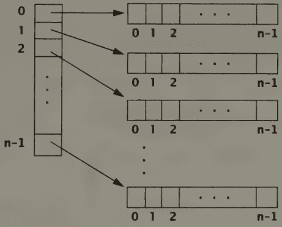

既然矩阵的空间已经创建好了，我们想要填充它。让我们为矩阵元素赋值一个随机分布在 -9 到 +9 范围内的整数值。

```c
for (i = 0; i < n; i++)

    for (j = 0; j < n; j++)

        a[i][j] = rand() % 19 - 9;      /* 从 -9 到 +9 */
```

尽管我们的矩阵存储在指针数组中，但仍使用通常矩阵表达式 `a[i][j]` 来访问第 `i` 行第 `j` 列（从0计数）的元素。因为 `a` 的类型是 `double **`，因此 `a[i]` 的类型是 `double *`。它可以被视为矩阵的第 `i` 行（从0计数）。因为 `a[i]` 的类型是 `double *`，因此 `a[i][j]` 的类型是 `double`。它是第 `i` 行中的第 `j` 个元素（从0计数）。

现在我们已经为矩阵元素分配了值，可以将矩阵作为参数传递给各种函数。假设我们想要打印它、计算它的行列式并计算它的迹。在调用环境中，我们可以写：

```c
print_matrix(a, n);

det = determinant(a, n);

tr = trace(a, n);
```

`print_matrix()` 的函数定义如下：

```c
void print_matrix(double **a, int n)

{

    int i, j;

    for (i = 0; i < n; ++i) {

        for (j = 0; j < n; ++j)

            printf("%7.1f", a[i][j]);

    }

    putchar('\n');

}
```

`determinant()` 的函数定义开头为：

```c
double determinant(double **a, int n)

{

    ....
```

由于行列式函数非常复杂，我们将进一步讨论推后练习。然而，迹很容易计算。根据定义，矩阵的迹是其对角线元素之和：

```c
double trace(double **a, int n)

{

    int i;

    double sum = 0.0;

    for (i = 0; i < n; ++i)

        sum += a[i][i];

    return sum;

}
```

# 调整下标范围

在数学中，向量和矩阵的下标通常从 1 开始，而不是 0。我们也可以让我们的 C 代码做到这一点。以下函数可以用于为 `n` 向量创建空间：

```c
double *get_vector_space(int n)

{

    int i;

    double *v;

    v = calloc(n, sizeof(double)); /* 偏移指针 */

    return (v - 1);

}
```

由于返回的指针值向左偏移了，调用环境中的下标将从 1 到 `n`，而不是从 0 到 `n-1`。

从 1 开始而不是 0 开始索引的 n 向量

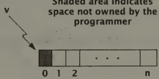

注意在图片中，我们阴影了一个元素，表示程序员不拥有元素 0。现在我们可以写出如下下面的代码：

```c
int n;

double *v;

...

v = get_vector_space(n); /* 从某处获取 n */

for (i = 1; i <= n; ++i)

    v[i] = rand() % 19 - 9;    /* 从 -9 到 +9 */
```

与其偏移指针，我们始终可以选择分配更多空间然后不完全使用它。

# 576 第 12 章 高级应用

```c
v = calloc(n + 1, sizeof(double)); /* 分配额外空间 */

for (i = 1; i <= n; ++i)

    v[i] = ...;
```

偏移指针的技术优之处在于没有浪费空间。让我们使用这种技术写一个函数，为一个 `mn` 矩阵创建空间，其下标从 1 开始而不是 0 开始。

```c
double **get_matrix_space(int m, int n)

{

    int i;

    double **a;

    a = calloc(m, sizeof(double)); /* 偏移指针 */

    for (i = 1; i <= m; ++i) {

        a[i] = calloc(n, sizeof(double));

        --a[i]; /* 偏移指针 */

    }

    return a;

}
```

我们可以将内存中的矩阵 `a` 视为：

从 1 开始而不是 0 开始索引的 m x n 矩阵

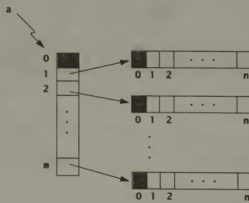

注意，我们再次使用了阴影区域来表示程序员不拥的空间。

如果程序员想要让之前由 `calloc()` 分配的空间重新可用可用，则必须使用 `free()` 函数。假设在 `main()` 中我们写道：

```c
int i, j, n;

double **a;

for ( ; ; ) {

    .... /* 永远执行 */

    a = get_matrix_space(n, n);

    /* 从某处获取 n */

    for (i = 1; i <= m; ++i) {

        for (j = 1; j <= n; ++j) /* 赋值 */

            a[i][j] = ...;

    } /* 执行某些事情 */

}
```

# 一次分配所有内存

在某些应用中，特别是当矩阵很大时，一次性分配可能很重要。同时，我们希望矩阵从 1 开始索引，而不是 0。以下是内存中考虑 `a` 的方式：

```c
#include <stdio.h>

#include <stdlib.h>

typedef matrix;

typedef row;

typedef elem;
```

## 12.7 返回状态

在大多数操作系统中，你通过点击鼠标或输入键盘与机器通信。当你给出如下命令时：

```bash
cc pgm.c date echo Beautiful!
```

你正在通过 shell 通信。shell 本身是一个程序，它解释你的输入并尝试执行。Unix 系统上常见的 shell 有：Bourne `sh`、C shell `csh` 和 Korn shell `ksh`。为了展示 `main()` 返回的值（程序状态）如何使用，我们将编写一个小程序，然后编写一个调用该程序的 shell 脚本。这是我们的程序：

文件 `try_me.c`

```c
#include <stdio.h>

#define MARKER ">"

int main(int argc, char **argv)

{

    int val;

    printf("\n");

    printf(MARKER " 输入整数: ");

    scanf("%d", &val);

    printf(MARKER " 返回的值: %d\n\n", val);

    return val;

}
```

注意 `main()` 可以返回任何整数值，而不仅仅是零。同样注意我们正在使用标记来清楚地指示到屏幕上的行。接下来，我们编译此程序，将可执行文件放在我们路径中的目录中。

```bash
gcc -o $base/bin/try_me try_me.c
```

现在我们准备好编写 shell 脚本了。

文件 `go_try`

```csh
#!/usr/bin/csh

##

## 实验状态。

##
```

```csh
echo --- = system $status

echo At the top: status = $status

try_me ---

echo ---

echo After try_me: status = $status

try_me

set val = $status

echo ---

echo After try_me again: val = $val

echo ""

echo ---

echo To exit from the while loop, input 0.

while ($val)

    try_me

    set val = $status

    echo In the loop: val = $val

end
```

## `go_try` Shell 脚本解析

`#!/usr/bin/csh`

注释以 `#` 开始，并在 `#` 持续到行尾。然而，这一行是特殊的，因为它在文件顶部的第 1 列以 `#` 开头。这样的行会被操作系统读取。这一行告诉操作系统使用 C shell（即 `/usr/bin/csh`）来执行此文件。

- `##` 对 `status` 进行实验。

  注释以 `#` 开始，并持续到行尾。

- `echo ---`

  `echo At the top: status = $status`

  `echo` 命令获取该行的剩余部分并将其写入屏幕。然而，符号 `$` 是特殊的。shell 变量的值通过以下方式获取：

  `$(shell_variable_name)`

  shell 变量 `status` 是一个内置变量。

- `try_me`

  `echo ---`

  `echo After try_me: status = $status`

  在此处，调用我们的程序 `try_me`。完成操作后，我们想要检查程序的 `status`。（正如我们将所看到的的，我们的尝试失败了。）

- `try_me`

  `set val = $status`

  `echo ---`

  `echo After try_me again: val = $val`

  当我们再次调用 `try_me` 后，我们使用 `set` 命令创建一个名为 `val` 的 shell 变量，其值即为 `$status` 的当前值。（正如我们将要看到的，`val` 的值是程序 `try_me` 中 `main()` 返回的值。我们使用 `echo` 命令在屏幕上显示 `$val`。）

```csh
echo exit from the while loop, input 0.

while

    try_me

    set val = $status

    echo In the loop: val = $val

end
```

最后，我们进入一个循环，以便我们可以实验并看到打印在屏幕上的结果。

我们的 shell 脚本 `go_try` 本身并没有包含多少信息。然而，当我们执行它时，许多新思路开始变得清晰。为了使该文件可执行，我们给出一个命令：

```bash
chmod +x go_try
```

最后，我们给出命令：

```bash
go_try
```


并在提示时输入一些数字。屏幕上显示的内容：

---

At the top: status = 0  
>> Input an integer: 3  
>> Value being returned: 3

---

After try_me: status = 0  
>> Input an integer: 7  
>> Value being returned: 7

---

After try_me again: val = 7  
....

## `go_try` 输出解析

- ---

  At the top: status = 0

  以 `>>` 开头的行是由 `try_me` 程序写入的。非空行是由 shell 脚本 `go_try` 中的 `echo` 命令写入的。每个进程在退出时都会重置 `status` 的值，按照惯例，`0` 用于进程的正常结束。`echo` 命令本身就是一个进程。我们做的第一个操作是：

  ```csh
  echo ---
  ```

  当这个进程终止时，它将 `status` 的值设为 `0`。这反映在输出行中：

  ```text
  At the top: status = 0
  ```

- `>> Input an integer: 3`  
  `>> Value being returned: 3`

  这些行是由 `try_me` 程序生成的。在提示时，我们在键盘上输入了 `3`。第二行报告了这一点。

- ---

  After `try_me`: status = 0

  起初，这个报告让我们很惊讶，但随后我们想起 `status` 是瞬态的。生成 `---` 的 `echo` 命令在 `try_me` 之后重置了 `status`。因此，报告的值是 `0`，而不是 `3`。

- `>> Input an integer: 7`  
  `>> Value being returned: 7`

  ---  
  After `try_me` again: val = 7

  在再次调用 `try_me` 后，我们在提示时输入了 `7`。在 `try_me` 退出后，我们使用 shell 变量 `val` 来捕获 `$status` 的当前值。在 shell 脚本中，相关的行是：

  ```csh
  try_me

  set val = $status

  echo ---

  echo After try_me again: val = $val
  ```

  shell 脚本 `go_try` 中的 `while` 循环允许用户实验。我们观察到，当我们输入整数 `n` 时，打印出来是 `n mod 256`。特别是，`-1` 会产生 `255`。因此，程序 `status` 是 `0` 到 `255` 之间的非负数。当 `main()` 返回一个值给 shell 时，如果需要，shell 可以将其用于自己的目的。

尽管我们在本节的讨论中使用了 UNIX C shell，但对于其他 UNIX shell 以及 MS-DOS 来说，情况是类似的。

## 总结

1. 并发进程与调用它的代码同时执行的代码。在 UNIX 中，可以使用 `fork()` 来创建一个子进程，子进程是父进程的副本，但子进程有自己唯一的进程标识符。如果 `fork()` 调用成功，它会向子进程和父进程返回 `0`。

2. 如果 `fork()` 失败，则不会创建子进程并返回 `-1`。编写一个包含以下代码的程序：

   ```c
   #define N 3

   for (i = 1; i <= N; ++i) {
       pid = fork();

       if (pid == 0)
           printf("%2d: Hello from child\n", i);
       else if (pid > 0)
           printf("%2d: Hello from parent\n", i);
       else
           printf("%2d: ERROR: fork did not occur\n", i);
   }
   ```

3. 在 UNIX 中，`pipe()` 创建了进程间的通信机制。在打开管道后，使用 `fork()` 调用来创建进程。

4. 操作系统处理的信号集定义在 `signal.h` 中。该集合取决于系统，但某些信号是 MS-DOS 和 UNIX 通用的。

5. 哲学家问题是同步共享资源的标准模型。

6. 信号量是一种允许等待和信号操作的特殊变量。变量是一个存储值的特殊位置。等待操作获取并移除一个。信号操作增加一个。等待操作阻塞进程直到它可以完成操作。信号操作可以启动被阻塞的进程。

7. 通过指针 `double`，我们可以构建任何大小的矩阵，并将其传递给为之设计的函数。对于工程师和科学家来说这是一个重要的想法。

## 练习

1. 修改第 12.1 节（第 556 页，“使用 `fork` 创建并发进程”）中的简单 `fork` 程序，使其包含三处行：

   ```c
   value = fork();
   ```

   程序的输出是非确定性的。解释这意味着什么。提示：多次执行你的程序。

2. 系统上 `N` 必须为多大才能打印错误信息？

3. 在第 12.2 节（第 556 页，“覆盖进程：`exec` 族”）中，我们展示了一个进程如何覆盖另一个进程的程序。修改该程序。首先创建另一个可执行文件，例如 `pgm3`，它打印当前日期。将其作为覆盖你修改程序的父进程的另一种选择。

4. `fortune` 命令在你的系统上工作吗？如果是，找到可执行代码的位置。在你的一个运行的程序中插入类似代码：

   ```c
   if (fork() == 0)
       execcl("/usr/games/fortune", "fortune", 0);
   ```

   这样做的效果是什么？

5. 编写一个程序，使用 `n` 个并发进程乘以两个 `n × n` 矩阵。

6. 将两个程序编译为名为 `prog1` 和 `prog2` 的可执行文件。编写一个程序，通过 `fork()` 并使用 `exec1()` 覆盖这两个可执行文件来并发执行它们。

7. 当系统上的管道（pipe）填满时，它包含多少个字符？编写一个程序来找出答案。*提示：* 向管道中写入字符，直到它阻塞为止。

8. 修改哲学家进晚餐程序，使其在接收到中断时，打印出每个哲学家吃食物的次数。此外，实验观察如果修改了 `pick_up()` 函数，使得第 3 号哲学家先取筷子，并且每个人都取左边的筷子，会发生什么。

9. 信号的处理方式取决于系统。尝试在不同的系统上运行以下程序，看看会发生什么：

   ```c
   #include <stdio.h>
   #include <signal.h>
   #include <math.h>    /* 此处定义 HUGE_VAL */

   int main(void)
   {
       double x = HUGE_VAL, y = HUGE_VAL;

       signal(SIGFPE, SIG_IGN);
       printf("Ignore signal: x * y = %e\n", x * y);

       signal(SIGFPE, SIG_DFL);
       printf("Default signal: x * y = %e\n", x * y);

       return 0;
   }
   ```

10. 从 `double` 类型的变量开始，我们展示了如何动态构建矩阵并将其传递给函数。我们真的需要全都动态完成吗？考虑以下代码：

    ```c
    int i;

    double *a[3], det;

    double trace(double **, int);    /* 函数原型 */

    for (i = 0; i < 3; i++)
        a[i] = calloc(3, sizeof(double));    /* 填充矩阵 a[][] */

    ....

    tr = trace(a, 3);
    ```

    数组 `a` 被作为参数传递，但从函数原型中看到，需要一个 `double **` 类型的参数。你的编译器会报错吗？请解释。

11. 在 20 世纪 70 年代 C 语言出现之前，我们有机会使用 PL/1，这是一种在 IBM 主机上常见的语言。PL/1 手册总是强调编译器可以创建从任何所需索引开始的向量和矩阵。例如，形式如下的声明：

    ```c
    int automobiles[1989 : 1999]; /* PL/1 风格的声明 */
    ```

    将创建一个大小为 11 的数组，其索引从 1989 开始。该数组可以用于存储 1989 年到 1999 年间售出或预计售出的汽车数量。也许这种设计强调的一个概念是，FORTRAN 和其他语言无法创建这样的数组。在 C 语言中，显然可以创建数组。解释这是如何实现的。

12. 用随机分布在 `-N` 到 `+N` 范围内的整数填充矩阵对于测试目的来说非常方便。如果你在通过手工检查机器计算结果，`N` 的合理值是 2 或 3。编写一个填充函数：

    ```c
    void fill_matrix(double **a, int m, int n, int n)
    {
        ....
    }
    ```

13. 设 $A=(a_{ij})$ 为一个 `n × n` 矩阵。可以使用高斯消法计算 `A` 的行列式。该算法要求对于 `k=1` 到 `n-1`，执行以下操作：从 `a_{kk}` 开始，检查其列中所有位于 `a_{kk}` 下方的元素，包括 `a_{kk}` 本身。该元素被称为主元（pivot）。如果主元在第 `i` 行，且 `i ≠ k`，则交换第 `i` 行和第 `k` 行。（记录执行的交换次数）。完成此操作后，`a_{kk}` 将成为主元。如果该值为 `0`，则行列式值为 `0`，算法结束。否则，对于 `i=k+1` 到 `n`，将第 `k` 行的若干倍数加到第 `i` 行，其中倍数由 `(-1/a_{kk}) × a_{ik}` 给出。最后一步是取矩阵对角线元素的乘积。如果算法中的行交换次数为偶数，则该乘积为行列式；否则，该乘积的负值为行列式。在本次练习中，你需要编写一个计算 `n × n` 矩阵行列式的程序。为了让下标从 `i` 而非 `0` 开始，请使用函数 `get_matrix_space()`。提示：先在小矩阵上通过手工模拟该算法，以便理解算法的细节。

    ```c
    for (k = 1; k <= n; ++k) {
        找到主元元素

        如果主元为 0，返回 0

        如果主元在第 i 行，且 i != k，
            则交换第 i 行和第 k 行
            并增加交换计数器 i_cnt

        pivot = a[k];

        for (i = k + 1; i <= n; ++i) {
            multiplier = -a[i][k] * (1.0/pivot);

            // ... 其他逻辑
        }
    }

    if (i_cnt == 0)
        det = product;
    else
        det = -product;
    ```

## 13.1 输出

程序必须通过通信才是有用的。我们的第一个示例是一个在屏幕上打印“C++ 是改进后的 C”短句程序。完整程序如下：

文件 `improved.cpp` 中：

```cpp
// 第一个演示输出的 C++ 程序。
// 标题: Improved
// 作者: Richmond Q. Programmer

#include <iostream>

int main()
{
    cout << "C++ is an improved C.\n";
}
```

该程序在屏幕上打印：

```text
C++ is an improved C.
```

### 改进后的程序解析

- `//` 第一个演示输出的 C++ 程序。

  双斜杠 `//` 是新的注释符号。注释持续到行尾。旧的 C 语言括号符号 `/* */` 仍然可用于多行注释。

- `#include <iostream>`

  `iostream.h` 头文件为 C++ 引入了 I/O 设施。

- `int main()`

  在 C++ 中，空括号始终意味着 `main(void)`，而永远 `main(...)`。C++ 的风格是不使用冗余的 `void` 来声明空参数列表。

## 13.2 输入

`cout << "C++ is an improved C.\n";`

这条语句打印到屏幕上。运算符 `<<` 将字符串 `"C++ is an improved C.\n"` 传递给标准输出。这样用时，输出运算符 `<<` 被称为置运算符（put operator）或插入运算符（insertion operator）。

我们可以重写第一个程序：

```cpp
// 第一个演示输出的 C++ 程序。

#include <iostream>

main()
{
    cout << "C++ is an improved C." << endl;
}
```

尽管它与第一个版本不同，但它产生相同的输出。这个版本省略了 `main()` 返回 `int` 的显式声明，并利用了返回类型是隐式的特性。在这里我们使用了两次输出运算符 `<<`（put）。每次将 `<<` 与 `cout` 配合使用，打印都会从上次的地方继续。在这种情况下，标识符 `endl` 强制换行并随后进行刷新（flush）。`endl` 被称为操纵符（manipulator）。

我们将编写一个程序，将地球到月球的英里转换为公里。以英里计，这个距离平均为 238,857 英里。这个数字是一个整数。要将英里转换为公里，我们乘以转换因子 1.609，这是一个实数。

我们的转换程序将使用能够存储整数值和实值的变量。在 C++ 中，所有变量在使用之前都必须声明，但与 C 语言不同，它们不需要位于块的头部。声明可以与可执行语句混合。它们的作用域从声明点到它们被定义的块的结束。标识符的选择应反映它们在程序中的用途。通过这种方式，它们可以作为文档，使程序更具可读性。

这些程序假设 `int` 是 4 字节的，但在某些机器上，这些变量应该声明为 `long`。你可以在 `limits.h` 中检查常量 `INT_MAX`。

文件 `moon.cpp` 中：

```cpp
// 转换为公里的月球距离。
// 标题: moon

#include <iostream>

int main()
{
    const int moon = 238857;

    cout << "The moon's distance from Earth is " << moon;
    cout << " miles," << endl;

    int moon_kilo = moon * 1.609;

    cout << "In kilometers this is " << moon_kilo;
    cout << " km." << endl;
}
```

程序的输出结果为：

```text
The moon's distance from Earth is 238857 miles.
In kilometers this is 384320 km.
```

### 月球程序解析

- `const int moon = 238857;`

  关键字 `const` 是 C++ 中新引入的。它取代了部分使用预处理器命令 `define` 来创建命名字面量的用法。使用这种类型修饰符告知编译器 `moon` 的初始化值不能更改。因此，它使 `moon` 成为符号常量。

- `cout << "The moon's distance from Earth is " << moon;`

  C++ 中的流 I/O 可以在不需要额外的格式信息的情况下区分各种简单值。在这里，`moon` 的值被作为整数打印。

```cpp
int moon_kilo = moon * 1.609;
```

声明可以发生在可执行语句之后。这允许变量的声明更靠近它们的使用。

让我们写一个程序，将一系列值从英里转换为公里。该程序将是交互式的。用户将输入一个英里值，程序将该值转换为公里并打印出来。

文件 `mi_km.cpp` 中：

```cpp
// 英里转换为公里。
// 标题: mi_km

#include <iostream>

const double m_to_k = 1.609;

inline int convert(int mi)
{
    return (mi * m_to_k);
}

int main()
{
    int miles;

    do {
        cout << "Input distance in miles: ";
        cin >> miles;

        cout << "\nDistance is " << convert(miles) << " km.";
        cout << endl;
    } while (miles > 0);
}
```

该程序使用了输入流变量 `cin`，它通常是标准输入。输入运算符 `>>` 被称为获取运算符（get operator）或提取运算符（extraction operator），它将值从输入流赋值给变量。该程序演示了输入和输出。

### `mi_to_km` 程序解析

- `const double m_to_k = 1.609;`

  C++ 减少了 C 语言对预处理器的传统依赖。例如，与其使用 `define` 宏，C++ 使用 `const` 常量，如 1.609 这样的转换因子被简单的赋值给变量。

- `inline int convert(int mi) { return (mi * m_to_k); }`

  `inline` 关键字指定函数将被内联，以避免函数调用开销。

- `do { ... } while (miles > 0);`

  ```cpp
  do {
      cout << "Input distance in miles: ";
      cin >> miles;
      cout << "\nDistance is " << convert(miles) << " km.";
      cout << endl;
  } while (miles > 0);
  ```

  程序反复提示用户输入英里距离。程序由零或负值结束。标准输入流的值被自动转换为整数值。

## 13.3 函数

C++ 的函数语法启发了在 C 中发现的函数原型语法。基本上，通过显式列出类型和参数数量，C++ 允许强类型检查和赋值兼容转换。

C++ 允许参数通过引用传递。按引用传递使用以下语法：

```cpp
type& identifier
```

此外，C++ 函数参数可以具有默认值。这些值在函数参数列表中给出：

```cpp
= expression
```


下面的示例演示了这些点：

文件`add3.cpp`中

```cpp
// 使用默认值

#include <iostream>

inline void add3(int& s, int a, int b, int c = 0)

{

    s = a + b + c;

}

inline double average(int s) { return s / 3.0; }

```

## 从 C 迁移到 C++

```cpp
int main() {

    int score_1, score_2, score_3, sum;

    cout << "\nEnter 3 scores: ";

    cin >> score_1 >> score_2 >> score_3;

    add3(sum, score_1, score_2, score_3);

    cout << "\nSum = " << sum << ";

    cout << "\nAverage = " << average(sum) << endl;

    add3(sum, 2 * score_1, score_2); // 使用默认值 0

    cout << "\nweighted Sum = " << sum << ";

    cout << "\nweighted Average = " << average(sum) << ".\n"

}

```

## add3 程序解析

- `inline void add3(int& s, int a, int b, int c = 0)`
  {
    s = a + b + c;
  }

变量`s`是按引用传递的。传入的实际参数必须是左值，因为在调用过程时那将是实际地址。

- `add3(sum, score_1, score_2, score_3);`

变量`sum`是按引用传递的。因此，它被直接操作，并用于获取函数的计算结果。

- `add3(sum, 2 * score_1, score_2); // 使用默认值 0`

在这里调用`add3()`时仅使用了三个实际参数。第四个参数默认值为零。

## 13.4 类与抽象数据类型

C++ 的新颖之处在于它的聚合类型类。类是传统 C 语言结构体（struct）概念的扩展。类提供了实现用户定义数据类型以及相关函数和操作符的手段。因此，类可以用于实现抽象数据类型（ADT）。让我们写一个名为`string`的类，来实现一种受限制的字符串。

在文件`my_string.cpp`中

```cpp
// type string 的简单实现。

#include <string.h>

#include <iostream.h>

const int max_len = 255;

class string {

public: // 公有访问

    void assign(const char* st) {

        strcpy(s, st); len = strlen(st);

    }

    int length() { return len; }

    void print() { cout << s << "\Length: " << len << "\n"; }

private: // 对成员函数的受限访问

    char s[max_len]; // 通过字符数组实现

    int len;

};

```

在这个示例中发现了 C 结构体概念的两个重要扩展：首先，它拥有作为函数的成员（例如`assign`），其次，它同时拥有公有成员和私有成员。关键字`public`表示紧随其后的成员的可见性。如果没有这个关键字，成员将是类的私有的（private）。私有成员可供类的其他成员函数使用。公有成员可以在类声明作用域内的任何函数中访问。私有性允许类类型的实现部分被“隐藏”。这防止了对数据结构进行意料之外的修改。受限访问（或称数据隐藏）是面向对象编程的一个特性。

成员函数的声明允许 ADT 对其私有表示执行特定的操作。例如，成员函数`length`返回字符串的长度，定义为从第一个字符开始到但不包括第一个零值字符的字符数。成员函数`print()`输出字符串本身及其长度。成员函数`assign()`将字符字符串存储到隐藏变量中，并在隐藏变量`len`中计算其长度。

我们现在可以像使用语言的基础类型类型一样使用这个`string`数据类型。它遵守 C 语言块结构规则。使用该类型的其他代码称为客户端（client）。客户端只能使用公有成员对`string`类型的变量进行操作。

```cpp
// string 类的测试。

int main()

{

    string one, two;

    char three[40] = {"My name is Charles Babbage."};

    one.assign("My name is Alan Turing.");

    two.assign(three);

    cout << three;

    cout << "\nLength: " << strlen(three) << endl;

    // 打印 one 和两个 中短的一个。

    if (one.length() <= two.length())

        one.print();

    else

        two.print();

}

```

变量`one`和`two`是`string`类型。变量`three`是`char`指针类型，与`string`类型不兼容。成员函数使用点运算符（或“结构成员操作符”）来调用。从它们的定义可以看出，这些成员函数作用于命名变量的隐藏私有成员字段。人们不能在`main`内部编写`one.len`表达式来尝试访问该成员。该示例程序的输出为：

My name is Charles Babbage.
Length: 27
My name is Alan Turing.
Length: 23

## 13.5 重载

“重载”（overloading）一词指的是给操作符或函数赋予多个含义的做法。所选含义取决于操作符或函数所使用的参数类型。让我们重载上一个示例中的`print`函数。这将是`print`函数的第二个定义。

```cpp
class string {

public:

    // 公有访问

    void print() { cout << s << "\nLength: " << len << "\n"; }

    void print(int n)

    {

        for (int i = 0; i < n; ++i)

            cout << s << endl;

    }

};

```

这个版本的`print`取一个`int`类型的单一参数。它将打印`n`次。

同样可以重载大多数操作符。例如，让我们重载`+`来连接两个字符串。这样做我们需要`friend`关键字和`operator`。`operator`关键字位于操作符之前。`friend`赋予函数访问类成员的权限。该函数在类中声明但不是成员函数。

在文件`ovl_string.cpp`中

```cpp
// 重载 operator +

#include <string.h>

#include <iostream.h>

const int max_len = 255;

class string {

public:

    void assign(const char* st) { strcpy(s, st); len = strlen(st); }

    int length() { return len; }

    void print() { cout << s << "\nLength: " << len << "\n"; }

    friend string operator+(const string& a, const string& b); // 声明 string

private:

    char s[max_len];

    int len;

};

string operator+(const string& a, const string& b) // 重载 +

{

    string temp;

    temp.assign(a.s);

    temp.len = a.len + b.len;

    if (temp.len < max_len)

        strcat(temp.s, b.s);

    else

        cerr << "Max length exceeded.\n";

    return temp;

}

void print(const char* c) // print string

{

    cout << c << "\nlength: " << strlen(c) << endl;

}

int main()

{

    string one, two;

    char three[40] = {"My name is Charles Babbage."};

    one.assign("My name is Alan Turing.");

    two.assign(three);

    if (one.length() <= two.length())

        one.print();

    else

        two.print();

    return 0;

}

```

## 13.6 构造函数与析构函数

构造函数是一种用于初始化类变量的成员函数。在 OOP 术语中，变量是一个对象。在许多情况下，这涉及到动态存储分配。当创建关联类的对象时，构造函数就会被调用。析构函数是一种用于释放或终结类变量的成员函数。当自动对象离开作用域时，析构函数会被隐式调用。

让我们通过为每个字符串变量动态分配存储来修改`string`示例。我们将私有数组变量替换为指针。改进后的类将使用构造函数通过`new`操作符动态分配相应数量。

// 动态分配字符串的实现。

```cpp
class string {

public:

    string(int n) { s = new char[n+1]; len = n; } // 构造函数

    ~string() { delete[] s; } // 析构函数

    void assign(char* st) {

        { strcpy(s, st); len = strlen(st); }

    }

    int length() { return len; }

    void print() { cout << s << "\nLength: " << len << "\n"; }

private:

    char* s;

    int len;

};

```

## 构造函数与析构函数

构造函数是一个名称与类名相同的成员函数。`new`关键字是 C 语言增加的一个特性。它是一个一元运算符，接收数据类型作为参数，可以包含数组的大小。它从自由存储（free store）中分配适当数量的内存存储数据，并返回指向该内存地址的指针值。在前面的示例中，将从自由存储分配`n + 1`字节。因此，如下声明

```
string a(40), b(100);
```

将为变量`a`分配 41 字节（由`a.s`指向），为变量`b`分配 101 字节（由`b.s`指向）。我们为字符串结束值`0`增加了 1 字节。通过`new`获取的存储是持久的，不会在块退出时自动返回。当返回存储时，必须在类中包含一个析构函数。析构函数写为一个普通的成员函数，其名称与类名相同，但前面有一个波浪符号`~`。通常，析构函数使用一元运算符`delete[]`（语言的另一个新增特性）来自动释放与指针表达式相关的存储。每当使用`new type[size]`进行分配时，都应使用`delete[]`。

```
// 将其作为成员函数添加到类 string 中。

~string() { delete []s; }; // 析构函数
```

通常会重载构造函数，编写多种此类函数以适应一种一种初始化样式。考虑使用指向字符值指针指针来初始化一个字符串。这样的构造函数是：

```
string(const char* p)

{

  len = strlen(p);

  s = new char[len + 1];

  strcpy(s, p);

}
```

调用此版本构造函数的典型声明是：

```
char* str = "I came on foot.";

string a("I came by bus."), b(str);
```

拥有一个无参数的构造函数也是理想的：

```
string() { len = 255; s = new char[255]; }
```

这将通过不带括号参数的声明来调用，并默认分配 255 字节内存。现在，在下面的声明中，三个构造函数都会被调用：

```
string a, b(10), c("I came by horse.");
```

重载的构造函数根据每个声明的形式选择。变量`a`没有参数，因此分配 255 字节。变量`b`有一个整数参数，因此分配 11 字节。变量`c`有一个指向字面量字符串 "I came by horse." 的指针参数，因此分配 17 字节，并将该字面量字符串拷贝到私有成员中。

## 13.7 面对象编程与继承

OOP 中的新概念是继承机制。从现有基类派生新类的机制。派生类添加或修改继承的基类成员。这用于共享代码和接口以创建相关类型的层次结构。

层次结构是处理性的方法。它对对象进行分类。例如，元素周期表中的气体元素。惰性气体具有该分类中所有元素共有的属性。惰性气体是一种重要的特殊气体类。这里的层次结构如下：惰性气体（如氩气）是一种气体，而气体是一种元素。这种层次结构为理解惰性气的行为提供了方便的方法。我们知道它们由质子和电子组成，因为这是所有元素共有的描述。在室温下的气态下，这种行为是所有气体共有的。我们知道它们在普通的化学反应中不会与其他元素结合，因为这是所有惰性气体共有的行为。

考虑为一所大学设计数据库。注册员必须跟踪不同类型的学生。我们需要开发的基类捕捉了“学生”的描述。学生的两个主要大类是研究生和本科生。

这里是 OOP 设计方法论：

## OOP 设计方法论

1. 一组合适的类型。
2. 设计它们的相关性。
3. 使用继承来共享代码。

派生类的示例如下：

```cpp
enum support { ta, ra, fellowship, other };

enum year { fresh, soph, junior, senior, grad };

class student {

public:

    student(char* nm, int id, double g, year x);

    void print();

private:

    int student_id;

    double gpa;

    year Y;

    char name[30];

};

class grad : public student {

public:

    grad(char* nm, int id, double g, year x) : student(nm, id, g, x) {}

    void print();

private:

    // grad 特有的成员

};
```

（注：文档后半部分的 OCR 文本高度碎片化，并包含关于类定义的重复/乱码片段。我已根据提供的代码片段和标准的 C++ 继承模式重构了逻辑结构。）

```
shape* ptr_shape;

cout << " << area = " << ptr_shape->area();
```

现在想象通过开发一个正方形类来改进我们的类型层次结构。

```cpp
class square: public rectangle {

public:

    square(double h): rectangle(h,h) {}

    double area() { return rectangle::area(); }

};
```

客户端代码保持不变。如果使用非 OOP 代码，情况就大不相同。

## 13.9 模板

C++ 使用`template`关键字来提供参数多态。参数多态允许用相同的代码应用于不同的类型，其中类型是代码体的一个参数。代码是按泛型方式编写的，以便对类`T`进行操作。当用实际类型替换类`T`时，该模板将被用于生成不同的实际类。

这种技术一个特别重要的用途是编写泛型容器类。容器类用于包含特定类型的数据。栈（Stacks）、向量（vectors）、树（trees）和列表（lists）都是标准容器类的示例。我们将开发一个参数化的栈类。

在文件`stack.cpp`中

```cpp
// template <class TYPE>

class stack {

public:

    stack(int size = 1000):max_len(size)

    { s = new TYPE[size]; top = EMPTY; }

    ~stack() { delete s[]; }

    void reset() { top = EMPTY; }

    void push(TYPE c) { s[++top] = c; }

    TYPE pop() { return s[--top]; }

    TYPE top_of() { return s[top]; }

    bool empty() { return top == EMPTY; }

    bool full() { return top == max_len - 1; }

private:
```


```cpp
enum {EMPTY = -1};

TYPE* s;

int max_len;

int top;

};
```

类声明的语法前缀是：

```cpp
template <class identifier>
```

该标识符是一个模板参数，本质上代表任意类型。在整个类定义中，模板参数可以作为类型名使用。该参数在实际声明中被实例化。使用此机制的栈声明示例：

```cpp
stack<char> stk_ch; // 1000个元素的字符栈

stack<char*> stk_str(200); // 200个元素的char*栈

stack<complex> stk_cmplx(100); // 100个元素的复数栈
```

这种机制避免了我们重写类声明，而变量是类型声明。

在处理此类类型时，代码必须始终使用角括号作为声明的一部分。这里有两个使用栈模板的函数：

```cpp
// 反转一组由 char* 表示的字符串

void reverse(char* str[], int n)

{

    stack<char*> stk; // 此栈持有 char*

    for (int i = 0; i < n; ++i)

        stk.push(str[i]);

    for (int i = 0; i < n; ++i)

        str[i] = stk.pop();

}
```

在`reverse()`中，使用`stack<char*>`插入 n 个字符串，然后按反序弹出它们。

```cpp
// 从数组初始化复数栈

void init(complex c[], stack<complex>& stk, int n)

{

    for (int i = 0; i < n; ++i)

        stk.push(c[i]);

}
```

在`init()`中，变量`stack<complex>`通过引用传递的，并将 n 个复数推入此栈中。注意我们在该示例中使用了`bool`。它是 C++ 中的一种基本类型，值为`true`和`false`。

## 13.10 C++ 异常

C++ 引入了一种对上下文敏感的异常处理机制。抛出异常的上下文将`try`块。使用`catch`关键字声明的处理器位于`try`块的末尾。

通过使用`throw`表达式抛出异常。异常将通过从紧跟在`try`块之后的处理器列表中选择适当的处理器来处理。所有这些简单示例如下：

## 13.11 面向对象编程的好处

```cpp
// 带有异常的栈构造函数

stack::stack(int n)

{

    if (n < 1)

        throw (n); // 需要一个正值

    p = new char[n]; // 创建一个字符栈

    if (p == 0) // 如果 new 失败返回 0

        throw ("FREE STORE EXHAUSTED");

}

void g()

{

    try {

        stack a(n), b(n);

        ....

    } catch (int n) { ... }

    catch(char* error) { ... } // 自由存储耗尽

}
```

第一个`throw()`有一个整数参数，并匹配`catch(int n)`签名。预计处理器在错误数组大小作为参数传递给构造函数时执行适当的操作。例如，输出错误消息并终止是正常的。第二个`throw()`有一个`char`指针参数，并匹配`catch(char* error)`签名。现代 ANSI C++ 编译器在`new`失败时会抛出标准异常`bad_alloc`。旧系统在失败时会返回空指针值 0。

## 13.11 面向对象编程的好处

OOP 的核心元素是对适当一组数据类型及其操作的封装。类结构及其成员函数和数据成员提供了适当的编码工具。类变量是用于操纵的对象。

类还提供了数据隐藏。访问权限可以管理，并限制在任何需要访问实现细节的函数组。这促进了模块化和健壮性。

OOP 中的另一个重要概念是通过继承机制促进代码复用。这是一种从现有类（称为基类）派生新类的机制。基类可以被添加或修改以派生派生类。在这种相关数据类型的层次结构中，可以创建共享代码的类。

许多实用的数据结构是彼此的变体，为每种结构产生相同的代码通常是繁琐的。派生类继承基类的描述。可以通过添加成员、重载成员函数和修改访问权限来修改类。

OOP 编程任务通常比 C 中的普通过程化编程更困难，因为它有一个额外的设计步骤。这种能力对于问题很重要。解决方案将被封装，因此是稳健的。OOP 对许多人意义重大。我们将提供一个等式：

```text
OOP = 类型扩展 + 多态
```

## 总结

1. 双斜杠`//`是新的注释符号。注释持续到行尾。旧的 C 注释符号`/* */`仍然可用用于多行注释。

2. `iostream.h`头文件为 C++ 引入了 I/O 功能。标识符`cout`是标准输出流的名称。运算符`<<`将参数传递到标准输出。以此方式使用时`<<`被输出。标识符`cin`是标准输入流的名称。运算符`>>`是输入运算符，称为获取，将输入流的值赋值给变量。

3. C++ 减少了对预处理器的传统依赖。不再使用`define`，常量被赋值给`const`变量。`inline`关键字指定编译函数以避免函数调用开销。根据原则，这应该谨慎使用并仅用于短函数。

# 第 13 章

7. 构造函数是一个成员函数，其工作是初始化其所属类的变量。在许多情况下，这涉及到动态存储分配。每当创建关联类的对象时，构造函数就会被调用。析构函数是一个成员函数，其工作是结束其所属类的变量。当自动对象超出作用范围时，析构函数会被隐式调用。

8. 面对象编程（OOP）的核心元素是对适当一组数据类型及其操作进行封装。这些用户定义的类型是 ADT（抽象数据类型）。类结构通过其成员函数和数据成员提供了一种适当的编码工具。类变量是需要操作的对象。

9. OOP 的另一个重要概念是通过继承机制实现代码复用。这是一种从现有类（称为基类）派生出新类的机制。可以通过向基类添加内容或修改基类来创建派生类。通过这种方式，可以创建一个相关数据类型的层次结构以共享代码。这种类型层次结构可以被虚函数动态使用。基类中的虚成员函数可以在派生类中被重载。这些函数允许动态或运行时类型。指向基类的指针也可以指向派生类的对象。当使用指针时，它会动态选择调用哪个版本的成员函数。

10. 多态函数具有多种形式。虚函数允许从类型层次结构内重写的函数组中进行运行时选择。文中的示例是形状层次结构中的面积计算。计算任意面积的客户端代码是多态的。相应的`area()`函数在运行时被选择。

11. C++ 使用关键字`template`来提供参数多态性。参数多态允许相同的代码适用于不同的类型，其中类型是代码体的参数。代码是以通用泛型方式编写的，用于对类`T`进行操作。当类`T`替换为实际类型时，模板用于生成不同的类。

12. C++ 引入了对上下文敏感的异常处理机制。抛出异常的上下文将`try`块。使用关键字`catch`声明的处理器位于`try`块的末尾。使用`throw`表达式抛出异常。异常将通过调用从处理器块之后的处理器列表中选择的适当处理器来处理。

# 练习题

- 1. 使用流 I/O，在屏幕上打印“sells sea shells by the seashore”这句话：(a) 全部在同一行，(b) 分在三行，(c) 直到放入框中。

- 2. 写一个程序，将以码为单位衡量的距离转换为以米为单位的距离。关系是 1 米等于 1.0936 码。编写该程序使用`cin`读取距离。程序应该是一个循环，直到接收到零或负数作为输入为止。

- 3. 下面的程序读取三个整数并打印它们的和。注意使用表达式`!cin`来测试向`a`、`b`和`c`的输入是否成功。要退出循环，用户可以输入`bye`或`exit`或任何无法转换为整数的字符。实验该程序以理解其效果。

```cpp
#include <iostream.h>

int main()

{

    int a, b, c, sum;

    cout << "---\n"

           << "Integers a, b, and c will be summed.\n"

           << "\n";

    for ( ; ) {

        cout << "Input a, b, and c: ";

        cin >> a >> b >> c;

        if (!cin)

            break;

        sum = a + b + c;

        cout << "\n"

               << a + b + c << " = " << sum << "\n"

               << "\n";

    }

    cout << "\nBye!\n\n";

}
```

某些 C++ 系统提供了一种“大整数”类型。例如，在 GNU C++ 中，这种类型被称为`Integer`。我们将编写一个使用这种类型来计算阶乘的程序。

```cpp
#include <assert.h>

#include <iostream.h>

#include <Integer.h> // 对于 GNU g++

int main()

{

    int i;

    int n;

    Integer product = 1;

    cout << "The factorial of n will be computed.\n";

    cout << "Input n: ";

    cin >> n;

    assert(cin && n >= 0);

    for (i = 2; i <= n; ++i)

        product *= i;

    cout << "factorial(" << n << ") = " << product << "\n";

}
```

观察发现该程序与用 C 编写的阶乘程序相似。然而，当我们执行此程序时，我们了解到，例如：

`factorial(37) = 1376375309122634504631597581580902400000000`

使用如`int`或`double`的类型无法生成如此大的整数，但使用大整数类型可以。如果是 GNU C++ 则可以。

# 第 14 章：从 C 迁移到 Java

本章概述了 Java 编程语言。它还介绍了 Java 作为一种面向对象编程语言的使用。它的组织方式与 C++ 章节相似，展示了一系列程序，并解释了每个程序的元素。程序的复杂度逐渐增加，后几节的示例说明了面向对象编程的一些概念。它可以脱离于 C++ 章节进行独立阅读。

本章中的示例提供了对 Java 语言关键特性的简单、直接且实手的体验。本章向读者介绍了 Java I/O 类、继承、图形、线程和异常。要掌握这些单独的主题，需要彻底阅读参考书籍，例如 Arnold 和 Gosling 编写的《Java编程语言》（Reading, MA: Addison-Wesley, 1996）。

面向对象编程通过类（class）结构来实现。Java 中的类结构是 C 语言中结构体（struct）的扩展。本章后面的示例说明了 Java 如何实现 OOP（面向对象编程）概念，如数据隐藏、抽象数据类型（ADT）、继承和类型层次结构。Java 的设计用于网页。它拥有用于图形和跨网络通信的特殊库。它的设计目标是以于机器和系统的方式运行。这意味着 Java 程序的执行结果与运行 Windows 95 的 PC 或运行 Solaris 的工作站相同。它通过完全根据虚拟机来定义其语义来实现这一点。对于想要运行 Java 的系统，其工作就是移植虚拟机。这是可移植性和效率之间的权衡。在运行不同架构模拟器的机器上，不可避免地会有额外的开销。这种低效率的某些可以通过使用即时编译器（just-in-time compilers）或在效率至关重要时使用 C 写的原生代码来克服。在许多平台上，还可以采用直接到原生代码的编译器以获得最大的运行时效率。

## 14.1 输出

程序必须通信才有用。我们的第一个示例是一个在屏幕上打印短语“Java is an improved C.”的程序。完整程序如下：

在文件`Improved.java`中：

```java
// 一个演示输出的第一个 Java 程序。

// Title: Improved

// Author: Richmond Q. Programmer

class Improved {

    public static void main(String[] args) {

        System.out.println("Java is an improved C.");

    }

}
```

程序在屏幕上打印：

`Java is an improved C.`

该程序使用命令`javac improved.java`编译，生成一个名为`Improved.class`的代码文件。可以使用命令`java Improved`运行。

### Improved 程序的解析

- `//` 一个演示输出的第一个 Java 程序。

双斜杠`//`是新的注释符号。注释持续到行尾。旧的 C 语言括号注释符号`/* */`仍然用于多行注释。Java 还提供了`/** */`括号注释符号用于文档注释（doc comment）。程序`javadoc`使用文档注释并生成 HTML 文件。

## 14.2 变量与类型

`class Improved {`

Java 程序都是类。类的语法形式源于 C 中的结构体，而结构体在 Java 中并不。在 Java 中，类标识符名称（如`Improved`）按照惯例大写。数据和代码放置在类中。

`public static void main(String[] args)`

当一个类作为程序执行时，它通过调用成员函数`main()`开始。在这种情况下，`main()`是`Improved`的成员。在 Java 中，命令行参数是通过 String 数组传递的。在 C 中，我们需要一个`arg`变量来告诉程序命令行参数的数量。在 Java 中，该数组长度通过使用`args.length`找到。

`System.out.println("Java is an improved C.");`

该语句打印到屏幕。`System.out`对象使用成员函数`println()`进行打印。该函数打印字符串并添加新行，将屏幕光标移动到下一行。与 C 中的`printf`不同，`println()`不使用格式控制符。

在 Java 中，所有函数都包含在类中。在这种情况下，函数`main()`是类`Improved`的成员。成员函数被称为方法（method）。

我们将编写一个程序将英里转换为公里——从地球到月的距离。以英里计算，这个距离平均为 238,857 英里。这个数字是一个整数。将英里转换为公里，我们乘以转换因子 1.609，这是一个实数。

我们的转换程序将使用能够存储整数和实值的变量。后续程序中的变量将在`main()`中声明。Java 不允许声明`extern`变量（换句话说，即全局或文件作用域变量）。

Java 程序中的原始类型可以是`boolean`、`char`、`byte`、`short`、`int`、`long`、`float`和`double`。无论运行在什么机器或系统上，这些类型的定义始终相同。例如，`int`类型始终是一个带符号的 32 位整数，而在 C 语言中，这随系统而异。`boolean`类型不是算术类型，不能在混合算术表达式中使用。`char`类型使用 16 位 Unicode 值。`byte`、`short`、`int`和`long`都是带符号整数类型，它们的位长度分别为 8、16、32 和 64 位。（注：原文存在大量重复段落，已按要求处理）

## 14.4 重载

重载（overloading）术语是指为一个方法赋予多个含义。所选含义取决于传递给调用方法的参数类型，这被称为该方法的签名（signature）。让我们重载上一个例子中的`assignGender()`函数。这将是`assignGender()`方法的第二个定义。

```java
class Person {

    public void assignGender(char b) { gender = b; }

    public void assignGender(String b)

    { gender = ((b == "M")? 'M' : 'F'); }

}
```

这个版本的`assignGender()`接受一个`String`类型的单一参数。它将其转换并正确存储为性别字符值。现在，用户在分配性别时可以使用`char`或`String`值。

## 14.5 类类型的构造与析构

构造函数（constructor）是一个其功能是初始化其类对象的函数。在新建的类对象的实例变量被分配了默认初始值并且任何显式初始化器调用之后，构造函数就会被调用。构造函数经常被重载。

构造函数是一个与类名相同的成员函数。构造函数不是方法，也没有返回类型。让我们修改我们的`Person`例子，让构造函数初始化名称实例变量。

```java
//Person 的构造函数

public Person() {name = "Unknown";}

public Person(String nm) { name =nm;}

public Person(String nm, int a, char b)

    { name =nm; age =a; gender = b;}
```

当使用`new`将创建的实例与适当的类型引用变量关联时，这些函数会被调用。例如：


`p1 = new Person();` // 创建 "unknown" 0 M

`p1 = new Person("Laura Pohl");` // 创建 Laura Pohl 0 M

`p1 = new Person("Laura Pohl", 9, 'F');` // 创建 Laura Pohl 9 F

重载的构造函数通过与构造函数参数列表匹配的参数集合来选择。

析构由系统使用自动垃圾回收自动完成。当对象不再能被引用时，例如当现有引用被赋予一个新对象时，现在不可访问的对象就被称为垃圾。系统会定期扫描内存并检索这些“死”对象。程序员不需要担心这些明显的内存泄漏。

## 14.6 面向对象与继承

在 Java 中，继承是从一个称为超类（superclass）的现有类扩展新类的机制。扩展类增加或修改了继承的超类方法。这用于共享接口并创建相关类型的层次结构。

考虑为一所大学设计数据库。注册员必须跟踪不同类型的学生。我们开始使用的超类是 `Person1`。这个类与 `Person` 相同，只是将私有实例变量更改为受保护（protected）。这种访问权限允许它们在子类中使用，否则行为类似于私有（private）。

以下是一个派生类的例子：

```java
// Person1 是将私有实例变量
//改为受保护的 Person
class Student extends Person1 {
    private String college;
    private byte year;          //1 = 大, 2 = 二, 3 = 三, 4 = 四
    private double gpa;        //0.0 到 4.0
    public void assignCollege(String nm) { college = nm; }
    public void assignYear(byte a) { year = a; }
    public void assignGpa(double g) { gpa = g; }
    public String toString() {
        return super.toString() + " College is " + college;
    }
    public Student() {
        super.assignName("Unknown"); college = "Unknown";
    }
    public Student(String nm) {
        super(nm); college = "Unknown";
    }
    public Student(String nm, int a, char b) {
        name=nm; age=a; gender = b;
    }
}
```

在这个例子中，`Student` 是子类，`Person1` 是超类。注意 `super` 关键字的使用。它提供了一种访问超类中的实例变量或方法的方法。

继承结构为整个系统提供了一种设计。超类 `Person1` 导致了一个子类 `Student` 派生自它的设计。其他子类如 `GradStudent` 或 `Employee` 可以添加到此继承层次结构中。

## 14.7 多态与方法重写

在 Java 中，多态源于方法重载和方法重写。重载已经讨论过。当在子类中重新定义一个方法时，就会发生重写。`toString()` 方法在 `Person1` 中，并在继承自 `Person1` 的 `Student` 中被重新定义。

```java
//重写 printName 方法
class Person1 {
    protected String name;
    protected int age;
    protected char gender; //男 == 'M', 女 == 'F'
    public String toString() {
        return(name + " age is " + age +
               " sex is " + (gender == 'F' ? "F" : "M"));
    }
};
```

```java
class Student extends Person1 {
    private String college;
    private byte year;
    private double gpa; //0.0 到 4.0
    public String toString() {
        return(super.toString() + " College is " + college);
    }
};
```

被重写的 `toString()` 方法在超类 `Person1` 和子类 `Student` 中具有相同的名称和签名。哪一个被选中取决于运行时何时引用它。例如，在代码中：

```java
//StudentTest.java 使用 Person1
public class StudentTest {
    public static void main (String[] args) {
        Person1 p1;
        p1 = new Person(); // 调用 Person 的 toString()
        System.out.println(p1.toString());
        p1 = new Student("Laura Pohl"); // 调用 Student 的重写 toString()
        System.out.println(p1.toString());
        p1 = new Student("Laura Pohl", 9, 'F');
        System.out.println(p1.toString());
    }
}
```
（注：原文示例代码片段不完整，此处根据上下文补全了逻辑以供翻译理解）被重写的 `toString()` 方法在超类 `Person1` 和子类 `Student` 中具有相同的名称和签名。哪一个被选中取决于运行时何时引用它。

## 14.8 Applet（小程序）

Java 以能够提供在 Web 页面上的 applet 而闻名。浏览器用于显示和执行 applet。通常 applet 为两个数字提供图形界面。

```java
//GCD applet 实现
import java.applet.*;
import java.awt.*;
import java.io.*;
//派自类
public class wgcd extends Applet {
    int x, y, z, r;
    TextField a = new TextField(10);
    TextField b = new TextField(10);
    TextField c = new TextField(10);
    Label l1 = new Label("Value1: ");
    Label l2 = new Label("Value2: ");
    Button gcd = new Button("GCD: ");
    //绘制屏幕布局
    public void init() {
        setLayout(new FlowLayout());
        c.setEditable(false);
        add(l1); add(a);
        add(l2); add(b);
        add(gcd); add(c);
    }
    //计算最大公约数
    public int gcd(int m, int n) {
        while (n != 0) {
            r = m % n;
            m = n;
            n = r;
        }
        return m;
    }
    //寻找事件进行交互
    public boolean action(Event e, Object o) {
        if ("GCD".equals(o)) {
            x = Integer.parseInt(a.getText());
            y = Integer.parseInt(b.getText());
            z = gcd(x,y);
            //将结果放在输出 TextField 中
            c.setText(Integer.toString(z));
        }
        return true;
    }
}
```

该代码使用 `awt` 库和 `applet` 类绘制一个可以由特殊程序 `appletviewer` 或 Java 浏览器执行的交互界面。与普通 Java 程序不同，此程序不使用 main 方法启动计算。相反，`init()` 方法绘制屏幕。进一步的计算是事件驱动的，并通过 `action()` 方法处理。用户通过点击 applet 菜单中的 Quit 命令终止程序。

## 14.9 异常

Java 拥有异常处理机制，它是语言不可或缺的一部分，并广泛用于运行时错误检测。它与 C++ 中的类似的。当方法检测到错误条件时会抛出异常。异常将通过调用从 `catch` 处理器列表中选择的适当处理器来处理。每个 `catch` 发生在相应的 `try` 块结束处。未被捕获的异常由默认 Java 处理器处理，会发出消息并终止程序。异常本身是一个对象，必须派生自 `Throwable` 超类。作为所有这些内容的简单示例，我们在 `Person` 例子类中添加 `NoSuchException` 异常。

```java
class NoSuchException extends Exception {
    public String String() { return name; }
    public String name;
    NoSuchException(String p) { name = p; }
}
```

此异常的目的是报告错误或格式不正确的名称。在许多情况下，异常的作用就相当于 C 语言中的断言（assertions）。它们用于判断是否发生了非法操作并报告该操作。我们现在修改 Person 代码以利用异常。

```java
//Person2.class: Person with exceptions
class Person2 {
    private String name;
    public Person2(String p) throws NoSuchNameException {
        if (p == "")
            throw new NoSuchNameException(p);
        name = p;
    }
    public String toString(){ return name;}
    public static void main(String[] args)
    throws NoSuchNameException
    {
        try{
            Person2 p = new Person2("ira pohl");
            System.out.println("PERSONS");
            System.out.println(p.toString());
            p = new Person2("");
        } catch(NoSuchNameException t)
        { System.out.println(" exception with name " + t.str()); }
        finally
        { System.out.println("finally clause"); }
    }
};
```


`throw()` 拥有一个 `NoSuchNameException` 参数，并与 `catch()` 的签名匹配。此处理程序预计在将错误名称作为参数传递给 `Person2` 构造函数时执行适当的操作。在本例中，输出错误消息并终止是正常的。这里展示了 `finally` 子句，它是无论 `try` 块如何结束都会被执行的代码。

## 14.10 Java 和 OOP 的优势

Java 与 C++ 一样，使用类和继承来以面向对象的方式构建软件。此外，两者都使用了数据隐藏，并拥有封装在类中的方法。

与 C++ 不同，Java 不允许传统的过程编程。一切都被封装在某个类中。这迫使程序员将一切都思考并设计成对象。缺点是，传统的 C 代码不像到 C++ 那样容易适配到 Java。Java 避免了 C 和 C++ 中常见的指针错误。算术运算和操作是由编译器和系统完成的，而不是程序员。因此，Java 程序员编写的是安全代码。此外，内存回收由 Java 垃圾回收器自动完成。

OOP 的另一个重要概念是通过继承机制促进代码复用。在 Java 中，这种机制是通过扩展一个现有类（称为父类）来创建一个新的子类。扩展类中的方法重写了父类方法。方法选择在运行时发生，是一种高度灵活的多态编码风格。

从严格意义上，Java 在所有支持它的平台上都是完全可移植的。Java 被编译为字节码，并在 Java 虚拟机上运行。这通常是一个解释器——在大多数系统上，这种代码执行速度比原生代码慢。这里的权衡是通用的一致行为与效率损失之间的平衡。

Java 广泛开发了用于执行 Web 编程的库。它具有编写用于交互的图形用户界的能力。它还拥有线程包和安全网络通信功能，允许编码人员编写分布式应用程序。

Java 在核心语言及其特性上比 C++ 简单得多。在某些方面，这具有欺骗性，因为大部分复杂性存在于它的库中。由于非常严格的类型检查、避免了指针算术以及良好的集成异常处理，Java 要安全得多。它的行为是与系统无关的，因此处处适用。这种 OOP、简单性、通用性和 Web 敏感库的结合使其成为当下的流行语言。

## 总结

- 1 双斜杠 `//` 是新的注释符号。注释持续到行尾。旧的 C 括号注释符号 `/* */` 仍然可用于多行注释。Java 还提供了 `/** */` 括号注释符号用于文档注释。程序 `javadoc` 使用文档注释并生成 HTML 文件。
- 2 Java 程序是类。类的句法形式源于结构体（`struct`），而结构体在 Java 中不存在。数据和代码被放置在类中。当类被执行时，它会调用成员函数 `main()`。
- 3 重载（overloading）术语是指给方法赋予多个含义的做法。所选择的含义取决于传递给方法的参数类型，这被称为方法的签名。
- 4 构造函数是一个函数，其工作是初始化其类的新对象。在新创建对象的实例变量被分配默认值并调用了任何显式初始化器之后，构造函数会被调用。构造函数经常被重载。销毁由系统使用自动垃圾回收自动完成。
- 5 继承是从现有类（称为父类）扩展一个新类的机制。扩展类添加或修改了所继承的方法。这被用于共享接口并创建相关类型的层次结构。
- 6 在 Java 中，多态性源于方法重载和方法重写。重写发生在在子类中重新定义方法时。适当重写方法定义的选择在运行时根据对象的类型决定。
- 7 Java 以在网页上提供 `applet` 而闻名。使用浏览器来显示和执行 `applet`。通常，`applet` 为代码提供了一个图形用户界面。在 `applet` 中，`action()` 方法捕获事件（例如鼠标点击）并决定下一个动作。
- 8 异常通过调用从处理程序列表（`catch`）中选择的适当处理程序来抛出。这些显式的 `catch` 发生在嵌套 `try` 块的末尾。未捕获的异常由默认 Java 处理程序处理，该程序会发布消息并终止程序。

与 C++ 不同，Java 不允许传统的过程编程。一切都被封装在某个类中。这迫使程序员将一切都思考并设计成对象。缺点是 C 代码不像到 C++ 那样容易适配到 Java。优点是 Java 程序员编写的是安全代码。

## 练习

- 1 使用 Java I/O，在一行中输出 (a)，三行中输出 (b)，在框内输出 (c)：
- 2 编写一个程序，将以码（yards）测量的距离转换为米（meters）。关系是 1 米等于 1.0936 码。
- 3 编写一个 `applet`，交互式询问你的名字和年龄，并回复“你好 name，你将是 age + 1 周”。
- 4 编写一个程序打印平方、平方根和立方的表格。使用制表符或空白字符串来创建一个整齐排列的表格。

| i | i * i | square root | i * i * i |
|---|---|---|---|
| 1 | 1 | 1.00000 | 1 |

- 5 编写一个可以执行复杂算术的类。与 C++ 不同，在 Java 中你不能重载运算符。编写方法 `plus(Complex)` 和方法 `minus(Complex)`，使它们返回。
- 6 编写一个扩展 `Student` 的类 `GradStudent`。在 `Student` 中添加信息，包括毕业生的论文主题以及分配给类该部分并打印这些信息的程序。
- 7 为 `GradStudent` 类添加异常，使得不当的初始化 `GradStudent` 对象将导致运行时异常。

# 附录 A

### 标准库

标准库提供了程序员可使用的函数。与库相关的是系统提供的标准头文件。这些头文件包含了标准库中函数的原型、宏定义和其他编程元素。如果程序员想使用库中的某个特定函数，则应该包含相应的头文件。以下是头文件的完整列表：

| C 头文件 |
| <assert.h> | <limits.h> | <signal.h> | <stdlib.h> |
| <ctype.h> | <locale.h> | <stdarg.h> | <string.h> |
| <errno.h> | <math.h> | <stddef.h> | <time.h> |
| <float.h> | <setjmp.h> | <stdio.h> |

这些文件可以按任何顺序包含。此外，它们可以包含多次，其效果与仅包含一次相同。在本附录中，我们按头文件组织讨论内容。

## A.1 诊断：<assert.h>

此头文件定义了 `assert()` 宏。如果在包含 `<assert.h>` 的点定义了宏 `NDE`，则所有的断言都将实际上被丢弃。

- `void assert(int expr);`

如果 `expr` 为 0（假），则将打印诊断信息并终止程序。诊断信息包括该表达式、文件名以及该表达式在文件中的行号。

## A.2 字符处理：<ctype.h>

此头文件定义了几个用于测试字符参数的宏。此外，还有两个用于映射字符参数的函数原型声明。

### 测试字符

```c
int isalnum(int c);    /* 是否为字母或数字 */
int isalpha(int c);    /* 是否为字母 */
int iscntrl(int c);     /* 是否为控制字符 */
int isdigit(int c);     /* 是否为数字：0-9 */
int isgraph(int c);     /* 是否为图形字符 */
int islower(int c);    /* 是否为小写 */
int isprint(int c);     /* 是否为可打印 */
int ispunct(int c);    /* 是否为标点符号 */
int isspace(int c);     /* 是否为空白字符 */
int isupper(int c);     /* 是否为大写 */
int isxdigit(int c);   /* 是否为十六进制数字 0-9, a-f, A-F */
```

这些字符测试通常以宏的形式实现；详见你安装目录中的 `ctype.h`。如果参数满足测试，则返回非零值（真）；否则返回 0（假）。这些宏也应该作为函数可用。

可打印字符由实现定义，但每个字符在屏幕上都占据一个打印位置。图形字符是指除空格以外的任何打印字符。因此，一个图形字符在屏幕的单个打印位置上具有可见的标记。标点符号是指除空格或使 `isalnum(c)` 为真的字符 `c` 以外的任何打印字符。标准空白字符包括空格、分页符（`'\f'`）、换行符（`'\n'`）、回车（`'\r'`）、水平制表符（`'\t'`）和垂直制表符（`'\v'`）。控制字符包括听觉铃（`'\a'`）、退格（`'\b'`）、除空格以外的使 `isspace(c)` 为真的字符 `c`，以及 control-c、control- 等。

### 映射字符

两个函数 `tolower()` 和 `toupper()` 用于映射字符参数。*注意：*许多 ANSI C 编译器的早期版本没有正确实现这些函数。

- `int tolower(int c);`

如果 `c` 是大写字母，则返回对应的小写字母；否则返回 `c`。

- `int toupper(int c);`

如果 `c` 是小写字母，则返回对应的大写字母；否则返回 `c`。

接下来三个宏经常出现在 ASCII 机器上。前两个与 `tolower()` 和 `toupper()` 相关，但并不相同。

```c
#define _tolower(c)   ((c) + 'a' - 'A')
#define _toupper(c)   ((c) + 'A' - 'a')
#define toascii(c)   ((c) & 0x7f)
```

十六进制常量 `0x7f` 是低 7 位位的掩码。

## A.3 错误：<errno.h>

在这里定义了标识符 `errno`，以及几个用于报告错误状况的宏。

```c
extern int errno;
```

通常，`errno.h` 中有很多宏。出现哪些宏取决于系统，但所有名称必须以 `E` 开头。各种库函数使用这些宏进行错误报告。

两个宏在所有系统中通用。它们被库中的数学函数使用：

```c
#define EDOM    33      /* 域错误 */
#define ERANGE  34      /* 范围错误 */
```

这里可以使用除 33 和 34 以外的值，但这些值是典型的。

数学函数的域是其被定义的参数集合。例如，平方根函数的域是所有非负数的集合。当调用数学函数时使用的参数不在其域内，就会发生域错误。当发生这种情况时，系统将值 `EDOM` 赋给 `errno`。程序员可以使用 `perror()` 或 `strerror()` 来打印与 `errno` 中存储的值关联的消息。

当函数要返回的值在数学上定义定义但无法用 `double` 表示时，就会发生范围错误。当发生这种情况时，系统将值 `ERANGE` 赋给 `errno`。

## A.4 浮点限制：<float.h>

在这里定义了定义各种浮点特性和限制的宏。这类宏有很多。一些示例是：

```c
#define DBL_MAX          1.7976931348623157e+308
#define FLT_MAX          3.40282347e+38F
#define DBL_MIN          2.2250738585072014e-308
#define FLT_MIN          1.17549345e-38F
#define DBL_EPSILON     2.22044604925031e-16
#define FLT_EPSILON     1.190929e-07
#define DBL_EPSILON     2.22044604925031e-16
```

可打印字符由实现定义，但每个字符在屏幕上都占据一个打印位置。图形字符是指除空格以外的任何打印字符。因此，一个图形字符在屏幕的单个打印位置上具有可见的标记。标点符号是指除空格或使 `isalnum(c)` 为真的字符 `c` 以外的任何打印字符。标准空白字符包括空格、分页符（`'\f'`）、换行符（`'\n'`）、回车（`'\r'`）、水平制表符（`'\t'`）和垂直制表符（`'\v'`）。控制字符包括听觉铃（`'\a'`）、退格（`'\b'`）、除空格以外的使 `isspace(c)` 为真的字符 `c`，以及 control-c、control- 等。

（注：此处翻译了原文中重复的描述段落，已根据要求进行去重处理或确保逻辑连贯）

## A.5 整数限制：<limits.h>

在这里定义了定义各种整数特性和限制的宏。有很多。一些示例是：

```c
#define CHAR_BIT 8/* 字节中的位数 */
#define CHAR_MAX 127
#define CHAR_MIN -128
#define SHRT_MAX 32767
#define SHRT_MIN -32768
#define INT_MAX 2147483647
#define INT_MIN -2147483648
```

## A.6 本地化：<locale.h>

此头文件包含了用于设置或访问本地化属性的结构。

```c
struct lconv {
    char *decimal_point;
    char *thousands_sep;
    char *currency_symbol;
    char *name_member;
    char *int_sign;
    char *frac_sign;
    char *percent_sign;
    char *ac_name;
};
```

这些常量用于设置本地化。`setlocale()` 函数可以返回当前本地化信息。至少六个宏定义如下：

```c
#define LC_ALL 0/* 所有类别 */
#define LC_COLLATE 1/* 排序 */
#define LC_CTYPE 3/* 字符类型 */
#define LC_MONETARY 4/* 货币 */
#define LC_NUMERIC 5/* 数值 */
#define LC_TIME 6/* 时间 */
```

## A.7 数学：<math.h>

此文件包含了库中数学函数的原型。它还包含一个宏定义：

```c
#define HUGE_VAL 1.7976931348623157e+308
```

该宏的值取决于系统。数学函数的域是其被定义的参数集合。当调用数学函数时使用的参数不在其域内，就会发生域错误。当发生这种情况时，系统将值 `EDOM` 赋给 `errno`。

范围错误发生在函数要返回的值在数学上定义但无法用 `double` 表示时。如果值太大（溢出），则返回 `HUGE_VAL` 或 `-HUGE_VAL`。如果值太小（上溢），则返回 0。在溢出时，`errno` 中存储的是 `ERANGE`；上溢时的发生情况取决于系统。

这些是余弦、正弦和正切函数。

```c
double cos(double x);
double sin(double x);
double tan(double x);
```

反三角函数。该文件包含了以下定义：

```c
/* 反余弦 x */
double acos(double x);
/* 反正弦 x */
double asin(double x);
/* 反正切 x */
double atan(double x);
/* 反正切 y/x */
double atan2(double y, double x);
```

这些是反三角函数。它们每个函数返回的角度都是弧度。`acos()` 函数的范围是 [0, π]。`asin()` 和 `atan()` 函数的范围是 [-π/2, π/2]。它们的主要用途是辅助将直角坐标转换为极坐标。如果参数不在 [-1, 1] 范围内，则发生域错误。对于 `atan2()` 函数，如果两个参数均为 0 且 `y/x` 无法表示，则会发生域错误。

```c
double ceil(double x);
double floor(double x);
```

`ceil` 函数返回不小于 `x` 的最小整数。`floor` 函数返回不大于 `x` 的最大整数。

```c
double fabs(double x);    /* 浮点绝对值 */
```

返回 `x` 的绝对值。**注意：** 相关的函数 `abs()` 为整数值设计，而不是浮点值。不要将 `abs` 与 `fabs()` 混淆。

```c
double fmod(double x, double y);    /* 浮点取模 */
```

返回值 `x (mod y)`。更明确地说，如果 `y` 不为零，则返回 `x - i*y`，其中 `i` 是一个整数，使得结果为零，或者与 `x` 的符号相同且绝对值小于 `y` 的绝对值。如果 `y` 为零，则返回的结果取决于系统。在这种情况下，某些系统上会发生定义域错误。

```c
double pow(double x, double y);    /* 幂函数 */
```

返回 `x` 的 `y` 次方。如果 `x` 为负数且 `y` 不是整数，则发生定义域错误。

```c
double sqrt(double x);    /* 平方 */
```

返回 `x` 的平方根，前提是 `x` 是非负的。如果 `x` 为负数，则发生定义域错误。

```c
double frexp(double value, int *exp_ptr);    /* 释放指数 */
```

这是库中其他函数使用的底层函数。将 `value` 分为系数和指数。

```c
x = frexp(value, &exp);
```

使得关系

```c
value = x * 2^exp
```

成立，其中 `x` 的绝对值在区间 [1/2, 1) 内，或者 `x` 为零。

```c
double ldexp(double x, int exp);    /* 加载指数 */
```

返回值 `x * 2^exp`。

## A.8 非局部跳转：<setjmp.h>

### `modf(double value, double *i_ptr);`

将 `value` 分为整数和小数。函数调用 `modf(value, &i)` 返回值 `f`，以及间接返回值 `i`，使得

```c
value = i + f
```


# 附录 A 标准库

## A.8 非局部跳转：`<setjmp.h>`

此头文件提供了一个类型定义和两个原型声明。这些声明允许程序员进行非局部跳转。非局部跳转类似于 `goto`，但控制流会离开发生跳转的函数。该类型取决于系统。以下是一个示例：

```c
typedef long jmp_buf[16];
```

类型为 `jmp_buf` 的数组用于存储将恢复调用环境的系统信息。

- `int setjmp(jmp_buf env);`

  将当前调用环境保存在数组 `env` 中，供 `longjmp()` 以后使用，并返回 `0`。虽然在许多系统上这被实现为一个函数，但在 ANSI C 中它应该被实现为一个宏。

- `void longjmp(jmp_buf env, int value);`

  函数 `longjmp(env, value)` 恢复由最近一次调用 `setjmp(env)` 所保存的环境。如果没有调用过 `setjmp(env)`，或者调用它的函数已不再活跃，则行为是未定义的。成功调用会使程序控制跳转到上一次调用 `jump(env)` 之后的位置。

  如果 `value` 不为 `0`，其效果等同于再次调用 `setjmp(env)` 并返回了该 `value`。如果 `value` 为 `0`，其效果等同于再次调用 `setjmp(env)` 并返回了 `1`。

## A.9 信号处理：`<signal.h>`

此头文件包含程序员用于处理异常情况或信号的构造。该头文件中定义了以下宏：

```c
#define SIGINT 2       /* 中断 */
#define SIGILL 4       /* 非法指令 */
#define SIGFPE 8       /* 浮点异常 */
#define SIGSEGV 11     /* 段违规 */
#define SIGTERM 15     /* 异步终止 */
#define SIGABRT 22     /* 终止 */
```

这些常量取决于系统，但这些是常用的。通常支持其他信号；请查看你系统上的 `signal.h` 文件。

以下集合中的宏可以作为函数 `signal()` 的参数：

```c
#define SIG_DFL ((void (*)(int)) 0)   /* 默认 */
#define SIG_ERR ((void (*)(int)) -1)  /* 错误 */
#define SIG_IGN ((void (*)(int)) 1)   /* 忽略 */
```

系统可能会遵循此类宏。名称必须以 `SIG_` 开头，后跟一个大写字母。

- `void (*signal(int sig, void (*func)(int))(int);`

  函数 `signal(sig, func)` 将信号 `sig` 与信号处理函数 `func()` 关联。如果调用成功，则返回之前第一个参数相同的上次调用的指针值 `func`；如果没有之前的调用，则返回 `NULL`。如果调用失败，则返回指针值 `SIG_ERR`。

  函数 `signal(sig, func)` 指示系统在产生信号 `sig` 时调用 `func(sig)`。如果 `signal()` 的第二个参数是 `SIG_DFL`，则发生默认操作；如果是 `SIG_IGN`，则忽略该信号。当程序控制从 `func()` 返回时，它将返回到 `sig` 产生的地方。

- `int raise(int sig);`

  导致信号产生。如果调用成功，则返回 `0`；否则返回非零值。此函数可以用于测试目的。

## A.10 可变参数：`<stdarg.h>`

此头文件为程序员提供了编写具有可变参数函数的手段。该头文件包含 `typedef` 和宏。它们的实现方式取决于系统，如下所示：

```c
typedef va_list;

#define va_start(ap, ...)    /* 初始化 */
#define va_arg(ap, type)     /* 获取参数 */
#define va_end(ap)           /* 清理 */
```

宏 `va_start(ap, ...)` 初始化列表 `ap`。`va_arg(ap, type)` 访问下一个参数。`va_end(ap)` 执行清理。以下程序演示了其用法：

```c
#include <stdio.h>
#include <stdarg.h>

int sum(int cnt, ...)
{
    int i, sum = 0;
    va_list ap;

    va_start(ap, cnt);

    for (i = 0; i < cnt; ++i)
        sum += va_arg(ap, int);

    va_end(ap);
    return sum;
}
```

## A.11 通用定义：`<stddef.h>`

此头文件包含一些常用的类型定义和宏。它们的实现取决于系统，如下所示：

```c
typedef wchar_t;
typedef int ptrdiff_t;
typedef unsigned size_t;
```

```c
#define NULL ((void *) 0
#define offsetof(s_type, m) ((size_t)&((s_type *) 0))
```

我们将 `wchar_t` 定义为普通的 `char`。系统可以将其定义为支持的所有字符集。`ptdiff_t` 是两个指针相减时得到的类型。`size_t` 是使用 `sizeof` 运算符得到的类型。宏调用形式 `offsetof(s_type, m)` 计算成员从结构体 `s_type` 开始的偏移字节。以下程序演示了其用法：

```c
#include <stdio.h>
#include <stddef.h>

typedef struct {
    double a, b, c;
} data;

int main(void)
{
    printf("%d%d\n",
           offsetof(data, a), offsetof(data, b));

    return 0;
}
```

## A.12 输入/输出

程序员用于访问文件的宏、类型定义和函数原型。

此头文件包含程序员用于访问文件的宏。这里是一些示例宏和类型定义：

```c
#define BUFSIZ 1024       /* 所有 I/O 的缓冲区大小 */
#define EOF (-1)          /* 在 EOF 时返回 */
#define FILENAME_MAX 255  /* 最大文件名长度 */
#define FOPEN_MAX 20      /* 最大打开文件数 */
#define L_tmpnam 16       /* 临时文件名大小 */
#define NULL 0            /* 空指针值 */
#define TMP_MAX 65535     /* 最大唯一文件名数 */
```

`FILE` 结构具有描述文件当前状态的成员。其成员名称和数量取决于系统。以下是一个示例：

```c
typedef struct {
    int cnt;               /* buf 未使用部分的大小 */
    unsigned char *b_ptr;  /* 下一次访问的缓冲区位置 */
    unsigned char *base;   /* 缓冲区起始 */
    int bufsize;           /* 缓冲区大小 */
    short flag;            /* 按位存储的信息 */
    char fd;               /* 文件描述符 */
} FILE;
```

```c
extern FILE _iob[];
```

`FILE` 类型的对象应当能够记录控制流所需的所有信息，包括文件位置、指向其关联缓冲区的指针、记录是否发生过读/写错误的错误指示器，以及记录是否已到达文件结束标记（`EOF`）的 end-of-file 指示器。具体实现方式取决于系统。例如，错误指示器和 end-of-file 指示器可能会以位操作的形式编码在结构体成员 `flag` 中。

通常情况下，`fpos_t` 类型定义为：

```c
typedef long fpos_t;
```

该类型的对象被认为能够记录指定文件中每个位置所需的所有信息。宏被用于定义 `stdin`、`stdout` 和 `stderr`。尽管我们认为它们是文件，但它们实际上是指针。

```c
#define stdin (&iob[0])
#define stdout (&iob[1])
#define stderr (&iob[2])
```

与其他文件不同，`stdin`、`stdout` 和 `stderr` 不需要程序员显式打开。

有几个宏旨在供函数使用：

```c
#define _IOBF 0          /* setvbuf(): 全缓冲 */
#define _IOLBF 0x80      /* setvbuf(): 行缓冲 */
#define _IONBF 0x04      /* setvbuf(): 无缓冲 */
#define SEEK_SET 0       /* fseek(): 文件开头 */
#define SEEK_CUR 1       /* fseek(): 当前文件位置 */
#define SEEK_END 2       /* fseek(): 文件末尾 */
```

当一个文件被打开时，操作系统会将其与一个流关联，并将信息保存在类型为 `FILE` 的对象的流对象中。指向 `FILE` 的指针可以被认为与文件、流或两者都关联。

### 打开、关闭和条件化文件

```c
FILE *fopen(const char *filename, const char *mode);
```

执行打开缓冲文件所需的必要清理工作。成功调用会创建一个流，并返回一个与流关联的 `FILE` 指针。基本文件模式有 `"r"`、`"w"` 和 `"a"`，分别对应读、写和追加。

如果模式为 `"r"` 或 `"w"`，文件位置指示器被设置为文件开头；如果模式为 `"a"`，则设置在文件末尾。如果模式为 `"w"` 或 `"a"` 且文件不存在，则会创建它。

更新模式（同时读和写）用 `"+"` 表示。二进制文件用 `"b"` 表示。例如，模式 `"r+"` 用于以读写方式打开一个文本文件。模式 `"rb"` 或 `"rb+"` 用于以读写方式打开二进制文件。类似的约定也适用于 `"w"` 和 `"a"`（参见第 517 页第 11.9 节“文件访问权限”）。

在更新模式下，输入后可能不能直接接输出，除非文件结束标记在 `fseek()`、`fsetpos()` 或 `rewind()` 之后出现。同样，输出后可能不能直接接输入，除非调用了 `fflush()` 或文件定位函数之一 `fseek()`、`fsetpos()` 或 `rewind()`。

- `int fclose(FILE *fp);`

  执行必要的清理工作以清空缓冲区并断开与 `fp` 关联的所有连接。如果文件成功关闭，则返回 `0`。如果发生错误或文件已关闭，则返回 `EOF`。打开的文件是有限资源。最多可以同时打开 `FOPEN_MAX` 个文件。通过只保持需要的文件打开可以提高系统效率。

- `int fflush(FILE *fp);`

  交付任何缓冲数据。如果调用成功，则返回 `0`；否则返回 `EOF`。

- `FILE *freopen(const char *filename, const char *mode, FILE *fp);`

  关闭与 `fp` 关联的文件，按照指定的模式打开文件名，并将 `fp` 与新文件关联。如果调用成功，返回 `fp`；否则返回 `NULL`。此函数用于更改与 `stdin`、`stdout` 或 `stderr` 关联的文件。

- `void setbuf(FILE *fp, char *buf);`

  如果 `fp` 不为 `NULL`，则函数调用 `setbuf(fp, buf)` 等同于：

  ```c
  setbuf(fp, buf, _IOFBF, BUFSSIZ)
  ```

  除了没有返回值外。如果 `fp` 为 `NULL`，则模式为 `_IONBF`。

- `int setbuf(FILE *fp, char *buf, int mode, size_t n);`

  确定与 `fp` 关联的文件如何缓冲。该函数必须在文件打开后但在访问之前调用。模式 `_IOFBF`、`_IOLBF` 和 `_IONBF` 分别导致文件变为全缓冲、行缓冲和无缓冲。

  如果 `buf` 不为 `NULL`，则指向 `buf` 的大小为 `n` 的数组被用作缓冲区。如果 `buf` 为 `NULL`，则系统提供缓冲区。成功调用返回 `0`。注意：如果使用自动存储数组作为缓冲区，则应在函数退出前关闭文件。

- `FILE *tmpfile(void);`

  打开一个临时文件。它创建一个临时文件并返回指向它的指针。该文件在第一次关闭时被删除。如果调用成功，返回 `fp`；否则返回 `NULL`。

- `char *tmpfile(char *s);`

  创建一个唯一的临时文件并将其名称复制到 `s`。如果调用成功，返回 `s`；否则返回 `NULL`。

### 访问文件位置

- `int fseek(FILE *fp, long offset, int place);`

  设置下一次输入或输出的文件位置。`place` 可以是 `SEEK_SET`、`SEEK_CUR` 或 `SEEK_END`，分别对应文件的开头、当前位置或结尾。如果调用成功，返回 `0`；否则返回 `-1`。

- `long ftell(FILE *fp);`

  返回文件位置指示器的当前值。对于二进制文件，该值是从文件开始计算的字节数。

- `void rewind(FILE *fp);`

  将文件位置设置为文件开头并清除文件结束标记。函数 `rewind` 等同于：

  ```c
  (void) fseek(fp, 0, SEEK_SET)
  ```

  除了 `fseek()` 会清除文件结束标记外。

- `int fgetpos(FILE *fp, fpos_t *pos);`

  获取文件的当前位置器值并存储在 `pos` 中。存储的值以后可供 `setpos()` 使用。如果调用成功，返回 `0`；否则返回 `-1`。

- `int fsetpos(FILE *fp, const fpos_t *pos);`

  将文件位置设置为 `pos` 指向的值。成功调用清除文件结束标记并返回 `0`；否则返回 `-1`。

### 错误处理

- `void clearerr(FILE *fp);`

  清除与 `fp` 关联的文件的错误和文件结束标记。

- `int feof(FILE *fp);`

  如果与 `fp` 关联的文件的文件结束标记已设置，则返回非零。

- `int ferror(FILE *fp);`

  如果与 `fp` 关联的文件的错误标记已设置，则返回非零。

- `void perror(const char *s);`

  向 `stderr` 打印与 `errno` 相关的错误信息。首先打印字符串 `s`，后跟冒号和空格。然后打印相关的错误信息，后跟换行。（函数 `strerror(errno)` 只打印相关的错误信息。）

### 字符输入输出

- `int getc(FILE *fp);`

  等同于 `fgetc(*)`，但它是宏实现的。由于 `fp` 在宏定义中可能被求值多次，带有副作用的参数调用（如 `getc(p++)`）可能无法正常工作。

- `int getchar(void);`

  调用 `getchar()` 等同于 `getc(stdin)`。

- `char *gets(char *s);`

  从 `stdin` 读取字符并存储在 `s` 指向的数组中，直到读到换行符或文件结束（以先者为准）。在任何点，换行符都会被丢弃并写入一个空字符。（相比之下，`fgets()` 保留换行符。）如果写入了任何字符，返回 `s`；否则返回 `NULL`。

```c
int fgetc(FILE *fp);
```

从与 `fp` 关联的文件获取下一个字符，并返回读取字符的值。如果遇到文件结束符（`EOF`），则设置文件结束指示器并返回 `EOF`。如果发生错误，则设置错误指示并返回 `EOF`。

```c
char *fgets(char *line, int n, FILE *fp);
```

从与 `fp` 关联的文件最多读取 `n - 1` 个字符到 `line` 所指向的数组中。一旦向数组读入换行符或遇到文件结束符，将不再从文件中读取额外的字符。在数组中写入一个空字符以结束该过程。

如果在开始时就遇到文件结束符，则 `line` 的内容保持不变并返回 `NULL`；否则，返回 `line`。

```c
int fputc(int c, FILE *fp);
```

将参数 `c` 转换为无符号字符并将其写入与 `fp` 关联的文件中。如果调用 `fputc(c)` 成功，则返回 `c`。

```c
(int) (unsigned char)
```

否则，它会设置错误指示并返回 `EOF`。

```c
int fputs(const char *s, FILE *fp);
```

将以空字符结尾的字符串 `s` 复制到与 `fp` 关联的文件中，但不包括结尾的空字符本身。（相关的函数 `puts()` 会追加一个换行符。）成功调用返回一个非负值；否则，返回 `EOF`。

```c
int putc(int c, FILE *fp);
```

`putc()` 函数等同于 `fputc(c)`，不同之处在于它被实现为一个宏。由于在宏定义中 `fp` 可能会被求值多次，因此，带有副作用的参数进行调用（例如 `putc(p++)`）可能无法正常工作。

```c
int putchar(int c);
```

调用 `putchar(c)` 等同于 `putc(c, stdout)`。

```c
int puts(const char *);
```


将以空字符结尾的字符串 `s` 复制到标准输出文件，但不包括结尾的空字符本身。然后写入一个换行符。（相关的函数 `puts()` 会追加一个换行符。）成功调用返回一个非负值；否则，返回 `EOF`。

```
int ungetc(int char, FILE *fp);
```

将值（无符号字符）`c` 推回与 `fp` 关联的流中，前提是 `c` 的值不是 `EOF`。至少可以推回一个字符。（大多数系统允许更多）。推回的字符将按照它们被推回的反顺序保留在流中。一旦它们被读取，就会被忘记；它们不会永久地存放在文件中。注意：中途调用文件定位函数之一 `fseek()`、`fpos()`、`fset()` 或 `rewind()` 会导致任何推回的字符丢失。此外，在推回的字符被读取之前，`ftell()` 可能不可靠的。

## 格式化输入/输出

```
int fprintf(FILE *fp, const char *cntrl_string, ...);
```

向与 `fp` 关联的文件写入格式化文本，并返回写入的字符数。如果发生错误，则设置错误指示并返回一个负值。转换规范（或格式）可以出现在 `cntrl_string` 中。它们以 `%` 开始并以转换字符结束。格式决定了其他参数的打印方式。（参见第 493 页第 11.1 节，“输出函数 printf。”）

```
int printf(const char *cntrl_string, ...);
```

形式为 `printf(cntrl_string, other_arguments)` 的函数等同于 `fprintf(stdout, cntrl_string, other_arguments)`。

```
int sprintf(char *s, const char *cntrl_string, ...);
```

这是 `printf()` 的字符串版本。它不是写入到 `stdout`，而是写入到 `s` 所指向的字符串。

```
int vfprintf(FILE *fp, const char *cntrl_string, va_list ap);
vfprintf(const char *cntrl_string, va_list ap);
vsnprintf(char *s, const char *cntrl_string, va_list ap);
```

这些函数分别对应 `fprintf()`、`printf()` 和 `sprintf()`。它们使用的不是可变长度参数，而是一个指向 `stdarg.h` 中定义的参数数组的指针。

```
int fscanf(FILE *fp, const char *cntrl_string, ...);
```

从与 `fp` 关联的文件流中读取文本，并根据控制字符串中的指令进行处理。指令有三种：普通字符、空白符和转换规范。普通字符进行匹配，空白符与可选的空白符进行匹配。转换规范以 `%` 开始并以转换字符结束；它导致从输入流中读取字符，计算出相应的值，并将值放置在其他参数之一所指定的内存地址中。如果函数被调用且输入流为空，则返回 `EOF`；否则，返回成功转换的次数。（参见第 499 页第 11.2 节，“输入函数 scanf。”）

```
int fscanf(const char *cntrl_string, ...);
```

形式为 `scanf(cntrl_string, other_arguments)` 的函数调用等同于 `sscanf(stdin, cntrl_string, other_arguments)`。

```
int sscanf(const char *s, const char *cntrl_string, ...);
```

这是 `scanf()` 的字符串版本。它不是从 `stdin` 读取，而是从 `s` 指向的字符串读取。`sscanf()` 的用法是 `s` 结尾的空字符。

## 直接输入/输出

`fread()` 和 `fwrite()` 分别用于读取和写入二进制文件。不进行转换。

- `size_t fread(void *a_ptr, size_t el_size, size_t n, FILE *fp);`

与 `fp` 关联的文件最多读取 `n * el_size` 个字符到 `a_ptr` 所指向的数组。返回读取的元素数。如果遇到文件结束符，设置文件文件结束并返回返回计数。如果 `el_size` 为零，则返回零。

- `size_t fwrite(const void *a_ptr, size_t el_size, size_t n, FILE *fp);`

将其写入与 `fp` 关联的文件。

## 删除或重命名文件

- `int remove(const char *filename);`

从文件系统中移除名为 `filename` 的文件。如果调用成功，返回零；否则返回 -1。

- `int rename(const char *from, const char *to);`

更改文件的名称。旧名称在 `from` 指向的字符串中。新名称在 `to` 指向的字符串中。如果新名称已存在，情况取决于系统；在 UNIX 中会被覆盖。如果其中一个参数是目录，另一个也必须是。调用成功返回零；否则返回 -1 并将系统值写入 `errno`。

# A.13 通用工具：`<stdlib.h>`

此头文件包含了通用函数的原型以及相关的宏和类型定义。以下是一些宏和类型定义的示例：

```c
#include <stdlib.h>               /* 用于 size_t 和 wchar_t */
#define EXIT_SUCCESS 0               /* 用于 exit() */
#define EXIT_FAILURE 1               /* 用于 exit() */
#define NULL                        /* 空指针值 */
#define RAND_MAX 32767               /* 2^15 - 1 */

typedef struct {
    int quot;                   /* 商数 */
    int rem;                    /* 余数 */
} div_t;

typedef struct {
    long quot;                  /* 商数 */
    long rem;                    /* 余数 */
} ldiv_t;
```

## 内存动态分配

- `void *calloc(size_t n, size_t el_size);`

为包含 `n` 个元素的数组分配内存中的连续空间，每个元素需要 `el_size` 字节。空间被初始化为零。成功调用返回分配内存的基地址；否则，返回 `NULL`。

- `void *malloc(size_t size);`

在内存中分配一个大小为 `size` 字节的块。空间不初始化。成功调用返回分配内存的基地址；否则，返回 `NULL`。

- `void *realloc(void *ptr, size_t size);`

更改 `ptr` 指向的块的大小为 `size` 字节。空间的内容在旧旧大小的较小范围内将保持不变。新空间不初始化已初始化。该函数尝试保留块的起始地址；如果无法实现，它将分配一个新的内存块，复制旧块的相关部分并释放旧块。如果 `ptr` 为 NULL，效果等于调用 `malloc()`。如果 `ptr` 不为 NULL，它必须是之前通过 `calloc()`、`malloc()` 或 `realloc()` 分配的空间起始地址，且尚未被调用 `free()` 或 `realloc()` 释放。调用成功返回调整大小后（或新）空间的起始地址；否则返回 NULL。

- `void free(void *ptr);`

使 `ptr` 所指向的内存空间被释放。如果 `ptr` 为 NULL，该函数不起作用。如果 `ptr` 不为 NULL，它必须是之前通过 `calloc()`、`malloc()` 或 `realloc()` 分配的空间起始地址，且尚未被调用 `free()` 或 `realloc()` 释放；否则，调用将出错。错误的影响取决于系统。

## 搜索与排序

- `void bsearch(const void *key_ptr, const void *a_ptr, size_t n_els, size_t el_size, int compare(const void *, const void *));`

在 `a_ptr` 指向的排序数组中搜索与 `key_ptr` 指向的对象匹配的元素。如果匹配成功，返回该元素的地址；否则返回 NULL。数组中的元素个数为 `n_els`，每个元素在内存中占用 `el_size` 字节。数组中的元素必须根据比较函数按升序排列。比较函数接受两个参数，每个参数都是数组中一个元素的地址。比较函数返回一个整数，其值小于、等于或大于零，取决于第一个参数所指向的元素是否被认为小于、等于或大于第二个参数所指向的元素。`bsearch()` 函数使用二分查法算法。

- `void qsort(void *a_ptr, size_t n_els, size_t el_size, int compare(const void *, const void *));`

根据比较函数对 `a_ptr` 指向的数组进行升序排序。数组中的元素个数为 `n_els`，每个元素在内存中占用 `el_size` 字节。比较函数接受两个参数，每个参数都是数组中一个元素的地址。比较函数返回一个整数，其值小于、等于或大于零，取决于第一个参数所指向的元素是否被认为小于、等于或大于第二个参数所指向的元素。（按照传统，`qsort()` 函数实现了一种“快速排序”算法。）

## 伪随机数生成器

- `int rand(void);`

每次调用都会生成一个整数并返回。重复调用会生成一个在 [0, `RAND_MAX`] 间内看似为随机分布的整数序列。

- `void srand(unsigned seed);`

为随机数生成器设置种子，使得重复调用 `rand()` 生成的序列每次从不同的地方开始。在程序启动时，随机数生成器的行为就像调用了 `srand(1)` 一样。语句

```c
srand(time(NULL));
```

可以用于每次调用程序时使用不同的值为随机数生成器种子。

## 与环境通信

- `char *getenv(const char *name);`

搜索由操作系统提供的环境变量列表。如果 `name` 是列表中的变量之一，则返回其对应字符串值的起始地址；否则返回 NULL。（参见第 521 页第 11.12 节“环境变量”。）

- `int system(const char *s);`

将字符串 `s` 作为命令传递给操作系统提供的命令解释器（shell）执行。如果 `s` 不为 NULL 且与操作系统存在连接，该函数返回命令返回的退出状态。如果 `s` 为 NULL，如果通过此机制可以使用命令解释器，则函数返回非零值；否则返回零。

## 整数算术

- `int abs(int i);`
- `long labs(long i);`

这两个函数都返回 `i` 的绝对值。

- `div_t div(int numer, int denom);`
- `ldiv_t ldiv(long numer, long denom);`

这两个函数都将数字除以 `denom`，并返回一个包含商和余数成员的结构体。这是一个示例：

```c
div_t d;
d = div(17, 5);
printf("quotient = %d, remainder = %d\n", d.quot, d.rem);
```

执行该代码时，会打印行：

```
quotient = 3, remainder = 2
```

## 字符串转换

`ato..()` 和 `strto..()` 系列成员用于将字符串转换为值。这种转换是概念性的；它解释字符串中的字符，但字符串本身不会改变。字符串可以可选空白空白开头。转换在遇到第一个不适当的字符时停止。例如，两个函数调用

```
strtod("123456", NULL) 和 strtod("\n 123 456", NULL)
```

都返回值 130.0。`strto..()` 系列对转换过程提供了更多的控制并提供了错误检查。

- `double atof(const char *s);` /* ascii 转换为浮点数 */

将字符串 `s` 转换为 double 并返回它。除了错误行为外，函数调用

```c
atof(s) 等同于 strtod(s, NULL)
```

如果没有发生转换，函数返回零。

- `int atoi(const char *s);` /* ascii 转换为整数 */

将字符串 `s` 转换为 int 并返回它。除了错误行为外，函数调用

```c
atoi(s) 等同于 (int) strtol(s, NULL, 10)
```

如果没有发生转换，函数返回零。

- `long atol(const char *s);` /* ascii 转换为长整型 */

将字符串 `s` 转换为 long 并返回它。除了错误行为外，函数调用

```c
atol(s) 等同于 strtol(s, NULL, 10)
```

如果没有发生转换，函数返回零。

- `double strtod(const char *s, char **end_ptr);`

将字符串 `s` 转换为 double 并返回它。如果没有发生转换，函数返回零。如果 `end_ptr` 不为 NULL 且发生了转换，则值将存储在所指向的对象中。溢出时，返回 `HUGE_VAL` 或 `-HUGE_VAL`。下溢时返回零。

- `long strtol(const char *s, char **end_ptr, int base);`

将字符串 `s` 转换为 long 并返回它。如果没有发生转换，函数返回零。如果 `end_ptr` 不为 NULL 且发生了转换，停止转换过程的字符地址将存储在所指向的对象中。溢出时，返回 `LONG_MAX` 或 `-LONG_MAX`。下溢时返回零。

## 多字节字符函数

多字节字符用于表示扩展字符集的成员。扩展字符集的成员被定义为取决于区域的。

- `int mblen(const char *s, size_t n);`

如果 `s` 为 NULL，函数返回非零或零值，取决于多字节字符是否具有依赖状态的编码。如果 `s` 不为 NULL，则检查 `s` 中最多 `n` 个字符，并返回组成多字节字符的字节数。如果 `s` 指向空字符，则返回 0。如果 `s` 不指向多字节字符，则返回 -1。

- `int mbtowc(wchar_t *p, const char *s, size_t n);`

功能与 `mblen()` 相同，但具有以下额外能力：如果 `p` 为 `NULL`，函数会将 `s` 中的下一个多字节字符转换为对应的宽字符类型，并将其存储在 `p` 所指向的对象中。

- `int wctomb(char *s, wchar_t wc);`

如果 `s` 为 `NULL`，函数返回非零或零值，取决于多字节字符是否具有依赖状态的编码。如果 `s` 不为 `NULL` 且 `wc` 是对应多字节字符的宽字符，函数将多字节字符存储在 `s` 中并返回表示它所需的字节数。如果 `s` 不为 `NULL` 且 `wc` 不对应多字节字符，则返回 -1。

## 多字节字符串函数

- `size_t mbstowcs(wchar_t *wcs, const char *mbs, size_t n);`

读取 `mbs` 指向的多字节字符串，并将相应的宽字符写入 `wcs`。最多写入 `n` 个宽字符，随后跟上一个宽空字符。如果转换成功，返回写入的宽字符数（不包括最后的宽空字符）；否则，返回 -1。

- `int wcstombs(char *mbs, const wchar_t *wcs, size_t n);`

读取 `wcs` 指向的宽字符字符串，并将相应的多字节字符串写入 `mbs`。转换过程在写入 `n` 个宽字符或写入空字符（以两者先发生者为准）后停止。如果转换成功，返回写入的字符数（不计空字符，如果有）；否则，返回 -1。

## 退出程序

- `void abort(void);`

导致程序异常终止，除非信号处理程序捕获了 `SIGABRT` 且不返回。任何打开的文件是否被正确关闭以及任何临时文件是否被删除取决于实现。

- `int atexit(void (*func)(void));`

注册一个在程序正常终止时调用的函数。注册的函数按照注册的反序被调用。成功调用返回零；否则返回非零值。

- `void exit(int status);`

导致程序正常终止。通过 `atexit()` 注册的函数将按照注册的反序被调用，缓冲流被刷新，文件被关闭，由 `tmpfile()` 创建的临时文件被删除。值 `status` 同控制权返回给主机环境。如果 `status` 的值为 0 或 `EXIT_SUCCESS`，主机环境假设程序执行成功；如果其值为 `EXIT_FAILURE`，则假设程序未执行成功。主机环境可能识别 `status` 的其他值。

# A.14 内存与字符串处理：`<string.h>`

该头文件仅包含两类函数的原型。内存函数 `mem..()` 用于操作指定大小的内存块。这些内存块可以被视为字节（字符）数组。它们类似于字符串，不同之处在于不是以空字符结尾。`str..()` 函数用于操作以空字符结尾的字符串。通常，头文件的顶部有如下行：

```c
#include <stddef.h> /* 用于 NULL 和 size_t */
```

## 内存处理函数

- `void *memchr(const void *p, int c, size_t n);`

从地址 `p` 开始的内存搜索匹配值（无符号字符）`c` 的第一个无符号字符（字节）。最多搜索 `n` 个字节。如果成功，返回该字符的指针；否则，返回 `NULL`。

- `int memcmp(const void *p, const void *q, size_t n);`

比较从 `p` 和 `q` 开始的 `n` 个字节。返回一个整数，其值小于、等于或大于零，取决于第一个参数所指向的内存块是否被认为小于、等于或大于第二个参数所指向的内存块。


比较大小为`n`的两个内存块。字节被视为无符号字符。函数返回小于、等于或大于 0 的值，取决于`p`指向的块在字典序上是小于、等于还是大于`q`指向的块。

- `void *memcpy(void *to, void *from, size_t n);`

  将`from`指向的`n`字节块拷贝到`to`指向的块中。返回`to`的值。如果块重叠，则行为未定义。

- `void *memmove(void *to, void *from, size_t n);`

  将`from`指向的`n`字节块拷贝到`to`指向的块中。返回`to`的值。如果块重叠，在向该字节写入新值之前，会先访问`from`指向块中的每个字节。因此，即使块重叠，也能完成正确的拷贝。

- `void *memset(void *p, int c, size_t n);`

  将`p`指向的大小为`n`的块中的每个字节设置为值（无符号字符）`c`。返回`p`的值。

## 字符串处理函数

- `char *strcat(char *s1, const char *s2);`

  拼接字符串`s1`和`s2`。即将`s2`的拷贝附加到`s1`的末尾。程序员必须确保`s1`指向足够的空间存储结果。返回字符串`s1`。

- `char *strchr(const char *s, int c);`

  在`s`中搜索匹配值（字符）`c`的第一个字符。如果找到该字符，返回其地址；否则，返回`NULL`。

- `int strcmp(const char *s1, const char *s2);`

  按字典序比较两个字符串`s1`和`s2`。元素被视为无符号字符。函数返回小于、等于或大于 0 的值，取决于`s1`小于、等于还是大于`s2`。

- `char *strcpy(char *s1, const char *s2);`

  将字符串`s2`拷贝到`s1`，包括空字符。程序员必须确保`s1`指向足够的空间存储结果。返回字符串`s1`。

- `size_t strcspn(const char *s1, const char *s2);`

  计算`s1`的起始子串的长度，该子串完全由不在`s2`中的字符组成。例如，调用：

  ```c
  strcspn("April is the cruelest month", "abc")
  ```

  返回 0。

- `size_t strlen(const char *s);`

  返回字符串`s`的长度，不计空字符。

- `char *strncat(char *s1, const char *s2, size_t n);`

  最多将`s2`中的`n`个不计空字符字符附加到`s1`。随后在`s1`中写入一个空字符。程序员必须确保`s1`指向足够的空间存储结果。返回`s1`。

- `int strncmp(const char *s1, const char *s2, size_t n);`

  比较字符串`s1`和`s2`中的最多`n`个字符。比较在第`n`个字符或终止空字符处（以先者为准）停止。函数返回小于、等于或大于 0 的值，取决于`s1`的比较部分小于、等于还是大于`s2`的比较部分。

- `char *strnpy(char *s1, const char *s2, size_t n);`

  将`n`个字符写入`s1`，覆盖原有内容。从`s2`取字符，直到拷贝了`n`个或拷贝了空字符（以先者为准）。`s1`中剩余的字符被赋值为`'\0'`。如果`s2`的长度大于或等于`n`，则`s1`不以空字符结尾。程序员必须确保`s1`指向足够的空间存储结果。返回该值。

- `char *strbrk(char *s1, const char *s2);`

  在`s1`中搜索第一个匹配`s2`中任意字符的字符。如果搜索成功，返回`s1`中找到的字符的地址；否则，返回`NULL`。例如，函数：

  ```c
  strbrk("April is the cruelest month", "abc");
  ```

  返回`cruest`中`c`的地址。（字母`pbrk`代表 "pointer to break"）。

- `char *strchr(const char *s, int c);`

  在`s`中搜索匹配值（字符）`c`的第一个字符。如果找到字符，返回其地址；否则，返回`NULL`。调用`strchr(s, '\0')`返回`s`中终止空字符的指针。

- `size_t strspn(const char *s1, const char *s2);`

  计算`s1`中完全由`s2`中的字符组成的最长前缀（initial substring）的长度。例如，函数调用：

  `strspn("April is the cruelest month", "A is for apple")`

  返回值 9，因为第一个参数中`t`之前的所有字符都出现在第二个参数中，而字母`t`则不在。（`strspn`名称中的`spn`代表 "span"，即跨度。）

- `char *strchr(const char *s1, const char *s2);`

  在`s1`中搜索子字符串`s2`的首次出现。如果搜索成功，则返回指向`s1`中子字符串起始地址的指针；否则返回`NULL`。

- `char *strtok(char *s1, const char *s2);`

  在`s1`中搜索标记（tokens），使用`s2`中的字符作为标记分隔符。如果`s1`包含一个或多个标记，则找到`s1`中的第一个标记，紧随标记后的字符将被替换为空字符（`\0`），`s1`的剩余部分由系统存储在其他地方，并返回标记中第一个字符的地址。后续对`s1`等于`NULL`的调用将返回系统提供的字符串的基地址和下一个标记。如果没有更多可用标记，则返回`NULL`。如果初始调用`strtok(s1, s2)`时`s1`不包含任何标记，则返回`NULL`。以下是一个示例：

  ```c
  char s1[] = " this is,an example ; ";
  char s2[] = ",; ";
  char *p;

  printf("%s%s", strtok(s1, s2));
  while ((p = strtok(s1, s2)) != NULL)
      printf("%s%s", p);
      putchar("\n");
  ```

  执行该代码时，将打印行：

  `"this" "is" "an" "example"`

## A.15 日时间：`<time.h>`

- `size_t strxfrm(char *s1, const char *s2, size_t n);`

  转换字符串`s2`并将结果置于`s1`，覆盖原有的内容。在`s1`中最多写入`n`个字符，包括一个终止空字符。返回`s1`的长度。这种转换的效果是：当两个转换后的字符串用作`strncmp()`的参数时，其返回的值小于、等于或大于 0，取决于对未转换字符串应用`strncoll()`返回的返回值是小于、等于还是大于 0。（`xfrm`字母代表 "transform"，即转换。）

## A.15 日时间：`<time.h>`

此头文件包含了处理日期、时间以及内部时钟的函数原型声明。以下是一些宏和类型定义的示例：

```c
#include <stddef.h>
/* 用于 NULL 和 size_t */
#define CLOCKS_PER_SEC 60 /* 取决机器 */
typedef long clock_t;
typedef long time_t;
```

```c
struct tm {
    int tm_sec;  /* 分钟后的秒：[0, 60] */
    int tm_min;   /* 小时后的分钟：[0, 59] */
    int tm_hour; /* 自午夜以来的小时：[0, 23] */
    int tm_mday;  /* 月中的几：[1, 31] */
    int tm_mon;   /* 自1月以来的月份：[0, 11] */
    int tm_year;  /* 自1900年以来的年份 */
    int tm_wday;  /* 自周日以来的几天：[0, 6] */
    int tm_yday;  /* 自1月1日以来的天：[0, 365] */
    int tm_isdst; /* 夏令时标志 */
};
```

注意`tm_sec`的取值范围为了适应“闰秒”（leap second），这种情况偶尔发生。`tm_isdst`标志在实施夏令时时为正，未实施时为零，如果信息不可用则为负。

### 获取时钟

在大多数系统中，`clock()`函数提供了对底层时钟的访问。时钟的频率取决于机器。

- `clock_t clock(void);`

  返回程序到调用点为止使用的 CPU “滴答”（clock ticks）数的近似值。要将其转换为秒，需将返回值除以`CLOCKS_PER_SEC`。如果 CPU 时钟不可用，则返回 -1。（参见第 11.16 节，“如何处理时间”。）

### 获取时间

在 ANSI C 中，时间有两种主要形式：用整数表示的“日历时间”（calendar time），它在大多数系统中表示自 1970 年 1 月 1 日以来的秒数；以及用`struct tm`类型表示的“分解时间”（broken-down time）。日历时间是相对于协调世界时（UTC）编码的。程序员可以使用库函数将一种格式转换为另一种。此外还有函数可以将时间打印为字符串。

- `time_t time(time_t *tp);`

  返回当前的日历时间，表示自 1970 年 1 月 1 日以来的秒数。其他单位和起始日期也是可能的，但这些是最常用的。如果`tp`为`NULL`，该值也将存储在`tp`指向的对象中。

## 使用 `strftime()`

| 转换规范 | 输出内容 | 示例 |
|---|---|---|
| `%a` | 星期几缩写 | Fri |
| `%A` | 星期几全称 | Friday |
| `%b` | 月份缩写 | Sep |
| `%B` | 月份全称 | September |
| `%c` | 日期和时间 | Sep 01 02:17:23 1993 |
| `%d` | 月份中的几 | 01 |
| `%H` | 24 小时制的小时 | 02 |
| `%h` | 12 小时制的小时 | 02 |
| `%j` | 一年的第几天 | 243 |
| `%m` | 月份 | 9 |
| `%M` | 小后的分钟 | 17 |
| `%p` | AM 或 PM | AM |
| `%s` | 小后的秒 | 23 |
| `%U` | 一年的第几周（日到周六） | 34 |
| `%w` | 星期中的第几天（0-6） | 5 |
| `%x` | 日期 | Sep 01 1993 |
| `%X` | 时间 | 02:17:23 |
| `%y` | 世纪年份 | 93 |
| `%Y` | 年份 | 1993 |
| `%Z` | 时区 | PDT |
| `%%` | 百分字符 | % |

考虑以下代码：

```c
char s[100];
time_t now;
now = time(NULL);
strftime(s, "%H:%M:%S on %A, %d %B %Y",
       localtime(&now));
printf("%s\n\n", s);
```

## A.16 其他

除了 ANSI C 指定的函数外，系统可能在库中提供其他函数。在本节中，我们描述了广泛使用的非 ANSI C 函数。某些函数如`exec()`，在大多数系统中都是通用的。其他函数如`fork()`或`spawn()`通常在某个操作系统中可用，而在另一个中不可用。相关头文件的名称取决于系统。

## 文件访问

- `int access(const char *path, int amode);`

  根据访问模式`amode`中包含的位模式检查名为`path`的文件的访问权限。该函数原型在 UNIX 系统的`unistd.h`中，在 MS-DOS 系统的`io.h`中。头文件中定义了以下符号常量：

| 符号常量 | 说明 |
|---|---|
| `F_OK` | 检查是否存在。 |
| `R_OK` | 测试读权限。 |
| `W_OK` | 测试写权限。 |
| `X_OK` | 测试执行或搜索权限。 |

通常，所需的访问模式是通过这些符号常量的逻辑或（OR）操作构造而成的。例如，函数调用：

```c
access(path, R_OK | W_OK)
```

可以用于检查文件是否同时允许读取和写入。如果请求的访问被允许，则返回 0；否则返回 -1 并设置`errno`以指示错误。

## 使用文件描述符

- `int open(const char *filename, int flag, ...);`

  根据`flag`中按位存储的信息打开命名文件进行读取/或写入。如果正在创建文件，则需要一个`unsigned`类型的第三个参数；它设置新文件的访问权限。如果调用成功，则返回一个称为文件描述符的非负整数；否则设置`errno`并返回 -1。可用于`flag`的值在包含`open()`原型的头文件中给给出。这些值取决于系统。

- `int close(int fd);`

  关闭与文件描述符`fd`关联的文件。如果调用成功，返回 0；否则设置`errno`并返回 -1。

- `int read(int fd, char *buf, int n);`

  从与文件描述符`fd`关联的文件读取最多`n`字节到`buf`指向的对象中。如果调用成功，则返回写入`buf`的字节数；否则设置`errno`并返回 -1。如果遇到文件末尾（EOF），则会返回一个短计数值。

- `int write(int fd, const char *buf, int n);`

  从`buf`指向的对象向与文件描述符`fd`关联的文件写入最多`n`字节。如果调用成功，则返回写入文件的字节数；否则设置`errno`并返回 -1。短计数值可能表示磁盘已满。

## 创建并发进程

- `int fork(void);`

  复制当前进程并开始并发执行。子进程有自己的进程标识符。当调用`fork()`时，它向子进程返回 0，向父进程返回子进程 ID。如果调用失败，设置`errno`并返回 -1。此函数在 MS-DOS 中不可用。

```c
int vfork(void);
```

以一种内存高效的方式创建新进程。子进程有自己的进程标识符。父进程的地址空间不会被完全复制，这在分页环境中非常高效。子进程借用父进程的内存和控制线程，直到调用`exec()`或子进程退出。当子进程使用资源时，父进程会被挂起。当调用`vfork()`时，它向子进程返回 0，向父进程返回子进程 ID。如果调用失败，设置`errno`并返回 -1。此函数在 MS-DOS 中不可用。

## B.2 函数定义

```text
function_definition ::= { extern | static | opt type_specifier }
function_name ( parameter_declaration_list_opt)
compound_statement
```

```text
function_name ::= identifier
parameter_declaration_list ::= parameter_declaration { , parameter_declaration } 0+
```

## B.3 声明

```text
declaration ::= declaration_specifiers init_declarator_list_opt
declaration_specifiers ::= storage_class_specifier_or_typedef declaration_specifiers_opt
| type_specifier declaration_specifiers_opt
| type_qualifier declaration_specifiers_opt
```

```text
storage_class_specifier_or_typedef ::= auto | extern | register | static
| typedef
```

```text
type_specifier ::= char | double | float | int | long | short | signed
| unsigned
| void | enum_specifier | struct_or_union_specifier
| typedef_name
```

```text
enum_specifier ::= enum tag_opt { enumerator_list } | enum tag
```

```text
tag ::= identifier
```

```text
enumerator_list ::= enumerator { , enumerator }_opt
enumerator ::= enumeration_constant { = const_integral_expr }_opt
enumeration_constant ::= identifier
```


## Appendix B 语法

```
struct_or_union_specifier ::= struct_or_union tag_opt { struct_declaration_list } | struct_or_union tag
struct_or_union ::= struct | union
struct_declaration_list ::= { struct_declaration } 1+
struct_declaration ::= type_specifier_qualifier_list struct_declarator_list;
type_specifier_qualifier_list ::= type_specifier type_specifier_qualifier_list_opt | type_specifier type_specifier_qualifier_list_opt
struct_declarator_list ::= struct_declarator { , struct_declarator } 0+
struct_declarator ::= declarator | declarator_opt : const_integral_expr
type_qualifier ::= const | volatile
declarator ::= pointer_opt direct_declarator
pointer ::= { * type_qualifier_list_opt } 1+
type_qualifier_list ::= { type_qualifier } 1+
direct_declarator ::= identifier | ( declarator ) | direct_declarator [ const_integral_expr_opt ] | direct_declarator ( parameter_type_list ) | direct_declarator ( identifier_list_opt )
parameter_type_list ::= parameter_list | parameter_list, ...
parameter_list ::= parameter_declaration { , parameter_declaration } 0+
parameter_declaration ::= declaration_specifiers declarator | declaration_specifiers abstract_declarator_opt
abstract_declarator ::= pointer | pointer_opt direct_abstract_declarator
direct_abstract_declarator ::= ( abstract_declarator ) | direct_abstract_declarator_opt { const_integral_expr_opt } | direct_abstract_declarator_opt ( parameter_type_list_opt )
identifier_list ::= identifier { , identifier } 0+
```

```
typedef_name ::= identifier
init_declarator_list ::= init_declarator { , init_declarator }_opt
init_declarator ::= declarator | declarator = initializer
initializer ::= assignment_expression | { initializer_list } | { initializer_list, }
initializer_list ::= initializer { , initializer } 0+
```

## B.4 语句

```
statement ::= compound_statement | expression_statement | iteration_statement
jump_statement | labeled_statement | selection_statement
compound_statement ::= { declaration_list_opt statement_list_opt }
declaration_list ::= { declaration } 1+
statement_list ::= { statement } 1+
expression_statement ::= expression_opt;
jump_statement ::= break ; | continue ; | goto identifier;
| return expression_opt;
labeled_statement ::= identifier : statement
| case const_integral_expr : statement
| default : statement
selection_statement ::= if (expression) statement
| if (expression) statement else statement
| switch_statement
switch_statement ::= switch ( integral_expression )
{ case_statement | default : statement | switch_block } 1
case_statement ::= { case const_integral_expr : } 1+ statement
```

```
switch_block ::= { declaration_list }_opt case_default_group }
```

```
case_default_group ::= { case_group } 1+ | { case_group } 0+ default_group { case_group } 0+,
```

```
case_group ::= { case const_integral_expr : } 1+ { statement } 1+,
```

```
default_group ::= default : { statement } 1+
```

## B.5 表达式 

```
expression ::= constant | string_literal | ( expression ) | lvalue | assignment_expression | expression, expression | + expression | - expression | function_expression | relational_expression | equality_expression | logical_expression | expression arithmetic_op expression | bitwise_expression | expression ? expression : expression | sizeof | sizeof ( type_name ) | ( type_name ) expression
```

```
lvalue ::= & lvalue | ++ lvalue | -- lvalue | -- lvalue | identifier | identifier * expression | lvalue [ expression ] | ( lvalue ) | lvalue -> identifier
```

```
assignment_expression ::= lvalue assignment_op expression
```

```
assignment_op ::= = | += | -= | *= | /= | %= | &= |= ^= ^= | >> | <<=
```

```
arithmetic_op ::= + | - | * | / | %
```

```
relational_expression ::= expression < | expression > | expression <= | expression >=
```

```
equality_expression ::= expression == | expression !=
```

```
logical_expression ::= ! expression | expression || expression | expression && expression
```

```
bitwise_expression ::= ~ expression | ^ expression | & expression | expression << expression | expression |=
```

```
function_expression ::= pointer_opt ( argument_list )
```

```
argument_list ::= identifier { , identifier } 0+
```

```
type_name ::= type_specifier
```

## B.6 常量 

```
constant ::= 0 | 1 | 2 | 3 | 4 | 5 | 6 | 7 | 8 | 9
```

```
octal_constant ::= 0 digit_1+
```

```
hexadecimal_constant ::= 0 | 1 | 2 | 3 | 4 | 5 | 6 | 7 | 8 | 9
                                     a | b | c | d | e | f | A | B | C | D | E | F
```

```
integer_constant ::= 0 | 1 | 2 | 3 | 4 | 5 | 6 | 7 | 8 | 9
```

```
decimal_constant ::= 0 | 1 | 2 | 3 | 4 | 5 | 6 | 7 | 8 | 9
```

```
floating_constant ::= integer_constant fractional_part [ exponential_part ]
                   | integer_constant exponential_part
                   | fractional_part exponential_part
```

```
fractional_part ::= . digit_1+
```

```
exponential_part ::= ( e | E ) { + | - }_opt hexadecimal_constant digit_1+
```

```
character_constant ::= ' character from the source character set except ' or \
```

```
escape_sequence ::= \' | \? | \a | \b | \f | \n | \r | \t
```

```
unsigned_suffix ::= u | U
```

```
long_suffix ::= 1 | L
```

## B.7 字符串字面量 

```
string_literal ::= " s_char_sequence " | L " s_char_sequence "
```

```
s_char_sequence ::= { sc }_1+
```

```
sc ::= any character from the source character set except " or \ newline
                   | escape_sequence
```

## B.8 预处理器

```
preprocessing_directive ::= control_line newline | if_section | pp_token newline
control_line ::= # include <identifier> " identifier"
  | # undef identifier | # line pp_token | # error pp_token
  | # pragma pp_token
  | # define identifier { identifier_list }_opt { pp_token } 0+
pp_token ::= identifier | constant | string_literal | operator | punctuator
  | pp_token ## pp_token | # identifier
if_section ::= if_group { elif_group } 0+ { else_group }_opt end_of_line
if_group ::= # if const_integral_expr newline preprocessing_directive_opt
  | # ifdef identifier newline { preprocessing_directive }opt
  | # ifndef identifier newline { preprocessing_directive }opt
elif_group ::= # elif constant_expression newline { preprocessing_directive }opt
else_group ::= # else newline { preprocessing_directive }opt
end_if_line ::= # endif newline
newline ::= the newline character ”
```

# 附录 C

## ANSI C 对比传统 C

在本附录中，我们列出了 ANSI C 与传统 C 之间的主要差异。在适当的情况下，我们包含了示例。此列表并不完整；仅记录了主要的更改。

### C.1 类型

- 语言中增加了 `signed` 关键字。

- 指定了三种字符类型：普通 `char`、普通 `char`、`signed char` 和 `unsigned char`。实现方案可以将普通 `char` 表示为 `signed char` 或 `unsigned char`。

- `signed` 关键字可以用于任何带符号整数类型的声明和强制类型转换（casts）。除了 `char` 之外，它的使用始终是可选的。

- 在传统 C 中，`long float` 类型等于 `double`。由于 `long long float` 很少被使用，它在 ANSI C 中被移除了。

- ANSI C 增加了 `long double` 类型。这种类型的常量用后缀 `L` 指定。`long double` 可能比 `double` 提供更高的精度和范围，但并非强制要求。

- `void` 关键字用于表示函数不接受参数或没有返回值。

`void *` 用于泛型指针（generic pointers）。例如，函数 `malloc()` 的原型如下：

```c
void *malloc(size_t size);
```

泛型指针可以分配任何类型的指针值，而任何指针类型的变量也可以分配泛型指针值。不需要强制类型转换。相比之下，传统 C 中的泛型指针类型是 `char *`。强制类型转换是必要的。

支持枚举类型（Enumeration types）。示例是一个：

```c
enum day {sun, mon, tue, wed, thu, fri, sat};
```

示例中的枚举符是 `sun`、`mon`……`sat`。枚举符是 `int` 类型的常量。因此，它们可以用于 `switch` 语句中的 case 标签。

### C.2 常量

由空格分隔的字符串常量会被合并。因此：

```
"abc" "def" "ghi" 等于 "abcdefghi"
```

字符串常量是不可修改的。（并非所有编译器都强制执行这一点。）

数值常量的类型可以通过字母后缀指定。示例包括：

```
123L    /* long *
123U    /* unsigned */
123UL   /* unsigned long *
1.23F   /* float *
1.23L   /* long double */
```

后缀可以是小写或大写。没有后缀的数值常量类型足以包含该值。

数字 8 和 9 不再被视为数字。它们不能在八进制常量中使用。

引入了以 `\x` 开头的十六进制转义序列。与以 `\0` 开头的八进制转义序列一样，它们用于字符常量和字符串常量。

### C.3 声明

增加了类型限定符 `const`。这意味着这样声明的变量是不可修改的。（编译器并不总是强制执行这一点。）

增加了类型限定符 `volatile`。这意味着这样声明的变量可以被程序外部的代理修改。例如，某些系统在头文件 `errno.h` 中有声明：

```c
extern volatile int errno;
```

### C.4 初始化

在 ANSI C 中，自动聚合体（automatic aggregates，如数组和结构体）可以被初始化。在传统 C 中，它们必须是外部的或具有 `static` 存储类。

联合体（Unions）可以初始化。初始化指的是联合体的第一个成员。

大小为 $n$ 的字符数组可以使用恰好 $n$ 个字符的字符串常量进行初始化。示例为：

```c
char today[3] = "Fri";
```

"Fri" 中的字符串结束符 `\0` 不复制到 `today` 中。


### C.5 表达式

- 出于对称性考虑，语言增加了一元加运算符。

- 在传统 C 中，涉及`+`或`*`等交换律二元运算符的表达式可以为了方便编译器而重排序，即使它们在程序中加了括号。例如，语句：

```c
x = (a + b) + c;
```

变量可以以某种未指定的顺序由编译器求和。在 ANSI C 中，情况并非如此。必须遵守括号。

- 指向函数的指针可以显式或隐式地解引用。例如，如果`f`是一个接受三个参数的函数的指针，那么表达式：

```text
f(a, b, c) 等于 (*f)(a, b, c)
```

- `sizeof`运算符产生一个`size_t`类型的值。

（注：原文中 C.5 部分存在大量重复的 OCR 错误，译文已根据逻辑进行了去重处理。）

## C10 预处理器

- 预处理指令不必从第 1 列开始。

- 增加了以下预定义宏：

`__DATE__` `__FILE__` `__LINE__` `__STDC__` `__TIME__`

它们不能被重新定义或取消。（参见第 387 页第 8.9 节“预定义宏”。）

- 宏在未先取消（`undef`）的情况下不能被重新定义。允许多次定义，前提是这些定义是相同的。

- 增加了预处理器运算符`#`和`##`。一元运算符`#`导致宏定义中形式参数的“字符串化”。二元运算符`##`用于合并标记。（参见第 387 页第 8.10 节“运算符 # 和 ##”。）

- 增加了预处理器运算符`defined`（参见第 384 页第 8.8 节“条件编译”）。

- 增加了预处理指令`#elif`、`#error`和`#pragma`。（参见第 384 页第 8.8 节“条件编译”和第 389 页第 8.12 节“#error 和 #pragma 的使用”）

- 在传统 C 中，`toupper(c)`和`tolower(c)`在`ctype.h`中定义为宏：

```c
#define toupper(c) ((c)-'a'+'A')
#define tolower(c) ((c)-'A'+'a')
```

当`c`的值为小写字母时，宏调用`toupper(c)`将正常工作。同样，当`c`的值为大写字母时，宏调用`tolower(c)`将正常工作。在 ANSI C 中，`toupper()`和`tolower()`被实现为函数或宏，但它们的行为不同。如果`c`的值为小写字母，那么`toupper(c)`返回对应大写字母的值。如果`c`的值不是小写字母，则返回`c`的值。对于`tolower()`也有类似的说明。

- 在 ANSI C 中，每个宏也可以作为函数来使用。假设已经包含了`stdio.h`。那么`putchar(c)`是一个宏调用，而`(putchar)(c)`是一个函数调用。

## C.11 头文件

- ANSI C 增加了新的头文件。头文件`stdlib.h`包含了标准库中许多函数的类型。

- 头文件`float.h`和`limits.h`包含了描述实现特征的宏定义。ANSI C 要求对每个算术类型支持某些最小值和范围。

## C.12 其他

- 在传统 C 中，运算符`+=`和`=+`是同义的，尽管使用`=+`被认为过时。在 ANSI C 中，不允许使用`=+`、`*=`等。

- ANSI C 编译器将赋值运算符（如`+=`）视为单个标记。在传统 C 中，由于被视为两个标记，因此在`+`和`=`之间会出现空格。因此，表达式`+ = 2`在传统 C 中是合法的但在 ANSI C 中是非法的。

- 以下每一项都有不同的命名空间：标签标识符、变量标识符、标签名以及每个结构和联合体的成员名。枚举（`enum`）、结构（`struct`）和`union`的所有标签组成单一的命名空间。

- 如果两个标识符在前`n`个字符内不同，则被认为是不同的，其中`n`必须至少为 31。

- 控制`switch`语句的表达式可以是任何整数类型。不允许使用浮点类型。`case`标签中的常量整数表达式可以是任何整数类型，包括枚举值。

- 指针和`int`（整数）是不可互换的。只有整数 0 可以在不进行类型转换的情况下赋值给指针。

- 指针表达式可能指向分配数组之外的一个元素。

- 外部声明和链接规则有了更严谨的定义。

- 标准库及其相关头文件发生了许多更改。

## 附录 D

### ASCII 字符编码

| 美国信息交换标准代码 |  |  |  |  |  |  |  |  |  |  |
|---|---|---|---|---|---|---|---|---|---|---|
|  | 0 | 1 | 2 | 3 | 4 | 5 | 6 | 7 | 8 | 9 |
| 0 | nul | soh | stx | etx | eot | enq | ack | bel | bs | ht |
| 1 | nl | vt | np | cr | so | si | dle | dc1 | dc2 | dc3 |
| 2 | dc4 | nak | syn | etb | can | sub | esc | fs | gs |  |
| 3 | rs | us | sp | ! | " | # | $ | % | & | ' |
| 4 | ( | ) | * | + | , | - | . | / | 0 | 1 |
| 5 | 2 | 3 | 4 | 5 | 6 | 7 | 8 | 9 | : | ; |
| 6 | < | = | ? | @ | A | B | C | D | E |  |
| 7 | F | G | H | I | J | K | L | M | N | O |
| 8 | P | Q | R | S | T | U | V | W | X | Y |
| 9 | Z | [ | \ | ] | ^ | ' | a | b | c |
| 10 | d | e | f | g | h | i | j | k | 1 | m |
| 11 | n | o | p | q | r | s | t | u | w |
| 12 | x | y | z | { |  | } | ~ |  |  |

### 如何读取表格

- 注意到字符 A 位于六行五列。这意味着字符 A 的值为 65。

### 一些观察

- 字符码 0 到 31 以及 127 是不可打印的。

- 字符码 32 打印单个空格。

- 数字 0 到 9、字母 A 到 Z 以及字母 a 到 z 的字符码是连续的。

- 大写字母与其对应的小写字母之间的差值为 32。

|  |  |  |  |
|---|---|---|---|
| bel | audible bell | ht | horizontal tab |
| bs | backspace | nl | newline |
| cr | carriage return | null | null |
| esc | escape | vt | vertical tab |

注：在大多数 UNIX 系统上，命令`man ascii`会以十进制、八进制和十六进制在屏幕上打印 ASCII 表。

## 附录 E

### 运算符优先级和结合性

下表显示了所有 C++ 运算符的优先级和结合性。如有疑问，请使用括号。

|  |  | 结合性 |
|---|---|---|
| `O` | `[]` `->` `++`（postfix）`--`（postfix） | 左到右 |
| `++`（prefix） | `--`（prefix）`!` `~` `sizeof(type)` | 从右到左 |
| `+`（unary） | `--`（unary）`&`（address）`*`（indirection） | 从右到左 |
| `*` | `/` `%` | 左到右 |
| `+` `-` |  | 左到右 |
| `<<` `>>` |  | 左到右 |
| `<` `<=` `>` `>=` |  | 左到右 |
| `==` `!=` |  | 左到右 |
| `&` |  | 左到右 |
| `^` |  | 左到右 |
| `|` |  | 左到右 |
| `&&` |  | 左到右 |
| `||` |  | 左到右 |
|  |  | 从右到左 |
| `+=` `*=` `/=` `|=` |  | 从右到左 |
|  |  | 左到右 |

# 708 索引

- `^` 异或（位运算）运算符，332, 334

- `=` 等于（异或）运算符，88

- `_` 下划线，78-79

- `{` 大括号，7, 22, 82, 108, 157-282

- `|` 或（位运算）运算符，334

- `|` 作为选择操作符的竖线，73-74

- `=` 等于（包含）运算符，88

- `|` 或（逻辑）运算符，147, 154-157

- `~` 补码运算符，332-333

- `+` 地址运算符`&`，19, 44, 72, 248, 251

- ADT，430
  - 在 Java 中，629
  - 列表（list），447-460
  - 矩阵（matrix），577-579
  - 形状（shape）（C++），610-612
  - 栈（stack）（C++），430, 432-435, 460-463
  - 栈（stack）（C++），613-665
  - 字符串（string）（C++），601-607
  - C 语言字符串 C，609

- 聚合值（aggregate value），407

- 警报`#`，113-114

- ALGO，60, 73

- 算法（algorithm）
  - 二分查找，664
  - 快速排序（quicker sort），665

- 分配（allocation），571, 577, 663
  - 动态（dynamic），571
  - 内存（memory），254, 259, 577, 663, 671

- 与（位运算）运算符`&`，332, 334

- 与（逻辑）运算符`&&`，147, 154-157

- 小于等于运算符`<=`，88

- 尖括号`<`，7

- `+`算术（arithmetic），131
  - 转换（conversion），131
  - 表达式（expression），131
  - 运算符（operator），81
  - 指针（pointer），36, 254-257
  - 类型（type），111

- 数组（array），37, 46, 245-308
  - 分配（allocation），571, 577
  - 作为参数（as parameter），256
  - 基地址（base address），254
  - 字符（character），36, 39, 80
  - 元素大小（element size），255
  - 函数参数（function argument），256
  - 在结构体中（in structures），409
  - 初始化（initialization），246-247, 260, 281, 695
  - 合并（merge），263
  - 多维（multidimensional），277-290
  - 名字（name），42

# A

- `+ \a`，113-114

- `a.out`，6, 54-553

- `abc`，43

- `abc`结构体，428-429

- `abort()`，389, 670

- `abs()`，130, 648, 666

- 抽象基类（abstract base class）（C++），611

- 抽象数据类型（abstract data type），430

- 访问（access），429

- 时钟（clock），676

- 日期（dates），675

- 文件（file），513, 517

- 随机文件位置指示（file position indicator, random），513

- 结构体（structure），411, 417

- 时间函数（time functions），675-676

- `acos()`，647

- 加（add），77

- `add_`，283

- `add_vector()`，562

- `add3`，599-600

- `add3()`，599

- 加法（addition），12

- 地址（address），208, 250
  - 的（of），284, 572
  - 在结构体中（in structures），409
  - 指针（pointer），253, 698
  - 锯齿（ragged），292-293
  - 大小（size），246
  - 下标范围（subscript range），575
  - 树维（tree-dimensional），280, 277-278

- `+` ASCII 字符编码（ASCII Character Codes），111, 703

- `asctime()`，677

- `asin()`，647

- 汇编（asm）（Borland），712

- 断言（`assert()`），212-213, 388

- `hbar`，641

- `header.h`，212, 267, 388

- 哈希值（`hash_values()`），420

- 赋值运算符`=`，10, 12-87, 108-109

- 赋值运算符（assignment operators），87-89

- 结合性（associativity），83-84, 148, 150, 332, 415, 705

- `tan()`，647

- `tan2()`，647

- `aexit()`，670

- `+` ANSI，1, 3

- ANSI C
  - 浮点类型（floating types），119, 693-702

- 苹果（apple）（Java），635

- 小程序（applet）（Java），636

- `ar`，105, 526
  - 命令（command），522
  - 归档文件器（archiver），105, 526

- `argc`，280, 291

- 参数（argument），29, 201
  - 值传递（call-by），252
  - 函数（function），293-295
  - 宏（macro），368-370, 377
  - 结构体（structure），416
  - 主函数（`main()`），48, 290
  - 变量（variable），651

- `argv`，290-291

- `atof()`，666

- `atoi()`，667

- 自动（auto），77, 205, 216
  - 自动聚合（automatic aggregate），695
  - 自动转换（automatic conversion），132-133
  - 平均值（`average()`），599

- `awk`工具（awk utility），540

- 汇编（asm）（Borland），77

- 声明（`asdecl`），77

- 巨型（huge），77

- 中断（interrupt），77

- 接近（near），77

- 帕斯卡（pascal），77

- 边界（bound），246

- 大括号（braces），7, 22, 82, 108, 157-280

- 跳出（break），77, 179, 182

- 搜索（`bsearch()`），664

- 冒泡排序（bubble sort），38, 257-258

- 冒泡（`bubble()`），257

- 构建树（`buildtree()`），483

- 字节（byte），136

- 引用传递完成（call-by-reference accomplished），253

- 值传递（call-by-value），33, 35, 207-208

- 分配（`calloc()`），259-260, 482, 573, 664

- 调用（calls），651

- 大写化（capitalize），126

- 卡片结构体（card structure），407-409

- 转换（cast），77, 181-182, 347, 694

- 转换（cast），38, 131, 134

- 转换运算符（conversion operator），134

- 捕获（catch）（C++），615

- 声明（cdecl），6, 53-54, 211

- 向上取整（`ceil()`），648

- 情况（`change_case`），515

- 字符（char），77, 110-111, 114

- `CHAR_BIT`，339

- 字符（character），70, 39, 80

- 常量（constant），79, 344

- 转换（conversion），19-20, 494

- 输入输出（input/output），658

- 映射（mapping），643

- 多字节（multibyte），668

- 非打印（nonprinting），112

- 测试（testing），642

- 位（`check_bit`），429

- 圆形（circle）（C++），611

- 类（class）（C++），601
  - 抽象基类（abstract base）（C++），608, 616
  - 容器（container），612
  - 类型（type），601

- 反斜杠（backslash），79-80, 106, 112-113

- Backus-Naur 形式（Backus-Naur Form），73

- 向后（backward），54

- 基类（base class）（C++），608, 616

- 二进制运算符（binary operator），82, 148

- 二分搜索（binary search），664

- 二叉树（binary tree），475-483

- 二叉树（`binary_tree`），476, 480

- 二分法（bisection），296-297

- 二分法（`bisection()`），298, 304


- `bison`工具 (`bison utility`), 540
- 位 (`bit`), 429
- 位域 (`bit field`), 427-429
- 位移运算符 (`bit shift operator`), 335
- 位打印 (`bit_print`), 333, 338-339
- 位逻辑运算符 (`bitwise logical operator`), 334
- 位运算符 (`bitwise operator`), 331-344, 429
- 块 (`block`), 108, 157, 198, 213-214
- 调试 (`debug`), 216
- 嵌套 (`nested`), 215
- 并行 (`parallel`), 215
- 存储分配 (`storage allocation`), 215
- 布尔值 (`bool_vals`), 170
- 布尔变量 (`boolean variable`), 169

## C

- ANSI，1, 3
- 标准 (`standard`), 1, 3
- 传统的 (`traditional`), 1
- `%c`格式，494
- `.c`文件扩展 (`c.file extension`), 6, 54-55, 209, 523, 527, 532-533
- C系统 (`C system`), 69, 91-92
- C++, 2, 3, 593-616
- ADT，601
- 优势 (`benefits`), 615
- 类 (`class`), 601
- 构造函数 (`constructor`), 606
- 析构函数 (`destructor`), 606-607
- 异常 (`exception`), 614
- 函数 (`function`), 599
- 实例 (`instance`), 608
- 输入 (`input`), 595
- 输出 (`output`), 594
- 重载 (`overloading`), 603
- 多态 (`polymorphism`), 610
- 模板 (`template`), 612
- 引用传递 (`call-by-reference`), 36, 208, 252-253
- 引用传递 (`call-by-reference`) (C++), 599–600

## C++

- 类 (`classes`) (C++)
  - 圆形 (`circle`), 611
  - 矩形 (`rectangle`), 611
  - 正方形 (`square`), 612
  - 栈 (`stack`), 613
  - 字符串 (`string`), 601, 603-604, 606
  - 学生 (`student`), 609
- 类 (`classes`) (Java)
  - 改进的 (`Improved`), 626
  - 月 (`Moon`), 628
  - 找不到元素异常 (`NoSuchException`), 636
  - 人 (`Person`), 629
  - 人1 (`Person1`), 634
  - 人2 (`Person2`), 637
  - 人测试 (`PersonTest`), 630
  - 学生 (`Student`), 634
  - 学生测试 (`StudentTest`), 634
- 注释 (`comment`), 75
- 注释 (C++), 594
- 注释 (Java) `//`，626
- 注释 `//`，76, 98
- 注释对 `/*`，11, 71, 75-76
- 通用定义 (`common definitions`), 652
- 比较 (`compare()`), 354, 372
- 小数部分 (`compare_fractional_part()`), 381
- 比较排序 (`compare_sort`), 634
- 比较函数 (`comparison function`), 372
- 编译器 (`compiler`), 63, 53-55, 91, 522
- 条件 (`conditional`), 385
- 错误 (`error`), 54
- 选项 (`option`), 130, 372, 524
- 补码运算符 `~`，332-333
- 复数 (`complex`), 413
- 复杂结构体 (`complex structure`), 413
- 复合语句 (`compound statement`), 22, 157
- 并发进程 (`concurrent process`), 567, 681
- 当前之和 (`current_sum`), 561, 563
- 条件人员 (`conditional people`), 384
- 条件表达式 (`conditional expression`), 182-183
- 构建文件 (`constructing a file`), 656
- 连续和 (`consecutive_sums`), 23
- 常量 (`const`), 17, 272, 307-308, 596, 695
- 常量 (`constant`), 79, 694
- 枚举 (`enumeration`), 79, 119-120
- 浮点 (`floating-point`), 13, 79
- 整数 (`integer`), 13, 197
- 多字节 (`multibyte`), 344
- 负数 (`negative`), 80
- 数值 (`numeric`), 694
- 八进制 (`octal`), 117, 134
- 指针 (`pointer`), 46, 308, 80-210, 694
- 共生 (`symbiotic`), 146, 375
- 构造函数 (`constructor`) (C++), 606
- 构造函数 (`constructor`) (Java), 631
- 容器类 (`container class`) (C++), 612
- 容器 (`container`) (C++), 251
- 继续 (`continue`), 177-190, 182
- 控制c (`control-c`), 56, 64
- 控制d (`control-d`), 56
- 控制z (`control-z`), 114
- 转换 (`conversion`), 10, 133, 200, 208, 251, 698
- 算术 (`arithmetic`), 131
- 隐含 (`implicit`), 12, 18, 495, 502
- 自动 (`auto`), 77, 205, 216
- 自动聚合 (`automatic aggregate`), 695
- 自动转换 (`automatic conversion`), 132-133
- 平均值 (`average()`), 599
- 调试 (`debug`), 216, 370, 539
- 目录 (`directory`), 209
- 判别式 (`discriminant`), 191
- 剖析 (`dissection`)
- 差异 (`diff utility`), 539
- 时间差 (`difftime()`), 677
- 数字 (`digit`), 70
- 晚餐 (`dinner`), 568
- 哲学家 (`Philosophers`), 567
- 日期 (`date`), 518
- 日期函数 (`date functions`), 675
- 日期结构体 (`date structure`), 410
- 这里的 (`do`), 772-173
- 域错误 (`domain error`), 644-646
- 点积 (`dot_product()`), 283
- 双精度 (`double`), 117-111, 119, 693
- 双引号 (`double quote`), 82, 80-813
- 双重输出 (`double_out`), 124
- 双重空格 (`double_space()`), 507
- 动态分配 (`dynamic allocation`), 571
- 常量 (`const`), 17, 272, 307-308, 596, 695
- 常量 (`constant`), 79, 694
- 类型定义 (`typedef`), 172, 282, 371, 408, 695
- 挥发性 (`volatile`), 377-308
- 递减运算符 (`decrement operator`) `--`, 85-86
- 默认 (`default`), 77, 182
- 默认初始化 (`default initialization`), 223
- 定义预处理器运算符 (`defined preprocessor operator`), 700
- 删除 `delete()`, 607
- 降级 (`demotion`), 233
- 依赖行 (`dependency line`), 532, 537
- 解引用或运算符 (`dereferencing or operator`) `*`, 44, 248, 250, 253, 289

## E

- `%d`格式，494
- `exe`文件扩展 (`exe file extension`), 6, 55
- EBCDIC，111
- 回显 (`echo`), 200
- `echo`命令 (`echo command`), 583
- 编辑器 (`editor`), 554
- 效率 (`efficiency`), 227
- 十一值 (`eleven value`), 571, 465
- `#elif`，386, 700
- 省号 (`ellipsis`) (`...`), 30, 202
- `#else`，386
- `else`，77
- 派生类型 (`derived type`), 245, 408
- 描述符 (`descriptor`), 514, 681
- 设计 (`design`)
- OOP，699
- 自顶向底 (`top-down`), 204
- 析构函数 (`destructor`) (C++), 606-607
- 诊断 (`diagnostics`), 641

## 712 索引

- `#endif`, 384, 386
- `endl` (C++), 595
- `enqueue()`, 473
- `enum`, 674
- 枚举, 345-355
- `stant`, 79
- 类型, 164
- 环境函数, 665
- 环境变量, 521-522
- `EOF`, 51, 165
- 等号运算符 `==`, 21, 147-153
- 相等性运算符, 147-148
- `errno.h`, 641, 643, 695
- `#error`, 389
- 错误处理, 658
- `error_exit()`, 562-563
- `error_exit_calloc_failed()`, 289
- `error_exit_to_many_words()`, 289
- `error_exit_word_to_long()`, 290
- 错误
  - 带分号的 `%define`, 369
  - `%vs. %f`, 129
  - `== =`, 367
  - 赋值与等等, 153
  - 编译时, 54
  - 悬空 `else`, 162
  - 域, 644, 646-648
  - 函数, 643
  - 头文件, 701
  - `eninfo`循环, 164, 174
  - 整数精度, 225
  - 范围, 644, 647
  - 运行时, 54-55
  - 语法, 54-55
- 转义序列, 112, 114
- 转义序列，十六进制，`main`, 695
- `evaluate()`, 467
- 异常, 564
- 异常 (C++), 614
- 异常 (Java), 636
- 异或（按位）运算符 `^`, 332, 334
- `exc()`, 558, 682
- `excloc()`, 558, 682
- `exclve()`, 682
- `exclpl()`, 682
- `exclpe()`, 682
- 可执行文件, 54
- 执行速度, 219
- `execv()`, 682
- `execve()`, 682
- `execvp()`, 682
- `execvpe()`, 682
- `exit()`, 27, 670
- `exp()`, 127, 647
- 指数计数法, 119-120
- 表达式, 10, 107-109, 696
- `hermetic`, 131
- 求值, 13
- 混合, 383
- 指针, 255, 701
- 语句, 158-159
- `extern`, 775, 206, 219-231, 308
- `fgetc()`, 659
- `fgetpos()`, 656-657
- `fgets()`, 658-659
- `fib()`, 557
- `fib_signal`, 565-566
- 斐波那契, 175-176
- `fibonacci()`, 227
- 字段, 19
- 字段宽度, 495, 497
- FIFO, 473

## 图表

- 交换后的数组, 288
- 交换前的数组, 288
- 单词数组, 287
- 编译过程, 70
- 创建h, 209
- 进餐哲学家, 567
- 通过二分查找根, 297
- 开普勒方程解, 300
- 链表, 448
- 指针用户, 249
- 锯齿数组, 293
- `FILE`, 403, 515, 653
- 文件, 47-53

## F

- `%f`格式, 494
- `\v`换页, 113
- `f()`, 696
- `abs()`, 640
- 阶乘(), 225
- `fail()`, 412
- `false`, 21, 142-148
- `far` (Borland), 77
- `fclose()`, 505, 509, 655
- `frc`, 210, 295
- `feof()`, 658
- `ferror()`, 658
- `fflush()`, 655
- 外部声明, 702
- 外部标识符, 79
- 外部变量, 199
- 访问, 513, 517
- 关闭, 655
- 条件, 655
- 描述符, 514, 681
- 可执行的, 54
- 头文件, 14, 91
- 模式, 655
- 指针, 47
- 指向, 50
- 位置指示器, 656
- 删除, 662
- 重命名, 662
- `nsource`, 534
- 标准头文件, 14
- 临时, 510
- `__FILE__`, 387, 700
- `file1`, 218
- `file2`, 218

## 文件索引

- `.c`, 6, 54-55, 209, 523, 533-532
- `.exe`, 6, 55
- `.h`, 14, 91, 209, 532
- `.o`, 211, 523, 533-538
- `.obj`, 211
- `a.one`, 6
- `FILL()`, 377, 379
- `FILL()`, 468
- `fill_array`, 260-262
- `fill_array()`, 261, 373, 376
- `find_next_day()`, 347-348
- `find_pivot()`, 392
- `find_roots`, 297-299
- `flex`方式, 540
- `float`, 110-111, 119
- `float.h`, 64, 644, 701
- 浮点类型, 17, 111, 119
- `floating-point_constant`, 13, 79, 119-120
- `floating-point_exception`, 564
- `floor()`, 648
- `flow of control`, 21-228, 147-184
- `flower_structure`, 426
- `flush` (C++), 595
- `fmod()`, 648
- `fopen()`, 47, 505-502, 512, 655
- `fork()`, 555-557, 560, 663, 681
- `formal_parameter`, 34, 198, 296
- `formats`
  - `%a`, 494
  - `%c`, 494
  - `%d`, 494
  - `%e`, 494
  - `%f`, 494
  - `%g`, 494
  - `%i`, 494
  - `%n`, 494
  - `%o`, 494
  - `%p`, 494
  - `%s`, 494
  - `%u`, 494
  - `%x`, 494
- 格式化输入/输出, 18, 660
- `fputc()`, 659
- `fputs()`, 659
- `fread()`, 662
- `free()`, 459, 664
- `frexp()`, 648
- `front()`, 473
- `fruit_structure`, 429
- `fseek()`, 503-504, 661
- `fsetpos()`, 555-557, 660
- `ftell()`, 513, 556-557, 660
- `fmp`, 211, `func()`, 650
- `full()`, 432, 434, 463
- 函数, 29-36, 233
  - `argument to main()`, 48
  - `array`, 256
  - `argument to`, 293-295
  - `body`, 197
  - 调用运算符 `()`, 8, 207
  - 引用传递, 36, 208-252, 599-600
  - 值传递, 33, 35, 207-208, `character`, 642
  - `common_definitions`, 552, `date`, 675
  - 函数, 197-200, 204-206, 256, 696
  - 环境, 665
  - 通用实用, 663
  - 头文件, 197
  - `inline` (C++), 598
  - 输入/输出, 653
  - 整数运算, 666
  - 进程间通信, 198, 204, 207-208
  - 迭代, 225
  - 跳转, 649
  - 本地化, 645
  - 数学, 127, 646
  - `member` (C++), 601
  - `member` (Java), 630
  - 内存分配, 259, 577, 563, 671
  - 内存处理, 671
  - 多字节字符, 668
  - 多字节字符串, 669
  - `order`, 202
  - `overlay_process`, 682
  - `overload` (C++), 610
  - `overloading` (C++), 603
  - `override`, 633
  - 参数, 34, 198-199, 202, 296
  - 程序学习, 670
  - 程序暂停, 18, 29, 32
  - `prototype`, 201-205, 697


- 伪随机数, 665
- `pure_virtual` (C++), 611
- 递归, 223-232

## 索引

- `function` (cont'd) `return`, 200
- 作用, 222
- 信号处理, 650
- 排序, 664
- 起点, 7, 29, 48
- 存储类, 205
- 字符串处理, 272-273, 666, 671
- `string multib`, 629
- `time`, 675-676
- `variable argument`, 651
- `abort()`, 389, 670
- `abs()`, 130, 646
- `acos()`, 647
- `add()`, 283
- `add_vector()`, 562
- `add3()`, 599
- `asctime()`, 676
- `asin()`, 647
- `assert()`, 212-213, 388, 641
- `assign_values()`, 420
- `atan()`, 647
- `atan2()`, 647
- `atexit()`, 670
- `atof()`, 666
- `atoi()`, 667
- `average()`, 599
- `bisection`, 298, 304
- `bit_print()`, 338-339
- `bsearch()`, 664
- `bubble()`, 257
- `buildtree()`, 483
- `calloc()`, 259-260, 482, 573, 664
- `ceil()`, 648
- `clearerr()`, 658
- `clock()`, 104, 528, 530, 676
- `close()`, 681
- `cmp()`, 373-374, 376
- `cntrl_c_handler()`, 565-566
- `compare()`, 354, 372
- `compare_fractional_part()`, 381
- `cos()`, 127, 648
- `cosh()`, 647
- `count()`, 455
- `count_it()`, 344
- `create_employee_db()`, 534
- `create_tree()`, 479
- `ctime()`, 677
- `deal_the_cards()`, 423
- `dequeue()`, 472, 514, 681
- `difftime()`, 677
- `div()`, 666
- `dot_product()`, 283
- `double_space()`, 507
- `empty()`, 432, 434, 462, 473
- `enqueue()`, 473
- `error_exit()`, 562-563
- `error_exit_calloc_failed()`, 289
- `error_exit_too_many_words()`, 289
- `error_exit_word_too_long()`, 290
- `evaluate()`, 467
- `exec()`, 558, 682
- `excl()`, 558, 682
- `execl()`, 558, 682
- `execle()`, 558, 682
- `execv()`, 558, 682
- `execvp()`, 558, 682
- `exit()`, 27, 670
- `exp()`, 130, 648
- `fail()`, 412
- `fclose()`, 505, 509, 655
- `ferror()`, 658
- `fflush()`, 655
- `getc()`, 51, 382, 659
- `fgetpos()`, 556-557
- `fgets()`, 659
- `fread()`, 662
- `free()`, 459, 664
- `frexp()`, 648
- `front()`, 473
- `fruit_structure`, 429
- `fseek()`, 503-504, 661
- `fsetpos()`, 555-557, 660
- `ftell()`, 513, 556-557, 660
- `full()`, 432, 434, 463
- `function`, 29-36-233
- `argument to main()`, 48
- `array`, 256
- `argument to`, 293-295
- `body`, 197
- `call operator ()`, 8, 207
- `call-by-reference`, 36, 208-252, 599-600
- `call-by-value`, 33, 35, 207-208, character, 642
- `common_definitions`, 552
- `date`, 675
- `-`, 197-200, 204-206, 256, 696
- `environment`, 665
- `general utilities`, 663
- `header`, 197
- `inline` (C++), 598
- `input/output`, 653
- `integer arithmetic`, 666
- `interprocess_communication`, 198, 204, 207-208
- `iteration`, 225
- `jumps`, 649
- `localization`, 645
- `mathematical`, 127, 646
- `member` (C++), 601
- `member` (Java), 630
- `memory_allocation`, 259, 577, 563, 671
- `memory_handling`, 671
- `multibyte_character`, 668
- `multibyte_string`, 669
- `order`, 202
- `overlay_process`, 682
- `overload` (C++), 610
- `overloading` (C++), 603
- `override`, 633
- `parameter`, 34, 198-199, 202, 296
- `program_loading`, 670
- `program_suspend`, 18, 29, 32
- `prototype`, 201-205, 697
- `pseudo_random_number`, 665
- `pure_virtual` (C++), 611
- `recursion`, 223-232

# 716

# 索引

## 函数与宏（续）

- `rand48()`, 105
- `sscanf()`, 503-504, 661
- `start_time()`, 525
- `strcat()`, 273-275, 671
- `strchr()`, 672
- `strncmp()`, 273, 672, 665
- `strtol()`, 672, 675
- `strnpy()`, 44, 273, 672
- `strspn()`, 672
- `strerror()`, 644, 672
- `strftime()`, 668-669
- `string_to_list()`, 452
- `strlen()`, 273, 673
- `strcat()`, 673
- `strncmp()`, 673
- `strnpy()`, 673
- `strbrk()`, 673
- `strchr()`, 673
- `strspn()`, 674
- `strtod()`, 666-667
- `strtok()`, 674, 680
- `strtol()`, 667
- `strxfrm()`, 675
- `sum()`, 223, 256
- `sum_array()`, 261
- `swap()`, 52, 289, 423
- `system()`, 518-519, 665
- `tan()`, 127, 647
- `tanh()`, 647
- `time()`, 104, 422, 528, 530, 676
- `tmpfile()`, 656, 670
- `tmpnam()`, 519, 656
- `toascii()`, 383
- `tolower()`, 383, 643, 700
- `top()`, 432, 462
- `toupper()`, 383, 643, 700
- `getc()`, 660
- `unlink()`, 662
- `unpack()`, 342
- `var_arg()`, 651
- `va_end()`, 651
- `va_start()`, 651
- `greater than operator`, 147, 149-150
- `greater than equal operator >=`, 147, 149-150
- `grep*` utility, 539
- `va_sum()`, 652
- `vfork()`, 682
- `vprintf()`, 661
- `wait()`, 570
- `wcscmp()`, 669
- `wcmd()`, 669
- `word_cnt()`, 272
- `write()`, 681
- `wrt()`, 269
- `wrt_array()`, 262
- `wrt_it()`, 225
- `wrt_words()`, 290
- `fundamental data type`, 107-137
- `write()`, 662

## H

- `file entry`, 14, 91, 209, 532, 538
- `handler` (C++), 614
- `handler` (Java), 636
- `header file`, 7, 91, 701
- `hexadecimal`, 117-137
- `escape sequence`, 695
- `integer`, 80
- `Hoare, A.`, 391
- `home_address structure`, 418
- `huge` (Borland), 77

## G

- `%g format`, 494
- `garbage`, 223, 247
- `gdb utility`, 539
- `general utilities`, 663
- `generic pointer`, 251
- `generic pointer void *`, 694
- `from operator` (C++), 597
- `get_matrix_space()`, 578
- `get_from_user()`, 230
- `get_vector_space()`, 575
- `getc()`, 512, 658
- `getchar()`, 30, 124-125, 382, 658
- `getenv()`, 665
- `gfopen()`, 511
- `global`, 199, 221
- `gmtime()`, 677
- `go_try()`, 581, 583
- `goto`, 77, 178, 182, 649
- `graceful function`, 510
- `grad_student class` (C++), 609

## I

- `#include`, 3, 13-16, 91, 365-366
- `%i format`, 494
- `identifier`, 10, 16-78, 122, 202
- `external`, 79
- `label`, 701
- `variable`, 701
- `#if`, 384, 386
- `if`, 21, 77, 159-162
- `if-else`, 22, 159-162, 166, 181, 183
- `#ifdef`, 384
- `#ifndef`, 384
- `implicit conversion`, 132
- `improved`, 594, 626
- `Improved class` (Java), 626
- `#include`, 209
- `increment operator ++`, 85-86
- `indent utility`, 539
- `index`, 245
- `integral type`, 111, 116-117, 123
- `interprocess communications`, 683
- `interrupt` (Borland), 56, 77
- `iostream.h` (C++), 594
- `is_flush()`, 424
- `isalnum()`, 383, 642
- `alpha()`, 40, 383, 642
- `iscntrl()`, 383, 642
- `isdigit()`, 383, 642
- `isgraph()`, 383, 642
- `islower()`, 383, 642
- `isprint()`, 383, 642
- `ispunct()`, 383, 642
- `isspace()`, 271, 353, 383, 642
- `isupper()`, 383, 642
- `isxdigit()`, 383, 642
- `iterative action`, 225, 270, 205-217
- `keywords`, 72
- `break`, 77, 179, 182
- `case`, 77, 181-182, 347, 694
- `char`, 77, 110-111, 114-115
- `const`, 77, 27, 272, 307-308, 596
- `continue`, 77, 179-180, 182
- `default`, 77, 182
- `do`, 77, 172-173, 367
- `double`, 77, 110-111, 119, 693
- `else`, 77, 694
- `enum`, 77, 205
- `extern`, 77, 216-231, 308
- `float`, 77, 110-111
- `for`, 77, 257-169
- `goto`, 77, 178, 182, 649
- `huge` (Borland), 77
- `if`, 21, 77, 159-162
- `if-else`, 22, 159-160, 162, 166, 183
- `int`, 77, 110-111, 116-118, 122
- `long`, 77, 110-111, 117-119
- `long double`, 110-111, 119, 693
- `long float`, 693
- `near` (Borland), 77
- `register`, 77, 205, 216, 219-220, 651
- `return`, 8, 35, 77, 182, 200-201
- `short`, 77, 110-111, 117-131, 693
- `signed`, 77, 110, 131
- `dereferencing`, 248, 168, 174
- `infinite loop`, 464
- `inheritance` (C++), 608
- `inheritance` (Java), 632
- `init()`, 64
- `init_get()`, 481
- `init_node()`, 479
- `initialization`, 223, 695
- `array`, 246-274, 260, 281
- `automatic aggregate`, 695
- `class` (C++), 606
- `default`, 223
- `structure`, 418, 695
- `union`, 663
- `variable`, 223
- `initialize()`, 402, 468, 472
- `inline` (C++), 598
- `inorder`, 477
- `input`, 18, 493-518
- `direct <`, 27, 56-57
- `std`, 500, 654
- `stream`, 19
- `input` (C++), 595
- `input/output character`, 658
- `direct`, 662
- `formatting`, 660
- `functions`, 653
- `int`, 77, 110-111, 116-118, 122
- `int_float`, 425
- `integer`, 11, 114, 116-119, 124, 134, 136
- `arithmetic functions`, 666
- `constant`, 13, 79
- `decimal`, 80
- `hexadecimal`, 80
- `octal`, 80
- `flow`, 117
- `promotion`, 131

## J

- `Java`, 2, 4, 625-638
- `ADT`, 629
- `applet`, 635
- `benefits`, 638
- `class`, 629
- `constructor`, 631
- `exception`, 636
- `output`, 626
- `overloading`, 631
- `override`, 633
- `polymorphism`, 633
- `type`, 627
- `jump`, 178
- `Kepler`, 301-302

## L

- `signed char`, 110-111, 115
- `signed int`, 110
- `signed long int`, 110-111, 118
- `signed short int`, 110
- `void`, 77, 198, 202, 693, 697
- `void*`, 251, 460
- `volatile`, 77, 307-308, 695
- `while`, 23-24, 77, 166-177, 172
- `keywords` (C++), 615
- `class`, 601
- `delete`, 600
- `friend`, 603
- `inline`, 598
- `template` (C++), 612
- `try`, 614
- `keywords` (Java), 625, 627, 629
- `label`, 178, 701
- `leaf node`, 475
- `program functions`, 670
- `left shift operator <<`, 332, 335-336


- 小于运算符 `<`，147, 149-151
- 小于等于运算符 `<=`，77, 149-150
- `lex` 实用工具，540
- 词法元素，69-70
- `lexico()`，382
- 命令，526
- 库管理员，521
- 库，91-526
- `assert.h`，212, 267, 388, 641
- 类型，382, 641-642
- 数字，641, 643, 695
- 浮点数，641, 644, 701
- `iostream`（C++），594
- `limits`，339, 641, 645
- `locale`，641, 645
- `math`，128, 641, 656
- 进程，558
- `setjmp()`，641, 649
- 信号，564, 641, 650
- 标准，8, 92-93, 273, 641-683
- `strarg`，641, 651, 661
- `def.h`，371, 341, 652
- `stdio.h`，7, 14, 16, 18, 39, 92, 124-125, 382, 641, 653
- `stdlib.h`，27, 259, 372, 482, 641, 663
- `string.h`，43, 272, 641, 670
- `time.h`，351, 422, 528, 641, 675
- `LIFO`，463
- `limits.h`，339, 641, 705
- `#line`，390
- 行号，390, 387, 700
- `__LINE__`，
- `linked_list`，449, 453, 456
- `linked_list_struct`，449
- 列表，447-483
  - 连接，457
  - 删除，459
  - 插入，458
  - 链表，479-483
  - 操作，451
  - 处理，455
  - 队列，471
  - 栈，460
- 列表结构，447
- 局部，199, 217, 250, 54
- 本地化，645
- `localtime()`，677
- 逻辑运算符，147-148, 154-156
- `logicalwise`，334
- `long double`，110-111, 119, 693
- `long float`，693
- `jump(O)`，649
- 循环，23, 77, 166-177, 172
- 小写，70
- `rand(O)`，105

## M

- 参数，32
- `__DATE__`，387
- `__FILE__`，387
- `__LINE__`，387
- `__TIME__`，387
- 宏，70
- `min(O)`，105
- 混合表达式，133
- 助记标识符，377
- `modf()`，649
- `monitor()`，524
- `moon`，596, 628
- `Moon` 类（Java），628
- `move()`，230
- `MS-DOS`，5, 53, 55-56
- `mult_time`，530
- 多层字符常量，344
- 多层字符串函数，277-290, 698
- 乘法，12
- `multiply()`，283
- 多进程，555
- `my_echo`，291
- `my_string`，601
- 八进制，117, 135–137
- 常量，134
- 整数，80
- 偏移量，653
- 偏移指针，262
- 补码运算符，333
- `OOP`，593, 615
- `OOP` 设计方法论，609
- `open()`，681
- 打开文件，655
- 操作系统，53–57
- 运算符，69, 82
  - 算术，81
  - 赋值，87–89
  - 结合性，83–84, 148, 150, 332, 415
  - 二进制，82
  - 位移，335
  - 位运算，331–344, 429
  - 位运算，334
  - 等性，147
  - 逻辑，147–154–156
  - `overload`（C++），603
  - 优先级，83–84, 148–150, 332, 705
  - 关系，147–151
  - 单一，85
- `operator`（C++），603
- `operator+()`，604–605
- 运算符，81
  - 地址 `&`，19, 44, 72, 248, 251, 428
  - 与（位运算）`&`，332, 334
  - 与（逻辑）`&`，147, 154–157
  - 等于 `=`，88
  - 赋值 `=`，10, 12, 87–88, 109
  - 逗号 `,`，82, 171–172, 699
  - 取反补 `~`，332–333
  - 条件表达式 `?`，182–183
  - 递减 `--`，85–86
  - 已定义预处理器，700
  - `delete`（C++），607
  - 解引用或间接 `*`，44, 248, 250, 253, 289
  - 除法 `/`，88
  - 等号 `=`，21, 95, 147, 152–153
  - 异或（位运算）`&`，332, 334
  - 函数调用 `()`，8, 207
  - `get` 从（C++），597
  - 大于，94, 149–150
  - 大于等于 `>=`，147, 149–150
  - 递增 `+`，85–86
  - 左移，332, 335–336
  - 小于 `<`，147, 149–151
  - 小于等于 `<=`，23, 147, 149–150
  - 成员访问 `->`，411, 413–414, 428
  - 成员访问 `.`，408, 411, 414
  - 最小 `-`，84, 90
  - 减等号 `=`，88
  - 取模 `%`，52, 81–82
  - 取模赋值 `%=`，88
  - 取反 `!`，147, 154–155
  - `new`（C++），607
  - 不等于 `!=`，125, 147, 152–154
  - 或（位运算）`|`，332, 334
  - 或（逻辑）`|`，147, 154–157
  - 等等于（异或）`==`，`|=`，285
  - `overload`（C++），610
  - 加（单一）`+`，696
  - 加，84
  - 加等号 `+=`，88
  - 输出到（C++），59
  - 右移 `>>`，332, 335–336
  - 左移赋值 `<=`，88
  - `sizeof`，77, 122–123, 259, 450
  - 下标 `[` `]`，37, 248–253, 262
  - 乘等号 `==`，88
  - 或（位运算）运算符 `|`，332, 334
  - 或（逻辑）运算符 `|`，147, 154–157
  - 或（异或）等 `=`，88
  - 等等于（包含）运算符 `|=`，52
- `OS/2`，输出，60, 148–593
- `nirect`，`>>`，567
- `stdout`，503, 654
- 输出（C++），594
- 输出（Java），626
- 溢出，117
- 进程覆盖，682
- `overload`（C++）函数，603, 610
  - 运算符，603
  - 运算符，603
- `overload`（Java）函数，631
- `ovString`，604

# P

- `%format`，494
- 太平洋，15–16
- `pack()`，341
- `pack_bits`，341
- 并行块，215
- 参数数组，256, 279
- 形式参数，34, 198, 296
- 列表，192
- 类型列表，29
- 泛型多态（C++），612
- 模板，612
- 括号 `()`，7, 12, 34, 41, 71, 82, 125, 181, 200, 248, 368
- `partition()`，（Borland），77
- `archive`，427
- `close()`，520
- 实用工具，560
- `error()`，644, 658, 672
- `person`，629
- `Person` 类（Java），629
- `Person1` 类（Java），637
- `Person2` 类（Java），637
- `PersonTest` 类（Java），630
- 波兰表示法，464-466, 468
- `polish_stack`，465-468, 470
- 多态函数（C++），620
- 多态（Java），633, 610
- 多态，296-297
- `pop()`，432-433, 462
- `open()`，520
- 后置，85-86, 274
- `postorder()`，478
- `pow()`，29, 127, 648
- `pow_of_`，2-89, 90
- `power()`，204
- `power_square`，127
- `pragma`，389, 700
- 优先级，83-84, 148-150, 332, 415
- `precision`，121, 495, 497
- 预定义，387
- 前缀，85-86
- `reorder`，478, 386, 700
- 预处理器，7, 69, 91, 365-394, 700
- `#`，7, 13, 31, 616
- `#define`，13-14, 16, 366-368
- `#elif`，386, 700
- `#else`，386, 610
- `#endif`，384, 386
- `#error`，389, 700
- `#if`，384, 700
- `#ifdef`，384, 700
- `#include`，7, 13-16, 91-92, 209, 365-366
- `#line`，390
- `#pragma`，389, 700
- `#undef`，384-385
- 指令，91
- 运算符，387-388, 700
- `operator#`，382-387, 700
- `printf()`，18-20, 493, 495, 660
  - 字符，111
  - `int`（Java），627
- `privacy`，221
- `privacy`（C++），601
- `n_array()`，374
- `n_card_values()`，421
- `n_data()`，470
- `n_final_status()`，351
- `n_game_status()`，351
- `n_help()`，31, 508
- `n_instructions()`，352
- `n_rd`，93, 944
- `n_stack()`，470
- `n_tbl_of_powers()`，203
- `n_time()`，529
- `probability`，222
- `process`，555
- `process.h`，558
- `profiler`，524
- 字符，670
- 开发，209, 212
- 提升，38, 131-133
- 原型，17, 29, 32, 201-205
- 随机数生成器，665
- 标点，71, 81-82, 611
- 纯虚拟（C++），431, 433, 426, 468
- `push()`，431
- `put_down()`，569
- 输出到（C++）`<<`，595
- `put_up()`，561
- `philosopher()`，570
- `play_over()`，421
- 加（一元）运算符 `*`，696
- 加等号运算符 `+=`，88
- 加运算符 `+`，84
- 算术，26, 254-255
- 按引用传递，252
- 常量，36, 308
- 转换，251
- 表达式，255, 701
- 文件，471
- 通用，251
- `NULL`，148
- 偏移到，19, 44, 72, 248, 251, 728
- 变量，46, 248
- `poker`，419
- `print_list()`，456
- `PRINT()`，377, 379
- `print()`，558-559
- `q_sort`，373, 524
- `sort()`，372, 375, 381, 664
- 限定符，17, 307
- 问号 `?`，113
- 队列，471-472, 454
- `quicks`，337, 391
- `quicksort()`，372, 392
- `return`，8, 35, 77, 182, 200-201
- `reverse()`，614
- `rewind()`，655-657, 660
- `Richards, M.`，1
- `Ritchie, D.`，1
- `rocks_scissors`，349-352, 354
- 根节点，475
- 规则，534
- `shell`，580-584
- 左移赋值 `<<`，88
- 移位运算符，335
- 右移赋值 `>>`，88
- `short`，77, 110-111, 117-118, 123
- 短路求值，157
- `shuffle()`，423
- `side`
- `ragged_array`，292
- `raise()`，650
- `rand()`，105, 354, 376, 422, 665
- `RAND_MAX`，101
- `random()`，226
- 随机数函数，范围，121
- 范围错误，644, 647
- `read()`，681
- 实数，121
- 实根，191
- `realloc()`，663-664
- `rectangle` 类（C++），61
- 递归，232-233, 452
- 直接输入 `<<`，27, 56-57
- 直接输出 `>>`，56-57
- `register`，77, 205, 216, 219-220, 651
- 关系运算符，147-151
- `release_matrix_space()`，577-578
- `remove()`，519, 662
- 重命名，55
- `rename()`，662
- `rename_and_tabulate()`，355
- 保留字，7, 12
- `reset()`，431, 433

# S

- `%format`，494
- `s_to_1()`，453
- 标量，282
- 扫描字段，501
- `scanf()`，18-21, 499
- 科学计数法，17, 119
- 作用域块，213-214
- 函数，222
- 限制，221
- 规则，213
- `scores`，37
- `sea`，6, 9-10
- 搜索函数，664
- `set` 实用工具，540
- `selection_by_machine`，352
- `selection_by_player()`，353
- 自引用结构，447
- 信号量，568
- 分号终止符 `;`，11, 63, 82, 108, 158
- `set`，521
- `setbuf()`，656
- `setjmp()`，649
- `setjmp.h`，641, 649
- `setlocale()`，646
- `setvbuf()`，656
- `SIG_DL`，564-565
- `SIG_IGN`，564-565
- `SIG_FPE`，564-565
- `SIG_ILL`，564
- `SIGINT`，564
- 信号处理程序，564, 650
- `signal()`，564-666, 570
- `signal.h`，564, 641, 650
- `signed`，77, 110, 131, 693
- `signed char`，110-115, 111
- `signed long int`，110
- `signed short int`，`sigSEGV`，564
- `sin()`，127, 295, 647
- 单引号 `''`，113
- `sinh()`，647
- `sizeof`，77-122, 259, 450
- `sleep()`，683
- `small_integer`，28, 257-258
- 冒泡，38, 428
- 函数，664
- 合并，263
- 快速排序，372, 391
- `quicksort`，391, 394
- 排序，288, 377, 380-381
- `sort.h`，284, 378
- `sort_words`，285, 288-290
- 源文件，5, 534
- `spawn()`，560, 682
- `spawn()`，560, 680
- 特殊字符，82
- `printf()`，503-504
- `sqrt()`，127, 648
- `sqrt_pow`，128
- `square` 类（C++），626
- `rand()`，95, 626
- `sscanf()`，503-504
- 栈列表，460
- 栈，431-432, 434, 613
- `stack` 类（C++），613
- 栈结构，431-432, 461-666
- 标准 C，1
- 标准头文件，44
- 标准库，8, 92-93, 273, 641-688
- `start_time()`，529
- 语句，11
  - 复合，227
  - 空，158
  - 表达式，158-159
  - 标记，178
  - 终止符 `,`，8, 11, 63, 82, 108, 158
  - `break`，77, 179, 182
  - `case`，181-182, 347, 694
  - `continue`，179-190, 182


`default`, 77, 172

`do`, 77, 172–173, 367

`else`, 77

`for`, 25, 77, 167–169, 171

`goto`, 77, 182, 649

`if`, 21, 77, 159–162, 166, 181

`if-else`, 22, 159–160, 162, 166, 183

`return`, 8, 35, 77, 182, 200–201

`switch`, 77, 181, 694

`while`, 23–24, 77, 166–167, 192

`static`, 77, 205, 216, 219–220, 651

`status`, 59, 581–582, 584

# 724 索引

## 结构

- `abc`, 428–429
- `card`, 407–409, 419
- `complex`, 413
- `data`, 465
- `date`, 410
- `dept`, 416
- `elem`, 465, 471
- `flower`, 426
- `fruit`, 409, 426
- `home_address`, 418
- `iconv`, 654
- `linked_list`, 449
- `list`, 477
- `node`, 460
- `pncard`, 427
- `small_integer`, 428
- `stack`, 431–432, 461, 466
- `student`, 411
- `tm`, 675
- `vegetable`, 409, 427
- `strftime()`, 675
- `student`, 411
- `student class (C++)`, 609
- `student class (Java)`, 633–634
- `student structure`, 411
- `StudentTest class (Java)`, 634
- `script operator [,]`, 37, 245–248, 253, 262
- `student range`, 575
- `subtree`, 475
- `sum`, 223, 256
- `sum_array()`, 276
- `sum_square`, 294–295
- `suspend program functions`, 683
- `swap()`, 252, 289, 423
- `witch`, 77, 181, 694
- `symbolic constant`, 14, 367, 385
- `syntax`, 69, 73
- `syntax error`, 54–55
- `syntax summary`, 685–692
- `system command`, 518
- `system names`, 79
- `system tools`, 518–540
- `system()`, 518–519, 665

## T

- `tab \`, 112–113
- `table_of_powers`, 203–204
- tables
  - Access permissions, 517
  - Turno C, 77
- ASCII abbreviations, 704
- Assignment operators, 88
- Binary representation, 343
- Bitwise and two's complement, 333
- Bitwise operators, 532
- compiler that gets invoked, 522
- C header files, 641
- Calls to `sum()`, 257
- Character constants and values, 112
- Compiler options, 523
- Conversions to 2, 8, 10, 16, 135
- type h, type h class, 383
- Decimal and hexadecimal, 374
- Declarations of arrays, 277
- Expressions equivalent to a [i], 278
- File modes, 506
- File names, 514
- Filenames written in C, 503
- float and unsigned, 119
- Function call for `sum()`, 224
- Fundamental data types, 110
- Fundamental data types
  - long form, 110
- Fundamental type sizes, 142
- Fundamental types by functionality, 111
- Hexadecimal conversions, 135
- Keywords, 77
- long and unsigned, 119
- Modes for `spawn... ()`, 560
- Octal in the file permission, 517
- Operating system commands, 539
- Operator precedence and associativity, 84, 148, 332, 715
- Predefined macro, 387
- `printf()` character, 194
- Production symbols, 74
- program characters, 70
- Relational, equality, and logical operators, 147
- `scanf()` conversion, 500
- `scanf()` conversion, 20
- Special characters, 113
- Three modes for a file, 47
- Two-dimensional array, 278
- Using `strftime()`, 679
- Utilities, 540
- Value of fibonacci, 227
- Values of or other expressions, 156
- Values of bitwise operators, 334
- Values of equality expressions, 152
- Values of not expressions, 154
- Values of relational expressions, 150
- tag name, 345–346, 407–410, 424, 701

# Index 725

- `tan()`, 127, 647
- `han()`, 647
- `tbl_of_powers`, 206
- `tcc` command, 53, 55
- `template`, 345, 408, 410, 424
- `template(C++)`, 612
- temporary file, 510
- text editor, 5–55
- Thompson, K., 1
- three-dimensional array, 80
- `throw (C++)`, 614
- time functions, 675
- `time()`, 104, 422, 528, 530, 676
- `time.h`, 351, 422, 641, 675
- `time.library`, 528, 380
- `times *=`, 88
- time coding, 528–530
- time structures, 675, 518–540
- `timefile()`, 656, 670
- `timnam()`, 519, 656
- `toascii()`, 383
- token, 70, 69–81
- tools, 91, 518–540
- `top(C++)`, 432
- top-down design, 204
- touch utility, 538
- `topper()`, 383, 643, 700
- `top_of_han`, 229–231
- traditional C, 1
- translation unit, 54
- traversal, 477, 480, 482
- tree, 479–480, 475–483
- true value, 192
- `try(C++)`, 614
- `try_me`, 580
- `try_qsort`, 374
- Turbo C keywords, 77
- two-dimensional array, 277–278
- two's complement, 333–334
- type arithmetic, 111
- type derived, 425, 454
- type derived data, 345–335, 694
- type floating, 17, 111, 119
- type fundamental, 107–137
- type generic pointer, 251, 460
- type internal, 116, 117
- type parameter list, 29
- type user-defined, 408, 602
- type typedef, 127, 282, 371, 408, 410, 651
- type types, 77, 110–114, 114–115
- type class(C++), 601
- type class(Java), 625, 627, 629, 119, 693
- type enum, 674
- type float, 77, 110, 119
- type int, 77, 110–116, 116–118, 122
- type long, 77, 110–117, 117–119, 693
- type long, double, 110–119
- type short, 77, 110–117, 117–118, 131
- type signed, 77, 110, 131, 693
- type signed char, 110, 115
- type signed int, 110
- type signed long int, 110–118, 118–119, 110
- type signed short int, 110–118, 110
- type struct, 77, 407–408
- `template(C++)`, 612

## U

- `%u` format, 494
- unary operator, 85, 148
- `#undef`, 384–385
- `underscore_`, 78–79
- `ungetc()`, 660
- union, 420–430, 695, 699
- union, 77, 424–425
- UNIX, 1–2, 55, 53, 56–130
- `unlink()`, 662
- `pack()`, 342
- signed, 77, 110–117, 117–119, 131
- signed char, 110, 115
- signed int, 110
- signed long int, 110–118, 118–119, 110
- signed short int, 110–118, 110
- `upper_case`, 520
- uppercase letter, 70
- user-defined type, 408, 602
- usual array conversion, 131

# Index 726

- utilities, 524–540
- `awk`, 540
- `bison`, 540
- `cb`, 539
- `csh`, 539
- `diff`, 539
- `flex`, 540
- `gdb`, 539
- `grep`, 539
- `indent`, 539
- `lex`, 540
- `make`, 212, 338, 532–538
- `nawk`, 540
- `perl`, 540
- `sed`, 540
- `touch`, 538
- `wc`, 539
- `yacc`, 540
- vector, 282, 575
- vegetable structure, 409, 427
- vertical bar as choice separator `|`, 73–74
- vertical tab, 113
- `vfork()`, 682
- `vprintf()`, 661
- vi editor, 54
- vi text editor, 5
- void, 77, 198, 202, 697
- `void*`, 251, 460
- volatile, 77, 307–308–655
- yacc utility, 540

## V

- vertical tab, 113
- `va_arg()`, 651
- `va_end()`, 651
- `va_start()`, 651
- `va_sum()`, 652
- variable, 10, 12, 107, 223, 248
  - aggregate, 407
  - arguments, 651
  - boolean, 169
  - environment, 521–522
  - external, 199
  - global, 199, 216–221
  - identifier, 701
  - Java, 627
  - local, 199
  - loop, 219
  - pointer, 46
  - static allocation, 215
  - storage class, 216–222
  - string, 270
  - type, 216
  - visibility, 215

## W

- wait, 568
- `wait()`, 570
- wc utility, 539
- `wchar_t`, 371
- `wcstomb()`, 669
- `wcctomb()`, 669
- while, 24–23, 77, 166–172
- white space, 70, 72–73, 81–82
- widening, 132–133
- width, 427
- `word_cnt()`, 169
- `write()`, 681
- `wrt`, 211
- `wrt()`, 269
- `wrt_array()`, 262
- `wrt_bkds`, 225–226
- `wrt_info()`, 211
- `wrt_it()`, 225
- `wrt_words()`, 290

## X

- `%x` format, 494

# C Interfaces and Implementations

## 创建可重用软件的技术

David R. Hanson

每位程序员和软件项目经理都必须掌握创建可重用模块的艺术，这些模块是大型可靠应用程序的构建块。与某些现代面向对象的语言不同，C语言为创建可重用的应用程序接口（API）提供的语言支持或动力很少。虽然大多数 C 程序员在编写的每个应用程序中都会使用 API 以及实现它们的库，但很少有人创建并分发它们。《C Interfaces and Implementations》展示了如何使用基于接口的设计来创建可重用的 API，这是一种将接口与其实现分离的语言无关的方法。书中通过示例解释了这种方法。作者详细描述了二十四个接口及其实现，让读者对这种设计方法有深入的理解。

544 页 • 平装 • ISBN 0-201-49841-3

http://www.awl.com/cseng/titles/0-201-49841-3/

# A Retargetable C Compiler

## 可重定向C编译器的设计与实现

Christopher W. Fraser 和 David R. Hanson

本书探讨了 `llc`，一个 ANSI C 语言的生产级可重定向编译器，它由 AT&T 贝尔实验室和普林斯顿大学设计。作者创新的方法——“文学编程”，将文本与源代码混合在一起——详细介绍了代码中反映的实现和设计决策。虽然大多数书籍描述编译器或孤立的代码段，但作者提供了真实编译器的源代码，可以通过 ftp 获取。本书作为一种自学教材结构，描述了构建生产级编译器时遇到的现实权衡，对于在应用领域应用或创建语言工具的人员非常有帮助。

592 页 • 平装 • ISBN 0-201-49841-3

# C Programming FAQs

## C 编程常见问题

Steve Summit

Steve Summit 为你提供了 C 语言中一些常见问题的答案。本书基于他在互联网上流行的 FAQ 列表进行了广泛修订，回答了 400 多个问题，以说明关键点并为程序员提供实践指南。《C Programming FAQs》是所有 C 程序员欢迎的参考书，提供了准确的答案、见解的解释以及对细节问题的澄清，并包含大量的代码示例。

# 深度剖析 C 语言，第三版

## C 编程基础

Al Kelley 和 Ira Pohl

这个经过大幅修订的版本经过设计，旨在满足 C 语言初学者的需求。读者可以通过一种在 1984 年开发的、经过时间检验的名为“剖析”（dissection）的解释工具，轻松地掌握 C 语言的基础知识及其最新应用。“剖析”是一种教学方法，类似于结构化的逐步步引导，它会在遇到工作代码时解释新的编程元素和惯用法。从一开始，作者就向读者介绍了完整的程序，并在书的早期让读者学习了编写函数——这是结构化编程的一项重要特性。

720 页 • 平装本 • ISBN 0-8053-3149-2

http://www.awl.com/cseng/titles/0-8053-3149-2/

# 面向 COBOL 程序员的 C

## 业务方法

Jim Gearing


## 面向 COBOL 程序员的 C

这本由丰富的业务系统设计师和程序员编写的新型教程，为想要精通强大的 C 语言的 COBOL 程序员提供了理想的 C 语言入门。通过对两种语言的语法和结构进行并排对比，《面向 COBOL 程序员的 C》利用读者对 COBOL 的知识来构建一个快速、易地学习 C 语言的框架。书中很早就结合业务环境引入了 C 语言代码示例。其中一个章节专门用于解释 COBOL 和 C 在数据处理和 I/O 方面的重要区别，另一个章节则侧重于应用于业务处理的 COBOL 编程标准。一个非常有价值的附录将 COBOL 命令与 C 命令、运算符和函数进行了交叉索引。

544 页 • 平装本 • ISBN 0-8053-1660-4

`http://www.awl.com/cseng/titles/0-8053-1660-4/`

## 面向 Fortran 程序员的 C++

Ira Pohl

利用你现有的 Fortran 知识，《面向 Fortran 程序员的 C++》将帮助你快速上手 C++。通过展示 Fortran 程序的各个元素如何与 C++ 进行比较和转换，这本书帮助你平稳地过渡到 C++ 和面向对象的概念。畅销书作者 C++ 专家 Ira Pohl 使用他的“剖析”技术来解释程序的底层结构，并帮助你理解权衡。书中贯穿了科学和工程代码示例。

560 页 • 平装本 • ISBN 0-201-92483-8

`http://www.awl.com/cseng/titles/0-201-92483-8/`

## C++ 精要

### 简明的 ANSI/ISO 参考手册与风格指南

Ira Pohl

在《C++ 精要》中，资深教师兼程序员 Ira Pohl 博士将 700 页的拟议 ANSI 标准浓缩成了一份简洁的 C++ 路线图。通过选择最重要和常用的语言元素，Pohl 博士提供了语法、语义、示例，以及从二十多年经验中提炼出的风格建议。《C++ 精要》是该语言最新新增内容的便捷参考书，其中许多内容在其他 C++ 书中尚未被涵盖。书中所有的源代码均可通过万维网获取。

224 页 • 平装本 • ISBN 0-201-69587-1/

`http://www.awl.com/cseng/titles/0-201-69587-1/`

## 使用 C++ 的面向对象编程，第二版

Ira Pohl

《使用 C++ 的面向对象编程，第二版》为经验丰富的程序员提供了关于使用 ANSI C++ 进行面向对象范式的清晰且深入的介绍。每一章节都介绍了支持对象编程概念的特定 C++ 特性，包括语言的最新新增，如 STL、命名空间、RTTI（运行时类型识别）和 bool 类型。书中通过示例阐明了这些概念，并从一开始就提供了完整的运行程序。书中所有的源代码均可通过万维网获取。

576 页 • 平装本 • ISBN 0-201-89550-1/

`http://www.awl.com/cseng/titles/0-201-89550-1/`

## 面向程序员的 C++，第三版

Ira Pohl

这本经过广泛修订和更新的经典著作专为正向 C++ 过渡的 C 语言程序员编写。《面向程序员的 C++，第三版》采用了进化的教学方法，以 C 为起点，以 C++ 为终点。该第三版反映了最新的 C 特性——包括对模板、STL 和异常处理的详细讨论。每一章节都包含对 Java 的简要检查，并将其与 C++ 进行对比，让 C 程序员全面理解 C 和 C++ 及其它们之间的关系。亮点包括 Pohl 标志性的“剖析”技术，该技术说明了程序的底层结构并使设计变得易于理解。书中所有的源代码均可通过万维网获取。

512 页 • 平装本 • ISBN 0-201-39519-3

`http://www.awl.com/cseng/titles/0-201-39519-3/`
