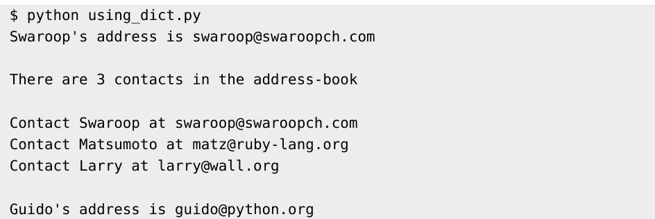

# Python 入门指南 1.92

## Python

选择你的 Python 版本：

如果你想学习当前的 Python 2.x，请[在此处阅读][1]或下载 PDF [2]。

如果你想学习新的 Python 3.0，请[在此处阅读]或下载 PDF [3]。

你也可以购买纸质版。[4]

### 序言

《A Byte of Python》是一本关于使用 Python 语言进行编程的书籍。它为初学者提供了 Python 语言的教程或指南。如果你们都了解电脑如何保存文本文件，那么这本书就是为你准备的。

本书已针对新的 Python 3.0 进行了更新。如果你正在寻找当前 Python 2.x 版本的教程，请下载该书之前的修订版本 [5]。同样地，如果你在犹豫应该学习 Python 2.x 还是 3.x，可以阅读 James Bennett 的的这篇文章 [6]。

## 谁在读《Python 字节》？

以下是人们对这本书的评价：

## 读者反馈

- 这是我见过的最好的教程！感谢你的努力。
- Walt Michalik (wmich50-at-theramp-dot-net)
- 你做了我在网上找到的最好的教程。做得好。谢谢！
- Joshua Robin (joshrob-at-poccta-dot-onel-ot-pl)
- 你好，我来自多米尼加共和国。我叫 Pavel，我最近读了你的书《A Byte of Python》，我认为它太棒了！！ :) 我从所有的示例中中学了很多。这本书对像我这样的新手非常有帮助，比如……
- Pavel Simo (pavel-dot-simo-at-gmail-dot-com)
- 我最近读完了《Python 编程》，我觉得我真的应该感谢你。读到最后几页时我很难过，因为我现在必须回到那些枯燥、乏味油腻的手手册来学习 Python。我非常感谢你的书。
- Samuel Young (sy-one-three-seven-at-gmail-dot-com)
- 亲爱的 Swaroop，我正在上一个对教学毫无兴趣的的课。我们使用的是 O'Reilly 出版的第二版《Learning Python》。它并不是一本写给没有任何编程知识的初者的教材，而且那个老师本应该在另一个领域工作。非常感谢你的书，如果没有它，我对 Python 和编程将一无所知。万分感谢，你能将“信息拆解”到一个每个人都能理解的水平，并不是人人都能做到。
- Joseph Duarte (jduarte1-at-cfl-dot-rr-dot-com)
- 我喜欢你的书！它是史上最优秀的 Python 教程，也是一本非常实用的参考书。太棒了，真正的杰作！继续加油！
- Chris-André Sommerseth

## Python 3

我写邮件给你是为了感谢你在线编写《Byte of Python》。在发现你的书之前，我已经尝试了几个月的 Python 了，虽然在 PyGame 上取得了有限成功，但我从未完成过程序。

多亏了你对分类的简化，Python 似乎变得可以实现的目标。似乎我终于学会了基础知识，可以继续我的真实目标——游戏开发了。

再次非常感谢你在网络上发布了如此结构化且有用的基础编程指南。它让我理解并理解出了 OOP（面向对象编程），而这种理解是另外两本书未能提供的。

- Matt Gallivan (m-underscore-gallivan-12-at-hotmail-dot-com)

我想感谢你的书《A byte of python》，我认为这是学习 Python 的最好方法。我是一个住在埃及的 15 岁少年，我叫 Ahmed。我在学校学习的第二种编程语言是 Visual 6，但不喜欢它，然而我很喜欢学习 Python。我做了一个通讯录程序并成功了（如果我尝试开始写自己的源码的话将很有帮助）。如果你能告诉我在哪里可以找到像你写的这么好的教程，将对我非常有帮助。谢谢。

- Ahmed Mohammed (sedo-underscore-91-at-hotmail-dot-com)

对于初学者学习更多 Python 的一个绝佳资源是 Swaroop C H. 编写的 110 页 PDF 教程《A Byte of Python》。它写得很好，易于理解，可能是对 Python 编程最好的介绍之一。

- Drew Ames 在 Linux.com 上发表的一篇关于 Scripting Scribus 的文章中 [17]

昨天我在我的 Nokia N800 上看完了《Byte of Python》的大部分，这是我遇到过的最简单、最简洁的 Python 介绍。强烈推荐作为学习 Python 的起点。

- Jasonport 他的网络博客 [8]

## 学术课程

这本书被用作各机构教学材料：

1. 阿姆斯特丹自由大学（Vrije Universiteit）的“编程语言原理”课程 [9]
2. 加州大学戴维斯分校（University California Davis）的“计算基础概念”课程 [10]
3. 哈佛大学的“使用 Python 编程”课程 [11]
4. 莱兹大学的“编程导论”课程 [12]
5. 波士顿大学的“应用编程导论”课程 [13]
6. 俄克拉荷马州立大学的“信息技术技能”课程 [14]
7. 密歇根州立大学的“处理（Processing）”课程 [15]
8. 爱丁堡大学的“多智能体网络系统”课程 [16]

## 甚至还有 NASA

NASA 在使用这本书！它被用于他们喷气推进实验室的深空网络项目。

## 官方推荐

这本书已列在官方网站上，紧邻官方文档。

4. 对原书的志愿者贡献必须遵循相同的许可，且版权必须转让给本书的主作者。

## 立即阅读

你可以在目录在线阅读这本书。

## 购买书籍

可以购买书籍的纸质版供你离线阅读之乐。

## 下载

- PDF (631KB)
- Media (276KB) (仅限高级用户)

如果你希望支持本书的发展，请考虑捐赠或购买纸质版。

## 翻译

如果你对本书的翻译感兴趣，请查看翻译。

## 参考文献

[1] `http://www.ibiblio.org/swaroop/`

[2] `http://www.ibiblio.org/swaroop/files/120`

[3] `http://www.swaroop.com/byte_of_python_191.pdf`

[4] `http://www.swaroop.com/buybook`

[5] `http://www.ibiblio.org/swaroop/120/`

[6] `http://www.b-list.org/python-300/`

[7] `http://www.linux.com/feature/26522`

[8] `http://paxmode.pt/blog.html?id=627`

[9] `http://www.few.vu.nl/~nilisvis/PPL/207/index.html`

[10] `http://cs.ucdavis.edu/courses/exp_course/10.html`

[11] `http://www.people.fas.harvard.edu/~preshman/python_winter.html`

[12] `http://www.comp.edu/accom/1900/`

[13] `http://cs.bu.edu/courses/cs108/materials.html`

[14] `http://https.astr.ou.edu/byteofpython/`

[15] `http://www.msu.edu/~aston/class/825/index.html`

[16] `http://homepages.inf.ed.ac.uk/ewan/maswas/`

[17] `http://dsnra.jpl.nasa.gov/software/Python/byte-of-python/output/byteofpython_html/`

[18] `http://www.python.org/doc/intros/`

[19] `http://www.creativecommons.org/licenses/by-sa/3.0/`

[20] `http://www.opensource.org/licenses/bsd-license.php`

[21] `http://www.swaroop.com/buybook`

[22] `http://www.swaroop.com/files/byteofpython/byte_of_python_v191.pdf`

[23] `http://www.swaroop.com/files/byteofpython/byte_of_python_v191.xml`

[24] `https://www.paypal.com/cgi-bin/webscr?cmd=_donations&business=swaroop%40swaroop%2ecom&item_name=A20Byte%20of%20Python&no_shipping=0&no_tax=1&0&currency_code=USD&lc=IN&bn=PP%2dDonationsBF&charset=UTF%28`

[25] `http://www.swaroopch.com/buybook`

上一页 下页

来源：`http://www.swaroopch.com/mediawiki/index.php?oldid=1343`

贡献者：Swaroop, Waterox888, 3 位匿名编辑

# Python 英文：翻译

感谢许多无私的志愿者，这本书有多种不同语言的翻译版本。

如果你想帮助这些翻译，请查看下方的志愿者和语言列表，并决定你想开始一个新的翻译还是帮助现有的翻译项目。

如果你计划开始新的翻译，请阅读《翻译指南》。

## 中文

Juan Sean (orion-underscore-val-at-163-dot-com) 自愿将这本书翻译成中文。

> 我是中华人民共和国北京理工大学无线电研究生学院的研究生。我目前的研究方向是多载波系统的同步、信道估计和多用户检测。在 Python Numeric 的帮助下，Python 是日常仿真和研究工作中主要的编程语言。实际上 Python 才学了半年，但正如你所看到的，它真的非常易理解、上手且高效。这正如 Swaroop 在书中所保证的那样。它现在是我最喜欢的编程语言。《Python 教程》是我学习 Python 的教程。它并不很长，但高效地涵盖了 Python 中几乎所有重要内容。《Python 教程》强烈推荐作为新者的第一个 Python 教程。将我的翻译献给中国数百万潜在的 Python 用户。

Fred Lin (gasolin-at-gmail-dot-com) 自愿将这本书翻译成繁体中文。

翻译可以在 `http://code.google.com/p/zhpy/wiki/ByteOfZhpy` (`http://code.google.com/p/zhpy/wiki/ByteOfZhpy`) 获取。

该翻译的一个兴奋的特点是，它包含了与原始 Python 源码并排的可执行 Python 源。

Fred Lin - 我在 Delta Network 网络框架工程师，也是 TurboGears 框架的贡献者。作为 Python 传道士，我需要一些材料来推广 Python 语言。《Python 教程》击中了新手和资深程序员的需求点。《Python 教程》以易于获取的大小详述了 Python 基础。翻译最初基于简体中文版本，很快进行了大量的重写以适应当前的 wiki 版本和阅读质量。最近的繁体中文版也以可执行的 Python 源码为特色，这是通过我的新项目 `zhpy`（中文 Python）实现的（8月7日启动），`zhpy`（发音为 Z.H. 或 zippy）在 Python 之上建立了一层，用中文（繁体或简体）翻译或与 Python 交互。该项目主要面向教育。

## 意大利语

Enrico Morelli (mr-dot-mluccci-at-gmail-dot-com) 和 Massimo Lucci (morelli-at-cer-dot-unifi-dot-it) 自愿将这本书翻译成意大利语。

意大利语翻译位于 `www.gentoo.io/Programmazione/bytepython` (`http://www.gentoo.io/Programmazione/bytepython`)。新翻译正在进行中，并从 "Prefazazione" 开始。

Massimo Lucci 和 Enrico Morelli - 我们在佛罗伦萨大学（意大利）化学系工作。（Massimo）担任核磁共振谱仪的售后服务工程师和系统管理员；Enrico 担任我们 CED 以及并行/集群系统的服务工程师和系统管理员。我们使用 Python 编程了大约七年，从十年前开始我们就有在 Linux 平台工作的经验了。在意大利，我们负责并管理针对意大利的 Gentoo 发行版以及 `www.mr.it`（正在建设中），用于核磁共振应用以及会议组织与管理。书中使用的智能语言给我们留下了深刻印象，我们认为这对于向新用户介绍 Python 至关重要（我们正在考虑我们实验室工作的数百名学生和研究人员）。

## 德语

Lutz Horn (lutz-dot-horn-at-gmx-de), Bernd Hengelein (bernd-dot-hengelein-at-gmail-dot-com) 和 Christoph Zwerschke (cito-at-online-dot-de) 自愿将这本书翻译成德语。

他们的翻译位于 `http://abop-german.berlios.de` (`http://abop-german.berlios.de`)。

Lutz Horn：32 岁，拥有海德堡大学数学学学位。目前我正在一个公共资助的项目担任软件工程师，为德国所有与计算机科学相关的事务构建一个门户网站。我职业上使用的语言是 Java，但我尝试尽可能地用 Python 来完成。特别是用 Python 进行文本分析和转换非常简单。我不熟悉 GUI 工具包，我的大部分编程是使用如 Struts 等 Java 框架。目前我正尝试利用 Python 的功能性特性。（注：此处已删除重复内容以保持清晰）。

## Python：翻译

Bernd Hengelein：Lutz 和我将进行翻译。我们从简介开始，但我们会向你通报进度。好了，现在关于我个人。我 34 岁，从 1980 年代 C64 统治时期就开始玩电脑了。在学习科学后，我开始担任医学成像的软件工程师。C++ 是我日常工作中的主要语言，我不断寻找新事物。最后我爱上了 Python，它是一种极好的语言，因为它的可能性和。我在网上某处看到有人说他喜欢 Python，因为代码看起来非常漂亮。在我看来这是完全正确的。当我决定学习 Python 时，我注意到德语文档很少。当我遇到这本书时，翻译的想法闪过。Lutz 有同样的想法，我们现在分工合作。期待良好的合作！

## 挪威语（标准语）

Eirik Vågar (or Vages) 是挪威 Sandvika 高中 (`http://no.wikipedia.org/wiki/Sandvika_viderehende_skole`) 的学生，一名博客作者 (`http://forbedre.blogspot.com/`)，目前并将这本书翻译成挪威语（标准语）。翻译正在进行中，你可以查看目录获取更多详情。

> Eirik Vågar：我一直想编程，但因为我说的是小语言，学习过程困难得多。大多数教程和书籍是用非常专业的英语写的，大多数高中毕业生没有词汇来理解教程。当我发现这本书时，我的所有问题都解决了。《Python 教程》用简单的非技术语言解释了一种非常简单的编程语言，这两点让学习 Python 变得有趣。在读完书的一半后，我决定这本书值得翻译。我希望翻译能帮助那些处于和我一样处境的人（尤其是年轻人），并可能帮助技术知识较少的人对这种语言产生兴趣。

## 印度尼语

Daniel (daniel-dot-mirror-at-gmail-dot-com) 正在 `http://python.or.id/in/coi/ByteofPython` 将书翻译成印尼语。

## 波兰语

Dominik Kozacko (dkozacko-at-gmail-dot-com) 自愿将这本书翻译成波兰语。翻译正在进行中，主页可以在这里找到：Ukås Python (`http://wiki.mercury.pl/5.bielsko.index.php/UkÅ�_Python)。

- Dominik Kozacko - 我是一名计算机科学和信息技术教师。

### 加泰罗尼亚语

- Moises Gomez (moisesgomezgaton-at-gmail-dot-com) 自愿将本书翻译成加泰罗尼亚语。翻译正在进行中，从“Taula de continguts”（目录）章节开始。
- Molss Gómez - 我是一名开发者，也是一名编程老师（通常针对没有任何基础经验的人员）。有段时间我需要学习如何用 Python 编程，Swaroop 的工作真的非常有帮助。清晰、简洁且足够完整。这正是我需要的。在过这段经历之后，我想我国家的其他一些人也能从中受益。但英语可能会成为障碍。所以，为什么不翻译一下呢？我曾为之前的一个版本的 BoP 翻译过它。我的国家有两种官方语言。我选择了加泰罗尼亚语，假定其他人会将其翻译成更广泛的西班牙语。

### 葡萄牙语

- Fidel Vielegas (fidel-dot-viegas-at-gmail-dot-com) 自愿将本书翻译成葡萄牙语。

### 罗马尼亚语

- Paul-Sebastian Manole (brokenthorn-at-gmail-dot-com) 自愿将本书翻译成罗马尼亚语。


- Paul-Sebastian Manole - 我是罗马尼亚 Spiru Haret 大学计算机科学专业的大二学生。我更像是一个自学程序员，决定学习一种新语言 Python。网络告诉我没有更好的方法了，但我读了《A Byte of Python》。这就是为什么这本书如此流行（祝贺作者写了这样一本易读的书）。我开始喜欢 Python，于是决定帮助将 Swaroop 书的最新版本翻译成罗马尼亚语。虽然我可能是第一个发起计划的人，但我只是一个志愿者，所以如果你能提供帮助，请加入我。

翻译工作在这里进行 (http://www.swarooch.com/notes/Python-ro)。

### 巴西葡萄牙语

- Rodrigo Amaram (http://rodrigoamaram.net) (rodrigoamaram@gmail.com) 自愿将本书翻译成巴西葡萄牙语...

### 法语

- Gregory (coulix@ozforces.com.au) 自愿将本书翻译成法语。

### 丹麦语

- Lars Petersen (lars@ioflux.net) 自愿将本书翻译成丹麦语。

### 西班牙语

- Alfonso de la Guard Reyes (alfonsod@ictechperu.net) 和 Gustavo Echeverria (gustavo.echeverria@gmail.com) 自愿将本书翻译成西班牙语。翻译正在进行中，你可以阅读西班牙语（阿根廷）翻译，从目录（tabla de contenidos）开始。

- Gustavo Echeverria: 我在阿根廷担任软件工程师。我主要使用 C# 和 Net 技术，但在个人项目中会严格使用 Python 或 Ruby。我多年前就知道了 Python，并且立刻就卡住了。在认识 Python 不久后发现了这本书，它帮助我学会了这门语言。我自愿将这本书翻译成西班牙语。现在，在收到请求后，我开始在 Maximiliano Soler 的帮助下翻译《A Byte of Python》。

### Arabic语

- Laa Abadi (laanassir@gmail.com) 自愿将本书翻译成阿拉伯语。主主所愿（ISA）。

### 瑞典语

- Mikael Jacobsson (leochingwake@gmail.com) 自愿将本书翻译成瑞典语。

### 俄语和乌克兰语

- Averkiev Andrey (averkiyev@ukr.net) 自愿将本书翻译成俄语，可能还有乌克兰语（如果时间允许）。

### 土耳其语

- Türker SEZER (tsezer@bttur.net) 和 Bugra Cakir (bugracakir@gmail.com) 自愿将本书翻译成土耳其语。

### 蒙古语

- Ariansanaaa Tunjin (tariunsanaa@yahoo.com) 自愿将本书翻译成蒙古语。

## 注意

请将本页提到的电子邮件地址中的 `-at-` 替换为 `@`，`-dot-` 替换为 `.`，`-underscore-` 替换为 ` `。邮件地址其他地方的折号保持不变。

## Python 英文翻译

来源：http://www.swaroopch.com/mediawiki/index.php?old=2278

贡献者：Geopop65, Gustavo.echeverria, Leochingkwake, Moises, Morelik, Rodrigoamaral, Swaroop, Thorns, Vages, Water

### Python 英文：前言

Python 可能是少数既简单又强大的语言之一。它对于初学者和专家都是很有用的。目标是帮助你学习它。

### 本书适合读者

本书是一份指南。它主要针对新手，但对经验丰富的程序员也很有用。

### 书籍状态

在初学者需求和信息“完整性”的倾向之间平衡这本书，是一场持续的斗争。

### 历史

当我发现 Python 非常棒时，我就开始学习它。

### 官方网站

本书的官方网站是 http://www.swaroopch.com/notes/Python，你可以在那里在线阅读书籍、下载书籍最新版本、购买纸质版 (http://www.swaroopch.com/bookbuy)，并向我们发送反馈。

### 许可证

- 本书采用知识共享 署名-非商业-相同共享 3.0 未尽演绎许可证 (http://creativecommons.org/licenses/by-nc-sa/3.0/) 协议许可。

- 这意味着：

    - 你可以自由地分享，即复制、分发和传输本书

    - 你可以自由地混合，即改编本书

- 需遵循以下条件：

    - 必须由作者或许可者注明作者（但不得以任何暗示他们认可你或你对本书的使用的方式）。

    - 相同共享。如果你修改、转换或基于本作品进行创作，你可以在相同或类似的许可证下分发结果作品。

    - 对于任何重用或分发，你必须明确说明本书的条款。

    - 如果获得版权持有者的许可，可以放弃上述任何条件。

- 本许可证中的任何内容均不损害或限制作者的精神权利。

- 必须通过链接回 http://www.swaroopch.com/notes/Python 并明确指示原文可以从该地获取来署名。

## 前言

- 3. 除非另有说明，书中提供的所有代码/脚本均根据 3 条 BSD 许可证 (http://www.opensource.org/licenses/bsd-license.php) 许可。

- 4. 对此原书的自愿贡献必须遵循相同的许可，且版权必须转让给本书的作者。

## 反馈

我付出了许多努力想让这本书尽可能有趣且准确。然而，如果您发现某些内容不一致或错误，或者简单地需要改进，请告知我，以便我进行适当的改进。您可以通过我的用户页面与我联系。

## 购买书籍

如果您希望支持这本书的持续开发，请考虑购买纸质版（http://www.swaroopch.com/buybook）或进行捐赠。

## 一些思考

> 构建软件设计有两种方法：一种是让它简单到显然没有缺陷；另一种方法是让它复杂到没有明显的缺陷。

-- C. A. R. Hoare

> 人生中get成功，与其说取决于天赋和机会，不如说取决于专注和坚持。

-- C. W. Wendte

## 上一页 下页

来源：http://www.swaroopch.com/mediawiki/index.php?oldid=987

贡献者：Gasolin, Swaroop, 2 位匿名编辑

### 导言

### 导言

Python 是少数可以自称既**简单**又**强大**的语言之一。你会发现，专注于解决问题而不是你正在编写的语言的语法和结构是多么容易，这会让你感到非常惊喜。

Python 的官方介绍是：

- 一种编程语言。它具有高效的高级数据结构和一种简单但有效的面向对象编程方法。Python 优雅的语法和动态类型，加上它的解释型特性，使其成为许多平台领域脚本编写和快速应用程序开发的理想语言。

我将在下一节中详细讨论这些大部分特征。

## 备注

> Python 语言的创始人 Guido van Rossum 以 BBC 节目《蒙提派的飞行马戏团》为该语言命名。他并不特别喜欢那些通过缠绕身体并压碎动物来进食的蛇。

## Python 的特性

### 简单

Python 是一种简单且极简主义的语言。阅读一个良好的 Python 程序感觉几乎就像在读英语，尽管是非常严格的英语！Python 的这种伪代码是其最大的优势之一。它允许你专注于问题的解决方案而不是语言本身。

### 易于学习

正如你所看到的，Python 极其容易上手。正如前面提到的，Python 拥有异常简单的语法。

### 免费且开源

Python 是 FLOSS（自由/许可和开源软件）的一个例子。简单来说，你可以自由地分发该软件的副本、阅读其源代码、对其进行修改，并在新程序中使用部分代码。FLOSS 基于共享知识的社区概念。这是 Python 如此好的原因之一——它由一个只想使用更好 Python 的社区创建并不断改进。

### 高级语言

当你用 Python 编写程序时，你永远不需要担心低级细节，例如程序使用的内存等。

### 可移植性

由于其开源性质，Python 已被移植到（即修改以使其运行于）许多平台。如果你足够仔细地避免任何依赖于系统的特性，你的所有 Python 程序都可以这些平台上平台上运行，而无需任何更改。

你可以在 Linux、Windows、FreeBSD、Macintosh、Solaris、OS/2、Amiga、AROS/400、FreeBSD、OS/390、z/OS、Palm OS、QNX、VMS、Psion、Acorn RISC OS、VxWorks、PlayStation、Sharp Zaur、Windows CE 和 PocketPC 上使用 Python！

### 解释型

这需要一点解释。

用 C 或 C++ 等编译型语言编写的程序，使用带有各种标志和选项的编译器，从源语言（即 C 或 C++）转换为你的计算机所理解的语言（二进制代码，即 0 和 1）。当你运行程序时，链接器/软件将程序从硬盘复制到内存中并开始运行。

相反，Python 不需要编译为二进制文件。你只需从源代码直接运行程序。在内部，Python 将源代码转换为中间形式字节码，然后将其翻译成你计算机的本地语言并运行。实际上，这一切使得使用 Python 变得容易得多，你不需要担心编译程序、确保链接并加载了正确的库等等。这也使得你的 Python 程序更具可移植性，因为你只需要将 Python 程序复制到另一台计算机上它就能运行！

### 面向对象

Python 既支持过程面向也支持面向对象编程。在过程面向语言中，程序是围绕过程或函数构建的，这些过程不是可重用的程序段。在面向对象语言中，程序是围绕结合数据和功能的对象构建的。Python 拥有一种非常强大且简单的 OOP 实现方式，特别是与 C++ 或 Java 这样的大语言相比。

### 可扩展性

如果你需要一段关键代码运行得非常快，或者希望某些算法不公开，你可以用 C 或 C++ 编写程序的这部分，并在 Python 程序中使用它。

### 可嵌入性

你可以将 Python 嵌入到你的 C/C++ 程序中，为你的程序的用户提供“脚本”能力。

### 丰富的库

你可以在你的 C/C++ 程序中嵌入 Python 以为程序用户提供脚本功能。标准库确实非常强大。它可以帮你处理正则表达式、文档生成、单元测试、线程、数据库、网络浏览器、FTP、XML、XMLRPC、HTML、WAV 文件、加密、GUI 等。这被称为 Python 的“自带电池”哲学。

除了标准库，还有其他高质量的库，如 wxPython (http://www.wxpython.org/)、Twisted (http://www.twistedmatrix.com/)、Python Imaging Library (http://www.python.com/pil/index.htm) 以及更多。

Python 确实是一种令人兴奋且强大的语言。

## 为什么不是 Perl？

如果你不知道，Perl 是另一种非常流行的开源解释型语言。

如果你曾经用 Perl 编写过大型程序，你自己就有答案了！换句话说，Perl 在处理小型脚本很容易，但当你开始编写大型程序时就会变得难以维护。

与 Perl 相比，Python 程序明显更简单、更容易编写。我喜欢 Perl，但我编写程序时总是用 Python 的思维方式。Perl 经历了如此多的修改，感觉它就像一个巨大的 hack。遗憾的是，即将推出的 Perl 6 似乎在这方面没有任何改进。

我觉得 Perl 的唯一非常重要的优势是它巨大的 CPAN (http://cpan.perl.org/) 库——综合 存档网络。正如名称所示，这是一个巨大的 Perl 程序集合，其规模和深度令人叹为观止——使用这些模块可以用计算机做很多事情。Perl 库比 Python 多的原因之一是它一直在增长。但这随着 Python Index (http://pypi.python.org/pypi) 的增长正在发生变化。

## 为什么不是 Ruby？

如果你不知道，Ruby 是另一种流行的开源解释型语言。

如果你已经喜欢并使用 Ruby，那么我绝对建议你继续使用。

对于其他没有使用过并试图判断是学习 Python 还是 Ruby 的人，从学习难易程度来看，我会推荐 Ruby。我个人发现掌握 Ruby 语言很难，但对于理解 Ruby 的人来说，他们都赞美这种语言的美。。我不我不幸运。

## 程序员评价

你可能会发现阅读顶级黑客对 Python 的看法很有：

- Eric S. Raymond 是《教堂与集市》的作者，也是“开源”一词的发明者。他说 Python 已经成为他最喜欢的编程语言 (http://www.linux.com/article.php?sid=382)。这篇文章是我首次接触 Python 的灵感来源。

- Bruce Eckel 是著名的《Thinking in Java》和《Thinking in C++》书籍的作者。他说没有任何语言比 Python 让他的工作效率更高。他说 Python 也许是唯一专注于让事情变得简单的语言。

## Python 英文：介绍

程序员。请阅读完整的采访（http://www.artima.com/inv/aboutme.html）以获取更多详情。

-   Peter Novartis（感谢 Guido Rossum 指出这一点）。他说 Python 一直是 Google 的不可或缺的一部分。你可以通过查看 Google Jobs 页面（http://www.google.com/jobs/index.html）来验证这一说法，该页面将 Python 知识列为软件工程师的技能。

## 关于 Python 3.0

Python 3.0 是该语言的新版本。它有时被称为 Python 3000 或 Py3。

Python 发布一个重大新版本的主要原因是消除多年积累的所有小问题和瑕疵，并使语言更加简洁。

如果你已经有一份 Python 2.x 代码列表，那么有一个工具可以帮助你将 2.x 转换为 3.x 源代码（http://docs.python.org/dev/3.0/library/2to3.html）。

更多细节如下：

-   Guido Rossum 的介绍（http://www.artima.com/weblogs/viewpost.jsp/thread=208549）

-   Python 2.6 的新特性（http://docs.python.org/dev/whatsnew/2.6.html）（特性与之前的 Python 2.x 版本有显著不同，极有可能包含在 Python 3.0 中）

-   Python 3.0 的新特性（http://docs.python.org/dev/3.0/whatsnew/3.0）

-   Python 2.6 和 3.0 发布计划（http://www.python.org/dev/peps/pep-0361/）

-   Python 3000（建议更改的官方权威列表）（http://www.python.org/dev/peps/pep-3000/）

-   其他 Python 3.0 计划（http://www.python.org/dev/peps/pep-3100/）

-   Python 新闻（变更详细列表）（http://www.python.org/download/releases/3.NEWS.txt）

## 上一个 下一页

来源：http://www.swaroopch.com/mediawiki/index.php?id=1789

贡献者：JeremyBicha, Swaroop, 2匿名编辑

## Python 英文：安装

如果你已经安装了 Python 2.x，则不需要删除它即可安装 Python 3.0。你可以同时安装这两个版本。

### 对于 Linux 和 BSD 系统

如果你正在使用 Linux 发行版，如 Ubuntu、Fedora、OpenSUSE 或（在此输入你的选择），或者像 FreeBSD这样的 BSD 系统，那么你的系统中可能已经安装了 Python。

要测试你的 Linux 机器是否安装了 Python，请打开 shell 程序（如 konsole 或 gnome-terminal）并输入如下所示的命令 `python -V`。

```
$ python -V
Python 3.0bi
```

注意

`$` 是 shell 的提示符。它将根据你操作系统的设置而不同，因此我将仅用 `$` 符号表示提示符。

如果你看到类似上面显示的版本信息，说明你已经安装了 Python。

但是，如果你收到类似这样的消息：

```
$ python -V
bash: Python: command not found
```

那么你还没有安装 Python。这极少见，但是有可能的。

注意

如果你已经安装了 Python 2.x，请尝试 `python3 -V`。在这种情况下，你有两种方法在系统上安装 Python。

-   你可以从源代码编译 Python（http://www.python.org/download/lele/3.0/）并安装。编译说明在网站上提供。

-   [此选项将在 Python 3.0 正式发布后可用] 使用操作系统自带的包软件安装二进制包，例如 Ubuntu/Debian 和其他基于 Debian 的 Linux 中的 `apt-get`，Fedora Linux 中的 `yum`，FreeBSD 中的 `pkg_add` 等。注意你需要互联网连接来使用此方法。

或者，你可以从其他地方下载二进制文件复制到你的 PC 并安装。

## Python：安装

### 对于 Windows 用户


访问`http://www.python.org/download/releases/3.0/`并从该网站下载最新版本，截至本文撰写时这是一个 beta 1 版本（`http://www.python.org/ftp/python/3.0/python-3.0b1.msi`）。这只有 12.8 MB，与其他语言或软件相比非常紧凑。安装过程就像任何 Windows 软件一样。

## 注意事项

当你获得取消勾选任何“可选”组件的选项时，不要取消勾选！这些组件某些对你可能有用，特别是 IDLE。

一个有趣的事实是大多数 Python 下载用户是 Windows 用户。当然，这并不是全貌，因为所有 Linux 用户在他们的系统中默认都已安装了 Python。

## DOS 提示符

如果你想在 Windows 命令行（即 DOS 提示符）中使用 Python，则你需要相应地设置 PATH 变量。

对于 Windows 2000, XP, 2003，点击控制面板 -> 系统 -> 高级 -> 环境变量。点击“系统变量”部分中名为 PATH 的变量，选择编辑并在现有内容的末尾添加`;C:\Python30`。当然，请使用相应的目录名称。

对于旧版本的 Windows，在`C:\AUTOEXEC.BAT`文件中添加以下行：`'PATH=%PATH%;C:\Python30'`（不带引号）并重启系统。对于 Windows NT，使用 AUTOEXEC.NT 文件。

## 对于 Mac OS 用户

Mac OS X 用户会发现系统中已经安装了 Python。打开 Terminal.app 并运行`python -V`，遵循上述 Linux 部分的建议。

## 总结

对于 Linux 系统，你可能已经安装了 Python。否则，你可以使用发行版自带的包管理软件。对于 Windows 系统，安装 Python 只需要下载安装程序并双击运行。从现在起，我们将你已经安装了 Python。

接下来，我们将编写第一个 Python 程序。

## Python 英文：安装

上一个 下一页

来源：`http://www.swaroop.com/mediawiki/index.php?oldid=1789`

贡献者：JeremyBicha, Swaroop, 2匿名编辑（注：此部分遵循“上一个”的标记）

## Python 英文：第一步

介绍

来源：`http://www.swaroop.com/mediawiki/index.php?oldid=1789`

贡献者：JeremyBicha, Swaroop, 2匿名编辑（注：此部分遵循“上一个”的标记）

### 介绍

来源：`http://www.swaroop.com/mediawiki/index.php?oldid=1789`

贡献者：JeremyBicha, Swaroop, 2匿名编辑（注：此部分遵循“上一个”的标记）

## 使用解释器

来源：`http://www.swaroop.com/mediawiki/index.php?oldid=1789`

贡献者：JeremyBicha, Swaroop, 2匿名编辑（注：此部分遵循“上一个”的标记）

## 如何退出

来源：`http://www.swaroop.com/mediawiki/index.php?oldid=1789`

贡献者：JeremyBicha, Swaroop, 2匿名编辑（注：此部分遵循“上一个”的标记）

## 选择编辑器

来源：`http://www.swaroop.com/mediawiki/index.php?oldid=1789`

贡献者：JeremyBicha, Swaroop, 2匿名编辑（注：此部分遵循“上一个”的标记）

*（自纠：提供的 OCR 文本包含大量重复和碎片化的标题。我将根据提示符中的实际内容整合逻辑流。）*

**再次查看原始文本，第 19-20 页高度重复/损坏。我将根据提供的叙述内容提供一个干净的版本。**

## 使用源文件

现在让我们回到编程中来。有一个传统：每当你学习一种新的编程语言时，你编写并运行的第一个程序都是“Hello World”程序——它在运行时仅仅是输出一个“Hello World”。正如 Simon Cozens [11] 所说，这是“向编程之神祈祷的传统咒语，帮助你更好地学习这种语言”。

启动你选择的编辑器，输入以下程序并将其保存为 helloworld.py。

如果你在使用 IDE，请点击 File（文件）-> New Window（新窗口）并输入以下程序。点击 File（文件）-> Save（保存）。

```python
#!/usr/bin/python
#Filename: helloworld.py

print('Hello World')
```

打开 shell（Linux 终端或 DOS 提示符）并输入命令`python helloworld.py`来运行此程序。

如果你在使用 IDE，请使用菜单 Run（运行）-> Module（模块）或快捷键 F5。

输出所示。

> $ python helloworld.py

Hello World

如果你看到了上面的输出，恭喜你！——你成功运行了你的第一个 Python 程序。

如果遇到错误，请*完全*按照上面的样子输入程序并再次运行。注意 Python 是区分大小大小的，即`print`和`Print`是不同的——注意前者是小写 p，后者是大写 P。此外，请确保每行的第一个字符之前没有空格或制表符——我们稍后会看到为什么很重要。

## 工作原理

让我们考虑程序的前两行。这些被称为*注释*（comments）——`#`符号右侧的任何内容都是注释，主要作为程序读者的备注。

Python 不使用注释，但这里的第一行是一个特殊情况。它被称为 *shebang 行*（shebang line）——每当源文件的前两个字符是`#!`后跟文件路径时，这会告诉你的 Linux/Unix 系统，当你*执行程序*时应该使用该解释器来运行此程序。下一节将详细解释这一点。注意，你始终可以通过在命令行中直接指定解释器（例如命令`python helloworld.py`）在任何平台上运行该程序。

## 重要性

- 在程序中合理使用注释来解释程序的某些细节——这对于你程序的读者很有用，让他们能够轻松理解程序在做什么。记住，六个月后的那个人可能是你自己！

注释之后是一个 Python *语句*（statement）。在这里我们可以使用 print *函数*（function），它只是打印文本 'Hello World'。我们将在后面的章节中学习函数，你现在应该理解的是，你在括号中提供的任何内容都将打印到屏幕上。在这种情况下，我们提供了 'Hello World'，它被称为字符串（string）——别担心，我们稍后会详细探讨这些术语。

## 可执行的 Python 程序

这仅适用于 Linux/Unix，但 Windows 用户可能也对程序的第一行感到好奇。首先，我们必须使用`chmod`命令赋予程序执行权限，然后运行源程序。

```bash
$ chmod a+x helloworld.py
$ ./helloworld.py
Hello World
```

此处的`chmod`命令用于通过赋予系统所有用户执行权限来更改文件模式。然后，我们通过指定源文件的位置直接执行程序。我们使用`./`表示程序位于当前目录。

为了增加趣味性，你可以将文件重命名为`helloworld`并运行`./helloworld`，它仍然可以工作，系统知道必须使用源文件第一行中指定位置的解释器来运行程序。

如果你不知道 Python 位于哪里怎么办？你可以使用特殊的`env`路径将程序的第一行改为以下内容：

```python
#!/usr/bin/env python
```

`env`程序将去寻找运行程序的 Python 解释器。到目前为止，我们已经从任何地方运行程序了。想这样做吗？你可以通过将程序存储在`PATH`环境变量列出的目录之一来实现。每当你运行任何程序时，系统都会在`PATH`环境变量列出的每个目录中查找路径，然后运行该程序。我们可以通过简单将此源文件复制到`PATH`列出的目录之一来让该程序随处可用。

```bash
$ echo $PATH
/local/bin:/usr/bin:/usr/X11R/bin:/home/swaroop/bin
$ cp helloworld.py /home/swaroop/bin
$ helloworld
Hello World
```

此处的`chmod`命令用于通过赋予系统所有用户执行权限来更改文件模式。然后，我们通过指定源文件的位置直接执行程序。我们使用`./`表示程序位于当前目录。

为了增加趣味性，你可以将文件重命名为`helloworld`并运行`./helloworld`，它仍然可以工作，系统知道必须使用源文件第一行中指定位置的解释器来运行程序。

如果你不知道 Python 位于哪里怎么办？你可以使用特殊的`env`路径将程序的第一行改为以下内容：

```python
#!/usr/bin/env python
```

`env`程序将去寻找运行程序的 Python 解释器。到目前为止，我们已经从任何地方运行程序了。想这样做吗？你可以通过将程序存储在`PATH`环境变量列出的目录之一来实现。每当你运行任何程序时，系统都会在`PATH`环境变量列出的每个目录中查找路径，然后运行该程序。我们可以通过简单将此源文件复制到`PATH`列出的目录之一来让该程序随处可用。

## Python 初步

仅仅打印 'Hello World' 是不够的，对吧？你想做更多——你想获取一些输入，处理它并得到结果。我们可以在 Python 中使用常量变量来实现这一点。

## 字面量常量

字面量常量的例子是数字 5、1.23、9.25e-3，或者字符串 'This is a string' 或 'It's a string!'。它被称为字面量是因为它是字面上的——数字 2 始终代表自身，不代表其他——它被称为常量是因为它的值不能改变。因此，所有这些被称为字面量常量。

## 数字

Python 中的数字有三种类型——整数、浮点数复数。

- 整数的例子是 2，它只是一个整数。

- 浮点数（float）的例子是 3.23 和 52.3E-4。E 表示表示 10 的幂。在这种情况下，52.3E-4 表示 52.3 * 10⁻⁴。

- 复数的例子是 (-5+4j) 和 (2.3 - 4.6j)。

### 字符串

字符串是字符序列。字符串基本上是一组单词。这些单词可以是英语，也可以是任何受 Unicode 标准支持的语言，这意味着世界上几乎任何语言（`http://www.unicode.org/faq/basic_q.html#16`）。默认情况下，所有字符串都是 Unicode 编码。

我几乎可以肯定你编写的几乎每个 Python 程序都会使用字符串，所以请注意关于如何在 Python 中使用字符串的部分。

## 单引号

你可以使用单引号来指定字符串，例如 'Quote me on this'。所有的空白字符（即空格和制表符）都会被原样保留。

## 双引号

双引号字符串的工作方式与单引号字符串完全相同。一个示例是 "What's your name?"。

## 三引号

你可以使用三引号来指定多行字符串（`"""` 或 `'''`）。你可以在三引号内自由地使用单引号和双引号。例如：

```
"""This is a multi-line string. This is the first line.
This is the second line.
"What's your name?"" I asked.
He said "Bond, James Bond."
"""
```

## 转义序列

假设你想拥有一个包含单引号（'）的字符串，该如何指定这个字符串呢？例如，字符串是 'What's your name?'。你不能指定 'What's your name?'，因为 Python 会混淆字符串的开始和结束。因此，你必须指定这个单引号并不表示字符串的结束。这可以通过所谓的转义序列来实现。你将单引号指定为`\'` - 注意这个反斜杠。现在，你可以将字符串指定为 'What\'s your name?'

指定此特定字符串的另一种方法是使用双引号 "What's your name?"。同样地，如果要在双引号字符串中使用双引号本身，也必须使用转义序列。此外，你还必须使用转义序列`\\`来指定反斜杠本身。

如果你想指定一个双行的字符串？一种方法是使用如之前所示的三引号字符串，或者你可以使用换行的转义序列 - `\n`来指示新行的开始。一个示例是 This is the first line\nThis is the second line。另一个需要知道的转义序列是制表符 - `\t`。还有许多转义序列，但我在这里提到了最实用的。

需要注意的是，在 Python 中，行尾的单个反斜杠表示字符串在下一行继续，但不会添加换行符。例如：

```
"This is the first sentence.\\nThis is the second sentence."
```

等同于 "This is the first sentence. This is the second sentence."

## Python 基础

## 原始字符串

如果你需要指定某些不处理转义序列等特殊处理的字符串，那么你需要通过在字符串前加上 r 或 R 来指定原始字符串。一个示例是 r"NewLines are indicated by \n"

## 字符串是不可变的

这意味着一旦创建了字符串，你就无法更改它。虽然这看起来像是一件坏事，但实际上并非如此。我们将在稍后的各种程序中看到为什么这不是一个限制。

## 字符串字面量拼接

如果你将两个字符串字面量并排放在一起，Python 会将它们自动拼接。例如，"What's " 'your name?' 会自动转换为 "What's your name?"

## 给 C/C++ 程序员的提示

Python 中没有独立的 char 数据类型。它没有实际需要，我确信你不会想念它的。

## 给 Perl/PHP 程序员的提示

记住单引号字符串和双引号字符串是相同的 - 它们在任何方面都不不同。

## 给正则表达式用户的提示

在处理正则表达式时，务必使用原始字符串。否则，可能需要大量的反斜杠。例如，反引用可以表示为`\'1\'`或`r'\1'`。

## format 方法

有时我们想从其他信息构建字符串。这就是 format() 方法大显身场的地方

```python
#!usr/bin/python
# Filename: str_format.py

age = 25
name = 'Swaroop'

print('{0} is {1} years old'.format(name, age))
print('Why is {0} playing with that python?'.format(name))
```

```
$ python str_format.py
Swaroop is 25 years old
Why is Swaroop playing with that python
```

其工作原理：

字符串可以使用某些规格，随后可以调用 format 方法，将这些规格替换为 format 方法的相应参数。

## Python 基础

观察第一次用法，其中`{0}`，这对应于变量名，该变量名是 format 方法的第一个参数。同样，第二个规格是`{1}`，对应 age，它是 format 方法的第二个参数。

注意，我们可以使用字符串拼接`+ ' ' is ' + str(age) + ' years old'`来实现相同的结果，但这样做是多么难看且容易出错。到字符串的转换将由 format 方法自动完成，而不需要你进行显式转换。第三，当使用 format 方法时，我们可以更改消息，而无需处理所使用的变量，反之亦然。

Python 在 format 方法中所做的是将每个参数值替换到规格的位置。可以有更详细的规格，例如：

```
>>> '{0:.3}'.format(1/3) # 浮点的小数 (. ) 精度为 3
'0.333'
>>> '{0:_^11}'.format('hello') # 用下划线 (_) 填充并将文本居中 ('^') 到宽度 11
'__hello____'
>>> '{name} wrote {book}'.format(name='Swaroop', book='A Byte of Python')
### 基于关键字
Swaroop wrote A Byte of Python
```

这种格式的细节在 Python 增强提议 #3101 (`http://www.python.org/peps/3101/`) 中进行了解释。

### 字符串

使用字面常量很快就会变得无聊。我们需要一些信息。变量正是名称的含义。

### 标识符名称

变量是标识符的示例。标识符是给某些东西命名的名称。遵循以下一些规则：

- 标识符的第一个字符必须是字母（大写或小写）或下划线 ('_')。

- 标识符的其余部分由字母（大写或小写）、下划线 ('_') 或数字 (0-9)组成。

- 标识符名称对大小写敏感。例如，myfile 和 Myname 是不同的。

- 有效标识符示例有 i, _my_name, name_23。无效标识符示例有 2things, this is spaced out, my-name

### 数据类型

变量可以持有不同类型的值。基本类型是数字和字符串。在后面的章节中，我们将学习如何使用类创建自己的类型。

### 对象

记住，Python 将程序中使用的任何内容称为对象。这是从泛义上说的。与其说“那个东西”，不如说“那个对象”。

### 给面向对象编程用户的提示

Python 是强面向对象的，因为数字、字符串和函数都是对象。

### 变量

我们现在将展示如何结合字面常量使用变量。保存以下示例并运行程序。

## 如何编写 Python 程序

- 从此以后，保存和运行 Python 程序的标准步骤如下：

1. 打开你喜欢的编辑器。

2. 输入示例中的程序代码。

3. 将其保存为注释中提到的文件名。我遵循所有 Python 程序都以 .py 扩展名保存的习惯。


4. 使用命令`python`运行解释器或使用 IDLE 运行程序。

## 示例：使用变量和字面常量

```python
# Filename : var.py
i = 5
print(i)
i = i + 1
print(i)

s = '''This is a multi-line string.
This is the second line.\'''
print(s)
```

输出：

```
$ python var.py
5
6
This is a multi-line string.
This is the second line.
```

## 工作原理

这是程序是如何工作的。首先，我们使用赋值运算符（`=`）将字面常量值`5`赋值给变量`i`。这一行被称为语句，因为它陈述了我们需要执行某些操作，在这种情况下，我们将变量`i`连接到值`5`。接下来，我们使用`print`语句打印`i`的值，令人惊讶的是，它只是将变量的值打印到屏幕上。

我们将`i`中存储的值加`1`并将其存回。然后我们打印它，如所料的，我们得到了值`6`。

同样地，我们将字面量字符串赋值给变量`s`然后打印它。

## 给静态语言编程员的说明

变量通过赋值值来使用。不需要或使用声明或数据类型定义。

## 逻辑行与物理行

物理行是你编写程序时所看到的内容。逻辑行是 Python 视为单条语句的内容。Python 隐式地假设每个物理行对应一个逻辑行。

逻辑行的一个示例是一个语句行（如`'Hello World'`）——如果它单独占一行（如果你在编辑器中看到它），那么它也对应一个物理行。Python 隐式地鼓励每行使用单个语句，这使得代码具有可读性。

如果你想在单条物理行上指定多行，则必须显式地使用分号（`;`），这表示逻辑行/语句的结束。例如：

```
i = 5
print(i)
```

实际上等同于：

```
i = 5;
print(i);
```

并且可以写为：

```
i = 5; print(i);
```

或者甚至：

```python
i = 5; print(i)
```

然而，我强烈建议你坚持在单条物理行中写单条逻辑行。只有当逻辑行非常长时，才为单个逻辑行使用多条物理行。其思想是尽可能多使用分号，直到它导致代码可读性下降。事实上，我从没有在 Python 程序中使用过、甚至没见过分号。

下面是一个跨越多个物理行的逻辑行示例。这被称为显式行连接。

```python
s = 'This is a string. \
  This continues the string.'
print(s)
```

这会产生输出：

```
This is a string. This continues the string.
```

同样：

```python
print\n(i)
```

等同于：

```python
print(i)
```

有时，存在一种隐式假设，你不需要使用反斜杠。这种情况发生在逻辑行使用括号、方括号或大括号时。这被称为**隐式行连接**。在后面的章节中通过列表编写程序时你可以看到这一点。

## 缩进

空白在 Python 中非常重要。实际上，**行首的空白非常重要**。这被称为**缩进**。逻辑行开头的领先空白（空格和制表符）用于确定逻辑行的缩进级别，反之，它用于确定语句的组合。

这意味着组合在一起的语句**必须**具有相同的缩进。每组语句被称为一个块（block）。我们将在稍后的章节中看到关于如何实现块的示例。

你需要记住的一点是，错误的缩进会导致错误。例如：

```python
i = 5
print('Value is ', i) # 错误！注意行首有一个空格
print('I repeat, the value is ', i)
```

当你运行此代码时，你将得到以下错误：

```
File "Whitespace.py", line 4
    print('Value is ', i) # 错误！注意行首有一个空格
         ^
IndentationError: unexpected indent
```

注意第二行开头有一个空格。Python 指出的错误告诉你程序的语法是无效的，即程序没有被正确编写。这意味着你**不能任意开始语句块**（当然，除了你一直以来使用的默认主块之外）。可以使用新块的情况将在稍后的章节（例如控制流章节）中进行详细介绍。

## 如何缩进

不要混合使用制表符（tabs）和空格（spaces）进行缩进，因为它们在不同平台之间无法正常工作。我**强烈建议**你为每个缩进级别使用*单个制表符*或空格。从这两种缩进风格中选择其一。更重要的是，选择一种并**保持一致**地使用它，即*仅使用*一种缩进风格。

## 给静态语言编程员的说明

Python 始终将使用缩进表示块，而永远不会使用大括号。运行`__future__ import braces`来学习。

## 总结

现在我们已经过过了许多细节，我们可以继续转向更有趣的内容，如控制流语句。请确保你已经熟悉了本章中的内容。

## 来源与贡献

来源：http://www.swaroopch.com/mediawiki/index.php?oldid=2376

贡献者：Swaroop, Vages, 10 匿名编辑

## 运算符与表达式

## 引言

你包含的大多数语句（逻辑行）包含**表达式**。表达式的一个简单示例是`2 + 3`。一个表达式可以分解为运算符和操作数。**运算符**是可以执行某些操作的功能，可以通过符号（如`+`）或特殊键来表示。运算符需要一些数据进行操作，这些数据被称为*操作数*。在这种情况下，`2`和`3`就是操作数。

## 运算符

我们将简要查看一下运算符及其用法：注意，你可以交互式地评估表达式。例如：

```
>>> 5 + 3
8
>>> 5 - 3
2
```

| 运算符 | 名称 | 示例 |
|---|---|---|
| `+` | 加 | 两个数相加 |
| `-` | 减 | 从一个数减去另一个 |
| `*` | 乘 | 两个数相乘 |
| `**` | 幂 | 返回`x`的`y`次方 |
| `/` | 除 | 将`x`除以`y` |
| `//` | 整除 | 返回商的取整部分 |
| `%` | 取模 | 返回除法的余数 |
| `<<` | 左移 | 向左移动位 |
| `>>` | 右移 | 向右移动位 |
| `&` | 按位与 | 数字的按位与 |
| `\|` | 按位或 | 数字的按位或 |
| `^` | 按位异或 | 数字的按位异或 |
| `~` | 位取反 | `x`的位取反为`(-x+1)` |
| `<` | 小于 | 如果`x`小于`y`则返回真 |
| `>` | 大于 | 如果`x`大于`y`则返回真 |
| `<=` | 小于等于 | 如果`x`小于等于`y`则返回真 |
| `>=` | 大于等于 | 如果`x`大于等于`y`则返回真 |
| `==` | 等于 | 比较对象是否相等 |
| `!=` | 不等于 | 比较对象是否不相等 |
| `not` | 布尔逻辑非 | 如果为真，则返回假。如果`x`为假，则返回真 |
| `and` | 布尔逻辑与 | 如果`x`为假，则`x and y`返回假，否则返回`y`的评估值 |
| `or` | 布尔或 | 如果`x`为 True，则返回 True，否则返回`y`的求值 | `x = True; y = False; x or y`返回 True。此处同样短路求值。 |

## 数学运算和赋值的快捷方式

对变量进行数学运算并将结果赋值回该变量是常见操作，因此对于此类表达式有一个快捷方式：

你可以这样写：

```
a = 2; a = a * 3
```

可以写成：

```
a = 2; a *= 3
```

请注意`var = var operation expression`变为`var operation= expression`。

## 求值顺序

如果你有一个如`2 + 3 * 4`的表达式，是先执行加法还是先执行乘法？我们的中学数学告诉我们应该先执行乘法。这意味着乘法运算符的优先级高于加法运算符。

下表提供了 Python 的优先级表，从最低优先级（结合最松）到最高优先级（结合最紧密）。这意味着在给定的表达式中，Python 会先评估表中较低的运算符和表达式，再评估表中较高的。

下表取自 Python 参考手册（http://docs.python.org/dev/3/reference.html#evaluation-order），为了完整性而提供。更好的做法是使用括号对运算符和操作数进行分组以显式指定优先级。这使程序更具可读性。

| 运算符 | 说明 |
| --- | --- |
| `lambda` | Lambda 表达式 |
| `or` | 布尔或 |
| `and` | 布尔与 |
| `not x` | 布尔非 |
| `in`, `not in` | 成员测试 |
| `is`, `is not` | 恒等性测试 |
| `<`, `<=`, `>`, `>=`, `!=`, `==` | 比较 |
| `\|` | 按位或 |
| `^` | 按位异或 |
| `&` | 按位与 |
| `<<`, `>>` | 移位 |
| `+`, `-` | 加法和减法 |
| `*`, `/`, `//`, `%` | 乘法、除法、地板除和取模 |
| `+x`, `-x` | 正数、负数 |
| `~x` | 按位非 |
| `**` | 幂 |
| `x.attribute` | 属性引用 |
| `x[index]` | 索引访问 |
| `x[index1:index]` | 切片 |
| `f(arguments ...)` | 函数调用 |
| `(expressions, ...)` | 绑定或元组显示 |
| `[expressions, ...]` | 列表显示 |
| `{key:datum, ...}` | 字典显示 |

我们尚未遇到的运算符将在后面的章节中解释。具有相同优先级的运算符列在上表的同一行。例如，`+`和`-`优先级相同。

## 使用括号

为了使表达式更具可读性，我们可以使用括号。例如，`2 + (3 * 4)`显然比`2 + 3 * 4`更容易理解，后者需要运算符优先级的知识。像其他所有东西一样，括号应该合理使用（不要反过来），并且它应该是冗余的（如`2 + (3) * 4`）。

使用括号还有一个额外的优势——它可以帮助我们改变求值顺序。例如，如果你想在表达式中先计算加法再计算乘法，可以写成类似`(2 + 3) * 4`的代码。

## 结合性

运算符通常从左到右结合，即具有相同优先级的运算符按照从左到右的方式评估。例如，`2 + 3 + 4`被评估为`(2 + 3) + 4`。某些运算符（如赋值运算符）具有从右到左的结合性。`a = b = c`被视为`a = (b = c)`。

## 表达式

示例：

```python
#!/usr/bin/python

# Filename: expression.py

length = 5
breath = 2
area = length * breath
print('Area is', area)
print('Perimeter is', 2 * (length + breath))
```

输出：

```
$ python expression.py
Area is 10
Perimeter is 14
```

工作原理：

矩形的长度和宽度存储在相同的变量中。我们利用这些变量来计算矩形的面积和周长。我们将表达式`length * breath`的结果存储在变量`area`中，然后使用`print`函数将其打印。在第二种情况下，我们直接在`print`函数中使用表达式`2 * (length + breath)`的值。

## 控制流

## 引言

在这个程序中，我们从用户那里获取输入，计算面积和周长。我们将表达式`length * breath`的结果存储在变量`area`中，然后使用`print`函数将其打印。在第二种情况下，我们直接在`print`函数中使用表达式`2 * (length + breath)`的值。

## if 语句

`if`语句用于检查条件。例如：

```python
#!/usr/bin/python

# Filename: if.py

number = 23
guess = int(input('Enter an integer: '))

if guess == number:
    print('Congratulations, you got it!')
elif guess < number:
    print('No, it is lower than that')
else:
    print('No, it is higher than that')
```

输出：

```
$ python if.py
Enter an integer: 23
Congratulations, you got it!
```

```
$ python if.py
Enter an integer: 50
No, it is higher than that
```

```
$ python if.py
Enter an integer: 10
No, it is lower than that
```

## 给 C/C++ 程序员的说明

Python 中没有`switch`语句。你可以使用`if..elif..else`语句来实现相同的功能（在某些情况下，你可以使用字典来快速实现）。

## while 语句

`while`语句允许在条件为真时重复执行一个语句块。`while`语句是所谓循环语句的一个示例。`while`语句可以有一个可选的`else`子句。

示例：

```python
#!/usr/bin/python

# Filename: while.py

number = 23
running = True

while running:
    guess = int(input('Enter an integer : '))
    if guess == number:
        print('Congratulations, you guessed it.')
        running = False # this causes the while loop to stop
    elif guess < number:
        print('No, it is a little higher than that.')
    else:
        print('No, it is a little lower than that.')

print('The while loop is over.')
# Do anything else you want to do here
print('Done')
```

## 总结

我们已经学习了如何使用运算符和表达式。接下来我们将学习控制流。


```text
$ python while.py

Enter an integer : 50

No, it is a little lower than that.

Enter an integer : 22

No, it is a little higher than that.

Enter an integer : 23

Congratulations, you guessed it.

The while loop is over.

Done
```

## 工作原理

### Python 英文：控制流

在这个程序中，我们仍然在玩猜游戏，但优势是允许用户一直猜直到猜对为止——不需要像我们在上一节做的那样每次猜都重复运行程序。这恰恰演示了 `while` 语句的用法。

我们将 `if` 语句移动到 `while` 循环内部，并在 `while` 循环之前设置变量 `running`。首先，我们检查变量 `running` 是否为 `True`，然后执行相应的 `while` 块。在执行该块后，会再次检查条件（在本例中是 `running` 变量）。如果为真，我们再次执行 `while` 块；否则我们继续执行可选的 `else` 块，然后继续到下一个语句。

当 `while` 循环条件变为 `False` 时，会执行 `else` 块——这可能是第一次检查该条件。如果 `while` 循环有 `else` 子句，它总是会被执行，除非你使用 `break` 语句跳出循环。

`True` 和 `False` 被称为布尔类型，你可以认为它们分别等同于值 1 和 0。

## 给 C/C++ 程序员的说明

记住你可以为 `while` 循环有一个 `else` 子句。

## `for` 循环

`for..in` 语句是另一种循环语句，它会遍历对象序列，序列中的每一个项。我们将在稍后的章节中详细介绍更多序列。你现在需要知道的是，序列只是项的有序集合。

### 示例

```python
#!/usr/bin/python

# Filename: for.py
```

```python
for i in range(1, 5):

    print(i)

else:

    print('The for loop is over')
```

### 输出

```text
$ python for.py

1

2

3

4

The for loop is over
```

### 工作原理

在这个程序中，我们正在打印一组数字。我们使用内置的 `range` 函数生成这个数字序列。

我们在这里做的是提供两个数字，`range` 返回一个从第一个数字开始到第二个数字的序列。例如，`range(1,5)` 给出序列 `[1, 2, 3, 4]`。默认情况下，`range` 的步长为 1。如果我们向 `range` 提供第三个数字，那么它将成为步长。例如，`range(1,5,2)` 给出 `[1,3]`。记住，`range` 延伸到数字 i，即它不包含第二个数字。

`for` 循环遍历这个范围——`for i in range(1,5)` 等同于 `for i in [1, 2, 3, 4]`，这会将序列中的每个数字（或对象）赋值给 `i`，然后为 `i` 的每个值执行语句块。在这种情况下，我们只是在语句块中打印值。

记住 `else` 部分是可选的。如果包含，它会在循环结束后始终执行一次。在这种情况下，我们只是在语句块中打印值。

（注：原文后续部分存在大量重复和 OCR 错误，已根据要求提取核心逻辑并翻译）

## Python 英文：函数

### 简介

函数是可重用的程序段。它们允许你为一个语句块命名，你可以在程序的任何地方、以任何次数运行该名称。这被称为调用函数。我们已经使用了许多内置函数，如 `len` 和 `range`。

函数概念可能是任何非平凡软件（在任何编程语言中）最重要的构建块之一，因此我们将在本章中探索函数的各个方面。

函数使用 `def` 关键字定义。其之后是函数的标识符名称，然后是一对括号，括号内可以包含变量名，该行以冒号结尾。接下来是作为函数部分的语句块。一个示例将说明这实际上非常简单：

### 示例

```python
#!/usr/bin/python

# Filename: function1.py

def sayHello():

    print('Hello World!') # block belonging to the function

# End of function
```

## Python：函数

```python
sayHello # 调用函数

sayHello() # 再次调用函数
```

### 输出

```text
$ python function1.py

Hello World!

Hello World!
```

### 工作原理

我们定义了一个名为 `sayHello` 的函数，语法如上所述。此函数不接受任何参数，且在括号内没有声明任何变量。函数的参数只是输入到函数中，我们就可以向它传递不同的值并获得相应的结果。

注意，我们可以两次调用同一个函数，这意味着我们不需要再次编写相同的代码。

## 函数参数

函数可以接受参数，这些参数是你提供给函数的值，以便函数可以使用这些值执行某些操作。这些参数就像变量一样，不同之处在于这些变量的值是在我们调用函数时定义的，并且在函数运行时已经赋值了。

参数在函数定义的一对圆括号内指定，并用逗号隔开。当我们调用函数时，我们以相同的方式提供这些值。注意这里使用的术语——在函数定义中给出的名称称为**参数（parameters）**，而你在函数调用中提供的值称为**参数（arguments）**。

### 示例

```python
#!/usr/bin/python

# Filename: func_param.py
```

```python
def printMax(a, b):

    if a > b:

        print(a, 'is maximum')

    elif a == b:

        print(a, 'is equal to')

    else:

        print(b, 'is maximum')
```

```python
printMax(3, 4) # 直接给出字面量
```

```python
x = 5

y = 7
```

```python
printMax(x, y) # 将变量作为参数
```

### 输出

```text
$ python func_param.py

4 is maximum

7 is maximum
```

### 工作原理

在这里，我们定义了一个名为 `printMax` 的函数，其中包含了两个参数 `a` 和 `b`。我们使用简单的 `if..else` 语句找到较大的数字，然后打印较大的数字。

在 `printMax` 的第一次用法中，我们直接提供了数字，即参数。在第二次用法中，我们使用变量调用函数。`printMax(x, y)` 将参数 `x` 的值赋值给参数 `a`，将 `y` 的值赋值给参数 `b`。`printMax` 函数在两种情况下的工作原理相同。

## 局部变量

当你在函数定义内部声明变量时，它们与函数外部使用的同名变量没有任何关系，即变量名对于函数来说是局部的。这被称为变量的**作用域（scope）**。所有变量的作用域从名称定义点开始，都是它们所在代码块的作用域。

### 示例

```python
#!/usr/bin/python

# Filename: func_local.py
```

```python
x = 50
```

```python
def func(x):

    print('x is', x)

    x = 2

    print('Changed local x to', x)
```

```python
func(x)

print('x is still', x)
```

### 输出

```text
$ python func_local.py

x is 50

Changed local x to 2

x is still 50
```

### 工作原理

在函数内部第一次使用名称 `x` 的值时，Python 使用函数中声明的参数值。

接下来，我们将值 `2` 赋值给 `x`。该名称对于我们的函数是局部的。因此，当我们在函数更改 `x` 的值时，主块中定义的 `x` 不受影响。

在最后一次 `print` 调用中，我们显示了主块中 `x` 的值，并确认它实际上不受影响。

## 使用 `global` 语句

如果你为程序顶层定义的名称（即不在函数或类等任何类型的作用域内）赋值，那么你必须告诉 Python 该名称不是局部的，而是全局的（global）。我们使用 `global` 语句来实现这一点。如果不使用 `global` 语句，无法为函数外部定义的变量赋值。

你可以使用这些定义在函数外部的变量之值（假设函数内部没有同名变量）。然而，这并不被鼓励，而且应该避免，因为读者不清楚该变量的定义在哪里。使用 `global` 语句可以清楚地表明变量定义在最外层代码块中。

### 示例

```python
#!/usr/bin/python

# Filename: func_global.py

x = 50

def func():

    global x

    print('x is', x)

    x = 2

    print('Changed global x to', x)

func()

print('Value of x is', x)
```

### 输出

```text
$ python func_global.py

x is 50

Changed global x to 2

Value of x is 2
```

### 工作原理

`global` 语句用于声明 `x` 是一个全局变量——因此，当我们在函数内部为 `x` 赋值时，该更改会在主块使用 `x` 的值时反映。

你可以同一个 `global` 语句指定多个全局变量。例如，`global x, y, z`。

## 使用 `nonlocal` 语句

我们在上面看到了如何访问局部和全局作用域中的变量。还有另一种称为“非局部（nonlocal）”的作用域，它介于这两种作用域之间。当你在函数内部定义函数时，就会观察非局部作用域。由于 Python 中的所有内容都是可执行代码，你可以在任何地方定义函数。

### 示例

```python
#!/usr/bin/python

# Filename: func_nonlocal.py

def func_outer():

    x = 2

    print('x is', x)

    def func_inner():

        nonlocal x

        x = 5

        print('Changed x to', x)

    func_inner()

    print('x is now', x)

func_outer()
```

### 输出

```text
$ python func_nonlocal.py

x is 2

Changed x to 5

x is now 5
```

### 工作原理

在 `func_inner` 内部使用 `nonlocal x` 语句，Python 会在外层作用域中查找 `x`。这允许 `func_inner` 修改在 `func_outer` 作用域中定义的 `x`。

## 默认参数值

对于函数，你可能希望某些参数是可选的，并在用户未提供值时使用默认值。这是通过在函数定义中为参数名指定默认值来实现的。

### 示例

```python
#!/usr/bin/python

# Filename: func_default.py

def say(message, times=1):

    print(message * times)

say('Hello')

say('World', 5)
```

### 输出

```text
$ python func_default.py

Hello

HelloWorld
```

### 工作原理

名为 `say` 的函数用于按照指定的次数打印字符串。如果我们不提供值，默认情况下字符串只打印一次。我们通过为参数 `times` 指定默认参数值 `1` 来实现。

在 `say` 的第一次用法中，我们只提供了字符串，它打印一次字符串。在 `say` 的第二次用法中，我们同时提供了字符串和参数 `5`，让它打印5次字符串。

## 注意

只有列表末尾的参数可以赋予默认参数值——即在函数参数列表中，你不能将带有默认值的参数放在没有默认值的参数之前。

这是因为值是通过位置赋值给参数的。例如，`def func(a, b=5)` 是有效的，但 `def func(a=5, b)` 无效。

## 关键字参数

如果你的函数有很多参数，并且只想指定其中一些，你可以通过命名来为这些参数提供值——这被称为**关键字参数（keyword arguments）**——我们使用名称（而不是一直以来使用的位置）来指定函数的参数。

有两个优点——第一，使用函数变得更容易，因为我们不需要担心参数的顺序。第二，只要其他参数有默认参数值，就可以只给我们需要的参数赋值。

### 示例

```python
#!/usr/bin/python

# Filename: func_key.py
```

```python
def func(a, b=5, c=10):

    print('a is', a, 'and b is', b, 'and c is', c)

func(3, c=7)

func(25, c=24)

func(c=50, a=100)
```

### 输出

```text
$ python func_key.py

a is 13 and b is 7 and c is 10

a is 25 and b is 5 and c is 24

a is 100 and b is 5 and c is 50
```

### 工作原理

名为 `func` 的函数有一个没有默认参数值的参数，随后是两个带有默认参数值的参数。

在第一次用法 `func(3, 7)` 中，参数 `a` 获取值 3，参数 `b` 获取值 7，而 `c` 获取默认值 10。

在第二次用法 `func(25, c=24)` 中，由于参数的位置，变量 `a` 获取值 25。然后，由于命名（即关键字参数），变量 `c` 获取值 24。变量 `b` 获取默认值 5。

在第三次用法 `func(c=50, a=100)` 中，我们完全使用关键字参数来指定值。请注意，即使在函数定义中 `a` 定义在 `c` 之前，我们也先为参数 `c` 指定了值。

## 可变长度参数（VarArgs）

TODO

由于我们还没有讨论列表和字典，我应该在后面的章节中介绍这个吗？

有时你可能想定义一个可以接受任意数量参数的函数，可以通过星号（`*`）来实现：

```python
#!/usr/bin/python

# Filename: total.py
```

```python
def total(initial=-5, *numbers, **keywords):

    count = initial

    for number in numbers:

        count += number

    for key in keywords:

        count += keywords[key]

    return count
```

```python
print(total(10, 1, 2, 3, vegetables=50, fruits=100))
```

### 输出

```text
$ python total.py

166
```

### 工作原理

当我们声明一个星号参数如 `*param` 时，从该点到结束的所有位置参数都将被收集到一个名为 `param` 的列表中。

同样，当我们声明一个双星号参数如 `**param` 时，从该点到结束的所有关键字参数都将被收集到一个名为 `param` 的字典中。

我们将在后面的章节探索列表和字典。

## 仅关键字参数（Keyword-only Parameters）

如果我们希望指定关键字参数仅作为关键字可用而不作为位置参数，它们可以在星号参数之后声明：

```python
#!/usr/bin/python

# Filename: keyword_initial-5.py

def total(initial=5, *numbers, vegetables):

    count = initial

    for number in numbers:

        count += number

    count += vegetables

    return count

print(total(10, 1, 2, 3, vegetables=50))

print(total(10, 1, 2, 3))

# 报错，因为我们没有为 'vegetables' 提供默认参数值
```

### 输出

```text
$ python keyword_only.py

66

Traceback (most recent call last):

File "test.py", line 12, in <module>

print(total(10, 1, 2, 3))

TypeError: total() needs keyword-only argument vegetables
```

### 工作原理

在星号参数之后声明参数会导致仅关键字参数。如果这些参数没有提供默认值，那么当未提供关键字参数时，调用函数将抛出错误，如上所示。

如果你想要仅关键字参数但不需要星号参数，只需使用不带名称的空星号，例如 `def total(initial=5, *, vegetables)`。

## 返回语句（The `return` Statement）

`return` 语句用于从函数返回，即跳出函数。我们还可以选择从函数返回一个值。

### 示例

```python
#!/usr/bin/python

# Filename: func_return.py
```


# 函数返回值与文档字符串

## 函数返回值

代码如下：

```python
def maximum(x, y):

    if x > y:

        return x

    else:

        return y
```

输出：

```
$ python func_return.py

3
```

**工作原理：**

`maximum` 函数返回参数的最大值，在这种情况下是传递给函数的数字。它使用简单的 `if..else` 语句找到较大的值，然后返回该值。

注意，没有值的 `return` 语句等同于 `return None`。`None` 是 Python 中表示空无的特殊类型。例如，它用于指示如果一个变量的值为 `None`，则它没有值。

除非你写了 `return` 语句，否则每个函数末尾都隐含地包含一个 `return None` 语句。你可以通过运行 `print(someFunction())` 看到，其中 `someFunction` 没有使用 `return` 语句，例如：

```python
def someFunction():

    pass
```

`pass` 语句在 Python 中用于表示空语句块。

> **注意：** 有一个名为 `max` 的内置函数已经实现了"寻找最大值"的功能，因此请尽可能使用此内置函数。

## 文档字符串 (DocStrings)

Python 有一个实用的特性叫做文档字符串，通常简称为短名称或 `docstrings`。`DocStrings` 是你应该使用的重要工具，因为有助于更好地记录程序并使其更易理解。惊讶的是，当程序实际运行时，我们可以从（例如）函数中获取 `docstring`。

示例：

```python
#!/usr/bin/python

# Filename: func_return.py

def maximum(x, y):

    if x > y:

        return x

    else:

        return y

print(maximum(3, 5))
```

输出：

```
$ python func_return.py

5
```

**工作原理：**

`maximum` 函数返回参数的最大值，在这种情况下是传递给函数的数字。它使用简单的 `if..else` 语句找到较大的值，然后返回该值。

注意，没有值的 `return` 语句等同于 `return None`。`None` 是 Python 中表示空无的特殊类型。例如，它用于指示如果一个变量的值为 `None`，则它没有值。

除非你写了 `return` 语句，否则每个函数末尾都隐含地包含一个 `return None` 语句。你可以通过运行 `print(someFunction())` 看到，其中 `someFunction` 没有使用 `return` 语句，例如：

```python
def someFunction():

    pass
```

`pass` 语句在 Python 中用于表示空语句块。

> **注意：** 有一个名为 `max` 的内置函数已经实现了"寻找最大值"的功能，因此请尽可能使用此内置函数。

### 文档字符串示例

Python 有一个实用的特性叫做文档字符串，通常简称为 `docstrings`。`DocStrings` 是你应该使用的重要工具，因为有助于更好地记录程序并使其更易理解。惊讶的是，当程序实际运行时，我们可以从（例如）函数中获取 `docstring`。

示例：

```python
#!/usr/bin/python

# Filename: func_return.py

def maximum(x, y):

    """Prints the maximum of"""

    if x > y:

        return x

    else:

        return y

print(maximum(3, 5))
```

（注：此处部分原始文本似乎存在重复或 OCR 错误，由于原始文本包含大量重复和错误，已根据核心逻辑进行了清理和翻译。）

# Python 模块

当 Python 执行 `import sys` 语句时，它会寻找 `sys` 模块。在这种情况下，它是内置模块之一，因此 Python 知道去哪里找到它。

如果它不是一个已编译的模块（即一个用 Python 编写的模块），那么 Python 解释器将在其 `sys.path` 变量中列出的目录中搜索它。如果找到了该模块，则会运行该模块体中的语句，然后该模块将供你使用。请注意，初始化只会在第一次导入模块时完成。

`sys` 模块中的 `argv` 变量通过点符号表示法进行访问，即 `sys.argv`。这清楚地表明该名称不会与你程序中使用的任何 `argv` 变量发生冲突。这种方法的另一个优势是名称不会发生冲突。

`sys.argv` 变量是一个字符串列表，将在稍后的章节中进行详细介绍。具体来说，`sys.argv` 包含了命令行参数，即通过命令行传递给程序的参数。

如果你正在使用 IDE 编写和运行这些程序，请寻找一种可以在菜单中指定命令行参数的方法。

在这里，当我们执行 `python sys.py` 时，我们使用 `python` 命令运行模块 `sys.py`，后续的其他内容是传递给程序的参数。Python 将命令行参数存储在 `sys.argv` 变量供我们使用。

记住，运行的脚本名称是 `sys.argv` 列表中的第一个参数。因此，'using.py' 是 `sys.argv[0]`，'we' 是 `sys.argv[1]`，'are' 是 `sys.argv[2]`，'arguments' 是 `sys.argv[3]`。注意 Python 从 0 开始计数，而不是从 1。

`sys.path` 包含了导入模块的目录名称列表。注意 `sys.path` 中的第一个字符串是空的；这个空字符串表示当前目录也是路径的一部分，这与 `PYTHONPATH` 环境变量相同。这意味着你可以直接导入位于当前目录的模块。否则，你必须将模块放置在 `sys.path` 中列出的目录之一。

请注意，当前目录是启动程序时的目录。运行 `import os; print(os.getcwd())` 来查找程序的当前目录。

## 字节编译的 `.pyc` 文件

导入模块是一项相对开销较大的事务，因此 Python 使用了一些技巧来使其运行更快。一种方法是创建扩展名为 `.pyc` 的字节编译文件，这是 Python 转换成程序代码的中间形式（记得关于 Python 如何工作的介绍部分吗？）。当你下次从另一个程序导入该模块时，这个 `.pyc` 文件非常有用——因为它会快得多，因为导入模块所需的部分处理已经完成。此外，这些字节编译文件是与平台无关的。

> **注意：** `.pyc` 文件通常创建在与`.py` 文件相同的目录下。如果 Python 没有权限在该目录中写入文件，则不会创建 `.pyc` 文件。

## `from ... import ...` 语句

如果你想直接将 `argv` 变量导入到你的程序中（为了避免每次输入 `sys.`），你可以使用 `from sys import argv`。如果你想导入 `sys` 模块中使用的所有名称，可以使用 `from sys import *` 语句。这适用于任何模块。

通常情况下，你应该避免使用此语句，而是在你的程序中使用 `import` 语句代替；这样你的程序将避免名称冲突并更具可读性。

## 模块的 `__name__`

每个模块都有一个名称，模块中的语句可以找到运行模块的名称。在确定模块是被独立运行还是被导入的特殊情况下，这非常有用。如之前所述，当模块被首次导入时，该模块中的代码会被执行。我们可以利用这一概念，在程序由它自己运行而非从另一个模块导入时，来更改模块的行为。这可以通过模块的 `__name__` 属性来实现。

示例：

```python
#!/usr/bin/python

# Filename: using_name.py

if __name__ == '__main__':

    print('This program is being run by itself')

else:

    print('I am being imported from another module')
```

输出：

```
$ python using_name.py

This program is being run by itself

$ python

>>> import using_name

I am being imported from another module

>>>
```

**工作原理：**

每个 Python 模块都有其定义的 `__name__`，如果该值为 `'__main__'`，则意味着该模块正由用户独立运行，我们可以采取相应的行动。

## 创建你自己的模块

创建你自己的模块非常简单，你一直都在做！这是因为每个 Python 程序也是一个模块。你只需要确保它有 `.py` 扩展名。接下来的示例应该讲得很清楚。

示例：

```python
#!/usr/bin/python

# Filename: mymodule.py

def sayhi():

    print('Hi, this is mymodule speaking.')

__version__ = '0.1'
```

上述是一个示例模块。如你所见，与我们通常的 Python 程序相比，没有特别之处。接下来我们将看到如何在其他 Python 程序中使用此模块。

记住，模块应该放置在导入它的程序的相同目录中，或者该模块应该位于 `sys.path` 中列出的目录之一。

```python
#!/usr/bin/python

# Filename: mymodule_demo.py

import mymodule

mymodule.sayhi()

print('Version', mymodule.__version__)
```

输出：

```
$ python mymodule_demo.py

Hi, this is mymodule speaking.

Version 0.1
```

**工作原理：**

注意我们使用点符号表示法访问模块的成员。这里是导入语法：

```python
#!/usr/bin/python

# Filename: mymodule_demo.py

from mymodule import sayhi, __version__

sayhi()

print('Version', __version__)
```

注意 `mymodule_demo.py` 的输出与 `mymodule` 的输出相同。注意如果模块中已经声明了 `__version__` 名称，将会发生冲突。这可能是因为每个模块都会声明其版本号。因此，始终建议使用 `import` 语句，即使这会让你的程序变长。你也可以使用：

```python
from mymodule import *
```

这将导入所有如 `sayhi` 的公共名称，但不会导入 `__version__`，因为它以双划线开头。

## Python 之禅

Python 的指导原则之一是"显式优于隐式"。运行 `import this` 了解更多信息，并查看此讨论（http://stackoverflow.com/questions/228181/zen-python），其中列出了每个原则的示例。

## `dir` 函数

你可以使用内置的 `dir` 函数列出对象定义的标识符。例如，对于模块，标识符包括在该模块定义的函数、类和变量。

当你向 `dir()` 函数提供模块名称时，它会返回该模块定义的名称列表。当不对它应用任何参数时，它会返回当前模块定义的名称列表。

示例：

```
$ python

>>> import sys # 获取属性列表，在此例中针对 sys 模块

>>> dir(sys)

['__dispatchhook_', '__doc__', '__exception__', '__name__', '__package__', '__s__', '__stdout__', '__clear_type_cache', '__current_frames', '__getframe', '__api_version', '__argv', '__builtin_names__', '__byteorder', '__call_tracking', '__callstats', '__copyright', '__displayhook', '__dllhandle', '__dont_write_bytecode', '__exc_info', '__exception', '__exec_prefix', '__executable', '__exit', '__flags', '__float_info', '__getcheckinterval', '__getdefaultencoding', '__getprofile', '__recursionlimit', '__getrefcount', '__getsizeof', '__gettrace', '__getwindowsversion', '__hexversion__', '__intern__', '__maxsize', '__maxunicode', '__meta_path', '__modules__', '__path__', '__path_hooks', '__path_importer_cache__']
```

`dir()` 函数还可以用于获取当前模块的属性列表：

```
>>> dir() # 获取当前模块的属性列表

['__builtins__', '__doc__', '__name__', '__package__', '__sys__']

>>> a = 5 # 创建新变量 'a'

>>> dir()

['__builtins__', '__doc__', '__name__', '__package__', 'a', '__sys__']

>>> del a # 删除/移除一个名称

>>> dir()

['__builtins__', '__doc__', '__name__', '__package__', '__sys__']
```

**工作原理：**

首先，我们看到在导入的 `sys` 模块上使用了 `dir()`。我们可以看到其中包含的海量属性列表。

接下来，我们在不传递任何参数的情况下使用 `dir` 函数。默认情况下，它返回当前模块的属性列表。注意，导入的模块列表也是该列表的一部分。

为了观察 `dir` 的实际运行情况，我们定义了一个新变量 `a` 并为其赋值，然后检查 `dir()`，我们观察到列表中多了一个同名的值。我们使用 `del` 语句删除了当前模块的变量/属性，该更改反映在 `dir` 函数的输出中。

关于 `del` 的说明——该语句用于删除变量/名称，在语句执行后（在本例中为 `del a`），你将无法访问变量 `a`——它就好像从未存在过一样。

注意，`dir()` 函数可以用于任何对象。例如，运行 `dir(print)` 来了解 `print` 函数的属性，或者运行 `dir(str)` 查看 `str` 类的属性。

## 包

到目前为止，你一定已经开始观察程序组织的层级结构了。函数和全局变量通常位于模块内部。如果你想组织模块呢？那就是包派上用场的地方。

包只是包含模块的文件夹，并带有一个特殊的 `__init__.py` 文件，该文件告诉 Python 该文件夹是一个包，因为它包含了 Python 模块。

假设你想创建一个名为 `'world'` 的包，包含子包 `'asia'`、`'africa'` 等，而这些子包又包含 `'india'`、`'madagascar'` 等模块。

你可以这样结构化文件夹：

```
<sys.path 中的某个文件夹>

  - world/

    - __init__.py

    - asia/

      - __init__.py

    - india/

      - __init__.py

      foo.py

  - africa/

    - __init__.py

    - madagascar/

      - __init__.py

      bar.py
```


包只是为了层级化组织模块而提供的便利。你将在标准库中看到许多此类实例。

## 总结

就像函数是程序的可重用部分，模块也是可重用的程序。包是组织模块的另一种层级结构。Python 自带的标准库就是这种包和模块集合的示例。

我们已经学习如何使用这些模块并创建自己的模块。

接下来，我们将学习一些被称为数据结构的有趣概念。

# Python 数据结构

## 序言

数据结构基本上就是这些——它们是可以将某些数据组合在一起的结构。换句话说，它们被用于存储一组相关数据。

Python 有四种内置数据结构——列表（`list`）、元组（`tuple`）、字典（`dictionary`）和集合（`set`）。我们将看到如何使用每一种，以及它们如何让我们的生活更轻松。

## 列表

列表是一种持有有序项集合的数据结构，即你可以在列表中存储一个项的序列。如果你想的是一个购物清单，这很容易想象：你在购物清单上有一份待买物品列表，不同的是你可能在购物清单上每个项都单独占一行，而 Python 在它们之间使用逗号分隔。

项的列表应该包含在方括号中，这样 Python 就能理解你正在指定一个列表。一旦创建了列表，你就可以在列表中添加、删除或搜索项。由于我们可以添加和删除项，我们说列表是可变数据类型，即这种类型可以被修改。

## 对象和类的简要介绍

尽管我一直推迟了关于对象和类的讨论，但现在需要进行简短的解释，以便你更好地理解类。我们将在稍后的章节中详细探讨这个主题。

列表是对象和类的一个用法示例。当我们使用变量 `i` 并给它赋值（例如赋值整数 5）时，你可以认为这是创建了类 `i.type` `int` 的对象（即实例）`i`。事实上，你可以通过 `help(int)` 来更好地理解这一点。

类还可以有方法，即仅针对该类而定义的函数。只有当你拥有该类的对象时，才能使用这些功能。例如，Python 为列表类提供了一个 `append` 方法，用于向列表末尾添加项。例如，`mylist.append('an item')` 将将该字符串添加到列表 `mylist` 中。注意使用点符号语法来访问对象的方法。

类还可以有字段，即仅针对该类定义的变量。当你拥有该类的对象时，可以使用这些变量/名称。字段也通过点符号语法访问，例如 `mylist.field`。

示例：

```python
#!/usr/bin/python

# Filename: using_list.py

# 这是我的购物清单

shoplist = ['apple', 'mango', 'carrot', 'banana']

print('I have', len(shoplist))
```

## 元组

我们现在将这些动物转移到一个新的动物园，因为旧动物园正在关闭。因此，`new_zoo` 元组包含已经在那里的动物以及从旧动物园过来的动物。回到现实，嵌套在元组中的元组并不会丢失其身份。

我们可以通过在方括号中指定项目的位置来访问元组中的项，就像访问列表一样。这被称为索引运算符。我们通过指定 `new_zoo[2]` 来访问 `new_zoo` 中的第三个元素，通过指定 `new_zoo[2][2]` 来访问 `new_zoo` 元组中第三个元素的第三个元素。一旦理解了这种用法，这非常简单。

括号是可选的，我总是倾向于显式标记这是一个元组，特别是这可以避免歧义。例如，`print(1,2,3)` 和 `print (1,2,3)` 的含义是不同的——前者打印数字，而后者打印一个元组（包含三个数字）。

### 包含 0 或 1 个元素的元组

空元组由一对括号构造，例如 `myempty = ()`。然而，包含单个元素的元组并不那么简单。你必须在第一个（也是唯一的）元素后面使用一个逗号来指定它，以便 Python 能够区分元组和表达式中包裹对象的另一对括号。即：如果你想要一个包含元素 2 的元组，必须指定 `singleton = (2 , )`。

### 给 Perl 程序员的说明

列表不会丢失其身份，也就是说列表不会像在 Perl 中那样被平化。这同样适用于元组中的元组、列表中的元组、或元组中的列表等。对于 Python 而言，它们只是使用另一个对象存储的对象，仅此而已。

## 字典（Dictionary）

字典就像一本地址录，你可以通过知道某人的名字来找到他的地址或联系详情。我们将键（名字）与值（详情）关联起来。注意，键必须是唯一的，如果你有两个名字完全相同的人，你就无法找到正确的信息。

注意，你只能使用不可变对象（如字符串）作为字典的键，但你可以使用不可变或可变对象作为字典的值。这基本上意味着你可以使用简单对象作为键。

字典中使用记法 `d = {key1: value1, key2 : value2}` 来指定键值对。注意，键值对由冒号分隔，而对与之间由逗号分隔，所有内容都包含在花括号内。

记住，字典中的键值对没有以任何方式排序。如果你需要特定的顺序，你必须在使用之前对它们进行排序。

你将使用的字典是 `dict` 类的实例/对象。

示例：

```python
#!/usr/bin/python

# Filename: using dict.py
```

`'ab'` 是 `'address_book'` 的缩写。

```python
ab = {
    'Swaroop': 'swaroopch.com',
    'Larry': 'larry@wall.org',
    'Matsumoto': 'matz@ruby-lang.org',
    'Spammer': 'spammer@hotmail.com'
}
```

```python
print("Swaroop's address is", ab['Swaroop'])
```

### 删除键值对

```python
del ab['Spammer']
```

```python
print('\nThere {0} contacts in the address-book\n'.format(len(ab)))
```

```python
for name, address in ab.items():
    print('Contact {0} at {1}'.format(name, address))
```

### 添加键值对

```python
ab['Guido'] = 'guido@python.org'
```

```python
if 'Guido' in ab:  # OR ab.has_key('Guido')
    print('\nGuido\'s address is', ab['Guido'])
```

输出：



### 工作原理

我们使用讨论过的记法创建字典。然后，通过在列表和元组上下文中讨论过的索引运算符（指定键）来访问键值对。我们观察到了这种简单的语法。

我们可以使用老朋友——`del` 语句来删除键值对。我们只需要指定字典和键的索引运算符即可。

## 切片

你可以使用负索引进行切片。负数表示从序列末尾开始的位置。例如，`shoplist[:-1]` 将返回序列的切片，它排除了序列的最后一个项目，但包含了其他所有项目。

你还可以为切片提供第三个参数，即切片的步长（默认情况下步长为 1）：

```text
>>> shoplist = ['apple', 'mango', 'carrot', 'banana']

>>> shoplist[::]
['apple', 'mango', 'carrot', 'banana']

>>> shoplist[:2]
['apple', 'mango']

>>> shoplist[:3]
['apple', 'mango', 'carrot']

>>> shoplist[:-1]
['apple', 'mango', 'carrot']
```

注意，当步长为 2 时，我们得到位置为 0, 2, ... 的项。当步长为 3 时，我们得到位置为 0, 3 等的项。

尝试使用 Python 解释器（即提示符）交互地尝试各种切片规格组合，这样你可以立即看到结果。很棒的一点是你可以以相同的方式访问元组、列表和字符串！

## 集合（Set）

集合是简单对象的无序集合。当对象在集合中的存在性比顺序或出现次数更重要时就会使用它们。

使用集合，你可以测试成员关系、是否为集合的子集以及找到两个集合之间的交集等。

```text
>>> bri = set(['brazil', 'russia', 'india'])

>>> 'india' in bri
True

>>> 'usa' in bri
False

>>> bric = bri.copy()

>>> bric.add('china')

>>> bric.issuperset(bri)
True

>>> bri.remove('russia')

>>> bri & bric  # bri.intersection(bric)
{'brazil', 'india'}
```

### 工作原理

这个示例非常浅显易懂，因为它涉及学校里教授的基础集合理论数学。

## 引用（References）

当你创建一个对象并将其赋值给变量时，该变量仅引用该对象，而不代表对象本身！也就是说，变量名指向计算机内存中存储对象的部分。这被称为名称到对象的绑定。

通常情况下，你不需要担心这一点，但由于引用存在的一种微妙影响是你需要留意的：

示例：

```python
#!/usr/bin/python

# Filename: reference.py

print('Simple Assignment')

shoplist = ['apple', 'mango', 'carrot', 'banana']

mylist = shoplist  # mylist 只是另一个指向相同对象的名称

mylist[0]  # 我购买了第一个项目，所以我把它从列表中删除了

print('shoplist is', 支撑 shoplist)

print('mylist is', mylist)

# 注意，shoplist 和 mylist 都打印了相同的列表，
# 但没有 'apple'，这证明了它们指向同一个对象
```

```python
print('Copy by making a full slice')

mylist = shoplist[:]  # 我们通过全切片来创建一个副本

mylist[0]  # 删除第一个项目
```

```python
print('shoplist is', shoplist)

print('mylist is', mylist)

# 注意，现在两个列表是不同的
```

输出：

```text
$ python reference.py

Simple Assignment

shoplist is ['mango', 'carrot', 'banana']

mylist is ['mango', 'carrot', 'banana']

Copy by making a full slice

shoplist is ['mango', 'carrot', 'banana']

mylist is ['carrot', 'banana']
```

### 工作原理

大部分解释都在注释中。

记住，如果你想创建一个列表或此类序列或复杂对象的副本（而不是整数这样的简单对象），你必须使用切片操作来创建副本。如果你只是将变量赋值给另一个名称，它们都将引用同一个对象，如果你不小心，这可能会带来麻烦。

### 给 Perl 程序员的注意事项

记住，列表的赋值语句不会创建副本。你必须使用切片操作来创建序列的副本。

## 关于字符串的更多

我们之前已经详细讨论过字符串。还有什么可以知道的呢？嗯，你不知道字符串也是对象，并且拥有可以完成从检查字符串部分到去除空格的一切的方法吗？

你在程序中使用的字符串都是 `str` 类的对象。下一个示例演示了该类的一些实用方法。

示例：

```python
#!/usr/bin/python

# Filename: str_methods.py

name = 'Swaroop'  # 这是一个字符串对象

if name.startswith('Swa'):
    print('Yes, the string starts with "Swa")')

if 'a' in name:
    print('Yes, it contains the string "a"')

if name.find('war') != -1:
    print('Yes, it contains the string "war")')

delimiter = '*'

mylist = ['Brazil', 'Russia', 'India', 'China']

print(delimiter.join(mylist))
```

输出：

```text
$ python str_methods.py

Yes, the string starts with "Swa"

Yes, it contains the string "a"

Yes, it contains the string "war"

Brazil_*Russia_*India_*China
```

### 工作原理

在这里，我们看到了很多字符串方法的实际应用。`startswith` 方法用于查找字符串是否以给定字符串开头。

# Python 实战：解决问题

我们首先通过导入使用 `os` 和 `time` 模块。然后，我们在源列表中指定要备份的文件和目录。目标目录是所有备份文件的存放处，这通过 `target_dir` 变量进行指定。我们要创建的压缩包名称是使用 `time.strftime()` 函数获取的当前日期和时间。我们还有一个 `zip` 扩展名，它将存储在 `target_dir` 目录中。

注意 `os.sep` 变量的使用——它会根据你的操作系统提供目录分隔符，即在 Linux 和 Unix 上为 `'/'`，在 Windows 上为 `'\\'`，在 Mac OS 上为 `:`。使用 `os.sep` 而不是直接使用这些字符将使我们的程序具有移植性，并在这些系统上运行。

`time.strftime()` 接收类似于我们在上面程序中所使用的格式。`%Y` 符号将被替换为不带世纪的年份。`%m` 符号将被替换为 01 到 12 之间的数字月份，依此类推。完整的格式列表可以在 [Python 参考手册](https://docs.python.org/dev/3.0/library/time.strftime) 中找到。

我们使用加法运算符创建 zip 目标文件，该运算符会连接字符串，即合并两个字符串并返回一个新的。然后，我们创建一个字符串 `zip`，其中包含我们要执行的命令。你可以通过在 shell（Linux 终端或 DOS 提示符）中运行它来检查该命令是否有效。

我们使用的 `zip` 命令有一些选项和参数。`-q` 选项用于指示 `zip` 命令静默运行。`-r` 选项指定 `zip` 命令应对目录进行递归工作，即它应该包含所有的子目录和文件。这两个选项合并并指定为快捷方式 `-qr`。选项之后是要创建的存档名称，然后是待备份的目录列表。我们使用字符串的 `join` 方法将源列表转换为字符串，这一点我们已经见过。

然后，我们使用 `os.system` 函数运行命令，它会像从系统中运行一样，即在 shell 中运行——如果命令执行成功，它返回 0，否则返回错误代码。

根据命令的结果，我们打印出备份失败或成功的适当消息。

就是这样，我们创建了一个用于备份重要文件的脚本！

## Windows 用户注意

除了双反斜杠转义序列外，你也可以使用原始字符串（raw strings）。例如，使用 `'C:\Documents'` 或 `r'C:\Documents'`。但是，不要使用 `'C:\Documents'`，因为你使用的是未知的转义序列 `\D`。

现在我们有了一个可以工作的脚本，可以在任何需要备份文件时使用它。Linux/Unix 用户可以使用之前讨论过的可执行方法，这样他们就可以随时运行备份脚本。这被称为软件的运行阶段或部署阶段。

上面的程序运行正常，但（通常）第一个程序并不会按照你预期的方式工作。例如，如果你没有正确设计程序，或者在输入代码时犯错误等，可能会出现问题。相应地，你必须返回设计阶段，或者对你的程序进行调试。

## 第二版本

我们脚本的第一版本可以工作。然而，我们可以对其进行一些改进，使其在日常工作中运行得更好。这被称为软件的维护阶段。我觉得非常有用的一个改进点是更好的文件命名机制——使用时间作为文件名，并将当前日期作为主备份目录下的一个目录。第一个优势是你的备份是以层次化方式存储的，因此更容易管理。第二个优势是文件名的长度要短得多。第三个优势是独立的目录将帮助你轻松检查是否每天都进行了备份，因为只有在你某天进行了备份时，该目录才会被创建。

```python
#!/usr/bin/python

# Filename: backup_ver2.py

import os
import time

# 1. 要备份的文件和目录指定在一个列表中。

source = ['C:\My Documents', 'C:\Code']

# 注意对于包含空格的名称，我们必须在字符串内部使用双引号。

# 2. 备份必须存储在主备份目录中

target_dir = 'E:\Backup'  # 记住将其更改你将使用的路径

# 3. 文件被备份到 zip 文件中。

# 4. 当前日期是文件名

# 当前日期是文件名

today = target_dir + os.sep + time.strftime('%Y%m%d')

# 当前日期是文件名

now = time.strftime('%H%M%S')

# 如果子目录不存在，则创建它

if not os.path.exists(today):
    os.makedirs(today)  # 创建目录
    print('Created directory', today)
```


# 5. 我们使用命令将文件放入 zip 存档中

`zip_command = "zip -qr {0}".format(target, ' '.join(source))`

# 运行备份

`if os.system(zip_command) == 0:`

`print('Successful backup to', target)`

`else:`

`print('Backup FAILED')`

## Python：解决问题

工作原理：
当我们检查它是否存在时，第二个版本运行良好。程序的大部分保持不变。以下程序无法工作，所以请不要担心，请按照步骤操作。

```python
#!/usr/bin/python

# Filename: backup_ver3.py

import os
import time

# 1. 要备份的文件和目录指定在一个列表中。
source = ['C:\My Documents', 'C:\Code']

# 2. 备份必须存储在主备份目录中
target_dir = 'E:\Backup'

# 3. 文件被备份到 zip 文件中。
# 4. 当前日期是文件名
today = target_dir + os.sep + time.strftime('%Y%m%d')

# 当前日期是文件名
now = time.strftime('%H%M%S')

# 5. 我们使用命令将文件放入 zip 存档中
zip_command = "zip -qr {0}".format(target, ' '.join(source))

# 运行备份
if os.system(zip_command) == 0:
    print('Successful backup to', target)
else:
    print('Backup FAILED')
```

## Python：解决问题

### 从用户处获取注释来创建文件名

```python
comment = input('Enter a comment --')
if len(comment) == 0: # 检查是否输入注释
    target = today + os.sep + now + '.zip'
else:
    target = today + os.sep + now + '.zip'
    comment.replace(' ', '') + '.zip'
```

### 如果子目录不存在，则创建它

```python
if not os.path.exists(today):
    os.makedirs(today) # 创建目录
    print('Created directory', today)
```

### 5. 我们使用命令将文件放入 zip 存档中

```python
zip_command = "zip -qr {0}".format(target, ' '.join(source))
```

### 运行备份

```python
if os.system(zip_command) == 0:
    print('Successful backup to', target)
else:
    print('Backup FAILED')
```

输出：
```
$ python backup_ver3.py
File "backup_ver3.py", line 25
target = today + os.sep + now + '_' + \
SyntaxError: invalid syntax
```

## Python：问题解决

## 第四版本

```python
#!/usr/bin/python

# Filename: backup_ver4.py

import os
import time

# 1. 要备份的文件和目录指定在一个列表中。
source = ['C:\My Documents', 'C:\Code']

# 注意，对于包含空格的名称，我们必须在字符串内部使用双引号。
# 2. 备份必须存储在一个主备份目录中
target_dir = 'E:\Backup' # 记住改为你实际使用的路径

# 3. 文件被备份到 zip 文件中。
# 4. 今天的日期是主目录下子目录的名字
today = target_dir + os.sep + now + time.strftime('%Y%m%d')

# 当前时间是 zip 压缩包的名字
now = time.strftime('%H%M%S')

# 获取用户注释以创建 zip 文件的名称
comment = input('输入注释 --> ')

if len(comment) == 0: # 检查是否输入了注释
    target = today + os.sep + now + '.zip'
else:
    target = today + os.sep + now + '_' + \
    comment.replace(' ', '_') + '.zip'

# 如果今天的子目录不存在，则创建它：
if not os.path.exists(today):
    os.makedirs(today) # 创建目录
    print('成功创建目录', today)

# 5. 我们使用 zip 命令将文件放入 zip 压缩包中
zip_command = 'zip -qr {0} {1}'.format(target, ' '.join(source))

# 执行备份
if os.system(zip_command) == 0:
    print('成功备份到', target)
else:
    print('备份失败')
```

输出：
```bash
$ python backup_ver4.py
输入注释 --> added new examples
成功备份到
E:\Backup\20080702\202836_added_new_examples.py

$ python backup_ver4.py
输入注释 -->
成功备份到 E:\Backup\20080702\202839.py
```

### 工作原理：

这个程序可以运行！我们回顾了在版本 3 中所做的实际改进。我们使用`input`函数获取用户的注释，然后通过检查输入函数的长度来判断用户是否真的输入了内容。如果用户只是按了回车而没有输入（可能只是例行备份或没有进行特殊更改），我们就像以前一样继续操作。

然而，如果提供了注释，它将附加在`.zip`扩展名之前的压缩包名称上。注意，我们将注释中的空格替换为下划线——这是因为管理不带空格的文件名要容易得多。

## 更多改进

第四个版本对于大多数用户来说是一个运行良好的脚本，但仍然留有改进空间。例如，你可以为程序包含一个详细程度级别，可以通过指定`-v`选项让你的程序更加“话多”。

另一个可能的改进是允许在命令行向脚本传递额外的文件和目录。我们可以从`sys.argv`列表中获取这些名称，并使用列表类提供的`extend`方法将它们添加到我们的`source`列表中。

最重要的改进是不要使用`os.system`方式来创建压缩包，而是使用内置的`zipfile`或`tarfile`模块来创建这些包。它们是标准库的一部分，可以直接供你使用，而无需依赖计算机上安装了`zip`程序。

然而，在上面的示例中，我使用`os.system`方式创建备份纯粹是为了教学目的，以便示例足够简单，让每个真正使用它的人都能理解。

你可以尝试编写一个使用`zipfile`(http://docs.python.org/dev/0/library/zipfile.html)模块代替`os.system`调用的第五版本吗？

## 软件开发流程

我们现在已经经历了编写软件过程中的各个阶段。这些阶段可以总结如下：

- 是什么（分析）
- 如何做（设计）
- 去去做（实现）
- 测试（测试与调试）
- 使用（运行或部署）
- 维护（改进）

一种推荐的编程方法是我们在创建备份时遵循的步骤。

## 总结

我们现在已经经历了编写软件过程中的各个阶段。这些阶段可以总结如下：

- 是什么（分析）
- 如何做（设计）
- 去去做（实现）
- 测试（测试与调试）
- 使用（运行或部署）
- 维护（改进）

一种推荐的编程方法是我们在创建备份时遵循的步骤。

## 对象方法

我们已经讨论过类/对象可以像函数一样拥有方法，区别在于我们多了一个`self`变量。现在我们来看一个示例。

```python
#!/usr/bin/python

# Filename: method.py

class Person:
    def sayHi(self):
        print('Hello, how are you?')

p = Person()
p.sayHi()
# 这个简短示例也可以写成 Person().sayHi()
```

输出：
```
$ python method.py
Hello, how are you?
```

### 工作原理：

在这里我们看到了`self`的作用。注意`sayHi`方法没有接受参数，但在函数定义中仍然包含`self`。

## __init__ 方法

在 Python 类中，有很多方法名称具有特殊的意义。现在我们来看`__init__`方法的意义。

当一个类的对象被实例化时，`__init__`方法会被立即执行。该方法用于对你的对象执行任何你初始化操作。注意名称开头和结尾都有双下划线。

示例：

```python
#!/usr/bin/python

# Filename: class_init.py

class Person:
    def __init__(self, name):
        self.name = name

    def sayHi(self):
        print('Hello, my name is ', self.name)

p = Person('Swaroop')
p.sayHi()
```

输出：
```
$ python class_init.py
Hello, my name is Swaroop
```

### 工作原理：

在这里，我们定义的`__init__`方法接收一个参数`name`（连同通常的`self`）。在这里，我们只是创建了一个也叫`name`的新字段。注意，尽管它们被称为 "name"，但它们是两个不同的变量。点符号符号允许我们区分它们。

最重要的是，注意我们并没有显式地调用`__init__`方法，而是在创建类的新实例时，将括号中的参数传递给类。这就是该方法的特殊意义。

现在，我们可以在方法中使用`self.name`字段，这在`sayHi`中已经得到了演示。

## 类变量和对象变量

我们已经讨论了部分和对象（即方法）的功能，现在让我们学习数据部分。数据部分（即字段）无非是绑定到类和对象命名空间的变量。这意味着这些名称在这些类和对象的上下文中是合法的。这就是为什么它们被称为命名空间。

字段有两种类型 - 类变量和对象变量，根据它们是由类还是对象拥有的进行分类。类变量是共享的 - 它们可以被该类的所有实例访问。类变量只有一个副本，当其中一个对象对变量进行更改时，该更改对所有其他实例都是可见的。

对象变量是由类的每个单独对象/实例拥有的。在这种情况下，每个对象都有该字段的独立副本，即它们不是共享的，并且与不同实例中具有相同名称的字段没有任何关系。一个示例将使这变得易于理解：

```python
#!/usr/bin/python

# Filename: objvar.py

class Robot:
    """代表一个机器人，有一个名字。"""

    # 类变量，统计机器人数量
    population = 0

    def __init__(self, name):
        """初始化数据."""
        self.name = name
        print('Initializing {}'.format(self.name))

        # 当此人被创建时，机器人
        # 增加数量
        Robot.population += 1

    def __del__(self):
        '''我正在死去.'''
        print('{0} is being destroyed!'.format(self.name))
        Robot.population = 1

        if Robot.population == 0:
            print('{0} was the last one.'.format(self.name))
        else:
            print('There are still {0:d} robots working.'.format(Robot.population))

    def sayHI(self):
        '''机器人的问候.'''
        # 可以这样做。
        print('Greetings, my masters call me {0}.'.format(self.name))

    def howMany():
        '''打印当前数量.'''
        print('We have {0:d} robots.'.format(Robot.population))

    howMany = staticmethod(howMany)

droid1 = Robot('R2-D2')
droid1.sayHI()
Robot.howMany()

droid2 = Robot('C-3PO')
droid2.sayHI()
Robot.howMany()

print("Robots can do some work here")
print("Robots have finished their work. Let's destroy them.")

del droid1
del droid2

Robot.howMany()
```

输出：
```
(Initializing R2-D2)
Greetings, my masters call me R2-D2.
We have 1 robots.
(Initializing C-3PO)
Greetings, my masters call me C-3PO.
We have 2 robots.
```

### 工作原理：

这是一个很长的示例，但有助于演示类和对象变量的本质。在这里，`population`属于`Robot`，因此是一个类变量。`name`属于对象（被赋值给`self`），因此是一个对象变量。

因此，我们将类变量`population`引用为`Robot.population`而不是`self.population`。我们在对象的方法中使用`self.name`引用对象变量。记住类变量和对象变量之间的区别。

## Python：面向对象编程

```python
class SchoolMember:
    '''代表任何学校成员.'''
    def __init__(self, name, age):
        self.name = name
        self.age = age
        print('Initialized SchoolMember: {0}'.format(self.name))

    def tell(self):
        '''输出我的详情.'''
        print('Name: {0} Age: {1}'.format(self.name, self.age), end="")

class Teacher(SchoolMember):
    '''代表一名老师.'''
    def __init__(self, name, age, salary):
        SchoolMember.__init__(self, name, age)
        self.salary = salary
        print('Initialized Teacher: {0}'.format(self.name))

    def tell(self):
        SchoolMember.tell(self)
        print('Salary: {0:d}'.format(self.salary))

class Student(SchoolMember):
    '''代表一名学生.'''
    def __init__(self, name, age, marks):
        SchoolMember.__init__(self, name, age)
        self.marks = marks
        print('Initialized Student: {0}'.format(self.name))

    def tell(self):
        SchoolMember.tell(self)
        print('Marks: {0:d}'.format(self.marks))

t = Teacher('Mrs. Shrividya', 40, 30000)
s = Student('Swaroop', 25, 75)

print() # 打印空行

members = [t, s]
for member in members:
    member.tell() # 对老师和学生都有效
```

输出：


```text
$ python inherit.py
(Initialized SchoolMember: Mrs. Shrividya)
(Initialized Teacher: Mrs. Shrividya)
(Initialized SchoolMember: Swaroop)
(Initialized Student: Swaroop)

Name:"Mrs. Shrividya" Age:"40" Salary: "30000"
Name:"Swaroop" Age:"25" Marks: "75"
```

## 工作原理

要实现继承，我们在类定义中于类名后的元组里指定基类名。接下来，我们观察到使用 `self` 变量显式调用了基类的 `__init__` 方法，以便初始化对象的基类部分。非常重要的是——Python 不会自动调用基类的构造函数，因此你必须手动调用它。

我们还观察到，可以通过在方法名前加上类名来调用基类的方法，并将任何参数传递给 `self` 变量。注意，当我们使用 `SchoolMember` 类的 `tell` 方法时，可以将 `Teacher` 或 `Student` 的实例视为 `SchoolMember` 类的实例。

此外，观察到调用的是子类的 `tell` 方法而不是 `SchoolMember` 类的 `tell` 方法。理解这一点的方法是：Python 总是从实际类型开始查找方法，在本情况下确实如此。如果找不到该方法，它将按照类定义中元组里指定的顺序，逐个查找其基类的方法。

关于术语的说明——如果继承元组中列出了多个类，则称为多重继承。

## 总结

我们探索了类和对象的各个方面，以及与其相关的各种术语。我们还看到了面向对象编程的优点和陷阱。Python 是高度面向对象的，仔细理解这些概念将对你的长期发展有所帮助。

接下来，我们将学习如何处理输入/输出以及如何在 Python 中访问文件。

上一页 | 下一页

来源：http://www.swaroop.com/mediawiki/index.php?oldid=22359

贡献者：Horstjens, Swaroop, 6 位匿名编辑

## Python：输入输出

### 介绍

在某些情况下，你的程序必须与用户进行交互。例如，我们希望从用户处获取输入并返回一些结果。我们可以分别使用 `input()` 和 `print()` 函数来实现这一点。

对于输出，我们还可以使用 `str`（字符串）类的各种方法。例如，我们可以使用 `rjust` 方法获取一个指定宽度内右对齐的字符串。更多信息请参见 `help(str)`。

另一种常见的输入输出类型是处理文件。创建、读取和写文件的能力对许多程序都是重要的，我们将探索这一点。

### 从用户处输入

```python
#!/usr/bin/python

def reverse(text):
    return text[::-1]

def is_palindrome(text):
    something = input("Enter text: ")
    if something == reverse(something):
        print("Yes, it is")
    else:
        print("No, it is not")
```

输出：

```text
$ python user_input.py
Enter text: madam
Yes, it is
Enter text: hello
No, it is not
Enter text: racecar
Yes, it is
Enter text: python
No, it is not
```

## 工作原理

首先，使用内置的 `open` 函数打开文件，并指定文件名和我们打开它的模式。模式可以是读取模式（`'r'`）、写入模式（`'w'`）或追加模式（`'a'`）。我们还可以处理文本文件（`'t'`）或二进制文件（`'b'`）。实际上有许多可用模式，`help(open)` 将为你提供更多细节。默认情况下，`open()` 将文件视为文本文件并以读取模式打开。

在示例中，我们以写入模式打开第一个文件，然后使用文件对象的 `write` 方法写入。然后关闭文件。

接下来，我们以读取模式打开同一个文件。我们不需要指定模式，因为“文本文件”是默认设置。我们在循环中使用 `readline` 方法读取文件的每一行。该方法返回整行，包括末尾的换行符。当返回空字符串时，意味着已到达文件末尾，此时 `break` 循环。

默认情况下，`print()` 函数会在屏幕上打印文本并换行。我们通过 `end=''` 抑制换行，因为从文件中读取的行已经包含了换行符。最后，我们关闭文件。

### 文件

```python
#!/usr/bin/python
# Filename: files.py

poem = '''
Programming is fun
When the work is done'''

f = open('poem.txt', 'w')
f.write(poem)
f.close()

f = open('poem.txt')
while True:
    line = f.readline()
    if len(line) == 0:
        break
    print(line, end='')
f.close()
```

输出：

```text
$ python files.py
Programming is fun
```

## Pickle

Python 提供了一个名为 `pickle` 的标准模块，你可以将任何 Python 对象存储在文件中并在以后获取。这被称为对象的持久化存储。

示例：

```python
#!/usr/bin/python
# Filename: pickling.py

import pickle

# 我们将在此存储对象的文件名
shoplistfile = 'shoplist.data'
## 要购买的列表
shoplist = ['apple', 'mango', 'carrot']

## 写入文件
f = open(shoplistfile, 'wb')
pickle.dump(shoplist, f) # 将对象转储文件
f.close()
del shoplist # 销毁 shoplist 变量

## 从存储器读取
f = open(shoplistfile, 'rb')
shoplist = pickle.load(f) # 从文件中加载对象
f.close()
print(shoplist)
```

## Python 英文：输入 输出

```python
f = open(shoplistfile, 'rb')
storedlist = pickle.load(f) # 从文件中加载对象
print(storedlist)
```

输出：

```text
$ python pickling.py
['apple', 'mango', 'carrot']
```

### 工作原理

为了在文件中存储对象，我们必须先以 `'w'` 二进制写入模式打开文件，然后调用 `pickle` 模块的 `dump` 函数。这个过程被称为序列化（pickling）。

接下来，我们使用 `pickle` 模块的 `load` 函数检索对象，该函数会返回对象。这个过程被称为反序列化（unpicking）。

## 总结

我们讨论了各种类型的输入/输出，以及文件处理和 `pickle` 模块的使用。

接下来，我们将探索异常的概念。

上页 下页

来源：http://www.swaroopch.com/mediawiki/index.php?old=1583

贡献者：Horstjens, Swaroop, 1 匿名编辑

## Python 英文：异常

### 引言

当程序中出现某些特殊情况时，就会发生异常。例如，如果你准备读取一个文件但该文件并不存在怎么办？或者在程序运行时你不小心删除了它？这类情况可以使用异常来处理。

同样，如果你的程序中有一些无效的语句呢？Python 会处理这种情况，它会举手告诉你有一个错误。

### 错误

考虑一个简单的 `print` 函数。如果我们把 `print` 写成了 `Print` 会怎样？注意字母的大小写。在这种情况下，Python 会抛出一个语法错误（syntax error）。

```text
>>> Print('Hello World')
Traceback (most recent call last):
File "<pshell#0>", line 1, in <module>
  Print('Hello World')
NameError: name 'Print' is not defined
>>> print('Hello World')
Hello World
```

## Python 英文：异常

观察抛出了 `NameError`，并且打印了检测到错误的位置。这就是错误错误处理器的作用。

### 异常

我们将尝试从用户处读取输入。按下 `ctrl-d` 看看会发生什么。

```python
>>> s = input('Enter something --> ')
Enter something --> --
Traceback (most recent call last):
  File "<pshell2#", line 1, in <module>
    s = input('Enter something --> ')
EOFError: EOF when reading a line
```

Python 抛出了 `EOFError` 错误，这基本上意味着当它没有预料到看到文件结束符号（由 `ctrl-d` 触发）时看到了该符号。

### 处理异常

我们可以使用 `try..except` 语句来处理异常。我们基本上是将通常的语句放在 `try` 块中，并将错误处理器放在 `except` 块中。

```python
#!/usr/bin/python
# Filename: try_except.py

try:
    text = input('Enter something --> ')

except EOFError:
    print('Why did you do an EOF on me?')

except KeyboardInterrupt:
    print('You cancelled the operation.')

else:
    print('You entered {0}'.format(text))
```

输出：

```text
$ python try_except.py

Enter something -->      # 按下 ctrl-d

Why did you do an EOF on me?
```

```text
$ python try_except.py

Enter something -->      # 按下 ctrl-c

You cancelled the operation.
```

```text
$ python try_except.py

Enter something -->      # 无异常

You entered no exceptions
```

### 工作原理

我们将所有可能抛出异常/错误的语句放在 `try` 块中，然后将相应错误/异常的处理器放在 `except` 子句/块中。`except` 子句可以处理单个指定的错误或异常，也可以处理一个圆括号括起来错误/异常列表。如果没有提供错误或异常名称，它将处理所有的错误和异常。

注意，每个 `try` 子句都至少要关联一个 `except` 子句。否则，使用 `try` 块的意义何在？

如果任何错误或异常没有被处理，将调用 Python 的默认错误处理器，它会停止程序执行并打印错误信息。我们在上面的操作中已经看到了。

你还可以为 `try..` 块关联一个 `else` 子句。如果没有发生异常，则执行 `else` 子句。

在下一个示例中，我们还将看到如何获取异常对象，以便我们检索额外信息。

### 抛出异常

你可以使用 `raise` 语句抛出异常，提供错误/异常的名称以及要被抛出的异常对象。

你可以抛出的错误或异常可以是直接或间接继承自 `Exception` 类的派生类。

```python
#!/usr/bin/python

# Filename: raising.py

class ShortInputException(Exception):

    '''用户自定义异常类。'''

    def __init__(self, length, atleast):

        self.length = length

        self.atleast = atleast
```

```python
try:

    text = input('Enter something -> ')

    if len(text) < 3:

        raise ShortInputException(len(text), 3)

    # 其他工作可以在这里继续进行

except EOFError:

    print('Why did you do that an EOF on me?')

except ShortInputException as ex:

    print('The input was {0} long, expected at least {1}'
        .format(ex.length, ex.atleast))

else:

    print('No exception was raised.')
```

输出：

```text
python raising.py

Enter something -> a
```

```text
ShortInputException: The input was 1 long, expected at least 3
```

```text
$ python raising.py

Enter something --> abc

No exception was raised.
```

### 工作原理

在这里，我们正在创建自己的异常类型。这个新的异常类型被称为 `ShortInputException`。它有两个字段——`length`（给定输入的长度）以及 `atleast`（程序预期的最小长度）。

在 `except` 子句中，我们提到了错误类，它将被存储为变量名以持有相应的错误/异常对象。这类似于函数调用中的参数和参数。通过这个特定的 `except` 子句，我们使用异常对象的 `length` 和 `atleast` 字段向用户打印恰当的消息。

## Try ..Finally

假设你正在程序中读取一个文件。你如何确保无论是否抛出异常，文件对象都能被正确关闭？这可以使用 `finally` 块来实现。注意，你可以为同一个 `try` 块配合 `except` 子句使用 `finally` 块。如果你想同时使用，必须将一个嵌套在另一个内部。

```python
#!/usr/bin/python

# Filename: finally.py

import time

try:

    f = open('poem.txt')

    while True:

        line = f.readline()

        if len(line) == 0:

            break

        print(line, end='')

        time.sleep(2)

except KeyboardInterrupt:

    print('You cancelled the reading')

finally:

    f.close()
```

输出：

```text
$ python finally.py

When the work is done

You cancelled the reading
```

### 工作原理

这是通常的文件读取操作，但我们使用 `time.sleep` 在打印每行后引入了2秒睡眠，以便程序运行得慢一点（Python 本生非常快）。当程序运行时，按下 `ctrl-c` 中断。观察到抛出了 `KeyboardInterrupt` 异常且程序退出。然而，在程序退出之前，`finally` 子句会被执行，文件对象始终会被关闭。

## with 语句

在 `try` 块中获取资源并在随后在 `finally` 块中释放资源是一种常见模式。因此，还有一种语句能够以简洁的方式实现这一点：

```python
#!/usr/bin/python

with open("poem.txt") as f:

    for line in f:

        print(line, end='')
```


# 工作原理

输出应该与之前的示例相同。这里的重点在于我们使用`with`语句配合`open`函数——我们将文件的关闭交给自动处理。

在背后发生的是`with`语句的一种协议。它获取`open`语句返回的对象，在本例中我们称之为`thefile`。它在启动下面的代码块之前总是调用`file._enter()`函数，并总是调用`file._exit()`方法。

因此我们在`finally`块中编写的代码将由`_exit_`方法自动处理。关于此主题的更多讨论超出了本节的范围，因此请参考PEP 343 (http://www.python.org/dev/peps/pep-0343/)获取详尽解释。

## 总结

我们讨论了`try..except`和`try..finally`语句的使用。我们学习了如何创建自己的异常类型以及如何抛出异常。

接下来，我们将探索Python标准库。

# Python 标准库

## 简介

Python标准库包含了大量的有用模块，并且是每个标准Python安装程序的一部分。熟悉Python标准库是非常重要的，因为如果你对该库可以实现的功能了如指掌，就可以快速解决很多问题。

我们将探索该库中一些常用的模块。你可以在Python安装程序中附带的文档的“库引用”部分（http://docs.python.org/dev/3.0/library/）中找到Python标准库中所有模块的完整详细信息。

让我们来探索几个实用的模块。

### 注意事项

如果你觉得这一章的主题太高级，可以跳过这一章。不过，我强烈建议在你对使用Python编程感到更加熟练时再回到这一章。

## sys模块

`sys`模块包含了与系统特定的功能。我们已经看到`sys.argv`列表包含了命令行参数。

假设我们想检查正在使用的Python命令版本，例如，我们想确保我们至少在使用版本3。`sys`模块为我们提供了这种功能。

```python
>>> import sys
>>> sys.version_info
(3, 0, 0, 'beta', 2)
>>> sys.version_info[0] >= 3
True
```

**工作原理：**

`sys`模块有一个`version_info`元组，它为我们提供版本信息。第一个元素是主版本号。我们可以检查它，例如，确保程序只运行在Python 3.0下：

```python
#!/usr/bin/python
# Filename: versioncheck.py

import sys, warnings

if sys.version_info[0] < 3:
    warnings.warn('Need Python 3.0 for this program to run',
                  RuntimeWarning)
else:
    print('Proceed as normal')
```

**输出：**

```bash
$ python2.5 versioncheck.py
versioncheck.py: RuntimeWarning: Need Python 3.0 for this program
to run
RuntimeWarning
$ python3 versioncheck.py
Proceed as normal
```

**工作原理：**

我们使用了标准库中的另一个名为`warnings`的模块，它用于向用户显示警告。如果Python版本号至少为3，我们就会显示相应的警告。

## logging模块

如果你想把一些调试信息或重要信息存储在某个地方，以便检查程序是否按照你的预期运行该怎么办？你如何将这些信息“存储在某个地方”？可以使用`logging`模块来实现。

```python
#!/usr/bin/python
# Filename: use_logging.py

import os, platform, logging

if platform.platform().startswith('Windows'):
    logging_file = os.path.join(os.getenv('HOME'), 'test.log')
else:
    logging_file = os.path.join(os.getenv('HOME'), 'test.log')
```

```python
logging.basicConfig(
    level=logging.DEBUG,
    format='%(asctime)s : %(levelname)s : %(message)s',
    filename = logging_file,
    filemode='w')
```

```python
logging.debug("Start of the program")
logging.info("Doing something")
logging.warning("Dying now")
```

**输出：**

```bash
$ python use_logging.py
Logging to C:\Users\swaroop\test.log
```

如果我们检查`test.log`的内容，它看起来像这样：

```
2008-09-03 13:18:16,233 : DEBUG : Start of the program
2008-09-03 13:18:16,233 : INFO : Doing something
2008-09-03 13:18:16,233 : WARNING : Dying now
```

**工作原理：**

我们使用了标准库中的模块 - 用于与操作系统交互的`os`模块，用于操作系统信息的`platform`模块，以及用于记录信息的`logging`模块。

首先，我们通过检查`platform.platform()`返回的字符串来检查我们正在使用的操作系统（更多信息，请参见`import platform; help(platform)`）。如果是Windows，我们就确定主目录、主文件夹以及我们需要存储信息的文件名。通过将这三部分结合在一起，我们就得到了文件的完整位置。对于其他平台，我们只需要知道用户的主目录即可得到文件的完整位置。

我们使用`os.path.join()`函数将这三部分结合在一起。使用这个特殊函数而不是拼接字符串的原因是，该函数将确保路径符合操作系统预期的格式。我们配置`logging`模块来写入所有用于调试的甚至是关键的消息。一旦程序运行，我们就可以检查此文件并查看显示给用户的内容。

## urllib和json模块

如果我们能编写程序从网络上获取搜索结果，那有多方便？这可以通过几个模块来实现。首先是`urllib`模块，我们可以用它从互联网上获取任何网页。我们将利用Yahoo获取搜索结果，它可能以JSON格式给我们提供结果，方便我们使用标准库中内置的`json`模块进行解析。

TODO

此程序目前无法工作，似乎是Python 3.0的一个bug。

```python
#!/usr/bin/python
# Filename: yahoo_search.py

import sys
if sys.version_info[0] != 3:
```

# Python示例

```python
>>> a, *b = [1, 2, 3, 4]
>>> a
1
>>> b
[2, 3, 4]
```

这意味着在Python中交换两个变量的最快方法：

```python
>>> a = 5; b = 8
>>> a, b = b, a
>>> a, b
(8, 5)
```

## 特殊方法 (Special Methods)

存在某些方法，例如`__init__`和`__del__`方法，它们在类中具有特殊意义。特殊方法用于模拟内置类型的行为。例如，如果你想在你的类上使用`x[key]`索引操作（就像你对列表和元组使用的那样），你只需要实现`__getitem__`方法，工作就完成了。如果你仔细想想，这就是Python对`list`类本身所做的事情！某些特殊方法列在下表中所示。如果你想了解所有的特殊方法，请参阅手册（http://docs.python.org/dev/3/reference/datamodel.html#special-methods）。

| 名称 | 解释 |
|---|---|
| `__init__(self, ...)` | 在新创建的对象返回用于使用之前调用。 |
| `__del__(self)` | 在对象销毁后调用。 |
| `__str__(self)` | 当我们使用`print`函数或使用`str()`时调用。 |
| `__lt__(self, other)` | 当使用小于运算符 (`<`) 时调用。同样，所有运算符 (`+`, `*`, 等）都有特殊方法。 |
| `__getitem__(self, key)` | 当使用`x[key]`索引操作时调用。 |
| `__len__(self)` | 当对序列对象使用内置的`len()`函数时调用。 |

## 特殊语句块 (Special Statement Blocks)

我们已经看到每个语句块都通过其自身的缩进级别与其他部分隔离开。那么，如果一个语句块只包含一条语句，你可以在条件语句或循环语句的同一行中指定它。下面的示例应该得很清楚：

```python
>>> flag = True
>>> if flag: print 'Yes'
```

Yes

注意，单条语句是直接使用的，而不是作为一个独立的块。虽然你可以用它来减小程序体积，但我强烈建议避免这种快捷方法，除非是为了进行检查，主要因为如果你使用正确的缩进，为Python添加额外的语句将要容易得多。

## Lambda表达式 (Lambda Forms)

`lambda`语句用于创建新的函数对象并在运行时返回它们。

```python
#!/usr/bin/python
# 文件名: lambda.py

def make_repeater(n):
    return lambda s: s * n

twice = make_repeater(2)

print(twice('word'))
print(twice(5))
```

**输出：**

```
$ python lambda.py
wordword
10
```

**工作原理：**

在这里，我们使用函数`make_repeater`在运行时创建新的函数对象并返回。使用`lambda`语句来创建函数对象。本质上，`lambda`接受一个参数，后面只跟一个表达式，该表达式成为函数体，并且该表达式的值由新函数返回。注意，即使在`print`语句中也不能在`lambda`表达式中使用，只能使用表达式。

待办 (TODO)

我们可以通过提供一个使用`lambda`创建的比较函数来执行`list.sort()`吗？

```python
points = [ {'x': 2, 'y': 3}, {'x': 4, 'y': 1} ]
points.sort(lambda a, b: cmp(a['x'], b['x']))
```

## 列表推导式 (List Comprehension)

列表推导式用于从现有列表派生新列表。假设你有一个数字列表，你想得到一个对应的列表，仅当数字本身大于2时，将所有数字乘以2。列表推导式是此类情况的理想选择。

```python
#!/usr/bin/python
# 文件名: list_comprehension.py

listone = [2, 3, 4]
listtwo = [2*i for i in listone if i > 2]

print(listtwo)
```

**输出：**

```
$ python list_comprehension.py
[6, 8]
```

**工作原理：**

在这里，我们通过在满足某些条件（`if > 2`）时指定要执行的操作（`2*i`）来派生新列表。注意，原始列表保持不变。

使用列表推导式的优势处是，当我们使用循环处理列表的每个元素并将其存储在新列表中时，它减少了样板代码量。

## 在函数中接收元组和列表 (Receiving Tuples and Lists in Functions)

特殊方法可以分别通过`*`或`**`前缀以元组或字典的形式接收函数参数。这在函数接收可变数量的参数时非常有用。

```python
>>> powersum(power, args):
    '''返回每个参数的指定幂的和。'''
    total = 0
    for i in args:
        total += pow(i, power)
    ...
    return total
```

```python
>>> powersum(2, 3, 4)
25
```

```python
>>> powersum(2, 10)
1024
```


因为我们在`args`上有`*`前缀，传递给函数的所有额外参数将以元组的形式存储在`args`中。如果使用`**`前缀，则额外参数将被视为字典的键值对。

## Python: 接下来做什么

### 示例代码

学习编程语言最好的方法是编写大量的代码和阅读大量的代码：

- PLEAC 项目 (http://pleac.sourceforge.net/pleac_python/index.html)
- Rosetta code 代码库 (http://www.rosetacode.org/wiki/Category:Python)
- java2s 上的 Python 示例 (http://www.java2s.com/Code/Python/CatalogPython.html)
- [Python Cookbook](http://code.activestat.com/recipes/langs/) 是一份极具价值的方案集合，介绍了如何使用 Python 解决特定类型的问题。这是每个 Python 用户的必读之。

## 问题解答

- [Python 官方与禁忌](http://docs.python.org/dev/howto/doanddont.html)
- [Python 官方 FAQ](http://www.python.org/doc/faq/general/)
- Norvig 的常见问题列表](http://norvig.com/python-iaq.html)
- [Python 面试问答](http://dev.fycient.com/Interview-Questions/Python/index.html)
- [StackOverflow 上带有 标签的问题](http://beta.stackoverflow.com/questions/tagged/python)

## 技巧与技巧

- [Python 技巧与技巧](http://www.siafoo.net/article/52)
- [使用 Python 的高级软件园艺](http://ivory.idyll.org/articles/advanced-sw/)
- [Charming Python](http://gnosis.cx/publish/tech_index_cp.html) 是 David Mert 编写的一系列优秀的 Python 相关文章。

## 书籍、论文、教程、视频

读完这本书后的下一个选择是阅读 Mark Pilgrim 出色的 [Dive Into Python](http://www.diveintopython.org) 书籍，你也可以在线阅读。《Dive Into Python》一书详细探讨了正则表达式、XML 处理、Web 服务、单元测试等主题。

其他资源还有：

- ShowMeDev 的 Python 视频 (http://showmedo.com/videos/python)
- GoogleTechTalks 关于 Python 的视频 (http://youtube.com/resultsSearch_query=googletealks+python)
- Awaretek 的 Python 教程综合列表 (http://www.awaretek.com/tutorials/html)
- The Effbot 的 Python 区域 (http://effbot.org/zone/)
- 每封 Python-URL 邮件末尾的链接 (http://groups.google.com/group/comp.lang.python.announce/t/37de9ef036293d)
- Python 论文 (http://pythonpapers.org)

## 讨论

如果你被 Python 问题困住了，且不知道该问谁，那么 `comp.lang.python` 讨论组 (http://groups.google.com/group/comp.lang.python/topics) 是提问的最佳地方。

请确保你已经做了功，并尝试过自己解决问题。

## 新闻

如果你想了解 Python 世界的最新动态，请关注 [官方 Python Planet](http://planet.python.org) 和/或 [非官方 Python Planet](http://www.planetpython.org)。

## 安装库

Python 包索引索引 (http://pypi.python.org/pypi) 上有海量的开源库，你可以在自己的程序中使用它们。

要安装和使用这些库，你可以使用 Philip J. Eby 的 [Excellent Easytool](http://peak.telecommunity.com/DevCenter/EasyInstall#using-easy-install)。

## 图形化软件

假设你想用 Python 创建自己的图形化程序。可以使用带有 Python 绑定的 GUI（图形用户界面）库来实现。绑定（Bindings）允许你用 Python 编写程序，并使用用 C 或 C++ 或其他语言编写的库。

使用 Python 开发 GUI 有选择：

### PyQt

这是 Qt 工具包的 Python 绑定，KDE 基于此构建。Qt 非常易用且功能强大，特别是得于 Qt Designer 和精彩的 Qt 文档。PyQt 是免费的，但如果你想创建专有的闭源软件（GPL ），则需要购买。从 Qt 4.5 开始，你也可以用它创建非 GPL 软件。入门入门，请阅读 PyQt 教程 (http://zetcode.com/tutorials/pyqt4/) 或 PyQt 书籍 (http://www.qtrac.com/pythonbook.html)。

### PyGTK

这是 GTK+ 的 Python 绑定，GNOME 基于此构建。GTK+ 在用法上有许多怪癖，但一旦你变得熟悉，就可以快速创建 GUI 应用。Glade 界面设计器是必不可少的。文档有待改进。GTK+ 在 Linux 上运行良好，但其 Windows 移植并不完整。你可以使用 GTK+ 创建免费和专有软件。入门，请阅读 PyGTK 教程 (http://www.pygtk.org/tutorial.html)。

### wxPython

这是 wxWidgets 工具包的 Python 绑定。wxPython 有相应的学习曲线。然而，它非常有移植性，可以在 Linux、Windows 甚至嵌入式平台上运行。wxPython 有很多可用 IDE，包括 GUI 设计器如 SPE (Stani's Python Editor) (http://spe.pycs.net/) 和 wxGlade (http://wxglade.sourceforge.net/) GUI 构建器。你可以使用 wxPython 创建专有软件。入门，请阅读 wxPython 教程 (http://zetcode.com/wxpython/)。

### Tkinter

这是最老的 GUI 工具包之一。如果你用过 IDLE，那么你工作时就在用 Tkinter 程序。它的外观不是最好的，因为看起来很老派。Tkinter 是可移植的，可以在 Linux/Unix 和 Windows 上运行。重要的是，Tkinter 是 Python 标准发行的一部分。入门，请阅读 Tkinter 教程 (http://www.python.com/library/tkinter/introduction/)。

更多选择请访问官方 python 网站上的 GuiProgramming wiki 页面 (http://www.python.org/cgi-bin/moin/GuiProgramming)。

## GUI 工具总结

遗憾的是，Python 没有标准的 GUI 工具。我建议你根据自己的情况选择上述工具之一。第一个因素是你是否愿意付费或使用 GUI 工具。第二个因素是你是希望程序只运行在 Windows 或 Mac、Linux 还是所有平台。第三个因素（如果选择了 Linux 平台）是你是 Linux 的 KDE 用户还是 GNOME 用户。

欲了解详细全面的分析，请参见《Python Papers》第 3 卷第 1 期第 26 页 (http://archive.pythonpapers.org/ThePythonPapersVolume3Issue1.pdf)。

由于原文后部分存在大量重复内容，翻译时已按要求保留核心逻辑结构。

- [Python 技巧与技巧](http://www.siafoo.net/article/52)
- [使用 Python 的高级软件园艺](http://ivory.idyll.org/articles/advanced-sw/)
- [Charming Python](http://gnosis.cx/publish/tech_index_cp.html) 是 David Mert 编写的一系列优秀的 Python 相关文章。

...（注：后续章节在原文中存在高度重复，译文已遵循原文结构进行对应翻译）

## Python: 附录 FLOSS

- 它的配套产品 Thunderbird 是一款出色的电子邮件客户端，让阅读邮件变得极其快速。Mozilla Firefox (http://www.mozilla.org/products/firefox), Mozilla Thunderbird (http://www.mozilla.org/products/thunderbird)

- Mono。这是 Microsoft .NET 平台的开源实现。.NET 应用程序可以在 Linux、Windows、FreeBSD、Mac OS 以及许多其他平台上创建和运行。Mono (http://www.mono-project.com), ECMA (http://www.ecma-international.org), Microsoft .NET (http://www.microsoft.com/net)

- Apache Web 服务器。这是一个流行的开源 Web 服务器。事实上，它是地球上最受欢迎的服务器！它运行着世界上一半以上的网站。是的，没错没错——Apache 处理的网站数量比所有竞争对手（包括 Microsoft IIS）的总和还要多。Apache (http://http.apache.org)

- MySQL 是一个非常流行的开源数据库服务器。它以极快的运行速度而闻名。它是著名的 LAMP 栈中的 M，该栈运行着互联网上大多数的网站。MySQL (http://www.mysql.com)

- VLC 播放器。这是一个视频播放器，可以播放从 DivX 到 MP3、Ogg 到 VCD 和 DVD 的任何格式，谁说开源不好玩？[ VLC 媒体播放器 (http://www.videolan.org/vlc)

- GeekBox 是一个 Linux 发行版，旨在让你从 CD 启动后就能立即播放电影！[ Geekbox (http://geekbox.org/en/start.html)

这个列表旨在让你有一个大致的了解——还有许多优秀的 FLOSS，例如 Perl 语言、PHP 语言、用于网站的 Drupal 内容管理系统、PostgreSQL 数据库服务器、TORCS 赛车游戏、KDevelop IDE、Xine 电影播放器、VIM 编辑器、Quantum+、Banshee音频播放、GIMP 图像编辑程序……这个列表可以无限延伸。

要获取 FLOSS 世界的最新动态，请查看以下网站：

- linux.com (http://www.linux.com)
- LinuxToday (http://www.linuxtoday.com)
- NewsForge (http://www.newsforge.com)
- DistroWatch (http://www.distrowatch.com)

访问以下网站获取更多关于 FLOSS 的信息：

- SourceForge (http://www.sourceforge.net)
- FreshMeat (http://www.freshmeat.net)

所以，去探索 FLOSS 免费且开源的世界吧！

上一页 下页

来源：http://www.swaroopch.com/mediawiki/index.php?oldid=1580
贡献者：Swaroop, 1 位匿名编辑

## Python 英文：附录 关于

## 版后记 (Colophon)

我在编写这本书时使用的几乎所有软件都是免费开源软件。

## 书的诞生

在本书的第一草稿中，我使用 Red Hat 9.0 Linux 作为设置的基础；在第六草稿中，我使用 Fedora Core 3 Linux 作为设置的基础。

起初，我使用 KWord 来编写这本书（如序言中的“历史课程”部分解释）。

## 少年时代

后来，我切换到使用 Kate 写 DocBook XML，但我它太啰嗦了。于是我切换到了 OpenOffice，它在格式控制和 PDF 生成方面提供的水平非常出色，但它从文档中生成的 HTML 非常粗糙。

最后，我发现了 XEMacs，并在决定这种格式是长期解决方案后，再次从头用 DocBook XML 重新编写了这本书。

在第六草稿中，我决定使用 Quanta+ 完成所有的编辑工作。我使用了 Fedora Core 3 Linux 自带的标准 XSL 样式表。使用了标准的默认字体。然而，我编写了一个 CSS 文档来给 HTML 页面添加颜色样式。我还写了一个原始的词法分析器（当然是用 Python 写的），它可以自动为所有程序列表提供语法高亮。

## 现在

对于第七版草稿，我使用 MediaWiki (http://www.mediawiki.org) 作为设置的基础 (http://www.swaroopch.com/notes/)。我现在在线编辑所有内容，读者可以在 wiki 网站内直接阅读/编辑/讨论。

我仍然使用 Vim 进行编辑任务，配合 Firefox 的 ViewSourceWith 扩展 (https://addons.mozilla.org/en-US/firefox/addon/394)，它可以与 Vim 集成。

## 关于作者

http://www.swaroopch.com/about/

上一页 下页

来源：http://www.swaroopch.com/mediawiki/index.php?oldid=236
贡献者：Swaroop

## Python 英文：附录 版本历史

- - 1.90
  - 2008/09/04 仍在进行中
  - 在间歇 3.5 年后重新复活！
  - 更新到 Python 3.0
  - 再次使用 MediaWiki 重写

- - 1.20
  - 2005/01/13
  - 在 FC3 上使用 Quanta+ 进行完全重写，并进行了大量的修正和更新。许多新示例。从头重写了我的 DocBook 设置。

- - 1.15
  - 2004/03/28
  - 小幅修订

- - 1.12
  - 2004/03/16
  - 增加和修正。

- - 1.10
  - 2004/03/09
  - 更多的修正。

- - 1.00
  - 2004/03/08
  - 感谢许多读者的反馈，对内容进行了重大修订。

- - 1.99
  - 2004/02/22
  - 增加了模块章节。增加了关于函数参数的细节。

- - 1.98
  - 2004/02/16
  - 编写了 Python 脚本和 CSS 样式表来改进输出，包括一个用于程序列表的类似 Vim 的高亮分析器。

- - 1.97
  - 2004/02/13
  - 另一个在 DocBook XML 中完全重写的版本——变得更加连贯易读。

## Python 英文：附录 修订历史

- - 0.93
  - 2004/01/25
  - 增加了 IDLE 和更多 Windows 特定内容。

- - 0.92
  - 2004/01/05
  - 修改了部分示例。

- - 0.91
  - 2003/12/30
  - 修正了拼写错误。增加了许多主题。

- - 0.90
  - 2003/12/18
  - 增加了更多章节。使用 OpenOffice 格式修订。

- - 0.60
  - 2003/11/21
  - 完全重写并扩展。

- - 0.20
  - 2003/11/20
  - 修正了某些拼写错误和错误。

- - 0.10
  - 2003/11/14
  - 使用 KWord 的初稿。

← 上页 → 目录

来源：http://www.swaroopch.com/mediawikiwiki/index.php?oldid=240
贡献者：Swaroop

## Python 英文：附录 Python 3000 修改

- Vim 和 Emacs 编辑器
  - http://henry.prechers.org/2008/4/18 使用 Vim 缩进 Python。
  - http://www.enigmacurry.com/2008/05/09/emacs-as-powerful-ide/

- 字符串：仅限 unicode
  - http://docs.python.org/dev/3.0/tutorial.html#about-unicode

- 允许非 ASCII 标识符
  - http://www.python.org/dev/peps/pep-3131/

- print() 函数
  - http://www.python.org/dev/peps/pep-3105/

- raw_input()  input()
  - http://www.python.org/dev/peps/pep-3111/

- 整数字面量支持和语法
  - http://www.python.org/dev/peps/pep-3127/

- nonlocal statement
  - http://www.python.org/dev/peps/pep-3104/

- 函数可以接收列表和关键字参数的 * 参数 (varags)
  - http://www.python.org/dev/peps/pep-3102/

- 函数可以有注解（注意）
  - http://www.python.org/dev/peps/pep-3107/

- 对模块、包及其组织的更好的解释（包括 `__init__.py` 等）
  - http://ivory.idyll.org/articles/advanced-swc/#packages

- 使用 `String.format()` 代替 `%` 运算符
  - http://www.python.org/dev/peps/pep-3101/
  - http://docs.python.org/dev/library/string.html#formatstrings

- Dict 方法更改
  - http://www.python.org/dev/peps/pep-3106/

- 内置 set 类、数据结构章节

- 问题解决
  - 在 Windows 上使用 http://gnuwin32.sourceforge.org/packages/zip.htm

- 类
  - http://docs.python.org/dev/3.0/reference/datamodel

- 元类
  - http://www.python.org/dev/peps/pep-3115/

- 抽象基类
  - http://www.python.org/dev/peps/pep-3119/

- 不确定新 I/O 是否需要更改
  - http://www.python.org/dev/peps/pep-3116/

- 异常处理

## Python 英文：附录 Python 3000 修改

- http://www.python.org/dev/peps/pe-0352/
- http://www.python.org/dev/peps-3109/
- http://www.python.org/dev/peps-3110/
- 标准库 - 有趣的添加
  - http://www.python.org/dev/peps/0108/
- with 语句
  - http://www.python.org/dev/peps-0343/
- 更多
- 解包可以接收 *
  - http://www.python.org/dev/peps/pep-3132/
- 接下来？
  - 实现 'replace'
  - http://unixhelp.ed.ac.uk/CGI/man-cgi?replace
- 提到对 PyPI 的使用
- 问答 (Q&A)
  - http://docs.python.org/dev/howto/doanddont.html
  - http://www.python.org/doc/faq/
  - http://norvig.com/python-iaq.html
- 书籍与资源
  - http://www.coderholic.com/free-python-programming-books/
  - http://pythonpapers.org
  - http://www.mobilepythonbook.org
  - http://effbot.org/zone/
- 每封 Python-URL 邮件结尾的链接
  - http://groups.google.com/group/comp.lang.python.announce/t/37de95ef0326293d
- 示例
  - http://www.rosetcode.org
  - http://dev.fycenter.com/Interview-Questions/Python/index.html
  - http://www.java2s.com/Code/Python/CatalogPython.html
- 技巧与窍门
  - http://www.siafoo.net/article/52

### 许可证

知识共享署名-相同共享许可协议 3.0 国际本地化
http://creativecommons.org/licenses/by-sa/3.0/
