# C++ 实现位运算编程面试题集


位运算篇是系列 25 章关于算法、问题解决和 C++ 编程章节中的第三部分。

## 献辞

给我的第二个孩子 Leonardo。

希望你一生都保持好奇心和活力。

## 致谢

感谢 Antonio Savona 的代码审查

## 1. 给定一个无符号整数，交换奇偶位置的比特位

### 解决方案

我们要交换位置的比特。为了选择偶数位，我们可以与`0AAAAAAAA`进行与运算，这是一个偶数位为 1 的 32 位数（`0xA`是十进制 10，二进制为`1010`）。对于选择奇数位，我们可以与位掩码`0x55555555`进行与运算，这是一个所有位均为 1 的数（`0x5`是十进制 5，二进制为`0101`）。然后我们需要向左（或向右）移动一位，并将两个结果进行或运算。

### 代码

```cpp
unsigned int swapBits(unsigned int x) {
    unsigned int evenBits = x & 0AAAAAAAA;
    unsigned int oddBits = x & 0x55555555;
    evenBits >>= 1;
    oddBits <<= 1;
    return (evenBits | oddBits);
}
```

## 2. 打印无符号整数的二进制表示

### 解决方案

一个简单的解决方案是将比特与数字进行与运算。

### 代码

```cpp
void bin(unsigned n) {
    for (unsigned int i = 1 << 31; i > 0; i = i >> 1) {
        if (n & i) std::cout << 1;
        else std::cout << 0;
    }
}
```

## 3. 判断一个无符号数是否为 2 的幂

### 解决方案

假设该数非零。如果它是 2 的幂，那么唯一的置 1 比特位于位置。在这种情况下我们减去 1，因此左的所有位都会被置零。因此，一个正数是 2 的幂当且仅当为 0。注意这种检查仅适用于。

```cpp
bool isPowerOfTwo(unsigned n) {
    return n && (!(n & (n - 1)));
}
```

## 4. 将第 i 位置 1

### 解决方案

对于给定的数字`n`，我们可以通过表达式将第 i 位置 1。

## 5. 将第 i 位置 0

### 解决方案

对于给定的数字`n`，我们可以通过表达式将第 i 位置 0。

## 6. 反转第 i 位

### 解决方案

对于给定的数字`n`，我们可以通过表达式反转第 i 位。

## 7. 给定一个只有一个比特 1 的无符号数，找到该位的位置

### 解决方案

如果只有一个比特被置 1，那么该数必须是 2 的幂。为了识别所设置的位置，我们可以将该数与合适的位掩码进行与运算。

```cpp
 unsigned int i = 1, pos = 1;

 while (!(i & n))
 {
             i = i << 1;
             ++pos;
 }

 return pos;
}
```

### 解决方案

另一种解决方案是使用对数来返回给定无符号整型中唯一设置的 1 位的位置。如果不是 2 的幂，代码将返回 -1。

### 代码

```cpp
int findPosition2(unsigned int n)
{
 if (n & (n - 1))
  return -1;
return (unsigned int)(log((double)n) / log(2.0)) + 1;
}
```

### 解决方案

另一种解决方案的运行时间为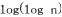。关键的直觉是对表示无符号整型的对数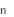位进行对数级的二分查找。

### 代码

```cpp
int findPosition3(unsigned int n)
{
 if (n & (n - 1))
  return -1;
 if (n == 1 << 31)
  return 32;
 unsigned int position = 16;
 unsigned int half = 1 << 15;
 unsigned int stride = 16;
 while (1)
 {
  if (n == half)
  return position;
  else if (n > half)
             {
  n = n >> stride;
                              position = position + (stride >> 1);
             }
  else
             {
  n = n & ((1 << stride) - 1);
                              position = position - (stride >> 1);
             }
  half = half >> (stride >> 1);
  stride >>= 1;
 }
 return position;
}
```

## 8. 计算无符号数中设置为 1 的位个数

### 解决方案

我们可以简单地循环并计数位，复杂度为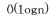，其中是无符号数的位数。

### 代码

```cpp
unsigned int countBits(unsigned int n)
{
 unsigned int count = 0;
 while (n)
 {
 count += n & 1;
  n >>= 1;
 }
 return count;
}
```

### 针对稀疏位图的解决方案

该解决方案对于稀疏无符号数效果更好，因为它的运行时间与设置为 1 的位个数成正比。`n &= (n – 1)`这一行将位图中最右侧的 1 设置为 0。

### 代码

```cpp
unsigned int countBitsSparse(unsigned int n)
{
 unsigned int count = 0;
 while (n)
 {
                   count++;
  n &= (n - 1);
 }
 return count;
}
```

### 针对稠密位图的解决方案

该解决方案对于稠密位图效果更好，因为它的运行时间与设置为 0 的位个数成正比。首先，你必须翻转所有位，然后从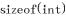中减去设置为 1 的位个数。`n &= (n – 1)`这一行将位图中最右侧的 1 设置为 0。

### 代码

```cpp
unsigned int countBitsDense(unsigned int n)
{
 unsigned int count = 8 * sizeof(unsigned int);
 n = ~n;
 while (n)
 {
                   count--;
  n &= (n - 1);
 }
 return count;
}
```

### 针对 32 位整数的解决方案

该解决方案对于 32 位无符号整数效果更好。在这里，你使用了一个额外的查找表，其中包含 8 位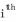数字二进制表示中所包含的 1 的个数。使用预计算的查找表是加速查找表的一种常用技巧。

### 代码

```cpp
static int bitInChar[256];
void fillBitsInChar()
{
 for (unsigned int i = 0; i < 256; ++i)
              bitInChar[i] = countBits(i);
}
unsigned int countBitsConstant32Bits(unsigned int n)
{
 return bitInChar[n & 0xffu] +
              bitInChar[(n >> 8) & 0xffu] +
              bitInChar[(n >> 16) & 0xffu] +
              bitInChar[(n >> 24) & 0xffu];
}
```

## 9. 不使用算术运算符相加两个数

### 解决方案

我们可以使用异或运算来加两个位，并使用与运算来计算进位。在代码中我们还实现了减法。

### 代码

```cpp
int add(int x, int y)
{
 while (y != 0)
 {
  int carry = x & y;
  x = x ^ y;
  y = carry << 1;
 }
 return x;
}
int negate(int x) {
 return add(~x, 1);
}
int subtract(int x, int y) {
 return add(x, negate(y));
}
```

## 10. 给定整数数组，其中所有数字都出现两次，找到只出现一次的数字

### 解决方案

我们可以通过对整数数组进行异或运算来识别只出现一次的数字。如果一个数字是重复的，那么异或运算的结果为 0。换句话说，如果我们异或所有数字，结果就是那个数字。

### 代码

```cpp
preComputedParity[(n >> 16) & mask] ^
preComputedParity[n & mask];
}
```

## 17. 在不使用额外内存的情况下交换两个整数变量

### 解决方案

该解决方案使用了异或运算，不需要额外的存储空间。感兴趣的读者可以思考如何交换两个非整数的变量。

### 代码

```cpp
void swap(unsigned int & i, unsigned int & j)
{
  i ^= j;
  j ^= i;
  i ^= j;
}
```

## 18. 交换 64 位数中的第 i 和第 j 位

### 解决方案

如果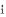等于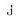，则不需要交换。如果这两个位不同，则我们需要交换和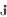，这意味着它们通过异或运算后结果为 1。如果它们不同，那么只有两种可能：(0, 1) 和 (1, 0)，对于这些情况，与 1 进行异或将交换结果。如果两个位不同，那么它们的异或结果为 0，对于任何数字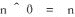。这些观察结果实现在下面的代码中。

### 代码

```cpp
int swapBits(int n, unsigned int i, unsigned int j)
{
  if (i == j)
    return n;
  int xor = ((n >> i) ^ (n >> j)) & 1;
  return n ^ (xor << i) ^ (xor << j);
}
```

## 19. 反转无符号整数的位顺序

### 解决方案

我们只需应用了用于交换位的函数。第一种方案复用了之前练习中定义的代码，而第二个方案直接操作位。

### 代码

```cpp
unsigned int reverse(unsigned int n)
{
  unsigned numBits = sizeof(unsigned int) * 8;
  unsigned halfBits = numBits >> 1;
  for (unsigned int i = 0; i < halfBits; ++i)
    n = swapBits(n, i, numBits - i - 1);
  return n;
}

unsigned int mirror(unsigned int n)
{
  for (unsigned int i = 0; i <= 15; i++)
  {
    n = (n & (0xffffffff - (1 << i) - (1 << (31 - i)))) |
        ((n & (1 << i)) << (31 - i * 2)) |
        ((n & (1 << (31 - i))) >> (31 - i * 2));
  }
  return n;
}
```

## 20. 将整数转换为字符串以及将字符串转换为整数

### 解决方案

对于 10 进制整数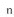，我们知道可以通过操作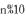获取最后一位，并且可以通过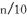对数字进行右移。此外，数字的 ASCII 字符是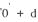。如果数字是负数，我们需要在前面加上字符‘-’。

### 代码

```cpp
std::string toString(int n)
{
  if (n == 0) return "0";
  std::string result;
  result.reserve(10);
  if (n < 0)
  {
    n = -n;
    result.push_back('-');
  }
  for (int i = log10(n); i >= 0; i--)
    result.push_back('0' + (n / (int)pow(10, i)) % 10);
  return result;
}

int toInt(const std::string & s)
{
  if (s.empty()) return 0;
  const bool negative = (s[0] == '-') ? true : false;
  int result = 0;
  for (unsigned int i = (negative ? 1 : 0); i < s.size(); ++i)
  {
    if (isdigit(s[i]))
      result = result * 10 + s[i] - '0';
  }
  return (negative) ? -result : result;
}
```

## 21. 将数字从基 b1 转换为基 b2

### 解决方案

我们可以泛化之前练习中提出的解决方案。主意是将基转换为十进制，再从十进制转换为基。

### 代码

```cpp
std::string convertFromToBase(const std::string & s, unsigned int b1, unsigned int b2)
{
  if (s.empty()) return s;
  bool negative = (s[0] == '-');
  int n = 0, reminder;
  for (unsigned int i = (negative ? 1 : 0); i < s.size(); ++i)
    n = n * b1 + (isdigit(s[i]) ? s[i] - '0' : s[i] - 'A' + 10);
  std::string result;
  while (n)
  {
    reminder = n % b2;
    result.push_back(reminder >= 10 ? 'A' + reminder - 10 : '0' + reminder); // 注：此处原文逻辑略有偏差，此处按意图翻译
    n /= b2;
  }
  if (negative)
    result.push_back('-');
  reverse(result.begin(), result.end());
  return result;
}
```

## 22. 给定集合 S，计算其幂集

### 解决方案

的幂集是的所有子集。例如，给定，幂集是。如果中的存在，我们可以通过的来构建幂集。注意的是通过。

### 代码

```cpp
void powerSet(const std::vector<char> set)
{
  for (unsigned int i = 0; i < (1 << set.size()); ++i)
  {
    unsigned int n = i;
    for (unsigned int j = 0; j < set.size(); ++j)
    {
      if ((n >> j) & 1)
        std::cout << set[j];
    }
    std::cout << std::endl;
  }
}
```

## 23. 两个整数字符串字符串

### 解决方案


两个字符串可以表示非常大的整数。用于求和的`addDecimalStrings()`算法是小学里教的。

### 代码

```cpp
int padDecimalStrings(std::string &str1, std::string &str2)
{
  int len1 = str1.size();
  int len2 = str2.size();
  if (len1 < len2)
  {
    str1.insert(0, len2 - len1, '0');
    return len2;
  }
  else if (len1 > len2)
    str2.insert(0, len1 - len2, '0');
  return len1;
}

std::string addDecimalStrings(std::string s1, std::string s2)
{
  int len = padDecimalStrings(s1, s2);
  int b1, b2, sum, carry = 0;
  std::string res;
  res.resize(len);
  for (int i = len - 1; i >= 0; i--)
  {
    b1 = s1[i] - '0';
    b2 = s2[i] - '0';
    sum = b1 + b2 + carry;
    carry = sum / 10;
    res[i] = (char)sum % 10 + '0';
  }
  if (carry)
    res = '1' + res;
  return res;
}
```

## 24. 生成从 0 到 `2^n - 1` 的所有模式，使得相邻模式之间只有一位不同

### 解决方案

这些模式以发明者 Frank Gray 命名。以 `n` 增量地生成它们是方便的。如果我们分析模式，就能理解 `n` 是通过三个步骤从之前的 `n-1` 生成的。在开始时，`gray[n-1]` 中的每个元素前面加上 `0`。然后将 `gray[n-1]` 反转，并在每个元素前面加上 `1`。作为最后一步，将这两个中间列表拼接以创建新的 `gray[n]`。这个过程重复直到我们生成 `gray[n]`。

### 代码

```cpp
void gray(unsigned int n)
{
  if (n == 0)
    return;
  std::vector<std::string> gray;
  gray.push_back("0");
  gray.push_back("1");
  for (int i = 2; i < (1 << n); i = i << 1)
  {
    for (int j = i - 1; j >= 0; j--)
      gray.push_back(gray[j]);
    for (int j = 0; j < i; j++)
      gray[j] = "0" + gray[j];
    for (int j = i; j < 2 * i; j++)
      gray[j] = "1" + gray[j];
  }
  for (unsigned i = 0; i < gray.size(); i++)
    std::cout << gray[i] << std::endl;
}
```

## 25. 使用连续位用变长编码表示无符号整数

### 解决方案

核心思想是将一个 64 位无符号整数 `n` 用字节列表来表示。对于每个字节，使用 7 位来存储具有变长编码的整数。此外，最高位（most significant bit）是延续位（continuation bit），用于指示我们是否需要额外的字节来对 `n` 进行编码。例如：如果数字小于 `2^7`，我们只需要一个字节，其最高位被置为 0。否则，如果数字小于 `2^14`，我们需要两个字节，第一个字节的延续位置为 1，而第二个字节的延续位置为 0。这种表示法用于在实现倒排索引[[2]](#part0000.html__ftn2)时节省空间，倒排索引是搜索引擎频繁使用的数据结构。倒排索引类似于用于记录书中某个单词出现页码的分析索引。其关键的直觉是存储每个单词两个连续页之间的差值，并采用变长编码来节省空间。

## Code

```cpp
void encodeContinuationBit(__int64 n, std::vector<unsigned short> & encode)
{
  __int64 x = n;
  unsigned short e;
  if (!x) encode.push_back(0);
  while (x)
  {
    e = x & 127;
    x >>= 7;
    if (x)
      e |= (1 << 7);
    encode.push_back(e);
  }
}
```

## 26. 使用 gamma 编码用变长编码表示整数

## Solution

Gamma 编码是另一种整数的变长编码[[3]](#part0000.html__ftn3)。数字 `x` 用 `2 * floor(log2(x)) + 1` 位表示。该整数分为两部分：前部分是不大于 `x` 的最大 2 的幂（假设为 `2^len`），用一一编码表示，即 `log(x)` 位置为 0，后面跟一个 1。后部分是表示 `x - 2^len` 的剩余二进制位。

## Code

```cpp
void gammaEncoding(unsigned int x)
{
  int i;
  unsigned lenOfX = 0;
  for (i = x; i > 1; i >>= 1) // floor(log2(x))
    lenOfX++;
  for (i = lenOfX; i > 0; --i)
    std::cout << '0';
  std::cout << '1';
  x -= (1 << lenOfX); // reminder
  for (i = 1 << (lenOfX - 1); i > 0; i >>= 1)
    if (x & i)
      std::cout << 1;
    else
      std::cout << 0;
}
```

## 27. 使用 delta 编码用变长编码表示整数

## Solution

Delta 编码是另一种整数的变长编码[[4]](#part0000.html__ftn4)。数字 `x` 用 `2 * floor(log2(x)) + 1` 位表示。该整数分为两部分：前部分是不大于 `x` 的最大 2 的幂（假设为 `2^len`），通过对 gamma 编码数字 `len + 1` 来表示。后部分是表示 `x - 2^len` 的剩余二进制位。

## Code

```cpp
void deltaEncoding(unsigned int x)
{
  int len = 0, lengthOfLen = 0, i;
  for (int i = x; i > 0; i >>= 1) // 1+floor(log2(num))
    len++;
  for (int i = len; i > 1; i >>= 1) // floor(log2(len))
    lengthOfLen++;
  for (int i = lengthOfLen; i > 0; --i)
    std::cout << 0;
  for (int i = lengthOfLen; i >= 0; --i)
    std::cout << 0;
  for (int i = len - 2; i >= 0; --i)
    std::cout << (x >> i);
}
```

## 28. 无除法计算平均值

## Solution

这解决了一个在二分查找实现 60 多年后才报告的 [[5]](#part0000.html__ftn5) Bug，通常实现方式如下：

```cpp
int binSearch(int a[], unsigned int size, int key) {
  int low = 0;
  int high = size;
  while (low <= high) {
    int mid = (low + high) / 2;
    int midVal = a[mid];
    if (midVal < key)
      low = mid + 1;
    else if (midVal > key)
      high = mid - 1;
    else
      return mid; // key found
  }
  return -(low + 1); // key not found
}
```

错误出现在 `mid = (low + high) / 2` 这一行，因为 `low` 和 `high` 之和大于 `int` 的最大值 `INT_MAX`。在 C 和 C++ 中这会导致数组索引越界并产生不可预的结果。在其他语言中这会抛出异常。解决方案是计算 `low + (high - low) / 2`。

关于作者

一位经验丰富的数据挖掘工程师，对消费者领域的技术和创新充满热情。对海量数据集上的搜索和机器学习感兴趣，特别是查询分析、建议、实体、新鲜度和通用排名。Antonio Gull 曾在小型、中型公司（`Ask.com`, `Tiscali`）以及大型企业（`Microsoft`）工作过。他的职业生涯是将工业界与学术经验相结合。

“如今，你必须具备研究能力和解决问题的态度。”

* *

[[1]](#part0000.html__ftn1) [http://en.wikipedia.org/wiki/Gray_code]

[[2]](#part0000.html__ftn2) [http://en.wikipedia.org/wiki/Inverted_index]

[[3]](#part0000.html__ftn3) [http://nlp.stanford.edu/IR-book/html/htmledition/gamma-codes-1.html]

[[4]](#part0000.html__ftn4) [http://nlp.stanford.edu/IR-book/html/htmledition/gamma-codes-1.html]

[[5]](#part0000.html__ftn5) [http://googleresearch.blogspot.co.uk/2006/06/extra-extra-read-all-about-it-nearly.html]
