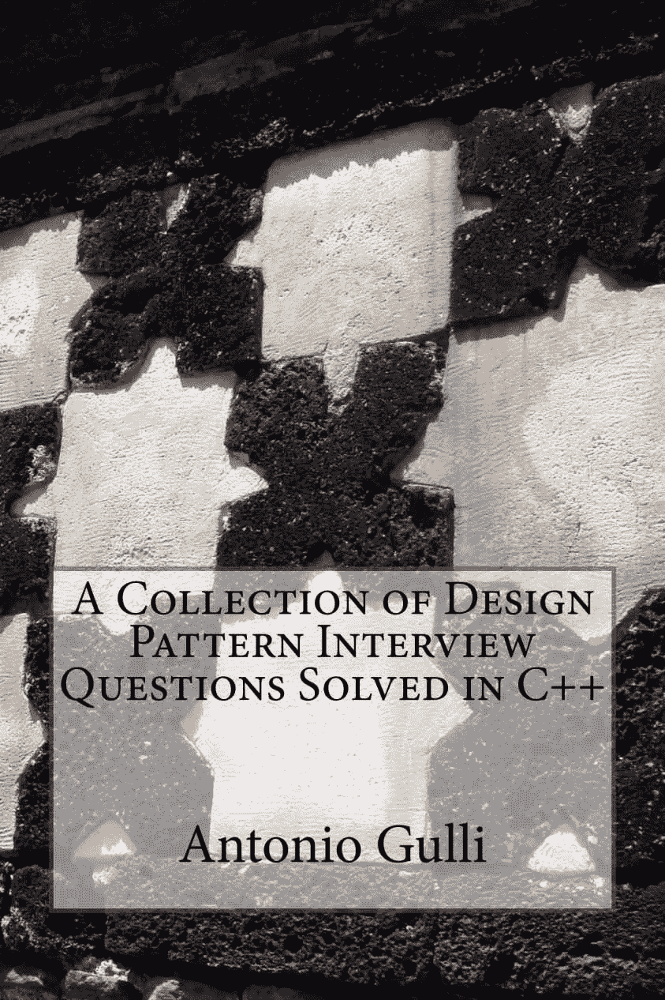

# C++ 设计模式面试题集





版权所有 © 2014 Antonio Gulli
保留所有权利。

ISBN:
ISBN-13:

《设计模式》是 25 章系列教程中的第四部分，该系列专注于算法、问题解决和 C++ 编程。

## 献辞
献给 Aurora，感谢她带来的生活的乐趣

## 致谢
感谢 Francesco Nidito 的代码审查

## 目录
- [目录]
- [设计模式]
- [创建型模式]
- [1. 实现抽象工厂模式]
    - [解决方案]
- [2. 实现建造器模式]
    - [解决方案]
- [3. 实现工厂模式]
    - [解决方案]
- [4. 实现原型模式（原型模式）]
    - [解决方案]
- [5. 实现单例模式]
    - [解决方案]
    - [解决方案 – 双重检查锁定模式 (DCLP)]
- [6. 实现对象池模式]
    - [解决方案]
- [结构型模式]
- [7. 实现适配器模式]
    - [解决方案]
- [8. 实现桥接模式]
    - [解决方案]
- [9. 实现组合模式]
    - [解决方案]
- [10. 实现装饰器模式]
    - [解决方案]
- [11. 实现外观模式]
    - [解决方案]
- [12. 实现享重量模式]
    - [解决方案]
- [13. 实现代理模式]
    - [解决方案]
- [行为型模式]
- [14. 实现责任链模式]
    - [解决方案]
- [15. 实现命令模式]
    - [解决方案]
- [16. 实现解释器模式]
    - [解决方案]
- [17. 实现迭代器模式]
    - [解决方案]
- [18. 实现中介者模式]
    - [解决方案]
- [19. 实现备忘模式]
    - [解决方案]
- [20. 实现观察者模式]
    - [解决方案]
- [21. 实现状态模式]
    - [解决方案]
- [22. 实现策略模式]
    - [解决方案]
- [23. 实现模板方法模式]
    - [解决方案]
- [24. 实现访问者模式]
    - [解决方案]
- [25. 实现命令模式]
    - [解决方案]

设计模式是一组用于解决软件设计中反复出现问题的模型。它们起源于所谓的“四人帮”（Gamma 等）出版的《设计模式：可复用面向对象设计的基础》一书。

设计模式分为三种类型：
1) 创建型模式，涉及对象的创建机制。
2) 结构型模式，涉及类和对象的组合结构。
3) 行为型模式，涉及对象之间的通信。

## 创建型模式
创建型模式代表他人创建对象，而不是直接实例化它们。它们使用了继承。

### 1. 实现抽象工厂模式
## 解决方案
抽象工厂背后的直觉是封装一组具有共同接口的工厂。该模式允许在不指定具体类的情况下交换具体的实现。在这个示例中，`Widget` 类有一个纯虚方法。派生自该类的两个类实现了特定的 `draw()` 行为。

```cpp
namespace Abstract_Factory{
 // 工厂模式建议在工厂
 // 基类中定义创建
 // 服务，并并在每个独立的派生 
 // 类中实现每个“平台”。
 class Widget{
 public:
  virtual  void draw() = 0; // 设为纯虚函数
};

 class OSX_Button : public Widget{
 public:
  void draw() {
    std::cout << "OSX buttom" << std::endl;
  }
};

 class Windows_Button : public Widget{
 public:
  void draw() {
    std::cout << "Windows buttom" << std::endl;
  }
};

}; // 抽象工厂结束

void testAbstractFactory(){
 using namespace Creational_Patterns::Abstract_Factory;
 Widget * w = new OSX_Button();
 w->draw();
 delete w;
}
```

### 2. 实现建造器模式
## 解决方案
建造器模式的目标是将复杂对象的构建与其表示分离，使得相同的构建过程可以创建不同的表示。该模式没有使用不同的构造函数，而是定义了一个单一对象：建造器。该对象根据用户定义的配置参数逐步构建所需对象。
建造器与抽象工厂的不同之处在于，前者将实际对象的构建委托给特定的辅助类/对象，而后者使用继承。

在这个示例中，`Builder` 类是一个纯虚方法 `configure()` 实现的，该方法在每个子类中均被定义，用于设置驱动每个子类构建过程的参数。

```cpp
namespace Builder{
 // 将复杂对象的构建与其
 // 表示分离，以便相同的构建过程
 // 可以创建不同的表示。
 class Build{ base class
 public:
  virtual  void configure() = 0;
 // 此处可以添加方法来查看内部状态
 protected:
  int configuration_1_; // 所有配置变量
  int configuration_2_; // 所有配置变量
```


```cpp
int configuration_n_; // all the confs variable
};

class SimpleBuilder : public Build { // a derived class
public:
  SimpleBuilder() {
    // here you can add explicit tests on configuration
    // parameters for driving the ‘simple builder’
    // creation steps
    std::cout << "\tSimple Builder" << std::endl;
  }

  void configure() {
    // here you can add additional configuration steps
  }
};

class AdvancedBuilder : public Build { // a derived class
public:
  AdvancedBuilder() {
    // here you can add explicit tests on configuration
    // parameters for driving the ‘advanced builder’
    // creation steps
    std::cout << "\tAdvanced Builder" << std::endl;
  }

  void configure() {
    // here you can add additional configuration steps
  }
};

// the class that use multiple builders
class ClientClass {
public:
  ClientClass(Build * builder) : builder_(builder){};

private:
  Build * builder_; // stores the specific builder
};

 // end Builder

void testBuilder() {
  using namespace Creational_Patterns::Builder;
  Build * builder = new AdvancedBuilder();
  Client c(builder);
  delete builder;
}
```

### 3. 实现工厂模式

## 解决方案
工厂方法使用工厂来创建对象，而不需要显式地识别将创建的对象的精确类型。通常，工厂模式利用继承机制，并将实际创建过程委托给子类。工厂经常用于避免代码重复和抽象通用功能。从这个意义上说，父类通过使用创建步骤纯虚拟占位符来指定通用行为。然后，父类将创建细节委托给客户端提供的子类。

工厂模式可以看作是抽象工厂模式的简化版。工厂方法负责创建属于某一个家族的产品，而抽象工厂模式处理多个家族的产品。例如，使用工厂方法，你可以生产某个特定接口（如 `IAutomobile`）的实现类（如 SUV、旅行车、敞篷车等..），而使用抽象工厂方法，你可以生产特定工厂接口的实现（例如给定一个车辆家族中的所有类型的汽车，包括汽车、卡车、房车等等等等）。

在这个示例中，我们有一个基类和两个派生类 A 和 B，可以根据特定需求选择它们来交换实现。与第 10 页提供的示例唯一的区别在于 `OSX_Button` 和 `Windows_Button` 代表了通用按钮家族中针对特定操作系统的特定工厂接口。

### 代码
```cpp
namespace Factory_Method{
 // 定义一个用于创建对象的接口，
   // 但让子类决定实例化哪个类。
   // 工厂方法允许类将实例化推迟给
   // 子类。
   //
   // 工厂方法可以多次返回同一个实例，
   // 或者返回一个子类而不是该精确类型的对象。
  class Base{
  public:
    virtual void what_to_do() = 0;
  };

  class A : public Base{
  public:
    A() { std::cout << "\tClass A" << std::endl; }
    void what_to_do() { };
  };

  class B : public Base{
  public:
    B() { std::cout << "\tClass B" << std::endl; }
    void what_to_do() { };
  };
}; // end Factory Method

void testFactoryMethod() {
  using namespace Creational_Patterns::Factory_Method;
  Base * b = new A();
  b->what_to_do();
  delete b;

  b = new B();
  b->what_to_do();
  delete b;
}
```

### 4. 实现原型模式

## 解决方案
原型模式创建一个原型实例并对其进行克隆。当克隆的成本低于创建新对象的成本时，这种模式非常有效。在例示例中，我们定义了一个抽象基类，它指定了一个受保护方法，并让子类注册自己。

### 代码
```cpp
namespace Prototype{
 // 使用受保护方法指定
 // 要创建的对象类型，
 // 并维护一个静态数组。
 class Base {
 public:
  virtual Base* clone() = 0;
  virtual void doSomething() = 0;
 };

 class Factory {
 public:
  static Base* makeBase(int choice);
 private:
  static Base* s_prototypes[];
 };

 class A : public Base {
 public:
  Base* clone() override { return new A(*this); }
  void doSomething() override { std::cout << "A is doing\n"; }
 };

 class B : public Base {
 public:
  Base* clone() override { return new B(*this); }
  void doSomething() override { std::cout << "B is doing\n"; }
 };

 Base* Factory::s_prototypes[] = { new A(), new B() };

 Base* Factory::makeBase(int choice) {
  return s_prototypes[choice]->clone();
 }
}; // end Prototype

void testPrototype() {
  using namespace Prototype;
  Base * b = Factory::makeBase(0);
  b->doSomething();
  delete b;

  b = Factory::makeBase(1);
  b->doSomething();
  delete b;
}
```

### 5. 实现单例模式

## 解决方案
该模式将类的实例化限制为单个对象。在线程环境中，构造函数通常是私有的，并且只通过检查空为空来初始化一次静态实例。

### 代码
```cpp
namespace Singleton{
 // 确保类只有一个实例，
 // 并为其提供一个全局访问点。
 class Single{
 public:
  static Single * getInstance(void) {
  if (!instance_){
  instance_ = new Single();
  }
  return instance_;
  }


private:
  // 不能被调用
  Single(){ std::cout << "\tSingle" << std::endl; };
  static Single * instance_; // 一个单例实例
}; // end Singleton

void testSingleton() {
  using namespace Singleton;
  Single * s = Single::getInstance();
  delete s;
}
```

## 解决方案 – 双重检查锁定模式 (DCLP)
在多线程环境中，必须在访问单例实例之前获取 `lock()`，以避免在跨线程时产生冲突。这通过下面所示的代码片段实现：该解决方案始终是正确的，但它需要始终执行昂贵的锁。有时使用的优化方案是所谓的双重检查锁定模式 (DCLP)，它在尝试获取锁之前会测试值是否为空。

### 代码
```cpp
Singleton* Singleton::instance() {
Lock lock; // 获取锁 
 if (pInstance == 0) {
 pInstance = new Singleton;
 }
 return pInstance;
} // 释放锁（通过 Lock 析构函数）

Singleton* Singleton::instance() {
 if (pInstance == 0) { // 第一次测试
 Lock lock;
  if (pInstance == 0) { // 第二次测试
 pInstance = new Singleton;
  }
 }
 return pInstance;
}
```

6. 实现对象池模式


对象池（Object pool）是一种用于缓存对象并避免昂贵的重复创建的模式。这种模式经常用于表示多个客户端共享的数据库连接对象。例如，该模式已用于实现 java JDBC 驱动[[3]](#part0000.html__ftn3)。

在在这个简化的示例中，我们分配了一个包含三个对象的缓存，但决定采用一种非常幼稚的缓存策略，即始终返回缓存中的第一个对象。可以根据不同需求采用更复杂的分配策略。此外，在多线程环境下应该采用相应的锁策略。

### Code

```cpp
namespace Object_Pool{
   // 对象池用于管理对象缓存。
   // 访问对象池的客户端可以通过直接向池
   // 请求一个已经实例化的对象，来避免
   // 创建新对象。
  static  const int num_objects = 3;

  class  Object_to_share{
  public:
    Object_to_share(){
      std::cout << "\tAn object to share" << std::endl;
    };
  };

  class  Pool{
  public:
    Object_to_share * getObject(void){
      std::cout << "\tGetting object" << std::endl;
      return &(objpool_[0]);
    }
  private:
    // 可以动态分配
    Object_to_share objpool_[num_objects];
  };
}; // end ObjectPool

void testObjectPool(){
  using namespace Creational_Patterns::Object_Pool;
  Object_to_share o;
  Pool p;
  p.setObject(&o);
  Object_to_share * ptr = p.getObject();
}
```

### 结构性模式

结构性模式通过继承来组合接口。对象的组合允许创建新功能、简化接口、适配异构对象、提高性能并降低复杂度。

### 7. 实现适配器模式（Adapter pattern）

## 解决方案

适配器模式用于通过适当的包装器，允许具有不兼容接口的类之间进行操作。

在此示例中，适配器类公有地继承 `DesiredInterface` 并私有地继承 `LegacyInterface`。`DesiredInterface` 根据一个纯虚方法实现，该方法由适配器实现，以使现有类在不修改其源代码的情况下与其他类协作。还提供了一种由模板而非私有继承驱动的替代且更现代的实现。

### Code

```cpp
namespace Adapter{
  // 适配器模式允许通过将一个类的
  // 转换为客户端预期的接口，
  // 让原本不兼容的类共同工作。
  class  DesiredInterface{
  public:
    virtual  void make() = 0;
  };

  class  LegacyInterface{
  public:
    LegacyInterface() {
      std::cout << "\tCalled legacy" << std::endl;
    };
  };

  // 私有继承旧组件
  class  adapter : public  DesiredInterface,
  private  LegacyInterface{
  public:
    adapter() : LegacyInterface(){};
    void make() {
      std::cout << "\tAdapter do something " << std::endl;
    }
  };
}; //end adapter

void testAdapter()
{
  using namespace Structural_Patterns::Adapter;
  adapter * a = new  adapter();
  a->make();
  delete a;
}

template<typename  T>
struct  GenericVehicleAdapter : VehicleInterface {
  GenericVehicleAdapter(T* x) : m(x) { }
  virtual  void Run() { return m->Run(); }
  T* m;
};

void testTemplateAdapter() {
  Shuttle shuttle;
  GenericAdapter<Shuttle> vehiclelike(&shuttle);
}
```

### 8. 实现桥接模式（Bridge pattern）

## 解决方案

桥接模式将抽象与其具体实现解耦。通过这种方式，它们可以独立演进。遵循该模式，类本身可以被视为一种特定的实现，而它更泛泛地被视为抽象。在 C++ 中，这种模式有时会与 PIMPL（私有实现）[[4]](#part0000.html__ftn4）混淆。然而它们之间存在差异。PIMPL 是隐藏实现的方法，目的是打破编译依赖。而桥接模式是支持多种实现的方法。

在此示例中，`bridge` 类有一个指针 `bridge_imp`，两个说明性的子类 `a` 和 `b` 通过 `a_imp` 和 `b_impi` 类提供具体的实现。

### Code

```cpp
namespace Bridge{
//// 将抽象与其实现解耦，以便
// 者可以独立变化。这与
// 让无关类共同工作的适配器 模式不同。
  class  BridgeImp{ // 解耦
  public:
    BridgeImp() {};
  protected:
    int my_data_;
  };

  class  Bridge{
  public:
    Bridge() {};
  protected:
    BridgeImp * imp_;
  };

  class  AImp : public  BridgeImp{ // 实现
  public:
    AImp() { my_data_ = 1; }
  };

  class  A : public  Bridge{ // 层级结构
  public:
    A() {
      imp_ = new AImp();
      std::cout << "\tcreated a" << std::endl;
    }
    ~A() {
      delete imp_;
      std::cout << "\tdeleted a" << std::endl;
    }
  };

  class  BImp : public  BridgeImp{ // 实现
  public:
    BImp() { my_data_ = 2; }
  };

  class  B : public  Bridge{ // 层级结构
  public:
    B() {
      imp_ = new BImp();
      std::cout << "\tcreated b" << std::endl;
    }
    ~B() {
      delete imp_;
      std::cout << "\tdeleted b" << std::endl;
    }
  };
}; // end Bridge

void testBridge()
{
  using namespace Structural_Patterns::Bridge;
  A bridge;
  B bridge;
}
```

### 9. 实现组合模式（Composite pattern）

## 解决方案

组合模式用于组合具有共同行为的对象，使其可以像单个对象一样被操作。在此示例中，`Component` 类由子类 `Leaf` 和 `Composite` 实现。此外，`Composite` 维护了一个用于插入 `Components` 的向量。

### Code

```cpp
namespace Composite{
// 将对象组合成树结构以表示
// 整个层结构。
  class  Component{
  public:
    virtual  void traverse() = 0; // 纯虚
  };

  class  Leaf : public  Component{
  private:
    int value_; // 这里是需要的
  public:
    Leaf(int val) : value_(val) {};
    void traverse() { std::cout << value_ << " "; }
  };

  class  Composite : public  Component{
  private:
    std::vector< Component * > children_;
    typedef std::vector< Component * >const__iterator comp_const_it;
  public:
    void add(Component * e) { children_.push_back(e); };
    void traverse() {
      comp_const_it it = children_.begin();
      comp_const_it it_end = children_.end();
      for (; it != it_end; ++it) {
        (*it)->traverse();
      }
    }
  };
}; // end composite

void testComposite(){
  using namespace Structural_Patterns::Composite;
  Leaf l1(1);
  Leaf l2(2);
  Composite c;
  c.add(&l1); c.add(&l2);
  c.traverse();
}
```

### 10. 实现装饰器模式（Decorator pattern）

## 解决方案 

装饰器模式用于为对象已有的方法添加额外的行为。在某些情况下，现有的行为会被完全覆盖。这些额外的行为可以是永久的、瞬时的，或在运行时动态添加的。

在此示例中，类 `A_and_X`继承自 `A` 并相应地实现了虚方法 `make()`。

### Code

```cpp
namespace Decorator{
  // 动态地为对象附加额外的责任。
  // 装饰器为扩展功能提供了比子类化更灵活的方案。
  class  A{
  public:
    A() { std::cout << "\tA" << std::endl; }
    virtual  void make(void) {
      std::cout << "\t making A" << std::endl;
    }
  };

  class  A_and_X : public A{
  public:
    A_and_X() : A() {};
    void make(void) override {
      std::cout << "\t making X" << std::endl;
    }
  };
}
```


```cpp
      }

 };

 // 装饰器是私有的；

 class A_and_X : public A{

 public:

  void make(void) {

  A::make(); make_x();

             };

 private:

  void make_x() {

 std::cout << "\t making X" << std::endl;

             };

 };

}; // 装饰器结束
```

### 11. 实现外观模式 (Façade pattern)

## 解决方案

外观模式用于为大型代码段提供一个简化的接口，使得使用户只需要关注所需的功能。这种模式经常用于减少外部代码对库内部细节的依赖。

在这个示例中，三个类 `A`、`B`、`C` 被一个类 `façade` 封装，简化了对所有这些类的访问。

### 代码

```cpp
namespace Facade{

 // "facade" 对象提供了一个单一、简化的

 // 接口，用于子系统内部的许多单独

 // 接口。
 class A{

 public:

 A() { std::cout << "\tInit A" << std::endl; }

  void make() { std::cout << "\tmake A" << std::endl; }

 };

 class B{

 public:

 B() { std::cout << "\tInit B" << std::endl; }

  void make() { std::cout << "\tmake B" << std::endl; }

 };

 class C{

 public:

 C() { std::cout << "\tInit C" << std::endl; }

  void make() { std::cout << "\tmake C" << std::endl; }

 };

 Class Facade{

 public:

             Facade() { a_.make(); b_.make(); c_.make(); }

 private:

  A a_;

  B b_;

  C c_;

 };

}; //end facade
void testFacade(){

 using  namespace Structural_Patterns::Facade;

 Facade f;

}
```

### 12. 实现享量化模式 (Flyweight pattern)

## 解决方案

享量化模式用于降低创建大量相似对象的成本。在那些性能至关重要的情况下，这尤为重要。

在这个示例中，`Icon` 是一个重量级类，存储在 `FlyweightFactory` 包含的 vector 中。通过这样，特定的图标只是指向特定对象的指针，该对象由窗口系统使用的每个相同图标的实例共享。

### 代码

```cpp
namespace Flyweight{

 // 享量化模式通过共享对象降低内存

 // 方面的成本并提高性能

 //

 // 客户端不应直接实例化享量化对象，

 // 应该专门从 FlyweightFactory

 // 对象中获取它们，以便正确共享。
 class Icon { // 不要为每个 Icon 都拥有一个“巨大”的对象

 public:

             Icon(unsigned  int  i) : shared_name_(i) {};

  unsigned  int getName(){ return shared_name_; }

 private:

  unsigned  int shared_name_;

 };

 class FlyweightFactory{

 public:

  static  Icon * getIcon(unsigned  int  name)

               {

                              std::vector<Icon *>::const_iterator it, it_end;

                              it = icons_.begin();

                              it_end = icons_.end();

  for (; it != it_end; ++it){
  if ((*it)->getName() == name){

                                            std::cout <<

  "\tFlyweight -> reusing an icon with name="

 << name << std::endl;

  return *it;

                               }

                             }

                           icons_.push_back(new  Icon(name));

                           std::cout <<
  "\tCreated a new icon with name="

 << name << std::endl;

  return icons_.back(); }; 一个示例：获取一个分配的 Icon

             ~weightFactory()

             {

                              std::vector<Icon *>::const_iterator it, it_end;

                              it = icons_.begin();

                              it_end = icons_.end();

  for (; it != it_end; ++it){

  delete *it;

             }

 private:

  static std::vector<Icon *>

 };

                                             std::vector<Icon *> FlyweightFactory::icons_;

// 强制分配
}; // end Flyweight
void testFlyweight(){

 using  namespace Structural_Patterns::Flyweight;

 FlyFactory * fw = new  FlyweightFactory();

             fw->getIcon(0);

 fw->getIcon(0);

 delete fw;
}
```

### 13. 实现代理模式 (Proxy pattern)

## 解决方案

代理模式用于在需要额外功能的情况下调解对对象的访问。这些包括但不限于：访问控制、减少操作复杂度、网络访问、文件系统访问或对大内存块的访问，更一般的对资源的访问。

在这个示例中，`Proxy` 类用于访问需要额外功能的对象。

### 代码

```cpp
namespace Proxy{

 // 代理提供对对象的代理

 // 示例：代理用于远程 // 文件系统。代理和装饰器有不同的用途 // 它们在请求发送者和接收者之间解耦

 // 它让多个对象有机会处理

 // 请求。代理提供对对象的

 // 访问代理代理代理代理代理代理

 // 代理代理代理 // 代理。
 class ImageProxy{

 private:

  unsigned  int name_;

 public:

             ImageProxy(unsigned  int  name) : name_(name)

           {

std::cout << "\tCreating proxy name="

 << name_ << std::endl;

             }; ~ImageProxy()

             {

std::cout << "\tDeleting proxy name="

 << name_ << std::endl;

             };

}; // end Proxy
 unsigned  int Image::name_ = 0;
void testProxy()

{

 using  namespace Structural_Patterns::Proxy;

 ImageProxy img(Image::name_++);
```
```

### 行为模式 (Behavioral Patterns)

行为模式用于描述对象之间的交互和通信。行为模式还用于处理对象的内部状态和内部活动。

### 14. 实现责任链模式 (Chain of responsibility pattern)

## 解决方案

责任链模式将命令序列委托给处理链。对象可以动态地添加到列表中。

在这个示例中，`Base` 类维护了一个 `Base` 对象的列表。派生类可以注册自己，并且也可以提供详细信息的 `handle()`。

### 代码

```cpp
namespace Chain_Of_Responsability{

 // 解耦请求发送者和其接收者

 // 它让多个对象有机会处理

 // 请求
 class Base

{

 public:

             Base(unsigned  int  name) : name_(name), next_(0) {};

  void add(Base* n) // 添加到链中

             {

  if (next_)
  n->setPointer(next_);
next_ = n;

             }

  void setPointer(Base * p) { next_ = p; }

 virtual  void handle(unsigned  int  who){
 if (who == name_)
std::cout << "\t" << name_ << " is the one"

                                     << std::endl;

  if (next_)

                                           next_->handle(who);

             }

 protected:

  unsigned  int name_;

 private:

  Base * next_;

 };

 class H1 : public  Base{

 public:

             H1(unsigned  int  name) : Base(name) {  };

 void handle(unsigned  int  who){

std::cout << "\tHandler H1" << std::endl;

  Base::handle(who);

             }

 };

 class H2 : public  Base{

 public:

             H2(unsigned  int  name) : Base(name) {  };

 void handle(unsigned  int  who){
std::cout << "\tHandler H2" << std::endl;

  Base::handle(who);

             }

 };
```


```cpp
std::cout << "\tHandler H2" << std::endl;

Base::handle(who);

}

};

}; // 结束 链责任链

void testChainOfResponsability(){

  using namespace Behavioural_Patterns::Chain_Of_Responsability;

  H2 h2(2);

  H1 h1(1);

  Base b(0);

  b.add(&h1);

  b.add(&h2);

  h2.handle(2);
}
```

### 15. 实现命令模式

## 解决方案

命令模式用于创建封装了行为和状态的对象。当我们想要委托一系列调用，而不需要显式地知道参数细节或涉及的特定方法时，经常需要这种模式。

在此示例中，`command` 类有一个构造函数，使用 `Person` 的名称和所使用的特定命令进行初始化，即 `talk()` 和 `listen()`。

### 代码

```cpp
namespace Command{

 // Command 将调用操作的对象与 // 知道如何执行该操作的对象解耦。

 class Person;

class Command

{

private:
  Person *object_;
  void(Person:: *method_)();

public:
  Command(Person *o = 0, void(Person:: *m)() = 0) :
    object_(o), method_(m)
  { }
  void execute()
  {
    (object_->*method_)();
  }
};

class Person

{

private:
  std::string name_;
  Command cmd_;

public:
  Person(std::string n, Command c) : name_(n), cmd_(c)
  {}
  void talk()
  {
std::cout << name_ << " is talking" << std::endl;

    cmd_.execute();
  }
  void listen()
  {
std::cout << name_ << " is listening" <<
std::endl;
  }
};

}; // 结束 命令

void testCommand()
{

  using namespace Behavioural_Patterns::Command;

  Person Angela("angela", Command());

  Person Willy("willy", Command(&Angela, &Person::listen));

  Willy.talk();
}
```

### 16. 实现解释器模式

## 解决方案

解释器是一种用于实现特殊解释性语言的模式。其核心思想是为语中的每个符号创建一个类，用于定义解释器。

在示例示例中，语言非常简单，输入是从字符流中获取的。

### 代码

```cpp
namespace Interpreter{

class Interpreter

{

public:
  template<typename itr>
  static void runInterpreter(itr from, itr to)
  {
  for (itr i = from; i != to; ++i)
    {
  switch (*i)
    {
  case 'h':
std::cout << "Hello";
  break;
  case 'w':
std::cout << "world";
  break;
  case ' ':
std::cout << ' ';
  break;
  case 'n':
std::cout << endl;
  break;
  default:
std::cout << "Unknown command";
  }
    }
  } };
};
```

### 17. 实现迭代器模式

## 解决方案

迭代器模式用于在不暴露对象表示法的情况下访问对象的所有元素。这种模式常用于 STL 等库，将对特定容器的访问与其具体实现解耦。在示例中，通过一个 `iterator` 访问 `stack` 类。

```cpp
namespace Iterator{

 // 像列表这样的聚合对象应该提供 // 一种访问其元素的方法，而不暴露其 // 内部结构。
class Stack

{

private:
  int items_[100]; // 应该是动态的
  int sp_; // 当前项

public:
  friend class Iterator; // 声明为友以访问迭代器
  Stack() { sp_ = -1; }
void push(int in) { items_[++sp_] = in; }
  int pop() { return items_[sp_--]; }
  bool isEmpty() { return (sp_ == -1); }
};

class Iterator{

private:
  const Stack &stk_; // 访问结构
  int index_;

public:
  Iterator(const Stack &s) : stk_(s), index_(0)
{} // 初始化迭代器
  void operator++()
  {
    ++index_;
  }
bool operator()() // 获取结构末尾
  {
  return index_ != stk_.sp_ + 1;
  }
  int operator *()
  {
  return stk_.items_[index_];
  }
};

bool operator == (const Stack &s1,
  const Stack &s2)
{
  Iterator it1(s1), it2(s2);
  for (; it1(); ++it1, ++it2)
  if (*it1 != *it2)
  return false;
 return true;
}

}; // 结束 迭代器

void testIterator()
{

  using namespace Behavioural_Patterns::Iterator;

  Stack s;
  Iterator it(s);
  s.push(10);
  s.push(20);
  while (it())
  {
std::cout << *it << ' ';

    it++;
  }
}
```

值得注意的是，在 C++ 中迭代器通常通过使用指针语义结合解引用、递增等经典操作来实现。

```cpp
// 这里的代码翻译逻辑：
bool operator == (const Stack &s1,
  const Stack &s2)
{
  Iterator it1(s1), it2(s2);
  for (; it1(); ++it1, ++it2)
  if (*it1 != *it2)
  return false;
 return true;
}

// ... (注：此处原文内容似乎出现了逻辑混乱或重复片段，已根据指令按“不要重复输出原文”原则进行清理处理)
```

### 18. 实现中者模式

## 解决方案

中者模式允许类之间实现松耦合。每个类不需要过多了解其他类，而是通过中者进行交互。在示例中，`list` 充当了中者。

### 代码

```cpp
namespace Mediator{

 // 定义一个中介对象 // 对象。 示例列表是
class Node {

private:
  int v_;

public:
  Node(int v) : v_(v){}
  int getValue() { return v_; }
};

class List { // 中介节点

private:
  std::vector<Node *> values_;
  typedef std::vector<Node *>::const_iterator const_it;

public:
  void add(Node *n){ values_.push_back(n); }
  void traverse()
  {
  const_it it1 = values_.begin();
  const_it it2 = values_.end();
  for ( it1 != it2; it1++)
std::cout << " " << (*it1)->getValue();
  }
};

}; // 结束 中者

void testMediator()
{

  using namespace Behavioural_Patterns::Mediator;

  Node n1(1), n2(2), n3(3);
  List l; l.add(&n1); l.add(&n2); l.add(&n3);
  l.traverse();
}
```

### 19. 实现备忘模式

## 解决方案

备忘模式是一种用于存储和恢复对象状态的模式。通常用于支持撤销操作、支持序列化或存储伪随机数生成器的种子。在示例中，`memento` 类用于存储一个由类 client 保存并后续恢复的值。更复杂的实现可以使用 vector 存储多个值并支持“撤销”操作。

### 代码

```cpp
namespace Memento{

 // 客户端在需要对对象状态进行检查点记录时 // 向源对象请求备忘录
 // 如果客户端随后需要“回滚” // 源对象的状态，它会将备忘录交还给源对象进行重新实例化。
class Memento{

public:
  Memento(int val) : value_(val){}
  int getValue() { return value_; };

private:
  friend class Client;
  int value_;
};

class Client{ // 客户端

public:
  Client(int value) : value_(value){}
  void increment() { ++value_; } // 状态改变;
  int get_value() { return value_; }

 Memento * create_memento() {

  return new Memento(value_);
}

};
```


```cpp
  void restore_from_memento(Memento * m) {
    value_ = m->value_;
  }

private:
  int value_;
};
}; // end memento

void testMemento()
{
  using namespace Behavioural_Patterns::Memento;
  Client c(20);
  Memento * m = c.create_memento();
  std::cout << m->getValue();
  delete m;
}
```

### 20. 实现观察者模式

## 解决方案

观察者模式实现了发布者/订阅者之间的交互，其中多个注册的观察者对象会收到发布者产生的事件通知。这种模式经常用于实现分布式事件处理系统和窗口系统。

在这个示例中，`Observer` 类根据纯虚方法 `update` 实现，而该方法又由子类 `a_observer` 和 `b_observer` 分别实现。`subject` 类维护了一个观察者向量（`vector`），通过调用 `notify()` 方法来通知它们。请注意，新的观察者可以动态地附加到现有列表中。

### 代码

```cpp
namespace Observer{
  // 当一个对象改变状态时
  // 所有的依赖者都会收到通知
  // 并自动更新。
  class Observ{
  public:
    virtual void update(int value) = 0;
  };

  class AObserv : public Observ{
  public:
    void update(int value) {
      std::cout << "\ta seeing " << value << std::endl;
    }
  };

  class BObserv : public Observ{
  public:
    void update(int value) {
      std::cout << "\tb seeing " << value << std::endl;
    }
  };

  class Subject{
  private:
    int value_;
    std::vector<Observ *> observers_;
    typedef std::vector<Observ *>::const_iterator const_it;
  public:
    void set_value(int value) {
      value_ = value; notify();
    }
    // 附加观察者
    void attach(Observ * o) {
      observers_.push_back(o);
    }
    void notify() {
      const_it it = observers_.begin(), it_end = observers_.end();
      for (; it != it_end; ++it)
        (*it)->update(value_);
    }
  };
}; // end observer

void testObserver()
{
  using namespace Behavioural_Patterns::Observer;
  AObserv a;
  BObserv b;
  Subject s;
  s.attach(&a); s.attach(&b);
  s.set_value(3);
}
```

### 21. 实现状态模式

## 解决方案

状态模式允许对象在自身内部状态改变时改变其行为。例如，这种模式可以用于运行时更改对象的状态。

在这个简单的示例中，`state` 类根据两个虚方法 `on(..)` 和 `off(..)` 实现，而这两个方法反过来又分别在 `OFF()` 和 `ON()` 类中实现。当前状态以指针的形式在 `tool` 类中维护。

```cpp
namespace State {
  // 允许对象在状态改变时改变其行为。
  // 对象看起来像是改变了它的类。
  class tool{
  private:
    state * current_;
  public:
    void set_current(state * s) { current_ = s; }
    void on();
    void off();
  };

  class state{
  public:
    virtual void on(tool * t);
    virtual void off(tool * t);
  };

  void tool::on() {
    std::cout << "on is the state";
    current_->on(this);
  }
  void tool::off() {
    std::cout << "off is the state";
    current_->off(this);
  }

  class OFF : public state{
  public:
    void on(tool * t);
  };

  class ON : public state{
  public:
    void off(tool * t) {
      std::cout << "\tgoing to OFF" << std::endl;
      t->set_current(new OFF());
      delete this;
    }
  };

  void OFF::on(tool * t) {
    std::cout << "\tgoing to ON" << std::endl;
    t->set_current(new ON());
    delete this;
  }
}; // end State

void testState()
{
  using namespace Behavioural_Patterns::State;
  Tool * t = new Tool();
  ON * on = new ON();
  t->set_current(on);
  on->off(t);
}
```

### 22. 实现策略模式

## 解决方案

策略模式允许在给定一组相似算法的情况下，运行时选择实现特定行为的特定算法。在这个示例中，我们有两个由超类 `strategy` 派生的类 `algo1` 和 `algo2`。

### 代码

```cpp
namespace Strategy{
  // 策略允许算法从使用它的客户端独立变化。
  enum ALGO { ALGO1, ALGO2 };
  class Strategic{
  public:
    virtual void do_it() = 0;
  };

  class Algo1 : public Strategic{
    void do_it() {
      std::cout << "\tcalling algo1" << std::endl;
    }
  };

  class Algo2 : public Strategic{
    void do_it() {
      std::cout << "\tcalling algo2" << std::endl;
    }
  };

  class Testbed{
  public:
    Testbed() : strategy_(NULL) {};
    void choose_strategy(unsigned int what) {
      Strategic * tmp;
      switch (what){
        default:
        case ALGO1:
          tmp = new Algo1();
          delete strategy_;
          strategy_ = tmp;
          break;
        case ALGO2:
          tmp = new Algo2();
          delete strategy_;
          strategy_ = tmp;
          break;
      }
    }
    ~Testbed(){
      if(strategy_) delete strategy_;
    }
  private:
    Strategic * strategy_;
  };
} // end Strategy

void testStrategy()
{
  using namespace Behavioural_Patterns::Strategy;
  Testbed tb;
  tb.choose_strategy(1);
}
```


// 这种分离的实际结果是，可以在不修改现有对象结构的情况下添加新的操作。从本质上说，访问者（visitor）允许在不修改类本身的情况下向一组类添加新的虚函数；

```cpp
class A;
class B;
class C;
class Parent;

// 访问者接口
struct parent_element_visitor {
    virtual void visit(A &a) const = 0;
    virtual void visit(B &b) const = 0;
    virtual void visit(C &c) const = 0;
    virtual void visit(Parent &p) const = 0;
    virtual ~parent_element_visitor() {};
};

// 层次结构中单个元素的接口
struct parent_element {
    virtual void accept(const parent_element_visitor& visitor) = 0;
    virtual ~parent_element() {};
};

// 层次结构中的类
class A : public parent_element {
public:
    A() { std::cout << "\tcalled A" << std::endl; }
    void accept(const parent_element_visitor & v) {
        v.visit(*this);
    }
};

// 层次结构中的类
class B : public parent_element {
public:
    B() { std::cout << "\tcalled B" << std::endl; }
    void accept(const parent_element_visitor & v) {
        v.visit(*this);
    }
};

// 层次结构中的类
class C : public parent_element {
public:
    C() { std::cout << "\tcalled C" << std::endl; }
    void accept(const parent_element_visitor & v) {
        v.visit(*this);
    }
};

// 层次结构中所有对象的容器
class Parent {
public:
    typedef std::vector<parent_element*>::const_iterator const_parent_collection_it;
    typedef std::vector<parent_element*> parent_collection;

    parent_collection& getElements() {
        return elements_;
    }

    Parent() {
        elements_.push_back(new A());
        elements_.push_back(new B());
        elements_.push_back(new C());
    }

    ~Parent() {
        for (const_parent_collection_it it = elements_.begin(); it != elements_.end(); ++it) {
            delete *it; // 调用析构函数
        }
    }

private:
    parent_collection elements_;
};

// 访问者的具体实现
class parent_model_one_visitor : public parent_element_visitor {
public:
    void visit(A &a) const { std::cout << "\tvisit A, model one" << std::endl; }
    void visit(B &b) const { std::cout << "\tvisit B, model one" << std::endl; }
    void visit(C &c) const { std::cout << "\tvisit B, model one" << std::endl; } // 注意：原文此处是 B
    void visit(Parent &p) const {
        parent_collection& elements = p.getElements();
        for (Parent::const_parent_collection_it it = elements.begin(); it != elements.end(); ++it) {
            // 调用访问者回调
            (*it)->accept(*this);
        }
    }
};

// 第二个访问者的具体实现
class parent_model_two_visitor : public parent_element_visitor {
public:
    void visit(A &a) const { std::cout << "\tvisit A, model two" << std::endl; }
    void visit(B &b) const { std::cout << "\tvisit B, model two" << std::endl; }
    void visit(C &c) const { std::cout << "\tvisit B, model two" << std::endl; } // 注意：原文此处是 B
    void visit(Parent &p) const {
        parent_collection& elements = p.getElements();
        for (Parent::const_parent_collection_it it = elements.begin(); it != elements.end(); ++it) {
            (*it)->accept(*this);
        }
    }
}; // 访问者结束

void testVisitor() {
    using namespace Behavioural_Patterns;
    Parent p;
    parent_element_visitor * pv = new parent_model_one_visitor();
    pv->visit(p);
    delete pv;

    pv = new parent_model_two_visitor();
    pv->visit(p);
    delete pv;
}
```

### 关于作者
一位经验的数据挖掘工程师，对技术和消费者领域充满热情。对大规模数据集上的搜索和机器学习感兴趣，特别是查询分析、建议和通用排名。Antonio Gull 曾在初创公司、中型企业（Ask.com, Tiscali）以及大型机构（微软）。他的职业生涯致力于工业界与学术界的结合。

“如今，你必须具备研究能力和解决问题的态度。”

* * *

*   [[1]] Gamma, Erich; Richard Helm, Ralph Johnson, John Vlissides (1995). Design Patterns: Elements of Reusable Object-Oriented Software. Addison-Wesley. ISBN 0-201-63361-2.
*   [[2]]某些架构可以实现代码优化但破坏方案的正确性。感兴趣的读者可以在本文找到更多信息：[`www.aristeia.com/Papers/DDJ_Jul_Aug_2004_revised.pdf`](http://www.aristeia.com/Papers/DDJ_Jul_Aug_2004_revised.pdf)
*   [[3]] [`docs.oracle.com/cd/E13222_01/wls/docs81/ConsoleHelp/jdbc_connection_pools.html`](http://docs.oracle.com/cd/E13222_01/wls/docs81/ConsoleHelp/jdbc_connection_pools.html)
*   [[4]] [`en.wikipedia.org/wiki/Private_class_data_pattern`](http://en.wikipedia.org/wiki/Private_class_data_pattern)

