# C++ 树形编程面试题集（第 5 卷）


《树》是包含 25 章关于算法、问题解决和 C++ 编程的系列书籍中的第五本。

## 献辞

致我的妻子 Francesca

爱总会在宽恕与因果之间找到出路

## 致谢

## 1 实现二叉树的前序遍历

### 解决方案

二叉树是每个节点最多有两个子节点的树。非递归的前序遍历可以使用栈来实现。

在循环中：

* 首先访问当前节点。

* 然后将左子节点推入栈，直到到达叶子节点。

* 接着，如果栈为空，则退出循环。否则，从栈顶弹出元素并继续向右子节点遍历。

### Code

```cpp
template<typename tVal>
struct binaryTree {
    tVal v__;
    struct binaryTree<tVal> * left;
    struct binaryTree<tVal> * right;
    binaryTree(tVal v) : v__(v), left(NULL), right(NULL) {}
};

template<typename tVal>
void nonRecursivePreOrder(binaryTree<tVal> * root) {
    std::stack<binaryTree<tVal> *> s;
    while (true) {
        //left
        while (root) {
            std::cout << " v=" << root->v__;
            s.push(root);
            root = root->left;
        }
        if (s.empty())
            break;
        // this one
        root = s.top();
        s.pop();
        //right
        root = root->right;
    }
}
```

### Complexity

时间复杂度为 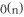 空间复杂度为 

## 2 计算二叉树的直径

### Solution

可以使用递归方便地计算该解决方案

### Code

```cpp
template<typename tVal>
unsigned diameter(binaryTree<tVal> * root, unsigned & dim) {
    unsigned left, right;
    if (!root)
        return 0;
    left = diameter(root->left, dim);
    right = diameter(root->right, dim);
    if (left + right > dim)
        dim = left + right;
    return ((left > right) ? left : right) + 1;
}
```

### Complexity

时间复杂度为  空间复杂度为 。

## 3 实现二叉树的中序遍历

### Solution

非递归的中序遍历可以使用栈来实现。

在循环中：

* 首先将左子节点推入栈，直到到达叶子节点。

* 接着，如果栈为空，则退出循环。否则，从栈顶弹出并访问当前节点。

* 最后，继续向右子节点遍历

### Code

```cpp
template<typename tVal>
void nonRecursiveInOrder(binaryTree<tVal> * root) {
    std::stack<binaryTree<tVal> *> s;
    while (true) {
        //left
        while (root) {
            s.push(root);
            root = root->left;
        }
        if (s.empty())
            break;
        // this one
        root = s.top();
        s.pop();
        std::cout << " v=" << root->v__;
        //right
        root = root->right;
    }
}
```

### Complexity

时间复杂度为  空间复杂度为 

## 4 实现二叉树的后序遍历

### Solution

在后序遍历期间，每个节点都会被访问两次：第一次是在向左子节点移动时，第二次是在向右子节点移动时。为了区分这两种情况，我们可以比较当前元素与栈顶元素的右子节点是否相同。

### Code

```cpp
template<typename tVal>
void nonRecursivePostOrder(binaryTree<tVal> * root) {
    std::stack<binaryTree<tVal> *> s;
    while (true) {
        if (root) {
            s.push(root);
            root = root->left;
        } else {
            if (s.empty())
                break;
            if (!s.top()->right) {
                root = s.top();
                s.pop();
                std::cout << " v=" << root->v__;
                if (root == s.top()->right) {
                    std::cout << " v=" << s.top()->v__;
                    s.pop();
                }
            }
            if (!s.empty())
                root = s.top()->right;
            else
                root = NULL;
        }
    }
}
```

### Complexity

时间复杂度为  空间复杂度为 

## 5 实现二叉树的层序遍历

### Solution

层序遍历可以在进入下一层之前对该层的所有节点进行遍历。该思路非常简单。

在循环中：

* 首先访问根节点

* 然后在遍历 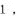 处的节点时，将 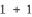 层上的所有节点存储在队列中

* 持续循环直到完成所有层级

### Code

```cpp
template<typename tVal>
void nonRecursiveLevelOrder(binaryTree<tVal> * root) {
    std::queue<binaryTree<tVal> *> q;
    binaryTree<tVal> * tmp;
    if (!root)
        return;
    q.push(root);
    while (!q.empty()) {
        tmp = q.front();
        q.pop();
        std::cout << " v=" << tmp->v__;
        if (tmp->left)
            q.push(tmp->left);
        if (tmp->right)
            q.push(tmp->right);
    }
}
```

### Complexity

时间复杂度为  空间复杂度为 

## 6 计算二叉树的叶子节点数量

### Solution

可以通过修改层序遍历来实现，每当我们到达叶子节点时增加一个计数器。

### Code

```cpp
template<typename tVal>
unsigned NumLeavesLevelOrder(binaryTree<tVal> * root) {
    std::queue<binaryTree<tVal> *> q;
    binaryTree<tVal> * tmp;
    unsigned count = 0;
    if (!root)
        return count;
    q.push(root);
    while (!q.empty()) {
        tmp = q.front();
        q.pop();
        if (!tmp->left && !tmp->right)
            count++;
        else {
            if (tmp->left)
                q.push(tmp->left);
            if (tmp->right)
                q.push(tmp->right);
        }
    }
    return count;
}
```

### Complexity

时间复杂度为  空间复杂度为 

## 7 检查两棵二叉树是否结构相同

### Solution

可以使用递归来实现。基础情况为两个节点都为空，或者其中一个一个为空。否则，算法检查两个节点的值是否相同，以及左子树和右子树是否结构相同。

### Code

```cpp
template<typename tVal>
bool structIdentical(binaryTree<tVal> * r1, binaryTree<tVal> * r2) {
    if (!r1 && !r2)
        return true;
    if (!r1 || !r2)
        return false;
    return (r1->v__ == r2->v__ && structIdentical(r1->left, r2->left) && structIdentical(r1->right, r2->right));
}
```

### Complexity

时间复杂度为  空间复杂度为 

## 8 打印树中的所有路径

### Solution

可以使用递归来实现。该思路是在递归过程中传递一个 `vector`，并将每个节点 `push_back` 进去。每当我们到达叶子节点时，打印该 `vector`。

### Code

```cpp
template<typename tVal>
void printAllPaths(binaryTree<tVal> * root, std::vector<tVal> path) {
    if (!root)
        return;
    path.push_back(root->v__);
    if (!root->left && !root->right) {
        std::vector<tVal>::iterator it = path.begin();
        for (; it != path.end(); it++)
            std::cout << " v=" << *it;
        std::cout << std::endl;
    } else {
        printAllPaths(root->left, path);
        printAllPaths(root->right, path);
    }
}
```

## 9 验证路径之和是否等于某个整数

### Solution

该思路是在递归遍历树时，从给的和中减去当前值。

```cpp
template<typename tVal>
bool hasSum(binaryTree<tVal> * root, int sum) {
    if (!root)
        return (sum == 0);
    else {
        int remainingSum = sum - root->v__;
        if ((root->left && root->right) || (!root->left && !root->right))
            return (hasSum(root->left, remainingSum) || hasSum(root->right, remainingSum));
        else
            if (root->left)
                return hasSum(root->left, remainingSum);
            else
                return hasSum(root->right, remainingSum);
    }
}
```

时间复杂度为 ，空间复杂度为 。

## 10. 寻找二叉树中两个叶子节点之间的最大路径和

### 解决方案

两个叶子节点之间的最大路径和可能通过根节点，也可能仅位于某个子树中。因此，我们有以下递归情况：

- 基础情况是根为 `NULL`，我们返回 `0`。

- 然后我们分别递归计算左子树和右子树的最大路径和。

- 接着计算左子树、右子树以及以当前节点为根的子树的最大值。如果这个值改进了目前观察到的总最大值，则更新总最大值。

- 从递归返回时，我们计算左右子树之间的最大值，并加上当前节点的权重。

### 代码

```cpp
template<typename  tVal>
tVal max(tVal  a, tVal  b)
  {
  return (a >= b) ? a : b;
  }

template<typename  tVal>
int maxPathSum(binaryTree<tVal> * root, tVal &res)
  {
  if (!root)
    return 0;
  int lLPSum = maxPathSum(root->left, res);
  int rLPSum = maxPathSum(root->right, res);
  int curr_sum = max((lLPSum + rLPSum + root->v__),
         max(lLPSum, rLPSum));
  if (res < curr_sum)
    res = curr_sum;
  return max(lLPSum, rLPSum) + root->v__;
  }
```

### 复杂度

时间复杂度为 ，空间复杂度为 。

## 11. 给定前序和中序遍历重建二叉树

### 解决方案

在前序遍历中，根节点总是每个子树的最左侧元素。因此我们开始将前序遍历数组中最左侧的元素作为整棵树的根。现在：如果我们在中序数组中搜索该元素，可以立即推断出该值之前的所有元素（属于左子树）以及该值之后的所有元素（属于右子树）。因此，该解决方案可以通过递归计算。

### 代码

```cpp
template<typename  tVal>
unsigned search(std::vector<tVal> inorder,
  unsigned  start, unsigned  end, tVal  v)
  {
  for (unsigned i = start; i <= end; i++)
    if (inorder[i] == v)
      return i;
  }

template<typename  tVal>
binaryTree<tVal> * buildBTfromInorderAndPreorder(
  const std::vector<tVal> & inOrder,
  const std::vector<tVal> & preOrder,
  unsigned & preIndex,
  unsigned  inStart, unsigned  inEnd)
  {
  binaryTree<tVal> * n;
  n->v__ = preOrder[preIndex++];
  if (inStart == inEnd)
    return n;
  int inIndex =
      search(inOrder, inStart, inEnd, n->v__);

  n->left =
      buildBTfromInorderAndPreorder(inOrder, preOrder,
      inStart, inIndex - 1);
  n->right =
      buildBTfromInorderAndPreorder(inOrder, preOrder,
      inIndex+1, inEnd);
  }
```

### 复杂度

时间复杂度为 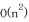。感兴趣的读者可能会思考，这个复杂度是否为最优复杂度。

## 12. 打印之形遍历（Zig-Zag traversal）


### 解决方案

之形遍历通过使用两个栈实现，并且在每一层之间进行交换。在访问`currentLevel`期间，所有子节点都被插入`nextLevel`栈中。需要考虑的是：维护一个布尔值来确定访问方向（从左到右或从右到左），并且该方向在每个循环中反转。当`currentLevel`栈为空时，将其与`nextLevel`交换。通过使用两个栈，之形遍历是层序遍历的一种变体。

### 代码

```cpp
template<typename  tVal>
void printZigZag(binaryTree<tVal> * root)
  {
  binaryTree<tVal> * tmp;
  bool left2right = true;
  if (!root)
    return;

      std::stack<binaryTree<tVal> *> currLevel;
      std::stack<binaryTree<tVal> *> nextLevel;
      currLevel.push(root);
  while (!currLevel.empty())
      {
        tmp = currLevel.top();
        currLevel.pop();
        if (tmp)
        {
        std::cout << " v=" << tmp->v__;
        if (left2right)
          {
            nextLevel.push(tmp->left);
            nextLevel.push(tmp->right);
          }
        else
          {
            nextLevel.push(tmp->right);
            nextLevel.push(tmp->left);
          }
        }
      if (currLevel.empty())
        {
        left2right = !left2right;
        currLevel.swap(nextLevel);
      }
```

### 复杂度

时间复杂度为 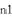，空间复杂度为 。

## 13. 打印两个节点的公共祖先（LCA）

### 解决方案

两个节点的公共祖先可以通过根节点，也可能仅位于某个子树中。因此我们有以下递归情况：

- 基础情况是根为`NULL`，我们返回`NULL`。

- 然后我们递归计算左子树和右子树的公共祖先。

- 接着计算左子树、右子树以及以当前节点为根的子树的公共祖先。如果这个值改进了目前观察到的总公共祖先，则更新总公共祖先。

- 从递归返回时，我们计算左右子树之间的公共祖先，并加上当前节点。

### 代码

```cpp
template<typename  tVal>
binaryTree<tVal> * LCA(binaryTree<tVal> * root,
  binaryTree<tVal> * n1, binaryTree<tVal> * n2)
  {
  if (!root)
    return NULL;
  if (root == n1 || root == n2)
    return root;
  binaryTree<tVal> * left =
      LCA(root->left, n1, n2);
  binaryTree<tVal> * right =
      LCA(root->right, n1, n2);
  if (left && right)
    return root;
  return (left ? left : right);
  }
```

### 复杂度

时间复杂度为 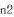，空间复杂度为 。

## 14. 在二叉搜索树中实现“查找”和“插入”

### 解决方案

二叉搜索树（BST）是一种每个节点最多有两个子节点的树。其左子树包含所有严格小于节点值的键，右子树包含所有大于节点值的键。

`Find()`通过检查[根节点](http://en.wikipedia.org/Tree_(data_structure)#root_nodes) 开始。如果树为空，键不在树中。如果键等于根节点，`find()`返回根节点。如果键小于根节点，搜索左子树。如果键大于根节点，搜索右子树。该方法可以递归或迭代地执行。

`Insert()`遵循类似的方法。在树内部搜索待插入的键。如果已找到，则返回。否则，如果搜索到达空节点，则将键插入该位置。该过程可以是递归的或迭代的。下面我们提供一个递归版本，并将迭代版本的任务留给感兴趣的读者自行实现。

### 代码

```cpp
template<typename  tVal>
template<typename  tVal>
struct binaryTree
  {
  tVal v__;
  struct binaryTree<tVal> * left;
  struct binaryTree<tVal> * right;
  binaryTree(tVal  v) : v__(v),
    left(NULL), right(NULL) {}
  };

template<typename  tVal>
binaryTree<tVal> * find(binaryTree<tVal> * const root,
  const tVal k)
  {
  if (!root)
    return NULL;
  return ((root->v__ < k) ? find(root->right, k) :
      (root->v__ > k ? find(root->left, k) : root));
  }

template<typename  tVal>
void insert(binaryTree<tVal> * & root, const tVal k)
  {
  if (!root)
    {
    root = new binaryTree<tVal>(k);
    return;
    }
  if (root->v__ < k)
    insert(root->right, k);
  else if (root->v__ > k)
    insert(root->left, k);
  }
```

### 复杂度

“插入”和“查找”的平均时间复杂度为 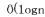，其中  表示树中的节点数。然而，如果树不平衡，复杂度为 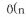)

## 15. 按序打印二叉搜索树

### 解决方案

BST 是一种二叉搜索树，因此中序遍历从左子树开始，然后是当前节点，最后是右子树。

### 代码

```cpp
template<typename tVal>
void printInorder(binaryTree<tVal> * const node) {
    if (!node)
        return;
    printInorder(node->left);
    std::cout << " n=" << node->v__;
    printInorder(node->right);
}
```

### 复杂度

时间复杂度为),其中  是树中节点的数量。

## 16 在 BST 中实现 findMin 和 findMax

### 解决方案

最小键位于最左侧的子节点，而最大键位于最右侧的节点。

### 代码

```cpp
template<typename tVal>
binaryTree<tVal> * findMin(binaryTree<tVal> * root) {
    if (!root)
        return NULL;
    while (root->left) { root = root->left; }
    return root;
}

template<typename tVal>
binaryTree<tVal> * findMax(binaryTree<tVal> * root) {
    if (!root)
        return NULL;
    while (root->right) { root = root->right; }
    return root;
}
```

### 复杂度

平均时间复杂度为)，其中  是树中节点的数量。然而，如果树不是平衡的，复杂度为)。

## 17 在 BST 中实现 deleteNode

### 解决方案

代码`deleteNode()`首先在树中查找要删除的键。如果没有该键，算法将返回。否则，有两种不同的情况：

- 如果节点是内部节点，`deleteNode()`会在以节点为根的左子树中找到最大键并找到它。该最大键将替换被搜索的键，从而将其移除。然后通过左子树删除该最大值。

- 如果节点是外部节点且只有一个孩子（在左侧或右侧），则该子节点替换父节点。在任何情况下，外部节点都会被释放。

以下代码实现了该算法：

### 代码

```cpp
template<typename tVal>
binaryTree<tVal> * deleteNode(binaryTree<tVal> * root, const tVal key) {
    binaryTree<tVal> * tmp;
    if (!root)
        return NULL;
    else if (key < root->v__)
        root->left = deleteNode(root->left, key);
    else if (key > root->v__)
        root->right = deleteNode(root->right, key);
    else {
        // 内部节点
        if (root->left && root->right) {
            tmp = findMax(root->left);
            root->v__ = tmp->v__;
            root->left = deleteNode(root->left, root->v__);
        }
        else {
            tmp = root;
            if (root->left == NULL)
                root = root->right;
            if (root->right == NULL)
                root = root->left;
            delete tmp;
        }
    }
    return root;
}
```

### 复杂度

平均时间复杂度为)，其中  是树中节点的数量。然而，如果树不是平衡的，复杂度为)。

## 18 在 BST 中实现最低公共祖先

### 解决方案

对于以根节点为根的树，两个节点 （键为  是键为 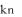的节点，满足 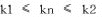或 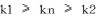。如果不满足这些条件，LCA 通过向左（如果  {
    if (!root || !n1 || !n2)
        return;
    while (true) {
        if (((n1->v__ < root->v__) && (root->v__ < n2->v__)) || ((n1->v__ > root->v__) && (root->v__ > n2->v__)))
            return root;
        else if n1->v__ < root->v__)
            root = root->left;
        else
            root = root->right;
    }
}
```

### 复杂度

最坏情况下的时间复杂度为)。

## 19 检查树是否为 BST

### 解决方案

可以通过递归计算解决方案，通过检查左子树、当前节点和右子树是否遵循 BST 排序。因此，这种方法很方便。

### 代码

```cpp
template<typename tVal>
bool isBST(binaryTree<tVal> * const root, tVal & prev) {
    if (!root)
        return true;
    if (root->left && !isBST(root->left, prev))
        return false;
    prev = root->v__;
    if (root->right && !isBST(root->right, prev))
        return false;
    return true;
}
```

### 复杂度

最坏情况的时间复杂度为)。

## 20 将双链表转换为 BST

### 解决方案

将双链表转换为 BST 可以轻松实现。节点的右孩子可以作为双链表的前向指针，左孩子作为后向指针。在开始时会发生特殊情况，即双链表的尾部指针如代码所示。

### 代码

```cpp
template<typename tVal>
struct dLL {
    tVal v__;
    struct dLL *prev;
    struct dLL *next;
    dLL(tVal v) : v__(v), prev(NULL), next(NULL) {}
};

template<typename tVal>
dLL<tVal> * findMiddleNode(dLL<tVal> *head);

template<typename tVal>
binaryTree<tVal> * doubleListToBST(dLL<tVal> * head) {
    dLL<tVal> *tmp, *p, *q;
    if (!head || !head->next)
        return NULL;
    tmp = findMiddleNode(head);
    p = head;
    while (p->next != tmp)
        p = p->next;
    p->next = NULL;
    q = tmp->next;
    tmp->next = NULL;
    tmp->v__ = doubleListToBST(head);
    tmp->next = doubleListToBST(q);
    return tmp;
}
```

### 复杂度

时间复杂度为)，其中  是列表中节点的数量。

## 21 将 BST 转换为双链表

### 解决方案

可以通过递归轻松将 BST 转换为双链表。节点的右孩子可以作为双链表的前向指针，左孩子作为后向指针。算法从开始开始，如代码详细定义。

### 代码

```cpp
template <typename tVal>
void bstToDoubleList(binaryTree<tVal> *root, binaryTree<tVal> ** head, binaryTree<tVal> ** tail) {
    if (!root)
        return;
    if (root->left)
        bstToDoubleList(root->left, head, tail);
    root->left = *tail;
    if (*tail)
        (*tail)->right = root;
    else
        *head = root;
    *tail = root;
    if (root->right)
        bstToDoubleList(root->right, head, tail);
}
```

### 复杂度

时间复杂度为)，其中  是树中节点的数量。

## 22 在 BST 中查找第 k 个元素

### 解决方案

可以通过保持计数器的引用来递归解决该问题，如下代码所示。

### 代码


### 复杂度

时间复杂度为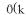，其中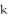是要查找键的位置。

## 23 打印 BST 中给定区间内的所有键

### 解决方案

给定两个键`![]images/00024.jpeg)`使得`![]images/00025.jpeg)`，对`BST`树进行导航。如果当前节点的键大于或等于`![]images/00023.jpeg)`，则递归地向左子节点导航。然后检查范围条件。如果满足，则打印当前节点。最后递归地向右子节点导航。

### 代码

```cpp
template<typename tVal>
binaryTree<tVal> * rangePrint(binaryTree<tVal> * const root, const tVal k, const tVal h) 
{
    if (!root)
        return NULL;
    if (root->v__ >= k)
        rangePrint(root->left, k, h);
    if (root->v__ >= k && root->v__ <= h)
        std::cout << " v=" << root->v__;
    if (root->v__ <= h)
        rangePrint(root->right, k, h);
}
```

### 复杂度

最坏时间复杂度为`![]images/00014.jpeg))`，其中`![]images/00013.jpeg)`是树中的节点数。

## 24 合并两个平衡二叉搜索树

### 解决方案

合并两个`BST`的最有效方法是将它们每一个都存储在数组中。然后合并这两个排序数组，并将生成的数组转换回一个新的`BST`。

### 代码

```cpp
template<typename tVal>
void storeInorder(binaryTree<tVal> * const root, std::vector<tVal> & inorder) 
{
    if (!root)
        return;
    storeInorder(root->left, inorder);
    inorder.push_back(root->v__);
    storeInorder(root->right, inorder);
}

template<typename tVal>
void dumpVector(const std::vector<tVal> &v1)
{
    std::cout << std::endl;
    std::vector<tVal>::const_iterator it = v1.begin();
    for (; it != v1.end(); it++)
        std::cout << *it << " ";
    std::cout << std::endl;
}

template<typename tVal>
void merge(const std::vector<tVal> & v1, const std::vector<tVal> & v2, std::vector<tVal> & merged)
{
    unsigned m = v1.size(), n = v2.size();
    if (merged.size() != n + m)
        return;
    unsigned i = 0, j = 0, k = 0;
    while (i < m && j < n)
    {
        if (v1[i] < v2[j])
            merged[k] = v1[i++];
        else
            merged[k] = v2[j++];
        k++;
    }
    while (i < m)
        merged[k++] = v1[i++];
    while (j < n)
        merged[k++] = v2[j++];
}

template<typename tVal>
binaryTree<tVal> * sortedArrayToBST(const std::vector<tVal> &v, int start, int end)
{
    if (start > end)
        return NULL;
    int mid = (start + end) / 2;
    binaryTree<tVal> *root = new binaryTree<tVal>(v[mid]);
    root->left = sortedArrayToBST(v, start, mid - 1);
    root->right = sortedArrayToBST(v, mid + 1, end);
    return root;
}

template<typename tVal>
binaryTree<tVal> * mergeTrees(binaryTree<tVal> * const root1, binaryTree<tVal> * const root2)
{
    std::vector<int> v1;
    storeInorder(root1, v1);
    std::vector<int> v2;
    storeInorder(root2, v2);
    std::vector<int> merged(v1.size() + v2.size());
    merge(v1, v2, merged);
    dumpVector(merged);
    return sortedArrayToBST(merged, 0, merged.size() - 1);
}

template<typename tVal>
void dump(binaryTree<tVal> * const root)
{
    if (!root)
        return;
    else
        std::cerr << " v==" << root->v__ << " ";
    if (root->left)
        std::cerr << " ->left ";
        dump(root->left);
    if (root->right)
        std::cerr << " ->right ";
        dump(root->right);
}
```

### 复杂度

该方法的复杂度为`![]images/00026.jpeg)`，其中`![]images/00013.jpeg)`和`![]images/00027.jpeg)`是两个`BST`中的节点数。

## 25 在平衡 BST 中寻找和为 0 的元组

### 解决方案

最优解决方案是将`BST`转换为双向链表。然后可以遍历列表，并对于每个负元素尝试在列表中寻找一个等于当前节点键的对。

### 代码

```cpp
template<typename tVal>
void stToDoubleList(binaryTree<tVal> *root, binaryTree<tVal> ** head, binaryTree<tVal> ** tail) 
{
    if (!root)
        return;
    if (root->left)
        stToDoubleList(root->left, head, tail);
    if (!*head)
        *head = root;
    else
        (*tail)->right = root;
    *tail = root;
    if (root->right)
        stToDoubleList(root->right, head, tail);
}

template<typename tVal>
bool isPresent(binaryTree<tVal> * head, binaryTree<tVal> * tail, int sum) 
{
    while (head != tail)
    {
        int curr = head->v__;
        if (curr == sum)
            return true;
        else if (curr > sum)
            tail = head;
        else
            head = head->right;
    }
    return false;
}

template<typename tVal>
bool isTriplet(binaryTree<tVal> *root)
{
    if (!root)
        return false;
    binaryTree<tVal>* head = NULL;
    binaryTree<tVal>* tail = NULL;
    stToDoubleList(root, &head, &tail);
    while (head != NULL && (head->v__ < 0))
    {
        if (isPresent(head->right, tail, -head->v__))
            return true;
        else
            head = head->right;
    }
    return false;
}
```

### 复杂度

该解决方案的时间复杂度为`O(n)`，空间复杂度为`O(n)`，其中`n`是树中的节点数。

## 26 实现 B 树

### 解决方案

`B树`允许在对数时间内进行插入，通常用于读写大量数据的系统，如数据库。在`B树`中，内部节点具有在范围`![]images/0028.jpeg)`内的子节点数量。键作为分离值，将树划分为子树，如下所示：

分支因子`2`保证了节点可以分裂或合并。如果内部节点有`![]images/00031.jpeg)`个键，可以通过将该`![]images/0032.jpeg)`键节点分裂为两个`![]images/0033.jpeg)`键节点并将键添加到父节点来完成。每个分裂节点都维持所需的键数。同样，如果每个内部节点及其邻居都有`![]images/0033.jpeg)`个键，则可以通过与邻居合并来从内部节点删除键。删除键将为内部节点留下`![]images/0034.jpeg)`个键，但合并邻居将增加`![]images/0035.jpeg)`个键，加上来自邻居父的一个键。总数仍为`![]images/0031.jpeg)`个键。节点的分支数比存储在节点中的键数多一。B树通过要求所有叶节点处于同一深度来保持平衡。

更正式地说，阶为`[]images/0036.jpeg)`的B树定义为满足以下属性的树：

1. 每个节点最多有`![]images/0037.jpeg)`个子。

2. 非叶节点（根节点外）至少有`![]images/0038.jpeg)`个子。

3. 如果根节点不是叶节点，则至少有两个子。

4. 具有`![]images/0023.jpeg)`个子的非叶节点包含`![]images/0039.jpeg)`个键。

5. 所有叶子节点出现在同一层。

6. 每个内部节点的键都作为分离值，将其子树划分。

### 搜索

此操作与搜索二叉搜索树的操作相似。从根节点开始，递归地从上向下遍历树，并在每一层选择在搜索值两侧都有分离键的子树。节点内的搜索可以是线性搜索或二分搜索。

### 插入

要插入新键，请遍历树找到应该添加新键的叶子节点：

* 如果节点包含的元素少于`images/00042.jpeg`，则有空间容纳新元素，可以按照顺序进行插入。

* 否则，如果节点已满，则必须将其分为两个节点：

    * 在叶子节点的元素和新元素之间选择中位数元素。

    * 小于中位数的放在新的左侧节点中，大于中位数的放在新的右侧节点中。

    * 中位数作为分隔值。

分隔键被插入到节点的父节点中，如果父节点也满了，则对其进行拆分。如果该节点是根节点，我们需要在旧根上方创建一个新根节点。

如果拆分一直持续到根节点，它将创建一个包含单个分隔键和两个子节点的新根。当一个节点被拆分时，一个键会进入父节点，但会额外增加一个键。

### 删除

思路是找到并删除该项，然后重构树以恢复其不变性。此操作留作练习题。

### 代码


```cpp
#ifndef BTREE_HEAD_
#define BTREE_HEAD_ 1
#include <iostream>

namespace Tree{
typedef int tKey;
class BtreeNode;
typedef BtreeNode * BtreeLink;
class BtreeNode {
private:
    unsigned t__; // 2t-1 keys, 2t children
    bool leaf__; // 是否为叶子
    unsigned n__; // 当前数量
    tKey * keys__; //键数组
    BtreeLink * children__; // 指子节点数组的指针

public:
    // 构造函数
    BtreeNode(unsigned t, bool leaf) :
        t__(t), leaf__(leaf), n__(0),
        keys__(new tKey[2 * t__ - 1]),
        children__(new BtreeLink[2 * t__])
    {};

    // 遍历
    void traverse(unsigned lev=0) {
        std::cout << "lev=" << lev << " ";
        // n keys, n+1 childrens
        unsigned i = 0;
        for (; i < n__; i++) {
            std::cout << " " << keys__[i];
            if (!leaf__)
                children__[i]->traverse(lev+1);
        }
        // 最后一个孩子
        if (!leaf__)
            children__[i]->traverse(lev + 1);
    }

    // 删除所有
    void deleteAll() {
        //n+1 children
        for (unsigned i = 0; i <= n__; i++) {
            if (!leaf__)
                children__[i]->deleteAll();
        }
        delete[] children__;
        delete[] keys__;
    };

    // 析构
    ~BtreeNode() {
        deleteAll();
    }

    // 在 B 树中搜索
    BtreeLink search(tKey k) {
        unsigned i = 0;
        // 查找右位置
        for (; i < n__ && k > keys__[i]; i++);
        // 找到键
        if (keys__[i] == k)
            return this;
        // 未找到
        if (leaf__)
            return NULL;
        // 递归
        return children__[i]->search(k);
    }

    // 在非满节点中插入
    void insertNonFull(tKey k) {
        // 最右键
        int i = n__ - 1;
        if (leaf__) {
            // 有一个位置可用
            // 所以复制键并
            // 找到正确位置
            while (i >= 0 && keys__[i] > k) {
                keys__[i + 1] = keys__[i];
                i--;
            }
            // 找到正确位置
            keys__[i + 1] = k;
            n__++;
        } else { // 非叶子
            // 找到正确位置
            while (i >= 0 && keys__[i] > k)
                i--;
            // 满了并递归插入
            if (children__[i + 1]->n__ == 2 * t__ - 1) {
                splitChild(i + 1, children__[i + 1]);
                if (keys__[i + 1] < k)
                    i++; // 下一个孩子
            }
            children__[i + 1]->insertNonFull(k);
        }
        std::cout << "traversing n==" << n__;
        traverse();
        std::cout << std::endl;
    }

    void splitChild(int i, BtreeLink l) {
        BtreeLink m = new BtreeNode(l->t__, l->leaf__);
        m->n__ = t__ - 1;
        // 从 t 到 2t-1 拷贝右侧键
        for (unsigned j = 0; j < t__ - 1; j++)
            m->keys__[j] = l->keys__[j + t__];
        // 从 t 到 2t 拷贝孩子
        if (!l->leaf__) {
            for (unsigned j = 0; j < t__; j++)
                m->children__[j] = l->children__[j + t__];
        }
        // 少一个键
        l->n__ = t__ - 1;
        // 留出空间
        for (int j = n__; j >= i+1; j--)
            children__[j + 1] = children__[j];
        // 连接新节点
        children__[i + 1] = m;
        // 留出空间
        for (int j = n__ - 1; j >= i; j--)
            keys__[j + 1] = keys__[j];
        // 拷贝中间的键
        keys__[i] = l->keys__[t__ - 1];
        n__++;
    }
    friend class Btree;
};

class Btree {
    BtreeNode * root;
    unsigned t__;
public:
    Btree(unsigned t) : root(NULL), t__(t) {};

    void traverse() {
        if(root) root->traverse();
    }

    BtreeLink search(tKey k) {
        return(root ? root->search(k) : NULL);
    }

    void insert(tKey k) {
        if (!root) {
            root = new BtreeNode(t__, true);
            root->keys__[0] = k;
            root->n__ = 1;
        } else {
            if (root->n__ == 2 * t__ - 1) {
                BtreeNode *s = new BtreeNode(t__, false);
                root = s;
                s->children_[0] = root;
                splitChild(0, root);
            }
            root->insertNonFull(k);
        }
    }
};
#endif
```

# 插入

要插入新键，请遍历树找到叶子节点，即新键应该添加的位置：

* 如果节点包含的元素少于 `images/00042.jpeg`，则有空间容纳新元素，可以按照顺序进行插入。

* 否则，如果节点已满，则必须将其分为两个节点：

    * 在叶子节点的元素和新元素之间选择中位数元素。

    * 小于中位数的放在新的左侧节点中，大于中位数的放在新的右侧节点中。

    * 中位数作为分隔值。

分隔键被插入到节点的父节点中，如果父节点也满了，则对其进行拆分。如果该节点是根节点，我们需要在旧根上方创建一个新根节点。

如果拆分一直持续根节点，它将创建一个包含单个分隔键和两个子节点的新根。当一个节点被拆分时，一个键会进入父节点，但会额外增加一个键。

# 删除

思路是找到并删除该项，然后重构树以恢复其不变性。此操作留作练习题。

### 代码


```cpp
#ifndef BTREE_HEAD_
#define BTREE_HEAD_ 1
#include <iostream>

namespace Tree{
typedef int tKey;
class BtreeNode;
typedef BtreeNode * BtreeLink;
class BtreeNode {
private:
    unsigned t__; // 2t-1 keys, 2t children
    bool leaf__; // 是否为叶子
    unsigned n__; // 当前数量
    tKey * keys__; //键数组
    BtreeLink * children__; // 指子节点数组的指针

public:
    // 构造函数
    BtreeNode(unsigned t, bool leaf) :
        t__(t), leaf__(leaf), n__(0),
        keys__(new tKey[2 * t__ - 1]),
        children__(new BtreeLink[2 * t__])
    {};

    // 遍历
    void traverse(unsigned lev=0) {
        std::cout << "lev=" << lev << " ";
        // n keys, n+1 childrens
        unsigned i = 0;
        for (; i < n__; i++) {
            std::cout << " " << keys__[i];
            if (!leaf__)
                children__[i]->traverse(lev+1);
        }
        // 最后一个孩子
        if (!leaf__)
            children__[i]->traverse(lev + 1);
    }

    // 删除所有
    void deleteAll() {
        //n+1 children
        for (unsigned i = 0; i <= n__; i++) {
            if (!leaf__)
                children__[i]->deleteAll();
        }
        delete[] children__;
        delete[] keys__;
    };

    // 析构
    ~BtreeNode() {
        deleteAll();
    }

    // 在 B 树中搜索
    BtreeLink search(tKey k) {
        unsigned i = 0;
        // 查找右位置
        for (; i < n__ && k > keys__[i]; i++);
        // 找到键
        if (keys__[i] == k)
            return this;
        // 未找到
        if (leaf__)
            return NULL;
        // 递归
        return children__[i]->search(k);
    }

    // 在非满节点中插入
    void insertNonFull(tKey k) {
        // 最右键
        int i = n__ - 1;
        if (leaf__) {
            // 有一个位置可用
            // 所以复制键并
            // 找到正确位置
            while (i >= 0 && keys__[i] > k) {
                keys__[i + 1] = keys__[i];
                i--;
            }
            // 找到正确位置
            keys__[i + 1] = k;
            n__++;
        } else { // 非叶子
            // 找到正确位置
            while (i >= 0 && keys__[i] > k)
                i--;
            // 满了并递归插入
            if (children__[i + 1]->n__ == 2 * t__ - 1) {
                splitChild(i + 1, children__[i + 1]);
                if (keys__[i + 1] < k)
                    i++; // 下一个孩子
            }
            children__[i + 1]->insertNonFull(k);
        }
        std::cout << "traversing n==" << n__;
        traverse();
        std::cout << std::endl;
    }

    void splitChild(int i, BtreeLink l) {
        BtreeLink m = new BtreeNode(l->t__, l->leaf__);
        m->n__ = t__ - 1;
        // 从 t 到 2t-1 拷贝右侧键
        for (unsigned j = 0; j < t__ - 1; j++)
            m->keys__[j] = l->keys__[j + t__];
        // 从 t 到 2t 拷贝孩子
        if (!l->leaf__) {
            for (unsigned j = 0; j < t__; j++)
                m->children__[j] = l->children__[j + t__];
        }
        // 少一个键
        l->n__ = t__ - 1;
        // 留出空间
        for (int j = n__; j >= i+1; j--)
            children__[j + 1] = children__[j];
        // 连接新节点
        children__[i + 1] = m;
        // 留出空间
        for (int j = n__ - 1; j >= i; j--)
            keys__[j + 1] = keys__[j];
        // 拷贝中间的键
        keys__[i] = l->keys__[t__ - 1];
        n__++;
    }
    friend class Btree;
};

class Btree {
    BtreeNode * root;
    unsigned t__;
public:
    Btree(unsigned t) : root(NULL), t__(t) {};

    void traverse() {
        if(root) root->traverse();
    }

    BtreeLink search(tKey k) {
        return(root ? root->search(k) : NULL);
    }

    void insert(tKey k) {
        if (!root) {
            root = new BtreeNode(t__, true);
            root->keys__[0] = k;
            root->n__ = 1;
        } else {
            if (root->n__ == 2 * t__ - 1) {
                BtreeNode *s = new BtreeNode(t__, false);
                root = s;
                s->children_[0] = root;
                splitChild(0, root);
            }
            root->insertNonFull(k);
        }
    }
};
#endif
```

## 跳表 (Skip List)

跳表是一种通过多层索引来通过快速查找、插入和删除的数据结构。它在平均复杂度上可以与平衡二搜索树相比，但实现更为简单。

### 结构

跳表由多个层有序链表组成：

- 底层是一个全排序的单向链表，包含了所有的元素。

- 每一层都是作为下层的索引，层越高，元素越稀疏。

### 算法

### 查找 (Search)

从顶层节点开始，向右移动。如果下一个节点的键大于目标值，则向下移动一层，直到找到目标值或到达底部且未找到该键。

### 插入 (Insert)

首先使用查找算法找到元素应该所在的位置。然后，对于每一层，根据给定的概率 `$p$`（通常为 `$0.5$`）决定是否在该层创建一个新节点并将其插入。

### 删除 (Delete)

首先查找该元素。如果存在，在所有包含该元素的层中将其删除，并更新相关节点的指针。

### 代码

```cpp
#ifndef SKIP_HEAD_
#define SKIP_HEAD_
#include <iostream>
#include <cstdlib>
#define DEBUG2 1
namespace Tree{
typedef int num;
template <typename Tkey, typename Tval>
class Skiplist{
private:
    struct node {
        Tkey key_; // 键
        Tval val_; // 值
        num size_; // 数组大小
        node **next_; // 指针数组
        node(const Tkey key, const Tval val, num size) :
            key_(key), val_(val), size_(size), next_(new node*[size_]) {
            for (num i = 0; i < size_; ++i) next_[i] = 0;
        }
    };
    typedef node* const link;
    Tkey default_key_; // 跳表的默认键
    Tval default_val_; // 跳表的默认值
    link head_; // 跳表头
    num lgN_; // 当前连接层数
    num lgNmax_; // 最大连接层数
    // 随机跳表扩展
    num rand_sl_gen__() {
        num i, j, t = rand(); // t 在 [0, RAND_MAX]
        // 生成 j=2, 4, ... i < lgNmax_
        // t > RAND_MAX / 2^i
        for (i = 1, j = 2; i < lgNmax_; i++, j += j)
            if (t > RAND_MAX / j) break;
        // t 是一个小于 1/2^i 的数字
        if (i > lgN_) // 扩展当前层
            lgN_ = i; // 这呈对数增长
        return i;
    }
    // 删除一个键和值
    void remove__(link t, Tkey key, num k) {
#ifdef DEBUG2
std::cerr << "remove__ " << t << " key="
```


以下是重新排版后的内容：

```cpp
<< key << " level=" << k << std::endl;

#endif

if (t == 0) return; // 空指针？

link x = t->next_[k]; // 下一个节点

if ((x != 0) && // 非空
(x->key_ >= key)) // 大于
{
    if (key == x->key_) { // 找到了
        t->next_[k] = x->next_[k]; // 移除
#ifdef DEBUG2
        std::cerr << " done" << std::endl;
#endif
    }
    if (k == 0) // 可以删除
    { // 该层级没有更多链接
        delete x;
        return;
    }
    // 尝试移除下面一层
    remove__(t, key, k - 1);
    return;
}
// x->key_ < key
// 尝试在同一层级移除
remove__(t->next_[k], key, k);
}

// 移除所有键
void remove_all__(link t, num k)
{
#ifdef DEBUG
    std::cerr << "remove__ " << t << " level=" << k << std::endl;
#endif
if (t == 0) return;
link x = t->next_[k];
if (x != 0)
{
    t->next_[k] = x->next_[k]; // 移除
    // 可以删除
    if (k == 0)
    { // 该层级没有更多链接
        delete x;
        return;
    }
    // 尝试移除下面一层
    remove_all__(t, k - 1);
}
// x->key_ >= key
// 尝试在同一层级移除
remove_all__(t->next_[k], k);
}

// 给定链接和当前层级搜索一个键
Tval search__(link t, const Tkey key, num k) const
{
#ifdef DEBUG
    std::cerr << "search__ " << t << " key=" << key << " level=" << k << std::endl;
#endif
if (t == 0) // 搜索失败
    return default_val_;
#ifdef DEBUG
    std::cerr << "key =" << key << " val = " << t->val_ << std::endl;
#endif
if (key == t->key_) // 搜索成功
    return t->val_;
link x = t->next_[k]; // 指向下一层的链接
if ((x == 0) || // 空指针？
(key < x->key_)) // 搜索键小于下一层链接的键
{
    if (k == 0) // 没有更多可用的层级
        return default_val_;
    // 尝试上一层
    return search__(t, key, k - 1);
}
// key > x->key_
// 在同一层级继续搜索
return search__(x, key, k);
}

// 在层级 k 插入由链接 x 指向的新节点
void insert__(link t, link x, num k)
{
#ifdef DEBUG
    std::cerr << "insert__ " << t << " " << x << " level=" << k << " key=" << x->key_ << " value=" << x->val_ << std::endl;
#endif
Tkey key = x->key_; // 当前键
link tk = t->next_[k]; // 指向下一层级的当前链接
if ((tk == 0) || // 空指针？
(key < tk->key_)) // 搜索键小于下一层链接的键
{
    if (k < x->size_) // 当前层级允许该节点存在吗？
    { // 插入：
        x->next_[k] = tk; // 新节点的后继是 tk
        t->next_[k] = x; // t 的后继是 x
#ifdef DEBUG
        std::cerr << "\td inserted key=" << key << " value=" << x->val_ << std::endl;
#endif
    }
    if (k == 0) // 层级 0
        return; // 返回
    // k >= x->size__
    // 向下一层插入
    insert__(t, x, k - 1);
    return;
}
// k > tk->key_
insert__(tk, x, k); // 留在同一层级
}

public:
    Skiplist(num lgNmax = 5) :
        head_(node(default_key_, default_val_, lgNmax + 1)), lgN_(0), lgNmax_(lgNmax) {}
    ~Skiplist() { remove_all_(head_, lgN_); }
    // 搜索一个键并获取值
    // 从 head_ 开始，当前层级达到 lgN
    inline Tval search(const Tkey key) const
    {
        return search_(head_, lgN_);
    }
    // 插入一个键和一个值
    // 从 head_ 开始，新节点根据 j=rand_sl_gen() 以概率 1/t^j 建立链接，当前层级为 lgN
    inline void insert(const Tkey key, const Tval val)
    {
        insert_(head_, node(key, val, rand_sl_gen()), lgN_);
    }
    inline void remove(Tkey key)
    {
        remove_(head_, lgN_ - 1);
    }
}; // 结束 Skiplist
}; // 结束 Tree
#endif

## 复杂度

下表提供了平均情况和最坏情况下的空间复杂度，报告了搜索、插入和删除的空间与时间复杂度。

| 操作 | 平均情况 | 最坏情况 |
| :--- | :--- | :--- |
| 搜索 | `$O(\log n)$` | `$O(n)$` |
| 插入 | `$O(\log n)$` | `$O(n)$` |
| 删除 | `$O(\log n)$` | `$O(n)$` |

```cpp
{  return  s + (e - s) / 2; }

int getSumUtil(const int segmentTree[], int segmentStart, int segmentEnd,

 int queryStart, int queryEnd, int index)

{

  // 包含在范围内

  if (queryStart <= segmentStart && segmentEnd <= queryEnd)

    return segmentTree[index];

  // 如果区间外部

  if (segmentEnd < queryStart || segmentStart > queryEnd)

    return 0;

  // 如果此段的一部分与给定范围重叠

  unsigned mid = getMid(segmentStart, segmentEnd);

  // 获取中间点并在线段树中向左右递归

  return getSumUtil(segmentTree, segmentStart, mid,

    queryStart, queryEnd, 2 * index + 1) +

         getSumUtil(segmentTree, mid + 1, segmentEnd,

    queryStart, queryEnd, 2 * index + 2);

}

void updateValueUtil(int segmentTree[], int segmentStart, int segmentEnd,

 int whereToUpdate, int valueToAdd, int index)

{

  // 不是正确的区间

  if (whereToUpdate < segmentStart ||

    whereToUpdate > segmentEnd)

    return;

  // 更新

  segmentTree[index] += valueToAdd;

  if (segmentEnd != segmentStart)

  {

    // 递归获取中间点并向左或向右

    int mid = getMid(segmentStart, segmentEnd);

    updateValueUtil(segmentTree, segmentStart, mid,

      whereToUpdate, valueToAdd, 2 * index + 1);

    updateValueUtil(segmentTree, mid + 1, segmentEnd,

      whereToUpdate, valueToAdd, 2 * index + 2);

  }

}

void updateValue(int array[], int segmentTree[], int n,

 int whereToAdd, int newValue)

{

  if (whereToAdd < 0 || whereToAdd > n - 1)

    return;

  int diff = newValue - array[whereToAdd];

  array[whereToAdd] = newValue;

  updateValueUtil(segmentTree, 0, n - 1,

    whereToAdd, diff, 0);

}

int getSum(int segmentTree[], int n,

 int queryStart, int queryEnd)

{

  // 检查错误的输入值

  if (queryStart < 0 || queryEnd > n - 1 ||

    queryStart > queryEnd)

    return -1;

  return getSumUtil(segmentTree, 0, n - 1,

    queryStart, queryEnd, 0);

}

int constructSTUtil(const int array[], int segmentTree[],

 int segmentStart, int segmentEnd, int segmentIndex)

{

  if (segmentStart == segmentEnd)

  {

    segmentTree[segmentIndex] = array[segmentStart];

    return array[segmentStart];

  }

  int mid = getMid(segmentStart, segmentEnd);

  segmentTree[segmentIndex] =

      constructSTUtil(array, segmentTree,

        segmentStart, mid, segmentIndex * 2 + 1) +

         constructSTUtil(array, segmentTree,

        mid + 1, segmentEnd, segmentIndex * 2 + 2);

  return segmentTree[segmentIndex];

}

int *constructSegmentTree(int array[], int n)

{

  int x = (int)(ceil(log2(n))); // 线段树的高度

  int max_size = 2 * (int)pow(2, x) - 1; // 线段树的最大大小

  int *segmentTree = new int[max_size];

  constructSTUtil(array, segmentTree, 0, n - 1, 0);

  return segmentTree;

}
```

## 复杂度

更新和区间求和操作的时间复杂度均为 ``。

## 30 实现区间最小值查询

### 解决方案

给定一个 ``，线段树允许在范围 `` 内找到最小值，其中 ``，其查询时间复杂度为 ``。在这种情况下，线段树具有以下属性：

- 叶子节点是 `` 的元素
- 每个内部节点代表该节点下所有叶子节点的最小值

线段树通常用数组表示，对于每个节点 ``，左子位于位置 ``，右子位于位置 ``。

### 代码

留作练习

### 复杂度

最小值的计算通过 `` 时间完成。

