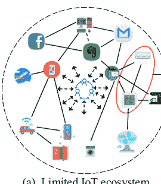
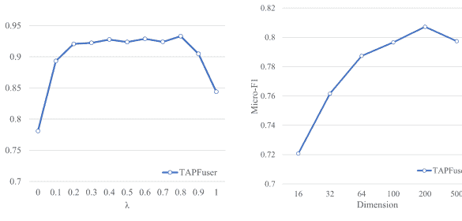
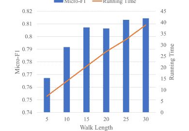
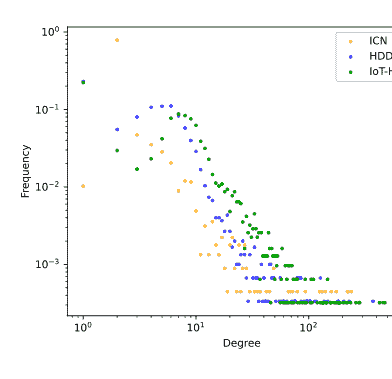

# 基于异构信息网络嵌入的 IoT 触发-动作编程数据融合框架


## 一、基于异构信息网络嵌入的物联网触发-动作编程数据融合框架

Gang Wu, Liang Hu, Xuel Mao, Yongheng Xing, Feng Wang *

吉林大学计算机与工程学院，网络技术与应用软件研究中心，教育部，长春 130012, 德国

### 文章信息

### 摘要

物联网（IoT）中的触发-动作编程（TAP）允许用户通过创建“触发-动作”配方（称为异常处理）来轻松地定制连接实体（如智能设备）的行为。例如：“日落时打开灯光”。潜在的触发动作可能会呈指数级增长，这使得人们对基于用户自然语言而非依赖手动创建的自动化产生了极大兴趣。在本文中，我们提出了 TAP 作为一种物联网数据融合框架，用于编码自然语言和配方，利用异构信息网络（HIN）嵌入映射人类需求和配方。最后，我们将 TAP 分为机器级和人类级，并采用 NLP 技术学习节点的向量表示，这对于推荐非常有益。为了增强 TAP 的自适应能力，我们提出了一种特定的指标引导的随机游走方法，将人类生成的自然语言与机器生成的配方之间的语义级映射捕捉为一个多分类问题，其中每个节点代表一种自然语言，标签对应配方中包含的实体。我们使用 IFFT 进行了多分类实验，并证明了我们框架的有效性。

- **关键词：**
  - 物联网
  - 触发-动作编程
  - 异构信息网络嵌入
  - 物物智能

## 1. 引言

连接技术（如物联网和 IPv6）的出现促进了物联网的发展。它导致人们考虑到日益增的连接设备。预计到 2025 年，物联网设备的数量将达到 760 亿.¹¹ 如今，连接实体、智能设备或在线服务无处不在，并在日常生活中与其他以及与我们进行交互。

触发-动作编程（TAP）（Mi, Qian, Zhang, & Wang）作为一种日益流行的物联网（IoT）范式，允许用户以“如果某些，则执行动作”的形式创建 TAP 规则（配方），为异构物联网生态系统（如智能设备或在线服务）提供方便的服务。

图 1 说明了不同实体提供的连接潜力，这有助于了在当前场景中提供多样化的服务。

图 1 的 (b) 部分，功能 (i) 和 (ii) 结合创建一个在温度较高时冷却房间的交互；而功能 (iii) 和 (iv) 在高湿度环境下对空间除湿可以自由使用，并选择特定的功能组合来满足个人需求。

然而，随着实体及其功能的数量增加，触发动作和配方的潜力呈指数级增长。以智能家居中的为例（Mi et al., 2017），当智能设备除湿机的使用扩展到当前场景时，该场景包含 14 个配方和 10 个动作，导致至少有 140 种可能的配方（Yu, Hua, & Julien, 2021）。随着物联网生态系统的扩展，对于用户来说创建和管理配方变得既耗时又具有挑战性。

针对这个问题，研究人员对基于用户自然语言的自动生成配方表现出兴趣，而不是依赖手动创建（Corno et al., 2021; Yao, Li, Gao, et al.

> * 通信：中国长春市市2669号。电子邮件：`wgang17@mails.jlu.edu.cn` (G. Wu), `hol@jlu.edu.cn` (L. Hu), `maoxiao18@mails.jlu.edu.cn` (X. Mao), `wangfeng12@mails.jlu.edu.cn`, `feng.yangh18@mails.jlu.edu.cn` (Y. Xing).

## 如果

## 然后

- i. 高温度
- ii. 低温度
- iii. 高湿度
- ①. 调温度
- ②. 除湿
- ③. 调温度

- 已选择
- 可能



**图 1.** 设备的发展与水平：(a) 有限物联网生态系统内部的连接，(b) 智能面板和空调的连接。功能和交互链接之间有 3 x 3 = 9 种可能的组合。

图 1 的 (b) 部分，功能 (i) 和 (ii) 结合创建一个在温度较高时冷却房间的交互；而功能 (iii) 和 (iv) 在高湿度环境下对空间除湿可以自由使用，并选择特定的功能组合来满足个人需求。

然而，随着实体及其功能的数量增加，触发动作和配方的潜力呈指数级增长。以智能家居中的为例（Mi et al., 2017），当智能设备除湿机的使用扩展到当前场景时，该场景包含 14 个配方和 10 个动作，导致至少有 140 种可能的配方（Yu, Hua, & Julien, 2021）。随着物联网生态系统的扩展，对于用户来说创建和管理配方变得既耗时又具有挑战性。

针对这个问题，研究人员对基于用户自然语言的自动生成配方表现出兴趣，而不是依赖手动创建（Corno et al., 2021; Yao, Li, Gao, et al.

为了增强 TAP 的自适应能力，我们提出了一种特定的指标引导的随机游走方法，将人类生成的自然语言与机器生成的配方之间的语义级映射捕捉为一个多分类问题，其中每个节点代表一种自然语言，标签对应配方中包含的实体。我们使用 IFFT 进行了多分类实验，并证明了我们框架的有效性。

### 表 1
两个配方的参数。

| 组件 | 触发器 | 动作 | 描述 |
|---|---|---|---|
| 图 2(a) 中的配方 | `Channel.function` | `Channel.function` | 交付机器人.delivery | 如果咖啡准备好了就送给我 |
| 图 2(b) 中的配方 | 智能电表.function | 空调.turn indoor temperature | 如果房间温度高于 30°C 则调节温度 | |

## 2.2. IFTTT 中的 TAP

TAP 因其用户易用性和自动化特性而变得流行。一些接口和现成平台（如 IFTTT 和 Zapier）已用于 TAP 领域（Corno, Enmerico, Raffello, 2013）。随着物联网等新兴技术的发展，TAP 的兴起引起了全球的关注（Ur, McManus, Pak Yong Ho & Littman, 2014; Ur et al., 2016; Yu et al., 2021）。

上下文感知模型将实体上下文视为规则，并利用 RDF 信息标识符和 OWL 类关系根据此类规则构建知识图。随后，提出了一种名为 Recle 的推荐系统，基于该知识图上的语义推理过程向用户推荐配方。通过传统方法，他们认为 TAP 可以考虑用户的意图、偏好和上下文来推荐配方（Corno, 2021; Hu, Xu, and Wang (2019））专注于人类层面的意图如何连接到 IFTTT 中的动作，以表示这些上下文感知数据之间不同的语义关系。网络引擎用于学习交互的潜在表示。最近的研究（Kim, Salt, and Lee, 2020; Wu, Yu, and Wang, 2021）侧重于从机器层面的上下文学习意图和动作的表示。

然而，上述方法要么是从人类层面研究描述，要么是从机器层面研究交互上下文，没有区分人机层面的差异，导致对物联网数据的利用效率低下。TAP 通过图建模提供了来自来自人类和机器两个层面的信息，然后通过 HIND 绑定融合配方的表示。

配方的结构和组件如表 1 所示。框架中的动作通道和条件函数构成了“如果触发，则执行动作”，其中触发事件是被条件化和约束的，而动作是可执行的操作。通道被称为动作，是一种方法或服务提供者。例如，该配方有一个触发通道咖啡和一个动作通道交付机器人，提供咖啡和交付服务。存在多种不同的通道，包括连接设备、Web 应用程序和其他服务提供者，它们作为触发器和动作提供各种功能。这些通道还可以绑定到用户账户。例如，配方可以绑定到社交网络，电器可以绑定到家庭。

同时，IFTTT 允许用户共享配方，这意味着用户可以偏好并使用他人根据个人需求创建的配方。此外，用户可以使用自然语言描述配方来表达他们的意图。

## 3. 准备知识

在本节中，我们首先介绍 TAP 的核心概念。然后，我们给出 TAP 数据框架的定义。

### 3.1. 用于 TAP 的 tap

TAP 是一种为 Web应用程序和物联网设备提供自动执行服务的触发规则，能够以事件驱动的形式实现连接实体的自动化。TAP 不需要在编程语言中编写代码，让可能没有编程能力的用户能够为日常生活创建配方。已有许多平台和数百万个个人配方被创建。在本文，我们关注来自 IFTTT 的数据及其描述。

### 3.2. 相关定义

本节介绍了我们提出的框架中相关组件的定义。

**定义 1 (机器层面 TAP)。** 机器层面标记为 `$L_m$`，定义为 `$L_m = \{Ent_m, Fnc_m\}$`；

- `$Ent = \{Ent_1, Ent_2, ..., Ent_n\}$` 是实体集合，包括物联网设备和服务。
- `$Fnc = \{Fnc_1, Fnc_2, ..., Fnc_n\}$` 是由 Ent 操作的功能集合。
- `$Lin = \{Lin_1, Lin_2, ..., Lin_n\}$` 是由 Fnc 和 Fnc 组合生成的链接集。

### A. IoT-HIN 构建

### B. HIN 嵌入

**图 3.** 所提框架的概述，IoT-HIN 构建。B. HIN 嵌入。(a) 利用图将来自人类和机器层面的信息建模为网络。(b) 通过或（或）组合整合两个建模后的网络。(c) 从 IoT-HIN 中的每个节点进行随机游走以捕获其内容。(d)-(e)。 跳跃图：引入跳跃图模型将随机游走路径中的异构上下文包含进来，然后在 IoT-HIN 中学习每个节点的表示。

**定义 2 (TAP 中的人类层面)**

人类层面表示为属性信息集 `$H = \{h_1, h_2, \dots, h_n\}$`，其中 `$h_i$` 是用户生成的自然语言需求。

来自人类和机器层面的数据具有海量和异构的特点。TAP 处理多种类型的异构性（例如空调、机器人、咖啡机）和链接（例如，合并或编辑）。连接这些需求和链接的是关于物联网的 HIN。

**定义 3 (信息异构性)**

IoT-HIN 定义为有向图 `$G = (V, E)$`，其中每个节点和边与其映射函数 `$\phi: V \rightarrow V_T$` 和 `$\psi: E \rightarrow E_T$` 相关，其中 `$|V_T| = |V|$` 和 `$|E_T|$` 分别表示节点和边的集合。

在 IoT-HIN 中，存在多种节点和边，涵盖了两个节点之间的简单和多关系。本文中，我们采用隐喻（metaphor）的概念来建模节点之间的关系，其定义为

**定义 4 (IoT-HIN 中的隐喻)**

隐喻 `$P$` 定义为项序列 `$T = (t_1, t_2, \dots, t_n)$`，其中 `$t_i \in V_T \cup E_T$`，表示两个节点 `$v_i, v_j \in V_T$` 之间的复合链接类型，且 `$n$` 为定义的路径长度。

并从描述中提取重要组件，以降低自然语言中的高语义复杂性。`page-speech-fetcher` 是一个从触发器、动作和配方的描述中提取有意义的单词、动词、名词和名词短语的工具。这些配方提取了需求描述的语义信息并将其可视化为包含人类元素的模型。这是通过使用构建的推理来创建人类需求描述（HDDD）来实现的。HDDD 记为 `$G^H = (V^H, E^H)$`，图 7 显示了 HDDD 的实例。

**图 4.** 数据描述发生在两个 ITFF 用户处。当互联设备需要 ITFF 平台并以“如果……那么……动作”的形式指定顺序时，它们会根据自己的节点编辑其配方的描述。

### 4.2.3. 构建 HDIN

本文构建了两个网络：ICD 和 HDIN，它们通过机器和人类层面的交互上下文和需求描述进行建模。如所述，每个触发器、动作和配方都有其对应的描述。这两个网络继承了这一特性，这在我们方法中是独特的。我们删除了 HDIN 中具有描述的节点 `$R_i$`、`$T_i$` 和 `$A_i$`，并让 ICD 中对应的节点 C、T 和 A 通过类型为 Has 的边连接这些节点。这与图像中的边相匹配。整合后，需求描述和交互上下文被表示为 IoT-HDIN。

### 4.3. IoT-HDIN 中的 H 绑定

**图 5.** IoT-HDIN 的插图。虚线边表示过程需求描述与实体上下文的整合。

受元宇宙（Wang 等人，2017）的启发，我们可以将信息嵌入到 IoT-HDIN 中，该模型可以将节点编码为低维向量表示。一个 IoT-HDIN 具有 `$f : V \rightarrow \mathbb{R}^d$`，其中 `$\mathbb{R}^d$` 代表节点的维度。

在 IoT-HDIN 中，节点之间存在存在关系，需要一种方法来有效表示这些元素。使用 PathSim（Sun, Han, Yan, Yu, Wu, 2021），利用元路径（metapath）来表示不同类型节点之间的关系。例如，`$If$` 节点可以通过多路径表示。元路径是两个具有相同触发器和动作的配方与两个板层之间的复合关系。此外，节点对之间存在多种关系，例如 `$If$`、`$T$` 和 `$A$`。在这种情况下，我们使用元路径（Zhang 等人，2018）来表示具有多重关系的 IoT-HDIN 结构。

为了实现这一目标，我们将触发器、动作、通道和描述提取为 IAP 交互上下文和需求描述的对象。然后，提取连接实体与需求描述之间的交互关系以构建 HDIN。它可以在第 3 节中定义。如图 5 所示的 ITFF 数据集包含触发器（T）、配方（R）、动作（A）、通道（C）和单词（W），它们被编辑为 If-(then)、R-(A)、T-(C, A-R, W-A) 关系类型。

#### 4.2.1. 来自人类层面的模型上下文

对于交互上下文，构建了交互上下文网络（ICD），如图 6 所示。触发器和动作被提取并标记为不同类型的节点，需求层和人类层显示在网络中。通道提供了这些上下文（If, then）以及亲和关系（Belong），也被视为节点。最后，通过这些上下文将亲和性链接起来。ICD 定义为 `$G^C = (V^C, E^C)$`。

#### 4.2.2. 元路径引导的随机游走

为了在 IoT-HDIN 中生成有意义的节点，设计有效的随机游走以完成采样过程。一种方法使用元路径约束的随机游走，它与适当的关系相结合（例如 Zhang 等人 2017 提出的随机游走）。对于 IoT-HDIN 中更复杂的结构和更高的相似性，我们提出了元路径引导的随机游走以提取结构化信息。

需求描述在自然语言文本中表现出随机性和动态特征。为了从这些文本中有效提取用户的需求，本文采用了自然语言处理（NLP）技术。这些技术旨在识别传统的随机游走方法在 IoT-HDIN 中的失效，其中节点类型可能不同。因此，元路径引导的随机游走方法无法捕捉信息-HDIN 的完整结构。

为了解决这个问题，我们提出了 SWR，一种元路径引导的随机游走，用于捕捉 IoT-HIN 的层感知异构性。对于 IoT-HIN `$G = (V, E, \mathcal{T})$` 和元路径 `$M$`，第 `$i$` 步的转移概率 `$p(v'|v, M)$` 定义如下：

```math
$$p(v'|v) = \begin{cases} \frac{\lambda}{[E(v)]} & (v, v') \in E, \phi(v) = \phi(v') \\ \frac{1-\lambda}{[E(v)]} & (v, v') \in E, \phi(v) \neq \phi(v') \\ 0 & \text{否则} \end{cases}$$
```

其中 `$\phi$` 是节点类型映射函数，`$E(v)$` 是 `$v$` 的邻域，`$\lambda$` 是调整 ICD 和 HDDN 层级之间游走概率的超参数。

与之前的方法 [Zhang 等人，2018]（该方法考虑了 IoT 不同层级之间游走的概率）相比，SWR 使用了在 IoT 不同层级之间游走的概率。

为了实现这一目标，我们将触发器、动作、通道和描述提取为 IAP 交互上下文和需求描述的对象。然后，连接实体与需求描述之间的交互关系被提取以构建一个 HDIN。它可以在第 3 节中定义。如图 5 所示的 ITFF 数据集包含触发器（T）、配方（R）、动作（A）、通道（C）和单词（W），它们被编辑为 If-(then)、R-(A)、T-(C, A-R, W-A) 关系类型。

#### 4.2.1. 来自人类层面的模型上下文

对于交互上下文，构建了交互上下文网络（ICD），如图 6 所示。触发器和动作被提取并标记为不同类型的节点，需求层和人类层显示在网络中。通道提供了这些上下文（If, then）以及亲和关系（Belong），也被视为节点。最后，通过这些上下文将亲和性链接起来。ICD 定义为 `$G^C = (V^C, E^C)$`。

#### 4.2.2. 元路径引导的随机游走

为了在 IoT-HDIN 中生成有意义的节点，设计有效的随机游走以完成采样过程。一种方法使用元路径约束的随机游走，它与适当的关系相结合（例如 Zhang 等人 2017 提出的随机游走）。对于 IoT-HDIN 中更复杂的结构和更高的相似性，我们提出了元路径引导的随机游走以提取结构化信息。

需求描述在自然语言文本中表现出随机性和动态特征。为了从这些文本中有效提取用户的需求，本文采用了自然语言处理（NLP）技术。这些技术旨在识别传统的随机游走方法在 IoT-HDIN 中的失效，其中节点类型可能不同。因此，元路径引导的随机游走方法无法捕捉信息-HDIN 的完整结构。

为了解决这个问题，我们提出了 SWR，一种元路径引导的随机游走，用于捕捉 IoT-HIN 的层感知异构性。对于 IoT-HIN `$G = (V, E, \mathcal{T})$` 和元路径 `$M$`，第 `$i$` 步的转移概率 `$p(v'|v, M)$` 定义如下：

```math
$$p(v'|v) = \begin{cases} \frac{\lambda}{[E(v)]} & (v, v') \in E, \phi(v) = \phi(v') \\ \frac{1-\lambda}{[E(v)]} & (v, v') \in E, \phi(v) \neq \phi(v') \\ 0 & \text{否则} \end{cases}$$
```

其中 `$\phi$` 是节点类型映射函数，`$E(v)$` 是 `$v$` 的邻域，`$\lambda$` 是调整 ICD 和 HDDN 层级之间游走概率的超参数。

与之前的方法 [Zhang 等人，2018]（该方法考虑了 IoT 不同层级之间游走的概率）相比，SWR 使用了在 IoT 不同层级之间游走的概率。


为了实现这一目标，我们将触发器、动作、通道和描述提取为 IAP 交互上下文和需求描述的对象。然后，提取连接实体与需求描述之间的交互关系以构建一个 HDIN。它可以在第 3 节中定义。如图 5 所示的 ITFF 数据集包含触发器（T）、配方（R）、动作（A）、通道（C）和单词（W），它们被编辑为 If-(then)、R-(A)、T-(C, A-R, W-A) 关系类型。

## 4.2.1. 来自人类层面的模型上下文

对于交互上下文，构建了交互上下文网络（ICD），如图 6 所示。触发器和动作被提取并标记为不同类型的节点，需求层和人类层显示在网络中。通道提供了这些上下文（If, then）以及亲和关系（Belong），也被视为节点。最后，通过这些上下文将亲和性链接起来。ICD 定义为 `$G^C = (V^C, E^C)$`。

## 4.2.2. 元路径引导的随机游走

为了在 IoT-HDIN 中生成有意义的节点，设计有效的随机游走以完成采样过程。一种方法使用元路径约束的随机游走，它与适当的关系相结合（例如 Zhang 等人 2017 提出的随机游走）。对于 IoT-HDIN 中更复杂的结构和更高的相似性，我们设计了元路径引导的随机游走以提取结构化信息。

需求描述在自然语言文本中表现出随机性和动态特征。为了从这些文本中有效提取用户的需求，本文采用了自然语言处理（NLP）技术。这些技术旨在识别传统的随机游走方法在 IoT-HDIN 中的失效，其中节点类型可能不同。因此，元路径引导的随机游走方法无法捕捉信息-HDIN 的完整结构。

为了解决这个问题，我们提出了 SWR，一种元路径引导的随机游走，用于捕捉 IoT-HIN 的层感知异构性。对于 IoT-HIN `$G = (V, E, \mathcal{T})$` 和元路径 `$M$`，第 `$i$` 步的转移概率 `$p(v'|v, M)$` 定义如下：

```
$$p(v'|v) = \begin{cases} \frac{\lambda}{[E(v)]} & (v, v') \in E, \phi(v) = \phi(v') \\ \frac{1-\lambda}{[E(v)]} & (v, v') \in E, \phi(v) \neq \phi(v') \\ 0 & \text{否则} \end{cases}$$
```

其中 `$\phi$` 是节点类型映射函数，`$E(v)$` 是 `$v$` 的邻域，`$\lambda$` 是调整 ICD 和 HDDN 层级之间游走概率的超参数。

与之前的方法（Zhang 等人，2018）相比，SWR 使用了在 IoT 不同层级之间游走的概率。

(注：由于提供的原文中存在大量重复内容，译文已根据“不要重复输出原文”的原则进行了去重处理，仅保留了唯一逻辑部分的翻译。)

## 5.1.2. 方法

为了验证我们框架的有效性，我们选择了经典的 NLP 和嵌入算法作为比较方法。TF-IDF (Ramos et al., 2003) 是一种统计方法，可以通过词频评估一个词在句子中或对语料库中文章的重要性。我们可以将权重视为每个句子的嵌入。

sentenceBERT (Reimers & Gurevich, 2019) 可以为文本中的句子生成句子嵌入，并计算句子之间的语义相似性。我们应用它来为每个句子生成描述。

node2vec (Gou & Lesovec, 2016) 是一种异构方法的典型网络嵌入。我们设计了一种偏置随机游走，通过引入参数 `$p$` 和 `$q$` 最大化广度优先和深度优先搜索之间的重叠。该方法用于生成嵌入。通过将 `node2vec` 应用于异构图，我们得到了图表示。

metaph2vec (Dong et al., 2017) 是一种异构嵌入算法。它使用严格的字符串匹配方法来引导随机游走，并针对不同类型的内容使用特定方法。

metaph2vec (Zheng et al., 2017) 使用元引导的随机游走来生成异构节点序列。使用 skip-gram 学习节点嵌入。通过不同的 `metaph2vec`，该算法可以应用于多个下游任务。

FastGTNs (Jun et al., 2022) 是一种监督学习方法，结合了变换网络（transform）和图神经网络的优点（Jun, Kim, Kang & Kim），以从图中提取有意义的特征并学习更好的表示。

## 5.1.3. 评估

由于不平衡性，上述算法倾向于多数类，导致该类别的性能往往较差。然而，我们使用 Micro-F 和 Macro-F 指标分析了 TAPFuser 的性能，这些指标用于评估多分类分类结果。

支持每个标签的评分。当我们有一个类 `$s$` 时，`$TP(s)$` 表示我们认为正确预测的数量（TP），`$FP(s)$` 表示假阳性（FP）的数量，`$FN(s)$` 表示假阴性（FN）的数量。由于 FN 意味着召回率为负，实际为正。Micro-F1 通过计算每个权重等于实例的总 TP、FP 和 FN 来计算。Macro-F 是整个标签集上的 F1 值。详细来说，它们的定义如下：

```
$Precision(s) = \frac{TP(s)}{TP(s) + FP(s)}$
```

```
$Recall(s) = \frac{TP(s)}{TP(s) + FN(s)}$
```

```
$Micro-F(s) = \frac{2 \times Precision(s) \times Recall(s)}{Precision(s) + Recall(s)}$
```

```
$Macro-F(s) = \frac{\sum F(s)}{|S|}$
```

其中 `$|S|$` 是集合中标签的数量。

## 5.1.4. 设置

为了公平比较，所有方法的嵌入维度均被设置为 200。对于基于随机游走的方法，我们考虑每个节点游走长度为 15 的游走次数，邻域大小设置为 5，并留有 5 个负样本。对于 `node2vec`，我们将 `$p$` 和 `$q$` 设置为 1。对于 FastGTNs，我们使用了 (Yan et al., 2022) 中使用的参数。对于我们的框架 TAPFuser，我们使用了参数：

# 表 4

所使用的 `metaphs` 和 `metaphs`。

| 网络类型 | Metaph | Metaph |
|---|---|---|
| ICN | R(P), R(F) | R(T/A) R(M) |
| HDN | R R (P) | |
| IoT-IN | | R(T/A) R(M) |

作为基于随机游走的方法。我们使用 20% 的标记数据对 `$\lambda \in \{0.1, 0.2, 0.3, 0.4, 0.5, 0.6, 0.7, 0.8, 0.9, 1\}$` 进行搜索，并获得了超参数 `$\lambda=0.8$`。在这种情况下，我们使用与 TF-IDF 相同的方法来学习词 `metaph` 的名称，且基于 `metaph` 的方法必须指定定义和方法。(Sun et al., 2011; Zheng et al., 2018)，我们选择了一些我们使用的 `metaphs`，因为较长的 `metaph` 可能会引入噪声。我们在 `$P_i, P_j$` 中使用的 `metaphs` 和 `metaphs` 由方法方案定义，`node2vec` 和我们的 TAPFuser 用于不同的网络类型。详细插图如图 8 所示。

## 5.2 多分类

在本节中，实验中进行了多分类以比较不同算法的性能。使用 LINEARPACK 包 (Chan, Chang, Hu, Wang, & Lin, 2008) 通过一对一分类器对学习到的嵌入进行评估。在所使用的训练和测试集中，我们发现准确率范围在 10% 到 90% 之间。实验在不同的数据集上进行。

从表 5 中，有一些重要的发现如下：

- TAPFuser(M) 在 ICN 网络的 Micro-F1 和 Macro-F1 分数上优于其他方法。
- 对于 HDN 隐藏，根据标签的描述，TAPFuser(P) 在 Micro-F1 和 Macro-F1 分数上的节点标记方面优于其他方法，如 TF-IDF、`node2vec` 和 `metaph2vec`。
- TAPFuser(M) 在 IoT-IN 中表现良好，Macro-F1 分数比其他方法提高了 2% 和 13%。与 FastGTNs 的比较中，当训练数据为 10%-90% 时，TAPFuser(M) 性能优于 ICN 和 HDN 中的所有分类器，Macro-F1 平均提升了 8%。

## 5.3 复杂度分析

我们的框架有两个任务：(1) 生成随机序列和 (2) 对于图 `$G=(V,E)$` 中游走长度为 `$L$` 的随机游走，复杂度为 `$O(|V|L)$`，其中 `$|V|$` 是节点数，`$|E|$` 是边数。在训练阶段，训练嵌入的复杂度为 `$O(KL)$`，其中 `$K$` 是负样本的数量。总复杂度为 `$O(|V|L + KL)$`。由于 `$d, e, h$` 是小于 `$|V|$` 的常数，主要复杂度为 `$O(|V|L)$`，与节点数成线性关系。相比之下，TF-IDF 的复杂度为 `$O(nm)$`，其中 `$n$` 是文档数，`$m$` 是词数。

# 表 5

FT 数据集上的分类结果。

| 指标 | 方法 | 10% | 20% | 30% | 40% | 50% | 60% | 70% | 80% | 90% |
|---|---|---|---|---|---|---|---|---|---|---|
| Micro-F1 | `node2vec` | 0.6557 | 0.7199 | 0.7476 | 0.7562 | 0.7756 | 0.7871 | 0.80 | 0.8 | 0.888 |
| | `metaph2vec` | 0.6274 | 0.6937 | 0.7367 | 0.7513 | 0.7609 | 0.7793 | 0.8117 | 0.8313 | 0.8468 |
| | `node2vec` | 0.6331 | 0.6538 | 0.6833 | 0.6958 | 0.7065 | 0.7299 | 0.7407 | 0.75 | 0.7504 |
| Macro-F1 | `node2vec` | 0.6157 | 0.6732 | 0.6888 | 0.7007 | 0.7193 | 0.7395 | 0.7492 | 0.76 | 0.7712 |
| | `metaph2vec` | 0.5912 | 0.6447 | 0.6826 | 0.6991 | 0.7065 | 0.7229 | 0.7413 | 0.7554 | 0.7668 |
| | `node2vec` | 0.6001 | 0.6138 | 0.6338 | 0.6478 | 0.6562 | 0.6756 | 0.6893 | 0.7065 | 0.7112 |
| | TF-IDF | 0.5812 | 0.5988 | 0.6219 | 0.6339 | 0.6444 | 0.6605 | 0.6717 | 0.6872 | 0.6968 |
| | `metaph2vec` | 0.5734 | 0.6137 | 0.6513 | 0.6668 | 0.6784 | 0.6953 | 0.7095 | 0.7216 | 0.7314 |
| | FastGNN | 0.5959 | 0.6186 | 0.6447 | 0.6588 | 0.6623 | 0.6848 | 0.6992 | 0.7073 | 0.7132 |
| | TAPFuser | 0.6402 | 0.6912 | 0.7138 | 0.7267 | 0.7413 | 0.7582 | 0.7785 | 0.7872 | 0.7914 |

## 5.4 参数敏感性

在本小节中，我们通过研究 `$\lambda$`、长度和游走长度来分析我们的方案。

### 5.4.1. 长度的影响

超参数 `$\lambda$` 用于调整 TAPFuser 在长度和类类之间的宽度。结果如图 9 所示。通过设置概率 `$\lambda=0$` 和 `$\lambda=1$`，我们表明 TAPFuser 仅在节点（特别是 HD 和 ICN）上表现良好。我们还可以看到当 `$\lambda$` 接近 0.8 时，TAPFuser 性能更好。单级数据会导致语义信息的丢失。

### 5.4.2. 游走长度的影响

最后，我们调查了游走长度在运行期间对类类的影响。结果如图 9b 所示。

我们观察到 TAPFuser 的性能随着游走长度的增加而上升。

## 5.5 讨论

在本节中，我们调查了 5.2 节的嵌入结果并获得了一些见解。

从结果可以看出，观察到基于 metaph 的方法 TAPFuser(m) 和 `metaph2vec(m)` 优于 `metaph2vec(p)` 和 `metaph3vec(p)`。主要原因是个性化方法 M 能够通过实体交互更好地捕捉社区结构。机器级可以实现这一目标，TAPFuser 可以通过各种采样方法捕捉更多的语义信息。然而，通过节点之间的多种差异



(a) 超参数 λ



(b) 维度

图 9. 超参数 λ、维度和行走长度对节点分类的影响。

对于不同类型的节点，TAPFuser 可以学习到比 `node2vec` 更好的嵌入，后者能够处理不同的节点类型和边类型。

根据第二个结果，当数据限制在 10% 时，在 HDDN 上，包括 TAPFuser (P)、`metaphosph` (P) 和 `node2vec` (P) 在基于图的方法优于基于 NLP 的方法（如 IFTT、T-IDF 和 sentence-transformer）。基于 NLP 方法的明显优于基于图的方法，这意味着在现实场景中标记数据稀缺的情况下，通过图进行人类理解是合理且实用的。

在无监督框架下，消除了模型训练期间对节点标签的需求。

根据第二个结果，当标记数据仅为 10% 时，在 HDDN 上，包括 TAPFuser (P) 和 `node2vec` 在内的基于图的方法优于 T-IDF 和 sentence-transformer 等基于 NLP 的方法。然而，随着标记数据数量的增加，基于 NLP 方法的性能变得比基于图的方法更好。这意味着通过图进行人类理解是合理的，特别是考虑到标记数据的稀缺性。

我们提出的框架通过整合来自不同层的数据来学习更好的异构嵌入。在真实数据集上的多标签分类实验证明了其潜力。学习到的嵌入也很好地应用于信息检索、服务推荐和聚类中（Shung & Chung, 2020）。

- 用户可以在 IFTT 中检索具有相同主题或服务类别的高相似度内容。例如，给定一个类别邮件（Category Email），我们可以搜索出“获取我的电子邮件的通知”以及属于电子邮件服务的“发送 RSS（真正简单收件箱）”配方。
- 信息解析准确率显示了性能，因为季节性相似的邮件在用户空间中彼此靠近。搜索过“每天通过电子邮件获取今日 Hot Deals 的免费优惠券！”的用户将被推荐“每日免费特惠”和“每日特惠”每日邮件：amazon#

第三个结果显示了 TAPFuser (M) 的优势，证明了将问题表述为多标签分类问题的有效性。特别，我们观察到对于 10% 和 20% 的标记数据，TAPFuser (P) 为我们框架内整合来自人类和机器级的信息提供了证据。值得注意的是，当标记数据增加时，由于其捕捉图结构的能力增强，TAPFuser 获得了更高的 F1 分数。需要注意的是，FastGTNs 的学习过程是受监督的，并利用标记数据进行训练。相比之下，TAPFuser 运行

# 6 结论

随着 IFTT 中连接实体和函数的扩展，人类通过自定义配方（recipes）来满足特定需求已变得越来越不现实。为了解决这个问题，本文引入了 TAPFuser，这是一种 IoT 数据融合框架，它



## 计算利益声明

作者声明，他们没有已知的财务利益或个人关系，这些关系可能影响本文中所述的工作。

## 数据可用性

数据将根据要求提供。

## 致谢

这项工作受到中国福建省科学技术基金（资助项目编号：202202101155）、中国重点研发计划（资助项目编号：2017FA0604500）以及中国天津市发展改革委员会项目（编号：2019YWGT03051）的资助。

## 参考文献

- Cai, H., Zheng, W. W., & Zhang, K. C. (2018). A survey of embedding: Problems, techniques, and applications. IEEE Transactions on Knowledge and Data Engineering, 33(8), 3693-3706.
- Corno, F., De Russis, L., & Monteffiro, A. (2019). RecRule: Implementing Transformer rules for user recommendation. ACM Transactions on Intelligent Systems and Data Technology.
- Corno, F., De Russis, L., & Monteffiro, A. (2021). From users' intentions to influence rules in the engine of recomm. ACM Transactions on Information Systems, 39(4), 1–25.


- Dong, J., Wang, X., & Swami, A. (2017). Metapathwalk: Scalable learning for heterogeneous networks. In Proceedings of the 23rd ACM International Conference on Knowledge Discovery and Data Mining (pp. 135–144).
- Fan, R. E., Chen, W., Hsieh, C. J., Wang, X., & Li, R. (2019). LIBINAR: A large scale linear classification task. Journal of Machine Learning Research, 20, 1871–1888.
- Grover, A., & Leskovec, J. (2016). DeepWalk: Scalable feature learning for networks. In Proceedings of the 23rd ACM International Conference on Knowledge Discovery and Data Mining (pp. 135–144).
- He, Y., Song, J., Li, Y. (2019). HeteraNN: A framework for heterogeneous. In Proceedings of the 28th ACM International Conference on Knowledge Discovery and Data Mining.
- Lu, W., Wang, J., Zhang, H. (2019). Graph-based approach for learning in uncertain environments. IEEE Access, 7, 5563–5642.
- Lu, Y., Wang, J., Sun, H. (2020). Graph attention with graph representation. IEEE Transactions on Networking, 28(4), 2154–2165.
- Lu, X., Yang, J., Wang, W. (2017). An adaptive metric-guided walk within the HIN. IEEE of Things Journal, 6, 7939–7948.
- Lu, S., Park, S., & Lee, H. (2022). Deep-based recommendation systems: A comprehensive survey. Information Processing and Management, 59(2), 10610.
- Kim, M., Kim, J., & Lee, X. (2017). An empirical characterization of IoT ecosystem, usage, and protection. In Proceedings of the 2017 International Computing Conference (pp. 151–158).
- Mikolov, T., Chen, K., Gordon, D., & Dean, J. (2013). Efficient estimation of word representation in space. arXiv preprint: 1302.3153.
- Mikolov, T., Quatolin, R., & Chen, Q. (2013). Distributed representations of words and their compositionality. In Advances in Neural Processing Systems (pp. 3111–3119).
- Rauch, C., & Schmidhuber, J. (2000). Text representation technique in document queries. In Proceedings of the First International Conference on Machine Learning. Vol. 24, 445–452.

## (b) ICN、HDDN 和 IoT-HIN

旨在建立和维护人类之间的关系，实现贷款自动化。TAPFusion 根据需求将数据转换为机器和人类级。这些数据随后被建模为 IoT-HIN，利用捕捉代理之间的关系和交互。该框架采用嵌入技术学习节点向量表示，识别网络中的影响节点。通过网络拓扑和语义距离的聚类，该方法捕捉了用户内部的语义，有效地解决了网络的复杂性。最后，在真实数据集上进行的 IoT-HIN 实验证明了所提 TAPFusion 的有效性。

## 贡献声明

Gang Wang：方法论、验证、可视化、写作初稿。Liang IoT-HIN：监督、结果。Xiao Mao：写作-审阅与编辑。Yongheng Xing：调查。Feng Wang：调查、方法论、概念化、数据。

- Reitner, N., & Gimers, Y. (2019). Sentence-BERT: 使用 BERT 网络的语义嵌入。收于 K. Imai, J. Jiang, V. Ng, & X. Wan（编辑），2019 年自然语言处理实证方法国际会议与第 9 届国际语言处理联合国际会议论文集（EMNLP-IJLP），第 4035–4045 页，ACL。
- Shen, Y., Wang, J., & Zhang, L. (2020). 时间序列分析的深度表示学习综述。发表于 IEEE Transactions on Cybernetics，50(10)，5554–5568。
- Sun, Y., Han, J., Yan, X., Ou, P., Shi, W., & Wang, T. (2021). Pathoma: 用于时间序列分类的基于路径的 k 最短路径方法。发表于 2021 年 IEEE 第 30 届大数据国际会议与会议论文集（BDDA），第 1911–1920 页。
- Wu, R., Wang, J., Hu, H., & Littman, M. L. (2014). 智能家居系统中的触发-动作编程。发表于 SIGCHI 计算系统人机因素会议论文集，第 803–812 页。
- Wang, B., Hu, H., Yu, J., Mensick, S., Picard, N., 等。（2016）。触发-动作编程：200,000 份免费食谱的分析。发表于 2016 年 CHI 计算系统人类因素会议论文集，第 3225–3234 页。
- Wei, D., Ning, H., Shi, W., Yu, X., Yang, S., 等。（2021）。物联网中的数据管理：感知、控制与安全。发表于清华科技，34(6)，742–755。
- Xing, Y., Hu, L., Zhang, X., Wu, G., & Wang, F. (2021). 物联网中触发-动作编程的基于非负矩阵分解的图嵌入。发表于 IEEE Internet of Things Journal，8(14)，11435–11446。
- Yao, Z., Li, X., Gao, J., Sadler, G., & Sun, H.（2019）。通过分层强化学习进行食谱交互式语义解析。发表于 AAAI 人工智能会议论文集，第 33 卷，第 2547–2554 页。
- Yu, H., Sun, J., & Julien, C.（2021）。食谱如何使用物联网（IoT）设备的分析。发表于第 38 届 ACM 嵌入网络系统会议论文集，第 537–541 页。
- Sun, Y., Jeong, M., Kim, R., Kang, J., & Kim, H. J.（2019）。图迁移网络：学习元路径图生成器以改进图神经网络（GNNs）。发表于 Neural Networks，113。
- Yusuf, I. N., Lam, D. B. A., Jiang, L., & Lo, D.（2023）。RecipeGen+：自动触发-动作程序生成器。发表于第 30 届 ACM IEEE 软件工程基础国际会议与研讨会论文集，第 1672–1678 页。
- Yusuf, I. N., Jiang, L., & Lo, D.（2022）。异构领域触发-动作程序生成的准确性。发表于第 30 届 ACM/IEEE 程序理解国际会议论文集，第 99–110 页。
- Zangeh, P., & McCabe, B.（2020）。基于链接数据和语义网的工业制造过程的本体论知识表示。发表于 Web Data，11(1)，46–64。
- Zhang, Y., Fang, L., Wu, M., & Zhang, X.（2020）。mg2vec：通过成员嵌入学习保持关系的异构图表示。发表于 IEEE Internet of Things Journal，7(18)，17375–17386。
- Zhang, D., Din, J., Zhu, X., & Zhang, C.（2018）。Metagraph2vec：复杂语义路径增强异构网络嵌入。发表于知识发现与数据挖掘进展：第二届太平洋数据会议，澳大利亚墨尔本，维多利亚州，2018 年 6 月 3–6 日，论文集，第 2 部分 22，第 196–208 页。Springer。
