# C++ 入门指南 第四版


# 1. 引言

随着人工智能技术的快速发展，大语言模型（Large Language Models, LLMs）在自然语言处理领域取得了显著的成就。这些模型通过在海量文本数据上进行预训练，能够捕捉语言的深层语义和结构信息，从而在多种下游任务中展现出强大的能力。

然而，尽管大语言模型在生成流畅文本方面表现出色，它们仍然面临着一系列挑战，包括但不限于：知识时效性、推理能力、以及事实准确性等问题。为了解决这些问题，研究者们提出了多种改进方法，如检索增强生成（Retrieval-Augmented Generation, RAG）和思维链（Chain-of-Thought, CoT）等。

# 2. 相关工作

近年来，研究者们从多个角度探索了提升大语言模型性能的方法。以下是一些具有代表性的工作：

- **检索增强生成（RAG）**：通过引入外部知识库，在生成过程中检索相关信息，以提高回答的准确性和时效性。
- **思维链（CoT）**：引导模型在推理过程中生成中间步骤，从而增强其复杂推理能力。
- **指令微调（Instruction Tuning）**：通过在多样化的指令数据集上进行微调，使模型更好地遵循人类指令。
- **模型压缩与量化**：通过剪枝、量化和蒸馏等技术，降低模型部署成本，同时保持性能。

# 3. 方法

本文提出了一种基于多任务学习框架的增强方法。该方法通过联合优化多个相关任务，使模型能够共享底层表示，从而提升泛化能力。具体而言，我们设计了以下三个主要模块：

1. **共享编码器**：用于提取输入文本的通用语义表示。
2. **任务特定解码器**：针对不同任务设计独立的解码器，以捕捉任务特有的特征。
3. **动态权重调节机制**：根据训练过程中各任务的收敛情况，动态调整损失权重，以避免任务间干扰。

实验结果表明，该方法在多个基准数据集上均取得了优于基线模型的性能。


## 前言

本版《C++入门第一书》第四版的主要目标与前几版保持一致：使用C++介绍、培养并强化组织良好的编程技能。所有主题都以清晰、明确且易于初学者理解的方式呈现。学生应熟悉基础代数知识，除此之外无需其他先修条件。

因此，与前三个版本一样，本新版首先为结构化编程打下坚实基础。随后，以教学上合理、循序渐进的进程，将这一基础扩展至面向对象的设计与编程方法。除全书多处细微修订外，本版的主要变更如下：

- 第一部分经过重组，纳入了数组、文件和指针，可作为完整的C++入门学期课程的基础。
- 涵盖面向对象编程的四个章节经过修订并移至第二部分，使其形成从结构化编程到面向对象编程的逻辑延续。
- 新增了50多个练习，所有练习均标注其功能（复习、实践、编程、修改、调试、桌面检查或思考）。
- 新增三个章节补充材料，介绍面向对象设计基础和统一建模语言（UML）。
- 新增一套完整的案例研究，可在Cengage网站 *login.cengage.com* 上获取，供教师分发使用。

第三版的以下特色得以保留：

- 从过程式和面向对象两个视角讨论软件工程基础知识。
- 每章包含“常见编程错误”一节，描述C++初学者常遇到的问题。
- 所有程序均使用ANSI/ISO C++ iostream库和命名空间机制。
- 异常处理在独立章节中讨论，并在全书中包含异常处理的实际应用。
- 涵盖C++ string类。
- 深入讨论输入数据验证，以及用于检查输入项数值数据类型并允许重新输入无效数值类型的函数。

在实际应用层面，本书旨在支持一学期和两学期的技术性C++编程课程；唯一先修条件是学生应熟悉基础代数。本书结构灵活，教师可根据自身偏好调整主题顺序。这种灵活性通过以下方式实现：

第一部分包含透彻理解C++结构特性所需的基本结构化语法、流程控制和模块化主题。随着数组（第7章）和文件（第9章）主题移至第一部分，该部分现可提供全面的单学期

## 前言

### 软件工程
本书并非简单地教授学生C++编程，而是从过程式和面向对象两个视角介绍软件工程的基础知识。本书从第1.1节对这两种编程方法的讨论开始，并在全书中持续强化这一主题。

### 引用与指针入门
我的《ANSI C入门第一书》的一个独特之处在于，通过显示变量地址，然后使用其他变量存储这些地址，来尽早引入指针概念。与《ANSI C入门第一书》出版时流行的间接描述方法相比，这种方法始终显得是理解指针的更合乎逻辑的方式。

此后，我很高兴看到使用输出函数显示地址已成为引入指针的标准方式。虽然这种方法不再是本书的独特之处，但我对其呈现方式感到自豪，并继续在本书中使用。引用也在第6章中较早引入，先于第8章中指针的引入。

### 程序测试
本书中的每个C++程序均已成功编译和运行，并使用Microsoft Visual C++ 2010进行了质量保证测试。所有程序的源代码可在 *www.engagebrain.com* 供学生下载。使用这些源代码使学生能够试验和扩展现有程序，并更轻松地修改它们，以满足许多节末练习的要求。

## 教学特色

为促进C++作为入门课程的可及性目标，本书融入了以下教学特色。

### 信息要点框
每章中的这些阴影框突出重要概念、实用技术要点、编程技巧以及专业程序员使用的诀窍。

### 节末练习
本书几乎每一节都包含大量多样化的技能培养和编程练习。此外，部分练习的解答见附录E。

### 伪代码描述
全书使用伪代码。流程图符号有所介绍，但仅用于说明流程控制结构。

### 常见编程错误与章节总结
每章末尾设有常见编程错误一节，以及本章主要主题的总结。

### 附录
本书包含关于运算符优先级、ASCII码和部分练习解答的附录。关于位运算和浮点数存储的补充附录可在 *www.engagebrain.com* 供学生下载。

**致学生：** Microsoft提供一款免费的C++编译器和开发系统，名为Microsoft Visual C++ Express 2010。要获取此开发系统，请访问 *www.microsoft.com/express/Downloads/#2010-Visual-CPP* 并选择英语作为语言。vc_web文件将自动下载到您的“下载”文件夹。（如果没有此文件夹，请搜索以查看文件下载到了何处。）文件下载完成后，双击即可安装Visual C++ Express 2010。

本书中的所有程序都可以作为Visual C++ Express 2010 CLR控制台应用程序或Win32控制台应用程序运行，但需添加两行代码：

- 必须在程序开头添加代码行 `#include "stdafx.h"`。
- 必须在 `return` 语句之前包含代码行 `cin.ignore();`。

这两行添加的代码可在程序运行后保持窗口打开，以便您查看。按Enter键将终止程序并关闭窗口。例如，要编译和运行本书中的程序1.1，您应在Visual C++ Express 2010中输入以下程序：

```
#include "stdafx.h"   // needed for Visual C++ Express 2010
#include <iostream>
using namespace std;

int main()
{
    cout << "Hello there world!";

    cin.ignore();   // needed for Visual C++ Express 2010

    return 0;
}
```

本书提供的所有解答文件（可供教师获取）均包含这两行额外代码。在需要用户输入的程序中，还包含第二个 `cin.ignore()` 语句，以防止输入数据时按下的Enter键关闭窗口。

## 补充材料

当本书在课堂教学环境中使用时，教师可获得以下补充材料。大部分材料也可在教师资源光盘上获取。

**电子教师手册。** 随附本书的教师手册包括以下内容：

- 额外的教学材料，以协助课堂准备，包括讲座主题建议
- 所有节末练习的解答

**ExamView。** 本书附带ExamView，这是一款强大的测试软件包，允许教师创建和管理纸质、计算机（局域网）和互联网考试。ExamView包含数百道与本书所涵盖主题相对应的题目。


## 前言

book，使学生能够生成包含页码参考以便进一步复习的详细学习指南。这些基于计算机和互联网的测试组件允许学生在计算机上参加考试，并为教师节省时间，因为每份考试都会自动评分。题库还提供 WebCT 和 Blackboard 格式。

**PowerPoint 演示文稿。** 本书附带每章的 Microsoft PowerPoint 幻灯片。它们作为课堂教学演示的教学辅助工具提供，可供学生在网络上进行章节复习，或打印后在课堂上分发。教师可以为他们向班级介绍的额外主题添加自己的幻灯片。

**源代码。** 本书的源代码可在 [www.cengagebrain.com](http://www.cengagebrain.com) 供学生使用，也可在教师资源 CD 上获得。

**解决方案文件。** 所有编程练习的解决方案文件可在 [login.cengage.com](http://login.cengage.com) 获得，也可在教师资源 CD 上获得。

**案例研究。** 一套完整的案例研究，与第 1 章至第 10 章相对应，可供教师在 [login.cengage.com](http://login.cengage.com) 获得。

献给 Rochelle、David、Matthew、Jeremy 和 Winston Bronson

## 致谢

本书第四版的撰写直接源于前几版的成功（以及局限性）。在这方面，我最衷心的感谢和赞赏献给那些发现前几版在教授和学习 C++ 的追求中有所帮助的教师和学生。

接下来，我想感谢我的高级产品经理 Alyssa Pratt，她在 Course Technology 工作。除了她持续的信任和鼓励外，她的想法和合作对本书的创作起到了关键作用。在写作过程完成后，将最终手稿变成一本书的任务依赖于除我之外的许多人。为此，我特别想感谢我的发展编辑 Lisa Lord，她提供了出色的工作。她的编辑工作与我自己的写作风格的精神和怪癖如此契合，以至于与她合作是一件绝对愉快的事情。她忠实于我试图实现的目标，同时耐心地处理技术和语法内容。真正令人难以置信的成就！这项编辑工作得到了我的同事 Joan Zucker Hoffman 教授同样详细的补充工作。最后，我想感谢 Course Technology MQA 部门的 Serge Palladino，他是本书的验证测试员，以及 GEX 出版服务，尤其是内部设计师。这支团队的奉献精神对我非常重要，我非常感谢他们。

以下审阅者提供了大量、极其有用且详细的资料和更正，使本版更好、更准确。无论我多么小心，每个审阅者都指出了我遗漏或可以表述得更好的地方。我非常感谢他们。当然，所有错误都完全由我承担，但这些审阅者使负担减轻了很多：Lynne Band，Middlesex Community College，以及 Alexandra Vaschillo，Lake Washington Technical College。

我还想极其感激地承认 Fairleigh Dickinson 大学创造的出色的学习和教学学术环境——从校长 Michael Adams 博士开始，随后在学术部门由大学和校园教务长 Joseph Kiernan 博士和 Kenneth Greene 博士贯彻，最后到我的院长 William Moore 博士和我的系主任 Paul Yoon 博士提供的鼓励和支持。没有他们的支持，这本书就不可能写成。

最后，我深深感谢我的朋友、妻子和伴侣 Rochelle 给予我的耐心、理解和爱。

Gary Bronson

## 第 1 章

入门

- 1.1 编程简介
- 1.2 函数和类名
- 1.3 cout 对象
- 1.4 编程风格
- 1.5 常见编程错误
- 1.6 章节总结
- 1.7 章节补充：软件开发


本章解释了 C++ 程序的基本结构以及如何开发第一个可运行的程序。成功编程计算机所需的另一个要素是理解算法的作用、程序如何以模块化设计构建，以及什么构成“好的”程序，这些主题也在本章中涵盖。所有专业程序员的目标都是创建可读、高效、可靠且可维护的程序。一种帮助你开发此类程序的方法在第 1.7 节中进行了说明。

### 1.1 编程简介

计算机是一种机器，就像汽车和割草机等其他机器一样，它必须打开，然后受控以完成其设计目的的任务。在汽车中，坐在车内并指挥汽车的司机提供控制。在计算机中，计算机程序提供控制。更正式地说，计算机程序是用于操作计算机以产生特定结果的数据和指令的有序组合。计算机程序的另一个术语是软件，本书中这两个术语可互换使用。

**编程** 是用计算机能够响应且其他程序员能够理解的语言编写计算机程序的过程。用于构建程序的指令、数据和规则的集合称为 **编程语言。**

编程语言可按级别和方向进行有用分类。使用类似于书面语言（如英语）的指令的语言被称为 **高级语言**。Visual Basic、C、C++ 和 Java 是高级语言的例子。¹ 这些语言中编写的最终程序可以在多种计算机类型上运行，例如 IBM、Apple 和 Hewlett-Packard 制造的计算机。相比之下，**低级语言** 使用与一种计算机类型绑定的指令。² 虽然用低级语言编写的程序受限于只能在为其编写的计算机类型上运行，但它们确实允许直接访问高级语言无法实现的方式访问专用内部硬件功能。它们也可以编写为比高级语言编写的程序运行得更快。

除了编程语言被归类为高级或低级之外，它们还按方向归类，即过程式或面向对象。直到 1990 年代，高级编程语言主要以过程式为主。在 **过程式语言** 中，指令用于创建称为 **过程** 的自包含单元。过程的目的是接受数据作为输入，并以某种方式转换数据以产生特定结果作为输出。有效地，每个过程将数据沿图 1.1 所示的路径移动一步，使其更接近最终输出。

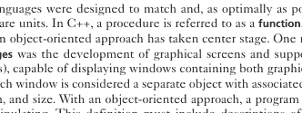

**图 1.1** 过程式程序操作

图 1.1 中的编程过程反映了用于构建计算机的输入、处理和输出硬件单元。这种相似性并非偶然，因为高级编程语言的设计是为了匹配并尽可能最优地控制相应的硬件单元。在 C++ 中，过程被称为 **函数。**

目前，面向对象的方法已成为主流。**面向对象语言** 的一个动机是图形屏幕的开发以及对图形用户界面（GUI）的支持，能够显示包含图形和文本的窗口。在 GUI 环境中，每个窗口都被视为具有相关特征（如颜色、位置和大小）的独立对象。采用面向对象的方法，程序必须首先定义它正在操作的<|message|>。这定义必须包括对象的一般特征描述和操作它们的具体操作。这些操作例如可以包括更改对象的大小和位置以及在对象之间传输数据。同样重要的是，面向对象语言往往更容易支持重用现有代码，这消除了重新验证和重新测试新代码或修改代码的需要。


C++ 被归类为一种面向对象的语言，但它同时包含了过程式语言和面向对象语言的特点。C++ 之所以具有这种双重特性，是因为它最初是作为 C 语言的扩展而诞生的，而 C 语言是一种于 20 世纪 70 年代在 AT&T 贝尔实验室开发的过程式语言。20 世纪 80 年代初，比雅尼·斯特劳斯特鲁普（同样任职于 AT&T）利用他在仿真语言方面的背景知识开发了 C++。仿真语言的一个核心特征是，它们将现实生活中的情境建模为对象，这些对象以定义明确的方式对刺激做出响应。这种面向对象的特性，连同其他过程式的改进，被与现有的 C 语言特性相结合，从而形成了 C++ 语言。

## 算法与过程

由于算法是 C++ 过程式方面的核心，理解算法的功能对于学习 C++ 至关重要。从过程式的角度来看，在编写程序之前，程序员必须清楚地理解要使用的数据、预期的结果以及用于产生该结果的过程。这个过程被称为算法。更准确地说，算法是一系列逐步执行的指令序列，描述了如何执行一项计算。

只有在你清楚地理解了所使用的数据和算法（产生结果的具体步骤）之后，你才能编写程序。从这个角度来看，面向过程的编程就是使用诸如 C++ 之类的编程语言，将选定的算法翻译成计算机程序。

为了理解算法是如何运作的，我们来看一个简单的问题：一个程序必须计算从 1 到 100 所有整数的和。图 1.2 展示了三种可以用来求所需总和的方法。每种方法都构成一个算法。

大多数人不会像这样费心去以详细的逐步方式列出可能的备选方案，然后选择其中一个算法来解决问题。然而，大多数人并不是以算法的方式思考的；他们倾向于启发式地思考。例如，如果你必须更换汽车上的瘪胎，你不会思考所有需要的步骤——你只是简单地更换轮胎，或者叫别人来做这项工作。这就是启发式思维的一个例子。

不幸的是，计算机不会响应启发式命令。像“把从 1 到 100 的数字加起来”这样笼统的陈述对计算机来说毫无意义，因为它只能响应以它理解的语言（如 C++）编写的算法命令。要成功地给计算机编程，你必须理解算法命令和启发式命令之间的这种区别。计算机是“响应算法的”机器，而不是“响应启发式的”机器。你不能告诉计算机去更换轮胎，或者把从 1 到 100 的数字加起来。相反，你必须给它一个详细的、逐步的指令序列，这些指令共同构成一个算法。例如，下面的指令序列就构成了一个确定从 1 到 100 数字之和的详细方法，即算法：

+   将 n 设为 100
+   将 a 设为 1
+   将 b 设为 100
+   计算总和 = n (a + b)/2
+   打印总和

这些指令并不是计算机程序。与必须用计算机能响应的语言编写的程序不同，算法可以用各种方式编写或描述。当使用类似英语的短语来描述算法中的步骤时（如本例所示），这种描述被称为伪代码。当使用数学方程时，这种描述被称为公式。当使用图 1.3 中所示符号的图表时，这种描述被称为流程图。图 1.4 展示了使用这些符号来描述一个计算三个数字平均值的算法。

### 方法 1 - 列式法：将数字 1 到 100 排成一列并相加

1
2
3
4
.
.
.
98
99
+100
5050

### 方法 2 - 分组法：将数字分组，使每组之和为 101，然后将组数乘以 101

1 + 100=101
2 + 99=101
3 + 98=101
4 + 97=101
.
.
.
49 + 52=101
50 + 51=101
50 组
(50 x 101=5050)

### 方法 3 - 公式法：使用公式

总和 = n(a + b) / 2
其中
n= 要相加的项数 (100)
a= 要相加的第一个数字 (1)
b= 要相加的最后一个数字 (100)
总和 = 100(1 + 100) / 2 = 5050

图 1.2 求 1 到 100 数字之和

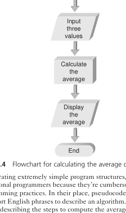

## 图 1.4 计算三个数字平均值的流程图

除了用于说明极其简单的程序结构之外，流程图在专业程序员中已经不再流行，因为它们修改起来很麻烦，并且可能支持非结构化的编程实践。取而代之的是，伪代码获得了越来越多的认可，它使用简短的英文短语来描述算法。下面是一个可接受的伪代码示例，用于描述计算三个数字平均值的步骤：

将三个数字输入计算机内存
通过将数字相加并将总和除以 3 来计算平均值
显示平均值

如前所述，在使用计算机语言语句编写算法之前，你必须首先选择一个算法并理解所需的步骤。使用计算机语言语句编写算法被称为对算法进行编码（见图 1.5）。


## 图 1.5 对算法进行编码

## 类与对象

我们生活在一个充满对象的世界里——飞机、火车、汽车、手机、书籍、计算机等等——因此编程语言最终会基于对象也就不足为奇了。在面向对象的 C++ 编程中，最基本的对象是数据对象，即一个或多个值打包成一个单一单元。例如，一个学生的姓名和平均绩点可以被视为一个数据对象；在这种情况下，该对象由两条数据组成。类似地，姓名、街道地址、城市、州和邮政编码可以打包成一个对象，这个对象对于用于打印地址标签的程序非常有用。最后，一个乘法表，例如 10 的乘法表，可以被视为一个数据对象——在这种情况下，它是一组乘法表中特定的一张表。

所有面向对象编程语言中的一个核心概念是特定对象与其所属的更大集合之间的区别。为了使这个概念更清晰，考虑一辆汽车。从对象的角度来看，一辆特定的汽车只是一个更一般的汽车类中的一个对象。因此，一辆具有自身特定属性（如颜色、发动机尺寸、车身类型等）的特定福特金牛座，可以被视为所有可能被制造出来的福特金牛座这个更广泛类中的一个汽车对象。制造商持有建造特定汽车的计划。只有当这个计划付诸实施并且汽车真正被制造出来时，一个特定的对象才得以存在。从更大的定义集合（即类）中创建对象的概念，是所有面向对象编程语言（如 C++）的基础。一个特定的对象是从对象类型，或者更准确地说，是从一个类中创建出来的。

本书讨论了 C++ 语言的两个方面：过程式和面向对象。你从过程式方面开始学习，因为 C++ 基于过程式语言 C；不依赖一些过程式代码，你就无法编写 C++ 程序。事实上，许多有用的程序可以完全作为过程式程序来编写。当你牢固掌握了 C++ 的过程式元素后，你可以扩展这些元素，使用类和对象来创建面向对象的程序。

随着你对 C++ 越来越熟练，你将开始创建自己的类和对象。然而，正如你在本章后面和第 3 章中看到的，C++ 中提供了两个对象——用于输入数据值的 `cin` 和用于输出数据值的 `cout`。在你早期的学习中，你会大量使用这两个对象。

## 程序翻译

在用 C++ 编写完算法或类之后，如果不进行进一步的翻译，它仍然无法在计算机上运行，因为所有计算机的内部语言都由一系列 1 和 0 组成，称为机器语言。生成计算机可以运行的机器语言程序，需要将 C++ 程序（称为源程序）翻译成计算机的机器语言（见图 1.6）。


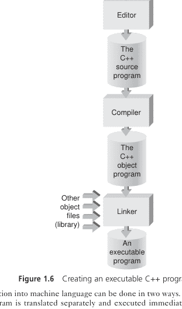

**图 1.6** 创建可执行的 C++ 程序

源程序中每条语句的翻译可以按两种方式进行。当源程序中的每条语句被单独翻译并在翻译后立即执行时，该编程语言称为解释型语言，而执行翻译的程序称为解释器。解释型语言的例子有 BASIC 和 Perl。

当源程序中的所有语句在执行任何语句之前作为一个整体单元进行翻译时，该编程语言称为编译型语言。在这种情况下，执行翻译的程序称为编译器。由于 C++ 是一种编译型语言，因此 C++ 源程序会被作为一个整体翻译成机器语言。

图 1.7 显示了 C++ 源代码程序与其编译成机器语言目标程序之间的关系。源代码是使用编辑器程序输入的，编辑器是编译器提供的开发环境的一部分的文字处理工具。³ 然而，请记住，你只有在分析完应用程序并仔细规划程序设计后才开始输入代码。

³你输入的源代码被操作和存储为 ASCII 文本（参见第 2.1 节），因此如果你使用的是商业文字处理程序，必须以文本格式保存源代码文件。

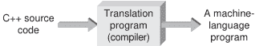

**图 1.7** 源程序必须被翻译

在输入 C++ 源代码后，程序翻译成机器语言程序就开始了，编译器负责此过程。编译器产生的输出称为 **目标程序**（如图 1.6 所示）。它只是一个机器语言版本的源程序，计算机可以运行它，但还需要一个额外的处理步骤。

大多数 C++ 程序包含使用预编程例程进行输入和输出以及其他机器相关服务的语句。此外，一个大型 C++ 程序可能存储在两个独立的程序文件中，每个文件单独编译。任何额外的代码必须在程序运行前合并成一个单一程序，而链接程序执行此步骤。链接过程的结果是一个机器语言程序，准备好执行并包含程序所需的所有代码。这个最终程序称为 **可执行程序**。

## 练习 1.1

1. **（定义）** 定义以下术语：
   a. 计算机程序
   b. 编程语言
   c. 编程
   d. 算法
   e. 伪代码
   f. 流程图
   g. 过程
   h. 对象
   i. 方法
   j. 消息
   k. 响应
   l. 类
   m. 源程序
   n. 编译器
   o. 目标程序
   p. 可执行程序
   q. 解释器

2. **（练习）** 确定以下各项任务的逐步程序（列出步骤）：

   > **注意：** 每项任务没有唯一的正确答案。本练习旨在让你练习将启发式命令转换为等价算法，并理解其中涉及的思维过程的差异。

   a. 修补瘪胎。
   b. 打电话。
   c. 去商店购买一块面包。
   d. 烤火鸡。

3. **（练习）** 确定并编写一个算法（列出步骤）来交换两杯液体的内容。假设有第三杯可用作临时存放任一杯内容的容器。每次向其中倒入新液体前，每杯都应先清洗。

4. **（练习）** 用英语写出一套详细的说明，计算一个存钱罐中钱的美元金额，该存钱罐包含 *h* 个半美元、*q* 个四分之一美元、*n* 个镍币、*d* 个十美分硬币和 *p* 个一美分硬币。

5. **（练习）** 用英语写出一套详细的逐步说明，找出三组整数中的最小数。

6. **（练习）**
   a. 写出详细的逐步说明，用英语计算支付金额为 TOTAL 的账单所需的最少美元纸币数量。例如，如果 TOTAL 为 $98，则纸币将由一张 $50 纸币、两张 $20 纸币、一张 $5 纸币和三张 $1 纸币组成。对于本练习，假设只有 $100、$50、$20、$10、$5 和 $1 纸币可用。
   b. 重复练习 6a，但假设账单只能用 $1 纸币支付。

7. **（练习）**
   a. 编写一个算法来定位名称列表中名字 JEAN 的第一次出现，名称列表按随机顺序排列。
   b. 讨论如果名称列表按字母顺序排列，你如何改进练习 7a 中的算法。

8. **（练习）** 确定并编写一个算法，将三个数字按升序（从低到高）排序。你会如何启发式地解决这个问题？

9. **（练习）** 为以下特定对象定义合适的类：
   a. 数字 5
   b. 一个 4 英寸乘 4 英寸的正方形
   c. 这本 C++ 书
   d. 一辆 1955 年福特 Thunderbird 汽车
   e. 你最后使用的一支圆珠笔

10. **（练习）**
    a. 以下对象应具备哪些操作？
       i. 一辆 1955 年福特 Thunderbird 汽车
       ii. 你最后使用的一支圆珠笔
    b. 练习 10a 中确定的操作是否仅适用于所列的特定对象，还是更通用，适用于所列类型的全部对象？

## 1.2 函数和类名

一个设计良好的程序，其构建方式类似于设计良好的建筑物的构建方式。它不会凭空出现；它取决于仔细的规划和执行。与建筑物一样，设计程序的一个重要部分是其结构。由相互关联的段（称为模块）按逻辑顺序排列形成集成完整单元的结构的程序称为模块化程序（参见图 1.8）。模块化程序比以其他方式构建的程序更容易开发、纠正和修改。

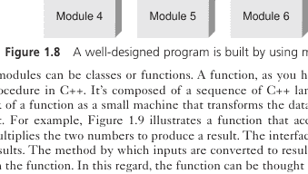

**图 1.8** 一个设计良好的程序是使用模块构建的

在 C++ 中，模块可以是类或函数。函数，正如你所见，是 C++ 中过程的名称。它由一系列 C++ 语言指令组成。可以将函数想象成一个将接收到的数据转换为成品的小机器。例如，图 1.9 说明了一个接受两个数字作为输入并将这两个数字相乘以产生结果的函数。函数的接口是其输入和结果。输入如何转换为结果的方法被封装并隐藏在函数内部。就这一点而言，函数可以被视为提供特定操作的单一单元。

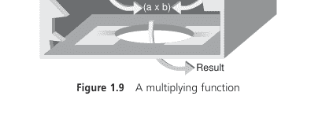

**图 1.9** 一个乘法函数

类似的类比适用于类。类封装了数据和操作，可以被视为一个完整的加工厂，包含所有原材料（被操作的数据）和所有机器（函数）以输入、输出和处理这些材料。

为函数或类设计一个好的名称的一个重要要求是，该名称应传达出函数或类所做的事情的一些概念。允许用于函数和类的名称也用于命名 C++ 语言的其他元素，统称为标识符。标识符可以由以下规则选择的任意字母、数字和下划线（_）组合组成：

1. 名称的第一个字符必须是字母或下划线。
2. 第一个字母之后只能跟字母、数字或下划线。不允许有空白；多词标识符中单词的分隔是通过将一个或多个单词的首字母大写来表示的。（尽管下划线也可以用于此目的，但它们越来越多地仅用于编译器相关的标识符。）
3. 标识符名称不能是表 1.1 中列出的关键字之一。（关键字是语言为特殊目的保留的词，只能以指定的方式使用。）
4. 标识符中的最大字符数为 1024。

**表 1.1** C++ 中的关键字

|   |   |   |   |   |
|---|---|---|---|---|
| auto | delete | goto | public | this |
| break | do | if | register | template |
| case | double | inline | return | typedef |
| catch | else | int | short | union |
| char | enum | long | signed | unsigned |
| class | extern | new | sizeof | virtual |
| const | float | overload | static | void |
| continue | for | private | struct | volatile |
| default | friend | protected | switch | while |

有效的 C++ 标识符示例如下：

grosspay taxCalc addNums degToRad  
multByTwo salestax netpay bessel

无效标识符的示例：

4ab3 （以数字开头，违反规则 1。）  
e*6 （包含特殊字符，违反规则 2。）  
while （由关键字组成，违反规则 3。）

除了符合 C++ 的标识符规则外，C++ 函数名后面必须始终跟随括号。此外，一个好的函数名应该是一个助记符（发音为


## 信息点

### 令牌

在计算机语言中，令牌是编译器具有唯一含义的语言最小单位。因此，关键字、程序员定义的标识符以及所有特殊数学符号，如 + 和 -，都被视为 C++ 语言的令牌。用 intervening 字符或空白分隔多字符令牌中的字符会导致编译器错误。

“助记符”，即设计为记忆辅助的词。例如，函数名 degToRad() 是将度数转换为弧度的函数的助记符。名称有助于识别函数的功能。不是助记符的函数名不应使用，因为它们无法传达函数的功能。以下是一些有效的函数名，包括其必需的括号，它们不能传达任何有用的目的信息。此类名称绝不应在 C++ 程序中使用。

```
easy()   arf()   tinker()   theForce()   mike()
```

函数名也可以由大小写字母混合组成，如 locateMaximum()。这种约定在 C++ 中变得越来越常见，尽管不是必需的。全部大写字母的标识符通常保留用于符号常量，见第 3.5 节。

如果你混合使用大写和小写字母，请注意 C++ 是区分大小写的语言，这意味着编译器区分大写和小写字母。因此，在 C++ 中，名称 TOTAL、total 和 Total 是三个不同的标识符。

## main() 函数

使用函数——以及如你在第二部分所见，类——的一个明显优势是，你可以提前规划程序的整体结构。你还可以单独测试和验证每个函数的操作，以确保其达到目标。

为了使函数能够有序地放置和执行，每个 C++ 程序必须有一个且只有一个名为 main 的函数。main() 函数被称为驱动函数，因为它告诉其他函数它们执行的顺序（见图 1.10）。

图 1.11 显示了 main() 函数的结构。函数的第一行——在本例中为 int main()——被称为函数头行。该行始终是函数的第一行，包含三条信息：

- 函数返回的数据类型（如果有）
- 函数的名称
- 发送到函数的数据类型（如果有）

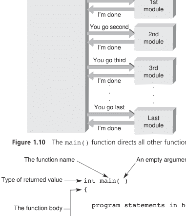

*Figure 1.10 The main() function directs all other functions*

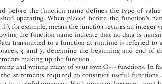

*Figure 1.11 The structure of a main() function*

函数名前的关键字定义了函数在操作完成后返回的值的类型。当放在函数名之前时，例如关键字 int（列于表 1.1），表示函数返回一个整数值。同样，函数名后跟的空括号表示运行时没有数据传输到函数。（运行时传输到函数的数据称为函数的参数。）大括号 { 和 } 确定了函数体的开始和结束，并包含构成函数的语句。

大括号内的语句决定了函数的作用。所有导致计算机在函数执行时执行特定操作的语句必须以分号（;）结尾。这些语句是可执行语句，随着你对 C++ 理解的深入，将会更详细地描述。

你将命名并编写许多自己的 C++ 函数。事实上，第一部分其余内容主要涉及构建有用函数所需的语句，以及如何将函数和数据组合成有用的程序。然而，每个程序必须有一个且只有一个 main() 函数。在你学会如何将数据传递给函数以及从函数返回数据之前（第 6 章的主题），图 1.11 中显示的头行适用于你需要编写的所有程序。在更充分解释之前，只需将前两行

```
int main()
{
```

视为表示“程序在此开始”，并将最后两行

```
return 0;
}
```

视为指定程序的结束。幸运的是，许多有用的函数和类已经为你编写好了。接下来，你将看到如何使用从这些类之一创建的对象来创建你的第一个可工作的 C++ 程序。

## 信息点

### 可执行语句和不可执行语句

在本书中，你将被介绍到许多可用于创建函数和程序的 C++ 语句。然而，函数中的所有语句都属于两个大类：可执行语句和不可执行语句。

可执行语句导致计算机在程序运行时执行某些特定操作。例如，告诉计算机显示输出或加数字的语句就是可执行语句。可执行语句必须始终以分号结尾。

不可执行语句描述程序或其数据的某些特征，但在程序运行时不会导致计算机执行任何操作。不可执行语句的示例是注释（见第 1.4 节）。注释是供阅读程序的任何人使用的。编译器在翻译源代码时忽略所有注释。

## 练习 1.2

- 1. （练习）判断以下是否是有效标识符，如果是，判断它们是否是传达其目的想法的助记符名称。如果标识符名称无效，请说明原因。
    - lm1234    newBal    abcd    A12345    1A2345
    - power    absVal    invoices    do    while
    - add_5    taxes    netPay    12345    int
    - newBalance    a2b3c4d5    sales_tax    amount    $taxes

- 2. （练习）假设以下函数已被编写：

    `getLength(), getWidth(), calcArea(), displayArea()`

    - a. 根据其名称，你认为每个函数可能做什么？
    - b. 你认为 main() 函数可能按什么顺序执行这些函数（基于其名称）？

- 3. （练习）假设以下函数已被编写：

    `inputPrice(), calcSalestax(), calcTotal()`

    - a. 根据其名称，你认为每个函数可能做什么？
    - b. 你认为 main() 函数可能按什么顺序执行这些函数（基于其名称）？

- 4. （练习）为执行以下操作的函数确定名称：
    - a. 求一组数字的平均值。
    - b. 求矩形的面积。
    - c. 求圆的周长。
    - d. 求一组数字中的最大值。
    - e. 将大写字母转换为小写字母。
    - f. 将一组数字从低到高排序。
    - g. 将姓名列表按字母顺序排列。

- 5. （练习）正如关键字 int 可用于表示函数返回整数一样，关键字 void、char、float 和 double 可用于表示函数返回无值、字符、浮点数和双精度数。利用此信息，为一个名为 abs() 且不接收参数但返回以下内容的函数编写头行：
    - a. 无值
    - b. 一个字符
    - c. 一个浮点数
    - d. 一个双精度数

## 1.3 cout 对象

C++ 中最通用和最常用的对象之一是 cout（读作“see out”，源自 console output）。它是一个输出对象，将传递给它的数据发送到标准显示设备，在大多数系统中是计算机屏幕。例如，如果数据 Hello there world! 传递给 cout，则该数据会打印（显示）在你的屏幕上。要将此数据传递给 cout 对象，只需在对象名称后、消息前放置插入符号 <<，如下所示：

```
cout << "Hello there world!"
```

现在尝试将所有这些结合起来。看一下程序 1.1，这是一个可在你的计算机上运行的可工作 C++ 程序。


## 程序 1.1

```
#include <iostream>
using namespace std;

int main()
{
    cout << "Hello there world!";

    return 0;
}
```

程序的第一行是一条预处理命令，它使用了保留字 `include`：

```cpp
#include <iostream>
```

**预处理命令**以井号（#）开头，在编译器将源程序翻译成机器代码之前执行某些操作。具体来说，`#include` 预处理命令会使指定文件的内容（这里是 iostream）被插入到程序中 `#include` 命令出现的位置。iostream 文件是标准库的一部分，其中包含两个类：istream 和 ostream。这两个类分别提供了用于数据输入和数据输出的数据声明及方法。iostream 文件被称为**头文件**，因为对它的引用总是通过 `#include` 命令放置在 C++ 程序的顶部（即头部）。你可能想知道 iostream 文件与这个简单程序有什么关系。答案是：cout 对象是由 ostream 类创建的。因此，所有使用 cout 的程序都必须包含 iostream 头文件。如程序 1.1 所示，预处理命令不以分号结尾。

在预处理 `#include` 命令之后是一条包含保留字 `using` 的语句。例如，下面的语句告诉编译器在没有显式指定时到哪里查找头文件：

```cpp
using namespace std;
```

你可以将**命名空间**视为编译器在查找预编写类或函数时访问的文件。由于 iostream 头文件包含在名为 std（代表标准库）的文件中，因此只要引用 cout，编译器就会自动使用该命名空间中的 iostream 的 cout 对象。⁷ 通过使用命名空间，你可以创建与标准库提供的类或函数同名的类和函数，并将它们放入不同名称的命名空间中。然后，你可以通过指定希望编译器在其中查找类或函数的命名空间，来告诉程序要使用哪个类或函数。

`using` 语句之后是程序 `main()` 函数的开始，该函数以前面描述过的头行开始。函数体用花括号括起来，其中只包含两条语句。`main()` 中的第一条语句向 cout 对象发送一条消息：字符串 `"Hello there world!"`。

由于 cout 是预编写类的对象，因此你无需创建它；只需正确激活它即可使用。与所有 C++ 对象一样，cout 只能执行某些定义明确的操作。对于 cout，其操作是组装用于输出显示的数据。当字符串传递给 cout 时，该对象会确保字符串正确显示在屏幕上，如程序 1.1 的以下输出所示：

Hello there world!

C++ 中的字符串是字母、数字和特殊字符的任意组合，并用引号（"字符串在这里"）括起来。引号用于限定（标记）字符串的开头和结尾，并不被视为字符串的一部分。因此，构成发送给 cout 的消息的字符串必须用引号括起来，如程序 1.1 所示。

现在检查另一个程序以了解 cout 的多功能性。阅读程序 1.2，确定它的功能。

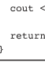

## 程序 1.2

```
#include <iostream>
using namespace std;

int main()
{
    cout << "Computers, computers everywhere";
    cout << "\n as far as I can C";

    return 0;
}
```

运行程序 1.2 时，会显示以下内容：

```
Computers, computers everywhere
as far as I can C
```

你可能想知道为什么 \n 没有出现在输出中。字符 \ 和 n 一起使用时，被称为换行转义序列。它们告诉 cout 向显示设备发送指令，移动到新行的开头。在 C++ 中，反斜杠（\）字符提供了对后面字符正常解释的“转义”，并改变了其含义。如果在程序 1.2 的第二条 cout 语句中省略反斜杠，n 将被打印为字母“n”，程序将输出以下内容：

```
Computers, computers everywheren as far as I can c
```

换行转义序列可以放置在传递给 cout 的消息中的任何位置。看看你能否确定程序 1.3 产生的显示内容。

## 程序 1.3

```
#include <iostream>
using namespace std;

int main()
{
    cout << "Computers everywhere\n as far as\n\nI can see.";

    return 0;
}
```

这是程序 1.3 的输出：

```
Computers everywhere
as far as

I can see.
```

## 练习 1.3

- 1. （程序）在计算机上输入并运行程序 1.1。（注意：你必须了解在你所使用的特定计算机安装上输入和运行 C++ 程序的过程。）
- 2. （程序）a. 使用 cout，编写一个 C++ 程序，将你的名字打印在一行，街道地址打印在第二行，城市、州和邮政编码打印在第三行。
  b. 在计算机上运行你在练习 2a 中编写的程序。
- 3. （程序）a. 编写一个 C++ 程序来显示以下诗句：

Computers, computers everywhere
as far as I can see.
I really, really like these things,
Oh joy, Oh joy for me!

b. 在计算机上运行你在练习 3a 中编写的程序。
- 4. （练习）a. 要显示以下内容，你会使用多少条 cout 语句？

PART NO.    PRICE
T1267       $6.34
T1300       $8.92
T2401       $65.40
T4482       $36.99

b. 打印练习 4a 中的表格，至少需要使用多少条 cout 语句？

c. 编写一个完整的 C++ 程序，以产生练习 4a 中显示的输出。

d. 在计算机上运行你在练习 4c 中编写的程序。
- 5. （思考）响应换行转义序列时，cout 会将下一个显示字符定位到新行的开头。这种对下一个字符的定位实际上代表了两个不同的操作。它们是什么？

## 1.4 编程风格

C++ 程序从 `main()` 函数的开头开始执行。由于一个程序只能有一个起点，因此每个 C++ 程序都必须包含且只能包含一个 `main()` 函数。如你所见，构成 `main()` 函数的所有语句都包含在函数名后面的花括号内。虽然每个 C++ 程序都必须有 `main()` 函数，但 C++ 并不要求以任何特定形式放置 `main` 一词、括号或花括号。上一节中使用的那种形式

```
int main()
{
    program statements in here;
    return 0;
}
```

纯粹是为了清晰易读而选择的，但并非必须如此。例如，这种 `main()` 函数的通用形式也能工作：

```
int main
( ) { first statement;second statement;
            third statement;fourth
statement;
return 0;}
```

请注意，你可以在一行中放置多条语句，也可以将一条语句放在多行中。除了字符串、引号、标识符和关键字之外，C++ 会忽略所有**空白**。（空白是指空格、制表符或换行的任意组合。）例如，更改程序 1.1 中的空白，并确保不要将字符串 `Hello there world!` 拆分成两行，会得到以下有效的程序：

```
```cpp
#include <iostream>
using namespace std;
int main
{
}
{
cout <<
"Hello there world!";
  return 0;
}
```
```

尽管这个版本的 `main()` 确实能工作，但它是糟糕编程风格的一个例子，因为它难以阅读和理解。为了可读性，`main()` 函数应始终以这种标准形式编写：

```
```cpp
int main()
{
  program statements in here;
  return 0;
}
```
```

在这种标准形式中，函数名从左边距（称为第 1 列）开始，并与其必需的括号放在同一行。函数体的左花括号在下一行的第 1 列，正好在包含函数名的那一行第一个字母的下方。同样，函数的右花括号单独放在第 1 列（与左花括号对齐），作为函数的最后一行。这种结构突出了函数作为一个整体单元。

在函数内部，所有程序语句至少缩进两个空格。缩进是良好编程实践的另一个标志，尤其是对相似的语句组使用相同的缩进。请注意，在程序 1.2 中，两条 cout 语句使用了相同的缩进。

随着你对 C++ 的理解和掌握不断深入，你会形成自己的缩进标准。只需记住，程序的最终形式应保持一致，并且始终有助于他人阅读和理解你的程序。

## 注释

注释是程序中用于解释的说明性文字。如果使用得当，注释有助于阐明程序的整体目的，解释一组语句的意图，或说明某一行代码的用途。C++ 支持两种类型的注释：行注释和块注释。这两种注释都可以放在程序中的任何位置，并且对程序执行没有影响。编译器会忽略所有注释——它们只是为了方便阅读程序的人。

## 信息点

## 什么是语法？

编程语言的语法是一组规则，用于制定语法上正确的语句。在实践中，这意味着具有正确语法的 C++ 语句具有编译器要求的正确形式（单词的类型和单词的顺序）。如果语句符合正确形式，编译器就会接受它们，并且不会生成错误消息。

但请注意，一个语句或程序在语法上可以是正确的，但在逻辑上却是不正确的。换句话说，语句或程序结构正确，但产生了错误的结果。这类似于一个语法正确但没有意义的英语句子，例如“The tree is a ragged cat.”


行注释以两个斜杠（//）开头，一直延续到行尾。例如，以下都是行注释：

```
// this is a comment
// this program prints out a message
// this program calculates a square root
```

符号 //（中间没有空格）表示行注释的开始。注释所在行的行尾表示注释的结束。行注释可以单独占一行，也可以写在包含程序语句的行的末尾。程序 1.4 展示了如何在程序中使用行注释。

## 程序 1.4

```cpp
// this program displays a message
#include <iostream>
using namespace std;

int main()
{
cout << "Hello there world!"; // this produces the display
return 0;
}
```

第一条注释单独出现在程序顶部的一行中，描述了程序的功能。这个位置通常很适合放置一条简短的注释来说明程序的用途。如果需要更多注释，可以逐行添加。当一条注释太长而无法放在一行中时，可以将其拆分为两条或多条行注释，每条注释前面加上两个斜杠（//）。例如，下面的注释会产生 C++ 错误消息，因为第二行没有以 // 符号开头：

```cpp
// this comment is invalid because it
extends over two lines
```

下面这条注释是正确的，写法如下：

```cpp
// this comment is used to illustrate a
// comment that extends across two lines
```

然而，跨两行或多行的注释用块注释来写比用多行注释更方便。块注释以符号 /* 开头，以符号 */ 结尾，如下例所示：

```cpp
/* This is a block comment that
   spans
   three lines */
```

在 C++ 中，程序的结构旨在使其可读且易于理解，因此并不需要大量的注释。如前所述，通过精心选择函数名称来传达其用途，可以强化这一准则。但是，如果程序元素的用途仍然无法通过其结构、名称或上下文明确表达，则应在需要说明的地方添加注释。

没有注释的晦涩代码无疑是糟糕编程的体现，尤其是当其他人必须维护或阅读该程序时。同样，过多的注释也是糟糕编程的体现，因为这说明没有充分考虑如何让代码不言自明。通常，你编写的任何程序都应以注释开头，包括简短的程序描述、你的姓名以及程序编写或最后修改的日期。出于篇幅考虑，并且由于本书中的所有程序均由作者编写，这些开头注释仅在随文未提供时用于简短的程序描述。

## 练习 1.4

- **1. （调试）** a. 下面的程序能运行吗？

```cpp
#include <iostream>
using namespace std;
int main() {cout << "Hello there world!"; return 0;}
```

b. 即使练习 1a 中的程序能运行，请解释为什么它不是一个好程序。

- **2. （修改）** 将以下程序改写为符合良好编程习惯且语法正确的程序：

a.

```cpp
#include <iostream>
int main(
){
cout <<
"The time has come"
; return 0;}
```

b.

```cpp
#include <iostream>
using namespace std;
int main
(){cout << "Newark is a city\n";cout <<
"In New Jersey\n"; cout <<
"It is also a city\n"
; cout << "In Delaware\n"
; return 0;}
```

c.

```cpp
#include <iostream>
using namespace std;
int main() {cout << " Reading a program\n";cout <<
"is much easier\n"
; cout << "if a standard form for main() is used\n")
; cout
<<"and each statement is written\n"; cout
    << "on a line by itself\n"
    ; return 0;}
```

d.

```cpp
#include <iostream.h>
using namespace std;
int main
(   ) { cout << "Every C++ program"
; cout
<<"\nmust have one and only one"
;
cout << "main() function"
;
cout <<
"\n the escape sequence of characters")
; cout <<
"\nfor a newline can be placed anywhere"
; cout <<
"<<\n within the message passed to cout"
; return 0;}
```

- **3. （思考）**
  a. 在消息中使用反斜杠字符时，它会改变紧随其后的字符的含义。如果你想打印反斜杠字符，就必须告诉 `cout` 从它通常解释反斜杠的方式中转义出来。你认为哪个字符用于改变单个反斜杠字符的解释方式？
  b. 利用你对练习 3a 的答案，写出用于打印反斜杠的转义序列。

- **4. （思考）**
  a. **计算机语言的记号（token）** 是编译器具有唯一含义的一个或多个字符的任意序列。用其他字符或空白将字符分隔开会导致编译器错误。利用这个记号的定义，判断表 1.1 中列出的转义序列、函数名和关键字是否为 C++ 语言的记号。
  b. 讨论向消息中添加空白是否会改变消息，以及消息是否可以被视为 C++ 的记号。
  c. 利用练习 4a 中记号的定义，判断以下说法是否正确：“除了语言的记号之外，C++ 忽略所有空白。”

## 1.5 常见编程错误

学习任何编程语言的一部分，就是要犯下刚开始使用该语言时经常遇到的低级错误。这些错误往往令人沮丧，因为每种语言都有自己的常见编程错误，等待着粗心大意的人。初次使用 C++ 编程时常见的错误包括：

- 1. 省略 `main()` 后面的括号。
- 2. 省略或错误输入表示函数体开始的开花括号 `{`。
- 3. 省略或错误输入表示函数结束的闭花括号 `}`。
- 4. 省略每条 C++ 可执行语句末尾的分号。
- 5. 在 `#include <iostream>` 预处理命令后添加分号。
- 6. 拼错对象或函数的名称，例如将 `cout` 输入为 `cot`。
- 7. 忘记用双引号将发送给 `cout` 的字符串括起来。
- 8. 忘记用 `\n` 表示换行。

此列表中的第三个、第四个、第五个和第六个错误往往最常见。一种值得采用的做法是编写一个程序，然后一次引入一个错误，看看编译器会产生什么错误消息。当这些错误消息由于无意中的错误而出现时，你就已经有了理解这些消息并纠正错误的经验。

## 1.6 章节总结

- 1. 计算机程序是用于操作计算机以产生特定结果的指令和数据的自包含单元。
- 2. 算法是必须终止的逐步过程；它描述了如何执行计算或任务。
- 3. C++ 程序由一个或多个称为函数的模块组成。其中一个函数必须命名为 `main()`。`main()` 函数标识 C++ 程序的起点。
- 4. 最简单的 C++ 程序由单个函数 `main()` 组成，形式如下：

```cpp
#include <iostream>
using namespace std;

int main()
{
    program statements in here;

    return 0;
}
```

该程序由预处理 `#include` 语句、using 语句、`main()` 函数的头行以及 `main()` 函数体组成。函数体以开花括号 `{` 开始，以闭花括号 `}` 结束。

- 5. 函数体内所有可执行的 C++ 语句都必须以分号结尾。
- 6. 每个 C++ 编译器附带的标准库中提供了许多函数和类。用于创建输入和输出功能的一组类定义在 `iostream` 头文件中。
- 7. `cout` 对象用于显示文本或数值结果。可以通过将字符括在引号中并使用插入符号 `<<` 将字符流发送到 `cout`，如语句 `cout << "Hello World!";` 所示。字符串中的文本显示在屏幕上，并且可以包含用于控制格式的换行转义序列。


## 1.7 章节补充：软件开发

在最基本层面上，一个程序是为解决特定问题而开发的解决方案，以可运行于计算机的形式编写。因此，编写程序几乎是整个过程的最后一步，而在此之前首先要确定需要解决的问题以及解决方案所使用的方法。每个研究领域都有其设计解决方案以解决问题的系统方法名称。在科学和工程领域，这种方法被称为**科学方法**，在定量分析中，这种方法称为**系统方法**。专业软件开发人员使用**软件开发程序**来理解需要解决的问题并创建有效、合适的软件解决方案。该程序如图 1.12 所示，由三个重叠的阶段组成：

- 1. 开发与设计
- 2. 文档
- 3. 维护

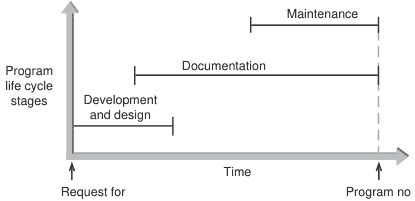

**图 1.12** 软件开发的三个阶段

作为一门学科，**软件工程**关注创建可读、高效、可靠且可维护的程序和系统，并使用软件开发程序来实现这一目标。

### 第一阶段：开发与设计

第一阶段始于对问题陈述或对程序的具体请求，该请求被称为**程序需求**。在陈述问题或提出程序解决方案的具体请求后，开发与设计阶段开始。该阶段由四个明确定义的步骤组成，如图 1.13 所示，并在以下各节中进行总结。

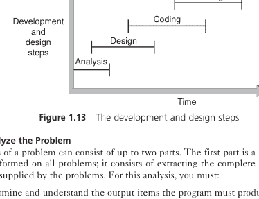

图 1.13 开发与设计步骤

### 步骤 1：分析问题

问题的分析可包含多达两个部分。第一部分是必须对所有问题执行的基本分析；它包括提取问题提供的完整输入和输出信息。对于此分析，你必须：

- 1. 确定并理解程序必须产生的输出项。
- 2. 确定输入项。

这两个项目合在一起被称为问题的输入/输出（I/O）。只有在确定了问题的 I/O 后，才能选择将输入转换为输出的具体步骤。此时，有时需要/有用地进行手工计算以验证输出是否确实可以从输入中获得。显然，如果你有一个将输入与输出关联的公式，则可以省略此步骤。如果所需的输入可用并且期望的输出可以产生，则认为问题已明确定义并且可以解决。

由于多种原因，完成基本分析可能不可行。如果是这样，则可能需要扩展分析。扩展分析仅意味着你必须收集有关问题的更多信息，以便彻底了解所要求的内容以及如何实现结果。在本书中，为了解决问题而需要的任何额外信息都将与问题陈述一起提供。

### 步骤 2：开发解决方案

接下来，你选择用于解决问题的确切步骤集，称为算法。通常，你通过一系列细化来找到解决方案，从分析步骤中最初找到的算法开始，直到获得可接受且完整的算法。此算法必须经过检查，如果未在分析步骤中检查，则必须确保其正确产生所需的输出。检查通常通过执行尚未完成的手工计算来完成。

对于小型程序，所选算法可能非常简单，仅包含一个或多个计算。更典型的是，你需要细化初始解决方案并将其组织成较小的子系统，并为子系统如何相互接口制定规范。为实现这一目标，算法的描述从最高级别（顶部）需求开始，然后向下进行到必须构建以满足该需求的部分。至

细化解决方案的过程一直持续到包含最小需求为止。请注意，设计会产生树状结构，其中级别会随着从结构顶部向底部移动而分支。当设计完成时，框中指定的每个任务通常都使用单独的指令集进行编码，并在结构中更高层任务调用时执行。

### 步骤 3：编码解决方案（编写程序）

此步骤包括实际编写与步骤 2 中开发的解决方案相对应的 C++ 程序。如果分析和解决方案步骤已正确执行，则编码步骤在性质上变得相当机械。在设计良好的程序中，构成程序的语句遵循在解决方案步骤中定义的某些明确定义的模式或结构。这些结构控制程序的执行方式，并包括以下类型：

- 顺序
- 选择
- 迭代
- 调用

**顺序**定义了程序执行指令的顺序。指定哪个指令先执行、哪个指令第二执行等对于程序实现明确定义的目的至关重要。

**选择**提供根据某些条件的结果在不同操作之间进行选择的能力。例如，可以在执行除法之前检查数字的值。如果数字不为零，则可以用作除法运算的分母；否则，不执行除法并向用户发出警告消息。

**迭代**也称为“循环”和“重复”，使得可以根据条件的值重复相同的操作成为可能。例如，成绩可能会重复输入和累加，直到输入负成绩为止。在这种情况下，输入负成绩是表示重复输入和累加成绩结束的条件。此时，可以计算所有输入成绩的平均值。

**调用**涉及在需要时调用或召唤一组语句。例如，计算一个人的净工资涉及获取工资率和工作时间、计算净工资以及提供所需金额的报告或支票。每个任务通常被编码为单独的单元，并在需要时被调用执行。

### 步骤 4：测试和纠正程序

测试的目的是验证程序是否正确工作并真正满足其需求。理论上，测试会揭示所有存在的程序错误。（在计算机术语中，程序错误称为 bug。⁸）在实践中，找到所有错误需要检查所有可能的语句执行组合。由于时间和精力要求，这样的目标通常是不可能的，除非是极其简单的程序。（第 4.7 节解释了为什么通常认为这一目标是不可能的。）

> ⁸该术语的来源相当有趣。1945 年 9 月，哈佛大学的 Mark I 计算机停止运行时，Grace Hopper 将故障追溯到一只进入电气电路的死昆虫。她在日志中记录了这一事件：“继电器 #70 ...（飞蛾）在继电器中。发现虫子的第一个实际案例。”

由于对大多数程序来说穷举测试不可行，因此已经发展出不同的测试哲学和方法。然而，在最基本层面上，测试需要有意识地努力确保程序正确工作并产生有意义的结果。这意味着要仔细思考测试旨在实现什么以及测试中使用的数据。如果测试揭示了错误（bug），则可以启动调试过程，其中包括定位、纠正和验证更正。请认识到，虽然测试可能会揭示错误的存在，但它并不一定表明错误的缺失。因此，测试揭示了一个 bug 并不表示其他 bug 不潜伏在程序的其他地方。

为了捕获和纠正程序中的错误，开发用于确定程序是否产生正确答案的测试数据集合非常重要。事实上，在正式软件开发中，通常接受的步骤是在编写代码之前规划测试程序并创建有意义的测试数据。先执行此步骤有助于你更客观地了解程序必须做什么，因为它避免了编码后潜意识中避免会揭示程序问题的测试数据的诱惑。测试程序的程序应检查程序将被使用的每种可能情况。程序应使用合理范围内的數據以及极限值和程序应告知用户数据无效的区域进行测试。对于复杂问题，开发良好的测试程序和数据可能比编写程序代码更困难。

表 1.2 列出了大型商业编程项目中每个开发和设计步骤通常花费的相对工作量。如该列表所示，编码并不是第一阶段的主要工作。许多新程序员遇到困难，因为他们花费大部分时间编写程序，而没有花费足够的时间理解问题或设计合适的解决方案。（请注意表中 50% 的总开发时间花费在测试上，而许多程序员只测试他人编写的代码。）为了帮助你避免犯同样的错误，请记住编程谚语“对于未完全理解的问题或应用程序，不可能编写出成功的程序。” 同样有价值的谚语是“你开始编码程序的时间越早，通常完成所需的时间就越长。”

### 表 1.2 第一阶段的工作量

| 步骤 | 工作量 |
|---|---|
| 分析问题 | 10% |
| 开发解决方案 | 20% |
| 编码解决方案（编写程序） | 20% |
| 测试程序 | 50% |

### 第二阶段：文档

由于文档不足，大量工作变得无用或丢失，许多任务必须重复，因此记录你的工作是解决问题的最重要步骤之一。在分析、设计、编码和测试步骤中会创建许多关键文档。完成文档阶段需要收集这些文档，添加用户操作材料，并以对你和你的组织最有用的形式呈现文档。


尽管并非所有人都以相同的方式对它们进行分类，但每个问题解决方案都包含五个主要文档：

- 程序描述
- 算法开发与变更
- 注释完善的程序清单
- 示例测试运行
- 用户手册

设身处地为你工作的潜在使用者着想——无论是助理、程序员/分析师还是管理层——这应有助于你努力使重要文档的内容清晰易懂。文档阶段正式始于开发与设计阶段，并延续至维护阶段。

### 第三阶段：维护

该阶段涉及持续修正问题、为满足不断变化的需求而进行修订，以及添加新功能。维护往往是所有阶段中工作量最大、主要收入来源且持续时间最长的部分。开发可能只需数天或数月，但维护可能持续数年甚至数十年。文档质量越高，维护效率就越高，客户和最终用户也会越满意。

### 备份

尽管备份并非正式设计流程的一部分，但在编程和调试过程的每一步制作并保留程序备份副本至关重要。删除或修改程序当前可用版本直至面目全非是很容易发生的。有了备份副本，你可以毫不费力地恢复到最后阶段的工作成果。一个实用程序的最终可用版本应至少备份两次。在这方面，另一条有用的编程谚语是：“如果你不介意从头再来，备份就不重要。”许多组织会在现场保留至少一份备份以便随时取用，并在防火保险柜或异地存放另一份备份副本。

### 第1.7节练习

> 注：以下每道练习均给出一个编程问题。请先阅读问题陈述，然后回答与该问题相关的提问。不要尝试编写程序来解决这些问题，只需回答程序规格说明后的问题即可。

- 1.（练习）需要一个C++程序来计算存钱罐中的金额（以美元计）。存钱罐中装有半美元硬币、25美分硬币、10美分硬币、5美分硬币和1美分硬币。
    - a. 对于此编程问题，需要多少个输出？
    - b. 此问题有多少个输入？
    - c. 编写一个算法，将输入项转换为输出项。
    - d. 使用以下示例数据测试为练习1c编写的算法：半美元硬币0枚，25美分硬币17枚，10美分硬币24枚，5美分硬币16枚，1美分硬币12枚。

- 2.（练习）需要一个C++程序来计算距离值（以英里为单位），给定以下关系：

    距离 = 平均速度 × 时间

    - a. 对于此编程问题，需要多少个输出？
    - b. 此问题有多少个输入？
    - c. 编写一个算法，将输入项转换为输出项。
    - d. 使用以下示例数据测试为练习2c编写的算法：速度为每小时55英里，时间为2.5小时。
    - e. 如果经过的时间以分钟而非小时给出，你在练习2c中编写的算法应如何修改？

- 3.（练习）需要一个C++程序来确定Ergies的值，给定以下关系：

    Ergies = Fergies × Lergies

    - a. 对于此编程问题，需要多少个输出？
    - b. 此问题有多少个输入？
    - c. 确定一个算法，将输入项转换为输出项。
    - d. 使用以下示例数据测试为练习3c编写的算法：Fergies = 14.65，Lergies = 4。

- 4.（练习）需要一个C++程序来显示以下姓名和地址：

    Mr. S. Hazlet
    63 Seminole Way
    Dumont, NJ 07030

    - a. 对于此编程问题，需要多少行输出？
    - b. 此问题有多少个输入？
    - c. 编写一个算法，将输入项转换为输出项。

- 5.（练习）需要一个C++程序来确定汽车在10秒后行驶了多远，假设汽车初始速度为每小时60英里，驾驶员以每秒12英里²的均匀速率踩刹车减速。使用以下公式：

    距离 = st - (1/2)d t²

    - s 是汽车的初始速度。
    - d 是减速度。
    - t 是经过的时间。

    - a. 对于此编程问题，需要多少个输出？
    - b. 此问题有多少个输入？
    - c. 编写一个算法，将输入项转换为输出项。
    - d. 使用以下示例数据测试为练习5c编写的算法？（示例数据已在问题陈述中给出。）

如果按年复利计算，到2012年底本金余额会是多少？需要显示以下内容；xxxxxx 是由程序计算出的金额：

```
Balance as of December 31, 2012 is: xxxxxx
```

- a. 对于此编程问题，需要多少个输出？
- b. 此问题有多少个输入？
- c. 是否提供了将输入项转换为输出项的算法？

- 7.（练习）需要一个C++程序来计算并显示两名员工的每周总工资和净工资。第一名员工的时薪为16.43美元，第二名员工的时薪为12.67美元。两名员工均有20%的总工资被预扣用于所得税，且两人均在税前支付总工资的2%用于医疗福利。

    - a. 对于此编程问题，需要多少个输出？
    - b. 此问题有多少个输入？
    - c. 编写一个算法，将输入项转换为输出项。
    - d. 使用以下示例数据测试为练习7c编写的算法：第一名员工本周工作40小时，第二名员工工作35小时。

- 8.（程序）这是统计应用中使用的标准正态偏差z的公式：

    z = (X - μ)/σ

    - X 是单个值。
    - μ 指平均值。
    - σ 指标准差。

    使用此公式，编写一个程序，当 X = 85.3、μ = 80、σ = 4 时计算并显示标准正态偏差的值。

    - a. 对于此编程问题，需要多少个输出？
    - b. 此问题有多少个输入？
    - c. 编写一个算法，将输入项转换为输出项。
    - d. 使用问题中给出的数据测试为练习8c编写的算法。

- 9.（练习）描述指数增长的方程如下：

    y = e^x

    使用此方程，需要一个C++程序来计算y的值。

    - a. 对于此编程问题，需要多少个输出？
    - b. 此问题有多少个输入？
    - c. 编写一个算法，将输入项转换为输出项。
    - d. 假设e为2.718，x为10，测试为练习9c编写的算法。

此页有意留白

## 第2章 数据类型、声明与显示

- 2.1 数据类型
- 2.2 算术运算
- 2.3 变量与声明
- 2.4 常见编程错误
- 2.5 本章小结
- 2.6 本章补充：位、字节与二进制数表示

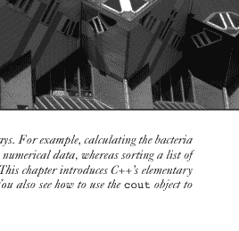

> C++程序可以以不同方式处理不同类型的数据。例如，计算受污染池塘中的细菌增长需要对数值数据进行数学运算，而对姓名列表进行排序则需要对字母数据进行比较运算。本章介绍C++的基本数据类型以及可对其执行的操作。你还将了解如何使用cout对象来显示这些操作的结果。

### 2.1 数据类型

所有程序的目标都是处理数据，无论是数值、字母、音频还是视频数据。这一目标的核心在于将数据分类为特定类型。例如，计算银行余额的应付利息需要对数值数据进行数学运算，而按字母顺序排列姓名列表需要对基于字符的数据进行比较运算。此外，某些操作不适用于特定类型的数据。例如，将姓名相加是没有意义的。为防止程序员尝试执行不当操作，C++仅允许对特定类型的数据执行特定操作。


每种类型所允许的数据类型以及每种类型允许的操作被称为数据类型。从形式上讲，数据类型被定义为一组值以及可以应用于这些值的一组操作。例如，所有整数（整型）数字的集合构成一组值。然而，这组数字在包含一组操作之前并不构成数据类型。这些操作当然是我们熟悉的数学运算和比较运算。一组值加上操作的组合就构成了真正的数据类型。

C++将数据类型分为类类型和内置类型。类数据类型（简称为“类”）是程序员创建的数据类型。这意味着程序员既定义了可接受的值，也定义了操作，这种类型将在本书第二部分讨论。

内置数据类型作为编程语言的一个组成部分提供。内置数据类型也称为原始类型。C++的内置数值数据类型包括图2.1所示的基本数值类型和表2.1所列的操作。如表2.1所示，内置数据类型的大多数操作使用传统的数学符号。对于类数据类型，正如你在第二部分所见，大多数操作是以函数的形式提供的。

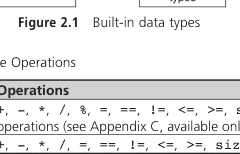

## 表2.1 内置数据类型操作

| 内置数据类型 | 操作 |
|---|---|
| 整数 | +, -, *, /, %, ==, !=, <=, >=, sizeof()，以及位操作（参见附录C，可在线获取） |
| 浮点数 | +, -, *, /, =, ==, !=, <=, >=, sizeof() |

字面值用于介绍C++中的内置数据类型。字面值是指值本身就能表明其含义的值。（字面值的另一个名称是字面量或常量。）例如，所有数字，如2、3.6和-8.2，都被称为字面值，因为它们直接显示其值。文本，如“Hello World!”，也被称为字面值，因为文本本身就被显示出来。你在生活中一直在使用字面值，但你知道它们是数字和单词。在第2.3节中，你会看到一些非字面值的例子——即那些不显示自身，而是通过标识符存储和访问的值。

## 整数数据类型

C++提供了九种内置整数数据类型，如图2.2所示。这些整数数据类型之间的本质区别在于每种类型使用的存储量，这影响了每种类型能够表示的值范围。在许多应用中，三种最重要且常见的类型是int、char和bool。其他类型是为了适应特殊情况（例如非常小或非常大的数字范围）而提供的，并因历史原因而保留。它们使程序员能够通过选择符合应用程序要求的最小内存量的数据类型来最大化内存使用。与今天的计算机相比，当计算机内存又小又贵时，内存使用量是一个主要问题。虽然对大多数程序来说这不再是问题，但这些类型仍然允许程序员在必要时优化内存使用。这种优化在工程应用中经常需要，例如家用电器和汽车中使用的控制系统。

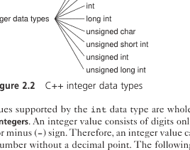

图2.2 C++整数数据类型

## int数据类型

int数据类型支持的值是整数，在数学上称为整数。整数值仅由数字组成，并且可选地以加号（+）或减号（-）开头。因此，整数值可以是数字0或任何不带小数点的正数或负数。以下是有效整数的示例：

0      -10      1000      -26351
5      +25      253       +36

如这些示例所示，整数可以包含显式符号。但是，不允许使用逗号、小数点或特殊符号，如美元符号，如下面这些无效整数的示例所示：

$255.62    3.      1,492.89
2,523      6,243,892    +6.0

编译器在每种数据类型中可以存储的最大（最正）和最小（最负）整数值的内部限制有所不同。¹最常见的存储分配是int数据类型为4字节，这将用于表示整数的值限制在-2,147,483,648到2,147,483,647之间。²

¹编译器施加的限制在limits头文件中找到，并定义为常量INT_MIN和INT_MAX。
²最负数的绝对值总是比最正数的绝对值大1。原因是整数的二进制补码存储方法，在第2.6节中描述。

## char数据类型

char数据类型用于存储单个字符，包括字母（大写和小写）、数字0到9以及特殊符号，如+ $ . , - 和 !。字符值是用单引号括起来的任何单个字母、数字或特殊符号，如以下示例所示：
'A' 'S' 'b' '7' 'y' '!' 'M' 'q'

字符值通常以ASCII或Unicode码存储在计算机中。ASCII（发音为“as-key”）是美国信息交换标准码的缩写。ASCII和Unicode码都将字符分配给特定的0和1模式。表2.2列出了ASCII位模式与小写和大写字母之间的对应关系。

## 表2.2 ASCII字母代码

| 小写字母 | 二进制代码 | 小写字母 | 二进制代码 | 大写字母 | 二进制代码 | 大写字母 | 二进制代码 |
|---|---|---|---|---|---|---|---|
| a | 01100001 | n | 01101110 | A | 01000001 | N | 01001110 |
| b | 01100010 | o | 01101111 | B | 01000010 | O | 01001111 |
| c | 01100011 | p | 01110000 | C | 01000011 | P | 01010000 |
| d | 01100100 | q | 01110001 | D | 01000100 | Q | 01010001 |
| e | 01100101 | r | 01110010 | E | 01000101 | R | 01010010 |
| f | 01100110 | s | 01110011 | F | 01000110 | S | 01010011 |
| g | 01100111 | t | 01110100 | G | 01000111 | T | 01010100 |
| h | 01101000 | u | 01110101 | H | 01001000 | U | 01010101 |
| i | 01101001 | v | 01110110 | I | 01001001 | V | 01010110 |
| j | 01101010 | w | 01110111 | J | 01001010 | W | 01010111 |
| k | 01101011 | x | 01111000 | K | 01001011 | X | 01011000 |
| l | 01101100 | y | 01111001 | L | 01001100 | Y | 01011001 |
| m | 01101101 | z | 01111010 | M | 01001101 | Z | 01011010 |

较新的Unicode码用于国际应用程序，因为它除了英语之外，还容纳了几乎所有语言的字符集。由于前256个Unicode码与完整的256个ASCII码（加上八个前导0）的二进制码相同，因此你无需担心英语字符使用哪种存储代码。

使用表2.2，你可以确定例如字符'B'、'A'、'R'、'T'、'E'和'R'如何使用ASCII码存储在计算机中。这六个字符的序列需要6字节的存储空间（每个字母1字节），并按图2.3所示存储。（如果你不熟悉字节的概念，请复习第2.6节。）


## 转义字符

正如你在第1.3节中所见，反斜杠（\）在C++中作为转义字符具有特殊含义。当反斜杠放在一组字符前面时，它告诉编译器转义这些字符通常被解释的方式。反斜杠和这些字符的组合称为转义序列。表2.3列出了C++中最常见的转义序列。

## 表2.3 转义序列

| 转义序列 | 表示的字符 | 含义 | ASCII代码 |
|---|---|---|---|
| \n | 换行 | 移动到新行 | 00001010 |
| \t | 水平制表符 | 移动到下一个水平制表位 | 00001001 |
| \v | 垂直制表符 | 移动到下一个垂直制表位 | 00001011 |
| \b | 退格 | 向后移动一个空格 | 00001000 |
| \r | 回车 | 将光标移动到当前行的开头；用于覆盖打印 | 00001101 |
| \f | 换页 | 发出换页 | 00001100 |
| \a | 警报 | 发出警报（通常是铃声） | 00000111 |
| \\ | 反斜杠 | 插入反斜杠字符（用于在字符串中放置实际的反斜杠字符） | 01011100 |
| \? | 问号 | 插入问号字符 | 00111111 |
| \' | 单引号 | 插入单引号字符（用于在一组外单引号内放置内部单引号） | 00100111 |
| \" | 双引号 | 插入双引号字符（用于在一组外双引号内放置内部双引号） | 00100010 |
| \nnn | 八进制数 | 将数字nnn（n是数字）视为八进制数 | 取决于nnn |
| \xhhhh | 十六进制数 | 将数字hhhh（h是数字）视为十六进制数 | 取决于hhhh |
| \0 | 空字符 | 插入空字符，其定义为值为0 | 00000000 |

虽然表2.3中的每个转义序列由两个字符组成，但这些字符的组合（中间没有空格）会使编译器创建表中列出的单个ASCII代码。

## bool数据类型

在C++中，bool数据类型用于表示布尔（逻辑）数据，因此它仅限于两个值之一：true或false。当程序必须检查条件并根据条件采取规定的行动过程时，这种数据类型最为有用。


## 信息要点

### 字符 `\n` 与字符串 "\n"

编译器将 `\n` 和 "\n" 都识别为包含换行符。区别在于所使用的数据类型。形式上，`\n` 是字符字面量，而 "\n" 是字符串字面量。从实际角度来看，两者产生的效果相同：输出显示中会强制换行。然而，当遇到字符值 `\n` 时，编译器会使用 ASCII 码 00001010（见表 2.3）进行转换。当遇到字符串值 "\n" 时，编译器使用相同的字符代码进行转换，但会额外添加字符串结束字符 `\0` 的代码，即 00000000。

良好的编程实践要求在最后的输出显示末尾加上换行转义序列。这种做法可以确保一个程序的第一行输出不会出现在先前执行程序所显示的最后一行上。

程序 2.1 的输出依赖于编译器，这意味着每个编译器都会报告其为目标数据类型分配的存储空间大小。例如，在使用 Microsoft 当前 Visual C++ 编译器运行的计算机上，会产生以下输出：

| 数据类型 | 字节数 |
|-----------|-------|
| int       | 4     |
| char      | 1     |
| bool      | 1     |

对于这一输出（几乎所有当前 C++ 编译器都提供这种典型存储空间），你可以确定每种数据类型可存储的值的范围。然而，要做到这一点，需要理解有符号数据类型和无符号数据类型之间的区别，这将在下一节中讨论。

## 有符号和无符号数据类型

有符号数据类型允许存储负值、0 和正值，因此 int 是一种有符号数据类型。无符号数据类型仅提供非负值（即 0 和正值）。某些应用只需要无符号数值。例如，许多日期应用程序以数值形式 yearmonthday 存储日期（例如，将 12/25/2011 存储为 20111225），并且只关注公元 0 年之后的日期。对于这些从不需要负值的应用，可以使用无符号数据类型。

所有无符号整数类型（例如 unsigned int）提供的正值范围，在所有实际用途上，都是其对应有符号类型范围的两倍。这种额外的正值范围是通过将其有符号版本的负值范围用于额外的正数来实现的。

表 2.4 列出了当前 C++ 编译器对其有符号和无符号整数数据类型支持的整数值范围。正如你所看到的，long int 与 int 使用相同的存储空间（4 字节）。ANSI C++ 标准的唯一要求是：int 必须至少提供与 short int 相同的存储空间，而 long int 必须至少提供与 int 相同的存储空间。在早期内存容量仅限于数千字节的台式计算机上，这是一个重要的考虑因素。

## 表 2.5 浮点数据类型

| 类型 | 存储空间 | 绝对数值范围（正负） |
|---|---|---|
| float | 4 字节 | 1.40129846432481707×10⁻⁴⁵ 到 3.40282346638528860×10³⁸ |
| double 和 long double | 8 字节 | 4.94065645841246544×10⁻³²⁴ 到 1.79769313486231570×10³⁰⁸ |

在编译器中，如果 double 和 long double 使用相同的存储空间，那么这两种数据类型是相同的。（程序 2.1 中的 sizeof() 运算符始终可以用来确定你的编译器为这些数据类型保留的存储空间。）float 字面量通过在数字后附加 f 或 F 来表示，long double 通过在数字后附加 l 或 L 来创建。如果没有这些后缀，浮点数默认为 double。例如，请看以下内容：

- 9.234 表示 double 字面量。
- 9.234F 表示 float 字面量。
- 9.234L 表示 long double 字面量。

这些数字的唯一区别在于计算机可以用于它们的存储空间大小。附录 D（在线提供）描述了浮点数的二进制存储格式及其对数字精度的影响。

## 指数记数法

浮点数也可以用指数记数法书写，这类似于科学记数法，通常用于以紧凑形式表示非常大和非常小的值。以下示例展示了带有小数的数字如何用指数记数法和科学记数法表示：

| 十进制记数法 | 指数记数法 | 科学记数法 |
|---|---|---|
| 162.5 | 1.625e2 | 1.625 × 10² |
| 63421. | 6.3421e4 | 6.3421 × 10⁴ |
| .00731 | 7.31e-3 | 7.31 × 10⁻³ |
| .000625 | 6.25e-4 | 6.25 × 10⁻⁴ |

在指数记数法中，字母 e 代表“指数”。e 后面的数字表示 10 的幂，并指示小数点应移动多少位才能得到标准十进制值。如果 e 后的数字为正，则小数点向右移动；如果 e 后的数字为负，则小数点向左移动。例如，1.625e2 中的 e2 表示将小数点向右移动两位，因此该数字变为 162.5。7.31e-3 中的 e-3 表示将小数点向左移动三位，因此 7.31e-3 变为 .00731。

某些记数法在计算机应用中频繁出现，以至于它们拥有自己的符号。表 2.6 列出了这些符号中最常用的部分。

## 信息要点

### 什么是精度？

在数值理论中，术语“精度”通常指数值的准确度。在此上下文中，“该计算结果精确到小数点后第五位”意味着小数点后第五位已经四舍五入，并且该数字的准确度在 ±0.00005 以内。

在计算机编程中，“精度”可以指数字的准确度或有效数字的个数；有效数字定义为明确正确的数字个数加 1。例如，如果数字 12.6874 已四舍五入到小数点后第四位，那么可以说该数字精确到小数点后第四位。换句话说，除了第四位小数已四舍五入外，该数字中的所有数字都是准确的。类似地，同一个数字的精度为六位有效数字，这意味着前五位数字是正确的，第六位已四舍五入。另一种说法是，数字 12.6874 有六位有效数字。

数字中的有效数字不必与显示的数字位数有任何关系。例如，如果数字 687.45678921 有五位有效数字，那么它仅精确到 687.46；最后一位数字假定为已四舍五入。类似地，大型金融应用中的美元金额通常四舍五入到最接近的十万美元。在这些应用中，例如，显示的美元金额 $12,400,000 并不精确到最接近的美元。如果将此值指定为具有三位有效数字，则它仅精确到十万位数字。

## 表 2.6 指数和科学符号名称

| 指数记数法 | 科学记数法 | 符号 | 名称 |
|---|---|---|---|
| e-12 | 10⁻¹² | p | 皮（pico） |
| e-9 | 10⁻⁹ | n | 纳（nano） |
| e-6 | 10⁻⁶ | µ | 微（micro） |
| e-3 | 10⁻³ | m | 毫（milli） |
| e3 | 10³ | k | 千（kilo） |
| e6 | 10⁶ | M | 兆（mega） |
| e9 | 10⁹ | G | 吉（giga） |
| e12 | 10¹² | T | 太（tera） |

例如，闪存盘的存储容量目前以吉字节（GB）为单位指定，这意味着它们包含数十亿（10⁹）字节。类似地，计算机处理速度以纳秒（nsec）范围指定，即十亿分之一（10⁻⁹）秒。

## 练习 2.1

1.（实践）为以下数据确定合适的数据类型：
   - a. 四门成绩的平均值
   - b. 一个月的天数
   - c. 金门大桥的长度
   - d. 州彩票中的数字
   - e. 从纽约州布鲁克林到新泽西州纽瓦克的距离
   - f. 用于指定元件类型的单字符前缀

2.（实践）编译并运行程序 2.1。

3.（修改）修改程序 2.1，以确定你的编译器为所有 C++ 整数数据类型使用的存储空间。

4.（实践）通过绘制类似于前面所示的图 2.3 的图表，显示名字 KINGSLEY 在使用 ASCII 码的计算机中是如何存储的。

5.（实践）使用你自己姓氏的字母重复练习 4。

6.（修改）修改程序 2.1，以确定你的编译器为 float、double 和 long double 数据类型分配的字节数。

7.（实践）将以下数字从指数形式转换为标准十进制形式：
   - a. 6.34e5
   - b. 1.95162e2
   - c. 8.395e1
   - d. 2.95e-3
   - e. 4.623e-4

8.（实践）将以下数字从科学记数法转换为标准十进制形式：
   - a. 2.67 × 10³
   - b. 2.67 × 10⁻³
   - c. 1.872 × 10⁹
   - d. 1.872 × 10⁻⁹
   - e. 6.6256 × 10⁻³⁴

9.（实践）将以下十进制数字写成科学记数法：
   - a. 126.
   - b. 656.23
   - c. 3426.95
   - d. 4893.2
   - e. .321
   - f. .0123
   - g. .006789


10. （思考）由于计算机对存储整数、浮点数、双精度数和字符值使用不同的表示方法，请讨论程序如何提醒计算机它将使用不同值的 数据类型。

11. （思考）虽然你集中于整数和浮点数运算，但 C++ 允许对字符和整数进行加法和减法运算。（这些运算之所以可行，是因为字符是整数数据类型，并使用整数代码存储。）因此，字符和整数可以在算术表达式中混合使用。例如，如果你的计算机使用 ASCII 代码，表达式 'a' + 1 等于 'b'，而 'z' - 1 等于 'y'。同样，'A' + 1 是 'B'，'Z' - 1 是 'Y'。以此信息为背景，确定以下表达式的字符结果。（假设所有字符均使用 ASCII 代码存储。）

+   a. 'm' - 5
+   b. 'm' + 5
+   c. 'G' + 6
+   d. 'G' - 6
+   e. 'b' + 7
+   f. 'g' - 1
+   g. 'G' - 1

> 注：要完成以下练习，你需要理解基本的计算机存储概念。具体而言，如果你不熟悉字节和字的概念，请在进行下一练习前参阅第 2.6 节。

12. （练习）虽然总字节数因计算机而异，但 65,536 到数百万字节以上的内存容量很常见。在计算机语言中，字母 K 代表数字 1024，即 2 的 10 次方，M 代表数字 1,048,576，即 2 的 20 次方。因此，640 KB 的内存大小实际上是 640 倍的 1024（655,360 字节），而 4 MB 的内存大小实际上是 4 倍的 1,048,576（4,194,304 字节）。利用此信息，计算以下内容的实际字节数：

+   a. 包含 512 MB 的内存
+   b. 由 256 MB 字组成的内存，每个字由 2 字节组成
+   c. 由 256 MB 字组成的内存，每个字由 4 字节组成
+   d. 标称 2 MB 的拇指驱动器
+   e. 标称 250 MB 的磁盘
+   f. 标称 8 GB 的磁盘（提示：参见表 2.6。）

## 2.2 算术运算

上一节介绍了 C++ 内置数据类型的对应数据值。本节解释可应用于这些值的算术运算。

整数和实数可以相加、相减、相乘和相除。虽然在进行算术运算时最好不要混合整数和实数，但在使用不同数据类型进行同一算术表达式时可以得到可预测的结果。

令人惊讶的是，你可以对字符数据进行加法和减法运算，并将其与整数数据混合以产生有用的结果。（例如，'A' + 1 的结果为字符 'B'。）这些运算之所以可能，是因为字符使用整数代码存储。

以下用于算术运算的运算符称为算术运算符：

| 操作 | 运算符 |
|---|---|
| 加法 | + |
| 减法 | - |
| 乘法 | * |
| 除法 | / |
| 取模除法³ | % |

这些运算符也称为二元运算符，这意味着运算符需要两个操作数来产生结果。操作数可以是字面值或具有关联值的标识符。简单的二元算术表达式由二元运算符连接两个字面值构成，形式如下：

```
literalValue operator literalValue
```

简单的二元算术表达式示例包括以下内容：

+   3 + 7
+   8 - 3
+   12.62 + 9.8
+   0.08 * 12.2
+   12.6 / 2

这些示例中算术运算符周围的空格严格是为了清晰而插入的，可以省略而不影响表达式的值。然而，C++ 中的表达式必须以直线形式输入，如这些示例所示。例如，C++ 表达式等价于 12.6 除以 2 必须输入为 12.6 / 2，而不是以这里所示的代数表达式形式输入：


你可以使用 cout 显示任何算术表达式的值。为此，该值必须发送到对象。例如，以下语句产生显示 21：

```
cout << (6 + 15);
```

严格来说，包围表达式 6 + 15 的括号并非必需，以指示表达式的值（即 21）正在被显示。⁴ 除了显示数值外，cout 还可以显示标识输出的字符串，如第 2.1 节中所做的那样。例如，以下语句将两条数据，一条字符串和一个值，发送到 cout：

```
cout << "The sum of 6 and 15 is " << (6 + 15);
```

发送到 cout 的每条数据都必须以其自己的插入运算符 << 为前缀。在前面的示例中，首先发送用于显示的数据是字符串 "The sum of 6 and 15 is "，第二项发送的是表达式 6 + 15 的值。此语句产生以下显示：

The sum of 6 and 15 is 21

单词 "is" 与数字 21 之间的空格是由发送到 cout 的字符串中的空格引起的。就 cout 而言，其输入是一组按接收顺序显示的字符。输入中的字符排队，一个接一个地发送到屏幕显示。在输入中放置空格会使空格成为显示的字符流的一部分。例如，语句

```
cout << "The sum of 12.2 and 15.754 is " << (12.2 + 15.754);
```

产生以下显示：

The sum of 12.2 and 15.754 is 27.954

当向 cout 发送多个插入时，代码可以分布在多行中。然而，只能使用一个分号，它放在最后一个插入之后并终止完整的语句。因此，前面的显示也由以下跨两行的语句产生：

```
cout << "The sum of 12.2 and 15.754 is "
<< (12.2 + 15.754);
```

当你允许语句跨越多行时，必须遵循两条规则：用引号括起来的字符串不能跨行拆分，并且终止分号应仅出现在最后一行。你始终可以在一行中放置多个插入符号。

如果浮点数有六个或更少的十进制数字，则使用足够的十进制位数来容纳数字的小数部分显示。如果数字有超过六个十进制数字，则小数部分四舍五入到六个十进制数字，如果数字没有十进制数字，则不显示小数点或任何十进制数字。⁵

程序 2.2 说明了在完整程序的上下文中使用 cout 显示算术表达式的结果。

## 程序 2.2

```
#include <iostream>
using namespace std;

int main()
{
    cout << "15.0 plus 2.0 equals " << (15.0 + 2.0) << endl
         << "15.0 minus 2.0 equals " << (15.0 - 2.0) << endl
         << "15.0 times 2.0 equals " << (15.0 * 2.0) << endl
         << "15.0 divided by 2.0 equals " << (15.0 / 2.0) << endl;

    return 0;
}
```

程序 2.2 的输出如下：

```
15.0 plus 2.0 equals 17
15.0 minus 2.0 equals 13
15.0 times 2.0 equals 30
15.0 divided by 2.0 equals 7.5
```

程序 2.2 中使用的唯一新项目是 endl，它是 C++ 操纵符的示例。操纵符是用于更改输出字符流显示方式的项目。特别是，endl 操纵符首先在显示中插入换行字符（'\n'），然后强制所有当前插入立即显示，而不是等待更多数据。（第 3.2 节列出了最常用的操纵符。）

## 表达式类型

表达式是任何可求值为值的运算符和操作数的组合。仅包含整数值作为操作数的表达式称为整数表达式，表达式的结果是整数值。同样，仅包含浮点值（单精度和双精度）作为操作数的表达式称为浮点表达式（也称为“实数表达式”），表达式的结果是浮点值。包含整数值和浮点值的表达式称为混合模式表达式。在算术运算中混合整数和浮点值时，每个运算的数据类型由以下规则确定：

+   - 如果两个操作数都是整数，则运算结果为整数。
+   - 如果一个操作数是实数值，则运算结果为双精度值。

算术表达式的结果永远不是单精度（float）数字。这是因为在执行期间，C++ 程序在评估算术表达式时会暂时将所有单精度数字转换为双精度数字。


# 信息点

## endl 操纵符

在许多系统上，endl 操纵符（源自术语“end line”）和 \n 转义序列的处理方式相同，产生的效果也一样。唯一的例外是在输出在内部累积，直到收集到足够多的字符才一次性在屏幕上显示的系统上。在这些被称为“缓冲”的系统上，endl 操纵符会强制所有累积的输出立即显示，而不会等待更多字符填满缓冲区后再打印。从实际角度来看，你在最终显示上不会注意到差异。作为一般规则，只要 \n 可以包含在现有字符串中，就使用 \n 转义序列，而当 \n 会单独出现或为了正式表示特定输出组的结束时，就使用 endl 操纵符。

尽管这一点与本章的工作没有直接关系，但值得注意的是，加法、减法、乘法和除法的算术运算对于整数和浮点值而言实际上是不同实现的。从这个意义上说，算术运算符被认为是“重载”的。更正式地说，重载运算符是指其实际实现取决于所遇到的操作数的类型。在第二部分，当你看到如何修改运算符的执行方式时，你将需要这种重载能力。

## 整数除法

两个整数值的除法对于不熟悉的人来说可能会产生相当奇怪的结果。例如，表达式 15/2 产生整数结果 7。因为整数不能包含小数部分，所以值 7.5 无法得到。当两个整数相除时产生的分数部分——余数——总是被丢弃（截断）。因此，9/4 的值为 2，20/3 的值为 6。

然而，通常你需要保留整数除法的余数。为此，C++ 提供了取模运算符（也称为“余数运算符”），其符号为 %。该运算符捕获整数除以整数时的余数；使用非整数值与取模运算符会导致编译器错误。以下示例展示了取模运算符的用法：

- 9 % 4 为 1（9 除以 4 的余数为 1）
- 17 % 3 为 2（17 除以 3 的余数为 2）
- 15 % 4 为 3（15 除以 4 的余数为 3）
- 14 % 2 为 0（14 除以 2 的余数为 0）

## 求反

除了二元运算符外，C++ 还提供了单目运算符，它们作用于单个操作数。其中一个单目运算符使用与二元减法相同的符号（-）。使用此单目运算符时，单个数值前面的减号会否定（反转该数字的符号）该数字。

表 2.7 总结了迄今为止描述的六种算术运算，并根据所涉及操作数的数据类型列出了每个运算符产生的结果的数据类型。

### 表 2.7 算术运算符摘要

| Operation | Operator Symbol | Type | Operand(s) | Result |
|---|---|---|---|---|
| Addition | + | Binary | Both are integers | Integer |
| | | | One operand is not an integer | Double-precision |
| Subtraction | - | Binary | Both are integers | Integer |
| | | | One operand is not an integer | Double-precision |
| Multiplication | * | Binary | Both are integers | Integer |
| | | | One operand is not an integer | Double-precision |
| Division | / | Binary | Both are integers | Integer |
| | | | One operand is not an integer | Double-precision |
| Modulus | % | Binary | Both are integers | Integer |
| | | | One operand is not an integer | Compiler error |
| Negation | - | Unary | Integer or double | Same as operand |

## 运算符优先级和结合性

除了简单的表达式，如 5 + 12 和 .08 * 26.2，你还可以创建更复杂的算术表达式。C++ 与大多数其他编程语言一样，在编写包含多个算术运算符的表达式时要求遵循某些规则：

- 两个二元运算符符号绝不能并排放置。例如，5 * % 6 是无效的，因为两个运算符 * 和 % 彼此相邻放置。
- 可以使用括号形成分组，所有括在括号中的表达式都会首先求值。这样，你可以使用括号将求值更改为任何顺序。例如，在表达式 (6 + 4) / (2 + 3) 中，6 + 4 和 2 + 3 首先求值得到 10 / 5。然后 10 / 5 求值得到 2。
- 括号可以被其他括号包含。例如，表达式 (2 * (3 + 7) ) / 5 是有效的并求值为 4。当括号包含在括号内时，最内层的括号中的表达式总是首先求值。求值从最内层到最外层括号继续，直到所有括号内的表达式都已求值。右括号 ) 的数量必须始终等于左括号 ( 的数量，以便不存在未配对的集合。
- 括号不能用于表示乘法；相反，必须使用乘法运算符 *。例如，表达式 (3 + 4) (5 + 1) 是无效的。正确的表达式是 (3 + 4) * (5 + 1)。

括号应指定操作数的逻辑分组，并向编译器和程序员清楚地表明算术运算的预期顺序。虽然括号内的表达式总是首先求值，但包含多个运算符的表达式，无论是否括在括号中，都将按运算符的优先级或 precedence 进行求值。有三个优先级级别：

1. P1—所有求反操作首先执行。
2. P2—乘法、除法和取模运算接下来计算。包含多个乘法、除法或取模运算符的表达式将从左到右按遇到每个运算符的顺序求值。例如，在表达式 35 / 7 % 3 * 4 中，所有操作具有相同的优先级，因此操作按从左到右的顺序执行。先进行除法，得到表达式 5 % 3 * 4。接下来执行取模运算 5 % 3，得到结果 2。最后计算表达式 2 * 4 得到 8。
3. P3—加法和减法最后计算。包含多个加法或减法的表达式将从左到右按遇到每个运算符的顺序求值。

除了优先级之外，运算符还有结合性，即相同优先级的运算符求值的顺序，如规则 P2 所描述。例如，表达式 6.0 * 6 / 4 是否产生 9.0，即 (6.0 * 6) / 4，还是 6.0，即 6.0 * (6 / 4)？答案是 9.0，因为 C++ 的运算符使用 C 风格的结合性，如一般数学中那样，按规则 P2 指示从左到右求值乘法。

表 2.8 列出了本节讨论的运算符的优先级和结合性。正如你所见，运算符的优先级确定了它相对于所有其他运算符的优先级。表 2.8 顶部 的运算符比表底部的运算符具有更高的优先级。在包含多个不同优先级运算符的表达式中，优先级较高的运算符先于优先级较低的运算符使用。例如，在表达式 6 + 4 / 2 + 3 中，因为除法运算符的优先级（P2）高于加法运算符，所以先进行除法，得到中间结果 6 + 2 + 3。然后从左到右执行加法，得到最终结果 11。

### 表 2.8 运算符优先级和结合性

| Operator | Associativity |
|---|---|
| Unary – | Right to left |
| * / % | Left to right |
| + – | Left to right |

最后，看看如何使用表 2.8 中显示的优先级规则来求值包含不同优先级运算符的表达式，例如 8 + 5 * 7 % 2 * 4。因为乘法和取模运算符的优先级高于加法运算符，


这两个运算会先根据其从左到右的结合性被求值（P2），然后才计算加法（P3）。因此，整个表达式的求值过程如下：

```
8 + 5 * 7 % 2 * 4 =
  8 + 35 % 2 * 4 =
      8 + 1 * 4 =
          8 + 4 = 12
```

## 练习 2.2

1.（练习）对于以下正确的代数表达式和对应的错误 C++ 表达式，找出错误并写出正确的 C++ 表达式：

代数式
 a. (2)(3) + (4)(5)
 b. (6 + 18)/2
 c. 4.5/(12.2 - 3.1)
 d. 4.6(3.0 + 14.9)
 e. (12.1 + 18.9)(15.3 - 3.8)

 C++ 表达式
 (2)(3) + (4)(5)
 6 + 18 / 2
 4.5 / 12.2 - 3.1
 4.6 (3.0 + 14.9)
 (12.1 + 18.9) (15.3 - 3.8)

2.（练习）确定以下整数表达式的值：

+   a. 3 + 4 * 6
+    b. 3 * 4 / 6 + 6
+    c. 2 * 3 / 12 * 8 / 4
+    d. 10 * (1 + 7 * 3)
+    e. 20 - 2 / 6 + 3
+    f. 20 - 2 / (6 + 3)
+    g. (20 - 2) / 6 + 3
+    h. (20 - 2) / (6 + 3)
+    i. 50 % 20
+    j. (10 + 3) % 4

3.（练习）确定以下浮点表达式的值：

+   a. 3.0 + 4.0 * 6.0
+    b. 3.0 * 4.0 / 6.0 + 6.0
+    c. 2.0 * 3.0 / 12.0 * 8.0 / 4.0
+    d. 10.0 * (1.0 + 7.0 * 3.0)
+    e. 20.0 - 2.0 / 6.0 + 3.0
+    f. 20.0 - 2.0 / (6.0 + 3.0)
+    g. (20.0 - 2.0) / 6.0 + 3.0
+    h. (20.0 - 2.0) / (6.0 + 3.0)

9.（桌面检查）确定以下程序的输出：

```
#include <iostream>
using namespace std;
int main() // 一个演示 % 运算符的程序
{
cout << "The remainder of 9 divided by 4 is " << 9 % 4;
cout << "\nThe remainder of 17 divided by 3 is " << 17 % 3;

return 0;
}
```

10.（编程）编写一个 C++ 程序，显示表达式 3.0 * 5.0、7.1 * 8.3 - 2.2 和 3.2 / (6.1 * 5) 的结果。手动计算这些表达式的值，以验证显示的值是否正确。

11.（编程）编写一个 C++ 程序，显示表达式 15 / 4、15 % 4 和 5 * 3 - (6 * 4) 的结果。手动计算这些表达式的值，以验证显示的值是否正确。

## 2.3 变量与声明

程序中使用的所有整数、浮点数和其他值都存储在计算机的内存中，并从内存中取出。从概念上讲，内存中的位置就像大型酒店中的房间一样排列，每个内存位置都有一个唯一的地址，就像酒店的房间号一样。在 C++ 等高级语言出现之前，内存位置是通过其地址来引用的。例如，将整数值 45 和 12 存储到内存位置 1652 和 2548（参见图 2.4）需要相当于以下指令：

将 45 放入位置 1652
将 12 放入位置 2548


图 2.4 足以存储两个整数的存储空间

### 数据类型、声明和显示

要将刚存储的两个数字相加并将结果保存到另一个内存位置（例如 3000），你需要如下指令：

> **将位置 1652 的内容**  
> **与位置 2548 的内容相加**  
> **并将结果存储到位置 3000**

显然，这种存储和检索方法很繁琐。在 C++ 等高级语言中，使用符号名称（称为**变量**）来代替内存地址。变量只是程序员指定用来引用计算机存储位置的名称。之所以使用“变量”一词，是因为分配给变量的内存位置中存储的值可以改变或变化。对于程序员使用的每个名称，计算机会跟踪与该名称对应的内存地址。在酒店房间的类比中，这相当于在房间门上贴一个名字，并用这个名字来指代房间，例如称其为“蓝色房间”而不是“205 房间”。

在 C++ 中，变量名的选择由程序员决定，只要遵守以下规则：

+   - 变量名必须以字母或下划线 (_) 开头，并且只能包含字母、下划线或数字。它不能包含空格、逗号或特殊符号，例如 ( ) & , $ # ! . ?。使用首字母大写来分隔由多个单词组成的名称。
+   - 变量名不能是关键字（参见表 1.1）。

这些规则与选择函数名的规则类似。与函数名一样，变量名应该是助记符，能够暗示变量的用途。对于用于存储其他值总和的值，一个好的名称是 sum 或 total。不指示存储值的变量名（例如 r2d2、linda 和 getum）不应使用。与函数名一样，变量名可以由大写和小写字母组成。

假设图 2.5 中显示的第一个内存位置（地址为 1652）被命名为 num1。内存位置 2548 被赋予变量名 num2，内存位置 3000 被赋予变量名 total。

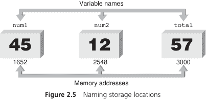

### 信息点

### 原子数据

到目前为止声明的所有变量都用于存储原子数据值。原子数据值被视为一个完整的实体，不能分解为语言支持的更小的数据类型。例如，虽然整数可以分解为单独的数字，但 C++ 没有数字类型。相反，每个整数都被视为一个完整的值，因此被认为是原子数据。由于整数数据类型仅支持原子数据值，因此它被称为原子数据类型。正如你可能预料的那样，double、char 和 bool 也是原子数据类型。

使用这些变量名，将 45 存储到位置 1652、将 12 存储到位置 2548 以及将这两个位置的内容相加的操作可以通过以下 C++ 语句完成：

```
num1 = 45;
num2 = 12;
total = num1 + num2;
```

这些语句中的每一个都称为赋值语句，因为它告诉计算机将值赋给（存储到）一个变量中。赋值语句总是有一个等号 (=)，并且等号左边紧挨着一个变量名。首先确定等号右边的值；然后将该值赋给等号左边的变量。赋值语句中的空格是为了提高可读性而插入的。赋值语句将在第 3 章中更详细地解释，但现在只需知道可以使用它们将值存储到变量中。

变量名很有用，因为它使程序员不必考虑数据在计算机中的物理存储位置。你只需使用变量名，让编译器去操心数据实际存储在内存中的哪个位置。然而，在将值存储到变量之前，C++ 要求明确声明要存储在该变量中的数据类型。你必须提前告诉编译器用于字符的变量名、用于整数的变量名以及用于存储其他 C++ 数据类型的变量名。

### 声明语句

要命名变量并指定可以存储在该变量中的数据类型，你需要使用声明语句，其一般形式如下：

```
dataType variableName;
```

在此形式中，dataType 指定一个有效的 C++ 数据类型，variableName 是你为变量选择的名称。例如，用于保存整数值的变量通过使用关键字 int 来指定数据类型来声明，其形式如下：

```
int variableName;
```

因此，以下声明语句将 sum 声明为能够存储整数值的变量名：

```
int sum;
```

此外，关键字 long 用于指定长整数。例如，语句

```
long datenum;
```

将 datenum 声明为用于存储长整数的变量。使用 long 限定符时，你还可以包含关键字 int，因此前面的声明也可以写成：

```
long int datenum;
```

用于保存单精度值的变量使用关键字 float 声明，用于保存双精度值的变量使用关键字 double 声明。例如，以下语句将 firstnum 声明为用于存储单精度数字的变量：

```
float firstnum;
```

类似地，以下语句声明变量 secnum 用于存储双精度数字：

```
double secnum;
```

虽然声明语句可以放置在函数中的任何位置，但通常它们会分组在一起并放置在函数的左花括号之后。但是，变量必须始终在使用之前声明，并且与所有 C++ 语句一样，声明语句必须以分号结尾。一个简单的 main() 函数，在函数左花括号之后紧跟声明语句，其一般形式如下：

```
#include <iostream>
using namespace std;

int main()
{
    声明语句;

    其他语句;

    return 0;
}
```

程序 2.3 使用此形式声明并使用了四个双精度变量，并使用 cout 对象显示其中一个变量的内容。


## 程序 2.3

```cpp
#include <iostream>
using namespace std;
int main()
{
    double grade1; // declare grade1 as a double variable
    double grade2; // declare grade2 as a double variable
    double total;  // declare total as a double variable
    double average; // declare average as a double variable

    grade1 = 85.5;
    grade2 = 97.0;
    total = grade1 + grade2;
    average = total/2.0; // divide the total by 2.0
    cout << "The average grade is " << average << endl;

    return 0;
}
```

程序 2.3 中声明语句的位置一目了然，不过你很快就会看到，这四条声明可以合并为一条声明语句。当程序 2.3 运行时，会显示以下输出：

```text
The average grade is 91.25
```

注意，当变量名被插入到 `cout` 语句中时，该变量中存储的值会被放到输出流中并显示出来。

正如整型和实型（单精度、双精度和长双精度）变量在使用前必须声明一样，用于存储单个字符的变量也必须声明。字符变量使用关键字 `char` 声明。例如，下面的声明指定 `ch` 是一个字符变量：

```cpp
char ch;
```

程序 2.4 演示了这一声明以及使用 `cout` 显示字符变量中存储的值。

## 程序 2.4

```cpp
#include <iostream>
using namespace std;

int main()
{
    char ch;    // this declares a character variable

    ch = 'a';   // store the letter a in ch
    cout << "The character stored in ch is " << ch << endl;
    ch = 'm';   // now store the letter m in ch
    cout << "The character now stored in ch is " << ch << endl;

    return 0;
}
```

当程序 2.4 运行时，会生成以下输出：

```text
The character stored in ch is a
The character now stored in ch is m
```

注意，存储在变量 `ch` 中的第一个字母是 `a`，第二个字母是 `m`。由于一个变量一次只能存储一个值，将 `m` 赋给该变量会自动覆盖 `a` 值。

## 多重声明

相同数据类型的变量总是可以组合在一起，使用一条声明语句进行声明，其常见形式如下：

```cpp
dataType variableList;
```

例如，程序 2.3 中使用的四条单独声明

```cpp
double grade1;
double grade2;
double total;
double average;
```

可以替换为下面这条单一声明语句：

```cpp
double grade1, grade2, total, average;
```

类似地，两个字符声明

```cpp
char ch;
char key;
```

可以替换为下面这条单一声明语句：

```cpp
char ch, key;
```

在一条声明语句中声明多个变量时，只需给出一次变量的数据类型，用逗号分隔所有变量名，并且只用一个分号结束声明。每个逗号后的空格是为了提高可读性而添加的，并非必需。

声明语句也可以用来在已声明的变量中存储值。例如，声明语句

```cpp
int num1 = 15;
```

既将变量 `num1` 声明为整型变量，又将值 15 存入该变量。当声明语句被用来向变量中存储值时，称该变量已被初始化。因此，在这个例子中，可以说变量 `num1` 已被初始化为 15。

类似地，下面的声明语句声明了三个双精度变量并初始化了其中两个：

```cpp
double grade1 = 87.0;
double grade2 = 93.5;
double total;
```

使用常量和/或先前已初始化变量的表达式也可以作为初始化器。因此，表达式 `87.5 - 3.0 * factor` 只有在 `factor` 已经声明并初始化的情况下才是有效的初始化器。此外，还可以使用一条声明语句进行多个初始化。不过，这些声明应当清晰，如果可能的话，尽量简短，例如声明 `int x, y=0, z=0;`。带有声明初始化的程序 2.3 变为程序 2.3a。

## 程序 2.3a

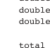

```cpp
#include <iostream>
using namespace std;

int main()
{
    double grade1 = 85.5;
    double grade2 = 97.0;
    double total, average;

    total = grade1 + grade2;
    average = total/2.0;  // divide the total by 2.0
    cout << "The average grade is " << average << endl;

    return 0;
}
```

注意最后一条声明语句之后的空行。在函数体顶部的变量声明之后插入一个空行是一种良好的编程习惯。它能改善程序的外观和可读性。

C++ 的一个有趣特性是，变量声明可以与其他语句交错排列，甚至可以包含在其他语句中；唯一的要求是变量必须在使用之前声明。例如，程序 2.3a 中的变量 `total` 原本可以在首次使用时用语句 `double total = grade1 + grade2;` 来声明。在受限情况下（例如第 4.7 节所述的调试，或第 5.3 节所述的 `for` 循环中），在首次使用时声明变量可能很有帮助。不过一般来说，最好不要分散声明；相反，应尽可能简洁清晰地将它们集中在每个函数的顶部。

## 内存分配

到目前为止你看到的声明语句既执行了软件任务，也执行了硬件任务。从软件的角度来看，声明语句总是提供变量及其数据类型的列表。在这种软件角色中，变量声明也有助于控制一种常见且麻烦的错误——在程序中拼错变量名。例如，假设使用以下语句声明并初始化了一个名为 `distance` 的变量：

```cpp
int distance = 26;
```

在程序稍后的地方，假设该变量在下面的语句中被无意中拼错了：

```cpp
mpg = distnce / gallons;
```

在不需要变量声明的语言中，程序会将 `distnce` 视为一个新变量，并为其赋予初始值 0，或者使用该变量存储区域中碰巧存在的任何值。无论哪种情况，都会计算出一个值并赋给 `mpg`，而要找到错误甚至知道发生了错误都可能很困难。然而，这些错误在 C++ 中是不可能发生的，因为编译器会将 `distnce` 标记为未声明的变量。当然，编译器无法检测一个已声明的变量被错误地键入为另一个已声明的变量的情况。

除了软件角色外，声明语句还可以执行硬件任务。由于每种数据类型都有其自身的存储需求，计算机只有在知道变量的数据类型后才能为变量分配足够的存储空间。变量声明提供了这些信息，因此它们可以用来强制编译器为每个变量预留足够的物理内存存储空间。用于此硬件任务的声明语句也称为定义语句，因为它们定义或告诉编译器数据存储需要多少内存。

### 图 2.6a 定义名为 total 的整型变量

```cpp
int total;
```

- 告诉计算机为整数预留足够的空间：4 字节
- 告诉计算机用名称 `total`“标记”预留存储区的第一个字节

### 图 2.6b 定义名为 firstnum 的单精度浮点变量

```cpp
float firstnum;
```

- 告诉计算机为单精度数字预留足够的空间：4 字节
- 告诉计算机用名称 `firstnum`“标记”预留存储区的第一个字节

### 图 2.6c 定义名为 secnum 的双精度变量

```cpp
double secnum;
```

- 告诉计算机为双精度数字预留足够的空间：8 字节
- 告诉计算机用名称 `secnum`“标记”预留存储区的第一个字节

### 图 2.6d 定义名为 key 的字符变量

```cpp
char key;
```

- 告诉计算机为字符预留足够的空间：1 字节
- 告诉计算机用名称 `key`“标记”预留存储区的第一个字节


在程序中声明变量后，通常程序员会使用它来引用变量的内容（其值）。值的内存位置通常对程序员来说无关紧要。然而，编译器必须知道每个值存储在哪里并正确定位每个变量。为此，编译器使用变量名来定位先前分配给该变量的存储区的第一个字节。知道变量的数据类型后，编译器就可以存储或检索正确数量的字节。

## EXERCISES 2.3

- 1. **（练习）** 判断以下变量名是否有效。如果无效，请说明原因。
  
  `prod_a`  `c1234`  `abcd`  `_c3`  `12345`
  `newbal`  `while`  `$total`  `new bal`  `a1b2c3d4`
  `9ab6`  `sum.of`  `average`  `grade1`  `finGrade`

- 2. **（练习）** 判断以下变量名是否有效。如果无效，请说明原因。另请指出哪些有效变量名不应该使用，因为它们无法传达有关变量的信息。
  
  `salestax` `a243` `r2d2` `firstNum` `cc_a1`
  `harry`  `sue`  `c3p0` `average` `sum`
  `maximum` `okay` `a`  `awesome` `goforit`
  `3sum`  `for`  `tot.a1` `c$five` `netpay`

- 3. **（练习）**
  a. 编写一条声明语句，声明变量 `count` 将用于存储整数。
  b. 编写一条声明语句，声明变量 `grade` 将用于存储浮点数。
  c. 编写一条声明语句，声明变量 `yield` 将用于存储双精度数。
  d. 编写一条声明语句，声明变量 `initial` 将用于存储字符。

- 4. **（练习）** 为每组变量编写一条声明语句：
  a. `num1`、`num2` 和 `num3` 用于存储整数
  b. `grade1`、`grade2`、`grade3` 和 `grade4` 用于存储双精度数
  c. `temp1`、`temp2` 和 `temp3` 用于存储双精度数
  d. `let1`、`let2`、`let3` 和 `let4` 用于存储字符

- 5. **（练习）** 为每组变量编写一条声明语句：
  a. `firstnum` 和 `secnum` 用于存储整数
  b. `price`、`yield` 和 `coupon` 用于存储双精度数
  c. `average` 用于存储双精度数

## 6. （修改）将以下每条声明语句重写为三个独立的声明：

- a. int month, day = 30, year;
- b. double hours, volt, power = 15.62;
- c. double price, amount, taxes;
- d. char inKey, ch, choice = 'f';

## 7. （桌面检查） a. 确定以下程序中的每个语句会引起什么操作：

```
#include <iostream>
using namespace std;
int main()
{
    int num1, num2, total;

    num1 = 25;
    num2 = 30;
    total = num1 + num2;
    cout << "The total of " << num1 << " and " << num2 << " is " << total << endl;

    return 0;
}
```

b. 当执行练习 7a 中的程序时，将显示什么输出？

## 8. （程序）编写一个 C++ 程序，将整数 12 和 33 的和存储在名为 sum 的变量中。让程序显示存储在 sum 中的值。

## 9. （程序）编写一个 C++ 程序，将整数值 16 存储在变量 length 中，将整数值 18 存储在变量 width 中。让程序使用以下公式计算分配给 perimeter 变量的值：

perimeter = 2 × (length + width)

程序随后应显示存储在 perimeter 中的值。务必在 main() 函数开头将所有变量声明为整数。

## 10. （程序）编写一个 C++ 程序，将整数值 16 存储在变量 num1 中，将整数值 18 存储在变量 num2 中。（务必将变量声明为整数。）让程序计算这些数字的总和及其平均值。将总和存储在名为 total 的整数变量中，将平均值存储在名为 average 的整数变量中。（使用语句 average = total/2.0; 来计算平均值。）使用 cout 语句显示 total 和 average。

## 11. （调试）输入、编译并运行以下程序。确定为什么显示了不正确的平均值并纠正错误。

```
#include <iostream>
using namespace std;

int main()
{
    int num1 = 15;
    int num2 = 18;
    int total, average;

    total = num1 + num2;
    average = total / 2.0;
    cout << "The average of " << num1
         << " and " << num2 << " is "
         << average << endl;

    return 0;
}
```

## 12. （调试）以下程序是为纠正练习 11 中程序产生的错误而编写的。确定为什么该程序仍然没有提供正确的结果并纠正错误。

```
#include <iostream>
using namespace std;

int main()
{
    int num1 = 15;
    int num2 = 18;
    int total;
    double average;

    total = num1 + num2;
    average = total / 2;
    cout << "The average of " << num1
         << " and " << num2 << " is "
         << average << endl;

    return 0;
}
```

## 13. （程序）编写一个 C++ 程序，将数字 105.62 存储在变量 firstnum 中，将 89.352 存储在变量 secondnum 中，将 98.67 存储在变量 thirdnum 中。（务必先将变量声明为 float 或 double。）让程序计算三个数字的总和及其平均值。总和应存储在变量 total 中，平均值存储在变量 average 中。（使用语句 average = total / 3.0; 来计算平均值。）使用 cout 语句显示 total 和 average。

## 14. （思考） a. 用来阐明正方形与矩形之间关系的语句是“所有正方形都是矩形，但并非所有矩形都是正方形。” 编写一个类似的语句来描述定义语句与声明语句之间的关系。
b. 为什么必须在 C++ 中使用变量的任何其他语句之前定义该变量？

> 注：练习 15 至 17 的假设：字符占用 1 字节存储，整数占用 4 字节，单精度数占用 4 字节，双精度数占用 8 字节。变量按声明顺序分配存储。（如果您不熟悉字节的概念，请复习第 2.6 节。）请参考图 2.7 进行这些练习。

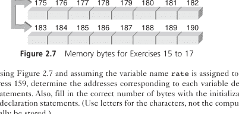

图 2.7 练习 15 至 17 的内存字节

## 15. （练习） a. 使用图 2.7 并假设变量名 rate 分配给内存地址 159 处的字节，确定以下语句中声明的每个变量对应的地址。另请填写包含在声明语句中的初始化数据所占用的正确字节数。（使用字母表示字符，而不是计算机实际存储的编码。）
float rate;
char ch1 = 'M', ch2 = 'E', ch3 = 'L', ch4 = 'T';
double taxes;
int num, count = 0;

b. 重复练习 15a，但将计算机使用 ASCII 编码存储字符到变量 ch1、ch2、ch3 和 ch4 中的实际字节模式替代。（提示：使用表 2.2。）

## 16. （练习） a. 使用图 2.7 并假设变量名 cn1 分配给内存地址 159 处的字节，确定以下语句中声明的每个变量对应的地址。另请填写包含在声明语句中的初始化数据所占用的正确字节数。（使用字母表示字符，而不是计算机实际存储的编码。）
char cn1 = 'B', cn2 = 'E', cn3 = 'R', cn4 = 'F', cn5 = 'E';
char cn6 = 'C', cn7 = 'T', key = '\\', sch = '\'', inc = 'A';
char inc1 = 'T';
b. 重复练习 16a，但将计算机使用 ASCII 编码存储字符到每个声明变量中的实际字节模式替代。（提示：使用表 2.2 和 2.3。）

## 17. （练习）使用图 2.7 并假设变量名 miles 分配给内存地址 159 处的字节，确定以下语句中声明的每个变量对应的地址：
float miles;
int count, num;
double dist, temp;

## 2.4 常见编程错误

本章材料相关的常见编程错误如下：

- 1. 忘记声明程序中使用的所有变量。编译器会检测到此错误，并为所有未声明的变量生成错误消息。
- 2. 尝试将一种数据类型存储到为不同类型声明的变量中。编译器不会检测到此错误。值将被转换为分配给它的变量的数据类型。
- 3. 在为变量分配值之前在表达式中使用变量。表达式求值时使用变量中恰好存在的值，因此表达式的结果毫无意义。
- 4. 错误地进行整数除法。此错误通常隐藏在更大的表达式中，可能难以检测。例如，表达式
  3.425 + 2/3 + 7.9
  产生的结果与表达式
  3.425 + 7.9
  相同，因为整数除法 2/3 的结果为 0。
- 5. 在同一表达式中混合数据类型而未清楚理解其影响。因为 C++ 允许包含“混合”数据类型的表达式，所以理解其顺序


evaluation and the data type of all intermediate calculations is important. These are the rules for evaluating the result of each binary operation:

+   - If both operands are integers, the result is an integer.
+   - If any operand is a real value, the result is a double-precision value.

As a general rule, it's better not to mix data types in an expression unless you want a specific effect.

6. Forgetting to separate data streams passed to cout with an insertion symbol, <<.

## 2.5 Chapter Summary

+   1. The four basic types of data C++ recognizes are integer, floating-point, character, and Boolean. Each data type is typically stored in a computer by using different amounts of memory.
+   2. The cout object can be used to display all C++ data types.
+   3. Every variable in a C++ program must be declared, and the type of value it can store must be specified. Declarations in a function can be placed anywhere in the function, although a variable can be used only after it's declared. Variables can also be initialized when they're declared. Additionally, variables of the same type can be declared with a single declaration statement. Variable declaration statements have this general form:
+   
+   dataType variableName(s);

4. A simple C++ program containing declaration statements has this typical form:

```
#include <iostream>
using namespace std;

int main()
{
    declaration statements;

    other statements;

    return 0;
}
```

+   5. Declaration statements always play the software role of informing the compiler of a function's valid variable names. When a variable declaration also causes the computer to set aside memory locations for the variable, the declaration statement is called a definition statement. (All declarations used in this chapter have also been definition statements.)
+   6. The sizeof() operator can be used to determine the amount of storage reserved for variables.

## 2.6 Chapter Supplement: Bits, Bytes, and Binary Number Representations

This section explains how numbers are stored in a computer's memory and different means of representing them.

### Bits and Bytes

The physical components used in manufacturing a computer require that numbers and letters in its memory not be stored with the same symbols people use. For example, the number 126 isn't stored with the symbols 1, 2, and 6, nor is the letter you recognize as an "A" stored with this symbol. This section explains the reasons for these storage requirements and how computers store numbers.

The smallest and most basic data item in a computer is called a bit (derived from the term "binary digit"). Physically, a bit is actually a switch that can be open or closed. The convention followed in this book is that the open position is represented as a 0, and the closed position is represented as a 1.

A single bit that can represent the values 0 and 1 has limited usefulness. All computers, therefore, group a set number of bits together for storage and transmission. Grouping 8 bits to form a larger unit, called a byte, is an almost universal computer standard. A single byte consisting of 8 bits, with each bit being a 0 or 1, can represent any one of 256 distinct patterns. These patterns consist of 00000000 (all eight switches open) to 11111111 (all eight switches closed). Each pattern can be used to represent a letter of the alphabet, a character (such as a dollar sign or comma), a single digit, or a number containing more than one digit. A collection of patterns used to represent letters, single digits, and other characters is called a character code. (One character code, called ASCII, was discussed in Section 2.1.) The patterns used to store numbers are called number codes, one of which, known as twos complement representation, is explained at the end of this section.

### Words and Addresses

In a computer's memory, bytes can be grouped into larger units, called words, to facilitate storage of larger values and to allow faster and more extensive data access. For example, retrieving a word consisting of 4 bytes from a computer's memory results in more information than retrieving a word consisting of a single byte. This type of retrieval is also much faster than four separate 1-byte retrievals. Achieving this increase in speed and capacity, however, requires increasing the computer's cost and complexity. Desktop and laptop computers currently use word sizes of 4 and 8 bytes.

The arrangement of words in a computer's memory can be compared with the arrangement of standard rooms in a large hotel. Just as each room has a unique room number to locate and identify it, each word has a unique numeric address. (In computers that allow accessing each byte separately, each byte has its own address.) Like room numbers, word and byte addresses are always unsigned whole numbers used for location and identification purposes. In addition, in the same way hotel rooms with connecting doors form larger suites, words can be combined to form larger units for accommodating data types of different sizes.

You can check the storage allocated for each integer data type discussed in this chapter and the range of values your compiler provides by using the identifier names listed in Table 2.9. To do this, you can inspect the limits header file for the definition of these identifiers or construct a C++ program to display these values. Program 2.5 shows how this storage check is accomplished.

### Table 2.9 Integer Data Type Storage

| Data Type | Range of Values | Identifier (in limits header file) | Storage Size (in bytes) |
|---|---|---|---|
| char | -128 to +127 | SCHAR_MIN, SCHAR_MAX | 1 |
| short int | -32,768 to +32,767 | SHRT_MIN, SHRT_MAX | 2 |
| int | -2,147,483,648 to +2,147,483,647 | INT_MIN, INT_MAX | 4 |
| long int | -2,147,483,648 to +2,147,483,647 | LONG_MIN, LONG_MAX | 4 |
| unsigned short int | 0 to 65,535 | USHRT_MAX | 2 |
| unsigned int | 0 to 4,294,967,295 | UINT_MAX | 4 |
| unsigned long int | 0 to 4,294,967,295 | ULONG_MAX | 4 |

### Program 2.5

```
#include <iostream>
#include <limits> //contains the maximum and minimum specifications
using namespace std;

int main()
{

cout << "The smallest character code is " << SCHAR_MIN << endl;
cout << "The largest character code is " << SCHAR_MAX << endl;
cout << sizeof(char) << " byte(s) are used to store characters\n";

cout << "\nThe smallest integer value is " << INT_MIN << endl;
cout << "The largest integer value is " << INT_MAX << endl;
cout << sizeof(int) << " byte(s) are used to store integers\n";

cout << "\nThe smallest short integer value is " << SHRT_MIN << endl;
cout << "The largest short integer value is " << SHRT_MAX << endl;
cout << sizeof(short) << " byte(s) are used to store short integers\n";

cout << "The smallest long integer value is " << LONG_MIN << endl;
cout << "The largest long integer value is " << LONG_MAX << endl;
cout << sizeof(long) << " byte(s) are used to store long integers\n";

return 0;
}
```

Program 2.5 produces the following output:

```
The smallest character code is -128
The largest character code is 127
1 byte(s) are used to store characters

The smallest integer value is -2147483648
The largest integer value is 2147483647
4 byte(s) are used to store integers

The smallest short integer value is -32768
The largest short integer value is 32767
2 byte(s) are used to store short integers

The smallest long integer value is -2147483648
The largest long integer value is 2147483647
4 byte(s) are used to store long integers
```

Notice that the displayed values correspond with those listed previously in Table 2.9.

### Binary, Hexadecimal, and Octal Numbers

The most common binary number code for storing integer values in a computer is called the twos complement representation. With this code, the integer decimal equivalent of any bit pattern, such as 10001101, is easy to determine and can be found for positive or negative integers with no change in the conversion method. For convenience, assume byte-sized bit patterns consisting of 8 bits each, although the procedure carries over to larger bit patterns.

The easiest way to determine the decimal integer each bit pattern represents is to construct a simple device called a value box. Figure 2.8 shows a value box for a single byte. Mathematically, each value in this box represents an increasing power of 2. Because twos complement numbers must be capable of representing both positive and negative integers, the leftmost position, in addition to having the largest absolute magnitude, has a negative sign.


Figure 2.8 An 8-bit value box


要将任意二进制数（如 10001101）转换为十进制整数值，只需将该位模式放入数值框中，并将下方为 1 的位所对应的数值相加。因此，如图 2.9 所示，位模式 10001101 表示十进制整数 -115。

| -128 | 64 | 32 | 16 | 8 | 4 | 2 | 1 |
| --- | --- | --- | --- | --- | --- | --- | --- |
| 1 | 0 | 0 | 0 | 1 | 1 | 0 | 1 |
| -128 + 0 + 0 + 0 + 8 + 4 + 0 + 1 = -115 |

**图 2.9 将 10001101 转换为十进制数**

数值框也可以反过来使用，将十进制整数转换为其等价的二进制位模式。事实上，有些转换可以直接通过观察得出。例如，十进制整数 -125 是由 -128 加上 3 得到的。因此，-125 的二进制表示为 10000011，即 -128 + 2 + 1。类似地，数字 40 的二进制补码表示为 00101000，即 32 + 8。

虽然数值框转换方法看起来简单得出奇，但它与二进制补码的数学基础密切相关。二进制补码最初的名称为“加权符号码”，这与数值框的概念相对应。正如“加权符号”这一名称所暗示的，每个二进制位都有一个权重或数值，等于 2 的某次幂，并带有一个符号。除最左侧位外，所有位的符号均为正，而最左侧位的符号为负。

通过观察数值框可以看出，任何以 1 开头的二进制补码都表示负数，而以 0 开头的位模式则表示正数。利用数值框，可以很容易地确定能够存储的最大正数和最小负数。单字节能存储的最小负数是十进制数 -128，其位模式为 10000000。任何其他非零位只会给该数增加一个正量。此外，正数的最左侧位必须为 0。由此可知，8 位二进制补码最大的正数是 01111111，即 127。

除了表示整数值外，计算机还必须存储和传输包含小数点的数字，这些数字在数学上被称为“实数”。附录 D（在线提供）列出了用于表示实数的二进制编码。

## 十六进制表示法

由于二进制数往往较长，因此通常使用更紧凑的十六进制表示法。例如，32 位二进制数 11110000101011001110001101111011 的十六进制表示为 F0ACE37B。

每个十六进制符号都代表一个特定的 4 位二进制模式。表 2.10 的前两列列出了每个十六进制符号与其 4 位二进制模式之间的对应关系。为方便起见，表中还提供了每个十六进制符号对应的十进制数值及其所表示的二进制数。利用此表，你可以将任意十六进制数转换为等价的二进制数，方法是用正确的 4 位二进制序列替换十六进制数中的每个十六进制符号。例如，图 2.10 展示了如何使用表 2.10 中的对应值将十六进制数 2D1F 转换为其等价的二进制数。

**表 2.10 十六进制到二进制的转换**

| 十六进制符号 | 二进制模式 | 十进制值 |
| --- | --- | --- |
| 0 | 0000 | 0 |
| 1 | 0001 | 1 |
| 2 | 0010 | 2 |
| 3 | 0011 | 3 |
| 4 | 0100 | 4 |
| 5 | 0101 | 5 |
| 6 | 0110 | 6 |
| 7 | 0111 | 7 |
| 8 | 1000 | 8 |
| 9 | 1001 | 9 |
| A | 1010 | 10 |
| B | 1011 | 11 |
| C | 1100 | 12 |
| D | 1101 | 13 |
| E | 1110 | 14 |
| F | 1111 | 15 |

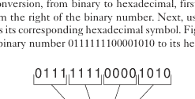

**图 2.10 将十六进制数转换为二进制数**

要进行反向转换，即从二进制转换为十六进制，首先从二进制数的右侧开始，将二进制数字按每四位一组进行分组。然后，使用表 2.10，为每组四位二进制数字指定对应的十六进制符号。图 2.11 展示了将 16 位二进制数 0111111100001010 转换为其十六进制表示法的示例。


**图 2.11 将二进制数转换为十六进制数**

十六进制符号非常适合表示一个字节中的 8 位，因为每个字节由两组 4 位组成。（有时 4 位模式也被称为半字节。）因此，一个字节的二进制代码可以用两个十六进制符号方便地表示。

在查看表 2.10 中的十六进制符号时，请注意前 10 个与十进制系统使用的符号相同。然而，在使用熟悉的 0 到 9 符号之后，表中最后六种二进制模式需要独特的符号。十进制符号 10 到 15 不能使用，因为它们由两个符号组成，因此使用字母 A 到 F 来表示这六个附加符号。为了明确表示正在使用十六进制数，通常会在它们前面加上 0X 或 0x，例如 0xF0ACE37B。

## 八进制表示法

虽然八进制数几乎已被十六进制数所取代，但你仍然可能会遇到以八进制形式表示的二进制数。八进制数将二进制数按每三位一组进行分组。表 2.11 显示了八进制符号与其 3 位二进制值之间的对应关系。

**表 2.11 八进制到二进制的转换**

| 八进制符号 | 二进制值 |
| --- | --- |
| 0 | 000 |
| 1 | 001 |
| 2 | 010 |
| 3 | 011 |
| 4 | 100 |
| 5 | 101 |
| 6 | 110 |
| 7 | 111 |

使用表 2.11 中列出的值，八进制数 541 表示二进制数 101100001。这是通过将八进制值 5 替换为其等价的 101 二进制位模式，将 4 替换为其对应的 100 二进制位模式，并将 1 替换为其对应的 001 二进制位模式来完成的。

要从二进制转换为八进制，首先从右向左将二进制数字按每三位一组进行分组。在此过程中，可能需要在二进制数前面添加一个或两个前导零，以将最左侧的位模式补齐到三位二进制数字。例如，8 位二进制数 11111010 通过添加一个前导零被补齐为九位二进制数字。得到的结果 011111010 随后按每三位一组进行分组，即 011|111|010。竖线符号 | 用于清楚地区分每组三位二进制数字。利用表 2.11 中 3 位模式与八进制符号之间的对应关系，该二进制数变为八进制数 372。

在字节被标准化为 8 位之前，八进制数通常用于表示二进制值。这种方法还有一个额外优势，即使用的是习惯处理十进制数字的人们所熟悉的数字符号。然而，随着 8 位字节的标准化，十六进制符号及其与 4 位二进制数的对应关系成为表示二进制数的首选编号系统。

## 第 3 章 赋值与交互式输入

- 3.1 赋值运算符
- 3.2 格式化输出
- 3.3 数学库函数
- 3.4 交互式键盘输入
- 3.5 符号常量
- 3.6 常见编程错误
- 3.7 章节总结
- 3.8 章节补充：错误、测试与调试


在第 2 章中，你了解了数据存储、变量及其相关声明语句的概念。你还了解了如何使用 cout 对象来显示输出数据。本章将继续介绍 C++，解释如何通过赋值语句和数学函数来处理数据。此外，本章还讨论了 cin 对象，它使用户能够在程序运行期间输入数据。你还将学习更多关于 cout 对象的内容，它可以用于精确格式化输出数据。

### 3.1 赋值运算符

你在第 2 章中学习了简单赋值语句。赋值语句是 C++ 中为变量赋值和执行计算的最基本语句。该语句的语法如下：

```
variable = expression;
```


C++ 中最简单的表达式是一个单独的常量。在下面的赋值语句中，等号右侧的操作数是一个常量：

```
length = 25;
width = 17.5;
```

在这些赋值语句中，等号右侧常量的值被赋给等号左侧的变量。请注意，C++ 中的等号并不具有与代数中等号相同的含义。赋值语句中的等号告诉计算机首先确定其右侧操作数的值，然后将该值存储（或赋值）到其左侧变量关联的位置。例如，C++ 语句 length = 25; 正式意思是“length 被赋值为 25”。赋值语句中的空白仅为可读性而插入。

回想一下，变量在声明时可以被初始化。如果在声明语句中没有进行初始化，则在使用该变量进行任何计算之前，应通过赋值语句或输入操作为其赋一个值。当然，后续的赋值语句也可以用来改变赋给变量的值。例如，假设以下语句按顺序执行，并且 slope 在声明时未被初始化：

```
slope = 3.7;
slope = 6.28;
```

第一个赋值语句将值 3.7 赋给名为 slope 的变量。¹ 下一个赋值语句导致计算机将值 6.28 赋给 slope。slope 中原来的 3.7 被新的值 6.28 覆盖，因为一个变量一次只能存储一个值。有时将等号左侧的变量想象成一个巨大的停车场中的临时停车位是有用的。就像一个停车位一次只能由一辆车使用一样，每个变量一次只能存储一个值。“停放”新值到变量中会自动导致程序移除先前停放在那里的任何值。

除了是一个常量之外，赋值语句中等号右侧的操作数也可以是一个变量或任何其他有效的 C++ 表达式。表达式是任何可以求值以产生结果的常量、变量和函数调用的组合。因此，赋值语句中的表达式可以利用第 2.2 节中介绍的算术运算符来执行计算。以下是使用包含这些运算符的表达式的赋值语句示例：

```
sum = 3 + 7;
diff = 15 - 6;
product = .05 * 14.6;
tally = count + 1;
newtotal = 18.3 + total;
taxes = .06 * amount;
```

```
totalWeight = factor * weight;
average = sum / items;
slope = (y2 - y1) / (x2 - x1);
```

正如赋值语句中始终一样，程序首先计算等号右侧表达式的值，然后将该值存储到等号左侧的变量中。例如，在赋值语句 totalWeight = factor * weight; 中，算术表达式 factor * weight 首先被求值以产生一个结果。该结果，即一个数字，然后被存储到变量 totalWeight 中。

在编写赋值语句时，你必须注意两个重要的考虑因素。因为等号右侧的表达式首先被求值，如果结果要是有意义，则表达式中使用的所有变量必须先前已被赋予有效值。例如，赋值语句 totalWeight = factor * weight; 只有在程序员先为 factor 和 weight 都赋予有效数字时，才会在 totalWeight 中存储一个有效数字。因此，以下语句序列告诉你用于获得要存储在 totalWeight 中的结果的值：

```
factor = 1.06;
weight = 155.0;
totalWeight = factor * weight;
```

## Figure 3.1 Values stored in variables

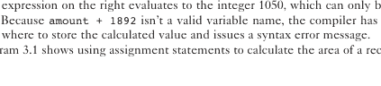

第二个考虑因素是，因为表达式的值被存储到等号左侧的变量中，该位置只能列出一个变量。例如，以下赋值语句是无效的：

```
amount + 1892 = 1000 + 10 * 5;
```

右侧的表达式求值为整数 1050，只能存储到一个变量中。因为 amount + 1892 不是一个有效的变量名，编译器无法知道将计算出的值存储在哪里，并发出语法错误消息。

## Program 3.1

```
// this program calculates the area of a rectangle,
// given its length and width

#include <iostream>
using namespace std;

int main()
{
    double length, width, area;

    length = 27.2;
    width = 13.6;
    area = length * width;
    cout << "The length of the rectangle is " << length << endl;
    cout << "The width of the rectangle is " << width << endl;
    cout << "The area of the rectangle is " << area << endl;

    return 0;
}
```

当运行 Program 3.1 时，输出如下：

```
The length of the rectangle is 27.2
The width of the rectangle is 13.6
The area of the rectangle is 369.92
```

看看计算机在执行 Program 3.1 时使用的控制流。程序执行从第一个语句开始，并按顺序逐条语句继续，直到遇到 main() 的闭合大括号为止。这种控制流对所有程序都成立。计算机一次只处理一个语句，在执行语句时不知道下一个语句是什么。这种顺序执行解释了为什么在表达式求值之前，表达式中使用的所有操作数必须已被赋予值。

当计算机执行 Program 3.1 中的语句 area = length * width; 时，它使用在执行赋值时存储在变量 length 和 width 中的值。如果在表达式 length * width 中使用这些变量之前没有明确为它们赋值，计算机将使用这些变量被引用时恰好占据的值。（大多数 C++ 编译器会自动将所有变量初始化为零；大多数还会警告你变量未被显式初始化。）计算机不会“向前看”以查看你是否在程序后面的位置为这些变量赋值。

重要的是要认识到，在 C++ 中，赋值语句中使用的等号（=）是一个运算符，这与大多数其他高级语言处理该符号的方式不同。在 C++ 中，= 符号称为赋值运算符，使用该运算符的表达式，例如 interest = principal * rate，是一个赋值表达式。因为赋值运算符的优先级低于任何其他算术运算符，所以等号右侧的任何表达式的值都会先被求值，然后再进行赋值。

像所有表达式一样，赋值表达式也有一个值，即赋给赋值运算符左侧变量的值。例如，表达式 a = 5 将值 5 赋给变量 a，并且该表达式本身也具有值 5。表达式的值始终可以通过以下语句进行验证：

```
cout << "The value of the expression is " << (a = 5);
```

该语句显示表达式的值，而不是变量 a 的内容。虽然变量的内容和表达式具有相同的值，但你应该意识到你正在处理两个不同的实体。

从编程角度来看，赋值表达式中重要的是将值实际赋给变量；赋值表达式的最终值意义不大。然而，赋值表达式具有值这一事实在你学习第 4 章中 C++ 的关系运算符时必须考虑其影响。

任何以分号结尾的表达式都成为 C++ 语句。最常见的例子是赋值语句，它只是一个以分号结尾的赋值表达式。例如，用分号终止赋值表达式 a = 33 得到赋值语句 a = 33;，它可以在程序中单独一行使用。

因为等号在 C++ 中是一个运算符，所以同一个表达式或其等价的语句中可以进行多次赋值。例如，在表达式 a = b = c = 25 中，所有赋值运算符具有相同的优先级。赋值运算符具有从右到左的结合性，因此最终求值按以下顺序进行：
- c = 25
- b = c
- a = b

在此示例中，该表达式序列的效果是将数字 25 赋给每个变量，可以表示如下：

```
a = (b = (c = 25))
```

在原始表达式后加上分号得到此多次赋值语句：

```
a = b = c = 25;
```

该语句将值 25 赋给三个变量，等价于以下顺序：
- c = 25;
- b = 25;
- a = 25;


# 知识点

## 左值和右值

术语“左值”和“右值”在几乎所有支持在同一个语句中进行多次赋值的编程语言中都很常用。左值指的是在赋值运算符左侧合法的任何量，右值指的是在赋值运算符右侧合法的任何量。

例如，到目前为止你遇到的每个变量都可以作为左值或右值（也就是说，变量本身可以出现在赋值运算符的两侧），但数字只能是右值。更一般地说，表达式是右值。但并非所有变量都可以用作左值或右值。例如，第7章介绍的数组类型不能作为左值或右值，但数组中的元素可以同时作为左值和右值。

## 强制类型转换

在处理赋值语句时，要牢记表达式两侧所赋值的类型，因为数据类型转换会发生在赋值运算符上。换句话说，赋值运算符右侧表达式的值会被转换为赋值运算符左侧变量的数据类型。这种类型的转换被称为**强制类型转换**，因为赋值给运算符左侧变量的值被强制转换为它被赋值给的变量的数据类型。

一个强制转换的例子是当一个整数值被赋给一个实型变量时；这个赋值会导致整数被转换为实数。类似地，将一个实数值赋给一个整型变量会强制将实数转换为整数。由于截断，这种转换总是会导致数字的小数部分丢失。例如，如果temp是一个整型变量，赋值`temp = 25.89`会将整数值25存储到整型变量temp中。

另一个包含混合模式和赋值转换的数据类型转换的例子是求表达式

`a = b * d`

的值，其中a和b是整型变量，d是双精度变量。当混合模式表达式`b * d`被求值时，表达式中使用的d值会被转换为双精度数以进行计算。（注意，存储在b中的值仍然是整数，表达式`b * d`的结果值是一个双精度数。）最后，跨赋值运算符的数据类型转换开始发挥作用。赋值运算符左侧是一个整型变量，因此表达式`b * d`的双精度值会被截断为整数值并存储在变量a中。

# 赋值变体

虽然在赋值表达式中，等号左侧只允许一个变量，但等号左侧的变量也可以用在等号右侧。例如，赋值表达式sum = sum + 10是有效的。显然，作为一个代数方程，sum永远不可能等于它自身加10。然而，在C++中，sum = sum + 10不是一个方程——它是一个分两步求值的表达式：首先，计算sum + 10的值；其次，将计算出的值存储到sum中。看看你是否能确定程序3.2的输出。

## 程序3.2

```
#include <iostream>
using namespace std;

int main()
{
    int sum;

    sum = 25;
    cout << "The number stored in sum is " << sum << endl;
    sum = sum + 10;
    cout << "The number now stored in sum is "
         << sum << endl;

    return 0;
}
```

在程序3.2中，赋值语句sum = 25;告诉计算机将数字25存储在sum中，如图3.2所示。


## 图3.2 整数25存储在sum中

第一条cout语句显示存储在sum中的值，并带有消息The number stored in sum is 25。第二条赋值语句sum = sum + 10;使程序检索存储在sum中的25并将10加到该数字上，得到35。然后数字35被存储在赋值运算符左侧的变量中，即变量sum。sum中原先的25被新值35直接覆盖（见图3.3）。

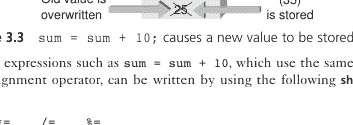

像sum = sum + 10这样在赋值运算符两侧使用相同变量的赋值表达式，可以用以下简写赋值运算符来书写：

- +=
- -=
- *=
- /=
- %=

例如，表达式sum = sum + 10可以写成sum += 10。类似地，表达式price *= rate等价于price = price * rate。使用简写赋值运算符时，注意赋值运算符左侧的变量会应用于右侧的整个表达式。例如，表达式price *= rate + 1等价于price = price * (rate + 1)，而不是price = price * rate + 1。

# 累加

赋值表达式，例如sum += 10或它的等价形式sum = sum + 10，在编程中很常见。当数据一次一个数字地输入时，这些表达式在累加小计中是必需的。例如，如果你想以计算器的方式将数字96、70、85和60相加，可以使用以下语句：

| 语句 | sum中的值 |
|-----------|--------------|
| sum = 0; | 0 |
| sum = sum + 96; | 96 |
| sum = sum + 70; | 166 |
| sum = sum + 85; | 251 |
| sum = sum + 60; | 311 |

第一条语句将sum初始化为0，这清除了sum中存储的任何会使最终总和无效的数字（一个“垃圾值”）。随着每个数字被添加，sum中存储的值会相应增加。最后一条语句完成后，sum包含所有相加数字的总和。程序3.3通过显示每次相加后sum的内容来展示这些语句的效果。

## 程序3.3

```
#include <iostream>
using namespace std;

int main()
{
    int sum;

    sum = 0;
    cout << "The value of sum is initially set to " << sum << endl;
    sum = sum + 96;
    cout << " sum is now " << sum << endl;
    sum = sum + 70;
    cout << " sum is now " << sum << endl;
    sum = sum + 85;
    cout << " sum is now " << sum << " << endl;
    sum = sum + 60;
    cout << " The final sum is " << sum << endl;

    return 0;
}
```

程序3.3显示以下输出：

```
The value of sum is initially set to 0
sum is now 96
sum is now 166
sum is now 251
The final sum is 311
```

尽管程序3.3不是一个实用的程序（因为用手添加数字更容易），但它确实展示了反复使用这种形式的语句所产生的累加小计效果：

```
variable = variable + newValue;
```

这种类型的语句被称为累加语句。当你更熟悉第5章中介绍的循环语句后，你会发现累加语句有很多用途。

# 计数

**计数语句**是一种类似于累加语句的赋值语句，具有以下形式：

```
variable = variable + fixedNumber;
```

计数语句的例子如下：

```
i = i + 1;
n = n + 1;
count = count + 1;
j = j + 2;
m = m + 2;
kk = kk + 3;
```

在这些例子中，等号两侧使用了相同的变量。语句执行后，变量的值会增加一个固定量。在前三个例子中，变量i、n和count增加了1。在接下来两个例子中，变量增加了2，在最后一个例子中，变量kk增加了3。

对于只增加或减少1的变量，C++提供了两个一元运算符：递增和递减运算符。使用**递增运算符**++，表达式`variable = variable + 1`可以被替换为表达式`variable++`或`++variable`。以下是递增运算符的例子：

| 表达式 | 替代写法 |
|---|---|
| `i = i + 1` | `i++` 或 `++i` |
| `n = n + 1` | `n++` 或 `++n` |
| `count = count + 1` | `count++` 或 `++count` |

程序3.4说明了递增运算符的用法。它显示以下输出：

```
The initial value of count is 0
    count is now 1
    count is now 2
    count is now 3
    count is now 4
```


# 赋值与交互式输入

C++ 还提供了递减运算符 --，具有前缀和后缀两种变体。正如你可能预期的那样，表达式 variable-- 和 --variable 都等价于表达式 variable = variable - 1。以下是递减运算符的示例：

| Expression | Alternative |
|---|---|
| `i = i - 1` | `i--` or `--i` |
| `n = n - 1` | `n--` or `--n` |
| `count = count - 1` | `count--` or `--count` |

当 -- 运算符出现在变量之前时，称为前缀递减运算符。当该运算符出现在变量之后时，称为后缀递减运算符。例如，表达式 n-- 和 --n 都将 n 的值减少 1，并等价于更长的表达式 n = n - 1。

与自增运算符一样，前缀和后缀递减运算符在使用赋值表达式时产生不同的结果。例如，k = --n 首先将 n 的值递减 1，然后将 n 的值赋给 k，而表达式 k = n-- 首先将 n 的当前值赋给 k，然后将 n 的值减少 1。

## EXERCISES 3.1

- 1. **(Practice)** 编写一个赋值语句来计算半径为 3.3 英寸的圆的周长。确定圆的周长 *c* 的公式为 *c = 2πr*，其中 *r* 为半径且 *π* 等于 3.1416。
- 2. **(Practice)** 编写一个赋值语句来计算圆的面积。确定圆的面积 *a* 的公式为 *a = πr²*，其中 *r* 为半径且 *π = 3.1416*。
- 3. **(Practice)** 编写一个赋值语句将华氏温度转换为摄氏温度。此转换的公式为 *Celsius = 5.0 / 9.0 (Fahrenheit - 32)*。
- 4. **(Practice)** 编写一个赋值语句来计算单程为 *s* 英里的旅程的往返距离 *d*，单位为英尺。
- 5. **(Practice)** 编写一个赋值语句来计算完成一次旅程所需的经过时间，单位为分钟。计算经过时间的公式为 *elapsed time = total distance / average speed*。假设距离以英里为单位，平均速度以英里每小时（mph）为单位。
- 6. **(Practice)** 编写一个赋值语句来计算等差数列中第 *n* 项的值 *v*。计算值的公式如下：

*v = a + (n - 1)d*

*a* 是数列中的第一个数。

*d* 是数列中任意两个数之间的差。

## Assignment Operators

- 7. (Practice) 编写一个赋值语句来确定梁的最大弯矩 *M*，给定此公式：

$M = XW(L - X) / L$

$X$ 是放置重量 $W$ 的位置距梁末端的距离。
$L$ 是梁的长度。

- 8. (Debug) 确定并纠正以下程序中的错误。

```
a. #include <iostream>
   using namespace std;
   int main()
   {
       width = 15
       area = length * width;
       cout << "The area is " << area
   }
```

```
b. #include <iostream>
   using namespace std;
   int main()
   {
       int length, width, area;
       area = length * width;
       length = 20;
       width = 15;
       cout << "The area is " << area;

       return 0;
   }
```

```
c. #include <iostream>

   int main()
   {
       int length = 20; width = 15, area;
       length * width = area;
       cout << "The area is " , area;

       return 0;
   }
```

- 9. (Debug) 由于学生误操作，将 Program 3.3 中的语句重新排序如下：

```
#include <iostream>
using namespace std;

int main()
{
    int sum;
    sum = 0;
    sum = sum + 96;
    sum = sum + 70;
    sum = sum + 85;
    sum = sum + 60;
    cout << "The value of sum is initially set to "
         << sum << endl;
    cout << "  sum is now " << sum << endl;
    cout << "  sum is now " << sum << endl;
    cout << "  sum is now " << sum << endl;
    cout << "  The final sum is " << sum << endl;
    return 0;
}
```

确定此程序产生的输出。

- 10. (Practice) 使用 Program 3.1，通过确定具有以下长度和宽度的矩形的面积来完成下表：

| Length (in.) | Width (in.) | Area |
|---|---|---|
| 1.62 | 6.23 | |
| 2.86 | 7.52 | |
| 4.26 | 8.95 | |
| 8.52 | 10.86 | |
| 12.29 | 15.35 | |

- 11. (Program) 椭圆的面积（见 Figure 3.4）由以下公式给出：

Area = π a b

使用此公式，编写一个 C++ 程序来计算具有短轴 a 为 2.5 英寸和长轴 b 为 6.4 英寸的椭圆的面积。

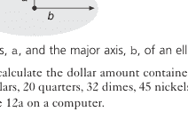

### Figure 3.4 The minor axis, a, and the major axis, b, of an ellipse

- 12. (Program) a. 编写一个 C++ 程序来计算储蓄罐中的美元金额。该罐目前包含 12 个半美元、20 个四分之一美元、32 个十分之一美元、45 个镍币和 27 个便士。

b. 在计算机上运行为练习 12a 编写的程序。

## Table 3.1 Commonly Used Stream Manipulators (continued)

| Manipulator | Action |
|---|---|
| showpoint | 始终显示总共六位数字（整数部分和分数部分组合）。必要时用尾随零填充。对于较大的整数值，恢复为科学计数法。 |
| showpos | 使用前导 + 号显示所有正数。 |
| boolalpha | 将布尔值显示为 true 和 false 而不是 1 和 0。 |
| dec | 将输出设置为十进制显示，这是默认值。 |
| endl | 输出换行字符并显示缓冲区中的所有字符。 |
| fixed | 始终显示小数点并使用默认的小数点后六位数字。必要时用尾随零填充。 |
| flush | 显示缓冲区中的所有字符。 |
| left | 左对齐所有数字。 |
| hex | 将输出设置为十六进制显示。 |
| oct | 将输出设置为八进制显示。 |
| uppercase | 以大写形式显示十六进制数字和科学计数法中的指数。 |
| right | 右对齐所有数字（默认值）。 |
| noboolalpha | 将布尔值显示为 1 和 0 而不是 true 和 false。 |
| noshowbase | 不要为八进制数显示前导 0，也不要为十六进制数显示前导 0x。 |
| noshowpoint | 不要为没有小数部分的实数使用小数点，不要在数字的小数部分显示尾随零，并且最多只显示六位小数。 |
| noshowpos | 不要显示前导 + 号（默认值）。 |
| nouppercase | 以小写形式显示十六进制数字和科学计数法中的指数。 |

例如，语句

```
cout << "The sum of 6 and 15 is" << setw(3) << 21;
```

产生此打印输出：

```
The sum of 6 and 15 is 21
```

包含在发送到 cout 的数据流中的 setw(3) 字段宽度操纵符用于设置显示的字段宽度。此操纵符中的 3 将流中下一个数字的默认字段宽度设置为三个空格。此字段宽度设置导致 21 在三个空格的字段中打印，其中包括一个空格和数字 21。正如此输出所示，整数在指定的字段中右对齐。

字段宽度操纵符在打印数字列时很有用，以便数字在每列中正确对齐。例如，Program 3.5 显示了在没有字段宽度操纵符的情况下整数列的对齐方式。

### Program 3.5

```
#include <iostream>
using namespace std;

int main()
{
    cout << 6 << endl
         << 18 << endl
         << 124 << endl
         << "---\n"
         << (6+18+124) << endl;

    return 0;
}
```

Program 3.5 的输出如下：

```
6
18
124
---
148
```

由于 Program 3.5 中未使用字段宽度操纵符，cout 对象在接收到每个数字时分配足够的空间。使数字在个位对齐需要一个足够宽的字段宽度以容纳显示的数字中的最大数字，对于 Program 3.5 中的数字而言为三。Program 3.6 显示了此字段宽度的使用。

### Program 3.6

```
#include <iostream>
#include <iomanip>
using namespace std;

int main()
{
    cout << setw(3) << 6 << endl
         << setw(3) << 18 << endl
         << setw(3) << 124 << endl
         << "---\n"
         << (6+18+124) << endl;

    return 0;
}
```


## 赋值与交互式输入

程序 3.6 的输出如下：

```
6
18
124
---
148
```

每次向发送到 `cout` 的数据流中插入数字时，都必须包含字段宽度操纵符。该操纵符仅适用于紧随其后的下一次数据插入。

当使用需要参数的操纵符时，必须将 `iomanip` 头文件作为程序的一部分包含进来。为此，请使用预处理命令 `#include <iomanip>`，即程序 3.6 中的第二行。

格式化浮点数需要使用三个字段宽度操纵符。第一个操纵符设置显示的总宽度，第二个操纵符强制显示小数点，第三个操纵符确定小数点右侧显示的有效数字位数。（有关有效数字的复习，请参阅第 2 章中的“信息点”框。）例如，请查看以下语句：

```
cout << "|" << setw(10) << fixed << setprecision(3) << 25.67 << "|";
```

它会产生以下输出：

```
|    25.670|
```

此示例中的竖线符号 `|` 用于界定（标记）显示字段的开头和结尾。`setw` 操纵符告诉 `cout` 在总宽度为 10 的字段中显示该数字。（对于实数，小数点占据这些字段位置之一。）`fixed` 操纵符强制显示小数点，而 `setprecision` 操纵符指定小数点后显示的位数。在此例中，`setprecision` 指定显示小数点后的三位数字。如果没有显式指定小数点（也可以指定为 `setiosflags(ios::fixed)`，稍后将解释），则 `setprecision` 操纵符指定显示的总位数，其中包括数字的整数部分和小数部分。

对于所有数字（整数、单精度和双精度），如果指定的总字段宽度太小，`cout` 会忽略 `setw` 操纵符的规范，并分配足够的空间来打印数字的整数部分。单精度和双精度数字的小数部分显示到使用 `setprecision` 操纵符设置的精度。（如果没有 `setprecision`，默认精度设置为六位小数。）如果要显示的数字的小数部分包含的位数多于 `setprecision` 操纵符要求的位数，则该数字将四舍五入到指定的小数位数；如果小数部分包含的位数少于指定值，则该数字显示的位数较少。表 3.2 显示了多种格式操纵符组合的效果。为清晰起见，竖线符号界定了输出字段的开头和结尾。

**表 3.2** 格式操纵符的效果

| 操纵符 | 数字 | 显示 | 说明 |
|---|---:|---|---|
| `setw(2)` | 3 | `| 3|` | 数字适合该字段。 |
| `setw(2)` | 43 | `|43|` | 数字适合该字段。 |
| `setw(2)` | 143 | `|143|` | 字段宽度被忽略。 |
| `setw(2)` | 2.3 | `|2.3|` | 字段宽度被忽略。 |
| `setw(5)`<br>`fixed`<br>`setprecision(2)` | 2.366 | `| 2.37|` | 字段宽度为 5，带两位小数。 |
| `setw(5)`<br>`fixed`<br>`setprecision(2)` | 42.3 | `|42.30|` | 数字以指定精度适合该字段。请注意，小数点占据字段宽度中的一个位置。 |
| `setw(5)`<br>`setprecision(2)` | 142.364 | `|1.4e+002|` | 字段宽度被忽略，并且与 `setprecision` 操纵符一起使用科学计数法。 |
| `setw(5)`<br>`fixed`<br>`setprecision(2)` | 142.364 | `|142.36|` | 字段宽度被忽略，但使用了精度规范。`setprecision` 操纵符指定小数位数。 |
| `setw(5)`<br>`fixed`<br>`setprecision(2)` | 142.366 | `|142.37|` | 字段宽度被忽略，但使用了精度规范。`setprecision` 操纵符指定小数位数。（请注意最后一位小数的四舍五入。） |
| `setw(5)`<br>`fixed`<br>`setprecision(2)` | 142 | `|  142|` | 使用了字段宽度；`fixed` 和 `setprecision` 操纵符无关紧要，因为该数字是整数，指定了总有效位数（整数加小数位数）。 |

## `setiosflags()` 操纵符⁶

除了 `setw` 和 `setprecision` 操纵符之外，还有一个字段对齐操纵符可用。如您所见，发送到 `cout` 的数字通常在显示字段中右对齐，而字符串则左对齐。要更改数据流的默认对齐方式，可以使用 `setiosflags` 操纵符。例如，语句

```
cout << " " << setw(10) << setiosflags(ios::left) << 142 << "|";
```

会产生以下左对齐显示：

```
|142       |
```

### 信息点

#### 什么是标志？

在当前编程用法中，术语“标志”指的是设置某个条件（通常被视为激活或非激活状态）的项目，例如变量或参数。虽然该术语在编程中的确切起源未知，但它可能源于使用真实的旗帜来发出信号，例如赛车比赛中常用的停止、前进、注意和获胜旗帜。

类似地，`setiosflags()` 操纵符函数的每个标志参数都会激活一个特定条件。例如，`ios::dec` 标志将显示格式设置为十进制，而 `ios::oct` 标志激活八进制显示格式。由于这些条件是互斥的（一次只能激活一个），激活此类标志会自动停用其他标志。

非互斥的标志，例如 `ios::dec`、`ios::showpoint` 和 `ios::fixed`，可以同时设置。您可以通过使用三个单独的 `setiosflags()` 调用或将所有参数合并到一个调用中来实现，如下所示：

```
cout << setiosflags(ios::dec | ios::fixed | ios::showpoint);
```

由于发送到 `cout` 的数据可以跨多行延续，因此之前的显示也可以由以下语句产生：

```
cout << "|" << setw(10)
    << setiosflags(ios::left)
    << 142 << "|";
```

要在数据流中右对齐字符串，可以使用 `setiosflags(ios::right)` 操纵符。函数名和 `ios::right` 参数中的字母“ios”来自“input output stream”这几个单词的首字母。

除了可与 `setiosflags()` 一起使用的 `left` 和 `right` 标志之外，还有其他标志可用于影响输出。表 3.3 列出了此操纵符函数最常用的标志。此表中的标志提供了设置表 3.1 中列出的操纵符的另一种方式。

**表 3.3** 与 `setiosflags()` 一起使用的格式标志

| 标志 | 含义 |
|---|---|
| `ios::fixed` | 始终显示小数点，后跟六位数字。如有必要，在小数点后填充尾随零。如果与 `ios::showpoint` 标志一起设置，此标志优先。 |
| `ios::scientific` | 在输出中使用指数显示。 |
| `ios::showpoint` | 始终显示小数点，总共显示六位有效数字（整数部分和小数部分的组合）。对于较大的整数值，除非设置了 `ios::fixed` 标志，否则将恢复为科学计数法。 |
| `ios::showpos` | 当数字为正数时，显示前导 `+` 号。 |
| `ios::left` | 左对齐输出。 |
| `ios::right` | 右对齐输出。 |

由于表 3.3 中的标志用作 `setiosflags()` 的参数，并且“参数”（argument）和“形参”（parameter）是同义词，因此使用参数的操纵符方法的另一个名称是参数化操纵符。以下是参数化操纵符方法的示例：

```
cout << setiosflags(ios::fixed) << setprecision(4);
```

此语句强制所有后续发送到输出流的浮点数以小数点后四位数字的形式显示。如果数字的小数位数少于四位，则用尾随零填充。

## 十六进制和八进制输入/输出

除了以十进制表示法输出整数外，`oct` 和 `hex` 操纵符还用于转换为八进制和十六进制。（如果您不熟悉十六进制或八进制数字，请复习第 2.6 节。）程序 3.7 使用这些标志作为将十进制数转换为其等效的十六进制和八进制值的示例。由于十进制是默认显示，因此第一个输出流中不需要 `dec` 操纵符。

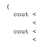

### 程序 3.7

```
// 一个演示输出转换的程序
#include <iostream>
#include <iomanip>
using namespace std;

int main()
{
cout << "15 的十进制（基数为 10）值是 "
<< 15 << endl;
cout << "15 的八进制（基数为 8）值是 "
<< showbase << oct << 15 << endl;
cout << "15 的十六进制（基数为 16）值是 "
<< showbase << hex << 15 << endl;

return 0;
}
```

> 7 此主题在首次阅读时可以跳过，不会影响主题的连续性。


## 信息点

## 格式化 cout 流数据

Floating-point data in a cout output stream can be formatted in precise ways. For example, a common format requirement is to display monetary amounts with two digits after the decimal point, such as 123.45. You can do this with the following statement:

```
cout << setiosflags(ios::fixed)
<< setiosflags(ios::showpoint)
<< setprecision(2);
```

The first manipulator flag, ios::fixed, forces all floating-point numbers in the cout stream to be displayed in decimal notation. This flag also prevents using scientific notation. The next flag, ios::showpoint, tells the stream to always display a decimal point. Finally, the setprecision manipulator tells the stream to always display two digits after the decimal point. Instead of using manipulators, you can use the cout stream methods setf() and precision(). For example, the previous formatting can also be accomplished with this code:

```
cout.setf(ios::fixed);
cout.setf(ios::showpoint);
cout.precision(2);
```

Note the syntax: The name of the object, cout, is separated from the method with a period. This format is the standard way of specifying a method and connecting it to a specific object.

Additionally, the flags used in both the setf() method and the setiosflags() manipulator method can be combined by using the bitwise OR operator, | (explained in Appendix C, available online). Using this operator, the following two statements are equivalent:

```
cout << setiosflags(ios::fixed | ios::showpoint);
cout.setf(ios::fixed | ios::showpoint);
```

The statement you select is a matter of personal preference or a predefined standard.

This is the output produced by Program 3.7:

```
The decimal (base 10) value of 15 is 15
The octal (base 8) value of 15 is 017
The hexadecimal (base 16) value of 15 is 0xf
```

## Chapter 3

The display of integer values in one of three possible numbering systems (decimal, octal, and hexadecimal) doesn’t affect how the number is stored in a computer. All numbers are stored by using the computer’s internal codes. The manipulators sent to cout tell the object how to convert the internal code for output display purposes.

Besides integers being displayed in octal or hexadecimal form, they can also be written in a program in these forms. To designate an octal integer, the number must have a leading zero. The number 023, for example, is an octal number in C++. Hexadecimal numbers are denoted with a leading 0x. Program 3.8 shows how octal and hexadecimal integer numbers are used.

### Program 3.8

```cpp
#include <iostream>
using namespace std;

int main()
{
    cout << "The decimal value of 025 is " << 025 << endl
         << "The decimal value of 0x37 is " << 0x37 << endl;

    return 0;
}
```

Program 3.8 produces the following output:

```
The decimal value of 025 is 21
The decimal value of 0x37 is 55
```

Figure 3.5 shows the relationship between input, storage, and display of integers.

### Figure 3.5 Input, storage, and display of integers

Finally, you can set the manipulators listed in Tables 3.1 and 3.2 by using the ostream class methods listed in Table 3.4.

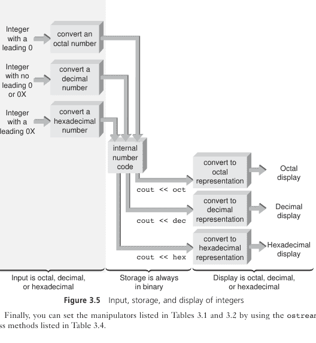

### Table 3.4 ostream Class Methods

| Method | Comment | Example |
|---|---|---|
| precision(n) | Equivalent to setprecision() | cout.precision(2) |
| fill('x') | Equivalent to setfill() | cout.fill('*') |
| setf(ios::fixed) | Equivalent to cout.setf(ios::fixed) | setiosflags(ios::fixed) |
| setf(ios::showpoint) | Equivalent to cout.setf(ios::showpoint) | setiosflags(ios::showpoint) |
| setf(ios::left) | Equivalent to left | cout.setf(ios::left) |
| setf(ios::right) | Equivalent to right | cout.setf(ios::right) |
| setf(ios::flush) | Equivalent to endl | cout.setf(ios::flush) |

In the Example column of Table 3.4, notice that the name of the object, cout, is separated from the method with a period. As mentioned, this format is the standard way of calling a class method and providing an object for it to operate on.


## EXERCISES 3.2

1. (Debug) Determine the errors in the following statements:
   - a. cout << "\n << " 15)
   - b. cout << "setw(4)" << 33;
   - c. cout << "setprecision(5)" << 526.768;
   - d. "Hello World!" >> cout;
   - e. cout << 47 << setw(6);
   - f. cout << set(10) << 526.768 << setprecision(2);

2. (Desk check) Determine and write out the display produced by the following statements:
   - a. cout << "|" << 5 << "|
   - b. cout << "|" << setw(4) << 5 << "|";
   - c. cout << "|" << setw(4) << 56829 << "|";
   - d. cout << "|" << setw(5) << setiosflags(ios::fixed) << setprecision(2) << 5.26 << "|";
   - e. cout << "|" << setw(5) << setiosflags(ios::fixed) << setprecision(2) << 5.267 << "|";
   - f. cout << "|" << setw(5) << setiosflags(ios::fixed) << setprecision(2) << 53.264 << "|";
   - g. cout << "|" << setw(5) << setiosflags(ios::fixed) << setprecision(2) << 534.264 << "|";
   - h. cout << "|" << setw(5) << setiosflags(ios::fixed) << setprecision(2) << 534. << "|";

3. (Desk check) Write out the display produced by the following statements:

```
a. cout << "The number is " << setw(6) << setiosflags(ios::fixed)
<< setprecision(2) << 26.27 << endl;
cout << "The number is " << setw(6) << setiosflags(ios::fixed)
<< setprecision(2) << 682.3 << endl;
cout << "The number is " << setw(6) << setiosflags(ios::fixed)
<< setprecision(2) << 1.968 << endl;
```

```
b. cout << setw(6) << setiosflags(ios::fixed)
<< setprecision(2) << 26.27 << endl;
cout << setw(6) << setiosflags(ios::fixed)
<< setprecision(2) << 682.3 << endl;
cout << setw(6) << setiosflags(ios::fixed)
<< setprecision(2) << 1.968 << endl;
cout << "------\n";
cout << setw(6) << setiosflags(ios::fixed)
<< setprecision(2)
<< 26.27 + 682.3 + 1.968 << endl;
```

```
c. cout << setw(5) << setiosflags(ios::fixed)
<< setprecision(2) << 26.27 << endl;
cout << setw(5) << setiosflags(ios::fixed)
<< setprecision(2) << 682.3 << endl;
cout << setw(5) << setiosflags(ios::fixed)
<< setprecision(2) << 1.968 << endl;
cout << "------\n";
cout << setw(5) << setiosflags(ios::fixed)
<< setprecision(2)
<< 26.27 + 682.3 + 1.968 << endl;
```

```
d. cout << setw(5) << setiosflags(ios::fixed)
<< setprecision(2) << 36.164 << endl;
cout << setw(5) << setiosflags(ios::fixed)
<< setprecision(2) << 10.003 << endl;
cout << "------" << endl;
```

4. (Desk check) The following chart lists the equivalent octal and hexadecimal representations for the decimal numbers 1 through 15:

Decimal: 1 2 3 4 5 6 7 8 9 10 11 12 13 14 15
Octal: 1 2 3 4 5 6 7 10 11 12 13 14 15 16 17
Hexadecimal: 1 2 3 4 5 6 7 8 9 a b c d e f

Using this chart, determine the output of the following program:

```
#include <iostream>
#include <iomanip>
using namespace std;

int main()
{
    cout << "\nThe value of 14 in octal is " << oct << 14
        << "\nThe value of 14 in hexadecimal is " << hex << 14
        << "\nThe value of 0xA in decimal is " << dec << 0xA
        << "\nThe value of 0xA in octal is " << oct << 0xA
        << endl;

    return 0;
}
```

5. (Program) Write a C++ program to calculate and display the value of the slope of the line connecting two points with the coordinates (3,7) and (8,12). Use the fact that the slope between two points at the coordinates (x1,y1) and (x2,y2) is slope = (y2 - y1) / (x2 - x1). Your program should produce this display:

The value of the slope is xxx.xx

The xxx.xx denotes placing the calculated value in a field wide enough for three places to the left of the decimal point and two places to the right of it.

6. (Program) Write a C++ program to calculate and display the midpoint coordinates of the line connecting the two points with coordinates of (3,7) and (8,12). Use the fact that the midpoint coordinates between two points with the coordinates (x1,y1) and (x2,y2) are ((x2 + x1) / 2, (y2 + y1) / 2). Your program should produce this display:

The x coordinate of the midpoint is xxx.xx
The y coordinate of the midpoint is xxx.xx

The xxx.xx denotes placing the calculated value in a field wide enough for three places to the left of the decimal point and two places to the right of it.

Verify your program using the following test data:

- Test data set 1: Point 1 = (0,0) and Point 2 = (16,0)
- Test data set 2: Point 1 = (0,0) and Point 2 = (0,16)
- Test data set 3: Point 1 = (0,0) and Point 2 = (-16,0)
- Test data set 4: Point 1 = (0,0) and Point 2 = (0,-16)
- Test data set 5: Point 1 = (-5,-5) and Point 2 = (5,5)

When you have completed your verification, use your program to complete the following table.

| Point 1 | Point 2 | Midpoint |
|---------|---------|----------|
| (4,6)   | (16,18) |          |
| (22,3)  | (8,12)  |          |
| (-10,8) | (14,4)  |          |
| (-12,2) | (14,3.1)|          |
| (3.1,-6)| (20,16) |          |
| (3.1,-6)| (-16,-18)|         |


## 7. (程序) 使用以下 C++ 语句可以计算支付餐费后剩余的找零：

// determine the number of pennies in the change
change = (paid - check) * 100;
// determine the number of dollars in the change
dollars = (int) (change/100);

- a. 以之前的语句为起点，编写一个 C++ 程序，计算用 $10 支付 $6.07 的账单时找零中的美元钞票、 quarters、 dimes、 nickels 和 pennies 的数量。
- b. 在不编译或运行程序的情况下，手算检查程序中每个语句的效果，并确定在遇到每个语句时存储在每个变量中的内容。
- c. 在验证算法正确工作后，编译并运行你的程序。验证程序产生的结果是否正确，然后使用你的程序确定用 20 美元钞票支付 $12.36 的账单时的找零。

## 8. (程序) 编写一个 C++ 程序来计算并显示一端受支承的梁的最大弯矩 M，梁的两端均受支承（见图 3.6）。公式为 M = XW (L - X) / L，其中 X 是放置重量 W 的位置距梁端的距离，L 是梁的长度。你的程序应产生以下显示：

The maximum bending moment is xxxx.xxxx

The xxxx.xxxx 表示将计算值放在一个字段中，该字段足够宽，可容纳小数点左右各四位。

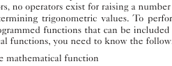

## 3.3 数学库函数

正如你所见，赋值语句可用于执行算术计算。例如，以下赋值语句将 unitPrice 中的值乘以 amount 中的值，并将结果值赋给 totalPrice：

```
totalPrice = unitPrice * amount;
```

虽然加法、减法、乘法和除法可以用 C++ 的算术运算符轻松完成，但没有用于将数字提高到幂、求数字的平方根或确定三角值的运算符。为了执行这些计算，C++ 提供了可包含在程序中的标准预编程函数。在使用其中一个数学函数之前，你需要知道以下内容：

- 数学函数的名字
- 数学函数的作用
- 数学函数所需的数据类型
- 数学函数返回的结果数据类型
- 如何包含数学库

为了说明 C++ 数学函数的使用，请看数学函数 sqrt()，它计算数字的平方根，其形式如下：

```
sqrt(number)
```

函数的名字——在本例中为 sqrt——后面跟随括号，其中包含应计算平方根的数字。函数名后括号的目的是提供一个通道，通过该通道可以将数据传递给函数（见图 3.7）。通过括号传递给函数的数据项称为函数的参数，正如你在第 1 章中所学的那样，构成其输入数据。例如，以下表达式用于计算参数 4.、17.0、25.、1043.29 和 6.4516 的平方根：

```
sqrt(4.)
sqrt(17.0)
sqrt(25.)
sqrt(1043.29)
sqrt(6.4516)
```

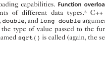

图 3.7 向 sqrt() 函数传递数据

请注意，sqrt() 函数的参数必须是实值，这是 C++ 函数重载功能的一个例子。函数重载允许对不同数据类型的参数使用相同的函数名。C++ 有三个名为 sqrt() 的函数——分别定义为 float、double 和 long double 参数。根据调用时传递给函数的值的类型，自动调用正确的 sqrt() 函数。当其中一个名为 sqrt() 的函数被调用时（再次选择是自动的，基于传递的参数），函数确定其参数的平方根并将结果作为 double 返回。

> 如果不支持重载，就必须定义三个具有不同名称的单独平方根函数——每个参数类型一个。

前面的表达式返回以下值：

| Expression | Value Returned |
|---|---|
| sqrt(4.) | 2. |
| sqrt(17.0) | 4.12311 |
| sqrt(25.) | 5. |
| sqrt(1043.29) | 32.3 |
| sqrt(6.4516) | 2.54 |

除了 sqrt() 函数之外，表 3.5 列出了 C++ 提供的常用数学函数。要在程序中访问这些函数，需要包含数学头文件 cmath，其中包含数学函数的声明。要使用此头文件，请将以下预处理器语句放在使用数学函数的任何程序顶部：

```
#include <cmath>
```

尽管表 3.5 中的某些数学函数需要多个参数，但根据定义，所有函数最多只能返回一个值。此外，列出的所有函数都是重载的，这意味着相同的函数名可以用不同的参数数据类型使用。表 3.6 显示了使用示例参数调用选定函数返回的值。

表 3.5 常用 C++ 函数

| Function Name | Description | Returned Value |
|---|---|---|
| abs(a) | Absolute value | Same data type as argument |
| pow(a1,a2) | a1 raised to the a2 power | Same data type as argument a1 |
| sqrt(a) | Square root of a real number (Note: An integer argument results in a compiler error.) | Double-precision |
| sin(a) | Sine of a (a in radians) | Double-precision |
| cos(a) | Cosine of a (a in radians) | Double-precision |
| tan(a) | Tangent of a (a in radians) | Double-precision |
| log(a) | Natural logarithm of a | Double-precision |
| log10(a) | Common log (base 10) of a | Double-precision |
| exp(a) | e raised to the a power | Double-precision |

表 3.6 选定函数示例

| Example | Returned Value |
|---|---|
| abs(-7.362) | 7.362 |
| abs(-3) | 3 |
| pow(2.0,5.0) | 32. |
| pow(10,3) | 1000 |
| log(18.697) | 2.92836 |
| log10(18.697) | 1.27177 |
| exp(-3.2) | 0.040762 |

每次使用数学函数时，它都会被调用（称为调用或调用函数），方法是给出函数的名字，并将数据传递给函数名后的括号中（见图 3.8）。

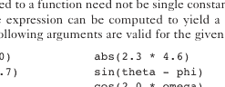

图 3.8 使用并向函数传递数据

传递给函数的参数不必是单个常量。表达式也可以作为参数，只要表达式可以计算为所需数据类型的数值即可。例如，以下参数对给定函数是有效的：

```
sqrt(4.0 + 5.3 * 4.0)      abs(2.3 * 4.6)
sqrt(16.0 * 2.0 - 6.7)    sin(theta - phi)
sqrt(x * y - z/3.2)      cos(2.0 * omega)
```

括号中的表达式首先被求值以产生特定值。因此，在前述表达式中使用之前，必须为变量 theta、phi、x、y、z 和 omega 分配值。计算出参数的值后，它将被传递给函数。

函数也可以作为较大表达式的一部分包含在内，如此示例所示：

```
4 * sqrt(4.5 * 10.0 - 9.0) - 2.0
= 4 * sqrt(36.0) - 2.0
= 4 * 6.0 - 2.0
= 24.0 - 2.0
= 22.0
```

表达式 `3.0 * sqrt(5 * 33 - 13.71) / 5` 的逐步求值如下：

| Step | Result |
|---|---|
| 1. Perform multiplication in the argument. | 3.0 * sqrt(165 - 13.71) / 5 |
| 2. Complete the argument calculation. | 3.0 * sqrt(151.29) / 5 |
| 3. Return a function value. | 3.0 * 12.3 / 5 |
| 4. Perform the multiplication. | 36.9 / 5 |
| 5. Perform the division. | 7.38 |

程序 3.9 显示了使用 sqrt() 函数确定球从 800 英尺高的塔上掉落后击中地面所需的时间。计算球下落给定英尺距离所需时间的数学公式如下，其中 g 是重力常数等于 32.2 ft/sec²：

time = sqrt(2 × distance / g)

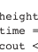

程序 3.9

```
#include <iostream> // this line can be placed second instead of first
#include <cmath>    // this line can be placed first instead of second
using namespace std;

int main()
{
    int height;
    double time;

    height = 800;
    time = sqrt(2 * height / 32.2);
    cout << "It will take " << time << " seconds to fall "
         << height << " feet.\n";

    return 0;
}
```


Program 3.9 produces this output:

```
It will take 7.04907 seconds to fall 800 feet.
```

As used in Program 3.9, the value that the `sqrt()` function returns is assigned to the variable `time`. In addition to assigning a function’s returned value to a variable, the returned value can be included in a larger expression or even used as an argument to another function. For example, the following expression is valid:

```
sqrt( sin( abs(theta) ) )
```

Because parentheses are present, the computation proceeds from the inner to outer pairs of parentheses. Therefore, the absolute value of theta is computed first and used as an argument to the `sin()` function. The value the `sin()` function returns is then used as an argument to the `sqrt()` function.

Note that the arguments of all trigonometric functions (`sin()`, `cos()`, and so forth) must be in radians. Therefore, to calculate the sine of an angle given in degrees, the angle must be converted to radians first. You can do this easily by multiplying the angle by the term `(3.1416/180.)`. For example, to obtain the sine of 30 degrees, use the expression `sin(30 * 3.1416/180.)`.

## Casts

You have already seen the conversion of an operand’s data type in mixed-mode arithmetic expressions (Section 2.2) and with different operators (Section 3.1). In addition to these implicit data type conversions made automatically in mixed-mode arithmetic and assignment expressions, C++ provides for explicit user-specified type conversions. The operator used to force converting a value to another type is the cast operator. C++ provides compile-time and runtime cast operators. The compile-time cast is a unary operator with this syntax:

```
dataType (expression)
```

The `dataType` is the data type to which the expression in parentheses is converted. For example, the following expression converts the value of the expression `a * b` to an integer value:

```
int (a * b)
```

Runtime casts are also included in C++. In this type of cast, the requested type conversion is checked at runtime and application of the conversion results in a valid value. Although four types of runtime casts are available, the most commonly used cast and the one corresponding to the compile-time cast has the following syntax:

```
staticCast<dataType> (expression)
```

For example, the runtime cast `staticCast<int>(a * b)` is equivalent to the compile-time cast `int (a * b)`.

> ⁹The C type cast syntax, in this case `(int)(a * b)`, also works in C++.

## EXERCISES 3.3

1. (Practice) Write function calls to determine the following:
   - a. The square root of 6.37
   - b. The square root of x - y
   - c. The sine of 30 degrees
   - d. The sine of 60 degrees
   - e. The absolute value of a² - b²
   - f. The value of e raised to the third power

2. (Practice) For a = 10.6, b = 13.9, and c = -3.42, determine the following values:
   - a. int (a)
   - b. int (b)
   - c. int (c)
   - d. int (a + b)
   - e. int (a) + b + c
   - f. int (a + b) + c
   - g. int (a + b + c)
   - h. double (int (a)) + b
   - i. double (int (a + b))
   - j. abs(a) + abs(b)
   - k. sqrt(abs(a - b))

3. (Practice) Write C++ statements for the following:
   - a. area = (c × b × sin a) / 2
   - b. c = √(a² + b²)
   - c. p = √|m - n|
   - d. sum = a(rⁿ - 1)/(r - 1)
   - e. b = sin² x - cos² x

4. (Program) Write, compile, and run a C++ program that calculates and returns the fourth root of the number 81.0, which is 3. After verifying that your program works correctly, use it to determine the fourth root of 1,728.896400. Your program should make use of the sqrt() function or use the fact that the fourth root of a value can be obtained by raising the value to the 1/4 power.

5. (Program) The volume of oil stored in an underground 200-foot deep cylindrical tank is determined by measuring the distance from the top of the tank to the surface of the oil. Knowing this distance and the radius of the tank, the volume of oil in the tank can be determined by using this formula:

volume = π radius² (200 - distance)

Using this information, write, compile, and run a C++ program that determines the volume of oil in a 200-foot tank that has a radius of 10 feet and measures 12 feet from the top of the tank to the top of the oil. Your program should display the radius, distance from the top of the tank to the oil, and the calculated volume.

6. (Program) The circumference of an ellipse (review Figure 3.4) is given by this formula:

Circumference = π√(a + b)²

Using this formula, write a C++ program to calculate the circumference of an ellipse with a minor radius, a, of 2.5 inches and a major radius, b, of 6.4 inches.

7. (Program) Write, compile, and run a C++ program to calculate the distance between two points with the coordinates (7, 12) and (3, 9). Use the fact that the distance between two points with the coordinates (x₁, y₁) and (x₂, y₂) is given by this formula:

distance = √((x₂ - x₁)² + (y₂ - y₁)²)

After verifying that your program works correctly by calculating the distance between the two points manually, use your program to determine the distance between the points (-12, -15) and (22, 5).

8. (Program) If a 20-foot ladder is placed on the side of a building at a 85-degree angle, as shown in Figure 3.9, the height at which the ladder touches the building can be calculated as height = 20 × sin 85°. Calculate this height by hand, and then write, compile, and run a C++ program that determines and displays the value of the height. After verifying that your program works correctly, use it to determine the height of a 25-foot ladder placed at an angle of 85 degrees.

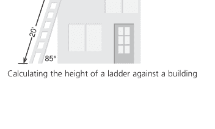

Figure 3.9 Calculating the height of a ladder against a building

9. (Program) The maximum height reached by a ball thrown with an initial velocity, v, in meters/sec, at an angle of θ is given by this formula:

height = (.5 x v² x sin² θ) / 9.8

Using this formula, write, compile, and run a C++ program that determines and displays the maximum height reached when the ball is thrown at 5 mph at an angle of 60 degrees. (Hint: Make sure to convert the initial velocity into the correct units. There are 1609 meters in a mile.) Calculate the maximum height manually, and verify the result your program produces. After verifying the result, use your program to determine the height reached by a ball thrown at 7 mph at an angle of 45 degrees.

10. (Program) A model of worldwide population growth, in billions of people, since 2000 is given by this formula:

Population = 7.5 e^0.02[Year - 2010]

Using this formula, write, compile, and run a C++ program to estimate the worldwide population in the year 2012. Verify the result your program produces by calculating the answer manually, and then use your program to estimate the world's population in the year 2020.

11. (Program) The roads of Kansas are laid out in a rectangular grid at exactly one-mile intervals, as shown in Figure 3.10. Farmer Pete drives his 1939 Ford pickup x miles east and y miles north to get to farmer Joe's farm. Both x and y are integer numbers. Using this information, write, test, and run a C++ program that prompts the user for the values of x and y, and then uses this formula to find the shortest driving distance across the fields to Joe's farm:

distance = sqrt(x² + y²);

Round the answer to the nearest integer value before it's displayed.

12. (Program) A model to estimate the number of grams of a radioactive isotope left after t years is given by this formula:

remaining material = (original material) e^(-0.00021t)

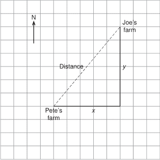

**Figure 3.10** Illustration for Exercise 11

13. (Program) The number of years it takes for an isotope of uranium to decay to one-half an original amount is given by this formula, where λ, the decay constant (which is equal to the inverse of the mean lifetime), equals 0.00012:

*half-life = ln(2) / λ*

Using this formula, write, compile, and run a C++ program that calculates and displays the half-life of this uranium isotope. Verify the result your program produces by using a hand calculation. After verifying that your program is working correctly, use it to determine the half-life of a uranium isotope with λ = 0.00026.

14. (Program) a. Appendix B lists the integer values corresponding to each letter stored with the ASCII code. Note that uppercase letters consist of contiguous codes, starting with an integer value of 65 for the letter A and ending with 90 for the letter Z. Similarly, lowercase letters begin with the integer value of 97 for the letter a and end with 122 for the letter z. With this information as background, determine the character value of the expressions `char ('A' + 32)` and `char ('Z' + 32)`.

b. Using Appendix B, determine the integer value of the expression `'a' - 'A'`.

c. Using the results of Exercises 14a and 14b, determine the character value of the following expression, where *uppercase letter* can be any uppercase letter from A to Z: `char (uppercase letter + 'a' - 'A')`.


## 15.（桌面检查与程序）

### a. 出于显示目的，setprecision() 操纵符允许将所有输出四舍五入到指定的小数位数。然而，在要求将所有货币值显示到最接近的分值的金融程序中使用时，这可能会产生看似不正确的结果。例如，请看下面这个程序：

```
#include <iostream>
#include <iomanip>
using namespace std;
int main()
{
    double a, b, c;
    a = 1.674;
    b = 1.322;
    cout << setiosflags(ios::fixed) << setprecision(2);
    cout << a << endl;
    cout << b << endl;
    cout << "----\n";
    c = a + b;
    cout << c << endl;
    return 0;
}
```

它产生如下显示：

```
1.67
1.32
----
3.00
```

显然，所显示的数字之和应为 2.99，而不是 3.00。问题在于，虽然 a 和 b 中的值在显示时保留了两位小数，但在程序内部相加时是作为三位小数相加的。解决办法是在用语句 c = a + b; 相加之前，先将 a 和 b 中的值四舍五入。使用 int 强制转换，设计一种方法，在相加之前将变量 a 和 b 中的值四舍五入到最接近的百分位（分值）。

### b. 将你在练习 15a 中设计的方法包含到一个可运行的程序中，使其产生如下显示：

```
1.67
1.32
----
2.99
```

## 3.4 交互式键盘输入

只运行一次的程序的数据可以包含在程序中。例如，如果你想将 30.0 和 0.05 相乘，可以使用程序 3.10。

### 程序 3.10

```
#include <iostream>
using namespace std;

int main()
{
    double num1, num2, product;

    num1 = 30.0;
    num2 = 0.05;
    product = num1 * num2;
    cout << "30.0 times 0.05 is " << product << endl;

    return 0;
}
```

这是程序 3.10 显示的输出：

30.0 times 0.05 is 1.5

程序 3.10 可以像程序 3.11 所示那样缩短。然而，这两个程序都存在同一个基本问题：它们必须重写才能乘以不同的数字。两个程序都不允许输入不同的数字来进行运算。

### 程序 3.11

```
#include <iostream>
using namespace std;

int main()
{
    cout << "30.0 times 0.05 is " << 30.0 * 0.05 << endl;

    return 0;
}
```

除了在编写、输入和运行程序过程中获得的编程练习之外，对同一组数字只执行一次相同计算的程序显然并不十分有用。毕竟，使用计算器将两个数相乘，比输入并运行程序 3.10 或程序 3.11 更简单。

本节介绍 cin 对象，它用于在程序运行期间输入数据。就像 cout 对象显示变量中存储的值的副本一样，cin 对象允许用户在键盘上输入一个值（见图 3.11）。然后该值被存储到一个变量中。

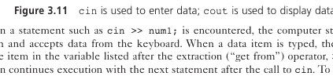

### 图 3.11 cin 用于输入数据；cout 用于显示数据

当遇到类似 cin >> num1; 的语句时，计算机停止程序执行，从键盘接受数据。当用户键入数据项时，cin 对象将该项存储到提取（“从中获取”）运算符 >> 之后列出的变量中。然后程序继续执行调用 cin 之后的下一条语句。要了解这个对象如何工作，请看程序 3.12。

### 程序 3.12

```
#include <iostream>
using namespace std;

int main()
{
    double num1, num2, product;

    cout << "Please type in a number: ";
    cin >> num1;
    cout << "Please type in another number: ";
    cin >> num2;
    product = num1 * num2;
    cout << num1 << " times " << num2 << " is " << product << endl;

    return 0;
}
```

程序 3.12 中的第一个 cout 语句打印一个字符串，告诉键盘前的人应该输入什么。当输出字符串以这种方式使用时，称为提示符。

在本例中，提示符告诉用户输入一个数字。然后计算机执行激活 cin 的下一条语句。cin 对象使计算机在用户输入值时进入暂时暂停（或等待）状态，然后用户按回车键向 cin 对象发出数据输入结束的信号。输入的值被存储在提取运算符右侧的变量（num1）中，计算机退出暂停状态。

程序继续执行下一条语句，在程序 3.12 中这是另一次 cout 激活，显示一条消息要求用户输入另一个数字。第二条 cin 语句再次使计算机在用户输入第二个值时进入暂时等待状态。这第二个数字被存储在变量 num2 中。

下面是用程序 3.12 进行的一次示例运行；粗体代码表示用户输入的内容：

```
Please type in a number: 30
Please type in another number: 0.05
30 times 0.05 is 1.5
```

在程序 3.12 中，每次调用 cin 时，它都用于将一个值存储到一个变量中。然而，cin 对象可以用来输入和存储的值数量，与提取运算符和容纳输入数据的变量的数量相同。例如，语句

cin >> num1 >> num2;

会从键盘读取两个值，并赋给变量 num1 和 num2。如果在键盘输入的数据是

0.052    245.79

则变量 num1 和 num2 分别包含值 0.052 和 245.79。注意，输入数字时，数字之间必须至少有一个空格，以清楚地表明一个数字在哪里结束，下一个数字在哪里开始。数字之间插入多个空格对 cin 没有影响。

同样的空格规则适用于输入字符数据；也就是说，提取运算符 >> 会跳过空格，并将下一个非空格字符存储到字符变量中。例如，对于以下语句，

```
char ch1, ch2, ch3; // declare three character variables
cin >> ch1 >> ch2 >> ch3; // accept three characters
```

输入

a  b  c

会导致字母 a 被存储到变量 ch1 中，字母 b 被存储到变量 ch2 中，字母 c 被存储到变量 ch3 中。因为一个字符变量只能存储一个字符，所以也可以使用以下不带空格的输入：

abc

你可以在程序中使用任意数量的 cin 语句，并且可以用一条 cin 语句输入任意数量的值。程序 3.13 演示了使用 cin 对象从键盘输入三个数字，然后程序计算并显示所输入数字的平均值。

### 程序 3.13

```
#include <iostream>
using namespace std;

int main()
{
    int num1, num2, num3;
    double average;

    cout << "Enter three integer numbers: ";
    cin >> num1 >> num2 >> num3;
    average = (num1 + num2 + num3) / 3.0;
    cout << "The average of the numbers is " << average << endl;

    return 0;
}
```

程序 3.13 产生如下输出：

```
Enter three integer numbers: 22 56 73
The average of the numbers is 50.3333
```

注意，这次示例运行中从键盘输入的数据是：

22 56 73

对于这个输入流，程序 3.13 将值 22 存储到变量 num1，将值 56 存储到变量 num2，将值 73 存储到变量 num3（见图 3.12）。由于三个整数的平均值可以是一个浮点数，因此用于存储平均值的变量 average 被声明为双精度变量。还要注意，赋值语句 average = (num1 + num2 + num3) / 3.0 中需要括号。如果没有括号，被 3 除的唯一值将是 num3 中的整数（因为除法的优先级高于加法）。

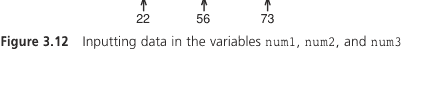

### 图 3.12 将数据输入变量 num1、num2 和 num3

cin 提取操作与 cout 插入操作一样，“聪明”到可以进行一些数据类型转换。例如，如果输入一个整数代替双精度数，该整数会被转换为正确的数据类型。[10] 类似地，如果在期望整数时输入了一个双精度数，则只使用该数的整数部分。例如，假设在响应语句 cin >> num1 >> num2 >> num3; 时输入下列数字，其中 num1 和 num3 已声明为双精度变量，num2 为整数变量：

56 22.879 33.923

56 被转换为 56.0 并存储在变量 num1 中。提取操作继续，从输入流中提取数据，并期望一个整数值。就 cin 而言，22.879 中的小数点表示一个整数的结束和一个十进制数的开始。因此，数字 22 被赋给 num2。cin 继续处理其输入流，将 .879 作为下一个双精度数并赋给 num3。就 cin 而言，33.923 是多余输入，会被忽略。但是，如果一开始没有输入足够的数据，cin 对象会继续让计算机暂停，直到输入足够的数据为止。

## 用户输入验证初探

一个精心构建的程序应该验证用户输入，并确保程序不会因意外输入而崩溃或产生无意义的输出。术语 validate（验证）是指检查输入的值是否与 cin 语句中赋值的目标变量的数据类型匹配，以及该值是否在应用程序可接受的范围内。能够有效检测并响应意外用户输入的程序，正式上称为健壮程序（robust programs），非正式地被称为“防弹”程序。作为程序员，你的工作之一就是编写健壮的程序。按目前所写，程序 3.12 和 3.13 并不是健壮程序，在下面的讨论中你会看到原因。

这两个程序的第一个问题在用户输入非数值值时变得很明显。例如，请看程序 3.13 的以下示例运行：

```
Enter three integer numbers: 10 20.68 20
The average of the numbers is -2.86331e+008
```

出现这种输出的原因是，第二个输入数字的转换导致整数 20 被赋给了 num2，而值 -858993460 被赋给了 num3。之所以出现 -858993460 这个值，是因为一个无效字符（小数点）被赋给了期望整数值的变量。数字 10、20 和 -858993460 的平均值被正确计算为 -286331143.3，该值以六位有效数字的科学计数法显示为 -2.86331e+008。对于一般用户而言，这个结果会被报告为程序错误。

只要前两个输入中的任何一个输入了非整数值，就会出现同样的问题。（如果第三个输入是任何数值，则不会出现该问题，因为最后一个输入的整数部分会被接受，其余输入会被忽略。）作为程序员，

10 严格来说，从键盘输入的不是任何数据类型（如 int 或 double），而只是字符序列。提取操作负责将字符序列转换为已定义的数据类型。


你的第一反应可能是“程序明确要求你输入整数值”。然而，有经验的程序员明白，他们的责任是确保程序能够预见并妥善处理用户可能输入的任何数据。为了实现这一目标，在开发程序时思考可能会出现什么问题，然后让另一人或一组人彻底测试程序。¹

处理无效数据输入的基本方法称为用户输入验证，这意味着在数据输入时或输入后立即检查所输入的数据，然后为用户提供重新输入任何无效数据的方式。用户输入验证是任何具有商业价值程序不可或缺的一部分；如果做得正确，它可以保护程序免于尝试处理可能导致计算问题的<|message|>数据。你将在第 4 章和第 5 章学习 C++ 的选择语句和重复语句时看到这种验证类型的操作方法。

## EXERCISES 3.4

- 1. (Practice) 对于以下声明语句，编写一个或多个使用 cin 对象的语句，使计算机在用户输入适当数据时暂停：
- a. int firstnum;
- b. double grade;
- c. double secnum;
- d. char keyval;
- e. int month, years;
    double average;
- f. char ch;
    int num1,num2;
    double grade1,grade2;
- g. double interest, principal, capital;
    double price, yield;
- h. char ch, letter1,letter2;
    int num1,num2,num3;
- i. double temp1,temp2,temp3;
    double volts1,volts2;

- 2. (Program) a. 编写、编译并运行一个 C++ 程序，显示以下提示：
Enter the length of the room:
Enter the width of the room:
在显示每个提示后，你的程序应使用 cin 对象调用从键盘接受与所显示提示对应的数据。在输入房间宽度后，你的程序应计算并显示房间面积。显示的面积应使用公式 area = length × width 计算，并包含在适当的提示信息中。
b. 通过手动计算结果来检查为练习 2a 编写的程序所显示的面积。

### 3. (Program) a. 编写、编译并运行一个 C++ 程序，显示以下提示：

Enter the length of the swimming pool:
Enter the width of the swimming pool:
Enter the average depth of the swimming pool:

在显示每个提示后，你的程序应使用 cin 语句从键盘接受与所显示提示对应的数据。在输入游泳池深度后，你的程序应计算并显示池水的体积。体积应使用公式 volume = length × width × average depth 计算并在输出信息中显示。

b. 通过手动计算结果来检查为练习 3a 编写的程序所显示的体积。

### 4. (Program) 编写、编译并运行一个 C++ 程序，显示以下提示：

Enter the radius of a circle:

在接受半径值后，你的程序应计算并显示圆的面积。提示：Area = 3.1416 × radius²。）为测试目的，通过使用输入半径为 3 英寸来验证你的程序。在手动确定你的程序结果正确后，使用你的程序完成以下图表：

| Radius (in) | Area (sq. in) |
|---|---|
| 1.0 | |
| 1.5 | |
| 2.0 | |
| 2.5 | |
| 3.0 | |
| 3.5 | |

### 5. (Program) a. 编写一个 C++ 程序，首先显示以下提示：

Enter the temperature in degrees Celsius:

让你的程序接受从键盘输入的值并将其转换为华氏度，使用以下公式：

Fahrenheit = (9.0 / 5.0) × Celsius + 32.0

你的程序随后应使用输出信息显示华氏温度。

b. 编译并运行为练习 5a 编写的程序。为验证你的程序，使用以下测试数据并手工计算华氏等价值，然后使用你的程序查看是否得到相同的结果：

- Test data set 1: 0 degrees Celsius
- Test data set 2: 50 degrees Celsius
- Test data set 3: 100 degrees Celsius

当你确信你的程序工作正确时，使用它完成以下图表：

| Celsius | Fahrenheit |
| 45 |  |
| 50 |  |
| 55 |  |
| 60 |  |
| 65 |  |
| 70 |  |

### 6. (Program) a. 编写、编译并运行一个 C++ 程序，显示以下提示：

```
Enter the miles driven:
Enter the gallons of gas used:
```

在显示每个提示后，你的程序应使用 cin 语句从键盘接受与所显示提示对应的数据。在输入汽油使用量后，你的程序应计算并显示每加仑英里数 mpg。此值应使用公式 miles per gallon = miles / gallons used 计算并在输出信息中显示。通过使用以下测试数据验证你的程序：
Test data set 1: miles = 276, gas = 10 gallons
Test data set 2: miles = 200, gas = 15.5 gallons

完成验证后，使用你的程序完成以下图表。确保将行驶英里数转换为行驶公里数，将使用的加仑数转换为使用的升数，然后计算每升公里数。每英里有 1.61 公里，每加仑有 4.54609 升。）

| Miles Driven | Gallons Used | Mpg | Km Driven | Liters Used | Km/L |
| 250 | 16.00 |  |  |  |  |
| 275 | 18.00 |  |  |  |  |
| 312 | 19.54 |  |  |  |  |
| 296 | 17.39 |  |  |  |  |

b. 对于练习 6a 编写的程序，确定需要多少次验证运行才能确保程序工作正确，并给出支持你的答案的理由。

### 7. (Program) a. 编写、编译并运行一个 C++ 程序，显示以下提示：

```
Enter a number:
Enter a second number:
Enter a third number:
Enter a fourth number:
```

在显示每个提示后，你的程序应使用 cin 语句从键盘接受一个数字作为所显示提示的输入。在输入第四个数字后，你的程序应计算并显示这些数字的平均值。平均值应

在输出信息中显示。通过使用以下测试数据检查你的程序计算的平均值：

- Test data set 1: 100, 100, 100, 100
- Test data set 2: 100, 0, 100, 0

完成验证后，使用你的程序完成以下图表：

| Numbers | Average |
|---|---|
| 92, 98, 79, 85 | |
| 86, 84, 75, 86 | |
| 63, 85, 74, 82 | |

b. 重复练习 7a，确保对每个数字输入使用相同的变量名 number。另使用变量 sum 表示数字之和。提示：为此，你可以在每次接受数字后使用语句 sum = sum + number;。复习第 3.1 节中关于累加的材料。

### 8. (Program) 地下泳池的周长、近似表面积和近似体积由以下公式给出：

perimeter = 2 × (length + width)
volume = length × width × average depth
underground surface area = 2 × (length + width) × average depth + length × width

以这些公式为基础，编写一个 C++ 程序，接受长度、宽度和平均深度测量值，然后计算泳池的周长、体积和地下表面积。在编写程序时，在输入数据后立即进行这两个计算：length × width 和 length + width。这两个计算的结果应根据需要在确定周长、体积和地下表面积的赋值语句中使用，而无需为每个方程重新计算。通过手工计算验证你的程序结果，使用以下测试数据：length = 25 feet, width = 15 feet, and average depth = 5.5 feet。在验证程序工作正常后，使用它完成以下图表：

| Length | Width | Average Depth | Perimeter | Volume | Underground Surface Area |
|---|---|---|---|---|---|
| 25 | 10 | 5.0 | | | |
| 25 | 10 | 5.5 | | | |
| 25 | 10 | 6.0 | | | |
| 25 | 10 | 6.5 | | | |
| 30 | 12 | 5.0 | | | |
| 30 | 12 | 5.5 | | | |
| 30 | 12 | 6.0 | | | |
| 30 | 12 | 6.5 | | | |


### 9. (程序)

a. 编写、编译并运行一个 C++ 程序，用于计算并显示二阶多项式 ax² + bx + c 的值，该值针对用户输入的系数 a、b、c 和变量 x 的任意值。让你的程序首先显示一条消息来告知用户程序的功能，然后显示合适的提示以提醒用户输入数据。 （提示：使用类似 Enter the coefficient of the x-squared term: 的提示。）

b. 使用以下测试数据检查为练习 9a 编写的程序的结果：

测试数据集 1：a = 0, b = 0, c = 22, x = 56
测试数据集 2：a = 0, b = 22, c = 0, x = 2
测试数据集 3：a = 0, b = 0, c = 0, x = 2
测试数据集 4：a = 2, b = 4, c = 5, x = 2

完成验证后，使用你的程序完成以下图表：

| a | b | c | x | 多项式值 (ax² + bx + c) |
|---|---|---|---|---|
| 2.0 | 17.0 | -12.0 | 1.3 | |
| 3.2 | 2.0 | 15.0 | 2.5 | |
| 3.2 | 2.0 | 15.0 | -2.5 | |
| -2.0 | 10.0 | 0.0 | 2.0 | |
| -2.0 | 10.0 | 0.0 | 4.0 | |
| -2.0 | 10.0 | 0.0 | 5.0 | |
| -2.0 | 10.0 | 0.0 | 6.0 | |
| 5.0 | 22.0 | 18.0 | 8.3 | |
| 4.2 | -16 | -20 | -5.2 | |

### 10. (程序)

编写、编译并运行一个程序，计算并显示用户输入的实数的平方根值。通过计算以下测试数据的平方根来验证你的程序：25、16、0 和 2。完成验证后，使用你的程序确定 32.25、42、48、55、63 和 79 的平方根。

### 11. (程序)

编写、编译并运行一个程序来计算并显示用户输入的数字的四次方根。回想一下初等代数，你可以通过将数字提高到 1/4 次幂来求出数字的四次方根。 （提示：不要使用整数除法——你能看出为什么吗？）通过计算以下测试数据的四次方根来验证你的程序：81、16、1 和 0。完成后，使用你的程序确定 42、121、256、587、1240 和 16,256 的四次方根。

### 12. (程序)

程序 3.12 提示用户输入两个数字；输入的第一个值存储在 num1 中，第二个值存储在 num2 中。以此程序为起点，编写一个程序来交换这两个变量中存储的值。

### 13. (程序)

编写一个 C++ 程序，提示用户输入一个数字。让你的程序将数字作为整数接受并立即使用 cout 语句显示该整数。运行你的程序三次。第一次，输入一个有效的整数；第二次，输入一个双精度数；第三次，输入一个字符。使用输出显示，查看你的程序实际从你输入的数据中接受了什么数字。

### 14. (程序)

重复练习 13，但让你的程序将用于存储数字的变量声明为双精度变量。运行程序三次。第一次，输入一个整数；第二次，输入一个双精度数；第三次，输入一个字符。使用输出显示，跟踪你的程序实际从你输入的数据中接受了什么数字。发生了什么，如果有的话，为什么？

### 15. (思考题)

a. 你认为为什么成功的程序包含广泛的数据输入有效性检查？ （提示：回顾练习 13 和 14。）

b. 你认为数据类型检查和数据合理性检查有什么区别？

c. 假设程序要求用户输入月份、日期和年份。对输入的数据可以进行哪些检查？

## 3.5 符号常量

程序中使用的某些常量具有更一般的含义，这些含义在程序上下文之外也能被识别。这些类型常量的例子包括数字 3.1416，它是精确到小数点后四位的 π；32.2 ft/sec²，它是重力常数；以及数字 2.71828，它是精确到小数点后五位的欧拉数。

程序中使用的某些其他常量的含义严格在所编程的应用上下文中定义。例如，在用于确定银行利息费用的程序中，利率通常在程序的许多不同位置出现。同样，在用于计算税款的程序中，税率可能出现在许多指令中。程序员将这类数字称为魔数。它们本身是普通的，但在特定应用的上下文中，它们具有特殊的“魔力”含义。当魔数在同一程序中重复出现时，如果需要更改该常量，就会成为潜在的错误来源。例如，如果利率或销售税率发生变化，而这些税率很可能发生变化，程序员就有繁琐的任务去在程序中出现的所有地方更改该值。多次更改容易出错：如果遗漏了一个值而未更改，当程序运行时结果将不正确，并且错误来源将难以定位。

为了避免魔数在程序的许多地方传播的问题，并清晰地标识更通用的常量，例如 π，C++ 使程序员能够为这些常量赋予符号名称。然后可以在整个程序中使用符号名称而不是魔数。如果数字 ever 需要更改，只需在符号名称与实际数字值相等的位置进行一次更改即可。要将数字与符号名称相等，你使用 const 声明限定符，它指定声明的标识符在初始化后为只读；它不能被更改。以下是使用此限定符的三个示例：

```
const double PI = 3.1416;
const double SALESTAX = 0.05;
const int MAXNUM = 100;
```

第一个声明语句创建一个名为 PI 的双精度变量并将其初始化为 3.1416。第二个声明语句创建名为 SALESTAX 的双精度常量并将其初始化为 0.05。最后，第三个声明创建一个名为 MAXNUM 的整数常量并将其初始化为 100。

在 const 标识符创建并初始化后，存储在其内部的值不能被更改。就实际目的而言，常量的名称及其值在声明它们的程序持续时间内是相互关联的。

尽管 const 标识符显示为大写字母，但也可以使用小写字母。在 C++ 中使用大写字母是惯例，以便于识别 const 标识符。当程序员在程序中看到大写字母时，他们就知道正在使用常量，并且其值在程序中不能被更改。

在声明后，const 标识符可以在任何 C++ 语句中代替其代表的数字使用。例如，这两个赋值语句都是有效的：

```
circum = 2 * PI * radius;
amount = SALESTAX * purchase;
```

这些语句当然必须出现在所有变量和常量的声明之后。因为 const 声明将常量值与标识符相等，而标识符可以用作其初始化常量的替代品，所以这些标识符通常被称为符号常量或命名常量。在本书中，这些术语可以互换使用。

### 语句的放置

到目前为止，你已经了解了各种语句类型。C++ 中语句放置的一般规则很简单，即变量或符号常量必须在被使用之前声明。虽然此规则允许在程序的任何地方放置预处理器指令和声明语句，但这样做会导致程序结构不佳。作为良好的编程形式，应使用以下语句顺序：

```
预处理器指令
```

```
int main()
{
    // 符号常量
    // 变量声明

    // 其他可执行语句

    return 0;
}
```

随着新语句类型的引入，此放置结构将被扩展以适应它们。请注意，注释语句可以混合在此基本结构中的任何位置。程序 3.14 说明了此结构并使用符号常量来计算购买商品应缴纳的销售税。


## 程序 3.14

```
#include <iostream>
#include <iomanip>
using namespace std;

int main()
{
    const double SALESTAX = 0.05;
    double amount, taxes, total;

    cout << "\nEnter the amount purchased: ";
    cin >> amount;
    taxes = SALESTAX * amount;
    total = amount + taxes;
    cout << setiosflags(ios::fixed)
         << setiosflags(ios::showpoint)
         << setprecision(2);
    cout << "The sales tax is " << setw(4) << taxes << endl;
    cout << "The total bill is " << setw(5) << total << endl;

    return 0;
}
```

以下示例运行结果由程序 3.14 生成：

```
Enter the amount purchased: 36.00
The sales tax is 1.80
The total bill is 37.80
```

虽然已使用 `const` 限定符来构造符号常量，但你将在第 11 章再次遇到此数据类型，届时你将了解到它作为函数参数非常有用，可以确保参数在函数中不被修改。

## 练习 3.5

- 1.（修改）重写以下程序，使用符号常量 `PI` 代替程序中使用的值 3.1416：

```
#include <iostream>
using namespace std;
int main()
{
    double radius, circum;
```

```
cout << "Enter a radius: ";
cin >> radius;
circum = 2.0 * 3.1416 * radius;
cout << "\nThe circumference of the circle is "
<< circum << endl;

return 0;
}
```

- 2.（修改）重写以下程序，使用命名常量 `FACTOR` 代替程序中使用的表达式 (5.0/9.0)：

```
#include <iostream>
using namespace std;

int main()
{
    double fahren, celsius;
    cout << "Enter a temperature in degrees Fahrenheit: ";
    cin >> fahren;
    celsius = (5.0/9.0) * (fahren - 32.0);
    cout << "The equivalent Celsius temperature is "
    << celsius << endl;

    return 0;
}
```

- 3.（修改）重写以下程序，使用符号常量 `PRIME` 代替程序中使用的值 0.04：

```
#include <iostream>
using namespace std;

int main()
{
    double prime, amount, interest;
    prime = 0.04;    // prime interest rate
    cout << "Enter the amount: ";
    cin >> amount;
    interest = prime * amount;
    cout << "The interest earned is "
    << interest << " dollars" << endl;

    return 0;
}
```

- 4.（编程）热量从太阳和所有绕太阳运行的行星辐射出来。辐射的热量可以使用以下公式计算：

E = ε σ T⁴

- E 是每秒辐射的能量，单位为瓦特每平方米（watts/m²）。
- ε 是物质的发射率，太阳和所有行星的发射率为 1。
- σ 是常数（.000000056697 = 5.6697e-8）。
- T 是以摄氏度表示的表面温度。

例如，太阳辐射的热量（发射率为 1，表面温度约为 6000°C）如下：

E = (1) × (.000000056697) × (6000)⁴ watts/m²
= 73,479,300 watts/m²

使用该公式，编写一个 C++ 程序，接受行星的温度并输出该行星产生的热量。你的程序应将值 5.6697e-8 赋给名为 `HEATFACTOR` 的符号常量。在确定程序正确运行后（确保它能正确计算出太阳的辐射量），使用它完成以下表格：

| 行星（发射率 = 1） | 平均表面温度（摄氏度） | 辐射热量（watts/m²） |
|---|---|---|
| 水星 | 270 | |
| 金星 | 462 | |
| 地球 | 14 | |

- 5.（编程）白天，许多物体（如汽车、屋顶和砖墙）会吸收热量。这些热量在较凉爽的夜晚会辐射回环境中。使用公式 E = ε σ T⁴（见练习 4），编写一个 C++ 程序，确定下表中列出的物体辐射的热量。你的程序应请求输入物体的平均表面温度和发射率，然后计算并显示辐射的热量。确保使用名为 `HEATFACTOR` 的符号常量来表示 σ 的值。运行程序三次，完成以下表格：

| 物质 | 平均表面温度（摄氏度） | 发射率 | 辐射热量（watts/m²） |
|---|---|---|---|
| 汽车 | 47 | .3 | |
| 砖块 | 45 | .9 | |
| 商业屋顶 | 48 | .05 | |

## 3.6 常见编程错误

使用本章内容时，请注意以下可能的错误：

- 1. 在表达式中使用所有变量之前，忘记为它们赋值或初始化。值可以通过赋值语句赋值、在声明语句中初始化，或通过使用 `cin` 对象交互式输入值来赋值。
- 2. 使用数学库函数时，未包含预处理器语句 `#include <cmath>`（在基于 UNIX 的系统中，忘记在 `cc` 命令行中包含 `-lm` 参数）。
- 3. 使用库函数时，未提供正确数量的、具有适当数据类型的参数。
- 4. 将递增或递减运算符应用于表达式。例如，表达式 `(count + n)++` 是错误的。递增和递减运算符只能应用于变量。
- 5. 忘记使用提取运算符 `>>` 来分隔 `cin` 语句中的变量。
- 6. 一个更不寻常的错误是，当递增和递减运算符与同一表达式中出现多次的变量一起使用时。此错误的发生是因为 C++ 未指定表达式中操作数的访问顺序。例如，以下语句中赋给 `result` 的值取决于编译器：

  ```
  result = i + i++;
  ```

  如果你的编译器先访问第一个操作数（`i`），则上述语句等效于：

  ```
  result = 2 * i;
  i++;
  ```

  但是，如果你的编译器先访问第二个操作数（`i++`），则第一个操作数的值在第二次使用之前已被更改，因此赋给 `result` 的值是 2i + 1。作为一般规则，当递增或递减运算符操作的变量在表达式中出现多次时，不要在表达式中使用该运算符。
- 7. 不愿意深入测试程序。客观地测试自己的软件是困难的，但作为程序员，你必须提醒自己，仅仅因为你认为程序是正确的，并不意味着它确实正确。

## 3.7 章节总结

- 1. 表达式是由运算符分隔的一个或多个操作数组成的序列。操作数可以是常量、变量或另一个表达式。表达式与一个值相关联。
- 2. 表达式根据其中所用运算符的优先级和结合性进行求值。
- 3. 赋值运算符是 `=` 符号。使用此运算符的表达式将值赋给变量，并且该表达式本身也具有一个值。由于赋值是 C++ 操作，因此赋值运算符可以在同一表达式中多次使用。
- 4. 递增运算符 `++` 将变量加 1，递减运算符 `--` 将变量减 1。这两个运算符都可以用作前缀或后缀。在前缀操作中，变量在其值被使用之前递增（或递减）。在后缀操作中，变量在其值被使用之后递增（或递减）。
- 5. C++ 提供了用于计算平方根、对数和其他数学运算的库函数。使用数学函数的程序必须包含语句 `#include <cmath>`，或在调用数学函数之前具有函数声明。
- 6. 每个数学库函数都对其参数进行操作以计算单个值。要有效使用库函数，你必须知道函数名称、函数的功能、函数期望的参数数量和数据类型，以及返回值的类型。
- 7. 传递给函数的数据称为函数的参数。参数通过将每个参数用逗号分隔，放在函数名后的括号中传递给库函数。每个函数对必须提供的参数数量和数据类型都有自己的要求。
- 8. 函数可以包含在更大的表达式中。
- 9. `cin` 对象用于数据输入。它从键盘接收数据流并将数据赋给变量。这是使用 `cin` 的语句的一般形式：

   `cin >> var1 >> var2 ... >> varn;`

   提取运算符 `>>` 必须用于分隔 `cin` 语句中的变量名。
- 10. 当遇到 `cin` 语句时，计算机会暂时挂起进一步执行，直到为 `cin` 语句中的变量数量输入了足够的数据。
- 11. 在 `cin` 语句之前显示一条消息是一个良好的编程实践，该消息提醒用户要输入的数据类型和数量。此消息称为提示符。
- 12. 可以使用 `const` 关键字将值等同于单个常量。此关键字创建一个命名常量，该常量在声明语句中初始化后为只读。此声明的语法为：

   `const dataType symbolicName = initialValue;`

   并允许在声明之后的程序中的任何位置使用该常量代替 `initialValue`。通常，这些声明放在程序中的变量声明之前。

## 3.8 章节补充：错误、测试和调试

编程的理想目标是生成可读、无错误、运行正确且能以最少测试进行修改或更改的程序。你可以通过牢记可能发生的不同类型的错误、它们通常何时被检测到以及如何纠正它们，朝着这一理想目标努力。


## Assignment and Interactive Input

Program errors can be detected at any of the following times:

- Before a program is compiled
- While the program is being compiled
- While the program is running
- After the program has been run and the output is being examined

The method for detecting errors before a program is compiled is called **desk checking** because you’re usually sitting at a desk with the code in front of you. It refers to the process of examining source code for syntax and logic errors. The method for detecting errors after a program has run is called **program verification and testing**.

## Compile-Time and Runtime Errors

Errors detected while a program is being compiled are called **compile-time errors**, and errors that occur while a program is running are called **runtime errors**. These terms describe when errors occur, not what caused them. Most compile-time errors, however, are caused by syntax errors, and the majority of runtime errors are caused by logic errors.

By now, you have probably encountered numerous compile-time errors. Beginning programmers tend to be frustrated by them, but experienced programmers understand the compiler is doing a lot of valuable checking, and correcting errors the compiler does detect is usually easy. Because these errors occur while a program is being developed, not while a user is performing an important task, no one but the programmer ever knows they occurred. You fix them, and they go away.

Runtime errors are more troubling because they occur while a user is running the program. Because the user in most commercial systems isn’t the programmer, typically the error can’t be assessed and corrected immediately. Runtime errors can be caused by program or hardware failures. From a programming standpoint, however, most runtime errors are caused by logic errors.

## Syntax and Logic Errors

Computer literature distinguishes between two main types of errors: syntax and logic errors. A **syntax error** is an error in ordering valid language elements in a statement or the attempt to use invalid language elements. For example, examine the following statements:

```
cout << "There are four syntax errors here\n"
cot "Can you find them";
```

They contain the following syntax errors:

- 1. A closing quotation mark is missing in line 1.
- 2. A terminating semicolon (;) is missing in line 1.
- 3. The keyword cout is misspelled in line 2.
- 4. The insertion symbol, <<, is missing in line 2.

If these errors aren’t discovered by desk checking, the compiler detects them and displays an error message.¹² Sometimes the error message is clear and the error is obvious; at other times, understanding the compiler’s error message takes a little detective work. Because

syntax errors are detected only at compile time. Strictly speaking, however, "compile time" refers to when the error is detected, and "syntax" refers to the type of error detected.

Note that the misspelling of "them" in the second statement isn't a syntax error. Although this spelling error results in displaying an undesirable output line, it's not a violation of C++'s syntax rules. It's simply a typographical error, commonly referred to as a "typo." The compiler doesn't catch this type of typographical error.

Another error the compiler doesn't catch is a logic error, which is characterized by erroneous, unexpected, or unintentional output that's a result of some flaw in the program's logic. These errors can be detected by desk checking, by program testing, by accident when a user gets erroneous output while the program is running, or not at all.

The most serious logic error is caused by not fully understanding the program's requirements because the logic in a program reflects the logic on which it's coded. For example, if a program's purpose is to calculate a mortgage payment on a house or the load-bearing strength of a steel beam and the programmer doesn't fully understand how to make the calculation, what inputs are needed to perform the calculation, or what special conditions exist (such as what happens when someone makes an extra mortgage payment or how temperature affects the beam), a logic error occurs. Because the compiler doesn't detect these errors and they often go undetected at runtime, they are always more difficult to detect than syntax errors.

If logic errors are detected, typically they're revealed in one of two main ways. First, the program executes to completion but produces incorrect results, such as the following:

- *No output*—This result is caused by omitting an output statement or using a sequence of statements that inadvertently bypasses an output statement.
- *Unappealing or misaligned output*—This result is caused by an error in an output statement.
- *Incorrect numerical results*—This result is caused by assigning incorrect values to variables in an expression, coding an incorrect or incomplete algorithm, coding a correct algorithm incorrectly, omitting a statement, making a round-off error, or using an improper sequence of statements.

Second, a logic error can cause a runtime error. Examples of this type of logic error are attempts to divide by zero or take the square root of a negative number. Typically, these errors are caused by incorrect user input. Although beginning programmers tend to blame users for runtime errors caused by entering incorrect data, professionals don't. They understand that a runtime error is a basic flaw in the program's construction that can damage the reputation of both the program and the programmer. They also understand that determining the error and correcting what caused it are more fruitful than determining who caused it.

## Testing and Debugging

Program testing should be well thought out to maximize the possibility of locating errors. In this regard, an important programming realization is that although a single test can reveal the presence of an error, it does not verify the absence of one. In other words, the fact that a

### 3.1 数据链路层协议

数据链路层协议是计算机网络中负责在相邻节点之间可靠地传输数据帧的协议。它定义了数据帧的格式、差错检测和纠正方法、流量控制机制以及介质访问控制策略。常见的数据链路层协议包括以太网（Ethernet）、点对点协议（PPP）和高级数据链路控制（HDLC）等。

#### 3.1.1 以太网协议

以太网是应用最广泛的局域网技术，它定义了物理层和数据链路层的规范。以太网帧格式包括前导码、帧起始定界符、目的地址、源地址、类型/长度字段、数据字段和帧校验序列。以太网采用CSMA/CD（载波监听多路访问/冲突检测）协议来协调多个设备对共享介质的访问。

以太网的传输速率从最初的10Mbps发展到现在的100Mbps、1Gbps、10Gbps甚至更高。现代以太网通常使用双绞线或光纤作为传输介质，并采用全双工通信模式，消除了冲突检测的需要。

#### 3.1.2 点对点协议（PPP）

点对点协议（PPP）是一种用于在两个网络节点之间建立直接连接的数据链路层协议。它广泛应用于拨号上网、宽带接入和虚拟专用网络（VPN）等场景。PPP协议提供了帧封装、链路控制协议（LCP）和网络控制协议（NCP）三大功能。

PPP帧格式包含标志字段、地址字段、控制字段、协议字段、信息字段和帧校验序列。PPP支持多种网络层协议，如IP、IPX和AppleTalk，通过NCP协议进行协商和配置。

| 协议名称 | 应用场景 | 传输介质 | 最大传输速率 |
|---------|---------|---------|------------|
| 以太网 | 局域网 | 双绞线/光纤 | 400Gbps |
| PPP | 拨号/宽带 | 电话线/光纤 | 100Mbps |
| HDLC | 广域网 | 专线 | 10Gbps |

表3-1 常见数据链路层协议对比

在选择数据链路层协议时，需要根据网络规模、传输距离、带宽需求和成本等因素进行综合考虑。以太网因其高带宽和低成本成为局域网的首选，而PPP则更适合于点对点的远程连接场景。

## Chapter 4

## Selection

- 4.1 Relational Expressions
- 4.2 The `if-else` Statement
- 4.3 Nested `if` Statements
- 4.4 The `switch` Statement
- 4.5 Common Programming Errors
- 4.6 Chapter Summary
- 4.7 Chapter Supplement: A Closer Look at Testing


The term flow of control refers to the order in which a program’s statements are executed. Unless directed otherwise, the normal flow of control for all programs is sequential. This term means statements are executed in sequence, one after another, in the order in which they’re placed in the program.

Both selection and repetition statements enable programmers to alter this normal sequential flow of control. As their names imply, selection statements make it possible to select which statement, from a well-defined set, is executed next, and repetition statements make it possible to go back and repeat a set of statements. In this chapter, you learn about C++’s selection statements. Because selection requires choosing between alternatives, this chapter begins with a description of C++’s selection criteria.

## 4.1 Relational Expressions

Besides providing addition, subtraction, multiplication, and division capabilities, all computers have the capability to compare numbers. Because many seemingly “intelligent” decision-making situations can be reduced to choosing between two values, a computer’s comparison capability can be used to create a remarkable intelligence-like facility.


用于比较操作数的表达式称为关系表达式。一个简单的关系表达式由一个关系运算符连接两个变量和/或常量操作数组成，如图4.1所示。表4.1列出了C++中可用的关系运算符。它们可用于整数、布尔、双精度或字符数据，但必须严格按表4.1中所示的形式输入。

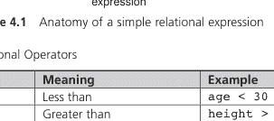

## 图4.1 简单关系表达式的结构

## 表4.1 C++的关系运算符

| 运算符 | 含义 | 示例 |
|---|---|---|
| < | 小于 | age < 30 |
| > | 大于 | height > 6.2 |
| <= | 小于或等于 | taxable <= 20000 |
| >= | 大于或等于 | temp >= 98.6 |
| == | 等于 | grade == 100 |
| != | 不等于 | number != 250 |

以下是有效关系表达式的示例：

```
age > 40    length <= 50    width > 7
3 < 4       flag == done    idNum == 682
day != 5    2.0 > 3.3       hours > 40
```

以下示例是无效的：

```
length <= 50    // 符号错误
2.0 >> 3.3       // 无效的关系运算符
flag = = done    // 不允许有空格
```

关系表达式有时被称为条件，本书中这两个术语都会使用。与所有C++表达式一样，关系表达式会被求值并产生一个数值结果。1 被解释为真的条件求值为整数值1，假的条件求值为整数值0。

例如，因为关系3 < 4始终为真，所以该表达式的值为1；因为关系2.0 > 3.3始终为假，所以该表达式的值为0。这可以通过以下语句验证：

```
cout << "The value of 3 < 4 is " << (3 < 4);
cout << "\nThe value of 2.0 > 3.3 is " << (2.0 > 3.3);
```

> 1在这一点上，C++与大多数其他高级语言不同，后者产生布尔（真或假）结果。

这些语句产生以下输出：

```
The value of 3 < 4 is 1
The value of 2.0 > 3.3 is 0
```

关系表达式（如hours > 40）的值取决于变量hours中存储的值。在C++程序中，关系表达式的值不如C++在表达式用作选择语句的一部分时对该值的解释重要。在这些语句中（将在下一节解释），你会看到C++使用零值表示假条件，使用任何非零值表示真条件。然后根据该值选择接下来要执行的语句。

除了数值操作数外，还可以使用关系运算符比较字符数据。例如，在ASCII码中，字母'A'使用比字母'B'数值更低的代码存储，'B'的代码比'C'的代码值低，依此类推。对于以这种方式编码的字符集，以下条件的求值结果如下所示：

| 表达式 | 值 | 解释 |
|---|---|---|
| 'A' > 'C' | 0 | 假 |
| 'D' <= 'Z' | 1 | 真 |
| 'E' == 'F' | 0 | 假 |
| 'g' >= 'm' | 0 | 假 |
| 'b' != 'c' | 1 | 真 |
| 'a' == 'A' | 0 | 假 |

比较字母在按字母顺序排列姓名或使用字符在决策情境中进行选择时至关重要。

## 逻辑运算符

除了使用简单关系表达式作为条件外，还可以使用逻辑运算符AND、OR和NOT创建更复杂的条件。这些运算符分别由符号&&、||和!表示。

当AND运算符&&与两个简单表达式一起使用时，仅当两个表达式本身都为真时，条件才为真。因此，逻辑条件

```
(age > 40) && (term < 10)
```

仅当age大于40且term小于10时才为真。由于关系运算符的优先级高于逻辑运算符，因此此逻辑表达式中的括号本可以省略。

OR运算符||也用于两个表达式。使用OR运算符时，如果两个表达式中的一个或两个都为真，则条件满足。因此，条件

```
(age > 40) || (term < 10)
```

如果age大于40、term小于10或两个条件都为真，则为真。同样，包含关系表达式周围的括号是为了使语句更易读。由于关系运算符的优先级高于逻辑运算符，即使省略括号，也会进行相同的求值。

对于声明

```
int i, j;
double a, b, complete;
```

以下是有效的条件：

```
a > b
(i == j) || (a < b) || complete
(a/b > 5) && (i <= 20)
```

在求值这些条件之前，必须知道a、b、i、j和complete的值。对于赋值

```
a = 12.0;
b = 2.0;
i = 15;
j = 30;
complete = 0.0;
```

前面的表达式产生以下结果：

| 表达式 | 值 | 解释 |
|---|---|---|
| a > b | 1 | 真 |
| (i == j) || (a < b) || complete | 0 | 假 |
| (a/b > 5) && (i <= 20) | 1 | 真 |

NOT运算符!用于将表达式改变为其相反状态；也就是说，如果表达式具有非零值（真），则语句!expression产生零值（假）。如果表达式最初为假（具有零值），则!expression为真并求值为1。例如，如果数字26存储在变量age中，则表达式age > 40的值为0（假），表达式!(age > 40)的值为1（真）。由于NOT运算符仅与一个表达式一起使用，因此它是单目运算符。

关系运算符和逻辑运算符具有类似于算术运算符的执行层次。表4.2列出了这些运算符相对于你已使用的其他运算符的优先级。

## 表4.2 运算符优先级和结合性

| 运算符 | 结合性 |
|---|---|
| ! 单目 - ++ -- | 从右到左 |
| * / % | 从左到右 |
| + - | 从左到右 |
| < <= > >= | 从左到右 |
| == != | 从左到右 |
| && | 从左到右 |
| || | 从左到右 |
| = += -= *= /= | 从右到左 |

以下图表说明了使用运算符的优先级和结合性来求值关系表达式，假设有以下声明：

```
char key = 'm';
int i = 5, j = 7, k = 12;
double x = 22.5;
```

| 表达式 | 等价表达式 | 值 | 解释 |
|---|---|---|---|
| i + 2 == k - 1 | (i + 2) == (k - 1) | 0 | 假 |
| 3 * i - j < 22 | ((3 * i) - j) < 22 | 1 | 真 |
| i + 2 * j > k | (i + (2 * j)) > k | 1 | 真 |
| k + 3 <= -j + 3 * i | (k + 3) <= ((-j) + (3*i)) | 0 | 假 |
| 'a' + 1 == 'b' | ('a' + 1) == 'b' | 1 | 真 |
| key - 1 > 'p' | (key - 1) > 'p' | 0 | 假 |
| key + 1 == 'n' | (key + 1) == 'n' | 1 | 真 |
| 25 >= x + 1.0 | 25 >= (x + 1.0) | 1 | 真 |

与所有表达式一样，可以使用括号来改变指定的运算符优先级并提高关系表达式的可读性。通过首先求值括号内的表达式，以下复合条件的求值过程如下所示：

```
(6 * 3 == 36 / 2) || (13 < 3 * 3 + 4) && !(6 - 2 < 5)
    (18 == 18)      ||  (13 < 9 + 4)   && !(4 < 5)
    1 ||             (13 < 13)       && !1
    1 ||             0              && 0
    1 ||
    1
```

## 数值精度问题

在C++的关系表达式中，可能会出现与单精度和双精度数字相关的微妙数值精度问题。由于计算机存储这些数字的方式，应避免使用关系运算符==测试单精度和双精度值及变量的相等性。

原因是许多十进制数（如0.1）无法用有限位数的二进制精确表示，因此测试这些数的精确相等性可能会失败。当你想要非整数值的相等性时，最好要求操作数之差的绝对值小于某个极小的值。因此，对于单精度和双精度操作数，一般表达式

```
operand_1 == operand_2
```

应替换为以下条件：

```
abs(operand_1 - operand_2) < EPSILON
```

EPSILON可以是一个设置为任何可接受的小值的常量，例如0.00001。因此，如果两个操作数之间的差小于EPSILON的值，则认为这两个操作数本质上相等。例如，如果x和y是双精度变量，则类似

```
x/y == 0.35
```

的条件应编程为以下形式：

```
abs(x/y - 0.35) < EPSILON
```

此条件确保以二进制表示非整数时的微小不准确性不会影响所测试条件的求值。由于所有计算机都有0的精确二进制表示，因此与0进行精确相等性比较不存在此数值精度问题。

## 练习4.1

1.（实践）确定以下表达式的值，假设a = 5，b = 2，c = 4，d = 6，e = 3：

- a. a > b
- b. a != b
- c. d % b == c % b
- d. a * c != d * b
- e. d * b == c * e

- f. a * b
- g. a % b * c
- h. c % b * a
- i. b % c * a


为了清晰起见，if-else 语句通常以这种形式写成四行：

```
if (expression)
    statement1;
else
    statement2;
```

此处无分号

此处无分号

if-else 语句的形式通常取决于 statement1 和 statement2 的长度。然而，使用这种四行形式时，不要在括号后或 else 关键字后加上分号。分号仅放在语句的末尾。图 4.2 显示了 if-else 语句的流程图。

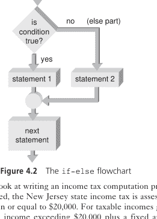

图 4.2 if-else 流程图

作为示例，请看编写一个包含 if-else 语句的所得税计算程序。如所述，新泽西州所得税对不超过 $20,000 的应税收入按 2% 征收。对于应税收入大于 $20,000 的情况，州税为超过 $20,000 的收入的 2.5% 加上固定的 $400。需要测试的表达式是应税收入是否小于或等于 $20,000，因此以下 if-else 语句适合此程序：

```
if (taxable <= 20000.0)
    taxes = 0.02 * taxable;
else
    taxes = 0.025 * (taxable - 20000.0) + 400.0;
```

> 请注意，在实际操作中，此语句中的数值通常会定义为命名常量。

关系运算符 <= 用于表示条件“小于或等于”。如果 taxable 的值小于或等于 20000.0，则条件为真（值为 1），语句 taxes = 0.02 * taxable; 被执行。如果条件不为真，表达式的值为零，则 else 关键字后的语句被执行。程序 4.1 显示了在一个完整程序中使用此语句。

## 程序 4.1

```
#include <iostream>
#include <iomanip>
using namespace std;

int main()
{
    double taxable, taxes;

    cout << "Please type in the taxable income: ";
    cin >> taxable;

    if (taxable <= 20000.0)
        taxes = 0.02 * taxable;
    else
        taxes = 0.025 * (taxable - 20000.0) + 400.0;

    cout << setiosflags(ios::fixed)
         << setiosflags(ios::showpoint)
         << setprecision(2)
         << "Taxes are $ " << taxes << endl;

    return 0;
}
```

在程序中在 if-else 语句前后插入一个空行以突出显示它。整本书都使用这种格式来强调正在讨论的语句。

为了说明选择的作用，程序 4.1 使用不同的输入数据运行了两次。这些是结果：

Please type in the taxable income: 10000.
Taxes are $ 200.00

和

Please type in the taxable income: 30000.
Taxes are $ 650.00

在回顾此输出时，注意第一次运行中输入的应税收入小于 $20,000，且税率正确计算为输入数的 2%。在第二次运行中，应税收入超过 $20,000，if-else 语句的 else 部分被使用，得出正确的税率计算：
0.025 * ($30,000. - $20,000.) + $400. = $650.

尽管 if-else 语句可以测试任何表达式，但通常只使用关系表达式。然而，以下语句也是有效的：

```
if (num)
    cout << "Bingo!";
else
    cout << "You lose!";
```

因为 num 本身是一个有效的表达式，如果 num 有任何非零值，则会显示消息 Bingo!，如果 num 的值为零，则会显示消息 You lose!。

## 复合语句

尽管 if-else 语句的 if 部分和 else 部分只允许一个语句，但每个单语句可以是复合语句。复合语句是在大括号之间的一系列单语句，如以下示例所示：

```
{
    statement1;
    statement2;
    statement3;
    .
    .
    last statement;
}
```

使用大括号将一组语句括起来会创建一个可以作为单个语句在 C++ 程序的任何位置使用的语句块。下一个示例显示了在 if-else 语句的一般形式中使用复合语句：

```
if (expression)
{
    statement1;  // as many statements as necessary
    statement2;  // can be put inside the braces
    statement3;  // each statement must end with a ;
}
else
{
    statement4;
    statement5;
    .
    .
    last statement;
}
```

程序 4.2 显示了在实际程序中使用复合语句。此程序检查 tempType 中的值是否为 f。如果是，则执行对应于 if-else 语句 if 部分的复合语句。tempType 中的任何其他字母都会导致执行对应于 else 部分的复合语句。

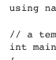

## 程序 4.2

```
#include <iostream>
#include <iomanip>
using namespace std;

// a temperature conversion program
int main()
{
    char tempType;
    double temp, fahren, celsius;

    cout << "Enter the temperature to be converted: ";
    cin >> temp;
    cout << "Enter an f if the temperature is in Fahrenheit";
    cout << "\n or a c if the temperature is in Celsius: ";
    cin >> tempType;

    // set output formats
    cout << setiosflags (ios::fixed)
         << setiosflags (ios::showpoint)
         << setprecision(2);

    if (tempType == 'f')
    {
        celsius = (5.0 / 9.0) * (temp - 32.0);
        cout << "\nThe equivalent Celsius temperature is "
             << celsius << endl;
    }
    else
    {
        fahren = (9.0 / 5.0) * temp + 32.0;
        cout << "\nThe equivalent Fahrenheit temperature is "
             << fahren << endl;
    }

    return 0;
}
```

程序 4.2 的一个示例运行如下。

```
Enter the temperature to be converted: 212
Enter an f if the temperature is in Fahrenheit
    or a c if the temperature is in Celsius: f

The equivalent Celsius temperature is 100.00
```

## 块作用域

复合语句中包含的所有语句构成一个代码块，在此块中声明的任何变量仅在其声明与定义块的闭合大括号之间有意义。例如，请看以下由两个代码块组成的示例：

```
{  // start of outer block
    int a = 25;
    int b = 17;
    cout << "The value of a is " << a
         << " and b is " << b << endl;

    {  // start of inner block
        double a = 46.25;
        int c = 10;
        cout << "a is now " << a
             << " b is now " << b
             << " and c is " << c << endl;
    }  // end of inner block

    cout << "a is now " << a << " and b is " << b << endl;
}  // end of outer block
```

此代码段产生以下输出：

```
The value of a is 25 and b is 17
a is now 46.25 b is now 17 and c is 10
a is now 25 and b is 17
```

输出产生如下：第一个代码块定义了两个名为 a 和 b 的变量，可以在声明之后在此块的任何位置使用，包括此外部块内的任何块。在内部块中，声明了两个新变量，名为 a 和 c。因此，此时已创建四个不同的变量，其中两个同名。当引用一个变量时，编译器首先尝试访问在包含引用的块中声明的具有正确名称的变量。如果在块中未定义引用的变量，编译器会尝试访问在下一个外部块中声明的变量，直到得到有效的访问。

## 信息点

### 复合语句中大括号的放置

一些 C++ 程序员的常见做法是将复合语句的开括号与 if 和 else 语句放在同一行。使用这种约定，程序 4.2 中的 if 语句将如下所示示例。（这种放置仅是风格问题——两种风格都使用，且都可接受。）

```
if (tempType == 'F') {
    celsius = (5.0 / 9.0) * (temp - 32.0);
    cout << "\nThe equivalent Celsius temperature is "
         << celsius << endl;
}
else {
    fahren = (9.0 / 5.0) * temp + 32.0;
    cout << "\nThe equivalent Fahrenheit temperature is "
         << fahren << endl;
}
```

因此，内部块中引用的变量 a 和 c 的值使用该块中声明的变量 a 和 c 的值。因为在内部块中没有声明名为 b 的变量，所以从内部块内部显示的 b 的值是从外部块获得的。最后，位于内部块外部的最后一个 cout 对象显示在外部块中声明的变量 a 的值。如果尝试在外部块的任何位置显示 c 的值，编译器会发出错误消息，指出 c 是未定义的符号。

程序中变量可以使用的区域正式称为变量的作用域，你将在第 6 章深入研究此主题。

## 单向选择

if-else 语句的有用修改涉及省略语句的 else 部分，具有以下简短且通常有用的形式：

```
if (expression)
    statement;
```

if (expression) 之后的语句仅在表达式具有非零值（真条件）时执行。如前所述，语句可以是复合语句。图 4.3 显示了此语句的流程图。


# 选择

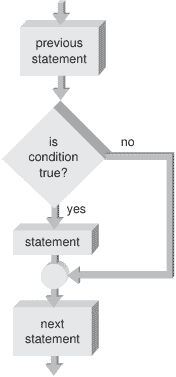

**图 4.3** 单向 if 语句

这种修改形式的 if 语句称为 **单向 if 语句**。程序 4.3 使用此语句检查汽车的里程，并在行驶里程超过 3000.0 英里的汽车上仅显示一条消息。

# 程序 4.3

```
```cpp
#include <iostream>
using namespace std;

int main()
{

    const double LIMIT = 3000.0;
    int idNum;
    double miles;

    cout << "Please type in car number and mileage: ";
    cin  >> idNum >> miles;
```

```
if(miles > LIMIT)
    cout << " Car " << idNum << " is over the limit." << endl;

    cout << "End of program output." << endl;

    return 0;
}
```

为展示单向选择条件的作用，程序 4.3 运行了两次，每次使用不同的输入数据。只有第一次运行的输入数据会导致消息 Car 256 is over the limit 被显示。

```
Please type in car number and mileage: 256 3562.8
Car 256 is over the limit.
End of program output.
```

and

```
Please type in car number and mileage: 23 2562.3
End of program output.
```

# 与 if-else 语句相关的问题

在使用 C++ 的 if-else 语句时遇到的两个最常见问题如下：

- 对表达式的全部含义理解不足
- 使用赋值运算符 = 代替关系运算符 ==

请记住，表达式是任何产生结果的操作数和运算符的组合。此定义比乍看之下要广泛得多。例如，以下所有内容都是有效的 C++ 表达式：

```
age + 5
age = 30
age == 40
```

假设变量声明正确，每个表达式都会产生一个结果。以下示例使用 cout 对象在 age 最初被赋值为 18 时显示这些表达式的值：

```
age = 18;
cout << "The value of the first expression is " << (age + 5) << endl;
cout << "The value of the second expression is " << (age = 30) << endl;
cout << "The value of the third expression is " << (age == 40) << endl;
```

# 信息点

# 布尔数据类型

在当前的 ANSI/ISO C++ 标准之前，C++ 没有内置的布尔数据类型及其两个布尔值 true 和 false。因为该数据类型最初不是语言的一部分，所以经过测试的表达式不能求值为布尔值。因此，语法

```
if (Boolean expression is true)
    execute this statement;
```

也没有内置到 C 或 C++ 中。相反，C++ 使用更全面的语法，

```
if (expression)
    execute this statement;
```

其中 expression 是求值为数值表达式的任何表达式。如果测试表达式的值是非零值，则被视为 true，而只有零值被视为 false。

正如 ANSI/ISO C++ 标准所规定，C++ 具有包含值 true 和 false 的内置布尔数据类型。布尔变量使用 bool 关键字声明。如当前实现，布尔值 true 和 false 代表的实际值是整数值 1 和 0。例如，检查以下声明两个布尔变量的程序：

```
#include <iostream>
using namespace std;
int main()
{
    bool t1, t2;

    t1 = true;
    t2 = false;
    cout << "The value of t1 is " << t1
         << "\nand the value of t2 is " << t2 << endl;

    return 0;
}
```

此程序产生以下输出：

```
The value of t1 is 1
and the value of t2 is 0
```

# 信息点

# 布尔数据类型（续）

如该输出所示，布尔值 true 和 false 由整数值 1 和 0 表示，并具有以下关系：

```
!true = is false
!false = is true
```

此外，对类型为 bool 的变量应用后缀或前缀 ++ 运算符会将布尔值设置为 true。不能对布尔变量应用后缀和前缀 -- 运算符。

布尔值也可以进行比较，如以下代码所示：

```
if (t1 == t2)
    cout << "The values are equal" << endl;
else
    cout << "The values are not equal" << endl;
```

最后，将任何非零值赋给布尔变量会使变量设置为 true（值为 1），而将零值赋给布尔变量会使变量设置为 false（值为 0）。

# 练习 4.2

- 1. （练习）为以下条件编写合适的 if 语句：

- a. 如果角度等于 90 度，打印消息“角度为直角。”；否则，打印消息“角度不是直角。”

- b. 如果温度高于 100 度，显示消息“高于水的沸点”；否则，显示消息“低于水的沸点。”

- c. 如果数字为正，将数字加到变量 positivesum；否则，将数字加到变量 negativesum。

- d. 如果斜率小于 0.5，将变量 flag 设置为 0；否则，将 flag 设置为 1。

- e. 如果 slope1 和 slope2 之间的差小于 0.001，将变量 approx 设置为 0；否则，将 approx 计算为 (slope1 - slope2) / 2.0。

- f. 如果频率高于 60，显示消息“频率过高。”

- g. 如果 temp1 和 temp2 之间的差超过 2.3，将变量 error 计算为 (temp1 - temp2) * factor。

- h. 如果 x 大于 y 且 z 小于 20，提示用户输入变量 p 的值。

- i. 如果 distance 大于 20 且小于 35，提示用户输入变量 time 的值。

# 第 4 章

2. （练习）编写与以下流程图所示条件相对应的 if 语句：

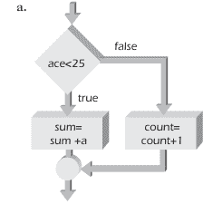

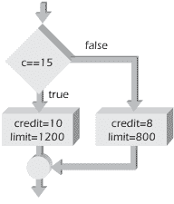

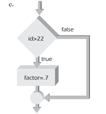

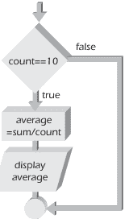

# 选择

- 3. **（练习）** 编写一个 C++ 程序，要求用户输入两个数字。如果输入的第一个数字大于第二个数字，程序应打印消息“第一个数字更大。”；否则，应打印消息“第一个数字更小。”通过输入数字 5 和 8 然后使用数字 11 和 2 测试你的程序。如果输入的两个数字相等，你认为你的程序会显示什么？测试此情况。

- 4. **（程序）**
  - a. 在及格/不及格课程中，如果成绩大于或等于 70，则学生通过；如果成绩低于 70，则不及格。编写一个 C++ 程序接受成绩并打印消息“A passing grade”或“A failing grade”，视情况而定。
  - b. 为了验证练习 4a 编写的程序是否正常运行，你应该进行多少次运行？每次程序运行应输入什么数据？

- 5. **（程序）**
  - a. 如果某笔钱在银行存放超过 5 年，银行按 4.5% 的利率支付利息；否则，利率为 3.0%。编写一个 C++ 程序，使用 cin 对象接受变量 numYears 中的年数，并根据输入到 numYears 的值显示正确的利率。
  - b. 为了验证练习 5a 编写的程序是否正常运行，你应该进行多少次运行？每次程序运行应输入什么数据？

- 6. **（练习）**
  - a. 编写一个 C++ 程序，根据输入显示消息“PROCEED WITH TAKEOFF”或“ABORT TAKEOFF”。如果变量 code 中输入字符 g，则应显示第一条消息；否则应显示第二条消息。
  - b. 为了验证练习 6a 编写的程序是否正常运行，你应该进行多少次运行？每次程序运行应输入什么数据？

- 7. **（程序）** 编写、编译并运行一个 C++ 程序，接受用户输入的整数并判断其为偶数还是奇数。输出应显示消息“The entered number is even.”或“The entered number is odd.”，对应用户输入的数字。*（提示：偶数除以 2 的余数为 0。）*

- 8. **（程序）** 编写、编译并运行一个 C++ 程序，接受用户输入的数字并计算平方根和倒数。在计算平方根之前，验证该数字不为负；在计算倒数之前，检查该数字不为零。如果出现任一条件，显示一条消息说明该运算无法计算。

- 9. **（程序）** 能被 400 整除的年份或能被 4 整除但不能被 100 整除的年份为闰年。例如，由于 1600 能被 400 整除，1600 年是闰年。同样，由于 1988 能被 4 整除但不能被 100 整除，它也是闰年。利用此信息，编写一个 C++ 程序接受年份作为用户输入，判断该年份是否为闰年，并显示一条消息告知用户输入的年份是否为闰年。

- 10. **（程序）**
  - a. 编写、编译并运行一个 C++ 程序来计算并显示一个人的周薪，条件如下：如果工作时间小于或等于 40 小时，个人每小时获得 $12.00；否则，个人获得 $480.00 加上


每超过40小时的工作时间，每小时支付18.00美元。程序应请求输入工作小时数，并将工资作为输出显示。

b. 对于练习10a中编写的程序，你应该进行多少次运行以验证其运行正确？每次程序运行时应输入哪些数据？

- **11.（程序）**

  a. 高级销售人员的周薪为800美元，初级销售人员的周薪为500美元。编写一个C++程序，接受输入销售人员状态到字符变量`status`中。如果`status`等于`s`，则显示高级销售人员的工资；否则，显示初级销售人员的工资。

  b. 对于练习11a中编写的程序，你应该进行多少次运行以验证其运行正确？每次程序运行时应输入哪些数据？

- **12.（程序）**

  a. 编写一个C++程序，根据输入显示消息“我今天感觉棒极了！”或“我今天感觉糟透了 #$#！”。如果在变量`ch`中输入字符`u`，则显示第一条消息；否则，显示第二条消息。

  b. 对于练习12a中编写的程序，你应该进行多少次运行以验证其运行正确？每次程序运行时应输入哪些数据？

- **13.（程序）**

  a. 编写一个程序，显示以下两个提示：

  输入月份（用1表示一月，以此类推）；
  输入月份中的日期：

  让您的程序响应第一个提示，接受并将一个数字存储在变量`month`中，并响应第二个提示，接受并将一个数字存储在变量`day`中。如果输入的月份不在1到12之间，显示一条消息告知用户输入了无效月份。如果输入的日期不在1到31之间，显示一条消息告知用户输入了无效日期。

  b. 如果用户为月份输入带小数点的数字，您的程序将如何处理？您如何确保您的if语句检查的是整数？

- **14.（程序）**

  a. 编写、编译并运行一个C++程序，该程序接受一个字符作为输入，并确定该字符是否为小写字母。小写字母是任何大于或等于`"a"`且小于或等于`"z"`的字符。如果输入的字符是小写字母，显示消息“刚输入的字符是小写字母。”如果输入的字母不是小写字母，显示消息“刚输入的字符不是小写字母。”

  b. 修改为练习14a编写的程序，使其还能确定输入的字符是否为大写字母。大写字母是任何大于或等于`"A"`且小于或等于`"Z"`的字符。

- **16.（程序）**

  编写、编译并运行一个C++程序，要求用户输入两个数字。在您的程序通过一次或多次`cin`对象调用接受这些数字后，让它检查这些数字。如果输入的第一个数字大于第二个数字，程序应打印消息“第一个数字更大。”；否则，应打印消息“第一个数字不大于第二个。”通过输入数字5和8，然后使用数字11和2来测试您的程序。如果输入的两个数字相等，您的程序将显示什么？

- **17.（调试）**

  以下程序无论输入什么字母都会显示消息Hello there!。确定错误在哪里，以及为什么程序总是导致显示该消息。

  ```cpp
  #include <iostream>
  using namespace std;
  int main()
  {
      char letter;

      cout << "Enter a letter: ";
      cin >> letter;
      if (letter = 'm')
          cout << "Hello there!" << endl;

      return 0;
  }
  ```

## 4.3 嵌套if语句

如您所见，if-else语句可以包含任何有效的C++简单或复合语句，包括另一个if-else语句。因此，一个或多个if-else语句可以包含在if-else语句的任一部分中。在现有if语句内部包含一个或多个if语句称为嵌套if语句。例如，将单向if语句

```cpp
if (distance > 500)
    cout << "snap";
```

替换为此if语句中的`statement1`

```cpp
if (hours < 9)
    statement1;
else
    cout << "pop";
```

得到以下嵌套if语句：

```cpp
if (hours < 9)
{
    if (distance > 500)
        cout << "snap";
}
else
    cout << "pop";
```

内部单向if语句周围的花括号至关重要，因为如果没有花括号，C++会将`else`与最近的未配对`if`关联。因此，没有花括号时，前面的语句等同于以下内容：

```cpp
if (hours < 9)
    if (distance > 500)
        cout << "snap";
    else
        cout << "pop";
```

在此示例中，`else`与内部`if`配对，这破坏了原始if-else语句的含义。还要注意，就编译器而言，缩进无关紧要。无论是否存在缩进，语句都会通过将最后一个`else`与最近的未配对`if`关联来编译，除非使用花括号来改变默认配对。嵌套if语句的过程可以无限扩展，因此`cout << "snap";`语句可以被完整的if-else语句或另一个单向if语句替换。

### if-else链

一般来说，将一个if-else语句放置在另一个if-else语句的if部分内部的嵌套往往令人困惑，在实践中最好避免。然而，一个极其有用的构造是将一个if-else语句放置在另一个if-else语句的else部分内部。通常，这种嵌套以以下形式编写：

```cpp
if (expression_1)
    statement1;
else if (expression_2)
    statement2;
else
    statement3;
```

这种有用的构造称为if-else链，在编程应用中广泛使用。每个条件按顺序求值，如果任何条件为真，则执行相应的语句，并终止链的其余部分。仅当没有先前条件满足时，才执行与最终`else`关联的语句。这个最终的`else`充当默认或兜底情况，对于检测不可能条件或错误条件非常有用。

- **2.（程序）**

  大学本科学生的年级通常根据以下时间表确定：

  | 已完成学分数 | 年级 |
  | --- | --- |
  | 少于32 | 大一 |
  | 32至63 | 大二 |
  | 64至95 | 大三 |
  | 96或以上 | 大四 |

  利用此信息，编写一个C++程序，接受学生已完成的学分数，确定学生的年级，并显示该年级。

- **3.（程序）**

  学生的字母等级根据以下时间表计算：

  | 数字成绩 | 字母等级 |
  | --- | --- |
  | 大于或等于90 | A |
  | 小于90但大于或等于80 | B |
  | 小于80但大于或等于70 | C |
  | 小于70但大于或等于60 | D |
  | 小于60 | F |

  利用此信息，编写、编译并运行一个C++程序，接受学生的数字成绩，将数字成绩转换为等效的字母等级，并显示该字母等级。

- **4.（程序）**

  存入银行的资金所支付的利率由资金存放的时间决定。对于特定银行，使用以下时间表：

  | 存款时间 | 利率 |
  | --- | --- |
  | 大于或等于5年 | .040 |
  | 小于5年但大于或等于4年 | .035 |
  | 小于4年但大于或等于3年 | .030 |
  | 小于3年但大于或等于2年 | .025 |
  | 小于2年但大于或等于1年 | .020 |
  | 小于1年 | .015 |

  编写、编译并运行一个C++程序，接受资金存放的时间，并显示与输入时间对应的利率。

- **5.（程序）**

  流经管道的流体可以以平滑、恒定的方式流动，称为层流；以混乱的方式流动，称为湍流；或处于平滑和湍流之间的中间阶段，称为过渡流。在实践中，可以使用称为雷诺数的值来确定流动类型。对于低于2000的雷诺数，流动是层流，对于高于3000的雷诺数，流动是湍流。对于介于2000和3000之间的雷诺数，流动是过渡流。


利用这些信息，编写、编译并运行一个C++程序，该程序接收用户输入的雷诺数，并显示一条消息，指明流动是层流、湍流还是过渡流。

## 6. （程序）系统中关键部件的公差根据以下规则确定：

| 规格状态 | 公差 |
|---|---|
| 太空探索级 | 小于 0.1% |
| 军用级 | 大于等于 0.1% 且小于 1% |
| 商用级 | 大于等于 1% 且小于 10% |
| 玩具级 | 大于等于 10% |

利用这些信息，编写、编译并运行一个C++程序，该程序接收部件的公差读数，并确定应为其分配的规格。

## 7. （程序）

- a. 编写、编译并运行一个程序，接收用户输入的两个实数和一个选择代码。如果输入的选择代码是 1，程序将先前输入的两个数相加并显示结果；如果选择代码是 2，两个数应相乘；如果选择代码是 3，则第一个数应除以第二个数。
- b. 确定练习 7a 中编写的程序在输入数字为 3 和 0 且选择代码为 3 时会做什么。
- c. 修改练习 7a 中编写的程序，使得不允许除以 0，并在尝试除以 0 时显示一条消息。

## 8. （程序）从原点出发的直线所在的象限由该直线与正 x 轴所成的角度决定，如下所示：

| 与正 x 轴的角度 | 象限 |
|---|---|
| 0 到 90 度之间 | I |
| 90 到 180 度之间 | II |
| 180 到 270 度之间 | III |
| 270 到 360 度之间 | IV |

- a. 利用这些信息，编写、编译并运行一个C++程序，接收用户输入的直线角度，并确定和显示输入数据对应的正确象限。（注意：如果角度恰好是 0、90、180 或 270 度，相应的直线不位于任何象限，而是位于坐标轴上。）
- b. 修改练习 8a 中编写的程序，使其显示一条消息，将 0 度角标识为正 x 轴，90 度角标识为正 y 轴，180 度角标识为负 x 轴，270 度角标识为负 y 轴。

## 9. （程序）编写、编译并运行一个C++程序，该程序接收一个数字，后跟一个空格，再跟一个字母。如果数字后的字母是 f，程序将输入的数字视为华氏温度，将其转换为等效的摄氏温度，并显示一条合适的消息。如果数字后的字母是 c，程序将输入的数字视为摄氏温度，将其转换为等效的华氏温度，并显示一条合适的消息。如果字母既不是 f 也不是 c，程序将显示一条消息说明输入的数据不正确，然后终止。在程序中使用 if-else 链，并使用以下转换公式：摄氏温度 = (5.0 / 9.0) × (华氏温度 - 32.0) 华氏温度 = (9.0 / 5.0) × 摄氏温度 + 32.0

## 10. （程序）许多州根据汽车的型号年份和重量来计算年度汽车注册费，使用的规则类似于下表：

| 型号年份 | 重量 | 重量等级 | 注册费 |
|---|---|---|---|
| 1990 年或更早 | 小于 2700 磅 | 1 | 26.50 |
|  | 2700 至 3800 磅 | 2 | 35.50 |
|  | 大于 3800 磅 | 3 | 56.50 |
| 1991 至 1999 年 | 小于 2700 磅 | 4 | 35.00 |
|  | 2700 至 3800 磅 | 5 | 45.50 |
|  | 大于 3800 磅 | 6 | 62.50 |
| 2000 年或更晚 | 小于 3500 磅 | 7 | 49.50 |
|  | 3500 磅或以上 | 8 | 62.50 |

利用这些信息，编写、编译并运行一个C++程序，该程序接收汽车的年份和重量，并确定和显示其重量等级和注册费。

## 11. （调试）使用程序 4.5 中的佣金规则，以下程序计算月收入：

```
#include <iostream>
#include <iomanip>
using namespace std;

int main()
{
    double monthlySales, income;

    cout << "Enter the value of monthly sales: ";
    cin >> monthlySales;
    if (monthlySales >= 50000.00)
        income = 375.00 + .16 * monthlySales;
    if (monthlySales >= 40000.00 && monthlySales < 50000.00)
        income = 350.00 + .14 * monthlySales;
    if (monthlySales >= 30000.00 && monthlySales < 40000.00)
        income = 325.00 + .12 * monthlySales;
    if (monthlySales >= 20000.00 && monthlySales < 30000.00)
        income = 300.00 + .09 * monthlySales;
    if (monthlySales >= 10000.00 && monthlySales < 20000.00)
        income = 250.00 + .05 * monthlySales;
    if (monthlySales < 10000.00)
        income = 200.00 + .03 * monthlySales;

    cout << setiosflags(ios::showpoint)
        << setiosflags(ios::fixed)
        << setprecision(2)
        << "\n\nThe income is $" << income << endl;

    return 0;
}
```

- a. 这个程序会产生与程序 4.5 相同的输出吗？
- b. 哪个程序更好？为什么？

## 12. （调试）以下程序被编写为产生与程序 4.5 相同的结果：

```
#include <iostream>
#include <iomanip>
using namespace std;

int main()
{
    double monthlySales, income;

    cout << "Enter the value of monthly sales: ";
    cin >> monthlySales;

    if (monthlySales < 10000.00)
        income = 200.00 + .03 * monthlySales;
    else if (monthlySales >= 10000.00)
        income = 250.00 + .05 * monthlySales;
    else if (monthlySales >= 20000.00)
        income = 300.00 + .09 * monthlySales;
    else if (monthlySales >= 30000.00)
        income = 325.00 + .12 * monthlySales;
    else if (monthlySales >= 40000.00)
        income = 350.00 + .14 * monthlySales;
    else if (monthlySales >= 50000.00)
        income = 375.00 + .16 * monthlySales;

    cout << setiosflags(ios::showpoint)
        << setiosflags(ios::fixed)
        << setprecision(2)
        << "The income is $" << income << endl;

    return 0;
}
```

- a. 这个程序做什么？
- b. 对于哪些月度销售额值，该程序能计算出正确的收入？

## 4.4 switch 语句

在编程应用中，当需要从许多可能的备选方案中选择一组指令时，会使用 if-else 链。对于涉及将整型表达式与特定值进行比较的情况，switch 语句是 if-else 链的一种替代方案。它的一般形式如下：

```
switch (integer_expression)
{   // start of compound statement
    case value_1:  // terminated with a colon
        statement1;
        statement2;
        .
        .
        break;
    case value_2:  // terminated with a colon
        statementm;
        statementn;
        .
        .
        break;
    .
    .
    case value_n:  // terminated with a colon
        statementw;
        statementx;
        .
        .
        break;
    default:  // terminated with a colon
        statementaa;
        statementbb;
        .
        .
}   // end of switch and compound statement
```

switch 语句使用了四个新关键字：switch、case、default 和 break。下面的讨论解释了每个关键字的作用。

switch 关键字标识 switch 语句的开始。然后计算 switch 后括号中的表达式，并将结果与复合语句中包含的备选值进行比较。switch 语句中的表达式必须计算出整数结果，否则会产生编译错误。

在 switch 语句中，case 关键字标识与 switch 表达式的值进行比较的值。case 值按列出的顺序依次比较，直到找到匹配项，然后从匹配项之后的语句开始执行。如图 4.4 所示，switch 表达式的值决定了执行实际开始的位置。

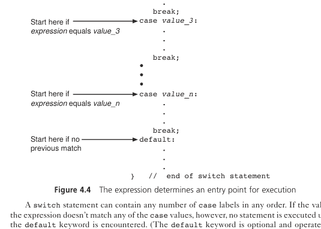

*图 4.4 表达式决定了执行的入口点*

switch 语句可以包含任意数量的 case 标签，顺序不限。但是，如果表达式的值与任何 case 值都不匹配，则除非遇到 default 关键字，否则不执行任何语句。（default 关键字是可选的，其作用类似于 if-else 链中的最后一个 else。）如果表达式的值与任何 case 值都不匹配，程序执行将从 default 关键字之后的语句开始。


switch语句定位到入口点后，所有后续的case值求值都将被忽略。程序会继续执行到复合语句末尾，除非遇到break关键字——它标识一个case的结束，并导致立即退出switch语句。正如case关键字标识复合语句中可能的入口点，break关键字决定终止点。如果省略break语句，则匹配的case值之后的所有case（包括default case）都会被执行。

编写switch语句时，可以使用多个case值指向同一组语句；如前所述，default关键字是可选的。例如，请看下面的代码：

```
switch (number)
{
    case 1:
        cout << "Have a Good Morning\n";
        break;
    case 2:
        cout << "Have a Happy Day\n";
        break;
    case 3:
    case 4:
    case 5:
        cout << "Have a Nice Evening\n";
}
```

如果number变量中存储的值是1，则显示消息“Have a Good Morning”。类似地，如果number的值是2，则显示第二条消息。最后，如果number的值是3、4或5，则显示最后一条消息。由于最后三个case要执行的语句相同，这些值的case语句可以“堆叠在一起”，如示例所示。另外，由于没有default关键字，如果number的值不是所列出的case值之一，则不会打印任何消息。虽然按递增顺序列出case值是一种良好的编程实践，但switch语句并不要求这样做。switch语句可以有任意数量的case值，顺序任意；只需列出你要测试的值即可。

程序4.6使用switch语句根据opselect变量的值，选择对两个数执行的算术运算（加法、乘法或除法）。

## 程序4.6

```
#include <iostream>
using namespace std;
int main()
{
    int opselect;
```

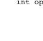

## 选择

```
double fnum, snum;

cout << "Please type in two numbers: ";
cin >> fnum >> snum;
cout << "Enter a select code: ";
cout << "\n        1 for addition";
cout << "\n        2 for multiplication";
cout << "\n        3 for division : ";
cin >> opselect;

switch (opselect)
{
    case 1:
        cout << "The sum of the numbers entered is "
             << fnum+snum << endl;
        break;
    case 2:
        cout << "The product of the numbers entered is "
             << fnum*snum << endl;
        break;
    case 3:
        cout << "The first number divided by the second is "
             << fnum/snum << endl;
        break;
}
        // end of switch

return 0;
}   // end of main()
```

在下面两个示例运行中，显示结果清晰地标识了被选中的case：

```
Please type in two numbers: 12 3
Enter a select code:
        1 for addition
        2 for multiplication
        3 for division : 2
The product of the numbers entered is 36
```

以及

```
Please type in two numbers: 12 3
Enter a select code:
        1 for addition
        2 for multiplication
        3 for division : 3
The first number divided by the second is 4
```

回顾程序4.6，请注意最后一个case语句中的break语句。虽然它不是必需的，但在switch语句中用break终止最后一个case是一种良好的编程实践。它可以防止以后在switch语句中添加另一个case语句时可能出现的程序错误。新增一个case时，case之间的break关键字可确保你在修改时不会忘记添加break。

由于字符数据类型在表达式中总是被转换为整数，switch语句也可以用来根据字符表达式的值进行“分支”。例如，假设choice是一个字符变量，下面的switch语句是有效的：

```
switch(choice)
{
    case 'a': case 'e': case 'i': case 'o': case 'u':
        cout << "The character in choice is a vowel\n";
        break;
    default:
        cout << "The character in choice is not a vowel\n";
        break;    // this break is optional
}    // end of switch statement
```

## 练习4.4

- 1. （修改）使用switch语句重写下列if-else链：
    if (letterGrade == 'A')
        cout << "The numerical grade is between 90 and 100\n";
    else if (letterGrade == 'B')
        cout << "The numerical grade is between 80 and 89.9\n";
    else if (letterGrade == 'C')
        cout << "The numerical grade is between 70 and 79.9\n";
    else if (letterGrade == 'D')
        cout << "How are you going to explain this one?\n";
    else
    {
        cout << "Of course I had nothing to do with my grade.\n";
        cout << "It must have been the professor's fault.\n";
    }

- 2. （修改）使用switch语句重写下列if-else链：
    if (bondType == 1)
    {
        inData();
        check();
    }
    else if (bondType == 2)
```
dates();
leapYr();
}
else if (bondType == 3)
{
    yield();
    maturity();
}
else if (bondType == 4)
{
    price();
    roi();
}
else if (bondType == 5)
{
    files();
    save();
}
else if (bondType == 6)
{
    retrieve();
    screen();
}
```

3. （编程）一批货物中的每个存储驱动器都盖有1到4的代码，表示下列存储容量：

| 代码 | 容量 |
|------|----------|
| 1 | 2 GB |
| 2 | 4 GB |
| 3 | 16 GB |
| 4 | 32 GB |

编写、编译并运行一个C++程序，接受代码编号作为输入值，并根据输入的值显示正确的存储驱动器容量。

4. （修改）使用switch语句重写程序4.4。

5. （修改）使用switch语句代替if-else链，重复第4.3节中的练习9。

6. （修改）使用字符变量作为选择代码，重写程序4.6。

7. （思考）确定为什么程序4.5中的if-else链不能用switch语句替换。

## 4.5 常见编程错误

C++的选择语句有三个常见的编程错误：

- 1. 使用赋值运算符=代替关系运算符==。这个错误可能令人沮丧，因为任何表达式都可以被if-else语句测试，所以它不是编译器会发现的语法错误。相反，它是一个逻辑错误，可能难以定位。例如，语句

```
if (opselect = 2)
    cout << "Happy Birthday";
else
    cout << "Good Day";
```

无论opselect变量的初始值是什么，总是显示消息“Happy Birthday”。原因是赋值表达式opselect = 2的值是2，而在C++中这被认为是真值。确定opselect值的正确表达式是opselect == 2。

- 2. 让if-else语句看起来选择了不正确的分支。在这个典型的调试问题中，程序员错误地将注意力集中在被测试的条件上，认为它是问题的根源。例如，假设下面的if-else语句是程序的一部分：

```
if (key == 'F')
{
    contemp = (5.0/9.0) * (intemp - 32.0);
    cout << "Conversion to Celsius was done";
}
else
{
    contemp = (9.0/5.0) * intemp + 32.0;
    cout << "Conversion to Fahrenheit was done";
}
```

当变量key包含F时，这个语句总是显示“Conversion to Celsius was done”。因此，如果你确信key不包含F却看到了这条消息，就应该检查key的值。一般规则是：每当选择语句的行为不符合你的预期时，通过显示被测变量的值来测试你对这些变量赋值的假设。如果显示了一个未预料到的值，你至少已经把问题的根源隔离到了变量本身，而不是if-else语句的结构。从那里开始，你需要确定这个不正确的值是在哪里以及如何产生的。


3. 不使用大括号来指示结构而使用嵌套的 if 语句。没有大括号，编译器默认将 else 与最近的未配对 if 配对，这有时会破坏选择语句的原始意图。为了避免这个问题并创建可适应变化的代码，将所有 if–else 语句写成这种形式的复合语句是有用的：

```
if (expression)
{
    one or more statements in here
}
else
{
    one or more statements in here
}
```

无论以后添加多少条语句，这种形式都能保持 if 语句的原始意图。

## 4.6 章节总结

- 1. 关系表达式，也称为条件，用于比较操作数。如果关系表达式为真，则表达式的值为整数 1。如果关系表达式为假，则其整数值为 0。关系表达式是通过使用以下关系运算符创建的：

| 关系运算符 | 含义 | 示例 |
|---|---|---|
| `<`  | 小于 | `age < 30`    |
| `>`  | 大于 | `height > 6.2` |
| `<=` | 小于或等于 | `taxable <= 20000` |
| `>=` | 大于或等于 | `temp >= 98.6` |
| `==` | 等于 | `grade == 100` |
| `!=` | 不等于 | `number != 250` |

- 2. 可以通过使用 C++ 的逻辑运算符 &&（AND）、||（OR）和 !（NOT）从关系表达式构造更复杂的条件。

- 3. if–else 语句用于根据表达式的值在两个备选语句之间进行选择。虽然关系表达式通常用于被测试的表达式，但任何有效表达式都可以使用。在测试表达式时，if–else 语句将非零值解释为真，将零值解释为假。if–else 语句的一般形式如下：

```
if (expression)
    statement1;
else
    statement2;
```

```
break;
case value_n:  // terminated with a colon
    statementw;
    statementx;
    break;
default:  // terminated with a colon
    statementaa;
    statementbb;
}  // end of switch and compound statement
```

对于此语句，整数表达式的值与整数或字符常量或常量表达式进行比较。程序执行被转移到第一个匹配的 case 并继续执行到 switch 语句的末尾，除非遇到可选的 break 语句。switch 语句中的 case 值可以按任意顺序出现，并且可以包含可选的 default case。如果没有其他 case 匹配，则执行 default case。

## 4.7 章节补充：更深入地了解测试

理论上，一套全面的测试运行将揭示所有可能的程序错误，并确保程序对任何输入和计算数据的组合都能正确工作。实际上，这种级别的测试需要检查所有可能的语句执行组合。由于所需的时间和精力，这种目标通常是不可能的，除非是极其简单的程序。要了解原因，请看一下程序 4.7。

### 程序 4.7

```
#include <iostream>
using namespace std;

int main()
{
    int num;
    cout << "Enter a number: ";
    cin >> num;
```

```
if (num == 5)
    cout << "Bingo!\n";
else
    cout << "Bongo!\n";

return 0;
}
```

程序 4.7 有两条可以遍历的路径，随着程序从其开始大括号进展到其结束大括号。第一条路径，在输入数字为 5 时执行，其顺序为：

```
cout << "Enter a number";
cin >> num;
cout << "Bingo!\n";
```

第二条路径，在输入除 5 以外的任何数字时执行，包括以下指令序列：

```
cout << "Enter a number";
cin >> num;
cout << "Bongo!\n";
```

测试程序 4.7 的每条可能路径需要两次运行，并谨慎选择测试输入数据，以确保 if 语句的两个路径都被执行。在程序中再添加一个 if 语句会使可能的执行路径数量增加一倍，并需要四次（即 2²）运行才能完全测试。同样，由三个未嵌套的 if-else 语句组成的程序需要八次（即 2³）运行才能完全测试，而包含四个未嵌套的 if-else 语句的程序需要 16 次（即 2⁴）测试运行。

现在考虑一个仅由 10 个模块组成的程序，每个模块包含五个 if 语句。假设模块始终按相同顺序调用，每个模块有 32 条可能路径（2⁵），而整个程序（所有模块按顺序执行）有超过 1,000,000,000,000,000 条可能路径（2⁵⁰，表示模块数量乘以每个模块的 if 语句数量）。创建测试数据所需的时间和执行每条路径所需的计算机运行时间使对该程序的完全测试几乎不可能。

无法完全测试所有语句执行序列的组合导致了编程格言“没有无错误的程序”。它也导致了认识到任何测试都应经过深思熟虑，以最大化发现错误的可能性。至少，测试数据应包括输入数据的合适值、程序应拒绝的不合法输入值，以及程序中选择语句检查的限制值。

## 章节
5
重复

- 5.1 The while Statement
- 5.2 Interactive while Loops
- 5.3 The for Statement
- 5.4 The do while Statement
- 5.5 Common Programming Errors
- 5.6 Chapter Summary

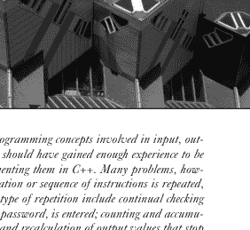

你迄今为止检查过的程序已经说明了输入、输出、赋值和选择能力所涉及的编程概念。到目前为止，你应该已经获得了足够的经验，能够熟练掌握这些概念以及在 C++ 中实现它们的机制。然而，许多问题需要重复能力，即使用不同的数据集重复相同的计算或指令序列。重复类型的例子包括不断检查用户数据输入直到输入可接受的条目，例如有效密码；计数和累积运行总计；以及在输入哨兵值之前不断接受输入数据并重新计算输出值。

本章探讨程序员在构建代码重复部分时使用的方法，并解释它们如何在 C++ 中实现。更常见的是，重复的代码部分被称为循环，因为在执行代码中的最后一句话后，程序可以分支或循环回到第一条语句并开始另一次代码重复。每一次重复也被称为一次迭代或一次循环遍历。在本章中，你将探索用于创建循环的 C++ 语句：while、for 和 do-while。

## 5.1 The while Statement

while 语句是一种通用重复语句，可用于各种编程情况。它具有以下一般形式：

```
while (expression)
    statement;
```

括号中的表达式的求值方式与 if-else 语句中的表达式完全相同；区别在于表达式的使用方式。正如你所见，当 if-else 语句中的表达式为真（具有非零值）时，表达式后面的语句执行一次。在 while 语句中，只要表达式求值为非零值，表达式后面的语句就会重复执行。当然，这意味着 while 语句中必须有某个语句改变被测试表达式的值。正如你将看到的，情况确实如此。现在，仅仅考虑表达式和括号后面的语句，计算机在评估 while 语句时使用以下过程：

- 1. 测试表达式
- 2. 如果表达式具有非零（真）值
+ a. 执行括号后面的语句
+ b. 返回步骤 1
+ 否则
+ 退出 while 语句并执行 while 语句后面的下一个可执行语句

注意步骤 2b 强制程序控制转移回步骤 1。这种控制转移回 while 语句的开始以重新评估表达式形成了程序循环。while 语句 literally 循环回到自身以重新检查表达式，直到它求值为零（变为假）。这种重新检查意味着循环必须包含允许改变被测试表达式值的规定。正如你将看到的，确实做出了这种规定。

图 5.1 显示了 while 语句产生的循环过程。菱形用于显示 while 语句决策部分所需的两个入口和两个出口。

为了使这种循环过程更具体，请考虑关系表达式 count <= 10 和语句 cout << count;。使用这些元素，你可以写出以下有效的 while 语句：

```
while (count <= 10)
    cout << count;
```

虽然该语句是有效的，但警觉的读者会意识到它造成了 cout 语句被永远调用（或直到你停止程序）或根本不被调用的情况。原因如下：如果在表达式首次求值时 count 的值小于或等于 10，则会进行一次 cout 调用。然后 while 语句自动循环回到自身并重新测试表达式。因为你没有改变 count 中存储的值，所以表达式仍然为真，又进行了一次 cout 调用。此过程会无限期地继续下去，或直到包含该语句的程序被用户提前停止。然而，如果


count 的初始值大于 10，则表达式一开始就是假的，cout 的调用永远不会被执行。

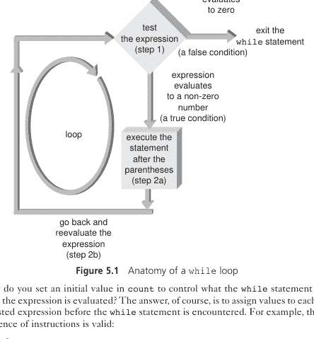

## Figure 5.1 Anatomy of a while loop

如何设置 count 的初始值以控制 while 语句在第一次求值表达式时所做的事情？答案当然是，在遇到 while 语句之前，先为测试表达式中的每个变量赋予值。例如，以下指令序列是有效的：

```
count = 1;
while (count <= 10)
    cout << count << " ";
```

使用此指令序列可确保 count 从 1 开始。你可以在赋值语句中给 count 赋任何值。重要的是要赋予某个值。实际上，所赋的值取决于应用程序。

你仍必须改变 count 的值，以便最终退出 while 语句。为此需要一个类似 count = count + 1 的表达式，每次执行 while 语句时递增 count 的值。while 语句提供对单个语句的重复，并不妨碍包含一个额外的语句来改变 count 的值。你所要做的就是用复合语句替换单个语句，如此示例所示：

```
count = 1;      // initialize count
while (count <= 10)
{
    cout << count << " ";
    count++;       // increment count
}
```

请注意，为了清晰，每个复合语句中的语句都放在不同的行上。此格式与第 4 章中对复合语句采用的惯例一致。

现在分析前面的指令序列。第一个赋值语句将 count 设为 1。然后进入 while 语句，并首次求值表达式。因为 count 的值小于或等于 10，所以表达式为真，复合语句被执行。复合语句中的第一个语句使用 cout 对象显示 count 的值。下一个语句将 1 加到当前存储在 count 中的值上，使该值等于 2。然后 while 语句循环回到重新测试表达式。因为 count 仍小于或等于 10，所以复合语句再次执行。此过程一直持续到 count 的值达到 11 为止。程序 5.1 将这些语句显示在一个实际程序中。

## Program 5.1

```
#include <iostream>
using namespace std;

int main()
{
    int count;

    count = 1;      // initialize count
    while (count <= 10)
    {
        cout << count << " ";
        count++;       // increment count
    }

    return 0;
}
```

这是程序 5.1 的输出：

1 2 3 4 5 6 7 8 9 10

请注意，程序 5.1 中使用的名称 count 并没有什么特别之处。任何有效的整数变量都可以使用。

在查看 while 语句的其他示例之前，有必要对程序 5.1 做两点说明。首先，语句 count++ 可以被任何改变 count 值的语句替换。例如，语句 count = count + 2; 会导致每隔一个整数被显示。其次，确保 count 以导致正常退出 while 语句的方式被改变是程序员的责任。例如，如果你用表达式 count-- 替换表达式 count++，count 的值永远不会超过 10，就会创建一个无限循环。无限循环是指永远不会结束的循环。计算机不会拍你的肩膀说：“对不起，你创建了一个无限循环。”程序只是不断显示数字，直到你意识到它没有按预期工作。

现在你对 while 语句有了一些熟悉程度，看看你是否能阅读并确定程序 5.2 的输出。

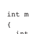

## Program 5.2

```
#include <iostream>
using namespace std;

int main()
{
    int i;

    i = 10;
    while (i >= 1)
    {
        cout << i << " ";
        i--;  // subtract 1 from i
    }

    return 0;
}
```

程序 5.2 中的赋值语句最初将 int 变量 i 设为 10。然后 while 语句检查 i 的值是否大于或等于 1。只要表达式为真，cout 对象就会显示 i 的值，并且 i 的值递减 1。当 i 最终达到 0 时，表达式为假，程序退出 while 语句。因此，程序 5.2 运行时的显示如下：

10 9 8 7 6 5 4 3 2 1

要理解 while 语句的强大功能，请考虑打印从 1 到 10 的数字表以及这些数字的平方和立方。你可以用一个简单的 while 语句来完成，如程序 5.3 所示。

## Repetition

## Program 5.3

```
```cpp
#include <iostream>
#include <iomanip>
using namespace std;

int main()
{
    int num;
    cout << "NUMBER   SQUARE   CUBE\n"
         << "------   ------   ----\n";

    num = 1;
    while (num < 11)
    {
        cout << setw(3) << num << "   "
             << setw(3) << num * num << "   "
             << setw(4) << num * num * num << endl;
        num++;     // increment num
    }

    return 0;
}
```
```

当程序 5.3 运行时的显示如下：

| NUMBER | SQUARE | CUBE |
|---:|---:|---:|
| 1 | 1 | 1 |
| 2 | 4 | 8 |
| 3 | 9 | 27 |
| 4 | 16 | 64 |
| 5 | 25 | 125 |
| 6 | 36 | 216 |
| 7 | 49 | 343 |
| 8 | 64 | 512 |
| 9 | 81 | 729 |
| 10 | 100 | 1000 |

请注意，程序 5.3 中使用的表达式是 num < 11。对于整数变量 num，此表达式与表达式 num <= 10 完全等价。使用哪一个完全由你决定。

如果你想用程序 5.3 生成 1000 个数字的表，你所要做的就是将 while 语句中的表达式从 num < 11 改为 num < 1001。将 11 改为 1001 会产生 1000 行的表——对于一个简单的五行 while 语句来说，这并不算坏。

所有 while 语句的程序示例都使用固定计数循环，因为被测试的条件是一个计数器，检查固定的重复次数。在固定计数循环的一个变体中，计数器不是每次循环都递增 1，而是递增其他值。例如，假设你有制作摄氏度到华氏度温度转换表的任务。摄氏温度从 5 到 50 度，对应的华氏温度以 5 度为增量显示，可以用以下语句序列完成：

```
celsius = 5;    // starting Celsius value
while (celsius <= 50)
{
    fahren = (9.0/5.0) * celsius + 32.0;
    cout << setw(4) << celsius
        << setw(13) << fahren << endl;
    celsius = celsius + 5;
}
```

与之前一样，while 语句包括从单词 while 到复合语句的闭合大括号的所有内容。在程序进入 while 循环之前，你必须确保为被求值的计数器分配一个值，并且在循环中有一个语句来改变计数器的值（以 5 为增量），以确保退出 while 循环。程序 5.4 说明了在完整程序中使用类似代码。

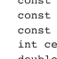

## Program 5.4

```
#include <iostream>
#include <iomanip>
using namespace std;

// a program to convert Celsius to Fahrenheit
int main()
{
    const int MAXCELSIUS = 50;
    const int STARTVAL = 5;
    const int STEPSIZE = 5;
    int celsius;
    double fahren;

    cout << "DEGREES    DEGREES\n"
        << "CELSIUS    FAHRENHEIT\n"
        << "-------    ---------\n";

    celsius = STARTVAL;
```

```
int main()
{
    int num = 0;
    while (num <= 20)
    {
        num++;
        cout << num << " ";
    }
    return 0;
}
```

b. 在计算机上输入并运行练习 3a 的程序，以验证你对该练习的答案。

c. 如果复合语句中的两个语句被颠倒（即 cout 语句放在 num++ 语句之前），输出会受到什么影响？

4. （程序）编写、编译并运行一个将加仑转换为升的 C++ 程序。程序应以 1 加仑为增量显示 10 到 20 加仑以及相应的升等价物。使用 1 加仑 = 3.785 升的关系。

5. （程序）编写、编译并运行一个将英尺转换为米的 C++ 程序。程序应以 3 英尺为增量显示 3 到 30 英尺以及相应的米等价物。使用 3.28 英尺 = 1 米的关系。

6. （程序）一台购买价为 $28,000 的机器按每年 $4000 的速率折旧 7 年。编写、编译并运行一个 C++ 程序，计算并显示 7 年的折旧表。表格应具有以下形式：

| YEAR | DEPRECIATION | END-OF-YEAR VALUE | ACCUMULATED DEPRECIATION |
| --- | --- | --- | --- |
| 1 | 4000 | 24000 | 4000 |
| 2 | 4000 | 20000 | 8000 |
| 3 | 4000 | 16000 | 12000 |
| 4 | 4000 | 12000 | 16000 |
| 5 | 4000 | 8000 | 20000 |
| 6 | 4000 | 4000 | 24000 |
| 7 | 4000 | 0 | 28000 |

7. （程序）一辆汽车以平均时速 55 英里行驶 4 小时。编写、编译并运行一个 C++ 程序，显示汽车在 0.5、1.0、1.5 等小时后行驶的距离（英里），直到行程结束。

8. （程序）a. 以下是从华氏温度转换为摄氏温度的近似转换公式：
Celsius = (Fahrenheit - 32) / 2

使用此公式，并从 0 度华氏温度开始，编写一个 C++ 程序，确定近似等价的摄氏温度与


与精确等效值相差超过 4 度。（提示：使用一个 while 循环，当近似摄氏等效值与精确摄氏等效值之差超过 4 度时终止。）

b. 使用练习 8a 中给出的近似摄氏转换公式，编写一个 C++ 程序，生成一个华氏温度、精确摄氏等效温度、近似摄氏等效温度以及精确与近似等效摄氏值之差的表格。表格应从 0 华氏度开始，以 2 华氏度为增量，并在精确值与近似值之差超过 4 度时终止。

## 5.2 交互式 while 循环

将交互式数据输入与 while 语句的重复能力相结合，可以产生适应性强且功能强大的程序。为了理解这一概念，请看程序 5.5，其中使用 while 语句逐个接受并显示用户输入的四个数字。尽管该程序使用了一个简单的思路，但它突出了生成更有用程序所需的控制流概念。

### 程序 5.5

```
#include <iostream>
using namespace std;

int main()
{
    const int MAXNUMS = 4;
    int count;
    double num;

    cout << "\nThis program will ask you to enter "
         << MAXNUMS << " numbers.\n";
    count = 1;

    while (count <= MAXNUMS)
    {
        cout << "\nEnter a number: ";
        cin >> num;
        cout << "The number entered is " << num;
        count++;
    }
    cout << endl;

    return 0;
}
```

## 第 5 章

以下是程序 5.5 的示例运行。粗体数字是响应提示输入的内容：

```
This program will ask you to enter 4 numbers.

Enter a number: 26.2
The number entered is 26.2
Enter a number: 5
The number entered is 5
Enter a number: 103.456
The number entered is 103.456
Enter a number: 1267.89
The number entered is 1267.89
```

请仔细研读该程序，以便清楚理解输出是如何产生的。显示的第一条消息是由第一条 cout 语句执行引起的。该语句位于 while 语句之外且在其之前，因此在 while 循环中的任何语句之前，它只执行一次。

进入 while 循环后，当测试条件为真时，复合语句中的语句将被执行。第一次执行复合语句时，会显示消息“输入一个数字：”。然后程序调用 cin，这迫使计算机等待在键盘上输入一个数字。输入数字并按回车键后，cout 对象显示该数字。然后变量 count 加 1。此过程持续到循环完成四次且 count 的值为 5 为止。每次循环都会显示“输入一个数字：”消息，调用一次 cin，并显示“输入的数字是：”消息。图 5.2 显示了这一控制流。

除了简单显示输入的数字外，程序 5.5 可以修改为使用输入的数据。例如，你可以将输入的数字相加并显示总和。要做到这一点，必须小心如何相加，因为每次输入的数字都使用同一个变量 num。因此，在程序 5.5 中输入一个新数字会自动导致存储在 num 中的前一个数字丢失。所以，每个输入的数字必须在输入另一个数字之前加到总和中。这是所需的顺序：

- 输入一个数字
- 将该数字加到总和中

如何将单个数字加到总和中？像 `total = total + num;` 这样的语句就能完美地完成这项工作。这就是 3.1 节中介绍的累加语句。每输入一个数字，累加语句就会将该数字加到总和中，如图 5.3 所示。图 5.4 演示了加法的控制流。

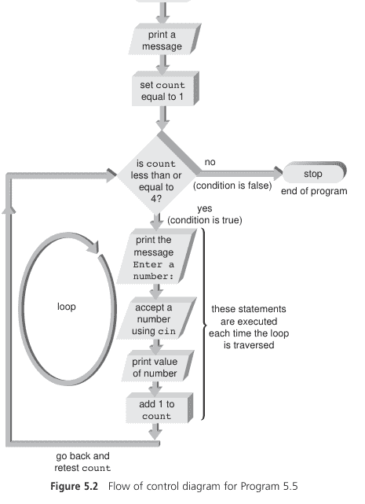

图 5.2 程序 5.5 的控制流图

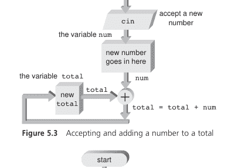

图 5.3 接受数字并加到总和中

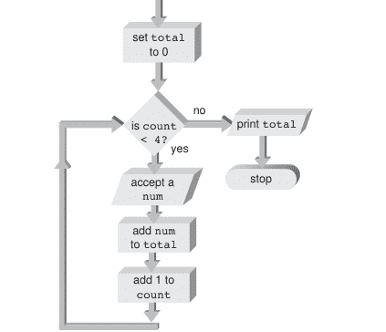

图 5.4 累加控制流

在查看图 5.4 时，请注意已经做出规定，在进入 while 循环之前将总和初始设置为 0。如果你在 while 循环内部清零总和，那么每次执行循环时它都会设置为 0，之前存储的任何值都将被清除。

程序 5.6 对程序 5.5 进行了必要的修改，以计算输入数字的总和。如图所示，语句 `total = total + num;` 紧接在调用 `cin` 之后。将累加总和语句放在程序的这个位置，可以确保输入的数字被立即“捕获”到总和中。

### 程序 5.6

```
```cpp
#include <iostream>
using namespace std;

int main()
{
    const int MAXNUMS = 4;
    int count;
    double num, total;

    cout << "\nThis program will ask you to enter "
         << MAXNUMS << " numbers.\n";
    count = 1;
    total = 0;

    while (count <= MAXNUMS)
    {
        cout << "\nEnter a number: ";
        cin >> num;
        total = total + num;
        cout << "The total is now " << total;
        count++;
    }

    cout  << "\n\nThe final total is " << total << endl;

    return 0;
}
```
```

为了确保你理解程序 5.6。变量 total 被创建用于存储输入数字的总和。在进入 while 语句之前，total 的值被设置为 0，以确保分配给该变量的存储位置中任何先前的值都被清除。在 while 循环内部，语句 `total = total + num;` 用于将输入的数字值加到 total。每当输入一个值，它就被添加到现有 total 上以形成新的 total。因此，total 成为所有已输入数值的累计小计。只有所有数字都输入后，total 才包含所有数字的最终总和。while 循环结束后，使用 cout 语句显示该总和。

使用与程序 5.5 示例运行中输入相同的数据，程序 5.6 的示例如下：

```
This program will ask you to enter 4 numbers.

Enter a number: 26.2
The total is now 26.2
Enter a number: 5
The total is now 31.2
Enter a number: 103.456
The total is now 134.656
Enter a number: 1267.89
The total is now 1402.546

The final total is 1402.546
```

在使用了累加赋值语句将输入的数字相加之后，你可以进一步计算这些数字的平均值。你在哪里计算平均值——在 while 循环内部还是外部？在本例中，计算平均值需要同时获得最终总和以及该总和中的项目数。然后通过将最终总和除以项目数来计算平均值。此时，你必须问：“程序中在什么位置可以得到正确的总和，又在什么位置可以得到项目数？”

在查看程序 5.6 时，你可以看到，计算平均值所需的正确总和在 while 循环结束后可用。事实上，while 循环的全部目的是确保数字被正确输入和相加，以产生正确的总和。循环结束后，你还可以获得用于总和的项目数。然而，由于 while 循环的构造方式，循环结束时 count 中的值（5）比用于获得总和的项数（4）多 1。知道了这一点，你只需在使用 count 计算平均值之前将其减去 1 即可。有了这些背景信息，看看你是否能阅读并理解程序 5.7。

### 程序 5.7

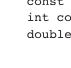

```
#include <iostream>
using namespace std;

int main()
{
const int MAXNUMS = 4;
int count;
double num, total, average;
```


## Repetition

```cpp
cout << "\nThis program will ask you to enter "
     << MAXNUMS << " numbers.\n";
count = 1;
total = 0;

while (count <= MAXNUMS)
{
    cout << "Enter a number: ";
    cin >> num;
    total = total + num;
    count++;
}

count--;
average = total / count;
cout << "\nThe average of the numbers is "
     << average << endl;

return 0;
}
```

Program 5.7 与 Program 5.6 几乎完全相同，只是平均值的计算方式不同。while 循环内部和之后的累计总和显示也被移除了。Program 5.7 中的循环用于输入并累加四个数字。循环退出后立即计算并显示平均值。Program 5.7 的一个示例运行如下：

```text
This program will ask you to enter 4 numbers.

Enter a number: 26.2
Enter a number: 5
Enter a number: 103.456
Enter a number: 1267.89

The average of the numbers is 350.637
```

## Sentinels

迄今为止创建的所有循环都是固定次数循环的例子，其中使用计数器来控制循环迭代次数。通过 while 语句，也可以构造变量条件循环。例如，在输入成绩时，你可能不想计算将要输入的成绩数量。相反，你更愿意连续输入成绩，并在最后输入一个特殊数据值来表示数据输入结束。

在编程中，用于表示数据序列开始或结束的数据值称为哨兵。哨兵值当然必须选择使其不会与合法数据值冲突。例如，如果你正在构建一个处理学生成绩的程序，并且假设没有额外加分导致成绩高于 100，你就可以使用任何高于 100 的成绩作为哨兵值。Program 5.8 说明了这一概念：数据会被持续请求和接受，直到输入一个大于 100 的数字。输入一个高于 100 的数字会提醒程序退出 while 循环并显示已输入数字的总和。

### Program 5.8

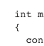

```cpp
#include <iostream>
using namespace std;

int main()
{
    const int HIGHGRADE = 100;
    double grade, total;

    grade = 0;
    total = 0;
    cout << "Info stop entering grades, type in any number";
    cout << "\n greater than 100.\n\n";
    cout << "Enter a grade: ";
    cin >> grade;

    while (grade <= HIGHGRADE)
    {
        total = total + grade;
        cout << "Enter a grade: ";
        cin >> grade;
    }

    cout << "\nThe total of the grades is " << total << endl;

    return 0;
}
```

### Point of Information

#### Loop Types

在循环体中的任何语句执行之前就评估条件的循环被称为预测试循环或入口控制循环。在 C++ 中，这些循环是通过使用 while 或 for 语句创建的。

在重复代码段末尾评估条件的循环被称为后测试循环或出口控制循环。这些循环总是在条件被测试之前至少执行一次循环语句。do-while 语句用于构造这种类型的循环。

除了条件被测试的位置不同之外，重复代码段还根据被测试的条件类型进行分类。在固定次数循环中，条件用于跟踪已发生的重复次数。在这种类型的循环中，执行固定次数的计算或打印固定行数，然后退出重复代码段。C++ 的所有重复语句都可用于创建固定次数循环。

在变量条件循环中，被测试的条件不依赖于计数是否达到，而是依赖于一个变量，该变量在每次循环通过时可以交互式地改变。当遇到指定值时，无论发生了多少次迭代，重复都会停止。C++ 的所有重复语句都可用于创建变量条件循环。

以下几行显示了 Program 5.8 的一个示例运行。只要输入的成绩小于或等于 100，程序就会继续请求和接受额外数据。当输入一个小于或等于 100 的数字时，程序会将该数字加到总和中。当输入一个大于 100 的数字时，循环退出，并显示已输入成绩的总和。

```text
To stop entering grades, type in any number greater than 100.

Enter a grade: 95
Enter a grade: 100
Enter a grade: 82
Enter a grade: 101

The total of the grades is 277
```

## break and continue Statements

与重复语句相关的两个有用语句是 break 和 continue 语句。你在第 4.4 节学习 switch 语句时已经遇到过 break 语句。这是 break 语句的格式：

```cpp
break;
```

正如其名称所示，break 语句会强制立即中断，即从 switch、while、for 和 do-while 语句中退出。例如，如果输入的数字大于 76，则以下 while 循环的执行会立即终止：

```cpp
while(count <= 10)
{
    cout << "Enter a number: ";
    cin >> num;
    if (num > 76)
    {
        cout << "You lose!\n";
        break;      // break out of the loop
    }
    else
        cout << "Way to go!\n";
        count++;
}
// break jumps to here
```

break 语句违反了结构化编程原则，因为它为循环提供了第二个非标准的出口。尽管如此，break 语句在检测到异常条件时用于跳出循环非常有用。它也用于从 switch 语句中退出，但这是因为匹配的 case 值已被检测并处理。

continue 语句与 break 语句类似，但仅适用于使用 while、do-while 和 for 语句创建的循环。这是 continue 语句的一般格式：

```cpp
continue;
```

当在循环中遇到 continue 时，循环的下一次迭代会立即开始。对于 while 循环，这意味着执行会自动转移到循环顶部，并重新评估测试表达式。虽然 continue 语句对 switch 语句没有直接影响，但它可以包含在 switch 语句中，而该 switch 语句也包含在循环中。continue 的效果相同：开始下一次循环迭代。

作为一般规则，continue 语句不如 break 语句有用，但在仍留在循环中的同时跳过不应处理的数据时很方便。例如，在以下代码段中，无效成绩 simply 被忽略，只有有效成绩才会被加到总和中：

```cpp
while (count < 30)
{
cout << "Enter a grade: ";
cin >> grade;
if(grade < 0 || grade > 100)
    continue;
total = total + grade;
count++;
}
```

## The Null Statement

所有语句都必须以分号结尾。前面没有任何内容的分号也是一个有效的语句，称为空语句，如下所示：

```cpp
;
```

它是一个什么都不做的语句，用于在语法上需要语句但不需要操作的地方。通常，空语句与 while 或 for 语句一起使用。第 5.3 节中的 Program 5.9c 显示了使用空语句的 for 语句示例。

## EXERCISES 5.2

- 1. (Modify) 重写 Program 5.6 以计算八个数字的总和。

- 2. (Modify) 重写 Program 5.6 以显示以下提示：
  Please type in the total number of data values to be added:
  响应此提示，程序应接受用户输入的数字，然后使用它来控制 while 循环执行的次数。因此，如果用户响应提示输入 5，程序应请求输入五个数字，并在输入五个数字后显示总和。

- 3. (Modify) 重写 Program 5.7 以计算 10 个数字的平均值。

> 1 虽然这段代码说明了 continue 语句提供的控制流，但这并不是实现正确结果的首选方法。不要使用 if 语句和 continue 语句来排除无效数据，更好的方法是使用以下语句包含有效数据：
> if (grade >= 0 && grade <= 100)
> {
>     total = total + grade;
>     count++;
> }


4. **(Modify)** 重写程序 5.7 以显示以下提示：

   `Please type in the total number of data values to be averaged:`

   响应此提示，程序应接受用户输入的数字，然后用它来控制 while 循环执行的次数。因此，如果用户对提示的响应是 6，则程序应请求输入六个数字并显示接下来输入的六个数字的平均值。

5. **(Debug)** 由于编程错误，程序员将语句 `average = total / count;` 放在程序 5.7 中语句 `total = total + num;` 之后 while 循环内。结果，while 循环变为如下：

   ```cpp
   while (count <= MAXNUMS)
   {
       cout << "Enter a number: ";
       cin >> num;
       total = total + num;
       average = total / count;
       count++;
   }
   ```

   a. 使用此 while 循环，程序会产生正确的结果吗？

   b. 从编程角度来看，哪一个 while 循环更好使用，为什么？

6. **(Program)** a. 编写一个 C++ 程序将米转换为英尺。程序应请求起始米值、要转换的次数以及公制值之间的增量。显示应具有适当的标题并列出米值和相应的英尺值。如果迭代次数大于 10，则让程序使用默认增量 10。利用 1 米 = 3.281 英尺的关系。

   b. 在计算机上运行练习 6a 编写的程序。验证你的程序是否从正确的起始米值开始，并且包含输入数据中指定的确切转换次数。

7. **(Modify)** a. 修改练习 6a 编写的程序以请求起始米值、结束米值和增量。不是检查固定的计数条件，而是检查结束米值。如果迭代次数大于 20，则让程序使用默认增量 `(ending value - starting value) / 19`。

   b. 在计算机上运行练习 7a 编写的程序。验证你的输出是否从正确的值开始并以正确的结束值结束。

8. **(Program)** a. 编写一个 C++ 程序将摄氏度转换为华氏度。程序应请求起始摄氏值、要转换的次数以及摄氏值之间的增量。显示应具有适当的标题并列出摄氏值和相应的华氏值。利用 `Fahrenheit = (9.0 / 5.0) * Celsius + 32.0` 的关系。

   b. 编译并在计算机上运行练习 8a 编写的程序。验证你的程序是否从正确的起始摄氏值开始，并且包含输入数据中指定的确切转换次数。

## 9. (Program) 算术级数定义如下：

a + (a + d) + (a + 2d) + (a + 3d) + ⋯ + [a + (n − 1)d]

- a 是第一项。
- d 是“公差”。
- n 是要相加的项数。

利用这些信息，编写一个 C++ 程序，使用 while 循环显示每一项并确定算术级数的和，其中 a = 1，d = 3，n = 100。确保你的程序显示其计算的值。

## 10. (Program) 几何级数定义如下：

a + ar + ar² + ar³ + ⋯ + arⁿ⁻¹

- a 是第一项。
- r 是“公比”。
- n 是级数中的项数。

利用这些信息，编写一个 C++ 程序，使用 while 循环显示每一项并确定几何级数的和，其中 a = 1，r = .5，n = 10。确保你的程序显示其计算的值。

## 11. (Program) a. 下表中数据是在最近一次汽车旅行中收集的：

| Mileage | Gallons |
|---|---|
| 22,495 | Full tank |
| 22,841 | 12.2 |
| 23,185 | 11.3 |
| 23,400 | 10.5 |
| 23,772 | 11.0 |
| 24,055 | 12.2 |
| 24,434 | 14.7 |
| 24,804 | 14.3 |
| 25,276 | 15.2 |

编写、编译并运行一个 C++ 程序，接受里程和加仑值并计算该行程段的每加仑英里数（mpg）。mpg 计算为加油之间的里程差除以加油时使用的汽油加仑数。

b. 修改为练习 11a 编写的程序，以便在每次加油后也计算并显示累计 mpg。累计 mpg 计算为每次加油时的里程与行程开始时的里程之差除以到行程该点为止使用的汽油总量。

## 12. (Program) a. 书店通过为库存中的每本书保留以下信息来汇总其月度交易：

- 书籍识别号
- 月初库存余额
- 当月收到副本数量
- 当月售出副本数量

编写一个 C++ 程序，接受每本书的这些数据，然后显示书籍识别号和更新后的书籍库存余额，使用以下关系：

New balance = Inventory balance at the beginning of the month
+ Number of copies received during the month
- Number of copies sold during the month

你的程序应使用具有固定计数条件的 while 语句，以便仅请求三本书的信息。

b. 编译并运行练习 12a 编写的程序。检查你的程序产生的显示并验证输出是否正确。

## 13. (Modify) 修改你为练习 12 编写的程序，使其在输入哨兵值 999 之前一直请求并显示结果。编译并运行你的程序。检查你的程序产生的显示并验证输出是否正确。

## 5.3 The for Statement

for 语句执行与 while 语句相同的功能，但使用不同的形式。在许多情况下，尤其是在使用固定计数条件时，for 语句的格式比 while 语句等价形式更容易使用。这是 for 语句的一般形式：

```
for (initializing list; expression; altering list)
    statement;
```

尽管 for 语句看起来有点复杂，但如果你分别考虑每个部分，它其实很简单。for 语句的括号内有三个项目，用分号分隔。每个项目都是可选的，可以分别描述，但分号必须始终存在，即使你不使用这些项目。正如你将看到的，括号中的项目对应于你已在使用 while 语句时使用的初始化、表达式求值和表达式更改值。

通常，在进入重复循环之前需要初始化变量或进行其他求值，因此 for 语句允许将所有初始化语句作为 for 括号内的第一组项目进行分组。此初始化列表中的项目仅执行一次，在第一次求值表达式之前执行。

括号中的中间项目 expression 是任何有效的 C++ 表达式，并且 for 和 while 语句使用此表达式的方式没有区别。在两个语句中，只要表达式具有非零（真）值，括号后的语句就会被执行。因此，在第一次检查表达式之前，必须为被测试表达式的变量分配初始值，并且在重新求值表达式之前，必须有一个或多个语句更改这些值。

for 语句还提供了一个单一位置用于所有表达式更改语句：altering list，即 for 括号内的最后一项。列表中的所有项目都在循环结束时由 for 语句执行，就在表达式被重新求值之前。

Figure 5.5 说明了 for 循环的内部工作。如图所示，当 for 循环完成后，控制转移到循环后的第一个可执行语句。


Figure 5.5 The for statement's flow of control


为了避免必须显示每一步，可以使用简化的一组流程图符号来描述 for 循环。如果使用下面的流程图符号来表示 for 语句，


你就可以如图 5.6 所示说明一个完整的 for 循环。


### Figure 5.6 A simplified for loop flowchart

下面的示例展示了 while 语句与 for 语句之间的对应关系。

首先，来看这个 while 语句：

```
count = 1;
while (count <= 10)
{
    cout << count << " ";
    count++;
}
```

对应的 for 语句如下：

```
for (count = 1; count <= 10; count++)
    cout << count << " ";
```

### Program 5.9

```
#include <iostream>
using namespace std;
int main()
{
    int count;
    for (count = 2; count <= 20; count = count + 2)
        cout << count << " ";
    return 0;
}
```

这是 Program 5.9 的输出：

2 4 6 8 10 12 14 16 18 20

for 语句不需要在 for 的括号内包含任何项目，也不需要使用它们来初始化或改变表达式语句中的值；然而，这两个分号必须包含在这些括号中。例如，构造 for ( ; count <= 20 ;) 是有效的。

如果初始化列表缺失，则在执行 for 语句时省略初始化步骤。因此，程序员必须在遇到 for 语句之前提供所需的初始化。同样，如果改变列表缺失，则在循环的语句部分中必须包含改变测试表达式的评估所需的任何表达式。for 语句只确保初始化列表中的所有表达式在测试表达式评估之前执行一次，并且改变列表中的所有表达式在循环结束时执行，然后在重新检查测试表达式之前执行。Program 5.9 可以用 Programs 5.9a、5.9b 和 5.9c 所示的三种方式中的任何一种重写。

### Program 5.9a

```
#include <iostream>
using namespace std;

int main()
{
    int count;

    count = 2;    // initialized outside the for statement
    for ( ; count <= 20; count = count + 2)
        cout << count << " ";

    return 0;
}
```

### Program 5.9b

```
#include <iostream>
using namespace std;
int main()
{
    int count;

    count = 2;  // initialized outside the for statement
    for( ; count <= 20; )
    {
        cout << count << " ";
        count = count + 2;  // alteration statement
    }

    return 0;
}
```

### Program 5.9c

```
#include <iostream>
using namespace std;
int main()  // all expressions inside for's parentheses
{
    int count;

    for (count = 2; count <= 20; cout << count << " ", count = count + 2);

    return 0;
}
```

在 Program 5.9a 中，count 在 for 语句外部初始化，括号内的第一个列表留空。在 Program 5.9b 中，初始化列表和改变列表都在括号外部。Program 5.9b 还在 for 循环中使用了复合语句，其中表达式改变语句包含在复合语句中。最后，Program 5.9c 将所有项目都包含在括号内，因此在括号后不需要任何有用的语句。在此示例中，空语句（;）满足在 for 的括号后跟随一个语句的语法要求。

此外，请注意在 Program 5.9c 中，改变列表（括号中最后一组项目）由两个项目组成，并且使用逗号分隔这些项目。如果初始化列表或改变列表中的任一个包含多于一个项目，则使用逗号分隔这两个列表中的项目是必需的。

```
for (num = 1; num <= MAXNUMS; num++)
    cout << setw(3) << num << "   "
        << setw(3) << num * num << "   "
        << setw(4) << num * num * num << endl;

return 0;
}
```

当运行 Program 5.10 时，产生的显示如下：

| NUMBER | SQUARE | CUBE |
| ------ | ------ | ---- |
| 1      | 1      | 1    |
| 2      | 4      | 8    |
| 3      | 9      | 27   |
| 4      | 16     | 64   |
| 5      | 25     | 125  |
| 6      | 36     | 216  |
| 7      | 49     | 343  |
| 8      | 64     | 512  |
| 9      | 81     | 729  |
| 10     | 100    | 1000 |

只需将 Program 5.10 的 for 语句中的数字 10 改为 1000，就会创建一个执行 1000 次的循环并生成从 1 到 1000 的数字表。与 while 语句一样，这种微小的更改会产生程序处理和输出的巨大增加。还请注意，在改变列表中使用了表达式 num++ 来代替等效的 num = num + 1。

## Interactive for Loops

在 for 循环中使用 cin 对象会创建交互式 for 循环，就像在 while 循环中使用此对象一样。例如，在 Program 5.11 中，使用 cin 对象输入一组数字。每次输入一个数字时，它都会被加到总和中。退出 for 循环后，计算并显示平均值。


### Program 5.11

```
#include <iostream>
using namespace std;

// This program calculates the average
// of MAXCOUNT user-entered numbers
int main()
{
    const int MAXCOUNT = 5;
    int count;
    double num, total, average;

    total = 0.0;

    for (count = 0; count < MAXCOUNT; count++)
    {
        cout << "Enter a number: ";
        cin >> num;
        total = total + num;
    }

    average = total / count;
    cout << "The average of the data entered is " << average
        << endl;

    return 0;
}
```

Program 5.11 中的 for 语句创建一个执行五次的循环。每次通过循环时，都会提示用户输入一个数字。每次输入数字后，它会立即加到总和中。虽然 total 在 for 语句之前初始化为 0，但此初始化本可以与 count 的初始化一起包含，如下所示：

```
for (total = 0.0, count = 0; count < MAXCOUNT; count++)
```

此外，total 和 count 的声明本可以与其初始化一起包含在初始化列表中，如下所示：

```
for (double total = 0.0, int count = 0; count < MAXCOUNT; count++)
```

任何这些 for 构造都被认为是良好的编程实践。你选择哪一个只是你自己的编程风格问题。

## Nested Loops

在许多情况下，使用一个循环嵌套在另一个循环中，称为嵌套循环，是方便的。这里有一个嵌套循环的简单示例：

```
for(i = 1; i <= 5; i++) // start of outer loop  <----+
{
    cout << "\n i is now " << i << endl;  //
    //
    for(j = 1; j <= 4; j++)  // start of inner loop
    cout << "  j = " << j; // end of inner loop
}
    // end of outer loop      <----+
```

第一个循环由 i 的值控制，称为外层循环。第二个循环由 j 的值控制，称为内层循环。请注意，内层循环中的所有语句都包含在外层循环的边界内，并且使用不同的变量来控制每个循环。对于外层循环的每次遍历，内层循环都会运行其整个序列。因此，每次 i 计数器增加 1 时，内部 for 循环都会完全执行并经过四个值（j 取 1 到 4 的值），如图 5.7 所示。Program 5.12 在一个工作程序中包含了这种类型的循环。


Figure 5.7 For each value of i, j loops four times

### Program 5.12

```
#include <iostream>
using namespace std;

int main()
{
    int i,j;
```

```
for (i = 1; i <= NUMSTUDENTS; i++)  // start of outer loop
{
    total = 0;                  // clear the total for this student
    for (j = 1; j <= NUMGRADES; j++)  // start of inner loop
    {
        cout << "Enter an examination grade for student: "
            << j << ":";
        cin >> grade;
        total = total + grade;      // add the grade to the total
    }                           // end of the inner for loop
    average = total / NUMGRADES;    // calculate the average
    cout << "\nThe average for student " << i
        << " is " << average << "\n\n";
}                               // end of the outer for loop

return 0;
}
```

在回顾 Program 5.13 时，请特别注意在进入内层循环之前在外层循环中对 total 的初始化：total 被初始化 20 次，每位学生一次。此外，请注意平均值是在内层循环结束立即计算并显示的。由于计算和打印平均值的语句也在外层循环中，因此计算并显示 20 个平均值。内层循环中每个成绩的输入和累加使用了你之前见过并现在应该熟悉的技术。

## EXERCISES 5.3

- 1. (Practice) Write a for statement for each of the following cases:
  - a. Use a counter named i that has an initial value of 1, a final value of 20, and an increment of 1.
  - b. Use a counter named icount that has an initial value of 1, a final value of 20, and an increment of 2.
  - c. Use a counter named j that has an initial value of 1, a final value of 100, and an increment of 5.
  - d. Use a counter named icount that has an initial value of 20, a final value of 1, and an increment of -1.
  - e. Use a counter named icount that has an initial value of 20, a final value of 1, and an increment of -2.
  - f. Use a counter named count that has an initial value of 1.0, a final value of 16.2, and an increment of 0.2.
  - g. Use a counter named xent that has an initial value of 20.0, a final value of 10.0, and an increment of -0.5.


2. (Desk check) 确定练习 1 中编写的每个 for 循环的执行次数。

3. (Desk check) 确定执行以下每个循环后 total 中的值：

```
a. total = 0;
for (i = 1; i <= 10; i = i + 1)
    total = total + i;
```

```
b. total = 1;
for (count = 1; count <= 10; count = count + 1)
    total = total * 2;
```

```
c. total = 0;
for (i = 10; i <= 15; i = i + 1)
    total = total + i;
```

```
d. total = 50;
for (i = 1; i <=10; i = i + 1)
    total = total - i;
```

```
e. total = 1;
for (icnt = 1; icnt <= 8; ++icnt)
    total = total * icnt;
```

```
f. total = 1.0;
for (j = 1; j <= 5; ++j)
    total = total / 2.0;
```

4. (Desk check) 确定以下程序的输出：

```
#include <iostream>
using namespace std;

int main()
{
    int i;

    for (i = 20; i >= 0; i -= 4)
        cout << i;

    return 0;
}
```

5. (Modify) 修改程序 5.10 以生成从 0 到 20 以 2 为增量的数字表，以及它们的平方和立方。

6. (Modify) 修改程序 5.10 以生成从 10 到 1 的数字表，而不是当前从 1 到 10。

7. (Program) a. 编写、编译并运行一个 C++ 程序，显示从华氏度到摄氏度的 20 个温度转换表。表应从华氏 20 度开始，以 4 度的增量递增。回想一下 摄氏 = (5.0/9.0) × (华氏 - 32.0)。

b. 修改为练习 7a 编写的程序以请求要进行的转换次数。

8. (Program) 编写、编译并运行一个 C++ 程序，将华氏温度以 5 度的增量转换为摄氏温度。华氏温度的初始值和要进行的转换总数应在程序执行期间作为用户输入请求。回想一下 摄氏 = (5.0/9.0) × (华氏 - 32.0)。

9. (Program) a. 编写、编译并运行一个 C++ 程序，接受五个加仑值，每次一个，并将每次输入的值转换为其升等价物，然后在请求下一个值之前。程序中使用 for 循环。1 加仑液体有 3.785 升。
b. 修改为练习 9a 编写的程序以首先请求要输入和转换的数据项数。

10. (Program) a. 一个古老的阿拉伯传说说，一个非常富有但不明智的国王同意给一个乞丐 1 美分，并在 64 天内加倍金额。使用此信息，编写、编译并运行一个 C++ 程序，显示国王每天必须向乞丐支付多少钱。程序的输出应如下所示：

| Day | Amount Owed |
| --- | ------------ |
| 1 | 0.01 |
| 2 | 0.02 |
| 3 | 0.04 |
| . | . |
| . | . |
| 64 | . |

b. 修改为练习 10a 编写的程序以确定国王将在哪一天向乞丐支付总计一百万美元。

11. (Debug) 以下程序正确吗？如果是，确定其输出。如果不是，确定错误并更正它以便程序能够运行。

```
#include <iostream>
using namespace std;

int main()
{

    for(int i = 1; i < 10; i++)
        cout << i << '\n';

    for (j = 1; i < 5; i++)
        cout << i << endl;

    return 0;
}
```

## Chapter 5

## The `for` Statement

- 12. **(Program)**
  - a. 编写、编译并运行一个 C++ 程序，计算并显示银行账户中可用的资金，该账户最初存入 $1000，按每年 3% 的利率赚取利息。程序应显示 10 年期间每年的可用金额。使用关系：每年末可用的资金 = 年初账户中的资金 + .03 × 年初可用的金额。
  - b. 修改为练习 12a 编写的程序以提示用户输入账户中最初存入的资金金额。
  - c. 修改为练习 12a 编写的程序以提示用户输入最初存入的资金金额和要显示的年数。
  - d. 修改为练习 12a 编写的程序以提示用户输入最初存入的资金金额、要使用的利率和要显示的年数。

- 13. **(Program)** 根据传说，曼哈顿岛于 1626 年以 $24 从当地印第安人手中购买。假设这笔钱投资于支付每年 4% 简单利息的荷兰银行，构建一个表格，显示土著人口将在每个 50 年期间结束时拥有的资金，从 1626 年开始，到 400 年后结束。使用关系：每个 50 年期间结束时可用的资金 = 期间开始时账户中的资金 × 数量 `(1 + .04)^50`。

- 14. **(Program)** 一家备受推崇的小部件制造商每年销售额损失 4%。公司的年利润是销售额的 10%。今年，公司销售额为 1000 万美元，利润为 100 万美元。确定未来 10 年的预期销售额和利润。程序应产生以下形式的显示：

SALES AND PROFIT PROJECTION

| YEAR | EXPECTED SALES | PROJECTED PROFIT |
|---:|---:|---:|
| 1 | $10000000.00 | $1000000.00 |
| 2 | $ 9600000.00 | $ 960000.00 |
| 3 | . | . |
| . | . | . |
| . | . | . |
| . | . | . |
| 10 | . | . |
| Totals: | $ . | $ . |

### 15. (Program) 执行了四次实验，每次实验有六个测试结果。每个实验的结果在以下列表中给出。编写、编译并运行一个使用嵌套循环的 C++ 程序来计算并显示每个实验的测试结果的平均值。

- 1st experiment results: 23.2 31 16.9 27.5 25.4 28.6
- 2nd experiment results: 34.8 45.2 27.9 36.8 33.4 39.4
- 3rd experiment results: 19.4 16.8 10.2 20.8 18.9 13.4
- 4th experiment results: 36.9 39.5 49.2 45.1 42.7 50.6

### 16. (Modify) 修改为练习 15 编写的程序，以便每个实验的测试结果数量由用户输入。编写程序，以便可以为每个实验输入不同数量的测试结果。

### 17. (Program) a. 一个保龄球队由五名球员组成，每名球员打三场比赛。编写、编译并运行一个使用嵌套循环的 C++ 程序，输入每名球员的得分，然后计算并显示每名保龄球手的平均得分。假设每名保龄球手有以下得分：

- 1st bowler: 286 252 265
- 2nd bowler: 212 186 215
- 3rd bowler: 252 232 216
- 4th bowler: 192 201 235
- 5th bowler: 186 236 272

b. (Modify) 修改为练习 17a 编写的程序以计算并显示平均团队得分。 （提示：使用第二个变量存储所有球员得分的总和。）

c. (Modify) 重写为练习 17a 编写的程序以消除内部循环。为此，你必须为每名保龄球手输入三个分数，而不是一次输入一个。每个分数必须存储在其自己的变量名称中，然后再计算平均值。

### 18. (Program) 编写、编译并运行一个 C++ 程序，计算并显示如果 $1000 投资于银行账户 10 年，每年可用的金额。程序应显示从 6% 到 12% 的利率，包含在内，以 1% 的增量。 使用嵌套循环，外循环固定计数为 7，内循环固定计数为 10。外循环的第一次迭代应使用 6% 的利率并显示前 10 年末可用的资金。在外循环的每次后续通过中，利率应增加 1%。使用此关系：每年末可用的资金 = 年初账户中的资金 + 利率 × 年初可用的金额。

## 5.4 The do-while Statement

while 和 for 语句都在重复循环开始时评估表达式。在某些情况下， however，在循环末尾测试表达式更方便。例如，假设你构建了以下 while 循环来计算销售税：

```
cout << "Enter a price: ";
cin >> price;
while (price != SENTINEL)
{
    salestax = RATE * price;
    cout << "The sales tax is $" << salestax;
    cout << "\nEnter a price: ";
    cin >> price;
}
```

使用此 while 语句需要在循环之前重复提示和 cin 语句，然后在循环内部，如本例所示，或求助于其他方法来强制 while 循环中的语句首先执行。

do-while 语句，正如其名称所示，允许你在循环末尾评估表达式之前执行一些语句。在许多情况下，可以使用这种方法来消除前一个示例中显示的重复。它在 C++ 中的一般形式为：

```
do
    statement;
while (expression);
```

不要忘记最后的分号，这是这里必需的

与所有 C++ 程序一样，do-while 中的单个语句可以用复合语句替换。图 5.8 显示了说明 do 语句操作的流程控制图。


## 图 5.8 do 语句的控制流

如图所示，do-while 语句中的所有语句在表达式被求值之前至少执行一次。然后，如果表达式具有非零值，则语句会再次执行。此过程一直持续到表达式求值为零（变为 false）为止。例如，来看下面的 do-while 语句：

```
do
{
    cout << "\nEnter a price: ";
    cin >> price;
    if ( abs(price - SENTINEL) < 0.0001 ) break;
    salestax = RATE * price;
    cout << "The sales tax is $" << salestax;
}
while (price != SENTINEL);
```

请注意，只使用了一个提示和 cin 语句，因为被测试的表达式是在循环末尾求值的。

与所有重复语句一样，do-while 语句始终可以被等价的 while 或 for 语句替换或替代。使用哪种语句取决于应用程序和程序员的首选风格。一般来说，while 和 for 语句更受青睐，因为任何阅读程序的人都可以清楚地看到在程序循环顶部首先测试的内容。

## 有效性检查

do-while 语句在过滤用户输入数据和提供数据验证检查方面特别有用。例如，操作员需要输入一个介于 100 和 1999 之间的有效客户识别号码。超出此范围的数字将被拒绝，并会提出新的有效号码请求。以下代码段提供了验证有效识别号码输入所需的数据过滤器：

```
do
{
    cout << "\nEnter an identification number: ";
    cin  >> idNum;
}
while (idNum < 100 || idNum > 1999);
```

在此代码中，会重复请求识别号码，直到输入有效号码为止。此代码段是“最简”的，因为它不会提醒操作员新请求数据的原因为何，也不会在找不到有效识别号码时允许提前退出循环。以下代码是消除第一个缺点的一种替代方案：

```
do
{
    cout << "\nEnter an identification number: ";
    cin  >> idNum;
    if (idNum < 100 || idNum > 1999)
    {
        cout << "\n An invalid number was just entered"
             << "\nPlease check the ID number and reenter";
    }
    else
        break;     // break if a valid ID number was entered
} while(1);         // this expression is always true
```

使用 break 语句退出循环。由于 do-while 语句正在求值的表达式始终为 1（true），因此创建了一个无限循环，只有在遇到 break 语句时才会退出。

## 练习 5.4

- 1. （程序）a. 使用 do-while 语句，编写、编译并运行一个 C++ 程序来接受一个成绩。只要输入无效成绩，程序应持续请求成绩。无效成绩是小于 0 或大于 100 的任何成绩。在输入有效成绩后，程序应显示所输入成绩的值。
  b. 修改为练习 1a 编写的程序，以便在输入无效成绩时提醒用户。
  c. 修改为练习 1b 编写的程序，以便用户可以通过输入数字 999 退出程序。
  d. 修改为练习 1b 编写的程序，以便在输入五次无效成绩后自动终止。

- 2. （程序）a. 编写、编译并运行一个 C++ 程序，持续请求输入成绩。如果成绩小于 0 或大于 100，程序应打印一条消息告知用户输入了无效成绩；否则，成绩应加到总和中。当输入成绩为 999 时，程序应退出重复循环并计算并显示所输入有效成绩的平均值。
  b. 在计算机上运行练习 2a 中编写的程序，并使用适当的测试数据验证程序。

- 3. （程序）a. 编写、编译并运行一个 C++ 程序来反转正整数的数字。例如，如果输入数字 8735，则显示的数字应为 5378。
  （提示：使用 do-while 语句并持续剥离并显示数字的个位数字。如果变量 num 最初包含输入的数字，则个位数字可通过 (num % 10) 得到。）。显示一个个位数字后，将数字除以 10 可为下一次迭代设置数字。因此，(8735 % 10) 为 5，而 (8735 / 10) 为 873。do-while 语句应一直继续，直到剩余数字不为 0 为止。
  b. 在计算机上运行练习 3a 中编写的程序，并使用适当的测试数据验证程序。

- 4. （练习）使用 do-while 语句而非 for 语句重复第 5.3 节中的任何练习。

## 5.5 常见编程错误

在使用重复语句时，初学 C++ 程序员容易犯以下七个错误：

- 1. 新程序员最棘手的错误是“差一”错误，即循环执行次数比预期多一次或少一次。例如，由语句 for(i = 7; i < 11; i++) 创建的循环执行 10 次，而不是 11 次，即使语句中使用了数字 11。可以使用语句 for(i = 1; i <= 10; i++) 构造等价的循环。

然而，如果循环以初始值 i = 0 开始，使用语句 for(i = 0; i < 11; i++)，循环将遍历 11 次，就像使用语句 for(i = 0; i <= 10; i++) 构造的循环一样。在构造循环时，你必须特别注意用于控制循环的初始和最终条件，以确保循环遍历次数不会多执行一次或少执行一次。

接下来的两个错误涉及被测试的表达式，你已经在 if 和 switch 语句中遇到过它们：

- 2. 在被测试的表达式中不小心使用赋值运算符 = 代替相等运算符 ==——例如，输入赋值表达式 a = 5 而不是正确的关系表达式 a==5。因为被测试的表达式可以是任何有效的 C++ 表达式，包括算术和赋值表达式，所以编译器不会检测到此错误。

- 3. 在测试双精度操作数时使用相等运算符 ==。例如，表达式 fnum == 0.01 应被替换为要求绝对值 |fnum - 0.01| 小于可接受量的测试。其原因是所有数字都以二进制形式存储。使用有限数量的位，小数如 0.01 没有精确的二进制等价物，因此要求与这些数字相等性测试可能会失败。（参见第 4.1 节，了解此数值精度问题的更完整描述。）

接下来的三个错误特定于 for 语句：

- 4. 在 for 的括号末尾放置分号，这通常会产生一个什么都不做的循环。例如，来看这些语句：

  for(count = 0; count < 10; count++);
      total = total + num;

  第一行代码末尾的分号是一个空语句。它产生了一个循环，该循环执行 10 次，除了递增和测试 count 外什么都不做。此错误往往发生是因为 C++ 程序员习惯于在大多数行末尾加上分号。

- 5. 在 for 语句中使用逗号分隔项目而不是必需的分号，如此示例所示：

  for (count = 1, count < 10, count++)

  逗号必须用于分隔初始化和更改列表中的项目，但分号必须用于将这些列表与被测试的表达式分隔开。

- 6. 在 for 循环的主体内部以及其更改列表中同时更改在测试条件中使用的控制变量的值。例如，来看这个 for 循环：

  for(int i=0; i<10; i++)
      cout << i++;

  在此代码中，被测试的变量的值（在本例中为 i）在两个地方被更改，这是一个严重的逻辑错误。


7. 最后一个常见的编程错误是在 do–while 语句末尾遗漏分号。这个错误通常由那些学会了在 while 语句的括号后省略分号，并在遇到 do–while 语句末尾的保留字 while 时沿用这一习惯的程序员所犯。

## 5.6 章节总结

1. 一段重复的代码被称为循环。循环由重复语句控制，该语句测试条件以确定是否执行代码。每次循环过程被称为一次重复或迭代。被测试的条件必须在重复语句首次求值之前明确设置。循环内部必须始终有一条允许改变条件的语句，以便循环在进入后能够退出。

2. 循环有三种基本类型：while、for 和 do–while。while 和 for 循环是前置测试或入口控制循环。在这种类型的循环中，被测试的条件在循环开始时求值，这要求在进入循环前明确设置被测试的条件。如果条件为真，则开始循环重复；否则，不进入循环。只要条件保持为真，迭代就会继续。在 C++ 中，while 和 for 循环通过使用 while 和 for 语句构建。

do–while 循环是后置测试或出口控制循环，其中被测试的条件在循环结束时求值。这种类型的循环总是至少执行一次。只要被测试的条件保持为真，do–while 循环就会继续执行。

3. 循环还根据被测试条件的类型进行分类。在固定计数循环中，条件用于跟踪已发生的重复次数。在可变条件循环中，被测试的条件基于一个变量，该变量可以在每次循环过程中交互式地改变。

4. 在 C++ 中，while 循环通过使用 while 语句构建。这是该语句最常用的形式：

```
while (expression)
{
    statements;
}
```

括号中的表达式是被测试的条件，用于确定括号后的语句（通常是复合语句）是否执行。表达式的求值方式与 if–else 语句中的表达式相同；区别在于表达式的使用方式。在 while 语句中，只要表达式保持非零值，表达式后的语句就会重复执行，而不是像 if-else 语句那样只执行一次。以下是一个 while 循环的示例：

```
count = 1;      // 初始化 count
while (count <= 10)
{
    cout << count << " ";
    count++;       // 递增 count
}
```

第一个赋值语句将 count 设置为 1。然后进入 while 语句，表达式首次求值。因为 count 的值小于或等于 10，表达式为真，复合语句被执行。复合语句中的第一条语句使用 cout 语句显示 count 的值。

下一条语句将当前存储在 count 中的值加 1，使该值等于 2。然后 while 语句循环回去重新测试表达式。因为 count 仍然小于或等于 10，复合语句再次执行。这个过程持续进行，直到 count 的值达到 11。

因为 while 语句总是在循环顶部检查其表达式，所以在遇到 while 之前，被测试表达式中的任何变量都必须已赋值。此外，while 循环必须包含一条改变被测试表达式值的语句。

5. 在 C++ 中，for 循环通过使用 for 语句构建。该语句执行与 while 语句相同的功能，但使用不同的形式。在许多情况下，尤其是使用固定计数条件的情况下，for 语句格式比等效的 while 语句更易于使用。这是 for 语句最常用的形式：

```
for (initializing list; expression; altering list)
{
    statements;
}
```

在 for 语句的括号内有三项，用分号分隔。每一项都是可选的，但分号必须存在。初始化列表用于初始化循环中要使用的任何变量。表达式是被测试的条件，用于确定循环是否应继续。更改列表包含在循环体每次迭代后执行的语句；这些语句不在复合语句内；通常用于在每次执行循环时递增或递减计数器。初始化列表和更改列表中的多个语句用逗号分隔。以下是一个 for 循环的示例：

```
for (total = 0, count = 1; count < 10; count++)
{
    cout << "Enter a grade: ";
    total = total + grade;
}
```

在这个 for 语句中，初始化列表用于初始化 total 和 count。表达式确定只要 count 中的值小于 10，循环就会执行，更改列表指定每次循环时 count 的值递增 1。

6. for 语句在创建固定计数循环时极其有用，因为你可以将初始化语句、被测试的表达式以及影响被测试表达式的语句包含在 for 循环顶部的括号中，便于检查和修改。

7. do-while 语句用于创建后置测试循环，因为它在循环结束时检查其表达式。在循环结束时检查确保 do 循环体至少执行一次。do-while 循环必须包含至少一条改变被测试表达式值的语句。

## 第 6 章

# 使用函数的模块化

- 6.1 函数和参数声明
- 6.2 返回单个值
- 6.3 返回多个值
- 6.4 变量作用域
- 6.5 变量存储类别
- 6.6 常见编程错误
- 6.7 章节总结
- 6.8 章节补充：生成随机数


专业程序的设计、编码和测试方式与硬件非常相似：作为一组模块集成在一起，以执行完整的整体。一个很好的类比是汽车；一个主要模块是发动机，另一个是变速箱，第三个是制动系统，第四个是车身，等等。所有这些模块都连接在一起，并置于驾驶员控制之下，这可以比作 main() 程序模块。整个系统现在作为一个完整的单元运行，能够执行有用的工作，例如开车去商店。在组装过程中，每个模块在安装到最终产品之前都要经过构建、测试，并确保没有缺陷（错误）。

在这个类比中，每个主要汽车组件都可以比作一个函数。例如，当踩下油门踏板时，驾驶员调用发动机。发动机接受燃料、空气和电力的输入，将驾驶员的请求转化为有用的产品——动力——然后将此输出发送到变速箱进行进一步处理。变速箱接收发动机的输出并将其转换为车轮可以使用的形式。变速箱的另一个输入是驾驶员对档位的选择（前进、倒车、空挡等）。

发动机、变速箱和其他模块只“知道”其输入和输出所限定的范围。驾驶员不需要知道被控制模块的内部操作。所需的一切只是知道每个模块做什么，以及在需要模块输出时如何“调用”它。

> 模块之间的通信仅限于在调用每个模块执行任务时向其传递输入，每个模块以相当独立的方式运行。程序员使用相同的模块化方法通过函数创建和维护可靠的 C++ 程序。

正如你所看到的，每个 C++ 程序必须包含一个 main() 函数。除了这个必需的函数之外，C++ 程序还可以包含任意数量的其他函数。在本章中，你将学习如何编写这些函数、向它们传递数据、处理传递的数据以及返回结果。

## 6.1 函数和参数声明

在创建 C++ 函数时，你必须关注函数本身以及它如何与其他函数（如 main()）交互。与函数的交互包括在调用时正确地向函数传递数据（输入），以及在函数停止操作时从函数返回值（输出）。本节描述接口的第一部分，即向函数传递数据，并让函数正确接收、存储和处理传输的数据。

正如你在数学函数中已经看到的，函数通过给出函数名并在函数名后的括号中传递任何数据作为参数来调用或使用（见图 6.1）。被调用的函数必须能够接受调用函数传递给它的数据。只有在被调用的函数成功接收数据后，才能操作数据以产生有用的结果。


为了澄清发送和接收数据的过程，请看程序 6.1，它调用了一个名为 findMax() 的函数。如图所示，该程序尚未完成。在编写 findMax() 函数并将其包含在程序 6.1 中之后，由 main() 和 findMax() 函数组成的完整程序就可以编译和运行了。

### 程序 6.1

```
#include <iostream>
using namespace std;
void findMax(int, int);  // 函数声明（原型）

int main()
{
    int firstnum, secnum;
```


```
cout << "\nEnter a number: ";
cin >> firstnum;
cout << "Great! Please enter a second number: ";
cin >> secnum;

findMax(firstnum, secnum); // the function is called here

return 0;
}
```

首先，检查 `main()` 中 `findMax()` 函数的声明和调用。然后你将看到如何编写 `findMax()` 以接收传递给它的数据，确定两个传递值中最大或最大值，并显示最大值。

`findMax()` 函数被称为被调用函数，因为它是由 `main()` 中的引用调用或召唤执行的。执行调用的函数——在本例中为 `main()`——被称为调用函数。术语“被调用”和“调用”源自标准的电话用语，其中一方呼叫另一方。发起呼叫的人是主叫方，接收呼叫的人是被叫方。相同的术语描述了函数调用。被调用函数——在本例中为 `findMax()`——被声明为期望接收两个整数并向 `main()` 返回无值（void）的函数。这种声明正式称为函数原型。然后函数由程序中的最后一句话调用。

## 函数原型

在函数被调用之前，它必须向将执行调用的函数声明。函数的声明语句被称为函数原型。函数原型告诉调用函数将正式返回的值类型（如果有），以及调用函数应向被调用函数传输的值的数据类型和顺序。

例如，程序 6.1 中使用的函数原型

```
void findMax(int, int);
```

声明 `findMax()` 函数期望接收两个整数值并返回无值（void）。

函数原型可以与调用函数的变量声明语句一起放置，位于调用函数名称之上，如程序 6.1 中所示，或放在 `#include` 预处理器语句指定的单独头文件中。`findMax()` 的函数原型可以在 `#include <iostream>` 语句之前或之后、`main()` 之前，或在 `main()` 内部放置。选择放置位置的原因在第 6.3 节中解释。函数原型语句的一般形式如下：

```
returnDataType functionName(list of argument data types);
```

`returnDataType` 指函数返回的值的类型。以下是一些函数原型的示例：

```
int fmax(int, int);
double swap(int, char, char, double);
void display(double, double);
```

`fmax()` 的函数原型声明此函数期望接收两个整数参数并返回一个整数值。`swap()` 的函数原型声明此函数需要四个参数——按顺序由一个整数、两个字符和一个双精度参数组成——并返回一个双精度数。最后，`display()` 的函数原型声明此函数需要两个双精度参数且不返回任何值。此函数可能用于显示计算结果而不向被调用函数返回任何值。

使用函数原型允许编译器检查数据类型。如果函数原型与函数编写时定义的数据类型不一致，程序编译时将显示警告消息。原型还执行另一项任务：它确保在函数被调用时传递给函数的所有参数都被转换为声明的数据类型。

## 调用函数

调用函数相当容易。唯一的要求是使用函数名称并将传递给函数的数据用在函数名称后括号中括起来，使用与函数原型中声明的相同顺序和类型。括号中包含的项目称为被调用函数的参数（见图 6.2）。


图 6.2 调用并向 findMax() 传递两个值

如果变量是函数调用中的参数之一，被调用函数接收存储在该变量中的值的副本。例如，语句 `findMax(firstnum, secnum);` 调用 `findMax()` 函数并导致变量 `firstnum` 和 `secnum` 中存储的值传递给 `findMax()`。括号中的变量名是提供值给被调用函数的参数。传递值后，控制权转移到被调用函数。

如图所示 6.3，`findMax()` 函数并未接收名为 `firstnum` 和 `secnum` 的变量，也不知道这些变量名。¹ 该函数只是接收这些变量中的值，然后必须在做任何其他事情之前确定将这些值存储在哪里。尽管将数据传递给函数的过程可能看起来令人惊讶，但它实际上是一种安全措施，确保被调用函数不会无意中更改存储在变量中的数据。函数获取数据的副本以使用。它可以更改其副本，当然也可以更改其内部声明的任何变量。但是，除非采取特定步骤，否则函数不允许更改在其他函数中声明的变量的内容。

> ¹在第 6.3 节中，你将看到 C++ 如何还允许通过使用引用变量直接访问调用函数的变量。


图 6.3 findMax() 函数接收实际值

接下来，你开始编写 `findMax()` 函数以处理传递给它的值。

## 定义函数

函数在编写时被定义。每个函数在程序中只定义一次（即只编写一次），然后可被程序中任何其他声明合适的函数使用。

与 `main()` 函数一样，每个 C++ 函数都由两部分组成，函数头和函数体，如图 6.4 所示。函数头的目的是标识函数返回的值的数据类型，给函数命名，并指定函数期望的参数的数量、顺序和类型。函数体的目的是对传递的数据进行操作并最多向调用函数直接返回一个值。（在第 6.3 节中，你将看到如何通过使用其参数使函数间接返回多个值。）

函数头始终是函数的第一行，包含函数的返回值类型、其名称以及其参数的名称和数据类型。因为 `findMax()` 正式不返回任何值并接收两个整数值，所以可以使用以下函数头：

```
void findMax(int x, int y)
```

无分号

## 使用函数的模块化


头中括号内的参数名称称为函数的**形式参数**（或简称为参数）。² 因此，参数 x 用于存储传递给 `findMax()` 的第一个值，参数 y 用于存储函数调用时传递的第二个值。函数不知道在从 `main()` 调用时值来自何处。被调用过程执行的第一个部分涉及转到变量 `firstnum` 和 `secnum` 并检索存储的值。这些值随后传递给 `findMax()` 并存储在参数 x 和 y 中（见图 6.5）。


函数名称和头中所有参数名称——在本例中为 `findMax`、x 和 y——由程序员选择。任何根据选择变量名的规则选择的名称都可以使用。函数头中列出的任何参数都必须包含数据类型。如果在函数头中声明多个参数，它们必须用逗号分隔并分别声明其数据类型。

> ²函数头中包含函数名称和参数的部分正式称为“函数声明符”。括号中包含的项目，参数，是对参数的规范。参数是在函数被调用时提供的值。


## 知识要点
### 函数定义与函数原型

当你编写一个函数时，实际上是在正式创建**函数定义**。每个定义都以一个头部行开始，该行包含参数列表（如果有的话，用括号括起来），并以终止函数体的右花括号结束。无论函数是否使用参数，参数列表都是必需的。以下是函数定义的常用语法：

```
返回数据类型 函数名(参数列表)
{
    常量声明
    变量声明

    其他C++语句

    return 返回值;
}
```

正如你所学的，函数原型用于声明一个函数。函数原型的语法如下，它提供了函数的返回数据类型、函数名和参数列表：

```
返回数据类型 函数名(参数数据类型列表);
```

原型连同前置条件和后置条件注释，应能为用户提供成功调用该函数所需的全部编程信息。

通常，所有函数原型都放在程序顶部，而所有定义都放在`main()`函数之后。不过，这种放置方式可以更改。C++中唯一的要求是：函数在被声明或定义之前不能被调用。

既然`findMax()`的函数头已经写好，现在可以构建其函数体了。该函数的功能是选择并显示传入的两个数中较大的一个。

函数体以左花括号`{`开始，包含必要的声明和其他C++语句，并以右花括号`}`结束。这种结构应该很熟悉，因为它与你迄今为止所见过的所有`main()`函数使用的结构相同。这种必需的结构不足为奇，因为`main()`本身就是一个函数，必须遵守构造所有合法函数的规则，如下所示：

```
{
    变量声明和
    其他C++语句
}
```

## 知识要点
### 前置条件与后置条件

前置条件是函数为正确运行而要求必须为真的一组条件。类似地，后置条件是指在满足前置条件的前提下，函数执行后将为真的条件。

前置条件和后置条件通常以用户注释的形式记录。例如，查看以下声明和注释：

```
bool leapyr(int)
// 前置条件：整数必须表示四位数字形式的年份，
//          例如 2011
// 后置条件：如果该年份是闰年，则返回 true；
//          否则返回 false
```

在需要澄清时，前置条件和后置条件注释应包含在函数原型和函数定义中。

在`findMax()`函数体中，声明了一个变量来存储传入的两个数中的最大值。然后使用if-else语句找出两个数中的最大值。最后，使用cout语句显示最大值。以下是`findMax()`的完整函数定义：

```
void findMax(int x, int y)
{
    // 函数体开始
    int maxnum;     // 变量声明

    if (x >= y)     // 找出最大数
        maxnum = x;
    else
        maxnum = y;

    cout << "\n两个数中的最大值是 "
         << maxnum << endl;

    return;
} // 函数体结束，函数结束
```

请注意，参数声明在函数头中完成，而变量声明紧跟在函数左花括号之后。这种放置方式符合以下概念：参数值是从函数外部传递给函数的，而变量是在函数体内声明并赋值的。程序6.2将`findMax()`函数包含在程序6.1中先前列出的程序代码中。

## 程序6.2

```
#include <iostream>
using namespace std;
void findMax(int, int);    // 函数原型

int main()
{
    int firstnum, secnum;

    cout << "\n请输入一个数：";
    cin >> firstnum;
    cout << "很好！请输入第二个数：";
    cin >> secnum;

    findMax(firstnum, secnum);  // 在此处调用函数

    return 0;
}

// 以下是函数 findMax()

void findMax(int x, int y)
{                         // 函数体开始
    int maxnum;           // 变量声明

    if (x >= y)           // 找出最大数
        maxnum = x;
    else
        maxnum = y;

    cout << "\n两个数中的最大值是 "
         << maxnum << endl;

    return;
}   // 函数体结束，函数结束
```

程序6.2可用于选择并打印用户输入的任何两个整数中的最大值。程序6.2的示例运行如下，用户输入的数字以粗体显示：

请输入一个数：25
很好！请输入第二个数：5

两个数中的最大值是 25

在程序6.2中，将`findMax()`函数放在`main()`函数之后是个人选择的问题。通常，`main()`放在前面，因为它是驱动程序，能让阅读程序的人在接触每个函数的细节之前，先了解整个程序的大致内容。然而，在任何情况下，`findMax()`的定义都不能放在`main()`内部。此规则适用于所有C++函数，它们必须独立地定义在任何其他函数之外。每个C++函数都是一个独立且自足的实体，拥有自己的参数和变量；函数嵌套是绝对不允许的。

### 语句的放置

C++对程序员的语句排序结构没有强制性的严格要求。在C++程序中放置语句的一般规则很简单：所有预处理指令、符号常量、变量和函数都必须先声明或定义，然后才能使用。如前所述，虽然此规则允许将预处理指令和声明语句放在程序的任何位置，但这样做会导致程序结构不佳。

出于良好编程习惯的考虑，以下语句顺序应构成所有C++程序的基本结构框架：

```
预处理指令
函数原型

int main()
{
    // 符号常量
    // 变量声明

    // 其他可执行语句

    // 返回语句
}

// 函数定义
```

一如既往，注释语句可以穿插在此基本结构的任何位置。

### 函数桩

所有程序员都会使用的一种替代方法是：先编写`main()`函数，然后为最终函数使用占位符，而不是先完成完整程序中所需的每个函数。要理解这种替代方法的工作原理，请再看一下程序6.1。为方便起见，其代码已在此处重新列出。按目前所写的形式，在包含`findMax()`函数之前，此程序无法编译和运行。

```
int firstnum, secnum;

cout << "\n请输入一个数：";
cin >> firstnum;
cout << "很好！请输入第二个数：";
cin >> secnum;

findMax(firstnum, secnum); // 在此处调用函数

return 0;
}
```

如果存在`findMax()`的函数定义，此程序就完整了。然而，要测试和运行已编写的代码，你实际上并不需要一个正确的`findMax()`函数；你只需要一个看起来像它的函数。一个接受正确数量和类型参数、并为函数调用返回适当形式值的“假”`findMax()`，就足以进行初步测试。这个假函数称为桩，它是最终函数的起点，在最终函数完成之前可以充当占位符。`findMax()`的桩如下：

```
void findMax(int x, int y)
{
    cout << "正在执行 findMax()\n";
    cout << "x 的值是 " << x << endl;
    cout << "y 的值是 " << y << endl;
}
```

这个桩函数现在可以与先前完成的代码一起编译和链接，生成可执行程序。然后，当“真正的”代码完成时，可以用它替换桩部分，进一步开发函数代码。

桩函数的最低要求是它能与其调用模块编译和链接。在实践中，让桩显示一条已成功进入的消息并显示其接收到的参数值是个好主意，就像`findMax()`的桩那样。随着函数的完善，你可以让它做更多的事情，也许允许它返回中间或不完整的结果。这种增量式（或逐步）细化是高效程序开发中的一个重要概念，它使你能够运行一个尚未满足所有最终要求的程序。

### 具有空参数列表的函数

虽然具有空参数列表的有用函数极为有限，但它们确实可能存在。（你会在本节末尾的练习15中看到这样一个函数。）此类函数的函数原型要求在函数名后的括号内写入关键字`void`或什么都不写。例如，以下两个原型：

```
int display();
```

和

```
int display(void);
```


# 信息要点

# 隔离测试

最成功的软件测试方法之一，始终是将被测代码嵌入到一个由正常工作的代码所构成的环境中。例如，你有两个未经测试的函数，按以下顺序被调用，而第二个函数返回的结果不正确：


从图中显示的信息来看，其中一个或两个函数都可能运行不正确。首要任务是将问题隔离到特定的函数上。

执行这种代码隔离的一种有效方法是解耦这些函数。你可以通过分别测试每个函数，或者先测试一个函数，只有在确认其运行正确后，再将其与第二个函数重新连接来实现。然后，如果出现错误，你就已将错误隔离到函数间的数据传输或第二个函数的内部操作中。

这个具体过程是测试基本规则的一个实例，该规则指出：每个函数应仅在一个所有其他函数都被确认正确的程序中进行测试。这意味着，一个函数必须首先单独测试，如有必要，为其调用的任何函数使用桩模块；第二个被测试的函数应单独测试或与先前测试过的函数一起测试，依此类推。这种测试过程确保每个新函数都被隔离在由正确函数组成的测试环境中，最终程序由经过测试的函数代码构建而成。

表明 `display()` 函数不带参数并返回一个整数。一个具有空参数列表的函数，通过其名称后跟一对空括号来调用。例如，语句 `display();` 正确调用了 `display()` 函数，其原型在前面的示例中已给出。

## 默认参数³

C++ 在函数调用中提供默认参数以增加灵活性。默认参数的主要用途是扩展现有函数的参数列表，而无需更改程序中已使用的调用参数列表。

默认参数值列在函数原型中，当函数调用中省略相应参数时，会自动传递给被调函数。例如，函数原型

```
void example(int, int = 5, double = 6.78);
```

为最后两个参数提供了默认值。如果在实际调用函数时省略了这些参数中的任何一个，C++ 编译器将提供默认值。因此，以下所有函数调用都是有效的：

```
example(7, 2, 9.3)  // 未使用默认值
example(7, 2)      // 等同于 example(7, 2, 6.78)
example(7)         // 等同于 example(7, 5, 6.78)
```

使用默认参数时必须遵循四条规则：

- 默认值应在函数原型中赋值。⁴
- 如果在函数原型中给任何参数赋予了默认值，则其后的所有参数也必须提供默认值。
- 如果在实际函数调用中省略了一个参数，则其右侧的所有参数也必须省略。第二条和第三条规则使 C++ 编译器清楚哪些参数被省略，并使编译器能够从最右边的参数开始向左，为缺失的参数提供正确的默认值。
- 函数原型中使用的默认值可以是由常量和先前声明的变量组成的表达式。如果使用这种表达式，它必须通过编译器对有效声明变量的检查，即使表达式的实际值是在运行时求值和赋值的。

当扩展现有函数以包含需要额外参数的新功能时，默认参数非常有用。在现有参数的右侧添加新参数，并为每个新参数赋予默认值，可以允许所有现有的函数调用保持不变。这样，更改的影响就能方便地与程序中的现有代码隔离开来。

## 重用函数名（重载）⁵

C++ 提供了对多个函数使用相同函数名的能力，这称为函数重载。创建多个同名函数的唯一要求是，编译器必须能够根据参数的数据类型（而不是返回值的数据类型，如果有的话）来确定使用哪个函数。例如，看看这三个函数，它们都命名为 `cdabs()`：

```
void cdabs(int x) // 计算并显示整数的绝对值
{
    if ( x < 0 )
        x = -x;
    cout << "整数的绝对值是 " << x << endl;
}
```

## 使用函数的模块化

```
void cdabs(float x) // 计算并显示浮点数的绝对值
{
    if ( x < 0 )
        x = -x;
    cout << "浮点数的绝对值是 " << x << endl;
}

void cdabs(double x) // 计算并显示双精度数的绝对值
{
    if ( x < 0 )
        x = -x;
    cout << "双精度数的绝对值是 " << x << endl;
}
```

实际调用这三个 `cdabs()` 函数中的哪一个，取决于调用时提供的参数类型。因此，函数调用 `cdabs(10);` 会使编译器使用期望整数参数的名为 `cdabs()` 的函数，而函数调用 `cdabs(6.28f);` 会使编译器使用期望双精度参数的名为 `cdabs()` 的函数。⁶

请注意，重载函数名仅仅意味着对多个函数使用相同的名称。每个使用该名称的函数仍然必须被编写并作为独立的实体存在。使用相同的函数名并不要求函数中的代码相似，尽管良好的编程实践要求具有相同名称的函数应执行基本相同的操作。使用相同函数名的全部要求是确保编译器能够根据调用函数时参数的数据类型来区分选择哪个函数。然而，显然，如果重载函数之间的唯一区别是参数类型，那么更好的编程解决方案是创建一个函数模板，这将在下一节讨论。然而，使用重载函数在构造函数中非常有用，这将在第 10.3 节中解释。

## 函数模板⁷

在大多数高级语言中，包括 C++ 的直接前身 C，每个函数都必须单独编码，即使使用函数重载为多个函数赋予相同的名称。例如，考虑确定并显示一个数字的绝对值。如果传递给函数的数字可以是整数、单精度或双精度值，则必须编写三个不同的函数来正确处理每种情况。因此，如果使用函数名 `abs()`，这三个函数将具有以下原型：

```
void abs(int);
void abs(float);
void abs(double);
```

显然，这些函数中的每一个都执行基本相同的操作，但针对不同的参数数据类型。一个更简洁的解决方案是编写一个处理所有三种参数数据类型的通用函数，但编译器可以根据调用函数时使用的数据类型来设置参数、变量甚至返回类型。你可以通过使用**函数模板**在 C++ 中编写这种类型的函数，它是一个单一的、完整的函数，作为一个函数家族的模型。实际创建的函数家族中的哪个函数取决于后续的函数调用。为了使这个概念更具体，看一个计算并显示传递参数绝对值的函数模板：

```
template <class T>
void showabs(T number)
{
    if (number < 0)
        number = −number;
    cout << "数字的绝对值 "
         << " 是 " << number << endl;

    return;
}
```

暂时忽略第一行 `template <class T>`，看第二行，即函数头 `void showabs(T number)`。请注意，这个函数头与所有函数定义使用的语法相同，只是通常放置数据类型的位置是 `T`。例如，如果函数头是 `void showabs(int number)`，你应该认识到它是一个名为 `showabs()` 的函数，期望传递一个整数参数给它并且不返回任何值。类似地，如果函数头是 `void showabs(double number)`，你应该认识到它是一个在调用时期望传递一个双精度参数的函数。

在函数模板头中使用 `T` 的优势在于，它代表一种通用数据类型，当编译器遇到实际的函数调用时，它会被实际数据类型（如 int、float、double 等）替换。例如，如果遇到带有整数参数的函数调用，编译器将使用函数模板构造一个期望整数参数的函数。类似地，如果使用双精度参数进行调用，编译器将构造一个期望双精度参数的函数。作为一个具体示例，请看程序 6.3。

> ³此主题可在首次阅读时跳过，不影响主题的连续性。


## 使用函数的模块化

```cpp
#include <iostream>
using namespace std;

template <class T>
void showabs(T number)
{
    if (number < 0)
        number = -number;
    cout << "The absolute value of the number is "
         << number << endl;
}

int main()
{
    int num1 = -4;
    float num2 = -4.23F;
    double num3 = -4.235456;

    showabs(num1);
    showabs(num2);
    showabs(num3);

    return 0;
}
```

请注意在 `main()` 函数中进行的三个函数调用；它们分别以整数、浮点数和双精度浮点数的值调用函数 `showabs()`。现在，回顾一下 `showabs()` 的函数模板，并查看第一行 `template <class T>`。这一行称为模板前缀，用于通知编译器紧随其后的函数是一个使用名为 T 的数据类型的模板。在函数模板中，T 的使用方式与任何其他数据类型（如 int、float 和 double）相同。当编译器遇到对 `showabs()` 的实际函数调用时，调用中传入的参数数据类型会在整个函数中替换 T。实际上，编译器使用模板创建了一个特定的函数，该函数期望调用中传入的参数类型。

由于程序 6.3 对 `showabs()` 进行了三次调用，每次使用不同的参数数据类型，编译器会创建三个独立的 `showabs()` 函数。编译器根据调用时传入的参数来决定使用哪个函数。这是程序 6.3 运行时所显示的输出：

```
The absolute value of the number is 4
The absolute value of the number is 4.23
The absolute value of the number is 4.23456
```

模板前缀 `template <class T>` 中的字母 T 只是数据类型的占位符，该数据类型在函数实际调用时被定义。任何不是关键字的字母或标识符都可以用来替代，因此 `showabs()` 函数模板也可以定义如下：

```cpp
template <class DTYPE>
void showabs(DTYPE number)
{
    if (number < 0)
        number = -number;
    cout << "The absolute value of the number is "
         << number << endl;
    return;
}
```

在这方面，有时将模板前缀中的 `class` 一词理解为“数据类型”会更简单、更清晰。通过这种替换，你可以将模板前缀 `template <class T>` 读作“我正在定义一个具有名为 T 的数据类型的函数模板。”然后，在所定义函数的头部和函数体中，数据类型 T（或前缀中定义的任何其他字母或标识符）的使用方式与任何内置数据类型（如 int、float 和 double）相同。

### 练习 6.1

1. (练习) 对于以下函数头，确定必须传递给函数的值的数量、类型和顺序（序列）：

   - a. `void factorial(int n)`
   - b. `void price(int type, double yield, double maturity)`
   - c. `void yield(int type, double price, double maturity)`
   - d. `void interest(char flag, double price, double time)`
   - e. `void total(double amount, double rate)`
   - f. `void roi(int a, int b, char c, char d, double e, double f)`
   - g. `void getVal(int item, int iter, char decflag, char delim)`

2. (练习)
   - a. 编写一个名为 `check()` 的函数，该函数具有三个参数。第一个参数应接受一个整数，第二个和第三个参数应接受双精度浮点数。函数体应只显示调用时传递给函数的数据值。（注意：在跟踪函数中的错误时，让函数显示传递给它的值是有帮助的。很多时候，错误不在于函数体对数据进行了什么操作，而在于接收和存储的数据。）
   - b. 将练习 2a 中编写的函数包含在一个可运行的程序中。确保你的函数从 `main()` 中被调用。通过向函数传递各种数据来测试该函数。

3. (练习)
   - a. 编写一个名为 `findAbs()` 的函数，该函数接受传递给它的双精度浮点数，计算其绝对值，并显示该绝对值。一个数的绝对值是：如果该数为正，则为该数本身；如果该数为负，则为该数的相反数。
   - b. 将练习 3a 中编写的函数包含在一个可运行的程序中。确保你的函数从 `main()` 中被调用。通过向函数传递各种数据来测试该函数。

4. (练习)
   - a. 编写一个名为 `mult()` 的函数，该函数接受两个双精度浮点数作为参数，将这两个数相乘，并显示结果。
   - b. 将练习 4a 中编写的函数包含在一个可运行的程序中。确保你的函数从 `main()` 中被调用。通过向函数传递各种数据来测试该函数。

5. (练习)
   - a. 编写一个名为 `sqrIt()` 的函数，该函数计算传递给它的值的平方并显示结果。该函数应能够对带有小数点的数字进行平方运算。
   - b. 将练习 5a 中编写的函数包含在一个可运行的程序中。确保你的函数从 `main()` 中被调用。通过向函数传递各种数据来测试该函数。

6. (练习)
   - a. 编写一个名为 `powFun()` 的函数，该函数将传递给它的一个整数提升到正整数次幂并显示结果。该正整数应为传递给函数的第二个值。将用于存储结果的变量声明为长整型数据类型，以确保有足够的存储空间来存储结果。
   - b. 将练习 6a 中编写的函数包含在一个可运行的程序中。确保你的函数从 `main()` 中被调用。通过向函数传递各种数据来测试该函数。

7. (练习)
   - a. 编写一个函数，生成从 1 到 10 的数字、它们的平方和它们的立方的表格。该函数应产生与程序 5.10 相同的显示。
   - b. 将练习 7a 中编写的函数包含在一个可运行的程序中。确保你的函数从 `main()` 中被调用。通过向函数传递各种数据来测试该函数。

8. (修改)
   - a. 修改为练习 7a 编写的函数，使其接受表格的起始值、要显示的值的数量以及值之间的增量。如果没有显式设置增量，函数应使用默认值 1。将你的函数命名为 `selTab()`。调用 `selTab(6,5,2);` 应生成一个五行表格，第一行以数字 6 开头，后续每个数字增加 2。
   - b. 将练习 8a 中编写的函数包含在一个可运行的程序中。确保你的函数从 `main()` 中被调用。通过向函数传递各种数据来测试该函数。

9. (程序)
   - a. 小时、分钟和秒的时间将被传递给一个名为 `totsec()` 的函数。编写 `totsec()` 来接受这些值，确定所传递数据中的总秒数，并显示计算出的值。
   - b. 将为练习 9a 编写的 `totsec()` 函数包含在一个可运行的程序中。`main()` 函数应正确调用 `totsec()` 并显示函数返回的值。使用以下测试数据来验证程序的操作：小时 = 10，分钟 = 36，秒 = 54。务必进行手工计算以验证程序显示的结果。

10. (程序)
    - a. 球体的体积 V 由以下公式给出，其中 r 是球体的半径：

      Volume = 4πr³ / 3

      使用此公式，编写、编译并运行一个名为 `spherevol()` 的 C++ 函数，该函数接受球体的半径，然后计算并显示其体积。
    - b. 将练习 10a 中编写的函数包含在一个可运行的程序中。确保你的函数从 `main()` 中被调用。通过向函数传递各种数据来测试该函数。

11. (程序)
    - a. 编写并测试一个名为 `makeMilesKmTable()` 的 C++ 函数，用于显示英里转换为千米的表格。传递给函数的参数应为英里的起始值、终止值和增量。输出应为英里及其等效千米值的表格。使用 1 英里 = 1.609 千米的关系。
    - b. 修改为练习 11a 编写的函数，使其显示两列。例如，如果起始值为 1 英里，终止值为 20 英里，增量为 1，则显示应如下所示：

      | 英里 | 千米 | 英里 | 千米 |
      |-------|------------|-------|------------|
      | 1     | 1.61       | 11    | 17.70      |
      | 2     | 3.22       | 12    | 19.31      |
      | .     | .          | .     | .          |
      | .     | .          | .     | .          |
      | 10    | 16.09      | 20    | 32.18      |

      （提示：计算 `split = (start + stop) / 2`。让循环从 `miles = start` 执行到 `split`，并在同一行上计算并打印 `miles` 和 `(miles - start + split + 1)` 所对应的英里和千米的值。）

12. (程序)
    - a. 编写一个 C++ 函数，该函数接受一个整数参数，判断传递的整数是偶数还是奇数，并显示此判断的结果。（提示：使用 `%` 运算符。）
    - b. 将练习 12a 中编写的函数包含在一个可运行的程序中。确保你的函数从 `main()` 中被调用。通过向函数传递各种数据来测试该函数。

13. (程序) 一个不使用参数的有用函数可以被构造出来，以返回一个 π 值，其精度达到你的计算机允许的最大小数位数。该值通过对 1.0 取反正弦得到，即 π / 2，然后将结果乘以 2。在 C++ 中，所需的表达式为 `2.0 * asin(1.0);` `asin()` 函数包含在标准


C++数学库。（记得在你的预处理指令中包含`cmath`。）使用这个表达式，编写一个名为`pi()`的C++函数，计算并显示π的值。（在下一节中，你将看到如何将这个值返回给调用函数。）

- **14.**（程序）  
  a. 编写一个名为`display()`的函数模板，当函数被调用时显示传递给它的单个参数的值。  
  b. 将练习14a中创建的函数模板包含在一个完整的C++程序中，该程序调用该函数三次：一次使用字符参数，一次使用整数参数，一次使用双精度参数。

## 6.2 返回单个值

使用上一节解释的向函数传递数据的方法，被调用函数仅接收调用时参数中包含的值的副本。（如果对此不清楚，请回顾图6.3。）当以这种方式向被调用函数传递值时，传递的参数被称为按值传递，这是C++的一个显著优势。⁸ 由于被调用函数不能直接访问调用函数用作参数的变量，因此它不会无意中更改这些变量中存储的值。

接收按值传递参数的函数可以以任何方式处理发送给它的值，并直接向调用函数返回一个（且仅一个）“合法的”值（见图6.6）。在本节中，你将看到这个值如何返回给调用函数。正如你可能预料到的，鉴于C++的灵活性，有一种方法可以返回多个值，但那是下一节的主题。


## 返回单个值

与调用函数一样，直接返回一个值需要正确处理被调用函数和调用函数之间的接口。从返回事务的方面来看，被调用函数必须提供以下内容：

- 返回值的数据类型
- 实际返回的值

返回值的函数必须在其头中指定要返回的值的数据类型。回想一下，函数头包括函数名和参数列表。例如，前面编写的`findMax()`函数确定传递给它的两个数字的最大值。为方便起见，再次列出`findMax()`代码：

```
void findMax(int x, int y)
{
    // start of function body
    int maxnum;      // variable declaration

    if (x >= y)      // find the maximum number
        maxnum = x;
    else
        maxnum = y;

    cout << "\nThe maximum of the two numbers is "
         << maxnum << endl;

    return;
}   // end of function body and end of function
```

在这个函数头中，`x`和`y`是为函数参数选择的名称：

```
void findMax(int x, int y)
```

如果`findMax()`要返回一个值，其函数头必须修改为包含所返回值的数据类型。例如，如果要返回一个整数值，正确的函数头是：

```
int findMax(int x, int y)
```

类似地，如果函数要接收两个浮点值并返回一个浮点值，正确的函数头是：

```
float findMax(float x, float y)
```

如果函数要接收两个双精度值并返回一个双精度值，函数头应为以下形式：⁹

```
double findMax(double x, double y)
```

现在看看如何修改`findMax()`函数，使其返回传递给它的两个数字的最大值。要做到这一点，你必须首先确定要返回的值的数据类型，并将该数据类型包含在函数头中。由于`findMax()`确定的最大值存储在整型变量`maxnum`中，函数应返回该变量的值。从`findMax()`返回一个整数值需要以下函数声明：

```
int findMax(int x, int y)
```

注意，这与`findMax()`的原始函数头相同，只是用关键字`int`替换了关键字`void`。

在声明了`findMax()`将返回的数据类型后，剩下要做的就是在函数中包含一条语句，使函数返回正确的值。要返回一个值，函数必须使用`return`语句，其形式如下：¹⁰

```
return expression;
```

当遇到`return`语句时，首先计算表达式。然后，表达式的值在发送回调用函数之前，会自动转换为函数头中声明的数据类型。返回值后，程序控制权将归还给调用函数。因此，要返回存储在`maxnum`中的值，你只需在`findMax()`函数的右花括号之前包含语句`return maxnum;`即可。完整的函数代码如下：

```
int findMax(int x, int y) // function header
{
    int maxnum; // start of function body
    // variable declaration
    if (x >= y)
        maxnum = x;
    else
        maxnum = y;

    return maxnum; // return statement
}
```

这些应该是相同的数据类型

在`findMax()`函数的新代码中，注意`return`语句中表达式的数据类型与函数头中的数据类型匹配。程序员有责任确保每个返回值的函数都匹配。如果返回值与函数声明的数据类型不完全匹配，程序编译时可能不会出错，但可能会导致不希望的结果，因为返回值总是被转换为函数声明中声明的数据类型。通常，只有当函数被声明为返回整数值，而返回的浮点数或双精度数的小数部分被截断时，这才会成为一个问题。

在处理好返回事务的发送端之后，你现在必须让调用函数准备好接收被调用函数发送的值。在调用（接收）端，调用函数必须

- 被告知期望从被调用函数返回的值的类型。
- 正确使用返回值。

通过函数原型来让调用函数知道期望的返回值类型。例如，在`main()`函数之前包含函数原型

```
int findMax(int, int);
```

就足以让`main()`知道`findMax()`是一个返回整数值的函数。

要实际使用返回值，你必须提供一个变量来存储该值，或在表达式中使用该值。要将返回值存储在变量中，可以使用标准的赋值语句。例如，以下赋值语句可用于将`findMax()`返回的值存储在变量`max`中：

```
max = findMax(firstnum, secnum);
```

这个赋值语句做两件事。首先，赋值语句的右侧调用`findMax()`，然后将`findMax()`返回的结果存储在变量`max`中。由于`findMax()`返回的值是整数，因此变量`max`也必须在调用函数的变量声明中声明为整型变量。

函数返回的值不必存储在变量中，但可以在任何表达式有效的地方使用。例如，表达式`2 * findMax(firstnum, secnum)`将`findMax()`返回的值乘以2，以下语句显示返回值：

```
cout << findMax(firstnum, secnum);
```

程序6.4说明了如何为`main()`包含原型和赋值语句，以便正确声明、调用和存储`findMax()`的返回值。与之前一样，按照将`main()`函数放在前面的惯例，`findMax()`函数放在`main()`之后。

### 程序6.4

```
#include <iostream>
using namespace std;

int findMax(int, int); // the function prototype

int main()
{
    int firstnum, secnum, max;
```


## 程序 6.5

```
#include <iostream>
using namespace std;

double tempvert(double);  // function prototype

int main()
{
    const int CONVERTS = 4;   // number of conversions to be made
    int count;                // start of variable declarations
    double fahren;

    for(count = 1; count <= CONVERTS; count++)
    {
        cout << "\nEnter a Fahrenheit temperature: ";
        cin >> fahren;
        cout << "The Celsius equivalent is "
             << tempvert(fahren) << endl;
    }

    return 0;
}

// convert fahrenheit to celsius
double tempvert(double inTemp)
{
    return (5.0/9.0) * (inTemp - 32.0);
}
```

在审阅程序 6.5 时，首先分析 tempvert() 函数。它的定义从函数头开始，到 return 语句后结束的闭合大括号为止。该函数声明为 double，意味着函数 return 语句中的表达式必须求值为双精度数，而它确实如此。因为函数头不是语句，而是定义函数的代码的开始，所以它后面不带分号。

在接收端，main() 中有 tempvert() 函数的原型，与 tempvert() 的函数定义一致。main() 中没有声明变量来存储 tempvert() 返回的值，因为返回值会立即传递给 cout 以显示。

最后，正如你在第 2 章中所学，声明的目的在于提醒计算机为数据保留的内部存储量。tempvert() 的原型执行此任务，并提醒编译器返回值的存储类型所需。如果 tempvert() 函数定义放在 main() 之前，函数头将起到相同的作用，并且可以省略函数原型。然而，因为 main() 总是程序中的第一个函数，所以你必须为 main() 调用的所有函数以及后续函数包含函数原型。

## 内联函数¹¹

调用函数会在计算机上产生一定的开销。此开销包括以下步骤：

- 1. 将参数值放在函数可访问的保留内存区域中（称为栈）
- 2. 将控制权传递给函数
- 3. 为任何返回值提供保留的内存位置（同样使用栈来实现此目的）
- 4. 返回到调用程序中的正确位置

当函数被多次调用时，支付此开销是合理的，因为它可以大幅减小程序的大小。不是每次需要时都重复相同的代码，而是将代码一次编写为函数，并在需要时调用它。

然而，对于不是被多次调用的小函数，传递和返回值的开销可能并不值得。仍然很方便将重复的行代码归组在同一个函数名下，并让编译器将此代码放置在程序中函数被调用的任何位置。内联函数提供了此功能。

告诉 C++ 编译器某个函数是内联的，会导致在函数被调用的位置将函数代码的副本放置在程序中。例如，由于程序 6.5 中的 tempvert() 函数相当短，它是成为内联函数的理想候选。要使其或任何其他函数成为内联函数，只需在函数名前放置保留关键字 inline 并在任何调用之前定义该函数即可。程序 6.6 使 tempvert() 成为内联函数。

## 程序 6.6

```
#include <iostream>
using namespace std;

inline double tempvert(double inTemp)  // an inline function
{
    return (5.0/9.0) * (inTemp - 32.0);
}
```

```
int main()
{
    const int CONVERTS = 4;  // number of conversions to be made
    int count;               // start of variable declarations
    double fahren;

    for(count = 1; count <= CONVERTS; count++)
    {
        cout << "\nEnter a Fahrenheit temperature: ";
        cin >> fahren;
        cout << "The Celsius equivalent is "
             << tempvert(fahren) << endl;
    }

    return 0;
}
```

请注意在程序 6.6 中，内联函数放置在对它的任何调用之前。这是所有内联函数的必要条件，因此在后续调用函数之前不需要函数原型。因为函数现在是内联的，其代码会在每次调用处展开到程序中。

使用内联函数的优点是执行速度提高。因为内联函数在调用它的每个表达式或语句中展开并包含在内，所以不会因为调用、返回和栈开销而损失执行时间，而非内联函数需要这些开销。缺点是当内联函数被重复调用时程序大小的增加。每次引用内联函数时，完整的函数代码都会被复制并作为程序的组成部分存储。而非内联函数在内存中仅存储一次。无论函数被调用多少次，都使用相同的代码。因此，内联函数应仅用于程序中不是被大量调用的小函数。

## 具有返回值的模板¹²

在第 6.1 节中，你看到了如何构造函数模板。从函数模板返回一个值与从函数返回一个值相同。例如，看看以下函数模板：

```
template <class T> // template prefix
T abs(T value)      // function header
{
    T absnum;  // variable declaration

    if (value < 0)
        absnum = -value;
```

```
else
    absnum = value;

return absnum;
}
```

在此模板定义中，数据类型 T 用于声明三项：函数的返回类型、名为 value 的单个函数参数的数据类型，以及函数内部声明的一个变量。程序 6.7 显示了此函数模板如何在完整程序的上下文中使用。

## 程序 6.7

```
#include <iostream>
using namespace std;

template <class T> // template prefix
T abs(T value)      // function header
{
    T absnum;       // variable declaration

    if (value < 0)
        absnum = -value;
    else
        absnum = value;

    return absnum;
}

int main()
{
    int num1 = -4;
    float num2 = -4.23F;
    double num3 = -4.23456;

    cout << "The absolute value of " << num1
         << " is " << abs(num1) << endl;
    cout << "The absolute value of " << num2
         << " is " << abs(num2) << endl;
    cout << "The absolute value of " << num3
         << " is " << abs(num3) << endl;

    return 0;
}
```

## 返回单个值

在 main() 中对 `abs()` 的第一次调用中，传递了一个整数值作为参数。在这种情况下，编译器用 int 数据类型替换函数模板中的 T 数据类型并创建以下函数：

```
int abs(int value) // function header
{
    int absnum;       // variable declaration

    if (value < 0)
        absnum = -value;
    else
        absnum = value;

    return (absnum);
}
```

同样，在第二次和第三次函数调用中，编译器创建了另外两个函数：一个用关键字 float 替换数据类型 T，另一个用关键字 double 替换数据类型 T。这是程序 6.7 产生的输出：

```
The absolute value of -4 is 4
The absolute value of -4.23 is 4.23
The absolute value of -4.23456 is 4.23456
```

使用函数模板的价值在于，一个函数定义已被用来创建三个不同的函数，每个函数都使用相同的逻辑和操作，但操作不同的数据类型。

最后，虽然程序 6.3 和 6.7 都使用单个占位符数据类型定义了函数模板，但也可以定义具有一个以上数据类型的函数模板。例如，以下模板前缀可用于创建需要三种不同数据类型的函数模板：

```
template <class DTYPE1, class DTYPE2, class DTYPE3>
```

如前所述，在函数模板的头和体中，数据类型 DTYPE1、DTYPE2 和 DTYPE3 的使用方式与任何内置数据类型（如 int、float 和 double）相同。此外，正如前面所述，名称 DTYPE1、DTYPE2 和 DTYPE3 可以是任何非关键字标识符。惯例上，使用字母 T 后跟零个或多个数字，例如 T、T1、T2、T3 等等。

## 练习 6.2

- 1. （修改）重写程序 6.4，使 `findMax()` 函数接受两个双精度参数并向 main() 返回一个双精度值。确保修改 main() 以向 findMax() 传递两个双精度值，并接受并存储 findMax() 返回的双精度值。


## 2.（练习）为下列函数编写函数头：

- a. 一个名为 check() 的函数，具有三个参数。第一个参数应接受一个整数，第二个参数接受一个浮点数，第三个参数接受一个双精度数。该函数不返回任何值。
- b. 一个名为 findAbs() 的函数，接受传递给它的一个双精度数，并返回该数的绝对值。
- c. 一个名为 mult() 的函数，接受两个浮点数作为参数，将这两个数相乘，并返回结果。
- d. 一个名为 square() 的函数，计算并返回传递给它的整数值的平方。
- e. 一个名为 powfun() 的函数，将传递给它的一个整数提升到正整数次幂（也作为参数传递），并将结果作为整数返回。
- f. 一个名为 table() 的函数，生成从 1 到 10 的数字、它们的平方和立方表。不向该函数传递任何参数，且该函数不返回任何值。

## 3.（程序）

- a. 编写一个名为 rightTriangle() 的函数，接受直角三角形两条边的长度作为参数 a 和 b。该子程序应确定并返回三角形的斜边 c。（提示：使用勾股定理，c² = a² + b²。）
- b. 将练习 3a 中编写的函数包含在一个可运行的程序中。main() 函数应正确调用 rightTriangle() 并显示函数返回的值。通过向函数传递各种数据并验证返回值来测试该函数。

## 4.（程序）

- a. 编写一个名为 findAbs() 的 C++ 函数，接受传递给它的一个双精度数，计算其绝对值，并将绝对值返回给调用函数。如果数为正，则数的绝对值是该数本身；如果数为负，则是该数的相反数。
- b. 将练习 4a 中编写的函数包含在一个可运行的程序中。确保你的函数从 main() 中被调用，并正确地向 main() 返回一个值。让 main() 使用 cout 语句显示返回的值。通过向函数传递各种数据并验证返回值来测试该函数。

## 5.（程序）

- a. 圆柱体的体积 V 由公式 V = π r² L 给出，其中 r 是圆柱体的半径，L 是其长度。使用此公式，编写一个名为 cylvol() 的 C++ 函数，接受圆柱体的半径和长度，并返回其体积。
- b. 将练习 5a 中编写的函数包含在一个可运行的程序中。确保你的函数从 main() 中被调用，并正确地向 main() 返回一个值。让 main() 使用 cout 语句显示返回的值。通过向函数传递各种数据并验证返回值来测试该函数。

## 6.（程序）

- a. 圆柱体的表面积 S 由公式 S = 2 π r l 给出，其中 r 是圆柱体的半径，l 是圆柱体的长度。使用此公式，编写一个名为 surfarea() 的 C++ 函数，接受圆柱体的半径和长度，并返回其表面积。
- b. 将练习 6a 中编写的函数包含在一个可运行的程序中。确保你的函数从 main() 中被调用，并正确地向 main() 返回一个值。让 main() 使用 cout 语句显示返回的值。通过向函数传递各种数据并验证返回值来测试该函数。

## 7.（程序）

- a. 编写一个名为 totamt() 的函数，使用四个参数：quarters、dimes、nickels 和 pennies，它们代表存钱罐中每种硬币的数量。该函数应确定传递给它的 quarters、dimes、nickels 和 pennies 数量的美元价值，并返回计算出的值。
- b. 将练习 7a 中编写的函数包含在一个可运行的程序中。确保你的函数从 main() 中被调用，并正确地向 main() 返回一个值。让 main() 使用 cout 语句显示返回的值。通过向函数传递各种数据并验证返回值来测试该函数。

## 8.（程序）

- a. 编写一个名为 daycount() 的函数，接受月份、日期和年份作为其输入参数；计算一个整数，表示从世纪之交到所传递日期的总天数；并将计算出的整数返回给调用函数。对于此问题，假设每年有 365 天，每月有 30 天。通过验证日期 1/1/00 返回的天数为 1 来测试你的函数。
- b. 将练习 8a 中编写的 daycount() 函数包含在一个可运行的程序中。main() 函数应正确调用 daycount() 并显示函数返回的整数。通过向函数传递各种数据并验证返回值来测试该函数。

## 9.（程序）

- a. 一种为将日期按升序（递增）或降序（递减）排序做准备的巧妙而简单的方法是将月/日/年形式的日期转换为整数，公式为 date = year × 10000 + month × 100 + day。例如，使用此公式，日期 12/6/1999 转换为整数 19991206，日期 2/28/2011 转换为整数 20110228。对结果整数进行排序会自动将日期按正确顺序排列。使用此公式，编写一个名为 convertdays() 的函数，接受月份、日期和年份；将传递的数据转换为单个日期整数；并将该整数返回给调用函数。
- b. 将练习 9a 中编写的 convertdays() 函数包含在一个可运行的程序中。main() 函数应正确调用 convertdays() 并显示函数返回的整数。通过向函数传递各种数据并验证返回值来测试该函数。

## 10.（程序）

- a. 编写一个名为 ReadOneChar() 的函数，读取键盘上按下的一个键，并显示所输入字符的整数代码。
- b. 将练习 10a 中编写的 ReadOneChar() 函数包含在一个可运行的程序中。main() 函数应正确调用 ReadOneChar() 并显示函数返回的整数。通过向函数传递各种数据并验证返回值来测试该函数。

## 11.（程序）海伦公式用于计算边长分别为 a、b 和 c 的三角形的面积 A，公式为

A = √[s(s - a)(s - b)(s - c)]

其中

s = (a + b + c)/2

编写、测试并执行一个函数，该函数从调用函数接受 a、b 和 c 的值作为参数，然后计算 s 和 |s - a| + |s - b| + |s - c| 的值。如果此量为正，则函数计算 A。如果此量为负，则 a、b 和 c 不能构成三角形，函数应设置 A = -1。函数应返回 A 的值。通过向函数传递各种数据并验证返回值来测试该函数。

## 12.（程序）

- a. 编写一个名为 whole() 的函数，返回传递给该函数的任何数的整数部分。（提示：将传递的参数赋值给一个整数变量。）
- b. 将练习 12a 中编写的函数包含在一个可运行的程序中。确保你的函数从 main() 中被调用，并正确地向 main() 返回一个值。让 main() 使用 cout 语句显示返回的值。通过向函数传递各种数据并验证返回值来测试该函数。

## 13.（程序）

- a. 编写一个名为 fracpart() 的 C++ 函数，返回传递给它的任何数的小数部分。例如，如果将数字 256.879 传递给 fracpart()，则应返回数字 0.879。让 fracpart() 调用你在练习 12 中编写的 whole() 函数。然后，返回的数字可以确定为传递给 fracpart() 的数字减去将相同参数传递给 whole() 时返回的值。完成的程序应由 main() 后跟 fracpart() 再后跟 whole() 组成。
- b. 将练习 13a 中编写的函数包含在一个可运行的程序中。确保你的函数从 main() 中被调用，并正确地向 main() 返回一个值。让 main() 使用 cout 语句显示返回的值。通过向函数传递各种数据并验证返回值来测试该函数。

## 14.（程序）

- a. 能被 400 整除，或能被 4 整除但不能被 100 整除的年份是闰年。例如，因为 1600 能被 400 整除，所以 1600 年是闰年。类似地，因为 1988 能被 4 整除但不能被 100 整除，所以它也是闰年。利用此信息，编写一个 C++ 函数，接受年份作为用户输入，如果传递的年份是闰年则返回 1，如果不是则返回 0。
- b. 将练习 14a 中编写的函数包含在一个可运行的程序中。确保你的函数从 main() 中被调用，并正确地向 main() 返回一个值。让 main() 使用 cout 语句显示返回的值。通过向函数传递各种数据并验证返回值来测试该函数。

## 15.（程序）

- a. x 的二次多项式由表达式 ax² + bx + c 给出，其中 a、b 和 c 是已知数，且 a 不等于 0。编写一个名为 polyTwo(a,b,c,x) 的 C++ 函数，对于任何传递的 a、b、c 和 x 值，计算并返回二次多项式的值。
- b. 将练习 15a 中编写的函数包含在一个可运行的程序中。确保你的函数从 main() 中被调用，并正确地向 main() 返回一个值。让 main() 使用 cout 语句显示返回的值。通过向函数传递各种数据并验证返回值来测试该函数。


## 16. (程序) a. 下列是一个用于将实数四舍五入到 n 位小数的有用编程算法：

- 第 1 步：将该数乘以 10ⁿ。
- 第 2 步：加上 0.5。
- 第 3 步：删除结果的小数部分。
- 第 4 步：除以 10ⁿ。

例如，使用此算法将数字 78.374625 四舍五入到三位小数得到：

- 第 1 步：78.374625 × 10³ = 78374.625
- 第 2 步：78374.625 + 0.5 = 78375.125
- 第 3 步：保留整数部分 = 78375
- 第 4 步：78375 除以 10³ = 78.375

使用此算法，编写一个 C++ 函数，该函数接受用户输入的值并返回四舍五入到两位小数的结果。

### b. 将练习 16a 中编写的函数包含在一个可工作的程序中。确保你的函数从 main() 中被调用并正确地向 main() 返回值。让 main() 使用 cout 语句显示返回的值。通过向其传递各种数据来测试该函数并验证返回的值。

## 6.3 返回多个值

在典型的函数调用中，被调用的函数从其调用函数接收值，存储和操作传递的值，并直接返回最多一个值。当以这种方式传递数据时，它被称为按值传递。

按值调用函数并传递参数是 C++ 的一个显著优势。它允许函数作为独立的实体编写，可以使用任何变量或参数名，而不必担心其他函数可能使用相同的名称。它还消除了在一個函数中更改参数或变量可能会无意中更改另一个函数中参数或变量值的任何担忧。在这种方法中，参数可以被视为已初始化的变量，或在函数执行时被赋值的变量。然而，被调用的函数在任何时候都无法直接访问在调用函数中定义的任何变量，即使该变量在函数调用中用作参数。

然而，有时你需要通过让被调用函数直接访问其调用函数的变量来修改这种方法。这种方法允许一个函数——被调用的函数——使用和更改在调用函数中定义变量的值。这样做需要将变量的地址传递给被调用函数。在被调用函数获得变量的地址后，它“知道变量存储在哪里”，因此可以访问并更改存储在那里的值。

## 使用函数的模块化

传递地址被称为函数的 **按引用传递**，因为被调用的函数可以引用或访问已传递地址的变量。C++ 提供了两种类型的地址参数：引用和指针。下一节描述使用引用参数的方法。

### 传递和使用引用参数

与往常一样，在两个函数之间交换数据时，你必须同时关注发送方和接收方。从发送方来看，调用函数并将地址作为参数传递，该参数在接收方被接受为引用参数，与调用函数并传递值相同；通过给出其名称和参数列表，被调用函数被召唤执行。例如，语句 `newal(firstnum, secnum);` 调用名为 `newal()` 的函数并向其传递两个参数。实际传递的是值还是地址取决于为 `newal()` 声明的参数类型。现在来看一下编写 `newal()` 函数和原型，使其接收变量 `firstnum` 和 `secnum` 的地址而不是值，假设它们是双精度变量。

编写 `newal()` 的第一个要求之一是声明两个引用参数以接受传递的地址。在 C++ 中，引用参数的声明语法如下：

```
dataType& referenceName
```

例如，引用声明

```
double& num1;
```

声明 num1 是一个引用参数，用于存储一个 double 的地址。类似地，`int& secnum;` 声明 secnum 是对一个整数的引用，而 `char& key;` 声明 key 是对一个字符的引用。

在 C++ 中，& 表示“地址”。此外，当 & 用于声明时，它指的是“前一个数据类型”的“地址”。利用这些信息，像 `double& num1` 和 `int& secnum` 这样的声明如果倒过来读会更清晰。按这种方式读取声明 `double& num1` 得到的信息是“num1 是双精度值的地址”。（该主题在第 8.1 节中有更详细的讨论。）

因为你需要在 `newal()` 的参数列表中接受两个地址，所以可以使用声明 `double& num1` 和 `double& num2`。将这些声明包含在 `newal()` 的参数列表中，并假设函数不返回值（void），`newal()` 的函数头如下：

```
void newal(double& num1, double& num2)
```

对于此函数头，以下是一个合适的函数原型：

```
void newal(double&, double&);
```

该原型和函数头包含在程序 6.8 中，该程序使用 newval() 函数体在被调用函数内部显示和更改这些引用变量存储的值。

### 程序 6.8

```
#include <iostream>
using namespace std;

void newval(double&, double&); // prototype with two reference parameters

int main()
{
    double firstnum, secnum;

    cout << "Enter two numbers: ";
    cin >> firstnum >> secnum;
    cout << "\nThe value in firstnum is: " << firstnum << endl;
    cout << "The value in secnum is: " << secnum << "\n\n";

    newval(firstnum, secnum);    // call the function

    cout << "The value in firstnum is now: " << firstnum << endl;
    cout << "The value in secnum is now: " << secnum << endl;

    return 0;
}

void newval(double& xnum, double& ynum)
{
    cout << "The value in xnum is: " << xnum << endl;
    cout << "The value in ynum is: " << ynum << "\n\n";
    xnum = 89.5;
    ynum = 99.5;

    return;
}
```

在程序 6.8 中调用 newval() 函数时，你需要理解函数调用中使用的参数 firstnum 和 secnum 与函数头中使用的参数 xnum 和 ynum 之间的联系。两者都引用相同的数据项。其意义在于，参数 firstnum 和 secnum 中的值现在可以从 newval() 内部通过使用参数名 xnum 和 ynum 来更改。因此，参数 xnum 和 ynum 并不是存储 firstnum 和 secnum 值副本；相反，它们访问为这两个参数保留的内存位置。

图 6.7 显示了程序 6.8 中参数名与参数名的等价性，这是按引用传递的本质。参数名及其匹配的参数名只是引用相同内存存储区域的不同名称。在 main() 中，这些内存位置由参数名 firstnum 和 secnum 引用，而在 newval() 中，相同的内存位置由参数名 xnum 和 ynum 引用。


**图 6.7** 程序 6.8 中参数与参数的等价性

以下是程序 6.8 的一个示例运行：

```
Enter two numbers: 22.5 33.0

The value in firstnum is: 22.5
The value in secnum is: 33

The value in xnum is: 22.5
The value in ynum is: 33
The value in firstnum is now: 89.5
The value in secnum is now: 99.5
```

在回顾此输出时，注意参数 xnum 和 ynum 最初显示的值与参数 firstnum 和 secnum 显示的值相同。然而，因为 xnum 和 ynum 是引用参数，newval() 现在可以直接访问参数 firstnum 和 secnum。因此，对 newval() 中 xnum 的任何更改都会更改 main() 中 firstnum 的值，而对 ynum 的任何更改都会更改 secnum 的值。正如最终显示的值所示，对 newval() 中 xnum 和 ynum 的赋值在 main() 中反映为 firstnum 和 secnum 值的更改。

程序 6.8 中所示的实际调用参数与函数参数之间的等价性为从函数内部返回多个值提供了基础。例如，假设你想编写一个函数来接受三个值，计算这些值的和


以及乘积，并将这些计算结果返回给调用例程。通过将函数命名为 `calc()` 并提供五个参数（三个用于输入数据，两个是用于返回值的引用），可以使用以下函数：

```
void calc(double n1, double n2, double n3, double& sum, double& product)
{
    sum = n1 + n2 + n3;
    product = n1 * n2 * n3;
    return;
}
```

这个函数有五个参数，名为 n1、n2、n3、sum 和 product。只有最后两个被声明为引用，因此前三个实参按值传递，后两个实参按引用传递。在这个函数中，只有最后两个参数被修改。第四个参数 sum 的值被计算为前三个参数之和，最后一个参数 product 被计算为参数 n1、n2 和 n3 的乘积。程序 6.9 将这个函数包含在一个完整的程序中。

### 程序 6.9

```
#include <iostream>
using namespace std;

void calc(double, double, double, double&, double&); // prototype

int main()
{
    double firstnum, secnum, thirdnum, sum, product;

    cout << "Enter three numbers: ";
    cin >> firstnum >> secnum >> thirdnum;

    calc(firstnum, secnum, thirdnum, sum, product); // function call

    cout << "\nThe sum of the numbers is: " << sum << endl;
    cout << "The product of the numbers is: " << product << endl;

    return 0;
}

void calc(double n1, double n2, double n3, double& sum, double& product)
{
    sum = n1 + n2 + n3;
    product = n1 * n2 * n3;
    return;
}
```

在 main() 中，`calc()` 函数被调用，传入五个实参：firstnum、secnum、thirdnum、sum 和 product。按照要求，这些实参在数量和数据类型上与 `calc()` 声明的参数一致。在调用 `calc()` 时，五个实参中只有 firstnum、secnum 和 thirdnum 被赋予了值。剩余两个实参未被初始化，用于接收 `calc()` 返回的值。根据所使用的编译器，这些实参最初包含零或“垃圾”值。图 6.8 显示了实际参数与形参名称之间的关系，以及从 `calc()` 返回后它们所包含的值。


图 6.8 实参与形参名称之间的关系

调用 `calc()` 后，它使用前三个参数计算 sum 和 product 的值，然后将控制权返回给 main()。由于其实际调用参数的顺序，main() 知道 `calc()` 计算出的值分别对应 sum 和 product，并将它们显示出来。以下是程序 6.9 的一次示例运行：

```
Enter three numbers: 2.5 6.0 10.0

The sum of the entered numbers is: 18.5
The product of the entered numbers is: 150
```

作为向被调用函数传递引用之用途的最后一个示例，来看一下构造一个名为 `swap()` 的函数，该函数用于交换 main() 中两个双精度变量的值。这种类型的函数在对数字列表进行排序时非常有用。

### 返回多个值

由于不止一个变量的值受到影响，`swap()` 不能写成按值传递并返回单个值的函数。`swap()` 要交换 main() 中的变量，只能通过让 `swap()` 能够访问 main() 的变量来实现。实现这一点的一种方法是使用引用参数。

你已经看到如何在程序 6.8 中向两个变量传递引用。现在来看如何构造一个函数来交换传入的引用参数中的值。交换两个变量中的值通过以下三步交换算法完成：

- 1. 将第一个参数的值保存到临时位置（见图 6.9a）。


- 2. 将第二个参数的值存储到第一个变量中（见图 6.9b）。


- 3. 将临时值存储到第二个参数中（见图 6.9c）。


以下是按照这些规范编写的 `swap()` 函数：

```
void swap(double& num1, double& num2)
{
    double temp;

    temp = num1;      // save num1's value
    num1 = num2;      // store num2's value in num1
    num2 = temp;      // change num2's value

    return;
}
```

请注意，在 `swap()` 的函数头中使用引用，使得 `swap()` 能够访问调用函数中的对应实参。因此，对 `swap()` 中两个引用参数所做的任何更改都会自动改变调用函数中实参的值。程序 6.10 将 `swap()` 包含在一个完整的程序中。

### 程序 6.10

```
#include <iostream>
using namespace std;

void swap(double&, double&); // function receives two references

int main()
{
    double firstnum = 20.5, secnum = 6.25;

    cout << "The value stored in firstnum is: "
         << firstnum << endl;
    cout << "The value stored in secnum is: "
         << secnum << "\n\n";

    swap(firstnum, secnum); // call the function with references

    cout << "The value stored in firstnum is now: "
         << firstnum << endl;
    cout << "The value stored in secnum is now: "
         << secnum << endl;

    return 0;
}

void swap(double& num1, double& num2)
{
    double temp;

    temp = num1;    // save num1's value
    num1 = num2;    // store num2's value in num1
    num2 = temp;    // change num2's value

    return;
}
```

以下是程序 6.10 的一次示例运行：

```
The value stored in firstnum is: 20.5
The value stored in secnum is: 6.25

The value stored in firstnum is now: 6.25
The value stored in secnum is now: 20.5
```

如输出所示，main() 中变量存储的值已从 `swap()` 内部被修改，这是通过使用引用参数实现的。如果改用按值传递，那么 `swap()` 中的交换只会影响 `swap()` 自身的参数，而对 main() 中的变量毫无作用。诸如 `swap()` 这样的函数只能通过引用或其他能提供对 main() 变量访问权限的方式编写。（另一种方式是使用指针，这是第 8 章的主题。）

在使用引用参数时，需要提及两点注意事项。首先，引用参数必须是变量（即不能用于修改常量）。例如，用两个常量调用 `swap()`，如调用 `swap(20.5, 6.5)`，会向函数传递两个常量。虽然 `swap()` 可以执行，但它不会改变这些常量的值。

其次，函数调用不会表明被调用函数将使用引用参数。C++ 的默认做法是按值传递而非按引用传递，这 specifically 为了限制被调用函数修改调用函数中变量的能力。应尽可能遵守这一调用方式，这意味着引用参数应仅用于需要多个返回值的受限情况，如程序 6.10 中的 `swap()` 函数。程序 6.9 中包含的 `calc()` 函数虽然对说明问题很有用，但也可以改写为两个独立的函数，每个函数返回一个值。

### 练习 6.3

- 1. （实践）为以下各项写出参数声明：
    - a. 一个名为 amount 的参数，它将是 double 类型值的引用
    - b. 一个名为 price 的参数，它将是 double 类型数字的引用
    - c. 一个名为 minutes 的参数，它将是整数类型的引用
    - d. 一个名为 key 的参数，它将是字符的引用
    - e. 一个名为 yield 的参数，它将是 double 类型数字的引用
- 2. （实践）调用名为 time() 的函数时将使用三个整数实参。为 time() 写一个合适的函数头，假设 time() 接受这些变量作为引用参数 sec、min 和 hours，并且不向其调用函数返回任何值。
- 3. （修改）a. 重写程序 6.4 中的 findMax() 函数，使得在 main() 中声明的变量 max 用于存储传入的两个数字中的最大值。max 的值应在 findMax() 内设置。（提示：findMax() 必须接受对 max 的引用。）

> 15 大多数编译器会捕获此错误。


b. 将练习 3a 中编写的函数包含在一个可工作的程序中。确保你的函数从 main() 中被调用并正确地向 main() 返回一个值。让 main() 使用 cout 语句显示返回的值。通过向其传递各种数据来测试该函数并验证返回的值。

## 4. (程序) a.
编写一个名为 change() 的函数，该函数有一个整数参数和六个整数引用参数，分别命名为 hundreds、fifties、twenties、tens、fives 和 ones。函数应将传入的整数值视为美元金额，并将其转换为最少数量的等价钞票。使用引用参数，函数应修改调用函数中的参数。

b. 将练习 4a 中编写的函数包含在一个可工作的程序中。确保你的函数从 main() 中被调用并正确地向 main() 返回一个值。让 main() 使用 cout 语句显示返回的值。通过向其传递各种数据来测试该函数并验证返回的值。

## 5. (程序)
编写一个名为 time() 的函数，该函数有一个名为 seconds 的整数参数和三个整数引用参数，分别命名为 hours、mins 和 secs。函数应将传入的秒数转换为等价的小时数、分钟数和秒数。使用引用参数，函数应修改调用函数中的参数。

## 6. (程序)
编写一个名为 yearcalc() 的函数，该函数有一个表示从 2000 年 1 月 1 日起的总天数的整数参数，以及名为 year、month 和 day 的引用参数。函数应根据传入的天数计算当前的年份、月份和日期。使用引用参数，函数应修改调用函数中的参数。对于此问题，假设每一年有 365 天，每个月有 30 天。

## 7. (程序)
编写一个名为 liquid() 的函数，该函数有一个整数数量参数和引用参数 gallons、quarts、pints 和 cups。传入的整数表示总杯数，函数应确定传入值中的加仑数、夸脱数、品脱数和杯数。使用引用参数，函数应修改调用函数中的参数。使用以下关系：2 杯 = 1 品脱，4 杯 = 1 夸脱，16 杯 = 1 加仑。

## 8. (桌面检查)
以下程序在调用函数和被调用函数中使用相同的参数和参数名。确定这样做是否会导致编译器出现任何问题。

```
#include <iostream>
using namespace std;

void time(int&, int&);  // function prototype

int main()
{
    int min, hour;

cout << "Enter two numbers :";
cin >> min >> hour;
time(min, hour);

return 0;
}

void time(int& min, int& hour)    // accept two references
{
    int sec;

    sec = (hour * 60 + min) * 60;
    cout << "The total number of seconds is " << sec << endl;

    return;
}
```

## 6.4 变量作用域

现在你已经开始编写包含多个函数的程序，可以更仔细地查看每个函数中声明的变量以及它们与其他函数中变量的关系。从本质上讲，C++ 函数被构造为独立的模块。正如你所见，值是通过函数参数列表传递给函数的，并且单个值可以通过 return 语句从函数返回。从这个角度来看，函数可以被视为一个封闭的盒子，顶部有槽用于接收值，底部有一个槽用于返回值（见图 6.10）。


**图 6.10**  函数可以被视为一个封闭的盒子

封闭盒子的隐喻是有用的，因为它强调了函数内部发生的事情（包括函数体中的所有变量声明）对所有其他函数都是隐藏的。因为在函数中创建的变量通常只能由该函数使用，所以它们被称为局部于该函数，或 **局部变量**。该术语指的是标识符的作用域；作用域是标识符（如变量）在其中有效或“已知”的程序部分。该程序部分也被称为变量“可见”的地方。

变量可以具有局部作用域或全局作用域。具有局部作用域的变量只是在函数体中的声明语句为其预留存储位置的变量。局部变量仅在声明它们的函数内部的表达式或语句中使用才有意义，因此相同的变量名可以在多个函数中声明和使用。对于声明该变量的每个函数，都会创建一个单独且不同的变量。

到目前为止你使用过的所有变量都是局部变量，这是因为将声明语句放在函数内部并将其用作定义语句，导致计算机为声明的变量保留存储。随着你将在下一节看到的，声明语句可以放在函数外部，并且不必作为为声明的变量保留新存储区域的定义。

具有全局作用域的变量，更 commonly 称为全局变量，是由位于任何函数外部的声明语句为其创建存储的。这些变量可以被位于全局变量声明之后的所有函数使用。程序 6.11 显示了使用全局变量，并且出于目的，在程序的两个函数内部都使用了相同的变量名。

### 程序 6.11

```
#include <iostream>
using namespace std;

int firstnum;    // create a global variable named firstnum

void valfun();  // function prototype (declaration)

int main()
{
    int secnum;    // create a local variable named secnum

    firstnum = 10;  // store a value into the global variable
    secnum = 20;    // store a value into the local variable

    cout << "From main(): firstnum = " << firstnum << endl;
    cout << "From main(): secnum = " << secnum << endl;

    valfun();       // call the function valfun

    cout << "\nFrom main() again: firstnum = "
         << firstnum << endl;
    cout << "From main() again: secnum = " << secnum << endl;

return 0;
}

void valfun()  // no values are passed to this function
{
    int secnum;  // create a second local variable named secnum

    secnum = 30;  // this only affects this local variable's value

    cout << "\nFrom valfun(): firstnum = " << firstnum << endl;
    cout << "From valfun(): secnum = " << secnum << endl;

    firstnum = 40;    // changes firstnum for both functions

    return;
}
```

程序 6.11 中的变量 firstnum 是一个全局变量，因为其存储是由位于函数外部的定义语句创建的。因为 main() 和 valfun() 都在 firstnum 的定义之后，所以两个函数都可以在无需进一步声明的情况下使用此全局变量。

程序 6.11 还包含两个分别命名的局部变量，均为 secnum。main() 中命名的 secnum 变量的存储是由 main() 中的定义语句创建的。valfun() 函数中 secnum 变量的不同存储区域是由 valfun() 函数中的定义语句创建的。图 6.11 显示了程序 6.11 中三个定义语句保留的三个不同的存储区域。

每个名为 secnum 的变量都局部于其存储被创建的函数，并且每个变量只能从其对应的函数内部使用。因此，当在 main() 中使用 secnum 时，会访问 main() 为其 secnum 变量保留的存储区域，而当在 valfun() 中使用 secnum 时，会访问 valfun() 为其 secnum 变量保留的存储区域。运行程序 6.11 时会产生以下输出：

```
From main(): firstnum = 10
From main(): secnum = 20

From valfun(): firstnum = 10
From valfun(): secnum = 30

From main() again: firstnum = 40
From main() again: secnum = 20
```

现在分析此输出以了解局部变量和全局变量的工作方式。因为 firstnum 是全局变量，所以 main() 和 valfun() 都可以使用并更改其值。最初，两个函数都打印 main() 存储在 firstnum 中的值 10。在返回之前，valfun() 将 firstnum 的值更改为 40，这是在 main() 内部下次显示 firstnum 时显示的值。


## 使用函数实现模块化


由于每个函数只“知道”自己的局部变量，`main()`只能将其`secnum`的值发送给`cout`，而`valfun()`也只能将其`secnum`的值发送给`cout`。因此，每当从`main()`获取`secnum`时，显示的值是20；每当从`valfun()`获取`secnum`时，显示的值是30。C++不会混淆这两个`secnum`变量，因为同一时间只能有一个函数执行。当一个函数执行时，只有该函数“作用域内”的变量和参数（全局和局部）才能被访问。

变量的作用域绝不会影响或限制其数据类型。正如局部变量可以是字符、整数、布尔值、双精度浮点数或任何其他已介绍的数据类型，全局变量也可以是所有这些数据类型，如图6.12所示。变量的作用域由为其保留存储空间的定义语句的位置决定，并可选地由使其可见的声明语句决定；而变量的数据类型则通过在声明语句中变量名之前使用关键字（如`char`、`int`、`bool`、`double`等）来确定。


### 1. 引言

本文档旨在介绍一种新型的文档解析方法，该方法能够高效地从复杂布局的PDF文件中提取结构化信息。

随着数字化办公的普及，PDF文档已成为信息交换的主要载体之一。然而，由于其格式的封闭性，直接从PDF中提取可编辑、可检索的文本信息一直是一个技术挑战。

### 2. 方法概述

本方法结合了计算机视觉与自然语言处理技术，首先通过视觉模型识别文档中的版面结构，再利用语言模型对识别出的文本块进行语义理解与重组。

- 步骤一：版面分析
- 步骤二：文本识别
- 步骤三：结构重组

| 方法 | 准确率 | 速度 |
|------|--------|------|
| 传统OCR | 85% | 慢 |
| 本方法 | 97% | 快 |

> 高效解析是智能文档处理的核心。


### 1.1 认识人工智能

人工智能（Artificial Intelligence，简称AI）是研究、开发用于模拟、延伸和扩展人的智能的理论、方法、技术及应用系统的一门新的技术科学。人工智能是计算机科学的一个分支，它企图了解智能的实质，并生产出一种新的能以人类智能相似的方式做出反应的智能机器，该领域的研究包括机器人、语言识别、图像识别、自然语言处理和专家系统等。

人工智能从诞生以来，理论和技术日益成熟，应用领域也不断扩大，可以设想，未来人工智能带来的科技产品，将会是人类智慧的“容器”。人工智能可以对人的意识、思维的信息过程的模拟。人工智能不是人的智能，但能像人那样思考、也可能超过人的智能。

人工智能是包括十分广泛的科学，它由不同的领域组成，如机器学习，计算机视觉等等，总的说来，人工智能研究的一个主要目标是使机器能够胜任一些通常需要人类智能才能完成的复杂工作。


图1-1 人工智能示意图

```cpp
#include <iostream>
using namespace std;

const int PRICE;
const long YEARS;
const double YIELD;
int main()
{
    int bondtype;
    double interest, coupon;
    .
    .
    .
    return 0;
}
double roi(int mat1, int mat2)
{
    int count;
    double effectiveRate;
    .
    .
    .
    return effectiveRate;
}
int step(double first, double last)
{
    int numofyrs;
    double fracpart;
    .
    .
    .
    return(10*numofyrs);
}
```

- b. 在以上代码的适当部分画一个框，以圈出每个变量或常量的作用域。
- c. 确定`roi()`和`step()`函数期望的参数数据类型以及这些函数返回的值的数据类型。

2. （练习）a. 对于以下代码段，在一张单独的纸上，使用下表中显示的列标题，确定所有声明变量的数据类型和作用域。（第一个变量的条目已填写。）

| 变量名 | 数据类型 | 作用域 |
|---|---|---|
| key | char | 对`main()`、`func1()`和`func2()`全局可见 |

4. （练习）定义以下程序结构中参数p2以及变量a、b、c、d、e、f、m、n、p、q和z的作用域：

```cpp
#include <iostream>
using namespace std;

int a, b;
double One(float);
void Two(void);

int main()
{
    int c, d;
    double e, f;
    .
    .
    return 0;
}

double One(double p2)
{
    char m, n;
    .
    .
}

void Two(void)
{
    int p, d;
    double q, z;
    .
    .
}
```

5. （桌面检查）确定以下程序中每个`cout`语句显示的值：

```cpp
#include <iostream>
using namespace std;

int firstnum = 10;  // 声明并初始化一个全局变量
void display();     // 函数原型

int main()
{
    int firstnum = 20;  // 声明并初始化一个局部变量

    cout << "\nThe value of firstnum is " << firstnum << endl;
    display();

    return 0;
}

void display(void)
{
    cout << "The value of firstnum is now " << firstnum << endl;

    return;
}
```

## 6.5 变量存储类别

变量的作用域定义了变量在程序中可以被使用的位置。如果你在程序代码中每个变量有效的部分画一个框，框内的空间就代表了该变量的作用域。从这个角度看，变量的作用域可以被认为是变量在程序中有效的空间。

除了作用域所代表的空间维度外，变量还有一个时间维度，指的是为变量保留存储位置的时间长度。这个时间维度被称为变量的“生命周期”。例如，当程序运行结束时，所有变量存储位置都会被释放回操作系统。然而，在程序仍在运行时，临时的变量存储位置会被保留，随后再释放回操作系统。变量的存储位置在被释放前被保留的位置和时间长短，可以由变量的存储类别决定。

可用的四种存储类别是`auto`、`static`、`extern`和`register`。如果使用其中一种类别，它必须放在声明语句中变量的数据类型之前。以下是包含存储类别指定的声明语句示例：

```cpp
auto int num;      // auto存储类别和int数据类型
static int miles;  // static存储类别和int数据类型
register int dist; // register存储类别和int数据类型
extern int volts;  // extern存储类别和int数据类型
auto float coupon; // auto存储类别和float数据类型
static double yrs; // static存储类别和double数据类型
extern float yd;   // extern存储类别和float数据类型
auto char inKey;   // auto存储类别和char变量
```

为了理解变量的存储类别意味着什么，接下来你将检查局部变量（在函数内部创建）和全局变量（在函数外部创建）。

## 局部变量存储类别

局部变量只能是`auto`、`static`或`register`存储类别的成员。如果声明语句中没有包含类别描述，变量会自动分配给`auto`类别，因此`auto`是C++使用的默认类别。你之前使用的所有局部变量都是`auto`变量，因为存储类别指定被省略了。

术语`auto`是“automatic”的缩写。每次调用声明了`auto`变量的函数时，`auto`局部变量的存储空间会自动保留或创建。只要函数尚未将控制权返回给其调用函数，该函数的所有局部`auto`变量都是“存活”的——这意味着变量的存储空间是可用的。当函数将控制权返回给其调用函数时，其局部`auto`变量就会“消亡”——这意味着变量的存储空间会被释放回操作系统。这个过程在每次调用函数时都会重复。例如，在程序6.13中，`testauto()`函数从`main()`中被调用了三次。

### 程序6.13

```cpp
#include <iostream>
using namespace std;

void testauto(); // 函数原型

int main()
{
    int count;      // count是一个局部auto变量

    for(count = 1; count <= 3; count++)
        testauto();

    return 0;
}

void testauto()
{
    int num = 0;    // num是一个局部auto变量
                    // 初始化为零
    cout << "The value of the automatic variable num is "
         << num << endl;
    num++;

    return;
}
```

## 使用函数实现模块化

这是程序6.13产生的输出：

```
The value of the automatic variable num is 0
The value of the automatic variable num is 0
The value of the automatic variable num is 0
```

每次调用`testauto()`时，`auto`变量`num`被创建并初始化为0。当函数将控制权返回给`main()`时，变量`num`连同存储在`num`中的任何值一起被销毁。因此，在`testauto()`中，在函数的返回语句之前递增`num`的效果，在控制权返回给`main()`时会丢失。

对于大多数应用，使用`auto`变量效果很好，这也是它成为默认存储类别的原因。然而，在某些情况下，你希望函数在函数调用之间记住值，这正是`static`存储类别的目的。声明为`static`的局部变量会使程序即使在声明它的函数执行完毕后，也保留该变量及其最新值。以下是静态变量声明的示例：

```cpp
static int rate;
static double amount;
static char inKey;
```

局部`static`变量不会在每次调用声明它的函数时被创建和销毁。创建后，局部`static`变量在程序的整个生命周期内保持存在。这意味着当函数执行完毕时存储在变量中的最后一个值，在下一次调用该函数时仍然可用。

由于局部`static`变量会保留其值，它们不像`auto`变量那样在声明语句中初始化。要理解为什么，考虑`auto`声明`int num = 0;`，这会导致每次遇到该声明时，`auto`变量`num`被创建并设置为0。这个过程被称为**运行时初始化**，因为初始化发生在每次遇到声明语句时。这种类型的初始化对于`static`变量将是灾难性的，因为每次调用函数时将变量的值重置为0会破坏你试图保存的值。

`static`变量（包括局部和全局）的初始化只在程序首次编译时进行一次。在编译时，变量被创建，任何初始化值都被放入其中。¹⁶ 此后，变量中的值被保留，无需进一步初始化。为了了解这个过程是如何工作的，请检查程序6.14。


# 程序 6.14

```
#include <iostream>
using namespace std;
void teststat();  // 函数原型
int main()
{
    int count;          // count 是一个局部自动变量
    for(count = 1; count <= 3; count++)
        teststat();
    return 0;
}

void teststat()
{
    static int num = 0;  // num 是一个局部静态变量
    cout << "The value of the static variable num is now "
         << num << endl;
    num++;
    return;
}
```

这是程序 6.14 产生的输出：

```
The value of the static variable num is now 0
The value of the static variable num is now 1
The value of the static variable num is now 2
```

正如这个输出所示，静态变量 num 仅被设置为 0 一次。然后 teststat() 函数在将控制权返回给 main() 之前递增这个变量。当离开 teststat() 函数时 num 所拥有的值会被保留，并在下次调用该函数时显示出来。

与自动变量不同——自动变量可以用常量或同时使用常量和先前已初始化变量的表达式来初始化——静态变量只能使用常量或常量表达式（如 3.2 + 8.0）来初始化。此外，与自动变量不同，当没有给出显式初始化时，所有静态变量都会被设置为 0。因此，程序 6.14 中将 num 初始化为 0 并不是必需的。

局部变量可用的剩余存储类别 register 不像 auto 或 static 变量那样被广泛使用。以下是 register 变量声明的示例：

```
register int time;
register double diffren;
register float coupon;
```

register 变量与 auto 变量具有相同的持续时间；也就是说，局部 register 变量在声明它的函数被进入时创建，在函数执行完毕时销毁。register 变量与 auto 变量之间唯一的区别在于变量存储的位置。

除 register 变量外，所有变量（局部和全局）的存储空间都保留在计算机的内存中。大多数计算机在 CPU 中还有少量称为寄存器的高速存储区域，也可以用于变量存储。由于寄存器位于 CPU 中，它们比计算机内存中的常规存储区域访问速度更快。此外，引用寄存器的计算机指令通常比引用内存位置的指令占用更少的空间，因为可访问的寄存器数量少于内存位置的数量。当编译器在程序编译期间用寄存器位置替代变量时，指令所需的空间比寻址具有数百万个位置的内存要少。

除了减小编译后 C++ 程序的大小之外，如果你的计算机支持这种数据类型，使用 register 变量还可以提高程序的执行速度。如果你的编译器不支持 register 变量，或者声明的 register 变量超过了计算机的寄存器容量，那么用 register 存储类别声明的变量会自动转换为 auto。然而，打算在不同类型的计算机上运行的应用程序不应使用 register 变量。使用 register 存储类别的唯一限制是，不能使用地址运算符 & 获取 register 变量的地址。当你意识到寄存器没有标准内存地址时，这个概念就更容易理解了。

## 全局变量存储类别

全局变量是通过函数外部的定义语句创建的。就其本质而言，这些外部定义的变量不会随着函数的调用而出现和消失。全局变量一旦创建，就会一直存在，直到声明它的程序运行完毕。因此，全局变量不能声明为在程序运行期间被创建和销毁的 auto 或 register 变量。全局变量可以用 static 或 extern 存储类别声明（但不能同时使用两者）。以下是包含这两种类别描述的声明语句示例：

```
extern int sum;
extern double volts;
static double current;
```

static 和 extern 存储类别只影响全局变量的作用域，而不影响其生命周期。与静态局部变量一样，所有全局变量在编译时都被初始化为 0。extern 存储类别的目的是将全局变量的作用域扩展到其正常边界之外。要理解这个概念，首先要注意到目前为止编写的所有程序都包含在一个文件中。因此，当你保存或检索程序时，只需要给计算机一个程序名称即可。然而，C++ 并不要求这样做。

大型程序通常由存储在多个文件中的许多函数组成。例如，图 6.13 显示了存储在第一个文件中的三个函数 main()、func1() 和 func2()，以及存储在第二个文件中的两个函数 func3() 和 func4()。

## 第 6 章

## 变量存储类别


## 图 6.13  程序可以扩展到多个文件

对于图 6.13 中显示的文件，在 file1 中声明的全局变量 volts、current 和 power 只能被该文件中的函数 main()、func1() 和 func2() 使用。在 file2 中声明的单个全局变量 factor 只能被 file2 中的函数 func3() 和 func4() 使用。

虽然变量 volts 已在 file1 中创建，但你可能希望在 file2 中使用它。要做到这一点，你需要在 file2 中放置声明语句 extern int volts;，如图 6.14 所示。将此语句放在 file2 的顶部会将 volts 的作用域扩展到 file2 中，以便 func3() 和 func4() 都可以使用它。extern 指定只是声明一个在另一个文件中定义的全局变量。因此，在 func4() 中放置语句 extern double current; 会将这个在 file1 中创建的全局变量的作用域扩展到 func4() 中。此外，在 file2 中创建的全局变量 factor 的作用域通过放置在 func1() 之前的声明语句 extern double factor; 扩展到 func1() 和 func2() 中。请注意，factor 对 main() 不可用。

## 信息要点

## 存储类别

auto 和 register 类型的变量始终是局部变量。只有非静态全局变量才能使用 extern 关键字声明。这样做会将变量的作用域扩展到另一个文件或函数中。

将全局变量设为 static 会使该变量对其声明所在文件保持私有。因此，static 变量不能使用 extern 关键字。除 static 变量外，所有变量在每次进入其作用域时都会被初始化；static 变量仅在定义时初始化一次。

改变它们的值。因此，全局静态变量随后不能通过使用 extern 声明语句扩展到第二个文件。尝试这样做会导致编译错误。

## 练习 6.5

- 1. （练习）a. 列出可用于局部变量的存储类别。
- b. 列出可用于全局变量的存储类别。

- 2. （练习）描述局部 auto 变量和局部 static 变量之间的区别。

- 3. （练习）以下函数之间有什么区别？

```
void init1()
{
    static int yrs = 1;

    cout << "The value of yrs is " << yrs << endl;
    yrs = yrs + 2;

    return;
}
```

```
void init2()
{
    static int yrs;

    yrs = 1;
    cout << "The value of yrs is " << yrs << endl;
    yrs = yrs + 2;

    return;
}
```

- 4. **（练习）**
  - a. 描述全局 `static` 变量和全局 `extern` 变量之间的区别。
  - b. 如果一个变量用 `extern` 存储类别声明，程序中某处还必须存在什么其他声明语句？

- 5. **（练习）** 声明语句 `static double years;` 可用于创建局部或全局静态变量。什么决定了变量 `years` 的作用域？

- 6. **（练习）** 对于图 6.15 中显示的函数和变量声明，放置一个 `extern` 声明以实现以下每一项：
  - a. 将全局变量 `choice` 的作用域扩展到 `file2` 中。
  - b. 仅将全局变量 `flag` 的作用域扩展到 `average()` 函数中。
  - c. 将全局变量 `date` 的作用域扩展到 `average()` 和 `variance()` 中。
  - d. 仅将全局变量 `date` 的作用域扩展到 `roi()` 中。
  - e. 仅将全局变量 `coupon` 的作用域扩展到 `roi()` 中。
  - f. 将全局变量 `bondtype` 的作用域扩展到 `file1` 中。
  - g. 将全局变量 `maturity` 的作用域扩展到 `watts()` 和 `thrust()` 中。


## 6.6 常见编程错误

在构造和使用函数时，以下编程错误很常见：

- 1. 与函数相关的极常见错误是传递了错误的数据类型。传递给函数的值必须与为函数声明的参数的数据类型相对应。验证是否接收到正确值的一种方法是，在进行任何计算之前，先在函数体中显示所有传递的值。完成此验证后，可以去掉 `display`。

- 2. 另一个常见错误可能发生在调用函数和被调用函数中都局部声明了同一个变量时。即使变量名相同，对一个局部变量的更改也不会改变另一个局部变量的值。

- 3. 一个相关错误是当局部变量与全局变量同名时可能发生。 在声明它的函数内部，使用变量名仅影响局部变量的内容，除非使用了作用域解析运算符 `::`。

- 4. 另一个常见错误是在调用函数之前或内部省略被调用函数的原型。被调用函数必须被告知要返回的值的类型，而函数原型提供了此信息。如果被调用函数放在其调用函数之前，则可以省略原型。虽然省略返回整数函数的原型和返回类型是允许的，但这样做是不良的文档实践。函数实际返回的值可以通过在返回前后都显示它来验证。

- 5. 最后两个常见错误是在函数头后加上分号，以及在函数头中忘记包含函数参数的数据类型。

## 6.7 章节总结

- 1. 函数是通过给出其名称并在名称后的括号中传递任何数据来调用的。如果变量是函数调用中的参数之一，被调用函数会收到该变量值的副本。

- 2. 用户编写函数的常见形式如下：

```
returnDataType functionName(parameter list)
{
    Symbolic constants
    Variable declarations

    C++ statements
    return expression;
}
```

函数的第一行称为函数头。函数的开始和结束大括号以及这两个大括号之间的所有语句构成函数体。参数列表是参数声明以逗号分隔的列表。

- 3. 函数的返回类型是函数返回的值的数据类型。如果未声明类型，则假定函数返回整数值。如果函数不返回值，则应声明为 void 类型。

- 4. 函数最多只能向其调用函数返回一个数据类型的值。此值是 return 语句中表达式的值。

- 5. 传递给函数调用的实参必须在顺序、参数数量和指定数据类型方面符合函数头指定的形参。

- 6. 使用引用参数，将变量的地址传递给函数。如果被调用函数被传递一个地址，它就有能力访问调用函数的变量。使用传递的地址允许被调用函数返回多个值。

- 7. 函数可以通过函数原型声明给所有调用函数。原型为函数提供声明，指定函数返回的数据类型、函数名以及函数期望的参数数据类型。与所有声明一样，函数原型以分号结尾，可以包含在局部变量声明中或作为全局声明。这是函数原型的最常见形式：

```
dataType functionName(parameter data type list);
```

如果被调用函数放在程序中调用函数之上，则不需要进一步声明，因为函数的定义可作为对所有后续函数的全局声明。

- 8. 程序中的每个变量都有作用域，决定了变量在程序中可以使用的位置。变量的作用域是局部或全局，由变量定义语句放置的位置决定。局部变量在函数中定义，只能在其定义函数或块中使用。全局变量在函数外部定义，可以在变量定义之后的所有函数中使用。所有未由用户明确初始化的全局变量都由编译器初始化为 0，并且未声明为 static 的全局变量可以通过使用关键字 extern 在文件之间共享。

- 9. 每个变量还具有存储类别，决定了变量中的值保留多长时间，也称为变量的生命周期。auto 变量是仅在其定义函数执行期间存在的局部变量；register 变量类似于 auto 变量，但存储在计算机的寄存器中而不是内存中；static 变量可以是全局或局部，并在程序运行期间保留其值。如果用户未显式初始化，所有 static 变量在定义时都设置为 0。

## 6.8 章节补充：生成随机数

在许多商业和工程问题中，必须考虑概率或使用统计抽样技术。例如，为了模拟汽车交通流或电话使用模式，需要统计模型。此外，像简单或复杂的计算机游戏这样的应用只能用统计方法描述。所有这些统计模型都需要生成随机数——一系列无法预测其顺序的数字。

实际上，找到真正随机的数字是困难的。骰子永远不完美，牌永远不能完全随机洗牌，而数字计算机只能处理有限范围和有限精度的数字。在大多数情况下，你能做的最好的事情是生成伪随机数，它们对于正在编程的应用类型来说足够随机。

一些编程语言包含产生随机数的库函数；其他语言则没有。所有 C++ 编译器都提供两个通用函数来生成随机数：rand() 和 srand()。rand() 函数产生 0 ≤ rand() ≤ RAND_MAX 范围内的随机数序列，其中常量 RAND_MAX 在 cstdlib 头文件中定义。srand() 函数为 rand() 提供一个起始“种子”值。如果未使用 srand() 或其他种子技术，rand() 总是产生相同的随机数序列。

以下代码显示了使用 C++ 库函数创建 N 个随机数序列的一般过程：

```
srand(time(NULL)); // generates the first "seed" value

for (int i = 1; i <= N; i++) // generates N random numbers
{
    rvalue = rand();
    cout << rvalue << endl;
}
```

srand() 函数的参数是对 time() 函数的调用，其参数为 NULL。 使用此参数，time() 函数读取计算机内部时钟时间，单位为秒。然后 srand() 函数使用此时间，转换为 unsigned int，来初始化 rand() 函数，后者生成随机数。程序 6.15 使用此代码生成 10 个随机数的序列。

### 1. 引言

在当今快速发展的科技时代，人工智能（AI）已经成为推动社会进步的重要力量。从智能家居到自动驾驶，从医疗诊断到金融分析，AI 技术正在深刻地改变着我们的生活方式和工作模式。本文旨在探讨 AI 技术在现代社会中的应用现状、面临的挑战以及未来的发展趋势。

### 2. AI 技术的应用领域

AI 技术的应用范围广泛，涵盖了多个行业和领域。以下是一些主要的应用场景：

- **医疗健康**：AI 辅助诊断、药物研发、个性化治疗方案。
- **交通运输**：自动驾驶、智能交通管理、物流优化。
- **金融服务**：风险评估、欺诈检测、智能投顾。
- **教育领域**：个性化学习、智能辅导、自动批改。
- **制造业**：预测性维护、质量检测、生产优化。

### 3. 面临的挑战

尽管 AI 技术带来了巨大的机遇，但其发展也面临着诸多挑战。数据隐私和安全问题尤为突出，如何在利用数据的同时保护用户隐私是一个亟待解决的难题。此外，算法偏见、就业结构变化、以及 AI 伦理等问题也需要我们认真思考和应对。

### 4. 未来发展趋势

展望未来，AI 技术将朝着更加智能化、个性化和融合化的方向发展。多模态 AI、边缘计算与 AI 的结合、以及可解释 AI 将成为研究热点。同时，AI 与物联网、区块链等新兴技术的深度融合，将催生出更多创新应用，为人类社会带来更大的价值。


## 缩放

在实际应用中，通常需要对 `rand()` 函数生成的随机数做一次修改。原因在于，大多数应用中，随机数必须是 0.0 到 1.0 范围内的双精度数，或是指定范围内的整数，例如 1 到 100。将随机数生成器产生的随机数调整到指定范围内的过程称为缩放。

将随机数缩放到 0.0 到 1.0 范围很容易，只需将 `rand()` 的返回值除以 `RAND_MAX`。因此，表达式 `double(rand())/RAND_MAX` 会产生一个 0.0 到 1.0 之间的双精度随机数。

将随机数缩放为 0 到 N 之间的整数值，可以使用表达式 `rand() % (N+1)` 或 `int(double(rand())/RAND_MAX * N)`。例如，表达式 `int(double(rand())/RAND_MAX * 100)` 会产生一个 0 到 100 之间的随机整数。

要产生 1 到 N 之间的随机整数，可以使用表达式 `1 + rand() % N`。例如，在模拟掷骰子时，表达式 `1 + rand() % 6` 会产生一个 1 到 6 之间的随机整数。更通用的缩放表达式 `a + rand() % (b + 1 - a)` 可用于产生 a 和 b 之间的随机整数。

此页有意留空

## 第7章

## 数组

- 7.1 一维数组
- 7.2 数组初始化
- 7.3 数组作为参数
- 7.4 二维数组
- 7.5 常见编程错误
- 7.6 章节小结
- 7.7 章节补充：查找与排序方法


*到目前为止，您使用的所有变量都有一个共同特征：每个变量一次只能存储一个值。例如，尽管语句中声明的变量 key、count 和 grade*

```
char key;
int count;
double grade;
```

*具有不同的数据类型，但每个变量只能存储所声明数据类型的一个值。这类变量称为原子变量（也称为标量变量），这意味着它们的值不能进一步细分或分离为合法的数据类型。*

良好的编程实践要求在声明数组之前，先将数组中的元素数量定义为常量。这个常量在后面对数组中的所有元素进行处理时会很有用。因此，在实际操作中，前面针对 `amts` 的数组声明应该用两条语句来声明，如下例所示：

```
const int NUMELS = 5; // define a constant for the number of items
int amts[NUMELS]; // declare the array
```

下面是使用这种两行语法的其他数组声明示例：

```
const int ARRAYSIZE = 6;
int values[ARRAYSIZE];
```

```
const int NUMELS = 4;
char code[NUMELS];
```

```
const int SIZE = 100;
double amount[SIZE];
```

在这些声明语句中，每个数组都被分配了足够的内存，以容纳声明语句中指定的数据项数量。例如，名为 `values` 的数组为 6 个整数保留了存储空间，名为 `code` 的数组为 4 个字符保留了存储空间，名为 `amount` 的数组为 100 个双精度数保留了存储空间。常量标识符 `ARRAYSIZE`、`NUMELS` 和 `SIZE` 是程序员选择的名称。图 7.1 说明了为 `values` 和 `code` 数组保留的存储空间，假设整数占 4 字节，字符占 1 字节。


图 7.1 内存中的 `values` 和 `code` 数组

数组中的每一项都称为数组的元素或分量。图 7.1 中所示的数组元素按顺序存储，第一个元素存储在第一个保留位置，第二个元素存储在第二个保留位置，依此类推，直到最后一个元素存储在最后一个保留位置。这种连续的存储分配是数组的一个关键特性，因为它提供了一种简单的机制，可以轻松定位列表中的任意元素。

由于数组中的元素是按顺序存储的，因此可以通过给出数组名称和元素的位置来访问任何单个元素。这个位置称为元素的**索引**或**下标**值。（这两个术语是同义词。）对于一维数组，第一个元素的索引为 0，第二个元素的索引为 1，依此类推。在 C++ 中，数组名称和元素索引通过将索引列在数组名称后面的括号中组合在一起。例如，声明 `double grade[5];` 会创建五个元素，对应关系如下：

- `grade[0]` 指存储在 `grade` 数组中的第一个成绩
- `grade[1]` 指存储在 `grade` 数组中的第二个成绩
- `grade[2]` 指存储在 `grade` 数组中的第三个成绩
- `grade[3]` 指存储在 `grade` 数组中的第四个成绩
- `grade[4]` 指存储在 `grade` 数组中的第五个成绩

图 7.2 显示了内存中的 `grade` 数组以及每个数组元素的正确标识。每个元素都被称为**索引变量**或**下标变量**，因为必须同时使用变量名（此处是数组名）和索引或下标值来引用该元素。请记住，索引或下标值给出了元素在数组中的位置。


**图 7.2** 标识数组元素

下标变量 `grade[0]` 读作“grade sub zero”或“grade zero”。这是“grade 数组下标为 0”的简略说法。类似地，`grade[1]` 读作“grade sub one”或“grade one”，`grade[2]` 读作“grade sub two”或“grade two”，依此类推。

虽然使用索引 0 来引用第一个元素可能看起来不寻常，但这会提高计算机访问数组元素的速度。在内部，程序员看不到的是，计算机使用索引作为相对于数组起始位置的偏移量。如图 7.3 所示，索引告诉计算机从数组开头开始需要跳过多少个元素才能到达正确的元素。


# 图 7.3 访问数组元素——元素 3

下标变量可以在任何标量（原子）变量有效的地方使用。以下是使用 `grade` 数组元素的示例：

```
grade[0] = 95.75;
grade[1] = grade[0] - 11.0;
grade[2] = 5.0 * grade[0];
grade[3] = 79.0;
grade[4] = (grade[1] + grade[2] - 3.1) / 2.2;
sum = grade[0] + grade[1] + grade[2] + grade[3] + grade[4];
```

方括号中的下标不一定是整数常量；任何计算结果为整数的表达式都可以用作下标。² 当然，在每种情况下，表达式的值都必须在声明数组时定义的有效下标范围内。例如，假设 `i` 和 `j` 是 `int` 变量，则以下下标变量是有效的：

```
grade[i]
grade[2*i]
grade[j-1]
```

使用整数表达式作为下标的一个重要优点是，它允许通过循环来顺序访问数组。这使得诸如以下的语句变得不必要：

```
sum = grade[0] + grade[1] + grade[2] + grade[3] + grade[4];
```

> ² 一些编译器允许将浮点变量用作下标；在这些情况下，浮点值会被截断为整数值。

## 信息点

## 聚合数据类型

与原子类型（例如整数和浮点数据）不同，还存在聚合类型。**聚合类型**，也称为“结构化类型”和“数据结构”，是指其值可以按某种已定义的结构分离为更简单数据类型并相互关联的任何类型。此外，必须有可用于检索和更新数据结构中值的操作。

一维数组是结构化类型的示例。在一维数组（例如整数数组）中，数组由整数值组成，这些整数值通过它们在列表中的位置相关联。索引变量提供了访问和修改数组中值的手段。

或者，可以使用 `for` 循环来遍历数组以进行交互式数据输入。例如，以下代码提示用户输入五个成绩：

```
const int NUMELS = 5;

for (int i = 0; i < NUMELS; i++)
{
    cout << "Enter a grade: ";
    cin  >> grade[i];
}
```

输入的第一个成绩存储在 `grade[0]` 中，输入的第二个成绩存储在 `grade[1]` 中，依此类推，直到输入五个成绩。

关于在数组中存储数据的一个注意事项：大多数 C++ 实现都不检查所使用的索引值（称为**边界检查**）。例如，如果声明了一个包含 10 个元素的数组，而您使用了超出数组边界的索引 12，C++ 在程序编译时不会通知您这个错误。程序会尝试通过从数组开头跳过相应数量的字节来访问元素 12。通常，这种尝试会导致程序崩溃，但并非总是如此。如果引用的位置包含一个值，程序就会直接访问该内存位置中的值。这会导致更多错误，当合法分配给该存储位置的变量被检索和处理时，这些错误很难定位。使用符号常量（如这些示例中所示）有助于消除这个问题。

在输出时，可以使用 `cout` 语句显示数组元素，也可以通过将 `cout` 语句包含在 `for` 循环中来显示数组的完整部分。以下示例展示了使用 `cout` 显示下标变量的两种方法：

```
cout << prices[5];

and

cout << "The value of element " << i << " is " << grade[i];
```


以及

```cpp
const int NUMELS = 20;

for (int k = 5; k < NUMELS; k++)
    cout << k << " " << amount[k];
```

第一个语句显示下标变量 `prices[5]` 的值。第二个语句显示下标 `i` 和 `grade[i]` 的值。在执行此语句之前，`i` 必须已被赋值。最后，最后一个示例在 `for` 循环中包含一条 `cout` 语句，该循环同时显示索引的值以及元素 5 到 19 的值。

程序 7.1 演示了这些输入和输出技术，使用一个名为 `grade` 的数组来存储五个整数。该程序包含两个 `for` 循环。第一个 `for` 循环用于遍历每个数组元素，并允许用户输入数组值。输入五个值后，第二个 `for` 循环用于显示存储的值。

## 程序 7.1

```cpp
#include <iostream>
using namespace std;

int main()
{
    const int NUMELS = 5;

    int i, grade[NUMELS];

    for (i = 0; i < NUMELS; i++)    // Enter the grades
    {
        cout << "Enter a grade: ";
        cin >> grade[i];
    }

    cout << endl;

    for (i = 0; i < NUMELS; i++)    // Print the grades
        cout << "grade [" << i << "] is " << grade[i] << endl;

    return 0;
}
```

程序 7.1 的示例运行如下：

```
Enter a grade: 85
Enter a grade: 90
Enter a grade: 78
Enter a grade: 75
Enter a grade: 92

grade[0] is 85
grade[1] is 90
grade[2] is 78
grade[3] is 75
grade[4] is 92
```

在查看程序 7.1 的输出时，请注意显示的下标值与对应数组元素中存储的数值之间的差异。下标值指的是元素在数组中的位置，而下标变量指的是存储在指定位置中的值。

除了简单地显示每个数组元素中存储的值之外，还可以通过引用所需元素来处理元素。例如，在程序 7.2 中，每个元素的值累加到一个总数中，该总数在显示所有数组元素后显示。

## 程序 7.2

```cpp
#include <iostream>
using namespace std;
int main()
{
    const int NUMELS = 5;
    int i, grade[NUMELS], total = 0;

    for (i = 0; i < NUMELS; i++)  // Enter the grades
    {
        cout << "Enter a grade: ";
        cin >> grade[i];
    }

    cout << "\nThe total of the grades";

    for (i = 0; i < NUMELS; i++)  // Display and total the grades
    {
        cout << " " << grade[i];
        total = total + grade[i];
    }

    cout << " is " << total << endl;

    return 0;
}
```

## 4. (练习)

a. 编写使用 `cout` 的输出语句，用于显示练习 2 中声明的每个数组的第一个、第三个和第七个元素的值。

b. 编写一个 `for` 循环，用于显示练习 2 中声明的每个数组的值。

## 5. (手工检查)

列出以下代码段显示的元素：

```
a. for (m = 1; m <= 5; m++)
    cout << a[m] << " ";

b. for (k = 1; k <= 5; k = k + 2)
    cout << a[k] << " ";

c. for (j = 3; j <= 10; j++)
    cout << b[j] << " ";

d. for (k = 3; k <= 12; k = k + 3)
    cout << b[k] << " ";

e. for (i = 2; i < 11; i = i + 2)
    cout << c[i] << " ";
```

## 6. (程序)

a. 编写、编译并运行一个 C++ 程序，将以下值输入到名为 `prices` 的数组中：10.95, 16.32, 12.15, 8.22, 15.98, 26.22, 13.54, 6.45, 和 17.59。输入数据后，让程序显示这些值。

b. 重复练习 6a，但在输入数据后，让程序按以下形式显示数据：

```
10.95  16.32  12.15
8.22  15.98  26.22
13.54  6.45  17.59
```

## 7. (程序)

编写、编译并运行一个 C++ 程序，将八个整数输入到名为 `grade` 的数组中。每输入一个数字，就将其加到总数中。输入所有数字后，显示这些数字及其平均值。

## 8. (程序)

a. 编写、编译并运行一个 C++ 程序，将 10 个整数输入到名为 `fmax` 的数组中，并确定输入的最大值。你的程序应只包含一个循环，并且应在输入数组元素值的同时确定最大值。（提示：将最大值设置为第一个数组元素，该元素应在用于输入其余数组值的循环之前输入。）

b. 重复练习 8a，同时跟踪数组中的最大元素和最大值的索引号。显示这些数字后，显示以下两条消息（用正确的值替换下划线）：

```
The maximum value is: ____
This is element number ____ in the list of numbers
```

c. 重复练习 8b，但让你的程序找出输入数据的最小值。

## 9. (程序)

编写、编译并运行一个 C++ 程序，创建一个包含五个整数的数组，并按相反顺序显示这些数字。

## 数组

### 10. (程序)

a. 编写、编译并运行一个 C++ 程序，将以下整数输入到名为 `grades` 的数组中：89, 95, 72, 83, 99, 54, 86, 75, 92, 73, 79, 75, 82, 和 73。每输入一个数字，就将其加到总数中。输入所有数字并获得总数后，计算这些数字的平均值，并使用该平均值确定每个值与平均值的偏差。将每个偏差存储在一个名为 `deviation` 的数组中。每个偏差由元素值减去所有数据的平均值得到。让程序显示每个偏差及其在 `grades` 数组中对应的元素。

b. 计算练习 10a 中所用数据的平均值。方差通过对每个偏差求平方，并将平方偏差之和除以偏差个数得到。

### 11. (程序)

编写、编译并运行一个 C++ 程序，指定三个一维数组，分别名为 `price`、`amount` 和 `total`。每个数组应能够容纳 10 个元素。使用一个 `for` 循环输入 `price` 和 `amount` 数组的值。`total` 数组中的条目应为 `price` 和 `amount` 数组中对应值的乘积（因此 `total[i] = price[i] * amount[i]`）。输入所有数据后，显示以下输出，并在每个列标题下方显示相应值：

```
total     price     amount
-----     -----     ------
```

### 12. (程序)

定义一个名为 `peopleTypes` 的数组，该数组最多可存储从键盘输入的 50 个整数值。在数组中输入一系列 1、2、3 和 4，以表示当地学校活动中的人员：1 表示婴儿，2 表示儿童，3 表示青少年，4 表示成人。不应接受任何其他整数值作为有效输入，并且当输入负值时，数据输入应停止。你的程序应计算数组中每个 1、2、3 和 4 的个数，并显示学校活动中有多少婴儿、儿童、青少年和成人的列表。

### 13. (程序)

a. 编写、编译并运行一个 C++ 程序，从键盘将一列双精度成绩读入名为 `grade` 的数组中。成绩在读入时计数，当输入负值时终止录入。输入所有成绩后，你的程序应查找并显示成绩的总和和平均值。然后列出成绩，并在每个低于平均值的成绩前面放置一个星号 (*)。

b. 扩展为练习 13a 编写的程序，使用以下等级标准显示每个成绩及其对应的字母等级：

- 大于或等于 90 == A
- 大于或等于 80 且小于 90 == B
- 大于或等于 70 且小于 80 == C
- 大于或等于 60 且小于 70 == D
- 小于 60 == F

### 14. (程序)

使用 C++ 库函数 `srand()` 和 `rand()`（在第 6.8 节中讨论），用缩放至 1 到 100 范围内的随机数填充一个包含 1000 个浮点数的数组。然后确定并显示值在 1 到 50 之间的随机数的个数，以及大于 50 的随机数的个数。你期望输出计数是多少？


15（编程题）a. 编写、编译并运行一个C++程序，该程序将10个双精度数输入到名为`raw`的数组中。这些数字输入数组后，程序应对`raw`循环处理10次。在每次遍历数组时，程序应选出`raw`中的最小值，并将其放入名为`sorted`的数组的下一个可用位置。程序完成后，`sorted`数组应包含`raw`中的数字，并按从低到高的顺序排列。（提示：请务必将每次遍历时选出的最低值重置为一个非常大的数，以免再次被选中。你需要在第一个`for`循环内嵌套第二个`for`循环来找出每次遍历的最小值。）

b. 练习15a中用于对数组值进行排序的方法效率较低。你能判断出原因吗？对数组中的数字进行排序，可能更好的方法是什么？

## 7.2 数组初始化

数组元素可以在其声明语句中像标量变量一样进行初始化，不同之处在于初始化元素必须放在花括号中，如下例所示：

```
int grade[5] = {98, 87, 92, 79, 85};
char code[6] = {'s', 'a', 'm', 'p', 'l', 'e'};
double width[7] = {10.96, 6.43, 2.58, 0.86, 5.89, 7.56, 8.22};
```

初始化器按书写顺序应用，第一个值用于初始化元素0，第二个值用于初始化元素1，依此类推，直到所有值都用完。例如，在声明中

```
const NUMELS = 5;
int grade[NUMELS] = {98, 87, 92, 79, 85};
```

`grade[0]`被初始化为98，`grade[1]`被初始化为87，`grade[2]`被初始化为92，`grade[3]`被初始化为79，`grade[4]`被初始化为85。

由于C++忽略空白，初始化可以跨越多行。例如，以下对`gallons[]`的声明使用了四行来初始化所有数组元素：

```
const int NUMGALS = 20;
int gallons[NUMGALS] = {19, 16, 14, 19, 20, 18,  // 初始化值
12, 10, 22, 15, 18, 17,  // 可以跨越多行
16, 14, 23, 19, 15, 18,  // 多行
21, 5};
```

如果初始化器的数量少于方括号中声明的元素数量，则初始化器从数组元素0开始应用。因此，在声明中

```
const int ARRAYSIZE = 7;
double length[ARRAYSIZE] = {7.8, 6.4, 4.9, 11.2};
```

只有`length[0]`、`length[1]`、`length[2]`和`length[3]`使用列出的值进行初始化。其他数组元素被初始化为0。

遗憾的是，没有方法可以指示初始化值的重复，或者在不先为前面的元素指定值的情况下初始化后面的数组元素。

初始化器的一个独特特性是，当声明语句中包含初始化值时，可以省略数组大小。例如，以下声明为五个元素保留了足够的存储空间：

```
int gallons[] = {16, 12, 10, 14, 11};
```

类似地，以下声明是等价的：

```
const int NUMCODES = 6;
char codes[6] = {'s', 'a', 'm', 'p', 'l', 'e'};
```

和

```
char codes[] = {'s', 'a', 'm', 'p', 'l', 'e'};
```

这两个声明都为名为`codes`的数组预留了六个字符位置。在初始化字符数组时，还可以使用一种有趣且有用的简化方法。例如，以下声明使用字符串"sample"来初始化`codes`数组：

```
char codes[] = "sample";  // 无花括号或逗号
```

回想一下，字符串是用双引号括起来的任意字符序列。前面的声明创建了一个名为`codes`的数组，包含七个元素，并用图7.4中所示的七个字符填充该数组。如预期的那样，前六个字符由字母s、a、m、p、l和e组成。最后一个字符，即转义序列`\0`，称为空字符。空字符会自动附加到所有用于初始化字符数组的字符串末尾。该字符的内部存储代码在数值上等于零。（字符0的存储代码的十进制数值为48，因此计算机不会混淆两者。）空字符用作标记字符串结尾的哨兵。以这种方式存储的字符串，即作为以空字符结尾的字符数组，被称为C-字符串。到目前为止，你遇到的所有字符串都是C-字符串。在第14.1节中，你将看到C++有另一种使用`string`数据类型存储字符串的方法。


在通过声明语句中的初始化或交互式输入将值赋给数组元素后，可以按照上一节所述的方式处理数组元素。例如，程序7.3展示了在数组声明语句中初始化数组元素，然后使用`for`循环查找数组中存储的最大值。

## 程序7.3

```
#include <iostream>
using namespace std;

int main()
{
    const int MAXELS = 5;

    int i, max, nums[MAXELS] = {2, 18, 1, 27, 16};

    max = nums[0];

    for (i = 1; i < MAXELS; i++)
        if (max < nums[i])
            max = nums[i];

    cout << "The maximum value is " << max << endl;
    return 0;
}
```

程序7.3产生以下输出：

```
The maximum value is 27
```

## 练习7.2

1.（练习）为以下各项编写包含初始化器的数组声明：
   a. 10个整数成绩的列表：89、75、82、93、78、95、81、88、77和82
   b. 五个双精度金额的列表：10.62、13.98、18.45、12.68和14.76
   c. 100个双精度利率的列表，前六个利率为6.29、6.95、7.25、7.35、7.40和7.42
   d. 64个双精度温度的列表，前十个温度为78.2、69.6、68.5、83.9、55.4、67.0、49.8、58.3、62.5和71.6
   e. 15个字符代码的列表，前七个代码为f、j、m、q、t、w和z

2.（练习）编写一个数组声明语句，将以下值存储到名为`prices`的数组中：16.24、18.98、23.75、16.29、19.54、14.22、11.13和15.39。将这些语句包含在一个显示数组中值的程序中。

## 数组

3.（编程题）编写、编译并运行一个C++程序，该程序使用数组声明语句将以下数字初始化到名为`slopes`的数组中：17.24、25.63、5.94、33.92、3.71、32.84、35.93、18.24和6.92。你的程序应查找并显示数组中的最大值和最小值。

4.（编程题）编写、编译并运行一个C++程序，该程序将以下数字存储到名为`prices`的数组中：9.92、6.32、12.63、5.95和10.29。你的程序还应创建两个名为`units`和`amounts`的数组，每个数组能够存储五个双精度数字。使用`for`循环和`cin`语句，让程序在运行时接受用户在`units`数组中输入的五个数字。你的程序应将`prices`和`units`数组中对应值的乘积存储到`amounts`数组中。例如，使用`amounts[1] = prices[1] * units[1]`。然后，你的程序应显示以下输出（填写表格）：

| 价格 | 数量 | 金额 |
|---|---|---|
| 9.92 |  |  |
| 6.32 |  |  |
| 12.63 |  |  |
| 5.95 |  |  |
| 10.29 |  |  |
| 总计： |  |  |

5.（编程题）定义一个最多包含20个整数值的数组，并使用你自行选择的数字作为初始化器填充该数组。然后编写、编译并运行一个C++程序，该程序读取数组中的数字，并将所有零和正数放入名为`positive`的数组中，将所有负数放入名为`negative`的数组中。最后，让程序显示`positive`和`negative`数组中的值。

6.（练习）字符串`Good Morning`要存储到名为`goodstr1`的字符数组中。用三种不同的方式编写此数组的声明。

7.（练习）
   a. 编写声明语句，将字符串`Input the Following Data`存储到名为`message1`的字符数组中，将字符串`------------`存储到名为`message2`的数组中，将字符串`Enter the Date:`存储到名为`message3`的数组中，将字符串`Enter the Account Number:`存储到名为`message4`的数组中。
   b. 将练习7a中编写的数组声明包含在一个使用`cout`语句显示消息的程序中。例如，语句`cout << message1;`会导致存储在`message1`数组中的字符串被显示。你的程序需要四个这样的语句来显示四条消息。使用`cout`语句显示字符串时，需要将字符串结束标记`\0`放入用于存储该字符串的字符数组中。


**8. (Program)** a. 编写一个声明以将字符串 `"This is a test"` 存储在名为 `strtest` 的数组中。将该声明包含在一个程序中，使用下面的循环显示该消息：

```cpp
for (i = 0; i < NUMDISPLAY; i++)
    cout << strtest[i];
```

`NUMDISPLAY` 是数字 14 的命名常量。

b. 修改练习 8a 中的 `for` 语句以仅显示数组字符 `t`、`e`、`s` 和 `t`。

c. 将练习 8a 中编写的数组声明包含在一个程序中，该程序使用 `cout` 语句显示数组中的字符。例如，语句 `cout << strtest;` 会导致 `strtest` 数组中存储的字符串被显示。使用该语句需要使 `\0` 作为数组中最后一个字符的结束字符串标记。

d. 重复练习 8a，使用 `while` 循环。 *(提示：当检测到 `\0` 转义序列时停止循环。表达式 `while (strtest[i] != '\0')` 可以使用。)*

## 7.3 数组作为参数

数组元素以与标量变量相同的方式传递给被调用函数。它们在函数调用时简单地作为下标变量包含。例如，以下函数调用将元素 `grades[2]` 和 `grades[6]` 的值传递给函数 `findMax()`：

```
findMax(grades[2], grades[6]);
```

将完整数组的值传递给函数在许多方面比传递每个元素更容易。被调用函数接收对实际数组的访问权，而不是数组中值的副本。例如，如果 `grades` 是一个数组，函数调用 `findMax(grades);` 使完整的 `grades` 数组可供 `findMax()` 函数使用。此函数调用与将单个变量传递给函数不同。

回想一下，当单个标量参数传递给函数时（参见第 6.1 节），被调用函数仅接收传递值的副本，该副本存储在函数的一个参数中。如果数组以这种方式传递，则必须创建完整数组的副本。对于大型数组，每次函数调用都制作副本会浪费计算机存储，并挫败由被调用程序所做的多元素更改的返回努力。（请记住，一个函数最多返回一个值。）

为了避免这些问题，被调用函数被赋予对原始数组的直接访问权。³ 这样，被调用函数所做的任何更改都是直接对数组进行的。对于以下函数调用的示例，数组 `nums`、`keys`、`units` 和 `grades` 声明如下：

```
int nums[5];                 // an array of 5 integers
char keys[256];              // an array of 256 characters
double units[500], grades[500]; // two arrays of 500 doubles
```

## 数组

对于这些数组，可以进行以下函数调用；请注意，在每种情况下，被调用函数都直接访问命名的数组：

```
findMax(nums);
findCharacter(keys);
calcTotal(nums, units, grades);
```

在接收端，被调用函数必须被告知正在提供一个数组。例如，以下是前述函数的合适函数头：

```
int findMax(int vals[5])
char findCharacter(char inKeys[256])
void calcTotal(int arr1[5], double arr2[500], double arr3[500])
```

在每个函数头中，程序员选择参数列表中的名称。然而，函数使用的参数名称仍然引用函数外部创建的原始数组，正如程序 7.4 所阐明的那样。

## 程序 7.4

```
#include <iostream>
using namespace std;

const int MAXELS = 5;
int findMax(int [MAXELS]);  // function prototype

int main()
{
    int nums[MAXELS] = {2, 18, 1, 27, 16};

    cout << "The maximum value is " << findMax(nums) << endl;

    return 0;
}

// find the maximum value
int findMax(int vals[MAXELS])
{
    int i, max = vals[0];

    for (i = 1; i < MAXELS; i++)
        if (max < vals[i])
            max = vals[i];

    return max;
}
```

首先，注意符号常量 `MAXELS` 已在全局声明，而非在 `main()` 函数中。此声明的放置方式意味着此符号常量可在任何后续声明或函数中使用。接下来，注意 `findMax()` 的函数原型使用此符号常量并声明 `findMax` 返回一个整数并期望一个包含五个整数的数组作为参数。还重要的是要知道，程序 7.4 中只创建了一个数组。在 `main()` 中，此数组称为 `nums`，在 `findMax()` 中，数组称为 `vals`。正如图 7.5 所示，两个名称都引用同一个数组，因此 `vals[3]` 与 `nums[3]` 相同。

```
int main()
{
    int nums[5];
    .
    .
    .
    findMax(nums);
    returns 0;
}
int findMax(int vals[5])
{
    .
    .
    .
}
```


**图 7.5**  只创建了一个数组

`findMax()` 原型和函数头中的参数声明实际上包含函数不需要的额外信息。`findMax()` 必须知道的全部是参数 `vals` 引用一个整数数组。因为数组已在 `main()` 中创建，并且在 `findMax()` 中不需要额外的存储空间，所以 `vals` 的声明可以省略数组大小。因此，以下是替代的函数头：

```
int findMax(int vals[])
```

当你意识到在函数被调用时，实际上只向 `findMax()` 传递了一项时，此函数头的形式更有意义：`nums` 数组的起始地址，如图 7.6 所示。

## 数组


**图 7.6**  传递数组的起始地址

由于只将 `vals` 的起始地址传递给 `findMax()`，因此无需在 `vals` 的声明中包含数组中的元素数。⁴ 事实上，通常建议从函数头中省略数组大小。例如，此更通用的 `findMax()` 形式可用于查找任意大小的整数数组的最大值：

```
int findMax(int vals[], int NUMELS)   // find the maximum value
{
    int i, max = vals[0];

    for (i = 1; i < NUMELS; i++)
        if (max < vals[i])
            max = vals[i];

    return max;
}
```

`findMax()` 的更通用形式声明函数返回一个整数值。函数期望整数数组的起始地址和数组中的元素数作为参数。然后，使用元素数作为搜索的边界，函数的 `for` 循环导致每个数组元素按顺序检查以定位最大值。程序 7.5 显示了在完整程序中使用 `findMax()` 的更通用形式。

## 程序 7.5

```
#include <iostream>
using namespace std;

int findMax(int [], int);  // function prototype

int main()
{
    const int MAXELS = 5;
    int nums[MAXELS] = {2, 18, 1, 27, 16};

    cout << "The maximum value is " << findMax(nums, MAXELS) << endl;

    return 0;
}

// find the maximum value
int findMax(int vals[], int numels)
{
    int i, max = vals[0];

    for (i = 1; i < numels; i++)
        if (max < vals[i]) max = vals[i];

    return max;
}
```

程序 7.4 和 7.5 显示的输出如下：

```
The maximum value is 27
```

## 练习 7.3

- 1. (Practice) 使用以下声明创建了 grades 数组：
  const int NUMGRADES = 500;
  double grades[NUMGRADES];
  编写两个不同的函数头，为名为 sortArray() 的函数接受 grades 数组作为参数名 inArray 并返回无值。

- 2. (Practice) 使用以下声明创建了 keys 数组：
  const int NUMKEYS = 256;
  char keys[NUMKEYS];
  编写两个不同的函数头，为名为 findKey() 的函数接受 keys 数组作为参数名 select 并返回一个字符。

- 3. (Practice) 使用以下声明创建了 rates 数组：

```
const int NUMRATES = 256;
double rates[NUMRATES];
```

编写两个不同的函数头，为名为 prime() 的函数接受 rates 数组作为参数名 rates 并返回一个双精度数。

- 4. (Modify) a. 修改程序 7.4 中的 findMax() 函数以定位传递数组的最小值。
  b. 将练习 4a 中编写的函数包含在完整程序中并运行该程序。

- 5. (Program) 编写、编译并运行一个 C++ 程序，该程序在 main() 中有一个声明以将以下数字存储在名为 rates 的数组中：6.5、7.2、7.5、8.3、8.6、9.4、9.6、9.8 和 10.0。应有一个对 show() 的函数调用，该函数接受 rates 数组作为参数名 rates，然后显示数组中的数字。

- 6. (Program) a. 编写、编译并运行一个 C++ 程序，该程序在 main() 中有一个声明以将字符串 "Vacation is near" 存储在名为 message 的数组中。应有一个对 display() 的函数调用，该函数接受 message 在参数名 string 中然后显示该消息。
  b. 修改练习 6a 中编写的 display() 函数以显示 message 数组的前八个元素。

- 7. (Program) 编写、编译并运行一个 C++ 程序，该程序声明三个一维数组名为 price、quantity 和 amount。每个数组应在 main() 中声明并能够容纳 10 个双精度数。要存储在 price 中的数字为 10.62、14.89、13.21、16.55、18.62、9.47、6.58、18.32、12.15 和 3.98。要存储在 quantity 中的数字为 4、8.5、6、7.35、9、15.3、3、5.4、2.9 和 4.8。你的程序应将这三个数组传递给名为 extend() 的函数，该函数应计算 amount 数组中的元素作为 price 和 quantity 数组中对应元素的乘积（例如，amount[1] = price[1] * quantity[1]）。extend() 将值传递给 amount 数组后，数组中的值应从 main() 中显示。

- 8. (Program) 编写、编译并运行一个 C++ 程序，该程序包含两个名为 calcavg() 和 variance() 的函数。calcavg() 函数应计算并返回存储在名为 testvals 的数组中的值的平均值。数组应在 main() 中声明并包含值 89、95、72、83、99、54、86、75、92、73、79、75、82 和 73。variance() 函数应计算并返回数据的方差。方差是通过从 testvals 中的每个值中减去平均值，对得到的值进行平方，将它们相加并除以 testvals 中的元素数得到的。从 calcavg() 和 variance() 返回的值应使用 main() 中的 cout 语句显示。


## 1.1 什么是机器学习

机器学习是人工智能的一个分支，它使计算机能够从数据中学习规律，并利用这些规律对新数据进行预测或决策，而无需显式编程。

传统编程与机器学习的区别在于：传统编程中，人类编写规则，计算机执行规则；而在机器学习中，人类提供数据和答案，计算机自行推导规则。

- 监督学习：从带标签的数据中学习映射关系
- 无监督学习：从无标签数据中发现隐藏结构
- 强化学习：通过与环境交互获得奖励信号来学习策略


> > 机器学习是让计算机自动改进性能的学习过程。 —— 亚瑟·塞缪尔

```python
from sklearn.linear_model import LinearRegression
model = LinearRegression()
model.fit(X_train, y_train)
```

与一维数组类似，二维数组可以在其声明语句中通过在花括号内列出初始值并用逗号分隔来初始化。此外，还可以使用花括号分隔行。例如，声明

```
int val[3][4] = { {8,16,9,52},
                {3,15,27,6},
                {14,25,2,10} };
```

将 val 声明为一个包含三个行和四列的整数数组，其初始值在声明中给出。第一组花括号包含数组第 0 行的值，第二组花括号包含第 1 行的值，第三组花括号包含第 2 行的值。

尽管初始化花括号中的逗号始终是必需的，但内部花括号可以省略。没有它们，val 的初始化可以写成如下形式：

```
int val[3][4] = {8,16,9,52,
                3,15,27,6,
                14,25,2,10};
```

在声明语句中将初始值按行分隔并不是必需的，因为编译器从 [0][0] 元素开始赋值，并按行逐行填充剩余值。因此，以下初始化同样有效，但不能清楚地向另一位程序员表明一行何时结束另一行何时开始。

```
int val[3][4] = {8,16,9,52,3,15,27,6,14,25,2,10};
```

如图 7.8 所示，二维数组按行顺序初始化。首先初始化第 0 行的元素，然后初始化第 1 行的元素，以此类推，直到初始化完成。这种行顺序也是存储二维数组所使用的相同顺序。也就是说，数组元素 [0][0] 首先存储，其后是元素 [0][1]，其后是元素 [0][2]，依此类推。第一行的元素之后是第二行的元素，以此类推，适用于数组中的所有行。


图 7.8 val 数组的存储和初始化

与一维数组一样，二维数组可以通过元素表示法或使用循环（while 或 for）来显示。程序 7.6 显示了 3×4 二维数组的所有元素，展示了这两种技术的使用。请注意，使用了符号常量来定义数组的行和列。

### Program 7.6

```cpp
#include <iostream>
#include <iomanip>
using namespace std;

int main()
{
    const int NUMROWS = 3;
    const int NUMCOLS = 4;

    int i, j;
    int val[NUMROWS][NUMCOLS] = {8,16,9,52,3,15,27,6,14,25,2,10};

    cout << "\nDisplay of val array by explicit element"
         << endl << setw(4) << val[0][0] << setw(4) << val[0][1]
         << setw(4) << val[0][2] << setw(4) << val[0][3]
         << endl << setw(4) << val[1][0] << setw(4) << val[1][1]
         << setw(4) << val[1][2] << setw(4) << val[1][3]
         << endl << setw(4) << val[2][0] << setw(4) << val[2][1]
         << setw(4) << val[2][2] << setw(4) << val[2][3];

    cout << "\n\nDisplay of val array using a nested for loop";

    for (i = 0; i < NUMROWS; i++)
    {
        cout << endl;     // print a new line for each row
        for (j = 0; j < NUMCOLS; j++)
            cout << setw(4) << val[i][j];
    }

    cout << endl;

    return 0;
}
```

## Arrays

这是程序 7.6 生成的显示结果：

```
Display of val array by explicit element
  8  16   9  52
  3  15  27   6
 14  25   2  10

Display of val array using a nested for loop
  8  16   9  52
  3  15  27   6
 14  25   2  10
```

val 数组的第一次显示是通过指定每个数组元素构造的。数组元素值的第二次显示与第一次相同，是通过使用嵌套 for 循环产生的。嵌套循环在处理二维数组时特别有用，因为它们允许程序员轻松地指定并遍历每个元素。在程序 7.6 中，变量 i 控制外层循环，变量 j 控制内层循环。外层循环的每次遍历对应于单一行，内层循环提供列元素。打印完一行后，为下一行开始新的一行。结果是按行显示数组。

在为二维数组元素赋值后，可以开始数组处理。通常使用 for 循环来处理二维数组，因为正如所指出的，它们允许程序员轻松地指定并遍历每个数组元素。例如，程序 7.7 中的嵌套 for 循环用于将 val 数组中的每个元素乘以标量数 10 并显示结果值。

### Program 7.7

```cpp
#include <iostream>
#include <iomanip>
using namespace std;

int main()
{
    const int NUMROWS = 3;
    const int NUMCOLS = 4;

    int i, j;
    int val[NUMROWS][NUMCOLS] = {8,16,9,52,
    3,15,27,6,
    14,25,2,10};

    // multiply each element by 10 and display it
    cout << "\nDisplay of multiplied elements";
    for (i = 0; i < NUMROWS; i++)
```

```
{
    cout << endl;   // start each row on a new line
    for (j = 0; j < NUMCOLS; j++)
    {
        val[i][j] = val[i][j] * 10;
        cout << setw(5) << val[i][j];
    }   // end of inner loop
}       // end of outer loop
cout << endl;

return 0;
}
```

以下是程序 7.7 生成的输出：

```
Display of multiplied elements
 80   160    90   520
 30   150   270    60
140   250    20   100
```

将二维数组传递给函数与传递一维数组相同。被调用函数可以访问整个数组。例如，如果 val 是一个二维数组，函数调用 display(val); 会使完整的 val 数组对名为 display() 的函数可用。因此，display() 所做的任何更改都是直接对 val 数组进行的。作为进一步的示例，以下名为 test、code 和 stocks 的二维数组声明如下：

```
int test[7][9];
char code[26][10];
double stocks[256][52];
```

然后以下函数调用是有效的：

```
findMax(test);
obtain(code);
price(stocks);
```

在接收端，被调用函数必须被告知正在提供一个二维数组。例如，假设之前的每个函数都返回一个整数，则以下函数头是有效的：

```
int findMax(int nums[7][9])
int obtain(char key[26][10])
int price(double names[256][52])
```

在这些函数头中，所选的参数名是局部于函数的（在函数体内部使用）。然而，参数名仍然引用函数外部创建的原始数组。程序 7.8 显示了将二维数组传递给显示数组值的函数。

### Program 7.8

```cpp
#include <iostream>
#include <iomanip>
using namespace std;

const int ROWS = 3;
const int COLS = 4;

void display(int [ROWS][COLS]); // function prototype
int main()
{
    int val[ROWS][COLS] = {8,16,9,52,
                           3,15,27,6,
                           14,25,2,10};

    display(val);

    return 0;
}

void display(int nums[ROWS][COLS])
{
    int rowNum, colNum;
    for (rowNum = 0; rowNum < ROWS; rowNum++)
    {
        for(colNum = 0; colNum < COLS; colNum++)
            cout << setw(4) << nums[rowNum][colNum];
        cout << endl;
    }
    return;
}
```

程序 7.8 中只创建了一个数组。该数组在 main() 中称为 val，在 display() 中称为 nums。因此，val[0][2] 指的是与 nums[0][2] 相同的元素。

请注意程序 7.8 中使用嵌套 for 循环来遍历每个数组元素。变量 rowNum 控制外层循环，变量 colNum 控制内层循环。对于外层循环的每次遍历，对应于单一行，内层循环会遍历列元素。打印完一行后，为下一行开始新的一行。结果是按行显示数组：

8  16  9  52
3  15  27  6
14  25  2  10


`display()` 中 nums 的参数声明包含函数不需要的额外信息。nums 的声明可以省略数组的行大小，因此以下是一个可替代的函数原型：

```
display(int nums[][4]);
```

当你看到数组元素在内存中如何存储时，列大小必须包含而行大小是可选的原因就变得明显了。从元素 val[0][0] 开始，每个后续元素按行连续存储，依次为 val[0][0]、val[0][1]、val[0][2]、val[0][3]、val[1][0]、val[1][1]，依此类推（见图 7.9）。


与所有数组访问一样，val 数组的单个元素是通过向数组的起始位置加上一个偏移量获得的。例如，图 7.9 中 val 数组的元素 val[1][3] 位于数组起始位置偏移 28 字节处。内部地，编译器使用行索引、列索引和列大小来确定该偏移量，使用以下计算（假设 int 为 4 字节）：


在偏移量计算中需要列大小，以便编译器能够确定跳过多少个位置以到达正确的行。

## 更大的维度数组

尽管维度超过两个的数组并不常用，但 C++ 允许通过列出数组所有维度的最大尺寸来声明任意数量的维度。例如，声明 int response [4][10][6]; 声明了一个三维数组。数组中的第一个元素被指定为 response[0][0][0]，最后一个元素为 response[3][9][5]。

如图所示 7.10 所示，你可以将三维数组视为数据表的书籍。使用这种类比，将第三个下标值，通常称为“秩”，视为所选表的页码，第一个下标值视为行，第二个下标值视为列。

3. (程序) a. 编写、编译并运行一个 C++ 程序，该程序将练习 2 中使用的 val 数组的所有元素的值相加并显示总和。
b. 修改为练习 3a 编写的程序，使其分别显示每一行的总和。

4. (程序) 编写、编译并运行一个 C++ 程序，将名为 first 和 second 的两个二维数组的等价元素相加。两个数组都应有两行三列。例如，结果数组的元素 [1][2] 应为 first[1][2] 和 second[1][2] 的和。first 和 second 数组应按如下初始化：

first      second
16 18 23   24 52 77
54 91 11   16 19 59

5. (程序) a. 编写、编译并运行一个 C++ 程序，查找并显示整数二维数组中的最大值。数组应声明为 4×5 的整数数组，并用数据 16、22、99、4、18、-258、4、101、5、98、105、6、15、2、45、33、88、72、16 和 3 初始化。
b. 修改练习 5a 中编写的程序，使其还显示最大值的行和列下标值。

6. (程序) 编写、编译并运行一个 C++ 程序，选择 4×5 的正整数数组中的值按递增顺序排列，并将所选值存储在名为 sort 的一维数组中。使用练习 5a 中给出的數據初始化二维数组。

7. (程序) a. 一位教授构造了一个 3×5 的二维成绩数组。该数组包含教授高级编译器设计课程中学生的考试成绩。编写、编译并运行一个 C++ 程序，读取 15 个数组值，然后确定这些范围内的成绩总数：小于 60，大于或等于 60 且小于 70，大于或等于 70 且小于 80，大于或等于 80 且小于 90，以及大于或等于 90。
b. 每次运行为练习 7a 编写的程序输入 15 个成绩是繁琐的。在测试阶段可以使用什么方法来初始化数组？
c. 你为练习 7a 编写的程序如何修改以包含未输入成绩的情况？也就是说，可以使用什么成绩来表示无效成绩，以及你的程序必须如何修改才能排除对无效成绩的计数？

8. (程序) a. 创建一个二维整数零件编号和库存中每个零件数量的列表，并编写一个函数以递减数量顺序显示数组中的数据。最多跟踪 100 种不同的零件。用以下数据测试你的程序：

| Part No. | Quantity |
|---|---|
| 1001 | 62 |
| 949 | 85 |
| 1050 | 33 |
| 867 | 125 |
| 346 | 59 |
| 1025 | 105 |

b. 修改练习 8a 中编写的函数，使其按零件编号顺序显示数据。

## 9. (程序) a.

你的教授要求你编写一个 C++ 程序，在学期结束时确定五名学生的成绩。对于每个学生，用整数编号标识，必须保留四次考试成绩，并计算两个最终成绩平均值。第一个成绩平均值只是四个成绩的平均值。第二个成绩平均值通过对四个成绩加权计算得出：第一个成绩权重为 0.2，第二个成绩权重为 0.3，第三个成绩权重为 0.3，第四个成绩权重为 0.2。也就是说，最终成绩计算如下：

```
0.2 * grade1 0.3 * grade2 0.3 * grade3 0.2 * grade4
```

使用此信息，构造一个 5×6 的二维数组，其中第一列用于学生编号，接下来的四列用于成绩，最后两列用于计算的最终成绩。程序的输出应为完成数组中数据的显示。为测试目的，教授提供了以下数据：

| Student | Grade 1 | Grade2 | Grade 3 | Grade 4 |
|---|---|---|---|---|
| 1 | 100 | 100 | 100 | 100 |
| 2 | 100 | 0 | 100 | 0 |
| 3 | 82 | 94 | 73 | 86 |
| 4 | 64 | 74 | 84 | 94 |
| 5 | 94 | 84 | 74 | 64 |

b. 你需要对程序做出什么修改，使其能够处理 60 名学生而不是 5 名？

c. 通过向数组添加第八列来修改为练习 9a 编写的程序。第八列中的成绩应通过计算仅前三个成绩的平均值来计算。

## 10. (程序)

一道是非题的答案如下：T T F F T。给定一个二维答案数组，其中每一行对应一次测试提供的答案，编写一个函数，该函数接受二维数组和测试次数作为参数并返回一个包含每次测试成绩的一维数组。（每道题计 5 分，因此最高可能成绩为 25。）用以下数据测试你的函数：

| Test 1: | T | F | T | T | T |
| Test 2: | T | T | T | T | T |
| Test 3: | T | T | F | F | T |
| Test 4: | F | T | F | F | F |
| Test 5: | F | F | F | F | F |
| Test 6: | T | T | F | T | F |

## 11. (修改) 修改你为练习 10 编写的函数，使每个测试按列顺序存储而不是行顺序。

## 12. (程序) 一个用于 2011 年 7 月和 8 月的三维天气数组，其列由月份编号 7 和 8 标记。在每列中，有编号为 1 到 31 的行，表示天数，对于每一天，有两个秩标记为 H 和 L，表示当天的最高和最低温度。使用此信息编写一个 C++ 程序，为数组的每个元素分配最高和最低温度。然后允许用户请求以下内容：

- 某一天的最高和最低温度
- 特定月份的平均最高和最低温度
- 最高温度所在的月份和日期
- 最低温度所在的月份和日期

## 7.5 常见编程错误

使用数组有四个常见错误：

- 1. 忘记声明数组。此错误会导致每次在程序中遇到下标变量时出现编译器错误信息，例如“invalid indirection”。
- 2. 使用引用不存在的数组元素的下标，例如声明数组大小为 20 而使用下标值 25。大多数 C++ 编译器不会检测此错误。然而，它通常会导致运行时错误，造成程序崩溃或从内存中访问与预期元素无关的值。在任何情况下，此错误通常难以定位。唯一的解决方案是通过特定的编程语句或仔细编码确保每个下标引用有效的数组元素。使用数组大小和最大下标值的符号常量有助于消除此问题。
- 3. 在 for 循环中使用不够大的计数器值以遍历所有数组元素。此错误通常发生在数组最初指定为大小 n，而程序中有一个形如 for (i = 0; i < n; i++) 的 for 循环时。随后数组大小被扩展，但程序员忘记更改内部 for 循环参数。实践中，此错误通过为数组大小声明和循环参数使用相同的符号常量来消除。
- 4. 忘记初始化数组。尽管许多编译器会自动将整数和实值数组的所有元素设为 0，并将字符数组的所有元素设为空格，但在开始处理数组元素之前，确保每个数组正确初始化是程序员的责任。


## 7.6 章节总结

1. 一维数组是一种可用于存储相同数据类型的值列表的数据结构。这些数组必须通过给出存储在数组中的值的的数据类型和数组大小来声明。例如，声明

```cpp
int num[100];
```

创建了一个包含 100 个整数的数组。更可取的方法是先使用符号常量设置数组大小，然后在数组定义中使用该常量，如以下示例所示：

```cpp
const int MAXSIZE = 100;
```

和

```cpp
int num[MAXSIZE];
```

2. 数组元素存储在内存中的连续位置，并通过使用数组名和下标（或索引）来引用，例如 `num[22]`。任何非负整数值表达式都可以用作下标，且下标 0 总是指数组中的第一个元素。

3. 二维数组通过列出行大小和列大小以及数据类型和数组名来声明。例如，以下声明创建了一个由五个行和七列整数值组成的二维数组：

```cpp
const int ROWS = 5;
const int COLS = 7;
int mat[ROWS][COLS];
```

4. 数组可以在声明时进行初始化。对于二维数组，可以在花括号内按行列出初始值并用逗号分隔。例如，声明

```cpp
int vals[3][2] = { {1, 2},
                   {3, 4},
                   {5, 6} };
```

产生以下三行二列的数组：

```text
1  2
3  4
5  6
```

由于 C++ 使用按行顺序初始化的约定，可以省略内部花括号。因此，以下语句是等价的初始化：

```cpp
int vals[3][2] = {1, 2, 3, 4, 5, 6};
```

5. 数组通过将数组名作为参数传递给函数来传递。实际传递的值是第一个数组存储位置的地址。因此，被调用的函数
接收到对原始数组的直接访问，而不是数组元素的副本。必须在被调用函数中声明一个参数来接收传递的数组名。参数的声明可以省略一维和二维数组的数组行大小。

## 7.7 章节补充：搜索和排序方法

大多数程序员在编程生涯中某个时候都会遇到需要对数据项列表进行排序和搜索的需求。例如，你可能需要将实验结果按升序（递增）或降序（递减）排列以进行统计分析，或将姓名列表按字母顺序排序并搜索该列表以查找特定姓名。同样，你可能需要将日期列表按升序或降序排列并搜索该列表以定位特定日期。本节介绍排序和搜索列表的基础知识。注意，在搜索之前对列表进行排序并非必要，尽管如果列表已排序，则可以进行更快的搜索，如你将看到的。

### 搜索算法

许多程序的常见需求是在列表中搜索给定元素。例如，在姓名和电话号码列表中，你可能搜索特定姓名以便打印对应的电话号码，或可能只是为了确定姓名是否存在于列表中。执行这些搜索的两种最常见方法是线性搜索算法和二分搜索算法。

### 线性搜索

在线性搜索中，也称为顺序搜索，列表中的每个项目按其出现的顺序进行检查，直到找到所需项目或到达列表末尾为止。这种搜索方法类似于查看电话目录中的每个姓名，从 Aardvark、Aaron 开始，直到找到你想要的姓名或到达 Zzxgy、Zora。显然，这不是搜索长字母排序列表的最有效方法。然而，线性搜索具有以下优点：

- 算法简单。
- 列表不必按特定顺序排列。

在线性搜索中，搜索从列表中的第一个项目开始并按顺序逐项继续。执行线性搜索的函数的伪代码如下：

```
For all items in the list
  Compare the item with the desired item
  If the item is found
    Return the index value of the current item
  EndIf
EndFor
Return -1 if the item is not found
```

请注意，函数的返回值指示是否找到该项目。如果返回值是 -1，则该项目不在列表中；否则，for 循环中的返回值提供了该项目在列表中的索引位置。linearSearch() 函数以 C++ 函数的形式说明了此过程：

// this function returns the location of key in the list
// a -1 is returned if the value is not found
int linearSearch(int list[], int size, int key)
{
    int i;

    for (i = 0; i < size; i++)
    {
        if (list[i] == key)
            return i;
    }

    return -1;
}
```

在回顾 linearSearch() 时，请注意 for 循环只是用于访问列表中的每个元素，从第一个到最后一个，直到找到与所需项目的匹配为止。如果找到该项目，则返回当前项目的索引值，这会导致循环终止；否则，搜索将继续直到遇到列表末尾。

为了测试此函数，已编写了一个 main() 驱动函数来调用 linearSearch() 并显示其返回的结果。程序 7.9 显示了完整的测试程序。

### 程序 7.9

```
#include <iostream>
using namespace std;

int linearSearch(int [], int, int); // function prototype

int main()
{
    const int NUMEL = 10;
    int nums[NUMEL] = {5,10,22,32,45,67,73,98,99,101};
    int item, location;

    cout << "Enter the item you are searching for: ";
    cin >> item;

    location = linearSearch(nums, NUMEL, item);

if (location > -1)
    cout << "The item was found at index location "
         << location << endl;
else
    cout << "The item was not found in the list\n";

return 0;
}

// this function returns the location of key in the list
// a -1 is returned if the value is not found
int linearSearch(int list[], int size, int key)
{
    int i;

    for (i = 0; i < size; i++)
    {
        if (list[i] == key)
            return i;
    }
    return -1;

}
```

程序 7.9 的示例运行如下：

```
Enter the item you are searching for: 101
The item was found at index location 9

and

Enter the item you are searching for: 65
The item was not found in the list
```

如前所述，线性搜索的一个优点是列表不必按排序顺序即可执行搜索。另一个优点是如果搜索项位于列表的前部，则只进行少量比较。当然，最坏的情况是搜索项位于列表末尾。平均而言，假设项目在列表中任何位置出现的可能性相等，则所需的比较次数为 n/2，其中 n 是列表的大小。因此，对于 10 个元素的列表，线性搜索平均需要的比较次数为 5，对于 10,000 个元素的列表，平均需要的比较次数为 5000。正如你接下来看到的，使用二分搜索算法可以大幅减少这个数字。

### 二分搜索

在二分搜索中，列表必须按排序顺序排列。从有序列表开始，所需项目首先与列表中间的元素进行比较。 （对于元素数量为偶数的列表，可以使用两个中间元素中的任意一个。）比较后有三种可能性：所需项目可能等于中间元素，可能大于中间元素，或可能小于中间元素。

在第一种情况下，搜索已成功，无需进一步搜索。在第二种情况下，由于所需项目大于中间元素，如果找到它，则它必须在列表的后半部分。这意味着列表的第一部分，从第一个元素到中点，可以从任何进一步的搜索中丢弃。在第三种情况下，由于所需项目小于中间元素，如果找到它，则它必须在列表的前半部分。对于这种情况，列表的后半部分，包含从中点到最后一个元素的所有元素，可以从任何进一步的搜索中丢弃。

此搜索策略的算法如图 7.11 所示，并由以下伪代码定义：

```
Set the left index to 0
Set the right index to 1 less than the size of the list
Begin with the first item in the list

While the left index is less than or equal to the right index
Set the midpoint index to the integer average of the left and right index values
Compare the desired item with the midpoint element
If the desired element equals the midpoint element
Return the index value of the current item
Else If the desired element is greater than the midpoint element
Set the left index value to the midpoint value plus 1
Else If the desired element is less than the midpoint element
Set the right index value to the midpoint value less 1
EndIf
EndWhile
Return -1 if the item is not found
```


# 第7章

章节补充：搜索和排序方法


**图 7.11** 二分搜索算法

在伪代码和图 7.11 的流程图中，都使用了一个 while 循环来控制搜索。初始列表是通过将左索引值设为 0 并将右索引值设为列表中元素数量减 1 来定义的。然后将中间元素取为左索引值和右索引值整数化后的平均值。

在与中间元素进行比较之后，通过将左索引移动到中间值上方一个整数值，或将右索引移动到中间值下方一个整数值来随后限制搜索。此过程一直持续到找到该元素或左索引值和右索引值变得相等为止。`binarySearch()` 函数展示了该算法的 C++ 版本：

// this function returns the location of key in the list
// a -1 is returned if the value is not found
int binarySearch( int list[], int size, int key)
{
    int left, right, midpt;
    left = 0;
    right = size - 1;

    while (left <= right)
    {
        midpt = (int) ((left + right) / 2);
        if (key == list[midpt])
        {
            return midpt;
        }
        else if (key > list[midpt])
            left = midpt + 1;
        else
            right = midpt - 1;
    }

    return -1;
}
```

为测试此函数，使用了程序 7.10。程序 7.10 的一次示例运行产生了以下结果：

```
Enter the item you are searching for: 101
The item was found at index location 9
```

## 程序 7.10

```
#include <iostream>
using namespace std;

int binarySearch(int [], int, int);  // function prototype
int main()
{
    const int NUMEL = 10;
    int nums[NUMEL] = {5,10,22,32,45,67,73,98,99,101};
    int item, location;

    cout << "Enter the item you are searching for: ";
    cin >> item;
    location = binarySearch(nums, NUMEL, item);
    if (location > -1)
        cout << "The item was found at index location "
             << location << endl;
    else
        cout << "The item was not found in the list\n";
    return 0;
}

// this function returns the location of key in the list
// a -1 is returned if the value is not found
int binarySearch(int list[], int size, int key)
{
    int left, right, midpt;
    left = 0;
    right = size - 1;
    while (left <= right)
    {
        midpt = (int) ((left + right) / 2);
        if (key == list[midpt])
        {
            return midpt;
        }
        else if (key > list[midpt])
            left = midpt + 1;
        else
            right = midpt - 1;
    }

    return -1;
}
```

使用二分搜索算法的价值在于，每次通过 while 循环时必须搜索的元素数量都会减半。因此第一次通过循环时，必须搜索 n 个元素；第二次通过循环时，n / 2 个元素已被消除，只剩下 n / 2 个。第三次通过循环时，又有一半的剩余元素被消除，以此类推。

一般来说，经过 p 次循环后，剩余待搜索的值的数量为 n / (2^p)。在最坏情况下，搜索可以一直持续到剩余待搜索的元素少于或等于一个元素为止。数学上，此过程可表示为 n / (2^p) ≤ 1。或者可以重新表述为 p 是使 2^p > n 成立的最小整数。例如，对于一个 1000 个元素的数组，n 为 1000，二分搜索所需的最大循环次数 p 为 10。表 7.1 比较了不同列表大小的线性搜索和二分搜索所需的循环次数。

## 表 7.1 线性搜索和二分搜索 while 循环次数的比较

| 数组大小 | 10 | 50 | 500 | 5000 | 50,000 | 500,000 | 5,000,000 | 50,000,000 |
|---|---|---|---|---|---|---|---|---|
| 平均线性搜索次数 | 5 | 25 | 250 | 2500 | 25,000 | 250,000 | 2,500,000 | 25,000,000 |
| 最大线性搜索次数 | 10 | 50 | 500 | 5000 | 50,000 | 500,000 | 5,000,000 | 50,000,000 |
| 最大二分搜索次数 | 4 | 6 | 9 | 13 | 16 | 19 | 23 | 26 |

如图所示，对于 50 个项目的列表，线性搜索的循环最大次数几乎是二分搜索的 10 倍，对于更大的列表而言，差异更明显。作为经验法则，通常以 50 个元素作为切换点：对于少于 50 个元素的列表，线性搜索是可以接受的；对于更大的列表，应使用二分搜索算法。

## 大 O 表示法

平均而言，在对包含 n 个项目的列表进行大量线性搜索时，你预计在找到所需项目之前需要检查一半 (n / 2) 的项目。在二分搜索中，最大循环次数 p 出现在 n / (2^p) = 1 时。此关系可以通过代数运算转换为 2^p = n，从而得到 p = log₂n，这大约等于 3.33 × log₁₀n。

例如，在包含 n = 1000 个姓名的字母目录中查找特定姓名，使用线性搜索平均需要 500 (= n / 2) 次比较。而使用二分搜索，只需要大约 10 (= 3.33 × log₁₀(1000)) 次比较。

用列表中 n 个项目表达任何搜索算法所需比较次数的常用方法是给出平均定位所需项目所需比较次数的数量级。因此，线性搜索被称为 n 阶，

而二分搜索为 log₂n 阶。用符号表示，它们分别表示为 O(n) 和 O(log₂n)；O 读作“阶”。

## 两种算法

用于排序数据的排序技术主要有两大类，称为内部排序和外部排序。内部排序用于数据列表不太大且完整列表可以存储在计算机内存中，通常在数组中时使用。外部排序用于存储在外部存储介质上的更大数据集，无法作为完整单元容纳在计算机内存中。接下来，你将学习两种内部排序算法，可用于排序包含少于约 50 个元素的列表。对于更大的列表，通常使用更复杂的排序算法。

## 选择排序

最简单的排序技术之一是选择排序，其中从完整的数据列表中选择最小值并与列表中的第一个元素交换。在第一次选择和交换之后，修订后的列表中下一个最小的元素将被选中并与列表中的第二个元素交换。由于最小元素已在列表的第一位置，因此第二次遍历只需考虑第二到最后一个元素。对于包含 n 个元素的列表，此过程重复 n - 1 次，每次遍历列表所需的比较次数比前一次少一次。

例如，看看图 7.12 中显示的数字列表。第一次遍历初始列表导致数字 32 被选中并与列表中的第一个元素交换。第二次遍历对重新排序的列表进行，结果是从第二个到第五个元素中选择了数字 155。然后此值与列表中的第二个元素交换。第三次遍历从列表的第三到第五个元素中选择数字 307 并将此值与第三个元素交换。最后，第四次也是最后一次遍历列表，选择剩余的最小值并将其与第四个列表元素交换。尽管此示例中的每次遍历都导致了交换，但如果最小值已在正确位置，则不会进行交换。

| 初始列表 | 第 1 次遍历 | 第 2 次遍历 | 第 3 次遍历 | 第 4 次遍历 |
|---|---|---|---|---|
| 690 | 32 | 32 | 32 | 32 |
| 307 | 307 | 155 | 144 | 144 |
| 32 | 690 | 690 | 307 | 307 |
| 155 | 155 | 307 | 690 | 426 |
| 426 | 426 | 426 | 426 | 690 |

图 7.12 选择排序示例

在伪代码中，选择排序描述如下：

```
Set exchange count to 0 (not required, but done to keep track of the exchanges)
For each element in the list from first to next to last
```


从当前被引用的元素到最后一个元素查找最小元素的方法如下：

- 将最小值设为当前元素
- 保存（存储）当前元素的索引
- 对于列表中的每个元素，从当前元素 + 1 到列表中的最后一个元素
- 如果 element[内层循环索引] < 最小值
- 设置最小值 = element[内层循环索引]
- 保存新找到的最小值的索引
- EndIf
- EndFor
- 将当前值与新的最小值交换
- 增加交换次数
- EndFor
- 返回交换次数

selectionSort() 函数将此过程纳入到一个 C++ 函数中：

```
int selectionSort(int num[], int numel)
{
    int i, j, min, minidx, temp, moves = 0;

    for ( i = 0; i < (numel - 1); i++)
    {
        min = num[i];    // assume minimum is the first array element
        minidx = i;      // index of minimum element
        for(j = i + 1; j < numel; j++)
        {
            if (num[j] < min)    // if you've located a lower value
            {                   // capture it
                min = num[j];
                minidx = j;
            }
        }
        if (min < num[i])    // check whether you have a new minimum
        {                   // and if you do, swap values
            temp = num[i];
            num[i] = min;
            num[minidx] = temp;
            moves++;
        }
    }

    return moves;
}
```

selectionSort() 函数期望两个参数：要排序的列表和列表中元素的数量。如伪代码所述，一组嵌套的 for 循环执行排序。外层 for 循环使遍历列表的次数比列表中的项目总数少一次。对于每次遍历，变量 min 最初被赋值为 num[i]，其中 i 是外层 for 循环的计数变量。因为 i 从 0 开始并以 numel 减 1 结束，所以列表中的每个元素，除了最后一个，会依次被指定为当前元素。

内层循环遍历当前元素下面的元素，并用于选择下一个最小值。因此，此循环从索引值 i + 1 开始并一直持续到列表末尾。当找到新的最小值时，其值和在列表中的位置存储在变量 min 和 minIdx 中。内层循环完成后，只有在找到小于当前位置的值时才会进行交换。

程序 7.11 被构建用于测试 selectionSort()。该程序对之前用于测试搜索算法的同一组 10 个数字列表实现选择排序。为了与其它排序算法进行后续比较，程序对将数据排序所需实际进行的移动次数进行计数并显示。

## 程序 7.11

```
#include <iostream>
using namespace std;

int selectionSort(int [], int);
int main()
{
const int NUMEL = 10;
int nums[NUMEL] = {22,5,67,98,45,32,101,99,73,10};
int i, moves;

moves = selectionSort(nums, NUMEL);

cout << "The sorted list, in ascending order, is:\n";
for (i = 0; i < NUMEL; i++)
    cout << " " << nums[i];

cout << '\n' << moves << " moves were made to sort this list\n";

return 0;
}
int selectionSort(int num[], int numel)
{
int i, j, min, minIdx, temp, moves = 0;

for ( i = 0; i < (numel - 1); i++)
```

```
{ min = num[i]; // assume minimum is the first array element minidx = i; // index of minimum element for(j = i + 1; j < numel; j++) { if (num[j] < min) // if you've located a lower value { // capture it min = num[j]; minidx = j; } } if (min < num[i]) // check whether you have a new minimum { // and if you do, swap values temp = num[i]; num[i] = min; num[minidx] = temp; moves++; } } return moves; }
```

程序 7.11 产生的输出如下：

```
The sorted list, in ascending order, is: 5 10 22 32 45 67 73 98 99 101 8 moves were made to sort this list
```

显然，显示的移动次数取决于列表中值的初始顺序。选择排序的一个优点是必须进行的移动的最大次数为 n - 1，其中 n 是列表中项目的数量。此外，每次移动都是最终移动，导致一个元素驻留在排序列表中的最终位置。

选择排序的一个缺点是无论数据的初始排列如何，始终需要 n(n - 1) / 2 次比较。比较次数的获得如下：最后一次遍历始终需要一次比较，倒数第二次遍历需要两次比较，依此类推，直到第一次遍历，需要 n - 1 次比较。因此，比较的总次数如下：

1 + 2 + 3 + ... + n - 1 = n(n - 1) / 2 = n² / 2 - n / 2

对于较大的 n 值，n²占主导地位，选择排序的阶为 O(n²)。

## 交换（冒泡）排序

在交换排序中，列表的相邻元素相互交换，使得列表变得有序。这种交换序列的一个例子是冒泡排序，其中列表中连续的值进行比较，从前两个元素开始。如果列表要按升序（从最小到最大）排序，则每次比较的两个值中较小的总是放在较大的值之前。对于按降序（从最大到最小）排序的列表，每次比较的两个值中较小的总是放在较大的值之后。

例如，一个值列表要按升序排序。如果列表中的第一个元素大于第二个，则交换这两个元素。然后比较第二个和第三个元素。同样，如果第二个元素大于第三个，则交换这两个元素。此过程继续，直到最后两个元素已被比较并在必要时交换。如果在此初始遍历数据过程中未进行交换，则数据已处于正确顺序，过程结束；否则，从第一个元素开始，对数据进行第二次遍历，停止在倒数第二个元素。第二次遍历停止在倒数第二个元素的理由是，第一次遍历总是导致最正值“下沉”到列表底部。

为了看一个具体例子，检查图 7.13 中的数字列表。第一次比较导致交换前两个元素值，690 和 307。下一个比较，在修订后的列表中第二个和第三个元素之间，导致在第二个和第三个元素之间交换值，690 和 32。此比较和相邻值的可能交换继续进行，直到最后两个元素已被比较并可能交换。此过程完成了对数据的第一次遍历，并导致最大数字移动到列表底部。随着最大值的下沉到列表底部，较小的元素缓慢上升，或“冒泡”，到列表顶部。这种较小元素的冒泡效应导致了这种排序算法被称为“冒泡排序”的名称。

| 690 ↔ | 307 | 307 | 307 | 307 |
| 307 ↔ | 690 ↔ | 32 | 32 | 32 |
| 32 | 32 ↔ | 690 ↔ | 155 | 155 |
| 155 | 155 | 155 ↔ | 690 ↔ | 426 |
| 426 | 426 | 426 | 426 ↔ | 690 |

### 图 7.13 交换排序的第一次遍历

由于第一次遍历列表确保最大值的总是移动到列表底部，第二次遍历停止在倒数第二个元素。此过程继续，每次遍历停止的元素比前一次遍历高一个，直到完成 n - 1 次遍历或在任何一次遍历中不需要交换。在这两种情况下，结果列表都处于排序顺序。描述此排序的伪代码如下：

```
Set exchange count to 0 (not required, but done to keep track of the exchanges)
For the first element in the list to 1 less than the last element (i index)
For the second element in the list to the last element (j index)
If num[j] < num[j - 1]
{
Swap num[j] with num[j - 1]
increment exchange count
}
```


# EndFor

# EndFor

# 返回交换次数

此排序算法以 C++ 编码为 bubbleSort() 函数，该函数包含在程序 7.12 中用于测试目的。此程序使用与程序 7.11 中用于测试 selectionSort() 相同的 10 个数字列表来测试 bubbleSort()。为了与之前的选择排序进行比较，还会计算并显示 bubbleSort() 所做的相邻移动（交换）次数。

# 程序 7.12

```
#include <iostream>
using namespace std;

int bubbleSort(int [], int);  // function prototype

int main()
{
const int NUMEL = 10;
int nums[NUMEL] = {22,5,67,98,45,32,101,99,73,10};
int i, moves;

moves = bubbleSort(nums, NUMEL);

cout << "The sorted list, in ascending order, is:\n";
for (i = 0; i < NUMEL; i++)
    cout << "  " << nums[i];

cout << '\n' << moves << " moves were made to sort this list\n";

return 0;
}

int bubbleSort(int num[], int numel)
{
    int i, j, temp, moves = 0;

    for ( i = 0; i < (numel - 1); i++)
    {
        for(j = 1; j < numel; j++)
        {
            if (num[j] < num[j-1])
{
    temp = num[j];
    num[j] = num[j-1];
    num[j-1] = temp;
    moves++;
}
}

return moves;
}
```

以下是程序 7.12 生成的输出：

The sorted list, in ascending order, is:
5 10 22 32 45 67 73 98 99 101
18 moves were made to sort this list

与选择排序一样，冒泡排序中的比较次数为 O(n²)，所需移动次数取决于列表中值的初始顺序。在最坏情况下，当数据按逆序排序时，选择排序比冒泡排序表现更好。两种排序都需要 n(n - 1)/2 次比较，但选择排序只需要 n - 1 次移动，而冒泡排序需要 n(n - 1)/2 次移动。冒泡排序所需的额外移动源于相邻元素之间为使每个元素“就位”到其最终位置而进行的中间交换。就这一点而言，选择排序更优越，因为不需要中间移动。对于随机数据，例如程序 7.11 和 7.12 中使用的数据，选择排序通常与冒泡排序一样好或更好。

此页 intentionally left blank

# 第 8 章
数组和指针

+   8.1 指针简介
+   8.2 数组名作为指针
+   8.3 指针算术
+   8.4 传递地址
+   8.5 常见编程错误
+   8.6 章节总结


程序员通常不考虑他们的程序的可执行版本中广泛使用变量的内存地址。计算机使用这些地址来跟踪变量和指令在计算机中的物理位置。C++ 的一个优点是它允许程序员访问这些地址。这种访问使程序员能够深入了解计算机的基本存储结构，从而获得在其他高级语言中不可用的功能和编程能力。这是通过使用称为指针的功能来实现的。虽然其他语言提供指针，但 C++ 通过提供指针算术扩展了此功能；即指针值可以相加、相减和比较。

从根本上说，指针只是用于存储内存地址的变量。本章讨论声明指针的基础，解释指针和数组之间的密切关系，然后描述以其他有意义的方式应用指针变量的技术。

# 8.1 指针简介

在可执行程序中，每个变量都有三个主要项目与之关联：存储在变量中的值、为变量保留的字节数以及这些字节在内存中的位置。为变量保留的第一个字节的内存位置是已知的

# ## 1.1 什么是机器学习

机器学习是人工智能的一个分支，它使计算机能够从数据中学习并做出决策，而无需明确编程。

机器学习算法通过从大量数据中识别模式来构建数学模型，并使用这些模型进行预测或决策。

+   - 监督学习
+   - 无监督学习
+   - 强化学习

监督学习是最常见的机器学习类型，它使用标记数据训练模型。

| 类型 | 描述 | 示例 |
|------|------|------|
| 分类 | 预测类别 | 垃圾邮件检测 |
| 回归 | 预测数值 | 房价预测 |

> > 机器学习是让计算机自动学习的技术。


```
```python
from sklearn import tree
clf = tree.DecisionTreeClassifier()
```
```

# 指针简介


**Figure 8.2** The variable num stored somewhere in memory

C++ 允许你更进一步，显示任何变量对应的地址。显示的地址对应于计算机内存中为变量预留的第一个字节的地址。

要确定变量的地址，必须使用地址运算符 &。你在声明引用变量时已经见过这个符号。当用于显示地址时，它表示“的地址”，并且放在变量名前面时，翻译为变量的地址。² 例如，&num 表示“num 的地址”，&total 表示“total 的地址”，&price 表示“price 的地址”。程序 8.2 使用地址运算符来显示变量 num 的地址。

# 程序 8.2

```
```cpp
#include <iostream>
using namespace std;

int main()
{
    int num;

    num = 22;
    cout << "The value stored in num is " << num << endl;
    cout << "The address of num = " << &num << endl;

    return 0;
}
```
```

这是程序 8.2 的输出：

```
The value stored in num is 22
The address of num = 0012FED4
```

图 8.3 显示了程序 8.2 输出提供的额外地址信息。


图 8.3 变量 num 的更完整图示

显然，程序 8.2 输出的地址取决于用于运行程序的计算机以及程序运行时内存中存在的其他程序或数据文件。然而，每次运行程序 8.2 时，它都会显示用于存储 num 的第一个内存位置的地址。如程序 8.2 的输出所示，地址以十六进制表示法显示（参见第 2.6 节）。此显示不会影响程序内部使用地址的方式；它只是提供了一种比计算机内部使用的二进制系统更紧凑的表示地址的方式。正如你在以下各节中看到的，使用地址（而不是仅仅显示它们）为 C++ 程序员提供了一种强大的编程工具。

# 存储地址

除了像程序 8.2 中那样显示变量的地址外，你还可以将地址存储在适当声明的变量中。例如，语句

```
numAddr = &num;
```

将变量 num 对应的地址存储在变量 numAddr 中，如图 8.4 所示。


图 8.4 将 num 的地址存储在 numAddr 中

同样，语句

```
d = &m;
tabPoint = &list;
chrPoint = &ch;
```

将变量 m、list 和 ch 的地址存储在变量 d、tabPoint 和 chrPoint 中，如图 8.5 所示。

# 使用地址


变量 numAddr、d、tabPoint 和 chrPoint 正式称为指针变量或指针。指针只是用于存储其他变量地址的变量。

要使用存储的地址，C++ 提供了间接运算符 *。* 符号在后面跟随一个指针（* 前后允许有空格）时，表示“地址存储在其中的变量”。因此，如果 numAddr 是一个指针（存储地址的变量），*numAddr 表示地址存储在 numAddr 中的变量。同样，*tabPoint 表示地址存储在 tabPoint 中的变量，*chrPoint 表示地址存储在 chrPoint 中的变量。图 8.6 显示了指针变量中包含的地址与变量之间的关系。


虽然 *d 表示“地址存储在 d 中的变量”，但它通常简称为“d 所指向的变量”。同样，参考图 8.6，*y 可以读作“y 所指向的变量”。最终获得的值，如该图所示，是“qqq”。

在使用指针变量时，最终获得的值总是首先通过指针获取地址。然后使用指针中的地址获取变量的内容。当然，这种获取最终值的方法相当间接，因此使用间接寻址术语来描述它。

由于使用指针需要计算机进行双重查找（首先检索地址，然后使用地址检索实际数据），你可能会想知道为什么要存储地址。答案在于指针与数组之间的共享关系以及指针创建和删除程序运行时变量存储位置的能力。两个主题将在下一节中讨论。现在，鉴于每个变量都有一个与其关联的内存地址，存储地址的想法不应该显得不寻常。


## 声明指针

与所有变量一样，指针在使用前必须先声明。当你声明一个指针变量时，C++ 还要求指定指针所指向的变量的类型。例如，如果指针 `numAddr` 中的地址是整数的地址，那么指针的正确声明为：

```
int *numAddr;
```

该声明读作“`numAddr` 所指向的变量（声明中的 `*numAddr`）是一个整数。”³

请注意，声明 `int *numAddr;` 指定了两件事：首先，`numAddr` 所指向的变量是一个整数，其次，`numAddr` 是一个指针（因为它是用星号 `*` 声明的）。同样，如果指针 `tabPoint` 指向（包含）一个双精度数，而 `chrPoint` 指向一个字符变量，则这些指针所需的声明如下：

```
double *tabPoint;
char *chrPoint;
```

这两个声明可以读作“`tabPoint` 所指向的变量是一个 double”以及“`chrPoint` 所指向的变量是一个 char”。由于所有地址看起来都一样，编译器需要这些额外信息来知道在使用指针中存储的地址时应访问多少个存储位置。

以下是其他指针声明的示例：

```
char *inkey;
int *numPt;
double *nm1Ptr;
```

要理解指针声明，从星号 `*` 开始向后阅读是有帮助的，将其翻译为“地址存储在其中的变量”或“由...指向的变量”。应用此方法到指针声明，例如声明 `char *inkey;` 可以读作“地址存储在 `inkey` 中的变量是一个 char”或“由 `inkey` 指向的变量是一个 char”。这两种说法通常都简化为更简单的“`inkey` 指向一个 char”。这三种对声明语句的解释都是正确的，因此你可以选择并使用对你最有意义的描述。程序 8.3 将这些信息结合起来构建一个使用指针的程序。

### 程序 8.3

```
#include <iostream>
using namespace std;

int main()
{
    int *numAddr;      // declare a pointer to an int
    int miles, dist;   // declare two integer variables

    dist = 158;        // store the number 158 in dist
    miles = 22;        // store the number 22 in miles
    numAddr = &miles;  // store the "address of miles" in numAddr

    cout << "The address stored in numAddr is " << numAddr << endl;
    cout << "The value pointed to by numAddr is " << *numAddr << "\n\n";

    numAddr = &dist; // now store the address of dist in numAddr
    cout << "The address now stored in numAddr is " << numAddr << endl;
    cout << "The value now pointed to by numAddr is " << *numAddr << endl;

    return 0;
}
```

程序 8.3 的输出如下：

```
The address stored in numAddr is 0012FEC8
The value pointed to by numAddr is 22

The address now stored in numAddr is 0012FEBC
The value now pointed to by numAddr is 158
```

程序 8.3 的唯一用途是帮助你理解存储在何处，因此请回顾该程序以了解输出是如何产生的。声明语句 `int *numAddr;` 声明 `numAddr` 为用于存储整数变量地址的指针。语句 `numAddr = &miles;` 将变量 `miles` 的地址存储在指针 `numAddr` 中。第一个 `cout` 语句导致该地址被显示。第二个 `cout` 语句使用间接运算符（`*`）检索并显示 `numAddr` 所指向的值，即存储在 `miles` 中的值。

由于 `numAddr` 已被声明为指向整数变量的指针，因此你可以使用此指针存储任何整数变量的地址。语句 `numAddr = &dist` 通过将变量 `dist` 的地址存储在 `numAddr` 中来说明这种用法。最后两个 `cout` 语句验证了 `numAddr` 值的变化并确认新的存储地址指向变量 `dist`。如程序 8.3 所示，只有地址应存储在指针中。

如果程序 8.3 中使用的指针可以声明为 `pointer numAddr;` 那就简单多了。然而，此声明没有关于存储在 `numAddr` 中的地址所指向的变量使用的存储的信息。当指针与间接运算符一起使用时，如程序 8.3 中的第二个 `cout` 语句，这种信息是必不可少的。例如，如果整数的地址存储在 `numAddr` 中，通常在使用该地址时只检索 4 字节的存储。如果字符的地址存储在 `numAddr` 中，只检索 1 字节的存储，而 double 通常需要检索 8 字节的存储。因此，指针的声明必须包括所指向变量的数据类型，如图 8.7 所示。


## 引用和指针

到目前为止，你可能会问指针和引用有什么区别。本质上，引用是地址的命名常量；因此，一旦地址被分配，引用所命名的地址就不能被更改。显然，对于引用参数（参见第 6.3 节），每次调用函数时都会创建一个新的引用并分配一个地址。作为变量或函数参数使用的指针的地址（在第 8.4 节中讨论）在初始分配后可以更改。

在将地址传递给函数时，初学者倾向于使用第 6.3 节中描述的引用。原因是指针参数的记法更简单，它消除了指针所需的地址运算符（`&`）和间接运算符（`*`）。从技术上讲，引用被称为自动解引用或隐式解引用（这两个术语可以互换使用）。相比之下，指针必须通过使用间接运算符显式解引用。在某些情况下，例如在程序运行时动态分配新内存段以供额外变量使用以及作为访问数组元素的替代方法（两者都在第 8.2 节中讨论），需要使用指针。

### 引用变量⁴

尽管引用几乎完全用作函数参数和返回类型，但它们也可以声明为变量。为了完整性，本节解释了引用的这种用法。

在变量声明后，可以通过使用引用声明为其提供另一个名称，其形式如下：

```
dataType& newName = existingName;
```

例如，引用声明

```
double& sum = total;
```

将名称 `sum` 等同于名称 `total`。两者现在引用同一个变量，如图 8.8 所示。


### 图 8.8 sum 是 total 的替代名称

在通过引用声明建立变量的另一个名称后，新的名称，即别名，可以代替原始名称使用。例如，看看程序 8.4。

### 程序 8.4

```
#include <iostream>
using namespace std;

int main()
{
    double total = 20.5;  // declare and initialize total
    double& sum = total;  // declare another name for total

    cout << "sum = " << sum << endl;
    sum = 18.6;           // this changes the value in total
    cout << "total = " << total << endl;

    return 0;
}
```

以下指令序列通过使用指针利用了 `a` 和 `b` 之间的这种相同对应关系：

```
int b;        // b is an integer variable
int *a = &b;  // a is a pointer – store b's address in a
*a = 10;      // this changes b's value to 10 by explicit
              // dereference of the address in a
```

这里，`a` 被定义为一个指针，初始化为存储 `b` 的地址。因此，`*a`（可以读作“地址在 `a` 中的变量”或“由 `a` 指向的变量”）是 `b`，表达式 `*a = 10` 将 `b` 的值更改为 10。请注意，使用指针时，存储的地址可以更改为指向另一个变量；而使用引用时，引用变量不能更改为引用除其初始化时所指变量之外的任何变量。此外，请注意，要解引用 `a`，必须使用间接运算符 `*`。正如你所期望的，`*` 也被称为解引用运算符。

### 练习 8.1

1. **（复习）** 变量名 `total` 有哪三项相关联？
2. **（复习）** 如果 `average` 是一个变量，`&average` 的含义是什么？
3. **（练习）** 对于图 8.9 中的变量和地址，确定表达式 `&temp`、`&dist`、`&date` 和 `&miles` 对应的地址。


4. (练习) a. 编写一个包含以下声明语句的 C++ 程序。让程序使用地址运算符和 cout 语句显示每个变量对应的地址。
int num, count;
long date;
float slope;
double yield;

b. 运行练习 4a 编写的程序后，画出计算机为程序中的变量分配存储的示意图。在你的示意图上填入程序显示的地址。

c. 修改练习 4a 中编写的程序（使用第 2.1 节讨论的 sizeof() 运算符）以显示计算机为每种数据类型保留的存储量。利用这些信息和练习 4b 提供的地址信息，确定计算机是否按声明的顺序为变量分配存储。

5. (复习) 如果一个变量被声明为指针，该变量中必须存储什么？

6. (练习) 使用间接运算符，写出以下表达式：
a. xAddr 所指向的变量
b. 地址在 yAddr 中的变量
c. ptYld 所指向的变量
d. ptMiles 所指向的变量
e. mptr 所指向的变量
f. 地址在 pdate 中的变量
g. distPtr 所指向的变量
h. tabPtr 所指向的变量
i. 地址在 hoursPt 中的变量

7. (练习) 为以下内容编写声明语句：
a. yAddr 所指向的变量是一个整数。
b. chAddr 所指向的变量是一个字符。
c. ptYr 所指向的变量是一个长整数。
d. amt 所指向的变量是一个双精度变量。
e. z 所指向的变量是一个整数。
f. qp 所指向的变量是一个单精度变量。
g. datePt 是一个指向整数的指针。
h. yldAddr 是一个指向双精度变量的指针。
i. amtPt 是一个指向单精度变量的指针。
j. ptChr 是一个指向字符变量的指针。

8. (复习) a. 练习 7 中使用的变量 yAddr、chAddr、ptYr、amt、z、qp、datePt、yldAddr、amtPt 和 ptChr 分别被称为什么？
b. 为什么练习 7 中使用的变量名 amt、z 和 qp 不是指针名的好选择？

9. (练习) 写出以下声明变量包含内容的英文句子：
a. char *keyAddr;
b. int *m;
c. double *yldAddr;
d. long *yPtr;
e. double *pCou;
f. int *ptDate;

10. (练习) 以下哪个是指针的声明？
a. long a;
b. char b;
c. char *c;
d. int x;
e. int *p;
f. double w;
g. float *k;
h. float l;
i. double *z;

11. (练习) 对于以下声明，
int *xPt, *yAddr;
long *dtAddr, *ptAddr;
double *ptZ;
int a;
long b;
double c;
判断以下哪个语句是有效的：
a. yAddr = &a;    b. yAddr = &b;    c. yAddr = &c;
d. yAddr = a;     e. yAddr = b;    f. yAddr = c;
g. dtAddr = &a;   h. dtAddr = &b;  i. dtAddr = &c;
j. dtAddr = a;    k. dtAddr = b;   l. dtAddr = c;
m. ptZ = &a;      n. ptAddr = &b;  o. ptAddr = &c;
p. ptAddr = a;    q. ptAddr = b;   r. ptAddr = c;
s. yAddr = xPt;   t. yAddr = dtAddr;   u. yAddr = ptAddr;

12. (练习) 对于图 8.10 中的变量和地址，填入以下语句确定的数据：
a. ptNum = &m;
b. amtAddr = &amt;
c. *zAddr = 25;
d. k = *numAddr;
e. ptDay = zAddr;
f. *ptYr = 2011;
g. *amtAddr = *numAddr;

## 8.2 数组名作为指针

尽管指针按定义只是用于存储地址的变量，但数组名与指针之间也存在直接且密切的关系。本节详细描述这种关系。图 8.11 说明了名为 grade 的一维数组的存储，该数组包含五个整数。每个整数需要 4 字节的存储。


使用下标，grade 数组中的第四个元素被称为 grade[3]。然而，使用下标掩盖了计算机对地址的广泛使用。内部，计算机立即使用下标根据


数组的起始地址和每个元素使用的存储量来计算数组元素的地址。调用第四个元素 `grade[3]` 迫使编译器进行此地址计算：

`&grade[3] = &grade[0] + (3 * sizeof(int))`

记住地址运算符 (`&`) 的含义是“的地址”，此语句读作“`grade[3]` 的地址等于 `grade[0]` 的地址加上 3 倍整数的大小（即 12 字节）。”图 8.12 显示了用于定位 `grade[3]` 的地址计算。


**图 8.12**  使用下标获取地址

因为指针是用于存储地址的变量，你可以创建一个指针来存储数组第一个元素的地址。这样做可以让你模拟计算机在访问数组元素时的操作。在此之前，先看一下程序 8.5。

# 程序 8.5

```
#include <iostream>
using namespace std;

int main()
{
    const int ARRAYSIZE = 5;

    int i, grade[ARRAYSIZE] = {98, 87, 92, 79, 85};

    for (i = 0; i < ARRAYSIZE; i++)
        cout << "\\nElement " << i << " is " << grade[i];

    cout << endl;

    return 0;
}
```

当程序 8.5 运行后，它会产生以下显示：

```
Element 0 is 98
Element 1 is 87
Element 2 is 92
Element 3 is 79
Element 4 is 85
```

程序 8.5 通过使用标准下标表示法显示 grade 数组的值。通过先将数组元素 0 的地址存储在指针中，你可以使用指针中的地址访问每个数组元素。例如，如果你使用赋值语句 gPtr = &grade[0]; 将 grade[0] 的地址存储在名为 gPtr 的指针中，表达式 *gPtr（表示“gPtr 所指向的变量”）可用于访问 grade[0]，如图 8.13 所示。


图 8.13 *gPtr 所指向的变量是 grade[0]

指针的一个独特特性是，可以在指针表达式中包含偏移量。例如，表达式 *(gPtr + 1) 中的 1 是一个偏移量。完整的表达式引用的是 gPtr 所指向变量之后的一个整数。同样，如图 8.14 所示，表达式 *(gPtr + 3) 引用的是 gPtr 所指向变量之后三个整数的变量：变量 grade[3]。


图 8.14 gPtr 中地址的偏移量为 3

表 8.1 显示了通过下标引用的元素与通过指针和偏移量引用的元素之间的对应关系。图 8.15 说明了该表中列出的关系。

### 表 8.1 数组元素可以用两种方式引用

| 数组元素 | 下标表示法 | 指针表示法 |
|---|---|---|
| 元素 0 | grade[0] | *gPtr or (gPtr + 0) |
| 元素 1 | grade[1] | *(gPtr + 1) |
| 元素 2 | grade[2] | *(gPtr + 2) |
| 元素 3 | grade[3] | *(gPtr + 3) |
| 元素 4 | grade[4] | *(gPtr + 4) |


# 图 8.15 数组元素与指针之间的关系

使用图 8.15 中显示的指针与下标之间的对应关系，程序 8.5 中使用下标访问的数组元素现在可以用指针访问，这在程序 8.6 中完成。

当程序 8.6 运行后会产生以下显示：

```
Element 0 is 98
Element 1 is 87
Element 2 is 92
Element 3 is 79
Element 4 is 85
```

## 数组和指针

```
Program 8.6

#include <iostream>
using namespace std;

int main()
{
    const int ARRAYSIZE = 5;

    int *gPtr;          // declare a pointer to an int
    int i, grade[ARRAYSIZE] = {98, 87, 92, 79, 85};

    gPtr = &grade[0];        // store the starting array address
    for (i = 0; i < ARRAYSIZE; i++)
        cout << "\nElement " << i << " is " << *(gPtr + i);

    cout << endl;

    return 0;
}
```

请注意，此显示与程序 8.5 的显示相同。程序 8.6 中用于访问数组元素的方法模拟了编译器在内部引用数组元素的方式。编译器会自动将程序员使用的任何下标转换为等效的指针表达式。在此情况下，由于 gPtr 的声明包含指向整数的信息，添加到 gPtr 地址中的任何偏移量都会自动按整数的大小进行缩放。因此，例如，*(gPtr + 3) 引用 grade[0] 的地址加上 12 字节的偏移量（3 × 4），假设 sizeof(int) = 4。这就是图 8.15 中显示的 grade[3] 的地址。

表达式 *(gPtr + 3) 中的括号对于正确引用数组元素是必要的。省略括号会导致表达式 *gPtr + 3。由于运算符优先级，此表达式将 3 加到“gPtr 所指向的变量”上。因为 gPtr 指向 grade[0]，此表达式将 grade[0] 的值和 3 相加。请注意，表达式 *(gPtr + 3) 不会改变 gPtr 中存储的地址。在计算机使用偏移量从 gPtr 存储的地址定位正确的变量后，偏移量会被丢弃，gPtr 中的地址保持不变。

尽管程序 8.6 中使用的指针 gPtr 是专门为存储 grade 数组的起始地址而创建的，但这样做是不必要的。当数组被创建时，编译器会为数组创建一个内部指针常量，并将数组的起始地址存储在此指针中。在几乎所有方面，指针常量与程序员创建的指针变量相同，但正如你将看到的，存在一些差异。

对于每个创建的数组，数组名成为编译器为数组创建的指针常量的名称，并且第一个位置的起始地址为数组保留


该地址存储在该指针中。因此，在程序8.4和8.5中声明grade数组，实际上是为五个整数保留了足够的存储空间，创建了一个名为grade的内部指针，并将grade[0]的地址存储在该指针中，如图8.16所示。


这意味着，每次使用下标访问grade，都可以替换为使用数组名grade作为指针进行访问。因此，凡是使用表达式`grade[i]`的地方，也可以使用表达式`*(grade + i)`。这种等价性在程序8.7中得到了展示，其中grade被用作指针来访问其所有元素。它产生的输出与程序8.5和8.6相同。然而，使用grade作为指针，就无需声明和初始化程序8.6中使用的指针gPtr了。

```
程序 8.7

```cpp
#include <iostream>
using namespace std;

int main()
{
    const int ARRAYSIZE = 5;

    int i, grade[ARRAYSIZE] = {98, 87, 92, 79, 85};

    for (i = 0; i < ARRAYSIZE; i++)
        cout << "\nElement " << i << " is " << *(grade + i);
    cout << endl;

    return 0;
}
```
```

在大多数情况下，数组名和指针可以互换使用。然而，真正的指针是一个变量，其中存储的地址可以被改变。数组名是一个指针常量，其中存储的地址不能通过赋值语句来改变。因此，像`grade = &grade[2];`这样的语句是无效的。这应该不足为奇。因为数组的目的是正确定位数组的起始位置，允许程序员更改存储在数组名中的地址会违背这一目的，并在访问数组元素时导致混乱。此外，对数组名取地址的表达式也是无效的，因为编译器创建的指针是计算机内部的，不像指针变量那样存储在内存中。因此，尝试使用表达式`&grade`来存储grade的地址会导致编译器错误。

使用指针访问数组元素的一个有趣的侧面是，任何指针访问总是可以用下标引用来替换，即使该指针“指向”的是一个标量变量。例如，如果numPtr被声明为指针变量，表达式`*(numPtr + i)`也可以写成`numPtr[i]`，即使numPtr并非作为数组创建。如前所述，当编译器遇到下标表示法时，它会在内部将其替换为等效的指针表示法。

## 动态数组分配⁶

随着程序中每个变量的定义，它会从可供编译器使用的计算机内存池中分配到足够的存储空间。在为变量保留了内存位置后，这些位置在该变量的生命周期内是固定的，无论它们是否被使用。例如，如果一个函数请求为一个包含500个整数的数组分配存储空间，那么从该数组定义之时起，存储空间就被分配并固定下来。如果应用程序需要的整数少于500个，未使用的已分配存储空间在数组消亡之前不会释放回系统。另一方面，如果应用程序需要的整数超过500个，则必须增加整数数组的大小，并且必须重新编译定义该数组的函数。

这种固定或静态的内存存储分配方式的一种替代方案是内存的动态分配。在动态分配方案下，要分配的存储量是在运行时而不是编译时确定和调整的。在处理列表时，内存的动态分配非常有用，因为它允许随着新项目的添加而扩展列表，并随着项目的删除而收缩列表。例如，在构建成绩列表时，你不需要知道确切的数量。与其创建一个固定数组来存储成绩，不如有一个根据需要扩大和缩小数组的机制。表8.2描述了提供此功能的两个C++运算符：new和delete。（这些运算符需要new头文件。）

## 表 8.2  new 和 delete 运算符（需要 new 头文件）

| 运算符名称 | 描述 |
|---|---|
| `new` | 保留声明所请求的字节数。返回第一个保留位置的地址，如果没有足够的内存可用，则返回`NULL`。 |
| `delete` | 释放先前保留的字节块。第一个保留位置的地址必须作为参数传递给该运算符。 |

对标量变量或数组的动态存储请求是作为声明或赋值语句的一部分进行的。⁷ 例如，声明语句`int *num = new int;`保留了一个足够容纳一个整数的区域，并将该存储区域的地址放入指针num中。可以通过首先使用声明语句`int *num;`声明指针，然后使用赋值语句`num = new int;`为指针分配地址来实现相同的动态分配。无论哪种情况，分配的存储都来自计算机的空闲存储区域。⁸

数组的动态分配类似，但更有用。例如，声明

```
int *grades = new int[200];
```

保留了一个足够存储200个整数的区域，并将第一个整数的地址放入指针grades中。虽然此声明中使用了常量200，但也可以使用变量维度。例如，看看下面这条指令序列：

```
cout << "Enter the number of grades to be processed: ";
cin >> numgrades;
int *grades = new int[numgrades];
```

在此序列中，实际创建的数组大小取决于用户输入的数字。由于指针和数组名是相关的，新创建的存储区域中的每个值都可以使用标准数组表示法（如`grades[i]`）访问，而不是指针表示法`*(grades + i)`。程序8.8在完整程序的上下文中展示了这段代码序列。

## 程序 8.8

```
#include <iostream>
#include <new>
using namespace std;

int main()
{
    int numgrades, i;

    cout << "Enter the number of grades to be processed: ";
    cin >> numgrades;

    int *grades = new int[numgrades];  // 创建数组

    for(i = 0; i < numgrades; i++)
    {
        cout << "  Enter a grade: ";
        cin >> grades[i];
    }
    cout << "\nAn array was created for " << numgrades << " integers\n";
    cout << "  The values stored in the array are:";
    for (i = 0; i < numgrades; i++)
        cout << "\n  " << grades[i];
    cout << endl;

    delete[] grades;   // 将存储返回给堆
                     // 删除数组时需要 [] 

    return 0;
}
```

注意，在程序8.8中，delete运算符与方括号一起使用，而之前new运算符用于创建数组。`delete[]`语句在程序运行时将分配的存储块恢复到空闲存储区域（堆）。¹ delete唯一需要的地址是动态分配的存储块的起始地址。因此，new返回的任何地址随后都可以被delete用来将保留的内存恢复到计算机。delete运算符不会改变传递给它的地址，而只是移除该地址引用的存储空间。以下是程序8.8的示例运行：

```
Enter the number of grades to be processed: 4
    Enter a grade: 85
    Enter a grade: 96
    Enter a grade: 77
    Enter a grade: 92

    An array was created for 4 integers
    The values stored in the array are:
        85
        96
        77
        92
```

## 第 8 章

数组名作为指针

## 练习 8.2

- 1. **（练习）** 将下列每个对下标变量的引用替换为指针引用：
  - a. `prices[5]`  b. `grades[2]`  c. `yield[10]`
  - d. `dist[9]`  e. `mile[0]`  f. `temp[20]`
  - g. `celsius[16]`  h. `num[50]`  i. `time[12]`

- 2. **（练习）** 将下列每个指针引用替换为下标引用：
  - a. `*(message + 6)`  b. `*amount`  c. `*(yrs + 10)`
  - d. `*(stocks + 2)`  e. `*(rates + 15)`  f. `*(codes + 19)`

- 3. **（练习）**
  - a. 列出声明语句`double prices[5];`导致编译器执行的三件事。
  - b. 如果每个双精度数使用8字节的存储空间，那么为prices数组预留了多少存储空间？
  - c. 为prices数组绘制一个类似于图8.16的图表。
  - d. 确定相对于prices数组起始位置的字节偏移量，对应于表达式`*(prices + 3)`中的偏移量。

- 4. **（练习）**
  - a. 编写一个声明，将字符串"This is a sample"存储在一个名为`samtest`的数组中。将该声明包含在一个程序里，该程序使用一个`for`循环，通过指针访问数组中的每个元素来显示samtest中的值。
  - b. 修改练习4a中编写的程序，使其仅显示数组元素10到15（字母s、a、m、p、l和c）。


## 8.3 指针算术

- 5. （练习）编写一个声明以将以下值存储在名为 `rates` 的数组中：12.9、18.6、11.4、13.7、9.5、15.2 和 17.6。将该声明包含在一个程序中，该程序使用指针表示法显示数组中的值。
- 6. （修改）重复第 7.1 节中的练习 6a，但使用指针引用访问所有数组元素。
  a. 重复第 7.1 节中的练习 6b，但使用指针引用访问所有数组元素。
- 7. （修改）重复第 7.1 节中的练习 7，但使用指针引用访问所有数组元素。
- 8. （修改）如表 8.2 所描述的，new 操作符返回分配的第一个新存储区的地址，如果存储不足则返回 NULL。修改程序 8.8 以在尝试向 grades 数组中放置值之前检查是否返回了有效地址。如果存储不足，则显示适当的提示信息。

指针变量像所有变量一样包含值。存储在指针中的值当然是一个地址。因此，通过对指针加减数字，你可以获得不同的地址。此外，指针中的地址可以使用比较其他变量有效的任何关系运算符（`==`、`!=`、`<`、`>` 等）进行比较。在对指针执行算术运算时，必须小心产生指向有意义内容的地址。在比较指针时，也必须进行有意义的比较。看一下这些声明：

```
int nums[100];
int *nPt;
```

要将 `nums[0]` 的地址设置到 `nPt` 中，可以使用以下任一赋值语句：

```
nPt = &nums[0];
nPt = nums;
```

两个赋值语句产生相同的结果，因为 nums 是一个包含数组中第一个位置地址的指针常量：nums[0] 的地址。图 8.17 说明了前述声明和赋值语句产生的内存分配，假设每个整数需要 4 字节内存，并且 nums 数组开始位置的地址为 18934。

## 指针算术


**图 8.17** 内存中的 nums 数组

在 nPt 包含有效地址后，可以对地址加减值以产生新地址。在向指针加减数字时，计算机会自动调整数字，以确保结果仍然“指向”正确类型的值。例如，语句 `nPt = nPt + 4;` 迫使计算机按正确数量缩放 4，以确保结果地址是整数的地址。假设每个整数需要 4 字节存储，如图 8.17 所示，计算机将 4 乘以 4 并将 16 加到 nPt 中的地址。结果地址为 18950，即 `nums[4]` 的正确地址。

计算机的自动缩放确保表达式 `nPt + i`，其中 i 是任意正整数，指向 nPt 当前指向的元素的第 i 个元素之后的元素。因此，如果 nPt 最初包含 `nums[0]` 的地址，`nPt + 4` 是 `nums[4]` 的地址，`nPt + 50` 是 `nums[50]` 的地址，`nPt + i` 是 `nums[i]` 的地址。尽管图 8.17 使用实际地址来说明缩放过程，但程序员无需关心计算机使用的实际地址。使用指针操作地址通常不需要了解实际地址。

地址也可以使用前缀和后缀增量和减量运算符进行递增或递减。对指针加 1 会使指针指向所指向类型的下一个元素。递减指针会使指针指向前一个元素。例如，如果指针变量 p 是指向整数的指针，表达式 `p++` 会递增指针中的地址以指向下一个整数，如图 8.18 所示。


**图 8.18** 使用指针时增量会被缩放

在回顾图 8.18 时，注意到添加到指针的增量会被缩放，以考虑指针用于指向整数的事实。当然，程序员有责任确保指针中包含的新地址中存储的是正确类型的数据。

增量和减量运算符可以作为前缀和后缀指针运算符应用。以下所有使用指针的组合都是有效的：

```
*ptNum++   // 使用指针然后递增它
++ptNum    // 在使用指针前递增它
*ptNum--   // 使用指针然后递减它
*--ptNum   // 在使用指针前递减它
```

在这四种可能形式中，最常用的是 *ptNum++，因为它允许在地址从数组起始地址“行进”到最后一个数组元素地址时访问每个数组元素。程序 8.9 显示了增量运算符的这种用法。在此程序中，nums 数组中的每个元素都通过连续递增 nPt 中的地址来检索。

### 程序 8.9

```
#include <iostream>
using namespace std;

int main()
{
const int VALUES = 5;

int nums[VALUES] = {16, 54, 7, 43, -5};
int i, total = 0, *nPt;

nPt = nums;   // 将 nums[0] 的地址存储在 nPt 中
for (i = 0; i < VALUES; i++)
    total = total + *nPt++;

cout << "The total of the array elements is " << total << endl;

return 0;
}
```

程序 8.9 产生以下输出：

The total of the array elements is 115

程序 8.9 中的表达式 total = total + *nPt++ 累积 nPt 指针指向的值。在此表达式中，*nPt 部分导致计算机检索 nPt 指向的整数。接下来，后缀增量 ++ 将 1 加到 nPt 中的地址，以便 nPt 然后包含下一个数组元素的地址。计算机当然会缩放增量，以便 nPt 中的实际地址是下一个元素的正确地址。

指针也可以进行比较，这在处理指向同一数组中元素的指针时特别有用。例如，而不是在 for 循环中使用计数器来访问每个数组元素，可以将指针中的地址与数组的起始和结束地址进行比较。表达式

nPt <= &nums[4]

只要 nPt 中的地址小于或等于 nums[4] 的地址就为真（非零）。因为 nums 是一个包含 nums[0] 地址的指针常量，所以项 &nums[4] 可以替换为等价项 nums + 4。使用任一形式，程序 8.9 可以重写为程序 8.10，以在 nPt 中的地址小于或等于最后一个数组元素地址时继续累加数组元素。

### 程序 8.10

```
#include <iostream>
using namespace std;

int main()
{
const int VALUES = 5;

int nums[VALUES] = {16, 54, 7, 43, -5};
int total = 0, *nPt;

nPt = nums;    // 将 nums[0] 的地址存储在 nPt 中
while (nPt < nums + VALUES)
    total += *nPt++;

cout << "The total of the array elements is " << total << endl;

return 0;
}
```

在程序 8.10 中，使用了累加表达式 total += *nPt++ 的紧凑形式代替了较长的形式 total = total + *nPt++。此外，表达式 nums + 4 不会改变 nums 中的地址。因为 nums 是数组名而不是指针变量，其值不能被改变。表达式 nums + 4 首先检索 nums 中的地址，将 4 加到此地址（适当缩放），并使用结果进行比较目的。诸如 *nums++ 之类的表达式，试图改变地址，是无效的。诸如 *nums 或 *(nums + i) 之类的表达式，使用地址而不尝试更改它，是有效的。

## 指针初始化

像所有变量一样，指针可以在声明时初始化。但是，在初始化指针时，必须小心在指针中设置地址。例如，以下初始化

```
int *ptNum = &miles;
```

只有在 ptNum 之前已将 miles 声明为整数变量时才有效。此语句创建一个指向整数的指针，并将指针中的地址设置为整数变量的地址。如果变量 miles 在 ptNum 之后声明，如下所示，则会发生错误：

```
int *ptNum = &miles;
int miles;
```

错误发生是因为在 miles 甚至被定义之前就使用了 miles 的地址。因为在声明 ptNum 时尚未为 miles 分配保留的存储区，所以 miles 的地址尚不存在。

指向数组的指针也可以在其声明语句中初始化。例如，如果 prices 已声明为双精度数数组，则以下任一声明都可用于将指针 zing 初始化为 prices 中第一个元素的地址：

```
double *zing = &prices[0];
double *zing = prices;
```

最后一次初始化是正确的，因为 prices 是一个包含正确类型地址的指针常量。 （本例中选择变量名 zing 是为了强化任何变量名都可以为指针选择的想法。）

## 练习 8.3

- 1. （修改）用 for 语句替换程序 8.10 中的 while 语句。
- 2. （程序） a. 编写一个程序，将以下数字存储在名为 rates 的数组中：6.25、6.50、6.8、7.2、7.35、7.5、7.65、7.8、8.2、8.4、8.6、8.8 和 9.0。通过更改名为 dispPt 的指针中的地址显示数组中的值。在程序中使用 for 语句。
  b. 修改练习 2a 中编写的程序以使用 while 语句。


+   4. **(Program)** 编写一个程序，将以下数字存储在名为 `miles` 的数组中：15、22、16、18、27、23 和 20。让你的程序将 `miles` 中存储的数据复制到另一个名为 `dist` 的数组中，然后显示 `dist` 数组中的值。你的程序在复制和显示数组元素时应使用指针表示法。

+   5. **(Program)** 编写一个 C++ 程序，将以下字母存储在名为 `message` 的数组中：`This is a test.` 让你的程序将 `message` 中存储的数据复制到另一个名为 `mess2` 的数组中，然后显示 `mess2` 数组中的字母。

+   6. **(Program)** 编写一个程序，声明三个一维数组，分别命名为 `miles`、`gallons` 和 `mpg`。每个数组应能够容纳 10 个元素。在 `miles` 数组中存储数字 240.5、300.0、189.6、310.6、280.7、216.9、199.4、160.3、177.4 和 192.3。在 `gallons` 数组中存储数字 10.3、15.6、8.7、14、16.3、15.7、14.9、10.7、8.3 和 8.4。`mpg` 数组的每个元素应计算为 `miles` 数组的对应元素除以 `gallons` 数组的等效元素；例如，`mpg[0] = miles[0] / gallons[0]`。使用指针计算和显示 `mpg` 数组的元素。

## 8.4 传递地址

在第 6.3 节中，你看到了将地址传递给函数的一种方法：使用引用参数。向函数传递引用是地址的隐式使用，因为引用确实为函数提供了地址。不幸的是，实际的调用语句并不能揭示正在传递的内容——它可能是地址或值。例如，函数调用 `swap(num1,num2);` 并不能揭示 `num1` 或 `num2` 是引用（地址）还是值。只有通过查看变量 num1 和 num2 的声明，或检查 `swap()` 的函数头，才能确定 num1 和 num2 的数据类型。如果它们被定义为引用变量，则会传递地址；否则，会传递变量中存储的值。

与使用引用隐式传递地址不同，地址也可以通过指针显式传递。要显式地将地址传递给函数，只需在传递的变量前加上地址运算符 `&` 即可。例如，此函数调用

```
swap(&firstnum, &secnum);
```

将变量 `firstnum` 和 `secnum` 的地址传递给 `swap()`，如图 8.19 所示。此函数调用还清楚地表明地址正在被传递给函数。

## 程序 8.11

```
```cpp
#include <iostream>
using namespace std;

void swap(double *, double *);   // function prototype
int main()
{
   double firstnum = 20.5, secnum = 6.25;

   swap(&firstnum, &secnum);    // call swap
   return 0;
}

// this function illustrates passing pointer arguments
void swap(double *nm1Addr, double *nm2Addr)
{
   cout << "The number whose address is in nm1Addr is "
        << *nm1Addr << endl;
   cout << "The number whose address is in nm2Addr is "
        << *nm2Addr << endl;
   return;
}
```
```

在回顾程序 8.11 时，请注意两点。首先，`swap()` 的函数原型

`void swap(double *, double *)`

声明 `swap()` 不直接返回值，其参数是两个指向双精度值的指针。当函数被调用时，需要传递两个地址，每个地址都是双精度值的地址。

其次，在 `swap()` 中使用了间接运算符来访问 `firstnum` 和 `secnum` 中存储的值。`swap()` 函数不知道这些变量名，但它确实有 `firstnum` 的地址存储在 `nm1Addr` 中，`secnum` 的地址存储在 `nm2Addr` 中。第一个 cout 语句中的表达式 `*nm1Addr` 的意思是“地址在 nm1Addr 中的变量”。当然，它就是 firstnum 变量。类似地，第二个 cout 语句将 secnum 中存储的值获取为“地址在 nm2Addr 中的变量”。正如输出所示，指针已成功用于允许 `swap()` 访问 `main()` 中的变量。图 8.20 说明了将地址存储在参数中。

## 数组和指针


在验证 `swap()` 可以访问 `main()` 的局部变量 `firstnum` 和 `secnum` 之后，你现在可以扩展 `swap()` 以交换这些变量中的值。`main()` 的变量 firstnum 和 secnum 中的值可以通过在 `swap()` 中使用第 6.3 节中描述的三步交换算法来互换：

+   1. 将 `firstnum` 的值存储在临时位置中。
+   2. 将 `secnum` 的值存储在 `firstnum` 中。
+   3. 将临时值存储在 `secnum` 中。

使用指针在 `swap()` 中，此算法采用以下形式：

+   1. 通过使用语句 `temp = *nm1Addr;` 将 `nm1Addr` 指向的变量的值存储在临时位置中（见图 8.21）。


+   2. 使用语句 `*nm1Addr = *nm2Addr;` 将地址在 `nm2Addr` 中的变量的值存储在地址在 `nm1Addr` 中的变量中（见图 8.22）。


# 图 8.22 间接更改 firstnum 的值

3. 通过使用语句 *nm2Addr = temp; 将临时位置中的值移入地址在 nm2Addr 中的变量（见图 8.23）。


# 图 8.23 间接更改 secnum 的值

程序 8.12 包含了根据此描述编写的 `swap()` 的最终形式。程序 8.12 的一次示例运行产生了以下输出：

```
The value stored in firstnum is: 20.5
The value stored in secnum is: 6.25

The value stored in firstnum is now: 6.25
The value stored in secnum is now: 20.5
```

## 数组和指针

```
Program 8.12

```cpp
#include <iostream>
using namespace std;

void swap(double *, double *);   // function prototype
int main()
{
    double firstnum = 20.5, secnum = 6.25;

    cout << "The value stored in firstnum is: " << firstnum << endl;
    cout << "The value stored in secnum is: " << secnum << "\n\n";

    swap(&firstnum, &secnum);        // call swap

    cout << "The value stored in firstnum is now: "
         << firstnum << endl;
    cout << "The value stored in secnum is now: "
         << secnum << endl;
    return 0;
}

// this function swaps the values in its two arguments
void swap(double *nm1Addr, double *nm2Addr)
{
    double temp;

    temp = *nm1Addr;       // save firstnum's value
    *nm1Addr = *nm2Addr;   // move secnum's value into firstnum
    *nm2Addr = temp;       // change secnum's value
    return;
}
```
```

正如程序输出所示，`main()` 的变量中存储的值已在 `swap()` 中被修改，这要归功于使用了指针。为了确保你理解，可以将此版本的 `swap()` 与程序 6.10 中使用引用的版本进行比较。使用指针而不是引用的优点是函数调用指定正在使用地址，这是一个提示，表明函数很可能会更改调用函数的变量。使用引用的优点是记法更简单。一般来说，对于 `swap()` 这样的函数，使用指针和引用的记法简便性。传递数组给函数时，编译器会自动传递地址，这就决定了使用指针来存储地址。

## 传递数组

当数组传递给函数时，其地址是实际传递的唯一项目。“地址”是指用于存储数组的第一个位置的地址，如图 8.24 所示。因为为数组保留的第一个位置对应于数组的元素 0，所以“数组的地址”也是元素 0 的地址。


图 8.24 数组的地址是为数组保留的第一个位置的地址

作为传递数组给函数的具体示例，请检查程序 8.13。在此程序中，nums 数组使用常规数组表示法传递给 findMax() 函数。

## 程序 8.13

```
#include <iostream>
using namespace std;

int findMax(int [], int);   // function prototype
int main()
{
    const int NUMPTS = 5;

    int nums[NUMPTS] = {2, 18, 1, 27, 16};

    cout << "\nThe maximum value is "
         << findMax(nums,NUMPTS) << endl;
    return 0;
}

// this function returns the maximum value in an array of ints
int findMax(int vals[], int numels)
{
    int i, max = vals[0];

    for (i = 1; i < numels; i++)
        if (max < vals[i])
            max = vals[i];
    return max;
}
```


## 数组和指针

当运行程序 8.13 时，会显示以下输出：

```
The maximum value is 27
```

在 `findMax()` 的函数头声明中，名为 `vals` 的参数实际上接收 `nums` 数组的地址。因此，`vals` 实际上是一个指针，因为指针是用于存储地址的变量（或参数）。由于传给 `findMax()` 的地址是一个整数的地址，所以 `findMax()` 的下面这个函数头也同样适用：

```
int findMax(int *vals, int nums)   // vals is declared as
                                  // a pointer to an integer
```

函数头中的声明 `int *vals` 表明 `vals` 用于存储一个整数的地址。所存储的地址当然是数组的起始位置。下面是 `findMax()` 函数的重写版本，它对 `vals` 使用新的指针声明，但保留了使用下标来引用数组元素的方式：

```
int findMax(int *vals, int nums)   // find the maximum value
{
    int i, max = vals[0];

    for (i = 1; i < nums; i++)
        if (max < vals[i])
            max = vals[i];
    return max;
}
```

无论 `vals` 在函数头中如何声明，或者在函数体中如何使用，它都是一个真正的指针变量。因此，`vals` 中存储的地址可以被修改。但这对 `nums` 这个名称却不适用。因为 `nums` 是原始创建的数组的名称，它是一个指针常量。如 8.2 节所述，这意味着 `nums` 中的地址不能被改变，也不能取 `nums` 的地址。然而，指针变量 `vals` 不受这些限制。因此，你在 8.3 节学到的所有指针算术都可以应用于 `vals`。

下面是 `findMax()` 的另外两个版本，两者都使用指针而不是下标。在第一个版本中，只需用指针表示法替换下标表示法。在第二个版本中，使用指针算术来改变指针中的地址。如前所述，使用下标表示法 `arrayName[i]` 访问数组元素始终可以用指针表示法 `*(arrayName + i)` 代替。

在 `findMax()` 的第一个修改版本中，利用这种对应关系，只需将对 `vals[i]` 的所有引用替换为表达式 `*(vals + i)`：

```
int findMax(int *vals, int numels)  // find the maximum value
{
    int i, max = *vals;
    for (i = 1; i < numels; i++)
        if (max < *(vals + i) )
            max = *(vals + i);
    return max;
}
```

`findMax()` 的第二个修改版本利用了能够改变存储在 `vals` 中的地址这一点。在使用 `vals` 中的地址检索每个数组元素后，地址在 `for` 语句的增量列表中递增 1。之前用于将 `max` 设置为 `vals[0]` 值的表达式 `max = *vals` 被替换为表达式 `max = *vals++`，该表达式将 `vals` 中的地址调整为指向第二个数组元素。这个表达式赋给 `max` 的元素是 `vals` 在递增之前所指向的数组元素。后缀递增运算符 `++` 在地址被用于检索第一个数组元素之后才改变 `vals` 中的地址。

```
int findMax(int *vals, int numels)  // find the maximum value
{
    int i, max = *vals++;  // get the first element and increment it
    for (i = 1; i < numels; i++, vals++)
    {
        if (max < *vals)
            max = *vals;
    }
    return max;
}
```

回顾一下这个 `findMax()` 版本。最初，最大值被设置为“`vals` 所指向的内容”。因为 `vals` 最初包含传给 `findMax()` 的第一个数组元素的地址，所以第一个元素的值被存储在 `max` 中。然后 `vals` 中的地址递增 1。加到 `vals` 上的 1 会根据存储整数所用的字节数自动缩放。因此，递增之后，存储在 `vals` 中的地址是下一个数组元素的地址，如图 8.25 所示。将这个下一个元素的值与最大值进行比较，然后再次递增地址，这次是在 `for` 语句的增量列表中。这个过程一直持续到所有数组元素都被检查完。


**图 8.25 指向不同元素**

选择哪个版本的 `findMax()` 是个人风格问题。通常，初级程序员会觉得使用下标比使用指针更自如。此外，如果程序使用数组作为应用程序和数据的自然存储结构，那么使用下标访问数组更适合清晰地表明程序的意图。然而，随着你对数据结构的进一步学习，指针会成为一种越来越有用且强大的工具。在更复杂的数据结构中，下标并没有简单或容易的等价物。

从这一讨论中，你还可以学到一个巧妙技巧。因为将数组传给函数实际上涉及传递地址，所以你可以传递任何有效地址。例如，函数调用 `findMax(&nums[2], 3)` 将 `nums[2]` 的地址传给 `findMax()`。在 `findMax()` 中，指针 `vals` 存储该地址，函数从与该地址对应的元素开始寻找最大值。因此，从 `findMax()` 的角度看，它接收到一个地址并相应地进行处理。

### 高级指针表示法¹⁰

你也可以使用指针表示法访问多维数组，尽管随着数组维度的增加，表示法会变得难以理解。指针表示法对于二维字符数组尤其有用，本节讨论二维数值数组的指针表示法。例如，考察下面的声明：

```
int nums[2][3] = { {16,18,20}, {25,26,27} };
```

该声明创建了一个元素数组和一组名为 `nums`、`nums[0]` 和 `nums[1]` 的指针常量。图 8.26 展示了这些指针常量与 `nums` 数组元素之间的关系。


与二维数组关联的指针常量的可用性使你能够以多种方式访问数组元素。一种方式是将二维数组视为一个行数组，每一行是一个包含三个元素的数组。从这个角度看，第一行第一个元素的地址由 `nums[0]` 提供，第二行第一个元素的地址由 `nums[1]` 提供。因此，`nums[0]` 所指向的变量是 `nums[0][0]`，`nums[1]` 所指向的变量是 `nums[1][0]`。通过对正确的指针应用偏移量，可以访问数组中的每个元素。因此，以下表示法是等价的：

| 指针表示法 | 下标表示法 | 值 |
| --- | --- | --- |
| `*nums[0]` | `nums[0][0]` | 16 |
| `*(nums[0] + 1)` | `nums[0][1]` | 18 |
| `*(nums[0] + 2)` | `nums[0][2]` | 20 |
| `*nums[1]` | `nums[1][0]` | 25 |
| `*(nums[1] + 1)` | `nums[1][1]` | 26 |
| `*(nums[1] + 2)` | `nums[1][2]` | 27 |

现在你可以更进一步，使用 `nums` 的地址，将 `nums[0]` 和 `nums[1]` 替换为它们的指针表示法。如图 8.26 所示，`nums` 所指向的变量是 `nums[0]`。也就是说，`*nums` 就是 `nums[0]`。类似地，`*(nums + 1)` 就是 `nums[1]`。利用这些关系，可以得到以下等价关系：

| 指针表示法 | 下标表示法 | 值 |
| --- | --- | --- |
| `*(*nums)` | `nums[0][0]` | 16 |
| `*(*nums + 1)` | `nums[0][1]` | 18 |
| `*(*nums + 2)` | `nums[0][2]` | 20 |
| `*(*(nums + 1))` | `nums[1][0]` | 25 |
| `*(*(nums + 1) + 1)` | `nums[1][1]` | 26 |
| `*(*(nums + 1) + 2)` | `nums[1][2]` | 27 |

当一个二维数组传给函数时，同样的表示法也适用。例如，通过调用 `calc(nums);` 将二维数组 `nums` 传给 `calc()` 函数。与所有数组传递一样，传递的是一个地址。`calc()` 函数的一个合适函数头如下：

```
void calc(int pt[2][3])
```

正如你所见，`pt` 的参数声明也可以是下面这样：

```
void calc(int pt[][3])
```

使用指针表示法，下面是另一个合适的声明：

```
void calc(int (*pt)[3])
```

在此声明中，内层括号是必需的，用来创建一个指向包含三个整数的数组的指针。当然，每个数组都相当于 `nums` 数组中的单独一行。通过偏移指针，可以访问数组中的每个元素。请注意，如果没有括号，声明将变成：

```
int *pt[3]
```

这将创建一个包含三个指针的数组，每个指针指向一个单独的整数。在为 `pt` 做出正确声明后（三个有效声明中的任意一个都可以使用），`calc()` 函数中以下所有表示法都是等价的：

| 指针表示法 | 下标表示法 | 值 |
| --- | --- | --- |
| `*(*pt)` | `pt[0][0]` | 16 |
| `*(*pt+1)` | `pt[0][1]` | 18 |
| `*(*pt+2)` | `pt[0][2]` | 20 |
| `*(*(pt+1))` | `pt[1][0]` | 25 |
| `*(*(pt+1)+1)` | `pt[1][1]` | 26 |
| `*(*(pt+1)+2)` | `pt[1][2]` | 27 |

最后两个关于指针的概念出现在更高级的 C++ 程序中。第一个概念的出现是因为函数可以返回任何有效的 C++ 标量数据类型，包括指向这些数据类型的指针。如果一个函数返回一个指针，则必须在函数声明中声明所指向的数据类型。例如，声明

```
int *calc()
```

这声明了 `calc()` 返回一个指向整数值的指针，这意味着返回的是一个整数变量的地址。类似地，声明

```
double *taxes()
```

这声明了 `taxes()` 返回一个指向双精度值的指针，这意味着返回的是一个双精度变量的地址。

除了声明指向整数、双精度数和 C++ 其他数据类型的指针外，你还可以声明指向函数（包含函数的地址）的指针。指针


# 使用手册

欢迎使用本产品。本手册将帮助您了解产品的功能、安装步骤及注意事项。

## 一、产品概述

本产品是一款高效便捷的智能设备，适用于家庭和办公场景。它具有以下特点：

- 操作简单，易于上手
- 性能稳定，功耗低
- 支持多种连接方式
- 外观精美，体积小巧

## 二、安装步骤

1. 取出设备及配件
2. 将设备放置在平稳的桌面上
3. 连接电源适配器
4. 按下电源键启动设备
5. 根据屏幕提示完成初始设置


## 三、功能介绍

| 功能 | 说明 |
|------|------|
| 智能感应 | 自动检测环境变化 |
| 远程控制 | 通过手机APP远程操作 |
| 定时任务 | 支持自定义定时开关 |
| 语音控制 | 兼容主流语音助手 |

> 注意：请勿在潮湿环境中使用本产品，以免造成短路或损坏。

如需更多帮助，请访问我们的官方网站或联系客服热线。

```
int nums[ROWS][COLS] = { {33,16,29},
                        {54,67,99}};

arr(nums);
return 0;
}
```

```
void arr(int (*val) [3])
{
    cout << endl << *(*val);
    cout << endl << *(*val + 1);
    cout << endl << *(*(val + 1) + 2);
    cout << endl << *(*val) + 1;
    return;
}
```

b. 给定 arr() 函数中 val 的声明，在函数中使用记号 val[1][2] 是否有效？

## 8.5 常见编程错误

在使用本章材料时，请注意以下可能的错误：

1. 尝试将地址存储在一个未声明为指针的变量中。

2. 使用指针访问不存在的数组元素。例如，如果 nums 是一个包含 10 个整数的数组，表达式 *(nums + 15) 指向最后一个数组元素之后六个整数位置的位置。由于 C++ 不对数组访问进行边界检查，编译器不会捕获此类错误。这与使用下标访问越界数组元素时发生的错误相同，只是以指针表示法形式伪装。

3. 在动态释放作为数组动态分配的内存时忘记在 delete 操作符后使用方括号，[]。

4. 错误地应用地址和间接操作符。例如，如果 pt 是一个指针变量，则两个表达式

```
pt = &45
pt = & (miles + 10)
```

都是无效的，因为它们试图获取一个值的地址。请注意，表达式 pt = &miles + 10 却是有效的。该表达式将 10 加到 miles 的地址上。程序员有责任确保最终地址指向一个有效的数据元素。

5. 获取指针常量的地址。例如，给定声明

```
int nums[25];
int *pt;
```

赋值

```
pt = &nums;
```

是无效的。常量 nums 是一个等价于地址的指针常量。正确的赋值是 pt = nums。

6. 获取引用参数、引用变量或寄存器变量的地址。原因在于引用参数和变量本质上与指针常量相同，即它们是命名地址值。同样，不能获取寄存器变量的地址。因此，对于声明

```
register int total;
int *ptTot;
```

赋值

```
ptTot = &total; // INVALID
```

是无效的。原因在于寄存器变量存储在计算机的内部寄存器中，而这些存储区域没有标准内存地址。

7. 错误地初始化指针变量。例如，以下初始化是无效的：

```
int *pt = 5;
```

因为 pt 是指向整数的指针，它必须用有效地址初始化。

8. 对变量包含地址还是地址本身感到困惑。指针变量和指针参数包含地址。虽然指针常量与地址同义，但将其视为具有两个限制的指针变量是有用的：

- 不能获取指针常量的地址。
- 不能更改指针常量中“包含”的地址。

除这两个限制外，指针常量和指针变量几乎可以互换使用。因此，当需要地址时，可以使用以下任何一种：

- 指针变量名
- 指针参数名
- 指针常量名
- 由地址操作符前缀的非指针变量名（例如，&variable）
- 由地址操作符前缀的非指针参数名（例如，&argument）

# 第 9 章：I/O 流和数据文件

- 9.1 I/O 文件流对象和方法
- 9.2 读写文本文件
- 9.3 随机文件访问
- 9.4 文件流作为函数参数
- 9.5 常见编程错误
- 9.6 章节总结
- 9.7 章节补充：iostream 类库


到目前为止您所使用的程序的数据已在程序内部分配或在程序执行期间由用户输入。因此，这些程序中使用的数据存储在计算机的主内存中，并在使用它的程序执行完毕后就不再存在。这种类型的数据输入对于少量数据来说是可以的。然而，想象一家公司每月在准备和发送账单时，必须让某人输入数百或数千名客户的名字和地址。

正如您在本章中学到的那样，将大量数据存储在程序外部的便捷存储介质上更为合理。存储在计算机主内存以外的存储介质上并以共同名称存储在一起的数据称为数据文件。通常，数据文件存储在磁盘、U盘或 CD/DVD 上。除了为数据提供永久存储外，数据文件还可以在程序之间共享，因此一个程序输出的数据可以在另一个程序中输入。在本章中，您将学习 C++ 中数据文件的创建和维护方法。

# 信息点

## 函数和方法

C++ 程序员可以在不知道函数构造的内部细节甚至不知道如何构造类的情况下，充分利用 C++ 类提供的众多函数。作为类的一部分提供的函数正式称为 **类方法**（或简称为 **方法**）。虽然方法通常被称为函数，但“方法”这一术语告诉您它不仅仅是一个独立的函数，如第 6 章所述，而是作为类的一部分可用。通常，一个类包含其他相似类型的方法。更重要的是，几乎所有类方法都以与函数不同的方式被调用。第 II 部分的第 10 章和第 11 章详细解释了类及其构造。正如您将看到的，一个类由包含数据和方法 的 C++ 代码构造而成。

Excel 自动为所有电子表格文件添加 **.xls** 或 **.xlsx** 扩展名（x 指版本号），Microsoft Word 将文件存储为 **.doc** 或 **.docx** 扩展名，而 C++ 编译器要求程序文件具有 **.cpp** 扩展名。在创建自己的文件名时，您应遵循使用描述性文件名的这一做法。例如，名称 *exper1.dat* 适合描述对应于实验编号 1 的数据文件。

存在两种基本类型的文件：**文本文件**，也称为 **基于字符的文件**，和 **基于二进制的文件**。两种文件类型都使用二进制代码存储数据；区别在于代码所代表的内容。简而言之，文本文件使用字符代码（通常为 ASCII 或 Unicode）存储每个字符，例如字母、数字、美元符号、小数点等。有了字符代码，文字处理程序或文本编辑器可以读取并显示这些文件。此外，由于文本文件易于创建，大多数程序员更常使用它们。文本文件是 C++ 中的默认文件类型，也是本章讨论的文件类型。

基于二进制的文件使用 C++ 编译器对原始数据类型使用的相同代码。这意味着数字以其真正的二进制形式出现，无法被文字处理程序和文本编辑器读取。基于二进制文件的优点是紧凑；用二进制代码存储数字通常比用字符值占用更少的空间。

## 文件流对象

**文件流** 是用于将文件连接到程序的单向传输路径。每个文件流都有自己的模式，该模式决定了传输路径上数据的方向——即路径是将数据从文件移动到程序还是从程序移动到文件。用于将数据从文件传输到程序的文件流是 **输入文件流**。将数据从程序发送到文件的文件流是 **输出文件流**。方向或模式是相对于程序定义的：进入程序的数据被视为 **输入数据**，从程序发送出去的数据被视为 **输出数据**。图 9.1 说明了使用输入和输出文件流从文件到文件的数据流。


## 图 9.1 输入和输出文件流

对于程序使用的每个文件，无论文件类型是文本还是二进制，都必须创建一个独立的文件流对象。如果希望程序能够从文件中读取并向文件中写入，则需要输入和输出文件流对象。输入文件流对象声明为 `ifstream` 类型，输出文件流对象声明为 `ofstream` 类型。例如，下面的声明语句声明了一个名为 `inFile` 的输入文件流对象，使其成为 `ifstream` 类的对象：

```
ifstream inFile;
```

类似地，下面的声明语句声明了一个名为 `outFile` 的输出文件流对象，使其成为 `ofstream` 类的对象：

```
ofstream outFile;
```

在 C++ 程序中，通过其流对象名访问文件流：读取文件用一个名字，写入文件用一个名字。对象名，如 `inFile` 和 `outFile`，可以是符合 C++ 标识符规则的程序员选择的任意名称。

## 文件流方法

每个文件流对象都可以访问其 `ifstream` 或 `ofstream` 类定义的方法。这些方法包括将流对象名连接到外部文件名（称为打开文件）、确定是否已成功建立连接、关闭连接（称为关闭文件）、从输入流中获取下一个数据项到程序中、将新的数据项从程序放入输出流，以及检测何时到达文件末尾。

打开文件通过使用文件流的 `open()` 方法将文件流对象连接到特定的外部文件名，该方法有两个目的。首先，打开文件在程序和文件之间建立物理连接链。由于此链接的细节由计算机的操作系统处理，而不是由程序处理，因此程序员通常无需考虑它们。

从编码角度来看，打开文件的第二个目的更为相关。除了建立程序与数据文件之间的实际物理连接外，打开文件还将文件的外部操作系统名连接到程序内部使用的文件流对象名。执行此任务的方法 `open()` 由 `ifstream` 和 `ofstream` 类提供。

## 信息点

### 输入和输出流

**流** 是源与目的地之间的一条单向传输路径。在数据传输中，一串字节沿此传输路径发送，类似于水流为水从源到目的地提供一条单向路径。

流对象由流类创建。你已经大量使用了两个流对象：名为 `cin` 的输入流对象和名为 `cout` 的输出流对象。`cin` 对象由 `istream` 类创建，提供从键盘到程序的传输路径，而 `cout` 对象由 `ostream` 类创建，提供从程序到屏幕的传输路径。`istream` 和 `ostream` 类用于构造名为 `iostream` 的类。当程序中包含 `#include <iostream>` 指令时，`cin` 和 `cout` 流对象会被 C++ 编译器自动声明并打开。

文件流对象提供与 `cin` 和 `cout` 对象相同的功能，只是它们将程序连接到文件而不是键盘或屏幕。文件流对象必须以与变量类似的方式创建和声明。然而，与声明为 `int` 或 `char` 不同，文件流对象声明为 `ifstream` 类（用于输入）或 `ofstream` 类（用于输出）。这两个类可通过包含 `fstream` 头文件 `#include <fstream>` 得到。

在使用 `open()` 方法将文件的外部名连接到其内部对象流名时，只需要一个参数：外部文件名。例如，下面的语句将名为 `prices.dat` 的外部文本文件连接到名为 `inFile` 的内部文件流对象：

```
inFile.open("prices.dat");
```

此语句当然假设 `inFile` 已声明为 `ifstream` 或 `ofstream` 对象。如果文件已通过前述语句打开，程序将使用内部对象名 `inFile` 访问文件，而操作系统将使用外部名 `prices.dat` 访问文件。传递给 `open()` 的外部文件名参数是一个用双引号括起来的字符串。`prices.dat` 文件存在或被创建（取决于它是指定为输入文件还是输出文件）于与程序相同的[content]


## 图 9.1 输入和输出文件流

对于程序使用的每个文件，无论文件类型是文本还是二进制，都必须创建一个独立的文件流对象。如果希望程序能够从文件中读取并向文件中写入，则需要输入和输出文件流对象。输入文件流对象声明为 `ifstream` 类型，输出文件流对象声明为 `ofstream` 类型。例如，下面的声明语句声明了一个名为 `inFile` 的输入文件流对象，使其成为 `ifstream` 类的对象：

```
ifstream inFile;
```

类似地，下面的声明语句声明了一个名为 `outFile` 的输出文件流对象，使其成为 `ofstream` 类的对象：

```
ofstream outFile;
```

在 C++ 程序中，通过其流对象名访问文件流：读取文件用一个名字，写入文件用一个名字。对象名，如 `inFile` 和 `outFile`，可以是符合 C++ 标识符规则的程序员选择的任意名称。

## 文件流方法

每个文件流对象都可以访问其 `ifstream` 或 `ofstream` 类定义的方法。这些方法包括将流对象名连接到外部文件名（称为打开文件）、确定是否已成功建立连接、关闭连接（称为关闭文件）、从输入流中获取下一个数据项到程序中、将新的数据项从程序放入输出流，以及检测何时到达文件末尾。

打开文件通过使用文件流的 `open()` 方法将文件流对象连接到特定的外部文件名，该方法有两个目的。首先，打开文件在程序和文件之间建立物理连接链。由于此链接的细节由计算机的操作系统处理，而不是由程序处理，因此程序员通常无需考虑它们。

从编码角度来看，打开文件的第二个目的更为相关。除了建立程序与数据文件之间的实际物理连接外，打开文件还将文件的外部操作系统名连接到程序内部使用的文件流对象名。执行此任务的方法 `open()` 由 `ifstream` 和 `ofstream` 类提供。

## 信息点

### 输入和输出流

**流** 是源与目的地之间的一条单向传输路径。在数据传输中，一串字节沿此传输路径发送，类似于水流为水从源到目的地提供一条单向路径。

流对象由流类创建。你已经大量使用了两个流对象：名为 `cin` 的输入流对象和名为 `cout` 的输出流对象。`cin` 对象由 `istream` 类创建，提供从键盘到程序的传输路径，而 `cout` 对象由 `ostream` 类创建，提供从程序到屏幕的传输路径。`istream` 和 `ostream` 类用于构造名为 `iostream` 的类。当程序中包含 `#include <iostream>` 指令时，`cin` 和 `cout` 流对象会被 C++ 编译器自动声明并打开。

文件流对象提供与 `cin` 和 `cout` 对象相同的功能，只是它们将程序连接到文件而不是键盘或屏幕。文件流对象必须以与变量类似的方式创建和声明。然而，与声明为 `int` 或 `char` 不同，文件流对象声明为 `ifstream` 类（用于输入）或 `ofstream` 类（用于输出）。这两个类可通过包含 `fstream` 头文件 `#include <fstream>` 得到。

在使用 `open()` 方法将文件的外部名连接到其内部对象流名时，只需要一个参数：外部文件名。例如，下面的语句将名为 `prices.dat` 的外部文本文件连接到名为 `inFile` 的内部文件流对象：

```
inFile.open("prices.dat");
```

此语句当然假设 `inFile` 已声明为 `ifstream` 或 `ofstream` 对象。如果文件已通过前述语句打开，程序将使用内部对象名 `inFile` 访问文件，而操作系统将使用外部名 `prices.dat` 访问文件。传递给 `open()` 的外部文件名参数是一个用双引号括起来的字符串。`prices.dat` 文件存在或被创建（取决于它是指定为输入文件还是输出文件）于与程序相同的


```cpp
if (inFile.fail())  // 检查是否成功打开
{
    cout << "\n文件未能成功打开" << endl;
    exit(1);
}

cout << "文件已成功打开以进行输出。" << endl;

// 此处将放置写入文件的语句

return 0;
}
```

以下两次运行是使用程序9.2进行的：

```
存在名为prices.dat的文件。
是否继续并用新数据覆盖它（y或n）：n
现有文件将不会被覆盖。
```

以及

```
存在名为prices.dat的文件。
是否继续并用新数据覆盖它（y或n）：y
文件已成功打开以进行输出。
```

虽然程序9.1和9.2可用于打开现有文件进行读取和写入，但这两个程序都缺少执行读取或写入以及关闭文件的语句。这些主题将在稍后讨论。然而，在继续之前，请注意可以将`ifstream`或`ofstream`对象的声明及其相关的`open()`语句合并为一条语句。例如，查看程序9.1中的这两条语句：

```cpp
ifstream inFile;
inFile.open("prices.dat");
```

它们可以合并为一条语句：

```cpp
ifstream inFile("prices.dat");
```

## 嵌入式和交互式文件名

程序9.1和9.2存在两个问题：
- 外部文件名嵌入在程序代码中。
- 没有提供用户在程序运行时输入文件名的功能。

由于这两个程序的编写方式，如果文件名需要更改，程序员必须修改嵌入在`open()`调用中的外部文件名并重新编译程序。通过将文件名分配给字符串变量，可以避免这两个问题。

## 信息点

### 使用C字符串作为文件名

如果使用C字符串（即一维字符数组）来存储外部文件名，则必须在声明后立即在方括号中指定C字符串的最大长度。例如，查看以下声明：

```cpp
char filename[21] = "prices.dat";
```

方括号中的数字（21）比可以分配给变量`filename`的最大字符数多一，因为编译器会添加一个字符串结束字符来终止字符串。因此，字符串值"prices.dat"由10个字符组成，实际上存储为11个字符。在此示例中，可以分配给字符串变量`filename`的最大值是由20个字符组成的字符串值。

在声明和初始化用于`open()`方法的字符串变量时，该变量必须表示一个C字符串，即以空字符结尾的一维字符数组。（有关使用C字符串时的注意事项，请参阅信息点"使用C字符串作为文件名"。）一种更安全的选择——不需要指定字符数，并且本书中一直使用的方法——是使用从`string`类创建的对象。为此，添加`#include <string>`指令，声明一个此类的对象，并在`open()`方法调用中使用`string`类的`c_str()`方法将对象转换为C字符串。

声明字符串变量以存储文件名后，可以通过两种方式之一使用它。首先，如程序9.3a所示，可以通过将声明语句放在程序顶部来避免在`open()`方法中嵌入文件名。此方法还明确标识了文件名的位置。

## 程序9.3a

```cpp
#include <iostream>
#include <fstream>
#include <cstdlib>  // 需要exit()
#include <string>  // 需要string类
using namespace std;

int main()
{
    string filename = "prices.dat";  // 在main()函数顶部创建并初始化一个字符串对象
                                     // 并指定文件名
    ifstream inFile;

inFile.open(filename.c_str());  // 打开文件

if (inFile.fail())  // 检查是否成功打开
{
    cout << "\n名为" << filename
         << "的文件未能成功打开"
         << "\n请检查该文件当前是否存在。"
         << endl;
    exit(1);
}

cout << "\n文件已成功打开以进行读取。\n";

return 0;
}
```

在程序9.3a中，字符串对象被声明并用名称`filename`初始化。¹此名称放在`main()`顶部，便于文件识别和修改。当使用字符串对象而不是字符串字面量时，对象名称在`open()`方法调用中不包含在双引号中。然而，由于`open()`需要C字符串（`string`类不使用C字符串），因此必须在`open()`调用中将字符串对象转换为C字符串，这通过使用表达式`filename.c_str()`中的`c_str()`方法完成。

最后，在`fail()`方法中，通过将字符串对象的名称插入`cout`输出流来显示文件的外部名称。本书以这种方式标识文件的外部名称。

字符串对象扮演的另一个有用角色是允许用户在程序运行时输入文件名。例如，代码

```cpp
string filename;

cout << "请输入您希望打开的文件的名称：";
cin >> filename;
```

允许用户在运行时输入文件的外部名称。此代码的唯一限制是用户不得将输入的字符串值括在双引号中，并且输入的字符串值不能包含任何空格。不能包含空格的原因是，当使用`cin`时，编译器在遇到空格时会终止字符串。程序9.3b在完整程序的上下文中使用此代码。

¹ 如果文件位于C驱动器上的datafiles文件夹中，指定完整路径名将需要语句`string filename = "C:\datafiles\prices.dat";`

## 信息点

### 标识文件名和位置的方法

在程序开发期间，测试文件通常放在与程序相同的目录或文件夹中。因此，诸如`inFile.open("exper.dat")`的方法调用不会给操作系统带来问题。然而，在生产系统中，数据文件位于一个文件夹而程序文件位于另一个文件夹的情况并不少见。因此，始终包含所打开文件的完整路径名是一个好主意。

例如，如果`exper.dat`文件位于`C:\test\files`目录中，则`open()`调用应包含完整路径名：`inFile.open("C:\\test\\files\\exper.dat")`。然后，无论程序从哪里运行，操作系统都知道在哪里找到该文件。请注意必须使用双反斜杠。

另一个重要约定是将所有文件名列在程序顶部，而不是将名称嵌入代码深处。您可以通过将每个文件名声明为字符串对象（或一维字符数组）来轻松实现这一点。例如，将以下语句放在程序文件顶部，可以清楚地列出文件的名称及其位置：

```cpp
string filename = "c:\\test\\files\\exper.dat";
```

如果要测试其他文件，只需在此易于找到的语句中更改字符串字面量即可。请记住，使用`string`类需要在程序中添加`#include <string>`指令。

## 关闭文件

文件通过使用`close()`方法关闭。此方法断开文件外部名称与文件流对象之间的连接，该对象可用于另一个文件。查看以下语句，该语句关闭`inFile`流与其当前文件的连接：

```cpp
inFile.close();
```

如所示，`close()`方法不带参数。

由于所有计算机对一次可以打开的文件数量都有限制，因此关闭不再需要的文件是明智的。在正常程序执行结束时存在的任何打开的文件都会由操作系统自动关闭。


## I/O 流和数据文件

### 信息点

### 使用 `fstream` 对象

在使用 `ifstream` 和 `ofstream` 对象时，输入或输出模式由对象本身决定。因此，`ifstream` 对象必须用于输入，而 `ofstream` 对象必须用于输出。创建文件流的另一种方法是使用 `fstream` 对象，它可用于输入或输出，但此方法需要显式指定模式。`fstream` 对象的声明语法如下：

```
fstream objectName;
```

使用 `fstream` 类的 `open()` 方法时，需要两个参数：文件的外部名称和模式指示符。以下是允许的模式指示符；除前两个外，它们也可以在打开 `ifstream` 和 `ofstream` 对象时使用：

| Indicator | Description |
|---|---|
| `ios::in` | Open a text file in input mode (not used for `ifstream` objects) |
| `ios::out` | Open a text file in output mode (not used for `ofstream` objects) |
| `ios::app` | Open a text file in append mode |
| `ios::ate` | Go to the end of the opened file |
| `ios::binary` | Open a binary file in input mode (default is text file) |
| `ios::trunc` | Delete file contents if it exists |
| `ios::nocreate` | If file doesn’t exist, open fails |
| `ios::noreplace` | If file exists, open output fails |

与 `ofstream` 对象一样，输出模式下的 `fstream` 对象会创建一个新文件并使其可供写入。如果使用输出方式打开的文件已存在同名文件，则旧文件将被擦除。例如，以下语句将 `file1` 声明为 `fstream` 类型的对象：

```
fstream file1;
```

以下语句尝试以输出方式打开文本文件 `prices.dat`：

```
file1.open("prices.dat",ios::out);
```

打开此文件后，程序通过内部对象名 `file1` 访问文件，计算机将文件保存在外部名 `prices.dat` 下。以追加模式打开的 `fstream` 文件对象意味着现有文件可供向文件末尾添加数据。如果打开用于追加的文件不存在，则会创建并指定名称的新文件，使其可接收来自程序的输出。例如，以下语句将 `file1` 声明为 `fstream` 对象并尝试打开名为 `prices.dat` 的文本文件，使其可供向文件末尾添加数据：

```
file1.open("prices.dat",ios::app);
```

### 信息点

### 使用 fstream 对象（续）

最后，以输入模式打开的 fstream 对象意味着已连接现有外部文件，其数据可作为输入使用。例如，以下语句将 file1 声明为 fstream 类型并尝试以输入方式打开名为 prices.dat 的文本文件：

```
file1.open("prices.dat", ios::in);
```

模式指示符可以通过按位或运算符 | 组合（参见附录 C，可在线获取）。例如，以下语句以输入二进制流的方式打开 file1 流，该流可以是 fstream 或 ifstream 对象：

```
file1.open("prices.dat", ios::in | ios::binary)
```

如果对 ifstream 对象省略第二个参数的模式指示符，则流默认以文本输入文件方式打开；如果对 ofstream 对象省略模式指示符，则流默认以文本输出文件方式打开。

### EXERCISES 9.1

- 1. (Practice) Write declaration and open statements that link the following external filenames to their corresponding internal filenames. All files are text-based.

| External Filename | Internal Filename | Mode |
|---|---|---|
| coba.mem | memo | output |
| book.let | letter | output |
| coupons.bnd | coups | append |
| yield.bnd | yield | append |
| prices.dat | priFile | input |
| rates.dat | rates | input |

- 2. (Practice) a. Write a set of two statements that declares the following objects as ifstream objects and then opens them as text input files: inData.txt, prices.txt, coupons.dat, and exper.dat.
  b. Rewrite the two statements for Exercise 2a, using a single statement.

- 3. (Practice) a. Write a set of two statements declaring the following objects as ofstream objects and then opening them as text output files: outDate.txt, rates.txt, distance.txt, and file2.txt.
  b. Rewrite the two statements for Exercise 3a, using a single statement.

### 信息点

### 检查连接是否成功

您应始终检查 open() 方法是否成功在文件流和外部文件之间建立了连接，因为 open() 调用是对操作系统的请求，可能因各种原因而失败。其中最主要的原因是请求打开一个用于读取的现有文件，但操作系统无法找到该文件，或请求打开一个位于不存在文件夹中的文件用于输出。如果操作系统无法满足打开请求，您需要知道这一点并终止程序。否则可能导致程序行为异常或程序崩溃。

检查尝试使用文件时是否未发生失败的最常见方法是程序 9.1 中编码的方法，该方法使用对 open() 和 fail() 方法的单独调用。同样，程序 9.2 中在文件以输出模式打开时进行的检查通常也会包含在内。

或者，您可能会遇到使用 fstream 对象代替 ifstream 和 ofstream 对象的程序（参见之前的 信息点 框）。除 open() 方法外（需要两个参数：文件的外部名称和模式指示符），fail() 方法的调用方式与程序 9.1 或程序 9.2 相同。

在所有这些情况下，您可以用表达式 !inFile 替换条件表达式 inFile.fail()。

- 4. (Practice) Enter and run Program 9.1 on your computer.
- 5. (Practice) Enter and run Program 9.2 on your computer.
- 6. (Practice) a. Enter and run Program 9.3a on your computer.
  b. Add a close() method to Program 9.3a, and then run the program.
- 7. (Practice) a. Enter and run Program 9.3b on your computer.
  b. Add a close() method to Program 9.3b, and then run the program.
- 8. (Practice) Using the reference manuals provided with your computer’s OS, determine the following:
  a. The maximum number of characters the computer can use to name a file for storage
  b. The maximum number of data files that can be open at the same time
- 9. (Practice) Is calling a saved C++ program a file appropriate? Why or why not?

10. (Practice) a. Write declaration and open statements to link the following external filenames to their corresponding internal filenames. Use only ifstream and ofstream objects.

| External Filename | Internal Filename | Mode |
|---|---|---|
| coba.mem | memo | binary and output |
| coupons.bnd | coups | binary and append |
| prices.dat | priFile | binary and input |

b. Redo Exercise 10a, using only fstream objects.

c. Write close() statements for each file opened in Exercise 10a.

## 9.2 读取和写入文本文件

读取或写入文本文件涉及的操作几乎与从键盘读取输入和向屏幕写入数据相同。对于向文件写入，cout 对象被程序中声明的 ofstream 对象名所取代。例如，如果 outFile 被声明为 ofstream 类型的对象，则以下输出语句是有效的：

```
outFile << 'a';
outFile << "Hello World!";
outFile << descrip << ' ' << price;
```

这些语句中每个文件名代替 cout，将输出流定向到特定文件而不是屏幕。程序 9.4 显示了使用插入运算符 << 将描述和价格列表写入文件。

当程序 9.4 运行后，prices.dat 文件会被计算机创建并保存为文本文件（默认文件类型），保存在程序所在的文件夹中。它是一个顺序文件，由以下数据组成：

```
Mats 39.95
Bulbs 3.22
Fuses 1.08
```

文件中字符的实际存储取决于计算机使用的字符编码。虽然看起来文件中只存储了 30 个字符——对应于写入文件的描述、空格和价格——但文件实际包含 36 个字符。


## 程序 9.4

```
#include <iostream>
#include <fstream>
#include <cstdlib>  // needed for exit()
#include <string>  // needed for the string class
#include <iomanip>  // needed for formatting
using namespace std;

int main()
{
    string filename = "prices.dat";  // put the filename up front
    ofstream outFile;

    outFile.open(filename.c_str());

    if (outFile.fail())
    {
        cout << "The file was not successfully opened" << endl;
        exit(1);
    }

    // set the output file stream formats
    outFile << setiosflags(ios::fixed)
            << setiosflags(ios::showpoint)
            << setprecision(2);

    // send data to the file
    outFile << "Mats " << 39.95 << endl
            << "Bulbs " << 3.22 << endl
            << "Fuses " << 1.08 << endl;

    outFile.close();
    cout << "The file " << filename
         << " has been successfully written." << endl;

    return 0;
}
```

额外字符由 `endl` 操作符在每行末尾创建的换行转义序列组成，该序列被创建为回车字符 `cr` 和换行符 `lf`。假设字符以 ASCII 码存储，`prices.dat` 文件的物理存储如图所示 9.2。为方便起见，每个十六进制代码对应的字符列在代码下方。代码 20 代表空白字符。此外，

## 信息点
### 格式化文本文件输出流数据

输出文件流可以以与 `cout` 标准输出流相同的方式进行格式化。例如，如果已声明名为 `fileOut` 的输出流，则以下语句以与这些操作符对 `cout` 流工作相同的方式格式化插入到 `fileOut` 流中的所有数据：

```
fileOut << setiosflags(ios::fixed)
        << setiosflags(ios::showpoint)
        << setprecision(2);
```

第一个操作符参数 `ios::fixed` 导致流将所有数字作为浮点值输出。下一个参数 `ios::showpoint` 告诉流始终提供小数点。因此，像 1.0 这样值显示为 1.0，而不是 1，后者不包含小数点。最后，`setprecision()` 操作符告诉流在小数点后显示两位小数。因此，例如数字 1.0 显示为 1.00。

如果不使用操作符，也可以使用流方法 `setf()` 和 `precision()`。例如，可以用以下代码实现之前的格式化：

```
fileOut.setf(ios::fixed);
fileOut.setf(ios::showpoint);
fileOut.precision(2);
```

你选择的风格是个人偏好。在这两种情况下，格式只需指定一次，并对随后插入到文件流中的每个数字保持有效。

C 和 C++ 在文件关闭时将低值十六进制字节 0x00 附加为文件结束 `EOF` 哨兵。当文件关闭时，此 `EOF` 哨兵永远不会计入文件大小。

```
4D 61 74 73 20 33 39 2E 39 35 00 0A 42 75 6C 62 73 20
 M  a  t  s     3  9  .  9  5 cr 1f  B  u  l  b  s

33 2E 32 32 00 0A 46 75 73 65 73 20 31 2E 30 38 0D 0A
 3  .  2  2 cr 1f  F  u  s  e  s     1  .  0  8 cr 1f
```

**图 9.2** 计算机存储的 `prices.dat` 文件

## 信息点
### 使用 put() 方法一次写入一个字符

所有输出流都可以访问 `fstream` 类的 `put()` 方法，该方法允许逐字符向流输出。此方法的工作方式与字符插入操作符 `<<` 相同。此方法调用的语法如下：

```
ofstreamName.put(characterExpression);
```

`characterExpression` 可以是字符变量或字面值。例如，以下代码可用于向屏幕输出一个 'a'：

```
cin.put('a');
```

以类似方式，如果 `outFile` 是一个已打开的 `ofstream` 对象文件，则以下代码将字符变量 `keycode` 中的字符值输出到 `outFile` 流：

```
char keycode;
.
.
outFile.put(keycode);
```

## 从文本文件读取

从文本文件读取数据几乎与从标准键盘读取数据相同，只是 `cin` 对象被程序中声明的 `ifstream` 对象所取代。例如，如果 `inFile` 被声明为 `ifstream` 类型的对象并打开用于输入，则以下语句读取文件中的下一个两项并将它们存储在变量 `descrip` 和 `price` 中：

```
inFile >> descrip >> price;
```

此语句中的文件流名代替了 `cin`，指示输入来自文件流而不是键盘。表 9.3 列出了可用于流输入的其他方法。调用时，这些方法必须以流对象名开头。

## 表 9.3 fstream 方法

| 方法名 | 描述 |
|---|---|
| get() | 以 `int` 形式返回从输入流中提取的下一个字符。 |
| get(charVar) | `get()` 的重载版本，从输入流中提取下一个字符并将其分配给指定的字符变量 `charVar`。 |
| getline(strObj, termChar) | 从指定的输入流 `strObj` 中提取字符，直到遇到终止字符 `termChar`。将字符分配给指定的字符串类对象 `strObj`。 |
| peek() | 返回输入流中的下一个字符，但不从流中提取它。 |
| ignore(int n) | 跳过接下来的 `n` 个字符。如果省略 `n`，默认值是跳过下一个单个字符。 |

程序 9.5 显示了如何读取程序 9.4 中创建的 `prices.dat` 文件。此程序说明了使用 `good()` 方法检测 `EOF` 标记的一种方法（参见表 9.2）。由于该方法在读取或越过 `EOF` 标记之前返回布尔值 `true`，因此可用于验证读取的数据是否有效文件数据。只有在读取或越过 `EOF` 标记后，该方法才返回布尔值 `false`。因此，程序 9.5 中使用的记法 `while(infile.good())` 确保在读取 `EOF` 之前数据来自文件。

## 程序 9.5

```
#include <iostream>
#include <fstream>
#include <cstdlib>  // needed for exit()
#include <string>  // needed for the string class
using namespace std;

int main()
{
    string filename = "prices.dat";  // put the filename up front
    string descrip;
    double price;

    ifstream inFile;

    inFile.open(filename.c_str());

    if (inFile.fail())  // check for successful open
    {
        cout << "\nThe file was not successfully opened"
             << "\n Please check that the file currently exists."
             << endl;
        exit(1);
    }

    // read and display the file's contents
    inFile >> descrip >> price;
    while (inFile.good())  // check next character
    {
        cout << descrip << ' ' << price << endl;
        inFile >> descrip >> price;
    }

    inFile.close();

    return 0;
}
```

## 第 9 章

程序 9.5 产生以下显示：

```
Mats 39.95
Bulbs 3.22
Fuses 1.08
```

检查 `while` 语句中使用的表达式 `inFile.good()`。只要尚未读取 `EOF` 标记，该表达式就为真。因此，只要最后读取的字符是好的（即尚未越过 `EOF` 标记），循环就会继续读取文件。在循环内部，刚刚读取的项目将被显示，然后一个新字符串和一个双精度数字被输入到程序中。当检测到 `EOF` 时，表达式返回布尔值 `false`，循环终止。此终止确保数据被读取并显示，直到但不包括 `EOF` 标记。

表达式 `while(inFile.good())` 的替代方案是表达式 `while(!inFile.eof())`，读作“当文件结束未到达时”。此替代方案有效，因为 `eof()` 方法只有在读取或越过 `EOF` 标记后才返回真。实际上，关系表达式检查 `EOF` 是否未被读取——因此使用 NOT 操作符 `!`。

检测 `EOF` 的另一种方法是利用提取操作符 `>>` 返回布尔值，如果从流中提取数据则为真；否则返回布尔值假。使用此返回值，可以在程序 9.5 中使用以下代码读取文件：

```
// read and display the file's contents
while (inFile >> descrip >> price) // check next character
  cout << descrip << ' ' << price << endl;
```

虽然乍一看这段代码似乎有点晦涩，但当你理解正在测试的表达式从文件中提取数据并返回布尔值以指示提取是否成功时，它就完全有意义了。

最后，在之前的 `while` 语句或程序 9.5 中，表达式 `inFile >> descrip >> price` 可以被 `getline()` 方法（参见表 9.3）替换。对于文件输入，此方法具有以下语法：

```
getline(fileObject, strObj, terminatingChar)
```

`fileObject` 是输入流的名称，`strObj` 是字符串类对象，`terminatingChar` 是指定终止字符的可选字符常量或变量。如果省略此可选第三参数，默认终止字符是换行符 `'\n'`。程序 9.6 显示了在完整程序上下文中使用 `getline()`。


# 程序 9.6

```
#include <iostream>
#include <fstream>
#include <cstdlib>  // needed for exit()
#include <string>  // needed for the string class
using namespace std;

int main()
{
    string filename = "prices.dat";  // put the filename up front
    string line;
    ifstream inFile;

    inFile.open(filename.c_str());

    if (inFile.fail())  // check for successful open
    {
        cout << "\nThe file was not successfully opened"
             << "\n Please check that the file currently exists."
             << endl;
        exit(1);
    }

    // read and display the file's contents
    while (getline(inFile,line))
        cout << line << endl;

    inFile.close();

    return 0;
}
```

程序 9.6 是一个逐行复制文本的程序，它从文件中读取一行文本，然后在屏幕上显示它。该程序的输出如下：

Mats 39.95
Bulbs 3.22
Fuses 1.08

如果需要将描述和价格作为单独的变量获取，则应使用程序 9.5，或者必须进一步处理程序 9.6 中由 getline() 返回的字符串，以提取单独的数据项。（有关解析过程，请参见 9.7 节。）

## 信息要点

## get() 和 putback() 方法

所有输入流都可以使用 fstream 类的 get() 方法，该方法用于从输入流逐字符输入。此方法的工作方式与使用 >> 运算符进行字符提取类似，但有两个重要区别：如果遇到换行符 '\n' 或空格符 ' '，这些字符会像其他任何字母数字字符一样被读取。此方法调用的语法如下：

```
istreamName.get(characterVariable);
```

例如，以下代码可用于从标准输入流读取下一个字符，并将该字符存储在变量 ch 中：

```
char ch;
 cin.get(ch);
```

类似地，如果 inFile 是一个已打开文件的 ifstream 对象，以下代码会读取流中的下一个字符，并将其赋给字符变量 keycode：

```
char keycode;
 inFile.get(keycode);
```

除了 get() 方法之外，所有输入流都有一个 putback() 方法，用于将最后一个从输入流读取的字符放回流中。此方法的语法如下（其中 characterExpression 表示任何字符变量或字符值）：

```
ifstreamName.putback(characterExpression);
```

putback() 方法为输入流提供了输出能力。放回的字符不必是最后读取的字符；它可以是任何字符。但是，所有放回的字符对数据文件都没有影响。它们只影响已打开的输入流。因此，数据文件中的字符保持不变，尽管随后从输入流读取的字符可能会发生变化。

## 标准设备文件

到目前为止，你看到的文件流对象都是逻辑文件对象。逻辑文件对象是将逻辑相关数据文件（如数据文件）连接到程序的流。此外，C++ 还支持物理文件对象，即连接到硬件设备（如键盘、屏幕或打印机）的流。

分配给程序用于数据输入的实际物理设备正式称为标准输入文件。通常，它就是键盘。当 C++ 程序中遇到 cin 对象的方法调用时，这是向操作系统（OS）发出的请求，前往该标准输入文件获取预期输入。类似地，当遇到 cout 对象的方法调用时，输出会自动显示

或“写入”到已分配为标准输出文件的设备。对于大多数系统，它是计算机屏幕，但也可以是打印机。

当执行包含 iostream 头文件的程序时，标准输入流 cin 将连接到标准输入设备。类似地，标准输出流 cout 将连接到标准输出设备。这两个对象流可供程序员使用，标准错误流 cerr 和标准日志流 clog 也是如此。这两个流都连接到屏幕。

## 其他设备

当程序中包含 iostream 头文件时，键盘、显示、错误和日志流会自动连接到流对象 cin、cout、cerr 和 clog。如果知道系统分配给其他设备的名称，这些设备也可以用于输入或输出。例如，大多数 PC 将连接到计算机的打印机命名为 prn。对于这些计算机，诸如 outfile.open("prn") 之类的语句会将打印机连接到名为 outfile 的 ofstream 对象。后续语句，如 outfile << "Hello World!";，将导致字符串 Hello World! 直接输出到打印机。作为实际文件的名称，prn 必须在 open() 方法调用中用双引号括起来。

## 练习 9.2

- 1. （练习和修改） a. 输入并运行程序 9.5。
  b. 修改程序 9.5，使用表达式 inFile.eof() 代替表达式 inFile.good()，然后运行程序，看它是否能正确运行。

- 2. （练习和修改） a. 输入并运行程序 9.6。
  b. 修改程序 9.6，将 cout 替换为 cerr，并验证标准错误文件流的输出是屏幕。
  c. 修改程序 9.6，将 cout 替换为 clog，并验证标准日志流的输出是屏幕。

- 3. （练习和修改） a. 编写一个 C++ 程序，从键盘接受文本行，并将每一行写入名为 text.dat 的文件，直到输入一个空行。空行是指按 Enter（或 Return）键创建的无文本行。
  b. 修改程序 9.6，读取并显示在练习 3a 中创建的 text.dat 文件中存储的数据。

- 4. （练习）确定你的计算机提供的用于显示已保存文件内容的操作系统命令或过程。

- 5. （程序） a. 创建一个名为 employee.dat 的文本文件，包含以下数据：

| Anthony | A | 10031 | 11.82 | 12/18/2010 |
| Burrows | W | 10067 | 12.14 | 6/9/2011 |
| Fain | B | 10083 | 10.79 | 5/18/2011 |
| Janney | P | 10095 | 12.57 | 9/28/2008 |
| Smith | G | 10105 | 9.50 | 12/20/2006 |

  b. 编写一个 C++ 程序，读取在练习 5a 中创建的 employee.dat 文件，并生成该文件的副本，命名为 employee.bak。
  
  c. 修改在练习 5b 中编写的程序，以接受用户输入原始文件和副本文件的名称。
  
  d. 为练习 5c 编写的程序总是将数据从原始文件复制到副本文件。除了每次程序运行时提示用户输入原始文件和副本文件名之外，还有什么更好的方法来接受这两个文件名？

- 6. （程序）
  
  a. 编写一个 C++ 程序，打开一个文件并显示其内容，并带有行号。也就是说，程序应在显示第一行之前打印数字 1，在显示第二行之前打印数字 2，对文件中的每一行依此类推。
  
  b. 修改在练习 6a 中编写的程序，将文件内容输出到分配给计算机的打印机上。

- 7. （程序）
  
  a. 创建一个名为 info.dat 的文本文件，包含以下数据（不含表头）：

| 姓名 | 社保号码 | 每小时工资 | 工作小时数 |
|---|---|---|---|
| B Caldwell | 555-88-2222 | 10.50 | 37 |
| D Memcheck | 555-77-4444 | 12.80 | 40 |
| R Potter | 555-77-6666 | 16.54 | 40 |
| W Rosen | 555-99-8888 | 11.80 | 35 |

  b. 编写一个 C++ 程序，读取在练习 7a 中创建的数据文件，计算并显示工资表。输出应列出每个人的社保号码、姓名和总工资，总工资按 *每小时工资 × 工作小时数* 计算。

- 8. （程序）
  
  a. 创建一个名为 car.dat 的文本文件，包含以下数据（不含表头）：

| 汽车编号 | 行驶英里数 | 消耗汽油加仑数 |
|---|---|---|
| 54 | 250 | 19 |
| 62 | 525 | 38 |
| 71 | 123 | 6 |
| 85 | 1322 | 86 |
| 97 | 235 | 14 |

  b. 编写一个 C++ 程序，读取在练习 8a 中创建的文件中的数据，并显示每辆汽车的汽车编号、行驶英里数、消耗汽油加仑数和每加仑英里数（mpg）。输出应包含所有汽车的总行驶英里数、总消耗汽油加仑数和平均 mpg。这些总计应在输出报告的末尾显示。


## 9. (程序) a. 创建一个名为 parts.dat 的文本文件，其中包含以下数据（不含标题）：

| Part Number | Initial Amount | Quantity Sold | Minimum Amount |
|---|---|---|---|
| QA310 | 95 | 47 | 50 |
| CM145 | 320 | 162 | 200 |
| MS514 | 34 | 20 | 25 |
| EN212 | 163 | 150 | 160 |

b. 编写一个 C++ 程序，根据在练习 9a 中创建的文件中的数据生成库存报告。显示应包括零件编号、当前余额以及将库存提升到最低水平所需的数量。当前余额为初始数量减去已售数量。

## 10. (程序) a. 创建一个名为 pay.dat 的文本文件，其中包含以下数据（不含标题）：

| Name | Rate | Hours |
|---|---|---|
| Callaway, G. | 16.00 | 40 |
| Hanson, P. | 15.00 | 48 |
| Lasard, D. | 16.50 | 35 |
| Stillman, W. | 12.00 | 50 |

b. 编写一个 C++ 程序，使用在练习 10a 中创建的文件中的信息为每位员工生成以下工资报告：

```
Name  Pay Rate  Hours  Regular Pay  Overtime Pay  Gross Pay
```

将常规工资计算为工作时间不超过 40 小时（含 40 小时）乘以工资率。将加班工资计算为工作时间超过 40 小时，按常规工资率的 1.5 倍计算。税前工资为常规工资和加班工资之和。报告结束时，程序应显示常规工资、加班工资和税前工资各列的总计。

## 11. (程序) a. 将以下数据存储在名为 numbers.dat 的文件中：

```
5 96 87 78 93 21 4 92 82 85 87 6 72 69 85 75 81 73
```

b. 编写一个 C++ 程序来计算并显示在练习 11a 中创建的文件中每个数字组的平均值。文件中的数据安排方式为每个数字组前面都有该组的数据项数。因此，文件中的第一个数字 5 表示接下来的五个数字应组合在一起。数字 4 表示接下来的四个数字为一组，而 6 表示最后六个数字为一组。 （提示：使用嵌套循环。外层循环应在遇到文件末尾时终止。）

## 12. (程序) 编写一个 C++ 程序，允许用户从键盘为班级中的每个学生（最多 20 名学生）输入以下信息并将数据存储在名为 grade.dat 的文本文件中：

Name Exam 1 Grade Exam 2 Grade Homework Grade Final Exam Grade

对于每个学生，你的程序应首先根据以下公式计算最终成绩：
Final Grade = 0.20 × Exam 1 + 0.20 × Exam 2 + 0.35 × Homework + 0.25 × Final Exam

然后根据 90–100 = A、80–89 = B、70–79 = C、60–69 = D、低于 60 = F 的标准分配字母等级。所有信息，包括最终成绩和字母等级，然后应显示并写入文件。

## 13. (程序) 银行的客户记录应存储在文件中并读入一组数组中，以便可以通过账号随机访问客户记录。通过输入五条客户记录创建文件，每条记录由一个整数账号（从账号 1000 开始）、一个名字（最多 10 个字符）、一个姓氏（最多 15 个字符）以及一个双精度数字表示账户余额组成。

文件创建后，编写一个 C++ 程序，要求用户输入账号并从文件中显示相应的姓名和账户余额。 （提示：将文件中的数据读入数组，然后在数组中搜索账号。）

## 14. (程序) 创建一个包含以下数据的文本文件或使用本书网站上提供的 shipped.dat 文件。标题不是文件的一部分；它们只是表示数据所代表的内容。

| Shipped Date | Tracking Number | Part Number | First Name | Last Name | Company |
|---|---|---|---|---|---|
| 04/12/11 | D50625 | 74444 | James | Lehoff | Rotech |
| 04/12/11 | D60752 | 75255 | Janet | Lezar | Rotech |
| 04/12/11 | D40295 | 74477 | Bill | McHenry | Rotech |
| 04/12/11 | D23745 | 74470 | Diane | Kaiser | Rotech |
| 04/12/11 | D50892 | 75155 | Helen | Richardson | NapTime |

文件中每行的格式相同，固定长度字段定义如下：

| Field Position | Field Name | Starting Col. No. | Ending Col. No. | Field Length |
|---|---|---|---|---|
| 1 | Shipped Date | 1 | 8 | 8 |
| 2 | Tracking Number | 12 | 17 | 6 |
| 3 | Part Number | 22 | 26 | 5 |
| 4 | First Name | 31 | 35 | 5 |
| 5 | Last Name | 39 | 48 | 10 |
| 6 | Company | 51 | 64 | 14 |

使用此数据文件，编写一个 C++ 程序读取文件并生成一份报告，列出发货日期、零件编号、名字、姓氏和公司名称。

## 9.3 随机文件访问

术语文件访问是指从文件中检索数据的过程。有两种类型的文件访问：顺序访问和随机访问。要理解文件访问类型，首先需要了解数据在文件中的组织方式。

术语文件组织是指数据在文件中存储的方式。你使用过的文件，以及将继续使用 的文件，具有顺序组织，这意味着文件中的字符以顺序方式存储。此外，每个打开的文件都已以顺序方式读取，这意味着字符一次一个地访问，这称为顺序访问。虽然字符是顺序存储的，但它们不必以相同的方式访问。事实上，你可以跳过字符并以非顺序方式读取顺序组织的文件。

在随机访问中，可以在不先顺序读取其前面存储的所有字符的情况下读取打开文件中的任何字符。为了提供对文件的随机访问，每个 ifstream 对象都会自动创建一个文件位置标记，以跟踪下一个要从中读取或写入的字符。表 9.4 列出了用于访问和更改文件位置标记的方法。这些方法名称中的后缀 g 和 p 表示 get 和 put；get 指输入（从中获取）文件，put 指输出（写入）文件。

### 表 9.4 文件位置标记方法

| Name | Description |
|---|---|
| seekg(offset, mode) | 对于输入文件，移动到模式指示的偏移位置。 |
| seekp(offset, mode) | 对于输出文件，移动到模式指示的偏移位置。 |
| tellg(void) | 对于输入文件，返回文件位置标记的当前值。 |
| tellp(void) | 对于输出文件，返回文件位置标记的当前值。 |

要理解这些方法，你必须知道如何使用文件位置标记在文件中引用数据，以及如何使用偏移量更改文件位置标记的值。数据文件中的每个字符都由其在文件中的位置定位。文件中的第一个字符位于位置 0，下一个字符位于位置 1，以此类推。文件位置标记包含从文件中的第一个字符开始的位置值，表示下一个要读取或写入的字符。因此，如果访问（读取或写入）第一个字符，则文件位置标记为 0；如果要访问第二个字符，则文件位置标记为 1，依此类推，针对文件中的每个字符。通过调整文件位置标记的值，seek() 方法使程序员能够移动到文件中的任何位置。此调整由偏移值指定。

seek() 方法需要两个参数：一个偏移值，作为长整数，以及偏移量要应用于文件中的哪个位置，由模式决定。可用的三种模式是 ios::beg、ios::cur 和 ios::end，它们分别表示文件的开头、当前位置和文件末尾。因此，模式 ios::beg 表示偏移量相对于文件中的第一个字符的位置。模式 ios::cur 表示偏移量相对于文件中的当前位置，模式 ios::end 表示偏移量相对于文件的最后一个字符。从实际角度来看，正偏移量表示从指定的起始位置向前移动文件，而负偏移量表示从该位置向后移动。

seek() 方法调用的示例显示在以下代码中。在这些示例中，inFile 已作为输入文件打开，outFile 作为输出文件。传递给 seekg() 和 seekp() 的偏移量必须为长整数，因此在方法调用中每个数字后都附加了大写字母 L。

```
inFile.seekg(4L,ios::beg);   // go to the fifth character in the input
// file
outFile.seekp(4L,ios::beg);   // go to the fifth character in the output
// file
inFile.seekg(4L,ios::cur);    // move ahead five characters in the input
// file
outFile.seekp(4L,ios::cur);   // move ahead five characters in the output
// file
inFile.seekg(-4L,ios::cur);   // move back five characters in the input
// file
outFile.seekp(-4L,ios::cur);  // move back five characters in the output
// file
inFile.seekg(0L,ios::beg);    // go to start of the input file
outFile.seekp(0L,ios::beg);   // go to start of the output file
inFile.seekg(0L,ios::end);    // go to end of the input file
outFile.seekp(0L,ios::end);   // go to end of the output file
inFile.seekg(-10L,ios::end);  // go to 10 characters before the input
// file's end
outFile.seekp(-10L,ios::end); // go to 10 characters before the output
// file's end
```

与移动文件位置标记的 seek() 方法相反，tell() 方法返回文件位置标记的偏移值。例如，如果已从名为 inFile 的输入文件读取 10 个字符，则方法调用返回长整数 10：
inFile.tellg();
此方法调用意味着下一个要读取的字符距离文件开头偏移 10 个字节位置，是文件中的第 11 个字符。
程序 9.7 显示了使用 seekg() 和 tellg() 以逆序从最后一个字符到第一个字符读取文件。每读取一个字符，也会将其显示出来。


# 程序 9.7

```cpp
#include <iostream>
#include <fstream>
#include <string>
#include <cstdlib>
using namespace std;

int main()
{
    string filename = "test.dat";
    char ch;
    long offset, last;

    ifstream inFile(filename.c_str());

    if (inFile.fail())    // 检查是否成功打开
    {
        cout << "\n文件未能成功打开"
             << "\n 请检查该文件当前是否存在"
             << endl;
        exit(1);
    }

    inFile.seekg(0L, ios::end);   // 移动到文件末尾
    last = inFile.tellg();        // 保存最后一个字符的偏移量

    for(offset = 1L; offset <= last; offset++)
    {
        inFile.seekg(-offset, ios::end);
        ch = inFile.get();
        cout << ch << " ";
    }

    inFile.close();

    cout << endl;

    return 0;
}
```

假设 `test.dat` 文件包含以下字符：

The grade was 92.5

程序 9.7 的输出如下：

```
5 : . : 2 : 9 :   : s : a : w :   : e : d : a : r : g :   : e : h : T :
```

程序 9.7 首先定位到文件中的最后一个字符。该字符（即 EOF 字符）的偏移量保存在变量 `last` 中。由于 `tellg()` 返回一个长整型值，因此 `last` 被声明为长整型。

从文件末尾开始，使用 `seekg()` 定位下一个要读取的字符，该定位以文件末尾为参照。每读取一个字符，就将其显示出来，并调整偏移量以访问下一个字符。使用的第一个偏移量是 -1，它表示紧邻 EOF 标记之前的那个字符。

## 练习 9.3

+   1.（实践）a. 创建一个名为 test.dat 的文件，其中包含程序 9.7 中所使用的 test.dat 文件的数据。（你可以使用文本编辑器，或从本书网站复制 test.dat 文件。）b. 在你的计算机上输入并运行程序 9.7。
+   2.（修改）重写程序 9.7，使 for 循环中使用的 `seekg()` 方法的参照点改为文件开头，而不是文件末尾。
+   3.（修改）修改程序 9.7，如果 `seekg()` 尝试引用的位置超出文件末尾，则显示一条错误消息。
+   4.（实践）编写一个程序，读取并显示名为 test.dat 的文件中每隔一个的字符。
+   5.（实践）使用 `seek()` 和 `tell()` 方法，编写一个名为 `fileChars()` 的函数，该函数返回文件中的字符总数。
+   6.（实践）a. 编写一个名为 `readBytes()` 的函数，该函数从文件中的任意位置开始读取并显示 n 个字符。该函数应接受三个参数：文件对象名、要读取的第一个字符的偏移量以及要读取的字符数。（注意：`readBytes()` 的原型应为 `void readBytes(fstreams, long, int)`。）b. 修改练习 6a 中编写的 `readBytes()` 函数，将读取的字符存储到字符串或数组中。该函数应接受存储地址作为第四个参数。

## 9.4 文件流作为函数参数

文件流对象可以用作函数参数。唯一的要求是函数的形参必须是对正确流的引用（参见第 6.3 节）：`ifstream&` 或 `ofstream&`。例如，在程序 9.8 中，一个名为 `outfile` 的 `ofstream` 对象在 `main()` 中打开，该流对象被传递给 `inOut()` 函数。`inOut()` 的函数原型和函数头将形参声明为对 `ostream` 对象类型的引用。然后使用 `inOut()` 函数将用户输入的五行文本写入文件。

# 程序 9.8

```
#include <iostream>
#include <fstream>
#include <cstdlib>
#include <string>
using namespace std;

int main()
{
    string fname = "list.dat";  // 这是你要操作的文件
    void inOut(ofstream&);       // 函数原型
    ofstream outFile;

    outFile.open(fname.c_str());

    if (outFile.fail())   // 检查是否成功打开
    {
        cout << "\n输出文件 " << fname << " 未能成功打开"
             << endl;
        exit(1);
    }

    inOut(outFile);  // 调用函数

    return 0;
}

void inOut(ofstream& fileOut)
{
    const int NUMLINES = 5;  // 文本行数
    string line;
    int count;

    cout << "请输入五行文本：" << endl;
    for (count = 0; count < NUMLINES; count++)
    {
        getline(cin,line);
        fileOut << line << endl;
    }

    cout << "\n文件已成功写入。" << endl;

    return;
}
```

在 `main()` 中，文件是一个名为 `outFile` 的 `ofstream` 对象。该对象被传递给 `inOut()` 函数，并作为形参 `fileOut` 被接收，该形参被声明为对 `ofstream` 对象类型的引用。然后，`inOut()` 函数使用其引用参数 `outFile` 作为输出文件流名称，其方式与 `main()` 使用 `fileOut` 流对象的方式相同。程序 9.8 使用了第 9.2 节中介绍的 `getline()` 方法（参见表 9.3）。

程序 9.9 在程序 9.8 的基础上进行了扩展，添加了一个 `getopen()` 函数来执行打开操作。与 `inOut()` 一样，`getOpen()` 接受一个对 `ofstream` 对象的引用参数。`getOpen()` 执行完毕后，该引用被传递给 `inOut()`，与程序 9.8 中的方式相同。尽管你可能想将 `getOpen()` 编写为返回一个对 `ofstream` 的引用，但这行不通，因为这会试图将一个返回的引用赋值给一个已存在的引用。

# 程序 9.9

```
#include <iostream>
#include <fstream>
#include <cstdlib>
#include <string>
using namespace std;

int getOpen(ofstream&);   // 函数原型 - 传递一个
                          // 对 fstream 的引用
void inOut(ofstream&);    // 函数原型 - 传递一个
                          // 对 fstream 的引用

int main()
{
    ofstream outFile;     // 文件名是一个 fstream 对象

    getOpen(outFile);     // 打开文件
    inOut(outFile);       // 向其中写入

    return 0;
}

int getOpen(ofstream& fileOut)
{
    string name;

    cout << "\n请输入文件名：";
    getline(cin,name);

    fileOut.open(name.c_str());      // 打开文件
```

```
if (fileOut.fail())    // 检查是否成功打开
{
    cout << "无法打开该文件" << endl;
    exit(1);
}
else
    return 1;
}

void inOut(ofstream& fileOut)
{
    const int NUMLINES = 5;  // 行数
    int count;
    string line;

    cout << "请输入五行文本：" << endl;
    for (count = 0; count < NUMLINES; ++count)
    {
        getline(cin,line);
        fileOut << line << endl;
    }
    cout << "\n文件已成功写入。";

    return;
}
```

程序 9.9 允许用户从标准输入设备输入文件名，然后打开指向外部文件的 `ofstream` 连接。如果输入的是现有数据文件的名称，则该文件在打开进行输出时会被销毁。程序 9.2 中阴影代码所示的方法是一个防止此问题的实用技巧。

## 练习 9.4

+   1.（实践）一个名为 `pFile()` 的函数将接收一个文件名作为对 `ifstream` 对象的引用。将文件名传递给 `pFile()` 需要哪些声明？
+   2.（实践）编写一个名为 `fcheck()` 的函数，用于检查文件是否存在。该函数应接受一个 `ifstream` 对象作为形式引用参数。如果文件存在，函数应返回值 1；否则，函数应返回值 0。
+   3.（实践）已创建了一个由一组行组成的数据文件。编写一个名为 `printLine()` 的函数，用于读取并显示文件中的任意一行。例如，调用 `printLine(ifstream &fName,5);` 应显示所传递对象流的第五行。
+   4.（修改）重写程序 9.9 中使用的 `getOpen()` 函数，以纳入本节所述的文件检查过程。具体来说，如果输入的文件名已存在，应显示适当的消息。用户应可以选择输入新文件名或允许程序覆盖现有文件。在你的程序中使用为练习 2 编写的函数。

## 9.5 常见编程错误

与文件相关的常见编程错误如下：

+   1. 在尝试读取或写入文件之前忘记打开文件。
+   2. 在访问文件时，使用文件的外部名称代替内部文件流对象名称。唯一使用数据文件外部名称的流方法是 `open()` 方法。与往常一样，本章讨论的所有流方法都必须以流对象名称开头，后跟句点（点运算符）。
+   3. 在未首先检查同名文件是否已存在的情况下打开文件进行输出。如果该文件已存在且你未检查预先存在的文件名，则该文件将被覆盖。
+   4. 不了解只有在读取或越过 EOF 标记之后才能检测到文件末尾。
+   5. 尝试使用字符变量来检测 EOF 标记。任何用于接收 EOF 的变量都必须声明为整型变量。例如，如果 `ch` 被声明为字符变量，以下表达式将产生无限循环：²
+   6. 将整型参数与 `seekg()` 和 `seekp()` 函数一起使用。该偏移量必须是长整型常量或变量。传递给这些函数的任何其他值都可能导致不可预测的结果。

```
while ( ch = in.file.peek() ) != EOF
```

出现此问题的原因是字符变量永远无法接受 EOF 代码。EOF 是一个整数值（通常为 -1），没有对应的字符表示，这确保了 EOF 代码不会与文件中作为正常数据出现的合法字符混淆。要终止由上述表达式创建的循环，变量 `ch` 必须声明为整型变量。

## 9.6 章节总结

+   1. 数据文件是以共同名称存储在外部存储介质中的任何数据集合。
+   2. 数据文件通过使用文件流对象连接到文件流。


3. 文件流对象由 ifstream、ofstream 或 fstream 类创建。声明为 ifstream 对象的<|message|> 文件流对象创建为输入流，而声明为 ofstream 对象的f 文件流对象创建为输出流。声明为 fstream 对象的f 文件流对象必须显式指明流的类型。为此，使用类似以下的声明语句（inFile 和 outFile 为用户选定的对象名）：

ifstream inFile; or fstream(inFile, ios::in)
ofstream outFile; or fstream(outFile, ios::out)

4. 文件流对象创建后，使用 open() 方法将其连接到文件。该方法将文件的外部名与内部流对象名连接起来。文件打开后，后续对其的所有访问都需要使用内部流对象名。

5. 打开的输出文件流会创建新的数据文件或擦除已打开现有文件中的数据。打开的输入文件流使现有文件的数据可供输入。如果文件不存在，则会产生错误条件，可通过使用 fail() 方法检测。

6. 除了在函数中打开的任何文件外，标准流对象 cin、cout 和 cerr 在程序运行时会自动声明并打开。cin 是一个用于数据输入（通常来自键盘）的输入文件流对象，cout 是一个用于数据显示（通常在屏幕上）的输出文件流对象，而 cerr 是一个用于显示系统错误消息（通常在屏幕上）的输出文件流对象。

7. 数据文件可以通过使用 seekg()、seekp()、tellg() 和 tellp() 方法随机访问。这些方法的 g 版本用于更改和查询输入文件流的文件位置标记，p 版本则对输出文件流执行相同操作。

8. 表 9.5 列出了文件操作的类提供方法。getline() 方法在 string 类中定义，其余所有方法都在 fstream 类中定义。这些方法可被所有 ifstream 和 ofstream 文件使用。

## Table 9.5 File Manipulation Methods

| Method Name | Description |
|---|---|
| get() | Extract the next character from the input stream and return it as an int. |
| get(chrVar) | Extract the next character from the input stream and assign it to chrVar. |
| getline(fileObj, string, termChar) | Extract the next string of characters from the input file stream object and assign them to string until the specified terminating character is detected. If omitted, the default terminating character is a newline. |
| getline(C-stringVar,int n,'\n') | Extract and return characters from the input stream until n-1 characters are read or a newline is encountered (terminates the input with a '\0'). |
| peek() | Return the next character in the input stream without extracting it from the stream. |
| put(chrExp) | Put the character specified by chrExp on the output stream. |
| putback(chrExp) | Push the character specified by chrExp back onto the input stream. Does not alter the data in the file. |
| ignore(int n) | Skip over the next n characters; if n is omitted, the default is to skip over the next single character. |
| eof() | Returns a Boolean true if a read has been attempted past the end of file; otherwise, it returns a Boolean false. The value becomes true only when the first character after the last valid file character is read. |
| good() | Returns a Boolean true while the file is available for program use. Returns a Boolean false if a read has been attempted past the end of file. The value becomes false only when the first character after the last valid file character is read. |
| bad() | Returns a Boolean true if a read has been attempted past the end of file; otherwise, it returns a false. The value becomes true only when the first character after the last valid file character is read. |
| fail() | Returns a Boolean true if the file hasn't been opened successfully; otherwise, it returns a Boolean false. |

## Table 9.5 File Manipulation Methods (continued)

| Method Name | Description |
|---|---|
| getline(C-stringVar,int n,'\n') | Extract and return characters from the input stream until n-1 characters are read or a newline is encountered (terminates the input with a '\0'). |
| peek() | Return the next character in the input stream without extracting it from the stream. |
| put(chrExp) | Put the character specified by chrExp on the output stream. |
| putback(chrExp) | Push the character specified by chrExp back onto the input stream. Does not alter the data in the file. |
| ignore(int n) | Skip over the next n characters; if n is omitted, the default is to skip over the next single character. |
| eof() | Returns a Boolean true if a read has been attempted past the end of file; otherwise, it returns a Boolean false. The value becomes true only when the first character after the last valid file character is read. |
| good() | Returns a Boolean true while the file is available for program use. Returns a Boolean false if a read has been attempted past the end of file. The value becomes false only when the first character after the last valid file character is read. |
| bad() | Returns a Boolean true if a read has been attempted past the end of file; otherwise, it returns a false. The value becomes true only when the first character after the last valid file character is read. |
| fail() | Returns a Boolean true if the file hasn't been opened successfully; otherwise, it returns a Boolean false. |

## 9.7 Chapter Supplement: The iostream Class Library

正如你所见，iostream 类库中的类使用称为流的实体来访问文件。对于大多数系统而言，流上传输的数据字节代表 ASCII 字符或二进制数字。使用 C++ 等高级语言时，读取字节流从文件或向文件写入字节流的机制是隐藏的。尽管如此，了解该机制是有用的，以便你能够将 iostream 类库提供的服务置于上下文中。

### File Stream Transfer Mechanism

图 9.3 说明了在程序和文件之间传输数据的机制。如图所示，此传输涉及计算机内存中包含的中间文件缓冲区。每个打开的文件都被分配其自己的文件缓冲区，该缓冲区是程序与文件之间传输数据所使用的存储区域。


Figure 9.3 The data transfer mechanism

程序使用流对象将一组数据字节写入文件缓冲区，或从文件缓冲区读取一组数据字节。在存储数据文件（通常是磁盘或 CD/DVD）的设备与文件缓冲区之间的数据传输由特殊的 OS 程序处理。这些程序称为设备驱动程序，不是独立的程序，而是 OS 的组成部分。设备驱动程序是访问硬件设备（如磁盘）并处理设备与计算机内存之间数据传输的 OS 代码段。由于计算机内部数据传输速率通常远快于连接到它的任何设备，因此设备驱动程序必须正确同步计算机与发送或接收数据的设备之间的数据传输速度。

通常，磁盘设备驱动程序仅以固定大小（如每次 1024 字节）将数据在磁盘和文件缓冲区之间传输。因此，文件缓冲区是允许设备驱动程序以一种大小的块传输数据，而程序可以使用不同大小（通常为单独字符或每行固定数量的字符）访问数据的便捷手段。

### Components of the iostream Class Library

iostream 类库由两个主要基类组成：streambuf 和 ios。streambuf 类提供图 9.3 所示的文件缓冲区，以及用于传输二进制数据的通用例程。ios 类包含 streambuf 类提供的指针到文件缓冲区，以及用于传输文本数据的通用例程。从这两个基类派生出若干其他类并包含在 iostream 类库中。

图 9.4 是 ios 系列类的继承图，涉及 ifstream、ofstream 和 fstream 类。图 9.5 是 streambuf 系列类的继承图。在这些图中，箭头从派生类指向基类，因此实际上从上到下阅读更容易。例如，图 9.4 表明所示的所有流对象都派生自 ios 类，而 ifstream 类同时派生自 fstream 和 istream 类。在所有情况下，派生类都可以完全访问其基类的所有方法。


Figure 9.4 The base class ios and its derived classes


Figure 9.5 The base class streambuf and its derived classes

表 9.6 列出了图 9.4 和 9.5 中所示类的对应关系，包括定义这些类的头文件。

## Table 9.6 Correspondence Between Classes in Figures 9.4 and 9.5

| ios Class | streambuf Class | Header File |
|---|---|---|
| istream<br>ostream<br>iostream | streambuf | iostream or fstream |
| ifstream<br>ofstream<br>fstream | filebuf | fstream |

因此，你用于文件访问的 ifstream、ofstream 和 fstream 类使用 filebuf 类提供的缓冲区，并在 fstream 头文件中定义。同样，cin、cout、cerr 和 clog iostream 对象使用 streambuf 类提供的缓冲区，并在 iostream 头文件中定义。

### In-Memory Formatting

除了图 9.5 所示的类之外，还有一个名为 strstream 的类派生自 ios 类。该类使用图 9.5 所示的 strstreambuf 类，需要 strstream 头文件，并提供读写内存定义流中字符串的功能。

当创建为输出流时，内存流通常用于“组装”字符串，从较小的片段开始，直到有一整行字符准备写入 cout 或文件为止。为此目的将 strstream 对象附加到缓冲区的方式类似于将 fstream 对象附加到输出文件。例如，语句

```
strstream inmemb(buf, 72, ios::out);
```

创建一个名为 buf 的 strstream 对象，使其在输出模式下具有 72 字节的容量。程序 9.10 显示了该语句在完整程序上下文中的使用方式。

Program 9.10 produces the following output:

```
|No. of units = 10  Price per unit = $ 36.85|
```

此输出说明字符缓冲区已通过对 inmemb 流的插入正确填充。（请注意，字符串结束的 NULL，'\0'，是流的最后一次插入，用于正确关闭 C 字符串。）字符数组填充后，它作为单个字符串写入文件。


# 程序 9.10

```
#include <iostream>
#include <strstream>
#include <iomanip>
using namespace std;

int main()
{
    const int MAXCHARS = 81;  // one more than the maximum characters in a line
    int units = 10;
    double price = 36.85;
    char buf[MAXCHARS];

    strstream inmemb(buf, MAXCHARS, ios::out);  // open an in-memory stream

    // write to the buffer through the stream
    inmemb << "No. of units = "
           << setw(3) << units
           << "  Price per unit = $"
           << setw(6) << setprecision(2) << fixed << price << '\0';

    cout << '|' << buf << '|';

    cout << endl;

    return 0;
}
```

以类似的方式，strstream 对象可以以输入模式打开。输入内存流用作工作存储区，或缓冲区，用于接收和存储从文件或标准输入读取的完整文本行。缓冲区填满后，提取运算符将被用来“拆解”字符串为组成部分，并将每个数据项转换为其指定的数据类型。这样做允许按行从文件中输入数据，然后再将数据项分配给各自的变量。

## 第二部分
面向对象编程

+   10 类的介绍
+   11 为你的类添加功能
+   12 扩展你的类
+   13 标准模板库


## 第 10 章
类的介绍

+   10.1 基于对象的编程
+   10.2 创建你自己的类
+   10.3 构造函数
+   10.4 示例
+   10.5 类作用域和持续期类别
+   10.6 常见编程错误
+   10.7 章节总结
+   10.8 章节补充：以对象为思考方式


> 除了是 C 的改进版本之外，C++ 的显著特征是其对面向对象编程的支持。面向对象编程的核心是类的概念，类是一种程序员定义的数据类型。对象是由类创建的。
> 
> 本章探讨了允许程序员使用类定义自己的数据类型的含义。此外，你将看到如何构造类并从中创建对象。正如你将看到的，类的构造基于变量和方法。C++ 提供了一种将这两个元素组合成一个自包含的、凝聚的单元的独特方式，可以从中创建对象。

## 10.1 基于对象的编程

正如你在第 1 章中学到的，过程式程序只是在编程语言中编写的算法。对过程式编程的这种强调主要是历史原因。当计算机在 1940 年代开发时，数学家将其用于军事目的。这些早期的计算机计算炸弹轨迹并破译敌人的命令和外交传输。直到 1970 年代中期，计算机仍主要用于

数学和科学以及会计和工资应用程序。所有这些应用的共同因素是它们使用明确定义的算法和方程。这种用途反映在第一个商业高级语言的名称中，该语言于 1957 年推出：公式翻译（FORTRAN）。¹ 在 1960 年代，几乎所有的计算机课程都在工程或数学系教授。计算机科学这个术语尚未广泛使用，计算机科学系也刚刚成立。

这种情况发生了巨大变化，主要有两个原因。一个原因是过程式程序未能充分控制大型编程项目的软件成本。这些成本包括初始程序开发和后续程序维护成本。如图 10.1 所示，无论是技术还是商业，大多数大型计算机项目的主要成本都是软件。软件成本之所以在总项目成本中占很大比重，是因为它们与人力生产率相关且劳动密集，而设备成本与制造技术相关。


# 图 10.1 软件是大多数计算机项目的主要成本

将制造生产率提高一千倍，从而降低硬件成本，比让程序员加倍代码的数量或质量要容易得多。例如，10 年前成本超过 500 美元的微芯片现在可以以不到 1 美元的价格购买。同样，1960 年代成本超过一百万美元的计算机的处理能力现在已被仅花费数百美元的笔记本电脑超过。因此，随着硬件成本的暴跌，软件生产率及其相关成本基本保持不变。因此，软件成本与总系统成本（硬件加软件）的比率大幅增加。提高程序员生产率的一种方法是创建可以轻松重用的代码，而无需大量修改、重新测试和重新验证。过程式代码没有提供这种可重用性，这导致了对更好软件方法的搜索。

> ¹面向业务的应用，例如会计和工资，通常使用通用业务导向语言（COBOL）编码。

## 信息点

## 过程式、混合和纯面向对象的语言

大多数高级编程语言可以归类为过程式、面向对象或混合。FORTRAN 是第一个商业高级编程语言，它是过程式的。这是有道理的，因为 FORTRAN 是为执行使用标准代数公式的数学计算而设计的。这些公式被描述为算法，然后算法使用函数和子程序过程进行编码。后续的过程式语言包括 BASIC、COBOL 和 Pascal。

纯面向对象语言，例如 Smalltalk 和 Eiffel 的第一个要求是它必须包含三个特定特征：类、继承和多态性（在本章和第 12 章中描述）。此外，一个“纯”面向对象语言必须始终使用类。在纯面向对象语言中，所有数据类型都作为类构造，所有数据值都是对象，所有运算符都可以重载，并且每个数据操作只能通过使用类成员方法执行。在纯面向对象语言中，不可能不在程序中使用面向对象的特性。这在混合语言中并非如此。

在混合语言中，例如 C++，不可能不在程序中使用过程式元素，因为使用任何非类数据类型或操作，例如添加两个整数，就违反了纯面向对象的要求。虽然混合语言必须能够定义类，但其区别特征是可以用纯过程式代码编写完整的程序。此外，混合语言不必提供继承和多态性——但必须提供类。使用类但不提供继承和多态性的语言被称为基于对象的语言而不是面向对象的语言。Visual Basic 在 4 版之前的所有版本都是基于对象的混合语言的例子。

对传统过程式编程失望的第二个原因是图形屏幕和窗口化应用程序的出现。用标准过程式编程技术编程同一图形屏幕上的多个窗口几乎是不可能的。生产具有成本效益和可重用的图形程序的解决方案是在基于人工智能和仿真编程技术中发现的。人工智能编程包含对对象识别的大量研究，而仿真编程需要在将项目表示为对象方面有相当大的背景知识，并在它们之间有明确的交互。这种基于对象的范式非常适合图形窗口环境，其中每个窗口都可以指定为一个自包含的对象。随后放置在窗口中的项目也可以表示为对象。

对象也非常适合编程表示，因为对象可以通过两个基本特征来指定：当前状态，它定义了对象在某一时刻的外观；以及行为，它定义了对象对外部输入的反应。这两个特征都可以通过使用基于对象的方法轻松编码。

为了理解这一点，请考虑一个物理对象，例如电梯。像所有对象一样，电梯可以用状态和行为来建模。它的状态可能以其大小、位置、内部装饰或任何数量的属性给出，而其行为可能是


specified in terms of its reaction when one of its buttons is pushed. Constructing a model of an elevator, however, requires selecting the attributes and behaviors that are of interest. For purposes of a simulation, for example, you might be concerned only with the elevator's current floor position and how to simulate movement between floors. Other attributes and behaviors might be left out of the model because they don't affect the aspects of the elevator you're interested in studying. In Section 10.4, you see how to create an elevator object in C++ and then simulate its movement from floor to floor.

## A Class Is a Plan

In creating C++'s objects, you must first create a structure, or plan, for a class of objects from which individual objects are created. For example, before attempting to assemble a bicycle or a backyard basketball hoop, you would want to know that all the parts are available and have a set of assembly instructions. In preparing a dinner, you might consult a recipe that specifies a list of ingredients and procedures for combining them correctly. In all these examples, even if written instructions aren't available, they have to at least exist in the mind of the builder, the chef, or whoever is in charge of the project. In C++, the plans from which objects are created and used are referred to as classes.

From a programming perspective, a class can be considered a construction plan for objects and how they can be used. This plan lists the required data items and supplies instructions for using the data. After one or more objects from this plan, or class, have been constructed, they can then be operated on only in ways defined by the class. Although many objects can be created from the same class, each different object type requires its own class, which is similar to producing many Chevrolet Camaros from one set of plans and Chevrolet Malibus from another.

To understand how a C++ class is actually constructed, a recipe is a useful analogy. The difference is that a C++ class is a recipe for assembling data rather than food items. Other than that, the relationship between a C++ class and a somewhat modified recipe is almost one to one and is extremely informative.

Take a look at the recipe shown in Figure 10.2. Most recipes contain similar types of components, but what's surprising is that almost exactly the same elements are required in constructing a C++ class. Notice that the recipe shown in this figure isn't the final spread; it merely provides a plan for creating a sardine spread. The recipe can be used many times, and each time it's used, a particular batch of sardine spread is produced.

## From Recipe to Class

Now you can make the connection between the recipe in Figure 10.2 and a C++ class. As mentioned, a class can be considered the plan or recipe from which programming objects are created. Like its recipe counterpart, a class typically contains sections for ingredients and methods.

### Recipe Name: Gary's Sardine Spread

### Ingredients:

| Measure | Contents |
|---|---|
| 1 can | Boneless and skinless sardines |
| 2 stalks | Celery |
| 1/4 medium | Red onion |
| 1 tablespoon | Mayonnaise |
| 1/4 cup | Parsley |
| dash | Olive oil |
| splash | Red wine vinegar |
| dash | Salt |
| dash | Pepper |

### Method of Preparation:

- Finely shred the sardines using two forks
- Finely dice the celery and onion and mix well with sardines
- Add olive oil and mix well
- Add mayonnaise and mix well
- Add red wine vinegar and mix well
- Finely dice the parsley and mix well
- Salt and pepper to taste

Figure 10.2 Recipe for Gary's sardine spread

In the ingredients section, instead of recipe measures such as a teaspoon or cup, C++ deals with measures for holding integers, double-precision numbers, strings, and other types of suitable data "ingredients." Besides a measure, each data item has a specific value, such as 5, and a name, such as firstIntegerNumber. Therefore, the list of data items used in a C++ class is, like the list of ingredients in a recipe, contained in a specific section. As an example, suppose you're creating a C++ program to calculate the average of two numbers. The following programming plan for determining an average shows the data elements and methods for constructing a class for this application, which will form the basis of an object-oriented solution:

```
// Class declaration section
Class Name: AverageOfTwoNumbers
// A list of data items to use (the parts list)
Type      Name
double    firstNumber
double    secondNumber
// A list of necessary methods (prototypes)
double assignValues(double, double);
double calculateAndDisplay(double, double);
// Class implementation section (the instructions)
Code for the two methods listed previously
```

Notice that this programming plan contains the same two basic sections shown in Figure 10.2: a list of ingredients (in this case, the ingredients are data items) and an assembly section containing the actual instructions, as methods, for using the ingredients listed.

There are, however, three notable differences in the ingredients section. First, the Measure column in Figure 10.2 is relabeled as Type in the programming plan. Second, the Contents column in Figure 10.2 is missing in the programming plan. The actual values, or contents, can be assigned as default method parameters or, more typically, provided as user-entered values requested by the listed methods. Finally, the class declaration section provides not only a list of data “ingredients,” but also a list of method names and data types (the prototypes). Using this basic structure, you’re ready to learn how to develop C++ classes in the next section for constructing working object-oriented programs.

## EXERCISES 10.1

- 1. (Practice) Figure 10.3 is a simplified diagram for assembling a birdhouse. Referring to this diagram, create a parts list and instructions for constructing it.


Figure 10.3 Building a birdhouse

- 2. (Practice) a. List the items you need to build a staircase with five steps.
  b. Write instructions for assembling the items listed in Exercise 2a.

- 3. (Practice) a. List the ingredients you need to create 10 peanut butter and jelly sandwiches.
  b. Write instructions for assembling the items listed in Exercise 3a.

- 4. **(Practice)** Find assembly instructions from a recent item you have built (for example, a bicycle or a bookcase with one shelf). Identify the major elements in the assembly instructions that correspond to the Ingredients and Method of Preparation sections shown in Figure 10.2.

- 5. **(Practice)** Determine the data items and methods that would be useful for a class used for simulating tossing a single die. Choose your own class name and data item names.

- 6. **(Practice)** Determine the data items and methods that would be useful for a class used for calculating the floor space of a rectangular room. Choose your own class name and data item names.

## 10.2 Creating Your Own Classes

In computer terminology, the combination of data and associated operations is defined as a **class**. That is, a class defines both the types of data and the types of operations that can be performed on the data. Seen in this light, the built-in data types in C++ can also be considered classes, in that they provide types of data and operations that can be performed on the data. Because of this correspondence, C++ classes are sometimes referred to as programmer-defined data types or **abstract data types**. In a simplified form, this relationship can be described as follows:

*class = allowable data values + operational capabilities*

Before seeing how to construct your own classes, take a moment to review a list of the operational capabilities supplied with C++’s built-in data types. The reason for this review is that you have to provide some of these capabilities as part of the classes you create. Although you probably don’t think of these capabilities when you use them, the designers of C++ clearly had to when they created the C++ compiler. Table 10.1 lists the minimum set of these capabilities.

**Table 10.1** Operational Capabilities of C++’s Built-In Data Types

| Capability | Example |
|---|---|
| Define one or more variables of the class | `int a, b;` |
| Initialize a variable at definition | `int a = 5;` |
| Assign a value to a variable | `a = 10;` |
| Assign one variable’s value to another variable | `a = b;` |
| Perform mathematical operations | `a + b;` |
| Convert from one data type to another | `a = int (7.2);` |

Constructing a class is easy, and you already have all the necessary tools in variables and functions. In C++, variables provide the means of defining new data types, and functions provide the means of defining operational capabilities. Using this information, you can extend the previous definition of a class to its C++ representation:

*C++ class = data + functions*


换句话说，C++ 类提供了一种将数据和函数打包到一个自包含单元中的机制。本章解释了类的构造方式以及如何从中创建对象，包括对对象的初始化和赋值。表 10.1 中列出的数学和转换功能在应用于类时将在第 11 章中讨论。

## 类构造

类同时定义了数据和函数。这种定义通常通过将类构造为两个部分来实现：声明部分和实现部分。如以下代码示例所示，声明部分声明了类的所有数据类型和函数。实现部分随后定义了在声明部分中已声明原型的函数。

```
// class declaration section
class className
{
    data declarations
    function prototypes
};

// class implementation section
function definitions
```

类声明部分中列出的变量和函数统称为类成员。单独来看，变量被称为数据成员和实例变量（术语同义），函数被称为成员函数和方法。（术语“类方法”也使用。）方法不能与数据成员同名。

作为类的具体示例，请看下面名为 Date 的类的定义。这种类型的类在需要根据确切的日期确定设备交付日期和日程安排的应用中很重要。为了完成此任务，例如判断日期是否落在周末或假日，还需要向此类添加许多方法：

```
//class declaration section
class Date
{
private:      // notice the colon after the word private
    int month;  // a data member
    int day;    // a data member
    int year;   // a data member
```

```
public:      // again, notice the colon here
    Date(int = 7, int = 4, int = 2012); // a member method
    void setDate(int, int, int);      // a member method
    void showDate();                  // a member method
}; // this is a declaration - don't forget the semicolon

// class implementation section
// this is where methods are defined
Date::Date(int mm, int dd, int yyyy)
{
    month = mm;
    day = dd;
    year = yyyy;
}

void Date::setDate(int mm, int dd, int yyyy)
{
    month = mm; day = dd; year = yyyy;
    return;
}

void Date::showDate()
{
    cout << "The date is ";
    cout << setw(2) << setfill('0')
         << setw(2) << month << '/'
         << setw(2) << day << '/'
         << setw(2) << year % 100; // extract the last 2 year digits
    cout << endl;
    return;
}
```

由于此定义看起来可能令人不知所措，首先请注意它确实由两个部分组成——声明部分和实现部分。声明部分以关键字 class 开头，后跟类名。类名之后是类的变量声明和方法原型，用一对大括号括起来，以分号终止。此形式的一般结构如下：

```
//class declaration section
class Name
{
```

```
private:
    a list of variable declarations
public:
    a list of method prototypes
};
```

请注意 Date 类遵循此格式。为方便起见，它再次列出，但不带内部注释：

```
// class declaration section
class Date
{
    private:
        int month;
        int day;
        int year;
    public:
        Date(int = 7, int = 4, int = 2012);
        void setDate(int, int, int);
        void showDate();
};
```

此类的名称为 Date。尽管初始大写字母不是必需的，但按惯例使用它来指定一个类。类声明部分的主体，用大括号括起来，由变量和方法声明组成。在本例中，数据成员 month、day 和 year 被声明为整数，并且通过原型声明了三个名为 Date()、setDate() 和 showDate() 的方法。关键字 private 和 public 是访问说明符，定义访问权限。

private 关键字指定在其后跟随的类成员——在本例中为 month、day 和 year——只能通过使用类方法（或如第 11.1 节所述的友元函数）* 访问。private 指定旨在通过要求所有对私有数据成员的访问都必须通过提供的成员方法进行来强制执行数据安全性。这种访问方式防止用户看到数据实际如何存储，被称为数据隐藏。在指定了 private 等类类别之后，它一直有效，直到列出新的类别。

在此 Date 类中，日期使用三个整数存储月份、日和年。此外，年份将始终以四位数存储。例如，年份 1998 存储为 1998，而不是 98。确保所有年份都使用世纪标记存储可消除许多可能出现的问题，如果只存储最后两位数字就会出现这些问题。例如，2012 年和 1999 年之间的年数可以快速计算为 2012 - 1999 = 13 年，但使用年份值 12 和 99 就不容易得到同样的答案。此外，使用四位数可以清楚地知道年份 2012 指的是什么，但两位数字 12 可能指的是 1912 年或 2012 年。

在私有类数据成员之后，Date 类中列出的方法原型已声明为 public。这意味着这些类方法可以被类外的任何对象和函数调用（换句话说，从类外部）。通常，所有类方法都应为 public，以便它们提供从类外部操作类变量的能力。

Date 类提供了三个名为 Date()、setDate() 和 showDate() 的方法。请注意，其中一个成员方法 Date 与类名相同。它被称为构造函数方法，具有特殊用途：它可用于用值初始化类数据成员。此方法使用的默认值是数字 7、4 和 2012，正如您稍后看到的那样，它们用作默认的月份、日和年份值。请注意，默认年份表示为四位整数以保留世纪标记。此外，请注意构造函数方法没有返回类型，这是此特殊方法的必要条件。Date 类中声明的另外两个方法 setDate() 和 showDate() 已声明为不返回值（void）。

类实现部分是声明部分中声明的成员方法被编写以允许其名称所暗示的初始化、赋值和显示功能的地方。⁵ 以下示例显示了在实现部分编写的方法的一般形式。此格式适用于所有方法，除了构造函数，如前所述，它没有返回类型：

```
returnType className::methodName(parameter list)
{
    method body
}
```

正如本示例所示，在类实现部分中定义的成员方法与所有用户编写的 C++ 函数具有相同的格式，只是增加了类名和作用域解析运算符 ::，以标识该方法为特定类的成员。现在再看一下 Date 类的实现部分，为方便起见重复如下：

```
// class implementation section
Date::Date(int mm, int dd, int yyyy)
{
    month = mm;
    day = dd;
    year = yyyy;
}
```

```
void Date::setDate(int mm, int dd, int yyyy)
{
    month = mm;
    day = dd;
    year = yyyy;
    return;
}
```

```
void Date::showDate()
{
    cout << "The Date is ";
    cout << setfill('0')
         << setw(2) << month << '/'
         << setw(2) << day << '/'
         << setw(2) << year % 100; // extract the last 2 year digits
    cout << endl;
    return;
}
```

请注意，此实现部分中的第一个方法与类名相同，这使其成为构造函数方法。因此，它没有返回类型。Date:: 在头部的开头标识此方法为 Date 类的成员。头部的其余部分

```
Date(int mm, int dd, int yyyy)
```

定义该方法具有三个整数参数。此方法的主体只是将数据成员 month、day 和 year 分别赋值为参数 mm、dd 和 yyyy 的值。

下一个头部

```
void Date::setDate(int mm, int dd, int yyyy)
```

定义 setDate() 属于 Date 类（Date::）。此方法不返回值（void）并期望三个整数参数：mm、dd 和 yyyy。与 Date() 方法类似，此方法的主体将数据成员 month、day 和 year 赋值为其参数的值。

最后，类实现部分中的最后一个头部

```
void Date::showDate()
```

定义了一个名为 showDate() 的方法。此方法没有参数，不返回值，并且是 Date 类的成员。此方法的主体需要稍作解释。

尽管所有年份都已存储为四位数值以保留世纪信息，但用户习惯于看到年份表示为两位数值，例如 12/15/12 的日期。要显示年份值的最后两位数字，可以使用表达式 year % 100。例如，如果年份为 1999，则表达式 1999 % 100 产生值 99，如果年份为 2012，则表达式 2012 % 100 产生值 12。

如果你使用了 year = year % 100; 这样的赋值语句，则实际上会更改 year 的存储值以对应年份的最后两位数字


year. 因为你希望将年份保留为四位数，所以必须小心只通过在 cout 语句中使用表达式 year % 100 来操作显示的值。setfill 和 setw 操纵符被用来确保显示的值符合常规接受的日期。例如，2008 年 3 月 9 日的日期应显示为 3/9/08 或 03/09/08。setw 操纵符强制每个值以宽度为 2 的字段显示。因为该操纵符仅对下一次插入有效，所以在显示每个日期值之前使用它。然而，因为 setfill 操纵符在填充字符改变之前一直保持有效，所以它只需包含一次。setfill 操纵符已被用来将填充字符从默认的空白字符更改为字符 0。这样做可以确保像 2009 年 12 月 9 日这样的日期显示为 12/09/09，而不是显示为 12/ 9/ 9。

要了解日期类如何在完整程序的上下文中使用，请查看程序 10.1。为了使程序更易于阅读，阴影区域包含类声明和实现部分。非阴影区域包含头文件和 main() 函数。这种阴影在本书其余部分用于所有使用类的程序。

## Program 10.1

```
#include <iostream>
#include <iomanip>
using namespace std;
```

```
// class declaration section
class Date
{
private:
    int month;
    int day;
    int year;
public:
    Date(int = 7, int = 4, int = 2012); // constructor
    void setDate(int, int, int);      // member method to copy a date
    void showDate();                  // member method to display a date
};
// class implementation section
Date::Date(int mm, int dd, int yyyy)
{
    month = mm;
    day = dd;
    year = yyyy;
}
```

```
void Date::setDate(int mm, int dd, int yyyy)
{
    month = mm;
    day = dd;
    year = yyyy;
    return;
}
void Date::showDate()
{
    cout << "The date is ";
    cout << setfill('0')
         << setw(2) << month << '/'
         << setw(2) << day << '/'
         << setw(2) << year % 100; // extract the last 2 year digits
    cout << endl;
    return;
}
```

```
int main()
{
    Date a, b, c(4,1,2000);  // declare 3 objects
    b.setDate(12,25,2009);  // assign values to b's data members
    a.showDate();           // display object a's values
    b.showDate();           // display object b's values
    c.showDate();           // display object c's values
    return 0;
}
```

程序 10.1 的阴影区域中的类声明和实现部分应该对你来说很熟悉。然而，请注意，该区域只声明了类；它并没有创建该类类型的任何变量。这适用于所有 C++ 类型，包括内置类型，如整数和双精度。就像整数类型的变量必须被定义一样，用户声明类的变量也必须被定义。定义为用户声明类的变量被称为对象。

使用这种新术语，程序 10.1 的 main() 函数中的第一个语句定义了三个对象——名为 a、b 和 c——为类类型 Date。在 C++ 中，当定义一个新对象时，会为对象分配内存，并且其数据成员通过对类构造函数方法的调用自动初始化。例如，检查 main() 中的定义 Date a, b, c(4,1,2000); 当对象 a 被定义时，构造函数方法 Date() 会自动调用。因为没有为 a 分配参数，所以使用构造函数方法的默认值，导致以下初始化：

```
a.month = 7
a.day = 4
a.year = 2012
```

请注意这里使用的记法：对象名和属性名用句点分隔。这是引用对象属性的标准语法：

```
objectName.attributeName
```

objectName 是特定对象的名称，attributeName 是为对象类定义的数据成员的名称。因此，记法 a.month = 7 表示对象 a 的 month 数据成员已被设置为值 7。同样，记法 a.day = 4 和 a.year = 2012 表示 a 的 day 和 year 数据成员已被设置为值 4 和 2012。

以同样的方式，当对象 b 被定义时，使用相同的默认参数，导致 b 的数据成员初始化如下：

```
b.month = 7
b.day = 4
b.year = 2012
```

然而，对象 c 是用参数 4、1 和 2000 定义的。这三个参数在对象定义时传递给构造函数方法，导致 c 的数据成员以下列方式初始化：

```
c.month = 4
c.day = 1
c.year = 2000
```

main() 中的下一个语句 b.setDate(12,25,2009) 调用 b 的 setDate() 方法，该方法将参数值 12、25 和 2009 分配给 b 的数据成员，导致以下赋值：

```
b.month = 12
b.day = 25
b.year = 2009
```

请注意引用对象方法的语法：

```
objectName.methodName(parameters)
```

objectName 是特定对象的名称，methodName 是为对象类定义的方法的名称。因为所有类方法都被定义为 public，所以像 b.setDate(12,25,2009) 这样的语句在 main() 函数内部是有效的，并且是对类 setDate() 方法的调用。该语句告诉 setDate() 方法使用参数 12、25 和 2009 对 b 对象进行操作。必须理解，因为所有类数据成员都被指定为 private，所以像 b.month = 12 这样的语句在 main() 内部是无效的。因此，你被迫依赖成员方法来访问数据成员值。

## Point of Information

## 接口、实现和数据隐藏

术语“接口”和“实现”在面向对象编程文献中被广泛使用，可以等同于类声明和实现部分的具体部分。

接口由类的公共成员方法声明和任何支持性注释组成。实现由类实现部分（包含私有和公共成员定义）和类声明部分中定义的类的私有数据成员组成。

实现是提供数据隐藏的手段，数据隐藏通常是指类内部构造方式与希望使用该类的程序员无关的原则。实现可以并且应该从所有类用户那里隐藏，以确保类不会被以任何方式更改或破坏。程序员为了正确使用类所需知道的一切都应由接口提供。

main() 中的最后三个语句调用 showDate() 方法对 a、b 和 c 对象进行操作。第一次调用导致显示 a 的数据值，第二次调用导致显示 b 的数据值，第三次调用导致显示 c 的数据值。因此，程序 10.1 的输出如下：

```
The date is 07/04/12
The date is 12/25/09
The date is 04/01/00
```

请注意，像 cout << a; 这样的语句在 main() 内部是无效的，因为 cout 不知道如何处理 Date 类的对象。因此，Date 类提供了可以用来访问和显示对象内部值的方法。

## Terminology

由于类、对象和其他面向对象编程术语有时会引起混淆，花点时间澄清和回顾术语是有帮助的。

类是由程序员定义的数据类型，可以从中创建对象。对象由类创建；它们与类和 C++ 内置数据类型的关系相同。例如，在声明

```
int a;
```

中，a 被称为变量，而在程序 10.1 的声明

```
Date a;
```

中，a 被称为对象。如果你认为对象是一个变量，那就这样想吧。

对象也被称为类的实例，创建新对象的过程通常被称为对象的实例化。¹ 每次实例化（创建）新对象时，都会创建一个属于该对象的数据成员的新集合。这些数据成员中包含的值决定了对象的状态。

以这种方式来看，类可以被认为是一个创建特定实例（对象）的蓝图。类的每个实例（对象）都有自己的一组值，对应于类声明部分中指定的数据成员集合。

除了对象允许的数据类型外，类还定义了行为——即允许对对象的数据成员执行的操作。对象的用户需要知道这些方法能做什么以及如何通过方法调用激活它们，但通常不需要知道操作是如何完成的。对象操作的实际实现细节在类实现中，可以（并且应该）从用户那里隐藏。类实现部分中定义的操作的其他名称是过程、函数、服务和方法。这些术语在本书其余部分中可互换使用。

## EXERCISES 10.2

- 1. (Review) 定义以下术语：
- a. Class
- b. Object
- c. Declaration section
- d. Implementation section
- e. Instance variable
- f. Member method
- g. Data member
- h. Constructor
- i. Class instance
- j. Services
- k. Methods
- l. Interface

- 2. (Practice) 为以下每个规范编写一个类声明部分。在每种情况下，包含一个构造函数的原型和一个名为 showData() 的成员方法原型，可用于显示数据成员值。
- a. 一个名为 Time 的类，具有名为 secs、mins 和 hours 的整数数据成员
- b. 一个名为 Complex 的类，具有名为 real 和 imaginary 的双精度数据成员
- c. 一个名为 Circle 的类，具有名为 xcenter 和 ycenter 的整数数据成员，以及一个名为 radius 的双精度数据成员
- d. 一个名为 System 的类，具有名为 computer、printer 和 screen 的字符数据成员，每个字符可容纳 30 个字符（包括结束字符串的 NULL），以及名为 compPrice、printPrice 和 scrnPrice 的双精度数据成员

¹请注意，只创建一个类方法集合。这些方法在对象之间共享。


3. (Practice)  
   a. 为练习 2a 创建的类声明构造构造函数和 `showData()` 成员方法的类实现部分。  
   b. 为练习 2b 创建的类声明构造构造函数和 `showData()` 方法的类实现部分。  
   c. 为练习 2c 创建的类声明构造构造函数和 `showData()` 方法的类实现部分。  
   d. 为练习 2d 创建的类声明构造构造函数和 `showData()` 方法的类实现部分。

4. (Program)  
   a. 将为练习 2a 和 3a 准备的类声明和实现部分包含在一个完整的可用程序中。  
   b. 将为练习 2b 和 3b 准备的类声明和实现部分包含在一个完整的可用程序中。  
   c. 将为练习 2c 和 3c 准备的类声明和实现部分包含在一个完整的可用程序中。  
   d. 将为练习 2d 和 3d 准备的类声明和实现部分包含在一个完整的可用程序中。

5. (Desk check) 确定以下类声明部分中的错误：

```
class Employee
{
public:
    int empnum;
    char code;
private:
    class(int = 0);
    void showemp(int, char);
};
```

6. (Modify)  
   a. 向程序 10.1 添加另一个名为 `convert()` 的成员方法，其功能如下：该方法应访问 month、year 和 day 数据成员并显示，然后返回按 year × 10000 + month × 100 + day 计算得到的整数。例如，如果日期为 4/1/2014，则返回值为 20140401。 （这种形式的日期在执行排序时很有用，因为将数字按数值顺序排列会自动使相应的日期按时间顺序排列。）  
   b. 将为练习 6a 构造的修改后的 Date 类包含在一个完整的 C++ 程序中。

7. (Modify)  
   a. 向程序 10.1 的类定义添加一个额外的成员方法名为 `leapyr()`，如果年份是闰年则返回 true，如果不是则返回 false。闰年是能被 4 整除但不能被 100 整除的任何年份，但能被 400 整除的年份除外都是闰年。例如，1996 年是闰年，因为它能被 4 整除且不能被 100 整除。2000 年是闰年，因为它能被 400 整除。  
   b. 将为练习 7a 构造的类定义包含在一个完整的 C++ 程序中。`main()` 函数应显示消息 "The year is a leap year" 或消息 "The year is not a leap year" （取决于 Date 对象的年份值）。

## Chapter 10

## Creating Your Own Classes

8. (Modify)  
   a. 向程序 10.1 的类定义添加一个名为 `dayOfWeek()` 的成员方法，用于确定任何 Date 对象的星期几。确定星期几的算法称为泽勒算法，其如下：

   ```text
   If mm is less than 3
       mm = mm + 12 and yyyy = yyyy - 1
   Endif
   Set century = int(yyyy/100)
   Set year = yyyy % 100
   Set T = dd + int(26 * (mm + 1)/10) + year + int(year / 4)
           int(century / 4) - 2 * century
   Set DayOfWeek = T % 7
   If DayOfWeek is less than 0
       DayOfWeek = DayOfWeek + 7
   Endif
   ```

   使用此算法，变量 `DayOfWeek` 的值为 0 表示日期为星期六，1 表示星期日，以此类推。

   b. 将为练习 8a 构造的类定义包含在一个完整的 C++ 程序中。`main()` 函数应显示正在测试的 Date 对象的星期几名称（Sun, Mon, Tue 等）。

9. (Program)  
   a. 构造一个名为 `Rectangle` 的类，具有名为 length 和 width 的双精度数据成员。类应具有名为 `perimeter()` 和 `area()` 的成员方法来计算矩形的周长和面积，一个名为 `setData()` 的成员方法来设置矩形的长度和宽度，以及一个名为 `showData()` 的成员方法来显示矩形的长度、宽度、周长和面积。

   b. 将练习 9a 中构造的 `Rectangle` 类包含在工作的 C++ 程序中。

10. (Modify)  
    a. 修改程序 10.1 中定义的 Date 类以包含一个 `nextDay()` 方法，该方法将日期增加一天。测试你的方法以确保它能正确地将天数增加到新月份和新年份。

    b. 修改程序 10.1 中定义的 Date 类以包含一个 `priorDay()` 方法，该方法将日期减少一天。测试你的方法以确保它能正确地将天数减少到上一个月和上一年。

11. (Modify) 修改程序 10.1 中的 Date 类以包含一个比较两个 Date 对象并返回两者中较大者的<|message|> 方法。该方法应根据以下算法编写：

    **接受两个 Date 值作为参数**

    **使用以下过程确定较晚的日期：**
    - 将每个日期转换为具有形式 `yyyymmdd` 的整数值
      - （这可以通过公式 `year * 10000 + month * 100 + day` 实现）
    - 比较每个日期对应的整数
    - 较大的整数对应较晚的日期
    - 返回较晚的日期

## 10.3 Constructors

正如你在第 10.2 节中学到的，构造函数方法是指与类同名的任何方法。可以为每个类定义多个构造函数，只要它们可以通过参数的数量和类型来区分即可。

构造函数的预期目的是初始化新对象的数据成员。根据提供的参数的数量和类型，每次创建对象时都会自动调用一个构造函数方法。如果没有编写构造函数方法，编译器会提供一个默认构造函数。除了其初始化作用外，构造函数方法在被调用时还可以执行其他任务，并且可以以多种方式编写。本节解释构造函数方法的可能变体，并介绍另一种方法——析构函数，该方法在对象不复存在时自动调用。

以下代码示例显示了构造函数方法的一般格式：

```
className::className(parameter list)
{
    // method body
}
```

正如该格式所示，构造函数必须具有以下内容：

- 与其所属的类相同的名称
- 没有返回类型（甚至不是 void）

如果你没有在类定义中包含构造函数，编译器会为你提供一个不执行任何操作的默认构造函数。例如，检查以下类声明：

// class declaration section
class Date
{
    private:
        int month, day, year;
    public:
        void setDate(int, int, int);
        void showDate(void);
};
```

由于没有声明用户定义的构造函数，编译器会创建一个默认构造函数。对于 Date 类，此默认构造函数等同于 `Date::Date(void) { }`——也就是说，编译器提供的默认构造函数不需要参数并且具有空体。显然，此默认构造函数不是很有用，但在未声明其他构造函数时确实存在。

术语默认构造函数在 C++ 中经常使用，指任何在调用时不需要参数的构造函数。之所以不需要参数，是因为没有声明参数，如编译器提供的默认情况，或者所有参数都已给出默认值。例如，`Date(int mm = 7, int dd = 4, int yyyy = 2012)` 是默认构造函数的有效原型。每个参数都已给出默认值，并且可以在不提供任何进一步参数的情况下声明 Date 类型的对象。使用此默认构造函数，声明 `Date a;` 会将 a 对象初始化为默认值 7、4 和 2012。

### Point of Information

### Constructors

构造函数是与类同名的任何方法。其主要目的是在对象创建时初始化对象的成员变量，因此构造函数在对象声明时自动调用。

如果每个构造函数都可以通过具有不同的形式参数列表来区分，则类可以有多个构造函数。当无法唯一识别构造函数时，会导致编译器错误。如果未提供构造函数，编译器会提供一个不执行任何操作的默认构造函数。

每个构造函数方法必须声明为没有返回类型（甚至不是 void）。因为它们是方法，构造函数也可以在非声明语句中调用。以这种方式使用时，方法调用需要在构造函数名称后跟随括号，即使不使用参数。然而，在声明中使用时，不应为构造函数包含括号。例如，声明 `Date a();` 是不正确的。正确的声明是 `Date a;`。当使用参数时，它们必须在声明和非声明语句中都用括号括起来。默认参数值应包含在构造函数的原型中。

为了验证构造函数方法在创建新对象时自动调用，请检查程序 10.2。注意在实现部分，构造函数使用 cout 显示消息 "Created a new date object with data values"。因此，每当调用构造函数时，就会显示此消息。因为 `main()` 函数创建了三个对象，所以构造函数被调用了三次，并且消息显示了三次。

程序 10.2 运行时的输出如下：

```
Created a new date object with data values 7, 4, 2012
Created a new date object with data values 7, 4, 2012
Created a new date object with data values 4, 1, 2009
```

尽管可以在构造函数方法中使用任何合法的 C++ 语句，例如程序 10.2 中的 cout 语句，但最好保持构造函数简单，仅用于初始化目的。关于程序 10.2 中的构造函数还需要提及一点。根据 C++ 规则，对象成员是按照它们在类声明部分中声明的顺序进行初始化的，而不是按照它们可能出现在实现部分方法定义中的顺序。通常，此顺序不是问题，除非一个数据成员是通过使用另一个数据成员的值来初始化的。


## 类简介

### 程序 10.2

```cpp
#include <iostream>
using namespace std;

// class declaration section
class Date
{
    private:
        int month;
        int day;
        int year;
    public:
        Date(int = 7, int = 4, int = 2012);    // constructor
};

// class implementation section
Date::Date(int mm, int dd, int yyyy)
{
    month = mm;
    day = dd;
    year = yyyy;
    cout << "Created a new date object with data values"
         << month << ", " << day << ", " << year << endl;
}

int main()
{
    Date a;             // declare an object
    Date b;             // declare an object
    Date c(4,1,2009);   // declare an object
    return 0;
}
```

### 调用构造函数

正如你所见，构造函数在每次创建对象时都会被调用。然而，实际的声明可以有多种方式。例如，程序 10.2 中使用的声明

```cpp
Date c(4,1,2009);
```

也可以写成

```cpp
Date c = Date(4,1,2009);
```

这种第二种形式将 c 声明为 Date 类型，然后使用参数 4、1 和 2009 直接调用构造函数。当仅向构造函数传递一个参数时，这种第二种形式可以简化。例如，如果只需要用值 8 初始化 `c` 对象的 month 数据成员，而 day 和 year 成员可以使用默认值，则对象可以通过以下声明创建：

```cpp
Date c = 8;
```

由于使用等号的形式类似于 C 语言中的声明，因此它被称为 **C 风格的初始化**。程序 10.2 中被称为 **C++ 风格的初始化** 的声明形式，是本书其余部分主要使用的形式。

无论你使用哪种初始化形式，对象都不应使用空括号声明。例如，声明 `Date a();` 与声明 `Date a;` 不同。第二种声明使用默认构造函数值，而第一种声明会导致没有对象被创建。

### 重载和内联构造函数

构造函数与其他用户编写的方法之间的主要区别在于构造函数的调用方式：构造函数在每次创建对象时都会自动调用，而其他方法必须通过名称显式调用。⁸ 然而，作为一种方法，构造函数仍必须遵循第 6 章中讨论的用户编写函数的全部规则。因此，构造函数可以具有默认参数（如程序 10.1 中所示），可以被重载，并且可以写成内联函数。

回顾第 6.1 节，函数重载允许使用相同的函数名但使用不同的参数列表。根据提供的参数类型，编译器在遇到调用时确定使用哪个函数。要了解重载如何应用于 Date 类，请再看一下此处重复的类声明：

```cpp
 // class declaration section
class Date
{
    private:
        int month;
        int day;
        int year;
    public:
        Date(int = 7, int = 4, int = 2012);      // constructor
};
```

构造函数原型指定了三个整数参数，用于初始化 month、day 和 year 数据成员。

指定日期的另一种方法是使用 long 整数，形式为 `year * 10000 + month * 100 + day`。以这种形式，日期 12/24/1998 为 19981224，日期 2/5/2009 为 20090205。⁹ 使用这种形式的日期的构造函数的合适原型如下所示：

```cpp
Date(long);    // an overloaded constructor
```

构造函数被声明为接收一个 long 整数参数。当然，此新 `Date()` 方法的代码必须将其单个参数转换为 month、day 和 year，并包含在类实现部分中。此构造函数的实际代码如下：

```cpp
Date::Date(long yyyymmdd)  // a second constructor
{
    // extract the year
    year = int(yyyymmdd/10000.0);
    // extract the month
    month = int( (yyyymmdd - year * 10000.0) / 100.00 );
    // extract the day
    day = int(yyyymmdd - year * 10000.0 - month * 100.0);
}
```

不必过于关注方法体中使用的转换代码。重要的是重载 `Date()` 方法以提供两个构造函数的概念。程序 10.3 包含在工作程序上下文中的完整类定义。

### 程序 10.3

```cpp
#include <iostream>
#include <iomanip>
using namespace std;

// class declaration section
class Date
{
private:
    int month;
    int day;
    int year;
public:
    Date(int = 7, int = 4, int = 2012);  // constructor
    Date(long);           // another constructor
    void showDate();      // member method to display a date
};

// class implementation section
Date::Date(int mm, int dd, int yyyy)
{
    month = mm;
    day = dd;
    year = yyyy;
}

Date::Date(long yyyymmdd)
{
    year = int(yyyymmdd/10000.0);  // extract the year
    month = int((yyyymmdd - year * 10000.0)/100.00 ); // extract the month
    day = int(yyyymmdd - year * 10000.0 - month * 100.0); // extract the day
}
void Date::showDate()
{
    cout << "The date is ";
    cout << setfill('0')
         << setw(2) << month << '/'
         << setw(2) << day << '/'
         << setw(2) << year % 100; // extract the last 2 year digits
    cout << endl;
    return;
}

int main()
{
    Date a, b(4,1,1998), c(20090515L);  // declare three objects
    a.showDate();                    // display object a's values
    b.showDate();                    // display object b's values
    c.showDate();                    // display object c's values

    return 0;
}
```

程序 10.3 的输出如下：

```text
The date is 07/04/12
The date is 04/01/98
The date is 05/15/09
```

在程序 10.3 的 `main()` 函数中创建了三个对象。第一个对象 a 使用默认构造函数及其默认参数进行初始化。对象 b 也使用默认构造函数进行初始化，但使用参数 4、1 和 1998。最后，对象 c 使用 long 整数初始化，使用类实现部分中的第二个构造函数。编译器知道使用此第二个构造函数，因为指定的参数 20090515L 由大写字母 L 指定为 long 整数。值得指出的是，如果两个 Date 构造函数都有默认值，则会发生编译器错误。例如，声明 `Date d;` 对编译器来说是不明确的，因为它无法确定使用哪个构造函数。因此，在每个实现部分中，只能有一个构造函数被写为默认值。

如前所述，构造函数也可以写成内联函数。这样做只是意味着在类声明部分定义该函数。例如，以下声明部分使程序 10.3 中的两个构造函数都成为内联：

```cpp
// class declaration section
class Date
{
    private:
        int month;
        int day;
        int year;
    public:
        Date(int mm = 7, int dd = 4, int yyyy = 2012)
        {
            month = mm;
            day = dd;
            year = yyyy;
        }
        Date(long yyyymmdd)   // here is the overloaded constructor
        {
            year = int(yyyymmdd/10000.0);    // extract the year
            // extract the month
            month = int((yyyymmdd - year * 10000.0)/100.00);
            // extract the day
            day = int(yyyymmdd - year * 10000.0 - month * 100.0);
        }
};
```

在该声明中不需要 `inline` 关键字，因为在类声明中定义的方法默认就是内联的。

通常，只有可以写在一行上的方法才是内联函数的良好候选者。这一指导原则强化了内联函数应保持小的惯例。因此，第一个构造函数更常规地写成如下形式：

```cpp
Date(int mm = 7, int dd = 4, int yyyy = 2012)
{
    month = mm; day = dd; year = yyyy;
}
```

第二个构造函数跨越三行，不应写成内联函数。

### 析构函数

与构造函数方法相对应的是 **析构函数方法**。析构函数的方法名与构造函数相同，但前面加上波浪号 ~。因此，对于 `Date` 类，析构函数名为 `~Date()`。与构造函数一样，如果没有显式析构函数，C++ 编译器会提供一个默认的无操作析构函数。然而，与构造函数不同，每个类只能有一个析构函数方法，因为析构函数不接受参数也不返回值。


## 构造函数

## 知识要点

## 访问器方法

访问器方法是指任何访问类私有数据成员的非构造函数成员方法。例如，Date 类中的 showDate() 方法就是一个访问器方法。这些方法极其重要，因为它们提供了一种显示私有数据成员所存储值的方式。

在构造类时，请确保提供一套完整的访问器方法。每个访问器方法不一定非要返回数据成员的精确值，但应返回该值的一个有用表示形式。例如，如果日期 12/25/2012 以长整数成员变量的形式存储为 20122512，访问器方法可以显示该值。然而，更有用的表示形式是 12/25/12 或 2012 年 12 月 25 日。

析构函数在对象销毁时被自动调用，旨在“清理”对象可能留下的任何不良影响。通常，这些影响仅在对象包含指针成员时才会发生。

## 对象数组¹⁰

在创建对象数组时，默认构造函数的重要性变得显而易见。因为每次创建对象时都会调用构造函数，所以默认构造函数提供了一种将所有对象初始化为相同状态的高效方式。

声明对象数组与声明任何内置类型的数组相同。例如，以下声明创建了五个对象，名为 theDate[0] 到 theDate[4]：

```
Date theDate[5];
```

通过列出对象名称后跟一个点 (.) 和方法名来调用每个对象的成员方法。程序 10.4 演示了对象数组的使用，其中构造函数和析构函数中都包含 cout 语句。如该程序的输出所示，为每个声明的对象调用构造函数，然后五次调用 showDate() 成员方法，最后五次调用析构函数。当对象超出作用域时调用析构函数。在这种情况下，当 main() 函数停止执行时调用析构函数。

## 知识要点

## 修改器方法

修改器方法（更常称为“修改器”）是任何更改对象数据值的非构造函数类方法。修改器用于在构造函数方法自动创建并初始化对象之后更改对象的数据值。只要每个修改器具有唯一的名称或参数列表，一个类就可以包含多个修改器。例如，在 Date 类中，可以有一个修改器来更改 Date 对象的月、日和年的值。构造函数的主要目的是在创建对象时初始化对象的成员变量，因此不被视为修改器。


## 程序 10.4

```
#include <iostream>
#include <iomanip>
using namespace std;

// class declaration section
class Date
{
private:
    int month;
    int day;
    int year;
public:
    Date();  // constructor
    ~Date(); // destructor
    void showDate();
};
// class implementation section
Date::Date()  // user-defined default constructor
{
    cout << "*** A Date object is being initialized ***\n";
    month = 1;
    day = 1;
    year = 2015;
}
Date::~Date()  // user-defined default destructor
{
    cout << "*** A Date object is going out of existence ***\n";
}
```

```
void Date::showDate()
{
    cout << "      The date is " << setfill('0')
         << setw(2) << month << '/'
         << setw(2) << day << '/'
         << setw(2) << year % 100; // extract the last 2 year digits
    return;
}
```

```
int main()
{
    const int NUMDATES = 5;
    Date thedate[NUMDATES];
    for(int i = 0; i < NUMDATES; i++)
    {
        thedate[i].showDate();
        cout << endl;
    }
    return 0;
}
```

程序 10.4 产生以下输出：

```
*** A Date object is being initialized ***
*** A Date object is being initialized ***
*** A Date object is being initialized ***
*** A Date object is being initialized ***
*** A Date object is being initialized ***
    The date is 01/01/2015
    The date is 01/01/2015
    The date is 01/01/2015
    The date is 01/01/2015
    The date is 01/01/2015
*** A Date object is going out of existence ***
*** A Date object is going out of existence ***
*** A Date object is going out of existence ***
*** A Date object is going out of existence ***
*** A Date object is going out of existence ***
```

## 练习 10.3

- 1.（复习）判断以下陈述是否正确：
  - a. 构造函数方法必须与其类同名。
  - b. 一个类只能有一个构造函数方法。
  - c. 一个类只能有一个默认构造函数方法。
  - d. 默认构造函数只能由编译器提供。
  - e. 默认构造函数可以没有参数，或者所有参数都必须有默认值。
  - f. 每个类都必须声明构造函数。
  - g. 构造函数必须声明返回类型。
  - h. 每次创建对象时都会自动调用构造函数。
  - i. 一个类只能有一个析构函数方法。
  - j. 析构函数必须与其类同名，并以波浪号 (~) 开头。
  - k. 析构函数可以有默认参数。
  - l. 每个类都必须声明析构函数。
  - m. 析构函数必须声明返回类型。
  - n. 每次对象销毁时都会自动调用析构函数。
  - o. 当类包含指针数据成员时，析构函数没有用处。

2.（桌面检查）对于程序 10.3，如果使用声明 Date c(15); 而不是 Date c(20090515L);，对象 c 初始化为什么日期？

3.（修改）修改程序 10.3，使类中唯一的数据成员是一个名为 yyyymmdd 的长整数。具体做法是用声明 long yyyymmdd; 替换以下现有声明：

```
int month;
int day;
int year;
```

使用类声明部分中当前声明的相同构造函数原型，重写它们，使 Date(long) 方法成为默认构造函数，而 Date(int, int, int) 方法将月、日和年转换为类数据成员的正确形式。

4.（编程）a. 构造一个 Time 类，包含整数数据成员 seconds、minutes 和 hours。该类包含两个构造函数：第一个应该是原型为 Time(int, int, int) 的默认构造函数，每个数据成员使用默认值 0。第二个构造函数应接受一个表示总秒数的长整数，并将该长整数分解为小时、分钟和秒。最后一个成员方法应显示类的数据成员。

b. 将练习 4a 中编写的类包含在完整程序中。

5.（编程）a. 构造一个名为 Student 的类，包含一个整数学生 ID 号、一个包含五个双精度成绩的数组，以及一个表示已输入成绩总数的整数。该类的构造函数应将所有 Student 数据成员初始化为 0。类中应包含以下成员方法：1) 输入学生 ID 号；2) 输入单个测试成绩并更新已输入的成绩总数；3) 计算平均成绩并显示学生 ID 及平均成绩。

b. 将练习 5a 中构造的类包含在完整程序中。程序应声明两个 Student 类型的对象，并接受和显示这两个对象的数据，以验证成员方法的运行。

## 6.（修改）a. 在练习 4 中，要求你构造一个 Time 类。为此类添加一个 tick() 方法，使时间增加一秒。测试你的方法，确保它能正确地将时间递增到新的一分钟和新的一小时。b. 修改为练习 6a 编写的 Time 类，添加一个 detick() 方法，使时间减少一秒。测试你的方法，确保它能正确地将时间递减到前一小时和前一分钟。

## 7.（编程）a. 构造一个名为 Coord 的类，包含两个名为 xval 和 yval 的双精度数据成员，用于存储点在笛卡尔坐标系中的 x 和 y 值。成员方法应包括构造函数和显示方法，以及一个名为 convToCartesian() 的方法。convToCartesian() 方法应接受两个名为 r 和 theta 的双精度数，表示极坐标中的一个点，并将其转换为笛卡尔坐标。从极坐标转换为笛卡尔坐标时，使用以下公式：x = r cos (theta) y = r sin (theta) b. 将练习 7a 中编写的程序包含在可运行的 C++ 程序中。

## 10.4 示例

既然你已经了解了类的构造方式以及描述它们的术语，就可以运用这些知识，以面向对象的方式创建两个示例。在第一个示例中，你开发一个用于计算矩形房间地板面积的类。在第二个示例中，你构造一个电梯对象。假设电梯可以在建筑物的第 1 层到第 15 层之间运行，并且必须始终知道电梯的位置。

## 示例 1：构造 Room 对象

在此示例中，你创建一个类，从中可以构造房间对象并计算其地板面积。出于建模目的，假设每个房间都是矩形的，因此地板面积可以按房间的长度乘以宽度来计算。

## 解决方案

在此应用程序中，你有一种类型的对象，即矩形房间，因此其地面面积可以通过房间的长度和宽度来确定。将这些值分配给房间后，就可以轻松地将房间的地板面积计算为房间的长度乘以宽度。因此，房间可以用名为 length 和 width 的双精度变量来表示。此外，你需要一个构造函数，以便在实例化房间对象时能够指定 length 和 width 的值。


// class declaration section
class RoomType
{
    private:
        double length;  // declare length as a double variable
        double width;   // declare width as a double variable
    public:
        RoomType(double = 0.0, double = 0.0);  // constructor
        void showRoomValues();  // an accessor method
        void setNewRoomValues();  // a mutator method
        double calculateRoomArea();  // a calculation method
};

此代码声明了两个数据成员 length 和 width，以及四个类方法。数据成员 length 和 width 存储房间的长度和宽度。作为私有类数据成员，它们只能通过类的成员方法访问。这些成员方法用于定义每个 RoomType 对象可用的外部服务。具体来说，RoomType() 方法与类同名，成为在创建 RoomType 类型对象时自动调用的构造函数。你使用此方法初始化房间的长度和宽度值。showRoomValues() 方法被编写为访问器方法以显示房间对象的长度和宽度值，setNewRoomValues() 方法被编写为修改器方法以更改房间的长度和宽度值，而 calculateRoomArea() 方法被编写用于计算并显示房间的地板面积。

要执行这些服务，以下类实现部分是合适的：

// class implementation section
RoomType::RoomType(double l, double w)  // this is a constructor
{
    length = l;
    width = w;
    cout << "Created a new room object using the default constructor.\n\n";
}
void RoomType::showRoomValues()    // this is an accessor
{
    cout << "  length = " << length
        << "\n  width = " << width << endl;
}
void RoomType::setNewRoomValues(double l, double w)  // this is a mutator
{
    length = l;
    width = w;
}
double RoomType::calculateRoomArea()  // this performs a calculation
{
    return (length * width);
}
```

这些方法很直接。当声明一个房间对象时，它会用长度和宽度 0 进行初始化，除非在声明时提供了特定值。访问器方法显示 length 和 width 中存储的值，而修改器方法允许在创建房间对象后重新分配值。最后，计算方法通过将长度乘以宽度来显示房间的面积。程序 10.5 在一个工作程序中包含了此类。

## Program 10.5

```
#include <iostream>
using namespace std;

// class declaration section
class RoomType
{
    private:
        double length; // declare length as a double variable
        double width;  // declare width as a double variable

    public:
        RoomType(double = 0.0, double = 0.0); // the constructor's declaration
        void showRoomValues();
        void setNewRoomValues(double, double);
        double calculateRoomArea();
};

// class implementation section
RoomType::RoomType(double l, double w)  // this is a constructor
{
    length = l;
    width = w;
    cout << "Created a new room object using the default constructor.\n\n";
}
void RoomType::showRoomValues()  // this is an accessor
{
    cout << "  length = " << length
         << "\n  width = " << width << endl;
}

void RoomType::setNewRoomValues(double l, double w)  // this is a mutator
{
    length = l;
    width = w;
}
```

## Introduction to Classes

```
double RoomType::calculateRoomArea()  // this performs a calculation
{
    return (length * width);
}
```

```
int main()
{
    RoomType roomOne(12.5, 18.2);    // declare a variable of type RoomType

    cout << "The values for this room are:\n";
    roomOne.showRoomValues();         // use a class method on this object
    cout << "\nThe floor area of this room is: ";
    roomOne.calculateRoomArea();      // use another class method on this object

    roomOne.setNewRoomValues(5.5, 9.3);    // call the mutator

    cout << "\n\nThe values for this room have been changed to:\n";
    roomOne.showRoomValues();
    cout << "\nThe floor area of this room is: ";
    roomOne.calculateRoomArea();

    cout << endl;

    return 0;
}
```

程序 10.5 的着色部分定义了类。要了解如何使用此类，请集中关注包含 `main()` 函数的未着色部分。此函数创建一个长度为 12.5、宽度为 18.2 的房间对象。这些房间尺寸通过使用 `showRoomValues()` 方法显示，面积通过使用 `calculateRoomArea()` 方法计算并显示。房间的尺寸被重置并显示，房间的面积被重新计算。程序 10.5 产生以下输出：

```
Created a new room object using the default constructor.

The values for this room are:
    length = 12.5
    width  = 18.2

The floor area of this room is: 227.5

The values for this room have been changed to:
    length = 5.5
    width = 9.3

The floor area of this room is: 51.15
```

即使在像程序 10.5 这样简单的程序中，面向对象编程的基本要求也很明显。在编写 main() 函数之前，必须构建一个有用的类，这在使用对象的程序中很典型。对于这些程序，设计过程在前端加载，要求仔细考虑类——其声明和实现。实现部分中的代码有效地移除了本应属于 main() 责任的代码。因此，使用该对象的任何程序都不必在 main() 函数中重复实现细节。相反，main() 函数和 main() 调用的任何函数只关心调用类方法以正确激活它们。对象如何响应消息以及对象的状态如何保留不是 main() 的关切——这些细节隐藏在类构造中。

## Example 2: Constructing an Elevator Object

在此示例中，你将了解如何模拟电梯的操作。所需输出描述电梯所在的或经过的当前楼层。此外，你应提供一个内部电梯按钮，按下它可请求移动到另一楼层。电梯应由编号标识，例如 Elevator Number 1（以便在需要时放置额外的电梯），并且它可以在其所在建筑物的 1 层到 15 层之间行驶。

Solution 对于此应用程序，所考虑的对象是电梯。感兴趣的三个属性是电梯的编号、其当前位置以及它能到达的最高楼层。唯一的请求服务是能够请求更改电梯的位置（其状态）。此外，你必须能够在新电梯投入使用时建立初始楼层位置。

电梯的位置，对应于其当前楼层位置，可以由一个整数成员变量表示，其值在 1 到它能到达的最高楼层之间。此变量的值，名为 currentFloor，表示电梯的当前状态。用于更改电梯状态的服务是构造函数，用于在新电梯投入使用时设置初始楼层位置和最高楼层，以及请求方法，用于将电梯的位置（状态）更改为新楼层。将电梯投入使用是通过声明单个类实例（声明 Elevator 类型的对象）完成的，而请求新楼层位置相当于按下电梯按钮。要执行这些服务，以下类声明是合适的：

// class declaration section
class Elevator
{
    private:
        int elNum;
        int currentFloor;
        int highestFloor;
    public:
        Elevator(int = 1, int = 1, int = 15);  // constructor
        void request(int);
};
```

此代码声明了三个数据成员（`elNum`、`currentFloor` 和 `highestFloor`）和两个类方法。第一个数据成员 `elNum` 用于存储电梯的编号。第二个数据成员 `currentFloor` 用于存储电梯的当前楼层位置，最后一个数据成员 `highestFloor` 用于存储电梯可到达的最高楼层。作为私有数据成员，它们只能通过成员方法访问。声明的两个公共成员方法 `Elevator()` 和 `request()` 用于定义每个 Elevator 对象提供的外部服务。`Elevator()` 方法与类同名，成为在创建 Elevator 类型对象时自动调用的构造函数方法。你使用此方法初始化电梯的编号、起始楼层位置和最高楼层。`request()` 方法用于更改电梯的位置。要执行这些服务，以下类实现部分是合适的：

// class implementation section
Elevator::Elevator(int idnum, int cfloor, int maxfloor)  // constructor
{
    int elNum = idnum;
    currentFloor = cfloor;
    highestFloor = maxfloor;
}

void Elevator::request(int newfloor)  // accessor
{
    if (newfloor < 1||newfloor > highestFloor||newfloor == currentFloor)
    {  // do nothing
    }
    else if (newfloor > currentFloor)  // move elevator up
    {
        cout << "\nStarting at floor " << currentFloor << endl;
        while (newfloor > currentFloor)
        {
            currentFloor++;  // add one to current floor
            cout << " Going Up - now at floor " << currentFloor << endl;
        }
        cout << "Stopping at floor " << currentFloor << endl;
    }
    else // move elevator down
    {
        cout << "\nStarting at floor " << currentFloor << endl;
        while (newfloor < currentFloor)
        {
            currentFloor--;  // subtract one from current floor
            cout << " Going Down - now at floor " << currentFloor << endl;
        }
        cout << "Stopping at floor " << currentFloor << endl;
    }

    return;
}
```


## 1. 引言

本文档旨在介绍一种新型的文档解析方法，该方法能够高效地从复杂版面中提取结构化信息。随着数字化办公的普及，文档格式日益多样化，传统的解析方式已难以满足需求。

本方法基于深度学习技术，结合版面分析与语义理解，实现了对标题、段落、表格、图片等元素的精准识别与定位。实验结果表明，该方法在多个公开数据集上均取得了优异的性能。

- 支持多种文档格式（PDF、Word、扫描件等）
- 高精度版面元素识别
- 输出结构化 Markdown 格式
- 提供坐标定位信息

下图展示了系统的整体架构，包括预处理模块、版面分析模块和内容提取模块。


```
{
    elNum = idnum;
    currentFloor = cfloor;
    highestFloor = maxFloor;
}
void Elevator::request(int newfloor)
{
    if (newfloor < 1 || newfloor > highestFloor || newfloor == currentFloor)
        ; // do nothing
    else if (newfloor > currentFloor) // move elevator up
    {
        cout << "\nElevator " << elNum
             << " starting at floor " << currentFloor << endl;
        while (newfloor > currentFloor)
        {
            currentFloor++; // add one to current floor
            cout << " Going Up - now at floor " << currentFloor << endl;
        }
        cout << "Elevator " << elNum
             << " stopping at floor " << currentFloor << endl;
    }
    else // move elevator down
    {
        cout << "\nElevator " << elNum
             << " starting at floor " << currentFloor << endl;
        while (newfloor < currentFloor)
        {
            currentFloor--; // subtract one from current floor
            cout << " Going Down - now at floor " << currentFloor << endl;
        }
        cout << "Elevator "<< elNum
             << " Stopping at floor " << currentFloor << endl;
    }
    return;
}
```

```
int main()
{
    Elevator a;  // declare 1 object of type Elevator

    a.request(6);
    a.request(3);

    return 0;
}
```

## 信息点

## 封装

术语封装指的是将若干项打包成一个单一单元。例如，函数用于封装算法的细节。同样地，一个类将变量和方法一起封装在一个单一的包中。尽管“封装”有时被用来指代数据隐藏的过程，但这种用法在技术上并不准确。术语“信息隐藏”指的是封装并隐藏所有实现细节。

在 main() 函数中包含了三个类方法调用。第一个语句创建了一个名为 a 的 Elevator 类型对象。因为没有给出楼层，所以使用了构造函数的默认参数。这意味着电梯被指定为电梯编号 1，它从 1 层开始运行，并且只能上到 15 层。然后发出请求将电梯移动到 6 层，之后又发出请求移动到 3 层。程序 10.6 产生了以下输出：

```
Elevator 1 starting at floor 1
Going Up - now at floor 2
Going Up - now at floor 3
Going Up - now at floor 4
Going Up - now at floor 5
Going Up - now at floor 6
Elevator 1 stopping at floor 6
```

```
Elevator 1 starting at floor 6
Going Down - now at floor 5
Going Down - now at floor 4
Going Down - now at floor 3
Elevator 1 stopping at floor 3
```

在程序 10.6 中，注意 main() 函数提供的控制。这种顺序控制，使用对同一对象操作的两次调用并且使用不同的参数值，适合用于测试目的。然而，通过在 while 循环中加入对 request() 的调用并使用随机数函数 rand() 生成随机的楼层请求，可以实现电梯操作的连续模拟（参见练习 6）。

## 练习 10.4

- 1. （练习） 在你的计算机上输入并运行程序 10.5。
- 2. （修改） 修改程序 10.5 中的 main() 函数以创建一个长度为 9、宽度为 12 的第二个房间。让程序计算这个新房间的面积。

3. （修改） a. 修改程序 10.5 中的 main() 函数以创建四个房间：大厅、厨房、餐厅和客厅。这些房间的尺寸如下：
大厅：长度 = 12.40，宽度 = 3.5
厨房：长度 = 14，宽度 = 14
客厅：长度 = 12.4，宽度 = 20
餐厅：长度 = 14，宽度 = 10.5。

你的程序应显示每个房间的面积以及四个房间总面积之和。

4. （练习） 在你的计算机上输入并运行程序 10.6。

5. （修改） a. 修改程序 10.6 中的 main() 函数以投入第二部电梯服务，从 5 层开始，最大楼层为 20。让这第二部电梯移动到 1 层然后移动到 12 层。
b. 通过在其中添加一条消息来验证构造函数是否被调用，该消息在每次创建新对象时都会显示。运行你的程序以验证其操作。

6. （修改） 修改程序 10.6 中的 main() 函数以使用一个 while 循环，该循环调用 Elevator 的 request() 方法并传入 1 到 15 之间的随机数。如果随机数与电梯当前楼层相同，则生成另一个请求。while 循环应在完成五次有效请求并由电梯移动满足后终止。（提示：回顾第 6.8 节关于随机数的使用。）

7. （程序） 构造一个名为 Light 的类来模拟交通灯。该类的颜色属性应通过类的 change() 方法从绿灯变为黄灯再变为红灯然后再变回绿灯。当创建新的 Light 对象时，其初始颜色应为红灯。

8. （程序） a. 构造一个类定义来表示公司员工。每个员工由一个整数 ID 号、一个双精度工资率以及每周应工作最大小时数定义。该类应提供以下服务：为新员工输入数据的能力、更改新员工数据的能力以及显示新员工现有数据的能力。
b. 将为练习 8a 创建的类定义包含在一个工作的 C++ 程序中，该程序要求用户为三名员工输入数据然后显示输入的数据。
c. 修改为练习 8b 编写的程序以包含一个菜单，为用户提供以下选择：

- 1. 添加员工
- 2. 修改员工数据
- 3. 删除员工
- 4. 退出此菜单

根据用户的选择，程序应启动操作以实现该选择。

9. （程序） a. 构造一个类定义来表示食物类型。食物类型被归类为基本或加工。基本食物进一步被归类为乳制品、肉类、水果、蔬菜或谷物。该类应提供以下服务：为新食物输入数据的能力、更改新食物数据的能力以及显示新食物现有数据的能力。
b. 将为练习 9a 创建的类定义包含在一个工作的 C++ 程序中，该程序要求用户为四种食物项目输入数据然后显示输入的数据。
c. 修改为练习 9b 编写的程序以包含一个菜单，为用户提供以下选择：

- 1. 添加食物项目
- 2. 修改食物项目
- 3. 删除食物项目
- 4. 退出此菜单

根据用户的选择，程序应启动操作以实现该选择。

## 10.5 类作用域和持续期类别

正如你在第 6.4 节中学到的，标识符的作用域定义了标识符在程序中有效的部分。作用域有两类：局部和全局。此外，每个标识符都有一个持续期，它指的是为变量或方法保留存储位置的时间长度，该变量或方法由标识符命名（参见第 6.5 节）。

正如变量是声明它的方法的局部变量一样，类数据成员是局部于它们被声明的类。这意味着类数据成员仅在类内部已知，其中包括类方法。同样地，正如方法中的局部变量总是优先于同名全局变量一样，类数据成员优先于同名全局变量。此外，类方法名是局部于它们被声明的类，只能由为该类声明的对象使用。图 10.4 说明了以下声明的作用域规则：

```
double rate;  // global scope
// class declaration section
class Test
{
private:
    double amount, price, total;  // class scope
public:
    double extend(double, double); // class scope
};
```


## 静态类成员

创建每个类对象时，都会为其数据成员分配一块内存。在某些情况下，让所有创建的对象共享同一个变量的同一内存位置会很方便。例如，在一个包含员工薪酬信息的类中，每个员工都适用相同的社会保障税率。显然，你可以将税率设为全局变量，但这种方法并不安全。作为全局变量，数据可能在程序的任何地方被修改，或者可能与局部作用域中同名变量冲突，而且将其设为全局变量也会违反 C++ 的数据隐藏原则。

C++ 通过将类变量声明为 static 来处理这种情况。静态类变量为所有类对象共享同一存储空间；因此，它们充当类的全局变量，并为对象之间提供通信手段。C++ 要求在类声明部分声明静态类变量。然后在类声明部分之外为这些变量分配内存（即，变量实际被创建）。例如，请看下面这个类声明，其中声明了一个名为 taxRate 的静态变量：

//class declaration section
class Employee
{
private:
    static double taxRate;
    int idNum;
public:
    Employee(int);  //constructor
    void display(); // accessor method
};
```

在类声明部分声明后，静态变量 taxRate 必须在声明部分之外进行定义（即创建）。以下语句可用于定义 taxRate：

```
double Employee::taxRate = 0.07;  // defines and initializes taxRate
```


在此语句中，使用作用域解析运算符 `::` 将 taxRate 标识为类 Employee 的数据成员，并且不包含 static 关键字。此外，在此定义语句中对 taxRate 的初始化不是必需的。可以在其定义语句之后在任何地方为 taxRate 分配值。程序 10.7 在完整程序的上下文中使用了此定义。

### 程序 10.7

```
#include <iostream>
using namespace std;

// class declaration section
class Employee
{
private:
    static double taxRate;
    int idNum;
public:
    Employee(int = 0);  // constructor
    void display();     // accessor method
};
// static member definition
double Employee::taxRate = 0.07;  // defines and initializes taxRate
// class implementation section
Employee::Employee(int num)
{
    idNum = num;
}
void Employee::display()
{
    cout << "Employee number " << idNum
         << " has a tax rate of " << taxRate << endl;
    return;
}

int main()
{
    Employee emp1(11122), emp2(11133);

    emp1.display();
    emp2.display();

    return 0;
}
```

程序 10.7 产生的输出如下：

```
Employee number 11122 has a tax rate of 0.07
Employee number 11133 has a tax rate of 0.07
```

在对 taxRate 进行定义后，任何其他定义都会导致错误。因此，静态数据成员的实际定义仍由类创建者负责，如果省略此定义，将会发生编译器错误。

图 10.5 说明了程序 10.7 中静态数据成员和创建的对象所产生的存储共享。


**图 10.5** 共享静态数据成员 `taxRate`

除了静态数据成员之外，还可以创建静态成员方法。这些方法适用于整个类而不是特定的对象。因此，它们不是由对象调用的，并且只能访问类的静态数据成员和其他静态成员方法。程序 10.8 包含了一个静态成员方法的示例。请注意，在 `main()` 中对静态成员方法 `dispRate()` 的调用前面是其类名，而不是对象名。

### 程序 10.8

```
#include <iostream>
using namespace std;

// class declaration section
class Employee
{
    private:
        static double taxRate;
        int idNum;
public:
    Employee(int = 0);       // constructor
    void display();           // accessor method
    static void dispRate();   // static member method
};
// static member definition
double Employee::taxRate = 0.07;
// class implementation section
Employee::Employee(int num)
{
    idNum = num;
}
void Employee::display()
{
    cout << "Employee number " << idNum
         << " has a tax rate of " << taxRate << endl;
    return;
}
void Employee::dispRate()
{
    cout << "The static tax rate is " << taxRate << endl;
    return;
}

int main()
{
    Employee emp1(11122), emp2(11133);

    Employee::dispRate();   // call the static member methods
    emp1.display();
    emp2.display();

    return 0;
}
```

程序 10.8 产生以下输出：

```
The static tax rate is 0.07
Employee number 11122 has a tax rate of 0.07
Employee number 11133 has a tax rate of 0.07
```

## 友元函数

你目前访问和操作类私有变量的唯一方法是使用类成员方法。你可以将这种安排视为图 10.6a 所示。有时，提供对选定非成员方法的访问是有用的。


**图 10.6a** 为成员方法提供直接访问

提供这种外部访问的程序很简单：类维护一个获准拥有与成员方法相同特权的非成员方法批准列表。列表中的非成员方法称为 **friend functions**，列表称为 **friends list**。

图 10.6b 显示了使用 friends list 进行非成员访问。任何尝试访问对象私有变量的方法首先都会对照 friends list 进行检查：如果该方法在列表上，则批准访问；否则，拒绝访问。


**图 10.6b** 为非成员方法提供访问

从编码角度来看，friends list 只是以关键字 **friend** 为前缀的一系列方法原型声明，并包含在类声明部分。例如，如果 `addreal()` 和 `addimag()` 方法被允许访问 Complex 类的私有成员，则以下原型必须包含在 Complex 的类声明中：

```
friend double addreal(Complex&, Complex&);
friend double addimag(Complex&, Complex&);
```

此 friends list 由两个声明组成。原型表明每个方法返回一个浮点数，并期望两个类型为 Complex 的对象引用作为参数。程序 10.9 在完整程序中包含了这两个友元声明。

### 程序 10.9

```
#include <iostream>
#include <cmath>
using namespace std;

// class declaration section
class Complex
{
    // friends list
    friend double addreal(Complex&, Complex&);
    friend double addimag(Complex&, Complex&);
private:
    double real;
    double imag;
public:
    Complex(double = 0, double = 0);  // constructor
    void display();
};

// class implementation section
Complex::Complex(double rl, double im)
{
    real = rl;
    imag = im;
}
void Complex::display()
{
    char sign = '+';
    if(imag < 0) sign = '-';
    cout << real << sign << abs(imag) << 'i';
    return;
}

// friend implementations
double addreal(Complex &a, Complex &b)
{
    return(a.real + b.real);
}
```

## 练习 10.5

- 1. **(修改)**
  - a. 重写程序 10.8 以包含一个名为 `numnemps` 的整数静态变量。该变量应作为计数器初始化为 0，并在每次声明新对象时由类构造函数递增。重写静态方法 `dispRate()` 以显示此计数器的值。
  - b. 测试为练习 1a 编写的程序。让 `main()` 函数在每次创建 Employee 对象后调用 `dispRate()`。

- 2. **(程序)**
  - a. 构造一个名为 `Circle` 的类，包含两个名为 `xCenter` 和 `yCenter` 的整数变量以及一个名为 `radius` 的双精度变量。此外，类应包含一个名为 `scaleFactor` 的静态数据成员。`xCenter` 和 `yCenter` 值表示圆的中心点，radius 表示圆的实际半径，`scaleFactor` 表示用于将圆缩放以适应各种显示设备的缩放因子。
  - b. 将为练习 2a 编写的类包含在一个工作的 C++ 程序中。

- 3. **(调试)**
  - a. 程序 10.9 中的以下三个语句

    ```cpp
    re = addreal(a,b);
    im = addimag(a,b);
    Complex c(re,im);  // create a new Complex object
    ```

    是否可以被以下单个语句替换：

    ```cpp
    Complex c(addreal(a,b), addimag(a,b));
    ```

  - b. 通过运行程序 10.9 并使用建议的替换语句来验证练习 3a 的答案。

- 4. **(修改)**
  - a. 重写为练习 2a 编写的程序，但包含一个友元函数，该函数将对象的半径乘以静态 `scaleFactor`，然后显示实际半径值和缩放值。
  - b. 测试为练习 4a 编写的程序。

- 5. **(修改)** 重写程序 10.9，使其只有一个名为 `addComplex()` 的友元函数。该函数应接受两个 Complex 对象并返回一个 Complex 对象。返回对象的实部和虚部应为传递给 `addComplex()` 的两个对象的实部和虚部的总和。

- 6. **(程序)**
  - a. 构造一个名为 `Coord` 的类，包含两个名为 `xval` 和 `yval` 的双精度变量，用于存储矩形坐标中点的 x 和 y 值。类方法应包括构造函数和显示方法以及一个名为 `convPol()` 的友元函数。`convPol()` 函数应接受两个双精度数 `r` 和 `theta`，表示极坐标中的点，并将其转换为矩形坐标。从极坐标到矩形坐标的转换使用以下公式：

    ```text
    x = r cos(theta)
    y = r sin(theta)
    ```

  - b. 将为练习 6a 编写的类包含在一个工作的 C++ 程序中。


## 10.6 常见编程错误

与构造类相关的常见编程错误如下：

- 1. 未在类声明部分末尾加上分号。
- 2. 在构造函数的原型中包含返回类型，或在其他方法的原型中未包含返回类型。
- 3. 为数据成员和方法成员使用相同的名称。
- 4. 为一个类定义多于一个默认构造函数。
- 5. 忘记在类实现部分中定义的所有成员方法的头部包含类名和作用域运算符，::。
- 6. 在定义静态数据成员或成员方法时使用 static 关键字。它只应在类声明部分中使用。
- 7. 在定义友元函数时使用 friend 关键字。它只应在类声明部分中使用。
- 8. 在创建必须访问这些数据成员的类对象之前，未先实例化静态数据成员。

## 10.7 章节总结

- 1. 类是程序员定义的数据类型。类的对象可以被定义，并且它们与其类之间的关系与变量与 C++ 内置数据类型的关系相同。
- 2. 类定义由声明部分和实现部分组成。类定义最常见的形式如下：

```
// class declaration section
class name
{
    private:
        // a list of variable declarations;
    public:
        // a list of method prototypes;
};
// class implementation section
// class method definitions
```

在类声明部分中声明的变量和方法统称为类成员。变量被称为类数据成员，方法被称为类成员方法。关键字 private 和 public 是访问说明符。列出访问说明符后，它一直有效，直到给出另一个访问说明符为止。private 关键字指定其后的类成员对类私有，只能由成员方法访问。public 关键字指定其后的类成员可以从类外部访问。一般来说，所有数据成员都应指定为 private，所有成员方法指定为 public。

3. 在声明部分列出的类方法可以内联编写，或其定义可以包含在类实现部分中。除了构造函数和析构函数方法外，在类实现部分中定义的所有类方法都使用以下形式作为头部：

`returnType className::methodName(parameter list);`

除了添加类名和作用域运算符 ::，这是为了将方法名与类标识所必需的之外，此头部与任何用户编写函数的头部相同。

4. 构造函数是一种特殊的方法，每次声明一个对象时都会自动调用。它必须与类同名，且不能有任何返回类型。其目的是初始化每个声明的对象。

5. 如果未为类声明构造函数，编译器会提供一个默认构造函数。它是一个无操作的方法，定义为 `className::className(void) {}`。

6. 术语“默认构造函数”指的是调用时不需要参数的任何构造函数。它不需要参数的原因是未声明参数（如编译器提供的默认构造函数）或所有参数都已给出默认值。

7. 每个类只能有一个默认构造函数。如果定义了用户定义的构造函数，编译器不会创建默认构造函数。

8. 对象是通过使用 C++ 或 C 风格的声明创建的。C++ 风格的声明形式为

`className list-of-objectNames(list of initializers);`

其中 `list of initializers` 是可选的。以下是一个名为 Date 的类的 C++ 风格示例，包含初始化器：

`Date a, b, c(12,25,2012);`

对象 a 和 b 被声明为 Date 类型，并使用默认构造函数进行初始化；对象 c 使用值 12、25 和 2012 进行初始化。

等价的 C 风格声明，包含可选的初始化器列表，形式如下：

`className objectName = className(list of initializers);`

以下是一个名为 Date 的类的 C 风格示例：

`Date c = Date(12,25,2012)`

对象 c 被创建并用值 12、25 和 2012 进行初始化。

9. 构造函数可以像任何其他用户编写的 C++ 方法一样被重载。

10. 如果为类定义了构造函数，还应编写用户定义的默认构造函数，因为编译器不会提供它。

- 11. 析构函数在对象超出作用域时每次都会被调用。析构函数必须与类同名，但前面加上波浪号 (~)。每个类只能有一个析构函数。

- 12. 析构函数不带参数也不返回值。如果类中未包含用户定义的析构函数，编译器会提供一个无操作的析构函数。

- 13. 每个类都有一个关联的类作用域，由包含类声明的大括号对 {} 定义。数据成员和成员方法是其类作用域的局部，只能由为该类声明的对象使用。如果全局变量名在类中被重用，则全局变量会被类变量隐藏。在类变量的作用域内，全局变量可通过作用域解析运算符 :: 访问。

- 14. 对于每个类对象，都会为所有数据成员保留单独的内存位置，除了声明为 static 的数据成员。静态数据成员由所有类对象共享，并提供对象之间通信的手段。静态数据成员必须在类声明部分中声明，并在声明部分之外定义。

- 15. 静态成员方法适用于整个类而不是单独的对象。因此，静态成员方法只能访问静态数据成员和其他静态成员方法。任何静态成员方法必须在类声明部分中声明，并在声明部分之外定义。

- 16. 非成员方法如果被类授予友元状态，则可以访问类的私有数据成员。这是通过在类的声明部分中将其声明为友元来完成的。因此，类始终决定哪些非成员方法是友元；方法永远不能自行授予友元状态。

## 10.8 章节补充：以对象为导向的思考

在解决任何问题时，通常有帮助的是首先创建图表或地图，或为你试图解决的问题设计一个理论类比。换句话说，你需要创建某种模型。创建模型有助于你看到问题的所有部分，并帮助你理解为了解决它需要做什么。

构建基于对象的程序的第一步是为问题开发基于对象的模型。然后每个类就成为用 C++ 编写的模型描述。例如，如果你正在编写一个面向对象的程序来计算房间的面积，第一步就是把房间看作一个对象。这一步可能并不困难，并且将长度、宽度和高度等属性分配给房间对应于你熟悉的物理特征。然而，要成为一名优秀的面向对象程序员，你需要能够分析更复杂的情况，以便能够将编程问题视为不同对象的交互。在本节中，你将更详细地探讨这种基于对象的概念。你还将学习如何使用基于对象的模型系统地开发程序。图 10.7 说明了本节中讨论的概念。

### 用模型表示问题

形式上，模型是问题的表示。创建基于对象模型的第一步是开始“以对象为导向地思考”。例如，如果你想知道抛硬币 100 次的结果，你当然可以通过抛真正的硬币来做到这一点。然而，如果硬币能够被准确建模，你就可以通过编写程序来模拟抛硬币来找到结果。同样，如果能够创建一副纸牌的逼真模型并对洗牌等方法进行编码，纸牌接龙游戏也可以被模拟。

对象，如硬币、纸牌和更复杂的图形对象，非常适合编程表示，因为它们可以用两个基本特征来建模：属性和行为。属性定义了感兴趣的属性，行为定义了对象对其环境的反应。在设计和开发面向对象程序时，你需要遵循以下两个步骤：

- 1. 识别所需的对象。
- 2. 对每个对象：
  - a. 识别感兴趣的属性。
  - b. 识别感兴趣的行为（操作）。

为了使这一过程更具体，想想抛硬币实验。步骤 1 告诉你识别所需的对象。对于此实验，对象是硬币。步骤 2 告诉你识别相关的属性和行为。就属性而言，硬币有面值、尺寸、重量、颜色、状况（变色、磨损、精制）、原产国和面值（正面或反面）。如果你是为了收藏目的购买硬币，你对所有这些属性都感兴趣，但面值除外。然而，对于抛硬币来说，唯一感兴趣的属性是面值；硬币是便士还是四分之一美元，铜还是银，是否变色都不重要。在为抛硬币实验建模硬币时，你唯一需要考虑的属性是抛硬币时可见的是哪一面。了解属性选择的意义很重要。很少有模型包含它们所代表对象的每个方面；模型应仅包含与问题相关 attributes。

在确定用于建模硬币的属性后，下一步需要识别该对象应表现的行为。在这种情况下，你必须有一种模拟抛掷并确定抛掷完成后朝上的面的方法。

图 10.8 总结了开发面向对象抛硬币程序的两个步骤的初步结果：它识别了所需的对象并列出了其相关属性和行为。此图称为对象描述。它并不能告诉你关于硬币的一切知识，只告诉你创建抛硬币程序所需的内容。出于编程目的，此描述必须翻译成编程语言，无论是 C++ 还是其他面向对象的语言。


# 图 10.8 一个初始的硬币对象描述

随着你对程序设计的扩展，通常你必须细化和扩展对象描述。细化，或改进和修改模型，对于除极其简单的问题之外的所有问题几乎总是必需的。在第 12.6 节，你将学习一种更结构化的建模方法，该方法基于一种称为统一建模语言（UML）的方法论。这种方法论与所有面向对象的设计和开发技术一样，要求识别必要的对象，然后识别对象的属性和行为。在你构建模型之后，你必须将其翻译成 C++。本书的主要目的是教你如何做到这一点。然而，作为程序员，如果你首先花时间掌握建模程序的技术，你的工作会容易得多。

## 建模类

识别要在程序中使用的对象只是建模过程的第一步。属性和行为实际上定义了一个对象类别或类型，由此可以指定许多对象。例如，假设你想在屏幕上显示一个几何对象，例如矩形。在其最简单的表示中，矩形具有形状和位置，可以由图 10.9 中的对象描述表示。


# 图 10.9 一个初始的矩形对象描述

现在你可以细化此模型以更准确地定义形状和位置的含义。矩形的形状属性实际上可以分解为两个更具体的属性：长度和宽度。至于图 10.9 中列出的行为（位置），你也可以将其分解为更具体的行为。例如，一种方法可能是列出矩形左上角相对于屏幕左上角的位置，然后对矩形的右上角做同样的操作。这两个位置，加上矩形的长度和宽度，足以让程序生成一个矩形。然而，仅仅指定矩形的一个位置可能是不够的。例如，你可能希望赋予矩形移动其位置并改变其长度或宽度的能力。图 10.10 显示了一个考虑了这种额外行为的细化对象描述。

# 图 10.10 一个细化的矩形对象描述

| Object: Rectangle |
| Attributes: length |
| width |
| topleft corner |
| opposite corner |
| Behavior: move |
| change length |
| change width |

正如你所见，在基于对象的编程中，由一组属性和行为定义的对象类别称为类。例如，长度和宽度属性可以定义一个称为矩形的一般形状或类。只有当为这些属性分配了特定值时，你才表示了一个特定的矩形。这种区别也适用于 C++。对象描述中的属性和行为用于定义一种一般类或类型的对象。只有当你为属性分配特定值时，对象才会被创建。然后使用术语“状态”来指代创建的对象在任何一个时刻的外观。

在实践中，对象的状态由分配给其属性的值定义。例如，你可以通过说其宽度为 1 英寸，长度为 2 英寸，其左上角位于屏幕顶部 4 英寸处，距屏幕左侧 5 英寸处，并且其对角点位于屏幕顶部 5 英寸处，距屏幕左侧 7 英寸处，来指定矩形的状态。图 10.11 显示了具有此状态的矩形。


# 图 10.11 定义矩形的状态

最后，当每个对象被创建时，它必须被赋予一个身份——一个可以在程序中唯一识别它的名称。这类似于在组装时为每辆汽车分配车辆识别号（VIN）或为家庭中的每个人取不同的名字。对象通过声明语句命名，这些语句也创建了对象。

面向对象程序与过程式程序之间的根本区别在于它们所基于的模型，在编程时你应该意识到这种区别。面向对象设计的本质是构建和测试可以被任何其他类或程序使用的类，以创建所需的任意多个对象，并提供允许以有用方式操作这些对象的方法。因此，在面向对象编程中，重点在于对象的属性和行为。在过程式编程中，不创建或命名对象。重点始终在于要执行的操作，例如加、乘和除，以及创建使用这些操作执行计算的方法。

由于过程式程序在学习如何使用 C++ 语句、方法或流（如 cout）时可能有所帮助，因此你在本书中使用并创建过程式程序。事实上，你已经使用过这些程序——各章中的所有程序列表都是过程式程序。你也可能会发现这些程序在专业工作中对简单编程问题的快速构造输出很有用。然而，要注意，过度依赖过程式编程对严肃的程序员是有害的，他们最终必须处理更复杂的编程情况。因此，即使创建过程式程序很方便，至少也要思考你如何用对象构建编程解决方案。

## 练习 10.8

1. （复习）定义以下术语：
- a. Attribute
- b. Behavior
- c. Class
- d. Identity
- e. Model
- f. Object
- g. Object description
- h. State
- i. Value
- j. Operation

2. （练习）将以下每个项目分类为类或对象：
- a. Maple trees
- b. Ford cars
- c. My collie dog
- d. The oak tree in your neighbor's yard
- e. Boeing 767 planes
- f. Your Ford Taurus
- g. Kitchen tables
- h. Student desks
- i. The chair you're sitting on

3. （练习）a. 对于以下每项，确定购买该物品的人可能感兴趣的属性：
- i. A book
- ii. A can of soda
- iii. A pen
- iv. An elevator
- v. A car

b. 你在练习 4a 中使用的属性建模的是一个对象还是一个对象类？

4. （练习）对于以下每项，确定购买该物品的人可能感兴趣的行为。
- a. A car
- b. An elevator

5. （练习）a. 列出视频游戏中一个角色的五个属性。

b. 列出视频游戏中一个角色应有的五个行为。

[将以下内容添加为最后一个练习：]

6. （练习）a. 列出模拟发牌程序中感兴趣的属性和行为。对于此练习，使用你熟悉的任何纸牌游戏。

b. 对于模拟目的而言，纸牌的哪些属性不会感兴趣？

此页 intentionally left blank

# 第 11 章
为你的类添加功能

- 11.1 Creating Class Operators
- 11.2 How Methods Are Shared
- 11.3 Data Type Conversions
- 11.4 Two Useful Alternatives: operator() and operator[]
- 11.5 Common Programming Errors
- 11.6 Chapter Summary
- 11.7 Chapter Supplement: Insides and Outsides


> 创建一个类需要提供声明、初始化、赋值、操作和显示数据成员的能力。在第 10 章，你学习了如何声明、初始化和显示对象。在本章中，你将看到如何创建与 C++ 内置类型固有的操作符和转换能力类似的能力。加上这些补充，你的类将具有与内置类型相同的全部功能。

## 11.1 Creating Class Operators

C++ 为其内置数据类型提供了操作符，如 +、-、==、>= 等，你可以使这些操作符可用于你的构造类。为此，你必须选择一个合适的操作符符号，然后将其修改为与你的类定义的对象一起工作。你必须从表 11.1 中列出的内置符号中选择一个操作符符号用于类使用。这些符号可以通过创建类方法或友元函数来采用用于类使用，其含义不受限制；两者都在本节中讨论。


# 表 11.1 可供类使用的运算符

| Operator | Description |
|---|---|
| () | Function call (see Section 11.4) |
| [] | Array element (see Section 11.4) |
| -> | Structure member pointer reference |
| new | Dynamic allocation of memory |
| delete | Dynamic deallocation of memory |
| ++ | Increment |
| -- | Decrement |
| - | Unary minus |
| ! | Logical negation |
| ~ | Ones complement |
| * | Indirection |
| * | Multiplication |
| / | Division |
| % | Modulus (remainder) |
| + | Addition |
| - | Subtraction |
| << | Left shift |
| >> | Right shift |
| < | Less than |
| <= | Less than or equal to |
| > | Greater than |
| >= | Greater than or equal to |
| == | Equal to |
| != | Not equal to |
| && | Logical AND |
| || | Logical OR |
| & | Bit-by-bit AND |
| ^ | Bit-by-bit exclusive OR |
| | | Bit-by-bit inclusive OR |
| = | Assignment |
| += -= *= /= %= &= ^= |= <<= >>= |  |
| , | Comma |

为类提供表 11.1 中的运算符的第一步是决定哪些操作对该类有意义以及应如何定义它们。作为示例，您将继续在第 10 章中引入的 Date 类的基础上进行构建。

## 创建类运算符

显然，两个日期的相加是没有意义的。然而，日期与整数的相加是有意义的，如果该整数被视为要加到日期上的天数。同样，从日期中减去一个整数也是有意义的。此外，两个日期的相减是有意义的，如果您将差值定义为两个日期之间的天数。同样，比较两个日期并确定日期是否相等或一个日期发生在另一个日期之前或之后也是有意义的。现在看看其中两个运算符 == 和 + 如何适用于 Date 类。

使用 C++ 内置运算符符号对类对象进行的操作被称为 **operator functions**。Operator functions 的声明和实现方式与所有成员函数相同，只有一个例外：函数名必须使用 *operator<symbol>* 的形式，其中 *<symbol>* 是表 11.1 中的一个运算符符号。例如，函数名 *operator+* 是类加法函数的名称，而函数名 *operator==* 是类比较函数的名称。必须理解，operator function 可以被重新定义为执行 *任何* 操作。然而，良好的编程实践规定，编写的函数应实际执行函数名所暗示的操作。

在选择函数名之后，编写函数的过程仅仅是使其接受输入并产生正确的返回值。例如，要比较两个 Date 对象是否相等，您选择 C++ 的相等运算符（==），函数名变为 operator==。对于 Date 类，此比较操作应接受两个 Date 对象，对它们进行比较，并返回一个布尔值以指示比较结果：相等时为 true，不相等时为 false。此 operator function 的合适原型如下：

```
bool operator==(const Date&);  //pass a reference to a Date object
```

此原型表示函数名为 operator==，它返回一个布尔值，并接受一个 Date 对象的引用。¹ 使用引用参数并非偶然。C++ 中引用的主要原因之一是便于构建重载运算符。原因在于引用使函数中的记法比使用指针时更自然。包含 const 关键字可确保传递的引用不能被函数更改。此原型必须包含在 Date 类的声明部分中。

现在看看如何为包含在类实现部分中的运算符编写函数定义。对于 Date 类，以下定义是合适的：

```
bool Date::operator==(const Date& date2)
{
    if (day == date2.day && month == date2.month && year == date2.year)
        return true;
    else
        return false;
}
```

定义此函数后，它可以通过使用关系表达式 a == b 或 a.operator==(b) 来调用，前提是 a 和 b 都是 Date 对象。更典型的是，它用于条件表达式中，例如 if (a == b)。程序 11.1 包含了此 if 语句和 operator function 的上下文中的完整程序。阴影线指示与 operator function 相关的语句。

### 程序 11.1

```
#include <iostream>
using namespace std;

// class declaration section
class Date
{
private:
    int month;
    int day;
    int year;
public:
    Date(int = 7, int = 4, int = 2012); // constructor
    bool operator==(Date&); // prototype for the operator== function
};

// class implementation section
Date::Date(int mm, int dd, int yyyy)
{
    month = mm;
    day = dd;
    year = yyyy;
}

bool Date::operator==(Date& date2)
{
    if(day == date2.day && month == date2.month && year == date2.year)
        return true;
    else
        return false;
}

int main()
{
    Date a(4,1,2012), b(12,18,2010), c(4,1,2012); // declare 3 objects
```

```
if (a == b)
    cout << "Dates a and b are the same." << endl;
else
    cout << "Dates a and b are not the same." << endl;
if (a == c)
    cout << "Dates a and c are the same." << endl;
else
    cout << "Dates a and c are not the same." << endl;
return 0;
}
```

程序 11.1 产生的输出如下：

```
Dates a and b are not the same.
Dates a and c are the same.
```

程序 11.1 中显示的第一个新特性是 operator== 函数的声明和实现。除了名称外，此 operator function 的构造方式与任何其他类方法相同：它在类声明部分中声明，并在类实现部分中定义。

第二个新特性是函数如何被调用。Operator functions 可以使用其关联的符号来调用。然而，由于 operator functions 是真正的函数，因此也可以使用传统的调用方法——指定函数名并包含适当的自变量。因此，在程序 11.1 中，除了使用表达式 a == b 调用之外，也可以使用 a.operator==(b) 进行调用。

现在看看如何为 Date 类创建另一个运算符——加法运算符。与之前一样，创建此运算符需要指定三项：

- Operator function 的名称
- 函数应执行的处理
- 函数应返回的数据类型（如果有）

显然，对于加法，您将使用加法符号作为 operator function 名称：operator+。在选择了函数名之后，您必须确定此函数对 Date 对象想要做什么。如前所述，加两个日期是没有意义的。然而，将整数加到日期上是有意义的，当整数表示给定日期之前或之后的日期数时。整数与 Date 对象的和只是一个新的 Date 对象，应由加法操作返回。因此，以下原型适用于加法函数：

```
Date operator+(int);
```

此原型包含在类声明部分中，指定将整数加到类对象上并返回一个 Date 对象。因此，如果 a 是一个 Date 对象，则函数调用 a.operator+(284)，或其更常见的替代形式 a + 284，应导致 284 正确地加到 a 的日期值上。

接下来，您必须构建函数以完成此任务，这首先需要选择一个日历约定。为简单起见，采用金融日期约定，即每个月包含 30 天，每年包含 360 天。使用此约定，函数将整数天数加到 Date 对象的 day 值上，然后调整 resulting day 值使其落在 1 到 30 的范围内，并将 month 值调整为落在 1 到 12 的范围内。以下函数完成了这些任务：

```
Date Date::operator+(int days)
{
    Date temp;  // a temporary Date to store the result

    temp.day = day + days;   // add the days
    temp.month = month;
    temp.year = year;

    while (temp.day > 30)   // adjust the months
    {
        temp.month++;
        temp.day -= 30;
    }
    while (temp.month > 12)  // adjust the years
    {
        temp.year++;
        temp.month -= 12;
    }

    return temp;     // the values in temp are returned
}
```

需要注意的重要特性是 temp 对象的用法。其目的是确保函数不会更改赋值语句右侧的对象。为了理解这一点，请考虑使用此 operator function 的语句，例如 newDate = oldDate + 284; newDate 和 oldDate 都是 Date 对象。此语句绝不应修改 oldDate 的值，而函数可以访问该值。2 相反，表达式 oldDate + 284 应产生一个新日期值，然后将其赋给 newDate。此新的 Date 对象在 operator function 中命名为 temp，并成为 operator+() 函数返回的 Date 对象，然后将其赋给 newDate。程序 11.2 在完整程序的上下文中使用了此函数。与 operator function 相关的语句已被着色。


# 程序 11.2

```
#include <iostream>
#include <iomanip>
using namespace std;

// class declaration section
class Date
{
private:
    int month;
    int day;
    int year;
public:
    Date(int = 7, int = 4, int = 2012);    // constructor
    Date operator+(int); // prototype for the + operator function
    void showDate();    // member function to display a date
};

// class implementation section
Date::Date(int mm, int dd, int yyyy)
{
    month = mm;
    day = dd;
    year = yyyy;
}
```

```
Date Date::operator+(int days)
{
    Date temp;  // a temporary date to store the result

    temp.day = day + days;    // add the days
    temp.month = month;
    temp.year = year;

    while (temp.day > 30)    // adjust the months
    {
        temp.month++;
        temp.day -= 30;
    }
    while (temp.month > 12)  // adjust the years
```

```
{ temp.year++;
    temp.month -= 12;
}
return temp;    // the values in temp are returned
}
```

```
void Date::showDate()
{
    cout << setfill('0')
        << setw(2) << month << '/'
        << setw(2) << day << '/'
        << setw(2) << year % 100;
    return;
}
```

```
int main()
{
    Date oldDate(4,1,2011), newDate; // declare two objects

    cout << "The initial date is ";
    oldDate.showDate();
    cout << endl;
    newDate = oldDate + 284;  // add in 284 days = 9 months and 14 days
    cout << "The new date is ";
    newDate.showDate();
    cout << endl;

    return 0;
}
```

程序 11.2 产生以下输出：

The initial date is 04/01/11
The new date is 01/15/12

在构造自己的运算符函数时，关于选择和使用表 11.1 中运算符符号的唯一限制如下：

+   - 运算符的语法不能改变，因此二元运算符必须保持二元，一元运算符必须保持一元。
+   - 不能使用表 11.1 之外的符号。例如，`.`、`::` 和 `?:` 符号不能用作运算符函数。

请注意，运算符符号可以用于产生任何操作，无论该操作是否与该符号的公认用法一致。例如，你可以重新定义加法符号来实现乘法。显然，这种重新定义违背了使这些符号可用的初衷，因此在重新定义每个符号时，必须注意使其与公认用法保持一致。

+   - 不能创建新的运算符符号。例如，由于 `%` 不是 C++ 中的运算符，它不能定义为类的运算符。
+   - C++ 运算符的优先级和结合性都不能修改。因此，你不能让加法运算符的优先级高于乘法运算符。
+   - 不能为 C++ 的内置类型重新定义运算符。
+   - 运算符必须是类成员或友元函数，并且必须定义为至少将一个类成员作为操作数。

## 赋值运算符

**赋值运算符** `=` 是唯一一种无需运算符函数即可用于所有类的运算符。例如，如果 `a` 和 `b` 是由 `Date` 类构造的对象，语句 `a = b;` 会将 `a` 的数据成员设置为与 `b` 中对应的成员相等。因此，如果 `b` 的 month、day 和 year 成员分别是 12、25、2014，则表达式 `a = b` 会将 `a` 的 month 变量设置为 12，day 变量设置为 25，year 变量设置为 2014。这种类型的赋值称为**逐成员赋值**。

在没有用户编写的赋值运算符的情况下，C++ 编译器会为每个类构建一个逐成员赋值运算符作为默认赋值运算符，这对于大多数类来说通常是足够的。但是，如果类包含任何指针数据成员，则通常必须显式创建此默认赋值运算符（参见第 12.4 节）。创建赋值函数与创建任何其他运算符函数（如 `==` 和 `+`）相同：在类声明部分声明它，然后在类实现部分定义它。一个简单的赋值运算符声明形式如下：

```
void operator=(const ClassName&);
```

与所有函数一样，关键字 `void` 表示赋值运算符不返回值。括号中的类名和与号表示传递给运算符的参数是类引用，而 `const` 关键字确保函数不能更改该引用。

类实现部分中的以下定义创建了一个与运算符原型相对应的显式赋值。它模拟默认赋值运算符的操作：

```
void Date::operator=(Date& olddate)
{
    day = olddate.day;      // assign the day
    month = olddate.month;  // assign the month
    year = olddate.year;    // assign the year
}
```

在此定义中，`olddate` 被定义为对 `Date` 类的引用，并引用调用函数时传递给函数的对象。可以通过使用表达式 `a.operator=(b)` 或 `a = b` 进行调用，其中 `a` 和 `b` 替换为实际使用的 `Date` 对象的名称。在被调用的函数中，由 `olddate` 内部引用的 day、month 和 year 数据成员（对应于 `b` 的数据成员）被赋值给 `a` 中对应的数据成员。（你可以看到，在函数调用 `a.operator=(b)` 中，`b` 是传递给 `olddate` 的引用实参，即函数括号内的实参。）

一个有用的修改涉及操作的返回值。按如此构造，简单的赋值运算符不返回值，这使得你无法在多重赋值中使用它，例如 `a = b = c`。原因是运算符函数与其内置对应物保持相同的优先级和结合性。因此，像 `a = b = c` 这样的表达式按 `a = (b = c)` 的顺序求值。遗憾的是，由于赋值是通过运算符函数定义的，表达式 `b = c` 不返回值，使得随后对 `a` 的赋值成为错误，因为它导致无效表达式 `a = void`。为了允许多重赋值，更完整的赋值操作应返回 `Date` 类型。返回正确的日期需要一个特殊的类指针，这将在第 11.2 节中讨论。

## 复制构造函数⁴

虽然赋值看起来类似于初始化，但它们是完全不同的操作。在 C++ 中，每次创建新对象时都会发生初始化。在赋值中，不会创建新对象——只是更改现有对象的值。图 11.1 显示了这种差异。


在 C++ 中，当使用同一类的另一个对象初始化一个对象时，会发生一种与赋值非常相似的初始化。例如，在声明

```
Date b = a;
```

或其等价形式

```
Date b(a);
```

中，`b` 对象被初始化为先前声明的 `a` 对象。执行此类初始化的构造函数称为复制构造函数，如果你没有声明它，编译器会为你创建它。编译器的默认复制构造函数执行类似默认赋值运算符的操作，在对象之间进行逐成员赋值。因此，对于声明 `Date b = a;`，默认复制构造函数将 `b` 的 month、day 和 year 值设置为 `a` 中对应的值。

与默认赋值运算符一样，默认复制构造函数工作正常，除非类包含指针数据成员。在考虑指针数据成员可能带来的复杂情况以及如何处理它们之前，先了解如何构造自己的复制构造函数是很有帮助的。

复制构造函数与所有运算符函数一样，在类声明部分声明，在类实现部分定义。复制构造函数的声明语法如下：

```
ClassName(const ClassName&);
```

与所有构造函数一样，函数名必须是类名。此外，参数是对类的引用，这是所有复制构造函数的一个特征。为了确保参数不会被意外更改，它总是被指定为常量。将此通用形式应用于 `Date` 类，复制构造函数可以声明如下：

```
Date(const Date&);
```

如果此构造函数要执行与默认复制构造函数相同的逐成员赋值，其实际实现将采用以下形式：

```
Date::Date(const Date& olddate)
{
    month = olddate.month;
    day = olddate.day;
    year = olddate.year;
}
```

将此复制构造函数与先前定义的赋值运算符进行比较，可以看出它们是相同的函数。区别在于，复制构造函数与所有构造函数一样，在使用赋值指定成员值之前创建对象的数据成员。因此，复制构造函数不执行真正的初始化，而是先创建再赋值。程序 11.3 在完整程序的上下文中包含了此复制构造函数。

## 程序 11.3

```
#include <iostream>
#include <iomanip>
using namespace std;

// class declaration section
class Date
{
private:
    int month;
    int day;
    int year;
```


## 为你的类添加功能

```
public:
    Date(int = 7, int = 4, int = 2012);    // constructor
    Date(const Date&);    // copy constructor
    void showDate();    // member function to display a date
};
// class implementation section
Date::Date(int mm, int dd, int yyyy)
{
    month = mm;
    day = dd;
    year = yyyy;
}

Date::Date(const Date& olddate)
{
    month = olddate.month;
    day = olddate.day;
    year = olddate.year;
}
void Date::showDate()
{
    cout << setfill('0')
         << setw(2) << month << '/'
         << setw(2) << day << '/'
         << setw(2) << year % 100;
    return;
}

int main()
{
    Date a(4,1,2011), b(12,18,2012); // use the constructor
    Date c(a);    // use the copy constructor
    Date d = b;   // use the copy constructor

    cout << "\nThe date stored in a is ";
    a.showDate();
    cout << "\nThe date stored in b is ";
    b.showDate();
    cout << "\nThe date stored in c is ";
    c.showDate();
    cout << "\nThe date stored in d is ";
    d.showDate();
    cout << endl;
    return 0;
}
```

Program 11.3 produces the following output:

```
The date stored in a is 04/01/11
The date stored in b is 12/18/12
The date stored in c is 04/01/11
The date stored in d is 12/18/12
```

正如该输出所示，拷贝构造函数已将 c 和 d 的数据成员初始化为 a 和 b 的值。尽管 Program 11.3 中的拷贝构造函数并未为编译器的默认拷贝构造函数增加任何功能，但它确实为你定义自己的拷贝构造函数提供了基础。

## 基类/成员初始化⁶

真正的初始化不依赖于赋值，并且在 C++ 中可以通过使用基类/成员初始化列表来实现。该列表只能应用于构造函数函数，并且可以以两种方式编写。第一种方式是在类的声明部分以此形式编写：

```
ClassName(argument list):list of data members(initializing values) {}
```

下面是一个默认构造函数在此形式下执行真正初始化的示例：

// class declaration section
public:
  Date(int mo=4, int da=1, int yr=2012):month(mo), day(da), year(yr) {}
```

第二种方式是在类声明部分用默认值声明函数原型，然后在类实现部分使用初始化列表。对于 Date 构造函数，它采用以下形式：

// class declaration section
public:
  Date(int = 4, int = 1, int = 2012);  // prototype with defaults

// class implementation section
Date::Date(int mo, int da, int yr) : month(mo), day(da), year(yr) {}
```

请注意，在两种形式中，构造函数函数的函数体都是空的。这不是要求，函数体可以包含你希望构造函数执行的任何后续操作。此类构造函数的有趣之处在于，它清楚地区分了在成员初始化列表中执行的初始化任务（冒号与大括号之间）以及在函数体中进行的任何后续赋值。虽然你在本书中不会使用这种类型的初始化，但在使用 const 类实例变量时是必需的。

## 信息点

## 值与身份

除了对象行为之外，对象与变量共有的一个特征是它们始终具有唯一的身份。对象的身份是区分一个对象与另一个对象的依据。这一特征对于值，例如数字 5 来说是不成立的，因为 5 的所有出现都是不可区分的。因此，在诸如 C++ 之类的面向对象编程语言中，值不被视为对象。

对象与值之间的另一个区别是，值永远不能是一个其值可以改变的容器，而对象显然可以。值只是一个代表自身的实体。

现在考虑一个字符串，例如 "Chicago"。作为字符串，它是一个值。然而，由于 Chicago 也可能是类 City 的一个特定且可识别的对象，名称的使用上下文很重要。

## 运算符函数作为友元⁷

前面所示的运算符函数已构造为类函数。运算符函数的一个有趣特征是，除了运算符函数 =, (), [], 和 -> 之外，它们也可以写成友元函数。例如，如果 Program 11.2 中使用的 operator+() 函数写成友元，则合适的类声明部分原型如下：

```
friend Date operator+(Date&, int);
```

请注意，友元版本包含对 Date 对象的引用，而成员函数版本中没有。在所有情况下，成员运算符函数的友元版本必须包含成员函数不需要的额外类引用。⁸ 表 11.2 列出了对一元和二元运算符的这种等价关系。

## 表 11.2 运算符函数参数要求

| Operator | Member Function | Friend Function |
|---|---|---|
| Unary | 1 implicit | 1 explicit |
| Binary | 1 implicit and 1 explicit | 2 explicit |

## 创建类运算符

Program 11.2 的 `operator+()` 函数，写成友元函数，如下所示：

```
Date operator+(Date& op1, int days)
{
    Date temp;  // a temporary Date to store the result

    temp.day = op1.day + days;  // add the days
    temp.month = op1.month;
    temp.year = op1.year;
    while (temp.day > 30)    // adjust the months
    {
        temp.month++;
        temp.day -= 30;
    }
    while (temp.month > 12) // adjust the years
    {
        temp.year++;
        temp.month -= 12;
    }
    return temp;       // the values in temp are returned
}
```

这个版本与成员函数版本之间的唯一区别是友元版本中显式使用了名为 op1 的 Date 参数（任意名称选择）。因此，在友元函数的函数体中，前三个赋值语句引用 op1 的数据成员为 op1.day、op1.month 和 op1.year，而成员函数只是将其参数简单地引用为 day、month 和 year。

在确定将二元运算符重载为友元运算符还是成员运算符函数时，请遵循以下准则：对于不修改其任一操作数的二元函数，友元函数更为合适（例如 ==、- 等等），而对于修改操作数的二元函数，成员函数更为合适（例如 =、+= 和 -= 等等）。

## EXERCISES 11.1

- 1. (Practice) Enter and run Program 11.1 on your computer.
- 2. (Program)
  a. Define a greater than relational operator function named `operator>()` that can be used with the Date class declared in Program 11.1.
  b. Define a less than relational operator function named `operator<()` that can be used with the Date class declared in Program 11.1.
  c. Include the operator function written for Exercises 2a and 2b in a working C++ program.

## 为你的类添加功能

- 3. (Debug) a. Determine whether the following addition operator function produces the same result as the function in Program 11.2:
  
  ```cpp
  Date Date::operator+(int days)   // return a Date object
  {
      Date temp;
  
      temp.day = day + days;        // add the days in
      temp.month = month + int(day/30);        // determine total months
      temp.day = temp.day % 30;        // determine actual day
      temp.year = year + int(temp.month/12);        // determine total years
      temp.month = temp.month % 12;        // determine actual month
      return temp;
  }
  ```
  
  b. Verify your answer to Exercise 3a by including the function in a working C++ program.

- 4. (Program) a. Construct a class named `Cartesian` containing two double-precision data members named `x` and `y`, used to store a point’s x and y values in rectangular coordinates. The member functions should include a constructor that initializes an object’s x and y values to 0 and functions to input and display an object’s x and y values. Additionally, include an assignment function that performs a memberwise assignment between two `Cartesian` objects.
  
  b. Include the class written for Exercise 4a in a working C++ program that creates and displays the values of two `Cartesian` objects; the second object is assigned the values of the first object.

- 5. (Program) a. Construct a class named `Time` containing three integer data members named `hrs`, `mins`, and `secs` used to store hours, minutes, and seconds. The member functions should include a constructor that provides default values of 0 for each data member, a display function that prints an object’s data values, and an assignment operator that performs a memberwise assignment between two `Time` objects.
  
  b. Include the class developed in Exercise 5a in a working C++ program that creates and displays two Time objects; the second object is assigned the values of the first object.

- 6. (Program) a. Construct a class named `Complex` containing two double-precision data members named `real` and `imag`, used to store the real and imaginary parts of a complex number. The member functions should include a constructor that provides default values of 0 for each data member, a display function that prints an object’s data values, and an assignment operator that performs a memberwise assignment between two Complex objects.
  
  b. Include the class written for Exercise 6a in a working C++ program that creates and displays the values of two Complex objects; the second object is assigned the values of the first object.

- 7. (Program) a. Construct a class named `Car` containing these three data members: a double-precision variable named `engineSize`, a character variable named `bodyStyle`, and an integer variable named `colorCode`. The member functions should include a constructor that provides default values of 0 for each numeric data member and an x for each character variable; a display function that prints the engine size, body style, and color code; and an assignment operator that performs a memberwise assignment between two Car objects for each instance variable.


b. 将练习7a中编写的类包含在一个可运行的C++程序中，该程序创建并显示两个Car对象；第二个对象被赋予第一个对象的值。

## 8. （程序）a. 创建一个名为String的类，并包含一个加法运算符函数，用于连接两个字符串。该函数应返回一个字符串。

b. 将练习8a中编写的重载运算符包含在一个可运行的C++程序中。

## 9. （程序）a. 定义一个减法运算符函数，可用于程序11.1中声明的Date类。该减法应接受一个长整型参数，表示要从对象日期中减去的天数，并返回一个Date。在进行减法时，假设所有月份由30天组成，所有年份由360天组成。此外，如有必要，应进行月末调整，将任何结果为31的日期转换为30，除非该月份是二月。如果结果月份是二月且日期为29、30或31，则应将其改为28。

b. 定义另一个名为operator-()的减法运算符函数，可用于程序11.1中定义的Date类。该减法应产生一个长整型，表示两个日期之间的天数差。在计算天数差时，使用财务假设，即所有月份有30天，所有年份有360天。

c. 将练习9a和9b中编写的重载运算符包含在一个可运行的C++程序中。

## 10. （修改）a. 重写程序11.2中的加法运算符函数，以考虑月份的实际天数，忽略闰年。（注意：此函数需要一个数组来存储每个月的天数。）

b. 通过将练习10a中编写的运算符函数包含在一个可运行的C++程序中，验证其操作。

## 11. （程序）a. 构建一个名为Fractions的类，包含两个整型数据成员num和denom，用于存储形式为num/denom的分数的分子和分母。您的类应包含一个默认构造函数，将num和denom初始化为1，以及四个运算符函数，用于两个分数的加、减、乘、除，如下所示：

加法：a/b + c/d = (a * d + b * c) / (b * d)
减法：a/b - c/d = (a * d - b * c) / (b * d)
乘法：a/b * c/d = (a * c) / (b * d)
除法：(a/b) / (c/d) = (a * d) / (b * c)

您的类应具有输入和输出函数，用于输入和显示分数。

b. 将练习11a中编写的类包含在一个可运行的C++程序中，该程序可用于测试类的每个成员方法。

## 12. （修改）a. 将程序11.1中的比较运算符函数重写为友元函数。

b. 通过将练习12a中编写的友元运算符函数包含在一个可运行的C++程序中，验证其操作。

## 11.2 方法如何共享

每次从类创建对象时，都会为其数据成员分配一块独立的内存区域。例如，如果从本章中一直使用的Date类创建两个名为a和b的对象，则这些对象的内存存储如图11.2所示。请注意，每组数据成员在内存中都有自己的起始地址，该地址对应于对象第一个数据成员的地址。


图11.2 在内存中存储两个Date对象

这种数据存储的复制不适用于成员方法。事实上，对于每个类，内存中只保留一份成员方法的副本，每个对象都使用这些相同的方法。

共享成员方法需要提供一种方法，以标识成员方法应操作哪个特定对象。这通过方法调用前的对象名称来实现，如图11.3所示。


图11.3 调用类方法

在查看图11.3时，请注意实际的方法调用和向方法传递数据的方式与所有C++函数调用相同——通过提供方法名称并将所有传递的数据放在方法名称后的括号中。被调用的方法通过括号接收传递给它的任何参数的副本。然而，该方法可以直接访问用于调用它的对象。这通过以下方式实现：方法名称前的对象名称将其地址发送给方法。此地址告诉方法它在内存中要操作的对象位于何处。这样，它使方法能够直接访问对象及其数据成员。例如，语句oldDate.showDate()将oldDate对象的地址传递给showDate()成员方法。

此时有两个问题如下：

- 这个地址是如何传递给showDate()的？
- 这个地址存储在哪里？

第一个问题的答案是，地址作为隐藏参数传递给被调用的函数。因此，调用oldDate.showDate()将&oldDate传递给showDate()。回想第8.1节，将地址运算符&放在标识符前面意味着“的地址”，因此表达式&oldDate应读作“oldDate的地址”。实际上，调用oldDate.showDate()对应于showDate(&oldDate)。尽管此调用无效，因为它违反了调用成员方法的语法规则，但它清楚地说明了传递了一个地址。那么问题是如何保存传递的地址并由showDate()访问？

它像任何传递的地址一样被保存——通过使用指针。这个特殊指针在定义每个非静态类方法时作为隐藏参数自动创建。这个特殊指针的名称是this，下面将介绍。

### this指针

this指针作为隐藏参数自动添加到每个非静态类方法中。当调用方法时，调用对象的地址被传递给它并存储在方法的this指针中。因此，每个成员方法实际上接收一个额外的参数，即对象的地址。

虽然通常不需要这样做，但this指针中的地址可以在被调用的方法中显式使用。例如，当showDate()由表达式oldDate.showDate()调用时，showDate()中的this指针可用于通过以下语法访问oldDate对象中的任何数据成员：

```
(*this).month 访问oldDate的month成员。
(*this).day 访问oldDate的day成员。
(*this).year 访问oldDate的year成员。
```

这些关系如图11.4所示。如图所示，oldDate对象的起始地址也是对象第一个数据成员的地址。除了使用点符号来定位正确的成员项外，这与第8.4节中看到的传递地址的技术相同。

### 向类添加功能


**图11.4** 指针可用于访问对象成员

图11.4中`*this`周围的括号是必要的，以首先访问“地址在this指针中的对象”。点运算符.后跟数据成员的名称。括号是必要的，以覆盖点运算符相对于间接运算符*的优先级。

没有括号，表达式变为`*this.hours`，这等同于`*(this.hours)`。在这两个表达式中，点运算符在*运算符之前应用，并且两个表达式都指“地址在this.hours变量中的数据成员”。这种引用显然没有意义，因为没有名为this的对象，且hours不包含地址。

以这种方式使用指针非常常见，因此存在一种特殊表示法。通用表达式`(*pointer).member`始终可以用表示法`pointer->member`替换。->运算符由连字符后跟大于号构成。任一表示法都可用于定位数据成员。因此，以下表达式是等价的：

- `(*this).day` 可以替换为 `this->day`
- `(*this).month` 可以替换为 `this->month`
- `(*this).year` 可以替换为 `this->year`

例如，通过使用`this`指针，Date类的`showDate()`方法（此处为方便起见重复）如下：

```
void Date::showDate()
{
    cout << setfill('0')
         << setw(2) << month << '/'
         << setw(2) << day << '/'
         << setw(2) << year % 100;
    return;
}
```


# 信息要点

# 指针与引用

指针作为形式参数或变量的显著特征是，每个指针都包含一个作为地址的值。指针是以地址为内容的变量或参数，而引用则是一个地址。因此，可以将引用视为一种命名常量，该常量是一个有效的内存地址。

从高级编程的角度来看，指针比引用更灵活，因为指针的内容可以像其他任何变量的值一样被操作。指针的缺点是，这种灵活性使得它们比引用更难理解和使用。由于引用（无论是作为变量还是参数）只能作为命名地址使用，因此它们更易于使用。因此，当编译器遇到引用时，它会自动解引用该地址以获得地址处的内容。而指针则不是这样。如前所述，如果你使用指针的名称，你访问的是指针的内容。要正确解引用存储在指针中的地址，你必须在指针名称前使用 C++ 的间接运算符 `*`。该运算符告知编译器，你想要的是地址存储在指针变量中的那个对象。

可以写成如下形式：

```
void Date::showDate()
{
    cout << setfill('0')
         << setw(2) << this->month << '/'
         << setw(2) << this->day << '/'
         << setw(2) << this->year % 100;
    return;
}
```

显然，以这种方式使用 this 指针是不必要的，只会使 showDate( ) 的代码变得杂乱。然而，有时必须从方法中返回一个对象。在许多这样的情况下，其中一个将在下一节讨论，必须使用存储在 this 指针中的地址。

# 重访赋值运算符

第 11.1 节展示了一个简单的赋值运算符方法，其原型如下：

```
void operator=(const Date &);
```

该原型声明的方法的缺点是不返回值。因此，多重赋值（如 a = b = c）是不可能的。原因是 = 运算符的从右到左结合性导致先执行赋值 b = c。这个赋值导致从这个表达式返回 void。尝试将此数据类型赋给 Date 对象 a 会导致错误。

要解决此问题，您需要让该方法返回一个 Date 对象，该对象具有与赋值给 b 的那些相同的数据成员。此方法的一个合适的原型如下：

```
Date operator=(const Date&);
```

现在，可以使用 this 指针返回被赋值的 Date 对象。下面是一个合适的方法定义，其中返回语句用阴影表示 this 指针：

```
Date Date::operator=(const Date &newdate)
{
    day = newdate.day;      // assign the day
    month = newdate.month;  // assign the month
    year = newdate.year;    // assign the year
    return *this;
}
```

由于此方法现在返回一个 Date 对象，因此可以执行诸如 a = b = c 或其等价形式 a.operator(b.operator=(c)) 的赋值。在这两个表达式中，赋值方法首先修改 b 的成员值。然后返回由 this 指向的对象，即 b 对象。然后这个 Date 对象被赋值给 a。程序 11.4 演示了在完整程序中使用此方法。

# 程序 11.4

```
#include <iostream>
#include <iomanip>
using namespace std;

// class declaration section
class Date
{
private:
    int month;
    int day;
    int year;
public:
    Date(int = 7, int = 4, int = 2012);  // constructor
    Date operator=(const Date &); // assignment operator prototype
    void showDate();               // member method to display a date
};

// class implementation section
Date::Date(int mm, int dd, int yyyy)
```

# 第11章

方法如何共享

```
month = mm;
day = dd;
year = yyyy;
}
```

```
//The new assignment operator returns an object of type Date
Date Date::operator=(const Date& newdate)
{
    day = newdate.day;       // assign the day
    month = newdate.month;   // assign the month
    year = newdate.year;     // assign the year
    return *this;
}
```

```
void Date::showDate()
{
    cout << setfill('0')
         << setw(2) << month << '/'
         << setw(2) << day << '/'
         << setw(2) << year % 100;
    return;
}
```

```
int main()
{
    Date a(4,1,1999), b(14,18,2012), c(1,1,2014); // declare three objects

    cout << "Before assignment a's date value is ";
    a.showDate();
    cout << "\nBefore assignment b's date value is ";
    b.showDate();
    cout << "\nBefore assignment c's date value is ";
    c.showDate();
```

```
a = b = c;    // multiple assignment
```

```
cout << "\n\nAfter assignment a's date value is ";
a.showDate();
cout << "\nAfter assignment b's date value is ";
b.showDate();
cout << "\nAfter assignment c's date value is ";
c.showDate();
cout << endl;
return 0;
}
```

这是程序 11.4 产生的输出，它验证了多重赋值是成功的：

```
Before assignment a's date value is 04/01/99
Before assignment b's date value is 14/18/12
Before assignment c's date value is 01/01/14

After assignment a's date value is 01/01/14
After assignment b's date value is 01/01/14
After assignment c's date value is 01/01/14
```

对赋值运算符方法的唯一限制是它必须是成员方法。它不能重载为友元函数。

# 对象作为参数

如你所见，对象的地址会隐式传递给被调用的成员方法，并存储在其 this 指针中。对象通过这种方式向被调用的方法标识自身。为了完整性，本节展示如何显式地将对象传递给成员方法。具体来说，有三种不同的方式向方法提供对象参数：按名称传递、作为引用传递或使用指针传递。表 11.3 展示了每种方式的一个示例；newDate 和 oldDate 都被声明为 Date 对象。

表 11.3 对象参数的示例

|  | 传递对象 | 传递引用 | 传递地址 |
|---|---|---|---|
| 方法调用 | newDate.swap(oldDate) | newDate.swap(oldDate) | newDate.swap(&oldDate) |
| 方法原型 | void swap(Date) | void swap(Date&) | void swap(Date *) |
| 方法头 | void swap(Date temp) | void swap(Date& temp) | void swap(Date *temp) |
| 注释 | 传递 oldDate 的副本；temp 是一个对象，newDate 传递给 this 指针。 | 传递 oldDate 的地址；temp 是引用，newDate 传递给 this 指针。 | 传递 oldDate 的地址；temp 是指针，newDate 传递给 this 指针。 |

当对象传递给方法时，方法会收到它的一个副本。这意味着方法中对对象所做的任何更改在方法完成操作后都会丢失。然而，传递引用或地址允许被调用的方法直接修改所寻址的对象。这些更改在被调用的方法完成其操作后被保留。

## 1.2 随机抽样

在统计学中，抽样是研究总体的一种重要方法。通过从总体中抽取一部分个体（样本）进行调查，可以推断总体的特征。随机抽样是确保样本代表性的关键手段。

常见的随机抽样方法包括简单随机抽样、系统抽样、分层抽样和整群抽样。每种方法都有其适用场景和优缺点。

- **简单随机抽样**：从总体中不加任何分组、划类、排队等，完全随机地抽取调查单位。
- **系统抽样**：将总体各单位按一定顺序排列，然后按照固定的间隔抽取样本。
- **分层抽样**：先将总体按某种特征分成若干层，再从各层中独立、随机地抽取样本。
- **整群抽样**：将总体分成若干群，以群为单位进行随机抽取，对抽中的群进行全面调查。

在实际应用中，选择合适的抽样方法需要考虑研究目的、总体特征、成本和时间等因素。例如，当总体内部差异较大时，分层抽样能更好地保证样本的代表性。

> > 抽样调查是统计推断的基础，其核心在于样本的随机性和代表性。

| 抽样方法 | 优点 | 缺点 |
| --- | --- | --- |
| 简单随机抽样 | 操作简单，理论完善 | 样本可能分布不均 |
| 系统抽样 | 实施方便，样本分布均匀 | 可能引入周期性偏差 |
| 分层抽样 | 提高样本代表性 | 分层标准需明确 |
| 整群抽样 | 节省调查成本 | 样本误差可能较大 |

综上所述，随机抽样方法的选择应结合实际情况，以确保调查结果的准确性和可靠性。

# 为你的类增加功能

```
```cpp
void Date::showDate()
{
    cout << setfill('0')
         << setw(2) << month << '/'
         << setw(2) << day << '/'
         << setw(2) << year % 100;
    return;
}
```
```

```
```cpp
void Date::swap(Date *temp) // method to swap two dates
{
    int tempstore;

    // swap the day member
    tempstore = temp->day;
    temp->day = day;
    day = tempstore;

    // swap the month member
    tempstore = temp->month;
    temp->month = month;
    month = tempstore;

    // swap the year member
    tempstore = temp->year;
    temp->year = year;
    year = tempstore;

    return;
}
```
```

```
```cpp
int main()
{
    Date oldDate(4,3,1999);
    Date newDate(12,18,2012);

    cout << "The date stored in oldDate is ";
    oldDate.showDate();
    cout << "\nThe date stored in newDate is ";
    newDate.showDate();

    newDate.swap(&oldDate);  // swap dates by passing an address

    cout << "\n\nAfter the swap:\n" << endl;
```


```
cout << "The date stored in oldDate is ";
oldDate.showDate();
cout << "\nThe date stored in newDate is ";
newDate.showDate();
cout << endl;

return 0;
}
```

正如程序11.5的输出所示，日期值已成功交换：

```
The date stored in oldDate is 04/03/99
The date stored in newDate is 12/18/12
```

```
After the swap:

The date stored in oldDate is 12/18/12
The date stored in newDate is 04/03/99
```

下面的swap()方法产生了相同的输出，该方法使用引用参数而不是指针：

```
void Date::swap(Date& temp) // method to swap two dates
{
    int tempstore;

    // swap the day member
    tempstore = temp.day;
    temp.day = day;
    day = tempstore;

    // swap the month member
    tempstore = temp.month;
    temp.month = month;
    month = tempstore;

    // swap the year member
    tempstore = temp.year;
    temp.year = year;
    year = tempstore;

    return;
}
```

显然，swap()的引用版本比指针版本更容易阅读。实际上，C++引入引用的主要原因之一就是用作函数参数。然而，在某些应用中，必须使用指针。

## 11.3 数据类型转换

```
day = pt->day;
month=pt->month;
year = pt->year;

return;
}
```

- b. 在程序11.5中包含练习6a中给出的`addSixMonths()`方法，并验证你对练习6a的回答。
- 
- 7. **(修改)** a. 修改练习6a中给出的`addSixMonths()`方法，使其使用引用参数而非指针。
  b. 在程序11.5中包含为练习7a编写的`addSixMonths()`方法，并验证该方法是否按预期工作。
- 
- 8. **(修改)** a. 修改练习6a中给出的`addSixMonths()`方法，使其不改变传递对象中的数据值。通过传递`oldDate`的副本（而不是指针或引用）来实现。
  b. 在程序11.5中包含为练习8a编写的`addSixMonths()`方法，并验证该方法是否按预期工作。

你已经了解了从一种内置数据类型到另一种内置数据类型的转换（参见第3.1节和第3.3节）。随着类的引入，现在有三种新的转换可能性：

- 从类类型到内置类型的转换
- 从内置类型到类类型的转换
- 从类类型到类类型的转换

显然，只有当数据类型之间存在有意义的关联时，转换才有意义。本节使用Date类来解释这些转换，因为在由日、月、年变量组成的Date对象与形如yyyymmdd的整数之间确实存在有用的关联。例如，像9/15/2012这样的日期可以用整数20120915表示。以这种形式表示为整数的日期，便于排序和比较。由于表示日期的整数可能超出普通整数的大小，因此使用长整数，如图11.5所示。

## 为你的类添加功能


**图11.5** 两种日期表示

类与内置数据类型之间以及类与类之间的转换，可以使用与11.1节中展示的运算符函数形式几乎相同的方法来完成。从内置数据类型到类的转换通过构造函数方法实现。所有三种新的转换可能性都通过使用Date类和图11.5中所示的长整数关系来展示。为了完整性，也包含了从内置数据类型到内置数据类型的转换。

### 内置到内置转换

内置到内置的转换由C++的隐式转换规则或其显式强制转换运算符处理。简要回顾一下，这种转换是隐式或显式的。隐式转换可以通过赋值发生。例如，当一个浮点值赋给一个整型变量时，只存储该值的整数部分。隐式转换由编译器自动执行。

当使用强制转换时，会发生显式转换。在C++中，有两种强制转换表示法。较旧的C表示法形式为`(dataType) expression`，而较新的C++表示法具有类似函数的形式`dataType(expression)`。例如，表达式`(int)24.32`和`int(24.32)`都会使双精度值24.32截断为整数值24。

### 类到内置转换

从用户定义的数据类型到内置数据类型的转换通过使用**转换运算符函数**来完成。这些转换运算符也被称为“强制转换”。创建转换运算符或强制转换与创建运算符函数（在第11.1节讨论）完全相同，只有一个例外：在函数头中使用内置数据类型名称而不是内置符号。因此，用于将Date对象转换为长整数的转换运算符函数必须命名为`operator long()`。程序11.6定义了该函数并使用它将Date对象转换为长整数。该函数的原型、定义和调用在程序中以阴影标出。

## 为你的类添加功能

```cpp
int main()
{
    Date a(4,1,2012);   // declare and initialize one object of type Date
    long b;             // declare an object of type long

    b = long(a);        // call the conversion function

    cout << "a's date is ";
    a.showDate();
    cout << "\nThis date, as a long integer, is " << b << endl;

    return 0;
}
```

程序11.6产生以下输出：

```text
a's date is 04/01/12
This date, as a long integer, is 20120401
```

正如该输出所示，a的日期值到长整数的转换是由赋值表达式b = long(a)产生的。这个赋值也可以写成b = a。在这种情况下，转换为long是隐式的。由于程序11.6中的显式转换语句清楚地记录了正在进行的转换，因此使用它更可取。

注意，转换运算符声明时没有显式参数或返回类型，所有转换运算符都是如此。这是因为被转换对象的数据类型是一个隐含参数，必须是所声明类的对象，而返回类型由函数名提供。

### 内置到类转换

将内置类型转换为类类型的用户自定义函数是作为构造函数创建的。对于将长整数日期转换为以月、日、年存储的日期，以下是一个合适的构造函数：

```cpp
// constructor for converting from long to Date
Date::Date(long findate)
{
    year = int(findate/10000.0);
    month = int((findate - year * 10000.0)/100.0);
    day = int(findate - year * 10000.0 - month * 100.0);
}
```

程序11.7以两种方式使用这个构造函数。首先，它作为构造函数在声明Date对象时初始化该对象。其次，它用于将长整数显式转换为Date对象。所有与转换函数相关的语句在程序中都加了阴影。

## 程序11.7

```
#include <iostream>
#include <iomanip>
using namespace std;

// class declaration section
class Date
{
    private:
        int month, day, year;
    public:
        Date(int = 7, int = 4, int = 2012);  // constructor
        // constructor for converting from long to Date
        Date(long);
        void showDate();
};
// class implementation section
Date::Date(int mm, int dd, int yyyy)  // constructor
{
    month = mm;
    day = dd;
    year = yyyy;
}
```

```
// constructor for converting from long to Date
Date::Date(long findate)
{
    year = int(findate/10000.0);
    month = int((findate - year * 10000.0)/100.0);
    day = int(findate - year * 10000.0 - month * 100.0);
}
```

```
// member function to display a date
void Date::showDate()
{
    cout << setfill('0')
         << setw(2) << month << '/'
         << setw(2) << day << '/'
         << setw(2) << year % 100;
    return;
}
```


```cpp
int main()
{
    Date a;    // initialized by the default constructor
    Date b(20061225L);  // initialize with a long integer
    Date c(4,1,2007);   // initialize with the specified values

    cout << "Dates a, b, and c are ";
    a.showDate();
    cout << ", ";
    b.showDate();
    cout << ", and ";
    c.showDate();
    cout << ".\n";

    a = Date(20150103L);  // convert a long to a Date

    cout << "Date a is now ";
    a.showDate();
    cout << ".\n";

    return 0;
}
```

Program 11.7 produces the following output:

```
Dates a, b, and c are 07/04/12, 12/25/06, and 04/01/07.
Date a is now 01/03/15.
```

In reviewing Program 11.7, notice that the constructor function for converting changes b's long integer value to conform to the structure of a Date object. The conversion is made by the constructor function when b is declared. (For clarity, each object was declared separately.) Subsequently, a's date value is changed by calling the constructor function explicitly in the assignment statement `a = Date(20150103L);`

Formally, the constructor function defined in Program 11.7 is known as a type conversion constructor. This name is given to any constructor whose first argument is not a member of its class and whose remaining arguments, if any, have default values. If the first argument's data type is a built-in data type, as in Program 11.7, the constructor can be used to convert this built-in data type to a class object. In this case, because the first argument's data type is long, the constructor is used to convert a long to a Date object when the object is declared.

Additionally, because a constructor function can be called explicitly after all objects have been declared, it can be used as a cast independent of its initialization purpose. It's used in this manner in the following statement:

```cpp
a = Date(20150103L);  // convert a long to a Date
```

## Class to Class Conversion

Converting from a class data type to a class data type is done in the same manner as a conversion from a class to a built-in data type—by using a conversion operator function. In this case, however, the operator function uses the class name being converted to instead of a built-in data type name. For example, if you have two classes named Date and Intdate, the operator function `operator Intdate()` can be placed in the Date class to convert from a Date object to an Intdate object. Similarly, the operator function `Date()` can be placed in the Intdate class to convert from an Intdate to a Date. Notice that as before, in converting from a class data type to a built-in data type, the operator function’s name determines the result of the conversion; the class containing the operator function determines the data type being converted from.

Before seeing an example of a class to class conversion, you should note one additional point. Converting between classes clearly implies having two classes: one is always defined first, and one is defined second. Having a conversion operator function in the second class with the same name as the first class poses no problem because the compiler knows of the first class’s existence. However, including a conversion operator function with the second class’s name in the first class does pose a problem because the second class hasn’t been defined yet. To remedy this problem, a declaration for the second class must be made before the first class’s definition. This declaration, formally called a forward declaration, is shown in Program 11.8, which also includes conversion operators between the two defined classes. The relevant statements for this conversion have been shaded.

Program 11.8

```cpp
#include <iostream>
#include <iomanip>
using namespace std;

// forward declaration of class Intdate
class Intdate;

// class declaration section for Date
class Date
{
private:
    int month, day, year;
public:
    Date(int = 7, int = 4, int = 2012); // constructor
    operator Intdate(); // conversion operator from Date to Intdate
    void showDate();
};

// class declaration section for Intdate
class Intdate
{
    private:
        long yyyymmdd;
    public:
        Intdate(long ym = 0);    // constructor
        operator Date();          // conversion operator from Intdate to Date
        void showint();
};

// class implementation section for Date
Date::Date(int mm, int dd, int yyyy)  // constructor
{
    month = mm;
    day = dd;
    year = yyyy;
}

// conversion operator function converting from Date to Intdate class
Date::operator Intdate()    // must return an Intdate object
{
    long temp;
    temp = year * 10000 + month * 100 + day;
    return(Intdate(temp));
}

// member function to display a Date
void Date::showDate()
{
    cout << setfill('0')
         << setw(2) << month << '/'
         << setw(2) << day << '/'
         << setw(2) << year % 100;
    return;
}

// class implementation section for Intdate
Intdate::Intdate(long ymd)  // constructor
{
    yyyymmdd = ymd;
}

// conversion operator function converting from Intdate to Date class
Intdate::operator Date()    // must return a Date object
```

results. Notice, too, the forward declaration of the Intdate class before the Date class's declaration. It's required so that the Date class can reference Intdate in its conversion operator function.

### EXERCISES 11.3

- 1. (For review)
  - a. Define the three new data type conversions introduced in this section and the method of performing each conversion.
  - b. Define the terms "type conversion constructor" and "conversion operator function" and describe how they're used in user-defined conversions.

- 2. (Program) Write a C++ program that declares a class named Time having integer data members hours, minutes, and seconds. Include a type conversion constructor that converts a long integer, representing the elapsed seconds from midnight, into an equivalent representation as hours:minutes:seconds. For example, the long integer 30336 should convert to the time 8:25:36. Use military time—for example, 2:30 p.m. is represented as 14:30:00. The relationship between time representations is as follows:

    ```
    elapsed seconds = hours × 3600 + minutes × 60 + seconds
    ```

- 3. (Program) A Julian date is represented as the number of days from a known base date. The following pseudocode shows one algorithm for converting from a Gregorian date, in the form month/day/year, to a Julian date with a base date of 00/00/0000. All calculations in this algorithm use integer arithmetic, which means the fractional part of all divisions must be discarded. In this algorithm, M = month, D = day, and Y = year.

    ```
    If M is less than or equal to 2
    Set the variable MP = 0 and YP = Y - 1
    Else
    Set MP = int(0.4 × M + 2.3) and YP = Y
    EndIf
    T = int(YP / 4) - int(YP / 100) + int(YP / 400)
    Julian date = 365 × Y + 31 × (M - 1) + D + T - MP
    ```

    Using this algorithm, modify Program 11.7 to cast from a Gregorian Date object to its corresponding Julian representation as a long integer. Test your program by using the Gregorian dates 1/31/2011 and 3/16/2012, which correspond to the Julian dates 734533 and 734943.

- 4. (Modify) Modify the program written for Exercise 2 to include a conversion operator function that converts an object of type Time into a long integer representing the number of seconds from midnight.

- 5. (Program) Write a C++ program that has a Date class and a Julian class. The Date class should be the same Date class used in Program 11.6, and the Julian class should represent a date as a long integer. For this program, include a conversion operator function in the Date class that converts a Date object to a Julian object, using the algorithm shown in Exercise 3.

    Test your program by converting 1/31/2011 and 3/16/2012, which correspond to the Julian dates 734533 and 734943.

- 6. (Program) Write a C++ program that has a Time class and an Ltime class. The Time class should have integer data members named hours, minutes, and seconds, and the Ltime class should have a long integer data member named elsecs, which represents the number of elapsed seconds since midnight. For the Time class, include a conversion operator function named `Ltime()` that converts a Time object to an Ltime object. For the Ltime class, include a conversion operator function named `Time()` that converts an Ltime object to a Time object.

## 11.4 Two Useful Alternatives: operator() and operator[]

At times, it’s convenient to define an operation having more than two arguments, which is the limit imposed on all binary operator functions. For example, each Date object contains three integer data members: month, day, and year. For this object, you might want to add an integer value to one of the other members instead of just the day member, as was done in Program 11.2. C++ makes this possible by supplying the parentheses operator function, `operator()`, which has no limits on the number of arguments that can be passed to it.

Additionally, the case used in Program 11.2—in which only a single non-object argument is required—occurs so frequently that C++ provides an alternative means of achieving it: For this case, C++ supplies the subscript operator function, `operator[]`, which permits a maximum of one argument. The only restriction C++ imposes on the `operator()` and `operator[]` functions is that they must be defined as member (not friend) functions.

For simplicity, the `operator[]` function is discussed first. It’s declared and defined in the same manner as any other operator function, but it’s called differently from the normal function and operator call. For example, if you want to use the `operator[]` function to accept an integer argument and return a Date object, the following prototype is valid:

```cpp
Date operator[](int); // declare the subscript operator
```

Except for the operator function’s name, it’s similar in construction to any other operator function prototype. Assuming you want this function to add its integer argument to a Date object, a suitable function implementation is as follows:

```cpp
Date Date::operator[](int days)
{
    Date temp;    // a temporary Date to store the result

    temp.day = day + days;    // add the days
    temp.month = month;
    temp.year = year;
```


```
while (temp.day > 30)    // now adjust the months
{
    temp.month++;
    temp.day -= 30;
}
while (temp.month > 12) // adjust the years
{
    temp.year++;
    temp.month -= 12;
}
return temp;    // the values in temp are returned
}
```

同样，除了函数头之外，它的结构与11.1节中介绍的运算符函数定义相似。然而，函数创建后，只能通过下标括号传递所需参数来调用它。例如，如果oldDate是一个Date对象，函数调用oldDate[284]会调用下标运算符函数，并使该函数以整数值284对该对象进行操作。该函数的原型、定义和调用在程序11.9中已用阴影标出。

## 程序11.9

```
#include <iostream>
#include <iomanip>
using namespace std;

// class declaration section
class Date
{
private:
    int month;
    int day;
    int year;
public:
    Date(int = 7, int = 4, int = 2012);    // constructor
    Date operator[](int);    // function prototype
    void showDate();    // member function to display a Date
};

// class implementation section
Date::Date(int mm, int dd, int yyyy)
{
    month = mm;
    day = dd;
    year = yyyy;
}
```

## 第11章

### 两个有用的替代运算符：`operator()` 和 `operator[]`

```
Date Date::operator[](int days)
{
    Date temp;      // a temporary Date to store the result

    temp.day = day + days;    // add the days
    temp.month = month;
    temp.year = year;
    while (temp.day > 30)     // now adjust the months
    {
        temp.month++;
        temp.day -= 30;
    }
    while (temp.month > 12)   // adjust the years
    {
        temp.year++;
        temp.month -= 12;
    }
    return temp;     // the values in temp are returned
}
```

```
void Date::showDate()
{
    cout << setfill('0')
         << setw(2) << month << '/'
         << setw(2) << day << '/'
         << setw(2) << year % 100;
    return;
}
```

```
int main()
{
    Date oldDate(7,4,2011), newDate; // declare two objects

    cout << "The initial Date is ";
    oldDate.showDate();

    newDate = oldDate[284]; // add in 284 days = 9 months and 14 days

    cout << "\nThe New Date is ";
    newDate.showDate();
    cout << endl;

    return 0;
}
```

程序11.9几乎与程序11.2相同，只是用下标运算符函数代替了重载的加法运算符函数。两个程序产生相同的输出。一般来说，程序11.2中使用的重载运算符更可取，因为运算符的名称说明了正在执行的操作。尽管程序11.9展示了如何创建下标运算符，但在实践中，这些运算符用于其他运算符函数无法适当处理的更复杂操作。因此，必须仔细注释下标运算符，以表明其预期用途。

尽管程序11.9中使用的表达式oldDate[284]似乎表明oldDate是一个数组，但事实并非如此。它只是调用重载下标函数所需的符号。

圆括号运算符函数operator()在结构上与下标函数operator[]几乎相同，只是将方括号[]替换为圆括号()。这两个运算符函数的区别在于允许的参数数量。下标运算符函数允许传递零个或一个参数，而圆括号运算符函数对其参数数量没有限制。例如，一个用于向Date对象添加整数个月、天或年的合适的圆括号运算符函数原型如下：

```
Date operator()(int, int, int);
```

实现此函数后（你将在习题11.4中完成），像a(2,3,4)这样的调用可用于向名为a的Date对象添加2个月、4天和3年。

这两个额外的函数提供了很大的编程灵活性。当只需要一个参数时，它们允许编写两个不同的函数，两者具有相同的参数类型。例如，你可以使用operator[]向Date对象添加整数天数，使用operator()添加整数月数。因为这两个函数具有相同的参数类型，所以不能用一个函数名为这两种情况重载。这两个函数还使你可以灵活地将其余所有运算符函数限制为类成员参数，然后使用这两个函数执行使用非类参数的操作。

## 习题11.4

- 1.（修改）a. 将程序11.9中的operator[]函数替换为operator()函数。
    b. 将习题1a中编写的operator()函数包含在一个可运行的C++程序中，并验证其操作。

- 2.（修改）a. 将程序11.9中的operator[]函数替换为一个成员operator()函数，该函数接受整数月、日和年计数。让函数将输入的月、日和年添加到对象的日期中，并返回结果日期。例如，如果输入是3、2、1，对象的日期是7/16/2011，则函数应返回日期10/18/2012。确保函数正确处理诸如37天和15个月之类的输入，并将计算出的日调整到1到30的范围内，将月调整到1到12的范围内。因此，如果输入是37、15、1，对象的日期是7/16/2011，则函数应返回日期9/1/2015。
    b. 将习题2a中编写的operator()函数包含在一个可运行的C++程序中，并验证其操作。

- 3.（程序）a. 构造一个名为Student的类，包含以下私有数据成员：一个整数ID号、一个整数计数、以及一个包含四个双精度成绩的数组。该类的构造函数应将所有数据成员值设置为0。该类还应包括一个成员函数，该函数显示由成绩计数确定的所有有效成员成绩，并计算和显示成绩的平均值。将该类包含在一个可运行的C++程序中，该程序声明三个类对象a、b和c。

    b. 修改习题3a中构造的类，使其包含一个成员operator[]函数，该函数接受一个双精度成绩计数参数。该函数应检查成绩计数数据成员，如果已输入的成绩少于四个，则使用count作为索引值将其参数存储到成绩数组中。如果已经输入了四个成绩，则函数应返回一条错误消息，指示无法接受新成绩。此外，新成绩应强制递增计数数据成员。

    c. 修改习题3a中构造的类，使其包含一个成员operator()函数，该函数以成绩索引和成绩值作为参数。该函数应强制更改与索引值对应的成绩，并在必要时更新计数。例如，参数列表4, 98.5应将第四个测试成绩值更改为98.5。

- 4.（修改）a. 修改程序10.9，使其包含一个成员operator[]函数，该函数将一个对象的复数（实部和虚部）乘以一个实数，并返回一个复数。例如，如果实数是2，复数是3 + 4i，则结果是6 + 8i。

    b. 通过将习题4a中编写的operator[]函数包含在一个可运行的C++程序中，验证其操作。

## 11.5 常见编程错误

- 1. 试图重新定义运算符应用于C++内置数据类型时的含义。
- 2. 将重载运算符重新定义为执行与其常规含义不符的功能。虽然这种方法可行，但却是糟糕编程实践的一个例子。
- 3. 在运算符尚未被定义为返回对象的情况下，在多重赋值表达式中使用用户自定义的赋值运算符。
- 4. 试图将转换运算符函数设为友元函数而不是成员函数。
- 5. 试图为转换运算符函数指定返回类型。
- 6. 忘记this是一个指针，必须使用*this或this->进行解引用。

## 11.6 本章小结

- 1. 可以通过使用运算符函数为类构造用户定义的运算符。运算符函数的形式为`operator<symbol>`，其中`<symbol>`是以下之一：
- ( ) [ ] -> new delete ++ -- ! ~ * / % + -
- << >> < <= > >= ++ += -- -= && || & ^ | = +=
- -= *= /= %= &= ^= |= <<= >>= ,

例如，函数原型 Date operator+ (int); 声明加法运算符被定义为接受一个整数并返回一个 Date 对象。

2. 用户定义的运算符可以通过两种方式调用——作为带参数的常规函数，或作为运算符函数。例如，对于具有函数头

```
Date::operator+(int)
```

的运算符函数，如果 dte 是 Date 类型的对象，以下两种调用产生相同的效果：

```
dte.operator+(284)
```

```
dte + 284
```

3. 运算符函数也可以写成友元函数。运算符函数的友元版本总是包含一个额外的类引用，而成员函数不需要这个引用。

4. 随着类的引入，存在三类新的数据类型转换（除了内置类型到内置类型的转换）：

- 内置类型到类类型
- 类类型到内置类型
- 类类型到类类型

内置类型到类类型的转换通过使用类型构造函数来完成。从类类型到内置类型或从类类型到类类型的转换通过使用转换运算符函数来完成。

5. 类型转换构造函数是一种构造函数，其第一个参数不是其类的成员，并且其余参数（如果有）具有默认值。

6. 转换运算符函数是一种成员运算符函数，具有类的名称。它没有显式的参数或返回类型；相反，返回类型是函数的名称。

7. 对象可以用作方法的参数，在这种情况下，被调用的方法会收到该对象的一个副本。

8. 对象的地址也可以作为参数传递，既可以是引用，也可以是指针，这使被调用的方法能够直接访问对象的成员。

9. 对于每个类对象，将为所有数据成员保留一组独立的内存位置，但那些声明为 static 的成员除外。

10. 对于每个类，成员方法在内存中只保留一份副本，每个对象都使用相同的函数。通过向成员方法传递一个隐藏参数（对应于所选对象的内存地址），将对象数据成员的地址提供给该成员方法。该地址通过一个名为 this 的特殊指针参数传递。成员方法可以显式地使用 this 指针来访问数据成员。

11. 下标运算符函数 operator[] 最多允许一个非类参数。此函数只能定义为成员函数。

12. 括号运算符函数 operator() 对参数数量没有限制。此函数只能定义为成员函数。

## 11.7 本章补充：内部与外部

正如算法的概念对过程式编程至关重要一样，封装的概念对对象也是核心。本节通过一个“内部-外部”类比来解释封装概念，这应该有助于你理解面向对象编程的真正含义。

用编程术语来说，对象的属性由数据描述，例如矩形的长度和宽度，而可以应用于属性的操作由方法描述。作为一个实际例子，假设你正在编写一个能发一手牌的程序。从面向对象的方法来看，你必须建模的一个对象是一副牌。对于这个程序，这副牌的相关属性是它包含 52 张牌，分为 4 种花色（红心、方块、黑桃和梅花），每种花色由 13 个面值组成（A 到 10、J、Q、K）。

这副牌的行为包括可以应用于这副牌的操作。至少，你需要能够洗牌和发单张牌。看看这个简单的例子如何通过内部-外部类比来说明封装。一个有用的可视化方法是将对象与煮鸡蛋进行比较（见图 11.6）。鸡蛋由三部分组成：最里面的蛋黄、包裹蛋黄的较里层的蛋白，以及外面的蛋壳，蛋壳是鸡蛋唯一对外界可见的部分。


## 为你的类添加功能

在煮鸡蛋模型中，对象的属性对应于蛋黄（鸡蛋最内层的受保护区域），其行为对应于蛋白。换句话说，包围对象中的数据（就像蛋白包围蛋黄一样）的是你选择并入对象中的操作。最后，蛋壳代表了与外部世界的接口——用户调用对象内部方法的方式。

煮鸡蛋模型通过蛋壳接口将鸡蛋的内部与外部隔离开来，它很有用，因为它清晰地描绘了对象内部应包含的内容与外部应看到的内容之间的分离。这种分离是面向对象编程的基本要素。从内部-外部的角度来看，对象的数据属性、为对象操作选择的算法，以及这些算法实际是如何实现的，始终是“内部”问题，对用户隐藏。用户或其他对象如何实际激活内部过程则是一个“外部”问题。

现在把这个概念应用到这副牌上。首先，考虑你可能用来表示牌组中牌的属性。你可以使用以下任何属性（也可能有其他属性）：

- 两个整型变量，一个表示花色（从 1 到 4 的数字），一个表示面值（从 1 到 13 的数字）
- 一个字符变量表示牌的花色，一个整型变量表示牌的面值
- 一个整型变量，其值从 0 到 51；表达式 `int(number / 13 + 1)` 提供一个从 1 到 4 的数字来表示花色，表达式 `(number % 13 + 1)` 表示从 1 到 13 的牌面值

然而，你选择哪些属性与外部无关。你选择如何表示一张牌是对象设计者决定的内部问题。从外部来看，唯一关心的是能够访问一副包含 52 张牌、具有所需花色和面值的牌组。

对于你决定作为牌组对象一部分提供的操作也是如此。从洗牌操作开始。可以使用多种算法来生成洗过的牌组。例如，你可以使用 C++ 的随机数函数 `rand()`，或者创建自己的随机数生成器。同样，算法的选择是由类设计者确定的内部问题。所选算法以及如何将其应用于你为牌选择的属性，从对象的外部来看并不相关。就本例而言，假设你决定使用 C++ 的 `rand()` 函数来生成随机洗过的牌组。

如果你使用第一组属性（两个整型变量），洗过的牌组中的每张牌至少使用两次 `rand()` 生成：一次为花色创建从 1 到 4 的随机数，再一次为牌的面值创建从 1 到 13 的随机数。必须执行此序列以构造 52 个不同的属性集，且不允许重复。

如果你使用第二组属性（一个字符变量和一个整型变量），可以用相同的方式生成洗过的牌组，只需一处修改：第一个随机数（从 1 到 4）必须转换为一个字符来表示花色。

最后，如果你使用第三组属性，则每张牌需要使用一次 `rand()` 来生成 52 个从 0 到 51 的随机数，且不允许重复。

重要的一点是，选择算法并决定如何将其应用于对象的属性是实现问题，而实现问题*始终*是内部问题。牌组的使用者（外部人员）不需要知道洗牌是如何完成的。用户必须知道的只是如何生成一副洗过的牌。在实践中，这意味着向用户提供足够的信息以正确调用洗牌函数。这些信息对应于接口，即鸡蛋的外壳。

## 抽象与封装

内部与外部之间的区别与抽象和封装的概念有关。**抽象**是指在做出任何关于如何实现对象的决定之前，集中关注对象是什么以及做什么。因此，你可以抽象地定义一副牌和你想要提供的操作。（请记住，如果你的抽象要有用，它应该捕获现实世界中的一副牌的属性和操作。）在决定了属性和操作之后，你就可以实际实现——即编码——它们。

**封装**通常意味着分离抽象属性和行为的实现细节，并对对象的外部用户隐藏。对象的外部侧应只向用户提供激活内部过程所需的接口。在创建类时实施严格的内部-外部纪律，实际上是说类封装了所有实现细节的另一种方式。在牌组示例中，封装意味着用户永远不需要知道你是如何在内部建模这副牌的，或者诸如洗牌之类的操作是如何执行的；他们只需要知道如何激活一个操作。

## 代码可扩展性

内部-外部对象方法的一个优点是它鼓励扩展现有代码，而无需完全重写。这个优点是可能的，因为对象之间的所有交互都以外部接口为中心，所有实现细节都隐藏在对象的内部。例如，在图 11.7 中，对象的两个操作可以通过从外部调用圆形或方形来激活，这实际上只是一个方法调用。圆形和方形强调提供了两种供外部使用的方法。在牌组示例中，激活一个方法可能会产生一副洗过的牌，激活另一个方法可能会导致从对象返回一张牌的花色和面值。

现在假设你想要改变现有操作的实现或向类中添加更多功能。*只要保持现有的外部接口*，任何操作的内部实现都可以更改，而用户不会意识到发生了变化。这是将属性数据和操作封装在创建对象的类中的结果。


## 图11.7 使用对象的接口

此外，只要不改变现有操作的接口，就可以根据需要添加新的操作。本质上，从外部世界的角度来看，所添加的只是另一个方法调用，它访问内部属性并以新的方式修改它们。

## 第12章

扩展你的类

- 12.1 类继承
- 12.2 多态性
- 12.3 动态创建和删除对象
- 12.4 指针作为类成员
- 12.5 常见编程错误
- 12.6 本章小结
- 12.7 本章补充：UML类图和对象图


从现有类创建新类的能力是类与面向对象编程技术背后的根本动力和力量所在。这样做可以以新的方式重用现有代码，而无需重新测试和验证。借助这种能力，类的设计者可以将其提供给其他程序员，同时不放弃对现有类特性的控制，但仍允许其他程序员进行增添和扩展。

一种编程语言要归类为面向对象语言，必须包含类、继承和多态性这些特性。在本章中，你将学习继承和多态性这两个核心的面向对象能力。此外，你还会学习如何动态地创建和删除对象——即在程序运行期间进行这些操作。

### 12.1 类继承

通过继承可以从一个类构造出另一个类，继承即是使一个类从另一个类派生出来的能力。另一个同等重要且相关的特性称为多态性，它允许基于对象的类重新定义同名成员函数的操作方式。本节描述C++的继承特性，多态性将在12.2节中讨论。

作为派生类基础的类称为基类、父类或超类。派生类，也称作子类，是一个包含其基类所有数据成员和成员函数的新类。然而，它可以（并且通常也会）添加自己的新数据成员和成员函数，并且可以覆盖任何基类函数。

作为继承的一个例子，考虑三种几何形状：圆、圆柱体和球体。所有这些形状都有一个共同特征——半径。因此，你可以将圆作为另外两种形状的基类型，如图12.1所示。按照惯例，箭头总是从派生类指向基类。在这个例子中，圆是基类，圆柱体和球体是派生类。


图12.1 关联对象类型

图12.1中显示的关系是简单继承的示例，其中每个派生类型只有一个基类型。与简单继承相对的是多重继承，其中派生类型有两个或多个基类型。图12.2显示了多重继承的一个例子，但本节只讨论简单继承。


图12.2 多重继承的一个示例

### 信息点

**基于对象的语言与面向对象的语言**

在**基于对象的**语言中，数据和操作可以以这样的方式组合：数据值可以被隔离并通过指定的类函数访问。将数据成员与操作绑定在单个单元中的能力称为“封装”。在C++中，封装由类的能力提供。

一种语言要归类为**面向对象的**，还必须包含继承和多态性。如前所述，继承是从一个类派生另一个类的能力。派生类包含父类的所有数据成员和成员函数，并且可以添加自己的数据和函数成员。用作派生类基础的类是基类或父类，派生类也称为子类。多态性允许使用相同的函数名，在父类的对象中使用一种操作，而在派生类的对象中使用另一种操作。

图12.1和图12.2中的类派生正式称为**类层次结构**，因为它们展示了一个类从另一个类派生的层次结构或顺序。有了这些背景信息，现在你可以看到如何从一个类派生另一个类了。

派生类具有与其他任何类相同的形式：它由声明和实现组成。唯一的区别在于声明部分的第一行。对于派生类，这一行扩展为包含一个访问说明符和一个基类名称，形式如下：

```
class derivedClassName : classAccess baseClassName
```

例如，如果Circle是某个现有类的名称，则可以按如下方式派生一个名为Cylinder的新类：

```
class Cylinder : public Circle
{
    // place any additional data members and
    // member functions in here
};  // end of Cylinder class declaration
```

除了冒号后的类访问说明符和基类的名称之外，构造Cylinder类没有任何新的或复杂之处。在描述Circle类并向派生类Cylinder添加数据和函数成员之前，你需要重新审视访问说明符以及它们与派生类的关系。

### 访问说明

到目前为止，你在类中只使用了私有（private）和公有（public）访问说明符。将所有数据成员设置为私有状态，可确保它们只能被类的成员函数或友元访问。这种受限访问阻止了任何非类函数（友元除外）的访问，但也排除了任何派生类函数的访问。这种限制是合理的，因为如果没有它，任何人都可以通过简单地派生一个类来绕过私有限制。

为了在派生类之间保持受限访问，C++提供了第三种访问说明——protected（保护）。保护访问的行为与私有访问相同，即它只允许成员函数或友元函数访问，但它允许任何派生类继承这种限制。派生类随后在遵守基类访问限制的前提下，定义它愿意采用的继承类型。这个定义由类访问说明符完成，它列在类声明部分开头的冒号之后。表12.1列出了由基类成员说明和派生类访问说明符所导致的派生类成员访问权限。

表12.1中的阴影行显示，如果基类成员具有保护访问，且派生类访问说明符为公有，则派生类成员对其类来说是保护的。类似地，如果基类成员具有公有访问，且派生类访问说明符为公有，则派生类成员就是公有的。这些用于基类数据成员和成员函数的说明是最常用的，因此也是本节所使用的。所以对于所有打算用作基类的类，数据成员访问使用保护说明，而不是私有说明。

### 表12.1 继承的访问限制

| 基类成员 | 派生类访问说明符 | 派生类成员 |
|---|---|---|
| private | : private | 不可访问 |
| protected | : private | private |
| public | : private | private |
| private | : public | 不可访问 |
| protected | : public | protected |
| public | : public | public |
| private | : protected | 不可访问 |
| protected | : protected | protected |
| public | : protected | protected |

### 一个示例

为了理解如何从一个类派生另一个类，请检查从基类Circle派生Cylinder类的过程。Circle类的定义如下：

```
// class declaration section
class Circle
{
    protected:
        double radius;
    public:
        Circle(double = 1.0); // constructor
        double calcval();
};
```


// class implementation section
Circle::Circle(double r)  // constructor
{
    radius = r;
}

// calculate the area of a circle
double Circle::calcval()
{
    return(PI * radius * radius);
}

除了将数据成员的通常私有说明符替换为受保护的访问说明符之外，这段代码是一个标准的类定义。唯一未定义的变量是PI，它用在`calcval()`函数中。其定义如下：

```
const double PI = 2.0 * asin(1.0);
```

这个定义只是一个“技巧”，它迫使计算机返回PI的值，精确到你的计算机允许的尽可能多的小数位。该值的获取方法是取1.0的反正弦，即π/2，然后将结果乘以2。

在定义了基类之后，现在可以将其扩展为一个派生类，其定义如下：

```
// class declaration section where Cylinder is derived from Circle
class Cylinder : public Circle
{
    protected:
        double length;  // add one data member and
    public:             // two member functions
    Cylinder(double r = 1.0, double l = 1.0) : Circle(r), length(l) {}
    double calcval();
};
```

```
// class implementation section
double Cylinder::calcval()   // calculates a volume
{
    return (length * Circle::calcval()); // note the base function call
}
```

这个定义包含了与派生类相关的几个重要概念。首先，作为一个派生类，Cylinder包含其基类Circle的所有数据成员和成员函数，再加上它可能添加的任何自身成员。在这种情况下，Cylinder类由一个从Circle类继承的radius数据成员加上一个length数据成员组成。因此，每个Cylinder对象包含两个数据成员，如图12.3所示。

## 图12.3 Circle和Cylinder数据成员之间的关系


此外，Cylinder类继承了Circle的成员函数。这种继承体现在Cylinder构造函数中，它使用基类/成员初始化列表（参见11.1节）来调用Circle构造函数。它也体现在Cylinder的`calcval()`函数中，该函数调用了`Circle::calcval()`。

在这两个类中，使用了相同的函数名`calcval()`来演示用派生函数覆盖基函数。当cylinder对象调用`calcval()`时，是请求使用Cylinder版本的函数；Circle对象调用`calcval()`时，是请求使用Circle版本。在这种情况下，Cylinder类只能通过作用域解析运算符（如调用`Circle::calcval()`）来访问`calcval()`的类版本。程序12.1在一个完整程序的上下文中使用了这两个类。

## Program 12.1

```
#include <iostream>
#include <cmath>
using namespace std;
```

```
const double PI = 2.0 * asin(1.0);

// class declaration section
class Circle
{
protected:
    double radius;
public:
    Circle(double = 1.0);  // constructor
    double calcval();
};

// class implementation section for Circle
Circle::Circle(double r)  // constructor
{
    radius = r;
}
```

前三行输出是直接的，由程序中的前三个cout语句产生。如输出所示，用Circle对象调用`calcval()`会激活该函数的Circle版本，而用Cylinder对象调用`calcval()`会激活Cylinder版本。

赋值语句`Circle_1 = Cylinder_1;`引入了基类和派生类之间的另一个重要关系：派生类对象可以赋值给基类对象。这种关系不应感到意外，因为基类和派生类共享一组共同的数据成员类型。在这种类型的赋值中，只赋值这组由所有基类数据成员组成的数据成员。因此，如图12.4所示，从Cylinder到Circle的赋值导致以下逐成员赋值：

`Circle_1.radius = Cylinder_1.radius;`


Cylinder对象的length数据成员不用于赋值，因为它在Circle类中没有对应的变量。反向转换，即从基类到派生类，并不那么简单，需要构造函数来初始化派生类中不在基类中的成员。

在离开程序12.1之前，还需要指出一点。虽然通过使用基类/成员初始化列表显式调用了Circle构造函数来初始化Cylinder构造函数，但也可以进行隐式调用。在没有显式派生类构造函数的情况下，编译器会在调用派生类构造函数之前自动先调用默认基类构造函数。这种调用顺序是可行的，因为派生类包含基类的所有数据成员。类似地，析构函数的调用顺序相反——先派生类，再基类。

## 练习12.1

- 1. （复习）定义以下术语：
- a. 继承
- d. 单一继承
- b. 基类
- e. 多重继承
- c. 派生类
- f. 类层次结构
- 2. （复习）描述私有（private）和受保护（protected）类成员之间的区别。
- 3. （复习）一种编程语言必须具备哪三个特性才能被归类为面向对象语言？

4. （修改）a. 修改程序12.1，使其包含一个从基类Circle派生的名为Sphere的派生类。Sphere唯一额外的类成员应该是一个构造函数和一个返回球体体积的`calcval()`函数。（注意：体积 = 4 / 3 πr³。）
b. 将习题4a中构造的类包含在一个可工作的C++程序中。让程序调用Sphere类中的所有成员函数。

5. （编程）a. 创建一个名为Point的基类，包含表示点坐标的x和y数据成员。从这个类派生一个名为Circle的类，并带有另一个名为radius的数据成员。对于这个派生类，x和y数据成员表示圆心的坐标。Point类的成员函数应包括一个构造函数、一个返回0的`area()`函数，以及一个返回两点(x₁, y₁)和(x₂, y₂)之间距离的`distance()`函数，其中距离 = √((x₂ - x₁)² + (y₂ - y₁)²)。此外，派生类应有一个构造函数和一个名为`area()`的重写函数，返回圆的面积。
b. 将习题5a中构造的类包含在一个可工作的C++程序中。让程序调用每个类中的所有成员函数。另外，用两个Circle对象调用基类的`distance()`函数，并解释该函数返回的结果。

6. （修改）a. 使用习题5a中构造的类，从Circle类派生一个名为Cylinder的类。Cylinder类应有一个构造函数和一个名为`area()`的成员函数，用于确定圆柱体的表面积。对于该函数，使用算法表面积 = 2πr(l + r)，其中r是圆柱体的半径，l是长度。
b. 将习题6a中构造的类包含在一个可工作的C++程序中。让程序调用Cylinder类中的所有成员函数。
c. 如果用两个Cylinder对象调用Point（基类）的`distance()`函数，你认为结果可能会是什么？

7. （编程）a. 创建一个名为Rectangle的基类，包含length和width数据成员。从这个类派生一个名为Box的类，并带有另一个名为depth的数据成员。基类Rectangle的成员函数应包括一个构造函数和一个`area()`函数。派生类Box应有一个构造函数、一个`volume()`函数和一个名为`area()`的重写函数，返回盒子的表面积。
b. 将习题7a中构造的类包含在一个可工作的C++程序中。让程序调用每个类中的所有成员函数，并手动验证结果。

## 12.2 多态性

如前所述，多态性允许使用相同的函数名在基类的对象中调用一种响应，而在派生类的对象中调用另一种响应。如程序12.1中的`calcval()`函数所示，通过使用重载的派生成员函数覆盖基成员函数是多态性的一个例子。然而，在某些情况下，这种覆盖方法可能无法按你想要的方式工作。要理解原因，请看程序12.2。


# 程序 12.2

```
#include <iostream>
#include <cmath>
using namespace std;

// class declaration section for the base class
class One
{
    protected:
        double a;
    public:
        One(double = 2.0);  // constructor
        double f1(double);  // a member function
        double f2(double);  // another member function
};

// class implementation section for One
One::One(double val)  // constructor
{
    a = val;
}

double One::f1(double num)  // a member function
{
    return(num/2);
}

double One::f2(double num)  // another member function
{
    return( pow(f1(num),2) );  // square the result of f1()
}

// class declaration section for the derived class
class Two : public One
{
    public:
        double f1(double);  // this overrides class One's f1()
};

// class implementation section for Two
double Two::f1(double num)
{
    return(num/3);
}
```

```
int main()
{
    One object_1;  // object_1 is an object of the base class
    Two object_2;  // object_2 is an object of the derived class

    // call f2() using a base class object call
    cout << "The computed value using a base class object call is "
         << object_1.f2(12) << endl;

    // call f2() using a derived class object call
    cout << "The computed value using a derived class object call is "
         << object_2.f2(12) << endl;

    return 0;
}
```

程序 12.2 产生的输出如下：

The computed value using a base class object call is 36
The computed value using a derived class object call is 36

正如该输出所示，无论哪种对象类型调用 f2() 函数，结果都相同，因为派生类没有重写基类的 f2() 函数。因此，对 f2() 的两次调用都导致调用基类的 f2() 函数。

在基类的 f2() 函数被调用后，它始终调用基类版本的 f1()，而不是派生类的重写版本。这种行为是由一个称为函数绑定 的过程引起的。在正常的函数调用中，使用静态绑定，这意味着确定调用哪个函数是在编译时完成的。因此，当编译器首次遇到基类中的 f1() 函数时，它就确定无论 f2() 是由基类对象还是派生类对象调用，其后都会调用基类的 f1() 函数。

如果不使用静态绑定，假设你希望使用一种能够在运行时根据发出调用的对象类型确定应调用哪个函数的绑定方法。这种类型的绑定称为动态绑定，在 C++ 中通过虚函数实现。虚函数告诉编译器创建一个指向函数的指针，但不要在函数实际被调用之前填充指针的值。然后在运行时，基于发出调用的对象，使用适当的函数地址。

创建虚函数很容易——只需在类声明部分在函数的返回类型前加上关键字 virtual 即可。例如，查看程序 12.3，它与程序 12.2 相同，只是 f1() 函数声明为虚函数。

# 程序 12.3

```
#include <iostream>
#include <cmath>
using namespace std;

// class declaration section for the base class
class One
{
    protected:
        double a;
    public:
        One(double = 2.0);          // constructor
        virtual double f1(double);  // a member function
        double f2(double);           // another member function
};

// class implementation section for One
One::One(double val)   // constructor
{
    a = val;
}

double One::f1(double num)   // a member function
{
    return(num/2);
}

double One::f2(double num)   // another member function
{
    return( pow(f1(num),2) );  // square the result of f1()
}

// class declaration section for the derived class
class Two : public One
{
    public:
        virtual double f1(double);    // overrides class One's f1()
};

// class implementation section for Two
double Two::f1(double num)
{
    return(num/3);
}
```

```
int main()
{
    One object_1;  // object_1 is an object of the base class
    Two object_2;  // object_2 is an object of the derived class

    // call f2() using a base class object call
    cout << "The computed value using a base class object call is "
         << object_1.f2(12) << endl;

    // call f2() using a derived class object call
    cout << "The computed value using a derived class object call is "
         << object_2.f2(12) << endl;

    return 0;
}
```

程序 12.3 产生以下输出：

The computed value using a base class object call is 36

The computed value using a derived class object call is 16

正如该输出所示，f2() 函数现在根据发出调用的对象类型调用重载的 f1() 函数的不同版本。基于发出调用的对象进行选择是多态行为的经典定义，并且是由对 f1() 施加的动态绑定引起的，因为它是虚函数。

在函数被声明为虚函数后，它对下一个派生类保持虚函数，无论派生类中是否有虚函数声明。因此，派生类中的第二个虚函数声明严格来说不是必要的，但应包含在内以提高清晰度，并确保任何随后派生的类正确继承该函数。

在图 12.5 的继承图中，类 C 由类 B 派生，类 B 由类 A 派生。¹ 在这种情况下，如果 f1() 函数在类 A 中是虚函数，但在类 B 中未声明，则它在类 C 中不是虚函数。唯一的其他要求是，在函数被声明为虚函数后，所有后续派生类重写版本的返回类型和参数列表必须相同。


# 图 12.5 一个继承图


# 练习 12.2

- 1. **(练习)** 输入并运行程序 12.2 和 12.3，以便你理解每个程序中函数调用之间的关系。
- 2. **(复习)** 描述静态绑定和动态绑定之间的区别。
- 3. **(复习)** 描述虚函数和非虚函数之间的区别。
- 4. **(复习)** 解释什么是多态性，并给出多态行为的例子。
- 5. **(复习)** 描述 C++ 提供的实现多态性的两种方法。
- 6. **(复习)** 解释为整数和双精度内置类型提供的乘法运算符是重载的例子还是多态性的例子。

# 12.3 动态对象创建和删除

当程序中定义每个对象时，编译器为其指定足够的存储空间；在程序运行之前，该存储空间随后从计算机内存位置的池中分配。内存位置分配后，它们在对象的生命周期内保持固定，或直到程序运行结束。例如，如果 `main()` 函数声明了三个 Date 对象，则这些对象的存储空间从定义点起保持固定，直到 `main()` 执行完成。

这种固定分配内存存储位置的替代方案是 **动态分配** 内存，其中要分配的存储量是在运行时根据请求分配，而不是在编译时固定。动态分配内存在使用列表和对象时很有用，因为它允许在添加新项目时扩展列表，并在删除项目时收缩列表。对于面向对象的程序，它允许根据需要创建和销毁新对象。

作为动态对象创建的示例，假设你正在创建一个程序，旨在跟踪大型连锁店自助结账机中客户的流动。你事先不知道每个收银台发生的交易数量。然而，通过使用动态分配，程序可以在每次结账交易发生时创建一个对象，以跟踪客户对结账过程的使用。该对象可能包括结账的商品数量和每个客户到达收银台的时间。虽然该类的无操作方法稍后完成，但以下类足以定义该对象所需的信息。在查看此类时，请注意阴影的构造函数和析构函数方法：

// class declaration section
class Checkout
{
  private:
    int numItems;
    double arrivalTime;


public:
    Checkout();  // constructor
    // the following is an inline destructor
    ~Checkout()
    {
        cout << "!!!! This Customer object has been deleted !!!!\n";
    }
    void showObject();
    void getItems(){return;}  // inline do-nothing methods
    void getTime() {return;}  // will be used in Program 12.5
};

// class implementation section
Checkout::Checkout()  // constructor
{
    cout << "\n**** A new Customer object has been created ****\n";
    numItems = 5;
    arrivalTime = 2.5;
}

void Checkout::showObject()
{
    cout << "\n    For this object:\n";
    cout << "        numItems = " << numItems
         << "\n        arrivalTime = " << arrivalTime << endl;
    return;
}

构造方法在创建对象时会导致以下显示：
**** A new Customer object has been created ****

同样地，析构方法在对象被销毁时自动调用，会导致以下消息被显示：
!!!! This Customer object has been deleted !!!!

这些消息被包含在内，以帮助你通过使用动态分配来监控对象的创建和删除。表 12.2 描述了两种提供此功能的 C++ 运算符，new 和 delete。 （这些运算符需要新的头文件。）

## Table 12.2 Dynamic Allocation and Deallocation Operators

| Operator Name | Description |
|---|---|
| new | 为声明所请求的变量或对象类型保留正确数量的字节。返回第一个保留位置的地址，如果内存不足则返回 NULL 值。 |
| delete | 释放先前保留的内存。第一个保留位置的地址必须作为参数传递给运算符。 |

在对象被动态创建后，只能通过使用 new 运算符返回的地址来访问它。所以就像 this 指针一样，新创建对象的地址必须存储在一个指针变量中。执行此操作的机制相当简单。例如，语句

```
Checkout *anotherTrans = new Checkout;
```

声明 anotherTrans 为指向 Checkout 对象的指针，为对象保留内存，并将此新创建对象的地址放入 anotherTrans 指针中。

此结账对象的动态创建也可以分为两步。第一步是使用声明语句声明一个指针变量。然后，当实际需要对象时，可以提出创建对象的请求。当对象被创建时，其地址被分配给先前声明的指针。以下是两个必需的语句：

```
Checkout *anotherTrans;  // declares anotherTrans as a pointer
// that can store the address
// of a Checkout object
```

```
anotherTrans = new Checkout;  // creates a new Checkout object and
// stores this object's address in
// the pointer named anotherTrans
```

等号右侧的表达式 new Checkout 创建一个新的 Checkout 对象。然后由 new 运算符返回的地址被分配给等号左侧的指针变量。这两个语句是程序 12.4 的 main() 函数中的前两个阴影语句。

## Program 12.4

```
#include <iostream>
using namespace std;

// class declaration section
class Checkout
{
private:
    int numItems;
    double arrivalTime;

public:
    Checkout();  // the constructor
    // the following is an inline destructor
    ~Checkout()
    {cout << "!!!! This Customer object has been deleted !!!!\n";};

void showObject();
void getItems(){return;} // inline do-nothing methods
void getTime(){return;} // will be used in Program 12.5
};

// class implementation section
Checkout::Checkout() // constructor
{
    cout << "\n**** A new Customer object has been created ****\n";
    numItems = 5;
    arrivalTime = 2.5;
}

void Checkout::showObject()
{
    cout << "  For this object:\n";
    cout << "      numItems = " << numItems
         << "      arrivalTime = " << arrivalTime << endl;
    return;
}

int main()
{
    Checkout *anotherTrans; // pointer to a Checkout object
    int i, howMany;

    cout << "Enter the number of transactions to be created: ";
    cin >> howMany;

    for(i = 1; i <= howMany; i++)
    {
        anotherTrans = new Checkout; // create a new Checkout object

        // display the address of the created object
        cout << "The memory address of this object is: " << anotherTrans << endl;
        anotherTrans->showObject(); // display contents of this object
        delete anotherTrans;  // delete the object
    }

    return 0;
}
```

以下是程序 12.4 生成的示例输出：

```
Enter the number of transactions to be created: 1

**** A new Customer object has been created ****
The memory address of this object is: 003B65A0

For this object:
    numItems = 5    arrivalTime = 2.5
!!!! This Customer object has been deleted !!!!
```

看看这个输出是如何产生的。main() 中的第一个阴影语句——Checkout *anotherTrans;——定义了一个指向 Checkout 对象的指针。然后提示用户输入要创建的动态对象的数量，在本例中为一个。

下一个阴影语句——anotherTrans = new Checkout;——创建一个新的 Checkout 对象并将其地址存储在 anotherTrans 变量中。此存储的地址随后通过在 cout 流中插入指针的名称来显示（第三个阴影语句）。

由于指针变量的内容是一个值，这个值即使碰巧是一个地址，也可以以这种方式显示。图 12.6 显示了对应于此地址的内存分配。


## Figure 12.6 The memory allocation produced by a sample run of Program 12.4

现在注意第四个阴影语句，它显示了对新创建对象应用成员方法的记法。语句 anotherTrans->showObject(); 将 showObject() 方法应用于其地址驻留在指针变量 anotherTrans 中的对象。由于动态创建的对象没有符号名称，因此只能通过指针变量中的地址信息来访问它们。然而，正如第 11.2 节所解释的，记法 anotherTrans->showObject(); 可以被 (*anotherTrans).showObject(); 替换。

最后，main() 函数中的最后一个阴影语句删除对象并将先前分配给它的内存返回给计算机的操作系统。在其用途结束时删除动态创建的对象至关重要。否则，随着新对象的创建，计算机开始“吃掉”可用内存空间，特别是如果在旧对象被删除之前使用相同的指针创建新对象。原因是现有对象的地址被新对象的地址覆盖后，系统无法收回内存。这种情况被称为内存泄漏。在最坏的情况下，

由于内存泄漏导致可用内存丢失，系统操作可能会变慢，应用程序可能会失败，计算机可能会崩溃。

接下来，程序 12.4 中定义的 Checkout 类的一个修改版本在程序 12.5 中使用，该程序显示了预测客户流向快速自助结账柜台的模拟的基本要素。假设客户在 0 到 5 分钟之间的间隔内随机到达，并且最多有 15 件物品需要结账。

除了使用随机数并将构造函数编码为内联函数外，该程序中的 Checkout 类基本上与程序 12.4 中使用的相同。类中没有类成员，然而，因为在实践中，模拟生成的数据将被写入文件以供以后分析。

## Program 12.5

```
#include <iostream>
#include <ctime>
#include <cmath>
using namespace std;

// Checkout class
// precondition:
// srand() must be called once before any member method
// post-conditions:
// getItems() returns an integer random no. of items between 1 and 20
// getTime() returns an arrival time between 0.0 and 3.0

// class declaration section
class Checkout
{
private:
    // no class variables
public:
    Checkout() {cout << "\n**** A new Customer has arrived ****\n";};
    ~Checkout()
    {cout << "!!!! This Customer object has been deleted !!!!\n";};
    int getItems(){return(1 + rand() % 15);};
    double getTime(){return((double(rand()))/RAND_MAX)*3);};
};

int main()
{
    Checkout *anotherTrans;  // declare a pointer to a Checkout object
    int i, howMany;
```


cout << "Enter the number of simulations to be created: ";
cin >> howMany;

srand(time(NULL));
for(i = 1; i <= howMany; i++)
{
    // create a new Checkout object
    anotherTrans = new Checkout;

    // use the pointer to access the member methods
    cout << "The arrival time is " << anotherTrans->getTime() << endl;
    cout << "The number of items is "<< anotherTrans->getItems() << endl;

    // delete the object
    delete anotherTrans;
}

return 0;
}

以下是程序12.5产生的示例输出。该输出与程序12.4的输出之间的主要区别在于，顾客到达收银台的时间以及待结算的商品数量是随机确定的。

```
Enter the number of simulations to be created: 4

**** A new Customer has arrived ****
The arrival time is 2.23121
The number of items is 7
!!!! This Customer object has been deleted !!!!

**** A new Customer has arrived ****
The arrival time is 4.78301
The number of items is 14
!!!! This Customer object has been deleted !!!!

**** A new Customer has arrived ****
The arrival time is 2.94565
The number of items is 9
!!!! This Customer object has been deleted !!!!

**** A new Customer has arrived ****
The arrival time is 1.3329
The number of items is 3
!!!! This Customer object has been deleted !!!!
```

## 练习 12.3

+   1. （复习）a. 解释内存动态分配是如何工作的。
+   b. 描述创建动态分配对象的过程。具体讨论指针变量和 new 运算符在创建动态分配对象中的作用。
+   c. 讨论删除动态分配对象的重要性，并解释如果不删除这些对象可能会发生什么。

+   2. （复习）a. 解释什么是指针。
+   b. 对于以下每个指针声明，确定指针变量的名称，以及解引用该指针变量中的地址时要访问的对象数据类型：
+   i. Checkout *a;
+   ii. Pump *pointer1;
+   iii. Pump *addr_of_aPump;
+   iv. int *addr_of_int;
+   v. double *b;
+   c. 如果从练习2b的声明中移除星号，那么分号前面的名称代表什么？

+   3. （实践）a. 输入并运行程序12.4，但将创建的对象数指定为4个。解释为什么你的程序输出相同的内存地址。
+   b. 删除语句 delete anotherTrans; 或将其转换为注释（称为“注释掉”），然后重新运行程序12.4。再次确保程序创建4个新对象。解释为什么每个新对象的内存地址现在不同。
+   c. 根据练习3b的结果，为什么在动态创建第四个对象后，不再能够访问前三个已创建对象中的任何一个？这对先前分配的内存意味着什么？为什么这是程序中的一个严重缺陷？

+   4. （实践）输入并运行程序12.5。

+   5. （手工检查）对于以下类，确定两个成员方法实现了什么功能：
+   #include <iostream>
+   #include <ctime>
+   #include <cmath>
+   using namespace std;
+   
+   // Coin class
+   // precondition:
+   //     srand() must be called once before the flip() method is called

## 扩展你的类

```
// class declaration section
class Coin
{
    private:
        static int totalHeads;
        static int totalTails;
    public:
        Coin() {cout << "\n*** A new Coin object has been created ***";}
        ~Coin() {cout << "\n!!!! This Coin object has been deleted !!!!\n";};
        void flip();
        static void percentages();
};

// static member definition
int Coin::totalHeads = 0;
int Coin::totalTails = 0;

// class implementation section
void Coin::flip()
{
    if( double(rand())/RAND_MAX < 0.5)
    {
        ++totalTails;
        cout << "\nThe coin flip came up tails";
    }
    else
    {
        ++totalHeads;
        cout << "\nThe coin flip came up heads";
    }
    return;
}

void Coin::percentages() // this calculates the percentages of
{                       // heads and tails and displays the result
    int tosses = totalHeads + totalTails;

    cout << "\nNumber of coin tosses: " << tosses;
    cout << "\n  " << totalHeads << " Heads  "
         << totalTails << " Tails\n";

    cout << "\nHeads came up " << 100.0 * double(totalHeads)/tosses
         << " percent of the time.";
    cout << "\nTails came up " << 100.0 * double(totalTails)/tosses
         << " percent of the time.";
    return;
}
```

### 3.2.3 模型训练

模型训练是深度学习中的核心环节，其目标是通过优化算法不断调整网络参数，使得模型在训练数据上的损失函数值最小化。训练过程通常包括前向传播、损失计算、反向传播和参数更新四个主要步骤。

在训练过程中，需要合理设置超参数，如学习率、批大小（batch size）和训练轮数（epoch）。学习率决定了参数更新的步长，过大会导致震荡，过小则收敛缓慢。常用的优化器包括 SGD、Adam 和 RMSprop 等。

- 数据预处理：包括归一化、数据增强等操作，以提升模型的泛化能力。
- 模型初始化：选择合适的初始化方法（如 Xavier 或 He 初始化）有助于加速收敛。
- 正则化：通过 L1/L2 正则化或 Dropout 防止过拟合。

训练完成后，需要使用验证集评估模型性能，并根据评估结果调整超参数或模型结构。最终模型将在测试集上进行最终性能评估。

| 超参数 | 推荐值 | 说明 |
|--------|--------|------|
| 学习率 | 0.001 | 初始学习率，可配合学习率衰减策略 |
| 批大小 | 32 | 每次迭代使用的样本数量 |
| 训练轮数 | 100 | 遍历整个训练集的次数 |
| 优化器 | Adam | 自适应学习率优化算法 |

> > 提示：在训练深度神经网络时，建议使用早停（Early Stopping）策略，当验证集损失不再下降时及时终止训练，以避免过拟合。

```
```python
# 模型训练示例代码
model.compile(optimizer='adam', loss='categorical_crossentropy')
history = model.fit(x_train, y_train, 
                    batch_size=32, 
                    epochs=100, 
                    validation_data=(x_val, y_val))
```
```

以下是一个适用于访问书目标题的类声明部分，如图12.7所示：

```
//class declaration section
class Book
{
private:
    char *title;    // a pointer to a book title
public:
    Book(char * = '\0');    // constructor
    void showtitle(void);    // display the title
};
```

构造函数 `Book()` 和显示函数 `showtitle()` 在类实现部分中定义：

```
// class implementation section
Book::Book(char *name)
{
    title = new char[strlen(name)+1];    // allocate memory
    strcpy(title,name);                 // store the string
}

void Book::showtitle(void)
{
    cout << title << endl;
}
```

`Book()` 构造函数的主体包含两条语句。第一条语句 `title = new char[strlen(name)+1];` 执行两个任务。首先，语句右侧为 `name` 参数的长度加 1 分配足够的存储空间，以容纳字符串结尾的空字符 `'\0'`，并返回第一个分配字符位置的地址。由于赋值运算符 `=`，该地址随后被赋给指针变量 `title`。图 12.8 显示了这些操作。构造函数中的第二条语句将 `name` 参数中的字符复制到新分配的内存中。如果没有向构造函数传递参数，则 `title` 被设置为 `NULL`。程序 12.6 在完整程序的上下文中使用了此类的定义。


图 12.8 为 title = new char[strlen(name)+1] 分配内存

## 扩展你的类

## 程序 12.6

```
```cpp
#include <iostream>
#include <string>
using namespace std;
```
```

```
```cpp
// class declaration section
class Book
{
    private:
        char *title;   // a pointer to a book title
    public:
        Book(char * = '\0');   // constructor
        void showtitle(void);  // display the title
};

// class implementation section
Book::Book(char *strng)
{
    title = new char[strlen(strng)+1];  // allocate memory
    strcpy(title,strng);                // store the string
}

void Book::showtitle(void)
{
    cout << title << endl;

    return;
}
```
```

```
```cpp
int main()
{
    Book book1("Windows Primer");       // create 1st title
    Book book2("A Brief History of Western Civilization");  // 2nd title

    book1.showtitle();  // display book1's title
    book2.showtitle();  // display book2's title

    return 0;
}
```


这是程序12.6产生的输出：

```
Windows Primer
A Brief History of Western Civilization
```

## 赋值运算符与复制构造函数再探讨³

当类中不包含指针数据成员时，编译器为赋值运算符和复制构造函数提供的默认版本能够充分完成它们的预期任务。这两个默认版本都提供逐成员操作，不会产生不良副作用。然而，当类声明中包含指针成员时，情况就不同了。下面讨论将解释原因。

图12.9a显示了程序12.6在即将运行结束前指针和已分配内存的排列情况。现在假设你在`main()`函数的右花括号之前插入赋值语句`book2 = book1;`。因为你没有定义赋值操作，所以会使用编译器的默认赋值。如你所知，这种赋值执行的是逐成员复制（即`book2.title = book1.title`），这意味着`book1`指针中的地址被复制到了`book2`的指针中。因此，两个指针现在都“指向”包含字符序列`Windows Primer`的字符数组，而`A Brief History of Western Civilization`的地址已经丢失。这种情况如图12.9b所示。


### 图12.9b 默认赋值的影响

由于图12.9b中显示的逐成员赋值导致`A Brief History of Western Civilization`的地址丢失，程序无法释放这块内存存储。（操作系统会在程序终止时清理它。）然而，更糟糕的是析构函数试图释放内存。在释放`book2`所指向的内存之后（同样参照图12.9b），`book1`指向一个未定义的内存位置。如果这块内存区域在`book1`被删除之前被重新分配，那么删除操作就会释放另一个对象正在使用的内存。其结果可能对程序造成严重破坏。

通常，你希望的是复制书名，如图12.9c所示，而保持指针不变。这种情况也消除了后续删除任何`Book`对象时的副作用。


### 图12.9c 正确的效果

## 第12章

要实现你想要的赋值，必须编写自己的赋值运算符。该运算符的一个合适定义如下：

```
void Book::operator=(Book& oldbook)
{
    if(oldbook.title != NULL)   // check that it exists
        delete(title);          // release existing memory
    title = new char[strlen(oldbook.title) + 1];   // allocate new memory
    strcpy(title, oldbook.title);                  // copy the title
}
```

这个定义干净地释放了先前为该对象分配的内存，然后分配足够的内存来存储复制的书名。

默认赋值运算符所关联的问题也存在于默认复制构造函数中，因为它同样执行逐成员复制。与默认赋值运算符一样，你可以通过编写自己的复制构造函数来避免这些问题。对于`Book`类，该构造函数如下：

```
Book::Book(Book& oldbook)
{
    title = new char[strlen(oldbook.title)+1];   // allocate new memory
    strcpy(title, oldbook.title);                 // copy the title
}
```

将这个复制构造函数的函数体与赋值运算符的函数体进行比较，可以发现它们除了赋值运算符执行的内存释放之外完全相同。这是因为复制构造函数在分配新数组之前不必释放已有的数组；调用构造函数时并不存在已有数组。


## 练习12.4

- 1. **(程序)** 将本节讲解的复制构造函数和赋值运算符包含到程序12.6中，然后运行该程序以验证其操作。
- 2. **(程序)** 为程序12.6编写一个合适的析构函数。
- 3. **(程序)**
  a. 构造一个名为`Car`的类，包含以下四个数据成员：一个名为`engineSize`的双精度变量、一个名为`bodyStyle`的字符变量、一个名为`colorCode`的整型变量，以及一个指向车辆ID代码的字符指针`vinPtr`。成员函数应包括一个构造函数，为每个数值数据成员提供默认值0，为每个字符变量提供`x`，为每个指针提供`NULL`；一个显示函数，用来打印发动机尺寸、车身样式、颜色代码和车辆ID代码；以及一个赋值运算符，在两个`Car`对象之间执行逐成员赋值，并正确处理指针成员。
  b. 将练习3a中编写的类包含到一个可运行的C++程序中，该程序创建两个`Car`对象；第二个对象应被赋予第一个对象的值。

## 扩展你的类

- 4. **(修改)** 修改程序12.6，加入赋值语句`b = a`，然后运行修改后的程序，评估出现的错误消息。
- 5. **(修改)** 以程序12.6为起点，编写一个创建五个`Book`对象的程序。该程序应允许用户交互式输入五个书名，然后显示输入的书名。
- 6. **(修改)** 修改练习5中编写的程序，使其在显示输入的书名之前按字母顺序对它们进行排序。*（提示：你需要为书名定义一个排序例程；请回顾第7.7节。）*

## 12.5 常见编程错误

- 1. 试图在不使用与原始函数相同类型和数量的参数的情况下覆盖虚函数。
- 2. 在类实现部分使用关键字`virtual`。函数仅在类声明部分被声明为虚函数。
- 3. 忘记删除动态创建的对象。
- 4. 试图在包含指针成员的对象之间使用逐成员赋值。

## 12.6 章节总结

- 1. 继承是从一个类派生出另一个类的能力。用作派生类基础的类称为基类、父类或超类。派生类也称为子类。
- 2. 基类函数可以被派生类中同名函数覆盖。覆盖函数只是派生类中定义的基类成员函数的一个重载版本。
- 3. 多态性是使同名函数根据调用时使用的对象调用不同响应的能力。它可以通过覆盖函数或虚函数来实现。
- 4. 在静态绑定中，调用哪个函数在编译时确定。在动态绑定中，该确定在运行时进行。
- 5. 虚函数指定应进行动态绑定。该指定在函数原型中通过将关键字`virtual`放在函数返回类型之前来完成。函数被声明为虚函数后，只要在派生类链中存在连续的函数声明，它就会对所有派生类保持为虚函数。
- 6. 指针可以作为类数据成员包含在内。指针成员遵循与指针变量相同的规则。
- 7. 默认的复制构造函数和赋值运算符对于包含指针成员的类通常没有用处。原因是这些默认函数执行逐成员复制，其中源指针中的地址被复制到目标指针，导致两个指针“指向”同一内存区域。对于这些情况，你必须定义自己的复制构造函数和赋值运算符。

## 12.7 章节补充：UML类图与对象图

除了极其简单的程序之外，你都应该首先创建明确的设计；完成设计后，再开始编码。这个过程相当于在开始施工之前用蓝图和物理模型设计房屋。正式地，设计应用程序的过程称为程序建模。本节介绍统一建模语言（UML），它被广泛接受为一种开发面向对象程序的技术。UML不是一种编程语言，也不是C++的一部分。它是一种独立的语言，具有自己的规则和表示法，用于创建面向对象的设计。如果使用得当，UML设计可以帮助你理解并澄清程序的需求。完成的设计既可以作为一组详细规格说明（可以很容易地用面向对象编程语言（如C++）编码），也可以作为最终程序的文档。

UML使用的图表和技术易于理解，并支持实现面向对象设计所需的所有特性。此外，UML是专业程序员使用的主要面向对象设计过程。在最基本的层面上，设计面向对象应用程序需要理解并指定以下内容：

- 系统中的对象
- 这些对象可能发生什么
- 什么时机会对这些对象发生什么

在UML分析中，每一项都通过单独的视图和图表来处理。这个过程类似于房屋的设计方案，其中包含最终施工所需的若干图表。例如，必须有物理布局的蓝图，以及电气布线、管道、供暖和制冷管道、景观和立面视图的图表。每个图表都呈现了竣工房屋的不同视图并提供不同信息，但所有信息都是最终产品所必需的。

UML分析中的图表也是如此。UML有九种图表类型：类图、对象图、状态图、顺序图、活动图、用例图、组件图、部署图和协作图。并非每次分析都需要所有图表类型；有些图表提供仅在更高级情况下才需要的特定细节。本书涵盖了你应该熟悉的两种基本UML图表——类图和对象图——以及创建它们的规则。理解了这些规则后，你将能够阅读遇到的几乎任何UML图表。

类图和对象图在结构上相似，并且都包含类或对象的属性和操作，以及类或对象之间的关系。对于许多系统，类图和对象图提供的描述足以设计和创建面向对象程序。


## 类和对象图

类图用于描述类及其关系，对象图用于描述对象及其关系。如你所知，类指的是一种对象类型，可以从中创建出许多具体的对象；对象则是从类创建出的一个具体条目。例如，图书类别可以分为小说类和非小说类，它们都存在许多具体的实例，即对象。《英格兰史》是非小说类的一个具体对象，《傲慢与偏见》是小说类的一个具体对象。因此，类始终是创建真实对象的基本蓝图或模板。它描述了每个对象要想成为该类成员所必须具备的属性和操作。

属性，如 10.7 节所述，就是类中每个对象必须具备的一种特征。例如，标题和作者是 Book 对象的属性；姓名、年龄、性别、体重和身高是 Person 对象的属性。当数据值被赋予属性后，就创建了一个唯一的对象。从类创建的每个对象还必须具有标识，以将其与同类中的另一个对象区分开来。这一规则不适用于纯数据值，例如数字 5；所有出现的该数字彼此是无法区分的。

类和对象都用由方框组成的图来表示。在类图中，类名以粗体文本显示并居中放在方框顶部。在对象图中，对象名居中放在方框顶部，但带有下划线。图 12.10 展示了 Person 类以及一个名为 Janet Smith 的 Person 对象的表示。


类图
对象图

**图 12.10** 类和对象的表示

在对象图中是否包含类名是可选的，但如果包含，则需为类名添加下划线，并在类名前加上对象名，用冒号分隔两个名称。例如，在图 12.10 的对象图中，可以使用名称 Janet Smith:Person。图 12.11 展示了构建类图和对象图的基本符号和标记法。

在识别出类的属性后，这些属性会列在类名下方的方框中，并用一条线分隔。对象以类似的方式显示，并包含所有属性的数据值。例如，图 12.12 展示了与 Country 类关联的属性，以及这些属性在 U.S.A. 和 Spain 对象中的值。正如你可能预料到的，类图中列出的属性在 C++ 中会变成类声明部分中声明的变量。

### 类：


### 对象：


图 12.11 基本的 UML 符号和标记法


图 12.12 在 UML 类图和对象图中包含属性

属性有两个特性：类型和可见性。属性的类型要么是基本数据类型（如整数、双精度浮点数、布尔值或字符），要么是类数据类型（如字符串）。类型在类图中是必需的，表示方法是在属性名后用冒号加上数据类型。

## 扩展你的类

**可见性**定义了属性在何处可见——即该属性是可以在其他类中使用，还是仅限于定义它的类。以下列表说明了可见性的类型以及表示可见性的 UML 标记：

- *私有*——具有私有可见性的属性只能在其定义类中使用，不能被其他类直接访问。属性名前的减号（-）表示该属性是私有的。
- *公有*——具有公有可见性的属性可以在任何其他类中使用。公有可见性用属性名前的加号（+）表示。
- *受保护*——具有受保护可见性的属性可以传递给派生类；不使用加号或减号来表示受保护可见性。

在类图中，属性的名称和类型是必需的；其他所有信息都是可选的。图 12.13 展示了一个名为 RoomType 的类的类图，其中包含两个私有属性：length 和 width。请注意，它包含了该类预期提供给其属性的默认值。


**图 12.13** 带有属性的类

正如属性在类图中被标示一样，操作也是如此。**操作**是可以应用于属性的变换，并被编码为 C++ 函数。操作名列在属性下方，并用一条线与属性分隔。图 12.14 展示了两个包含操作的类图。


**图 12.14** 在类图中包含操作

## 第 13 章

- 13.1 标准模板库
- 13.2 链表
- 13.3 栈
- 13.4 队列
- 13.5 常见编程错误
- 13.6 本章小结

### 13

标准模板库


面向对象编程发展的一个推动力是创建易于重用的源代码的需求。例如，每次需要数组或列表时都重新创建源代码，既浪费时间又浪费编程精力。此外，还要花费时间测试和重新验证那些可能只做了极小改动的代码。

例如，假设一个程序使用了三个数组：一个字符数组、一个整数数组和一个双精度浮点数数组。与其为不同的数组分别编写代码，不如通过一个单一的、经过充分测试的通用数组类来实现每个列表。这个类将拥有一套完整的处理数组的方法，包括排序、插入、查找最大值和最小值、定位值、复制列表、比较列表，以及根据需要动态扩展和收缩列表等。这种通用列表结构被称为容器，它构成了标准模板库（STL）的基础。

本章旨在介绍 STL。目前，STL 提供了七种不同类型的列表，每种列表类型都由其自己的类支持。本章所讨论的 STL 功能只是 STL 可用功能中极小的一部分。通常，计算机科学课程体系中的高级课程会专门介绍使用 STL 或类似构造的类进行编程的高级应用。

### 13.1 标准模板库

你已经接触过一种列表——数组，它是固定长度相关数据集合的首选列表。然而，许多编程应用需要随着列表项的添加和删除而扩展和收缩列表。虽然可以通过创建、复制和删除数组来实现数组的扩展和收缩，但这种解决方案在编程、维护和测试时间方面代价高昂。

除最简单的情况外，使用**标准模板库（STL）**来创建和操作列表通常更高效。除其他用途外，STL 的一个目的是提供一组经过测试的、通用的、易于使用的列表，这些列表可以以各种配置进行维护。这是通过调用预先编写好的类方法或使用适用于所有 STL 创建的列表类型的通用算法来实现的。STL 为你提供了广泛的通用功能，可以快速构建和操作对象列表——这些对象由内置变量或其他对象组成。这些功能使你能够维护列表并对其执行操作（如排序和搜索），而无需完全理解或编写那些高级且往往复杂的基础算法。

表 13.1 汇总了 STL 中可用的七种列表类型。每种列表类型都派生自其自己的类。

### 表 13.1

| 列表类型 | 分类 | 用途 |
|---|---|---|
| Vector | 序列 | 动态数组 |
| List | 序列 | 链表 |
| Deque | 序列 | 栈和队列 |
| Set | 关联 | 不含重复对象的二叉树 |
| Multiset | 关联 | 可能包含重复对象的二叉树 |
| Map | 关联 | 具有唯一键且不允许重复对象的二叉树 |
| Multimap | 关联 | 具有唯一键且允许重复对象的二叉树 |

如“分类”列所示，每种列表类型都被归类为序列或关联。在**序列列表**中，列表对象完全由其在该列表中的位置决定——即对象被放置在列表中的位置以及此后可能被移动的情况。例如，数组就是序列列表，对象在列表中的位置由它被添加到数组中的确切顺序或随后被移动的顺序决定。**关联列表**会自动按排序顺序维护。对象在关联列表中的位置取决于其值以及选定的排序标准。例如，按字母顺序排列的姓名列表取决于姓名和排序规则，而不是姓名输入列表的确切顺序。在本章中，你只需关注 STL 的序列类型。

在开始使用列表和 STL 之前，了解 STL 中的列表与数组之间的区别会很有帮助。数组是一种内置的列表类型。相比之下，STL 提供的列表是类类型。尽管数组最常用于存储内置数值数据


# 信息点

## 均质与异质数据结构

列表和对象都是数据结构。**数据结构**是一种以便于插入、检索和删除数据的方式组织数据的容器。这两种数据结构之间的区别在于它们包含的对象类型。列表是**均质**数据结构，这意味着它的所有组成部分必须是相同的数据类型。对象是**异质**数据结构，这意味着它的组成部分可以是不同的数据类型。

例如，一个对象可以包含一个以字符串数据类型存储的名称、以双精度数据类型存储的薪酬率，以及以整数数据类型存储的 ID 号。因为对象可以由不同的数据类型组成，所以它是一个异质数据结构。然而，保存所有对象的列表是一个均质数据结构，其中每个对象具有相同的异质结构。

类型，它们仍然保留与更高级的 STL 列表类型相同的一般特征。例如，像数组一样，STL 列表可以为空，意味着它当前不包含任何项目。就数组和 STL 列表而言，列表被视为可以容纳零个或多个相同类型项目的容器。因此，STL 列表和数组被称为**容器**和**集合**，这两个术语可以互换使用。列表还必须提供访问每个对象的方式。当列表提供这种数据位置能力时，列表就成为数据结构。在数组中，这种位置能力由数组中每个对象的位置提供；位置是通过使用整数索引值来指定的。

尽管 STL 列表也可以存储内置数据类型，但它们更常用于存储和维护对象。在商业应用中，这些对象通常被称为“记录”。为了使记录的概念更具体，请看一下准备邮件标签时通常使用的数据项：

- Name:
- Street Address:
- City:
- State:
- Zip:

此列表中的每个数据项都是一个单独的实体，称为**数据字段**。合在一起，这些数据字段形成一个称为**记录**的单一单元。虽然邮件列表中可能有成千上万个姓名和地址，但所有邮件标签在形式上都是相同的。记录的一般形式被描述为类的成员数据，而每个记录则表示为要存储在列表中的对象。

在定义了对象的结构之后，需要某种方式将所有对象收集到一个列表中。此外，还需要一种方式来定位、显示、打印和更新列表中的对象。STL 提供了这些功能。

在详细描述特定类型的应用之前，值得强调的是，只有对象——而不是类的成员方法——才存储在列表中。方法适用于整个类，只是提供在对象放入列表之前初始化每个对象，以及在对象插入列表之前或从列表中提取之后报告和修改对象的方式。图 13.1 显示了创建和使用对象和列表的过程。


### Figure 13.1 The list creation process

每个 STL 类都提供自己的一组用于列表维护的方法。此外，STL 还提供了一组通用方法（称为算法），可以应用于存储在任何 STL 创建的列表中的任何对象范围。表 13.2 列出了这些算法。

### Table 13.2 Commonly Used STL Algorithms

| Algorithm Name | Description |
|---|---|
| `accumulate` | Returns the sum of the numbers in a specified range. |
| `binary_search` | Returns a Boolean value of true if the specified value exists within the specified range; otherwise, returns false. Can be used only on a sorted set of values. |
| `copy` | Copies objects from a source range to a destination range. |
| `copy_backward` | Copies objects from a source range to a destination range in a reverse direction. |
| `count` | Returns the number of objects in a specified range that match a specified value. |
| `equal` | Compares the objects in one range of objects, object by object, to the objects in a second range. |
| `fill` | Assigns every object in a specified range to a specified value. |

### Table 13.2 Commonly Used STL Algorithms (continued)

| Algorithm Name | Description |
|---|---|
| find | Returns the position of an object's first occurrence in a specified range having a specified value if the value exists. Performs a linear search, starting with the first object in a specified range, and proceeds one object at a time until the complete range has been searched or the specified object has been found. |
| max_object | Returns the maximum value of objects in the specified range. |
| min_object | Returns the minimum value of objects in the specified range. |
| random_shuffle | Randomly shuffles object values in a specified range. |
| remove | Removes a specified value in a specified range without changing the order of the remaining objects. |
| replace | Replaces each object in a specified range having a specified value with a newly specified value. |
| reverse | Reverses objects in a specified range. |
| search | Finds the first occurrence of a specified value or sequence of values within a specified range. |
| sort | Sorts objects in a specified range into ascending order. |
| swap | Exchanges object values between two objects. |
| unique | Removes duplicate adjacent objects in a specified range. |

最后，STL 提供了额外的组件，称为迭代器，用于指定访问列表对象的方式，与索引为数组提供的方式类似。

要创建和使用 STL 列表，你必须执行以下操作：

- 1. Select a suitable STL class to construct the container type.
- 2. Store objects in the list.
- 3. Apply the STL class's methods or the more general STL algorithms to the stored objects.

你在以下各节中将把这些步骤付诸实践，在其中构建三种常用的列表：链表、栈和队列。


## EXERCISES 13.1

- 1. (Review) Define the following terms:
  - a. Container
  - b. Collection
  - c. Data structure
  - d. Iterator
  - e. List
  - f. Standard Template Library

2. (Review) What sequential container types are supported in the STL?

3. (Review) What associative container types are supported in the STL?

4. (Practice) For each of the following, define a class containing only a class declaration section that can be used to create the following objects:

- a. An object (known as a student record) containing a student ID number, the number of credits completed, and a cumulative grade point average
- b. An object (known as a student record) capable of holding a student's name, date of birth, number of credits completed, and cumulative grade point average
- c. A mailing list containing a title field, last name field, first name field, two street address fields, a city field, a state field, and a zip code field
- d. A stock object containing the stock's name, the purchase price, and the date of purchase
- e. An inventory object containing an integer part number, a string part description, an integer number of parts in inventory, and an integer reorder value

5. (Practice) For each class declared in Exercise 4, add a suitable constructor and accessor method. Test each method to initialize and display the following data:

- a. ID Number: 4672
  - Number of Credits Completed: 68
  - Grade Point Average: 3.01
- b. Name: Rhona Karp
  - Date of Birth: 8/4/60
  - Number of Credits Completed: 96
  - Grade Point Average: 3.89
- c. Title: Dr.
  - Last Name: Kingsley
  - First Name: Kay
  - Address 1: Apt. 2B
  - Address 2: 614 Freeman Street
  - City: Indianapolis
  - State: IN
  - Zip Code: 07030
- d. Stock: IBM
  - Purchase Price: 134.5
  - Date Purchased: 10/1/2010
- e. Part Number: 16879
  - Description: Battery
  - Number in Stock: 10
  - Reorder Number: 3

6. (Program) a. Write a C++ program that prompts a user to input the current month, day, and year. Store the data entered in a suitably defined object and display the date in an appropriate manner.

b. Modify the program written in Exercise 6a to use an object that accepts the current time in hours, minutes, and seconds.


## 3.2 数据链路层

数据链路层是OSI参考模型中的第二层，介于物理层和网络层之间。数据链路层在物理层提供的服务的基础上向网络层提供服务，其最基本的服务是将源自网络层来的数据可靠地传输到相邻节点的目标机网络层。为达到这一目的，数据链路必须具备的功能主要有：封装成帧、差错控制、流量控制等。

数据链路层的协议数据单元是数据帧。数据帧是一种包含完整目的地址和源地址的数据包，其结构通常包括帧头、数据部分和帧尾。帧头包含目的地址和源地址等控制信息，数据部分承载上层传递下来的数据，帧尾则包含用于差错检测的校验码。

数据链路层的主要功能包括：封装成帧、透明传输、差错检测和流量控制。封装成帧是指发送端在数据前后分别添加首部和尾部，构成一个帧；透明传输是指无论数据是什么样的比特组合，都应当能够在链路上传送；差错检测用于检测在传输过程中产生的误码；流量控制则用于控制发送方的发送速率，使其不超过接收方的接收能力。

数据链路层协议较多，常见的有以太网协议、PPP协议、HDLC协议等。以太网协议是目前应用最广泛的局域网数据链路层协议，它定义了帧格式、寻址方式和冲突检测机制等。PPP协议主要用于点对点链路，如拨号上网和宽带接入等场景。HDLC协议是一种面向比特的链路层协议，广泛应用于广域网中。

## 1. 引言

本文档旨在介绍一种新型的文档解析方法，该方法能够高效地从复杂版面中提取结构化信息。

- 支持多种文档格式
- 支持表格与图片识别
- 输出标准 JSON 结构

| 功能 | 说明 |
|------|------|
| 标题提取 | 自动识别层级 |
| 段落分析 | 保留语义顺序 |
| 坐标定位 | 输出相对 BBOX |

> 注意：所有坐标均采用相对比例，而非绝对像素。

该方法在多个公开数据集上进行了验证，取得了良好的效果。

**表13.3 STL list类方法与操作摘要**

| 方法与操作 | 类型 | 说明 |
|---|---|---|
| list<DataType> name | 构造函数 | 创建一个名为 name 的空列表，其初始大小由编译器决定 |
| list<DataType> name(source) | 构造函数 | 创建源列表的一个副本 |
| list<DataType> name(n) | 构造函数 | 创建一个大小为 n 的列表 |
| list<DataType> name(n, object) | 构造函数 | 创建一个大小为 n 的列表，每个对象初始化为 object |
| list<DataType> name(src.beg, src.end) | 构造函数 | 创建一个列表，用源容器中从 src.beg 开始到 src.end 结束的对象初始化 |
| ~list<DataType>() | 析构函数 | 销毁列表及其包含的所有对象 |
| name.front() | 访问器 | 返回列表前端的对象（第一个对象），不检查第一个对象是否存在 |
| name.pop_front() | 修改器 | 移除列表前端的对象，但不返回该对象 |
| name.push_front(object) | 修改器 | 将 object 插入到列表前端 |
| name.back() | 访问器 | 返回列表后端的对象，不检查最后一个对象是否存在 |
| name.pop_back() | 修改器 | 移除列表后端的对象（最后一个对象），但不返回该对象 |
| name.push_back(object) | 修改器 | 将 object 插入到列表后端 |
| name.insert(itr, object) | 修改器 | 在迭代器位置 itr 处插入 object |
| name.insert(itr, src.beg, src.end) | 修改器 | 在迭代器位置 itr 处插入源容器中从 src.beg 开始到 src.end 结束的对象的副本 |
| name.insert(itr, n, object) | 修改器 | 在迭代器位置 itr 处插入 n 个 object 的副本 |
| name.assign(n, object) | 修改器 | 分配 n 个 object 的副本 |
| name.assign(src.begin, src.end) | 修改器 | 将源容器（不一定是列表）中 src.begin 和 src.end 之间的对象分配给指定的列表 |
| name.erase(pos) | 修改器 | 移除指定位置 pos 处的对象 |
| name.erase(begin, end) | 修改器 | 移除指定范围内的对象 |
| name.resize(value) | 修改器 | 使用默认构造函数实例化的新对象将列表扩大 |
| name.resize(value, object) | 修改器 | 用实例化为 object 的新对象将列表扩大 |
| name.clear() | 修改器 | 移除列表中的所有对象 |
| nameA.swap(nameB) | 修改器 | 交换 nameA 和 nameB 列表中的对象；也可以使用 swap() 算法执行 |
| name.begin() | 访问器 | 返回指向列表中第一个对象的迭代器 |
| name.end() | 访问器 | 返回指向列表中最后一个对象之后位置的迭代器 |
| name.rbegin() | 访问器 | 返回指向列表中第一个对象的反向迭代器 |
| name.rend() | 访问器 | 返回指向列表中最后一个对象之后位置的反向迭代器 |
| name.unique() | 修改器 | 移除连续重复的对象 |
| name.merge(nameB) | 修改器 | 将 nameB 中已排序的对象合并到 name 中已排序的对象中，生成最终排序列表 |
| name.reverse() | 修改器 | 反转列表中的对象 |
| name.splice(itr, nameB) | 修改器 | 在 name 的位置 itr 处插入 nameB 的对象 |
| name.splice(itr, nameB, beg, end) | 修改器 | 将 nameB 中从 beg 到 end 位置范围内的对象插入到 name 的位置 itr 处 |
| name.sort() | 修改器 | 对列表中的对象排序 |
| nameA == nameB | 关系运算符 | 如果 nameA 的所有对象都等于 nameB 的对象，则返回布尔值 true；否则返回 false |
| nameA != nameB | 关系运算符 | 如果 nameA 的所有对象都等于 nameB 的对象，则返回布尔值 false；否则返回 true；与 !(nameA == nameB) 相同 |
| nameA < nameB | 关系运算符 | 如果 nameA 小于 nameB，则返回布尔值 true；否则返回 false |
| nameA > nameB | 关系运算符 | 如果 nameA 大于 nameB，则返回布尔值 true；否则返回 false；与 nameB < nameA 相同 |
| nameA <= nameB | 关系运算符 | 如果 nameA 小于或等于 nameB，则返回布尔值 true |
| nameA >= nameB | 关系运算符 | 如果 nameA 大于或等于 nameB，则返回布尔值 true |
| name.size() | 容量 | 以整数形式返回列表中对象的数量 |
| name.empty() | 容量 | 如果列表为空，则返回布尔值 true；否则返回 false |
| name.max_size() | 容量 | 以整数形式返回最大可能对象数 |
| name.capacity() | 容量 | 以整数形式返回不重新定位列表的情况下最大可能的对象数 |

list 类除了返回第一个和最后一个对象之外，没有其他返回任意对象的方法。相反，要访问内部对象，必须从列表的一端开始遍历，并且要访问的对象之前的所有对象都必须从列表中移除。从技术上讲，当以这种方式移除一项时，称为从列表中“弹出”该对象。通常，为了确保被移除的对象不会丢失，会制作列表的副本，可以是完整列表的副本，也可以是在每个对象被移除（即弹出）时逐对象制作的副本。

在接下来的两个程序中，程序13.1创建并显示一个存储为字符串的姓名单链表，程序13.2演示如何存储和检索用户创建的对象。由于STL的结构，这两个应用程序几乎相同。

## 第13章 链表

```cpp
#include <iostream>
#include <list>
#include <algorithm>
#include <string>
using namespace std;

int main()
{
    list<string> names, addnames;
    string n;

    // add names to the original list
    names.push_front("Dolan, Edith");
    names.push_back("Lanfrank, John");

    // create a new list
    addnames.push_front("Acme, Sam");
    addnames.push_front("Mening, Stephen");
    addnames.push_front("Zemann, Frank");

    names.sort();
    addnames.sort();

    // merge the second list into the first
    names.merge(addnames);
    cout << "The final list size is: " << names.size() << endl;
    cout << "This list contains the names:\n";

    while (!names.empty())
    {
        cout << names.front() << endl;
        names.pop_front(); // remove the object
    }
    return 0;
}
```

## 标准模板库

### 信息要点

**列表应用注意事项**

当需要随机访问对象但不需要大量插入或删除时，向量是首选的列表类型。原因是可以使用索引值直接访问目标对象。插入和删除需要修改支持向量的底层数组，当需要大量插入和删除时，执行这些操作所需的开销可能很高。

由于访问列表中某个中间对象的唯一方式是遍历它之前的所有对象，或者从列表后端向中间对象遍历，因此随机访问的尝试在访问时间上往往代价较高。因此，当需要大量插入和删除对象且对象访问倾向于顺序进行时，list 是首选的列表类型。

最后，如果只需要存储基本数据类型（如整数或双精度值），那么简单数组应是首选。

程序13.1产生的输出如下：

```
The final list size is: 5
This list contains the names:
Acme, Sam
Dolan, Edith
Lanfrank, John
Mening, Stephen
Zemann, Frank
```

### 使用用户定义对象

在实践中，大多数使用链表的实际应用程序都需要一个由多种数据类型组合而成的用户定义对象。例如，考虑为图13.5所示的简化电话目录对象类创建链表的问题。


**图13.5** 电话目录对象的类描述


以下类定义对应图 13.5：

```
// class declaration section
class NameTele
{
    private:
        string name;
        string phoneNum;

    // class implementation section
    public:
        NameTele(string nn, string phone)  // constructor
        {
            name = nn;
            phoneNum = phone;
        }
        // inline method definitions
        string getName(){return name;}
        string getPhone(){return phoneNum;}
};
```

该类允许通过构造函数和访问器方法来构造由 name 和 phoneNum 实例变量组成的对象，并设置和检索这些变量。程序 13.2 实例化了该类的四个对象并将它们存储在链表中。创建后，完整列表将被显示。

## 程序 13.2

```
#include <iostream>
#include <list>
#include <string>
using namespace std;

// class declaration section
class NameTele
{
private:
    string name;
    string phoneNum;

// class implementation section
public:
    NameTele(string nn, string phone)  // constructor
    {
        name = nn;
        phoneNum = phone;
    }
    // inline method definitions
    string getName(){return name;}
    string getPhone(){return phoneNum;}
};
```

```
int main()
{
    list<NameTele> employee;  // instantiate and initialize the list
                            // using objects in the array

    employee.push_front(NameTele("Acme, Sam", "(555) 898-2392"));
    employee.push_back(NameTele("Dolan, Edith", "(555) 682-3104"));
    employee.push_back(NameTele("Lanfrank, John", "(555) 718-4581"));
    employee.push_back(NameTele("Mening, Stephen", "(555) 382-7070"));
    employee.push_back(NameTele("Zemann, Harold", "(555) 219-9912"));

    // retrieve all list objects
    // use accessor methods to extract the name and pay rate
    cout <<"The size of the list is " << employee.size() << endl;
    cout <<"\n     Name            Telephone\n";
    cout <<"\n----------------    ------------\n";
```

```
```cpp
while (!employee.empty())
{
    cout << employee.front().getName()
         << "\t     " << employee.front().getPhone() << endl;
    employee.pop_front();  // remove the object
}
return 0;
}
```
```

程序 13.2 产生以下输出：

```
```text
The size of the list is 5
        Name                    Telephone
-----------------          ----------------
Acme, Sam                  (555) 898-2392
Dolan, Edith               (555) 682-3104
Lanfrank, John             (555) 718-4581
Mening, Stephen            (555) 382-7070
Zemann, Harold             (555) 219-9912
```
```

请注意，每次从列表中检索对象后，底层类的访问器方法都会提取 name 和 phoneNum 值。由于点运算符具有从左到右的结合性，像 employee.front().getName() 这样的表达式被解释为 (employee.front()).getName()。因此，STL list 类的 front() 方法用于从列表中返回前端对象，然后该对象由 NameTel 类的 getName() 方法进一步处理。

## 练习 13.2

- 1. **(练习)** 输入并运行程序 13.1。
- 2. **(练习)** 输入并运行程序 13.2。
- 3. **(修改)** 修改程序 13.2 以提示用户输入一个姓名。让程序在现有列表中搜索输入的姓名。如果姓名在列表中，则显示对应的电话号码；否则，显示此消息：The name is not in the current phone list。
- 4. **(练习)** 编写一个包含 10 个整数的链表的 C++ 程序。让程序显示列表中的数字。
- 5. **(练习)** 使用图 13.3 所示的对象链表，写出从列表中删除 John Lanfrank 对象的步骤序列。
- 6. **(练习)** 将练习 5 中的描述推广，以描述从链接对象列表中移除第 *n* 个对象的步骤序列。第 *n* 个对象前面是第 (*n* − 1) 个对象，后面是第 (*n* + 1) 个对象。确保正确存储所有指针值。

## 7. (桌面检查) 确定此程序的输出：

```
#include <iostream>
#include <list>
using namespace std;
int main()
{
    int intValue;
    double sum = 0.0;
    double average;

    int nums[] = {1, 2, 3, 4, 5 };  // create array of integer values

    list<int> x(nums, nums + 4); // instantiate a list of ints using
                                 // a constructor that initializes
                                 // the list with values from array

    cout << "\nThe list x initially has a size of " << x.size()
         << ",\n and contains the objects: ";

    while (!x.empty())
    {
        cout << x.front() << "  ";
        x.pop_front();
    }

    cout << endl;
}
```

## 13.3 栈

栈是一种特殊的列表类型，其中对象只能从列表顶部添加和移除。因此，它是一个后进先出 LIFO 列表——即最后添加到列表中的项目是第一个可以移除的项目。操作的一个例子是食堂里的盘子堆；放在堆顶的最后一个盘子是第一个被取走的盘子。另一个例子是桌上的收件箱，其中最后放入收件箱的纸通常是第一个被取走的。在编程中，栈用于所有函数调用，以存储和检索函数的数据到和从函数中。作为栈的例子，图 13.6 显示了三个姓氏的现有列表。此列表的顶部名称是 Barney。

## 图 13.6 名称列表


如果限制对列表的访问，使得名称只能从列表顶部添加和移除，则列表就变成了一个栈，因此必须指定列表的哪一端是顶部，哪一端是底部。由于名称 Barney 在物理上放置在其他名称之上，因此被认为是列表的顶部。图中的箭头用于指示列表的顶部。

图 13.7 （由六个部分组成，标记为 a 到 f）说明了栈如何随着名称的添加和删除而扩展和收缩。例如，在部分 b 中，名称 Ventura 已添加到列表中。到部分 c 时，总共添加了两个新名称，列表的顶部也相应改变。通过从部分 c 的列表中移除顶部名称 Lanfrank，栈然后收缩为部分 d 所示，其中 Ventura 现在位于栈的顶部。随着名称继续从列表中移除（部分 e 和 f），栈继续收缩。


## 图 13.7 一个扩展和收缩的名称列表

## 信息点

## Dr. Lukasiewicz 和 RPN

Dr. Jan Lukasiewicz 出生于 1878 年，在波兰利沃夫大学学习和教授数学，后成为华沙大学受人尊敬的教授。他于 1919 年被任命为波兰教育部长，并与 Stanislaw Lesniewski 一起创立了华沙逻辑学派。二战后，Dr. Lukasiewicz 和他的妻子 Regina 被流放到比利时。当他被邀请担任都柏林皇家学院的教授时，他们搬到了爱尔兰，在那里一直待到他于 1956 年去世。

1951 年，Dr. Lukasiewicz 开发了一套新的后缀代数符号，这在 1960 年代和 1970 年代早期微处理器的设计中起到了关键作用。后缀代数的实际实现是使用栈算术进行的，其中数据被压入栈，并在需要执行操作时弹出。这些栈处理指令不需要地址操作数，使得非常小的计算机能够有效地处理大型任务。

基于 Dr. Lukasiewicz 的工作的栈算术，颠倒了更常见的前缀代数，并被称为逆波兰表示法 Reverse Polish Notation，RPN。惠普公司开发的早期袖珍计算器因使用 RPN 而尤其著名，使得栈算术成为许多科学家和工程师的最爱。

尽管图 13.7 是名称列表的准确表示，但它包含了一个真正的栈对象所不提供的信息。当名称被添加到栈或从栈中移除时，不会记录有多少名称被添加或删除，也不会记录栈在任何时候包含多少项目。例如，通过检查图 13.7 的每个部分，你可以确定列表上有多少个名称。在真正的栈中，唯一可以看到和访问的项目是列表顶部的那个。要了解列表包含多少个项目，需要不断移除顶部项目，直到没有更多项目为止。

## 使用 deque 类实现栈

创建栈需要以下四个组件：

- 用于在列表中保存项目的容器
- 指定当前栈顶项目的方法
- 将新项目放置在栈上的操作
- 从栈中移除项目的操作

按照惯例，将新项目放置在栈顶的操作称为 push，从栈中移除项目的操作称为 pop。这些操作的实现方式取决于用于表示栈的容器类型。在 C++ 中，可以使用 STL 的 deque 类轻松创建栈。该类创建双端列表，其中对象可以从任一端推送和弹出。要创建栈，只使用 deque 的前端。表 13.4 总结了 deque 类的方法和操作。


## 表 13.4 deque 类方法与操作摘要

| 方法与操作 | 类型 | 描述 |
|---|---|---|
| `deque<DataType> name` | 构造函数 | 创建一个名为 `name` 的空 deque，其初始大小取决于编译器 |
| `deque<DataType> name(source)` | 构造函数 | 创建源 deque 的副本 |
| `deque<DataType> name(n)` | 构造函数 | 创建大小为 n 的 deque |
| `deque<DataType> name(n, object)` | 构造函数 | 创建大小为 n 的 deque，每个对象都初始化为 `object` |
| `deque<DataType> name(src.beg, src.end)` | 构造函数 | 创建一个用源容器中从 `src.beg` 开始到 `src.end` 结束的对象初始化的 deque |
| `~deque<DataType>()` | 析构函数 | 销毁 deque 及其包含的所有对象 |
| `name.at(index)` | 访问器 | 返回 `index` 位置的对象，如果索引超出范围则抛出异常 |
| `name.front()` | 访问器 | 返回 deque 前面的第一个对象，不检查是否存在第一个对象 |
| `name.pop_front()` | 变更器 | 删除但不返回 deque 前面的第一个对象 |
| `name.push_front(object)` | 变更器 | 在 deque 前面插入 `object` |
| `name.back()` | 访问器 | 返回 deque 后面的对象，不检查是否存在最后一个对象 |
| `name.pop_back()` | 变更器 | 删除但不返回 deque 后面的最后一个对象 |
| `name.push_back(object)` | 变更器 | 在 deque 后面插入 `object` |
| `name.insert(itr, object)` | 变更器 | 在迭代器位置 `itr` 插入 `object` |
| `name.insert(itr, src.beg, src.end)` | 变更器 | 在迭代器位置 `itr` 插入源容器中 `src.beg` 与 `src.end` 之间的对象 |
| `name.insert(itr, n, object)` | 变更器 | 在迭代器位置 `itr` 插入 `object` 的 *n* 个副本 |
| `name2.assign(n, object)` | 变更器 | 分配 `object` 的 *n* 个副本 |
| `name2.assign(src.begin, src.end)` | 变更器 | 将 `src` 容器中 `src.begin` 与 `src.end` 范围之间的对象分配给 `name2`，`src` 不必是 deque |
| `name.erase(pos)` | 变更器 | 删除指定位置 `pos` 的对象 |
| `name.erase(begin, end)` | 变更器 | 删除指定范围内的对象 |
| `name.resize(value)` | 变更器 | 使用默认构造函数实例化新对象使 deque 变大 |
| `name.resize(value, object)` | 变更器 | 使用 `object` 实例化新对象使 deque 变大 |
| `name.clear()` | 变更器 | 从 deque 中删除所有对象 |
| `name.swap(nameB)` | 变更器 | 交换 `name` 和 `nameB` deque 的对象；可使用 `swap()` 算法执行 |
| `name.begin()` | 访问器 | 返回指向 deque 中第一个对象的迭代器 |
| `name.end()` | 访问器 | 返回指向 deque 中最后一个对象之后位置的迭代器 |
| `name.rbegin()` | 访问器 | 返回指向 deque 中第一个对象的反向迭代器 |
| `name.rend()` | 访问器 | 返回指向 deque 中最后一个对象之后位置的反向迭代器 |
| `nameA == nameB` | 关系 | 如果所有 `nameA` 对象等于 `nameB` 对象则返回布尔值 true；否则返回 false |

## 信息点

### 堆叠 Deque

栈和队列是称为 **deque** 的更通用数据对象的两种特殊形式，deque 是 "double-ended queue" 的缩写，读作 "deck"。在 deque 对象中，数据可以按四种方式处理：

1. 在开头插入并从开头删除，这是后进先出 LIFO 栈。
2. 在开头插入并从末尾删除，这是先进先出 FIFO 队列。
3. 在末尾插入并从末尾删除，这代表一种倒置的 LIFO 技术。
4. 在末尾插入并从开头删除，这代表一种倒置的 FIFO 队列。

实现 1（栈对象）在本节中讨论，实现 2（队列对象）在下一节中介绍。实现 3 和 4 有时用于跟踪内存地址，例如在机器语言编程或在文件中处理对象时。当 C++ 等高级语言自动管理数据区域时，用户可能不知道数据存储在哪里或应用了哪种类型的 deque。


### 程序 13.3

```cpp
#include <iostream>
#include <deque>
#include <string>
#include <cctype>
using namespace std;

int main()
{
    string name;
    deque<string> stack;

    cout << "Enter as many names as you want, one per line" << endl;
    cout << "To stop enter a single x" << endl;
    while(true)
    {
        cout << "Enter a name (or x to stop): ";
        getline(cin, name);
        if (tolower(name.at(0)) == 'x') break;
        stack.push_front(name);
    }

    cout << "\nThe names in the stack are:\n";

    // pop names from the stack
    while(!stack.empty())
    {
        name = stack.front();  // retrieve the name
        stack.pop_front();     // pop name from the stack
        cout << name << endl;
    }
    return 0;
}
```

以下是程序 13.3 的示例运行：

```text
Enter as many names as you want, one per line
    To stop enter a single x
Enter a name (or x to stop): Jane Jones
Enter a name (or x to stop): Bill Smith
Enter a name (or x to stop): Jim Robinson
Enter a name (or x to stop): x

The names in the stack are:
Jim Robinson
Bill Smith
Jane Jones
```

## 练习 13.3

1. **（复习）** 判断栈是否适用于以下各项任务，并说明原因：
   a. 文字处理程序必须记住最多 80 个字符的一行。按下退格键删除前一个字符，按下 Ctrl+退格键删除整行。用户必须能够撤销删除操作。
   b. 客户需要等待一到三个月才能提车。经销商创建一个列表来确定客户应获得汽车的“公平”顺序；列表按客户提出新车请求的时间顺序准备。
   c. 你需要向下搜索一堆杂志以找到上个月的一期。每本杂志在收到后立即放在堆上。
   d. 一个编程团队接受工作并根据紧迫性对其进行优先排序。
   e. 公交车站排队。

2. **（实践）** 输入并运行程序 13.3。

3. **（修改）** 修改程序 13.3 以实现整数栈而不是字符串栈。

4. **（修改）** 修改程序 13.3 以实例化三个名为 `digits1`、`digits2` 和 `digits3` 的数字栈。将 `digits1` 初始化为包含数字 9、8、5 和 2，即数字 2589 的反序。同样，`digits2` 栈应初始化为包含数字 3、1、5 和 7，即数字 7513 的反序。计算这两个数的和并将其放入 `digits3` 栈。此和应通过从 `digits1` 和 `digits2` 弹出对象并与初始化为 0 的变量 `carry` 相加而获得。如果两个弹出对象和 `carry` 的和不超过 10，则应将和压入 `digits3`，并将 `carry` 设为 0；否则，`carry` 应设为 1，并将和的个位数压入 `digits3` 栈。

5. **（程序）** 编写一个 C++ 程序，允许用户在一个栈对象中输入最多 100 个整数。然后让程序执行以下操作：
   a. 将栈的内容反转到第二个整数栈中。
   b. 使用另外两个栈，反转原始栈中的内容。例如，如果原始栈包含整数 1、2、3 和 4，则程序结束时应包含整数 4、3、2 和 1。

6. **（程序）** 编写一个 C++ 程序，允许用户在一个栈对象中输入最多 50 个字符。然后让程序对栈内容按升序排序。例如，如果栈的内容最初为 D、E、A 和 B，则其最终内容为 A、B、D 和 E。

## 13.4 队列

队列读作“cue”是一个列表，其中项目添加到列表的一端，称为顶部，并从列表的另一端，称为底部移除。这种安排确保项目按它们进入列表的确切顺序从列表中移除。这意味着第一个放在列表上的项目是第一个被移除的项目，第二个放在列表上的项目是第二个被移除的项目，依此类推。因此，队列是先进先出 FIFO 列表——一个列表，其中第一个添加到列表的项目是第一个可以移除的项目。

作为队列的例子，想象一个等待购买职业橄榄球队季票的人的名单。名单上的第一个人应在第一套票可用时被叫到，第二个应为第二套可用票被叫到，依此类推。图 13.8 显示了当前在名单上的人名。


图 13.8 具有其指针的队列

姓名已以与栈相同的方式添加到列表中：随着新姓名添加到列表中，它们被堆叠在现有姓名之上。队列的差异在于姓名如何从列表中弹出。显然，这些名单上的人期望按他们被列入名单的顺序得到服务，即先进先出。因此，与栈不同，最近添加到列表的姓名不是第一个被移除的姓名。相反，列表上仍然存在的最旧的姓名始终是第一个被移除的姓名。


# 信息点
# 人工智能

迈向创建能够在工作中“学习”的程序的一个重要步骤是动态数据对象的开发。1950年，艾伦·图灵提出了一个测试，在该测试中，专家在隔离的终端上输入问题。 presumably，当专家无法分辨屏幕上显示的答案是由人类还是机器产生的时，就实现了人工智能（AI）。尽管图灵测试存在问题，但其概念催生了众多研究工作。

到20世纪60年代中期，许多人工智能研究人员认为创建“思考机器”的努力是徒劳的。然而，今天，关于动态问题求解、计算机视觉、并行处理、自然语言处理以及语音和模式识别等主题的研究和开发却十分活跃，所有这些都包含在人工智能领域中。

随着计算机变得更小、更快、更强大且更便宜，近年来允许机器模仿人类的技术也大量 proliferated。大多数人同意计算机永远无法取代所有人类决策。也有普遍共识，社会必须保持警惕并控制需要人类同情、伦理和理解的重要决策。

为了保持列表的正确顺序，新名称添加到列表的一端，旧名称从另一端移除，使用两个链接变量很方便：一个定位列表的前端以供下一个要服务的客户使用，另一个定位列表的末端，在此处添加新客户。定位列表前端以便移除下一个名称的链接变量称为尾指针（或简称为尾）。第二个链接变量，定位列表中最后一个人并指示下一个进入列表的人应放置的位置，称为头指针（或简称为头）。对于图13.8中的列表，尾指向简·琼斯，头指向哈里特·赖特。如果简·琼斯从列表中移除，而路·哈兹莱特和特蕾莎·菲勒被添加，则队列及其相关位置指示符将如下图13.9所示。


图13.9 更新后的队列指针

# 使用 deque 类实现队列

队列可以通过使用STL deque类轻松派生。将新项目放置到队列上的操作正式称为入队，非正式地称为“推送操作”，而从队列中移除项目正式称为服务，非正式地称为“弹出操作”。在操作上，入队类似于向堆栈的一端推送，而服务类似于从堆栈的另一端弹出。这些操作的实现取决于用于表示队列的列表。因为你使用deque类作为基类，所以你可以通过使用deque类的push_front()和pop_back()方法轻松创建推送和弹出操作（参见表13.4）。

程序13.4展示了在完整程序的上下文中使用deque类构造队列，其中名称被推到deque的前面并从后面弹出。此过程创建了表征队列的FIFO顺序。

### 程序 13.4

```cpp
#include <iostream>
#include <deque>
#include <string>
#include <cctype>
using namespace std;
int main()
{
    string name;
    deque<string> queue;

    cout << "Enter as many names as you want, one per line" << endl;
    cout << "To stop enter a single x" << endl;

    // push names onto the queue
    while(true)
    {
        cout << "Enter a name (or x to stop): ";
        getline(cin, name);
        if (tolower(name.at(0)) == 'x') break;
        queue.push_front(name);
    }

    cout << "\nThe names in the queue are:\n";

    // pop names from the queue
    while(!queue.empty())
    {
        name = queue.back();   // retrieve the name
        queue.pop_back();      // pop a name from the queue
        cout << name << endl;
    }
    return 0;
}
```

程序13.4的一个示例运行产生了以下结果：

```
Enter as many names as you want, one per line
To stop enter a single x
Enter a name (or x to stop): Jane Jones
Enter a name (or x to stop): Bill Smith
Enter a name (or x to stop): Jim Robinson
Enter a name (or x to stop): x

The names in the queue are:
Jane Jones
Bill Smith
Jim Robinson
```

# 练习 13.4

+   1. **（复习）** 对于以下每项任务，说明队列、堆栈或两者都不适用，并指出原因：
+      a. 餐厅等待就座的顾客名单
+      b. 一组等待批改的学生试卷
+      c. 按字母顺序列出姓名和电话号码的地址簿
+      d. 医生办公室等待检查的病人

+   2. **（练习）** 输入并运行程序13.4。

+   3. **（修改）** 修改程序13.4以使用整数队列而不是字符串队列。

+   4. **（程序）** 编写一个C++程序，允许用户在队列中输入最多20个字符。然后让程序按递增顺序对队列内容进行排序。例如，如果队列的初始内容为D、E、A和B，则其最终内容为A、B、D和E。

+   5. **（程序）** 编写一个队列程序，接受一个对象，该对象由整数ID号和双精度时薪组成。

+   6. **（修改）** 向程序13.4添加一个菜单方法，让用户可以选择向队列添加姓名、从队列中移除姓名，或列出队列内容而不移除任何对象。

+   7. **（程序）** 一群人已到达公交车站，并按以下顺序排队：
+   
+   1. Chaplin    4. Laurel    7. Oliver    10. Garland
+   2. West       5. Smith     8. Hardy     11. Wayne
+   3. Taylor     6. Grisby    9. Burton    12. Stewart
+   
+   从输入文件读取姓名到队列中，并显示乘客上车顺序。

# 13.5 常见编程错误

与使用STL的list和deque类相关的两个常见编程错误是：

+   1. 向同一个列表中插入由不同类实例化的对象
+   2. 在使用STL类方法和算法时尝试使用索引而不是迭代器

当程序员尝试自行构造列表时，与链表、堆栈和队列相关的五个最常见编程错误如下：

+   1. 在构造非STL列表时未检查new操作符提供的指针。如果此操作符返回NULL值，用户应被通知分配未发生，并且必须适当更改正常程序操作。你不能仅仅假设对new的所有调用都会成功分配请求的内存空间。
+   
+   2. 在向动态创建的堆栈和队列添加或移除记录时未正确更新所有相关指针地址。除非在更新所有地址时格外小心，否则这些动态数据结构会迅速损坏。
+   
+   3. 在空间不再需要时忘记释放先前分配的内存空间。此错误通常仅在大型应用程序程序中成为问题，该程序预期连续运行，并且可以根据用户需求提出许多分配空间请求。
+   
+   4. 在处理堆栈时未保持堆栈顶指针的地址完整性，在处理队列时未保持队列入和队列出指针的地址完整性。由于这些指针定位其数据结构中的起始位置，如果起始地址不正确，整个列表将丢失。
+   
+   5. 在向堆栈或队列插入和移除记录时未正确更新内部记录指针。在这些列表中的内部指针包含错误地址后，几乎不可能定位并重新建立丢失的对象集。

# 13.6 章节总结

+   1. 对象允许在公共变量名下存储数据项。这些对象然后可以一起存储在列表中。
+   
+   2. 链表是对象的列表，其中每个对象包含一个指针变量，用于定位列表中的下一个对象。每个链表必须有一个指针来定位列表中的第一个对象。最后一个对象的指针变量设置为NULL以指示列表的结束。
+   
+   3. 链表可以通过使用STL的list类自动构造。
+   
+   4. 堆栈是一个列表，由只能从列表顶部添加和移除的对象组成。此对象是LIFO（后进先出）列表，这意味着最后添加到列表中的对象是第一个被移除的对象。堆栈可以用STL的deque类实现。
+   
+   5. 队列是一个列表，由添加到列表顶部并从列表底部移除的对象组成。此对象是FIFO（先进先出）列表，这意味着对象按添加顺序移除。队列可以用STL的deque类实现。


## 第三部分

## 附加主题


- 14. string 类和异常处理
- 15. 字符串作为字符数组
- 16. 数据结构

## 章节

## 14

## string 类和异常处理

- 14.1 string 类
- 14.2 字符操作方法
- 14.3 异常处理
- 14.4 异常与文件检查
- 14.5 输入数据验证
- 14.6 常见编程错误
- 14.7 章节总结
- 14.8 章节补充：命名空间和创建个人库


将字符串存储为以空字符结尾的一维字符数组（称为 C 字符串），如第 7.2 节所述，可能会耗时。尤其对于需要大量字符串操作的应用程序而言，例如在现有字符串中插入、搜索和/或删除字符，这一点尤其明显。原因在于，每次通过添加字符使字符串变长时，都必须创建一个新的更大的数组，而删除字符则需要移动字符以填补被删除字符留下的空隙，并调整字符串末尾的空字符。搜索字符串中的特定字符需要嵌套循环。

为了避免这些类型操作所需的编码，C++ 提供了标准 C++ 库中的 string 类。该类提供了一组扩展的类函数，包括从字符串中轻松插入和删除字符、在字符串的原始容量超出时自动扩展字符串、在从字符串中删除字符时收缩字符串，以及进行范围检查以检测无效的字符位置。在许多方面，使用 string 类创建的字符串也可以使用适用于 C 字符串的数组技术进行操作。主要区别在于 string 类的字符串不以空字符结尾，并且 string 类提供了许多用于操作字符串的有用函数。

异常处理是一种日益被编程技术接受的错误检测和处理方法。它允许在代码中出现错误的位置检测错误

### 14.1 `string` 类

本书中的程序已大量使用 iostream 类的 cout 对象来显示输出，但你尚未详细研究该类，也未学习 cout 对象是如何创建的。然而，面向对象编程语言的一个优点是，你可以在不知道类是如何构造的情况下使用经过彻底测试的类。在本节中，你将使用 C++ 标准库提供的另一个类：string 类。但是，你将在使用它们之前先从该类创建对象，而不是使用现有的对象，例如 cout。

如第 10 章所述，类是用户创建的数据类型。与内置数据类型一样，类定义了有效的数据值集以及可对其执行的操作集。用户创建的类与内置数据类型之间的区别在于类的构造方式。内置数据类型作为编译器的组成部分提供，而类则由程序员使用编程语言的代码构造。除此之外以及使用的术语外，这两种数据类型的使用方式基本相同。术语上的关键区别在于，内置数据类型的存储区域称为变量，而为类声明的存储区域称为对象。

string 类允许的值称为字符串字面量。如你所见，字符串字面量是任何用引号括起来的字符序列。它也被称为字符串值、字符串常量，更传统地称为字符串。字符串的示例有 "This is a string"、"Hello World!" 和 "xyz 123 *!@#" 。引号表示字符串的开始和结束位置，并且从不与字符串一起存储。如你在第 7.2 节中所学，当字符串字面量用于初始化字符数组时，会在字符串后附加空字符 '\0'；对于从 string 类创建的字符串对象则并非如此。然而，字符串对象可以使用数组表示法访问，尽管由于 string 类提供的广泛字符串操作集，几乎很少需要这样做。

图 14.1 显示了当字符串 Hello 作为 string 类的对象创建时，该字符串的编程表示。根据惯例，字符串中的第一个字符始终被指定为位置 0。该位置值也称为字符的索引值或其偏移值。


**图 14.1** 将字符串存储为字符序列

### string 类函数

string 类提供了一系列用于声明、创建和初始化字符串的函数。在 C++ 中，创建新对象的过程称为实例化对象，在本例中即实例化字符串对象，或简称为创建字符串。表 14.1 列出了 string 类为创建和初始化字符串对象提供的函数。在类术语中，函数正式称为方法，而执行创建和初始化任务的方法称为构造函数方法，或简称为构造函数。

表 14.1 string 类构造函数（需要头文件 string）

| 构造函数 | 描述 | 示例 |
|---|---|---|
| string objectName = value | 创建并初始化一个字符串对象，其值为字符串字面量、之前声明的字符串对象，或包含字符串字面量和字符串对象的表达式 | string str1 = "Good Morning";<br>string str2 = str1;<br>string str3 = str1 + str2; |
| string objectName(stringValue) | 产生与前一项相同的初始化 | string str1("Hot!");<br>string str1(str1 + " Dog"); |
| string objectName(str, n) | 使用字符串对象 str 的子字符串创建并初始化一个字符串对象，从 str 的索引位置 n 开始 | string str1(str2, 5);<br>If str2 contains the string Good Morning, str1 becomes the string Morning |
| string objectName(str, n, p) | 使用字符串对象 str 的子字符串创建并初始化一个字符串对象，从 str 的索引位置 n 开始并包含 p 个字符 | string str1(str2, 5, 2);<br>If str2 contains the string Good Morning, str1 becomes the string Mo |
| string objectName(n, char) | 使用 char 的 n 个副本创建并初始化一个字符串对象 | string str1(5,'*');<br>This makes str1 = "*****" |
| string objectName | 创建并初始化一个字符串对象以表示空字符序列（与 string objectName = "" 相同，因此字符串的长度为 0） | string message; |

程序 14.1 显示了 string 类提供的每个构造函数的示例。

## string 类和异常处理

## 程序 14.1

```
```cpp
#include <iostream>
#include <string>
using namespace std;

int main()
{
    // Seven ways to instantiate (create) a string object
    string str1; // create an empty string named str1
    string str2("Good Morning");
    string str3 = "Hot Dog";
    string str4(str3);
    string str5(str4, 4);
    string str6 = "linear";
    string str7(str6, 3, 3);

    cout << "str1 is: " << str1 << endl;
    cout << "str2 is: " << str2 << endl;
    cout << "str3 is: " << str3 << endl;
    cout << "str4 is: " << str4 << endl;
    cout << "str5 is: " << str5 << endl;
    cout << "str6 is: " << str6 << endl;
    cout << "str7 is: " << str7 << endl;

    return 0;
}
```
```

在回顾程序 14.1 时，请注意 string 库是通过 `#include <string>` 语句包含的。在 `main()` 内部，对象的创建方式与声明变量类似，但不是使用 int 或 double 等内置数据类型，而是使用关键字 string。除了第一个字符串 str1 之外，每个字符串都已显式初始化。由于没有使用显式字符串来初始化 str1，因此它会自动初始化为空字符。这些字符串被称为“空字符串”。以下是程序 14.1 生成的输出：

```
```text
str1 is:
str2 is: Good Morning
str3 is: Hot Dog
str4 is: Hot Dog
str5 is: Dog
str6 is: linear
str7 is: ear
```
```


这个输出很直接：`str1` 是一个空字符串，不包含任何字符，而其他字符串显示了它们初始化时的字符。因为字符串中的第一个字符被指定为位置 0，而不是 1，所以例如在字符串 `Hot Dog` 中，字符 `D` 的位置是位置 4，如图 14.2 所示。


**Figure 14.2**  The character positions of the string `Hot Dog`

## String Input and Output

除了使用表 14.1 中列出的构造函数初始化字符串外，字符串还可以从键盘输入并显示在屏幕上。表 14.2 列出了用于输入和输出字符串值的[content]

这个输出很直接：`str1` 是一个空字符串，不包含任何字符，而其他字符串显示了它们初始化时的字符。因为字符串中的第一个字符被指定为位置 0，而不是 1，所以例如在字符串 `Hot Dog` 中，字符 `D` 的位置是位置 4，如图 14.2 所示。


**Figure 14.2**  字符串 `Hot Dog` 的字符位置

## 字符串输入和输出

除了使用表 14.1 中列出的构造函数初始化字符串外，字符串还可以从键盘输入并显示在屏幕上。表 14.2 列出了用于输入和输出字符串值的基本方法和对象。

**Table 14.2**  `string` 类输入和输出

| C++ 对象或方法 | 描述 |
|---|---|
| `cout` | 通用屏幕输出对象 |
| `cin` | 通用键盘输入对象，在遇到空白字符时停止读取字符串输入 |
| `getline(cin, strObj)` | 通用键盘输入方法，输入所有输入的字符，将其存储在字符串 `strObj` 中，并在接收到换行符 (`\n`) 时停止接受字符 |

除了本书中一直使用的标准 `cout` 和 `cin` 流之外，`string` 类还提供了用于字符串输入的 `getline()` 方法。例如，表达式 `getline(cin, message)` 会持续接受并存储在键盘上输入的字符，直到按下 Enter 键。按下 Enter 键会生成一个换行符 `\n`，`getline()` 将其解释为行尾输入。`getline()` 遇到的所有字符，除换行符外，都存储在字符串 message 中，如图 14.3 所示。


**Figure 14.3**  使用 `getline()` 输入字符串

程序 14.2 显示了使用 `getline()` 方法和 `cout` 流来输入和输出在用户键盘上输入的字符串。虽然 `cout` 在此程序中用于字符串输出，但通常不能用 `cin` 代替 `getline()` 进行字符串输入，因为 `cin` 读取的是一组字符，直到遇到空白或换行符。因此，尝试使用语句 cin >> message; 输入字符 This is a string 只会将单词 This 分配给 message。因为空白会终止 cin 提取操作，所以 cin 用于输入字符串数据的用途受限；因此使用 getline()。

### Program 14.2

```
#include <iostream>
#include <string>
using namespace std;

int main()
{
    string message;    // declare a string object

    cout << "Enter a string:\n";

    getline(cin, message);

    cout << "The string just entered is:\n"
         << message << endl;

    return 0;
}
```

程序 14.2 的示例运行如下：

```
Enter a string:
This is a test input of a string of characters.
The string just entered is:
This is a test input of a string of characters.
```

在最一般的形式中，getline() 方法的语法如下：

```
getline(cin, strObj, terminatingChar)
```

在此语法中，strObj 是字符串对象名，terminatingChar 是可选的字符常量或变量，指定终止字符。例如，表达式 getline(cin, message, '!') 会接受在键盘上输入的所有字符，包括换行符，直到输入感叹号。感叹号不会作为字符串的一部分存储。

如果在调用 getline() 时省略可选的第三个参数 terminatingChar，则默认的终止字符是换行符 ('\n')。因此，语句 getline(cin,message,'\n'); 可以代替语句 getline (cin, message); 使用。这两个语句在按下 Enter 键时都会停止读取字符。从现在开始使用的所有程序中，输入都通过按下 Enter 键来终止，这会生成一个换行符。出于这个原因，传递给 getline() 的可选第三个参数，即终止字符，被省略。

Caution: The Phantom Newline Character Seemingly strange results can happen when the cin input stream and getline() method are used together to accept data or when cin is used by itself to accept characters. To see how this result can occur, take a look at Program 14.3, which uses cin to accept an integer entered at the keyboard. The integer is then stored in the variable value, and a getline() method call follows.

### Program 14.3

```
#include <iostream>
#include <string>
using namespace std;

int main()
{
    int value;
    string message;

    cout << "Enter a number: ";
    cin >> value;
    cout << "The number entered is:\n"
         << value << endl;

    cout << "Enter text:\n";
    getline(cin, message);
    cout << "The text entered is:\n"
         << message << endl;
    cout << int(message.length());

    return 0;
}
```

当程序 14.3 运行后，响应提示 Enter a number: 输入的数字会被存储在变量 value 中。此时，一切似乎都在正常工作。请注意，在输入数字时，你会输入数字并按下 Enter 键。在几乎所有计算机系统上，此输入数据在字符输入后会立即存储在称为缓冲区的临时存储区域中，如图 14.4 所示。

## Point of Information

### The string and char Data Types

A string can consist of zero, one, or more characters. When the string has no characters, it's said to be an empty string with a length of 0. A string with a single character, such as "a", is a string of length 1 and is stored differently from a char data type, such as 'a'. However, for many practical purposes, a string of length 1 and a char respond in the same manner; for example, both cout >> "\n" and cout >> '\n' produce a new line onscreen. It's important to understand that they're different data types. For example, both these declarations

```
string s1 = 'a'; // INVALID INITIALIZATION
char key = "\n"; // INVALID INITIALIZATION
```

produce a compiler error because they attempt to initialize one data type with literal values of another type.


# Figure 14.4 Typed characters are first stored in a buffer

程序 14.3 中的 cin 输入流接受输入的数字，但将 '\n' 留在缓冲区中。下一个输入语句，即对 getline() 的调用，会将 Enter 键的代码作为下一个字符拾取并终止任何进一步的输入。以下是程序 14.3 的示例运行：

```
Enter a number: 26
The number entered is 26
Enter text:
The text entered is
```

在此输出中，响应提示 Enter text: 没有接受任何文本。没有文本被接受，因为在程序接受数字 26 后，Enter 键的代码，即换行转义序列，仍保留在缓冲区中，并被 getline() 拾取并解释为其输入的结束。此结果发生在 cin 接受整数（如程序 14.3 中）、字符串或任何其他输入然后跟随 getline() 方法调用时。解决这个“幻影”Enter 键问题的三种方法有：

- 不要在同一程序中混合使用 cin 和 getline() 输入。
- 在 cin 输入后调用 cin.ignore()。
- 接受 Enter 键到一个字符变量中然后忽略它。

第一种解决方案是首选的。然而，所有解决方案都集中在 Enter 键是一个合法的字符输入这一事实，必须将其视为此类。你在学习第 14.2 节中关于接受 char 数据类型的内容时还会再次遇到这个问题。

## String Processing

字符串可以通过使用 string 类函数或第 14.2 节中描述的逐字符函数进行操作。表 14.3 列出了最常用的 string 类方法以及也可以与字符串一起使用的标准算术和比较运算符。在示例中，类方法是通过先给出对象名，然后是句点，最后是方法名来调用的。除了少数例外，所有类方法都是以这种方式调用的。

**Table 14.3** The string Class Processing Methods (Require #include <string>)

| 方法/操作 | 描述 | 示例 |
|---|---|---|
| int length() | 返回字符串的长度 | string.length() |
| int size() | 与前一项相同 | string.size() |
| at(index) | 返回指定索引处的字符，如果索引不存在则抛出异常 | string.at(4) |
| int compare(str) | 将给定的字符串与 str 比较；如果给定的字符串小于 str 则返回负值，如果相等则返回 0，如果大于则返回正值 | string1.compare(string2) |
| c_str() | 以 NULL 结尾的 C 字符串形式返回字符串 | string1.c_str() |
| bool empty | 如果字符串为空则返回 true；否则返回 false | string1.empty() |
| erase(ind,n); | 从索引 ind 开始删除字符串中的 n 个字符 | string1.erase(2,3) |
| erase(ind) | 从索引 ind 开始删除字符串中的所有字符直到字符串末尾，剩余字符串的长度变为 ind | string1.erase(4) |


# 表 14.3 string 类处理方法（需要 #include <string>）（续）

| int find(str) | 返回字符串中 str 的首次出现位置的索引 | string1.find("the") |
| int find(str, ind) | 返回字符串中 str 的首次出现位置的索引，搜索从索引 ind 开始 | string1.find("the",5) |
| int find_first_of(str, ind) | 返回字符串中 str 中任意字符首次出现位置的索引，搜索从索引 ind 开始 | string1.find_first_of("lt",6) |
| int find_first_not_of(str, ind) | 返回字符串中不在 str 中的任意字符首次出现位置的索引，搜索从索引 ind 开始 | string1.find_first_not_of("lt",6) |
| void insert(ind, str) | 在索引 ind 处开始向字符串中插入字符串 str | string.insert(4, "there") |
| void replace(ind, n, str) | 删除字符串对象中从索引位置 ind 开始的 n 个字符，并在索引位置 ind 插入字符串 str | string1.replace(2,4, "okay") |
| string substr(ind,n) | 返回从索引 ind 开始提取的 n 个字符组成的新字符串；如果 n 大于剩余字符数，则使用剩余字符串 | string2 = string1.substr(0,10) |
| void swap(str) | 将 str 中的字符与第一个字符串中的字符互换 | string1.swap(string2) |
| string[ind] （注：这是标准数组表示法。） | 返回索引 ind 处的字符，不检查 ind 是否为有效索引 | string1[5] |
| = | 赋值（同时将 C 字符串转换为 string） | string1 = string |
| + | 连接两个字符串 | string1 + string2 |
| += | 连接并赋值 | string2 += string1 |
| == != | 关系运算符 | string1 == string2 |
| < <= > >= | 如果关系成立则返回 true；否则返回 false | string1 <= string2 |
string1 > string2 |

表 14.3 中最常用的方法之一是 length()。它返回字符串中的字符数，即字符串的长度。例如，方法调用 "Hello World!".length() 返回的值为 12。始终如此，包围字符串值的引号不被视为字符串的一部分。同样，如果 string1 引用的字符串包含值 "Have a good day."，则调用 string1.length() 返回的值为 16。

两个字符串表达式可以使用标准关系运算符进行相等比较。字符串中的每个字符都以 ASCII 或 Unicode 编码以二进制形式存储。虽然这些编码不同，但它们有一些共同特征。在两者中，空白都小于所有字母和数字，字母按 A 到 Z 的顺序存储，数字按 0 到 9 的顺序存储。此外，数字小于大写字符，其后是小写字符。因此，大写字符在数学上小于小写字符。

比较两个字符串时，按对比较其字符（两个第一个字符，然后两个第二个字符，依此类推）。如果未发现差异，则字符串相等；如果发现差异，则第一个字符较小的字符串被视为较小的字符串，如以下示例所示：

- "Hello" 大于 "Good Bye"，因为 Hello 中的 H 大于 Good Bye 中的 G。
- "Hello" 小于 "hello"，因为 Hello 中的 H 小于 hello 中的 h。
- "SMITH" 大于 "JONES"，因为 SMITH 中的 S 大于 JONES 中的 J。
- "123" 大于 "1227"，因为 123 中的第三个字符 3 大于 1227 中的第三个字符 2。
- "Behop" 大于 "Beehive"，因为 Behop 中的第三个字符 h 大于 Beehive 中的第三个字符 e。

程序 14.4 在完整程序的上下文中使用 length() 和几个关系表达式。

## 程序 14.4

```
#include <iostream>
#include <string>
using namespace std;

int main()
{
    string string1 = "Hello";
    string string2 = "Hello there";

    cout << "string1 is the string: " << string1 << endl;
    cout << "The number of characters in string1 is "
```


```
    << int(string1.length()) << endl << endl;
    cout << "string2 is the string: " << string2 << endl;
    cout << "The number of characters in string2 is "
         << int(string2.length()) << endl << endl;
    if (string1 < string2)
        cout << string1 << " is less than " << string2 << endl << endl;
    else if (string1 == string2)
        cout << string1 << " is equal to " << string2 << endl << endl;
    else
        cout << string1 << " is greater than " << string2 << endl << endl;

    string1 = string1 + " there world!";
    cout << "After concatenation, string1 contains the characters: "
         << string1 << endl;
    cout << "The length of this string is " << int(string1.length()) << endl;

    return 0;
}
```

以下是程序 14.4 生成的示例输出：

```
string1 is the string: Hello
The number of characters in string1 is 5

string2 is the string: Hello there
The number of characters in string2 is 11

Hello is less than Hello there

After concatenation, string1 contains the characters: Hello there world!
The length of this string is 18
```

在查看此输出时，请参考图 14.5，其中显示了程序 14.4 中 string1 和 string2 中的字符在内存中的存储方式。每个字符串的长度指的是字符串中字符的总数，每个字符串的第一个字符位于索引位置 0。因此，字符串的长度始终比字符串中最后一个字符位置的索引号多 1。

虽然你最常使用连接运算符和 length() 方法，但在某些时候你会发现表 14.3 中描述的其他字符串方法很有用。其中最有用的是 at() 方法，它使你能够检索字符串中的单独字符。程序 14.5 使用此方法从字符串中一次选择一个字符，从字符串位置 0 开始，到字符串中最后一个字符的索引结束。此最后一个索引值始终比字符串中的字符数（即字符串的长度）少 1。


**图 14.5** 程序 14.4 中使用的初始字符串

## 程序 14.5

```
```cpp
#include <iostream>
#include <string>
using namespace std;

int main()
{
    string str = "Counting the number of vowels";
    int i, numChars;
    int vowelCount = 0;

    cout << "The string: " << str << endl;
    numChars = int(str.length());
    for (i = 0; i < numChars; i++)
    {
        switch(str.at(i))   // here's where a character is retrieved
        {
            case 'a':
            case 'e':
            case 'i':
            case 'o':
            case 'u':
                vowelCount++;
        }
    }
    cout << "has " << vowelCount << " vowels." << endl;
    return 0;
}
```
```

switch 语句中的表达式 str.at(i) 检索字符串中位置 i 处的字符。然后将该字符与五个不同的字符值进行比较。switch 语句利用了在没有 break 语句的情况下所选 case 会“贯穿”的事实。因此，所有所选 case 都会导致 vowelCount 增加。程序 14.5 显示以下输出：

```
The string: Counting the number of vowels
has 9 vowels.
```

作为使用表 14.3 中列出的方法在字符串中插入和替换字符的示例，假设你从以下语句创建的字符串开始：

```
string str = "This cannot be";
```

图 14.6 说明了此字符串如何存储在其创建的缓冲区中。如图所示，字符串的长度为 14 个字符。


# 图 14.6 字符串对象的初始存储

现在假设执行以下语句：

```
str.insert(4, " I know");
```

此语句将 " I know" 中指定的七个字符，从空白开始，插入到现有字符串（"This cannot be"）中，从索引位置 4 开始。图 14.7 显示了插入后的字符串。


# 图 14.7 插入后的字符串


如果接下来执行语句 `str.replace(12, 6, "to");`，则会删除索引位置 12 到 17 的现有字符，并从索引位置 12 开始插入 `to` 包含的两个字符。图 14.8 显示了此次替换的净效果。替换字符的数量（本例中为两个）可以少于、等于或大于被替换的字符数量，本例中为六个。

## Character position:


## Figure 14.8 The string after the replacement

最后，如果你使用连接运算符 `+` 将字符串 `"correct"` 追加到图 14.8 所示的字符串中，则得到图 14.9 所示的字符串。

## Character position:


## Figure 14.9 The string after the append

程序 14.6 在一个完整的程序中使用了这些语句。

## Program 14.6

```
#include <iostream>
#include <string>
using namespace std;

int main()
{
    string str = "This cannot be";

    cout << "The original string is: " << str << endl
         << " and has " << int(str.length()) << " characters." << endl;

    // insert characters
    str.insert(4," I know");
    cout << "The string, after insertion, is: " << str << endl
         << " and has " << int(str.length()) << " characters." << endl;
```

## The string Class and Exception Handling

```
// replace characters
str.replace(12, 6, "to");
cout << "The string, after replacement, is: " << str << endl
     << "  and has " << int(str.length()) << " characters." << endl;

// append characters
str = str + " correct";
cout << "The string, after appending, is: " << str << endl
     << "  and has " << int(str.length()) << " characters." << endl;

return 0;
}
```

程序 14.6 产生的以下输出与图 14.6 至 14.9 所示的字符串相匹配：

```
The original string is: This cannot be
  and has 14 characters.
The string, after insertion, is: This I know cannot be
  and has 21 characters.
The string, after replacement, is: This I know to be
  and has 17 characters.
The string, after appending, is: This I know to be correct
  and has 25 characters.
```

在表 14.3 中剩余的 `string` 方法中，最常用的是定位字符串中的特定字符并创建子字符串的方法。**substring** 是原始字符串中包含的任何字符序列。程序 14.7 显示了如何使用其中一些其他方法。

## Program 14.7

```
#include <iostream>
#include <string>
using namespace std;

int main()
{
    string string1 = "LINEAR PROGRAMMING THEORY";
    string s1, s2, s3;
    int j, k;

    cout << "The original string is " << string1 << endl;
```

```
j = int(string1.find('I'));
cout << " The first position of an 'I' is " << j << endl;

k = int(string1.find('I', (j+1)));
cout << " The next position of an 'I' is " << k << endl;

j = int(string1.find("THEORY"));
cout << " The first location of \"THEORY\" is " << j << endl;

k = int(string1.find("ING"));
cout << " The first index of \"ING\" is " << k << endl;

// now extract three substrings
s1 = string1.substr(2,5);
s2 = string1.substr(19,3);
s3 = string1.substr(6,8);

cout << "The substrings extracted are:" << endl
     << " " << s1 + s2 + s3 << endl;

return 0;
}
```

程序 14.7 产生的输出如下：

```
The original string is LINEAR PROGRAMMING THEORY
The first position of an 'I' is 1
The next position of an 'I' is 15
The first location of "THEORY" is 19
The first index of "ING" is 15
The substrings extracted are:
NEAR THE PROGRAM
```

程序 14.7 主要说明的是，可以使用 `string` 类方法从字符串中定位和提取字符和字符序列。

## EXERCISES 14.1

- 1. (Practice) Enter and run Program 14.2.
- 2. (Practice) Determine the value of text.at(0), text.at(3), and text.at(10), assuming for each one that text is each of the following strings:
- a. Now is the time
- b. Rocky raccoon welcomes you
- c. Happy Holidays
- d. The good ship
- 3. (Practice) Enter and run Program 14.5.
- 4. (Modify) Modify Program 14.5 to count and display the numbers of each vowel contained in the string.
- 5. (Modify) Modify Program 14.5 to display the number of vowels in a user-entered string.
- 6. (Program) Using the at() method, write a C++ program that reads in a string by using getline(), stores the string in a string object named message, and then displays the string in reverse order. (Hint: After the string has been entered and saved, retrieve and display characters, starting from the end of the string. The last character is located at the position message.length() - 1.)
- 7. (Program) Write a C++ program that accepts both a string and a single character from the user. The program should determine how many times the character is contained in the string. (Hint: Search the string by using the find(str, ind) method. This method should be used in a loop that starts the index value at 0 and then changes the index value to 1 past the index of where the char was last found.)
- 8. (Practice) Enter and run Program 14.6.
- 9. (Practice) Enter and run Program 14.7.

## 14.2 Character Manipulation Methods

除了来自 `string` 类的 `string` 方法外，C++ 还提供了几个有用的字符类方法，列在表 14.4 中。任何使用这些方法的程序都必须包含头文件 `string` 和 `cctype`。

## Table 14.4 Character Library Methods (Require the Header Files string and cctype)

| Method Prototype | Description | Example |
|---|---|---|
| int isalpha (charExp) | Returns a true (non-zero integer) if charExp evaluates to a letter; otherwise, it returns a false (zero integer) | isalpha('a') |
| int isalnum (charExp) | Returns a true (non-zero integer) if charExp evaluates to a letter or a digit; otherwise, it returns a false (zero integer) | isalnum(key) |
| int isupper (charExp) | Returns a true (non-zero integer) if charExp evaluates to an uppercase letter; otherwise, it returns a false (zero integer) | isupper('a') |
| int islower (charExp) | Returns a true (non-zero integer) if charExp evaluates to a lowercase letter; otherwise, it returns a false (zero integer) | islower('a') |
| int isdigit (charExp) | Returns a true (non-zero integer) if charExp evaluates to a digit (0 through 9); otherwise, it returns a false (zero integer) | isdigit('a') |

## Table 14.4 Character Library Methods (Require the Header Files `string` and `cctype`) *(continued)*

| Method | Description | Example |
|---|---|---|
| `int isascii (charExp)` | Returns a true (non-zero integer) if charExp evaluates to an ASCII character; otherwise, returns a false (zero integer) | `isascii('a')` |
| `int isspace (charExp)` | Returns a true (non-zero integer) if charExp evaluates to a space; otherwise, returns a false (zero integer) | `isspace(' ')` |
| `int isprint (charExp)` | Returns a true (non-zero integer) if charExp evaluates to a printable character; otherwise, returns a false (zero integer) | `isprint('a')` |
| `int isctrl (charExp)` | Returns a true (non-zero integer) if charExp evaluates to a control character; otherwise, it returns a false (zero integer) | `isctrl('a')` |
| `int ispunct (charExp)` | Returns a true (non-zero integer) if charExp evaluates to a punctuation character; otherwise, returns a false (zero integer) | `ispunct('!')` |
| `int isgraph (charExp)` | Returns a true (non-zero integer) if charExp evaluates to a printable character other than white space; otherwise, returns a false (zero integer) | `isgraph(' ')` |
| `int toupper (charExp)` | Returns the uppercase equivalent if charExp evaluates to a lowercase character; otherwise, returns the character code without modification | `toupper('a')` |
| `int tolower (charExp)` | Returns the lowercase equivalent if charExp evaluates to an uppercase character; otherwise, returns the character code without modification | `tolower('A')` |

由于表 14.4 中列出的所有 `istype()` 方法在字符满足条件时返回非零整数（解释为布尔真值），而在条件不满足时返回零整数（解释为布尔假值），因此这些方法通常在 `if` 语句中使用。例如，以下代码段假设 `ch` 是字符变量：

```
if(isdigit(ch))
    cout << "The character just entered is a digit" << endl;
else if(ispunct(ch))
    cout << "The character just entered is a punctuation mark" << endl;
```


在此示例中，如果 ch 包含数字字符，则执行第一条 cout 语句；如果字符是字母，则执行第二条 cout 语句。然而，在这两种情况下，要检查的字符都会作为参数传递给该方法。程序 14.8 演示了这种在程序中统计字符串中字母、数字和其他字符数量的代码。要检查的字符通过使用 string 类的 at() 方法获得。在该程序中，此方法在 for 循环中使用，该循环从第一个字符到最后一个字符遍历字符串。

## 程序 14.8

```
#include <iostream>
#include <string>
#include <cctype>
using namespace std;

int main()
{
    string str = "This -123/ is 567 A ?<6245> Test!";
    char nextChar;
    int i;
    int numLetters = 0, numDigits = 0, numOthers = 0;
    cout << "The original string is: " << str
         << "\nThis string contains " << int(str.length())
         << " characters," << " which consist of" << endl;

    // check each character in the string
    for (i = 0; i < int(str.length()); i++)
    {
        nextChar = str.at(i);  // get a character
        if (isalpha(nextChar))
            numLetters++;
        else if (isdigit(nextChar))
            numDigits++;
        else
            numOthers++;
    }

    cout << "      " << numLetters << " letters" << endl;
    cout << "      " << numDigits << " digits" << endl;
    cout << "      " << numOthers << " other characters." << endl;

    cin.ignore();
    return 0;
}
```

## 信息点

### 为什么 char 数据类型使用整数值

在 C++ 中，字符以整数值形式存储，这有时会让初学者感到困惑。原因在于，除了标准的英文字母和字符外，程序还需要存储一些没有可打印等价物的特殊字符。其中之一是文件结束（EOF）哨兵，所有计算机系统都用它来标识数据文件的结束。EOF 哨兵可以通过键盘输入。例如，在基于 UNIX 的系统中，可以通过按住 Ctrl 键并同时按下 D 来生成；在基于 Windows 的系统中，通过按住 Ctrl 并按下 Z 来生成。在这两个系统中，EOF 哨兵都存储为整数值 -1，它没有对应的字符值。你可以通过显示每个输入字符的整数值（参见程序 14.10）并按下 Ctrl+D 或 Ctrl+Z（取决于你使用的系统）来验证这一点。

通过使用 16 位整数值，可以表示超过 64,000 个不同字符。这个字符数量为多种字符集提供了足够的存储空间，包括阿拉伯文、中文、希伯来文、日文和俄文，以及几乎所有已知的语言符号。因此，将字符存储为整数值具有实际价值。

使用整数编码来表示字符串字符的一个重要结果是，字符可以很容易地按字母顺序进行比较。例如，只要字母表中每个后续字母的值都大于其前一个字母的值，字符值的比较就简化为数值比较。由于字符按顺序数值存储，因此将某个字母加 1 就会得到字母表中的下一个字母。

程序 14.9 的一次示例运行产生了以下输出：

```
Type in any sequence of characters: this is a test of 12345.
The characters just entered, in uppercase, are: THIS IS A TEST OF 12345.
```

在这个程序中，请特别注意用于遍历字符串中每个字符的语句：for (i = 0; i < int(str.length()); i++)。通常，逐个字符地遍历字符串是访问字符串中每个元素的方式，使用 length() 方法来确定何时到达字符串末尾。（回顾程序 14.8，可以看到它以相同的方式使用。）唯一真正的区别在于，程序 14.9 使用数组下标表示法 str[i] 访问每个元素；而程序 14.8 使用 at() 方法。虽然这两种表示法可以互换——使用哪种由你自行选择——但为了保持一致，不应在同一个程序中混用这两种表示法。

## 字符 I/O

虽然你已通过类似于“菜谱”的方式使用 cin 和 getline() 来接受从键盘输入的数据，但了解发送到程序的数据以及程序如何处理这些数据仍然是有用的。在基本层面上，所有输入（以及输出）都是逐字符进行的，如图 14.10 所示。


### 图 14.10 接受键盘输入的字符

如图所示，每项数据的输入，无论是字符串还是数字，都是由键入字符组成的。例如，输入字符串 Hello 需要按下并释放 H、e、l、l、o 这五个字符键以及 Enter 键。类似地，输出数字 26.95 需要显示 2、6、.、9、5 这五个字符。虽然程序员通常不这样看待数据，但程序受限于这种逐字符的 I/O，并且 C++ 所有更高级的 I/O 方法和流对象都基于更低级的字符 I/O 方法。这些程序员可以使用的更基本的字符方法列于表 14.5 中。

### 表 14.5 基本字符 I/O 方法（需要头文件 iostream）

| 方法 | 描述 | 示例 |
|---|---|---|
| cout.put(charExp) | 将 charExp 的字符值放入输出流 | cout.put('A'); |
| cin.get(charVar) | 从输入流中提取下一个字符，并将其赋给变量 charVar | cin.get(key); |
| cin.peek(charVar) | 将输入流中的下一个字符赋给变量 charVar，但不从流中提取该字符 | cin.peek(nextKey); |
| cin.putback(charExp) | 将 charExp 的字符值推回输入流 | cin.putback(cKey); |
| cin.ignore(n, char) | 最多忽略接下来的 n 个输入字符，直到检测到 char（包括 char）；如果未指定参数，则忽略输入流中的下一个字符 | cin.ignore(80,'\n');<br>cin.ignore(); |

get() 方法读取输入流中的下一个字符，并将其赋给该方法的字符变量。例如，看看以下语句：

```
cin.get(nextChar);
```

该语句使在键盘上输入的下一个字符被存储在字符变量 nextChar 中。此方法对于在字符被赋给完整字符串、字符或数值变量之前输入并检查字符很有用。

与 get() 对应的字符输出方法是 put()。该方法需要一个单字符参数，并在屏幕上显示传递给它的字符。例如，语句 cout.put('A') 会使字母 A 显示在屏幕上。

在表 14.5 列出的最后三个方法中，cin.ignore() 最有用。此方法允许跳过输入，直到遇到指定字符（如 '\n'）。例如，语句 cin.ignore(80, '\n') 最多跳过接下来的 80 个字符，或者在新行字符出现时停止跳过。该语句可用于跳过一行中的所有后续输入，最多 80 个字符，或直到当前行结束。输入将从下一行开始。

表 14.5 中的 peek() 方法返回流中的下一个字符，但不会将其从流的缓冲区中移除。例如，表达式 cin.peek(nextChar) 返回在键盘上输入的下一个字符，但将其留在缓冲区中。此操作有时对于提前查看下一个字符是什么很有用，但会将其留在原处供下一次输入使用。

## 信息点

### 记法不一致

表 14.5 中的所有字符类方法都使用标准的面向对象记法，即方法名前加上对象名和句点，如 `cin.get()`。然而，string 类的 `getline()` 方法使用 `getline(cin, strVar)` 记法。在这种记法中，对象（cin）作为括号内的参数出现，这正是基于过程的函数传递变量的方式。为了保持一致，你可能会期望 `getline()` 被调用为 `cin.getline()`。不幸的是，在表 14.5 中的类方法被纳入 C++ 库之前，这种记法已经用于为 C 风格字符串（即简单的一维字符数组，如第 7.2 节所述）创建的 `getline()` 函数。保留原始调用语法意味着产生了记法上的不一致。

最后，`putback()` 方法将一个字符放回流中，使其成为下一个读取的字符。传递给 `putback()` 的参数可以是任何求值为合法字符值的字符表达式；它不一定是最后一个输入字符。

### 再谈幽灵换行符

如你在第 14.1 节中所见，当 cin 输入流后跟 getline() 方法调用时，有时会得到看似奇怪的结果。当使用 get() 字符方法输入字符时，也会出现同样的结果。要了解它是如何发生的，请看程序 14.10，它使用 get() 方法接受在键盘上输入的下一个字符，然后将该字符存储在变量 fkey 中。

## 程序 14.10

```
```cpp
#include <iostream>
using namespace std;

int main()
{
    char fkey;

    cout << "Type in a character: ";
    cin.get(fkey);
    cout << "The key just accepted is " << int(fkey) << endl;

    return 0;
}
```
```


## 字符串类和异常处理

运行程序 14.10 时，响应提示 `Type in a character:` 输入的字符存储在字符变量 fkey 中，并且通过显式将字符强制转换为整数来显示该字符的十进制代码，从而强制其作为整数值显示。以下示例运行说明了此技术。

```
Type in a character: m
The key just accepted is 109
```

此时，一切似乎都在正常工作，尽管你可能会想知道为什么显示 m 的十进制值而不是字符。正如你在程序 14.11 中看到的，在输入 m 时，实际上按下了两个键：m 键和 Enter 键。如第 14.1 节所述，这两个字符在按下后被存储在缓冲区中（请回顾图 14.2）。然后首先按下的键——本例中为 m——从缓冲区取出并存储在 fkey 中，但 Enter 键的代码仍留在缓冲区中。因此，对 `get()` 的后续调用以进行字符输入会立即拾取 Enter 键的代码作为下一个字符。要看一个例子，请看程序 14.11。

## 程序 14.11

```
#include <iostream>
using namespace std;

int main()
{
    char fkey, skey;

    cout << "Type in a character: ";
    cin.get(fkey);
    cout << "The key just accepted is " << int(fkey) << endl;

    cout << "Type in another character: ";
    cin.get(skey);
    cout << "The key just accepted is " << int(skey) << endl;

    return 0;
}
```

程序 14.11 的示例运行如下：

```
Type in a character: m
The key just accepted is 109
Type in another character: The key just accepted is 10
```

回顾一下此程序中发生的情况，在响应第一个提示输入字母 m 后，Enter 键也被按下。从字符角度来看，此输入代表

输入了两个不同的字符。第一个字符是 m，其代码为 109 并存储为整数。第二个字符也以 Enter 键的数值代码存储在缓冲区中。对 `get()` 的第二次调用立即拾取此代码，而无需等待按下另一个键。最后的 cout 流显示此键的代码。显示数值代码而不是字符的原因是 Enter 键没有可显示的打印字符与其关联。

请记住，每个键都有一个数值代码，包括 Enter、空格键、Escape 和 Ctrl。这些键在输入数字时通常没有影响，因为输入方法会将其忽略为数值数据的前导或尾随输入。这些键也不会影响作为第一个用户数据的单个字符请求的输入，如程序 14.10 中所示。只有当在用户已输入其他数据后请求字符时，如程序 14.11 中所示，通常不可见的 Enter 键才会变得明显。

在第 14.5 节中，你将学习在使用 `getline()` 方法时防止 Enter 键被接受为合法字符的其他方法。然而，当程序中使用 `get()` 方法时，你可以使用以下方法：

- 在 `cin.get()` 输入后跟随调用 `cin.ignore()`。
- 接受 Enter 键到字符变量中，然后不再使用它。

程序 14.12 将第一个解决方案应用于程序 14.11。在读取并显示第一个字符后忽略 Enter 键会清除缓冲区中的 Enter 键，使其准备好将下一个有效输入字符作为其第一个字符存储。


## 程序 14.12

```
#include <iostream>
using namespace std;

int main()
{
    char fkey, skey;

    cout << "Type in a character: ";
    cin.get(fkey);
    cout << "The key just accepted is " << int(fkey) << endl;
    cin.ignore();

    cout << "Type in another character: ";
    cin.get(skey);
    cout << "The key just accepted is " << int(skey) << endl;

    return 0;
}
```

在此程序中，注意当用户键入字母 m 并按下 Enter 键时，m 被赋给 fkey，而 Enter 键的代码被忽略。对 get() 的下一次调用将下一个按下的键的代码存储在变量 skey 中。从用户的角度来看，Enter 键没有影响，除了表示每个字符输入的结束。程序 14.12 的示例运行如下。

```
Type in a character: m
The key just accepted is 109
Type in another character: b
The key just accepted is 98
```

## 对用户输入验证的再次审视

如在首次介绍用户输入验证时所述（第 3.4 节），能够有效响应意外用户输入的程序在正式上被称为健壮程序，非正式上被称为“防弹”程序。验证用户输入并确保程序不会因意外输入而产生非预期结果的代码是结构良好、健壮程序的标志。作为程序员，你的工作之一就是编写健壮的程序。要了解非预期结果如何发生，请检查以下两个代码示例。首先，假设你的程序包含以下语句：

```
int value;
cout << "Enter an integer: ";
cin >> value;
```

用户错误地输入字符 e4。在 C++ 的早期版本中，此输入会导致程序意外终止或崩溃。虽然崩溃仍可能因其他原因发生，但在此情况下不会发生。相反，一个无意义的整数值被赋给变量 value。此赋值当然使使用此变量获得的任何结果无效。

作为第二个示例，请看以下代码，如果用户输入非数值，则会导致无限循环。（程序可以通过按住 Ctrl 并按 C 来停止。）

```
double value;
do
{
    cout << "Enter a number (enter 0 to exit): ";
    cin >> value;
    cout << "The square root of this number is: " << sqrt(value) << endl;
} while (value !=0);
```

处理无效数据输入并防止看似无害的代码产生非预期结果的基本技术，如这两个示例所示，被称为用户输入验证。此术语意味着在数据输入期间或之后验证输入数据，并为用户提供重新输入无效数据的方式。用户输入验证是任何具有商业可行性的程序的重要组成部分，如果做得正确，它可以保护程序免于尝试处理可能导致程序崩溃、创建无限循环或产生更多无效结果的数据类型。

用户输入验证的核心要素是检查每个输入字符，以验证其是否符合预期数据类型的合法字符。例如，如果需要整数，则唯一可接受的字符是前导加号 (+) 或减号 (-) 以及数字 0 到 9。这些字符可以在输入时进行检查，这意味着 `get()` 方法用于一次输入一个字符，或者在所有字符可以被接受为字符串后，然后检查每个字符串字符的有效性。在所有输入字符都经过验证后，输入的字符串可以转换为正确的数据类型。

可以用来验证输入字符有效性的两种基本技术是逐字符检查和异常处理，两者都在第 14.5 节中讨论。

## 练习 14.2

- 1. （练习）输入并运行程序 14.8。
- 2. （练习）输入并运行程序 14.9。
- 3. （程序）编写一个 C++ 程序，统计字符串中的单词数。只要遇到从空白到非空白字符的转换，就会遇到一个单词。字符串仅包含由空白分隔的单词。
- 4. （练习）生成 10 个范围在 0 到 129 之间的随机数。（如果需要，请回顾第 6.8 节，了解如何执行此操作。）如果该数字代表可打印字符，则打印该字符，并附带一条消息，指示以下内容：
  - 该字符是小写字母。
  - 该字符是大写字母。
  - 该字符是数字。
  - 该字符是空格。
  - 如果该字符不是以上任何一种，则以整数格式显示其值。
- 5. （练习）a. 编写一个名为 reverse() 的函数，该函数在不使用字符串类的 length() 方法的情况下返回反向顺序的字符串。
  b. 编写一个简单的 main() 函数来测试练习 5a 中编写的 reverse() 函数。
- 6. （练习）a. 编写一个名为 countLets() 的函数，该函数返回作为参数传递的字符串中的字母数。数字、空格、标点符号、制表符和换行符不应包含在返回的计数中。
  b. 将练习 6a 中编写的 countLets() 函数包含在可执行的 C++ 程序中，并使用该程序测试该函数。
- 7. （程序）编写一个程序，从控制台接受一个字符串并显示字符串中每个字符的十六进制等价。
- 8. （程序）编写一个 C++ 程序，从键盘接受一个字符串并按每行一个单词的方式显示该字符串。


# 字符串类和异常处理

+   9. （调试）针对以下代码，假设用户输入数据 `12e4`：
+   
+   ```cpp
+   cout << "Enter an integer: ";
+   cin >> value;
+   ```
+   
+   整数变量 `value` 中将存储什么值？

+   10. （实用工具）
+      a. 编写一个 C++ 函数，该函数接受一个字符串和两个字符值。函数应返回用第二个字符替换第一个字符的每个出现位置后的字符串。
+      b. 通过编写一个程序来测试为练习 10a 编写的函数，该程序从用户接受一个字符串，调用为练习 10a 编写的函数将用户输入字符串中字母 `e` 的所有出现位置替换为字母 `x`，然后显示更改后的字符串。

+   11. （实用工具）修改为练习 10a 编写的函数，使其搜索用户输入的字符序列的所有出现位置，并在字符串中找到该序列时，用第二个用户输入的序列替换它。例如，如果输入的字符串是 Figure 4–4 illustrates the output of Program 4–2 且用户指定将 4– 替换为 3–，则结果字符串为 Figure 3–4 illustrates the output of Program 3–2。（搜索到的序列的所有出现位置都已更改。）

+   12. （程序）
+      a. 编写一个 C++ 程序，该程序在输入句点时停止读取一行文本，并以正确的间距和大写显示句子。对于此程序，正确的间距意味着单词之间只能使用一个空格，并且所有字母都应为小写，除第一个字母外。例如，如果用户输入文本 `i am going to Go to The Movies.`，则显示的句子应为 `I am going to go to the movies.`
+      b. 确定由您为练习 12a 创建的程序未正确显示的字符（如果有）。

## 14.3 异常处理

传统的 C++ 错误处理方法使用函数返回特定值来指示特定操作的完成情况。通常，使用返回值 0 或 1 来指示函数任务的成功完成，而负值则表示错误条件。例如，对于用于除两个数的函数，返回值 −1 可以表示分母为 0，且无法执行除法。当可能发生多种错误条件时，可以使用不同的返回值来指示特定错误。

尽管这种方法仍然可用并且经常使用，但可能会出现一些问题。首先，程序员必须检查返回值以检测是否发生了错误。其次，检查返回值的错误处理代码经常与正常处理代码混合在一起，因此有时很难确定代码的哪一部分正在处理错误，而不是正常的程序处理。最后，从函数返回错误条件意味着该条件必须与有效返回值的相同数据类型；因此，错误代码必须特别标识，以便可以将其识别为错误。

alert。这意味着错误代码嵌入为函数可能需要的非错误值之一，并且仅在函数返回值的点可用。返回布尔值的函数除了 true 和 false 之外没有额外的值来报告错误条件。

这些问题都不是不可克服的，并且很多时候这种方法简单有效。然而，还有另一种技术专门用于错误检测和处理：异常处理。使用此技术，当函数执行期间发生错误时，函数会创建异常。异常是值、变量或对象，其中包含错误发生时有关错误的<|message|> 信息。此异常会立即传递，在生成时传递给称为异常处理程序的代码，该代码旨在处理异常。生成和传递异常的过程称为抛出异常。异常是在函数仍在执行时从函数内部抛出的，这允许处理错误然后将控制权返回给函数，以便它可以完成其分配的任务。

通常，可能导致 C++ 异常的两种基本类型的错误：程序无法获得所需资源导致的错误，以及由有缺陷的数据导致的错误。第一种错误类型的示例是尝试获取系统资源，例如定位并找到用于输入的文件。这些错误是程序员无法控制的外部资源的结果。

第二种类型的错误可能发生在程序提示用户输入整数，而用户输入无法转换为数值值的字符串，例如 e234 时。另一个示例是尝试除两个数时分母的值为 0，这种情况称为“除零错误”。这些错误始终可以以不会导致程序崩溃的方式进行检查和处理。在了解如何使用异常处理之前，请查看表 14.6，以熟悉处理异常时使用的术语。

# 表 14.6 异常处理术语

| 术语 | 描述 |
|---|---|
| Exception | 在程序运行时标识已发生的特定错误的 值、变量或对象 |
| Throw an exception | 将异常发送到处理检测到的错误的代码段 |
| Catch or handle an exception | 接收抛出的异常并处理它 |
| Catch clause | 处理错误的 代码段 |
| Exception handler | 抛出和捕获异常的代码 |

## 1.1 认识三角形（1）

1. 下面每组中的哪三根小棒能围成三角形？

+   （1）
+   （2）
+   （3）

2. 用一根长24厘米的铁丝围成一个三角形，这个三角形其中两条边分别是7厘米和9厘米，它的第三条边是多少厘米？

3. 下面哪一组中的三条线段可以围成一个三角形？

+   A. 2厘米、3厘米、5厘米
+   B. 3厘米、5厘米、9厘米
+   C. 4厘米、6厘米、9厘米

4. 从下面4根小棒中，挑选3根围成一个三角形，这个三角形的边长可能是（ ）、（ ）、（ ）。


5. 如果三角形的两条边的长分别是5厘米和8厘米，那么第三条边的长可能是几厘米？（第三条边取整厘米数）

6. 把一根18厘米长的吸管剪成3段，再用这三段吸管围成一个三角形，可以怎样剪？（每段的长都是整厘米数）

在此 try 块中，抛出的项是整数值。字符串字面量、变量或对象本可以被使用，但只能由单个 throw 语句抛出其中一项。try 块中的前四个语句不必包含在代码中；但是这样做可以使所有相关语句保持在一起。保持相关语句在一起使得更容易在同一 try 块中添加 throw 语句，以确保两个输入值都是整数值。

try 块必须后跟一个或多个 catch 块，这些块充当 try 块中语句抛出的任何异常的异常处理程序。以下是处理抛出异常的 catch 块，该异常为整数：

```
catch(int e)
{
    cout << "A denominator value of " << e << " is invalid." << endl;
    exit (1);
}
```

此 catch 块提供的异常处理是一个输出语句，标识捕获的异常，然后终止程序执行。请注意 catch 关键字后面的括号。括号内是抛出的异常的数据类型和用于接收异常的参数 e。此参数是程序选择的标识符，但习惯上使用字母 e 表示异常，用于保存抛出异常时生成的异常值。

只要每个块捕获唯一的数据类型，就可以使用多个 catch 块。唯一的要求是为每个 try 块至少提供一个 catch 块。try 块能够捕获的异常越多越好。程序 14.13 是一个完整的程序，其中包含 try 块和 catch 块来检测除零错误。

# 程序 14.13

```
#include <iostream>
using namespace std;

int main()
{
    int numerator, denominator;

    try
    {
        cout << "Enter the numerator (whole number only): ";
        cin >> numerator;
        cout << "Enter the denominator(whole number only): ";
        cin >> denominator;

        if (denominator == 0)
            throw denominator;  // an integer value is thrown
```


## EXERCISES 14.3

- 1. (Practice) 定义以下术语：
  - a. Exception
  - b. try block
  - c. catch block
  - d. Exception handler
  - e. Throw an exception
  - f. Catch an exception

- 2. (Practice) 输入并运行 Program 14.14。

- 3. (Modify) 在 Program 14.14 中用下面的语句替换以下语句
  cout << numerator << '/' << denominator
      << " = " << double (numerator)/ double (denominator) << endl;
  用语句
  cout << numerator << '/' << denominator
      << " = " << numerator/denominator << endl;
  并运行修改后的程序。输入值 12 和 5，并解释为什么从用户角度看结果是不正确的。

- 4. (Modify) 修改 Program 14.14，使其抛出并捕获消息 ***Invalid input -A denominator value of zero is not permitted***。 (Hint: Review the caution at the end of this section.)

- 5. (Modify) 修改 Program 14.14，使 try 和 catch 块包含在一个 while 语句中。while 语句应提供代码，持续要求用户输入分母，直到输入非零数字为止。 (Hint: The prompt to enter a new denominator should be made in the catch block immediately after the message informing the user an invalid denominator has been entered.)

- 6. (Modify) 修改 Program 14.14，使其持续除两个数，直到用户输入数字 999（作为分子或分母）以终止程序执行。

## 14.4 Exceptions and File Checking

在需要一个或多个文件的 C++ 程序中，异常处理被广泛用于错误检测和处理。例如，如果用户使用 OS 命令删除或重命名文件，当 open() 函数调用尝试使用原始名称打开文件时，此操作会导致 C++ 程序失败。

回顾第 14.3 节，一般异常处理代码如下所示：

```
try
{
    // one or more statements,
    // at least one of which should
    // throw an exception
}
catch(exceptionDataType parameterName)
{
    // one or more statements
}
```

在此代码中，try 块语句被执行。如果未发生错误，则跳过 catch 块语句，处理继续执行 catch 块之后的语句。然而，如果 try 块中的任何语句抛出异常，则具有与异常匹配的异常数据类型的 catch 块将被执行。如果未为 try 块定义 catch 块，则会发生编译器错误。如果没有 catch 块捕获抛出的数据类型，则在抛出异常时程序会崩溃。最简单的方法是让 catch 块显示错误消息并通过调用 exit() 函数终止处理。Program 14.15 显示了以读模式打开文件所需语句并包含异常处理。

### Program 14.15

```
#include <iostream>
#include <fstream>
#include <cstdlib>  // needed for exit()
#include <string>
using namespace std;

int main()
{
    string filename = "prices.dat";  // put the filename up front
    string descrip;
    double price;

    ifstream inFile;

    try  // tries to open the file, read it, and display file's data
    {
        inFile.open(filename.c_str());

        if (inFile.fail()) throw filename;  // exception being checked

// read and display the file's contents
inFile >> descrip >> price;
while (inFile.good()) // check next character
{
    cout << descrip << ' ' << price << endl;
    inFile >> descrip >> price;
}
inFile.close();

return 0;
}
catch (string e)
{
    cout << "\nThe file "<< e << " was not successfully opened."
         << "\n Please check that the file currently exists."
         << endl;
    exit(1);
}
```

这是 Program 14.15 在未找到 prices.dat 文件时显示的异常消息：

The file prices.dat was not successfully opened.
Please check that the file currently exists.

尽管此程序中的异常处理代码可用于检查输入和输出的成功文件打开，但对于输出文件通常需要更严格的检查，因为为输出打开的文件几乎可以保证被找到。如果文件存在，则会找到它；如果不存在，操作系统会创建它（除非指定了追加模式且文件存在）。然而，仅知道文件已被找到并打开，对于输出目的来说是不够的，当现有输出文件不得被覆盖时。在这些情况下，可以以输入方式打开文件，如果找到文件，则可以进一步检查以确保用户明确批准覆盖它。Program 14.16 中的阴影代码显示了如何进行此检查。

### Program 14.16

```
#include <iostream>
#include <fstream>
#include <cstdlib>  // needed for exit()
#include <string>
#include <iomanip>  // needed for formatting
using namespace std;
```

```
int main()
{
    char response;
    string filename = "prices.dat";  // put the filename up front
    ifstream inFile;
    ofstream outFile;

    try // open a basic input stream to check whether the file exists
    {
        inFile.open(filename.c_str());

        if (inFile.fail()) throw 1; // this means the file doesn't exist
            // only get here if the file is found;
            // otherwise, the catch block takes control
        cout << "A file by the name " << filename << " currently exists.\n"
             << "Do you want to overwrite it with the new data (y or n): ";
        cin >> response;

        if (tolower(response) == 'n')
        {
            inFile.close();
            cout << "The existing file has not been overwritten." << endl;
            exit(1);
        }
    }
    catch(int e) {};  // a do-nothing block that permits
                     // processing to continue

    try
    {
        // open the file in write mode and continue with file writes
        outFile.open(filename.c_str());

        if (outFile.fail()) throw filename;
        // set the output file stream formats
        outFile << setiosflags(ios::fixed)
                << setiosflags(ios::showpoint)
                << setprecision(2);
        // write the data to the file
        outFile << "Mats " << 39.95 << endl
                << "Bulbs " << 3.22 << endl
                << "Fuses " << 1.08 << endl;
        outFile.close();
        cout << "The file " << filename
             << " has been successfully written." << endl;
        return 0;
    }
}
```

```
}
catch(string e)
{
    cout << "The file " << filename
         << " was not opened for output and has not been written."
         << endl;
}
```

在 Program 14.16 中，try 块是分开的。因为 catch 块与最近的 try 块相关联，所以不会出现 try 和 catch 块不匹配的歧义。

## Opening Multiple Files

要了解如何将异常处理应用于同时打开两个文件，假设你想从名为 info.txt 的字符文件一次读取一个字符，并将此数据写入名为 info.bak 的文件。本质上，此应用程序是一个文件复制程序，以字符方式从一个文件读取数据并将数据写入第二个文件。Figure 14.11 显示了输入文件中存储的字符。

Now is the time for all good people
to come to the aid of their party.
Please call (555) 888-6666 for
further information.

Figure 14.11 The data stored in the info.txt file

Figure 14.12 说明了产生文件副本所需的流结构。在此图中，输入流对象由变量 inFile 引用，从 info.txt 文件读取数据，输出流对象由变量 outFile 引用，将数据写入 info.bak 文件。


Figure 14.12 The file copy stream structure

现在检查 Program 14.17，它使用 Figure 14.12 所示的程序创建 info.bak 文件作为 info.txt 文件的副本。


## 信息点

### 检查文件是否成功打开

在使用异常处理时，检查操作系统是否找到指定文件最常用的方法是程序 14.15 中编码的方法。以下是为方便起见重复的关键编码点：

```
try // tries to open the file, read it,
    // and display file's data
{
    // open the file, throwing an exception if the open fails
    // perform all required file processing
    // close the file
}
catch (string e)
{
    cout << "\nThe file " << e << " was not successfully opened."
         << "\n Please check that the file currently exists."
         << endl;
    exit(1);
}
```

### 程序 14.17

```
#include <iostream>
#include <fstream>
#include <cstdlib>   // needed for exit()
#include <string>
using namespace std;

int main()
{
    string fileOne = "info.txt";   // put the filename up front
    string fileTwo = "info.bak";
    char ch;
    ifstream inFile;
    ofstream outFile;

    try  // this block tries to open the input file
    {
        // open a basic input stream
        inFile.open(fileOne.c_str());
        if (inFile.fail()) throw fileOne;
    } // end of outer try block
    catch (string in)  // catch for outer try block
    {
        cout << "The input file " << in
             << " was not successfully opened." << endl
             << " No backup was made." << endl;
        exit(1);
    }

    try  // this block tries to open the output file and
    {    // perform all file processing
        outFile.open(fileTwo.c_str());

        if (outFile.fail()) throw fileTwo;

        while ((ch = inFile.get()) != EOF)
            outFile.put(ch);

        inFile.close();
        outFile.close();
    }
    catch (string out)  // catch for inner try block
    {
        cout << "The backup file " << out
             << " was not successfully opened." << endl;
        exit(1);
    }

    cout << "A successful backup of " << fileOne
         << " named " << fileTwo << " was made." << endl;

    return 0;
}
```

为简单起见，程序 14.17 尝试在单独且未嵌套的 try 块中打开输入文件和输出文件。更一般地，第二个文件在嵌套的内部 try 块中打开，因此如果打开第一个文件抛出异常，则不会尝试打开第二个文件。 （下一个信息点框解释了如何嵌套 try 块。）

在审阅此程序时，请特别注意以下语句：

```
while((ch = inFile.get()) != EOF)
```

此语句持续从输入流读取值，直到检测到 EOF 值。 只要返回值不等于 EOF 值，该值就会写入输出对象流。 围绕表达式 (ch = inFile.get()) 的括号

## 信息点

### 嵌套 try 块

当涉及多个文件流时，在各自的 try 块中打开每个文件流可以隔离并识别如果发生异常时究竟是哪个文件导致了异常。 但是 try 块可以嵌套。 例如，程序 14.17 已重写为使用嵌套的 try 块。 请注意，内部 try 块的 catch 块必须嵌套在与 try 块相同的块范围内：

```
#include <iostream>
#include <fstream>
#include <cstdlib>  // needed for exit()
#include <string>
using namespace std;

int main()
{
    string fileOne = "info.txt";  // put the filename up front
    string fileTwo = "info.bak";
    char ch;
    ifstream inFile;
    ofstream outFile;

    try  //this block tries to open the input file
    {
        // open a basic input stream
        inFile.open(fileOne.c_str());
        if (inFile.fail()) throw fileOne;
        try  // this block tries to open the output file and
        {  // perform all file processing
            // open a basic output stream
            outFile.open(fileTwo.c_str());
            if (outFile.fail()) throw fileTwo;
            while ((ch = inFile.get()) != EOF)
                outFile.put(ch);

            inFile.close();
            outFile.close();
        }  // end of inner try block
        catch (string out)  // catch for inner try block
        {
            cout << "The backup file " << out
                 << " was not successfully opened." << endl;
            exit(1);
        }
    }
```

## 信息点

### 嵌套 try 块（续）

```
} // end of outer try block
catch (string in) // catch for outer try block
{
    cout << "The input file " << in
         << " was not successfully opened." << endl
         << " No backup was made." << endl;
    exit(1);
}

cout << "A successful backup of " << fileOne
     << " named " << fileTwo << " was made." << endl;

return 0;
}
```

需要注意的重要一点是嵌套 try 块。 如果两个 try 块未嵌套，并且输入流声明 ifstream infile; 放在第一个块中，它就不能在第二个 try 块中使用而不产生编译错误。 原因是在代码块中声明的所有变量（由一对打开和关闭大括号定义）都局限于它们被声明的块。

是必要的，以确保先读取一个值然后将其分配给变量 ch，然后再将检索到的值与 EOF 值进行比较。 如果没有括号，完整表达式将为 ch = inFile.get()!= EOF。 鉴于操作的优先级，关系表达式 inFile.get()!= EOF 将首先执行。 因为它是一个关系表达式，所以其结果是基于 get() 方法检索的数据的布尔真或假值。 尝试将此布尔结果分配给字符变量 ch 是在赋值运算符上进行无效转换。

## 练习 14.4

- 1. （练习）列出在以输入方式打开文件时导致 fail 条件发生的两个条件。
- 2. （练习）列出在以输出方式打开文件时导致 fail 条件发生的两个条件。
- 3. （练习）如果现有文件以写模式打开用于输出，文件中当前的数据会发生什么？
- 4. （修改）修改程序 14.15，使其在 catch 块的异常参数名称中使用您选择的标识符代替字母 e。
- 5. （练习）输入并运行程序 14.16。
- 6. （调试）确定程序 14.16 中的两个未嵌套 try 块为何在编译或执行时不会出现问题。 （提示：将文件名声明放在第一个 try 块中并编译程序。）
- 7. （调试） a. 如果前一个信息点中嵌套的 try 块被分离为未嵌套的块，程序将无法编译。 确定原因。
  b. 要使练习 7a 中的程序能够使用未嵌套的块编写，需要做哪些额外更改？ （提示：参见练习 6。）
- 8. （程序）输入图 14.11 中的 info.txt 文件的数据或从本书网站下载（有关 URL，请参阅本书介绍）。 然后输入并运行程序 14.17 并验证备份文件是否已写入。
- 9. （修改）修改程序 14.17，使其使用 getline() 方法代替程序中当前使用的 get() 方法。

## 14.5 输入数据验证

字符串在程序中的主要用途之一是用于用户输入验证。 验证用户输入至关重要：即使程序提示用户输入特定类型的数据，例如整数，提示也不能确保用户会遵守。 用户输入的内容实际上完全超出程序员的控制范围。 在你的控制范围内的，是你如何处理输入的数据。

告诉沮丧的用户“程序明确告诉你输入一个整数，而你输入了一个日期”毫无意义。成功的程序会预料到无效数据并防止其被接受和处理。通常，这通过首先验证输入数据是否为正确类型来实现。如果是，则接受数据；否则，用户会被提示重新输入数据，并说明输入数据无效的原因。

验证数值输入数据的一种常见方法是接受所有数字作为字符串。然后可以检查字符串中的每个字符，以确保其符合请求的数据类型。进行此检查并验证数据为正确类型后，使用表 14.7 中列出的转换函数将字符串转换为整数或双精度值。 （对于使用字符串类对象接受的数据，在调用转换函数之前必须对字符串应用 c_str() 方法。）

例如，考虑输入整数。要有效，输入的数据必须符合以下条件：

- 数据必须包含至少一个字符。
- 如果第一个字符是 + 或 - 号，则数据必须包含至少一位数字。
- 仅在第一个字符之后接受 0 到 9 的数字。


## 表 14.7 C 字符串转换函数

| 函数 | 描述 | 示例 |
|---|---|---|
| int atol(stringExp) | 将 stringExp 转换为整数。转换在第一个非整数字符处停止。 | atoi("1234") |
| double atof(stringExp) | 将 stringExp 转换为双精度数。转换在第一个无法解释为双精度的字符处停止。 | atof("12.34") |
| char[] itoa(integerExp) | 将 integerExp 转换为字符数组。为返回的字符分配的空间必须足够容纳转换后的值。 | itoa(1234) |

以下函数 isvalidInt() 可用于检查输入的字符串是否符合这些条件。该函数如果条件满足则返回布尔值 true；否则返回布尔值 false。

```
bool isvalidInt(string str)
{
    int start = 0;
    int i;
    bool valid = true;  // assume a valid
    bool sign = false;  // assume no sign

    // check for an empty string
    if (int(str.length()) == 0) valid = false;

    // check for a leading sign
    if (str.at(0) == '-' || str.at(0) == '+')
    {
        sign = true;
        start = 1;  // start checking for digits after the sign
    }

    // check that there is at least one character after the sign
    if (sign && int(str.length()) == 1) valid = false;

    // now check the string, which you know has at least one non-sign char
    i = start;
    while(valid && i < int(str.length()))
    {
        if(!isdigit(str.at(i))) valid = false; //found a non-digit character
        i++; // move to next character
    }
    return valid;
}
```

在该函数的代码中，请注意正在检查的条件。它们在代码中已注释，内容如下：

- 字符串不为空。
- 存在有效的符号（+ 或 -）。
- 如果存在符号，其后至少有一个数字。
- 字符串中剩余的所有字符都是数字。

只有在满足所有这些条件时，函数才会返回布尔值 true。返回该值后，字符串可以安全地转换为整数，并且可以确保不会产生意外值从而妨碍进一步的数据处理。程序 14.18 在完整程序的上下文中使用了此函数。

## 程序 14.18

```
#include <iostream>
#include <string>
using namespace std;

bool isvalidInt(string); // function prototype (declaration)
int main()
{
    string value;
    int number;

    cout << "Enter an integer: ";
    getline(cin, value);

    if (!isvalidInt(value))
        cout << "The number you entered is not a valid integer.";
    else
    {
        number = atoi(value.c_str());
        cout << "The integer you entered is " << number;
    }

    return 0;
}
```

## 字符串类和异常处理

```
bool isvalidInt(string str)
{
    int start = 0;
    int i;
    bool valid = true;  // assume a valid
    bool sign = false;  // assume no sign

    // check for an empty string
    if (int(str.length()) == 0) valid = false;

    // check for a leading sign
    if (str.at(0) == '-' || str.at(0) == '+')
    {
        sign = true;
        start = 1;  // start checking for digits after the sign
    }

    // check that there is at least one character after the sign
    if (sign && int(str.length()) == 1) valid = false;

    // now check the string, which you know has at least one non-sign char
    i = start;
    while(valid && i < int(str.length()))
    {
        if(!isdigit(str.at(i))) valid = false; //found a non-digit character
        i++;  // move to next character
    }
    return valid;
}
```

程序 14.18 的两次示例运行产生了以下输出：

```
Enter an integer: 12e45
The number you entered is not a valid integer.

and

Enter an integer: -12345
The integer you entered is -12345
```

正如该输出所示，程序确定在第一次运行中输入了无效字符。

第二道防线是使用异常处理代码，通常允许用户通过重新输入新数据来纠正问题，例如无效的数据输入，直到提供有效值或输入结束程序。使用异常处理和程序 14.18 中的 isvalidInt() 函数，您可以开发一个更全面的名为 `getAnInt()` 的函数，该函数会持续接受用户输入，直到检测到对应有效整数的字符串为止。输入字符串后，`getAnInt()` 将其转换为整数并返回整数值。此技术可确保请求整数的程序确实接收到整数，并防止任何不良影响，例如因输入无效数据类型而导致程序崩溃。执行此任务所使用的算法如下：

- 将布尔变量 `notanint` 设置为 true
- while (`notanint` 为 true)
- try
- 接受字符串值
- 如果字符串值不对应整数，则抛出异常
- catch 异常
- 显示错误信息“Invalid integer - Please reenter: ”
- 将控制发送回 while 语句
- 将 `notanint` 设置为 false（导致循环终止）
- End while
- 返回输入字符串对应的整数

对应于该算法的代码在程序 14.19 中以阴影显示。

```
Program 14.19

```cpp
#include <iostream>
#include <string>
using namespace std;

int getAnInt();  // function prototype
int main()
{
    int value;

    cout << "Enter an integer value: ";
    value = getAnInt();
    cout << "The integer entered is: " << value << endl;

    return 0;
}

int getAnInt()
{
    bool isValidInt(string);  // function prototype
    bool notanint = true;
    string svalue;
```

## 字符串类和异常处理

```
while (notanint)
{
    try
    {
        cin >> svalue;  // accept a string input
        if (!isvalidint(svalue)) throw svalue;
    }
    catch (string e)
    {
        cout << "Invalid integer - Please reenter: ";
        continue; // send control to the while statement
    }
    notanint = false;
}
return atoi(svalue.c_str());  // convert to an integer
}

bool isvalidInt(string str)
{
    int start = 0;
    int i;
    bool valid = true;  // assume a valid
    bool sign = false;  // assume no sign

    // check for an empty string
    if (int(str.length()) == 0) valid = false;

    // check for a leading sign
    if (str.at(0) == '-' || str.at(0) == '+')
    {
        sign = true;
        start = 1;  // start checking for digits after the sign
    }

    // check that there is at least one character after the sign
    if (sign && int(str.length()) == 1) valid = false;

    // now check the string, which you know has at least one non-sign char
    i = start;
    while (valid && i < int(str.length()))
    {
        if(!isdigit(str.at(i))) valid = false; // found a non-digit character
        i++;  // move to next character
    }
    return valid;
}
```

以下是程序 14.19 产生的一个示例输出：

```
Enter an integer value: abc
Invalid integer - Please reenter: 12.
Invalid integer - Please reenter: 12e
Invalid integer - Please reenter: 120
The integer entered is: 120
```

正如该输出所示，getInt() 函数工作正确。它会持续请求输入，直到输入有效整数为止。

## 练习 14.5

- 1. **（练习）** 编写一个 C++ 程序，提示用户输入一个整数。让程序使用 cin 以整数形式接受该数字，并使用 cout 显示程序从输入数据中实际接受的值。运行程序四次。第一次运行时输入一个有效整数；第二次运行时输入一个双精度数；第三次运行时输入一个字符；第四次运行时输入值 12e34。
- 2. **（修改）** 修改你在练习 1 中编写的程序，以提示并接受双精度数。运行程序四次：第一次输入整数；第二次输入十进制数；第三次输入以“f”作为最后一个字符输入的十进制数；第四次输入字符。使用输出显示，跟踪程序从你输入的数据中实际接受的数字。发生了什么，如果有的话，为什么？
- 3. **（思考）**
  a. 为什么你认为成功的应用程序包含广泛的数据输入有效性检查？*（提示：回顾练习 1 和 2。）*
  b. 你认为数据类型检查和数据合理性检查之间的区别是什么？
  c. 程序要求用户输入月份、日期和年份。对输入的数据可以进行哪些合理的检查？
- 4. **（练习）**
  a. 输入并运行程序 14.18。
  b. 运行程序 14.18 四次，使用练习 1 中列出的每次运行的数据。
- 5. **（修改）** 修改程序 14.18 以显示输入的任何无效字符。
- 6. **（修改）** 修改程序 14.18 以持续请求整数，直到输入有效数字为止。
- 7. **（修改）** 修改程序 14.18 以在检查有效性之前从输入的字符串中删除所有前导和尾随空格。
- 8. **（有用活动）** 编写一个函数，在输入时逐个检查每个数字，而不是像程序 14.18 中那样检查完成的字符串。
- 9. **（练习）** 输入并运行程序 14.19。


10. （思考题）讨论在第 14.19 程序中使用的 isvalidInt() 函数是否应修改为接受以小数点结尾的字符串。例如，输入 12. 是否应被接受并转换为整数 12，还是应简单地被拒绝为非整数输入？

11. （实用工具）a. 编写一个名为 isvalidReal() 的 C++ 函数，用于检查有效的双精度数。此类数字可以有可选的 + 或 - 符号，最多一个小数点（可以是第一个字符），并且至少有一位 0 到 9 之间的数字。该函数如果输入的数字是实数，则应返回布尔值 true；否则，应返回布尔值 false。
b. 修改为练习 11a 编写的 isvalidReal() 函数，在确定字符串是否对应有效实数之前，先删除其字符串参数中的所有前导和尾随空白。

12. （实用工具）编写并测试一个名为 getaReal() 的 C++ 函数，该函数使用异常处理不断接受输入字符串，直到输入一个可以转换为实数的字符串为止。此函数应返回与用户输入的字符串值对应的 double 值。

## 14.6 常见编程错误

以下是定义和处理字符串时常见的错误：

- 1. 使用 string 类对象时忘记包含 string 头文件。
- 2. 忘记换行字符 '\n' 是一个有效的数据输入字符。
- 3. 忘记在使用 c_str() 将 string 类对象转换为数值数据类型时转换 string 类对象。
- 4. 未为每个抛出的异常定义具有正确参数数据类型的 catch 块。
- 5. 尝试将 catch 块中的异常参数声明为 string 类变量。

## 14.7 章节总结

- 1. 字符串字面量是任何用引号括起来的字符序列。它被称为字符串值、字符串常量，更传统地称为字符串。
- 2. 字符串可以作为 string 类的对象构造。
- 3. string 类通常用于构造用于输入和输出目的的字符串，例如提示和显示消息。由于其功能，该类在需要比较或搜索字符串或检查或提取字符串中特定字符作为子字符串时使用。它还用于更高级的情况，当字符串中的字符需要定期替换、插入或删除时。
- 4. 字符串可以通过使用其所属类的函数或使用通用字符串和字符方法进行操作。
- 5. cin 对象本身对于字符串输入的用途有限，因为它在遇到空白时终止输入。
- 6. 对于 string 类数据输入，使用 getline() 方法。
- 7. cout 对象可用于显示 string 类字符串。
- 8. 在异常处理中，引起异常的错误信息会被发送到异常处理器。
- 9. 在检测到错误时生成并传递异常的过程称为抛出异常。
- 10. 抛出和捕获异常的代码的一般语法如下：

```
try
{
    // one or more statements,
    // at least one of which should
    // throw an exception
}
catch(exceptionDataType parameterName)
{
    // one or more statements
}
```

- 11. catch 块是识别抛出异常的异常处理器，其数据类型。异常的数据类型必须与 catch 语句括号内的参数数据类型匹配。
- 12. 可以使用多个 catch 块，只要每个块捕获唯一的数据类型即可。唯一的要求是为每个 try 块至少提供一个 catch 块。

## 14.8 章节补充：命名空间和创建个人库

### 个人库

直到 20 世纪 80 年代初个人电脑的引入，其广泛使用集成电路和微处理器，计算机速度和可用内存受到严重限制。例如，最先进的计算机的速度以毫秒（千分之一秒）为单位衡量；当前计算机的速度以纳秒（十亿分之一秒）为单位衡量，甚至更高。同样，早期的台式计算机的内存容量为 4000 字节，但今天的计算机内存已达到千兆字节范围甚至更高。

代码修改耗时且成本高昂，并且妨碍了现有代码在新安装中的经济有效重用。

无法高效重用代码，加上硬件能力的扩展，促使更高效编程的发现。这种发现始于纳入过程语言（如 C 和 Pascal）的结构化编程概念，并导致形成 C++ 基础的面向对象技术。尽管 C++ 早期的批评之一是它没有全面的类库，但这种情况已不再如此。

无论标准库提供多少有用的类和函数，主要类型的编程应用程序，例如工程、商业和金融，各自都有其专门需求。例如，C++ 中的 ctime 头文件提供了良好的日期和时间函数。然而，对于专门需求，例如调度问题，这些函数必须扩展以包括在考虑周末和假期的情况下查找两个日期之间的工作日数，以及实现前一天和后一天算法以考虑闰年和每个月的实际天数。

为满足这些专门需求，程序员创建并与其他从事相同或类似项目的程序员共享自己的类和函数库。在类和函数经过测试后，它们可以纳入任何程序而无需进一步编码时间。

在你编程生涯的这个阶段，你可以开始构建自己的专用函数和类库。第 14.5 节描述了如何使用输入验证函数 isvalidInt() 和 getanInt() 来实现这一点，为了方便起见，这里重新给出：

```
bool isvalidInt(string str)
{
    int start = 0;
    int i;
    bool valid = true;  // assume a valid
    bool sign = false;  // assume no sign

    // check for an empty string
    if (int(str.length()) == 0)  valid = false;

    // check for a leading sign
    if (str.at(0) == '-' || str.at(0) == '+')
    {
        sign = true;
        start = 1;  // start checking for digits after the sign
    }

    // check that there's at least one character after the sign
    if (sign && int(str.length()) == 1) valid = false;

    // check the string, which has at least one non-sign char
    i = start;
    while(valid && i < int(str.length()))
{
    if(!isdigit(str.at(i))) valid = false; //found a nondigit character
    i++;  // move to next character
}
return valid;
}
```

```
int getanInt()
{
    bool isvalidInt(string);  // function prototype
    bool notanint = true;
    string svalue;

    while (notanint)
    {
        try
        {
            cin >> svalue;  // accept a string input
            if (!isvalidInt(svalue)) throw svalue;
        }
        catch (string e)
        {
            cout << "Invalid integer - Please reenter: ";
            continue; // send control to the while statement
        }
        notanint = false;
    }
    return atoi(svalue.c_str());  // convert to an integer
}
```

创建库的第一步是将所有专用函数和类封装到一个或多个命名空间中，然后将完整代码存储在一个或多个文件中。例如，你可以创建一个命名空间 dataChecks，并将其保存在名为 dataChecks.cpp 的文件中。请注意，命名空间的文件名不必与代码中使用的命名空间名称相同。

创建命名空间的语法如下：

```
namespace name
{
    // functions and/or classes in here
} // end of namespace
```

以下代码将两个函数 isvalidInt() 和 getanInt() 包含在命名空间 dataChecks 中，并添加了新命名空间所需的 #include 和 using 语句。创建命名空间所需的语法已被着色：

```
#include <iostream>
#include <string>
```


using namespace std;

namespace dataChecks
{
    bool isvalidInt(string str)
    {
        int start = 0;
        int i;
        bool valid = true;  // assume a valid
        bool sign = false;  // assume no sign

        // check for an empty string
        if (int(str.length()) == 0) valid = false;

        // check for a leading sign
        if (str.at(0) == '-' || str.at(0) == '+')
        {
            sign = true;
            start = 1;  // start checking for digits after the sign
        }

        // check that there's at least one character after the sign
        if (sign && int(str.length()) == 1) valid = false;

        // check the string, which has at least one non-sign char
        i = start;
        while(valid && i < int(str.length()))
        {
            if(!isdigit(str.at(i))) valid = false; //found a nondigit character
            i++;  // move to next character
        }
        return valid;
    }

    int getanInt()
    {
        bool isvalidInt(string);  // function prototype
        bool notanint = true;
        string svalue;

        while (notanint)
        {
            try
            {
                cin >> svalue;  // accept a string input
```

程序 14.20 中 `#include` 语句的唯一要求是，文件名和位置必须对应于指定路径中存在的一个同名文件；否则会发生编译错误。如果您想为源代码文件命名并使用文件扩展名，只要遵循以下规则，任何扩展名都可以使用：

- 代码存储的文件名包含扩展名。
- `#include` 语句中使用相同的包含扩展名的文件名。

因此，如果用于存储函数的文件名是 dataLib.cpp，则程序 14.20 中的 `#include` 语句应为如下形式：

```
#include <c:\\mylibrary\\dataLib.cpp>
```

请注意，文件中并不需要命名空间。使用命名空间可以使您将特定代码隔离在一个命名区域中，并在需要时向文件中添加更多命名空间。在 using 语句中指定命名空间可告诉编译器仅包含指定命名空间中的代码，而不是文件中的所有代码。在程序 14.20 中，如果数据检查函数未被包含在命名空间中，则用于 dataChecks 命名空间的 using 语句就必须省略。

将之前编写并测试过的数据检查函数作为单独文件包含在程序 14.20 中，可以让您专注于为正在编程的任务使用这些函数的代码，而不必担心命名空间的代码。在程序 14.20 中，main() 函数练习数据检查函数并产生与程序 14.19 相同的输出。在创建 dataChecks 命名空间时，您已包含了这两个函数的源代码。包含此代码不是必需的，并且可以改为保存源代码的编译版本。最后，一个命名空间可以通过添加 #include 和 using 语句的相同技术访问另一个命名空间。

## EXERCISES 14.8

- 1. (练习) 输入并编译程序 14.20。 (提示：命名空间文件 dataChecks 和程序文件可与本书网站上提供的源代码一起使用。有关 URL，请参阅本书介绍。)
- 2. (思考) a. 命名空间的优点是什么？
- b. 命名空间的可能缺点是什么？
- 3. (思考) 您会在个人库中包含哪些类型的类和函数？为什么？
- 4. (思考) 为什么程序员会以编译形式而不是源代码形式提供命名空间文件？
- 5. (实用工具) a. 编写一个名为 whole() 的 C++ 函数，该函数返回传递给该函数的任何数字的整数部分。 (提示：将传递的参数赋给一个整数变量。)
- b. 将练习 5a 中编写的函数包含在一个工作程序中。确保您的函数从 main() 调用并正确地向 main() 返回一个值。让 main() 使用 cout 语句显示返回的值。通过向其传递各种数据来测试该函数。

## Chapter 14

第 14 章补充：命名空间和创建个人库

c. 当您确信为练习 5a 编写的 whole() 函数工作正确时，将其保存在您选择的命名空间和个人库中。

- 6. **(实用工具)**
- **a.** 编写一个名为 `fracpart()` 的 C++ 函数，该函数返回传递给该函数的任何数字的小数部分。例如，如果数字 256.879 传递给 `fracpart()`，则应返回数字 .879。让 `fracpart()` 函数调用您在练习 5a 中编写的 `whole()` 函数。然后返回的数字可以确定为传递给 `fracpart()` 的数字减去将同一参数传递给 `whole()` 时返回的值。
- **b.** 将练习 6a 中编写的函数包含在一个工作程序中。确保该函数从 `main()` 调用并正确地向 `main()` 返回一个值。让 `main()` 使用一个 `cout` 语句显示返回的值。通过向其传递各种数据来测试该函数。
- **c.** 当您确信为练习 6a 编写的 `fracpart()` 函数工作正确时，将其保存在为练习 5c 选择的相同命名空间和个人库中。

此页故意留空

## 1. 引言

本文档旨在介绍一种新型的文档解析方法，该方法能够高效地从复杂布局中提取结构化信息。

随着数字化办公的普及，文档格式日益多样化，传统的解析技术面临巨大挑战。

## 2. 方法概述

- 步骤一：图像预处理
- 步骤二：版面分析
- 步骤三：内容提取
- 步骤四：结构化输出

上述步骤中，版面分析是核心环节，它决定了后续内容提取的准确性。

## 3. 实验结果

| 方法 | 准确率 | 召回率 |
|------|--------|--------|
| 传统方法 | 85.2% | 82.1% |
| 本文方法 | 94.7% | 93.5% |

实验结果表明，本文方法在各项指标上均优于传统方法。

## 15.1 C-String Fundamentals

C-string，即“字符字符串”，是一个以特殊结束符 NULL 字符结尾的字符数组。¹ NULL 字符由转义序列 '\0' 表示，是标记字符串结束的哨兵。

C-string 可以通过多种方式创建。例如，以下每个声明都创建相同的 C-string。

```
char test[5] = "abcd";
char test[] = "abcd";
char test[5] = {'a', 'b', 'c', 'd', '\0'};
char test[] = {'a', 'b', 'c', 'd', '\0'};
```

每个声明都为恰好五个字符的数组创建存储空间，并用字符 'a'、'b'、'c'、'd' 和 '\0' 初始化该存储空间。当使用字符串字面量进行初始化时，如前两个声明中所示，编译器会自动提供结束符 NULL 字符。图 15.1 显示了通过这些声明中的每一个创建的字符串在内存中的存储方式。


如图所示，图 15.1 中此字符串使用五个存储位置，最后一个字符是结束符 '\0'。如图所示，包围字符串的引号在前两个声明中并不作为字符串的一部分存储。因为它是一个数组，所以字符可以通过使用标准数组处理技术，包括下标和指针表示法进行输入、操作或输出。

# C-String Input and Output

从键盘输入 C-string 并显示它需要使用标准库函数或类方法。除了标准输入输出流 cin 和 cout 之外，还提供了用于逐字符和完整 C-string 输入/输出的库函数。表 15.1 列出了常用的方法，这些方法需要 iostream 头文件。

## Point of Information

**Should You Use a C-String or a string Class Object?**

使用 C-string 的原因如下：

- 程序员可以控制 C-string 的存储和操作方式。
- 可用于输入、检查和处理 C-string 的有用函数很多。
- C-string 是探索使用指针的高级编程技术的绝佳方式（参见第 15.2 节）。
- 您将在整个编程生涯中遇到它们，因为它们嵌入在几乎所有现有的 C++ 代码中。
- 编程它们很有趣。

使用 string 类对象的理由如下：

- string 类对用于访问字符串元素的每个索引进行自动边界检查。对于 C-string 来说并非如此，使用无效的 C-string 下标可能导致系统崩溃。
- string 类根据需要自动扩展和收缩存储空间。C-string 长度固定，容易超出分配的存储空间。
- string 类提供了用于操作字符串的广泛方法。C-string 几乎总是需要一组辅助函数。
- 在必要时，可以使用 string 类的 `c_str()` 方法轻松转换为 C-string。相反，C-string 可以通过简单地将其分配给 string 对象轻松转换为 string 类对象。

**Table 15.1  String and Character I/O Methods (Require the Header File iostream)**

| C++ Method | Description | Example |
|---|---|---|
| `cin.getline(str,n,ch)` | 从键盘输入一个 C-string (`str`)，最多 n 个字符，以字符 ch 终止（通常是换行符 `\n`） | `cin.getline(str, 81, '\n');` |
| `cin.get()` | 从输入流中提取下一个字符 | `nextKey = cin.get();` |
| `cin.peek()` | 返回输入流中的下一个字符，但不从流中提取该字符 | `nextKey = cin.peek();` |
| `cout.put(charExp)` | 将 charExp 的字符值放在输出流上 | `cout.put('A');` |


# 表 15.1 字符串和字符 I/O 方法（需要头文件 iostream）（续）

| C++ 方法 | 描述 | 示例 |
|---|---|---|
| cin.putback(charExp) | 将 charExp 的字符值推回输入流 | cin.putback(cKey); |
| cin.ignore(n, char) | 忽略最多接下来的 n 个输入字符，直到检测到 char 为止；如果未指定参数，则忽略输入流上的下一个单个字符 | cin.ignore(80,'\n');cin.ignore(); |

表 15.1 中列出的方法 cin.getline()、cin.get() 和 cin.peek() 用于输入。 （它们与为字符串类定义同名的方法不同。）字符输出函数 put() 和 putback()， however，是与字符串类相同的。

程序 15.1 显示了使用 cin.getline() 和 cout 在用户键盘上输入和输出字符串。

# 程序 15.1

```
#include <iostream>
using namespace std;

int main ()
{
    const int MAXCHARS = 81;
    char message [MAXCHARS]; // an array of characters with
    // enough storage for a complete line
    cout << "Enter a string:\n";
    cin.getline(message,MAXCHARS, '\n');
    cout << "The string just entered is:\n"
         << message << endl;

    return 0;
}
```

以下是程序 15.1 的一个示例运行：

```
Enter a string:
This is a test input of a string of characters.
The string just entered is:
This is a test input of a string of characters.
```

程序 15.1 中使用的 cin.getline() 方法会不断接受并将用户键盘上输入的字符存储到名为 message 的字符数组中，直到输入 80 个字符为止（第 81 个字符随后用于存储结束符 NULL 字符 '\0'），或检测到 Enter 键。按下 Enter 键会生成换行字符 '\n'，cin.getline() 将其解释为行结束符。cin.getline() 遇到的所有字符，除了换行字符之外，都存储在 message 数组中。在返回之前，cin.getline() 会在存储的字符集后附加一个 NULL 字符 '\0'，如图 15.2 所示。然后使用 cout 对象显示 C 字符串。


# 图 15.2 使用 cin.getline() 输入 C 字符串

尽管程序 15.1 中使用 cout 对象进行 C 字符串输出，但 cin 对象不能用作 cin.getline() 的替代来输入 C 字符串，因为它在遇到空格或换行符时会停止读取字符。cin.getline() 方法的语法如下：

```
cin.getline(str, terminatingLength, terminatingChar)
```

str 是一个 C 字符串或指向字符的指针（在第 8 章中讨论），terminatingLength 是一个整数常量或变量，表示可以输入的最大字符数，而 terminatingChar 是一个可选的字符常量或变量，指定终止字符。如果省略此可选的第三个参数，则默认终止字符为换行符 '\n'。因此，语句

```
cin.getline(message, MAXCHARS);
```

可以用作以下较长语句的替代：

```
cin.getline(message, MAXCHARS, '\n');
```

两种方法调用都会在按下 Enter 键时停止读取字符，或在读取 MAXCHARS 个字符后停止，以先到者为准。由于 cin.getline() 允许指定输入流的任何终止字符，因此语句如 cin.getline(message, MAXCHARS, 'x'); 也是有效的。此语句在按下 x 键时停止接受字符。在所有后续程序中，假设输入以按下 Enter 键结束，这会生成换行字符。因此，传递给 getline() 的可选第三个参数，即终止字符，被省略。

# C 字符串处理

C 字符串可以使用标准库函数或作为下标数组变量进行操作。 （指针也可以使用，如第 15.2 节所述。）目前，重点关注使用下标以字符为单位处理 C 字符串。 （可用于使用的库函数也在第 15.2 节中讨论。）

作为一个具体示例，来看复制 string2 内容到 string1 的 strcpy() 函数：

```
// copy string2 to string1
void strcpy(char string1[], char string2[])
{
    int i = 0;                // i is used as a subscript

    while ( string2[i] != '\0' )  // check for end of string
    {
        string1[i] = string2[i];  // copy the element to string1
        i++;
    }
    string1[i] = '\0';           // terminate the first string
    return;
}
```

strcpy() 函数用于一次一个字符地将字符从一个字符数组复制到另一个字符数组。如所写，函数中的下标 i 用于通过“沿着字符串移动”一次一个字符的方式访问 string2 数组中的每个字符。当从 string2 数组访问每个字符时，它会被复制到 string1 数组。虽然此函数可以大大缩短并写得更紧凑，这在第 15.2 节中完成，但它确实说明了 C 字符串操作的主要特征：

- 使用下标访问数组元素（指针也可以使用）
- 使用结束符 NULL 字符来确定何时停止处理

在回顾 strcpy() 时，请注意两个 C 字符串作为数组传递给函数。然后将 string2 的每个元素分配给 string1 的等效元素，直到遇到结束符标记。对 NULL 字符的检测迫使控制复制元素的 while 循环终止。由于 NULL 字符未从 string2 复制到 string1，因此 strcpy() 中的最后一条语句会在 string1 后附加一个结束符字符。在使用 strcpy() 时，必须确保为 string1 数组分配了足够的空间以存储 string2 数组的元素。

程序 15.2 在一个完整的程序中包含了 strcpy() 函数。请注意，其函数原型声明它期望接收两个字符数组。

# 程序 15.2

```
#include <iostream>
using namespace std;

void strcpy(char [], char []); // function prototype

int main()
{
    const int MAXCHARS = 81;
    char message[MAXCHARS];    // enough storage for a complete line
    char newMessage[MAXCHARS]; // enough storage for a copy of message
    int i;

    cout << "Enter a sentence: ";
    cin.getline(message,MAXCHARS);    // get the string
    strcpy(newMessage,message);      // pass two array addresses
    cout << newMessage << endl;

    return 0;
}

void strcpy(char string1[], char string2[]) // copy string2 to string1
{
    int i = 0;                        // i is used as a subscript

    while (string2[i] != '\0')        // check for end of string
    {
        string1[i] = string2[i];      // copy the element to string1
        i++;
    }
    string1[i] = '\0';               // terminate the first string

    return;
}
```

以下是程序 15.2 的一个示例运行：

```
Enter a sentence: How much wood could a woodchuck chuck.
How much wood could a woodchuck chuck.
```

# 逐字符输入

正如 C 字符串可以使用逐字符技术进行处理，它们也可以以这种方式输入和显示。例如，来看程序 15.3，它使用字符输入函数 cin.get() 一次接受一个字符的字符串。程序 15.3 的阴影部分基本上替换了程序 15.1 中使用的 cin.getline() 函数。

## 1.1 认识三角形

三角形是生活中常见的图形。观察下图，你能发现哪些三角形？


由不在同一条直线上的三条线段首尾顺次相接所组成的图形叫做三角形（triangle）。

如图1-1，线段AB，BC，CA是三角形的边，点A，B，C是三角形的顶点。∠A，∠B，∠C是相邻两边组成的角，叫做三角形的内角，简称三角形的角。


图1-1

顶点是A，B，C的三角形，记作"△ABC"，读作"三角形ABC"。

△ABC的三边，有时也用a，b，c来表示。如图1-1，顶点A所对的边BC用a表示，边CA、边AB分别用b、c来表示。

# EXERCISES 15.1

- 1. **(Program)** a. 以下函数可用于选择并显示用户输入字符串中的所有元音：

```
void vowels(char strg[])
{
    int i = 0;
    char c;
    while ((c = strg[i++]) != '\0')
        switch(c)
        {
            case 'a':
            case 'e':
            case 'i':
            case 'o':
            case 'u':
                cout << c;
        } // end of switch
    cout << endl;
    return;
}
```

请注意，vowels() 中的 switch 语句利用了在没有 break 语句的情况下所选 case 会“贯穿”的事实。因此，所有所选 case 都会导致 cout 对象调用。将 vowels() 包含在接受用户输入字符串然后显示字符串中所有元音的工作程序中。对于输入 How much is the little cow worth?，你的程序应显示 ouieieoa。

- b. 修改 vowels() 以计算并显示传递给它的字符串中的元音总数。

- 2. **(Modify)** 修改练习 1a 中的 vowels() 函数以计算并显示字符串中每个元音的数量。

- 3. **(Program)** a. 编写一个 C++ 函数来计算字符串中的总字符数，包括空格。不要在计数中包含结束符标记。

- b. 将为练习 3a 编写的函数包含在完整的可用程序中。

- 4. **(Program)** 编写一个程序，从键盘接受一个字符串并显示每个字符的十六进制等价物。

- 5. **(Program)** 编写一个 C++ 程序，从键盘接受一个字符串并以每行一个单词的方式显示该字符串。


6.（程序）编写一个函数，将字符串中的字符顺序反转。（提示：可将其视为字符串复制，但从第一个字符串的末尾开始。）

7.（程序）编写一个名为 `delChar()` 的函数，用于从字符串中删除字符。该函数应接受三个参数：字符串名称、要删除的字符数，以及字符串中开始删除字符的起始位置。例如，对字符串 all enthusiastic people 调用 `delChar(string,13,5)`，应得到字符串 all people。

8.（程序）编写一个名为 `addChar()` 的函数，用于将一个字符串插入到另一个字符串中。该函数应接受三个参数：要插入的字符串、原始字符串，以及原始字符串中开始插入的位置。例如，调用 `addChar("for all",message,6)` 应在 message 中从 `message[5]` 开始插入字符 for all。

9.（程序）a. 编写一个名为 `toUpper()` 的 C++ 函数，将小写字母转换为大写字母。表达式 `c - 'a' + 'A'` 可用于转换存储在 c 中的任何小写字符。

b. 为 9a 中编写的函数添加数据输入检查，以验证传入函数的确实是小写字母。在 ASCII II 中，如果一个字符大于等于 a 且小于等于 z，则该字符为小写字母。如果传入的字符不是有效的小写字母，则 `toUpper()` 函数应原样返回传入的字符。

c. 编写一个 C++ 程序，从键盘接受一个字符串，并将字符串中的所有小写字母转换为大写字母。

10.（程序）编写一个 C++ 程序，从键盘接受一个字符串，并将字符串中的所有大写字母转换为小写字母。

11.（程序）编写一个 C++ 程序，统计字符串中的单词数量。每当从空白字符转换到非空白字符时，就遇到一个单词。假设字符串中只包含由空白字符分隔的单词。

## 15.2 指针与 C 字符串库函数

指针在构造操作 C 字符串的函数时极其有用。当使用指针表示法代替下标来访问 C 字符串中的字符时，生成的语句更加紧凑和高效。本节将介绍在访问 C 字符串中的字符时下标与指针之间的等价关系。

### 字符串作为字符数组

再看一下 15.1 节中引入的 `strcpy()` 函数。它用于将一个 C 字符串的字符复制到另一个 C 字符串。为了方便，这里再次给出该函数：

```
// a function to copy string2 to string1
void strcpy(char string1[], char string2[])
{
    int i = 0;

    while (string2[i] != '\0')    // check for end of string
    {
        string1[i] = string2[i];   // copy the element to string1
        i++;
    }
    string1[i] = '\0';              // terminate the first string

    return;
}
```

在了解如何编写 `strcpy()` 的指针版本之前，应该对该函数进行两处修改以提高效率。第一处修改与函数的 `while` 语句中的表达式有关。按现在写法，它测试每个字符以确保尚未到达 C 字符串的末尾。与所有关系表达式一样，被测试的表达式 `string2[i] != '\0'` 的值为真或假。以图 15.3 中所示的字符串 this is a string 为例。只要 `string2[i]` 没有访问到 C 字符串结束字符，该表达式的值就非零，被视为真。只有当表达式的值为零时——即访问到 C 字符串的最后一个元素时——该表达式才为假。

请回忆，C++ 将假定义为零，将真定义为其他任何值。因此，当到达字符串末尾时，表达式 `string2[i] != '\0'` 变为零（假）。在其他任何位置，它都非零（真）。NULL 字符的内部值为零，因此与 `\0` 的比较并不是必需的。当 `string2[i]` 访问到 C 字符串结束字符时，`string2[i]` 的值为零。当 `string2[i]` 访问任何其他字符时，`string2[i]` 的值就是用于存储该字符的代码值，并且非零。图 15.4 列出了字符串 this is a string 的 ASCII 码。如图中所示，除 NULL 字符外，每个元素都具有非零值。

| 元素 | 字符串数组 | 表达式 | 值 |
|---|---|---|---|
| 第零个元素 | t | string2[0] != '\0' | 1 |
| 第一个元素 | h | string2[1] != '\0' | 1 |
| 第二个元素 | i | string2[2] != '\0' | 1 |
|  | s |  |  |
|  |  |  |  |
|  | i |  |  |
|  | s |  |  |
| . |  | . | . |
| . | a | . | . |
| . |  | . | . |
|  | s |  |  |
|  | t |  |  |
|  | r |  |  |
|  | i |  |  |
|  | n |  |  |
| 第十五个元素 | g | string2[15] != '\0' | 1 |
| 第十六个元素 | \0 | string2[16] != '\0' | 0 |
| 字符串结束标记 |  |  |  |

图 15.3 while 测试在字符串末尾变为假

| 字符串数组 | 存储的代码 | 表达式 | 值 |
|---|---|---|---:|---:|
| t | 116 | `string2[0]` | 116 |
| h | 104 | `string2[1]` | 104 |
| i | 105 | `string2[2]` | 105 |
| s | 115 |  |  |
|  | 32 | · | · |
| i | 105 |  |  |
| s | 115 |  |  |
|  | 32 | · | · |
| a | 97 | · | · |
|  | 32 |  |  |
| s | 115 |  |  |
| t | 116 |  |  |
| r | 114 |  |  |
| i | 105 |  |  |
| n | 110 |  |  |
| g | 103 | `string2[15]` | 103 |
| \0 | 0 | `string2[16]` | 0 |

**图 15.4** 用于存储 `this is a string` 的 ASCII 码

因为表达式 `string2[i]` 仅在 C 字符串末尾为零，而对于其他每个字符都非零，所以表达式 `while (string2[i] != '\0')` 可以被更简单的表达式 `while (string2[i])` 替换。虽然乍看起来可能更令人困惑，但修改后的测试表达式肯定比更长的版本更紧凑。高级 C++ 程序员经常使用这种更短的形式编写 C 字符串结束测试，因此熟悉这个表达式是值得的。将该表达式包含在 `strcpy()` 中，得到如下版本：

```
// a function to copy string2 to string1
void strcpy(char string1[], char string2[])
{
    int i = 0;
```

```
while (string2[i])
{
    string1[i] = string2[i];  // copy the element to string1
    i++;
}

string1[i] = '\0';      // terminate the first string

return;
```

可以对这个 C 字符串复制函数进行的第二处修改是将赋值语句包含在 while 语句的测试部分中。`strcpy()` 的新版本如下：

```
// a function to copy string2 to string1
void strcpy(char string1[], char string2[])
{
    int i = 0;

    while ((string1[i] = string2[i]))
        i++;

    return;
}
```

请注意，将赋值语句包含在 while 语句的测试部分中，就无需再用 NULL 字符单独终止被复制的字符串。括号中的赋值确保 NULL 字符从 string2 复制到 string1。只有在 NULL 字符被赋给 string1 之后，赋值表达式的值才变为零，此时 while 循环终止。

现在，将 `strcpy()` 从下标表示法转换为指针表示法就很直接了。虽然每个下标版本的 `strcpy()` 都可以用指针表示法重写，但下面是前面下标版本的等价形式：

```
// a function to copy string2 to string1
void strcpy(char *string1, char *string2)
{
    while (*string1 = *string2)
    {
        string1++;
        string2++;
    }

    return;
}
```

在 `strcpy()` 的下标版本和指针版本中，函数都接收所传递数组的名称。回想一下，将数组传递给函数实际上传递的是数组第一个位置的地址。在 `strcpy()` 的指针版本中，两个传递的地址存储在指针参数 string1 和 string2 中。

在 `strcpy()` 的指针版本中使用的声明 `char *string1;` 和 `char *string2;` 表示 string1 和 string2 是包含某个字符地址的指针。这种表示法强调了实际传递的是两个地址。（请记住，数组名是一个指针常量。）这些声明等价于声明 `char string1[];` 和 `char string2[];`。

在 `strcpy()` 内部，指针表达式 `*string1`（表示“其地址存储在 string1 中的元素”）取代了等价的下标表达式 `string1[i]`。类似地，指针表达式 `*string2` 取代了等价的下标表达式 `string2[i]`。表达式 `*string1 = *string2` 使得 string2 所指向的元素被赋给 string1 所指向的元素。由于两个 C 字符串的起始地址都被传递到 `strcpy()` 并存储在 string1 和 string2 中，因此表达式 `*string1` 最初指的是 `string1[0]`，而表达式 `*string2` 最初指的是 `string2[0]`。

在 `strcpy()` 中使用表达式 `string1++` 和 `string2++` 连续递增两个指针，只是使每个指针“指向”C 字符串中下一个连续的字符。与下标版本一样，`strcpy()` 的指针版本逐步逐元素复制，直到字符串末尾被复制。对 C 字符串复制函数可以做最后一项修改，即将指针递增作为后缀运算符包含在 while 语句的测试部分中。该函数的最终形式如下：

```
// a function to copy string2 to string1
void strcpy(char *string1, char *string2)
{
    while (*string1++ = *string2++);
    return;
}
```

表达式 `*string1++ = *string2++` 没有任何歧义，尽管间接运算符 `*` 和递增运算符 `++` 具有相同的优先级。这里在指针递增之前先访问所指向的字符。只有在赋值 `*string1 = *string2` 完成后，指针才会递增，以正确指向各自 C 字符串中的下一个字符。

C++ 编译器提供的标准库中包含的 C 字符串复制函数通常正是按照 `strcpy()` 的指针版本编写的。


## 信息点
## 处理 C 字符串

C 字符串变量在声明后不能被赋新值。例如，如果 test 已被声明为 C 字符串，其声明语句为

```
char test[] = "abcd";
```

随后的赋值，例如 test = "efgh"，是无效的。

作为替代赋值，可以使用 strcpy() 函数，例如 strcpy(test, "efgh")。使用 strcpy() 的唯一限制是声明的数组大小不能被超过，在本例中为五个元素。尝试将更大的 C 字符串值复制到 test 中会导致复制操作溢出目标数组，从最后一个数组元素之后紧邻的内存区域开始。这种内存溢出会覆盖这些内存位置中的内容，并且通常在通过其合法标识符名称访问被覆盖区域时导致运行时崩溃。

使用 strcat() 函数时也会发生相同的问题。确保连接后的 C 字符串能够容纳在原始字符串中是你的责任。

当 C 字符串变量使用指针定义时会出现一种有趣的情况（参见第 15.3 节中的信息点）。在这些情况下，可以在声明语句之后进行赋值。

## 库函数

由于 C 字符串是数组，而 C++ 不提供数组的内置操作，例如数组赋值和关系比较，因此这些操作不适用于 C 字符串。然而，所有 C++ 编译器都包含大量的 C 字符串处理函数。它们有效地提供了 C 字符串赋值、比较和其他有用的 C 字符串操作。表 15.2 列出了最常见的 C 字符串库函数，它们以与所有 C++ 函数相同的方式调用。这些函数的声明位于标准头文件 cstring 中，必须在调用函数之前将其包含在你的程序中。

### 表 15.2 C 字符串库函数（需要头文件 cstring）

| 名称 | 描述 | 示例 |
|---|---|---|
| strcpy(stringVar, stringExp) | 将 stringExp 复制到 stringVar 中，包括 '\0'。 | strcpy(test, "efgh") |
| strcat(stringVar, stringExp) | 将 stringExp 追加到 stringVar 包含的字符串值的末尾。 | strcat(test, "there") |
| strlen(stringExp) | 返回字符串的长度。不包括 '\0' 在长度计数中。 | strlen("Hello World!") |

## 字符串作为字符数组

**表 15.2 — C 字符串库函数（需要头文件 `cstring`） （续）**

| 名称 | 描述 | 示例 |
|---|---|---|
| `strcmp(stringExp1,stringExp2)` | 比较 `stringExp1` 与 `stringExp2`。如果 `stringExp1 < stringExp2` 则返回负整数，如果 `stringExp1 == stringExp2` 则返回 0，如果 `stringExp1 > stringExp2` 则返回正整数。 | `strcmp("Bebop","Beehive")` |
| `strncpy(stringVar,stringExp,n)` | 将 `stringExp` 的最多 n 个字符复制到 `stringVar`。如果 `stringExp` 的字符少于 n 个，则用 `\0` 填充 `stringVar`。 | `strncpy(str1, str2, 5)` |
| `strncmp(stringExp1,stringExp2, n)` | 比较 `stringExp1` 与 `stringExp2` 的最多 n 个字符。返回的数值与 `strcmp()` 相同，基于比较的字符数。 | `strncmp("Bebop","Beehive",2)` |
| `strchr(stringExp, character)` | 定位字符串中字符的首次出现。返回该字符的地址。 | `strchr("Hello", 'l')` |
| `strtok(string1, character)` | 将 `string1` 解析为标记。返回包含在 `string1` 中的下一个字符序列，直到但不包括分隔符字符。 | `strtok("Hello there World!",' ')` |

表 15.2 中列出的前四个函数使用最频繁。`strcpy()` 函数将源 C 字符串表达式，即字符串字面量或 C 字符串变量的内容，复制到目标 C 字符串变量中。例如，在函数调用 `strcpy(string1, "Hello World!")` 中，源字符串字面量 "Hello World!" 被复制到目标 C 字符串变量 `string1` 中。类似地，如果源字符串是名为 `src_string` 的 C 字符串变量，则函数调用 `strcpy(string1, src_string)` 将 `src_string` 的内容复制到 `string1` 中。在这两种情况下，确保 `string1` 足够大以容纳源 C 字符串是程序员的责任（参见前面的信息点）。

`strcat()` 函数将字符串表达式追加到 C 字符串变量的末尾。例如，如果名为 `dest_string` 的 C 字符串变量的内容为 "Hello"，则函数调用 `strcat(dest_string, " there World!")` 的结果是将字符串值

"Hello there World!" 赋给 dest_string。与 strcpy() 函数一样，程序员有责任确保目标 C 字符串定义得足够大以容纳额外的连接字符。

strlen() 函数返回其 C 字符串参数中的字符数，但不包括终止的 NULL 字符。例如，函数调用 strlen("Hello World!") 返回的值为 12。

最后，可以使用 strcmp() 函数比较两个字符串表达式是否相等。此比较是逐字符进行的，其方式与第 14.1 节中对字符串类对象的描述相同。程序 15.5 在完整程序的上下文中使用了这些 C 字符串函数。

## 程序 15.5

```
#include <iostream>
#include <cstring>  // required for the string function library
using namespace std;
int main()
{
    const int MAXELS = 50;
    char string1[MAXELS] = "Hello";
    char string2[MAXELS] = "Hello there";
    int n;

    n = strcmp(string1, string2);

    if (n < 0)
        cout << string1 << " is less than " << string2 << endl;
    else if (n == 0)
        cout << string1 << " is equal to " << string2 << endl;
    else
        cout << string1 << " is greater than " << string2 << endl;

    cout << "\nThe length of string1 is " << strlen(string1)
         << " characters" << endl;
    cout << "The length of string2 is " << strlen(string2)
         << " characters" << endl;

    strcat(string1, " there World!");

    cout << "\nAfter concatenation, string1 contains "
         << "the string value\n" << string1
         << "\nThe length of this string is "
         << strlen(string1) << " characters" << endl;
```

```
```cpp
cout << "\nType in a sequence of characters for string2: ";
cin.getline(string2, MAXELS);

strcpy(string1, string2);

cout << "After copying string2 to string1, "
     << "the string value in string1 is:\n" << string2
     << "\nThe length of this string is "
     << strlen(string1) << " characters" << endl;

return 0;
}
```
```

以下是程序 15.5 生成的示例输出：

```
```text
Hello is less than Hello there

The length of string1 is 5 characters
The length of string2 is 11 characters

After concatenation, string1 contains the string value
Hello World!
The length of this string is 18 characters

Type in a sequence of characters for string2: It's a wonderful day
After copying string2 to string1, the string value in string1 is:
It's a wonderful day
The length of this string is 20 characters
```
```

## 字符处理函数

除了 C 字符串操作函数外，所有 C++ 编译器还包括先前在第 14.2 节中介绍并为方便起见在表 15.3 中重复的字符处理函数。这些函数的原型位于头文件 ctype 中，任何使用这些函数的程序都应包含该头文件。

**表 15.3** 字符库函数（需要头文件 string 和 cctype）

| 函数原型 | 描述 | 示例 |
|---|---|---|
| `int isalpha(charExp)` | 如果 charExp 求值为字母，则返回真（非零整数）；否则返回假（零整数） | `isalpha('a')` |

## 第 15 章
## 指针和 C 字符串库函数

**表 15.3** 字符库函数（需要头文件 `string` 和 `cctype`）  
*（续）*

| 函数原型 | 描述 | 示例 |
|---|---|---|
| `int isalnum(charExp)` | 如果 `charExp` 求值为字母或数字，则返回真（非零整数）；否则返回假（零整数） | `isalnum(key);` |
| `int isupper(charExp)` | 如果 `charExp` 求值为大写字母，则返回真（非零整数）；否则返回假（零整数） | `isupper('a')` |
| `int islower(charExp)` | 如果 `charExp` 求值为小写字母，则返回真（非零整数）；否则返回假（零整数） | `islower('a')` |
| `int isdigit(charExp)` | 如果 `charExp` 求值为数字（0 到 9），则返回真（非零整数）；否则返回假（零整数） | `isdigit('5')` |
| `int isascii(charExp)` | 如果 `charExp` 求值为 ASCII 字符，则返回真（非零整数）；否则返回假（零整数） | `isascii('a')` |
| `int isspace(charExp)` | 如果 `charExp` 求值为空格，则返回真（非零整数）；否则返回假（零整数） | `isspace(' ')` |
| `int isprint(charExp)` | 如果 `charExp` 求值为可打印字符，则返回真（非零整数）；否则返回假（零整数） | `isprint('a')` |


# 表 15.3 字符库函数（需包含头文件 string 和 cctype）（续）

| 函数原型 | 描述 | 示例 |
|---|---|---|
| int isctrl(charExp) | 若 charExp 求值为控制字符，则返回真（非零整数）；否则返回假（零整数） | isctrl('a') |
| int ispunct(charExp) | 若 charExp 求值为标点字符，则返回真（非零整数）；否则返回假（零整数） | ispunct('!') |
| int isgraph(charExp) | 若 charExp 求值为除空白外的可打印字符，则返回真（非零整数）；否则返回假（零整数） | isgraph(' ') |
| int toupper(charExp) | 若 charExp 求值为小写字符，则返回其对应的大写形式；否则返回未修改的字符代码 | toupper('a') |
| int tolower(charExp) | 若 charExp 求值为大写字符，则返回其对应的小写形式；否则返回未修改的字符代码 | tolower('A') |

由于表 15.3 中列出的所有 istype() 函数在字符满足条件时返回非零整数（解释为布尔真值），在条件不满足时返回零整数（解释为布尔假值），因此这些函数可以在 if 语句中使用。例如，请看以下代码段：

```
char ch;
ch = cin.get();  // 从键盘获取一个字符

if(isdigit(ch))
    cout << "刚输入的字符是一个数字" << endl;
else if(ispunct(ch))
    cout << "刚输入的字符是一个标点符号" << endl;
```

## 第 15 章

注意，字符函数作为条件包含在 if 语句中。这是可行的，因为函数返回布尔真（非零）或假（零）值。程序 15.6 展示了在 ConvertToUpper() 函数中使用 toupper() 函数，该函数将所有小写字符串字符转换为大写形式。

## 程序 15.6

```
```cpp
#include <iostream>
using namespace std;

void ConvertToUpper(char []);  // 函数原型

int main()
{
    const int MAXCHARS = 100;
    char message[MAXCHARS];

    cout << "\n请输入任意字符序列：";
    cin.getline(message,MAXCHARS);

    ConvertToUpper(message);

    cout << "刚输入的字符转换为大写形式为："
         << message << endl;

    return 0;
}

// 此函数将所有小写字符转换为大写
void ConvertToUpper(char message[])
{
    for(int i = 0; message[i] != '\0'; i++)
        message[i] = toupper(message[i]);

    return;
}
```
```

程序 15.6 运行时的输出如下：

```
请输入任意字符序列：this is a test OF 12345.
刚输入的字符转换为大写形式为：THIS IS A TEST OF 12345.
```

注意，toupper() 库函数仅转换小写字母；所有其他字符不受影响。

## 转换函数

表 15.4 中列出的最后一组标准字符串库函数用于将 C-字符串与整数和双精度数据类型之间进行转换。这些函数的原型位于头文件 cstdlib 中，任何使用这些函数的程序都必须包含该头文件。程序 15.7 展示了 atoi() 和 atof() 函数的使用。

表 15.4 字符串转换函数（需包含头文件 cstdlib）

| 函数原型 | 描述 | 示例 |
|---|---|---|
| int atoi(stringExp) | 将 stringExp（ASCII 字符串）转换为整数。转换在遇到第一个非整数字符时停止。 | atoi("1234") |
| double atof(stringExp) | 将 stringExp（ASCII 字符串）转换为双精度数。转换在遇到第一个无法解释为双精度数的字符时停止。 | atof("12.34") |
| char[] itoa(integerExp) | 将 integerExp（整数）转换为字符数组。为返回字符分配的空间必须足够大以容纳转换后的值。 | itoa(1234) |

程序 15.7 产生以下输出：

```
字符串 "12345" 作为整数为：12345
该数字除以 3 的结果为：4115
字符串 "12345.96" 作为双精度数为：12345.96
该数字除以 3 的结果为：4115.32
```

如输出所示，字符串被转换为整数或双精度值后，对数值进行数学运算是有效的。

## 程序 15.7

```
#include <iostream>
#include <cstring>
#include <cstdlib>
#include <iomanip>
using namespace std;

int main()
{
    const int MAXELS = 20;
    char string[MAXELS] = "12345";
    int num;
    double dnum;

    num = atoi(string);

    cout << "字符串 \"" << string << "\" 作为整数为：" << num;
    cout << "\n该数字除以 3 的结果为：" << num / 3 << endl;

    strcat(string, ".96");

    dnum = atof(string);

    cout << "字符串 \"" << string << "\" 作为双精度数为：" << fixed << setprecision(2) << dnum;
    cout << "\n该数字除以 3 的结果为：" << dnum / 3 << endl;

    return 0;
}
```

## 练习 15.2

1. （练习）假设 text 是一个字符数组，且以下内容已存储在该数组中，请确定 *text、*(text + 3) 和 *(text + 10) 的值：
- a. Be of good purpose
- b. Harry Houdini was a magician
- c. What a great movie
- d. Oops, my bad!

2. （程序）a. 以下 convert() 函数“沿”传递给它的 C-字符串“行进”，将字符串中的每个字符逐一发送给 ToUpper() 函数，直到遇到 NULL 字符为止：

```
// 将字符串转换为大写字母
void convert(char strng[])
{
    int i = 0;
    while (strng[i] != '\0')
    {
        strng[i] = ToUpper(strng[i]);
        i++;
    }
    return;
}
```

```
char ToUpper(char letter) // 将字符转换为大写
{
    if( (letter >= 'a') && (letter <= 'z') )
        return (letter - 'a' + 'A');
    else
        return (letter);
}
```

ToUpper() 函数接收传递给它的每个字符并检查该字符是否为小写字母（从 a 到 z 的任何字符）。假设字符以标准 ASCII 字符代码存储，表达式 letter - 'a' + 'A' 将小写字母转换为其对应的大写形式。请用指针重写 convert() 函数。

b. 将 convert() 和 ToUpper() 函数包含在一个可运行的程序中。该程序应提示用户输入一个字符串，并以大写字母形式显示该字符串。

3. （程序）使用指针，重复第 15.1 节中的练习 1。

4. （程序）使用指针，重复第 15.1 节中的练习 2。

5. （程序）使用指针，重复第 15.1 节中的练习 3。

6. （程序）编写一个名为 remove() 的函数，该函数不返回任何值，并删除 C-字符串中某个字符的所有出现。该函数应接受两个参数：字符串名称和要删除的字符。例如，如果 message 包含字符串 Happy Holidays，则函数调用 remove(message, 'H') 应将字符串 appy olidays 放入 message 中。

7. （程序）使用指针，重复第 15.1 节中的练习 6。

8. （程序）编写一个程序，使用 cin.get() 和 toupper() 库函数以及 cout 流对象，以大写形式显示每个输入的字母。当按下 1 键（数字键）时程序应终止。

9. （程序）编写一个函数，使用指针在现有 C-字符串的末尾添加单个字符。该函数应将现有的 '\0' 字符替换为新字符，并在字符串末尾添加一个新的 \0。该函数不返回任何值。

10. （程序）编写一个函数，使用指针从 C-字符串末尾删除单个字符，这通过将 '\0' 字符向字符串开头移动一个位置来实现。该函数不返回任何值。

11. （程序）编写一个名为 trimfrnt() 的函数，删除 C-字符串中的所有前导空格，不返回任何值。请使用指针编写该函数。

12. （程序）编写一个名为 trimrear() 的函数，删除 C-字符串中的所有尾随空格，不返回任何值。请使用指针编写该函数。

13. （程序）编写一个名为 strlen() 的函数，返回 C-字符串中的字符数。返回的计数中不包含 \0 字符。

## 15.3 C-字符串定义与指针数组

C-字符串的定义自动涉及指针。例如，定义 char message1[80]; 为 80 个字符保留存储空间，并自动创建一个指针常量 message1，其中包含 message1[0] 的地址。作为指针常量，与该指针关联的地址不能更改；它必须始终“指向”所创建数组的开头。

除了将 C-字符串创建为数组之外，也可以使用指针创建 C-字符串。例如，定义 char *message2; 创建了一个指向字符的指针。在这种情况下，message2 是一个真正的指针变量。定义指向字符的指针后，可以执行赋值语句，例如 message2 = "this is a string";。在此赋值中，作为指针的 message2 接收字符串中第一个字符的地址。

将 message1 定义为数组与将 message2 定义为指针的主要区别在于指针的创建方式。使用声明 char message1[80]; 定义 message1 会显式地为数组分配固定数量的存储空间，这导致编译器创建一个指针常量。使用声明 char *message2; 定义 message2 会首先显式地创建一个指针变量。然后，当实际指定 C-字符串时，该指针用于保存 C-字符串的地址。这种定义上的差异在存储和编程方面都有影响。

从编程角度来看，将 message2 定义为指向字符的指针允许在程序中进行 C-字符串赋值，例如 message2 = "this is a string";。对于定义为数组的 C-字符串，不允许类似的赋值，因此语句 message1 = "this is a string"; 是无效的。然而，两种定义都允许使用字符串字面量进行初始化。例如，以下两种初始化都是有效的：

```
char message1[80] = "this is a string";
char *message2 = "this is a string";
```

从存储角度来看，为 message1 分配空间与为 message2 分配空间有很大不同。如图 15.5 所示，两种初始化都会导致计算机存储


相同内容的C字符串，但位于不同的存储位置。对于`message1`，系统预留了一组特定的80个存储单元，并将前17个单元初始化。可以存储不同的C字符串，但每个新字符串都会覆盖之前存储的字符。而`message2`的情况并非如此。


a. 定义为数组的C字符串的存储分配


b. 使用指针存储C字符串

## 图 15.5 C字符串的存储分配

`message2`的定义为一个指针预留了足够的存储空间。初始化操作会将该字符串字面量存入内存，并将字符串首字符的地址——在此例中即字母`t`的地址——加载到指针中。如果后续对`message2`进行赋值，最初的C字符串仍会保留在内存中，而新的C字符串则会分配新的存储位置。例如，请看下面这段指令序列：

```
char *message2 = "this is a string";
message2 = "A new message";
```

第一条语句将`message2`定义为指针变量，将初始化字符串存入内存，并把该字符串的起始地址（即`this`中`t`的地址）加载到`message2`中。下一条赋值语句会使计算机存储第二个字符串，并将`message2`中的地址改为指向这个新字符串的起始位置。

需要认识到的一点是，赋给`message2`的第二个字符串并不会覆盖第一个字符串，而只是改变`message2`中的地址，使其指向新字符串。正如图15.6所示，两个字符串都存储在计算机中。任何对`message2`的额外字符串赋值都将导致新字符串被额外存储，同时`message2`中保存的地址也会相应改变。这样做还意味着你不再能够访问原始C字符串的内存位置。


图 15.6 图 15.5 的存储分配

## 指针数组

字符指针数组的声明是对单个字符串指针声明的有用扩展。例如，下面的声明创建了一个包含四个元素的数组，其中每个元素都是一个指向字符的指针：

```
char *seasons[4];
```

通过使用字符串赋值语句，可以将每个指针赋值为指向一个字符串。因此，下面的语句在指针中设置了相应的地址：

```
seasons[0] = "Winter";
seasons[1] = "Spring";
seasons[2] = "Summer";
seasons[3] = "Fall"; // string lengths can differ
```

图 15.7 显示了这些赋值操作加载到指针中的地址。如图所示，`seasons`数组并不包含实际赋给指针的字符串。这些字符串存储在分配给程序的常规数据区域中，位于计算机的其他地方。指针数组中只包含每个字符串起始位置的地址。

## 信息点

## 为字符串分配空间

尽管以下两个声明

```
char test[5] = "abcd";
char *test = "abcd";
```

都为字符`'a'`、`'b'`、`'c'`、`'d'`和`'\0'`创建了存储空间，但这两个声明之间以及在向`test`赋值的方式上存在细微差别。像`char test[5];`这样的数组声明，不允许在后续使用赋值表达式（如`test = "efgh"`）向数组赋值。但是，像`strcpy(test, "efgh")`这样使用`strcpy()`函数是有效的。`strcpy()`的唯一限制是数组大小，在这里是五个元素。当创建指针时，情况则相反。像`char *test;`这样的指针声明，不允许使用`strcpy()`来初始化指针所指向的内存位置，但允许赋值。例如，下面这段语句序列是有效的：

```
char *test;
test = "abcd";
test = "here is a longer string";
```

这种使用上的差异可以用以下事实解释：编译器会自动为指针变量所指向的任何C字符串分配足够的新内存空间，但对于字符数组则不会这样。数组的大小由定义语句固定。

形式上说，任何产生一个可用于赋值表达式左侧的值的表达式都被称为左值（lvalue）。（类似地，任何产生一个可用于赋值语句右侧的值的表达式都被称为右值，rvalue。）因此，指针变量可以是左值，但数组名不能是左值。


图 15.7 `seasons[]`指针中的地址

`seasons`数组的初始化也可以合并到数组的定义中，如下所示：

```
char *seasons[4] = {"Winter",
    "Spring",
    "Summer",
    "Fall"};
```

这个声明既创建了一个指针数组，又用相应的地址初始化了这些指针。在将地址赋值给指针之后，每个指针都可以用来访问其对应的字符串。程序 15.8 使用`seasons`数组，通过一个`for`循环显示每个季节。

## 程序 15.8

```
#include <iostream>
using namespace std;
int main()
{
    const int NUMSEASONS = 4;
    int n;
    char *seasons[] = {"Winter",
        "Spring",
        "Summer",
        "Fall"};

    for( n = 0; n < NUMSEASONS; n++)
        cout << "\n\tThe season is " << seasons[n];

    return 0;
}
```

程序 15.8 的输出如下：

```
The season is Winter
The season is Spring
The season is Summer
The season is Fall
```

使用指针列表的好处在于，可以将逻辑上的数据标题分组，并通过一个数组名称进行访问。例如，一年中的月份可以分组到一个名为`months`的数组中，一周中的天数可以分组到一个名为`days`的数组中。对类似标题进行分组，使程序员只需指定标题在数组中的正确位置，即可访问并打印相应的标题。程序 15.9 使用`seasons`数组来识别并显示与用户输入的月份对应的季节。

## 程序 15.9

```
#include <iostream>
using namespace std;
int main()
{
    int n;
    char *seasons[] = {"Winter",
                        "Spring",
                        "Summer",
                        "Fall"};

    cout << "\nEnter a month (use 1 for Jan., 2 for Feb., etc.): ";
    cin >> n;
    n = (n % 12) / 3;  // create the correct subscript
    cout << "The month entered is a " << seasons[n] << " month.";

    return 0;
}
```

除了表达式`n = (n % 12) / 3`之外，程序 15.9 相当直观。程序要求用户输入一个月份，并使用`cin`对象接受对应月份的数字，以显示选中的月份。表达式`n = (n % 12) / 3`使用了一种常见的编程“技巧”，将一组数字缩放为更有用的集合。使用下标时，`seasons`数组的四个元素必须通过下标0到3来访问。因此，对应数字1到12的月份，必须使用表达式`n = (n % 12) / 3`进行调整，以对应正确的季节下标。表达式`n % 12`将用户输入的月份调整到0到11的范围内，其中0对应十二月，1对应一月，依此类推。除以3使得结果数字在0到3之间，对应可能的`seasons`元素。除以3的结果被赋给整型变量`n`。月份0、1、2除以3后设为0；月份3、4、5设为1；月份6、7、8设为2；月份9、10、11设为3。这相当于以下对应关系：

| 月份 | 季节 |
|---|---|
| 十二月、一月、二月 | Winter |
| 三月、四月、五月 | Spring |
| 六月、七月、八月 | Summer |
| 九月、十月、十一月 | Fall |

以下是程序 15.9 的示例输出：

```
Enter a month (use 1 for Jan., 2 for Feb., etc.): 12
The month entered is a Winter month.
```


# 练习 15.3

+   1. **（练习）** 编写两个声明语句，可以用来代替声明
+      `char text[] = "Hoorray!";`

+   2. **（桌面检查）** 确定以下每段代码中 `*text`、`*(text + 3)` 和 `*(text + 7)` 的值：
+   
+      a.
+      ```cpp
+      char *text;
+      char message[] = " the check is in the mail";
+      text = message;
+      ```
+   
+      b.
+      ```cpp
+      char *text;
+      char formal[] = {'T','h','i','s',' ','i','s',' ','a','n',' ',
+                       'i','n','v','i','t','a','t','i','o','n','\0'};
+      text = &formal[0];
+      ```
+   
+      c.
+      ```cpp
+      char *text;
+      char more[] = "Happy Holidays";
+      text = &more[4];
+      ```
+   
+      d.
+      ```cpp
+      char *text, *second;
+      char blip[] = "The good ship";
+      second = blip;
+      text = ++second;
+      ```

+   3. **（调试）** 确定以下程序中的错误：
+   
+      ```cpp
+      #include <iostream>
+      using namespace std;
+      int main()
+      {
+          int i = 0;
+          char message[] = {'H','e','l','l','o','\0'};
+   
+          for( ; i < 5; i++)
+          {
+              cout << *message;
+              message++;
+          }
+   
+          return 0;
+      }
+      ```

+   4. **（程序）**
+      a. 编写一个 C++ 函数，显示用户输入的 1 到 7 之间的数字对应的星期几。也就是说，对于输入 2，程序显示星期一的名称。使用函数中的一个指针数组。
+   
+      b. 将练习 4a 编写的函数包含在一个完整的可用程序中。

5. （修改）修改练习 4a 中编写的函数，使其返回包含正确星期几的字符字符串的地址以供显示。

6. （程序）编写一个函数，接受 10 行用户输入的文本并将其存储为 10 个 C 字符串。在函数中使用指针数组。

## 15.4 常见编程错误

使用指向 C 字符串的指针时经常出现以下错误：

+   1. 使用指针“指向”不存在的数据元素。此错误当然与使用下标时已见过的错误相同。C++ 编译器不对数组进行边界检查，因此确保指针中的地址是有效数据元素的地址是程序员的责任。

+   2. 没有为 C 字符串存储提供足够的空间。此错误的简单变体是在 C 字符串作为字符数组定义时未为结束字符串的 NULL 字符提供空间，并且在初始化数组时未包含 ‘\0’ 字符。此错误的更复杂变体是声明一个字符指针，例如 char *p;，然后尝试使用诸如 strcpy(p, "Hello"); 这样的语句复制 C 字符串。因为没有为 C 字符串分配空间，所以 C 字符串会覆盖指针 p 所指向的内存区域。

+   3. 术语理解错误。例如，如果 message 定义为 char *message; 变量 message 有时被称为字符串。因此，你可能会看到诸如“将字符 Hooray for the Hoosiers 存储在名为 message 的字符串中。”之类的措辞。严格来说，将 message 称为字符串或 C 字符串变量是不正确的。它是一个包含 C 字符串中第一个字符地址的指针。尽管将字符指针称为 C 字符串的情况足够常见，你应该意识到这一点。

## 15.5 章节总结

+   1. C 字符串是以 NULL 字符 ‘\0’ 结尾的字符数组。

+   2. C 字符串始终可以用标准数组处理技术进行处理。但是，输入和显示 C 字符串始终需要依赖标准库函数。

+   3. cin 对象和 cin.get() 以及 cin.getline() 函数可用于输入 C 字符串。cin 对象对于 C 字符串输入的实用性有限，因为它在遇到空白时终止输入。

+   4. cout 对象可用于显示 C 字符串。

+   5. 取代下标，指针表示法和指针算术对于操作 C 字符串元素特别有用。

6. 有许多标准库函数可用于将 C 字符串作为完整单元进行处理。内部，这些函数以字符为单位操作 C 字符串，通常使用指针。

7. C 字符串存储可以通过声明字符数组以及声明和初始化指向字符的指针来创建。

8. 数组可以通过使用以下形式的字符串字面量赋值进行初始化：

```
char *arr_name[ ] = "text";
```

此初始化等价于以下内容：

```
char *arr_name[ ] = { 't', 'e', 'x', 't', '\0' };
```

9. 指向字符的指针可以赋值为字符串字面量。除了在声明语句中进行初始化外，将字符串字面量赋值给字符数组是无效的。

此页 intentionally left blank

# Chapter

# 16
数据结构

+   16.1 单个结构
+   16.2 结构数组
+   16.3 结构作为函数参数
+   16.4 动态结构分配
+   16.5 联合体
+   16.6 常见编程错误
+   16.7 章节总结


结构是 C 的历史遗留物。从程序员的角度来看，结构等同于所有实例变量为 public 且没有方法的类。在商业应用中，结构被称为记录，并且与记录相同。在 C++ 中，结构提供了一种存储不同数据类型的值的方法，例如整数零件号、字符描述和双精度价格。

例如，一家商店维护库存物品的记录，每个库存物品维护以下数据项：
零件号：
描述：
库存数量：
价格：

每个数据项都是一个单独的实体，被称为数据字段。合在一起，数据字段形成一个单一的单元，被称为记录，在 C++ 中称为结构。尽管商店可以跟踪数百种库存物品，但每个物品的结构形式是相同的。在处理结构时，区分结构的表单和其内容很重要。结构的表单由结构中数据字段的符号名称、数据类型和排列组成。结构的内容是指存储在符号名称中的实际数据。以下列表显示了前面所示的结构表单的可接受内容：

+   零件号：23421
+   描述：订书机
+   库存数量：3
+   价格：$5.98

本章描述了创建、填充和操作结构所需的 C++ 语句。

## 16.1 单个结构

创建和使用结构涉及创建和使用任何变量的相同两个步骤。首先，必须声明结构。其次，可以为结构元素分配特定值。声明结构需要列出数据类型、数据名称和数据项的排列。例如，定义

```
struct
{
    int month;
    int day;
    int year;
} birth;
```

给出了名为 birth 的结构的表单并为结构中列出的数据项保留存储。birth 结构由三个数据项或字段组成，被称为结构成员。

为结构成员分配实际数据值称为填充结构，这是一个直接的过程。每个结构成员通过给出结构名称和数据项名称，用句点分隔来访问。例如，birth.month 指 birth 结构的第一个成员，birth.day 指结构的第二个成员，birth.year 指第三个成员。这些名称中的句点称为成员访问运算符或点运算符。两种术语都使用。程序 16.1 显示了为 birth 结构的成员赋值。


## 程序 16.1

```cpp
// a program that defines and populates a structure
#include <iostream>
using namespace std;
int main()
{
    struct
    {
        int month;
        int day;
        int year;
    } birth;

    birth.month = 12;
    birth.day = 28;
    birth.year = 1992;

    cout << "My birth date is "
         << birth.month << '/'
         << birth.day   << '/'
         << birth.year  << endl;

    return 0;
}
```

程序 16.1 产生以下输出：

```
My birth date is 12/28/1992
```

与大多数 C++ 语句一样，结构定义的间距并不严格。例如，birth 结构同样可以定义为如下形式：

```
struct {int month; int day; int year;} birth;
```

此外，与所有 C++ 定义语句一样，多个变量可以在同一语句中定义。例如，以下定义语句创建了两个具有相同形式的<|start|>结构变量：

```
struct
{
    int month;
    int day;
    int year;
} birth, current;
```

第一个结构的成员通过名称 birth.month、birth.day 和 birth.year 来引用，第二个结构的成员通过名称 current.month、current.day 和 current.year 来引用。请注意，此结构定义语句的形式与定义任何程序变量的形式相同：数据类型后跟变量名列表。

定义结构类型最常用的修改方式是列出结构的形体但不跟随变量名。在这种情况下，结构成员列表必须以用户选定的数据类型名称为前缀。例如，在声明中

```
struct Date
{
    int month;
    int day;
    int year;
};
```

术语 Date 是一个结构类型名：它定义了一种新的数据类型，即具有所声明形体的结构化数据。¹ 按照惯例，用户选定的数据类型名称的首字母大写，如名称 Date，这有助于在后续定义语句中使用时识别它。对 Date 结构的此声明创建了一种新的数据类型，而不实际为其保留任何存储位置。² 因此，它不是定义语句。它只是声明了一个 Date 结构类型并描述了数据项在结构中的排列方式。只有在分配变量名时才会为结构成员保留实际存储空间。例如，定义语句

```
Date birth, current;
```

为两个名为 birth 和 current 的 Date 结构变量保留存储空间。每个结构都具有先前为 Date 结构声明的形体。³

结构数据类型的声明，如所有声明一样，可以是全局的或局部的。程序 16.2 显示了 Date 数据类型的全局声明。在 main() 中，变量 birth 被定义为 Date 类型的局部变量。程序 16.2 产生的输出与程序 16.1 的输出相同。

## 程序 16.2

```
#include <iostream>
using namespace std;
struct Date   // this is a global declaration
{
    int month;
    int day;
    int year;
};

int main()
{
    Date birth;

    birth.month = 12;
    birth.day = 28;
    birth.year = 1992;

    cout << "My birth date is "
         << birth.month << " /"
         << birth.day   << " /"
         << birth.year  << endl;

    return 0;
}
```

结构的初始化遵循与数组初始化相同的规则：全局和局部结构可以通过在定义后跟随一组初始化器来初始化。例如，定义语句

```
Date birth = {12, 28, 1992};
```

可用于替换程序 16.2 中 main() 中的前四个语句。请注意，初始化器之间用逗号分隔，而不是分号。

结构成员并不限于 Date 结构中的整数数据类型。任何有效的 C++ 数据类型都可以使用。例如，员工记录由以下数据项组成：

- Name:
- Identification Number:
- Regular Pay Rate:
- Overtime Pay Rate:

以下是对这些数据项的合适声明：

```
struct PayRecord
{
    string name;
    int idNum;
    double regRate;
    double otRate;
};
```

在声明 PayRecord 数据类型后，可以定义并初始化使用此类型的结构变量。例如，定义

```
PayRecord employee = {"H. Price",12387,15.89,25.50};
```

创建了一个名为 employee 的 PayRecord 数据类型的结构。employee 的成员使用定义语句中大括号之间列出的数据进行初始化。

请注意，单个结构只是将相关项组合并存储在共同名称下的便捷方法。虽然单个结构有助于识别其成员之间的关系，但成员也可以定义为单独的变量。使用结构的一个真正优势只有在同一数据类型在列表中多次使用时才会实现。创建具有相同数据类型的列表在第 16.2 节中讨论。

在离开单个结构之前，值得注意的是，结构成员可以是任何有效的 C++ 数据类型，包括数组和结构。访问成员数组的元素需要给出结构名称，后跟句点和数组指定。

在结构中包含结构遵循将任何数据类型包含在结构中的相同规则。例如，一个结构应由名称和出生日期组成，并且已按如下方式声明 Date 结构：

```
struct Date
{
    int month;
    int date;
    int year;
};
```

## 第 16 章

## 单个结构

### 信息点

### 均质和异质数据结构

数组和记录都是结构化数据类型。这两种数据结构之间的区别在于它们包含的元素类型。数组是**均质**数据结构，这意味着其所有组件必须为相同的数据类型。记录是**异质**数据结构，这意味着其组件可以为不同数据类型。因此，记录的数组是具有相同异质类型的元素的均质数据结构。

## 练习 16.1

- 1. (**练习**) 为以下每条记录声明一个名为 `Stemp` 的结构数据类型：
  - a. 学生记录，包括学生识别号码、已完成学分数和累计平均绩点
  - b. 学生记录，包括学生姓名、出生日期、已完成学分数和累计平均绩点
  - c. 邮件列表，包括姓氏、名字、街道地址、城市、州和邮政编码
  - d. 股票记录，包括股票名称、股票价格和购买日期
  - e. 库存记录，包括整数零件号、零件描述、库存零件数量和整数重新订购号

- 2. (**练习**) 对于练习 1 中声明的数据类型，定义一个合适的结构变量名，并用以下数据初始化每个结构：
  - a.
    - Identification Number: 4672
    - Number of Credits Completed: 68
    - Grade Point Average: 3.01
  - b.
    - Name: Rhona Karp
    - Birth Date: 8/4/1980
    - Number of Credits Completed: 96
    - Grade Point Average: 3.89
  - c.
    - Name: Kay Kingsley
    - Street Address: 614 Freeman Street
    - City: Indianapolis
    - State: IN
    - Zip Code: 07030

d. Stock Name: IBM
Stock Price: 134.5
Date Purchased: 10/1/2010

e. Part Number: 16879
Part Description: Battery
Number in Stock: 10
Reorder Number: 3

3. (程序) a. 编写一个 C++ 程序，提示用户输入当前月份、日期和年份。将输入的数据存储在合适定义的记录中并以适当的方式显示日期。

b. 修改练习 3a 中编写的程序，使其使用接受当前时间以小时、分钟和秒为单位的记录。

4. (程序) 编写一个 C++ 程序，使用结构存储股票名称、其每股估计收益和其估计市盈率。让程序提示用户为五种不同的股票输入这些项目，每次使用相同的结构存储输入的数据。当为特定股票输入数据后，让程序计算并显示基于输入的收益和市盈率值的预期股价。例如，如果用户输入数据 XYZ 1.56 12，则 XYZ 股票的预期价格为 (1.56) × (12) = $18.72。

5. (程序) 编写一个 C++ 程序，接受用户输入的时间以小时和分钟为单位。让程序计算并显示 1 分钟后的时间。

6. (程序) a. 编写一个 C++ 程序，接受用户输入的日期。让程序计算并显示下一天的日期。为本练习的目的，假设所有月份均包含 30 天。

b. 修改练习 6a 中编写的程序以考虑每个月的实际天数。

### 16.2 结构数组

结构的真正威力在同一结构用于数据列表时得以体现。例如，必须处理图 16.1 中显示的数据。显然，员工编号可以存储在整数数组中，姓名存储在字符串数组中，工资率存储在双精度数数组中。以这种方式组织数据时，图 16.1 中的每一列都被视为存储在其自己的数组中的单独列表。每个员工的数据项之间的对应关系通过将员工的数据存储在每个数组的相同数组位置来维护。


# 结构数组

| 员工编号 | 员工姓名 | 员工时薪 |
|---|---|---|
| 32479 | Abrams, B. | 16.72 |
| 33623 | Bohm, P. | 17.54 |
| 34145 | Donaldson, S. | 15.56 |
| 35987 | Ernst, T. | 15.43 |
| 36203 | Gwodz, K. | 18.72 |
| 36417 | Hanson, H. | 17.64 |
| 37634 | Monroe, G. | 15.29 |
| 38321 | Price, S. | 19.67 |
| 39435 | Robbins, L. | 18.50 |
| 39567 | Williams, B. | 17.20 |

**图 16.1** 员工数据列表

将列表分离成三个数组是不幸的，因为与单个员工相关的所有项目构成一个单一记录。使用结构，你可以使程序维护并反映数据作为记录的完整性。采用这种方法，图 16.2 中的列表可以作为 10 个结构的单个数组进行处理。

| 结构 | 员工编号 | 员工姓名 | 员工时薪 |
|---|---|---|---|
| 第 1 个结构 | 32479 | Abrams, B. | 16.72 |
| 第 2 个结构 | 33623 | Bohm, P. | 17.54 |
| 第 3 个结构 | 34145 | Donaldson, S. | 15.56 |
| 第 4 个结构 | 35987 | Ernst, T. | 15.43 |
| 第 5 个结构 | 36203 | Gwodz, K. | 18.72 |
| 第 6 个结构 | 36417 | Hanson, H. | 17.64 |
| 第 7 个结构 | 37634 | Monroe, G. | 15.29 |
| 第 8 个结构 | 38321 | Price, S. | 19.67 |
| 第 9 个结构 | 39435 | Robbins, L. | 18.50 |
| 第 10 个结构 | 39567 | Williams, B. | 17.20 |

**图 16.2** 结构列表

声明结构数组与声明任何其他变量类型的数组相同。例如，如果数据类型 PayRecord 被声明为

```
struct PayRecord
{
    int idnum;
    string name;
    double rate;
};
```

那么可以按如下方式定义 10 个此类结构的数组：

```
PayRecord employee[10];
```

该定义语句构造一个包含 10 个元素的数组，每个元素都是 PayRecord 数据类型的结构。请注意，创建 10 个结构的数组的形式与创建任何其他数组相同。例如，创建名为 employee 的 10 个整数数组需要以下声明：

```
int employee[10];
```

在此声明中，数据类型为整数；在之前的 employee 声明中，数据类型为 PayRecord。

在声明了结构数组之后，通过给出数组中结构的位置，后跟一个点和结构成员来引用数据项。例如，变量 employee[0].rate 引用 employee 数组中第一个员工结构的 rate 成员。将结构作为数组的元素使得可以使用标准数组编程技术处理结构列表。程序 16.3 显示了图 16.2 中的前五个员工记录。

# 程序 16.3

```
#include <iostream>
#include <iomanip>
#include <string>
using namespace std;

struct PayRecord        // this is a global declaration
{
    int id;
    string name;
    double rate;
};

int main()
{

const int NUMRECS = 5;    // maximum number of records

    int i;
    PayRecord employee[NUMRECS] = {
        { 32479, "Abrams, B.", 16.72},
        { 33623, "Bohm, P.", 17.54},
        { 34145, "Donaldson, S.", 15.56},
        { 35987, "Ernst, T.", 15.43},
        { 36203, "Gwodz, K.", 18.72}
    };
```


```
```cpp
cout << endl;    // start on a new line
cout << setiosflags(ios::left);    // left-justify the output
for (i = 0; i < NUMRECS; i++)
    cout << setw(7) << employee[i].id
         << setw(15) << employee[i].name
         << setw(6) << employee[i].rate << endl;

return 0;
}
```
```

程序 16.3 显示以下输出。

```
```text
32479 Abrams, B.       16.72
33623 Bohm, P.         17.54
34145 Donaldson, S.    15.56
35987 Ernst, T.        15.43
36203 Gwodz, K.        18.72
```
```

在回顾程序 16.3 时，请注意结构数组的初始化。尽管每个结构的初始化器已被内部大括号括起来，但它们在严格意义上并非必要，因为所有成员都已初始化。与所有外部和静态变量一样，在没有显式初始化器的情况下，静态和外部数组或结构的数值元素初始化为 0，其字符元素初始化为 NULL。包含在 cout 对象流中的 setiosflags(ios::left) 操作符强制每个名称在其指定的字段宽度内左对齐显示。

# 练习 16.2

- 1. **（练习）** 为 16.1 节练习 1 中描述的每种数据类型定义 100 个结构的数组。
- 2. **（程序）**
  a. 使用数据类型
  
  ```cpp
  struct DaysInMonth
  {
      string name;
      int days;
  };
  ```
  
  定义一个包含 12 个 DaysInMonth 类型结构的数组。将数组命名为 `convert[]`，并用一年中 12 个月的名字和每个月的天数初始化该数组。
  
  b. 将在练习 2a 中创建的数组包含在一个程序中，该程序显示每个月的名称和天数。
- 3. **（程序）** 使用练习 2a 中声明的数据类型，编写一个 C++ 程序，该程序以数字形式从用户接受一个月份并显示该月份的名称和天数。例如，对于输入 3 的响应，程序将显示 `March has 31 days.`

## 数据结构

4. （程序） a. 声明一个单一的结构数据类型，适用于以下图表所示的员工结构：

| 编号 | 姓名 | 时薪 | 工时 |
|---|---|---|---|
| 3462 | Jones | 9.62 | 40 |
| 6793 | Robbins | 8.83 | 38 |
| 6985 | Smith | 8.22 | 45 |
| 7834 | Swain | 9.89 | 40 |
| 8867 | Timmins | 8.43 | 35 |
| 9002 | Williams | 9.75 | 42 |

b. 使用在练习 4a 中声明的数据类型，编写一个 C++ 程序，该程序交互式地在六个结构的数组中接受图表的数据。数据输入后，程序应创建一个工资单报告，列出每个员工的姓名、编号和毛薪。在报告末尾包含所有员工的总毛薪。

5. （程序） a. 声明一个单一的结构数据类型，适用于以下图表所示的汽车结构：

| 汽车编号 | 行驶里程 | 用油量 |
|---|---|---|
| 25 | 1450 | 62 |
| 36 | 3240 | 136 |
| 44 | 1792 | 76 |
| 52 | 2360 | 105 |
| 68 | 2114 | 67 |

b. 使用为练习 5a 声明的数据类型，编写一个 C++ 程序，该程序交互式地在五个结构的数组中接受图表的数据。数据输入后，程序应创建一个报告，列出每辆汽车编号和该车的每加仑英里数。在报告末尾包含整个车队的平均每加仑英里数。

# 16.3 结构作为函数参数

结构成员可以像任何标量变量一样传递给函数。例如，给定结构定义

```
struct
{
    int idNum;
    double payRate;
    double hours;
} emp;
```

以下语句将结构成员 emp.idNum 的副本传递给名为 display() 的函数：

```
display(emp.idNum);
```

同样，语句

```
calcPay(emp.payRate, emp.hours);
```

将存储在结构成员 emp.payRate 和 emp.hours 中的值的副本传递给 calcPay() 函数。两个函数 display() 和 calcPay() 必须为其参数声明正确的数据类型。

也可以通过将结构名称作为参数包含在被调用函数的参数中，将所有结构成员的副本传递给函数。例如，此函数调用将 emp 结构的副本传递给 calcNet()：

```
calcNet(emp);
```

在 calcNet() 内部，必须做出声明以接收该结构。程序 16.4 声明了一个员工结构的全局数据类型。main() 和 calcNet() 函数随后使用此数据类型定义名称分别为 emp 和 temp 的结构。

# 程序 16.4

```
#include <iostream>
#include <iomanip>
using namespace std;
struct Employee   // declare a global data type
{
    int idNum;
    double payRate;
    double hours;
};

double calcNet(Employee);   // function prototype

int main()
{
    Employee emp = {6782, 8.93, 40.5};
    double netPay;

    netPay = calcNet(emp);     // pass copies of the values in emp
```


## 程序 16.4a

```
#include <iostream>
#include <iomanip>
using namespace std;
struct Employee  // declare a global data type
{
    int idNum;
    double payRate;
    double hours;
};
```

```
double calcNet(Employee&);  // function prototype
```

```
int main()
{
    Employee emp = {6782, 8.93, 40.5};
    double netPay;

    netPay = calcNet(emp);  // pass a reference

    // set output formats
    cout << setw(10)
         << setiosflags(ios::fixed)
         << setiosflags(ios::showpoint)
         << setprecision(2);

    cout << "The net pay for employee " << emp.idNum
         << " is $" << netPay << endl;

    return 0;
}
```

```
double calcNet(Employee& temp)  // temp is a reference variable
{
    return (temp.payRate * temp.hours);
}
```

程序16.4a产生与程序16.4相同的输出，不同之处在于程序16.4a中的calcNet()函数直接访问emp结构，而不是它的副本。这意味着calcNet()中的变量名temp是main()中变量emp的别名，对temp的任何更改都是对emp的直接更改。尽管两个程序都进行了相同的函数调用calcNet(emp)，但程序16.4a中的调用传递的是引用，而程序16.4中的调用传递的是值。

## 传递指针

除了传递引用，还可以使用指针。使用指针需要修改函数的原型和函数头，并将程序16.4中对calcNet()的调用修改为以下形式：

```
calcNet(&emp);
```

这个函数调用清楚地表明正在传递一个地址（而程序16.4a中并非如此）。缺点是函数内部需要使用解引用表示法。然而，由于指针在实践中被广泛使用，熟悉这种表示法是值得的。

为了存储传递的地址，calcNet()必须将其参数声明为指针。下面给出的calcNet()函数定义是合适的：

```
calcNet(Employee *pt)
```

该定义将pt参数声明为指向Employee类型结构的指针。当calcNet()被调用时，pt指针接收结构的起始地址。在calcNet()中，该指针用于访问结构中的任何成员。例如，(*pt).idNum指idNum结构成员，(*pt).payRate指payRate结构成员，(*pt).hours指hours结构成员。这些关系如图16.3所示。


图16.3 指针可用于访问结构成员

图16.3中表达式*pt周围的括号是必需的，用于访问“地址存储在pt中的结构”。(*pt)后面跟一个标识符来访问结构成员。如果没有括号，结构成员运算符`.`的优先级高于间接运算符`*`。因此，表达式*pt.hours是*(pt.hours)的另一种写法，其含义是“地址存储在pt.hours变量中的变量”。这个表达式没有意义，因为没有名为pt的结构，而且hours不包含地址。

两种表达式都可以用于定位成员。例如，以下表达式是等价的：

```text
(*pt).idNum       can be replaced by pt->idNum
(*pt).payRate     can be replaced by pt->payRate
(*pt).hours       can be replaced by pt->hours
```

程序16.5演示了传递结构地址，并使用带新表示法的指针直接引用结构。当然，程序16.5中声明的指针参数名由程序员选择。当调用calcNet()时，emp的起始地址被传递给函数。以该地址为起点，通过将成员名称与指针一起使用来访问结构成员。

```cpp
#include <iostream>
#include <iomanip>
using namespace std;

struct Employee  // declare a global data type
{
    int idNum;
    double payRate;
    double hours;
};

double calcNet(Employee *);    //function prototype

int main()
{
    Employee emp = {6782, 8.93, 40.5};
    double netPay;

    netPay = calcNet(&emp);     // pass an address

    // set output formats
    cout << setw(10)
         << setiosflags(ios::fixed)
         << setiosflags(ios::showpoint)
         << setprecision(2);

    cout << "The net pay for employee " << emp.idNum
         << " is $" << netPay << endl;
}
```

```
return 0;
}

double calcNet(Employee *pt) // pt is a pointer to a
{                       // structure of Employee type
    return (pt->payRate * pt->hours);
}
```

与所有访问变量的C++表达式一样，递增（++）和递减（--）运算符也可以应用于它们。例如，表达式

```
++pt->hours
```

将emp结构的hours成员加1。由于->运算符的优先级高于递增运算符，因此先访问hours成员，然后进行递增。或者，表达式(++pt)->hours使用前缀递增运算符，在访问hours成员之前递增pt中的地址。类似地，表达式(pt++)->hours使用后缀递增运算符，在访问hours成员之后递增pt中的地址。但在两种情况下，都必须有足够多的已定义结构，以确保递增后的指针确实指向合法的结构。

例如，图16.4显示了三个Employee类型结构的数组。假设emp[1]的地址存储在指针变量pt中，表达式++pt将pt中的地址更改为emp[2]的起始地址，表达式--pt将地址更改为指向emp[0]。


## 返回结构

在实践中，大多数处理结构的函数通过接收结构引用或地址来直接访问结构。这样，对结构的任何更改都可以直接从函数内部进行。然而，如果你希望函数返回一个单独的结构，必须遵循与返回标量值相同的过程来返回数据结构。

这些过程包括适当地声明函数，并提醒任何调用函数注意返回的数据结构类型。例如，程序16.6中的getValues()函数向main()返回一个数据结构。

## 程序 16.6

```
#include <iostream>
#include <iomanip>
using namespace std;

struct Employee   // declare a global data type
{
    int idNum;
    double payRate;
    double hours;
};

Employee getValues();  // function prototype

int main()
{
    Employee emp;

    emp = getValues();
    cout << "\n\tThe employee ID number is " << emp.idNum
         << "\n\tThe employee pay rate is $" << emp.payRate
         << "\n\tThe employee hours are " << emp.hours << endl;

    return 0;
}

Employee getValues() // return an employee structure
{
    Employee next;

    next.idNum = 6789;
    next.payRate = 16.25;
    next.hours = 38.0;

    return(next);
}
```

程序16.6运行时显示以下输出：

```
The employee ID number is 6789
The employee pay rate is $16.25
The employee hours are 38
```

getValues()函数返回一个结构，因此getValues()的函数头必须指定返回的结构类型。由于getValues()不接收任何参数，函数头没有参数声明，由以下一行组成：

```
Employee getValues();
```

在getValues()中，变量next被定义为要返回类型的结构。为next结构赋值后，通过在return语句的括号中包含结构名来返回结构值。

在接收方，必须提醒main()，getValues()函数将返回一个结构。这个提醒是通过在main()中包含getValues()的函数声明来处理的。注意，从函数返回结构的这些步骤与第6章中描述的返回标量数据类型的过程相同。

## 练习 16.3

- 1.（程序）编写一个名为days()的C++函数，该函数对于作为结构传递的任何日期，确定自1900年1月1日以来的天数。使用Date结构：

```
struct Date
{
    int month;
    int day;
    int year;
};
```

在编写days()函数时，遵循所有年份有360天、每个月有30天的约定。该函数应返回传递给它的任何Date结构的天数。

- 2.（程序）编写一个名为difDays()的C++函数，计算并返回两个日期之间的差值。每个日期都使用以下全局数据类型作为结构传递给函数：

```
struct Date
{
    int month;
    int day;
    int year;
};
```

difDays()函数应调用两次为练习1编写的days()函数。


3. (Modify) a. 重写练习 1 中编写的 days() 函数，使其接收对 Date 结构的引用而不是结构的副本。
b. 重做练习 3a，使用指针而不是引用。

4. (Program) a. 编写一个名为 larger() 的 C++ 函数，它返回传递给它的任意两个日期中较晚的日期。例如，如果将日期 10/9/2010 和 11/3/2012 传递给 larger()，则返回第二个日期。
b. 将练习 4a 中编写的 larger() 函数包含在一个完整的程序中。将 larger() 返回的 Date 结构存储在另一个 Date 结构中并显示返回的 Date 的成员值。

5. (Modify) a. 修改练习 1 中编写的 days() 函数，以考虑每个月的实际天数。然而，假设每一年包含 365 天（即不考虑闰年）。
b. 修改练习 5a 中编写的函数以考虑闰年。

## 16.4 动态结构分配

你已经学习了如何使用 new 和 delete 运算符分配和释放内存空间（参见第 8.2 节）。为了方便，表 16.1 重复了这些运算符的描述。

表 16.1 动态分配和释放运算符

| 运算符名称 | 描述 |
|---|---|
| new | 为声明所请求的字节数预留空间。如果内存不足，则返回第一个预留位置的地址或 NULL。 |
| delete | 释放先前预留的一块字节。运算符需要第一个预留位置的地址。 |

动态分配内存在使用结构列表时尤其有用，因为它允许在添加新记录时扩展列表，并在删除记录时收缩列表。在请求额外的存储空间时，用户必须向 new 运算符提供特定数据类型所需存储量的指示。例如，表达式 new(int) 或 new int（两种形式可以互换使用）请求足够的存储空间来存储一个整数。请求足够存储一个数据结构的存储空间的方式相同。例如，使用声明

```
struct TeleType
{
    string name;
    string phoneNo;
};
```

表达式 new TeleType 和 new(TeleType) 都为一个 TeleType 数据结构预留足够的存储空间。

在动态分配存储时，你无法提前知道计算机将在物理上预留请求的字节数的位置，也没有显式名称来访问新创建的存储位置。为了提供对这些位置的访问，new 返回已预留的第一个位置的地址。这个地址当然必须分配给一个指针。new 返回地址对于创建数据结构的链表特别有用。随着每个新结构的创建，new 返回给该结构的地址可以分配给列表中前一个结构的成员。程序 16.7 显示了使用 new 根据用户输入的请求动态创建结构。

# Program 16.7

```
// a program illustrating dynamic structure allocation
#include <iostream>
#include <string>
using namespace std;

struct TeleType
{
    string name;
    string phoneNo;
};

void populate(TeleType *); // function prototype needed by main()
void dispOne(TeleType *); // function prototype needed by main()

int main()
{
    char key;
    TeleType *recPoint;  // recPoint is a pointer to a
                         // structure of type TeleType

    cout << "Do you want to create a new record (respond y or n): ";
    key = cin.get();
    if (key == 'y')
    {
        key = cin.get();  // get the Enter key in buffered input
        recPoint = new TeleType;
        populate(recPoint);
        dispOne(recPoint);
    }
```

```
else
    cout << "\nNo record has been created.";

return 0;
}
// input a name and phone number
void populate(TeleType *record)  // record is a pointer to a
{                               // structure of type TeleType
    cout << "Enter a name: ";
    getline(cin, record->name);
    cout << "Enter the phone number: ";
    getline(cin, record->phoneNo);

    return;
}
// display the contents of one record
void dispOne(TeleType *contents)  // contents is a pointer to a
{                                // structure of type TeleType
    cout << "\nThe contents of the record just created are:"
         << "\nName: " << contents->name
         << "\nPhone Number: " << contents->phoneNo << endl;

    return;
}
```

程序 16.7 的一个示例运行如下：

```
Do you want to create a new record (respond y or n): y
Enter a name: Monroe, James
Enter the phone number: (555) 617-1817
The contents of the record just created are:
Name: Monroe, James
Phone Number: (555) 617-1817
```

在回顾程序 16.7 时，注意到在 main() 中只做了两个变量声明。变量 key 声明为字符变量，变量 recPoint 声明为指向 TeleType 类型结构的指针。因为 TeleType 类型的声明是全局的，所以 TeleType 可以在 main() 中用来定义 recPoint 为指向 TeleType 类型结构的指针。

如果用户在 main() 中的第一个提示符处输入 y，则会调用 new 来为存储指定结构所需的内存。如果 recPoint 已加载正确的地址，则可以使用此地址访问新创建的结构。

populate() 函数用于提示用户输入填充结构所需的数据，并将用户输入的数据存储在正确的结构成员中。传递给 main() 中的 populate() 的参数是指针 recPoint。像所有传递的参数一样，recPoint 中的值被传递给函数。recPoint 中的值是一个地址，因此 populate() 接收新创建结构地址并可以直接访问结构成员。

在 populate() 中，接收到的值存储在参数 record 中。因为要存储在 record 中的值是结构的地址，所以 record 必须声明为指向结构的指针。此声明由语句 TeleType *record; 提供。populate() 中的语句使用 record 中的地址来定位结构成员。

dispOne() 函数显示新创建并填充的结构的内容。传递给 dispOne() 的地址与传递给 populate() 的地址相同。因为这个传递的值是结构的地址，所以用于存储地址的参数名声明为指向正确结构类型的指针。

# EXERCISES 16.4

- 1. (Modify) 如表 16.1 所描述的，new 运算符返回第一个新分配存储区的地址，如果存储不足则返回 NULL。修改程序 16.7 以在调用 populate() 之前检查是否已返回有效地址。如果存储不足，请显示适当的提示信息。

- 2. (Program) 编写一个名为 modify() 的 C++ 函数，该函数修改由名称和电话号码组成的结构列表中已有的结构。传递给 modify() 的参数应为要修改的结构的地址。modify() 函数应显示所选结构中现有的姓名和电话号码，请求新的姓名和电话号码，然后显示最终结构。

- 3. (Program) 编写一个名为 insert() 的函数，该函数在由名称和电话号码组成的结构链表中插入一个结构。传递给 insert() 的参数应为插入结构前面的结构的地址。插入的结构应跟随此当前结构。insert() 函数应动态创建新结构，调用程序 16.7 中使用的 populate() 函数，并相应地调整所有指针值。

## 16.5 Unions

一个 union 是一种数据类型，它为两个或多个可以是不同数据类型的变量在内存中预留相同的区域。声明为 union 数据类型的变量可用于保存字符变量、整数变量、双精度变量或任何其他有效的 C++ 数据类型。这些类型中的每一种，但一次只能一种，可以分配给 union 变量。


联合的定义形式与结构定义相同，只是用关键字 union 代替关键字 struct。例如，下面的声明创建了一个名为 val 的联合变量：

```
union
{
    char key;
    int num;
    double price;
} val;
```

如果 val 是一个结构，它将由三个成员组成。然而作为一个联合，val 包含一个单一的成员，该成员可以是名为 key 的字符变量、名为 num 的整数变量，或名为 price 的双精度变量。实际上，联合为其最大成员的数据类型预留了足够多的内存位置。然后根据当前存储在预留位置中的值的类型，通过不同的变量名引用这一组位置。每个存储的值都会覆盖前一个值，使用预留内存区域中所需的字节数。

联合成员的引用方式与结构成员相同。例如，如果 val 联合当前用于存储一个字符，则访问存储字符的正确变量名是 val.key。类似地，如果联合用于存储一个整数，则通过名称 val.num 访问该值，双精度值则通过名称 val.price 访问。在使用联合成员时，程序员有责任确保为联合中当前存储的数据类型使用正确的成员名。

通常，使用第二个变量来跟踪联合中当前存储的数据类型。例如，以下代码可用于选择 val 的适当成员进行显示。uType 变量中的值决定了 val 联合中当前存储的数据类型：

```
switch(uType)
{
    case 'c': cout << val.key;
        break;
    case 'i': cout << val.num;
        break;
    case 'd': cout << val.price;
        break;
    default : cout << "Invalid type in uType : " << uType;
}
```

与结构类似，可以将数据类型与联合关联。例如，声明

```
union DateTime
{
    int days;
    double time;
};
```

提供了一种联合数据类型，而并未实际为其预留任何存储位置。然后可以使用该数据类型定义任意数量的变量。例如，定义

```
DateTime first, second, *pt;
```

创建了一个名为 first 的联合变量、一个名为 second 的联合变量，以及一个可用于存储任何具有 DateTime 形式的联合地址的指针。在声明了指向联合的指针之后，可以使用访问结构成员的相同记法来访问联合成员。例如，如果进行赋值 pt = &first;，则 pt->date 引用名为 first 的联合的 date 成员。

联合可以是结构的成员或数组的成员，结构、数组和指针也可以是联合的成员。在每种情况下，用于访问成员的记法必须与所使用的嵌套一致。例如，在由以下内容定义的<|message|>

```
struct
{
    char uType;
    union
    {
        char *text;
        float rate;
    } uTax;
} flag;
```

变量 rate 的引用方式为

```
flag.uTax.rate
```

类似地，存储在指针 text 中的地址的字符串的第一个字符引用如下：

```
*flag.uTax.text
```

## EXERCISES 16.5

- 1. (Practice) 假设已做出以下定义：

```
union
{
    double rate;
    double taxes;
    int num;
} flag;
```

对于此联合，编写 cout 语句以显示联合的成员。
- 2. **(Practice)** 定义一个名为 `car` 的联合变量，其中包含一个名为 `year` 的整数、一个名为 `name` 的 10 个字符的数组，以及一个名为 `model` 的 10 个字符的数组。
- 3. **(Practice)** 定义一个名为 `factors` 的联合变量，允许通过变量名 `watts` 和 `power` 引用一个双精度数。
- 4. **(Practice)** 定义一个名为 `Amt` 的联合数据类型，其中包含一个名为 `intAmt` 的整数变量、一个名为 `dblAmt` 的双精度变量，以及一个指向字符变量的指针名为 `ptKey`。
- 5. **(Desk check)** a. 你认为以下代码段会显示什么？

```cpp
union
{
    char ch;
    double btype;
} alt;
alt.ch = 'y';
cout << alt.btype;
```

b. 将练习 5a 中的代码包含在一个程序中，并运行程序以验证你对练习 5a 的答案。

## 16.6 Common Programming Errors

在使用结构或联合时常犯的三个常见错误：

- 1. 结构和联合作为完整实体，不能在关系表达式中使用。例如，即使 `TeleType` 和 `PhoneType` 是相同类型的两个结构，表达式 `TeleType == PhoneType` 也是无效的。当然，如果结构或联合的成员是相同数据类型，可以使用 C++ 的任何关系运算符进行比较。
- 2. 当指针用于“指向”一个结构或一个联合，或是结构或联合的成员时，要注意使用指针中的地址来访问正确的数据类型。如果对指针指向的内容感到困惑，请记住：“有疑问，就打印出来。”
- 3. 因为联合一次只能存储其一个成员，所以必须小心跟踪当前存储的变量。在联合中存储一种数据类型却用错误变量名访问它，可能会导致特别难以定位的错误。

## 16.7 Chapter Summary

- 1. 结构允许在同一个变量名下对变量进行分组。结构中的每个变量都通过其结构变量名、后跟一个点以及其变量名来访问。数据结构的另一个术语是记录。声明结构变量的一种形式如下：
```
struct
{
    // member declarations in here
} structureName;
```

- 2. 可以通过使用以下声明形式从结构创建命名数据类型：
```
struct DataType
{
    // member declarations in here
};
```
然后可以将结构变量定义为此 DataType。按照惯例，DataType 名称的首字母始终大写。

- 3. 结构作为数组元素特别有用。以这种方式使用时，每个结构都成为记录列表中的一条记录。

- 4. 完整的结构可以用作函数参数，在这种情况下，被调用函数接收结构中每个元素的副本。结构地址也可以作为引用或指针传递，这使被调用函数可以直接访问该结构。

- 5. 结构成员可以是任何有效的 C++ 数据类型，包括其他结构、联合、数组和指针。当指针作为结构成员包含时，可以创建链表。该列表使用一个结构中的指针“指向”列表中下一个逻辑结构。

- 6. 联合的声明方式与结构相同。联合的定义创建了一个内存覆盖区域，每个联合成员都使用相同的内存存储位置。因此，联合中一次只能有一个成员处于活动状态。

## Table A.1 Summary of C++ Operators (continued)

| Operator | Description | Associativity |
|---|---|---|
| ++ | Increment | Right to left |
| -- | Decrement |  |
| - | Unary minus |  |
| ! | Logical negation |  |
| ~ | One's complement |  |
| (type) | Type conversion (cast) |  |
| sizeof | Storage size |  |
| & | Address of |  |
| * | Indirection |  |
| * | Multiplication | Left to right |
| / | Division |  |
| % | Modulus (remainder) |  |
| + | Addition | Left to right |
| - | Subtraction |  |
| << | Left shift | Left to right |
| >> | Right shift |  |
| < | Less than | Left to right |
| <= | Less than or equal to |  |
| > | Greater than |  |
| >= | Greater than or equal to |  |
| == | Equal to | Left to right |
| != | Not equal to |  |
| & | Bitwise AND | Left to right |
| ^ | Bitwise exclusive OR | Left to right |
| | | Bitwise inclusive OR | Left to right |
| && | Logical AND | Left to right |
| || | Logical OR | Left to right |
| ?: | Conditional expression | Right to left |
| = | Assignment | Right to left |
| += -= *= | Assignment |  |
| /= %= &= | Assignment |  |
| ^= |= | Assignment |  |
| <<= >>= | Assignment |  |
| , | Comma | Left to right |


# 附录

# B

# ASCII 字符代码


| Key(s) | Dec | Oct | Hex | Key(s) | Dec | Oct | Hex | Key(s) | Dec | Oct | Hex |
|---|---|---|---|---|---|---|---|---|---|---|---|
| Ctrl I | 0 | 0 | 0 | Ctrl K | 11 | 13 | B | Ctrl V | 22 | 26 | 16 |
| Ctrl A | 1 | 1 | 1 | Ctrl L | 12 | 14 | C | Ctrl W | 23 | 27 | 17 |
| Ctrl B | 2 | 2 | 2 | Ctrl M (Ret) | 13 | 15 | D | Ctrl X | 24 | 30 | 18 |
| Ctrl C | 3 | 3 | 3 | Ctrl N | 14 | 16 | E | Ctrl Y | 25 | 31 | 19 |
| Ctrl D | 4 | 4 | 4 | Ctrl O | 15 | 17 | F | Ctrl Z | 26 | 32 | 1A |
| Ctrl E | 5 | 5 | 5 | Ctrl P | 16 | 20 | 10 | Esc | 27 | 33 | 1B |
| Ctrl F | 6 | 6 | 6 | Ctrl Q | 17 | 21 | 11 | Ctrl < | 28 | 34 | 1C |
| Ctrl G | 7 | 7 | 7 | Ctrl R | 18 | 22 | 12 | Ctrl / | 29 | 35 | 1D |
| Ctrl H | 8 | 10 | 8 | Ctrl S | 19 | 23 | 13 | Ctrl = | 30 | 36 | 1E |
| Ctrl I | 9 | 11 | 9 | Ctrl T | 20 | 24 | 14 | Ctrl - | 31 | 37 | 1F |
| Ctrl J (换行) | 10 | 12 | A | Ctrl U | 21 | 25 | 15 | Space | 32 | 40 | 20 |

## 1. 引言

本文档旨在介绍一种新型的文档解析方法，该方法能够高效地从复杂版面中提取结构化信息。

## 2. 方法概述

本方法主要包含以下三个步骤：

+   1. 版面分析
+   2. 文本识别
+   3. 结构重建

### 2.1 版面分析

版面分析阶段，我们采用基于深度学习的目标检测模型来识别文档中的不同区域类型。


> > 注意：版面分析的准确性直接影响后续步骤的效果。

```
```python
# 示例代码
def analyze_layout(image):
    return model.predict(image)
```
```

## 1. 引言

随着信息技术的飞速发展，数据已经成为现代社会最重要的资源之一。如何高效地管理和利用这些数据，成为了企业和研究机构面临的核心挑战。本文旨在探讨一种基于分布式架构的数据管理方案，以应对大规模数据带来的存储与计算压力。

在传统的数据管理系统中，数据通常集中存储在单一的服务器上。这种模式在数据量较小时尚能胜任，但随着数据规模的爆炸式增长，其局限性日益凸显。集中式系统不仅面临存储容量瓶颈，还容易成为性能瓶颈，且存在单点故障的风险。

## 2. 相关工作

近年来，学术界和工业界已经提出了多种分布式数据管理方案。例如，Google 的 Spanner 提供了全球分布式的数据库服务，而 Amazon 的 DynamoDB 则采用了无主复制模型。这些系统各有优劣，但都证明了分布式架构在扩展性和容错性方面的巨大潜力。

+   - 分布式文件系统（如 HDFS）
+   - 分布式数据库（如 Cassandra）
+   - 分布式计算框架（如 Spark）

## 3. 系统设计

本文提出的系统采用了一种分层架构，将数据存储层与计算层分离。存储层负责数据的持久化和副本管理，而计算层则负责处理用户的查询请求。这种设计使得系统能够独立地扩展存储和计算资源，从而更好地适应不同的工作负载。

| 组件 | 功能 | 技术选型 |
|------|------|----------|
| 存储节点 | 数据持久化 | HDFS |
| 计算节点 | 查询处理 | Spark |
| 协调节点 | 元数据管理 | ZooKeeper |

通过上述设计，系统能够在保证数据一致性的前提下，提供高吞吐量的数据访问能力。未来的工作将集中在优化节点间的通信协议以及引入更智能的数据放置策略上。

+   i. 方法：可应用于类中数据的操作或过程；成员函数。

+   j. 消息：激活对象中特定方法的手段。

+   k. 响应：发送消息后的可预测结果。

+   l. 类：定义对象可以包含的数据特征以及可应用于数据的方法的宽泛类别；也是程序员定义的数据类型。

+   m. 源程序：由 C++ 或其他编程语言编写的程序语句构成的文件。

+   n. 编译器：在任何代码执行之前，将源代码一次性全部翻译成机器语言的程序。

+   o. 目标程序：编译源程序的结果。它由编译器生成，并分配扩展名 .obj。

+   p. 可执行程序：已经准备好运行的程序。

+   q. 解释器：在源代码执行时，逐行将源代码翻译成机器语言的程序。

# 2. a. 修理瘪胎：

+   - 将车辆停在安全、平坦的位置
+   - 拉好驻车制动
+   - 取出千斤顶、轮胎扳手和备胎
+   - 检查备胎的气压
+   - 使用千斤顶将车辆抬起，使损坏的轮胎离地
+   - 取下轮毂罩
+   - 用轮胎扳手逐一拧松每个车轮螺母
+   - 用轮胎扳手逐一拆下每个车轮螺母
+   - 将车轮螺母放入轮毂罩中
+   - 从车轴上拆下轮胎
+   - 将备胎安装到车轴上
+   - 装回每个车轮螺母，并用手拧紧
+   - 用轮胎扳手将所有车轮螺母牢固拧紧
+   - 装回轮毂罩
+   - 松开千斤顶
+   - 将千斤顶、轮胎扳手和损坏的轮胎放回车辆后备箱

# b. 拨打电话：

+   - 拿起电话听筒
+   - 拨号
+   - 等待接听
+   - 与对方交谈，或响应电子指令

**c.** 去商店买一条面包：

前往商店  
找到烘焙区  
挑选一条面包  
前往结账区  
付钱换取面包

+   3. 给杯子 #1、#2 和 #3 贴标签，#3 是空杯
+      - 冲洗 #3
+      - 将 #1 的内容倒入 #3
+      - 冲洗 #1
+      - 将 #2 的内容倒入 #1
+      - 冲洗 #2
+      - 将 #3 的内容倒入 #2
+      - 冲洗 #3

# 练习 1.2

| Identifier | Classification |
|---|---|
| `1m1234` | 无效；以数字开头 |
| `power` | 有效；助记型 |
| `add_5` | 有效；助记型 |
| `newBalance` | 有效；助记型 |
| `newBal` | 有效；助记型 |
| `absVal` | 有效；助记型 |
| `taxes` | 有效；助记型 |
| `a2b3c4d5` | 有效；非助记型 |
| `abcd` | 有效；非助记型 |
| `invoices` | 有效；助记型 |
| `netPay` | 有效；助记型 |
| `salesTax` | 有效；助记型 |
| `A12345` | 有效；非助记型 |
| `do` | 无效；C++ 关键字 |
| `12345` | 无效；以数字开头 |
| `amount` | 有效；助记型 |
| `1A2345` | 无效；以数字开头 |
| `while` | 无效；C++ 关键字 |
| `$taxes` | 无效；以特殊字符开头 |

2. a. `getLength()` — 获取长度测量值  
   `getWidth()` — 获取宽度测量值  
   `calcArea()` — 计算面积  
   `displayArea()` — 显示或打印面积  
   b. `getLength()`、`getWidth()`、`calcArea()` 和 `displayArea()`

3. a. `inputPrice()` — 输入一笔销售的金额  
   `calcSalestax()` — 计算购买时的销售税  
   `calcBalance()` — 计算销售金额与税额之和  
   b. `inputPrice()`、`calcSalestax()` 和 `calcBalance()`

# 练习 1.3

4. a. 5（不包括列标题下的行）  
   b. 1

5. 回车和换行

# 练习 1.4

1. a. 是  
   b. 它不代表良好的编程风格，而且不易阅读。

```
a. #include <iostream>
   using namespace std;

   int main()
   {
       cout << "The time has come.";
       return 0;
   }

b. #include <iostream>
   using namespace std;

   int main()
   {
       cout << "Newark is a city\n";
       cout << "in New Jersey.\n";
       cout << "It is also a city\n";
       cout << "in Delaware\n";
       return 0;
   }
```

# 练习 1.7

+   1. a. 需要一个输出：存钱罐中的美元金额
+   b. 需要五个输入：半美元硬币、25美分硬币、10美分硬币、5美分硬币和1美分硬币的数量
+   c. dollars = .50 * no. of half dollars + .25 * no. of quarters + .10 * no. of dimes + .05 * no. of nickels +.01 * no. of pennies
+   或
+   dollars = (50 * no. of half dollars + 25 * no. of quarters + 10 * no. of dimes + 5 * no. of nickels + no. of pennies) / 100
+   d. dollars = .5(0) + .25(17) + .10(24) + .05(16) + .01(12) = 7.57

+   2. a. 需要一个输出：距离
+   b. 需要两个输入：速率和（经过的）时间
+   c. distance = rate × time
+   d. distance = 55 mi/hr × 2.5 hr = 55(2.5) mi = 137.5 miles
+   e. 将分钟除以 60，即可将分钟转换为小时。

+   3. a. 需要一个输出：Ergies 的数量
+   b. 需要两个输入：Fergies 的数量和 Lergies 的数量
+   c. Ergies = Fergies × Lergies
+   d. Ergies = 14.65 × 4 = 58.60

# 第 2 章

# 练习 2.1

+   1. a. float or double
+   b. int
+   c. float or double
+   d. int
+   e. float or double
+   f. char

4. 学生应创建一个类似于图 2.3 的图形，其中包含以下内容：

```
8 bytes of storage
01001011 01001001 01001110 01000111 01010011 01001100 01000101 01011001
K I N G S L E Y
```

# 练习 2.2

+   1. a. (2 * 3) + (4 * 5)
+      b. (6 + 18) / 2
+      c. 4.5 / (12.2 - 3.1)
+      d. 4.6 * (3.0 + 14.9)
+      e. (12.1 + 18.9) * (15.3 - 3.8)

+   2. a. 27
+      b. 8
+      c. 1
+      d. 220
+      e. 23
+      f. 20
+      g. 6
+      h. 2
+      i. 10
+      j. 1

+   3. a. 27.0
+      b. 8.0
+      c. 1.0
+      d. 220.0
+      e. 23.0
+      f. 20.0
+      g. 6.0
+      h. 2.0

# 练习 2.3

+   1. prod_a          有效
+      newbal          有效
+      9ab6            无效（以数字开头）
+      c1234           有效
+      while           无效（C++ 关键字）
+      sum.of          无效（不允许小数点）
+      abcd            有效
+      $total          无效（以特殊字符开头）
+      average         有效
+      _c3             无效（以特殊字符开头）
+      new bal         无效（包含空格）
+      grade1          有效
+      12345           无效（以数字开头）
+      alb2c3d4        有效
+      finGrad         有效


+   2. salestax 有效
+   harry 有效（无实际意义）
+   maximum 有效
+   3sum 无效（以数字开头）
+   a243 有效（无实际意义）
+   sue 有效（无实际意义）
+   okay 有效
+   for 无效（C++ 关键字）
+   r2d2 有效（无实际意义）
+   c3p0 有效（无实际意义）
+   a 有效（无实际意义）
+   tot.al 无效（包含小数点）
+   firstNum 有效
+   average 有效
+   awesome 有效（无实际意义）
+   c$five 无效（包含特殊字符）
+   cc_al 有效（无实际意义）
+   sum 有效
+   goforit 有效（无实际意义）
+   netpay 有效

+   3. a. int count;
+   b. float grade;
+   c. double yield;
+   d. char initial;

## 第 3 章


## 练习 3.1

+   1. c = 2 * 3.1416 * 3.3;
+   2. a = 3.1416 * r * r;
+   3. celsius = (5 / 9) * (fahrenheit - 32);

## 练习 3.2

+   1. 更正如下：
+      a. cout << "\n" << 15; // Quotes misplaced, substitute // semicolon for parenthesis
+      b. cout << setw(4) << 33; // No quotes
+      c. cout << setprecision(5) << 526.768; // No quotes
+      d. cout << "Hello World!"; // Statement reversed
+      e. cout << setw(6) << 47; // Statement out of order
+      f. cout << setw(10) << setprecision(2) << 526.768; // set should be setw, statement out of order

+   2. a. |5|
+      b. | 5 |
+      c. |56829|
+      d. | 5.26|
+      e. | 5.27|
+      f. |53.26|
+      g. |534.26|
+      h. |534.00|

+   3. a. The number is 26.27
+       The number is 682.30
+       The number is   1.97
+      b. 26.27
+        682.30
+        1.97
+        -----
+        710.54
+      c. 26.27
+        682.30
+        1.97
+        -----
+        710.54
+      d. 36.16
+        10.00
+        -----

## 练习 3.3

+   1. a. sqrt(6.37)
+      b. sqrt(x - y)
+      c. sin(30 * (3.1416/180))
+      d. sin(60 * (3.1416/180))
+      e. abs(a * a - b * b) or abs(pow(a,2) - pow(b,2))
+      f. exp(3)

+   2. a. 10
+      g. 21
+      b. 13
+      h. 23.9
+      c. -3
+      i. 24
+      d. 24
+      j. 24.5
+      e. 20.48
+      k. 1.81659
+      f. 20.58

```
3. a. area = (c * b * sin(a)) / 2;
   b. c = sqrt(pow(a,2) + pow(b,2));
   c. p = sqrt(abs(m - n));
   d. sum = (a * (pow(r,n) - 1)) / (r - 1);
   e. b = pow(sin(x),2) + pow(cos(x),2);
```

## 练习 3.4

+   I. a. cin >> firstnum;
+      b. cin >> grade;
+      c. cin >> sechum;
+      d. cin >> keyval;
+      e. cin >> month >> years >> average;
+      f. cin >> ch >> num1 >> num2 >> grade1 >> grade2;
+      g. cin >> interest >> principal >> capital >> price >> yield;
+      h. cin >> ch >> letter1 >> letter2 >> num1 >> num2 >> num3;
+      i. cin >> temp1 >> temp2 >> temp3 >> volts1 >> volts2;

## 练习 3.5

4. 参见解决方案文件 pgm3-5ex4.cpp。答案以斜体显示：

| 行星（发射率 = 1） | 平均表面温度（摄氏度） | 辐射热量（瓦/平方米） |
|---|---|---|
| 水星 | 270 | 301.311 |
| 金星 | 462 | 2583.020 |
| 地球 | 14 | 0.002 |

5. 参见解决方案文件 pgm3-5ex5.cpp。答案以斜体显示：

| 物质 | 平均表面温度（摄氏度） | 发射率 | 辐射热量（瓦/平方米） |
|---|---|---|---|
| 汽车 | 47 | .3 | .082999 |
| 砖 | 45 | .9 | .209244 |
| 商业屋顶 | 48 | .05 | .0150486 |

## 第 4 章

## 练习 4.1

+   1. a. 真。值为 1。
+      b. 真。值为 1。
+      c. 真。值为 1。
+      d. 真。值为 1。
+      e. 真。值为 1。
+      f. 假。值为 10。
+      g. 假。值为 4。
+      h. 假。值为 0。
+      i. 假。值为 10。

2. 注意：在任何关系表达式中，非零值视为真，零值视为假。

+   a. ((a % b) * c) && ((c % b) * a)
+      = ((5 % 2) * 4) && ((4 % 2) * 5)
+      = (1 * 4) && (0 * 5)
+      = 4 && 0    // 等同于真与假
+      = 0
+   b. ((a % b) * c) || ((c % b) * a)
+      = ((5 % 2) * 4) || ((4 % 2) * 5)
+      = (1 * 4) || (0 * 5)
+      = 4 || 0    // 等同于真或假
+      = 1
+   c. ((b % c) * a) && ((a % c) * b)
+      = ((2 % 4) * 5) && ((5 % 4) * 2)
+      = (2 * 5) && (1 * 2)
+      = 10 && 2    // 等同于真与真
+      = 1
+   d. ((b % c) * a) || ((a % c) * b)
+      = ((2 % 4) * 5) || ((5 % 4) * 2)
+      = (2 * 5) || (1 * 2)
+      = 10 || 2    // 等同于真或真
+      = 1

+   3. a. age == 30
+   b. temp > 98.6
+   c. height < 6
+   d. month == 12
+   e. letterIn == 'm'
+   f. (age == 30) && (height > 6)
+   g. (day == 15) && (month == 1)
+   h. (age > 50) && (employed == 5)
+   i. (id < 500) && (age > 55)
+   j. (length > 2) && (length < 3)

## 练习 4.2

```
1. a. if (angle == 90)
    cout << "The angle is a right angle";
    else
    cout << "The angle is not a right angle";
```

```
b. if (temp > 100)
    cout << "above the boiling point of water";
    else
    cout << "below the boiling point of water";
```

```
c. if (number > 0)
    number += positivesum;
    else
    number += negativesum;
```

```
d. if (slope < 0.5 )
    flag = 0;
    else
    flag = 1;
```

```
e. if (slope1 - slope2 < .001 )
    approx = 0;
    else
    approx = (slope1 - slope2) / 2.0;
```

```
2. a. if (ace < 25)
    sum = sum + a;
    else
    count = count + 1;
```

+   b. if(c == 15)
+   {
+       credit = 10;
+       limit = 1200;
+   }
+   else
+   {
+       credit = 8;
+       limit = 800;
+   }

+   c. if (id > 22)
+       factor = 0.7;

+   d. if (count == 10)
+   {
+       average = sum / count;
+       cout << average;
+   }

3. 如果两个数相等，则执行 else 语句，从而产生错误的显示结果。

## 练习 4.3

+   7. b. 通常会显示一条运行时错误消息，例如“Floating-point error: Divide by zero”。

+   11. a. 两个程序产生相同的输出。
+       b. 程序 4.5 更好，因为它需要的处理更少。在程序 4.5 中，当评估正确的月销售额时，会计算收入值并退出 if-else 语句，不再进行进一步处理。在练习 11a 的程序中，系统必须评估每一个 if 语句，即使第一个语句就是评估为真的语句。因此，程序 4.5 更好，因为它可能需要的处理更少。

+   12. a. 程序可以运行，但计算结果不正确，除非月销售额低于 20,000 美元。
+       b. 如果月销售额低于 20000，程序会产生正确结果，因为要么执行第一个 if，要么执行第一个 else-if。对于任何大于等于 20000 的金额，获得第一个 else-if 语句的收入，其他 else-if 语句不会被评估。

## 练习 4.4

```
1. switch (letterGrade)
{
    case 'A':
        cout << "The numerical grade is between 90 and 100";
        break;
    case 'B':
        cout << "The numerical grade is between 80 and 89.9";
        break;
    case 'C':
        cout << "The numerical grade is between 70 and 79.9";
        break;
    case 'D':
        cout << "How are you going to explain this one?";
        break;
    default:
        cout << "Of course I had nothing to do with the grade.";
        cout << "\nIt must have been the professor's fault.";
}
```

7. switch 语句中的表达式必须求值为整数并使用相等性测试。程序 4.5 中的 if-else 链比较双精度值，违反了 switch 语句对整数关系表达式的要求。

## 第 5 章

## 练习 5.1

+   3. a. 显示 21 个数字，第一个是 1，最后一个是 21。
+      b. 参见解决方案文件 pgm5-1ex3.cpp。
+      c. 仍然会打印 21 个数字，但第一个数字将是 0，最后一个将是 20。

## 练习 5.2

+   5. a. 是的，程序产生正确的结果，因为最后一次循环时，它取最终总数的平均值。
+      b. 在循环外计算平均值更好，因为程序只计算一次，而不是每次循环都计算。


# 练习 5.3

+   1. 
+      a. `for(i = 1; i <= 20; i++)`
+      b. `for(icount = 1; icount <= 20; icount = icount + 2)`
+      c. `for(j = 1; j <= 100; j = j + 5)`
+      d. `for(icount = 20; icount >= 1; icount--)`
+      e. `for(icount = 20; icount >=1; icount = icount - 2)`
+      f. `for(count = 1.0; count <= 16.2; count = count + 0.2)`
+      g. `for(xcnt = 20.0; xcnt >= 10.0; xcnt = xcnt - 0.5)`

+   2. 
+      a. 20
+      b. 10
+      c. 20
+      d. 20
+      e. 10
+      f. 77
+      g. 21

+   3. 
+      a. 10
+      b. 1024
+      c. 75
+      d. -5
+      e. 40320
+      f. 0.03125

# 第 6 章

# 练习 6.1

+   1. 
+      a. 需要一个整型值
+      b. 需要按此顺序的三个值：一个整型和两个双精度浮点型
+      c. 需要按此顺序的三个值：一个整型和两个双精度浮点型
+      d. 需要按此顺序的三个值：一个字符型和两个浮点型
+      e. 需要两个双精度浮点型
+      f. 需要按此顺序的六个值：两个整型、两个字符型和两个双精度浮点型
+      g. 需要按此顺序的四个值：两个整型和两个字符型

```
2. a. void check(int num1, double num2, double num3)
   {
       cout << "In check()\n";
       cout << "The value of num1 is " << num1 << endl;
       cout << "The value of num2 is " << num2 << endl;
       cout << "The value of num3 is " << num3 << endl;
       return;
   }
```

```
3. a. void findAbs(double number)
{
    cout << "The absolute value of " << number << " is: ";
    if(number < 0)
        number = -number;
    cout << number << endl;
    return;
}
```

# 练习 6.2

+   2. a. void check(int num1, float num2, double num3)
+      b. double findAbs(double x)
+      c. float mult(float first, float second)
+      d. int square(int number)
+      e. int powfun(int num, int exponent)
+      f. void table(void) 或 void table()

```
3. a. double rightTriangle(double a, double b)
{
    return sqrt((a * a) + (b * b));
}
```

b. 参见解决方案文件 pgm6-2cx3b.cpp。

```
4. a. double findAbs(double number)
{
    if(number < 0)
        number = -number;
    return number;
}
```

b. 参见解决方案文件 pgm6-2cx4b.cpp。

# 练习 6.3

+   1. a. 双精度浮点型 amount
+      b. 双精度浮点型 price
+      c. 整型 minutes
+      d. 字符型 key
+      e. 双精度浮点型 yield

```
2. void time(int& sec, int& min, int& hours)
```

```
3. a. void findMax(int x, int y, int& max)
{
    int maxnum;                // 变量声明

    if (x >= y)                // 找出最大值
        maxnum = x;
    else
        maxnum = y;
    max = maxnum;

    return;                    // 返回语句
}
```

# 练习 6.4

1. a.

| 变量或常量名 | 数据类型 | 作用域 |
|---|---|---|
| PRICE | int | 全局，对 main()、roi() 和 step() 可见 |
| YEARS | long int | 全局，对 main()、roi() 和 step() 可见 |
| YIELD | double | 全局，对 main()、roi() 和 step() 可见 |
| bondtype | int | 局部于 main() |
| interest | double | 局部于 main() |
| coupon | double | 局部于 main() |
| mat1 | int | 局部于 roi() |
| mat2 | int | 局部于 roi() |
| count | int | 局部于 roi() |
| effectiveRate | double | 局部于 roi() |
| first | double | 局部于 step() |
| last | double | 局部于 step() |
| numofyrs | int | 局部于 step() |
| fracpart | double | 局部于 step() |

2. a.

| 变量或常量名 | 数据类型 | 作用域 |
|---|---|---|
| KEY | char | 全局，对 main()、func1() 和 func2() 可见 |
| NUMBER | long int | 全局，对 main()、func1() 和 func2() 可见 |
| a, b, c | int | 局部于 main() |
| x, y | double | 局部于 main() |
| secnum | double | 全局，对 func1() 和 func2() 可见 |
| num1, num2 | int | 局部于 func1() |
| o, p | int | 局部于 func1() |
| q | float | 局部于 func1() |
| first, last | double | 局部于 func2() |
| a, b, c, o, p | int | 局部于 func2() |
| r | double | 局部于 func2() |
| s, t, x | double | 局部于 func2() |

3. 所有函数参数在其定义的函数内都具有局部作用域。请注意，虽然函数参数的值取决于调用函数，但这些参数可以在其函数内改变值。这使得它们的行为就像被调用函数中的局部变量一样。

# 练习 6.5

1. a. 局部变量可用的存储类别有 auto、static 和 register。

b. 全局变量可用的存储类别有 extern 和 static。局部 auto 变量对于声明它的函数是唯一的。每次调用该函数时，auto 变量都会被重新创建，就好像它从未存在过一样。局部 static 变量对于声明它的函数也是唯一的。但是，static 变量会保留其最后的值，并且在再次调用其函数时不会被重新创建。

2. 第一个函数将 yrs 声明为 static 变量，并且仅在函数编译时为其赋值 1 一次。此后每次调用该函数时，yrs 的值都会增加 2。第二个函数也将 yrs 声明为 static，但每次调用时都会为其赋值 1，因此函数执行完毕后 yrs 的值将始终为 3。通过每次调用时将 yrs 的值重置为 1，第二个函数违背了将变量声明为 static 的初衷。

```
6. char goodstr[1] = "Good Morning";
   char goodstr[1] = { 'G', 'o', 'o', 'd', ' ', 'M', 'o', 'r', 'n', 'i', 'n', 'g' };
   char goodstr[12] = { 'G', 'o', 'o', 'd', ' ', 'M', 'o', 'r', 'n', 'i', 'n', 'g' };
```

+   7. a. char message1[] = "Input the Following Data";
+         char message2[] = "----------------------";
+         char message3[] = "Enter the Date: ";
+         char message4[] = "Enter the Account Number: ";
+      b. 参见解决方案文件 pgm7-2ex7b.cpp。

# 练习 7.3

+   1. void sortArray(double inArray[500])
+         void sortArray(double inArray[])
+   
+   2. char findKey(char select[256])
+         char findKey(char select[])
+   
+   3. double prime (double [256])
+         double prime (double [])

# 练习 7.4

+   1. a. const int NUMROWS = 6;
+         const int NUMCOLS = 10;
+             int val[NUMROWS][NUMCOLS];
+   
+      b. const int NUMROWS = 2;
+         const int NUMCOLS = 5;
+             int val[NUMROWS][NUMCOLS];
+   
+      c. const int NUMROWS = 7;
+         const int NUMCOLS = 12;
+             char val[NUMROWS][NUMCOLS];
+   
+   2. 输出如下：
+   
+      8    16    9    52    3    15    27    6    14    25    2    10

此页有意留空

# 注：

+   - 页码后跟 t 表示表格。
+   - 页码后跟 +t 表示讨论及表格。

# 符号

&（与号）：地址运算符，258, 343

&&（双与号）。参见 AND 运算符

*（星号）：间接寻址运算符，345, 351
另见乘法运算符

*/（星号-斜杠）：注释结束符号，24

\（反斜杠）：转义字符，21, 41

\\（双反斜杠）：路径名项分隔符，391, 661

\\（反斜杠序列，41t

|（竖线）：按位 OR 运算符，100, 401

||（双竖线）。参见 OR 运算符

{}（花括号）：列表分隔符，303
另见语句分隔符

::（双冒号）。参见作用域解析运算符

,（逗号）：列表项分隔符，206, 303, 314

\" 转义序列，41t

""（双引号）：字符串分隔符，20, 42, 43, 606

=（等号）。参见赋值运算符

==（双等号）。参见相等（等于）运算符

!（感叹号）。参见 NOT 运算符

!=（感叹号-等号）。参见不等（不等于）运算符

!infeq 表达式，402, 409

>（大于号）。参见大于运算符

>=（大于/等号）。参见大于或等于运算符

>>（双大于号）：提取运算符，118, 119, 132

<（小于号）。参见小于运算符

<=（小于/等号）。参见小于或等于运算符

<<（双小于号）：插入符号，18, 50

-（减号）：
取反运算符，52, 53t
私有可见性指示符，572
另见减法运算符

-> 运算符（数据成员访问运算符），510, 716-717

--（双减号）。参见递减运算符

() 。参见括号

%（百分号）。参见取模运算符

.（句点）。参见点运算符

+（加号）：连接运算符，614t, 616, 619, 620
公有可见性指示符，572
另见加法运算符

++（双加号）。参见递增运算符


# 数字

# A

# （磅符号）：预处理器命令符号，19
#include 语句（命令），19，661，662
\? 转义序列，41t
; （分号）。参见分号；语句终止符
\ 转义序列，41t
'' （单引号）：字符定界符，42，43
/ （斜杠）。参见除法运算符
/* （斜杠-星号）：开始注释符号，24
// （斜杠）：注释符号，24
~ （波浪号）：析构函数前缀，458
_ （下划线）：名称字符，14

0：
除零错误，635，636-639
八进制数字指定前缀，101
\0 转义序列。参见空字符
0x：十六进制数字指定前缀，77，101
4 位模式，77

\a 转义序列，41t
abs() 函数，108t，109t，239，251-253
绝对值：确定，108t，109t，237-241，251-253
抽象数据类型，439
另见类
抽象，537
访问运算符。参见点运算符
访问规范/具体，442，443，447，541-546
访问：
字符串中的字符，613t，616-618，624，626
数据成员，509-510，556
一维数组元素：使用指针常量，359，367；使用指针，355，357-358，360，367，376-378；使用下标，295-296，355-356，360，376-378
字符串对象，606
结构成员，702
二维数组元素，316，379
访问器（访问器方法），459
在 STL 类中，582-583t，593-594t
accumulate 算法（STL），57t
累加语句，85-86，86-87
计数语句，88-90
在 while 循环中，192
向指针添加数字，365
向变量添加数字，85-86，86-87
递增变量，88-89
加法运算：
使用存储位置，57-58
使用变量，58-59
加法运算符（+），53t
优先级和结合性，54-56t，141t
加法运算符函数，495-498
地址运算符（&），258，343
地址，57-58，72，341-342，343
分配给指针，364-365
显示，343-344
间接寻址，345
传递给函数。参见传递地址给函数
引用（确定），258，343
寄存器变量的，280
存储，344-345，347

聚合数据类型，297
另见数据结构
AI（人工智能），599
警报转义序列（\a），41t
算法，5-8
编码，8，31
开发，29-31
搜索算法，325-333
排序算法，333-339
STL 算法，576-577t
另见具体算法
别名（引用变量），349-350
更改列表（在 for 语句中），202，205，206-207
和号（&）：地址运算符，258，343
与号（&&）。参见 AND 运算符
问题分析，29
分析问题，29
AND 运算符（&&），139
优先级和结合性，140-141t
角度：转换为弧度，111
追加模式（文件），400
将字符串追加到字符串。参见连接字符串
参数（函数/函数调用中的），16，107，228
算术表达式作为，109
默认参数，236-237
文件流对象作为，419-423
按引用传递参数，257-258
按值传递参数，244，257
传递地址作为。参见传递地址给函数
传递值作为。参见传递值给函数
与引用参数，259-262
另见参数

# 索引

+ 算术：
+ 指针算术，341，364–369
+ 栈算术，592
+ 算术表达式，49，51，151–152
+ 作为函数调用中的参数，109
+ 在赋值语句中，80–83
+ 显示值，49–51
+ 函数在其中，109–111
+ 括号在其中，49，53–54
+ 书写规则，53–55
+ 类型，51
+ 算术运算，48–57
+ 作为重载，52
+ 算术运算符，49，53t
+ 优先级和结合性，54–56t，141t
+ 另见短路赋值运算符
+ 数组元素。参见一维数组元素；二维数组元素
+ 数组名作为指针常量，358–359，360
+ 数组：
+ 作为数据结构，297，575
+ 与链表对比，586
+ 多维数组类比，313，319–320
+ 对象数组，459–461，579
+ 传递给指针的函数，693–696
+ 与 STL 列表对比，574–575，579；链表，586
+ 结构数组。参见结构数组
+ 另见一维数组；二维数组

+ 结构数组，708–712
+ 声明和定义，709–710
+ 处理，710–711
+ 人工智能（AI），599
+ ASCII 代码，40
+ 字母代码，40t
+ 换行和空字符代码，43
+ assign() 方法（STL 类），582t，594t
+ 将地址分配给指针，364–365
+ 将文件名分配给字符串变量，395–397
+ 将值分配给变量，79–80，132
+ 布尔变量，154
+ 通过加数字，85–86，86–87，88–89
+ 递减变量，90
+ 递增变量，88–89
+ 返回值，247
+ 另见赋值语句
+ 赋值表达式，82–83
+ 赋值运算符（=），59，80，82–83
+ 与相等运算符（==）对比，151–152，173，221
+ 成员赋值，499，565；对于指针数据成员，499，565–566，568
+ 优先级和结合性，83，141t
+ 在字符串类中，614t
+ 另见快捷赋值运算符
+ 赋值运算符函数，499–500
+ 使用 return 语句，511–512
+ 与拷贝构造函数对比，501

+ 对于指针数据成员，566–567
+ 赋值语句，59，79–93
+ 累加。参见累加语句
+ 赋值语句中的算术表达式，80–83
+ 计数语句，88–90
+ 赋值中的数据类型转换，84
+ 与初始化语句对比，500，501
+ 多重赋值，83
+ 另见将值分配给变量
+ 关联列表，574+
+ 运算符的结合性，140–141+t
+ 算术运算符，54–55t，141t
+ 点运算符，589
+ 星号（*）：间接运算符，345，351
+ 另见乘法运算符
+ 星号-斜杠（*/）：结束注释符号，24
+ at() 方法（deque 类），593t
+ at() 方法（字符串类），613t，616–618，624，626
+ atof() 函数，650t，688–689+t
+ atoi() 函数，650t，688–689+t
+ 原子数据类型，59
+ 原子数据值，59
+ 原子变量，291
+ 调试态度，136
+ 属性（对象），485，570
+ 指定，447，485–486，570–572
+ 类型，571
+ 在 UML 类和对象图中，570–572
+ 可见性，572

auto 变量，277–278，283
另见变量
自动解引用（隐式解引用），348，350
平均值：计算，193–194，211–212

大 O 记法，332–333
对于二分搜索算法，332–333
对于冒泡排序算法，339
对于线性搜索算法，332–333
对于选择排序算法，336

布尔数据，41–42
布尔值，153–154
比较，154
布尔变量：
分配值，154
声明，153

# B

\b 转义序列，41t
back() 方法（STL 类），582t，593t
反斜杠（\）：转义字符，21，41
反斜杠转义序列（\\），41t
反斜杠（\\）：路径名项分隔符，391，661
退格转义序列（\b），41t
程序备份，33
bad() 方法（fstream 类），393t，425t
竖线（|）：
按位或运算符，100，401
显示字段分隔符，96
八进制组分隔符，77
竖线（| |）。参见 OR 运算符
基类成员：
访问规范，542+t
函数重写，547–551
基类，540
与派生类，543–544，546
另见 ios 类；
streambuf 类
基/成员初始化列表，503
基本分析，29
开始注释符号（/*），24
begin() 方法（STL 类），583t，594t
行为（对象），435–436，485
指定，485–486

二进制算术表达式，49
二进制数，74–75
转换：为十进制数，75；为十六进制数，76–77；为八进制数，77
十进制数转换为，75
十六进制数转换为，75–76+t
二进制运算符，49，53t
二分搜索算法，328–332
大 O，332–333
与线性搜索算法对比，332
二叉树：STL 列表类型，574t
binary_search 算法（STL），576t
二进制文件，389
binarySearch() 函数，330–332
绑定，函数，549–551
位，72
4 位模式，77
按位或运算符（|），100，401
空白行（程序中），64，145
块注释，23，24
块作用域。参见局部作用域
块语句。参见复合语句
煮鸡蛋模型，535–536
Book 类，562–567
bool 数据类型，41–42，44t，153–154
boolalpha 操纵符，94t

边界检查（索引值）：
一维数组元素，297
字符串对象，667
大括号（{ }）：列表定界符，303，314
另见语句定界符
break 语句：
在 for 语句中，207
在 switch 语句中，169，171
在 while 语句中，197
冒泡排序算法，336–339
大 O，339
与选择排序算法对比，339
bubbleSort() 函数，338–339
缓冲区。参见文件缓冲区
bug。参见编程错误
内置数据类型，38–45
操作能力，439+t
内置到内置数据类型转换，520
强制转换，111，520
在 cin 语句中，121
强制，84
显式转换，111，520
隐式转换，51，84，111，121，246，520
在混合模式表达式中，51
在 return 语句中，246
内置到类数据类型转换，522–524
字节，72


C
C 风格的初始化，455
C++（语言），436–438，658
双重性质，5，9
编程优势，341
C++ 风格的初始化，455
c_str() 方法（string 类），396，397，613t，667
C 字符串（字符数组），304，396，428，665–699，694
比较，682t，683–684
连接，681t，682–683，683–684
在 C 字符串之间/从 C 字符串转换整数/双精度数，649，650t，688–689+t
将字符串/字符串对象转换为，396，397，613t，667
转换为字符串/字符串对象，614t，667
复制，参见 strcpy() 函数；strncpy() 函数
声明，396，666，694
确定长度，681t，683
结束 C 字符串测试，676–679
作为文件名，396
在其中查找字符，682t
基础知识，666–675
初始化，304，323
输入方法，628–629+t，666–670，667–668t；get()，629–632，671–672；
getline() 方法（fstream 类）
库函数，670，681–684+t；其中指针定义的 C 字符串，675，679–680
输出方法，666，667t，668
解析，682t
指针常量，691
指针定义。参见指针定义的 C 字符串
指向的指针，562–565，565–566；常见编程错误，698。另见指针定义的 C 字符串
处理，670，681；使用指针，675，679–680；使用下标，670–673，676–679；作为耗时操作，605。另见 ... 库函数，存储，691–692
作为字符串字面量抛出，639 与字符串对象相比，667
与字符串相比，605
calc() 函数，260–262，379–381
calcNet() 函数，713–715，716–718
calcVal() 函数，543–546
被调用函数，227，245–246
调用：
构造函数，453，454–455，546
函数。参见函数调用
方法，100，391，423，446–448，459，476，508–509
调用函数（调用其他函数的函数），227，247
capacity() 方法（STL 类），584t，595t
牌组返回模型，535–537
回车转义序列（\r），41t
大小写：小写转大写，623t，625，686t，687–688
标识符中的大小写敏感性，15
case 语句集/栈，169
case 值（在 switch 语句中），168–169，171
强制转换（数据类型转换），111，520
catch 块，636，637–639，641，644
捕获异常，635t，636，637–639，641–644
cctype 头文件，622，684
cdbabs() 函数，237–238
摄氏度：转换为华氏度，185–186，249–250，250–251
cerr（标准错误流），412
char 数据类型，40，44t，73t
整数代码，626
与字符串数据类型相比，612
字符数组。参见 C 字符串
字符类方法：
I/O 方法，628–629+t，666–670，667–668t；get()，629–632，671–672。另见
getline() 函数；
getline() 方法（fstream 类）
处理（操作/处理）方法/函数，622–626+t，684–688+t
字符代码，40，72
另见 ASCII 代码
字符分隔符（' '），42，43
字符 I/O，627–632
字符类方法，628–629+t，666–670，667–668t；get()，629–632，671–672
另见 getline() 函数；getline() 方法（fstream 类）
字符字符串。参见 C 字符串
字符变量，423
声明，61–62，65
基于字符的文件。参见文本文件
字符（字符值/数据），40
在字符串中访问，613t，616–618，624，626
作为 case 值，171
比较，139+t；在 C 字符串中，682t

将小写转换为大写，623t，625，686t，687–688
在 C 字符串中复制，682t
为其声明变量，61–62，65
确定字符串中的数量，613t，615–616
查找；在 C 字符串中，621t 在字符串中，614t，620，621
I/O。参见字符 I/O
在字符串中插入，614t，618，619–620
库函数，622–626+t，684–688+t
作为字面值，38
字符串对象中的偏移值，606，609
读取。参见从文本文件/输入流读取
在字符串中替换，614t，619，620
从字符串中检索，613t，616–618
存储，626
写入。参见写入文本文件/输出流
另见字母
检查文件。参见文件检查
checkout 类，552–558
子类。参见派生类
cin 对象，9，118，119，391，428，609t，669
cin 语句，118–121，296
其中的字符类方法，613，628–629+t，667–668t，671–672
其中的数据类型转换，121
其中的 getline()（fstream 类），629，667t，668–670
与 getline()（string 类）一起使用，611–613
用于字符串输入，609–610，611–613
另见提示和存储用户输入
Circle 类，541，542–546
类定义/声明，440–446
声明部分，440，441–443，445，467
前向声明，525
实现部分，440，443–446，467
类图（UML），569–572
类层次结构，541
ios 类，427
类成员，440
访问规范/说明符，442，443，447，541–546
指针作为。参见指针数据成员
作用域，473–474
静态成员，474–477
存储类别，474–480
另见数据成员；方法；以及基类成员；派生类成员
类运算符。参见运算符函数
类作用域，473–474
类到内置数据类型的转换，520–522
类到类的数据类型转换，525–528
类变量，静态，474–476
类，9，14，38，433，439–484，448，449，487，570，606
基类。参见基类
子。参见派生类
常见编程错误，482，568
构造，440–448；常见编程错误，482，568；示例，463–473
声明部分，440，441–443，445，467
声明。参见类定义/声明
定义（已定义），439–440
定义（定义）。参见类定义/声明
派生。参见派生类
派生，542–546
函数。参见方法
在高级语言中，435
实现部分，440，443–446，467
实例。参见对象
用于列表。参见 STL 列表
成员。参见类成员
无方法。参见结构
建模对象。参见建模对象
命名（名称），14，442
父类。参见基类
作为计划，436
作为配方，436–438
与结构相比，704n
UML 图，569–572
变量。参见数据成员；对象
clear() 方法（STL 类），583t，594t
clog（标准日志流），412
close() 方法，399
cmath 头文件，108
代码。参见字符代码；数字代码/系统；伪代码；源代码
编码算法，8，31
强制（数据类型转换），84
抛硬币模型，485
集合（容器），573，575
冒号（:）。参见作用域解析运算符

组合：
字段宽度操纵符，96，97t
标志，100
模式指示符，401
逗号（,）：列表项分隔符，206，303，314
注释符号（//） /*, */)，24
注释（在程序中），23–25
放置，128
前/后置条件注释，232
常见编程错误，26–27，70–71，132
赋值运算符（=）与相等运算符（==），151–152，173，221
类，482，568
数据文件，423
异常处理，656
函数，285，568
指针成员的逐成员赋值。参见指针数据成员下
对象，482，568
一维数组，323
运算符函数，533
指针，383–385；指向 C 字符串，698
重复语句，220–222
选择语句，173–174
STL 列表，602
结构，727
联合，727
compare() 方法（string 类），613t
比较：
布尔值，154
C 字符串，682t，683–684
字符，139t；在 C 字符串中，682t
日期，493–495
数字。参见关系表达式
指针，364，367
字符串，613t，614t，615–616
编译时错误，134
语法错误，134–135
编译语言，10
编译器，10，66
复合语句，146
在 for 语句中，204
在 if-else 语句中，146–148，149，174
计算机程序。参见程序
计算机，3
速度增长，657
连接 C 字符串，681t，682–683，683–684
连接字符串，614t，616，619，620
连接运算符（+），614t，616，619，620
条件，138–139，152
do-while 语句表达式，218，219
求值，141
for 语句表达式，201–202，207
if-else 语句表达式，143
在逻辑表达式中，139–140
前/后置条件，232
switch 语句表达式，168
while 语句表达式，180，184
连接符符号（在流程图中），7
const 标识符：
声明，127–128
命名，128
在运算符函数中，493
常量：
在赋值语句中，80
作为字面值，38
魔数，127
命名。参见符号常量
指针。参见指针常量
另见字符；数字；字符串
构造类，440–448
常见编程错误，482，568
示例，463–473
构造函数（构造函数方法），443，452–463
调用，453，454–455，546
复制。参见复制构造函数
用于数据类型转换，522–524
Date() 构造函数，443–444，446–447，455–456
声明，452，453，454–455
默认。参见默认构造函数
作为内联函数，458
重载，455–457
在 STL 类中，582t，593t
string 类构造函数，607t
容器，573，575
另见数组；STL 列表
continue 语句：
在 catch 块中，639
在 for 语句中，207
在 while 语句中，197–198
转换运算符函数，520–522，525–528
转换：
角度到弧度，111
二进制数：到十进制数，75；到十六进制数，76–77；到八进制数，77
C 字符串到字符串/字符串对象，614t，667


C字符串与整数/双精度数之间的转换，649，650t，688–689+t 摄氏度转华氏度，185–186，249–250，250–251 数据类型。参见数据类型转换 十进制数：转二进制数，75；转十六进制数，99–100；转八进制数，99–100 十六进制数：转二进制数，75–76+t；转十进制数，101 小写转大写，623t，625，686t，687–688 字符串/字符串对象转 C 字符串，396，397，613t，667 ConvertToUpper() 函数，687–688 复制算法（STL），576t 复制构造函数，500–503 与赋值运算符函数对比，501 声明，501 用于指针数据成员，567 另见默认复制构造函数 copy_backward 算法（STL），576t 复制 C 字符串。参见 strcpy() 函数；strcpy() 函数 在 C 字符串中复制字符，682t cos() 函数，108t，111 计数器：在 for 循环中，221；嵌套循环，209–211 在 while 语句中，180–183 计数语句，88–90 cout 对象，9，18，19，20，391，428，609+t cout 语句，20–22 其中的字符类方法，628+t 另见显示数据 cout 流操纵符。参见操纵符 cout 流方法，100，103t，405 CPU 存储区，280 cstdlib 头文件，288，392 cstring 头文件，681 ctime 头文件，288，658 Cylinder 类，541，542–546 D 数据（值/值集），38 原子值，59 显示。参见显示数据 输入。参见用户输入 另见字符；常量；数字；字符串；变量的值 数据字段（记录中），575，701 数据文件（文件），388–389 访问类型，416；随机访问，416–419 检查打开，392–395，402，640–642，645；多个文件，644–648 检查覆盖批准，642–644 关闭，390，399 常见编程错误，423 文件流对象与。参见文件流对象-文件连接 打开，390–392，423；多个文件，644–648。另见...，上述检查打开；open() 方法 组织，416 存储，391，404–405 另见文本文件 数据隐藏，442，448，471 数据成员访问运算符 (->)，510，716–717 数据成员（类的），440 访问运算符，509–510 访问规范/限定符，442，443，447，541–546 声明，442 初始化，446–447，453，454–455 指针作为。参见指针数据成员 作为私有，442，447 作用域，473，474 静态类变量，474–476 存储，508 作为变量，440 数据对象。参见对象 数据结构，297，575 作为同构/异构，575，707 联合，724–727 另见数组；STL 列表；结构 数据传输机制，426 数据类型转换，519–529 内置到内置。参见内置到内置数据类型转换 内置到类，522–524 类到内置，520–522 类到类，525–528 构造函数的，522–524 数据类型，37–48 抽象类型，439。另见类 聚合类型，297。另见数据结构 原子类型，59 内置类型，38–45；操作能力，439+t

变量的定义（定义语句），64–65
delete 运算符：
删除动态数组，360，361t，362–363，383
删除动态对象，553t，555，556–557
deque 类（STL）：
常见编程错误，602
用其实现队列，599–601
用其实现栈，592–597
方法和操作，592，593–595t
deque 对象，596
另见队列；栈
解引用运算符（间接运算符） (*)，345，351
派生类成员：
访问规范，542+t
函数重载，547–551
派生类，427–428t，540，541
基类与，543–544，546
创建，542–546
设计程序，12–13，29–31，569
面向对象程序，569–572
桌面检查，134，136
析构函数前缀 (–)，458
析构函数（析构函数方法），458–459，566
作为内联函数，553
在 STL 类中，582t，593t
软件开发阶段，28–33
设备驱动程序，426
菱形符号（流程图上），7，180
display() 函数，228，235–236，317–319

显示字段分隔符 (|)，96
从内存显示整数，99–102
显示地址，343–344
显示数据，18–21
算术表达式值，49–51
数组元素值，297–299，315–317，317–319，355–360
C 字符串，666，667t，668
格式化输出，93–106，405
货币金额，100
put() 方法（字符类），628t，667t，668
返回值，247
字符串，49–50
临时显示，136，173
整数除法，49，52
除法运算符 (/)，49，53t
优先级和结合性，54–56t，141t
除零错误，635，636–639
do–while 语句，217–220
交互式输入循环，217–219
验证用户输入，219
与 while 语句对比，217，219
程序文档，32–33
点运算符（成员访问运算符/句点） (.)，509–510，702，710
结合性，589
在属性引用中，447
在方法调用中，100，391，423，447
double 反斜杠。参见反斜杠 (\ )
double 数据类型，44–45t，60
double 引号转义序列 (")，41t

双引号 (")：字符串定界符，20，42，43，606
双精度数/值，44
精度问题，142，221
将 C 字符串转换为，649，650t，688–689+t
声明变量，60，65
驱动程序，设备，426
持续时间。参见存储类别
动态内存分配，360，552
用于数组，360–363
用于函数绑定，549–551
用于对象，552–562，556
用于结构，721–724
动态数组，360–363
STL 列表类型，574t
动态绑定，549–551
动态对象，552–562，568
动态结构，721–724
E
e（指数记数符号），45
回显打印，136
编辑器，10–11
软件开发投入，32
Elevator 类，467–470
Employee 结构，713–715，716–718，719–720
empty() 方法（STL 类），584t，595t
empty() 方法（string 类），613t
空字符串，608，612
封装，471，537，541
与代码可扩展性，537–538
内外类比，535–537
结束注释符号 (+/)，24
end() 方法（STL 类），583t，594t

end-of-C-string 测试，676–679
end-of-file 哨兵。参见 EOF 哨兵/标记
结束程序执行，392
end1 操纵符，51，52，94t，404
与 \n 转义序列对比，52
入队，599–600
入口控制循环，196
EOF 代码，423
EOF 哨兵/标记，405
检测，407–409
eof() 方法（fstream 类），392t，425t
EPSILON 常量，142
equal 算法（STL），576t
相等（等于）运算符 (==)，138–139t
赋值运算符 (=) 与对比，151–152，173，221
不能用其测试浮点数/变量，142，221
优先级和结合性，140–141t
在 STL 类中，583t，594t
相等运算符函数，493–495
等号 (=)。参见赋值运算符
等号 (==)。参见相等（等于）运算符
erase() 方法（STL 类），583t，594t
erase() 方法（string 类），613t
错误处理：函数，634–635
另见异常处理
程序执行错误，635
除零，635，636–639

处理函数，634–635。另见异常处理
字符串字面量作为数值输入，635，639
另见编程错误
转义字符 (\)，21，41
转义序列，41+t
异常处理器，635+t
异常处理，605–606，634–640，640–644
常见编程错误，656
与文件检查，642–644
在打开多个文件时，644–648
术语，635+t
用其验证用户输入，652–655
异常，635+t
捕获，635t，636，637–639，641–644
抛出，635+t，636–637，637–639，641–644
交换排序算法。参见冒泡排序算法
在引用参数中交换值，262–265，369–374
感叹号 (!) 。参见 NOT 运算符
感叹号-等号 (!=)。参见不等（不等于）运算符
可执行程序，11
可执行语句，17
程序执行。参见程序执行
exit() 函数，392
出口控制循环，196
exp() 函数，108t，109t
显式数据类型转换，111，520
指数记数，45，46t
表达式，51，80，151–152
作为 rvalue，84

另见算术表达式；条件
扩展分析，29
文件名扩展，388–389
extern 变量，280–282，283
外部排序算法，333
从字符串中提取子字符串，614t，620，621
提取运算符 (>>)，118，119，132
F
\f 转义序列，41t
华氏度：摄氏度转换，185–186，249–250，250–251
fail() 方法（fstream 类），392+t，393–395，402，425t
假值，153–154
字段对齐操纵符。参见 setiosflags 操纵符
字段宽度操纵符，93 效果，96，97t
另见 fixed 操纵符；setprecision 操纵符；setw 操纵符
FIFO 列表。参见队列
文件访问，416
随机访问，416–419
文件缓冲区，426
附加 stringstream 对象，428–429
提供类的，427，428+t
文件检查：
打开文件时，392–395，402，640–642，645；多个文件，644–648
覆盖批准时，642–644
文件操作方式，424–425t
另见输出流方法


文件组织，顺序，416
文件位置标记，416–419
文件位置标记方法，416，417–419
文件状态方法，392–393t
文件流方法（fstream 方法），390–401，392–393t，406，407–411t，424–425t
close() 方法，399
另见 getline() 方法
（fstream 类）；open() 方法；输出流方法
文件流对象到文件连接：
检查，392，395，402
关闭，390，399
打开，390–392
文件流对象（fstream 对象），391，400–401，411–412
作为参数，419–423
以及数据文件。另见文件流对象到文件连接
声明，390，391，400；与之结合打开文件，395
逻辑文件对象，411
物理文件对象，411–412
文件流，389–390
数据传输机制，426
内存流，428–429
filebuf 类，428t
基类，427
文件名，388–389+t
分配给字符串变量，395–397
C 字符串作为，396
操作系统中的长度最大值，388
路径名，399；项目分隔符，391，661
文件：程序文件，280–282，388
另见数据文件；头文件；文本文件
填充算法（STL），576t
fill() 方法，103t
查找算法（STL），577t
find() 方法（string 类），614t，621
find_first_not_of() 方法（string 类），614t
find_first_of() 方法（string 类），614t
查找字符：
在 C 字符串中，682t
在字符串中，614t，620，621
findMax() 函数，229–235，245–248，307–311，375–378
先进先出列表。另见队列
一级结构图，30
五维数组类比，320
fixed 标志，98，98t，100
fixed 操纵符，94t，96，97t，405
固定计数循环：
for 循环，204
while 循环，185，194，196
标志，98
组合，100
float 数据类型，44–45t，60
浮点数据类型，44–46
运算，38t
值范围，45t
存储大小，44，45t
浮点表达式，51
浮点数，44
精度问题，142，221
将 C 字符串转换为，649，650t，688–689+t
显示/舍入，50
格式化，96，100
不要用相等运算符测试，142，221
记数法，45，46t
有效数字，46
浮点变量：
声明，60，65
不要用相等运算符测试，142，221
流线（在流程图上），7
程序执行中的控制流，82，137
流程图符号，7
流程图，6–8
用于二分搜索算法，329
用于 do-while 语句，218
用于 for 语句，202，203
用于 if-else 语句，144
用于 while 语句，181，190，191
flush 操纵符，94t
for 语句，201–216
用其访问数组元素，295–296，316，355–360，366–367，376–378
常见编程错误，220–221
其中的复合语句，204
固定计数循环，204
交互式输入循环，208–209，211–212，297
嵌套循环，209–212，316，318
圆括号中的项目，201–202，204，207；省略，205–207
分号，201，205，221
与 while 语句对比，203–204，207–208
形式。另见编程风格
换页转义序列（\f），41t
形式参数，230
声明，232
格式标志。另见标志
格式操纵符。另见操纵符
格式方法，100，103+t，405
格式化输出，93–106，405
公式，6
前向声明（类），525

四维数组
类比，320
友元函数（非成员方法），478–480
作为运算符函数 vs.，504–505
友元列表，478–479
front () 方法（STL 类），582t，593t
fstream 类：基类和派生类，427
fstream 类，428t+
基类和派生类，427
fstream 头文件，391，428t
fstream 方法。另见文件流方法
fstream 对象。另见文件流对象
函数绑定，549–551
函数体，229，231–233
函数调用，109，226
参数。另见参数
带空参数列表，236
用于运算符函数，494，495
开销，250
用于传递地址，369
用于传递值，228–229，230，265，369；数组值，307，317
函数定义，229–234，231
用于运算符函数，493，496，499–500
放置，231，234，250
函数头，15–16，229–230，245–246，250
数组在其中指定，309–310，317–318，319，375–376
常见编程错误，285
模板头，239
函数名，14–15，16，107，230
括号，14，107，231
重用。另见函数重载
函数重载，107–108，237–238
构造函数，455–457
派生类成员函数，547–551
函数原型，227–228，231，247，248，250
数组在其中指定，309，317，319
默认参数，236–237
消除/省略，250，285
带空参数列表，235–236
用于运算符函数，493，495，511，529，532
函数模板，238–241，253
从中返回值，251–253
函数，4，13，225–289
参数。另见参数
在算术表达式中，109–111
基础，226–244
C 字符串库函数，670，681–684t；指针定义的 C 字符串，675，679–680
被调用函数，227，245–246
调用。另见函数调用
调用函数，227，247
字符库函数，622–626t，684–688t
类的。另见方法
常见编程错误，285，568
声明，227，250；
赋值运算符函数，499。另见函数原型
定义。另见函数定义
开发，673
带空参数列表，235–236
用于错误处理，634–635
友元。另见友元函数
一般格式，230
内联函数，250–251
库。另见库函数
数学库函数，106–116
成员函数（类）。另见方法
作为模块，225–226，267
命名。另见函数名
运算符。另见运算符函数
重载。另见函数重载
传递项目。另见向函数传递地址；
向函数传递数组；向函数传递结构；向函数传递值
指向函数的指针，380–381
预定义函数，17
返回值，16，108t，109t，228
从中返回结构，718–720
从中返回值，244–257；多个值，257–267
存根，234–235
模板，238–241
虚函数，549–551，568
另见 main() 函数；以及其他特定函数

G
生成随机数，287–288
get() 方法（字符类），628t，629–632，667t，668，671–672
get() 方法（fstream 类），407t，411，424t
getline() 函数，673
getline() 函数，652–655，659–661
getline() 方法（fstream 类），407t，409–410，425t
在 cin 语句中，629，667t，668–670
getline() 方法（string 类），424t，609+t，610–611，629
cin 语句和，611–613
getOpen() 函数，421–422
getValues() 函数，719–720
全局作用域，268，473，474
全局变量，268–269，473，474
常见编程错误，285
extern 变量，280–282，283
与同名局部变量对比，271–272
误用，272
作用域，268，473，474
作用域扩展，280–283
指定，271
static 变量，282–283；初始化，278
存储类别，280–283
存储，269–270
结构数据类型，704
符号常量作为，272，309
good() 方法（fstream 类），393t，407–409，425t
图形用户界面（GUIs），4
大于运算符（>），138–139+t
优先级和结合性，140–141+t
在 STL 类中，584t，595t
大于或等于运算符（>=），138–139+t
优先级和结合性，140–141+t
在 STL 类中，584t，595t
大于号（>>）：提取运算符，118，119，132
GUIs（图形用户界面），4
H
头指针，599
头文件，19
cctype 文件，622，684
cmath 文件，108
cstdlib 文件，288，392
cstring 文件，681
ctime 文件，288，658
fstream 文件，391，428t 包含，19
iomanip 文件，96
iostream 文件，19，391，412，428t
limits 文件，73
string 文件，399，608，622
异构数据结构，575，707
启发式命令，5
hex 操纵符，94t，99
十六进制数字转义序列（\xhhhh），41t
十六进制数，75–77
转换为：二进制数，75–76t；十进制数，101
将二进制数转换为，76–77
将十进制数转换为，99–100
指定前缀（0x），77，101
高级语言，4，435
另见 C++
同构数据结构，575，707
水平制表符转义序列（\t），41t
混合语言，435
另见 C++
I
I/O。另见输入/输出
标识符，14–15
类名，14，442
const 标识符，127–128
另见函数名
标识字符串：显示，49–50
if 语句，149–151
嵌套语句，158–159，174
if-else 链，159–167
if-else 语句，143–158
其中的复合语句，146–148，149，174
嵌套语句，159；if-else 链，159–167
相关问题，151–152
ifstream 类，391，428+t
基类，427
ifstream 对象。另见输入文件流对象
ignore() 方法（字符类），613，628+t，668t
ignore() 方法（fstream 类），407t，425t
实现（在面向对象编程中），448
类的实现部分，440，443–446，467
隐式数据类型转换，51，84，111，121，246，520
隐式解引用（自动解引用），348，350


as stored in memory, 72–77, 101, 102
验证输入。参见验证用户输入
另见十进制数；十六进制数；八进制数
交互式输入。参见用户输入
接口（在面向对象编程中），448, 537–538
内部排序算法，333–339
解释型语言，10
解释器，10
语句的调用，31
调用函数。参见函数调用
I/O。参见输入/输出
iostream 头文件，96
ios 类，426–427
派生类，427–428t
ios 标志，98–99t
ios 模式指示符（open() 方法），400, 401
iostream 类，391, 428t
基类，426–427
iostream 类库，19, 426, 426–427
iostream 头文件，19, 391, 412, 428t, 666
is...( ) 方法（istype() 方法），622–625+t, 684–687+t
isalnum() 方法/函数，622t, 685t
isalpha() 方法/函数，622t, 684t
isascii() 方法/函数，623t, 685t
isctrl() 方法/函数，623t, 686t
isdigit() 方法/函数，622t, 685t, 686–687

isgraph() 方法/函数，623t, 686t
islower() 方法/函数，622t, 685t
隔离测试，236
isprint() 方法/函数，623t, 685t
ispunct() 方法/函数，623t, 686t
isspace() 方法/函数，623t, 685t
iostream 类，19, 391, 428t
基类和派生类，427
isupper() 方法/函数，622t, 685t
isvalidInt 函数，650–655, 658–661
迭代。参见重复
迭代器（STL），577
itoa() 函数，650t, 688+t

K
键盘（标准输入设备），411
键盘输入。参见用户输入
关键字，14+t

L
语言。参见机器语言；编程语言
后进先出列表。参见栈
左标志，98, 99t
左操纵符，94t
C 字符串的长度：确定，681t, 683
字符串的长度：确定，613t, 615–616
length() 方法（string 类），613t, 615–616
小于运算符（<），138–139+t
优先级和结合性，140–141+t
在 STL 类中，584t, 595t

小于或等于运算符（<=），138–139t, 144–145
优先级和结合性，140–141t
在 STL 类中，584t, 595t
小于号（<）：插入符号，18, 50
字母：
比较，139+t
将小写转换为大写，623t, 625, 686t, 687–688
标识符中的大写字母，15, 442
另见字符
库（类和函数的）：创建，658–663
另见库函数；STL（标准模板库）
库函数：
C 字符串函数，670, 681–684+t；指针定义的 C 字符串，675, 679–680
字符函数，622–626t, 684–688+t
数学函数，106–116
生命周期。参见存储类别
后进先出列表。参见栈
limits 头文件，73
行注释，23–24
线性搜索算法（顺序搜索算法），325–327
大 O，332–333
与二分搜索算法对比，332
linearSearch() 函数，326–327
队列中的链接变量，599
链表对象：
添加，580
指针，580–581, 602
移除/弹出，581, 584

链表，579–590
与数组对比，586
常见编程错误，602
构造，581–589；使用 list 类，581–586；使用用户定义对象，586–589
对象。参见链表对象
STL list 类型，574t
结构体的，722
另见 list 类（STL）
链接器，11
list 类（STL）：
常见编程错误，602
使用其构造链表，581–586
方法和操作，581, 582–584t
列表分隔符（{ }），303, 314
列表项分隔符（, ），206, 303, 314
列表：
更改列表（在 for 语句中），202, 205, 206–207
基/成员初始化列表，503
容器。参见数组；STL 列表
先进先出。参见队列
友元列表，478–479
初始化列表（在 for 语句中），201, 205, 206–207
后进先出。参见栈
链接。参见链表
另见 STL 列表
字面值，38
另见字符；常量；字母；数字；字符串
局部作用域（块作用域），148–149, 267–268, 473, 474
局部变量，267–268
auto 变量，277–278, 283
常见编程错误，285
与同名全局变量对比，271–272
register 变量，279–280, 283
作用域，148–149, 267–268
static 变量，278, 283；初始化，278–279
存储类别，277–280, 283
存储，269–270
log() 函数，108t, 109t
log10() 函数，108t, 109t
逻辑错误，135
赋值运算符（=）与相等运算符（==），151–152, 173, 221
逻辑数据，41–42
逻辑表达式，139–140
求值，141
逻辑文件对象，411
逻辑运算符，139–140
按位或运算符（|），100, 401
优先级和结合性，140–141+t
long double 数据类型，44–45t
long int 数据类型，44t, 73t
长整数：日期作为，519–520
循环符号（在流程图中），7
循环，179
无限。参见无限循环
类型，196
另见 do-while 语句；for 语句；while 语句
低级语言，4
小写字母：转换为大写，623t, 625, 686t, 687–688
Lukasiewicz, Jan, 592
左值，84, 694
M
机器语言，9
源程序翻译成，9–10
魔术数字，127
main() 函数，15–17, 22, 467
一般形式，22–23, 60–61
程序维护，33
操纵符（输出流/格式操纵符），51, 93–106, 93–94t, 405
endl 操纵符，51, 52, 94t, 404
字段对齐。参见 setiosflags 操纵符
字段宽度。参见字段宽度操纵符
方法等价，100, 103t, 103t, 405
参数化操纵符，99
另见其他特定操纵符
数学库函数，106–116
max_object 算法（STL），577t
max_size() 方法（STL 类），584t, 595t
最大值：定位数组中，296
另见 findMax() 函数
成员访问运算符。参见点运算符
成员函数/方法。参见方法
成员间赋值（对象之间）：
赋值运算符，499, 565；
对于指针数据成员，499, 565–566, 568
默认拷贝构造函数，500, 565；对于指针数据成员，500, 567, 568

内存：
容量增长，657
CPU 存储区，280
文件缓冲区，426
内存流，428–429
从内存中显示的整数，99–102
位置。参见地址
数字的存储，72–77, 101, 102
内存分配，64–66, 360
动态。参见内存的动态分配
另见存储
内存泄漏，556–557
内存位置。参见地址
merge() 方法（list 类），583t
方法（类的），389, 440–441
访问规范/说明符，442, 443, 447, 541–546
访问对象，508–511
访问器，459
C 字符串。参见字符
类方法；以及在库函数下
调用，100, 391, 423, 446–448, 459, 476, 508–509
字符类。参见字符类方法
没有方法的类。参见结构
构造函数。参见构造函数
声明语句，443
析构函数，458–459
文件状态方法，392–393t
文件流方法，390–401
实现格式/语句，443–446
变异器，460
非成员方法。参见友元函数
输出流方法，100, 103+t, 405
向其传递对象，514–518
指针参数。参见 this 指针
作为 public，443
从中返回对象，511–514
作用域，473, 474
静态成员方法，476–477
STL 算法，576–577+t 在 STL 类中，581, 582–584t, 592, 593–595t
存储，508
string 类。参见 string 类方法
在 UML 类和对象图中，572
min_object 算法（STL），577t
减号（–）：
否定运算符，52, 53t
私有可见性指示符，572
另见减法运算符
混合模式表达式，51
助记符作为标识符，14–15
模式指示符（open() 方法），400, 401
组合，401
建模对象（在类中），484, 485–486, 486–488, 535–537
另见构造类
模块（程序），13
函数作为，225–226, 267
取模运算符（%），52, 53t
优先级和结合性，54–56t, 141t
货币金额：
显示，100
多维数组：类比，313, 319–320
另见二维数组
多重赋值，83
多重提取运算符，119, 132
多文件：打开和检查，644–648
多重继承，540
多重插入符号，50
多值：从函数返回，257–267
乘法运算符（*），53+t
优先级和结合性，54–56t, 141t
变异器（变异方法），460
在 STL 类中，582–583t, 593–594t
N
\n 转义序列。参见换行字符/转义序列
命名常量。参见符号常量
命名空间，19, 662
声明（创建），659
包含和指定，661, 662
nameTest 类，586–589
命名（名称）：
类，14, 442
const 标识符，128
文件。参见文件名
函数。参见函数名
对象，487
变量，58–59, 59–60
否定运算符（–），52, 53t
嵌套 for 循环，209–212, 316, 318
嵌套 if 语句，158–159, 174
嵌套 if–else 语句，159
if–else 链，159–167
嵌套 try 块，647–648
new 运算符：
创建动态数组，360–361+t
创建动态对象，553–558+t, 602
创建动态结构，721–722+t


换行符/转义序列 (\n), 21, 41t, 42, 43, 404
作为输入幻影，611–613, 629–632
ASCII 代码，43
作为字符/字符串字面量/数据类型，43, 612
与 end1 操纵符相比，52
newal() 函数，258–260
半字节，77
\nnn 转义序列，41t
noboolalpha 操纵符，94t
不可执行语句，17
非成员方法。另见友元函数
noshowbase 操纵符，94t
noshowpoint 操纵符，94t
noshowpos 操纵符，94t
不等于运算符。另见不等式（不等于）运算符
NOT 运算符 (!)，140
优先级与结合性，140–141t
nouppercase 操纵符，94t
空字符 (\0) (NULL)，41t, 304, 428, 563, 602, 606, 666
ASCII 代码，43
空语句 (;)，198, 221
NULL 值，553, 602
另见空字符
数字编码/系统，72
二进制数，74–75
另见十六进制数；八进制数
数字（数值）：
与指针相加，365
与变量相加，85–86, 86–87, 88–89
比较。另见关系表达式
数据类型，38–45
临时显示变量值，136, 173
作为字面值，38
十的幂符号与前缀，46t
精度。另见精度；随机。另见随机数
随机值范围
雷诺数，163
有效数字，46
在内存中的存储形式，72–77, 101, 102
与指针相减，365
与变量相减，90
另见数据；浮点数；整数
数值数据类型，38–45
数值输入：
字符串字面量作为数值输入，635, 639
验证。另见验证用户输入
另见用户输入
O。另见大 O 表示法
对象描述，485–486
对象图（UML），569–572
目标程序，11
基于对象的语言，435, 541
另见 C++
基于对象的编程，433–439
面向对象的语言，4–5, 435, 539, 541
另见 C++
面向对象编程：
接口，448, 537–538
与过程式编程相比，487–488
术语，448–449
UML 类图和对象图，569–572
面向对象的程序：
设计，569–572
对象（类实例），9, 446, 448–449, 570, 606
对象数组，459–461, 579
属性。另见属性
基本特征，435–436, 485
行为。另见行为
常见编程错误，482, 568
作为数据结构，575
声明，446–447, 455
deque 对象，596。另见队列；栈
描述，485–486
动态对象，552–562, 568
文件流。另见文件流对象
实例化，607
链表中的对象。另见链表对象
对象之间的逐成员赋值。另见逐成员赋值
对对象的方法访问，508–511
建模。另见对象建模
命名，487
传递给方法，514–518
从方法返回，511–514
状态，435–436, 449, 487
流对象，391。另见 cin 对象；cout 对象；文件流对象
字符串。另见字符串对象
temp 对象，496
UML 图，569–572
唯一标识，504
用户定义的。另见用户定义对象
与值相比，504
作为变量，446, 448
oct 操纵符，94t, 99
八进制分组分隔符(’)，77
八进制数转义序列 (\nnn)，41t
八进制数，77
转换为十进制数，101
将二进制数转换为八进制数，77
将十进制数转换为八进制数，99–100
指定前缀(0)，101
“差一”错误，220–221
偏移值：
文件位置标记的偏移值，416–419
一维数组元素的偏移值，294, 355, 356, 358
字符串对象字符的偏移值，606, 609
ofstream 类，391, 428+t
基类，427
ofstream 对象。另见输出文件流对象
一维数组元素下标（索引），294
使用下标访问数组元素，295–296, 355–356, 360, 376–378
下标的边界检查，297
与指针（用于访问数组元素）相比，376–378
使用下标引用数组元素，294–295, 354–355, 357+t
一维数组元素，293–294
（顺序）访问：
使用指针常量，359, 367；使用指针，355, 357–358, 360, 367, 376–378；使用下标，295–296, 355–356, 360, 376–378
显示元素的值，297–299, 315–317, 317–319, 355–360
索引。另见一维数组元素下标
初始化，303–307
偏移量，294–295, 356
传递给函数，307
提示输入并存储到元素中，296–297
引用：使用指针常量，358–359；使用指针，355, 356–357+t, 358；使用下标，294–295, 354–355, 357+t
下标。另见一维数组元素下标
一维数组名作为指针常量，358–359, 360
一维数组，292–312
常见编程错误，323
声明语句，292–293, 303–307
动态数组，360–363
元素。另见一维数组元素
初始化，303–307
传递给函数，307–312, 375–378
指针常量，358–360, 367, 376
大小确定，293, 297
在函数原型和函数头中的指定，309–310, 375–376
单向 if 语句。另见 if 语句
open() 方法，390–395, 402, 423
模式指示符，400, 401
另见打开文件
打开文件，390–392, 423
以及检查是否打开成功，392–395, 402, 640–642, 645；多个文件，644–648
另见 open() 方法
操作数，49, 132
比较操作数的表达式。另见关系表达式
操作系统（OS）：
设备驱动程序，426
文件名长度上限，388t
操作，38+t
算术。另见算术操作
迭代，31
优先级。另见运算符优先级
选择，31
另见函数；方法
运算符函数（类运算符），493–507
加法运算符函数，495–498
赋值运算符。另见赋值运算符函数
常见编程错误，533
转换函数，520–522, 525–528
相等运算符函数，493–495
与友元函数相比，504–505
括号运算符函数，529, 532–533
下标运算符函数，529–533
符号，491–492+t；
使用限制，498–499
operator long() 函数，520–522
operator() 函数，529, 532–533
operator[] 函数，529–533
运算符：
取地址运算符 (&)，258, 343
算术运算符。另见算术运算符

## 索引

赋值。另见赋值运算符
结合性。另见运算符的结合性
二元运算符，49, 53t
类运算符。另见运算符函数
递减。另见递减运算符
delete 运算符，360, 361t, 362–363
点。另见点运算符
提取运算符 (>>)，118, 119, 132
递增。另见递增运算符
间接寻址运算符 (*)，345, 351
插入符号 (<<)，18, 50
逻辑。另见逻辑运算符
成员访问。另见点运算符
new 运算符，360–362+t
重载运算符，52。另见运算符函数
优先级。另见运算符优先级
关系。另见关系运算符
一元运算符，52, 53t
另见运算符函数
OR 运算符 (||)，139–140
优先级与结合性，140–141+t
另见按位或运算符 (|)
运算符的求值顺序。另见运算符的结合性
搜索算法所需比较次数的数量级。另见大 O 表示法
运算符的优先级顺序。另见运算符优先级
OS。另见操作系统

ostream 类，19, 391, 428+t
基类和派生类，427
ostream 操纵符。另见操纵符
ostream 方法，100, 103+t, 405
越界错误（数组元素索引值越界），297
外层循环（嵌套 for 循环中），209–211
outFile 对象，390, 403
输出：
逐字符输出，627
格式化，93–106, 405
另见显示数据；写入文本文件/输出流
输出数据，389
输出文件流，389–390, 403
输出文件流对象（ofstream 对象），400
连接指针到对象，412
声明，390, 391
配合打开文件，395
输出文件：
检查是否打开成功，392, 394–395, 402, 645
检查是否允许覆盖，642–644
打开，390–392, 423
标准输出文件，411–412
另见数据文件
（文件的）输出模式，391–392, 400
输出流操纵符。另见操纵符
输出流方法，100, 103+t, 405
输出流对象，391
文件流对象声明语句，390, 391
另见 cout 对象

输出流：
内存流，428–429
写入输出流，403–405, 406, 425t, 627, 628+t, 667, 668；数据传输机制，426
重载函数。另见函数重载
重载运算符，52
另见运算符函数
重写基类成员函数，547–551

## P

参数化操纵符，99
（函数的）参数：形参，230, 232
另见引用参数
父类。另见基类
圆括号 ( )：
在算术表达式中，49, 53–54, 120
在函数名中，14, 107, 231
在逻辑表达式中，141
在对象声明中，455
在关系表达式中，141t
圆括号运算符函数，529, 532–533
解析 C 字符串，682+t
按引用传递的参数，257–258
按值传递的参数，244, 257
向函数传递地址：
使用指针，369–374, 375–378, 379–380, 514, 515–517
使用引用参数，257–260, 348, 350–351, 369, 370, 514, 517–518；返回多个值，260–267


传递数组给函数：
  一维数组，307–312，375–378
  二维数组，317–319，379–380
传递对象给方法，514–518
传递结构体给函数：
  使用指针，716–718
  使用引用参数，712–715
传递值给函数，109，226，228–229，230，244，257，307，514，529–533
常见编程错误，285
路径名项目分隔符（\），391，661
路径名，399
peek() 方法（character 类），628t，667t，668
peek() 方法（fstream 类），407t，425t
百分号（%）。参见取模运算符
句点（.）。参见点运算符
物理文件对象，411–412
PI 常量，543
计划：类作为计划，436
加号（+）：
  拼接运算符，614t，616，619，620
  公共可见性指示符，572
  另见加法运算符
加号（++）。参见自增运算符
方法的指针参数。参见 this 指针
指针算术，341，364–369
指针数组，693–696
指针常量：
  C-字符串的，691
  一维数组的，358–360，367，376
  与指针的对比，360，376，384
  二维数组的，378–379
指针数据成员，499，500，562–568
  赋值运算符函数，566–567
  拷贝构造函数，567
  成员赋值，568；赋值运算符，499，565–566；默认拷贝构造函数，500，567
指针声明，346–348，694
指针定义的 C-字符串，691–693，697–698
  在 C-字符串库函数中，675，679–680
  常见编程错误，698
指针（指针变量），341，344–345，511，694
  使用指针访问一维数组元素，355，357–358，360，367，376–378
  给指针加数，365
  高级记法，378–381，515
  指针的数组，693–696
  给指针分配地址，364–365
  指向 C-字符串（字符数组），562–565，565–566；常见编程错误，698。另见指针定义的 C-字符串
  C-字符串作为类成员。参见指针数据成员
  常见编程错误，383–385
  比较指针，364，367
  指针的混淆，385
  指针的声明，346–348，694
  递减指针，365–367
  使用指针进行动态对象创建和删除，554–558，561
  指向函数，380–381
  递增指针，365–367
  指针的初始化，368，384
  在链表对象中，580–581，602
  传递地址给函数，369–374，375–378，379–380，514，515–517
  与指针常量的对比，360，376，384。另见指针常量
  使用指针处理 C-字符串，675，679–680
  队列链接变量，599
  与引用的对比，348，350–351，374，511
  使用指针引用一维数组元素，355，356–357t，358
  与下标（用于访问数组元素）的对比，376–378
  从指针减数，365
  this。参见 this 指针
多态，540，541，547–552
  在高级语言中，435
pop 操作，584，592，599–600
pop_back() 方法（STL 类），582t，593t
pop_front() 方法（STL 类），582t，593t
populate 函数，723–724
填充结构体，702–703，723–724
后置条件/后置条件注释，232
后缀代数，592
后缀递减运算符（--），90，154，366
后缀自增运算符（++），89，154，366，718
后测循环，196
  另见 do-while 语句
井号（#）：预处理器命令符号，19
pow() 函数，108t，109t
十的幂符号和前缀，46t
运算符优先级，140–141t
  算术运算符，54–55t，141t
  赋值运算符，83，141t
精度（数字的），46
  单精度和双精度数字/值；声明变量，60，65
precision() 方法，100，103t，405
前置条件/前置条件注释，232
前缀函数，17
前缀过程符号（在流程图上），7
前缀递减运算符（--），90，154，366
前缀自增运算符（++），89，154，366，718
预处理器命令/指令，19
  放置位置，128–129
前测循环，196
  另见 for 语句；while 语句
原始数据类型。参见内置数据类型
打印机：连接到 ofstream 对象，412
私有访问（private 说明符），442，447
私有可见性，572
问题分析，29
问题陈述，28
过程式语言，4，435
  另见 C++
过程式编程，433–435
  成本，434
  图形限制，435
  与面向对象编程的对比，487–488
过程，4
过程符号（在流程图上），7
程序执行：
  结束，392
  错误，635
  控制流，82，137
程序文件，280–282，388
程序建模，486，569
程序员定义的数据类型，38，439
  另见类
程序员：调试的态度，136
编程，4
  错误。参见编程错误
  形式/风格。参见编程风格
  理想，133
  介绍，3–12
编程错误（bug），31，133–135
  调试程序，31–32，136，272
  检测，134，136
  另见常见编程错误
编程语言，4–5，435
  另见 C++
编程风格，22–26
  空行，64，145
  另见注释；缩进
程序，3
  备份，33
  基本结构，234
  空行，64，145
  注释。参见注释
  调试，31–32，136，272
  设计，12–13，29–31，569；面向对象程序，569–572
  开发阶段，28–33
  文档，32–33
  错误。参见编程错误
  执行：控制流，82，137
  形式/风格。参见编程风格
  维护，33
  模块，13；函数作为模块，225–226，267
  健壮程序，121–122
  存储，280–282，388
  结构化过程，31
  测试。参见测试程序
  追踪，136
  另见源代码
提示和存储用户输入，117–121
  使用 do-while 语句，218–219
  使用 for 语句，208–209，211–212，297
  输入到一维数组元素，296–297
  输入到字符串对象，397–398
  使用 while 语句，188–201，217
  另见 cin 语句
提示，118–119
受保护访问（protected 说明符），542
受保护可见性，572
原型：
  构造函数的，453，455–456
  数据成员的，442
  方法的，442，443
  另见函数原型

## 索引

伪代码，5–6，8
  二分搜索算法的伪代码，328
  冒泡排序算法的伪代码，337–338
  线性/顺序搜索算法的伪代码，325–327
  选择排序算法的伪代码，333–334
公共访问（public 说明符），443
公共可见性，572
push 操作，592，599–600
push_back() 方法（STL 类），582t，593t
push_front() 方法（STL 类），582t，593t
put() 方法（character 类），628t，667t，668
put() 方法（fstream 类），406，425t
putback() 方法（character 类），628t，629，668
putback() 方法（fstream 类），411，425t

### Q

问号转义序列（\?），41t
队列，598–601
  常见编程错误，602
  实现，599–601
  STL 列表类型，574t
  另见 deque 类（STL）
引号：
  字符定界符（' '），42，43
  转义序列（\"，\’），41t
  字符串定界符（" "），20，42，43，606

### R

\r 转义序列，41t
弧度：将角度转换为弧度，111
rand() 函数，287，288
RAND_MAX 常量，287，289
随机文件访问，416–419
随机数：
  生成，287–288
  缩放，289
random_shuffle 算法（STL），577t
值范围：
  浮点数据类型的，45t
  整数数据类型的，43–44t，73t
rbegin() 方法（STL 类），583t，594t
读模式（输入模式）（文件），393
从文本文件/输入流读取，406–410，407t，411，424–425t，627，628t，629–632，667t，668–670，671–672
  数据传输机制，426
实数。参见浮点数
食谱：类作为食谱，436–438
记录，701
  在 STL 列表中，575
  另见结构体变量
引用声明，258–259，349，350，370
引用参数，265，348
  参数和引用，259–262
  在引用参数中交换值，262–265，369–374
  在运算符函数中，493
  使用引用参数传递地址给函数，257–260，348，350–351，369，370，514，517–518；返回多个值，260–267
  另见引用
引用（引用变量），348，349–350，384，511
  声明，258–259，349，350，370
  作为参数。参见引用参数
  与指针的对比，348，350–351，374，511
寄存器变量，279–280，283，384
寄存器，280
关系表达式，137–143
  求值，141，142–143
  另见条件
关系运算符，138–139t
  优先级和结合性，140–141t
  在 STL 类中，583–584t，594–595t
  在 string 类中，614t，615–616
余数运算符。参见取模运算符
remove 算法（STL），577
rend() 方法（STL 类），583t，594t
重复（迭代）（操作），31，179–224
  另见重复语句
重复语句：常见编程错误，220–222
  另见条件；do-while 语句；for 语句；while 语句
replace() 方法（string 类），614t，619，620


## 索引

- replace 算法 (STL)，577†
- 字符串中替换字符，614†, 619, 620
- 报表符号 (流程图上)，7
- 保留字 (关键字)，14†
- resize() 方法 (STL 类)，583, 594†
- 从字符串中检索字符，613†, 616–618
- return 语句，246
- assignment operator 方法与之，511–512
- return values (函数返回值)，16, 108†, 109†, 228
- 赋值给变量，247
- 数据类型，246
- 显示，247
- 错误处理函数值，634
- 从方法返回对象，511–514
- 从函数返回结构，718–720
- 从函数模板返回返回值，251–253
- 从函数返回返回值，244–257
- 多个值，257–267
- reverse 算法 (STL)，577†
- 逆波兰表示法 (RPN)，592
- reverse() 方法 (list 类)，583†
- 雷诺数，163
- right 标志，98, 99†
- right 操纵符，94†
- 右对齐字符串，98
- 健壮程序，121–122
- RoomType 类，464–466
- 浮点数的舍入，50
- RPN (逆波兰表示法)，592
- 运行时错误，134
- 另见 逻辑错误
- 变量的运行时初始化，278
- rvalues，84, 694
- S
- scalar 变量，291
- 缩放随机数，289
- scientific 标志，98
- scientific 操纵符，93†
- 科学记数法，45, 46†
- scope:
  - 类成员的作用域，473–474
  - vs. 数据类型，270
  - 变量的作用域，148–149, 267–268, 276, 473, 474
  - 另见 全局变量；局部变量
- 全局变量的作用域扩展，280–283
- 作用域解析运算符 (::)，用其指定全局变量，271
- 用其指定方法，443
- 用其指定静态类变量，475
- 屏幕 (标准输出设备)，411–412
- 搜索算法，325–333
- season 数组，693–696
- 二级结构图，30
- seek() 方法 (I/O 文件)，416†, 417–419, 423
- 选择 (操作)，31, 137–176
- 另见 选择语句
- 选择排序算法，333–336
- Big O，336
- vs. 冒泡排序算法，339
- selection statements: 编程错误，173–174
- 另见 if 语句；if-else 语句；switch 语句
- selectionSort() 函数，334–336
- 分号 (;):
  - 在 for 语句中，201, 205, 221
  - 空语句，198, 221
- 另见 语句终止符
- sentinels:
  - 在 do-while 语句中，218–219
  - 在 while 语句中，194–196, 217
- 另见 EOF 哨兵/标记；空字符
- 序列列表，574†
- 指令序列，31
- 遍历一维数组，295–296
- 顺序文件访问，416
- 顺序文件组织，416
- 顺序搜索算法。另见 线性搜索算法
- 服务队列，599–600
- setDate() 方法，444
- setf() 方法，100, 103†, 405
- setfill 操纵符，93†, 444, 445
- setiosflags 操纵符，93†, 97–99, 100, 103†
- setprecision 操纵符，93†, 96, 97†, 100, 405
- setw 操纵符，93†, 94–96, 97†, 444, 445
- 七维数组类比，320
- short int 数据类型，44†, 73†
- 快捷赋值运算符，86, 614†
- 优先级和结合性，141†
- showbase() 函数，239–241
- showbase 操纵符，93†
- showdate() 方法，444–445
- showpoint 标志，98, 98†, 100
- showpoint 操纵符，94†, 405
- showpos 标志，98†
- showpos 操纵符，94†
- 有符号数据类型，43–44†
- 有效数字，46
- 简单继承，540
- 另见 继承
- 仿真语言，5
- sin() 函数，108†, 111
- 单引号转义序列 (\')，41†
- 单引号 (‘ ’)：字符定界符，42, 43
- 单精度数字/值，44
- 精度问题，142
- 为其声明变量，60, 65
- 六维数组类比，320
- size() 方法 (STL 类)，584†, 595†
- size() 方法 (string 类)，613†
- sizeof 运算符，42, 45
- 数组大小，293, 297, 313, 315, 323
- 斜线 (/)：另见 除法运算符
- 斜线-星号 (/*) 开始注释符号，24
- 斜线 (//)：注释符号，24
- 软件 (计算机程序)，3
- 软件成本，434
- 软件开发阶段，28–33
- sort 算法 (STL)，577†
- sort 算法，333–339
- sort() 方法 (list 类)，583†
- source code:
- 可扩展性，537–538
- 个性化代码，657–658
- 可重用性，573
- 用于显示变量值的临时代码，136, 173
- source 程序，9
- 创建，10–11
- 翻译成机器语言，9–10
- splice() 方法 (list 类)，583†
- sqrt() 函数，107–108†, 110–111
- srand() 函数，287, 288
- src() 方法 (STL 类)，582†, 594†
- 栈算术，592
- 栈，590–598
- 常见编程错误，602
- 计数栈中项目，592
- 实现，592–597
- STL list 类型，574†
- 另见 deque 类 (STL)
- 标准错误流 (cerr)，412
- 标准输入文件/流/设备，411, 412
- 标准库函数。另见 库函数
- 标准日志流 (clog)，412
- 标准输出文件/流/设备，411–412
- Standard Template Library。另见 STL
- state (对象状态)，435–436, 449, 487
- 语句定界符 { }，10, 23
- 用于复合语句，146, 149, 174, 204
- 用于嵌套 if 语句，159, 174
- 语句终止符 (;)，17, 50, 60, 63, 83
- 在 do-while 语句中，217, 222
- 在 if-else 语句中，143–144
- 不在 for 语句中，221
- 不在 while 语句中，222
- statements:
- #include 语句 (命令)，19, 661, 662
- accumulation 语句。另见 accumulation 语句
- assignment 语句
- break。另见 break 语句
- cin。另见 cin 语句
- compound。另见 compound 语句
- continue。另见 continue 语句
- counting 语句，88–90
- cout。另见 cout 语句
- declaration。另见 declaring (声明语句)
- definition 语句，64–65
- delimiters。另见 语句定界符
- 可执行和不可执行语句，17
- 执行：控制流，82, 137
- if。另见 if 语句；
- if-else 语句
- invocation，31
- null 语句 (;)，198, 221
- 放置，128–129, 234
- return。另见 return 语句
- selection。另见 selection 语句
- switch 语句，167–172
- terminator。另见 语句终止符
- using 语句，19, 661, 662
- static 绑定，549
- 静态类变量，474–476
- 静态成员方法，476–477
- static 变量：
- 类变量，474–476
- 全局变量，282–283;
- 初始化，278
- 局部变量，278, 283; 初始化，278–279
- std 文件，19
- STL (Standard Template Library)，573, 574
- STL 算法，576–577†
- STL 类，576, 577
- 另见 deque 类；list 类
- STL 迭代器，577
- STL 列表，573, 574–576
- vs. 数组，574–575, 579; 链表，586
- 常见编程错误，602
- 作为数据结构，575
- 类型，574†
- 另见 链表；队列；栈；STL 类
- storage:
- C-字符串的存储，691–692
- categories。另见 存储类别
- 字符的存储，626
- 数据文件的存储，391, 404–405
- 数据成员的存储，508
- 日期存储，442
- 方法的存储，508
- 内存中数字的存储，72–77, 101, 102
- 程序的存储，280–282, 388
- 字符串对象的存储，667
- CPU 中的存储区域，280
- storage categories:
- 类成员：静态类变量，474–476；静态成员方法，476–477
- 变量，276–284。另见 auto 变量；extern 变量；register 变量；static 变量
- 数据类型的存储大小：确定，42–43
- 浮点类型，44, 45†
- 整数类型，43–44†, 73–74†
- 存储地址，344–345, 347
- strcat() 函数，681†, 682–683, 683–684
- strchr() 函数，682†
- strcmp() 函数，682†, 683–684
- strcpy() 函数，680
- C-字符串结束测试，676–679
- 使用指针，679–680
- 使用下标，670–671, 676–679
- strcpy() 函数，680, 681†, 682, 683–684, 694
- stream 操纵符。另见 操纵符
- stream 方法。另见 文件流方法；输出流方法
- stream 对象，391
- 另见 cin 对象；cout 对象；文件流对象
- streambuf 类，426, 428†
- 派生类，427, 428†
- streams，391, 426
- 内存流，428–429
- 另见 文件流
- string 类，606–622
- string 类方法/函数，605, 667
- 构造函数，607–609†
- I/O 方法，609–613†
- 处理方法，613–621†
- string 类对象。另见 string 对象
- string 数据类型 vs. char 数据类型，612
- string 定界符 (""), 20, 42, 43
- string 头文件，399, 608, 622
- string 对象：
- 访问，606
- 边界检查，667
- vs. C-字符串，667
- 字符偏移值，606, 609
- 常见编程错误，656
- 将 C-字符串转换为，614†, 667
- 转换为 C-字符串，396, 397, 613†, 667
- 提示并将用户输入存储到，397–398
- 存储，667
- 另见 strings
- string 变量：分配文件名，395–397
- 另见 C-字符串；string 对象
- string[ind] 方法，614†
- strings (字符串字面量)，20, 428, 606
- 访问字符串中的字符，613†, 616–618, 624, 626
- vs. C-字符串，605
- 比较，613†, 614†, 615–616
- 拼接，614†, 616, 619, 620
- 将 C-字符串转换为，614†, 667
- 转换为 C-字符串，396, 397, 613†, 667
- 确定长度，613†, 615–616
- 显示，49–50
- 空字符串，608, 612
- 从中提取子字符串，614†, 620, 621
- 在中查找字符，614†, 620, 621
- 初始化，608
- 输入方法，609–613†
- 在中插入字符，614†, 618, 619–620
- 作为字面值，38


## 索引

作为数值输入，635, 639  
作为对象以及值，504  
输出方法。参见 cout 对象  
处理方法，613–621†  
在其中替换字符，614†, 619, 620  
从中检索字符，613†, 616–618  
右对齐，98  
`strlen()` 函数，681†, 683  
`strncmp()` 函数，682†  
`strncpy()` 函数，682†  
Stroustrup, Bjarne，5  
`strstream` 类，428  
`strstream` 对象：附加到缓冲区，428–429  
`strstreambuf` 类，428  
`strtok()` 函数，682†  
结构数据类型，704–705  
结构成员，702, 706  
  初始化，705  
结构变量，703–704  
结构化数据类型，297  
  另见 数据结构  
结构，701–724  
  数组。参见 结构数组 vs. 类，704n  
  常见编程错误，727  
  声明语句，702, 703  
  动态结构，721–724  
    初始化，705  
  结构的链表，722  
  填充，702–703, 723–724  
  返回，718–720  
  在结构中，706  
存根函数，234–235  
风格。参见 编程风格  
下标运算符函数，529–533

下标（索引）：使用下标处理 C 字符串，670–673, 676–679  
另见 一维数组元素下标  
`substr()` 方法（string 类），614†, 621  
子字符串：从字符串中提取，614†, 620, 621  
从指针中减去数字，365  
从变量中减去数字，90  
减法运算符 (-) ，53†  
  优先级和结合性，54–56†, 141†  
超类（基类），540  
  另见 类  
    streambuf 类  
swap 算法（STL），577†  
`swap()` 函数，262–265, 369–374  
`swap()` 方法（STL 类），583†, 594†  
`swap()` 方法（string 类），614†  
switch 语句，167–172  
符号常量（命名常量），127–131  
  用于数组大小值，293, 297, 315, 323  
EPSILON，142  
  作为全局变量，272, 309  
PI，543  
RAND_MAX，287, 289  
引用作为，511  
符号：  
  流程图符号，7  
  十进制符号和前缀，46†  
    另见 上述 符号 部分  
语法，20  
语法错误，134–135

## T

T 数据类型表示，239–241, 253  
`\t` 转义序列，41†  
制表符转义序列（`\t`, `\v`），41†  
尾指针，599  
`tan()` 函数，108†, 111  
`tell()` 方法（I/O 文件），416†, 417–419  
模板头，239  
模板前缀，240  
函数的模板，238–241  
  临时代码：显示变量值，136, 173  
`tempvert()` 函数，249–250, 250–251  
终端符号（流程图上），7  
测试数据：创建，32  
`testauto()` 函数，227–278  
测试程序，31–32, 132, 135–136  
  全面测试在实践中几乎不可能，176–177  
  隔离测试，236  
  最低要求，177  
  不要用相等运算符测试浮点数/变量，142, 221  
`teststatic()` 函数，279  
文本文件，389  
从中读取，406–410, 407†, 411  
写入，403–405, 406  
  另见 数据文件  
this 指针，509–511, 533  
  使用它从方法中返回对象，511–514  
三维数组类比，319

抛出异常，635†, 636–637, 637–639, 641–644  
波浪号 (~)：析构函数前缀，458  
time() 函数，287, 288  
标记，15  
将 C 字符串解析为标记，682†  
tolower() 方法/函数，623†, 686†  
顶层结构图，30  
toupper() 方法/函数，623†, 625, 686†, 687–688  
追踪程序，136  
三角函数，108†, 111  
真值，153–154  
作为 do-while 语句表达式，219  
try 块，636–639, 641, 644  
嵌套块，647–648  
Turing 测试，599  
二维数组元素：  
访问（遍历），316, 379  
显示值，315–317, 317–319  
初始化，314  
处理，316–317  
引用，313, 378–379  
二维数组，313–319  
声明语句，313–314, 380  
元素。参见 二维数组元素  
初始化，314  
传递给函数，317–319, 379–380  
大小，313, 315, 323  
在函数原型和头中指定，317–318, 319  
二进制补码表示，74–75  
类型转换构造函数，522–524

## U

UML（统一建模语言），486, 569  
UML 类和对象图，569–572  
一元运算符，52, 53†  
另见 NOT 运算符  
下划线 (_) 名称字符，14  
Unicode 代码，40  
统一建模语言。参见 UML  
联合变量，724, 725  
联合，724–727  
常见编程错误，727  
unique 算法（STL），577†  
unique() 方法（list 类），583†  
无符号数据类型，43–44†, 73†  
大写字母：  
将小写转换为大写，623†, 625, 686†, 687–688  
在标识符中，15, 442  
大写操纵符，94†  
用户输入，117–127  
字符类方法，628–629†, 666–670, 667–668†；get()，629–632, 671–672。另见 getaline() 函数；getline() 方法（fstream 类）  
作为逐字符，627  
程序执行中的错误来自，635  
提示。参见 提示和存储用户输入  
string 类方法，609–613†  
验证。参见 验证用户输入  
另见 cin 语句  
用户定义数据类型。参见 类  
用户定义默认构造函数，459, 460  
用户定义函数，16  
用户定义对象：使用其构造链表，586–589  
用户输入验证。参见 验证用户输入  
dating 用户输入  
using 语句，19, 661, 662

## V

\v 转义序列，41†  
valfun() 函数，268–270  
验证用户输入，121–122, 632–633, 649–656  
使用 do-while 语句，219  
使用异常处理，652–655  
值框，74, 75  
值（变量的）：  
赋值。参见 将值赋给变量  
布尔值，153–154  
临时显示，136, 173  
在引用参数中交换，262–265, 369–374  
字面值，38。另见 字符；常量；数字；字符串  
数值。参见 数字  
vs. 对象，504  
传递给函数。参见 将值传递给函数  
从函数返回，244–257；多个值，257–267  
字符串作为对象以及，504  
验证画家访问的值，370–371  
另见 数据

变量条件 while 循环，194, 196  
变量，57–70, 606  
向其添加数字，85–86, 86–87, 88–89  
与变量的加法运算，58–59  
赋值。参见 将值赋给变量  
关联项，341–342  
原子/标量变量，291  
布尔。参见 布尔变量  
类的。参见 数据成员；对象  
常见编程错误，285  
混淆，384–385  
声明。参见 声明变量  
递减，90  
全局。参见 全局变量  
递增，88–89  
间接寻址，345  
初始化，63–64, 278, 279, 303–307, 314；静态变量，278–279  
实例。参见 类的数据成员  
局部。参见 局部变量  
作为左值或右值，84  
命名（名称），58–59, 59–60  
将值传递给函数。参见 将值传递给函数  
指针。参见 指针  
引用。参见 引用  
作用域，148–149, 267–268, 276, 473, 474。另见 全局变量；局部变量  
存储类别，276–284。另见 auto 变量；extern 变量；register 变量；static 变量  
联合变量，724, 725  
唯一身份，504  
值。参见 值（变量的）  
另见 地址  
向量（STL 列表类型），574†, 586  
验证画家访问的值，370–371  
垂直制表符转义序列 (\v)，41†  
虚函数，549–551, 568  
属性可见性，572  
void 关键字，228, 229

## W

加权符号码，75  
while 语句，180–188  
与 do-while 语句对比，217, 219  
定计数循环，185, 194, 196  
与 for 语句对比，203–204, 207–208  
交互式输入循环，188–201, 217  
哨兵，194–196, 217  
变量条件循环，194, 196  
空白（程序中），23  
字（字节组），72  
写模式（输出模式）（文件），391–392  
写入文本文件/输出流，403–405, 406, 425†, 627, 628†, 667†, 668  
数据传输机制，426

## X

\xhhhh 转义序列，41†

## Z

零。参见 0

