# C++ 入门指南：从这里到那里 第四版


## 1. 引言

本文档旨在介绍一种新型的文档解析方法，该方法能够高效地从复杂布局的图片中提取结构化信息。

- 支持多种元素类型
- 输出标准 Markdown 格式
- 提供精确的边界框坐标

| 元素类型 | 说明 |
|----------|------|
| 标题     | 文档中的各级标题 |
| 段落     | 普通文本段落 |
| 列表     | 有序或无序列表 |

> > 注意：所有坐标均为相对坐标，范围在 0 到 1 之间。

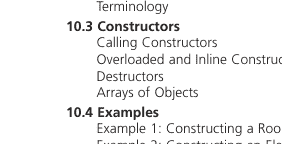

```
```python
print("Hello, World!")
```
```


本书《C++ 基础教程》第四版的主要目标与前几版相同：介绍、发展并强化使用 C++ 进行良好组织的编程技能。所有主题都以清晰、无歧义且易于理解的方式呈现给初学者。学生应熟悉基础代数，但不假设其他先决条件。

因此，与前三版一样，本新版首先提供结构化编程的坚实基础。然后，该基础以在教学上合理、可实现的方式扩展到面向对象的设计和编程方法。除了书中各处的一些小改动外，本版的主要变化如下：

- 第一部分已重组以包含数组、文件和指针，因此可作为 C++ 完整入门学期课程的基础。
- 涵盖面向对象编程的四章已修订并移至第二部分，以便从结构化编程到面向对象编程形成逻辑延续。
- 已增加 50 多个新练习，所有练习均标注其功能（复习、练习、编程、修改、调试、桌面检查或思考）。
- 已增加三个新的章节补充，介绍面向对象设计和统一建模语言（UML）的基础。
- 已增加一套完整的案例研究，可在 Cengage 网站 login.cengage.com 上供教师分发。

从第三版保留的以下特性：

- 从过程式和面向对象两个角度讨论软件工程的基础。
- 每章都包含一个常见编程错误部分，描述初学 C++ 程序员通常会遇到的<|message|>
- 所有程序均使用 ANSI/ISO C++ iostream 库和命名空间机制。
- 异常处理在单独的部分中讨论，并在全书中包含异常处理的实际应用。
- 涵盖 C++ string 类。
- 包含对输入数据验证的透彻讨论，以及检查输入项数值数据类型的函数并允许重新输入无效数值类型。

从实际角度来看，本书旨在支持一学期和两学期的技术 C++ 编程课程；唯一的前提是学生应熟悉基础代数。本书设计得足够灵活，以便教师可以根据主题顺序的偏好塑造本书。这种灵活性通过以下方式实现。

第一部分包含 C++ 结构特性所需的结构语法、流程控制和模块化主题。数组（第 7 章）和文件（第 9 章）主题移至第一部分后，这一部分现在提供了全面的一个学期


## 前言

course. 第 7 章和第 9 章的编写仅依赖于第 1 章至第 6 章，因此其呈现顺序（先数组后文件，或反之）完全由教师自行决定。如时间允许，第 10 章中介绍的类的基础知识也可以涵盖，以创建一个包含面向对象编程入门的为期一学期的课程。图 1 说明了这一学期课程的主题依赖关系，图 2 显示了整本书的主题依赖图表。

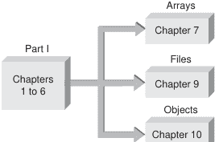

**图 1** 为期一学期课程的主题依赖关系

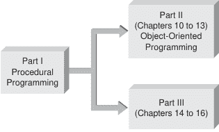

**图 2** 主题依赖图表

## 本书的特色

**写作风格。** 我在自己的课程中发现的一个必不可少的事情是，在教师在课堂上设定背景之后，指定的书籍必须继续鼓励、培养并帮助学生在获取和“掌握”材料方面取得进展。为此，书籍必须以学生能够理解的方式编写。我的主要关注点，也是本书的特色之一，是它为学生而写。因此，我认为用于传达概念的写作风格是本书最重要的方面之一。

## 软件工程

本书不仅仅向学生介绍 C++ 编程，还从过程式和面向对象的角度向学生介绍软件工程的基础知识。它在第 1.1 节开始讨论这两种编程方法，并在全书中得到强化。

## 引用和指针的介绍

我书《ANSI C 第一本》中一个独特的特点是，通过显示变量的地址然后使用其他变量存储这些地址，尽早引入指针概念。这种方法在《ANSI C 第一本》出版时一直似乎比当时流行的间接描述更合乎逻辑地理解指针。

此后，我很高兴看到使用输出函数显示地址已成为介绍指针的标准方法。虽然这种方法不再是本书的独特特色，但我为其呈现方式感到自豪，并在本书中继续使用它。引用也在第 6 章中尽早引入，在第 8 章介绍指针之前。

## 程序测试

本书中的每个 C++ 程序都已成功编译和运行，并使用 Microsoft Visual C++ 2010 进行了质量保证测试。所有程序的源代码可在 www.cengagebrain.com 上供学生下载。使用此源代码使学生能够尝试和扩展现有程序，并更轻松地修改它们，以满足若干节末练习的要求。

## 教学特色

为了实现使 C++ 成为初级课程的目标，以下教学特色已纳入本书。

### 信息点框

这些位于各章中的阴影框突出了重要概念、有用的技术要点、专业程序员使用的编程技巧和窍门。

### 节末练习

本书几乎每个部分都包含大量多样化的技能构建和编程练习。此外，附录 E 中给出了部分练习的解答。

### 伪代码描述

全书中使用伪代码。流程图符号被引入，但仅用于说明流程控制结构。

### 常见编程错误和章节总结

每章都以常见编程错误部分和本章所涵盖主要主题的总结结束。

### 附录

本书包含运算符优先级、ASCII 代码和部分练习解答的附录。有关位操作和浮点数存储的附加附录可在 www.cengagebrain.com 上供学生下载。

**学生须知：** Microsoft 提供了一个免费的 C++ 编译器和开发系统，称为 Microsoft Visual C++ Express 2010。要获取此开发系统，请访问 www.microsoft.com/express/Downloads/#2010-Visual-CPP 并选择英语作为语言。`vc_web.exe` 文件将自动下载到您的下载文件夹。 （如果您没有此文件夹，请搜索以查看文件下载位置。）下载此文件后，双击它以安装 Visual C++ Express 2010。

本书中的所有程序都可以用作 Visual C++ Express 2010 CLR 控制台应用程序或 Win32 控制台应用程序程序，只需做两项补充：

- 代码行 `#include "stdafx.h"` 必须添加到程序开头。
- 代码行 `cin.ignore();` 必须在 return 语句之前包含。

这些添加的代码行在程序运行后保持窗口打开，以便您可以查看它。按 Enter 键终止程序并关闭窗口。例如，要在 Visual C++ Express 2010 中编译和运行本书中的程序 1.1，您应按如下方式输入程序：

```cpp
#include "stdafx.h" // needed for Visual C++ Express 2010
#include <iostream>
using namespace std;

int main()
{
    cout << "Hello there world!";

    cin.ignore(); // needed for Visual C++ Express 2010

    return 0;
}
```

为本书提供的所有解决方案文件（也可供教师使用）都包含这两行额外代码。在需要用户输入的程序中，还包含第二个 `cin.ignore()` 语句，以防止在输入数据时使用的 Enter 键关闭窗口。

## 补充材料

当本书在课堂环境中使用时，以下补充材料可供教师使用。大多数材料也可在教师资源 CD 上获得。

### 电子教师手册

随本书附带的教师手册包括以下内容：

- 额外的教学材料以协助课堂准备，包括讲座主题建议
- 所有节末练习的解答

### ExamView

本书附带 ExamView，这是一款功能强大的测试软件包，允许教师创建和管理印刷版、计算机（基于 LAN）和互联网考试。ExamView 包含数百个与本书所涵盖主题相对应的问题，使学生能够生成包含进一步复习页码引用的详细学习指南。这些基于计算机和互联网的测试组件允许学生在计算机上参加考试，并为教师节省时间，因为每份考试都会自动评分。题库也以 WebCT 和 Blackboard 格式提供。

### PowerPoint 演示文稿

本书随附每个章节的 Microsoft PowerPoint 幻灯片。它们作为课堂演示的教学辅助工具提供，可供学生通过网络进行章节复习，或打印用于课堂分发。教师可以为他们向班级介绍的额外主题添加自己的幻灯片。

### 源代码

本书的源代码可在 www.cengagebrain.com 上供学生使用，也可在教师资源 CD 上获得。

### 解决方案文件

所有编程练习的解决方案文件可在 login.cengage.com 上获得，也可在教师资源 CD 上获得。

### 案例研究

一套完整的案例研究，与第 1 章至第 10 章相对应，可供教师在 login.cengage.com 上使用。

## 3.2.1 基本概念

在开始学习编程之前，我们需要先了解一些基本概念。这些概念是理解后续内容的基础，包括变量、数据类型、运算符等。

**变量**是程序中用于存储数据的容器。在 Python 中，变量不需要显式声明类型，直接赋值即可创建。例如：

```python
x = 10
y = "Hello, World!"
z = 3.14
```

**数据类型**决定了变量可以存储的数据种类。Python 中常见的数据类型包括：

- 整数（int）：如 1, 100, -5
- 浮点数（float）：如 3.14, 0.5
- 字符串（str）：如 "hello"
- 布尔值（bool）：True 或 False
- 列表（list）：有序的可变集合
- 字典（dict）：键值对的集合

**运算符**用于对变量和值进行运算。常见的运算符包括算术运算符（+、-、*、/）、比较运算符（==、!=、<、>）和逻辑运算符（and、or、not）。

> **提示**：在 Python 中，使用 `#` 符号添加注释，注释不会被执行，仅用于说明代码。

下面是一个简单的示例，演示了变量、数据类型和运算符的综合使用：

```python
# 计算圆的面积
radius = 5
pi = 3.14159
area = pi * radius ** 2
print(f"半径为 {radius} 的圆面积为: {area}")
```


## 第一部分
## C++ 编程基础

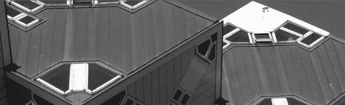

- 1. 入门
- 2. 数据类型、声明和显示
- 3. 赋值和交互式输入
- 4. 选择
- 5. 重复
- 6. 使用函数实现模块化
- 7. 数组
- 8. 数组和指针
- 9. I/O 流和数据文件

本页 intentionally left blank

## 章节
## 1
## 入门

- 1.1 编程简介
- 1.2 函数和类名
- 1.3 cout 对象
- 1.4 编程风格
- 1.5 常见编程错误
- 1.6 章节总结
- 1.7 章节补充：软件开发

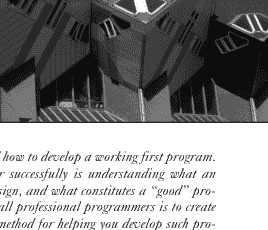

本章解释了 C++ 程序的基本结构以及如何开发第一个可运行的程序。成功编程计算机所需的另一个要素是理解算法的作用、如何以模块化设计构建程序，以及什么构成“好的”程序，这些主题也在本章中有所涉及。所有专业程序员的目标都是创建可读、高效、可靠且可维护的程序。一种帮助您开发此类程序的方法在第 1.7 节中进行了说明。

### 1.1 编程简介

计算机是一种机器，就像汽车和割草机等其他机器一样，它必须先打开，然后受控以完成其预期任务。在汽车中，坐在车内并指挥汽车的司机提供控制。在计算机中，计算机程序提供控制。更正式地说，计算机程序是用于操作计算机以产生特定结果的数据和指令的结构化组合。计算机程序的另一个术语是软件，本书中这两个术语可以互换使用。

## 1. 引言

在当今快速发展的科技时代，人工智能（AI）已成为推动社会进步的关键力量。从智能助手到自动驾驶，AI技术正深刻改变着我们的生活方式和工作模式。本文旨在探讨AI技术的最新进展及其在各领域的应用前景。

## 2. AI技术的主要分支

- - 机器学习（Machine Learning）
- - 深度学习（Deep Learning）
- - 自然语言处理（Natural Language Processing）
- - 计算机视觉（Computer Vision）

## 3. 应用领域分析

| 领域 | 应用案例 | 成熟度 |
|------|----------|--------|
| 医疗 | 影像诊断 | 高 |
| 金融 | 风险控制 | 中 |
| 教育 | 个性化学习 | 中 |
| 交通 | 自动驾驶 | 低 |

## 4. 未来展望

> > “AI的未来不在于替代人类，而在于增强人类的能力。” —— 某知名AI研究者

随着技术的不断突破，AI将在更多领域发挥重要作用。我们期待一个更加智能、高效和人性化的未来。

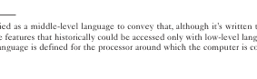

## 1. 引言

随着人工智能技术的飞速发展，大语言模型（Large Language Model, LLM）在自然语言处理领域取得了显著的成就。这些模型通过在海量文本数据上进行预训练，能够捕捉语言的复杂模式和语义关系，从而在多种下游任务中展现出强大的能力。然而，如何高效地评估这些模型的性能，并确保其在实际应用中的可靠性和安全性，仍然是一个亟待解决的重要课题。

本文旨在探讨大语言模型评估方法的最新进展，分析现有评估基准的优缺点，并提出一种新的评估框架。该框架不仅关注模型在标准测试集上的准确率，还强调模型的鲁棒性、公平性以及对对抗性攻击的抵抗能力。

## 2. 相关工作

近年来，研究者们提出了众多大语言模型评估基准，如GLUE、SuperGLUE、MMLU和HELM等。这些基准涵盖了从单句分类到多步推理的多种任务类型，为模型性能的比较提供了标准化的平台。然而，这些基准也存在一些局限性，例如数据泄露问题、任务难度分布不均以及缺乏对模型生成内容安全性的考量。

- - **GLUE**：侧重于自然语言理解任务，包括情感分析、文本蕴含等。
- - **SuperGLUE**：在GLUE基础上增加了更具挑战性的任务，如阅读理解、指代消解等。
- - **MMLU**：覆盖了57个学科领域的知识问答，评估模型的知识广度。
- - **HELM**：提出了多维度评估框架，包括准确性、校准性、鲁棒性和公平性等。

尽管这些基准为模型评估提供了重要参考，但它们往往忽略了模型在真实世界场景中的表现，特别是面对分布外数据时的泛化能力。因此，设计一个更加全面和动态的评估体系显得尤为重要。

## Getting Started

例如，描述被称为 **伪代码**。当使用数学方程时，描述被称为 **公式**。当使用图 1.3 中所示的符号绘制图表时，描述被称为 **流程图**。图 1.4 显示了使用这些符号来描述计算三个数字平均值的算法。

**方法 1 - 列：** 将 1 到 100 的数字排列成一列并将它们相加

```
1
2
3
4
.
.
.
98
99
+100
────
5050
```

**方法 2 - 组：** 将数字排列成总和为 101 的组，并将组数乘以 101

```
1 + 100 = 101
2 + 99 = 101
3 + 98 = 101
4 + 97 = 101
·   ·   ·
·   ·   ·
49 + 52 = 101
50 + 51 = 101
```

50 组

(50 × 101 = 5050)

**方法 3 - 公式：** 使用公式

```
sum = n(a + b)
      ───────
          2
where
n = number of terms to be added (100)
a = first number to be added (1)
b = last number to be added (100)

sum = 100(1 + 100) / 2 = 5050
```

**图 1.2**  求和数字 1 到 100

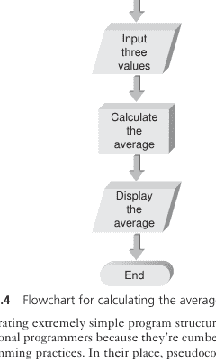

# 图 1.4 计算三个数字平均值的流程图

除了说明极其简单的程序结构外，流程图在专业程序员中已不再受欢迎，因为它们修改起来很麻烦，并且可能支持非结构化编程实践。取而代之的是，伪代码获得了越来越多的认可，它使用简短的英语短语来描述算法。以下是描述计算三个数字平均值的步骤的可接受伪代码示例：

将三个数字输入计算机的内存
通过将数字相加并将总和除以 3 来计算平均值
显示平均值

如前所述，在您可以使用计算机语言语句编写算法之前，您必须先选择算法并理解所需的步骤。用计算机语言语句编写算法称为编码算法（参见图 1.5）。


# 图 1.5 编码算法

## 类和对象

我们生活在一个充满对象的世界——飞机、火车、汽车、手机、书籍、电脑等等——因此，编程语言最终会基于对象也就不足为奇了。面向对象 C++ 编程中最基本的对象是 **数据对象**，它是一组一个或多个值打包成一个单元。例如，学生的姓名和平均绩点可以被视为一个数据对象；在这种情况下，该对象由两部分数据组成。同样，姓名、街道地址、城市、州和邮政编码可以打包成一个对象，这对于用于打印地址标签的程序非常有用。最后，像 10 的乘法表这样的乘法表可以被视为一个数据对象——在这种情况下，是一个集合中一个特定的表。

所有面向对象编程语言中的一个核心概念是特定对象与其所属更大集合之间的区别。为了使这一概念更清晰，请考虑一辆汽车。从对象的角度来看，一辆特定的汽车只是一个更一般的汽车类别的对象。因此，一辆具有特定颜色、发动机尺寸、车身类型等属性的福特 Taurus 可以被视为来自所有可能建造的福特 Taurus 更广泛类别的一个汽车对象。制造商持有建造特定汽车的计划。只有当计划付诸实施并实际建造汽车时，特定的对象才会存在。从更大的定义集合或对象类型类中创建对象的概念是所有面向对象编程语言如 C++ 的基础。一个特定的对象是从对象类型创建的，更准确地说，是从类创建的。

本书讨论了 C++ 语言的两个方面：过程式和面向对象。您从过程式方面开始，因为 C++ 基于过程式语言 C；如果不依赖一些过程式代码，就无法编写 C++ 程序。事实上，许多有用的程序可以完全作为过程式程序编写。在您牢固掌握 C++ 的过程式元素后，您可以扩展这些元素以创建具有类和对象的面向对象程序。

随着您对 C++ 的熟练程度提高，您将开始创建自己的类和对象。然而，正如本章后面以及第 3 章中所看到的那样，两个对象——用于输入数据值的 cin 和用于输出数据值的 cout——在 C++ 中提供。您在早期工作中会大量使用这两个对象。

## 程序翻译

在 C++ 中编写算法或类后，它仍然不能在计算机上运行，而无需进一步翻译，因为所有计算机的内部语言都由一系列 1 和 0 组成，称为 **机器语言**。生成计算机可以运行的机器语言程序需要将 C++ 程序，即 **源程序**，翻译成计算机的机器语言（参见图 1.6）。


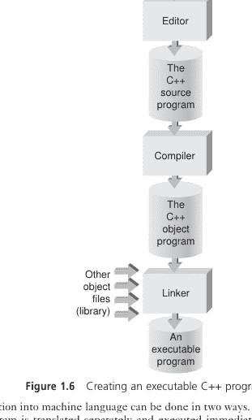

## 图 1.6 创建可执行的 C++ 程序

源程序中的每条语句都可以单独翻译并在翻译后立即执行，编程语言称为解释型语言，完成翻译的程序称为解释器。解释型语言的例子有 BASIC 和 Perl。

当源程序中的所有语句在执行任何语句之前作为一个整体进行翻译时，编程语言称为编译型语言。在这种情况下，完成翻译的程序称为编译器。由于 C++ 是一种编译型语言，因此 C++ 源程序作为一个整体被翻译成机器语言。

图 1.7 显示了 C++ 源代码程序与其编译成机器语言目标程序之间的关系。源代码是通过使用编辑器程序输入的，编辑器程序是编译器提供的开发环境的一部分文字处理工具。然而，请记住，只有在分析完应用程序并仔细规划程序设计后，你才开始输入代码。

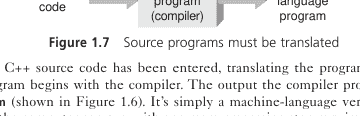

## 图 1.7 源程序必须被翻译

在 C++ 源代码输入后，程序被翻译成机器语言程序的过程从编译器开始。编译器产生的输出称为目标程序，如图 1.6 所示。它只是源程序的机器语言版本，计算机可以运行，但还需要一个额外的处理步骤。

大多数 C++ 程序包含使用预编程例程进行输入和输出以及其他机器相关服务的语句。此外，一个大型 C++ 程序可能存储在两个单独的程序文件中，每个文件单独编译。在程序运行之前，任何额外的代码必须合并成一个单一的程序，而链接程序执行此步骤。链接过程的结果是一个机器语言程序，准备好执行并包含程序所需的所有代码。此最终程序称为可执行程序。

## 练习 1.1

- 1. （定义）定义以下术语：
- a. 计算机程序
- b. 编程语言
- c. 编程
- d. 算法
- e. 伪代码
- f. 流程图
- g. 过程
- h. 对象
- i. 方法
- j. 消息
- k. 响应
- l. 类
- m. 源程序
- n. 编译器
- o. 目标程序
- p. 可执行程序
- q. 解释器

## 2. （实践）确定以下各项任务的逐步程序（列出步骤）：

> 注：每项任务没有唯一的正确答案。本练习旨在让你练习将启发式命令转换为等效算法，并理解其中涉及的思维过程的差异。

执行。与建筑一样，设计程序的一个重要部分是其结构。由相互关联的段落（称为 **模块**）组成的程序结构，按逻辑顺序排列形成一个集成完整的单元，被称为 **模块化程序**（见图 1.8）。模块化程序比以其他方式构建的程序更容易开发、纠正和修改。

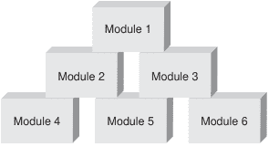

**图 1.8** 一个设计良好的程序是通过使用模块构建的

在 C++ 中，模块可以是类或函数。正如你所见，函数是 C++ 中过程的名称。它由一系列 C++ 语言指令组成。可以把函数想象成一台小型机器，它将接收到的数据转换为成品。例如，图 1.9 说明了一个函数，它接受两个数字作为输入并将这两个数字相乘以产生结果。函数的接口是其输入和结果。输入如何转换为结果的方法被封装并隐藏在函数内部。在这方面，函数可以被视为提供特殊用途操作的单一单元。

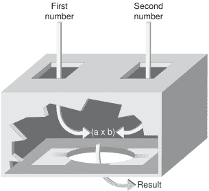

**图 1.9** 一个乘法函数

类似的类比也适用于类。类封装了数据和操作，可以被视为一个完整的加工厂，包含所有原材料（被操作的数据）和所有机器（函数）以进行这些材料的输入、输出和处理。

设计一个好的函数或类的一个重要要求是为其命名，使其传达出函数或类所做的事情的一些想法。函数和类允许使用的名称也用于命名 C++ 语言的其他元素，统称为标识符。标识符可以由字母、数字和下划线（_）的任意组合组成，选定规则如下：

- 1. 名称的第一个字符必须是字母或下划线。
- 2. 第一个字母之后只能跟字母、数字或下划线。不允许有空白；多词标识符中单词的分隔是通过大写一个或多个单词的首字母来表示的。（尽管下划线也可以用于此目的，但它们越来越多地仅用于编译器相关的标识符。）
- 3. 标识符名称不能是表 1.1 中列出的关键字之一。（关键字是语言为特殊目的保留的词，只能以指定方式使用。）
- 4. 标识符中的最大字符数为 1024。

**表 1.1** C++ 中的关键字

| | | | | |
|---|---|---|---|---|
| auto | delete | goto | public | this |
| break | do | if | register | template |
| case | doubles | inline | return | typedef |
| catch | else | int | short | union |
| char | enum | long | signed | unsigned |
| class | extern | new | sizeof | virtual |
| const | float | overload | static | void |
| continue | for | private | struct | volatile |
| default | friend | protected | switch | while |

有效的 C++ 标识符示例如下：

```
grosspay    taxCalc    addNums    degToRad
multByTwo   salestax   netpay     besser
```

无效标识符的示例：

```
4ab3    (以数字开头，违反规则 1。)
e*6     (包含特殊字符，违反规则 2。)
while   (由关键字组成，违反规则 3。)
```

除了符合 C++ 的标识符规则外，C++ 函数名后面必须始终跟随括号。此外，一个好的函数名应该是助记符（发音为

## 信息点

### 标记

在计算机语言中，标记是编译器具有唯一含义的语言的最小单位。因此，关键字、程序员定义的标识符以及所有特殊数学符号，如 + 和 -，都被视为 C++ 语言的标记。在多字符标记中用间隔字符或空白分隔字符会导致编译器错误。

“knee-mou-ic”，即设计为记忆辅助的词。例如，函数名 degToRad() 是将度数转换为弧度的函数的助记符。名称有助于识别函数的功能。不能传达其用途的函数名不应使用，因为它们没有提供有关函数功能的任何信息。以下是一些有效的函数名示例，包括其必需的括号，但不能传达任何有用的信息。此类名称绝不应在 C++ 程序中使用。

```
easy()   arf()   tinker()   theForce()   mike()
```

函数名也可以由大小写字母混合组成，如 locateMaximum()。这种约定在 C++ 中变得越来越常见，尽管不是必需的。全部大写字母的标识符通常保留用于符号常量，见第 3.5 节。

如果你混合使用大写和小写字母，请注意 C++ 是区分大小写的语言，这意味着编译器区分大写和小写字母。因此，在 C++ 中，名称 TOTAL、total 和 Total 是三个不同的标识符。

## main() 函数

使用函数——以及如你在第二部分所见，类——的一个明显优势是，你可以提前规划程序的整体结构。你还可以单独测试和验证每个函数的操作，以确保其满足目标。

为了使函数能够有序地放置和执行，每个 C++ 程序必须有一个且只有一个名为 main 的函数。main() 函数被称为驱动函数，因为它告诉其他函数它们执行的顺序（见图 1.10）。

图 1.11 显示了 main() 函数的结构。函数的第一行——在本例中为 int main()——被称为函数头行。该行始终是函数的第一行，包含三条信息：

- 函数返回的数据类型，如果有的话
- 函数的名称
- 发送到函数的数据类型，如果有的话


## 图 1.10 main() 函数指挥所有其他函数

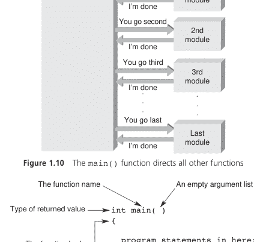

## 图 1.11 main() 函数的结构

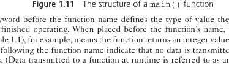

函数名之前的关键字定义了函数在完成操作后返回的值的类型。例如，放在函数名之前时，关键字 int（列于表 1.1）表示函数返回一个整数值。类似地，函数名之后出现的空括号表示运行时没有数据被传输到该函数。（运行时传输给函数的数据称为该函数的参数。）大括号 { 和 } 确定了函数体的开始和结束，并包含构成该函数的语句。

你将为自己命名并编写许多 C++ 函数。事实上，第一部分其余内容主要涉及构造有用函数的所需语句，以及如何将函数和数据组合成有用的程序。然而，每个程序必须有且只有一个 main() 函数。在你学会如何将数据传递给函数以及从函数返回数据之前
（第 6 章的主题），图 1.11 中显示的头行适用于你需要编写的所有程序。在更详细解释之前，只需将前两行

```
int main()
{

```

视为表示“程序在此开始”，并将最后两行

```
return 0;
}
```

视为指定程序的结束。幸运的是，许多有用的函数和类已经为你编写好了。接下来，你将看到如何使用从这些类之一创建的对象来创建你的第一个可工作的 C++ 程序。

## 信息点

## 可执行语句和不可执行语句

本书中你将介绍许多可在 C++ 中用于创建函数和程序的语句。然而，函数中的所有语句都属于两个大类：可执行语句和不可执行语句。

可执行语句会导致计算机在程序运行时执行某些特定操作。例如，指示计算机显示输出或加数字的语句就是可执行语句。可执行语句必须始终以分号结尾。

不可执行语句描述了程序或其数据的某些特征，但在程序运行时不会导致计算机执行任何操作。不可执行语句的一个例子是注释（见第 1.4 节）。注释是供阅读程序的任何人使用的。编译器在将源代码翻译时忽略所有注释。

大括号内的语句决定了函数的作用。所有导致计算机在函数执行时执行特定操作并必须以分号（;）结尾的语句都是可执行语句，随着你对 C++ 理解的深入，这些语句会得到更详细的描述。

## 练习 1.2

1. （练习）判断以下是否是有效标识符，如果是，判断它们是否是能传达其用途的助记符名称。如果标识符名称无效，请说明原因。

- lm1234    newBal    abcd    A12345    1A2345
- power    absVal    invoices    do    while
- add_5    taxes    netPay    12345    int
- newBalance    a2b3c4d5    sales_tax    amount    $taxes

2. （练习）假设以下函数已被编写：
getLength(), getWidth(), calcArea(), displayArea()
a. 根据其名称，你认为每个函数可能做什么？
b. 你认为 main() 函数可能按什么顺序执行这些函数（基于其名称）？

3. （练习）假设以下函数已被编写：
inputPrice(), calcSalestax(), calcTotal()
a. 根据其名称，你认为每个函数可能做什么？
b. 你认为 main() 函数可能按什么顺序执行这些函数（基于其名称）？

4. （练习）为执行以下操作的函数确定名称：
a. 求一组数字的平均值。
b. 求矩形的面积。
c. 求圆的周长。
d. 求一组数字中的最大值。
e. 将大写字母转换为小写字母。
f. 将一组数字从低到高排序。
g. 将姓名列表按字母顺序排列。

5. （练习）正如关键字 int 可用于表示函数返回整数一样，关键字 void、char、float 和 double 可用于分别表示函数返回无值、字符、浮点数和双精度数。使用此信息，为一个名为 abs() 且不接收参数但返回以下内容的函数编写头行：
a. 无值
b. 一个字符
c. 一个浮点数
d. 一个双精度数

## 1.3 cout 对象

C++ 中最通用和最常用的对象之一是 cout（读作“see out”，源自 console output）。它是一个输出对象，将传递给它的任何数据发送到标准显示设备，在大多数系统中是计算机屏幕。例如，如果数据 Hello there world! 被传递给 cout，则该数据会打印（显示）在你的屏幕上。

要将此数据传递给 cout 对象，只需在对象名称之后、消息之前放置插入符号 <<，如下所示：

cout << "Hello there world!"

现在尝试将所有这些内容组合起来。看一下程序 1.1，这是一个可在你的计算机上运行的可工作的 C++ 程序。

## 程序 1.1

```
#include <iostream>
using namespace std;

int main()
{
    cout << "Hello there world!";

    return 0;
}
```

程序的第一行是使用保留字 `include` 的预处理器命令：

`#include <iostream>`

**预处理器命令**以井号（#）开头，并在编译器将源程序翻译成机器代码之前执行某些操作。具体来说，#include 预处理器命令会导致命名文件的内容——在本例中为 iostream——被插入到程序中 #include 命令出现的位置。iostream 文件是标准库的一部分，其中包含除其他代码外两个类：istream 和 ostream。这两个类分别提供用于数据输入和输出的数据声明和方法。iostream 文件称为**头文件**，因为对它的引用始终使用 #include 命令放在 C++ 程序的顶部或头部。你可能想知道 iostream 文件与这个简单程序有什么关系。答案是 cout 对象是从 ostream 类创建的。因此，使用 cout 的所有程序都必须包含 iostream 头文件。如程序 1.1 所示，预处理器命令不以分号结尾。

在预处理器 #include 命令之后是一个包含保留字 using 的语句。例如，以下语句告诉编译器在没有明确指定时在哪里查找头文件：

`using namespace std;`

你可以将 **命名空间** 视为编译器在查找预写类或函数时访问的文件。因为 iostream 头文件包含在名为 std（标准库）的文件中，所以每当引用 cout 时，编译器都会自动从该命名空间使用 iostream 的 cout 对象。⁷ 通过使用命名空间，你可以创建自己的类和函数，其名称与标准库提供的名称相同，并将它们放在不同命名的命名空间中。然后，你可以通过指定希望编译器查找类或函数的命名空间来告诉程序使用哪个类或函数。

using 语句之后是程序 main() 函数的开始，该函数以前面描述的头行开始。函数体由大括号括起来，仅包含两个语句。main() 中的第一个语句向 cout 对象发送一条消息：字符串 "Hello there world!"。

因为 cout 是预写类的对象，所以你不必创建它；只要正确激活它即可使用。像所有 C++ 对象一样，cout 只能执行某些明确定义的操作。对于 cout 来说，此操作是将数据组装用于输出显示。当字符串传递给 cout 时，该对象确保字符串正确显示在屏幕上，如程序 1.1 的此输出所示：

```
Hello there world!
```

C++ 中的字符串是任何用引号 ("string in here") 括起来的字母、数字和特殊字符的组合。引号用于分隔（标记）字符串的开始和结束，并且不被视为字符串的一部分。因此，发送给 cout 的消息字符必须用引号括起来，正如程序 1.1 中所做的那样。

现在检查另一个程序以了解 cout 的多功能性。阅读程序 1.2 以确定它做了什么。

## 程序 1.2

```
#include <iostream>
using namespace std;

int main()
{
    cout << "Computers, computers everywhere";
    cout << "\n  as far as I can C";

    return 0;
}
```


当程序1.2运行时，显示以下内容：

```text
计算机，计算机无处不在
极目所见，到处都是
```

你可能想知道为什么`\n`没有出现在输出中。字符`\`和`n`组合在一起时，被称为换行转义序列。它们告诉`cout`向显示设备发送指令，移动到新的一行的开头。在C++中，反斜杠（`\`）字符提供了对其后字符正常解释的“转义”，并改变了其含义。如果程序1.2中的第二个`cout`语句省略了反斜杠，`n`就会作为字母“n”打印出来，程序将输出以下内容：

```text
计算机，计算机无处不在n 极目所见，到处都是
```

换行转义序列可以放置在传递给`cout`的消息中的任何位置。看看您是否能确定程序1.3产生的显示结果。

## 程序1.3

```cpp
#include <iostream>
using namespace std;

int main()
{
    cout << "Computers everywhere\n as far as\n\nI can see.";

    return 0;
}
```

这是程序1.3的输出：

```text
计算机无处不在
极目所见

我能看到。
```

## 练习1.3

- 1.（程序）在计算机上输入并运行程序1.1。（注意：您必须了解在您所使用的特定计算机安装上输入和运行C++程序的步骤。）

- 2.（程序）a. 使用`cout`编写一个C++程序，将您的姓名打印在第一行，街道地址打印在第二行，城市、州和邮政编码打印在第三行。
  - b. 在计算机上运行您为练习2a编写的程序。

- 3.（程序）a. 编写一个C++程序来显示以下诗句：

  ```text
  计算机，计算机无处不在
  极目所见，到处都是。
  我真的、真的很喜欢这些东西，
  哦快乐，哦快乐属于我！
  ```

  b. 在计算机上运行您为练习3a编写的程序。

- 4.（练习）a. 您会使用多少个`cout`语句来显示以下内容？

  | 部件编号 | 价格 |
  |----------|-------|
  | T1267    | $6.34 |
  | T1300    | $8.92 |
  | T2401    | $65.40 |
  | T4482    | $36.99 |

  b. 打印练习4a中的表格，最少可以使用多少个`cout`语句？
  c. 编写一个完整的C++程序来产生练习4a中显示的输出。
  d. 在计算机上运行您为练习4c编写的程序。

- 5.（思考）响应换行转义序列时，`cout`会将下一个显示的字符定位到新行的开头。下一个字符的定位实际上代表了两个不同的操作。它们是什么？

## 1.4 编程风格

C++程序从`main()`函数的开头开始执行。因为一个程序只能有一个起点，所以每个C++程序必须且只能包含一个`main()`函数。正如您所看到的，构成`main()`函数的所有语句都包含在函数名后面的花括号中。尽管每个C++程序都必须有`main()`函数，但C++并不要求以任何特定形式放置`main`一词、圆括号或花括号。上一节中使用的形式

```cpp
int main()
{
    program statements in here;
    return 0;
}
```

选择该形式纯粹是为了清晰和易于阅读程序，但并不是必需的。例如，这种`main()`函数的一般形式也可以工作：

```cpp
int main
( ) { first statement;second statement;
            third statement;fourth
statement;
return 0;}
```

请注意，您可以将多条语句放在同一行，也可以将一条语句放在多行。除了字符串、引号、标识符和关键字外，C++会忽略所有**空白**。（空白是指空格、制表符或换行的任意组合。）例如，更改程序1.1中的空白，并确保不将字符串`Hello there world!`拆成两行，就会得到以下有效程序：

```cpp
#include <iostream>
using namespace std;
int main
(
)
{
cout <<
"Hello there world!";
    return 0;
}
```

虽然这个版本的`main()`确实可以运行，但它是编程风格不佳的一个示例，因为难以阅读和理解。为了可读性，`main()`函数应该始终写成以下标准形式：

```cpp
int main()
{
    program statements in here;
    return 0;
}
```

在这种标准形式中，函数名从左边距开始（称其为第1列），并与必需的圆括号单独放在一行。函数体的左花括号位于下一行的第1列，正对包含函数名的那一行的第一个字母。同样，函数的右花括号单独放在第1列（与左花括号对齐），作为函数的最后一行。这种结构突出了函数作为单一单元的特点。

在函数内部，所有程序语句都至少缩进两个空格。缩进是良好编程实践的另一个标志，尤其是当相似的语句组使用相同的缩进时。请注意，程序1.2中的两条`cout`语句使用了相同的缩进。

随着您对C++的理解和掌握不断深入，您会形成自己的缩进标准。只需记住，程序的最终形式应该保持一致，并且始终有助于他人阅读和理解您的程序。

### 注释

注释是程序中添加的解释性说明。如果使用得当，注释有助于阐明整个程序的目的、解释一组语句要完成的任务，或解释某一行的意图。C++支持两种类型的注释：行注释和块注释。两种类型都可以放在程序中的任何位置，并且对程序执行没有影响。编译器会忽略所有注释——它们只是为了方便阅读程序的人而存在的。

行注释以两个斜杠（`//`）开头，一直到行尾结束。例如，以下都是行注释：

```text
// 这是一个注释
// 这个程序打印一条消息
// 这个程序计算平方根
```

符号`//`（两者之间没有空白）表示行注释的开始。注释所在行的行尾表示注释的结束。行注释可以单独占一行，也可以写在包含程序语句的行的末尾。程序1.4展示了在程序中使用行注释的示例。

### 程序1.4

```cpp
// this program displays a message
#include <iostream>
using namespace std;

int main()
{
cout << "Hello there world!"; // this produces the display
return 0;
}
```

第一条注释单独出现在程序顶部的一行上，描述程序的功能。这个位置通常是放置一段简短注释来描述程序用途的好地方。如果需要更多注释，可以逐行添加。当一条注释太长而无法在一行内写满时，可以将其分成两行或更多行注释，每条注释前面加上两个斜杠（`//`）。例如，以下注释会产生C++错误消息，因为第二行不是以`//`符号开头的：

```text
// 这条注释无效，因为它
跨了两行
```

这个注释是正确的，写法如下：

```text
// 这条注释用于说明一个
// 跨两行的注释
```

然而，跨两行或更多行的注释写成块注释比写成多行注释更方便。块注释以符号`/*`开头，以符号`*/`结尾，如下例所示：

```text
/* 这是一个块注释，
   跨越
   三行 */
```

在C++中，程序的结构旨在使其可读且易于理解，因此不需要大量注释。如前所述，通过仔细选择函数名来传达其用途，这一指导原则得到了强化。但是，如果程序元素的目的从结构、名称或上下文中仍不明确，就在需要澄清的地方添加注释。

没有注释的晦涩代码无疑是糟糕编程的标志，尤其是当其他人必须维护或阅读该程序时。同样，过多的注释也是糟糕编程的标志，因为这样就没有充分考虑到让代码不言自明。通常，您编写的任何程序都应以注释开头，包括简短的程序描述、您的姓名以及程序的编写或最后修改日期。出于篇幅考虑，而且本书中的所有程序都是由作者编写的，因此这些起始注释仅用于简短的程序描述，当它们不是随附文本的一部分时。

## 练习1.4

- 1.（调试）a. 以下程序能运行吗？

  ```cpp
  #include <iostream>
  using namespace std;
  int main() {cout << "Hello there world!"; return 0;}
  ```

  b. 即使练习1a中的程序能运行，请解释为什么它不是一个好程序。

- 2.（修改）将以下程序改写为符合良好编程实践和正确语法的形式：

  a.

  ```cpp
  #include <iostream>
      int main(
      ){
          cout        <<
          "The time has come"
          ; return 0;}
  ```

  b.

  ```cpp
  #include <iostream>
  using namespace std;
      int main
      () { cout << "Newark is a city\n"; cout <<
      "In New Jersey\n"; cout <<
      "It is also a city\n"
      ; cout << "In Delaware\n"
      ; return 0;}
  ```

  c.

  ```cpp
  #include <iostream>
  using namespace std;
      int main() { cout << Reading a program\n"; cout <<
      "is much easier\n"
      ; cout << "if a standard form for main() is used\n")
      ; cout
  ```


```cpp
<<"and each statement is written\n";cout <<
<< " on a line by itself\n")
; return 0;}
d. #include <iostream.h>
using namespace std;
int main
( ) { cout << "Every C++ program"
; cout
<<"\n must have one and only one"
;
cout << "main() function"
;
cout <<
"\n the escape sequence of characters")
; cout <<
"\nfor a newline can be placed anywhere"
; cout
<<"\n within the message passed to cout"
; return 0;
```

3. （思考题）a. 当在消息中使用时，反斜杠字符会改变其后字符的含义。如果你想打印反斜杠字符，就必须告诉 cout 使其摆脱对反斜杠的常规解释。你认为用什么字符来改变单个反斜杠字符的解释方式？
b. 使用练习 3a 的答案，写出打印反斜杠的转义序列。

4. （思考题）a. 计算机语言的记号是编译器具有唯一含义的一个或多个字符的序列。用间隔字符或空白分隔字符会导致编译器错误。利用记号的这一定义，判断表 1.1 中列出的转义序列、函数名和关键字是否是 C++ 语言的记号。
b. 讨论向消息中添加空白是否会改变消息，以及消息是否可以被视为 C++ 的记号。
c. 利用练习 4a 中记号的定义，判断以下陈述是否正确：“除语言的记号外，C++ 忽略所有空白。”

## 1.5 常见编程错误

学习任何编程语言的一部分就是犯下在使用该语言初期常遇到的基本错误。这些错误往往令人沮丧，因为每种语言都有自己的一套常见编程错误在等待粗心的人。初次用 C++ 编程时常犯的错误包括以下内容：

- 1. 在 main() 后省略括号。
- 2. 省略或错误输入表示函数体开始的左大括号，{。
- 3. 省略或错误输入表示函数结束的右大括号，}。
- 4. 省略每个 C++ 可执行语句末尾的分号。
- 5. 在 #include <iostream> 预处理器命令后添加分号。
- 6. 拼写对象或函数名错误，例如将 c0t 输入为 cout。
- 7. 忘记用双引号将发送给 cout 的字符串括起来。
- 8. 忘记使用 \n 来表示新行。

此列表中的第三、第四、第五和第六个错误往往是最常见的。一个值得的做法是编写一个程序并逐一引入每个错误，以查看编译器会产生什么错误信息。当这些错误信息因无意错误而出现时，你将有经验去理解这些信息并纠正错误。

## 1.6 章节总结

- 1. 计算机程序是用于操作计算机以产生特定结果的一组指令和数据的自包含单元。
- 2. 算法是一步一步的程序，必须终止；它描述了如何执行计算或任务。
- 3. C++ 程序由一个或多个称为函数的模块组成。其中一个函数必须称为 main()。main() 函数标识 C++ 程序的起点。
- 4. 最简单的 C++ 程序仅由单个函数 main() 组成，其形式如下：

```cpp
#include <iostream>
using namespace std;

int main()
{
    program statements in here;

    return 0;
}
```

该程序由一个预处理器 #include 语句、一个 using 语句、main() 函数的头行以及 main() 函数的主体组成。函数的主体以左大括号 { 开始，以右大括号 } 结束。

- 5. 函数体内的所有可执行 C++ 语句都必须以分号终止。
- 6. 许多函数和类都提供在随每个 C++ 编译器提供的标准库中。其中一组用于创建输入输出能力的类定义在 iostream 头文件中。
- 7. cout 对象用于显示文本或数值结果。可以通过将字符用引号括起来并使用插入符号 <<，如语句 cout << "Hello World!"; 中那样，将字符流发送到 cout。字符串中的文本会显示在屏幕上，并且可以包含用于控制格式的换行转义序列。

## 1.7 章节补充：软件开发

在最基本层面上，程序是为解决特定问题而开发的解决方案，以可在计算机上运行的形式编写。因此，编写程序几乎是最后一步，在此之前首先要确定要解决的问题和解决方案中使用的方法。每个研究领域都有其解决问题的系统方法的名称。在科学和工程中，该方法被称为科学方法，在定量分析中，该方法称为系统方法。专业软件开发人员使用软件开发程序来理解要解决的问题并创建有效、合适的软件解决方案。该程序如图 1.12 所示，由三个重叠的阶段组成：

- 1. 开发与设计
- 2. 文档
- 3. 维护

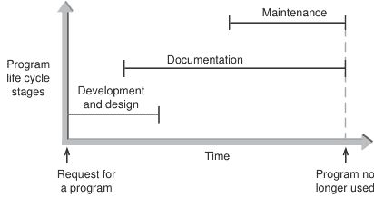

**图 1.12** 软件开发的三个阶段

作为一门学科，**软件工程**关注创建可读、高效、可靠和可维护的程序和系统，并使用软件开发程序来实现这一目标。

### 第一阶段：开发与设计

第一阶段始于对问题或对程序的具体请求陈述，该陈述称为程序需求。在陈述问题或提出程序解决方案的具体请求后，开发与设计阶段开始。该阶段由四个明确定义的步骤组成，如图 1.13 所示，并在以下各节中总结。

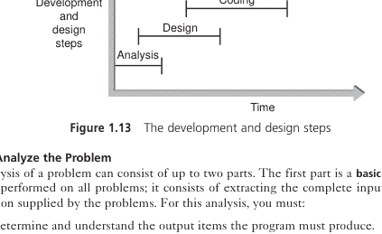

**图 1.13** 开发与设计步骤

### 步骤 1：分析问题

问题的分析可能包含多达两个部分。第一部分是对所有问题必须执行的基本分析；它包括提取问题提供的完整输入和输出信息。对于此分析，你必须：

- 1. 确定并理解程序必须产生的输出项。
- 2. 确定输入项。

这两个项目合在一起称为问题的输入/输出（I/O）。只有在确定问题的 I/O 后，才能选择将输入转换为输出的具体步骤。在这一点上，有时有必要和/或有用地进行手工计算，以验证输出是否确实可以从输入中获得。显然，如果你有一个将输入与输出关联的公式，可以省略此步骤。如果所需的输入可用并且所需的输出可以产生，则该问题被认为是明确定义的并且可以解决。

由于各种原因，完成基本分析可能不可行。如果是这样，可能需要扩展分析。扩展分析只是意味着你必须收集有关问题的更多信息，以便彻底了解要求的内容以及如何实现结果。在本书中，理解问题所需的任何额外信息都与问题陈述一起提供。

### 步骤 2：开发解决方案

接下来，你选择用于解决问题的确切步骤集合，称为算法。通常，你通过一系列细化来找到解决方案，从分析步骤中最初找到的算法开始，直到获得可接受且完整的算法。如果该算法在分析步骤中未被检查，必须检查它以确保它能正确产生所需的输出。检查通常通过进行一次或多次尚未完成的手工计算来进行。

对于小型程序，所选算法可能非常简单，仅由一个或多个计算组成。更典型的是，你需要细化初始解决方案并将其组织成更小的子系统，并为子系统之间的接口制定规范。为实现这一目标，算法的描述从最高层级（顶层）需求开始，向下进行到为满足该需求而必须构建的部分。为


为了使这一解释更有意义，可以设想一个必须跟踪库存中零件数量的计算机程序。该程序所需的输出是所有库存零件的描述以及每种物品的库存数量；给定的输入是每个零件的初始库存量、已售出物品数量、已退回物品数量和已购买物品数量。

针对这些规格，设计人员可以先将程序的需求组织成图1.14所示的三个部分。该图既被称为顶层结构图，也被称为一级结构图，因为它表示设计人员所选程序的第一个总体结构。

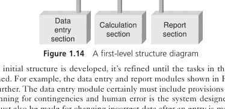

图1.14 一级结构图

在开发出初始结构后，会对其进行细化，直到方框中的任务被完全定义。例如，图1.14所示的数据录入和报表模块需要进一步细化。数据录入模块当然必须包含录入数据的功能。由于为意外情况和人为错误做打算是系统设计人员的责任，因此还必须提供在录入后更改错误数据以及删除先前录入内容的功能。报表模块也可以进行类似的细分。图1.15是包含这些进一步细化的库存跟踪系统的二级结构图。

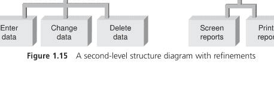

图1.15 经过细化的二级结构图

细化解决方案的过程会持续进行，直到包含最小的需求。请注意，该设计产生了一种树状结构，从结构顶部向底部移动时，各层级会逐级分支。设计完成后，每个方框中指定的任务通常都会用独立的指令集进行编码，这些指令集在被结构中较高层级的任务调用时执行。

### 步骤3：编写解决方案代码（编写程序）

这一步包括实际编写一个与第2步中开发的解决方案相对应的C++程序。如果分析和解决方案步骤都正确完成，那么编码步骤在本质上就相当机械了。然而，在一个设计良好的程序中，构成程序的语句遵循某些在解决方案步骤中已定义的明确模式或结构。这些结构控制程序的执行方式，并包含以下类型：

- 顺序结构
- 选择结构
- 循环结构
- 调用结构

**顺序结构**定义了程序执行指令的顺序。如果程序要实现明确的目标，指定哪条指令先执行、哪条指令后执行等是至关重要的。

**选择结构**提供了根据某个条件的结果在不同操作之间进行选择的能力。例如，在执行除法之前可以先检查一个数的值。如果该数不为零，则它可以作为除法运算的分母；否则，不执行除法，并向用户发出警告信息。

**循环结构**，也称为“循环”和“重复”，可以根据条件的值重复执行相同的操作。例如，可以反复输入和累加成绩，直到输入一个负数成绩。在这种情况下，输入负数成绩就是表示重复输入和累加成绩结束的条件。此时，可以计算所有输入成绩的平均值。

**调用结构**涉及在需要时调用或召唤一组语句。例如，计算一个人的净工资涉及获取工资率和工作时间、计算净工资以及为所需金额提供报表或支票等任务。每个任务通常编码为一个独立的单元，在需要时被调用执行，即被调用。

### 步骤4：测试并修正程序

测试的目的是验证程序能否正确运行并真正满足其需求。理论上，测试会揭示所有存在的程序错误。（在计算机术语中，程序错误被称为bug。⁸）实际上，找出所有错误需要检查语句执行的所有可能组合。由于所需的时间和精力，这一目标通常是不可能实现的，除非是极其简单的程序。（第4.7节解释了为什么这一目标通常被认为是不可能实现的。）

> ⁸这个术语的由来颇为有趣。1945年9月，哈佛大学的Mark I计算机上的一个程序停止运行，格蕾丝·赫柏把故障追溯到一只进入电路的死昆虫。她在日志中记录了这一事件：“继电器#70……（蛾）在继电器中。首次实际发现bug的案例。”

由于对大多数程序来说，穷举测试并不可行，因此已经发展出不同的测试理念和方法。然而，在最基本的层面上，测试需要有意识地努力确保程序正确运行并产生有意义的结果。这种努力意味着要仔细思考测试旨在达到什么目的，以及测试中使用的数据。如果测试揭示了一个错误（bug），就可以启动调试过程，包括定位、纠正和验证纠正结果。要认识到，尽管测试可能揭示错误的存在，但它并不一定表明错误不存在。因此，一次测试发现一个bug的事实并不表明程序中其他地方没有潜伏着另一个bug。

为了捕获并纠正程序中的错误，开发一组用于确定程序能否产生正确答案的测试数据非常重要。事实上，在正式的软件开发中，一个公认的步骤是在编写代码之前规划测试过程并创建有意义的测试数据。先做这一步有助于你对程序必须做什么保持更客观的态度，因为它绕过了编码后在潜意识中回避那些可能暴露程序问题的测试数据的诱惑。测试程序的步骤应该检查程序可能被使用的每一种情况。应该使用合理范围内的数据来测试程序，也要在极限情况下以及程序应当告知用户数据无效的区域进行测试。对于复杂的问题，开发良好的测试过程和测试数据可能比编写程序代码更困难。

表1.2列出了在大型商业编程项目中，每个开发和设计步骤通常所花费的工作量的比较。如该列表所示，编码并不是第一阶段的主要工作。许多新程序员之所以遇到困难，是因为他们把大部分时间花在编写程序上，而没有花足够的时间去理解问题或设计合适的解决方案。（注意表中显示，50%的总开发时间花在测试上，而且许多程序员只测试别人编写的代码。）为了帮助你避免犯同样的错误，请记住编程谚语：“对于一个没有被完全理解的问题或应用，是不可能编写出成功的程序的。”另一句同样有价值的谚语是：“你越早开始编写程序，通常需要完成它的时间就越长。”

**表1.2** 第一阶段花费的工作量

| 步骤 | 工作量 |
| --- | --- |
| 分析问题 | 10% |
| 制定解决方案 | 20% |
| 编写解决方案代码（编写程序） | 20% |
| 测试程序 | 50% |

## 第二阶段：文档编制

由于文档编写不足，许多工作变得无用或丢失，许多任务必须重复进行，因此为你的工作编写文档是解决问题过程中最重要的步骤之一。在分析、设计、编码和测试步骤中会创建许多关键文档。完成文档编制阶段需要收集这些文档，添加用户操作材料，并以对你和你的组织最有用的形式呈现文档。


尽管并非每个人都以相同的方式对它们进行分类，但每个问题解决方案都有五个主要文档：

- 程序说明
- 算法开发和变更
- 注释良好的程序清单
- 示例测试运行
- 用户手册

将自己置于可能使用你的作品的人的立场——从助手到程序员/分析师和管理人员——应该有助于你努力使重要文档的内容清晰。文档阶段正式始于开发和设计阶段，并延续到维护阶段。

## Phase III: Maintenance

本阶段涉及对问题的持续纠正、为满足不断变化的需求而进行的修订以及新功能的添加。维护通常是主要工作、主要收入来源，也是所有阶段中持续时间最长的。开发可能需要几天或几个月，但维护可能持续数年或数十年。文档越好，维护的效率就越高，客户和最终用户也会越满意。

## Backup

虽然备份不是正式设计过程的一部分，但在编程和调试过程的每个步骤中制作并保留程序的备份副本至关重要。删除或更改程序的当前工作版本使其面目全非是很容易发生的。有了备份副本，你就可以轻松地恢复上一次的工作阶段。实用程序的最终工作版本应至少备份两次。就此而言，另一个有用的编程谚语是“如果你不介意重新开始，备份就不重要。”许多组织至少保留一份现场备份，以便轻松检索，并将另一份备份副本存放在防火保险箱或远程位置。

## EXERCISES FOR SECTION 1.7

> Note: In each of these exercises, a programming problem is given. Read the problem statement first and then answer the questions pertaining to the problem. Do not attempt to write a program to solve the problems. Instead, simply answer the questions following the program specifications.

1. (Practice) 需要一个 C++ 程序来计算存钱罐中包含的金额，以美元计。银行中包含半美元、季度、十分之一、镍币和便士。
   a. 对于此编程问题，需要多少个输出？
   b. 这个问题有多少个输入？
   c. 编写将输入项转换为输出项的算法。
   d. 使用以下示例数据测试为练习 1c 编写的算法：半美元 0，季度 17，十分之一 24，镍币 16，便士 12。

2. (Practice) 需要一个 C++ 程序来计算距离的值，以英里计，给出以下关系：

   distance = average - speed × time

   a. 对于此编程问题，需要多少个输出？
   b. 这个问题有多少个输入？
   c. 编写将输入项转换为输出项的算法。
   d. 使用以下示例数据测试为练习 2c 编写的算法：速度为 55 英里每小时，时间为 2.5 小时。
   e. 如果经过的时间以分钟而不是小时给出，你编写的练习 2c 中的算法必须如何修改？

3. (Practice) 需要一个 C++ 程序来确定 Ergies 的值，给出以下关系：

   Ergies = Fergies × Lergies

   a. 对于此编程问题，需要多少个输出？
   b. 这个问题有多少个输入？
   c. 确定将输入项转换为输出项的算法。
   d. 使用以下示例数据测试为练习 3c 编写的算法：Fergies = 14.65 且 Lergies = 4。

4. (Practice) 需要一个 C++ 程序来显示以下姓名和地址：

   Mr. S. Hazlet
   63 Seminole Way
   Dumont, NJ 07030

   a. 对于此编程问题，需要多少行输出？
   b. 这个问题有多少个输入？
   c. 编写将输入项转换为输出项的算法。

5. (Practice) 需要一个 C++ 程序来确定汽车在 10 秒后行驶了多远，假设汽车最初以 60 mph 行驶，司机踩下刹车以 12 miles/sec² 的均匀速率减速。使用以下公式：

   distance = st - (1/2)d t²
   s 是汽车的初始速度。
   d 是减速度。
   t 是经过的时间。

   a. 对于此编程问题，需要多少个输出？
   b. 这个问题有多少个输入？
   c. 编写将输入项转换为输出项的算法。
   d. 使用问题中给出的数据测试为练习 5c 编写的算法。

6. (Practice) 1627 年，曼哈顿岛以约 24 美元的价格卖给荷兰定居者。如果该销售的收益以每年 5% 的利率存入荷兰银行，按年复利计算，到 2012 年底本金余额会是多少？需要以下显示；xxxxxx 是程序计算的金额：

   Balance as of December 31, 2012 is: xxxxxx

   a. 对于此编程问题，需要多少个输出？
   b. 这个问题有多少个输入？
   c. 是否提供了将输入项转换为输出项的算法？

7. (Practice) 需要一个 C++ 程序来计算并显示两名员工的每周毛薪和净薪。第一名员工的时薪为 $16.43，第二名员工的时薪为 $12.67。两名员工的毛薪中都有 20% 用于所得税扣除，两人都在税前支付毛薪的 2% 用于医疗保险。

   a. 对于此编程问题，需要多少个输出？
   b. 这个问题有多少个输入？
   c. 编写将输入项转换为输出项的算法。
   d. 使用以下示例数据测试为练习 7c 编写的算法：第一名员工一周工作 40 小时，第二名员工工作 35 小时。

8. (Program) 这是统计应用中使用的标准正态偏差 *z* 的公式：

   *z* = (*X* − μ)/σ

   *X* 是一个单一值。
   μ 指平均值。
   σ 指标准差。

   使用此公式，编写一个程序来计算并显示当 *X* = 85.3，μ = 80 且 σ = 4 时标准正态偏差的值。

   a. 对于此编程问题，需要多少个输出？
   b. 这个问题有多少个输入？
   c. 编写将输入项转换为输出项的算法。
   d. 使用问题中给出的数据测试为练习 8c 编写的算法。

9. (Practice) 描述指数增长的方程如下：

   *y* = *e*ˣ

   使用此方程，需要一个 C++ 程序来计算 *y* 的值。

   a. 对于此编程问题，需要多少个输出？
   b. 这个问题有多少个输入？
   c. 编写将输入项转换为输出项的算法。
   d. 假设 *e* 为 2.718 且 *x* 为 10，测试为练习 9c 编写的算法。

## Chapter 2

# Data Types, Declarations, and Displays

- 2.1 Data Types
- 2.2 Arithmetic Operations
- 2.3 Variables and Declarations
- 2.4 Common Programming Errors
- 2.5 Chapter Summary
- 2.6 Chapter Supplement: Bits, Bytes, and Binary Number Representations

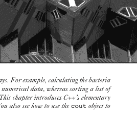

C++ 程序可以以不同的方式处理不同类型的数据。例如，计算受污染池塘中的细菌生长需要对数值数据进行数学运算，而对姓名列表进行排序则需要对字母数据进行比较运算。本章介绍 C++ 的基本数据类型以及可以对其执行的操作。你还将看到如何使用 cout 对象来显示这些操作的结果。

## 2.1 Data Types

所有程序的目标都是处理数据，无论是数值、字母、音频还是视频。这一目标的核心是将数据分类为特定类型。例如，计算银行余额应付利息需要对数值数据进行数学运算，而对姓名列表进行字母排序需要对基于字符的数据进行比较运算。此外，某些操作不适用于某些类型的数据。例如，将姓名相加是没有意义的。为了防止程序员尝试执行不适当的操作，C++ 只允许对某些类型的数据执行某些操作。


允许的数据类型以及每种类型允许的操作被称为数据类型。形式上，数据类型被定义为一组值和可以应用于这些值的一组操作。例如，所有整数（整数）构成一组值。然而，这组数字只有在包含一组操作时才构成数据类型。这些操作当然是熟悉的数学和比较操作。值集合加上操作集合的结果才是真正的数据类型。

C++ 将数据类型分为类类型或内置类型。类数据类型（简称为“类”）是程序员创建的数据类型。这意味着程序员定义了可接受的值和操作，该类型在本书的第二部分中讨论。

内置数据类型是作为编程语言不可分割的一部分提供的。内置数据类型也称为原始类型。C++ 的内置数值数据类型包括图 2.1 中所示的基本数值类型和表 2.1 中列出的操作。正如表 2.1 所示，内置数据类型的绝大多数操作使用常规数学符号。对于类数据类型，正如你在第二部分中看到的那样，大多数操作都是作为函数提供的。

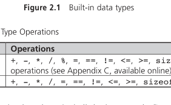

## 表 2.1 内置数据类型操作

| 内置数据类型 | 操作 |
|---|---|
| Integer | +, -, *, /, %, ==, !=, <=, >=, sizeof(), and bit operations (see Appendix C, available online) |
| Floating-point | +, -, *, /, =, ==, !=, <=, >=, sizeof() |

字面值用于在 C++ 中引入内置数据类型。字面值意味着该值自我标识。（字面值的另一个名称是字面量或常量。）例如，所有数字，如 2、3.6 和 -8.2，都被称为字面值，因为它们字面地显示了其值。文本，如 "Hello World!"，也被称为字面值，因为文本本身被显示。你一生中一直在使用字面值，但将其称为数字和单词。在第 2.3 节中，你将看到一些非字面值的示例——即不显示自身而是通过标识符存储和访问的值。

## 整数数据类型

C++ 提供了九种内置整数数据类型，如图 2.2 所示。这些整数数据类型之间的本质区别是每种类型使用的存储量，这会影响每种类型能够表示的值的范围。在许多应用中使用的三个最重要和最常见的类型是 int、char 和 bool。其他类型是为了适应特殊情况（例如非常小或非常大的数字范围）而提供的，并因历史原因而保留。它们使程序员能够通过选择使用最少内存量且符合应用程序要求的数据类型来最大化内存使用。当计算机内存小且昂贵，与今天的计算机相比时，所用内存量是一个主要问题。虽然现在对大多数程序来说不再是问题，但这些类型仍然允许程序员在必要时优化内存使用。这种优化通常在工程应用中是必需的，例如用于家用电器和汽车的控制系统。

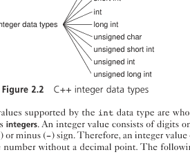

图 2.2 C++ 整数数据类型

## int 数据类型

int 数据类型支持的值是整数，在数学上称为整数。整数值仅由数字组成，并且可以 optionally 以加号 (+) 或减号 (−) 开头。因此，整数值可以是数字 0 或任何没有小数点的正数或负数。以下是有效整数的示例：

0      -10      1000      -26351
5      +25      253       +36

正如这些示例所示，整数可以包含显式符号。但是，不允许使用逗号、小数点或特殊符号，如美元符号，如这些无效整数示例所示：

$255.62    3.      1,492.89
2,523      6,243,892    +6.0

编译器在每个数据类型中可以存储的最大（最正）和最小（最负）整数值的内部限制有所不同。¹ 最常见的存储分配是 int 数据类型使用 4 个字节，这将用于表示整数的值限制为 -2,147,483,648 到 2,147,483,647。²

¹编译器施加的限制可在 limits 头文件中找到，并定义为常量 INT_MIN 和 INT_MAX。
²最负数的大小总是比最正数的大小多一个。原因是整数存储的补码方法，描述在第 2.6 节中。

## char 数据类型

char 数据类型用于存储单个字符，包括字母表中的字母（大写和小写）、数字 0 到 9 以及特殊符号，如 + $ . , - 和 !。字符值是任何单个字母、数字或特殊符号，用单引号括起来，如以下示例所示：

'A' ' $ ' 'b' '?' 'y' '!' 'M' 'q'

字符值通常在计算机中以 ASCII 或 Unicode 代码存储。ASCII（读作 "as-key"）是美国信息交换标准代码的缩写。ASCII 和 Unicode 代码都将字符分配给 0 和 1 的特定模式。表 2.2 列出了 ASCII 位模式与小写字母和大写字母之间的对应关系。

## 表 2.2 ASCII 字母代码

| 小写字母 | 二进制代码 | 小写字母 | 二进制代码 | 大写字母 | 二进制代码 | 大写字母 | 二进制代码 |
|---|---|---|---|---|---|---|---|
| a | 01100001 | n | 01101110 | A | 01000001 | N | 01001110 |
| b | 01100010 | o | 01101111 | B | 01000010 | O | 01001111 |
| c | 01100011 | p | 01110000 | C | 01000011 | P | 01010000 |
| d | 01100100 | q | 01110001 | D | 01000100 | Q | 01010001 |
| e | 01100101 | r | 01110010 | E | 01000101 | R | 01010010 |
| f | 01100110 | s | 01110011 | F | 01000110 | S | 01010011 |
| g | 01100111 | t | 01110100 | G | 01000111 | T | 01010100 |
| h | 01101000 | u | 01110101 | H | 01001000 | U | 01010101 |
| i | 01101001 | v | 01110110 | I | 01001001 | V | 01010110 |
| j | 01101010 | w | 01110111 | J | 01001010 | W | 01010111 |
| k | 01101011 | x | 01111000 | K | 01001011 | X | 01011000 |
| l | 01101100 | y | 01111001 | L | 01001100 | Y | 01011001 |
| m | 01101101 | z | 01111010 | M | 01001101 | Z | 01011010 |

更新的 Unicode 代码用于国际应用，因为它除了英语之外，还可容纳几乎所有语言的字符集。由于前 256 个 Unicode 代码与完整的 256 个 ASCII 代码相同（增加了八个前导 0），因此你不必担心英语字符使用哪种存储代码。

使用表 2.2，你可以确定字符 'B'、'A'、'R'、'T'、'E' 和 'R' 例如，如何使用 ASCII 代码存储在计算机中。这个六个字符的序列需要 6 个字节的存储（每个字母 1 个字节），并存储如图所示 2.3 所示。（如果你不熟悉字节的概念，请回顾第 2.6 节。）


## 转义字符

正如你在第 1.3 节中看到的那样，反斜杠 (\ ) 在 C++ 中作为转义字符具有特殊含义。当反斜杠放在一组字符前面时，它告诉编译器跳过这些字符的正常解释方式。反斜杠和这些字符的组合称为转义序列。表 2.3 列出了 C++ 最常见的转义序列。

## 表 2.3 转义序列

| 转义序列 | 表示的字符 | 含义 | ASCII 代码 |
|---|---|---|---|
| \n | Newline | Move to a new line | 00001010 |
| \t | Horizontal tab | Move to the next horizontal tab setting | 00001001 |
| \v | Vertical tab | Move to the next vertical tab setting | 00001011 |
| \b | Backspace | Move back one space | 00001000 |
| \r | Carriage return | Move the cursor to the start of the current line; used for overprinting | 00001101 |
| \f | Form feed | Issue a form feed | 00001100 |
| \a | Alert | Issue an alert (usually a bell sound) | 00000111 |
| \\ | Backslash | Insert a backslash character (used to place an actual backslash character in a string) | 01011100 |
| \? | Question mark | Insert a question mark character | 00111111 |
| \' | Single quotation | Insert a single-quote character (used to place an inner single quote inside a set of outer single quotes) | 00100111 |
| \" | Double quotation | Insert a double-quote character (used to place an inner double quote inside a set of outer double quotes) | 00100010 |
| \nnn | Octal number | Consider the number nnn (n is a digit) an octal number | Dependent on nnn |
| \xhhhh | Hexadecimal number | Consider the number hhhh (h is a digit) a hexadecimal number | Dependent on hhhh |
| \0 | Null character | Insert the null character, which is defined as having the value 0 | 00000000 |

尽管表 2.3 中的每个转义序列由两个字符组成，但这些字符的组合，没有 intervening 空白，会导致编译器创建表中列出的单个 ASCII 代码。

## bool 数据类型

在 C++ 中，bool 数据类型用于表示布尔（逻辑）数据，因此它仅限于两个值之一：true 或 false。此数据类型在程序必须检查条件并根据条件是否成立采取规定的行动时最有用


## 数据类型、声明和显示

条件为真或假。例如，在销售应用程序中，被检查的条件可能是“总购买额是否在 $100 或以上”。只有当此条件为真时才会应用折扣。因为 bool 数据类型使用整数存储代码，所以它具有大多数专业 C++ 程序员所利用的有用含义。第 4 章涵盖了布尔条件的实际用途，因此 bool 数据类型将在该章中更详细地讨论。

## 确定存储大小

C++ 的一个独特特性是你可以看到值存储的位置和方式。作为示例，C++ 运算符 `sizeof()` 提供括号中给出的数据类型所使用的字节数（在第 2.6 节中讨论）。这个内置运算符在执行操作时不使用算术符号。程序 2.1 使用此运算符来确定为 int、char 和 bool 数据类型保留的存储量。

```
```cpp
#include <iostream>
using namespace std;

int main()
{
    cout << "\nData Type  Bytes";
    cout << "\n---------  -----";
    cout << "\nint        " << sizeof(int);
    cout << "\nchar       " << sizeof(char);
    cout << "\nbool       " << sizeof(bool);
    cout << '\n';

    return 0;
}
```
```

在回顾程序 2.1 时，注意在前五个 cout 语句的每个输出字符串开头都包含了 `\n` 字符。每当编译器遇到换行转义序列时，无论作为字符串的一部分还是作为单个字符，它都被翻译为一个强制显示从新行开头开始的单个字符。在最后的 cout 语句中，换行转义序列被插入为单个 '\n' 字符。虽然也可以使用引号用于此最后的换行插入，如 "\n"，但这样指定的是一个字符串。单引号，如 '\n'，清楚地表明正在传输单个字符。从实际角度来看，这两种记法（"\n" 和 '\n'）都会强制显示换行。

## 信息点

## 字符 `\n` 和字符串 "\n"

编译器将 `\n` 和 "\n" 都识别为包含换行字符。区别在于使用的数据类型。正式地说，`\n` 是字符字面量，而 "\n" 是字符串字面量。从实际角度来看，两者导致同样的结果：在输出显示中强制换行。在遇到字符值 `\n` 时，编译器使用 ASCII 代码 00001010 进行翻译（参见表 2.3）。在遇到字符串值 "\n" 时，编译器使用相同的字符代码，但会加上字符串结束字符 `\0` 的代码，即 00000000。

良好的编程实践要求以换行转义序列结束最后的输出显示。这种做法可确保一个程序的输出第一行不会出现在先前执行程序的最后一行显示上。

程序 2.1 的输出取决于编译器，这意味着每个编译器报告为所考虑的数据类型提供的存储量。例如，在使用微软当前 Visual C++ 编译器的计算机上运行时，会产生以下输出：

| Data Type | Bytes |
|-----------|-------|
| int       | 4     |
| char      | 1     |
| bool      | 1     |

对于此输出，即几乎所有当前 C++ 编译器提供的典型存储，你可以确定每种数据类型可以存储的值范围。但是，要做到这一点，需要理解有符号和无符号数据类型的区别，这将在下一节中讨论。

## 有符号和无符号数据类型

有符号数据类型允许存储负值、0 值和正值，因此 int 是有符号数据类型。无符号数据类型仅提供非负值（即 0 和正值）。某些应用程序只需要无符号数值。例如，许多日期应用程序以年月份日的形式存储日期（例如将 12/25/2011 存储为 20111225），并且只关心 0 CE 之后的日期。对于这些永远不需要负值的应用程序，可以使用无符号数据类型。

所有无符号整数类型，如 unsigned int，提供正值范围，对于所有实际目的而言，其范围是其有符号对应类型的两倍。这种额外的正值范围是通过使用其有符号版本的负值范围来为额外的正数提供空间实现的。

表 2.4 列出了当前 C++ 编译器支持的其有符号和无符号整数数据类型的整数值范围。如你所见，long int 使用的存储量（4 字节）与 int 相同。ANSI C++ 标准的唯一要求是 int 必须提供至少与 short int 一样多的存储，而 long int 必须提供至少与 int 一样多的存储。在内存容量仅限于数千字节的早期桌面计算机上，short int 通常使用 1 字节存储，int 使用 2 字节，long int 使用 4 字节。这种存储限制了 int 值的范围从 -32,768 到 +32,767，而 unsigned int 值的范围从 0 到 65,535，从而使可能的正值数量翻倍，这一点很重要。随着当前 int 值范围在 -20 亿到 +20 亿范围内，双倍正值很少成为考虑因素。此外，long int 现在不再必要，因为它使用的存储容量与 int 相同。

## 表 2.4 整数数据类型存储

| Name of Data Type | Storage Size | Range of Values |
|---|---|---|
| char | 1 | 256 characters |
| bool | 1 | true (considered as any positive value) and false (which is a 0) |
| short int | 2 | -32,768 to +32,767 |
| unsigned short int | 2 | 0 to 65,535 |
| int | 4 | -2,147,483,648 to +2,147,483,647 |
| unsigned int | 4 | 0 to 4,294,967,295 |
| long int | 4 | -2,147,483,648 to +2,147,483,647 |
| unsigned long int | 4 | 0 to 4,294,967,295 |

## 浮点类型

浮点数，更 commonly 称为实数，可以是数字 0 或任何包含小数点的正数或负数。以下是浮点数的示例：

```
+10.625  5.0  -6.2  3251.92  0.0  0.33  -6.67  +2.
```

注意数字 5.0、0.0 和 +2. 被归类为浮点值，但如果同样的数字写成没有小数点（5、0、+2）则为整数值。与整数值一样，特殊符号，如美元符号和逗号，不允许出现在实数中。无效实数的示例如下：

```
5,326.25   24   6,459   $10.29   7,007.645
```

C++ 支持三种浮点数据类型：float、double 和 long double。这些数据类型之间的区别是编译器为每种类型使用的存储量。大多数编译器为 double 使用的存储量是 float 的两倍，这使得 double 的精度大约是 float 的两倍。因此，float 值有时被称为单精度数，而 double 值被称为双精度数。然而，每种数据类型的实际存储分配取决于编译器。ANSI C++ 标准只要求 double 至少具有与 float 相同的精度，而 long double 至少具有与 double 相同的存储量。目前，大多数 C++ 编译器为 float 分配 4 字节，为 double 和 long double 分配 8 字节，这产生了表 2.5 中列出的数值范围。

## 表 2.5 浮点数据类型

| Type | Storage | Absolute Range of Values (+ and -) |
|---|---|---|
| float | 4 bytes | 1.40129846432481707×10⁻⁴⁵ to 3.40282346638528860×10⁺³⁸ |
| double and long double | 8 bytes | 4.94065645841246544×10⁻³²⁴ to 1.79769313486231570×10⁺³⁰⁸ |

在编译器为 double 和 long double 数字使用相同存储量的情况下，这两种数据类型是相同的。（程序 2.1 中的 sizeof() 运算符始终可用于确定你的编译器为这些数据类型保留的存储量。）float 字面量是通过在数字后附加 f 或 F 来表示的，而 long double 是通过在数字后附加 l 或 L 来创建的。如果没有这些后缀，浮点数默认为 double。例如，来看以下内容：

+   9.234 表示一个 double 字面量。
+   9.234F 表示一个 float 字面量。
+   9.234L 表示一个 long double 字面量。

这些数字的唯一区别是计算机可以为它们使用的存储量。附录 D（可在网上获取）描述了浮点数使用的二进制存储格式及其对数值精度的影响。

## 指数记法

浮点数也可以用指数记法书写，这与科学记法相似，常用于以紧凑形式表达非常大和非常小的数值。以下示例显示了十进制数如何用指数和科学记法表示：

| Decimal Notation | Exponential Notation | Scientific Notation |
|---|---|---|
| 162.5 | 1.625e2 | 1.625 × 10² |
| 63421. | 6.3421e4 | 6.3421 × 10⁴ |
| .00731 | 7.31e-3 | 7.31 × 10⁻³ |
| .000625 | 6.25e-4 | 6.25 × 10⁻⁴ |

在指数记法中，字母 e 代表“指数”。e 之后的数字代表 10 的幂，并指示小数点应移动多少位以获得标准十进制值。如果 e 后的数字为正，则小数点向右移动；如果为负，则向左移动。例如，1.625e2 中的 e2 表示将小数点向右移动两位，因此该数字变为 162.5。7.31e-3 中的 e-3 表示将小数点向左移动三位，因此 7.31e-3 变为 .00731。

某些记法在计算机应用中经常出现，因此它们有自己的符号。表 2.6 列出了其中最常用的符号。


# 信息点

# 什么是精度？

在数值理论中，术语 **precision** 通常指的是数值准确度。在此上下文中，“该计算精确到小数点后第五位，或精确到小数点后第五位” 意味着小数点后第五位数字已被四舍五入，且该数值准确到 ±0.00005。

在计算机编程中，“precision” 可以指数值的准确度或有效数字的个数；**有效数字** 定义为明确正确的位数加 1。例如，如果数字 12.6874 已四舍五入到小数点后第四位，那么可以说该数字精确到小数点后第四位。换句话说，该数字中的所有数字都是准确的，除了小数点后第四位数字已被四舍五入。同样，该数字的精度为六位数字，这意味着前五位数字是正确的，第六位数字已被四舍五入。另一种说法是，数字 12.6874 具有六个有效数字。

数字中的有效数字不必与显示的位数有任何关系。例如，如果数字 687.45678921 具有五个有效数字，那么它仅准确到 687.46 的值；最后一位数字被假定为已四舍五入。同样，大型金融应用中的美元值通常四舍五入到最接近的十万美元。在这些应用中，例如显示的美元值为 $12,400,000，并不准确到最接近的美元。如果该值被指定为具有三位有效数字，则它仅准确到十万位。

**表 2.6** 指数和科学符号名称

| 指数记法 | 科学记法 | 符号 | 名称 |
|---|---|---|---|
| e-12 | 10⁻¹² | p | 皮 |
| e-9 | 10⁻⁹ | n | 纳 |
| e-6 | 10⁻⁶ | μ | 微 |
| e-3 | 10⁻³ | m | 毫 |
| e3 | 10³ | k | 千 |
| e6 | 10⁶ | M | 兆 |
| e9 | 10⁹ | G | 吉 |
| e12 | 10¹² | T | 太 |

例如，闪存驱动器的存储容量目前以千兆字节 GB 指定，意味着它们包含万亿个 10⁹ 字节。同样，计算机处理速度以纳秒 nsec 范围指定，这意味着一秒的十亿分之一 10⁻⁹。

## 练习 2.1

- 1. (练习) 确定以下数据的合适数据类型：
  - a. 四个成绩的平均值
  - b. 一个月中的天数
  - c. 金门大桥的长度
  - d. 州彩票中的数字
  - e. 从纽约布鲁克林到新泽西纽瓦克的距离
  - f. 指定组件类型的单字符前缀

- 2. (练习) 编译并运行程序 2.1。

- 3. (修改) 修改程序 2.1 以确定你的编译器对所有 C++ 整数数据类型的存储。

- 4. (练习) 说明名称 KINGSLEY 如何在计算机中使用 ASCII 码存储，通过绘制类似于图 2.3 的图表，该图已在前面显示。

- 5. (练习) 重复练习 4，使用你自己的姓氏的字母。

- 6. (修改) 修改程序 2.1 以确定你的编译器分配给 float、double 和 long double 数据类型的字节数。

- 7. (练习) 将以下数字从指数形式转换为标准十进制形式：
  - a. 6.34e5
  - b. 1.95162e2
  - c. 8.395e1
  - d. 2.95e-3
  - e. 4.623e-4

- 8. (练习) 将以下数字从科学记法转换为标准十进制形式：
  - a. 2.67 × 10³
  - b. 2.67 × 10⁻³
  - c. 1.872 × 10⁹
  - d. 1.872 × 10⁻⁹
  - e. 6.6256 × 10⁻³⁴

- 9. (练习) 用科学记法写出以下十进制数字：
  - a. 126.
  - b. 656.23
  - c. 3426.95
  - d. 4893.2
  - e. .321
  - f. .0123
  - g. .006789

10. (思考) 由于计算机使用不同的表示形式来存储整数、浮点数、双精度和字符值，请讨论一个程序如何提醒计算机它将要使用的不同值的 数据类型。

11. (思考) 尽管你已集中于涉及整数和浮点数的运算，C++ 允许对字符和整数进行加法和减法运算。 这些运算之所以可能，是因为字符是整数数据类型，并且使用整数代码存储。 因此，字符和整数可以在算术表达式中混合使用。 例如，如果你的计算机使用 ASCII 码，则表达式 'a' + 1 等于 'b'，而 'z' - 1 等于 'y'。 同样，'A' + 1 是 'B'，而 'Z' - 1 是 'Y'。 以此信息为背景，确定以下表达式的字符结果。 假设所有字符都使用 ASCII 码存储。

- a. 'm' - 5
- b. 'm' + 5
- c. 'G' + 6
- d. 'G' - 6
- e. 'b' + 7
- f. 'g' - 1
- g. 'G' - 1

> 注：要完成以下练习，你需要了解基本的计算机存储概念。 具体来说，如果你不熟悉字节和字长的概念，请在进行下一个练习前参考第 2.6 节。

12. (练习) 尽管总字节数因计算机而异，但 65,536 到数百万字节以上的内存大小很常见。 在计算机语言中，字母 K 代表数字 1024，即 2 的 10 次方，M 代表数字 1,048,576，即 2 的 20 次方。 因此，640 KB 的内存大小实际上是 640 倍的 1024 655,360 字节，而 4 MB 的内存大小实际上是 4 倍的 1,048,576 4,194,304 字节。 使用此信息，计算以下实际字节数：

- a. 包含 512 MB 的内存
- b. 由 256 MB 字组成的内存，每个字由 2 字节组成
- c. 由 256 MB 字组成的内存，每个字由 4 字节组成
- d. 指定为 2 MB 的拇指驱动器
- e. 指定为 250 MB 的磁盘
- f. 指定为 8 GB 的磁盘 提示：参见表 2.6。

## 2.2 算术运算

上一节介绍了 C++ 内置数据类型的对应数据值。 本节解释可应用于这些值的算术运算。

整数和实数可以相加、相减、相乘和相除。 尽管通常最好不要在执行算术运算时混合整数和实数，但在使用不同数据类型进行同一算术表达式时，你可以获得可预测的结果。

令人惊讶的是，你可以对字符数据进行加法和减法运算，并将其与整数数据混合以产生有用的结果。 例如，'A' + 1 的结果是字符 'B'。 这些运算之所以可能，是因为字符使用整数代码存储。

以下用于算术运算的运算符称为算术运算符：

| 运算 | 运算符 |
|---|---|
| 加法 | + |
| 减法 | - |
| 乘法 | * |
| 除法 | / |
| 取模除法 | % |

这些运算符也称为二元运算符，这意味着运算符需要两个操作数来产生结果。 操作数可以是字面值或具有关联值的标识符。 简单的二元算术表达式由二元运算符连接两个字面值构成，形式如下：

```
literalValue operator literalValue
```

简单的二元算术表达式的示例包括以下内容：

- 3 + 7
- 8 - 3
- 12.62 + 9.8
- 0.08 * 12.2
- 12.6 / 2

这些示例中算术运算符周围的空格严格是为了清晰而插入的，可以省略而不影响表达式的值。 然而，C++ 中的表达式必须以直线形式输入，如这些示例所示。 例如，等价于 12.6 除以 2 的 C++ 表达式必须输入为 12.6 / 2，而不是以这里所示的代数表达式形式输入：

12.6
2

你可以使用 cout 显示任何算术表达式的值。 为此，该值必须发送到对象。 例如，以下语句产生显示 21：

```
cout << (6 + 15);
```

严格来说，围绕表达式 6 + 15 的括号并不是必需的，以指示表达式的值 即 21 正在被显示。 除了


显示数值时，cout 可以显示标识输出的字符串，就像在第 2.1 节中所做的那样。例如，下面的语句向 cout 发送两条数据，一条字符串和一个值：

```
cout << "The sum of 6 and 15 is " << (6 + 15);
```

发送给 cout 的每组数据都必须在其前面加上自己的插入运算符，<<。在前面的例子中，第一个发送以便显示的数据是字符串 "The sum of 6 and 15 is "，第二个发送的项目是表达式 6 + 15 的值。该语句产生以下显示：

The sum of 6 and 15 is 21

单词 "is" 与数字 21 之间的空格是由发送给 cout 的字符串中的空格造成的。就 cout 而言，其输入是一组按接收顺序显示的字符。输入中的字符会被排队，一个接一个地发送到屏幕上显示。在输入中放置一个空格会使该空格成为显示的字符流的一部分。例如，语句

```
cout << "The sum of 12.2 and 15.754 is " << (12.2 + 15.754);
```

产生以下显示：

The sum of 12.2 and 15.754 is 27.954

当向 cout 发送多个插入时，代码可以分散在多行中。然而，只能使用一个分号，它放在最后一个插入之后并终止完整的语句。因此，前面的显示也由以下跨两行的语句产生：

```
cout << "The sum of 12.2 and 15.754 is "
<< (12.2 + 15.754);
```

当你允许语句跨越多行时，必须遵循两条规则：用引号包含的字符串不能跨行拆分，并且终止的分号应仅出现在最后一行。你始终可以在一行中放置多个插入符号。

如果浮点数有六个或更少的十进制数字，则它们会显示足够的十进制位数以容纳数字的小数部分。如果数字有超过六个十进制数字，则小数部分会四舍五入到六个十进制数字，如果数字没有十进制数字，则既不显示小数点也不显示任何十进制数字。

程序 2.2 说明了在完整程序的上下文中使用 cout 显示算术表达式的结果。

## 程序 2.2

```
#include <iostream>
using namespace std;

int main()
{
    cout << "15.0 plus 2.0 equals " << (15.0 + 2.0) << endl
         << "15.0 minus 2.0 equals " << (15.0 - 2.0) << endl
         << "15.0 times 2.0 equals " << (15.0 * 2.0) << endl
         << "15.0 divided by 2.0 equals " << (15.0 / 2.0) << endl;

    return 0;
}
```

程序 2.2 的输出如下：

```
15.0 plus 2.0 equals 17
15.0 minus 2.0 equals 13
15.0 times 2.0 equals 30
15.0 divided by 2.0 equals 7.5
```

程序 2.2 中使用的唯一新项目是 endl，它是 C++ 操纵符的一个例子。操纵符是用于改变输出字符流显示方式的项目。特别是，endl 操纵符会在显示中首先插入一个换行符（'\n'），然后强制所有当前插入立即显示，而不是等待更多数据。（第 3.2 节列出了最常用的操纵符。）

## 表达式类型

表达式是任何可以求值以产生值的运算符和操作数的组合。仅包含整数值作为操作数的表达式称为整数表达式，表达式的结果是整数值。类似地，仅包含浮点值（单精度和双精度）作为操作数的表达式称为浮点表达式（也称为“实数表达式”），表达式的结果是浮点值。包含整数值和浮点值的表达式称为混合模式表达式。在算术运算中混合整数和浮点值时，每次运算的数据类型由以下规则确定：

- 如果两个操作数都是整数，则运算的结果是整数。
- 如果一个操作数是实数值，则运算的结果是双精度值。

算术表达式的结果永远不是单精度（float）数字。这是因为在执行期间，C++ 程序在求值算术表达式时会暂时将所有单精度数字转换为双精度数字。

## 信息点

### endl 操纵符

在许多系统上，endl 操纵符（源自术语“end line”）和 \n 转义序列的处理方式相同并产生相同的效果。唯一的例外是在输出在内部累积直到收集足够字符以使其在屏幕上一次性显示变得有利的系统上。在这些被称为“缓冲”的系统上，endl 操纵符会强制所有累积的输出立即显示，而不会等待额外的字符填满缓冲区区域后再打印。从实际角度来看，你不会注意到最终显示的差异。然而，作为一般规则，只要 \n 可以包含在现有字符串中，就使用 \n 转义序列，并在 \n 会单独出现或正式表示特定输出组的结束时使用 endl 操纵符。

尽管这一点与本章的工作没有直接关系，但值得注意的是，加法、减法、乘法和除法的算术运算实际上对整数和浮点值实现方式不同。在这种意义上，算术运算符被认为是“重载的”。更正式地说，重载运算符是指其实际实现取决于所遇到的操作数的类型的运算符。在第 II 部分，当你看到如何修改运算符的执行方式时，你将需要这种重载能力。

## 整数除法

两个整数值的除法对于不熟悉的人来说可能会产生相当奇怪的结果。例如，表达式 15/2 产生整数结果 7。因为整数不能包含小数部分，所以值 7.5 无法获得。当两个整数相除时产生的小数部分——余数——始终被丢弃（截断）。因此，9/4 的值是 2，20/3 是 6。

然而，通常你需要保留整数除法的余数。为此，C++ 提供了取模运算符（也称为“余数运算符”），其符号为 %。该运算符捕获整数除以整数时的余数；使用非整数值与取模运算符会导致编译器错误。以下示例展示了取模运算符的用法：

- 9 % 4 是 1（9 除以 4 的余数是 1）
- 17 % 3 是 2（17 除以 3 的余数是 2）
- 15 % 4 是 3（15 除以 4 的余数是 3）
- 14 % 2 是 0（14 除以 2 的余数是 0）

## 取反

除了二元运算符外，C++ 还提供了操作单个操作数的单目运算符。其中一个单目运算符使用与二元减法相同的符号（-）。使用此单目运算符时，单个数值前面的减号会否定（反转符号）该数字。

表 2.7 总结了迄今为止描述的六个算术运算，并列出了每个运算符产生的结果的数据类型，基于所涉及操作数的数据类型。

## 表 2.7 算术运算符摘要

| Operation | Operator Symbol | Type | Operand(s) | Result |
|---|---|---|---|---|
| Addition | + | Binary | Both are integers<br>One operand is not an integer | Integer<br>Double-precision |
| Subtraction | - | Binary | Both are integers<br>One operand is not an integer | Integer<br>Double-precision |
| Multiplication | * | Binary | Both are integers<br>One operand is not an integer | Integer<br>Double-precision |
| Division | / | Binary | Both are integers<br>One operand is not an integer | Integer<br>Double-precision |
| Modulus | % | Binary | Both are integers<br>One operand is not an integer | Integer<br>Compiler error |
| Negation | - | Unary | Integer or double | Same as operand |

## 运算符优先级和结合性

除了简单的表达式，如 5 + 12 和 .08 * 26.2，你还可以创建更复杂的算术表达式。C++，像大多数其他编程语言一样，要求在编写包含多个算术运算符的表达式时遵循某些规则：

- 两个二元运算符符号绝不能并排放置。例如，5 * % 6 是无效的，因为两个运算符 * 和 % 被放在彼此相邻。
- 可以使用括号形成分组，并且所有括在括号中的表达式都会首先求值。以这种方式，你可以使用括号将求值更改为任何顺序。例如，在表达式 (6 + 4) / (2 + 3) 中，6 + 4 和 2 + 3 首先求值得到 10 / 5。然后 10 / 5 求值得到 2。
- 括号可以被其他括号包围。例如，表达式 (2 * (3 + 7) ) / 5 是有效的并求值为 4。当括号包含在括号内时，表达式总是在最内层的括号中首先求值。求值从最内层到最外层括号继续，直到所有括号中的表达式都被求值。右括号 ) 的数量必须始终等于左括号 ( 的数量，以便不存在未配对的集合。
- 括号不能用于表示乘法；相反，必须使用乘法运算符 *。例如，表达式 (3 + 4) (5 + 1) 是无效的。正确的表达式是 (3 + 4) * (5 + 1)。


圆括号应指定操作数的逻辑分组，并向编译器和程序员清楚地表明算术运算的预期执行顺序。虽然圆括号内的表达式总是首先求值，但包含多个运算符的表达式，无论是否用圆括号括起来，都将根据运算符的优先级或优先权进行求值。有三个优先级别：

- 1. P1—所有否定运算首先执行。
- 2. P2—乘法、除法和取模运算随后计算。包含多个乘法、除法或取模运算符的表达式将从左到右按遇到每个运算符的顺序求值。例如，在表达式 35 / 7 % 3 * 4 中，所有运算具有相同的优先级，因此运算按从左到右的顺序执行。首先进行除法，得到表达式 5 % 3 * 4。接下来执行取模运算 5 % 3，结果为 2。最后计算表达式 2 * 4 得到 8。
- 3. P3—加法和减法最后计算。包含多个加法或减法的表达式将从左到右按遇到每个运算符的顺序求值。

除了优先级之外，运算符还有结合性，即相同优先级的运算符求值的顺序，如规则 P2 所描述。例如，表达式 6.0 * 6 / 4 是产生 9.0，即 (6.0 * 6) / 4，还是产生 6.0，即 6.0 * (6 / 4)？答案是 9.0，因为 C++ 的运算符使用与一般数学相同的结合性，即按从左到右的顺序求值乘法，正如规则 P2 所指出的。

表 2.8 列出了本节讨论的运算符的优先级和结合性。正如你所见，运算符的优先级确定了它相对于所有其他运算符的优先级。表 2.8 顶部 的运算符比表底部的运算符具有更高的优先级。在包含不同优先级多个运算符的表达式中，优先级更高的运算符先于优先级较低的运算符使用。例如，在表达式 6 + 4 / 2 + 3 中，由于除法运算符的优先级（P2）高于加法运算符，因此先进行除法，得到中间结果 6 + 2 + 3。然后从左到右执行加法，最终结果为 11。

### 表 2.8 运算符优先级和结合性

| 运算符 | 结合性 |
|---|---|
| `Unary –` | 从右到左 |
| `* / %` | 从左到右 |
| `+ –` | 从左到右 |

最后，请看一下使用表 2.8 中显示的优先级规则来求值包含不同优先级运算符的表达式，例如 8 + 5 * 7 % 2 * 4。因为乘法和取模运算符的优先级高于加法运算符，所以这些运算首先使用其从左到右的结合性进行求值（P2），然后再求值加法（P3）。因此，完整表达式的求值如下：

```text
8 + 5 * 7 % 2 * 4 =
    8 + 35 % 2 * 4 =
        8 + 1 * 4 =
            8 + 4 = 12
```

### 练习 2.2

- 1. **（练习）** 对于以下正确的代数表达式和对应的错误的 C++ 表达式，找出错误并写出修正后的 C++ 表达式：

  | 代数 | C++ 表达式 |
  |---|---|
  | a. `(2)(3) + (4)(5)` | `(2)(3) + (4)(5)` |
  | b. `6 + 18 / 2` | `6 + 18 / 2` |
  | c. `4.5 / (12.2 - 3.1)` | `4.5 / 12.2 - 3.1` |
  | d. `4.6(3.0 + 14.9)` | `4.6(3.0 + 14.9)` |
  | e. `(12.1 + 18.9)(15.3 - 3.8)` | `(12.1 + 18.9) (15.3 - 3.8)` |

- 2. **（练习）** 确定以下整数表达式的值：
  - a. `3 + 4 * 6`
  - b. `3 * 4 / 6 + 6`
  - c. `2 * 3 / 12 * 8 / 4`
  - d. `10 * (1 + 7 * 3)`
  - e. `20 - 2 / 6 + 3`
  - f. `20 - 2 / (6 + 3)`
  - g. `(20 - 2) / 6 + 3`
  - h. `(20 - 2) / (6 + 3)`
  - i. `50 % 20`
  - j. `(10 + 3) % 4`

- 3. **（练习）** 确定以下浮点表达式的值：
  - a. `3.0 + 4.0 * 6.0`
  - b. `3.0 * 4.0 / 6.0 + 6.0`
  - c. `2.0 * 3.0 / 12.0 * 8.0 / 4.0`
  - d. `10.0 * (1.0 + 7.0 * 3.0)`
  - e. `20.0 - 2.0 / 6.0 + 3.0`
  - f. `20.0 - 2.0 / (6.0 + 3.0)`
  - g. `(20.0 - 2.0) / 6.0 + 3.0`
  - h. `(20.0 - 2.0) / (6.0 + 3.0)`

- 4. **（练习）** 求值以下混合模式表达式并列出结果的数据类型。在求值表达式时，注意所有中间计算的数据类型。
  - a. 10.0 + 15 / 2 + 4.3
  - b. 10.0 + 15.0 / 2 + 4.3
  - c. 3.0 * 4 / 6 + 6
  - d. 3 * 4.0 / 6 + 6
  - e. 20.0 - 2 / 6 + 3
  - f. 10 + 17 * 3 + 4
  - g. 10 + 17 / 3.0 + 4
  - h. 3.0 * (4 % 6) + 6
  - i. 10 + 17 % 3 + 4

- 5. **（练习）** 假设 amount 存储整数值 1，m 存储整数值 50，n 存储整数值 10，p 存储整数值 5。求值以下表达式：
  - a. n / p + 3
  - b. m / p + n - 10 * amount
  - c. m - 3 * n / 4 * amount
  - d. amount / 5
  - e. 18 / p
  - f. -p * n
  - g. -m / 20
  - h. (m + n) / (p + amount)
  - i. (m + n) / p + amount

- 6. **（练习）** 重复练习 5，假设 amount 存储值 1.0，m 存储值 50.0，n 存储值 10.0，p 存储值 5.0。

- 7. **（练习）** 输入、编译并运行程序 2.2。

- 8. **（桌面检查）** 确定以下程序的输出：

```cpp
#include <iostream>
using namespace std;
int main() // a program illustrating integer truncation
{
    cout << "answer1 is the integer " << 9/4;
    cout << "\nanswer2 is the integer " << 17/3;
    return 0;
}
```

- 9. **（桌面检查）** 确定以下程序的输出：

```cpp
#include <iostream>
using namespace std;
int main() // a program illustrating the % operator
{
    cout << "The remainder of 9 divided by 4 is " << 9 % 4;
    cout << "\nThe remainder of 17 divided by 3 is " << 17 % 3;
    return 0;
}
```

- 10. **（程序）** 编写一个 C++ 程序，显示表达式 3.0 * 5.0、7.1 * 8.3 - 2.2 和 3.2 / (6.1 * 5) 的结果。手动计算这些表达式的值以验证显示的值是否正确。

- 11. **（程序）** 编写一个 C++ 程序，显示表达式 15 / 4、15 % 4 和 5 * 3 - (6 * 4) 的结果。手动计算这些表达式的值以验证显示的值是否正确。

## 2.3 变量和声明

程序中使用的所有整数、浮点数和其他值都存储在计算机的内存中并从中检索。概念上，内存中的位置像大型酒店中的房间一样排列，每个内存位置都有一个唯一的地址，就像酒店房间号一样。在 C++ 等高级语言出现之前，内存位置是通过其地址引用的。例如，将整数值 45 和 12 存储在内存位置 1652 和 2548 中（见图 2.4）需要相当于以下指令：

> 将 45 放入位置 1652  
> 将 12 放入位置 2548  


图 2.4 两个整数的足够存储空间

### 数据类型、声明和显示

要将刚刚存储的两个数字相加并将结果保存在另一个内存位置，例如 3000 中，你需要如下指令：

```text
Add the contents of location 1652
to the contents of location 2548
and store the result in location 3000
```

显然，这种存储和检索方法很繁琐。在 C++ 等高级语言中，使用符号名称，即变量，来代替内存地址。变量只是程序员分配给引用计算机存储位置的名称。术语“变量”之所以使用，是因为分配给变量的内存位置中存储的值可以改变或变化。对于程序员使用的每个名称，计算机都会跟踪与该名称对应的内存地址。在酒店房间的类比中，这相当于在房间门上贴上名字并通过这个名字引用房间，例如称其为蓝色房间而不是 205 号房。

在 C++ 中，变量名称的选择由程序员决定，只要遵守以下规则：

- 变量名必须以字母或下划线 (_) 开头，只能包含字母、下划线或数字。它不能包含空白、逗号或特殊符号，如 ( ) & , $ # ! . ?。使用初始大写字母来分隔由多个单词组成的名称。
- 变量名不能是关键字（见表 1.1）。

这些规则与选择函数名称的规则类似。像函数名一样，变量名应该是助记符，能给出一些关于变量用途的提示。对于用于存储其他值总和的值，一个好的名称是 sum 或 total。变量名没有任何关于存储值的提示，例如 r2d2、linda 和 getum，不应使用。与函数名一样，变量名可以包含大写和小写字母。

假设图 2.5 中显示的第一个内存位置，其地址为 1652，被赋予名称 num1。内存位置 2548 被赋予变量名 num2，内存位置 3000 被赋予变量名 total。

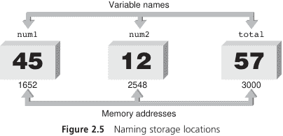


# 信息点

## 原子数据

迄今为止声明的所有变量都用于存储原子数据值。原子数据值被视为一个完整的实体，不能分解为语言支持的更小的数据类型。例如，虽然整数可以分解为单独的数字，但 C++ 没有数值数字类型。相反，每个整数都被视为一个完整的值，因此被认为是原子数据。因为整数数据类型只支持原子数据值，所以它被称为原子数据类型。正如你所预期的那样，double、char 和 bool 也是原子数据类型。

使用这些变量名，将 45 存储在位置 1652、将 12 存储在位置 2548，并将这两个位置的内容相加的操作，可以通过以下 C++ 语句完成：

```
num1 = 45;
num2 = 12;
total = num1 + num2;
```

其中每个语句都称为赋值语句，因为它告诉计算机将值赋给（存储在）变量。赋值语句总是包含等号（=），并且等号左侧紧跟一个变量名。等号右侧的值会先被确定；然后该值被赋给等号左侧的变量。赋值语句中的空白是为了可读性而插入的。赋值语句将在第 3 章中更详细地解释，但现在只需知道你可以用它们将值存储到变量中即可。

变量名很有用，因为它使程序员不必考虑数据在计算机中物理存储的位置。你只需使用变量名，让编译器担心数据实际存储在内存中的位置。然而，在将值存储到变量之前，C++ 要求明确声明要存储在其中的数据类型。你必须提前告诉编译器，字符变量的名称、整数使用的名称，以及用于存储其他 C++ 数据类型的名称。

## 声明语句

要命名一个变量并指定可以存储在其中的数据类型，你使用声明语句，其一般形式如下：

```
dataType variableName;
```

在此形式中，dataType 指定一个有效的 C++ 数据类型，而 variableName 是你为变量选择的名称。例如，用于保存整数值的变量是通过使用关键字 int 来指定数据类型，并具有以下形式进行声明：

```
int variableName;
```

因此，以下声明语句将 sum 声明为能够存储整数值的变量的名称：

```
int sum;
```

此外，关键字 long 用于指定长整数。例如，语句

```
long datenum;
```

将 datenum 声明为用于存储长整数的变量。当使用 long 限定符时，你也可以包含关键字 int，因此之前的声明也可以写成如下形式：

```
long int datenum;
```

用于保存单精度值的变量是通过使用关键字 float 声明的，而用于保存双精度值的变量是通过使用关键字 double 声明的。例如，以下语句将 firstnum 声明为用于存储单精度数字的变量：

```
float firstnum;
```

类似地，以下语句声明变量 secnum 用于存储双精度数字：

```
double secnum;
```

尽管声明语句可以放在函数的任何位置，但通常它们被分组在一起并放在函数的左大括号之后。然而，变量必须在使用前始终声明，并且像所有 C++ 语句一样，声明语句必须以分号结束。包含在函数左大括号后声明语句的简单 main() 函数具有以下一般形式：

```
#include <iostream>
using namespace std;

int main()
{
    declaration statements;

    other statements;

    return 0;
}
```

程序 2.3 使用此形式声明并使用四个双精度变量，并使用 cout 对象显示其中一个变量的内容。

## 程序 2.3

```
#include <iostream>
using namespace std;
int main()
{
    double grade1; // declare grade1 as a double variable
    double grade2; // declare grade2 as a double variable
    double total;  // declare total as a double variable
    double average; // declare average as a double variable

    grade1 = 85.5;
    grade2 = 97.0;
    total = grade1 + grade2;
    average = total/2.0; // divide the total by 2.0
    cout << "The average grade is " << average << endl;

    return 0;
}
```

程序 2.3 中声明语句的放置很直接，虽然你很快就会看到这四个声明可以合并为单个声明语句。当程序 2.3 运行后，会显示以下输出：

```
The average grade is 91.25
```

请注意，当变量名插入到 cout 语句中时，存储在变量中的值会被放置到输出流并显示出来。

正如整数和实数（单精度、双精度和长双精度）变量必须在使用前声明一样，用于存储单个字符的变量也必须声明。字符变量是通过使用关键字 char 声明的。例如，以下声明指定 ch 是一个字符变量：

```
char ch;
```

程序 2.4 说明了此声明以及使用 cout 显示字符变量中存储的值。

## 数据类型、声明和显示

## 程序 2.4

```
```cpp
#include <iostream>
using namespace std;

int main()
{
    char ch;    // this declares a character variable

    ch = 'a';   // store the letter a in ch
    cout << "The character stored in ch is " << ch << endl;
    ch = 'm';   // now store the letter m in ch
    cout << "The character now stored in ch is " << ch << endl;

    return 0;
}
```
```

当程序 2.4 运行后，会产生以下输出：

```
The character stored in ch is a
The character now stored in ch is m
```

请注意，第一次存储在变量 ch 中的字母是 a，第二次存储的是 m。因为变量一次只能存储一个值，所以将 m 分配给变量会自动覆盖 a 值。

## 多重声明

相同数据类型的变量始终可以分组并使用单个声明语句声明，其常见形式如下：

```
dataType variableList;
```

例如，程序 2.3 中使用的四个单独声明

```
double grade1;
double grade2;
double total;
double average;
```

可以用以下单个声明语句替换：

```
double grade1, grade2, total, average;
```

类似地，两个字符声明

```
char ch;
char key;
```

可以用以下单个声明语句替换：

```
char ch, key;
```

在单个声明语句中声明多个变量需要只给出一次变量的数据类型，用逗号分隔所有变量名，并使用一个分号终止声明。每个逗号后的空格是为了可读性而插入的，并不是必需的。

声明语句也可以用于在已声明的变量中存储值。例如，声明语句

```
int num1 = 15;
```

既声明变量 num1 为整数变量，又将值 15 设置到该变量中。当声明语句用于将值存储到变量中时，变量被称为已初始化。因此，在此示例中，说变量 num1 已初始化为 15 是正确的。

类似地，以下声明语句声明三个双精度变量并初始化其中两个：

```
double grade1 = 87.0;
double grade2 = 93.5;
double total;
```

使用常量和/或先前已初始化变量的表达式也可以用作初始化器。因此，表达式 87.5 - 3.0 * factor 只有在 factor 已被声明并先前初始化时才是有效的初始化器。此外，可以使用单个声明语句进行多次初始化。然而，这些声明应清晰明了，如果可能的话应简短，如声明 int x, y=0, z=0; 程序 2.3 使用声明初始化后变为程序 2.3a。

## 程序 2.3a

```
#include <iostream>
using namespace std;

int main()
{
    double grade1 = 85.5;
    double grade2 = 97.0;
    double total, average;

    total = grade1 + grade2;
    average = total/2.0;  // divide the total by 2.0
    cout << "The average grade is " << average << endl;

    return 0;
}
```


注意在最后一个声明语句之后留一个空行。在函数体顶部放置变量声明后插入一个空行是良好的编程实践。它改善了程序的外观和可读性。

C++ 的一个有趣特性是变量声明可以与其它语句混合甚至包含在其中；唯一的要求是变量必须在其使用之前声明。例如，程序 2.3a 中的变量 total 本可以在第一次使用时用语句 `double total = grade1 + grade2` 声明。在受限情况下（如第 4.7 节所述的调试，或第 5.3 节所述的 for 循环），在第一次使用时声明变量会有所帮助。一般来说，最好不要分散声明；相反，应在每个函数的顶部尽可能简洁清晰地对它们进行分组。

## 内存分配

到目前为止你所看到的声明语句同时执行了软件和硬件任务。从软件角度来看，声明语句始终提供变量列表及其数据类型。在此软件角色中，变量声明还有助于控制因在程序中拼写错误变量名而引起的常见且麻烦的错误。例如，假设变量名为 distance 由以下语句声明并初始化：

```
int distance = 26;
```

稍后在程序中，变量在以下语句中被无意拼错：

```
mpg = distnce / gallons;
```

在不需要变量声明的语言中，程序将 distnce 视为新变量并为其赋初始值 0 或使用变量存储区中恰好存在的值。在任何一种情况下，都会计算出一个值并赋给 mpg，而找到错误或甚至知道发生了错误都可能很困难。然而在 C++ 中这是不可能的，因为编译器会将 distnce 标记为未声明变量。当然，编译器无法检测到一个已声明变量被错误地输入为另一个已声明变量的情况。

除了软件角色外，声明语句还可以执行硬件任务。因为每种数据类型都有自己的存储需求，计算机只有在知道变量的数据类型后才能为变量分配足够的存储空间。变量声明提供了此信息，因此可用于强制编译器为每个变量预留足够的物理内存存储。为此硬件任务使用的声明语句也称为定义语句，因为它们定义或告诉编译器数据存储需要多少内存。

图 2.6a 定义名为 total 的整数变量

```
int total;
```

告诉计算机

为一个整数预留足够的空间

4 字节

告诉计算机将保留存储的第一个字节“标记”为名称 total

图 2.6b 定义名为 firstnum 的浮点变量

```
float firstnum;
```

告诉计算机

为单精度数预留足够的空间

4 字节

告诉计算机将保留存储的第一个字节“标记”为名称 firstnum

图 2.6c 定义名为 secnum 的双精度变量

```
double secnum;
```

告诉计算机

为双精度数预留足够的空间

8 字节

告诉计算机将保留存储的第一个字节“标记”为名称 secnum

图 2.6d 定义名为 key 的字符变量

```
char key;
```

告诉计算机

为一个字符预留足够的空间

1 字节

告诉计算机将保留存储的第一个字节“标记”为名称 key

在程序中声明变量后，通常程序员使用它来引用变量的内容（其值）。值的内存位置通常对程序员来说关系不大。然而，编译器必须知道每个值存储在哪里并正确定位每个变量。为此任务，编译器使用变量名来定位先前分配给该变量的存储的第一个字节。知道变量的数据类型后，编译器就可以存储或检索正确数量的字节。

## EXERCISES 2.3

- 1. **(Practice)** 判断以下变量名是否有效。如果无效，请说明原因。
  
  ```text
  prod_a      c1234       abcd        __c3       12345
  newbal      while       $total      new bal     a1b2c3d4
  9ab6        sum.of      average     grade1      finGrade
  ```

- 2. **(Practice)** 判断以下变量名是否有效。如果无效，请说明原因。另请指出哪些有效变量名不应使用，因为它们没有传达有关变量的任何信息。
  
  ```text
  salestax    a243        r2d2        firstNum     cc_a1
  harry       sue         c3p0        average      sum
  maximum     okay        a           awesome      goforit
  3sum        for         tot.a1      c$five      netpay
  ```

- 3. **(Practice)**
  a. 写一个声明语句，声明变量 `count` 将用于存储整数。
  b. 写一个声明语句，声明变量 `grade` 将用于存储浮点数。
  c. 写一个声明语句，声明变量 `yield` 将用于存储双精度数。
  d. 写一个声明语句，声明变量 `initial` 将用于存储字符。

- 4. **(Practice)** 为每组变量写一个单一的声明语句：
  a. `num1`、`num2` 和 `num3` 用于存储整数
  b. `grade1`、`grade2`、`grade3` 和 `grade4` 用于存储双精度数
  c. `temp1`、`temp2` 和 `temp3` 用于存储双精度数
  d. `let1`、`let2`、`let3` 和 `let4` 用于存储字符

- 5. **(Practice)** 为每组变量写一个单一的声明语句：
  a. `firstnum` 和 `secnum` 用于存储整数
  b. `price`、`yield` 和 `coupon` 用于存储双精度数
  c. `average` 用于存储双精度数

## 6. (Modify) 将以下每个声明语句重写为三个独立的声明：

- a. int month, day = 30, year;
- b. double hours, volt, power = 15.62;
- c. double price, amount, taxes;
- d. char inKey, ch, choice = 'f';

## 7. (Desk check) a. 确定以下程序中的每个语句会发生什么：

```
#include <iostream>
using namespace std;
int main()
{
    int num1, num2, total;

    num1 = 25;
    num2 = 30;
    total = num1 + num2;
    cout << "The total of " << num1 << " and " << num2 << " is " << total << endl;

    return 0;
}
```

b. 当运行练习 7a 中的程序时，会显示什么输出？

## 8. (Program) 编写一个 C++ 程序，将整数 12 和 33 的和存储在名为 sum 的变量中。让你的程序显示存储在 sum 中的值。

## 9. (Program) 编写一个 C++ 程序，将整数值 16 存储在变量 length 中，将整数值 18 存储在变量 width 中。让你的程序使用以下公式计算分配给 perimeter 变量的值：

perimeter = 2 × (length + width)

你的程序随后应显示存储在 perimeter 中的值。确保在 main() 函数开头将所有变量声明为整数。

## 10. (Program) 编写一个 C++ 程序，将整数值 16 存储在变量 num1 中，将整数值 18 存储在变量 num2 中。（确保将变量声明为整数。）让你的程序计算这些数字的总和和平均值。将总和存储在名为 total 的整数变量中，将平均值存储在名为 average 的整数变量中。（使用语句 average = total/2.0; 来计算平均值。）使用 cout 语句显示 total 和 average。

## 数据类型、声明和显示

11. (Debug) 输入、编译并运行以下程序。确定为什么显示了不正确的平均值并纠正错误。

```cpp
#include <iostream>
using namespace std;

int main()
{
    int num1 = 15;
    int num2 = 18;
    int total, average;

    total = num1 + num2;
    average = total / 2.0;
    cout << "The average of " << num1
         << " and " << num2 << " is "
         << average << endl;

    return 0;
}
```

12. (Debug) 以下程序是为纠正练习 11 中程序产生的错误而编写的。确定为什么此程序也未提供正确结果并纠正错误。

```cpp
#include <iostream>
using namespace std;

int main()
{
    int num1 = 15;
    int num2 = 18;
    int total;
    double average;

    total = num1 + num2;
    average = total / 2;
    cout << "The average of " << num1
         << " and " << num2 << " is "
         << average << endl;

    return 0;
}
```


## 第2章

**13. (程序)** 编写一个 C++ 程序，将数字 105.62 存储在变量 `firstname` 中，将 89.352 存储在变量 `secnum` 中，将 98.67 存储在变量 `thirdnum` 中。 （务必先将变量声明为 `float` 或 `double`。）让你的程序计算这三个数字的总和和平均值。总和应存储在变量 `total` 中，平均值存储在变量 `average` 中。 （使用语句 `average = total / 3.0;` 来计算平均值。）使用 `cout` 语句显示总和和平均值。

**14. (思考)**

a. 用来阐明正方形与矩形之间关系的陈述是“所有正方形都是矩形，但并非所有矩形都是正方形。” 写出一个类似的陈述来描述定义语句和声明语句之间的关系。

b. 为什么必须在 C++ 中使用变量的任何其他语句之前先定义该变量？

> **练习 15 至 17 的说明：** 假设一个字符需要 1 字节存储，一个整数需要 4 字节，单精度数需要 4 字节，双精度数需要 8 字节。变量按声明顺序分配存储。 （如果您不熟悉字节的概念，请回顾第 2.6 节。）请参考图 2.7 完成这些练习。

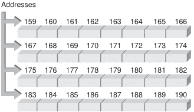

**15. (练习)**

a. 使用图 2.7 并假设变量名 `rate` 被分配到内存地址 159 的字节，确定以下语句中声明的每个变量对应的地址。 同时，填入包含在声明语句中的初始化数据的正确字节数。 （使用字母表示字符，而不是计算机实际存储的计算机代码。）

```
float rate;
char ch1 = 'M', ch2 = 'E', ch3 = 'L', ch4 = 'T';
double taxes;
int num, count = 0;
```

b. 重复练习 15a，但将计算机使用 ASCII 代码存储在变量 `ch1`、`ch2`、`ch3` 和 `ch4` 中的字符的实际字节模式代入。 （提示：使用表 2.2。）

### 16. (练习) a. 使用图 2.7 并假设变量名 en1 被分配到内存地址 159 的字节，确定以下语句中声明的每个变量对应的地址。 同时，填入包含在声明语句中的初始化数据的正确字节数。 （使用字母表示字符，而不是计算机实际存储的计算机代码。）

```
char cn1 = 'E', cn2 = 'E', cn3 = 'R', cn4 = 'F', cn5 = 'E';
char cn6 = 'C', cn7 = 'T', key = '\\', sch = '\'', inc = 'A';
char inc1 = 'T';
```

b. 重复练习 16a，但将计算机使用 ASCII 代码存储在每个声明变量中的字符的实际字节模式代入。 （提示：使用表 2.2 和 2.3。）

### 17. (练习) 使用图 2.7 并假设变量名 miles 被分配到内存地址 159，确定以下语句中声明的每个变量对应的地址：

```
float miles;
int count, num;
double dist, temp;
```

## 2.4 常见编程错误

本章材料相关的常见编程错误如下：

- 1. 忘记声明程序中使用的所有变量。 编译器会检测到此错误，并为所有未声明的变量生成错误消息。
- 2. 尝试将一种数据类型存储在为不同类型声明的变量中。 编译器不会检测到此错误。 该值将被转换为分配给它的变量的数据类型。
- 3. 在为变量分配值之前在表达式中使用变量。 表达式求值时使用变量中恰好存在的值，因此表达式的结果毫无意义。
- 4. 错误地进行整数除法。 此错误通常隐藏在更大的表达式中，可能难以检测。 例如，表达式 3.425 + 2/3 + 7.9 的结果与表达式 3.425 + 7.9 相同，因为整数除法 2/3 为 0。
- 5. 在同一表达式中混合数据类型而未清楚理解其影响。 由于 C++ 允许使用“混合”数据类型的表达式，因此了解求值顺序和所有中间计算的数据类型非常重要。 这是评估每个二元运算结果的规则：

- - 如果两个操作数都是整数，则结果为整数。
- - 如果任何操作数是实数值，则结果为双精度值。

一般来说，除非你想要特定效果，否则最好不要在表达式中混合数据类型。

- 6. 忘记用插入符号 << 分隔传递给 cout 的数据流。

## 2.5 章节总结

- 1. C++ 识别的四种基本数据类型是整数、浮点数、字符和布尔值。 每种数据类型通常使用不同量的内存存储在计算机中。
- 2. `cout` 对象可用于显示所有 C++ 数据类型。
- 3. C++ 程序中的每个变量都必须声明，并且必须指定其可以存储的值的类型。 函数中的声明可以放在函数中的任何位置，尽管变量只能在声明后使用。 变量也可以在声明时初始化。 此外，同一类型的变量可以用单个声明语句声明。 变量声明语句的一般形式为：
  
  dataType variableName(s);
- 4. 包含声明语句的简单 C++ 程序具有以下典型形式：

```
#include <iostream>
using namespace std;

int main()
{
    declaration statements;

    other statements;

    return 0;
}
```

- 5. 声明语句始终在软件中扮演告知编译器函数有效变量名的角色。 当变量声明还导致计算机为变量预留内存位置时，该声明语句称为定义语句。 （本章中使用的所有声明也都是定义语句。）
- 6. `sizeof()` 运算符可用于确定为变量保留的存储量。

## 2.6 章节补充：位、字节和二进制数表示

本节解释数字如何在计算机内存中存储以及表示它们的各种方法。

### 位和字节

制造计算机的物理组件要求其内存中的数字和字母不能使用人们使用的相同符号存储。 例如，数字 126 并不是用符号 1、2 和 6 存储的，字母“A”也不是用此符号存储的。 本节解释这些存储要求的理由以及计算机如何存储数字。

计算机中最小、最基本的数据项称为位（源自“二进制数字”一词）。 物理上，位实际上是一个可以打开或关闭的开关。 本书遵循的惯例是，打开位置表示为 0，关闭位置表示为 1。

单个位只能表示值 0 和 1，其用途有限。 因此，所有计算机都会将一定数量的位组合在一起用于存储和传输。 将 8 位组合成一个更大的单元，称为字节，是几乎通用的计算机标准。 由 8 位组成的单个字节，每位为 0 或 1，可以表示 256 种不同的模式。 这些模式包括 00000000（全部八个开关打开）到 11111111（全部八个开关关闭）以及两者之间的所有可能的 0 和 1 组合。 每个模式可用于表示字母表中的一个字母、一个字符（例如美元符号或逗号）、一个数字或包含多个数字的数字。 用于表示字母、单个数字和其他字符的模式集合称为字符代码。 （一种称为 ASCII 的字符代码在第 2.1 节中进行了讨论。）用于存储数字的模式称为数字代码，其中一种称为二进制补码表示的数字代码在本文末尾进行了说明。

### 字和地址

在计算机内存中，字节可以组合成更大的单元，称为字，以便于存储较大值并允许更快、更广泛的数据访问。 例如，从计算机内存中检索由 4 个字节组成的字所获得的信息比检索由单个字节组成的字所获得的信息更多。 这种类型的检索也比四次单独的 1 字节检索快得多。 然而，实现这种速度和容量的提高需要增加计算机的成本和复杂性。 目前，台式机和笔记本电脑使用 4 和 8 字节的字长。

计算机内存中字的排列可以与大型酒店中标准房间的排列相比较。 正如每个房间都有唯一的房间号来定位和识别它一样，每个字都有唯一的数字地址。 （在允许单独访问每个字节的计算机中，每个字节都有自己的地址。）与房间号一样，字和字节地址始终是用于定位和识别目的的无符号整数。 此外，与酒店房间通过连接门形成更大的套房一样，字可以组合成更大的单元以容纳不同大小的数据类型。


你可以通过使用本章中讨论的每个整数数据类型的标识符名称，来检查每个整数数据类型分配的存储空间以及编译器提供的数值范围，如表 2.9 所列。要做到这一点，你可以检查 climits 头文件以获取这些标识符的定义，或构建一个 C++ 程序来显示这些值。程序 2.5 展示了如何完成此存储检查。

### 表 2.9 整数数据类型存储

| 数据类型 | 数值范围 | 标识符（在 climits 头文件中） | 存储大小（字节） |
|---|---|---|---|
| char | -128 to +127 | SCHAR_MIN, SCHAR_MAX | 1 |
| short int | -32,768 to +32,767 | SHRT_MIN, SHRT_MAX | 2 |
| int | -2,147,483,648 to +2,147,483,647 | INT_MIN, INT_MAX | 4 |
| long int | -2,147,483,648 to +2,147,483,647 | LONG_MIN, LONG_MAX | 4 |
| unsigned short int | 0 to 65,535 | USHRT_MAX | 2 |
| unsigned int | 0 to 4,294,967,295 | UINT_MAX | 4 |
| unsigned long int | 0 to 4,294,967,295 | ULONG_MAX | 4 |

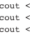

### 程序 2.5

```
#include <iostream>
#include <climits> //contains the maximum and minimum specifications
using namespace std;

int main()
{

cout << "The smallest character code is " << SCHAR_MIN << endl;
cout << "The largest character code is " << SCHAR_MAX << endl;
cout << sizeof(char) << " byte(s) are used to store characters\n";

cout << "\nThe smallest integer value is " << INT_MIN << endl;
cout << "The largest integer value is " << INT_MAX << endl;
cout << sizeof(int) << " byte(s) are used to store integers\n";

cout << "\nThe smallest short integer value is " << SHRT_MIN << endl;
cout << "The largest short integer value is " << SHRT_MAX << endl;
cout << sizeof(short) << " byte(s) are used to store short integers\n";

cout << "The smallest long integer value is " << LONG_MIN << endl;
cout << "The largest long integer value is " << LONG_MAX << endl;
cout << sizeof(long) << " byte(s) are used to store long integers\n";

return 0;
}
```

程序 2.5 产生以下输出：

```
The smallest character code is -128
The largest character code is 127
1 byte(s) are used to store characters

The smallest integer value is -2147483648
The largest integer value is 2147483647
4 byte(s) are used to store integers

The smallest short integer value is -32768
The largest short integer value is 32767
2 byte(s) are used to store short integers

The smallest long integer value is -2147483648
The largest long integer value is 2147483647
4 byte(s) are used to store long integers
```

请注意，显示的值与之前在表 2.9 中列出的值相对应。

## 二进制、十六进制和八进制数

计算机中存储整数值最常见的二进制数代码称为二进制补码表示法。有了这种代码，任何位模式，例如 10001101 的整数十进制等价物都很容易确定，并且可以对正整数或负整数进行转换而无需改变转换方法。为方便起见，假设位模式为每个 8 位的字节大小，尽管该过程可推广到更大的位模式。

确定每个位模式表示的十进制整数最简单的方法是构造一个简单的设备，称为值框。图 2.8 显示了单个字节的值框。数学上，该框中的每个值代表 2 的递增幂。因为二进制补码数必须能够表示正整数和负整数，所以最左边的位除了具有最大的绝对值外，还带有负号。


要将任何二进制数，例如 10001101，转换为其十进制整数值，只需将位模式插入值框并将下方有 1 的值相加。因此，如图 2.9 所示，位模式 10001101 表示十进制整数 -115。

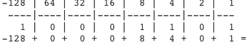

**图 2.9** 将 10001101 转换为十进制数

值框也可以反向使用，将十进制整数转换为其等效的二进制位模式。事实上，一些转换可以通过观察完成。例如，十进制整数 -125 是通过将 -128 加上 3 得到。因此，-125 的二进制表示为 10000011，等于 -128 + 2 + 1。同样，数字 40 的二进制补码表示为 00101000，即 32 + 8。

尽管值框转换方法看似简单，但它与二进制补码数的底层数学基础相关。二进制补码代码的原始名称为 **带权符号码**，它与值框相对应。正如“带权符号”名称所暗示的那样，每个位位置都有一个权重或值，即 2 的幂和一个符号。除了最左边的位之外，所有位的符号都是正的，最左边位的符号是负的。

在回顾值框时，你可以看到任何以 1 开头的二进制补码数表示负数，而任何以 0 开头的位模式表示正数。使用值框，很容易确定可以存储的最正值和最负值。单个字节中可以存储的最负值是十进制数 -128，其位模式为 10000000。任何其他非零位只会给数字加上一个正数。此外，正数必须以 0 作为最左边的位。从中可以看出，最大的 8 位二进制补码数是 01111111，即 127。

除了表示整数值外，计算机还必须存储和传输包含小数点的数字，在数学上称为“实数”。附录 D（可在网上获取）列出了用于表示实数的二进制代码。

### 十六进制表示

由于二进制数往往很长，因此更紧凑的十六进制表示法经常被使用。例如，32 位二进制数 11110000101011001110001101111011 的十六进制表示为 F0ACE37B。

每个十六进制符号对应一个特定的 4 位二进制模式。每个十六进制符号与其 4 位二进制模式之间的对应关系列在表 2.10 的前两列中。为方便起见，每个十六进制符号的等效十进制值及其表示的二进制数也提供了。使用此表，你可以通过为十六进制数中的每个十六进制符号替换正确的 4 位二进制序列，将任何十六进制数转换为其二进制等价物。例如，图 2.10 显示了如何使用表 2.10 中的对应值将十六进制数 2D1F 转换为其二进制等价物。

### 表 2.10 十六进制到二进制转换

| 十六进制符号 | 二进制模式 | 十进制符号 |
|---|---|---|
| 0 | 0000 | 0 |
| 1 | 0001 | 1 |
| 2 | 0010 | 2 |
| 3 | 0011 | 3 |
| 4 | 0100 | 4 |
| 5 | 0101 | 5 |
| 6 | 0110 | 6 |
| 7 | 0111 | 7 |
| 8 | 1000 | 8 |
| 9 | 1001 | 9 |
| A | 1010 | 10 |
| B | 1011 | 11 |
| C | 1100 | 12 |
| D | 1101 | 13 |
| E | 1110 | 14 |
| F | 1111 | 15 |

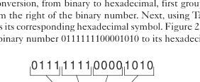

**图 2.10** 将十六进制数转换为二进制

要进行反向转换，从二进制到十六进制，首先将二进制数字按从二进制数的右边开始的四位一组进行分组。接下来，使用表 2.10，为每组四个二进制数字分配其对应的十六进制符号。图 2.11 显示了将 16 位二进制数 0111111100001010 转换为其十六进制表示的示例。

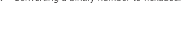

**图 2.11** 将二进制数转换为十六进制

十六进制符号非常适合表示字节中的 8 位，因为每个字节由两组 4 位组成。 （有时 4 位模式被称为半字节。）因此，字节的二进制代码可以用两个十六进制符号方便地表示。

在回顾表 2.10 中的十六进制符号时，请注意前 10 个与十进制系统中使用的相同。然而，在使用熟悉的 0 到 9 符号之后，最后六个二进制模式需要唯一的符号。你认识的 10 到 15 的符号不能使用，因为它们由两个符号组成，因此字母 A 到 F 用于这六个额外的符号。为了清楚地表明正在使用十六进制数，通常它们前面加上 0X 或 0x，如 0xF0ACE37B。

### 八进制表示

尽管它们几乎已被十六进制数取代，但你仍可能遇到以八进制形式表示的二进制数。八进制数将二进制数按三位一组分组。表 2.11 显示了八进制符号与其 3 位二进制值之间的对应关系。

### 表 2.11 八进制到二进制转换

| 八进制符号 | 二进制值 |
|---|---|
| 0 | 000 |
| 1 | 001 |
| 2 | 010 |
| 3 | 011 |
| 4 | 100 |
| 5 | 101 |
| 6 | 110 |
| 7 | 111 |

使用表 2.11 中列出的值，八进制数 541 表示二进制数 101100001。这是通过将八进制值 5 替换为其等效的 101 二进制位模式，将 4 替换为其对应的 100 二进制位模式，并将 1 替换为其对应的 001 二进制位模式来完成的。

要从二进制转换为八进制，首先将二进制数字按从右到左的三位一组进行分组。在此过程中，你可能需要向二进制数添加一到两个前导零，以将最左边的位模式填充到三位二进制数字。例如，8 位二进制数 11111010 通过添加一个前导零填充为九位二进制数字。 resulting number, 011111010, is then grouped in units of three, as 011|111|010. The bar symbol, |, has been used to separate each group of three binary digits clearly. Using the correspondence between 3-bit patterns and octal symbols in Table 2.11, this binary number becomes the octal number 372.

在字节标准化为 8 位之前，八进制数通常用于表示二进制值。这种方法还有额外的优点，即使用人们习惯于处理十进制数字的熟悉的数字符号。随着 8 位字节的标准化，十六进制符号及其与 4 位二进制数的对应关系成为表示二进制数的首选编号系统。


## Chapter 3
赋值与交互式输入

- 3.1 赋值运算符
- 3.2 格式化输出
- 3.3 数学库函数
- 3.4 交互式键盘输入
- 3.5 符号常量
- 3.6 常见编程错误
- 3.7 章节总结
- 3.8 章节补充：错误、测试与调试

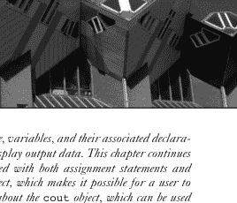

> 在第 2 章中，你已了解数据存储、变量及其相关声明语句的概念。你也看到了 `cout` 对象如何用于显示输出数据。本章通过解释如何使用赋值语句和数学函数处理数据，继续介绍 C++。此外，它还讨论了 `cin` 对象，该对象使用户能够在程序运行时输入数据。你还将进一步了解 `cout` 对象，它可用于精确格式化输出数据。

### 3.1 赋值运算符

你在第 2 章中学习了简单的赋值语句。赋值语句是为变量赋值并执行计算的最基本 C++ 语句。该语句的语法如下：

```
variable = expression;
```

C++ 中最简单的表达式是一个常量。在以下赋值语句中，等号右侧的操作数是一个常量：

```
length = 25;
width = 17.5;
```

在这些赋值语句中，等号右侧常量的值被赋给等号左侧的变量。请注意，C++ 中的等号与代数中的等号含义不同。赋值语句中的等号告诉计算机首先确定其右侧操作数的值，然后将该值存储或赋给其左侧变量关联的位置。例如，C++ 语句 `length = 25;` 正式表示“length 被赋值为 25”。赋值语句中的空白仅为可读性而插入。

请回忆，变量在声明时可以被初始化。如果在声明语句中未进行初始化，则在使用变量进行任何计算之前，应通过赋值语句或输入操作为其赋一个值。当然，后续的赋值语句也可以用来更改分配给变量的值。例如，假设以下语句按顺序执行，并且 `slope` 在声明时未被初始化：

```
slope = 3.7;
slope = 6.28;
```

第一个赋值语句将值 3.7 赋给名为 `slope` 的变量。¹ 下一个赋值语句导致计算机将值 6.28 赋给 `slope`。`slope` 中的 3.7 被新的 6.28 值覆盖，因为变量一次只能存储一个值。有时将等号左侧的变量视为巨大停车场中的临时停车位是有用的。就像停车位一次只能由一辆车使用一样，每个变量一次只能存储一个值。将新值“停放”到变量中会自动导致程序移除之前停放在那里的任何值。

除了常量之外，赋值语句中等号右侧的操作数也可以是变量或任何其他有效的 C++ 表达式。表达式是可求值以产生结果的常数、变量和函数调用的任何组合。因此，赋值语句中的表达式可用于使用第 2.2 节中介绍的算术运算符执行计算。以下是使用包含这些运算符的表达式的赋值语句示例：

```
sum = 3 + 7;
diff = 15 - 6;
product = .05 * 14.6;
tally = count + 1;
newtotal = 18.3 + total;
taxes = .06 * amount;
```

### 赋值运算符

```
totalWeight = factor * weight;
average = sum / items;
slope = (y2 - y1) / (x2 - x1);
```

正如赋值语句中始终一样，程序首先计算等号右侧表达式的值，然后将该值存储在等号左侧的变量中。例如，在赋值语句 `totalWeight = factor * weight;` 中，算术表达式 `factor * weight` 首先被求值以产生结果。该结果，即一个数字，然后存储在变量 `totalWeight` 中。

在编写赋值语句时，你必须注意两个重要考虑因素。由于等号右侧的表达式首先被求值，如果结果是有意义的，则表达式中使用的所有变量必须先前已赋予有效值。例如，赋值语句 `totalWeight = factor * weight;` 仅在程序员先为 `factor` 和 `weight` 两者分配有效数字时，才会在 `totalWeight` 中存储有效数字。因此，以下语句序列告诉你用于获得要存储在 `totalWeight` 中的结果的值：

```
factor = 1.06;
weight = 155.0;
totalWeight = factor * weight;
```

图 3.1 显示了变量 `factor`、`weight` 和 `totalWeight` 中存储的值。

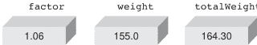

**Figure 3.1** Values stored in variables

第二个考虑因素是由于表达式的值存储在等号左侧的变量中，因此该位置只能列出一个变量。例如，以下赋值语句无效：

```
amount + 1892 = 1000 + 10 * 5;
```

右侧的表达式求值为整数 1050，只能存储在变量中。由于 `amount + 1892` 不是有效的变量名，编译器无法知道将计算值存储在哪里，并发出语法错误消息。

程序 3.1 显示了使用赋值语句计算矩形面积。

## Assignment and Interactive Input

### Program 3.1

```cpp
// this program calculates the area of a rectangle,
// given its length and width

#include <iostream>
using namespace std;

int main()
{
    double length, width, area;

    length = 27.2;
    width = 13.6;
    area = length * width;
    cout << "The length of the rectangle is " << length << endl;
    cout << "The width of the rectangle is " << width << endl;
    cout << "The area of the rectangle is " << area << endl;

    return 0;
}
```

当程序 3.1 运行时的输出为：

```
The length of the rectangle is 27.2
The width of the rectangle is 13.6
The area of the rectangle is 369.92
```

看看计算机在执行程序 3.1 时使用的控制流。程序执行从第一个语句开始，并按顺序逐条语句继续，直到遇到 `main()` 的闭合大括号为止。所有程序的控制流都是如此。计算机一次只处理一个语句，在执行语句时不知道下一个语句是什么。这种顺序执行解释了为什么在表达式求值之前，必须为表达式中使用的所有操作数分配值。

每当计算机执行程序 3.1 中的语句 `area = length * width;` 时，它都会使用在执行赋值时存储在变量 `length` 和 `width` 中的值。如果在 `length * width` 表达式中使用这些变量之前未明确为它们赋值，计算机将使用在引用时恰好占据这些变量的值。（大多数 C++ 编译器会自动将所有变量初始化为零；大多数编译器还会警告你变量未显式初始化。）计算机不会“向前看”以查看你是否在程序后面为这些变量赋值。

重要的是要认识到在 C++ 中，赋值语句中使用的等号 (`=`) 是一个运算符，这与大多数其他高级语言处理该符号的方式不同。在 C++ 中，该符号称为 **assignment operator**，使用该运算符的表达式，


例如 `interest = principal * rate`，是一个赋值表达式。因为赋值运算符的优先级低于任何其他算术运算符，所以等号右侧的任何表达式的值都会先被求值，然后再进行赋值。

与所有表达式一样，赋值表达式也有一个值，即赋给赋值运算符左侧变量的值。例如，表达式 `a = 5` 将值 5 赋给变量 `a`，并且该表达式本身的值也是 5。表达式的值始终可以通过以下类似语句来验证：

```
cout << "The value of the expression is " << (a = 5);
```

该语句显示的是表达式的值，而不是变量 `a` 的内容。虽然变量的内容和表达式的值相同，但你应该意识到它们是两个不同的实体。

从编程角度来看，赋值表达式中重要的是将值实际赋给变量；赋值表达式的最终值意义不大。然而，赋值表达式具有值这一事实，在你学习第 4 章的 C++ 关系运算符时必须加以考虑。

任何以分号结尾的表达式都成为 C++ 语句。最常见的例子是赋值语句，它只是一个以分号结尾的赋值表达式。例如，给赋值表达式 `a = 33` 加上分号就得到赋值语句 `a = 33;`，该语句可以在程序中单独占一行使用。

因为等号在 C++ 中是一个运算符，所以同一个表达式或其等价语句中可以进行多次赋值。例如，在表达式 `a = b = c = 25` 中，所有赋值运算符的优先级相同。赋值运算符具有从右到左的结合性，因此最终求值按以下顺序进行：

- c = 25
- b = c
- a = b

在此示例中，这一表达式序列的效果是将数字 25 分别赋给每个变量，可以表示如下：

```
a = (b = (c = 25))
```

在原始表达式后加上分号就得到此多次赋值语句：

```
a = b = c = 25;
```

该语句将值 25 赋给三个变量，等价于以下顺序：

- c = 25;
- b = 25;
- a = 25;

## 信息点

## lvalues 和 rvalues

lvalue 和 rvalue 术语在几乎所有定义赋值使用允许在同一语句中进行多次赋值的运算符的编程语言中经常使用。lvalue 指可在赋值运算符左侧使用的任何量，rvalue 指可在赋值运算符右侧使用的任何量。

例如，到目前为止你遇到的每个变量都可以是 lvalue 或 rvalue（也就是说，变量本身可以出现在赋值运算符的两侧），但数字只能是 rvalue。更一般地说，表达式是 rvalue。然而，并非所有变量都可以用作 lvalue 或 rvalue。例如，第 7 章中介绍的数组类型既不能作为 lvalue 也不能作为 rvalue，但数组中的元素可以同时作为两者。

## 强制转换

在使用赋值语句时，请记住表达式两侧值所分配的数据类型，因为赋值运算符两侧会进行数据类型转换。换句话说，赋值运算符右侧表达式的值会被转换为赋值运算符左侧变量的数据类型。这种类型的转换被称为强制转换，因为赋给赋值运算符左侧变量的值被强制转换为它所赋值的变量的数据类型。

强制转换的一个例子是当整数值赋给实数变量时；此赋值会导致整数被转换为实数值。同样，将实数值赋给整数变量会强制将实数值转换为整数。此转换总是会因截断而丢失数字的小数部分。例如，如果 `temp` 是一个整数变量，则赋值 `temp = 25.89` 会导致整数值 25 被存储在整数变量 `temp` 中。

数据类型转换的另一个例子，包括混合模式和赋值转换，是对表达式

```
a = b * d
```

的求值，其中 `a` 和 `b` 是整数变量，`d` 是双精度变量。在求值混合模式表达式 `b * d` 时，`b` 在表达式中使用的值会被转换为双精度数以进行计算。 （请注意，存储在 `b` 中的值仍然是整数，而表达式 `b * d` 的结果值是双精度数。）最后，赋值运算符两侧的数据类型转换发挥作用。赋值运算符左侧是一个整数变量，因此表达式 `b * d` 的双精度值会被截断为整数值并存储在变量 `a` 中。

## 赋值变体

尽管赋值表达式中等号左侧只允许有一个变量，但等号左侧的变量也可以用在等号右侧。例如，赋值表达式 `sum = sum + 10` 是有效的。显然，作为代数方程，`sum` 不可能等于它自己加 10。在 C++ 中，`sum = sum + 10` **不是** 方程——它是在两个主要步骤中求值的表达式：首先计算 `sum + 10` 的值，其次将计算出的值存储到 `sum` 中。试着判断程序 3.2 的输出。

```cpp
#include <iostream>
using namespace std;

int main()
{
    int sum;

    sum = 25;
    cout << "The number stored in sum is " << sum << endl;
    sum = sum + 10;
    cout << "The number now stored in sum is "
         << sum << endl;

    return 0;
}
```

在程序 3.2 中，赋值语句 `sum = 25;` 告诉计算机将数字 25 存储在 `sum` 中，如图 3.2 所示。


**Figure 3.2** The integer 25 is stored in `sum`

第一个 `cout` 语句使用消息 "The number stored in sum is 25." 显示存储在 `sum` 中的值。第二个赋值语句 `sum = sum + 10;` 导致程序检索存储在 `sum` 中的 25 并将 10 加到该数字上，得出 35。然后将数字 35 存储到等号左侧的变量，即变量 `sum` 中。`sum` 中原来的 25  simply 被新的值 35 覆盖（见图 3.3）。

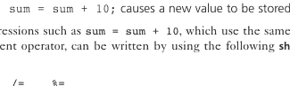

# Figure 3.3 sum = sum + 10; causes a new value to be stored in sum

使用赋值运算符两侧相同变量的赋值表达式，例如 `sum = sum + 10`，可以用以下简写赋值运算符来编写：

+= -= *= /= %=

例如，表达式 `sum = sum + 10` 可以写成 `sum += 10`。同样，表达式 `price *= rate` 等价于表达式 `price = price * rate`。在使用简写赋值运算符时，请注意赋值运算符左侧的变量应用于右侧的完整表达式。例如，表达式 `price *= rate + 1` 等价于表达式 `price = price * (rate + 1)`，而不是 `price = price * rate + 1`。

## 累加

赋值表达式，例如 `sum += 10` 或其等价形式 `sum = sum + 10`，在编程中很常见。当数据一次输入一个数字时，这些表达式用于累加小计。例如，如果你想以计算器方式相加数字 96、70、85 和 60，可以使用以下语句：

| Statement | Value in sum |
|---|---|
| sum = 0; | 0 |
| sum = sum + 96; | 96 |
| sum = sum + 70; | 166 |
| sum = sum + 85; | 251 |
| sum = sum + 60; | 311 |

第一个语句将 `sum` 初始化为 0，这去除了可能使最终总和无效的存储在 `sum` 中的任何数字（“垃圾值”）。随着每个数字的加入，存储在 `sum` 中的值相应增加。完成最后一个语句后，`sum` 包含所有相加数字的总和。程序 3.3 通过在每次加法后显示 `sum` 的内容来展示这些语句的效果。


## 程序 3.3

```
#include <iostream>
using namespace std;

int main()
{
    int sum;

    sum = 0;
    cout << "The value of sum is initially set to " << sum << endl;
    sum = sum + 96;
    cout << " sum is now " << sum << endl;
    sum = sum + 70;
    cout << " sum is now " << sum << endl;
    sum = sum + 85;
    cout << " sum is now " << sum << endl;
    sum = sum + 60;
    cout << " The final sum is " << sum << endl;

    return 0;
}
```

程序 3.3 显示以下输出：

```
The value of sum is initially set to 0
sum is now 96
sum is now 166
sum is now 251
The final sum is 311
```

尽管程序 3.3 并不是一个实用的程序（因为手工加数更容易），但它确实说明了重复使用具有以下形式的语句的累加效果：

```
variable = variable + newValue;
```

这种类型的语句称为累加语句。当你变得更加熟悉第 5 章中介绍的重复语句时，你会发现累加语句有许多用途。

## 计数

**计数语句**，它是一种与累加语句类似的赋值语句，具有以下形式：

```
variable = variable + fixedNumber;
```

计数语句的示例如下：

```
i = i + 1;
n = n + 1;
count = count + 1;
j = j + 2;
m = m + 2;
kk = kk + 3;
```

在这些示例中，相同的变量同时出现在等号的两侧。执行语句后，变量的值会增加一个固定量。在前三个示例中，变量 i、n 和 count 各自增加了 1。在接下来的两个示例中，变量增加了 2，而在最后一个示例中，变量 kk 增加了 3。

对于仅增加或减少 1 的变量，C++ 提供了两个一元运算符：增量和减量运算符。使用**增量运算符** ++，表达式 `variable = variable + 1` 可以替换为表达式 `variable++` 或表达式 `++variable`。以下是增量运算符的示例：

| Expression | Alternative |
|---|---|
| `i = i + 1` | `i++` or `++i` |
| `n = n + 1` | `n++` or `++n` |
| `count = count + 1` | `count++` or `++count` |

程序 3.4 说明了增量运算符的使用。它显示以下输出：

```
The initial value of count is 0
    count is now 1
    count is now 2
    count is now 3
    count is now 4
```

## 程序 3.4

```
```cpp
#include <iostream>
using namespace std;

int main()
{
    int count;

    count = 0;
    cout << "The initial value of count is " << count << endl;
    count++;
    cout << "    count is now " << count << endl;
    count++;
    cout << "    count is now " << count << endl;
    count++;
    cout << "    count is now " << count << endl;
    count++;
    cout << "    count is now " << count << endl;

    return 0;
}
```
```

当 ++ 运算符出现在变量之前时，它称为**前缀增量运算符**；当它出现在变量之后时，它称为**后缀增量运算符**。前缀增量运算符和后缀增量运算符之间的区别很重要，当被递增的变量在赋值表达式中使用时。例如，`k = ++n`，它使用前缀增量运算符，在一个表达式中做了两件事：`n` 的值增加 1，然后 `n` 的新值被赋给变量 `k`。因此，语句 `k = ++n;` 等价于以下两个语句：

```
```cpp
n = n + 1;    // increment n first
k = n;        // assign n's value to k
```
```

使用后缀增量运算符的赋值表达式 `k = n++` 则反转了此过程。后缀增量运算符在赋值完成后起作用。因此，语句 `k = n++;` 首先将 `n` 的当前值赋给 `k`，然后将 `n` 的值增加 1。此过程等价于以下两个语句：

```
```cpp
k = n;        // assign n's value to k
n = n + 1;    // and then increment n
```
```

C++ 还提供了减量运算符 --，具有前缀和后缀变体。正如你可能预期的那样，表达式 variable-- 和 --variable 都等价于表达式 variable = variable - 1。以下是减量运算符的示例：

| Expression | Alternative |
|---|---|
| i = i - 1 | i-- or --i |
| n = n - 1 | n-- or --n |
| count = count - 1 | count-- or --count |

当 -- 运算符出现在变量之前时，它称为前缀减量运算符。当此运算符出现在变量之后时，它称为后缀减量运算符。例如，表达式 n-- 和 --n 都将 n 的值减少 1，并且等价于更长的表达式 n = n - 1。

与增量运算符一样，前缀和后缀减量运算符在使用在赋值表达式中时产生不同的结果。例如，表达式 k = --n 首先将 n 的值减少 1，然后将 n 的值赋给 k，而表达式 k = n-- 首先将 n 的当前值赋给 k，然后将 n 的值减少 1。

## 练习 3.1

- 1. （练习）编写一个赋值语句来计算半径为 3.5 英寸的圆的周长。确定圆的周长 c 的公式为 c = 2πr，其中 r 为半径，π 等于 3.1416。
- 2. （练习）编写一个赋值语句来计算圆的面积。确定圆的面积 a 的公式为 a = πr²，其中 r 为半径且 π = 3.1416。
- 3. （练习）编写一个赋值语句将华氏温度转换为摄氏温度。此转换的公式为 摄氏 = 5.0 / 9.0 (华氏 - 32)。
- 4. （练习）编写一个赋值语句来计算单程 s 英里旅程的往返距离 d，单位为英尺。
- 5. （练习）编写一个赋值语句来计算完成一次旅程所需的时间，单位为分钟。计算经过时间的公式为 经过时间 = 总距离 / 平均速度。假设距离以英里为单位，平均速度以英里每小时（mph）为单位。
- 6. （练习）编写一个赋值语句来计算等差数列中第 n 项的值 v。计算此值的公式如下：
  
  v = a + (n - 1)d
  
  a 是数列中的第一个数。
  d 是数列中任意两个数之间的差。

## 第 3 章

## 赋值运算符

7. （练习）编写一个赋值语句来确定梁的最大弯矩 *M*，给定此公式：

*M = X W (L − X) / L*

*X* 是放置重量 *W* 的位置距梁端的距离。
*L* 是梁的长度。

8. （调试）确定并纠正以下程序中的错误。

```
a. #include <iostream>
   using namespace std;
   int main()
   {
       width = 15
       area = length * width;
       cout << "The area is " << area
   }
```

```
b. #include <iostream>
   using namespace std;
   int main()
   {
       int length, width, area;
       area = length * width;
       length = 20;
       width = 15;
       cout << "The area is " << area;

       return 0;
   }
```

```
c. #include <iostream>

   int main()
   {
       int length = 20; width = 15, area;
       length * width = area;
       cout << "The area is " , area;

       return 0;
   }
```

9. （调试）由于错误，学生将程序 3.3 中的语句重新排序如下：

```
#include <iostream>
using namespace std;

int main()
{
    int sum;
    sum = 0;
    sum = sum + 96;
    sum = sum + 70;
    sum = sum + 85;
    sum = sum + 60;
    cout << "The value of sum is initially set to "
         << sum << endl;
    cout << "   sum is now " << sum << endl;
    cout << "   sum is now " << sum << endl;
    cout << "   sum is now " << sum << endl;
    cout << "   The final sum is " << sum << endl;
    return 0;
}
```

确定此程序产生的输出。

10. （练习）使用程序 3.1，通过确定具有以下长度和宽度的矩形的面积来完成下表：

| Length (in.) | Width (in.) | Area |
|---|---|---|
| 1.62 | 6.23 | |
| 2.86 | 7.52 | |
| 4.26 | 8.95 | |
| 8.52 | 10.86 | |
| 12.29 | 15.35 | |

11. （程序）椭圆的面积（见图 3.4）由以下公式给出：

Area = π a b

使用此公式，编写一个 C++ 程序来计算具有短轴 a 为 2.5 英寸和长轴 b 为 6.4 英寸的椭圆的面积。

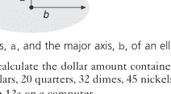

# 图 3.4 椭圆的短轴 a 和长轴 b

12. （程序）a. 编写一个 C++ 程序来计算存钱罐中的美元金额。银行目前包含 12 个半美元、20 个四分之一美元、32 个十分之一美元、45 个镍币和 27 个便士。

b. 在计算机上运行为练习 12a 编写的程序。


13. (Program) a. 编写一个 C++ 程序来计算一段 2.36 英里长的旅程的距离，单位为英尺。一英里等于 5280 英尺。
b. 在计算机上运行为练习 13a 编写的程序。

14. (Program) a. 编写一个 C++ 程序来计算完成一段 183.67 英里旅程所需的时间。计算经过时间 的公式为 经过时间 = 总距离 / 平均速度。假设旅程中的平均速度为每小时 58 英里。
b. 在计算机上运行为练习 14a 编写的程序。

15. (Program) a. 编写一个 C++ 程序来计算从 1 到 100 的数字之和。计算该和的公式为 sum = (n / 2) × (2 × a + (n - 1) × d)，其中 n = 要相加的项数，a = 第一个数字，d = 每个数字与下一个数字之间的差值（d = 1）。
b. 在计算机上运行为练习 15a 编写的程序。

16. (For thought) 说明为什么表达式 a - b = 25 无效而表达式 a - (b = 25) 是有效的。

## 3.2 格式化输出

除了显示正确的结果外，程序还应以吸引人的方式呈现其结果。事实上，大多数程序都是根据数据输入的 perceived 难易程度以及输出的样式和呈现方式来评判的。例如，将货币结果显示为 1.897 与公认的报告惯例不符。显示应为 $1.90 或 $1.89，具体取决于使用四舍五入还是截断。

要控制 `cout` 显示数字的格式，可以在输出流中包含字段宽度操纵符。表 3.1 列出了最常用的用于此目的流操纵符。

### Table 3.1 Commonly Used Stream Manipulators

| Manipulator | Action |
|---|---|
| setw(n) | 将字段宽度设置为 n。 |
| setprecision(n) | 将浮点精度设置为 n 位。如果指定了 fixed 操纵符，n 指定小数点后显示的总位数；否则，n 指定显示的总有效位数（整数加小数位）。 |
| setfill('x') | 将默认前导填充字符设置为 x。（默认前导填充字符为空格，用于在字段宽度大于要显示的值时填充输出字段的开头。） |
| setiosflags(flags) | 设置格式标志。（有关标志设置，请参阅表 3.3。） |
| scientific | 设置输出以科学计数法显示实数。 |
| showbase | 显示数字所用的进制。对于八进制数字显示前导 0，对于十六进制数字显示前导 0x。 |

如第 2 章所述，`endl` 操纵符插入一个新行，然后强制所有当前插入立即显示，称为“刷新流”。

### Table 3.1 Commonly Used Stream Manipulators (continued)

| Manipulator | Action |
|---|---|
| showpoint | 总是显示总共六位数字（整数部分和小数部分组合）。必要时用尾随零填充。对于较大的整数值，回退到科学计数法。 |
| showpos | 用前导 + 号显示所有正数。 |
| boolalpha | 将布尔值显示为 true 和 false 而不是 1 和 0。 |
| dec | 设置为十进制显示，这是默认值。 |
| endl | 输出换行字符并显示缓冲区中的所有字符。 |
| fixed | 总是显示小数点并使用小数点后六位的默认值。必要时用尾随零填充。 |
| flush | 显示缓冲区中的所有字符。 |
| left | 左对齐所有数字。 |
| hex | 设置为十六进制显示。 |
| oct | 设置为八进制显示。 |
| uppercase | 以大写形式显示十六进制数字和科学计数法中的指数。 |
| right | 右对齐所有数字（默认值）。 |
| noboolalpha | 将布尔值显示为 1 和 0 而不是 true 和 false。 |
| noshowbase | 不要为八进制数字显示前导 0，也不要为十六进制数字显示前导 0x。 |
| noshowpoint | 不要为没有小数部分的实数使用小数点，不要在数字的小数部分显示尾随零，并且最多只显示六位小数。 |
| noshowpos | 不要显示前导 + 号（默认值）。 |
| nouppercase | 以小写形式显示十六进制数字和科学计数法中的指数。 |

例如，语句

```
cout << "The sum of 6 and 15 is" << setw(3) << 21;
```

产生此打印输出：

```
The sum of 6 and 15 is 21
```

包含在发送到 `cout` 的数据流中的 `setw(3)` 字段宽度操纵符用于设置显示的字段宽度。此操纵符中的 3 将流中下一个数字的默认字段宽度设置为三个空格。此字段宽度设置导致 21 在三个空格的字段中打印，其中包括一个空白和数字 21。如该输出所示，整数在指定的字段中右对齐。

字段宽度操纵符在打印数字列时很有用，以便数字在每列中正确对齐。例如，程序 3.5 显示了在没有字段宽度操纵符的情况下整数列的对齐方式。

### Program 3.5

```
#include <iostream>
using namespace std;

int main()
{
    cout << 6 << endl
        << 18 << endl
        << 124 << endl
        << "---\n"
        << (6+18+124) << endl;

    return 0;
}
```

程序 3.5 的输出如下：

```
6
18
124
---
148
```

由于程序 3.5 中未使用字段宽度操纵符，`cout` 对象在接收到每个数字时分配足够的空间。强制数字在个位上对齐需要一个足够宽的字段宽度以容纳显示的最大数字，对于程序 3.5 中的数字而言为三个。程序 3.6 显示了此字段宽度的使用。

### Program 3.6

```
#include <iostream>
#include <iomanip>
using namespace std;

int main()
{
    cout << setw(3) << 6 << endl
        << setw(3) << 18 << endl
        << setw(3) << 124 << endl
        << "---\n"
        << (6+18+124) << endl;

    return 0;
}
```

### Table 3.2 Effect of Format Manipulators

| Manipulators | Number | Display | Comments |
|---|---|---|---|
| setw(2) | 3 | | 3 | | 数字适合字段。 |
| setw(2) | 43 | | 43 | | 数字适合字段。 |
| setw(2) | 143 | | 143 | | 字段宽度被忽略。 |
| setw(2) | 2.3 | | 2.3 | | 字段宽度被忽略。 |
| setw(5) fixed setprecision(2) | 2.366 | | 2.37 | | 宽度为五，保留两位小数。 |
| setw(5) fixed setprecision(2) | 42.3 | |42.30| | 数字在指定精度下适合字段。请注意，小数点占用字段宽度中的一个位置。 |
| setw(5) setprecision(2) | 142.364 | |1.4e+002| | 字段宽度被忽略，并使用 setprecision 操纵符使用科学计数法。 |
| setw(5) fixed setprecision(2) | 142.364 | |142.36| | 字段宽度被忽略，但精度规范被使用。setprecision 操纵符指定小数位数。 |
| setw(5) fixed setprecision(2) | 142.366 | |142.37| | 字段宽度被忽略，但精度规范被使用。setprecision 操纵符指定小数位数。（注意最后一位小数的四舍五入。） |
| setw(5) fixed setprecision(2) | 142 | |  142| | 字段宽度被使用；fixed 和 setprecision 操纵符无关，因为该数字是整数，指定总有效位数（整数加小数位）。 |

### The setiosflags() Manipulator

除了 setw 和 setprecision 操纵符之外，还提供了一个字段对齐操纵符。如你所见，发送到 `cout` 的数字通常在显示字段中右对齐，而字符串左对齐。要更改数据流的默认对齐方式，你可以使用 setiosflags 操纵符。例如，语句

```
cout << "|" << setw(10) << setiosflags(ios::left) << 142 << "|";
```

导致以下左对齐显示：

```
|142      |
```


# 信息点

## 什么是标志？

在当前的编程用法中，术语 `flag` 指的是设置通常被视为激活或非激活的条件的一项，例如变量或参数。尽管该术语在编程中的确切起源未知，但它可能来自于使用真正的旗帜来表示条件，例如在汽车比赛中常用的停止、通行、注意和获胜旗帜。

以类似的方式，每个 `setiosflags()` 操纵符函数 的标志参数都会激活特定的条件。例如，`ios::dec` 标志将显示格式设置为十进制，而 `ios::oct` 标志激活八进制显示格式。因为这些条件是互斥的（一次只能激活一个），激活这种类型的标志会自动停用其他标志。

并非互斥的标志，例如 `ios::dec`、`ios::showpoint` 和 `ios::fixed`，可以同时设置。你可以通过使用三个单独的 `setiosflag()` 调用或将所有参数合并到一次调用中来实现，如下所示：

```
cout << setiosflags(ios::dec | ios::fixed | ios::showpoint);
```

因为传递给 cout 的数据可以在多行之间继续，前面的显示也可以通过以下语句产生：

```
cout << " " << setw(10)
     << setiosflags(ios::left)
     << 142 << "|";
```

要在流中右对齐字符串，你使用 setiosflags(ios::right) 操纵符。函数名和 ios::right 参数中的字母“ios”来自于“input output stream”这几个词的首字母。

除了可以与 setiosflags() 一起使用的左和右标志外，还可以使用其他标志来影响输出。表 3.3 列出了该操纵符函数最常用的标志。该表中的标志提供了设置表 3.1 中列出的操纵符的另一种方法。

### 表 3.3 用于 `setiosflags()` 的格式标志

| Flag | Meaning |
|---|---|
| `ios::fixed` | 始终显示小数点，后跟六位数字。如有必要，在小数点后用尾随零填充。该标志如果与 `ios::showpoint` 标志一起设置，则优先。 |
| `ios::scientific` | 在输出中使用指数显示。 |
| `ios::showpoint` | 始终显示小数点和总共六位有效数字（整数部分和分数部分的总和）。对于较大的整数值，除非设置了 `ios::fixed` 标志，否则将恢复为科学记数法。 |
| `ios::showpos` | 当数字为正时显示前导 + 号。 |
| `ios::left` | 左对齐输出。 |
| `ios::right` | 右对齐输出。 |

因为表 3.3 中的标志用作 setiosflags() 的参数，而“参数”和“参数”这两个术语是同义词，所以使用参数的操纵符方法也称为参数化操纵符。以下是参数化操纵符方法的示例：

```
cout << setiosflags(ios::fixed) << setprecision(4);
```

该语句强制随后发送到输出流的所有浮点数都以小数点和四位小数显示。如果数字的小数位数少于四位，则用尾随零填充。

## 十六进制和八进制 I/O

除了以十进制符号输出整数外，oct 和 hex 操纵符还用于转换为八进制和十六进制。 （如果你不熟悉十六进制或八进制数字，请回顾第 2.6 节。）程序 3.7 使用这些标志作为将十进制数字转换为其等效十六进制和八进制值的示例。因为十进制是默认显示，所以在第一个输出流中不需要 dec 操纵符。

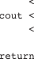

### 程序 3.7

```
// a program that illustrates output conversions
#include <iostream>
#include <iomanip>
using namespace std;

int main()
{
cout << "The decimal (base 10) value of 15 is "
<< 15 << endl;
cout << "The octal (base 8) value of 15 is "
<< showbase << oct << 15 <<endl;
cout << "The hexadecimal (base 16) value of 15 is "
<< showbase << hex << 15 << endl;

return 0;
}
```

> 7 此主题可在首次阅读时省略而不影响主题的连贯性。

# 信息点

## 格式化 cout 流数据

cout 输出流中的浮点数据可以以精确的方式格式化。例如，一个常见的格式要求是以小数点后两位显示货币金额，例如 123.45。你可以用以下语句实现：

```
cout << setiosflags(ios::fixed)
<< setiosflags(ios::showpoint)
<< setprecision(2);
```

第一个操纵符标志 ios::fixed 强制 cout 流中的所有浮点数都以十进制符号显示。该标志还防止使用科学记数法。下一个标志 ios::showpoint 告诉流始终显示小数点。最后，setprecision 操纵符告诉流始终显示小数点后两位数字。除了使用操纵符之外，你还可以使用 cout 流方法 setf() 和 precision()。例如，前面的格式也可以通过以下代码实现：

```
cout.setf(ios::fixed);
cout.setf(ios::showpoint);
cout.precision(2);
```

注意语法：对象名 cout 与方法之间用句点分隔。这是指定方法并将其连接到特定对象的标准方式。

此外，使用在 setf() 方法和 setiosflags() 操纵符方法中使用的标志可以通过使用按位或运算符 | 来组合（在附录 C 中解释，可在线获取）。使用此运算符，以下两个语句是等效的：

```
cout << setiosflags(ios::fixed | ios::showpoint);
cout.setf(ios::fixed | ios::showpoint);
```

你选择的语句是个人偏好或预定义标准的问题。

这是程序 3.7 产生的输出：

```
The decimal (base 10) value of 15 is 15
The octal (base 8) value of 15 is 017
The hexadecimal (base 16) value of 15 is 0xf
```

整数值在一到三种可能的编号系统（十进制、八进制和十六进制）中的显示方式并不影响数字在计算机中的存储方式。所有数字都使用计算机的内部代码存储。发送到 cout 的操纵符告诉对象如何将内部代码转换为输出显示目的。

除了整数以八进制或十六进制形式显示外，它们也可以以这些形式写入程序。要指定八进制整数，数字必须以零开头。例如，023 在 C++ 中是一个八进制数。十六进制数字以前导 0x 表示。程序 3.8 显示了如何使用八进制和十六进制整数数字。

### 程序 3.8

```
#include <iostream>
using namespace std;

int main()
{
    cout << "The decimal value of 025 is " << 025 << endl
         << "The decimal value of 0x37 is " << 0x37 << endl;

    return 0;
}
```

程序 3.8 产生以下输出：

```
The decimal value of 025 is 21
The decimal value of 0x37 is 55
```

图 3.5 显示了整数的输入、存储和显示之间的关系。

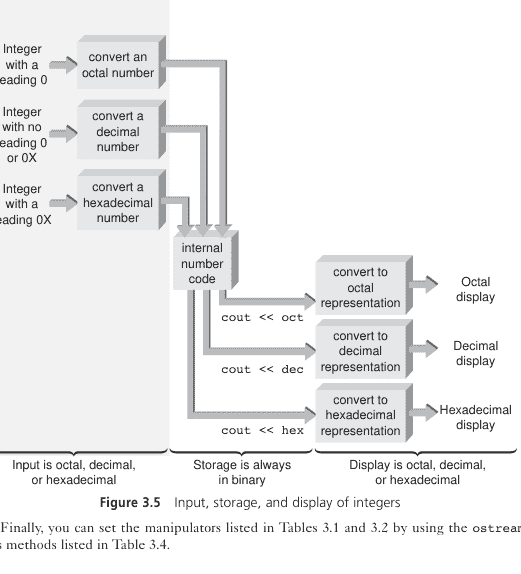

### 图 3.5 整数的输入、存储和显示

最后，你可以使用表 3.4 中列出的 ostream 类方法来设置表 3.1 和 3.2 中列出的操纵符。

### 表 3.4 ostream 类方法

| Method | Comment | Example |
|---|---|---|
| precision(n) | 等价于 setprecision() | cout.precision(2) |
| fill('x') | 等价于 setfill() | cout.fill('*') |
| setf(ios::fixed) | 等价于 cout.setf(ios::fixed) | setiosflags(ios::fixed) |
| setf(ios::showpoint) | 等价于 cout.setf(ios::showpoint) | setiosflags(ios::showpoint) |
| setf(ios::left) | 等价于 left | cout.setf(ios::left) |
| setf(ios::right) | 等价于 right | cout.setf(ios::right) |
| setf(ios::flush) | 等价于 endl | cout.setf(ios::flush) |

在表 3.4 的示例列中，注意对象名 cout 与方法之间用句点分隔。如前所述，这是调用类方法并为其提供操作对象的标准方式。


## 练习 3.2

- 1. （调试）确定以下语句中的错误：
  - a. cout << "\n << " 15)
  - b. cout << "setw(4)" << 33;
  - c. cout << "setprecision(5)" << 526.768;
  - d. "Hello World!" >> cout;
  - e. cout << 47 << setw(6);
  - f. cout << set(10) << 526.768 << setprecision(2);
- 2. （桌面检查）确定并写出以下语句产生的显示：
  - a. cout << "|" << 5 << "|";
  - b. cout << "|" << setw(4) << 5 << "|";
  - c. cout << "|" << setw(4) << 56829 << "|";
  - d. cout << "|" << setw(5) << setiosflags(ios::fixed) << setprecision(2) << 5.26 << "|";
  - e. cout << "|" << setw(5) << setiosflags(ios::fixed) << setprecision(2) << 5.267 << "|";
  - f. cout << "|" << setw(5) << setiosflags(ios::fixed) << setprecision(2) << 53.264 << "|";
  - g. cout << "|" << setw(5) << setiosflags(ios::fixed) << setprecision(2) << 534.264 << "|";
  - h. cout << "|" << setw(5) << setiosflags(ios::fixed) << setprecision(2) << 534. << "|";


## 作业与交互式输入

```
3. (Desk check) Write out the display produced by the following statements:

a. cout << "The number is " << setw(6) << setiosflags(ios::fixed)
  << setprecision(2) << 26.27 << endl;
cout << "The number is " << setw(6) << setiosflags(ios::fixed)
  << setprecision(2) << 682.3 << endl;
cout << "The number is " << setw(6) << setiosflags(ios::fixed)
  << setprecision(2) << 1.968 << endl;

b. cout << setw(6) << setiosflags(ios::fixed)
  << setprecision(2) << 26.27 << endl;
cout << setw(6) << setiosflags(ios::fixed)
  << setprecision(2) << 682.3 << endl;
cout << setw(6) << setiosflags(ios::fixed)
  << setprecision(2) << 1.968 << endl;
cout << "------\n";
cout << setw(6) << setiosflags(ios::fixed)
  << setprecision(2)
  << 26.27 + 682.3 + 1.968 << endl;

c. cout << setw(5) << setiosflags(ios::fixed)
  << setprecision(2) << 26.27 << endl;
cout << setw(5) << setiosflags(ios::fixed)
  << setprecision(2) << 682.3 << endl;
cout << setw(5) << setiosflags(ios::fixed)
  << setprecision(2) << 1.968 << endl;
cout << "------\n";
cout << setw(5) << setiosflags(ios::fixed)
  << setprecision(2)
  << 26.27 + 682.3 + 1.968 << endl;

d. cout << setw(5) << setiosflags(ios::fixed)
  << setprecision(2) << 36.164 << endl;
cout << setw(5) << setiosflags(ios::fixed)
  << setprecision(2) << 10.003 << endl;
cout << "------" << endl;
```

4. (Desk check) The following chart lists the equivalent octal and hexadecimal representations for the decimal numbers 1 through 15:

|        | 1 | 2 | 3 | 4 | 5 | 6 | 7 | 8 | 9 | 10 | 11 | 12 | 13 | 14 | 15 |
|---|---:|---:|---:|---:|---:|---:|---:|---:|---:|---:|---:|---:|---:|---:|---:|
| Decimal | 1 | 2 | 3 | 4 | 5 | 6 | 7 | 8 | 9 | 10 | 11 | 12 | 13 | 14 | 15 |
| Octal | 1 | 2 | 3 | 4 | 5 | 6 | 7 | 10 | 11 | 12 | 13 | 14 | 15 | 16 | 17 |
| Hexadecimal | 1 | 2 | 3 | 4 | 5 | 6 | 7 | 8 | 9 | a | b | c | d | e | f |

Using this chart, determine the output of the following program:

```
#include <iostream>
#include <iomanip>
using namespace std;

int main()
{
```
```
cout << "\nThe value of 14 in octal is " << oct << 14
    << "\nThe value of 14 in hexadecimal is " << hex << 14
    << "\nThe value of 0xA in decimal is " << dec << 0xA
    << "\nThe value of 0xA in octal is " << oct << 0xA
    << endl;

return 0;
}
```

## 5. (Program) Write a C++ program to calculate and display the value of the slope of the line connecting two points with the coordinates (3,7) and (8,12). Use the fact that the slope between two points at the coordinates (x1,y1) and (x2,y2) is slope = (y2 - y1) / (x2 - x1). Your program should produce this display:

The value of the slope is xxx.xx

The xxx.xx denotes placing the calculated value in a field wide enough for three places to the left of the decimal point and two places to the right of it.

## 6. (Program) Write a C++ program to calculate and display the midpoint coordinates of the line connecting the two points with coordinates of (3,7) and (8,12). Use the fact that the midpoint coordinates between two points with the coordinates (x1,y1) and (x2,y2) are ((x2 + x1) / 2, (y2 + y1) / 2). Your program should produce this display:

The x coordinate of the midpoint is xxx.xx
The y coordinate of the midpoint is xxx.xx

The xxx.xx denotes placing the calculated value in a field wide enough for three places to the left of the decimal point and two places to the right of it.

Verify your program using the following test data:

- Test data set 1: Point 1 = (0,0) and Point 2 = (16,0)
- Test data set 2: Point 1 = (0,0) and Point 2 = (0,16)
- Test data set 3: Point 1 = (0,0) and Point 2 = (-16,0)
- Test data set 4: Point 1 = (0,0) and Point 2 = (0,-16)
- Test data set 5: Point 1 = (-5,-5) and Point 2 = (5,5)

When you have completed your verification, use your program to complete the following table.

| Point 1 | Point 2 | Midpoint |
|---------|---------|----------|
| (4,6)   | (16,18) |          |
| (22,3)  | (8,12)  |          |
| (-10,8) | (14,4)  |          |
| (-12,2) | (14,3.1)|          |
| (3.1,-6)| (20,16) |          |
| (3.1,-6)| (-16,-18)|         |

## 7. (Program) The change remaining after an amount is used to pay a restaurant bill of amount check can be calculated by using the following C++ statements:

```
// determine the number of pennies in the change
change = (paid - check) * 100;
// determine the number of dollars in the change
dollars = (int) (change/100);
```

a. Using the previous statements as a starting point, write a C++ program that calculates the number of dollar bills, quarters, dimes, nickels, and pennies in the change when $10 is used to pay a bill of $6.07.

b. Without compiling or running your program, check the effect, by hand, of each statement in the program and determine what’s stored in each variable as each statement is encountered.

c. When you have verified that your algorithm works correctly, compile and run your program. Verify that the result produced by your program is correct, and then use your program to determine the change when a check of $12.36 is paid with a 20-dollar bill.

## 8. (Program) Write a C++ program to calculate and display the maximum bending moment, M, of a beam that’s supported on both ends (see Figure 3.6). The formula is M = XW (L - X) / L, where X is the distance from the end of the beam that a weight, W, is placed, and L is the length of the beam. Your program should produce this display:

The maximum bending moment is xxxx.xxxx

The xxxx.xxxx denotes placing the calculated value in a field wide enough for four places to both the right and left of the decimal point.

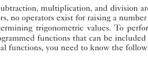

# 3.3 数学库函数

As you have seen, assignment statements can be used to perform arithmetic computations. For example, the following assignment statement multiplies the value in unitPrice times the value in amount and assigns the resulting value to totalPrice:

```
totalPrice = unitPrice * amount;
```

Although addition, subtraction, multiplication, and division are easily accomplished with C++’s arithmetic operators, no operators exist for raising a number to a power, finding a number’s square root, or determining trigonometric values. To perform these calculations, C++ provides standard preprogrammed functions that can be included in a program. Before using one of these mathematical functions, you need to know the following:

- The name of the mathematical function
- What the mathematical function does
- The type of data the mathematical function requires
- The data type of the result the mathematical function returns
- How to include the mathematical library

To illustrate the use of C++'s mathematical functions, take a look at the mathematical function sqrt(), which calculates a number's square root and uses this form:

```
sqrt(number)
```

The function's name—in this case, sqrt—is followed by parentheses containing the number for which the square root should be calculated. The purpose of the parentheses after the function name is to provide a funnel through which data can be passed to the function (see Figure 3.7). The items passed to the function through the parentheses are called arguments of the function, as you learned in Chapter 1, and constitute its input data. For example, the following expressions are used to compute the square root of the arguments 4., 17.0, 25., 1043.29, and 6.4516:

```
sqrt(4.)
sqrt(17.0)
sqrt(25.)
sqrt(1043.29)
sqrt(6.4516)
```

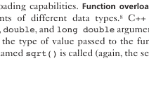

# Figure 3.7 Passing data to the sqrt() function

Notice that the argument to the sqrt() function must be a real value, which is an example of C++'s function-overloading capabilities. Function overloading permits using the same function name for arguments of different data types. C++ has three functions named sqrt()—defined for float, double, and long double arguments. The correct sqrt() function is called depending on the type of value passed to the function when the call is made. When one of the functions named sqrt() is called (again, the selection is automatic, based on

> If overloading wasn't supported, three separate square root functions, each with a different name, would have to be defined—one for each type of argument.


## 赋值与交互式输入

当函数接收到传入的参数后，它会计算参数的平方根，并将结果作为 `double` 类型返回。前面的表达式返回以下值：

| 表达式 | 返回值 |
|---|---|
| `sqrt(4.)` | `2.` |
| `sqrt(17.0)` | `4.12311` |
| `sqrt(25.)` | `5.` |
| `sqrt(1043.29)` | `32.3` |
| `sqrt(6.4516)` | `2.54` |

除了 `sqrt()` 函数，表 3.5 列出了 C++ 中常用的数学函数。在程序中使用这些函数需要包含数学头文件 `cmath`，其中包含数学函数的声明。要使用此头文件，请在使用数学函数的任何程序顶部放置以下预处理语句：

```
#include <cmath>
```

虽然表 3.5 中的一些数学函数需要多个参数，但根据定义，所有函数最多只能返回一个值。此外，列出的所有函数都是重载的，这意味着相同的函数名可以用于不同的参数数据类型。表 3.6 显示了使用示例参数时选定函数返回的值。

**表 3.5 常用 C++ 函数**

| 函数名 | 描述 | 返回值 |
|---|---|---|
| `abs(a)` | 绝对值 | 与参数相同的数据类型 |
| `pow(a1,a2)` | a1 的 a2 次幂 | 与参数 a1 相同的数据类型 |
| `sqrt(a)` | 实数的平方根 *(注意：整数参数会导致编译器错误。)* | 双精度 |
| `sin(a)` | a 的正弦值（a 为弧度） | 双精度 |
| `cos(a)` | a 的余弦值（a 为弧度） | 双精度 |
| `tan(a)` | a 的正切值（a 为弧度） | 双精度 |
| `log(a)` | a 的自然对数 | 双精度 |
| `log10(a)` | a 的常用对数（以 10 为底） | 双精度 |
| `exp(a)` | e 的 a 次幂 | 双精度 |

**表 3.6 选定函数示例**

| 示例 | 返回值 |
|---|---|
| abs(-7.362) | 7.362 |
| abs(-3) | 3 |
| pow(2.0,5.0) | 32. |
| pow(10,3) | 1000 |
| log(18.697) | 2.92836 |
| log10(18.697) | 1.27177 |
| exp(-3.2) | 0.040762 |

每次使用数学函数时，都是通过给出函数名称，并在函数名后的括号中传递任何数据来调用它（参见图 3.8）。

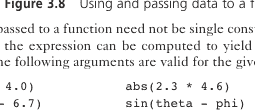

**图 3.8 使用函数并向其传递数据**

传递给函数的参数不必是单个常量。表达式也可以作为参数，前提是该表达式可以计算为所需数据类型的一个值。例如，以下参数对于给定的函数是有效的：

```
sqrt(4.0 + 5.3 * 4.0)      abs(2.3 * 4.6)
sqrt(16.0 * 2.0 - 6.7)    sin(theta - phi)
sqrt(x * y - z/3.2)      cos(2.0 * omega)
```

括号内的表达式首先被求值以产生一个特定的值。因此，变量 theta、phi、x、y、z 和 omega 必须在使用于上述表达式之前被赋值。计算完参数的值后，它被传递给函数。

函数也可以作为更大表达式的一部分，如下例所示：

```
4 * sqrt(4.5 * 10.0 - 9.0) - 2.0
= 4 * sqrt(36.0) - 2.0
= 4 * 6.0 - 2.0
= 24.0 - 2.0
= 22.0
```

像 `3.0 * sqrt(5 * 33 - 13.71) / 5` 这样的表达式的逐步求值过程如下：

| 步骤 | 结果 |
|---|---|
| 1. 执行参数中的乘法。 | 3.0 * sqrt(165 - 13.71) / 5 |
| 2. 完成参数计算。 | 3.0 * sqrt(151.29) / 5 |
| 3. 返回函数值。 | 3.0 * 12.3 / 5 |
| 4. 执行乘法。 | 36.9 / 5 |
| 5. 执行除法。 | 7.38 |

程序 3.9 演示了使用 `sqrt()` 函数来确定一个球从 800 英尺高的塔上掉落到地面所需的时间。计算球下落给定距离（以英尺为单位）所需时间（以秒为单位）的数学公式如下，其中 g 是重力常数，等于 32.2 英尺/秒²：

time = sqrt(2 × distance / g)

**程序 3.9**

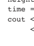

```
#include <iostream> // this line can be placed second instead of first
#include <cmath> // this line can be placed first instead of second
using namespace std;

int main()
{
    int height;
    double time;

    height = 800;
    time = sqrt(2 * height / 32.2);
    cout << "It will take " << time << " seconds to fall "
         << height << " feet.\n";

    return 0;
}
```

程序 3.9 产生以下输出：

It will take 7.04907 seconds to fall 800 feet.

正如在程序 3.9 中所使用的，`sqrt()` 函数返回的值被赋给变量 time。除了将函数的返回值赋给变量外，返回值还可以包含在更大的表达式中，甚至可以用作另一个函数的参数。例如，以下表达式是有效的：

sqrt( sin( abs(theta) ) )

由于存在括号，计算从最内层的括号对向外进行。因此，首先计算 theta 的绝对值，并将其用作 `sin()` 函数的参数。然后，该函数返回的值被用作 `sqrt()` 函数的参数。

请注意，所有三角函数（`sin()`、`cos()` 等）的参数必须以弧度为单位。因此，要计算以度为单位给出的角度的正弦值，必须先将角度转换为弧度。你可以通过将该角度乘以 (3.1416/180.) 来轻松完成此操作。例如，要获得 30 度的正弦值，请使用表达式 sin (30 * 3.1416/180.)。

## 强制类型转换

你已经看到了在混合模式算术表达式（第 2.2 节）和不同运算符（第 3.1 节）中操作数数据类型的转换。除了这些在混合模式算术和赋值表达式中自动进行的隐式数据类型转换之外，C++ 还提供了显式的用户指定类型转换。用于强制将值转换为另一种类型的运算符是强制转换运算符。C++ 提供了编译时和运行时强制转换运算符。编译时强制转换是一个一元运算符，其语法如下：

```
dataType (expression)
```

dataType 是括号中表达式要转换成的数据类型。例如，以下表达式将表达式 a * b 的值转换为整数值：

```
int (a * b)
```

C++ 中也包含运行时强制转换。在这种类型的转换中，请求的类型转换在运行时被检查，如果转换产生有效值，则应用该转换。虽然有四种类型的运行时强制转换可用，但最常用的强制转换以及与编译时强制转换对应的强制转换具有以下语法：

```
staticCast<dataType> (expression)
```

例如，运行时强制转换 `staticCast<int>(a * b)` 等同于编译时强制转换 `int (a * b)`。

> 9 C 类型转换语法，在这种情况下是 `(int) (a * b)`，在 C++ 中也能工作。

## 练习 3.3

1. (练习) 编写函数调用来确定以下内容：

- a. 6.37 的平方根
- b. x - y 的平方根
- c. 30 度的正弦值
- d. 60 度的正弦值
- e. a² - b² 的绝对值
- f. e 的三次幂的值

2. (练习) 对于 a = 10.6, b = 13.9, 和 c = -3.42，确定以下值：

- a. int (a)
- b. int (b)
- c. int (c)
- d. int (a + b)
- e. int (a) + b + c
- f. int (a + b) + c
- g. int (a + b + c)
- h. double (int (a)) + b
- i. double (int (a + b))
- j. abs(a) + abs(b)
- k. sqrt(abs(a - b))

3. (练习) 为以下内容编写 C++ 语句：

- a. area = (c × b × sin a) / 2
- b. c = √(a² + b²)
- c. p = √|m - n|
- d. sum = a(rⁿ - 1)/(r - 1)
- e. b = sin² x - cos² x

4. (程序) 编写、编译并运行一个 C++ 程序，计算并返回数字 81.0 的四次方根，即 3。验证程序正确运行后，使用它来确定 1,728.896400 的四次方根。你的程序应使用 `sqrt()` 函数，或利用一个值的四次方根可以通过将该值提高到 1/4 次幂来获得这一事实。

5. (程序) 储存在一个 200 英尺深的地下圆柱形油罐中的油量，通过测量从油罐顶部到油面的距离来确定。知道这个距离和油罐的半径，可以使用以下公式确定油罐中的油量：

```
volume = π radius² (200 - distance)
```


使用此信息，编写、编译并运行一个 C++ 程序，计算一个半径为 10 英尺、从罐顶到油顶的距离为 12 英尺的 200 英尺油罐中的油体积。你的程序应显示半径、从罐顶到油的距离以及计算出的体积。

## 6. （程序）椭圆的周长（复习图 3.4）由以下公式给出：

Circumference = π√(a + b)²

使用此公式，编写一个 C++ 程序来计算椭圆的周长，其短半径 a 为 2.5 英寸，长半径 b 为 6.4 英寸。

## 7. （程序）编写、编译并运行一个 C++ 程序来计算坐标为 (7, 12) 和 (3, 9) 的两点之间的距离。利用两点坐标为 (x₁, y₁) 和 (x₂, y₂) 的两点之间的距离由以下公式给出这一事实：

distance = √((x₂ - x₁)² + (y₂ - y₁)²)

在通过手动计算两点之间的距离验证你的程序工作正确后，使用你的程序确定点 (-12, -15) 和 (22, 5) 之间的距离。

## 8. （程序）如果一架 20 英尺长的梯子以 85 度角放置在建筑物侧面，如图 3.9 所示，梯子接触建筑物的高度可以计算为 height = 20 × sin 85°。手工计算此高度，然后编写、编译并运行一个 C++ 程序来确定并显示高度值。在验证程序工作正确后，使用它来确定一架放置在 85 度角的 25 英尺长梯子的高度。

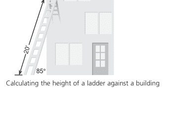

图 3.9 计算靠在建筑物上的梯子的高度

## 9. （程序）球以初速度 v 米/秒、角度 θ 抛出时达到的最大高度由以下公式给出：

height = (.5 x v² x sin² θ) / 9.8

使用此公式，编写、编译并运行一个 C++ 程序来确定并显示当球以 5 英里/小时的角度 60 度抛出时达到的最大高度。 （提示：确保将初速度转换为正确的单位。1 英里为 1609 米。）手工计算最大高度，并验证程序产生的结果。在验证结果后，使用你的程序确定球以 7 英里/小时的角度 45 度抛出时达到的高度。

## 10. （程序）自 2000 年以来世界人口增长的模型，以十亿人为单位，由以下公式给出：

Population = 7.5 e^0.02[Year - 2010]

使用此公式，编写、编译并运行一个 C++ 程序来估计 2012 年的世界人口。通过手工计算答案来验证程序产生的结果，然后使用你的程序估计 2020 年的世界人口。

## 11. （程序）堪萨斯州的道路以图 3.10 所示的矩形网格布局，间隔恰好为一英里。农夫彼得驾驶他的 1939 年福特皮卡向东行驶 x 英里，向北行驶 y 英里到达农夫乔的农场。x 和 y 都是整数。利用此信息，编写、测试并运行一个 C++ 程序，提示用户输入 x 和 y 的值，然后使用以下公式找到穿过田地到乔农场的最近驾驶距离：

distance = sqrt(x² + y²);

在显示之前将答案四舍五入到最接近的整数值。

## 12. （程序）估计 t 年后剩余的放射性同位素克数的模型由以下公式给出：

remaining material = (original material) e^(-0.00021t)

使用此公式，编写、编译并运行一个 C++ 程序来确定在初始量为 100 克的假设下，1000 年后剩余的放射性物质量。通过手工计算验证程序产生的显示。在验证程序工作正确后，使用它来确定在初始量为 250 克的假设下，275 年后剩余的放射性物质量。

## 图 3.10 练习 11 的插图

## 13. （程序）一种铀同位素衰变到原来一半所需的时间由以下公式给出，其中 λ，即衰变常数（等于平均寿命的倒数），等于 0.00012：

```
half-life = ln(2) / λ
```

使用此公式，编写、编译并运行一个 C++ 程序来计算并显示这种铀同位素的半衰期。通过手工计算验证程序产生的结果。在验证程序工作正确后，使用它来确定 λ = 0.00026 的铀同位素的半衰期。

## 14. （程序）a. 附录 B 列出了使用 ASCII 代码存储的每个字母对应的整数值。请注意，大写字母由连续的代码组成，从字母 A 的整数值 65 开始，到字母 Z 的 90 结束。同样，小写字母从字母 a 的整数值 97 开始，到字母 z 的 122 结束。利用此信息作为背景，确定表达式 char ('A' + 32) 和 char ('Z' + 32) 的字符值。

b. 使用附录 B，确定表达式 'a' - 'A' 的整数值。

c. 使用练习 14a 和 14b 的结果，确定以下表达式的字符值，其中大写字母可以是 A 到 Z 中的任意大写字母：char (uppercase letter + 'a' - 'A')。

## 3.4 交互式键盘输入

仅运行一次的程序的数据可以包含在程序中。例如，如果你想将数字 30.0 和 0.05 相乘，你可以使用程序 3.10。

## 程序 3.10

```
```cpp
#include <iostream>
using namespace std;

int main()
{
    double num1, num2, product;

    num1 = 30.0;
    num2 = 0.05;
    product = num1 * num2;
    cout << "30.0 times 0.05 is " << product << endl;

    return 0;
}
```
```

这是程序 3.10 显示的输出：

    30.0 times 0.05 is 1.5

程序 3.10 可以缩短，如程序 3.11 所示。然而，这两个程序都存在相同的基本问题：它们必须重写以乘以不同的数字。两个程序都不允许输入不同的数字进行操作。

## 程序 3.11

```
```cpp
#include <iostream>
using namespace std;

int main()
{

    cout << "30.0 times 0.05 is " << 30.0 * 0.05 << endl;

    return 0;
}
```
```

## 赋值和交互式输入

除了通过编写、输入和运行程序获得的编程练习外，仅对同一组数字执行相同计算一次的程序显然不是很有用。毕竟，使用计算器乘以两个数字比输入和运行程序 3.10 或程序 3.11 更简单。

本节解释了 cin 对象，该对象用于在程序运行时输入数据。就像 cout 对象显示存储在变量中的值的副本一样，cin 对象允许用户在键盘上输入值（见图 3.11）。该值随后存储在变量中。

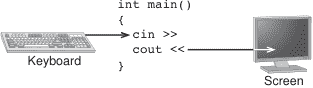

**图 3.11**  cin 用于输入数据；cout 用于显示数据

当遇到诸如 `cin >> num1;` 这样的语句时，计算机停止程序执行并接受来自键盘的数据。当输入一个数据项时，cin 对象将该项存储在提取（`<<get from>>`）运算符 `>>` 之后列出的变量中。然后程序继续执行 cin 调用的下一个语句之后。看看程序 3.12，了解此对象的工作原理。

## 程序 3.12

```
```cpp
#include <iostream>
using namespace std;

int main()
{
    double num1, num2, product;

    cout << "Please type in a number: ";
    cin >> num1;
    cout << "Please type in another number: ";
    cin >> num2;
    product = num1 * num2;
    cout << num1 << " times " << num2 << " is " << product << endl;

    return 0;
}
```
```

程序 3.12 中的第一个 cout 语句打印一个字符串，告诉键盘操作人员应输入什么。当输出字符串以这种方式使用时，它被称为 **提示**。


## 程序3.13

```
#include <iostream>
using namespace std;

int main()
{
    int num1, num2, num3;
    double average;

    cout << "Enter three integer numbers: ";
    cin >> num1 >> num2 >> num3;
    average = (num1 + num2 + num3) / 3.0;
    cout << "The average of the numbers is " << average << endl;

    return 0;
}
```

程序3.13产生以下输出：

```
Enter three integer numbers: 22 56 73
The average of the numbers is 50.3333
```

注意，此示例运行中在键盘输入的数据由以下输入组成：

```
22 56 73
```

针对此输入流，程序3.13将值22存储到变量num1中，将56存储到变量num2中，将73存储到变量num3中（见图3.12）。因为三个整数的平均值可能是浮点数，所以用于存储平均值的变量average被声明为双精度变量。还要注意，赋值语句`average = (num1 + num2 + num3) / 3.0`中需要括号。没有括号，只有num3中的整数会被3除（因为除法的优先级高于加法）。

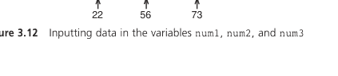

图3.12 在变量num1、num2和num3中输入数据

cin提取操作与cout插入操作一样，“智能”到可以进行一些数据类型转换。例如，如果输入一个整数来代替双精度数，该整数会被转换为正确的数据类型。[^10]类似地，如果期望整数时输入了一个双精度数，则只使用该数的整数部分。例如，假设对语句`cin >> num1 >> num2 >> num3;`输入以下数字，其中num1和num3已声明为双精度变量，num2是整数变量：

```
56 22.879 33.923
```

56被转换为56.0并存储在变量num1中。提取操作继续进行，从输入流中提取数据并期望一个整数值。对cin而言，22.879中的小数点表示整数的结束和小数的开始。因此，数字22被赋给num2。cin继续处理其输入流，将.879作为下一个双精度数，并赋给num3。对cin而言，33.923是多余输入，会被忽略。但是，如果最初没有输入足够的数据，cin对象会继续使计算机暂停，直到输入了足够的数据。

## 用户输入验证初探

构造良好的程序应验证用户输入，并确保程序不会因意外输入而崩溃或产生无意义的输出。术语“验证”是指检查输入的值是否与cin语句中赋给变量的数据类型匹配，以及该值是否在应用程序可接受的范围内。能有效检测并响应意外用户输入的程序正式称为健壮程序，非正式地称为“防弹”程序。程序员的任务之一就是编写健壮的程序。按目前所写，程序3.12和3.13不是健壮程序，在下面的讨论中，你会看到原因。

这些程序的第一个问题在用户输入非数值时显而易见。例如，查看程序3.13的以下示例运行：

```
Enter three integer numbers: 10 20.68 20
The average of the numbers is -2.86331e+008
```

出现此输出是因为第二个输入数字的转换导致将整数值20赋给num2，并将-858993460赋给num3。之所以会出现-858993460，是因为一个无效字符（小数点）被赋给了期望整数值的变量。数字10、20和-858993460的平均值被正确计算为-286331143.3，以科学计数法显示为六位有效数字-2.86331e+008。对于普通用户而言，该结果会被报告为程序错误。

只要前两个输入中的任意一个输入了非整数值，就会出现同样的问题。（如果第三个输入输入的是数值，则不会出现此问题，因为最后一个输入的整数部分会被接受，其余输入会被忽略。）作为程序员，你的第一反应可能是“程序明确要求你输入整数值。”然而，有经验的程序员明白，他们的责任是确保程序能预见并妥善处理用户可能输入的各种数据。要实现这一目标，请在开发程序时思考程序可能出现什么问题，然后让另一个人或小组彻底测试程序。<sup>1</sup>

处理无效数据输入的基本方法称为用户输入验证，即在输入期间或输入后立即检查输入的数据，然后给用户提供重新输入无效数据的方法。用户输入验证是任何商业可行程序的重要组成部分；如果做得正确，它可以保护程序不会试图处理可能导致计算问题的数据。你将在第4章和第5章学习C++的选择语句和循环语句时，了解如何进行此类验证。

## 练习3.4

- 1.（练习）对于以下声明语句，使用cin对象编写一条或多条语句，使计算机在用户输入相应数据时暂停：
  - a. `int firstnum;`
  - b. `double grade;`
  - c. `double secnum;`
  - d. `char keyval;`
  - e. `int month, years;`
    `double average;`
  - f. `char ch;`
    `int num1,num2;`
    `double grade1,grade2;`
  - g. `double interest, principal, capital;`
    `double price, yield;`
  - h. `char ch, letter1,letter2;`
    `int num1,num2,num3;`
  - i. `double temp1,temp2,temp3;`
    `double volts1,volts2;`

- 2.（程序）
  - a. 编写、编译并运行一个C++程序，显示以下提示：

    ```
    Enter the length of the room:
    Enter the width of the room:
    ```

    每次显示提示后，程序应使用cin对象调用来接受键盘输入的数据。输入房间宽度后，程序应计算并显示房间的面积。显示的面积应使用公式面积 = 长 × 宽计算，并包含在适当的消息中。
  - b. 通过手动计算结果，检查为练习2a编写的程序所显示的面积。

- 3.（程序）
  - a. 编写、编译并运行一个C++程序，显示以下提示：

    ```
    Enter the length of the swimming pool:
    Enter the width of the swimming pool:
    Enter the average depth of the swimming pool:
    ```

    每次显示提示后，程序应使用cin语句来接受键盘输入的数据。输入游泳池深度后，程序应计算并显示游泳池的体积。体积应使用公式*体积 = 长 × 宽 × 平均深度*计算，并在输出消息中显示。
  - b. 通过手动计算结果，检查为练习3a编写的程序所显示的体积。

- 4.（程序）编写、编译并运行一个C++程序，显示以下提示：

  ```
  Enter the radius of a circle:
  ```

  接受半径值后，程序应计算并显示圆的面积。*（提示：面积 = 3.1416 × 半径²。）* 为了测试，使用3英寸的输入半径验证你的程序。在手动确定程序结果正确后，使用程序完成以下图表：

  | 半径（英寸） | 面积（平方英寸） |
  |-------------|---------------|
  | 1.0         |               |
  | 1.5         |               |
  | 2.0         |               |
  | 2.5         |               |
  | 3.0         |               |
  | 3.5         |               |

- 5.（程序）
  - a. 编写一个C++程序，首先显示以下提示：

    ```
    Enter the temperature in degrees Celsius:
    ```

    让程序接受从键盘输入的值，并使用以下公式将输入的温度转换为华氏度：

    *华氏度 = (9.0 / 5.0) × 摄氏度 + 32.0*

    然后程序应使用输出消息显示华氏度温度。
  - b. 编译并运行为练习5a编写的程序。为了验证程序，使用以下测试数据并手动计算华氏等效值，然后使用程序查看是否得到相同结果：

    ```
    Test data set 1: 0 degrees Celsius
    Test data set 2: 50 degrees Celsius
    Test data set 3: 100 degrees Celsius
    ```

[^10]: 严格来说，从键盘输入的不是任何数据类型（如int或double），而只是一系列字符。提取操作处理从字符序列到已定义数据类型的转换。


当你确定程序工作正确时，使用它来完成下面的图表：

| 摄氏 | 华氏 |
| 45 |  |
| 50 |  |
| 55 |  |
| 60 |  |
| 65 |  |
| 70 |  |

## 6. （程序）a. 编写、编译并运行一个 C++ 程序，显示以下提示：

```
Enter the miles driven:
Enter the gallons of gas used:
```

在显示每个提示后，你的程序应使用 cin 语句接受键盘输入以对应显示的提示。在输入汽油用量后，你的程序应计算并显示每加仑英里数（mpg）。该值应使用公式 每加仑英里数 = 英里 / 使用的加仑 计算并在输出信息中显示。通过使用以下测试数据验证你的程序：
测试数据集 1：英里 = 276，汽油 = 10 加仑
测试数据集 2：英里 = 200，汽油 = 15.5 加仑

完成验证后，使用你的程序完成下面的图表。 （确保将行驶英里转换为行驶公里，将使用的加仑转换为使用的升，然后计算每升公里数。每英里有 1.61 公里，每加仑有 4.54609 升。）

| 行驶英里 | 使用加仑 | Mpg | 行驶公里 | 使用升 | Km/L |
| 250 | 16.00 |  |  |  |  |
| 275 | 18.00 |  |  |  |  |
| 312 | 19.54 |  |  |  |  |
| 296 | 17.39 |  |  |  |  |

b. 对于练习 6a 编写的程序，确定需要多少次验证运行才能确保程序工作正确，并给出支持你答案的理由。

## 7. （程序）a. 编写、编译并运行一个 C++ 程序，显示以下提示：

```
Enter a number:
Enter a second number:
Enter a third number:
Enter a fourth number:
```

在显示每个提示后，你的程序应使用 cin 语句接受键盘输入以对应显示的提示。在输入第四个数后，你的程序应计算并显示这些数字的平均值。平均值应显示在输出信息中。通过使用以下测试数据检查你的程序计算的平均值：

- 测试数据集 1：100, 100, 100, 100
- 测试数据集 2：100, 0, 100, 0

完成验证后，使用你的程序完成下面的图表：

| 数字 | 平均值 |
|---|---|
| 92, 98, 79, 85 | |
| 86, 84, 75, 86 | |
| 63, 85, 74, 82 | |

b. 重复练习 7a，确保对每个数字输入都使用相同的变量名 number。 同时，使用变量 sum 表示数字之和。 （提示：为此，你可以在每次接受数字后使用语句 sum = sum + number; 回顾第 3.1 节中关于累加的材料。）

## 8. （程序）地下泳池的周长、近似表面积和近似体积由以下公式给出：

perimeter = 2 × (length + width)
volume = length × width × average depth
underground surface area = 2 × (length + width) × average depth + length × width

以这些公式为基础，编写一个 C++ 程序，接受长度、宽度和平均深度测量值，然后计算泳池的周长、体积和地下表面积。在编写程序时，在输入数据后立即进行这两个计算：length × width 和 length + width。这两个计算的结果应根据需要在确定周长、体积和地下表面积的赋值语句中使用，而无需为每个方程重新计算它们。通过使用以下测试数据进行手工计算来验证你的程序结果：长度 = 25 英尺，宽度 = 15 英尺，平均深度 = 5.5 英尺。 验证程序工作正常后，使用它来完成下面的图表：

| 长度 | 宽度 | 平均深度 | 周长 | 体积 | 地下表面积 |
|---|---|---|---|---|---|
| 25 | 10 | 5.0 | | | |
| 25 | 10 | 5.5 | | | |
| 25 | 10 | 6.0 | | | |
| 25 | 10 | 6.5 | | | |
| 30 | 12 | 5.0 | | | |
| 30 | 12 | 5.5 | | | |
| 30 | 12 | 6.0 | | | |
| 30 | 12 | 6.5 | | | |

## 9. （程序）a. 编写、编译并运行一个 C++ 程序来计算并显示二阶多项式 ax² + bx + c 的值，针对用户输入的系数 a、b、c 和变量 x 的任意值。 让你的程序首先显示一条消息告知用户程序的功能，然后显示合适的提示以提醒用户输入数据。 （提示：可以使用类似 Enter the coefficient of the x-squared term: 的提示。）

b. 使用以下测试数据检查为练习 9a 编写的程序的结果：
测试数据集 1：a = 0, b = 0, c = 22, x = 56
测试数据集 2：a = 0, b = 22, c = 0, x = 2
测试数据集 3：a = 0, b = 0, c = 0, x = 2
测试数据集 4：a = 2, b = 4, c = 5, x = 2

完成验证后，使用你的程序完成下面的图表：

| a | b | c | x | 多项式值 (ax² + bx + c) |
|---|---|---|---|---|
| 2.0 | 17.0 | -12.0 | 1.3 | |
| 3.2 | 2.0 | 15.0 | 2.5 | |
| 3.2 | 2.0 | 15.0 | -2.5 | |
| -2.0 | 10.0 | 0.0 | 2.0 | |
| -2.0 | 10.0 | 0.0 | 4.0 | |
| -2.0 | 10.0 | 0.0 | 5.0 | |
| -2.0 | 10.0 | 0.0 | 6.0 | |
| 5.0 | 22.0 | 18.0 | 8.3 | |
| 4.2 | -16 | -20 | -5.2 | |

## 10. （程序）编写、编译并运行一个程序，计算并显示用户输入的实数的平方根值。通过计算以下测试数据的平方根来验证你的程序：25、16、0 和 2。完成验证后，使用你的程序确定 32.25、42、48、55、63 和 79 的平方根。

## 11. （程序）编写、编译并运行一个程序来计算并显示用户输入的数字的四次方根。 回顾初等代数，你可以通过将数字提高到 1/4 次幂来求其四次方根。 （提示：不要使用整数除法——你能看出为什么吗？）通过计算以下测试数据的四次方根来验证你的程序：81、16、1 和 0。完成后，使用你的程序确定 42、121、256、587、1240 和 16,256 的四次方根。

## 12. （程序）Program 3.12 提示用户输入两个数字；第一个输入值存储在 num1 中，第二个值存储在 num2 中。以此程序为起点，编写一个程序交换这两个变量存储的值。

## 14. （程序）重复练习 13，但让你的程序将用于存储数字的变量声明为双精度变量。运行程序三次。第一次，输入一个整数；第二次，输入一个双精度数；第三次，输入一个字符。使用输出显示，跟踪你的程序实际从你输入的数据中接受了什么数字。发生了什么，如果有的话，为什么？

## 15. （思考）a. 你认为为什么成功的程序包含广泛的数据输入有效性检查？ （提示：回顾练习 13 和 14。）
b. 你认为数据类型检查和数据合理性检查有什么区别？
c. 假设程序要求用户输入月份、日期和年份。 对输入的数据可以进行哪些检查？

### 3.5 符号常量

程序中使用的某些常量具有在程序上下文之外被认可的更一般含义。这些类型的常量的例子包括数字 3.1416，它是精确到小数点后四位的 π；32.2 ft/sec²，它是重力常数；以及数字 2.71828，它是精确到小数点后五位的欧拉数。

程序中使用的某些其他常量的含义严格定义在正在编程的应用上下文中。例如，在用于确定银行利息费用的程序中，利率通常在程序的许多不同位置出现。同样，在用于计算税款的程序中，税率可能出现在许多指令中。程序员将这些类型的数字称为魔数。它们本身是普通的，但在特定应用的上下文中，它们具有特殊的（“神奇”）含义。当同一个程序中多次出现魔数时，如果需要更改常量，就会成为错误源。例如，如果利率或销售税率发生变化，而这些税率很可能发生变化，程序员就有繁琐的任务在程序中出现的所有地方更改其值。多次更改容易出错：如果遗漏一个值并且保持不变，当程序运行时结果将不正确，并且错误来源将难以定位。

为了避免魔数在程序中许多地方传播并更清晰地标识更通用的常量，例如 π，C++ 使程序员能够为这些常量赋予符号名称。然后可以在整个程序中使用符号名称而不是魔数。如果数字 ever 需要更改，只需在一次更改符号名称等于实际数字值的位置即可。要将数字与符号名称关联，你使用 const 声明限定符，它指定声明的标识符在初始化后为只读；它不能被更改。以下是使用此限定符的三个示例：

```
const double PI = 3.1416;
const double SALESTAX = 0.05;
const int MAXNUM = 100;
```

第一个声明语句创建一个名为 PI 的双精度变量并用值 3.1416 初始化它。第二个声明语句创建双精度变量


常量名为 SALESTAX 并将其初始化为 0.05。最后，第三个声明创建一个名为 MAXNUM 的整数常量，并将其初始化为值 100。

在 const 标识符创建并初始化后，存储在其内部的值不能被更改。就实际用途而言，常量的名称及其值在声明它们的程序持续期间被联系在一起。

尽管 const 标识符已以大写字母显示，也可以使用小写字母。在 C++ 中使用大写字母是惯例，以便于识别 const 标识符。当程序员在程序中看到大写字母时，他们就知道使用了常量，并且其值在程序中不能被更改。

在声明之后，const 标识符可以在任何 C++ 语句中代替它所代表的数字使用。例如，这两个赋值语句都是有效的：

```
circum = 2 * PI * radius;
amount = SALESTAX * purchase;
```

这些语句当然必须出现在所有变量和常量的声明之后。因为 const 声明将常量值与标识符相等，而标识符可以用作其初始化常量的替代品，所以这些标识符通常被称为符号常量或命名常量。本书中这两个术语可以互换使用。

## 语句的放置

到目前为止，你已经接触到各种语句类型。C++ 中语句放置的一般规则很简单，即变量或符号常量必须在被使用之前声明。虽然此规则允许在程序的任何位置放置预处理器指令和声明语句，但这样做会导致程序结构不佳。作为良好的编程规范，应使用以下语句顺序：

```
preprocessor directives

int main()
{
    // symbolic constants
    // variable declarations

    // other executable statements

    return 0;
}
```

随着新语句类型的引入，此放置结构将扩展以容纳它们。请注意，注释语句可以混合在此基本结构的任何位置。程序 3.14 说明了此结构并使用符号常量计算购买商品应缴纳的销售税。

### Program 3.14

```
#include <iostream>
#include <iomanip>
using namespace std;

int main()
{
    const double SALESTAX = 0.05;
    double amount, taxes, total;

    cout << "\nEnter the amount purchased: ";
    cin >> amount;
    taxes = SALESTAX * amount;
    total = amount + taxes;
    cout << setiosflags(ios::fixed)
         << setiosflags(ios::showpoint)
         << setprecision(2);
    cout << "The sales tax is " << setw(4) << taxes << endl;
    cout << "The total bill is " << setw(5) << total << endl;

    return 0;
}
```

程序 3.14 的以下示例运行如下：

```
Enter the amount purchased: 36.00
The sales tax is 1.80
The total bill is 37.80
```

尽管 const 限定符已被用于构造符号常量，但在第 11 章中你会再次遇到此数据类型，在那里你将了解到它作为函数参数很有用，以确保参数在函数中不被修改。

## EXERCISES 3.5

- 1. (Modify) 重写以下程序，使用符号常量 PI 代替程序中使用的值 3.1416：

```
#include <iostream>
using namespace std;
int main()
{
    double radius, circum;
```

- 4. (Program) 热量从太阳和围绕太阳运行的所有行星辐射出来。辐射的热量可以用以下公式计算：

E = e σ T⁴

E 是以瓦特每平方米（watts/m²）为单位每秒辐射的能量。  
e 是物质的发射率，对于太阳和所有行星来说为 1。  
σ 是常数（.000000056697 = 5.6697e-8）。  
T 是以摄氏度为单位的表面温度。

例如，太阳辐射的热量，其发射率为 1，表面温度约为 6000° C，计算如下：

E = (1) × (.000000056697) × (6000)⁴ watts/m²  
 = 73,479,300 watts/m²

使用该公式，编写一个 C++ 程序，接受行星的温度并提供该行星产生的热量作为输出。你的程序应将值 5.6697e-8 分配给名为 HEATFACTOR 的符号常量。在确定你的程序工作正确后（确保它能产生太阳的正确辐射），使用它完成以下图表：

| Planet (emissivity = 1) | Average Surface Temperature (° Celsius) | Heat Radiated (watts/m²) |
|---|---|---|
| Mercury | 270 | |
| Venus | 462 | |
| Earth | 14 | |

- 5. (Program) 在白天，许多物体，如汽车、屋顶和砖墙，会吸收热量。这些热量随后在较凉的傍晚时段辐射回环境中。使用公式 E = e σ T⁴（参见练习 4），编写一个 C++ 程序，确定以下表中所列物体的辐射热量。你的程序应请求物体的平均表面温度和发射率，然后计算并显示辐射的热量。确保对 σ 的值使用名为 HEATFACTOR 的符号常量。完成以下图表，进行三次程序运行：

| Substance | Average Surface Temperature (° Celsius) | Emissivity | Heat Radiated (watts/m²) |
|---|---|---|---|
| Automobile | 47 | .3 | |
| Brick | 45 | .9 | |
| Commercial roof | 48 | .05 | |

## 3.6 Common Programming Errors

使用本章内容时，请注意以下可能出现的错误：

- 1. 在在表达式中使用所有变量之前忘记为它们分配或初始化值。值可以通过赋值语句分配、在声明语句中初始化，或通过使用 cin 对象交互式输入进行分配。
- 2. 在不包含预处理器语句 #include <cmath> 的情况下使用数学库函数（并且在基于 UNIX 的系统上，在 cc 命令行上忘记包含 -lm 参数）。
- 3. 在不提供正确数量和正确数据类型的参数的情况下使用库函数。
- 4. 对表达式应用递增或递减运算符。例如，表达式 (count + n)++ 是错误的。递增和递减运算符只能应用于变量。
- 5. 忘记在 cin 语句中使用提取运算符 >> 来分隔变量。
- 6. 一个更不寻常的错误发生在递增和递减运算符与在同一表达式中出现多次的变量一起使用时。此错误发生是因为 C++ 未指定表达式中操作数访问的顺序。例如，分配给 result 的值在以下语句中取决于编译器：

```
result = i + i++;
```

如果你的编译器首先访问第一个操作数（i），则前述语句等价于

```
result = 2 * i;
i++;
```

然而，如果你的编译器首先访问第二个操作数（i++），则第一个操作数的值在第二次使用之前被更改，并且值 2i + 1 被分配给 result。作为一般规则，不要在变量在其上操作的表达式中出现多次时在表达式中使用递增或递减运算符。
- 7. 不愿意深入测试程序。对自己的软件进行客观测试是困难的，但作为程序员，你必须提醒自己，仅仅因为你认为程序是正确的并不意味着它就是正确的。

## 3.7 Chapter Summary

- 1. 表达式是一个或多个操作数由运算符分隔的序列。操作数是常量、变量或另一个表达式。表达式与一个值相关联。
- 2. 表达式根据所使用的运算符的优先级和结合性进行求值。
- 3. 赋值运算符是 = 符号。使用此运算符的表达式将值赋给变量，并且表达式本身也取一个值。因为赋值是 C++ 操作，所以赋值运算符可以在同一表达式中使用多次。


4. 自增运算符 ++ 将变量加 1，自减运算符 -- 将变量减 1。两个运算符都可以用作前缀或后缀。在前缀操作中，使用变量的值之前先对其进行递增（或递减）。在后缀操作中，使用变量的值之后再对其进行递增（或递减）。

5. C++ 提供了用于计算平方根、对数和其他数学运算的库函数。使用数学函数的程序必须包含语句 #include <cmath> 或在调用数学函数之前声明该函数。

6. 每个数学库函数对其参数进行操作以计算单个值。要有效地使用库函数，你必须知道函数名、函数的功能、函数期望的参数个数和数据类型，以及返回值的的数据类型。

7. 传递给函数的数据称为该函数的参数。参数通过在函数名后的括号中列出每个参数并用逗号分隔传递给库函数。每个函数对其必须提供的参数个数和数据类型都有自己的要求。

8. 函数可以包含在更大的表达式中。

9. cin 对象用于数据输入。它从键盘接收数据流并将数据分配给变量。以下是使用 cin 的语句的一般形式：

```
cin >> var1 >> var2 . . . >> varn;
```

提取运算符 >> 必须用于在 cin 语句中分隔变量名。

10. 当遇到 cin 语句时，计算机暂时暂停进一步执行，直到为 cin 语句中的变量数输入足够的数据。

11. 在 cin 语句之前显示一条提示用户输入的数据类型和数量的消息是良好的编程实践。该消息称为提示。

12. 可以通过使用 const 关键字将值等同于单个常量。此关键字在声明语句中初始化后创建只读的命名常量。此声明的语法为

```
const dataType symbolicName = initialValue;
```

并且允许在声明之后程序中的任何位置使用该常量代替 initialValue。通常，这些声明放在程序中变量声明之前。

## 3.8 章节补充：错误、测试和调试

编程的理想是生成可读、无错误、运行正确且可通过最少的测试进行修改或更改的程序。你可以通过牢记可能发生的不同类型的错误、通常检测的时间以及如何纠正它们来朝着这一理想努力。

程序错误可能在以下任何时间被检测到：

- 在程序编译之前
- 在程序编译时
- 在程序运行时
- 在程序运行后并检查输出时

在程序编译前检测错误的方法称为桌面检查，因为你通常坐在桌前面前有代码。它指的是检查源代码是否存在语法和逻辑错误的过程。在程序运行后检测错误的方法称为程序验证和测试。

## 编译时和运行时错误

在程序编译时检测到的错误称为编译时错误，而在程序运行时发生的错误称为运行时错误。这些术语描述了错误发生的时间，而不是导致错误的原因。然而，大多数编译时错误是由语法错误引起的，而大多数运行时错误是由逻辑错误引起的。

到目前为止，你可能已经遇到过许多编译时错误。初学者往往对它们感到沮丧，但经验丰富的程序员明白编译器正在进行大量有价值的检查，并且纠正编译器检测到的错误通常很容易。因为这些错误发生在程序开发期间，而不是用户执行重要任务时，除了程序员之外没有人知道它们发生了。你修复它们，它们就消失了。

运行时错误更令人困扰，因为它们发生在用户运行程序时。因为在大多数商业系统中用户不是程序员，通常无法立即评估和纠正错误。运行时错误可能是由程序或硬件故障引起的。然而，从编程角度来看，大多数运行时错误是由逻辑错误引起的。

## 语法和逻辑错误

计算机文献将错误区分为两种主要类型：语法错误和逻辑错误。语法错误是在语句中以错误顺序排列有效语言元素或尝试使用无效语言元素的错误。例如，检查以下语句：

```
cout << "There are four syntax errors here\n
cot " Can you find tem";
```

它们包含以下语法错误：

- 1. 第 1 行缺少结束引号。
- 2. 第 1 行缺少终止分号（;）。
- 3. 第 2 行的关键字 cout 拼写错误。
- 4. 第 2 行缺少插入符号 <<。

如果这些错误未通过桌面检查发现，编译器会检测到它们并显示错误消息。有时错误消息很清楚，错误很明显；有时，理解编译器的错误消息需要一点侦探工作。因为

语法错误仅在编译时检测到。严格来说，“编译时”指的是错误被检测到的时间，“语法”指的是被检测到的错误的类型。

请注意，第二条语句中“them”的拼写错误不是语法错误。虽然此拼写错误会导致显示不期望的输出行，但它并不违反 C++ 的语法规则。它只是一个拼写错误，通常称为“typo”。编译器不会捕获这种类型的拼写错误。

编译器不会捕获的另一个错误是逻辑错误，其特征是由于程序逻辑中的某些缺陷而产生的错误、意外或非预期的输出。这些错误可以通过桌面检查、程序测试、用户在程序运行时偶然得到错误输出时，或根本不被检测到。

最严重的逻辑错误是由未能完全理解程序需求引起的，因为程序中的逻辑反映了其编码的逻辑。例如，如果程序的目的是计算房屋的抵押贷款付款或钢梁的承重强度，而程序员不完全了解如何进行计算、执行计算所需的输入是什么、存在哪些特殊条件（例如当有人额外支付抵押贷款时发生什么或温度如何影响梁），就会发生逻辑错误。因为编译器不会检测到这些错误，并且它们在运行时经常未被检测到，所以它们总是比语法错误更难检测。

如果检测到逻辑错误，通常会以两种主要方式之一显现。首先，程序执行完成但产生不正确的结果，例如以下情况：

- 无输出——此结果是由省略输出语句或使用无意中绕过输出语句的语句序列引起的。
- 不美观或未对齐的输出——此结果是由输出语句中的错误引起的。
- 不正确的数值结果——此结果是由在表达式中为变量分配不正确的值、编码不正确的或不完整的算法、错误地编码正确的算法、省略语句、产生舍入误差或使用不适当的语句序列引起的。

其次，逻辑错误可能导致运行时错误。此类逻辑错误的示例是尝试除以零或取负数的平方根。通常，这些错误是由用户输入不正确引起的。虽然初学者倾向于责怪用户输入不正确数据导致的运行时错误，但专业人士不会。他们明白运行时错误是程序构造中的基本缺陷，可能损害程序和程序员的声誉。他们还明白确定错误并纠正其原因比确定谁导致错误更有成效。

## 测试和调试

程序测试应经过深思熟虑，以最大限度地提高定位错误的可能性。在这方面，一个重要的编程认识是，虽然一次测试可以揭示错误的存在，但它并不能验证错误的缺失。换句话说，事实是


一次验证运行发现一个错误并不意味着程序其他地方没有潜伏着另一个错误。此外，某个测试没有发现错误并不意味着没有错误。

然而，一旦你发现一个错误，你必须定位它发生的位置并修复它。在计算机术语中，程序错误被称为 bug，而隔离和纠正错误并验证纠正的过程称为调试。

虽然没有绝对的规则来隔离 bug，但可以应用一些有用的技术。第一种是预防性的。程序员常常在匆忙编码和运行程序之前就引入错误，而此时他们尚未理解需求以及如何实现所需结果。这种仓促的症状包括缺乏拟议程序的大纲或没有对程序需求的详细理解。许多错误可以通过在输入或编译程序之前对程序进行桌面检查来消除。

第二种有用的技术是模仿计算机，通过手工执行每条语句，就像计算机那样。这种技术称为程序跟踪，涉及在程序中遇到每个变量时写下该变量，并在遇到每个输入和赋值语句时列出应存储在变量中的值。这样做可以提高你的编程技能，因为它有助于你理解程序中每条语句导致发生什么。

第三种有用的技术是在程序中包含一些临时代码，以显示所选变量的值。如果显示的值不正确，你可以确定程序的哪一部分生成了它们并进行必要的更正。你还可以添加临时代码来显示所有输入数据的值。这种技术称为回显打印，有助于确定程序是否正确接收和解释输入数据。

最强大的技术是使用一个名为调试器的特殊程序。调试器程序可以控制 C++ 程序的执行，在其执行的任何点中断 C++ 程序，并显示中断点的所有变量的值。

最后，任何关于调试的讨论都不能不提及成功隔离和纠正错误所需的主要因素：你带入任务的态度。写完程序后，你自然会认为它是正确的。退一步客观地测试并在自己的软件中查找错误是困难的。作为程序员，你必须提醒自己，只是你认为程序是正确的并不意味着它就是正确的。在自己的程序中发现错误是一次令人清醒的经历，但它有助于你成为更好的程序员。如果你将其视为一个侦探问题来处理，并把自己当作主侦探，这个过程可以令人兴奋和有趣。

## 第 4 章 选择
- 4.1 关系表达式
- 4.2 if-else 语句
- 4.3 嵌套 if 语句
- 4.4 switch 语句
- 4.5 常见编程错误
- 4.6 章节总结
- 4.7 章节补充：更深入地了解测试

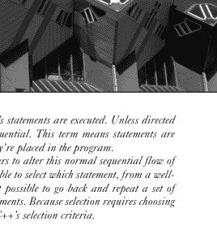

术语控制流指的是程序语句执行的顺序。除非另有指示，否则所有程序的正常控制流都是顺序的。这意味着语句按顺序执行，一个接一个，按其在程序中放置的顺序执行。

选择语句和重复语句使程序员能够改变这种正常的顺序控制流。顾名思义，选择语句使能够从一组明确定义的语句中选择下一个要执行的语句，而重复语句使能够返回并重复一组语句。在本章中，你将学习 C++ 的选择语句。由于选择需要选择替代方案，本章首先介绍 C++ 的选择标准。

### 4.1 关系表达式

除了提供加法、减法、乘法和除法功能外，所有计算机都有比较数字的能力。由于许多看似“智能”的决策情况都可以简化为在两个值之间进行选择，计算机的比较能力可用于创建令人惊叹的类智能功能。

用于比较操作数的表达式称为**关系表达式**。一个简单**关系表达式**由一个关系运算符连接两个变量和/或常量操作数组成，如图 4.1 所示。表 4.1 列出了 C++ 中可用的关系运算符。它们可用于整数、布尔、double 或字符数据，但必须严格按照表 4.1 所示的格式输入。

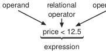

**图 4.1** 简单关系表达式的解剖结构

**表 4.1** C++ 的关系运算符

| Operator | Meaning | Example |
|---|---|---|
| `<` | Less than | `age < 30` |
| `>` | Greater than | `height > 6.2` |
| `<=` | Less than or equal to | `taxable <= 20000` |
| `>=` | Greater than or equal to | `temp >= 98.6` |
| `==` | Equal to | `grade == 100` |
| `!=` | Not equal to | `number != 250` |

以下是有效关系表达式的示例：

```
age > 40   length <= 50   width > 7
3 < 4      flag == done     idNum == 682
day != 5   2.0 > 3.3     hours > 4
```

以下示例无效：

```
length =< 50    // incorrect symbol
2.0 >> 3.3      // invalid relational operator
flag = = done   // spaces are not allowed
```

关系表达式有时称为**条件**，本书中两个术语都使用。与所有 C++ 表达式一样，关系表达式被求值以产生数值结果。¹ 被解释为真的条件求值为整数值 1，而假条件求值为整数值 0。

例如，关系 `3 < 4` 的值始终为真，该表达式的值为 1，而关系 `2.0 > 3.3` 始终为假，表达式的值为 0。这可以通过以下语句验证：

```
cout << "The value of 3 < 4 is " << (3 < 4);
cout << "\nThe value of 2.0 > 3.3 is " << (2.0 > 3.3);
```

这些语句产生以下显示：

```
The value of 3 < 4 is 1
The value of 2.0 > 3.3 is 0
```

关系表达式的值，例如 hours > 40，取决于变量 hours 中存储的值。在 C++ 程序中，关系表达式的值不如 C++ 在表达式用作选择语句的一部分时对该值进行的解释重要。在下一节中解释的这些语句中，你会看到 C++ 使用零值表示假条件，使用任何非零值表示真条件。然后，接下来执行哪个语句的选择基于此值。

除了数值操作数外，还可以使用关系运算符比较字符数据。例如，在 ASCII 编码中，字母 'A' 使用的编码数值低于字母 'B'，'B' 的编码低于 'C'，依此类推。对于以这种方式编码的字符集，以下条件被求值如下：

| Expression | Value | Interpretation |
|---|---|---|
| 'A' > 'C' | 0 | false |
| 'D' <= 'Z' | 1 | true |
| 'E' == 'F' | 0 | false |
| 'g' >= 'm' | 0 | false |
| 'b' != 'c' | 1 | true |
| 'a' == 'A' | 0 | false |

比较字母对于按字母顺序排列名称或在决策情况下使用字符来选择选项至关重要。

### 逻辑运算符

除了使用简单关系表达式作为条件外，还可以使用逻辑运算符 AND、OR 和 NOT 创建更复杂的条件。这些运算符由符号 &&、|| 和 ! 表示。

当 AND 运算符 && 与两个简单表达式一起使用时，只有当两个表达式本身都为真时条件才为真。因此，逻辑条件

```
(age > 40) && (term < 10)
```

只有当 age 大于 40 且 term 小于 10 时才为真。由于关系运算符的优先级高于逻辑运算符，该逻辑表达式中的括号可以省略。

OR 运算符 || 也与两个表达式一起使用。使用 OR 运算符时，如果两个表达式中一个或两个为真，则条件得到满足。因此，条件

```
(age > 40) || (term < 10)
```


如果 age 大于 40，或 term 小于 10，或两个条件都为真，则表达式为真。同样，包含在关系表达式周围的括号是为了使语句更易于阅读。由于关系运算符的优先级高于逻辑运算符，即使省略括号，也会进行相同的求值。

对于以下声明：

```
int i, j;
double a, b, complete;
```

以下是有效的条件：

```
a > b
(i == j) || (a < b) || complete
(a/b > 5) && (i <= 20)
```

在求值这些条件之前，必须已知 a、b、i、j 和 complete 的值。对于以下赋值：

```
a = 12.0;
b = 2.0;
i = 15;
j = 30;
complete = 0.0;
```

前面的表达式产生以下结果：

| 表达式 | 值 | 解释 |
|---|---|---:|
| `a > b` | 1 | `true` |
| `(i == j) || (a < b) || complete` | 0 | `false` |
| `(a/b > 5) && (i <= 20)` | 1 | `true` |

非运算符 ! 用于将表达式转换为其相反状态；也就是说，如果表达式具有非零值（真），则语句 !expression 产生零值（假）。如果表达式最初为假（具有零值），则 !expression 为真，其值为 1。例如，如果数字 26 存储在变量 age 中，则表达式 age > 40 的值为 0（假），而表达式 !(age > 40) 的值为 1（真）。由于非运算符只与一个表达式一起使用，因此它是一元运算符。

关系运算符和逻辑运算符的执行优先级类似于算术运算符。表 4.2 列出了这些运算符相对于您已使用的其他运算符的优先级。

## 表 4.2 运算符优先级和结合性

| 运算符 | 结合性 |
|---|---|
| ! 一元 - ++ -- | 从右到左 |
| * / % | 从左到右 |
| + - | 从左到右 |
| < <= > >= | 从左到右 |
| == != | 从左到右 |
| && | 从左到右 |
| \|\| | 从左到右 |
| = += -= *= /= | 从右到左 |

以下图表说明如何使用运算符的优先级和结合性来求值关系表达式，假设有以下声明：

```
char key = 'm';
int i = 5, j = 7, k = 12;
double x = 22.5;
```

| 表达式 | 等价表达式 | 值 | 解释 |
|---|---|---|---|
| i + 2 == k - 1 | (i + 2) == (k - 1) | 0 | 假 |
| 3 * i - j < 22 | ((3 * i) - j) < 22 | 1 | 真 |
| i + 2 * j > k | (i + (2 * j)) > k | 1 | 真 |
| k + 3 <= -j + 3 * i | (k + 3) <= ((-j) + (3*i)) | 0 | 假 |
| 'a' + 1 == 'b' | ('a' + 1) == 'b' | 1 | 真 |
| key - 1 > 'p' | (key - 1) > 'p' | 0 | 假 |
| key + 1 == 'n' | (key + 1) == 'n' | 1 | 真 |
| 25 >= x + 1.0 | 25 >= (x + 1.0) | 1 | 真 |

与所有表达式一样，可以使用括号来改变设定的运算符优先级并提高关系表达式的可读性。通过首先计算括号内的表达式，以下复合条件的求值过程如下所示：

```
(6 * 3 == 36 / 2) || (13 < 3 * 3 + 4) && !(6 - 2 < 5)
    (18 == 18)      ||  (13 < 9 + 4)   && !(4 < 5)
    1      ||          (13 < 13)      && !1
    1      ||          0             && 0
    1 ||
        0
    1
```

## 数值精度问题

在 C++ 的关系表达式中，可能会发生与单精度和双精度数字相关的微妙数值精度问题。由于计算机存储这些数字的方式，您应该避免使用关系运算符 == 来测试单精度和双精度值与变量的相等性。

原因是许多十进制数字（如 0.1）无法用有限位数的二进制精确表示，因此对这些数字进行精确相等性测试可能会失败。当您需要非整数值的相等性时，最好要求操作数之差的绝对值小于某个极小的值。因此，对于单精度和双精度操作数，一般表达式

```
operand_1 == operand_2
```

应替换为以下条件：

```
abs(operand_1 − operand_2) < EPSILON
```

EPSILON 可以是设置为任何可接受小值的常量，例如 0.0000001。因此，如果两个操作数之间的差值小于 EPSILON 的值，则认为这两个操作数本质上相等。例如，如果 x 和 y 是双精度变量，则类似

```
x/y == 0.35
```

的条件应编程为：

```
abs(x/y − 0.35) < EPSILON
```

此条件确保以二进制表示非整数时的微小不准确性不会影响所测试条件的求值。由于所有计算机对 0 都有精确的二进制表示，因此与 0 进行精确相等性比较不会出现此数值精度问题。

## 练习 4.1

- 1. （练习）假设 a = 5、b = 2、c = 4、d = 6 和 e = 3，确定以下表达式的值：
  - a. a > b
  - b. a != b
  - c. a % b == c % b
  - d. a * c != d * b
  - e. d * b == c * e
  - f. a * b
  - g. a % b * c
  - h. c % b * a
  - i. b % c * a

## 2. （练习）使用括号，重写以下表达式以正确指示其求值顺序。然后假设 a = 5、b = 2 和 c = 4，对每个表达式进行求值。

- a. a % b * c && c % b * a
- b. a % b * c || c % b * a
- c. b % c * a && a % c * b
- d. b % c * a || a % c * b

## 3. （练习）编写关系表达式来表示以下条件（使用您选择的变量名）：

- a. 一个人的年龄等于 30。
- b. 一个人的体温高于 98.6 度。
- c. 一个人的身高低于 6 英尺。
- d. 当前月份是 12（十二月）。
- e. 输入的字母是 m。
- f. 一个人的年龄等于 30，并且该人的身高超过 6 英尺。
- g. 当前日期是第 1 个月的第 15 天。
- h. 一个人超过 50 岁或在该公司工作至少 5 年。
- i. 一个人的身份证号小于 500 且该人超过 55 岁。
- j. 长度大于 2 英尺且小于 3 英尺。

## 4. （练习）假设 a = 5、b = 2、c = 4 和 d = 5，确定以下表达式的值：

- a. a == 5
- b. b * d == c * c
- c. d % b * c > 5 || c % b * d < 7

## 4.2 if-else 语句

if-else 语句指示计算机根据比较结果在两个语句之间进行选择。例如，如果新泽西州居民的收入小于或等于 20,000 美元，则适用的州税率为 2%。如果该人的收入大于 20,000 美元，则对超过 20,000 美元的部分适用不同的税率。在这种情况下，可以使用 if-else 语句根据该人的收入是否小于或等于 20,000 美元来确定税率。这是 if-else 语句的一般形式：

```
if (expression) statement1;
else statement2;
```

首先对表达式进行求值。如果其值为非零，则执行 statement1。如果其值为零，则执行关键字 else 之后的语句。因此，根据表达式的值，两个语句之一（statement1 或 statement2，但不会同时执行）总是会被执行。请注意，被测试的表达式必须用括号括起来，并且每个语句后都要放置分号。

### 1. 项目概况

本项目为某市智慧城市建设项目，旨在通过信息化手段提升城市管理效率与公共服务水平。项目总投资约1.2亿元，建设周期为24个月。

### 2. 建设内容

- - 智慧交通系统
- - 智慧安防系统
- - 智慧政务平台
- - 数据中心建设

### 3. 投资估算

| 序号 | 项目名称 | 投资金额（万元） | 占比 |
|------|----------|------------------|------|
| 1 | 智慧交通 | 4000 | 33.3% |
| 2 | 智慧安防 | 3000 | 25.0% |
| 3 | 智慧政务 | 2500 | 20.8% |
| 4 | 数据中心 | 2500 | 20.8% |

### 4. 实施计划

项目分为三个阶段实施：第一阶段（1-6个月）完成基础平台搭建；第二阶段（7-18个月）完成各子系统建设；第三阶段（19-24个月）进行系统联调与试运行。

### 5. 预期效益

项目建成后，预计可提升城市管理效率30%以上，降低公共安全事件响应时间50%，为市民提供更加便捷的政务服务。

> > 智慧城市建设是推动城市治理体系和治理能力现代化的重要举措。

（以上内容为项目概述，详细方案请参见附件。）

关系运算符 <= 用于表示“小于或等于”条件。如果 taxable 的值小于或等于 20000.0，则条件为真（值为 1），并执行语句 taxes = 0.02 * taxable;。如果条件不为真，则表达式的值为零，并执行 else 关键字之后的语句。程序 4.1 演示了在完整程序中使用此语句。

## 程序 4.1

```cpp
#include <iostream>
#include <iomanip>
using namespace std;

int main()
{
    double taxable, taxes;

    cout << "Please type in the taxable income: ";
    cin >> taxable;

    if (taxable <= 20000.0)
        taxes = 0.02 * taxable;
    else
        taxes = 0.025 * (taxable - 20000.0) + 400.0;

    cout << setiosflags(ios::fixed)
         << setiosflags(ios::showpoint)
         << setprecision(2)
         << "Taxes are $ " << taxes << endl;

    return 0;
}
```

在 if-else 语句之前和之后插入一个空行，以在程序中突出显示它。本书通篇使用这种格式来强调所讨论的语句。

为了说明选择语句的实际运行效果，程序 4.1 使用不同的输入数据运行了两次。以下是运行结果：

```
Please type in the taxable income: 10000.
Taxes are $ 200.00

and

Please type in the taxable income: 30000.
Taxes are $ 650.00
```

在查看此输出时，请注意第一次运行中输入的可纳税收入小于 20,000 美元，税率正确地计算为输入金额的 2%。在


second run, the taxable income was more than $20,000, and the else part of the if-else statement was used to yield this correct tax rate computation:
0.025 * ($30,000. - $20,000.) + $400. = $650.

Although any expression can be tested by an if-else statement, only relational expressions are generally used. However, statements such as the following are valid:

```
if (num)
    cout << "Bingo!";
else
    cout << "You lose!";
```

Because num is a valid expression by itself, the message Bingo! is displayed if num has any non-zero value, and the message You lose! is displayed if num has a value of zero.

## Compound Statements

Although only a single statement is permitted in the if and else parts of the if-else statement, each single statement can be a compound statement. A compound statement is a sequence of single statements between braces, as shown in this example:

```
{
    statement1;
    statement2;
    statement3;
    .
    .
    last statement;
}
```

Using braces to enclose a set of statements creates a single block of statements, which can be used anywhere in a C++ program in place of a single statement. The next example shows using a compound statement in the general form of an if-else statement:

```
if (expression)
{
    statement1;  // as many statements as necessary
    statement2;  // can be put inside the braces
    statement3;  // each statement must end with a ;
}
else
{
    statement4;
    statement5;
    .
    .
    last statement;
}
```

Program 4.2 shows using a compound statement in an actual program. This program checks whether the value in tempType is f. If so, the compound statement corresponding to the if part of the if-else statement is executed. Any other letter in tempType results in executing the compound statement corresponding to the else part.

### Program 4.2

```
#include <iostream>
#include <iomanip>
using namespace std;

// a temperature conversion program
int main()
{
    char tempType;
    double temp, fahren, celsius;

    cout << "Enter the temperature to be converted: ";
    cin >> temp;
    cout << "Enter an f if the temperature is in Fahrenheit";
    cout << "\n or a c if the temperature is in Celsius: ";
    cin >> tempType;

    // set output formats
    cout << setiosflags (ios::fixed)
         << setiosflags (ios::showpoint)
         << setprecision(2);

    if (tempType == 'f')
    {
        celsius = (5.0 / 9.0) * (temp - 32.0);
        cout << "\nThe equivalent Celsius temperature is "
             << celsius << endl;
    }
    else
    {
        fahren = (9.0 / 5.0) * temp + 32.0;
        cout << "\nThe equivalent Fahrenheit temperature is "
             << fahren << endl;
    }

    return 0;
}
```

A sample run of Program 4.2 follows.

    Enter the temperature to be converted: 212
    Enter an f if the temperature is in Fahrenheit
        or a c if the temperature is in Celsius: f

    The equivalent Celsius temperature is 100.00

## Block Scope

All statements contained in a compound statement constitute a single block of code, and any variable declared in this block has meaning only between its declaration and the closing braces defining the block. For example, take a look at the following example, which consists of two blocks of code:

```
    {  // start of outer block
        int a = 25;
        int b = 17;
        cout << "The value of a is " << a
             << " and b is " << b << endl;

        {  // start of inner block
            double a = 46.25;
            int c = 10;
            cout << "a is now " << a
                 << "  b is now " << b
                 << "  and c is " << c << endl;
        }  // end of inner block

        cout << "a is now " << a << " and b is " << b << endl;
    }  // end of outer block
```

This section of code produces the following output:

```
The value of a is 25 and b is 17
a is now 46.25 b is now 17 and c is 10
a is now 25 and b is 17
```

This output is produced as follows: The first block of code defines two variables named a and b, which can be used anywhere in this block after their declarations, including any block inside this outer block. In the inner block, two new variables have been declared, named a and c. Therefore, at this stage, four different variables have been created, two with the same name. When a variable is referenced, the compiler first attempts to access a variable with the correct name that has been declared in the block containing the reference. If the referenced variable hasn’t been defined in the block, the compiler attempts to access the variable declared in the next outer block, until a valid access results.

## Point of Information

### Placement of Braces in a Compound Statement

A common practice for some C++ programmers is placing the opening brace of a compound statement on the same line as the if and else statements. Using this convention, the if statement in Program 4.2 would look like the following example. (This placement is a matter of style only—both styles are used, and both are acceptable.)

```
if (tempType == 'F') {
    celsius = (5.0 / 9.0) * (temp - 32.0);
    cout << "\nThe equivalent Celsius temperature is "
         << celsius << endl;
}
else {
    fahren = (9.0 / 5.0) * temp + 32.0;
    cout << "\nThe equivalent Fahrenheit temperature is "
         << fahren << endl;
}
```

Therefore, the values of the variables a and c referenced in the inner block use the values of the variables a and c declared in that block. Because no variable named b was declared in the inner block, the value of b displayed from inside the inner block is obtained from the outer block. Finally, the last cout object, which is outside the inner block, displays the value of the variable a declared in the outer block. If an attempt is made to display the value of c anywhere in the outer block, the compiler issues an error message stating that c is an undefined symbol.

The area in a program where a variable can be used is formally referred to as the scope of the variable, and you delve into this subject in Chapter 6.

## One-Way Selection

A useful modification of the if-else statement involves omitting the else part of the statement and has this shortened and often useful form:

```
if (expression)
    statement;
```

The statement following if (expression) is executed only if the expression has a non-zero value (a true condition). As before, the statement can be a compound statement. Figure 4.3 shows the flowchart for this statement.

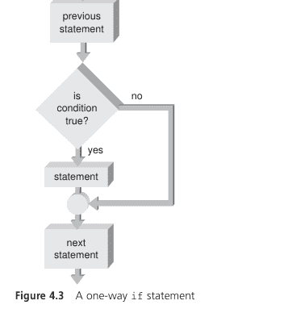

### Figure 4.3 A one-way if statement

This modified form of the if statement is called a one-way if statement. Program 4.3 uses this statement to check a car's mileage and display a message only for cars that have been driven more than 3000.0 miles.

### Program 4.3

```
#include <iostream>
using namespace std;

int main()
{
    const double LIMIT = 3000.0;
    int idNum;
    double miles;

    cout << "Please type in car number and mileage: ";
    cin >> idNum >> miles;

if(miles > LIMIT)
    cout << " Car " << idNum << " is over the limit." << endl;

    cout << "End of program output." << endl;

    return 0;
}
```

To show the one-way selection criteria in action, Program 4.3 was run twice, each time with different input data. Only the input data for the first run causes the message Car 256 is over the limit to be displayed.

```
Please type in car number and mileage: 256 3562.8
Car 256 is over the limit.
End of program output.
```

and

```
Please type in car number and mileage: 23 2562.3
End of program output.
```

## Problems Associated with the if-else Statement

Two of the most common problems encountered in using C++'s if-else statement are the following:

- Misunderstanding the full implications of what an expression is
- Using the assignment operator, =, in place of the relational operator ==

Recall that an expression is any combination of operands and operators that yields a result. This definition is much broader and more encompassing than is apparent at first. For example, all the following are valid C++ expressions:

```
age + 5
age = 30
age == 40
```

Assuming the variables are declared correctly, each of these expressions yields a result. The following example uses the cout object to display the value of these expressions when age is initially assigned the value 18:

```
age = 18;
cout << "The value of the first expression is " << (age + 5) << endl;
cout << "The value of the second expression is " << (age = 30) << endl;
cout << "The value of the third expression is " << (age == 40) << endl;
```


This code produces the following display:

```
The value of the first expression is 23
The value of the second expression is 30
The value of the third expression is 0
```

As this output shows, each expression has a value associated with it. The value of the first expression is the sum of the variable age plus 5, which is 23. The value of the second expression is 30, which is also assigned to the variable age. The value of the third expression is 0 because age is not equal to 40, and a false condition is represented in C++ with the value 0. If the value in age had been 40, the relational expression age == 40 would be true and have the value 1.

Say the relational expression age == 40 was intended to be used in the if statement

```
if (age == 40)
    cout << "Happy Birthday!";
```

but was mistyped as age = 40, resulting in the following:

```
if (age = 40)
    cout << "Happy Birthday!";
```

Because the mistake results in a valid C++ expression, and any C++ expression can be tested by an if statement, the resulting if statement is valid and causes the message Happy Birthday! to be displayed regardless of what value was previously assigned to age. Can you see why?

The condition tested by the if statement doesn't compare the value in age to the number 40. It assigns the number 40 to age. That is, the expression age = 40 isn't a relational expression at all; it's an assignment expression. At the completion of the assignment, the expression itself has a value of 40. Because C++ treats any non-zero value as true, the cout statement is executed. Another way of looking at it is to realize that the if statement is equivalent to the following statements:

```
age = 40;  // assign 40 to age
if (age)    // test the value of age
cout << "Happy Birthday!";
```

Because a C++ compiler has no means of knowing that the expression being tested isn't the one you want, you must be especially careful when writing conditions.

## Point of Information
### The Boolean Data Type

Before the current ANSI/ISO C++ standard, C++ didn’t have a built-in Boolean data type with its two Boolean values, true and false. Because this data type wasn’t originally part of the language, a tested expression could not evaluate to a Boolean value. Therefore, the syntax

```
if (Boolean expression is true)
    execute this statement;
```

also wasn’t built into C or C++. Instead, C++ uses the more encompassing syntax,

```
if (expression)
    execute this statement;
```

where expression is any expression that evaluates to a numeric value. If the value of the tested expression is a non-zero value, it’s considered true, and only a zero value is considered false.

As the ANSI/ISO C++ standard specifies, C++ has a built-in Boolean data type containing the values true and false. Boolean variables are declared with the bool keyword. As currently implemented, the actual values that the Boolean values true and false represent are the integer values 1 and 0. For example, examine the following program, which declares two Boolean variables:

```
#include <iostream>
using namespace std;
int main()
{
    bool t1, t2;

    t1 = true;
    t2 = false;
    cout << "The value of t1 is " << t1
         << "\nand the value of t2 is " << t2 << endl;

    return 0;
}
```

This program produces the following output:

```
The value of t1 is 1
and the value of t2 is 0
```

## Point of Information
### The Boolean Data Type (continued)

As shown by this output, the Boolean values true and false are represented by the integer values 1 and 0 and have the following relationships:

```
!true = is false
!false = is true
```

Additionally, applying a postfix or prefix ++ operator to a variable of type bool sets the Boolean value to true. The postfix and prefix -- operators can't be applied to Boolean variables.

Boolean values can also be compared, as shown in the following code:

```
if (t1 == t2)
    cout << "The values are equal" << endl;
else
    cout << "The values are not equal" << endl;
```

Last, assigning any non-zero value to a Boolean variable results in the variable being set to true (a value of 1), and assigning a zero value to a Boolean results in the variable being set to false (a value of 0).

## EXERCISES 4.2

- 1. (Practice) Write suitable if statements for the following conditions:
- a. If an angle is equal to 90 degrees, print the message "The angle is a right angle."; else, print the message "The angle is not a right angle."
- b. If the temperature is above 100 degrees, display the message "above the boiling point of water"; else, display the message "below the boiling point of water."
- c. If the number is positive, add the number to the variable positivesum; else, add the number to the variable negativesum.
- d. If the slope is less than 0.5, set the variable flag to 0; else, set flag to 1.
- e. If the difference between slope1 and slope2 is less than 0.001, set the variable approx to 0; else, calculate approx as the quantity (slope1 - slope2) / 2.0.
- f. If the frequency is above 60, display the message "The frequency is too high."
- g. If the difference between temp1 and temp2 exceeds 2.3, calculate the variable error as (temp1 - temp2) * factor.
- h. If x is greater than y and z is less than 20, request that the user input a value for the variable p.
- i. If distance is greater than 20 and less than 35, request that the user input a value for the variable time.

## The if-else Statement

2. (Practice) Write if statements corresponding to the conditions shown in the following flowcharts:

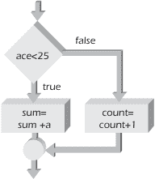

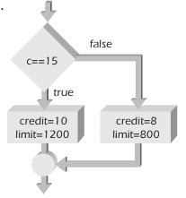

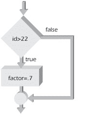

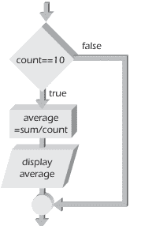

3. (Practice) Write a C++ program that asks the user to input two numbers.

If the first number entered is greater than the second number, the program should print the message “The first number is greater.”; else, it should print the message “The first number is smaller.” Test your program by entering the numbers 5 and 8 and then using the numbers 11 and 2. What do you think your program will display if the two numbers entered are equal? Test this case.

4. (Program) a. In a pass/fail course, a student passes if the grade is greater than or equal to 70 and fails if the grade is lower than 70.

Write a C++ program that accepts a grade and prints the message “A passing grade” or “A failing grade,” as appropriate.

b. How many runs should you make for the program written in Exercise 4a to verify that it’s operating correctly? What data should you input in each program run?

5. (Program) a. If money is left in a particular bank for more than 5 years, the bank pays interest at a rate of 4.5%; otherwise, the interest rate is 3.0%.

Write a C++ program that uses the cin object to accept the number of years in the variable numYears and display the correct interest rate, depending on the value input into numYears.

b. How many runs should you make for the program written in Exercise 5a to verify that it’s operating correctly? What data should you input in each program run?

6. (Practice) a. Write a C++ program to display the message “PROCEED WITH TAKEOFF” or “ABORT TAKEOFF” depending on the input.

If the character g is entered in the variable code, the first message should be displayed; otherwise, the second message should be displayed.

b. How many runs should you make for the program written in Exercise 6a to verify that it’s operating correctly? What data should you input in each program run?

7. (Program) Write, compile, and run a C++ program that accepts a user-input integer number and determines whether it’s even or odd.

The output should display the message “The entered number is even.” or “The entered number is odd.” corresponding to the number the user entered. (Hint: An even number has a 0 remainder when divided by 2.)

8. (Program) Write, compile, and run a C++ program that accepts a user-entered number and calculates the square root and the reciprocal.

Before calculating the square root, validate that the number isn’t negative, and before calculating the reciprocal, check that the number isn’t zero. If either condition occurs, display a message stating that the operation can’t be calculated.

9. (Program) Years that are evenly divisible by 400 or are evenly divisible by 4 but not by 100 are leap years.


$18.00 for each hour worked over 40 hours. The program should request the hours worked as input and display the salary as output.
b. 为验证练习 10a 中编写的程序是否正常运行，应进行多少次运行？每次程序运行应输入什么数据？

## 11. （程序）a. 高级销售员每周工资为 $800，初级销售员每周工资为 $500。编写一个 C++ 程序，将销售员的身份作为字符变量 status 输入。如果 status 等于 s，则应显示高级销售员的工资；否则，应显示初级销售员的工资。

b. 为验证练习 11a 中编写的程序是否正常运行，应进行多少次运行？每次程序运行应输入什么数据？

## 12. （程序）a. 编写一个 C++ 程序，根据输入显示消息 “I feel great today!” 或 “I feel down today #$#!”。如果变量 ch 中输入的字符为 u，则应显示第一条消息；否则应显示第二条消息。

b. 为验证练习 12a 中编写的程序是否正常运行，应进行多少次运行？每次程序运行应输入什么数据？

## 13. （程序）a. 编写程序显示以下两个提示：
Enter a month (use a 1 for Jan, etc.);
Enter a day of the month:

让程序在响应第一个提示时接受并存储变量 month 中的数字，在响应第二个提示时接受并存储变量 day 中的数字。如果输入的月份不在 1 到 12 之间，显示一条消息告知用户已输入无效月份。如果输入的日期不在 1 到 31 之间，显示一条消息告知用户已输入无效日期。

b. 如果用户为月份输入带小数点的数字，程序会做什么？如何确保 if 语句检查的是整数？

## 14. （程序）a. 编写、编译并运行一个 C++ 程序，接受输入数据并判断该字符是否为小写字母。小写字母是大于或等于 "a" 且小于或等于 "z" 的任何字符。如果输入的字符是小写字母，显示消息 “The character just entered is a lowercase letter.” 如果输入的字母不是小写字母，显示消息 “The character just entered is not a lowercase letter.”

b. 修改为练习 14a 编写的程序，使其还能判断输入的字符是否为大写字母。大写字母是大于或等于 "A" 且小于或等于 "Z" 的任何字符。

## 15. （程序）编写、编译并运行一个 C++ 程序，首先判断输入的字符是小写字母还是大写字母（参见练习 14）。如果字母是小写字母，则确定并打印其在字母表中的位置。例如，如果输入的字母是 c，程序应打印 3，因为 c 是字母表中的第三个字母。 （提示：如果输入的字符是小写字母，其位置可以通过从字母中减去 'a' 并加 1 来确定。）同样，如果字母是大写字母，则确定并打印其在字母表中的位置。例如，如果输入的字母是 G，程序应打印 7，因为 G 是字母表中的第七个字母。 （提示：如果输入的字符是大写字母，其位置可以通过从字母中减去 'A' 并加 1 来确定。）

## 16. （程序）编写、编译并运行一个 C++ 程序，要求用户输入两个数字。在程序使用一个或多个 cin 对象调用接受这些数字后，让它检查这些数字。如果输入的第一个数字大于第二个数字，程序应打印消息 “The first number is greater.”；否则，它应打印消息 “The first number is not greater than the second.” 通过输入数字 5 和 8 然后使用数字 11 和 2 测试你的程序。如果输入的两个数字相等，你的程序会显示什么？

## 17. （调试）以下程序无论输入什么字母都会显示消息 Hello there!。确定错误所在以及为什么程序总是导致该消息被显示。

```
#include <iostream>
using namespace std;
int main()
{
    char letter;

    cout << "Enter a letter: ";
    cin >> letter;
    if (letter = 'm')
        cout << "Hello there!" << endl;

    return 0;
}
```

## 4.3 嵌套 if 语句

正如你所见，if-else 语句可以包含任何有效的 C++ 简单语句或复合语句，包括另一个 if-else 语句。因此，一个或多个 if-else 语句可以包含在 if-else 语句的任一部分中。将一个或多个 if 语句包含在现有的 if 语句内部称为嵌套 if 语句。例如，将以下一元 if 语句

```
if (distance > 500)
    cout << "snap";
```

替换为此 if 语句中的 statement1

```
if (hours < 9)
    statement1;
else
    cout << "pop";
```

## 2024年1月全国新能源并网消纳情况

根据《国家能源局关于2021年风电、光伏发电开发建设有关事项的通知》（国能发新能〔2021〕25号），为引导新能源理性投资、有序建设，现将2024年1月各省级区域新能源并网消纳情况公布如下。

| 省份 | 风电利用率 | 光伏利用率 |
|------|-----------|-----------|
| 北京 | 99.5% | 99.8% |
| 天津 | 99.2% | 99.5% |
| 河北 | 96.8% | 97.2% |
| 山西 | 97.5% | 98.0% |
| 山东 | 98.1% | 98.6% |
| 内蒙古 | 94.2% | 95.1% |
| 辽宁 | 97.8% | 98.3% |
| 吉林 | 96.5% | 97.0% |
| 黑龙江 | 95.9% | 96.4% |
| 上海 | 99.7% | 99.9% |
| 江苏 | 98.9% | 99.2% |
| 浙江 | 99.0% | 99.3% |
| 安徽 | 98.5% | 98.9% |
| 福建 | 99.3% | 99.6% |
| 江西 | 98.2% | 98.7% |
| 河南 | 97.0% | 97.5% |
| 湖北 | 98.6% | 99.0% |
| 湖南 | 98.3% | 98.8% |
| 广东 | 99.4% | 99.7% |
| 广西 | 97.2% | 97.8% |
| 海南 | 99.1% | 99.4% |
| 重庆 | 99.6% | 99.8% |
| 四川 | 98.8% | 99.1% |
| 贵州 | 96.2% | 96.8% |
| 云南 | 97.6% | 98.2% |
| 西藏 | 92.5% | 93.8% |
| 陕西 | 97.3% | 97.9% |
| 甘肃 | 93.8% | 94.5% |
| 青海 | 91.2% | 92.0% |
| 宁夏 | 96.0% | 96.6% |
| 新疆 | 94.5% | 95.2% |

注：统计数据覆盖全国31个省（区、市），不含港澳台地区。

The chain can be continued indefinitely by repeatedly making the last statement another if-else statement. Therefore, the general form of an if-else chain is as follows:

```
if (expression_1)
    statement1;
else if (expression_2)
    statement2;
else if (expression_3)
    statement3;
    .
    .
else if (expression_n)
    statement_n;
else
    last_statement;
```

与所有 C++ 语句一样，每个语句可以是被大括号包围的复合语句。为了举例说明使用 if-else 链，程序 4.4 显示与输入字母相对应的个人的婚姻状况。使用了以下字母代码：

| Input Code | Marital Status |
|---|---|
| M | Married |
| S | Single |
| D | Divorced |
| W | Widowed |

### Program 4.4

```
#include <iostream>
using namespace std;

int main()
{
    char marcode;

    cout << "Enter a marital code: ";
    cin >> marcode;

    if (marcode == 'M')
        cout << "Individual is married." << endl;
    else if (marcode == 'S')
        cout << "Individual is single." << endl;
```

```
else if (marcode == 'D')
    cout << "Individual is divorced." << endl;
else if (marcode == 'W')
    cout << "Individual is widowed." << endl;
else
    cout << "An invalid code was entered." << endl;

return 0;
}
```

作为 if-else 链的另一个示例，请看使用以下佣金计划确定销售员月收入的情况：

| Monthly Sales | Income |
|---|---|
| Greater than or equal to $50,000 | $375 plus 16% of sales |
| Less than $50,000 but greater than or equal to $40,000 | $350 plus 14% of sales |
| Less than $40,000 but greater than or equal to $30,000 | $325 plus 12% of sales |
| Less than $30,000 but greater than or equal to $20,000 | $300 plus 9% of sales |
| Less than $20,000 but greater than or equal to $10,000 | $250 plus 5% of sales |
| Less than $10,000 | $200 plus 3% of sales |

可以使用以下 if-else 链来确定正确的月收入；monthlySales 变量用于存储销售员当前的月销售额：

```
if (monthlySales >= 50000.00)
    income = 375.00 + .16 * monthlySales;
else if (monthlySales >= 40000.00)
    income = 350.00 + .14 * monthlySales;
else if (monthlySales >= 30000.00)
    income = 325.00 + .12 * monthlySales;
else if (monthlySales >= 20000.00)
    income = 300.00 + .09 * monthlySales;
else if (monthlySales >= 10000.00)
    income = 250.00 + .05 * monthlySales;
else
    income = 200.00 + .03 * monthlySales;
```

请注意，此示例利用了在找到真条件后链停止的特性，通过先检查最高的月销售额。如果销售员的月销售额小于 $50,000，if-else 链会继续检查下一个最高的销售额，依此类推，直到获得正确的类别。程序 4.5 使用此 if-else 链计算并显示与在 cin 对象中输入的 monthly sales 值相对应的收入。


## 程序 4.5

```
#include <iostream>
#include <iomanip>
using namespace std;

int main()
{
    double monthlySales, income;

    cout << "Enter the value of monthly sales: ";
    cin >> monthlySales;
    if (monthlySales >= 50000.00)
        income = 375.00 + .16 * monthlySales;
    else if (monthlySales >= 40000.00)
        income = 350.00 + .14 * monthlySales;
    else if (monthlySales >= 30000.00)
        income = 325.00 + .12 * monthlySales;
    else if (monthlySales >= 20000.00)
        income = 300.00 + .09 * monthlySales;
    else if (monthlySales >= 10000.00)
        income = 250.00 + .05 * monthlySales;
    else
        income = 200.00 + .03 * monthlySales;

    cout << setiosflags(ios::showpoint)
         << setiosflags(ios::fixed)
         << setprecision(2)
         << "The income is $" << income << endl;

    return 0;
}
```

程序 4.5 的一个示例运行如下：

```
Enter the value of monthly sales: 36243.89
The income is $4674.27
```

## 练习 4.3

- 1. （练习）锐角小于 90 度，钝角大于 90 度，直角等于 90 度。利用此信息，编写一个 C++ 程序，接受以度为单位的角度，并显示对应输入度的角度类型。

利用此信息，编写、编译并运行一个 C++ 程序，以用户输入接受雷诺数并显示一条消息，指示流动是层流、湍流还是过渡的。

### 6. （程序）系统关键部件的公差根据以下时间表确定：

| 规格状态 | 公差 |
|---|---|
| 航天探索 | 小于 0.1% |
| 军用级 | 大于或等于 0.1% 且小于 1% |
| 商用级 | 大于或等于 1% 且小于 10% |
| 玩具级 | 大于或等于 10% |

利用此信息，编写、编译并运行一个 C++ 程序，接受部件的公差读数并确定应分配给它的规格。

### 7. （程序）a. 编写、编译并运行一个程序，接受两个实数和一个选择代码作为用户输入。如果输入的选择代码为 1，则程序应将两个先前输入的数字相加并显示结果；如果选择代码为 2，则应将数字相乘；如果选择代码为 3，则应将第一个数字除以第二个数字。

b. 确定在练习 7a 中编写的程序在输入的数字为 3 和 0 且选择代码为 3 时会做什么。

c. 修改练习 7a 中编写的程序，使其不允许除以 0，并在尝试此除法时显示一条消息。

### 8. （程序）从原点开始的线段所在象限由该线段与正 x 轴的夹角决定，如下所示：

| 从正 x 轴的角度 | 象限 |
|---|---|
| 在 0 到 90 度之间 | I |
| 在 90 到 180 度之间 | II |
| 在 180 到 270 度之间 | III |
| 在 270 到 360 度之间 | IV |

a. 利用此信息，编写、编译并运行一个 C++ 程序，以用户输入接受线的角度并确定并显示输入数据的正确象限。 （注意：如果角度恰好为 0、90、180 或 270 度，则相应的线不在任何象限内，而是位于坐标轴上。）

b. 修改为练习 8a 编写的程序，以显示一条消息，将 0 度的角度标识为正 x 轴，将 90 度的角度标识为正 y 轴，将 180 度的角度标识为负 x 轴，将 270 度的角度标识为负 y 轴。

### 9. （程序）编写、编译并运行一个 C++ 程序，接受一个数字后跟一个空格然后是一个字母。如果数字后面的字母是 f，则程序应将输入的数字视为华氏温度，将其转换为等效摄氏温度并显示合适的消息。如果字母是 c，则程序应将输入的数字视为摄氏温度，将其转换为等效华氏温度并显示合适的消息。如果字母既不是 f 也不是 c，则程序应显示一条消息，指出输入的数据不正确然后终止。使用程序中的 if-else 链并使用以下转换公式：摄氏 = (5.0 / 9.0) × (华氏 - 32.0) 华氏 = (9.0 / 5.0) × 摄氏 + 32.0

### 10. （程序）许多州根据汽车的车型年份和重量，使用类似于以下的时间表来确定年度汽车注册费：

| 车型年份 | 重量 | 重量等级 | 注册费 |
|---|---|---|---|
| 1990 年或更早 | 少于 2700 磅 | 1 | 26.50 |
|  | 2700 到 3800 磅 | 2 | 35.50 |
|  | 超过 3800 磅 | 3 | 56.50 |
| 1991 年至 1999 年 | 少于 2700 磅 | 4 | 35.00 |
|  | 2700 到 3800 磅 | 5 | 45.50 |
|  | 超过 3800 磅 | 6 | 62.50 |
| 2000 年或以后 | 少于 3500 磅 | 7 | 49.50 |
|  | 3500 磅或更多 | 8 | 62.50 |

利用此信息，编写、编译并运行一个 C++ 程序，接受汽车的年份和重量并确定并显示其重量等级和注册费。

### 11. （调试）使用程序 4.5 中的佣金时间表，以下程序计算月收入：

```
#include <iostream>
#include <iomanip>
using namespace std;

int main()
{
    double monthlySales, income;

    cout << "Enter the value of monthly sales: ";
    cin >> monthlySales;
    if (monthlySales >= 50000.00)
        income = 375.00 + .16 * monthlySales;
    if (monthlySales >= 40000.00 && monthlySales < 50000.00)
        income = 350.00 + .14 * monthlySales;
    if (monthlySales >= 30000.00 && monthlySales < 40000.00)
        income = 325.00 + .12 * monthlySales;
```

```
if (monthlySales >= 20000.00 && monthlySales < 30000.00)
    income = 300.00 + .09 * monthlySales;
if (monthlySales >= 10000.00 && monthlySales < 20000.00)
    income = 250.00 + .05 * monthlySales;
if (monthlySales < 10000.00)
    income = 200.00 + .03 * monthlySales;
```

```
cout << setiosflags(ios::showpoint)
    << setiosflags(ios::fixed)
    << setprecision(2)
    << "\n\nThe income is $" << income << endl;
```

```
return 0;
}
```

- a. 此程序是否会产生与程序 4.5 相同的输出？
- b. 哪个程序更好？为什么？

### 12. （调试）以下程序被编写为产生与程序 4.5 相同的结果：

```
#include <iostream>
#include <iomanip>
using namespace std;

int main()
{
    double monthlySales, income;

    cout << "Enter the value of monthly sales: ";
    cin >> monthlySales;
```

```
if (monthlySales < 10000.00)
    income = 200.00 + .03 * monthlySales;
else if (monthlySales >= 10000.00)
    income = 250.00 + .05 * monthlySales;
else if (monthlySales >= 20000.00)
    income = 300.00 + .09 * monthlySales;
else if (monthlySales >= 30000.00)
    income = 325.00 + .12 * monthlySales;
else if (monthlySales >= 40000.00)
    income = 350.00 + .14 * monthlySales;
else if (monthlySales >= 50000.00)
    income = 375.00 + .16 * monthlySales;
```

```
cout << setiosflags(ios::showpoint)
    << setiosflags(ios::fixed)
    << setprecision(2)
    << "The income is $" << income << endl;

return 0;
}
```

- a. 这个程序做什么？
- b. 对于哪些月销售额值，这个程序会计算正确的收入？

## 4.4 switch 语句

if-else 链用于编程应用中，必须从许多可能的选择中选择一组指令。switch 语句是 if-else 链的替代方案，用于比较整数表达式与特定值的情况。它具有以下一般形式：

```
switch (integer_expression)
{   // 复合语句的开始
    case value_1:  // 以冒号结尾
        statement1;
        statement2;
        .
        .
        break;
    case value_2:  // 以冒号结尾
        statementm;
        statementn;
        .
        .
        break;
    .
    .
    case value_n:  // 以冒号结尾
        statementw;
        statementx;
        .
        .
        break;
    default:  // 以冒号结尾
        statementaa;
        statementbb;
        .
        .
}   // switch 和复合语句的结束
```


switch 语句使用了四个新的关键字：switch、case、default 和 break。下面的讨论将解释这些关键字各自的作用。

switch 关键字标识 switch 语句的开始。随后，系统会计算 switch 后括号中的表达式，并将结果与复合语句中包含的候选值进行比较。switch 语句中的表达式必须计算出整数结果，否则会产生编译错误。

在 switch 语句中，case 关键字标识要与 switch 表达式的值进行比较的值。系统会按照 case 值列出的顺序依次进行比较，直到找到匹配项，然后从匹配项后面的语句开始执行。如图 4.4 所示，switch 表达式的值决定了实际开始执行的位置。

```
switch (expression) // evaluate expression
{
case value_1:
...
break;
case value_2:
...
break;
case value_3:
...
break;
...
case value_n:
...
break;
default:
...
} // end of switch statement
```

## 图 4.4 表达式决定执行的入口点

switch 语句可以按照任意顺序包含任意数量的 case 标签。但是，如果表达式的值与任何 case 值都不匹配，则除非遇到 default 关键字，否则不会执行任何语句。（default 关键字是可选的，其作用类似于 if-else 链中的最后一个 else。）如果表达式的值与任何 case 值都不匹配，程序将从 default 关键字后面的语句开始执行。

switch 语句找到入口点后，将忽略后续所有 case 值的计算。程序会一直执行到复合语句末尾，除非遇到 break 关键字。break 标识一个 case 的结束，并使程序立即退出 switch 语句。正如 case 关键字标识复合语句中可能的入口点一样，break 关键字决定终止点。如果省略 break 语句，则匹配的 case 值之后的所有 case（包括 default case）都会被执行。

编写 switch 语句时，可以使用多个 case 值来指向同一组语句；如前所述，default 关键字是可选的。例如，请看下面的代码：

```
switch (number)
{
    case 1:
        cout << "Have a Good Morning\n";
        break;
    case 2:
        cout << "Have a Happy Day\n";
        break;
    case 3:
    case 4:
    case 5:
        cout << "Have a Nice Evening\n";
}
```

如果 number 变量中存储的值为 1，则显示消息 Have a Good Morning。同样，如果 number 的值为 2，则显示第二条消息。最后，如果 number 的值为 3、4 或 5，则显示最后一条消息。由于最后三个 case 要执行的语句相同，因此可以像示例中那样，将这些值对应的 case 语句“堆叠在一起”。此外，由于没有 default 关键字，如果 number 的值不是列出的 case 值之一，则不会显示任何消息。虽然按照递增顺序列出 case 值是一种良好的编程习惯，但 switch 语句并不要求必须这样做。switch 语句可以包含任意数量、任意顺序的 case 值；只需列出要测试的值即可。

程序 4.6 使用 switch 语句，根据 opselect 变量的值选择要对两个数字执行的算术运算（加法、乘法或除法）。

## 程序 4.6

```
#include <iostream>
using namespace std;
int main()
{
    int opselect;
```

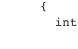

```
double fnum, snum;

cout << "Please type in two numbers: ";
cin >> fnum >> snum;
cout << "Enter a select code: ";
cout << "\n      1 for addition";
cout << "\n      2 for multiplication";
cout << "\n      3 for division : ";
cin >> opselect;

switch (opselect)
{
case 1:
    cout << "The sum of the numbers entered is "
         << fnum+snum << endl;
    break;
case 2:
    cout << "The product of the numbers entered is "
         << fnum*snum << endl;
    break;
case 3:
    cout << "The first number divided by the second is "
         << fnum/snum << endl;
    break;
}      // end of switch

return 0;
}  // end of main()
```

在下面两次示例运行中，显示内容清楚地标识了所选择的 case：

请输入两个数字：12 3  
请输入选择代码：
    1 表示加法
    2 表示乘法
    3 表示除法：2

输入数字的乘积为 36

以及

请输入两个数字：12 3  
请输入选择代码：
    1 表示加法
    2 表示乘法
    3 表示除法：3

第一个数字除以第二个数字的结果为 4

回顾程序 4.6 时，请注意最后一个 case 语句中的 break 语句。虽然这里并非必需，但在 switch 语句的最后一个 case 中使用 break 结束语句是一种良好的编程习惯。如果以后向 switch 语句中添加其他 case，它可以避免潜在的程序错误。添加新 case 后，case 之间的 break 关键字可以确保你在修改时不会忘记添加 break。

由于字符数据类型在表达式中总是会转换为整数，因此 switch 语句也可以根据字符表达式的值进行“切换”。例如，假设 choice 是一个字符变量，下面的 switch 语句就是有效的：

```
switch(choice)
{
    case 'a': case 'e': case 'i': case 'o': case 'u':
        cout << "The character in choice is a vowel\n";
        break;
    default:
        cout << "The character in choice is not a vowel\n";
        break;    // this break is optional
}    // end of switch statement
```

## 练习 4.4

- 1.（修改）使用 switch 语句重写下面的 if-else 链：
    if (letterGrade == 'A')
        cout << "The numerical grade is between 90 and 100\n";
    else if (letterGrade == 'B')
        cout << "The numerical grade is between 80 and 89.9\n";
    else if (letterGrade == 'C')
        cout << "The numerical grade is between 70 and 79.9\n";
    else if (letterGrade == 'D')
        cout << "How are you going to explain this one?\n";
    else
    {
        cout << "Of course I had nothing to do with my grade.\n";
        cout << "It must have been the professor's fault.\n";
    }

- 2.（修改）使用 switch 语句重写下面的 if-else 链：
    if (bondType == 1)
    {
        inData();
        check();
    }
    else if (bondType == 2）

```
dates();
leapYr();
}
else if (bondType == 3)
{
    yield();
    maturity();
}
else if (bondType == 4)
{
    price();
    roi();
}
else if (bondType == 5)
{
    files();
    save();
}
else if (bondType == 6)
{
    retrieve();
    screen();
}
```

3.（编程）货运中的每个存储驱动器都印有一个 1 到 4 之间的代码，分别表示以下存储容量：

| 代码 | 容量 |
|------|------|
| 1 | 2 GB |
| 2 | 4 GB |
| 3 | 16 GB |
| 4 | 32 GB |

编写、编译并运行一个 C++ 程序，接受代码编号作为输入值，并根据输入的值显示正确的存储驱动器容量。

- 4.（修改）使用 switch 语句重写程序 4.4。

- 5.（修改）使用 switch 语句而不是 if-else 链，重新完成第 4.3 节中的练习 9。

- 6.（修改）使用字符变量作为选择代码，重写程序 4.6。

- 7.（思考）说明为什么程序 4.5 中的 if-else 链不能替换为 switch 语句。

## 4.5 常见编程错误

C++ 的选择语句中常见以下三种编程错误：

- 1. 使用赋值运算符 = 代替关系运算符 ==。这个错误可能令人沮丧，因为任何表达式都可以由 if-else 语句进行测试，所以这不是编译器能够发现的语法错误。相反，它是一种逻辑错误，可能很难定位。例如，下面的语句：

```
if (opselect = 2)
    cout << "Happy Birthday";
else
    cout << "Good Day";
```

无论 opselect 变量的初始值是什么，最终都会显示消息 Happy Birthday。原因是赋值表达式 opselect = 2 的值为 2，而在 C++ 中，2 被视为真值。要判断 opselect 中的值，正确的表达式应为 opselect == 2。

- 2. 让 if-else 语句看起来选择了错误的选项。在这种典型的调试问题中，程序员错误地将注意力集中在被测试条件上，并认为问题源于该条件。例如，假设下面的 if-else 语句是程序的一部分：

```
if (key == 'F')
{
    contemp = (5.0/9.0) * (intemp - 32.0);
    cout << "Conversion to Celsius was done";
}
else
{
    contemp = (9.0/5.0) * intemp + 32.0;
    cout << "Conversion to Fahrenheit was done";
}
```

当变量 key 包含 F 时，该语句总是显示 Conversion to Celsius was done。因此，如果你认为 key 不包含 F，却看到了这条消息，就应该检查 key 的值。一般来说，只要选择语句的行为与你预期不符，就应该通过显示被测试变量的值来检验你对这些变量所赋值的假设。如果显示出了未预期的值，那么至少可以将问题来源定位到变量，而不是 if-else 语句的结构。接下来，你需要确定错误的值是在何处以及如何产生的。


- 3. 使用嵌套的 if 语句而未包含大括号来表示结构。在没有大括号的情况下，编译器默认将 else 与最近的未配对 if 配对，这有时会破坏选择语句的原始意图。为了避免此问题并创建可适应变化的代码，将所有 if-else 语句都写成如下形式的复合语句是有用的：

```
if (expression)
{
    one or more statements in here
}
else
{
    one or more statements in here
}
```

无论以后添加多少语句，此形式都能保持 if 语句的原始意图。

### 4.6 Chapter Summary

- 1. 关系表达式，也称为条件，用于比较操作数。如果关系表达式为真，则表达式的值为整数 1。如果关系表达式为假，则其整数值为 0。关系表达式是通过使用以下关系运算符创建的：

| Relational Operator | Meaning | Example |
|---|---|---|
| < | Less than | age < 30 |
| > | Greater than | height > 6.2 |
| <= | Less than or equal to | taxable <= 20000 |
| >= | Greater than or equal to | temp >= 98.6 |
| == | Equal to | grade == 100 |
| != | Not equal to | number != 250 |

- 2. 更复杂的条件可以通过使用 C++ 的逻辑运算符 &&（AND）、||（OR）和 !（NOT）从关系表达式构造而成。

- 3. if-else 语句用于根据表达式的值在两个备选语句之间进行选择。虽然通常使用关系表达式作为被测试的表达式，但任何有效表达式都可以使用。在测试表达式时，if-else 语句将非零值解释为真，将零值解释为假。if-else 语句的一般形式如下：

```
if (expression)
    statement1;
else
    statement2;
```

此形式为双向选择语句。如果表达式具有非零值，则被视为真并执行 statement1；否则执行 statement2。

- 4. if-else 语句可以包含其他 if-else 语句。在没有大括号的情况下，每个 else 都与最近的前一个未配对 if 关联。

- 5. if-else 链是一种多路选择语句，其一般形式如下：

```
if (expression_1)
    statement_1;
else if (expression_2)
    statement_2;
else if (expression_3)
    statement_3;
    .
    .
    .
else if (expression_m)
    statement_m;
else
    statement_n;
```

每个表达式按其在链中出现的顺序进行求值。如果某个表达式为真（具有非零值），则仅执行该表达式与下一个 else if 或 else 之间的语句，并且不再测试后续表达式。最后的 else 是可选的，只有在之前没有任何表达式为真时，才会执行对应于最后 else 的语句。

- 6. 复合语句由任意数量的单个语句组成，并用大括号对 { 和 } 括起来。复合语句被视为一个单一单元，可在任何可以使用单个语句的地方使用。

- 7. 变量仅在其声明的块中才有意义，其中包括包含在声明块中的任何内部块。

- 8. switch 语句是一种多路选择语句，其一般形式如下：

```
switch (integer_expression)
{   // start of compound statement
case value_1:  // terminated with a colon
    statement1;
    statement2;
    .
    .
    break;
case value_2:  // terminated with a colon
    statementm;
    statementn;
    break;
case value_n:  // terminated with a colon
    statementw;
    statementx;
    break;
default:  // terminated with a colon
    statementaa;
    statementbb;
}  // end of switch and compound statement
```

对于此语句，将整数表达式的值与整数或字符常量或常量表达式进行比较。程序执行被转移到第一个匹配的 case 并继续执行到 switch 语句的末尾，除非遇到可选的 break 语句。switch 语句中的 case 值可以按任意顺序出现，并且可以包含可选的 default case。如果没有其他 case 匹配，则执行 default case。

### 4.7 Chapter Supplement: A Closer Look at Testing

理论上，一套全面的测试运行将揭示所有可能的程序错误，并确保程序对于任何输入和计算数据的组合都能正确工作。实际上，这种级别的测试需要检查所有可能的语句执行组合。由于所需的时间和精力，除非是极其简单的程序，否则此目标通常是不可能的。要了解原因，请看 Program 4.7。


```cpp
#include <iostream>
using namespace std;

int main()
{
    int num;
    cout << "Enter a number: ";
    cin >> num;

    if (num == 5)
        cout << "Bingo!\n";
    else
        cout << "Bongo!\n";

    return 0;
}
```

Program 4.7 有两条路径可供程序从其开始大括号执行到其结束大括号时遍历。第一条路径在输入数字为 5 时执行，其序列为：

```
cout << "Enter a number";
cin >> num;
cout << "Bingo!\n";
```

第二条路径在输入除 5 以外的任何数字时执行，其指令序列包括：

```
cout << "Enter a number";
cin >> num;
cout << "Bongo!\n";
```

测试 Program 4.7 的每条可能路径需要进行两次运行，并 judiciously 选择测试输入数据以确保 if 语句的两条路径都得到执行。在程序中再添加一个 if 语句会使可能的执行路径数量增加一倍，并需要四次（即 2²）运行才能完全测试。类似地，由三个未嵌套的 if-else 语句组成的程序需要八次（即 2³）运行才能完全测试，而包含四个未嵌套的 if-else 语句的程序需要 16 次（即 2⁴）测试运行。

现在考虑一个仅由 10 个模块组成的程序，每个模块包含五个 if 语句。假设模块始终按相同顺序调用，每个模块有 32 条可能路径（2⁵），而整个程序（所有模块按顺序执行）有超过 1,000,000,000,000,000 条可能路径（2⁵⁰，表示模块数量乘以每个模块的 if 语句数量）。创建测试数据所需的时间以及用测试数据执行每条路径所需的计算机运行时间使此程序的完全测试几乎不可能。

无法完全测试所有语句执行序列的组合导致了编程格言“没有无错误的程序”。它也导致了这样一种认识：任何测试都应经过深思熟虑，以最大化发现错误的可能性。至少，测试数据应包括输入数据的合适值、程序应拒绝的不合法输入值，以及程序中选择语句所检查的限制值。

## Chapter 5: Repetition

- 5.1 The while Statement
- 5.2 Interactive while Loops
- 5.3 The for Statement
- 5.4 The do while Statement
- 5.5 Common Programming Errors
- 5.6 Chapter Summary


到目前为止你所检查的程序已经说明了输入、输出、赋值和选择能力所涉及的编程概念。到此时，你应该已经积累了足够的经验，能够自如地使用这些概念以及在 C++ 中实现它们的机制。然而，许多问题需要重复能力，即使用不同的数据集反复重复相同的计算或指令序列。重复类型的例子包括不断检查用户数据输入直到输入可接受的条目，例如有效的密码；计数和累积运行总计；以及在输入哨兵值之前不断接受输入数据并重新计算输出值。

本章探讨程序员在构建代码重复部分时使用的方法，并解释它们如何在 C++ 中实现。更常见的是，重复的代码部分被称为循环，因为在执行代码中的最后一个语句后，程序可以分支或循环回到第一个语句并开始另一次代码重复。每次重复也称为一次迭代或一次循环遍历。在本章中，你将探索用于创建循环的 C++ 语句：while、for 和 do-while。


## 5.1 while 语句

while 语句是一种通用的重复语句，可用于多种编程情况。其一般形式如下：

```
while (expression)
statement;
```

括号中的表达式的求值方式与 if-else 语句中的完全相同；不同之处在于表达式的使用方式。正如你所见，当 if-else 语句中的表达式为真（具有非零值）时，其后的语句执行一次。在 while 语句中，其后语句会只要表达式求值为非零值就重复执行。自然地，这意味着 while 语句中必须包含一个改变被测试表达式值的语句。正如你将看到的，情况确实如此。现在，仅考虑表达式和括号后跟随的语句，计算机在评估 while 语句时使用以下过程：

- 1. 测试表达式
- 2. 如果表达式具有非零（真）值
  - a. 执行括号后的语句
  - b. 返回步骤 1
- 否则
- 退出 while 语句并执行 while 语句后下一个可执行的语句

请注意，步骤 2b 强制程序控制转移回步骤 1。这种将控制转移回 while 语句开始处以重新评估表达式的方式形成了程序循环。while 语句字面上的循环回自身以重新检查表达式，直到其求值为零（变为假）。这种重新检查意味着循环必须包含允许改变被测试表达式值的规定。正如你将看到的，确实提供了这种规定。

图 5.1 显示了 while 语句产生的循环过程。菱形形状用于显示 while 语句决策部分所需的两个入口和两个出口点。

为了使这种循环过程更具体，考虑关系表达式 count <= 10 和语句 cout << count;。使用这些元素，你可以编写以下有效的 while 语句：

```
while (count <= 10)
    cout << count;
```

虽然此语句有效，但细心的读者会意识到它会造成 cout 语句被永远调用（或直到你停止程序）或根本不被调用的情况。原因如下：如果 count 在表达式首次求值时具有小于或等于 10 的值，就会进行一次 cout 调用。然后 while 语句自动循环回自身并重新测试表达式。因为你没有改变 count 中存储的值，表达式仍然为真，又会进行一次 cout 调用。此过程会无限期继续，或直到包含此语句的程序被用户提前停止。然而，如果

count 最初的值大于 10，表达式从一开始就是假的，cout 调用永远不会被执行。

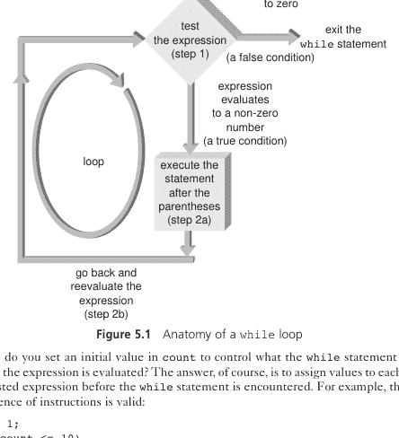

### 图 5.1 while 循环的解剖

你如何在 count 中设置初始值以控制 while 语句在表达式首次求值时所做的事情？答案，当然是，在遇到 while 语句之前先为测试表达式中的每个变量赋值。例如，以下指令序列是有效的：

```
count = 1;
while (count <= 10)
    cout << count << " ";
```

使用此指令序列可确保 count 从 1 开始。你可以在赋值语句中为 count 分配任何值。重要的是要分配某个值。在实践中，所分配的值取决于应用程序。

你仍必须改变 count 的值，以便最终退出 while 语句。为此需要一个类似 count = count + 1 的表达式，每次执行 while 语句时递增 count 的值。while 语句提供对单个语句的重复并不妨碍包含一个改变 count 值的额外语句。你所要做的就是用复合语句替换单个语句，如此示例所示：

```
count = 1;      // initialize count
while (count <= 10)
{
    cout << count << " ";
    count++;       // increment count
}
```

请注意，为了清晰起见，复合语句中的每个语句都放在不同的行上。此格式与第 4 章中为复合语句采用的约定一致。

现在分析前面的指令序列。第一个赋值语句将 count 设置为 1。然后进入 while 语句，表达式首次求值。因为 count 的值小于或等于 10，表达式为真，复合语句被执行。复合语句中的第一个语句使用 cout 对象显示 count 的值。下一个语句将 1 加到当前存储在 count 中的值上，使该值等于 2。然后 while 语句循环回以重新测试表达式。因为 count 仍小于或等于 10，复合语句再次执行。此过程一直持续到 count 的值达到 11。程序 5.1 显示了这些语句在一个实际程序中的情况。

### 程序 5.1

```
#include <iostream>
using namespace std;

int main()
{
    int count;

    count = 1;      // initialize count
    while (count <= 10)
    {
        cout << count << " ";
        count++;       // increment count
    }

    return 0;
}
```

程序 5.1 的输出如下：

1 2 3 4 5 6 7 8 9 10

请注意，程序 5.1 中使用的名称 count 并没有什么特别之处。任何有效的整数变量都可以使用。

在查看 while 语句的其他示例之前，对程序 5.1 有两点评论是必要的。首先，语句 count++ 可以被任何改变 count 值的语句替换。例如，语句 count = count + 2; 会导致每隔一个整数被显示。其次，确保 count 以导致正常退出 while 语句的方式被改变是程序员的责任。例如，如果你用表达式 count-- 替换表达式 count++，count 的值永远不会超过 10，从而创建无限循环。无限循环是指永远不会结束的循环。计算机不会拍拍你的肩膀说：“对不起，你创建了一个无限循环。”程序只是不断显示数字，直到你意识到它没有按预期工作。

现在你对 while 语句有了一定的熟悉程度，看看你是否能阅读并确定程序 5.2 的输出。

### 程序 5.2

```
#include <iostream>
using namespace std;

int main()
{
    int i;

    i = 10;
    while (i >= 1)
    {
        cout << i << " ";
        i--;  // subtract 1 from i
    }

    return 0;
}
```

程序 5.2 中的赋值语句最初将 int 变量 i 设置为 10。然后 while 语句检查 i 的值是否大于或等于 1。只要表达式为真，i 的值就会由 cout 对象显示，并且 i 的值递减 1。当 i 最终达到 0 时，表达式为假，程序退出 while 语句。因此，程序 5.2 在运行时会产生以下显示：

10 9 8 7 6 5 4 3 2 1

为了理解 while 语句的强大功能，考虑打印从 1 到 10 的数字表以及这些数字的平方和立方。你可以用一个简单的 while 语句来完成此操作，如程序 5.3 所示。

### 程序 5.3

```
#include <iostream>
#include <iomanip>
using namespace std;

int main()
{
    int num;
    cout << "NUMBER   SQUARE   CUBE\n"
         << "------   ------   ----\n";

    num = 1;
    while (num < 11)
    {
        cout << setw(3) << num << "      "
             << setw(3) << num * num << "      "
             << setw(4) << num * num * num << endl;
        num++;  // increment num
    }

    return 0;
}
```

当程序 5.3 运行时，会产生以下显示：

| NUMBER | SQUARE | CUBE |
| ------ | ------ | ---- |
| 1      | 1      | 1    |
| 2      | 4      | 8    |
| 3      | 9      | 27   |
| 4      | 16     | 64   |
| 5      | 25     | 125  |
| 6      | 36     | 216  |
| 7      | 49     | 343  |
| 8      | 64     | 512  |
| 9      | 81     | 729  |
| 10     | 100    | 1000 |

请注意，程序 5.3 中使用的表达式是 num < 11。对于整数变量 num，此表达式与表达式 num <= 10 完全等价。选择使用哪一个完全取决于你。

如果你想使用程序 5.3 生成 1000 个数字的表，你所要做的就是将 while 语句中的表达式从 num < 11 改为 num < 1001。将 11 改为 1001 会生成 1000 行的表——对于一个简单的五行 while 语句来说，这并不算坏。


`while` 语句的所有程序示例都使用了固定次数循环，因为被测试的条件是一个计数器，用于检查固定的重复次数。在固定次数循环的一种变体中，计数器每次循环不是增加 1，而是增加其他值。例如，假设你的任务是生成一个摄氏温度到华氏温度的转换表。需要以 5 度为增量显示从 5 到 50 摄氏度的对应华氏温度，这可以通过以下一系列语句完成：

```
celsius = 5;      // 起始摄氏温度值
while (celsius <= 50)
{
    fahren = (9.0/5.0) * celsius + 32.0;
    cout << setw(4) << celsius
         << setw(13) << fahren << endl;
    celsius = celsius + 5;
}
```

和之前一样，`while` 语句由从 `while` 关键字到复合语句的右花括号之间的所有内容组成。在程序进入 `while` 循环之前，必须确保被测试的计数器已被赋值，并且在循环中有一条语句来改变计数器的值（以 5 为增量），以确保能退出 `while` 循环。程序 5.4 演示了在完整程序中使用类似代码的情况。

### 程序 5.4

```
#include <iostream>
#include <iomanip>
using namespace std;

// 将摄氏温度转换为华氏温度的程序
int main()
{
    const int MAXCELSIUS = 50;
    const int STARTVAL = 5;
    const int STEPSIZE = 5;
    int celsius;
    double fahren;

    cout << "DEGREES    DEGREES\n"
         << "CELSIUS    FAHRENHEIT\n"
         << "-------    ---------\n";

    celsius = STARTVAL;

    // 仅为浮点数设置输出格式
    cout << setiosflags(ios::showpoint) << setiosflags(ios::fixed)
         << setprecision(2);

    while (celsius <= MAXCELSIUS)
    {
        fahren = (9.0/5.0) * celsius + 32.0;
        cout << setw(4) << celsius
             << setw(13) << fahren << endl;
        celsius = celsius + STEPSIZE;
    }

    return 0;
}
```

这是程序 5.4 运行时的显示结果：

| 摄氏温度 | 华氏温度 |
| --- | --- |
| 5 | 41.00 |
| 10 | 50.00 |
| 15 | 59.00 |
| 20 | 68.00 |
| 25 | 77.00 |
| 30 | 86.00 |
| 35 | 95.00 |
| 40 | 104.00 |
| 45 | 113.00 |
| 50 | 122.00 |

## 练习 5.1

- 1. （修改）重写程序 5.1，以 2 为增量打印从 2 到 10 的数字。程序的输出应为：

   ```
   2 4 6 8 10
   ```

- 2. （修改）重写程序 5.4，生成一个从摄氏温度 -10 开始、到摄氏温度 60 结束、以 10 度为增量的表格。

- 3. （桌面检查）
   a. 对于以下程序，确定显示的总项目数以及打印的第一个和最后一个数字：

      ```
      #include <iostream>
      using namespace std;

      int main()
      {
          int num = 0;
          while (num <= 20)
          {
              num++;
              cout << num << " ";
          }

          return 0;
      }
      ```

   b. 在计算机上输入并运行练习 3a 中的程序，以验证你对练习的答案。

   c. 如果复合语句中的两个语句顺序颠倒（即 `cout` 语句放在 `num++` 语句之前），输出会如何受到影响？

- 4. （编程）编写、编译并运行一个将加仑转换为升的 C++ 程序。程序应显示从 10 到 20 加仑、以 1 加仑为增量的值及其对应的升数。使用 1 加仑 = 3.785 升的关系。

- 5. （编程）编写、编译并运行一个将英尺转换为米的 C++ 程序。程序应显示从 3 到 30 英尺、以 3 英尺为增量的值及其对应的米数。使用 3.28 英尺 = 1 米的关系。

- 6. （编程）一台以 28,000 美元购买的机器，按每年 4,000 美元的折旧率折旧 7 年。编写、编译并运行一个 C++ 程序，计算并显示 7 年的折旧表。表格应具有以下形式：

  | 年份 | 折旧额 | 年末价值 | 累计折旧 |
  | --- | --- | --- | --- |
  | 1 | 4000 | 24000 | 4000 |
  | 2 | 4000 | 20000 | 8000 |
  | 3 | 4000 | 16000 | 12000 |
  | 4 | 4000 | 12000 | 16000 |
  | 5 | 4000 | 8000 | 20000 |
  | 6 | 4000 | 4000 | 24000 |
  | 7 | 4000 | 0 | 28000 |

- 7. （编程）一辆汽车以平均速度 55 英里/小时行驶 4 小时。编写、编译并运行一个 C++ 程序，显示汽车在 0.5、1.0、1.5 小时等时间点直到行程结束所行驶的距离（以英里为单位）。

- 8. （编程）
   a. 以下是将华氏温度转换为摄氏温度的近似转换公式：

      ```
      Celsius = (Fahrenheit - 32) / 2
      ```

   使用此公式，并从华氏温度 0 度开始，编写一个 C++ 程序，确定近似等效摄氏温度与精确等效值相差超过 4 度的时刻。（提示：使用一个 `while` 循环，当近似和精确摄氏等效值之间的差值超过 4 度时终止。）

   b. 使用练习 8a 中给出的近似摄氏转换公式，编写一个 C++ 程序，生成一个华氏温度、精确摄氏等效温度、近似摄氏等效温度以及精确与近似等效摄氏值之间差值的表格。表格应从华氏温度 0 度开始，以 2 华氏度为增量，并在精确值与近似值之间的差值超过 4 度时终止。

## 5.2 交互式 while 循环

将交互式数据输入与 `while` 语句的重复能力相结合，可以产生适应性强且功能强大的程序。为了理解这一概念，请看程序 5.5，其中使用了一个 `while` 语句来接受并显示用户输入的四个数字，一次一个。虽然该程序使用了一个简单的思路，但它突出了生成更有用程序所需的控制流概念。

### 程序 5.5

```
#include <iostream>
using namespace std;

int main()
{
    const int MAXNUMS = 4;
    int count;
    double num;

    cout << "\nThis program will ask you to enter "
         << MAXNUMS << " numbers.\n";
    count = 1;

    while (count <= MAXNUMS)
    {
        cout << "\nEnter a number: ";
        cin >> num;
        cout << "The number entered is " << num;
        count++;
    }
    cout << endl;

    return 0;
}
```

以下是程序 5.5 的示例运行。加粗的数字是对提示的输入响应：

```
This program will ask you to enter 4 numbers.

Enter a number: 26.2
The number entered is 26.2
Enter a number: 5
The number entered is 5
Enter a number: 103.456
The number entered is 103.456
Enter a number: 1267.89
The number entered is 1267.89
```

回顾该程序，以便清楚理解输出是如何产生的。显示的第一条消息是由第一个 `cout` 语句的执行引起的。该语句位于 `while` 语句之外且在其之前，因此它只执行一次，在 `while` 循环中的任何语句之前执行。

进入 `while` 循环后，当被测试的条件为真时，复合语句中的语句被执行。第一次执行复合语句时，显示消息 `Enter a number:`。然后程序调用 `cin`，这迫使计算机等待在键盘上输入一个数字。输入一个数字并按回车键后，`cout` 对象显示该数字。然后变量 `count` 增加 1。此过程持续进行，直到循环完成四次且 `count` 的值为 5。每次循环都会显示消息 `Enter a number:`，调用一次 `cin`，并显示消息 `The number entered is`。图 5.2 显示了此控制流。

程序 5.5 可以修改为使用输入的数据，而不是简单地显示输入的数字。例如，你可以将输入的数字相加并显示总和。为此，你必须小心如何相加这些数字，因为每个输入的数字都使用同一个变量 `num`。因此，在程序 5.5 中输入一个新数字会自动导致先前存储在 `num` 中的数字丢失。因此，每个输入的数字必须在输入另一个数字之前加到总和上。这是必需的顺序：

- 输入一个数字
- 将该数字加到总和上

如何将单个数字加到总和上？像 `total = total + num;` 这样的语句可以完美地完成这项工作。这是第 3.1 节中引入的累加语句。每次输入一个数字后，累加语句将该数字加到总和上，如图 5.3 所示。图 5.4 说明了相加数字的控制流。


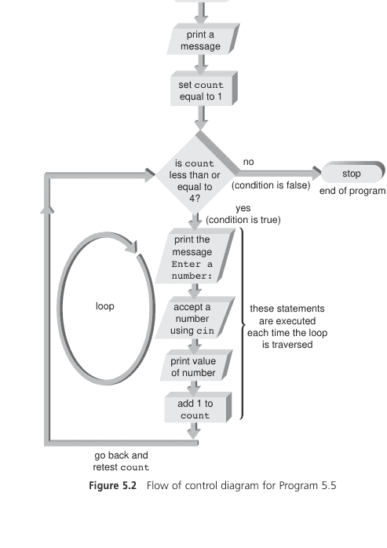

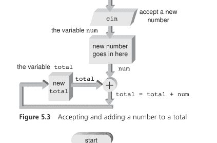

Figure 5.3 Accepting and adding a number to a total


Figure 5.4 Accumulation flow of control

在回顾 Figure 5.4 时，注意到在进入 while 循环之前，已对 total 进行了初始设为 0 的安排。如果在 while 循环内部清除 total，则每次执行循环时它都会被设为 0，之前存储的任何值都会被擦除。

Program 5.6 对 Program 5.5 进行了必要的修改，以对输入的数字求和。如图所示，语句 total = total + num; 放置在调用 cin 之后。将累加语句放在程序的这一位置可确保输入的数字立即被“捕获”到 total 中。

## Program 5.6

```
#include <iostream>
using namespace std;

int main()
{
const int MAXNUMS = 4;
int count;
double num, total;

cout << "\n\nThis program will ask you to enter "
<< MAXNUMS << " numbers.\n";
count = 1;
total = 0;

while (count <= MAXNUMS)
{
cout << "\nEnter a number: ";
cin >> num;
total = total + num;
cout << "The total is now " << total;
count++;
}

cout << "\n\nThe final total is " << total << endl;

return 0;
}
```

为了确保你理解，请回顾 Program 5.6。变量 total 用于存储输入数字的总和。在进入 while 语句之前，total 的值被设为 0，以确保分配给该变量的存储位置中任何先前的值都被擦除。在 while 循环内部，使用语句 total = total + num; 将输入数字的值加到 total 上。每输入一个值，它都会被加到现有的 total 上以形成新的 total。因此，total 成为所有值的运行小计

entered。只有在所有数字都输入后，total 才包含所有数字的最终总和。while 循环结束后，使用 cout 语句显示该总和。

使用在 Program 5.5 的示例运行中输入的相同数据，对 Program 5.6 进行了如下示例运行：

```
This program will ask you to enter 4 numbers.

Enter a number: 26.2
The total is now 26.2
Enter a number: 5
The total is now 31.2
Enter a number: 103.456
The total is now 134.656
Enter a number: 1267.89
The total is now 1402.546
```

The final total is 1402.546

在使用了累加赋值语句对输入的数字进行求和后，你可以更进一步计算这些数字的平均值。平均值是在 while 循环内部计算还是在外部计算？就当前情况而言，计算平均值需要最终总和以及该总和中项目的数量。平均值随后通过将最终总和除以项目数量来计算。此时，你必须问：“程序的哪个点上可获得正确的总和，程序的哪个点上可获得项目数量？”

在回顾 Program 5.6 时，你可以看到用于计算平均值的正确总和在 while 循环结束后可用。事实上，while 循环的全部目的就是确保数字被正确输入并累加以产生正确的总和。循环结束后，你还拥有用于求和的项目计数。然而，由于 while 循环的构造方式，循环结束时 count 中的数字为 5，比用于获得 total 的项目数 4 多 1。知道这一点，你只需在使用 count 确定平均值之前从中减去 1。基于这些背景信息，看看你是否能够阅读并理解 Program 5.7。


## Program 5.7

```
#include <iostream>
using namespace std;

int main()
{
const int MAXNUMS = 4;
int count;
double num, total, average;

cout << "\nThis program will ask you to enter " << MAXNUMS << " numbers.\n\n";
count = 1;
total = 0;

while (count <= MAXNUMS)
{
    cout << "Enter a number: ";
    cin >> num;
    total = total + num;
    count++;
}

count--;
average = total / count;
cout << "\nThe average of the numbers is " << average << endl;

return 0;
}
```

Program 5.7 与 Program 5.6 几乎相同，只是多了平均值的计算。while 循环内部和之后的 total 的常量显示也被移除了。Program 5.7 中的循环用于输入并累加四个数字。循环退出后立即计算并显示平均值。Program 5.7 的示例运行如下：

```
This program will ask you to enter 4 numbers.

Enter a number: 26.2
Enter a number: 5
Enter a number: 103.456
Enter a number: 1267.89

The average of the numbers is 350.637
```

## Sentinels

迄今为止创建的所有循环都是固定计数循环的例子，其中使用计数器来控制循环迭代次数。通过 while 语句，还可以构造变量条件循环。例如，在输入成绩时，你可能不想计数将要输入的成绩数量。相反，你更愿意连续输入成绩，并在末尾输入一个特殊数据值来表示数据输入结束。

在编程中，用于表示数据序列开始或结束的数据值称为哨兵。哨兵值当然必须选择使其不与合法数据值冲突。例如，如果你正在构建一个处理学生成绩的程序，并且假设没有额外学分会导致成绩高于 100，你可以使用任何高于 100 的成绩作为哨兵值。Program 5.8 说明了这一概念：数据会被连续请求和接受，直到输入一个大于 100 的数字。输入一个高于 100 的数字会提醒程序退出 while 循环并显示已输入数字的总和。

## Program 5.8

```
#include <iostream>
using namespace std;

int main()
{
    const int HIGHGRADE = 100;
    double grade, total;

    grade = 0;
    total = 0;
    cout << "Info stop entering grades, type in any number";
    cout << "\n greater than 100.\n\n";
    cout << "Enter a grade: ";
    cin >> grade;

    while (grade <= HIGHGRADE)
    {
        total = total + grade;
        cout << "Enter a grade: ";
        cin >> grade;
    }

    cout << "\nThe total of the grades is " << total << endl;

    return 0;
}
```

## Point of Information

## Loop Types

在循环中的任何语句执行之前就评估条件的循环被称为预测试循环或入口控制循环。在 C++ 中，这些循环是通过使用 while 或 for 语句创建的。

在重复代码段末尾评估条件的循环被称为后测试循环或出口控制循环。这些循环总是在条件被测试之前至少执行一次循环语句。do-while 语句用于构造这种类型的循环。

除了条件被测试的位置之外，重复代码段还根据被测试的条件类型进行分类。在固定计数循环中，条件用于跟踪已发生的重复次数。在这种类型的循环中，执行固定次数的计算或打印固定行数，之后退出重复代码段。C++ 的所有重复语句都可用于创建固定计数循环。

在变量条件循环中，被测试的条件不依赖于达到计数，而是依赖于一个变量，该变量可在每次通过循环时与交互式地变化。当遇到指定值时，无论发生了多少次迭代，重复都会停止。C++ 的所有重复语句都可用于创建变量条件循环。

以下几行显示了 Program 5.8 的示例运行。只要输入的成绩小于或等于 100，程序就会继续请求和接受额外数据。当输入一个小于或等于 100 的数字时，程序会将该数字加到总和中。当输入一个大于 100 的数字时，循环被退出，并显示已输入成绩的总和。

```
To stop entering grades, type in any number greater than 100.

Enter a grade: 95
Enter a grade: 100
Enter a grade: 82
Enter a grade: 101

The total of the grades is 277
```


## break 和 continue 语句

与重复语句相关的两个有用语句是 break 语句和 continue 语句。你在学习 switch 语句时在第 4.4 节中遇到了 break 语句。这是 break 语句的格式：

```
break;
```

break 语句顾名思义，会强制立即中断，或退出 switch、while、for 和 do-while 语句（在下一节中讨论）。例如，如果输入的数字大于 76，则以下 while 循环的执行会立即终止：

```
while(count <= 10)
{
    cout << "Enter a number: ";
    cin >> num;
    if (num > 76)
    {
        cout << "You lose!\n";
        break;      // break out of the loop
    }
    else
        cout << "Way to go!\n";
        count++;
}
// break jumps to here
```

break 语句违反了结构化编程原则，因为它为循环提供了第二个非标准的退出方式。尽管如此，break 语句在检测到异常条件时用于跳出循环非常有用。它也用于退出 switch 语句，但这是因为匹配的 case 值已被检测到并处理。

continue 语句与 break 语句类似，但仅适用于使用 while、do-while 和 for 语句创建的循环。这是 continue 语句的一般格式：

```
continue;
```

当在循环中遇到 continue 时，循环的下一次迭代会立即开始。对于 while 循环，这意味着执行会自动转移到循环顶部，并重新评估被测试的表达式。尽管 continue 语句对 switch 语句没有直接影响，但它可以包含在 switch 语句中，而该 switch 语句也包含在循环中。continue 的效果相同：下一次循环迭代开始。

作为一般规则，continue 语句不如 break 语句有用，但它很方便用于跳过不应处理的數據，同时仍保持在循环中。例如，以下代码段中无效的成绩被简单地忽略，只有有效成绩才会被加到总和中：

```
while (count < 30)
{
cout << "Enter a grade: ";
cin >> grade;
if(grade < 0 || grade > 100)
    continue;
total = total + grade;
count++;
}
```

## 空语句

所有语句必须以分号终止。一个分号前面没有任何内容也是一个有效的语句，称为空语句，如下所示：

```
;
```

它是一个什么都不做的语句，用于在语法上需要语句但不需要操作的地方。通常，空语句与 while 或 for 语句一起使用。第 5.3 节中的程序 5.9c 显示了使用空语句的 for 语句示例。

## 练习 5.2

- 1. （修改）重写程序 5.6 以计算八个数字的总和。
- 2. （修改）重写程序 5.6 以显示以下提示：
  
  Please type in the total number of data values to be added:
  
  响应此提示时，程序应接受用户输入的数字，然后使用它来控制 while 循环执行的次数。因此，如果用户响应提示输入 5，则程序应请求输入五个数字，并在输入五个数字后显示总和。
- 3. （修改）重写程序 5.7 以计算 10 个数字的平均值。

> 1 虽然这段代码说明了 continue 语句提供的控制流，但这不是实现正确结果的首选方法。相反，使用 if 语句和 continue 语句排除无效数据的方法更好，使用以下语句包含有效数据：
> if (grade >= 0 && grade <= 100)
> {
>     total = total + grade;
>     count++;
> }

## 4. （修改）重写程序 5.7 以显示以下提示：

Please type in the total number of data values to be averaged:

响应此提示时，程序应接受用户输入的数字，然后使用它来控制 while 循环执行的次数。因此，如果用户响应提示输入 6，则程序应请求输入六个数字并显示输入的接下来六个数字的平均值。

## 5. （调试）由于程序员的失误，语句 average = total / count; 被放在程序 5.7 的 while 循环中，紧跟在语句 total = total + num; 之后。结果，while 循环变为以下形式：

```
while (count <= MAXNUMS)
{
 cout << "Enter a number: ";
 cin >> num;
 total = total + num;
 average = total / count;
 count++;
}
```

a. 使用此 while 循环，程序是否会产生正确的结果？

b. 从编程角度来看，哪一个 while 循环更好使用，为什么？

## 6. （程序）a. 编写一个 C++ 程序将米转换为英尺。程序应请求起始米值、要转换的次数以及公制值之间的增量。显示应具有适当的标题并列出米和相应的英尺值。如果迭代次数大于 10，则程序应使用 10 的默认增量。用 1 米 = 3.281 英尺的关系。

b. 在计算机上运行练习 6a 编写的程序。验证你的程序从正确的起始米值开始，并且包含输入数据中指定的确切转换次数。

## 7. （修改）a. 修改练习 6a 编写的程序以请求起始米值、结束米值和增量。条件不再检查固定的计数，而是检查结束米值。如果迭代次数大于 20，则程序应使用 (结束值 - 起始值) / 19 的默认增量。

## 9. （程序）算术级数由以下定义：

a + (a + d) + (a + 2d) + (a + 3d) + ... + [(a + (n - 1)d)]

- a 是第一项。
- d 是“公差”。
- n 是要相加的项数。

使用此信息，编写一个 C++ 程序，使用 while 循环显示每一项并确定具有 a = 1、d = 3 和 n = 100 的算术级数的和。确保你的程序显示其计算的值。

## 10. （程序）几何级数由以下定义：

a + ar + ar² + ar³ + ... + arⁿ⁻¹

- a 是第一项。
- r 是“公比”。
- n 是级数中的项数。

使用此信息，编写一个 C++ 程序，使用 while 循环显示每一项并确定具有 a = 1、r = .5 和 n = 10 的几何级数的和。确保你的程序显示其计算的值。

## 11. （程序）a. 以下图表中的数据是在最近一次汽车旅行中收集的：

| Mileage | Gallons |
|---|---|
| 22,495 | Full tank |
| 22,841 | 12.2 |
| 23,185 | 11.3 |
| 23,400 | 10.5 |
| 23,772 | 11.0 |
| 24,055 | 12.2 |
| 24,434 | 14.7 |
| 24,804 | 14.3 |
| 25,276 | 15.2 |

编写、编译并运行一个 C++ 程序，接受里程和加仑值并计算该行程段的每加仑英里数（mpg）。mpg 计算为加油之间的里程差除以加油时使用的汽油加仑数。

b. 修改为练习 11a 编写的程序，以便在每次加油后也计算并显示累计 mpg。累计 mpg 计算为每次加油时的里程与行程开始时的里程之差除以到目前为止使用的汽油总量。

## 12. （程序）a.

一家书店通过为库存中的每本书保留以下信息来汇总其月度交易：

- 书籍识别号
- 月初库存余额
- 当月收到的副本数量
- 当月售出的副本数量

编写一个 C++ 程序，接受每本书的这些数据，然后显示书籍识别号和更新的书籍库存余额，使用以下关系：

New balance = Inventory balance at the beginning of the month
+ Number of copies received during the month
- Number of copies sold during the month

你的程序应使用具有固定计数条件的 while 语句，以便仅请求三本书的信息。

## b.

编译并运行练习 12a 编写的程序。查看你的程序产生的显示并验证输出是否正确。

## 13. （修改）

修改你为练习 12 编写的程序，使其在输入 999 的哨兵值之前一直请求并显示结果。编译并运行你的程序。查看你的程序产生的显示并验证输出是否正确。

## 5.3 for 语句

for 语句执行与 while 语句相同的功能，但使用不同的形式。在许多情况下，特别是使用固定计数条件时，for 语句的格式比 while 语句等价形式更容易使用。这是 for 语句的一般形式：

```
for (initializing list; expression; altering list)
    statement;
```

尽管 for 语句看起来有点复杂，但如果你分别考虑每个部分，它其实很简单。for 语句的括号内有三个项目，用分号分隔。每个项目都是可选的，可以分别描述，但分号必须始终存在，即使你不使用这些项目。正如你将看到的，括号中的项目对应于你已与 while 语句一起使用的初始化、表达式求值和表达式更改值。

通常在进入重复循环之前需要初始化变量或进行其他求值，因此 for 语句允许将所有初始化语句作为 for 括号内的第一组项目进行分组。此初始化列表中的项目仅执行一次，在第一次评估表达式之前。

括号中的中间项目 expression 是任何有效的 C++ 表达式，并且 for 和 while 语句使用此表达式的方式没有区别。在两个语句中，只要表达式具有非零（真）值，跟随括号的语句就会


executed. So before the first check of the expression, initial values for the tested expression’s variables must be assigned, and before the expression is reevaluated, there must be one or more statements that alter these values.

The for statement also provides a single place for all expression-altering statements: the altering list, the last item inside for’s parentheses. All items in this list are executed by the for statement at the end of the loop, just before the expression is reevaluated.

Figure 5.5 illustrates the internal workings of a for loop. As shown, when the for loop is completed, control is transferred to the first executable statement following the loop.


Figure 5.5 The for statement's flow of control

To avoid having to show every step, you can use a simplified set of flowchart symbols to describe for loops. If you use the following flowchart symbol to represent a for statement,


you can then illustrate a complete for loop, as shown in Figure 5.6.


Figure 5.6 A simplified for loop flowchart

The following examples show the correspondence between while and for statements.

First, take a look at this while statement:

```
count = 1;
while (count <= 10)
{
    cout << count << " ";
    count++;
}
```

Here's the corresponding for statement:

```
for (count = 1; count <= 10; count++)
    cout << count << " ";
```

## Point of Information

### Where to Place the Opening Braces

When the for loop contains a compound statement, professional C++ programmers use two styles of writing for loops. The style used in this book takes the following form:

```
for (expression)
{
    compound statement in here
}
```

An equally acceptable style places the compound statement's opening brace on the first line. Using this style, a for loop looks like the following:

```
for (expression) {
    compound statement in here
}
```

The advantage of the first style is that the braces line up under one another, making it easier to locate brace pairs. The advantage of the second style is that it makes the code more compact and saves a line, so more code can be viewed in the same display area. Both styles are used but are almost never intermixed. Select whichever style appeals to you and be consistent in its use. As always, the indentation you use in the compound statement (two or four spaces or a tab) should also be consistent throughout all your programs. The combination of styles you select becomes a "signature" for your programming work.

As this example shows, the only difference between the for and while statements is the placement of equivalent expressions. Grouping the initialization, expression test, and altering list in the for statement is convenient, especially when you're creating fixed-count loops. Now look at this for statement:

```
for (count = 2; count <= 20; count = count + 2)
    cout << count << " ";
```

In this statement, all the loop control information is contained in the parentheses. The loop starts with a count of 2, stops when the count exceeds 20, and increments the loop counter in steps of 2. Program 5.9 shows this for statement in an actual program. A blank space is placed between output values for readability.

## Program 5.9

```cpp
#include <iostream>
using namespace std;
int main()
{
    int count;
    for (count = 2; count <= 20; count = count + 2)
        cout << count << " ";

    return 0;
}
```

This is the output of Program 5.9:

2 4 6 8 10 12 14 16 18 20

The for statement doesn’t require having any of the items inside for’s parentheses or using them for initializing or altering the values in the expression statements; however, the two semicolons must be included in these parentheses. For example, the construction `for ( ; count <= 20 ; )` is valid.

If the initialization list is missing, the initialization step is omitted when the for statement is executed. Therefore, the programmer must provide the required initializations before the for statement is encountered. Similarly, if the altering list is missing, any expressions needed to alter the evaluation of the tested expression must be included in the statement part of the loop. The for statement only ensures that all expressions in the initializing list are executed once, before evaluation of the tested expression, and all expressions in the altering list are executed at the end of the loop, before the tested expression is rechecked. Program 5.9 can be rewritten in any of the three ways shown in Programs 5.9a, 5.9b, and 5.9c.

### Program 5.9a

```cpp
#include <iostream>
using namespace std;

int main()
{
    int count;

    count = 2;      // initialized outside the for statement
    for ( ; count <= 20; count = count + 2)
        cout << count << " ";

    return 0;
}
```

### Program 5.9b

```cpp
#include <iostream>
using namespace std;
int main()
{
    int count;

    count = 2;  // initialized outside the for statement
    for( ; count <= 20; )
    {
        cout << count << " ";
        count = count + 2;  // alteration statement
    }

    return 0;
}
```

### Program 5.9c

```cpp
#include <iostream>
using namespace std;
int main()  // all expressions inside for's parentheses
{
    int count;

    for (count = 2; count <= 20; cout << count << " ", count = count + 2);

    return 0;
}
```

In Program 5.9a, count is initialized outside the for statement, and the first list inside the parentheses is left blank. In Program 5.9b, both the initializing list and the altering list are outside the parentheses. Program 5.9b also uses a compound statement in the for loop, with the expression-altering statement included in the compound statement. Finally, Program 5.9c has included all items inside the parentheses, so there's no need for any useful statement following the parentheses. In this example, the null statement (;) satisfies the syntax requirement of one statement to follow for's parentheses.

Also, observe in Program 5.9c that the altering list (the last set of items in parentheses) consists of two items, and a comma has been used to separate these items. Using commas to separate items in both the initializing and altering lists is required if either of these lists contains more than one item.

Last, note that these three programs are all inferior to Program 5.9, and although you might encounter them in your programming career, you shouldn’t use them. The for statement in Program 5.9 is much clearer because all items pertaining to the tested expression are grouped together inside the parentheses. Keeping the for loop structure "clean," as in Program 5.9, is important and a good programming practice.

Although the initializing and altering lists can be omitted from a for statement, omitting the tested expression results in an infinite loop. For example, this statement creates an infinite loop:

```
for (count = 2; ; count++)
    cout << count << " ";
```

As with the while statement, both break and continue statements can be used in a for loop. A break forces an immediate exit from the for loop, as it does in the while loop. A continue, however, forces control to be passed to the altering list in a for statement, after which the tested expression is reevaluated. This action differs from continue’s action in a while statement, where control is passed directly to reevaluation of the tested expression.

Finally, many programmers use the initializing list of a for statement to both declare and initialize the counter variable and any other variables used primarily in the for loop. For example, in this for statement, the variable count is both declared and initialized inside the for statement:

```
for(int count = 0; count < 10; count++)
    cout << count << " ";
```

As always, having been declared, count can now be used anywhere after its declaration in the body of the function containing the declaration.

To understand the enormous power of for loops, consider the task of printing a table of numbers from 1 to 10, including their squares and cubes, by using a for statement. This table was produced previously by using a while loop in Program 5.3. You might want to review Program 5.3 and compare it with Program 5.10 to get a better sense of the equivalence between for and while statements.


## Program 5.10

```cpp
#include <iostream>
#include <iomanip>
using namespace std;

int main()
{
    const int MAXNUMS = 10;
    int num;
    cout << endl;      // print a blank line
    cout << "NUMBER   SQUARE    CUBE\n"
         << "------   ------    ----\n";
```


```
for (num = 1; num <= MAXNUMS; num++)
    cout << setw(3) << num << " "
         << setw(3) << num * num << " "
         << setw(4) << num * num * num << endl;

return 0;
}
```

当运行程序 5.10 时，产生的显示如下：

| NUMBER | SQUARE | CUBE |
|---:|---:|---:|
| 1 | 1 | 1 |
| 2 | 4 | 8 |
| 3 | 9 | 27 |
| 4 | 16 | 64 |
| 5 | 25 | 125 |
| 6 | 36 | 216 |
| 7 | 49 | 343 |
| 8 | 64 | 512 |
| 9 | 81 | 729 |
| 10 | 100 | 1000 |

只需将程序 5.10 的 for 语句中的数字 10 改为 1000，就能创建一个执行 1000 次的循环，并生成从 1 到 100 的数字表。与 while 语句一样，这种微小的改动会使程序的处理和输出产生巨大的增加。还要注意，在修改列表中使用了表达式 num++ 代替了等价的 num = num + 1。

## 交互式 for 循环

在 for 循环中使用 cin 对象会创建交互式 for 循环，就像在 while 循环中使用该对象一样。例如，在程序 5.11 中，使用 cin 对象输入一组数字。每次输入一个数字时，它都会被加到总和中。退出 for 循环后，平均值会被计算并显示。

## 程序 5.11

```
#include <iostream>
using namespace std;

// This program calculates the average
// of MAXCOUNT user-entered numbers
int main()
{
const int MAXCOUNT = 5;
int count;
double num, total, average;

total = 0.0;

for (count = 0; count < MAXCOUNT; count++)
{
    cout << "Enter a number: ";
    cin >> num;
    total = total + num;
}

average = total / count;
cout << "The average of the data entered is " << average
    << endl;

return 0;
}
```

程序 5.11 中的 for 语句创建了一个执行五次的循环。每次循环都会提示用户输入一个数字。每次输入数字后，它会立即加到总和中。虽然 total 在 for 语句之前被初始化为 0，但这种初始化也可以包含在 count 的初始化中，如下所示：

```
for (total = 0.0, count = 0; count < MAXCOUNT; count++)
```

此外，total 和 count 的声明也可以与其初始化一起包含在初始化列表中，如下所示：

```
for (double total = 0.0, int count = 0; count < MAXCOUNT; count++)
```

任何一种 for 构造都被认为是一种良好的编程实践。你选择哪一种只是一个编程风格的问题。

## 嵌套循环

在许多情况下，使用一个循环嵌套在另一个循环中，称为嵌套循环，是很方便的。这里有一个嵌套循环的简单示例：

```
for(i = 1; i <= 5; i++) // start of outer loop <----+
{
    cout << "\n i is now " << i << endl; //
    //
    for(j = 1; j <= 4; j++) // start of inner loop |
    cout << "  j = " << j; // end of inner loop |
} // end of outer loop <----+
```

```
for(i = 1; i <= 5; i++)    // start of outer loop <----+
{                         //
    cout << "\n i is now " << i << endl;  //
                          //
    for(j = 1;  j <= 4; j++)// start of inner loop   |
        cout << "  j = " << j; // end of inner loop     |
}                         // end of outer loop     <----+

return 0;
}
```

这是一个程序 5.12 样本运行的输出：

```
i is now 1
    j = 1  j = 2  j = 3  j = 4
i is now 2
    j = 1  j = 2  j = 3  j = 4
i is now 3
    j = 1  j = 2  j = 3  j = 4
i is now 4
    j = 1  j = 2  j = 3  j = 4
i is now 5
    j = 1  j = 2  j = 3  j = 4
```

要理解嵌套循环的用途，可以看看用它来计算一个班级 20 名学生的平均成绩。每个学生在学期内参加了四次考试。最终成绩计算为这些考试成绩的平均值。外层循环由 20 次传递组成，用于计算每位学生的平均成绩。内层循环由四次传递组成，每次内层循环传递输入一次考试成绩。每输入一个成绩，就将其加到该学生的总分中，并在循环结束时计算并显示平均值。由于外层和内层循环分别是 20 和 4 的定计数循环，因此使用 for 语句创建这些循环。程序 5.13 使用嵌套循环进行所需的计算。

## 程序 5.13

```
#include <iostream>
using namespace std;

int main()
{
    const int NUMGRADES = 4;
    const int NUMSTUDENTS = 20;
    int i,j;
    double grade, total, average;

for (i = 1; i <= NUMSTUDENTS; i++)  // start of outer loop
{
    total = 0;                  // clear the total for this student
    for (j = 1; j <= NUMGRADES; j++)  // start of inner loop
    {
        cout << "Enter an examination grade for student: "
            << j << ":";
        cin >> grade;
        total = total + grade;      // add the grade to the total
    }                           // end of the inner for loop
    average = total / NUMGRADES;    // calculate the average
    cout << "\nThe average for student " << i
        << " is " << average << "\n\n";
}                               // end of the outer for loop

return 0;
}
```

在回顾程序 5.13 时，请特别注意在进入内层循环之前在外层循环中对 total 的初始化：total 被初始化 20 次，每位学生一次。此外，注意平均值是在内层循环结束立即计算并显示的。由于计算和打印平均值的语句也在外层循环中，因此计算并显示了 20 个平均值。内层循环中每个成绩的输入和累加使用了你之前见过并且现在应该熟悉的技术。

## 练习 5.3

- 1. （练习）为以下每种情况编写一个 for 语句：
  - a. 使用一个名为 i 的计数器，初始值为 1，终值为 20，增量为 1。
  - b. 使用一个名为 icount 的计数器，初始值为 1，终值为 20，增量为 2。
  - c. 使用一个名为 j 的计数器，初始值为 1，终值为 100，增量为 5。
  - d. 使用一个名为 icount 的计数器，初始值为 20，终值为 1，增量为 -1。
  - e. 使用一个名为 icount 的计数器，初始值为 20，终值为 1，增量为 -2。
  - f. 使用一个名为 count 的计数器，初始值为 1.0，终值为 16.2，增量为 0.2。
  - g. 使用一个名为 xent 的计数器，初始值为 20.0，终值为 10.0，增量为 -0.5。

## 2. （桌面检查）确定练习 1 中编写的每个 for 循环的执行次数。

## 3. （桌面检查）确定以下每个循环执行后 total 中的值：

- a. total = 0;
  for (i = 1; i <= 10; i = i + 1)
      total = total + i;

- b. total = 1;
  for (count = 1; count <= 10; count = count + 1)
      total = total * 2;

- c. total = 0;
  for (i = 10; i <= 15; i = i + 1)
      total = total + i;

- d. total = 50;
  for (i = 1; i <=10; i = i + 1)
      total = total - i;

- e. total = 1;
  for (icnt = 1; icnt <= 8; ++icnt)
      total = total * icnt;

- f. total = 1.0;
  for (j = 1; j <= 5; ++j)
      total = total / 2.0;

## 4. （桌面检查）确定以下程序的输出：

```
#include <iostream>
using namespace std;

int main()
{
    int i;

    for (i = 20; i >= 0; i -= 4)
        cout << i;

    return 0;
}
```

## 5. （修改）修改程序 5.10 以生成从 0 到 20 以 2 为增量的数字表，以及它们的平方和立方。

## 6. （修改）修改程序 5.10 以生成从 10 到 1 的数字表，而不是目前的从 1 到 10。

## 7. （程序）a. 编写、编译并运行一个 C++ 程序，显示 20 个从华氏度到摄氏度的温度转换表。表应从华氏度 20 度开始，以 4 度的增量递增。记住摄氏度 = (5.0/9.0) × (华氏度 - 32.0)。

- b. 修改为练习 7a 编写的程序，以请求要进行的转换次数。


- **8. (程序)** 编写、编译并运行一个 C++ 程序，将华氏温度转换为摄氏温度，步长为 5 度。华氏温度的初始值和要转换的总次数应在程序执行期间作为用户输入请求。注意摄氏温度 = (5.0/9.0) × (华氏温度 - 32.0)。

- **9. (程序)**
  - **a.** 编写、编译并运行一个 C++ 程序，依次接受五个加仑值，并在请求下一个值之前将每个输入值转换为其升的等价值。程序中使用 for 循环。1 加仑液体有 3.785 升。
  - **b.** 修改为练习 9a 编写的程序，首先请求要输入和转换的数据项数。

- **10. (程序)**
  - **a.** 一个古老的阿拉伯传说说，一个富裕但不明智的国王同意给一个乞丐 1 美分，并在 64 天内每天加倍金额。利用此信息，编写、编译并运行一个 C++ 程序，显示国王每天必须付给乞丐的金额。程序的输出应如下所示：

    | Day | Amount Owed |
    | --- | ------------ |
    | 1 | 0.01 |
    | 2 | 0.02 |
    | 3 | 0.04 |
    | . | . |
    | . | . |
    | 64 | . |

  - **b.** 修改为练习 10a 编写的程序，以确定国王将在哪一天累计支付给乞丐一百万美元。

- **11. (调试)** 以下程序正确吗？如果是，确定其输出。如果不是，确定错误并更正它，使程序能够运行。

  ```
  #include <iostream>
  using namespace std;

  int main()
  {

      for(int i = 1; i < 10; i++)
          cout << i << '\n';

      for (j = 1; i < 5; i++)
          cout << i << endl;

      return 0;
  }
  ```

## 第 5 章

### The for Statement

- **12. (程序)**
  - **a.** 编写、编译并运行一个 C++ 程序，计算并显示银行账户中可用的资金，该账户最初存入 $1000，按每年 3% 的利率赚取利息。程序应显示 10 年期间每年末可用的金额。使用关系式：每年末可用的资金 = 年初账户中的资金 + .03 × 年初可用的金额。
  - **b.** 修改为练习 12a 编写的程序，提示用户输入账户中最初存入的资金金额。
  - **c.** 修改为练习 12a 编写的程序，提示用户输入最初存入的资金金额和要显示的年数。
  - **d.** 修改为练习 12a 编写的程序，提示用户输入最初存入的资金金额、要使用的利率和要显示的年数。

- **13. (程序)** 据传说，曼哈顿岛于 1626 年以 $24 从当地印第安人手中购买。假设这笔钱以 4% 的年简单利率投资于荷兰银行，构建一个表格，显示原住民在每个 50 年期间结束时将拥有的资金，从 1626 年开始，到 400 年后结束。使用关系式：每个 50 年期间结束时可用的资金 = 期间开始时账户中的资金 × 数量 (1 + .04)^50。

- **14. (程序)** 一家备受推崇的小部件制造商每年销售额下降 4%。公司的年利润是销售额的 10%。今年，公司销售额为 1000 万美元，利润为 100 万美元。确定未来 10 年的预期销售额和利润。程序应产生以下形式的显示：

  SALES AND PROFIT PROJECTION

  | YEAR | EXPECTED SALES | PROJECTED PROFIT |
  |---:|---:|---:|
  | 1 | $10000000.00 | $1000000.00 |
  | 2 | $ 9600000.00 | $ 960000.00 |
  | 3 | . | . |
  | · | · | · |
  | · | · | · |
  | · | · | · |
  | 10 | . | . |
  | Totals: | $ . | $ . |

### Repetition

- **15. (程序)** 进行四次实验，每个实验有六个测试结果。每个实验的结果如下所示。编写、编译并运行一个使用嵌套循环的 C++ 程序，计算并显示每个实验的测试结果的平均值。
  - 第 1 次实验结果：23.2 31 16.9 27.5 25.4 28.6
  - 第 2 次实验结果：34.8 45.2 27.9 36.8 33.4 39.4
  - 第 3 次实验结果：19.4 16.8 10.2 20.8 18.9 13.4
  - 第 4 次实验结果：36.9 39.5 49.2 45.1 42.7 50.6

- **16. (修改)** 修改为练习 15 编写的程序，使每个实验的测试结果数量由用户输入。编写程序，使每个实验可以输入不同数量的测试结果。

- **17. (程序)**
  - **a.** 一个保龄球队由五名球员组成，每名球员打三局。编写、编译并运行一个使用嵌套循环的 C++ 程序，输入每名球员的得分，然后计算并显示每名保龄球手的平均得分。假设每名保龄球手有以下得分：

    | Bowler | Game 1 | Game 2 | Game 3 |
    |---|---:|---:|---:|
    | 1st bowler | 286 | 252 | 265 |
    | 2nd bowler | 212 | 186 | 215 |
    | 3rd bowler | 252 | 232 | 216 |
    | 4th bowler | 192 | 201 | 235 |
    | 5th bowler | 186 | 236 | 272 |

  - **b. (修改)** 修改为练习 17a 编写的程序，计算并显示平均团队得分。*（提示：使用第二个变量存储所有球员得分的总和。）*
  - **c. (修改)** 重写为练习 17a 编写的程序，以消除内部循环。为此，你必须为每名保龄球手输入三个分数，而不是一次输入一个。每个分数必须在计算平均值之前存储在其自己的变量名中。

- **18. (程序)** 编写、编译并运行一个 C++ 程序，计算并显示如果 $1000 投资于银行账户 10 年，每年可用的金额。程序应显示从 6% 到 12% 的利率，包含 1% 的增量。使用嵌套循环，外层循环固定计数为 7，内层循环固定计数为 10。外层循环的第一次迭代应使用 6% 的利率并显示前 10 年末可用的资金。在外层循环的每次后续通过中，利率应增加 1%。使用此关系：每年末可用的资金 = 年初账户中的资金 + 利率 × 年初可用的资金。

请注意，只使用一个提示和 cin 语句，因为测试表达式在循环末尾进行评估。

与所有重复语句一样，do-while 语句始终可以替换或被等效的 while 或 for 语句替换。选择使用哪个语句取决于应用程序和程序员的首选风格。通常，while 和 for 语句是首选的，因为任何阅读程序的人都可以清楚地看到测试内容在前面，在程序循环的顶部。

### Validity Checks

do-while 语句在过滤用户输入数据和提供数据验证检查时特别有用。例如，操作员需要输入一个介于 100 和 1999 之间的有效客户识别号。超出此范围的数字将被拒绝，并会再次请求有效号码。以下代码段提供了验证输入有效识别号所需的数据过滤器：

```
do
{
    cout << "\nEnter an identification number: ";
    cin >> idNum;
}
while (idNum < 100 || idNum > 1999);
```

在此代码中，会重复请求识别号，直到输入有效号码为止。此代码段是“最基本的”，因为它不会提醒操作员新请求数据的原因为何，也不会在找不到有效识别号时允许提前退出循环。以下代码是消除第一个缺点的一种替代方案：

```
do
{
    cout << "\nEnter an identification number: ";
    cin >> idNum;
    if (idNum < 100 || idNum > 1999)
    {
        cout << "\n An invalid number was just entered"
             << "\nPlease check the ID number and reenter";
    }
    else
        break;    // break if a valid ID number was entered
} while(1);    // this expression is always true
```

使用 break 语句从循环中退出。由于 do-while 语句正在评估的表达式始终为 1（真），因此创建了一个无限循环，只有在遇到 break 语句时才退出。


## 1. 引言

随着信息技术的飞速发展，文档的自动化处理与结构化提取已成为提高工作效率的关键环节。本文旨在探讨一种基于视觉与语义融合的文档解析方法，以应对复杂版面下的信息抽取挑战。

传统的光学字符识别技术仅关注文本的像素级识别，而忽略了文档的版面结构与阅读顺序。为此，我们提出了一种全新的多模态解析框架，该框架能够同时捕捉文本内容、视觉布局以及语义关系。

- 第一，构建基于深度学习的版面分析模型。
- 第二，设计文本与视觉特征的融合机制。
- 第三，实现阅读顺序的自动恢复与结构化输出。


上图展示了本文所提方法的整体架构，其中包含视觉编码器、文本编码器以及跨模态注意力模块。

> 实验结果表明，该方法在多个公开数据集上均取得了显著的性能提升。

```python
# 示例代码：加载模型并进行预测
import model
result = model.predict(document)
print(result)
```

| 方法 | 精确率 | 召回率 | F1分数 |
|------|--------|--------|--------|
| 基线 | 0.85   | 0.82   | 0.83   |
| 本文 | 0.92   | 0.90   | 0.91   |

然而，如果循环从 i = 0 的初始值开始，使用语句 for(i = 0; i < 11; i++)，循环将执行 11 次；使用语句 for(i = 0; i <= 10; i++) 构造的循环也是如此。在构造循环时，必须特别注意用于控制循环的初始条件和最终条件，以确保循环执行次数不会多一次或少一次。

接下来的两个错误与测试表达式有关，你在使用 if 和 switch 语句时已经遇到过它们：

- 2. 在测试表达式中无意地使用赋值运算符 = 代替相等运算符 ==，例如，输入赋值表达式 a = 5，而不是正确的关系表达式 a==5。由于测试表达式可以是任何有效的 C++ 表达式，包括算术表达式和赋值表达式，编译器不会检测到这一错误。

- 3. 在测试双精度操作数时使用相等运算符 ==。例如，表达式 fnum == 0.01 应替换为要求绝对值 |fnum - 0.01| 小于一个可接受值的测试。原因是所有数字都以二进制形式存储。使用有限位数时，0.01 这样的十进制数没有精确的二进制等价形式，因此要求与这些数相等的测试可能会失败。（关于这一数值精度问题的更完整描述，请参见 4.1 节。）

接下来的三个错误是 for 语句特有的：

- 4. 在 for 的括号末尾放置分号，这通常会产生一个空操作循环。例如，请看以下语句：

```
for(count = 0; count < 10; count++);
    total = total + num;
```

第一行代码末尾的分号是一个空语句。它的效果是创建一个执行 10 次的循环，除了递增和测试 count 之外什么也不做。这个错误往往是因为 C++ 程序员习惯于在大多数行的末尾使用分号而发生的。

- 5. 在 for 语句中使用逗号分隔各项，而不是所需的分号，如下例所示：

```
for (count = 1, count < 10, count++)
```

初始化列表和修改列表中必须使用逗号来分隔各项，但必须使用分号将这些列表与测试表达式分隔开。

- 6. 在 for 循环的循环体内和修改列表中同时改变测试条件中所用控制变量的值。例如，请看下面这个 for 循环：

```
for(int i=0; i<10; i++)
    cout << i++;
```

在这段代码中，被测试变量（此处为 i）的值在两个地方被改变，这是一个严重的逻辑错误。

- 7. 最后一个常见编程错误是省略 do-while 语句末尾的分号。这个错误通常是由那些学会了在 while 语句的括号后省略分号，并在遇到 do-while 语句末尾的保留字 while 时沿用这一习惯的程序员造成的。

### 5.6 本章小结

- 1. 一段重复执行的代码称为循环。循环由一条重复语句控制，该语句测试一个条件以确定代码是否执行。循环的每一轮执行称为一次重复或迭代。测试条件必须在重复语句首次求值之前显式设置。在循环内部，必须始终有一条允许改变条件的语句，以便循环在进入之后能够退出。

- 2. 循环有三种基本类型：while、for 和 do-while。while 和 for 循环是预测试（pretest）或入口控制（entrance-controlled）循环。在这种类型的循环中，测试条件在循环开始处求值，这要求在进入循环之前显式设置测试条件。如果条件为真，则开始循环重复；否则，不进入循环。只要条件保持为真，迭代就会继续。在 C++ 中，while 和 for 循环通过使用 while 和 for 语句来构造。

    do-while 循环是一种后测试（posttest）或出口控制（exit-controlled）循环，其测试条件在循环末尾求值。这种类型的循环至少会执行一次。只要测试条件保持为真，do-while 循环就会继续执行。

- 3. 循环也可以根据测试条件的类型进行分类。在固定计数循环中，条件用于记录已发生的重复次数。在可变条件循环中，测试条件基于一个会随每次循环的进行而改变的变量。

- 4. 在 C++ 中，while 循环通过使用 while 语句来构造。这是该语句最常用的形式：

```
while (expression)
{
    statements;
}
```

括号中的表达式是被测试的条件，用于确定括号后面的语句（通常是复合语句）是否执行。该表达式的求值方式与 if-else 语句中的表达式相同；区别在于表达式的使用方式。在 while 语句中，只要表达式保持非零值，括号后面的语句就会被重复执行，而不是像 if-else 语句那样只执行一次。下面是一个 while 循环的示例：

```
count = 1;              // initialize count
while (count <= 10)
{
    cout << count << "  ";
    count++;              // increment count
}
```

第一个赋值语句将 count 设置为 1。然后进入 while 语句，并第一次对表达式求值。由于 count 的值小于等于 10，表达式为真，复合语句被执行。复合语句中的第一条语句使用 cout 语句显示 count 的值。

下一条语句将当前存储在 count 中的值加 1，使这个值等于 2。然后 while 语句循环回去重新测试表达式。由于 count 仍然小于等于 10，复合语句再次被执行。这一过程一直持续到 count 的值达到 11。

由于 while 语句总是在循环顶部检查其表达式，因此测试表达式中的任何变量都必须在遇到 while 之前被赋值。此外，while 循环必须包含一条改变测试表达式值的语句。

- 5. 在 C++ 中，for 循环通过使用 for 语句来构造。该语句执行与 while 语句相同的功能，但采用不同的形式。在许多情况下，尤其是使用固定计数条件时，for 语句格式比等价的 while 语句更容易使用。这是 for 语句最常用的形式：

```
for (initializing list; expression; altering list)
{
    statements;
}
```

在 for 语句的括号内有三项，用分号分隔。每一项都是可选的，但分号必须存在。

初始化列表用于在进入循环之前设置任何初始值；通常用于初始化计数器。初始化列表中的语句只执行一次。for 语句的表达式是被测试的条件：它在循环开始时以及每次迭代之前被测试。修改列表包含循环语句，这些语句


不在复合语句内；通常，它用于在每次循环执行时递增或递减计数器。初始化列表和更改列表中的多个语句由逗号分隔。下面是一个 for 循环的示例：

```
for (total = 0, count = 1; count < 10; count++)
{
    cout << "Enter a grade: ";
    total = total + grade;
}
```

在此 for 语句中，初始化列表用于初始化 total 和 count。表达式确定循环将只要 count 中的值小于 10 就执行，而更改列表指定每次循环时 count 的值递增 1。

- 6. 在 for 循环顶部将初始化语句、被测试的表达式以及影响被测试表达式的语句放在括号中以便轻松检查和修改，因此 for 语句在创建固定计数循环时非常有用。

- 7. do-while 语句用于创建后测试循环，因为它在循环末尾检查其表达式。在循环末尾进行检查可确保 do 循环的主体至少执行一次。do-while 循环必须包含至少一条语句来更改被测试表达式的值。

## Chapter
6
使用函数实现模块化

- 6.1 函数和参数声明
- 6.2 返回单个值
- 6.3 返回多个值
- 6.4 变量作用域
- 6.5 变量存储类别
- 6.6 常见编程错误
- 6.7 章节总结
- 6.8 章节补充：生成随机数


专业程序的设计、编码和测试方式与硬件类似：作为一组模块集成以执行完整的整体。一个好的类比是汽车；一个主要模块是发动机，另一个是变速箱，第三个是制动系统，第四个是车身，等等。所有这些模块都链接在一起并置于驾驶员控制之下，这可以与 main() 程序模块相比较。整体现在作为一个完整的单元运行，能够执行有用的工作，例如开车去商店。在组装过程中，每个模块在安装到最终产品之前都会被构建、测试并发现没有缺陷（bug）。

在此类比中，每个主要的汽车部件都可以与一个函数相比较。例如，当按下油门踏板时，驾驶员会调用发动机。发动机接受燃料、空气和电力的输入，将驾驶员的请求转化为有用的产品——动力——然后将此输出发送给变速箱进行进一步处理。变速箱接收发动机的输出并将其转换为车轮可用的形式。变速箱的另一个输入是驾驶员选择的档位（前进、倒车、空挡等）。

发动机、变速箱和其他模块“只知道”由其输入和输出界定的宇宙。驾驶员不需要知道所控制模块的内部运行情况。所需的一切就是知道每个模块做什么以及在需要模块输出时如何“调用”它。

## 使用函数实现模块化

模块之间的通信仅限于在调用模块执行其任务时向每个模块传递输入，并且每个模块以相当独立的方式运行。程序员使用相同的模块化方法通过使用函数来创建和维护可靠的 C++ 程序。

正如您所见，每个 C++ 程序必须包含一个 main() 函数。除了这个必需的函数之外，C++ 程序还可以包含任意数量的其他函数。在本章中，您将学习如何编写这些函数，将数据传递给它们，处理传递的数据并返回结果。

### 6.1 函数和参数声明

在创建 C++ 函数时，您必须关注函数本身以及它如何与其他函数（如 main()）交互。与函数的交互包括在调用时正确地向函数传递数据（输入）以及在函数停止运行后从函数返回值（输出）。本节描述接口的第一部分，即将数据传递给函数并使函数正确接收、存储和处理传输的数据。

正如您已经在数学函数中所见，函数是通过给出函数名并在函数名后面的括号中传递任何数据作为参数来调用或使用的（参见图 6.1）。被调用的函数必须能够接受由调用函数的函数传递给它的数据。只有在被调用函数成功接收数据后，数据才能被操纵以产生有用的结果。


为了澄清发送和接收数据的过程，请看调用名为 findMax() 的函数的程序 6.1。该程序目前尚未完成。在编写 findMax() 函数并将其包含在程序 6.1 中后，由 main() 和 findMax() 函数组成的完整程序可以编译和运行。

```
Program 6.1

```cpp
#include <iostream>
using namespace std;
void findMax(int, int);  // the function declaration (prototype)

int main()
{
    int firstnum, secnum;
```
```

```
cout << "\nEnter a number: ";
 cin >> firstnum;
 cout << "Great! Please enter a second number: ";
 cin >> secnum;

 findMax(firstnum, secnum); // the function is called here

 return 0;
 }
```

首先，检查从 main() 对 findMax() 函数的声明和调用。然后您将看到如何编写 findMax() 以接受传递给它的数据，确定两个传递值的最大或最大值，并显示最大值。

findMax() 函数被称为被调用函数，因为它是由 main() 中的引用调用或召唤执行的。执行调用的函数——在本例中为 main()——被称为调用函数。“被调用”和“调用”这两个术语来自标准电话用语，其中一方呼叫另一方。发起呼叫的人是呼叫方，接收呼叫的人是被呼叫方。相同的术语描述函数调用。被调用函数——在本例中为 findMax()——被声明为期望接收两个整数数字并向 main() 返回无值（void）的函数。此声明正式称为函数原型。然后通过程序中的最后一条语句调用该函数。

### 函数原型

在函数被调用之前，它必须向将执行调用的函数声明。函数的声明语句被称为函数原型。函数原型告诉调用函数将正式返回的值类型（如果有），以及调用函数应向被调用函数传输的值的数据类型和顺序。

例如，程序 6.1 中使用的函数原型

```
void findMax(int, int);
```

声明 findMax() 函数期望接收两个整数值并返回无值（void）。

函数原型可以与调用函数的变量声明语句一起放置，在调用函数名之上，如程序 6.1 中所示，或放在单独的头文件中，并通过 #include 预处理器语句指定。findMax() 的函数原型可以在 #include <iostream> 语句之前或之后、main() 之前或 main() 内部放置。（选择放置位置的原因在第 6.3 节中解释。）函数原型语句的一般形式如下：

```
returnDataType functionName(list of argument data types);
```

## 使用函数实现模块化

`returnDataType` 指函数返回的值的类型。以下是一些函数原型的示例：

```
int fmax(int, int);
double swap(int, char, double);
void display(double, double);
```

`fmax()` 的函数原型声明此函数期望接收两个整数参数并返回一个整数值。`swap()` 的函数原型声明此函数需要四个参数——按顺序由一个整数、两个字符和一个双精度参数组成——并返回一个双精度数。最后，`display()` 的函数原型声明此函数需要两个双精度参数并且不返回任何值。此函数可能用于在不向被调用函数返回任何值的情况下显示计算结果。

使用函数原型允许编译器进行数据类型错误检查。如果函数原型与函数编写时定义的数据类型不一致，程序编译时将显示警告消息。原型还执行另一项任务：它确保在调用函数时传递给函数的所有参数都转换为声明的数据类型。

### 调用函数

调用函数相当容易。唯一的要求是使用函数名并将传递给函数的数据用在函数名后面的括号中括起来，使用与函数原型中声明的相同顺序和类型。括号中包含的项目称为被调用函数的**参数**（参见图 6.2）。


**图 6.2** 向 `findMax()` 调用并传递两个值

如果变量是函数调用中的参数之一，被调用函数接收存储在变量中的值的副本。例如，语句 `findMax(firstnum, secnum);` 调用 `findMax()` 函数并导致变量 `firstnum` 和 `secnum` 中存储的值传递给 `findMax()`。括号中的变量名是提供值给被调用函数的参数。传递值后，控制权转移到被调用函数。

如图 6.3 所示，`findMax()` 函数并未接收名为 `firstnum` 和 `secnum` 的变量，并且不知道这些变量名。¹ 该函数只是接收这些变量中的值，然后必须在做任何其他事情之前确定将这些值存储在哪里。虽然将数据传递给函数的这种过程可能看起来令人惊讶，但它实际上是一种安全措施，以确保被调用函数不会


inadvertently change data stored in a variable. The function gets a copy of the data to use. It can change its copy and, of course, change any variables declared inside it. However, unless specific steps to do so are taken, a function isn't allowed to change the contents of variables declared in other functions.


Figure 6.3 The findMax() function receives actual values

Next, you begin writing the findMax() function to process the values passed to it.

## Defining a Function

A function is defined when it's written. Each function is defined once (that is, written once) in a program and can then be used by any other function in the program that declares it suitably.

Like the main() function, every C++ function consists of two parts, a function header and a function body, as shown in Figure 6.4. The function header's purpose is to identify the data type of the value the function returns, give the function a name, and specify the number, order, and type of arguments the function expects. The function body's purpose is to operate on the passed data and return, at most, one value directly back to the calling function. (In Section 6.3, you see how a function can be made to return multiple values indirectly by using its arguments.)

The function header is always the first line of a function and contains the function's return value type, its name, and the names and data types of its arguments. Because findMax() doesn't formally return any value and receives two integer values, the following function header can be used:

```
void findMax(int x, int y)
```

no semicolon

### Figure 6.4 The general format of a function


The argument names in parentheses in the header are called the formal parameters of the function (or parameters, for short).² Therefore, the parameter x is used to store the first value passed to findMax() and the parameter y is used to store the second value passed at the time of the function call. The function doesn't know where the values come from when the call is made from main(). The first part of the call procedure the computer executes involves going to the variables firstnum and secnum and retrieving the stored values. These values are then passed to findMax() and stored in the parameters x and y (see Figure 6.5).


### Figure 6.5 Storing values in parameters

The function name and all parameter names in the header—in this case, findMax, x, and y—are chosen by the programmer. Any names selected according to the rules for choosing variable names can be used. Each parameter listed in the function header must include a data type. If more than one parameter is declared in the function header, they must be separated by commas and have their data types declared separately.

> ² The portion of the function header containing function names and parameters is formally referred to as a "function declarator." The items enclosed in parentheses, the parameters, are specifications for the arguments. The arguments are the values provided when the function is called.

## Point of Information

### Function Definitions and Function Prototypes

When you write a function, you're formally creating a function definition. Each definition begins with a header line that includes a parameter list, if any, enclosed in parentheses and ends with the closing brace that terminates the function's body. The parentheses are required whether or not the function uses any parameters. The following is a commonly used syntax for a function definition:

```
returnDataType functionName(parameter list)
{
    constant declarations
    variable declarations

    other C++ statements

    return value
}
```

As you've learned, a function prototype declares a function. The syntax for a function prototype, which provides the function's return data type, the function's name, and the function's parameter list, is as follows:

```
returnDataType functionName(list of parameter data types);
```

The prototype, along with precondition and postcondition comments (see the next Point of Information box), should give users all the programming information needed to call the function successfully.

Generally, all function prototypes are placed at the top of the program, and all definitions are placed after the main() function. However, this placement can be changed. The only requirement in C++ is that a function can't be called before it has been declared or defined.

Now that the function header for findMax() has been written, you can construct its body. The function is to select and display the larger of the two numbers passed to it.

A function body begins with an opening brace, {, contains any necessary declarations and other C++ statements, and ends with a closing brace, }. This structure should be familiar because it's the same one used in all the main() functions you've seen so far. This required structure shouldn't be a surprise because main() is a function and must adhere to the rules for constructing all legitimate functions, as shown here:

```
{
    variable declarations and
    other C++ statements
}
```

## Point of Information

### Preconditions and Postconditions

Preconditions are any set of conditions a function requires to be true if it's to operate correctly. Similarly, a postcondition is a condition that will be true after the function is executed, assuming the preconditions are met.

Preconditions and postconditions are typically documented as user comments. For example, examine the following declaration and comments:

```
bool leapyr(int)
// Precondition: the integers must represent a year in a
//             : four-digit form, such as 2011
// Postcondition: a value of true is returned if the year is
//               : a leap year; otherwise, false is returned
```

Precondition and postcondition comments should be included with function prototypes and function definitions whenever clarification is needed.

In the body of the findMax() function, one variable is declared to store the maximum of the two numbers passed to it. An if-else statement is then used to find the maximum of the two numbers. Finally, a cout statement is used to display the maximum. The following shows the complete function definition for findMax():

```
void findMax(int x, int y)
{
    // start of function body
    int maxnum;    // variable declaration

    if (x >= y)    // find the maximum number
        maxnum = x;
    else
        maxnum = y;

    cout << "\nThe maximum of the two numbers is "
         << maxnum << endl;

    return;
} // end of function body and end of function
```

Notice that the parameter declarations are made in the function header, and the variable declaration is made immediately after the function body's opening brace. This placement is in keeping with the concept that parameter values are passed to a function from outside the function, and variables are declared and assigned values from inside the function body. Program 6.2 includes the findMax() function in the program code previously listed in Program 6.1.

## Program 6.2

```
#include <iostream>
using namespace std;
void findMax(int, int);      // the function prototype

int main()
{
    int firstnum, secnum;

    cout << "\nEnter a number: ";
    cin >> firstnum;
    cout << "Great! Please enter a second number: ";
    cin >> secnum;

    findMax(firstnum, secnum);  // the function is called here

    return 0;
}

// following is the function findMax()

void findMax(int x, int y)
{                           // start of function body
    int maxnum;             // variable declaration

    if (x >= y)             // find the maximum number
        maxnum = x;
    else
        maxnum = y;

    cout << "\nThe maximum of the two numbers is "
         << maxnum << endl;

    return;
}   // end of function body and end of function
```

Program 6.2 can be used to select and print the maximum of any two integer numbers the user enters. A sample run of Program 6.2 follows, with user-entered numbers shown in bold:

Enter a number: 25
Great! Please enter a second number: 5

The maximum of the two numbers is 25


在程序 6.2 中，`findMax()` 函数放在 `main()` 函数之后是出于选择。通常 `main()` 列在最前面，因为它是驱动函数，能让阅读程序的人在遇到各个函数的细节之前，先了解整个程序的大致内容。然而，在任何情况下，都不能将 `findMax()` 的定义放在 `main()` 内部。这一规则适用于所有 C++ 函数，它们必须自行定义在任何其他函数之外。每个 C++ 函数都是一个独立且相互独立的实体，具有自己的参数和变量；嵌套函数永远不被允许。

## 语句的放置

C++ 并未对程序员施加僵硬的语句排序结构。放置 C++ 程序中语句的一般规则很简单，即所有预处理器指令、符号常量、变量和函数必须在被使用之前先声明或定义。如前所述，虽然该规则允许在程序的任何位置放置预处理器指令和声明语句，但这样做会导致程序结构不良。

作为良好的编程规范，以下语句顺序应构成所有 C++ 程序的基本结构：

```
preprocessor directives
function prototypes

int main()
{
    // symbolic constants
    // variable declarations

    // other executable statements

    // return statement
}

// function definitions
```

与往常一样，注释语句可以混合在此基本结构中的任何位置。

## 函数存根

所有程序员都使用的一种替代方案，即在完成完整程序所需的所有函数之前，先编写 `main()` 函数，然后为最终函数使用占位符。要了解这种替代方案如何工作，请再看一下程序 6.1。为方便起见，其代码已在此处重现。如目前所写，此程序在包含 `findMax()` 函数之前无法编译和运行。

```
#include <iostream>
using namespace std;
void findMax(int, int); // the function declaration (prototype)

int main()
{
```

## 信息点

## 隔离测试

最成功的软件测试方法之一始终是将正在测试的代码嵌入到工作代码的环境中。例如，以下顺序调用了两个未经测试的函数，并且第二个函数返回的结果不正确：


从该图所示的信息来看，一个或可能两个函数都可能运行不正确。首要任务是将问题隔离到特定的函数。

执行此代码隔离的一种强大方法是解耦函数。你通过单独测试每个函数或先测试一个函数，然后在确认其正常运行后，再将其重新连接到第二个函数来实现这一点。然后，如果出现错误，你就将错误隔离到函数之间的数据传输或第二个函数的内部操作。

这种特定程序是测试基本规则的一个例子，该规则指出，每个函数都应仅在所有其他函数已知正确的情况下的程序中进行测试。这一规则意味着一个函数必须首先单独进行测试，如果需要对任何被调用函数使用存根，然后第二个被测试的函数应单独测试或与之前测试过的函数一起测试，以此类推。这种测试程序可确保每个新函数都在正确的函数测试床中被隔离，最终程序由经过测试的函数代码构建。

表明 `display()` 函数不带参数并返回一个整数。参数列表为空的函数通过其名称调用，在函数名称后的必需括号内不写任何内容。例如，语句 `display();` 正确调用了 `display()` 函数，其原型如前例所示。

## 默认参数³

C++ 在函数调用中提供默认参数以增加灵活性。默认参数的主要用途是在不要求对程序中已使用的调用参数列表进行任何更改的情况下扩展现有函数的参数列表。

默认参数值列在函数原型中，并在函数调用中省略相应参数时自动传输到被调用函数。例如，函数原型

```
void example(int, int = 5, double = 6.78);
```

> ³首次阅读时可以省略此主题而不影响主题的连贯性。

为最后两个参数提供了默认值。如果在实际调用函数时省略了这些参数中的任何一个，C++ 编译器将提供默认值。因此，以下所有函数调用都是有效的：

```
example(7, 2, 9.3)  // no defaults used
example(7, 2)      // same as example(7, 2, 6.78)
example(7)         // same as example(7, 5, 6.78)
```

使用默认参数时必须遵循四条规则：

- 默认值应在函数原型中指定。⁴
- 如果在函数原型中为某个参数赋予了默认值，则其后的所有参数也必须提供默认值。
- 如果在实际函数调用中省略了一个参数，则其右侧的所有参数也必须省略。第二条和第三条规则使 C++ 编译器清楚哪些参数被省略，并使编译器能够为缺失的参数提供正确的默认值，从最右边的参数开始向左工作。
- 函数原型中使用的默认值可以是由常量和先前声明的变量组成的表达式。如果使用这种类型的表达式，它必须通过编译器的有效声明变量检查，即使表达式的实际值是在运行时求值并分配的。

当将现有函数扩展以包含需要额外参数的更多功能时，默认参数非常有用。将新参数添加到现有参数的右侧并为每个新参数赋予默认值，可使所有现有函数调用保持不变。这样，变更的影响就方便地与程序中的现有代码隔离。

## 重用函数名（重载）⁵

C++ 提供了使用同一函数名用于多个函数的能力，称为函数重载。创建多个同名函数的唯一要求是编译器必须能够根据参数的数据类型（而不是返回值的<|message|> 数据类型，如果有的话）确定使用哪个函数。例如，看看这三个都命名为 `cabs()` 的函数：

```
void cabs(int x) // compute and display absolute value of an integer
{
    if ( x < 0 )
        x = -x;
    cout << "The absolute value of the integer is " << x << endl;
}
```

```
void cdabs(float x) // compute and display absolute value of a float
{
    if ( x < 0 )
        x = -x;
    cout << "The absolute value of the float is " << x << endl;
}
```

```
void cdabs(double x) // compute and display absolute value of a double
{
    if ( x < 0 )
        x = -x;
    cout << "The absolute value of the double is " << x << endl;
}
```

实际调用哪一个 `cdabs()` 函数取决于调用时提供的参数类型。因此，函数调用 `cdabs(10);` 会导致编译器使用期望整数参数的名为 `cdabs()` 的函数，而函数调用 `cdabs(6.28f);` 会导致编译器使用期望双精度参数的名为 `cdabs()` 的函数。⁶

请注意，重载函数名仅仅意味着为多个函数使用相同的名称。每个使用该名称的函数仍必须编写并作为独立实体存在。使用相同的函数名并不要求函数中的代码相似，尽管良好的编程实践规定同名函数应执行本质上相同的操作。使用相同的函数名所要求的只是确保编译器能够根据调用函数时参数的数据类型区分选择哪个函数。很明显，如果重载函数之间唯一的差异是参数类型，更好的编程解决方案是简单地创建函数模板，在下一节中讨论。然而，使用重载函数在构造函数函数中非常有用，构造函数函数在第 10.3 节中解释。

## 函数模板⁷

在大多数高级语言中，包括 C++ 的直接前身 C 中，即使使用函数重载为多个函数赋予相同的名称，每个函数也必须分别编码。例如，考虑确定并显示一个数字的绝对值。如果传递给函数的数字可以是整数、单精度或双精度


值，必须编写三个不同的函数来正确处理每种情况。因此，如果使用函数名 `abs()`，这三个函数的原型将如下所示：

```
void abs(int);
void abs(float);
void abs(double);
```

显然，这些函数中的每一个都在执行本质上相同的操作，但针对的是不同的参数数据类型。一个更简洁的解决方案是编写一个通用函数来处理所有三种参数数据类型，但编译器可以根据调用函数时使用的数据类型来设置参数、变量甚至返回类型。在C++中，你可以通过使用函数模板来编写这种类型的函数。函数模板是一个单个完整的函数，充当一族函数的模型。实际创建的是该函数族中的哪个函数，取决于后续的函数调用。为了让这个概念更具体，请看下面这个计算并显示传入参数绝对值的函数模板：

```
template <class T>
void showabs(T number)
{
    if (number < 0)
        number = -number;
    cout << "The absolute value of the number "
         << " is " << number << endl;
    return;
}
```

现在，暂时忽略第一行 `template <class T>`，看看第二行，即函数头 `void showabs(T number)`。请注意，这个函数头与所有函数定义使用的语法相同，只是将通常放置数据类型的位置换成了 `T`。例如，如果函数头是 `void showabs(int number)`，你应该认出这是一个名为 `showabs()` 的函数，它期望向它传递一个整数实参，并且不返回任何值。同样，如果函数头是 `void showabs(double number)`，你应该认出这是一个在调用时期望向它传递一个双精度实参的函数。

在函数模板头中使用 `T` 的好处是，它代表一种通用数据类型，当编译器遇到实际的函数调用时，该通用数据类型会被实际数据类型（如 `int`、`float`、`double` 等）替换。例如，如果遇到带有整数实参的函数调用，编译器会使用函数模板构造一个期望整数参数的函数。类似地，如果使用双精度实参进行调用，编译器会构造一个期望双精度参数的函数。作为具体示例，请看程序 6.3。

## 2.2 矩阵的乘法

定义2.2.1 设A=(a_ij)是一个m×s矩阵，B=(b_ij)是一个s×n矩阵，那么矩阵A与矩阵B的乘积是一个m×n矩阵C=(c_ij)，其中

c_ij = a_i1 b_1j + a_i2 b_2j + ... + a_is b_sj = Σ_{k=1}^{s} a_ik b_kj (i=1,2,...,m; j=1,2,...,n)

并把此乘积记作 C = AB

注意：只有当第一个矩阵（左矩阵）的列数等于第二个矩阵（右矩阵）的行数时，两个矩阵才能相乘。

例2.2.1 设 A = [1 0 3; -1 2 1]，B = [4 1; -1 1; 2 0]，求AB。

解：因为A是2×3矩阵，B是3×2矩阵，所以AB有意义，且AB是一个2×2矩阵。

AB = [1 0 3; -1 2 1] [4 1; -1 1; 2 0]

= [1×4+0×(-1)+3×2, 1×1+0×1+3×0; (-1)×4+2×(-1)+1×2, (-1)×1+2×1+1×0]

= [10, 1; -4, 1]

由于程序 6.3 对 `showabs()` 进行了三次调用，每次使用不同的实参数据类型，编译器会创建三个独立的 `showabs()` 函数。编译器根据调用时传递的实参来确定使用哪个函数。这是程序 6.3 运行时显示的输出：

```
The absolute value of the number is 4
The absolute value of the number is 4.23
The absolute value of the number is 4.23456
```

模板前缀 `template <class T>` 中的字母 `T` 只是一个数据类型的占位符，该数据类型在函数实际被调用时定义。任何不是关键字的字母或标识符都可以替代它，因此 `showabs()` 函数模板也可以定义如下：

```
template <class DTYPE>
void showabs(DTYPE number)
{
    if (number < 0)
        number = -number;
    cout << "The absolute value of the number is "
         << number << endl;

    return;
}
```

在这方面，有时将模板前缀中的 `class` 一词读作 *数据类型* 会更简单、更清晰。经过这种替换，你可以将模板前缀 `template <class T>` 读作“我正在定义一个具有名为 T 的数据类型的函数模板。”然后，在所定义的函数的头和函数体中，数据类型 T（或前缀中定义的任何其他字母或标识符）的使用方式与任何内置数据类型（如 `int`、`float` 和 `double`）相同。

## 练习 6.1

- 1. （练习）对于以下函数头，确定必须传递给函数的值的数量、类型和顺序（序列）：
  - a. `void factorial(int n)`
  - b. `void price(int type, double yield, double maturity)`
  - c. `void yield(int type, double price, double maturity)`
  - d. `void interest(char flag, double price, double time)`
  - e. `void total(double amount, double rate)`
  - f. `void roi(int a, int b, char c, char d, double e, double f)`
  - g. `void getVal(int item, int iter, char declag, char delim)`
- 2. （练习）
  - a. 编写一个名为 `check()` 的函数，该函数有三个参数。第一个参数应接受一个整数，第二个和第三个参数应接受一个双精度数。函数体应该只显示调用它时传递给函数的数据的值。（注意：在追踪函数中的错误时，让函数显示传递给它的值是有帮助的。很多时候，错误不在于函数体对数据做了什么，而在于接收并存储的数据。）
  - b. 将练习 2a 中编写的函数包含在一个可运行的程序中。确保你的函数从 `main()` 中被调用。通过向它传递各种数据来测试该函数。
- 3. （练习）
  - a. 编写一个名为 `findAbs()` 的函数，该函数接受传递给它的双精度数，计算其绝对值并显示该绝对值。一个数的绝对值是：如果该数为正，则为其本身；如果该数为负，则为其相反数。
  - b. 将练习 3a 中编写的函数包含在一个可运行的程序中。确保你的函数从 `main()` 中被调用。通过向它传递各种数据来测试该函数。
- 4. （练习）
  - a. 编写一个名为 `mult()` 的函数，该函数接受两个双精度数作为参数，将这两个数相乘，并显示结果。
  - b. 将练习 4a 中编写的函数包含在一个可运行的程序中。确保你的函数从 `main()` 中被调用。通过向它传递各种数据来测试该函数。
- 5. （练习）
  - a. 编写一个名为 `sqrIt()` 的函数，该函数计算传递给它的值的平方并显示结果。该函数应能够计算带小数点的数字的平方。
  - b. 将练习 5a 中编写的函数包含在一个可运行的程序中。确保你的函数从 `main()` 中被调用。通过向它传递各种数据来测试该函数。
- 6. （练习）
  - a. 编写一个名为 `powFun()` 的函数，该函数将传递给它的整数提升到正整数次幂并显示结果。该正整数应为传递给函数的第二个值。将用于存储结果的变量声明为长整数数据类型，以确保有足够的存储空间来存储结果。
  - b. 将练习 6a 中编写的函数包含在一个可运行的程序中。确保你的函数从 `main()` 中被调用。通过向它传递各种数据来测试该函数。
- 7. （练习）
  - a. 编写一个函数，生成从 1 到 10 的数字及其平方和立方的表格。该函数应产生与程序 5.10 相同的显示。
  - b. 将练习 7a 中编写的函数包含在一个可运行的程序中。确保你的函数从 `main()` 中被调用。通过向它传递各种数据来测试该函数。
- 8. （修改）
  - a. 修改为练习 7a 编写的函数，使其接受表格的起始值、要显示的数值个数以及数值之间的增量。如果没有显式设置增量，函数应使用默认值 1。将函数命名为 `selTab()`。调用 `selTab(6,5,2);` 应生成一个五行表格，第一行以数字 6 开始，后续每个数字递增 2。
  - b. 将练习 8a 中编写的函数包含在一个可运行的程序中。确保你的函数从 `main()` 中被调用。通过向它传递各种数据来测试该函数。


- 9.（程序）
    - a. 将小时、分钟和秒的时间值传递给名为 `totsec()` 的函数。编写 `totsec()` 以接受这些值，计算所传数据的总秒数，并显示计算出的数值。

    - b. 将练习 9a 中编写的 `totsec()` 函数包含在一个可运行的程序中。`main()` 函数应正确调用 `totsec()` 并显示函数返回的值。使用以下测试数据验证程序运行结果：小时 = 10，分钟 = 36，秒 = 54。务必进行手工计算以验证程序显示的结果。

- 10.（程序）
    - a. 球体的体积 V 由以下公式给出，其中 r 为球体半径：

      体积 = 4πr³ / 3

      使用此公式，编写、编译并运行一个名为 `spherevol()` 的 C++ 函数，该函数接受球体半径，然后计算并显示其体积。

    - b. 将练习 10a 中编写的函数包含在一个可运行的程序中。确保从 `main()` 中调用该函数。通过向函数传递各种数据来测试该函数。

- 11.（程序）
    - a. 编写并测试一个名为 `makeMilesKmTable()` 的 C++ 函数，用于显示英里转换为公里的表格。函数的参数应为英里的起始值、终止值和增量。输出应为英里及其对应公里值的表格。使用 1 英里 = 1.61 公里的换算关系。

    - b. 修改练习 11a 中编写的函数，使其显示两列。例如，如果起始值为 1 英里，终止值为 20 英里，增量为 1，则显示应如下所示：

      | 英里 | 公里 | 英里 | 公里 |
      | --- | --- | --- | --- |
      | 1 | 1.61 | 11 | 17.70 |
      | 2 | 3.22 | 12 | 19.31 |
      | . | . | . | . |
      | . | . | . | . |
      | 10 | 16.09 | 20 | 32.18 |

      （提示：计算 split = (start + stop) / 2。让循环从 miles = start 执行到 split，并在同一行中计算并打印 miles 和 kilometers 的值，同时打印 miles 和 (miles - start + split + 1) 对应的值。）

- 12.（程序）
    - a. 编写一个 C++ 函数，接受一个整数参数，判断所传整数是偶数还是奇数，并显示判断结果。（提示：使用 % 运算符。）

    - b. 将练习 12a 中编写的函数包含在一个可运行的程序中。确保从 `main()` 中调用该函数。通过向函数传递各种数据来测试该函数。

- 13.（程序）可以构造一个不使用参数的实用函数，返回一个 π 值，其精度达到计算机允许的最大小数位数。该值通过取 1.0 的反正弦（即 π / 2）并将结果乘以 2 获得。在 C++ 中，所需表达式为 `2.0 * asin(1.0)`；`asin()` 函数包含在标准 C++ 数学库中。（记得在预处理指令中包含 `cmath`。）使用此表达式，编写一个名为 `pi()` 的 C++ 函数，计算并显示 π 的值。（在下一节中，你将看到如何将此值返回给调用函数。）

- 14.（程序）
    - a. 编写一个名为 `display()` 的函数模板，用于在函数被调用时显示传递给它的单个参数的值。

    - b. 将练习 14a 中创建的函数模板包含在一个完整的 C++ 程序中，该程序调用该函数三次：一次使用字符参数，一次使用整数参数，一次使用双精度参数。

## 6.2 返回单个值

使用上一节中解释的向函数传递数据的方法，被调函数在调用时仅接收参数中包含的值的副本。（如果对此不清楚，请回顾图 6.3。）当以这种方式将值传递给被调函数时，所传参数称为**按值传递**，这是 C++ 的一个显著优势。由于被调函数无法直接访问调用函数用作参数的变量，因此它不会意外更改这些变量中存储的值。

接收按值传递参数的函数可以以任何方式处理发送给它的值，并直接向调用函数返回一个且仅一个“合法”值（见图 6.6）。正如你所料，鉴于 C++ 的灵活性，有一种方法可以返回多个值，但那是下一节的主题。


**图 6.6**  函数直接返回至多一个值

现在看看如何修改 `findMax()` 函数，使其返回传递给它的两个数字中的最大值。为此，你必须首先确定要返回的值的数据类型，并将此数据类型包含在函数头中。由于 `findMax()` 确定的最大值存储在整数变量 maxnum 中，因此函数应返回此变量的值。从 `findMax()` 返回整数值需要以下函数声明：

```
int findMax(int x, int y)
```

注意，这与 `findMax()` 的原始函数头相同，只是将关键字 `void` 替换为 `int`。

在声明了 `findMax()` 将返回的数据类型后，剩下的就是在函数中包含一条语句以返回正确的值。要返回一个值，函数必须使用 return 语句，其形式如下：

```
return expression;
```

当遇到 return 语句时，首先计算表达式。然后，表达式的值在发送回调用函数之前会自动转换为函数头中声明的数据类型。返回值后，程序控制权将交还给调用函数。因此，要返回存储在 maxnum 中的值，你只需在 `findMax()` 函数的右花括号前包含语句 `return maxnum;`。完整函数代码如下：

```
int findMax(int x, int y)   // 函数头
{
    int maxnum;              // 变量声明
    if (x >= y)
        maxnum = x;
    else
        maxnum = y;

    return maxnum;           // return 语句
}
```

在这个新的 `findMax()` 函数代码中，请注意 return 语句中表达式的数据类型与函数头中的数据类型匹配。确保每个返回值的函数都满足此匹配是程序员的责任。如果返回值与函数声明的数据类型不完全匹配，编译程序时可能不会出错，但可能会导致不期望的结果，因为返回值总是被转换为函数声明中声明的数据类型。通常，只有当返回的浮点数或双精度数的小数部分因函数被声明为返回整数值而被截断时，这才成为问题。

在处理好返回事务的发送端后，现在必须准备调用函数以接收被调函数发送的值。在调用（接收）端，调用函数必须：

- 被告知期望从被调函数返回的值类型。
- 正确使用返回值。

告知调用函数期望的返回类型由函数原型处理。例如，在 `main()` 函数之前包含函数原型

```
int findMax(int, int);
```

足以告知 `main()`，`findMax()` 是一个返回整数值的函数。

要实际使用返回值，你必须提供一个变量来存储该值，或在表达式中使用该值。要将返回值存储在变量中，可以使用标准的赋值语句。例如，以下赋值语句可用于将 `findMax()` 返回的值存储在变量 max 中：

```
max = findMax(firstnum, secnum);
```

此赋值语句执行两件事。首先，赋值语句的右侧调用 `findMax()`，然后将 `findMax()` 返回的结果存储在变量 max 中。由于 `findMax()` 返回的值是整数，因此变量 max 也必须在调用函数的变量声明中声明为整数变量。

函数返回的值不必存储在变量中，但可以在任何表达式有效的位置使用。例如，表达式 `2 * findMax(firstnum, secnum)` 将 `findMax()` 返回的值乘以 2，以下语句显示返回值：

```
cout << findMax(firstnum, secnum);
```

程序 6.4 说明了在 `main()` 中包含原型和赋值语句，以正确声明、调用和存储 `findMax()` 的返回值。与之前一样，并遵循将 `main()` 函数放在前面的惯例，`findMax()` 函数放在 `main()` 之后。

```
#include <iostream>
using namespace std;

int findMax(int, int); // 函数原型

int main()
{
    int firstnum, secnum, max;
```


## 使用函数的模块化

```cpp
cout << "\nEnter a number: ";
cin  >> firstnum;
cout << "Great! Please enter a second number: ";
cin  >> secnum;

max = findMax(firstnum, secnum); // the function is called here

cout << "\nThe maximum of the two numbers is " << max << endl;

return 0;
}

int findMax(int x, int y)
{
                 // start of function body
  int maxnum;     // variable declaration

  if (x >= y)     // find the maximum number
    maxnum = x;
  else
    maxnum = y;

  return maxnum;  // return statement
}
```

回顾程序 6.4，请注意本节引入的四个要点。第一，`findMax()` 的函数原型是一个以分号结尾的语句，这与所有声明语句一致；它提示 `main()` 以及任何后续使用 `findMax()` 的函数，告诉它们 `findMax()` 返回的数据类型。第二，`main()` 中使用了一条赋值语句，将 `findMax()` 调用的返回值存储在变量 max 中。在程序 6.4 中，max 在 `main()` 的变量声明中被正确声明为整数，从而与返回值的数据类型相匹配。

第三和第四个要点涉及 `findMax()` 函数的编码：`findMax()` 的第一行声明该函数返回一个整数值，而返回语句中的表达式求值结果也是匹配的数据类型。因此，`findMax()` 在将整数值发送回 `main()` 时内部保持一致，而 `main()` 也已被告知要接收并使用返回的整数。

在编写自己的函数时，一定要始终牢记这四个要点。再举一个例子，看看你是否能在程序 6.5 中识别出这四个要点。

## 1. 引言

本文档旨在介绍一种基于深度学习的图像识别方法，该方法在多个标准数据集上取得了优异的性能。我们详细阐述了模型的架构、训练策略以及实验结果，并对其在现实场景中的应用前景进行了探讨。

## 2. 相关工作

近年来，卷积神经网络（CNN）在计算机视觉领域取得了突破性进展。从早期的 AlexNet 到后来的 ResNet、EfficientNet 等，网络结构不断演化，识别精度持续提升。此外，Transformer 架构的引入也为图像识别带来了新的思路。

## 3. 方法

我们提出了一种新颖的混合架构，结合了 CNN 的局部特征提取能力与 Transformer 的全局建模能力。具体而言，我们首先使用一个轻量级 CNN 骨干网络提取多尺度特征图，然后将其展平并输入到 Transformer 编码器中进行全局关系建模。

- 骨干网络：采用 MobileNetV3 作为特征提取器。
- 特征融合：通过特征金字塔网络（FPN）融合不同尺度的特征。
- 分类头：使用多层感知机（MLP）作为最终的分类器。

## 4. 实验

我们在 ImageNet-1K 和 CIFAR-100 数据集上进行了广泛的实验。结果表明，我们的方法在准确率和计算效率之间取得了良好的平衡。

最后，正如你在第 2 章所学到的，声明的一个目的是告诉计算机为数据保留多少内部存储空间。tempvert() 的原型执行了这项任务，并告诉编译器为返回值需要哪种类型的存储空间。如果 tempvert() 函数定义放在 main() 之前，那么函数头就能起到相同的作用，函数原型也可以省略。然而，由于 main() 在程序中总是第一个函数，你必须为 main() 调用的所有函数以及任何后续函数包含函数原型。

### 内联函数¹¹

调用函数会给计算机带来一定的开销。该开销包括以下步骤：

- 1. 将参数值放入函数可以访问的保留内存区域（称为栈）
- 2. 将控制权传递给函数
- 3. 为任何返回值提供保留的内存位置（同样使用栈来实现）
- 4. 返回调用程序中的正确位置

当函数被多次调用时，付出这种开销是合理的，因为它可以大幅减小程序的规模。与其在每次需要时重复相同的代码，不如将代码编写一次，作为函数，并在需要时调用。

然而，对于那些不会被多次调用的小型函数，传递和返回值的开销可能并不值得。将重复的代码行归入一个共同的函数名之下，并让编译器在程序中调用该函数的地方插入这段代码，仍然会非常方便。内联函数提供了这种能力。

告诉 C++ 编译器某个函数是内联的，会导致该函数代码的一份副本被放置到程序中调用该函数的位置。例如，由于程序 6.5 中的 tempvert() 函数相当短，它是成为内联函数的理想候选。要将其或任何其他函数变为内联函数，只需在函数名前放置保留关键字 inline，并在任何调用发生之前定义该函数。程序 6.6 将 tempvert() 变为内联函数。

### 程序 6.6

```
#include <iostream>
using namespace std;

inline double tempvert(double inTemp)  // an inline function
{
    return (5.0/9.0) * (inTemp - 32.0);
}
```

```
```cpp
int main()
{
    const int CONVERTS = 4;  // number of conversions to be made
    int count;                // start of variable declarations
    double fahren;

    for(count = 1; count <= CONVERTS; count++)
    {
        cout << "\nEnter a Fahrenheit temperature: ";
        cin >> fahren;
        cout << "The Celsius equivalent is "
             << tempvert(fahren) << endl;
    }

    return 0;
}
```
```

在程序 6.6 中可以看到，内联函数被放置在所有调用它的语句之前。这是所有内联函数都必须满足的要求，因此在后续的调用约定之前不需要函数原型。由于该函数现在是内联的，它的代码会在程序中任何调用它的地方展开。

使用内联函数的优点是提高了执行速度。由于内联函数被展开并包含在调用它的每个表达式或语句中，因此不会因为非内联函数所需的调用、返回和栈开销而损失执行时间。缺点是当内联函数被反复调用时，程序规模会增大。每次引用内联函数时，完整的函数代码都会被复制并存储为程序的一个组成部分。而非内联函数在内存中只存储一次。无论函数被调用多少次，使用的都是同一段代码。因此，内联函数只应在其规模较小且不会被程序大量调用时使用。

### 带返回值的模板¹²

在第 6.1 节中，你了解了如何构造函数模板。从函数模板返回值与从函数返回值完全相同。例如，请看下面的函数模板：

```
```cpp
template <class T> // template prefix
T abs(T value)       // function header
{
    T absnum;  // variable declaration

    if (value < 0)
        absnum = -value;
```
```

## 使用函数的模块化

在此模板定义中，数据类型 T 被用于声明三个项目：函数的返回类型、名为 value 的单个函数参数的数据类型，以及函数内部声明的一个变量。程序 6.7 展示了如何在完整程序的上下文中使用此函数模板。

### 程序 6.7

```
```cpp
#include <iostream>
using namespace std;

template <class T> // template prefix
T abs(T value)     // function header
{
    T absnum;       // variable declaration

    if (value < 0)
        absnum = -value;
    else
        absnum = value;

    return absnum;
}

int main()
{
    int num1 = -4;
    float num2 = -4.23F;
    double num3 = -4.23456;

    cout << "The absolute value of " << num1
         << " is " << abs(num1) << endl;
    cout << "The absolute value of " << num2
         << " is " << abs(num2) << endl;
    cout << "The absolute value of " << num3
         << " is " << abs(num3) << endl;

    return 0;
}
```
```

在 main() 内对 abs() 的第一次调用中，一个整数值被作为参数传入。在这种情况下，编译器会用 int 数据类型替换函数模板中的 T 数据类型，并创建以下函数：

```
int abs(int value) // function header
{
    int absnum;      // variable declaration

    if (value < 0)
        absnum = -value;
    else
        absnum = value;

    return (absnum);
}
```

类似地，在第二次和第三次函数调用中，编译器会再创建两个函数：一个用关键字 float 替换数据类型 T，另一个用关键字 double 替换数据类型 T。这就是程序 6.7 产生的输出：

```
The absolute value of -4 is 4
The absolute value of -4.23 is 4.23
The absolute value of -4.23456 is 4.23456
```

使用函数模板的价值在于，一个函数定义被用来创建三个不同的函数，每个函数使用相同的逻辑和操作，但处理不同的数据类型。

最后，尽管程序 6.3 和 6.7 都使用单个占位数据类型定义了函数模板，但也可以定义具有多个数据类型的函数模板。例如，可以使用以下模板前缀来创建需要三种不同数据类型的函数模板：

```
template <class DTYPE1, class DTYPE2, class DTYPE3>
```

与之前一样，在函数模板的头部和主体中，数据类型 DTYPE1、DTYPE2 和 DTYPE3 的使用方式与任何内置数据类型（如 int、float 和 double）相同。此外，如前所述，名称 DTYPE1、DTYPE2 和 DTYPE3 可以是任何非关键字标识符。按照惯例，使用字母 T 后跟零个或多个数字，例如 T、T1、T2、T3 等。

### 练习 6.2

- 1. (修改) 重写程序 6.4，使 findMax() 函数接受两个双精度参数，并向 main() 返回一个双精度值。确保修改 main()，使其向 findMax() 传递两个双精度值，并接收和存储 findMax() 返回的双精度值。


## 2. (练习) 为以下函数编写函数头：
- a. 一个名为 check() 的函数，它有三个参数。第一个参数应接受一个整数，第二个参数接受一个浮点数，第三个参数接受一个双精度数。该函数不返回值。
- b. 一个名为 findAbs() 的函数，它接受传递给它的双精度数并返回该数的绝对值。
- c. 一个名为 mult() 的函数，它接受两个浮点数作为参数，将这两个数相乘并返回结果。
- d. 一个名为 square() 的函数，它计算并返回传递给它的整数值的平方。
- e. 一个名为 powfun() 的函数，它将传递给它的整数数提高到正整数幂（也作为参数传递）并以整数形式返回结果。
- f. 一个名为 table() 的函数，它生成从 1 到 10 的数字、它们的平方和立方表。不应向该函数传递参数，且该函数不返回值。

## 3. (程序) a. 编写一个名为 rightTriangle() 的函数，它接受直角三角形两条边的长度作为参数 a 和 b。子程序应确定并返回三角形的斜边 c。 （提示：使用毕达哥拉斯定理，c² = a² + b²。）

b. 将为练习 3a 编写的函数包含在一个可工作的程序中。main() 函数应正确调用 rightTriangle() 并显示函数返回的值。通过向其传递各种数据并验证返回的值来测试该函数。

## 4. (程序) a. 编写一个名为 findAbs() 的 C++ 函数，它接受传递给它的双精度数，计算其绝对值，并将绝对值返回给调用函数。数的绝对值如果数为正则为该数本身，如果数为负则为该数的负值。

b. 将在练习 4a 中编写的函数包含在一个可工作的程序中。确保你的函数从 main() 调用并正确地将值返回给 main()。让 main() 使用 cout 语句显示返回的值。通过向其传递各种数据并验证返回的值来测试该函数。

## 5. (程序) a. 圆柱体的体积 V 由公式 V = π r² L 给出，其中 r 是圆柱体的半径，L 是其长度。使用此公式，编写一个名为 cylvol() 的 C++ 函数，它接受圆柱体的半径和长度并返回其体积。

b. 将在练习 5a 中编写的函数包含在一个可工作的程序中。确保你的函数从 main() 调用并正确地将值返回给 main()。让 main() 使用 cout 语句显示返回的值。通过向其传递各种数据并验证返回的值来测试该函数。

## 6. (程序) a. 圆柱体的表面积 S 由公式 S = 2 π r l 给出，其中 r 是圆柱体的半径，l 是圆柱体的长度。使用此公式，编写一个名为 surfarea() 的 C++ 函数，它接受圆柱体的半径和长度并返回其表面积。

b. 将在练习 6a 中编写的函数包含在一个可工作的程序中。确保你的函数从 main() 调用并正确地将值返回给 main()。让 main() 使用 cout 语句显示返回的值。通过向其传递各种数据并验证返回的值来测试该函数。

## 7. (程序) a.

编写一个名为 totamt() 的函数，它使用四个参数 quarters、dimes、nickels 和 pennies，这些参数代表储蓄罐中每种硬币的数量。该函数应确定传递给它的 quarters、dimes、nickels 和 pennies 的数量的美元价值并返回计算出的值。

b. 将在练习 7a 中编写的函数包含在一个可工作的程序中。确保你的函数从 main() 调用并正确地将值返回给 main()。让 main() 使用 cout 语句显示返回的值。通过向其传递各种数据并验证返回的值来测试该函数。

## 8. (程序) a.

编写一个名为 daycount() 的函数，它接受月、日和年作为其输入参数；计算从世纪之交到传递的日期的整数天数；并将计算出的整数返回给调用函数。对于此问题，假设每年有 365 天，每个月有 30 天。通过验证日期 1/1/00 返回天数为 1 来测试你的函数。

b. 将为练习 8a 编写的 daycount() 函数包含在一个可工作的程序中。main() 函数应正确调用 daycount() 并显示函数返回的整数。通过向其传递各种数据并验证返回的值来测试该函数。

## 9. (程序) a.

将日期形式 month/day/year 转换为整数的一种巧妙而简单的方法，以便按升序（递增）或降序（递减）对日期进行排序，是使用公式 date = year × 10000 + month × 100 + day。例如，使用此公式，日期 12/6/1999 转换为整数 19991206，日期 2/28/2011 转换为整数 20110228。对 resulting 整数进行排序会自动将日期按正确顺序排列。使用此公式，编写一个名为 convertdays() 的函数，它接受月、日和年；将传递的数据转换为单个日期整数；并将整数返回给调用函数。

b. 将为练习 9a 编写的 convertdays() 函数包含在一个可工作的程序中。main() 函数应正确调用 convertdays() 并显示函数返回的整数。通过向其传递各种数据并验证返回的值来测试该函数。

## 10. (程序) a.

# 使用函数的模块化

编写、测试并执行一个函数，该函数从调用函数接收 a、b 和 c 的值作为参数，然后计算 s 和 [s(s − a)(s − b)(s − c)] 的值。如果该数量为正，则函数计算 A。如果该数量为负，则 a、b 和 c 不构成三角形，函数应将 A 设置为 −1。A 的值应由函数返回。通过向其传递各种数据并验证返回的值来测试该函数。

## 12. (程序)
- a. 编写一个名为 `whole()` 的函数，它返回传递给该函数的任何数的整数部分。 *(提示：将传递的参数赋给一个整数变量。)*
- b. 将在练习 12a 中编写的函数包含在一个可工作的程序中。确保你的函数从 `main()` 调用并正确地将值返回给 `main()`。让 `main()` 使用 `cout` 语句显示返回的值。通过向其传递各种数据并验证返回的值来测试该函数。

## 13. (程序)
- a. 编写一个名为 `fracpart()` 的 C++ 函数，它返回传递给它的任何数的分数部分。例如，如果数字 256.879 传递给 `fracpart()`，则应返回数字 0.879。让 `fracpart()` 调用你在练习 12 中编写的 `whole()` 函数。然后返回的数字可以确定为传递给 `fracpart()` 的数字减去将相同参数传递给 `whole()` 时返回的值。完成的程序应由 `main()` 后跟 `fracpart()` 后跟 `whole()` 组成。
- b. 将在练习 13a 中编写的函数包含在一个可工作的程序中。确保你的函数从 `main()` 调用并正确地将值返回给 `main()`。让 `main()` 使用 `cout` 语句显示返回的值。通过向其传递各种数据并验证返回的值来测试该函数。

## 14. (程序)
- a. 能被 400 整除或能被 4 整除但不能被 100 整除的年份是闰年。例如，由于 1600 能被 400 整除，1600 年是闰年。同样，由于 1988 能被 4 整除但不能被 100 整除，它也是闰年。使用此信息，编写一个 C++ 函数，它接受年份作为用户输入，如果传递的年份是闰年则返回 1，如果不是则返回 0。
- b. 将在练习 14a 中编写的函数包含在一个可工作的程序中。确保你的函数从 `main()` 调用并正确地将值返回给 `main()`。让 `main()` 使用 `cout` 语句显示返回的值。通过向其传递各种数据并验证返回的值来测试该函数。

## 15. (程序)
- a. x 的二阶多项式由表达式 ax² + bx + c 给出，其中 a、b 和 c 是已知数且 a 不等于 0。编写一个名为 `polyTwo(a,b,c,x)` 的 C++ 函数，它计算并返回任何传递的 a、b、c 和 x 值的二阶多项式的值。
- b. 将在练习 15a 中编写的函数包含在一个可工作的程序中。确保你的函数从 `main()` 调用并正确地将值返回给 `main()`。让 `main()` 使用 `cout` 语句显示返回的值。通过向其传递各种数据并验证返回的值来测试该函数。


## 16.（程序题）

- a. 以下是一个实用的编程算法，用于将实数四舍五入到 *n* 位小数：

  - 步骤 1：将该数乘以 10ⁿ。
  - 步骤 2：加上 0.5。
  - 步骤 3：去掉结果的小数部分。
  - 步骤 4：除以 10ⁿ。

  例如，使用此算法将数字 78.374625 四舍五入到三位小数，结果如下：

  - 步骤 1：78.374625 × 10³ = 78374.625
  - 步骤 2：78374.625 + 0.5 = 78375.125
  - 步骤 3：保留整数部分 = 78375
  - 步骤 4：78375 除以 10³ = 78.375

  使用此算法，编写一个 C++ 函数，该函数接受用户输入的值，并返回四舍五入到两位小数的结果。

- b. 将练习 16a 中编写的函数包含在一个可运行的程序中。确保你的函数从 `main()` 中被调用，并正确地向 `main()` 返回一个值。让 `main()` 使用 cout 语句显示返回的值。通过向函数传递各种数据来测试函数，并验证返回的值。

## 6.3 返回多个值

在典型的函数调用中，被调函数从其调用函数接收值，存储并操作传递的值，并且最多直接返回一个值。当数据以这种方式传递时，称为按值传递。

调用函数并按值传递参数是 C++ 的一个显著优势。它允许函数被编写为独立的实体，可以使用任何变量或参数名，而不必担心其他函数可能使用相同的名称。它还消除了任何担忧，即在某个函数中修改参数或变量不会无意中改变另一个函数中参数或变量的值。在这种方法中，参数可以被视为已初始化的变量，即函数执行时被赋值的变量。然而，被调函数在任何时候都不能直接访问调用函数中定义的任何变量，即使该变量在函数调用中用作参数也是如此。

然而，有时你需要修改这种方法，让被调函数直接访问其调用函数的变量。这种方法允许一个函数——被调函数——使用并更改在调用函数中定义的变量的值。要做到这一点，需要将变量的地址传递给被调函数。一旦被调函数有了变量的地址，它就可以说是“知道变量在哪里”，并且可以访问和更改存储在那里的值。

传递地址被称为按引用传递¹³，因为被调函数可以引用或访问其地址已被传递的变量。C++ 提供了两种类型的地址参数：引用和指针。下一节将介绍使用引用参数的方法。

### 传递和使用引用参数

与往常一样，在两个函数之间交换数据时，你必须同时考虑发送方和接收方。从发送方来看，调用函数并传递一个地址作为参数，而接收方将其接受为引用参数，这与调用函数并传递一个值相同；被调函数通过给出其名称和参数列表被召唤执行。例如，语句 `newval(firstnum, secnum);` 调用名为 `newval()` 的函数并向其传递两个参数。实际传递的是值还是地址取决于为 `newval()` 声明的参数类型。现在来看看如何编写 `newval()` 函数及其原型，使其接收变量 `firstnum` 和 `secnum` 的地址而不是值，这两个变量假定为双精度变量。

编写 `newval()` 的首要要求之一是声明两个引用参数来接受传递的地址。在 C++ 中，引用参数使用以下语法声明：

```
dataType& referenceName
```

例如，引用声明

```
double& num1;
```

声明 `num1` 是一个用于存储 double 类型地址的引用参数。类似地，`int& secnum;` 声明 `secnum` 是一个整数的引用，而 `char& key;` 声明 `key` 是一个字符的引用。

在 C++ 中，`&` 符号表示“的地址”。此外，当 `&` 在声明中使用时，它指的是前面数据类型的“地址”。利用这些信息，像 `double& num1` 和 `int& secnum` 这样的声明如果从后往前读，有时会更容易理解。以这种方式阅读 `double& num1` 这个声明，得到的信息是“`num1` 是一个双精度值的地址”。（此主题将在第 8.1 节中更详细地讨论。）

因为你需要在 `newval()` 的参数列表中接受两个地址，可以使用声明 `double& num1` 和 `double& num2`。将这些声明包含在 `newval()` 的参数列表中，并假设函数不返回值（void），则 `newval()` 的函数头变为以下形式：

```
void newval(double& num1, double& num2)
```

对于这个函数头，以下是一个合适的函数原型：

```
void newval(double&, double&);
```

此原型和函数头包含在程序 6.8 中，该程序使用一个 `newval()` 函数体，从被调函数内部显示并更改这些引用变量中存储的值。

### 程序 6.8

```cpp
#include <iostream>
using namespace std;

void newval(double&, double&);  // 带有两个引用参数的原型

int main()
{
    double firstnum, secnum;

    cout << "Enter two numbers: ";
    cin >> firstnum >> secnum;
    cout << "\nThe value in firstnum is: " << firstnum << endl;
    cout << "The value in secnum is: " << secnum << "\n\n";

    newval(firstnum, secnum);    // 调用函数

    cout << "The value in firstnum is now: " << firstnum << endl;
    cout << "The value in secnum is now: " << secnum << endl;

    return 0;
}

void newval(double& xnum, double& ynum)
{
    cout << "The value in xnum is: " << xnum << endl;
    cout << "The value in ynum is: " << ynum << "\n\n";
    xnum = 89.5;
    ynum = 99.5;

    return;
}
```

在调用程序 6.8 中的 `newval()` 函数时，你需要理解函数调用中使用的实参 `firstnum` 和 `secnum` 与函数头中的形参 `xnum` 和 `ynum` 之间的联系。两者引用的是相同的数据项。其重要性在于，现在可以通过使用形参名称（`xnum` 和 `ynum`）从 `newval()` 内部更改实参（`firstnum` 和 `secnum`）中的值。因此，形参 `xnum` 和 `ynum` 并不存储 `firstnum` 和 `secnum` 中值的副本；相反，它们访问为这两个实参预留的内存位置。

图 6.7 显示了程序 6.8 中实参名称的等价性，这正是按引用传递的本质。实参名称及其匹配的形参名称只是引用相同内存存储区域的不同名称。在 `main()` 中，这些内存位置通过实参名称 `firstnum` 和 `secnum` 被引用，而在 `newval()` 中，相同的位置通过形参名称 `xnum` 和 `ynum` 被引用。


### 图 6.7 程序 6.8 中实参与形参的等价性

以下是程序 6.8 的一次示例运行：

```
Enter two numbers: 22.5 33.0

The value in firstnum is: 22.5
The value in secnum is: 33

The value in xnum is: 22.5
The value in ynum is: 33
The value in firstnum is now: 89.5
The value in secnum is now: 99.5
```

在查看此输出时，请注意最初为形参 `xnum` 和 `ynum` 显示的值与为实参 `firstnum` 和 `secnum` 显示的值相同。然而，由于 `xnum` 和 `ynum` 是引用参数，`newval()` 现在可以直接访问实参 `firstnum` 和 `secnum`。因此，对 `newval()` 中 `xnum` 的任何更改都会改变 `main()` 中 `firstnum` 的值，而对 `ynum` 的任何更改都会改变 `secnum` 的值。如最后显示的值所示，在 `newval()` 中为 `xnum` 和 `ynum` 赋值反映在 `main()` 中就是改变了 `firstnum` 和 `secnum` 的值。

程序 6.8 中显示的实际调用实参与函数形参之间的等价性，为从函数内部返回多个值提供了基础。例如，假设你想编写一个函数来接受三个值，计算这些值的和


和 product，并将这些计算结果返回给调用例程。通过将函数命名为 `calc()` 并提供五个参数（三个用于输入数据，两个用于返回值的引用），可以使用以下函数：

```cpp
void calc(double n1, double n2, double n3, double& sum, double& product)
{
    sum = n1 + n2 + n3;
    product = n1 * n2 * n3;
    return;
}
```

该函数有五个参数，名为 `n1`、`n2`、`n3`、`sum` 和 `product`。只有最后两个被声明为引用，因此前三个参数按值传递，最后两个参数按引用传递。在此函数中，只有最后两个参数会被修改。第四个参数 `sum` 的值被计算为前三个参数之和，最后一个参数 `product` 被计算为参数 `n1`、`n2` 和 `n3` 的乘积。程序 6.9 在一个完整程序中包含了此函数。

## Program 6.9

```cpp
#include <iostream>
using namespace std;

void calc(double, double, double, double&, double&); // prototype

int main()
{
    double firstnum, secnum, thirdnum, sum, product;

    cout << "Enter three numbers: ";
    cin >> firstnum >> secnum >> thirdnum;

    calc(firstnum, secnum, thirdnum, sum, product); // function call

    cout << "\nThe sum of the numbers is: " << sum << endl;
    cout << "The product of the numbers is: " << product << endl;

    return 0;
}

void calc(double n1, double n2, double n3, double& sum, double& product)
{
    sum = n1 + n2 + n3;
    product = n1 * n2 * n3;
    return;
}
```

在 `main()` 中，`calc()` 函数被调用并传入五个参数 `firstnum`、`secnum`、`thirdnum`、`sum` 和 `product`。如所要求，这些参数在数量和数据类型上与 `calc()` 声明的参数一致。在传递的五个参数中，只有在调用 `calc()` 时 `firstnum`、`secnum` 和 `thirdnum` 已被赋予值。其余两个参数尚未初始化，用于从 `calc()` 接收返回值。根据所使用的编译器，这些参数最初包含零或“垃圾”值。图 6.8 显示了实际参数名称与从 `calc()` 返回后它们所包含的值之间的关系。


**Figure 6.8** The relationship between argument and parameter names

调用 `calc()` 后，它使用其前三个参数为 `sum` 和 `product` 计算值，然后将控制权返回给 `main()`。由于其实际调用参数的顺序，`main()` 知道由 `calc()` 计算的 `sum` 和 `product` 的值，然后将其显示出来。以下是程序 6.9 的一个示例运行：

```
Enter three numbers: 2.5 6.0 10.0

The sum of the entered numbers is: 18.5
The product of the entered numbers is: 150
```

作为向被调用函数传递引用的有用性的最后示例，请看构建一个名为 `swap()` 的函数，该函数交换两个 `main()` 的双精度变量的值。此类函数在对数字列表进行排序时很有用。

## Chapter 6

由于多于一个变量的值会受到影响，`swap()` 不能被写成按值传递并返回单个值的函数。`swap()` 对 `main()` 变量的交换只能通过让 `swap()` 访问 `main()` 的变量来实现。实现此目的的一种方法是使用引用参数。

你已经在程序 6.8 中看到了如何将引用传递给两个变量。现在你将看到如何构造一个函数来交换传递的引用参数中的值。在两个变量中交换值是使用以下三步交换算法完成的：

1. 将第一个参数的值保存在临时位置（见图 6.9a）。


**Figure 6.9a** Save the first value

2. 将第二个参数的值存储在第一个变量中（见图 6.9b）。


**Figure 6.9b** Replace the first value with the second value

3. 将临时值存储在第二个参数中（见图 6.9c）。


**Figure 6.9c** Change the second value

以下是根据这些规范编写的 `swap()` 函数：

```cpp
void swap(double& num1, double& num2)
{
    double temp;

    temp = num1;     // save num1's value
    num1 = num2;     // store num2's value in num1
    num2 = temp;     // change num2's value

    return;
}
```

请注意，`swap()` 函数头中使用引用使得 `swap()` 可以访问调用函数中的等效参数。因此，对 `swap()` 中的两个引用参数所做的任何更改都会自动更改调用函数中参数的值。程序 6.10 在一个完整程序中包含了 `swap()`。


## Program 6.10

```cpp
#include <iostream>
using namespace std;

void swap(double&, double&); // function receives two references

int main()
{
    double firstnum = 20.5, secnum = 6.25;

    cout << "The value stored in firstnum is: "
         << firstnum << endl;
    cout << "The value stored in secnum is: "
         << secnum << "\n\n";

    swap(firstnum, secnum); // call the function with references

    cout << "The value stored in firstnum is now: "
         << firstnum << endl;
    cout << "The value stored in secnum is now: "
         << secnum << endl;

    return 0;
}

void swap(double& num1, double& num2)
{
    double temp;

    temp = num1;     // save num1's value
    num1 = num2;     // store num2's value in num1
    num2 = temp;     // change num2's value

    return;
}
```

以下是程序 6.10 的一个示例运行：

```
The value stored in firstnum is: 20.5
The value stored in secnum is: 6.25

The value stored in firstnum is now: 6.25
The value stored in secnum is now: 20.5
```

如该输出所示，`main()` 变量中存储的值已从 `swap()` 内部被修改，这得益于使用引用参数。如果使用按值传递，则 `swap()` 中的交换仅会影响 `swap()` 的参数，对 `main()` 的变量毫无作用。`swap()` 这样的函数只能通过使用引用或提供对 `main()` 变量访问的其他方式来编写。（这种其他方式是通过指针，即第 8 章的主题。）

在使用引用参数时，需要提及两个注意事项。首先，引用参数必须是变量（即，不能用于更改常量）。例如，使用两个常量调用 `swap()`，如调用 `swap(20.5, 6.5)`，会将两个常量传递给函数。虽然 `swap()` 可以执行，但它不会更改这些常量的值。

其次，函数调用不会表明被调用函数将使用引用参数。C++ 中的默认做法是按值传递而不是按引用传递，专门为了限制被调用函数更改调用函数中变量的能力。每当可能时都应遵守此调用程序，这意味着引用参数应仅在需要多个返回值等受限情况下使用，如程序 6.10 中的 `swap()` 函数。程序 6.9 中包含的 `calc()` 函数虽然用于说明目的，但也可以写成两个独立的函数，每个函数返回单个值。

## EXERCISES 6.3

1. (Practice) Write parameter declarations for the following:
   a. A parameter named `amount` that will be a reference to a double-precision value
   b. A parameter named `price` that will be a reference to a double-precision number
   c. A parameter named `minutes` that will be a reference to an integer number
   d. A parameter named `key` that will be a reference to a character
   e. A parameter named `yield` that will be a reference to a double-precision number

2. (Practice) Three integer arguments are to be used in a call to a function named `time()`. Write a suitable function header for `time()`, assuming that `time()` accepts these variables as the reference parameters `sec`, `min`, and `hours` and returns no value to its calling function.

3. (Modify) a. Rewrite the `findMax()` function in Program 6.4 so that the variable `max`, declared in `main()`, is used to store the maximum value of the two passed numbers. The value of `max` should be set from within `findMax()`. (Hint: A reference to `max` has to be accepted by `findMax()`.) 

15 Most compilers catch this error.


- b. 将练习3a中编写的函数包含在一个可运行的程序中。确保你的函数从`main()`中被调用，并正确地将值返回给`main()`。让`main()`使用`cout`语句显示返回的值。通过向函数传递各种数据并验证返回值来测试该函数。

- 4. **（编程）**
  - a. 编写一个名为`change()`的函数，该函数有一个整数参数和六个整数引用参数，分别命名为hundreds、fifties、twenties、tens、fives和ones。该函数将传入的整数值视为美元金额，并将该值转换为最少数量的等值纸币。使用引用参数，函数应修改调用函数中的实参。
  - b. 将练习4a中编写的函数包含在一个可运行的程序中。确保你的函数从`main()`中被调用，并正确地将值返回给`main()`。让`main()`使用`cout`语句显示返回的值。通过向函数传递各种数据并验证返回值来测试该函数。

- 5. **（编程）** 编写一个名为`time()`的函数，该函数有一个名为seconds的整数参数和三个整数引用参数，分别命名为hours、mins和secs。该函数将传入的秒数转换为等价的小时、分钟和秒数。使用引用参数，函数应修改调用函数中的实参。

- 6. **（编程）** 编写一个名为`yearCalc()`的函数，该函数有一个整数参数，表示从2000年1月1日起的总天数，以及名为year、month和day的引用参数。该函数根据传入的天数计算当前的年、月、日。使用引用参数，函数应修改调用函数中的实参。对于此问题，假设每年有365天，每月有30天。

- 7. **（编程）** 编写一个名为`liquid()`的函数，该函数有一个整数参数和名为gallons、quarts、pints和cups的引用参数。传入的整数表示杯子的总数，函数需要确定传入值中包含多少加仑、夸脱、品脱和杯。使用引用参数，函数应修改调用函数中的实参。使用这些关系：2杯=1品脱，4杯=1夸脱，16杯=1加仑。

- 8. **（桌面检查）** 以下程序在调用函数和被调用函数中使用了相同的实参和形参名称。判断这样做是否会给编译器带来任何问题。

```cpp
#include <iostream>
using namespace std;

void time(int&, int&);   // function prototype

int main()
{
    int min, hour;

    cout << "Enter two numbers :";
    cin >> min >> hour;
    time(min, hour);

    return 0;
}

void time(int& min, int& hour)  // accept two references
{
    int sec;

    sec = (hour * 60 + min) * 60;
    cout << "The total number of seconds is " << sec << endl;

    return;
}
```

## 6.4 变量作用域

既然你已经开始编写包含多个函数的程序，就可以更仔细地研究每个函数中声明的变量以及它们与其他函数中变量的关系。就其本质而言，C++函数被构建为独立的模块。正如你所看到的，值通过函数的参数列表传递给函数，并且可以通过return语句从函数返回单个值。从这个角度看，函数可以被视为一个封闭的盒子，顶部有槽接收值，底部有一个槽返回值（见图6.10）。


封闭盒子的比喻很有用，因为它强调了函数内部发生的一切（包括函数体内的所有变量声明）对其他所有函数都是隐藏的。由于函数中创建的变量通常仅对该函数可用，因此它们被称为函数的局部变量，或称为局部变量。这个术语指的是标识符的作用域；作用域是程序中标识符（如变量）有效或“已知”的部分。程序的这一部分也被称为变量“可见”的地方。

变量可以具有局部作用域或全局作用域。具有局部作用域的变量只是通过在函数体内的声明语句为其预留存储位置的变量。局部变量仅在其声明的函数内的表达式或语句中使用时才有意义，因此可以在多个函数中声明和使用相同的变量名。对于每个声明该变量的函数，都会创建一个独立且不同的变量。

到目前为止，你使用的所有变量都是局部变量，这是因为将声明语句放在函数内部，并将其用作定义语句，使计算机为所声明的变量预留存储空间。正如你将在下一节中看到的，声明语句可以放在函数外部，并且不必作为定义来为所声明的变量预留新的存储区域。

具有全局作用域的变量，通常称为全局变量，由位于任何函数外部的声明语句为其创建存储。这些变量可以被全局变量声明之后的所有函数使用。程序6.11演示了全局变量的使用，并且在该程序的两个函数中故意使用了相同的变量名。

### 程序6.11

```cpp
#include <iostream>
using namespace std;

int firstnum;    // create a global variable named firstnum

void valfun();  // function prototype (declaration)

int main()
{
    int secnum;    // create a local variable named secnum

    firstnum = 10;  // store a value into the global variable
    secnum = 20;    // store a value into the local variable

    cout << "From main(): firstnum = " << firstnum << endl;
    cout << "From main(): secnum = " << secnum << endl;

    valfun();       // call the function valfun

    cout << "\nFrom main() again: firstnum = "
         << firstnum << endl;
    cout << "From main() again: secnum = " << secnum << endl;

    return 0;
}

void valfun()  // no values are passed to this function
{
    int secnum;  // create a second local variable named secnum

    secnum = 30;  // this only affects this local variable's value

    cout << "\nFrom valfun(): firstnum = " << firstnum << endl;
    cout << "From valfun(): secnum = " << secnum << endl;

    firstnum = 40;    // changes firstnum for both functions

    return;
}
```

程序6.11中的变量firstnum是一个全局变量，因为它的存储是由位于函数外部的定义语句创建的。由于main()和valfun()都在firstnum的定义之后，两个函数都可以使用这个全局变量，无需进一步声明。

程序6.11还包含两个独立的局部变量，都命名为secnum。main()中名为secnum的变量的存储由main()中的定义语句创建。valfun()中secnum变量的另一个不同存储区域由valfun()函数中的定义语句创建。图6.11显示了程序6.11中三个定义语句预留的三个不同存储区域。

每个名为secnum的变量都是局部于创建其存储的函数，并且每个变量只能在其对应的函数内部使用。因此，当在main()中使用secnum时，访问的是main()为其secnum变量预留的存储区域；当在valfun()中使用secnum时，访问的是valfun()为其secnum变量预留的存储区域。程序6.11运行时产生以下输出：

```text
From main(): firstnum = 10
From main(): secnum = 20

From valfun(): firstnum = 10
From valfun(): secnum = 30

From main() again: firstnum = 40
From main() again: secnum = 20
```

现在分析这个输出，看看局部变量和全局变量是如何工作的。由于firstnum是一个全局变量，main()和valfun()都可以使用并更改它的值。最初，两个函数都打印出main()存储在firstnum中的值10。在返回之前，valfun()将firstnum的值更改为40，这就是在main()中再次显示firstnum时所显示的值。


## 图 6.11 程序 6.11 预留的三个存储区

由于每个函数“只知道”自己的局部变量，main() 只能将自己的 secnum 值发送给 cout，而 valfun() 只能将自己的 secnum 值发送给 cout。因此，每当从 main() 获取 secnum 时，显示的值为 20，而每当从 valfun() 获取 secnum 时，显示的值为 30。C++ 不会混淆这两个 secnum 变量，因为同一时间只能执行一个函数。在函数执行期间，只有对该函数“有效”的变量和参数（全局和局部）才能被访问。

变量的作用域在任何程度上都不影响或限制其数据类型。就像局部变量可以是字符、整数、布尔、double 或任何其他已引入的数据类型一样，全局变量也可以是所有这些数据类型，如图 6.12 所示。变量的作用域由为其保留存储的定义语句的放置位置决定，并可选择由使其可见的声明语句决定，而变量的数据类型则由在声明语句中变量名之前使用关键字（char、int、bool、double 等）决定。


## 图 6.12 变量的作用域与类型的关系

## 作用域解析运算符

当局部变量与全局变量同名时，在局部变量的作用域内对该变量名的所有引用都指向局部变量。这种情况在程序 6.12 中显示，其中变量名 number 同时被定义为全局变量和局部变量。

## 程序 6.12

```
#include <iostream>
using namespace std;

double number = 42.8;    // a global variable named number

int main()
{
    double number = 26.4;    // a local variable named number

    cout << "The value of number is " << number << endl;

    return 0;
}
```

程序 6.12 运行后，显示以下输出：

```
The value of number is 26.4
```

正如该输出所示，局部变量名优先于全局变量。在这些情况下，你仍然可以通过使用 C++ 的作用域解析运算符来访问全局变量，其符号为 ::。该运算符必须紧挨在变量名前放置，如 ::number。当以这种方式使用时，:: 告诉编译器使用全局变量。例如，作用域解析运算符在程序 6.12a 中使用。

## 程序 6.12a

```
#include <iostream>
using namespace std;

double number = 42.5;    // a global variable named number

int main()
{
    double number = 26.4;    // a local variable named number

    cout << "The value of number is " << ::number << endl;
```

```
return 0;
}
```

程序 6.12a 产生的输出为：

The value of number is 42.5

正如该输出所示，作用域解析运算符导致访问的是全局变量而不是局部变量。

## 全局变量的误用

全局变量允许程序员“跳过”函数提供的正常保护机制。不是将变量传递给函数，而是可以使所有变量都变为全局。不要这样做。通过不加区别地使所有变量变为全局，你破坏了 C++ 提供的使函数相互独立和隔离的保护机制，包括指定函数所需的参数类型、函数中使用的变量以及返回值。

在包含许多用户创建函数的庞大程序中，仅使用全局变量尤其会造成灾难。因为函数中的所有变量都必须声明，所以创建使用全局变量的函数需要记住在每个使用该函数的程序顶部编写适当的全局声明——它们不再随函数一起提供。更具破坏性的是，尝试在包含全局变量的大型程序中追踪错误。因为全局变量可以在全局声明之后的任何函数中被访问和更改，定位错误值的来源是一项耗时且令人沮丧的任务。

然而，全局定义在创建必须在许多函数之间共享的符号常量时有时是有用的。在这种情况下，将符号常量一次定义为全局变量更容易。这样做也提醒阅读程序的人，许多函数都使用该常量。大多数大型程序总是使用一些全局符号常量。然而，包含少数函数的较小的程序几乎永远不应该使用全局声明。

全局变量的误用不适用于函数原型，后者通常是全局的。你使用过的所有函数原型都是全局作用域的，这将其声明给所有后续函数。将函数原型放在函数内部会使原型成为仅对声明它的函数可用的局部声明。

## 练习 6.4

- 1. （练习） a. 对于以下代码段，确定所有声明的变量和符号常量的数据类型和作用域，并在单独的纸上使用以下图表所示的列标题进行记录。 （第一个变量的条目已填写。）

| 变量或常量名 | 数据类型 | 作用域 |
|---|---|---|
| PRICE | int | 对 `main()`、`roi()` 和 `step()` 全局 |

```
```cpp
#include <iostream>
using namespace std;

const int PRICE;
const long YEARS;
const double YIELD;
int main()
{
    int bondtype;
    double interest, coupon;
    .
    .
    .
    return 0;
}
double roi(int mat1, int mat2)
{
    int count;
    double effectiveRate;
    .
    .
    .
    return effectiveRate;
}
int step(double first, double last)
{
    int numofyrs;
    double fracpart;
    .
    .
    .
    return(10*numofyrs);
}
```
```

- b. 在前述代码的适当部分画一个框，以包含每个变量或常量的作用域。
- c. 确定 `roi()` 和 `step()` 函数期望的参数数据类型以及这些函数返回值的类型。

- 2. （练习） a. 对于以下代码段，确定所有声明的变量的数据类型和作用域，并在单独的纸上使用以下图表所示的列标题进行记录。 （第一个变量的条目已填写。）

| 变量名 | 数据类型 | 作用域 |
|---|---|---|
| key | char | 对 `main()`、`func1()` 和 `func2()` 全局 |

```
#include <iostream>
using namespace std;

const char KEY;
const long NUMBER;

int main()
{
    int a,b,c;
    double x,y;
    .
    .
    return 0;
}

double secnum;

int func1(int num1, int num2)
{
    int o,p;
    float q;
    .
    .
    return p;
}

double func2(double first, double last)
{
    int a,b,c,o,p;
    double r;
    double s,t,x;
    .
    .
    return s * t;
}
```

b. 在前述代码的适当部分画一个框，以包含每个变量或常量的作用域。

c. 确定 func1() 和 func2() 函数期望的参数数据类型以及这些函数返回值的类型。

3. （练习）“作用域”一词也可以适用于函数的参数。你认为所有函数参数的作用域是什么？

## 4. （练习）定义以下程序结构中参数 p2 以及变量 a、b、c、d、e、f、m、n、p、q 和 z 的作用域：

```
#include <iostream>
using namespace std;

int a, b;
double One(float);
void Two(void);

int main()
{
    int c, d;
    double e, f;
    .
    .
    return 0;
}

double One(double p2)
{
    char m, n;
    .
    .
}

void Two(void)
{
    int p, d;
    double q, r;
    .
    .
}
```

## 5. （桌面检查）确定以下程序中每个 cout 语句显示的值：

```
#include <iostream>
using namespace std;

int firstnum = 10;  // declare and initialize a global variable
void display();     // function prototype

int main()
{
    int firstnum = 20;  // declare and initialize a local variable


```
cout << "\n第一个数的值是 " << firstnum << endl;
display();

return 0;
}

void display(void)
{
    cout << "第一个数的值现在是 " << firstnum << endl;

    return;
}
```

## 6.5 变量存储类别

变量的作用域定义了在程序中可以使用该变量的位置。如果你在程序代码中每个变量有效的部分周围画一个框，框内的空间就代表了该变量的作用域。从这个角度看，变量的作用域可以被认为是程序中变量有效的空间。

除了作用域所代表的空间维度外，变量还有一个时间维度，指的是为变量保留存储位置的时间长度。这个时间维度被称为变量的“生命周期”。例如，当程序运行结束时，所有变量的存储位置都会释放回操作系统。然而，在程序仍在运行时，临时变量的存储位置会被保留，随后释放回操作系统。变量的存储位置在释放前被保留的位置和时间长度，可以由变量的存储类别决定。

四种可用的存储类别是 auto、static、extern 和 register。如果使用其中一种类别，它必须放在声明语句中变量数据类型之前。以下是包含存储类别指定的声明语句示例：

```
auto int num;       // auto 存储类别和 int 数据类型
static int miles;   // static 存储类别和 int 数据类型
register int dist;  // register 存储类别和 int 数据类型
extern int volts;   // extern 存储类别和 int 数据类型
auto float coupon;  // auto 存储类别和 float 数据类型
static double yrs;  // static 存储类别和 double 数据类型
extern float yd;    // extern 存储类别和 float 数据类型
auto char inKey;    // auto 存储类别和 char 变量
```

为了理解变量的存储类别意味着什么，接下来你将检查局部变量（在函数内部创建）和全局变量（在函数外部创建）。

## 局部变量存储类别

局部变量只能是 auto、static 或 register 存储类别的成员。如果声明语句中没有包含类别描述，变量会自动分配给 auto 类别，因此 auto 是 C++ 使用的默认类别。你之前使用的所有局部变量都是 auto 变量，因为存储类别指定被省略了。

术语 auto 是“automatic”的缩写。每次调用声明 auto 变量的函数时，auto 局部变量的存储会被自动保留或创建。只要函数尚未将控制权返回给调用它的函数，该函数的所有局部 auto 变量都是“存活”的——这意味着变量的存储是可用的。当函数将控制权返回给调用它的函数时，其局部 auto 变量“死亡”——这意味着变量的存储被释放回操作系统。这个过程在每次调用函数时重复。例如，在程序 6.13 中，testauto() 函数从 main() 中被调用了三次。

### 程序 6.13

```
#include <iostream>
using namespace std;

void testauto(); // 函数原型

int main()
{
    int count;      // count 是一个局部 auto 变量

    for(count = 1; count <= 3; count++)
        testauto();

    return 0;
}

void testauto()
{
    int num = 0;    // num 是一个局部 auto 变量
                    // 初始化为零
    cout << "自动变量 num 的值是 "
         << num << endl;
    num++;

    return;
}
```

这是程序 6.13 产生的输出：

```
自动变量 num 的值是 0
自动变量 num 的值是 0
自动变量 num 的值是 0
```

每次调用 testauto() 时，auto 变量 num 被创建并初始化为 0。当函数将控制权返回给 main() 时，变量 num 及其存储的任何值都会被销毁。因此，在 testauto() 中，在函数返回语句之前递增 num 的效果，在控制权返回给 main() 时会丢失。

对于大多数应用，使用 auto 变量效果很好，这也是它成为默认存储类别的原因。然而，在某些情况下，你可能希望函数在调用之间记住值，这正是 static 存储类别的目的。声明为 static 的局部变量会使程序在声明它的函数执行完毕后，仍然保留该变量及其最新值。以下是 static 变量声明的示例：

```
static int rate;
static double amount;
static char inKey;
```

局部 static 变量不会在每次调用声明它的函数时被创建和销毁。创建后，局部 static 变量在程序的整个生命周期内保持存在。这意味着函数执行完毕时变量中存储的最后一个值，在下次调用该函数时是可用的。

由于局部 static 变量保留其值，它们不像 auto 变量那样在声明语句中初始化。要理解为什么，考虑 auto 声明 `int num = 0;`，这会导致每次遇到该声明时，auto 变量 num 被创建并设置为 0。这个过程称为运行时初始化，因为初始化发生在每次遇到声明语句时。这种类型的初始化对 static 变量将是灾难性的，因为每次调用函数时将变量值重置为 0 会破坏你试图保存的值。

static 变量（局部和全局）的初始化只进行一次，即在程序首次编译时。在编译时，变量被创建，任何初始值被放入其中。此后，变量中的值被保留，无需进一步初始化。要了解这个过程是如何工作的，请检查程序 6.14。

### 程序 6.14

```
#include <iostream>
using namespace std;
void teststat();  // 函数原型
int main()
{
    int count;          // count 是一个局部 auto 变量
    for(count = 1; count <= 3; count++)
        teststat();
    return 0;
}

void teststat()
{
    static int num = 0;  // num 是一个局部 static 变量
    cout << "静态变量 num 的值现在是 "
         << num << endl;
    num++;
    return;
}
```

这是程序 6.14 产生的输出：

```
静态变量 num 的值现在是 0
静态变量 num 的值现在是 1
静态变量 num 的值现在是 2
```

正如这个输出所示，static 变量 num 只被设置为 0 一次。然后 teststat() 函数在将控制权返回给 main() 之前递增这个变量。当离开 teststat() 函数时 num 所具有的值被保留，并在下次调用该函数时显示。

与 auto 变量可以通过常量或使用常量和先前初始化变量的表达式进行初始化不同，static 变量只能使用常量或常量表达式（如 3.2 + 8.0）进行初始化。此外，与 auto 变量不同，当没有显式初始化时，所有 static 变量都被设置为 0。因此，程序 6.14 中将 num 初始化为 0 并不是必需的。

局部变量可用的剩余存储类别 register，使用不如 auto 或 static 变量广泛。以下是 register 变量声明的示例：

```
register int time;
register double diffren;
register float coupon;
```

register 变量与 auto 变量具有相同的时间持续时间；也就是说，局部 register 变量在进入声明它的函数时被创建，在函数执行完毕时被销毁。register 和 auto 变量之间的唯一区别是变量存储的位置。

所有变量（局部和全局）的存储，除了 register 变量，都保留在计算机的内存中。大多数计算机还有一些高速存储区域，称为寄存器，位于 CPU 中，也可以用于变量存储。由于寄存器在 CPU 中，它们可以比计算机内存中的正常存储区域更快地访问。此外，引用寄存器的计算机指令通常比引用内存位置的指令需要更少的空间，因为可访问的寄存器比内存位置少。当编译器在程序编译期间用寄存器位置替换变量时，指令需要的空间比寻址具有数百万位置的内存要少。

除了减小编译后的 C++ 程序的大小外，如果你的计算机支持这种数据类型，使用 register 变量还可以提高程序的执行速度。如果你的编译器不支持 register 变量，或者声明的 register 变量超过计算机的寄存器容量，则使用 register 存储类别声明的变量会自动切换到 auto。然而，旨在在不同类型的计算机上运行的应用程序不应使用 register 变量。使用 register 存储类别的唯一限制是，不能使用地址运算符 & 获取 register 变量的地址。当你意识到寄存器没有标准内存地址时，这个概念更容易理解。

## 全局变量存储类别

全局变量是通过函数外部的定义语句创建的。就其本质而言，这些外部定义的变量不会随着函数的调用而出现和消失。全局变量创建后，它会一直存在，直到声明它的程序运行完毕。因此，全局变量不能声明为在程序运行时创建和销毁的 auto 或 register 变量。全局变量可以使用 static 或 extern 存储类别（但不能同时使用两者）声明。以下是包含这两种类别描述的声明语句示例：

```
extern int sum;
extern double volts;
static double current;
```

static 和 extern 存储类别只影响全局变量的作用域，而不影响其生命周期。与 static 局部变量一样，所有全局变量在编译时都被初始化为 0。extern 存储类别的目的是将全局变量的作用域扩展到其正常边界之外。要理解这个概念，首先要注意到目前为止编写的所有程序都包含在一个文件中。因此，当你保存或检索程序时，你只需要给计算机一个单一的程序名称。然而，C++ 并不要求这样做。

大型程序通常由存储在多个文件中的许多函数组成。例如，图 6.13 显示了存储在第一个文件中的三个函数 main()、func1() 和 func2()，以及存储在第二个文件中的两个函数 func3() 和 func4()。


```
file1
int volts;
double current;
static double power;
.
.
int main()
{
    func1();
    func2();
    func3();
    func4();
}
int func1()
{
    .
    .
}
int func2()
{
    .
    .
    .
}
```

```
file2
double factor;
int func3()
{
    .
    .
}
int func4()
{
    .
    .
    .
}
```

## 图 6.13 程序可以跨越多个文件

对于图 6.13 中所示的文件，在 file1 中声明的全局变量 volts、current 和 power 只能被该文件中的 main()、func1() 和 func2() 函数使用。在 file2 中声明的唯一全局变量 factor 只能被 file2 中的 func3() 和 func4() 函数使用。

虽然变量 volts 是在 file1 中创建的，但您可能希望在 file2 中使用它。为此，您需要在 file2 中放置声明语句 `extern int volts;`，如图 6.14 所示。将此语句放在 file2 的顶部会将 volts 的作用域扩展到 file2，以便 func3() 和 func4() 都能使用它。extern 指定符只是声明一个在另一个文件中定义的全局变量。因此，在 func4() 中放置语句 `extern double current;` 会将这个在 file1 中创建的全局变量的作用域扩展到 func4()。此外，通过在 func1() 之前放置声明语句 `extern double factor;`，可以将 file2 中创建的全局变量 factor 的作用域扩展到 func1() 和 func2()。请注意，factor 对 main() 不可用。

```
file1
int volts;
extern double current;
static double power;
.
.
int main()
{
func1();
func2();
func3();
func4();
}
extern double factor;
int func1()
{
.
.
}
int func2()
{
.
.
}
```

```
file2
double factor;
extern int volts;
int func3()
{
.
.
}
int func4()
{
extern double current;
.
.
}
```

## 图 6.14 扩展全局变量的作用域

包含关键字 `extern` 的声明语句与其他声明语句不同，它不会通过为变量保留新的存储空间来创建新变量。extern 声明语句只是告知计算机某个全局变量已经存在，现在可以使用了。该变量的实际存储空间必须在程序的其他位置通过使用一条（且仅一条）未使用关键字 `extern` 的全局声明语句来创建。当然，全局变量可以在其原始声明中进行初始化。但是，在 extern 声明语句中初始化是不允许的，会导致编译错误。

extern 存储类别的存在是仔细区分变量创建与声明的原因。包含关键字 `extern` 的声明语句不会创建新的存储区域；它们只是扩展现有全局变量的作用域。

最后一个全局存储类别 `static` 用于防止将全局变量扩展到第二个文件中。全局静态变量的声明方式与局部静态变量相同，只是声明语句放在任何函数之外。

全局静态变量的作用域不能扩展到声明它的文件之外。此规则为全局静态变量提供了一定程度的隐私性。因为它们只能在其声明所在的文件中“被知晓”和使用，其他文件无法访问或更改它们的值。因此，全局静态变量随后不能通过使用 extern 声明语句扩展到第二个文件。尝试这样做会导致编译错误。

## 信息点

### 存储类别

`auto` 和 `register` 类型的变量始终是局部变量。只有非静态的全局变量才能使用 `extern` 关键字声明。这样做会将变量的作用域扩展到另一个文件或函数。

将全局变量设为 `static` 会使该变量对其声明所在的文件保持私有。因此，静态变量不能使用 `extern` 关键字。除了静态变量之外，所有变量在每次进入其作用域时都会被初始化；静态变量只在定义时初始化一次。

## 练习 6.5

1. （练习）a. 列出可用于局部变量的存储类别。
   b. 列出可用于全局变量的存储类别。

2. （练习）描述局部 `auto` 变量和局部 `static` 变量之间的区别。

3. （练习）以下函数之间有什么区别？

```
void init1()
{
    static int yrs = 1;

    cout << "The value of yrs is " << yrs << endl;
    yrs = yrs + 2;

    return;
}
```

```
void init2()
{
    static int yrs;

    yrs = 1;
    cout << "The value of yrs is " << yrs << endl;
    yrs = yrs + 2;

    return;
}
```

## 使用函数实现模块化

4. （练习）
   a. 描述全局 `static` 变量和全局 `extern` 变量之间的区别。
   b. 如果变量使用 `extern` 存储类别声明，程序中必须存在哪些其他声明语句？

5. （练习）声明语句 `static double years;` 可用于创建局部或全局静态变量。什么决定了变量 `years` 的作用域？

6. （练习）对于图 6.15 中显示的函数和变量声明，放置一个 `extern` 声明以实现以下每个目标：
   a. 将全局变量 `choice` 的作用域扩展到 `file2`。
   b. 仅将全局变量 `flag` 的作用域扩展到 `average()` 函数。
   c. 将全局变量 `date` 的作用域扩展到 `average()` 和 `variance()`。
   d. 仅将全局变量 `date` 的作用域扩展到 `roi()`。
   e. 仅将全局变量 `coupon` 的作用域扩展到 `roi()`。
   f. 将全局变量 `bondtype` 的作用域扩展到 `file1`。
   g. 将全局变量 `maturity` 的作用域扩展到 `watts()` 和 `thrust()`。

```
file1
char choice;
int flag;
long date, time;
int main()
{
    .
    .
    .
}
double factor;
double watts()
{
    .
    .
    .
}
double thrust()
{
    .
    .
    .
}
```

```
file2
char bondtype;
double resistance;
double roi()
{
    .
    .
    .
}
double average()
{
    .
    .
    .
}
double variance()
{
    .
    .
    .
}
```


## 6.6 常见编程错误

在构造和使用函数时，以下编程错误很常见：

1. 与函数相关的一个极其常见的错误是传递了不正确的数据类型。传递给函数的值必须与为函数声明的参数数据类型相对应。验证是否接收到正确值的一种方法是在进行任何计算之前，在函数体内显示所有传递的值。完成此验证后，您可以不再显示这些值。¹⁷

2. 另一个常见错误可能发生在调用函数和被调用函数中都局部声明了同一个变量时。即使变量名相同，对一个局部变量的更改也不会改变另一个局部变量中的值。

3. 一个相关的错误是当局部变量与全局变量同名时可能发生的错误。在声明该局部变量的函数内部，除非使用作用域解析运算符 `::`，否则使用该变量名只会影响局部变量的内容。

4. 另一个常见错误是在调用函数之前或之内省略被调用函数的原型。必须告知被调用函数要返回的值的类型，而函数原型提供了此信息。如果被调用函数在程序中位于其调用函数之前，则可以省略原型。虽然允许省略返回整数的函数的原型和返回类型，但这样做是不良的文档编写实践。可以通过在返回值之前和之后显示它来验证函数实际返回的值。

5. 最后两个常见错误是用分号终止函数头，以及忘记在函数头中包含函数参数的数据类型。

## 6.7 章节总结

1. 通过给出函数名并在名称后面的括号中传递任何数据来调用函数。如果变量是函数调用中的参数之一，则被调用函数会收到该变量值的副本。

2. 用户编写函数的常见形式如下：

```
returnDataType functionName(parameter list)
{
    Symbolic constants
    Variable declarations

    C++ statements
    return expression;
}
```

函数的第一行称为函数头。函数的左、右花括号以及这些花括号之间的所有语句构成函数体。参数列表是一个逗号分隔的参数声明列表。


3. 函数的返回类型是函数返回值的数据类型。如果未声明类型，则假定函数返回整数值。如果函数不返回值，则应将其声明为 void 类型。

4. 函数最多只能向其调用函数返回一个数据类型值。该值是返回语句中表达式的值。

5. 调用函数时传递给函数的实参必须符合函数头指定的形参，包括顺序、数量和数据类型的匹配。

6. 使用引用参数时，变量的地址会被传递给函数。如果被调函数接收到地址，它就能访问调用函数的变量。通过传递地址，被调函数可以返回多个值。

7. 函数可以通过函数原型向所有调用函数声明。原型声明指定了函数返回的数据类型、函数名称以及函数期望的实参数据类型。与所有声明一样，函数原型以分号结尾，可以包含在局部变量声明中或作为全局声明。这是函数原型最常见的形式：

```
`dataType functionName(parameter data type list);`
```

如果被调函数在程序中位于调用函数之前，则无需额外声明，因为该函数的定义本身即可作为对所有后续函数的全局声明。

8. 程序中的每个变量都有作用域，作用域决定了变量在程序中可以被使用的位置。变量的作用域分为局部或全局，由变量定义语句的位置决定。局部变量在函数内定义，只能在其定义所在的函数或块中使用。全局变量在函数外部定义，可以在其定义之后的任何函数中使用。所有未被用户显式初始化的全局变量都会被编译器初始化为 0，未声明为 static 的全局变量可以通过 extern 关键字在文件间共享。

9. 每个变量还有存储类别，它决定了变量中的值保留多长时间，也称为变量的生命周期。自动变量是局部变量，仅在其定义所在的函数执行期间存在；寄存器变量类似于自动变量，但存储在计算机的寄存器中而非内存中；静态变量可以是全局或局部的，并在程序运行期间保留其值。如果用户未显式初始化，所有静态变量在定义时都会被设置为 0。

## 6.8 章补充：生成随机数

有许多商业和工程问题需要考虑概率或使用统计抽样技术。例如，模拟汽车交通流量或电话使用模式时，需要使用统计模型。此外，简单或复杂的计算机游戏等应用也只能用统计方法来描述。所有这些统计模型都需要生成随机数——一系列顺序无法预测的数字。

实际上，找到真正随机的数字非常困难。骰子并非完美，纸牌也无法完全随机洗匀，数字计算机只能处理有限范围和有限精度的数字。在大多数情况下，你能做的最好的事情就是生成伪随机数，这类随机数对于正在编写的这类应用来说已经足够随机了。

有些编程语言包含产生随机数的库函数，有些则没有。所有 C++ 编译器都提供了两个通用的随机数生成函数：rand() 和 srand()。rand() 函数产生一系列范围在 0 ≤ rand() ≤ RAND_MAX 内的随机数，常量 RAND_MAX 在 cstdlib 头文件中定义。srand() 函数为 rand() 提供起始“种子”值。如果没有使用 srand() 或其他种子技术，rand() 总是产生相同的随机数序列。

以下代码展示了使用 C++ 库函数生成 N 个随机数的一般流程：

```
srand(time(NULL)); // 生成第一个“种子”值

for (int i = 1; i <= N; i++) // 生成 N 个随机数
{
    rvalue = rand();
    cout << rvalue << endl;
}
```

srand() 函数的实参是调用 time() 函数并传入 NULL 参数。使用该参数时，time() 函数会读取计算机内部时钟的时间（以秒为单位）。srand() 函数随后将此时间转换为 unsigned int，并用它来初始化 rand() 函数，从而生成随机数。程序 6.15 使用上述代码生成 10 个随机数。

## 程序 6.15

```
#include <iostream>
#include <iomanip>
#include <cstdlib>
#include <ctime>
using namespace std;

// 该程序使用 C++ 的 rand() 函数生成 10 个伪随机数

int main()
{
    const int NUMBERS = 10;

    double randvalue;
    int i;

    srand(time(NULL));
    for (i = 1; i <= NUMBERS; ++i)
    {
        randvalue = rand();
        cout << setw(20) << randvalue << endl;
    }

    return 0;
}
```

以下是程序 6.15 一次运行产生的输出：

20203
21400
15265
26935
8369
10907
31299
15400
5074
20663

由于程序 6.15 中调用了 srand() 函数，每次程序运行时产生的 10 个随机数序列都会不同。如果没有这个函数的随机“播种”效果，则总是产生相同的随机数序列。还要注意该程序包含的 cstdlib 和 ctime 头文件。cstdlib 头文件包含 srand() 和 rand() 的函数原型，ctime 头文件包含 time() 函数的函数原型。

## 缩放

在实践中，通常需要对 rand() 函数产生的随机数做一次调整。原因是大多数应用中，随机数必须是 0.0 到 1.0 范围内的双精度数，或指定范围内的整数（例如 1 到 100）。调整随机数生成器产生的随机数以落入指定范围的过程称为缩放。

将随机数缩放到 0.0 到 1.0 范围内很容易，只需将 rand() 的返回值除以 RAND_MAX。因此，表达式 double(rand())/RAND_MAX 会生成一个介于 0.0 和 1.0 之间的双精度随机数。

将随机数缩放为 0 到 N 之间的整数值，可以使用表达式 rand() % (N+1) 或 int(double(rand())/RAND_MAX * N)。例如，表达式 int(double(rand())/RAND_MAX * 100) 会产生一个介于 0 到 100 之间的随机整数。

要产生 1 到 N 之间的随机整数，可以使用表达式 1 + rand() % N。例如，模拟掷骰子时，表达式 1 + rand() % 6 会产生一个介于 1 到 6 之间的随机整数。更通用的缩放表达式 a + rand() % (b + 1 − a) 可用于产生介于 a 和 b 之间的随机整数。

此页有意留为空白

## 第

## 7 章
数组

- 7.1 一维数组
- 7.2 数组初始化
- 7.3 数组作为实参
- 7.4 二维数组
- 7.5 常见编程错误
- 7.6 本章小结
- 7.7 章补充：搜索与排序方法


到目前为止，你使用的所有变量都有一个共同特征：每个变量每次只能存储一个值。例如，虽然在如下语句中声明的变量 key、count 和 grade

```
char key;
int count;
double grade;
```

具有不同的数据类型，但每个变量只能存储一个所声明数据类型的值。这类变量被称为原子变量（也称为标量变量），意思是它们的值不能再进一步细分或拆分为合法的数据类型。


通常，你会遇到一组值，它们具有相同的数据类型，并构成一个逻辑组。例如，下面的列表展示三组项目：1）五个整数金额的列表，2）四个字符代码的列表，3）六个浮点价格的列表：

| 金额 | 代码 | 价格 |
|---|---|---|
| 98 | x | 10.96 |
| 87 | a | 6.43 |
| 92 | m | 2.58 |
| 79 | n | .86 |
| 85 |  | 12.27 |
|  |  | 6.39 |

包含相同数据类型项的简单列表称为一维数组。本章介绍一维数组如何声明、初始化、在计算机中存储以及使用。你还将通过示例程序探索一维数组的使用，并了解声明和使用多维数组的过程。

## 7.1 一维数组

一维数组，也称为单维数组或向量，是以单个组名存储的、具有相同数据类型的相关值列表。¹ 与在其他计算机语言中一样，在 C++ 中，组名称为数组名。例如，再看一下引言中显示的金额列表：

- 98
- 87
- 92
- 79
- 85

列表中的所有金额都是整数，必须将它们声明为整数。然而，列表中的每个项目不必单独声明。列表中的项目可以作为一个整体声明，并存储在称为数组名的公共变量名下。例如，如果为这个列表选择 amts 作为名称，声明语句 `int amts[5];` 指定 amts 存储五个整数值。请注意，此声明语句给出了数组中项目的数据类型、数组（或列表）名称以及数组中的项目数量。它是数组声明语句通用语法的一个具体示例，如下所示：

```cpp
dataType arrayName[numberOfItems]
```

# 1. 引言

随着信息技术的飞速发展，文档的数字化处理已成为现代办公和学术研究的重要组成部分。光学字符识别（OCR）技术作为连接纸质文档与数字世界的桥梁，其重要性日益凸显。本文旨在探讨一种基于深度学习的端到端OCR系统，该系统能够高效、准确地从复杂背景的图像中提取文字信息。

# 2. 相关工作

传统的OCR方法通常依赖于手工设计的特征和复杂的图像预处理步骤。近年来，卷积神经网络（CNN）和循环神经网络（RNN）的引入，使得OCR系统能够直接从原始图像中学习特征表示，极大地提升了识别精度和泛化能力。

# 3. 系统架构

本系统采用编码器-解码器架构。编码器部分使用预训练的ResNet-50网络提取图像特征，解码器部分则采用基于注意力机制的Transformer模型，以生成最终的文本序列。整个模型通过端到端的方式进行训练，优化目标为交叉熵损失函数。

# 4. 实验结果

我们在多个公开数据集上进行了实验，包括ICDAR 2015和IIIT5K。实验结果表明，本系统在准确率和召回率上均优于现有的主流方法。具体数据如下表所示：

| 数据集 | 准确率 | 召回率 |
|---|---:|---:|
| ICDAR 2015 | 92.3% | 90.1% |
| IIIT5K | 95.7% | 94.2% |

最后一个元素存储在最后一个保留位置。这种连续的存储分配是数组的一个关键特性，因为它提供了一种简单的机制，可以轻松定位列表中的任何元素。

由于数组中的元素按顺序存储，任何单个元素都可以通过给出数组名称和元素位置来访问。这个位置称为元素的索引或下标值。（这两个术语同义。）对于一维数组，第一个元素的索引为 0，第二个元素的索引为 1，依此类推。在 C++ 中，数组名称和元素索引通过将索引列在数组名称后面的方括号中来组合。例如，声明 `double grade[5];` 创建五个元素，对应关系如下：

- `grade[0]` 引用存储在 grade 数组中的第一个成绩。
- `grade[1]` 引用存储在 grade 数组中的第二个成绩。
- `grade[2]` 引用存储在 grade 数组中的第三个成绩。
- `grade[3]` 引用存储在 grade 数组中的第四个成绩。
- `grade[4]` 引用存储在 grade 数组中的第五个成绩。

图 7.2 显示了内存中的 grade 数组以及每个数组元素的正确标识。每个元素都被称为索引变量或下标变量，因为引用该元素必须同时使用变量名（此处为数组名）和索引或下标值。请记住，索引或下标值表示元素在数组中的位置。


下标变量 `grade[0]` 读作“grade sub zero”或“grade zero”。这是“grade 数组下标为 0”的简略说法。类似地，`grade[1]` 读作“grade sub one”或“grade one”，`grade[2]` 读作“grade sub two”或“grade two”，依此类推。

尽管以索引 0 引用第一个元素可能看起来不寻常，但这提高了计算机访问数组元素时的速度。在内部，程序员看不到的是，计算机将索引用作从数组起始位置开始的偏移量。如图 7.3 所示，索引告诉计算机从数组开头开始跳过多少个元素，才能到达正确的元素。

# 图 7.3 访问数组元素——元素 3

下标变量可以在任何标量（原子）变量有效的位置使用。以下是使用 grade 数组元素的示例：

```cpp
grade[0] = 95.75;
grade[1] = grade[0] - 11.0;
grade[2] = 5.0 * grade[0];
grade[3] = 79.0;
grade[4] = (grade[1] + grade[2] - 3.1) / 2.2;
sum = grade[0] + grade[1] + grade[2] + grade[3] + grade[4];
```

方括号中的下标不一定是整数常量；任何计算结果为整数的表达式都可以用作下标。² 当然，在每种情况下，表达式的值都必须在声明数组时定义的有效下标范围内。例如，假设 `i` 和 `j` 是 `int` 变量，则以下下标变量是有效的：

```cpp
grade[i]
grade[2*i]
grade[j-1]
```

使用整数表达式作为下标的一个重要优点是，它允许通过循环依次遍历数组。这样就不需要下面这样的语句：

```cpp
sum = grade[0] + grade[1] + grade[2] + grade[3] + grade[4];
```

²有些编译器允许浮点变量作为下标；在这些情况下，浮点值会被截断为整数值。


此语句中的下标值可以用 `for` 循环计数器替换，以顺序访问数组中的每个元素。例如，下面的代码

```cpp
sum = 0;          // initialize sum to 0
for (i = 0; i < NUMELS; i++)
    sum = sum + grade[i];  // add in a value
```

顺序检索每个数组元素，并将该元素添加到 sum 中。变量 `i` 同时用作 `for` 循环中的计数器和下标。每次循环中 `i` 增加 1，就会引用数组中的下一个元素。在 `for` 循环中累加数组元素的过程与你之前使用过的累加过程类似。

在处理较大的数组时，使用 `for` 循环遍历数组的优势变得更加明显。例如，如果 grade 数组包含 100 个值而不仅仅是 5 个，只需将符号常量 `NUMELS` 设置为 100，就可以创建更大的数组，并让 `for` 语句遍历这 100 个元素，将每个成绩添加到 sum 中。

作为使用 `for` 循环遍历数组的另一个示例，假设你想在名为 prices 的 1000 个元素的数组中查找最大值。查找最大值的步骤是：首先假定数组中的第一个元素是最大的数值。然后，在遍历数组时，将最大值与每个元素进行比较。当找到值更大的元素时，它就成为新的最大值。下面的代码可以实现这一功能：

```cpp
const int NUMELS = 1000;

maximum = prices[0];          // set maximum to element 0
for (int i = 1; i < NUMELS; i++) // cycle through the rest of the array
    if (prices[i] > maximum)    // compare each element with the maximum
        maximum = prices[i];    // capture the new high value
```

在这段代码中，`for` 循环由一个 `if` 语句组成。对新最大值的搜索从数组的元素 1 开始，一直持续到最后一个元素（在 1000 个元素的数组中为 999）。每个元素都与当前最大值进行比较，当遇到更大的值时，它就成为新的最大值。

# 数组值的输入和输出

可以通过使用 `cin` 语句交互式地为数组元素赋值，如下面的数据输入语句示例所示：

```cpp
cin >> grade[0];
cin >> grade[1] >> grade[2] >> grade[3];
cin >> grade[4] >> prices[6];
```

在第一条语句中，读取一个值并存储在变量 `grade[0]` 中。第二条语句读取三个值，并存储在变量 `grade[1]`、`grade[2]` 和 `grade[3]` 中。最后，最后一条 `cin` 语句用于将值读入变量 `grade[4]` 和 `prices[6]`。


## 信息点

## 聚合数据类型

与原子类型（如整数和浮点数据）相比，还有聚合类型。聚合类型，也称为“结构化类型”和“数据结构”，是指其值可以分解为由某种定义结构关联的更简单数据类型的任何类型。此外，必须提供用于检索和更新数据结构中值的操作。

一维数组是结构化类型的示例。在一维数组（如整数数组）中，数组由整数值组成，这些整数通过它们在列表中的位置相关联。下标变量提供了访问和修改数组中值的手段。

或者，可以使用`for`循环遍历数组以进行交互式数据输入。例如，以下代码提示用户输入五个成绩：

```
const int NUMELS = 5;

for (int i = 0; i < NUMELS; i++)
{
    cout << "Enter a grade: ";
    cin >> grade[i];
}
```

输入的第一个成绩存储在grade[0]中，输入的第二个成绩存储在grade[1]中，依此类推，直到输入五个成绩为止。

关于在数组中存储数据有一点需要注意：大多数C++实现不会检查所用索引的值（称为边界检查）。例如，如果一个数组被声明为包含10个元素，而你使用了索引12，这超出了数组的边界，C++在程序编译时不会通知你这一错误。程序会尝试从数组开头跳过相应数量的字节来访问第12个元素。通常，这种尝试会导致程序崩溃，但并非总是如此。如果引用的位置包含一个值，程序只是访问该内存位置中的值。这会导致更多错误，当合法分配给该存储位置的变量被检索和处理时，这些错误很难定位。如这些示例所示，使用符号常量有助于消除此问题。

在输出过程中，可以使用`cout`语句显示数组元素，也可以通过将`cout`语句包含在`for`循环中来显示数组的完整部分。以下展示了使用`cout`显示下标变量的两种方法的示例：

```
cout << prices[5];

and

cout << "The value of element " << i << " is " << grade[i];
```

以及

```
const int NUMELS = 20;

for (int k = 5; k < NUMELS; k++)
    cout << k << "  " << amount[k];
```

第一条语句显示下标变量prices[5]的值。第二条语句显示下标i和grade[i]的值。在执行此语句之前，i必须有一个已赋的值。最后，最后一个示例在`for`循环中包含了`cout`语句，同时显示索引的值以及第5到第19个元素的值。

程序7.1展示了这些输入和输出技术，使用名为grade的数组来存储五个整数。该程序包含两个`for`循环。第一个`for`循环用于遍历每个数组元素，允许用户输入数组值。在输入五个值后，第二个`for`循环用于显示存储的值。

### 程序7.1

```
#include <iostream>
using namespace std;

int main()
{
    const int NUMELS = 5;

    int i, grade[NUMELS];

    for (i = 0; i < NUMELS; i++)    // Enter the grades
    {
        cout << "Enter a grade: ";
        cin >> grade[i];
    }

    cout << endl;

    for (i = 0; i < NUMELS; i++)    // Print the grades
        cout << "grade [" << i << "] is " << grade[i] << endl;

    return 0;
}
```

程序7.1的示例运行如下：

```
Enter a grade: 85
Enter a grade: 90
Enter a grade: 78
```

以下是程序7.2的示例运行：

```
Enter a grade: 85
Enter a grade: 90
Enter a grade: 78
Enter a grade: 75
Enter a grade: 92

The total of the grades 85 90 78 75 92 is 420
```

请注意，在程序7.2中，与程序7.1不同，只显示存储在每个数组元素中的值。虽然使用第二个`for`循环累加每个元素的总和，但也可以在第一个`for`循环中通过在用于输入值的`cin`语句之后放置语句`total = total + grade[i];`来完成累加。此外，用于显示总和的`cout`语句放置在第二个`for`循环之外，以便在所有值都加到总和之后只显示一次总和。如果将此`cout`语句放在`for`循环内部，将显示五个总和，只有最后显示的总和包含所有数组值的总和。

## 练习7.1

- 1. **（练习）** 为以下各项编写数组声明：
  - a. 一个包含100个整数成绩的列表
  - b. 一个包含50个双精度温度的列表
  - c. 一个包含30个字符的列表，每个字符代表一个代码
  - d. 一个包含100个整数年份的列表
  - e. 一个包含32个双精度速度的列表
  - f. 一个包含1000个双精度距离的列表
  - g. 一个包含6个整数代码编号的列表

- 2. **（练习）** 为以下数组的第一、第三和第七个元素写出正确的表示法：
  - a. `int grades[20]`
  - b. `double prices[10]`
  - c. `double amounts[16]`
  - d. `int dist[15]`
  - e. `double velocity[25]`
  - f. `double time[100]`

- 3. **（练习）**
  - a. 编写使用`cin`的输入语句，用于在练习2中声明的每个数组的第一、第三和第七个元素中输入值。
  - b. 编写一个`for`循环，用于为练习2中声明的每个数组输入值。

4. （练习）a. 编写使用`cout`的输出语句，用于显示练习2中声明的每个数组的第一、第三和第七个元素的值。
b. 编写一个`for`循环，用于显示练习2中声明的每个数组的值。

5. （桌面检查）列出以下代码段显示的元素：
a. for (m = 1; m <= 5; m++)
    cout << a[m] << " ";
b. for (k = 1; k <= 5; k = k + 2)
    cout << a[k] << " ";
c. for (j = 3; j <= 10; j++)
    cout << b[j] << " ";
d. for (k = 3; k <= 12; k = k + 3)
    cout << b[k] << " ";
e. for (i = 2; i < 11; i = i + 2)
    cout << c[i] << " ";

6. （程序）a. 编写、编译并运行一个C++程序，将以下值输入到名为prices的数组中：10.95、16.32、12.15、8.22、15.98、26.22、13.54、6.45和17.59。数据输入后，让程序显示这些值。
b. 重复练习6a，但在数据输入后，让程序按以下形式显示数据：
10.95  16.32  12.15
8.22  15.98  26.22
13.54  6.45  17.59

7. （程序）编写、编译并运行一个C++程序，将八个整数输入到名为grade的数组中。每输入一个数字，就将其加到总和中。输入所有数字后，显示这些数字及其平均值。

8. （程序）a. 编写、编译并运行一个C++程序，将10个整数输入到名为fmax的数组中，并确定输入的最大值。程序应只包含一个循环，并且应在输入数组元素值时确定最大值。（提示：将最大值设置为第一个数组元素，该元素应在用于输入其余数组值的循环之前输入。）
b. 重复练习8a，同时跟踪数组中的最大元素及其索引号。显示数字后，显示以下两条消息（用正确的值替换下划线）：
最大值为：____
这是数字列表中的第____个元素
c. 重复练习8b，但让程序定位所输入数据的最小值。

9. （程序）编写、编译并运行一个C++程序，创建一个包含五个整数的数组，并按相反顺序显示这些数字。

### 10. （程序）

a. 编写、编译并运行一个C++程序，将以下整数输入到名为grades的数组中：89、95、72、83、99、54、86、75、92、73、79、75、82和73。每输入一个数字，就将其加到总和中。输入所有数字并获得总和后，计算这些数字的平均值，并使用平均值确定每个值与平均值的偏差。将每个偏差存储在名为deviation的数组中。每个偏差通过元素值减去所有数据的平均值获得。让程序显示每个偏差及其在grades数组中对应的元素。

b. 计算练习10a中所用数据的平方。方差通过将每个偏差平方并将偏差平方和除以偏差数量来获得。

### 11. （程序）

编写、编译并运行一个C++程序，指定三个名为price、amount和total的一维数组。每个数组应能容纳10个元素。使用`for`循环输入price和amount数组的值。total数组中的条目应为price和amount数组中对应值的乘积（即total[i] = price[i] * amount[i]）。输入所有数据后，显示以下输出，每个列标题对应相应的值：

| total | price | amount |
|---|---|---|
| ---- | ----- | ------ |

### 12. （程序）

定义一个名为peopleTypes的数组，该数组最多可存储从键盘输入的50个整数值。在数组中输入一系列1、2、3和4，以代表当地学校活动中的人员：1代表婴儿，2代表儿童，3代表青少年，4代表成人。不应接受任何其他整数值作为有效输入，当输入负值时数据输入应停止。程序应统计数组中每个1、2、3和4的数量，并显示学校活动中婴儿、儿童、青少年和成人各有多少的列表。

### 13. （程序）

a. 编写、编译并运行一个C++程序，从键盘将一列双精度成绩读入名为grade的数组中。成绩在读入时进行计数，当输入负值时输入终止。输入所有成绩后，程序应找出并显示成绩的总和与平均值。然后应列出这些成绩，并在每个低于平均值的成绩前放置一个星号（*）。

b. 扩展为练习13a编写的程序，显示每个成绩及其字母等级，使用以下标准：

- 大于或等于90 = A
- 大于或等于80且小于90 = B
- 大于或等于70且小于80 = C
- 大于或等于60且小于70 = D
- 小于60 = F

### 14. （程序）

使用C++库函数`srand()`和`rand()`（在第6.8节中讨论），用缩放至1到100范围内的随机数填充一个包含1000个浮点数的数组。然后确定并显示值在1到50之间的随机数的数量以及值大于50的随机数的数量。你期望输出的计数是多少？


15 (Program) a. 编写、编译并运行一个 C++ 程序，该程序在名为 raw 的数组中输入 10 个双精度数。在这些数字输入到数组后，你的程序应循环遍历 raw 10 次。在每次遍历数组时，你的程序应选择 raw 中的最低值并将其放入名为 sorted 的数组的下一个可用槽位中。当你的程序结束时，sorted 数组应包含 raw 中的数字，按从低到高的顺序排序。 （提示：务必在每次遍历时将所选的最低值重置为一个非常高的数字，以便不会再次被选中。你需要在第一个 for 循环中再使用一个 for 循环来定位每次遍历的最小值。）

b. 在练习 15a 中用于对数组中的值进行排序的方法效率低下。你能确定原因吗？对数组中的数字进行排序的更好方法是什么？

## 7.2 数组初始化

数组元素可以在其声明语句中以与标量变量相同的方式进行初始化，只是初始化元素必须包含在大括号中，如以下示例所示：

```
int grade[5] = {98, 87, 92, 79, 85};
char code[6] = {'s', 'a', 'm', 'p', 'l', 'e'};
double width[7] = {10.96, 6.43, 2.58, 0.86, 5.89, 7.56, 8.22};
```

初始化器按其书写的顺序应用，第一个值用于初始化元素 0，第二个值用于初始化元素 1，依此类推，直到所有值都用完为止。例如，在声明中

```
const NUMELS = 5;
int grade[NUMELS] = {98, 87, 92, 79, 85};
```

grade[0] 初始化为 98，grade[1] 初始化为 87，grade[2] 初始化为 92，grade[3] 初始化为 79，grade[4] 初始化为 85。

由于 C++ 中忽略空白，因此初始化可以跨多行继续。例如，以下对 gallons[] 的声明使用四行来初始化所有数组元素：

```
const int NUMGALS = 20;
int gallons[NUMGALS] = {19, 16, 14, 19, 20, 18,   // initializing values
12, 10, 22, 15, 18, 17,   // can extend across
16, 14, 23, 19, 15, 18,   // multiple lines
21, 5};
```

如果初始化器的数量少于方括号中列出的已声明元素数量，则初始化器将从数组元素 0 开始应用。因此，在声明中

```
const int ARRAYSIZE = 7;
double length[ARRAYSIZE] = {7.8, 6.4, 4.9, 11.2};
```

只有 length[0]、length[1]、length[2] 和 length[3] 用列出的值进行初始化。其他数组元素初始化为 0。

不幸的是，没有方法可以指示初始化值的重复或在不先指定早期元素值的情况下初始化后面的数组元素。

初始化器的一个独特特性是，在包含初始化值的声明语句中，可以省略数组大小。例如，以下声明为五个元素预留足够的存储空间：

```
int gallons[] = {16, 12, 10, 14, 11};
```

同样，以下声明是等效的：

```
const int NUMCODES = 6;
char codes[6] = {'s', 'a', 'm', 'p', 'l', 'e'};
```

和

```
char codes[] = {'s', 'a', 'm', 'p', 'l', 'e'};
```

这两个声明都为名为 codes 的数组预留了六个字符位置。初始化字符数组时还可以使用一种有趣且有用的简化方法。例如，以下声明使用字符串 "sample" 来初始化 codes 数组：

```
char codes[] = "sample";  // no braces or commas
```

请记住，字符串是任何用双引号括起来的字符序列。之前的声明创建了一个名为 codes 的数组，其中包含七个元素，并用图 7.4 中显示的七个字符填充数组。前六个字符按预期由字母 s、a、m、p、l 和 e 组成。最后一个字符转义序列 \0 称为空字符。空字符会自动附加到用于初始化字符数组的所有字符串。此字符的内部存储代码在数值上等于零。 （0 字符的存储代码的数值值为十进制 48，因此计算机无法将两者混淆。）空字符用作标记字符串结束的哨兵。以这种方式存储的字符串，即以空字符结尾的字符数组，被称为 C 字符串。到目前为止，你遇到的所有字符串都是 C 字符串。在第 14.1 节中，你将看到 C++ 具有使用 string 数据类型存储字符串的另一种方法。


在为数组元素分配值后，无论是在声明语句中初始化还是通过交互式输入，都可以按上一节所述处理数组元素。例如，程序 7.3 显示了在数组声明语句中初始化数组元素，然后使用 for 循环定位存储在数组中的最大值。

## Program 7.3

```
#include <iostream>
using namespace std;

int main()
{
    const int MAXELS = 5;

    int i, max, nums[MAXELS] = {2, 18, 1, 27, 16};

    max = nums[0];

    for (i = 1; i < MAXELS; i++)
        if (max < nums[i])
            max = nums[i];

    cout << "The maximum value is " << max << endl;
    return 0;
}
```

程序 7.3 产生的输出如下：

```
The maximum value is 27
```

## EXERCISES 7.2

- 1. (Practice) 为以下内容编写数组声明，包括初始化器：
  - a. 10 个整数成绩的列表：89、75、82、93、78、95、81、88、77 和 82
  - b. 五个双精度金额的列表：10.62、13.98、18.45、12.68 和 14.76
  - c. 100 个双精度利率的列表，前六个利率为 6.29、6.95、7.25、7.35、7.40 和 7.42
  - d. 64 个双精度温度的列表，前 10 个温度为 78.2、69.6、68.5、83.9、55.4、67.0、49.8、58.3、62.5 和 71.6
  - e. 15 个字符代码的列表，前七个代码为 f、j、m、q、t、w 和 z

- 2. (Practice) 编写一个数组声明语句，将以下值存储在名为 prices 的数组中：16.24、18.98、23.75、16.29、19.54、14.22、11.13 和 15.39。将这些语句包含在一个程序中以显示数组中的值。

3. (Program) 编写、编译并运行一个 C++ 程序，该程序使用数组声明语句在名为 slopes 的数组中初始化以下数字：17.24、25.63、5.94、33.92、3.71、32.84、35.93、18.24 和 6.92。你的程序应定位并显示数组中的最大值和最小值。

4. (Program) 编写、编译并运行一个 C++ 程序，将以下数字存储在名为 prices 的数组中：9.92、6.32、12.63、5.95 和 10.29。你的程序还应创建两个名为 units 和 amounts 的数组，每个数组能够存储五个双精度数。使用 for 循环和 cin 语句，让你的程序在运行时接受五个用户输入的数字到 units 数组中。你的程序应将 prices 数组和 units 数组中对应值的乘积存储在 amounts 数组中。例如，使用 amounts[1] = prices[1] * units[1]。你的程序然后应显示以下输出（填写图表）：

| Price | Units | Amount |
| 9.92 |  |  |
| 6.32 |  |  |
| 12.63 |  |  |
| 5.95 |  |  |
| 10.29 |  |  |
| Total: |  |  |

5. (Program) 定义一个最多包含 20 个整数值的数组，并使用你自己选择的数字作为初始化器填充数组。然后编写、编译并运行一个 C++ 程序，读取数组中的数字，并将所有零和正数放入名为 positive 的数组中，将所有负数放入名为 negative 的数组中。最后，让你的程序显示 positive 和 negative 数组中的值。

6. (Practice) 字符字符串 "Good Morning" 要存储在名为 goodStr 的字符数组中。写出此数组的声明三种不同方式。

7. (Practice) a. 编写声明语句，将字符字符串 "Input the Following Data" 存储在名为 message1 的字符数组中，将字符串 "-------------" 存储在名为 message2 的数组中，将字符串 "Enter the Date:" 存储在名为 message3 的数组中，并将字符串 "Enter the Account Number:" 存储在名为 message4 的数组中。
b. 将练习 7a 中编写的数组声明包含在一个程序中，该程序使用 cout 语句显示消息。例如，语句 cout << message1; 导致存储在 message1 数组中的字符串被显示。你的程序需要四个这样的语句来显示四个消息。使用 cout 语句显示字符串需要将字符串结束标记 \0 放在用于存储字符串的字符数组中。


8. （程序题）a. 编写一个声明，将字符串 `"This is a test"` 存储到名为 `strtest` 的数组中。将该声明包含在一个使用以下循环显示该消息的程序中：

```
for (i = 0; i < NUMDISPLAY; i++)
    cout << strtest[i];
```

`NUMDISPLAY` 是表示数字 14 的命名常量。

b. 修改练习 8a 中的 `for` 语句，使其仅显示数组中的字符 t、e、s 和 t。

c. 将练习 8a 中编写的数组声明包含在一个使用 `cout` 语句显示数组中字符的程序中。例如，语句 `cout << strtest;` 会显示存储在 `strtest` 数组中的字符串。使用该语句要求数组的最后一个字符是字符串结束标记 `\0`。

d. 使用 `while` 循环重复练习 8a。*（提示：当检测到 `\0` 转义序列时停止循环。可以使用表达式 `while (strtest[i] != '\0')`。）*

## 7.3 数组作为参数

数组元素与标量变量一样，以相同的方式传递给被调函数。进行函数调用时，只需将它们作为下标变量包含在内即可。例如，以下函数调用将元素 `grades[2]` 和 `grades[6]` 的值传递给函数 `findMax()`：

```
findMax(grades[2], grades[6]);
```

在许多方面，将整个值数组传递给函数比逐个传递每个元素更容易。被调函数可以访问实际的数组，而不是数组中值的副本。例如，如果 `grades` 是一个数组，函数调用 `findMax(grades);` 会使完整的 grades 数组可供 `findMax()` 函数使用。这种函数调用与向函数传递单个变量不同。

回顾一下，当向函数传递单个标量参数时（参见第 6.1 节），被调函数只接收所传值的一个副本，该副本存储在该函数的一个参数中。如果以这种方式传递数组，就必须创建整个数组的副本。对于大型数组，为每次函数调用制作副本会浪费计算机存储空间，并且会使被调程序对多个元素所做的修改难以返回。（请记住，函数最多返回一个值。）

为了避免这些问题，被调函数被赋予对原始数组的直接访问权限。³ 这样，被调函数所做的任何更改都会直接作用于该数组。对于以下函数调用示例，数组 `nums`、`keys`、`units` 和 `grades` 的声明如下所示：

```
int nums[5];                 // an array of 5 integers
char keys[256];              // an array of 256 characters
double units[500], grades[500]; // two arrays of 500 doubles
```

对于这些数组，可以进行以下函数调用；请注意，在每种情况下，被调函数都可以直接访问所提到的数组：

```
findMax(nums);
findCharacter(keys);
calcTotal(nums, units, grades);
```

在接收方，必须告知被调函数将有一个数组可用。例如，以下是与上述函数相对应的合适函数头：

```
int findMax(int vals[5])
char findCharacter(char inKeys[256])
void calcTotal(int arr1[5], double arr2[500], double arr3[500])
```

在每个函数头中，程序员可以自行选择参数列表中的名称。但是，函数使用的参数名称仍然引用在函数外部创建的原始数组，正如程序 7.4 所阐明的那样。

### 程序 7.4


```
#include <iostream>
using namespace std;

const int MAXELS = 5;
int findMax(int [MAXELS]); // function prototype

int main()
{
    int nums[MAXELS] = {2, 18, 1, 27, 16};

    cout << "The maximum value is " << findMax(nums) << endl;

    return 0;
}

// find the maximum value
int findMax(int vals[MAXELS])
{
    int i, max = vals[0];

    for (i = 1; i < MAXELS; i++)
        if (max < vals[i])
            max = vals[i];

    return max;
}
```

首先，请注意符号常量 `MAXELS` 是在全局范围内声明的，而不是在 `main()` 函数中。这种声明位置意味着该符号常量可以在任何后续声明或函数中使用。其次，注意 `findMax()` 的函数原型使用了该符号常量，并声明 `findMax` 返回一个整数，且期望一个包含五个整数的数组作为参数。同样重要的是要知道，在程序 7.4 中只创建了一个数组。在 `main()` 中，该数组称为 `nums`，而在 `findMax()` 中，该数组称为 `vals`。如图 7.5 所示，这两个名称引用的是同一个数组，因此 `vals[3]` 与 `nums[3]` 是同一个元素。

```
int main()
{
    int nums[5];
    .
    .
    .
    findMax(nums);
    return 0;
}
int findMax(int vals[5])
{
    .
    .
    .
}
```


图 7.5  只创建一个数组

`findMax()` 原型和函数头中的参数声明实际上包含了一些该函数并不需要的信息。`findMax()` 只需要知道参数 `vals` 引用一个整数数组即可。由于数组已在 `main()` 中创建，且 `findMax()` 中不需要额外的存储空间，因此 `vals` 的声明可以省略数组大小。因此，以下是一个替代的函数头：

```
int findMax(int vals[])
```

当你意识到调用该函数时实际上只向 `findMax()` 传递了一项内容，即 nums 数组的起始地址（如图 7.6 所示），这种函数头形式就更容易理解了。

## 数组


**图 7.6** 传递数组的起始地址

由于只将 vals 的起始地址传递给 `findMax()`，因此数组的元素个数不必包含在 vals 的声明中。[^4] 事实上，通常建议从函数头中省略数组大小。例如，下面这种更通用的 `findMax()` 形式可用于查找任意大小的整数数组中的最大值：

```
int findMax(int vals[], int NUMELS)   // find the maximum value
{
    int i, max = vals[0];

    for (i = 1; i < NUMELS; i++)
        if (max < vals[i])
            max = vals[i];

    return max;
}
```

更通用的 `findMax()` 形式声明该函数返回一个整数值。该函数期望以整数数组的起始地址和数组元素个数作为参数。然后，函数以元素个数作为搜索边界，通过 `for` 循环按顺序检查每个数组元素，以找出最大值。程序 7.5 演示了在一个完整程序中使用更通用的 `findMax()` 形式。

## 数组

为一个名为 `findKey()` 的函数编写两个不同的函数头，该函数接受 keys 数组作为名为 select 的参数，并返回一个字符。

3. **（练习）** 以下声明用于创建 rates 数组：

```cpp
const int NUMRATES = 256;
double rates[NUMRATES];
```

为一个名为 `prime()` 的函数编写两个不同的函数头，该函数接受 rates 数组作为名为 rates 的参数，并返回一个双精度数。

4. **（修改）**
   a. 修改程序 7.4 中的 `findMax()` 函数，使其找出所传递数组中的最小值。
   b. 将练习 4a 中编写的函数包含在一个完整程序中并运行该程序。

5. **（程序题）** 编写、编译并运行一个 C++ 程序，在 `main()` 中声明一个名为 rates 的数组，用于存储以下数字：6.5、7.2、7.5、8.3、8.6、9.4、9.6、9.8 和 10.0。程序中应有一个对 `show()` 的函数调用，该函数接受 rates 数组作为名为 rates 的参数，然后显示数组中的数字。

6. **（程序题）**
   a. 编写、编译并运行一个 C++ 程序，在 `main()` 中声明一个名为 message 的数组，用于存储字符串 "Vacation is near"。程序中应有一个对 `display()` 的函数调用，该函数在名为 string 的参数中接受 message，然后显示该消息。
   b. 修改练习 6a 中编写的 `display()` 函数，使其显示 message 数组的前八个元素。

7. **（程序题）** 编写、编译并运行一个 C++ 程序，声明三个一维数组，分别名为 price、quantity 和 amount。每个数组都应在 `main()` 中声明，并且能够容纳 10 个双精度数。要存储到 price 中的数字为 10.62、14.89、13.21、16.55、18.62、9.47、6.58、18.32、12.15 和 3.98。要存储到 quantity 中的数字为 4、8.5、6、7.35、9、15.3、5.4、2.9 和 4.8。程序应将这三个数组传递给名为 `extend()` 的函数，该函数应将 amount 数组中的元素计算为 price 和 quantity 数组中对应元素的乘积（例如，`amount[1] = price[1] * quantity[1]`）。在 `extend()` 将值传递给 amount 数组之后，应在 `main()` 中显示该数组中的值。

8. **（程序题）** 编写、编译并运行一个 C++ 程序，其中包含两个函数，分别名为 `calcavg()` 和 `variance()`。`calcavg()` 函数应计算并返回存储在名为 testvals 的数组中的值的平均值。该数组应在 `main()` 中声明，并包含以下值：89、95、72、83、99、54、86、75、92、73、79、75、82 和 73。`variance()` 函数应计算并返回数据的方差。方差的求法为：用 testvals 中的每个值减去平均值，对得到的各个值求平方，将它们相加，再除以 testvals 中的元素个数。`calcavg()` 和 `variance()` 返回的值应通过在 `main()` 中使用 `cout` 语句进行显示。


## 7.4 二维数组

二维数组，有时也称为表格，由行和列的元素组成。例如，下面的数字数组被称为整数二维数组：

```text
8 16 9 52
3 15 27 6
14 25 2 10
```

该数组由三行四列组成，称为3×4数组。要为该数组预留存储空间，必须在数组声明中包含行数和列数。将该数组命名为`val`，以下是该二维数组的正确声明：

```cpp
int val[3][4];
```

类似地，声明

```cpp
double prices[10][5];
char code[6][26];
```

指定`prices`数组由10行5列的双精度数字组成，而`code`数组由6行26列组成，每个元素能够存储一个字符。

要定位二维数组中的每个元素，需要使用其在数组中的位置。如图7.7所示，`val[1][3]`唯一标识了第1行第3列的元素。与一维数组变量一样，二维数组变量可以在标量变量有效的任何位置使用，如下面使用`val`数组元素的示例所示：

```cpp
price = val[2][3];
val[0][0] = 62;
newnum = 4 * (val[1][0] - 5);
sumRow = val[0][0] + val[0][1] + val[0][2] + val[0][3];
```

最后一条语句将第0行的四个元素值相加，并将总和存储在标量变量`sumRow`中。


**图7.7** 每个数组元素由其行和列位置标识

与一维数组一样，二维数组可以在声明语句中通过在大括号内列出初始值并用逗号分隔来进行初始化。此外，可以使用大括号来分隔行。例如，声明

```cpp
int val[3][4] = { {8,16,9,52},
                  {3,15,27,6},
                  {14,25,2,10} };
```

将`val`声明为具有三行四列的整数数组，并在声明中给出初始值。第一组大括号包含数组第0行的值，第二组大括号包含第1行的值，第三组大括号包含第2行的值。虽然初始化大括号中的逗号始终是必需的，但内部的大括号可以省略。省略后，`val`的初始化可以写成如下形式：

```cpp
int val[3][4] = {8,16,9,52,
               3,15,27,6,
               14,25,2,10};
```

在声明语句中将初始值按行分隔并不是必需的，因为编译器从`[0][0]`元素开始，逐行填充剩余的值。因此，以下初始化同样有效，但不会向其他程序员清楚地表明一行在哪里结束、另一行在哪里开始。

```cpp
int val[3][4] = {8,16,9,52,3,15,27,6,14,25,2,10};
```

如图7.8所示，二维数组按行顺序初始化。首先初始化第0行的元素，然后初始化第1行的元素，依此类推，直到初始化完成。这种行顺序也是存储二维数组时使用的顺序。数组元素`[0][0]`首先存储，接着是元素`[0][1]`，然后是元素`[0][2]`，依此类推。第一行的元素之后是第二行的元素，依此类推，直到数组中所有行都存储完毕。


**图7.8** `val`数组的存储和初始化

与一维数组一样，二维数组可以通过元素表示法或使用循环（`while`或`for`）来显示。程序7.6展示了这两种技术，该程序显示了一个3×4二维数组的所有元素。请注意，使用符号常量来定义数组的行和列。

### 程序7.6

```cpp
#include <iostream>
#include <iomanip>
using namespace std;

int main()
{
    const int NUMROWS = 3;
    const int NUMCOLS = 4;

    int i, j;
    int val[NUMROWS][NUMCOLS] = {8,16,9,52,3,15,27,6,14,25,2,10};

    cout << "\nDisplay of val array by explicit element"
         << endl << setw(4) << val[0][0] << setw(4) << val[0][1]
         << setw(4) << val[0][2] << setw(4) << val[0][3]
         << endl << setw(4) << val[1][0] << setw(4) << val[1][1]
         << setw(4) << val[1][2] << setw(4) << val[1][3]
         << endl << setw(4) << val[2][0] << setw(4) << val[2][1]
         << setw(4) << val[2][2] << setw(4) << val[2][3];

    cout << "\n\nDisplay of val array using a nested for loop";

    for (i = 0; i < NUMROWS; i++)
    {
        cout << endl;      // print a new line for each row
        for (j = 0; j < NUMCOLS; j++)
            cout << setw(4) << val[i][j];
    }

    cout << endl;

    return 0;
}
```


这是程序7.6产生的显示结果：

```text
Display of val array by explicit element
8 16 9 52
3 15 27 6
14 25 2 10

Display of val array using a nested for loop
8 16 9 52
3 15 27 6
14 25 2 10
```

`val`数组的第一次显示是通过指定每个数组元素来构造的。第二次显示数组元素值的结果与第一次相同，是通过使用嵌套的`for`循环产生的。嵌套循环在处理二维数组时特别有用，因为它们允许程序员轻松地指定并循环遍历每个元素。在程序7.6中，变量`i`控制外层循环，变量`j`控制内层循环。外层循环的每次迭代对应一行，内层循环提供列元素。打印完一整行后，为下一行开始新的一行。结果是按行逐行显示数组。

在二维数组元素被赋值后，就可以开始数组处理。通常，使用`for`循环来处理二维数组，因为如前所述，它们允许程序员轻松地指定并循环遍历每个数组元素。例如，程序7.7中的嵌套`for`循环用于将`val`数组中的每个元素乘以标量10并显示结果值。

### 程序7.7

```cpp
#include <iostream>
#include <iomanip>
using namespace std;

int main()
{
    const int NUMROWS = 3;
    const int NUMCOLS = 4;

    int i, j;
    int val[NUMROWS][NUMCOLS] = {8,16,9,52,
                                 3,15,27,6,
                                 14,25,2,10};

    // multiply each element by 10 and display it
    cout << "\nDisplay of multiplied elements";
    for (i = 0; i < NUMROWS; i++)
    {
        cout << endl;  // start each row on a new line
        for (j = 0; j < NUMCOLS; j++)
        {
            val[i][j] = val[i][j] * 10;
            cout << setw(5) << val[i][j];
        }  // end of inner loop
    }  // end of outer loop
    cout << endl;

    return 0;
}
```

以下是程序7.7产生的输出：

```text
Display of multiplied elements
80      160     90      520
30      150     270     60
140     250     20      100
```

将二维数组传递给函数与传递一维数组相同。被调用的函数可以访问整个数组。例如，如果`val`是一个二维数组，函数调用`display(val);`将使完整的`val`数组可供名为`display()`的函数使用。因此，`display()`所做的任何更改都会直接作用于`val`数组。作为进一步的示例，以下名为`test`、`code`和`stocks`的二维数组声明如下：

```cpp
int test[7][9];
char code[26][10];
double stocks[256][52];
```

那么以下函数调用是有效的：

```cpp
findMax(test);
obtain(code);
price(stocks);
```

在接收端，被调用的函数必须被告知正在接收一个二维数组。例如，假设上述每个函数都返回一个整数，以下是合适的函数头：

```cpp
int findMax(int nums[7][9])
int obtain(char key[26][10])
int price(double names[256][52])
```

在这些函数头中，选择的参数名是函数内部的局部变量（在函数体内使用）。然而，参数名仍然引用在函数外部创建的原始数组。程序7.8展示了将二维数组传递给一个显示数组值的函数。


# 程序 7.8

```
#include <iostream>
#include <iomanip>
using namespace std;

const int ROWS = 3;
const int COLS = 4;

void display(int [ROWS][COLS]); // function prototype
int main()
{
    int val[ROWS][COLS] = {8,16,9,52,
                           3,15,27,6,
                           14,25,2,10};

    display(val);

    return 0;
}

void display(int nums[ROWS][COLS])
{
    int rowNum, colNum;
    for (rowNum = 0; rowNum < ROWS; rowNum++)
    {
        for(colNum = 0; colNum < COLS; colNum++)
            cout << setw(4) << nums[rowNum][colNum];
        cout << endl;
    }
    return;
}
```

程序 7.8 中只创建了一个数组。该数组在 main() 中称为 val，在 display() 中称为 nums。因此，val[0][2] 指的是与 nums[0][2] 相同的元素。

注意程序 7.8 中用于遍历每个数组元素的嵌套 for 循环。变量 rowNum 控制外层循环，变量 colNum 控制内层循环。对于外层循环的每次遍历，对应于单行，内层循环会遍历一次列元素。打印完一行后，会为下一行开始新的一行。结果是按行显示数组：

    8  16   9  52
    3  15  27   6
    14 25   2  10

display() 中 nums 的参数声明包含函数不需要的额外信息。nums 的声明可以省略数组的行大小，因此以下是一个替代的函数原型：

```
display(int nums[][4]);
```

列大小必须包含而行大小是可选的原因在看到数组元素在内存中如何存储时就变得很明显了。从元素 val[0][0] 开始，每个后续元素按行连续存储为 val[0][0]、val[0][1]、val[0][2]、val[0][3]、val[1][0]、val[1][1]，依此类推（见图 7.9）。


与所有数组访问一样，val 数组的单个元素是通过向数组的起始位置添加偏移量获得的。例如，图 7.9 中 val 数组的元素 val[1][3] 位于数组起始位置偏移 28 字节处。内部地，编译器使用行索引、列索引和列大小来确定此偏移量，使用以下计算（假设 int 为 4 字节）：


偏移量计算中需要列大小，以便编译器能够确定跳过多少个位置以到达正确的行。

## 更大的维度数组

尽管维度超过两个的数组并不常用，但 C++ 确实允许通过列出数组所有维度的最大大小来声明任意数量的维度。例如，声明 int response [4][10][6]; 声明了一个三维数组。数组中的第一个元素指定为 response[0][0][0]，最后一个元素为 response[3][9][5]。

如图 7.10 所示，你可以将三维数组视为数据表的书籍集合。使用此类比，将第三个下标值，通常称为“秩”，视为所选表的页码，第一个下标值视为行，第二个下标值视为列。


### 图 7.10 三维数组的表示

同样，可以声明任意维度的数组。从概念上讲，四维数组可以表示为书架上的书籍集合，其中第四维用于声明架上选定的书籍，五维数组可以被视为装满书籍的书柜，其中第五维指的是书柜中选定的架子。使用相同的类比，六维数组可以被认为是一排书柜，其中第六维指的是该排中选定的书柜；七维数组可以被认为是由多排书柜组成，其中第七维指的是选定的行，依此类推。或者，三维、四维、五维、六维等数组可以被视为阶数为三、四、五、六等的数学 n 元组。

## 练习 7.4

+   1. （练习）为以下内容编写规范语句：
+   a. 一个有 6 行 10 列的整数数组
+   b. 一个有 2 行 5 列的整数数组
+   c. 一个有 7 行 12 列的字符数组
+   d. 一个有 15 行 7 列的字符数组
+   e. 一个有 10 行 25 列的双精度数数组
+   f. 一个有 16 行 8 列的双精度数数组

+   2. （桌面检查）确定以下程序产生的输出：

```
#include <iostream>
using namespace std;
int main()
{
    int i, j, val[3][4] = {8,16,9,52,3,15,27,6,14,25,2,10};

    for (i = 0; i < 3; i++)
        for (j = 0; j < 4; j++)
            cout << val[i][j] << " ";

    return 0;
}
```

## 1. 引言

随着信息技术的飞速发展，数据已经成为现代社会最重要的资源之一。如何高效地管理和利用这些数据，成为了企业和研究机构面临的核心挑战。本文旨在探讨大数据环境下数据管理的关键技术与发展趋势。

## 2. 数据管理的关键技术

数据管理涉及数据的采集、存储、处理、分析和可视化等多个环节。以下是一些关键技术：

- 分布式存储系统（如HDFS、Ceph）
- 数据仓库与数据湖技术
- 实时流处理框架（如Kafka、Flink）
- 数据质量管理与数据治理

## 3. 挑战与展望

尽管数据管理技术已经取得了显著进展，但仍面临数据安全、隐私保护、数据孤岛等挑战。未来，随着人工智能与边缘计算的融合，数据管理将更加智能化、自动化。

> > 数据是新的石油，但只有经过精炼才能发挥其价值。

综上所述，数据管理技术正在不断演进，为数字经济的发展奠定了坚实基础。

## 3.2.2 数据链路层

数据链路层是OSI参考模型的第二层，位于物理层之上、网络层之下。它的主要任务是负责在两个相邻节点之间可靠地传输数据帧。

数据链路层的主要功能包括：

- 封装成帧
- 透明传输
- 差错检测
- 可靠传输

数据链路层使用的信道主要有以下两种类型：

1. 点对点信道
2. 广播信道

点对点信道使用一对一的通信方式，而广播信道使用一对多的通信方式。在广播信道上连接的主机很多，因此必须使用专用的共享信道协议来协调这些主机的数据发送。

| 信道类型 | 通信方式 | 典型协议 |
|---------|---------|---------|
| 点对点信道 | 一对一 | PPP协议 |
| 广播信道 | 一对多 | CSMA/CD协议 |

数据链路层的协议数据单元是帧（Frame），帧由帧头、数据部分和帧尾组成。帧头包含目的地址和源地址等信息，帧尾包含差错检测码。

# Chapter 7

## 7.5 Common Programming Errors

**11. (Modify)** 修改你在练习 10 中编写的函数，使每个测试按列顺序存储而不是按行顺序。

**12. (Program)** 一个用于 2011 年 7 月和 8 月的三维天气数组，其列由月份编号 7 和 8 标记。在每列中，有编号为 1 到 31 的行，表示天数，对于每一天，有两个秩标记为 H 和 L，表示当天的最高温度和最低温度。使用此信息编写一个 C++ 程序，为数组的每个元素分配最高温度和最低温度。然后允许用户请求以下内容：

- 任意一天的最高温度和最低温度
- 特定月份的平均最高温度和最低温度
- 最高温度的月份和日期
- 最低温度的月份和日期

使用数组有四个常见错误：

1. 忘记声明数组。此错误会导致每次在程序中遇到下标变量时出现编译器错误消息，例如“invalid indirection”。
2. 使用引用不存在的数组元素的下标，例如声明数组大小为 20 而使用下标值 25。大多数 C++ 编译器不会检测此错误。然而，它通常会导致运行时错误，导致程序崩溃或导致从内存中访问与预期元素无关的值。在任何情况下，此错误通常难以定位。唯一的解决方案是通过特定的编程语句或仔细编码确保每个下标引用有效的数组元素。使用数组大小和最大下标值的符号常量有助于消除此问题。
3. 在 for 循环中使用计数器值不足以遍历所有数组元素。此错误通常发生在数组最初指定为大小 n 且程序中存在形式为 for (i = 0; i < n; i++) 的 for 循环时。随后扩展数组大小，但程序员忘记更改内部 for 循环参数。实践中，此错误通过为数组大小声明和循环参数使用相同的符号常量来消除。
4. 忘记初始化数组。尽管许多编译器会自动将整数和实值数组的所有元素设置为 0，并将字符数组的所有元素设置为空白，但程序员有责任确保在开始处理数组元素之前正确初始化每个数组。


直接访问的是原始数组，而不是数组元素的副本。在被调函数中必须声明一个形参来接收所传入的数组名。对于一维和二维数组，该形参的声明都可以省略数组的行大小。

## 7.7 本章补充：搜索与排序方法

大多数程序员在编程生涯中都会遇到需要对数据项列表进行排序和搜索的情况。例如，你可能需要将实验结果按递增（升序）或递减（降序）顺序排列以进行统计分析，或者将姓名列表按字母顺序排序并搜索该列表以找到某个特定姓名。类似地，你可能需要将日期列表按升序或降序排列，并搜索该列表以定位某个特定日期。本节介绍排序和搜索列表的基本原理。请注意，在搜索之前对列表进行排序并非必需，尽管如果列表有序，搜索速度会快得多，这一点你很快就会看到。

## 搜索算法

许多程序的一个常见需求是在列表中搜索给定元素。例如，在姓名和电话号码列表中，你可能要搜索某个特定姓名以便打印对应的电话号码，或者你可能只需要搜索列表以确定某个姓名是否存在。执行这些搜索最常见的两种方法是线性搜索算法和二分搜索算法。

## 线性搜索

线性搜索，也称为顺序搜索，按列表中每一项出现的顺序依次检查，直到找到所需项或到达列表末尾。这种搜索方法类似于在电话簿中逐个查看每个姓名，从 Aardvark、Aaron 开始，直到找到你想要的姓名或到达 Zzxgy、Zora。显然，这不是搜索长字母顺序列表的最有效方法。然而，线性搜索有以下优点：

- 算法简单。
- 列表不必按任何特定顺序排列。

在线性搜索中，搜索从列表的第一项开始，逐项顺序继续，直到遍历整个列表。执行线性搜索的函数的伪代码如下：

```
For all items in the list
  Compare the item with the desired item
  If the item is found
    Return the index value of the current item
  Endif
EndFor
Return -1 if the item is not found
```

请注意，函数的返回值指示是否找到了该项。如果返回值为 -1，则该项不在列表中；否则，for 循环中的返回值提供了该项在列表中的索引位置。`linearSearch()` 函数以 C++ 函数的形式说明了这一过程：

```
// this function returns the location of key in the list
// a -1 is returned if the value is not found
int linearSearch(int list[], int size, int key)
{
    int i;

    for (i = 0; i < size; i++)
    {
        if (list[i] == key)
            return i;
    }

    return -1;
}
```

在检查 `linearSearch()` 时，请注意 for 循环仅用于访问列表中的每个元素，从第一个到最后一个，直到找到与所需项匹配的元素。如果找到该项，则返回当前元素的索引值，这将导致循环终止；否则，搜索将继续，直到到达列表末尾。

为了测试该函数，编写了一个 `main()` 驱动函数来调用 `linearSearch()` 并显示其返回的结果。程序 7.9 显示了完整的测试程序。


## 程序 7.9

```
#include <iostream>
using namespace std;

int linearSearch(int [], int, int); // function prototype

int main()
{
    const int NUMEL = 10;
    int nums[NUMEL] = {5,10,22,32,45,67,73,98,99,101};
    int item, location;

    cout << "Enter the item you are searching for: ";
    cin >> item;

    location = linearSearch(nums, NUMEL, item);
```

```
if (location > -1)
    cout << "The item was found at index location "
         << location << endl;
else
    cout << "The item was not found in the list\n";

return 0;
}
```

```
// this function returns the location of key in the list
// a -1 is returned if the value is not found
int linearSearch(int list[], int size, int key)
{
    int i;

    for (i = 0; i < size; i++)
    {
        if (list[i] == key)
            return i;
    }
    return -1;

}
```

以下是程序 7.9 的示例运行结果：

```
Enter the item you are searching for: 101
The item was found at index location 9
```

以及

```
Enter the item you are searching for: 65
The item was not found in the list
```

如前所述，线性搜索的一个优点是搜索时列表不必有序。另一个优点是，如果搜索项位于列表靠前的位置，则只需进行少量比较。当然，最坏情况发生在搜索项位于列表末尾时。然而，平均而言，假设该项在列表中出现的位置概率相等，所需的比较次数为 n/2，其中 n 是列表的大小。因此，对于包含 10 个元素的列表，线性搜索平均需要 5 次比较；对于包含 10,000 个元素的列表，平均需要 5000 次比较。接下来你将看到，使用二分搜索算法可以大幅减少这一数字。

## 二分搜索

在二分搜索中，列表必须有序。从有序列表开始，首先将所需项与列表中间的元素进行比较。（对于包含偶数个元素的列表，可以使用两个中间元素中的任意一个。）比较后存在三种可能：所需项可能等于中间元素、大于中间元素或小于中间元素。

在第一种情况下，搜索成功，不需要进一步搜索。在第二种情况下，由于所需项大于中间元素，如果它确实存在，则必须在列表的后半部分。这意味着列表的前半部分（从第一个元素到中间点的所有元素）可以在后续搜索中丢弃。在第三种情况下，由于所需项小于中间元素，如果它确实存在，则必须在列表的前半部分。在这种情况下，列表的后半部分（包含从中间点到最后一个元素的所有元素）可以在后续搜索中丢弃。

该搜索策略的算法如图 7.11 所示，并由以下伪代码定义：

```
Set the left index to 0
Set the right index to 1 less than the size of the list
Begin with the first item in the list

While the left index is less than or equal to the right index
Set the midpoint index to the integer average of the left and right index values
Compare the desired item with the midpoint element
If the desired element equals the midpoint element
Return the index value of the current item
Else If the desired element is greater than the midpoint element
Set the left index value to the midpoint value plus 1
Else If the desired element is less than the midpoint element
Set the right index value to the midpoint value less 1
EndIf
EndWhile
Return -1 if the item is not found
```

## 第 7 章

本章补充：搜索与排序方法


**图 7.11** 二分搜索算法

在图 7.11 的伪代码和流程图中，都使用 while 循环来控制搜索。初始列表通过将左索引值设置为 0、右索引值设置为列表中元素数目减 1 来定义。然后，将中间点索引取为左右索引值的整数平均值。

与中间点元素进行比较后，搜索随后被限制在更小的范围内：将左索引移动到中间点之上的一个整数值，或将右索引移动到中间点之下的一个整数值。此过程持续进行，直到找到该元素或左右索引值相等为止。`binarySearch()` 函数给出了该算法的 C++ 版本：

```
// this function returns the location of key in the list
// a -1 is returned if the value is not found
int binarySearch(int list[], int size, int key)
{
    int left, right, midpt;
    left = 0;
    right = size - 1;

    while (left <= right)
    {
        midpt = (int) ((left + right) / 2);
        if (key == list[midpt])
        {
            return midpt;
        }
        else if (key > list[midpt])
            left = midpt + 1;
        else
            right = midpt - 1;
    }

    return -1;
}
```

为测试该函数，使用了程序 7.10。程序 7.10 的一次示例运行结果如下：

```
Enter the item you are searching for: 101
The item was found at index location 9
```


## 程序 7.10

```cpp
#include <iostream>
using namespace std;

int binarySearch(int [], int, int);  // function prototype
int main()
{
    const int NUMEL = 10;
    int nums[NUMEL] = {5,10,22,32,45,67,73,98,99,101};
    int item, location;

    cout << "Enter the item you are searching for: ";
    cin >> item;
    location = binarySearch(nums, NUMEL, item);
    if (location > -1)
        cout << "The item was found at index location "
             << location << endl;
    else
        cout << "The item was not found in the list\n";
    return 0;
}

// this function returns the location of key in the list
// a -1 is returned if the value is not found
int binarySearch(int list[], int size, int key)
{
    int left, right, midpt;
    left = 0;
    right = size - 1;
    while (left <= right)
    {
        midpt = (int) ((left + right) / 2);
        if (key == list[midpt])
        {
            return midpt;
        }
        else if (key > list[midpt])
            left = midpt + 1;
        else
            right = midpt - 1;
    }

    return -1;
}
```

使用二分搜索算法的价值在于，每次执行 while 循环时，必须搜索的元素数量都会减半。因此，第一次循环时，必须搜索 n 个元素；第二次循环时，n / 2 个元素已被排除，只剩下 n / 2 个元素。第三次循环时，剩余元素中又有一半被排除，依此类推。

一般来说，经过 p 次循环后，剩余需要搜索的元素数量为 n / (2^p)。在最坏情况下，搜索会一直持续到剩余待搜索的元素不超过一个为止。数学上，这一过程可以表示为 n / (2^p) ≤ 1。或者，也可以表述为：p 是使得 2^p ≥ n 成立的最小整数。例如，对于包含 1000 个元素的数组，n 为 1000，二分搜索所需的最大循环次数 p 为 10。表 7.1 比较了不同列表大小下线性搜索和二分搜索所需的循环次数。

## 表 7.1 线性搜索和二分搜索的 while 循环次数比较

| 数组大小 | 10 | 50 | 500 | 5000 | 50,000 | 500,000 | 5,000,000 | 50,000,000 |
| 平均线性搜索次数 | 5 | 25 | 250 | 2500 | 25,000 | 250,000 | 2,500,000 | 25,000,000 |
| 最大线性搜索次数 | 10 | 50 | 500 | 5000 | 50,000 | 500,000 | 5,000,000 | 50,000,000 |
| 最大二分搜索次数 | 4 | 6 | 9 | 13 | 16 | 19 | 23 | 26 |

如图所示，对于包含 50 个元素的列表，线性搜索的最大循环次数几乎是二分搜索的 10 倍，而对于更大的列表，这种差异更加明显。根据经验法则，通常以 50 个元素作为切换点：对于少于 50 个元素的列表，线性搜索可以接受；对于更大的列表，则应使用二分搜索算法。

## 大 O 表示法

平均而言，对包含 n 个元素的列表进行大量线性搜索时，预计在找到目标元素之前需要检查一半（n / 2）的元素。在二分搜索中，当 n / (2^p) = 1 时，循环次数 p 达到最大值。这个关系可以通过代数变换为 2^p = n，从而得出 p = log₂n，约等于 3.33 × log₁₀n。

例如，在一个包含 n = 1000 个名称的按字母顺序排列的目录中查找特定名称，使用线性搜索平均需要 500（= n / 2）次比较。而使用二分搜索，只需要大约 10（= 3.33 × log₁₀(1000)）次比较。

对于使用 n 个元素的列表的任何搜索算法，表示所需比较次数的一种常见方式是给出平均定位目标元素所需比较次数的数量级。因此，线性搜索被称为 n 阶，而二分搜索为 log₂n 阶。在符号表示上，它们分别表示为 O(n) 和 O(log₂n)；其中 O 读作“阶”。

## 两种算法

排序数据有两种主要的技术类别，分别称为内部排序和外部排序。当数据列表不太大且整个列表可以存储在计算机内存中（通常存储在数组中）时，使用内部排序。外部排序用于存储在外部存储介质上的更大数据集，这些数据集无法作为一个整体放入计算机内存。接下来，你将学习两种内部排序算法，它们可用于对少于大约 50 个元素的列表进行排序。对于更大的列表，通常使用更复杂的排序算法。

## 选择排序

最简单的排序技术之一是选择排序，它从完整的数据列表中选择最小值，并与列表中的第一个元素交换。在第一次选择和交换之后，再从修改后的列表中选择下一个最小的元素，并与列表中的第二个元素交换。由于最小的元素已经位于列表的第一个位置，第二次遍历只需要考虑从第二个到最后一个元素。对于由 n 个元素组成的列表，这个过程重复 n - 1 次，每次遍历所需的比较次数都比上一次少一次。

例如，看一下图 7.12 中显示的数字列表。对初始列表的第一次遍历选择数字 32，并与列表中的第一个元素交换。第二次遍历在重新排序后的列表上进行，从第二个到第五个元素中选择数字 155，然后将该值与列表中的第二个元素交换。第三次遍历从列表的第三个到第五个元素中选择数字 307，并将该值与第三个元素交换。最后，第四次也是最后一次遍历选择剩余的最小值，并将其与第四个列表元素交换。尽管此示例中的每次遍历都进行了交换，但如果最小值已经位于正确位置，则本次遍历不会进行交换。

| 初始列表 | 第 1 遍 | 第 2 遍 | 第 3 遍 | 第 4 遍 |
|---|---|---|---|---|
| 690 | 32 | 32 | 32 | 32 |
| 307 | 307 | 155 | 144 | 144 |
| 32 | 690 | 690 | 307 | 307 |
| 155 | 155 | 307 | 690 | 426 |
| 426 | 426 | 426 | 426 | 690 |

图 7.12 一个选择排序示例

在伪代码中，选择排序描述如下：

```
Set exchange count to 0 (not required, but done to keep track of the exchanges)
For each element in the list from first to next to last
```

## 1. 项目概述

本项目旨在开发一套智能文档处理系统，该系统能够自动识别、提取并结构化处理各类文档中的信息。系统采用先进的自然语言处理技术和深度学习算法，支持多种文档格式的输入，包括但不限于PDF、Word、图片等。

## 2. 系统架构

系统整体架构分为三层：数据采集层、智能处理层和应用服务层。数据采集层负责接收和预处理原始文档；智能处理层是系统的核心，包含文档解析、信息提取、语义理解等模块；应用服务层面向最终用户提供API接口和可视化界面。

- 数据采集层：支持多格式文档上传、批量导入、实时抓取
- 智能处理层：文档解析、OCR识别、NLP分析、知识图谱构建
- 应用服务层：RESTful API、Web管理界面、第三方集成接口

## 3. 核心功能

系统提供以下核心功能模块，各模块既可独立运行，也可协同工作，满足不同场景下的文档处理需求。

| 功能模块 | 说明 | 技术方案 |
|---------|------|----------|
| 文档解析 | 将各类文档转换为结构化数据 | 基于深度学习的版面分析 |
| 信息提取 | 自动抽取关键字段和实体 | 命名实体识别（NER） |
| 语义理解 | 理解文档上下文和意图 | 预训练语言模型 |
| 智能检索 | 支持自然语言查询 | 向量检索 + 全文检索 |

> 注意：系统在正式上线前需完成全面的性能测试和安全评估，确保在高并发场景下的稳定性和数据安全性。

selectionSort() 函数需要两个参数：要排序的列表和列表中的元素数量。正如伪代码所指定的，一组嵌套的 for 循环执行排序。外层 for 循环对列表的遍历次数比列表中元素总数少一次。在每次遍历中，变量 min 最初被赋值为 num[i]，其中 i 是外层 for 循环的计数器变量。由于 i 从 0 开始，到 numel 减 1 结束，列表中的每个元素（最后一个除外）都会被依次指定为当前元素。

内层循环遍历当前元素之后的元素，用于选择下一个最小的值。因此，该循环从索引值 i + 1 开始，一直持续到列表末尾。当找到新的最小值时，其值和在列表中的位置会存储到变量 min 和 minIdx 中。内层循环结束时，仅当找到比当前位置更小的值时，才会进行交换。

程序 7.11 是为了测试 selectionSort() 而构建的。该程序对之前用于测试搜索算法的同一组 10 个数字实现选择排序。为了稍后与其他排序算法进行比较，程序会统计并显示将数据按排序顺序排列所需实际移动的次数。

## 程序 7.11

```
#include <iostream>
using namespace std;

int selectionSort(int [], int);
int main()
{
const int NUMEL = 10;
int nums[NUMEL] = {22,5,67,98,45,32,101,99,73,10};
int i, moves;

moves = selectionSort(nums, NUMEL);

cout << "The sorted list, in ascending order, is:\n";
for (i = 0; i < NUMEL; i++)
    cout << " " << nums[i];

cout << '\n' << moves << " moves were made to sort this list\n";

return 0;
}
int selectionSort(int num[], int numel)
{
int i, j, min, minIdx, temp, moves = 0;

for ( i = 0; i < (numel - 1); i++)
```


## 1. 引言

本文档旨在介绍一种新型的文档解析方法，该方法能够高效地从复杂版面中提取结构化信息。

## 2. 方法概述

本方法主要包含以下三个步骤：

- 版面分析
- 文本识别
- 结构重建

## 3. 实验结果

| 方法 | 准确率 | 召回率 |
|------|--------|--------|
| 基线 | 85.2% | 82.1% |
| 本方法 | 93.5% | 91.8% |

从上表可以看出，本方法在准确率和召回率上均显著优于基线方法。

> 实验结果表明，该方法具有较高的实用价值。

更多细节将在后续章节中讨论。

smaller value of the two being compared is always placed before the larger value. For lists sorted in descending (from largest to smallest) order, the smaller of the two values being compared is always placed after the larger value.

For example, a list of values is to be sorted in ascending order. If the first element in the list is larger than the second, the two elements are exchanged. Then the second and third elements are compared. Again, if the second element is larger than the third, these two elements are exchanged. This process continues until the last two elements have been compared and exchanged, if necessary. If no exchanges were made during this initial pass through the data, the data is in the correct order and the process is finished; otherwise, a second pass is made through the data, starting from the first element and stopping at the next-to-last element. The reason for stopping at the next-to-last element on the second pass is that the first pass always results in the most positive value "sinking" to the bottom of the list.

To see a specific example, examine the list of numbers in Figure 7.13. The first comparison results in exchanging the first two element values, 690 and 307. The next comparison, between elements two and three in the revised list, results in exchanging values between the second and third elements, 690 and 32. This comparison and possible switching of adjacent values continues until the last two elements have been compared and possibly exchanged. This process completes the first pass through the data and results in the largest number moving to the bottom of the list. As the largest value sinks to the bottom of the list, the smaller elements slowly rise, or "bubble," to the top of the list. This bubbling effect of the smaller elements is what gave rise to the name "bubble sort" for this sorting algorithm.


Because the first pass through the list ensures that the largest value always moves to the bottom of the list, the second pass stops at the next-to-last element. This process continues with each pass stopping at one higher element than the previous pass, until n - 1 passes through the list have been completed or no exchanges are necessary in any single pass. In both cases, the resulting list is in sorted order. The pseudocode describing this sort is as follows:

```
Set exchange count to 0 (not required, but done to keep track of the exchanges)
For the first element in the list to 1 less than the last element (i index)
For the second element in the list to the last element (j index)
If num[j] < num[j - 1]
{
Swap num[j] with num[j - 1]
increment exchange count
}
```

EndFor

EndFor

Return exchange count

This sort algorithm is coded in C++ as the bubbleSort() function, which is included in Program 7.12 for testing purposes. This program tests bubbleSort() with the same list of 10 numbers used in Program 7.11 to test selectionSort(). For comparison with the earlier selection sort, the number of adjacent moves (exchanges) bubbleSort() makes is also counted and displayed.

# Program 7.12

```
#include <iostream>
using namespace std;

int bubbleSort(int [], int);  // function prototype

int main()
{
const int NUMEL = 10;
int nums[NUMEL] = {22,5,67,98,45,32,101,99,73,10};
int i, moves;

moves = bubbleSort(nums, NUMEL);

cout << "The sorted list, in ascending order, is:\n";
for (i = 0; i < NUMEL; i++)
    cout << "  " << nums[i];

cout << '\n' << moves << " moves were made to sort this list\n";

return 0;
}

int bubbleSort(int num[], int numel)
{
    int i, j, temp, moves = 0;

    for ( i = 0; i < (numel - 1); i++)
    {
        for(j = 1; j < numel; j++)
        {
            if (num[j] < num[j-1])
```

```
{
    temp = num[j];
    num[j] = num[j-1];
    num[j-1] = temp;
    moves++;
}
}

return moves;
}
```

Here’s the output produced by Program 7.12:

```
The sorted list, in ascending order, is:
5 10 22 32 45 67 73 98 99 101
18 moves were made to sort this list
```

As with the selection sort, the number of comparisons in a bubble sort is O(n²), and the number of required moves depends on the initial order of values in the list. In the worst case, when the data is in reverse sorted order, the selection sort performs better than the bubble sort. Both sorts require n(n - 1)/2 comparisons, but the selection sort needs only n - 1 moves, and the bubble sort needs n(n - 1)/2 moves. The additional moves the bubble sort requires result from the intermediate exchanges between adjacent elements to “settle” each element into its final position. In this regard, the selection sort is superior because no intermediate moves are necessary. For random data, such as that used in Programs 7.11 and 7.12, the selection sort generally performs equal to or better than the bubble sort.

This page intentionally left blank

- 8.1 Introduction to Pointers
- 8.2 Array Names as Pointers
- 8.3 Pointer Arithmetic
- 8.4 Passing Addresses
- 8.5 Common Programming Errors
- 8.6 Chapter Summary

# Chapter
8
Arrays and Pointers


Programmers often don’t consider that memory addresses of variables are used extensively throughout the executable versions of their programs. The computer uses these addresses to keep track of where variables and instructions are physically located in the computer. One of C++’s advantages is that it allows programmers to access these addresses. This access gives programmers a view into a computer’s basic storage structure, resulting in capabilities and programming power that aren’t available in other high-level languages. This is accomplished by using a feature called pointers. Although other languages provide pointers, C++ extends this feature by providing pointer arithmetic; that is, pointer values can be added, subtracted, and compared.

Fundamentally, pointers are simply variables used to store memory addresses. This chapter discusses the basics of declaring pointers, explains the close relationship of pointers and arrays, and then describes techniques of applying pointer variables in other meaningful ways.

### 8.1 Introduction to Pointers

In an executable program, every variable has three major items associated with it: the value stored in the variable, the number of bytes reserved for the variable, and where in memory these bytes are located. The memory location of the first byte reserved for a variable is known

as the variable's address. Knowing the location of this first byte and how many bytes have been allocated to the variable (which is based on its data type) allows the executable program to access the variable's contents. Figure 8.1 illustrates the relationship between these three items (address, number of bytes, and contents).


For most applications, a variable's internal storage is of little or no concern because the variable name is a simple and sufficient means of locating its contents. Therefore, after a variable is declared, programmers are usually concerned only with the name and value assigned to it (its contents) and pay little attention to where this value is stored. For example, take a look at Program 8.1.

# Program 8.1

```
#include <iostream>
using namespace std;

int main()
{
    int num;

    num = 22;
    cout << "The value stored in num is " << num << endl;
    cout << sizeof(num) << " bytes are used to store this value" << endl;

    return 0;
}
```

This is the output displayed when Program 8.1 is run:
The value stored in num is 22
4 bytes are used to store this value

Program 8.1 displays both the number 22, which is the value stored in the integer variable num, and the amount of storage used for this integer variable.1 Figure 8.2 shows the information that Program 8.1 provides.

> 1 The amount of storage allocated for each data type is compiler dependent. Refer to Section 2.1.


## 图 8.2 变量 num 存储在内存中的某处


C++ 允许你更进一步，并显示任何变量对应的地址。所显示的地址对应于计算机内存中为该变量预留的第一字节的地址。

要确定变量的地址，必须使用地址运算符 &。你在声明引用变量时已经见过这个符号。当用于显示地址时，它表示“的地址”，并且放在变量名前面时，翻译为该变量的地址。² 例如，&num 表示“num 的地址”，&total 表示“total 的地址”，&price 表示“price 的地址”。程序 8.2 使用地址运算符来显示变量 num 的地址。

## 程序 8.2

```
#include <iostream>
using namespace std;

int main()
{
    int num;

    num = 22;
    cout << "The value stored in num is " << num << endl;
    cout << "The address of num = " << &num << endl;

    return 0;
}
```

这是程序 8.2 的输出：

```
The value stored in num is 22
The address of num = 0012FED4
```

> ²当在引用变量的声明中使用时（参见第 6.3 节），& 符号指的是其前面的数据类型。例如，声明 int &num 可读作“num 是 int 的地址”或更常见地“num 是 int 的引用。”

图 8.3 显示了程序 8.2 输出提供的额外地址信息。


图 8.3 变量 num 的更完整图示

显然，程序 8.2 输出的地址取决于运行程序所使用的计算机以及程序运行时内存中其他程序或数据文件的情况。然而，每次运行程序 8.2 时，它都会显示用于存储 num 的第一个内存位置的地址。如程序 8.2 的输出所示，地址以十六进制表示法显示（参见第 2.6 节）。这种显示不会影响程序内部使用地址的方式；它只提供了一种比计算机内部使用的二进制系统更紧凑的表示地址的方式。正如你在以下各节中看到的，使用地址（而不是仅仅显示它们）为 C++ 程序员提供了一个强大的编程工具。

## 存储地址

除了像程序 8.2 中那样显示变量的地址外，你还可以将地址存储在适当声明的变量中。例如，语句

```
numAddr = &num;
```

将变量 num 对应的地址存储在变量 numAddr 中，如图 8.4 所示。


图 8.4 将 num 的地址存储在 numAddr 中

同样，语句

```
d = &m;
tabPoint = &list;
chrPoint = &ch;
```

将变量 m、list 和 ch 的地址存储在变量 d、tabPoint 和 chrPoint 中，如图 8.5 所示。

## 图 8.5 存储更多地址

| 变量 | 内容 |
|---|---|
| d | m 的地址 |
| tabPoint | list 的地址 |
| chrPoint | ch 的地址 |

变量 numAddr、d、tabPoint 和 chrPoint 正式称为指针变量或指针。指针只是用于存储其他变量地址的变量。

## 使用地址

要使用存储的地址，C++ 提供了间接运算符 *。* 符号在后面跟随一个指针时（* 前后允许有空格），表示“地址存储在其中的变量”。因此，如果 numAddr 是一个指针（存储地址的变量），*numAddr 表示地址存储在 numAddr 中的变量。同样，*tabPoint 表示地址存储在 tabPoint 中的变量，*chrPoint 表示地址存储在 chrPoint 中的变量。图 8.6 显示了指针变量中包含的地址与变量之间的关系。

## 图 8.6 使用指针变量

指针变量 y
y 的内容是一个地址
地址 mmmm 处的内容是 qqqq

尽管 *d 表示“地址存储在 d 中的变量”，但它通常简称为“d 所指向的变量”。同样，参考图 8.6，*y 可读作“y 所指向的变量”。最终获得的值，如该图所示，是 qqqq。

在使用指针变量时，最终获得的值总是首先通过指针获取地址。然后使用指针中包含的地址来获取变量的内容。当然，这种获取最终值的方法相当间接，因此使用该术语间接寻址来描述它。

由于使用指针需要计算机进行双重查找（先检索地址，然后使用地址检索实际数据），你可能会想知道为什么要存储地址。答案在于指针与数组之间的共享关系以及指针在程序运行时动态创建和删除变量存储位置的能力。两个主题都在下一节中讨论。然而，就目前而言，鉴于每个变量都有一个与其关联的内存地址，存储地址的想法不应该显得不寻常。

## 声明指针

像所有变量一样，指针必须在用于存储地址之前声明。当你声明一个指针变量时，C++ 还要求指定所指向的变量的类型。例如，如果指针 numAddr 中的地址是整数的地址，则指针的正确声明为：

```
int *numAddr;
```

此声明可读作“numAddr 所指向的变量（声明中的 *numAddr）是一个整数”。³

请注意，声明 int *numAddr; 指定了两件事：首先，numAddr 所指向的变量是一个整数，其次，numAddr 必须是一个指针（因为它是用星号 * 声明的）。同样，如果指针 tabPoint 指向（包含）双精度数，chrPoint 指向字符变量，则这些指针所需的声明如下：

```
double *tabPoint;
char *chrPoint;
```

这两个声明可以读作“tabPoint 所指向的变量是一个 double”以及“chrPoint 所指向的变量是一个 char”。由于所有地址看起来都相同，编译器需要此额外信息来知道在使用指针中存储的地址时访问多少个存储位置。

以下是其他指针声明示例：

```
char *inkey;
int *numPt;
double *numPtr
```

要理解指针声明，从星号 * 开始向后阅读是有帮助的，将其翻译为“地址存储在其中的变量”或“所指向的变量”。应用此方法到指针声明，例如声明 char *inkey; 可以读作“地址存储在 inkey 中的变量是一个 char”或“inkey 所指向的变量是一个 char”。这两种说法通常都简化为更简单的“inkey 指向一个 char”。这三种对声明语句的解释都是正确的，因此你可以选择并使用对你最有意义的描述。程序 8.3 将这些信息放在一起构建一个使用指针的程序。

## 程序 8.3

```
#include <iostream>
using namespace std;

int main()
{
    int *numAddr;      // declare a pointer to an int
    int miles, dist;   // declare two integer variables

    dist = 158;        // store the number 158 in dist
    miles = 22;        // store the number 22 in miles
    numAddr = &miles;  // store the "address of miles" in numAddr

    cout << "The address stored in numAddr is " << numAddr << endl;
    cout << "The value pointed to by numAddr is " << *numAddr << "\n\n";

    numAddr = &dist; // now store the address of dist in numAddr
    cout << "The address now stored in numAddr is " << numAddr << endl;
    cout << "The value now pointed to by numAddr is " << *numAddr << endl;

    return 0;
}
```

程序 8.3 的输出如下：

```
The address stored in numAddr is 0012FEC8
The value pointed to by numAddr is 22

The address now stored in numAddr is 0012FEBC
The value now pointed to by numAddr is 158
```

程序 8.3 的唯一用途是帮助你理解存储在哪里，因此请回顾该程序以了解输出是如何产生的。声明语句 int *numAddr; 声明 numAddr 为用于存储整数变量地址的指针。语句 numAddr = &miles; 将变量 miles 的地址存储在指针 numAddr 中。第一个 cout 语句导致此地址被显示。第二个 cout 语句使用间接运算符 (*) 检索并显示 numAddr 所指向的值，即存储在 miles 中的值。

由于 numAddr 已声明为指向整数变量的指针，你可以使用此指针存储任何整数变量的地址。语句 numAddr = &dist 说明了这种用法，通过将变量 dist 的地址存储在 numAddr 中。最后两个 cout 语句验证了 numAddr 值的变化，并确认新的存储地址指向变量 dist。如程序 8.3 所示，只有地址应存储在指针中。


如果 Program 8.3 中使用的指针能够像 `pointer numAddr;` 这样声明会简单得多。然而，这种声明并不能提供关于存储在 numAddr 中的地址所指向变量所使用存储的信息。当指针与间接运算符一起使用时，例如 Program 8.3 中的第二个 cout 语句，这种信息是必不可少的。例如，如果整数的地址存储在 numAddr 中，通常在使用该地址时只检索 4 字节的存储。如果字符的地址存储在 numAddr 中，只检索 1 字节的存储，而 double 通常需要检索 8 字节的存储。因此，指针的声明必须包括所指向变量的数据类型，如图 8.7 所示。


## References and Pointers

到目前为止，你可能会问指针和引用之间有什么区别。本质上，引用是地址的命名常量；因此，一旦地址被分配，引用所命名的地址就不能被更改。显然，对于引用参数（参见第 6.3 节），每次调用函数时都会创建一个新的引用并分配一个地址。作为变量或函数参数使用的指针中的地址（在第 8.4 节中讨论）在初始分配后可以更改。

在向函数传递地址时，初学者倾向于使用第 6.3 节中描述的引用。原因在于引用参数的记法更简单，它消除了指针所需的地址运算符（&）和间接运算符（*）。从技术上讲，引用被称为自动解引用或隐式解引用（这两个术语可以互换使用）。相比之下，指针必须通过使用间接运算符显式解引用。在其他情况下，例如在程序运行时动态分配新的内存区域以供额外变量使用以及作为访问数组元素的替代方法（两者都在第 8.2 节中讨论），需要使用指针。

## Reference Variables⁴

尽管引用几乎完全用作函数参数和返回类型，但它们也可以声明为变量。为了完整起见，本节解释了引用的这种用法。

在变量声明后，可以通过使用 **引用声明** 为其赋予另一个名称，该声明的形式如下：

```
dataType& newName = existingName;
```

例如，引用声明

```
double& sum = total;
```

将名称 sum 等同于名称 total。两者现在都引用同一个变量，如图 8.8 所示。


**Figure 8.8**  sum is an alternative name for total

在通过引用声明为变量建立另一个名称后，新的名称（称为别名）可以用在原始名称的位置。例如，看看 Program 8.4。

### Program 8.4

```
#include <iostream>
using namespace std;

int main()
{
    double total = 20.5;    // declare and initialize total
    double& sum = total;    // declare another name for total

    cout << "sum = " << sum << endl;
    sum = 18.6;             // this changes the value in total
    cout << "total = " << total << endl;

    return 0;
}
```

Program 8.4 产生的输出如下：

```
sum = 20.5
total = 18.6
```

由于变量 sum 只是变量 total 的另一个引用，Program 8.4 中的第一个 cout 语句显示存储在 total 中的值。更改 sum 中的值也会更改 total 中的值，这由该程序中的第二个 cout 语句显示。

在构造引用变量时，请记住两点。首先，引用变量应与它所引用的变量具有相同的数据类型。例如，以下声明序列

```
int num = 5;
double& numref = num; // INVALID - CAUSES A COMPILER ERROR
```

并不使 numref 等同于 num；相反，由于两个变量的数据类型不同，它会导致编译器错误。

其次，当尝试将引用变量等同于常量时会产生编译器错误。例如，以下声明无效：

```
int& val = 5; // INVALID - CAUSES A COMPILER ERROR
```

在引用名称正确等同于一个变量名称后，该引用就不能更改为引用另一个变量。

与所有声明语句一样，只要每个引用名称前面都有一个与号，就可以在单个语句中声明多个引用。因此，以下声明创建了两个名为 sum 和 average 的引用变量：

```
double& sum = total, & average;
```

另一种看待引用的方法是将其视为具有受限功能并隐藏了指针所需的大量解引用的指针。例如，看看这些语句：

```
int b;     // b is an integer variable
int& a = b; // a is a reference variable that stores b's address
a = 10;    // this changes b's value to 10
```

这里，a 被声明为引用变量，其效果上是 b 变量地址的命名常量。由于编译器从声明中知道 a 是引用变量，它会自动将 b 的地址（而不是 b 的内容）分配给 a 的声明语句。最后，在语句 a = 10; 中，编译器使用存储在 a 中的地址将存储在 b 中的值更改为 10。使用引用的优点是它会自动访问 b 的值，而无需使用间接运算符 *。如前所述，这种类型的访问被称为“自动解引用”。

> *引用声明也可以写成 dataType &newName = existingName 的形式，与数据类型之间有一个空格。这种形式并不常用，因为它很容易与用于将地址分配给指针变量的记法混淆。

## Chapter 8

以下指令序列通过使用指针也利用了 a 和 b 之间的这种对应关系：

```
int b;       // b is an integer variable
int *a = &b; // a is a pointer – store b's address in a
*a = 10;     // this changes b's value to 10 by explicit
             // dereference of the address in a
```

这里，a 被定义为指针，初始化为存储 b 的地址。因此，*a（可以读作“地址在 a 中的变量”或“由 a 指向的变量”）是 b，并且表达式 *a = 10 将 b 的值更改为 10。请注意，使用指针时，存储的地址可以更改为指向另一个变量；使用引用时，引用变量不能更改为引用除其初始化时引用的变量之外的任何变量。此外，请注意，要解引用 a，必须使用间接运算符 *。正如你所期望的，* 也被称为解引用运算符。

## EXERCISES 8.1

- 1. (Review) What are the three items associated with the variable named total?
- 2. (Review) If average is a variable, what does &average mean?
- 3. (Practice) For the variables and addresses in Figure 8.9, determine the addresses corresponding to the expressions &temp, &dist, &date, and &miles.


- 4. (Practice) a. Write a C++ program that includes the following declaration statements. Have the program use the address operator and a cout statement to display the addresses corresponding to each variable.

```
int num, count;
long date;
float slope;
double yield;
```

b. After running the program written for Exercise 4a, draw a diagram of how your computer has set aside storage for the variables in the program. On your diagram, fill in the addresses the program displays.

c. Modify the program written in Exercise 4a (using the sizeof() operator discussed in Section 2.1) to display the amount of storage your computer reserves for each data type. With this information and the address information provided in Exercise 4b, determine whether your computer set aside storage for the variables in the order in which they were declared.

- 5. (Review) If a variable is declared as a pointer, what must be stored in the variable?
- 6. (Practice) Using the indirection operator, write expressions for the following:
  - a. The variable pointed to by xAddr
  - b. The variable whose address is in yAddr
  - c. The variable pointed to by ptYld
  - d. The variable pointed to by ptMiles
  - e. The variable pointed to by mptr
  - f. The variable whose address is in pdate
  - g. The variable pointed to by distPtr
  - h. The variable pointed to by tabPtr
  - i. The variable whose address is in hoursPt
- 7. (Practice) Write declaration statements for the following:
  - a. The variable pointed to by yAddr is an integer.
  - b. The variable pointed to by chAddr is a character.
  - c. The variable pointed to by ptYr is a long integer.
  - d. The variable pointed to by amt is a double-precision variable.
  - e. The variable pointed to by z is an integer.
  - f. The variable pointed to by qp is a single-precision variable.
  - g. datePt is a pointer to an integer.
  - h. yldAddr is a pointer to a double-precision variable.
  - i. amtPt is a pointer to a single-precision variable.
  - j. ptChr is a pointer to a character variable.
- 8. (Review) a. What are the variables yAddr, chAddr, ptYr, amt, z, qp, datePt, yldAddr, amtPt, and ptChr used in Exercise 7 called?


# 9.（练习）编写英文句子描述以下声明变量中包含的内容：

+   a. char *keyAddr;
+   b. int *m;
+   c. double *yldAddr;
+   d. long *yPtr;
+   e. double *pCou;
+   f. int *ptDate;

# 10.（练习）以下哪一个是指针的声明？

+   a. long a;
+   b. char b;
+   c. char *c;
+   d. int x;
+   e. int *p;
+   f. double w;
+   g. float *k;
+   h. float l;
+   i. double *z;

# 11.（练习）对于以下声明，

```
int *xPt, *yAddr;
long *dtAddr, *ptAddr;
double *ptZ;
int a;
long b;
double c;
```

判断以下哪个语句是有效的：

+   a. yAddr = &a;      b. yAddr = &b;      c. yAddr = &c;
+   d. yAddr = a;       e. yAddr = b;       f. yAddr = c;
+   g. dtAddr = &a;     h. dtAddr = &b;     i. dtAddr = &c;
+   j. dtAddr = a;      k. dtAddr = b;      l. dtAddr = c;
+   m. ptZ = &a;        n. ptAddr = &b;     o. ptAddr = &c;
+   p. ptAddr = a;      q. ptAddr = b;      r. ptAddr = c;
+   s. yAddr = xPt;     t. yAddr = dtAddr;  u. yAddr = ptAddr;

# 12.（练习）对于图 8.10 中的变量和地址，填写由以下语句确定的数据：

+   a. ptNum = &m;
+   b. amtAddr = &amt;
+   c. *zAddr = 25;
+   d. k = *numAddr;
+   e. ptDay = zAddr;
+   f. *ptYr = 2011;
+   g. *amtAddr = *numAddr;


# 图 8.10 练习 12 的内存位置

# 8.2 数组名作为指针

尽管指针按定义来说只是用于存储地址的变量，但数组名与指针之间也存在直接且密切的关系。本节详细描述这种关系。图 8.11 说明了名为 grade 的一维数组的存储情况，该数组包含五个整数。每个整数需要 4 字节的存储空间。


# 图 8.11 grade 数组在存储中的情况

使用下标，grade 数组的第四个元素被称为 grade[3]。然而，使用下标掩盖了计算机对地址的广泛使用。内部，计算机立即使用下标根据数组的起始地址和每个元素使用的存储量计算数组元素的地址。调用第四个元素为 grade[3] 迫使编译器进行此地址计算：

```
&grade[3] = &grade[0] + (3 * sizeof(int))
```

记住地址运算符（&）表示“的地址”，此语句读作“grade[3] 的地址等于 grade[0] 的地址加上 3 倍整数的大小（即 12 字节）。”图 8.12 显示了用于定位 grade[3] 的地址计算。


# 图 8.12 使用下标获取地址

由于指针是用于存储地址的变量，您可以创建一个指针来存储数组第一个元素的地址。这样做可以让您模拟计算机在访问数组元素时的操作。在此之前，先看一下程序 8.5。

# 程序 8.5

```
#include <iostream>
using namespace std;

int main()
{
const int ARRAYSIZE = 5;

int i, grade[ARRAYSIZE] = {98, 87, 92, 79, 85};

for (i = 0; i < ARRAYSIZE; i++)
    cout << "\nElement " << i << " is " << grade[i];

cout << endl;

return 0;
}
```

当程序 8.5 运行后，它会产生以下显示：

```
Element 0 is 98
Element 1 is 87
Element 2 is 92
Element 3 is 79
Element 4 is 85
```

程序 8.5 通过使用标准下标表示法显示 grade 数组的值。通过先将数组元素 0 的地址存储在指针中，您可以使用指针中的地址访问每个数组元素。例如，如果您使用赋值语句 gPtr = &grade[0]; 将 grade[0] 的地址存储在名为 gPtr 的指针中，则表达式 *gPtr（表示“gPtr 所指向的变量”）可用于访问 grade[0]，如图 8.13 所示。


图 8.13 变量 *gPtr 所指向的是 grade[0]

指针的一个独特特性是，可以在表达式中使用指针包含偏移量。例如，表达式 *(gPtr + 1) 中的 1 是一个偏移量。完整的表达式引用的是 gPtr 所指向的变量之后的一个整数。同样，如图 8.14 所示，表达式 *(gPtr + 3) 引用的是 gPtr 所指向的变量之后三个整数的变量：变量 grade[3]。


表 8.1 显示了通过下标引用的元素与通过指针和偏移量引用的元素之间的对应关系。图 8.15 说明了该表中列出的关系。

# 表 8.1 数组元素可以用两种方式引用

| 数组元素 | 下标表示法 | 指针表示法 |
|---|---|---|
| 元素 0 | grade[0] | *gPtr 或 (gPtr + 0) |
| 元素 1 | grade[1] | *(gPtr + 1) |
| 元素 2 | grade[2] | *(gPtr + 2) |
| 元素 3 | grade[3] | *(gPtr + 3) |
| 元素 4 | grade[4] | *(gPtr + 4) |


# 图 8.15 数组元素与指针之间的关系

使用图 8.15 中显示的指针与下标之间的对应关系，程序 8.5 中使用下标访问的数组元素现在可以用指针访问，这在程序 8.6 中完成。

当程序 8.6 运行后会产生以下显示：

```
Element 0 is 98
Element 1 is 87
Element 2 is 92
Element 3 is 79
Element 4 is 85
```

# 数组和指针

# 程序 8.6

```
```cpp
#include <iostream>
using namespace std;

int main()
{
    const int ARRAYSIZE = 5;

    int *gPtr;          // 声明一个指向 int 的指针
    int i, grade[ARRAYSIZE] = {98, 87, 92, 79, 85};

    gPtr = &grade[0];      // 存储起始数组地址
    for (i = 0; i < ARRAYSIZE; i++)
        cout << "\nElement " << i << " is " << *(gPtr + i);

    cout << endl;

    return 0;
}
```
```

请注意，此显示与程序 8.5 的显示相同。程序 8.6 中用于访问数组元素的方法模拟了编译器在内部引用数组元素的方式。编译器会自动将程序员使用的任何下标转换为等效的指针表达式。在这种情况下，由于 gPtr 的声明包含了指向整数的信息，因此添加到 gPtr 中的地址的任何偏移量都会自动按整数的大小进行缩放。因此，例如，*(gPtr + 3) 指的是 grade[0] 的地址加上 12 字节（3 × 4）的偏移量，假设 sizeof(int) = 4。这就是图 8.15 中所示的 grade[3] 的地址。

表达式 *(gPtr + 3) 中的括号对于正确引用数组元素是必要的。省略括号会导致表达式 *gPtr + 3。由于运算符优先级，此表达式将 3 加到“gPtr 所指向的变量”上。由于 gPtr 指向 grade[0]，因此此表达式将 grade[0] 的值和 3 相加。请注意，表达式 *(gPtr + 3) 不会改变 gPtr 中存储的地址。在计算机使用偏移量从 gPtr 中的起始地址定位正确的变量后，偏移量将被丢弃，gPtr 中的地址保持不变。

尽管程序 8.6 中使用的指针 gPtr 是专门为存储 grade 数组的起始地址而创建的，但这样做是不必要的。当数组被创建时，编译器会为数组创建一个内部指针常量，并将数组的起始地址存储在此指针中。在几乎所有方面，指针常量都与程序员创建的指针变量相同，但正如您将看到的，存在一些差异。

对于每个创建的数组，数组名成为编译器为数组创建的指针常量的名称，并且为数组预留的第一个位置的起始地址存储在此指针中。因此，在程序 8.4 和 8.5 中声明 grade 数组实际上为五个整数预留了足够的存储空间，创建了一个名为 grade 的内部指针，并将 grade[0] 的地址存储在该指针中，如图 8.16 所示。


其含义是，使用下标对 grade 的每次访问都可以用使用数组名 grade 作为指针的访问来替换。因此，无论何处使用表达式 grade[i]，表达式 *(grade + i) 也可以使用。这种等价性在程序 8.7 中显示，其中 grade 被用作指针来访问其所有元素。它产生的输出与程序 8.5 和 8.6 相同。然而，使用 grade 作为指针使得声明和初始化程序 8.6 中使用的指针 gPtr 变得不必要。

```
### 程序 8.7

```cpp
#include <iostream>
using namespace std;

int main()
{
    const int ARRAYSIZE = 5;

    int i, grade[ARRAYSIZE] = {98, 87, 92, 79, 85};

    for (i = 0; i < ARRAYSIZE; i++)
        cout << "\nElement " << i << " is " << *(grade + i);
    cout << endl;

    return 0;
}
```
```


# 动态数组分配⁶

在大多数情况下，数组名和指针可以互换使用。然而，真正的指针是一个变量，其存储的地址可以被改变。数组名是一个指针常量，通过赋值语句无法改变指针中存储的地址。因此，像 `grade = &grade[2];` 这样的语句是无效的。这不足为奇。因为数组的目的是正确定位数组的开始，允许程序员改变数组名中存储的地址会违背这一目的，并在访问数组元素时导致混乱。此外，取数组名地址的表达式也是无效的，因为编译器创建的指针是计算机内部的，而不是像指针变量那样存储在内存中。因此，尝试使用表达式 `&grade` 来存储 `grade` 的地址会导致编译器错误。

使用指针访问数组元素的一个有趣的旁注是，任何指针访问都可以用下标引用来代替，即使指针“指向”的是一个标量变量。例如，如果 `numPtr` 被声明为指针变量，表达式 `*(numPtr + i)` 也可以写成 `numPtr[i]`，即使 `numPtr` 并不是作为数组创建的。如前所述，当编译器遇到下标表示法时，它会在内部将其替换为等效的指针表示法。

随着程序中每个变量的定义，它会从编译器可用的计算机内存位置池中分配足够的存储空间。在为变量预留内存位置后，这些位置在该变量的生命周期内是固定的，无论是否使用。例如，如果一个函数请求为 500 个整数的数组分配存储空间，则从数组定义点开始分配并固定存储空间。如果应用程序需要少于 500 个整数，未使用的已分配存储空间在数组不存在之前不会释放回系统。另一方面，如果应用程序需要超过 500 个整数，则必须增加整数数组的大小，并且定义数组的函数必须重新编译。

这种固定或静态的内存存储位置分配的替代方案是动态内存分配。在动态分配方案下，要分配的存储量是在运行时而不是编译时确定和调整的。动态内存分配在处理列表时很有用，因为它允许在添加新项目时扩展列表，并在删除项目时收缩列表。例如，在构建成绩列表时，你不需要知道成绩的确切数量。不是创建固定数组来存储成绩，而是有一种按需扩大和缩小数组的机制是有用的。表 8.2 描述了提供此功能的两个 C++ 运算符 `new` 和 `delete`。 （这些运算符需要 `new` 头文件。）

## 表 8.2 new 和 delete 运算符（需要 new 头文件）

| 运算符名称 | 描述 |
|---|---|
| new | 为声明请求的字节数预留空间。返回第一个已保留位置的地址，如果内存不足则返回 NULL。 |
| delete | 释放先前保留的一块字节。运算符的参数必须传递第一个已保留位置的地址。 |

标量变量或数组的动态存储请求作为声明或赋值语句的一部分进行。7 例如，声明语句 `int *num = new int;` 预留一个足够容纳一个整数的区域，并将该存储区域的地址放在指针 `num` 中。可以通过先使用声明语句 `int *num;` 声明指针，然后使用赋值语句 `num = new int;` 为指针分配地址来实现相同的动态分配。在任何一种情况下，已分配的存储空间都来自计算机的空闲存储区域。8

数组的动态分配类似但更有用。例如，声明

```
int *grades = new int[200];
```

预留一个足够存储 200 个整数的区域，并将第一个整数的地址放在指针 `grades` 中。虽然在此声明中使用了常量 200，但也可以使用变量维度。例如，看看以下指令序列：

```
cout << "Enter the number of grades to be processed: ";
 cin >> numgrades;
 int *grades = new int[numgrades];
```

在此序列中，创建的数组的实际大小取决于用户输入的数字。由于指针和数组名相关，因此可以使用标准数组表示法，例如 `grades[i]`，而不是指针表示法 `*(grades + i)` 来访问新创建的存储区域中的每个值。程序 8.8 在完整程序的上下文中展示了此代码序列。

7请注意，编译器会自动为所有 auto 变量从栈提供动态分配和释放。
8计算机的空闲存储区域正式称为堆。它由未分配的内存组成，可以在程序运行时根据请求分配给程序。

## 程序 8.8

```
#include <iostream>
#include <new>
using namespace std;

int main()
{
    int numgrades, i;

    cout << "Enter the number of grades to be processed: ";
    cin >> numgrades;

    int *grades = new int[numgrades];  // create the array

    for(i = 0; i < numgrades; i++)
    {
        cout << "  Enter a grade: ";
        cin >> grades[i];
    }
    cout << "\nAn array was created for " << numgrades << " integers\n";
    cout << "  The values stored in the array are:";
    for (i = 0; i < numgrades; i++)
        cout << "\n  " << grades[i];
    cout << endl;

    delete[] grades;   // return the storage to the heap
                     // the [] is required for array deletions

    return 0;
}
```

请注意，在程序 8.8 中，`delete` 运算符与之前用于创建数组的 `new` 运算符一起使用时带有方括号。`delete[]` 语句在程序运行时将已分配的存储块恢复到空闲存储区域（堆）。¹ `delete` 所需的唯一地址是动态分配存储块的起始地址。因此，`new` 返回的任何地址随后都可由 `delete` 使用以将保留的内存恢复给计算机。`delete` 运算符不会更改传递给它的地址，而只是删除该地址引用的存储。以下是程序 8.8 的一次示例运行：

```
Enter the number of grades to be processed: 4
Enter a grade: 85
Enter a grade: 96
Enter a grade: 77
Enter a grade: 92

An array was created for 4 integers
The values stored in the array are:
85
96
77
92
```

## 练习 8.2

- 1. （练习）将以下每个下标变量引用替换为指针引用：
  - a. prices[5]    b. grades[2]    c. yield[10]
  - d. dist[9]      e. mile[0]      f. temp[20]
  - g. celsius[16]  h. num[50]      i. time[12]

- 2. （练习）将以下每个指针引用替换为下标引用：
  - a. *(message + 6)    b. *amount    c. *(yrs + 10)
  - d. *(stocks + 2)     e. *(rates + 15)    f. *(codes + 19)

- 3. （练习） a. 列出声明语句 `double prices[5];` 使编译器执行的三件事。
  - b. 如果每个双精度数使用 8 字节存储，`prices` 数组预留了多少存储空间？
  - c. 为 `prices` 数组绘制一个类似于图 8.16 的图表。
  - d. 确定相对于 `prices` 数组开始的字节偏移量，对应于表达式 `*(prices + 3)` 中的偏移量。

- 4. （练习） a. 编写一个声明以将字符串 "This is a sample" 存储在名为 `samtest` 的数组中。将声明包含在程序中，该程序使用 `for` 循环并使用指针访问数组的每个元素来显示 `samtest` 中的值。
  - b. 修改练习 4a 中编写的程序以仅显示数组元素 10 到 15（字母 s, a, m, p, l, 和 e）。


+   5. (Practice) 编写一个声明以将以下值存储在名为 rates 的数组中：12.9、18.6、11.4、13.7、9.5、15.2 和 17.6。将该声明包含在一个程序中，该程序使用指针表示法显示数组中的值。

+   6. (Modify) a. 重复第 7.1 节中的练习 6a，但使用指针引用访问所有数组元素。
+   b. 重复第 7.1 节中的练习 6b，但使用指针引用访问所有数组元素。

+   7. (Modify) 重复第 7.1 节中的练习 7，但使用指针引用访问所有数组元素。

+   8. (Modify) 如表 8.2 所描述，new 操作符返回分配的第一个新存储区的地址，如果存储不足则返回 NULL。修改程序 8.8 以在尝试将值放入 grades 数组之前检查是否返回了有效地址。如果存储不足，则显示适当的提示信息。

## 8.3 Pointer Arithmetic

指针变量像所有变量一样包含值。存储在指针中的值，当然是一个地址。因此，通过对指针进行加法和减法运算，您可以获得不同的地址。此外，指针中的地址可以使用比较其他变量有效的任何关系运算符（==、!=、<、> 等）进行比较。在对指针执行算术运算时，您必须小心产生指向有意义内容的地址。在比较指针时，您也必须进行有意义的比较。看一下这些声明：

```
int nums[100];
int *nPt;
```

要将 nums[0] 的地址设置到 nPt 中，可以使用以下任一赋值语句：

```
nPt = &nums[0];
nPt = nums;
```

### Figure 8.17 The nums array in memory

设置 nPt 包含有效地址后，可以对地址进行加法和减法运算以产生新地址。在对指针进行加法或减法运算时，计算机会自动调整数字，以确保结果仍然“指向”正确类型的值。例如，语句 nPt = nPt + 4; 迫使计算机按正确数量缩放 4，以确保结果地址是整数的地址。假设每个整数需要 4 字节存储，如图 8.17 所示，计算机将 4 乘以 4 并将 16 加到 nPt 中的地址。结果地址为 18950，这是 nums[4] 的正确地址。

计算机的自动缩放确保表达式 nPt + i，其中 i 是任意正整数，指向 nPt 当前指向的元素之后第 i 个元素。因此，如果 nPt 最初包含 nums[0] 的地址，则 nPt + 4 是 nums[4] 的地址，nPt + 50 是 nums[50] 的地址，nPt + i 是 nums[i] 的地址。尽管图 8.17 使用实际地址来说明缩放过程，但程序员无需关心计算机使用的实际地址。使用指针操作地址通常不需要了解实际地址。

地址也可以使用前缀和后缀自增和自减运算符进行递增或递减。对指针加 1 会使指针指向所指向类型的下一个元素。递减指针会使指针指向前一个元素。例如，如果指针变量 p 是指向整数的指针，则表达式 p++ 将指针中的地址递增以指向下一个整数，如图 8.18 所示。

### Figure 8.18 Increments are scaled when used with pointers

在回顾图 8.18 时，请注意添加到指针的增量已按比例缩放，以考虑指针用于指向整数的事实。当然，程序员有责任确保新地址中存储的数据类型正确。

自增和自减运算符可以作为前缀和后缀指针运算符应用。以下所有使用指针的组合都是有效的：

```
*ptNum++   // 使用指针然后递增它
++ptNum    // 在使用指针之前递增它
*ptNum--   // 使用指针然后递减它
*--ptNum   // 在使用指针之前递减它
```

在这四种可能的形式中，最常用的是 *ptNum++，因为它允许在地址从数组起始地址“行进”到最后一个数组元素地址时访问每个数组元素。程序 8.9 显示了增量运算符的这种用法。在此程序中，nums 数组中的每个元素都通过连续递增 nPt 中的地址来检索。

### Program 8.9

```
#include <iostream>
using namespace std;

int main()
{
    const int VALUES = 5;

    int nums[VALUES] = {16, 54, 7, 43, -5};
    int i, total = 0, *nPt;

    nPt = nums;   // store address of nums[0] in nPt
    for (i = 0; i < VALUES; i++)
        total = total + *nPt++;

    cout << "The total of the array elements is " << total << endl;

    return 0;
}
```

程序 8.9 产生以下输出：

The total of the array elements is 115

程序 8.9 中的表达式 total = total + *nPt++ 累积 nPt 指针指向的值。在此表达式中，*nPt 部分导致计算机检索 nPt 指向的整数。接下来，后缀自增 ++ 将 1 加到 nPt 中的地址，以便 nPt 然后包含下一个数组元素的地址。计算机当然会按比例缩放增量，以便 nPt 中的实际地址是下一个元素的正确地址。

指针也可以进行比较，这在处理指向同一数组中元素的指针时特别有用。例如，而不是在 for 循环中使用计数器来访问每个数组元素，可以将指针中的地址与数组的起始地址和结束地址进行比较。表达式

nPt <= &nums[4]

只要 nPt 中的地址小于或等于 nums[4] 的地址就为真（非零）。因为 nums 是一个包含 nums[0] 地址的指针常量，所以项 &nums[4] 可以替换为等效项 nums + 4。使用任一形式，程序 8.9 可以重写为程序 8.10，以在指针中的地址小于或等于最后一个数组元素地址时继续累加数组元素。

### Program 8.10

```
#include <iostream>
using namespace std;

int main()
{
const int VALUES = 5;

int nums[VALUES] = {16, 54, 7, 43, -5};
int total = 0, *nPt;

nPt = nums;   // store address of nums[0] in nPt
while (nPt < nums + VALUES)
    total += *nPt++;

cout << "The total of the array elements is " << total << endl;

return 0;
}
```

在程序 8.10 中，使用了紧凑形式的累加表达式 total += *nPt++ 代替了较长的形式 total = total + *nPt++。此外，表达式 nums + 4 不会更改 nums 中的地址。因为 nums 是数组名而不是指针变量，所以其值不能被更改。表达式 nums + 4 首先检索 nums 中的地址，将 4 加到此地址（按比例缩放），并将结果用于比较目的。诸如 *nums++ 之类的表达式，尝试更改地址，是无效的。诸如 *nums 或 *(nums + i) 之类的表达式，使用地址而不尝试更改它，是有效的。

## Pointer Initialization

像所有变量一样，指针可以在声明时初始化。但是，在初始化指针时，您必须小心在指针中设置一个地址。例如，以下初始化

```
int *ptNum = &miles;
```

只有在声明 ptNum 之前先声明 miles 为整数变量时才有效。此语句创建一个指向整数的指针，并将指针中的地址设置为整数变量的地址。如果变量 miles 在 ptNum 之后声明，如下所示，则会发生错误：

```
int *ptNum = &miles;
int miles;
```

错误发生的原因是 miles 的地址在使用之前甚至尚未定义。因为在声明 ptNum 时尚未为 miles 分配存储区，所以 miles 的地址尚不存在。

指向数组的指针也可以在其声明语句中初始化。例如，如果 prices 已声明为双精度数数组，则以下任一声明都可用于将指针 zing 初始化为 prices 中第一个元素的地址：

```
double *zing = &prices[0];
double *zing = prices;
```

最后一次初始化是正确的，因为 prices 是一个包含正确类型地址的指针常量。（在此示例中选择变量名 zing 是为了强化任何变量名都可以为指针选择的想法。）

## EXERCISES 8.3

+   1. (Modify) 用 for 语句替换程序 8.10 中的 while 语句。

+   2. (Program) a. 编写一个程序，将以下数字存储在名为 rates 的数组中：6.25、6.50、6.8、7.2、7.35、7.5、7.65、7.8、8.2、8.4、8.6、8.8 和 9.0。通过更改名为 dispPt 的指针中的地址显示数组中的值。在程序中使用 for 语句。
+   b. 修改练习 2a 中编写的程序以使用 while 语句。


4. （程序）编写一个程序，将以下数字存储在名为 miles 的数组中：15、22、16、18、27、23 和 20。让你的程序将 miles 中存储的数据复制到另一个名为 dist 的数组中，然后显示 dist 数组中的值。你的程序在复制和显示数组元素时应使用指针表示法。

5. （程序）编写一个 C++ 程序，将以下字母存储在名为 message 的数组中：This is a test。让你的程序将 message 中存储的数据复制到另一个名为 mess2 的数组中，然后显示 mess2 数组中的字母。

6. （程序）编写一个程序，声明三个一维数组，名为 miles、gallons 和 mpg。每个数组应能够容纳 10 个元素。在 miles 数组中存储数字 240.5、300.0、189.6、310.6、280.7、216.9、199.4、160.3、177.4 和 192.3。在 gallons 数组中存储数字 10.3、15.6、8.7、14.6、13.5、15.7、14.9、10.7、8.3 和 8.4。mpg 数组的每个元素应计算为 miles 数组的对应元素除以 gallons 数组的等价元素：例如，mpg[0] = miles[0] / gallons[0]。使用指针计算和显示 mpg 数组的元素。

## 8.4 传递地址

在第 6.3 节中，你看到了传递地址给函数的一种方法：使用引用参数。传递引用给函数是对地址的隐式使用，因为引用确实为函数提供了地址。不幸的是，实际的调用语句并不能揭示传递了什么——它可能是地址或值。例如，函数调用 swap(num1, num2); 并不能揭示 num1 或 num2 是引用（地址）还是值。只有通过查看变量 num1 和 num2 的声明，或检查 swap() 的函数头，才能确定 num1 和 num2 的数据类型。如果它们被定义为引用变量，则传递地址；否则，传递的是变量中存储的值。

与使用引用隐式传递地址不同，地址可以用指针显式传递。要显式地将地址传递给函数，只需在传递的变量前加上地址运算符 & 即可。例如，此函数调用

swap(&firstnum, &secnum);

将变量 firstnum 和 secnum 的地址传递给 swap()，如图 8.19 所示。此函数调用还清楚地表明地址正在被传递给函数。


**图 8.19** 显式地将地址传递给 swap()

使用引用参数或地址运算符传递地址被称为按引用传递，因为被调用的函数可以通过使用传递的地址来引用或访问调用函数中的变量。正如你在第 6.3 节中看到的，按引用传递可以用引用参数实现。在本节中，你将看到如何使用地址运算符传递的地址。具体来说，你使用传递给 swap() 的变量 firstnum 和 secnum 的地址来交换它们的值——该过程之前在程序 6.8 中使用引用参数完成。

编写 swap() 的第一个要求之一是构造一个接收并存储传递值的函数头，在本例中是两个地址。正如你在第 8.1 节中看到的，地址存储在指针中，这意味着 swap() 的参数必须声明为指针。

假设 firstnum 和 secnum 是双精度变量且 swap() 不返回任何值，swap() 的一个合适的函数头如下：

```cpp
void swap(double *nm1Addr, double *nm2Addr);
```

参数名 nm1Addr 和 nm2Addr 的选择，如同所有参数名一样，由程序员决定。声明 double *nm1Addr， however，说明名为 nm1Addr 的参数用于存储双精度值的地址。类似地，声明 double *nm2Addr 指定 nm2Addr 也存储双精度值的地址。

在编写 swap() 的主体以交换 firstnum 和 secnum 中的值之前，有用的是验证使用 nm1Addr 和 nm2Addr 中的地址访问的值是否正确。程序 8.11 执行此检查。

程序 8.11 运行时显示的输出如下：

```
The number whose address is in nm1Addr is 20.5
The number whose address is in nm2Addr is 6.25
```

**图 8.20** 在参数中存储地址

在验证 swap() 可以访问 main() 的局部变量 firstnum 和 secnum 之后，你现在可以扩展 swap() 以交换这些变量中的值。main() 的变量 firstnum 和 secnum 中的值可以从 swap() 中通过使用第 6.3 节中描述的三步交换算法进行互换：

1. 将 firstnum 的值存储在临时位置。
2. 将 secnum 的值存储到 firstnum。
3. 将临时值存储到 secnum。

使用指针在 swap() 中，此算法采用以下形式：

1. 通过使用语句 temp = *nm1Addr; 将 nm1Addr 指向的变量的值存储在临时位置（见图 8.21）。

**图 8.21** 间接存储 firstnum 的值

2. 通过使用语句 *nm1Addr = *nm2Addr; 将地址在 nm2Addr 中的变量的值存储到地址在 nm1Addr 中的变量（见图 8.22）。


**图 8.22** 间接更改 `firstnum` 的值

3. 通过使用语句 `*nm2Addr = temp;` 将临时位置中的值移动到地址在 `nm2Addr` 中的变量（见图 8.23）。


**图 8.23** 间接更改 `secnum` 的值

程序 8.12 包含根据此描述编写的 `swap()` 的最终形式。程序 8.12 的一次示例运行产生了以下输出：

```
The value stored in firstnum is: 20.5
The value stored in secnum is: 6.25

The value stored in firstnum is now: 6.25
The value stored in secnum is now: 20.5
```

**程序 8.12**

```cpp
#include <iostream>
using namespace std;

void swap(double *, double *);  // function prototype
int main()
{
    double firstnum = 20.5, secnum = 6.25;

    cout << "The value stored in firstnum is: " << firstnum << endl;
    cout << "The value stored in secnum is: " << secnum << "\n\n";

    swap(&firstnum, &secnum);      // call swap

    cout << "The value stored in firstnum is now: "
         << firstnum << endl;
    cout << "The value stored in secnum is now: "
         << secnum << endl;
    return 0;
}

// this function swaps the values in its two arguments
void swap(double *nm1Addr, double *nm2Addr)
{
    double temp;

    temp = *nm1Addr;      // save firstnum's value
    *nm1Addr = *nm2Addr;  // move secnum's value into firstnum
    *nm2Addr = temp;      // change secnum's value
    return;
}
```

正如程序输出所示，main() 的变量中存储的值已在 swap() 中被修改，这得益于使用指针。为了确保你理解，你可以将此版本的 swap() 与程序 6.10 中使用引用的版本进行比较。使用指针而非引用的优点是函数调用指定正在使用地址，这是一个提示，表明该函数很可能会修改调用函数变量。使用引用的优点是记法更简单。一般来说，对于 swap() 这样的函数，记法的简便性占上风，使用引用。在传递数组给函数时，编译器会自动传递地址，这决定了使用指针来存储地址。

### 传递数组

当数组传递给函数时，实际传递的唯一项目是其地址。“地址”指的是用于存储数组的第一个位置的地址，如图 8.24 所示。由于为数组保留的第一个位置对应于数组的元素 0，因此“数组的地址”也是元素 0 的地址。


**图 8.24** 数组的地址是为数组保留的第一个位置的地址

作为传递数组给函数的具体示例，检查程序 8.13。在此程序中，nums 数组使用常规数组记法传递给 findMax() 函数。

**程序 8.13**

```cpp
#include <iostream>
using namespace std;

int findMax(int [], int);   // function prototype
int main()
{
    const int NUMPTS = 5;

    int nums[NUMPTS] = {2, 18, 1, 27, 16};

    cout << "\nThe maximum value is "
         << findMax(nums,NUMPTS) << endl;
    return 0;
}

// this function returns the maximum value in an array of ints
int findMax(int vals[], int numels)
{
    int i, max = vals[0];

    for (i = 1; i < numels; i++)
        if (max < vals[i])
            max = vals[i];
    return max;
}
```


程序8.13运行时会显示以下输出：

```
The maximum value is 27
```

`findMax()`函数头声明中名为`vals`的参数实际上接收的是`nums`数组的地址。因此，`vals`实际上是一个指针，因为指针是用来存储地址的变量（或参数）。由于传递给`findMax()`的地址是一个整数的地址，因此`findMax()`的以下函数头也同样适用：

```
int findMax(int *vals, int numels) // vals被声明为
// 一个指向整数的指针
```

函数头中的声明`int *vals`表明`vals`用于存储一个整数的地址。存储的地址当然是数组起始位置。以下是`findMax()`函数的重写版本，它使用了`vals`的新指针声明，但保留了使用下标来引用数组元素的方式：

```
int findMax(int *vals, int numels)  // 找出最大值
{
    int i, max = vals[0];

    for (i = 1; i < numels; i++)
        if (max < vals[i])
            max = vals[i];
    return max;
}
```

无论`vals`在函数头中如何声明，或在函数体中如何使用，它确实是一个指针变量。因此，`vals`中的地址可以被修改。然而，对于名称`nums`来说并非如此。因为`nums`是最初创建的数组的名称，它是一个指针常量。如8.2节所述，这意味着`nums`中的地址不能被更改，并且不能获取`nums`的地址。然而，这些限制不适用于指针变量`vals`。因此，你在8.3节学到的所有指针算术都可以应用于`vals`。

以下是`findMax()`的另外两个版本，两者都使用指针而不是下标。在第一个版本中，你只需将下标表示法替换为指针表示法。在第二个版本中，你使用指针算术来更改指针中的地址。如前所述，使用下标表示法`arrayName[i]`访问数组元素总是可以替换为指针表示法`*(arrayName + i)`。


### 图8.25 指向不同元素

选择哪个版本的`findMax()`是个人风格问题。一般来说，初学者程序员使用下标比使用指针更自在。此外，如果程序将数组用作应用程序和数据的自然存储结构，使用下标访问数组更合适，以清晰地表明程序的意图。然而，随着你对数据结构的深入学习，指针会成为一个越来越有用和强大的工具。在更复杂的数据结构中，没有简单或容易的等价下标方式。

从这个讨论中，你还可以获得一个巧妙的技巧。因为将数组传递给函数实际上涉及传递地址，你可以传递任何有效的地址。例如，函数调用`findMax(&nums[2], 3)`将`nums[2]`的地址传递给`findMax()`。在`findMax()`中，指针`vals`存储该地址，函数从与该地址对应的元素开始搜索最大值。因此，从`findMax()`的角度来看，它接收了一个地址并适当地进行处理。

## 高级指针表示法¹⁰

你也可以使用指针表示法访问多维数组，尽管随着数组维度的增加，表示法会变得更加晦涩。指针表示法在二维字符数组中特别有用，本节讨论二维数值数组的指针表示法。例如，检查以下声明：

```
int nums[2][3] = { {16,18,20}, {25,26,27} };
```

此声明创建了一个元素数组和一组名为`nums`、`nums[0]`和`nums[1]`的指针常量。图8.26显示了这些指针常量与`nums`数组元素之间的关系。


### 图8.26 nums数组的存储及关联的指针常量

与二维数组关联的指针常量的可用性使你能够以多种方式访问数组元素。一种方式是将二维数组视为行数组，每行是一个包含三个元素的数组。从这个角度来看，第一行第一个元素的地址由`nums[0]`提供，第二行第一个元素的地址由`nums[1]`提供。因此，`nums[0]`指向的变量是`nums[0][0]`，`nums[1]`指向的变量是`nums[1][0]`。数组中的每个元素都可以通过将偏移量应用于正确的指针来访问。因此，以下表示法是等价的：

| 指针表示法 | 下标表示法 | 值 |
| --- | --- | --- |
| `*nums[0]` | `nums[0][0]` | 16 |
| `*(nums[0] + 1)` | `nums[0][1]` | 18 |
| `*(nums[0] + 2)` | `nums[0][2]` | 20 |
| `*nums[1]` | `nums[1][0]` | 25 |
| `*(nums[1] + 1)` | `nums[1][1]` | 26 |
| `*(nums[1] + 2)` | `nums[1][2]` | 27 |

现在你可以更进一步，使用`nums`的地址将`nums[0]`和`nums[1]`替换为它们的指针表示法。如图8.26所示，`nums`指向的变量是`nums[0]`。也就是说，`*(nums + 0)`是`nums[0]`。类似地，`*(nums + 1)`是`nums[1]`。利用这些关系可以得出以下等价关系：

| 指针表示法 | 下标表示法 | 值 |
| --- | --- | --- |
| `*(*nums)` | `nums[0][0]` | 16 |
| `*(*nums + 1)` | `nums[0][1]` | 18 |
| `*(*nums + 2)` | `nums[0][2]` | 20 |
| `*(*(nums + 1))` | `nums[1][0]` | 25 |
| `*(*(nums + 1) + 1)` | `nums[1][1]` | 26 |
| `*(*(nums + 1) + 2)` | `nums[1][2]` | 27 |

当二维数组传递给函数时，同样的表示法也适用。例如，二维数组`nums`通过调用`calc(nums);`传递给`calc()`函数。

与所有数组传递一样，传递的是一个地址。`calc()`函数的一个合适的函数头如下：

```
void calc(int pt[2][3])
```

如你所见，`pt`的参数声明也可以是以下形式：

```
void calc(int pt[][3])
```

使用指针表示法，以下是另一个合适的声明：

```
void calc(int (*pt)[3])
```

在此声明中，内括号是必需的，以创建一个指向三个整数数组的单个指针。每个数组当然等同于`nums`数组的一行。通过偏移指针，可以访问数组中的每个元素。请注意，如果没有括号，声明变为

```
int *pt[3]
```

这将创建一个包含三个指针的数组，每个指针指向一个整数。在做出`pt`的正确声明后（可以使用三个有效声明中的任何一个），`calc()`函数中的所有以下表示法都是等价的：

| 指针表示法 | 下标表示法 | 值 |
| --- | --- | --- |
| `*(*pt)` | `pt[0][0]` | 16 |
| `*(*pt + 1)` | `pt[0][1]` | 18 |
| `*(*pt + 2)` | `pt[0][2]` | 20 |
| `*(*(pt + 1))` | `pt[1][0]` | 25 |
| `*(*(pt + 1) + 1)` | `pt[1][1]` | 26 |
| `*(*(pt + 1) + 2)` | `pt[1][2]` | 27 |

最后两种使用指针的表示法在更高级的C++程序中可以看到。第一种出现是因为函数可以返回任何有效的C++标量数据类型，包括指向这些数据类型中任何一种的指针。如果函数返回指针，则必须在函数声明中声明所指向的数据类型。例如，声明

```
int *calc()
```

声明`calc()`返回一个指向整数值的指针，这意味着返回一个整数变量的地址。类似地，声明

```
double *taxes()
```

声明`taxes()`返回一个指向双精度值的指针，这意味着返回一个双精度变量的地址。

除了声明指向整数、双精度数和C++其他数据类型的指针外，你还可以声明指向（包含地址）函数的指针。指向函数的指针是可能的，因为函数名和数组名一样，是指针常量。例如，声明

```
int (*calc)()
```

声明`calc`是一个指向返回整数的函数的指针。这意味着`calc`包含一个函数的地址，并且地址存储在变量`calc`中的函数返回一个整数值。例如，如果函数`sum()`返回一个整数，则赋值`calc = sum;`是有效的。

## 练习8.4

- 1.（练习）以下声明用于创建`prices`数组：

  `double prices[500];`

  为名为`sortArray()`的函数编写三个不同的函数头，该函数接受`prices`数组作为名为`inArray`的参数，并且不返回任何值。

- 2.（练习）以下声明用于创建`keys`数组：

  `char keys[256];`

  为名为`findKey()`的函数编写三个不同的函数头，该函数接受`keys`数组作为名为`select`的参数，并且不返回任何值。

- 3.（练习）以下声明用于创建`rates`数组：

  `double rates[256];`

  为名为`maximum()`的函数编写三个不同的函数头，该函数接受`rates`数组作为名为`speed`的参数，并返回一个双精度值。

- 4.（修改）修改`findMax()`函数以定位传递数组的最小值。仅使用指针编写该函数。

- 5.（调试）在`findMax()`的第二个版本中，`vals`在`for`语句的修改列表中递增。相反，你在`if`语句的条件表达式中进行递增，如下所示：

  ```
  int findMax(int *vals, int numels)    // 错误版本
  {
      int i, max = *vals++;    // 获取第一个元素并递增

      for (i = 1; i < numels; i++)
          if (max < *vals++)
              max = *vals;
      return (max);
  }
  ```

  确定为什么此版本会产生不正确的结果。


6. (Program) a. 编写一个程序，在 main() 中声明一个名为 rates 的数组来存储以下数字：6.5、7.2、7.5、8.3、8.6、9.4、9.6、9.8 和 10.0。包含一个对 show() 的函数调用，该函数接受名为 rates 的参数中的 rates，然后使用指针表示法 *(rates + i) 显示这些数字。

b. 修改练习 6a 中编写的 show() 函数以更改 rates 中的地址。始终使用表达式 *rates 而不是 *(rates + i) 来检索正确的元素。

7. (Program) a. 编写一个程序，在 main() 中声明一个名为 message 的数组来存储字符串 Vacation is near。包含一个对 display() 的函数调用，该函数接受名为 strng 的参数中的 message，然后使用指针表示法 *(strng + i) 显示 message 的内容。

b. 修改练习 7a 中编写的 display() 函数，使用表达式 *strng 而不是 *(strng + i) 来检索正确的元素。

8. (Program) 编写一个程序，声明三个一维数组，名为 price、quantity 和 amount。每个数组都应在 main() 中声明并能够容纳 10 个双精度数。要存储在 price 中的数字为 10.62、14.89、13.21、16.55、18.62、9.47、6.58、18.32、12.15 和 3.98。要存储在 quantity 中的数字为 4、8.5、6、7.35、9、15.3、3、5.4、2.9 和 4.8。让你的程序将这三个数组传递给一个名为 extend() 的函数，该函数计算 amount 数组中的元素作为 price 和 quantity 数组中相应元素的乘积；例如，amount[1] = price[1] * quantity[1]。extend() 在 amount 数组中放入值后，从 main() 中显示数组中的值。使用指针编写 extend() 函数。

9. (Program) 编写一个名为 trimfrnt() 的函数，该函数删除字符串中所有前导空格。使用指针编写该函数，返回类型为 void。

10. (Program) 编写一个名为 trimrear() 的函数，该函数删除字符串中所有尾随空格。使用指针编写该函数，返回类型为 void。

11. (Program) 编写一个 C++ 程序，要求输入两个小写字符。使用指针将两个输入的字符传递给名为 capit() 的函数。capit() 函数应将两个字母大写，并通过其指针参数将大写后的值返回给调用函数。调用函数随后应显示全部四个字母。

12. (Desk check) a. 确定以下程序的输出：
#include <iostream>
using namespace std;
void arr(int [] [3]); // equivalent to void arr(int (*) [3]);

int main()
{
const int ROWS = 2;
const int COLS = 3;

int nums[ROWS][COLS] = { {33,16,29},
                        {54,67,99}};

arr(nums);
return 0;
}

void arr(int (*val) [3])
{
    cout << endl << *(*val);
    cout << endl << *(*val + 1);
    cout << endl << *(*(val + 1) + 2);
    cout << endl << *(*val) + 1;
    return;
}

b. 给定 arr() 函数中 val 的声明，记号 val[1][2] 在函数中是否有效？

## 8.5 常见编程错误

在使用本章材料时，请注意以下可能的错误：

+ 1. 尝试将地址存储在一个未声明为指针的变量中。
+ 2. 使用指针访问不存在的数组元素。例如，如果 nums 是一个包含 10 个整数的数组，表达式 *(nums + 15) 指向最后一个数组元素之后六个整数位置的位置。由于 C++ 不对数组访问进行边界检查，编译器不会捕获此类错误。这与使用下标访问越界数组元素时发生的错误相同，只是以指针表示法形式伪装。
+ 3. 在使用 delete 运算符动态释放动态分配为数组的内存时忘记使用方括号 []。
+ 4. 错误地应用地址和间接运算符。例如，如果 pt 是一个指针变量，则两个表达式
pt = &45
pt = & (miles + 10)
都是无效的，因为它们试图获取一个值的地址。请注意，表达式 pt = &miles + 10  however 是有效的。该表达式将 10 加到 miles 的地址上。程序员有责任确保最终地址指向有效的数据元素。

指针周围的一些混淆是由对指针一词的粗心使用引起的。例如，短语“一个函数需要一个指针参数”在你意识到它实际上意味着“一个函数需要一个地址作为参数”时更容易理解。同样，短语“一个函数返回一个指针”实际上意味着“一个函数返回一个地址”。

如果你对变量中包含的内容或应如何处理它有任何疑问，请使用 cout 语句显示变量的内容、“指向的内容”或“变量的地址”。看到实际显示的内容通常有助于理清变量包含的内容。

## 8.6 章节总结

+ 1. 每个变量都有一个地址。在 C++ 中，你可以使用地址运算符 & 获取变量的地址。
+ 2. 指针是用于存储另一个变量地址的变量。指针像所有 C++ 变量一样必须声明。星号 * 用于声明指针变量并访问指针中存储地址的变量。
+ 3. 数组名是一个指针常量。指针常量的值是数组中第一个元素的地址。因此，如果 val 是数组的名称，val 和 &val[0] 可以互换使用。
+ 4. 任何使用下标表示法访问数组元素的操作始终可以用指针表示法替换。也就是说，表示法 a[i] 始终可以用表示法 *(a + i) 替换。这无论 a 最初声明为数组还是指针都成立。
+ 5. 数组可以在程序运行时动态创建。例如，以下语句序列创建一个名为 grades 且大小为 num 的数组：

```
cout << "Enter the array size: ";
cin >> num;
int *grades = new int[num];
```

+ 6. 数组作为地址传递给函数。被调用函数始终可以直接访问最初声明的数组元素。
+ 7. 当一维数组传递给函数时，函数的参数声明可以是数组声明或指针声明。因此，以下参数声明是等价的：

```
double a[];
double *a;
```

为数组分配的区域可以使用 delete[] 运算符动态销毁。例如，语句 delete[] grades; 将 grades 数组的已分配区域归还给计算机。

## Chapter

## 9

## I/O Streams and Data Files

+ 9.1 I/O File Stream Objects and Methods
+ 9.2 Reading and Writing Text Files
+ 9.3 Random File Access
+ 9.4 File Streams as Function Arguments
+ 9.5 Common Programming Errors
+ 9.6 Chapter Summary
+ 9.7 Chapter Supplement: The iostream Class Library


到目前为止你所使用的程序中的数据是在程序内部分配的或在程序执行期间由用户输入。因此，这些程序中使用的数据存储在计算机的主内存中，并在使用它的程序执行完毕后就不再存在。这种类型的数据输入对于少量数据来说是可以的。然而，想象一家公司不得不每月支付给某人输入数百或数千名客户的姓名和地址，以便准备和发送账单。

正如你在本章中学到的，将大量数据存储在程序外部的便捷存储介质上更为合理。存储在计算机主内存以外的其他存储介质上并以共同名称存储在一起的数据称为数据文件。通常，数据文件存储在磁盘、USB 驱动器或 CD/DVD 上。除了为数据提供永久存储外，数据文件还可以被程序共享，因此一个程序输出的数据可以在另一个程序中输入。在本章中，你将学习如何在 C++ 中创建和维护数据文件。


## 9.1 I/O 文件流对象与方法

要在 C++ 程序之外存储和检索数据，你需要两样东西：

- 一个文件
- 一个文件流对象

### 文件

文件是按共同名称存储在一起的数据集合，通常存放在磁盘、U 盘或 CD/DVD 上。例如，你存储在磁盘上的 C++ 程序就是文件的例子。程序文件中存储的数据是成为 C++ 编译器输入数据的代码。然而，在数据处理的情境下，存储的程序通常不被视为数据文件；“数据文件”一词通常仅指包含 C++ 程序中所用数据的文件。

每个存储的数据文件都有唯一的文件名，称为文件的外部名称。外部名称是操作系统（OS）识别文件的方式。当你查看目录或文件夹的内容时（例如，在 Windows 资源管理器中），你会看到按外部名称列出的文件。每种计算机操作系统对外部文件名允许的最大字符数都有自己的规范。表 9.1 列出了当前和过去常见操作系统的这些规范。

**表 9.1** 允许的最大文件名字符数

| 操作系统 | 最大文件名字符数 |
|---|---|
| DOS | 8 个字符加可选的句点和 3 个字符的扩展名 |
| Windows 98、2000、XP、Vista | 255 个字符 |
| Windows 7 | 255 个字符 |
| UNIX — 早期版本 | 14 个字符 |
| UNIX — 当前版本 | 255 个字符 |

对于当前的操作系统，你应利用更长的字符数规范来创建描述性文件名，但应避免使用过长的文件名，因为输入它们需要更多时间，并且可能导致输入错误。文件名的合理长度是 12 到 14 个字符，最多不超过 25 个字符。

对于表 9.1 中列出的所有操作系统，以下都是有效的数据文件名：

```
prices.dat    records      info.txt
exper1.dat    myRecord     math.em
```

选择能表明文件中数据类型及其用途的文件名。通常，前 8 到 10 个字符描述数据，可选的扩展名（句点和三到四个字符）描述创建该文件的应用程序。例如，

### 信息点

### 函数与方法

C++ 程序员可以充分利用 C++ 类提供的众多函数，而无需了解函数是如何构造的内部细节，甚至无需知道如何构造类。作为类的一部分提供的函数正式称为类方法（或简称方法）。虽然方法通常被称为函数，但“方法”一词告诉你它不仅仅是一个独立函数（如第 6 章所讨论的），而是作为类的一部分提供的。通常，一个类包含其他类似类型的方法。更重要的是，几乎所有类方法的调用方式都与函数不同。第二部分的第 10 章和第 11 章详细解释了类及其构造。正如你将看到的，类是由包含数据和方法的 C++ 代码构造而成的。

Excel 会自动为所有电子表格文件添加 .xls 或 .xlsx 扩展名（x 指版本号）。Microsoft Word 以 .doc 或 .docx 扩展名存储文件，而 C++ 编译器要求程序文件使用 .cpp 扩展名。在创建自己的文件名时，你应遵循使用描述性文件名的做法。例如，名称 exper1.dat 适合描述与实验 1 对应的数据文件。

存在两种基本类型的文件：文本文件（也称为基于字符的文件）和基于二进制的文件。两种文件类型都使用二进制代码存储数据；区别在于代码所表示的内容。简而言之，文本文件使用字符代码（通常是 ASCII 或 Unicode）存储每个字符，如字母、数字、美元符号、小数点等。使用字符代码，文字处理程序或文本编辑器可以读取和显示这些文件。此外，由于文本文件易于创建，大多数程序员更常使用它们。文本文件是 C++ 中的默认文件类型，也是本章讨论的文件类型。

基于二进制的文件使用 C++ 编译器用于原始数据类型相同的代码。这意味着数字以其真实的二进制形式出现，无法被文字处理程序和文本编辑器读取。基于二进制的文件的优点是紧凑性；用二进制代码存储数字通常比用字符值占用更少的空间。

### 文件流对象

文件流是用于将文件连接到程序的一条单向传输路径。每个文件流都有自己的模式，该模式决定了数据在传输路径上的方向——也就是说，路径是将数据从文件移动到程序，还是从程序移动到文件。用于将数据从文件传输到程序的文件流是输入文件流。将数据从程序发送到文件的文件流是输出文件流。方向（或模式）是相对于程序定义的，而不是相对于文件；进入程序的数据被视为输入数据，从程序发出的数据被视为输出数据。图 9.1 使用输入和输出文件流说明了从文件到程序以及从程序到文件的数据流。

### 信息点

### 输入和输出流

流是源和目的地之间的单向传输路径。在数据传输中，字节流沿此传输路径发送，类似于水流为水从源头流向目的地提供单向路径。

流对象由流类创建。你已经广泛使用了两个流对象：名为 cin 的输入流对象和名为 cout 的输出流对象。cin 对象由 istream 类创建，提供从键盘到程序的传输路径；cout 对象由 ostream 类创建，提供从程序到屏幕的传输路径。istream 和 ostream 类用于构造名为 iostream 的类。当程序中使用 `#include <iostream>` 指令包含 iostream 头文件时，cin 和 cout 流对象会自动声明并由 C++ 编译器打开。

文件流对象提供与 cin 和 cout 对象相同的功能，区别在于它们将程序连接到文件而不是键盘或屏幕。文件流对象必须以类似于变量的方式创建和声明。然而，文件流对象不是声明为 int 或 char，而是声明为 ifstream 类（用于输入）或 ofstream 类（用于输出）。通过使用 `#include <fstream>` 指令包含 fstream 头文件，这两个类即可使用。

在使用 open() 方法将文件的外部名称连接到其内部对象流名称时，只需要一个参数：外部文件名。例如，以下语句将名为 prices.dat 的外部文本文件连接到名为 inFile 的内部文件流对象：

```
inFile.open("prices.dat");
```

当然，此语句假定 inFile 已声明为 ifstream 或 ofstream 对象。如果文件已通过前面的语句打开，程序使用内部对象名称 inFile 访问该文件，而操作系统使用外部名称 prices.dat 访问该文件。传递给 open() 的外部文件名参数是用双引号括起来的字符串。prices.dat 文件存在于程序所在的同一文件夹中，或者在该文件夹中创建（取决于它被指定为输入文件还是输出文件）。更一般地，数据文件存储在不同的文件夹中，可以像此示例一样指定数据文件的完整路径名：

```
inFile.open("c:\\datafiles\\prices.dat");
```

请注意，文件夹名称和文件名之间用两个反斜杠分隔，这在提供完整路径名时是必需的。此外，在这两个示例中，open() 方法的调用方式是先给出对象名称（inFile），后跟句点，然后是方法名称（open）。除少数显著例外，这是所有类方法的调用方式。

当现有文件连接到输入文件流时，文件的数据可用于输入，从文件中的第一个数据项开始。类似地，连接到输出文件流的文件会创建一个新文件，称为处于输出模式，并使该文件可用于输出。如果


如果以输出模式打开的文件存在同名文件，则旧文件将被擦除（覆盖）并且其所有数据都会丢失。

在打开文件进行输入或输出时，良好的编程实践要求在尝试使用文件之前检查连接是否已建立。您可以使用 fail() 方法来完成此操作，该方法在文件打开不成功时返回 true 值（即打开失败为真），或在打开成功时返回 false 值。通常，fail() 方法用于类似以下的代码，该代码尝试以输入方式打开 prices.dat 文件，检查是否建立了有效连接，如果文件未成功以输入方式打开，则报告错误消息：

```
ifstream inFile; // any object name can be used here
inFile.open("prices.dat"); // open the file

// check that the connection was opened successfully
if (inFile.fail())
{
    cout << "\nThe file was not successfully opened"
         << "\n Please check that the file currently exists."
         << endl;
    exit(1);
}
```

如果 fail() 方法返回 true，表示打开失败，则此代码会显示错误消息。此外，还会调用 exit() 函数，该函数是向操作系统请求立即结束程序执行的请求。任何使用 exit() 的程序都必须包含 cstdlib 头文件函数，并且 exit() 的单个整数参数会直接传递给操作系统以供进一步的程序操作或用户检查。在本书的其余部分中，每当打开文件时都会包含这种类型的错误检查。 （第 14.4 节展示了如何使用异常处理进行同类型的错误检查。）除了 fail() 方法之外，C++ 还提供了另外三种方法，如表 9.2 所列，用于检测文件状态。

## 表 9.2 文件状态方法

| 原型 | 描述 |
|---|---|
| fail() | 如果文件未成功打开，则返回布尔值 true；否则返回布尔值 false。 |
| eof() | 如果尝试在文件末尾之后读取，则返回布尔值 true；否则返回布尔值 false。该值仅在读取最后一个有效文件字符之后的第一个字符时变为 true。 |

## 表 9.2 文件状态方法（续）

| 原型 | 描述 |
|---|---|
| good() | 在文件可供程序使用时返回布尔值 true。如果尝试在文件末尾之后读取，则返回布尔值 false。该值仅在读取最后一个有效文件字符之后的第一个字符时变为 false。 |
| bad() | 如果尝试在文件末尾之后读取，则返回布尔值 true；否则返回 false。该值仅在读取最后一个有效文件字符之后的第一个字符时变为 true。 |

程序 9.1 显示了打开文件以进行输入所需的语句，包括一个错误检查例程以确保打开成功。打开用于输入的文件称为处于读取模式或输入模式。 （这两个术语是同义词。）

## 程序 9.1

```
#include <iostream>
#include <fstream>
#include <cstdlib>  // needed for exit()
using namespace std;
int main()
{
    ifstream inFile;
    inFile.open("prices.dat");  // open the file with the
                                // external name prices.dat
    if (inFile.fail())  // check for a successful open
    {
        cout << "\nThe file was not successfully opened"
             << "\n Please check that the file currently exists."
             << endl;
        exit(1);
    }
    cout << "\nThe file has been successfully opened for reading."
         << endl;
    // statements to read data from the file are placed here
    return 0;
}
```

程序 9.1 的一个示例运行会产生以下输出：

```
The file has been successfully opened for reading.
```

对于输出文件（写入的文件）需要不同的检查，因为如果存在与要以输出模式打开的文件同名的文件，则现有文件将被擦除并且其所有数据都会丢失。为避免这种情况，首先以输入模式打开文件以查看其是否存在。如果存在，则在以输出模式打开时，用户可以选择是否允许覆盖它。执行此检查的代码在程序 9.2 中以阴影显示。

## 程序 9.2

```
#include <iostream>
#include <fstream>
#include <cstdlib>  // needed for exit()
using namespace std;

int main()
{
    ifstream inFile;
    ofstream outFile;
    char response;
    inFile.open("prices.dat");  // attempt to open the file for input

if (!inFile.fail())  // if it doesn't fail, the file exists
{
    cout << "A file by the name prices.dat exists.\n"
         << "Do you want to continue and overwrite it\n"
         << "with the new data (Y or N): ";
    cin >> response;
    if (tolower(response) == 'n')
    {
        cout << "The existing file will not be overwritten." << endl;
        exit(1);  //terminate program execution
    }
}

outFile.open("prices.dat");  // now open the file for writing

if (inFile.fail()) // check for a successful open
{
    cout << "\nThe file was not successfully opened" << endl;
    exit(1);
}

cout << "The file has been successfully opened for output." << endl;

// statements to write to the file would be placed here

return 0;
}
```

使用程序 9.2 进行了以下两次运行：

```
A file by the name prices.dat exists.
Do you want to continue and overwrite it
with the new data (y or n): n
The existing file will not be overwritten.
```

和

```
A file by the name prices.dat exists.
Do you want to continue and overwrite it
with the new data (y or n): y
The file has been successfully opened for output.
```

尽管程序 9.1 和 9.2 可用于打开现有文件以进行读取和写入，但这两个程序都缺少执行读取或写入并关闭文件的语句。这些主题将在稍后讨论。在继续之前，请注意，可以将 ifstream 或 ofstream 对象的声明与其关联的 open() 语句合并为一条语句。例如，检查程序 9.1 中的以下两条语句：

```
ifstream inFile;
inFile.open("prices.dat");
```

它们可以合并为一条语句：

```
ifstream inFile("prices.dat");
```

## 嵌入式和交互式文件名

程序 9.1 和 9.2 有两个问题：

- 外部文件名嵌入在程序代码中。
- 程序运行时没有为用户输入文件名提供规定。

按这两个程序编写的方式，如果文件名要更改，程序员必须修改 open() 调用中嵌入的外部文件名并重新编译程序。这两个问题都可以通过将文件名分配给字符串变量来避免。

## 信息点

## 使用 C 字符串作为文件名

如果您使用 C 字符串（它只是一个一维字符数组）来存储外部文件名，则必须在声明后立即在方括号中指定 C 字符串的最大长度。例如，检查以下声明：

```
char filename[21] = "prices.dat";
```

方括号中的数字（21）比可以分配给变量 filename 的最大字符数多一个，因为编译器会添加一个结束字符串字符来终止字符串。因此，由 10 个字符组成的字符串值 "prices.dat" 实际上存储为 11 个字符。在此示例中，可以分配给字符串变量 filename 的最大值是一个由 20 个字符组成的字符串值。

在声明和初始化用于 open() 方法的字符串变量时，该变量必须表示 C 字符串，即以空字符结尾的一维字符数组。 （请参阅信息点“使用 C 字符串作为文件名”，了解使用 C 字符串时的注意事项。）更安全的替代方案——它不需要指定字符计数，并且本书中始终使用的是——是使用从 string 类创建的对象。为此，请添加 #include <string> 指令，声明一个对象使其属于此类，并在 open() 方法调用中使用 string 类方法 c_str() 将对象转换为 C 字符串。

在声明一个字符串变量来存储文件名后，它可以用两种方式之一使用。首先，如程序 9.3a 所示，它可用于避免在 open() 方法中嵌入文件名，通过将声明语句放在程序顶部。这种方法还清楚地在前面标识了文件的名称。

## 程序 9.3a

```
#include <iostream>
#include <fstream>
#include <cstdlib>  // needed for exit()
#include <string>   // needed for the string class
using namespace std;

int main()
{
    string filename = "prices.dat";  // create and initialize a string object
                                     // with the filename at the top of the
                                     // main() function
    ifstream inFile;
```


```cpp
inFile.open(filename.c_str());  // open the file

if (inFile.fail())  // check for successful open
{
    cout << "\nThe file named " << filename
         << " was not successfully opened"
         << "\n Please check that the file currently exists."
         << endl;
    exit(1);
}

cout << "\nThe file has been successfully opened for reading.\n";

return 0;
}
```

在程序 9.3a 中，声明了一个 string 对象，并用文件名 filename 进行初始化。¹ 这个名称被放在 main() 函数开头，便于识别和修改文件。当使用 string 对象而不是字符串字面量时，在调用 open() 方法时对象名不需要用双引号括起来。但是，由于 open() 要求使用 C-字符串（string 类不使用 C-字符串），因此必须在 open() 调用中将 string 对象转换为 C-字符串，这是通过表达式 filename.c_str() 中的 c_str() 方法完成的。

最后，在 fail() 方法中，通过将 string 对象的名称插入到 cout 输出流中来显示文件的外部名称。本书中均以这种方式标识文件的外部名称。

string 对象的另一个有用作用是允许用户在程序运行时输入文件名。例如，代码

```cpp
string filename;

cout << "Please enter the name of the file you wish to open: ";
cin >> filename;
```

允许用户在运行时输入文件的外部名称。这段代码的唯一限制是，用户输入字符串值时不能加上双引号，并且输入的字符串值不能包含任何空格。之所以不能包含空格，是因为使用 cin 时，编译器遇到空格就会终止字符串。程序 9.3b 在完整程序的上下文中使用了这段代码。

> ¹如果文件位于 C 盘的 datafiles 文件夹中，指定完整路径名则需要如下语句：
>
> ```cpp
> string filename = "C:\\datafiles\\prices.dat";
> ```

## 程序 9.3b

```cpp
#include <iostream>
#include <fstream>
#include <cstdlib>  // needed for exit()
#include <string>  // needed for the string class
using namespace std;

int main()
{
    string filename; // declare a string object with no initialization
    ifstream inFile;

    cout << "Please enter the name of the file you wish to open: ";
    cin >> filename;

    inFile.open(filename.c_str());  // open the file
    if (inFile.fail())  // check for successful open
    {
        cout << "\nThe file named " << filename
             << " was not successfully opened"
             << "\n Please check that the file currently exists."
             << endl;
        exit(1);
    }
    cout << "\nThe file has been successfully opened for reading.\n";

    return 0;
}
```

以下是程序 9.3b 的示例输出：

```
Please enter the name of the file you wish to open: foobar

The file named foobar was not successfully opened
Please check that the file currently exists.
```

## 知识点

### 标识文件名称和位置的方法

在程序开发过程中，测试文件通常放在与程序相同的目录或文件夹中。因此，诸如 inFile.open("exper.dat") 之类的方法调用不会给操作系统带来任何问题。然而，在生产系统中，数据文件位于一个文件夹而程序文件位于另一个文件夹的情况并不少见。因此，在打开任何文件时包含完整路径名始终是一个好主意。

例如，如果 exper.dat 文件位于 C:\test\files 目录中，则 open() 调用应包含完整路径名：inFile.open("C:\\test\\files\\exper.dat")。然后，无论程序从哪里运行，操作系统都知道在哪里找到该文件。注意必须使用双反斜杠。

另一个重要的约定是，将所有文件名列在程序顶部，而不是将名称嵌入到代码深处。你可以通过将每个文件名声明为 string 对象（或一维字符数组）轻松做到这一点。例如，将以下语句放在程序文件顶部，可以清楚地列出文件名及其位置：

```
string filename = "c:\\test\\files\\exper.dat";
```

如果要测试其他文件，只需简单更改此易查找语句中的字符串字面量即可。请记住，使用 string 类需要在程序中添加 #include <string> 指令。

### 关闭文件

文件通过使用 close() 方法关闭。此方法断开文件外部名称与文件流对象之间的连接，该文件流对象可用于另一个文件。请查看以下语句，它关闭了 inFile 流与其当前文件的连接：

```
inFile.close();
```

如所示，close() 方法不带参数。

由于所有计算机对一次可打开的最大文件数都有限制，因此关闭不再需要的文件是明智之举。正常程序执行结束时存在的任何打开的文件都会由操作系统自动关闭。

## 知识点

### 使用 fstream 对象

在使用 ifstream 和 ofstream 对象时，输入或输出模式由对象指示。因此，ifstream 对象必须用于输入，而 ofstream 对象必须用于输出。创建文件流的另一种方法是使用 fstream 对象，它可以用于输入或输出，但这种方法需要显式指定模式。使用以下语法声明 fstream 对象：

```
fstream objectName;
```

使用 fstream 类的 open() 方法时，需要两个参数：文件的外部名称和模式指示符。以下是允许的模式指示符；除了前两个之外，它们也可以在打开 ifstream 和 ofstream 对象时使用：

| 指示符 | 说明 |
|---|---|
| ios::in | 以输入模式打开文本文件（不用于 ifstream 对象） |
| ios::out | 以输出模式打开文本文件（不用于 ofstream 对象） |
| ios::app | 以追加模式打开文本文件 |
| ios::ate | 转到打开的文件的末尾 |
| ios::binary | 以输入模式打开二进制文件（默认为文本文件） |
| ios::trunc | 如果文件存在则删除其内容 |
| ios::nocreate | 如果文件不存在，打开失败 |
| ios::noreplace | 如果文件存在，则打开用于输出的操作失败 |

与 ofstream 对象一样，处于输出模式的 fstream 对象会创建新文件并使该文件可用于写入。如果存在与打开用于输出的文件同名的文件，则旧文件会被删除。例如，以下语句将 file1 声明为 fstream 类型的对象：

```
fstream file1;
```

以下语句尝试打开文本文件 prices.dat 以进行输出：

```
file1.open("prices.dat",ios::out);
```

该文件打开后，程序使用内部对象名 file1 访问该文件，计算机则以外部名称 prices.dat 保存该文件。

以追加模式打开的 fstream 文件对象意味着现有文件可用于将数据添加到文件末尾。如果打开用于追加的文件不存在，则会创建一个指定名称的新文件，并使其可用于接收程序的输出。例如，以下语句将 file1 声明为 fstream 对象，并尝试打开名为 prices.dat 的文本文件，使其可用于将数据添加到文件末尾：

```
file1.open("prices.dat",ios::app);
```

## 知识点

### 使用 fstream 对象（续）

最后，以输入模式打开的 fstream 对象意味着已连接一个现有的外部文件，并且其数据可作为输入。例如，以下语句将 file1 声明为 fstream 类型，并尝试打开名为 prices.dat 的文本文件以进行输入：

```
file1.open("prices.dat", ios::in);
```

模式指示符可以通过按位或运算符 | 组合（参见附录 C，在线提供）。例如，以下语句将 file1 流（可以是 fstream 或 ifstream 对象）作为输入二进制流打开：

```
file1.open("prices.dat", ios::in | ios::binary)
```

如果对 ifstream 对象省略作为第二个参数的模式指示符，则默认以文本输入文件方式打开流；如果对 ofstream 对象省略模式指示符，则默认以文本输出文件方式打开流。

## 练习 9.1

- 1. （练习）编写声明和打开语句，将以下外部文件名与其对应的内部文件名相连接。所有文件均基于文本。

| 外部文件名 | 内部文件名 | 模式 |
|---|---|---|
| coba.mem | memo | 输出 |
| book.let | letter | 输出 |
| coupons.bnd | coups | 追加 |
| yield.bnd | yield | 追加 |
| prices.dat | priFile | 输入 |
| rates.dat | rates | 输入 |

- 2. （练习）a. 编写一组两条语句，将以下对象声明为 ifstream 对象，然后将其作为文本输入文件打开：inData.txt、prices.txt、coupons.dat 和 exper.dat。
- b. 使用一条语句重写练习 2a 的两条语句。

- 3. （练习）a. 编写一组两条语句，将以下对象声明为 ofstream 对象，然后将其作为文本输出文件打开：outDate.txt、rates.txt、distance.txt 和 file2.txt。
- b. 使用一条语句重写练习 3a 的两条语句。


## I/O 流和数据文件

### 信息点

### 检查连接是否成功

你应该始终检查 `open()` 方法是否成功地在文件流和外部文件之间建立了连接，因为 `open()` 调用是对操作系统的请求，可能由于各种原因而失败。其中最主要的原因是请求打开一个用于读取的现有文件，但操作系统找不到该文件，或请求在不存在的文件夹中打开一个用于输出的文件。如果操作系统无法满足打开请求，你需要知道这一点并终止程序。未能这样做可能导致程序行为异常或程序崩溃。

检查尝试使用文件进行输入时是否未发生失败的最常见方法是 Program 9.1 中编码的方法，该方法使用对 `open()` 和 `fail()` 方法的单独调用。同样，Program 9.2 中进行的检查通常在文件以输出模式打开时包含在内。

另外，你可能会遇到使用 `fstream` 对象代替 `ifstream` 和 `ofstream` 对象的程序（参见之前的 Point of Information 框）。除 `open()` 方法外（它需要两个参数：文件的外部名称和模式指示符），`fail()` 方法的调用方式与 Program 9.1 或 Program 9.2 中相同。

在所有这些情况下，你可以用表达式 `!inFile` 替代条件表达式 `inFile.fail()`。

- 4. **（练习）** 在你的计算机上输入并运行 Program 9.1。
- 5. **（练习）** 在你的计算机上输入并运行 Program 9.2。
- 6. **（练习）**
  - a. 在你的计算机上输入并运行 Program 9.3a。
  - b. 在 Program 9.3a 中添加一个 `close()` 方法，然后运行程序。
- 7. **（练习）**
  - a. 在你的计算机上输入并运行 Program 9.3b。
  - b. 在 Program 9.3b 中添加一个 `close()` 方法，然后运行程序。
- 8. **（练习）** 使用随你的计算机操作系统提供的参考手册，确定以下内容：
  - a. 计算机用于存储文件名称的最大字符数
  - b. 同时可以打开的数据文件的最大数量
- 9. **（练习）** 调用已保存的 C++ 程序作为文件是否合适？为什么或为什么不？

10. （练习） a. 编写声明和打开语句，将以下外部文件名链接到其对应的内部文件名。仅使用 ifstream 和 ofstream 对象。

| 外部文件名 | 内部文件名 | 模式 |
|---|---|---|
| coba.mem | memo | 二进制和输出 |
| coupons.bnd | coups | 二进制和追加 |
| prices.dat | priFile | 二进制和输入 |

b. 使用仅 fstream 对象重做练习 10a。

c. 为练习 10a 中打开的每个文件编写 close() 语句。

## 9.2 读写文本文件

读写文本文件涉及的操作几乎与从键盘读取输入和向屏幕写入数据完全相同。对于向文件写入，cout 对象被程序中声明的 ofstream 对象名称所取代。例如，如果 outFile 被声明为 ofstream 类型的对象，则以下输出语句是有效的：

```
outFile << 'a';
outFile << "Hello World!";
outFile << descrip << ' ' << price;
```

这些语句中的文件名代替 cout，将输出流定向到特定文件而不是屏幕。Program 9.4 显示了使用插入运算符 << 将描述和价格列表写入文件。

当 Program 9.4 运行后，prices.dat 文件会被计算机创建并保存为文本文件（默认文件类型），保存在程序所在的文件夹中。这是一个顺序文件，由以下数据组成：

```
Mats 39.95
Bulbs 3.22
Fuses 1.08
```

文件中的字符实际存储取决于计算机使用的字符代码。尽管看起来文件只存储了 30 个字符——对应于写入文件的描述、空白和价格——但文件包含 36 个字符。

### Program 9.4

```
#include <iostream>
#include <fstream>
#include <cstdlib>  // needed for exit()
#include <string>  // needed for the string class
#include <iomanip>  // needed for formatting
using namespace std;

int main()
{
    string filename = "prices.dat";  // put the filename up front
    ofstream outFile;

    outFile.open(filename.c_str());

    if (outFile.fail())
    {
        cout << "The file was not successfully opened" << endl;
        exit(1);
    }

    // set the output file stream formats
    outFile << setiosflags(ios::fixed)
            << setiosflags(ios::showpoint)
            << setprecision(2);

    // send data to the file
    outFile << "Mats " << 39.95 << endl
            << "Bulbs " << 3.22 << endl
            << "Fuses " << 1.08 << endl;

    outFile.close();
    cout << "The file " << filename
         << " has been successfully written." << endl;

    return 0;
}
```

额外的字符由 endl 操纵符在每行末尾创建的换行转义序列组成，该序列被创建为回车字符 (cr) 和换行符 (lf)。假设字符以 ASCII 代码存储，prices.dat 文件的物理存储如 Figure 9.2 所示。为方便起见，每个十六进制代码对应的字符列在代码下方。代码 20 表示空白字符。此外，

### 信息点

### 格式化文本文件输出流数据

输出文件流可以以与 cout 标准输出流相同的方式进行格式化。例如，如果已声明一个名为 `fileOut` 的输出流，则以下语句以这些操纵符对 cout 流工作的方式相同的方式格式化插入到 `fileOut` 流中的所有数据：

```
fileOut << setiosflags(ios::fixed)
        << setiosflags(ios::showpoint)
        << setprecision(2);
```

第一个操纵符参数 `ios::fixed` 导致流将所有数字作为浮点值输出。下一个参数 `ios::showpoint` 告诉流始终提供小数点。因此，像 1.0 这样 的值显示为 1.0，而不是 1，后者不包含小数点。最后，`setprecision()` 操纵符告诉流在小数点后显示两位小数。因此，例如数字 1.0 显示为 1.00。

除了使用操纵符外，你还可以使用流方法 `setf()` 和 `precision()`。例如，可以用以下代码实现之前的格式化：

```
fileOut.setf(ios::fixed);
fileOut.setf(ios::showpoint);
fileOut.precision(2);
```

你选择的风格是个人偏好问题。在这两种情况下，格式只需指定一次，并在随后插入到文件流中的每个数字中保持有效。

C 和 C++ 在文件关闭时将低值十六进制字节 0x00 附加为文件结束 (EOF) 哨兵。当文件关闭时，此 EOF 哨兵永远不会计入文件的一部分。

```
4D 61 74 73 20 33 39 2E 39 35 00 0A 42 75 6C 62 73 20
 M  a  t  s     3  9  .  9  5 cr 1f  B  u  l  b  s

33 2E 32 32 00 0A 46 75 73 65 73 20 31 2E 30 38 0D 0A
 3  .  2  2 cr 1f  F  u  s  e  s     1  .  0  8 cr 1f
```

**Figure 9.2**  计算机存储的 prices.dat 文件

## I/O 流和数据文件

### 信息点

### 使用 `put()` 方法一次写入一个字符

所有输出流都可以访问 `fstream` 类的 `put()` 方法，该方法允许逐字符向流输出。此方法的工作方式与字符插入运算符 `<<` 相同。此方法调用的语法如下：

```
ofstreamName.put(characterExpression);
```

*characterExpression* 可以是字符变量或字面值。例如，以下代码可用于将 'a' 输出到屏幕：

```
cin.put('a');
```

以类似的方式，如果 `outFile` 是已打开的 `ofstream` 对象，则以下代码将字符变量 `keycode` 中的字符值输出到 `outFile` 流：

```
char keycode;
.
.
outFile.put(keycode);
```

### 从文本文件读取

从文本文件读取数据几乎与从标准键盘读取数据相同，只是 `cin` 对象被程序中声明的 `ifstream` 对象所取代。例如，如果 `inFile` 被声明为 `ifstream` 类型的对象并已打开用于输入，则以下语句读取文件中的下一个两个项目并将它们存储在变量 `descrip` 和 `price` 中：

```
inFile >> descrip >> price;
```

此语句中的文件流名称代替 `cin`，将输入定向来自文件流而不是键盘。Table 9.3 列出了可用于流输入的其他方法。调用时，这些方法必须以流对象名称为前缀。


## 表9.3 fstream方法

| 方法名称 | 描述 |
|---|---|
| get() | 返回从输入流中提取的下一个字符，类型为int。 |
| get(charVar) | get()的重载版本，从输入流中提取下一个字符并将其赋值给指定的字符变量charVar。 |
| getline(strObj, termChar) | 从指定的输入流strObj中提取字符，直到遇到终止字符termChar为止。将字符赋值给指定的字符串类对象strObj。 |
| peek() | 返回输入流中的下一个字符，但不将其从流中提取出来。 |
| ignore(int n) | 跳过接下来的n个字符。如果省略n，则默认跳过下一个字符。 |

程序9.5展示了如何读取在程序9.4中创建的prices.dat文件。该程序演示了使用good()方法（参见表9.2）检测EOF标记的一种方法。由于该方法在EOF标记被读取或越过之前返回布尔值true，因此可用于验证读取的数据是有效的文件数据。只有在EOF标记被读取或越过之后，该方法才返回布尔值false。因此，程序9.5中使用的`while(infile.good())`表示法确保了在读取EOF之前数据来自文件。

## 程序9.5

```
#include <iostream>
#include <fstream>
#include <cstdlib>  // 需要exit()
#include <string>  // 需要string类
using namespace std;

int main()
{
    string filename = "prices.dat";  // 预先设置文件名
    string descrip;
    double price;

    ifstream inFile;

    inFile.open(filename.c_str());

    if (inFile.fail())  // 检查是否成功打开
    {
        cout << "\n文件未能成功打开"
             << "\n 请检查该文件当前是否存在。"
             << endl;
        exit(1);
    }

    // 读取并显示文件内容
    inFile >> descrip >> price;
    while (inFile.good())  // 检查下一个字符
    {
        cout << descrip << ' ' << price << endl;
        inFile >> descrip >> price;
    }

    inFile.close();

    return 0;
}
```

程序9.5产生以下显示：

```
Mats 39.95
Bulbs 3.22
Fuses 1.08
```

检查while语句中使用的表达式inFile.good()。只要EOF标记尚未被读取，该表达式即为true。因此，只要读取的最后一个字符是有效的（即尚未越过EOF标记），循环就会继续读取文件。在循环内部，显示刚读取的项目，然后向程序输入一个新的字符串和一个双精度数。当检测到EOF时，表达式返回布尔值false，循环终止。这种终止确保了数据被读取并显示到EOF标记之前，但不包括EOF标记本身。

表达式`while(inFile.good())`的替代写法是`while(!inFile.eof())`，其含义为“当尚未到达文件末尾时”。这种替代写法之所以有效，是因为eof()方法只有在EOF标记被读取或越过之后才返回true。实际上，该关系表达式检查EOF是否尚未被读取——因此使用了非运算符!。

另一种检测EOF的方法是使用提取运算符>>返回布尔值这一特性：如果从流中提取了数据，则返回true；否则返回布尔值false。利用此返回值，可以在程序9.5中使用以下代码读取文件：

```
// 读取并显示文件内容
while (inFile >> descrip >> price) // 检查下一个字符
cout << descrip << ' ' << price << endl;
```

虽然这段代码乍一看有些晦涩，但当你理解被测试的表达式是从文件中提取数据并返回布尔值以指示提取是否成功时，它就完全合理了。

最后，在上述while语句或程序9.5中，表达式`inFile >> descrip >> price`可以用getline()方法（参见表9.3）替代。对于文件输入，此方法的语法如下：
getline(fileObject, strObj, terminatingChar)
其中fileObject是ifstream文件的名称，strObj是字符串类对象，terminatingChar是可选字符常量或变量，用于指定终止字符。如果省略此可选第三个参数，默认终止字符为换行符（'\n'）。程序9.6展示了在完整程序上下文中使用getline()的情况。

## 信息要点

## get()和putback()方法

所有输入流都可以访问fstream类的get()方法，用于从输入流中逐字符输入。此方法的工作方式类似于使用>>运算符进行字符提取，但有两个重要区别：如果遇到换行符'\n'或空格字符' '，这些字符会像其他字母数字字符一样被读取。此方法调用的语法如下：

```
istreamName.get(characterVariable);
```

例如，以下代码可用于从标准输入流中读取下一个字符并将其存储在变量ch中：

```
char ch;
 cin.get(ch);
```

类似地，如果inFile是一个已打开文件的ifstream对象，以下代码将读取流中的下一个字符并将其赋值给字符变量keycode：

```
char keycode;
 inFile.get(keycode);
```

除了get()方法外，所有输入流都有一个putback()方法，用于将输入流中最后读取的字符放回流中。此方法的语法如下（其中characterExpression表示任何字符变量或字符值）：

```
ifstreamName.putback(characterExpression);
```

putback()方法为输入流提供了输出能力。放回的字符不必是最后读取的字符；它可以是任何字符。然而，所有放回的字符对数据文件没有影响。它们只影响打开的输入流。因此，数据文件中的字符保持不变，尽管随后从输入流中读取的字符可能会改变。

## 标准设备文件

到目前为止，您看到的文件流对象都是逻辑文件对象。逻辑文件对象是将逻辑相关数据的文件（如数据文件）连接到程序的流。此外，C++还支持物理文件对象，即连接到硬件设备（如键盘、屏幕或打印机）的流。

分配给程序用于数据输入的实际物理设备正式称为标准输入文件。通常，它是键盘。当C++程序中遇到cin对象方法调用时，这是向操作系统请求访问此标准输入文件以获取预期输入。类似地，当遇到cout对象方法调用时，输出会自动显示

b. 编写一个C++程序，读取练习5a中创建的employee.dat文件，并生成该文件的副本，命名为employee.bak。

c. 修改练习5b中编写的程序，使其接受原始文件和副本文件的名称作为用户输入。

d. 为练习5c编写的程序总是将数据从原始文件复制到副本文件。除了每次程序运行时提示用户输入文件名之外，接受原始和副本文件名的更好方法是什么？

## 6. (程序) a. 编写一个C++程序，打开一个文件并显示其内容及行号。也就是说，程序应在显示第一行之前打印数字1，在显示第二行之前打印数字2，依此类推，直到文件中的每一行。

b. 修改练习6a中编写的程序，将文件内容列出到分配给您的计算机的打印机上。

## 7. (程序) a. 创建一个名为info.dat的文本文件，包含以下数据（不含表头）：

| 姓名 | 社会安全号码 | 时薪 | 工作小时数 |
| B Caldwell | 555-88-2222 | 10.50 | 37 |
| D Memcheck | 555-77-4444 | 12.80 | 40 |
| R Potter | 555-77-6666 | 16.54 | 40 |
| W Rosen | 555-99-8888 | 11.80 | 35 |

b. 编写一个C++程序，读取练习7a中创建的数据文件，并计算和显示工资表。输出应列出每个人的社会安全号码、姓名和总工资，总工资计算方式为时薪 × 工作小时数。

## 8. (程序) a. 创建一个名为car.dat的文本文件，包含以下数据（不含表头）：

| 汽车编号 | 行驶英里数 | 消耗汽油加仑数 |
| 54 | 250 | 19 |
| 62 | 525 | 38 |
| 71 | 123 | 6 |
| 85 | 1322 | 86 |
| 97 | 235 | 14 |

b. 编写一个C++程序，读取练习8a中创建的文件中的数据，并显示每辆车的汽车编号、行驶英里数、消耗汽油加仑数和每加仑英里数（mpg）。输出应包含所有汽车的总行驶英里数、总消耗汽油加仑数和平均mpg。这些总计应在输出报告的末尾显示。


# I/O 流与数据文件

## 9. (程序) a. 创建一个名为 `parts.dat` 的文本文件，包含以下数据（不含标题）：

| Part Number | Initial Amount | Quantity Sold | Minimum Amount |
|---|---:|---:|---:|
| OA310 | 95 | 47 | 50 |
| CM145 | 320 | 162 | 200 |
| MS514 | 34 | 20 | 25 |
| EN212 | 163 | 150 | 160 |

**b.** 编写一个 C++ 程序，根据练习 9a 中创建的文件中的数据生成库存报告。显示应包括零件号、当前余额以及将库存提升到最低水平所需的数量。当前余额为初始数量减去已售数量。

## 10. (程序) a. 创建一个名为 `pay.dat` 的文本文件，包含以下数据（不含标题）：

| Name | Rate | Hours |
|---|---:|---:|
| Callaway, G. | 16.00 | 40 |
| Hanson, P. | 15.00 | 48 |
| Lasard, D. | 16.50 | 35 |
| Stillman, W. | 12.00 | 50 |

**b.** 编写一个 C++ 程序，使用练习 10a 中创建的文件中的信息为每位员工生成以下工资报告：

`Name    Pay Rate    Hours    Regular Pay    Overtime Pay    Gross Pay`

将常规工资计算为工作时间不超过 40 小时（含 40 小时）乘以工资率。将加班工资计算为工作时间超过 40 小时的部分，按 1.5 倍的常规费率计算。税前工资为常规工资与加班工资之和。报告结束时，程序应显示常规工资、加班工资和税前工资各列的总计。

## 11. (程序) a. 将以下数据存储在名为 `numbers.dat` 的文件中。

`5  96  87  78  93  21  4  92  82  85  87  6  72  69  85  75  81  73`

**b.** 编写一个 C++ 程序来计算并显示练习 11a 中创建的文件中每个数字组的平均值。文件中的数据排列方式为每个数字组前面都有该组的数据项数。因此，文件中的第一个数字 5 表示接下来的五个数字应归为一组。数字 4 表示接下来的四个数字为一组，而 6 表示最后六个数字为一组。*（提示：使用嵌套循环。外层循环应在遇到文件末尾时终止。）*

## 12. (程序) 编写一个 C++ 程序，允许用户从键盘为班级中每位学生（最多 20 名学生）输入以下信息并将数据存储在名为 grade.dat 的文本文件中：

Name    Exam 1 Grade    Exam 2 Grade    Homework Grade    Final Exam Grade

对于每位学生，您的程序应首先根据以下公式计算最终成绩：
Final Grade = 0.20 × Exam 1 + 0.20 × Exam 2 + 0.35 × Homework + 0.25 × Final Exam

然后根据 90–100 = A、80–89 = B、70–79 = C、60–69 = D、低于 60 = F 的标准分配字母等级。所有信息，包括最终成绩和字母等级，然后应显示并写入文件。

## 13. (程序) 银行的客户记录应存储在文件中并读入一组数组中，以便通过账号随机访问客户记录。通过输入五条客户记录创建文件，每条记录由一个整数账号（从账号 1000 开始）、一个名字（最多 10 个字符）、一个姓氏（最多 15 个字符）以及一个双精度账号余额组成。

文件创建后，编写一个 C++ 程序，要求用户输入账号并从文件中显示相应的姓名和账号余额。*（提示：将文件中的数据读入数组，然后在数组中搜索账号。）*

## 14. (程序) 创建一个包含以下数据的文本文件，或使用本书网站上提供的 shipped.dat 文件。标题不是文件的一部分；它们只是表示数据所代表的内容。

| Shipped Date | Tracking Number | Part Number | First Name | Last Name | Company |
|---|---|---|---|---|---|
| 04/12/11 | D50625 | 74444 | James | Lehoff | Rotech |
| 04/12/11 | D60752 | 75255 | Janet | Lezar | Rotech |
| 04/12/11 | D40295 | 74477 | Bill | McHenry | Rotech |
| 04/12/11 | D23745 | 74470 | Diane | Kaiser | Rotech |
| 04/12/11 | D50892 | 75155 | Helen | Richardson | NapTime |

文件中每行的格式相同，固定长度字段定义如下：

| Field Position | Field Name | Starting Col. No. | Ending Col. No. | Field Length |
|---|---|---|---|---|
| 1 | Shipped Date | 1 | 8 | 8 |
| 2 | Tracking Number | 12 | 17 | 6 |
| 3 | Part Number | 22 | 26 | 5 |
| 4 | First Name | 31 | 35 | 5 |
| 5 | Last Name | 39 | 48 | 10 |
| 6 | Company | 51 | 64 | 14 |

使用此数据文件，编写一个 C++ 程序读取文件并生成一份报告，列出发货日期、零件号、名字、姓氏和公司名称。

## 9.3 随机文件访问

术语文件访问是指从文件中检索数据的过程。文件访问有两种类型：顺序访问和随机访问。要理解文件访问类型，首先需要了解数据在文件中的组织方式。

术语文件组织是指数据在文件中存储的方式。您使用过的文件，以及将继续使用 的文件，都具有顺序组织，这意味着文件中的字符以顺序方式存储。此外，每个打开的文件都以顺序方式读取，这意味着字符一个接一个地访问，这称为顺序访问。虽然字符是顺序存储的，但它们不必以相同的方式访问。事实上，您可以跳过字符并以非顺序方式读取顺序组织的文件。

在随机访问中，可以在不先顺序读取其前面存储的所有字符的情况下读取打开文件中的任何字符。为了提供对文件的随机访问，每个 ifstream 对象都会自动创建一个文件位置标记，用于跟踪下一个要从中读取或写入的字符的位置。表 9.4 列出了用于访问和更改文件位置标记的方法。这些方法名称中的后缀 g 和 p 表示 get 和 put；get 指输入（从中获取）文件，put 指输出（写入）文件。

### 表 9.4 文件位置标记方法

| Name | Description |
|---|---|
| seekg(offset, mode) | 对于输入文件，移动到 mode 指示的 offset 位置。 |
| seekp(offset, mode) | 对于输出文件，移动到 mode 指示的 offset 位置。 |
| tellg(void) | 对于输入文件，返回文件位置标记的当前值。 |
| tellp(void) | 对于输出文件，返回文件位置标记的当前值。 |

要理解这些方法，您必须知道如何使用文件位置标记在文件中引用数据，以及如何使用偏移量更改文件位置标记的值。数据文件中的每个字符都由其在文件中的位置确定。文件中的第一个字符位于位置 0，下一个字符位于位置 1，以此类推。文件位置标记包含从文件中的第一个字符开始的位置值，表示下一个要读取或写入的字符。因此，如果访问（读取或写入）第一个字符，则文件位置标记为 0；如果要访问第二个字符，则文件位置标记为 1，依此类推，针对文件中的每个字符。通过调整文件位置标记的值，seek() 方法使程序员能够移动到文件中的任何位置。此调整由偏移量值指定。

seek() 方法需要两个参数：一个作为长整数的偏移量值，以及偏移量应应用于文件中的哪个位置，由 mode 确定。可用的三种模式是 ios::beg、ios::cur 和 ios::end，它们分别表示文件的开头、当前位置和文件末尾。因此，模式 ios::beg 表示偏移量相对于文件第一个字符的位置。模式 ios::cur 表示偏移量相对于文件当前位置，模式 ios::end 表示偏移量相对于文件最后一个字符。从实际角度来看，正偏移量表示从指定的起始位置向前移动文件，而负偏移量表示从该位置向后移动。

seek() 方法调用的示例显示在以下代码中。在这些示例中，inFile 已作为输入文件打开，outFile 作为输出文件。传递给 seekg() 和 seekp() 的偏移量必须为长整数，因此在方法调用中每个数字后都附加了大写字母 L。

```
inFile.seekg(4L,ios::beg);   // go to the fifth character in the input
// file
outFile.seekp(4L,ios::beg);   // go to the fifth character in the output
// file
inFile.seekg(4L,ios::cur);    // move ahead five characters in the input
// file
outFile.seekp(4L,ios::cur);   // move ahead five characters in the output
// file
inFile.seekg(-4L,ios::cur);   // move back five characters in the input
// file
outFile.seekp(-4L,ios::cur);  // move back five characters in the output
// file
inFile.seekg(0L,ios::beg);    // go to start of the input file
outFile.seekp(0L,ios::beg);   // go to start of the output file
inFile.seekg(0L,ios::end);    // go to end of the input file
outFile.seekp(0L,ios::end);   // go to end of the output file
inFile.seekg(-10L,ios::end);  // go to 10 characters before the input
// file's end
outFile.seekp(-10L,ios::end); // go to 10 characters before the output
// file's end
```

与移动文件位置标记的 seek() 方法相反，tell() 方法返回文件位置标记的偏移量值。例如，如果已从名为 inFile 的输入文件读取了 10 个字符，则方法调用返回长整数 10：
inFile.tellg();

此方法调用意味着下一个要读取的字符距离文件开头偏移 10 个字节位置，是文件中的第 11 个字符。

程序 9.7 显示了使用 seekg() 和 tellg() 以逆序从最后一个字符到第一个字符读取文件。每读取一个字符，也会将其显示出来。


# 程序 9.7

```
#include <iostream>
#include <fstream>
#include <string>
#include <cstdlib>
using namespace std;

int main()
{
    string filename = "test.dat";
    char ch;
    long offset, last;

    ifstream inFile(filename.c_str());

    if (inFile.fail())  // check for successful open
    {
        cout << "\nThe file was not successfully opened"
             << "\n Please check that the file currently exists"
             << endl;
        exit(1);
    }

    inFile.seekg(0L, ios::end);   // move to the end of the file
    last = inFile.tellg();        // save the offset of the last character

    for(offset = 1L; offset <= last; offset++)
    {
        inFile.seekg(-offset, ios::end);
        ch = inFile.get();
        cout << ch << " : ";
    }

    inFile.close();

    cout << endl;

    return 0;
}
```

假设 test.dat 文件包含以下字符：

The grade was 92.5

程序 9.7 的输出如下：

```
5 : . : 2 : 9 :   : s : a : w :   : e : d : a : r : g :   : e : h : T :
```

程序 9.7 最初移动到文件中的最后一个字符。此字符的偏移量，即 EOF 字符，被保存在变量 last 中。因为 tellg() 返回一个长整数，所以 last 已被声明为长整数。

从文件末尾开始，seekg() 用于定位要读取的下一个字符，相对于文件末尾引用。随着每个字符的读取，它会被显示出来，并且偏移量会被调整以访问下一个字符。使用的第一个偏移量是 -1，它表示紧邻 EOF 标记之前的字符。

## 练习 9.3

+   1. （练习）a. 创建一个名为 test.dat 的文件，其中包含程序 9.7 中使用的 test.dat 文件中的数据。 （你可以使用文本编辑器或从本书网站复制 test.dat 文件。）
+      b. 在你的计算机上输入并运行程序 9.7。
+   2. （修改）重写程序 9.7，使 for 循环中使用的 seekg() 方法的原点为文件的开头而不是末尾。
+   3. （修改）修改程序 9.7，如果 seekg() 尝试引用文件末尾之外的某个位置，则显示错误消息。
+   4. （练习）编写一个程序，读取并显示名为 test.dat 的文件中每隔一个字符。
+   5. （练习）使用 seek() 和 tell() 方法，编写一个名为 fileChars() 的函数，该函数返回文件中的总字符数。
+   6. （练习）a. 编写一个名为 readBytes() 的函数，该函数从文件中的任意位置读取并显示 n 个字符。 该函数应接受三个参数：文件对象名、要读取的第一个字符的偏移量以及要读取的字符数。 （注意：readBytes() 的原型应为 void readBytes(fstreams, long, int)。）
+      b. 修改练习 6a 中编写的 readBytes() 函数，将读取的字符存储到字符串或数组中。 该函数应接受存储地址作为第四个参数。

## 9.4 文件流作为函数参数

文件流对象可以用作函数参数。唯一的要求是函数的形参必须是正确的流的引用（参见第 6.3 节）：ifstream& 或 ofstream&。例如，在程序 9.8 中，ofstream 对象名为 outfile 在 main() 中打开，并且此流对象被传递给 inOut() 函数。 inOut() 的函数原型和头声明形参为 ostream 对象类型的引用。 inOut() 函数随后用于将五行用户输入的文本写入文件。

# 程序 9.8

```
#include <iostream>
#include <fstream>
#include <cstdlib>
#include <string>
using namespace std;

int main()
{
    string fname = "list.dat";  // here is the file you are working with
    void inOut(ofstream&);       // function prototype
    ofstream outFile;

    outFile.open(fname.c_str());

    if (outFile.fail())    // check for a successful open
    {
        cout << "\nThe output file " << fname << " was not successfully opened" << endl;
        exit(1);
    }

    inOut(outFile);  // call the function

    return 0;
}

void inOut(ofstream& fileOut)
{
    const int NUMLINES = 5;  // number of lines of text
    string line;
    int count;

    cout << "Please enter five lines of text:" << endl;
    for (count = 0; count < NUMLINES; count++)
    {
        getline(cin,line);
        fileOut << line << endl;
    }

    cout << "\nThe file has been successfully written." << endl;

    return;
}
```

在 main() 中，文件是一个名为 outFile 的 ostream 对象。此对象被传递给 inOut() 函数并作为形参 fileOut 接受，该形参被声明为 ostream 对象类型的引用。 inOut() 函数随后使用其引用参数 outFile 作为输出文件流名，其方式与 main() 使用 fileOut 流对象的方式相同。程序 9.8 使用第 9.2 节中介绍的 getline() 方法（参见表 9.3）。

程序 9.9 在程序 9.8 的基础上扩展，添加了 getOpen() 函数来执行打开操作。像 inOut() 一样，getOpen() 接受对 ofstream 对象的引用参数。 getOpen() 执行完毕后，此引用被传递给 inOut()，如程序 9.8 中所示。虽然你可能想编写 getOpen() 以返回对 ofstream 的引用，但它不起作用，因为它会导致尝试将返回的引用分配给已存在的引用。

# 程序 9.9

```
#include <iostream>
#include <fstream>
#include <cstdlib>
#include <string>
using namespace std;

int getOpen(ofstream&);  // function prototype - pass a
                         // reference to an fstream
void inOut(ofstream&);   // function prototype - pass a
                         // reference to an fstream

int main()
{
    ofstream outFile;    // filename is an fstream object

    getOpen(outFile);    // open the file
    inOut(outFile);      // write to it

    return 0;
}

int getOpen(ofstream& fileOut)
{
    string name;

    cout << "\nEnter a filename: ";
    getline(cin,name);

    fileOut.open(name.c_str());    // open the file

if (fileOut.fail())    // check for successful open
{
    cout << "Cannot open the file" << endl;
    exit(1);
}
else
    return 1;
}

void inOut(ofstream& fileOut)
{
    const int NUMLINES = 5;  // number of lines
    int count;
    string line;

    cout << "Please enter five lines of text:" << endl;
    for (count = 0; count < NUMLINES; ++count)
    {
        getline(cin,line);
        fileOut << line << endl;
    }
    cout << "\nThe file has been successfully written.";

    return;
}
```

程序 9.9 允许用户从标准输入设备输入文件名，然后打开 ofstream 连接到外部文件。如果输入了现有数据文件的名称，在打开用于输出时文件将被销毁。防止此事故的一个有用技巧在程序 9.2 的阴影代码中显示。

## 练习 9.4

+   1. （练习）一个名为 pFile() 的函数将接收一个文件名作为对 ifstream 对象的引用。传递文件名给 pFile() 需要哪些声明？
+   2. （练习）编写一个名为 fcheck() 的函数来检查文件是否存在。 该函数应接受 ifstream 对象作为形式引用参数。如果文件存在，函数应返回值为 1；否则，函数应返回值为 0。
+   3. （练习）已创建由一组行组成的数据文件。编写一个名为 printLine() 的函数，该函数读取并显示文件的任意一行。例如，函数调用 printLine(ifstream& fName,5); 应显示所传递对象流的第五行。
+   4. （修改）重写程序 9.9 中使用的 getOpen() 函数，以纳入本节中描述的文件检查程序。具体来说，如果输入的文件名存在，应显示适当的<|message|>。用户应有机会输入新的文件名或允许程序覆盖现有文件。使用练习 2 中编写的函数在你的程序中使用。

## 9.5 常见编程错误

与文件相关的常见编程错误如下：

+   1. 在尝试从文件中读取或写入文件之前忘记打开文件。
+   2. 在访问文件时使用文件的外部名称代替内部文件流对象名称。唯一使用数据文件的外部名称的流方法是 open() 方法。 始终，所有本章讨论的流方法必须以流对象名称开头，后跟句点（点运算符）。
+   3. 在未先检查是否已存在同名文件的情况下打开文件进行输出。如果存在且你未检查预先存在的文件名，则文件将被覆盖。
+   4. 不理解文件末尾仅在 EOF 标记已被读取或越过后才被检测到。
+   5. 尝试通过使用字符变量来检测文件末尾的 EOF 标记。用于接受 EOF 的任何变量必须声明为整数变量。 例如，如果 ch 声明为字符变量，则以下表达式会产生无限循环：

```
while ( ch = in.file.peek() ) != EOF
```

此问题发生的原因是字符变量永远无法采用 EOF 代码。 EOF 是一个整数值（通常为 -1），没有字符表示，这确保 EOF 代码不会与文件中的正常数据中遇到的合法字符混淆。为了终止上述表达式创建的循环，变量 ch 必须声明为整数变量。
+   6. 使用整数参数与 seekg() 和 seekp() 函数一起使用。此偏移量必须是长整数常量或变量。传递给这些函数的任何其他值都可能产生不可预测的结果。

## 9.6 章节总结

+   1. 数据文件是存储在外部存储介质中并在共同名称下存储在一起的任何数据集合。
+   2. 数据文件通过使用文件流对象连接到文件流。


3. 文件流对象由 ifstream、ofstream 或 fstream 类创建。声明为 ifstream 对象的文件流对象被创建为输入流，声明为 ofstream 对象的文件流被创建为输出流。声明为 fstream 对象的文件流对象必须显式指明流类型。为此，可以使用类似于以下的声明语句（inFile 和 outFile 是用户选择的对象名）：

```
ifstream inFile; or fstream(inFile, ios::in)
ofstream outFile; or fstream(outFile, ios::out)
```

4. 创建文件流对象后，通过使用 open() 方法将其连接到文件。该方法将文件的外部名称与内部流对象名称连接起来。文件打开后，后续所有对该文件的访问都需要使用内部流对象名称。

5. 打开的输出文件流会创建一个新的数据文件，或擦除现有已打开文件中的数据。打开的输入文件流使现有文件的数据可供输入。如果文件不存在，则会产生错误状态，并且可以通过使用 fail() 方法检测到该状态。

6. 除了函数中打开的任何文件之外，标准流对象 cin、cout 和 cerr 在程序运行时会被自动声明并打开。cin 是用于数据输入（通常来自键盘）的输入文件流对象，cout 是用于数据展示（通常显示在屏幕上）的输出文件流对象，cerr 是用于显示系统错误消息（通常显示在屏幕上）的输出文件流对象。

7. 数据文件可以通过使用 seekg()、seekp()、tellg() 和 tellp() 方法进行随机访问。这些方法中 g 版本用于修改和查询输入文件流的文件位置标记，p 版本则用于输出文件流执行相同操作。

8. 表9.5列出了类提供的用于文件操作的方法。getline() 方法在 string 类中定义，所有其他方法都在 fstream 类中定义。这些方法可用于所有 ifstream 和 ofstream 文件。

## 表9.5 文件操作方法

| 方法名 | 描述 |
|---|---|
| get() | 从输入流中提取下一个字符，并将其作为 int 返回。 |
| get(chrVar) | 从输入流中提取下一个字符，并将其赋值给 chrVar。 |
| getline(fileObj, string, termChar) | 从输入文件流对象中提取下一个字符串并将其赋给 string，直到检测到指定的终止字符。如果省略，默认终止字符是换行符。 |

## 表9.5 文件操作方法（续）

| 方法名 | 描述 |
|---|---|
| getline(C-stringVar,int n,'\n') | 从输入流中提取并返回字符，直到读取了 n-1 个字符或遇到换行符（以 '\0' 终止输入）。 |
| peek() | 返回输入流中的下一个字符，但不将其从流中提取出来。 |
| put(chrExp) | 将 chrExp 指定的字符放到输出流上。 |
| putback(chrExp) | 将 chrExp 指定的字符推回输入流。不改变文件中的数据。 |
| ignore(int n) | 跳过接下来的 n 个字符；如果省略 n，默认为跳过下一个字符。 |
| eof() | 如果已尝试读取越过文件末尾，则返回布尔值 true；否则返回布尔值 false。只有在读取最后一个有效文件字符之后的第一个字符时，该值才会变为 true。 |
| good() | 当文件可供程序使用时返回布尔值 true。如果已尝试读取越过文件末尾，则返回布尔值 false。只有在读取最后一个有效文件字符之后的第一个字符时，该值才会变为 false。 |
| bad() | 如果已尝试读取越过文件末尾，则返回布尔值 true；否则返回 false。只有在读取最后一个有效文件字符之后的第一个字符时，该值才会变为 true。 |
| fail() | 如果文件尚未成功打开，则返回布尔值 true；否则返回布尔值 false。 |

## 9.7 本章补充：`iostream` 类库

如你所见，`iostream` 类库中的类通过称为流的实体访问文件。对于大多数系统，在流上传输的数据字节表示 ASCII 字符或二进制数字。使用高级语言（如 C++）时，从文件读取字节流或将字节流写入文件的机制是隐藏的。然而，理解这种机制仍然很有用，这样你就可以将 `iostream` 类库提供的服务置于适当的上下文中。

### 文件流传输机制

图9.3说明了在程序和文件之间传输数据的机制。如图所示，这种传输涉及计算机内存中的中间文件缓冲区。每个打开的文件都被分配了自己的文件缓冲区，该缓冲区是程序与文件之间传输的数据所使用的存储区域。


**图9.3** 数据传输机制

程序通过使用流对象将一组数据字节写入文件缓冲区，或从文件缓冲区读取一组数据字节。存储数据文件的设备（通常是磁盘或 CD/DVD）与文件缓冲区之间的数据传输由特殊的操作系统程序处理。这些程序称为设备驱动程序，它们不是独立程序；它们是操作系统不可分割的一部分。**设备驱动程序**是一段操作系统代码，用于访问硬件设备（如磁盘）并处理设备与计算机内存之间的数据传输。由于计算机的内部数据传输速率通常比与其连接的任何设备都快得多，因此设备驱动程序必须正确同步计算机与发送或接收数据的设备之间的数据传输速度。

通常，磁盘设备驱动程序仅以固定大小在磁盘和文件缓冲区之间传输数据，例如每次 1024 字节。因此，文件缓冲区是一种方便的方式，允许设备驱动器以一种大小传输数据块，而程序可以使用不同的大小（通常作为单独的字符或每行固定数量的字符）访问它们。

### `iostream` 类库的组件

`iostream` 类库由两个主要的基类组成：`streambuf` 和 `ios`。`streambuf` 类提供图9.3中所示的文件缓冲区，以及用于传输二进制数据的通用例程。`ios` 类包含一个指向由 `streambuf` 类提供的文件缓冲区的指针，以及用于传输文本数据的通用例程。从这两个基类中，派生出其他几个类，并包含在 iostream 类库中。

图9.4 是与 ifstream、ofstream 和 fstream 类相关的 ios 类族的继承图。图9.5 是 streambuf 类族的继承图。在这些图中，箭头从派生类指向基类，因此从上到下阅读更容易。例如，图9.4 表明所示的所有流对象都派生自 ios 类，而 ifstream 类派生自 fstream 和 istream 类。在所有情况下，派生类都可以完全访问其基类的所有方法。


图9.4 基类 ios 及其派生类


图9.5 基类 streambuf 及其派生类

表9.6列出了图9.4和图9.5中所示类之间的对应关系，包括定义这些类的头文件。

## 表9.6 图9.4和图9.5中类的对应关系

| ios 类 | streambuf 类 | 头文件 |
|---|---|---|
| istream
ostream
iostream | streambuf | iostream 或 fstream |
| ifstream
ofstream
fstream | filebuf | fstream |

因此，您用于文件访问的 ifstream、ofstream 和 fstream 类使用由 filebuf 类提供并在 fstream 头文件中定义的缓冲区。类似地，cin、cout、cerr 和 clog iostream 对象使用由 streambuf 类提供并在 iostream 头文件中定义的缓冲区。

## 内存格式化

除了图9.5中所示的类之外，一个名为 strstream 的类派生自 ios 类。该类使用图9.5中所示的 strstreambuf 类，需要 strstream 头文件，并提供向内存中定义的流写入字符串和从中读取字符串的功能。

当创建为输出流时，内存流通常用于从较小的片段“组装”字符串，直到准备好完整的字符行写入 cout 或文件。为此目的将 strstream 对象附加到缓冲区类似于将 fstream 对象附加到输出文件。例如，语句

```
strstream inmemb(buf, 72, ios::out);
```

创建一个名为 buf 的 strstream 对象，使其在输出模式下具有 72 字节的容量。程序9.10演示了在完整程序的上下文中如何使用这条语句。

程序9.10产生以下输出：

```
|No. of units = 10  Price per unit = $ 36.85|
```

该输出说明字符缓冲区通过向 inmemb 流执行插入操作已被正确填充。（注意，作为流的最后一次插入的空字符 NULL，即 '\0'，是正确结束 C 字符串所必需的。）字符数组填充完毕后，它会作为一个字符串写入文件。


## 程序 9.10

```
#include <iostream>
#include <strstream>
#include <iomanip>
using namespace std;

int main()
{
    const int MAXCHARS = 81;  // one more than the maximum characters in a line
    int units = 10;
    double price = 36.85;
    char buf[MAXCHARS];

    strstream inmemb(buf, MAXCHARS, ios::out);  // open an in-memory stream

    // write to the buffer through the stream
    inmemb << "No. of units = "
           << setw(3) << units
           << "  Price per unit = $"
           << setw(6) << setprecision(2) << fixed << price << '\0';

    cout << '|' << buf << '|';

    cout << endl;

    return 0;
}
```

以类似的方式，strstream 对象可以以输入模式打开。输入内存流用作工作存储区或缓冲区，用于接收和存储从文件或标准输入读取的完整文本行。缓冲区填满后，提取运算符将被用来“拆解”字符串为各个组成部分，并将每个数据项转换为其指定的数据类型。这样做允许按行从文件中输入数据，然后再将数据项分配给各自的变量。

## 第二部分
## 面向对象编程


- 10. 类的介绍
- 11. 为你的类添加功能
- 12. 扩展你的类
- 13. 标准模板库

## 章节
## 10
## 类的介绍

- 10.1 基于对象的编程
- 10.2 创建你自己的类
- 10.3 构造函数
- 10.4 示例
- 10.5 类作用域和持续期类别
- 10.6 常见编程错误
- 10.7 章节总结
- 10.8 章节补充：以对象为思考方式


> 除了是 C 的改进版本之外，C++ 的显著特征是其对面向对象编程的支持。面向对象编程的核心是类的概念，类是一种程序员定义的数据类型。对象是由类创建的。
> 
> 本章探讨了允许程序员使用类定义自己的数据类型的含义。此外，你将看到如何构造类并从中创建对象。正如你将看到的，类的构造基于变量和方法。C++ 提供了一种将这两个元素组合成一个自包含的、凝聚的单元的独特方式，可以从中创建对象。

### 10.1 基于对象的编程

正如你在第 1 章中所学到的，过程式程序只是在编程语言中编写的算法。对过程式编程的这种强调主要是历史原因。当计算机在 1940 年代开发时，数学家将它们用于军事目的。这些早期的计算机计算炸弹轨迹并破译敌人的命令和外交传输。直到 1970 年代中期，计算机仍主要用于

数学和科学以及会计和工资应用程序。所有这些应用程序的共同因素是它们使用定义良好的算法和方程。这种用途反映在第一种商业高级语言的名称中，该语言于 1957 年推出：公式翻译（FORTRAN）。¹ 在 1960 年代，几乎所有的计算机课程都在工程或数学系教授。计算机科学这个术语尚未被广泛使用，计算机科学系也刚刚成立。

这种情况发生了巨大变化，主要有两个原因。一个原因是过程式程序未能充分控制大型编程项目的软件成本。这些成本包括初始程序开发成本和随后的程序维护成本。如图 10.1 所示，无论是技术项目还是商业项目，大多数大型计算机项目的主要成本都是软件。软件成本之所以在总项目成本中占有很大比重，是因为它们与人力生产率相关且劳动密集，而设备成本与制造技术相关。


# 图 10.1 软件是大多数计算机项目的主要成本

将制造生产率提高一千倍，从而降低硬件成本，比让程序员将代码的数量或质量翻倍要容易得多。例如，10 年前成本超过 500 美元的微芯片现在可以以不到 1 美元的价格购买。同样，1960 年代成本超过一百万美元的计算机的处理能力现在已被仅花费数百美元的笔记本电脑所超越。因此，随着硬件成本的暴跌，软件生产率及其相关成本基本保持不变。因此，软件成本与总系统成本（硬件加软件）的比率大幅增加。提高程序员生产率的一种方法是创建可以轻松重用的代码，而无需大量修改、重新测试和重新验证。过程式代码没有提供这种可重用性，这导致了对更好软件方法的搜索。

> ¹面向业务的应用，如会计和工资，通常使用通用业务导向语言（COBOL）编码。

### 信息点
### 过程式、混合和纯面向对象的语言

大多数高级编程语言可以归类为过程式、面向对象或混合。FORTRAN 是第一种商业高级编程语言，它是过程式的。这是有道理的，因为 FORTRAN 是为执行使用标准代数公式的数学计算而设计的。这些公式被描述为算法，然后算法通过使用函数和子程序过程进行编码。后续的过程式语言包括 BASIC、COBOL 和 Pascal。

纯面向对象语言，如 Smalltalk 和 Eiffel 的第一个要求是它必须包含三个特定特征：类、继承和多态性（在本章和第 12 章中描述）。此外，“纯”面向对象语言必须始终使用类。在纯面向对象语言中，所有数据类型都作为类构造，所有数据值都是对象，所有运算符都可以重载，并且每个数据操作只能通过使用类成员方法执行。在纯面向对象语言中，不可能不在程序中使用面向对象的特性。这在混合语言中并非如此。

在混合语言中，如 C++，不可能不在程序中使用过程式元素，因为使用任何非类数据类型或操作，例如添加两个整数，就违反了纯面向对象的要求。虽然混合语言必须能够定义类，但其区别特征是可以用纯过程式代码编写完整的程序。此外，混合语言不必提供继承和多态性——但必须提供类。使用类但不提供继承和多态性的语言被称为基于对象的语言而不是面向对象的语言。Visual Basic 在 4 版之前的版本都是基于对象的混合语言的例子。

对传统过程式编程失望的第二个原因是图形屏幕和窗口应用程序的出现。使用标准过程式编程技术在同一图形屏幕上编程多个窗口几乎是不可能的。生产具有成本效益和可重用的图形程序的解决方案是在基于人工智能和仿真编程技术中发现的。人工智能编程包含对对象识别的大量研究，而仿真编程需要对将项目表示为对象以及它们之间的明确交互有相当大的背景知识。这种基于对象的范式非常适合图形窗口环境，其中每个窗口都可以指定为一个自包含的对象。随后放置在窗口中的项目也可以表示为对象。

对象也非常适合编程表示，因为对象可以通过两个基本特征来指定：当前状态，定义对象在某一时刻的外观；以及行为，定义对象对外部输入的反应。这两个特征都可以通过基于对象的方法轻松编码。

为了理解这一点，请考虑一个物理对象，例如电梯。像所有对象一样，电梯可以用状态和行为来建模。它的状态可能以其大小、位置、内部装饰或任何数量的属性给出，而其行为可能是


其行为是根据按下某个按钮时的反应来定义的。然而，构建电梯模型需要选择我们关心的属性和行为。例如，出于模拟的目的，你可能只关心电梯当前的楼层位置以及如何模拟楼层间的移动。其他属性和行为可能被排除在模型之外，因为它们不影响你感兴趣研究的电梯方面。在10.4节中，你将看到如何在C++中创建电梯对象，然后模拟它在楼层间的移动。

### 类是一个计划

在创建C++对象时，你必须首先为某一类对象创建一个结构或计划，然后从该类创建各个对象。例如，在尝试组装自行车或后院篮球架之前，你会想知道所有零件都可用，并且有一套组装说明。在准备晚餐时，你可能会查阅一份食谱，其中列出了配料清单和正确组合它们的步骤。在所有这些例子中，即使没有书面说明，它们至少也必须存在于建造者、厨师或任何负责该项目的人的大脑中。在C++中，用于创建和使用对象的计划被称为类。

从编程的角度来看，类可以被视为对象的施工计划以及如何使用它们。该计划列出了所需的数据项，并提供了使用数据的指令。从该计划或类构造出一个或多个对象后，只能以该类定义的方式对它们进行操作。虽然可以从同一个类创建许多对象，但每种不同的对象类型都需要自己的类，这类似于从一套计划生产多辆雪佛兰科迈罗，而从另一套计划生产雪佛兰迈锐宝。

要理解C++类实际上是如何构建的，食谱是一个有用的类比。区别在于C++类是组装数据而非食品的配方。除此之外，C++类与稍作修改的食谱之间的关系几乎是一一对应的，并且极具启发性。

看一下图10.2中显示的食谱。大多数食谱包含相似类型的组成部分，但令人惊讶的是，构建C++类所需的元素几乎完全相同。注意，图中显示的食谱不是最终的成品；它仅仅提供了制作沙丁鱼酱的计划。该食谱可以多次使用，每次使用时，都会生产出一批特定的沙丁鱼酱。

### 从食谱到类

现在你可以将图10.2中的食谱与C++类联系起来。如前所述，类可以被视为创建编程对象的计划或配方。与其食谱对应物类似，类通常包含配料和方法部分。

然而，在配料部分有三个显著的区别。首先，图10.2中的“用量”列在编程计划中被重新标记为“类型”。其次，图10.2中的“内容”列在编程计划中缺失。实际值或内容可以作为默认方法参数分配，或者更典型地，作为所列方法请求的用户输入值提供。最后，类声明部分不仅提供了数据“配料”的列表，还提供了方法名称和数据类型的列表（原型）。利用这个基本结构，你可以在下一节中学习如何开发C++类来构建可工作的面向对象程序。

### 练习10.1

- 1. （练习）图10.3是组装鸟屋的简化示意图。参考此图，创建零件清单和组装说明。

  

- 2. （练习）a. 列出建造一个五级台阶楼梯所需的物品。
- b. 编写组装练习2a中列出物品的说明。

- 3. （练习）a. 列出制作10个花生酱果冻三明治所需的配料。
- b. 编写组装练习3a中列出物品的说明。

- 4. （练习）从你最近组装过的物品（例如自行车或带一层搁板的书柜）中找到组装说明。识别组装说明中与图10.2所示“配料”和“制备方法”部分相对应的主要元素。

- 5. （练习）确定用于模拟投掷单个骰子的类中有用的数据项和方法。选择你自己的类名和数据项名称。

- 6. （练习）确定用于计算矩形房间地板面积的类中有用的数据项和方法。选择你自己的类名和数据项名称。

## 10.2 创建你自己的类

在计算机术语中，数据及相关操作的组合被定义为类。也就是说，类既定义了数据类型，也定义了可对数据执行的操作类型。从这个角度来看，C++中的内置数据类型也可以被视为类，因为它们提供了数据类型和可对数据执行的操作。由于这种对应关系，C++类有时被称为程序员定义的数据类型或抽象数据类型。在简化形式下，这种关系可以描述如下：

类 = 允许的数据值 + 操作能力

在查看如何构建自己的类之前，花点时间回顾一下C++内置数据类型提供的操作能力列表。回顾的原因是，你必须在你创建的类中提供其中一些能力。虽然你在使用这些能力时可能不会想到它们，但C++的设计者在创建C++编译器时显然必须考虑到它们。表10.1列出了这些能力的最小集合。

**表10.1 C++内置数据类型的操作能力**

| 能力 | 示例 |
| --- | --- |
| 定义类的一个或多个变量 | int a, b; |
| 在定义时初始化变量 | int a = 5; |
| 为变量赋值 | a = 10; |
| 将一个变量的值赋给另一个变量 | a = b; |
| 执行数学运算 | a + b; |
| 从一种数据类型转换为另一种 | a = int (7.2); |

构建类很容易，你已经拥有了变量和函数这两个必要工具。在C++中，变量提供了定义新数据类型的手段，函数提供了定义操作能力的手段。利用这些信息，你可以将之前的类定义扩展为C++表示形式：

C++类 = 数据 + 函数

换句话说，C++类提供了一种将数据和函数打包在自包含单元中的机制。本章解释了类是如何构建的，以及如何从类创建对象，包括对象的初始化和赋值。表10.1中列出的数学和转换能力在应用于类时，将在第11章讨论。

### 类的构建

类同时定义数据和函数。这个定义通常通过将类构建为两部分来完成：声明部分和实现部分。如下面的代码示例所示，声明部分声明了类的数据类型和函数。实现部分随后定义了在声明部分中已声明原型的函数。

```
// 类声明部分
class className
{
    数据声明
    函数原型
};
```

```
// 类实现部分
函数定义
```

类声明部分中列出的变量和函数统称为类成员。单独来看，变量被称为数据成员和实例变量（这两个术语同义），函数被称为成员函数和方法。（也使用“类方法”这一术语。）方法不能与数据成员同名。

作为类的一个具体示例，请看下面名为Date的类定义。在设备交付日期和日程取决于精确日期确定的应用程序中，这种类型的类很重要。要完成此任务，还需要向此类添加许多方法，例如确定日期是否落在周末或假日的方法：

```
// 类声明部分
class Date
{
private:      // 注意private一词后的冒号
    int month;  // 数据成员
    int day;    // 数据成员
    int year;   // 数据成员
```


```
public:
    // again, notice the colon here
    Date(int = 7, int = 4, int = 2012); // a member method
    void setDate(int, int, int);      // a member method
    void showDate();                  // a member method
}; // this is a declaration - don't forget the semicolon

// class implementation section
// this is where methods are defined
Date::Date(int mm, int dd, int yyyy)
{
    month = mm;
    day = dd;
    year = yyyy;
}

void Date::setDate(int mm, int dd, int yyyy)
{
    month = mm; day = dd; year = yyyy;
    return;
}

void Date::showDate()
{
    cout << "The date is ";
    cout << setw(2) << setfill('0')
         << setw(2) << month << '/'
         << setw(2) << day << '/'
         << setw(2) << year % 100; // extract the last 2 year digits
    cout << endl;
    return;
}
```

因为这个定义看起来可能令人不知所措，首先请注意它确实由两个部分组成——声明部分和实现部分。声明部分以关键字 class 开头，后跟类名。在类名之后是类的变量声明和方法原型，用一对大括号括起来，以分号终止。这种形式的一般结构如下：

//class declaration section
class Name
{
```

## Introduction to Classes

```
private:
    a list of variable declarations
public:
    a list of method prototypes
};
```

请注意 Date 类遵循此格式。为方便起见，它再次列出且不含内部注释：

// class declaration section
class Date
{
    private:
        int month;
        int day;
        int year;
    public:
        Date(int = 7, int = 4, int = 2012);
        void setDate(int, int, int);
        void showDate();
};
```

该类的名称为 Date。虽然首字母大写并非必需，但按惯例使用它来表示一个类。类声明部分用大括号括起来的主体由变量和方法声明组成。在此例中，数据成员 month、day 和 year 被声明为整数，并且通过原型声明了三个名为 Date()、setDate() 和 showDate() 的方法。关键字 private 和 public 是访问说明符，用于定义访问权限。

private 关键字指定其后类成员——在此例中为 month、day 和 year——只能通过使用类方法（或如第 11.1 节所述的友元函数）来访问。⁴ private 指定旨在通过要求所有对私有数据成员的访问都必须通过提供的成员方法来进行，从而强制执行数据安全。这种访问方式阻止用户看到数据实际的存储方式，被称为数据隐藏。在指定了 private 等类类别之后，它一直有效，直到列出新的类别。

在此 Date 类中，日期使用三个整数存储月份、日和年。此外，年份将始终以四位数存储。例如，年份 1998 存储为 1998，而不是 98。确保所有年份都使用世纪标识存储，可以消除如果仅存储最后两位数字可能出现的大量问题。例如，2012 年和 1999 年之间的年数可以快速计算为 2012 - 1999 = 13 年，但使用年份值 12 和 99 就没有那么容易得到同样的答案。此外，使用四位数可以清楚地知道年份 2012 指的是什么，但两位数字 12 可能指的是 1912 年或 2012 年。

在私有类数据成员之后，Date 类中列出的方法原型已被声明为 public。这意味着这些类方法可以被类之外的任何对象和函数调用（即从类外部）。通常，所有类方法都应为 public，以便它们为外部提供操作类变量的能力。

Date 类提供了三个名为 Date()、setDate() 和 showDate() 的方法。请注意，其中一个成员方法 Date 与类名相同。它被称为构造函数方法，具有特殊用途：它可用于用值初始化类数据成员。此方法使用的默认值是数字 7、4 和 2012，正如你稍后所见，它们用作默认的月份、日和年份值。请注意，默认年份表示为四位整数以保留世纪标识。此外，请注意构造函数方法没有返回类型，这是此特殊方法的必要条件。Date 类中声明的另外两个方法 setDate() 和 showDate() 已被声明为不返回值（void）。

类实现部分是声明部分中声明的成员方法被编写以允许按其名称所暗示的初始化、赋值和显示功能的位置。以下示例显示了在实现部分编写的方法的一般形式。此格式适用于所有方法，除了构造函数，如前所述，它没有返回类型：

```
returnType className::methodName(parameter list)
{
    method body
}
```

正如本示例所示，在类实现部分定义的成员方法与所有用户编写的 C++ 函数格式相同，只是增加了类名和作用域解析运算符 ::，用于标识该方法为特定类的成员。现在再看一下 Date 类的实现部分，为方便起见重复如下：

// class implementation section
Date::Date(int mm, int dd, int yyyy)
{
    month = mm;
    day = dd;
    year = yyyy;
}
```

```
void Date::setDate(int mm, int dd, int yyyy)
{
    month = mm;
    day = dd;
    year = yyyy;
    return;
}
```

```
void Date::showDate()
{
    cout << "The Date is ";
    cout << setfill('0')
         << setw(2) << month << '/'
         << setw(2) << day << '/'
         << setw(2) << year % 100; // extract the last 2 year digits
    cout << endl;
    return;
}
```

请注意，此实现部分中的第一个方法与类名相同，这使其成为构造函数方法。因此，它没有返回类型。开头的 Date:: 标识此方法为 Date 类的成员。头部的其余部分

```
Date(int mm, int dd, int yyyy)
```

定义该方法具有三个整数参数。此方法的主体只是将数据成员 month、day 和 year 分别赋值为参数 mm、dd 和 yyyy 的值。

下一个头部

```
void Date::setDate(int mm, int dd, int yyyy)
```

定义 setDate() 属于 Date 类（Date::）。此方法不返回值（void）并期望三个整数参数：mm、dd 和 yyyy。与 Date() 方法类似，此方法的主体将数据成员 month、day 和 year 赋值为其参数的值。

最后，类实现部分中的最后一个头部

```
void Date::showDate()
```

定义了一个名为 showDate() 的方法。此方法没有参数，不返回值，并且是 Date 类的成员。此方法的主体需要更详细的解释。

尽管所有年份都已作为四位数存储以保留世纪信息，但用户习惯于看到年份以两位数字表示的日期，例如 12/15/12。要显示年份值的最后两位数字，可以使用表达式 year % 100。例如，如果年份为 1999，则表达式 1999 % 100 的结果为 99，如果年份为 2012，则表达式 2012 % 100 的结果为 12。

然而，如果你使用 year = year % 100; 这样的赋值语句，你实际上会改变 year 的存储值，使其对应于年份的最后两位数字。因为你希望保留年份为四位数，所以必须小心只通过在 cout 语句中使用表达式 year % 100 来操作显示值。setfill 和 setw 操纵符用于确保显示值符合常规接受的日期。例如，2008 年 3 月 9 日应显示为 3/09/08 或 03/09/08。setw 操纵符强制每个值以宽度为 2 的字段显示。因为此操纵符仅对下一次插入有效，所以在显示每个日期值之前使用它。因为 setfill 操纵符在填充字符改变之前一直有效，所以只需包含一次。setfill 操纵符已用于将填充字符从默认的空白字符更改为字符 0。这样可以确保像 2009 年 12 月 9 日这样的日期显示为 12/09/09，而不是 12/ 9/ 9。

要了解日期类如何在完整程序的上下文中使用，请看程序 10.1。为了使程序更易读，阴影区域包含类声明和实现部分。非阴影区域包含头文件和 main() 函数。此阴影在本书其余部分用于所有使用类的程序中。

# Program 10.1

```
#include <iostream>
#include <iomanip>
using namespace std;
```

```
// class declaration section
class Date
{
private:
    int month;
    int day;
    int year;
public:
    Date(int = 7, int = 4, int = 2012); // constructor
    void setDate(int, int, int);      // member method to copy a date
    void showDate();                  // member method to display a date
};
// class implementation section
Date::Date(int mm, int dd, int yyyy)
{
    month = mm;
    day = dd;
    year = yyyy;
}
```

> a此阴影并非偶然。在实践中，包含类定义的阴影区域被放在单独的文件中。然后使用单个 #include 语句将此类声明包含到程序中。最终程序将由程序 10.1 中的非阴影区域组成，并加上另一个 #include 语句。


void Date::setDate(int mm, int dd, int yyyy)
{
    month = mm;
    day = dd;
    year = yyyy;
    return;
}
void Date::showDate()
{
    cout << "The date is ";
    cout << setfill('0')
         << setw(2) << month << '/'
         << setw(2) << day << '/'
         << setw(2) << year % 100; // extract the last 2 year digits
    cout << endl;
    return;
}

int main()
{
    Date a, b, c(4,1,2000);  // declare 3 objects
    b.setDate(12,25,2009);  // assign values to b's data members
    a.showDate();           // display object a's values
    b.showDate();           // display object b's values
    c.showDate();           // display object c's values
    return 0;
}

程序 10.1 阴影区域中的类声明和实现部分应该对你来说很熟悉。然而，请注意，这个区域只声明了类；它并没有创建该类类型的任何变量。这对所有 C++ 类型都是正确的，包括内置类型，如整数和双精度。就像整数类型的变量必须被定义一样，用户声明类的变量也必须被定义。定义为用户声明类的变量被称为对象。

使用这种新的术语，程序 10.1 的 main() 函数中的第一个语句定义了三个对象——命名为 a、b 和 c——为类类型 Date。在 C++ 中，当定义一个新对象时，会为该对象分配内存，并且其数据成员会通过对类构造函数方法的调用自动初始化。例如，检查 main() 中的定义 Date a, b, c(4,1,2000); 当命名为 a 的对象被定义时，构造函数

## 信息点

## 接口、实现和数据隐藏

术语“接口”和“实现”在面向对象编程文献中被广泛使用，可以等同于类声明和实现部分的具体部分。

接口由类的公共成员方法声明和任何支持性注释组成。实现由类实现部分（包含私有和公共成员定义）和在类声明部分定义的类的私有数据成员组成。

实现是提供数据隐藏的手段，数据隐藏通常是指类内部构造方式与希望使用该类的程序员无关的原则。实现可以并且应该对所有类用户隐藏，以确保类不会被以任何方式更改或破坏。程序员正确使用类所需了解的一切都应由接口提供。

main() 中的最后三个语句调用 showDate() 方法对 a、b 和 c 对象进行操作。第一次调用导致显示 a 的数据值，第二次调用显示 b 的数据值，第三次调用显示 c 的数据值。因此，程序 10.1 的输出如下：

```
The date is 07/04/12
The date is 12/25/09
The date is 04/01/00
```

请注意，语句 such as cout << a; 在 main() 中是无效的，因为 cout 不知道如何处理 Date 类的对象。因此，Date 类提供了可以用来访问和显示对象内部值的方法。

## 术语

由于类、对象和其他面向对象编程术语有时会引起混淆，花点时间澄清和回顾术语是有帮助的。

类是由程序员定义的数据类型，可以从中创建对象。对象由类创建；它们与类之间的关系与变量与 C++ 内置数据类型之间的关系相同。例如，在声明

```
int a;
```

中，a 被称为变量，而在程序 10.1 的声明

```
Date a;
```

中，a 被称为对象。如果把对象想成变量对你有帮助，就这样想。

对象也被称为类的实例，而创建新对象的过程通常被称为对象的实例化。¹ 每次实例化（创建）新对象时，都会创建属于该对象的一组新的数据成员。这些数据成员中包含的值决定了对象的状态。

从这种角度来看，类可以被认为是一个创建特定实例（对象）的蓝图。类的每个实例（对象）都有自己的一组值，对应于类声明部分中指定的数据成员集合。

除了对象允许的数据类型外，类还定义了行为——即允许对对象的数据成员执行的操作。对象的用户需要知道这些方法能做什么以及如何通过方法调用激活它们，但通常不需要知道操作是如何完成的。对象操作的实际实现细节在类实现中，可以（并且应该）对用户隐藏。类实现部分中定义的操作的其他名称是过程、函数、服务和方法。这些术语在本书其余部分中可互换使用。

## 练习 10.2

- 1. （复习）定义以下术语：
  - a. Class
  - b. Object
  - c. Declaration section
  - d. Implementation section
  - e. Instance variable
  - f. Member method
  - g. Data member
  - h. Constructor
  - i. Class instance
  - j. Services
  - k. Methods
  - l. Interface

- 2. （练习）为以下每个规范编写一个类声明部分。在每种情况下，包含一个构造函数的原型和一个名为 showData() 的成员方法原型，可用于显示数据成员值。
  - a. 一个名为 Time 的类，具有名为 secs、mins 和 hours 的整数数据成员
  - b. 一个名为 Complex 的类，具有名为 real 和 imaginary 的双精度数据成员
  - c. 一个名为 Circle 的类，具有名为 xcenter 和 ycenter 的整数数据成员以及名为 radius 的双精度数据成员
  - d. 一个名为 System 的类，具有名为 computer、printer 和 screen 的字符数据成员，每个可容纳 30 个字符（包括结束符 NULL），以及名为 compPrice、printPrice 和 scrnPrice 的双精度数据成员

3. （练习） a. 为练习 2a 创建的类声明构造构造函数和 showData() 成员方法的类实现部分。
b. 为练习 2b 创建的类声明构造构造函数和 showData() 方法的类实现部分。
c. 为练习 2c 创建的类声明构造构造函数和 showData() 方法的类实现部分。
d. 为练习 2d 创建的类声明构造构造函数和 showData() 方法的类实现部分。

4. （程序） a. 在一个完整的可用程序中包含为练习 2a 和 3a 准备的类声明和实现部分。
b. 在一个完整的可用程序中包含为练习 2b 和 3b 准备的类声明和实现部分。
c. 在一个完整的可用程序中包含为练习 2c 和 3c 准备的类声明和实现部分。
d. 在一个完整的可用程序中包含为练习 2d 和 3d 准备的类声明和实现部分。

5. （桌面检查）确定以下类声明部分中的错误：

```
class Employee
{
public:
    int empnum;
    char code;
private:
    class(int = 0);
    void showemp(int, char);
};
```

6. （修改） a. 向程序 10.1 添加另一个名为 convert() 的成员方法，该方法执行以下操作：该方法应访问 month、year 和 day 数据成员并显示然后返回按 year × 10000 + month × 100 + day 计算的整数。例如，如果日期为 4/1/2014，则返回值为 20140401。 （这种形式的日期在执行排序时很有用，因为将数字按数值顺序排列会自动使相应日期按时间顺序排列。）
b. 将为练习 6a 构造的修改后的 Date 类包含在一个完整的 C++ 程序中。

7. （修改） a. 向程序 10.1 的类定义添加一个额外的成员方法名为 leapyr()，如果年份是闰年则返回 true，如果不是闰年则返回 false。闰年是能被 4 整除但不能被 100 整除的任何年份，但能被 400 整除的年份除外。例如，1996 年是闰年，因为它能被 4 整除但不能被 100 整除。2000 年是闰年，因为它能被 400 整除。
b. 将为练习 7a 构造的类定义包含在一个完整的 C++ 程序中。main() 函数应根据 Date 对象的年份值显示消息 The year is a leap year 或消息 The year is not a leap year。


8. (Modify) a. 向 Program 10.1 的类定义中添加一个名为 dayOfWeek() 的成员方法，用于确定任何 Date 对象的星期几。一种确定星期几的算法，被称为泽勒算法，算法如下：

If mm is less than 3
mm = mm + 12 and yyyy = yyyy - 1
Endif
Set century = int(yyyy/100)
Set year = yyyy % 100
Set T = dd + int(26 * (mm + 1)/10) + year + int(year / 4)
int(century / 4) - 2 * century
Set DayOfWeek = T % 7
If DayOfWeek is less than 0
DayOfWeek = DayOfWeek + 7
Endif

使用此算法，变量 DayOfWeek 的值为 0 表示日期为星期六，1 表示星期日，以此类推。
b. 将练习 8a 中构建的类定义包含在一个完整的 C++ 程序中。main() 函数应显示正在测试的 Date 对象的星期名称（Sun, Mon, Tue 等）。

9. (Program) a. 构造一个名为 Rectangle 的类，它具有名为 length 和 width 的双精度数据成员。类应具有名为 perimeter() 和 area() 的成员方法，用于计算矩形的周长和面积，一个名为 setData() 的成员方法用于设置矩形的长度和宽度，以及一个名为 showData() 的成员方法，用于显示矩形的长度、宽度、周长和面积。
b. 将练习 9a 中构建的 Rectangle 类包含在一个可工作的 C++ 程序中。

10. (Modify) a. 修改 Program 10.1 中定义的 Date 类，以包含一个 nextDay() 方法，该方法将日期递增一天。测试你的方法，以确保它能正确地将日期递增到新月份和新年份。
b. 修改 Program 10.1 中定义的 Date 类，以包含一个 priorDay() 方法，该方法将日期递减一天。测试你的方法，以确保它能正确地将日期递减到前一个月和前一年。

11. (Modify) 修改 Program 10.1 中的 Date 类，使其包含一个比较两个 Date 对象并返回其中较大者的<|message|>方法。该方法应按照以下算法编写：

Accept two Date values as parameters
Determine the later date by using the following procedure:
Convert each date into an integer value having the form yyyymmdd
(This can be accomplished with the formula year * 10000 + month * 100 + day)
Compare the corresponding integers for each date
The larger integer corresponds to the later date
Return the later date

## 10.3 Constructors

正如你在第 10.2 节中所学，构造函数方法是指与类同名的任何方法。可以为每个类定义多个构造函数，只要它们可以通过参数的数量和类型来区分即可。

构造函数的预期用途是初始化新对象的数据成员。根据提供的参数的数量和类型，每次创建对象时都会自动调用一个构造函数方法。如果没有编写构造函数方法，编译器会提供一个默认构造函数。除了初始化作用外，构造函数方法在被调用时还可以执行其他任务，并且可以以多种方式编写。本节解释构造函数方法的可能变体，并介绍另一种方法——析构函数，该函数在对象不存在时自动调用。

以下代码示例显示了构造函数方法的一般格式：

```
className::className(parameter list)
{
    // method body
}
```

如该格式所示，构造函数必须具有以下条件：

- 与其所属的类同名
- 没有返回类型（甚至不是 void）

如果你在类定义中没有包含构造函数，编译器会为你提供一个不执行任何操作的默认构造函数。例如，检查以下类声明：

```
// class declaration section
class Date
{
    private:
        int month, day, year;
    public:
        void setDate(int, int, int);
        void showDate(void);
};
```

由于没有声明用户定义的构造函数，编译器会创建一个默认构造函数。对于 Date 类，此默认构造函数等价于 Date::Date(void) { }——也就是说，编译器提供的默认构造函数不期望参数且具有空体。显然，这个默认构造函数不是很有用，但在没有声明其他构造函数时它确实存在。

术语默认构造函数在 C++ 中经常使用，指任何调用时不需要参数的构造函数。它不需要参数的原因是未声明参数，如编译器提供的默认情况，或者所有参数都已给出默认值。例如，Date(int mm = 7, int dd = 4, int yyyy = 2012) 是默认构造函数的有效原型。每个参数都已给出默认值，并且可以在不提供任何进一步参数的情况下将对象声明为 Date 类型。使用此

默认构造函数，声明 Date a; 将使用默认值 7、4 和 2012 初始化 a 对象。

为了验证构造函数方法在创建新对象时是否自动调用，请检查 Program 10.2。注意在实现部分，构造函数使用 cout 显示消息 Created a new date object with data values。因此，每当调用构造函数时，就会显示此消息。由于 main() 函数创建了三个对象，因此构造函数被调用三次，并且消息显示了三次。

运行 Program 10.2 时会产生以下输出：

```
Created a new date object with data values 7, 4, 2012
Created a new date object with data values 7, 4, 2012
Created a new date object with data values 4, 1, 2009
```

尽管可以在构造函数方法中使用任何合法的 C++ 语句，例如 Program 10.2 中的 cout 语句，但最好保持构造函数简单，仅用于初始化目的。关于 Program 10.2 中的构造函数还需要指出一点。根据 C++ 规则，对象成员是按照它们在类声明部分中声明的顺序进行初始化的，而不是按照它们可能在实现部分的方法定义中出现的顺序。通常，这个顺序不是问题，除非一个数据成员使用另一个数据成员的值进行初始化。

## Point of Information

### Constructors

构造函数是与类同名的任何方法。其主要目的是在对象创建时初始化对象的成员变量，因此在声明对象时构造函数会自动调用。

如果每个构造函数的形式参数列表不同，则一个类可以有多个构造函数。如果无法唯一识别构造函数，则会产生编译器错误。如果没有提供构造函数，编译器会提供一个不执行任何操作的默认构造函数。

每个构造函数方法必须声明为没有返回类型（甚至不是 void）。因为它们是方法，构造函数也可以在非声明语句中调用。以这种方式使用时，方法调用需要在构造函数名称后加上括号，即使不使用参数。然而，在声明中使用时，不应为构造函数包含括号。例如，声明 Date a(); 是不正确的。正确的声明是 Date a;。当使用参数时，它们必须在声明和非声明语句中都用括号括起来。默认参数值应包含在构造函数的原型中。

## Program 10.2

```
#include <iostream>
using namespace std;

// class declaration section
class Date
{
private:
    int month;
    int day;
    int year;
public:
    Date(int = 7, int = 4, int = 2012);    // constructor
};

// class implementation section
Date::Date(int mm, int dd, int yyyy)
{
    month = mm;
    day = dd;
    year = yyyy;
    cout << "Created a new date object with data values "
         << month << ", " << day << ", " << year << endl;
}

int main()
{
    Date a;        // declare an object
    Date b;        // declare an object
    Date c(4,1,2009); // declare an object
    return 0;
}
```

## Calling Constructors

正如你所见，构造函数在创建对象时被调用。然而，实际的声明可以以多种方式进行。例如，Program 10.2 中使用的声明

```
Date c(4,1,2009);
```

也可以写成

```
Date c = Date(4,1,2009);
```

这种第二种形式将 c 声明为 Date 类型，然后直接调用构造函数并传入参数 4、1 和 2009。当只有


one argument is passed to the constructor. For example, if only the month data member of the c object needs to be initialized with the value 8 and the day and year members can use the default values, the object can be created by using this declaration:

```
Date c = 8;
```

Because of the form using an equal sign resembles declarations in C, it's referred to as the C style of initialization. The declaration form in Program 10.2, referred to as the C++ style of initialization, is the form used predominantly in the remainder of this book.

Regardless of which initialization form you use, an object should never be declared with empty parentheses. For example, the declaration Date a(); is not the same as the declaration Date a;. The second declaration uses the default constructor values, and the first declaration results in no object being created.

## Overloaded and Inline Constructors

The main difference between a constructor and other user-written methods is how the constructor is called: Constructors are called automatically each time an object is created, and other methods must be called explicitly by name. As a method, however, a constructor must still follow all the rules for user-written functions discussed in Chapter 6. Therefore, constructors can have default arguments (as in Program 10.1), can be overloaded, and can be written as inline functions.

Recall from Section 6.1 that function overloading permits using the same function name with different argument lists. Based on the supplied argument types, the compiler determines which function to use when the call is encountered. To see how overloading can be applied to the Date class, take another look at the class declaration repeated here:

```
// class declaration section
class Date
{
private:
    int month;
    int day;
    int year;
public:
    Date(int = 7, int = 4, int = 2012);    // constructor
};
```

The constructor prototype specifies three integer parameters, which are used to initialize the month, day, and year data members.

Another method of specifying a date is using a long integer in the form year * 10000 + month * 100 + day. With this form, the date 12/24/1998 is 19981224, and the date 2/5/2009 is 20090205.* A suitable prototype for a constructor that uses dates in this form is shown here:

```
Date(long);  // an overloaded constructor
```

The constructor is declared as receiving one long integer argument. The code for this new Date() method must, of course, convert its single argument into a month, day, and year and is included in the class implementation section. The actual code for this constructor is as follows:

```
Date::Date(long yyyymmdd)  // a second constructor
{
    // extract the year
    year = int(yyyymmdd/10000.0);
    // extract the month
    month = int( (yyyymmdd - year * 10000.0) / 100.00 );
    // extract the day
    day = int(yyyymmdd - year * 10000.0 - month * 100.0);
}
```

Don't be overly concerned with the conversion code used in the method body. The important point is the concept of overloading the Date() method to provide two constructors. Program 10.3 contains the complete class definition in the context of a working program.

## Program 10.3

```
#include <iostream>
#include <iomanip>
using namespace std;
```

```
// class declaration section
class Date
{
private:
    int month;
    int day;
    int year;
public:
    Date(int = 7, int = 4, int = 2012);  // constructor
    Date(long);           // another constructor
    void showDate();      // member method to display a date
};

// class implementation section
Date::Date(int mm, int dd, int yyyy)
{
    month = mm;
    day = dd;
    year = yyyy;
}
```

```
Date::Date(long yyyymmdd)
{
    year = int(yyyymmdd/10000.0);   // extract the year
    month = int((yyyymmdd - year * 10000.0)/100.00 ); // extract the month
    day = int(yyyymmdd - year * 10000.0 - month * 100.0); // extract the day
}
void Date::showDate()
{
    cout << "The date is ";
    cout << setfill('0')
         << setw(2) << month << '/'
         << setw(2) << day << '/'
         << setw(2) << year % 100; // extract the last 2 year digits
    cout << endl;
    return;
}
```

```
int main()
{
    Date a, b(4,1,1998), c(20090515L);  // declare three objects
    a.showDate();                     // display object a's values
    b.showDate();                     // display object b's values
    c.showDate();                     // display object c's values

    return 0;
}
```

The output of Program 10.3 is as follows:

The date is 07/04/12
The date is 04/01/98
The date is 05/15/09

Three objects are created in Program 10.3's main() function. The first object, a, is initialized with the default constructor, using its default arguments. Object b is also initialized with the default constructor but uses the arguments 4, 1, and 1998. Finally, object c, which is initialized with a long integer, uses the second constructor in the class implementation section. The compiler knows to use this second constructor because the specified argument, 20090515L, is designated as a long integer by the uppercase L. It's worth pointing out that a compiler error would occur if both Date constructors had default values. For example, a declaration such as Date d; would be ambiguous to the compiler because it couldn't determine which constructor to use. Therefore, in each implementation section, only one constructor can be written as the default.

As mentioned, constructors can also be written as inline functions. Doing so simply means defining the function in the class declaration section. For example, the following declaration section makes both constructors in Program 10.3 inline:

```
// class declaration section
class Date
{
    private:
        int month;
        int day;
        int year;
    public:
        Date(int mm = 7, int dd = 4, int yyyy = 2012)
        {
            month = mm;
            day = dd;
            year = yyyy;
        }
        Date(long yyyymmdd)  // here is the overloaded constructor
        {
            year = int(yyyymmdd/10000.0);   // extract the year
            // extract the month
            month = int( (yyyymmdd - year * 10000.0)/100.00 );
            // extract the day
            day = int(yyyymmdd - year * 10000.0 - month * 100.0);
        }
};
```

The keyword inline isn't required in this declaration because member methods defined in the class declaration are inline by default.

Generally, only methods that can be coded on a single line are good candidates for inline functions. This guideline reinforces the convention that inline functions should be small. Therefore, the first constructor is more conventionally written as follows:

```
Date(int mm = 7, int dd = 4, int yyyy = 2012)
{ month = mm; day = dd; year = yyyy; }
```

The second constructor, which extends over three lines, should not be written as an inline function.

## Destructors

The counterpart to constructor methods are destructor methods. Destructors are methods with the same class name as constructors but are preceded with a tilde (~). Therefore, for the Date class, the destructor name is ~Date(). Like constructors, the C++ compiler provides a default do-nothing destructor in the absence of an explicit destructor. Unlike constructors, however, there can be only one destructor method per class because destructors take no parameters and return no values.

## Point of Information

## Accessor Methods

An accessor method is any non-constructor member method that accesses a class's private data members. For example, the showDate() method in the Date class is an accessor method. These methods are extremely important because they provide a means of displaying private data members' stored values.

When you construct a class, make sure to provide a complete set of accessor methods. Each accessor method doesn't have to return a data member's exact value, but it should return a useful representation of the value. For example, if the date 12/25/2012 is stored as a long integer member variable in the form 20122512, an accessor method could display this value. A more useful representation, however, is 12/25/12 or December 25, 2012.

Destructors are called automatically when an object goes out of existence and are meant to "clean up" any undesirable effects the object might leave. Generally, these effects occur only when an object contains a pointer member.

## Arrays of Objects

The importance of default constructors becomes evident when arrays of objects are created. Because a constructor is called each time an object is created, the default constructor provides an efficient way of initializing all objects to the same state.

Declaring an array of objects is the same as declaring an array of any built-in type. For example, the following declaration creates five objects named theDate[0] through theDate[4]:

```
Date theDate[5];
```

Member methods for each of these objects are called by listing the object name followed by a dot (.) and the method. Program 10.4 shows using an array of objects, which includes cout statements in both the constructor and destructor. As this program's output shows, the constructor is called for each declared object, followed by five member method calls to showDate(), followed by five destructor calls. The destructor is called when the objects go out of scope. In this case, the destructor is called when the main() function stops execution.


## 信息点

## 变异方法

变异方法，更常被称为“变异器”，是任何非构造器的类方法，它会改变对象的数据值。变异器用于在构造器方法创建并自动初始化对象之后修改对象的数据值。一个类可以包含多个变异器，只要每个变异器具有唯一的名字或参数列表即可。例如，在 Date 类中，你可以有一个用于更改 Date 对象月份、天和年份值的变异器。构造器，其主要目的是在对象创建时初始化对象的成员变量，不被视为变异器。


## 程序 10.4

```
#include <iostream>
#include <iomanip>
using namespace std;
```

```
// class declaration section
class Date
{
private:
    int month;
    int day;
    int year;
public:
    Date();  // constructor
    ~Date(); // destructor
    void showDate();
};
// class implementation section
Date::Date()  // user-defined default constructor
{
    cout << "*** A Date object is being initialized ***\n";
    month = 1;
    day = 1;
    year = 2015;
}
Date::~Date()  // user-defined default destructor
{
    cout << "*** A Date object is going out of existence ***\n";
}
```

```
void Date::showDate()
{
    cout << "      The date is " << setfill('0')
         << setw(2) << month << '/'
         << setw(2) << day << '/'
         << setw(2) << year % 100; // extract the last 2 year digits
    return;
}
```

```
int main()
{
    const int NUMDATES = 5;
    Date thedate[NUMDATES];
    for(int i = 0; i < NUMDATES; i++)
    {
        thedate[i].showDate();
        cout << endl;
    }
    return 0;
}
```

程序 10.4 产生以下输出：

```
*** A Date object is being initialized ***
*** A Date object is being initialized ***
*** A Date object is being initialized ***
*** A Date object is being initialized ***
*** A Date object is being initialized ***
      The date is 01/01/2015
      The date is 01/01/2015
      The date is 01/01/2015
      The date is 01/01/2015
      The date is 01/01/2015
*** A Date object is going out of existence ***
*** A Date object is going out of existence ***
*** A Date object is going out of existence ***
*** A Date object is going out of existence ***
*** A Date object is going out of existence ***
```

## 练习 10.3

- 1. (复习) 判断以下陈述是否正确或错误：
  - a. 构造器方法必须与所属类同名。
  - b. 一个类只能有一个构造器方法。
  - c. 一个类只能有一个默认构造器方法。
  - d. 默认构造器只能由编译器提供。
  - e. 默认构造器可以没有参数或所有参数必须有默认值。
  - f. 每个类都必须声明构造器。
  - g. 构造器必须声明返回类型。
  - h. 构造器在每次创建对象时都会自动调用。
  - i. 一个类只能有一个析构器方法。
  - j. 析构器必须与所属类同名，并在前面加上波浪号 (~)。
  - k. 析构器可以有默认参数。
  - l. 每个类都必须声明析构器。
  - m. 析构器必须声明返回类型。
  - n. 析构器在每次对象超出作用域时都会自动调用。
  - o. 当类包含指针数据成员时，析构器并不有用。

- 2. **(纸上检查)** 对于程序 10.3，如果使用声明 `Date c(15);` 代替声明 `Date c(20090515L);`，对象 `c` 初始化的日期是什么？

- 3. **(修改)** 修改程序 10.3，使类的唯一数据成员为名为 `yyyymmdd` 的长整型。方法是使用声明 `long yyyymmdd;` 替换现有的这些声明：

  ```cpp
  int month;
  int day;
  int year;
  ```
  
  使用类声明部分当前声明的相同构造器原型，重写它们，使 `Date(long)` 方法成为默认构造器，并且 `Date(int, int, int)` 方法将月份、天和年份转换为类数据成员的正确形式。

- 4. **(程序)**
  - a. 构造一个包含整型数据成员 seconds、minutes 和 hours 的 `Time` 类。类应包含两个构造器：第一个应为原型为 `Time(int, int, int)` 的默认构造器，每个数据成员的默认值均为 0。第二个构造器应接受表示总秒数的长整型，并将其拆分为小时、分钟和秒。最后一个成员方法应显示类的数据成员。
  - b. 在一个完整的程序上下文中包含为练习 4a 编写的类。

- 5. **(程序)**
  - a. 构造一个名为 `Student` 的类，由一个整型学生学号、一个包含五个双精度成绩的数组以及一个表示已输入成绩总数的整数组成。此类的构造器应将所有学生数据成员初始化为 0。类中应包含成员方法用于 1) 输入学生学号，2) 输入单个考试成绩并更新已输入成绩的总数，以及 3) 计算平均成绩并显示学生学号后跟平均成绩。
  - b. 在一个完整的程序上下文中包含练习 5a 中构造的类。你的程序应声明两个 `Student` 类型的对象并接受和显示两个对象的数据以验证成员方法的操作。

6. (修改) a. 在练习 4 中，你被要求构造一个 Time 类。对于此类，包含一个 tick() 方法，使时间增加一秒。测试你的方法以确保它能正确地将时间递增到新的一分钟和新的一小时。
b. 修改为练习 6a 编写的 Time 类，使其包含一个 detick() 方法，使时间减少一秒。测试你的方法以确保它能正确地将时间递减到前一小时和前一分钟。

7. (程序) a. 构造一个名为 Coord 的类，包含两个双精度数据成员 xval 和 yval，用于存储笛卡尔坐标中点的 x 和 y 值。成员方法应包括构造器和显示方法以及一个名为 convToCartesian() 的方法。convToCartesian() 方法应接受两个名为 r 和 theta 的双精度数，表示极坐标中的点，并将其转换为笛卡尔坐标。极坐标到笛卡尔坐标的转换使用以下公式：
x = r cos (theta)
y = r sin (theta)
b. 在一个工作的 C++ 程序中包含为练习 7a 编写的程序。

## 10.4 示例

现在你已经了解了类的构造方式以及描述它们的术语，你可以将这些知识应用于创建两个面向对象的示例。在第一个示例中，你开发一个用于确定矩形房间楼层面积的类。在第二个示例中，你构造一个单一的电梯对象。假设电梯可以在建筑物的 1 层到 15 层之间运行，并且电梯的位置必须始终知道。

## 示例 1：构造房间对象

在此示例中，你创建一个类，可以从中构造房间对象并计算其楼层面积。为建模目的，假设每个房间都是矩形的，因此楼层面积可以计算为房间的长度乘以其宽度。

解决方案 在此应用中，你只有一种类型的对象，即矩形房间，因此其楼层可以用房间的长度和宽度指定。在为房间分配这些值后，其楼层面积可以很容易地计算为房间的长度乘以其宽度。因此，一个房间可以用名为 length 和 width 的双精度变量表示。此外，你需要一个构造器，使你在实例化房间对象时能够指定 length 和 width 的值。

除了构造器之外，所需要的服务包括一个访问器来显示房间的长度和宽度值、一个变异器来更改这些值，以及一个方法根据长度和宽度值计算房间的楼层面积。为此，以下是一个合适的类声明：


// 类声明部分
class RoomType
{
    private:
        double length; // 将 length 声明为 double 类型变量
        double width;  // 将 width 声明为 double 类型变量
    public:
        RoomType(double = 0.0, double = 0.0); // 构造函数
        void showRoomValues();  // 访问器方法
        void setNewRoomValues(); // 修改器方法
        double calculateRoomArea(); // 计算方法
};

这段代码声明了两个数据成员 length 和 width，以及四个类方法。数据成员 length 和 width 存储房间的长度和宽度。作为私有类数据成员，它们只能通过类的成员方法进行访问。这些成员方法用于定义每个 RoomType 对象可用的外部服务。具体来说，RoomType() 方法与其类同名，成为构造函数，在创建 RoomType 类型的对象时自动调用。你可以使用此方法初始化房间的长度和宽度值。showRoomValues() 方法被编写为访问器方法，用于显示房间对象的长度和宽度值；setNewRoomValues() 方法被编写为修改器方法，用于更改房间的长度和宽度值；calculateRoomArea() 方法被编写用于计算并显示房间的占地面积。

为了执行这些服务，以下类实现部分是合适的：

```
// 类实现部分
RoomType::RoomType(double l, double w) // 这是一个构造函数
{
    length = l;
    width = w;
    cout << "使用默认构造函数创建了一个新的房间对象。\n\n";
}
void RoomType::showRoomValues()  // 这是一个访问器
{
    cout << "  长度 = " << length
         << "\n   宽度 = " << width << endl;
}
void RoomType::setNewRoomValues(double l, double w) // 这是一个修改器
{
    length = l;
    width = w;
}
double RoomType::calculateRoomArea() // 这是一个计算方法
{
    return (length * width);
}
```

这些方法都很直观。当声明一个房间对象时，除非在声明中提供了特定值，否则它会以长度和宽度为 0 进行初始化。访问器方法显示存储在 length 和 width 中的值，修改器方法允许在房间对象创建后重新赋值。最后，计算方法通过将长度乘以宽度来显示房间的面积。程序 10.5 在一个可运行的程序中包含了这个类。

## 程序 10.5

```
#include <iostream>
using namespace std;

// 类声明部分
class RoomType
{
    private:
        double length; // 将 length 声明为 double 类型变量
        double width;  // 将 width 声明为 double 类型变量

    public:
        RoomType(double = 0.0, double = 0.0); // 构造函数的声明
        void showRoomValues();
        void setNewRoomValues(double, double);
        double calculateRoomArea();
};

// 类实现部分
RoomType::RoomType(double l, double w)  // 这是一个构造函数
{
    length = l;
    width = w;
    cout << "使用默认构造函数创建了一个新的房间对象。\n\n";
}
void RoomType::showRoomValues()  // 这是一个访问器
{
    cout << "  长度 = " << length
         << "\n  宽度 = " << width << endl;
}

void RoomType::setNewRoomValues(double l, double w)  // 这是一个修改器
{
    length = l;
    width = w;
}
```

即使像程序 10.5 这样简单的程序，面向对象编程的基本要求也显而易见。在编写 `main()` 函数之前，必须构建一个有用的类，这是使用对象的程序的典型特征。对于这些程序，设计过程前置了仔细考虑类（其声明和实现）的要求。实现部分中的代码有效地移除了原本属于 `main()` 职责的代码。因此，任何使用该对象的程序都不必在其 `main()` 函数中重复实现细节。相反，`main()` 函数以及由 `main()` 调用的任何函数只关心调用类方法以正确激活它们。对象如何响应消息以及对象的状态如何保留并不在 `main()` 的关注范围内——这些细节隐藏在类构造中。

## 示例 2：构建电梯对象

在此示例中，你将看到如何模拟电梯的运行。所需输出描述了电梯当前所在或经过的楼层。此外，你应提供一个内部电梯按钮，按下该按钮作为移动到另一楼层的请求。电梯通过编号进行标识，例如 1 号电梯（以便在需要时允许投入更多电梯运行），并且它可以在其所处建筑的 1 层到 15 层之间运行。

**解决方案** 对于此应用，所考虑的对象是电梯。三个感兴趣的属性是电梯的编号、当前位置以及它能到达的最高楼层。唯一请求的服务是能够请求改变电梯的位置（其状态）。此外，当新电梯投入使用时，你必须能够建立初始楼层位置。

电梯的位置（对应其当前楼层位置）可以用一个整型成员变量表示，其值介于 1 和它能到达的最高楼层之间。该变量的值（名为 currentFloor）表示电梯的当前状态。改变电梯状态的服务包括：一个构造函数，用于在新电梯投入使用时设置初始楼层位置和最高楼层；以及一个请求方法，用于将电梯的位置（状态）更改为新楼层。将电梯投入使用是通过声明一个类实例（声明一个 Elevator 类型的对象）来完成的，而请求新的楼层位置相当于按下电梯按钮。为了执行这些服务，以下类声明是合适的：

```
// 类声明部分
class Elevator
{
    private:
        int elNum;
        int currentFloor;
        int highestFloor;
    public:
        Elevator(int = 1, int = 1, int = 15);   // 构造函数
        void request(int);
};
```

这段代码声明了三个数据成员（elNum、currentFloor 和 highestFloor）以及两个类方法。第一个数据成员 elNum 用于存储电梯的编号。第二个数据成员 currentFloor 用于存储电梯的当前楼层位置，最后一个数据成员 highestFloor 用于存储电梯能到达的最高楼层。作为私有数据成员，它们只能通过成员方法进行访问。两个声明的公共成员方法 Elevator() 和 request() 用于定义每个 Elevator 对象提供的外部服务。Elevator() 方法与其类同名，成为构造函数方法，在创建 Elevator 类型的对象时自动调用。你可以使用此方法初始化电梯的编号、起始楼层位置和最高楼层。request() 方法用于改变电梯的位置。为了执行这些服务，以下类实现部分是合适的：

```
// 类实现部分
Elevator::Elevator(int idnum, int cfloor, int maxfloor)  // 构造函数
{
    int elNum = idnum;
    currentFloor = cfloor;
    highestFloor = maxfloor;
}

void Elevator::request(int newfloor)  // 访问器
{
    if (newfloor < 1||newfloor > highestFloor||newfloor == currentFloor)
        ; // 不执行任何操作
    else if (newfloor > currentFloor)  // 电梯向上移动
    {
        cout << "\n从 " << currentFloor << " 层开始" << endl;
        while (newfloor > currentFloor)
        {
            currentFloor++;  // 当前楼层加一
            cout << " 正在上行 - 现在位于 " << currentFloor << " 层" << endl;
        }
        cout << "在 " << currentFloor << " 层停止" << endl;
    }
    else // 电梯向下移动
    {
        cout << "\n从 " << currentFloor << " 层开始" << endl;
        while (newfloor < currentFloor)
        {
            currentFloor--;  // 当前楼层减一
            cout << " 正在下行 - 现在位于 " << currentFloor << " 层" << endl;
        }
        cout << "在 " << currentFloor << " 层停止" << endl;
    }

    return;
}
```


构造函数很简单。当创建 Elevator 对象时，其电梯编号可以设置，可初始化为指定楼层，且最高楼层可以指定；如果未提供任何值，则使用默认电梯编号 1，初始楼层设为 1 楼，最高楼层设为 15。例如，声明

```
Elevator a;
```

使用了构造函数提供的全部三个默认值。变量 a.elNum 被设为 1，变量 a.currentFloor 被设为 1，变量 a.highestFloor 被设为 15。声明

```
Elevator a(2, 4, 20);
```

将初始化一台编号为 2 的电梯，使其从 4 楼开始运行，并指定该电梯可到达的最高楼层为 20 楼。

实现部分中定义的 request() 方法更为复杂，并提供了类的主要服务。本质上，它由一个包含三个部分的 if-else 语句组成：如果请求了错误的楼层，则不采取任何行动；如果选择了高于当前位置的楼层，则电梯向上移动；如果选择了低于当前位置的楼层，则电梯向下移动。对于向上或向下移动，该方法使用 while 循环一次增加一个楼层的当前位置，并使用 cout 语句报告电梯的移动情况。程序 10.6 将此类包含在一个可工作的程序中。要了解此类如何使用，请集中关注 main() 函数。

## Program 10.6

```
#include <iostream>
using namespace std;
```

```
// class declaration section
class Elevator
{
private:
    int elNum;
    int currentFloor;
    int highestFloor;
public:
    Elevator(int = 1, int = 1, int = 15);  // constructor
    void request(int);
};

// class implementation section
Elevator::Elevator(int idnum, int cfloor, int maxfloor)
```
```
{ elNum = idnum; currentFloor = cfloor; highestFloor = maxfloor; } void Elevator::request(int newfloor) { if (newfloor < 1 || newfloor > highestFloor || newfloor == currentFloor) ; // do nothing else if (newfloor > currentFloor) // move elevator up { cout << "\nElevator " << elNum << " starting at floor " << currentFloor << endl; while (newfloor > currentFloor) { currentFloor++; // add one to current floor cout << " Going Up - now at floor " << currentFloor << endl; } cout << "Elevator " << elNum << " stopping at floor " << currentFloor << endl; } else // move elevator down { cout << "\nElevator " << elNum << " starting at floor " << currentFloor << endl; while (newfloor < currentFloor) { currentFloor--; // subtract one from current floor cout << " Going Down - now at floor " << currentFloor << endl; } cout << "Elevator "<< elNum << " Stopping at floor " << currentFloor << endl; } return; }
```

```
int main() { Elevator a; // declare 1 object of type Elevator a.request(6); a.request(3); return 0; }
```

## Point of Information

**Encapsulation**

术语 **encapsulation** 指将若干项打包成一个单一单元。例如，函数用于封装算法的细节。同样，类将变量和方法一起封装在单个包中。虽然“封装”有时被用来指代数据隐藏的过程，但这种用法在技术上并不准确。术语“信息隐藏”指的是封装并隐藏所有实现细节。

`main()` 函数中包含了三个类方法调用。第一个语句创建了一个名为 `a` 的 Elevator 类型对象。由于未给出楼层，因此使用了构造函数的默认参数。这意味着电梯被指定为编号 1 的电梯，它从 1 楼开始运行，并且只能上到 15 楼。然后发出请求将电梯移动到 6 楼，其后又发出请求移动到 3 楼。程序 10.6 产生的输出如下：

```
Elevator 1 starting at floor 1
    Going Up - now at floor 2
    Going Up - now at floor 3
    Going Up - now at floor 4
    Going Up - now at floor 5
    Going Up - now at floor 6
Elevator 1 stopping at floor 6

Elevator 1 starting at floor 6
    Going Down - now at floor 5
    Going Down - now at floor 4
    Going Down - now at floor 3
Elevator 1 stopping at floor 3
```

在程序 10.6 中，注意 `main()` 函数提供的控制。此顺序控制，使用对同一对象操作的两次调用并使用不同的参数值，适合用于测试目的。然而，通过将对 `request()` 的调用放在 `while` 循环中并使用随机数函数 `rand()` 生成随机的楼层请求，可以实现电梯操作的连续模拟（参见练习 6）。

## EXERCISES 10.4

- 1. **(Practice)** 在你的计算机上输入并运行程序 10.5。
- 2. **(Modify)** 修改程序 10.5 中的 `main()` 函数以创建一个长度为 9、宽度为 12 的第二个房间。让程序计算这个新房间的面积。

3. (Modify) a. 修改程序 10.5 中的 main() 函数以创建四个房间：大厅、厨房、餐厅和客厅。这些房间的尺寸如下：
大厅：长度 = 12.40，宽度 = 3.5
厨房：长度 = 14，宽度 = 14
客厅：长度 = 12.4，宽度 = 20
餐厅：长度 = 14，宽度 = 10.5。

你的程序应显示每个房间的面积以及四个房间的总面积。

4. (Practice) 在你的计算机上输入并运行程序 10.6。

5. (Modify) a. 修改程序 10.6 中的 main() 函数以投入第二台电梯服务，从 5 楼开始，最高楼层为 20。让这第二台电梯先移动到 1 楼，然后移动到 12 楼。
b. 通过在其中添加一条消息来验证构造函数是否被调用，该消息在每次创建新对象时显示。运行你的程序以验证其操作。

6. (Modify) 修改程序 10.6 中的 main() 函数以使用一个 while 循环，该循环调用 Elevator 的 request() 方法并传入 1 到 15 之间的随机数。如果随机数与电梯的当前楼层相同，则生成另一个请求。while 循环应在完成五次有效请求并得到电梯移动满足后终止。（提示：复习第 6.8 节关于随机数的使用。）

7. (Program) 构造一个名为 Light 的类来模拟交通灯。该类的颜色属性应通过类的 change() 方法从绿灯变为黄灯再变为红灯然后再变回绿灯。当创建新的 Light 对象时，其初始颜色应为红色。

8. (Program) a. 构造一个类定义来表示公司的员工。每个员工由一个整数 ID 号、一个双精度工资率以及每周应工作小时数的最大值定义。该类应提供以下服务：为新员工输入数据的能力、更改新员工数据的能力以及显示新员工现有数据的能力。
b. 将为练习 8a 创建的类定义包含在一个可工作的 C++ 程序中，该程序要求用户为三名员工输入数据然后显示所输入的数据。
c. 修改为练习 8b 编写的程序以包含一个菜单，向用户提供以下选择：

- 1. 添加员工
- 2. 修改员工数据
- 3. 删除员工
- 4. 退出此菜单

根据用户的选择，程序应启动操作以实现该选择。

9. (Program) a. 构造一个类定义来表示食物类型。食物类型被归类为基本或加工。基本食物进一步被归类为乳制品、肉类、水果、蔬菜或谷物。该类应提供以下服务：为新食物输入数据的能力、更改新食物数据的能力以及显示新食物现有数据的能力。

b. 将为练习 9a 创建的类定义包含在一个可工作的 C++ 程序中，该程序要求用户为四种食物项目输入数据然后显示所输入的数据。

c. 修改为练习 9b 编写的程序以包含一个菜单，向用户提供以下选择：

- 1. 添加食物项目
- 2. 修改食物项目
- 3. 删除食物项目
- 4. 退出此菜单

根据用户的选择，程序应启动操作以实现该选择。

## 10.5 Class Scope and Duration Categories

正如你在第 6.4 节中所学，标识符的作用域定义了标识符在程序中有效的部分。作用域有两类：局部和全局。此外，每个标识符都有一个持续时间，指为变量或方法保留存储位置的时间长度（参见第 6.5 节）。

正如变量是声明它的方法的局部变量一样，类数据成员是局部于它们被声明的类的。这意味着类数据成员仅在类内已知，其中包括类方法。同样，正如方法中的局部变量总是优先于具有相同名称的全局变量一样，类数据成员优先于具有相同名称的全局变量。此外，类方法名称是局部于它们被声明的类的，只能由为该类声明的对象使用。图 10.4 说明了以下声明的作用域规则：

```
double rate;  // global scope
// class declaration section
class Test
{
private:
    double amount, price, total;  // class scope
public:
    double extend(double, double); // class scope
};
```


# 静态类成员

每个类对象创建时，都会为其数据成员分配独立的内存块。然而，在某些情况下，让所有创建的对象共享同一个特定变量的内存位置会更方便。例如，在一个包含员工薪酬信息的类中，每个员工都适用相同的社会保险税率。显然，你可以将税率设为全局变量，但这种方法并不安全。作为全局变量，数据可能在程序的任何地方被修改，或与局部作用域中同名变量冲突，而且将其设为全局变量也违反了 C++ 的数据隐藏原则。

C++ 通过将类变量声明为 static 来处理这种情况。静态类变量为所有类对象共享同一存储空间；因此，它们充当类的全局变量，并为对象之间提供通信手段。C++ 要求在类声明部分声明静态类变量。这些变量的内存分配随后在类声明部分之外进行（即变量实际被创建）。例如，查看以下类声明，其中声明了一个名为 taxRate 的静态变量：

//class declaration section
class Employee
{
private:
    static double taxRate;
    int idNum;
public:
    Employee(int);  //constructor
    void display(); // accessor method
};
```

在类声明部分声明后，静态变量 taxRate 必须在声明部分之外进行定义（即创建）。以下语句可用于定义 taxRate：

```
double Employee::taxRate = 0.07;  // defines and initializes taxRate
```


程序 10.7 的输出如下：

```
Employee number 11122 has a tax rate of 0.07
Employee number 11133 has a tax rate of 0.07
```

在对 taxRate 进行定义后，任何其他定义都会导致错误。因此，静态数据成员的实际定义仍由类创建者负责，如果省略此定义，编译器会报错。
图 10.5 说明了程序 10.7 中创建的静态数据成员和对象所产生的存储共享。


## 图 10.5 共享静态数据成员 taxRate

除了静态数据成员之外，还可以创建静态成员方法。这些方法适用于整个类而不是特定的对象。因此，它们不是由对象调用的，并且只能访问类的静态数据成员和其他静态成员方法。程序 10.8 包含了一个静态成员方法的示例。请注意，在 main() 中对静态成员方法 dispRate() 的调用前面是其类名，而不是对象名。

## 程序 10.8

```
#include <iostream>
using namespace std;

// class declaration section
class Employee
{
    private:
        static double taxRate;
        int idNum;
public:
    Employee(int = 0);      // constructor
    void display();         // accessor method
    static void dispRate(); // static member method
};
// static member definition
double Employee::taxRate = 0.07;
// class implementation section
Employee::Employee(int num)
{
    idNum = num;
}
void Employee::display()
{
    cout << "Employee number " << idNum
         << " has a tax rate of " << taxRate << endl;
    return;
}
void Employee::dispRate()
{
    cout << "The static tax rate is " << taxRate << endl;
    return;
}
```

```
int main()
{
    Employee emp1(11122), emp2(11133);

    Employee::dispRate();  // call the static member methods
    emp1.display();
    emp2.display();

    return 0;
}
```

程序 10.8 产生以下输出：

```
The static tax rate is 0.07
Employee number 11122 has a tax rate of 0.07
Employee number 11133 has a tax rate of 0.07
```

```
double addimag(Complex &a, Complex &b)
{
    return(a.imag + b.imag);
}
```

```
int main()
{
    Complex a(3.2, 5.6), b(1.1, -8.4);
    double re, im;

    cout << "\n\nThe first complex number is ";
    a.display();
    cout << "\nThe second complex number is ";
    b.display();

    re = addreal(a,b);
    im = addimag(a,b);
    Complex c(re,im);  // create a new Complex object
    cout << "\n\nThe sum of these two complex numbers is ";
    c.display();

    return 0;
}
```

程序 10.9 产生以下输出：

```
The first complex number is 3.2+5.6i
The second complex number is 1.1-8.4i
The sum of these two complex numbers is 4.3-2.8i
```

在回顾程序 10.9 时，请注意以下四点：

- 因为友元不是类成员，所以它们不受声明时访问区段的影响——它们可以在声明区段的任何位置声明。程序 10.9 遵循的惯例是将所有友元声明放在类头之后立即声明。
- 关键字 friend（与关键字 static 类似）仅在类声明中使用，而不在实际的函数定义中使用。
- 因为友元函数旨在访问对象的私有变量，所以友元的至少一个参数应该是该类对象的引用，该类将它设为友元。
- 如程序 10.9 所示，是类授予方法友元身份，而不是相反。方法永远不能将自身设为友元，因为这样做违反了类提供的数据隐藏和访问概念。

## 练习 10.5

- 1. （修改）a. 重写程序 10.8，以包含一个名为 numemps 的整数静态变量。该变量应作为计数器使用，初始化为 0，并在每次声明新对象时由类构造函数递增。重写静态方法 dispRate() 以显示该计数器的值。
  b. 测试为练习 1a 编写的程序。让 main() 函数在每次创建 Employee 对象后调用 dispRate()。

- 2. （程序）a. 构造一个名为 Circle 的类，包含两个名为 xCenter 和 yCenter 的整数变量以及一个名为 radius 的双精度变量。此外，类还应包含一个名为 scaleFactor 的静态数据成员。xCenter 和 yCenter 值表示圆的中心点，radius 表示圆的实际半径，scaleFactor 表示用于将圆缩放以适应各种显示设备的缩放因子。
  b. 将为练习 2a 编写的类包含在一个可工作的 C++ 程序中。

- 3. （调试）a. 判断程序 10.9 中的以下三个语句
  re = addreal(a,b);
  im = addimag(a,b);
  Complex c(re,im); // create a new Complex object
  是否可以用以下单个语句替换：
  Complex c(addreal(a,b), addimag(a,b));
  b. 通过运行使用建议替换语句的程序 10.9 来验证你对练习 3a 的答案。

- 4. （修改）a. 重写为练习 2a 编写的程序，但包含一个友元函数，该函数将对象的半径乘以静态 scaleFactor，然后显示实际半径值和缩放后的值。
  b. 测试为练习 4a 编写的程序。

- 5. （修改）重写程序 10.9，使其仅有一个名为 addComplex() 的友元函数。该函数应接受两个 Complex 对象并返回一个 Complex 对象。返回对象的实部和虚部应为传递给 addComplex() 的两个对象的实部和虚部的和。

- 6. （程序）a. 构造一个名为 Coord 的类，包含两个名为 xval 和 yval 的双精度变量，用于存储点在直角坐标中的 x 和 y 值。类方法应包括构造函数和显示方法以及一个名为 convPol() 的友元函数。convPol() 函数应接受两个双精度数 r 和 theta，表示极坐标中的点，并将其转换为直角坐标。极坐标到直角坐标的转换使用以下公式：
  x = r cos(theta)
  y = r sin(theta)
  b. 将为练习 6a 编写的类包含在一个可工作的 C++ 程序中。


## 10.6 常见编程错误

与构造类相关的常见编程错误如下：

- 1. 类声明部分末尾未使用分号。
- 2. 构造函数原型中包含了返回类型，或者其他方法原型中未包含返回类型。
- 3. 数据成员与成员方法使用了相同的名称。
- 4. 为一个类定义了多个默认构造函数。
- 5. 在类实现部分中定义所有成员方法时，忘记在方法头中包含类名和作用域运算符 `::`。
- 6. 在定义静态数据成员或成员方法时使用了 `static` 关键字。该关键字应仅在类声明部分中使用。
- 7. 在定义友元函数时使用了 `friend` 关键字。该关键字应仅在类声明部分中使用。
- 8. 在创建必须访问这些数据成员的类对象之前，未能实例化静态数据成员。

## 10.7 章节总结

- 1. 类是一种程序员自定义的数据类型。类的对象可以被定义，并且对象与其类之间的关系，类似于变量与 C++ 内置数据类型之间的关系。
- 2. 类定义由声明部分和实现部分组成。类定义最常见的形式如下：

```
// 类声明部分
class 类名
{
    private:
        // 变量声明列表;
    public:
        // 方法原型列表;
};
// 类实现部分
// 类方法定义
```

类声明部分中声明的变量和方法统称为类成员。变量称为类数据成员，方法称为类成员方法。关键字 `private` 和 `public` 是访问说明符。在列出某个访问说明符之后，该说明符一直生效，直到出现另一个访问说明符。`private` 关键字指定其后跟随的类成员是类的私有成员，只能由成员方法访问。`public` 关键字指定其后跟随的类成员可以从类外部访问。通常，所有数据成员都应指定为 `private`，所有成员方法都应指定为 `public`。

3. 声明部分中列出的类方法可以内联编写，也可以将其定义包含在类实现部分中。除了构造函数和析构函数外，所有在类实现部分中定义的类方法都使用以下形式的方法头：

```
返回类型 类名::方法名(参数列表);
```

除了必须添加用于将方法名与类关联的类名和作用域运算符 `::` 之外，此方法头与任何用户编写函数的方法头完全相同。

4. 构造函数是一种特殊方法，每次声明对象时都会自动调用。它必须与其类同名，并且不能有任何返回类型。其目的是初始化每个已声明的对象。

5. 如果没有为类声明构造函数，编译器会提供一个默认构造函数。它是一个不执行任何操作的方法，其定义为 `类名::类名(void) {}`。

6. 术语“默认构造函数”指任何在调用时不需要参数的构造函数。它不需要参数的原因是没有声明参数（如编译器提供的默认构造函数），或者所有参数都已赋予默认值。

7. 每个类只能有一个默认构造函数。如果定义了用户自定义的构造函数，编译器就不会创建默认构造函数。

8. 对象通过使用 C++ 或 C 风格的声明来创建。C++ 风格的声明形式为

```
类名 对象名列表(初始化器列表);
```

其中初始化器列表是可选的。对于名为 `Date` 的类，包含初始化器的 C++ 风格示例如下：

```
Date a, b, c(12,25,2012);
```

对象 `a` 和 `b` 被声明为 `Date` 类型，并使用默认构造函数初始化；对象 `c` 使用值 12、25 和 2012 初始化。

等效的 C 风格声明（包含可选的初始化器列表）形式如下：

```
类名 对象名 = 类名(初始化器列表);
```

对于名为 `Date` 的类，C 风格的示例如下：

```
Date c = Date(12,25,2012)
```

对象 `c` 被创建并使用值 12、25 和 2012 初始化。

9. 构造函数可以像任何其他用户编写的 C++ 方法一样重载。

10. 如果为类定义了构造函数，则还应编写用户自定义的默认构造函数，因为编译器不会提供它。

11. 每次对象超出作用域时都会调用析构函数。析构函数必须与其类同名，但前面要加上波浪号（~）。每个类只能有一个析构函数。

12. 析构函数不接受参数，也不返回任何值。如果类中没有包含用户自定义的析构函数，编译器会提供一个不执行任何操作的析构函数。

13. 每个类都有一个关联的类作用域，该作用域由包含类声明的大括号对 `{}` 定义。数据成员和成员方法对于其类的作用域来说是局部的，只能由为该类声明的对象使用。如果类中重用了全局变量名，则类变量会隐藏全局变量。在类变量的作用域内，可以使用作用域解析运算符 `::` 访问全局变量。

14. 对于每个类对象，都会为所有数据成员保留一组单独的内存位置，但声明为 `static` 的数据成员除外。静态数据成员由所有类对象共享，并提供了一种对象间通信的手段。静态数据成员必须在类声明部分中声明，并在声明部分之外定义。

15. 静态成员方法适用于整个类，而不是单独的对象。因此，静态成员方法只能访问静态数据成员和其他静态成员方法。任何静态成员方法都必须在类声明部分中声明，并在声明部分之外定义。

16. 非成员方法如果被类授予友元状态，则可以访问类的私有数据成员。这是通过在类的声明部分将其声明为 `friend` 来实现的。因此，类始终决定哪些非成员方法是友元；方法永远不能自行授予自己友元状态。

## 10.8 章节补充：以对象的方式思考

在解决任何问题时，通常首先为要解决的问题创建图表、映射图，或者设计一个理论类比会很有帮助。换句话说，你需要创建某种模型。创建模型有助于你看到问题的所有部分，并帮助你理解需要做什么来解决它。

构建基于对象的程序的第一步是为问题开发一个基于对象的模型。然后，每个类都成为用 C++ 编写的模型描述。例如，如果你正在编写一个面向对象的程序来计算房间的面积，第一步是将房间视为一个对象。这一步可能并不困难，将长度、宽度和高度等属性赋予房间，与你熟悉的物理特征相对应。然而，要成为一名优秀的面向对象程序员，你需要能够分析更复杂的情况，以便将编程问题思考和组织为不同对象的交互。在本节中，你将更详细地探讨这一基于对象的概念。你还会学习如何使用基于对象的模型系统地开发程序。图 10.7 说明了本节讨论的概念。


# 图 10.8 一个初始的硬币对象描述

随着你扩展程序的设计，通常需要细化和扩展对象描述。细化，即改进和修改模型，几乎是所有问题（除极其简单的问题外）所必需的。在第 12.6 节中，你将学习一种更结构化的建模方法，该方法基于一种称为统一建模语言（UML）的方法论。这种方法论，就像所有面向对象的设计和开发技术一样，要求先识别必要的对象，然后识别对象的属性和行为。构建模型后，你必须将其转换为 C++。本书的重点就是教你如何做到这一点。然而，如果你首先花时间掌握程序建模技术，你作为程序员的工作将会容易得多。

### 建模类

识别程序中要使用的对象只是建模过程的第一步。属性和行为实际上定义了一个对象的类别或类型，然后可以从中指定许多对象。例如，假设你想在屏幕上显示一个几何对象，比如一个矩形。在其最简单的表示中，矩形具有形状和位置，可以用图 10.9 中的对象描述来表示。


# 图 10.9 一个初始的矩形对象描述

现在你可以细化这个模型，以更准确地定义形状和位置的含义。矩形的形状属性实际上可以分解为两个更具体的属性：长度和宽度。至于图 10.9 中列出的行为（位置），你也可以将其分解为更具体的行为。例如，一种方法可能是列出矩形左上角相对于屏幕左上角的位置，然后对矩形的右上角也进行同样的操作。这两个位置以及矩形的长度和宽度，足以让程序生成一个矩形。然而，仅指定矩形的一个位置可能还不够。例如，你可能希望赋予矩形移动其位置以及改变其长度或宽度的能力。图 10.10 显示了一个考虑了这一额外行为的细化对象描述。


# 第10章

# 章节补充：以对象为视角思考


**图 10.10**  一个精炼的矩形对象描述

正如你所见，在基于对象的编程中，由一组属性和行为定义的对象类别称为类。例如，长度和宽度属性可以定义一种通用的形状，或称为矩形的类。只有当为这些属性分配了具体值时，你才表示了一个具体的矩形。这种区别延续到了 C++ 中。对象描述中的属性和行为用于定义一种通用的类，或对象类型。只有当你为属性分配具体值时，对象才得以存在。术语“状态”随后被用来指代创建后的对象在某一时刻的呈现方式。

在实践中，对象的状态由分配给其属性的值定义。例如，你可以通过说明其宽度为 1 英寸，长度为 2 英寸，其左上角位于屏幕顶部下方 4 英寸且距屏幕左侧 5 英寸处，以及其对角线另一角位于屏幕顶部下方 5 英寸且距屏幕左侧 7 英寸处，来指定一个矩形的状态。图 10.11 显示了具有此状态的矩形。


**图 10.11**  定义矩形的状态

最后，当每个对象被创建时，它必须被赋予一个身份——一个可在程序中唯一识别它的名称。这类似于在组装时为每辆汽车分配车辆识别号 VIN，或为家庭中的每个人取不同的名字。对象通过声明语句获得名称，该语句同时创建对象。

面向对象程序与过程式程序之间的根本区别在于它们所基于的模型，而在编程时你应意识到这种区别。面向对象设计的本质是构建和测试可被任何其他类或程序使用的类，以按需创建尽可能多的对象，并提供允许以有用方式操作这些对象的方法。因此，在面向对象编程中，重点在于对象的属性和行为。在过程式编程中，不会创建或命名对象。重点始终在于要执行的操作，例如加、乘和除，以及创建使用这些操作执行计算的方法。

由于过程式程序在学习如何使用 C++ 语句、方法或流（如 cout）时可能有所帮助，因此本书中使用并创建了过程式程序。事实上，你已经使用过这些程序——第 10 章中的所有程序列表都是过程式程序。你也可能会发现这些程序在专业工作中对简单编程问题的快速输出构建很有用。然而，要注意，过度依赖过程式编程对严肃的程序员是有害的，因为他们最终必须处理更复杂的编程情况。因此，即使创建过程式程序很方便，至少也要思考如何用对象构建编程解决方案。

# 练习 10.8

- 1. **（复习）** 定义以下术语：
  - a. 属性
  - b. 行为
  - c. 类
  - d. 身份
  - e. 模型
  - f. 对象
  - g. 对象描述
  - h. 状态
  - i. 值
  - j. 操作

- 2. **（练习）** 将以下每一项分类为类或对象：
  - a. 枫树
  - b. 福特汽车
  - c. 我的柯利犬
  - d. 你邻居院子里的橡树
  - e. 波音 767 飞机
  - f. 你的福特 Taurus
  - g. 厨房桌子
  - h. 学生课桌
  - i. 你坐着的椅子

- 3. **（练习）**
  - a. 对于以下每一项，确定购买者可能感兴趣的属性：
    - i. 一本书
    - ii. 一罐汽水
    - iii. 一支笔
    - iv. 一部电梯
    - v. 一辆汽车
  - b. 你在练习 4a 中使用的属性是否模拟了一个对象或一类对象？

4. （练习）对于以下每一项，确定购买者可能感兴趣的行为。
a. 一辆汽车
b. 一部电梯

5. （练习） a. 列出视频游戏中一个角色的五个属性。
b. 列出视频游戏中一个角色应有的五个行为。
[将以下内容添加为最后一个练习：]

6. （练习） a. 列出模拟洗牌一手纸牌的程序中感兴趣的属性和行为。对于此练习，使用你熟悉的任何纸牌游戏。
b. 对于模拟目的而言，纸牌的哪些属性不感兴趣？

本页 intentionally left blank

# 第

# 11

# 为你的类添加功能

- 11.1 创建类运算符
- 11.2 方法如何共享
- 11.3 数据类型转换
- 11.4 两个有用的替代方案：operator() 和 operator[]
- 11.5 常见编程错误
- 11.6 章节总结
- 11.7 章节补充：内部与外部


> 创建一个类需要提供声明、初始化、赋值、操作和显示数据成员的能力。在第 10 章中，你学习了如何声明、初始化和显示对象。在本章中，你将看到如何创建与 C++ 内置类型固有的能力相似的运算符和转换能力。加上这些补充后，你的类将具有与内置类型相同的全部功能。

## 11.1 创建类运算符

C++ 为其内置数据类型提供了运算符，例如 +、-、==、>= 等，你可以使这些运算符可用于你构建的类。要做到这一点，你必须选择一个合适的运算符符号，然后将其修改为与你的类定义的对象一起工作。你必须从表 11.1 中列出的内置符号中选择一个运算符符号用于类使用。这些符号可通过创建类方法或友元函数采用为类使用，其含义不受限制；两者都在本节中讨论。

# 表 11.1 可用于类使用的运算符

| Operator | Description |
|---|---|
| () | Function call (see Section 11.4) |
| [] | Array element (see Section 11.4) |
| -> | Structure member pointer reference |
| new | Dynamic allocation of memory |
| delete | Dynamic deallocation of memory |
| ++ | Increment |
| -- | Decrement |
| - | Unary minus |
| ! | Logical negation |
| ~ | Ones complement |
| * | Indirection |
| * | Multiplication |
| / | Division |
| % | Modulus (remainder) |
| + | Addition |
| - | Subtraction |
| << | Left shift |
| >> | Right shift |
| < | Less than |
| <= | Less than or equal to |
| > | Greater than |
| >= | Greater than or equal to |
| == | Equal to |
| != | Not equal to |
| && | Logical AND |
| || | Logical OR |
| & | Bit-by-bit AND |
| ^ | Bit-by-bit exclusive OR |
| | | Bit-by-bit inclusive OR |
| = | Assignment |
| += -= *= /= %= <<= >>= &= ^= |= |  |
| , | Comma |

为类提供表 11.1 中的运算符的第一步是决定哪些操作对该类有意义以及应如何定义。作为示例，你将继续在第 10 章中引入的 Date 类上构建。

# 第 11 章

# 创建类运算符

显然，两个日期的相加没有意义。然而，日期与整数的相加是有意义的，如果整数被视为要添加到日期的天数。同样，从日期中减去整数也是有意义的。此外，两个日期的相减是有意义的，如果你定义差值为两个日期之间的天数。同样，比较两个日期并确定日期是否相等或一个日期早于或晚于另一个日期也是有意义的。现在看看如何将其中两个运算符 == 和 + 适配为 Date 类使用。

对类对象使用 C++ 内置运算符符号的操作被称为 **运算符函数**。运算符函数以与所有成员函数相同的方式声明和实现，只有一个例外：函数名必须使用 *operator<symbol>* 的形式，其中 <symbol> 是表 11.1 中的一个运算符符号。例如，函数名 operator+ 是类加法函数的名称，函数名 operator== 是类比较函数的名称。必须理解，运算符函数可以被重新定义为执行 *任何* 操作。然而，良好的编程实践规定，函数应实际执行其名称所暗示的操作。

在函数名选定后，编写函数的过程仅仅是使其接受输入并产生正确的返回值。例如，要比较两个 Date 对象是否相等，你选择 C++ 的相等运算符（==），函数名变为 operator==。对于 Date 类，此比较操作应接受两个 Date 对象，对其进行比较，并返回一个布尔值以指示比较结果：相等为 true，不相等为 false。此运算符函数的合适原型如下：

```
bool operator==(const Date&);  //pass a reference to a Date object
```

此原型表示函数名为 operator==，它返回一个布尔值，并接受一个 Date 对象的引用。¹ 使用引用参数并非偶然。C++ 中引用的主要原因之一是便于构建重载运算符。原因在于引用使函数中的记法比使用指针时更自然。包含 const 关键字可确保传递的引用不能被函数更改。此原型必须包含在 Date 类的声明部分中。

现在看看如何编写要包含在类实现部分中的运算符函数定义。对于 Date 类，以下定义是合适的：

```
bool Date::operator==(const Date& date2)
{
    if (day == date2.day && month == date2.month && year == date2.year)
        return true;
    else
        return false;
}
```

> ¹原型 bool operator==(Date) 也可行。然而，传递引用比传递对象更可取，因为它通过让函数访问传递地址的对象来减少函数调用的开销。开销减少是因为传递地址意味着不会为被调用函数制作对象的副本。


定义此函数后，就可以通过关系表达式 a == b 或 a.operator==(b) 来调用它，前提是 a 和 b 都是 Date 对象。更典型的是在条件表达式中使用它，例如 if (a == b)。程序 11.1 在一个完整程序的上下文中包含了此 if 语句和运算符函数。阴影线表示与运算符函数相关的语句。

## 程序 11.1

```
#include <iostream>
using namespace std;

// class declaration section
class Date
{
private:
    int month;
    int day;
    int year;
public:
    Date(int = 7, int = 4, int = 2012); // constructor
    bool operator==(Date&); // prototype for the operator== function
};

// class implementation section
Date::Date(int mm, int dd, int yyyy)
{
    month = mm;
    day = dd;
    year = yyyy;
}

bool Date::operator==(Date& date2)
{
    if(day == date2.day && month == date2.month && year == date2.year)
        return true;
    else
        return false;
}

int main()
{
    Date a(4,1,2012), b(12,18,2010), c(4,1,2012); // declare 3 objects
```

```
```cpp
if (a == b)
    cout << "Dates a and b are the same." << endl;
else
    cout << "Dates a and b are not the same." << endl;
if (a == c)
    cout << "Dates a and c are the same." << endl;
else
    cout << "Dates a and c are not the same." << endl;
return 0;
}
```
```

程序 11.1 产生的输出如下：

```
Dates a and b are not the same.
Dates a and c are the same.
```

程序 11.1 中显示的第一个新特性是 operator== 函数的声明和实现。除了名称之外，此运算符函数与其他任何类方法以相同的方式构造：它在类声明部分中声明，并在类实现部分中定义。

第二个新特性是调用该函数的方式。运算符函数可以使用其关联的符号调用。然而，由于运算符函数是真正的函数，因此也可以使用传统的调用方法——指定函数名并包含适当的自变量。因此，在程序 11.1 中，除了使用表达式 a == b 调用之外，也可以使用 a.operator==(b) 进行调用。

现在看看如何为 Date 类创建另一个运算符——加法运算符。与之前一样，创建此运算符需要指定三项：

- 运算符函数的名称
- 函数要执行的处理
- 函数要返回的数据类型，如有的话

显然，对于加法，你会使用加法符号作为运算符函数名：operator+。在选择了函数名称后，你必须确定希望此函数对 Date 对象执行什么操作。如前所述，给两个日期相加是没有意义的。然而，给日期加上一个整数是有意义的，当该整数表示相对于给定日期之前的或之后的天数时。整数与 Date 对象的和只是一个 Date 对象，应由加法运算返回。因此，以下原型适合加法函数：

```
Date operator+(int);
```

此原型包含在类声明部分中，指定将整数加到类对象上并返回 Date 对象。因此，如果 a 是一个 Date 对象，则函数调用 a.operator+(284)，或其更常见的替代形式 a + 284，应使数字 284 正确地加到 a 的日期值上。

接下来，你必须构造函数来完成此任务，这首先需要选择一个日历约定。为简单起见，采用金融日期约定，即每个月包含 30 天，每年包含 360 天。使用此约定，函数将整数天数加到 Date 对象的 day 值上，然后调整 resulting day 值使其落在 1 到 30 的范围内，并将 month 值调整为 1 到 12 的范围。以下函数完成了这些任务：

```
Date Date::operator+(int days)
{
    Date temp;  // a temporary Date to store the result

    temp.day = day + days;   // add the days
    temp.month = month;
    temp.year = year;

    while (temp.day > 30)   // adjust the months
    {
        temp.month++;
        temp.day -= 30;
    }
    while (temp.month > 12)  // adjust the years
    {
        temp.year++;
        temp.month -= 12;
    }

    return temp;     // the values in temp are returned
}
```

需要注意的重要特性是 temp 对象的用法。其目的是确保函数不会更改赋值语句右侧的对象。要理解这一点，请考虑使用此运算符函数的语句，例如 newDate = oldDate + 284；其中 newDate 和 oldDate 都是 Date 对象。此语句绝不应修改 oldDate 的值，而函数可以访问该值。2 相反，表达式 oldDate + 284 应产生一个新日期值，然后将其赋给 newDate。此新的 Date 对象在运算符函数中命名为 temp，并成为 operator+() 函数返回的 Date 对象，然后将其赋给 newDate。程序 11.2 在一个完整程序的上下文中使用了此函数。与运算符函数相关的语句已着色。

- 不能创建新的运算符符号。例如，由于 %% 不是 C++ 中的运算符，因此不能将其定义为类运算符。
- 不能修改 C++ 运算符的优先级或结合性。因此，你不能使加法运算符的优先级高于乘法运算符。
- 不能为 C++ 的内置类型重新定义运算符。
- 运算符必须是类成员或友元函数，并且必须定义为至少接受一个类成员作为操作数。

## 赋值运算符

**赋值运算符**，=，是唯一一个无需运算符函数即可与所有类一起工作的运算符。例如，如果 a 和 b 是从 Date 类构造的对象，则语句 a = b; 将 a 的数据成员设置为其等效的 b 成员。因此，如果 b 的 month、day 和 year 成员分别为 12、25、2014，则表达式 a = b 将 a 的 month 变量设置为 12，其 day 变量设置为 25，其 year 变量设置为 2014。这种类型的赋值被称为**逐成员赋值**。

在没有用户编写的赋值运算符的情况下，C++ 编译器会为每个类构建一个逐成员赋值运算符作为默认赋值运算符，这通常足以满足大多数类。然而，如果类包含任何指针数据成员，则通常必须显式创建此默认赋值运算符（参见第 12.4 节）。创建赋值函数与创建任何其他运算符函数相同，例如 == 和 +=：在类声明部分中声明它，然后在类实现部分中定义它。简单的赋值运算符声明具有以下形式：

```
void operator=(const ClassName&);
```

与所有函数一样，关键字 void 表示赋值运算符不返回值。括号中的类名和与号表示传递给运算符的参数是类引用，而 const 关键字确保函数不能更改该引用。

以下在类实现部分中的定义创建了一个与此运算符原型相对应的显式赋值。它模仿默认赋值运算符的操作：

```
void Date::operator=(Date& olddate)
{
    day = olddate.day;    // assign the day
    month = olddate.month; // assign the month
    year = olddate.year;   // assign the year
}
```

在此定义中，olddate 被定义为对 Date 类的引用，并引用在调用函数时传递给该函数的对象。调用可以通过使用诸如 a.operator=(b) 或 a = b 的表达式进行，其中 a 和 b 被替换为你正在使用的 Date 对象的名称。在被调用的函数中，olddate 内部引用的 day、month 和 year 数据成员（对应于 b 的数据成员）被赋给等效的数据成员


在 a 中（你可以看到 b 是函数调用 a.operator=(b) 中传递给 olddate 的引用参数，其中 b 是函数括号内的参数）。

一个有用的修改涉及操作的返回值。按照目前的结构，你的简单赋值运算符不返回任何值，这使你不能在多重赋值中使用它，例如 a = b = c。原因是运算符函数保持与其内置对应物相同的优先级和结合性。因此，像 a = b = c 这样的表达式按 a = (b = c) 的顺序求值。不幸的是，由于赋值是由运算符函数定义的方式，表达式 b = c 不返回任何值，使得对 a 的后续赋值成为错误，因为它导致无效表达式 a = void。为了允许多重赋值，更完整的赋值操作应返回 Date 类型。返回正确的日期需要一个特殊的类指针，这将在第 11.2 节中讨论。

## 复制构造函数⁴

虽然赋值看起来类似于初始化，但它们是完全不同的操作。在 C++ 中，每次创建新对象时都会发生初始化。在赋值中，不会创建新对象——现有对象的值只是被改变。图 11.1 显示了这种差异。


图 11.1 初始化与赋值

在 C++ 中，一种与赋值非常相似的初始化类型是当一个对象使用同一类的另一个对象进行初始化时。例如，在声明中

```
Date b = a;
```

或其等价形式

```
Date b(a);
```

b 对象被初始化为先前声明的 a 对象。执行这种类型初始化的构造函数称为复制构造函数，如果你不声明一个，编译器会为你创建它。编译器的默认复制构造函数执行与默认赋值运算符类似的操作，在对象之间进行逐成员赋值。因此，对于声明 `Date b = a;`，默认复制构造函数将 b 的 month、day 和 year 值设置为 a 中对应的值。

与默认赋值运算符一样，默认复制构造函数工作得很好，除非类包含指针数据成员。在考虑指针数据成员可能带来的复杂情况以及如何处理它们之前，了解如何构建自己的复制构造函数是有帮助的。复制构造函数与所有运算符函数一样，在类声明部分声明，在类实现部分定义。复制构造函数的声明语法如下：

```
ClassName(const ClassName&);
```

与所有构造函数一样，函数名必须是类名。此外，参数是对类的引用，这是所有复制构造函数的一个特征。为了确保参数不会被意外修改，它总是被指定为常量。将此一般形式应用于 Date 类，可以如下声明复制构造函数：

```
Date(const Date&);
```

如果此构造函数要执行与默认复制构造函数相同的逐成员赋值，其实际实现将采用以下形式：

```
Date::Date(const Date& olddate)
{
    month = olddate.month;
    day = olddate.day;
    year = olddate.year;
}
```

将此复制构造函数与先前定义的赋值运算符进行比较，可以看出它们是相同的函数。区别在于，复制构造函数与所有构造函数一样，在使用赋值指定成员值之前创建对象的数据成员。因此，复制构造函数不执行真正的初始化，而是先创建再赋值。程序 11.3 在完整程序的上下文中包含了此复制构造函数。


## 程序 11.3

```cpp
#include <iostream>
#include <iomanip>
using namespace std;

// 类声明部分
class Date
{
private:
    int month;
    int day;
    int year;
public:
    Date(int = 7, int = 4, int = 2012);    // 构造函数
    Date(const Date&);    // 复制构造函数
    void showDate();    // 显示日期的成员函数
};
// 类实现部分
Date::Date(int mm, int dd, int yyyy)
{
    month = mm;
    day = dd;
    year = yyyy;
}

Date::Date(const Date& olddate)
{
    month = olddate.month;
    day = olddate.day;
    year = olddate.year;
}
void Date::showDate()
{
    cout << setfill('0')
         << setw(2) << month << '/'
         << setw(2) << day << '/'
         << setw(2) << year % 100;
    return;
}

int main()
{
    Date a(4,1,2011), b(12,18,2012); // 使用构造函数
    Date c(a);    // 使用复制构造函数
    Date d = b;   // 使用复制构造函数

    cout << "\n存储在 a 中的日期是 ";
    a.showDate();
    cout << "\n存储在 b 中的日期是 ";
    b.showDate();
    cout << "\n存储在 c 中的日期是 ";
    c.showDate();
    cout << "\n存储在 d 中的日期是 ";
    d.showDate();
    cout << endl;
    return 0;
}
```

程序 11.3 产生以下输出：

```
存储在 a 中的日期是 04/01/11
存储在 b 中的日期是 12/18/12
存储在 c 中的日期是 04/01/11
存储在 d 中的日期是 12/18/12
```

如输出所示，复制构造函数已将 c 和 d 的数据成员初始化为 a 和 b 的值。虽然程序 11.3 中的复制构造函数没有为编译器的默认复制构造函数的功能增加任何内容，但它确实为你提供了定义自己的复制构造函数的基础知识。

## 基类/成员初始化⁶

真正的初始化不依赖于赋值，在 C++ 中可以通过使用基类/成员初始化列表来实现。此列表只能应用于构造函数，并且可以用两种方式编写。第一种方式是在类的声明部分内，形式如下：

```
ClassName(参数列表):数据成员列表(初始化值) {}
```

以下是一个默认构造函数以这种形式执行真正初始化的示例：

```
// 类声明部分
public:
    Date(int mo=4, int da=1, int yr=2012):month(mo), day(da), year(yr) {}
```

第二种方式是在类声明部分声明带有默认值的函数原型，然后在类实现部分跟随初始化列表。对于 Date 构造函数，它采用以下形式：

```
// 类声明部分
public:
    Date(int = 4, int = 1, int = 2012);  // 带有默认值的原型

// 类实现部分
Date::Date(int mo, int da, int yr) : month(mo), day(da), year(yr) {}
```

注意在两种形式中，构造函数的主体都是空的。这不是必需的，主体可以包含你希望构造函数执行的任何后续操作。这种类型构造函数的有趣特性是它清楚地区分了成员初始化列表中执行的初始化任务（在冒号和花括号之间）与函数主体中的任何后续赋值。虽然你不会在本书中使用这种类型的初始化，但每当使用 const 类实例变量时，它是必需的。

> ### 信息要点
> 
> **值与标识**
> 
> 除了对象行为之外，对象与变量共享的一个特征属性是它们总是具有唯一的标识。对象的标识是允许区分一个对象与另一个对象的属性。这个特征不适用于值，例如数字 5，因为所有出现的 5 彼此无法区分。因此，在面向对象编程语言（如 C++）中，值不被视为对象。
> 
> 对象和值之间的另一个区别是值永远不能是其值可以改变的容器，但对象显然可以。值只是一个代表自身的实体。
> 
> 现在考虑一个字符串，如 "Chicago"。作为字符串，它是一个值。然而，因为 `Chicago` 也可以是类 `City` 的一个特定且可识别的对象，所以使用该名称的上下文很重要。

## 作为友元的运算符函数⁷

先前展示的运算符函数被构造为类函数。运算符函数的一个有趣特性是，除了运算符函数 =、()、[] 和 -> 之外，它们也可以被编写为友元函数。例如，如果程序 11.2 中使用的 operator+() 函数被编写为友元，以下是一个合适的类声明部分原型：

```
friend Date operator+(Date&, int);
```

注意友元版本包含对 Date 对象的引用，而成员函数版本中没有。在所有情况下，成员函数运算符的友元版本必须包含成员函数不需要的额外类引用。⁸ 表 11.2 列出了一元运算符和二元运算符的这种等价关系。

**表 11.2** 运算符函数参数要求

| 运算符 | 成员函数 | 友元函数 |
|---|---|---|
| 一元 | 1 个隐式 | 1 个显式 |
| 二元 | 1 个隐式和 1 个显式 | 2 个显式 |


Program 11.2 的 operator+() 函数以友元函数的形式编写如下：

```
Date operator+(Date& op1, int days)
{
    Date temp;  // a temporary Date to store the result

    temp.day = op1.day + days;  // add the days
    temp.month = op1.month;
    temp.year = op1.year;
    while (temp.day > 30)  // adjust the months
    {
        temp.month++;
        temp.day -= 30;
    }
    while (temp.month > 12)  // adjust the years
    {
        temp.year++;
        temp.month -= 12;
    }
    return temp;  // the values in temp are returned
}
```

该版本与成员函数版本之间的唯一区别在于友元版本中显式使用了名为 op1 的 Date 参数（名称是任意选择的）。因此，在友元函数的主体中，前三个赋值语句引用 op1 的数据成员为 op1.day、op1.month 和 op1.year，而成员函数则直接将其参数引用为 day、month 和 year。

在确定将二元运算符重载为友元运算符函数还是成员运算符函数时，请遵循以下准则：对于不修改其任一操作数的二元函数（如 ==、+、- 等），友元函数更为合适；对于修改操作数的二元函数（如 =、+= 和 -= 等），成员函数更为合适。

## EXERCISES 11.1

- 1. (Practice) 在你的计算机上输入并运行 Program 11.1。
- 2. (Program) a. 定义一个名为 operator>() 的大于关系运算符函数，可与 Program 11.1 中声明的 Date 类一起使用。
  b. 定义一个名为 operator<() 的小于关系运算符函数，可与 Program 11.1 中声明的 Date 类一起使用。
  c. 将练习 2a 和 2b 中编写的运算符函数包含在一个可工作的 C++ 程序中。

## 3. (Debug) a. 判断以下加法运算符函数是否与 Program 11.2 中的函数产生相同的结果：

```
Date Date::operator+(int days)   // return a Date object
{
    Date temp;

    temp.day = day + days;      // add the days in
    temp.month = month + int(day/30);      // determine total months
    temp.day = temp.day % 30;      // determine actual day
    temp.year = year + int(temp.month/12);  // determine total years
    temp.month = temp.month % 12;      // determine actual month
    return temp;
}
```

b. 通过将该函数包含在一个可工作的 C++ 程序中来验证对练习 3a 的回答。

## 4. (Program) a. 构造一个名为 Cartesian 的类，包含两个双精度数据成员 x 和 y，用于存储矩形坐标中点的 x 值和 y 值。成员函数应包括一个将对象的 x 和 y 值初始化为 0 的构造函数，以及用于输入和显示对象的 x 和 y 值的函数。此外，还包括一个在两个 Cartesian 对象之间执行逐成员赋值的赋值函数。

b. 将练习 4a 中编写的类包含在一个可工作的 C++ 程序中，该程序创建并显示两个 Cartesian 对象的值；第二个对象被赋予第一个对象的值。

## 5. (Program) a. 构造一个名为 Time 的类，包含三个整数数据成员 hrs、mins 和 secs，用于存储小时、分钟和秒。成员函数应包括一个为每个数据成员提供默认值 0 的构造函数、打印对象数据值的显示函数，以及在两个 Time 对象之间执行逐成员赋值的赋值运算符。

b. 将练习 5a 中开发的 Time 类包含在一个可工作的 C++ 程序中，该程序创建并显示两个 Time 对象；第二个对象被赋予第一个对象的值。

## 6. (Program) a. 构造一个名为 Complex 的类，包含两个双精度数据成员 real 和 imag，用于存储复数的实部和虚部。成员函数应包括一个为每个数据成员提供默认值 0 的构造函数、打印对象数据值的显示函数，以及在两个 Complex 对象之间执行逐成员赋值的赋值运算符。

b. 将练习 7a 中编写的类包含在一个可工作的 C++ 程序中，该程序创建并显示两个 Car 对象；第二个对象被赋予第一个对象的值。

## 8. (Program) a. 创建一个名为 String 的类，并包含一个连接两个字符串的加法运算符函数。该函数应返回一个字符串。

b. 将练习 8a 中编写的重载运算符包含在一个可工作的 C++ 程序中。

## 9. (Program) a. 定义一个可与 Program 11.1 中声明的 Date 类一起使用的减法运算符函数。减法应接受一个 long 整数参数，表示从对象的日期中减去的天数，并返回一个 Date。在进行减法时，假设所有月份均包含 30 天，所有年份均包含 360 天。此外，如果需要，应进行月末调整，将任何 resulting day 为 31 的情况转换为 day 为 30，除非月份为二月。如果 resulting month 为二月且 day 为 29、30 或 31，则应将其更改为 28。

b. 定义另一个名为 operator-() 的减法运算符函数，可与 Program 11.1 中定义的 Date 类一起使用。减法应产生一个 long 整数，表示两个日期之间的天数差。在计算天数差时，使用金融假设，即所有月份有 30 天，所有年份有 360 天。

c. 将练习 9a 和 9b 中编写的重载运算符包含在一个可工作的 C++ 程序中。

## 10. (Modify) a. 重写 Program 11.2 中的加法运算符函数，以考虑每个月的实际天数，省略闰年。 （注意：此函数需要一个数组来存储每个月的天数。）

b. 通过将其包含在一个可工作的 C++ 程序中来验证练习 10a 中编写的运算符函数的运行情况。

## 11. (Program) a. 构造一个名为 Fractions 的类，包含两个整数数据成员 num 和 denom，用于存储形如 num/denom 的分数的分子和分母。你的类应包括一个将 num 和 denom 初始化为 1 的默认构造函数，以及用于加、减、乘、除两个分数的四个运算符函数，如下所示：
Addition: a/b + c/d = (a * d + b * c) / (b * d)
Subtraction: a/b - c/d = (a * d - b * c) / (b * d)
Multiplication: a/b * c/d = (a* c) / (b * d)
Division: (a/b) / (c/d) = (a * d) / (b * c)
你的类应具有用于输入和显示分数的输入和输出函数。

b. 将练习 11a 中编写的类包含在一个可用于测试类的每个成员方法的 C++ 程序中。

## 12. (Modify) a. 将 Program 11.1 中的比较运算符函数重写为友元函数。

b. 通过将其包含在一个可工作的 C++ 程序中来验证练习 12a 中编写的友元运算符函数的运行情况。

方法在内存中对象所在的位置。在这种方式下，它使方法能够直接访问对象及其数据成员。例如，语句 `oldDate.showDate()` 将 oldDate 对象的地址传递给 showDate() 成员方法。

此时有两个问题如下：

- 如何将此地址传递给 `showDate()`？
- 此地址存储在哪里？

第一个问题的答案是，地址作为隐藏参数传递给被调用函数。因此，调用 `oldDate.showDate()` 将 `oldDate` 传递给 `showDate()`。请回顾第 8.1 节，将地址运算符 & 放在标识符前面表示“的地址”，因此表达式 `&oldDate` 应读作“oldDate 的地址”。因此，调用 `oldDate.showDate()` 相当于 `showDate(&oldDate)`。尽管此调用无效，因为它违反了调用成员方法的语法规则，但它清楚地说明了一个地址被传递了。那么问题是如何保存传递的地址并由 `showDate()` 访问？

它以与任何传递的地址必须被保存相同的方式保存——通过使用指针。这个特殊指针在方法定义时作为每个非静态类方法的隐藏参数自动创建。该特殊指针的名称是 this，接下来进行描述。

## The this Pointer

this 指针作为每个非静态类方法的隐藏参数自动添加。当方法被调用时，被调用对象的地址被传递给它并存储在方法的 this 指针中。因此，每个成员方法实际上接收一个额外的参数，即对象的地址。

虽然通常不需要这样做，但 this 指针中的地址可以在被调用方法中显式使用。例如，当 `showDate()` 由表达式 `oldDate.showDate()` 调用时，`showDate()` 中的 this 指针可用于通过以下语法访问 oldDate 对象中的任何数据成员：

```
(*this).month accesses oldDate’s month member.
(*this).day accesses oldDate’s day member.
(*this).year accesses oldDate’s year member.
```

这些关系如图 11.4 所示。如图所示，oldDate 对象的起始地址也是对象第一个数据成员的地址。除了使用点符号来定位正确的成员项外，它与你在第 8.4 节中看到的传递地址的技术相同。


## 图 11.4 一个指针可用于访问对象成员

图 11.4 中所示的 *this 周围的括号是必要的，以便最初访问“this 指针中地址所指向的对象”。随后点运算符 `.` 后跟数据成员的名称。需要括号来覆盖点运算符对间接运算符 `*` 的优先级。

如果没有括号，表达式就变成 *this.hours，这等价于 *(this.hours)。在这两个表达式中，点运算符都在 `*` 运算符之前应用，并且两个表达式都引用“this.hours 变量中地址所指向的数据成员”。这种引用显然毫无意义，因为不存在名为 this 的对象，而且 hours 不包含地址。

以这种方式使用指针非常常见，因此存在一种特殊记法。通用表达式 (*pointer).member 始终可以用记法 pointer->member 替换。-> 运算符由连字符后跟大于号构成。使用任一记法都可以定位数据成员。因此，以下表达式是等价的：

- (*this).day 可以替换为 this->day
- (*this).month 可以替换为 this->month
- (*this).year 可以替换为 this->year

例如，通过使用 this 指针，Date 类的 showDate() 方法，方便起见在此重复，

```
void Date::showDate()
{
    cout << setfill('0')
         << setw(2) << month << '/'
         << setw(2) << day << '/'
         << setw(2) << year % 100;
    return;
}
```

可以写成如下形式：

```
void Date::showDate()
{
    cout << setfill('0')
         << setw(2) << this->month << '/'
         << setw(2) << this->day << '/'
         << setw(2) << this->year % 100;
    return;
}
```

显然，以这种方式使用 `this` 指针是不必要的，只是使 `showDate()` 的代码变得杂乱。有时，必须从方法中返回一个对象。在这些情况中的许多，例如下一节讨论的情况，必须使用 `this` 指针中存储的地址。

## 信息点

### 指针与引用

指针作为形式参数或变量的区分特征是，每个指针都包含一个值，该值是一个地址。而指针是内容为地址的变量参数，引用则是一个地址。因此，引用可以被视为一个命名常量，常量为一个有效的内存地址。

从高级编程的角度来看，指针比引用更灵活，因为指针的内容可以像任何其他变量的值一样被操纵。指针的缺点是其灵活性使其比引用更复杂、更难理解和使用。因为引用（作为变量和参数）只能用作命名地址，所以它们更容易使用。因此，当编译器遇到一个引用时，它会自动取消引用该地址以获取地址的内容。这对于指针而言并非如此。如果你使用指针的名称，如前所述，你访问的是指针的内容。要正确取消指针中存储的地址，你必须在指针名称前使用 C++ 的间接运算符 `*`。该运算符告知编译器你想要的是指针变量中存储的地址所指向的项。

## 赋值运算符再探

第 11.1 节展示了一个简单的赋值运算符方法，其原型如下：

```
void operator=(const Date &);
```

该原型声明的方法的缺点是它不返回值。因此，多重赋值，例如 `a = b = c`，是不可能的。原因在于 `=` 运算符的从右到左结合性导致赋值 `b = c` 先执行。该赋值从此表达式返回 void。尝试将此数据类型赋给 Date 对象 `a` 会导致错误。

为解决此问题，需要方法返回一个具有与赋给 b 的相同数据成员的 Date 对象。此方法的合适原型如下：

```
Date operator=(const Date&);
```

现在可以通过使用 this 指针返回被赋值的 Date 对象。以下是合适的 方法定义，返回语句以阴影标出以指示 this 指针：

```
Date Date::operator=(const Date &newdate)
{
    day = newdate.day;      // assign the day
    month = newdate.month;  // assign the month
    year = newdate.year;    // assign the year
    return *this;
}
```

由于此方法现在返回一个 Date 对象，因此可以进行 `a = b = c` 或其等价形式 `a.operator(b.operator=(c))` 这样的赋值。在两个表达式中，赋值方法首先更改 b 的成员值。然后它返回 this 所指向的对象，即 b 对象。此 Date 对象随后被赋给 a。程序 11.4 显示了在完整程序的上下文中使用此方法。

## 程序 11.4

```
#include <iostream>
#include <iomanip>
using namespace std;

// class declaration section
class Date
{
private:
    int month;
    int day;
    int year;
public:
    Date(int = 7, int = 4, int = 2012);    // constructor
    Date operator=(const Date &); // assignment operator prototype
    void showDate();    // member method to display a date
};

// class implementation section
Date::Date(int mm, int dd, int yyyy)
{
month = mm;
day = dd;
year = yyyy;
}
```

```
//The new assignment operator returns an object of type Date
Date Date::operator=(const Date& newdate)
{
    day = newdate.day;      // assign the day
    month = newdate.month;  // assign the month
    year = newdate.year;    // assign the year
    return *this;
}
```

```
void Date::showDate()
{
    cout << setfill('0')
         << setw(2) << month << '/'
         << setw(2) << day << '/'
         << setw(2) << year % 100;
    return;
}
```

```
int main()
{
    Date a(4,1,1999), b(14,18,2012), c(1,1,2014); // declare three objects

    cout << "Before assignment a's date value is ";
    a.showDate();
    cout << "\nBefore assignment b's date value is ";
    b.showDate();
    cout << "\nBefore assignment c's date value is ";
    c.showDate();

a = b = c;    // multiple assignment

cout << "\n\nAfter assignment a's date value is ";
a.showDate();
cout << "\nAfter assignment b's date value is ";
b.showDate();
cout << "\nAfter assignment c's date value is ";
c.showDate();
cout << endl;
return 0;
}
```

这是程序 11.4 生成的输出，验证了多重赋值成功：

```
Before assignment a's date value is 04/01/99
Before assignment b's date value is 14/18/12
Before assignment c's date value is 01/01/14

After assignment a's date value is 01/01/14
After assignment b's date value is 01/01/14
After assignment c's date value is 01/01/14
```

赋值运算符方法的唯一限制是它必须是一个成员方法。它不能被重载为友元。

## 对象作为参数

如你所见，一个对象的地址被隐式传递给被调用的成员方法并存储在其 this 指针中。对象通过这种方式将自身标识给被调用的方法。为完整起见，本节展示如何显式地将一个对象传递给成员方法。具体而言，提供方法对象参数有三种不同方式：按名称、作为引用或使用指针。表 11.3 显示了每种方式的示例；newDate 和 oldDate 都已声明为 Date 对象。

表 11.3 对象参数示例

|  | 传递一个对象 | 传递一个引用 | 传递一个地址 |
|---|---|---|---|
| 方法调用 | newDate.swap(oldDate) | newDate.swap(oldDate) | newDate.swap(&oldDate) |
| 方法原型 | void swap(Date) | void swap(Date&) | void swap(Date *) |
| 方法头 | void swap(Date temp) | void swap(Date& temp) | void swap(Date *temp) |
| 注释 | oldDate 的副本被传递；temp 是一个对象，newDate 被传递给 this 指针。 | oldDate 的地址被传递；temp 是一个引用，newDate 被传递给 this 指针。 | oldDate 的地址被传递；temp 是一个指针，newDate 被传递给 this 指针。 |

当一个对象被传递给方法时，方法接收其副本。这意味着在方法中对该对象所做的任何更改在方法操作完成后都会丢失。然而，传递引用或地址允许被调用的方法直接更改被寻址的对象。这些更改在被调用方法完成其操作后仍然保留。


# 第11章

## 符号表示

在使用引用或指针时，必须注意正确使用传递的地址。对于指针，其符号表示与`this`指针的用法相同。例如，如果调用`newDate.swap(&oldDate)`，并将传递的地址存储在一个名为`temp`的指针中（参见表11.3的最后一列），则正确的符号表示如下：

+   使用`(*temp).month`和`temp->month`均可访问oldDate的month成员。
+   使用`(*temp).day`和`temp->day`均可访问oldDate的day成员。
+   使用`(*temp).year`和`temp->year`均可访问oldDate的year成员。

程序11.5演示了传递对象的地址，并使用指针访问和交换两个对象的数据成员。程序11.5中声明的指针参数名称当然是由程序员自行选择的。当调用`swap()`时，oldDate的起始地址被传递给该方法。以这个地址为起点，通过使用正确的指针符号加上成员名称来访问对象成员。


## 程序11.5

```
#include <iostream>
#include <iomanip>
using namespace std;

// class declaration section
class Date
{
   private:
      int month;
      int day;
      int year;
   public:
      Date(int = 7, int = 4, int = 2012);   // constructor
      void showDate();                       // method to display a date
      void swap(Date *);     // method to swap two dates
};

// class implementation section

Date::Date(int mm, int dd, int yyyy)
{
   month = mm;
   day = dd;
   year = yyyy;
}
```

## 为类添加功能

```
```cpp
void Date::showDate()
{
    cout << setfill('0')
         << setw(2) << month << '/'
         << setw(2) << day << '/'
         << setw(2) << year % 100;
    return;
}
```
```

```
```cpp
void Date::swap(Date *temp) // method to swap two dates
{
    int tempstore;

    // swap the day member
    tempstore = temp->day;
    temp->day = day;
    day = tempstore;

    // swap the month member
    tempstore = temp->month;
    temp->month = month;
    month = tempstore;

    // swap the year member
    tempstore = temp->year;
    temp->year = year;
    year = tempstore;

    return;
}
```
```

```
```cpp
int main()
{
    Date oldDate(4,3,1999);
    Date newDate(12,18,2012);

    cout << "The date stored in oldDate is ";
    oldDate.showDate();
    cout << "\nThe date stored in newDate is ";
    newDate.showDate();

    newDate.swap(&oldDate);  // swap dates by passing an address

    cout << "\n\nAfter the swap:\n" << endl;
```
```

```
cout << "The date stored in oldDate is ";
oldDate.showDate();
cout << "\nThe date stored in newDate is ";
newDate.showDate();
cout << endl;

return 0;
}
```

正如程序11.5的输出所示，日期值已成功交换：

```
The date stored in oldDate is 04/03/99
The date stored in newDate is 12/18/12

After the swap:

The date stored in oldDate is 12/18/12
The date stored in newDate is 04/03/99
```

下面的`swap()`方法产生相同的输出，但它使用引用参数而不是指针：

```
void Date::swap(Date& temp) // method to swap two dates
{
    int tempstore;

    // swap the day member
    tempstore = temp.day;
    temp.day = day;
    day = tempstore;

    // swap the month member
    tempstore = temp.month;
    temp.month = month;
    month = tempstore;

    // swap the year member
    tempstore = temp.year;
    temp.year = year;
    year = tempstore;

    return;
}
```

显然，引用版本的`swap()`比指针版本更容易阅读。事实上，在C++中包含引用的主要原因之一就是将它们用作函数参数。然而，在某些应用中，必须使用指针。

前面已经讨论过一种需要指针的应用：通过`this`指针返回`Date`对象。另一种应用是动态创建数组（见8.2节）和对象（见12.3节）。专业程序员使用指针时相当自如，并且通常更喜欢指针而不是引用。原因是指针能清楚地表明正在使用地址，而引用看起来与非引用变量相同。此外，指针比引用更灵活，因为可以在指针中操作地址。因此，随着你的编程能力提升，你应该努力理解指针符号并熟练使用它。

## 练习11.2

+   1.（实践）输入并运行程序11.4。

+   2.（修改）a. 修改程序11.4中的全部成员方法，使其使用`this`指针。例如，表达式`month = mm`应替换为`this->month = mm`。
+   b. 运行针对练习2a编写的程序，验证修改后的程序产生的输出与程序11.4相同。

+   3.（实践）输入并运行程序11.5。

+   4.（修改）a. 修改程序11.5，使其使用本节中所示的最后一个`swap()`版本。确保修改`swap()`的方法原型和调用语句。
+   b. 运行针对练习4a编写的程序，验证使用引用参数的`swap()`方法产生的结果与程序11.5相同。

+   5.（桌面检查）学生使用了以下代码代替程序11.5中`swap()`的原型和方法头：
+   `void swap(Date);`   // 方法原型
+   `void Date::swap(Date temp)`  // 方法头
+   a. 确定如果进行这两处修改，程序11.5将产生什么结果。
+   b. 通过进行修改并运行修改后的程序来验证你对练习5a的回答。

+   6.（桌面检查）a. 确定以下方法被语句`newDate.addSixMonths(&oldDate);`调用时执行了什么操作。

```
void Date::addSixMonths(Date *pt)  //method to add 6 months
{
    pt->month = pt->month + 6;      // add 6 months to the date

    //adjust the "pointed to" date's month and year
    if(pt->month > 12) // adjust the month and year
    {
        pt->month = pt->month - 12;
        pt->year++;  //add 1 to the year
    }
}
```

```
day = pt->day;
month=pt->month;
year = pt->year;

return;
}
```

+   b. 将练习6a中给出的`addSixMonths()`方法包含在程序11.5中，并验证你对练习6a的答案。

+   7. **（修改）**
+      a. 将练习6a中给出的`addSixMonths()`方法修改为使用引用参数而不是指针。
+      b. 将针对练习7a编写的`addSixMonths()`方法包含在程序11.5中，并验证该方法按预期工作。

+   8. **（修改）**
+      a. 修改练习6a中给出的`addSixMonths()`方法，使其不改变传递对象中的数据值。为此，将`oldDate`的副本（而不是指针或引用）传递给该方法。
+      b. 将针对练习8a编写的`addSixMonths()`方法包含在程序11.5中，并验证该方法按预期工作。

## 11.3 数据类型转换

你已经了解了从一种内置数据类型到另一种内置数据类型的转换（见3.1和3.3节）。随着类的引入，现在有三种新的转换可能：

+   - 从类类型转换为内置类型
+   - 从内置类型转换为类类型
+   - 从类类型转换为类类型

显然，只有在数据类型之间存在有意义的关联时，转换才有意义。本节使用`Date`类来解释这些转换，因为在由day、month和year变量组成的`Date`对象与yyyymmdd形式的整数之间确实存在有用的关联。例如，像9/15/2012这样的日期可以用整数20120915表示。以这种方式（即整数形式）表示的日期，对于日期的排序和比较非常有用。由于表示日期的整数可能超过普通整数的大小，因此使用长整数，如图11.5所示。


类与内置数据类型之间以及类与类之间的转换，可以使用与11.1节中所示运算符函数形式几乎相同的方法进行。从内置数据类型到类的转换则通过构造函数方法完成。通过使用`Date`类和图11.5中所示的长整数关联，可以演示所有三种新的转换可能。为了完整性，也包含了从内置类型的转换。

### 内置类型到内置类型的转换

内置类型到内置类型的转换由C++的隐式转换规则或其显式强制转换运算符处理。简要回顾一下，这种类型的转换可以是隐式的或显式的。隐式转换可以通过赋值发生。例如，当浮点值赋给整数变量时，只存储该值的整数部分。隐式转换由编译器自动执行。

显式转换发生在使用强制转换时。在C++中有两种强制转换符号。较旧的C符号形式为`(数据类型)表达式`，较新的C++符号具有类似函数的形式`数据类型(表达式)`。例如，表达式`(int)24.32`和`int(24.32)`都会将双精度值24.32截断为整数值24。

### 类到内置类型的转换

从用户定义的数据类型到内置数据类型的转换是通过使用转换运算符函数完成的。这些转换也被称为“强制转换”。创建转换运算符或强制转换与创建运算符函数（在11.1节中讨论）完全相同，但有一个例外：在函数头中使用内置数据类型的名称，而不是内置符号。因此，用于将`Date`对象强制转换为长整数的转换运算符函数必须命名为`operator long()`。程序11.6定义了该函数并使用它将`Date`对象转换为长整数。该函数的原型、定义和调用在程序中被标为阴影。


# 程序 11.6

```
#include <iostream>
#include <iomanip>
using namespace std;

// class declaration section
class Date
{
    private:
        int month, day, year;
    public:
        Date(int = 7, int = 4, int = 2012);  // constructor
        operator long();  // conversion operator prototype
        void showDate();
};

// class implementation section
Date::Date(int mm, int dd, int yyyy) // constructor
{
    month = mm;
    day = dd;
    year = yyyy;
}

// conversion operator definition for converting a Date to a long int
Date::operator long()  // must return a long, as its name implies
{
    long yyyymmdd;
    yyyymmdd = year * 10000 + month * 100 + day;
    return(yyyymmdd);
}

// member function to display a date
void Date::showDate()
{
    cout << setfill('0')
         << setw(2) << month << '/'
         << setw(2) << day << '/'
         << setw(2) << year % 100;
    return;
}
```

# 程序 11.7

```
#include <iostream>
#include <iomanip>
using namespace std;

// class declaration section
class Date
{
    private:
        int month, day, year;
    public:
        Date(int = 7, int = 4, int = 2012);  // constructor
        // constructor for converting from long to Date
        Date(long);
        void showDate();
};
// class implementation section
Date::Date(int mm, int dd, int yyyy)  // constructor
{
    month = mm;
    day = dd;
    year = yyyy;
}

// constructor for converting from long to Date
Date::Date(long findate)
{
    year = int(findate/10000.0);
    month = int((findate - year * 10000.0)/100.0);
    day = int(findate - year * 10000.0 - month * 100.0);
}

// member function to display a date
void Date::showDate()
{
    cout << setfill('0')
         << setw(2) << month << '/'
         << setw(2) << day << '/'
         << setw(2) << year % 100;
    return;
}
```

```
int main()
{
    Date a;    // initialized by the default constructor
    Date b(20061225L);  // initialize with a long integer
    Date c(4,1,2007);    // initialize with the specified values

    cout << "Dates a, b, and c are ";
    a.showDate();
    cout << ", ";
    b.showDate();
    cout << ", and ";
    c.showDate();
    cout << ".\n";

    a = Date(20150103L);  // convert a long to a Date

    cout << "Date a is now ";
    a.showDate();
    cout << ".\n";

    return 0;
}
```

程序 11.7 产生以下输出：

```
Dates a, b, and c are 07/04/12, 12/25/06, and 04/01/07.
Date a is now 01/03/15.
```

在回顾程序 11.7 时，注意到用于转换的构造函数函数将 b 的 long 整数值更改为符合 Date 对象结构的形式。转换是在声明 b 时由构造函数函数完成的。 为清晰起见，每个对象都单独声明。随后，a 的日期值通过在赋值语句 `a = Date(20080103L);` 中显式调用构造函数函数而被更改；

形式上，程序 11.7 中定义的构造函数函数被称为类型转换构造函数。 该名称赋予任何其第一个参数不是其类的成员且其余参数（如果有）具有默认值 的构造函数。如果第一个参数的数据类型是内置数据类型，如程序 11.7 中所示，则该构造函数可用于将此内置数据类型转换为类对象。在这种情况下，由于第一个参数的数据类型为 long，因此该构造函数用于在声明对象时将 long 转换为 Date 对象。

此外，由于构造函数函数可以在所有对象声明后显式调用，因此它可以作为与其初始化目的无关的强制转换使用。它以这种方式在以下语句中使用：

```
a = Date(20150103L);  // convert a long to a Date
```

# 类到类转换

将类数据类型转换为类数据类型的方式与从类到内置数据类型的转换相同——通过使用转换运算符函数。在这种情况下，运算符函数使用正在转换到的类名而不是内置数据名称。例如，如果你有两个名为 Date 和 Intdate 的类，则可以将运算符函数 operator Intdate() 放在 Date 类中以将 Date 对象转换为 Intdate 对象。同样，可以将运算符函数 Date() 放在 Intdate 类中以将 Intdate 转换为 Date。请注意，如前所述，在从类数据类型转换为内置数据类型时，运算符函数的名称决定转换的结果；包含运算符函数的类决定正在转换的数据类型。

在看到类到类转换的示例之前，你应该注意一个额外的点。类之间的转换显然意味着有两个类：一个总是先定义，一个后定义。在第二个类中具有与第一个类同名的转换运算符函数不会有问题，因为编译器知道第一个类的存在。然而，在第一个类中包含具有第二个类名称的转换运算符函数则会带来问题，因为第二个类尚未定义。为了解决这个问题，必须在第一个类定义之前对第二个类进行声明。此声明正式称为前向声明，在程序 11.8 中显示，该程序还包括两个定义类之间的转换运算符。相关的语句已被着色。

# 程序 11.8

```
#include <iostream>
#include <iomanip>
using namespace std;

// forward declaration of class Intdate
class Intdate;

// class declaration section for Date
class Date
{
private:
    int month, day, year;
public:
    Date(int = 7, int = 4, int = 2012); // constructor
    operator Intdate(); // conversion operator from Date to Intdate
    void showDate();
};

// class declaration section for Intdate
class Intdate
```

```
{ private:
    long yyyymmdd;
    public:
    Intdate(long = 0);  // constructor
    operator Date(); // conversion operator from Intdate to Date
    void showInt();
};

// class implementation section for Date
Date::Date(int mm, int dd, int yyyy)  // constructor
{
    month = mm;
    day = dd;
    year = yyyy;
}

// conversion operator function converting from Date to Intdate class
Date::operator Intdate()  // must return an Intdate object
{
    long temp;
    temp = year * 10000 + month * 100 + day;
    return(Intdate(temp));
}

// member function to display a Date
void Date::showDate()
{
    cout << setfill('0')
         << setw(2) << month << '/'
         << setw(2) << day << '/'
         << setw(2) << year % 100;
    return;
}

// class implementation section for Intdate
Intdate::Intdate(long ymd)  // constructor
{
    yyyymmdd = ymd;
}

// conversion operator function converting from Intdate to Date class
Intdate::operator Date()  // must return a Date object
```

```
```cpp
{
    int mo, da, yr;
    yr = int(yyyymmdd/10000.0);
    mo = int((yyyymmdd - yr * 10000.0)/100.0);
    da = int(yyyymmdd - yr * 10000.0 - mo * 100.0);
    return(Date(mo,da,yr));
}
```
```

```
// member function to display an Intdate
void Intdate::showInt()
{
    cout << yyyymmdd;
    return;
}

int main()
{
    Date a(4,1,2011), b;     // declare two Date objects
    Intdate c(20121215L), d; // declare two Intdate objects
    b = Date(c);              // cast c into a Date object
    d = Intdate(a);           // cast a into an Intdate object

    cout << " a's date is ";
    a.showDate();
    cout << "\n    as an Intdate object this date is ";
    d.showInt();

    cout << "\n c's date is ";
    c.showInt();
    cout << "\n    as a Date object this date is ";
    b.showDate();
    cout << endl;

    return 0;
}
```

程序 11.8 产生以下输出：

```
    a's date is 04/01/11
        as an Intdate object this date is 20110401
    c's date is 20121215
        as a Date object this date is 12/15/12
```

正如程序 11.8 所示，从 Date 到 Intdate 的强制转换是由赋值 `b = Date(c)` 产生的，而从 Intdate 到 Date 的强制转换是由赋值 `d = Intdate(a)` 产生的。或者，赋值 `b = c` 和 `d = a` 也会产生相同的结果


results. 注意，Date 类声明之前还有 IntDate 类的前向声明。这是为了使 Date 类能够在其转换运算符函数中引用 IntDate。

## EXERCISES 11.3

- 1. (For review) a. 定义本节中引入的三种新的数据类型转换以及执行每种转换的方法。
- b. 定义术语“类型转换构造函数”和“转换运算符函数”，并描述它们在用户定义转换中的使用方式。

- 2. (Program) 编写一个 C++ 程序，声明一个名为 Time 的类，具有整数数据成员 hours、minutes 和 seconds。包含一个类型转换构造函数，将表示午夜开始经过秒数的长整数转换为等效的 hours:minutes:seconds 表示形式。例如，长整数 30336 应转换为时间 8:25:36。使用军用时间——例如，下午 2:30 表示为 14:30:00。时间表示之间的关系如下：
  
  elapsed seconds = hours × 3600 + minutes × 60 + seconds

- 3. (Program) Julian 日期表示为从已知基准日期开始的天数。以下伪代码显示了一种从格里高利日期转换为 Julian 日期的方法，格里高利日期形式为 month/day/year，基准日期为 00/00/0000。该算法中的所有计算均使用整数运算，这意味着所有除法的分数部分必须被丢弃。在此算法中，M = month，D = day，Y = year。
  
  If M is less than or equal to 2
  Set the variable MP = 0 and YP = Y - 1
  Else
  Set MP = int(0.4 × M + 2.3) and YP = Y
  EndIf
  T = int(YP / 4) - int(YP / 100) + int(YP / 400)
  Julian date = 365 × Y + 31 × (M - 1) + D + T - MP
  
  使用此算法，修改 Program 11.7 以将 Gregorian Date 对象转换为其对应的 Julian 表示形式，即长整数。通过使用格里高利日期 1/31/2011 和 3/16/2012 进行测试，它们分别对应 Julian 日期 734533 和 734943。

- 4. (Modify) 修改为练习 2 编写的程序，以包含一个转换运算符函数，将 Time 类型对象转换为表示午夜开始经过秒数的长整数。

- 5. (Program) 编写一个 C++ 程序，具有 Date 类和 Julian 类。Date 类应与 Program 11.6 中使用的 Date 类相同，Julian 类应将日期表示为长整数。对于此程序，在 Date 类中包含一个转换运算符函数，将 Date 对象转换为 Julian 对象，使用练习 3 中所示的算法。

通过将 1/31/2011 和 3/16/2012 转换为 Julian 日期进行测试，它们分别对应 Julian 日期 734533 和 734943。

- 6. **(Program)** 编写一个 C++ 程序，具有 `Time` 类和 `Ltime` 类。`Time` 类应具有名为 hours、minutes 和 seconds 的整数数据成员，`Ltime` 类应具有名为 `elsecs` 的长整数数据成员，表示午夜开始经过的秒数。对于 `Time` 类，包含一个名为 `Ltime()` 的转换运算符函数，将 `Time` 对象转换为 `Ltime` 对象。对于 `Ltime` 类，包含一个名为 `Time()` 的转换运算符函数，将 `Ltime` 对象转换为 `Time` 对象。

## 11.4 Two Useful Alternatives: `operator()` and `operator[]`

有时，定义一个具有超过两个参数的操作会很方便，而这是所有二元运算符函数所施加的限制。例如，每个 Date 对象包含三个整数数据成员：month、day 和 year。对于此对象，你可能希望将一个整数值加到除 day 成员之外的其他成员上，就像在 Program 11.2 中所做的那样。C++ 通过提供圆括号运算符函数 `operator()` 使此操作成为可能，它对可以传递给它的参数数量没有限制。

此外，Program 11.2 中使用的情况——只需要一个非对象参数——发生的频率很高，因此 C++ 提供了另一种实现方式。对于这种情况，C++ 提供了下标运算符函数 `operator[]`，它允许最多一个参数。C++ 对 `operator()` 和 `operator[]` 函数施加的唯一限制是它们必须定义为成员（而非友元）函数。

为简单起见，首先讨论 `operator[]` 函数。它以与任何其他运算符函数相同的方式声明和定义，但调用方式与正常函数和运算符调用不同。例如，如果你想使用 `operator[]` 函数接受一个整数参数并返回一个 Date 对象，以下原型是有效的：

```
Date operator[](int);  // declare the subscript operator
```

除了运算符函数名外，它在构造上与任何其他运算符函数原型相似。假设你希望此函数将其整数参数加到 Date 对象上，一个合适的函数实现如下：

```
Date Date::operator[](int days)
{
    Date temp;      // a temporary Date to store the result

    temp.day = day + days;    // add the days
    temp.month = month;
    temp.year = year;
```

```
Date Date::operator[](int days)
{
    Date temp;    // a temporary Date to store the result

    temp.day = day + days;    // add the days
    temp.month = month;
    temp.year = year;
    while (temp.day > 30)    // now adjust the months
    {
        temp.month++;
        temp.day -= 30;
    }
    while (temp.month > 12)    // adjust the years
    {
        temp.year++;
        temp.month -= 12;
    }
    return temp;    // the values in temp are returned
}

void Date::showDate()
{
    cout << setfill('0')
         << setw(2) << month << '/'
         << setw(2) << day << '/'
         << setw(2) << year % 100;
    return;
}

int main()
{
    Date oldDate(7,4,2011), newDate; // declare two objects

    cout << "The initial Date is ";
    oldDate.showDate();

    newDate = oldDate[284]; // add in 284 days = 9 months and 14 days

    cout << "\nThe new Date is ";
    newDate.showDate();
    cout << endl;

    return 0;
}
```

Program 11.9 几乎与 Program 11.2 相同，只是使用下标运算符函数代替了重载的加法运算符函数。两个程序产生相同的输出。一般来说，Program 11.2 中使用的重载运算符更可取，因为运算符的名称记录了正在执行的操作。虽然 Program 11.9 显示了如何创建下标运算符，但在实践中这些运算符用于其他运算符函数不适合处理的更复杂操作。因此，下标运算符必须仔细注释以表明其预期用途。

尽管 Program 11.9 中使用的表达式 oldDate[284] 似乎表明 oldDate 是一个数组，但它不是。它只是调用重载下标函数的所需记号。

圆括号运算符函数 `operator()` 在构造上几乎与调用下标函数 `operator[]` 相同，只是将括号 `()` 替换为方括号 `[]`。这两个运算符函数之间的区别在于允许的参数数量。下標运算符函数允许传递零个或一个参数，但圆括号运算符函数对其参数数量没有限制。例如，一个合适的圆括号运算符函数原型，用于将整数月数、天数或年数加到 Date 对象上如下：

```
Date operator()(int, int, int);
```

在此函数实现后（你在练习 11.4 中完成），调用如 a(2,3,4) 可用于将 2 个月、4 天和 3 年加到名为 a 的 Date 对象上。

这两个额外函数提供了大量的编程灵活性。当只需要一个参数时，它们允许编写两个不同的函数，两者参数类型相同。例如，你可以使用 `operator[]` 将整数天数加到 Date 对象上，使用 `operator()` 将整数月数加到 Date 对象上。因为两个函数具有相同的参数类型，一个函数名不能为两种情况重载。这两个函数还赋予你将所有其他运算符函数限制为类成员参数，然后使用这两个函数进行使用非类参数的操作的灵活性。

## EXERCISES 11.4

- 1. (Modify) a. 用 `operator()` 函数替换 Program 11.9 中的 `operator[]` 函数。
- b. 将为练习 1a 编写的 `operator()` 函数包含在一个可工作的 C++ 程序中并验证其操作。

- 2. (Modify) a. 用一个接受整数月数、天数和年数计数的成员 `operator()` 函数替换 Program 11.9 中的 `operator[]` 函数。让函数将输入的月份、天数和年份加到对象的日期上并返回结果日期。例如，如果输入为 3、2、1 且对象的日期为 7/16/2011，函数应返回日期 10/18/2012。确保你的函数正确处理如 37 天和 15 个月这样的输入，并调整计算出的日期，使其在 1 到 30 范围内，月份在 1 到 12 范围内。因此，如果输入为 37、15、1 且对象的日期为 7/16/2011，函数应返回日期 9/1/2015。
- b. 将为练习 2a 编写的 `operator()` 函数包含在一个可工作的 C++ 程序中并验证其操作。


3. (Program) a. 构造一个名为 Student 的类，由以下私有数据成员组成：一个整数 ID 号、一个整数计数，以及一个包含四个双精度成绩的数组。该类的构造函数应将所有数据成员值设为 0。该类还应包含一个成员函数，用于显示由成绩计数确定的所有有效成员成绩，并计算并显示成绩的平均值。将该类包含在一个工作 C++ 程序中，该程序声明三个类对象，命名为 a、b 和 c。

b. 修改为练习 3a 构造的类，以包含一个成员 operator[] 函数，该函数具有双精度成绩计数参数。该函数应检查成绩计数数据成员，如果少于四个成绩已被输入，则将其参数存储在成绩数组中，使用计数作为索引值。如果已经输入了四个成绩，则该函数应返回错误消息，指出新的成绩无法被接受。此外，一个新的成绩应强制使计数数据成员递增。

c. 修改为练习 3a 构造的类，以包含一个成员 operator() 函数，该函数具有成绩索引和成绩值作为参数。该函数应强制更改对应于索引值的成绩并在必要时更新计数。例如，参数列表 4, 98.5 应将第四个测试成绩值更改为 98.5。

4. (Modify) a. 修改程序 10.9 以包含一个成员 operator[] 函数，该函数将对象的复数（实部和虚部）乘以一个实数并返回一个复数。例如，如果实数为 2 而复数为 3 + 4i，则结果为 6 + 8i。

b. 通过将其包含在一个工作 C++ 程序中来验证为练习 4a 编写的 operator[] 函数的操作。

## 11.5 常见编程错误

- 1. 尝试重新定义运算符对 C++ 内置数据类型适用的含义。
- 2. 重新定义重载运算符以执行其惯用含义未指出的功能。虽然这种方法可行，但它是不良编程实践的例子。
- 3. 在多重赋值表达式中使用用户定义的赋值运算符，而该运算符未被定义为返回对象。
- 4. 尝试使转换运算符函数成为友元而不是成员函数。
- 5. 尝试为转换运算符函数指定返回类型。
- 6. 忘记 this 是一个指针，必须通过使用 *this 或 this-> 来解引用。

## 11.6 章节摘要

- 1. 用户定义的运算符可以通过使用运算符函数为类构造。运算符函数具有形式 operator<symbol>，其中 <symbol> 是以下之一：
- ( ) [ ] -> new delete ++ -- ! ~ * / % + -
- << >> < <= > >= ++ += -- -= && || & ^ | = +=
- -= *= /= %= &= ^= |= <<= >>=

例如，函数原型 Date operator+ (int); 声明加法运算符被定义为接受一个整数并返回一个 Date 对象。

2. 用户定义的运算符可以通过两种方式调用——作为具有参数的常规函数或作为运算符函数。例如，对于具有函数头

```
Date Date::operator+(int)
```

的运算符函数，如果 dte 是 Date 类型的对象，则这两个调用产生相同的效果：

```
dte.operator+(284)
```

```
dte + 284
```

3. 运算符函数也可以作为友元函数编写。友元版本的运算符函数始终包含一个额外的类引用，这是成员函数不需要的。

4. 随着类的引入，存在三种类数据类型转换的新类别（除了内置到内置数据类型转换之外）：

- 内置类型到类类型
- 类类型到内置类型
- 类类型到类类型

内置到类类型的转换是通过使用类型构造函数函数完成的。从类类型到内置类型或从类类型到类类型的转换是通过使用转换运算符函数完成的。

5. 类型转换构造函数是一个构造函数，其第一个参数不是其类的成员，而其余参数（如果有）具有默认值。

6. 转换运算符函数是一个成员运算符函数，其名称为一个类。它没有显式参数或返回类型；相反，返回类型是函数名称。

7. 一个对象可以用作方法参数，在这种情况下，被调用方法接收对象的副本。

8. 对象的地址也可以作为参数传递，作为引用或指针传递，这使被调用方法可以直接访问对象的成员。

9. 对于每个类对象，为所有数据成员保留单独的内存位置，除非声明为 static。

10. 对于每个类，仅在内存中保留一份成员方法的副本，每个对象使用相同的函数。对象的内存地址通过向成员方法传递一个隐藏参数来提供，该参数对应于所选对象的内存地址。地址通过名为 this 的特殊指针参数传递。this 指针可以由成员方法显式使用以访问数据成员。

11. 下标运算符函数 operator[] 允许最多一个非类参数。此函数只能定义为成员函数。

12. 圆括号运算符函数 operator() 对参数数量没有限制。此函数只能定义为成员函数。

## 11.7 章节补充：内部与外部

正如算法概念对过程至关重要，封装概念对对象至关重要。本节通过使用内部-外部类比来解释封装概念，这有助于你理解面向对象编程的本质。

在编程术语中，对象的属性由数据描述，例如矩形的长度和宽度，而可以应用于属性的操作由方法描述。作为实际示例，假设你正在编写一个可以发牌的程序。从面向对象的角度来看，你必须建模的一个对象是牌堆。对于此程序，牌堆感兴趣的属性是它包含 52 张牌分为 4 种花色（红心、方块、黑桃和梅花），每种花色由 13 个值组成（A 到 10，J、Q 和 K）。

牌堆的行为由可以应用于牌堆的操作组成。至少，你希望能够洗牌并发单张牌。看看这个简单示例如何通过使用内部-外部类比来说明封装。一个有用的可视化是将对象与煮鸡蛋进行比较（见图 11.6）。鸡蛋由三部分组成：一个非常内部的蛋黄、围绕蛋黄的较不内部的蛋白，以及外部的蛋壳，这是鸡蛋外部世界唯一可见的部分。


图 11.6 煮鸡蛋对象模型

在煮鸡蛋模型中，对象的属性对应于蛋黄（鸡蛋最内部受保护的区域），其行为对应于蛋白。换句话说，围绕数据属性，就像鸡蛋的蛋白围绕其蛋黄一样，是你选择并入对象中的操作。最后，蛋壳代表对外部世界的接口——用户调用对象内部方法的手段。

煮鸡蛋模型，其蛋壳接口将鸡蛋内部与外部隔开是有用的，因为它清楚地描绘了对象内部应包含的内容与外部应看到的内容之间的分离。这种分离是面向对象编程中的一个基本要素。从内部-外部的角度来看，对象的数据属性、对象操作的选定算法以及这些算法的实际实现方式始终是“内部”问题，对用户隐藏。用户或其他对象如何实际激活内部过程是一个“外部”问题。

现在将此概念应用于牌堆。首先，思考你可能用来表示牌堆中牌的属性。你可以使用以下任何属性（还有其他可能）：

- 两个整数变量，一个表示花色（1 到 4 的数字）和一个表示值（1 到 13 的数字）
- 一个字符变量表示牌的花色，和一个整数变量表示牌的值
- 一个整数变量，其值从 0 到 51；表达式 int(number / 13 + 1) 提供 1 到 4 的数字来表示花色，而表达式 (number % 13 + 1) 表示 1 到 13 的牌值

然而，你选择的属性与外部无关。你选择表示牌的方式是对象设计者决定的内部问题。从外部来看，唯一关心的是能够访问由 52 张具有必要花色和值的牌组成的牌堆。

对于你决定作为牌堆对象一部分提供的操作也是如此。从洗牌操作开始。可以采用多种算法来产生洗好的牌堆。例如，你可以使用 C++ 的随机数函数 rand()，或创建自己的随机数生成器。再次，算法的选择是类设计者确定的内部问题。所选算法以及如何将其应用于你为牌选择的属性从对象的外部来看并不相关。为此示例的目的，假设你决定使用 C++ 的 rand() 函数来产生随机洗好的牌堆。

如果你使用第一组属性（两个整数变量），洗好的牌堆中的每张牌都是通过至少两次使用 rand() 产生的：一次创建 1 到 4 的随机数表示花色，再次创建 1 到 13 的随机数表示牌的值。必须执行此序列来构造 52 个不同的属性集，且不允许重复。

如果你使用第二组属性（一个字符变量和一个整数变量），洗好的牌堆可以用相同的方式产生，只有一个修改：第一个随机数（从 1 到 4）必须更改为字符以表示花色。


最后，如果你使用第三组属性，则需要对每张牌使用一次 rand() 来产生 52 个 0 到 51 之间的随机数，且不允许重复。

关键点在于，选择算法以及决定如何将其应用于对象的属性都是实现问题，而实现问题始终是内部问题。牌组的外部使用者不需要知道洗牌是如何完成的。用户唯一需要知道的就是如何生成一副洗好的牌。实际上，这意味着用户会被提供足够的信息来正确调用 shuffle 函数。这些信息对应于接口，或蛋的外壳。

## 抽象与封装

内外之分与抽象和封装的概念相关。抽象意味着在做出任何关于如何实现对象的决定之前，先集中关注对象是什么以及它做什么。因此，你可以抽象地定义一副牌以及你想要提供的操作。（请记住，如果你的抽象是有用的，它应该捕捉现实世界牌组的属性和操作。）在确定属性和操作之后，你就可以实际实现——即编码——它们。

封装通常意味着将抽象属性和行为的实现细节分离并隐藏起来，不让对象的外部使用者看到。对象的外部部分应只向用户提供激活内部过程所需的接口。在创建类时施加严格的内外纪律，本质上是另一种说法，即类封装了所有实现细节。在牌组示例中，封装意味着用户永远不需要知道你内部是如何建模牌组的，也不需要知道诸如洗牌之类的操作是如何执行的；他们只需要知道如何激活一个操作。

## 代码可扩展性

内部-外部对象方法的优点在于，它鼓励在无需完全重写的情况下扩展现有代码。这种优势之所以可能，是因为对象之间所有的交互都集中在外部接口上，而所有实现细节都隐藏在对象的内部。例如，在图 11.7 中，对象的两个操作可以通过在外部调用圆或方块来激活，实际上这只是一个方法调用。圆和方块强调了为外部使用提供了两种方法。在牌组示例中，激活一个方法可能会产生一副洗好的牌，而激活另一个方法可能会使对象返回一张牌的花色和点数。

现在假设你想要更改现有操作的实现或为类添加更多功能。只要保持现有的外部接口不变，任何操作的内部实现都可以更改，而用户不会意识到发生了变化。这是将属性数据和操作封装在创建对象的类中带来的结果。


### 图 11.7 使用对象的接口

此外，只要对现有操作的接口不做更改，就可以在需要时添加新操作。从外部世界的角度来看，本质上只是增加了一个方法调用，该调用访问内部属性并以新的方式修改它们。

## 第 12 章

## 扩展你的类

- 12.1 类继承
- 12.2 多态
- 12.3 动态对象创建与删除
- 12.4 指针作为类成员
- 12.5 常见编程错误
- 12.6 章节总结
- 12.7 章节补充：UML 类和对象图


从现有类创建新类的能力是面向类和面向对象编程技术背后的基本动机和强大力量。这样做使得可以在无需重新测试和验证的情况下以新的方式重用现有代码。有了这种能力，类的设计者可以将类提供给其他程序员，而无需放弃对现有类特性的控制，同时允许其他程序员进行增添和扩展。

要将一种编程语言归类为面向对象的语言，它必须包含类、继承和多态的特性。在本章中，你将学习面向对象的核心能力——继承和多态。此外，你还将学习如何在程序运行时动态地创建和删除对象。

## 12.1 类继承

通过使用**继承**来构建一个类，该继承是从另一个类派生一个类的能力。同样重要且相关的特性称为**多态**，它允许根据对象的类重新定义同名成员函数的操作方式。本节描述 C++ 的继承特性，多态将在第 12.2 节中讨论。

用作派生类基础的类被称为**基类**、**父类**或**超类**。**派生类**也称为**子类**或**子代类**，是一个新类，包含了其基类的所有数据成员和成员函数。然而，它可以，也通常会，增加自己的新数据成员和成员函数，并且可以覆盖任何基类函数。

作为继承的示例，考虑三种几何形状：圆、圆柱和球体。这些形状都有一个共同的特征——半径。因此，你可以使圆成为其他两种形状的基础类型，如图 12.1 所示。按惯例，箭头始终从派生类指向基类。在此示例中，圆是基类，而圆柱和球体是派生类。


**图 12.1** 关联对象类型

图 12.1 所示的关系是**单继承**的示例，其中每个派生类型只有一个基类型。单继承的补充是**多重继承**，其中派生类型有两个或多个基类型。图 12.2 显示了多重继承的示例，但本节只讨论单继承。


**图 12.2** 多重继承的示例

### 信息点

### 基于对象的语言与面向对象的语言

在基于对象的语言中，数据和操作可以以这样的方式结合，使得数据值可以被隔离并通过指定的类函数访问。将数据成员与操作绑定到单个单元的能力称为“封装”。在 C++ 中，封装由类能力提供。

要将一种语言归类为面向对象的语言，它还必须包含继承和多态。如前所述，继承是从一个类派生另一个类的能力。派生类包含父类的所有数据成员和成员函数，并且可以添加自己的数据和函数成员。用作派生类基础的类是基类或父类，而派生类也称为子类或子代类。多态允许使用相同的函数名在父类的对象中使用一种操作，而在派生类的对象中使用不同的操作。

图 12.1 和 12.2 中的类派生正式称为类层次结构，因为它们说明了类之间派生的层次或顺序。有了这些背景信息，现在你可以看到如何从一个类派生另一个类。

派生类与任何其他类具有相同的形式：它由声明和实现组成。唯一的区别在于声明部分的第一个行。对于派生类，该行扩展为包含访问说明符和基类名，形式如下：

```
class derivedClassName : classAccess baseClassName
```

例如，如果 Circle 是现有类的名称，则可以按如下方式派生一个名为 Cylinder 的新类：

```
class Cylinder : public Circle
{
    // 在此处放置任何额外的数据成员和
    // 成员函数
}; // 结束 Cylinder 类声明
```

除了冒号后的类访问说明符和基类的名称之外，构建 Cylinder 类没有任何新颖或复杂之处。在提供 Circle 类的描述并向派生 Cylinder 类添加数据和函数成员之前，你需要重新审视访问说明符以及它们与派生类的关系。

## 访问规范

到目前为止，你只在类中使用了 private 和 public 访问说明符。将所有数据成员设为私有状态可确保它们只能由类成员函数或友元访问。这种受限访问可防止任何非类函数（除友元外）访问，但也排除了任何派生类函数的访问。这种限制是合理的，因为如果没有它，任何人都可以简单地通过派生一个类来绕过私有限制。


为了在派生类中保持受限访问，C++ 提供了第三种访问说明符——protected。保护访问的行为与私有访问相同，它只允许成员函数或友元函数访问，但它允许任何派生类继承这一限制。派生类随后根据基类的访问限制，定义它愿意采用的继承类型。这个定义由类访问说明符完成，该说明符列在类声明部分开头冒号之后。表 12.1 列出了由基类成员说明和派生类访问说明符所产生的派生类成员访问权限。

表 12.1 中的阴影行显示，如果基类成员具有 protected 访问权限，且派生类访问说明符为 public，则派生类成员对其类来说是 protected。类似地，如果基类具有 public 访问权限，且派生类访问说明符为 public，则派生类成员就是 public。这些针对基类数据成员和成员函数的说明是最常用的，因此本节使用它们。因此，对于所有打算用作基类的类，使用 protected 数据成员访问而不是 private 指定。

## 表 12.1 继承的访问限制

| 基类成员 | 派生类访问说明符 | 派生类成员 |
| private | private | 不可访问 |
| protected | private | private |
| public | private | private |
| private | public | 不可访问 |
| protected | public | protected |
| public | public | public |
| private | protected | 不可访问 |
| protected | protected | protected |
| public | protected | protected |

## 一个示例

为了理解如何从一个类派生另一个类，请研究从基类 Circle 派生 Cylinder 类的过程。Circle 类的定义如下：

```
// class declaration section
class Circle
{
    protected:
        double radius;
    public:
        Circle(double = 1.0);  // constructor
        double calcval();
};

// class implementation section
Circle::Circle(double r)  // constructor
{
    radius = r;
}

// calculate the area of a circle
double Circle::calcval()
{
    return(PI * radius * radius);
}
```

除了将数据成员通常的 private 访问说明符替换为 protected 之外，这段代码是一个标准的类定义。唯一未定义的变量是 PI，它在 calcval() 函数中使用。其定义如下：

```
const double PI = 2.0 * asin(1.0);
```

这个定义只是一个“技巧”，迫使计算机返回精确到计算机所允许的尽可能多位小数的 PI 值。该值是通过取 1.0 的反正弦（即 π/2），然后将结果乘以 2 得到的。

定义好基类后，现在可以将其扩展为派生类，其定义如下：

```
// class declaration section where Cylinder is derived from Circle
class Cylinder : public Circle
{
    protected:
        double length;  // add one data member and
    public:             // two member functions
        Cylinder(double r = 1.0, double l = 1.0) : Circle(r), length(l) {}
        double calcval();
};

// class implementation section
double Cylinder::calcval()   // calculates a volume
{
    return (length * Circle::calcval()); // note the base function call
}
```

这个定义包含了几个与派生类相关的重要概念。首先，作为派生类，Cylinder 包含其基类 Circle 的所有数据成员和成员函数，再加上它可能添加的任何自身成员。在本例中，Cylinder 类由继承自 Circle 类的 radius 数据成员和一个 length 数据成员组成。因此，每个 Cylinder 对象包含两个数据成员，如图 12.3 所示。


## 图 12.3 Circle 与 Cylinder 数据成员之间的关系

此外，Cylinder 类继承了 Circle 的成员函数。这种继承体现在 Cylinder 构造函数中，它使用基类/成员初始化列表（参见 11.1 节）调用 Circle 构造函数。这也体现在 Cylinder 的 calcval() 函数中，该函数调用了 Circle::calcval()。

在两个类中，使用了相同的函数名 calcval() 来说明用派生类函数覆盖基类函数。当 Cylinder 对象调用 calcval() 时，是请求使用该函数的 Cylinder 版本；Circle 对象调用 calcval() 时，则是请求使用 Circle 版本。在本例中，Cylinder 类只能通过使用作用域解析运算符（如调用 Circle::calcval()）来访问基类的 calcval() 版本。程序 12.1 在一个完整程序的上下文中使用这两个类。

## 程序 12.1

```
#include <iostream>
#include <cmath>
using namespace std;

const double PI = 2.0 * asin(1.0);

// class declaration section
class Circle
{
protected:
    double radius;
public:
    Circle(double = 1.0);  // constructor
    double calcval();
};

// class implementation section for Circle
Circle::Circle(double r)  // constructor
{
    radius = r;
}

// calculate the area of a Circle
double Circle::calcval()
{
    return(PI * radius * radius);
}

// class declaration section where Cylinder is derived from Circle
class Cylinder : public Circle
{
    protected:
        double length;  // add one data member and
    public:             // two member functions
        Cylinder(double r = 1.0, double l = 1.0) : Circle(r), length(l) {}
        double calcval();
};

// class implementation section for Cylinder
double Cylinder::calcval()  // calculates a volume
{
    return (length * Circle::calcval()); // note the base function call
}

int main()
{
    Circle Circle_1, Circle_2(2);  // create two Circle objects
    Cylinder Cylinder_1(3,4);      // create one Cylinder object

    cout << "The area of Circle_1 is " << Circle_1.calcval() << endl;
    cout << "The area of Circle_2 is " << Circle_2.calcval() << endl;
    cout << "The volume of Cylinder_1 is " << Cylinder_1.calcval() << endl;

    Circle_1 = Cylinder_1;  // assign a Cylinder to a Circle

    cout << "\nThe area of Circle_1 is now " << Circle_1.calcval() << endl;
    return 0;
}
```

程序 12.1 产生以下输出：

```
The area of Circle_1 is 3.14159
The area of Circle_2 is 12.5664
The volume of Cylinder_1 is 113.097

The area of Circle_1 is now 28.2743
```

前三条输出行很直观，由程序中的前三个 cout 语句产生。如输出所示，使用 Circle 对象调用 calcval() 会激活该函数的 Circle 版本，而使用 Cylinder 对象调用 calcval() 则会激活 Cylinder 版本。

赋值语句 `Circle_1 = Cylinder_1;` 引入了基类和派生类之间的另一种重要关系：派生类对象可以赋值给基类对象。这种关系不应令人惊讶，因为基类和派生类共享一组公共的数据成员类型。在这种赋值中，只会赋值这一组数据成员，即所有基类数据成员。因此，如图 12.4 所示，从 Cylinder 到 Circle 的赋值会产生以下按成员赋值：

Circle_1.radius = Cylinder_1.radius;


Cylinder 对象的 length 数据成员在赋值中不被使用，因为它在 Circle 类中没有对应的变量。反向转换，即从基类到派生类，则不那么简单，需要构造函数来初始化不在基类中的派生类成员。

在结束程序 12.1 之前，还有一点需要说明。尽管通过使用基类/成员初始化列表为 Cylinder 构造函数显式调用了 Circle 构造函数，但也可以进行隐式调用。如果没有显式的派生类构造函数，编译器会在调用派生类构造函数之前自动先调用默认基类构造函数。这种调用顺序之所以可行，是因为派生类构造函数包含基类的所有数据成员。类似地，析构函数的调用顺序则相反——先调用派生类析构函数，再调用基类析构函数。

## 练习 12.1

1. （复习）定义以下术语：
   - a. 继承
   - b. 基类
   - c. 派生类
   - d. 简单继承
   - e. 多重继承
   - f. 类层次结构
2. （复习）描述 private 和 protected 类成员之间的区别。
3. （复习）一种编程语言必须包含哪三个特性才能被归类为面向对象语言？


## 4. (Modify) a. 修改程序 12.1 以包含一个名为 Sphere 的派生类，该派生类继承自基类 Circle。Sphere 的唯一额外类成员应为构造函数和一个返回球体体积的 calcval() 函数。 （注意：体积 = 4 / 3 πr³。） b. 将练习 4a 中构建的类包含在一个可工作的 C++ 程序中。让你的程序调用 Sphere 类中的所有成员函数。

## 5. (Program) a. 创建一个名为 Point 的基类，包含表示点坐标的 x 和 y 数据成员。从该类派生一个名为 Circle 的类，再包含一个名为 radius 的数据成员。对于该派生类，x 和 y 数据成员表示圆的圆心坐标。Point 类的成员函数应包括构造函数、返回 0 的 area() 函数，以及返回两点 (x₁, y₁) 和 (x₂, y₂) 之间距离的 distance() 函数，其中 distance = √((x₂ - x₁)² + (y₂ - y₁)²) 此外，派生类应具有构造函数和一个重写函数 named area()，该函数返回圆的面积。 b. 将练习 5a 中构建的类包含在一个可工作的 C++ 程序中。让你的程序调用每个类中的所有成员函数。此外，使用两个 Circle 对象调用基类的 distance() 函数并解释该函数返回的结果。

## 6. (Modify) a. 使用练习 5a 中构建的类，从 Circle 类派生一个名为 Cylinder 的类。Cylinder 类应具有构造函数和一个名为 area() 的成员函数，用于确定圆柱体的表面积。对于该函数，使用算法 surface area = 2πr(l + r)，其中 r 为圆柱体的半径，l 为长度。 b. 将练习 6a 中构建的类包含在一个可工作的 C++ 程序中。让你的程序调用 Cylinder 类中的所有成员函数。 c. 你认为如果使用两个 Cylinder 对象调用 Point（基）类的 distance() 函数，结果会怎样？

## 7. (Program) a. 创建一个名为 Rectangle 的基类，包含 length 和 width 数据成员。从该类派生一个名为 Box 的类，再包含一个名为 depth 的数据成员。基类 Rectangle 的成员函数应包括构造函数和 area() 函数。派生类 Box 应具有构造函数、volume() 函数，以及一个重写函数 named area()，该函数返回盒子的表面积。 b. 将练习 7a 中构建的类包含在一个可工作的 C++ 程序中。让你的程序调用每个类中的所有成员函数，并手动验证结果。

## 12.2 多态性

如前所述，多态性允许使用相同的函数名在基类的对象中调用一种响应，在派生类的对象中调用另一种响应。通过使用重载的派生成员函数覆盖基成员函数，如程序 12.1 中 calcval() 函数所示，是多态性的一个例子。然而，在某些情况下，这种覆盖方法的工作方式可能与你期望的不同。要理解原因，请看程序 12.2。

### Program 12.2

```
#include <iostream>
#include <cmath>
using namespace std;

// class declaration section for the base class
class One
{
    protected:
        double a;
    public:
        One(double = 2.0);  // constructor
        double f1(double);  // a member function
        double f2(double);  // another member function
};

// class implementation section for One
One::One(double val)  // constructor
{
    a = val;
}

double One::f1(double num)  // a member function
{
    return(num/2);
}

double One::f2(double num)  // another member function
{
    return( pow(f1(num),2) );  // square the result of f1()
}

// class declaration section for the derived class
class Two : public One
{
    public:
        double f1(double);  // this overrides class One's f1()
};

// class implementation section for Two
double Two::f1(double num)
{
    return(num/3);
}
```

```
```cpp
int main()
{
    One object_1;  // object_1 is an object of the base class
    Two object_2;  // object_2 is an object of the derived class

    // call f2() using a base class object call
    cout << "The computed value using a base class object call is "
         << object_1.f2() << endl;

    // call f2() using a derived class object call
    cout << "The computed value using a derived class object call is "
         << object_2.f2() << endl;

    return 0;
}
```
```

程序 12.2 产生的输出如下：

```
The computed value using a base class object call is 36
The computed value using a derived class object call is 36
```

正如该输出所示，无论哪种对象类型调用 `f2()` 函数，结果都相同，因为派生类没有覆盖基类的 `f2()` 函数。因此，对 `f2()` 的两次调用都会导致调用基类的 `f2()` 函数。

在基类的 `f2()` 函数被调用后，它总是调用基类的 `f1()` 版本，而不是派生类重写过的版本。这种行为是由一种称为 **函数绑定** 的过程引起的。在正常的函数调用中，使用 **静态绑定**，意味着确定调用哪个函数的决定是在编译时做出的。因此，当编译器第一次遇到基类中的 `f1()` 函数时，它就确定了无论 `f2()` 是从基类还是派生类对象调用，它随后都会调用基类的 `f1()` 函数。

如果不使用静态绑定，假设你想使用一种能够在运行时根据调用对象的类型确定应调用哪个函数的绑定方法。这种类型的绑定称为 **动态绑定**，在 C++ 中通过虚函数实现。**虚函数** 告诉编译器创建一个指向函数的指针，但在函数实际被调用之前不填充指针的值。然后在运行时，*基于发出调用的对象*，使用适当的函数地址。

创建虚函数很容易——只需在类声明部分在函数的返回类型前加上关键字 `virtual` 即可。例如，查看程序 12.3，它与程序 12.2 相同，只是 `f1()` 函数被声明为虚函数。

### Program 12.3

```
#include <iostream>
#include <cmath>
using namespace std;

// class declaration section for the base class
class One
{
    protected:
        double a;
    public:
        One(double = 2.0);      // constructor
        virtual double f1(double);  // a member function
        double f2(double);          // another member function
};

// class implementation section for One
One::One(double val)  // constructor
{
    a = val;
}

double One::f1(double num)  // a member function
{
    return(num/2);
}

double One::f2(double num)  // another member function
{
    return( pow(f1(num),2) );  // square the result of f1()
}

// class declaration section for the derived class
class Two : public One
{
    public:
        virtual double f1(double);   // overrides class One's f1()
};

// class implementation section for Two
double Two::f1(double num)
{
    return(num/3);
}
```

```
int main()
{
    One object_1;  // object_1 is an object of the base class
    Two object_2;  // object_2 is an object of the derived class

    // call f2() using a base class object call
    cout << "The computed value using a base class object call is "
         << object_1.f2(12) << endl;

    // call f2() using a derived class object call
    cout << "The computed value using a derived class object call is "
         << object_2.f2(12) << endl;

    return 0;
}
```

程序 12.3 产生以下输出：

```
The computed value using a base class object call is 36
The computed value using a derived class object call is 16
```

正如该输出所示，f2() 函数现在根据发出调用的对象类型调用重载的 f1() 函数的不同版本。基于发出调用的对象进行选择是多态行为的经典定义，并且是由对 f1() 施加的动态绑定引起的，因为它是虚函数。

在函数被声明为虚函数后，它对下一个派生类保持虚函数，无论派生类中是否有虚声明。因此，派生类中的第二个虚声明在严格意义上不是必需的，但应包含以提高清晰度，并确保任何随后派生的类正确继承该函数。

在图 12.5 的继承图中，类 C 派生自类 B，类 B 派生自类 A。1 在这种情况下，如果 f1() 函数在类 A 中是虚函数但未在类 B 中声明，则它在类 C 中不是虚函数。唯一的其他要求是，在函数被声明为虚函数后，所有后续派生类重写版本的返回类型和参数列表必须相同。


# Figure 12.5 An inheritance diagram

> 1按惯例，如第 12.1 节所述，箭头始终从派生类指向基类。


# 习题 12.2

+   1.（练习）输入并运行程序 12.2 和 12.3，以便理解每个程序中函数调用之间的关系。

+   2.（复习）描述静态绑定和动态绑定之间的区别。

+   3.（复习）描述虚函数和非虚函数之间的区别。

+   4.（复习）解释什么是多态，并给出一个多态行为的示例。

+   5.（复习）描述 C++ 提供的实现多态的两种方法。

+   6.（复习）解释为整数和双精度内置类型提供的乘法运算符是重载还是多态的示例。

## 12.3 动态对象的创建与删除

当程序中定义每个对象时，编译器会为其指定足够的存储空间；该存储空间随后在程序运行前从计算机内存位置池中分配。内存位置分配后，在对象的生命周期内或直到程序运行结束前，它们都保持不变。例如，如果 `main()` 函数声明了三个 `Date` 对象，则这些对象的存储空间从其定义点开始一直保持固定，直到 `main()` 执行完毕。

这种固定内存分配方式的替代方案是动态内存分配，即在运行时按需分配所需存储量，而不是在编译时固定。在处理列表和对象时，动态内存分配非常有用，因为它允许在添加新项时扩展列表，并在删除项时收缩列表。对于面向对象程序，它允许根据需要创建和销毁新对象。

作为动态对象创建的示例，假设你正在创建一个程序，用于跟踪大型连锁店自助结账收银台的客户流量。你无法预先知道每个收银台的交易数量。然而，通过使用动态分配，程序可以在每次结账交易发生时创建一个对象，用于跟踪客户使用结账流程的情况。该对象可能包含结账的商品数量和每位客户到达收银台的时间。尽管该类的空方法稍后完成，但以下类充分定义了该对象所需的信息。在查看此类时，请注意阴影部分的构造函数和析构函数方法：

```
// 类声明部分
class Checkout
{
private:
    int numItems;
    double arrivalTime;
```

```
```cpp
public:
    Checkout();    // 构造函数
    // 以下为内联析构函数
    ~Checkout()
        { cout << "!!! 此客户对象已被删除 !!!!\n"; }
    void showObject();
    void getItems(){return;}   // 内联空方法
    void getTime(){return;}    // 将在程序 12.5 中使用
};

// 类实现部分
Checkout::Checkout() // 构造函数
{
    cout << "\n**** 已创建一个新的客户对象 ****\n";
    numItems = 5;
    arrivalTime = 2.5;
}

void Checkout::showObject()
{
    cout << "     对于此对象：\n";
    cout << "     numItems = " << numItems
         << "     arrivalTime = " << arrivalTime << endl;
    return;
}
```
```

每当创建对象时，构造函数方法会导致以下显示：

**** 已创建一个新的客户对象 ****

类似地，析构函数方法在对象被销毁时自动调用，会导致显示以下消息：

!!! 此客户对象已被删除 !!!!

包含这些消息是为了帮助你通过动态分配监控对象的创建和删除。表 12.2 描述了提供此功能的两个 C++ 运算符 `new` 和 `delete`。（这些运算符需要 `new` 头文件。）

**表 12.2 动态分配和释放运算符**

| 运算符名称 | 描述 |
|---|---|
| `new` | 为声明所请求的变量或对象类型保留正确的字节数。返回第一个保留位置的地址，如果可用内存不足，则返回 NULL 值。 |
| `delete` | 释放先前保留的内存。必须将第一个保留位置的地址作为参数传递给该运算符。 |

对象被动态创建后，只能通过使用 `new` 运算符返回的地址来访问它。因此，与 `this` 指针类似，新创建对象的地址必须存储在指针变量中。实现这一点的机制相当简单。例如，语句

```
Checkout *anotherTrans = new Checkout;
```

将 `anotherTrans` 声明为指向 `Checkout` 对象的指针，为对象保留内存，并将此新创建对象的地址放入 `anotherTrans` 指针中。

这种动态创建 `Checkout` 对象的方式也可以分两步进行。第一步是使用声明语句声明一个指针变量。然后，当实际需要对象时，可以请求创建该对象。对象创建后，其地址被分配给先前声明的指针。以下是所需的两条语句：

```
Checkout *anotherTrans;    // 将 anotherTrans 声明为指针
                           // 该指针可存储 Checkout 对象的地址

anotherTrans = new Checkout;    // 创建一个新的 Checkout 对象，并将
                                // 该对象的地址存储在名为 anotherTrans 的指针中
```

等号右侧的表达式 `new Checkout` 创建一个新的 `Checkout` 对象。然后，`new` 运算符返回的地址被分配给等号左侧的指针变量。这两条语句是程序 12.4 的 `main()` 函数中前两条阴影语句。

# 程序 12.4

```
#include <iostream>
using namespace std;

// 类声明部分
class Checkout
{
    private:
        int numItems;
        double arrivalTime;

    public:
        Checkout();    // 构造函数
        // 以下为内联析构函数
        ~Checkout()
        {cout << "!!!! 此客户对象已被删除 !!!!\n";}

void showObject();
void getItems(){return;};  // 内联空方法
void getTime(){return;};  // 将在程序 12.5 中使用
};

// 类实现部分
Checkout::Checkout()  // 构造函数
{
    cout << "\n**** 已创建一个新的客户对象 ****\n";
    numItems = 5;
    arrivalTime = 2.5;
}

void Checkout::showObject()
{
    cout << "  对于此对象：\n";
    cout << "      numItems = " << numItems
         << "      arrivalTime = " << arrivalTime << endl;
    return;
}

int main()
{
    Checkout *anotherTrans;  // 指向 Checkout 对象的指针
    int i, howMany;

    cout << "输入要创建的交易数量：";
    cin >> howMany;

    for(i = 1; i <= howMany; i++)
    {
        anotherTrans = new Checkout;  // 创建一个新的 Checkout 对象

        // 显示所创建对象的地址
        cout << "此对象的内存地址是：" << anotherTrans << endl;
        anotherTrans->showObject();  // 显示此对象的内容
        delete anotherTrans;  // 删除该对象
    }

    return 0;
}
```

以下是程序 12.4 产生的示例输出：

```
输入要创建的交易数量：1

**** 已创建一个新的客户对象 ****
此对象的内存地址是：003B65A0

对于此对象：
numItems = 5    arrivalTime = 2.5
!!!! 此客户对象已被删除 !!!!
```

看一下这个输出是如何产生的。`main()` 中的第一条阴影语句——`Checkout *anotherTrans;`——定义了一个指向 `Checkout` 对象的指针。然后提示用户输入要创建的动态对象数量，在本例中为一个。

下一条阴影语句——`anotherTrans = new Checkout;`——创建一个新的 `Checkout` 对象，并将其地址存储在 `anotherTrans` 变量中。然后，通过将指针名称插入 `cout` 流（第三条阴影语句）来显示存储的地址。由于指针变量的内容是值，因此该值（即使恰好是地址）可以以这种方式显示。图 12.6 显示了与此地址对应的内存分配。


# 图 12.6 程序 12.4 示例运行产生的内存分配

现在请注意第四条阴影语句，它显示了将成员方法应用于新创建对象的表示法。语句 `anotherTrans->showObject();` 将 `showObject()` 方法应用于地址位于指针变量 `anotherTrans` 中的对象。由于动态创建的对象没有符号名称，因此只能通过使用指针变量中的地址信息来访问它们。然而，如第 11.2 节所述，表示法 `anotherTrans->showObject();` 可以替换为 `(*anotherTrans).showObject();`。

最后，`main()` 函数中的最后一条阴影语句删除该对象，并将先前分配给它的内存返回给计算机的操作系统。² 在动态创建的对象不再有用时将其删除至关重要。否则，随着新对象的创建，计算机将开始“吞噬”可用内存空间，特别是如果在删除旧对象之前使用同一指针创建新对象，情况更是如此。原因是，在现有对象的地址被新对象的地址覆盖后，系统无法回收该内存。这种情况称为内存泄漏。在最坏的情况下，

> ²当程序运行结束时，分配的内存会自动返回到堆（计算机的空闲存储区域）。然而，当不再需要内存时，使用 `delete` 将分配的内存恢复到堆中是一种良好的实践，特别是对于大量请求额外存储区域的大型程序而言。


随着可用内存因内存泄漏而丢失，系统运行可能会变慢，应用程序可能会失败，计算机可能会崩溃。

接下来，程序 12.4 中定义的 Checkout 类的修改版本在程序 12.5 中使用，该程序展示了预测顾客流向自助结账柜台的模拟的基本要素。假设顾客在 0 到 5 分钟之间的间隔内随机到达，并且结账的商品数量最多为 15 件。

除了使用随机数并将构造函数编码为内联函数外，本程序中的 Checkout 类在本质上与程序 12.4 中使用的类相同。类中没有类成员，因为在实际操作中，模拟生成的数据将被写入文件以供以后分析。

## Program 12.5

```
#include <iostream>
#include <ctime>
#include <cmath>
using namespace std;

// Checkout class
// precondition:
// srand() must be called once before any member method
// post-conditions:
// getItems() returns an integer random no. of items between 1 and 20
// getTime() returns an arrival time between 0.0 and 3.0

// class declaration section
class Checkout
{
private:
    // no class variables
public:
    Checkout() {cout << "\n**** A new Customer has arrived ****\n";};
    ~Checkout()
    {cout << "!!!! This Customer object has been deleted !!!!\n";};
    int getItems(){return(1 + rand() % 15);};
    double getTime(){return((double(rand()))/RAND_MAX)*3);};
};

int main()
{
    Checkout *anotherTrans;  // declare a pointer to a Checkout object
    int i, howMany;

    cout << "Enter the number of simulations to be created: ";
    cin >> howMany;

    srand(time(NULL));
    for(i = 1; i <= howMany; i++)
    {
        // create a new Checkout object
        anotherTrans = new Checkout;

        // use the pointer to access the member methods
        cout << "The arrival time is " << anotherTrans->getTime() << endl;
        cout << "The number of items is "<< anotherTrans->getItems() << endl;

        // delete the object
        delete anotherTrans;
    }

    return 0;
}
```

以下是程序 12.5 生成的示例输出。此输出与程序 12.4 的输出主要区别在于，顾客到达结账柜台的时间和待结账商品的数量是随机确定的。

```
Enter the number of simulations to be created: 4

**** A new Customer has arrived ****
The arrival time is 2.23121
The number of items is 7
!!!! This Customer object has been deleted !!!!

**** A new Customer has arrived ****
The arrival time is 4.78301
The number of items is 14
!!!! This Customer object has been deleted !!!!

**** A new Customer has arrived ****
The arrival time is 2.94565
The number of items is 9
!!!! This Customer object has been deleted !!!!

**** A new Customer has arrived ****
The arrival time is 1.3329
The number of items is 3
!!!! This Customer object has been deleted !!!!
```

## EXERCISES 12.3

- 1. (Review) a. 解释动态内存分配的工作原理。
    b. 描述创建动态分配对象的过程。具体讨论指针变量和 new 操作符在创建动态分配对象中的作用。
    c. 讨论删除动态分配对象的重要性，并解释如果不删除这些对象会发生什么。

- 2. (Review) a. 解释什么是指针。
    b. 对于以下每个指针声明，识别指针变量的名称以及在指针变量中的地址被解引用时要访问的对象的 数据类型：
    i. Checkout *a;
    ii. Pump *pointer1;
    iii. Pump *addr_of_aPump;
    iv. int *addr_of_int;
    v. double *b;
    c. 如果从练习 2b 中的声明中删除星号，冒号前面的名称代表什么？

- 3. (Practice) a. 输入并运行程序 12.4，但将要创建的对象数量指定为四个。解释为什么你的程序输出相同的内存地址。
    b. 删除语句 delete anotherTrans; 或将其转换为注释（称为“注释掉”），然后重新运行程序 12.4。再次确保程序创建四个新对象。解释为什么现在每个新对象的内存地址不同。
    c. 根据练习 3b 的结果，为什么在第四个对象动态创建后，不再可能访问前三个创建的任何对象？这意味着先前分配的内存有什么问题，为什么这对程序来说是一个严重的缺陷？

- 4. (Practice) 输入并运行程序 12.5。

- 5. (Desk check) 对于以下类，确定两个成员方法实现了什么：

```
#include <iostream>
#include <ctime>
#include <cmath>
using namespace std;

// Coin class
// precondition:
//     srand() must be called once before the flip() method is called
```

```
// class declaration section
class Coin
{
    private:
        static int totalHeads;
        static int totalTails;
    public:
        Coin() {cout << "\n*** A new Coin object has been created ***";}
        ~Coin() {cout << "\n!!!! This Coin object has been deleted !!!!\n";};
        void flip();
        static void percentages();
};

// static member definition
int Coin::totalHeads = 0;
int Coin::totalTails = 0;

// class implementation section
void Coin::flip()
{
    if( double(rand())/RAND_MAX < 0.5)
    {
        ++totalTails;
        cout << "\nThe coin flip came up tails";
    }
    else
    {
        ++totalHeads;
        cout << "\nThe coin flip came up heads";
    }
    return;
}

void Coin::percentages() // this calculates the percentages of
{                       // heads and tails and displays the result
    int tosses = totalHeads + totalTails;

    cout << "\nNumber of coin tosses: " << tosses;
    cout << "\n  " << totalHeads << " Heads  "
         << totalTails << " Tails\n";

    cout << "\nHeads came up " << 100.0 * double(totalHeads)/tosses
         << " percent of the time.";
    cout << "\nTails came up " << 100.0 * double(totalTails)/tosses
         << " percent of the time.";
    return;
}
```

## 6. (Program) a. 编译一个使用以下 main() 函数与练习 5 中给出的 Coin 类的程序：

```
int main()
{
    Coin *anewCoin; // declare a pointer to a Coin object
    int i, howMany;

    cout << "Enter the number of flips: ";
    cin >> howMany;

    srand(time(NULL));

    for(i = 1; i <= howMany; i++)
    {
        anewCoin = new Coin; // create a new Coin object
        anewCoin->flip();    // flip the coin
        delete anewCoin;     // delete the object
    }

    Coin::percentages(); // call the static member method

    return 0;
}
```

b. 运行为练习 6a 编写的程序，使其产生四次抛硬币。

## 7. (Modify) a. 从练习 5 中给出的 Coin 类的构造函数、析构函数和 flip() 方法中删除所有 cout 语句。然后将修改后的类与练习 6a 中给出的 main() 函数结合起来生成一个可执行程序。

b. 运行为练习 7a 编写的程序三次。第一次运行时，让你的程序模拟抛硬币 10 次；第二次运行时，100 次；第三次运行时，1000 次。确保在 while 循环中删除每个创建的对象。

c. 如果在你的程序中没有在 while 循环中删除每个创建的对象，会出现什么问题？你认为这个问题严重吗？

## 8. (Modify) a. 修改为练习 6a 或 7a 编写的程序，使其包含单个动态分配的 Coin 对象。它应在进入 for 循环之前创建，并在循环执行完成后删除。

requests should be displayed. After the last customer, your program should display the total number of gallons requested.

- 10. (Modify) a. 修改为练习 9a 编写的类以包含汽油的等级。假设有三种汽油等级：87 号汽油、93 号汽油和 97 号汽油。
    b. 将练习 10a 中编写的类包含在一个程序中，该程序模拟 10 个顾客的到达（使用 while 循环）。应显示每个顾客的到达时间、请求的汽油量以及汽油的辛烷值。在最后一个顾客之后，你的程序应显示每种等级汽油请求的总数。
    c. 你的模拟关于每种汽油等级的相对可取性假设了什么？这个假设现实吗？
    d. 根据你对练习 10c 的回答，使用模拟来确定向加油站供应多少每种等级的汽油有什么影响？

## 12.4 Pointers as Class Members

正如你在第 10.2 节中学到的那样，一个类可以包含任何 C++ 数据类型，因此在类中包含一个指针变量不应显得令人惊讶。作为指针实例变量的有用性示例，假设你需要存储一本书标题的列表。不是使用固定长度的字符数组数据成员来保存每个标题，你可以包含一个指向字符数组的指针成员，然后在需要时为每个书名分配正确大小的数组。图 12.7 显示了这种由两个对象 book1 和 book2 组成的排列，每个对象仅由一个指针数据成员组成。如图所示，对象 book1 的指针包含指向（指向）包含字符 Windows Primer 的字符数组的地址，而对象 book2 的指针包含指向包含字符 A Brief History of Western Civilization 的字符数组的地址。


Figure 12.7 Two objects containing pointer data members


以下是对要访问的书名列表的合适类声明部分，如图 12.7 所示：

```
//class declaration section
class Book
{
private:
    char *title;    // a pointer to a book title
public:
    Book(char * = '\0');    // constructor
    void showtitle(void);    // display the title
};
```

构造函数 Book() 和显示函数 showtitle() 在类实现部分定义：

```
// class implementation section
Book::Book(char *name)
{
    title = new char[strlen(name)+1];    // allocate memory
    strcpy(title,name);                  // store the string
}

void Book::showtitle(void)
{
    cout << title << endl;
}
```

Book() 构造函数的函数体包含两个语句。第一个语句，title = new char[strlen(name)+1];，执行两个任务。首先，语句的右侧为 name 参数的长度加上 1 以容纳结束字符串的空字符 '\0' 分配足够的存储空间，并返回第一个已分配字符位置的地址。由于赋值运算符 =，该地址随后被赋给指针变量 title。图 12.8 显示了这些操作。构造函数中的第二个语句将 name 参数中的字符复制到新创建的内存分配中。如果未向构造函数传递参数，则 title 被设为 NULL。程序 12.6 在完整程序的上下文中使用此类定义。


## 程序 12.6

```
#include <iostream>
#include <string>
using namespace std;

// class declaration section
class Book
{
    private:
        char *title;  // a pointer to a book title
    public:
        Book(char * = '\0');  // constructor
        void showtitle(void);  // display the title
};

// class implementation section
Book::Book(char *strng)
{
    title = new char[strlen(strng)+1];  // allocate memory
    strcpy(title,strng);                // store the string
}

void Book::showtitle(void)
{
    cout << title << endl;
    return;
}
```

```
int main()
{
    Book book1("Windows Primer");      // create 1st title
    Book book2("A Brief History of Western Civilization");  // 2nd title

    book1.showtitle();  // display book1's title
    book2.showtitle();  // display book2's title

    return 0;
}
```

## 扩展你的类


图 12.9b 默认赋值的效果

由于图 12.9b 中显示的按成员赋值会导致丢失 A Brief History of Western Civilization 的地址，因此程序无法释放此内存存储。操作系统会在程序终止时清理它。更糟糕的是，析构方法尝试释放内存。 在 book2 指向的内存被释放后（再次参考图 12.9b），book1 指向一个未定义的内存位置。如果在 book1 被删除之前该内存区域随后被重新分配，则删除会释放另一个对象正在使用的内存。结果可能使程序陷入混乱。

通常，你希望书名被复制，如图 12.9c 所示，并保持指针不变。这种情况也消除了随后删除任何 Book 对象的副作用。


图 12.9c 正确的效果

要实现你想要的赋值，你必须编写自己的赋值运算符。此运算符的合适定义如下：

```
void Book::operator=(Book& oldbook)
{
    if(oldbook.title != NULL)    // check that it exists
        delete(title);           // release existing memory
    title = new char[strlen(oldbook.title) + 1];  // allocate new memory
    strcpy(title, oldbook.title);                 // copy the title
}
```

此定义干净地释放了为对象先前分配的内存，然后分配足够的内存来存储复制的标题。

与默认赋值运算符相关的问题也存在于默认拷贝构造函数中，因为它也执行按成员复制。与默认赋值运算符一样，你可以通过编写自己的拷贝构造函数来避免这些问题。对于 Book 类，此构造函数如下：

```
Book::Book(Book& oldbook)
{
    title = new char[strlen(oldbook.title)+1];   // allocate new memory
    strcpy(title, oldbook.title);                // copy the title
}
```

将此拷贝构造函数的函数体与赋值运算符的函数体进行比较，可以发现它们是相同的，除了赋值运算符执行的内存释放之外。这是因为在构造函数被调用时，拷贝构造函数不必在分配新内存之前释放现有数组；此时并不存在现有数组。

## 练习 12.4

- 1. （程序）在程序 12.6 中包含本节中解释的拷贝构造函数和赋值运算符，并运行程序以验证其操作。
- 2. （程序）为程序 12.6 编写合适的析构方法。
- 3. （程序）a. 构造一个名为 Car 的类，包含以下四个数据成员：一个名为 engineSize 的双精度变量、一个名为 bodyStyle 的字符变量、一个名为 colorCode 的整数变量，以及一个名为 vinPtr 的字符指针指向车辆识别码。成员函数应包括一个构造函数，为每个数值数据成员提供默认值 0，为每个字符变量提供默认值 X，为每个指针提供默认值 NULL；一个显示函数，打印发动机尺寸、车身样式、颜色代码和车辆识别码；以及一个赋值运算符，在两个 Car 对象之间执行按成员赋值并正确处理指针成员。
- b. 将练习 3a 中编写的类包含在一个工作的 C++ 程序中，该程序创建两个 Car 对象；第二个对象应被赋予第一个对象的值。
- 4. **（修改）** 修改程序 12.6 以包含赋值语句 `b = a`，然后运行修改后的程序以评估出现的任何错误信息。
- 5. **（修改）** 以程序 12.6 为起点，编写一个程序创建五个 Book 对象。程序应允许用户交互式地输入五个书名，然后显示输入的标题。
- 6. **（修改）** 修改练习 5 中编写的程序，使程序在显示书名之前先按字母顺序对输入的书名进行排序。*（提示：你必须为标题定义一个排序例程；参考第 7.7 节。）*

## 12.5 常见编程错误

- 1. 尝试覆盖虚函数而未使用与原始函数相同的类型和参数数量。
- 2. 在类实现部分使用关键字 `virtual`。函数仅在类声明部分声明为虚函数。
- 3. 忘记删除动态创建的对象。
- 4. 尝试在包含指针成员的对象之间使用按成员赋值。

## 12.6 章节总结

- 1. 继承是从另一个类派生一个类的能力。用作派生类基础的类被称为基类、父类或超类。派生类也被称为子类或子对象。
- 2. 基类函数可以被派生类中同名函数覆盖。覆盖函数只是派生类中定义的基成员函数的重载版本。
- 3. 多态性是指使用相同的函数名根据用于函数调用的对象调用不同的响应的能力。它可以通过覆盖函数或虚函数实现。
- 4. 在静态绑定中，确定调用哪个函数是在编译时进行的。在动态绑定中，确定是在运行时进行的。
- 5. 虚函数指定应进行动态绑定。规范是在函数原型中通过在函数返回类型前放置关键字 `virtual` 来进行的。在函数被声明为虚函数后，只要在派生类链中存在连续的函数声明序列，它对所有派生类都保持虚函数。
- 6. 指针可以作为类数据成员包含。指针成员遵循与指针变量相同的规则。


7. 包含指针成员的类通常默认的拷贝构造函数和赋值运算符并无用处。其原因在于这些默认函数执行逐成员拷贝，即源指针中的地址被复制到目标指针，导致两个指针“指向”同一块内存区域。对于这种情况，你必须自行定义拷贝构造函数和赋值运算符。

## 12.7 章节补充：UML 类图和对象图

对于除极其简单的程序之外的所有程序，你都应先创建明确的设计；在完成设计后，再开始编码。此过程等同于在动工前用蓝图和物理模型设计房屋。正式地，设计应用程序的过程被称为程序建模。本节介绍统一建模语言（UML），它被广泛接受为开发面向对象程序的技术。UML 不是一种编程语言，也不是 C++ 的一部分。它是一种独立的语言，有其自己的规则和记号用于创建面向对象的设计。如果使用正确，UML 设计可以帮助你理解和澄清程序的需求。完成的<|message|> 设计可以作为一套详细规范（可轻松用 C++ 等面向对象编程语言编码）以及最终程序的文档。

UML 使用易于理解的图表和技术，并支持实现面向对象设计所需的所有功能。此外，UML 是专业程序员使用的主要面向对象设计流程。在最基本的层面上，设计面向对象应用程序需要理解并指定以下内容：

- 系统中的对象
- 这些对象可能发生什么
- 何时可能发生这些对象的事情

在 UML 分析中，每个项目都由单独的视图和图表来处理。此过程类似于房屋的计划，其中包含最终施工所需的多个图表。例如，必须有物理布局的蓝图，以及电气布线、管道、供暖和制冷管道、以及景观和地形图的图表。每个图表都呈现已完成房屋的不同视图并提供不同的信息，但所有信息对于成品都是必需的。

UML 分析中的图表也是如此。UML 有九种图表类型：类、对象、状态、序列、活动、用例、组件、部署和协作。并非所有这些图表类型都对每次分析都是必需的；有些提供特定细节，仅在更高级的情况下才需要。本书涵盖了你应熟悉的两种基本 UML 图表——类图和对象图——以及创建它们的规则。在你理解这些规则后，你将能够阅读遇到的几乎任何 UML 图表。

类图和对象图在结构上相似，两者都包含类或对象的属性和操作以及类或对象之间的关系。对于许多系统，类图和对象图提供的描述足以设计和创建面向对象程序。

## 类图和对象图

类图用于描述类及其关系，对象图用于描述对象及其关系。如你所知，类是指对象的一种类型，可从中创建许多特定对象，而对象是指从类创建的特定单个项目。例如，一类书籍可以描述为小说或非小说，其中存在许多特定的实例或对象。书籍《英格兰史》是非小说类的特定对象，而《傲慢与偏见》是小说类的特定对象。因此，类始终是从中创建真实对象的[content]

7. 包含指针成员的类通常默认的拷贝构造函数和赋值运算符并无用处。其原因在于这些默认函数执行逐成员拷贝，即源指针中的地址被复制到目标指针，导致两个指针“指向”同一块内存区域。对于这种情况，你必须自行定义拷贝构造函数和赋值运算符。

## 12.7 章节补充：UML 类图和对象图

对于除极其简单的程序之外的所有程序，你都应先创建明确的设计；在完成设计后，再开始编码。此过程等同于在动工前用蓝图和物理模型设计房屋。正式地，设计应用程序的过程被称为程序建模。本节介绍统一建模语言（UML），它被广泛接受为开发面向对象程序的技术。UML 不是一种编程语言，也不是 C++ 的一部分。它是一种独立的语言，有其自己的规则和记号用于创建面向对象的设计。如果使用正确，UML 设计可以帮助你理解和澄清程序的需求。完成的 设计可以作为一套详细规范（可轻松用 C++ 等面向对象编程语言编码）以及最终程序的文档。

UML 使用易于理解的图表和技术，并支持实现面向对象设计所需的所有功能。此外，UML 是专业程序员使用的主要面向对象设计流程。在最基本的层面上，设计面向对象应用程序需要理解并指定以下内容：

- 系统中的对象
- 这些对象可能发生什么
- 何时可能发生这些对象的事情

在 UML 分析中，每个项目都由单独的视图和图表来处理。此过程类似于房屋的计划，其中包含最终施工所需的多个图表。例如，必须有物理布局的蓝图，以及电气布线、管道、供暖和制冷管道、以及景观和地形图的图表。每个图表都呈现已完成房屋的不同视图并提供不同的信息，但所有信息对于成品都是必需的。

UML 分析中的图表也是如此。UML 有九种图表类型：类、对象、状态、序列、活动、用例、组件、部署和协作。并非所有这些图表类型都对每次分析都是必需的；有些提供特定细节，仅在更高级的情况下才需要。本书涵盖了你应熟悉的两种基本 UML 图表——类图和对象图——以及创建它们的规则。在你理解这些规则后，你将能够阅读遇到的几乎任何 UML 图表。

类图和对象图在结构上相似，两者都包含类或对象的属性和操作以及类或对象之间的关系。对于许多系统，类图和对象图提供的描述足以设计和创建面向对象程序。

## 类图和对象图

类图用于描述类及其关系，对象图用于描述对象及其关系。如你所知，类是指对象的一种类型，可从中创建许多特定对象，而对象是指从类创建的特定单个项目。例如，一类书籍可以描述为小说或非小说，其中存在许多特定的实例或对象。书籍《英格兰史》是非小说类的特定对象，而《傲慢与偏见》是小说类的特定对象。因此，类始终是从中创建真实对象的[content]

7. 包含指针成员的类通常默认的拷贝构造函数和赋值运算符并无用处。其原因在于这些默认函数执行逐成员拷贝，即源指针中的地址被复制到目标指针，导致两个指针“指向”同一块内存区域。对于这种情况，你必须自行定义拷贝构造函数和赋值运算符。

## 12.7 章节补充：UML 类图和对象图

对于除极其简单的程序之外的所有程序，你都应先创建明确的设计；在完成设计后，再开始编码。此过程等同于在动工前用蓝图和物理模型设计房屋。正式地，设计应用程序的过程被称为程序建模。本节介绍统一建模语言（UML），它被广泛接受为开发面向对象程序的技术。UML 不是一种编程语言，也不是 C++ 的一部分。它是一种独立的语言，有其自己的规则和记号用于创建面向对象的设计。如果使用正确，UML 设计可以帮助你理解和澄清程序的需求。完成的 设计可以作为一套详细规范（可轻松用 C++ 等面向对象编程语言编码）以及最终程序的文档。

UML 使用易于理解的图表和技术，并支持实现面向对象设计所需的所有功能。此外，UML 是专业程序员使用的主要面向对象设计流程。在最基本的层面上，设计面向对象应用程序需要理解并指定以下内容：

- 系统中的对象
- 这些对象可能发生什么
- 何时可能发生这些对象的事情

在 UML 分析中，每个项目都由单独的视图和图表来处理。此过程类似于房屋的计划，其中包含最终施工所需的多个图表。例如，必须有物理布局的蓝图，以及电气布线、管道、供暖和制冷管道、以及景观和地形图的图表。每个图表都呈现已完成房屋的不同视图并提供不同的信息，但所有信息对于成品都是必需的。

UML 分析中的图表也是如此。UML 有九种图表类型：类、对象、状态、序列、活动、用例、组件、部署和协作。并非所有这些图表类型都对每次分析都是必需的；有些提供特定细节，仅在更高级的情况下才需要。本书涵盖了你应熟悉的两种基本 UML 图表——类图和对象图——以及创建它们的规则。在你理解这些规则后，你将能够阅读遇到的几乎任何 UML 图表。

类图和对象图在结构上相似，两者都包含类或对象的属性和操作以及类或对象之间的关系。对于许多系统，类图和对象图提供的描述足以设计和创建面向对象程序。

## 类图和对象图

类图用于描述类及其关系，对象图用于描述对象及其关系。如你所知，类是指对象的一种类型，可从中创建许多特定对象，而对象是指从类创建的特定单个项目。例如，一类书籍可以描述为小说或非小说，其中存在许多特定的实例或对象。书籍《英格兰史》是非小说类的特定对象，而《傲慢与偏见》是小说类的特定对象。因此，类始终是从中创建真实对象的[content]
7. 包含指针成员的类通常默认的拷贝构造函数和赋值运算符并无用处。其原因在于这些默认函数执行逐成员拷贝，即源指针中的地址被复制到目标指针，导致两个指针“指向”同一块内存区域。对于这种情况，你必须自行定义拷贝构造函数和赋值运算符。

## 12.7 章节补充：UML 类图和对象图

对于除极其简单的程序之外的所有程序，你都应先创建明确的设计；在完成设计后，你可以开始编码。此过程等同于设计一座房屋，在开始施工前先使用蓝图和物理模型。正式地，设计应用程序的过程被称为程序建模。本节介绍统一建模语言（UML），它被广泛接受为开发面向对象程序的技术。UML 不是一种编程语言，也不是 C++ 的一部分。它是一种独立的语言，有其自己的规则和记号用于创建面向对象的设计。如果使用正确，UML 设计可以帮助你理解和澄清程序的需求。完成的 设计可以作为一套详细规范（可轻松用 C++ 等面向对象编程语言编码）以及最终程序的文档。

UML 使用易于理解的图表和技术，并支持实现面向对象设计所需的所有功能。此外，UML 是专业程序员使用的主要面向对象设计流程。在最基本的层面上，设计面向对象应用程序需要理解和指定以下内容：

- 系统中的对象
- 这些对象可能发生什么
- 何时可能发生这些对象的事情

在 UML 分析中，每个项目都由单独的视图和图表来处理。此过程类似于房屋的计划，其中包含最终施工所需的多个图表。例如，必须有物理布局的蓝图，以及电气布线、管道、供暖和制冷管道、以及景观和地形图的图表。每个图表都呈现已完成房屋的不同视图并提供不同的信息，但所有信息对于成品都是必需的。

UML 分析中的图表也是如此。UML 有九种图表类型：类、对象、状态、序列、活动、用例、组件、部署和协作。并非所有这些图表类型都对每次分析都是必需的；有些提供特定细节，仅在更高级的情况下才需要。本书涵盖了两种基本 UML 图表，你应熟悉它们——类图和对象图——以及创建它们的规则。在你理解这些规则后，你将能够阅读几乎任何你遇到的 UML 图表。

类图和对象图在结构上相似，两者都包含类或对象的属性和操作以及类或对象之间的关系。对于许多系统，类图和对象图提供的描述足以设计和创建面向对象程序。

## 类图和对象图

类图用于描述类及其关系，对象图用于描述对象及其关系。如你所知，类是指一种对象类型，可从中创建许多特定对象，而对象是指从类创建的特定单个项目。例如，一类书籍可以描述为小说或非小说，其中存在许多特定的实例或对象。书籍《英格兰史》是非小说类的特定对象，而《傲慢与偏见》是小说类的特定对象。因此，类始终是基本计划，或配方，从中创建真实对象。它描述每个对象必须具有的属性和操作才能成为该类的成员。

属性，如第 10.7 节所述，仅仅是类中每个对象必须具有的特征。例如，title 和 author 是 Book 对象的属性；name、age、sex、weight 和 height 是 Person 对象的属性。在为属性分配数据值后，就创建了一个唯一的对象。从类创建的每个对象还必须具有身份，以将其与同一类的另一个对象区分开来。此规则不适用于纯数据值，例如数字 5；此数字的所有出现都无法区分。

类和对象都用一个由框组成的图表表示。在类图中，类名以粗体文本显示并居中在框顶部。在对象图中，对象的名称也居中在框顶部，但它被下划线。图 12.10 显示了 Person 类以及名为 Janet Smith 的 Person 对象的表示。


在对象图中包含类名是可选的，但如果你这样做，请将其下划线并在类名前加上对象名，用冒号分隔这两个名称。例如，在图 12.10 的对象图中，你可以使用名称 Janet Smith:Person。图 12.11 显示了构建类图和对象图的基本符号和记号。

在识别出类属性后，它们被列在类名下方框中，用一条线分隔。对象以类似的方式显示，并为所有属性包含数据值。例如，图 12.12 显示了 Country 类关联的属性以及 U.S.A. 和 Spain 对象的这些属性的值。如你所料，类图中列出的属性在 C++ 中成为类声明部分中声明的变量。

### Class:


### Object:


图 12.11 基本 UML 符号和记号


图 12.12 在 UML 类图和对象图中包含属性

属性有两个特性：类型和可见性。属性的类型要么是原始数据类型——例如 integer、double、Boolean 或 character——要么是类数据类型，例如 string。类型在类图中是必需的，并在属性名称后用冒号后跟数据类型表示。

可见性定义属性可以在何处看到——即属性是否可以在其他类中使用或仅限于定义它的类。以下列表解释了可见性的类型以及表示可见性的 UML 记号：

- *Private*—具有私有可见性的属性只能在其定义类中使用，不能被其他类直接访问。属性名称前面的减号 (-) 表示该属性为私有。
- *Public*—具有公共可见性的属性可以在任何其他类中使用。公共可见性用属性名称前面的加号 (+) 表示。
- *Protected*—具有受保护可见性的属性可以传递给派生类；既不使用加号也不使用减号来表示受保护可见性。

在类图中，属性的名称和类型是必需的；所有其他信息是可选的。图 12.13 显示了名为 RoomType 的类的类图，其中包含两个私有属性：length 和 width。请注意，它包含了类预期提供给其属性的默认值。


图 12.13 具有属性的类

正如属性在类图中指定一样，操作也是如此。操作是可以应用于属性的转换，并被编码为 C++ 函数。操作名称列在属性下方，并用一条线与它们分隔。图 12.14 显示了包含操作的两个类图。


图 12.14 在类图中包含操作


## 第13章
标准模板库

+   13.1 标准模板库
+   13.2 链表
+   13.3 栈
+   13.4 队列
+   13.5 常见编程错误
+   13.6 章节总结


面向对象编程发展背后的驱动力之一是创建易于重用的源代码的需要。例如，每次需要数组或列表时都重新创建源代码会浪费时间和编程精力。此外，还花费时间对可能仅做了最小修改的代码进行测试和重新认证。

例如，假设一个程序使用三个数组：一个字符数组、一个整数数组和一个双精度数数组。与编写三种不同的数组相比，更合理的做法是从一个经过完整测试的通用数组类来实现每个列表。该类将拥有一整套用于处理数组的方法，包括排序、插入、查找最大值和最小值、定位值、复制列表、比较列表，以及根据需要动态扩展和收缩列表的方法。这种通用的列表结构被称为容器，是标准模板库（STL）的基础。

本章旨在介绍 STL。目前，它提供了七种不同类型的列表，每种都由自己的类支持。本章讨论的 STL 功能只是 STL 中可用功能的一个极小子集。通常，计算机科学课程中的一门高级课程专门用于讲解使用 STL 或类似构建的类进行编程的高级应用。

## 13.1 标准模板库

你已经使用过一种列表，即数组，它是固定长度相关数据的首选列表。然而，许多编程应用需要随着列表项的添加和删除而扩展和收缩列表。虽然可以通过创建、复制和删除数组来实现数组的扩展和收缩，但这种解决方案在编程、维护和测试时间方面成本很高。

在除最简单的情况之外的所有情况下，使用标准模板库（STL）来创建和操作列表通常更有效。STL 的用途之一是提供经过测试且通用的易于使用的列表集，可在各种配置中维护。这是通过调用预写的类方法或使用适用于所有 STL 创建的列表类型的通用算法来实现的。STL 为你提供了构建和操作对象列表的广泛通用能力——对象由内置变量或其他对象组成。这些能力使你能够维护列表并对其执行操作，例如排序和搜索，而无需完全理解或编程其高级且通常复杂的底层算法。

表 13.1 总结了 STL 中可用的七种列表类型。每种列表类型都源自自己的类。

### 表 13.1 STL 列表

| 列表类型 | 分类 | 用途 |
|---|---|---|
| Vector | 序列 | 动态数组 |
| List | 序列 | 链表 |
| Deque | 序列 | 栈和队列 |
| Set | 关联式 | 无重复对象的二叉树 |
| Multiset | 关联式 | 可能有重复对象的二叉树 |
| Map | 关联式 | 具有唯一键且不允许重复对象的二叉树 |
| Multimap | 关联式 | 具有唯一键且允许重复对象的二叉树 |

如分类列所示，每种列表类型都被归类为序列或关联式。在序列列表中，列表对象的确定完全取决于其在列表中的位置——即对象在列表中的放置位置以及随后可能被移动的方式。例如，数组是序列列表，对象的在列表中的位置由其添加到数组的精确顺序或随后移动的顺序决定。关联式列表会自动按排序顺序维护。对象在关联式列表中的位置取决于其值和选定的排序标准。例如，按字母顺序排列的名称列表取决于名称和排序规则，而不是名称进入列表的精确顺序。在本章中，你只关注 STL 的序列类型。

在开始使用列表和 STL 之前，了解 STL 中的列表与数组之间的区别很有帮助。数组是一种内置列表类型。相比之下，STL 提供的列表是类类型。虽然数组最常用于存储内置数值数据

### 信息点

### 均质与异质数据结构

列表和对象都是数据结构。数据结构是以便于插入、检索和删除数据的方式组织的数据容器。这两种数据结构之间的区别在于它们包含的对象类型。列表是均质数据结构，这意味着其所有组件必须为相同的数据类型。对象是异质数据结构，这意味着其组件可以为不同数据类型。

例如，一个对象可以包含存储为字符串数据类型的名称、存储为双精度数据类型的工资率，以及存储为整数数据类型的 ID 号。由于对象可以由不同数据类型组成，因此它是异质数据结构。然而，保存所有对象的列表是均质数据结构，其中每个对象具有相同的异质结构。

类型，但它们仍然保留与更高级 STL 列表类型共有的一般特征。例如，与数组一样，STL 列表可以为空，这意味着它当前不包含任何项目。就数组和 STL 列表而言，列表被视为可容纳零个或多个相同类型项目的容器。因此，STL 列表和数组都被称为容器和集合，并且这些术语可互换使用。列表还必须提供访问每个对象的方式。当列表提供这种数据定位能力时，列表就成为数据结构。在数组中，这种定位能力由数组中每个对象的位置提供；位置是通过使用整数索引值指定的。

虽然 STL 列表也可以存储内置数据类型，但它们更常用于存储和维护对象。在商业应用中，这些对象通常被称为“记录”。为了使记录的概念更具体，请看一下准备邮件标签时通常使用的数据项：

+   姓名：
+   街道地址：
+   城市：
+   州：
+   邮编：

此列表中的每个数据项都是一个单独的实体，称为数据字段。合在一起，这些数据字段形成一个称为记录的单一单元。虽然邮件列表中可能有成千上万个姓名和地址，但所有邮件标签在形式上都是相同的。记录的一般形式被描述为类的成员数据，而每个记录被表示为要存储在列表中的对象。

在定义对象的结构后，需要某种方式将所有对象收集到单个列表中。此外，还需要一种方式来定位、显示、打印和更新列表中的对象。STL 提供了这些功能。

在详细描述特定类型的应用之前，值得强调的是，只有对象——而不是类的成员方法——被存储在列表中。方法适用于整个类，只是提供在对象放入列表之前初始化每个对象，以及在对象插入列表之前或从列表中提取之后报告和修改对象的方式。图 13.1 显示了创建和使用对象和列表的过程。


### 图 13.1 列表创建过程

每个 STL 类都提供自己的一组用于列表维护的方法。此外，STL 还提供了一组通用方法（称为算法），可应用于存储在任何 STL 创建的列表中的任何对象范围。表 13.2 列出了这些算法。

### 表 13.2 常用 STL 算法

| 算法名称 | 描述 |
|---|---|
| accumulate | 返回指定范围内的数字之和。 |
| binary_search | 如果指定值存在于指定范围内，则返回布尔值 true；否则返回 false。只能用于已排序的值集。 |
| copy | 将对象从源范围复制到目标范围。 |
| copy_backward | 以反向方向将对象从源范围复制到目标范围。 |
| count | 返回指定范围内与指定值匹配的对象的数量。 |
| equal | 将一个对象范围中的对象逐个与第二个范围中的对象进行比较。 |
| fill | 将指定范围内的每个对象分配为指定值。 |


**表 13.2** 常用 STL 算法 *(续)*

| 算法名称 | 描述 |
|---|---|
| `find` | 如果存在，则返回指定范围内具有指定值的对象的首次出现位置。执行线性搜索，从指定范围内的第一个对象开始，逐个对象进行，直到搜索完整个范围或找到指定对象为止。 |
| `max_object` | 返回指定范围内对象的最大值。 |
| `min_object` | 返回指定范围内对象的最小值。 |
| `random_shuffle` | 随机打乱指定范围内的对象值。 |
| `remove` | 在不改变剩余对象顺序的情况下移除指定范围内的指定值。 |
| `replace` | 用新指定的值替换指定范围内具有指定值的每个对象。 |
| `reverse` | 反转指定范围内的对象。 |
| `search` | 在指定范围内查找指定值或值序列的首次出现。 |
| `sort` | 将指定范围内的对象按升序排序。 |
| `swap` | 在两个对象之间交换对象值。 |
| `unique` | 移除指定范围内重复的相邻对象。 |

最后，STL 提供了额外的组件称为迭代器，用于指定访问列表对象的方式，其作用与数组的索引类似。

要创建和使用 STL 列表，必须执行以下操作：

- 1. 选择合适的 STL 类来构造容器类型。
- 2. 将对象存储在列表中。
- 3. 对存储的对象应用 STL 类的方法或更通用的 STL 算法。

你在下面的各节中将把这些步骤付诸实践，在其中构造三种常用的列表：链表、栈和队列。

## 练习 13.1

- 1. **(复习)** 定义以下术语：
  - a. 容器
  - b. 集合
  - c. 数据结构
  - d. 迭代器
  - e. 列表
  - f. 标准模板库

## 标准模板库

- 2. **(复习)** STL 支持哪些顺序容器类型？
- 3. **(复习)** STL 支持哪些关联容器类型？
- 4. **(实践)** 对于以下每项，定义一个仅包含类声明部分的类，可用于创建以下对象：
  - a. 一个对象（称为学生记录），包含学生学号、已完成学分数和累计绩点
  - b. 一个对象（称为学生记录），能够保存学生的姓名、出生日期、已完成学分数和累计绩点
  - c. 一个邮件列表，包含职称字段、姓氏字段、名字字段、两个街道地址字段、城市字段、州字段和邮政编码字段
  - d. 一个股票对象，包含股票名称、购买价格和购买日期
  - e. 一个库存对象，包含整数零件号、字符串零件描述、整数库存零件数和整数重新订购值
- 5. **(实践)** 对于练习 4 中声明的每个类，添加合适的构造函数和访问方法。测试每个方法以初始化并显示以下数据：
  - a. ID 号：4672
    已完成学分数：68
    绩点：3.01
  - b. 姓名：Rhona Karp
    出生日期：8/4/60
    已完成学分数：96
    绩点：3.89
  - c. 职称：Dr.
    姓氏：Kingsley
    名字：Kay
    地址 1：Apt. 2B
    地址 2：614 Freeman Street
    城市：Indianapolis
    州：IN
    邮政编码：07030
  - d. 股票：IBM
    购买价格：134.5
    购买日期：10/1/2010
  - e. 零件号：16879
    描述：Battery
    库存数量：10
    重新订购数量：3
- 6. **(程序)**
  - a. 编写一个 C++ 程序，提示用户输入当前月份、日期和年份。将输入的数据存储在合适定义的对象中并以适当方式显示日期。
  - b. 修改练习 6a 编写的程序，使其使用一个接受当前时间（小时、分钟和秒）的对象。

物理存储不必按正确顺序，每个新对象都物理添加到计算机有空闲存储空间的任何位置。如果向列表中添加一个对象，则只需更新紧邻新对象之前和之后的对象变量中的新位置信息。因此，从编程角度来看，信息始终包含在一个对象中，该对象允许定位下一个对象，无论它实际存储在哪里。

图 13.2 说明了链表的概念。每个对象由名称和电话号码加上一个用于存储列表中下一个对象的地址的变量组成。尽管图中的 Lanfrank 对象的实际数据可以物理存储在计算机的任何位置，但 Dolan 对象末尾的变量仍保持正确的字母顺序。该变量是指针变量，提供 Lanfrank 对象存储位置的起始地址。然而，到目前为止你需要知道的是，链表中的每个对象必须包含定位下一个对象的信息。


图 13.2 使用指针变量链接对象

为了说明 Dolan 对象中指针变量的有用性，图 13.3 显示了将 June Hagar 的电话号码添加到字母列表中。June Hagar 的数据存储在一个对象中，使用与现有对象相同的数据类型。为了确保 Hagar 的电话号码在 Dolan 电话号码之后正确显示，Dolan 对象中的指针变量必须更改为定位 Hagar 对象，并且 Hagar 对象中的指针变量必须设置为定位 Lanfrank 对象。如图 13.3 所示，每个对象中的指针变量只需定位列表中的下一个对象，即使该对象并非物理存储在正确顺序中。


图 13.3 调整指针变量以指向正确的对象

从链表中移除对象与添加对象相反。实际对象只需通过将前一个对象中的指针变量值更改为被删除对象之后的对象的位置，即可从列表中逻辑删除。

构造链表有两种不同的方法。第一种是使用 STL list 类；第二种是“自己制作”，即程序员定义一个类，其中包含对象的声明以及创建和维护列表的代码。

STL list 类的有用之处在于，如图 13.3 所示的链表，可以在程序员无需理解或编码指针变量内部细节的情况下构建。程序员甚至不必理解 STL list 的创建和维护细节。这当然是使用现有类进行面向对象编程的主要好处。因此，除了高度专业化的情况外，你几乎总是应该使用 STL list 类，接下来将对其进行描述。

## 使用 STL list 类

图 13.4 显示了 STL list 类用于维护链接对象列表的内部结构。需要注意的重要一点是，通过列表的访问仅通过每个对象中的链接变量进行，这些变量包含对象的定位信息。这种结构使得只需将新对象存储在任何可用内存位置并调整最多两个链接变量中的定位信息，即可将新对象插入列表。与数组不同，存储列表对象在连续内存位置中并不是必要的。同样，可以通过调整两个链接变量中的链接信息来移除对象。如前所述，这意味着扩展和收缩列表的操作比在数组中更高效。


表 13.3 列出了 STL list 类中可用的方法。这些方法处理从列表前端或后端添加、移除和定位对象。请注意，链表不提供随机访问方法。要访问任何内部对象，必须从列表的前端或后端开始，逐个对象顺序遍历。


## 表13.3 STL list 类方法和操作总结

| 方法和操作 | 类型 | 描述 |
|---|---|---|
| list<DataType> name | 构造函数 | 创建一个名为 name 的空列表，初始大小由编译器决定 |
| list<DataType> name(source) | 构造函数 | 创建源列表的一个副本 |
| list<DataType> name(n) | 构造函数 | 创建一个大小为 n 的列表 |
| list<DataType> name(n, object) | 构造函数 | 创建一个大小为 n 的列表，每个对象都初始化为 object |
| list<DataType> name(src.beg, src.end) | 构造函数 | 创建一个列表，用来自源容器的对象初始化，从 src.beg 开始到 src.end 结束 |
| ~list<DataType>() | 析构函数 | 销毁列表及其包含的所有对象 |
| name.front() | 访问器 | 返回列表前端的对象（第一个对象），不检查第一个对象是否存在 |
| name.pop_front() | 修改器 | 移除列表前端的对象但不返回它 |
| name.push_front(object) | 修改器 | 在列表前端插入 object |
| name.back() | 访问器 | 返回列表后端的对象，不检查最后一个对象是否存在 |
| name.pop_back() | 修改器 | 移除列表后端的对象（最后一个对象）但不返回它 |
| name.push_back(object) | 修改器 | 在列表后端插入 object |
| name.insert(itr, object) | 修改器 | 在迭代器位置 itr 处插入 object |
| name.insert(itr, src.beg, src.end) | 修改器 | 在迭代器位置 itr 处插入来自源容器的对象副本，从 src.beg 开始到 src.end 结束 |
| name.insert(itr, n, object) | 修改器 | 在迭代器位置 itr 处插入 n 个 object 副本 |
| name.assign(n, object) | 修改器 | 分配 n 个 object 副本 |
| name.assign(src.begin, src.end) | 修改器 | 将 src 容器（不一定是列表）在 src.begin 和 src.end 范围内的对象分配给指定的列表 |

## 表13.3 STL list 类方法和操作总结（续）

| 方法和操作 | 类型 | 描述 |
|---|---|---|
| name.erase(pos) | 修改器 | 移除指定位置 pos 处的对象 |
| name.erase(begin, end) | 修改器 | 移除指定范围内的对象 |
| name.resize(value) | 修改器 | 使用默认构造函数实例化新对象，将列表大小调整为更大 |
| name.resize(value, object) | 修改器 | 使用 object 实例化新对象，将列表大小调整为更大 |
| name.clear() | 修改器 | 移除列表中的所有对象 |
| nameA.swap(nameB) | 修改器 | 交换 nameA 和 nameB 列表中的对象；也可以使用 swap() 算法执行 |
| name.begin() | 访问器 | 返回指向列表中第一个对象的迭代器 |
| name.end() | 访问器 | 返回指向列表中最后一个对象之后位置的迭代器 |
| name.rbegin() | 访问器 | 返回指向列表中第一个对象的反向迭代器 |
| name.rend() | 访问器 | 返回指向列表中最后一个对象之后位置的反向迭代器 |
| name.unique() | 修改器 | 移除连续重复的对象 |
| name.merge(nameB) | 修改器 | 将已排序的 nameB 对象合并到已排序的 name 对象中，生成最终排序的列表 |
| name.reverse() | 修改器 | 反转列表中的对象 |
| name.splice(itr, nameB) | 修改器 | 将 nameB 的对象插入到 name 中位置 itr 处 |
| name.splice(itr, nameB, beg, end) | 修改器 | 将 nameB 中从 beg 到 end 范围内的对象插入到 name 中位置 itr 处 |
| name.sort() | 修改器 | 对列表中的对象排序 |
| nameA == nameB | 关系运算符 | 如果 nameA 的所有对象等于 nameB 的对象，则返回布尔值 true；否则返回 false |
| nameA != nameB | 关系运算符 | 如果 nameA 的所有对象等于 nameB 的对象，则返回布尔值 false；否则返回 true；等同于 !(nameA == nameB) |

## 表13.3 STL list 类方法和操作总结（续）

| 方法和操作 | 类型 | 描述 |
|---|---|---|
| nameA < nameB | 关系运算符 | 如果 nameA 小于 nameB，则返回布尔值 true；否则返回 false |
| nameA > nameB | 关系运算符 | 如果 nameA 大于 nameB，则返回布尔值 true；否则返回 false；等同于 nameB < nameA |
| nameA <= nameB | 关系运算符 | 如果 nameA 小于或等于 nameB，则返回布尔值 true |
| nameA >= nameB | 关系运算符 | 如果 nameA 大于或等于 nameB，则返回布尔值 true |
| name.size() | 容量 | 以整数形式返回列表中的对象数 |
| name.empty() | 容量 | 如果列表为空，则返回布尔值 true；否则返回 false |
| name.max_size() | 容量 | 以整数形式返回最大可能的对象数 |
| name.capacity() | 容量 | 以整数形式返回在不重新定位列表的情况下最大可能的对象数 |

list 类没有返回除第一个和最后一个对象之外的任何对象的方法。相反，要访问内部对象，必须从列表的一端开始遍历，并且所访问对象之前的所有对象都必须从列表中移除。从技术上讲，以这种方式移除一个项目称为从列表中“弹出”该对象。通常，为了确保被移除的对象不会丢失，会创建列表的副本，可以是一个完整的列表，也可以是在每个对象被移除或弹出时逐个创建的列表。

在接下来的两个程序中，程序13.1创建并显示一个存储为字符串的姓名单链表，程序13.2演示如何存储和检索用户创建的对象。由于 STL 的结构，这两个应用程序几乎相同。

## 程序13.1

```
#include <iostream>
#include <list>
#include <algorithm>
#include <string>
using namespace std;

int main()
{
    list<string> names, addnames;
    string n;

    // add names to the original list
    names.push_front("Dolan, Edith");
    names.push_back("Lanfrank, John");

    // create a new list
    addnames.push_front("Acme, Sam");
    addnames.push_front("Mening, Stephen");
    addnames.push_front("Zemann, Frank");

    names.sort();
    addnames.sort();

    // merge the second list into the first
    names.merge(addnames);
    cout << "The final list size is: " << names.size() << endl;
    cout << "This list contains the names:\n";

    while (!names.empty())
    {
        cout << names.front() << endl;
        names.pop_front(); // remove the object
    }
    return 0;
}
```

## 信息提示

## 列表应用考量

当需要对对象进行随机访问但不需要大量插入或删除操作时，vector 是首选列表类型。原因是可以使用索引值直接访问目标对象。插入和删除操作需要修改支持 vector 的底层数组，当需要大量插入和删除时，这些操作所需的开销可能很高。

由于获取列表中某个中间对象的唯一方法是遍历它之前的所有对象，或者从列表后端向中间对象遍历，因此随机访问在访问时间上往往代价较高。因此，当需要进行大量对象插入和删除操作且对象访问倾向于顺序访问时，list 是首选列表类型。

最后，如果只需要存储基本数据类型（如整数或双精度值），简单数组应为首选。

程序13.1产生的输出如下：

```
The final list size is: 5
This list contains the names:
Acme, Sam
Dolan, Edith
Lanfrank, John
Mening, Stephen
Zemann, Frank
```

## 使用用户自定义对象

在实践中，大多数使用链表的实际应用程序都需要一个由多种数据类型组合而成的用户自定义对象。例如，考虑为图13.5所示的简化电话号码簿对象类创建链表的问题。

类名：NameTele

属性
name: string
phoneNum: string

方法
NameTele(name, phoneNum) //构造函数
string getName(): return name // 输入姓名
string getPhone(): return phoneNum // 输入电话号码

图13.5 电话号码簿对象的类描述


以下类定义对应图 13.5：

```
// class declaration section
class NameTele
{
    private:
        string name;
        string phoneNum;

    // class implementation section
    public:
        NameTele(string nn, string phone)  // constructor
        {
            name = nn;
            phoneNum = phone;
        }
        // inline method definitions
        string getName(){return name;}
        string getPhone(){return phoneNum;}
};
```

此类允许通过使用构造函数和访问方法来构造由 name 和 phoneNum 实例变量组成的对象，以设置和检索这些变量。程序 13.2 实例化了该类的四个对象并将它们存储在链表中。创建后，完整的列表将被显示。

## 程序 13.2

```cpp
#include <iostream>
#include <list>
#include <string>
using namespace std;
```

```cpp
// class declaration section
class NameTele
{
private:
    string name;
    string phoneNum;

// class implementation section
public:
    NameTele(string nn, string phone)   // constructor
    {
        name = nn;
        phoneNum = phone;
    }
    // inline method definitions
    string getName(){return name;}
    string getPhone(){return phoneNum;}
};
```

```cpp
int main()
{
    list<NameTele> employee;  // instantiate and initialize the list
                               // using objects in the array

    employee.push_front(NameTele("Acme, Sam", "(555) 898-2392"));
    employee.push_back(NameTele("Dolan, Edith", "(555) 682-3104"));
    employee.push_back(NameTele("Lanfrank, John", "(555) 718-4581"));
    employee.push_back(NameTele("Mening, Stephen", "(555) 382-7070"));
    employee.push_back(NameTele("Zemann, Harold", "(555) 219-9912"));

    // retrieve all list objects
    // use accessor methods to extract the name and pay rate
    cout << "The size of the list is " << employee.size() << endl;
    cout << "\n    Name                  Telephone";
    cout << "\n----------------       ------------\n";
```

```
while (!employee.empty())
{
    cout << employee.front().getName()
        << "\t   " << employee.front().getPhone() << endl;
    employee.pop_front(); // remove the object
}
return 0;
}
```

程序 13.2 产生以下输出：

The size of the list is 5
Name                Telephone
--------------      ------------
Acme, Sam           (555) 898-2392
Dolan, Edith        (555) 682-3104
Lanfrank, John      (555) 718-4581
Mening, Stephen     (555) 382-7070
Zemann, Harold      (555) 219-9912

请注意，每次从列表中检索对象后，底层类的访问方法都会提取 name 和 phoneNum 值。由于点运算符具有从左到右的结合性，像 employee.front().getName() 这样的表达式被解释为 (employee.front()).getName()。因此，STL list 类的 front() 方法用于从列表中返回前面的对象，然后该对象由 NameTele 类的 getName() 方法进一步处理。

## 练习 13.2

- 1. (Practice) 输入并运行程序 13.1。
- 2. (Practice) 输入并运行程序 13.2。
- 3. (Modify) 修改程序 13.2 以提示用户输入一个姓名。让程序在现有列表中搜索输入的姓名。如果姓名在列表中，则显示相应的电话号码；否则，显示此消息：The name is not in the current phone list。
- 4. (Practice) 编写一个包含 10 个整数的链表的 C++ 程序。让程序显示列表中的数字。
- 5. (Practice) 使用图 13.3 中显示的对象链表，写出从列表中删除 John Lanfrank 对象的步骤序列。
- 6. (Practice) 将练习 5 中的描述推广，以描述从链表中删除第 n 个对象的步骤序列。第 n 个对象前面是第 (n - 1) 个对象，后面是第 (n + 1) 个对象。确保正确存储所有指针值。

## 7. (Desk check) 确定此程序的输出：

```
#include <iostream>
#include <list>
using namespace std;
int main()
{
    int intValue;
    double sum = 0.0;
    double average;

    int nums[] = {1, 2, 3, 4, 5 };  // create array of integer values

    list<int> x(nums, nums + 4); // instantiate a list of ints using
                                 // a constructor that initializes
                                 // the list with values from array

    cout << "\nThe list x initially has a size of " << x.size()
         << ",\n and contains the objects: ";

    while (!x.empty())
    {
        cout << x.front() << "  ";
        x.pop_front();
    }

    cout << endl;
}
```

## 13.3 栈

栈是一种特殊的列表，其中对象只能从列表顶部添加和移除。因此，它是一个后进先出（LIFO）列表——即最后添加到列表中的项目是第一个可以移除的项目。一个例子是自助餐厅里的盘子堆；放在堆顶的最后一个盘子是第一个被取走的盘子。另一个例子是办公桌上的收件箱，其中最后放入收件箱的纸通常是第一个被取走的。在编程中，栈用于所有函数调用中，以存储和检索函数的数据到和从函数中。作为栈的示例，图 13.6 显示了现有的三个姓氏列表。此列表的顶部姓名是 Barney。

## 信息点

**Dr. Lukasiewicz and RPN**

Dr. Jan Lukasiewicz 于 1878 年出生，在成为华沙大学受人尊敬的教授之前，他曾在波兰利沃夫大学学习和教授数学。他于 1919 年被任命为波兰教育部长，并与 Stanislaw Lesniewski 一起创立了华沙逻辑学派。二战后，Dr. Lukasiewicz 和他的妻子 Regina 被流放到比利时。当他被邀请担任都柏林皇家学院的教授时，他们搬到了爱尔兰，在那里一直待到他于 1956 年去世。

1951 年，Dr. Lukasiewicz 开发了一套新的后缀代数记号，这在 1960 年代和 1970 年代早期微处理器的设计中起到了关键作用。后缀代数的实际实现是使用栈算术完成的，其中数据被压入栈，并在需要执行操作时弹出。这些栈处理指令不需要地址操作数，使得非常小的计算机能够有效地处理大型任务。

基于 Dr. Lukasiewicz 的工作的栈算术，颠倒了更常见的前缀代数，并被称为逆波兰表示法（RPN）。惠普公司开发的早期袖珍计算器因其对 RPN 的特殊使用而尤其引人注目，并使栈算术成为许多科学家和工程师的最爱。

尽管图 13.7 是姓名列表的准确表示，但它包含了一个真正的栈对象所不提供的信息。当名称被添加到栈或从栈中移除时，不会记录已添加或删除了多少个名称，也不会记录栈在任何时候包含多少个项目。例如，通过检查图 13.7 的每个部分，你可以确定列表上有多少个名称。在真正的栈中，唯一可以看到和访问的项目是列表顶部的那个。要了解列表包含多少个项目，就需要不断移除顶部项目，直到不再存在项目为止。

## 使用 deque 类实现栈

创建栈需要以下四个组件：

- 用于在列表中保存项目的容器
- 用于指定当前栈顶项目的<|message|>
- 用于将新项目放在栈上的操作
- 用于从栈中移除项目的操作

按照惯例，将新项目放在栈顶的操作称为 **push**，而从栈中移除项目的操作称为 **pop**。这些操作的实现方式取决于用于表示栈的容器类型。在 C++ 中，可以使用 STL 的 deque 类轻松创建栈。此类创建双端列表，其中对象可以从任一端推送和弹出。要创建栈，只使用 deque 的前端。表 13.4 总结了 deque 类的方法和操作。


## 表13.4 deque类方法与操作总结

| 方法与操作 | 类型 | 描述 |
|---|---|---|
| deque<DataType> name | 构造函数 | 创建一个名为name的空deque，初始大小由编译器决定 |
| deque<DataType> name(source) | 构造函数 | 创建source deque的副本 |
| deque<DataType> name(n) | 构造函数 | 创建一个大小为n的deque |
| deque<DataType> name(n, object) | 构造函数 | 创建一个大小为n的deque，每个对象都初始化为object |
| deque<DataType> name(src.beg, src.end) | 构造函数 | 创建一个deque，使用源容器中从src.beg开始到src.end结束的对象进行初始化 |
| ~deque<DataType>() | 析构函数 | 销毁deque及其包含的所有对象 |
| name.at(index) | 访问器 | 返回index处的对象，如果索引越界则抛出异常 |
| name.front() | 访问器 | 返回deque前端的第一个对象，不检查第一个对象是否存在 |
| name.pop_front() | 修改器 | 移除deque前端的第一个对象，但不返回它 |
| name.push_front(object) | 修改器 | 在deque前端插入object |
| name.back() | 访问器 | 返回deque后端的最后一个对象，不检查最后一个对象是否存在 |
| name.pop_back() | 修改器 | 移除deque后端的最后一个对象，但不返回它 |
| name.push_back(object) | 修改器 | 在deque后端插入object |
| name.insert(itr, object) | 修改器 | 在迭代器位置itr处插入object |
| name.insert(itr, src.beg, src.end) | 修改器 | 在迭代器位置itr处插入对象 |

| 方法与操作 | 类型 | 描述 |
|---|---|---|
| name.insert(itr, n, object) | 修改器 | 在迭代器位置itr处插入n个object副本 |
| name2.assign(n, object) | 修改器 | 分配n个object副本 |
| name2(src.begin, src.end) | 修改器 | 将src容器（不一定是deque）在src.begin和src.end范围内的对象分配给name2 |
| name.erase(pos) | 修改器 | 移除指定位置pos处的对象 |
| name.erase(begin, end) | 修改器 | 移除指定范围内的对象 |
| name.resize(value) | 修改器 | 将deque调大，新对象通过默认构造函数实例化 |
| name.resize(value, object) | 修改器 | 将deque调大，新对象实例化为object |
| name.clear() | 修改器 | 移除deque中的所有对象 |
| name.swap(nameB) | 修改器 | 交换name和nameB deque中的对象；可以使用swap()算法执行 |
| name.begin() | 访问器 | 返回指向deque中第一个对象的迭代器 |
| name.end() | 访问器 | 返回指向deque中最后一个对象之后位置的迭代器 |
| name.rbegin() | 访问器 | 返回指向deque中第一个对象的反向迭代器 |
| name.rend() | 访问器 | 返回指向deque中最后一个对象之后位置的反向迭代器 |
| nameA == nameB | 关系运算 | 如果所有nameA对象等于nameB对象，则返回布尔值true；否则返回false |

## 栈

| 方法与操作 | 类型 | 描述 |
|---|---|---|
| `nameA != nameB` | 关系运算 | 如果所有`nameA`对象等于`nameB`对象，则返回布尔值`false`；否则返回`true`；等同于`!(nameA == nameB)` |
| `nameA < nameB` | 关系运算 | 如果`nameA`小于`nameB`，则返回布尔值`true`；否则返回`false` |
| `nameA > nameB` | 关系运算 | 如果`nameA`大于`nameB`，则返回布尔值`true`；否则返回`false`；等同于`nameB < nameA` |
| `nameA <= nameB` | 关系运算 | 如果`nameA`小于或等于`nameB`，则返回布尔值`true` |
| `nameA >= nameB` | 关系运算 | 如果`nameA`大于或等于`nameB`，则返回布尔值`true` |
| `name.size()` | 容量 | 以整数形式返回deque中的对象数量 |
| `name.empty()` | 容量 | 如果deque为空，则返回布尔值`true`；否则返回`false` |
| `name.max_size()` | 容量 | 以整数形式返回最大可能对象数 |
| `name.capacity()` | 容量 | 以整数形式返回不重新定位deque时的最大可能对象数 |

程序13.3使用deque类实现了一个栈。这个程序很直接，只实例化了一个栈，用户输入的姓名会被推入deque的前端，直到输入哨兵值x为止。检测到这个哨兵字符串值后，只要deque不为空，就会从deque前端弹出姓名。

## 信息点

## 将双端队列用作栈

栈和队列是更通用数据对象deque（代表“double-ended queue”，发音为“deck”）的两种特殊形式。在deque对象中，数据可以通过以下四种方式之一进行处理：

- 1. 在开头插入并从开头移除，这是一种后进先出（LIFO）栈。
- 2. 在开头插入并从末尾移除，这是一种先进先出（FIFO）队列。
- 3. 在末尾插入并从末尾移除，这表示一种反向的LIFO技术。
- 4. 在末尾插入并从开头移除，这表示一种反向的FIFO队列。

本部分讨论实现1（栈对象），下一部分介绍实现2（队列对象）。实现3和4有时用于跟踪内存地址，例如使用机器语言编程或在文件中处理对象时。当C++等高级语言自动管理数据区时，用户可能不会意识到数据存储在哪里，或正在应用哪种类型的deque。

## 程序13.3

```
#include <iostream>
#include <deque>
#include <string>
#include <cctype>
using namespace std;

int main()
{
    string name;
    deque<string> stack;

    cout << "Enter as many names as you want, one per line" << endl;
    cout << "To stop enter a single x" << endl;
    while(true)
    {
        cout << "Enter a name (or x to stop): ";
        getline(cin, name);
        if (tolower(name.at(0)) == 'x') break;
        stack.push_front(name);
    }

cout << "\nThe names in the stack are:\n";

// pop names from the stack
while(!stack.empty())
{
    name = stack.front();  // retrieve the name
    stack.pop_front();     // pop name from the stack
    cout << name << endl;
}
return 0;
}
```

以下是程序13.3的示例运行：

```
Enter as many names as you want, one per line
    To stop enter a single x
Enter a name (or x to stop): Jane Jones
Enter a name (or x to stop): Bill Smith
Enter a name (or x to stop): Jim Robinson
Enter a name (or x to stop): x

The names in the stack are:
Jim Robinson
Bill Smith
Jane Jones
```

## 练习13.3

- 1. **（复习）** 判断栈是否适用于以下各项任务，并说明原因：
  - a. 文字处理程序必须记住一行最多80个字符。按Backspace键删除前一个字符，按Ctrl+Backspace删除整行。用户必须能够撤销删除操作。
  - b. 客户必须等待一到三个月才能提到新车。经销商创建一份列表，以确定客户获得汽车的“公平”顺序；该列表按照客户提交新车请求的顺序编制。
  - c. 你需要在一堆杂志中向下查找，找到去年一月的那一期。每本杂志一收到就被放到这堆杂志上。
  - d. 一个编程团队接受任务，并根据紧急程度对其进行优先级排序。
  - e. 在公交站排成一队。

- 2. **（练习）** 输入并运行程序13.3。

- 3. **（修改）** 修改程序13.3，实现一个整数栈，而不是字符串栈。


4. (Modify) 修改程序 13.3，使其实例化三个名为 digits1、digits2 和 digits3 的数字栈。将 digits1 初始化为包含数字 9、8、5 和 2，即数字 2589 的逆序。同样，digits2 栈应初始化为包含数字 3、1、5 和 7，即数字 7513 的逆序。计算这两个数的和并将其放入 digits3 栈中。该和应通过从 digits1 和 digits2 中弹出对象并与名为 carry 的变量相加得到，该变量初始化为 0。如果两个弹出对象和 carry 的和不超过 10，则应将该和压入 digits3 栈，并将 carry 设置为 0；否则，carry 应设置为 1，并将和的个位数压入 digits3 栈。

5. (Program) 编写一个 C++ 程序，允许用户在栈对象中输入最多 100 个整数。然后让程序执行以下操作：
a. 将栈的内容反转到第二个整数栈中。
b. 使用另外两个栈，将原始栈中的内容反转。例如，如果原始栈包含整数 1、2、3 和 4，则程序结束时应包含整数 4、3、2 和 1。

6. (Program) 编写一个 C++ 程序，允许用户在栈对象中输入最多 50 个字符。然后让程序对栈内容按递增顺序排序。例如，如果栈的内容最初为 D、E、A 和 B，其最终内容为 A、B、D 和 E。

## 13.4 Queues

队列（读作 "cue"）是一个列表，其中项目被添加到列表的一端，称为顶部，并从列表的另一端移除，称为底部。这种安排确保项目按它们进入列表的精确顺序从列表中移除。这意味着第一个放在列表上的项目是第一个被移除的项目，第二个放在列表上的项目是第二个被移除的项目，以此类推。因此，队列是一个先进先出（FIFO）列表——一个列表，其中第一个添加到列表中的项目是第一个可以被移除的项目。

作为队列的示例，想象一个等待购买职业足球队季票的人的名单。名单上的第一个人应该在第一批票可用时被叫到，第二个应该为第二批可用票被叫到，以此类推。图 13.8 显示了当前在名单上的人名。


图 13.8 具有其指针的队列

名字以与栈相同的方式添加：随着新名字被添加到列表中，它们被堆叠在现有名字之上。队列与栈的区别在于名字如何从列表中弹出。显然，这个名单上的人期望按他们被列入名单的顺序得到服务——即先进先出。因此，与栈不同，最近添加到列表中的名字并不是第一个被移除的名字。相反，列表上仍然存在的最旧的名字总是第一个被移除的名字。

类似于从栈的另一端弹出。如何实现这些操作取决于用于表示队列的列表。由于你使用 deque 类作为基类，你可以通过使用 deque 类的 push_front() 和 pop_back() 方法轻松创建 push 和 pop 操作（参见表 13.4）。

程序 13.4 显示了使用 deque 类在完整程序的上下文中构造队列，其中名字被推到 deque 的前面并从后面弹出。此过程创建了表征队列的 FIFO 排序。

## Program 13.4

```
#include <iostream>
#include <deque>
#include <string>
#include <cctype>
using namespace std;
int main()
{
    string name;
    deque<string> queue;

    cout << "Enter as many names as you want, one per line" << endl;
    cout << " To stop enter a single x" << endl;

    // push names onto the queue
    while(true)
    {
        cout << "Enter a name (or x to stop): ";
        getline(cin, name);
        if (tolower(name.at(0)) == 'x') break;
        queue.push_front(name);
    }

    cout << "\nThe names in the queue are:\n";

    // pop names from the queue
    while(!queue.empty())
    {
        name = queue.back();  // retrieve the name
        queue.pop_back();     // pop a name from the queue
        cout << name << endl;
    }
    return 0;
}
```

程序 13.4 的一个示例运行产生了以下结果：

```
Enter as many names as you want, one per line
  To stop enter a single x
Enter a name (or x to stop): Jane Jones
Enter a name (or x to stop): Bill Smith
Enter a name (or x to stop): Jim Robinson
Enter a name (or x to stop): x

The names in the queue are:
Jane Jones
Bill Smith
Jim Robinson
```

## EXERCISES 13.4

+ 1. **(Review)** 指出队列、栈或两者都不适用于以下各项任务，并说明原因或原因不成立：
+ a. 等待在餐厅就座的顾客名单
+ b. 等待批改的学生试卷组
+ c. 按字母顺序列出姓名和电话号码的地址簿
+ d. 在医生办公室等待检查的病人

+ 2. **(Practice)** 输入并运行程序 13.4。

+ 3. **(Modify)** 修改程序 13.4，使其使用整数队列而不是字符串队列。

+ 4. **(Program)** 编写一个 C++ 程序，允许用户在队列中输入最多 20 个字符。然后让程序对队列内容按递增顺序排序。例如，如果队列的内容最初为 D、E、A 和 B，其最终内容为 A、B、D 和 E。

+ 5. **(Program)** 编写一个队列程序，接受一个对象，该对象由整数 ID 号和双精度时薪组成。

+ 6. **(Modify)** 向程序 13.4 添加一个菜单方法，让用户选择将名字添加到队列中、从队列中删除名字，或在不删除任何对象的情况下列出队列的内容。

+ 7. **(Program)** 一群人已到达公交车站，并按此顺序排队：
  
  1. Chaplin	4. Laurel	7. Oliver	10. Garland
  2. West	5. Smith	8. Hardy	11. Wayne
  3. Taylor	6. Grisby	9. Burton	12. Stewart
  
  从输入文件读取名字到队列中，并显示乘客上车顺序。

### 13.5 Common Programming Errors

与使用 STL 的 list 和 deque 类相关的两个常见编程错误是：

+ 1. 将从不同类实例化的对象插入到同一个列表中
+ 2. 在使用 STL 类方法和算法时尝试使用索引而不是迭代器

当程序员尝试构建自己的列表时，与链表、栈和队列相关的五个最常见的编程错误如下：

+ 1. 在构建非 STL 列表时未检查 new 操作符提供的指针。如果此操作符返回 NULL 值，用户应被通知分配未发生，并且必须相应地更改正常的程序操作。你不能假设对 new 的所有调用都会成功分配请求的内存空间。
+ 2. 在向动态创建的栈和队列添加或删除记录时未正确更新所有相关指针地址。除非在更新所有地址时极其小心，否则这些动态数据结构会迅速损坏。
+ 3. 在空间不再需要时忘记释放先前分配的内存空间。此错误通常仅在大型应用程序程序中成为问题，该程序预期连续运行，并且可以根据用户需求进行多次分配空间请求。
+ 4. 在处理栈时未保留栈顶指针的完整性，在处理队列时未保留入队和出队指针的完整性。由于这些指针定位其数据结构中的起始位置，如果起始地址不正确，整个列表将被丢失。
+ 5. 在向栈或队列插入和删除记录时未正确更新内部记录指针。在这些列表中的内部指针包含错误地址后，几乎不可能定位并重新建立丢失的对象集。

### 13.6 Chapter Summary

+ 1. 一个对象允许在公共变量名下存储数据项。这些对象然后可以一起存储在列表中。
+ 2. 链表是对象的列表，其中每个对象包含一个指针变量，用于定位列表中的下一个对象。每个链表必须有一个指针来定位列表中的第一个对象。最后一个对象的指针变量设置为 NULL 以指示列表的结束。
+ 3. 链表可以通过使用 STL 的 list 类自动构造。
+ 4. 栈是一个列表，由只能从列表顶部添加和移除的对象组成。此对象是 LIFO（后进先出）列表，这意味着最后添加到列表中的对象是第一个被移除的对象。栈可以用 STL 的 deque 类实现。
+ 5. 队列是一个列表，由对象添加到列表顶部并从列表底部移除的对象组成。此对象是 FIFO（先进先出）列表，这意味着对象按它们被添加的顺序移除。队列可以用 STL 的 deque 类实现。


## 第三部分
## 附加主题
- 14 字符串类和异常处理
- 15 字符串作为字符数组
- 16 数据结构


本页 intentionally left blank

## 章节
## 14
## 字符串类和异常处理
- 14.1 字符串类
- 14.2 字符操作方法
- 14.3 异常处理
- 14.4 异常与文件检查
- 14.5 输入数据验证
- 14.6 常见编程错误
- 14.7 章节总结
- 14.8 章节补充：命名空间和创建个人库


如第 7.2 节所述，操作以空字符结尾的一维字符数组存储的字符串（称为 C 字符串）可能非常耗时。对于需要大量字符串操作的应用尤其如此，例如在现有字符串中插入、搜索和/或删除字符。原因在于，每次通过添加字符使字符串变长时，都必须创建一个新的更大的数组，而删除字符则需要移动字符以填补被删除字符留下的空位，并调整字符串末尾的空字符。搜索字符串中的特定字符需要嵌套循环。

为了避免这些类型操作所需的编码，C++ 在标准 C++ 库中提供了 string 类。该类提供了一组扩展的类函数，包括从字符串中轻松插入和删除字符、当字符串的原始容量被超过时自动扩展字符串、在从字符串中删除字符时收缩字符串，以及进行范围检查以检测无效字符位置。在许多方面，使用 string 类创建的字符串也可以使用适用于 C 字符串的数组技术进行操作。主要区别在于 string 类的字符串不以空字符结尾，并且 string 类提供了许多用于操作字符串的有用函数。

异常处理是一种在编程技术中日益得到接受的错误检测和处理手段。它允许在代码中发生错误的位置检测到错误，并提供处理错误并将控制权返回到产生错误的行的手段。正如你所见，虽然可以通过使用 if 语句和函数进行错误检测和代码更正，但异常处理是验证用户输入的又一个有用的编程工具。本章将讨论 string 类和异常处理。

### 14.1 字符串类

本书中的程序已大量使用 iostream 类的 cout 对象来显示输出，但你尚未详细研究该类，也未学习 cout 对象是如何创建的。然而，面向对象编程语言的一个优点是，你可以在不知道类如何构造的情况下使用经过彻底测试的类。在本节中，你将使用 C++ 标准库提供的另一个类：string 类。但是，你将在使用它们之前先从该类创建对象，而不是使用现有的对象，如 cout。

如第 10 章所述，类是一种用户创建的数据类型。与内置数据类型一样，类定义了一组有效的数据值和可对其使用的操作集。用户创建的类与内置数据类型之间的区别在于类的构造方式。内置数据类型作为编译器的组成部分提供，而类则由程序员使用编程语言的代码构造。除此之外以及使用的术语外，这两种数据类型的使用方式基本相同。术语上的关键区别在于，内置数据类型的存储区域称为变量，而为类声明的存储区域称为对象。

string 类允许的值称为字符串字面量。如你所见，字符串字面量是任何用引号括起来的字符序列。它也称为字符串值、字符串常量，更传统地称为字符串。字符串的例子有 "This is a string"、"Hello World!" 和 "xyz 123 !@#$%" 。引号表示字符串的开始和结束点，并且从不与字符串一起存储。如你在第 7.2 节中学到的，当字符串字面量用于初始化字符数组时，会在字符串后附加空字符 '\0'；对于从 string 类创建的字符串对象则不是这种情况。然而，字符串对象可以使用数组表示法访问，尽管由于 string 类提供的广泛字符串操作集，很少有必要这样做。

图 14.1 显示了当字符串 Hello 作为 string 类的对象创建时，该字符串的编程表示。根据惯例，字符串中的第一个字符始终被指定为位置 0。此位置值也称为字符的索引值或其偏移值。


图 14.1 将字符串存储为字符序列

### string 类函数

string 类提供了一系列用于声明、创建和初始化字符串的函数。在 C++ 中，创建新对象的过程称为实例化对象，在本例中即实例化字符串对象，或简称为创建字符串。表 14.1 列出了 string 类为创建和初始化字符串对象提供的函数。在类术语中，函数正式称为方法，而执行创建和初始化任务的方法称为构造函数方法，或简称构造函数。

表 14.1 string 类构造函数（需要头文件 string）

| 构造函数 | 描述 | 示例 |
|---|---|---|
| string objectName = value | 创建并初始化一个字符串对象，其值为字符串字面量、之前声明的字符串对象，或包含字符串字面量和字符串对象的表达式 | string str1 = "Good Morning";<br>string str2 = str1;<br>string str3 = str1 + str2; |
| string objectName(stringValue) | 产生与前一项相同的初始化 | string str1("Hot!");<br>string str1(str1 + " Dog"); |
| string objectName(str, n) | 使用字符串对象 str 的子字符串创建并初始化一个字符串对象，从 str 的索引位置 n 开始 | string str1(str2, 5);<br>If str2 contains the string Good Morning, str1 becomes the string Morning |
| string objectName(str, n, p) | 使用字符串对象 str 的子字符串创建并初始化一个字符串对象，从 str 的索引位置 n 开始并包含 p 个字符 | string str1(str2, 5, 2);<br>If str2 contains the string Good Morning, str1 becomes the string Mo |
| string objectName(n, char) | 使用 char 的 n 个副本创建并初始化一个字符串对象 | string str1(5,'*');<br>This makes str1 = "*****" |
| string objectName | 创建并初始化一个字符串对象以表示空字符序列（与 string objectName = "" 相同，因此字符串的长度为 0） | string message; |

程序 14.1 显示了 string 类提供的每个构造函数的示例。

## 字符串类和异常处理
## 程序 14.1

```
#include <iostream>
#include <string>
using namespace std;

int main()
{
    // Seven ways to instantiate (create) a string object
    string str1; // create an empty string named str1
    string str2("Good Morning");
    string str3 = "Hot Dog";
    string str4(str3);
    string str5(str4, 4);
    string str6 = "linear";
    string str7(str6, 3, 3);

    cout << "str1 is: " << str1 << endl;
    cout << "str2 is: " << str2 << endl;
    cout << "str3 is: " << str3 << endl;
    cout << "str4 is: " << str4 << endl;
    cout << "str5 is: " << str5 << endl;
    cout << "str6 is: " << str6 << endl;
    cout << "str7 is: " << str7 << endl;

    return 0;
}
```

在回顾程序 14.1 时，注意到 string 库是通过 `#include <string>` 语句包含的。在 `main()` 内部，对象以与声明变量类似的方式创建，但不是使用内置数据类型，如 int 或 double，而是使用关键字 string。除了第一个（str1）之外，每个字符串都已显式初始化。因为没有使用显式字符串来初始化 str1，所以它会自动初始化为空字符。这些字符串被称为“空字符串”。以下是程序 14.1 生成的输出：

```
str1 is:
str2 is: Good Morning
str3 is: Hot Dog
str4 is: Hot Dog
str5 is: Dog
str6 is: linear
str7 is: ear
```


这个输出很直观：`str1` 是一个不包含任何字符的空字符串，而其他字符串则显示它们初始化时所用的字符。由于字符串中的第一个字符被指定为位置 0，而不是 1，因此例如在字符串 `Hot Dog` 中，`D` 的字符位置是 4，如图 14.2 所示。


**图 14.2** 字符串 `Hot Dog` 的字符位置

## 字符串的输入与输出

除了使用表 14.1 中列出的构造函数来初始化字符串外，字符串还可以从键盘输入并在屏幕上显示。表 14.2 列出了用于字符串值输入和输出的基本方法和对象。

**表 14.2** *string* 类的输入与输出

| C++ 对象或方法 | 描述 |
|---|---|
| `cout` | 通用屏幕输出对象 |
| `cin` | 通用键盘输入对象，遇到空白字符时停止读取字符串输入 |
| `getline(cin, strObj)` | 通用键盘输入方法，输入所有输入的字符，将其存储在字符串 `strObj` 中，并在收到换行符（`\n`）时停止接受字符 |

除了本书中一直使用的标准 `cout` 和 `cin` 流之外，string 类还提供了用于字符串输入的 `getline()` 方法。例如，表达式 `getline(cin, message)` 会持续接受并存储键盘输入的字符，直到按下回车键。按下回车键会产生一个换行符 `\n`，`getline()` 将其解释为行输入的结束。`getline()` 遇到的所有字符（换行符除外）都会存储在字符串 `message` 中，如图 14.3 所示。


**图 14.3** 使用 `getline()` 输入字符串

程序 14.2 演示了如何使用 `getline()` 方法和 `cout` 流来输入和输出用户在键盘上输入的字符串数据。虽然该程序使用 `cout` 进行字符串输出，但通常不能使用 `cin` 代替 `getline()` 进行字符串输入，因为 `cin` 读取的是一组字符，直到遇到空格或换行符为止。因此，如果尝试使用语句 `cin >> message;` 输入字符 This is a string，则只有单词 This 会被赋值给 `message`。由于空格会终止 `cin` 的提取操作，`cin` 在输入字符串数据方面的用途受到限制；因此，需要使用 `getline()`。

### 程序 14.2

```
#include <iostream>
#include <string>
using namespace std;

int main()
{
    string message;    // 声明一个字符串对象

    cout << "Enter a string:\n";

    getline(cin, message);

    cout << "The string just entered is:\n"
         << message << endl;

    return 0;
}
```

以下是程序 14.2 的示例运行结果：

```
Enter a string:
This is a test input of a string of characters.
The string just entered is:
This is a test input of a string of characters.
```

在其最通用的形式中，`getline()` 方法具有以下语法：

```
getline(cin, strObj, terminatingChar)
```

在此语法中，`strObj` 是字符串对象名，`terminatingChar` 是可选字符常量或变量，用于指定终止字符。例如，表达式 `getline(cin, message, '!')` 会接受键盘输入的所有字符（包括换行符），直到输入感叹号为止。感叹号不会作为字符串的一部分存储。

如果在调用 `getline()` 时省略了可选的第三个参数 `terminatingChar`，则默认的终止字符是换行符（`'\n'`）。因此，语句 `getline(cin, message, '\n');` 可以代替语句 `getline(cin, message);` 使用。这两个语句都会在按下回车键时停止读取字符。从此时起，在本书所有程序中，输入均通过按下回车键终止，该操作会生成一个换行符。因此，传递给 `getline()` 的可选第三个参数（即终止字符）会被省略。

**注意：幻影换行符** 当 `cin` 输入流和 `getline()` 方法一起用于接受数据，或者单独使用 `cin` 接受字符时，可能会出现看似奇怪的结果。为了了解这种结果是如何产生的，请看程序 14.3，该程序使用 `cin` 接受键盘输入的整数。该整数随后存储在变量 `value` 中，然后调用 `getline()` 方法。

### 程序 14.3

```
#include <iostream>
#include <string>
using namespace std;

int main()
{
    int value;
    string message;

    cout << "Enter a number: ";
    cin >> value;
    cout << "The number entered is:\n"
         << value << endl;

    cout << "Enter text:\n";
    getline(cin, message);
    cout << "The text entered is:\n"
         << message << endl;
    cout << int(message.length());

    return 0;
}
```

当程序 14.3 运行时，响应提示 `Enter a number:` 而输入的数字会存储在变量 `value` 中。此时，一切似乎都运行正常。但请注意，在输入数字时，您会键入数字并按下回车键。在几乎所有计算机系统上，输入的这些数据在字符输入后会立即存储在称为缓冲区的临时存储区域中，如图 14.4 所示。

## 信息点

### string 和 char 数据类型

字符串可以由零个、一个或多个字符组成。当字符串没有字符时，它被称为空字符串，长度为 0。包含单个字符的字符串（例如 "a"）是长度为 1 的字符串，其存储方式与 char 数据类型（例如 'a'）不同。然而，在许多实际用途中，长度为 1 的字符串和 char 的响应方式相同；例如，`cout << "\n"` 和 `cout << '\n'` 都会在屏幕上产生一个新行。重要的是要理解它们是不同的数据类型。例如，以下两个声明

```
string s1 = 'a';  // 无效的初始化
char key = "\n"; // 无效的初始化
```

都会产生编译错误，因为它们试图用另一种类型的字面值来初始化一种数据类型。


# 图 14.4 键入的字符首先存储在缓冲区中

程序 14.3 中的 `cin` 输入流接受了输入的数字，但将 `'\n'` 留在了缓冲区中。下一个输入语句（即对 `getline()` 的调用）会将回车键的代码作为下一个字符拾取，并终止任何进一步的输入。以下是程序 14.3 的示例运行结果：

```
Enter a number: 26
The number entered is 26
Enter text:
The text entered is
```

在此输出中，响应提示 `Enter text:` 时没有接受任何文本。没有接受文本的原因是，在程序接受数字 26 之后，回车键的代码（即换行转义序列）仍留在缓冲区中，并被 `getline()` 拾取并解释为其输入的结束。无论 `cin` 接受的是整数（如程序 14.3 所示）、字符串还是任何其他输入，只要随后调用 `getline()` 方法，都会出现此结果。针对这个“幻影”回车键问题，有三种解决方案：

- 不要在同一程序中将 `cin` 与 `getline()` 输入混用。
- 在 `cin` 输入后调用 `cin.ignore()`。
- 在字符变量中接受回车键，然后忽略它。

第一种解决方案是首选。然而，所有解决方案都围绕着一个事实：回车键是合法的字符输入，必须被识别为如此。当您在 14.2 节中学习接受 char 数据类型时，会再次遇到此问题。

## 字符串处理

可以使用 string 类函数或 14.2 节中描述的逐字符函数来操作字符串。表 14.3 列出了最常用的 string 类方法，以及也可用于字符串的标准算术和比较运算符。在示例中，类方法的调用方式是先给出对象名，后跟句点，然后是方法名。除少数显著例外外，所有类方法都以这种方式调用。

表 14.3 string 类的处理方法（需要 #include <string>）

| 方法/操作 | 描述 | 示例 |
|---|---|---|
| int length() | 返回字符串的长度 | string.length() |
| int size() | 与上一项相同 | string.size() |
| at(index) | 返回指定索引处的字符，如果索引不存在则抛出异常 | string.at(4) |
| int compare(str) | 将给定字符串与 str 进行比较；如果给定字符串小于 str，则返回负值；如果相等，则返回 0；如果给定字符串大于 str，则返回正值 | string1.compare(string2) |
| c_str() | 将字符串作为以 NULL 结尾的 C 字符串返回 | string1.c_str() |
| bool empty | 如果字符串为空，则返回 true；否则返回 false | string1.empty() |
| erase(ind,n); | 从索引 ind 开始，从字符串中移除 n 个字符 | string1.erase(2,3) |
| erase(ind) | 从索引 ind 开始移除字符串中的所有字符，直到字符串末尾，剩余字符串的长度变为 ind | string1.erase(4) |


表 14.3 中最常用的方法之一是 length()。它返回字符串中的字符数，这被称为字符串的长度。例如，方法调用 "Hello World!".length() 返回的值为 12。始终如此，包围字符串值的引号不被视为字符串的一部分。同样，如果 string1 引用的字符串包含值 "Have a good day."，则调用 string1.length() 返回的值为 16。

两个字符串表达式可以通过使用标准关系运算符进行相等性比较。字符串中的每个字符都以 ASCII 或 Unicode 代码的二进制形式存储。虽然这些代码不同，但它们有一些共同的特征。在两者中，空白都先于（小于）所有字母和数字，字母按 A 到 Z 的顺序存储，数字按 0 到 9 的顺序存储。此外，数字先于（即小于）大写字符，后者后跟小写字符。因此，大写字符在数学上小于小写字符。

当比较两个字符串时，它们的字符是一对一地进行比较（两个第一个字符，然后两个第二个字符，依此类推）。如果没有发现差异，则字符串相等；如果发现差异，则第一个字符较小的字符串被视为较小的字符串，如以下示例所示：

- "Hello" 大于 "Good Bye"，因为 Hello 中的 H 大于 Good Bye 中的 G。
- "Hello" 小于 "hello"，因为 Hello 中的 H 小于 hello 中的 h。
- "SMITH" 大于 "JONES"，因为 SMITH 中的 S 大于 JONES 中的 J。
- "123" 大于 "1227"，因为 123 中的第三个字符 3 大于 1227 中的第三个字符 2。
- "Behop" 大于 "Beehive"，因为 Behop 中的第三个字符 h 大于 Beehive 中的第三个字符 e。

程序 14.4 在完整程序的上下文中使用 length() 和几个关系表达式。

## 程序 14.4

```
#include <iostream>
#include <string>
using namespace std;

int main()
{
    string string1 = "Hello";
    string string2 = "Hello there";

    cout << "string1 is the string: " << string1 << endl;
    cout << "The number of characters in string1 is "
<< int(string1.length()) << endl << endl;
cout << "string2 is the string: " << string2 << endl;
cout << "The number of characters in string2 is " << int(string2.length()) << endl << endl;
if (string1 < string2)
    cout << string1 << " is less than " << string2 << endl << endl;
else if (string1 == string2)
    cout << string1 << " is equal to " << string2 << endl << endl;
else
    cout << string1 << " is greater than " << string2 << endl << endl;

string1 = string1 + " there world!";
cout << "After concatenation, string1 contains the characters: " << string1 << endl;
cout << "The length of this string is " << int(string1.length()) << endl;

return 0;
}
```

以下是程序 14.4 生成的示例输出：

```
string1 is the string: Hello
The number of characters in string1 is 5

string2 is the string: Hello there
The number of characters in string2 is 11

Hello is less than Hello there

After concatenation, string1 contains the characters: Hello there world!
The length of this string is 18
```

在审阅此输出时，请参阅图 14.5，其中显示了 string1 和 string2 中的字符如何在内存中存储。每个字符串的长度指的是字符串中字符的总数，并且每个字符串中的第一个字符位于索引位置 0。因此，字符串的长度始终比字符串中最后一个字符位置的索引号多 1。

虽然你最常使用连接运算符和 length() 方法，但在某些时候你会发现表 14.3 中描述的其他字符串方法很有用。其中最有用的是 at() 方法，它使你能够检索字符串中的单独字符。程序 14.5 使用此方法一次从字符串中选择一个字符，从字符串位置 0 开始，结束于字符串中最后一个字符的索引。此最后一个索引值始终比字符串中的字符数（即字符串的长度）少 1。

## 字符串类和异常处理

switch 语句中的表达式 `str.at(i)` 检索字符串中位置 i 处的字符。然后将该字符与五个不同的字符值进行比较。switch 语句利用了在没有 break 语句的情况下所选 case 会“贯穿”的事实。因此，所有所选 case 都会导致 vowelCount 增加。程序 14.5 显示以下输出：

```
The string: Counting the number of vowels
has 9 vowels.
```

作为使用表 14.3 中列出的方法在字符串中插入和替换字符的示例，假设你从以下语句创建的字符串开始：

```
string str = "This cannot be";
```

图 14.6 说明了此字符串是如何存储在其创建的缓冲区中的。如图所示，字符串的长度为 14 个字符。


现在假设执行以下语句：

```
str.insert(4," I know");
```

此语句将指定的七个字符 " I know"，从空白开始，插入到现有字符串（"This cannot be"）中，从索引位置 4 开始。图 14.7 显示了插入后的字符串。


如果接下来执行语句 str.replace(12, 6, "to");，则索引位置 12 到 17 中的现有字符将被删除，并且 to 中的两个字符将从索引位置 12 开始插入。图 14.8 显示了此替换的净效果。替换字符的数量（本例中为两个）可以少于、等于或大于被替换的字符数量，本例中为六个。

## 字符位置：


## 图 14.8 替换后的字符串

最后，如果你使用连接运算符 + 将字符串 "correct" 附加到图 14.8 所示的字符串，你将得到图 14.9 所示的字符串。

## 字符位置：


## 图 14.9 附加后的字符串

程序 14.6 在完整程序中使用这些语句。

## 程序 14.6

```
#include <iostream>
#include <string>
using namespace std;

int main()
{
    string str = "This cannot be";

    cout << "The original string is: " << str << endl
         << " and has " << int(str.length()) << " characters." << endl;

    // insert characters
    str.insert(4," I know");
    cout << "The string, after insertion, is: " << str << endl
         << " and has " << int(str.length()) << " characters." << endl;
```

```
```cpp
// replace characters
str.replace(12, 6, "to");
cout << "The string, after replacement, is: " << str << endl
     << "  and has " << int(str.length()) << " characters." << endl;

// append characters
str = str + " correct";
cout << "The string, after appending, is: " << str << endl
     << "  and has " << int(str.length()) << " characters." << endl;

return 0;
}
```
```

程序 14.6 生成的以下输出与图 14.6 至 14.9 所示的字符串相匹配：

```
```text
The original string is: This cannot be
  and has 14 characters.
The string, after insertion, is: This I know cannot be
  and has 21 characters.
The string, after replacement, is: This I know to be
  and has 17 characters.
The string, after appending, is: This I know to be correct
  and has 25 characters.
```
```

在表 14.3 中剩余的字符串方法中，最常用的是定位字符串中特定字符并创建子字符串的方法。子字符串是原始字符串中包含的任何字符序列。程序 14.7 显示了如何使用其中一些其他方法。

## 程序 14.7

```
```cpp
#include <iostream>
#include <string>
using namespace std;

int main()
{
    string string1 = "LINEAR PROGRAMMING THEORY";
    string s1, s2, s3;
    int j, k;

    cout << "The original string is " << string1 << endl;
```


```cpp
j = int(string1.find('I'));
cout << " The first position of an 'I' is " << j << endl;

k = int(string1.find('I', (j+1)));
cout << " The next position of an 'I' is " << k << endl;

j = int(string1.find("THEORY"));
cout << " The first location of \"THEORY\" is " << j << endl;

k = int(string1.find("ING"));
cout << " The first index of \"ING\" is " << k << endl;

// now extract three substrings
s1 = string1.substr(2,5);
s2 = string1.substr(19,3);
s3 = string1.substr(6,8);

cout << "The substrings extracted are:" << endl
     << " " << s1 + s2 + s3 << endl;

return 0;
}
```

以下是程序14.7产生的输出：

```
The original string is LINEAR PROGRAMMING THEORY
The first position of an 'I' is 1
The next position of an 'I' is 15
The first location of "THEORY" is 19
The first index of "ING" is 15
The substrings extracted are:
NEAR THE PROGRAM
```

程序14.7展示的主要点是：可以使用string类方法在字符串中定位并提取字符和字符序列。

## 练习14.1

- 1.（练习）输入并运行程序14.2。

- 2.（练习）假设text分别是以下字符串，确定text.at(0)、text.at(3)和text.at(10)的值：
  - a. Now is the time
  - b. Rocky raccoon welcomes you
  - c. Happy Holidays
  - d. The good ship

- 3.（练习）输入并运行程序14.5。

- 4.（修改）修改程序14.5，统计并显示字符串中各元音字母的数量。

- 5.（修改）修改程序14.5，显示用户输入字符串中元音字母的数量。

- 6.（程序）使用at()方法编写一个C++程序，通过getline()读取一个字符串，将其存储在名为message的string对象中，然后按逆序显示该字符串。（提示：输入并保存字符串后，从字符串末尾开始检索并显示字符。最后一个字符位于message.length() - 1的位置。）

- 7.（程序）编写一个C++程序，从用户处接收一个字符串和一个单个字符。程序应确定该字符在字符串中出现的次数。（提示：使用find(str, ind)方法搜索字符串。该方法应在循环中使用，循环从索引值0开始，然后将索引值改为上次找到该字符的位置之后的下一个位置。）

- 8.（练习）输入并运行程序14.6。

- 9.（练习）输入并运行程序14.7。

## 14.2 字符处理方法

除了string类中的字符串方法外，C++还提供了几个有用的字符类方法，如表14.4所示。使用这些方法的任何程序都必须包含头文件string和cctype。

### 表14.4 字符库方法（需要头文件string和cctype）

| 方法原型 | 描述 | 示例 |
|---|---|---|
| int isalpha (charExp) | 如果charExp的值为字母，则返回真（非零整数）；否则返回假（零整数） | isalpha('a') |
| int isalnum (charExp) | 如果charExp的值为字母或数字，则返回真（非零整数）；否则返回假（零整数） | isalnum(key) |
| int isupper (charExp) | 如果charExp的值为大写字母，则返回真（非零整数）；否则返回假（零整数） | isupper('a') |
| int islower (charExp) | 如果charExp的值为小写字母，则返回真（非零整数）；否则返回假（零整数） | islower('a') |
| int isdigit (charExp) | 如果charExp的值为数字（0到9），则返回真（非零整数）；否则返回假（零整数） | isdigit('a') |
| int isascii (charExp) | 如果charExp的值为ASCII字符，则返回真（非零整数）；否则返回假（零整数） | isascii('a') |
| int isspace (charExp) | 如果charExp的值为空格，则返回真（非零整数）；否则返回假（零整数） | isspace(' ') |
| int isprint (charExp) | 如果charExp的值为可打印字符，则返回真（非零整数）；否则返回假（零整数） | isprint('a') |
| int isctrl (charExp) | 如果charExp的值为控制字符，则返回真（非零整数）；否则返回假（零整数） | isctrl('a') |
| int ispunct (charExp) | 如果charExp的值为标点字符，则返回真（非零整数）；否则返回假（零整数） | ispunct('!') |
| int isgraph (charExp) | 如果charExp的值为除空白字符外的可打印字符，则返回真（非零整数）；否则返回假（零整数） | isgraph(' ') |
| int toupper (charExp) | 如果charExp的值为小写字符，则返回其大写等价形式；否则返回原字符代码，不做修改 | toupper('a') |
| int tolower (charExp) | 如果charExp的值为大写字符，则返回其小写等价形式；否则返回原字符代码，不做修改 | tolower('A') |

由于表14.4中列出的所有istype()方法在字符满足条件时返回非零整数（解释为布尔真值），在条件不满足时返回零整数（解释为布尔假值），因此这些方法通常用在if语句中。例如，下面的代码段假设ch是一个字符变量：

```cpp
if(isdigit(ch))
    cout << "The character just entered is a digit" << endl;
else if(ispunct(ch))
    cout << "The character just entered is a punctuation mark" << endl;
```

在这个例子中，如果ch包含数字字符，则执行第一个cout语句；如果字符是字母，则执行第二个cout语句。不过，在这两种情况下，要检查的字符都作为参数传入方法。程序14.8展示了这类代码在一个统计字符串中字母、数字和其他字符数量的程序中的使用。要检查的字符通过使用string类的at()方法获得。在该程序中，此方法用于一个for循环中，该循环从第一个字符到最后一个字符遍历整个字符串。

### 程序14.8

```cpp
#include <iostream>
#include <string>
#include <cctype>
using namespace std;

int main()
{
    string str = "This -123/ is 567 A ?<6245> Test!";
    char nextChar;
    int i;
    int numLetters = 0, numDigits = 0, numOthers = 0;
    cout << "The original string is: " << str
         << "\nThis string contains " << int(str.length())
         << " characters," << " which consist of" << endl;

    // check each character in the string
    for (i = 0; i < int(str.length()); i++)
    {
        nextChar = str.at(i);  // get a character
        if (isalpha(nextChar))
            numLetters++;
        else if (isdigit(nextChar))
            numDigits++;
        else
            numOthers++;
    }

    cout << "      " << numLetters << " letters" << endl;
    cout << "      " << numDigits << " digits" << endl;
    cout << "      " << numOthers << " other characters." << endl;

    cin.ignore();
    return 0;
}
```

## 字符串类与异常处理

### 信息要点

**为什么char数据类型使用整数值**

在C++中，字符以整数值存储，这有时会让初学者感到困惑。原因是除了标准的英文字母和字符外，程序还需要存储没有可打印等价形式的特殊字符。其中之一是所有计算机系统用来标识数据文件结束的EOF（文件结束）标志。EOF标志可以从键盘输入。例如，在基于UNIX的系统上，通过按住Ctrl键并按下D键生成；在基于Windows的系统上，通过按住Ctrl并按下Z键生成。在这两种系统上，EOF标志都存储为整数-1，它没有等价的字符值。你可以通过显示每个输入字符的整数值（见程序14.10）并按你的系统所对应的Ctrl+D或Ctrl+Z来检查这一点。

通过使用16位整数值，可以表示超过64,000个不同的字符。这个字符数量提供了足够的存储空间来容纳多种字符集，包括阿拉伯文、中文、希伯来文、日文和俄文，以及几乎所有已知的语言符号。因此，将字符存储为整数值具有实际价值。

对字符串字符使用整数代码的一个重要结果是，可以轻松地对字符进行字母顺序比较。例如，只要字母表中的每个后续字母的值都高于其前面的字母，字符值的比较就可以简化为数值比较。由于字符按顺序数字顺序存储，因此对一个字母加1就会生成字母表中的下一个字母。

程序14.9的一次示例运行产生了以下输出：

```
Type in any sequence of characters: this is a test of 12345.
The characters just entered, in uppercase, are: THIS IS A TEST OF 12345.
```

在这个程序中，要特别注意用于逐个遍历字符串中每个字符的语句：`for (i = 0; i < int(str.length()); i++)`。通常，逐字符遍历字符串是访问字符串中每个元素的方式，使用`length()`方法确定何时到达字符串末尾。（回顾程序14.8，可以看到它以同样的方式使用。）唯一真正的区别是，在程序14.9中，使用数组下标表示法`str[i]`访问每个元素；而在程序14.8中，使用的是`at()`方法。虽然这两种表示法可以互换——使用哪种取决于个人选择——但为了保持一致，不应在同一程序中混用这两种表示法。


## I/O 章节

尽管你已经在某种程度上以“菜谱式”的方式使用 `cin` 和 `getline()` 来接受从键盘输入的数据，但了解数据被发送到程序的内容以及程序必须如何处理这些数据仍然很有用。从根本上说，所有输入（以及输出）都是逐字符进行的，如图 14.10 所示。


**图 14.10** 接受键盘输入的字符

如图所示，每项数据的输入（无论是字符串还是数字）都是由键入字符组成的。例如，输入字符串 Hello 需要按下并松开 H、e、l、l、o 这五个字符键，以及回车键。类似地，输出数字 26.95 需要显示 2、6、.、9、5 这五个字符。尽管程序员通常不会以这种方式看待数据，但程序受到这种逐字符 I/O 的限制，而 C++ 的所有高级 I/O 方法和流对象都基于更底层的字符 I/O 方法。程序员可以使用的这些更基本的字符方法列于表 14.5 中。

### 表 14.5 基本字符 I/O 方法（需要头文件 iostream）

| 方法 | 描述 | 示例 |
|---|---|---|
| cout.put(charExp) | 将 charExp 的字符值放入输出流 | cout.put('A'); |
| cin.get(charVar) | 从输入流中提取下一个字符并将其赋值给变量 charVar | cin.get(key); |
| cin.peek(charVar) | 将输入流中的下一个字符赋值给变量 charVar，但不将该字符从流中提取出来 | cin.peek(nextKey); |
| cin.putback(charExp) | 将 charExp 的字符值推回到输入流中 | cin.putback(cKey); |
| cin.ignore(n, char) | 最多忽略接下来的 n 个输入字符，直到检测到 char（含 char）为止；如果未指定参数，则忽略输入流中的下一个字符 | cin.ignore(80, '\n');<br>cin.ignore(); |

`get()` 方法读取输入流中的下一个字符，并将其赋值给该方法的字符变量。例如，请看以下语句：

```
cin.get(nextChar);
```

它使键盘输入的下一个字符存储到字符变量 nextChar 中。此方法可用于在字符被赋值给完整的字符串、字符或数值变量之前，对它们进行输入和检查。

与 `get()` 对应的字符输出方法是 `put()`。此方法需要一个单字符参数，并在屏幕上显示传递给它的字符。例如，语句 `cout.put('A')` 会在屏幕上显示字母 A。

在表 14.5 列出的后三个方法中，`cin.ignore()` 最有用。此方法允许跳过输入，直到遇到指定字符（如 `'\n'`）为止。例如，语句 `cin.ignore(80, '\n')` 最多跳过后面的 80 个字符，或者在遇到换行符时停止跳过。此语句可用于跳过一行上的所有后续输入，最多 80 个字符，或直到当前行结束。输入将从下一行开始。

表 14.5 中的 `peek()` 方法返回流中的下一个字符，但不会将其从流缓冲区中移除。例如，表达式 `cin.peek(nextChar)` 返回键盘输入的下一个字符，但将其保留在缓冲区中。此操作有时可用于预先查看下一个字符是什么，同时将其保留在原处供下一次输入使用。

### 补充说明

### 记法不一致

表 14.5 中的所有字符类方法都使用标准的面向对象表示法，即在方法名前面加上对象名和句点，如 `cin.get()`。然而，string 类的 `getline()` 方法使用 `getline(cin, strVar)` 这种表示法。在这种表示法中，对象（cin）作为参数出现在括号内，这正是基于过程的函数传递变量的方式。为了保持一致性，你可能会期望 `getline()` 以 `cin.getline()` 的形式被调用。遗憾的是，在表 14.5 中的类方法被包含到 C++ 库中之前，这种表示法已经被用于为 C 风格字符串（即一维字符数组，如 7.2 节所述）创建的 `getline()` 函数。保留原始调用语法意味着产生了一种记法上的不一致。

最后，`putback()` 方法将一个字符放回流中，使其成为下一个被读取的字符。传递给 `putback()` 的参数可以是任何计算结果为合法字符值的字符表达式；它不必是最后输入的字符。

### 再谈幽灵换行符

正如你在 14.1 节中所见，当 cin 输入流后面跟着 `getline()` 方法调用时，有时会得到看似奇怪的结果。当使用 `get()` 字符方法输入字符时，也会出现同样的结果。要了解它是如何发生的，请看程序 14.10，它使用 `get()` 方法接受键盘输入的下一个字符，然后将该字符存储在变量 fkey 中。


# 程序 14.10

```
#include <iostream>
using namespace std;

int main()
{
    char fkey;

    cout << "Type in a character: ";
    cin.get(fkey);
    cout << "The key just accepted is " << int(fkey) << endl;

    return 0;
}
```

当运行程序 14.10 时，响应提示 Type in a character: 所输入的字符被存储在字符变量 fkey 中，并通过显式地将该字符强制转换为整数，以强制其以整数值显示，从而显示该字符的十进制代码。下面的示例运行说明了这一技术：

Type in a character: m
The key just accepted is 109

此时，一切似乎都在正常工作，尽管你可能想知道为什么显示的是 m 的十进制值而不是字符。正如你将在程序 14.11 中看到的，在输入 m 时，通常需要按下两个键：m 键和回车键。如 14.1 节所述，这两个字符在按下后会存储在一个缓冲区中（请参考前面的图 14.2）。第一个按下的键——本例中为 m——会从缓冲区中取出并存储在 fkey 中，但回车键的代码仍留在缓冲区中。因此，随后调用 `get()` 进行字符输入时，会自动将回车键的代码作为下一个字符获取。要查看示例，请看程序 14.11。

# 程序 14.11


```
#include <iostream>
using namespace std;

int main()
{
    char fkey, skey;

    cout << "Type in a character: ";
    cin.get(fkey);
    cout << "The key just accepted is " << int(fkey) << endl;

    cout << "Type in another character: ";
    cin.get(skey);
    cout << "The key just accepted is " << int(skey) << endl;

    return 0;
}
```

以下是程序 14.11 的示例运行：

Type in a character: m
The key just accepted is 109
Type in another character: The key just accepted is 10

回顾该程序中发生的情况：在响应第一个提示输入字母 m 后，回车键也被按下。从字符的角度来看，这个输入代表了两个不同字符的输入。第一个字符是 m，它被编码并存储为整数 109。第二个字符也以回车键的数值代码存储在缓冲区中。第二次调用 `get()` 会立即获取这个代码，而不会等待按下另一个键。最后一个 cout 流显示了这个键的代码。之所以显示数值代码而不是字符，是因为回车键没有与之关联的、可以显示的可打印字符。

请记住，每个键都有一个数值代码，包括回车键、空格键、Escape 键和 Ctrl 键。这些键在输入数字时通常不会产生效果，因为输入方法会将它们视为数值数据的前导或尾随输入而忽略。这些键也不会影响作为用户首先输入的数据而被请求的单个字符的输入，如程序 14.10 所示。只有当用户在已经输入其他数据之后才被请求输入一个字符时（如程序 14.11），通常不可见的回车键才会变得引人注意。

在 14.5 节中，你将学习在使用 `getline()` 方法时，防止回车键被当作有效字符输入接受的其他方法。然而，当在程序中使用 `get()` 方法时，可以使用以下方法：

- 在 `cin.get()` 输入之后调用 `cin.ignore()`。
- 将回车键接收到一个字符变量中，然后不再使用它。

程序 14.12 将第一种解决方案应用于程序 14.11。在读取并显示第一个字符后忽略回车键，可以清除缓冲区中的回车键，使其准备好将下一个有效输入字符存储为第一个字符。

# 程序 14.12

```
#include <iostream>
using namespace std;

int main()
{
    char fkey, skey;

    cout << "Type in a character: ";
    cin.get(fkey);
    cout << "The key just accepted is " << int(fkey) << endl;
    cin.ignore();

    cout << "Type in another character: ";
    cin.get(skey);
    cout << "The key just accepted is " << int(skey) << endl;

    return 0;
}
```


在本程序中，注意到当用户键入字母 m 并按下 Enter 键时，m 被赋给 fkey，而 Enter 键的代码被忽略。接下来对 get() 的调用会将下一个被按下的键的代码存储在变量 skey 中。从用户的角度来看，Enter 键没有效果，除了表示每个字符输入的结束。下面是程序 14.12 的一个示例运行。

```
Type in a character: m
The key just accepted is 109
Type in another character: b
The key just accepted is 98
```

## 对用户输入验证的第二次审视

正如在对用户输入验证的首次介绍中所述（见第 3.4 节），能够有效响应意外用户输入的程序在正式上被称为健壮程序，非正式上被称为“防弹”程序。验证用户输入并确保程序不会因意外输入而产生非预期结果的代码，是一个构造良好、健壮程序的标志。作为一名程序员，你的任务之一就是编写健壮的程序。为了了解非预期结果是如何发生的，请检查下面两个代码示例。首先，假设你的程序包含以下语句：

```
int value;
cout << "Enter an integer: ";
cin >> value;
```

由于失误，用户输入了字符 e4。在 C++ 的早期版本中，此输入会导致程序意外终止或崩溃。虽然崩溃在其他原因下仍可能发生，但在此情况下不会发生。相反，一个无意义的整数值被赋给变量 value。当然，使用该变量获得的任何结果都会因此失效。

作为第二个示例，请看以下代码，如果用户输入非数字值，该代码会导致无限循环。（可以通过按住 Ctrl 并按下 C 来停止程序。）

```
double value;
do
{
    cout << "Enter a number (enter 0 to exit): ";
    cin >> value;
    cout << "The square root of this number is: " << sqrt(value) << endl;
} while (value !=0);
```

处理无效数据输入并防止看似无害的代码产生非预期结果的基本技术，如这两个示例所示，被称为用户输入验证。该术语意味着在数据输入期间或之后验证输入的数据，并为用户提供重新输入无效数据的方式。用户输入验证是任何具有商业价值的程序不可或缺的一部分，如果做得正确，它可以保护程序免于尝试处理可能导致程序崩溃、产生无限循环或产生更多无效结果的数据类型。

用户输入验证的核心要素是检查每个输入字符，以验证其是否符合预期数据类型的合法字符。例如，如果需要一个整数，则唯一可接受的字符是前导的加号 (+) 或减号 (-) 以及数字 0 到 9。这些字符可以在输入时进行检查，这意味着 get() 方法用于一次输入一个字符，或者在所有字符可以作为字符串接受之后，再检查每个字符串字符的有效性。在所有输入字符都经过验证后，输入的字符串可以转换为正确的数据类型。

可以用来验证输入字符有效性的两种基本技术是逐字符检查和异常处理，两者都在第 14.5 节中讨论。

## 练习 14.2

- 1. （练习）输入并运行程序 14.8。
- 2. （练习）输入并运行程序 14.9。
- 3. （程序）编写一个 C++ 程序，统计字符串中的单词数。只要遇到从空白字符到非空白字符的转换，就认为遇到一个单词。字符串仅包含由空白字符分隔的单词。
- 4. （练习）生成 10 个范围在 0 到 129 之间的随机数。（如有必要，请复习第 6.8 节，了解如何执行此操作。）如果该数字代表一个可打印字符，则打印该字符，并附带一条消息，指示以下内容：
  - 该字符是小写字母。
  - 该字符是大写字母。
  - 该字符是数字。
  - 该字符是空格。
  - 如果该字符不是以上任何一种，则以整数格式显示其值。
- 5. （练习）a. 编写一个名为 reverse() 的函数，该函数返回反向顺序的字符串，且不使用字符串类的 length() 方法。
  b. 编写一个简单的 main() 函数来测试为练习 5a 编写的 reverse() 函数。
- 6. （练习）a. 编写一个名为 countlets() 的函数，该函数返回作为参数传递的字符串中的字母数。数字、空格、标点符号、制表符和换行符不应计入返回的计数中。
  b. 将为练习 6a 编写的 countlets() 函数包含在一个可执行的 C++ 程序中，并使用该程序测试该函数。
- 7. （程序）编写一个程序，从控制台接受一个字符串并显示该字符串中每个字符的十六进制等价形式。
- 8. （程序）编写一个 C++ 程序，从键盘接受一个字符串并按每行一个单词的方式显示该字符串。

9. （调试）对于以下代码，假设用户输入数据 12e4：
cout << "Enter an integer: ";
cin >> value;

整数变量 value 中将存储什么值？

10. （实用工具）a. 编写一个 C++ 函数，该函数接受一个字符串和两个字符值。该函数应返回用第二个字符替换第一个字符的每个出现位置后的字符串。
b. 通过编写一个程序来测试为练习 10a 编写的函数，该程序从用户接受一个字符串，调用为练习 10a 编写的函数将用户输入字符串中所有字母 e 替换为字母 x，然后显示更改后的字符串。

11. （实用工具）修改为练习 10a 编写的函数，使其搜索用户输入的字符序列的所有出现位置，并在字符串中找到该序列时，用第二个用户输入的序列替换它。例如，如果输入的字符串是 Figure 4-4 illustrates the output of Program 4-2 且用户指定将 4- 替换为 3-，则结果字符串为 Figure 3-4 illustrates the output of Program 3-2。（所有被搜索序列的出现位置都已更改。）

12. （程序）a. 编写一个 C++ 程序，当输入句点时停止读取一行文本，并以正确的间距和大写显示该句子。对于此程序，正确的间距意味着单词之间只能使用一个空格，并且所有字母都应为小写，除第一个字母外。例如，如果用户输入文本 i am going to Go To The movies.，则显示的句子应为 I am going to go to the movies.
b. 确定由你为练习 12a 创建的程序未正确显示的字符有哪些，如果有的话。

## 14.3 异常处理

传统的 C++ 错误处理方法使用函数返回特定值来指示特定操作的完成情况。通常，使用返回值 0 或 1 来指示函数任务的成功完成，而负值则表示错误条件。例如，对于用于除两个数的函数，返回值 -1 可以表示分母为 0，且除法无法执行。当可能发生多种错误条件时，可以使用不同的返回值来指示特定的错误。

尽管这种方法仍然可用且经常使用，但可能会出现一些问题。首先，程序员必须检查返回值以检测是否发生了错误。接下来，检查返回值的错误处理代码经常与正常处理代码混合在一起，因此有时很难确定代码的哪一部分是在处理错误，而不是正常的程序处理。最后，从函数返回错误条件意味着该条件必须与有效返回值的相同数据类型；因此，错误代码必须是可识别为错误的特殊标识值


抛出和捕获异常所需的代码的通用语法如下：

```
try
{
    // one or more statements,
    // at least one of which should
    // be capable of throwing an exception
}
catch(exceptionDataType parameterName)
{
    // one or more statements
}
```

此示例使用了两个新关键字：try 和 catch。try 关键字标识异常处理代码块的开始。定义此代码块的大括号内的语句中至少有一个应该能够抛出异常。作为示例，请检查以下代码段中的 try 块：

```
try
{
    cout << "Enter the numerator (whole numbers only): ";
    cin >> numerator;
    cout << "Enter the denominator (whole numbers only):";
    cin >> denominator;
    result = numerator/denominator;
}
```

try 块包含五个语句，其中三个可能会导致你想要捕获的错误。特别是，一个专业编写的程序会确保在响应两个提示时输入有效的整数，并且第二个输入值不是 0。对于此示例，你将看到如何确保第二个输入值不是 0。

因此，就本示例而言，只有第二个数字的值才重要。try 块被修改为说“尝试执行我中的所有语句，以查看是否发生异常，在本例中为 0 的第二个值”。为了检查第二个值不是 0，你在 try 块中添加 throw 语句，如下所示：

```
try
{
    cout << "Enter the numerator: (whole number only): ";
    cin >> numerator;
    cout << "Enter the denominator: (whole number only): ";
    cin >> denominator;
    if (denominator == 0)
        throw denominator;
    else
        result = numerator/denominator;
}
```

在此 try 块中，被抛出的项是一个整数值。字符串字面量、变量或对象本可以被使用，但任何单个 throw 语句只能抛出其中一项。try 块中的前四个语句不必包含在代码中；然而，这样做可以使所有相关语句保持在一起。保持相关语句在一起使得更容易在同一个 try 块中添加 throw 语句，以确保两个输入值都是整数值。

try 块必须后跟一个或多个 catch 块，它们充当 try 块中语句抛出的任何异常的异常处理器。以下是处理被抛出异常的 catch 块，该异常为整数：

```
catch(int e)
{
    cout << "A denominator value of " << e << " is invalid." << endl;
    exit (1);
}
```

此 catch 块提供的异常处理是一个输出语句，标识被捕获的异常，然后终止程序执行。请注意 catch 关键字后面的括号。括号内是被抛出的异常的数据类型和用于接收异常的参数 e。此参数是程序员选择的标识符，但惯例上使用字母 e 表示异常，用于保存抛出异常时生成的异常值。

只要每个块捕获唯一的数据类型，就可以使用多个 catch 块。唯一的要求是为每个 try 块提供至少一个 catch 块。用同一个 try 块可以捕获的异常越多越好。程序 14.13 是一个完整的程序，其中包含 try 块和 catch 块来检测除零错误。

## Program 14.13

```
#include <iostream>
using namespace std;

int main()
{
    int numerator, denominator;

    try
    {
        cout << "Enter the numerator (whole number only): ";
        cin >> numerator;
        cout << "Enter the denominator(whole number only): ";
        cin >> denominator;

        if (denominator == 0)
            throw denominator;  // an integer value is thrown
```
```
else
    cout << numerator << '/' << denominator
         << " = " << double(numerator)/ double(denominator) << endl;
}
catch(int e)
{
    cout << "A denominator value of " << e << " is invalid." << endl;
    exit (1);
}

return 0;
}
```

以下是程序 14.13 的两个示例运行。请注意，第二个输出表明在执行操作之前已成功检测到除零分母的尝试。

```
Enter the numerator (whole number only): 12
Enter the denominator(whole number only): 3
12/3 = 4
```

and

```
Enter the numerator (whole number only): 12
Enter the denominator(whole number only): 0
A denominator value of 0 is invalid.
```

与其在检测到零分母时终止程序执行，更健壮的程序可以给用户重新输入非零值的机会。为此，try 块包含在 while 语句中，然后 catch 块在告知用户已输入零值后将程序控制返回给 while 语句。程序 14.14 实现了这一点。

## Program 14.14

```
#include <iostream>
using namespace std;

int main()
{
    int numerator, denominator;
    bool needDenominator = true;

    cout << "Enter a numerator (whole number only): ";
    cin >> numerator;
```
```
cout << "Enter a denominator (whole number only): ";

while(needDenominator)
{
    cin >> denominator;
    try
    {
        if (denominator == 0)
            throw denominator;  // an integer value is thrown
    }
    catch(int e)
    {
        cout << "A denominator value of " << e << " is invalid." << endl;
        cout << "Please reenter the denominator (whole number only): ";
        continue;  // send control back to the while statement
    }
    cout << numerator <<'/' << denominator
         << " = " << double(numerator)/ double(denominator) << endl;
    needDenominator = false;
}

return 0;
```

在回顾此代码时，请注意，正是 catch 块中的 continue 语句将控制返回到 while 语句的顶部。 （参见第 5.2 节回顾 continue 语句。）以下是程序 14.14 的一个示例运行：

```
Enter a numerator (whole number only): 12
Enter a denominator (whole number only): 0
A denominator value of 0 is invalid.
Please reenter the denominator (whole number only): 5
12/5 = 2.4
```

当抛出字符串字面量而不是数值时，应提及一个注意事项。当抛出字符串字面量时，被抛出的是 C 字符串，而不是字符串类对象。这意味着 catch 语句必须将接收到的参数声明为 C 字符串（即字符数组），而不是字符串。作为示例，请查看使用以下语句而不是在程序 14.3 和 14.4 中抛出分母变量的值：

```
throw "***Invalid input - A zero denominator value is not permitted***";
```

以下是前述 throw 语句的正确 catch 语句：

```
catch(char e[])
```

尝试将异常声明为字符串类变量会导致编译器错误。

## EXERCISES 14.3

- 1. (Practice) Define the following terms:
- a. Exception
- b. try block
- c. catch block
- d. Exception handler
- e. Throw an exception
- f. Catch an exception

- 2. (Practice) Enter and run Program 14.14.

- 3. (Modify) Replace the following statement in Program 14.14
cout << numerator << '/' << denominator
    << " = " << double (numerator)/ double (denominator) << endl;
with the statement
cout << numerator << '/' << denominator
    << " = " << numerator/denominator << endl;
and run the modified program. Enter the values 12 and 5, and explain why the result is incorrect from the user's viewpoint.

- 4. (Modify) Modify Program 14.14 so that it throws and catches the message ***Invalid input -A denominator value of zero is not permitted***. (Hint: Review the caution at the end of this section.)

- 5. (Modify) Modify Program 14.14 so that the try and catch blocks are included in a while statement. The while statement should provide code that continuously requests the user to enter a denominator until a non-zero number is entered. (Hint: The prompt to enter a new denominator should be made in the catch block immediately after the message informing the user an invalid denominator has been entered.)

- 6. (Modify) Modify Program 14.14 so that it continues to divide two numbers until the user enters the number 999 (as a numerator or denominator) to terminate program execution.

## 14.4 Exceptions and File Checking

在需要一个或多个文件的 C++ 程序中，广泛使用异常处理进行错误检测和处理。例如，如果用户使用操作系统命令删除或重命名文件，此操作会导致 C++ 程序在 open() 函数调用尝试使用其原始名称打开文件时失败。


Recall from Section 14.3 that the code for general exception handling looks like this:

```
try
{
    // one or more statements,
    // at least one of which should
    // throw an exception
}
catch(exceptionDataType parameterName)
{
    // one or more statements
}
```

In this code, the try block statements are executed. If no error occurs, the catch block statements are omitted, and processing continues with the statement following the catch block. However, if any statement in the try block throws an exception, the catch block with the exception data type matching the exception is executed. If no catch block is defined for a try block, a compiler error occurs. If no catch block exists that catches a thrown data type, a program crash occurs if the exception is thrown. The simplest approach is to have the catch block display an error message and terminate processing with a call to the exit() function. Program 14.15 shows the statements required to open a file in read mode and includes exception handling.

# Program 14.15

```
#include <iostream>
#include <fstream>
#include <cstdlib>  // needed for exit()
#include <string>
using namespace std;

int main()
{
    string filename = "prices.dat";  // put the filename up front
    string descrip;
    double price;

    ifstream inFile;

    try  // tries to open the file, read it, and display file's data
    {
        inFile.open(filename.c_str());

        if (inFile.fail()) throw filename;  // exception being checked

// read and display the file's contents
inFile >> descrip >> price;
while (inFile.good()) // check next character
{
    cout << descrip << ' ' << price << endl;
    inFile >> descrip >> price;
}
inFile.close();

return 0;
}
catch (string e)
{
    cout << "\nThe file "<< e << " was not successfully opened."
         << "\n Please check that the file currently exists."
         << endl;
    exit(1);
}
```

This is the exception message Program 14.15 displays when the prices.dat file isn't found:

The file prices.dat was not successfully opened.
Please check that the file currently exists.

Although the exception-handling code in this program can be used to check for a successful file open for input and output, a more rigorous check is usually required for an output file because a file opened for output is almost guaranteed to be found. If it exists, the file will be found; if it doesn't exist, the operating system creates it (unless append mode is specified and the file exists). Knowing that the file has been found and opened, however, isn't enough for output purposes when an existing output file must not be overwritten. In these cases, the file can be opened for input, and if the file is found, a further check can be made to ensure that the user explicitly approves overwriting it. The shaded code in Program 14.16 shows how to make this check.

# Program 14.16

```
#include <iostream>
#include <fstream>
#include <cstdlib>  // needed for exit()
#include <string>
#include <iomanip>  // needed for formatting
using namespace std;

int main()
{
    char response;
    string filename = "prices.dat";  // put the filename up front
    ifstream inFile;
    ofstream outFile;

    try  // open a basic input stream to check whether the file exists
    {
        inFile.open(filename.c_str());

        if (inFile.fail()) throw 1;  // this means the file doesn't exist
        // only get here if the file is found;
        // otherwise, the catch block takes control
        cout << "A file by the name " << filename << " currently exists.\n"
             << "Do you want to overwrite it with the new data (y or n): ";
        cin >> response;

        if ((tolower(response) == 'n'))
        {
            inFile.close();
            cout << "The existing file has not been overwritten." << endl;
            exit(1);
        }
    }
    catch(int e) {};  // a do-nothing block that permits
                      // processing to continue

    try
    {
        // open the file in write mode and continue with file writes
        outFile.open(filename.c_str());

        if (outFile.fail()) throw filename;
        // set the output file stream formats
        outFile << setiosflags(ios::fixed)
                << setiosflags(ios::showpoint)
                << setprecision(2);
        // write the data to the file
        outFile << "Mats " << 39.95 << endl
                << "Bulbs " << 3.22 << endl
                << "Fuses " << 1.08 << endl;
        outFile.close();
        cout << "The file " << filename
             << " has been successfully written." << endl;
        return 0;
    }
```

## 1. 引言

在当今快速发展的科技时代，人工智能（AI）已成为推动社会进步的关键力量。从智能助手到自动驾驶，AI 技术正深刻改变着我们的生活方式和工作模式。本文旨在探讨 AI 技术的最新进展及其在各领域的应用前景。

## 2. AI 技术的主要领域

- 机器学习
- 深度学习
- 自然语言处理
- 计算机视觉

## 3. 应用案例

| 领域 | 应用 | 效果 |
|------|------|------|
| 医疗 | 影像诊断 | 准确率提升 20% |
| 金融 | 风险控制 | 误报率降低 30% |
| 教育 | 个性化学习 | 学习效率提高 15% |

## 4. 未来展望

随着技术的不断突破，AI 将在更多领域发挥重要作用。我们期待 AI 与人类社会的深度融合，共同创造更加智能、便捷的未来。

# Point of Information

# Checking That a File Was Opened Successfully

When using exception handling, the most common method for checking that the operating system located the designated file is the one coded in Program 14.15. The key coding points are repeated here for convenience:

```
try // tries to open the file, read it,
    // and display file's data
{
    // open the file, throwing an exception if the open fails
    // perform all required file processing
    // close the file
}
catch (string e)
{
    cout << "\nThe file " << e << " was not successfully opened."
         << "\n Please check that the file currently exists."
         << endl;
    exit(1);
}
```

# Program 14.17

```
#include <iostream>
#include <fstream>
#include <cstdlib>  // needed for exit()
#include <string>
using namespace std;

int main()
{
    string fileOne = "info.txt";  // put the filename up front
    string fileTwo = "info.bak";
    char ch;
    ifstream inFile;
    ofstream outFile;

    try //this block tries to open the input file
    {
        // open a basic input stream
        inFile.open(fileOne.c_str());
        if (inFile.fail()) throw fileOne;
```cpp
} // end of outer try block
catch (string in)  // catch for outer try block
{
    cout << "The input file " << in
         << " was not successfully opened. " << endl
         << " No backup was made." << endl;
    exit(1);
}

try  // this block tries to open the output file and
{    // perform all file processing
    outFile.open(fileTwo.c_str());

    if (outFile.fail()) throw fileTwo;

    while ((ch = inFile.get()) != EOF)
        outFile.put(ch);

    inFile.close();
    outFile.close();
}
catch (string out)  // catch for inner try block
{
    cout << "The backup file " << out
         << " was not successfully opened." << endl;
    exit(1);
}

cout << "A successful backup of " << fileOne
     << " named " << fileTwo << " was made." << endl;

return 0;
}
```

For simplicity, Program 14.17 attempts to open the input and output files in separate and unnested try blocks. More generally, the second file is opened in a nested inner try block, so the attempt to open this second file wouldn’t be made if opening the first file threw an exception. (The next Point of Information box explains how to nest try blocks.)

In reviewing this program, pay particular attention to this statement:

```
while ((ch = inFile.get()) != EOF)
```

This statement reads a value from the input stream continuously until the EOF value is detected. As long as the return value doesn’t equal the EOF value, the value is written to the output object stream. The parentheses surrounding the expression (ch = inFile.get())

- 5. (Practice) Enter and run Program 14.16.
- 6. (Debug) Determine why the two unnested try blocks in Program 14.16 cause no problems in compilation or execution. (Hint: Place the declaration for the filename in the first try block and compile the program.)
- 7. (Debug) a. If the nested try blocks in the preceding Point of Information are separated into unnested blocks, the program won’t compile. Determine why this is so.
  b. What additional changes have to be made to the program in Exercise 7a to allow it to be written with unnested blocks? (Hint: See Exercise 6.)
- 8. (Program) Enter the data for the info.txt file in Figure 14.11 or download it from this book’s Web site (see this book’s introduction for the URL). Then enter and run Program 14.17 and verify that the backup file was written.
- 9. (Modify) Modify Program 14.17 to use a getline() method in place of the get() method currently in the program.

# 14.5 Input Data Validation

One of the major uses of strings in programs is for user-input validation. Validating user input is essential: Even though a program prompts the user to enter a specific type of data, such as an integer, the prompt doesn’t ensure that the user will comply. What a user enters is, in fact, totally out of the programmer’s control. What is in your control is how you deal with the entered data.

It certainly does no good to tell a frustrated user that “The program clearly tells you to enter an integer, and you entered a date.” Successful programs anticipate invalid data and prevent it from being accepted and processed. Typically, this is accomplished by first validating that input data is of the correct type. If it is, the data is accepted; otherwise, the user is prompted to reenter the data, with an explanation of why the entered data was invalid.

A common method of validating numerical input data is accepting all numbers as strings. Each character in the string can then be checked to make sure it complies with the requested data type. After this check is made and data is verified to be the correct type, the string is converted to an integer or double-precision value by using the conversion functions listed in Table 14.7. (For data accepted with string class objects, the c_str() method must be applied to the string before the conversion function is called.)

As an example, consider inputting an integer number. To be valid, the data entered must adhere to the following conditions:

- The data must contain at least one character.
- If the first character is a + or - sign, the data must contain at least one digit.
- Only digits from 0 to 9 are acceptable following the first character.


# 表 14.7 C 字符串转换函数

| 函数 | 描述 | 示例 |
|---|---|---|
| int atol(stringExp) | 将 stringExp 转换为整数。转换在第一个非整数字符处停止。 | atoi("1234") |
| double atof(stringExp) | 将 stringExp 转换为双精度数。转换在第一个无法解释为双精度的字符处停止。 | atof("12.34") |
| char[] itoa(integerExp) | 将 integerExp 转换为字符数组。分配给返回字符的空间必须足够容纳转换后的值。 | itoa(1234) |

下面的函数 isvalidInt() 可用于检查输入的字符串是否符合这些条件。该函数如果条件满足则返回布尔值 true；否则返回布尔值 false。

```
bool isvalidInt(string str)
{
    int start = 0;
    int i;
    bool valid = true;  // assume a valid
    bool sign = false;  // assume no sign

    // check for an empty string
    if (int(str.length()) == 0) valid = false;

    // check for a leading sign
    if (str.at(0) == '-' || str.at(0) == '+')
    {
        sign = true;
        start = 1;  // start checking for digits after the sign
    }

    // check that there is at least one character after the sign
    if (sign && int(str.length()) == 1) valid = false;

    // now check the string, which you know has at least one non-sign char
    i = start;
    while(valid && i < int(str.length()))
    {
        if(!isdigit(str.at(i))) valid = false; //found a non-digit character
        i++; // move to next character
    }
    return valid;
}
```

在该函数的代码中，请注意正在检查的条件。它们在代码中已注释，内容如下：

- 字符串不为空。
- 存在有效的符号（+ 或 -）。
- 如果存在符号，其后至少有一个数字。
- 字符串中剩余的所有字符都是数字。

只有在满足所有这些条件时，函数才会返回布尔值 true。返回该值后，字符串就可以安全地转换为整数，并且可以保证不会产生意外值从而妨碍进一步的数据处理。程序 14.18 在完整程序的上下文中使用了此函数。

## 程序 14.18

```
#include <iostream>
#include <string>
using namespace std;

bool isvalidInt(string); // function prototype (declaration)
int main()
{
    string value;
    int number;

    cout << "Enter an integer: ";
    getline(cin, value);

    if (!isvalidInt(value))
        cout << "The number you entered is not a valid integer.";
    else
    {
        number = atoi(value.c_str());
        cout << "The integer you entered is " << number;
    }

    return 0;
}
```

```
bool isvalidInt(string str)
{
    int start = 0;
    int i;
    bool valid = true;  // assume a valid
    bool sign = false;  // assume no sign

    // check for an empty string
    if (int(str.length()) == 0) valid = false;

    // check for a leading sign
    if (str.at(0) == '-' || str.at(0) == '+')
    {
        sign = true;
        start = 1;  // start checking for digits after the sign
    }

    // check that there is at least one character after the sign
    if (sign && int(str.length()) == 1) valid = false;

    // now check the string, which you know has at least one non-sign char
    i = start;
    while(valid && i < int(str.length()))
    {
        if(!isdigit(str.at(i))) valid = false; //found a non-digit character
        i++;  // move to next character
    }
    return valid;
}
```

程序 14.18 的两次示例运行产生了以下输出：

Enter an integer: 12e45
The number you entered is not a valid integer.

以及

Enter an integer: -12345
The integer you entered is -12345

正如该输出所示，程序确定在第一次运行中输入了无效字符。
第二道防线是使用异常处理代码，通常允许用户通过重新输入新数据来纠正问题，例如无效的数据输入，直到提供有效值或输入结束程序为止。使用异常处理和程序 14.18 中的 isvalidInt() 函数，您可以开发一个更全面的名为 `getAnInt()` 的函数，该函数会持续接受用户输入，直到检测到对应有效整数的字符串为止。输入字符串后，`getAnInt()` 将其转换为整数并返回整数值。这种技术可确保请求整数的程序确实接收到整数，并防止任何不良影响，例如因输入无效数据类型而导致程序崩溃。执行此任务所使用的算法如下：

- 1. **将布尔变量 `notanint` 设置为 true while (notanint 为 true)**
- 2. **try**
  - 接受字符串值
  - 如果字符串值不对应整数，则抛出异常
- 3. **catch 异常**
  - 显示错误信息“Invalid integer - Please reenter: ”
  - 将控制权发送回 while 语句
  - 将 `notanint` 设置为 false（导致循环终止）
- 4. **End while**
- 5. **返回输入字符串对应的整数**

对应于该算法的代码在程序 14.19 中以阴影显示。

```
#include <iostream>
#include <string>
using namespace std;

int getAnInt();  // function prototype
int main()
{
    int value;

    cout << "Enter an integer value: ";
    value = getAnInt();
    cout << "The integer entered is: " << value << endl;

    return 0;
}

int getAnInt()
{
    bool isValidInt(string);  // function prototype
    bool notanint = true;
    string svalue;
```

## `string` 类和异常处理

```
while (notanint)
{
    try
    {
        cin >> svalue;  // accept a string input
        if (!isvalidint(svalue)) throw svalue;
    }
    catch (string e)
    {
        cout << "Invalid integer - Please reenter: ";
        continue; // send control to the while statement
    }
    notanint = false;
}
return atoi(svalue.c_str());  // convert to an integer
}

bool isvalidInt(string str)
{
    int start = 0;
    int i;
    bool valid = true;  // assume a valid
    bool sign = false;  // assume no sign

    // check for an empty string
    if (int(str.length()) == 0) valid = false;

    // check for a leading sign
    if (str.at(0) == '-' || str.at(0) == '+')
    {
        sign = true;
        start = 1;  // start checking for digits after the sign
    }

    // check that there is at least one character after the sign
    if (sign && int(str.length()) == 1) valid = false;

    // now check the string, which you know has at least one non-sign char
    i = start;
    while (valid && i < int(str.length()))
    {
        if (!isdigit(str.at(i))) valid = false;  // found a non-digit character
        i++;  // move to next character
    }
    return valid;
}
```

以下是程序 14.19 产生的一个示例输出：

```
Enter an integer value: abc
Invalid integer - Please reenter: 12.
Invalid integer - Please reenter: 12e
Invalid integer - Please reenter: 120
The integer entered is: 120
```

正如该输出所示，getanInt() 函数工作正确。它会持续请求输入，直到输入有效整数为止。

## 练习 14.5

- 1. **（练习）** 编写一个 C++ 程序，提示用户输入一个整数。让程序使用 cin 以整数形式接受该数字，并使用 cout 显示程序从输入数据中实际接受的值。运行程序四次。第一次运行时输入一个有效整数；第二次运行时输入一个双精度数；第三次运行时输入一个字符；第四次运行时输入值 1234。

- 2. **（修改）** 修改你在练习 1 中编写的程序，以提示并接受双精度数。运行程序四次：首先输入一个整数；其次输入一个十进制数；第三次输入一个以“f”为最后一个字符输入的十进制数；第四次输入一个字符。使用输出显示，跟踪程序从你输入的数据中实际接受的数字。发生了什么，如果有的话，为什么？

- 3. **（思考）**
  - a. 你认为成功的应用程序程序为何包含广泛的数据输入有效性检查？*（提示：回顾练习 1 和 2。）*
  - b. 你认为数据类型检查和数据合理性检查之间的区别是什么？
  - c. 程序要求用户输入月份、日期和年份。对输入的数据可以做哪些合理的检查？

- 4. **（练习）**
  - a. 输入并运行程序 14.18。
  - b. 运行程序 14.18 四次，使用练习 1 中列出的数据进行每次运行。

- 5. **（修改）** 修改程序 14.18 以显示输入的任何无效字符。

- 6. **（修改）** 修改程序 14.18 以持续请求整数，直到输入有效数字为止。

- 7. **（修改）** 修改程序 14.18 以在检查有效性之前从输入的字符串中删除所有前导和尾随空格。

- 8. **（有用工具）** 编写一个函数，在输入时逐个检查每个数字，而不是像程序 14.18 中那样检查完成的字符串。

- 9. **（练习）** 输入并运行程序 14.19。


+   10. **（思考题）** 讨论程序 14.19 中使用的 `isvalidInt()` 函数是否应修改为接受以小数点结尾的字符串。例如，输入 `12.` 是否应被接受并转换为整数 12，还是应直接作为非整数输入而被拒绝？

+   11. **（实用工具）**
+      a. 编写一个名为 `isvalidReal()` 的 C++ 函数，用于检查有效的双精度数。此类数字可以带有可选的 `+` 或 `-` 符号，最多一个小数点（可以是第一个字符），并且至少包含一个 0 到 9 之间的数字。如果输入的数字是实数，该函数应返回布尔值 `true`；否则，应返回布尔值 `false`。
+      b. 修改为练习 11a 编写的 `isvalidReal()` 函数，使其在判断字符串是否对应有效的实数之前，先移除字符串参数中的所有前导和尾随空格。

+   12. **（实用工具）** 编写并测试一个名为 `getReal()` 的 C++ 函数，该函数使用异常处理持续接受输入字符串，直到输入一个可以转换为实数的字符串为止。该函数应返回一个与用户输入的字符串值对应的 double 值。

## 14.6 常见编程错误

以下是定义和处理字符串时常见的错误：

+   1. 使用 string 类对象时忘记包含 string 头文件。
+   2. 忘记换行符 `\n` 是有效的数据输入字符。
+   3. 将 string 类对象转换为数值数据类型时，忘记使用 `c_str()` 进行转换。
+   4. 未为每个抛出的异常定义具有正确参数数据类型的 catch 块。
+   5. 尝试在 catch 块中将异常参数声明为 string 类变量。

## 14.7 本章小结

+   1. 字符串字面量是用引号括起来的任意字符序列。它被称为字符串值、字符串常量，更通常称为字符串。
+   
+   2. 字符串可以构造为 string 类的对象。
+   
+   3. string 类通常用于构造输入和输出目的的字符串，例如提示信息和显示消息。由于其功能强大，当需要比较或搜索字符串，或需要检查字符串中的特定字符或将其提取为子字符串时，会使用该类。在需要定期替换、插入或删除字符串中字符的更高级场景中，也会使用该类。
+   
+   4. 字符串可以通过使用其所属类的函数，或使用通用的字符串和字符方法来操作。

+   5. cin 对象本身在字符串输入方面往往用途有限，因为它在遇到空格时会终止输入。

+   6. 对于 string 类的数据输入，请使用 `getline()` 方法。

+   7. cout 对象可用于显示 string 类的字符串。

+   8. 在异常处理中，导致异常的错误信息会被发送到异常处理器。

+   9. 在检测到错误的位置生成并传递异常的过程称为抛出异常。

+   10. 抛出和捕获异常的代码的一般语法如下：

```
try
{
    // 一条或多条语句，
    // 其中至少有一条应
    // 抛出异常
}
catch(exceptionDataType parameterName)
{
    // 一条或多条语句
}
```

+   11. catch 块是异常处理器，它通过数据类型来识别抛出的异常。异常的数据类型必须与 catch 语句括号内的参数数据类型匹配。

+   12. 可以使用多个 catch 块，只要每个块捕获唯一的数据类型即可。唯一的要求是为每个 try 块提供至少一个 catch 块。

## 14.8 章节补充：命名空间与创建个人库

### 个人库

在 20 世纪 80 年代初个人电脑问世之前，由于集成电路和微处理器的使用尚不广泛，计算机速度和可用内存受到严重限制。例如，最先进的计算机速度以毫秒（千分之一秒）为单位；而当前计算机的速度以纳秒（十亿分之一秒）甚至更高为单位。同样，早期台式计算机的内存容量为 4000 字节，而今天的计算机内存已达到千兆位甚至更高。

由于早期硬件的限制，程序员不得不使用各种技巧来节省内存空间并提高程序运行效率。几乎每个程序都是手工精心编写的，并包含所谓的“巧妙代码”，以最大限度地减少运行时间并最大化内存存储的利用。不幸的是，这种个性化的代码成了一种负担。新程序员必须花费大量时间理解现有代码；即使是原始程序员也难以理解仅几个月前编写的代码。这种代码的复杂性使得修改既耗时又昂贵，并且阻碍了现有代码在新安装中的成本效益复用。

无法高效复用代码，加上硬件能力的扩展，促使了更高效编程方法的发现。这一发现始于将结构化编程概念融入过程式语言（如 C 和 Pascal），并最终发展为构成 C++ 基础的面向对象技术。尽管早期对 C++ 的批评是它没有全面的类库，但如今情况已不再如此。

然而，无论标准库提供了多少有用的类和函数，每种主要的编程应用类型（如工程、商业和金融）都有其自身的专门需求。例如，C++ 中的 ctime 头文件提供了良好的日期和时间函数。但对于专门需求（如调度问题），这些函数必须扩展，以包括计算两个日期之间的工作日数（考虑周末和节假日），以及实现前一天和后一天算法以处理闰年和每个月的实际天数。

为了满足这些专门需求，程序员会创建自己的类和函数库，并与从事相同或类似项目的其他程序员共享。在类和函数经过测试后，它们可以无需进一步编码时间即可集成到任何程序中。

在你当前的编程学习阶段，你可以开始构建自己的专用函数和类库。第 14.5 节描述了如何使用输入验证函数 `isvalidInt()` 和 `getanInt()` 来实现这一点，为方便起见，此处重新列出：

```
bool isvalidInt(string str)
{
    int start = 0;
    int i;
    bool valid = true;  // 假设有效
    bool sign = false;  // 假设无符号

    // 检查空字符串
    if (int(str.length()) == 0)  valid = false;

    // 检查前导符号
    if (str.at(0) == '-' || str.at(0) == '+')
    {
        sign = true;
        start = 1;  // 从符号后开始检查数字
    }

    // 检查符号后是否至少有一个字符
    if (sign && int(str.length()) == 1) valid = false;

    // 检查字符串，该字符串至少有一个非符号字符
    i = start;
    while(valid && i < int(str.length()))
{
    if(!isdigit(str.at(i))) valid = false; // 发现非数字字符
    i++;  // 移动到下一个字符
}
return valid;
}
```

```
int getanInt()
{
    bool isvalidInt(string);  // 函数原型
    bool notanint = true;
    string svalue;

    while (notanint)
    {
        try
        {
            cin >> svalue;  // 接受字符串输入
            if (!isvalidInt(svalue)) throw svalue;
        }
        catch (string e)
        {
            cout << "无效整数 - 请重新输入：";
            continue; // 将控制权发送到 while 语句
        }
        notanint = false;
    }
    return atoi(svalue.c_str());  // 转换为整数
}
```

创建库的第一步是将所有专用函数和类封装到一个或多个命名空间中，然后将完整代码存储在一个或多个文件中。例如，你可以创建一个命名空间 `dataChecks`，并将其保存在名为 `dataChecks.cpp` 的文件中。请注意，命名空间的文件名不必与代码中使用的命名空间名称相同。

以下是创建命名空间的语法：

```
namespace name
{
    // 此处的函数和/或类
} // 命名空间结束
```

以下代码将两个函数 `isvalidInt()` 和 `getanInt()` 包含在命名空间 `dataChecks` 中，并添加了新命名空间所需的 `#include` 和 `using` 语句。创建命名空间所需的语法已用阴影标出：

```
#include <iostream>
#include <string>
```


## 字符串类与异常处理

```cpp
using namespace std;

namespace dataChecks
{
    bool isvalidInt(string str)
    {
        int start = 0;
        int i;
        bool valid = true;   // assume a valid
        bool sign = false;   // assume no sign

        // check for an empty string
        if (int(str.length()) == 0) valid = false;

        // check for a leading sign
        if (str.at(0) == '-' || str.at(0) == '+')
        {
            sign = true;
            start = 1;  // start checking for digits after the sign
        }

        // check that there's at least one character after the sign
        if (sign && int(str.length()) == 1) valid = false;

        // check the string, which has at least one non-sign char
        i = start;
        while(valid && i < int(str.length()))
        {
            if(!isdigit(str.at(i))) valid = false;  // found a nondigit
            // character
            i++;  // move to next character
        }
        return valid;
    }

    int getInt()
    {
        bool isvalidInt(string);  // function prototype
        bool notanint = true;
        string svalue;

        while (notanint)
        {
            try
            {
                cin >> svalue;   // accept a string input
```
```
if (!isValidInt(svalue)) throw svalue;
}
catch (string e)
{
    cout << "Invalid integer - Please reenter: ";
    continue; // send control to the while statement
}
notanint = false;
}
return atoi(svalue.c_str());  // convert to an integer
}
// end of dataChecks namespace
```

在创建命名空间并将其存储在文件中后，可以通过提供预处理器指令来告知编译器命名空间文件的位置，并通过添加 `#include` 语句和 `using` 指令来告诉编译器使用文件中的哪个命名空间，从而将其包含在另一个文件中。对于存储在名为 `dataChecks.cpp` 的文件中的 `dataChecks` 命名空间，以下语句执行这些任务：

```
#include <c:\\mylibrary\\dataChecks>
using namespace dataChecks;
```

第一个语句提供了源代码文件的完整路径。请注意，路径名中的项目之间使用了两个反斜杠。当提供相对或完整路径名时，需要使用双反斜杠。唯一不需要反斜杠的情况是当库代码与正在执行的程序位于同一文件夹中时。如图所示，`dataChecks` 源文件保存在 `myLibrary` 文件夹中。第二个语句告诉编译器使用指定文件中的 `dataChecks` 命名空间。程序 14.20 在可执行程序中包含了这两个语句。

## 程序 14.20

```
#include <c:\\mylibrary\\dataChecks.cpp>
using namespace dataChecks;

int main()
{
    int value;

    cout << "Enter an integer value: ";
    value = getanInt();
    cout << "The integer entered is: " << value << endl;

    return 0;
}
```

程序 14.20 中 `#include` 语句的唯一要求是，文件名和位置必须与指定路径中存在的同名文件相对应；否则会发生编译器错误。如果您想为源代码文件命名文件扩展名，只要遵循以下规则即可使用任何扩展名：

- 存储代码的文件名包含扩展名。
- `#include` 语句中使用相同的包含扩展名的文件名。

因此，如果用于存储函数的的文件名是 `dataLib.cpp`，则程序 14.20 中的 `#include` 语句应为以下内容：

```
#include <c:\\mylibrary\\dataLib.cpp>
```

请注意，文件中并不需要命名空间。使用命名空间可以使您将特定代码隔离在一个命名区域中，并在需要时向文件中添加更多命名空间。在 `using` 语句中指定命名空间可告诉编译器仅包含指定命名空间中的代码，而不是文件中的所有代码。在程序 14.20 中，如果数据检查函数未包含在命名空间中，则必须省略 `dataChecks` 命名空间的 `using` 语句。

将之前编写和测试过的数据检查函数作为单独文件包含在程序 14.20 中，可以让您专注于为正在编程的任务使用这些函数的代码，而不必担心命名空间的代码。在程序 14.20 中，`main()` 函数使用数据检查函数并产生与程序 14.19 相同的输出。在创建 `dataChecks` 命名空间时，您已包含这两个函数的源代码。包含此代码不是必需的，并且可以保存源代码的编译版本。最后，一个命名空间可以通过添加 `#include` 和 `using` 语句的相同技术访问另一个命名空间。

## 练习 14.8

- 1. （练习）输入并编译程序 14.20。 （提示：命名空间文件 `dataChecks` 和程序文件可与本书记载的源代码一起提供，网址见本书介绍。）
- 2. （思考） a. 命名空间的优点是什么？ b. 命名空间的可能缺点是什么？
- 3. （思考）您会在个人库中包含哪些类型的类和函数？为什么？
- 4. （思考）为什么程序员会以编译形式而不是源代码形式提供命名空间文件？
- 5. （实用工具） a. 编写一个名为 `whole()` 的 C++ 函数，该函数返回传递给该函数的任何数字的整数部分。 （提示：将传递的参数赋给一个整数变量。） b. 将练习 5a 中编写的函数包含在工作程序中。确保您的函数从 `main()` 调用并正确地将值返回给 `main()`。让 `main()` 使用 `cout` 语句显示返回的值。通过向其传递各种数据来测试该函数。

c. 当您确信为练习 5a 编写的 `whole()` 函数能正确工作时，将其保存在您选择的命名空间和个人库中。

## 6. （实用工具） a. 编写一个名为 `fracpart()` 的 C++ 函数，该函数返回传递给该函数的任何数字的小数部分。例如，如果数字 256.879 传递给 `fracpart()`，则应返回数字 .879。让 `fracpart()` 函数调用您在练习 5a 中编写的 `whole()` 函数。然后返回的数字可以确定为传递给 `fracpart()` 的数字减去将同一参数传递给 `whole()` 时返回的值。

b. 将练习 6a 中编写的函数包含在工作程序中。确保该函数从 `main()` 调用并正确地将值返回给 `main()`。让 `main()` 使用 `cout` 语句显示返回的值。通过向其传递各种数据来测试该函数。

c. 当您确信为练习 6a 编写的 `fracpart()` 函数能正确工作时，将其保存在为练习 5c 选择的同一命名空间和个人库中。

此页 intentionally left blank

## 章节

## 15

## 字符串作为字符数组

- 15.1 C-字符串基础
- 15.2 指针和 C-字符串库函数
- 15.3 C-字符串定义和指针数组
- 15.4 常见编程错误
- 15.5 章节总结


C++ 有两种存储和操作字符串的方法。较新的方法，使用字符串类，已在第 14 章中解释过。本章中描述的原始过程是将字符串存储为以哨兵值终止的字符数组，该哨兵值是转义序列 '\0'。这种表示允许使用标准逐元素数组处理技术来操作字符串。这种方式存储的字符串现在被称为字符字符串——或简称为 C-字符串。此外，本章还总结了第 14 章中讨论的字符处理方法，这些方法也可以用于处理 C-字符串的元素。

## 15.1 C-字符串基础

**C-字符串**，即“字符字符串”，是一个以特殊字符串结束标记结尾的字符数组，该标记称为 NULL 字符。¹ NULL 字符由转义序列 '\0' 表示，是标记字符串结束的哨兵。

C-字符串可以通过多种方式创建。例如，以下每个声明都创建相同的 C-字符串。

```
char test[5] = "abcd";
char test[] = "abcd";
char test[5] = {'a', 'b', 'c', 'd', '\0'};
char test[] = {'a', 'b', 'c', 'd', '\0'};
```

每个声明都为恰好五个字符的数组创建存储空间，并用字符 'a'、'b'、'c'、'd' 和 '\0' 初始化此存储空间。当使用字符串文字进行初始化时，如前两个声明中所示，编译器会自动提供字符串结束的 NULL 字符。图 15.1 显示了通过这些声明中的每一个创建的字符串在内存中的存储方式。


如图 15.1 所示，此字符串使用五个存储位置，最后一个字符是字符串结束标记 '\0'。如图所示，包围字符串的引号在前两个声明中并不作为字符串的一部分存储。因为它是一个数组，所以字符可以通过使用标准数组处理技术，包括下标和指针表示法进行输入、操作或输出。

### C-字符串输入和输出

从键盘输入 C-字符串并显示它需要使用标准库函数或类方法。除了标准输入输出流 `cin` 和 `cout` 之外，还提供了用于逐字符和完整 C-字符串输入/输出的库函数。表 15.1 列出了常用的方法，这些方法需要 `iostream` 头文件。


## Point of Information

**你应该使用 C-字符串还是 string 类对象？**

使用 C-字符串的原因如下：

- 程序员可以控制 C-字符串的存储和操作方式。
- 可用于输入、检查和处理 C-字符串的许多有用函数。
- C-字符串是使用指针探索高级编程技术的绝佳方式（参见第 15.2 节）。
- 你将在整个编程生涯中遇到它们，因为它们嵌入在几乎所有现有的 C++ 代码中。
- 编程起来很有趣。

使用 string 类对象的原因如下：

- string 类对用于访问字符串元素的每个索引进行自动边界检查。对于 C-字符串则不然，使用无效的 C-字符串下标可能导致系统崩溃。
- string 类根据需要自动扩展和收缩存储空间。C-字符串长度固定，容易超出分配的存储空间。
- string 类提供用于操作字符串的广泛方法。C-字符串几乎总是需要一组辅助函数。
- 在必要时，可以使用 string 类的 `c_str()` 方法轻松转换为 C-字符串。反之，C-字符串可以通过简单地将其分配给 string 对象轻松转换为 string 类对象。

**Table 15.1** String and Character I/O Methods (Require the Header File `iostream`)

| C++ Method | Description | Example |
|---|---|---|
| `cin.getline(str,n,ch)` | Inputs a C-string (`str`) from the keyboard, up to a maximum of n characters, that’s terminated by the character ch (typically the newline character, `\n`) | `cin.getline(str, 81, '\n');` |
| `cin.get()` | Extracts the next character from the input stream | `nextKey = cin.get();` |
| `cin.peek()` | Returns the next character from the input stream without extracting the character from the stream | `nextKey = cin.peek();` |
| `cout.put(charExp)` | Places the character value of charExp on the output stream | `cout.put('A');` |

**Table 15.1 String and Character I/O Methods (Require the Header File iostream) (continued)**

| C++ Method | Description | Example |
|---|---|---|
| `cin.putback(charExp)` | Pushes the character value of charExp back onto the input stream | `cin.putback(cKey);` |
| `cin.ignore(n, char)` | Ignores a maximum of the next n input characters, up to and including the detection of char; if no arguments are specified, ignores the next single character on the input stream | `cin.ignore(80,'\n');` `cin.ignore();` |

The methods cin.getline(), cin.get(), and cin.peek() listed in Table 15.1 are provided for input. (They aren’t the same as the methods with the same names defined for the string class.) The character output functions put() and putback(), however, are the same as those for the string class.

Program 15.1 shows using cin.getline() and cout to input and output a string entered at the user’s keyboard.

# Program 15.1

```
#include <iostream>
using namespace std;

int main ()
{
const int MAXCHARS = 81;
char message [MAXCHARS]; // an array of characters with
// enough storage for a complete line
cout << "Enter a string:\n";
cin.getline(message,MAXCHARS, '\n');
cout << "The string just entered is:\n"
<< message << endl;

return 0;
}
```

## 1. 项目背景

本项目旨在开发一个智能文档解析系统，能够自动识别并提取各类文档中的结构化信息。系统采用先进的深度学习技术，结合自然语言处理算法，实现对文档内容的精准理解和高效提取。

随着数字化转型的深入推进，各类纸质文档和电子文档的数量呈指数级增长。传统的人工文档处理方法效率低下，且容易出错。因此，开发一套自动化、智能化的文档解析系统具有重要的现实意义和应用价值。

## 2. 系统架构

系统采用模块化设计，主要包含以下核心模块：

- 文档预处理模块：负责图像增强、去噪、倾斜校正等预处理操作
- 版面分析模块：识别文档中的标题、段落、表格、图片等区域
- 文字识别模块：基于OCR技术提取文字内容
- 结构化输出模块：将提取结果转换为标准JSON格式

## 3. 技术方案

本系统采用基于深度学习的端到端解决方案，使用卷积神经网络（CNN）进行版面分析，采用Transformer模型进行文字识别和语义理解。系统支持中英文混合文档的解析，并针对不同文档类型进行了专项优化。

在性能方面，系统平均处理速度为每页2秒，识别准确率达到98.5%以上。同时，系统支持批量处理模式，可大幅提升文档处理的整体效率。

未来，我们将进一步优化系统性能，扩展支持更多文档类型，并引入知识图谱技术，实现更深层次的语义理解。

(message, MAXCHARS, 'x'); is also valid. This statement stops accepting characters when the x key is pressed. In all future programs, assume that input is terminated by pressing Enter, which generates a newline character. So the optional third argument passed to getline(), which is the terminating character, is omitted.

# C-String Processing

C-strings can be manipulated with standard library functions or as subscripted array variables. (Pointers can also be used, as discussed in Section 15.2.) For now, concentrate on processing a C-string in a character-by-character fashion with subscripts. (The library functions typically available for use are also discussed in Section 15.2.)

For a specific example, look at the strcpy() function that copies the contents of string2 to string1:

```
// copy string2 to string1
void strcpy(char string1[], char string2[])
{
    int i = 0;                // i is used as a subscript

    while ( string2[i] != '\0' )  // check for end of string
    {
        string1[i] = string2[i];  // copy the element to string1
        i++;
    }
    string1[i] = '\0';           // terminate the first string
    return;
}
```

The strcpy() function is used to copy the characters from one character array to another, one character at a time. As written, the subscript i in the function is used to access each character in the string2 array by "marching along" the string one character at a time. As each character is accessed from the string2 array, it's copied to the string1 array. Although this function can be shortened considerably and written more compactly, which is done in Section 15.2, it does illustrate the main features of C-string manipulation:

- Accessing array elements by using subscripts (pointers can also be used)
- Using the end-of-string NULL character to determine when to stop processing

In reviewing strcpy(), note that the two C-strings are passed to the function as arrays. Each element of string2 is then assigned to the equivalent element of string1 until the end-of-string marker is encountered. The detection of the NULL character forces the termination of the while loop that controls the copying of elements. Because the NULL character isn't copied from string2 to string1, the last statement in strcpy() appends an end-of-string character to string1. In using strcpy(), you must ensure that enough space has been allocated for the string1 array to be able to store the string2 array's elements.

Program 15.2 includes the strcpy() function in a complete program. Note that its function prototype declares that it expects to receive two character arrays.

## 3.2 数据链路层

数据链路层是OSI参考模型的第二层，位于物理层之上，网络层之下。它的主要功能是在物理层提供的比特流传输服务基础上，在相邻节点之间可靠地传输数据帧（Frame）。

数据链路层的核心任务包括：封装成帧、透明传输、差错检测和流量控制。其中，封装成帧是在数据前后添加首部和尾部，构成一个完整的帧；透明传输则通过字节填充或比特填充技术，确保数据中出现的控制字符不会干扰帧的边界识别。

常见的差错检测方法有奇偶校验、循环冗余校验（CRC）等。CRC具有极强的检错能力，被广泛应用于以太网等实际网络中。

- 数据链路层的两个主要子层：
  - LLC（逻辑链路控制子层）
  - MAC（介质访问控制子层）

在局域网中，MAC子层负责介质访问控制，常用的协议有CSMA/CD（载波监听多路访问/冲突检测）和CSMA/CA（载波监听多路访问/冲突避免）。

> 数据链路层是网络通信中承上启下的关键层次，其可靠性和效率直接影响整个网络的性能。

此外，数据链路层还支持流量控制机制，如停止-等待协议、滑动窗口协议等，以防止发送方发送速度过快导致接收方来不及处理。

总之，数据链路层通过帧的封装、差错检测和流量控制，为网络层提供了一条无差错的、可靠的数据传输链路。

# Program 15.3

```
#include <iostream>
using namespace std;

int main()
{
    const int MAXCHARS = 81;
    char message[MAXCHARS], c;

    cout << "Enter a sentence:\n";
```

```
int i = 0;
while(i < MAXCHARS && (c = cin.get()) != '\n')
{
    message[i] = c;      // store the character entered
    i++;
}
message[i] = '\0';     // terminate the string
```

```
cout << "The sentence just entered is:\n";
cout << message << endl;

return 0;
}
```

The following is a sample run of Program 15.3:

```
Enter a sentence:
This is a test input of a string of characters.
The sentence just entered is:
This is a test input of a string of characters.
```

The while statement in Program 15.3 causes characters to be read and assigned to the variable c. Each entered character is stored correctly in the message array, provided the number of characters entered is less than 81 and the character returned by cin.get() isn't the newline character. The parentheses surrounding the expression c = cin.get() are necessary to assign the character returned by cin.get() to the variable c before comparing it with the newline escape sequence. Without the parentheses, the comparison operator, !=, which takes precedence over the assignment operator, causes the entire expression to be equivalent to the following, which is an invalid application of cin.get():

```
(c = (cin.get() != '\n'))
```

> 1 The equivalent statement in C is c = (getchar() != '\n'), which is a valid expression that produces an unexpected result for most beginning programmers. The reason is that the character returned by cin.get() is compared with '\n', and the value of the comparison is 0 or 1, depending on whether cin.get() received the newline character. This value (0 or 1) is then assigned to c.


程序15.3还展示了一种开发函数的有用技巧。阴影部分的语句构成了一个自包含的单元，用于从键盘输入一整行字符。这些语句可以从`main()`中移除，并组合成一个新函数。

在程序15.4中，程序15.3中的阴影语句被放置在一个名为`getaline()`的独立函数中。请注意，在此过程中，`MAXCHARS`常量已被放置在`main()`函数之上。这种放置方式赋予了该常量全局作用域，使其对`main()`和`getaline()`函数都可用。

## 程序15.4

```
#include <iostream>
using namespace std;

const int MAXCHARS = 81;   // 全局符号常量
void getaline(char []);    // 函数原型

int main()
{
    char message[MAXCHARS]; // 足够的存储空间以容纳一整行

    cout << "请输入一个句子：\n";
    getaline(message);
    cout << "刚刚输入的句子是：\n";
    cout << message << endl;
}

void getaline(char strng[])
{
    int i = 0;
    char c;
    while(i < MAXCHARS && (c = cin.get()) != '\n')
    {
        strng[i] = c;   // 存储输入的字符
        i++;
    }
    strng[i] = '\0';   // 终止字符串

    return;
}
```

## 练习15.1

- 1. **(程序)** a. 以下函数可用于选择并显示用户输入字符串中的所有元音字母：

```
void vowels(char strng[])
{
    int i = 0;
    char c;
    while ((c = strng[i++]) != '\0')
        switch(c)
        {
            case 'a':
            case 'e':
            case 'i':
            case 'o':
            case 'u':
                cout << c;
        } // switch结束
    cout << endl;
    return;
}
```

请注意，`vowels()`中的switch语句利用了所选case在没有break语句时“向下穿透”的特性。因此，所有选中的case都会导致调用cout对象。将`vowels()`包含在一个可运行的程序中，该程序接受用户输入的字符串，然后显示字符串中的所有元音字母。对于输入`How much is the little now worth?`，你的程序应显示`ouieieao`。

b. 修改`vowels()`以计数并显示传递给它的字符串中元音字母的总数。

- 2. **(修改)** 修改练习1a中的`vowels()`函数，以计数并显示字符串中每个元音字母的数量。

- 3. **(程序)** a. 编写一个C++函数，用于统计字符串中的总字符数（包括空格）。不要将字符串结束标记计入总数。
  
  b. 将练习3a中编写的函数包含在一个完整的可运行程序中。

- 4. **(程序)** 编写一个程序，从键盘接受一串字符，并显示每个字符的十六进制等效值。

- 5. **(程序)** 编写一个C++程序，从键盘接受一串字符，并每行显示一个单词地输出该字符串。

- 6. **(程序)** 编写一个函数，反转字符串中的字符。*（提示：可以将其视为字符串复制，但从第一个字符串的后端开始。）*

- 7. **(程序)** 编写一个名为`delChar()`的函数，用于从字符串中删除字符。该函数应接受三个参数：字符串名称、要删除的字符数以及字符串中开始删除的起始位置。例如，调用`delChar(string,13,5)`应用于字符串`all enthusiastic people`时，应得到字符串`all people`。

- 8. **(程序)** 编写一个名为`addChar()`的函数，将一个字符串插入另一个字符串中。该函数应接受三个参数：要插入的字符串、原始字符串以及原始字符串中开始插入的位置。例如，调用`addChar("for all",message,6)`应在`message`中从`message[5]`开始插入字符`for all`。

- 9. **(程序)** a. 编写一个名为`toUpper()`的C++函数，将小写字母转换为大写字母。表达式`c - 'a' + 'A'`可用于转换存储在`c`中的任何小写字符。
  
  b. 为练习9a中编写的函数添加数据输入检查，以验证传递给函数的是有效的小写字母。在ASCII中，如果字符大于等于空格且小于等于`z`，则为小写字母。如果字符不是有效的小写字母，则让`toUpper()`函数原样返回传递的字符。
  
  c. 编写一个C++程序，从键盘接受一个字符串，并将字符串中的所有小写字母转换为大写字母。

- 10. **(程序)** 编写一个C++程序，从键盘接受一个字符串，并将字符串中的所有大写字母转换为小写字母。

- 11. **(程序)** 编写一个C++程序，统计字符串中的单词数。每当从空格过渡到非空格字符时，就遇到一个单词。假设字符串仅包含由空格分隔的单词。

## 15.2 指针与C字符串库函数

指针在构建操作C字符串的函数时特别有用。当使用指针表示法代替下标来访问C字符串中的字符时，生成的语句更紧凑、更高效。本节描述了在访问C字符串中的字符时下标与指针之间的等价性。

再看一下第15.1节中介绍的`strcpy()`函数。它用于将一个C字符串的字符复制到另一个C字符串。为方便起见，此函数在此重复：

```
// 将string2复制到string1的函数
void strcpy(char string1[], char string2[])
{
    int i = 0;

    while (string2[i] != '\0')    // 检查字符串是否结束
    {
        string1[i] = string2[i];    // 将元素复制到string1
        i++;
    }
    string1[i] = '\0';            // 终止第一个字符串

    return;
}
```

在你看到如何编写`strcpy()`的指针版本之前，应对该函数进行两处修改以提高效率。第一处修改涉及函数while语句中的表达式。如所写，它测试每个字符以确保尚未到达C字符串的末尾。像所有关系表达式一样，被测试的表达式`string2[i] != '\0'`为真或假。以图15.3中显示的字符串`this is a string`为例。只要`string2[i]`未访问到C字符串结束字符，表达式的值就非零，被视为真。只有当表达式的值为零时，表达式才为假，这发生在访问C字符串中最后一个元素时。

回想一下，C++将假定义为零，将真定义为其他任何值。因此，当到达字符串末尾时，表达式`string2[i] != '\0'`变为零（假）。在其他任何地方它都是非零（真）。NULL字符的内部值为零，因此与`'\0'`的比较并非必要。当`string2[i]`访问C字符串结束字符时，`string2[i]`的值为零。当`string2[i]`访问任何其他字符时，`string2[i]`的值是用于存储该字符的代码值，且非零。图15.4列出了字符串`this is a string`的ASCII码。如图所示，除NULL字符外，每个元素的值都非零。

| 元素 | 字符串数组 | 表达式 | 值 |
|---|---|---|---|
| 第零个元素 | t | string2[0] != '\0' | 1 |
| 第一个元素 | h | string2[1] != '\0' | 1 |
| 第二个元素 | i | string2[2] != '\0' | 1 |
|  | s |  |  |
|  |  |  |  |
|  | i |  |  |
|  | s |  |  |
| . |  | . | . |
| . | a | . | . |
| . |  | . | . |
|  | s |  |  |
|  | t |  |  |
|  | r |  |  |
|  | i |  |  |
|  | n |  |  |
| 第十五个元素 | g | string2[15] != '\0' | 1 |
| 第十六个元素 | \0 | string2[16] != '\0' | 0 |
| 字符串结束标记 |  |  |  |

图15.3 在字符串末尾，while测试变为假


## 图 15.4 用于存储 this is a string 的 ASCII 码

| 字符串数组 | 存储的编码 | 表达式 | 值 |
|---|---|---|---|
| t | 116 | string2[0] | 116 |
| h | 104 | string2[1] | 104 |
| i | 105 | string2[2] | 105 |
| s | 115 |  |  |
|  | 32 |  |  |
| i | 105 |  |  |
| s | 115 |  |  |
|  | 32 | . | . |
| a | 97 | . | . |
|  | 32 | . | . |
| s | 115 |  |  |
| t | 116 |  |  |
| r | 114 |  |  |
| i | 105 |  |  |
| n | 110 |  |  |
| g | 103 | string2[15] | 103 |
| \0 | 0 | string2[16] | 0 |

由于表达式 string2[i] 仅在 C 字符串末尾时才为零，而对于其他每个字符均为非零，因此表达式 `while (string2[i] != '\0')` 可以替换为更简洁的表达式 `while(string2[i])`。虽然乍一看可能令人困惑，但修改后的测试表达式无疑比更长的版本更紧凑。高级 C++ 程序员经常以这种更简短的形式编写 C 字符串结束测试，因此熟悉这个表达式是值得的。将这一表达式包含在 strcpy() 中，得到以下版本：

```
// 一个将 string2 复制到 string1 的函数
void strcpy(char string1[], char string2[])
{
    int i = 0;
    
    while (string2[i])
    {
        string1[i] = string2[i];  // 将元素复制到 string1
        i++;
    }

    string1[i] = '\0';      // 终止第一个字符串

    return;
}
```

可以对这个 C 字符串复制函数进行的第二个修改是将赋值语句包含在 while 语句的测试部分中。strcpy() 的新版本如下：

```
// 一个将 string2 复制到 string1 的函数
void strcpy(char string1[], char string2[])
{
    int i = 0;

    while ((string1[i] = string2[i]))
        i++;

    return;
}
```

请注意，将赋值语句包含在 while 语句的测试部分中，消除了单独使用 NULL 字符终止所复制字符串的必要性。括号中的赋值确保 NULL 字符从 string2 复制到 string1。只有在 NULL 字符被赋值给 string1 之后，赋值表达式的值才变为零，此时 while 循环终止。

现在将 strcpy() 从下标表示法转换为指针表示法就很简单了。虽然 strcpy() 的每个下标版本都可以用指针表示法重写，但以下是前一个下标版本的等价形式：

```
// 一个将 string2 复制到 string1 的函数
void strcpy(char *string1, char *string2)
{
    while (*string1 = *string2)
    {
        string1++;
        string2++;
    }

    return;
}
```

在 strcpy() 的下标版本和指针版本中，函数都接收所传递数组的名称。回想一下，将数组传递给函数实际上传递的是数组第一个位置的地址。在 strcpy() 的指针版本中，两个传递的地址存储在指针参数 string1 和 string2 中。

在 strcpy() 的指针版本中使用的声明 `char *string1;` 和 `char *string2;` 表明 string1 和 string2 是指针，包含一个字符的地址。这种表示法强调了实际上传递的是两个地址。（请记住，数组名是一个指针常量。）这些声明等价于声明 `char string1[];` 和 `char string2[];`。

在 strcpy() 内部，指针表达式 *string1（指“地址存储在 string1 中的元素”）取代了等价的下标表达式 string1[i]。类似地，指针表达式 *string2 取代了等价的下标表达式 string2[i]。表达式 *string1 = *string2 使得 string2 所指向的元素被赋值给 string1 所指向的元素。由于两个 C 字符串的起始地址都被传递给 strcpy() 并存储在 string1 和 string2 中，因此表达式 *string1 最初引用 string1[0]，表达式 *string2 最初引用 string2[0]。

在 strcpy() 中使用表达式 string1++ 和 string2++ 连续递增两个指针，只是使每个指针“指向”C 字符串中的下一个连续字符。与下标版本一样，strcpy() 的指针版本逐步前进，逐个元素地复制，直到字符串末尾被复制。对 C 字符串复制函数的最后一个修改可以通过将指针递增作为后缀运算符包含在 while 语句的测试部分中来实现。该函数的最终形式如下：

```
// 一个将 string2 复制到 string1 的函数
void strcpy(char *string1, char *string2)
{
    while (*string1++ = *string2++);
    return;
}
```

在表达式 *string1++ = *string2++ 中不存在歧义，即使间接运算符 * 和递增运算符 ++ 具有相同的优先级。这里在指针递增之前访问所指向的字符。直到赋值 *string1 = *string2 完成之后，指针才递增以正确指向各自 C 字符串中的下一个字符。

C++ 编译器随附的标准库中包含的 C 字符串复制函数通常正是按照 strcpy() 的指针版本编写的。

## 信息点

## 处理 C 字符串

C 字符串变量在声明后不能被赋值。例如，如果 `test` 已通过声明语句声明为 C 字符串

```
char test[] = "abcd";
```

那么后续的赋值，如 `test = "efgh";`，是无效的。

代替赋值，你可以使用 `strcpy()` 函数，例如 `strcpy(test, "efgh");`。使用 `strcpy()` 的唯一限制是声明的数组大小（在这种情况下为五个元素）不能被超出。尝试将更大的 C 字符串值复制到 `test` 中会导致复制溢出目标数组，从紧接最后一个数组元素之后的内存区域开始。这种内存溢出会覆盖这些内存位置中的任何内容，并且当被覆盖的区域通过其合法的标识符名称被访问时，通常会导致运行时崩溃。

使用 `strcat()` 函数时也可能出现同样的问题。确保连接后的 C 字符串适合原始字符串是程序员的责任。

当 C 字符串变量用指针定义时，会出现一个有趣的情况（参见第 15.3 节的信息点）。在这些情况下，可以在声明语句之后进行赋值。

## 库函数

由于 C 字符串是一个数组，而 C++ 不提供数组的内置操作，例如数组赋值和关系比较，因此这些操作不适用于 C 字符串。然而，所有 C++ 编译器都包含大量的 C 字符串处理函数集合。它们有效地提供了 C 字符串赋值、比较和其他有用的 C 字符串操作。表 15.2 列出了更常见的 C 字符串库函数，这些函数的调用方式与所有 C++ 函数相同。这些函数的声明位于标准头文件 `cstring` 中，必须在调用函数之前将其包含在程序中。

| 名称 | 描述 | 示例 |
|---|---|---|
| `strcpy(stringVar, stringExp)` | 将 `stringExp` 复制到 `stringVar`，包括 `\0`。 | `strcpy(test, "efgh")` |
| `strcat(stringVar, stringExp)` | 将 `stringExp` 追加到 `stringVar` 中包含的字符串值的末尾。 | `strcat(test, "there")` |
| `strlen(stringExp)` | 返回字符串的长度。长度计数中不包含 `\0`。 | `strlen("Hello World")` |

## 表 15.2 C 字符串库函数（需要头文件 cstring）（续）

| 名称 | 描述 | 示例 |
|---|---|---|
| strcmp(stringExp1,stringExp2) | 将 stringExp1 与 stringExp2 进行比较。如果 stringExp1 < stringExp2，则返回负整数；如果 stringExp1 == stringExp2，则返回 0；如果 stringExp1 > stringExp2，则返回正整数。 | strcmp("Bebop","Beehive") |
| strncpy(stringVar,stringExp,n) | 将 stringExp 的最多 n 个字符复制到 stringVar。如果 stringExp 少于 n 个字符，则用“0”填充 stringVar。 | strncpy(str1, str2, 5) |
| strncmp(stringExp1,stringExp2, n) | 将 stringExp1 的最多 n 个字符与 stringExp2 进行比较。根据比较的字符数返回与 strcmp() 相同的值。 | strncmp("Bebop","Beehive",2) |
| strchr(stringExp, character) | 定位字符串中该字符的第一次出现。返回该字符的地址。 | strchr("Hello", 'l') |
| strtok(string1, character) | 将 string1 解析为标记。返回 string1 中包含的下一个字符序列，直到但不包括分隔符字符 character。 | strtok("Hello there World!",',') |

表 15.2 中列出的前四个函数最常用。strcpy() 函数将源 C 字符串表达式（由字符串字面量或 C 字符串变量的内容组成）复制到目标 C 字符串变量中。例如，在函数调用 strcpy(string1, "Hello World!") 中，源字符串字面量 "Hello World!" 被复制到目标 C 字符串变量 string1 中。类似地，如果源字符串是一个名为 src_string 的 C 字符串变量，则函数调用 strcpy(string1, src_string) 将 src_string 的内容复制到 string1 中。在这两种情况下，确保 string1 足够大以容纳源 C 字符串是程序员的责任（参见前面的信息点）。

strcat() 函数将字符串表达式追加到 C 字符串变量的末尾。例如，如果名为 dest_string 的 C 字符串变量的内容是 "Hello"，则函数调用 strcat(dest_string, " there World!") 会导致将字符串值


将 "Hello there World!" 连接到 dest_string。与 strcpy() 函数一样，程序员有责任确保目标C字符串定义得足够大，以容纳连接后的附加字符。

strlen() 函数返回其C字符串参数中的字符数，但不包括结尾的NULL字符。例如，函数调用 strlen("Hello World!") 返回的值是12。

最后，可以使用 strcmp() 函数比较两个字符串表达式是否相等。这种比较是逐个字符进行的，方式与第14.1节中针对string类对象描述的方式相同。程序15.5在一个完整的程序中使用这些C字符串函数。

## 程序15.5

```
#include <iostream>
#include <cstring>  // required for the string function library
using namespace std;
int main()
{
    const int MAXELS = 50;
    char string1[MAXELS] = "Hello";
    char string2[MAXELS] = "Hello there";
    int n;

    n = strcmp(string1, string2);

    if (n < 0)
        cout << string1 << " is less than " << string2 << endl;
    else if (n == 0)
        cout << string1 << " is equal to " << string2 << endl;
    else
        cout << string1 << " is greater than " << string2 << endl;

    cout << "\nThe length of string1 is " << strlen(string1)
         << " characters" << endl;
    cout << "The length of string2 is " << strlen(string2)
         << " characters" << endl;

    strcat(string1, " there World!");

    cout << "\nAfter concatenation, string1 contains "
         << "the string value\n" << string1
         << "\nThe length of this string is "
         << strlen(string1) << " characters" << endl;

cout << "\nType in a sequence of characters for string2: ";
 cin.getline(string2, MAXELS);

strcpy(string1, string2);

cout << "After copying string2 to string1, "
     << "the string value in string1 is:\n" << string2
     << "\nThe length of this string is "
     << strlen(string1) << " characters" << endl;

return 0;
}
```

以下是程序15.5产生的示例输出：

```
Hello is less than Hello there

The length of string1 is 5 characters
The length of string2 is 11 characters

After concatenation, string1 contains the string value
Hello there World!
The length of this string is 18 characters

Type in a sequence of characters for string2: It's a wonderful day
After copying string2 to string1, the string value in string1 is:
It's a wonderful day
The length of this string is 20 characters
```

## 字符处理函数

除了C字符串操作函数之外，所有C++编译器都包含第14.2节中介绍过的字符处理函数，为方便起见，这些函数在表15.3中再次列出。这些函数的原型位于头文件 ctype 中，任何使用这些函数的程序都应包含该头文件。

### 表15.3 字符库函数（需要头文件 string 和 ctype）

| 函数原型 | 描述 | 示例 |
|---|---|---|
| int isalpha(charExp) | 如果 charExp 求值为字母，则返回 true（非零整数）；否则返回 false（零整数）。 | isalpha('a') |
| int isalnum(charExp) | 如果 charExp 求值为字母或数字，则返回 true（非零整数）；否则返回 false（零整数）。 | isalnum(key); |
| int isupper(charExp) | 如果 charExp 求值为大写字母，则返回 true（非零整数）；否则返回 false（零整数）。 | isupper('A') |
| int islower(charExp) | 如果 charExp 求值为小写字母，则返回 true（非零整数）；否则返回 false（零整数）。 | islower('a') |
| int isdigit(charExp) | 如果 charExp 求值为数字（0 到 9），则返回 true（非零整数）；否则返回 false（零整数）。 | isdigit('5') |
| int isascii(charExp) | 如果 charExp 求值为 ASCII 字符，则返回 true（非零整数）；否则返回 false（零整数）。 | isascii('a') |
| int isspace(charExp) | 如果 charExp 求值为空格，则返回 true（非零整数）；否则返回 false（零整数）。 | isspace(' ') |
| int isprint(charExp) | 如果 charExp 求值为可打印字符，则返回 true（非零整数）；否则返回 false（零整数）。 | isprint('a') |

### 表15.3 字符库函数（需要头文件 string 和 cctype）（续）

| 函数原型 | 描述 | 示例 |
|---|---|---|
| int isctrl(charExp) | 如果 charExp 求值为控制字符，则返回 true（非零整数）；否则返回 false（零整数）。 | isctrl('a') |
| int ispunct(charExp) | 如果 charExp 求值为标点字符，则返回 true（非零整数）；否则返回 false（零整数）。 | ispunct('!') |
| int isgraph(charExp) | 如果 charExp 求值为除空白外的可打印字符，则返回 true（非零整数）；否则返回 false（零整数）。 | isgraph(' ') |
| int toupper(charExp) | 如果 charExp 求值为小写字符，则返回其大写等价形式；否则，返回未修改的字符代码。 | toupper('a') |
| int tolower(charExp) | 如果 charExp 求值为大写字符，则返回其小写等价形式；否则，返回未修改的字符代码。 | tolower('A') |

由于表15.3列出的所有 istype() 函数在字符满足条件时返回非零整数（解释为布尔真值），在条件不满足时返回零整数（解释为布尔假值），因此这些函数可以在 if 语句中使用。例如，请看以下代码段：

```
char ch;
ch = cin.get();  // get a character from the keyboard

if(isdigit(ch))
    cout << "The character just entered is a digit" << endl;
else if(ispunct(ch))
    cout << "The character just entered is a punctuation mark" << endl;
```

请注意，字符函数作为条件包含在 if 语句中。这是可能的，因为该函数返回布尔真（非零）或假（零）值。
程序15.6展示了在 ConvertToUpper() 函数中使用 toupper() 函数，该函数将所有小写字符串字符转换为大写形式。

## 程序15.6

```
#include <iostream>
using namespace std;

void ConvertToUpper(char []);  // function prototype

int main()
{
    const int MAXCHARS = 100;
    char message[MAXCHARS];

    cout << "\nType in any sequence of characters: ";
    cin.getline(message,MAXCHARS);

    ConvertToUpper(message);

    cout << "The characters just entered in uppercase are: "
         << message << endl;

    return 0;
}

// this function converts all lowercase characters to uppercase
void ConvertToUpper(char message[])
{
    for(int i = 0; message[i] != '\0'; i++)
        message[i] = toupper(message[i]);

    return;
}
```

程序15.6运行时的输出如下：

```
Type in any sequence of characters: this is a test OF 12345.
The characters just entered in uppercase are: THIS IS A TEST OF 12345.
```

请注意，toupper() 库函数仅转换小写字母；所有其他字符不受影响。

## 转换函数

最后一组标准字符串库函数，列于表15.4中，用于在C字符串与整数和双精度数据类型之间进行转换。这些函数的原型位于头文件 cstdlib 中，任何使用这些函数的程序都必须包含该头文件。程序15.7展示了使用 atoi() 和 atof() 函数的方法。

### 表15.4 字符串转换函数（需要头文件 cstdlib）

| 函数原型 | 描述 | 示例 |
|---|---|---|
| int atoi(stringExp) | 将 stringExp（一个 ASCII 字符串）转换为整数。转换在第一个非整数字符处停止。 | atoi("1234") |
| double atof(stringExp) | 将 stringExp（一个 ASCII 字符串）转换为双精度数。转换在第一个无法解释为双精度的字符处停止。 | atof("12.34") |
| char[] itoa(integerExp) | 将 integerExp（一个整数）转换为字符数组。为返回字符分配的空间必须足够大以容纳转换后的值。 | itoa(1234) |

程序15.7产生以下输出：

```
The string "12345" as an integer number is: 12345
This number divided by 3 is: 4115
The string "12345.96" as a double number is: 12345.96
This number divided by 3 is: 4115.32
```


## 字符串作为字符数组

2.（程序）a. 以下函数 `convert()` 沿着传递给它的 C 字符串“逐步前进”，并将字符串中的每个字符依次发送给 `ToUpper()` 函数，直到遇到 NULL 字符：

```
// 将字符串转换为大写字母
void convert(char strng[])
{
    int i = 0;
    while (strng[i] != '\0')
    {
        strng[i] = ToUpper(strng[i]);
        i++;
    }

    return;
}

char ToUpper(char letter) // 将字符转换为大写
{
    if( letter >= 'a' && (letter <= 'z') )
        return (letter - 'a' + 'A');
    else
        return (letter);
}
```

`ToUpper()` 函数接收传递给它的每个字符，并检查该字符，以确定它是否为小写字母（从 a 到 z 的任意字符）。假设字符采用标准 ASCII 字符编码存储，则表达式 `letter - 'a' + 'A'` 会将小写字母转换为对应的大写字母。使用指针重写 `convert()` 函数。

b. 将 `convert()` 和 `ToUpper()` 函数包含在一个可运行的程序中。程序应提示用户输入一个字符串，并以大写字母显示该字符串。

- 3.（程序）使用指针，重复第 15.1 节中的练习 1。
- 4.（程序）使用指针，重复第 15.1 节中的练习 2。
- 5.（程序）使用指针，重复第 15.1 节中的练习 3。
- 6.（程序）编写一个名为 `remove()` 的函数，该函数不返回任何内容，并删除 C 字符串中某个字符的所有出现位置。该函数应接收两个参数：字符串名和要删除的字符。例如，如果 `message` 中包含字符串 `Happy Holidays`，则函数调用 `remove(message, 'H')` 应使 `message` 中的字符串变为 `appy olidays`。
- 7.（程序）使用指针，重复第 15.1 节中的练习 6。
- 8.（程序）编写一个程序，使用 `cin.get()` 和 `toupper()` 库函数，以及 `cout` 流对象，以大写形式显示输入的每个字母。当按下 1 键（数字）时，程序应终止。

9.（程序）编写一个使用指针在现有 C 字符串末尾添加单个字符的函数。该函数应使用新字符替换现有的 `'\0'` 字符，并在字符串末尾添加一个新的 `\0`。函数不返回任何内容。

10.（程序）编写一个使用指针从 C 字符串末尾删除单个字符的函数，其实现方式是将 `'\0'` 字符向字符串起始位置移动一个位置。函数不返回任何内容。

11.（程序）编写一个名为 `trimfrnt()` 的函数，删除 C 字符串开头的所有空格，并且不返回任何内容。使用指针编写该函数。

12.（程序）编写一个名为 `trimrear()` 的函数，删除 C 字符串末尾的所有空格，并且不返回任何内容。使用指针编写该函数。

13.（程序）编写一个名为 `strlen()` 的函数，返回 C 字符串中的字符数。返回的计数中不要包括 `\0` 字符。

## 15.3 C 字符串定义和指针数组

C 字符串的定义会自动涉及一个指针。例如，定义 `char message1[80];` 会为 80 个字符预留存储空间，并自动创建一个指针常量 `message1`，其中包含 `message1[0]` 的地址。作为指针常量，与该指针关联的地址不能更改；它必须始终“指向”所创建数组的开头。

除了将 C 字符串创建为数组之外，也可以使用指针创建 C 字符串。例如，定义 `char *message2;` 会创建一个指向字符的指针。在这种情况下，`message2` 是一个真正的指针变量。定义字符指针后，可以执行 `message2 = "this is a string";` 这样的赋值语句。在该赋值中，作为指针的 `message2` 接收字符串中第一个字符的地址。

将 `message1` 定义为数组与将 `message2` 定义为指针之间的主要区别，在于指针的创建方式不同。使用声明 `char message1[80];` 定义 `message1` 时，会明确要求为数组分配固定数量的存储空间，这会导致编译器创建一个指针常量。使用声明 `char *message2;` 定义 `message2` 时，则会先明确创建一个指针变量。当 C 字符串实际被指定后，再使用该指针保存 C 字符串的地址。这种定义上的差异会带来存储和编程方面的影响。

从编程角度来看，将 `message2` 定义为字符指针，就可以在程序中执行 `message2 = "this is a string";` 这样的 C 字符串赋值。对于定义为数组的 C 字符串，则不允许进行类似赋值，因此语句 `message1 = "this is a string";` 是无效的。不过，这两种定义都允许使用字符串字面量进行初始化。例如，下面两种初始化都是有效的：

```
char message1[80] = "this is a string";
char *message2 = "this is a string";
```

从存储角度来看，为 `message1` 分配空间的方式与为 `message2` 分配空间的方式有很大不同。如图 15.5 所示，这两种初始化都会使计算机存储相同的 C 字符串，但存储位置不同。对于 `message1`，会预留一组特定的 80 个存储位置，并初始化前 17 个位置。之后可以存储不同的 C 字符串，但每个字符串都会覆盖之前存储的字符。`message2` 的情况则不同。


a. 定义为数组的 C 字符串的存储分配


b. 使用指针存储 C 字符串

### 图 15.5 C 字符串的存储分配

`message2` 的定义会为一个指针预留足够的存储空间。随后，初始化操作会使字符串字面量存储在内存中，并将字符串第一个字符的地址——在本例中即 `t` 的地址——加载到指针中。如果之后对 `message2` 进行赋值，初始 C 字符串仍然保留在内存中，同时会为新的 C 字符串分配新的存储位置。例如，考虑以下指令序列：

```
char *message2 = "this is a string";
message2 = "A new message";
```

第一条语句将 `message2` 定义为指针变量，将初始化字符串存储在内存中，并将该字符串的起始地址（`this` 中 `t` 的地址）加载到 `message2` 中。下一条赋值语句会使计算机存储第二个字符串，并更改 `message2` 中的地址，使其指向这个新字符串的起始位置。

需要认识到，赋给 `message2` 的第二个字符串不会覆盖第一个字符串，而只是改变 `message2` 中的地址，使其指向新字符串。如图 15.6 所示，两个字符串都存储在计算机中。之后对 `message2` 进行任何其他字符串赋值，都会导致新字符串被额外存储，并相应地更改 `message2` 中保存的地址。这样做还意味着你将无法再访问原始 C 字符串的内存位置。


## 指针数组

字符指针数组的声明是对单个字符串指针声明的有用扩展。例如，下面的声明创建了一个包含四个元素的数组，其中每个元素都是指向字符的指针：

```
char *seasons[4];
```

可以使用字符串赋值语句，让每个指针指向一个字符串。因此，下面的语句会在这些指针中设置相应的地址：

```
seasons[0] = "Winter";
seasons[1] = "Spring";
seasons[2] = "Summer";
seasons[3] = "Fall";  // 字符串长度可以不同
```

图 15.7 显示了这些赋值语句加载到指针中的地址。如图所示，`seasons` 数组并不包含赋给这些指针的实际字符串。这些字符串存储在为程序分配的普通数据区中，也就是计算机中的其他位置。指针数组只包含每个字符串起始位置的地址。


# 信息要点

## 为字符串分配空间

尽管以下两种声明

```
char test[5] = "abcd";
char *test = "abcd";
```

都为字符 'a'、'b'、'c'、'd' 和 '\0' 创建了存储空间，但这两种声明之间以及向 test 赋值的方式上存在细微差别。数组声明（例如 `char test[5];`）会阻止后续使用赋值表达式（例如 `test = "efgh"`）向数组赋值。然而，使用 `strcpy()` 函数（如 `strcpy(test, "efgh")`）是有效的。对 `strcpy()` 的唯一限制是数组大小，在本例中为五个元素。当创建指针时，情况则相反。指针声明（例如 `char *test;`）阻止使用 `strcpy()` 来初始化指针所指向的内存位置，但允许赋值。例如，以下语句序列是有效的：

```
char *test;
test = "abcd";
test = "here is a longer string";
```

这种使用上的差异可以通过以下事实解释：编译器会自动为指针变量所指向的任何 C-字符串分配足够的新内存空间，但不会为字符数组这样做。数组的大小由定义语句固定。

形式上，任何产生可在赋值表达式左侧使用的值的表达式都被称为左值（lvalue）。（类似地，任何产生可在赋值语句右侧使用的值的表达式被称为右值（rvalue）。）因此，指针变量可以是左值，但数组名不能。


图 15.7 seasons[] 指针中的地址

seasons 数组的初始化也可以合并到数组的定义中，如下所示：

```
char *seasons[4] = {"Winter",
    "Spring",
    "Summer",
    "Fall"};
```

此声明既创建了一个指针数组，又用适当的地址初始化了这些指针。在地址被分配给指针后，每个指针都可以用来访问其对应的字符串。程序 15.8 使用 seasons 数组通过 for 循环显示每个季节。

## 程序 15.8

```
#include <iostream>
using namespace std;
int main()
{
    const int NUMSEASONS = 4;
    int n;
    char *seasons[] = {"Winter",
        "Spring",
        "Summer",
        "Fall"};

    for( n = 0; n < NUMSEASONS; n++)
        cout << "\n\tThe season is " << seasons[n];

    return 0;
}
```

程序 15.8 的输出如下：

```
The season is Winter
The season is Spring
The season is Summer
The season is Fall
```

使用指针列表的优势在于，逻辑上的数据标题组可以被收集起来，并通过一个数组名进行访问。例如，一年中的月份可以分组到一个名为 months 的数组中，一周中的天数可以分组到一个名为 days 的数组中。类似标题的分组使程序员能够通过简单地指定标题在数组中的正确位置来访问和打印相应的标题。程序 15.9 使用 seasons 数组来识别并显示与用户输入的月份相对应的季节。

## 程序 15.9

```
#include <iostream>
using namespace std;
int main()
{
    int n;
    char *seasons[] = {"Winter",
                        "Spring",
                        "Summer",
                        "Fall"};

    cout << "\nEnter a month (use 1 for Jan., 2 for Feb., etc.): ";
    cin >> n;
    n = (n % 12) / 3;  // create the correct subscript
    cout << "The month entered is a " << seasons[n] << " month.";

    return 0;
}
```

除了表达式 `n = (n % 12) / 3` 之外，程序 15.9 相当直接。程序请求用户输入一个月份，并使用 cin 对象接受与月份对应的数字，以显示选定的月份。表达式 `n = (n % 12) / 3` 使用了一种常见的编程“技巧”来将一组数字缩放为更有用的集合。使用下标，seasons 数组的四个元素必须通过 0 到 3 的下标访问。因此，对应于数字 1 到 12 的月份，必须通过使用表达式 `n = (n % 12) / 3` 进行调整，以对应正确的季节下标。表达式 `n % 12` 将用户输入的月份调整到 0 到 11 的范围内，其中 0 对应十二月，1 对应一月，依此类推。除以 3 使结果数字范围在 0 到 3 之间，对应于可能的 seasons 元素。除以 3 的结果被赋给整数变量 n。月份 0、1 和 2 除以 3 后设置为 0；月份 3、4 和 5 设置为 1；月份 6、7 和 8 设置为 2；月份 9、10 和 11 设置为 3。这相当于以下赋值：

| 月份 | 季节 |
|---|---|
| 十二月、一月、二月 | 冬季 |
| 三月、四月、五月 | 春季 |
| 六月、七月、八月 | 夏季 |
| 九月、十月、十一月 | 秋季 |

以下是程序 15.9 的示例输出：

```
Enter a month (use 1 for Jan., 2 for Feb., etc.): 12
The month entered is a Winter month.
```

## 练习 15.3

- 1. （练习）编写两个声明语句，可用于替代声明 `char text[] = "Hooray!";`

- 2. （桌面检查）对于以下每段代码，确定 `*text`、`*(text + 3)` 和 `*(text + 7)` 的值：
  - a. `char *text;`
    `char message[] = "the check is in the mail";`
    `text = message;`
  - b. `char *text;`
    `char formal[] = {'T','h','i','s',' ','i','s',' ','a','n',' ',`
    `'i','n','v','i','t','a','t','i','o','n','\0'};`
    `text = &formal[0];`
  - c. `char *text;`
    `char more[] = "Happy Holidays";`
    `text = &more[4];`
  - d. `char *text, *second;`
    `char blip[] = "The good ship";`
    `second = blip;`
    `text = ++second;`

- 3. （调试）确定以下程序中的错误：

```
#include <iostream>
using namespace std;
int main()
{
    int i = 0;
    char message[] = {'H','e','l','l','o','\0'};
    for( ; i < 5; i++)
    {
        cout << *message;
        message++;
    }
    return 0;
}
```

- 4. （程序）a. 编写一个 C++ 函数，显示与用户输入的 1 到 7 之间数字对应的星期几。也就是说，响应输入 2 时，程序显示名称 Monday。在函数中使用指针数组。
  - b. 将练习 4a 中编写的函数包含在一个完整的可运行程序中。

5. （修改）修改练习 4a 中编写的函数，使其返回包含要显示的正确日期的字符串的地址。

6. （程序）编写一个函数，接受用户输入的 10 行文本，并将它们存储为 10 个 C-字符串。在函数中使用指针数组。

## 15.4 常见编程错误

当使用指向 C-字符串的指针时，经常会出现以下错误：

- 1. 使用指针“指向”不存在的数组元素。当然，这个错误与你在使用下标时已经见过的错误相同。C++ 编译器不对数组执行边界检查，因此程序员有责任确保指针中的地址是有效数据元素的地址。

- 2. 没有为要存储的 C-字符串提供足够的空间。此错误的一个简单变体是，当 C-字符串被定义为字符数组时，没有为字符串结尾的 NULL 字符提供空间，并且在初始化数组时没有包含 '\0' 字符。此错误的一个更复杂的变体是声明一个字符指针，例如 `char *p;`，然后尝试使用诸如 `strcpy(p, "Hello");` 的语句复制 C-字符串。由于没有为 C-字符串分配空间，C-字符串会覆盖 p 所指向的内存区域。

- 3. 误解术语。例如，如果 message 被定义为
  `char *message;`
  变量 message 有时被称为字符串。因此，你可能会看到诸如“将字符 Hooray for the Hoosiers 存储在名为 message 的字符串中”的措辞。严格来说，将 message 称为字符串或 C-字符串变量是不正确的。它是一个指针，包含 C-字符串中第一个字符的地址。然而，将字符指针称为 C-字符串的情况经常发生，你应该对此有所了解。

## 15.5 章节总结

- 1. C-字符串是以 NULL 字符 '\0' 结尾的字符数组。

- 2. C-字符串始终可以使用标准的数组处理技术进行处理。然而，输入和显示 C-字符串始终需要依赖标准库函数。

- 3. cin 对象以及 `cin.get()` 和 `cin.getline()` 函数可用于输入 C-字符串。cin 对象对于 C-字符串输入往往用途有限，因为它在遇到空白时会终止输入。

- 4. cout 对象可用于显示 C-字符串。

- 5. 代替下标，指针表示法和指针算术对于操作 C-字符串元素特别有用。


# 第 15 章

# 章节摘要

+   6. 可用于将 C 字符串作为完整单元处理的标准库函数很多。内部而言，这些函数以字符为单位操作 C 字符串，并生成有用的指针。
+   
+   7. C 字符串存储可以通过声明字符数组以及声明并初始化指向字符的指针来创建。
+   
+   8. 数组可以通过使用以下形式的字符串字面量赋值进行初始化：
+   
+      ```c
+      char *arr_name[] = "text";
+      ```
+   
+      这种初始化等价于以下内容：
+   
+      ```c
+      char *arr_name[] = {'t','e','x','t','\0'};
+      ```
+   
+   9. 指向字符的指针可以被赋予字符串字面量。字符串字面量赋值给字符数组在声明语句中的初始化除外时无效。

本页特意留空

## 1.2 线性回归

回归（regression）是能为一个或多个自变量与因变量之间关系建模的一类方法。在自然科学和社会科学领域，回归经常用来表示输入和输出之间的关系。

在机器学习领域中的大多数任务通常都与预测（prediction）有关。当我们想预测一个数值时，就会涉及到回归问题。常见的例子包括：预测房价、预测气温等。

*注意*：接下来即将介绍的线性回归以及后面会遇到的 Softmax 回归、线性回归等，都是模型（model）或网络（network）的具体实例。

在动手实现线性回归之前，我们需要明确线性回归模型的具体形式。

### 1.2.1 基本元素

线性回归基于几个简单的假设：首先，假设自变量 $\mathbf{x}$ 和因变量 $y$ 之间的关系是线性的，即 $y$ 可以表示为 $\mathbf{x}$ 中元素的加权和，这里通常允许包含观测值的噪声；其次，我们假设任何噪声都比较正常，如噪声遵循正态分布。

为了解释线性回归，我们举一个实际的例子：我们希望根据房屋的面积（平方英尺）和房龄（年）来估算房屋价格（美元）。我们希望开发一个能够预测房屋价格的模型。

在机器学习的术语中，我们将预测目标（房屋价格）称为标签（label），将用来预测的两个因素（面积和房龄）称为特征（feature）。特征用来描述样本的特点。

假设我们有一个收集好的数据集，其中包含 $n$ 个样本，每个样本有 $d$ 个特征和一个标签值。第 $i$ 个样本的输入特征为 $\mathbf{x}^{(i)} = [x_1^{(i)}, x_2^{(i)}, \dots, x_d^{(i)}]^\top$，对应的标签为 $y^{(i)}$。

important. A structure's form consists of the symbolic names, data types, and arrangement of data fields in the structure. The structure's contents refer to the actual data stored in the symbolic names. The following list shows acceptable contents for the structure form shown previously:

+   Part Number: 23421
+   Description: Stapler
+   Quantity in Stock: 3
+   Price: $5.98

This chapter describes the C++ statements required to create, fill, and manipulate structures.

# 16.1 单个结构

创建和使用结构与创建和使用任何变量的过程相同。首先，必须声明结构。其次，可以为结构元素分配特定值。声明结构需要列出数据类型、数据名称和数据项的排列方式。例如，定义

```
struct
{
    int month;
    int day;
    int year;
} birth;
```

给出了一个名为 birth 的结构的形式并为结构中列出的数据项保留存储空间。birth 结构由三个数据项或字段组成，称为结构成员。

为结构成员分配实际数据值称为填充结构，这是一个简单的过程。每个结构成员通过给出结构名称和数据项名称并用句点分隔来访问。例如，birth.month 指 birth 结构的第一个成员，birth.day 指结构的第二个成员，birth.year 指第三个成员。这些名称中的句点称为成员访问运算符或点运算符。两种术语都使用。程序 16.1 显示了为 birth 结构的成员赋值。

# 程序 16.1

```
// a program that defines and populates a structure
#include <iostream>
using namespace std;
int main()
{
    struct
    {
        int month;
        int day;
        int year;
    } birth;

    birth.month = 12;
    birth.day = 28;
    birth.year = 1992;

    cout << "My birth date is "
         << birth.month << '/'
         << birth.day << '/'
         << birth.year << endl;

    return 0;
}
```

程序 16.1 产生以下输出：

My birth date is 12/28/1992

与大多数 C++ 语句一样，结构定义的间距并不严格。例如，birth 结构同样可以定义为如下形式：

```
struct {int month; int day; int year;} birth;
```

此外，与所有 C++ 定义语句一样，可以在同一语句中定义多个变量。例如，以下定义语句创建了具有相同形式的两个结构变量：

```
struct
{
    int month;
    int day;
    int year;
} birth, current;
```

# 程序 16.2

```
#include <iostream>
using namespace std;
struct Date   // this is a global declaration
{
    int month;
    int day;
    int year;
};

int main()
{
    Date birth;

    birth.month = 12;
    birth.day = 28;
    birth.year = 1992;

    cout << "My birth date is "
         << birth.month << " /"
         << birth.day   << " /"
         << birth.year  << endl;

    return 0;
}
```

结构的初始化遵循与数组初始化相同的规则：全局和局部结构可以通过在定义后跟随一组初始化器列表来初始化。例如，定义语句

```
Date birth = {12, 28, 1992};
```

可用于替换程序 16.2 中 main() 中的前四条语句。请注意，初始化器之间用逗号分隔，而不是分号。

结构成员并不局限于 Date 结构中的整数数据类型。任何有效的 C++ 数据类型都可以使用。例如，员工记录由以下数据项组成：

+   Name:
+   Identification Number:
+   Regular Pay Rate:
+   Overtime Pay Rate:

以下是对这些数据项的合适声明：

```
struct PayRecord
{
    string name;
    int idNum;
    double regRate;
    double otRate;
};
```

在声明 PayRecord 数据类型后，可以定义并初始化使用此类型的结构变量。例如，定义

```
PayRecord employee = {"H. Price",12387,15.89,25.50};
```

创建了一个名为 employee 的 PayRecord 数据类型的结构。employee 的成员使用定义语句中大括号之间列出的数据进行初始化。

请注意，单个结构只是将相关项组合并存储在共同名称下的一种方便方法。虽然单个结构有助于识别其成员之间的关系，但成员也可以定义为单独的变量。使用结构的一个真正优势只有在相同数据类型在列表中多次使用时才会实现。创建具有相同数据类型的列表在第 16.2 节中讨论。

在离开单个结构之前，值得注意的是，结构成员可以是任何有效的 C++ 数据类型，包括数组和结构。访问成员数组的元素需要给出结构名称，后跟句点和数组 designation。

在结构中包含结构遵循将任何数据类型包含在结构中的相同规则。例如，一个结构应由名称和出生日期组成，并且已按如下方式声明 Date 结构：

```
struct Date
{
    int month;
    int date;
    int year;
};
```

包含名称和 Date 结构的合适结构定义如下：

```
struct
{
    string name;
    Date birth;
} person;
```

请注意，在声明 Date 结构时，术语 Date 是一个数据类型名称，因此出现在声明语句中的大括号之前。在定义 person 结构变量时，person 是一个变量名称，因此是特定结构的名称。birth 变量也是如此；它是特定 Date 结构的名称。person 结构中的成员通过使用结构名称，后跟句点和结构成员来访问。例如，person.birth.month 指 person 结构中包含的 birth 结构中的 month 变量。

# 信息点

# 均质和异质数据结构

数组和记录都是结构化数据类型。这两种数据结构之间的区别在于它们包含的元素类型。数组是均质数据结构，这意味着其所有组件必须为相同的数据类型。记录是异质数据结构，这意味着其组件可以为不同数据类型。因此，记录的数组是具有相同异质类型的元素的均质数据结构。

# 练习 16.1

+   1. （练习）为以下每个记录声明一个名为 Stemp 的结构数据类型：
+      a. 一个学生记录，由学生识别号、已完成学分数和累计绩点组成
+      b. 一个学生记录，由学生姓名、出生日期、已完成学分数和累计绩点组成
+      c. 一个邮件列表，由姓氏、名字、街道地址、城市、州和邮政编码组成
+      d. 一个股票记录，由股票名称、股票价格和购买日期组成
+      e. 一个库存记录，由整数零件号、零件描述、库存零件数和整数重新订购号组成

+   2. （练习）对于练习 1 中声明的数据类型，定义一个合适的结构变量名，并用以下数据初始化每个结构：
+      a. Identification Number: 4672
+         Number of Credits Completed: 68
+         Grade Point Average: 3.01
+      b. Name: Rhona Karp
+         Birth Date: 8/4/1980
+         Number of Credits Completed: 96
+         Grade Point Average: 3.89
+      c. Name: Kay Kingsley
+         Street Address: 614 Freeman Street
+         City: Indianapolis
+         State: IN
+         Zip Code: 07030


d. 股票名称：IBM  
   股票价格：134.5  
   购买日期：10/1/2010

e. 零件编号：16879  
   零件描述：电池  
   库存数量：10  
   补货数量：3

3. **(程序)** a. 编写一个 C++ 程序，提示用户输入当前月份、日期和年份。将输入的数据存储在合适定义的记录中并以适当的方式显示日期。  
   b. 修改练习 3a 中编写的程序，使其使用接受当前时间（小时、分钟和秒）的记录。

4. **(程序)** 编写一个 C++ 程序，使用结构来存储股票名称、其每股估计收益和其估计市盈率。让程序提示用户为五种不同的股票输入这些项目，每次都使用相同的结构来存储输入的数据。当为特定股票输入数据后，让程序根据输入的收益和每股价格值计算并显示预期股票价格。例如，如果用户输入数据 XYZ 1.56 12，则 XYZ 股票的预期价格为 (1.56) × (12) = $18.72。

5. **(程序)** 编写一个 C++ 程序，接受用户输入的小时和分钟时间。让程序计算并显示 1 分钟后的时间。

6. **(程序)** a. 编写一个 C++ 程序，接受用户输入的日期。让程序计算并显示下一天的日期。为本练习的目的，假设所有月份均由 30 天组成。  
   b. 修改练习 6a 中编写的程序，以考虑每个月的实际天数。

## 16.2 结构数组

结构的真正威力在同一结构被用于数据列表时得以实现。例如，图 16.1 所示的数据必须被处理。显然，员工编号可以存储在整数数组中，姓名存储在字符串数组中，工资率存储在双精度数数组中。以这种方式组织数据时，图 16.1 中的每一列都被视为存储在其自己的数组中的单独列表。每个员工的数据项之间的对应关系是通过将员工的数据存储在每个数组的相同数组位置来维护的。

| 员工编号 | 员工姓名 | 员工工资率 |
|---|---|---|
| 32479 | Abrams, B. | 16.72 |
| 33623 | Bohm, P. | 17.54 |
| 34145 | Donaldson, S. | 15.56 |
| 35987 | Ernst, T. | 15.43 |
| 36203 | Gwodzk, K. | 18.72 |
| 36417 | Hanson, H. | 17.64 |
| 37634 | Monroe, G. | 15.29 |
| 38321 | Price, S. | 19.67 |
| 39435 | Robbins, L. | 18.50 |
| 39567 | Williams, B. | 17.20 |

# 图 16.1 员工数据列表

将列表分离为三个数组是不幸的，因为与单个员工相关的所有项目构成一个单一记录。使用结构，您可以使程序维护并反映数据作为记录的完整性。以这种方法，图 16.2 中的列表可以作为 10 个结构的单个数组进行处理。

| 员工编号 | 员工姓名 | 员工工资率 |
|---|---|---|
| 32479 | Abrams, B. | 16.72 |
| 33623 | Bohm, P. | 17.54 |
| 34145 | Donaldson, S. | 15.56 |
| 35987 | Ernst, T. | 15.43 |
| 36203 | Gwodzk, K. | 18.72 |
| 36417 | Hanson, H. | 17.64 |
| 37634 | Monroe, G. | 15.29 |
| 38321 | Price, S. | 19.67 |
| 39435 | Robbins, L. | 18.50 |
| 39567 | Williams, B. | 17.20 |

# 图 16.2 结构列表

声明结构数组与声明任何其他变量类型的数组相同。例如，如果数据类型 PayRecord 被声明为

```
struct PayRecord
{
    int idnum;
    string name;
    double rate;
};
```

则可以按如下方式定义 10 个此类结构的数组：

```
PayRecord employee[10];
```

此定义语句构造一个包含 10 个元素的数组，每个元素都是 PayRecord 数据类型的结构。请注意，创建 10 个结构的数组的形式与创建任何其他数组相同。例如，创建名为 employee 的 10 个整数数组需要以下声明：

```
int employee[10];
```

在此声明中，数据类型为整数；在之前的 employee 声明中，数据类型为 PayRecord。

在声明结构数组后，通过给出数组中结构的位置，后跟一个点和结构成员来引用数据项。例如，变量 employee[0].rate 引用 employee 数组中第一个员工结构的 rate 成员。将结构作为数组的元素使得可以使用标准数组编程技术处理结构列表。程序 16.3 显示图 16.2 中的前五个员工记录。

# 程序 16.3

```
#include <iostream>
#include <iomanip>
#include <string>
using namespace std;

struct PayRecord    // this is a global declaration
{
    int id;
    string name;
    double rate;
};

int main()
{

const int NUMRECS = 5;  // maximum number of records

int i;
PayRecord employee[NUMRECS] = {
    { 32479, "Abrams, B.", 16.72},
    { 33623, "Bohm, P.", 17.54},
    { 34145, "Donaldson, S.", 15.56},
    { 35987, "Ernst, T.", 15.43},
    { 36203, "Gwozdz, K.", 18.72}
};
```

### 1. 引言

在当今快速发展的科技时代，人工智能（AI）已成为推动社会进步的关键力量。从智能助手到自动驾驶，AI 技术正深刻改变着我们的生活方式和工作模式。本文旨在探讨 AI 技术的最新进展及其在各领域的应用前景。

### 2. AI 核心技术

AI 的核心技术包括机器学习、深度学习、自然语言处理和计算机视觉等。这些技术相互融合，共同构建了智能系统的基石。

- 机器学习：通过数据训练模型，实现预测和决策。
- 深度学习：利用神经网络模拟人脑处理复杂模式。
- 自然语言处理：使机器理解和生成人类语言。
- 计算机视觉：让机器“看懂”图像和视频。

### 3. 应用场景

AI 技术已广泛应用于医疗、金融、教育、交通等多个行业。例如，在医疗领域，AI 辅助诊断系统能快速识别医学影像中的异常；在金融领域，智能风控系统可实时监测交易风险。

> “AI 不是替代人类，而是增强人类的能力。” —— 某位行业专家

# 数据结构

4. (程序) a. 声明一个单一的结构数据类型，适用于以下图表所示类型的员工结构：

| 编号 | 姓名 | 费率 | 工时 |
|---|---|---|---|
| 3462 | Jones | 9.62 | 40 |
| 6793 | Robbins | 8.83 | 38 |
| 6985 | Smith | 8.22 | 45 |
| 7834 | Swain | 9.89 | 40 |
| 8867 | Timmins | 8.43 | 35 |
| 9002 | Williams | 9.75 | 42 |

b. 使用练习 4a 中声明的数据类型，编写一个 C++ 程序，以交互方式在六个结构的数组中接受图表的数据。输入数据后，程序应创建一份工资单报告，列出每位员工的姓名、编号和毛薪。报告末尾包含所有员工的毛薪总额。

5. (程序) a. 声明一个单一的结构数据类型，适用于以下图表所示类型的汽车结构：

| 汽车编号 | 行驶里程 | 用油量 |
|---|---|---|
| 25 | 1450 | 62 |
| 36 | 3240 | 136 |
| 44 | 1792 | 76 |
| 52 | 2360 | 105 |
| 68 | 2114 | 67 |

b. 使用为练习 5a 声明的数据类型，编写一个 C++ 程序，以交互方式在五个结构的数组中接受图表的数据。输入数据后，程序应创建一份报告，列出每辆汽车编号和汽车的每加仑英里数。报告末尾包含整个车队平均每加仑英里数。

## 16.3 结构作为函数参数

结构成员可以像任何标量变量一样传递给函数。例如，给定结构定义

```
struct
{
    int idNum;
    double payRate;
    double hours;
} emp;
```

以下语句将结构成员 emp.idNum 的副本传递给名为 display() 的函数：

```
display(emp.idNum);
```

同样，语句

```
calcPay(emp.payRate, emp.hours);
```

将存储在结构成员 emp.payRate 和 emp.hours 中的值的副本传递给 calcPay() 函数。两个函数 display() 和 calcPay() 必须为其参数声明正确的数据类型。

也可以通过将结构名称作为参数传递给被调用函数，将所有结构成员的副本传递给函数。例如，此函数调用将 emp 结构的副本传递给 calcNet()：

```
calcNet(emp);
```

在 calcNet() 内部，必须进行声明以接收结构。程序 16.4 声明员工结构的全局数据类型。main() 和 calcNet() 函数随后使用此数据类型定义名为 emp 和 temp 的结构。

# 程序 16.4

```
#include <iostream>
#include <iomanip>
using namespace std;
struct Employee  // declare a global data type
{
    int idNum;
    double payRate;
    double hours;
};

double calcNet(Employee);  // function prototype

int main()
{
    Employee emp = {6782, 8.93, 40.5};
    double netPay;

    netPay = calcNet(emp);  // pass copies of the values in emp
```


## 16.4 传递结构体

### 按值传递结构体

程序 16.4 展示了如何将结构体按值传递给函数。在这种方式下，被调函数接收的是结构体的一个副本。

```cpp
// set output formats
cout << setw(10)
    << setiosflags(ios::fixed)
    << setiosflags(ios::showpoint)
    << setprecision(2);

cout << "The net pay for employee " << emp.idNum
    << " is $" << netPay << endl;

return 0;
}

double calcNet(Employee temp)  // temp is of data type Employee
{
    return (temp.payRate * temp.hours);
}
```

程序 16.4 的输出如下：

员工 6782 的净工资为 $361.66

回顾程序 16.4，可以观察到 `main()` 和 `calcNet()` 都使用相同的数据类型来定义它们的结构体变量。在 `main()` 中定义的结构体变量和在 `calcNet()` 中定义的结构体变量是两个不同的结构体。对 `calcNet()` 中的局部变量 `temp` 所做的任何更改都不会反映在 `main()` 的 `emp` 变量中。事实上，由于两个结构体变量都是其函数的局部变量，因此可以在两个函数中使用相同的结构体变量名而不会产生歧义。

当 `main()` 调用 `calcNet()` 时，`emp` 的结构体值的副本被传递给 `temp` 结构体。然后 `calcNet()` 使用两个传递的成员值来计算一个数字，并将其返回给 `main()`。程序 16.4 中按值传递函数调用的替代方案是按引用传递，即传递对结构体的引用。这样做允许被调函数直接访问和修改调用函数结构体变量中的值。例如，在程序 16.4 中，`calcNet()` 的原型可以修改为以下形式：

```cpp
double calcNet(Employee &);
```

如果使用此函数原型并且重写 `calcNet()` 函数以符合该原型，则程序 16.4 中的 `main()` 函数可以原样使用。程序 16.4a 在完整程序的上下文中显示了这些更改，其中两个更改的语句已加阴影。

### 程序 16.4a

```cpp
#include <iostream>
#include <iomanip>
using namespace std;
struct Employee    // declare a global data type
{
    int idNum;
    double payRate;
    double hours;
};
```

```cpp
double calcNet(Employee&);    // function prototype
```

```cpp
int main()
{
    Employee emp = {6782, 8.93, 40.5};
    double netPay;

    netPay = calcNet(emp);    // pass a reference

    // set output formats
    cout << setw(10)
         << setiosflags(ios::fixed)
         << setiosflags(ios::showpoint)
         << setprecision(2);

    cout << "The net pay for employee " << emp.idNum
         << " is $" << netPay << endl;

    return 0;
}
```

```cpp
double calcNet(Employee& temp)    // temp is a reference variable
{
    return (temp.payRate * temp.hours);
}
```

程序 16.4a 产生与程序 16.4 相同的输出，只是程序 16.4a 中的 `calcNet()` 函数直接访问 `emp` 结构体，而不是它的副本。这意味着 `calcNet()` 中的变量名 `temp` 是 `main()` 中变量 `emp` 的别名，对 `temp` 的任何更改都是对 `emp` 的直接更改。尽管两个程序都进行了相同的函数调用 `calcNet(emp)`，但程序 16.4a 中的调用传递的是引用，而程序 16.4 中的调用传递的是值。

### 传递指针

除了传递引用，还可以使用指针。使用指针需要修改函数的原型和头，并修改程序 16.4 中对 `calcNet()` 的调用，如下所示：

```cpp
calcNet(&emp);
```

这个函数调用清楚地表明正在传递一个地址（而程序 16.4a 中的情况并非如此）。缺点是函数内部需要解引用符号。然而，由于指针在实践中被广泛使用，熟悉这种表示法是值得的。

为了存储传递的地址，`calcNet()` 必须将其参数声明为指针。以下 `calcNet()` 的函数定义是合适的：

```cpp
calcNet(Employee *pt)
```

此定义将 `pt` 参数声明为指向 `Employee` 类型结构体的指针。当调用 `calcNet()` 时，`pt` 指针接收结构体的起始地址。在 `calcNet()` 中，此指针用于访问结构体中的任何成员。例如，`(*pt).idNum` 指的是 `idNum` 结构体成员，`(*pt).payRate` 指的是 `payRate` 结构体成员，`(*pt).hours` 指的是 `hours` 结构体成员。这些关系如图 16.3 所示。


图 16.3 指针可用于访问结构体成员

图 16.3 中表达式 `*pt` 周围的括号是必要的，以访问“地址在 `pt` 中的结构体”。`(*pt)` 后跟一个标识符以访问结构体成员。在没有括号的情况下，结构体成员运算符 `.` 的优先级高于间接运算符 `*`。因此，表达式 `*pt.hours` 是 `*(pt.hours)` 的另一种写法，其含义是“地址在 `pt.hours` 变量中的变量”。这个表达式没有意义，因为没有名为 `pt` 的结构体，并且 `hours` 不包含地址。

任一表达式都可以用来定位成员。例如，以下表达式是等价的：

- `(*pt).idNum` 可以替换为 `pt->idNum`
- `(*pt).payRate` 可以替换为 `pt->payRate`
- `(*pt).hours` 可以替换为 `pt->hours`

程序 16.5 展示了传递结构体的地址并使用带有新表示法的指针直接引用结构体。程序 16.5 中声明的指针参数名称当然是由程序员选择的。当调用 `calcNet()` 时，`emp` 的起始地址被传递给函数。使用此地址作为起点，通过将成员名称与指针一起包含来访问结构体成员。

### 程序 16.5

```cpp
#include <iostream>
#include <iomanip>
using namespace std;

struct Employee  // declare a global data type
{
    int idNum;
    double payRate;
    double hours;
};

double calcNet(Employee *);  //function prototype

int main()
{
    Employee emp = {6782, 8.93, 40.5};
    double netPay;

    netPay = calcNet(&emp);  // pass an address

    // set output formats
    cout << setw(10)
         << setiosflags(ios::fixed)
         << setiosflags(ios::showpoint)
         << setprecision(2);

    cout << "The net pay for employee " << emp.idNum
         << " is $" << netPay << endl;

    return 0;
}

double calcNet(Employee *pt)  // pt is a pointer to a
{                         // structure of Employee type
    return (pt->payRate * pt->hours);
}
```

与所有访问变量的 C++ 表达式一样，递增（`++`）和递减（`--`）运算符也可以应用于它们。例如，表达式

```cpp
++pt->hours
```

将 `emp` 结构体的 `hours` 成员加 1。因为 `->` 运算符的优先级高于递增运算符，所以首先访问 `hours` 成员，然后应用递增。或者，表达式 `(++pt)->hours` 使用前缀递增运算符在访问 `hours` 成员之前递增 `pt` 中的地址。类似地，表达式 `(pt++)->hours` 使用后缀递增运算符在访问 `hours` 成员之后递增 `pt` 中的地址。然而，在这两种情况下，必须有足够的已定义结构体来确保递增后的指针确实指向合法的结构体。

例如，图 16.4 显示了一个包含三个 `Employee` 类型结构体的数组。假设 `emp[1]` 的地址存储在指针变量 `pt` 中，表达式 `++pt` 将 `pt` 中的地址更改为 `emp[2]` 的起始地址，表达式 `--pt` 将地址更改为指向 `emp[0]`。


### 返回结构体

在实践中，大多数处理结构体的函数通过接收结构体引用或地址来直接访问结构体。然后可以在函数内部直接对结构体进行任何更改。但是，如果您希望函数返回一个单独的结构体，则必须遵循与返回标量值相同的过程来返回数据结构。


这些过程包括适当声明函数并提醒调用函数返回的数据结构类型。例如，程序 16.6 中的 `getValues()` 函数向 `main()` 返回一个数据结构。


## 程序 16.6

```
#include <iostream>
#include <iomanip>
using namespace std;

struct Employee    // declare a global data type
{
    int idNum;
    double payRate;
    double hours;
};

Employee getValues();    // function prototype

int main()
{
    Employee emp;

    emp = getValues();
    cout << "\n\tThe employee ID number is " << emp.idNum
         << "\n\tThe employee pay rate is $" << emp.payRate
         << "\n\tThe employee hours are " << emp.hours << endl;

    return 0;
}

Employee getValues() // return an employee structure
{
    Employee next;

    next.idNum = 6789;
    next.payRate = 16.25;
    next.hours = 38.0;

    return(next);
}
```

程序 16.6 运行时的输出如下：

```
The employee ID number is 6789
The employee pay rate is $16.25
The employee hours are 38
```

`getValues()` 函数返回一个结构，因此 `getValues()` 的函数头必须指定所返回的结构类型。因为 `getValues()` 不接收任何参数，函数头没有参数声明，只由以下这一行组成：

```
Employee getValues();
```

在 `getValues()` 中，变量 `next` 被定义为要返回的类型结构。在为 `next` 结构分配值后，通过在 `return` 语句的括号中包含结构名称来返回结构值。

在接收端，`main()` 必须被告知 `getValues()` 函数将返回一个结构。此提醒通过在 `main()` 中包含 `getValues()` 的函数声明来处理。请注意，从函数返回结构的操作步骤与第 6 章中描述的返回标量数据类型的操作步骤完全相同。

## 练习 16.3

- 1. **(程序)** 编写一个名为 `days()` 的 C++ 函数，用于确定自 1900 年 1 月 1 日以来任意作为结构传递的日期的天数。使用 `Date` 结构：
  
  ```cpp
  struct Date
  {
      int month;
      int day;
      int year;
  };
  ```
  
  在编写 `days()` 函数时，遵循所有年份有 360 天且每个月由 30 天组成的约定。该函数应返回传递给它的任何 Date 结构的天数。

- 2. **(程序)** 编写一个名为 `difDays()` 的 C++ 函数，用于计算并返回两个日期之间的差值。每个日期作为结构传递给该函数，使用以下全局数据类型：
  
  ```cpp
  struct Date
  {
      int month;
      int day;
      int year;
  };
  ```
  
  `difDays()` 函数应对练习 1 中编写的 `days()` 函数进行两次调用。

3. (修改) a. 重写练习 1 中编写的 days() 函数，使其接收对 Date 结构的引用而不是结构的副本。
b. 使用指针而非引用重做练习 3a。

4. (程序) a. 编写一个名为 larger() 的 C++ 函数，返回传递给它的任意两个日期中较晚的日期。例如，如果将日期 10/9/2010 和 11/3/2012 传递给 larger()，则返回第二个日期。
b. 将练习 4a 中编写的 larger() 函数包含在完整的程序中。将 larger() 返回的 Date 结构存储在单独的 Date 结构中并显示返回的 Date 的成员值。

5. (修改) a. 修改练习 1 中编写的 days() 函数以考虑每个月实际的天数。然而，假设每一年包含 365 天（即不考虑闰年）。
b. 修改练习 5a 中编写的函数以考虑闰年。

## 16.4 动态结构分配

你已经学习了使用 new 和 delete 运算符分配和释放内存空间（参见第 8.2 节）。为方便起见，表 16.1 重复了这些运算符的描述。

### 表 16.1 动态分配和释放运算符

| 运算符名称 | 描述 |
|---|---|
| new | 为声明请求的数量保留字节数。返回第一个保留位置的地址，如果内存不足则返回 NULL。 |
| delete | 释放先前保留的一块字节。运算符需要第一个保留位置的地址。 |

动态分配内存在使用结构列表时特别有用，因为它允许在添加新记录时扩展列表，并在删除记录时收缩列表。在请求额外的存储空间时，用户必须向 new 运算符提供特定数据类型所需存储量的指示。例如，表达式 new(int) 或 new int（两种形式可以互换使用）请求足够的存储空间来存储一个整数。请求足够存储一个数据结构的方式相同。例如，使用声明

```
struct TeleType
{
    string name;
    string phoneNo;
};
```

表达式 new TeleType 和 new(TeleType) 都为一个 TeleType 数据结构保留足够的存储空间。

在动态分配存储时，你无法提前知道计算机将在何处物理保留请求的数量，也没有显式名称来访问新创建的存储位置。为了提供对这些位置的访问，new 返回已保留的第一个位置的地址。此地址当然必须分配给指针。new 返回地址对于创建数据结构的链表特别有用。随着每个新结构的创建，new 返回给结构的地址可以分配给列表中前一个结构的成员。程序 16.7 显示了使用 new 根据用户输入请求动态创建结构。

## 程序 16.7

```
// a program illustrating dynamic structure allocation
#include <iostream>
#include <string>
using namespace std;

struct TeleType
{
    string name;
    string phoneNo;
};

void populate(TeleType *); // function prototype needed by main()
void dispOne(TeleType *); // function prototype needed by main()

int main()
{
    char key;
    TeleType *recPoint;  // recPoint is a pointer to a
                         // structure of type TeleType

    cout << "Do you want to create a new record (respond y or n): ";
    key = cin.get();
    if (key == 'y')
    {
        key = cin.get();  // get the Enter key in buffered input
        recPoint = new TeleType;
        populate(recPoint);
        dispOne(recPoint);
    }
```

recPoint 被传递给函数。recPoint 中的值是一个地址，因此 populate() 接收新创建结构地址并可以直接访问结构成员。

在 populate() 中，接收到的值存储在参数 record 中。因为要存储在 record 中的值是结构的地址，record 必须声明为指向结构的指针。此声明由语句 TeleType *record; 提供。populate() 中的语句使用 record 中的地址来定位结构成员。

dispose() 函数显示新创建并填充的结构的内容。传递给 dispose() 的地址与传递给 populate() 的地址相同。因为此传递值是结构的地址，用于存储地址的参数名称被声明为指向正确结构类型的指针。

## 练习 16.4

- 1. (修改) 如表 16.1 所描述，new 运算符返回第一个新分配存储区的地址，如果存储不足则返回 NULL。修改程序 16.7 以在调用 populate() 之前检查是否返回了有效地址。如果存储不足，显示适当的提示信息。

- 2. (程序) 编写一个名为 modify() 的 C++ 函数，用于修改由名称和电话号码组成的结构列表中已有的结构。传递给 modify() 的参数应为要修改的结构的地址。modify() 函数应显示所选结构中现有的姓名和电话号码，请求新的姓名和电话号码，然后显示最终结构。

- 3. (程序) 编写一个名为 insert() 的函数，用于在由名称和电话号码组成的结构链表中插入一个结构。传递给 insert() 的参数应为插入结构前面的结构的地址。插入的结构应跟随此当前结构。insert() 函数应动态创建新结构，调用程序 16.7 中使用的 populate() 函数，并相应地调整所有指针值。

## 16.5 联合⁴

联合是一种数据类型，它为两个或多个可以是不同数据类型的变量保留内存中的同一区域。声明为联合数据类型的变量可用于保存字符变量、整数变量、双精度变量或任何其他有效的 C++ 数据类型。这些类型中的每一种，但一次只能一种，可以分配给联合变量。


联合体的定义形式与结构体定义相同，只是使用关键字 `union` 代替关键字 `struct`。例如，下面的声明创建了一个名为 `val` 的联合体变量：

```
union
{
    char key;
    int num;
    double price;
} val;
```

如果 `val` 是一个结构体，它将包含三个成员。然而，作为联合体，`val` 只包含一个成员，该成员可以是名为 `key` 的字符变量、名为 `num` 的整型变量，或名为 `price` 的双精度变量。实际上，联合体会保留足够的内存空间，以容纳其最大成员的数据类型。然后，根据当前存储在预留空间中的值的数据类型，通过不同的变量名引用这组相同的内存位置。每次存储一个值时，都会覆盖之前的值，并根据需要使用预留内存区域中的相应字节数。

访问联合体成员时，使用与结构体成员相同的表示法。例如，如果当前使用 `val` 联合体存储一个字符，则访问所存储字符的正确变量名是 `val.key`。同样，如果联合体用于存储一个整数，则通过变量名 `val.num` 访问该值；如果用于存储双精度值，则通过变量名 `val.price` 访问。在使用联合体成员时，程序员有责任确保根据联合体当前存储的数据类型使用正确的成员名。

通常，会使用第二个变量来跟踪联合体当前存储的数据类型。例如，下面的代码可用于选择 `val` 中适合显示的成员。`uType` 变量中的值决定了 `val` 联合体当前存储的数据类型：

```
switch(uType)
{
    case 'c': cout << val.key;
        break;
    case 'i': cout << val.num;
        break;
    case 'd': cout << val.price;
        break;
    default : cout << "Invalid type in uType : " << uType;
}
```

与结构体一样，也可以为联合体关联一种数据类型。例如，下面的声明：

```
union DateTime
{
    int days;
    double time;
};
```

提供了一种联合体数据类型，但并不会实际保留任何存储空间。随后可以使用这种数据类型定义任意数量的变量。例如，下面的定义：

```
DateTime first, second, *pt;
```

创建了一个名为 `first` 的联合体变量、一个名为 `second` 的联合体变量，以及一个指针。该指针可用于存储任何形式为 `DateTime` 的联合体的地址。声明了指向联合体的指针后，可以使用访问结构体成员的相同表示法来访问联合体成员。例如，如果执行赋值 `pt = &first;`，则 `pt->date` 引用名为 `first` 的联合体中的 `date` 成员。

联合体可以作为结构体或数组的成员，而结构体、数组和指针也可以作为联合体的成员。在每种情况下，访问成员时所使用的表示法都必须与嵌套关系一致。例如，在下面定义的结构体中：

```
struct
{
    char uType;
    union
    {
        char *text;
        float rate;
    } uTax;
} flag;
```

变量 `rate` 的引用方式如下：

```
flag.uTax.rate
```

同样，指针 `text` 中存储的地址所指向字符串的第一个字符，可按如下方式引用：

```
*flag.uTax.text
```

## 练习 16.5

- 1.（练习）假设已经完成以下定义：
  
  ```c
  union
  {
      double rate;
      double taxes;
      int num;
  } flag;
  ```
  
  对于这个联合体，写出用于显示其成员的语句。

2.（练习）定义一个名为 `car` 的联合体变量，其中包含一个名为 `year` 的整数、一个名为 `name` 的包含 10 个字符的数组，以及一个名为 `model` 的包含 10 个字符的数组。

3.（练习）定义一个名为 `factors` 的联合体变量，使其可以通过变量名 `watts` 和 `power` 引用一个双精度数。

4.（练习）定义一个名为 `Amt` 的联合体数据类型，其中包含一个名为 `intAmt` 的整型变量、一个名为 `dblAmt` 的双精度变量，以及一个指向字符变量的指针 `ptKey`。

5.（桌面检查）a. 你认为下面的代码段将显示什么？

```
union
{
    char ch;
    double btype;
} alt;
alt.ch = 'y';
cout << alt.btype;
```

b. 将练习 5a 中的代码加入一个程序并运行该程序，以验证你对练习 5a 的回答。

## 16.6 常见编程错误

使用结构体或联合体时经常会出现以下三种错误：

- 1. 结构体和联合体作为完整实体时，不能用于关系表达式。例如，即使 `TeleType` 和 `PhonType` 是同一种类型的两个结构体，表达式 `TeleType == PhonType` 也是无效的。当然，如果结构体或联合体的成员具有相同的数据类型，则可以使用 C++ 的任意关系运算符对这些成员进行比较。

- 2. 当使用指针“指向”结构体或联合体，或者指针本身是结构体或联合体的成员时，要注意使用指针中的地址访问正确的数据类型。如果不清楚指针究竟指向什么，请记住：“如果有疑问，就把它打印出来。”

- 3. 由于联合体一次只能存储其中一个成员，因此必须小心跟踪当前存储的变量。在联合体中存储一种数据类型，却使用错误的变量名访问它，可能会导致特别难以定位的错误。

## 16.7 章节总结

- 1. 结构体允许将变量分组到一个公共变量名下。结构体中的每个变量都通过结构体变量名访问，后面加一个句点，再加上变量名。数据结构的另一个术语是记录。声明结构体变量的一种形式如下：
  ```
  struct
  {
      // member declarations in here
  } structureName;
  ```

- 2. 可以使用下面的声明形式，从结构体创建一种命名数据类型：
  ```
  struct DataType
  {
      // member declarations in here
  };
  ```
  随后可以将结构体变量定义为这种 `DataType`。按照惯例，`DataType` 名称的第一个字母总是大写。

- 3. 结构体作为数组元素时特别有用。以这种方式使用时，每个结构体都会成为记录列表中的一条记录。

- 4. 完整的结构体可以作为函数参数，此时被调用的函数会接收结构体中每个元素的副本。也可以将结构体的地址作为引用或指针传递，从而使被调用函数能够直接访问该结构体。

- 5. 结构体成员可以是任何有效的 C++ 数据类型，包括其他结构体、联合体、数组和指针。当指针作为结构体成员时，可以创建链表。该链表使用一个结构体中的指针“指向”（存储地址）列表中的下一个逻辑结构体。

- 6. 联合体的声明方式与结构体相同。联合体的定义会创建一个内存覆盖区域，每个联合体成员都使用相同的内存存储位置。因此，联合体一次只能有一个成员处于活动状态。

## 附录

## A

## 运算符优先级表


表 A.1 列出了 C++ 运算符的符号、优先级、描述和结合性。表格顶部的运算符优先级高于底部的运算符。表格每个部分中的运算符具有相同的优先级和结合性。

## 表 A.1 C++ 运算符汇总

| 运算符 | 描述 | 结合性 |
|---|---|---|
| () | 函数调用 | 从左到右 |
| [] | 数组元素 | |
| -> | 结构体成员指针引用 | |
| . | 结构体成员引用 | |

## 2.1 线性表的定义和基本操作

线性表是具有相同数据类型的 n(n≥0) 个数据元素的有限序列，其中 n 为表长，当 n=0 时线性表是一个空表。若用 L 命名线性表，则一般表示为

L = (a1, a2, ..., ai, ai+1, ..., an)

式中，a1 是唯一的“第一个”数据元素，又称表头元素；an 是唯一的“最后一个”数据元素，又称表尾元素。除第一个元素外，每个元素有且仅有一个直接前驱；除最后一个元素外，每个元素有且仅有一个直接后继。

线性表的特点如下：

- 1. 表中元素的个数有限。
- 2. 表中元素具有逻辑上的顺序性，在序列中各元素排序有其先后次序。
- 3. 表中元素都是数据元素，每个元素都是单个元素。
- 4. 表中元素的数据类型都相同，这意味着每个元素占有相同大小的存储空间。
- 5. 表中元素具有抽象性，即仅讨论元素间的逻辑关系，而不考虑元素究竟表示什么内容。

注意：线性表是一种逻辑结构，表示元素之间一对一的相邻关系。顺序表和链表是指存储结构，两者属于不同层面的概念，因此不要将其混淆。

### 2.1.1 线性表的定义

线性表是具有相同数据类型的 n(n≥0) 个数据元素的有限序列，其中 n 为表长，当 n=0 时线性表是一个空表。若用 L 命名线性表，则一般表示为

L = (a1, a2, ..., ai, ai+1, ..., an)

式中，a1 是唯一的“第一个”数据元素，又称表头元素；an 是唯一的“最后一个”数据元素，又称表尾元素。除第一个元素外，每个元素有且仅有一个直接前驱；除最后一个元素外，每个元素有且仅有一个直接后继。

线性表的特点如下：


## 附录 B
### ASCII 字符代码


| 键(s) | Dec | Oct | Hex | 键(s) | Dec | Oct | Hex | 键(s) | Dec | Oct | Hex |
|---|---|---:|---:|---|---|---:|---:|---|---|---:|---:|---|
| Ctrl I | 0 | 0 | 0 | Ctrl K | 11 | 13 | B | Ctrl V | 22 | 26 | 16 |
| Ctrl A | 1 | 1 | 1 | Ctrl L | 12 | 14 | C | Ctrl W | 23 | 27 | 17 |
| Ctrl B | 2 | 2 | 2 | Ctrl M (Ret) | 13 | 15 | D | Ctrl X | 24 | 30 | 18 |
| Ctrl C | 3 | 3 | 3 | Ctrl N | 14 | 16 | E | Ctrl Y | 25 | 31 | 19 |
| Ctrl D | 4 | 4 | 4 | Ctrl O | 15 | 17 | F | Ctrl Z | 26 | 32 | 1A |
| Ctrl E | 5 | 5 | 5 | Ctrl P | 16 | 20 | 10 | Esc | 27 | 33 | 1B |
| Ctrl F | 6 | 6 | 6 | Ctrl Q | 17 | 21 | 11 | Ctrl < | 28 | 34 | 1C |
| Ctrl G | 7 | 7 | 7 | Ctrl R | 18 | 22 | 12 | Ctrl = | 29 | 35 | 1D |
| Ctrl H | 8 | 10 | 8 | Ctrl S | 19 | 23 | 13 | Ctrl - | 30 | 36 | 1E |
| Ctrl I | 9 | 11 | 9 | Ctrl T | 20 | 24 | 14 | Ctrl - | 31 | 37 | 1F |
| Ctrl J (line feed) | 10 | 12 | A | Ctrl U | 21 | 25 | 15 | Space | 32 | 40 | 20 |

| 键(s) | Dec | Oct | Hex | 键(s) | Dec | Oct | Hex | 键(s) | Dec | Oct | Hex |
|---|---|---|---|---|---|---|---|---|---|---|---|
| ! | 33 | 41 | 21 | A | 65 | 101 | 41 | a | 97 | 141 | 61 |
| " | 34 | 42 | 22 | B | 66 | 102 | 42 | b | 98 | 142 | 62 |
| # | 35 | 43 | 23 | C | 67 | 103 | 43 | c | 99 | 143 | 63 |
| $ | 36 | 44 | 24 | D | 68 | 104 | 44 | d | 100 | 144 | 64 |
| % | 37 | 45 | 25 | E | 69 | 105 | 45 | e | 101 | 145 | 65 |
| & | 38 | 46 | 26 | F | 70 | 106 | 46 | f | 102 | 146 | 66 |
| ' | 39 | 47 | 27 | G | 71 | 107 | 47 | g | 103 | 147 | 67 |
| ( | 40 | 50 | 28 | H | 72 | 110 | 48 | h | 104 | 150 | 68 |
| ) | 41 | 51 | 29 | I | 73 | 111 | 49 | i | 105 | 151 | 69 |
| * | 42 | 52 | 2A | J | 74 | 112 | 4A | j | 106 | 152 | 6A |
| + | 43 | 53 | 2B | K | 75 | 113 | 4B | k | 107 | 153 | 6B |
| , | 44 | 54 | 2C | L | 76 | 114 | 4C | l | 108 | 154 | 6C |
| - | 45 | 55 | 2D | M | 77 | 115 | 4D | m | 109 | 155 | 6D |
| . | 46 | 56 | 2E | N | 78 | 116 | 4E | n | 110 | 156 | 6E |
| / | 47 | 57 | 2F | O | 79 | 117 | 4F | o | 111 | 157 | 6F |
| 0 | 48 | 60 | 30 | P | 80 | 120 | 50 | p | 112 | 160 | 70 |
| 1 | 49 | 61 | 31 | Q | 81 | 121 | 51 | q | 113 | 161 | 71 |
| 2 | 50 | 62 | 32 | R | 82 | 122 | 52 | r | 114 | 162 | 72 |
| 3 | 51 | 63 | 33 | S | 83 | 123 | 53 | s | 115 | 163 | 73 |
| 4 | 52 | 64 | 34 | T | 84 | 124 | 54 | t | 116 | 164 | 74 |
| 5 | 53 | 65 | 35 | U | 85 | 125 | 55 | u | 117 | 165 | 75 |
| 6 | 54 | 66 | 36 | V | 86 | 126 | 56 | v | 118 | 166 | 76 |
| 7 | 55 | 67 | 37 | W | 87 | 127 | 57 | w | 119 | 167 | 77 |
| 8 | 56 | 70 | 38 | X | 88 | 130 | 58 | x | 120 | 170 | 78 |
| 9 | 57 | 71 | 39 | Y | 89 | 131 | 59 | y | 121 | 171 | 79 |
| : | 58 | 72 | 3A | Z | 90 | 132 | 5A | z | 122 | 172 | 7A |
| ; | 59 | 73 | 3B | [ | 91 | 133 | 5B | { | 123 | 173 | 7B |
| < | 60 | 74 | 3C | \ | 92 | 134 | 5C | | | 124 | 174 | 7C |
| = | 61 | 75 | 3D | ] | 93 | 135 | 5D | } | 125 | 175 | 7D |
| > | 62 | 76 | 3E | ^ | 94 | 136 | 5E | ~ | 126 | 176 | 7E |
| ? | 63 | 77 | 3F | _ | 95 | 137 | 5F | del | 127 | 177 | 7F |
| @ | 64 | 100 | 40 | ` | 96 | 140 | 60 |  |  |  |  |

## 附录 C：位运算

本附录可在 www.cengagebrain.com 上在线获取。

## 附录 D：浮点数存储

本附录可在 www.cengagebrain.com 上在线获取。

## 附录 E
### 选定练习的解答


## 第 1 章

### 练习 1.1

- 1. 定义以下术语：
  - a. computer program: 用于操作计算机的结构化数据和指令组合；软件的另一称呼。
  - b. programming language: 用于构建程序的指令、数据和规则的集合。
  - c. programming: 用计算机可以响应且其他程序员可以理解的语言编写计算机程序的过程。
  - d. algorithm: 描述如何执行计算的逐步指令序列。
  - e. pseudocode: 用类英语的短语描述算法的一种方法。
  - f. flowchart: 使用符号描绘算法的图表。
  - g. procedure: 产生特定结果的逻辑一致的指令集。
  - h. object: 类的特定实例或实例。对象由数据和方法组成。

i. method: 可应用于类中数据的操作或过程；成员函数。

j. message: 激活对象中特定方法的手段。

k. response: 发送消息后可预测的结果。

l. class: 定义对象可包含的数据特征以及可应用于数据的方法的宽泛类别；也是程序员定义的数据类型。

m. source program: 由 C++ 或其他编程语言的程序语句组成的文件。

n. compiler: 在任何代码执行之前一次性将源代码翻译成机器语言的程序。

o. object program: 编译源程序的结果。它由编译器创建，并分配 .obj 扩展名。

p. executable program: 准备好运行的程序。

q. interpreter: 在源代码执行时逐行将源代码翻译成机器语言的程序。

- 2. a. 补胎：
  - 在安全平坦的位置停车
  - 拉紧手刹
  - 取出千斤顶、轮胎扳手和备胎
  - 检查备胎气压
  - 使用千斤顶抬起车辆，使损坏的轮胎离开地面
  - 取下轮毂盖
  - 使用轮胎扳手松开每个螺母
  - 使用轮胎扳手取下每个螺母
  - 将螺母放入轮毂盖中
  - 将轮胎从轴上取下
  - 将备胎安装到轴上
  - 恢复每个螺母，并用手拧紧
  - 用轮胎扳手牢固拧紧所有螺母
  - 更换轮毂盖
  - 放下千斤顶
  - 将千斤顶、轮胎扳手和损坏的轮胎放回车辆后备箱

- b. 打电话：
  - 拿起电话听筒
  - 拨号
  - 等待接听
  - 与人交谈，或响应电子指令

- c. 去商店购买一条面包：
  - 将自己运送到商店
  - 找到烘焙部门
  - 选择一条面包
  - 前往收银区
  - 用钱交换面包

- 3. 给杯子编号 #1、#2 和 #3，#3 为空杯
  - 冲洗 #3
  - 将 #1 的内容倒入 #3
  - 冲洗 #1
  - 将 #2 的内容倒入 #1
  - 冲洗 #2
  - 将 #3 的内容倒入 #2
  - 冲洗 #3

### 练习 1.2

| 1. | |
|---|---|
| lm1234 | 无效；以数字开头 |
| power | 有效；助记符 |
| add_5 | 有效；助记符 |
| newBalance | 有效；助记符 |
| newBal | 有效；助记符 |
| absVal | 有效；助记符 |
| taxes | 有效；助记符 |
| a2b3c4d5 | 有效；非助记符 |
| abcd | 有效；非助记符 |
| invoices | 有效；助记符 |
| netPay | 有效；助记符 |
| salesTax | 有效；助记符 |
| A12345 | 有效；非助记符 |
| do | 无效；C++ 关键字 |
| 123435 | 无效；以数字开头 |
| amount | 有效；助记符 |
| 1A2345 | 无效；以数字开头 |
| while | 无效；C++ 关键字 |
| int | 无效；C++ 关键字 |
| $taxes | 无效；以特殊字符开头 |

- 2. a. getLength() 获取长度测量值
  getWidth() 获取宽度测量值
  calcArea() 计算面积
  displayArea() 显示或打印面积
  b. getLength()、getWidth()、calcArea() 和 displayArea()

- 3. a. inputPrice() 输入销售金额
  calcSalestax() 确定购买的销售税
  calcBalance() 计算销售和税的总和
  b. inputPrice()、calcSalestax() 和 calcBalance()

### 练习 1.3

- 4. a. 5（不包括列标题下的行）
  b. 1

5. 回车和换行

### 练习 1.4

- 1. a. 是
  b. 它不代表良好的编程风格，而且不易阅读。

```
#include <iostream>
using namespace std;

int main()
{
    cout << "The time has come.";
    return 0;
}
```

```
#include <iostream>
using namespace std;

int main()
{
    cout << "Newark is a city\n";
    cout << "in New Jersey.\n";
    cout << "It is also a city\n";
    cout << "in Delaware\n";
    return 0;
}
```


# 练习 1.7

+   1. a. 需要一个输出：存钱罐中的美元金额
+   b. 需要五个输入：半美元硬币、25美分硬币、10美分硬币、5美分硬币和1美分硬币的数量
+   c. 美元 = .50 * 半美元硬币数量 + .25 * 25美分硬币数量 + .10 * 10美分硬币数量 + .05 * 5美分硬币数量 + .01 * 1美分硬币数量
+   或
+   美元 = (50 * 半美元硬币数量 + 25 * 25美分硬币数量 + 10 * 10美分硬币数量 + 5 * 5美分硬币数量 + 1美分硬币数量) / 100
+   d. 美元 = .5(0) + .25(17) + .10(24) + .05(16) + .01(12) = 7.57

+   2. a. 需要一个输出：距离
+   b. 需要两个输入：速率和（经过的）时间
+   c. 距离 = 速率 × 时间
+   d. 距离 = 55 英里/小时 × 2.5 小时 = 55(2.5) 英里 = 137.5 英里
+   e. 将分钟除以 60 即可将分钟转换为小时。

+   3. a. 需要一个输出：厄吉的数量
+   b. 需要两个输入：弗吉的数量和勒吉的数量
+   c. 厄吉 = 弗吉 × 勒吉
+   d. 厄吉 = 14.65 × 4 = 58.60

# 第 2 章

# 练习 2.1

+   1. a. float 或 double
+   b. int
+   c. float 或 double
+   d. int
+   e. float 或 double
+   f. char

4. 学生应创建一个类似于图 2.3 的图形，其中包含以下内容：

```
8 字节存储空间
01001011 01001001 01001110 01000111 01010011 01001100 01000101 01011001
K I N G S L E Y
```

# 练习 2.2

+   1. a. (2 * 3) + (4 * 5)
+      b. (6 + 18) / 2
+      c. 4.5 / (12.2 - 3.1)
+      d. 4.6 * (3.0 + 14.9)
+      e. (12.1 + 18.9) * (15.3 - 3.8)

+   2. a. 27      f. 20
+      b. 8        g. 6
+      c. 1        h. 2
+      d. 220      i. 10
+      e. 23       j. 1

+   3. a. 27.0    e. 23.0
+      b. 8.0      f. 20.0
+      c. 1.0      g. 6.0
+      d. 220.0    h. 2.0

# 练习 2.3

+   1. prod_a        有效
+      newbal         有效
+      9ab6           无效（以数字开头）
+      c1234          有效
+      while          无效（C++ 关键字）
+      sum.of         无效（不允许使用小数点）
+      abcd           有效
+      $total         无效（以特殊字符开头）
+      average        有效
+      _c3            无效（以特殊字符开头）
+      new bal        无效（包含空格）
+      grade1         有效
+      12345          无效（以数字开头）
+      alb2c3d4       有效
+      finGrad        有效

+   2. salestax 有效
+   harry 有效（无实际意义）
+   maximum 有效
+   3sum 无效（以数字开头）
+   a243 有效（无实际意义）
+   sue 有效（无实际意义）
+   okay 有效
+   for 无效（C++ 关键字）
+   r2d2 有效（无实际意义）
+   c3p0 有效（无实际意义）
+   a 有效（无实际意义）
+   tot.al 无效（包含小数点）
+   firstNum 有效
+   average 有效
+   awesome 有效（无实际意义）
+   c$five 无效（包含特殊字符）
+   cc_al 有效（无实际意义）
+   sum 有效
+   goforit 有效（无实际意义）
+   netpay 有效

+   3. a. int count;
+   b. float grade;
+   c. double yield;
+   d. char initial;

# 第 3 章

# 练习 3.1

+   1. c = 2 * 3.1416 * 3.3;
+   2. a = 3.1416 * r * r;
+   3. celsius = (5 / 9) * (fahrenheit - 32);

# 练习 3.2

+   1. 更正如下：
+      a. cout << "\n" << 15; // 引号位置错误，用分号代替右括号
+      b. cout << setw(4) << 33; // 不应有引号
+      c. cout << setprecision(5) << 526.768; // 不应有引号
+      d. cout << "Hello World!"; // 语句顺序颠倒
+      e. cout << setw(6) << 47; // 语句顺序错误
+      f. cout << setw(10) << setprecision(2) << 526.768; // set 应为 setw，语句顺序错误

+   2. a. |5|
+      b. | 5 |
+      c. |5.26|
+      d. | 5.26|
+      e. | 5.27|
+      f. |53.26|
+      g. |534.26|
+      h. |534.00|

+   3. a. 数字是 26.27
+       数字是 682.30
+       数字是   1.97
+      b. 26.27
+        682.30
+        1.97
+        -----
+        710.54
+      c. 26.27
+        682.30
+        1.97
+        -----
+        710.54
+      d. 36.16
+        10.00
+        -----

# 练习 3.3

+   1. a. sqrt(6.37)
+      b. sqrt(x - y)
+      c. sin(30 * (3.1416/180))
+      d. sin(60 * (3.1416/180))
+      e. abs(a * a - b * b) 或 abs(pow(a,2) - pow(b,2))
+      f. exp(3)

# 附录 E

+   2.  
+      a. 10  	 g. 21  
+      b. 13  	 h. 23.9  
+      c. -3  	 i. 24  
+      d. 24  	 j. 24.5  
+      e. 20.48  	 k. 1.81659  
+      f. 20.58

+   3.  
+      a. `area = (c * b * sin(a)) / 2;`  
+      b. `c = sqrt(pow(a,2) + pow(b,2));`  
+      c. `p = sqrt(abs(m - n));`  
+      d. `sum = (a * (pow(r,n) - 1)) / (r - 1);`  
+      e. `b = pow(sin(x),2) + pow(cos(x),2);`

# 练习 3.4

+   1.  
+      a. `cin >> firstnum;`  
+      b. `cin >> grade;`  
+      c. `cin >> secnum;`  
+      d. `cin >> keyval;`  
+      e. `cin >> month >> years >> average;`  
+      f. `cin >> ch >> num1 >> num2 >> grade1 >> grade2;`  
+      g. `cin >> interest >> principal >> capital >> price >> yield;`  
+      h. `cin >> letter1 >> letter2 >> num1 >> num2 >> num3;`  
+      i. `cin >> temp1 >> temp2 >> temp3 >> volts1 >> volts2;`

# 练习 3.5

4. 参见解答文件 pgm3-5ex4.cpp。答案以斜体显示：

| 行星（发射率 = 1） | 平均表面温度（摄氏度） | 辐射热量（瓦/平方米） |
|---|---|---|
| 水星 | 270 | *301.311* |
| 金星 | 462 | *2583.020* |
| 地球 | 14 | *0.002* |

5. 参见解答文件 pgm3-5ex5.cpp。答案以斜体显示：

| 物质 | 平均表面温度（摄氏度） | 发射率 | 辐射热量（瓦/平方米） |
|---|---:|---:|---:|
| 汽车 | 47 | .3 | _.082999_ |
| 砖块 | 45 | .9 | _.209244_ |
| 商业屋顶 | 48 | .05 | _.0150486_ |

# 第 4 章

# 练习 4.1

+   1. 
+      a. 真。值为 1。
+      b. 真。值为 1。
+      c. 真。值为 1。
+      d. 真。值为 1。
+      e. 真。值为 1。
+      f. 假。值为 10。
+      g. 假。值为 4。
+      h. 假。值为 0。
+      i. 假。值为 10。

```
2. 注意：在任何关系表达式中，非零值被视为真，零值被视为假。

a. ((a % b) * c) && ((c % b) * a)
   = ((5 % 2) * 4) && ((4 % 2) * 5)
   = (1 * 4) && (0 * 5)
   = 4 && 0   // 等同于真 AND 假
   = 0

b. ((a % b) * c) || ((c % b) * a)
   = ((5 % 2) * 4) || ((4 % 2) * 5)
   = (1 * 4) || (0 * 5)
   = 4 || 0   // 等同于真 OR 假
   = 1

c. ((b % c) * a) && ((a % c) * b)
   = ((2 % 4) * 5) && ((5 % 4) * 2)
   = (2 * 5) && (1 * 2)
   = 10 && 2   // 等同于真 AND 真
   = 1

d. ((b % c) * a) || ((a % c) * b)
   = ((2 % 4) * 5) || ((5 % 4) * 2)
   = (2 * 5) || (1 * 2)
   = 10 || 2   // 等同于真 OR 真
   = 1
```

+   3. a. age == 30
+   b. temp > 98.6
+   c. height < 6
+   d. month == 12
+   e. letterIn == 'm'
+   f. (age == 30) && (height > 6)
+   g. (day == 15) && (month == 1)
+   h. (age > 50) && (employed == 5)
+   i. (id < 500) && (age > 55)
+   j. (length > 2) && (length < 3)

# 练习 4.2

```
1. a. if (angle == 90)
    cout << "该角是直角";
    else
    cout << "该角不是直角";
```

```
b. if (temp > 100)
    cout << "高于水的沸点";
    else
    cout << "低于水的沸点";
```

```
c. if (number > 0)
    number += positivesum;
    else
    number += negativesum;
```

```
d. if (slope < 0.5 )
    flag = 0;
    else
    flag = 1;
```

```
e. if (slope1 - slope2 < .001 )
    approx = 0;
    else
    approx = (slope1 - slope2) / 2.0;
```

```
2. a. if (ace < 25)
    sum = sum + a;
    else
    count = count + 1;
```

```
b. if (c == 15)
   {
      credit = 10;
      limit = 1200;
   }
   else
   {
      credit = 8;
      limit = 800;
   }
c. if (id > 22)
      factor = 0.7;
d. if (count == 10)
   {
      average = sum / count;
      cout << average;
   }
```

3. 如果两个数相等，则执行 else 语句，从而产生错误的显示结果。

# 练习 4.3

7. b. 通常，会显示运行时错误消息，例如“浮点错误：除数为零”。

11. a. 两个程序产生相同的输出。

b. 程序 4.5 更好，因为它所需的处理更少。在程序 4.5 中，当评估到正确的月销售额时，会计算收入值并退出 if–else 语句，无需进一步处理。而在练习 11a 的程序中，系统必须评估每个 if 语句，即使第一个语句即为真。因此，程序 4.5 更好，因为它可能需要的处理更少。

12. a. 程序可以运行，但计算结果不正确，除非月销售额低于 20,000 美元。

b. 如果月销售额低于 20000，程序会产生正确的结果，因为会执行第一个 if 或第一个 else-if。对于任何大于或等于 20000 的金额，都会得到第一个 else-if 语句的收入，而其他 else-if 语句则不会被评估。


## 练习 4.4

```
1. switch (letterGrade)
{
    case 'A':
        cout << "The numerical grade is between 90 and 100";
        break;
    case 'B':
        cout << "The numerical grade is between 80 and 89.9";
        break;
    case 'C':
        cout << "The numerical grade is between 70 and 79.9";
        break;
    case 'D':
        cout << "How are you going to explain this one?";
        break;
    default:
        cout << "Of course I had nothing to do with the grade.";
        cout << "\nIt must have been the professor's fault.";
}
```

7. switch 语句中的表达式必须求值为整数量并进行相等性测试。程序 4.5 中的 if-else 链比较的是双精度值，违反了 switch 语句对整数关系表达式的要求。

## 第 5 章

### 练习 5.1

+   3. a. 显示了 21 个数字，其中 1 是第一个，21 是最后一个。
+      b. 参见解决方案文件 pgm5-1ex3.cpp。
+      c. 仍会打印 21 个数字，但第一个数字将是 0，最后一个将是 20。

### 练习 5.2

+   5. a. 是的，程序得出了正确的结果，因为在循环的最后一次迭代中，它对最终总和取平均值。
+      b. 将平均值计算放在循环之外更好，因为程序只执行一次计算，而不是每次循环执行时都执行。

### 练习 5.3

+   1. a. for(i = 1; i <= 20; i++)
+   b. for(icount = 1; icount <= 20; icount = icount + 2)
+   c. for(j = 1; j <= 100; j = j + 5)
+   d. for(icount = 20; icount >= 1; icount--)
+   e. for(icount = 20; icount >=1; icount = icount - 2)
+   f. for(count = 1.0; count <= 16.2; count = count + 0.2)
+   g. for(xcnt = 20.0; xcnt >= 10.0; xcnt = xcnt - 0.5)

+   2. a. 20    e. 10
+   b. 10    f. 77
+   c. 20    g. 21
+   d. 20

+   3. a. 10    d. -5
+   b. 1024   e. 40320
+   c. 75     f. 0.03125

## 第 6 章

### 练习 6.1

+   1. a. 需要一个 int 值
+   b. 需要按此顺序提供三个值：一个 int 和两个 doubles
+   c. 需要按此顺序提供三个值：一个 int 和两个 doubles
+   d. 需要按此顺序提供三个值：一个 char 和两个 floats
+   e. 需要两个 doubles
+   f. 需要按此顺序提供六个值：两个 ints、两个 chars 和两个 doubles
+   g. 需要按此顺序提供四个值：两个 ints 和两个 chars

```
2. a. void check(int num1, double num2, double num3)
{
    cout << "In check()\n";
    cout << "The value of num1 is " << num1 << endl;
    cout << "The value of num2 is " << num2 << endl;
    cout << "The value of num3 is " << num3 << endl;
    return;
}
```

```
3. a. void findAbs(double number)
{
    cout << "The absolute value of " << number << " is: ";
    if(number < 0)
        number = -number;
    cout << number << endl;
    return;
}
```

### 练习 6.2

+   2. a. void check(int num1, float num2, double num3)
+      b. double findAbs(double x)
+      c. float mult(float first, float second)
+      d. int square(int number)
+      e. int powfun(int num, int exponent)
+      f. void table(void) or void table()

```
3. a. double rightTriangle(double a, double b)
{
    return sqrt((a * a) + (b * b));
}
b. See solution file pgm6-2cx3b.cpp.
```

```
4. a. double findAbs(double number)
{
    if(number < 0)
        number = -number;
    return number;
}
b. See solution file pgm6-2cx4b.cpp.
```

### 练习 6.3

+   1. a. doubles amount
+      b. doubles price
+      c. ints minutes
+      d. chars key
+      e. doubles yield

```
2. void time(int& sec, int& min, int& hours)
```

```
3. a. void findMax(int x, int y, int& max)
{
    int maxnum;            // variable declaration

    if (x >= y)            // find the maximum number
        maxnum = x;
    else
        maxnum = y;
    max = maxnum;

    return;                // return statement
}
```

### 练习 6.4

1. a.

| 变量或常量名称 | 数据类型 | 作用域 |
|---|---|---|
| PRICE | int | 对 main()、roi() 和 step() 全局 |
| YEARS | long int | 对 main()、roi() 和 step() 全局 |
| YIELD | double | 对 main()、roi() 和 step() 全局 |
| bondtype | int | main() 局部 |
| interest | double | main() 局部 |
| coupon | double | main() 局部 |
| mat1 | int | roi() 局部 |
| mat2 | int | roi() 局部 |
| count | int | roi() 局部 |
| effectiveRate | double | roi() 局部 |
| first | double | step() 局部 |
| last | double | step() 局部 |
| numofyrs | int | step() 局部 |
| fracpart | double | step() 局部 |

| 变量或常量名称 | 数据类型 | 作用域 |
|---|---|---|
| KEY | char | 对 `main()`、`func1()` 和 `func2()` 全局 |
| NUMBER | long int | 对 `main()`、`func1()` 和 `func2()` 全局 |
| a, b, c | int | `main()` 局部 |
| x, y | double | `main()` 局部 |
| secnum | double | 对 `func1()` 和 `func2()` 全局 |
| num1, num2 | int | `func1()` 局部 |
| o, p | int | `func1()` 局部 |
| q | float | `func1()` 局部 |
| first, last | double | `func2()` 局部 |
| a, b, c, o, p | int | `func2()` 局部 |
| r | double | `func2()` 局部 |
| s, t, x | double | `func2()` 局部 |

3. 所有函数参数在其定义的函数中具有局部作用域。注意，虽然函数参数假定一个取决于调用函数的值，但这些参数在其函数中可以改变值。这使得它们表现得好像是被调用函数中的局部变量一样。

### 练习 6.5

+   1. a. 局部变量可用的存储类别是 `auto`、`static` 和 `register`。
+   
+      b. 全局变量可用的存储类别是 `extern` 和 `static`。局部 auto 变量唯一属于声明它的函数。每次调用函数时，auto 变量都会重新创建，就好像它从未存在过一样。局部 static 变量也唯一属于声明它的函数。然而，static 变量保留其上次的值，并且在再次调用其函数时不会重新创建。

+   2. 第一个函数将 `yrs` 声明为 static 变量并仅在函数编译时一次将其赋值为 1。此后每次调用函数时，`yrs` 中的值都会增加 2。第二个函数也将 `yrs` 声明为 static，但每次调用时都将其赋值为 1，并且函数结束后的 `yrs` 值将始终为 3。通过每次调用时将 `yrs` 的值重置为 1，第二个函数违背了将变量声明为 static 的目的。

## 第 7 章

### 练习 7.1

+   1. a. const int SIZE = 100;
+      int grades[SIZE];
+   b. const int SIZE = 50;
+      double temp[SIZE];
+   c. const int SIZE = 30;
+      char code[SIZE];
+   d. const int SIZE = 100;
+      int year[SIZE];

+   2. a. grades[0] 指数组中存储的第一项，grades[2] 指第三项，grades[6] 指第七项。
+      b. prices[0] 指数组中存储的第一项，prices[2] 指第三项，prices[6] 指第七项。
+      c. amounts[0] 指数组中存储的第一项，amounts[2] 指第三项，amounts[6] 指第七项。

+   3. a. cin >> grades[0];
+      cin >> grades[2];
+      cin >> grades[6];
+   b. cin >> prices[0];
+      cin >> prices[2];
+      cin >> prices[6];
+   c. cin >> amounts[0];
+      cin >> amounts[2];
+      cin >> amounts[6];

### 练习 7.2

+   1. a. const int SIZE = 10;
+      int grades[SIZE] = {89, 75, 82, 93, 78, 95, 81, 88, 77, 82};
+   b. const int SIZE = 5;
+      double amounts[SIZE] = {10.62, 13.98, 18.45, 12.68, 14.76};
+   c. const int SIZE = 100;
+      double rates[SIZE] = {6.29, 6.95, 7.25, 7.35, 7.40, 7.42};
+   d. const int SIZE = 64;
+      double temps[SIZE] = {78.2, 69.6, 68.5, 83.9, 55.4, 67.0, 49.8, 58.3, 62.5, 71.6};
+   e. const int SIZE = 15;
+      char codes[SIZE] = {'f', 'j', 'm', 'q', 't', 'w', 'z'};

```
6. char goodstr[ ] = "Good Morning";
   char goodstr[ ] = { 'G', 'o', 'o', 'd', ' ', 'M', 'o', 'r', 'n', 'i', 'n', 'g' };
   char goodstr[12] = { 'G', 'o', 'o', 'd', ' ', 'M', 'o', 'r', 'n', 'i', 'n', 'g' };
```

```
7. a. char message1[ ] = "Input the Following Data";
      char message2[ ] = "----------------------";
      char message3[ ] = "Enter the Date: ";
      char message4[ ] = "Enter the Account Number: ";
   b. See solution file pgm7-2ex7b.cpp.
```

### 练习 7.3

```
1. void sortArray(double inArray [500])
      void sortArray(double inArray [ ])

2. char findKey(char select [256])
      char findKey(char select [ ])

3. double prime (double [256])
      double prime (double [ ])
```

### 练习 7.4

```
1. a. const int NUMROWS = 6;
      const int NUMCOLS = 10;
          int val[NUMROWS][NUMCOLS];

   b. const int NUMROWS = 2;
      const int NUMCOLS = 5;
          int val[NUMROWS][NUMCOLS];

   c. const int NUMROWS = 7;
      const int NUMCOLS = 12;
          char val[NUMROWS][NUMCOLS];
```

2. 输出如下：

```
8    16    9    52    3    15    27    6    14    25    2    10
```


此页有意留空

# 数字

# A

#（井号）：预处理器命令符号，19
#include 语句（命令），19, 661, 662
\? 转义序列，41t
；（分号）。参见 分号；语句终止符
\ 转义序列，41t
''（单引号）：字符定界符，42, 43
/（斜杠）。参见 除法运算符
/*（斜杠-星号）：注释开始符号，24
//（斜杠）：注释符号，24
~（波浪号）：析构函数前缀，458
_（下划线）：名称字符，14

数据成员，509–510, 556
一维数组元素：使用指针常量时，359, 367；使用指针时，355, 357–358, 360, 367, 376–378；使用下标时，295–296, 355–356, 360, 376–378
字符串对象，606
结构体成员，702
二维数组元素，316, 379
访问器（访问成员函数），459，在 STL 类中，582–583t, 593–594t
accumulate 算法（STL），57t
累加语句，85–86, 86–87
计数语句，88–90，在 while 循环中，192
将数字加到指针上，365
将数字加到变量上，85–86, 86–87
递增变量，88–89
加法运算：使用内存位置，57–58；使用变量，58–59
加法运算符（+），53t，优先级和结合性，54–56t, 141t
加法运算符函数，495–498
地址运算符（&），258, 343
地址，57–58, 72, 341–342, 343
赋给指针，364–365
显示，343–344
间接寻址，345
传递给函数。参见 向函数传递地址
引用（确定），258, 343
寄存器变量的，280
存储，344–345, 347

聚合数据类型，297
另请参见 数据结构
AI（人工智能），599
警报转义序列（\a），41t
算法，5–8
编码，8, 31
开发，29–31
搜索算法，325–333
排序算法，333–339
STL 算法，576–577t
另请参见 具体算法
别名（引用变量），349–350
修改列表（在 for 语句中），202, 205, 206–207
&（与号）：地址运算符，258, 343
&&（双与号）。参见 AND 运算符
问题分析，29
分析问题，29
AND 运算符（&&），139
优先级和结合性，140–141t
角度：转换为弧度，111
追加模式（文件），400
将字符串追加到字符串。参见 连接字符串
参数（函数中的/函数调用中的），16, 107, 228
算术表达式作为，109
默认参数，236–237
文件流对象作为，419–423
按引用传递参数，257–258
按值传递参数，244, 257
传递地址作为。参见 向函数传递地址
传递值作为。参见 向函数传递值
和引用参数，259–262
另请参见 参数

算术：
指针算术，341, 364–369
栈算术，592
算术表达式，49, 51, 151–152
作为函数调用中的参数，109
在赋值语句中，80–83
显示其值，49–51
在算术表达式中使用函数，109–111
在表达式中使用括号，49, 53–54
编写规则，53–55
类型，51
算术运算，48–57
作为重载运算符，52
算术运算符，49, 53t
优先级和结合性，54–56t, 141t
另请参见 简写赋值运算符
数组元素。参见 一维数组元素；二维数组元素
数组名作为指针常量，358–359, 360
数组：
作为数据结构，297, 575
与链表，586
多维数组类比，313, 319–320
对象数组，459–461, 579
传递给函数。参见 向函数传递数组；指针数组，693–696
与 STL 列表，574–575, 579；链表，586
结构体数组。参见 结构体数组
另请参见 一维数组；二维数组
结构体数组，708–712
声明和定义，709–710
处理，710–711
人工智能（AI），599
ASCII 码，40
字母代码，40t
换行符和空字符代码，43
assign() 方法（STL 类），582t, 594t
将地址赋给指针，364–365
将文件名赋给字符串变量，395–397
给变量赋值，79–80, 132
布尔变量，154
通过加数字，85–86, 86–87, 88–89
递减变量，90
递增变量，88–89
返回值，247
另请参见 赋值语句
赋值表达式，82–83
赋值运算符（=），59, 80, 82–83
与相等运算符（==），151–152, 173, 221
逐成员赋值，499, 565；用于指针数据成员，499, 565–566, 568
优先级和结合性，83, 141t
在 string 类中，614t
另请参见 简写赋值运算符
赋值运算符函数，499–500
带返回语句的，511–512
与拷贝构造函数，501
用于指针数据成员，566–567
赋值语句，59, 79–93
累加。参见 累加语句
其中的算术表达式，80–83
计数语句，88–90
其中的数据类型转换，84
与初始化语句，500, 501
多重赋值，83
另请参见 给变量赋值
关联列表，574+t
运算符的结合性，140–141+t
算术运算符，54–55t, 141t
点运算符，589
星号（*）间接运算符，345, 351
另请参见 乘法运算符
星号-斜杠（*/）：注释结束符号，24
at() 方法（deque 类），593t
at() 方法（string 类），613t, 616–618, 624, 626
atof() 函数，650t, 688–689+t
atoi() 函数，650t, 688–689+t
原子数据类型，59
原子数据值，59
原子变量，291
对调试的态度，136
属性（对象的），485, 570
指定，447, 485–486, 570–572
类型，571
在 UML 类和对象图中，570–572
可见性，572

# 索引

+   auto 变量，277–278, 283
+   *另请参见* 变量
+   自动引用（隐式解引用），348, 350
+   平均值：计算，193–194, 211–212
+   
+   **B**
+   \\b 转义序列，41t
+   back( ) 方法（STL 类），582t, 593t
+   反斜杠（\\）：转义字符，21, 41
+   反斜杠转义序列（(\\)），41t
+   反斜杠（\\）：路径名项分隔符，391, 661
+   退格转义序列（\\b），41t
+   备份（程序），33
+   bad( ) 方法（fstream 类），393t, 425t
+   竖线（|）：按位或运算符，100, 401
+   显示字段分隔符，96
+   八进制分组分隔符，77
+   方括号（[ ]）参见 OR 运算符
+   基类成员：访问说明，542+t；函数覆盖，547–551
+   基类，540，和派生类，543–544, 546
+   *另请参见* ios 类；streambuf 类
+   基类/成员初始化列表，503
+   基础分析，29
+   注释开始符号（/*），24
+   begin( ) 方法（STL 类），583t, 594t
+   行为（对象的），435–436, 485，指定，485–486

+   Big O 表示法，332–333
+     二分搜索算法，332–333
+     冒泡排序算法，339
+     线性搜索算法，332–333
+     选择排序算法，336
+   二进制算术表达式，49
+   二进制数，74–75
+     转换：为十进制数，75；为十六进制数，76–77；为八进制数，77
+     将十进制数转换为（二进制），75
+     将十六进制数转换为（二进制），75–76–t
+   二元运算符，49, 53t
+   二分搜索算法，328–332
+     Big O，332–333
+     与线性搜索算法，332
+   二叉树：STL 列表类型，574t
+   binary_search 算法（STL），576t
+   基于二进制的文件，389
+   binarySearch( ) 函数，330–332
+   绑定，函数，549–551
+   位，72
+     4 位模式，77
+   按位或运算符（|），100, 401
+   空行（程序中），64, 145
+   块注释，23, 24
+   块作用域。*参见* 局部作用域
+   块语句。*参见* 复合语句
+   水煮蛋模型，535–536
+   Book 类，562–567
+   bool 数据类型，41–42, 44t, 153–154
+   boolalpha 操纵器，94t

+   布尔数据，41–42
+   布尔值，153–154
+     比较，154
+   布尔变量：
+     给布尔变量赋值，154
+   声明，153
+   边界检查（索引值）：一维数组元素，297
+   字符串对象，667
+   花括号（{ }）：列表定界符，303, 314
+   *另请参见* 语句定界符
+   break 语句：
+     在 for 语句中，207
+     在 switch 语句中，169, 171
+     在 while 语句中，197
+   冒泡排序算法，336–339
+     Big O，339
+     与选择排序算法，339
+   bubbleSort( ) 函数，338–339
+   缓冲区。*参见* 文件缓冲区
+   错误。*参见* 编程错误
+   内置数据类型，38–45
+     操作能力，439+t
+   内置类型到内置类型转换，520
+     强制转换，111, 520
+     在 cin 语句中，121
+     强制转换，84
+     显式转换，111, 520
+     显式转换，51, 84, 111, 121, 246, 520
+     在混合模式表达式中，51
+     在 return 语句中，246
+   内置类型到类类型转换，522–524
+   字节，72


# C

C 风格的初始化，455
C++（语言），436–438，658
双重性质，5，9
编程优势，341
C++ 风格的初始化，455
c_str() 方法（string 类），396，397，613t，667
C 字符串（字符数组），304，396，428，665–699，694
比较，682t，683–684
连接，681t，682–683，683–684
在 C 字符串与整数/双精度数之间转换，649，650t，688–689+t
将字符串/字符串对象转换为，396，397，613t，667
转换为字符串/字符串对象，614t，667
复制，参见 strcpy() 函数；strncpy() 函数
声明，396，666，694
确定长度，681t，683
结束 C 字符串测试，676–679
作为文件名，396
在其中查找字符，682t
基础，666–675
初始化，304，323
输入方法，628–629+t，666–670，667–668t；get()，629–632，671–672；
getline()，673。另见 getline() 方法（fstream 类）
库函数，670，681–684+t；其中指针定义的 C 字符串，675，679–680
输出方法，666，667t，668
解析，682t
指针常量，691
指针定义的。参见指针定义的 C 字符串
指向的指针，562–565，565–566；常见编程错误，698。另见指针定义的 C 字符串
处理，670，681；使用指针，675，679–680；使用下标，670–673，676–679；作为耗时操作，605。另见 ... 库函数，存储，691–692
作为 C 字符串抛出的字符串字面量，639 与字符串对象对比，667
与字符串对比，605
calc() 函数，260–262，379–381
calcNet() 函数，713–715，716–718
calcVal() 函数，543–546
被调用函数，227，245–246
调用：
构造函数，453，454–455，546
函数。参见函数调用
方法，100，391，423，446–448，459，476，508–509
调用函数（调用其他函数的函数），227，247
capacity() 方法（STL 类），584t，595t
牌组返回模型，535–537
回车转义序列（\r），41t
大小写：小写转大写，623t，625，686t，687–688
标识符中的大小写敏感性，15
case 语句集/栈，169
case 值（在 switch 语句中），168–169，171
强制转换（数据类型转换），111，520
catch 块，636，637–639，641，644
捕获异常，635t，636，637–639，641–644
cctype 头文件，622，684
cdbabs() 函数，237–238
摄氏度：转换为华氏度，185–186，249–250，250–251
cerr（标准错误流），412
char 数据类型，40，44t，73t
整数代码，626
与字符串数据类型对比，612
字符数组。参见 C 字符串
字符类方法，I/O 方法，628–629+t，666–670，667–668t；get()，629–632，671–672。另见 getline() 函数；getline() 方法（fstream 类）
字符代码，40，72
另见 ASCII 代码
字符分隔符（' '），42，43
字符 I/O，627–632
字符类方法，628–629+t，666–670，667–668t；get()，629–632，671–672
另见 getline() 函数；getline() 方法（fstream 类）
字符字符串。参见 C 字符串
字符变量，423
声明，61–62，65
基于字符的文件。参见文本文件
字符（字符值/数据），40
在字符串中访问，613t，616–618，624，626
作为 case 值，171
比较，139+t；在 C 字符串中，682t
小写转大写，623t，625，686t，687–688
在 C 字符串中复制，682t
为其声明变量，61–62，65
确定字符串中的数量，613t，615–616
查找；在 C 字符串中，621t 在字符串中，614t，620，621
I/O。参见字符 I/O
在字符串中插入，614t，618，619–620
库函数，622–626+t，684–688+t
作为字面值，38
字符串对象中的偏移值，606，609
读取。参见从文本文件/输入流读取
在字符串中替换，614t，619，620
从字符串中检索，613t，616–618
存储，626
写入。参见写入文本文件/输出流
另见字母
检查文件。参见文件检查
checkout 类，552–558
子类。参见派生类
cin 对象，9，118，119，391，428，609t，669
cin 语句，118–121，296
其中的字符类方法，613，628–629+t，667–668t，671–672
其中的数据类型转换，121
其中的 getline()（fstream 类），629，667t，668–670
与 getline()（string 类）一起使用，611–613
用于字符串输入，609–610，611–613
另见提示和存储用户输入
Circle 类，541，542–546
类定义/声明，440–446
声明部分，440，441–443，445，467
前向声明，525
实现部分，440，443–446，467
类图（UML），569–572
类层次结构，541
ios 类，427
类成员，440
访问规范/说明符，442，443，447，541–546
指针作为。参见指针数据成员
作用域，473–474
静态成员，474–477
存储类别，474–480
另见数据成员；方法；以及基类成员；派生类成员
类运算符。参见运算符函数
类作用域，473–474
类到内置数据类型的转换，520–522
类到类的数据类型转换，525–528
类变量，静态，474–476
类，9，14，38，433，439–484，448，449，487，570，606
基类。参见基类
子。参见派生类
常见编程错误，482，568
构造，440–448；常见编程错误，482，568；示例，463–473
声明部分，440，441–443，445，467
声明。参见类定义/声明
定义（已定义），439–440
定义（定义）。参见类定义/声明
派生。参见派生类
函数。参见方法
在高级语言中，435
实现部分，440，443–446，467
实例。参见对象
用于列表。参见 STL 列表
成员。参见类成员
无方法。参见结构
建模对象。参见建模对象
命名（名称），14，442
父。参见基类
作为计划，436
作为配方，436–438
与结构对比，704n
UML 图，569–572
变量。参见数据成员；对象
clear() 方法（STL 类），583t，594t
clog（标准日志流），412
close() 方法，399
cmath 头文件，108
代码。参见字符代码；数字代码/系统；伪代码；源代码
编码算法，8，31
强制（数据类型转换），84
抛硬币模型，485
集合（容器），573，575
冒号（:）。参见作用域解析运算符

# 索引

C 字符串与整数/双精度数之间，649，650t，688–689† 摄氏度转华氏度，185–186，249–250，250–251 数据类型。参见数据类型转换 十进制数：转二进制数，75；转十六进制数，99–100；转八进制数，99–100 十六进制数：转二进制数，75–76†；转十进制数，101 小写转大写，623†，625，686t，687–688 八进制数转十进制数，101 字符串/字符串对象转 C 字符串，396，397，613t，667 ConvertToUpper() 函数，687–688 复制算法（STL），576† 复制构造函数，500–503 与赋值运算符函数对比，501 声明，501 用于指针数据成员，567 另见默认复制构造函数 copy_backward 算法（STL），576† 复制 C 字符串。参见 strcpy() 函数；strcpy() 函数 在 C 字符串中复制字符，682† cos() 函数，108t，111 计数器：for 循环中，221；嵌套循环，209–211 while 语句中，180–183 计数语句，88–90 cout 对象，9，18，19，20，391，428，609–†

cout 语句，20–22 字符类方法，628† 另见显示数据 cout 流操纵符。参见操纵符 cout 流方法，100，103†，405 CPU 存储区域，280 cstdlib 头文件，288，392 cstring 头文件，681 ctime 头文件，288，658 Cylinder 类，541，542–546

# D

数据（值/值集），38 原子值，59 显示。参见显示数据 输入。参见用户输入 另见字符；常量；数字；字符串；变量的值 数据字段（记录中），575，701 数据文件（文件），388–389 访问类型，416；随机访问，416–419 检查打开，392–395，402，640–642，645；多个文件，644–648 检查覆盖批准，642–644 关闭，390，399 常见编程错误，423 文件流对象与。参见文件流对象到文件连接 打开，390–392，423；多个文件，644–648。另见 ... 检查打开，上述；open() 方法 组织，416

存储，391，404–405 另见文本文件 数据隐藏，442，448，471 数据成员访问运算符 (->)，510，716–717 数据成员（类的），440 访问运算符，509–510 访问规范/说明符，442，443，447，541–546 声明，442 初始化，446–447，453，454–455 指针作为。参见指针数据成员 私有，442，447 作用域，473，474 静态类变量，474–476 存储，508 作为变量，440 数据对象。参见对象 数据结构，297，575 数据同质/异质，575，707 联合，724–727 另见数组；STL 列表；结构 数据传输机制，426 数据类型转换，519–529 内置到内置。参见内置数据类型转换 内置到类，522–524 类到内置，520–522 类到类，525–528 构造函数用于，522–524 数据类型，37–48 抽象类型，439。另见类 聚合类型，297。另见数据结构 原子类型，59 内置类型，38–45；操作能力，439†


变量定义（定义语句），64–65
delete 运算符：
  删除动态数组，360、361t、362–363、383
  删除动态对象，553t、555、556–557
deque 类（STL）：
  常见编程错误，602
  用其实现队列，599–601
  用其实现栈，592–597
  方法与操作，592、593–595t
deque 对象，596
另请参阅：队列；栈
 解引用运算符（间接引用运算符）（*），345、351
派生类成员：
  访问说明，542+t
  函数重载，547–551
派生类，427–428t、540、541
  基类与，543–544、546
  创建，542–546
程序设计，12–13、29–31、569
  面向对象程序，569–572
桌面检查，134、136
析构函数前缀（–），458
析构函数（析构方法），458–459、566
  作为内联函数，553
  在 STL 类中，582t、593t
软件开发阶段，28–33
设备驱动程序，426
菱形符号（流程图中的），7、180
display() 函数，228、235–236、317–319
显示字段分隔符（|），96
从内存显示整数，99–102
显示地址，343–344
显示数据，18–21
  算术表达式的值，49–51
  数组元素值，297–299、315–317、317–319、355–360
  C 字符串，666、667t、668
  格式化输出，93–106、405
  货币金额，100
  put() 方法（字符类），628t、667t、668
  返回值，247
  字符串，49–50
  暂时，136、173
整数除法，49、52
除法运算符（/），49、53t
优先级和结合性，54–56t、141t
除以零错误，635、636–639
do-while 语句，217–220
  交互式输入循环，217–219
  验证用户输入，219
与 while 语句的比较，217、219
程序文档，32–33
点运算符（成员访问运算符/句点）（.），509–510、702、710
结合性，589
在属性引用中，447
在方法调用中，100、391、423、447
双反斜杠。另请参阅：反斜杠（\）
double 数据类型，44–45t、60
双引号转义序列（"），41t
双引号（"）：字符串定界符，20、42、43、606
双精度数/值，44
  精度问题，142、221
  将 C 字符串转换为，649、650t、688–689+t
  声明变量，60、65
驱动程序，设备，426
持续时间。另请参阅：存储类别
动态内存分配，360、552
  用于数组，360–363
  用于函数绑定，549–551
  用于对象，552–562、556
  用于结构，721–724
动态数组，360–363
STL 列表类型，574t
动态绑定，549–551
动态对象，552–562、568
动态结构，721–724
E
e（指数表示法符号），45
回显打印，136
编辑器，10–11
软件开发中投入的工作量，32
Elevator 类，467–470
Employee 结构，713–715、716–718、719–720
empty() 方法（STL 类），584t、595t
empty() 方法（string 类），613t
空字符串，608、612
封装，471、537、541
  与代码可扩展性，537–538
内外类比，535–537
结束注释符号（+/），24
end() 方法（STL 类），583t、594t
C 字符串结尾测试，676–679
文件结束哨兵。另请参阅：EOF 哨兵/标记
字符串结束标记。另请参阅：空字符
结束程序执行，392
end1 操作符，51、52、94t、404
与 \n 转义序列的比较，52
入队，599–600
入口控制循环，196
EOF 代码，423
EOF 哨兵/标记，405
检测，407–409
eof() 方法（fstream 类），392t、425t
EPSILON 常量，142
equal 算法（STL），576t
相等（等于）运算符（==），138–139t
与赋值运算符（=）的比较，151–152、173、221
不要用于测试浮点数/变量，142、221
优先级和结合性，140–141t
在 STL 类中，583t、594t
相等运算符函数，493–495
等号（=）。另请参阅：赋值运算符
双等号（==）。另请参阅：相等（等于）运算符
erase() 方法（STL 类），583t、594t
erase() 方法（string 类），613t
错误处理；相关函数，634–635
另请参阅：异常处理
程序执行中的错误，635
除以零，635、636–639
处理函数，634–635。另请参阅：异常处理
字符串字面量作为数值输入，635、639
另请参阅：编程错误
转义字符（\），21、41
转义序列，41t
异常处理器，635t
异常处理，605–606、634–640、640–644
常见编程错误，656
与文件检查，642–644
在打开多个文件时，644–648
术语，635t
使用其验证用户输入，652–655
异常，635t
捕获，635t、636、637–639、641–644
抛出，635t、636–637、637–639、641–644
交换排序算法。另请参阅：冒泡排序算法
在引用参数中交换值，262–265、369–374
感叹号（!）。另请参阅：NOT 运算符
感叹号-等号（!=）。另请参阅：不等（不等于）运算符
可执行程序，11
可执行语句，17
程序的执行。另请参阅：程序执行
exit() 函数，392
出口控制循环，196
exp() 函数，108t、109t
显式数据类型转换，111、520
指数表示法，45、46t
表达式，51、80、151–152
作为右值，84
另请参阅：算术表达式；条件
扩展分析，29
扩展名（文件名的），388–389
extern 变量，280–282、283
外部排序算法，333
从字符串中提取子字符串，614t、620、621
提取运算符（>>），118、119、132
F
\f 转义序列，41t
华氏度：将摄氏度转换为，185–186、249–250、250–251
fail() 方法（fstream 类），392t、393–395、402、425t
假值，153–154
字段对齐操作符。另请参阅：setiosflags 操作符
字段宽度操作符，93 效果，96、97t
另请参阅：fixed 操作符；setprecision 操作符；setw 操作符
FIFO 列表。另请参阅：队列
文件访问，416
随机访问，416–419
文件缓冲区，426
将 stringstream 对象附加到，428–429
提供（缓冲区）的类，427、428+t
文件检查：
用于打开文件，392–395、402、640–642、645；多个文件，644–648
用于覆盖确认，642–644
文件操作方法，424–425t
另请参阅：输出流方法
文件另请参阅 getline、顺序，416
文件位置标记，416–419
文件位置标记方法，416、417–419
文件状态方法，392–393t
文件流方法（fstream 方法），390–401、392–393t、406、407–411t、424–425t
close() 方法，399
另请参阅：getline() 方法
（fstream 类）；open() 方法；输出流方法
文件流对象与文件的连接
检查，392、395、402
关闭，390、399
打开，390–392
文件流对象（fstream 对象），391、400–401、411–412
作为参数，419–423
与数据文件。另请参阅：文件流对象与文件的连接
声明，390、391、400；与打开文件结合，395
逻辑文件对象，411
物理文件对象，411–412
文件流，389–390
数据传输机制，426
内存流，428–429
filebuf 类，428t
基类，427
文件名，388–389+t
分配给字符串变量，395–397
作为 C 字符串，396
操作系统中的最大长度，388
路径名，399；项目分隔符，391、661
文件：程序文件，280–282、388
另请参阅：数据文件；头文件；文本文件
fill 算法（STL），576t
fill() 方法，103t
find 算法（STL），577t
find() 方法（string 类），614t、621
find_first_not_of() 方法（string 类），614t
find_first_of() 方法（string 类），614t
查找字符：
在 C 字符串中，682t
在字符串中，614t、620、621
findMax() 函数，229–235、245–248、307–311、375–378
先进先出列表。另请参阅：队列
一级结构图，30
五维数组类比，320
fixed 标志，98、98t、100
fixed 操作符，94t、96、97t、405
固定次数循环：
for 循环，204
while 循环，185、194、196
标志，98
组合，100
float 数据类型，44–45t、60
浮点数据类型，44–46
运算，38t
取值范围，45t
存储大小，44、45t
浮点表达式，51
浮点数，44
精度问题，142、221
将 C 字符串转换为，649、650t、688–689+t
显示/舍入，50
格式化，96、100
不要使用相等运算符测试，142、221
表示法，45、46t
有效数字，46
浮点变量：
声明，60、65
不要使用相等运算符测试，142、221
流程线（流程图中的），7
程序执行中的控制流，82、137
流程图符号，7
流程图，6–8
用于二分查找算法，329
用于 do-while 语句，218
用于 for 语句，202、203
用于 if-else 语句，144
用于 while 语句，181、190、191
flush 操作符，94t
for 语句，201–216
使用其访问数组元素，295–296、316、355–360、366–367、376–378
常见编程错误，220–221
其中的复合语句，204
固定次数循环，204
交互式输入循环，208–209、211–212、297
嵌套循环，209–212、316、318
括号项，201–202、204、207；省略，205–207
其中的分号，201、205、221
与 while 语句的比较，203–204、207–208
格式。另请参阅：编程风格
换页转义序列（\f），41t
形参，230
声明，232
格式标志。另请参阅：标志
格式操作符。另请参阅：操作符
格式化方法，100、103+t、405
格式化输出，93–106、405
公式，6
前向声明（类的），525


四维数组
类比，320
友元函数（非成员方法），478–480
运算符函数与友元函数的对比，504–505
友元列表，478–479
front() 方法（STL 类），582t，593t
fstream 类：基类和派生类，427
fstream 类，428t+
基类和派生类，427
fstream 头文件，391，428t
fstream 方法。参见文件流方法
fstream 对象。参见文件流对象
函数绑定，549–551
函数体，229，231–233
函数调用，109，226
参数。参见参数
带空参数列表，236
用于运算符函数，494，495
开销，250
用于传递地址，369
用于传递值，228–229，230，265，369；数组值，307，317
函数定义，229–234，231
用于运算符函数，493，496，499–500
放置位置，231，234，250
函数头，15–16，229–230，245–246，250
数组中指定的函数头，309–310，317–318，319，375–376
常见编程错误，285
模板头，239
函数名，14–15，16，107，230
括号中的函数名，14，107，231
重用。参见函数重载
函数重载，107–108，237–238
构造函数，455–457
派生类成员函数，547–551
函数原型，227–228，231，247，248，250
数组中指定的函数原型，309，317，319
默认参数，236–237
消除/省略，250，285
带空参数列表，235–236
用于运算符函数，493，495，511，529，532
函数模板，238–241，253
返回值，251–253
函数，4，13，225–289
参数。参见算术表达式中的参数，109–111
基础知识，226–244
C 字符串库函数，670，681–684t；指针定义的 C 字符串，675，679–680
被调用函数，227，245–246
调用。参见函数调用
调用函数，227，247
字符库函数，622–626t，684–688t
类的函数。参见方法
常见编程错误，285，568
函数声明，227，250；
赋值运算符函数，499。参见函数原型
函数定义。参见函数定义
开发，673
带空参数列表，235–236
用于错误处理，634–635
友元。参见友元函数
一般格式，230
内联函数，250–251
库。参见库函数
数学库函数，106–116
成员函数（类的）。参见方法
作为模块，225–226，267
命名。参见函数名
运算符。参见运算符函数
重载。参见函数重载
传递项。参见向函数传递地址；
向函数传递数组；向函数传递结构；向函数传递值
指向函数的指针，380–381
预定义函数，17
返回值，16，108t，109t，228
从函数返回结构，718–720
从函数返回值，244–257；多个值，257–267
桩函数，234–235
函数模板，238–241
虚函数，549–551，568
另请参见 main() 函数；以及其他特定函数

# 索引

## G

- 生成随机数，287–288
- get() 方法（字符类），628+t，629–632，66/t，668，671–672
- get() 方法（fstream 类），407t，411，424t
- getline() 函数，673
- getmantinf 函数，652–655，659–661
- getline() 方法（fstream 类），407t，409–410，425t
- cin 语句，629，667，668–670
- getline() 方法（string 类），424t，609+t，610–611，629
- cin 语句与 getline()，611–613
- getOpen() 函数，421–422
- getValues() 函数，719–720
- 全局作用域，268，473，474
- 全局变量，268–269，473，474
  - 常见编程错误，285
  - extern 变量，280–282，283
  - 与同名局部变量的对比，271–272
  - 误用，272
  - 作用域，268，473，474
  - 作用域扩展，280–283
  - 指定，271
  - 静态变量，282–283
    - 初始化，278
    - 存储类别，280–283
  - 存储，269–270
  - 结构数据类型，704
  - 符号常量，272，309
- good() 方法（fstream 类），393t，407–409，425t
- 图形用户界面（GUI），4
- 大于运算符（>），138–139+t
  - 优先级和结合性，140–141+t
  - 在 STL 类中，584t，595t
- 大于或等于运算符（>=），138–139+t
  - 优先级和结合性，140–141+t
  - 在 STL 类中，584t，595t
- 大于符号（>>）：提取运算符，118，119，132
- GUI（图形用户界面），4

## H

- 头指针，599
- 头文件，19
  - cctype 文件，622，684
  - cmath 文件，108
  - cstlib 文件，288，392
  - cstring 文件，681
  - ctime 文件，288，658
  - fstream 文件，391，428t 包含，19
  - iomanip 文件，96
  - iostream 文件，19，391，412，428t
  - limits 文件，73
  - string 文件，399，608，622
- 异构数据结构，575，707
- 启发式命令，5
- hex 操纵符，94t，99
- 十六进制数转义序列（\xhhhh），41t
- 十六进制数，75–77
  - 转换：转换为二进制数，75–76+t；转换为十进制数，101
  - 二进制数转换为十六进制数，76–77
  - 十进制数转换为十六进制数，99–100
  - 指定前缀（0x），77，101
- 高级语言，4，435
  - 另请参见 C++
- 同构数据结构，575，707
- 水平制表符转义序列（\t），41t
- 混合语言，435
  - 另请参见 C++

## I

- I/O。参见输入/输出标识符，14–15
  - 类名，14，442
  - const 标识符，127–128
  - 另请参见函数名
- 标识字符串：显示，49–50
- if 语句，149–151
  - 嵌套语句，158–159，174
- if-else 链，159–167
- if-else 语句，143–158
  - 复合语句，146–148，149，174
  - 嵌套语句，159
  - if-else 链，159–167
  - 相关问题，151–152
- ifstream 类，391，428+t
  - 基类，427
- ifstream 对象。参见输入文件流对象
- ignore() 方法（字符类），613，628+t，668t
- ignore() 方法（fstream 类），407t，425t
- 实现（面向对象编程中），448
- 类的实现部分，440，443–446，467
- 隐式数据类型转换，51，84，111，121，246，520
- 隐式解引用（自动解引用），348，350

内存流，428–429
包含头文件，19
包含命名空间，661，662
递增运算符（++），88–89，132
与指针一起使用，366
前缀/后缀运算符，89，154，366
递增指针，365–367
递增变量，88–89
另请参见递增运算符
缩进（程序中），23
嵌套 if 语句的缩进，159
索引值。参见偏移值
索引。参见下标
间接寻址，345
间接运算符（解引用运算符）（*），345，351
个性化代码，657–658
不等式（不等于）运算符（!=），138–139+t
优先级和结合性，140–141+t
在 STL 类中，583t，595t
infile 对象，390，391，399
inFile 表达式，402，409
无限循环：
do–while 语句作为无限循环，219
for 语句作为无限循环，207
while 语句作为无限循环，183
信息隐藏，471
继承，540–547，541
高级语言中的继承，435
类型，540
初始化：
与赋值的对比，500，501
基类/成员列表，503
C++ 风格与 C 风格的对比，455
数据成员的初始化，446–447，453，454–455
一维数组/数组元素的初始化，303–307
指针的初始化，368，384
字符串的初始化，608
结构/结构成员的初始化，705
二维数组/数组元素的初始化，314
变量的初始化，63–64，278，279，303–307；静态变量，278–279
初始化列表（for 语句中），201，205，206–207，207
内联函数，250–251
构造函数作为内联函数，458
析构函数作为内联函数，553
inline 关键字，250
内层循环（嵌套 for 循环中），209–211
inout() 函数，419–421
输入：逐字符输入，627
另请参见从文本文件/输入流读取；用户输入
输入数据，389
输入文件流，389–390
输入文件流对象（ifstream 对象），400
声明，390，391；
与输入文件流对象结合打开文件，395
输入文件：
检查打开，392–394，402，640–642，645
打开，390–392，423
标准输入文件，411
另请参见数据文件
输入模式（文件），393，401
输入流对象，391
文件流对象声明语句，390，391
另请参见 cin 对象
输入流：
内存流，429
读取，406–410，407t，409–410，411，424–425t，627，628t，629–632，667t，668–670，671–672；数据传输机制，426
输入/输出（I/O），29
逐字符输入/输出，627。另请参见字符 I/O
另请参见显示数据；从文本文件/输入流读取；用户输入；写入文本文件/输出流
输入/输出符号（流程图中），7
insert() 方法（string 类），614t，618，619–620
insert() 方法（STL 类），582t，593–594t
在字符串中插入字符，614t，618，619–620
插入符号（<<），18，50
内外类比，535–537
实例变量。参见数据成员（类）
实例化对象，607
类的实例化。参见对象
int 数据类型，39，44t，73t
整数数据类型，38–44
运算，38t
取值范围，43–44t，73+t
存储大小，42–44t，73–74+t
整数除法，49，52
整数表达式，51
整数变量：声明，59–60，65
整数（整数值/数据），39
添加到日期，495–498
作为 char 数据类型代码，626
C 字符串与整数的相互转换，649，650c，688–689+t
日期作为整数，519–520
声明整数变量，59–60，65
从内存显示整数，99–102
格式化，94–96
有效数字，46


## 索引

- 按内存中的存储，72–77, 101, 102
- 验证输入。*参见* 验证用户输入
- *另请参阅* 十进制数；十六进制数；八进制数
- 交互式输入。*参见* 用户输入
- 接口（面向对象编程中），448, 537–538
- 内部排序算法，333–339
- 解释型语言，10
- 解释器，10
- 语句的调用，31
- 调用函数。*参见* 函数调用
- I/O。*参见* 输入/输出
- iomanip 头文件，96
- ios 类，426–427
  - 派生类，427–428†
- ios 标志，98–99†
- ios 模式指示符（open() 方法），400, 401
- iostream 类，391, 428†
  - 基类，426–427
- iostream 类库，19, 426–427
- iostream 头文件，19, 391, 412, 428†, 666
- is...() 方法（is type() 方法），622–625†, 684–687†
- isalnum() 方法/函数，622†, 685†
- isalpha() 方法/函数，622†, 684†
- isascii() 方法/函数，623†, 685†
- isctrl() 方法/函数，623†, 686†
- isdigit() 方法/函数，622†, 686–687
- isgraph() 方法/函数，623†, 686†
- islower() 方法/函数，622†, 685†
- 隔离测试，236
- isprint() 方法/函数，623†, 685†
- isspace() 方法/函数，623†, 685†
- istream 类，19, 391, 428†
  - 基类和派生类，427
- isupper() 方法/函数，622†, 685†
- isvalidInt 函数，650–655, 658–661
- 迭代。*参见* 重复
- 迭代器（STL），577
- itoa() 函数，650, 688†

### K
- 键盘（标准输入设备），411
- 键盘输入。*参见* 用户输入
- 关键字，14†

### L
- 语言。*参见* 机器语言；编程语言
- 后进先出列表。*参见* 栈
- left 标志，98, 99†
- left 操纵器，94†
- C 字符串的长度：确定，681, 683
- 字符串的长度：确定，613†, 615–616
- length() 方法（string 类），613†, 615–616
- 小于运算符（<），138–139†
  - 优先级和结合性，140–141†
  - 在 STL 类中，584†, 595†
- 小于或等于运算符（<=），138–139†, 144–145
  - 优先级和结合性，140–141†
  - 在 STL 类中，584†, 595†
- 小于号（<<）：插入符号，18, 50
- 字母：
  - 比较，139†
  - 将小写转换为大写，623†, 625, 686†, 687–688
  - 标识符中的大写字母，15, 442
- *另请参阅* 字符
- （类和函数的）库：创建，658–663
- *另请参阅* 库函数；STL（标准模板库）
- 库函数：
  - C 字符串函数，670, 681–684†；指针定义的 C 字符串，675, 679–680
  - 字符函数，622–623†, 684–688†
  - 数学函数，106–116
- 生命周期。*参见* 存储类别
- LIFO 列表。*参见* 栈
- limits 头文件，73
- 行注释，23–24
- 线性搜索算法（顺序搜索算法），325–327
  - 大 O，332–333
  - 与二分搜索算法的比较，332
- linearSearch() 函数，326–327
- 队列中的链接变量，599
- 链表对象：
  - 添加，580
  - 其中的指针，580–581, 602
  - 移除/弹出，581, 584
- 链表，579–590
  - 与数组的比较，586
  - 常见编程错误，602
  - 构造，581–589；使用 list 类，581–586；使用用户定义的对象，586–589
  - 其中的对象。参见 链表对象
  - STL list 类型，574t
  - 结构体的，722
  - 另请参阅 list 类（STL）
- 链接器，11
- list 类（STL）：
  - 常见编程错误，602
  - 使用 list 类构造链表，581–586
  - 方法和操作，581, 582–584t
- 列表分隔符（{ }），303, 314
- 列表项分隔符（,），206, 303, 314
- 列表：
  - 更改列表（在 for 语句中），202, 205, 206–207
  - 基类/成员初始化列表，503
  - 容器。参见 数组；STL 列表
  - 先进先出。参见 队列
  - 友元列表，478–479
  - 初始化列表（在 for 语句中），201, 205, 206–207
  - 后进先出。参见 栈
  - 链接的。参见 链表
  - 另请参阅 STL 列表
- 字面值，38
  - 另请参阅 字符；常量；字母；数字；字符串
- 局部作用域（块作用域），148–149, 267–268, 473, 474
- 局部变量，267–268
  - auto 变量，277–278, 283
  - 常见编程错误，285
  - 与同名全局变量的比较，271–272
  - register 变量，279–280, 283
  - 作用域，148–149, 267–268
  - static 变量，278, 283；初始化，278–279
  - 存储类别，277–280, 283
  - 存储，269–270
- log() 函数，108t, 109t
- log10() 函数，108t, 109t
- 逻辑错误，135
  - 赋值运算符（=）与相等运算符（==），151–152, 173, 221
- 逻辑数据，41–42
- 逻辑表达式，139–140
  - 求值，141
- 逻辑文件对象，411
- 逻辑运算符，139–140
  - 按位或运算符（|），100, 401
  - 优先级和结合性，140–141+t
- long double 数据类型，44–45t
- long int 数据类型，44t, 73t
- 长整数：日期作为，519–520
- 循环符号（流程图中），7
- 循环，179
  - 无限的。参见 无限循环
  - 类型，196
  - 另请参阅 do-while 语句；for 语句；while 语句
- 低级语言，4
- 小写字母：转换为大写，623t, 625, 686t, 687–688
- 卢卡西维茨，扬，592
- 左值，84, 694

### M
- 机器语言，9
  - 源程序到机器语言的转换，9–10
- 魔法数字，127
- main() 函数，15–17, 22, 467
  - 一般形式，22–23, 60–61
- 程序维护，33
- 操纵器（输出流/格式操纵器），51, 93–106, 93–94t, 405
  - end1 操纵器，51, 52, 94t, 404
  - 字段对齐。参见 setiosflags 操纵器
  - 字段宽度。参见 字段宽度操纵器
  - 等价方法，100, 103t, 103t, 405
  - 参数化操纵器，99
  - 另请参阅其他特定操纵器
- 数学库函数，106–116
- max_object 算法（STL），577t
- max_size() 方法（STL 类），584t, 595t
- 最大值：在数组中定位，296
  - 另请参阅 findMax() 函数
- 成员访问运算符。参见 点运算符
- 成员函数/方法。参见 方法
- （对象之间的）逐成员赋值：
  - 赋值运算符，499, 565；对于指针数据成员，499, 565–566, 568
  - 默认复制构造函数，500, 565；对于指针数据成员，500, 567, 568
- 内存：
  - 容量增长，657
  - CPU 存储区域，280
  - 文件缓冲区，426
  - 内存流，428–429
  - 从中显示的整数，99–102
  - 其中的位置。参见 地址
  - 数在内存中的存储，72–77, 101, 102
- 内存分配，64–66, 360
  - 动态的。参见 动态内存分配
  - 另请参阅 存储
- 内存泄漏，556–557
- 内存位置。参见 地址
- merge() 方法（list 类），583t
- （类的）方法，389, 440–441
  - 访问规格/说明符，442, 443, 447, 541–546
  - 对对象的访问，508–511
  - 访问器，459
  - C 字符串。参见 字符
  - 类方法；并参见库函数
  - 调用，100, 391, 423, 446–448, 459, 476, 508–509
  - 字符类。参见 字符类方法
  - 没有方法的类。参见 结构体
  - 构造函数。参见 构造函数
  - 声明语句，443
  - 析构函数，458–459
  - 文件状态方法，392–393t
  - 文件流方法，390–401
  - 实现格式/语句，443–446
  - 修改器，460
  - 非成员方法。参见 友元函数
  - 输出流方法，100, 103+t, 405
  - 向方法传递对象，514–518
  - 指针参数。参见 this 指针
  - 作为公有，443
  - 从方法返回对象，511–514
  - 作用域，473, 474
  - 静态成员方法，476–477
  - STL 算法，576–577+t；在 STL 类中，581, 582–584t, 592, 593–595t
  - 存储，508
  - string 类。参见 string 类方法
  - 在 UML 类和对象图中，572
- min_object 算法（STL），577t
- 减号（–）：
  - 取负运算符，52, 53t
  - 私有可见性指示符，572
  - 另请参阅 减法运算符
- 混合模式表达式，51
- 助记符作为标识符，14–15
- 模式指示符（open() 方法），400, 401
  - 组合，401
- 建模对象（在类中），484, 485–486, 486–488, 535–537
  - 另请参阅 构造类
- （程序的）模块，13
  - 函数作为模块，225–226, 267
- 取模运算符（%），52, 53t
  - 优先级和结合性，54–56t, 141t
- 货币金额：
  - 显示，100
- 多维数组：类比，313, 319–320
  - 另请参阅 二维数组
- 多重赋值，83
- 多个提取运算符，119, 132
- 多个文件：打开和检查，644–648
- 多重继承，540
- 多个插入符号，50
- 多个值：从函数返回，257–267
- 乘法运算符（*），53+t
  - 优先级和结合性，54–56t, 141t
- 修改器（修改器方法），460
  - 在 STL 类中，582–583t, 593–594t
- \n 转义序列。参见 换行符/转义序列
- 命名常量。参见 符号常量
- 命名空间，19, 662
  - 声明（创建），659
  - 包含和指定，661, 662
- nameTele 类，586–589
- 命名（名称）：
  - 类，14, 442
  - const 标识符，128
  - 文件。参见 文件名
  - 函数。参见 函数名
  - 对象，487
  - 变量，58–59, 59–60
- 取负运算符（–），52, 53t
- 嵌套 for 循环，209–212, 316, 318
- 嵌套 if 语句，158–159, 174
- 嵌套 if-else 语句，159
  - if-else 链，159–167
- 嵌套 try 块，647–648
- new 运算符：
  - 创建动态数组，360–361+t
  - 创建动态对象，553–558+t, 602
  - 创建动态结构体，721–722+t


# 索引

换行字符/转义序列 (\n)，21，41t，42，43，404
作为输入幻象，
  611–613，629–632
ASCII 码，43
作为字符/字符串字面量/
  数据类型，43，612
与 endl 操纵符对比，52
newval() 函数，258–260
半字节，77
\nn 转义序列，41t
noboolalpha 操纵符，94t
不可执行语句，17
非成员方法。参见友元函数
noshwbase 操纵符，94t
noshwpoint 操纵符，94t
noshwpos 操纵符，94t
不等于运算符。参见不等号（不等于）运算符
NOT 运算符 (!) ，140
  优先级和结合性，
    140–141+t
nouppercase 操纵符，94t
空字符 (\0) (NULL)，41t，304，428，563，602，606，666
  ASCII 码，43
空语句 (;)，198，221
NULL 值，553，602
  另见空字符
数字代码/系统，72
  二进制数，74–75
  另见十六进制数；八进制数
数字（数值）：
  加到指针上，365
  加到变量上，85–86，86–87，88–89
  比较。参见关系表达式
  数据类型，38–45
  临时显示变量值，136，173

作为字面值，38
幂次十符号和前缀，46t
精度。参见精度
随机。参见随机数
范围。参见取值范围
雷诺数，163
有效数字，46
在内存中存储，72–77，101，102
从指针中减去，365
从变量中减去，90
另见数据；浮点数；整数
数值数据类型，38–45
数值输入：
  字符串字面量作为数值，635，639
  验证。参见验证用户输入
另见用户输入

O
O。参见大 O 记法
对象描述，485–486
对象图（UML），569–572
目标程序，11
基于对象的语言，435，541
另见 C++
基于对象的编程，433–439
面向对象的语言，4–5，435，539，541
另见 C++
面向对象编程：
  接口，448，537–538
  与过程式编程对比，487–488
  术语，448–449
UML 类和对象图，569–572
面向对象程序：
  设计，569–572

对象（类实例），9，446，448–449，570，606
对象数组，459–461，579
属性。参见属性
基本特征，
  435–436，485
行为。参见行为
常见编程错误，482，568
作为数据结构，575
声明，446–447，455
deque 对象，596。另见队列；栈
描述，485–486
动态对象，552–562，568
文件流。参见文件流对象
实例化，607
在链表中。参见链表对象
对象间的成员赋值。参见成员赋值
方法对对象的访问，508–511
建模。参见建模对象
命名，487
传递给方法，514–518
从方法返回，511–514
状态，435–436，449，487
流对象，391。另见 cin 对象；cout 对象；文件流对象
字符串。参见字符串对象
临时对象，496
UML 图，569–572
唯一标识符，504
用户定义。参见用户定义对象
与值对比，504
作为变量，446，448
oct 操纵符，94t，99
八进制组分隔符 (|)，77

# 索引

赋值。参见赋值运算符
结合性。参见运算符的结合性
二元运算符，49，53t
类。参见运算符函数
递减。参见递减运算符
delete 运算符，360，361t，362–363
点。参见点运算符
提取运算符 (>>)，118，119，132
插入符号 (<<)，18，50
逻辑。参见逻辑运算符
成员访问。参见点运算符
new 运算符，360–362t
重载运算符，52。另见运算符函数
优先级。参见运算符优先级
关系。参见关系运算符
一元运算符，52，53t
另见运算符函数
OR 运算符 (||)，139–140
优先级和结合性，140–141t
另见按位或运算符 (|)
运算符求值顺序。参见运算符的结合性
搜索算法比较次数的数量级。参见大 O 记法
运算符优先级顺序。参见运算符优先级
OS。参见操作系统

ostream 类，19，391，428t
基类和派生类，427
ostream 操纵符。参见操纵符
ostream 方法，100，103t，405
越界错误（数组元素索引值），297
外层循环（嵌套 for 循环中），209–211
outFile 对象，390，403
输出：
作为逐字符输出，627
格式化，93–106，405
另见显示数据；写入文本文件/输出流
输出数据，389
输出文件流，389–390，403
输出文件流对象（ofstream 对象），400
连接指针，412
声明，390，391
与打开文件组合使用，395
输出文件：
检查打开，392，394–395，402，645
检查覆盖批准，642–644
打开，390–392，423
标准输出文件，411–412
另见数据文件
输出模式（文件），391–392，400
输出流操纵符。参见操纵符
输出流方法，100，103t，405
输出流对象，391
文件流对象声明语句，390，391
另见 cout 对象

输出流：
内存中流，428–429
写入，403–405，406，425t，627，628t+，667t，668；数据传输机制，426
重载函数。参见函数重载
重载运算符，52
另见运算符函数
覆盖基类成员函数，547–551

P
参数化操纵符，99
参数（函数）：形式参数，230，232
另见引用参数
父类。参见基类
圆括号 ( )：
在算术表达式中，49，53–54，120
在函数名中，14，107，231
在逻辑表达式中，141
在对象声明中，455
在关系表达式中，141t
圆括号运算符函数，529，532–533
解析 C 字符串，682t
按引用传递参数，257–258
按值传递参数，244，257
向函数传递地址：
使用指针，369–374，375–378，379–380，514，515–517
使用引用参数，257–260，348，350–351，369，370，514，517–518
返回多个值，260–267

# 索引

向函数传递数组：
一维数组，307–312，375–378
二维数组，317–319，379–380
向方法传递对象，514–518
向函数传递结构：
使用指针，716–718
使用引用参数，712–715
向函数传递值，109，226，228–229，230，244，257，307，514，529–533
常见编程错误，285
路径名项分隔符 (\\)，391，661
路径名，399
peek() 方法（字符类），628†，667†，668
peek() 方法（fstream 类），407，425†
百分号 (%)。参见取模运算符
句点 (.)。参见点运算符
物理文件对象，411–412
PI 常量，543
计划：类作为计划，436
加号 (+)：
连接运算符，614†，616，619，620
public 可见性指示符，572
另见加法运算符
加号 (++ )。参见自增运算符
方法的指针参数。参见 this 指针
指针算术，341，364–369
指针数组，693–696
指针常量：
C 字符串，691
一维数组，358–360，367，376

与指针对比，360，376，384
二维数组，378–379
指针数据成员，499，500，562–568
赋值运算符函数，566–567
拷贝构造函数，567
成员赋值，568；赋值运算符，499，565–566；默认拷贝构造函数，500，567
指针声明，346–348，694
指针定义的 C 字符串，691–693，697–698
在 C 字符串库函数中，675，679–680
常见编程错误，698
指针（指针变量），341，344–345，511，694
使用指针访问一维数组元素，355，357–358，360，367，376–378
向指针加数，365
高级记法，378–381，515
指针数组，693–696
向指针分配地址，364–365
指向 C 字符串（字符数组），562–565，565–566；常见编程错误，698
另见指针定义的 C 字符串
作为类成员。参见指针数据成员
常见编程错误，383–385
比较指针，364，367
关于指针的混淆，385
指针声明，346–348，694
递减指针，365–367

使用指针创建和删除动态对象，554–558，561
向函数传递指针，360–381
递增指针，365–367
指针初始化，368，384
在链表对象中，580–581，602
使用指针向函数传递地址，369–374，375–378，379–380，514，515–517
与指针常量对比，360，376，384。另见指针常量
使用指针处理 C 字符串，675，679–680
队列链接变量，599
与引用对比，348，350–351，374，511
使用指针引用一维数组元素，355，356–357†，358
与下标（访问数组元素）对比，376–378
从指针减数，365
this。参见 this 指针
多态，540，541，547–552
在高级语言中，435
pop 操作，584，592，599–600
pop_back() 方法（STL 类），582†，593†
pop_front() 方法（STL 类），582†，593†
populate 函数，723–724
填充结构，702–703，723–724
后置条件/后置条件注释，232
后缀代数，592
后缀递减运算符 (--)，90，154，366


postfix increment operator (++), 89, 154, 366, 718
posttest loops, 196
See also do-while statements
pound sign (#): preprocessor command symbol, 19
pow() function, 108t, 109t
power-of-ten symbols and prefixes, 46t
precedence of operators, 140–141t
arithmetic operators, 54–55t, 141t
assignment operator, 83, 141t
precision (of numbers), 46
single- and double-precision numbers/values; declaring variables for, 60, 65
precision() method, 100, 103t, 405
preconditions/precondition comments, 232
prefixed functions, 17
prefixed process symbol (on flowcharts), 7
prefix decrement operator (--), 90, 154, 366
prefix increment operator (++), 89, 154, 366, 718
preprocessor commands/ directives, 19
placement of, 128–129
pretest loops, 196
See also for statements; while statements
primitive data types. See built-in data types
printers: connecting to ofstream objects, 412
private access (private specifier), 442, 447
private visibility, 572
problem analysis, 29

problem statement, 28
procedural languages, 4, 435
See also C++
procedural programming, 433–435
costs, 434
graphical limitations, 435
vs. object-oriented programming, 487–488
procedures, 4
process symbol (on flowcharts), 7
program execution:
ending, 392
errors in, 635
flow of control, 82, 137
program files, 280–282, 388
program modeling, 486, 569
programmer-defined data types, 38, 439
See also classes
programmers: attitude toward debugging, 136
programming, 4
errors in. See programming errors
form/style. See programming style
ideal in, 133
introduction to, 3–12
programming errors (bugs), 31, 133–135
debugging programs, 31–32, 136, 272
detecting, 134, 136
See also common programming errors
programming languages, 4–5, 435
See also C++
programming style, 22–26
blank lines, 64, 145
See also comments; indentation
programs, 3
backup of, 33
basic structure, 234

blank lines in, 64, 145
comments in. See comments
debugging, 31–32, 136, 272
designing, 12–13, 29–31, 569; object-oriented programs, 569–572
development phases, 28–33
documentation of, 32–33
errors. See programming errors
execution of: flow of control, 82, 137
form/style. See programming style
maintenance of, 33
modules, 13; functions as, 225–226, 267
robust programs, 121–122
storage of, 280–282, 388
structural processes, 31
testing. See testing programs
tracing, 136
See also source code
prompting and storing user input, 117–121
with do-while statements, 218–219
with for statements, 208–209, 211–212, 297
into one-dimensional array elements, 296–297
into string objects, 397–398
with while statements, 188–201, 217
See also cin statements
prompts, 118–119
protected access (protected specifier), 542
protected visibility, 572
prototypes:
for constructors, 453, 455–456
for data members, 442
for methods, 442, 443
See also function prototypes

## Index

pseudocode, 5–6, 8
for binary search algorithm, 328
for bubble sort algorithm, 337–338
for linear/sequential search algorithm, 325–327
for selection sort algorithm, 333–334
public access (public specifier), 443
public visibility, 572
push operation, 592, 599–600
push_back() method (STL classes), 582t, 593t
push_front() method (STL classes), 582t, 593t
put() method (character class), 628t, 667, 668
put() method (fstream class), 406, 425t
putback() method (character class), 628t, 629, 668
putback() method (fstream class), 411, 425t

### Q

question mark escape sequence (\?), 41t
queues, 598–601
common programming errors, 602
implementing, 599–601
STL list type, 574t
See also deque class (STL)
quotation marks:
character delimiters (' '), 42, 43
escape sequences (\“ , \”), 41t
string delimiters (""), 20, 42, 43, 606

### R

\r escape sequence, 41t
radians: converting angles to, 111
rand() function, 287, 288
RAND_MAX constant, 287, 289
random file access, 416–419
random numbers:
generating, 287–288
scaling, 289
random_shuffle algorithm (STL), 577t
ranges of values:
for floating-point data types, 45t
for integer data types, 43–44t, 73t
rbegin() method (STL classes), 583t, 594t
read mode (input mode) (of files), 393
reading from text files/input streams, 406–410, 407t, 411, 424–425t, 627, 628t, 629–632, 667, 668–670, 671–672
data transfer mechanism, 426
real numbers. See floating-point numbers
recipes: classes as, 436–438
records, 701
in STL lists, 575
See also structure variables
reference declarations, 258–259, 349, 350, 370
reference parameters, 265, 348
arguments and, 259–262
exchanging values in, 262–265, 369–374
in operator functions, 493

passing addresses to functions with, 257–260, 348, 350–351, 369, 370, 514, 517–518; returning multiple values, 260–267
See also references
references (reference variables), 348, 349–350, 384, 511
declarations of, 258–259, 349, 350, 370
as parameters. See reference parameters
vs. pointers, 348, 350–351, 374, 511
register variables, 279–280, 283, 384
registers, 280
relational expressions, 137–143
evaluating, 141, 142–143
See also conditions
relational operators, 138–139t
precedence and associativity, 140–141t
in STL classes, 583–584t, 594–595t
in string class, 614t, 615–616
remainder operator. See modulus operator
remove algorithm (STL), 577
rend() method (STL classes), 583t, 594t
repetition (iteration) (of operations), 31, 179–224
See also repetition statements
repetition statements: common programming errors, 220–222
See also conditions;
do-while statements;
for statements; while statements
replace() method (string class), 614t, 619, 620

## Index

replace algorithm (STL), 577t
replacing characters in strings, 614t, 619, 620
report symbol (on flowcharts), 7
reserved words (keywords), 14t
resize() methods (STL classes), 583t, 594t
retrieving characters from strings, 613t, 616–618
return statements, 246
assignment operator method with, 511–512
return values (of functions), 16, 108t+, 109t, 228
assigning to variables, 247
data types, 246
displaying, 247
error processing function values, 634
returning objects from methods, 511–514
returning structures from functions, 718–720
returning values from function templates, 251–253
returning values from functions, 244–257
multiple values, 257–267
reverse algorithm (STL), 577t
Reverse Polish Notation (RPN), 592
reverse() method (list class), 583t
Reynolds numbers, 163
right flag, 98, 99t
right manipulator, 94t
right-justifying strings, 98
robust programs, 121–122
RoomType class, 464–466
rounding of floating-point numbers, 50
RPN (Reverse Polish Notation), 592
runtime errors, 134
See also logic errors

runtime initialization (of variables), 278
rvalues, 84, 694

### S

scalar variables, 291
scaling random numbers, 289
scientific flag, 98t
scientific manipulator, 93t
scientific notation, 45, 46t
scope:
of class members, 473–474
vs. data types, 270
of variables, 148–149, 267–268, 276, 473, 474
See also global variables; local variables
scope extension of global variables, 280–283
scope resolution operator (::), specifying global variables with, 271
specifying methods with, 443
specifying static class variables with, 475
screen (standard output device), 411–412
search algorithms, 325–333
season array, 693–696
second-level structure diagrams, 30
seek() methods (I/O files), 416t, 417–419, 423
selection (of operations), 31, 137–176
See also selection statements
selection sort algorithm, 333–336
Big O, 336
vs. bubble sort algorithm, 339
selection statements: programming errors, 173–174
See also specifics of statements; if–else statements; switch statements

selectionSort() function, 334–336
semicolon (;):
in for statements, 201, 205, 221
null statement, 198, 221
See also statement terminator
sentinels:
in do–while statements, 218–219
in while statements, 194–196, 217
See also EOF sentinel/marker; null character
sequence lists, 574+
sequence of instructions, 31
sequencing through one-dimensional arrays, 295–296
sequential file access, 416
sequential file organization, 416
sequential search algorithm. See linear search algorithm
serving queues, 599–600
setDate() method, 444
setf() method, 100, 103t, 405
setfill manipulator, 93t, 444, 445
setiosflags manipulator, 93t, 97–99, 100, 103t
setprecision manipulator, 93t, 96, 97t, 100, 405
setw manipulator, 93t, 94–96, 97t, 444, 445
seven-dimensional array analogy, 320
short int data type, 44t, 73t
shortcut assignment operators, 86, 614t
precedence and associativity, 141t
showbase() function, 239–241
showbase manipulator, 93t
showdate() method, 444–445
showpoint flag, 98, 98t, 100
showpoint manipulator, 94t, 405


showpos 标志，98t
showpos 操纵符，94t
有符号数据类型，43–44t
有效数字，46
简单继承，540
另见继承
模拟语言，5
sin() 函数，108t, 111
单引号转义序列（\'），41t
单引号（'）字符分隔符，42, 43
单精度数字/值，44
精度问题，142
声明变量，60, 65
六维数组类比，320
size() 方法（STL 类），584t, 595t
size() 方法（string 类），613t
sizeof 运算符，42, 45
数组大小设定，293, 297, 313, 315, 323
斜杠（/）另见除法运算符
斜杠星号（/*）注释开始符号，24
双斜杠（//）注释符号，24
软件（计算机程序），3
软件成本，434
软件开发阶段，28–33
sort 算法（STL），577t
排序算法，333–339
sort() 方法（list 类），583t
源代码：
可扩展性，537–538
个性化代码，657–658
可重用性，573
用于显示变量值的临时代码，136, 173
源程序，9
创建，10–11
转换为机器语言，9–10
splice() 方法（list 类），583t
sqrt() 函数，107–108t, 110–111
srand() 函数，287, 288
src() 方法（STL 类），582t, 594t
栈运算，592
栈，590–598
常见编程错误，602
计数项目，592
实现，592–597
STL list 类型，574t
另见 deque 类（STL）
标准错误流（cerr），412
标准输入文件/流/设备，411, 412
标准库函数。另见库函数
标准日志流（clog），412
标准输出文件/流/设备，411–412
标准模板库。另见 STL
（对象的）状态，435–436, 449, 487
语句分隔符 { }，10, 23
用于复合语句，146, 149, 174, 204
用于嵌套 if 语句，159, 174
语句终止符（;），17, 50, 60, 63, 83
在 do-while 语句中，217, 222
在 if-else 语句中，143–144
不在 for 语句中，221
不在 while 语句中，222
语句：
#include 语句（命令），19, 661, 662
累加语句。另见累加语句
赋值语句
break。另见 break 语句
cin。另见 cin 语句
复合。另见复合语句
continue。另见 continue 语句
计数语句，88–90
cout。另见 cout 语句
声明。另见声明（声明语句）
定义语句，64–65
分隔符。另见语句分隔符
可执行和不可执行语句，17
执行：控制流，82, 137
if。另见 if 语句；
if-else 语句
调用，31
空语句（;），198, 221
位置，128–129, 234
return。另见 return 语句
选择。另见选择语句
switch 语句，167–172
终止符。另见语句终止符
using 语句，19, 661, 662
静态绑定，549
静态类变量，474–476
静态成员方法，476–477
静态变量：
类变量，474–476
全局变量，282–283；初始化，278
局部变量，278, 283；初始化，278–279
st-file，19
## 索引
STL（标准模板库），573, 574
STL 算法，576–577+t
STL 类，576, 577
*另见* deque 类；list 类
STL 迭代器，577
STL 列表，573, 574–576
与数组比较，574–575, 579；链表，586
常见编程错误，602
作为数据结构，575
类型，574+t
*另见* 链表；队列；栈；STL 类
存储：
C-字符串的存储，691–692
类别。*另见* 存储类别
字符的存储，626
数据文件的存储，391, 404–405
数据成员的存储，508
日期的存储，442
方法的存储，508
内存中数字的存储，72–77, 101, 102
程序的存储，280–282, 388
字符串对象的存储，667
CPU 中的存储区域，280
存储类别：
类成员的存储类别：静态类变量，474–476；静态成员方法，476–477
变量的存储类别，276–284。*另见* auto 变量；extern 变量；register 变量；static 变量
数据类型存储大小：确定，42–43
浮点类型，44, 45t
整数类型，43–44+t, 73–74+t
存储地址，344–345, 347
strcat() 函数，681+t, 682–683, 683–684
strchr() 函数，682t
strcmp() 函数，682t, 683–684
strcpy() 函数，680
C-字符串结束测试，676–679
使用指针，679–680
使用下标，670–671, 676–679
strcpy() 函数，680, 681+t, 682, 683–684, 694
流操纵符。*另见* 操纵符
流方法。*另见* 文件流方法；输出流方法
流对象，391
*另见* cin 对象；cout 对象；文件流对象
streambuf 类，426, 428t
派生类，427, 428t
流，391, 426
内存流，428–429
*另见* 文件流
string 类，606–622
string 类方法/函数，605, 667
构造函数，607–609t
I/O 方法，609–613+t
处理方法，613–621+t
string 类对象。*另见* string 对象
string 数据类型与 char 数据类型，612
字符串分隔符（" "），20, 42, 43
string 头文件，399, 608, 626
string 对象：
访问，606
边界检查，667
与 C-字符串比较，667
字符偏移值，606, 609
常见编程错误，656
将 C-字符串转换为 string 对象，614t, 667
转换为 C-字符串，396, 397, 613t, 667
提示用户输入并存储到 string 对象中，397–398
存储，667
*另见* 字符串
string 变量：将文件名赋给 string 变量，395–397
*另见* C-字符串；string 对象
string[ind] 方法，614t
字符串（字符串字面量），20, 428, 606
访问其中的字符，613t, 616–618, 624, 626
与 C-字符串比较，605
比较，613t, 614t, 615–616
连接，614t, 616, 619, 620
将 C-字符串转换为字符串，614t, 667
转换为 C-字符串，396, 397, 613t, 667
确定长度，613t, 615–616
显示，49–50
空字符串，608, 612
提取子字符串，614t, 620, 621
查找字符，614t, 620, 621
初始化，608
输入方法，609–613+t
插入字符，614t, 618, 619–620
作为字面值，38
作为数值输入，635, 639
既作为对象又作为值，504
输出方法。另见 cout 对象
处理方法，613–621t
替换字符，614t, 619, 620
检索字符，613t, 616–618
右对齐，98
strlen() 函数，681t, 683
strncmp() 函数，682t
strncpy() 函数，682t+
Bjarne Stroustrup，5
strstream 类，428
strstream 对象：附加到缓冲区，428–429
strstreambuf 类，428
基类，427
strtok() 函数，682t
结构数据类型，704–705
结构成员，702, 706
初始化，705
结构变量，703–704
结构化数据类型，297
另见数据结构
结构，701–724
数组。另见结构数组与类的比较，704n
常见编程错误，727
声明语句，702, 703
动态结构，721–724
初始化，705
结构链表，722
填充，702–703, 723–724
返回，718–720
结构中的结构，706
桩函数，234–235
风格。另见编程风格
下标运算符函数，529–533
下标（索引）：使用下标处理 C-字符串，670–673, 676–679
另见一维数组元素下标
substr() 方法（string 类），614t, 621
子字符串：从字符串中提取，614t, 620, 621
从指针中减去数字，365
从变量中减去数字，90
减法运算符（–），53t
优先级和结合性，54–59t, 141t
超类（基类），540
另见 ios 类；
streambuf 类
swap 算法（STL），577t
swap() 函数，262–265, 369–374
swap() 方法（STL 类），583t, 594t
swap() 方法（string 类），614t
switch 语句，167–172
符号常量（命名常量），127–131
用于数组大小值，293, 297, 315, 323
EPSILON，142
作为全局变量，272, 309
PI，543
RAND_MAX，287, 289
作为引用，511
符号：
 流程图符号，7
 十的幂符号和前缀，46t
另见上文“符号”部分
语法，20
语法错误，134–135
T
T 数据类型表示，239–241, 253
\t 转义序列，41t
制表符转义序列（\t, \v），41t
尾指针，599
tan() 函数，108t, 111
tell() 方法（I/O 文件），416t, 417–419
模板头，239
模板前缀，240
函数模板，238–241
临时代码：显示变量值，136, 173
tempvert() 函数，249–250, 250–251
终止符号（流程图中），7
测试数据：创建，32
testauto() 函数，277–278
测试程序，31–32, 132, 135–136
全面测试实际上不可能，176–177
隔离测试，236
最低要求，177
不要使用相等运算符测试浮点数/变量，142, 221
teststatic() 函数，279
文本文件，389
从文本文件读取，406–410, 407t, 411
写入文本文件，403–405, 406
另见数据文件
this 指针，509–511, 533
使用 this 指针从方法返回对象，511–514
三维数组类比，319


# 索引

抛出异常，635†、636–637、637–639、641–644  
波浪号（~）：析构函数前缀，458  
`time()`函数，287、288  
令牌，15  
  将 C 字符串解析为令牌，682†  
`tolower()`方法/函数，623†、686†  
顶层结构图，30  
`toupper()`方法/函数，623†、625、686†–688  
跟踪程序，136  
三角函数，108†、111  
真值，153–154  
  作为 do-while 语句表达式，219  
try 块，636–639、641、644  
  嵌套块，647–648  
图灵测试，599  
二维数组元素：  
  访问（循环遍历），316、379  
  显示其值，315–317、317–319  
  初始化，314  
  处理，316–317  
  引用，313、378–379  
二维数组，313–319  
  声明语句，313–314、380  
  元素。参见二维数组元素  
  初始化，314  
  传递给函数，317–319、379–380  
  确定大小，313、315、323  
  在函数原型和头文件中的指定方式，317–318、319  
二进制补码表示法，74–75  
类型转换构造函数，522–524  

## U

UML（统一建模语言），486、569  
UML 类图和对象图，569–572  
一元运算符，52、53  
  另请参见 NOT 运算符  
下划线（_）：名称字符，14  
Unicode 编码，40  
统一建模语言。参见 UML  
  参见 UML  
联合变量，724、725  
联合体，724–727  
  常见编程错误，727  
unique 算法（STL），577†  
`unique()`方法（list 类），558†  
无符号数据类型，43–44†、73†  
大写字母：  
  将小写字母转换为大写字母，623†、625、686†–688  
  在标识符中，15、442  
大写格式控制器，94†  
用户输入，117–127  
  字符分类方法，628–629†、666–670、667–668†，`get()`，629–632、671–672。另请参见  
  `getline()`函数；`getline()`方法（fstream 类）  
  逐字符输入，627  
  由此导致的程序执行错误，635  
  提示。参见提示并存储用户输入  
  string 类方法，609–613†  
  验证。参见验证用户输入  
  另请参见 cin 语句  
用户定义的数据类型。参见类  

用户定义的默认构造函数，459、460  
用户定义的函数，16  
用户定义的对象：使用其构造链表，586–589  
用户输入验证。参见验证用户输入  
using 语句，19、661、662  

## V

`\v` 转义序列，41†  
`valfun()`函数，268–270  
验证用户输入，121–122、632–633、649–656  
  使用 do-while 语句，219  
  使用异常处理，652–655  
值框，74、75  
值（变量的）：  
  赋值。参见为变量赋值  
布尔值，153–154  
临时显示，136、173  
在引用参数中交换，262–265、369–374  
字面值，38。另请参见字符；常量；数字；字符串  
数值。参见数字  
与对象的比较，504  
传递给函数。参见向函数传递值  
从函数返回，244–257；多个值，257–267  
字符串既作为对象又作为值，504  
验证通过指针访问的值，370–371  
另请参见数据  

