# C 编程入门指南

印度斯坦工程学院（Hindustan College of Engineering）

钦奈（Chennai）

- 680 Budhar Peth，2 楼，Appa Badal Chowk，Pune-411 002 • 电话：24461653，24433972

T Jeyapoovan

印度斯坦工程学院（Hindustan College of Engineering）

钦奈（Chennai）

## 前言

我衷心感谢父母一直的支持与鼓励。感谢朋友和同事在本书编写过程中提供的帮助与指导。感谢 Vikas 出版公司员工的配合。

本书旨在为学习 C 语言的学生提供一份全面的指南。希望它能成为他们学习旅程中的宝贵资源。

## 致谢

我衷心感谢父母一直的支持与鼓励。感谢朋友和同事在本书编写过程中提供的帮助与指导。感谢 Vikas 出版公司员工的配合。

- 函数原型 `FNC-5`
- `auto` 或自动存储类 `FNC-25`
- 结构体的 `sizeof()` `SAU-17`
- `pieslice()` 函数 `GUC-21`
- `elipse()` 函数 `GUC-22`
- `bar3d()` 函数 `GUC-28`
- `getimage()` 函数 `GUC-32`
- 2 求三个数中的最大值的程序 `CSC-4`

## 第三代计算机

以下是第三代计算机的特征：

- 使用集成电路（IC）
- 计算速度以纳秒为单位
- 占用空间较小
- 使用了改进的输入输出设备，如显示单元（显示器）、行式打印机、磁带等

## 第四代计算机

以下是第四代计算机的特征：

- 使用微处理器芯片（在单个硅片上的整个 CPU）
- 计算速度以纳秒和皮秒为单位
- 占用空间更小
- 常见作为个人计算机出现
- 从微处理器开发出了小型计算机和微机

## 第五代计算机

以下是第五代计算机的特征：

- 在计算机（超级计算机）中使用超大规模集成（SLSI）芯片
- 超级计算机每秒能够执行百万条指令（以 MIPS 为单位）
- 处理速度快
- 使用 RISC（精简指令集计算）进行处理
- 超级计算机价格昂贵

## 计算机结构

计算机系统有五个主要单元：

- 输入单元
- 输出单元
- 控制单元
- 存储单元
- 算术逻辑单元

输入输出单元是用于接收输入和显示结果的设备。键盘、鼠标、显示器、打印机等是计算机中常用的输入输出设备。

## INT-5 计算机导论

## 中央处理器（CPU）

（例如 Pentium IV）

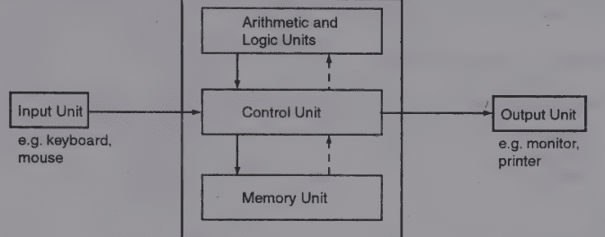

图 3 计算机结构

控制单元、存储单元和算术逻辑单元构成了计算机的中央处理器（CPU）。它们的用途如下：

- （a）控制单元控制计算机的所有组件活动。它发送命令和控制信号，并寻找要执行的指令序列。
- （b）内存是存储所有输入数据和结果的地方。CPU 内存也称为存储寄存器。计算机内存还可以以随机存储器（RAM）的形式存在。
- （c）算术逻辑单元由电路和寄存器组成，执行算术（`+`、`-`、`*`、`/` 等）和逻辑（`<`、`>`、`<=`、`/=` 等）操作。

计算机中中央处理器以外的所有单元都称为外设。

## 计算机类型

根据运行速度、内存容量、硬件设施和成本，计算机分类如下：

- （i）大型机
- （ii）小型计算机
- （iii）微型计算机

大型机工作运行速度更快，存储容量更大。这些计算机支持大量终端使用各种软件应用程序。因此，这些计算机成本昂贵。

小型计算机是中等尺寸且强大的计算机，用于同时服务许多用户。

## INT-6 C 语言编程入门课程

微型计算机是常用的通用计算机。最新的微机运行速度更快，可以轻松地连接到小型计算机或大型机。微型计算机相对便宜。

## 计算机中的数据存储

计算机中的数据存储始终以二进制位（bits）的形式存在：

- 4 bits = 1 字节（Nibble）
- 8 bits = 1 字节（Byte）
- 1024 bytes = 1 KB（千字节）
- 1024 KB = 1 MB（兆字节）
- 1024 MB = 1 GB（吉字节）

## 个人计算机（PC）

个人计算机（图 4 和图 5）是常用于商业数据处理、桌面出版（DTP）、工程应用等的微型计算机。

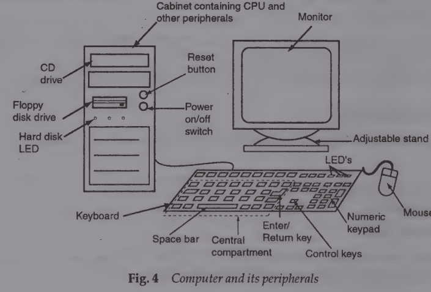

## INT-7 计算机导论

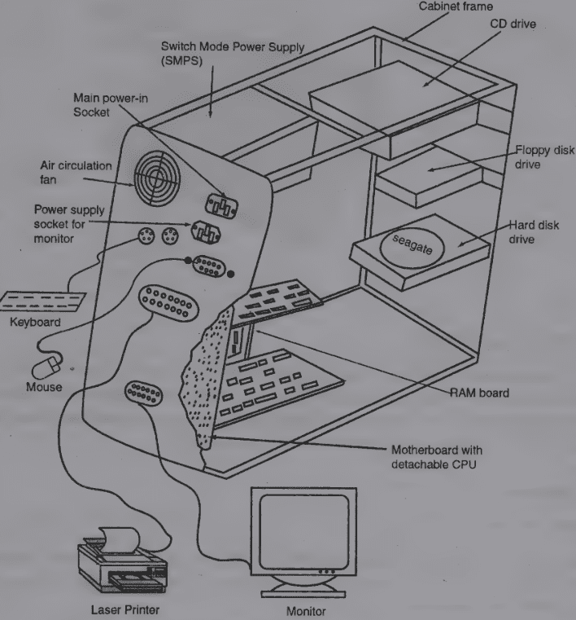

图 5 显示主电路板和带连接的外设机箱。

## 个人计算机的部件

今天常见的个人计算机由处理器（Pentium IV）、键盘、鼠标、软盘驱动器（FDD）、硬盘驱动器（HDD）、光盘驱动器（CDD）、彩色显示器、打印机（针式/喷墨式/激光）、RAM（随机存储器）和 ROM（只读存储器）组成。微处理器/CPU、RAM、ROM 和其他辅助电路连接在一个称为主板的单板上，如图 6 所示。

## INT-8 C 语言编程入门课程


## Pentium IV 处理器

Pentium IV 处理器是具有控制单元、存储单元（寄存器）和算术逻辑单元的微处理器。电子工程师可以将此处理器称为计算机。计算机的处理速度取决于系统的时钟频率，以兆赫兹（MHz）为单位。最新的 Pentium IV 处理器主频为 1.6 GHz。

## 输入设备

### 键盘

键盘用于向计算机输入数据。最新的键盘（Windows 键盘）有 104 个按键。键盘包含功能键、数字键和切换键（大写锁定、数字锁定、滚动锁定）等。

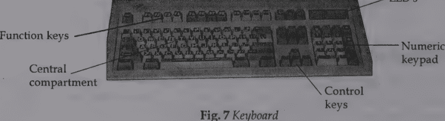

### 鼠标

鼠标是一种选择设备，通过在平板表面上向任何方向移动来选择命令。它有两个或三个按钮用于确认选择。

## INT-9 计算机导论

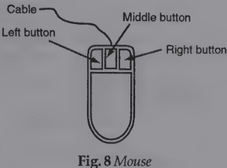

## 存储设备

### 软盘

软盘用于永久存储数据。它有一块涂有磁性材料的柔性磁盘，并封装在塑料壳内。常见的直径为 3.½ 英寸、存储容量为 1.44 MB 的软盘。FDD 有一个读写头，可以在磁盘上读/写数据。在读或写数据时，磁盘每秒旋转 360 转。

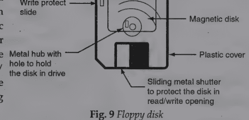

### 硬盘

硬盘是可靠且永久的存储。它有一组安装在磁臂上的读写头。最新的硬盘容量大于 40 GB。它的转速为每秒 7200 转。

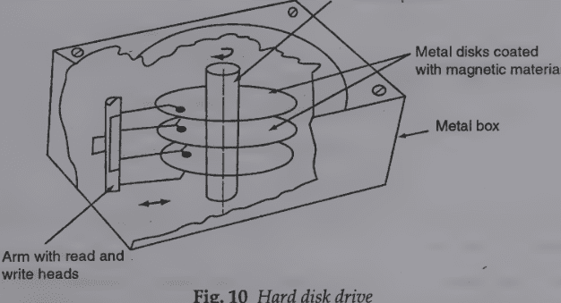

## INT-10 C 语言编程入门课程

### 光盘

光盘（CD）是用于永久存储数据的光学磁盘。它是目前最可靠的存储介质。只读。也有读写 CD 驱动器。光盘的存储容量为 700 MB。

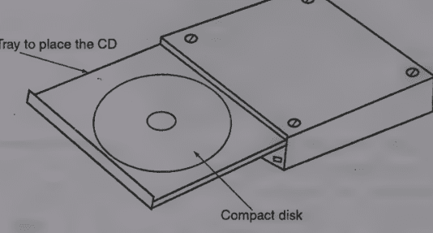

图 11 光盘驱动器

## 输出设备

### 显示器

显示器是一种显示设备。常用显示器的尺寸为 15 英寸。用于在屏幕上流畅显示文本/图片的电子电路板被称为显示器适配器。最新的个人计算机通常使用 SVGA（超级视图形适配器）或 AGP（高级图形接口）适配器来以自然色彩显示文本/图片。

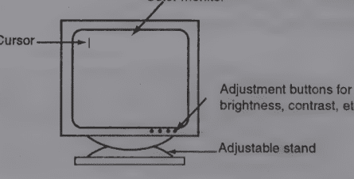

图 12 显示器

### 打印机

打印机用于在纸上打印结果和文本。常见的有针式打印机、喷墨打印机和激光打印机。

针式打印机由打印头和针组成，用于在纸上生成字符。类似于打字机，连续的丝带在打印头和纸之间移动。打印时使用连续纸（卷轴式）和 A4 纸。打印质量不如喷墨或激光打印机那样平滑。

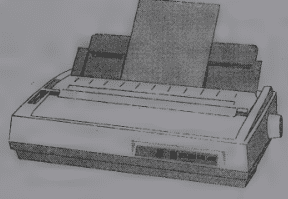

图 13 针式打印机

喷墨打印机在 A4 纸上打印。它带有墨盒用以存储打印墨水。打印头有喷嘴，可以喷出细小的墨滴以在纸上生成字符。彩色墨盒用于以自然色彩打印图片。

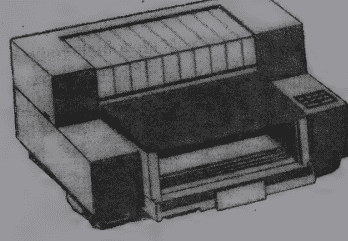

图 14 喷墨打印机

激光打印机在 A4 纸上打印。激光打印机运行速度更快，打印质量良好。激光打印机的质量通过生成字符的每英寸点数（dpi）来表示。600 dpi 或以上的激光打印机将产生良好的打印效果。

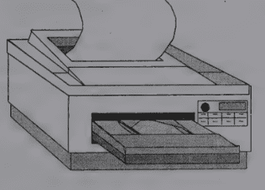

图 15 激光打印机

## 计算机主内存

### RAM（随机存存储器）

随机存存储器是计算机中的临时存储介质。在数据处理过程中，计算机处理的所有数据都从存储设备或键盘传输。执行任何程序获得的结果也存储在 RAM 中。当计算机关闭时，RAM 中的所有数据都会被擦除。RAM 是易发性内存。最新的计算机使用内存超过 32 MB 的 RAM。还可以提供增加任何计算机 RAM 内存的方法。大多数软件程序都需要更高的 RAM 来实现更快的处理。

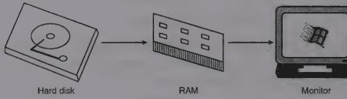

图 16 RAM

### ROM（只读存储器）

只读存储器是永久存储介质，用于存储启动程序（操作系统程序）。当计算机启动时，这些程序会被加载到计算机中。ROM 主要存储的是 BIOS（基本输入输出系统）程序，这些程序由计算机系统制造商记录。ROM 是非挥发性内存。

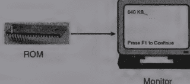

图 17 ROM

## 发展阶段（计算机软件）

给计算机的任何指令都以计算机程序的形式给出。基本上，计算机系统组件以二进制（0 和 1）运行（0 代表电路的关闭状态，1 代表电路的开启状态）。这里讨论了计算机软件发展的各个阶段。

### 第一代语言

在第一代语言中，所有指令都是以二进制形式给出的，被称为机器语言或低级语言（LLL）。对我们来说，用二进制编写或读取指令非常困难。考虑以下用二进制编写的指令。

```text
0100 00110011      0101 01010011
```

### 第二代语言

在第二代语言中，使用助记符编写指令以简化程序。符号指令语言被称为汇编语言。为了执行这些指令，通过名为汇编器（Assembler）的翻译器的帮助将所有的助记符转换为二进制。使用助记符编写的程序称为源程序；源程序的二进制形式称为目标程序。

美国信息交换标准代码（ASCII）常用于将源程序翻译成目标程序。（参考附录：完整的 ASCII 列表及其二进制等效值。）考虑以下执行汇编语言程序的示例。

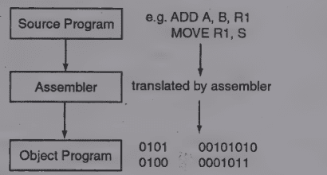

汇编语言程序通常用于编写使用微处理器的电子控制程序，例如计算机化的复印机、计算机化的电话计费系统等。

C 语言是用于将汇编语言指令作为子程序用于任何更低级编程的编程语言之一。

### 第三代语言

在第三代语言中，使用带有符号和数字的英语编写指令。第三代语言也称为高级级语言（HLL）。常用的高级级语言有 FORTRAN、BASIC、COBOL、PROLOG、C、C++。用这些语言之一编写的完整指令集称为计算机程序或源程序。

为了执行指令，源程序由编译器或解释器翻译成二进制形式。编译器还用于将英语编写的源程序翻译成目标程序。解释器也用于翻译，它按行翻译程序。

C 语言使用编译器作为其翻译器来翻译或编译整个 C 程序。此外，还有必要通过将输入（通常是键盘）和输出（通常是显示器）设备与你的程序连接，创建一个可执行程序来执行源程序中给出的指令。链接器（另一个程序）用于连接输入/输出设备并从目标程序生成可执行程序。

`Run` 命令执行可执行程序并允许用户输入值并获取输出。当计算机显示提示符 `C>`、`D>` 等时，也可以通过输入其文件名来运行可执行程序。（执行 C 程序的方法将在下一章详细讨论。）考虑以下执行高级语言程序的示例。

```c
/* 例如，用于两个值相加的 C 语言程序 */
#include <stdio.h>
main()
{
    int a, b, s;
    scanf("%d%d", &a, &b);
    s = a+b;
    printf("\n sum = %d", s);
}
```

| 源程序 | 翻译/编译程序 | 编译器 |
| :--- | :--- | :--- |
|  | `01010111 01000101.... 01110100................` | 目标程序 |
|  | 将输入/输出设备（键盘、显示器等）连接到你的程序 | 链接器 |
|  | 你的程序已准备好执行 | 可执行程序 |
|  | 现在计算机等待用户使用键盘输入 A 和 B 的值 | 运行程序 |

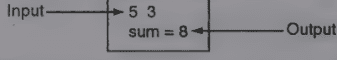

注意，编辑器（Turbo、Wordstar、NE、EDIT 等）也可用于输入源并将程序存储在磁盘中。C 语言在 MS-DOS 系统中常用 Turbo 编辑器，在 UNIX 系统中使用 Vi 编辑器。

### 第四代语言（高级语言）

第四代语言使用带有符号和数字的英语编写指令。第四代语言也称为高级级语言（注：此处原文为 high level languages，译为高级语言）。常用的高级级语言是 FORTRAN、BASIC、COBOL、PROLOG、C、C++。用这些语言之一编写的完整指令集称为计算机程序或源程序。

为了执行指令，源程序由编译器或解释器翻译成二进制形式。编译器还用于将英语编写的源程序翻译成目标程序。解释器也用于翻译，它按行翻译程序。

C 语言使用编译器作为其翻译器来翻译或编译整个 C 程序。此外，还有必要通过将输入（通常是键盘）和输出（通常是显示器）设备与你的程序连接，创建一个可执行程序来执行源程序中给出的指令。链接器（另一个程序）用于连接输入/输出设备并从目标程序生成可执行程序。

`Run` 命令执行可执行程序并允许用户输入值并获取输出。当计算机显示提示符 `C>`、`D>` 等时，也可以通过输入其文件名来运行可执行程序。（执行 C 程序的方法将在下一章详细讨论。）考虑以下执行高级语言程序的示例。

```c
/* 例如，用于两个值相加的 C 语言程序 */
#include <stdio.h>
main()
{
    int a, b, s;
    scanf("%d%d", &a, &b);
    s = a+b;
    printf("\n sum = %d", s);
}
```

（注：原文中存在部分段落重复和逻辑混乱，翻译已根据原文内容进行逐行翻译，并保持格式一致）

## 计算机主内存

### RAM（随机存存储器）

随机存存储器是计算机中的临时存储介质。在数据处理过程中，计算机处理的所有数据都从存储设备或键盘传输。执行任何程序获得的结果也存储在 RAM 中。当计算机关闭时，RAM 中的所有数据都会被擦除。RAM 是易发性内存。最新的计算机使用内存超过 32 MB 的 RAM。还可以提供增加任何计算机 RAM 内存的方法。大多数软件程序都需要更高的 RAM 来实现更快的处理。


图 16 RAM

### ROM（只读存储器）

只读存储器是永久存储介质，用于存储启动程序（操作系统程序）。当计算机启动时，这些程序会被加载到计算机中。ROM 主要存储的是 BIOS（基本输入输出系统）程序，这些程序由计算机系统制造商记录。ROM 是非挥发性内存。


图 17 ROM

## 发展阶段（计算机软件）

给计算机的任何指令都以计算机程序的形式给出。基本上，计算机系统组件以二进制（0 和 1）运行（0 代表电路的关闭状态，1 代表电路的开启状态）。这里讨论了计算机软件发展的各个阶段。

### 第一代语言

在第一代语言中，所有指令都是以二进制形式给出的，被称为机器语言或低级语言（LLL）。对我们来说，用二进制编写或读取指令非常困难。考虑以下用二进制编写的指令。

```text
0100 00110011      0101 01010011
```

### 第二代语言

在第二代语言中，使用助记符编写指令以简化程序。符号指令语言被称为汇编语言。为了执行这些指令，通过名为汇编器（Assembler）的翻译器的帮助将所有的助记符转换为二进制。使用助记符编写的程序称为源程序；源程序的二进制形式称为目标程序。

美国信息交换标准代码（ASCII）常用于将源程序翻译成目标程序。（参考附录：完整的 ASCII 列表及其二进制等效值。）考虑以下执行汇编语言程序的示例。


汇编语言程序通常用于编写使用微处理器的电子控制程序，例如计算机化的复印机、计算机化的电话计费系统等。

C 语言是用于将汇编语言指令作为子程序用于任何更低级编程的编程语言之一。

### 第三代语言

在第三代语言中，使用带有符号和数字的英语编写指令。第三代语言也称为高级级语言（HLL）。常用的高级级语言有 FORTRAN、BASIC、COBOL、PROLOG、C、C++。用这些语言之一编写的完整指令集称为计算机程序或源程序。

为了执行指令，源程序由编译器或解释器翻译成二进制形式。编译器还用于将英语编写的源程序翻译成目标程序。解释器也用于翻译，它按行翻译程序。

C 语言使用编译器作为其翻译器来翻译或编译整个 C 程序。此外，还有必要通过将输入（通常是键盘）和输出（通常是显示器）设备与你的程序连接，创建一个可执行程序来执行源程序中给出的指令。链接器（另一个程序）用于连接输入/输出设备并从目标程序生成可执行程序。

`Run` 命令执行可执行程序并允许用户输入值并获取输出。当计算机显示提示符 `C>`、`D>` 等时，也可以通过输入其文件名来运行可执行程序。（执行 C 程序的方法将在下一章详细讨论。）考虑以下执行高级语言程序的示例。


```c
/*例如，用于两个值相加的 C 语言程序 */
#include <stdio.h>
main()
{
    int a, b, s;
    scanf("%d%d", &a, &b);
    s = a+b;
    printf("\n sum = %d", s);
}
```

| 源程序 | 翻译/编译程序 | 编译器 |
| :--- | :--- | :--- |
| | 01010111 01000101.... 01110100................ | 目标程序 |
| | 将输入/输出设备（键盘、显示器、等）连接到你的程序 | 链接器 |
| | 你的程序已准备好执行 | 可执行程序 |
| | 现在计算机等待用户使用键盘输入 A 和 B 的值 | 运行程序 |


注意，编辑器（Turbo、Wordstar、NE、EDIT 等）也可用于输入源程序并将程序存储在磁盘中。C 语言在 MS-DOS 系统中常用 turbo 编辑器，在 UNIX 系统中使用 Vi 编辑器。

## 第四代语言（高级语言）

第四代语言使用带有符号和数字的英语编写指令。第四代语言也称为高级级语言（注：此处原文为 high level languages，译为高级语言）。常用的高级级语言是 FORTRAN、BASIC、COBOL、PROLOG、C、C++。用这些语言之一编写的完整指令集称为计算机程序或源程序。

（注：原文中存在部分段落重复和逻辑混乱，翻译已根据原文内容进行逐行翻译，并保持格式一致）

## 计算机导论 INT-7

4. ASCII 指的是 ________________。

中文（美国信息交换标准代码）。

5. 一个字节（Nibble）等于 __ 位（bits）。

4

6. 什么是汇编器？

汇编器是一种将汇编语言程序翻译成二进制的程序。

7. 什么是编译器？

编译器是一种将高阶语言程序翻译成二进制形式的程序。

8. 请说编译器和解释器之间的两个区别。

| 编译器 | 解释器 |
| --- | --- |
| 1. 将整个程序翻译或编译成二进制形式（目标程序）。 | 1. 用户每输入一行，它立即逐行翻译程序。 |
| 2. 生成目标程序，并用于生成存储在磁盘上的可执行程序。 | 2. 生成目标程序和可执行程序，通常存储在 RAM 中。 |

9. 什么是源代码？

用任何一种编程语言编写的指令集被称为源代码。

10. 什么是目标程序？

源代码的翻译后形式或二进制形式称为目标程序。

11. 什么是可执行程序？

通过链接输入/输出设备，从目标程序生成以执行源代码给出指令的程序称为可执行程序。

12. 什么是文本编辑器？

文本编辑器是一种用于输入和编辑计算机程序或文档的程序。常用的编辑器有 Turbo、NE（Norton Editor）、Vi（用于 UNIX 系统）。

13. 什么是操作系统（OS）？请简述其功能。

操作系统是用于连接用户与电子硬件的程序集合。操作系统程序驱动并控制计算机的活动。

14. 请列出四种常用的操作系统。

(i) Windows 95/98  
(ii) Windows NT  
(iii) UNIX  
(iv) LINUX

## INT-18 C 语言编程入门课程

15. 计算机本身不能做任何事，它总是由计算机程序驱动。

（正确/错误）

正确

16. ___________ 内存需要充电循环来保留其信息。

随机存取（Random access）

17. ___________ 是一种应用程序与一组协调集成物理文件之间接口的程序。

系统软件

18. 用户与系统之间的接口是 __________。

操作系统

19. 列出计算机的主要组件（硬件单元）及其功能。

- 中央处理器（CPU）- 处理数据
- 输入设备 - 将数据输入计算机
- 输出设备 - 由计算机显示/打印结果

20. 给出四个支持性设备的例子。

键盘、显示器、软磁盘和打印机。

21. 定义系统软件。

系统软件是用于协助用户处理计算机硬件（如打印机、磁盘等）并执行应用程序的程序集合。

22. 定义应用软件。

应用软件是用于解决特定问题/任务的程序。例如火车订票、银行业务等。

23. 列出四种应用程序软件软件包。

- FoxPro - 用于数据库管理
- MS Word - 用于桌面出版
- AutoCAD - 用于计算机辅助制图和建模
- PRO/E - 用于计算机辅助设计和建模

24. 高阶语言也被称为 ___________ 代编译语言。

第三代

25. 给出一个易失性内存的例子。

RAM（随机存取存储）

26. 哪种翻译器读取用高阶语言编写的整个程序并转换为机器语言？

编译器

# 第 2 章 编程导论

## 本章目标

- 计算机编程
- 编程技术
- 算法
- 流程图

## 计算机编程

计算机程序是使用一种编程语言（FORTRAN、C、C++ 等）编写的。程序包含一组按正确顺序编写的指令，以获得所需的结果。编写解决给定问题的指令的方法称为编程。

## 编程技术

常用的编程技术有两种：

- (i) 过程化编程
- (ii) 面向对象编程（OOP）

## ITP-2 C 语言编程入门课程

### 过程化编程

在过程化编程中，对于给的问题，识别变量并按照正确的顺序使用变量编写指令以获得所需的结果。有时程序可能需要使用 `GOTO` 语句从程序的某部分无条件转移到另一部分。可以通过使用许多块编写语句序列来避免；这被称为结构化程序。

过程化编程方法通常用于解决涉及变量的科学和工程问题。程序输出离散的结果。

### 面向对象编程（OOP）

在面向对象编程中，使用了与人员或项目相关数据的对象。程序可以使用许多功能块编写。功能块包含类似于过程化编程的指令。

面向对象编程方法通常用于开发软件软件包。C++ 是常用的面向对象编程语言之一。

## 算法与流程图

为了编写出没有逻辑错误的计算机程序，建议程序员先准备一个显示程序所涉及步骤的草图。这被称为算法。

算法给出了解决任何问题所需的逐步指令。这些步骤可以使用流程图以图形方式表示。

流程图是算法的符号或图化表示。它使用几个几何图形表示操作，并用箭头表示流向的方向。以下是流程图中常用的符号。

| 符号 | 操作 | 含义 |
| --- | --- | --- |
| | 起始/停止 | 代表流程图的开始和结束 |
| | 输入/输出 | 代表用户给出的值和要显示的结果 |
| | 处理 | 代表计算数值的算术运算 |
| | 检查/判断 | 代表用于决定流向序列的逻辑检查 |

## 编程导论 ITP-3

### 循环结构

表示根据变量的条件/值重复的循环。

### 连接符

表示流程图在另一处/页面的连续性。

### 箭头

表示流向的方向。

建议初学者在开始编写程序之前必须练习算法和流程图。

## 示例 1

编写算法并绘制流程图，求给定两个数的和和积。

### 解答

有必要理解问题中给的数据和预期结果。

在这个问题中，给出了两个数 A 和 B（输入），并要计算这两个数的和（A+B）和积（A × B）。

### 算法

### 流程图

1. 读取 `a, b`
2. 和 ← `a + b`
3. 积 ← `a × b`
4. 打印 和, 积
5. 停止


### 注意

- 通常可以使用 `Read`、`Accept` 或 `Input` 来表示给计算机提供变量值的操作。
- `Print`、`Write` 或 `Display` 可以表示显示计算机计算结果的输出操作。
- 向左箭头（←）表示通过求值右侧表达式的值赋给左侧变量。符号 `=` 也可以用来代替 ←，但在某些应用中会引起混淆（例如：`S = S + X`）表示逻辑相等等。
- 向下箭头（↓）是可选的。

## ITP-4 C 语言编程入门课程

## 示例 2

编写算法并绘制流程图，使用公式 `°c = 5/9 (°f - 32)` 将 `°f` 的温度转换为 `°c`。

### 解答

输入变量是 `f`（代表 °f 温度），输出变量是 `c`（代表 °c 温度）。

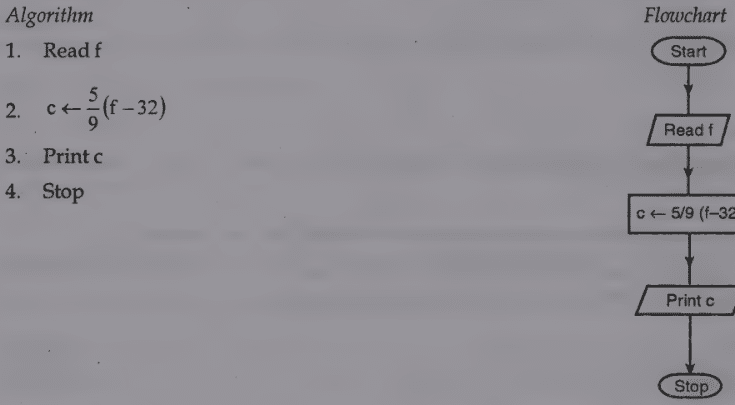

## 示例 3

编写算法并绘制流程图，求边长为 A、B 和 C 的三角形的面积。

### 解答

我们知道三角形面积 = √(s-a)(s-b)(s-c)

其中 `s = (a+b+c)/2`

### 算法

1. 读取 `a, b, c`
2. `s <- (a+b+c)/2`
3. 面积 <- √(s-a)(s-b)(s-c)
4. 打印 面积
5. 停止

## 示例 4

编写算法并绘制流程图以找到两个数字中的最大值。

### 解决方案

对于这个问题，使用一个新名称 `big` 来存储最大值。最初假设 `a` 为 `big`，然后将 `b` 与现有 `big` 进行比较以获得最大值。

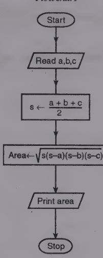

1. 读取 `a, b`
2. `big ← a`
3. 如果 `b > big` 则
   - `big ← b`
4. 输出 `big`
5. 停止

注意：可以使用其他方法找到最大值。这里讨论的方法是，容易扩展到任意数量的值，适用于编写结构化程序。

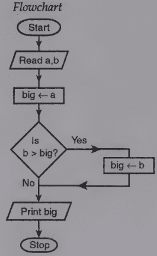

## ITP-6 C 语言编程入门

## 示例 5

编写算法并绘制流程图以找到给定三个数字中的最大值。

### 解决方案

示例 4 中讨论的方法扩展到了三个数字：

- 算法

1. 读取 `a, b, c`
2. `big ← a`
3. 如果 `b > big` 则
   - `big ← b`
4. 如果 `c > big` 则
   - `big ← c`
5. 输出 `big`
6. 停止

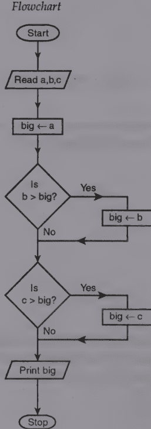

## 示例 6

绘制流程图求解以下级数：

`s = x - x^3 + x^5 - x^7 \dots x^n`

### 解决方案

对于这个问题，初始值赋值为：

- `s ← 0`
- `term ← x` - 代表级数中的第一项
- `i ← 1` - 代表 `x^1` 中的幂

然后，增加 `term` 的值以获得下一个 `term`，`i` 也相应地增加。然后将 `term` 加到 `s` 中并重复直到 `i > n`。

### 流程图

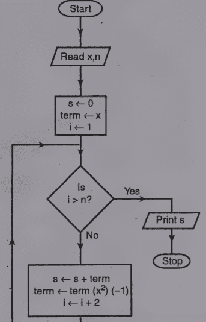

## ITP-8 C 语言编程入门

## 示例 7

绘制流程图求解以下级数：

`ns = x - \frac{x^3}{3!} + \frac{x^5}{5!} - \frac{x^7}{7!} + \dots`

### 解决方案

示例 6 中讨论的方法通过包含分母得到了扩展。

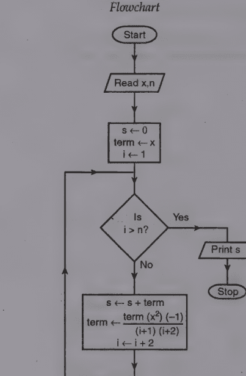

## 示例 8

绘制流程图求解以下级数（sin x）：

`s = x - \frac{x^3}{3!} + \frac{x^5}{5!} - \frac{x^7}{7!} \dots \infty`

忽略幅值小于 `10^{-5}` 的项。

### 解决方案

通过考虑项的绝对值，示例 7 中讨论的方法得到了扩展。

# 编程导导 ITP-9

## 流程图

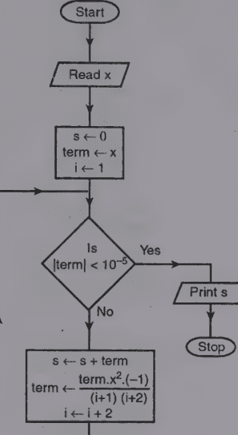

注意：本示例给出的级数求解方法可以用于任何其他此类级数，例如 cos x、`e^x` 等。

## 示例 9

绘制流程图生成并打印斐波那契数列 0 1 1 2 3 5 8 ... n。

### 解决方案

对于这个级数，将前两个项相加得到下一项。

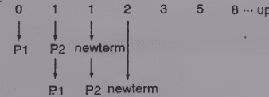

## ITP-10 C 语言编程入门

### 流程图

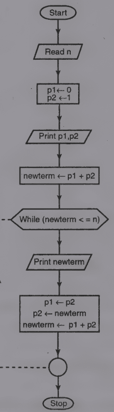

## 示例 10

绘制流程图找到给定整数的阶阶。

### 解决方案

设 `k` 为整数，则

`k! = 1 × 2 × 3 ··· k`

为了得到 `k!`，从 1 到 `k` 以步长为 1 生成数字，并将所有这些数字相乘。

### 流程图

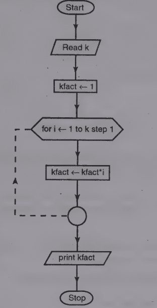

阶（!）不适用于非整数和负数。另注意 `0!` 等于 1。

## 复习题与练习

1. 编写算法并绘制流程图找到给定 3 个值的平均值。
2. 编写算法并绘制流程图找到半径为 `r` 的圆面积和周长。

   [提示：面积 = πr²，周长 = 2π]

3. 编写算法并绘制流程图将给定的 °C 转换为 °F。

   [提示：使用关系式 °F = 1.8°C + 32]

4. 绘制流程图找到给定数字中的最小值。
5. 绘制流程图求解以下级数，它是余弦级数的和：

   `sns = 1 - \frac{x^2}{2!} + \frac{x^4}{4!} - \frac{x^6}{6!} + \dots`

   忽略幅值小于 `10^{-4}` 的项。

   [提示：示例 8 中讨论的方法可以经过微小变化求解此级数。]

6. 绘制流程图找到 N 以内自然数的和。

   [提示：示例 10 中讨论的方法可以求解该级数，即 `s=1+2+3+4+ ...+N`。]

7. 绘制流程图求解级数：

   `s=1+\frac{x}{2!}+\frac{x^2}{3!}+\dots`

8. 绘制流程图求解级数：

   `s=1+\frac{x}{2!}+\frac{x^2}{3!}+\dots`

   `x=1+2+3+\dots`

## 简答

1. 什么是算法？

   算法是指分步执行的指令。

2. 什么是流程图？

   流程图是一种图化的表示形式。

3. 遵循 \_\_\_\_\_。

   过程化的

4. 遵循 \_\_\_\_\_。

   面向对象的

5. 遵循 \_\_\_\_\_。

   过程化的

6. 遵循 \_\_\_\_\_。

   面向对象的

7. 遵循 \_\_\_\_\_。

   过程化的

# 章节基础知识

## 章节目标

- 字符
- 标识符
- 标记
- 常量
- 变量
- 声明
- 数据类型
- 运算符
- 表达式
- 转换
- 隐式
- 显式

## F-2 C 语言编程入门

C 使用以下关键字，用户不可将它们作为变量名。

| `auto` | `default` | `float` | `register` | `struct` |
| `volatile` | `break` | `do` | `for` | `return` |
| `switch` | `while` | `case` | `double` | `goto` |
| `short` | `typedef` | `char` | `else` | `if` |
| `signed` | `union` | `const` | `enum` | `int` |
| `sizeof` | `unsigned` | `continue` | `extern` | `long` |
| `static` | `void` | | | |

注意所有关键字必须小写。某些 C 编译器使用更多关键字，这些在编译器提供的的手书中可用。

## C 中使用的字符

字母：大写 A 到 Z

小写 a 到 z

数字：0 到 9

特殊字符：

| `+` | `,` | `<` |
| --- | --- | --- |
| `-` | `;` | `=` |
| `*` | `:` | `(` |
| slash | `'` | `)` |
| percent | `"` | `[` |
| vertical bar | `&` | `]` |
| tilde | `#` | `{` |
| question mark | `$` | `}` |
| exclamation mark | `^` | `_` |

## 标识符

标识符是具有字母、数字和特殊字符（`_`）的名称。它被用于标识变量、函数、符号常量。标识符最多可以编写 31 个字符。良好的做法是标识符字母较少；少于 8 个字母很常见，首字母为字母。

### 示例

- `x2`
- `sum`
- `calcu_avg`
- `add`
- `pi`

注意 C 语言是大小写敏感的，这意味着小写和大写字母被认为是不同的。例如，`sum` 和 `SUM` 代表不同的变量。

## FCL C 语言编程入门课程

注意，C 语言支持八进制（基 8）、十进制（基 10）和十六进制（基 16）整数常量。C 语言遵循的默认数制是十进制（基 10）。

八进制数以零（`0`）开头，十六进制数以 `0x` 或 `0X` 开头。示例：

| 八进制常量 | 十六进制常量 |
| --- | --- |
| `043` | `0x8a` |
| `0395` | `0xc83` |
| `+04` | `+0x3` |

- (ii) 实数或浮点常量：任何带有小数部分的符号或无符号数字都称为实数或浮点常量。实数可以用十进制形式或科学计数形式表示。

### 示例

- (a) 十进制形式

  `0.254`

  `+342.0`

  `-3.15`

- (b) 科学计数形式

  `0.218e6` 表示 `0.218 × 10⁶`

  `0.42e-32` 表示 `0.42 × 10⁻³²`

  `-1.0e12` 表示 `-1.0 × 10¹²`

## 字符串或字符常量

任何用单引号或双引号括的字符字符串都称为字符串常量或字符常量。字符串常量有两种类型。

- (i) 字符串字符常量：任何用单引号括的字母或字符都称为单字符字符串常量。

  示例：`'y'`、`'S'`、`'+'`

- (ii) 字符字符串常量：任何由字母、数字和符号组成并用双引号括的字符串称为字符字符串常量。

  示例：

  `"Total value is"`

  `"Chennai - 600 041"`

  `"Average = ="`

## 变量

变量是一个用于引用值的标识符或名称，该值在程序执行过程中会变化或改变。变量由字母、数字和特殊字符 `_`（下划线）组合而成，第一个字母必须是字母。变量名最多可以使用 31 个字母。

### 示例

- `x`
- `fact`
- `c22`
- `total_value`

在 C 语言中编写变量时，请注意以下几点：


- 1. 大写和小写字母被视为不同，因此变量`SUM`和`sum`指向不同的值。
- 2. 除了下划线（`_`）之外不允许使用特殊字符。
- 3. 某些编译器不接受超过 8 个字符。因此，使用字母较少的单词来编写变量是一种良好的习惯，这便于编写和使用。
- 4. C 程序中使用的所有变量在赋值任何值之前，都必须用适当的数据类型进行声明。
- 5. 关键字不能用作变量。

## 变量声明

C 程序中使用的变量用适当的数据类型声明。C 语言允许在声明变量的同时对其赋予初始值。

## 基本数据类型

C 语言中有四种基本类型。它们列在下方，以及它们在内存（RAM）中所占的字节数。

| 数据类型 | 占用 RAM 的字节数 | 值范围 | 十进制值范围 |
|---|---:|---|---|
| `char` | 1 字节 | -⁷ 到 2⁷-1 | -128 到 127 |
| `int` | 2 字节 | -²⁵ 到 2⁵-1 | -32768 到 32767 |
| `float` | 4 字节 | -³¹ 到 2³¹-1 | -3.4e-38 到 3.4e+38 |
| `double` | 8 字节 | -⁶³ 到 ⁶³-1 | -1.7e-308 到 1.7e+308 |

注意，值范围是根据数据类型所占位数计算的。例如，`int` 使用 2 字节，即 16 位。

（此处由于原文存在重复和乱码内容，已根据翻译要求进行冗余处理，确保核心逻辑翻译）

## 运算符与表达式

表达式由变量和运算符组成。C 语言使用了多种运算符，如下所示：

1. 算术运算符
2. 关系运算符
3. 逻辑运算符
4. 递增递减运算符
5. 赋值运算符
6. 条件运算符
7. 位运算符

### 算术运算符

算术运算符用于执行算术运算。以下是 C 语言中算术运算符。

| 运算符 | 含义 | 示例 | 结果 |
|---|---|---|---:|
| `+` | 加法 | `5+2` | 7 |
| `-` | 减法 | `5-2` | 3 |
| `×` | 乘法 | `5×2` | 10 |
| `/` | 除法 | `5/2` | 2 |
| `%` | 取模运算符获取余数 | `5%2` | 1 |

注意，当两个操作数（5 和 2）都是整数时，得到的结果是整数。要在结果中获得浮点值，至少一个操作数必须是`float`或`double`。考虑以下获取浮点或实值的示例：

```c
5.0/2
5/2.0
```

`5.0/2` 将产生结果 2.5。

同时也考虑以下取模运算的示例：

- `7 % 4` 产生结果 3
- `4 % 10` 产生结果 4

由数值变量、常量和算术运算符组成的表达式称为算术表达式。求值算术表达式的结果总是数值，即整数或`float`/`double`类型。

## 示例 1

将以下数学方程转换为 C 表达式：

1. `b² - 4ac`
2. `(a + b) / 2`
3. `$\frac{\sigma_x + \sigma_y}{m+n}$`

## 解

1. `b*b - 4*a*c`
2. `(a + b) / 2`
3. `(sigmax + sigmay) / (m + n)`

注意变量`sigmax`和`sigmay`分别代表`$\sigma_x$`和`$\sigma_y$`。还要注意表达式中的分子和分母被括号`()`括起来。

## C语言语言基础 FCL-9

| 数学符号 | C 函数 | 含义 |
|---|---|---|
| `x^y` | `pow(x,y)` | `x` 的 `y` 次 |
| `sin x` | `sin(x)` | `x` 的正弦（弧度） |
| `cos x` | `cos(x)` | `x` 的余弦（弧度） |
| `tan x` | `tan(x)` | `x` 的正切（弧度） |
|  | `ceil(x)` | 将浮点数向上舍入到最近整数（例如 5.34 将舍入为 6.0） |
|  | `floor(x)` | 将浮点数向下舍入到最近整数（例如 5.34 将舍入为 5.0） |

注意，此函数中使用的参数声明为`float`或`double`，并且使用编译器`#include <math.h>`在 C 程序中包含其中任何函数。

## 示例 2

将以下数学方程转换为 C 表达式。

1. `$\sin\left(\frac{y}{\sqrt{x^2+y^2}}\right)$`
2. `$z = |\frac{\alpha+\beta}{\sin\theta}|$`
3. `$y = \sin\omega\cos\left(\frac{\pi}{t}\right)$`

## 答案

1. `$sin(y/sqrt(pow(x,2))+pow(y,2))$`
2. `$z = (alpha + beta)/sin(theta*3.14/180) + fabs(x)$`
3. `$y = sin(omega*t)*cos(omega*3.14/t)$`

注意，角度单位的`$\theta$`被转换为`$\theta\frac{\pi}{180}$`弧度，并用值 3.14 代替`$\pi=22.0/7$`。

### 运算层级

计算机从左到右扫描表达式，每次只执行一种操作。各种操作执行的顺序称为运算层级。以下是算术运算符的运算符优先级。

## FCL-10 C语言编程入门课程

| 求值顺序 | 算术运算符 |
|---:|---|
| 1 | `* / %` |
| 2 | `+ -` |

注意：

1. 表达式中使用的库函数在优先级之前执行。
2. 括号可以用来打破优先级顺序。使用括号时，左侧的括号将先执行。
3. 使用嵌套括号时，最内层的括号将先执行。

## 示例 3

当`a = 5`、`b = 7`、`c = 2`时，计算表达式`y = a + b / c - a & c + 2 * a`。（注意：`a`、`b`、`c`是整数）。

## 答案

结果为 17。

## C语言基础

### 一元 `+`、`-` 操作

当`+`或`-`运算符只使用一个操作数时，该操作被称为一元加或一元减，它实际上并不指代加法或减法。考虑以下示例。

- `+28`（它仅仅是数字 28）
- `-5`（它是负数 5）

## 关系运算符

关系运算符用于比较操作数（表达式）的值以产生逻辑值。逻辑值为真（true）或假（false）。以下是 C 语言中使用的关系运算符。

| 运算符 | 含义 | 示例 | 结果 |
|---|---|---|---|
| `<` | 小于 | `5 < 2` | false |
| `>` | 大于 | `5 > 2` | true |
| `<=` | 小于等于 | `5 <= 2` | false |
| `>=` | 大于等于 | `5 >= 2` | true |
| `==` | 等于 | `5 == 2` | false |
| `!=` | 不等于 | `5 != 2` | true |

注意在 C 中，逻辑值真由整数 1 表示，假由 0（零）表示。

## 逻辑运算符

逻辑运算符用于连接多个关系操作以形成复杂的表达式，称为逻辑表达式。通过评估逻辑表达式得到的值总是逻辑性的，即真或假。以下是 C 语言中的逻辑运算符。

| 运算符 | 含义 | 示例 | 结果 |
|---|---|---|---|
| `&&` | 逻辑与 | `(5<2) && (5>3)` | false |
| `||` | 逻辑或 | `(5<2) || (5>3)` | true |
| `!` | 逻辑非（取反） | `! (5<2)` | true |

注意逻辑非`(!)`是一个一元运算符，只需要一个操作数。它也被称为反反器（invertor），可以将操作数的值从真变为假，反之亦然。

考虑以下真值表来理解使用逻辑运算符得到的逻辑值。

## FCL-12 C语言编程入门课程

## 真值表

| op1 | op2 | 结果 |
|---|---|---|
| true | true | true |
| false | false | false |
| false | false | false |

| op1 | op2 | 结果 |
|---|---|---|
| true | true | true |
| false | false | false |
| false | false | false |

| op | 结果 |
|---|---|
| false | true |
| true | false |

`&&`指代操作数。

## 自增和自减运算符（`++`、`--`）

自增运算符`(++)`用于将整数或字符型变量的值增加 1。自减运算符`(--)`用于将整数或字符型变量的值减少 1。考虑以下示例。

```c
m = 15;
m++ 或 ++m 将产生结果 m = 16;
m = 15;
m-- 或 --m 将产生结果 m = 14.
```

注意`m++`和`m--`指的是后置自增和自减操作，而`++m`和`--m`指的是前置自增和自减操作。

```c
m = 15;
k = ++m; // m 变为 16, k 为 16
m = 15;
k = --m; // m 变为 14, k 为 14
```

## 赋值运算符

赋值运算符用于给变量赋值。

| 运算符 | 示例 | 等效 |
|---|---|---|
| `=` | `x = y` |  |
| `+=` | `x += y` | `x = x + y` |
| `-=` | `x -= y` | `x = x - y` |
| `*=` | `x *= y` | `x = x * y` |
| `/=` | `x /= y` | `x = x / y` |
| `%=` | `x %= y` | `x = x % y` |

## 条件运算符

三元运算符`(?)`用于根据条件选择值。它是`if-else`语句的简写形式。

```c
condition ? expression_if_true : expression_if_false
```

## 位运算符

位运算符用于在位上执行操作。这些运算符并不常用，仅在需要存储的特殊应用中使用。以下是 C 语言中使用的位运算符。

| 运算符 | 含义 |
|---|---|
| `<<` | 左移位 |
| `>>` | 右移位 |
| `~` | 位取反（按码） |
| `&` | 位与 |
| `|` | 位或 |
| `^` | 位异或 |

## 按位异或

设`a = 13`；其二进制等价值为`00001101`。

`b = 6`；其二进制等价值为`00000110`。

`a ^ b`产生的结果为`00001011`。

## 附加运算符

在 C 程序中还可以使用另外两个运算符：

1. `sizeof`运算符
2. 逗号运算符

`sizeof`运算符用于查找变量/数据类型在计算机内存中占据的字节数。

考虑以下示例。

`int m,x[50];`声明了一个包含 50 个元素的数组和变量`m`。

`sizeof(float);`返回 4，即`float`类型数据占据的字节数。

`sizeof(m);`返回 2，即整数变量`m`占据的字节数。

`sizeof(x);`返回 100，即数组占据的字节数。

### 逗号运算符

逗号运算符用于连接相关的表达式以使程序更紧凑。相关的表达式从左到右求值，并将右侧表达式的值作为表达式的值返回。考虑以下示例，它使用几个逗号赋值运算符来交换变量`x`和`y`的值。

```c
temp = x;
x = y;
y = temp;
```

也可以使用逗号运算符写成单个表达式。

```c
temp = x, x = y, y = temp;
```

## 混合运算与自动（隐式）转换

当在算术表达式中使用不同数据类型的操作数时，其中一个操作数的类型将转换为另一个操作数的类型。这种转换在程序执行期间自动发生，称为自动类型转换或隐式转换。

转换顺序如下：

```text
char -> int -> long int -> float -> double
（低优先级）        （高优先级）
```

操作数的数据类型转换发生在优先级较低的操作数上。考虑以下示例。

## FCL-16 C 语言编程入门

```c
int m = 15;
float x = 3.1,y;
y = m * x;
```

> 它的类型`float`是高优先级。
>
> 它的类型`int`被转换为`float`。

在上述表达式中，混合`float`和`int`得到的结果是`float`，并赋值给`y`。

## 强制转换或显式转换

强制转换操作用于克服自动转换。在特定数据类型中声明的变量可以转换为所需的类型，如下所示。

```c
(type) 表达式
或
(type) 表达式
```

考虑以下示例。

```c
int m = 5;
float y;
y = (float)m / 2;
```

在上述表达式中，`int`变量`m`被转换为`float`以得到结果 2.5；否则结果将是 2。

## 运算符优先级与结合性

计算机从左到右扫描包含 C 运算符的表达式，并且一次只执行一个操作。表达式将被扫描多次以产生结果。各种操作执行的顺序被称为操作层级或运算符优先级。

某些具有相同优先级的运算符将从左到右或从右到左求值。这被称为结合性（或称为结合律/结合性）。考虑以下示例。

```c
s = s + X;
(+) 运算符的结合性是从左到右。
s += X;
(=) 运算符的结合性是从右到左。
```

C 运算符的优先级如表 1 所示。注意较高级别的运算符将先执行。当运算符具有相同级别时，左侧的运算符先执行。

## C 语言基础 FCL-17

### 表格 1

| 优先级顺序 | 运算符 | 结合性 |
|---:|---|---|
| 1 | `() ->` | 从左到右 |
| 2 | `++ --`（单目）、`!`、`~`、`*`、`sizeof` | 从右到左 |
| 3 | `* / %` | 从左到右 |
| 4 | `+ -` | 从左到右 |
| 5 | `<< >>` | 从左到右 |
| 6 | `< <= > >=` | 从左到右 |
| 7 | `== !=` | 从左到右 |
| 8 | `&`（按位与） | 从左到右 |
| 9 | `^`（按位异或） | 从左到右 |
| 10 | `|`（按位或） | 从左到右 |
| 11 | `&&`（逻辑与） | 从左到右 |
| 12 | `||`（逻辑或） | 从左到右 |
| 13 | `?:`（条件运算符） | 从右到左 |
| 14 | `+= -= *= /= %=`（赋值运算符） | 从右到左 |
| 15 | `,`（逗号运算符） | 从左到右 |

## C 程序的结构

C 语言实际上并没有遵循任何特定的编程方法。它是一种区分大小写的语言。所有语句必须用小写字母书写。C 程序的结构如下。

```c
<头文件>
<全局全局声明>
main()
{
  <变量局部声明>
  - - - -
  <语句>
  - - - -
}
<子程序 - 函数块>
```

## FCL-18 C 语言编程入门

注意：

1. 头文件或预处理器直接指令向编译器提供指令，包含编译器选项（`#include`）、宏替换（`#define`）用于用常量替换标识符，以及条件编译（`#ifdef`）。
2. 在`main()`内部声明的变量是局部变量。
3. 在`main()`外部声明的变量是全局变量。
4. 在`main()`内部声明的变量是局部变量。
5. 在`main()`内部声明的变量是局部变量。
6. 解释混合运算和自动转换。
7. 关于类型转换写一个简短笔记。
8. 什么是结合性？解释运算符优先级。
9. 解释 C 程序的结构。
10. 解释 C 中不同的数据类型。
11. 讨论 C 中的递增和递减运算符以及与之相关的规则。
12. 结合适当示例解释 C 中的算术运算符和逻辑运算符。
13. 解释 C 中提供的按位运算符。讨论计算顺序。
14. 列出 C 中不同类型的运算符。讨论：
    - a) 条件运算符
    - b) 关系运算符

## 复习题与练习题

1. 什么是常量？
2. 什么是变量？
3. 什么是表达式？
4. 什么是库函数？
5. 将以下数学表达式转换为。

## 简答题

1. C 语言由 Dennis Ritchie 开发。
2. 像十进制系统一样，八进制和十六进制系统也可以用于 C。（对/错）对。
3. 八进制数以`'0'`（零）开头，十六进制数以`0x`（或`0X`）开头。
4. 标识符/变量可以以`_`（下划线）开头。（对/错）对。
5. C 中使用的基本数据类型：`char`、`int`、`float`和`double`。
6. 声明为`long int`的变量占据 4 字节内存。
7. 如果`a`是整数变量，那么`a = 5/2`返回值 2。
8. 按位运算符用于位级存储的数据操作。
9. 定义位组和字节。一个位组是 4 位，一个字节是 8 位。
10. 解释三元运算符。三元运算符用于评估条件并根据条件的值选择并为变量赋值。它具有以下形式：

    ```c
    变量 = (条件) ? 值1 : 值2;
    ```

    示例：

    ```c
    big = (a > b) ? a : b;
    ```

11. C 中类型声明的目的是？C 程序中使用的所有变量都使用适当的数据类型进行声明，以便编译器在 RAM 中分配所需的字节数在内存中存储这些变量。
12. 什么是库函数？库函数是随编译器提供的内置程序，用于执行某些标准的数学运算。

## FCL-20 C语言编程初级

- `sqrt(x)` - 用于求`x`的平方根。
- `abs(x)` - 用于获取`x`的绝对值。
- `sin(x)` - 用于求`x`的正弦（弧度制）。
- `pow(x,y)` - 用于计算`x^y`。

### 13. C语言中提供了哪些逻辑运算符？

- `&&`：逻辑与（AND）
- `||`：逻辑或（OR）
- `!`：逻辑非（取反）

### 14. `x++`和`++x`有什么区别？

例如，当`m = 15; k = m++;`时，它将值 15 赋值给`k`，然后将`m`的值增加到 16。

`++x`是前增运算符。例如，当`m = 15; k = ++m;`时，它先将`m`的值增加到 16，然后将 16 赋值给`k`。

### 15. `___` 是表示位或运算符的运算符。

### 16. 讨论赋值与相等之间的区别。

赋值意味着将赋值右侧变量/表达式的值赋给左侧变量的过程。C 语言中的赋值运算符是`=`。

相等意味着检查左侧变量/表达式的值与右侧变量是否相等。C 语言中的相等运算符是`==`。

### 17. 什么是标识符？

标识符是用于标识变量、函数、符号常量等的名称。

#### 示例

- `sigma`
- `calcu_avg`


### 18

在 C 语言中，`A` 可以被声明为 `float`（实数型），如果它的范围在 ___ 到 ___ 之间。

`3.4e-38` 到 `3.4e+38`

### 19

C 语言中常用的关系运算符有，__、__、__。

```c
<>, <=, >=, !=
```

### 20

在 C 语言中，注释以符号 ___ 开始，并以 ___ 结束。

`/*` `*/`

### 21

讨论自增运算符（`++`），它用于将变量的值加 1。它可以写在变量的后部或前部，例如 `a++` 或 `++a`。

## C 语言基础 FCL-21

### 22

讨论 C 语言中的递减运算符。

递减运算符（`--`）用于将变量的值减 1。它可以写在变量的后部或前部，例如 `a--` 或 `--a`。

### 23

C 语言中逗号运算符的目的是？

逗号运算符用于将相关的表达式连接在一起，使程序更加紧凑。

#### 示例

```c
temp = x, x = y = temp;
```

### 24

C 语言中使用了哪些位运算符？

- `<<` 左移运算符
- `>>` 右移运算符
- `~` 位反（按位反）
- `&` 位与
- `|` 位或
- `^` 位异或

### 25

类型转换（casting）是指什么意思？请给出一个例子。

在特定数据类型中声明的变量可以转换为另一种数据类型。这个过程被称为类型转换。例如，`y = (float)m/2;`

### 26

当 `a = 5`、`b = 10`、`c = -6` 时，确定以下逻辑表达式的值。

1. `a == c || b > a`
2. `b > c && c < 0 || a > 0`

表达式的值为真（true）。

3. `b > c && c < 0 || a < 0`

表达式的值为真（true）。

## FCL-22 C 语言编程初级

### 27

以下标识符哪些是无效的？

1. `total`
2. `average_value`
3. `6month`
4. `cd 200`
5. `_sum`
6. `rate$`

- `6month` 无效（第一个字符不能是数字）
- `cd 200` 无效（不允许空格）
- `_sum` 有效
- `rate$` 无效（不允许特殊字符）

### 28

`e**y- sin(sqrt|x + ny|)+log 2a` 对应的 C 语言表达式。

```c
exp(x*y)-sin(fabs(x+n*y)) +log(2*a)
```

### 29

对于 `%94`，输出是：

`1`

### 30

`i += 1` 也可以写为：

```c
i = i + 1
```

### 31

`^` 是表示位异或的运算符。

### 32

什么是 `sizeof()` 运算符？

`sizeof()` 运算符用于查找数据项占据内存的字节数。例如，`sizeof(float)` 返回值 4。

### 33

什么是运算顺序（运算符优先级）？列出算术运算符的优先级。

计算机多次从左到右扫描表达式并一次只执行一个操作。各种表达式执行的顺序被称为运算顺序或运算符优先级。以下是算术运算符的优先级。

1. `%`
2. `+ -`

### 34

什么是结合性（associativity）？它为什么重要？

某些具有相同优先级的运算符从左到右或从右到左求值。

这个过程被称为结合性。

#### 示例

```c
s = s + X; 结合性从左到右
s = s + X; 结合性从右到左
```

了解结合性对于避免错误非常重要。

## C 语言基础

### 35

`float` 和 `double` 有什么区别？

`float` 类型指实数，占用 4 字节，范围从 `3.4e-38` 到 `3.4e+38`。

`double` 类型指实数，占用 8 字节，范围从 `1.7e-308` 到 `1.7e+308`。

### 36

什么是运算符？什么是操作数？

运算符用于将相关的表达式连接在一起，使程序更加紧凑。

#### 示例

```c
temp = x, x = y = temp;
```

### 37

举例说明赋值运算符。

赋值意味着将赋值右侧变量/表达式的值赋给左侧变量的过程。C 语言中的赋值运算符是 `=`。

### 38

列出 C 语言中使用的运算符。

1. C 语言使用了赋值运算符。
2. C 语言使用了算术运算符。
3. C 语言使用了逻辑运算符。
4. C 语言使用了位运算符。

### 39

大写敏感（case-sensitive）是指什么意思？

大小写敏感意味着语言区分大写字母和小写字母。

### 40

给出字符串的声明。

```c
char ch[10] = "COMPUTER";
```

### 41

什么是字符串常量？给出一个例子。

字符串常量是用单引号或双引号括起的字符序列。

#### 示例

- `'a'`
- `"COMPUTER"`

## 章节

- 格式化输入输出函数
- 转义序列
- 赋值语句
- 多重赋值语句
- 编写程序
- 常用命令
- 运行程序
- 关于格式化输出函数的更多
- 字符输入输出函数

C 语言有一组可以在括号使用的函数。头文件 `<stdio.h>` 代表标准输入输出。

## `scanf()` 函数

`scanf()` 函数使用标准输入设备（键盘）读取/输入变量的值。它具有以下形式：

```c
scanf("format string", &V1, &V2...&Vn);
```

其中 `V1`、`V2`...`Vn` 是要读取的变量。

`"format string"` 是表示存储地址的控制字符串。

符号 `&` 代表地址。

#### 示例

- `scanf("%d %d", &a, &b);` 读取 `int` 变量 `a` 和 `b` 的值。
- `scanf("%f %d", &x, &n);` 读取 `float` 值 `x` 和 `int` 值 `n`。
- `scanf("%c", &sex);` 读取字符变量 `sex` 的值。
- `scanf("%s", name);` 读取字符变量 `name` 的字符串。

当执行这些函数时，计算机将等待通过键盘输入 `scanf` 列出的变量值。

### 表 1：格式说明符

| 数据类型 | 格式 | 含义 |
|---|---|---|
| `int` | `%d` | 表示十进制整数值 |
|  | `%u` | 无符号整数值 |
|  | `%o` | 表示无符号八进制值 |
|  | `%x` | 表示无符号十六进制值 |
| `float/double` | `%f` | 表示浮点值 |
|  | `%e` | 表示十进制或指数形式的浮点值 |
| `char` | `%c` | 表示单个字符值 |
|  | `%s` | 表示字符字符串值 |

注意：`%hd`、`%ld`、`%lf` 分别用于 `short int`、`long int` 和 `long double`。

## `printf()` 函数

`printf()` 函数用于使用标准输出设备（显示器）打印/显示变量的值。其格式如下：

```c
printf("format string", V1, V2... Vn);
```

其中 `V1`、`V2` ... `Vn` 是要在显示器上显示的变量。`"format string"` 是控制字符串，表示格式规范（请参阅表 1）。

#### 示例

1. `printf("%f ", s);`
2. `printf("\n sum = %6.2f", s);`
3. `printf("\n %d factorial is %d", k, kfact);`

当执行这些函数时，计算机会打印/显示在 `printf()` 中列出的变量值。考虑变量值 `s = 2.8`、`k = 5` 且 `kfact = 120`。

```text
2.800000
sum = 2.80
5 factorial is 120
```

注意，在 `printf` 中使用的 `\n` 是一个转义序列（请参阅表 2），用于在新行打印结果。

`%6.2f` 表示总宽度为 6、小数点位为 2 的格式化打印。想象以下情况：

|  | 2 | . | 8 | 0 |
|---|---|---|---|---|

建议对 `float` 类型变量使用带有所需小数位数的格式化打印，以十进制形式显示结果。

## 转义序列

转义序列是用于移动光标并打印如 `?`、`"`、`\` 等字符的控制字符。

### 表 2：转义序列

| 字符常量 | 含义 |
|---|---|
| `\a` | 听觉铃（报警） |
| `\b` | 退格 |
| `\f` | 换页 |

## IOF-4 C 语言编程第一课

| 字符常量 | 含义 |
|---|---|
| `\n` | 移动到新行 |
| `\r` | 回车（Enter） |
| `\t` | 水平制符 |
| `\v` | 垂直制符 |
| `\\` | 打印反斜杠 |
| `\?` | 打印问号 |
| `\'` | 打印单引号 |
| `\"` | 打印双引号 |
| `\0` | 空字符 |

注意，转义序列 `"\n"` 和 `"\0"` 是常用的。

## 赋值语句

赋值语句用于给变量赋值。其格式如下：

`Variable = Value or expression;`

#### 示例

```c
m = 25;
y = x*x+4*x-6;
s = s + x;
```

## 多变量赋值语句

多变量赋值语句用于给多个变量赋值。其格式如下：

```c
V1 = V2 ... Vn = Value or expression;
```

其中 `V1`、`V2` ... `Vn` 是变量。

#### 示例

```c
m = n = 3;
p = nn = nz = 0;
x = y = (a * a + b)/2;
```

## 示例 1

编写一个 C 程序来找到两个给定数的和和积。

### 解决方案

给出两个数 `A` 和 `B`（输入），并计算这两个数之和（`A+B`）和积（`A*B`）。

建议使用流程图或算法在程序中编写正确的指令序列。

### 算法

1. 读取 `a`、`b`
2. 和 ← `a + b`
3. 积 ← `a * b`
4. 打印 和、积
5. 停止

### 流程图

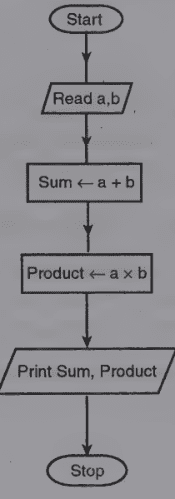

```c
/* 寻找和和积的程序 */
#include <stdio.h>
main() {
    int a,b,sum,product;
    scanf("%d %d",&a,&b);
    sum = a+b;
    product = a*b;
    printf("%d %d", sum,product);
}
```

当执行此程序时，计算机将等待变量 `a` 和 `b` 的值，这些值必须由用户输入。

现在计算机计算两个数的和和积并显示结果。

## IOF-6 C 语言编程第一课

为变量 `A` 和 `B` 输入的值 -> 5 3

显示的和和积的结果 -> 8 15

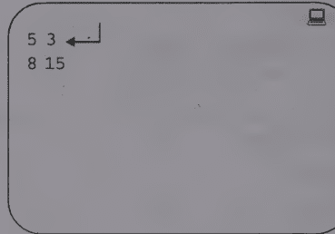

→ 表示按下 Enter 键。

注意，值是在空白屏幕上输入的，结果是显示的。尽管程序产生了正确的结果，但用户在没有任何说明的情况下输入数字并获得结果，这些是模糊的。按 `Alt + F5` 键查看输出屏幕。

## 编写友好型程序

建议用户以这种方式编写程序，让计算机显示数值的消息。结果也以适当的文本显示。这样编写的程序被称为友好型程序。

一个寻找两个数之和积的友好型程序可以写如下：

```c
/* 寻找和积的程序 */ ← 注释行
#include <stdio.h> ← 头文件
#include <conio.h>
main() ← 主程序
{
    int a, b, sum, product; ← 块开始
    clrscr(); ← 声明将使用的变量
    printf("\nEnter Value to A : \");
    scanf("%d",&a);
    printf("\nEnter Value to B : \");
    scanf("%d",&b);
    sum = a+b;
    product = a*b;
    printf("\nSUM = %d", sum);
    printf("\nPRODUCT = %d", product);
    getch();
}
```

## IOF-10 C 语言编程入门

## 示例 2

编写一个 C 程序，使用公式 $C = \frac{5}{9}(F-32)$ 将摄氏度 °F 转换为 °C。

### 解决方案

在这个问题中，输入变量是 `F`，代表摄氏度温度；要求的输出是 `C`，代表摄氏度温度。

```c
/* 将温度从华氏度转为摄氏度的程序 */
#include <stdio.h>
#include <conio.h>
main() {
    float f,c;
    clrscr();
    printf("\n Degree fahrenheit ? ");
    scanf("%f", &f);
    c = 5.0/9.0 * (f-32);
    printf("\n Degree centigrade = %6.2f",c);
    getch();
}
```

注意，`5.0/9.0` 会产生实数值 0.555556，但 `5/9` 会产生整数值零，这将导致错误的答案。

变量 `F` 和 `C` 被声明为 `float` 类型，因为可以理解此问题的结果总是浮点值。

当执行此程序时，输入输入值，结果显示如下。

## 示例 3

编写一个 C 程序，根据三条边计算三角形的面积。

### 解决方案

我们知道三角形面积 = $\sqrt{s(s-a)(s-b)(s-c)}$，其中 `a`、`b` 和 `c` 是三角形的三条边，$s = \frac{a+b+c}{2}$。

```c
/* 计算三角形面积的程序 */
#include <stdio.h>
#include <math.h>
#include <conio.h>
main() {
    float a,b,c,area,s;
    clrscr();
    printf("\nEnter three sides : ");
    scanf("%f, %f, %f", &a,&b,&c);
    s = (a + b + c)/2;
    area = sqrt((s - a)*(s - b)*(s - c));
    printf("\nArea of triangle = %.2f Sq.units",area);
    getch();
}
```

注意包含了 `<math.h>` 以链接库函数。

当执行此程序时，输入输入值并获得输出如下。

注意输入值用逗号（`,`）隔开，这是通过 `scanf()` 格式字符串提供的。

注意：输入的边 `a`、`b` 和 `c` 的值应该能组成三角形。例如，三边为 5、1 和 3 永远无法组成三角形。

## 关于格式化输出函数的更多信息

可以使用格式化输出命令使用特定宽度打印输出值。考虑以下示例。

```c
int n = 28;
printf("%5d",n);
```

它将打印 `n` 的值，右对齐，前面有三个空格。

|  |  | 2 | 8 |
|---|---|---|---|

## IOF-12 C 语言编程入门

```c
printf("%-5d\n", n);
```

它将打印 `n` 的值，左对齐。

| 2 | 8 |  |
|---|---|---|

```c
printf("%+5d", n);
```

它将打印 `n` 的值，右对齐并带有 `+` 号。

| + | 2 | 8 |
|---|---|---|

```c
float x = 28.358416;
printf("%6.2f", x);
```

它将打印 `x` 的值，右对齐，前面有一个空格。

|  | 2 | 8 | . | 3 | 6 |
|---|---|---|---|---|---|

```c
printf("%0.2f", x);
```

它将打印 `x` 的值，左对齐且前面没有任何空格。

|  | 2 | 8 | . | 3 | 6 |
|---|---|---|---|---|---|

应该注意，即使分配的总宽度可能是错误的（例如零），计算机也会以所需的小数位数打印结果。

```c
printf("%0.3e", x);
```

它将以指数形式左对齐打印 `x` 的值。

| 2 | . | 8 | 4 | e | + | 0 | 1 |
|---|---|---|---|---|---|---|---|

```c
char st[10] = "NEW YORK";
printf("%s", st);
```

它将左对齐打印 `st` 的值。

| N | E | W | Y | O | R | K |
|---|---|---|---|---|---|---|

```c
printf("%10s", st);
```

它将右对齐打印 `st` 的值。

| N | E | W | Y | O | R | K |
|---|---|---|---|---|---|---|

```c
printf("%10.3s", st);
```

它将右对齐打印 `st` 的值，且只打印前 3 个字母。

| N | E | W |
|---|---|---|

## 输入输出函数与语句 IOF-13

```c
printf("%-10.3s", st);
```

它将左对齐打印 `st` 的值，且只打印前 3 个字母。

| N | E | W |  |  |  |  |  |
|---|---|---|---|---|---|---|---|

```c
printf("%.3s", st);
```

它将只打印前 3 个字母。

| N | E | W |
|---|---|---|

## 字符输入/输出函数

### `getchar()` 函数

`getchar()` 用于从标准输入设备（键盘）一次读取一个字符。它具有以下形式：

```c
ch = getchar();
```

其中 `ch` 是一个字符变量。

#### 示例

```c
char c;

c = getchar();
```

当执行此函数时，计算机将等待按下按键并将值赋值给变量。

### `putchar()` 函数

`putchar()` 用于在显示器屏幕上一次显示一个字符。它具有以下形式：

```c
putchar(ch);
```

其中 `ch` 是一个字符变量。

#### 示例

```c
char c = 'M';
putchar(c);
```

当执行此函数时，计算机将在显示器屏幕上显示该字符的值（即字母）。

### `getch()` 函数

`getch()` 用于从键盘读取一个字符，且不需要按回车键。它具有以下形式：

```c
ch = getch();
```


其中 `ch` 是一个字符变量。

## 示例

```c
char c;
c = getch();
```

当执行此函数时，计算机将等待按下按键。一旦按下按键，控制将转移到程序的下一行，且按下的值（字母）不会显示在显示器屏幕上。

## `put()` 函数

`put()` 用于在显示器屏幕上显示一个字符。它具有以下形式：

```c
put(ch);
```

其中 `ch` 是一个字符变量。

## 示例

```c
char c = 's';
put(c);
```

当执行此函数时，计算机将在显示器屏幕上显示字符 's'。

## `get()` 函数

`get()` 用于从键盘读取一个字符而不需要按回车键。然而，用户按的任何键都会显示在显示器上。它具有以下形式：

```c
ch = get();
```

其中 `ch` 是一个字符变量。

### 示例

```c
char c;
c = get();
```

当执行此函数时，计算机将等待按下按键。该值被赋值给字符变量。

注意 `get()` 与 `getch()` 相似，不同在于 `get()` 会将键盘按下的键显示在显示器屏幕上。`get()` 结尾的 'e' 代表回显（echo）。

## `gets()` 函数

`gets()` 用于读取包含空格的字符串。注意不能使用 `scanf()` 的 `%s` 格式符来读取字符串。它具有以下形式：

```c
gets(st);
```

其中 `st` 是一个字符变量（数组）。

输入包含空格的字符串 `UNITED STATES` 并按下回车键。当执行此函数时，计算机将等待字符串值。C 语言会在字符串末尾添加空字符 `"\0"`。输入的字符串存储在内存中，如图 6 所示。

| 0 | 1 | 2 | 3 | 4 | 5 | 6 | 7 | 8 | 9 | 10 | 11 |
|---|---|---|---|---|---|---|---|---|---|---|---|
| `st` | `U` | `N` | `I` | `T` | `E` | `D` | `S` | `T` | `A` | `T` | `E` | `S` |

## `puts()` 函数

`puts()` 函数用于在显示器屏幕上显示字符字符串。它具有以下形式：

```c
puts(st);
```

其中 `st` 是一个字符串（字符数组）。

### 示例

```c
char st[20] = "COMPUTER WORLD";
puts(st);
```

当执行此函数时，计算机将显示该字符串。

## `clrscr()` 函数

`clrscr()` 函数用于清除显示器屏幕。它具有以下形式：

```c
clrscr();
```

当执行此函数时，之前显示的文本/错误信息将被清除。这在运行新程序时使用。需要注意，程序中包含了 `<conio.h>` 以使用此函数。

## IOF-16 C语言编程入门

### 示例 4

编写一个 C 程序显示给定字符的 ASCII 值。

### 解决方案

```c
/*显示 ASCII 值的程序 */
#include <stdio.h>
#include <conio.h>

main() {
    char ch;
    clrscr();
    printf("Enter a character : %c");
    ch = getch();
    printf("\nASCII value of %c is %u", ch, ch);
    puts("\nPress any key to stop...");
    getch();
}
```

当执行此程序时，键盘上的任意字符作为输入，其 ASCII 值显示如下。

### 示例 5

编写一个 C 程序，根据以下信息准备用户账单：服务号、上一次表读数和当前读数。输出必须包含服务号、消耗电量和电费。电费按每单位 1.50 卢比计算。

### 解决方案

```c
/* 计算并打印电费的程序 */
#include <stdio.h>
#include <conio.h>

main() {
    int pmr, cmr, units;
    char sno[10];
    float amt;
    clrscr();
    printf("\n Enter service number : %s");
    scanf("%s", sno);
    printf("\n Previous month reading ? %d");
    scanf("%d", &pmr);
    printf("\n Current month reading ? %d");
    scanf("%d", &cmr);
    units = cmr - pmr;
    amt = units * 1.50;
    printf("\n Electricity Bill");
    printf("\n__________________________");
    printf("\n Service No. : %s", sno);
    printf("\n Units Consumed : %d", units);
    printf("\n Electricity Charges Rs.%.0.2f", amt);
    getch();
}
```

当执行此程序时，用户必须输入服务号和上个月的表读数。当前费用将计算并显示如下。

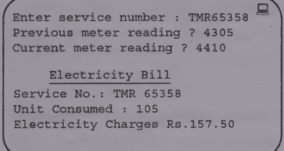

### 示例 6

编写一个 C 程序来交换（交换）变量 A 和 B 的值。

### 解决方案

使用临时变量改变两个变量的值，如下所示。

- `Temp ← A`：将 `A` 的值临时存储在 `temp` 中
- `A ← B`：将 `B` 的值赋值给 `A`
- `B ← Temp`：将 `temp` 的值（即 `A` 的值）赋值给 `B`

```c
/* 交换两个变量值的程序 */
#include <stdio.h>

main() {
    int a, b, temp;
    clrscr();
    printf(" Enter value to A : ");
    scanf("%d", &a);
    printf(" Enter value to B : ");
    scanf("%d", &b);
    temp = a;
    a = b;
    b = temp;
    printf("\n\n Value of A = %d", a);
    printf("\n Value of B = %d", b);
    getch();
}
```

当执行此程序时，用户必须输入变量 A 和 B 的值。这些值将被交换，结果将显示所示。

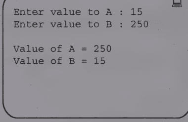

## 复习题与练习

1. 编写一个 C 程序求给定三个数的和和平均值。
2. 编写一个 C 程序，利用关系 `°F=1.8°C+32` 将温度 `°C` 转换为 `°F`。
3. 编写一个 C 程序求半径为 `r` 的圆面积和周长。
   [提示：面积 =`π²`，周长=`2πr`]
4. 编写一个 C 程序，利用关系 `y = x² + 2x - 1` 求 `y` 的值。
5. 编写一个 C 程序求给定整数的 ASCII 字符。
6. 解释 C 中的 `scanf()` 和 `printf()` 函数。
7. 解释 C 中各种字符输入/输出函数。
8. 列出 C 中数据输入输出各种转换规范。
9. 编写一个 C 程序使用公式计算单利：
   `I = \frac{PNR}{100}`
   其中 `P` - 本金，`N` - 年数，`R` - 利率
10. 编写一个 C 程序在不使用临时变量的情况下交换变量 A 和 B 的值。
    [提示]：使用以下赋值来交换值：
    ```c
    A = A + B
    B = A - B
    A = A - B
    ```
11. 地球公转周期为 31558150 秒。编写一个 C 程序将此转换为天、小时和分钟。
12. 编写一个 C 程序使用公式计算学生的及格分：
    ```
    CM = M/2 + P/2 + E/2
    ```
    其中 `CM` = 及格分
    `M` = 200 分满分的数学分
    `P` = 200 分满分的物理分
    `C` = 200 分满分的化学分
    `E` = 100 分满分的入学考试分

## 简答

1. `scanf()` 的目的是什么？它在 C 程序中如何使用？
   `scanf()` 函数用于从键盘读取变量的值。它与括号中的变量列表和其格式字符串配合使用。

   示例
   ```c
   scanf("%f %d", &x, &n);
   ```

2. `"\n"` 的作用是什么？
   `"\n"` 用于生成或将光标控制移动到新行。

3. 假设 `i=3`，给出以下代码的输出：
   ```c
   printf("\n%d %d\n", i, ++i, i++);
   ```
   生成新行
   `5 5 3`
   生成新行
   注意，根据运算符的优先级和结合性，求值是从右到左进行的。

4. 解释以下控制格式说明符的意义：
   (a) `%c` (b) `%o` (c) `%x` (d) `%d`
   - `%c` 用于读取/打印字符值。
   - `%o` 用于读取/打印无符号八进制值。
   - `%x` 用于读取/打印无符号十六进制数。
   - `%d` 用于读取/打印有符号整数值。

5. C 中的头文件是什么？列出任意两个头文件。
   C 程序使用许多在许多头文件中提供的函数编写。每当使用函数时，必须包含所需的头文件。

   示例
   ```c
   #include <math.h>
   #include <conio.h>
   ```

6. 程序执行开始的行是 `main()`。

7. 编译指令的 `#` 符号必须出现在行首。

8. 编写四种不同的 C 语句来给整数变量 `x` 加 1。
   ```c
   x = x + 1;
   x += 1;
   x++;
   ```

9. 如何使用 `printf` 产生警报/蜂鸣声？
   `printf("\a");` 生成警报/蜂鸣声。

10. `getchar()` 和 `getch()` 的区别是什么？
    `getchar()` 和 `getch()` 用于从键盘读取字符。`getchar()` 可以一次一个可以在屏幕上编辑的字符。但 `getch()` 在不等待回车键的情况下读取字符。

11. 什么是转义序列？它的目的是什么？
    转义序列是一种控制字符，用于移动光标并打印字符（例如 `'\n'`）以在新行显示输出。例如 `printf("\c", ch);`。

12. 解释以下内容的需要：
    ```c
    #include <stdio.h>
    #include <math.h>
    ```
    头文件 `stdio.h` 用于在 C 程序中包含标准输入输出函数。

    头部 `<math.h>` 用于在 C 程序中包含并链接数学函数，如 `sqrt()`、`fabs()` 等。

13. 解释 `scanf()` 和 `printf()` 函数的语法。
    `scanf()` 函数用于从键盘读取变量的值。它具有以下形式：
    ```c
    scanf("format string", &V1, &V2 ...);
    ```
    其中 `V1`, `V2` ... 是变量。

    示例
    ```c
    scanf("%f %d", &x, &n);
    ```

    `printf()` 用于在显示器上显示/打印变量的值。它具有以下形式：
    ```c
    printf("format string", V1, V2 ...);
    ```
    其中 `V1`, `V2` ... 是变量。

14. C 字符（character）和 C 字符串（string）的区别是什么？
    C 字符可以包含一个由单引号（`''`）括的单个字符。
    C 字符串可以包含一个由双引号（`""`）括的字符字符串。

    示例
    ```c
    char ch = 'a';
    ```

15. 列出 `stdio.h` 中的任意四个函数。
    `scanf()`, `printf()`, `getchar()`, `putchar()`。

16. 文件 `stdio.h` 是标准输入输出文件的写。

17. C 中 `'a'` 和 `"a"` 的区别是什么？
    `'a'` 是字符常量，但 `"a"` 是字符串常量。计算机在该常量末尾分配一个空字符 `"\0"`。

18. 如何使用 `printf` 函数指定数据项目的最小字段宽？
    数据项目的最小字段宽在 `printf` 函数的格式字符串中给出。考虑以下示例，沿指定的宽度右对齐打印值。
    ```c
    int rno = 20346;
    char sname[15] = "SACHIN";
    float tot = 78.5;
    printf("%5d%15s%6.2f", rno, sname, tot);
    ```

    输出值打印所示：

    | 2 | 0 | 3 | 4 | 6 | | S | A | C | H | I | N | | 7 | 8 | | 5 | 0 |

19. `getche()` 相比 `scanf()` 有哪些优势？
    `getche()` 函数读取字符时不需要按回车键。`scanf()` 函数也用于读取字符，但在输入字符后等待回车键。`getche()` 可以用于循环读取包含空格的字符串。`scanf()` 无法读取带有空格的字符串。

20. 获取以下 C 语句的输出。变量 `count`、`amt` 和 `city` 具有以下值：
    ```c
    int count = 1275;
    float amt = -235.74;
    char city[10] = "Chennai";
    printf("%df", count, amt);
    printf("%-10d-%15s", count, city);
    ```
    结果打印所示：

    | (a) | 1 | 2 | 7 | 5 | | 2 | 3 | 5 | | 7 | 4 | 0 | 0 | 0 |
    | (b) | 1 | 2 | 7 | 5 | | C | h | e | n | n | i |

21. 如何在 `printf` 中指定精度？
    精度指浮点数的小数位数。它在 `printf()` 函数的格式字符串中指定。考虑以下示例：
    ```c
    printf("%10.5f", x);
    ```
    `5` 指精度（小数位数）

22. 一个 C 程序包含以下变量声明：
    ```c
    i = 12345, j = 0xbcbd9, k = 077777;
    ```
    `printf()` 函数的输出是什么？
    ```c
    printf("%8d+%8x+%8o", i, j, k);
    ```
    结果打印所示：

    | | + | 1 | 2 | 3 | 4 | 5 | | b | c | d | 9 | | | 7 | 7 | 7 | 7 | 7 |

---

# 第5章

## C语言中的控制语句

### 本章目标

- `if-else` 语句
- 嵌套 `if` 语句
- `switch` 语句

程序中编写的所有语句都从上到下逐个执行。控制语句用于根据条件将控制权从程序的一个部分执行/转移到另一个部分。语句也被称为条件语句。

C 语言中使用了两种类型的控制/条件语句：
a. `if-else` 语句
b. `switch` 语句

## `if-else` 语句

`if-else` 语句用于根据条件的值执行一个语句块或单个语句。它具有如下形式：

```c
if ( condition )
{
    ----------
    <真分支块>
    ----------
}
else {
    ----------
    <假分支块>
    ----------
}
```

其中 `<condition>` 是逻辑表达式，其值为真或假。

### 示例

```c
if (bpay >= 3000)      /* bpay - 基本薪资*/
{
    da = 0.32 * bpay;       /* da - 生活津贴*/
    hra = 0.15 * bpay;      /* hra - 房租补贴*/
    cca = 325;             /* cca - 城市补偿补助*/
}
else {
    da = 0.72 * bpay;
    hra = 0.12 * bpay;
    cca = 250;
}
```

当执行此语句时，计算机会评估/检查条件的值。如果条件值为真，则执行 `<真分支块>` 中的语句。否则，执行 `<假分支块>` 中的语句。在使用 `if-else` 语句时需要注意以下几点：

- (1) `<假分支块>` 是可选的；即当该块中没有可用语句时，可以省略它。

### 示例

```c
if (bpay >= 3500 )
{
    da = 0.82 * bpay;
    hra = 0.15 * bpay;
    cca = 325;
}
```

- (2) 当块中仅有一个语句时，可以省略块标识符 `{}`。

### 示例

```c
if ( a > b )
    big = a;
else
    big = b;
```

## 示例 1

编写一个 C 程序找到给定两个数中的最大值。

### 解决方案

有许多逻辑（方法）可以获取两个数中的最大值。考虑以下使用变量 `big` 来存储最大值的方法。该方法可以通过考虑循环轻松地扩展到任意数量的变量（假设 `n`）。

```c
/* 寻找两个数最大值的程序 */
#include <stdio.h>
#include <conio.h>

main() {
    int a, b, big;
    clrscr();
    printf("\n 输入两个数字： ");
    scanf("%d %d", &a, &b);
    big = a;
    if (b > big)
        big = b;
    printf("\n 最大数字是 %d", big);
    getch();
}
```

当执行此程序时，用户必须输入两个数字。最初假设 `a` 为 `big`。然后将其与 `b` 比较以获得最大数。

## 示例 2

编写一个 C 程序找到给定三个数中的最大值。

### 解决方案

示例 1 中讨论的方法被扩展到找到三个数中的最大值。

```c
/* 寻找三个数最大值的程序 */
#include <stdio.h>
#include <conio.h>

main() {
    int a, b, c, big;
    clrscr();
    printf("\n 输入三个数字： \n");
    scanf("%d %d %d", &a, &b, &c);
    big = a;
    if (b > big)
        big = b;
    if (c > big)
        big = c;
    printf("\n 最大数字是 %d", big);
    getch();
}
```


`big = b;`

如果`c > big`，则`big = c;`。

`printf("\n 最大数字是 %d", big);`

`getch();`

当执行此程序时，用户必须输入三个数字。最初假设`a`为`big`，然后将其与`b`比较得到`a`和`b`的最大值。最后将`c`与现有的`big`比较以获得最大数。

## 嵌套 if-else 语句

一个`if`语句的<真分支块>和<假分支块>中可以包含另一个`if`语句。这种复合语句被称为嵌套`if`语句。任意数量的`if`语句都可以嵌套。它具有如下形式。

```c
if(condition 1)
  if(condition 2)
  {
    <真分支块 1>
  }
  else
  {
    <假分支块 1>
  }
else
  if(condition 3)
  {
    <真分支块 2>
  }
  else
  {
    <假分支块 2>
  }
```

需要注意的是，嵌套`if`中的任何一个语句块将根据条件的值被执行。

### 示例

```c
if(a > b)
  if(a > c)
    big = a;
  else
    big = c;
else
  if(b > c)
    big = b;
  else
    big = c;
```

## 示例 3

编写一个 C 程序使用嵌套`if`语句找到三个数中的最大值。

## 解决方案

考虑使用变量`big`来存储最大数。使用复合条件编写嵌套`if`语句来获取三个数中的最大值。

```c
/* 使用嵌套 if 寻找三个数最大值的程序 */
#include <stdio.h>
#include <conio.h>
main()
{
    int a,b,c,big;
    clrscr();
    printf("\n 输入三个数字： ");
    scanf("%d %d %d",&a,&b,&c);
    if(a > b)
        if(a > c)
            big = a;
        else
            big = c;
    else
        if(b > c)
            big = b;
        else
            big = c;
    printf("\n 最大数字是 %d",big);
    getch();
}
```

当执行此程序时，用户必须输入三个数字，最大数将如下所示打印。

## 示例 4

编写一个 C 程序找到`y`的值

| 条件 | `y` 的值 |
| :--- | :--- |
| 当 `n = 1` 时 | `1+x` |
| 当 `n = 2` 时 | `1+x/n` |
| 当 `n = 3` 时 | `1+x^n` |
| 当 `n > 3` 时 | `1+nx` |
| 当 `n < 1` 时 | `1+x` |

## 解决方案

考虑给定条件并使用嵌套`if`语句来找到`y`的值。

```c
/* 寻找 y 值的程序 */
#include <stdio.h>
#include <conio.h>
#include <math.h>
main() {
    int n;
    float x,y;
    clrscr();
    printf("\n 输入 x 和 n： ");
    scanf("%f %d",&x,&n);
    if(n == 1)
        y = 1+x;
    else
        if(n == 2)
            y = 1+x/n;
        else
            if(n == 3)
                y = 1+pow(x,n);
            else
                if(n > 3)
                    y = 1+n*x;
                else
                    y = 1+x;
    printf("\n y(n) = %.2f",y);
    getch();
}
```

当执行此程序时，用户必须输入`x`和`n`。

## switch 语句

`switch`语句根据变量或表达式的值执行语句块。它具有如下形式。

```c
switch ( <expression>)
{
    case <label 1>: {
        --------------------
        <语句块 1>
        --------------------
        break;
    }
    case <label 2>: {
        --------------------
        <语句块 2>
        --------------------
        break;
    }
    case <label n>: {
        --------------------
        <语句块 n>
        --------------------
        break;
    }
    default:
    {
        --------------------
        <默认语句块>
        --------------------
        break;
    }
}
```

其中`<expression>`指任何整型表达式或变量。
`<label 1>`, `<label 2>`...`<label n>`是与表达式值匹配的值。
`break`是一个将控制权转移到`switch`语句结束处的语句。

### 示例

```c
switch (sex) {
  case 'm': (
    male++;
    total++;
    break;
  )
  case 'f': (
    female++;
    total++;
    break;
  )
  default:
    printf("\n 性别代码错误");
    break;
}
```

当执行此语句时，计算机会检查表达式或变量的值。如果此值与`case <value>`中给出的任何一个标签匹配，则执行该语句块。

注意：

- 1. 当语句块中只有一个可用语句时，可以省略大括号`{}`。
- 2. `break`语句用于将控制权转移到`switch`语句结束处。
- 3. 当没有`case`标签匹配表达式的值时，执行默认块。
- 4. 默认块是可选的；即，在编写程序时可以省略它。

## CSC-10 C 语言编程入门

## 解决方案

此问题与示例 4 相似，但这里使用了`switch`语句代替了嵌套`if`语句。

```c
/* 求 Y 值的程序 */
#include <stdio.h>
#include <conio.h>
#include <math.h>
main()
{
    int n;
    float x,y;
    clrscr();
    printf("\nEnter value to x and n : %d");
    scanf("%f %d",&x,&n);
    switch(n)
    {
        case 1 : y = 1 + x;
        break;
        case 2 : y = 1 + x/n;
        break;
        case 3 : y = 1 + pow(x,n);
        break;
        default : y = 1 + n*x;
        break;
    }
    printf("\n Value of y(x,n) = %6.2f",y);
    getch();
}
```

当执行此程序时，用户必须输入`x`和`n`的值。`y`的值在`switch`语句中获得，结果打印所示。

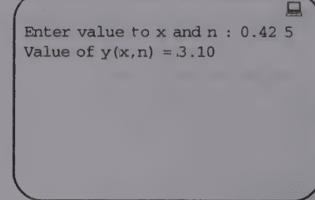

## 示例 6

编写一个 C 程序根据下面的销售金额计算销售代表的佣金。

- 如果销售`<= Rs. 500`，佣金为`5%`
- 如果销售`> 500`但`<= 2000`，佣金为`35`卢比加上超过`500`卢比`10%`
- 如果销售`> 2000`但`<= 5000`，佣金为`185`卢比加上超过`2000`卢比`12%`
- 如果销售`> 5000`，佣金为`12.5%`

## 解决方案

这里可以使用嵌套`if`语句。

```c
/* 根据销售金额计算佣金的程序 */
#include <stdio.h>
#include <conio.h>
main(){
    int sales;
    float comm;
    clrscr();
    printf("\nSales amount ? : ");
    scanf("%d",&sales);
    if(sales <= 500)
        comm = 0.05*sales;
    else
        if(sales <= 2000)
            comm = 35 + 0.10*(sales - 500);
        else
            if(sales <= 5000)
                comm = 185 + 0.12*(sales - 2000);
            else
                comm = 0.125*sales;
    printf("\n Commission Amount Rs.%.2f",comm);
    getch();
}
```

当执行此程序时，用户必须输入销售金额。佣金金额根据给定的条件进行计算并此处所示。

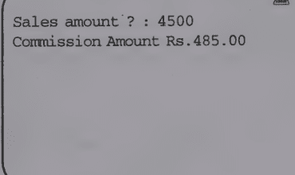

## CSC-12 C 语言编程入门

## 示例 7

编写一个 C 程序，为所有`a`, `b`和`c`的可能组合求二次方程`ax^2 + bx + c = 0`的根。

## 解决方案

二次方程将有两个根，通过以下表达式获得。

`x = \frac{-b \pm \sqrt{b^2 - 4ac}}{2}`

其中`b^2 - 4ac`被称为判别式。

注意，当`b^2 - 4ac > 0`时，根是实数且不等的`x = \frac{-b \pm \sqrt{b^2 - 4ac}}{2a}`

同时注意系数`a`的值`\neq 0`。

```c
/* 求二次方程的根的程序 */
#include <stdio.h>
#include <conio.h>
#include <math.h>
main() {
    float a,b,c,d,x1,x2;
    clrscr();
    printf("\n Enter coefficients a,b and c : \n");
    scanf("%f %f %f", &a,&b,&c);
    d = b*b - 4*a*c;
    if(d > 0) {
        x1 = (-b + sqrt(d))/(2*a);
        x2 = (-b - sqrt(d))/(2*a);
        printf("\n Roots are real and unequal\n");
        printf("\n %6.2f %6.2f\n",x1,x2);
    } else {
        if(d == 0) {
            x = -b/(2*a);
            printf("\n Roots are real and equal\n");
            printf("\n %6.2f\n",x);
        } else {
            printf("\n Roots are imaginary\n");
        }
    }
}
```

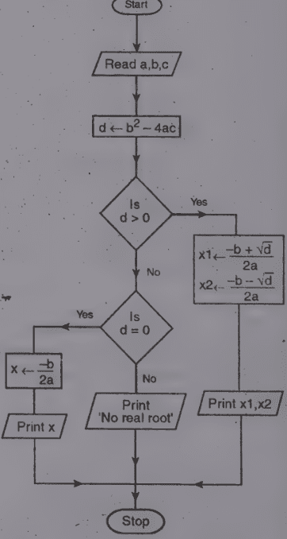

## CSC-13 C 中的控制语句

```c
printf("\n Real roots, roots are complex");
getch();
```

当执行此程序时，用户必须输入给定方程的`a`, `b`和`c`的值。使用`a`, `b`和`c`的值获得判别式`d`的值。根据此，获得并打印根。考虑二次方程`x^2 + 3x + 2 = 0`。

注意：上述程序忽略了计算方程根的语句（当`d < 0`时）。如有必要，可以如下所示包含。

```c
{
printf("\n No real roots, roots are complex");
xlr = -b/(2*a);
li = sqrt(fabs(d))/(2*a);
x2r = xlr;
x2i = -li;
printf("\n %6.2f + %6.2f", xlr,li);
printf("\n %6.2f - %6.2f", x2r,x2i);
}
```

当执行此块时，将获得复根并如下所示。

```
2.42 + 1.53i
2.42 - 1.53i
```

## 示例 8

编写一个 C 程序根据获得的分数打印等级。

| 平均分 | 等级 |
| :--- | :--- |
| 80 到 100 | 优等 |
| 60 到 79 | 一等 |
| 50 到 59 | 二等 |
| 0 到 49 | 不及 |

## CSC-14 C 语言入门课程

## 解决方案

这里可以使用嵌套`if`语句。

```c
/* 打印等级的程序 */
#include <stdio.h>
#include <conio.h>
main()
{
    short int avg_marks;
    clrscr();
    printf("\n Average Marks ?");
    scanf("%d",&avg_marks);
    if(avg_marks >= 80 && avg_marks <= 100)
        printf("\n Honours");
    else
        if(avg_marks >= 60 && avg_marks <= 79)
            printf("\n First Division");
        else
            if(avg_marks >= 50 && avg_marks <= 59)
                printf("\n Second Division");
            else
                if(avg_marks >= 49 && avg_marks <= 0)
                    printf("\n Fail");
    getch();
}
```

当执行此程序时，用户必须输入平均分，并如下所示打印等级。

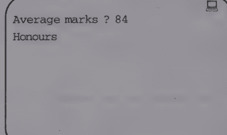

## 示例 9

编写一个 C 程序实现以下功能：一家电力公司按如下方式对其居民用户收费。

| 单位消耗量 | 费率 |
| :--- | :--- |
| 0–200 | 每单位 0.50 卢比 |
| 201–400 | 100 卢比加上 超过 200 的每单位 0.65 卢比 |
| 401-600 | 230 卢比加上 超过 400 的每单位 0.080 卢比 |
| 600 以上 | 425 卢比加上 超过 600 的每单位 1.25 卢比 |

编写一个 C 程序计算用户需要支付的金额。

## 解决方案

这里使用嵌套`if`语句计算并打印用户需要支付的金额。

```c
/* 计算电费的程序 */
#include <stdio.h>
#include <conio.h>
main()
{ unsigned int units;
    float amt;
    clrscr();
    printf("\n Enter units : ");
    scanf("%d",&units);
    if (units <= 200)
        amt = 0.5 *units;
    else
        if(units <= 400)
            amt = 100 + 0.65*(units - 200);
        else
            if(units <= 600)
                amt = 230 + 0.8*(units - 400);
            else
                amt = 425 + 1.25*(units - 600);
    printf("\n Amount to be paid Rs.%2f",amt);
    getch();
}
```

当执行此程序时，用户必须输入单位。用户需要支付的金额经过计算并如下所示。

```c
else
    if(cc <= 6)
        printf("\n Grade is E");
    else
        printf("\n Grade is F");
getch();
}
```


当此程序执行时，用户必须输入拉伸强度、硬度和碳含量。钢样本的等级将如所示打印出来。

| 输入 | 数值 |
| :--- | :--- |
| 输入拉伸强度 | 200 |
| 输入洛氏尔硬度 | 180 |
| 输入碳含量 | 3 |
| 等级 | C |

## 复习题与练习

1. 解释 C 语言中可用的各种 `if` 结构。
2. 编写 (i) 条件语句和 (ii) `switch` 语句的说明笔记。
3. 讨论 `if...else` 和 `switch` 结构之间的区别。
4. 结合示例解释 C 语言中的 `if` 语句和嵌套 `if`（`nested if`）语句。
5. 写一个 C 程序找到给定的两个数中的最小值。
6. 写一个 C 程序找到三个数中的最小值。
7. 写一个 C 程序，从给定的四个测试成绩中找到三个最高分数的平均分。

[提示]: 找到四个测试成绩中的最小值。将其从四个测试成绩的总和中减去。现在我们得到三个最高分数的和。取平均值。

```
即，平均值= (T1+T2+T3 + T4 - 最小值)
```

8. 写一个 C 程序，读取 `x` 的值并使用 `if` 语句求出函数：
`y (x) = x^2+2x-10` （如果 `x < 10`）
`= |x|` （如果 `x < 0`）

## CSC-18 C 语言编程第一课

9. 写一个 C 程序求值

```latex
f(x) = \begin{cases} \frac{x}{\sqrt{1+x^2}} & x < 0 \\ 0 & x = 0 \\ \frac{1}{\sqrt{1+x^2}} & x > 0 \end{cases}
```

10. 写一个 C 程序，根据以下公式计算 `y` 关于 `x` 的函数：

`y = 1.2x + 0.98`，当 `x <= 1.0` 时
`y = 1.7x - 0.09`，当 `x > 1.0`

使用 `switch` 语句实现。

> **提示:** 条件求值后赋值给整数变量 `k`。使用 `switch` 语句。

```c
if (x <= 1.0)
    k = 1;
else
    k = 2;
```

11. 写一个 C 程序，使用 `switch` 语句求二次方程 `ax² + bx + c = 0` 的根，并涵盖 `a`、`b`、`c` 的所有组合。

> **提示:** 得到判别式 `b² - 4ac` 的值。将该值赋值给整数变量 `k`。使用 `switch` 语句。

```c
if (b*b - 4*a*c > 0)
    k = 1;
else
    if (b*b - 4*a*c == 0)
        k = 2;
else
    k = 3; /*即 b*b-4*a*c<0*/
```

12. 如果员工的工作小时不超过 40 小时，公司按正常小时薪率支付薪水。如果超过 40 小时，超出部分小时的薪资按正常小时薪率的 1.5 倍计算。写一个 C 程序来实现此薪资计算。

13. 写一个 C 程序读取学生考试的成绩，并根据以下条件打印成绩百分比以及所获得的等级：

- (i) 百比 >= 75 且 <= 100，“优异 (DISTINCTION)”
- (ii) 百比 >= 60 且 < 75，“一等 (FIRST CLASS)”
- (iii) 百比 >= 50 且 < 60，“二等 (SECOND CLASS)”
- (iv) 如果学生在任何科目中获得的成绩 < 50，“不合格 (FAIL)”。

14. 公司在购买产品时按以下百分比提供折扣：
(i) 如果购买金额 < 1000，则打 5% 折
(ii) 如果购买金额 >= 1000 但 < 3000，则打 10% 折
(iii) 如果购买金额 >= 3000 但 < 5000，则打 12% 折
(iv) 如果购买金额 >= 5000，则打 15% 折。

写一个使用嵌套 `if` 语句的 C 程序，计算客户折扣后应付金额。

15. 写一个 C 程序，根据销售金额计算 X、Y、Z 三个区域销售员的佣金。

(i) 对于 X 区域

| 销售额 | 佣金 |
| :--- | :--- |
| < 1000 | 10% |
| < 5000 | 12% |
| >= 5000 | 15% |

(ii) 对于 Y 区域

| 销售额 | 佣金 |
| :--- | :--- |
| < 1500 | 10% |
| < 7000 | 12% |
| >= 7000 | 15% |

(iii) 对于 Z 区域

| 销售额 | 佣金 |
| :--- | :--- |
| < 1200 | 10% |
| < 6500 | 12% |
| >= 6500 | 15% |

16. 销售员总销售额的佣金如下：
销售额 < 100 – 无佣金
100 <= 销售额 < 1000 – 佣金 = 销售额的 10%。
销售额 >= 1000 – 佣金 = 超过 1000 部分的 8%。写一个程序读取销售额并打印销售员的佣金。

## 简答题

1. 给出 `if-else` 语句的通用语法。

```c
if (condition)
{
  <真值时的语句>
}
else
{
  <假值时的语句>
}
```

2. 给出 `switch` 语句的通用语法。

```c
switch (variable) {
  case value 1:
    <语句块 1>
    break;
  case value 2:
    <语句块 2>
    break;
  default:
    <默认语句>
}
```

3. `break` 语句用于退出 `switch` 语句中的 ______ 块。

4. `switch` 语句的目的是什么？
`switch` 语句目的是根据整数或字符变量的值执行一组语句。它也可以用于替换复杂的 `if` 语句。

5. `switch` 语句在哪些方面与 `if` 语句不同？
`if` 语句根据条件的值执行语句块。嵌套 `if` 语句可以用于实现复杂的逻辑条件。

6. 使用什么种其他语句可以避免多个 `if` 条件？
`switch` 语句

# 第 6 章 C 语言中的循环控制结构

## 目标

* 循环控制语句
* `for` 语句或 `for` 循环
* 嵌套 `for` 语句或嵌套 `for` 循环
* `while` 语句或 `while` 循环
* `do-while` 语句或 `do-while` 循环
* `goto` 语句
* `break` 语句
* `continue` 语句
* `exit()` 函数

# 循环控制语句

循环控制结构用于根据条件的值执行并重复语句块。C 语言中有三种类型的循环结构/语句：

(i) `for` 语句或 `for` 循环
(ii) `while` 语句或 `while` 循环
(iii) `do-while` 语句或 `do-while` 循环

# `for` 语句或 `for` 循环

`for` 循环用于根据条件执行并重复语句块。它具有以下形式：

```c
for(<初始值>; <条件>; <增量>)
{
    语句块
}
```

其中 `<初始值>` 是赋值表达式，用于初始化变量。`<条件>` 是关系或逻辑表达式，其值为真或假。`<增量>` 是每次增加变量的值。

### 示例

```c
for(i = 1; i <= 10; i++)
s = s + i;
p = p * i;
```

当此语句执行时，计算机为变量分配初始值并评估条件。如果条件为真，将执行语句块。现在变量的值增加并再次评估条件，直到条件为假。

- 当语句块只有一个语句时，可以省略大括号 `{}`。
- `<初始值>` 只执行一次，用于初始化变量。
- `<条件>` 和 `<增量>` 每次都会执行。

## 示例 1

写一个 C 程序打印从 1 到 `n` 的自然数。

## 答案

可以使用 `for` 循环生成并打印从 1 到 `n` 的数字。

```c
/* 输出 N 自然数的程序 */
#include <stdio.h>
#include <conio.h>
main()
{
    int n,i;
    clrscr();
    printf("\n 输入 n 的值： \n");
    scanf("%d",&n);
    /* 生成并打印自然数的循环 */
    for(i = 1; i<= n; i++)
    printf("%08d",i);
    getch();
}
```

当此程序执行时，用户输入 `n` 的值。数字使用 `for` 循环生成并打印。

格式 `"%8d"` 用于一行打印 10 个值。（注意一行通常打印 80 个字符）。

## 示例 2

公式 `y=1.36√1+x+x³¹/⁴+eˣ` 需要对从 1.0 变化到 3.0 的 `x` 进行求值。写一个 C 程序执行此操作并打印一个不同 `x` 值的表格。

## 答案

```c
/* 计算 Y 值的程序 */
#include <stdio.h>
#include <math.h>
#include <conio.h>
main()
{
    float x, y;
    clrscr();
    printf("\n--------------------------------\n");
    printf("\X           Y\n");
    printf("--------------------------------\n");
    /* 生成并打印 X 和 Y 的循环 **/
```

# LCS-4 C语言语言编程入门

```c
for(x = 1.0; x <= 3.0; x = x + 0.2) {
  y = 1.36*sqrt(1+x*x*x)*pow(x,1.0/4)+exp(x);
  printf("\n%6.2f %6.2f ",x,y);
}
printf("\n--------------------");
getch();
```

当执行此程序时，计算机为 `x` 赋值 1.0，计算并打印 `y`。然后 `x` 增加 0.2 并再次计算 `y`。`x` 和 `y` 的值表如下所示。

| x | y |
|---|---|
| 1.00 | 6.07 |
| 1.20 | 7.06 |
| 1.40 | 8.23 |
| . | . |
| 2.80 | 24.64 |
| 3.0 | 28.97 |

这里没有使用 `scanf()`；而是使用 `for` 循环来生成 `x` 的值。

## 示例 3

编写一个 C 程序求给定整数 `k` 的阶乘。

## 解决方案

我们知道 `k!=1*2*3*...k`。该程序用于以 1 为步长生成从 1 到 `k` 的数字，并将它们相积得到 `k` 的阶乘。

```c
/* 求正整数阶乘的程序 */
#include <stdio.h>
#include <conio.h>
int main() {
  int k, kfact;
  clrscr();
  printf("\nEnter the number : ");
  scanf("%d",&k);
  kfact = 1;
  /* 生成从1到n数字的循环 */
}
```

# LCS C 中的循环控制结构

```c
for(i = 1; i <= k; i++)
  kfact = kfact*i;
  printf("\n factorial is %d",k, kfact);
getch();
```

当执行此程序时，用户必须输入一个正整数。使用 `for` 循环以 1 为步长生成从 1 到 `k` 的 `i` 的值。每个值都与 `kfact` 相乘以得到给定数字 `k` 的阶乘。

# 嵌套 `for` 语句或嵌套 `for` 循环

`for` 语句的语句块完全位于另一个循环的块内部。这被称为嵌套 `for` 循环或嵌套 `for` 语句。可以嵌套任意数量的 `for` 语句。考虑以下示例（两个循环）。

```c
for(i=1; i<=3; i++)
{
    ----------
    for(j=1; j<=5; j++)
    {
        ----------
        <语句块>
        ----------
    }
}
```

注意，如果语句块中只有一个语句，可以省略块标记符 `{ }`。当执行此语句时，计算机为 `i` 赋值 1，内部循环对 `j` 从 1 到 5 以 1 为步长执行 5 次。现在 `i` 增加 1（即 `i = 2`），内部循环对 `j` 从 1 到 5 执行 5 次。然后 `i` 变为 3，内部循环再次执行 5 次。注意语句块被执行并重复了 15 次（3 × 5 = 15）。

# LCS 6 C语言语言编程入门

## 示例 4

编写一个程序求以下级数的和。

`S=1 + (1+2) + ...+(1+2+3)+...+N`

## 解决方案

可以使用嵌套循环来求该级数的和。内部循环用于找到项的值 `I；(1+2), (1+2+3)` 等。这些项在外部循环中相加以得到该级数的和。

```c
/* 求级数之和的程序 */
#include <stdio.h>
#include <conio.h>
main()
{
    int i,j,n,s,term;
    clrscr();
    printf("\n Enter value to N : ");
    scanf("%d",&n);
    s = 0;
    /* 寻找级数和 S 的外部循环 */
    for(i = 1; i <= n; i++)
    {
        /* 寻找项的内部循环 */
        term = 0;
        for(j = 1; j <= i; j++)
        {
            term = term + j;
        }
        s = s + term;
    }
    printf("\n Sum of the series S = %d",s);
    getch();
}
```

当执行此程序时，用户必须输入 `N` 的值。现在生成这些项并将其相加，以打印级数的和，如下所示。

## 示例 5

根据 `z = x² + y³ - 25.5` 将 `z` 计算为 `x` 和 `y` 的函数。计算当 `x` 从 -1.5 变 1.5（步长为 0.5），`y` 从 0 到 3（步长为 1）时的 `z` 值。编写一个 C 程序计算所有 `(x,y)` 对的 `z` 值。

## 解决方案

可以编写嵌套 `for` 循环来生成 `x` 和 `y` 的各种组合，以找到 `x` 和 `y` 的 `z` 值。

```c
/* 求值的程序 */
#include <stdio.h>
#include <conio.h>
main() {
    float x,y,z;
    clrscr();
    /* 生成 x 和 y 的值以寻找 z 的循环 */
    for (x = -1.5; x <= 1.5; x = x + 0.5) {
        for (y = 0; y <= 3.0; y = y + 1) {
            z = 3*x*x + 2*y*y - 25.5;
            printf("\n Value of y(%.2f,%.2f) = %.2f",x,y,z);
        }
    }
    getch();
}
```

当执行此程序时，计算机为 `x` 赋值 -1.5，内部循环赋值从 0 到 3 的值（步长为 1）。然后 `x` 增加 1.0，内部循环对 `y` 从 0 到 3 再次执行，每次都会与 `x` 和 `y` 的值一起打印 `z` 值。

这里没有使用 `scanf` 函数；而是使用 `for` 循环来生成 `x` 和 `y` 的值。结果如下。

| y 的值(-1.50,0.00) | -1.75 |
| y 的值(-1.50,1.00) | -1.75 |
| y 的值(-1.50,3.00) | 5.25 |

# LCS-8 C语言语言编程入门

# `while` 语句或 `while` 循环

`while` 循环用于根据条件执行并重复一个语句块。它具有如下形式。

```c
while(<条件>)
  ----
  <语句块>
  ----
```

其中 `<条件>` 是一个关系表达式或逻辑表达式，其值为真或假。

示例

```c
i = 1;
while(i <= 10)
  s = s + i;
  p = p * i;
  i++;
```

当执行此语句时，计算机计算条件的值。如果值为真，则执行语句块并重复，直到条件为假。在语句块内部必须写一个语句来改变条件的值，否则循环将无限循环。

# `do-while` 语句或 `do-while` 循环

`do-while` 语句也用于根据条件执行并重复语句块。它具有如下形式。

```c
do
  ----
  <语句块>
  ----
while (<条件>);
```

其中 `<条件>` 是一个关系表达式或逻辑表达式，其值为真或假。

# C 中的循环控制结构 LCS-9

### 示例

```c
i = 1;
do
{
  s = s + i;
  p = p * i;
  i++;
}
while(i <= 10);
```

执行此语句时，计算机执行语句块，在语句块结束后评估条件，并重复直到条件为假。注意无论条件真假，语句块都会至少执行一次。必须有一个语句来改变条件的值，否则循环将无限循环。

# 循环控制结构的比较

| `for` 循环 | `while` 循环 | `do-while` 循环 |
|---|---|---|
| 1 | `for` 循环用于执行并重复语句块，条件在循环开始时评估。示例 `for(i=1; i<=10; i++) { s = s + i; p = p * i; }` | `while` 循环用于执行并重复语句块，条件在循环开始时评估。示例 `i = 1; while(i <= 10) { s = s + i; p = p * i; i++; }` | `do-while` 循环用于执行并重复语句块，条件在循环结束时评估。示例 `i = 1; do { s = s + i; p = p * i; i++; } while(i <= 10);` |
| 2 | 变量值在循环开始处初始化并在条件中使用。 | 变量值在循环开始处或循环之前初始化并在条件中使用。 | 变量值在循环之前初始化或在循环内部赋值并在条件中使用。 |
| 3 | 改变条件的值或增加变量值的语句在循环开始处给出。 | 改变条件的值或增加变量值的语句在循环内部给出。 | 改变条件的值或增加变量值的语句在循环内部给出。 |


# LCS-10 C 语言编程入门第一课

| 4 | 当条件值为假时，语句块将不会执行。 | 当条件值为假时，语句块将不会执行。 | 当条件值为假时，语句块将不会执行，但无论条件如何，该块至少执行一次。 |
| --- | --- | --- | --- |
| 5 | 许多程序员经常使用 `for` 循环。 | 许多程序员也使用 `while` 循环。 | 在某些需要在循环末尾检查条件的情况下，会使用 `do-while` 循环。 |

## `goto` 语句

`goto` 语句是一种无条件转移语句。它用于将控制从程序的某部分转移到另一个部分。控制转移到的地方由语句标签（label）标识。它具有以下形式：

```c
goto label;
```

其中 `label` 是程序中任何地方可用的语句标签。

### 示例

```c
-----------
goto display;
-----------
display:
;
```

当执行此语句时，控制将转移到后续带有冒号的语句标签 `display`。请注意，由于转移，`goto` 和语句标签 `display` 之间的语句将被跳过。

## `break` 语句

`break` 语句用于将控制转移到循环中语句块的结束。它是执行任何一个语句块后将控制转移到 `switch` 语句结束处的不可避免语句。它具有以下形式：

```c
break;
```

注意，除了 `switch` 语句外，程序可以不使用此语句编写。考虑以下示例。

## C 语言中的循环控制结构

```c
printf("\n press B to break, any other key to continue");
for(i = 1; i <= 80; i++)
{
    ch = getch();
    if (ch === 'B')
        break;
}
控制转移到块的结束
```

当执行此语句时，控制将转移到循环结束，当按下 B 键时将执行 `for` 循环之外的语句。注意，控制的转移无需重复循环 80 次。

## `continue` 语句

`continue` 语句用于将控制转移到循环中语句块的开始。它具有以下形式：

```c
continue;
```

注意，此语句并不常用。考虑以下示例。

```c
for (i = 1; i <= 80; i++)
{
    ch = getch();
    if (ch=='C')
        printf("\n C for continue is pressed");
    continue;
}
控制转移到块的开始
```

当执行此语句时，控制将转移到循环开始，无论按下哪个键，循环都会重复 80 次。

注意，每当按下 C 键时，都会显示消息 `"C for continue is pressed"`。

## `exit()` 函数

`exit()` 函数用于将控制转移到程序的结束处（即终止程序执行）。它在 `()` 中使用一个参数，零表示正常终止，非零表示异常终止。考虑以下示例。

```c
if (n < 0)
{
    printf("\n Factorial is not available for negative numbers");
    exit(0);
}
```

注意，当变量 `n` 的值为负时，程序执行终止。在程序中使用此函数时，使用编译器指令 `#include <stdlib>`。

# LCS-12 C 语言编程入门第一课

## 示例 6

编写一个 C 程序求 1 到 `n` 之间所有奇整数的和。

## 解决方案

可以使用 `while` 循环以步长 2 生成 1 到 `n` 的整数，并将它们相加得到所有奇整数的和。`S=1+3+5+7+...+N`

```c
/* 查找 1 到 N 之间奇整数和的程序 *
#include <stdio.h>
#include <conio.h>
main()
{
    int s,i,n;
    clrscr();
    printf("\n Enter value to N : %d");
    scanf("%d",&n);
    s = 0;
    i = 1;
    while (i <= n)
    {
        s = s + i;
        i = i + 2;
    }
    printf("\n Sum of odd integers is %d",s);
    getch();
}
```

当执行此程序时，用户必须输入 `n` 的值。使用的 `while` 循环将生成奇数并相加得到和。

## C 语言中的循环控制结构 LCS-13

### 示例 7

编写一个程序生成前 50 个能被 7 除的正整数。

### 解决方案

可以使用 `for` 循环打印 50 个整数，并使用整数 `n` 以步长 7 从 7 开始生成数字。

```c
/* 打印前 50 个能被 7 除的正整数的程序 * */
#include <stdio.h>
#include <conio.h>
main(){
    int n,i;
    clrscr();
    for(i = 1; i <= 50; i++){
        n = i * 7;
        printf("%d",n);
    }
    getch();
}
```

# LCS-14 C 语言入门第一课

### 示例 8

编写一个程序求任意正整数的各位数字之和。

### 解决方案

可以使用 `while` 循环以步长 2 打印 1 到 `n` 的整数，并将相加得到所有奇整数的和。`S=1+3+5+7+...+N`

```c
/* 查找给定整数各位数字和的程序 */
#include <stdio.h>
#include <conio.h>
main(){
  int n,q,r,s;
  clrscr();
  printf("\n Enter a positive integer: ");
  scanf("%d",&n);
  q=n;
  s=0;
  while(q > 0){
    r = q % 10;
    s = s + r;
    q = q /10;
  }
  printf("\n Sum of digits = %d",s);
  getch();
}
```

控制结构

### 示例 9

编写一个 C 程序求任意正整数的各位数字之和。

### 解决方案

考虑给定整数为 `n`。使用以下步骤获取结果。假设 `n=123`。

步骤 1：将给定整数赋值给变量 `q`。

步骤 2：初始化 `s = 0`。

步骤 3：获取整数的最后一位 `r = q % 10`。

步骤 4：将数字加到和上 `s = s + r`。

步骤 5：删除整数的最后一位 `q = q/10`。

步骤 6：当 `q > 0` 时重复步骤 2 到 4。

```c
/* 查找给定整数各位数字和的程序 */
#include <stdio.h>
#include <conio.h>
main(){
  int n,q,r,s;
  clrscr();
  printf("\n Enter a positive integer: ");
  scanf("%d",&n);
  q=n;
  s=0;
  while(q > 0){
    r = q % 10;
    s = s + r;
    q = q /10;
  }
  printf("\n Sum of digits = %d",s);
  getch();
}
```

# LCS-16 C 语言编程入门第一课

### 示例 10

编写一个 C 程序检查给定数字是否为阿姆斯特数（Armstrong number）。

阿姆斯特数是指等于其各位数字立方之和的数。例如：

`153 = 1³ + 5³ + 3³`

`= 1 + 125 + 27`

`= 153`

是一个阿姆斯特数。

### 解决方案

将示例 9 中的方法扩展到此问题。注意分离出的数字用于获取立方，并将立方加到和中。得到的和与给定数字进行比较并打印结果。

```c
/* 检查阿姆斯特数的程序 */
#include <stdio.h>
#include <conio.h>
main(){
  int n,q,r,s;
  clrscr();
  printf("\n Enter an integer number : ");
  scanf("%d",&n);
  q = n;
  s = 0;
  while(q > 0)
  {
    r = q % 10;
    s = s + r*r*r;
    q = q/10;
  }
  if(s ==n)
    printf("\n %d is an Armstrong number",n);
  else
    printf("\n %d is not an Armstrong number",n);
  getch();
}
```

```c
{
  if(n == s)
    printf("\n %d is an Armstrong number",);
  else
    printf("\n %d is not an Armstrong number",);
  getch();
}
```

当执行此程序时，用户必须输入一个正整数。将数字分离并获取它们的立方值然后相加。将和与给定的数字进行比较并打印结果。

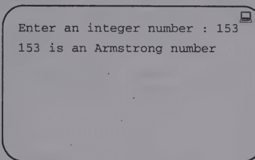

### 示例 11

编写一个 C 程序来反转给定的整数（例如，28431 反转为 13482）。

### 解决方案

示例 10 中讨论的方法扩展到了此问题。注意，从整数中分离出的最后一位数字通过以下关系取为第一位数字：

```c
rn = rn*10 + r;
```

其中：

- `rn` 是反转后的数字；初始时 `rn` 等于零，之前的值将保留在 `rn` 中。
- `r` 是分离出的数字，它在乘以 10 后加到 `rn` 上，以获得 `rn` 的下一位数字。

```c
/* 反转整数的程序 */
#include <stdio.h>
#include <conio.h>
main()
{
    long n,q,r,rn;
    clrscr();
    printf("\n Enter an integer number : ");
    scanf("%ld",&n);

    q = n;
    rn = 0;

    while(q > 0)
    {
        r = q % 10;
        rn = rn*10 + r;
        q = q/10;
    }

    printf("\n%ld reversed as %ld",n,rn);
}
```

当执行此程序时，用户必须输入一个正整数。数字被分离，获取反转后的结果并如所示。

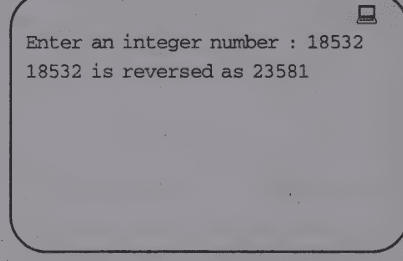

### 示例 12

编写一个 C 程序来接受一个整数并用单词打印数字（例如，356 打印为 Three Five Six）。

### 解决方案

示例 9 和 11 中讨论的方法扩展到了此问题。首先反转给定的数字。然后分离数字以获取数字的第一位。最后，打印对应的单词。

```c
/* 为整数中的数字打印单词形式的程序 */

#include <stdio.h>
#include <conio.h>

main(){
    int n,q,r,rn;

    clrscr();

    printf("\n Enter an integer number : ");

    scanf("%d",&n);

    q = n;

    rn = 0;

    while(q > 0)
    {
        r = q % 10;
        rn = rn*10 + r;
        q = q/10;
    }

    /* 分离数字并打印单词的循环 */

    while(rn > 0)
    {
        r = rn % 10;

        switch(r)
        {
            case 1:
                printf("One ");
                break;

            case 2:
                printf("Two ");
                break;

            case 3:
                printf("Three ");
                break;

            case 4:
                printf("Four ");
                break;

            case 5:
                printf("Five ");
                break;

            case 6:
                printf("Six ");
                break;

            case 7:
                printf("Seven ");
                break;

            case 8:
                printf("Eight ");
                break;

            case 9:
                printf("Nine ");
                break;

            case 0:
                printf("Zero ");
                break;
        }

        rn = rn/10;
    }

    getch();
}
```

当执行此程序时，用户必须输入一个整数（例如 4352）。数字被分离并获取给定的整数的反转结果（即 2534）。再次分离数字并如所示打印单词。

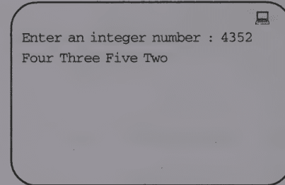

### 示例 13

编写一个 C 程序来检查给定的数字 `n` 是否为质数。

（质数是可以被 1 和它本身整除的整数。例如，13 是质数，因为它只能能被 1 和 13 整除。）

### 解决方案

可以使用 `for` 循环来寻找给定数字 2 到 `n/2` 之间的因数（例如，当 `n = 23` 时，它有直到 11 的因数，即 `23/2=11`）。

使用一个标识变量标志 `flag` 来识别给定数字除 1 之外的任何因数。假设 `flag` 初始为 0；当发现因数时，它将变为 `flag = 1`。

- 根据 `flag` 的值，循环将终止并识别出质数。

```c
/* 检查质数的程序 */

#include <stdio.h>
#include <conio.h>

main()
{
    int n,k,flag=0,r;

    clrscr();

    printf("\n Enter a positive integer : ");

    scanf("%d",&n);

    for (k = 2; k <= n/2 && flag == 0; k++)
    {
        r = n % k;

        if(r == 0)
            flag = 1;
    }

    if(flag == 0)
        printf("\n %d is a prime number",n);
    else
        printf("\n %d is not a prime number",n);

    getch();
}
```

当执行此程序时，用户必须输入一个正整数。`for` 循环生成 2 到 `n/2` 之间的因数，通过数字除以 `k` 获取余数 `r`。如果余数 `r = 0`，数字可被 `k` 整除，标识 `flag` 变为 1。

注意循环终止并使用 `flag` 识别出质数。该程序的示例输出如下：

```text
Enter a positive integer : 17

17 is a prime number
```

### 示例 14

编写一个 C 程序生成斐波那契数列 0 1 2 3 5... 到 `n`。

### 解决方案

注意数列中的项是通过加上前两个项得到的。使用以下步骤生成并打印各种项。

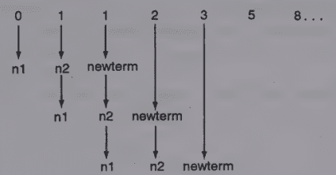

- 步骤 1：读取 `n`。
- 步骤 2：假设 `n1=0; n2=1;`
- 步骤 3：打印 `n1, n2`
- 步骤 4：`newterm=n1 + n2`
- 步骤 5：打印 `newterm`
- 步骤 6：`n1 ← n2`
- 步骤 7：`n2 ← newterm;`
- 步骤 8：重复步骤 4 到 7，直到 `newterm > n`。

```c
/* 生成并打印斐波那契数列的程序 */

#include <stdio.h>
#include <conio.h>

main()
{
    int n,n1,n2,newterm;

    clrscr();

    printf("\nEnter the final term of the series : ");

    scanf("%d",n);

    n1 = 0;

    n2 = 1;

    printf("%d%d",n1,n2);

    newterm = n1 + n2;

    while (newterm <= n) {
        printf("%d",newterm);

        n1 = n2;

        n2 = newterm;

        newterm = n1 + n2;
    }

    getch();
}
```


当执行此程序时，用户必须输入`n`的值。打印前两项`0`和`1`，然后使用`while`循环生成并打印其他项。当屏幕有`80`列时，格式说明符`%8d`每行打印`10`个值。该程序的示例输出如下所示。

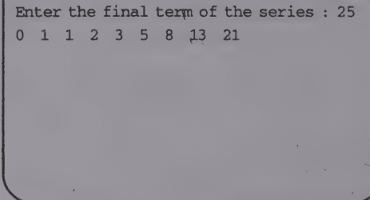

## 示例 15

编写一个 C 程序求解序列`S = x - x^3/3! + x^5/5! - x^7/7! + ... + x^n/n!`，这是正弦序列的和，`x`以弧度表示。

## 解决方案

求解序列时使用以下步骤分配初始值：

- 步骤 1：`s ← 0`代表序列中的第一项
- 步骤 2：`term ← x`代表`x`的幂（即`x^i`）
- 步骤 3：`i ← 1`代表幂

现在通过增加项的值获取下一项，`i`也相应地增加。然后将项加到`s`。

- 步骤 4：`s ← s + term`
- 步骤 5：`term ← x*x^2*(-1)/((i+1)*(i+2))`
- 步骤 6：`i ← i + 2`
- 步骤 7：当`(i <= n)`时重复步骤 4 到 6

```c
/* 求解序列的程序 */
#include <stdio.h>
#include <conio.h>

main() {
    float x, term, s;
    int i, n;

    clrscr();
    printf("\n Enter x in radians: ");
    scanf("%f", &x);
    printf("\n Enter end term power (n) : ");
    scanf("%d", &n);

    /* 初始化值 */
    s = 0;
    term = x;
    i = 1;

    /* 序列求和循环 */
    while(i <= n) {
        s = s + term;
        term = (term*x*x*(-1)) / ((i+1)*(i+2));
        i = i + 2;
    }

    printf("\n Sum of the series = %f", s);
    getch();
}
```

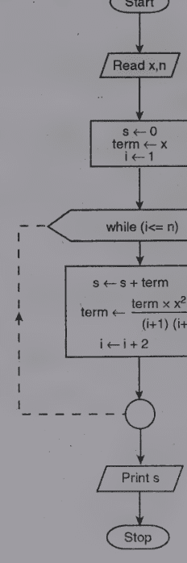

## LCS-24 C语言入门

当执行此程序时，用户必须输入弧度`x`值和末项的幂`(n)`。序列中的项相加，结果如下所示。

```
Enter x in radians : 0.52
Enter end term power (n): 10
Sum of the series = 0.496880
```

## 示例 16

求解以下余弦序列：

```
S = 1 - x^2/2! + x^4/4! - x^6/6! + ... ∞
```

在序列中连续相加，直到下一项的值（幅值）小于`10^-5`。

## 解决方案

对示例 15 中使用的方法进行了修改，将`while`循环中的条件`(i <= n)`替换为`|term| > 10^-5`，即`(fabs(term) > 1.0e-5)`。

```c
s = s + term;
term = (term*x*x*(-1)) / ((i+1)*(i+2));
i = i + 2;
}
printf("\nSum of the series = %f", s);
getch();
```

当执行此程序时，用户必须以弧度单位输入`x`值。绝对值大于`10^-5`的项将被相加，并打印结果。

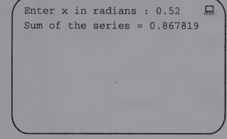

## 示例 17

编写一个 C 程序通过级数计算π（圆）的值。连续累加级数中的项，直到下一项的值（绝对值）小于`10^-4`为止。

## 解决方案

对上一个问题建议的步骤进行了微调以求解该级数。累加`s`（右侧级数）的项，并使用结果找到π的值。

- 步骤 1：`s ← 0`
- 步骤 2：`dr ← 1`代表第一项的分母
- 步骤 3：`sign ← 1`代表加号（`-1`代表负号）
- 步骤 4：`term ← 1/dr × sign`代表第一项
- 步骤 5：`s ← s + term`
- 步骤 6：`dr ← dr + 2`

注意`term`已加到`s`中，并生成了下一项，同时增加了`i`的值。

# LCS-26 C 语言编程初级

- 步骤 7：`sign ← sign*(-1)`
- 步骤 8：`term ← 1/dr * sign`
- 步骤 9：当`(term <= 10^-4)`时，重复步骤 5 到步骤 8。

同时注意`sign`的值将为`1`或`-1`，用于表示项的正负符号。

```c
/* 用于计算级数以寻找 pie 值的程序 */
#include <stdio.h>
#include <conio.h>
#include <math.h>

main() {
    int dr, sign;
    float s, term, pie;

    clrscr();

    /* 初始化变量值 */
    s = 0;
    dr = 1;
    sign = 1;
    term = 1.0/dr * sign;

    /* 寻找级数和 1.0e-4 的循环 */
    while(fabs(term) >= 1.0e-4) {
        s = s + term;
        dr = dr + 2;
        sign = sign*(-1);
        term = (1.0/dr) * sign;
    }

    /* 使用给定关系找到 pie 的值 */
    pie = s * 4;
    printf("\nValue of pie is %0.2f\n", pie);
    getch();
}
```

当执行此程序时，用户不需要输入任何值。在忽略绝对值小于`10^-4`的项后，得到了`pie`的值。

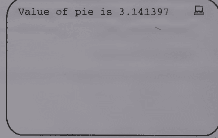

## 示例 18

编写一个 C 程序求级数的值：`S = 1 + 1/2 + 1/3 + ... + 1/N`

## 解决方案

可以使用`for`循环来生成`1`到`n`之间的数字。这些数字被用作分母来求解级数。

```c
/* 求解级数的程序 */
#include <stdio.h>
#include <conio.h>

main()
{
    int i, n;
    float s;

    clrscr();
    printf("\n Enter value to N : ");
    scanf("%d", &n);
    s = 0;

    /* 寻找级数和的循环 */
    for(i = 1; i <= n; i++)
        s = s + 1.0/i;

    printf("\n Sum of series = %8.4f", s);
    getch();
}
```

当执行此程序时，用户必须输入级数的结束值。级数被求值，结果如下所示。

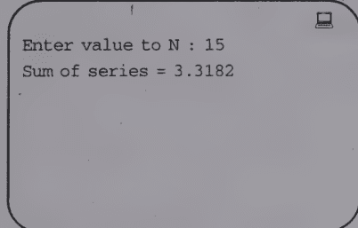

# LCS-28 C 语言编程初级

## 示例 19

编写一个 C 程序，打印一个 n 位数字的金字塔，如下所示：

```
1
2 3 2
3 4 5 4 3
4 5 6 6 5 4
```

## 解决方案

可以使用`for`循环来以金字塔形式打印数字。考虑以下插图来理解所需的`for`循环数量。假设要打印 4 行数字。

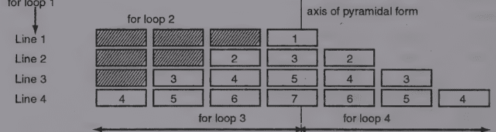

- (i) `for loop 1`可以重复使用 4 次来打印第 4 行（对于`n`行则使用`n`次）。
- (ii) `for loop 2`可用于生成特定宽度的空格，例如 6 个字符空格。
- (iii) `for loop 3`用于打印金字塔形式左侧的数字。
- (iv) `for loop 4`用于打印轴线右侧的数字。

考虑到这 4 个循环，编写了一个 C 程序以金字塔形式打印数字。

```c
/* 以金字塔形式打印数字的程序 */
#include <stdio.h>
#include <conio.h>

main() {
    int i, j, k, l, n, m;

    clrscr();
    printf("\nHow many lines ?");
    scanf("%d", &n);

    for(l = 1; l <= n; l++) /* 循环1 打印 n 行 */
    {
        for(i = 1; i <= n-l; i++) /* 循环2 打印空格 */
            printf(" ");

        /* 打印轴左侧数字的循环 */
        m = 1;
        for(j = 1; j <= l; j++)
        {
            printf("%d", m);
            m++;
        }

        /* 打印轴右侧数字的循环 */
        m = m - 2;
        for(k = 1; k < l; k++)
        {
            printf("%d", m);
            m--;
        }

        printf("\n");
    }
    getch();
}
```

当执行此程序时，用户必须输入行数。`for`循环将生成数字并按所示输出。

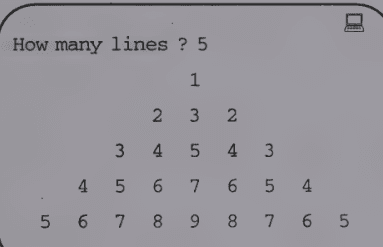

# 示例 20

编写一个 C 程序计算 n 行杨辉三角的元素，并按所示打印结果：

```
1
1 2 1
1 3 3 1
1 4 6 4 1
```

# LCS-30 C 语言编程初级

## 解决方案

考虑一行可以打印的字符数为 80 个，那么三角形形式的轴线位于第 40 列。杨辉三角同样如示例 19 所示使用`for`循环打印，这里使用了一个公式来生成数字。

- (i) `for loop 1`用于打印`n`行。
- (ii) `for loop 2`用于生成初始的 40 个空格，然后使用公式`40 - 3*l`减少，其中`l`是`for`的索引变量。
- (iii) `for loop 3`用于使用公式`m = m*(1 - j + 1)/j`打印每行的数字，其中`m`代表每行打印的数字个数，`j`代表`l`的索引变量。

考虑到这 3 个循环，编写了如下 C 程序来打印杨辉三角中的数字。

```c
/* 打印 PASCAL 三角形的程序 */
#include <stdio.h>
#include <conio.h>

main() {
    int i, j, l, n, m;

    clrscr();
    printf("\n How many rows ? ");
    scanf("%d", &n);
    printf("\n\t\t\t PASCAL TRIANGLE \n");
    m = 1;

    for(l = 0; l < n; l++)   /* 循环1 打印 n 行 */
    {
        for(i = 40 - 3 * l; i > 0; i--) /* 循环2 打印空格 */
            printf(" ");

        /* 生成并打印数字的循环 */
        for(j = 0; j <= l; j++)
            if(j == 0)
                m = 1;
            else
                m = m * (1 - j + 1) / j;

        printf("%6d", m);
        printf("\n");
    }
    getch();
}
```

## 示例 21

编写一个 C 程序打印从 1 到 5 的乘法表。

## 解决方案

可以使用嵌套`for`循环打印乘法表。以下程序演示了其工作原理。

```c
/* 打印乘法表的程序 */
#include <stdio.h>
#include <conio.h>

main() {
    int i, j;

    /* 打印乘法表的嵌套循环 */
    for(i = 1; i <= 5; i++)  /* 外层循环打印 1 到 5 的表 */
    {
        clrscr();
        printf("\n%d Multiplication table for %d \n", i, i);
        for(j = 1; j <= 10; j++)  /* 内层循环打印每张表 */
            printf("\n%4d %2d = %4d", j, i, j*i);
        printf("\nPress any key to continue...");
        getch();
    }
}
```

当执行此程序时，计算机将生成并打印从 1 到 5 的乘法表。注意每打印一张表后都会出现“按任意键继续...”。示例输出如下所示。

## 示例 22

编写一个 C 程序将二进制数转换为十进制数。

## 解决方案

可以遵循示例 9 中的逻辑将二进制数转换为十进制数。

```c
/* 将二进制转换为十进制的程序 */
#include <stdio.h>
#include <math.h>
#include <conio.h>

main()
{
    int n, q, r, s, k;

    clrscr();
    printf("\n Enter the binary number : ");
    scanf("%d", &n);
    q = n;
    s = 0;
    k = 0;

    while(q != 0)
    {
        r = q % 10;
        s = s + r * pow(2, k);
        q = q / 10;
        k = k + 1;
    }

    printf("\nDecimal value is %d", s);
    getch();
}
```

```c
while(q > 0)
{
    r = q % 10;
    s = s + r * pow(2, k);
    q = q / 10;
    k++;
}

printf("\n Decimal number is : %d", s);
getch();
```

当此程序执行时，用户必须输入一个二进制数。这些数字被分离并获取其十进制形式。十进制形式与分离的数字相乘，得到`2^0, 2^1, 2^2...2^k`的和。

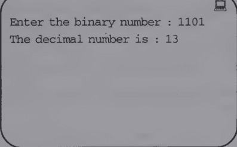

# 示例 23

编写一个 C 程序，将十进制数转换为对应的二进制数。

## 解决方案

示例 12 中使用的逻辑扩展到此程序。考虑十进制数 13：

| 商 q | 余数 r |
|---|---|
| 13 | 1 |
| 6 | 0 |
| 1 | 1 |

等效二进制 = 1101

为了获取余数`r`，使用了语句`r = q % 2`。为了获取商`q`，使用了语句`q = q / 2`。为了获取二进制数，使用了语句`bi = bi * 10 + r`。

# LCS C 语言编程入门课程

注意，获取的二进制数字应该被反转，以获得给定十进制数的正确二进制转换结果。

```c
/* 将十进制数转换为二进制的程序 */
#include <stdio.h>
#include <conio.h>
#include <math.h>

main() {
    int n, q, r, i, bi, rbi, flag = 0, k = 0;

    clrscr();
    printf("\n Enter the decimal number : ");
    scanf("%d", &n);
    q = n;
    rbi = 0;

    /* 获取反序排列的二进制数字的循环 */
    while(q > 0) {
        r = q % 2;
        if(r == 0 && flag == 0)
            k++;
        else
            flag = 1;
        rbi = rbi*10 + r;
        q = q/2;
    }

    /* 获取正确顺序的二进制数字的循环 */
    q = rbi;
    bi = 0;
    while(q > 0) {
        r = q % 10;
        bi = bi*10 + r;
        q = q/10;
        if(q == 0) /* 在末尾添加 0 的循环 */
            for(i = 1; i <= k; i++)
                bi = bi*10;
    }

    printf("\n The binary number is %d", bi);
    getch();
}
```


当此程序执行时，用户必须输入一个十进制数。获取余数和商，结果所示。

```
输入十进制数: 28
二进制数是 11100
```

## 复习题与练习题

1. 举例说明 C 中的`for`循环。
2. 编写一个 C 程序，求从 1 到`n`的自然数和。
3. 编写一个 C 程序，求 2 到`n`之间所有偶整数的和。
4. 编写一个 C 程序，打印从 1 到 50 的整数，每行五个整数。解释程序的工作原理。
5. 振动弦的频率`n`取决于长度`l`、张力`T`和线性密度`m`，公式为`n = k/sqrt(T)`，其中`x`是常数。编写一个 C 程序，计算当`l=50, 60, 70`和`80` cm 时的`n`。
6. 编写一个 C 程序，生成并打印 100 到 200 之间能被 3 整除但不能被 4 整除的数。
7. 编写一个 C 程序，计算`x`从 0.2 到 2.0（步长为 0.2）变化时，表达式`y = e^x + x^3 + sin(x)`的值。为表达式中的各项准备一个带有适当标题的表格。
8. 编写一个 C 程序，计算并打印（当`x`从 5.0 到 15.0，步长为 0.5 变化时）：

```
f(x) = {3x + 5x^3 for 4.3 < x < 9.1
        6x + 8x^3 for 9.1 < x < 15.5}
```

9. 编写一个 C 程序，为表达式`z = 2x^2 + 3y^2 + 5xy`生成`x, y, z`的值，其中`x`从 1 到 5（步长为 0.5）变化，`y`从 -3 到 +3（步长为 1）变化。
10. 编写一个 C 程序执行以下操作：

```
W = 1 + sin(x) + |Ax+By| |e^{|x|-|A||}
```

为所有组合计算`W`的不同值：
`x = 0.1, 0.15...0.9`
`y = 10, 15...50`
`A = -50, -45...0`
`B = 0, 0.5, 1.0, ...,10`

11. 编写一个 C 程序，准备`y = e^x + x^2 - x`的值表，其中`x = 0.0, 0.2, 0.4...`直到`y`变为正数。
12. `z`是`x`和`y`的函数，由`z = x^2 - 2xy + 3y^2 - 8x`给出。编写一个 C 程序，当`x, y`都从 -3 变为 3 增量为 0.2 时，计算并打印`x, y, z`。
13. 编写一个 C 程序，产生方程`y = e^2 * log(|x|) / sqrt(1+x^3) + x^5`的值表，其中`x`从 1.5 到 10.0 步长为 0.05 变化。
14. 编写一个 C 程序，产生方程`y = 2^{-1} * sin^t(t)`的值表。允许将`t`的大小作为参数输入。
15. 编写一个 C 程序打印 6 位数的逐位数字。
16. 编写一个 C 程序，计算逐位数字之和并判断是否为偶数。
17. 编写一个 C 程序，打印 100 到 999 之间的回文数。
18. 编写一个 C 程序，当数字反转时，判断其是否为回文数。
19. 编写一个 C 程序，计算 1 到 9 之间的序列之和。
20. 编写一个 C 程序，打印 10 到 50 之间的质数。
21. 编写一个 C 程序，判断给定数是否为完美数。
22. 编写一个 C 程序，计算 1 到 15 的阶乘。
23. 1, 2, 3, 5, 8 称为斐波那契数。编写一个`while`循环计算前 50 个斐波那契数。
24. 编写一个 C 程序计算序列和。
25. 编写一个 C 程序，计算`(1+2)+(1+2+3) + ... + N`，对于整数`N`。
26. 编写一个 C 程序，计算`exp(x) = 1 + x + x^2/2! + x^3/3! + ... + x^n/n!`。
27. 角度的正弦可以通过`sin(x) = x - x^3/3! + x^5/5! - x^7/7! + ...`来评估。编写一个 C 程序计算`sin(x)`，并与库`math.h`函数`sin(x)`比较结果。
28. 编写一个 C 程序，从系列`pi = 4(1 - 1/3^2 + 1/5^2 - ...)`评估`pi`的值。当下一项的值小于`10^{-5}`时停止叠加系列项。
29. 余弦的幂级表示为`cos(x) = 1 - x^2/2! + x^4/4! - ...`。编写一个 C 程序计算六位有效数字的`cos(x)`。
30. 编写一个 C 程序计算`S = 1 + 2/2! + 3/3! + 4/4! + ... + N/N!`直到`N=15`。

4. `do...while`结构中的循环至少执行一次。

5. `break`语句会导致循环终止。

6. `continue`语句用于将控制权转移到循环的开头。

7. 区分 C 语言中的`break`和`continue`语句。

| break 语句 | continue 语句 |
|---|---|
| 1. `break`语句用于终止语句块的执行。紧随该语句块的下一个语句将被执行。关键字为`break;`。 | 1. `continue`语句用于将控制权转移到语句块的开头。关键字为`continue;`。 |
| 2. 当循环中执行`break`语句时，循环的重复执行将终止。 | 2. 当循环中执行`continue`语句时，执行将转移到循环的开头。 |

8. `break`和`exit()`函数有什么区别？

| break 语句 | exit() 函数 |
|---|---|
| 1. `break`语句用于终止语句块的执行。紧随该语句块的下一个语句将被执行。 | 1. `exit()`函数用于永久终止 C 程序的执行。 |
| 2. 它在程序中作为`break;`使用。 | 2. 它是一个内置函数，并带有必要的参数`exit(0);`使用/调用。 |

9. 如果`while`循环中的条件初始为假会发生什么？
当`while`循环中的条件初始为假时，该循环中的语句块将不会执行。

10. `break`语句的作用是什么？
`break`语句用于将控制权转移到语句块的末尾。紧随该语句块的下一个语句将被执行。考虑以下示例：
```c
for(i = 1; i <= n; i++) {
    break;
}  // 控制权转移到语句块末尾
```

11. `continue`语句的作用是什么？
`continue`语句用于将控制权转移到语句块的开头。考虑以下示例：
```c
for(i = 1 ; i <= n ; i++)
{
    continue;
} 
// 控制权转移到语句块开头
```

12. C 程序中的`exit(0)`代表程序执行的结束。

13. 列出 C 语言中的几种无条件控制语句。
在不检查条件的情况下将控制权转移到程序任何部分的语句称为 C 语言中的无条件语句。

- (i) `break`语句
- (ii) `continue`语句
- (iii) `goto`语句
- (iv) `exit()`函数

14. 为 C 语言中的多个`if`语句提供替代方案。
`switch`语句可以作为多个`if`或嵌套`if`语句的替代方案。考虑以下示例：
```c
if (n == 1)
  y = 1+ x;
else
  if (n == 2)
    y = 1+x/n;
  else
    if (n == 3)
      y = 1+ pow(x,n);
    else
      y = 1+ n * x;
```

上述程序也可以`switch`语句编写。
```c
switch (n)
{
    case 1 : y = 1 + x;
      break;
    case 2 : y = 1 + x/n;
      break;
    case 3 : y = 1 + pow(x,n);
      break;
    default : y = 1 + n*x;
      break;
}
```

15. 下列程序的输出是什么？
```c
main()
{
    int x = 5;
    while (x == 1)
        x = x - 1;
    printf("%d\n",x);
}
```
`while`循环将不会执行，因为条件为假，并将打印`x`的值（即 5）。

注意，在打印`x`的值后，光标将移动到新行 (`\n`)

# 第 7 章：数组与下标变量

## 本章目标
- 一维数组
- 二维数组
- 数组声明

一组相关的值以数组的形式存储在 RAM 中。数组中的值使用带有下标的数组名来标识。单下标的变量称为一维数组或线性数组；双下标的变量称为二维数组或矩阵数组；依此类推。

## 一维数组

数学集合中的值如下所示。

```
x={3, 1, 3, 2, 4, 6, 2, 9, 3, 8, 3, 2}
```

这些值在数学中的表示法如下：
`x_i`, `x_j` 等

在 C 语言中，它们的表示方式如下。
```
x[0] x[1] x[2] 等
```

可以想象这些值存储在 RAM 中的方式如下。

| 下标 → | 0 | 1 | 2 | 3 | 4 | 5 |
|---|---|---|---|---|---|---|
| 数组名 → x | 3.1 | 3.2 | 4.6 | 2.9 | 3.8 | 3.2 |

## 二维数组

考虑一个大小为 3 × 4 的矩阵：
$$A = \begin{pmatrix} 2 & 4 & 3 & 0 \\ 3 & 8 & -1 & 6 \\ -2 & 0 & -5 & 6 \end{pmatrix}$$

这些值在数学中的表示法如下：`A_{0,0}`, `A_{0,2}` 等。

在 C 语言中，它们的表示方式如下。
```
a[0][0] a[0][1] a[0][2] 等
```

可以想象这些值存储在 RAM 中的方式如下。

| 数组名 | 0 | 1 | 2 | 3 | 列下标 |
|---|---|---|---|---|---|
| 0 | 2 | 4 | 3 | 0 | |
| 1 | 3 | 8 | -1 | 6 | |
| 2 | -2 | 0 | -5 | 6 | 行下标 |

## 数组声明

数组使用类型语句声明，并规定其中可以容纳的最大值数量。
```c
int x[5], a[3][4];
```
该语句声明了一个具有 5 个元素的一维数组`x`和具有 12 个元素的二维数组（3 行 × 4 列 = 12）。元素意味着数组中的一个存储位置。

注意：
1. 存储值的数组大小始终是一个整数；不允许像`int x[n];`这样的声明。
2. 不应使用超出数组大小的下标值。这将被编译器检测并在执行期间导致错误。例如，不应使用`x[5]`。

## 访问数组中的值

数组中的值使用带有括号下标的数组名来访问。通常使用`for`循环读取输入数组的值列表。考虑以下示例：
```c
for (i = 0; i < 6; i++)
    scanf("%d", &x[i]);
```
当此循环执行时，`i`的值从 0 到 5 变化，步长为 1，并且每次执行`scanf`来读取一维数组的值，如下：
- 第一次：`i=0`，读取`x[0]`的值，例如输入 3.1
- 第二次：`i=1`，读取`x[1]`的值，例如输入 3.2
- 最后：`i=5`，读取`x[5]`的值

因此，数组的值如下所示并存储在 RAM 中。

| | 0 | 1 | 2 | 3 | 4 | 5 |
|---|---|---|---|---|---|---|
| 3.1 | 3.2 | 4.6 | 2.9 | 3.8 | 3.2 |

`for`循环通常用于读取数组的值。

# 数组中值的初始化

数组的值在声明它们时可以初始化。考虑以下示例：
```c
float x[6] = {3.1, 3.2, 4.6, 2.9, 3.8, 3.5};
```
或者
```c
float x[] = {3.1, 3.2, 4.6, 2.9, 3.8, 3.5};
```
注意，数组的大小根据可用数量自动确定的。

| | 0 | 1 | 2 | 3 | 4 | 5 |
|---|---|---|---|---|---|---|
| 3.1 | 3.2 | 4.6 | 2.9 | 3.8 | 3.5 |

`x[0] = 3.1`
`x[1] = 3.2`
`x[2] = 4.6`
`x[3] = 2.9`
`x[4] = 3.8`
`x[5] = 3.5`

同样，大小为 3 × 3 的单位矩阵可以如下方式初始化：
```c
int u[3][3] = {{1,0,0}, {0,1,0}, {0,0,1}};
```
这些值以单位矩阵的形式存储如下所示。

| | 0 | 1 | 2 |
|---|---|---|---|
| 0 | 1 | 0 | 0 |
| 1 | 0 | 1 | 0 |
| 2 | 0 | 0 | 1 |

`a[2][2] = 1`

## 示例 1
使用数组编写一个 C 程序计算 n 个整数的和。

## 解决方案
考虑以下步骤读取整数列表并将其存储在数组中。然后相加整数以得到和。

- 步骤 1：读取`n`
- 步骤 2：循环读取列表的`n`个值。
- 步骤 3：`SUM ← 0`
- 步骤 4：循环相加所有值以得到这些值的和
- 步骤 5：打印`SUM`
- 步骤 6：停止

```c
/* 计算 N 个整数和的程序 */
#include <stdio.h>
#include <conio.h>

main()
{
    int x[50],n,i,sum;
    clrscr();
    printf("\nhow many integers ? ");
    scanf("%d",&n);
    /* 读取 N 个整数的循环 */
    for(i = 0; i < n; i++)
    {
        printf("\n Enter the %dth value : %d",i+1);
        scanf("%d",&x[i]);
        sum = 0;
    }
    /* 循环计算所有整数之和 */
    for(i = 0; i < n; i++)
        sum = sum + x[i];
    printf("\n Sum of all integers = %d",sum);
    getch();
}
```

当执行此程序时，用户必须输入整数值，这些值将通过`for`循环读取。第二个`for`循环用于累加所有值。结果打印如下。

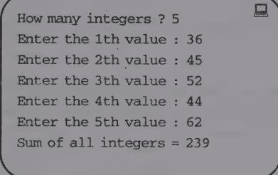

注意：消息中的 1st, 2nd 和 3rd 分对应第 1、第 2 和第 3。

## 示例 2

编写一个 C 程序找到给定 n 个数中的最大值。

## 解决方案

考虑使用`for`循环来读取 n 个数的列表并将其存储在数组中。假设列表中的第一个数是最大的，并与剩余数字进行比较以获得最大值。该程序的步骤编写如下。

- 步骤 1：读取`n`
- 步骤 2：循环读取列表中的`n`个数
- 步骤 3：`BIG = x[0]`
- 步骤 4：循环通过与剩余数字比较找到最大值
- 步骤 5：打印`BIG`
- 步骤 6：停止

```c
/* 寻找 N 个值最大值的程序 */
#include <stdio.h>
#include <conio.h>

main() {
    int x[50],n,i,big;
    clrscr();
    printf("\n How many numbers ? \n");
    scanf("%d",&n);
    printf("\n Enter all those numbers \n");
    for(i = 0; i < n; i++) {
        scanf("%d",&x[i]);
    }
    /* 假设第一个值为最大值 */
    big = x[0];
    /* 从第二个数开始通过循环找到最大值 */
    for(i = 1; i < n; i++) {
        if(x[i] > big) {
            big = x[i];
        }
    }
    printf("\n %d is the biggest number",big);
    getch();
}
```


当执行此程序时，用户必须输入可用值的数量，这些值将通过`for`循环读取。第二个循环用于找到最大值。最后，最大值显示如下。

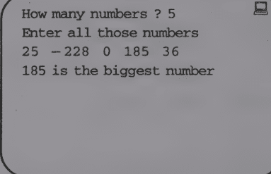

## 示例 3

编写一个 C 程序找到任意 n 个值的算术平均值、方差和标准差。

## 解决方案

可以使用数组来存储“n”个值的列表。通过以下公式获取算术平均值、方差和标准差：

$\bar{x} = \frac{\sum x_i}{n}$
方差 $\sigma_x = \frac{\sum(x_i-\bar{x})^2}{n}$
标准差 = $\sqrt{\sigma_x}$

# 数组与下标变量 ASV-7

使用以下步骤找到平均值、方差和标准差。

- 步骤 1：读取`n`
- 步骤 2：循环读取列表中的`n`个值
- 步骤 3：`SUM = 0`
- 步骤 4：循环找到所有值的之和
- 步骤 5：$\bar{x} = \frac{SUM}{n}$
- 步骤 6：`VSUM = 0`
- 步骤 7：循环找到分子`VSUM`以计算方差
- 步骤 8：$\sigma_x = \frac{VSUM}{n}$
- 步骤 9：打印 $\bar{x}$, $\sigma_x$, 标准差
- 步骤 10：停止

```c
/* 寻找平均值、方差和标准差的程序 */
#include <stdio.h>
#include <conio.h>
#include <math.h>

main()
{
    float x[50], sum, vsum, xbar, sigmax, sd;
    int n, i;

    clrscr();
    printf("\n How many values ? ");
    scanf("%d", &n);

    printf("\n Enter values in the list \n");
    for(i = 0; i < n; i++)
        scanf("%f", &x[i]);

    sum = 0;
    /* 循环找到所有值的之和 */
    for(i = 0; i < n; i++)
        sum = sum + x[i];

    xbar = sum/n;

    vsum = 0;
    /* 循环找到用于方差的分子 vsum */
    for(i = 0; i < n; i++)
        vsum = vsum + (x[i] - xbar)*(x[i] - xbar);

    sigmax = vsum/n;
    sd = sqrt(sigmax);

    printf("\n Arithmetic mean = %0.3f", xbar);
    printf("\n Variance = %0.3f", sigmax);
    printf("\n Standard deviation = %0.3f", sd);
    getch();
}
```

# ASV-8 C 语言编程入门

当执行此程序时，用户必须输入`n`的数量及其值。考虑以下值列表以运行程序：`X={1, 2, 3, 4, 5}`，获取并打印方差和标准差。

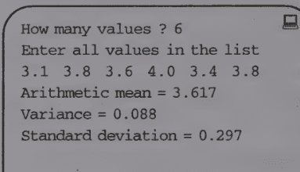

## 示例 4

编写一个 C 程序读取 50 名学生的成绩列表（范围为 0–100）。计算成绩的平均值，并打印出大于平均值的成绩列表（保留两位小数）。

## 解决方案

可以使用上一个问题中遵循的步骤来找到平均值。使用另一个循环打印大于平均值的值列表。注意平均值是`float`类型数字。

```c
/* 寻找成绩平均值的程序 */
#include <stdio.h>
#include <conio.h>
#include <math.h>

main()
{
    int x[50], n, i, sum;
    float mean;

    clrscr();
    printf("\n How many students ? ");
    scanf("%d", &n);

    printf("\n Enter all the marks \n");
    for(i = 0; i < n; i++)
        scanf("%d", &x[i]);

    sum = 0;
    /* 循环相加所有成绩 */
    for(i = 0; i < n; i++)
        sum = sum + x[i];

    mean = (float)sum/n;

    printf("\n Mean = %0.2f", mean);

    /* 循环打印大于平均值的成绩列表 */
    printf("\nMarks greater than mean : ");
    for(i = 0; i < n; i++)
        if(x[i] > mean)
            printf("%d ", x[i]);

    getch();
}
```

考虑以下 5 名学生的成绩列表以运行程序：`{58, 63, 68, 54}`，平均值保留两位小数显示如下。

| 多少个学生 | 5 |
|---|---|
| 输入所有成绩 | 58, 63, 68, 54 |
| 平均值 | 60.00 |
| 大于平均值的成绩 | 63 68 |

## 示例 5

编写一个 C 程序，读取一个成绩列表并找到任意 n 个值的算术平均值、方差和标准差。

## 解决方案

可以使用数组来存储“n”个值的列表。通过以下公式获取算术平均值、方差和标准差：

$\bar{x} = \frac{\sum x_i}{n}$
方差 $\sigma_x = \frac{\sum(x_i-\bar{x})^2}{n}$
标准差 = $\sqrt{\sigma_x}$

使用以下步骤找到平均值、方差和标准差。

- 步骤 1：读取`n`
- 步骤 2：循环读取列表中的`n`个值
- 步骤 3：`SUM = 0`
- 步骤 4：循环找到所有值的之和
- 步骤 5：$\bar{x} = \frac{SUM}{n}$
- 步骤 6：`VSUM = 0`
- 步骤 7：循环找到分子`VSUM`以计算方差
- 步骤 8：$\sigma_x = \frac{VSUM}{n}$
- 步骤 9：打印 $\bar{x}$, $\sigma_x$, 标准差
- 步骤 10：停止

```c
/* 寻找平均值、方差和标准差的程序 */
#include <stdio.h>
#include <conio.h>
#include <math.h>

main()
{
    float x[50], sum, vsum, xbar, sigmax, sd;
    int n, i;

    clrscr();
    printf("\n How many values ? ");
    scanf("%d", &n);

    printf("\n Enter values in the list \n");
    for(i = 0; i < n; i++)
        scanf("%f", &x[i]);

    sum = 0;
    /* 循环找到所有值的之和 */
    for(i = 0; i < n; i++)
        sum = sum + x[i];

    xbar = sum/n;

    vsum = 0;
    /* 循环找到用于方差的分子 vsum */
    for(i = 0; i < n; i++)
        vsum = vsum + (x[i] - xbar)*(x[i] - xbar);

    sigmax = vsum/n;
    sd = sqrt(sigmax);

    printf("\n Arithmetic mean = %0.3f", xbar);
    printf("\n Variance = %0.3f", sigmax);
    printf("\n Standard deviation = %0.3f", sd);
    getch();
}
```

# ASV-8 C 语言编程入门

当执行此程序时，用户必须输入`n`的数量及其值。考虑以下值列表以运行程序：`X={1, 2, 3, 4, 5}`，获取并打印方差和标准差如下。


## 示例 4

编写一个 C 程序读取 50 名学生的成绩列表（范围为 0–100）。计算成绩的平均值，并打印出大于平均值的成绩列表（保留两位小数）。

## 解决方案

可以使用上一个问题中遵循的步骤来找到平均值。使用另一个循环打印大于平均值的值列表。注意平均值是`float`类型数字。

```c
/* 寻找成绩平均值的程序 */
#include <stdio.h>
#include <conio.h>
#include <math.h>

main()
{
    int x[50], n, i, sum;
    float mean;

    clrscr();
    printf("\n How many students ? ");
    scanf("%d", &n);

    printf("\n Enter all the marks \n");
    for(i = 0; i < n; i++)
        scanf("%d", &x[i]);

    sum = 0;
    /* 循环相加所有成绩 */
    for(i = 0; i < n; i++)
        sum = sum + x[i];

    mean = (float)sum/n;

    printf("\n Mean = %0.2f", mean);

    /* 循环打印大于平均值的成绩列表 */
    printf("\nMarks greater than mean : ");
    for(i = 0; i < n; i++)
        if(x[i] > mean)
            printf("%d ", x[i]);

    getch();
}
```

考虑以下 5 名学生的成绩列表以运行程序：`{58, 63, 68, 54}`，平均值保留两位小数显示如下。

| 多少个学生 | 5 |
|---|---|
| 输入所有成绩 | 58, 63, 68, 54 |
| 平均值 | 60.00 |
| 大于平均值的成绩 | 63 68 |

## 示例 5

编写一个 C 程序，读取一个成绩列表并找到任意 n 个值的算术平均值、方差和标准差。

## 解决方案

可以使用数组来存储“n”个值的列表。通过以下公式获取算术平均值、方差和标准差：

$\bar{x} = \frac{\sum x_i}{n}$
方差 $\sigma_x = \frac{\sum(x_i-\bar{x})^2}{n}$
标准差 = $\sqrt{\sigma_x}$

## 示例 6

编写一个 C 程序对一组 n 数进行升序排序并解释所使用的算法。

## 解决方案

有许多方法可以对数字进行升序/降序排序。选择排序是用于排序的最简单算法之一。

考虑一个值列表：

`6 -2 8 3 13 10`

比较第一个数与第二个数，然后与第三个数以此类推，直到最小值移动到第一个位置。

`-2 6 8 6 3 13 10`

比较第二个数与第三个数，然后与第四个数以此类推，直到最小值移动到第二个位置。

`-2 3 8 8 6 13 10`

重复此过程将第三小值移动到第三个位置。最后数字排列如下：

`-2 3 6 6 8 10 13`

升序排列数字的涉及步骤如下。

- 步骤 1：读取`n`
- 步骤 2：循环读取列表中的`n`个值
- 步骤 3：通过比较排列数字
  if (`x[i] > x[i+1]`) 则
    交换值
- 步骤 4：循环打印排列后的列表
- 步骤 5：停止

## ASV-12 C语言语言编程第一课

```c
/* 升序排列数字的程序 */
#include <stdio.h>
#include <conio.h>

main()
{
    int x[50], n, i, j, temp;

    clrscr();
    printf("有多少个数字？ %d");
    scanf("%d", &n);

    printf("\n 输入 %d 个数字的列表 \n\n", n);
    for (i = 0; i < n; i++)
        scanf("%d", &x[i]);

    /* 将数字按升序排列的循环 */
    for(i = 0; i < n-1; i++)
        for(j = i+1; j < n; j++)
            if(x[i] > x[j])
            {
                temp = x[i];
                x[i] = x[j];
                x[j] = temp;
            }

    printf("\n升序排列后的数字 \n");
    for(i = 0; i < n; i++)
        printf("%5d", x[i]);

    getch();
}
```

当执行此程序时，用户必须输入数字`n`的数量及其对应的值。当前一个位置的值大于后续位置的值时，将使用以下语句交换值：

```c
temp = x[i];
x[i] = x[j];
x[j] = temp;
```

获得的值按升序排列，并打印如下：

```
有多少个数字？ 4
输入 4 个数字的列表
32 -10 20 5
升序排列后的数字
-10 5 20 32
```

## 示例 7

编写一个C语言程序，在`n`个值的集合中搜索键值。如果搜索成功，则打印键值的位置。

## 解决方案

在包含`n`个值的列表中搜索键值有许多方法。线性搜索算法是在列表中搜索给定键值最简单的方法。

考虑一个包含数值的列表：

`6 -2 8 3 13 10`

假设要搜索的键值是 3。

将键值与列表中的第一个值进行比较，然后与第二个值比较，依此类推。

当列表中的值与给定的键值相等时，停止搜索并显示位置。

在`n`个值的列表中搜索键值的步骤如下。

- 步骤 1：读取`n`
- 步骤 2：循环读取列表中的`n`个值
- 步骤 3：读取`S` / `S`是在列表中要搜索的键值
- 步骤 4：循环将`S`与列表中的值进行比较
- 步骤 5：打印“键值不在列表中”
- 步骤 6：停止

```c
/* 在列表中搜索键值的程序 */
#include <stdio.h>
#include <conio.h>

main()
{
    int x[50], n, i, s;

    clrscr();
    printf("\n 列表中有多少个值？ ");
    scanf("%d", &n);

    printf("\n 输入列表中的所有值 \n");
    for (i = 0; i < n; i++)
        scanf("%d", &x[i]);

    printf("\n 输入要搜索的键值： ");
    scanf("%d", &s);
```

## ASV-14 C语言语言编程第一课

```c
/* 在列表中搜索键值的循环 */
for(i = 0; i < n; i++)
    if(s == x[i])
    {
        printf("\n %d 存在于第 %d 位置", s, i+1);
        getch();
        exit(0);
    }

printf("\n 键值 %d 不在列表中", s);
getch();
```

当执行此程序时，用户首先输入数值列表，然后输入要在列表中搜索的键值。给定的值从第一个位置开始与列表中的值进行比较。当列表中的值与键值相等时，将打印该值及其所在的位置。

如果该值不在数值列表中，则将显示消息“键值不在列表中”。

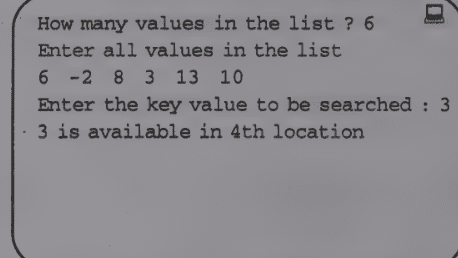

注意，函数`exit(0)`用于停止程序的执行。可以通过如下方式间接地使用标志变量来实现：

```c
flag = 0;
for(i = 0; i < n && flag == 0; i++)
    if(s == x[i])
        flag = 1;
if(flag == 1)
    printf("\n %d 存在于第 %d 位置 ", s, i);
else
    printf("\n 键值 %d 不在列表中", s);
```

这将产生相同的结果。

## 示例 8

编写一个C语言程序，使用冒泡排序对给定的n个数字进行排序，并找出交换次数和遍历次数。

## 解决方案

使用冒泡排序技术将给定的数字组按升序排列。考虑一个包含`n`个值的列表。


比较第一和第二个位置的值、第二和第三位置、第三和第四位置，依此类推。如果`x[0] > x[1]`，则交换值。这个过程一直持续直到最大值移动到数组的最后一个位置。


比较一直持续到`(n-1)`位置并交换值（如果需要）。注意，第二大的元素被移动到数组的倒数第二个位置。

再次重复比较直到`(n-2)`位置并交换值（如果需要）。现在，第三大的元素被移动到倒数第三个位置。


写了以下步骤来排序数字：

- 步骤 1：读取`n`
- 步骤 2：循环读取`n`个数字
- 步骤 3：循环重复过程`(n-1)`次
  开始
    循环比较相邻元素
    如果`(x[j] > x[j+1])`，则
      交换值
  结束
- 步骤 4：循环打印排序后的列表
- 步骤 5：停止

```c
/* 使用冒泡技术排序数字的程序 */
#include <stdio.h>
#include <conio.h>
```


# ASV-16 C语言编程第一课

```c
main() {
    int x[10],temp,i,j,n,exch = 0;
    clrscr();
    printf("\n 有多少个数字？ \n");
    scanf("%d",&n);
    printf("\n 输入列表中的所有数字 \n");
    for(i = 0; i < n; i++) {
        scanf("%d",&x[i]);
    }
    /* 将数字按升序排列的循环 */
    for(i = 0; i < n-1; i++) {
        for(j = i+1; j < n; j++) {
            if(x[i] > x[j]) {
                temp = x[i];
                x[i] = x[j];
                x[j] = temp;
            }
        }
    }
    /* 打印排序后列表的循环 */
    for(i = 0; i < n; i++) {
        printf("%5d",x[i]);
    }
    printf("\n排序完成，共交换了 %d 次\n",exch);
    getch();
}
```

当执行此程序时，用户必须输入数字`n`的数量及其对应的值。冒泡排序技术将数字按升序排列。

## 示例 9

编写一个C语言程序，在`n`个值的列表中搜索键值。

### 解决方案

在包含`n`个值的列表中搜索键值有许多方法。线性搜索算法是在列表中搜索给定键值最简单的方法。

考虑一个数值的列表。将键值与列表中的第一个值进行比较，然后与第二个值比较，依此类推。当列表中的值与给定的键值相等时，停止搜索并显示位置。

在`n`个值的列表中搜索键值的步骤如下：

- 步骤 1：读取`n`
- 步骤 2：循环读取列表中的`n`个值
- 步骤 3：读取`S`（`S`是在列表中要搜索的键值）
- 步骤 4：循环将`S`与列表中的值进行比较
- 步骤 5：打印“键值不在列表中”
- 步骤 6：停止

```c
/* 在列表中搜索键值的程序 */
#include <stdio.h>
#include <conio.h>
main()
{
    int x[50],n,i,s;
    clrscr();
    printf("\n 列表中有多少个值？ ");
    scanf("%d",&n);
    printf("\n 输入列表中的所有值 \n");
    for (i = 0; i < n; i++)
        scanf("%d",&x[i]);
    printf("\n 输入要搜索的键值： ");
    scanf("%d",&s);

    /* 在列表中搜索键值的循环 */
    for(i = 0; i < n; i++)
      if(s == x[i])
      {
        printf("\n %d 存在于第 %d 位置",s,i+1);
        getch();
        exit(0);
      }

    printf("\n 键值 %d 不在列表中",s);
    getch();
}
```

当执行此程序时，用户首先输入数值列表，然后输入要在列表中搜索的键值。给定的值从第一个位置开始与列表中的值进行比较。当列表中的值与键值相等时，将打印该值及其所在的位置。如果该值不在数值列表中，则将显示消息“键值不在列表中”。


注意，函数`exit(0)`用于停止程序的执行。可以通过如下方式间接地使用标志变量来实现：

```c
flag = 0;
for(i = 0; i < n && flag == 0; i++)
  if(s == x[i])
    flag = 1;
if(flag == 1)
  printf("\n %d 存在于第 %d 位置 ",s,i);
else
  printf("\n 键值 %d 不在列表中",s);
```

这将产生相同的结果。

## 示例 8

编写一个C语言程序，使用冒泡排序对给定的`n`个数字进行排序，并找出交换次数和遍历次数。

### 解决方案

使用冒泡排序技术将给定的数字组按升序排列。考虑一个包含`n`个值的列表。


比较第一和第二个位置的值、第二和第三位置、第三和第四位置，依此类推。如果`x[0] > x[1]`，则交换值。这个过程一直持续直到最大值移动到数组的最后一个位置。


比较一直持续到`(n-1)`位置并交换值（如果需要）。注意，第二大的元素被移动到数组的倒数第二个位置。再次重复比较直到`(n-2)`位置并交换值（如果需要）。现在，第三大的元素被移动到倒数第三个位置。


写了以下步骤来排序数字：

- 步骤 1：读取`n`
- 步骤 2：循环读取`n`个数字
- 步骤 3：循环重复过程`(n-1)`次

  开始
    循环比较相邻元素
    如果`(x[j] > x[j+1])`则交换值
  结束

- 步骤 4：循环打印排序后的列表
- 步骤 5：停止

```c
/* 使用冒泡技术排序数字的程序 */
#include <stdio.h>
#include <conio.h>
```

## ASV-16 C语言编程第一课（续）

```c
main() {
    int x[10],temp,i,j,n,exch = 0;
    clrscr();
    printf("\n 有多少个数字？ \n");
    scanf("%d",&n);
    printf("\n 输入列表中的所有数字 \n");
    for(i = 0; i < n; i++) {
        scanf("%d",&x[i]);
    }
    /* 将数字按升序排列的循环 */
    for(i = 0; i < n-1; i++) {
        for(j = i+1; j < n; j++) {
            if(x[i] > x[j]) {
                temp = x[i];
                x[i] = x[j];
                x[j] = temp;
            }
        }
    }
    /* 打印排序后列表的循环 */
    for(i = 0; i < n; i++) {
        printf("%5d",x[i]);
    }
    printf("\n排序完成，共交换了 %d 次\n",exch);
    getch();
}
```

当执行此程序时，用户必须输入数字`n`的数量及其对应的值。冒泡排序技术将数字按升序排列。

```c
/* Program for matrix multiplication */
#include <stdio.h>
#include <conio.h>
#include <math.h>
main()
{
    int a[10][10],b[10][10],c[10][10],m,n,i,j,k;
    clrscr();
    printf("\n Enter order of A matrix : ");
    scanf("%d %d",&m,&n);
    /* loop to read values of A matrix */
    printf("\n Enter A matrix \n");
    for (i = 0; i < m; i++) {
        for (j = 0; j < n; j++) {
            scanf("%d %d",&a[i][j]);
        }
    }
    printf("\n Enter order of B matrix : ");
    scanf("%d %d",&n,&l);
    /* loop to read values of B matrix */
    printf("\n Enter B matrix \n");
    for (i = 0; i < n; i++) {
        for (j = 0; j < l; j++) {
            scanf("%d %d",&b[i][j]);
        }
    }
    /* loop to multiply two matrices */
    for (i = 0; i < m; i++) {
        for (j = 0; j < l; j++) {
            c[i][j] = 0;
            for (k = 0; k < n; k++) {
                c[i][j] = c[i][j] + a[i][k]*b[k][j];
            }
        }
    }
    /* loop to print resultant matrix */
    printf("\n Resultant matrix is \n");
    for (i = 0; i < m; i++) {
        for (j = 0; j < l; j++) {
            printf("%6d",c[i][j]);
        }
        printf("\n");
    }
    getch();
}
```

# ASV-20 C 语言编程入门课程

当执行此程序时，用户必须首先输入 A 矩阵的阶数`(m, n)`及其值，然后输入 B 矩阵的阶数`(n, l)`及其值。注意，最内层的循环

```c
for (k = 0; k < n; k++)

c[i][j] = c[i][j] + a[i][k] * b[k][j];
```

用于将 A 矩阵的行与 B 矩阵相应的列元素相乘，得到 C 矩阵的一个元素。在外层循环中重复此操作以获得结果矩阵中的其他元素。


## 示例 11

编写一个 C 程序来找到并打印给定矩阵的转置。

### 解答

考虑阶数为`m x n`的矩阵 A。其转置`(A^T)`通过将 A 矩阵的第一行写入`A^T`的第一列，将 A 矩阵的第二行写入`A^T`的第二列，依此类推来得到。转置矩阵`(A^T)`的阶数为`n x m`。

```text
A = \begin{pmatrix} -3 & 6 & 0 \\ 3 & 2 & 8 \end{pmatrix}_{2x3} \quad A^T = \begin{pmatrix} -3 & 3 \\ 6 & 2 \\ 0 & 8 \end{pmatrix}_{3x2}
```

```c
/* Program to transpose a given matrix */
#include <stdio.h>
#include <conio.h>
main() {
  int a[10][10],at[10][10],m,n,i,j;
  clrscr();
  printf("nEnter order of the matrix : %d %d");
  scanf("%d%d",&m,&n);
  /* loop to read values of the matrix */
  printf("\nEnter the matrix values \n");
  for (i = 0; i < m; i++) {
    for (j = 0; j < n; j++) {
      scanf("%d",&a[i][j]);
    }
  }
  /* loop to Transpose the matrix */
  for(i = 0; i < m; i++)
    for(j = 0; j < n; j++)
      at[j][i] = a[i][j];
  /* loop to print the resultant matrix */
  printf("\n The transposed matrix is \n");
  for(i = 0; i < n; i++)
  {
    for(j = 0; j < m; j++)
      printf("%6d",at[i][j]);
    printf("\n");
  }
  getch();
}
```

当执行此程序时，用户必须输入矩阵的阶数`(m, n)`和值。转置矩阵打印所示。


## 示例 12

编写一个 C 程序来判断给定矩阵是否为对称矩阵。

### 解答

考虑阶数为`m × m`的方阵 A。当行元素和列元素相等时，该矩阵被称为对称矩阵。例如：

```text
A = \begin{pmatrix} 5 & 3 & 8 \\ 3 & 1 & -2 \\ 8 & -2 & 4 \end{pmatrix}
```

```c
/* Program to check for symmetric matrix */
#include <stdio.h>
#include <conio.h>
main() {
  int a[10][10],m,i,j,flag;
  clrscr();
  printf("\n Enter order of the square matrix : \n");
  scanf("%d",&m);
  /* loop to read values of A matrix */
  printf("\n Enter the matrix \n");
  for(i = 0; i < m; i++) {
    for(j = 0; j < m; j++) {
      scanf("%d",&a[i][j]);
    }
  }
  /* loop to check for symmetric matrix */
  flag = 0;
  for(i = 0; i < m && flag == 0; i++) {
    for(j = 0; j < m && flag == 0; j++) {
      if(a[i][j] != a[j][i]) {
        flag = 1;
        continue;
      }
    }
  }
  if(flag == 0)
    printf("\n The given matrix is symmetric\n");
  else
    printf("\n The given matrix is not symmetric\n");
  getch();
}
```

当执行此程序时，用户输入矩阵的阶数和值。对称矩阵仅适用于方阵。第一行元素与第一列元素比较。如果任何值不匹配，`flag`被赋值为 1 并终止循环。结果取决于`flag`的值。


## 示例 13

编写一个 C 程序找到阶为`m × m`的给定方阵的迹。

### 解答

我们知道矩阵的迹定义为主对角线元素的和。同样注意迹仅适用于方阵。考虑以下示例：


矩阵的迹 = `$A_{11} + A_{22} + A_{33} = 3 + 1 + 2 = 6$`

注意行下标和列下标`j`对于对角线元素相等。

```c
/* Program to find trace square matrix */
#include <stdio.h>
#include <conio.h>
main() {
    int a[10][10],m,i,j,sum;
    clrscr();
    printf("\n Enter order of the square matrix : ");
    scanf("%d",&m);
    /* loop to read values of A matrix */
    printf("\n Enter the matrix \n");
    for (i = 0; i < m; i++)
        for (j = 0; j < m; j++)
            scanf("%d",&a[i][j]);
    /* loop to find trace of the matrix */
    sum = 0;
    for (i = 0; i < m; i++)
        sum = sum + a[i][i];
    printf("\n Trace of the matrix = %d\n", sum);
    getch();
    return 0;
}
```

当执行此程序时，用户必须输入给定矩阵的阶数`m`和值。编写了一个`for`循环来寻找对角线元素的和。注意循环索引变量`i`用于行列下标表示对角线元素。

```text
Enter order of the square matrix : 3
Enter the matrix
3 2 -1
4 1 8
6 4 2
Trace of the matrix = 6
```

## 复习题与练习

1. 定义一个有50个元素的一维数组。编写一个C程序计算从下标0开始的偶数元素的和。
2. 编写一个 C 程序求列表中奇数和偶数的和。
3. 编写一个 C 程序将线性数组 A 的所有元素复制到线性数组 B 的对应位置。线性数组 B 有`N`个对应位置，`N`元素。


## 数组练习

### 4. 数组复制

编写一个 C 程序从键盘读取 `n` 个整数并存储在数组 `AR` 中。将 `AR` 中的奇数元素复制到数组 `OAR`，并将偶数元素复制到数组 `EAR`。打印 `OAR` 和 `EAR` 中的值。

### 5. 查找数组中的最小值

编写一个 C 程序打印给定数组中的最小值及其在数组中的位置。

### 6. 查找第二大值

编写一个 C 程序找到 `n` 元素数组中的第二大值。

### 7. 统计高于和低于平均值的数据

编写一个 C 程序读取原始数据 `x₁, x₂, ... xn`，并计算在平均值（平均数）以上和以下的数据个数。使用 `while` 语句。

### 8. 统计正数、负数和零

编写一个 C 程序读取 `n` 个整数列表。统计正整数和负整数的个数，统计列表中零的个数并显示结果。

### 9. 查找最大值和最小值

编写一个 C 程序在 100 个整数数组中找到最大值和最小值及其位置。

### 10. 降序排序

编写一个 C 程序按降序排序数组元素。

### 11. 交换数组元素

整数数组 `NUMBER` 包含 100 个元素。编写一个 C 程序交换数组中第 1 个和第 100 个元素、第 2 个和第 99 个元素，依此类推。程序在交换第 50 个和第 51 个元素后停止。

### 12. 查找两个数组中的共同元素

给定两个整数数组，一个包含 20 个元素，另一个包含 15 个元素。读取数据获取每个数组的所有值，仅打印两个数组共同出现的值。编写一个 C 程序实现此功能。

### 13. 搜索数组元素

编写一个 C 程序在 `n` 元素数组中搜索元素。

### 14. 查找可被 2 整除的数字

编写一个 C 程序，在一个包含 `n` 个整数的数组中列出所有被 2 整除的数字。

### 15. 合并两个有序数组

给定两个升序排列的一维数组 `A` 和 `B`。编写一个程序将它们合并为一个单一的排序数组 `C`，其中包含数组 `A` 和 `B` 中的所有项，并按升序排列。

### 16. 矩阵加法

编写一个 C 程序，将两个 `m × n` 矩阵相加，并将结果存储在第三个矩阵中。

### 17. 矩阵乘法

编写一个 C 程序，计算两个矩阵的乘积。

### 18. 矩阵转置

编写一个 C 程序，按列读取一个矩阵（`m × n`），对该矩阵进行转置，并以矩阵的形式按行打印输出。

### 19. 判断对角矩阵

给定一个大小为 `10 × 10` 的方阵 `A`，编写一个 C 程序来测试 `A` 是否为对角矩阵。

### 20. 计算矩阵的行和、列和与对角线和

给定一个 `5 × 5` 矩阵 `A`，编写一个 C 程序来计算这些值的行和、列和和对角线和。

### 21. 使用循环读写多维数组

解释循环结构如何用于读写一维、二维和三维数组。

### 22. 计算正元素和负元素的和

给定一个大小为 `10 × 10` 的矩阵 `A`，编写一个 C 程序来计算所有正元素和负元素的和。

### 23. 计算矩阵的迹和范

编写一个 C 程序读取 `N × N` 矩阵并计算其迹（trace）和范（norm）。以 `N` 行 `N` 列的形式打印矩阵。

> 矩阵的迹（Trace）是主对角线元素的和。矩阵的范（norm）是给定矩阵行和中的最大值。行和是通过每行元素绝对值的和得到的。

### 24. 计算测试平均分

对一个 30 名学生的班级进行了四项测试。编写一个 C 程序计算每次测试的平均分以及所有测试的班级平均分。

## 简答

### 1. 找出数组元素的个数

```c
float f[4][8] = {2};

char si[] = "ibm";
```

`f` 数组将有 64 个元素（`4 × 8 × 2 = 64`）。

考虑到声明中分配了 3 个字符，`s` 数组将有 3 个元素。

### 2. 字符数组

字符数组被称为 ______ string。

### 3. C 语言中数组的语法

数组在类型声明语句中使用指定数量的元素进行声明。

它的形式如下：

```c
type name[n]
```

其中：

- `type` 是数组中值的数据类型。
- `name` 是数组名。
- `n` 是数组中可以存储的值的最大数量。

示例：

```c
int x[100], a[3][4];
```

# ASV-26 C 语言编程入门课程

此语句声明了一个包含 100 个元素的一维数组和一个包含 12 个元素（`3 × 4 = 12`）的二维数组。

### 4. C 语言如何处理位于相邻位置的数组值

数组中的值连续存储在 RAM 的相邻位置中。实际上，这些内存位置是 C 编译器在编译时预留的。使用数组名配合方括号中的下标来访问这些值。通常下标值从 `0` 开始。

### 5. 声明 50 个浮点数温度列表

50 个浮点数温度列表的数组声明为：

```c
float temp[50];
```

### 6. 声明和使用 10 个整数的数组

10 个整数的数组声明如下：

```c
int x[10]
```

使用数组名配合一个方括号中的下标来访问数组的值。例如：

```c
x[0], x[1], ..., x[9]
```

通常使用 `for` 循环来读写数组值。例如：

```c
for (i = 0; i < 10; i++)
    scanf("%d", &x[i]);
```

### 7. 数组的定义

数组是一组相关数据项，它们在 RAM 中共享一个内存位置。

### 8. 数组元素必须满足的条件

任何给定数组的所有元素必须满足以下条件：

1. 存储在数组中的值的数据类型与数组中声明的数据类型相同。例如，`int x[10]` 可用于存储整数。
2. 存储在数组中的值数量始终小于或等于声明语句中输入的数组大小。例如，`int x[50]` 可以存储 50 个整数。

### 9. 数组变量与普通变量

数组变量或下标变量用数组名后跟一个或多个方括号中的下标表示。数组在类型声明语句中与数组的大小一起声明。

普通变量或标量变量不带任何下标，并且始终引用单个值。

### 10. 在 C 中初始化数组

数组在类型声明语句中声明时进行初始化。考虑以下代码：

```c
int x[10] = {5, 25, 32, -30, 22};
```

此语句初始化：

```c
x[0] = 5
x[1] = 25
x[2] = 32
x[3] = -30
x[4] = 22
```

# SMC-4 C 语言编程入门

当字符串包含多个字符时，赋值的写法如下所示：

```c
strcpy(city, "NEW DELHI");
```

## `atoi()` 函数

`atoi()` 函数是一个 C 库函数，用于将数字字符串转换为整数值。

考虑以下代码：

```c
char st[10] = "24175";
int n;
n = atoi(st);
```

这会将整数值 `24175` 赋值给整数变量 `n`。

## 示例 1：统计字符出现的次数

编写一个 C 程序，统计给定字符串中特定字符出现的次数。

### 解决方案

考虑字符串 `"MISSISSIPPI"`。统计某个字符（例如 `'S'`）的出现次数。

```c
/* 统计字符串中字符次数的程序 */
#include <stdio.h>
#include <conio.h>
#include <string.h>

main()
{
    char st[20], ch;
    int count, l, i;

    clrscr();

    printf("\n Enter the string : ");
    gets(st);

    printf("\n Which char to be counted ? ");
    scanf("%%c", &ch);

    /* 检查字符出现次数的循环 */
    l = strlen(st);
    count = 0;

    for (i = 0; i < l; i++)
        if (st[i] == ch)
            count++;

    printf("\n The character %c occurs %d times", ch, count);
    getch();
}
```

当执行此程序时，用户必须输入字符串以及要在该字符串中统计的字符。结果打印所示。

## C 中的字符串操作 SMC-5


## 示例 2：统计句子中的元音数量

编写一个 C 程序，统计句子中出现的元音数量。

### 解决方案

考虑句子 `"This is a book"`。统计大写或小写元音 `A E I O U` 的出现次数。

```c
/* 统计元音的程序 */
#include <stdio.h>
#include <conio.h>
#include <string.h>

main()
{
    char st[80], ch;
    int count = 0, i;

    clrscr();

    /* 读取字符串的循环 */
    printf("\n Enter the sentence : \n");
    gets(st);

    /* 循环统计字符串中的元音 */
    for (i = 0; i < strlen(st); i++)
        switch (st[i])
        {
        case 'A':
        case 'E':
        case 'I':
        case 'O':
        case 'U':
        case 'a':
        case 'e':
        case 'i':
        case 'o':
        case 'u':
            count++;
            break;

        printf("\n %d vowels are present in the sentence", count);
        getch();
        }
```

当执行此程序时，用户必须输入句子。注意使用 `gets()` 函数来读取句子，是因为字符串单词之间有空格。使用循环中的 `switch` 语句来统计元音。注意 `count++` 语句只给出一次，以便执行 `switch` 语句中的所有情况。


## 示例 3：测试回文字符串

编写一个 C 程序来测试给定字符串是否为回文字符串。解释程序的工作原理。

### 解决方案

考虑字符串 `"LIRIL"`。当它被反转时，它仍然是 `"LIRIL"`。任何这类字符串被称为回文字符串。其他回文字符串还有 `DAD`、`MADAM` 和 `MALAYAM`。

```c
/* 检查回文字符串的程序 */
#include <stdio.h>
#include <conio.h>
#include <string.h>

main()
{
    char st[20], rst[20];
    int i, j;

    clrscr();

    printf("\n Enter the string: ");
    scanf("%s", st);

    /* 反转字符串的循环 */
    i = 0;
    j = strlen(st) - 1;

    while (j >= 0)
    {
        rst[i] = st[j];
        i++;
        j--;
    }

    rst[i] = '\0';

    if (strcmp(st, rst) == 0)
        printf("\n %s is a palindrome string", st);
    else
        printf("\n %s is not a palindrome string", st);

    getch();
}
```

当执行此程序时，用户必须读取一个字符串。例如：

| 0 | 1 | 2 | 3 | 4 | 5 | 6 | 7 | 8 | `<-j` |
|---|---|---|---|---|---|---|---|---|---|
| `st =` | H | Y | D | E | R | A | B | A | D |

要反转这个字符串，从最后一个位置开始复制原始字符串如下所示：

| `i -> 0` | 1 | 2 | 3 | 4 | 5 | 6 | 7 | 8 |
|---|---|---|---|---|---|---|---|---|
| `rst =` | D | A | B | A | R | E | D | H |

使用 `strcmp()` 函数比较字符串，当原始字符串和反转字符串相同时，它返回 `0`。


### 另一种方法

该程序也可以写为比较字符串的第一个字符与最后一个字符，第二个与倒数第二个，以此类推直到字符串的中间，如下所示：

| 中间 | 0 | 1 | 2 | 3 | 4 | 5 | 6 | 7 | 8 |
|---|---|---|---|---|---|---|---|---|---|
|  |  |  |  |  |  |  |  |  |  |

如果所有字符都相同，则该字符串是回文。如果给定字符串有空格，可以使用循环。

## 示例 4：拼接两个字符串

编写一个 C 程序拼接两个字符串。

### 解决方案

考虑两个字符串 `"NEW"` 和 `"DELHI"`。通过拼接这些字符串，得到结果 `"NEW DELHI"`。

| 0 | 1 | 2 | 3 | 4 | 5 | 6 | 7 | 8 | 9 |
|---|---|---|---|---|---|---|---|---|---|
| `st1 =` | N | E | W | `\0` |  |  |  |  |  |  |
| `st2 =` | D | E | L | H | I | `\0` |  |  |  |  |
| `st =` | N | E | W |  | D | E | L | H | I | `\0` |

```c
/* 拼接两个字符串的程序 */
#include <stdio.h>
#include <conio.h>
#include <string.h>

main()
{
    char st1[10], st2[10], st[20];
    int i, j;

    clrscr();

    printf("\nEnter first string : \n");
    scanf("%s", st1);

    printf("\nEnter second string : \n");
    scanf("%s", st2);

    /* 将第一个字符串拷贝到结果字符串的循环 */
    i = 0;
    j = 0;

    while (st1[i] != '\0')
    {
        st[j] = st1[i];
        i++;
        j++;
    }

    /* 在拼接第二个字符串之前添加空格 */
    st[j] = ' ';
    j++;

    /* 拼接第二个字符串的循环 */
    i = 0;

    while (st2[i] != '\0')
    {
        st[j] = st2[i];
        i++;
        j++;
    }

    st[j] = '\0';

    printf("\nResultant string is %s", st);
    getch();
}
```

当执行此程序时，用户必须输入两个字符串。得到的结果如下。


### 另一种方法

该程序也可以使用 `strcpy()` 函数编写。在读取两个字符串后，函数如下：


结果存储在左变量中。注意在第二个字符串之前引入了一个空格以实现结果字符串中的空格。

## 示例 5：比较两个字符串

编写一个 C 程序比较通过键盘输入的两个字符串，并打印字母顺序较大的字符串。

### 解决方案

字母顺序较大的字符串是指第一个字母的 ASCII 值大于第二个字符串第一个字母的字符串。考虑两个字符字符串：

```c
st1 = "ALPHA"
st2 = "BETA"
```

`st2` 大于 `st1`，因为 `"BETA"` 中 `'B'` 的 ASCII 值大于 `"ALPHA"` 中的 `'A'`。注意当两个字符串的首字母相同时，比较字符串的第二个字母。

```c
/* 打印字母顺序较大字符串的程序 */
#include <stdio.h>
#include <conio.h>
#include <string.h>

main()
{
    char st1[20], st2[20];

    clrscr();

    printf("\n Enter string 1 : %s", st1);
    scanf("%s", st1);

    printf("\nEnter string 2 : %s", st2);
    scanf("%s", st2);

    if (strcmp(st1, st2) > 0)
        printf("\n %s is alphabetically greater string", st1);
    else
        printf("\n %s is alphabetically greater string", st2);

    getch();
}
```

当执行此程序时，用户必须输入两个字符串。注意当字符串 1 较大时，`strcmp()` 返回正值，当字符串 2 较大时，返回负值。


## 示例 6：按字母顺序排序名称

编写一个 C 程序读取名称数组并按字母顺序排序。

### 解决方案

考虑存储在二维字符数组中的名称列表。每行可以存储最大长度为 10 个字母的名称。

| Names | 0 | 1 | 2 | 3 | 4 | 5 | 6 | 7 | 8 | 9 |
|---|---|---|---|---|---|---|---|---|---|---|
| 0 | D | E | E | P | A | K |  |  |  |  |
| 1 | S | H | E | R | I | N |  |  |  |  |
| 2 | S | O | N | I | K | A |  |  |  |  |
| 3 | A | R | U | N |  |  |  |  |  |  |

将第一行的名称与第二行比较，然后与第三行比较，以此类推，直到以 `A` 开头的最小名称移动到第一行。

| 0 | 1 | 2 | 3 | 4 | 5 | 6 | 7 | 8 | 9 |
|---|---|---|---|---|---|---|---|---|---|
| 0 | A | R | U | N |  |  |  |  |  |  |
| 1 | D | E | E | P | A | K |  |  |  |  |
| 2 | S | H | E | R | I | N |  |  |  |  |
| 3 | S | O | N | I | K | A |  |  |  |  |

将第二个名称与第三个比较，然后与第四个比较，以此类推，直到字母顺序最小的名称移动到第二个位置。

| 0 | 1 | 2 | 3 | 4 | 5 | 6 | 7 | 8 | 9 |
|---|---|---|---|---|---|---|---|---|---|
| 0 | A | R | U | N |  |  |  |  |  |
| 1 | D | E | E | P | A | K |  |  |  |  |
| 2 | S | O | N | I | K | A |  |  |  |  |
| 3 | S | H | E | R | I | N |  |  |  |  |

重复此过程，直到名称按下方字母顺序排列所示。

# SMC-12 C 语言编程第一课


# 第 3 ：通过循环对名称排序

# 第 4 ：循环打印排序后的列表

# 第 5 ：停止

```c
/* 按字母顺序排列名称的程序 */
#include <stdio.h>
#include <conio.h>
#include <string.h>
main() {
    char names[50][20],temp[20];
    int n,i,j;
    clrscr();
    printf("\n How many names ? ");
    scanf("%d",&n);
    printf("\n Enter the names by one \n\n",n);
    for(i = 0; i < n; i++) {
        scanf("%s",names[i]);
    }
    /* 按字母顺序排列名称的循环 */
    for(i = 0; i < n-1; i++) {
        for(j = i+1; j < n; j++) {
            if(strcmp(names[i],names[j]) > 0) {
                strcpy(temp,names[i]);
                strcpy(names[i],names[j]);
                strcpy(names[j],temp);
            }
        }
    }
    /* 按字母顺序打印名称列表的循环 */
    printf("\n Names in alphabetical order\n\n");
    for(i = 0; i < n; i++) {
        printf("\n %s",names[i]);
    }
    getch();
}
```

当执行此程序时，用户必须首先输入名称的总数 (`n`) 以及列表中的所有名称。名称将经过比较、重新排列，并按字母顺序打印。

## C 语言中的字符串处理 SMC-13

有多少个名称？4

逐个输入 4 个名称

DEEPAK

SHERIN

SONIKA

ARUN

字母顺序名称：

ARUN

DEEPAK

SHERIN

SONIKA

## 示例 7

编写一个 C 程序，将小写文本中的行转换为大写。

## 解决方案

考虑小写字母和大写字母的 ASCII 值。

A → 65 a → 97

B → 66 b → 98

.

.

.

Z → 90 z → 122

注意，小写字母与大写字母之间的差（即 32）用于转换。

```c
/* 将小写文本转换为大写的程序 */
#include <stdio.h>
#include <conio.h>
#include <string.h>
main() {
    char st[80];
    int i;
    clrscr();
    printf("\n Enter a sentence: \n");
    gets(st);
    /* 将小写字母表转换为大写的循环 */
    for(i = 0; i<strlen(st); i++)
        if(st[i] >= 'a' && st[i] <= 'z')
            st[i] = st[i] - 32;
    printf("\n The converted string is \n %s",st);
    getch();
}
```

## 示例 8

当执行此程序时，用户必须输入一个字符字符串。文本将以后所示的大写字母形式打印。

## 示例 8

编写一个 C 程序，在给定字符串中找到最长的单词。

## 解决方案

考虑字符字符串 "SMALL THINGS MAKE PERFECTION IS NO THING"。

使用变量`lng`来存储最长的单词，其余单词逐个复制到变量`word`中。如果单词的长度大于`lng`的长度，则将该单词赋值给`lng`。重复此过程直到在字符串中找到最长的单词。

```c
/* 寻找最长单词的程序 */
#include <stdio.h>
#include <conio.h>
#include <string.h>
main()
{ 
    char st[80],word[15],lng[15];
    int i,j;
    clrsc();
    printf("\n Enter a sentence \n");
    /* 读取字符串的循环 */
    i = 0;
    while((st[i++] = getch()) != '\n');
    i--;
    st[i] = '\0';
    /* 分配初始值 */
    l = strlen(st);
    i = 0; j = 0;
    strcpy(word," ");
    strcpy(lng," ");
    /* 寻找最长单词的循环 */
    while(i <= l) {
        ch = st[i];
        if(ch == ' ' || ch == '\0') {
            word[j] = '\0';
            if(strlen(word) > strlen(lng))
                strcpy(lng,word);
            strcpy(word," ");
            j = 0;
        }
        else {
            word[j] = ch;
            j++;
        }
        i++;
    } /* while 循环结束 */
    printf("\n Long word is %s",lng);
    printf("\n Press any key to continue...");
    getch();
}
```

当执行此程序时，用户必须输入一个字符串。最长的单词将如下所示。

## 示例 9

编写一个 C 程序，读取文本并忽略所有特定单词的出现。

## 解决方案

考虑字符字符串 "TO ACCESS THE NAME OF THE CITY IN THE LIST"。让单词 "THE" 被忽略。那么它读取 "TO ACCESS NAME OF CITY IN LIST"。上一个问题的逻辑扩展到此问题。当与要忽略的单词比较时，将其逐个复制到变量`newst`。如果不是要忽略的单词，则复制到`newst`。

```c
/* 在文本中省略单词的程序 */
#include <stdio.h>
#include <string.h>
#include <conio.h>
main(){
    char st[80],newst[80];
    char ch,onesps[],word[10],omit[10];
    int i,l,j;
    clrscr();
    printf("\nEnter sentence: \n");
    /* 读取句子的循环 */
    i = 0;
    while ((st[i++] = getchar()) != '\n');
    i--;
    st[i] = '\0';
    printf("\nEnter word to omit : \n");
    scanf("%s", omit);
    /* 分配初始值 */
    l = strlen(st);
    i = 0; j = 0;
    strcpy(word, " ");
    /* ...逻辑继续 */
}
```

## 示例 10

编写一个 C 程序打印电报费用。

## 解决方案

考虑以下步骤：

1. 读取句子。

2. 循环统计空格和标点符号。

3. 如果单词数少于等于 10，则费用为 5。否则，费用为 5 + (count-10)*1.25。

```c
/* 计算电报费用的程序 */
#include <stdio.h>
#include <string.h>
#include <conio.h>
main(){
    char st[200],ch;
    int count=0,i,l;
    float amt;
    clrscr();
    printf("\n Type the sentence for Telegram: \n");
    gets(st);
    /* 统计单词数的循环 */
    l = strlen(st);
    for(i = 0; i < l; i++)
        switch(st[i]) {
            case ' ':
            case '.':
            case ',':
            case '!':
            case '?':
                count++;
                break;
        }
    if(count <= 10)
        amt = 5;
    else
        amt = 5 + (count -10)*1.25;
    printf("\n Amount to be paid for telegram = Rs.%2f",amt);
    getch();
}
```

## SMC-20 C语言语言编程入门

```c
printf("\nn Number of char (incl. blanks) = %d",chs);
printf("\n Number of words = %d",wds);
printf("\n Number of lines = %d",lns);
getch();
```

当执行此程序时，用户必须输入文本，并在文本末尾输入`$`符号。在检查了行和单词的条件后，允许通过换行符来正确计算单词数。

## 额外的字符串处理函数

某些 C 编译器会接受在`string.h`和`ctype.h`头文件中提供的以下字符串处理函数。

| 函数 | 目的 | 结果 |

| --- | --- | --- |

| `strupr()` | 将字符串中的字母转换为大写字母 | `strupr("DELHI")` | "DELHI" |

| `strlwr()` | 将字符串中的字母转换为小写字母 | `strlwr("CITY")` | "city" |

| `strrev()` | 反转字符串 | `strrev("SACHIN")` | "NIHICAS" |

| `strcmp()` | 比较两个字符串的前 n 个字符 | `m = strcmp("DELHI", "DIDAR", 2)` | m = -4 |

| `strncmp()` | 比较两个字符串且不敏感（忽略大小写） | `m = strncmp("DELHI", "Delhi")` | m = 0 |

| `strncat()` | 将特定数量的字母接到另一个字符串。 | `char s1[10] = "New", s2[10] = "Delhi-41", strncat(s1,s2,3)` | s1 将变为 "NewDel" |

## SMC-21 中的字符串操作

## 字符操作

C 语言也支持字符操作，这些函数可以在头文件`ctype.h`中。

注意，当条件为真时返回值 1 或正整数，当条件为假时返回值 0。下面列出了部分`ctype.h`函数。

| 函数 | 目的 | 示例 | 结果 |

|---|---|---|---|

| `isupper()` | 测试字符是否为大写字母。 | `isupper('A')`<br>`isupper('a')`<br>`isupper('8')` | 1<br>0<br>0 |

| `islower()` | 测试字符是否为小写字母。 | `islower('n')` | 1 |

| `isalpha()` | 测试字符是否为字母 | `isalpha('K')`<br>`isalpha('+')` | 1<br>0 |

| `isalnum()` | 测试字符是否为字母或数字 | `isalnum('8')`<br>`isalnum('y')`<br>`isalnum('-')` | 1<br>1<br>0 |

| `isdigit()` | 测试字符是否为数字 | `isdigit('6')`<br>`isdigit('a')` | 1<br>0 |

| `isxdigit()` | 测试字符是否为十六进制数。（0-9,A-F 和 a-f 均为数字）。 | `isxdigit('9')`<br>`isxdigit('A')`<br>`isxdigit('M')` | 1<br>1<br>0 |

| `tolower()` | 将字母转换为小写字母 | `tolower('A')` | a |

| `toupper()` | 将字母转换为大写字母 | `toupper('a')` | A |

## 复习题与练习题

1. 解释 C语言中的四个字符串处理函数。

2. 编写一个 C 程序，统计给定字符串中元音、辅音和空格的数量。

3. 编写一个 C 程序，统计一个句子中的字符数和单词数。

4. 字符字符串在 C 中可以通过将其视为数组来处理。例如，WORD 可以是数组名，而 WORD[I] 是数组中的第 I 个字符。如果 WORD[1] = "MISSISSIPPI"，那么 WORD[0] 将是 'M'，WORD[5] 将是 'S'。编写一个 C 程序，统计字符串中给定字符（CH，例如 'S'）出现的次数。

5. 编写一个 C 程序，使用`strcat()`函数连接字符串。

6. 编写一个 C 程序，反转一个给定的字符串。例如，"ROOT"被反转为"TOOR"。

7. 编写一个 C 程序，接收三个城市的名称并按字母顺序显示它们。

8. 编写一个 C 程序，从键盘接受指定数量的字符串，按 ASCII 值降序排序，并在显示器上每行显示一个排序后的字符串。

9. 编写一个 C 程序，接受一个字符并判断它是大写还是小写。如果是大写，则将其转换为小写，反之亦然。

10. 编写一个 C 程序，删除句子中的所有元音。假设序列长度不超过 80 个字符。

11. 编写一个 C 程序，读取一行字符，对于任何数字（0 - 9），如果出现数字，则显示该数字的位置、值及其对应的单词（zero, one,...,nine）。

12. 编写一个 C 程序，读取一个字符串并统计给定单词在该字符串中出现的次数。

13. 编写一个 C 程序，读取一个字符串。统计其中的单词数。还要打印单字母、双字母、三字母、四字母、五字母及超过 5 个字母的单词数。

14. 编写一个 C 程序，读取一个字符串并将字符串中的字母复制到另一个字符串中。例如，将"NEW DELHI"复制为"NEW DELHI"。

15. 编写一个 C 程序，使用内置函数找到字符串的长度。同时也是一个回文。

16. 编写一个 C 程序，在不使用任何库的情况下比较两个字符串是否在字母上相等。

17. 编写一个 C 程序，使用替换字母的策略来加密句子：A 替换为 B，B 替换为 C，以此类推，直到 Z 替换为 A。空格不变。

18. 编写一个 C 程序，将输入拆分为单个单词并每行打印一个。

19. 接受 N 个单词并通过插入空格和句号组成一个句子。

## 简答

1. _______ 将 ASCII 字符转换为整数的函数。

2. 给 C 语言声明字符串 "COMPUTER"。

```c
char s[10] = "COMPUTER";
```

在计算机内存中存储如下：

| S | C | P | U | R | \0 |

|---|---|---|---|---|---|

3. C语言中的字符数组被称为字符串。

4. 如何使用`putchar()`函数写入多字符字符串？使用循环语句写入多字符字符串。例如：

```c
for(i = 0 ; i<strlen(s); i++)
putchar(s[i]);
```

5. 下述段中 S[5] 的值是什么？

```c
char S[15] = "PROCESSPROCESS";
```

s[5]的值是 'P'。

6. 下述语句的输出是什么？

`printf("%c, %d", 65);`

输出为 A 65。注意 ASCII字符 65 是使用 %c 打印的。

7. C字符和C字符串的区别是什么？字符由单引号限定。例如 'M'。C字符串由双引号限定并始终以空字符 '\0' 结束。例如 "UMBAI"。

8. 什么是空字符串？空字符串用于初始化字符字符串。它由内部的双引号限定。例如`strcpy(st, "");`

9. _______ 用于比较字符串 2 和字符串 1。`strcmp(string2,string1);`

10. 什么是空字符？终止字符 '\0' 被空字符，因为它不占用字符串空间。获取字符串长度时不计算此字符。空字符 '\0' 用于识别字符串的结束。

11. 什么是空语句？C语言中的空语句由单个字符（分号）表示，它也被用作语句的分隔符。例如，C中的 ; 是空语句。

12. 什么是字符串常量？字符串常量是由双引号限定的字符串。例如 "How many students"。

## SMC-24 C语言语言编程入门

13. 什么是字符常量？字符常量是由单引号限定的字符。例如，'A'。

14. C语言中如何处理字符串？语言中通过`strcpy()`、`strlen()`等字符串处理函数处理字符串。这些函数在头文件 'string.h' 中。

15. 列出 string.h 中的任意任意四个函数。

(i) `strcpy()`

(ii) `strlen()`

(iii) `strcmp()`

(iv) `strcat()`

16. 什么是字符串？字符串是由双引号限定的字符序列。例如，"New Delhi - 110 008"。

17. 如何指示字符串的结束？字符串的结束由空字符 '\0' 表示。

18. C语言中 'a' 和 "a" 的区别是什么？语言中，'a' 是字符常量，"a" 是字符串常量。

19. 举例说明如何访问字符串中的单个字符。字符串总是声明为字符数组。例如：

```c
char s[10] = "CALCULTA"
```


字符串中的每个字符都通过带下标的数组名访问。例如，`s[3]`访问第3位的字符。`s[i]`访问第 i 位的字符。

## 20. 什么是 ASCII 字符集？它常见吗？

美国信息交换标准（ASCII）是一种通过整数访问字符的简单转换代码。例如，字符 `'A'`使用 65 访问，`'B'`使用 66，依此类推。在语言中，使用 `int` 和 `char` 数据类型来表示字符（反之亦然）。

## 21. 转换规范 `%s` 意味着什么？

规范 `%s` 意味着有总共 s 个字符位置来打印字符字符串。例如，字符串 `"NEW"`使用该规范显示如下：

|   | 0 | 1 | 2 | 3 | 4 | 5 |
|---|---|---|---|---|---|---|
|   |   |   |   | N | E | W | ← 6位 |

注意字符在分配的6个字符宽度内是右对齐的。

# 第 9 章 C语言中的函数

## 本章目标

- 用户定义函数
- 函数声明
- 函数调用
- 实际参数或形式参数
- 函数原型
- 递归
- 局部或内部变量
- 全局或外部变量
- 空函数
- C语言中的存储存储类

函数是用于计算某个值或执行任务的子程序。它们不能独立运行，总是由 `main()` 程序或其他某个函数调用的。函数分为两类：

1. 库函数或内置函数
2. 用户定义函数

库函数或内置函数用于执行标准操作，例如数字的平方根 `sqrt(x)`、绝对值 `fabs(x)`、`scanf()`、`printf()`等。这些函数随编译器一起提供，并在程序开始处与所需的头文件（如 `math.h`、`stdio.h`、`string.h`等）配合使用。

FNC-2 C语言编程入门第一课程

用户定义函数是由用户编写的自包含语句块，用于计算某个值或执行任务。它们可以根据需要被主程序多次调用。

## 函数的用途

- (i) 当一组语句需要反复编写/执行时，函数非常有用。
- (ii) 当程序规模过大或复杂时，函数非常有用。通过主程序调用函数来顺序执行每项任务。这像是一种解决问题的自上而下模块化编程技术。（记住，在模块化编程中，语句按从到下的顺序执行以产生结果。）
- (iii) 函数还用于减少程序调试时的困难。

## 用户定义函数

在C语言中，函数的声明用于计算并返回一个特定数据类型的值给调用程序。

函数也可以写用来执行某个任务。它可能会间接地向调用程序返回多个值。

## 函数声明

函数声明的一形式形式所示：

```c
type name (type arg1, type arg2, ..., type arg n)
{
    <local declaration>
    -
    <statement block>
    -
    return(variable or expression);
}
```

其中，`type`是函数返回的值的数据类型以及预期参数类型。

`arg1`、`arg2`、...、`arg n`是参数，是接收来自调用程序传值的变量。

`name`是函数的名称，调用程序通过该名称调用函数。

C语言中的函数 FNC-3

注意，这里有变量的局部声明。这些变量被称为局部变量，仅在函数内部使用。记住，变量的全局声明写在 `main()`之外，被称为全局变量。

语句块由一组语句和内置函数组成，它们在函数被调用时执行。

结果通过 `return`语句返回给调用程序，该语句通常出现在函数块的末尾。注意函数块以大括号 `{}`开始和结束。

### 示例

```c
/* 寻找整数阶乘的函数 */
fact(int k) {
  int i = 1;
  for(i = 1; i <= k; i++)
    p = p * i;
  return(p);
}
```

当此函数被调用时，调用程序会用一个值替换参数 `k`。`for`循环用于生成从 1 到 `k` 的数字，并将这些数字相乘得到乘积（或 `k`的阶乘）。`p`的值（即 `k!`）被返回给调用程序。

## 调用函数

调用程序通过函数名以及括号内所需数量的参数来调用函数。函数调用出现在赋值语句或语句中。考虑以下调用泛的示例：

- `ncr = fact(n) / (fact(n-r) * fact(r))`
- `printf("n%d factorial is %d", m, fact(m));`

注意 `function()`被调用了三次以找到 `ncr`的值。

> 函数是通过其名称和括号内所需数量的参数来调用的。

## 实际参数与形式参数

主程序与函数之间的值传递是通过参数实现的。

在函数语句中列出的参数被称为实际参数。它们是传递给函数用于计算或执行任务的实际值。考虑如下带有实际参数的函数调用。

FNC-4 C语言编程入门第一课程

`ncr = fact (n) / (fact (n-r) * fact (r));`

实际参数

在函数声明中使用的参数被称为形式参数。它们仅仅是形式变量，用于接受或接收调用程序提供的值。考虑如下带有形式参数的函数声明：

```c
int fact (int k)
{
  int i, p = 1; // 形式参数
  for (i = 1; i <= k; i++)
    p = p * i;
  return(p);
}
```

注意实际参数和形式参数的数量及其数据类型应当匹配。

## 调用函数的规则

C程序中调用函数遵循以下规则：

- (i) 函数有一个由 `main()`调用的语句块。
- (ii) 函数原型写在主程序的开头。
- (iii) 函数声明在主程序中使用。
- (iv) 函数在主块中使用。
- (v) 函数也被另一个函数调用。
- (vi) 函数向调用程序返回一个值。
- (vii) 参数是可选的。
- (viii) 函数在主程序中使用。
- (ix) 函数在主程序中使用。
- (x) 函数在主程序中使用。

## 函数原型

当C编译时，函数原型写在主程序的开头。注意函数原型与函数声明相似。

`type`是函数返回的值的数据类型以及预期参数。

`arg1`、`arg2`、...、`arg n`是接收来自调用程序传值的变量。

`name`是调用程序通过该名称调用函数的名称。

考虑如下：

```c
int fact(int k);
int big(int a, int b);
int big(int, int);
```

## 示例 1

编写一个寻找整数阶乘的函数并用它找到 nCr。

```text
ncr = n! / r!(n-r)!
```

## 解决方案

编写一个寻找整数阶乘的函数并被调用三次以寻找 `n!`、`r!`和`(n-r)!`。`n`和`r`的值在主程序中读取。注意函数声明也写在主程序中。

```c
#include <stdio.h>
#include <stdlib.h>
#include <conio.h>

main() {
  int fact(int k);
  /* 函数声明 */
  int n,r,ncr;
  clrscr();
  printf("\n Enter value to n and r : ");
  scanf("%d %d",&n,&r);
  ncr = fact(n)/(fact(r)*fact(n-r));
  printf("\n Value of nCr = %d",ncr);
  getch();
}

/* 寻找阶乘的函数子程序 */
int fact(int k) {
  int i,p = 1;
  for(i = 1; i <= k; i++)
    p = p * i;
  return(p);
}
```

当此程序执行时，用户必须输入 `n`和`r`的值。首先调用函数来寻找 `r`的阶乘，接下来调用函数来寻找`(n - r)`的阶乘；最后调用函数来寻找 `n`的阶乘。每次，返回给主程序的值都会替换函数调用中相应的位置以计算 `nCr`的值。`nCr`的值如下所示。

## 示例 2

编写一个寻找给定三个值中最大值的函数，并用它找到学生获得的总分，总分是三次测试最高分和三次作业最高分之和。

## 解决方案

调用函数来寻找给定三个值中的最大值，并用于寻找三次测试最高分和三次作业的最高分。将这些分数相加得到学生获得的总分。

```c
#include <stdio.h>
#include <conio.h>
main() {
  int big(a, int b, int c);
  /* function prototype declaration */
  int t1, t2, t3, a1, a2, total;
  clrscr();
  printf("\nEnter three test scores : %d");
  scanf("%d %d %d", &t1,&t2,&t3);
  printf("\nEnter three assignment scores : %d");
  scanf("%d %d %d", &a1,&a2,&a3);
  total = big(t1, t2, t3) + big(a1, a2, a3);
  printf("\nTotal marks = %d",total);
  getch();
}
/* function to find biggest of three values */
big(int a, int b, int c) {
  if(a > b) {
    return(a);
  } else {
    return(b);
  }
  if(a > c) {
    return(a);
  } else {
    return(c);
  }
}
```

当执行此程序时，用户必须输入 3 个测试成绩和 3 个作业分数。现在调用函数来找到 `t1`、`t2`、`t3`以及 `a1`、`a2`和`a3`的最大值，并将这些最大值相加。打印出的总分如下所示。


## 示例 3

编写一个 C 函数，使用 `1-x^2/2!+x^4/4!- ...`直到 15 项来计算 `cos(x)`。在主程序中以 30°为步长列出从 0°到 180°的取值表格。

## 解决方案

编写了一个函数来计算前 15 项之和，以求 `x`的余弦值，`x`的范围从 0°到 180°，步长为 30°。注意，该函数中使用的是弧度值。主程序通过调用函数来列出这些值。

```c
#include <stdio.h>
#include <conio.h>
#include <math.h>
main() {
    float cosine(float x);
    /* function prototype declaration */
    float x = 0;
    clrscr();
    printf("\n----------------------------------------------------*");
    printf("\n    x (角度)            cos(x) *");
    printf("\n----------------------------------------------------*");
    while (x <= 180) {
        printf("\n\t%6.0f                %6.2f",x,cosine(x));
        x = x + 30;
    }
    printf("\n----------------------------------------------------");
    getch();
}
/* 余弦函数的子程序 */
float cosine(float x) {
    float s,term;
    int i,k;
    x = x*3.14/180;
    s = 0;
    term = 1;
    i = 0;
    /* 循环生成并寻找 15 项之和 */
    for(k = 1; k <= 15; k++) {
        s = s + term;
        term = term*x*x*(-1)/((i+1)*(i+2));
        i = i + 2;
    }
    return(s);
}
```

当执行此程序时，调用函数 `cosine()`来处理从 0°到 180°步长为 30°的 `x`值。注意，角度值的 `x`值通过乘以 `\pi/180`转换为弧度。

值表格如下所示：

| x (角度) | cos (x) |
|:---|:---|
| 0 | 1.0 |
| 30 | 0.87 |
| 60 | 0.50 |
| 90 | 0.00 |
| 120 | -0.50 |
| 150 | -0.87 |
| 180 | -1.00 |

## 示例 4

编写一个 C 函数求两个整数的最大公约数（GCD）。使用该函数编写一个程序求 3 个整数的最大公约数。

## 解决方案

通过函数可以获得任意两个数的最大公约数（GCD）。主程序将读取三个整数，并调用函数找到这三个给定整数中任意两个整数组合的最大公约数。

```c
#include <stdio.h>
#include <conio.h>
main()
 { int a,b,c,d1,d2,d3;
 int gcd(int);
 clrscr();
 printf("\n 输入三个整数: %d %d %d",&a,&b,&c);
 d1 = gcd(a,b);
 d2 = gcd(a,c);
 d3 = gcd(b,c);
 if(d1 == d2)
 printf("\n 最大公约数是 %d",d1);
 else
 printf("\n 最大公约数是 %d",gcd(d1,d3));
 else
```

（注：此处原文代码似乎不完整，翻译已按原样保留结构。）

```c
else
```

FNC-10 C语言编程入门

```c
printf("\n 最大公约数是 %d",d1);

printf("\n 按任意键继续 ...");

getch();
```

```c
int gcd(int x, int y)
{
  int nr,dr,r;
  if(x >= y)
    { nr = x;
      dr = y;
  }
  else
    { nr = y;
      dr = x;
  }
  r = nr%dr;
  while( r != 0)
    { nr = dr;
      dr = r;
  }
  return(dr);
}
```

当执行此程序时，用户必须输入三个整数。调用函数找到 `(a,c)`、`(a,b)`和`(b,c)`的最大公约数。如果得到的 GCD 相等，则显示 GCD。否则，调用函数找到 `(d1,d3)`或`(d1,d2)`的最大公约数。


## 示例 5

编写一个函数反转给定的整数（例如 1234 应打印为 4321）。同时编写主程序。

## 解决方案

主程序用于读取一个整数，并调用函数打印其反转形式。

```c
#include <stdio.h>
#include <conio.h>
main() {
    int n;
    int reverse(int n);
    clrscr();
    printf("\n 输入整数 : ");
    scanf("%d",&n);
    /* 调用函数打印反转整数 */
    printf("\n%d 反转为 %d",n,reverse(n));
    printf("\n 按任意键继续...");
    getch();
}
/* 反转整数的函数 */
reverse(int n) {
    int rn,r;
    rn = 0;
    while(n > 0) {
        r = n % 10;
        rn = rn*10 + r;
        n = n / 10;
    }
    return(rn);
}
```

当执行此程序时，用户必须输入一个整数。调用函数打印反转后的整数。


## 示例 6

编写一个 C 语言函数比较两个字符串 `S1`和`S2`，如果 `S1 = S2`、`S1 > S2`和`S1 < S2`，分别返回 0、1、-1。同时编写主程序。

FNC-12 C语言编程入门

## 解决方案

```c
#include <stdio.h>
#include <conio.h>
#include <string.h>
main() {
    int compare(char s1[],char s2[]);
    char s1[20],s2[20];
    clrscr();
    printf("\n 输入第一个字符串 : ");
```

当执行此程序时，用户必须输入两个字符串 `s1`和`s2`。根据 `s1`和`s2`的值打印 0、1 或 -1。当给定字符串相（即 `s1 = s2`）时，`strcmp(s1, s2)`将为 0。当 `s1 > s2`时，`strcmp(s1, s2)`大于 0。当 `s1 < s2`时，`strcmp(s1, s2)`的值小于 0。结果显示所示。


## 示例 7

编写一个 C 程序使用函数计算 n 个值的平均值。

## 解决方案

n 个值的列表可以在 `main()`程序中读取。调用函数并传入数组以计算平均值。


# C语言函数示例

## 示例 7

编写一个C程序，读取`n`个值，并使用函数计算它们的平均值。

## 解决方案

`n`个值在`main()`程序中读取。调用函数`mean()`并传入数组和`n`，以计算所有值的平均值。

```c
#include <stdio.h>
#include <conio.h>
main()
  { float x[10];
  int n,i;
  float mean(float x[], int n);
  clrscr();
  printf("\n 有多少值？");
  scanf("%d",&n);
  /* 循环读取所有值 */
  printf("\ 输入所有值 \n");
  for(i = 0; i < n; i++)
  scanf("%f",&x[i]);
  /* 调用函数计算平均值 */
  printf("\n 平均值 = %6.2f ",mean(x,n));
  getch();
}
/* 计算平均值的函数 */
float mean(float x[], int n)
  { int i;
  float s = 0;
  for(i = 0; i < n; i++)
  s += x[i];
  return(s/n);
}
```

当执行此程序时，用户必须输入`n`的值及其所有值。函数找到所有值之和，并将平均值返回给主程序，显示所示。


## 示例 8

编写一个 C 程序读取一个`m x n`矩阵并使用函数打印所有元素之和。

## 解决方案

`m x n`矩阵及其值在`main()`程序中读取。调用函数并传入矩阵连同`m`和`n`以计算所有元素之和。

```c
#include <stdio.h>
#include <conio.h>
main()
{
    int a[10][10],m,n,i,j,s;
    int elem_sum(int a[][10],int m,int n);
    clrscr();
    printf("\n 有多少行和列 ： \n");
    scanf("%d %d", &m,&n);
    printf("\ 输入矩阵值 \n");
    for(i = 0; i < m; i++)
        for(j = 0; j < n; j++)
            scanf("%d", &a[i][j]);
    /* 调用函数打印结果 */
    printf("\n 矩阵所有元素之和 = %d",elem_sum(a,m,n));
    getch();
}
/* 计算矩阵所有元素之和的函数 */
int elem_sum(int a[][10],int m,int n)
{
    int i,j,s=0;
    for(i = 0; i < m; i++)
        for(j = 0; j < n; j++)
            s = s + a[i][j];
    return(s);
}
```

## C语言中的函数 FNC-15

```
行数和列数： 3 2
输入矩阵值
2 3 4
2 0 1
矩阵中所有元素之和 = 12
```

## 示例 9

编写一个 C 程序，调用函数`reverse()`，该函数接受一个字符串并显示其反转字符串。

## 解决方案

在主程序中读取字符串，并将该字符串作为参数调用函数，以打印字符串的反转。

```c
#include <stdio.h>
#include <conio.h>
#include <string.h>
main()
  { 
    char reverse(char s[]);
    char st[20];
    clrscr();
    printf("\n Enter a string : ");
    gets(st);
    /* 调用函数打印反转字符串 */
    printf("\n%s is reversed as %s",st,reverse(st));
    getch();
/* 反转字符串的函数 */
char reverse(char st[])
  { 
    int i,j;
    char r[30];
    /* 循环反转字符串 */
    j = 0;
    i = strlen(st) - 1;
    while(i >= 0)
    {
        r[j] = st[i];
        i--;
        j++;
    }
    r[j] = '\0';
    return(r);
}
```

## FNC-16 C语言编程入门第一课

当执行此程序时，用户必须输入一个字符串。字符串的反转结果将如下所示。


## 示例 10

编写一个 C 程序，使用函数对一组`N`个数字进行二分查找。

## 解决方案

当数字按升序排列时，使用二分查找法在`N`个数字中进行搜索。这种方法比线性查找方法更快。

将待查找的数字与列表中的中间数字进行比较。如果数字较小，则忽略中间数字右侧的其他数字。同样，对剩余数字的中间数字进行比较并忽略其中任何一半，重复此过程直到获得结果。

考虑如下所示的 10 个数字的列表。

假设 19 是列表中要查找的数字。

| start | | | | | | | | | | |
| :--- | :--- | :--- | :--- | :--- | :--- | :--- | :--- | :--- | :--- |
| | | end | | | | | | | | |
| 0 | 1 | 2 | 3 | 4 | 5 | 6 | 7 | 8 | 9 |
| -3 | 8 | 13 | 19 | 21 | 25 | 26 | 29 | 35 | 42 |

由于待查找的数字小于中间数字，因此忽略中间数字之后的数字。

| start | middle | end |
| :--- | :--- | :--- |
| ↓ | ↓ | ↓ |
| 0 | 1 | 2 | 3 | 4 |
| -3 | 8 | | 13 | 19 | 21 |

再次将待查找的数字与剩余数字的中间数字比较，并忽略左侧较小的数字。

| start | middle | end |
| :--- | :--- | :--- |
| ↓ | ↓ | ↓ |
| 2 | 3 | 4 |
| 13 | 19 | 21 |

注意，待查找的数字既不大于也不小于中间数字。我们理解中间数字等于待查找的数字。

```c
#include <stdio.h>
#include <conio.h>
#include <math.h>
main() {
    int bi_search(int x[],int n, int s);
    int x[20],i,n,s;
    clrscr();
    printf("\n How many numbers ? \n");
    scanf("%d",&n);
    /* 循环读取列表中的所有数字 \n */
    printf("\nEnter all numbers in the list \n");
    for(i = 0; i < n; i++)
        scanf("%d",&x[i]);
    printf("\nEnter the number to be searched : \n");
    scanf("%d",&s);
    /* 调用函数 * */
    if(bi_search(x,n,s))
        printf("\n The number %d is present in the list",s);
    else
        printf("\n The number %d is not present in the list",s);
    getch();
}
/* 查找数字的函数 * */
int bi_search(int x[],int n, int s) {
    int i,j,flag=0,start,mid,end;
    start = 0;
    end = n;
    while(start < end && flag == 0)
    {
        mid = (start + end)/2;
        if(x[mid] > s)
            end = mid;
        else
            if(x[mid] < s)
                start = mid+1;
            else
                flag = 1;
    }
    return(flag);
}
```

执行此程序时，用户必须按升序输入列表中的所有数字，然后输入要查找的数字。


## 递归

反复调用自身来计算一个值的方法被称为递归函数或递归。通常，函数由主程序或其他函数调用，但在递归中，同一个函数被反复调用。考虑以下查找阶乘的示例：

```c
int fact(int k)
{
    if (k == 0)
        return(1);
    else
        return(k * fact (k - 1));
}
```

C语言中的函数

当调用此函数时，由主程序提供`k`的值来计算阶乘。下面显示了函数自身调用的序列以返回结果。来自主程序的第一次调用：

```c
return (4 * fact (4-1));           调用函数 k = 3
```

来自函数的第二次调用：

```c
return(4 * 3 * fact (3-1));      调用函数 k = 2
```

来自函数的第三次调用：

```c
return(4 * 3 * 2 * fact (2-1));  调用函数 k = 1
```

来自函数的第四次调用：

```c
return(4 * 3 * 2 * 1);      /* 返回结果 24 */
```

函数的重复执行结束并返回给主程序。递归是一种基于函数反复调用自身的编程技术。

## 使用递归函数

1. 递归函数的语句更少。
2. 递归在连续生成项计算值时是有效的。
3. 递归适用于分支过程。递归有助于创建无法实现的代码。

## 示例 11

编写一个递归函数来计算给定整数的阶乘。使用它来查找：

```
nCr = n!(n-r)
```

## 解决方案

此程序与示例1相似，区别在于函数被写成了递归函数。

```c
#include <stdio.h>
#include <conio.h>
main()
{ 
  int fact(int k);
  /* 函数原型声明 */
  int n,r,ncr;
  clrscr();
  printf("\n Enter values to n and r : ");
```

## FNC-20 C语言编程第一课

```c
scanf("%d %d",&n,&r);
ncr = fact(n) /(fact(r) *fact(n-r));
printf("\n Value of nCr = %d",ncr);
getch();
}
/* 查找阶乘的递归函数 */
int fact(int k)
{ 
    if(k == 1)
    return(1);
 else
    return(k*fact(k-1));
}
```

执行此程序时，用户必须输入`n`和`r`的值。调用函数查找`n`和`(n-r)`的阶乘。得到的`nCr`值如下所示。


## 示例 12

编写一个递归函数，为给定的`x`和`n`值计算`x^n`值。也编写主程序。

## 解决方案

递归函数被写为乘以`n`次`x`以得到`x^n`。

```c
#include <stdio.h>
#include <conio.h>
main()
{
    int n;
    float x;
    float power(float x, int n);
    /* 函数原型声明 */
    clrscr();
    printf("\nEnter value to x : ");
    scanf("%f",&x);
```

```c
printf("\n Enter its power : ");
scanf("%d",&n);
printf("\n %6.2f raise to is %6.2f",x,n,power(x,n));
getch();
}
/* 查找 x 的 n 次方的递归函数 */
float power(float x, int n)
{ 
    if (n == 1)
    return(x);
else
    return(x*power(x,n-1));
}
```

执行此程序时，用户必须输入`x`和`n`的值。调用函数获取`x`的`n`次方并如下所示。


## 示例 13

编写一个递归函数来显示斐波那契数列的前`n`项。

- 0 1 1 2 3 5 8 13....

也编写主程序。

## 解决方案

此程序与第6章示例14相似，区别在于写了一个递归函数来生成并打印数列的项。

```c
#include <stdio.h>
#include <conio.h>
int n, count,t1,t2,t3; /* 全局声明 */
int fibo(int a, int b); /* 函数原型 */
main()
{
    clrscr();
    printf("\n How many terms to be printed ? ");
scanf("%d",&n);
```

## C 语言编程入门

```c
t1 = 0;
t2 = 1;
printf("\nAn first %d terms in Fibonacci series are \n\n", n);
printf("%5d %5d", t1,t2);
count = 2; /* 表示项数 */
fibo(t1,t2);
getch();
}
/* 打印数列中项的递归函数 */
int fibo(int t1, int t2) {
  if (count >= n)
    return;
  else {
    t3 = t1 + t2;
    printf("%5d", t3);
    count++;
    t1 = t2;
    t2 = t3;
    fibo(t1,t2);
  }
}
```

当执行此程序时，用户必须输入要在数列中打印的项数。调用递归函数来打印波那契数列，如下所示。


## 局部变量或内部变量

在函数体或主程序内部声明的变量称为局部变量。这些变量在声明它们的块中是活跃的。考虑以下示例。

## C语言语言函数 FNC-23

```c
main()
{
    int m,n,i,j; /* main 函数中的局部变量 */
    float a[3][3];
}
```

```c
int sample(float x[][], int m, int n)
{
    int i, j, s; /* 函数中的局部变量 */
}
```

局部变量的值可以通过作为参数传递给其他函数进行引用。

> 全局变量放在`main()`程序外部，局部变量放置在任何函数的开头。

## 全局变量或外部变量

在主程序体外部声明的变量称为全局变量。这些变量通常供主程序和函数使用，并在整个 C 程序中都是活跃的。

考虑以下示例。

```c
int i, j, m, n; /* 全局变量 */
main()
{
    float a[3][3];
}
int sample(float x[][])
{
    int s;
}
```

## FNC-24 C 语言编程入门

> 全局变量的值可以在函数中引用。它们不需要作为参数传递给函数。

## void 函数

不直接向调用程序返回值的函数称为`void`函数。`void`函数通常用于执行某项任务，它们可以通过全局变量声明返回多个值。它使用关键字`void`而不是函数的数据类型来声明。考虑以下示例。

```c
#include <stdio.h>
int m, n;
main() {
    void add(void); /* void 函数的原型声明 */
    m = 10;
    n = 20;
    printf("\nValues before function call");
    printf("\nm = %d and n = %d", m, n);
    add(); /* 调用函数 */
    printf("\nValues after function call");
    printf("\nm = %d and n = %d", m,n);
    getch();
}
/* 一个 void 函数*/
void add() {
    m = m + 15;
    n = n + 15;
}
```

注意，值 15 被加到了变量`m`和`n`上，该值通过全局变量在主程序中可用。还要注意，`void`函数中没有`return`语句。当执行此程序时，打印结果所示。

```
Values before function call
m = 10 n = 20
Values after function call
m = 25 n = 35
```

> `void`函数也可以使用不带返回值的`return`语句。

```c
return;
```

## C 语言中的存储类

C 程序中使用的变量存储在 RAM 或 CPU 内存寄存器中。变量有四种存储类用于声明和存储。

1. `auto`存储类
2. `static`存储类
3. `extern`存储类
4. `register`存储类

根据存储类的类型，变量在 C 程序中的作用域和行为会有所不同。


## `auto` 存储类或自动存储类

在此类中声明的变量存储在 RAM 中。这是默认存储类，使用关键字 `auto` 来声明变量。`auto` 变量在声明它们的块中是活跃的。注意，块意味着大括号 `}` 内部的语句。

当执行 C 程序中的一个块时，块内的变量会自动创建并处于活跃状态。当执行转移到同一程序的另一个块或函数时，这些变量会自动销毁并变为失效。注意，声明这些变量的 `auto` 关键字是可选的。

> `auto` 存储类通常用于所有 C 程序，不需要 `auto` 关键字。

考虑以下示例以理解 `auto` 存储类变量的使用。

```c
main()
{ 
    void sample(void);
    auto int m = 40;
    /* 考虑一个内部块 */
    {
        auto int m = 50;
        printf("\n Value of m in inner block is %d", m);
    }
    /* 调用函数 */
    sample();
    printf("\n Value of m in outer block is %d", m);
}
void sample(void)
{
    auto int m = 65;
    printf("\n Value of m in function block is %d", m);
}
```

注意变量 `m` 在三个块中被声明，并且在相应的块中是活跃的。当执行此程序时，相应块中的 `m` 值如下所示。

```text
Value of m in inner block is 50
Value of m in function block is 65
Value of m in outer block is 40
```

## `static` 存储类

在此类中声明的变量也存储在 RAM 中。与 `auto` 变量类似，`static` 变量在声明它们的块中也是活跃的，并且它们保留最后一个值。`static` 变量通常与函数一起使用。考虑以下示例。

```c
main()
{
    void sample(void);
    printf("\n First function call");
    sample();
    printf("\n Second function call");
    sample();
}
void sample()
{
    static int m = 5;
    m = m + 10;
    printf("\nm = %d", m);
}
```

## `extern` 类

在主程序体外部声明的变量称为全局变量。这些变量通常供主程序和函数使用，并在整个 C 程序中都是活跃的。

## C 语言中的函数

### FNC-29 C 语言编程入门

```c
printf("%5d",c[i][j]);
printf("\n");
}
getch();
/* function to add matrices */
void matadd(){
 for(i = 0; i < m; i++)
for(j = 0; j < n; j++)
 c[i][j] = a[i][j] + b[i][j];
}
```

当执行此程序时，用户必须输入矩阵的阶数 `m` 和 `n` 以及矩阵的值。程序的示例输入和输出所示。


注意，主程序与函数之间的变量值传递是通过写在 `main()` 块外的全局声明实现的。

## 示例 15

编写一个函数，将阶数为 `m × n` 的矩阵 A 与阶数为 `n × 1` 的矩阵 B 相乘，并编写程序来输入这些值并输出结果矩阵。

## 解决方案

此程序与第 7 章的示例 10 类似，不同在于使用了一个函数来乘以两个矩阵。

```c
/* matrix multiplication using functions */
#include <stdio.h>
#include <conio.h>
#include <stdlib.h>
int a[10][10],b[10][10],c[10][10],m,n,i,j,k;
/* Global declarations  */
```

### FNC-30 C 语言编程初课程

```c
main() {
    extern int a[10] [10],b[10] [10],c[10] [10],m,n,l;
    void matmul();
    clrscr();
    printf("nEnter order of A matrix (m x n) : ");
    scanf("%d %d", &m,&n);
    /* loop to read all values */
    printf("nEnter A matrix values \n");
    for(i = 0; i < m; i++) {
        for(j = 0; j < n; j++) {
            scanf("%d", &a[i][j]);
        }
    }
    printf("\nEnter order of B matrix (n x l) : ");
    scanf("%d %d", &n,&l);
    printf("\nEnter B matrix values \n");
    for(i = 0; i < n; i++) {
        for(j = 0; j < l; j++) {
            scanf("%d", &b[i][j]);
        }
    }
    /* call function */
    matmul();
    printf("\nResultant matrix is \n");
    for(i = 0; i < m; i++) {
        for(j = 0; j < l; j++) {
            printf("%5d",c[i][j]);
        }
        printf("\n");
    }
    getch();
}

/* function to multiply matrices */
void matmul() {
    extern int a[10] [10],b[10] [10],c[10] [10],m,n,l;
    for(i = 0; i < m; i++) {
        for(j = 0; j < l; j++) {
            c[i][j] = 0;
            for(k = 0; k < n; k++) {
                c[i][j] = c[i][j] + a[i][k]*b[k][j];
            }
        }
    }
}
```

当执行此程序时，用户必须输入 A 矩阵的阶数 `m` 和 `n`，然后输入 B 矩阵的阶数 `l` 及其所有值。调用函数来乘以矩阵，并所示打印结果矩阵。

## C 语言中的函数

### FNC

```text
Enter order of A matrix (m x n) : 2 2
Enter A matrix values
2 -2
0 4
Enter order of B matrix (n x 1) : 2 2
Enter B matrix values
6 2
4 -5
Resultant matrix is
4 14
16 -20
```

注意，主程序与函数之间的变量值传递是通过 `main()` 和函数块中的 `extern` 存储声明实现的。

## 示例 16

编写一个函数来对阶数为 `m × n` 的矩阵进行转置，其元素由调用程序传输。还要编写主程序用于对多个矩阵进行转置。

## 解决方案

此程序与第 7 章的示例 11 类似，不同在于使用了一个函数来转置矩阵。

```c
/* matrix addition using functions */
#include <stdio.h>
#include <conio.h>
#include <stdlib.h>
int i,j;
main()
{ int a[10],at[10],m,n,i,j;
  char ch = 'Y';
  void transpose(int a[][10],int at[][10],int m,int n);
  while(ch == 'Y' || ch == 'Y') {
    clrscr();
    printf("\n How many rows and columns ? ");
    scanf("%d%d",&m,&n);
    printf("\n Enter the matrix values \n");
    for(i = 0; i < m; i++)
      for(j = 0; j < n; j++)
        scanf("%d",&a[i][j]);
  }
/* call function to transpose the matrix */
```

```c
transpose(a,at,m,n);
printf("\n Transpose of the matrix is \n");
for(i = 0; i < n; i++) {
  for(j = 0; j < m; j++) {
    printf("%5d", at[i][j]);
  }
  printf("\n");
}
printf("\n Press y to continue ");
printf("\n any other key to stop. ");
ch = getche();
}

/* function to transpose a matrix */
void transpose(int a[] [10], int at[] [10], int m, int n) {
  for(i = 0; i < m; i++) {
    for(j = 0; j < n; j++) {
      at[j][i] = a[i][j];
    }
  }
}
```

当执行此程序时，用户必须输入矩阵的 `m × n` 阶及其所有值。调用函数来转置矩阵并输出结果矩阵。注意，变量 `ch` 的值输入 `'Y'` 或 `'y'` 将转置另一个矩阵。

| How many rows and columns ? | 2 3 |
| :--- | :--- |
| Enter the matrix values | |
| -3 6 0 | |
| 3 2 8 | |
| Transpose of the matrix | |
| -3 3 | |
| 6 2 | |
| 0 8 | |
| Press y to continue | |
| any other key to stop. | N |

同样注意，主程序与函数之间的变量值传递简单地通过参数实现。

## 示例 17

编写一个函数 `SORT`，将数组元素按升序排列。假设数组不包含超过 100 个元素。

## 解决方案

此程序与第 7 章的示例 6 类似，不同在于使用了一个函数来对数字排序。

```c
/* sorting numbers using functions */
#include <stdio.h>
#include <conio.h>
main(){
   int x[50],n;
   void sort(int x[],int n);
   clrscr();
   printf("\n How many values ? ");
   scanf("%d",&n);
   printf("\n Enter the values \n");
   for(i = 0; i < n; i++)
     scanf("%d",&x[i]);
   /* call function to sort */
   sort(x,n);
   printf("\n Sorted list is \n");
   for(i = 0; i < n; i++)
     printf("%5d",x[i]);
   printf("\n");
   getch();
}

/* function to sort */
void sort(int x[],int n)
{
   int i,j,temp;
   for(i = 0; i < n-1; i++)
     for(j = i+1; j < n; j++)
       if(x[i] > x[j])
         temp = x[i];
         x[i] = x[j];
         x[j] = temp;
}
```

当执行此程序时，用户必须输入数组的阶数 `n` 及其所有值。调用函数对数字进行排序，并所示打印结果。

17. 编写一个 C 程序，使用函数对一组 `n` 个数进行线性搜索。

18. 编写一个程序，输入 `n` 和 `r`，通过调用返回其参数阶乘的函数来计算 `nCr`。该函数使用递归方法计算阶乘。

```text
nCr = n!/(r!(n-r)!)
```

19. 编写一个函数，接收 `N × N` 矩阵作为参数，并将其平方返回给调用程序。

20. 编写一个 C 函数来检查给定矩阵是否为对称。同时编写主程序。

21. 编写一个函数来交换方矩阵的行和列。该函数应处理大小上至 `20 x 20` 的矩阵。同时编写主程序。

22. 编写一个函数相两个 `m × n` 矩阵并将结果存储在第三个矩阵中。矩阵和阶 `m × n` 值作为参数传递。同时编写主程序。

23. 编写一个函数，根据参数 `I` 对一组数字进行排序。如果 `I = 0`，则按升序排列数字；如果 `I = 1`，则对主程序读取的 `N` 个数字集合进行排序。

## 简答题

1. 函数可以放置在主函数的 ________ 或 ________ 之前。（之前, 之后）

2. 四种可用的存储类是 ________ 和 ________。（`auto`、`static`、`extern`、`register`）

3. 什么是递归？递归意味着反复地调用函数本身来计算一个值。

4. 什么是原型？原型是指在调用程序的开始处声明函数名以及参数类型和可选的占位符参数。

示例：

`int fact(int k);`

5. 编写一个 C 函数来计算 `n!`

```c
int fact(int k)
{
    int p = 1, i;
    for (i = 1; i <= k; i++)
        p = p * i;
    return(p);
}
```

### FNC-36 C 语言编程入门

6. 什么是静态变量？什么时候应该使用它？

在静态存储类中声明的变量称为静态变量。它在编译时初始化变量是有用的，并且其最新值在整个程序范围内保留。

示例：

`static int m, n, s = 0;`

7. C 中的寄存器变量是什么？

在寄存器存储类中声明的变量称为寄存器变量。这些变量的值存储在 CPU 内存中。

示例：

`register int n;`

8. 解释类型 `void` 的概念和用途。

执行任务而不是返回值的函数可以声明为 `void` 函数。它可以计算许多值，并通过全局或外部声明将它们传递给调用程序。

9. 函数总是通过其名称在程序中的出现被视为引用。

10. 区分 `auto` 和 `register` 存储类。

`auto` 存储类使用 RAM 存储变量值，而 `register` 存储类使用 CPU 内存寄存器。可以使用 `auto` 存储类声明任意数量的变量，但使用 `register` 存储类的变量很少。

11. 解释 C 中变量的作用域。

变量的作用域是指变量在程序中的有效性。它取决于声明它的作用类和块。在默认的 `auto` 存储类中，变量在其声明的块内是活跃。

12. 编写一个带有实际参数和形式参数的简单程序。

```c
main() {
    /*原型声明 */
    int big(int x, int y, int z);    /* x, y 和 z 是占位符参数 */
    int t1, t2, t3, a1, a2, a3, total;
    scanf("%d %d %d", &t1, &t2, &t3);
    scanf("%d %d %d", &a1, &a2, &a3);
    total = big(t1, t2, t3) + big(a1, a2, a3); /* 实际参数 */
    printf("\nTotal marks = %d", total);
}
/* 函数子程序 */
int big(int a, int b, int c)    /* a, b 和 c 是形式参数 */
{
    if (a > b)
        if (a > c)
            return(a);
        else
            return(c);
    else
        if (b > c)
            return(b);
        else
            return(c);
}
```

13. 区分实际参数和形式参数。

实际参数是在任何函数调用中向函数提供值的变量。

形式参数是用于从调用程序接收实际参数之值的变量。

14. 什么是全局变量？

全局变量是主程序和函数子图通用的。全局变量声明在 `main()` 外部，或者可以使用 `extern` 存储类声明。

15. 传递给函数的两种方法是使用 ____ 和 ____。（参数, 声明）

16. C 语言中函数声明和函数定义有什么区别？

函数声明用于声明函数返回值的数类型类型以及预期的参数类型。

函数定义包含了一组用于计算值或执行任务的语句列表。

17. 存储类涉及 ____ 和 ____。（位置, 存储周期）

18. 区分内置函数和用户定义函数。


内置函数是如`math.h`和`string.h`等标准函数。用户定义函数是由程序员编写的。

- 19. 什么是递归？

  递归是指函数调用自己来解决问题。

- 20. 什么是模块化编程？

  模块化编程是指将一个大程序分成更小的、更容易编写和调试的模块。

# 结构与联合体 SAU-3

## 结构


| 20101 | 23204 | 20172 | 30101 | 30102 | 30103 | 30150 |
|---|---|---|---|---|---|---|
| ARUN | SHERIN | RAM | ANAND | DEEPAK | JOHN | SONIKA |
| 78 | 88 | 92 | 62 | 68 | 72 | 93 |

之前编写的结构变量和数组也可以如下所示声明：

```c
struct student
{
  int roll_no;
  char sname[30];
  int total;
} x, y, z, std[50];
```

## 结构体变量和数组的初始化

可以在声明语句期间为结构变量和数组分配初始值。分配的初始值可以在程序执行期间被修改。考虑以下示例。

```c
/* 初始化结构体变量 */
struct student x = {20101, "ARUN", 78},
y = {23204, "SHERIN", 88},
z = {20172, "RAM", 92};

/* 初始化结构数组 */
struct student std[50] = {{30101, "ANAND", 62},
{30102, "DEEPAK", 68},
{30103, "JOHN", 72},
{30150, "SONIKA", 93}};
```

# SAU C 语言编程入门课程

注意，也可以如下所示对结构变量中的少数数据成员进行初始化。

```c
struct student x = {20101, "ARUN"}, y = {20102};
```

注意，`x`的`total`和`sname`以及`y`的`total`未被初始化。还需要注意，省略的数据成员可能不会被视为`0`或`""`。

> 结构变量在声明时进行初始化，或者可以使用通常的赋值运算符。

## 点（`.`）运算符

`()`或句点运算符用于访问结构变量中的数据成员或数组元素中的数据成员。它具有如下形式：

```c
structure_variable.data_member
```

需要注意的是，点运算符分隔了结构变量或数组与数据成员。

### 示例

- `x.roll_no`、`std[i].roll_no`
- `x.sname`、`std[i].sname`
- `x.total`、`std[i].total`


需要注意的是，可以通过引用输入或赋值语句中出现的特定数据成员来读取或分配结构变量或数组中数据成员的值。考虑以下示例。

```c
(i) scanf("%d %s %d", &x.roll_no, x.sname, &x.total);

for(i = 0; i < n; i++)
    scanf("%d %s %d", &std[i].roll_no, std[i].sname, &std[i].total);

(ii) y.roll_no = 23204;

strcpy(y.sname, "SHERIN");

y.total = 78;
```

## 将结构体赋值给另一个结构体

如果结构体中的所有数据成员都是相同的数据类型，可以将结构体中的所有可用值赋值给相同类型的另一个结构体。

### 示例

```c
struct student
{
    char sname[20];
    int total;
};

struct student s = {"ANKIT", 99}, rank1;
rank1 = s; /* 将结构体的值赋值给另一个结构体 */
```

现在，结构变量的值被赋值给`rank1`，其中`sname = "ANKIT"`，`total = 99`。


## 示例 1

定义一个包含以下三个成员的结构：学号、姓名和学生总分。编写一个 C 程序读取并显示学生的详细信息。

### 解决方案

声明一个带有数据成员的结构类型：学号、姓名和总分。使用这些成员声明一个结构变量来存储学生的详细信息。

```c
#include <stdio.h>
#include <conio.h>

main() {
    /* 声明结构 */
    struct student
    {
        int rno;
        char sname[20];
        int tot;
    };

    /* 结构变量声明 */
    struct student x;

    /* 读取数据成员的值 */
    clrscr();
```

```c
printf("\n Enter roll number,name and total marks \n");
scanf("%d %s %d", &x.rno, x.sname, &x.tot);

/* 显示数据成员的值 */
printf("\n Details entered are \n");
printf("\n Roll No : %d", x.rno);
printf("\n Student name : %s", x.sname);
printf("\n Total : %d", x.tot);
```

当该程序执行时，用户需要输入学号、姓名和总分。显示出的值所示：`img/cb90c63c59f66c9502de97604ca5a821_253_0.png`

## 示例 2

编写一个 C 程序，根据学号输入学生的姓名和总分信息。

### 解决方案

声明一个带有数据成员的结构类型：学号、姓名和总分。使用这些成员声明一个结构变量来存储学生的详细信息。程序将根据指定的学号输出该学生的总分。

```c
#include <stdio.h>
#include <conio.h>

main() {
    /* 声明结构 */
    struct student
    {
        int rno;
        char sname[20];
        int tot;
    };

    /* 结构数组声明 */
    struct student std[50];
    int i, n;

    clrscr();
    printf("\n How many students? ");
    scanf("%d", &n);

    /* 读取 n 个学生的信息 */
    for(i = 0; i < n; i++) {
        printf("\n Roll number ? ");
        scanf("%d", &std[i].rno);
        printf("\n Name ? ");
        scanf("%s", &std[i].sname);
        printf("\n Total ? ");
        scanf("%d", &std[i].tot);
    }

    /* 根据学号查找 */
    char ch = 'y';
    while(ch == 'y' || ch == 'Y') {
        printf("\n Enter roll number ? ");
        scanf("%d", &temp);
        for(i = 0; i < n; i++) {
            if(std[i].rno == temp) {
                printf("\n Total : %d", std[i].tot);
            }
        }
        printf("\n Any other student? (y/n) ");
        scanf(" %c", &ch);
    }
}
```

注：原文代码中`temp`变量未定义，此处根据逻辑进行了补全。

# SAU-10 C语言程序编程第一课

| 卷号 | 姓名 | 总分 |
|---|---|---|
| 30428 | ISWARYA | 82 |
| 30432 | VIVEKA | 79 |

## 将结构体作为函数参数

结构体可以作为参数传递给函数，由函数中相同类型的形式参数接收。结构体中的数据成员在函数中被访问，并通过返回语句将值返回给调用程序。考虑以下示例，将结构体传递给函数并修改数据成员的值。

## 示例 4

创建一个结构体来存储以下员工信息：

- 员工编号、姓名、薪资和入职日期。

决定按照以下规则增加薪资：

- 薪资 <= Rs. 2000：增加 15%
- 薪资 <= Rs. 5000 但 > Rs. 2000：增加 10%
- 薪资 > Rs. 5000：不增加

使用你的函数编写一个 C 程序。

### 解

声明了一个结构体和一个包含 25 个元素的数组。假设员工人数小于或等于 25，读取现有详情并存储在内存中。按照给定条件增加薪资后，显示修改后的薪资列表。

```c
#include <stdio.h>
#include <conio.h>
#include <math.h>
#include <ctype.h>

/* 声明一个结构体 */
struct employee {
  int enno;
  char ename[20];
  int epay;
  char jdate[12];
};

void main() {
  int revise(int temp);
  struct employee employs[25];
  int i,n;
  char ch;

  clrscr();

  /* 循环读取现有信息 */
  i = 0;
  do {
    printf("\n Employee No.? ");
    scanf("%d",&employs[i].enno);
    printf(" Name? ");
    scanf("%s",&employs[i].ename);
    printf(" Existing pay? ");
    scanf("%d",&employs[i].epay);
    printf(" Joining date? ");
    scanf("%s",&employs[i].jdate);

    i++;

    printf("\n Press y - to continue any other key to stop. ");
    ch = getchar();
  } while (toupper(ch) == 'Y');

  n = i;
  printf("\n%d records are entered \n", n);
  printf("\n Press any key to print the revised salary list\n");
  getchar();

  /* 循环增加所有员工的薪资 */
  for(i = 0; i<n; i++)
    employs[i].epay = revise(employs[i].epay);

  /* 调用函数修改薪资 */
  clrscr();

  /* 循环打印修改后的列表 */
  printf("\n Employees Revised Pay List\n");
  printf("\n-----------------------------------------------------------------");
  printf("\nNS. Number      Name           Joining date      Pay ");
  printf("\n------------------------------------------------------");

  getch();
}

/* 修改薪资的函数 */
int revise(int temp)
{
    if(temp <= 2000)
        return(temp += ceil(temp*0.15));
    else
        if(temp <= 5000)
            return(temp += temp*0.10);
        else
            return(temp);
}
```

当执行此程序时，用户必须输入所有员工的现有详情。使用循环调用函数来更改员工薪资，该函数应用了所有条件。另一个`for`循环用于打印修改后的薪资列表，如下：

### 员工修改后的薪资列表

| 序号 | 编号 | 姓名 | 入职日期 | 薪资 |
|---|---|---|---|---|
| 1 | 20101 | ASHIKA | 31/04/2001 | 1150 |
| 2 | 20182 | ASHWIN | 11/12/1995 | 6000 |
| 3 | 20204 | PRAVEEN | 18/06/1994 | 3300 |

## 示例 5

在 C 中声明一个名为`CRICKET`的结构体，包含以下详情：

- 球员姓名、球队名称和打击平均率。

使用`CRICKET`声明一个包含 30 名球员的球员数组`PROBABLE`。

编写一个程序读取球员详情并打印包含球员姓名和打击平均率的球队列表。

### 解

考虑以下代表不同球队的球员列表，他们在`PROBABLE`列表中代表国家板球队。

| 球员姓名 | 球队名称 | 打击平均率 |
|---|---|---|
| ANIL KUMBLE | KARNATAKA | 22.50 |
| VINOD KAMBLI | MUMBAI | 39.40 |
| SACHIN | MUMBAI | 69.25 |
| RAHUL DRAVID | KARNATAKA | 57.82 |
| RAMESH | TAMILNADU | 48.65 |
| SRIKANTH | TAMILNADU | 52.00 |

需要按照如下所示打印球队列表。

| 球队 | |
|---|---|
| KARNATAKA | |
| ANIL KUMBLE | 22.50 |
| RAHUL DRAVID | 57.82 |
| MUMBAI | |
| VINOD KAMBLI | 39.40 |
| SACHIN | 69.25 |
| TAMILNADU | |
| RAMESH | 48.65 |
| SRIKANTH | 52.00 |

按照以下步骤读取详情并打印球队列表：

1. 步骤 1：读取`n`
2. 步骤 2：循环将`n`个球员详情读入`PROBABLE`数组
3. 步骤 3：循环将各种球队复制到数组`TEAMS`
4. 步骤 4：循环对比`TEAMS`列表与`PROBABLE`列表以打印列表
5. 步骤 5：停止


```c
#include <stdio.h>
#include <conio.h>
#include <string.h>

/* 结构体声明 */
void main()
{
    struct cricket
    {
        char pname[20];
        char tname[15];
        int bavg;
    };

    struct cricket probable[30];
    int i, j, n, k;
    char teams[20][15];

    clrscr();
    printf("\n How many players ? ");
    scanf("%d", &n);

    /* 循环读取球员详情 */
    for (i = 0; i < n; i++)
    {
        printf("\n player name ? ");
        scanf("%s", probable[i].pname);
        printf(" Batting average ? ");
        scanf("%d", &probable[i].bavg);
    }

    /* 循环将 Probable 列表中的各种球队复制到数组 */
    j = 0;
    strcpy(teams[j], probable[0].pname);
    j++;

    for (i = 1; i < n; i++)
    {
        /* 循环检查球队是否已复制到 teams 数组 */
        int flag = 0;

        for (k = 0; k < j; k++)
            if (strcmp(probable[i].pname, teams[k]) == 0)
                flag = 1;

        if (flag == 0)
        {
            strcpy(teams[j], probable[i].pname);
            j++;
        }
    }

    /* 使用 teams 数组打印球队列表 */
    clrscr();

    for (k = 0; k < j; k++)
    {
        printf("\n\t %s", teams[k]);
        printf("\n---------------------------------------------");

        for (i = 0; i < n; i++)
            if (strcmp(probable[i].pname, teams[k]) == 0)
                printf("\n %-15s %6d", probable[i].pname, probable[i].bavg);

        printf("\n---------------------------------------------");
        getch();
    }
}
```

当执行此程序时，用户必须输入球员人数及其详情。列表中的各种球队分开并存储在`TEAMS`数组中。然后将`TEAMS`数组中的球队与`PROBABLE`数组中的球队进行比较，以打印所需的球队列表。

多少球员 ? 6

- 球员姓名 ? KUMBLE
- 球队 ? KARNATAKA
- 打击平均率 ? 22
- 球员姓名 ? KAMBLI
- 球队 ? MUMBAI
- 打击平均率 ? 39
- 球员姓名 ? SRIKANTH
- 球队 ? TAMILNADU
- 打击平均率 ? 52
- 球员姓名 ? SACHIN
- 球队 ? MUMBAI
- 打击平均率 ? 69
- 球员姓名 ? RAHUL
- 球队 ? KARNATAKA
- 打击平均率 ? 57
- 球员姓名 ? RAMESH
- 球队 ? TAMILNADU
- 打击平均率 ? 48

| KARNATAKA | |
|---|---|
| KUMBLE | 22 |
| RAHUL | 57 |
| MUMBAI | |
| KAMBLI | 39 |
| SACHIN | 69 |
| TAMILNADU | |
| SRIKANTH | 52 |
| RAMESH | 48 |

## 嵌套结构体

如果一个结构体包含另一个结构体类型作为其数据成员，则被视为嵌套结构。如下所示，有两种编写方式。

### 方法 I

在这种方法中，将一个结构体写在另一个结构体内部。

```c
struct student
{
    int roll_no;
    char sname[30];

    struct address
    {
        char street_name[20];
        char city[20];
        long int pin_code;
    } res_addrs;

    int total;
};

struct student x, y, z, std[50];
```

### 方法 II

在这种方法中，结构体分开编写。然后在另一个结构体内部使用一个结构体的标签名。

```c
struct address
{
    char street_name[20];
    char city[20];
    long int pin_code;
};

struct student
{
    int roll_no;
    char sname[30];
    address res_addrs; /* 嵌套结构体 */
    int total;
};

struct student x, y, z, std[50];
```

由于学生的地址包含许多详情，因此被声明为一个独立的结构体并在学生结构体中使用。

使用两个点运算符访问内部结构体的数据成员，如下所示：

```c
x.res_addrs.street_name
std[i].res_addrs.street_name
```

## 结构体的`sizeof()`

结构体的`sizeof()`等于结构体中各种数据成员在 RAM 中占据的字节总数。考虑以下示例。

# SAU-18 C语言编程入门课程

```c
struct student
{
    int roll_no;
    char name[20];
    int tot;
};
```

该结构体的大小为 24 字节（2 字节`int` + 20 字节`char` + 2 字节`int`）。`sizeof()`函数写法如下，用于打印结构体的大小。

```c
printf("%d", sizeof(struct student));
```

想象结构体的细节存储方式如下：

| Roll_no | 2 bytes |
|---|---|
| Sname | 20 bytes |
| Tot | 2 bytes |

## 联合体（UNION）

与结构体相似，联合体包含数据成员，但一次只有一个数据成员是激活的。它的形式如下：

```c
union tag_name
{
    type data_member1;
    type data_member2;
};
```

其中`type`是数据成员的数据类型，`data_member1`、`data_member2`……是变量名，`tag_name`是联合体的名称。

### 示例

```c
union student
{
    int roll_no;
    char name[20];
};

/* 声明联合体变量和数组 */
union student x, y, z, std[50];
```

需要注意的是，联合体的声明和访问数据成员的方法与结构体相似，不同之处在于一次只能给一个数据成员赋值。

示例：

- `x.roll_no = 101;`
- `std[i].roll_no = 2021;`

当用户为应用程序选择任一数据成员时，联合体非常有用。在上述示例中，联合体数组`std`既可以存储学号列表，也可以存储学生姓名。用户可以选择使用`roll_no`或`sname`来赋值。

# 联合体的`sizeof()`

联合体的大小等于联合体中最大的数据成员在 RAM 中占据的字节数。考虑以下用例：

```c
union student
{
    int roll_no;
    char sname[20];
}
```

- 该联合体的大小等于 20 字节，因为最大的数据成员`sname`在 RAM 中占据了 20 字节。`sizeof()`函数写法如下。

```c
printf("%d", sizeof(union student));
```

想象联合体的细节存储方式如下：

| RAM | bytes |
|---|---|
| sname | 20 bytes |
| roll_no | |

## 示例 6

定义一个包含`integer`、`string`和`float`成员的联合体，并说明联合体的使用。

## 解决方案

可以使用具有学号、学生姓名和平均分数据成员的学生，这些成员类型分别为`integer`、`string`和`float`。可以声明一个包含 50 个元素的数组。

为了说明联合体的使用，可以根据用户的选择给任一数据成员赋值。列表可以以表格的形式打印出来。

```c
#include <stdio.h>
#include <conio.h>
#include <string.h>

main()
{
    union student
    {
        int roll_no;
        char sname[20];
        int marks;
    } std[25];

    int n, ch;

    clrscr();
    printf("\n--------------------------------");
    printf("\nMain menu \n");
```

## 结构体与联合体 SAU-2

```c
scanf("%d", &std[i].marks);
break;
} /* end of switch */
} /* end of for loop */

/* 显示已输入的列表 */
switch (ch)
{
    case 1:
    {
        clrscr();
        printf("\n--------------------------------------");
        printf("\nStudents roll number list");
        printf("\n--------------------------------------");

        for (i = 0; i < n; i++)
            printf("\n\t%d", std[i].roll_no);

        printf("\n--------------------------------------");
        getch();
        break;
    }

    case 2:
    {
        clrscr();
        printf("\n--------------------------------------");
        printf("\nStudents name list ");
        printf("\n--------------------------------------");

        for (i = 0; i < n; i++)
            printf("\n\t%s", std[i].sname);

        printf("\n--------------------------------------");
        getch();
        break;
    }

    case 3:
    {
        clrscr();
        printf("\n--------------------------------------");
        printf("\nStudents mark list ");
        printf("\n--------------------------------------");

        for (i = 0; i < n; i++)
            printf("\n\t%d", std[i].marks);

        printf("\n--------------------------------------");
        getch();
        break;
    }
} /* end of switch */
} /* end of main */
```

# SAU-22 C语言编程入门课程

当执行此程序时，用户必须为`n`输入值，并选择数据成员（`roll_no`、`sname`或平均分）来存储数据。使用`for`循环配合`switch`语句向联合体赋值。最后，通过另一个`switch`语句打印列表。


## 结构体与联合体的区别

| 结构体 | 联合体 |
|---|---|
| 1. 使用关键字声明。 | 1. 使用关键字声明。 |
| 2. 所有数据成员都是激活的。 | 2. 一次只有一个数据成员是激活的。 |
| 3. 用于分组数据成员。 | 3. 在用户选择任一数据成员的情况下非常有用。 |
| 4. 常用。 | 4. 不常用。 |

## 结构体与联合体 SAU-2

# 类型（DATA TYPE）

`enum`定义了一组常量。它本质上是整数类型的自定义数据类型。

```c
enum days {SUN, MON, TUE, WED, THU, FRI, SAT};
```

# 位域（BIT FIELD）

在 C 语言中，用户可以决定为变量在内存（RAM）中分配的位数。

在某些情况下，变量可能只有 0 或 1（如示例中的`flag`）。严格来说，`flag`只使用一个位，但它被声明为`int`，占据了 16 位。为了克服这种默认的 16 位并仅分配一个位，可以将该字段定义如下所示的结构体。

# SAU-24 C语言编程入门课程

```c
struct one_bit
{
    unsigned int x : 1; // 分配的位数
} flag; // 数据成员名称
```

数据成员的赋值如下：

```c
flag.x = 1;
```

位域定义在结构体包含多个通常引用较小的数据成员时非常有用。考虑结构体中的以下数据成员：

```c
struct student
{
    int roll_no;
    char sname[20];
    int sex;

    struct date
    {
        int day;
        int month;
        int year;
    } date;

    int mark;
}
```

该结构体的大小为 32 字节，等于 256 位。通过考虑下面数据成员的精确范围，可以对其进行压缩：

- 数据成员`sex`可以声明为 1 位，其值为 0 或 1；
- `day`使用 5 位，范围为 1 到 32；
- `month`使用 4 位，范围为 1 到 12；
- `year`使用 7 位，范围为 0 到 99；
- `mark`使用 7 位，范围为 0 到 100。

```c
struct student
{
    int roll_no;
    char sname[20];
    unsigned int sex : 1;

    struct date
    {
        int day : 5;
        int month : 4;
```

```c
int year : 7;
} date;

int mark : 7;
}
```

现在结构体的大小为 25 字节，等于 200 位，这节省了 7 字节（56 位）。假设我们存储 100 个学生的详细信息，那么我们在 RAM 存储设备（软磁盘或硬盘）中可以节省约 700 字节的内存空间。

## 位域（Bit Fields）的用途

以下是位域的用途：

1. 使用位域，可以经济地利用结构体中存储详细信息所需的空间。
2. 当存储大量此类数据时，存储空间的节省非常显著。

## `typedef`声明

`typedef`指的是数据类型的定义，用户可以使用这些定义来声明自己的数据定义名称。例如，`int`可以声明为`integer`；`float`可以声明为`real`；结构体可以赋予另一个名称；依此类推。

- (i) `typedef integer;`
- (ii) `typedef float real;`
- (iii)

```c
typedef struct
{
    int roll_no;
    char sname[20];
    int total;
} student;
```


使用这些新的数据定义，变量的声明如下：

```c
integer a, b, c, big;
real x, y, z;
student s1, s2, std[50];
```

按照习惯，给这些变量赋值如下：

```c
a = 5;
x = 2.54;
```

## SAU-26 C语言编程初课程

```c
sl1.roll_no = 2023;
std[i].total = 73;
```

`typedef`用于给数据类型或结构体分配一个新名称。它没有其他优点，在编程中并不常用。

## 复习题与练习

1. 什么是结构体？它和数组有什么区别？它们是如何定义和初始化的？请举例说明。


- 2. 给出一个 `C` 结构体的示例，并解释在 `C` 程序中如何访问结构体的成员。

- 3. 解释结构体中的结构体并给出一个示例。

- 4. 什么是联合体（`union`）？联合体适用于哪些应用？请举例说明。

- 5. 举一个简单的例子讨论将结构传递给函数的方法。

- 6. 解释结构体和联合体之间的区别。

- 7. 定义一个名为 `student` 的结构体，描述以下信息：学号、学生姓名、班级、科目成绩1、科目成绩2、科目成绩3 和总分。使用 `student` 声明一个包含 30 个元素的数组 `stu_list`。编写一个程序读取所有 30 个学生的信息，并打印详细信息以及总分。（注：总分 = 成绩1 + 成绩2 + 成绩3）

- 8. 阐述结构体数组的含义。编写一个 `C` 程序读取 60 个学生的以下信息：学生姓名、学号和五门科目的成绩。打印成绩超过 60% 的学生的学号和姓名。

- 9. 使用结构体编写一个 `C` 程序，读取 100 名员工的以下信息：员工姓名、员工编号、经验（年数）和薪水。程序应打印所有经验 5 年以上且薪水低于 10,000 卢比的员工编号和姓名。

- 10. 定义一个描述图书馆书籍集的结构体。对于每本书，成员是作者名、出版社、费率和分机构信息。编写一个程序打印 (a) 提供的书籍列表。定义一个 `student` 结构体描述以下信息：学号、姓名、班级、科目成绩1、科目成绩2、科目成绩3 和总分。使用 `student` 声明一个包含 30 个元素的数组 `stu_list`。编写一个程序读取所有 30 个学生的信息并打印详细信息以及总分。

# PTR-2 C语言编程入门课程

根据数据类型的大小，将为变量分配所需的字节数。例如，一个 `int` 变量将分配 2 字节，一个 `float` 变量将分配 4 字节，依此类推。考虑以下声明及其在内存中存储的插图。

```c
int m = 15;
float x = 2.54;
```

## 随机访问内存


注意 `m` 存储在地址 2464，`x` 存储在地址 3012。

另外请注意，对于任何引用，只考虑第一个字节的地址。

通常，使用变量名来访问这些值。考虑以下示例。

```c
printf("\n m = %d x = %0.2f", m, x);
```

当执行此命令时，打印的值如下所示。

```
m = 15 x = 2.54
```

# 指针 PTR

在将这些赋值给指针后，也可以使用内存地址来访问它们，如下所示。

```c
/* 指针声明 */
int mptr;
float *xptr;
/* 将 m 和 x 的地址赋值给指针 */
mptr = &m;
xptr = &x;
printf("\n m = %d    x = %0.2f", &mptr, &xptr);
```

当执行此程序时，打印的值如下所示。

```
m = 15 x = 2.54
```

注意指针在内存中也分配了存储位置，用于存储其他变量的地址。考虑以下插图。


编写无错误的程序需要对指针及其用法有深入理解。考虑以下示例来访问上述声明变量的地址。

```c
printf("\n Address of m = %u x = %u", &m, &x);
printf("\n Address of mptr = %u xptr = %u", &mptr, &xptr);
```

当执行这些命令时，变量的地址如下所示。记住，只考虑内存的第一个单元地址。

```
Address of m = 2464 x = 3012
Address of mptr = 3840 xptr = 4224
```

考虑以下示例来访问存储在这些地址中的值。

```c
printf("\n Value stored in m = %d x = %0.2f", m, x);
```

# PTR-4 C语言编程入门课程

```c
printf("\n Value stored in mptr = %u xptr = %u.2f", mptr, xptr);
printf("\n Value referred by mptr = %d xptr = %0.2f", *mptr, *xptr);
```

当执行这些命令时，地址存储或引用的值如下所示。

| m 中存储的值 = 15 | x = 2.54 |
| :--- | :--- |
| mptr 中存储的值 = 2464 | xptr = 3012 |
| mptr 引用的值 = 15 | xptr = 2.54 |

> 指针地址将在运行时确定，并且每次执行程序时都可能不同。

注意存储在 `mptr` 和 `xptr` 中的值是其他变量的地址。`%u` 是打印无符号整数的格式说明符，用于引用内存地址。另外注意，指针命名为 `mptr` 和 `xptr` 只是为了区分它们与程序中使用的普通变量；通常指针命名为 `a`, `b`, `c` 等。

## 指针声明

指针的声明像变量一样，具有适当的数据类型。声明中的指针变量前有一个 `*`（星号）符号。它具有以下形式：

```c
type *v1, *v2 ...vn;
where type 指指针的数据类型
```

```c
v1, v2 ... vn 指指针变量
```

### 示例

```c
int *mptr, *n;           /* 声明整数指针 * */
float *xp, *yp, *zp;      /* 声明浮点指针 * */
char *p, *c[10];          /* 声明字符指针 */
```

# 地址运算符 &

符号 `&`（取地址符）是一个地址运算符，用于访问变量的地址并赋值给指针进行初始化。考虑以下示例。

```c
int m = 15, *mptr;
float x = 2.54, *xptr;
/* 变量和指针的声明 */
mptr = &m;
xptr = &x;
/* 将地址赋值给指针 */
```

注意可以在声明语句中初始化指针，如下。

```c
int m = 15, *mptr = &m;
```

# 间接运算符 *

符号 `*`（星号）是一个间接运算符，用于通过指针访问变量的值。考虑以下示例。

```c
int m = 15, *mptr;
float x = 2.54, *xptr;
mptr = &m;
xptr = &x;
printf("\n Value of m = %d", *mptr);
printf("\n Value of x = %0.2f", *xptr);
```

当执行此程序时，指针引用的值如下所示。

```
Value of m = 15
Value of x = 2.54
```

注意在配合间接运算符之前，应该将变量的地址赋值给指针。

# 示例1

使用指针编写一个 `C` 程序求两个值的和。

## 解决方案

```c
#include <stdio.h>
#include <conio.h>
main()
{
    int a, b;
    int s, *xptr, *yptr;
    clrscr();
    printf("\n two integers : ");
    scanf("%d %d", &a, &b);
    xptr = &a;
    yptr = &b;
    s = *xptr + *yptr;
    printf("\n Sum = %d", s);
    getch();
}
```

当执行此程序时，值被赋值给相应的指针。然后将值相加并打印结果。

## PTR-6 C语言编程入门


# 示例2

使用指针找到两个数中的最大值。

## 解决方案

除了指针的使用外，程序中的其他命令已经讨论。

```c
#include <stdio.h>
#include <conio.h>
main()
{
    int a, b;
    int big, *xptr, *yptr;
    clrscr();
    printf("\n two integers : ");
    scanf("%d %d", &a, &b);
    xptr = &a;
    yptr = &b;
    if(*xptr > *yptr)
        big = xptr;
    else
        big = yptr;
    printf("\n Biggest number is %d", *big);
    getch();
}
```

当执行此程序时，用户输入两个值。最大值赋值给指针。最大值将如下所示。


## 使用指针的表达式

表达式可能包含引用值的指针。这里指针位于 `*`（间接运算符）符号之前。考虑以下示例。

- a. `s = *ptr + *bptr;` 表达式也可以写成 `s = (*ptr) + (*bptr);`。

- b. `*p = *xp * xy;` 结果将存储在指针中。注意空格位于乘法运算符（`*`）前后，而不是间接运算符（`*`）。上述表达式也可以写成以下形式：

  `*p = *xpxy; /* 无空格 */`

  `*p = *xp * xy; /* 有空格 */`

- c. `*sum = *sum + 25;` 表达式也可以写成 `*sum += 25;`。

- d. `int m = 15, *mptr = &m; *mptr++ 或 ++mptr` 可用于将指针指向的值加 1（即 `m = 16`）。

## 示例 3

考虑一个程序

```c
#include <stdio.h>
main()
{
    int i, j = 25;
    int *pi, *pj = &j;
    *pj = j + 5;
    i = *pj + 5;
    pi = pj;
    *pi = i+j;
}
```

从上述 `C` 程序中找到以下值：

(1) `&i` (6) `(*pi+2)`

(2) `&j` (7) `*(pi - 1)`

(3) `pj` (8) `(pi+2)`

(4) `*pj` (9) `i`

(5) `*pi` (10) `pi`

## PTR-8 C语言编程入门

## 解决方案

当程序执行时，声明了 `int` 变量 `i` 和 `j`。还声明了 `int` 指针 `pi` 和 `pj`。指针 `pj` 初始化为 `j` 的地址。假设变量和指针在内存中的情况如下所示。

## RAM

| 65490 | 65492 |
| :--- | :--- |
| i | j = 25 |

| 65494 | 65496 |
| :--- | :--- |
| pi | pj = 65492 |

在执行程序中的指针表达式后，值更新如下。

## RAM

| 65490 | 65492 |
| :--- | :--- |
| i = 35 | j = 65 |

| 65494 | 65496 |
| :--- | :--- |
| pi = 65492 | pj = 65492 |

表达式的值见下表。

| 序号 | 表达式 | 含义 | 结果 |
| :--- | :--- | :--- | :--- |
| 1 | `&i` | i 的地址 | 65490 |
| 2 | `&j` | j 的地址 | 65492 |
| 3 | `pj` | pj 中存储的值（即一个指针地址） | 65492 |
| 4 | `*pj` | pj 引用的值 | 65 |
| 5 | `*pi` | pi 引用的值 | 65 |
| 6 | `*pi+2` | pi+2 引用的值 = 65+2 | 67 |
| 7 | `*(pi - 1)` | (pi-1) 引用的值 = 65492 - 1*sizeof(int) = 65490 | 35 |
| 8 | `(pi + 2)` | 指针算术中的新值 (pi +2) = 65492 + 2 *sizeof(int) = 65496 | 65496 |
| 9 | `i` | i 的值 | 35 |
| 10 | `pi` | pi 中存储的值（也是一个指针地址） | 65492 |

# 作为函数参数的指针

指针可以作为函数声明中的参数。当调用一个带有指针参数的函数时，调用程序会将变量的地址（而不是值）传递给该参数。

在 `C` 语言中，调用程序可以通过两种方式调用函数。

- 1. 传值（Call by value）

- 2. 传引用（Call by reference）

## 传值

当调用程序调用一个函数时，函数中参数的值是由调用程序提供的。提供的值可以在函数内部使用。函数内部对该值的任何修改在调用程序中都是不会被接受的，但该更改在函数局部内是可用的。这种方法被称为按值调用函数。请考虑以下示例。

```c
#include <stdio.h>
#include <conio.h>
main() {
  int a = 25,b = 10;
  void add10(int x, int y);
  clrscr();
  printf("\n Before function call a = %d b = %d ",a,b);
  add10(a,b);
  printf("\n\n After function call a = %d b = %d ",a,b);
  getch();
}
void add10(int x, int y) {
  x = x + 10;
  y = y + 10;
  printf("\n\n Inside the function a = %d b = %d ",x,y);
}
```

当执行此程序时，变量 `a` 和 `b` 的值会在函数调用之前、之后以及函数内部打印出来，如下所示。


注意，变量 `a` 和 `b` 在函数中被 `x` 和 `y` 引用。同样请注意，它们值的增加仅在函数内部可用，而在主程序（调用程序）中不可用。

## 传引用

可以使用指针作为参数来声明函数。调用程序通过变量的地址作为参数调用函数。指针的地址以及函数内部对该值的任何修改都会在该位置自动执行。这种更改是间接完成，并会被调用程序接受。这种方法被称为按引用调用。请考虑以下示例。

```c
#include <stdio.h>
#include <conio.h>
main() {
    int a = 25, b = 10;
    void add10(int *x, int *y);
    clrscr();
    printf("\Before function call a = %d b = %d ",a,b);
    add10(&a,&b);
    printf("\After function call a = %d b = %d ",a,b);
    getch();
}
void add10(int *x, int *y) {
    *x = *x + 10;
    *y = *y + 10;
    printf("\nInside the function a = %d b = %d ",*x,*y);
}
```

当执行此程序时，变量 `a` 和 `b` 的值会在函数调用之前、之后以及函数内部打印出来，如下所示。

| 函数调用前 a = 25 b = 10 |
| :--- |
| 函数内部 a = 35 b = 20 |
| 函数调用后 a = 35 b = 20 |

注意，参数 `a` 和 `b` 值的增加在主程序中同样可用。

## 示例 4

在 `C` 中开发一个函数，用以交换作为参数传递的两个整数变量的值。同时编写主程序。

## 解决方案

主程序用于读取两个值，并通过将它们的地址传递给函数声明中的指针参数来调用函数。

指针引用的值在函数内部进行交换，并传递给主程序。

```c
#include <stdio.h>
#include <conio.h>
main() {
    int a, b;
    void swap(int *x,int *y);
    clrscr();
    printf("\nEnter two integers : ");
    scanf("%d %d",&a,&b);
    printf("\n Before function call a = %d b = %d ",a,b);
    /* 调用函数交换值 */
    /* 将 a 和 b 的地址作为参数传递 */
    swap(&a,&b);
    printf("\n After function call, values are exchanged as");
    printf("\n na a = %d b = %d ",a,b);
    getch();
}
void swap(int *x,int *y) {
    int temp;
    temp = *x;
    *x = *y;
    *y = temp;
}
```

当执行此程序时，两个整数在主程序中读取并传递给函数。值被交换并显示如下。


## 传值与传引用的比较

| 传值 | 传引用 |
| :--- | :--- |
| 1. 这是调用函数的常用方法，仅将变量的值作为参数传递。 | 1. 在此方法中，变量的地址作为参数传递。 |
| 2. 函数内部对该值的任何修改调用程序均不接受。 | 2. 函数内部对该值的任何修改都会在该位置自动执行。 |
| 3. 但该更改在函数局部是可用的。 | 3. 这种更改是间接完成，并会被调用程序接受。 |
| 4. 这种方法被称为按值调用。 | 4. 这种方法被称为按引用调用。 |

## 指针运算

考虑以下代码：


```c
int arr[5] = {10, 20, 30, 40, 50};
int *p = arr;
printf("%d ", *p);
p++;
printf("%d", *p);
```

执行此代码时，输出为 `10 20`。这里指针 `p` 指向数组的第一个元素，`p++` 将指针移动到下一个元素，`*p` 用于解引用获取指向的值。

3. `sum = 0`

4. 使用指针循环查找所有值的和

`sum = sum + *(x + i);`

5. `mean = sum / n;`

6. 打印平均值

7. 停止

```c
#include <stdio.h>
#include <conio.h>
main()
  { float x[10],sum,mean;
  int i,n;
  clrscr();
  printf("\nHow many values ? ");
  scanf("%d",&n);
  printf("\n Enter all values in the list \n");
  /* loop to read all values */
  for(i = 0;i < n; i++)
    scanf("%f",(x+i));
  /* loop to find sum of all values */
  sum = 0;
  for(i = 0; i < n; i++)
    sum = sum + *(x+i);
  /* calculate arithmetic mean */
  mean = sum/n;
  printf("\n Arithmetic mean = %0.3f",mean);
  getch();
  }
```

当此程序执行时，用户必须首先输入 `n` 的值，然后逐个输入所有值。程序编写了一个循环，使用指针来计算值的和。平均值的计算和打印所示。


# PTR-16 C语言程序设计教程

## 动态内存分配

动态内存分配是指在程序运行时，分配一块内存并在不再需要该内存时将其释放的方法。这块内存可以用于存储简单变量或下标变量的值，并且可以使用指针访问该块内存。以下是动态内存分配中使用的函数，这些函数可以在头文件 `<alloc.h>` 中。

## `alloc()` 函数

`alloc()` 函数用于分配单块内存，以存储特定数据类型的值。它还将将分配空间第一个字节的地址赋给指针。其形式如下：

```c
ptr = (type *)malloc(size);
where ptr 指指针变量
type 指要存储在内存中的数据类型
size 指要分配的字节数
```

考虑以下示例来分配 100 字节。

```c
int *mptr;
mptr = (int*)malloc(100);
mptr = (int*)malloc(50 * sizeof(int));
```

分配的空间可以用于存储 50 个 `int` 类型的值，可以通过相同类型的指针 `mptr` 访问这块内存。如下所示。


## `calloc()` 函数

`calloc()` 用于在程序执行期间分配多个相同大小的内存块。分配的空间用于存储数组或结构的值。该函数将分配空间第一个字节的地址赋给指针。它还将将内存块中所有字节的初始值赋予 0。其形式如下：

```c
ptr = (type *) calloc(n, m);
ptr 指指针变量
type 指要存储在内存中的数据类型
n 指要分配的块数
m 指每个内存块的字节数
```

其中：

考虑以下示例来分配 50 个每块 4 字节的内存。分配空间的总大小为 200 字节。

```c
float *xp;
xp = (float*) calloc(50, 4);
xp = (float*) calloc(50, sizeof(float));
```

分配的空间可能用于存储 50 个 `float` 类型的值，并通过相同类型的指针 `xp` 进行访问。注意，当内存空间不足时将返回 `NULL` 指针。

## `realloc()` 函数

`realloc()` 用于修改或重新分配之前分配的内存空间。这便于在程序的后期增加或减少分配的空间。它只是内存的重新分配，并将新分配空间第一个字节的地址赋给指针。其形式如下：

```c
ptr = realloc(ptr, size);
```

其中，`ptr` 指旧新内存块的指针变量。

`size` 指新分配的字节数。

考虑以下示例来修改或重新分配现有的内存块。

```c
int *p;
p = (int *) malloc(100);
...
...
...
np = realloc(p, 400);
```

之前分配给指针 `p` 的 100 字节空间在程序的后期被修改为 400 字节。

# PTR-18 C语言程序设计教程

## `free()` 函数

`free()` 函数用于释放通过 `malloc()`、`calloc()` 或 `realloc()` 函数分配的内存空间。其形式如下：

```c
free (ptr);
```

其中，`ptr` 是指向内存中分配空间的指针。

### 示例

```c
free (mptr);
free (xp);
free (p);
```

当这些函数执行时，分配的内存块将被释放。建议在程序终止前释放内存。

# 数组的动态内存分配

在动态内存分配中，数组的大小在编译时是不可知的，可以在运行时确定。这是通过动态分配实现的。

## 一维数组与指针

考虑以下示例来分配 50 字节。

```c
int *x;
x = (int*)malloc(50);
```

分配的空间可以用于存储 50 个 `int` 类型的值，可以通过相同类型的指针 `x` 访问这块内存。如下所示。


## 多维数组

考虑大小为 3x4 的二维数组。

```c
int a[3][4];
```

多维数组可以通过如下方式使用指针访问。

# PTR-20 C语言程序设计教程

| 下标 | 0 | 1 | 2 | 3 | 4 | 5 |
| --- | --- | --- | --- | --- | --- | --- |
| 数组名 `a` | 24 | 18 | -35 | 72 | 45 | 120 |
| 地址 | 3452 | 3454 | 3456 | 3458 | 3460 | 3462 |

## 示例 6

使用指针读取整数数组并反序打印。

### 移动到最后一个位置

为了反序打印这些值，首先将指针移动到最后一个位置，并从那里开始通过减少下标值进行打印。

```c
#include <stdio.h>
#include <conio.h>
main() {
  int n,i,*xp;
  clrscr();
  printf("\nHow many values ? ");
  scanf("%d",&n);
  /* 分配一块内存 */
  xp = (int *)calloc(n,2);
  /* 循环读取所有值 */
  printf("\nEnter all values \n");
  for(i = 0; i < n; i++)
    scanf("%d", (xp+i));
  /* 循环反序打印值 */
  printf("\nThe reversed list is \n");
  for(i = n-1; i >= 0; i--)
    printf("%d", *(xp+i));
  getch();
}
```

## 示例 7

编写一个 C 程序，使用指针找到两个矩阵的乘积。

### 解决方案

考虑两个阶数为 m x n 的矩阵 A 和阶数为 n x 1 的矩阵 B。注意，矩阵 A 的列数等于矩阵 B 的行数。


遵循之前讨论的两个矩阵相乘的步骤，不同之处在于通过指针访问值。

```c
#include <stdio.h>
#include <conio.h>
#include <stdlib.h>
main()
{ int *a[10],*b[10],*c[10],m,n,l,i,j,k;
/* 循环分配并初始化矩阵 */
for(i=0;i<10;i++)
{ a[i] = (int *)calloc(10,sizeof(int));
b[i] = (int *)calloc(10,sizeof(int));
c[i] = (int *)calloc(10,sizeof(int));
}

clrscr();

printf("\nA 矩阵\n");

printf("\n几行几列？ \n");

scanf("%d %d",&m,&n);

/* 循环读取 A 矩阵值 */

printf("\n 输入 A 矩阵值 \n");

for(i = 0; i < m; i++)

  for(j = 0; j < n; j++)

    scanf("%d",*(a+i)+j);

printf("\nB 矩阵\n");

printf("\n几行几列？ \n");

scanf("%d %d",&k,&l);

/* 循环读取 B 矩阵值 */

printf("\n 输入 B 矩阵值 \n");

for(i = 0; i < k; i++)

  for(j = 0; j < l; j++)

    scanf("%d",*(b+i)+j);

/* 循环矩阵乘法 */

for(i = 0; i < m; i++)

  for(j = 0; j < l; j++)

    {

      *(c+i)+j = 0;

      for(k = 0; k < n; k++)

        *(c+i)+j = *(*(a+i)+k) + **(b+k)+j);

    }

printf("\n结果矩阵为 \n");

for(i = 0; i < m; i++)

  {

    for(j = 0; j < l; j++)

      printf("%6d",*(c+i)+j);

    }

printf("\n");

getch();

```

当执行此程序时，用户必须输入 A 矩阵的阶数及其所有值。B 矩阵的阶数及其所有值也是如此。

注意写了一个 `for` 循环来为带有指针 `*a`、`*b` 和 `*c` 的三个矩阵动态分配内存，并将所有值初始化为零。同样注意，A 矩阵中的每个位置通过 `*(a+i)+j` 识别，该位置的值通过 `**(a+i)+j` 访问。通过访问 A 和 B 的值进行矩阵乘法，结果矩阵显示所示。

## 字符串与指针

字符串包含一个字符序列，在内存中连续存储，类似于数组，可以通过 `char` 类型的指针访问。考虑以下示例来声明和初始化字符串和指针。

```c
char st[10] = "Good luck";

char *sptr;
```

字符串存储在内存中的形式如下。

| st | 0 | 1 | 2 | 3 | 4 | 5 | 6 | 7 | 8 | 9 |
| --- | --- | --- | --- | --- | --- | --- | --- | --- | --- | --- |
|  | G | o | o | d |  | l | u | c | k | `\0` |
|  | 4041 | 4042 |  |  |  |  |  |  |  | 4049 | 4050 |

### 基地址

字符串的基地址如下所示赋值给指针。

现在指针 `*sptr` 指向字符 `'G'`。

如如下所示增加指针的值，以指向字符串中的其他字符。

```c
sptr++ 指向下一个字符 'o'

sptr = st; 同样指向 'd'
```

注意 `st` 是字符串的名字，指向字符串的基地址。


## 示例 8

编写一个 C 程序，使用指针统计字符串中元音的数量。

### 解决方案

考虑一个字符串和一个指针。将字符串的基地址分配给指针以引用字符串的字符。然后通过将其增加 1（如 `sptr++` 或 `sptr+`）来移动指针以引用字符串中的剩余字符。

```c
#include <stdio.h>

#include <conio.h>

#include <string.h>

#include <ctype.h>

main()

{

    char st[80],sptr;

    int count=0;

    clrscr();

    printf("\n 输入一个字符串： ");
```

当程序执行时，用户必须输入一个字符串和一个指针。元音的数量被计数并显示所示。

```
字符串：GOOD Luck

元音数量 = 5
```

## 示例 9

编写一个 C 程序，使用指针对给定字符串进行字母序排序。

### 解决方案

之前在第 6 章讨论的两个矩阵相乘的方法在这里被使用，但通过指针访问地址。显示所示。

| 地址 | D | E | P |
| --- | --- | --- | --- |
| 6527 | D | E | A |
| 6529 | S | O | N |
| 6531 | S | O | R |
| 6532 | A | R | I |

这些字符串反转如下。

|  | D | E | P |
| --- | --- | --- | --- |
| D | E | A |
| S | O | N |
| S | O | R |
| A | R | I |

反转后的：

`SONUN`

## 示例 10

编写一个 C 程序，使用指针检查给定字符串是否为回文。

### 解决方案

我们知道从右向左读取产生相同字符串的字符串是回文。例如：


另外注意当字符串反转时得到相同的字符串。为了获取字符串的反转，使用指针引用最后一个字符。指针递减 1 以引用下一个字符。重复直到获得字符串的反转。

```c
#include <stdio.h>

#include <conio.h>

#include <string.h>

main() {

  char *st,*rst;

  int i,j;

  clrscr();

  /* 为字符串动态分配 */

  st = (char *)malloc(80);

  rst = (char *)malloc(80);

  printf("\n 输入一个字符串： ");

  gets(st);

  /* 循环转字符串 */

  i = strlen(st) - 1;

  j = 0;

  while( i >= 0)

{

  *(rst+j) = *(st+i);

  j++;

  i--;

  }

  *(rst+j) = '\0';

  if (strcmp(st,rst) == 0)

    printf("\n %s 是回文字符串",st);

  else

    printf("\n %s 不是回文字符串",st);

  getch();

}
```

当执行此程序时，用户必须输入一个字符串。字符串被反转，结果被比较并打印。

## 示例 11

编写一个 C 程序，使用指针将字符串复制到另一个字符串变量。

### 解决方案

考虑字符串 `st = "NEW DELHI"` 并将其复制到另一个字符串变量 `city`。如下所示。

| st = | N | E | W | D | E | L | H | I | `\0` |
| --- | --- | --- | --- | --- | --- | --- | --- | --- | --- |
| city = |  |  |  |  |  |  |  |  |  |

考虑两个指针 `*sptr` 和 `*cptr`，它们可以被分配给 `st` 和 `city` 的基地址。

```c
*sptr = st;

*cptr = city;
```

可以写一个循环，通过增加指针将字符串 `st` 中的字符分配给 `city`，并在遇到 `'\0'`（代表字符串结束）时终止循环。

# 指针 PTR-29

`while(*cptr++ = *sptr++) != '\0';`

下面是复制字符串的程序。

```c
#include <stdio.h>

#include <conio.h>

main()

{ 

  char st[50],city[50],sptr,*cptr;

  clrscr();

  printf("\n Enter a string : ");

  gets(st);

  /* 给指针分配基地址 */

  sptr = st;

  cptr = city;

  /* 复制字符串的循环 */

  while((*cptr++ = *sptr++) != '\0');

  printf("\n The copied string : ");

  puts(city);

  getch();

}
```

执行此程序时，用户必须输入一个字符串。字符串会被复制到另一个字符串中，结果所示。


# 结构体的指针

结构包含与人员或项目相关的数据成员，可以通过相同类型的指针进行访问。考虑以下示例。

```c
/* 结构体声明 */

struct student

{

  int rollno;
```

# PTR C语言编程入门

```c
char sname[20];

int total;

/* 结构体变量和指针声明 */

struct student std, *sptr;

/* 给指针分配基地址 */

sptr = &std;

/* 使用指针 * 访问数据成员 */
```


注意，箭头运算符 `->` 由 `-`（减号）和 `>`（大于号）符号组成。结构中的数据成员也可以像下面所示通过指针进行访问。

```c
(*sptr).rollno = 101;

strcpy((*sptr).sname, "ARUN");

(*sptr).total = 78;
```


## 示例 12

编写一个 C 程序，定义一个包含学号、学生姓名和获得总分数据成员的结构体。声明一个结构体指针，并使用它读取和显示数据成员的值。

## 解决方案

声明了结构体和相同类型的指针。在分配结构体的基地址后，使用指针访问数据成员。

```c
#include <stdio.h>
#include <stdlib.h>
main()
{
  struct student
  { 
    int rno;
    char sname[20];
    int tot;
  }
  /* 结构体变量和结构体指针的声明 */
  struct student std, *sptr;
  int i,j;
  clrscr();
  /* 将结构体的地址分配指针 */
  sptr = &std;
  /* 使用指针读取数据成员 */
  printf("\nEnter Register No. : %d");
  scanf("%d",&sptr->rno);
  printf("\nEnter student name : %s");
  scanf("%s",sptr->sname);
  printf("\nEnter total marks : %d");
  scanf("%d",sptr->tot);
  /* 使用指针打印数据成员的值 */
  printf("\n\tDetails entered are \n");
  printf("\nReg. No. : %d",sptr->rno);
  printf("\nName : %s",sptr->sname);
  printf("\nTotal : %d",sptr->tot);
  getch();
}
```

执行此程序时，用户必须输入学号、学生姓名和总分。

| 学号. : 101 |
| 输入学生姓名 : Ashwin |
| 输入总分 : 89 |
| 输入的信息为 |
| 学号. : 101 |
| 姓名 : Ashwin |
| 总分 : 89 |

## 函数指针

可以使用相同类型的指针调用函数。考虑下面这个加法函数。

```c
/* 相加两个数字的函数 */
int add(int a, int b)
{
  return(a + b);
}
```

调用此函数的指针声明如下：

```c
int (*fptr)(int, int);
/* 函数指针声明 */
```

## PTR-32 C语言编程入门

注意`fptr`是一个带有两个参数的指针。同样，任何该类型的函数都可以分配给指针。考虑以下示例。

```c
fptr = add;
/* 将函数地址分配给指针 */
sum = fptr(5,3);
/* 使用指针调用函数 */
```

`fptr`调用`add()`来计算两个值`5`和`3`的和。结果由函数返回。

## 示例 13

编写一个加两个整数的函数和另一个乘两个整数的函数。声明一个指针来调用这些带有两个整数参数的函数以找到两个整数的和和积。

## 解决方案

在`main`程序中声明了带有两个整数参数的指针。`add()`和`multiply()`的地址将被分配给用于调用它们的指针。

```c
#include <stdio.h>
#include <stdlib.h>
#include <conio.h>
int add(int a, int b);
int multiply(int a, int b);
main()
{
  struct student
  { 
    int rno;
    char sname[20];
    int tot;
  }
  struct student std, *sptr;
  int i,j,sum,product;
  clrscr();
  /* 将结构体地址分配给指针 */
  sptr = &std;
  /* 使用指针读取数据成员 */
  printf("\nEnter Register No. : %d");
  scanf("%d",&sptr->rno);
  printf("\nEnter student name : %s");
  scanf("%s",sptr->sname);
  printf("\nEnter total marks : %d");
  scanf("%d",sptr->tot);
  /* 使用指针打印数据成员 */
  printf("\n\tDetails entered are \n");
  printf("\nReg. No. : %d",sptr->rno);
  printf("\nName : %s",sptr->sname);
  printf("\nTotal : %d",sptr->tot);
  getch();
  /* 函数指针声明 */
  int (*fptr)(int, int);
  fptr = add;
  /* 将函数地址分配给指针 */
  sum = fptr(5,3);
  /* 使用指针调用函数 */
  printf("\nSum = %d", sum);
  fptr = multiply;
  /* 将函数地址分配给指针 */
  product = fptr(5,3);
  /* 使用指针调用函数 */
  printf("\nProduct = %d", product);
  getch();
}
int add(int a, int b)
{
  return(a + b);
}
int multiply(int a, int b)
{
  return(a * b);
}
```

## PTR-34 C语言编程入门

7. 区分值传递和引用传递。
8. 描述指针如何处理字符字符串。
9. 编写一个使用指针乘两个整数的 C 程序。
10. 编写一个使用指针找到三个数最大值的 C 程序。
11. 下面程序的输出是什么。

```c
main()
{
    void change (int *b, int n);
    int a[] = {2, 4, 6, 8, 10};
    int i;
    change(a, 5);
    for(i = 0; i <= 4; i++)
        printf("\n%d", a[i]);
}
void change (int *b, int n)
{
    int i;
    for(i = 0; i < n; i++)
        *(b + i) = *(b + i) + 5;
}
```

## 复习题与练习

- 用示例解释指针概念。陈述指针的优点。
- 什么是指针？区分值传递和引用传递。
- 如何使用指针声明和操作一维数组？
- 指针算术如何帮助程序员？
- 演示如何使用指针访问结构体的项。
- 函数指针是指什么？举一个例子。

12. 声明 3 个指针变量来存储字符、字符字符串，并显示每个变量的地址和内容。向这些变量输入值。
13. 编写一个使用指针找到给定 n 个整数列表中最大值的 C 程序。
14. 编写一个使用指针对给定数字列表进行升序排序的 C 程序。
15. 使用指针编写一个计算两个 m x n 阶矩阵的 C 程序。
16. 编写一个使用指针计算给定字符串中单词数的 C 程序。
17. 编写一个使用指针将字符串反序复制到另一个字符串中的 C 程序。例如，`st = "MADRAS"` 被复制为 `rst = "SARDAM"`；
19. 编写一个 C 程序，声明一个包含员工编号、员工姓名和基本工资数据成员的结构体。声明一个结构指针和一个包含 50 个元素的数组 `EMPLOY`。程序应读取 `'n'` 个员工详情并打印所有员工列表及其基本工资。

## 短答题与答案

1. 什么是指针？举一个例子。

```c
Example
int *x, *y;
float *aptr;
```

区分 `p` 和 *p_ 的区别。
`p` 是一个变量，可以给它赋值，例如 `p = 25`；
`*p` 是一个指针，可以指向一个内存地址，例如 `p = &a`；

`char *name` 的意思是：一个类型为 `char` 的指针名

将值传递给函数的两种方式是按值传递和按引用传递。

在 C 语言中，按引用传递是通过指针操作的。

指针

按值传递和按引用传递之间有什么区别？
使用按值传递方法的调用函数是种常见做法，参数的值将在函数中使用，函数内部对该值的任何修改都局限于该函数内部。

在用按引用传递的方法调用函数时，在函数声明中使用指针作为参数。从调用程序传递的参数在函数内部被引用，且对该值的任何修改在调用程序中也会被接受。

存储内存地址的变量称为指针。

指针算术指的是什么？
指针算术是指通过算术运算符（`+`, `-` 等）增加或减少指针值（地址），以引用内存中的其他位置。

示例

```c
int *mptr;
mptr++;
mptr + 3;
/* pointer arithmetic * /
```

指针是如何初始化的？
指针通过将变量的地址赋值给指针来初始化。

示例

```c
int *mptr, m = 25;
mptr = &m;
/* initialize the pointer by assigning address of variable m * /
```

以下程序的输出是

```c
main()
{
int *g_ptr;
static int grades[] = {98, 87, 42, 79, 85};
g_ptr = &grades[0];
printf("\n%d and %d", *(g_ptr+2), *g_ptr);
}
```

答案：`42` 和 `98`

- 11. ________ 是下标表示 `pt [0][2]` 的等效指针表示；
`* (*pt + 0) + 2`

- 12. 什么是间接操作符？它的作用是什么？
`*`（星号）是间接操作符，用于访问指针所指向的值。

- 13. `*p++` 和 `p++` 之间有什么区别？
`*p++` 指向指针`p`所指向的位置中存储的值。
`p++` 指向指针中存储的地址。

- 14. 在指针上加整数意味着什么？
整数可以加到指针上，以引用内存中另一个位置存储的值。

- 15. 使用指针有什么优点？
(i) 可以使用指针编写 `Calloc` 和高效程序。
(ii) 指针用于通过动态内存分配高效管理内存。

- 16. C 语言中指针与变量有何不同：
变量可以直接赋值，但指针只能被任何变量的地址，该地址将用于间接访问该值。

- 17. 解释以下声明。
`int (*pf)(char *a, int *b);`
该语句声明了一个指向函数的指针，该函数使用两个也是 `char` 和 `int` 类型的指针参数。

- 18. 可用的动态分配函数有 ________ 和 ________。
`malloc()`, `calloc()`

- 19. ________ 是用于释放动态内存分配分配内存的函数。
`free()`

- 20. `realloc()` 函数的目的是？
`realloc()` 函数用于修改或重新分配之前由 `malloc()` 或 `calloc()` 函数分配的内存空间。

- 21. 区分 C 中的 `calloc()` 和 `malloc()` 函数。
`calloc()` 函数用于为数组分配块内存，且数组中的所有元素都被初始化为零。
`malloc()` 函数用于分配块内存来存储变量/下标变量的值，且不会像 `calloc()` 函数那样初始化。

# 第 12 章 文件

## 章节目标

- 文件类型
- 顺序文件和随机文件
- 文件处理
- 文件声明
- 字符处理
- 整数处理
- 随机文件访问
- 文件处理期间错误

文件包含永久存储在存储设备中的数据/信息。磁盘和硬盘常用于存储文件信息。当需要存储和处理大量数据时，就会使用“文件”的概念。通过键盘输入的数据被存储、检索、处理，并打印结果。请考虑以下关于文件存储和检索的图示。

存储在存储设备中的文件始终使用文件名来标识（例如 `STUDENT.DAT`、`TEXTINFO.TXT` 等）。请注意，文件名通常有一个主名和一个后缀名，它们用点（`.`）分隔。

主名和后缀名由程序员分配。通常后缀名用于识别文件的性质。考虑以下文件的后缀名。

- `DAT` 用于指代数据文件（Data file）。
- `TXT` 用于指代文本文件（Text file）。

此外注意，后缀名是可选的。

## 文件类型

根据存储的数据/信息类型对文件分类。文件有两种：(i) 数据文件和 (ii) 文本文件。

数据文件包含记录（records）形式存储的数据。记录是与个人或项目相关的数据集合。例如，一个学生记录可能包含学号、学生姓名及其获得的分数等数据。请注意，在 C 语言中，记录被称为结构（structure）。文件包含许多这样的数据记录/结构。想象记录如插图所示一个一个地排列。

带有记录的数据文件

| 学号 | 姓名 | 分数 |
| :--- | :--- | :--- |
| 2201 | Arun | 78 |
| 2202 | Deepak | 86 |
| 2249 | Sherin | 98 |
| 2250 | Sonika | 99 |

文本文件包含以字符串形式存储的信息。通过键盘输入的字符连续存储，如下所示。

文本文件

计算机是一种电子设备或多功能工具，可用于数据处理、数值求解、二维或三维图像生成等。

## 顺序文件和随机文件

根据访问数据的方法，文件可分为 (i) 顺序文件和 (ii) 随机文件。

在顺序文件中，信息/数据顺序存储。数据按存储顺序读取。但在随机文件中，信息/数据可以随机读取。通常使用键值来识别随机文件访问所需的记录。例如，学号可以用学生数据文件的键。

## 文件处理

存储在存储设备中的数据/信息通过文件指针访问。文件处理涉及以下操作：

- 创建特定类型的文件
- 读取/处理文件
- 追加/添加信息到文件
- 修改/编辑文件数据
- 删除文件中的项
- 更新文件

## 文件声明

声明文件并通过文件指针访问数据。具有以下通用格式。

```c
FILE *fp;
```

其中 `FILE` 指的是文件声明的类型名，`fp` 指的是指针

示例

```c
FILE *fptr, *sfile, *tfile;
```

注意类型名 `FILE` 始终使用大写字母，并通过 `typedef` 声明定义。文件指针在存储设备和程序之间建立链接。

## `fopen()` 函数

`fopen()` 函数用于打开文件并将文件指针指向文件的开头/结尾。它具有以下格式：

```c
fp = fopen("filename", "mode");
```

其中 `fp` 指的是文件指针，`filename` 指的是要打开的文件名，`mode` 指的是访问数据的操作模式。

以下“模式”用于数据处理：
- `"w"` 打开文件以写入数据/信息。
- `"r"` 打开文件以从开始读取数据/信息。
- `"a"` 打开文件在现有文件末尾添加数据/信息。
- `"w+"` 打开文件进行写入。写入后可以使用相同模式进行读取。
- `"r+"` 打开文件以读取和写入数据。
- `"a+"` 打开文件在文件末尾写入信息。写入后可以使用相同模式进行读取。

## 文件 FLS-5

### 示例

```c
FILE *fptr, *tfile;
fptr = fopen("STUDENT.DAT", "w");
tfile = fopen("TEXTINFO.TXT", "r");
```

## 注意：

- 如果以 `"w"` 或 `"w+"` 模式打开文件，内容将被自动擦除。但 `"w+"` 模式会通过将指针移动到同一文件中之前的数据处来方便读取新输入的数据。当以 `"w"` 或 `"w+"` 模式创建文件时，文件指针始终设置在文件的开头。
- 当以 `"r"` 或 `"r+"` 模式打开文件时，文件指针始终设置在文件的开头。
- 当你尝试打开一个不存在的文件时，`fopen()` 函数将返回 `NULL`。例如：

```c
fptr = fopen("STD.DAT", "r");
if(fptr == NULL)
printf("\nThe given file is not available\n");
```

## `fclose()` 函数

`fclose()` 函数用于关闭活动的文件。它的格式如下：

```c
fclose(fp);
```

其中 `fp` 指向文件指针。

### 示例

```c
fclose(fptr);
fclose(tfile);
```

## 处理字符

## `getc()` 函数

`getc()` 函数用于从文件中读取一个字符。它的格式如下：

```c
ch = getc(fp);
```

其中 `ch` 指向 `char` 变量，`fp` 指向文件指针。

### 示例

```c
FILE *tfile;
char c;
c = getc(tfile);
```

注意，从文件中读取的字符被赋值给 `char` 变量`c`。

## FLS-6 C 语言编程初课程

## `putc()` 函数

`putc()` 函数用于将一个字符写入文件。它的格式如下：

```c
putc(ch, fp);
```

其中 `ch` 指向 `char` 变量，`fp` 指向文件指针。

### 示例

```c
FILE *tfile;
char c;
putc(c, tfile);
```

注意，`char` 变量`c`的值被写入了文件中。

`getc()` 和 `putc()` 常用于访问文本文件。

## `eof()` 函数

`eof()` 函数用于在读取数据时定位文件末尾。它的格式如下：

```c
eof(fp)
```

其中 `fp` 指向文件指针。

当文件包含数据时，该函数返回 0；当到达文件末尾时返回一个非零整数。考虑以下示例。

```c
FILE *fptr;
if (eof(fptr) == 0)
printf("\n Data available in the file");
else
printf("\n End of file is reached");
```

## 处理整数

## `getw()` 函数

`getw()` 函数用于从文件中读取一个整数数据。它的格式如下：

```c
n = getw(fp);
```

其中 `n` 指向整数变量，`fp` 指向文件指针。

### 示例

```c
FILE *nptr;
```


`int m;`

`m = getw(nptr);`

## `putw()` 函数

`putw()` 函数用于将一个整数数据写入文件。它的格式如下：

```c
putw(n, fp);
```

其中 `n` 指向整数变量，`fp` 指向文件指针。

### 示例

```c
FILE *nptr;
int m;

putw(m, nptr);
```

注意，整数变量 `m` 的值被写入文件中。

## 示例 1

编写一个 C 程序创建一个文本文件。

## 解决方案

`getchar()` 函数用于从键盘读取一个字符并将其赋值给 `char` 变量。从键盘读取字符，直到按下回车键为止。使用 `while` 循环重复此操作。

```c
/* text file creation */
#include <stdio.h>
#include <conio.h>

main()
{
  char ch;
  FILE *fp;

  fp = fopen("SAMPLE.TXT", "w");
  clrscr();
  printf("\nType the text press enter key at end.\n\n");

  /* loop to input the text */
  while((ch = getchar()) != '\n')
    putc(ch, fp);

  fclose(fp);
}
```

执行此程序时，用户必须输入文本并在最后按下回车键。该文件将在程序执行终止前被关闭。程序的示例执行情况所示。

## 示例 2

编写一个 C 程序读取示例 1 中创建的文本文件，并统计文件中存在的元音数量。

## 解决方案

`getc()` 函数用于读取文件中的字符。在将字符转换为大写字母（`A`, `E`, `I`, `O`, `U`）后，检查这些字符（`a`, `e`, `i`, `o`, `u`）。

```c
/* text file reading */
#include <stdio.h>
#include <conio.h>
#include <ctype.h>

main()
{
    char ch;
    int count = 0;
    FILE *fp;

    fp = fopen("SAMPLE.TXT", "r");
    clrscr();
    printf("\nThe content of the file:\n");

    /* loop to read the text */
    while(!eof(fp))
    {
        ch = getc(fp);
        printf("%c", ch);
        switch(toupper(ch))
        {
            case 'A':
            case 'E':
            case 'I':
            case 'O':
            case 'U':
                count++;
                break;
        }
    }

    printf("\nNumber of vowels = %d", count);
    fclose(fp);
}
```

```c
scanf(fptr,"%d %s %d\n",&rno,sname,&tot);

if(tot >= 75)
    printf("\n%d \t %-20s %6d",rno,sname,tot);

printf("\n---------------------------------------");
fclose(fptr);
getch();
```

当执行此程序时，计算机从数据文件中读取信息，并显示分数在 75 分及以上的学生列表如下所示。

| 学号 | 姓名 | 总分 |
|---|---|---|
| 101 | ARUN | 78 |
| 103 | SUSHMITH | 86 |

## 示例 5

编写一个 C 语言，向示例 3 中创建的 `STUDENT.DAT` 文件添加/追加信息。在追加后，显示所有学生的详细信息。

## 解决方案

以 `"a+"` 模式打开文件，以便在文件末尾添加信息。

```c
/*向文件中追加/添加记录 */
#include <stdio.h>
#include <conio.h>
#include <ctype.h>

main()
{
    char sname[20], ch = 'y';
    FILE *fptr;

    fp = fopen("STUDENT.DAT", "a+");
    clrscr();

    /*循环添加学生详细信息 */
    while(toupper(ch) == 'Y')
    {
        printf("\n 学生学号,姓名,总分 ? ");
        scanf("%d %s %d",&rno,sname,&tot);
        fprintf(fp, "%d %s %d\n", rno, sname, tot);
        printf("\n按 y - 添加更多记录 ");
        printf("\n    按其他键停止.");
        ch = getch();

        /*循环打印所有学生的详细信息 */
        rewind(fp);
        printf("\n---------------------------------------");
        printf("\n学号      姓名           总分 ");
        printf("\n---------------------------------------");

        while(!eof(fp))
        {
            fscanf(fp, "%d %s %d\n", &rno, sname, &tot);
            printf("\n%6d %t%-20s %6d\n", rno, sname, tot);
        }

        printf("\n---------------------------------------");
        getch();
        fclose(fp);
    }
}
```

当执行此程序时，用户必须输入学生的详细信息，并根据新记录的数量重复此操作。记录完成后，文件指针将移动到第一条记录，显示文件中所有学生的详细信息。

| 学号 | 姓名 | 总分 |
|---|---|---|
| 101 | ARUN | 78 |
| 102 | DEEPAK | 72 |
| 103 | SUSHMITH | 86 |
| 104 | RAHUL | 67 |

## 示例 6

编写一个 C 语言程序将一个文件的内容复制到另一个文件。

## 解决方案

现有文件为源文件。源文件的所有字符被逐个读取并写入另一个名为目标文件的文件中。

注意，源文件以 `"r"` 模式打开，在复制所有数据后，目标文件以 `"w+"` 模式打开，并显示目标文件的内容。

```c
/*文本文件复制 */
#include <stdio.h>

main() {
  char source_name[12],target_name[12];
  FILE *source_fptr,*target_fptr;

  clrscr();
  printf("\n 输入源文件名 : ");
  scanf("%s",source_name);
  source_fptr = fopen(source_name, "r");

  printf("\n 输入目标文件名 : ");
  scanf("%s",target_name);
  target_fptr = fopen(target_name, "w+");

  if(source_fptr == NULL) {
    printf("\n 无内容/源文件!! ");
    printf("\n按任意键...");
    getch();
    exit(0);
  }

  /*循环复制文本 */
  while(!eof(source_fptr)) {
    ch = getc(source_fptr);
    putc(ch,target_fptr);
  }

  printf("\n 目标文件的内容为 ");
  printf("\n-------------------------------------------- \n");
  rewind(target_fptr);

  while(!feof(target_fptr))
  {
    ch = getc(target_fptr);
    printf("%c",ch);
  }

  close(source_fptr);
  close(target_fptr);
  printf("\n\n 按任意键...\n");
  getch();
}
```

当执行此程序时，用户必须输入源文件和目标文件的文件名。内容复制到目标文件后，将显示目标文件的内容。

输入源文件：`SAMPLE.TXT`  
输入目标文件：`SAMPLE.BAK`  
目标文件的内容为--------------------  
C语言编程广泛应用于科学和工程领域。  
按任意键...

## 示例 7

编写一个 C 语言程序读取一个包含整数的数据文件。找到最大值最小值并显示它们。

## 解决方案

读取文件中的第一个整数并赋值给最大值或最小值。读取其余整数并直接与当前最大值或最小值比较，更新它们。

```c
/*数据文件查找最大值和最小值 */
#include <stdio.h>
#include <conio.h>

main()
{
    int n,big,small,choice;
    char ch;
    FILE *data_file;

    beginning:
    clrscr();
    printf("\n菜单");
    printf("\n----------------");
    printf("\n1 创建数据文件");
    printf("\n2 查找最大值和最小值");
    printf("\n输入选择: ");
    scanf("%d",&choice);

    switch(choice) {
      case 1 :
        data_file = fopen("DATAFILE","w");
        printf("输入整数，以0结束:");
        while(n != 0) {
          scanf("%d",&n);
          fprintf(data_file,"%d ",n);
        }
        fclose(data_file);
        break;

      case 2 :
        data_file = fopen("DATAFILE","r");
        fscanf(data_file,"%d",&n);
        big = n; small = n;
        while(!feof(data_file)) {
          fscanf(data_file,"%d",&n);
          if(n > big) big = n;
          if(n < small) small = n;
        }
        fclose(data_file);
        printf("\n最大值是 %d",big);
        printf("\n最小值是 %d",small);
        break;

      default : printf("\n选择错误!!!");
        break;
    }

    printf("\n\nY继续，其他键停止...");
    ch = getch();
    if(ch == 'y' || ch == 'Y')
      goto beginning;
}
```

## `fread()` 函数

`fread()` 用于从文件中读取结构体。注意，数据成员的值是同时读取的。其形式如下：

```c
fread(&s, m, n, fp);
```

- 其中 `s` 指向结构体
- `m` 指从文件中读取的结构体数量
- `n` 指从文件中读取的结构体个数。通常赋值为 1
- `fp` 指文件指针

### 示例

```c
fread(&srec, sizeof(srec), 1, sptr);
fwrite(&fprec, 24, 1, efile);
```

## `fwrite()` 函数

`fwrite()` 用于将结构体写入文件。结构体中数据成员的值会被同时写入。其形式如下：

```c
fwrite(&s, m, n, fp);
```

- 其中 `s` 指向结构体
- `m` 指结构体的大小
- `n` 指要写入文件的结构体数量。通常赋值为 1
- `fp` 指文件指针

### 示例

```c
fwrite(&srec, sizeof(srec), 1, fptr);
fwrite(&fprec, 26, 1, efile);
```

## `ftell()` 函数

`ftell()` 函数用于定位指针当前的位置。其形式如下：

```c
n = ftell(fp);
```

- 其中 `fp` 指文件指针
- `n` 指当前位置的字节数  
  注意字节数从 0 开始，并以 1 为步长递增

### 示例

```c
p = ftell(sptr);
m = ftell(tfile);
```

注意 `p` 将被赋值为当前位置。假设 `p` 可能被赋值为 126，代表文件中的第 126 个字节。

## `remove()` 函数

`remove()` 函数用于从磁盘上删除或移除文件。其形式如下：

```c
remove("filename");
```

其中 `filename` 指向要删除的文件名

### 示例

```c
remove("STUDENT.DAT");
remove("SAMPLE.TXT");
```

## `rename()` 函数

`rename()` 函数用于重命名现有文件。其形式如下：

```c
rename("old filename", "new file name");
```

### 示例

在使用 `remove()` 和 `rename()` 函数之前，请确保文件已关闭。在使用这些函数之前，请使用 `fclose()` 关闭文件。

## 示例 8

定义一个包含员工编号、姓名和基本工资的结构体。编写一个菜单驱动的 C 程序来创建一个随机文件，并编写读取、追加、修改和删除文件中记录的函数。

## 解决方案

主程序用于显示主菜单。创建文件以及读取、追加、修改或删除记录的命令从菜单中选择。

```c
/* 员工文件详情 */
#include <stdio.h>
#include <conio.h>
#include <ctype.h>

struct emp_record
{
    int eno;
    char ename[20];
    float bpay;
} erec;

FILE *efile;

/* 主程序 */
main()
{
    void createfile(void);
    void readfile(void);
    void appendrec(void);
    void modirec(void);
    void deleterec(void);
    int n;

    do
    {
        clrscr();
        printf("\n\t 主菜单");
        printf("\n\t 按 1 - 创建文件 ");
        printf("\n\t 2 - 读取 ");
        printf("\n\t 3 - 追加 ");
        printf("\n\t 4 - 修改记录 ");
        printf("\n\t 5 - 删除记录 ");
        printf("\n\t 6 - 退出 ");
        printf("\n\n 输入您的选择: ");
        scanf("%d", &n);

        switch(n)
        {
            case 1 : createfile();
                break;
            case 2 : readfile();
                break;
            case 3 : appendrec();
                break;
            case 4 : modirec();
                break;
            case 5 : deleterec();
                break;
            case 6 : exit(0);
                break;
        }
    } while(n != 6);
    /* 主程序结束 */

/* 创建文件 */
void createfile(void)
{
    char choice = 'y';
    efile = fopen("EMPLOY.DAT", "w");

    /* 循环读取所有记录 */
}


```c
while (toupper(choice) == 'Y')
{
    clrscr();

    printf("\n\t 输入员工编号.");
    scanf("%d", &erec.eno);

    printf("\n\t 员工姓名 ? ");
    scanf("%s", &erec.ename);

    printf("\n 基本工资 ? ");
    scanf("%f", &erec.bpay);

    fwrite(&erec, sizeof(erec), 1, efile);

    printf("\n 按 Y - 继续 ");
    printf("\n 按其他任意键停止.");

    choice = getche();
}

fclose(efile);
```

## 读取文件

```c
void readfile(void)
{
    efile = fopen("EMPLOY.DAT", "r");

    /* 循环显示所有记录 */
    clrscr();

    printf("\n---------------------------------------");
    printf("\n 编号      姓名                工资");
    printf("\n---------------------------------------");

    fread(&erec, sizeof(erec), 1, efile);

    while (!eof(efile))
    {
        printf("\n%d %-20s %.2f", erec.eno, erec.ename, erec.bpay);
        fread(&erec, sizeof(erec), 1, efile);
    }

    printf("\n---------------------------------------");

    fclose(efile);

    printf("\n 按任意键继续... ");
    getch();
}
```

## 在文件中追加记录

```c
void appendrec(void)
{
    char choice = 'y';

    efile = fopen("EMPLOY.DAT", "a");

    /* 循环添加记录 */
    while (toupper(choice) == 'Y')
    {
        clrscr();

        printf("\n 输入员工编号.");
        scanf("%d", &erec.eno);

        printf("\n 员工姓名 ? ");
        scanf("%s", &erec.ename);

        printf("\n 基本工资 ? ");
        scanf("%f", &erec.bpay);

        fwrite(&erec, sizeof(erec), 1, efile);

        printf("\n 按 Y - 继续 ");
        printf("\n 按其他任意键停止.");

        choice = getche();
    }

    fclose(efile);
}
```

## 修改记录

```c
void modirec(void)
{
    efile = fopen("EMPLOY.DAT", "r");

    clrscr();

    printf("\n---------------------------------------");
    printf("\n 编号      姓名                工资");
    printf("\n---------------------------------------");

    fread(&erec, sizeof(erec), 1, efile);

    while (!eof(efile))
    {
        printf("\n%d %-20s %.2f", erec.eno, erec.ename, erec.bpay);
        fread(&erec, sizeof(erec), 1, efile);
    }

    fclose(efile);

    // 修改逻辑将在此实现
}
```

## 删除记录

```c
void deleterec(void)
{
    // 删除逻辑将在此实现
}
```

## FLS-28 C语言编程初级

### 主菜单

```text
主菜单
按 1 - 创建文件
2- 读取
3- 附加
4- 修改记录
5- 删除记录
6- 退出
输入您的选择: 6
```

← 屏幕 13

在对文件中修改/删除记录后，输入选择 2 以显示文件的常数。

# 文件处理过程中的错误

在文件处理过程中遇到错误时，程序执行将终止并显示错误信息。可以采取以下措施来识别或避免文件处理过程中的错误。

- 可以使用`error()`函数检测文件访问期间的任何错误。如果没有错误，该函数返回 0，否则返回一个非零值。

  ```c
  FILE *fptr;
  if (error(fptr) == 0)
      printf("\n 文件可用于处理");
  else
      printf("\n 访问文件出错!!!");
  ```

- 为了验证磁盘上是否存在某个文件，以下定义有所帮助。

  ```c
  if (fptr == NULL)
      printf("\n 无内容或文件不存在");
  ```

- 当文件中的数据可能耗尽时，会遇到文件结束（EOF）状态。使用以下定义来显示文件结束状态。

  ```c
  if (eof(fptr) == EOF)
      printf("\n 已到达文件末尾");
  ```

注意 EOF 是一个指定文件结束状态的宏。

输入无效的文件名或尝试向受写保护的磁盘写入数据是文件处理过程中出现错误的某些原因。

# 复习题与练习题

1. 解释文件是如何打开和关闭的。

2. 举例说明 C 语言中提供的各种文件处理函数。

3. 编写一个 C 程序创建一个文本文件。

4. 编写一个 程序 程序从文件中读取一行文本并将文本显示在屏幕上。

5. 给定一个文本文件，编写一个 C 程序创建另一个文件并删除所有元音。

6. 编写一个 C 程序创建一个名为`DEPARTMENT`的文件，用于存储员工信息。记录包括员工的 DA（（津贴）、职位、基本工资和收入。计算收入的公式为基本工资 + DA，其中 DA 为基本工资的 15%。

7. 一个学生主文件包含注册号、姓名和五门学科的成绩。编写一个程序读取该文件并打印出在一门或多门科目中不及格的学生列表。假设 40% 为及格分数。

8. 编写一个程序创建一个包含员工姓名和工资两个数据字段的文件。还要编写一个运行时程序，通过新的工资金额更新工资。

9. 编写一个菜单驱动的 C 程序执行以下操作。

   - (i) 在文件中插入记录
   - (ii) 在文件中删除记录

10. 编写一个交互式面向文件的程序，该程序将按字母顺序维护姓名、地址和电话号码列表，并带有一个允许用户选择以下任何功能的菜单。

    - (i) 添加新记录
    - (ii) 删除记录
    - (iii) 退出

11. 讨论文件定位。

12. 讨论当两个顺序文件已经可用时，如何进行合并。此外，编写编写一个合并两个文本文件的程序。

13. 编写一个程序从顺序文件中检索指定的记录。假设有合适的记录布局。

14. 编写一个 C 程序读取文件并每次以 80x 80 字符的形式打印到控制台上。再编写一个函数将其写入具有相同格式的另一个文件中。

15. 编写一个 C 程序执行文件复制和文件更新。假设有一个包含数据成员作者名、书名和价格的结构体。考虑需要更新书籍的价格。

## 简答题

### 1. ______ 是在标准文件库函数中打开文件。

`open()`

### 2. 区分追加模式和写入模式。

追加模式（`"a"`）被用于在现有文件的末尾添加记录。

写入模式（`"w"`）被用于在新文件中写入记录。如果以此模式打开任何现有文件，则该文件的内容将自动被擦除。

### 3. 文件内容是如何擦除的？

通过以`"w"`模式打开文件即可擦除文件内容。

### 4. 在 C 语言中如何删除文件？

可以使用`remove()`函数从磁盘上永久删除文件。

## FLS-30 C语言编程初级

### 示例

`remove("STUDENT.DAT");`

### 5. 文件可以分多少种类？

文件基本上可以分为文本文件和数据文件。

通过考虑访问文件的方法，它们被分为顺序文件和随机文件。

### 6. 在哪种方面，文件比 C 中的字符串更灵活？

文件永久地存储在存储设备中。需要时可以轻松访问文件。

另一方面，字符串临时存储在 RAM 中，当电源关闭或程序执行终止时，字符串的内容将原子化地擦除。

### 7. 列举任意文件 I/O 函数。

`getc()` — 从文件中读取一个字符。

`putc()` — 向文件写入一个字符。

`scanf()` — 从文件中读取信息/数据。

`printf()` — 向文件写入信息/数据。

### 8. C 语言中`fclose()`函数的目的是什么？

`fclose()`函数将关闭文件并与程序断开。这可以保护文件内容免受损坏。

### 9. 列出 C 语言中的一些文件处理函数。

`fopen()`、`printf()`、`getw()`、`fclose()`、`getc()`、`error()`、`feof()`、`putc()`、`fscanf()`、`fwrite()`

### 10. 写出打开和关闭文件的通用格式。

```c
fp = fopen("filename", "mode");
```

其中`fp`指的是文件指针。

`"filename"`指的是文件名。

`"mode"`指的是访问模式。

### 11. 顺序文件和随机文件的区别是什么？

在顺序文件中，数据是一个接一个地访问。

在随机文件中，通过移动文件访问数据。

### 12. 区分`printf()`和`fprintf()`。

`printf()`用于在屏幕上显示数据。

`fprintf()`用于向存储设备写入数据。

### 13. 使用数据文件的主要优势是什么？

使用数据文件的主要优势是信息被永久存储且可以随时访问。存储在文件中的数据也可以被修改。

# 第 13 章

## C 预处理器和命令行参数

## 目标

- 预处理器
- 宏替换
- 文件包含
- 条件编译
- 命令行参数

## 预处理器

预处理器是在编译源程序之前执行的程序。源程序通过命令或预处理指令进行处理。预处理指令以井号（`#`）开头。

### 示例

```c
#include
```

这是一个包含文件的指令。

## PCL-2 C语言编程初级

记住用户编写程序称为源程序，由编译器翻译成机器语言程序并称为对象程序。在 C 语言的实际编译过程中，预处理器处理源程序并传递编译程序的指令。以下是预处理指令：

- (a) 宏替换
- (b) 文件包含
- (c) 条件编译

 string
```

### 示例

```c
#define SQR(x) x*x
#define TRIAREA(a,b,c) sqrt(s-a)*(s-b)*(s-c)
```

在预处理时，每当出现`SQR(X)`和`TRIAREA(a,b,c)`的地方，它们会被分别替换为字符串`x*x`和`sqrt(s-a)*(s-b)*(s-c)`。

包含更多符号或运算符的 C 程序可以使用宏以最具读性的形式编写。下面给出了此类宏的一些。

```c
#define BEGIN {
#define END }
#define EQUALS =
#define AND &&
#define BIG(a,b) ((a > b) ? a : b)
```

## 示例 1

编写一个 C 程序，使用宏找到两个给定数的最大值。

## 解决方案

```c
#include <stdio.h>
#include <conio.h>
#define BEGIN {
#define END }
#define BIG(a,b) ((a > b) ? a : b)
#define WAIT getch();
#define WAITMSG "\n Press any key to continue..."
main()
BEGIN
    int x,y;
    clrscr();
    printf("\n Enter two integers : ");
    scanf("%d %d", &x,&y);
    printf("\n Biggest integer is %d",x,y);
    printf("\n %s",WAITMSG);
    WAIT
END
```

## PCL-4 C 语言编程入门

当此程序执行时，用户必须输入两个两个值，最大值将如下所示打印。


### 取消定义一个宏

已定义的宏可以使用`#undef`取消，其形式如下：

```c
#undef identifier
```

#### 示例

```c
#undef BEGIN
#undef END
#undef BIG(a,b)
```

`#undef`将宏定义限制在程序的某个特定部分。

## 文件包含

文件包含指令通常用于在 C 程序中包含标准头文件的内容。任何之前编写的程序都可以包含在新程序中。这使用户可以使用该程序中定义的函数和宏。存储在不同文件中的更大的程序也可以作为头文件包含在新程序中。它的形式如下：

```c
#include <filename>
或
#include "file name"
```

### 示例

```c
#include <stdio.h>
#include <string.h>
```

当在角括号内给出文件名时，计算机只会在存储设备（硬盘）上指定的目录列表中搜索文件。

## C 预处理器与命令行参数 PCL-5

```c
#include "SAMPLE.C"
#include "EMPLOY.C"
```

当在双引号内给出文件名时，计算机将在存储 C 程序的目录以及指定的其他目录列表中搜索该文件。

## 条件编译

条件编译可以根据某些条件包含一个文件或宏。这对于根据计算机使用的不同平台/硬件定义参数非常有用。它的形式如下：

```c
#ifdef SAMPLE
<statement 1>
#else
<statement 2>
#endif
```

`#ifdef`和`#else`之间的语句块 1 只有在宏`SAMPLE`被定义时才会编译，否则`#else`和`#endif`之间的可选语句块 2 将被编译。

### 示例

```c
#define MAXIMUM
#ifdef MAXIMUM
#define M 10
#define N 10
#else
#define M 3
#define N 3
#endif
```

当`MAXIMUM`被定义时，`M`和`N`被赋值为 10，否则`M`和`N`被赋值为 3。

## 命令行参数

为了运行计算机程序，会生成一个扩展名为`.EXE`的可执行程序。可以通过在命令行提示符`C>`或 UNIX 系统中的`$`中输入程序的主名称来执行这些程序。

考虑一个示例程序`COPYFILE.C`，用于复制文本文件的内容。该程序被编译并在硬盘上生成文件`COPYFILE.EXE`，可以从命令行提示符运行。

## PCL-6 C 语言编程入门

> `copyfile`

注意，命令行提示符中只输入了文件名，没有任何其他细节。

你也可以从命令行提示符向 C 程序的`main()`函数传递参数。

> `COPYFILE SAMPLE.TXT SAMPLE.BAK`

两个参数`SAMPLE.TXT`和`SAMPLE.BAK`被传递给可执行文件`COPYFILE`。

C 程序中的`main()`函数可以使用两个特殊参数`argc`和`argv`来此目的，如下如下：

```c
main(int argc, char *argv[])
{
    -----------------
    <Statement block>
    -----------------
}
```

其中`argc`是参数计数器，指的是包括可执行文件名在内的字符串数量。

`argv`是一个指向字符串的指针数组。

对于上面的示例，`argc`为 3。`argv[]`字符串存储如下：

```text
argc = 3
argv[0] = "COPYFILE"
argv[1] = "SAMPLE.TXT"
argv[2] = "SAMPLE.BAK"
```

## 示例 2

编写一个 C 程序将一个文本文件的内容复制到另一个。

## 解决方案


```c
#include <stdio.h>
#include <conio.h>

main(int argc, char *argv[])
{
    FILE *fs, *fp;
    char ch;
    if (argc != 3)
    {
        printf("Usage: %s <source> <destination>\n", argv[0]);
        return 1;
    }
    fs = fopen(argv[1], "r");
    fp = fopen(argv[2], "w");
    if (fs == NULL || fp == NULL)
    {
        printf("Error opening files.\n");
        return 1;
    }
    while ((ch = fgetc(fs)) != EOF)
    {
        fputc(ch, fp);
    }
    fclose(fs);
    fclose(fp);
    printf("File copied successfully.\n");
    return 0;
}
```

## PCL-7 C 语言编程入门

按照以下步骤运行此程序：

- 步骤 1：输入程序并保存。
- 步骤 2：编译程序。
- 步骤 3：从命令行提示符运行程序。
- 步骤 4：观察输出。

## C 预处理器与命令行参数 PCL-8

## 复习题与练习

1. 什么是预处理器？解释各种预处理器指令。
2. 用示例解释命令行参数。
3. 写一个使用宏计算三角形的 C 程序。

## PCL-9

4. 使用命令行参数更新之前创建的 `STUDENT.DAT` 文件。

### 简问答

1. **什么是预处理器？**

预处理器是在编译之前对源代码进行处理的程序。它处理 `#include` 和 `#define` 等指令。

2. `#____` 语句用于在 C 中定义宏。

`define`

3. **如何取消定义一个宏？**

使用 `#undef` 语句移除程序中的宏定义。

4. **什么是条件编译？**

条件编译是一种根据某些条件包含或排除部分代码的技术，使用 `#ifdef`、`#ifndef` 和 `#else` 等指令。

5. **列出预处理器指令并给出示例。**

(i) 宏替换：`#define MAX 100`
(ii) 文件包含：`#include <stdio.h>`
(iii) 条件编译：`#ifdef DEBUG ... #endif`

## PCL-10 C语言编程入门

6. **在 C 语言中，用什么符号来分隔宏的参数？**

逗号和 `()` 用于分隔 C 语言中宏的参数。

示例：

```c
#define SUM(x,y) x + y
```

7. **什么是命令行参数？**

有两个命令行参数：

(i) `argc` 是参数计数器，类型为整数，指的是命令行中字符串的数量。
(ii) `argv` 是一个指向字符串的指针数组。

8. **`#include <abc.c>` 和 `#include "abc.c"` 之间有什么区别？**

`<abc.c>` 会在指定的目录列表中搜索指定的文件 `abc.c`。

`"abc.c"` 会在当前目录和磁盘上的其他目录中搜索指定的文件 `abc.c`。

9. **为什么要使用 `delay()` 函数？**

`delay()` 函数用于让程序执行延迟几毫秒。它具有以下形式：

```c
delay(n);
```

其中 `n` 是一个无符号数，表示毫秒级的延迟时间。

示例：

```c
delay(15000);
```

# 第14章 使用 C 语言处理图形

## 本章目标

- 显示器——视觉显示模式
- 设置文本模式
- 设置图形模式
- 计算机动画

C 语言是支持程序生成图形的著名语言之一。计算机辅助设计与绘制（CADD）、计算机辅助工程（CAE）和多媒体都是生成图形的应用程序。

# 显示视觉显示设备

显示器（视觉显示单元–VDU）用于显示图形。显示器通过视频显示适配器电路板连接到 CPU。`VGA`（视频图形阵列）、`SVGA`（超视频图形阵列）或 `AGP`（高级图形端口）是最新计算机中常用的适配器电路板。

带有 `VGA` 卡的彩色显示器将支持 16 色、640 × 480 像素的图形模式。记住，像素是显示器屏幕上的一个小点。有许多这样的点在水平和垂直方向密集排列，被称为显示器的分辨率。640 × 480 指显示器屏幕上水平 640 个像素，垂直 480 个像素（图 1）。


注意，带有 `SVGA` 卡的显示器支持最大分辨率为 1024 × 768 像素的更多颜色选项。记住，在普通文本模式下，有 25 行 80 列可显示 ASCII 字符。（ASCII 列出了大约 255 个通过按下键盘键生成的字符。）

## 设置文本模式

可以设置具有特定字符数量的文本模式。以下是常用的文本模式。

| 符号 | 模式值 | 文本模式 |
|---|---|---|
| `BW40` | 0 | 25 行 40 列黑白模式 |
| `C40` | 1 | 25 行 40 列彩色 |
| `BW80` | 2 | 25 行 80 列黑白模式 |
| `C80` | 3 | 25 行 80 列彩色 |
| `LASTMODE` | -1 | 恢复之前的模式 |

## `textmode()` 函数

`textmode()` 函数用于设置显示器屏幕上的行数和列数。它具有以下形式：

```c
textmode(n);
```

其中 `n` 是一个整数，表示模式。

示例：

```c
textmode(1); 或 textmode(C40);
```

将设置 25 行 40 列的彩色文本模式。

## 使用 C 语言处理图形 GUC-3

## `textbackground()` 函数

`textbackground()` 函数用于设置文本模式下的背景颜色。它具有以下形式：

```c
textbackground(n);
```

其中 `n` 是一个整数，表示背景颜色模式。

示例：

```c
textbackground(1); 或 textbackground(BLUE);
```

将背景颜色设置为蓝色。

以下是与颜色对应的值列表。

| 符号 | 颜色值 | 符号 | 颜色值 |
|---|---|---|---|
| `BLACK` | 0 | `LIGHTBLUE` | 9 |
| `BLUE` | 1 | `LIGHTGREEN` | 10 |
| `GREEN` | 2 | `LIGHTCYAN` | 11 |
| `CYAN` | 3 | `LIGHTRED` | 12 |
| `RED` | 4 | `LIGHTMAGENTA` | 13 |
| `MAGENTA` | 5 | `YELLOW` | 14 |
| `BROWN` | 6 | `WHITE` | 15 |
| `LIGHTGRAY` | 7 | `BLINK` | 128 |
| `DARKGRAY` | 8 | | |

注意，符号也可以在函数中使用代替颜色值。

示例：

```c
textbackground(DARKGRAY); 或 textbackground(8);
```

## `textcolor()` 函数

`textcolor()` 函数用于设置即将显示的文本的颜色。它具有以下形式：

```c
textcolor(n);
```

其中 `n` 是一个整数，表示文本颜色。

示例：

```c
textcolor(4); 或 textcolor(RED);
```

将文本颜色设置为红色。

注意，之前给出的颜色值也适用于文本颜色。

## GUC-4 C语言编程入门

## `gotoxy()` 函数

`gotoxy()` 函数用于将光标移动到屏幕上的任何特定位置。它具有以下形式：

```c
gotoxy(x,y);
```

其中 `x` 和 `y` 是整数，分别表示列和行位置。

示例：

```c
gotoxy(20,10);
```

将光标移动到第 10 行第 20 列。

## `clrscr()` 函数

`clrscr()` 函数用于清屏，以便在屏幕上显示任何新文本。它具有以下形式：

```c
clrscr();
```

## `cputs()` 函数

`cputs()` 函数用于在图形模式下的显示器屏幕上显示文本消息。它具有以下形式：

```c
cputs(" text message");
```

示例：

```c
cputs("press any key to continue...");
```

将显示双引号内的文本消息。

## 示例 1

使用文本函数编写一个 C 程序，显示两个数中的较大者。

## 解答

```c
/* 使用文本模式寻找两个数中较大的程序 */
#include <stdio.h>
#include <conio.h>
#include <graphics.h>
main()
{
int a,b;
clrscr();
textmode(C80);
textbackground(RED);
textcolor(GREEN);
cputs("输入第一个数字：");
scanf("%d",&a);
cputs("输入第二个数字：");
scanf("%d",&b);
if(a>b)
{
    gotoxy(20,10);
    printf("%d", a);
}
else
{
    gotoxy(20,10);
    printf("%d", b);
}
getch();
}
```

## `restorecrtmode()` 函数

`restorecrtmode()` 函数也用于终止图形模式并恢复原始视频模式。`getgraphmode()` 和 `setgraphmode()` 函数可以配合 `restorecrtmode()` 函数用于在图形模式和原始视频模式之间切换。它具有以下形式：

```c
restorecrtmode();
```

## `setcolor()` 函数

`setcolor()` 函数用于指定将显示的图形图像的颜色。它具有以下形式：

```c
setcolor(m);
```

其中 `m` 是代表绘制颜色的整数或符号。

### 示例

- `setcolor(4);` 或 `setcolor(RED);` 将绘制图形的颜色设置为红色。

## `setbkcolor()` 函数

`setbkcolor()` 函数用于设置显示器的背景颜色。它具有以下形式：

```c
setbkcolor(m);
```

其中 `m` 是代表背景颜色的整数或符号。

### 示例

- `setbkcolor(1);` 或 `setbkcolor(BLUE);` 将显示器的背景颜色设置为蓝色。

## `setpalette()` 函数

`setpalette()` 函数用于通过索引设置背景颜色。

### 示例

- `setpalette(0, 4);` 或 `setpalette(0, RED);` 将背景颜色通过索引设置为红色。在 `VGA` 系统中，可以使用从 0 到 63 的 64 种颜色。

## `putpixel()` 函数

`putpixel()` 函数用于在指定的坐标位置在显示器屏幕上画点。它具有以下形式：

```c
putpixel(x,y,n);
```

其中 `x` 和 `y` 是表示绘制点坐标的整数。`n` 是代表像素或点颜色代码或符号的整数。

### 示例

```c
putpixel(100,150,4);
putpixel(100,150,RED);
putpixel(100,150);
```

注意，像素的颜色代码或符号是可选的。

## `line()` 函数

`line()` 函数用于在指定的坐标位置在显示器屏幕上画一条线。它具有以下形式：

```c
line(x1, y1, x2, y2);
```

其中 `x1` 和 `y1` 是表示线条起始坐标的整数。`x2` 和 `y2` 是表示线条终点坐标的整数。

### 示例

```c
line(80,50,300,200);
```

## `moveto()` 函数

`moveto()` 函数用于将控制点从当前位置移动到指定的坐标。它具有以下形式：

```c
moveto(x,y);
```

其中 `x` 和 `y` 是表示新坐标位置的整数。

### 示例

```c
moveto(200,300);
```

## `lineto()` 函数

`lineto()` 函数用于从当前位置到特定坐标画一条线。它具有以下形式：

```c
lineto(x,y);
```

其中 `x` 和 `y` 是表示线条终点的整数。

### 示例

```c
moveto(100,80);
lineto(100,250);
```

将画出如图所示的垂直线。

## `linerel()` 函数

`linerel()` 函数用于通过指定相对于当前位置的距离，从当前位置画一条线。它具有以下形式：

```c
linerel(dx,dy);
```

其中 `dx` 和 `dy` 是表示距离当前位置的水平和垂直距离的整数。

### 示例

```c
moveto(150,100);
linerel(200,0);
```

将画出如图所示的水平线。

## `outtext()` 函数

`outtext()` 函数用于在图形模式下在当前位置显示文本消息。它具有以下形式：

```c
outtext(" text message");
```

### 示例

```c
outtext(" PRESS ANY KEY TO CONTINUE...");
```

将在当前位置显示消息 `"PRESS ANY KEY TO CONTINUE..."`。

## `outtextxy()` 函数

`outtextxy()` 函数用于在显示器屏幕上的特定位置显示文本消息。它具有以下形式：

```c
outtextxy(m, n, "text message");
```

其中 `m` 指定 x 轴位置，`n` 指定 y 轴位置。

### 示例

```c
outtextxy(20,450, " press any key to continue...");
```

将在 x 轴位置 20 且 y 轴位置 450 处显示消息 `"press any key to continue..."`。

## 示例 2

编写一个图形程序在给定位置画一条直线。

## 解决方案

```c
/* 绘制直线的程序 */
#include <stdio.h>
#include <conio.h>
#include <graphics.h>
main()
{
int gd,gm,x1,y1,x2,y2;
gd = DETECT;
clrscr();
printf("Enter start point coordinate : ");
scanf("%d%d", &x1,&y1);
printf("Enter end point coordinate : ");
scanf("%d%d", &x2,&y2);
initgraph(&gd,&gm,"");
setbkcolor(DARKGRAY);
setcolor(RED);
line(x1,y1,x2,y2);
outtextxy(20,450,"Press any key to continue...");
getch();
closegraph();
}
```

当执行此程序时，由用户输入起始和终点坐标。现在初始化图形模式并显示线条。注意，生成的线条背景颜色为深灰色。注意 `getch()` 函数用于指示计算机等待键盘按键。

## 示例 3

用 C 图形编写一个程序，画一个给定边长的正方形。

## 解决方案

```c
/* 绘制正方形的程序 */
#include <stdio.h>
#include <conio.h>
#include <graphics.h>
main()
{
  int gd,gm,s;
  gd = DETECT;
  clrscr();
  printf("Enter side of square : ");
  scanf("%d",&s);
  initgraph(&gd,&gm,"");
  setbkcolor(LIGHTGRAY);
  setcolor(RED);
  moveto(50,50);
  lineto(50+s,50);
  lineto(50+s,50+s);
  lineto(50,50+s);
  lineto(50,50);
  outtextxy(20,450,"Press any key to continue...");
  getch();
  closegraph();
}
```

当执行此程序时，用户必须输入边长。现在初始化图形模式并绘制正方形。注意生成的正方形为红色，背景颜色为浅灰色。

## 示例 4

用 C 图形编写一个程序，画一个给定边长的等边三角形。

## 解决方案

```c
/* 绘制等边三角形的程序 */
#include <stdio.h>
#include <conio.h>
#include <math.h>
#include <graphics.h>
main()
{
    int gd,gm, a;
    gd = DETECT;
    clrscr();
    printf("Enter side of triangle : ");
    scanf("%d",&a);
    initgraph(&gd,&gm,"");
    setbkcolor(WHITE);
    setcolor(BROWN);
    moveto(150,250);
    linerel(a,0);
    linerel(-a/2,-sqrt(3.0)/2*a);
    lineto(150,250);
    outtextxy(20,450,"Press any key to continue...");
    getch();
    closegraph();
}
```

当执行此程序时，用户必须输入边长。现在初始化图形模式并绘制三角形。注意生成的三角形为棕色，背景颜色为白色。

## `cleardevice()` 函数

`cleardevice()` 函数用于清除图形模式下的屏幕。它具有以下形式：

```c
cleardevice();
```

## `rectangle()` 函数

`rectangle()` 函数用于通过指定对角线坐标画一个矩形。它具有以下形式：

```c
rectangle(x1,y1,x2,y2);
```


其中 `x1` 和 `y1` 是表示矩形左上角坐标的整数。

`x2` 和 `y2` 是表示矩形右下角坐标的整数。

### 示例

```c
rectangle(100,80,300,200);
```

将画出一个如图所示的矩形。

## `setlinestyle()` 函数

`setlinestyle(m,n,t)` 用于设置新的线型。它具有如下形式。

```c
setlinestyle(m,n,t);
```

- `m` 是表示线型的整数或符号。
- `n` 是表示用户定义模式（pattern）的无符号整数。当线型类型为 `USERBIT_LINE` 时，该值会被忽略。
- `t` 是表示线条宽度（thickness）的整数或符号。

图形函数使用以下线型。

| 符号 | 整数值 | 含义 |
| --- | --- | --- |
| `SOLID_LINE` | 0 | ......................... |
| `DOTTED_LINE` | 1 | ......................... |
| `CENTER_LINE` | 2 | ------------------------- |
| `DASHED_LINE` | 3 | ------------------------- |
| `USERBIT_LINE` | 4 | 用户定义的线型 |

线型中使用了以下厚度。

| 符号 | 整数值 | 含义 |
| --- | --- | --- |
| `NORM_WIDTH` | 1 | 宽等于一个像素的线条 |
| `THICK_WIDTH` | 3 | 宽等于三个像素的线条 |

### 示例

`setlinestyle(2,0,1);` 或 `setlinestyle(CENTER_LINE, 0, NORM_WIDTH);` 将设置一条普通宽度的长短交替线条。

## `setfillstyle()` 函数

`setfillstyle(m,c)` 用于通过模式填充封闭边界。它具有如下形式。

```c
setfillstyle(m,c);
```

- `m` 是表示模式的整数或符号。
- `c` 也是表示颜色的整数或符号。

## 图形函数使用的模式

| 符号 | 整数值 | 含义 |
| --- | --- | --- |
| `EMPTY_FILL` | 0 | 背景色 |
| `SOLID_FILL` | 1 | 实色 |
| `LINE_FILL` | 2 | 水平线 |
| `LTSL_FILL` | 3 | //// 模式 |
| `SLASH_FILL` | 4 | 厚的 //// 模式 |
| `BKSLASH_FILL` | 5 | 厚的 \\\\ 模式 |
| `LTBKSLASH_FILL` | 6 | \\\\\ 模式 |
| `HATCH_FILL` | 7 | 细交叉斜线 |
| `XATCH_FILL` | 8 | 厚交叉斜线 |
| `INTERLEAVE_FILL` | 9 | 交错线线 |
| `WIDE_DOT_FILL` | 10 | 稀疏分布的点 |
| `CLOSE_DOT_FILL` | 11 | 密集的点 |
| `USER_FILL` | 12 | 用户定义的填充模式 |

### 示例

```c
setfillstyle(7,4); 或
setfillstyle(HATCH_FILL, RED);
```

将填充样式设置为细的交叉斜线填充。

## `floodfill()` 函数

`floodfill()` 函数用于用任何所需的样式填充区域。注意，该区域应有封闭的边界线。它具有如下形式。

```c
floodfill(m,n,c);
```

其中 `m` 和 `n` 是表示边界线内部坐标的整数。

`c` 是表示边界颜色的整数或符号。

### 示例

```c
setcolor (RED);
setfillstyle(HATCH_FILL, CYAN);
rectangle(50,40,180,200);
floodfill(51,41,RED);
```

将用 `CYAN` 颜色的 `HATCH_FILL` 模式填充矩形。注意坐标 `(51,41)` 位于矩形内部。同样注意，如果区域未封闭，整个屏幕将被填充。`setcolor()` 和 `floodfill()` 中使用的颜色应该相同，否则无法获得正确的填充效果。

## `fillpattern()` 函数

`fillpattern()` 用于创建用户定义的填充模式。模式在一个 8 字节数组中指定。它具有如下形式。

```c
setfillpattern(pn, c);
```

其中 `pn` 是用户定义的模式名称。

`c` 是表示颜色的整数或符号。

### 示例

```c
char p[] = "12300ABC";
setcolor(RED);
fillpattern(p, CYAN);
rectangle(50, 40, 180, 200);
floodfill(51, 41, RED);
```

将用 `CYAN` 颜色的用户定义模式填充矩形。

## 示例 5

用 C 图形库编写一个程序，画出一个给定边边的矩形。


### 解决方案

设置图形模式并通过读取对角线坐标来画出矩形。

```c
/* 绘制矩形的程序 */
#include <stdio.h>
#include <conio.h>
#include <graphics.h>
main() {
    int gd,gm,x1,y1,x2,y2;
    gd = DETECT;
    clrscr();
    printf("输入左上角坐标 (x1 y1) : ",");
    scanf("%d%d", &x1, &y1);
    printf("输入右下角坐标 (x2 y2) : ",");
    scanf("%d%d", &x2, &y2);
    initgraph(&gd,&gm,"");
    setbkcolor(WHITE);
    setcolor(BLUE);
rectangle(x1,y1,x2,y2);
outtextxy(20,450, "any key to continue...");
getch();
closegraph();
```

当执行此程序时，用户必须为左上角坐标和矩形边输入任意值！


现在图形模式已初始化并显示了矩形。注意生成的矩形将为蓝色带背景色！


## 示例 6

用 C 图形库编写一个程序，画出一个具有粗线条的矩形并用细线填充它。

### 解决方案

设置图形模式并通过读取对角线坐标来画出矩形。

```c
/* 绘制粗矩形并填充的程序 */
#include <stdio.h>
#include <conio.h>
#include <graphics.h>
main() {
  int gd,gm,x1,y1,x2,y2;
  gd = DETECT;
  clrscr();
  printf("输入左上角坐标 (x1 y1) : ",");
  scanf("%d%d", &x1, &y1);
  printf("输入右下角坐标 (x2 y2) : ",");
  scanf("%d%d", &x2, &y2);
  initgraph(&gd,&gm,"");
  setbkcolor(WHITE);
  setcolor(BLUE);
rectangle(x1,y1,x2,y2);
setfillstyle(LINE_FILL, BLUE);
floodfill(x1+1,y1+1,BLUE);
```

当执行此程序时，用户必须为左上角坐标和矩形输入任意值！


现在图形模式已初始化并显示了矩形。注意生成的矩形将为蓝色带填充！


```c
textcolor (GREEN+BLINK);
gotoxy(10,2);
cputs("Enter the center coordinates(x1 y1) : ");
scans("%d",&x1,&y1);
gotoxy(10,4);
cputs("Enter radius of the circle : ");
scans("%d",&r);
initgraph(&gd,&gm,"");
setbkcolor(WHITE);
setcolor(4);
circle(x1,y1,50);
outtextxy(115,50, "CIRCLE");
outtextxy(20,450, "press any key to continue...");
getch();
closegraph();
```

当此程序执行时，用户必须输入圆的中心坐标和半径。注意，闪烁文本模式用于读取中心坐标和半径。


现在初始化图形模式并绘制圆。注意生成的圆将是红色，背景颜色为白色。


## 示例 8

编写一个 C 图形程序绘制一个正方形和一个圆，填充它们之间的区域如图所示。


### 解决方案

```c
#include <stdio.h>
#include <conio.h>
#include <graphics.h>
main()
{
    int gd=DETECT,gm,x1,x2,y2;
    initgraph(&gd,&gm,"");
    setbkcolor(WHITE);
    setcolor(RED);
    setstyle(LTSASH_FILL, CYAN);
    rectangle(50,60,200,210);
    circle(125,135,30);
    floodfill(50+1,60+1,RED);
    outtextxy(20,450,"Press any key to continue...");
    getch();
    closegraph();
}
```

当此程序执行时，初始化图形模式并按照给定的尺寸绘制形状（红色填充，白色背景），它们之间的区域用青色斜线填充。


## 示例 9

编写一个 C 图形程序绘制一个椭圆并填充其区域。

### 解决方案

```c
/* 绘制椭圆并对其进行填充的程序 */
#include <stdio.h>
#include <conio.h>
#include <graphics.h>
main()
{
    int gd=DETECT,gm,x1,y1,angle1,angle2,xr,yr;
    clrscr();
    printf("Enter the centre coordinate (x1 y1) : ");
    scanf("%d,%d",&x1,&y1);
    printf("Enter the semi-major axis : ");
    scanf("%d",&xr);
    printf("Enter the semi-minor axis : ");
    scanf("%d",&yr);
    angle1 = 0;
    angle2 = 360;
    initgraph(gd,gm,"\n");
    setbkcolor(WHITE);
    setcolor(BROWN);
    ellipse(x1,y1,angle1,angle2,xr,yr);
    setfillstyle(LTEKSLASH_FILL,MAGENTA);
    floodfill(x1,y1,BROWN);
    outtextxy(20,450,"Press any key to continue...");
    getch();
    closegraph();
}
```

当此程序执行时，用户必须输入中心坐标、半长轴和半短轴。


现在初始化图形模式并绘制椭圆。注意生成的椭圆将是棕色，背景颜色为白色。椭圆区域用洋红色的细斜线填充。注意起始角和结束角给定 0 和 360 以绘制椭圆。


← 屏幕 2

## 示例 10

编写一个 C 图形程序绘制下图。


### 解决方案

```c
/* 生成给定图形的程序 */
#include <stdio.h>
#include <conio.h>
#include <graphics.h>
main()
{
    int gd=DETECT, gm, x1,x2,y1,y2;
    initgraph(&gd,&gm,"");
    setbkcolor(WHITE);
    setcolor(RED);
    moveto(150,250);
    lineto(400,250);
    lineto(400,150);
    lineto(250,150);
    setlinestyle(CENTER_LINE,0,NORM_WIDTH);
    lineto(150,100);
    setlinestyle(SOLID_LINE, 0, NORM_WIDTH);
    lineto(150,250);
    arc(200,100,0,180,50);
    outtextxy("Press any key to continue...");
    getch();
    closegraph();
}
```

当此程序执行时，初始化图形模式并按照给定的尺寸绘制所需的形状。


## `bar()` 函数

`bar()` 函数用于通过对角顶点绘制矩形条形，并使用当前的填充样式和颜色进行填充。其格式如下：

- `bar(x1,y1,x2);`
- `x1` 和 `y1` 是条形左上角的整数。
- `x2` 和 `y2` 是条形右下角的整数。

### 示例

`bar(100,80,120,250);`

将绘制一个如图所示的填充条形。


注意矩形的边框不是使用 `bar()` 函数生成的。为了给填充条形添加边框，需要调用 `rectangle()` 函数和 `bar()` 函数。

```c
bar(100, 80, 120, 250);
rectangle(x,0);
```

## `bar3d()` 函数

`bar3d()` 函数用于通过对角顶点绘制矩形的三维视图，并使用当前的填充样式和颜色进行填充。其格式如下：

```c
bar3d(x1,y1,x2,y2,d);
```

- `x1` 和 `y1` 是条形左上角的整数。
- `x2` 和 `y2` 是条形右下角的整数。
- `d` 是表示深度的整数。

### 示例

`bar3d(100,80,120,250);`

将绘制一个如图所示的填充条形。


注意矩形的边框不是使用 `bar()` 函数生成的。为了给填充条形添加边框，需要调用 `rectangle()` 函数和 `bar()` 函数。

```c
bar(100, 80, 120, 250);
rectangle(x,0);
```

## 示例 11

编写一个 C 图形程序绘制一个显示销售情况的简单柱状图。

| 销售数量 | （卢比） |
| :--- | :--- |
| 1 | 200 |
| 2 | 590 |
| 3 | 670 |
| 4 | 435 |

### 解决方案

```c
/* 绘制柱状图的程序 */
#include <stdio.h>
#include <conio.h>
#include <graphics.h>
main()
{
    int gd=DETECT,gm,x1,x2,y1,y2;
    initgraph(&gd,&gm,"");
    setbkcolor(WHITE);
    setcolor(RED);
    int sales[] = {200, 590, 670, 435};
    int i;
    for(i=0; i<4; i++)
    {
        bar(50+i*60, 250, 100+i*60, sales[i]);
        outtextxy(50+i*60, 260, "Sales");
    }
    outtextxy(20,450,"Press any key to continue...");
    getch();
    closegraph();
}
```

当此程序执行时，初始化图形模式并按照给定的尺寸绘制形状（红色填充，白色背景），它们之间的区域用青色斜线填充。


## 饼图

饼图的中心通过最大可能的 x 轴和 y 轴的中点获得。饼图中每个扇形的起始角度和结束角度是分单独获取的。使用 `pieslice()` 函数来绘制饼图。

## 计算机动画

图片被连续生成并在连续的位置被擦除，以产生移动效果。这个过程被称为动画。在 C 语言图形处理中，计算机动画使用了以下函数。

## `getimage()` 函数


`getimage()` 函数用于通过指定对角顶点来捕捉矩形内部的图片。其格式如下：

```
getimage(x1, y1, x2, bm);
```

其中`x1`和`y1`是表示左上角的整数坐标。

`x2`和`y2`是表示右下角的整数。

`bm`是一个用于存储图片位图的数组。

### 示例

```
getimage(50, 40, 200, 230, bm);
```

将捕捉位于对角坐标为 (50, 40) 和 (200, 230) 的矩形内部的图片，并将其位图存储在数组`bm`中。

## `putimage()` 函数

`putimage()` 函数用于将图片显示或拷贝到屏幕上的新位置。其格式如下：

```
putimage(x, y, bm, op);
```

其中`x`和`y`是表示新位置左上角的整数坐标。

`bm`是在`getimage()`函数中拷贝的位图数组。

`op`是用于显示图片的整数或符号。

使用`putimage()`函数显示图片时有以下可用选项：

| 符号 | 整数值 | 含义 |
|---|---|---|
| COPY_PUT | 0 | 按原拷贝位点 |
| XOR_PUT | 1 | 与现有位进行逻辑异或运算 |
| OR_PUT | 2 | 与现有位进行逻辑或运算 |
| AND_PUT | 3 | 与现有位进行逻辑与运算 |
| NOT_PUT | 4 | 反转数据并拷贝位点 |

### 示例

`putimage(100, 120, COPY_PUT);`

将在左上角坐标为 (100, 120) 的新位置显示图片。

注意，新位置的坐标是在循环中给出的，以实现图片的动画效果。

## `images()` 函数

`images()` 函数用于获取存储位图图像所需的字节数。其格式如下：

```
images(x1, y1, x2, y2);
```

其中`x1`和`y1`是表示矩形左上角的整数。

`x2`和`y2`是表示矩形右下角的整数。

### 示例

`images(50, 40, 200, 230);`

将返回对角坐标为 (50, 40) 和 (200, 230) 的矩形内部图片所占用的字节数。

## `malloc()` 函数

`malloc()` 函数用于分配一块内存来存储数据。其格式如下：

```
malloc(byte size);
```

### 示例

`malloc(400);`

将分配 400 字节的内存来存储数据。

`malloc(images(50, 40, 200, 230));`

将分配存储对角坐标为 (50, 40) 和 (200, 230) 的矩形内部图片所需的字节数。

# GUC-34 C 语言编程初级

## 示例 14

编写一个 C 图形程序，绘制一辆小汽车并使其沿水平方向移动。

## 解决方案

```c
/* 绘制汽车并制作动画的程序 */
#include <stdio.h>
#include <conio.h>
#include <graphics.h>
#include <dos.h>
main()
{
    int gd=DETECT,gm,i;
    char *bm;
    initgraph(&gd,&gm,"");
    setbkcolor(WHITE);
    setcolor(RED);
    moveto(2,200);
    lineto(30,200);
    circle(40,200,8);
    arc(40,200,0,180,10);
    moveto(50,200);
    lineto(90,200);
    circle(100,200,8);
    arc(100,200,0,180,10);
    moveto(110,200);
    lineto(140,200);
    lineto(130,175);
    lineto(95,160);
    lineto(85,140);
    lineto(45,138);
    lineto(25,155);
    lineto(5,158);
    lineto(2,200);
    putpixel(40,200,RED);
    putpixel(100,200,RED);
    bm = malloc(imagesize(136,142,210));
    getimage(136,142,210,bm);
    for (i=0;i<500;i++)
    {
        putimage(i,130, COPY_PUT);
        delay(50);
    }
    closegraph();
}
```

执行程序时，在循环中给出新位置坐标以实现图片动画效果。

## 复习题与练习题

1. 什么是的分辨率？

2. 什么是像素？

3. 什么是显示适配器？

4. 什么是 SVGA？

5. VGA 显示的分辨率是多少？

6. 什么是文本模式？

7. 标准文本模式下有多少行和多少列？

8. 文本模式是通过一个表示模式值的整数指定的。（真/假）

9. ________ 函数用于在显示器设置文本模式。

10. ________ 函数用于恢复标准文本模式。

| 符号 | 整数值 | 含义 |
|---|---|---|
| COPY_PUT | 0 | 按原拷贝位点 |
| XOR_PUT | 1 | 与现有位进行逻辑异或运算 |
| OR_PUT | 2 | 与现有位进行逻辑或运算 |
| AND_PUT | 3 | 与现有位进行逻辑与运算 |
| NOT_PUT | 4 | 反转数据并拷贝位点 |

## 简答与答案

1. 屏幕分辨率是指显示器水平和垂直方向上生成的点的数量。

2. 生成在显示器上的小点被称为像素。

3. 显示适配器是接收中央处理器的数据并显示在显示器上的电路板。

4. SVGA 代表超级视频图形。SVGA 的最高分辨率为 1024×768 像素。

5. VGA 显示器的分辨率为 640×480 或 800×600。

6. 文本模式允许用户设置特定的行数和列数。

7. 标准文本模式下可以显示 25 行 80 列，即每行最多 80 个字符。

8. 真

9. `textmode()` 函数用于在显示器设置文本模式。

10. `restorecrtmode()` 函数用于恢复标准文本模式。

30. __________ 函数用于设置固定填充模式以填充区域。

`setfillstyle()`

31. __________ 函数用于设置用户定义的填充模式以填充区域。

`setfillpattern()`

32. __________ 函数用于用固定模式或用户定义的模式填充区域。

`floodfill()`

33. `circle()` 函数也可以用于绘制半圆或圆弧。（真/假）

假

34. `arc()` 函数也可以用于绘制圆形。（真/假）

真

35. `ellipse()` 函数也可以用于绘制圆弧。（真/假）

真

36. `ellipse()` 函数也可以用于绘制圆形。（真/假）

真

37. `bar3d()` 函数将绘制一个矩形体。（真/假）

真

38. `pieslice()` 函数将绘制圆的一个扇形。（真/假）

真

39. 什么是动画？

动画指的是连续生成图像并在连续位置上擦除这些图像，从而产生运动效果的过程。

40. __________ 函数用于捕捉对象的位图图像。

`getimage()`

41. __________ 函数用于显示对象的位图图像。

`putimage()`

42. `imagesize()` 函数将返回对象占据的字节数。（真/假）

真

43. `malloc()` 函数将在程序运行时分配一块内存来存储位图图像数据。（真/假）

真

第一行文本。

第二行文本。

# 主标题或标题行。

另一段文本内容。

位于中间部分的段落。

中间区域的后续文本。

位于前一个文本下额外文本块。

位于页面下部分的段落。

下部分的更多文本。

底部附近的最终文本块。

内容的最后一段。

文本的结束性行。

# 附录

# C 编译器

编译器用于将 C 程序翻译成目标程序，通过链接输入（键盘）和输出（显示器）设备将生成一个可执行程序（.EXE）。通过运行 .EXE 文件来获得结果。DOS 和 UNIX 环境下使用不同的 C 编译器。我们知道编辑器用于在磁盘上输入和保存程序。在 DOS 环境中，通常可以找到带有 TURBO 编辑器的 C 编译器。在 UNIX 操作系统中，通常使用内置的编辑器 Vi。

# DOS 环境下的 C 编译器

在为 DOS 环境开发的编译器中，由美国 Borland International, Inc. 和 Microsoft Corporation 开发的编译器非常流行。Borland 编译器有 TURBO C、TURBO C++ 和 BORLAND C++。注意 C++ 语言是 C 语言的超集，C 程序也可以使用 C++ 编译器进行编译和运行。此外注意美国国家标准协会（ANSI）已发布 C 语言作为标准，并称为 ANSI C。ANSI C 中提供的所有语句和函数都被这些编译器所接受。

TURBO C 程序有两种运行方式：集成开发环境，其结果显示在输出屏幕上并返回到编辑界面。要查看输出屏幕，需要按 Alt + F5 键。在看到结果后，按任意键即可返回编辑界面。

在第二种方法中，可以在命令行环境中通过输入程序文件的主文件名从 DOS 提示符运行创建的 EXE 文件。例如，程序 JP.C 用于生成文件 JP.EXE，并如下所示从提示符中运行。

# A-2 C 语言编程入门课程

`C:\turbo>JP`

现在输入输入值。显示结果后，将显示命令提示符。

`C:\turbo>`

C 程序中的`main()`块实际上被视为一个函数。我们知道 C 语言中的函数会通过`return`语句向调用程序返回一个值。`main()`向操作系统返回一个整数值。成功时返回 0，失败时返回其他值。作为 ANSI C，`main()`中没有`return`语句的要求，但某些 C++ 编译器会期望`main()`使用`return`语句来终止。`main()`可以声明为`void`，它不返回值。`return`语句需要如下所示给出：

```
int main()            void main()
{                   {
----------           ----------
----------   (or) ----------
    return(0);         return;
```

注意，关键字`int`是可选的，因为在 C 语言中函数默认返回`int`。当程序不包含`return`语句时，编译器会发出警告语句“Function should return a value”。

> 书中给的所有程序都是使用 Borland TURBO C 编译器测试的，该编译器不要求`main()`中有`return`语句。任何其他编译器的用户请按上述方式使用`return`语句。

# UNIX 环境下的 C 编译器

所有的 UNIX 系统都有一个名为`cc`的 C 编译器。它是一个命令行编译器，用于生成可执行文件。例如，程序 JP.C 将生成名为 a.out 的可执行文件，并在提示符中输入它来运行程序。现在输入值，并将显示结果。

# 标准库函数

C 语言中的标准库函数通过声明适当的头文件在程序中使用。注意使用编译器指令访问头文件，如下：

```
#include <header name>
```

此外注意，未声明头文件不会显示错误信息，但会产生错误结果。以下是常用的头文件和函数。

`<stdio.h>` – 标准输入输出头

C 程序中大多数常用的函数定义在这个头文件中。以下是其中一些函数：

- `scanf()` `read()` `putc()`
- `fprintf()` `gets()` `puts()`
- `fopen()` `getseek()` `getchar()`
- `fscanf()` `getc()` `putchar()`
- `fclose()` `ftell()` `rewind()`
- `ferror()` `remove()` `rename()`

`<math.h>` – 数学头文件

以下是数学头文件中常用的函数：

- `sqrt()` `sin()` `exp()`
- `fabs()` `tan()` `pow()`

# A-4 C 语言编程入门课程

```
abs() log() ceil()
cos() log10() floor()
```

`<string.h>`—字符串处理头文件

以下是字符串处理头文件中常用的函数：

```
strlen() strupr() strrev()
strmp() strlwr() strcpy()
strcpy() strchr() strcmp()
strcat() strstr() strncpi()
strnmp()
```

`<ctype.h>`—字符类型测试和转换头文件

以下是字符类型测试和转换头文件中常用的函数：

```
isupper() isdigit()
islower() isxdigit()
isalalpha() tolower()
isalnum() toupper()
```

`<stdlib.h>`—标准库函数头文件

以下是常用的标准库函数头文件：

```
calloc() exit()
malloc() atoi()
realloc() free()
```

`<graphics.h>`—图形头文件

以下是图形头文件中常用的函数：

```
bar() bar3d() circle()
initgraph() closegraph() ellipse()
floodfill() imagesize() putpixel()
cleevice() line() lineto()
meto() outtext() outtext()
pieslice() putimage() getmaxx()
getmx() getimage() rectangle()
restorecrtmode() sebcolor() setcolor()
setfillpattern() setfillstyle() linestyle()
```

`<conio.h>` – 控制输入输出头文件

以下是控制输出头文件中常用的函数：

```
getch()      clrscr()     textbackground()
putch()      getw()       textcolor()
getche()      putw()       textmode()
putche()      gotoxy()
```

注意 `<conio.h>` 在 TURBO C 编译器中可用，而在 ANSI C 编译器中不可。如果编译器显示任何错误，可以从书中程序中移除这些函数，或使用替代函数。

# 附录

## 调试器与常见错误

### 调试器

大多数初学者会发现调试 C 程序非常困难。请注意，错误是在编写 C 程序期间发生的错误或失误，而调试（debug）是消除这些错误的过程。TURBO C 交互式环境使用一个控制程序执行的调试器。

要激活调试器，请按 F7 键（或选择主菜单 -> Run -> TRACE IN TO），这会指示调试器在编辑窗口的行上放置一个高亮条。现在按 F8 键。这将执行程序的下一行。随着你按下 F8 或 F7 键，不同的语句被执行，高亮条会在整个源程序中移动。注意，可以按 F4 键来指示调试器执行到光标所在行的语句。这种方法对于检查程序是否存在任何逻辑错误非常有用。

调试器的另一个功能是你可以通过 Ctrl+F4 查找变量的值。这将显示一个带有三个字段：Evaluate（求值）、Result（结果）和 New Value（新值）的弹出窗口。现在你可以在 Evaluate 中输入变量名，然后按回车键显示变量的最新值（图 Ap.1）。

弹出窗口

高亮条

图 Ap.1

你也可以按 Alt+F5 查看程序的部分输出。要终止调试器的活动，请按 F9 键。此过程对于程序员消除程序中的逻辑错误非常有帮助。

## 常见错误

建议初学者在编写源程序之前，先编写算法或图示表示（流程图）。这对于避免大多数常见的逻辑错误或失误非常有帮助。注意，逻辑错误或失误会产生错误的结果。它的发生通常是因为程序中语句的顺序错误。语法错误是另一种类型的错误，由于语句或函数中的结构或标点符号错误引起。带有语法错误的程序无法运行，但带有逻辑错误的程序是可以运行的。

> 记住，计算机显示的结果并不总是正确的。在任何程序中获得的结果都应该通过输入值进行手动验证，以检查已知的逻辑错误。

注意，程序可能产生错误结果的原因有很多种。这里列出了其中一些。

- (a) 局部变量在表达式/语句中使用之前没有进行初始化。

考虑以下赋值语句。

```
s = s + X;
```

注意在执行该语句之前，变量`s`应该初始化为`s = 0`；

## A-8 C 语言编程入门课程

- (b) 在 I/O 函数中可能没有使用正确的“格式字符串”（format string）。

考虑以下用于读取变量值的`scanf()`函数。

```c
int n;
float x;
printf("%d %f", &x, &n);
```

注意，格式说明符`%d`用于`x`，而`%f`用于`n`，但它们被声明为`int`和`float`类型。正确的格式代码应该是"%f %d"，用以输入`x`和`n`的值。

- (c) 不熟悉运算符的使用和优先级。

考虑一个使用关系式`y = a+b/2`寻找`y`值的方程。该语句在 C 语言中的书写如下。

```c
y = (a + b) / 2a;
```

注意 C 语言会将此方程解释为`a/2a`并产生错误的结果。语句的正确形式如下。

```c
y = (a + b) / (2a);
```

- (d) 访问不存在的数组元素。

考虑以下示例。

```c
int x[10],i,n;
for(i = 0; i < 15; i++)
    s = s + x[i];
```

注意数组被声明为只存储 10 个元素，但程序被编写为访问数组中超出该数量的值。同样注意，C 语言访问不存在的数组值不会产生任何运行时错误，但会产生错误的结果。

- (e) 错误的声明或缺少所需的头文件

考虑以下使用`math.h`函数的示例。


```c
#include <stdio.h>
main()
{
    y = sqrt (x);
}
```

注意上述程序需要头文件`#include <math.h>`才能使用`sqrt()`函数；否则它可能会产生错误的结果。

- (f) 参数数量和数据类型不当的函数调用错误

考虑以下带有三个参数的函数。

```c
int big(int a, int b, int c)
```

该函数无法通过以下方法调用：

```c
main () float a1,a2,a3;
int t1,t2;
total = big(t1,t2) + big(a1,a2,a3);
```

注意该函数没有使用正确数量的参数以及正确的数据类型。同样注意，某些 C 编译器可能在编译时不显示此错误函数调用的错误信息，但在运行时会显示错误。这个问题可以通过函数原型（`function prototype`）来解决。

# 附录

## ASCII 集合

| ASCII 值 | 字符 | ASCII 值 | 字符 | ASCII 值 | 字符 |
| :--- | :--- | :--- | :--- | :--- | :--- |
| 000 | NUL | 32 | Blank | 64 | @ |
| 001 | SOH | 33 | ! | 65 | A |
| 002 | STX | 34 | " | 66 | B |
| 003 | ETX | 35 | # | 67 | C |
| 004 | EOT | 36 | $ | 68 | D |
| 005 | ENQ | 37 | % | 69 | E |
| 006 | ACK | 38 | & | 70 | F |
| 007 | BEL | 39 | ' | 71 | G |
| 008 | BS | 40 | ( | 72 | H |
| 009 | HT | 41 | ) | 73 | I |
| 010 | LF | 42 | * | 74 | J |
| 011 | VT | 43 | + | 75 | K |
| 012 | FF | 44 | , | 76 | L |
| 013 | CR | 45 | | | 77 | M |
| 014 | SO | 46 | | | 78 | N |
| 015 | SI | 47 | / | 79 | O |
| 016 | DLE | 48 | 0 | 80 | P |
| 017 | DCI | 49 | 1 | 81 | Q |
| 018 | DC2 | 50 | 2 | 82 | R |
| 019 | DC3 | 51 | 3 | 83 | S |
| 020 | DC4 | 52 | 4 | 84 | T |
| 021 | NAK | 53 | 5 | 85 | U |
| 022 | SYN | 54 | 6 | 86 | V |
| 023 | ETB | 55 | 7 | 87 | W |
| 024 | CAN | 56 | 8 | 88 | X |
| 025 | EM | 57 | 9 | 89 | Y |
| 026 | SUB | 58 | | | 90 | Z |
| 027 | ESC | 59 | ; | 91 | [ |
| 028 | FS | 60 | < | 92 | \ |
| 029 | GS | 61 | = | 93 | ] |
| 030 | RS | 62 | > | 94 | ^ |
| 031 | US | 63 | ? | 95 | - |
| | | | 127 | DEL |

注意：前 32 个字符和最后一个字符是控制字符；它们无法打印。

# 索引

数组
- 声明
- 多维数组
- 一维数组
- 二维数组

参数
- 实际参数
- 形式参数

`auto` 存储类
- 自动转换

调用方式
- 引用传递
- 值传递

命令行参数

计算机
- 动画
- 产生代
- 硬件与软件
- 主内存
- 条件编译
- 常量
- 常量字符串
- 继续语句

数据类型
- 动态内存分配
- 用于数组的

`enum` 数据类型

转义序列

`extern` 存储类

函数
- 声明
- `printf()`
- `read()`
- `free()` 函数
- `scanf()`
- `seek()`
- `strcmp()`
- `tell()`
- `fwrite()`
- `get()`
- `getch()`
- `getchar()`
- `getche()`
- `getimage()`
- `maxx()`
- `getmay()`
- `gets()`
- `getw()`
- `goty()`
- `imagesize()`
- `itigraph()`
- `line()`
- `linerel()`
- `lineto()`
- `malloc()`
- `malloc()`
- `moveto()`
- `outtext()`
- `outtextxy()`
- `pieslicece()`
- `printf()`
- 原型

# I-2 C语言编程入门课程

| 函数 | 位置 |
| :--- | :--- |
| `putc()` | FLS-6 |
| `putch()` | IOF-14 |
| `putchar()` | IOF-13 |
| `putimage()` | GUC-32 |
| `putpixel()` | GUC-7 |
| `puts()` | IOF-15 |
| `putw()` | FLS-7 |
| `realloc()` | PTR-17 |
| `rectangle()` | GUC-28 |
| `remove()` | FLS-20 |
| `rename()` | FLS-20 |
| `restorectmode()` | GUC-7 |
| `rewind()` | FLS-10 |
| `scanf()` | IOF-2 |
| `setbcolor()` | 函数 GUC-7 |
| `setColor()` | GUC-7 |
| `setfillpattern()` | GUC-17 |
| `setstyle()` | GUC-15 |
| `linestyle()` | GUC-15 |
| `setpalette()` | GUC-7 |
| 结构体的 `sizeof()` | SAU-17 |
| 联合体的 `sizeof()` | SAU-19 |
| `strcat()` | SMC-2 |
| `strcpy()` | SMC-2 |
| `strlen()` | SMC-2 |
| `textbackground()` | GUC-3 |
| `textcolor()` | GUC-3 |
| `textmode()` | GUC-2 |
| `void` | FNC-24 |
| `arc()` | GUC-20 |
| `toi()` | SMC-4 |
| `bar()` | GUC-27 |
| `bar3d()` | GUC-28 |
| `calloc()` | PTR-17 |
| `circle()` | GUC-20 |
| `cleardevice()` | GUC-24 |
| `closegraph()` | GUC-6 |
| `clrsr()` | GUC-4, IOF-15 |
| `puts()` | GUC-22 |
| `ellipse()` | GUC-22 |
| `exit()` | LCS-11 |
| `close()` | FLS-5 |
| `eof()` | FLS-6 |
| `floodfill()` | GUC-16 |
| `fopen()` | FLS-4 |
| 文件 | FLS-2 |
- 声明 | FLS-4 |
- 包含 | PCL-4 |
- 处理 | FLS-3 |
- 顺序文件与随机文件 | FLS-3

# 数据处理

- 字符 | LCS-8
- 整数 | FLS-6
- 输入设备 | INT-8
- 软磁盘 | INT-9
- 键盘 | INT-8
- 鼠标 | INT-8
- 标识符 | FCI-2

# 关键字

- 单词 | FCI-3

# 循环

- `do-while` | LCS-8
- `for` 循环 | LCS-2
- 嵌套 `for` 循环 | LCS-5
- `while` 循环 | LCS-8
- 宏替换 | PCL-2

# 模式设置

- 图形模式 | GUC-5
- 文本 | GUC-22
- 多重赋值语句 | IOF-4
- 数值常量 | FCI-3

# 运算符

- 地址 `&` | PTR-4
- 算术 | FCI-7
- 赋值 | FCI-12
- 位运算符 | FCI-13
- 点 `.` | SAU-4

# 附录

- 递增 | FCI-12
- 递减 | FCI-12
- 方向 `*` | PTR-5
- 逻辑 | FCI-11
- 关系 | FCI-11
- 三元 | FCI-13
- 运算符优先级 | FCI-16
- 输出设备 | INT-10
- 指针
- 声明 | PTR-4
- 函数参数 | PTR-9
- 结合数组 | PTR-13
- 结合字符串 | PTR-23
- 结合结构体 | PTR-29
- 预处理器 | PCL-1-1
- 打印机 | INT-10
- 内存 RAM | INT-12
- 随机文件访问 | FLS-17
- 递归 | FNC-18
- 寄存器存储类 | FNC-23
- 读存储器 ROM | INT-12
- `do-while` | LCS-8
- `for` | LCS-2
- `goto` | LCS-10
- `if-else` | CSC-1
- 循环控制 | LCS-8
- 嵌套 `for` | LCS-5
- 嵌套 `if-else` | CSC-4
- `switch` | CSC-8
- `while` | LCS-8
- `static` 存储类 | FNC-26
- 存储设备 | INT-9
- 字符串处理 | SMC-2
- 结构体 | SAU-1
- 标记符号 | FCI-3
- Turbo | IOF-7
- `typedef` 声明 | SAU-25
- 联合体 | SAU-18
- UNIX | IOF-9
- 变量 全局或外部变量 | FNC-23
- 变量 局部或内部变量 | FNC-22
- 变量声明 | FCI-5
- 变量 | FCI-5
- 语句
- 赋值 | IOF-4
- `break` | LCS-10

# C语言编程入门课程

T Jeyapoovan

适合自学 • 深度覆盖 • 全面性 • 分级练习 • 易于理解

# 目录

# 主要特点

- 包含134个经过测试的程序
- 234道复习题
- 272道简答题
- 包含一个使用C语言进行图形设计的章节
- 提供了丰富的示例来阐述概念
- 计算机简介
- 编程入门
- C语言基础
- 输入输出函数与语句
- C中的控制语句
- C中的循环结构
- 数组与下标变量
- C中的字符串处理
- C函数
- 结构体与联合体
- 指针
- 文件
- C预处理器与命令行语句
- 使用C语言的图形

本书是B.E., B. Tech., M.C.A., B.Sc (计算机科学) 学生的理想教材。TJ Jeyapoovan精通编程语言、计算机图形及相关软件包。他在比尔拉理工学院（BITS）获得软件硕士学位，毕业于特里凡丹工程学院。他拥有14年的丰富经验，目前任教于钦奈的亨森工程学院。

Vikas出版的相关书籍

- Azam, Mohamad
- Bronson
- Decker
- Drozdek
- Drozdek
- Easwara Kumar, K.S.
- Ganesh S.
- Iyengar & Others
- Lawlor
- Leon & Leon
- Leon & Leon
- Leon & Leon
- Litvin & Litvin
- Litvin & Litvin
- Rajesh, Easwarakumar & R Balasubanian
- Sanghvi, Hitesh
- Subbarai, R.
- Visual Basic 6.0编程
- Visual C++入门书
- Java编程
- Java数据结构与算法
- 使用C++的面向对象数据结构
- 计算机职业规划指南
- 离散数学
- C++编程艺术
- 数据库管理
- 信息技术基础
- C++编程
- 你的C++
- 计算机网络：基础与应用
- Visual C++编程
- C语言编程

VIKAS PUBLISHING HOUSE PVT LTD

A-22, Sector 4, Noida-201301.

电话：(012) 4070890, (012) 4070899

注册地址：New Delhi 576 Majid Road, Jangpura-110014

邮箱：info@vikaspublishing.com

网址：www.vikaspublishing.com
