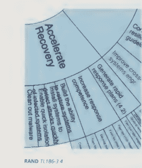

# 网络安全编程与预算框架

兰德公司是一家研究机构，致力于开发公共挑战的解决方案，帮助全球范围内的社区变得更加安全、可靠、健康和繁荣。`RAND` 是非营利、无党组织，致力于公共利益。

# 支持 RAND

在 `www.rand.org/giving/contribute` 进行可抵税额的慈善捐赠

`www.rand.org`

# 前言

美国国土安全部（`DHS`）对国家未分类网络的安全负有主要责任。为了运行，国家经济和政府日益依赖可靠且安全的网络，这使得这项任务变得越来越关键。

本研究审查了《安全网络未来蓝图》（`DHS Blueprint for a Secure Cyber Future`）中提出的能力，以及这些能力如何融入用于防御网络的广泛网络安全活动背景中。本研究建议了一种评估网络安全防御活动的方法。

本研究由国土安全部首席财务官办公室的计划、分析与评估（`PA&E`）部门赞助。它对负责网络安全（特别是国家未分类网络）的决策制定者和计划经理具有价值。

本研究建立在 `RAND` 在网络安全和计划分析领域开展的一系列广泛研究的基础上。

# 兰德国土安全与防御中心

此处报告的研究是在国土安全与防御中心（`HSD`）进行的，该中心通过分析准备并保护社区及关键基础设施受自然灾害和恐怖主义的影响。中心的项目涵盖了广泛的风险管理问题，包括海岸和边境安全、应急准备与响应、对民事当局的支持、交通安全、国内情报和技术获取。中心客户包括美国国土安全部、美国司法部以及负责安全、灾害防备、响应和恢复的其他机构。

`HSD` 是两个研究分部门的联合中心：兰德司法、基础设施与环境部门（`RAND Justice, Infrastructure, and Environment`）和兰德国家安全研究部门（`RAND National Security Research Division`）。司法、基础设施与环境部门致力于改进广泛政策领域的政策和决策，包括民事和刑事司法、基础设施保护和国土安全、交通与能源以及环境和自然资源政策。兰德国家安全研究部门为美国空军和陆军之外的所有国家安全赞助者提供研究和分析。该部门包括国防研究研究所，这是一个由联邦资助的研究开发中心，其赞助者包括国防部长办公室、联合参谋部、统一作战司令部、国防机构和美国海军。国家安全研究部门还为美国情报界和美国国防部提供研究。

# 总结

在网络空间中，黑客攻击有多种选择，防御者必须准备好应对所有可能的攻击。这些防御准备和响应涵盖了广泛的可能性。每项活动单独来看时，通常是可行的，在某些情况下也容易执行。然而，这些活动会产生成本，而且任何单一活动（或活动的子集）无法保证网络空间的安全。因此，网络安全专业人员面临着一种困境：必须从海量选项中选择一组合适的网络安全防御措施，而这种选择过程对于大多数（如果不是所有）专业人员来说，都是在利用有限资源来实施这些措施时发生的。

这种困境存在于私营部门和公共部门，包括美国国土安全部（`DHS`）。2011年，国土安全部领导层指示进行了一项广泛的部门级审查，评估其在实现保护国家防御网络章程方面面临的挑战。由此产生的报告《安全网络未来的蓝图》概述了敌对行为者、操作错误和软件设计等带来的挑战。`DHS` 蓝图识别了 75 项能力（其中 25 项为“关键”），能够增强国家网络的安全性。

将 `DHS` 蓝图作为规划和预算框架的一个挑战是，这些能力是以逐条列表的形式呈现的。这导致了若干困难：

- 缺乏能力之间的关系：很难从 `DHS` 蓝图中确定两种能力如何相互依赖或影响。
- 缺乏优先级排序：除了区分优先和非优先能力之外，`DHS` 蓝图未提供对能力优先级的机制。
- 缺失的影响：`DHS` 蓝图试图呈现一份全面的能力列表，但未能捕捉其他非能力活动的作用和影响。

在本报告中，我们解决了这些困难，并帮助解释了防御组织遭受网络攻击的行动手段。我们提供了 100 多项行动，这些行动可以作为网络防御策略的示例，并通过识别活动之间的相互关系来支持选择过程。这种方法提供了一个基础，从业者可以根据活动之间的依赖关系来分配和优先考虑活动。我们的方法与典型的网络安全指南不同，在后者中，一组活动是在顺序列表中呈现的，并不强调依赖关系——从另一个角度说，也不强调成本效益。²

我们通过分层分解来组织活动。这种分解假设任何两个直接相关的活动都可以被描述为具有父子关系。在我们的演示中，父子链接代表了两种类型的关系之一：组合关系或需求关系。在组合关系中，父活动（或通用活动）是两个或多个（特定）活动的聚合（例如，一餐饭被建模为一个父活动，它由沙拉活动、前菜活动、主菜活动和甜点活动组成）。在需求关系中，在父活动（或通用活动）发生之前必须完成（要求）一个或多个（特定）活动（例如，一餐饭可以建模为只有在购买、烹饪和上菜活动发生后才能父活动）。组合层级和需求层级的区分按需应用，并可能取决于读者对一组活动的解释；我们提出这种区分主要是为了允许一种灵活的分级结构。我们分层分解中固有的观点是所有活动都有一个父活动；在实践中，这种假设并不成立，但对于我们的目标而言，这种限制并不大。

分层分解方法适用于多种表示。我们选择太阳饼图是为了将目标置于图表中心，并将各种活动逐渐向外延伸。此外，该图表不仅显示了垂直关系（父子关系），还显示了跨分支的关系。环 0（中心）包含了我们降低攻击成本的目标³。环 1 包含了支持环 0 的策略，更通地说，环 N+1 支持环 N。图表的说明如图 1 所示¹。

每个行动的相对重要性通过其相对于同类行动的权重指示。在四个顶级策略的情况下，“中立攻击”被分配了 180 度，“加速恢复”和“增强韧性”都被分配了 70 度。这些角度旨在作为相对重要性的近似，侧重于优先级排序而非精确的资源分配（例如，“中立攻击”比“增强韧性”更重要，而后者又比“最小化支出”重要）。

我们的网络防御行动及其相应关系最初是根据作者的经验结合相关文献检索提出的假设。随后，通过涉及第三方专家评审的迭代过程来完善这些分类和关系。我们在报告中提出的关系和行动旨在说明；制定这些关系的有效方法可以通过多种方法开发（例如对特定系统的事件数据进行实证评估、需求获取或预算分析）。这种方法的价值不在于结果的精确性，而在于活动图的总体形状。此外，我们对策略的隐含优先级排序与将行动分配到策略的过程是不同的。任何特定的网络安全专家对我们图表边缘的细节持有意见，但应用这种方法仍然提供有用的见解。

需要注意的是，总之，这些行动对许多不同的社区都有价值。某些行动对于企业环境中的首席安全官（`CISO`）更为相关，而另一些行动对联邦政府的政策制定者具有相关性。我们认为本报告的内容对参与制定政策和创建网络安全策略的公共和私营部门专业人士都感兴趣。

# 致谢

作者们首先要感谢美国国土安全部的联络人 `Dana Fronczak` 和 `Aldo Prosperi`，他们使这项研究成为可能，并在工作过程中提供了有用的建议。我们还要感谢兰德学院（`RAND`）丰富的网络安全专业人士，他们在开展研究和开发方法时提供了宝贵的见解。这些网络安全专家包括 `Lily Ablon`、`Igor Mikolic-Torreira` 和 `Tim Webb`。最后，我们要感谢兰德学院的评审员 `Sasha Romanosky`、`David Senty`、`Cynthia Cook` 和 `Laura Baldwin`，他们的反馈显著提升了我们的报告。

# 缩写表

* `API` 应用程序编程接口
* `CISO` 首席信息安全官
* `CISSP` 认证信息系统安全专业人员
* `CNCI` 全面性国家网络安全倡议
* `DDOS` 分布式拒绝服务
* `DHS` 美国国土安全部
* `DHS CFO/PA&E` 美国国土安全部首席财务官/分析与评估部
* `FBI` 联邦调查局
* `FTP` 文件传输协议
* `IDS/IPS` 入侵检测系统/入侵防御系统
* `INFOCON` 信息操作态势
* `IP` 互联网协议
* `ISAC` 信息共享与分析中心
* `IT` 信息技术
* `MFA` 多因素身份认证
* `NIST` 美国国家标准与技术研究院
* `NSA` 美国国家安全局
* `NSTIC` 网络空间信任身份国家战略
* `NTP` 网络时间协议
* `PIN` 个人识别码
* `R&D` 研发
* `SCADA` 监控控制与数据采集系统
* `SPOF` 单点故障

# 第一章

# 动机

网络战爱好者（以及防御的悲观主义者）喜欢引用爱尔兰共和军成员在布莱顿的格兰德大酒店刺杀首相玛格丽特·撒切失败后给出的警告：“我们今天只是运气不好，但请记住，我们只需要一直保持幸运就好。”这一警告不仅适用于网络安全，而且从防御者的角度来看，在网络语境下可能比攻击者的处境更为严峻。其次，计算系统极其复杂（在组件集成方面），以至于许多访问点对于所有者来说都是未知的。第三（可能最重要的），计算系统是动态的，与其物理实体相比，更容易受到攻击。首先，计算系统高度连接，为攻击者提供了许多访问点。其次，计算系统是动态且不断变化的，新的安装和应用程序升级加剧了这种连接性和复杂性。网络安全专业人员永远无法休息。

结果是，在网络空间中，黑客攻击可以有多种选择，防御者必须准备好应对所有可能的攻击。考虑 2014 年 9 月公布的针对家居（`Home Depot`）的网络攻击，该攻击使用了多个攻击点来恶意入侵，包括盗取的供应商凭据、利用微软操作系统漏洞、入侵公司的销售点系统以及控制自助结账系统。为了避免此类攻击所需的防御准备和响应涵盖了广泛的可能性，包括保持软件系统更新以最大限度地减少漏洞、安装有效的工具来拦截已知攻击类型、鼓励员工和供应商使用适当的密码并教育他们防范社会工程学，以及记录活动以便于事后取证。每项活动单独来看通常是可行的，在某些情况下也容易执行。然而，不采取活动（或仅采取部分活动）的代价足以保证网络空间的安全。

鉴于此，并非所有组织都在资源充足的情况下运行，执行所有行动的前景是不现实的（甚至让人应不暇），在实践中，许多首席信息安全官（`CISO`）认为执行多项安全措施的成本是非线性增长的。因此，网络安全专业人员面临选择一组安全防御措施的困境，其总和必须根据实用性而非最优性进行选择。在这么多可能性中做出选择并非易事。

+ 1 `David Hughes`，“布莱顿炸弹：每日电报记者回忆，《每日电报》，2009 年 10 月 11 日。
+ 2 `Shelly Banjo`，“家居中心黑客泄露了 5300 万个邮箱地址，《华尔街日报》，2015 年 11 月 6 日。

# 第二章

# 网络安全规划与预算框架

作为负责保护国家非防御网络安全的联邦机构，美国国土安全部（`DHS`）也面临着制定和建议网络防御策略的这一严峻挑战。对于 `DHS` 而言，这一挑战尤为艰巨，因为 `DHS` 必须影响的网络很大程度上由私人公司拥有和运营。`DHS` 没有强制标准的权限，因此它必须很大程度上依赖于建议，鼓励提供者符合有效的安全标准，特别是一般的最佳实践。这并不是说 `DHS` 在保障国家网络安全方面没有负面影响。它拥有资源（2015 年总统预算中为 382 亿美元）、不断增长的研发（`R&D`）计划，以及对其管理的广泛使用的网络（`.gov` 域名）的网关服务的控制。2011 年，`DHS` 领导层指导进行了全面的部门审查，研究其在实施保护网络安全章程方面面临的挑战。生成的报告《安全未来蓝图》（`Blueprint for a Secure Future`）概述了敌对势力、操作错误和软件设计缺陷等挑战。`DHS` 蓝图识别了 75 项能够增强网络安全的能力（其中“关键”）。

在此前为 `DHS` 安全首席财务/计划分析与评估部（`DHS CFO/PAE`）准备的一项研究中，虽然兰德学院获得了许多有用的见解，但它没有为 `DHS CFO/PAE` 提供一个如何在竞争项目之间分配有限资源的决策分析框架。使用 `DHS` 蓝图作为规划和预算框架的一个挑战是，这些能力是以列表形式呈现的。这导致了若干困难：

- 缺乏能力间的关系：很难从 `DHS` 蓝图中确定任何两种能力如何相互依赖或相互影响。
- 缺乏优先级排序：除了优先和非优先能力的区分外，`DHS` 蓝图没有提供优先考虑能力重要性的机制。
- 信息缺失：`DHS` 蓝图试图呈现一份全面的能力列表，但非核心活动的作用和影响没有被捕捉。

在上述背景下，本报告的目的是提供一种组织用于解决这些困难的方法，并帮助解释防御组织遭受网络攻击的行动方案。尽管如此，没有任何一个组织会在没有对其需要防御的内容以及防御紧迫程度进行事先反思的情况下就投入这种方法的。例如，如果我的网络中有信息，我能承受得起损失吗？哪些是我承受不起损失的？丢失信息的后果是什么——我的声誉是否受到影响、我的新产品上市能力如何、员工的隐私如何？谁可能对此感兴趣？为什么？多多严重？

> 3 `U.S. Department of Homeland Security, Blueprint for a Secure Cyber Future: The Cybersecurity Strategy for the Homeland Security Enterprise, Washington, D.C., 2014.`

为了获得目标，他们愿意承担多大的风险？如果我有需要执行的操作，这些操作的时间紧迫性如何？安全程序将如何影响这些期限的实现？我在调整操作方面有多大的弹性？如果操作停止，我将承担什么样的法律或合同责任？谁可能对停止此类操作感兴趣？理解安全风险以及最小化这些风险所需的程序是网络安全的先决条件（`sine qua non`）——这一点怎么强调都不为过。只有在提出此类问题之后，组织才能确定需要保护什么、如何保护以及使用什么工具。

## 核心概念

在本报告中，我们展示了超过 100 种可以作为网络防御策略元素的行动。如上所述，并非所有活动都需要被采用，也不是所有活动都同等重要；任何负责管理安全计算系统的组织都必须进行挑选。我们认为，支持这一选择过程的一个重要环节是考虑活动之间的相互关系。这里的关键点在于，网络安全活动很难孤立地进行评估，因为任何活动的执行都会影响另一组活动的效能。我们的方法提供了一个基础，使从业人员能够根据活动之间的依赖关系来分配和优先考虑活动。我们的方法与典型的网络安全指南不同，后者通常在顺序列表中呈现一组活动，而没有强调依赖关系——或者说强调成本效益。

我们通过分层分解来组织这些关系。这种分解假设任何两个直接相关的活动都可以被描述为具有父子关系。在我们的演示中，父子链接代表两种类型的关系之一：组合（`composition`）或请求（`requisition`）。在组合关系中，父级（或通用）活动是两个或多个子级（特定）活动的聚合（例如，一顿饭可以建模为父活动，由沙拉活动、前活动、主菜活动和甜点活动组成）。在请求关系中，在父级（或通用）活动发生之前，必须完成一个或多个子级（特定）活动（*要求*）（例如，一顿饭可以建模为父活动，只有在购买、烹饪和供应食物的活动发生后才能进行）。组合层次与请求层级之间的区别可以根据需要应用，并可能取决于读者对一组活动的解释；我们提出这种区别主要是为了允许建立灵活的层级模型。我们分层分解中固有的观点是，所有子活动只有一个父活动；在实践中，这一假设在网络安全背景下并不成立，但为了我们的阐述目的，这种限制并没有太大的限制。

## 网络安全规划与预算框架

不应仅仅简化为组件。在下文中，人们将看到一些通用行动，其实现意义超过其前提条件或组件的总和。

分层分解方法适用于多种方式的表示。我们选择了太阳射线图（`sunburst graph`），以便将总目标放在图表中心，并将各种行动成功地放置远离中心。此外，图表不仅显示了垂直关系（父子关系），还显示了跨分支的关系。太阳射线图形成了范围排列。环 0（图表中心）包含了我们降低网络攻击成本的总目标。环 1 由保护环 0 的策略组成，而且环 N+1 支持环 N。网络太阳射线图的插图见图 2.1。

每个活动的相对重要性通过活动楔相对于同级节点（同一活动的其他子活动）的角度来指示。角度较大的楔被认为比同一环上角度较小的楔更重要；例如，如图 2.2 所示，“消除攻击”的角度比“增加韧性”大，因此被认为是一种更具防御性的策略。这些角度为考虑的一系列网络安全活动的资源分配提供了基础，并本质上在太阳射线图中表示。图中所示的角度遵循相对重要性的近似值的原则，侧重于优先级排序而非精确性。

我们的网络防御行动集及相应的关系最初是基于作者经验结合相关文献综述得出的假设。然而，随后的迭代过程有助于精炼枚举和关系。这种方法的价值不在于结果的精确性，而在于网络防御活动结构及其相互连接的底层逻辑。任何网络安全专家可能对图表边缘的细节产生异议（某些意见可能取决于部门），但应用这种方法仍将提供有用的见解。更重要的是，我们的方法不取决于本报告章节中提出的特定活动列表，也不取决于活动的相对大小。我们的方法提供了一个基础，使从业人员能够根据活动之间的依赖关系来分配和优先考虑活动。我们的方法与典型的网络安全指南不同，后者通常在顺序列表中呈现一组活动，而没有强调依赖关系——或者说强调成本效益。

联邦政府。我们相信本报告中提出的策略和行动会对公共和私营部门专业人士感兴趣。

### 目标：降低网络攻击的预期成本

图 2.1 网络太阳射线图

`(img/c2d4b10a7f527c659ee1a33fec04d8_24.png)` [注：图像占位符]

我们认为网络安全有一个总目标：降低网络攻击的预期成本。这个目标包含了几个假设。首先，我们使用“成本”是指影响，并以准货币化的方式表示；在某些情况下，网络攻击会导致涉及劳动力和/或计算资源的显性货币成本，而在另一些情况下，成本是不那么具象的（例如，军事影响不一定还原为美元和分）。事实上，许多风险（即使对于企业而言）也是难以捕捉的。组织将声誉损失视为一种成本。国家可能会衡量隐私的减少或国家安全风险的增加。其次，我们使用的“预期”成本包含了低概率、高影响事件的风险，例如对电网的网络攻击或军事失败。这些与由于更常见的网络攻击（如网络恐怖主义）产生的日常成本形成对比。第三，即使是已经发生的网络攻击，其许多成本也是未知的，且在今天是不可知的。如果一家美国公司的知识产权被盗（例如被中国公司盗），其在全球市场的份额可能不会因为中国产品的竞争而减少，直到几年之后，如果那时的话）。我们意识到网络攻击可以产生许多影响。有些影响机密性；有些影响完整性；仍然影响可用性。

### 网络安全规划与预算框架

图 2.2 基本策略

`(img/c2d4b10a7f527c659ee1a33fec04d8_25.png)` [注：图像占位符]

下所要求的许多行动可能不适用于所有三种类型的攻击。恢复和韧性行动，对应两种响应方式，与针对可用性的攻击（停电）或针对机密性的攻击（许多攻击在事实上才被发现）或完整性的攻击（同样地）更为相关。最后，我们假设降低网络攻击成本发生在利用最适合当前企业的软件背景下；我们假设用户在降低网络攻击成本的同时，仍然利用现代技术的好处。


> Chad Pertin，“CIA 三元组，”TechRepublic.com 博客, 2008年6月30日.

# 第一圈：四种基本策略

我们的行动`set`被分为四种基本策略，这些策略支持降低网络攻击预期成本的目标，如图所示：

- 最小化暴露。

- 中性化攻击。

- 增强韧性。

- 加速恢复。

尽管这四种策略旨在保持完整且互不区别，但在实践中它们存在重叠。例如，虽然韧性限制了攻击的损害并缩短了损害持续时间，但实例恢复等行动可能被视为这两者的共同部分。如图 2.2 中四种顶层策略的角度所示，“中性化攻击”被分配了 180 度角，“加速恢复”被分配了 40 度角，而“最小化暴露”和“增强韧性”均分配了 70 度角。这些角度旨在作为相对重要性的近似，侧重于优先顺序排序而非精确的资源分配（即“中性化攻击”比“加速恢复”更重要）。以下是策略的简要定义：

- **最小化暴露**：系统的脆弱性取决于他人访问它们的程度，而其数据被访问或损坏的程度取决于此类数据在系统中的存在性。此行动包含两个部分：减少系统与世界其他部分之间的连接（包括内部人员对系统元素的访问），以及减少通过系统可以访问的信息和计算过程（例如软件程序和可执行文件）。在某些情况下，切断系统内部的链接可以限制攻击的损害，使网络中一个被攻破的节点难以进一步攻破其他节点。

- **中性化攻击**：这同样是一个双重行动：尽可能防止攻击发生，并减少已经发生的攻击的影响。这种双重性对应于防止感染获得`foothold`的人员与在感染发生后击败感染的人员之间的分工。

- **增强韧性**：韧性与组织在系统降级的情况下继续执行更广泛功能有关。它源于冗余与放弃某些支持功能（例如重新安排日程）的结合。它也存在于局部故障演变为系统性故障之前管理它们的能力。韧性倾向于涵盖短期的缺口（即在不进行恢复的情况下克服短缺的能力，这正是需要被受攻击能力的原因）。

- **加速恢复**：恢复适用于正遭受攻击的系统（而非它们支持的功能）；它通过修复和替换来运作。它适用于针对可用性的攻击（可能与损坏有关，以恢复原始创建的数据或过程），以及在较小程度上适用于机密性（恢复此前对数据安全的信心）。

请注意，所有四种行动必须由受攻击或面临威胁的组织执行或至少代表其执行。政府在执行这四种行动的任何方面的权力有限，但正如下面许多处描述的，它能够支持或在某些情况下强制执行这些通用行动的特定行动。

> 6 Robert Lemos, "NSA Attempting to Design Crack-Proof Computer," ZDNet.com, February 1, 2001. 

> 7 Kish S. Trivedi, Dong Seung Kim, and Rahul Ghosh, "Resilience in Systems and Networks," presented at 2009 IEEE/ACM International Conference on Computer-Aided Design Digital of Technical Papers, November 2009.

> 8 Cisco Systems, Inc., "Disaster Recovery: Best Practices," white paper, 2008.

# 我们方法的基础

我们的方法基于 20 世纪 80 年代后期开发的“策略到任务”分解方法论。策略到任务框架提供了宏观目标（策略）与战术执行层面的操作活动（任务）之间的联系。该框架将活动明确拆分为能够实现策略成功执行的功能性任务，并强调了任务之间的相互关系。策略到任务框架采用了层次结构，使得每个任务随后可以被忽略。

## 14 网络安全规划与预算框架

减少联网机器的数量：可以通过互联网访问的设备越少，组织的受攻击面就越小。替代方案包括将此类设备设为特定机器的本地设备（例如，仅连接到一台计算机的打印机），或使其仅在本地访问而非全局访问。包含本质上敏感资产的机器应断开连接以实现“物理隔离”（`air-gapping`）。物理隔离系统是指不实时连接到互联网和/或电话系统（或其他系统）的系统。严格的物理隔离系统是指没有间歇连接（例如通过优存盘）和近距离通信（例如通过蓝牙、Wi-Fi）的系统。首席安全官（CISO）会提到通过虚拟物理隔离来实现相同的安全水平（例如，两个系统之间通过互联网进行加密流量的连接），但虚拟物理隔离的安全性取决于所需协议的安全性。

减少联网机器上的网络访问点数量：可网络访问的计算机包含多个可以提供外部访问的资源（虚拟端口、应用程序、服务）。示例包括文件传输协议（FTP）和网络应用程序服务。此活动限制了这些访问点。反例是一个暴露在互联网上并开放所有端口的联网打印机（例如，攻击者可以 `Telnet` 登录它）。该活动的变体涉及为重要的网络应用使用非标准端口（例如，将 SSH [安全外壳] 配置为 22 以外的 TCP [传输控制协议]端口）。

减少联网机器上的计算资源：当外部攻击者获取计算机节点访问时，那些计算资源就会成为黑客扩展范围的访问点。在受控机器上进行的任何漏洞利用过程都是潜在风险。可被利用的进程越少、机器之间交换的合法命令越少，对机器发动外部（或内部）攻击就越困难，利用受感染机器作为感染其他机器的平台也越困难。相关策略是减少可被利用机器上的物理资源（例如处理器、内存）。瘦客户端机器的内部处理通常比桌面机器更少。例如，许多组织正在用平板电脑替换桌面机器，因为额外的资源和成本是没有必要的；作为副作用，相应的网络安全风险也随之减少。这种减少攻击面的方法还符合著名的网络安全原则——“最小权限”，该原则规定在任何给定时刻，计算机系统中的每个用户或进程都应该只能访问该用户工作必需的信息和资源。

减少联网机器上的敏感数据量：敏感数据包括个人身份信息以及一旦被未经授权访问就会构成威胁的组织战略信息。通过将此类数据放置在与互联网（以及潜在的内部恶意人员）更隔离的机器上，可以实现减少暴露。也可以通过从根本上收集某些数据（或收集但不进行数字化）来实现。

> J. H. Salt and M. D. Schroeder, “The Protection of Information in Computer Systems,” Proceedings of the IEEE, Vol. 63, No. 9, September 1975, p. 1278–1308; 参见 http://en.wikipedia.org/wiki/Principle_of_least_privilege。

## 第二环：中和攻击

偏转和击败攻击的挑战既是最小化网络攻击预期成本任务的核心，也是更通用行动所包含的最多且多样化的特定行动（更准确地说是行动类别）的来源。因此，Cyberburst 图识别出以下行动，共同涵盖了保护系统免受攻击所需的各种努力：

- 减少网络攻击的尝试次数。

- 针对特定的已知威胁开发缓解措施。

- 阻止网络攻击。

- 确保网络中软件和硬件组件的质量。

- 系统地减少网络中固有的风险。

- 提高系统管理相关的安全能力。

- 针对模拟攻击测试系统防御。

- 减少攻击中渗透的材料量。

- 增加分布式拒绝服务（DDOS）防御。

- 应对内部威胁。

Cyberburst 图的这部分如图 3.2 所示。上述许多许多行动（前八项）与操作卫生有关，因为它们涉及预防性的最佳实践，可以最大限度地减少攻击者利用计算系统的能力。一个未采取这些措施的管理不当的系统将成为易猎物。相比之下，DDoS 和内部威胁防御无论组织的计算最佳实践如何，都是必须的。读者还应被提醒，这些行动是中和攻击的尝试；无法保证这些行动会成功。

*减少网络攻击的次数：* 此行动针对黑客运行的操作环境，并超出了单一组织的限制。减少黑客攻击的动机和黑客的可用性很少是 CISO 的责任，因为这涉及与起诉和威慑相关的公共政策。CISO 可以通过说服黑客攻击其组织将带来巨大的挫败感（通过拒绝来实现威慑）或风险（例如，通过反击）来做出贡献。

*针对特定的已知威胁开发缓解措施：* 此行动从特定威胁的信息开始。这些缓解措施支持防御的各种元素，例如对恶意数据包进行沙箱化（例如，通过为入侵/防御系统开发新签名）或应对正在进行的攻击（例如，通过检测来自特定威胁的攻击特征的网络行为）。²

*阻止网络攻击：* 此行动试图防止攻击在网络中立足。这些防御可能发生在组织的边界（例如，在防火墙处）或客户端设备上。这些防御包括自动检测/清除和用户辅助防御（例如，不点击可疑的链接）。

> ² 在网络安全背景下，对一段代码进行沙箱化是在受限环境中执行它，在该环境中它可以交互的资源是有限的，且损害可以被控制。更多信息，请参见 https://en.wikipedia.org/wiki/Sandbox_(computer_security)。

## 第三环：增强韧性

增强韧性涉及准备组织，以便在网络攻击者成功时受影响最小。它由以下更具体的行动支持：

- 采取（特定的）韧性步骤。

- 符合韧性指南。

- 改进跨系统工程。

**采取韧性步骤**：这结合了许多特定步骤（在接下来的环路中列出）。这一特定的通用行动是由特定行动组成的容器示例——而不是某种无法发生，或者在特定行动发生之前无法发生或无法有效发生的事物。

**符合韧性指南**：此行动假设已经开发了相关指南用以影响和引导韧性行动。此行动强调了确定组织所采取的行动与此类指南保持一致并足以满足此类指南的重要性。

**改进跨系统工程**：韧性的一个重要要素是管理跨系统依赖关系，最大限度地减少一个子系统的故障传播到其他子系统的概率，并减少单点故障（以及共模态故障）。

## 环 2：加速恢复

虽然从网络攻击中恢复的速度只有在攻击发生后才能知道，且关键取决于恢复阶段的努力，但经验（特别是针对其他系统故障源的经验）表明，在攻击之前的许多行动可以加快恢复速度并降低恢复成本。因此，如果组织采取以下特定行动，就可以促进加速恢复这一通用行动的实现：

- *制定快速响应计划。*

- 提高响应能力。

- 构建恢复系统的能力。

- 安装快速检测攻击的系统。

- 开发快速隔离受感染系统的方法。

- 清除系统中的恶意软件。

网络 Subhorst 图的这部分如图 3.4 所示。

图 3.4

带有行动的“加速恢复”策略



**制定快速响应计划**：为了做出响应，有一个计划是有帮助的；为了快速响应，有一个能够迅速动员活动的计划是有帮助的。此行动反映了一种预期：快速响应计划可以被写下来、发布并由外部人员进行评估。

**提高能力**：这是响应中的人员管理部分。它要求拥有具备所需决策权以及足够知识和培训的胜任人员。

**构建恢复系统的能力**：恢复系统的能力在某种程度上取决于系统恢复到其之前配置的能力（无论为了防止快速灾难需要哪些特征）。正如系统可以设计得使得维修变得更容易或更困难（例如，火花塞是否易于触及？），系统也可以为了更快速或更慢的恢复而构建。

**安装快速检测攻击的系统**：这种恢复方法专门针对网络攻击（因为攻击是有目的地进行的，或者至少以概率速率扩散），检测得越快（假设其是有目的地进行的或至少以概率速率扩散），停止得越快，相应对可用性或系统本身的损害就越小。注意，这是特定能力的一种特殊情况，该能力也可以支持减少网络攻击频率和后果的零环目标。

**开发快速隔离受感染系统的方法**：这种特定能力假设相关攻击已被检测。鉴于对非瞬时发生的攻击的检测和充分表征，允许解耦的方法可以实现故障隔离，反过来限制了恢复过程所依据的受损基准。

**清除系统中的恶意软件**：恢复阶段的一个关键方面（再次，专门针对网络攻击）是确保任何导致系统崩溃的因素都不会出现在网络中以重复该行为。清理阶段有时比系统性地恢复功能所需的时间长，但它通常会导致期间性能下降，因为网络连接受到限制，以确保清理期间防止再次感染。

## 环 3

在考虑环路 1 的四个行动（加速恢复、提高韧性、最小化暴露和中和攻击）时，中和攻击与网络安全唯一相关；而韧性、恢复和（程度稍低的）暴露最小化都是可能为了除网络安全之外的其他原因而采取的行动，例如为停电或自然灾害做准备。我们的工作是受网络安全驱动的（而不是系统管理），我们对阻止攻击的特定行动有更多细节。此外，暴露控制、恢复和韧性项下的许多特定行动取决于被防御系统的具体细节，因此未显示。相比之下，特定于网络安全的行动可以跨系统泛化（部分是因为许多软件是标准化的）。

因此，当人们从网络旭日图（Cyber Sunburst Graph）中心外移动时，遇到的更多行动将是中和攻击行动的后代。此外，由于中和攻击的切实性和紧迫性，相应的父子关系由行动-前提链接（一个通用行动需要特定行动）主导，而不是组合关系（一个通用行动由许多特定行动组成）。由于这些原因，我们通过深度优先搜索顺序展示环 3 的行动，而不是环 2 的广度优先搜索方法。

## 环 3：韧性 $\rightarrow$ 采取韧性步骤

“采取韧性步骤”下的附属行动列举如下：

- *韧性* 采取韧性步骤 $\rightarrow$ 添加通道：冗余通信通道允许组织在主通信通道遭受网络攻击时仍能运行（尽管服务水平有所降低）。注意，冗余可能会受到影响。许多进入同一个路由器或通过公共物理管道的连接对于上游攻击几乎没有冗余性。

- *韧性* 采取韧性步骤 $\rightarrow$ 开发优先处理通信的程序：美国军事组织开发了 `MINIMIZE`（正式名称）程序，以确保在通道受限时，关键信息优先于非关键信息。

> 1 Partnership for Disaster Resilience, Post-Disaster Recovery Planning Forum: How-To Guide, 2007.

> 2 “Depth First vs. Breadth First,” Github.com, 2012.

缺乏足够通道的组织可能会采取类似的措施。

- *韧性* 采取韧性步骤 $\rightarrow$ 创建备用电源：电电力是一切一切的基础，大多数 IT 电力由持续电源提供（注意，即使是电池供电的系统，为了给电池充电，也对持续电源有间接依赖）。因此，对组织电源供应的威胁很少发生，一旦发生，很少有做好准备的组织能够运行。在此行动下有两个特定行动：

- 安装备用电源。

- 练习使用备用电源。

测试备用电源的操作和使用的重要性再怎么强调也不过。在《常态事故》（Normal Accidents）中最强有力的信息之一是，备用的存在限制了灾难概率的假设是如何频繁被备用能力的失效所违反的而这些能力推测从未被使用过，因为它们，

> 3 Charles Perrow, Normal Accidents: Living with High-Risk Technologies. 

- *采取韧性步骤* $\rightarrow$ 根据需要创建复制资产：此行动是上述行动的更通用版本。它可能指的是物理通道、办公设备、机械等。

- *采取韧性步骤* $\rightarrow$ 开发并使用不可删除备份：备份数据是组织在面对灾难时保持业务连续性采取的最基本的步骤之一。许多组织投入了大量资源来确保在任何给定点，备份都是与其使用的主文件的精确副本。对“不可删除”的强调是为了防止旨在删除（或更改）历史记录的潜在网络攻击。在实践中，这引发了如何保护或至少最小化在归档之前存储信息的电子缓冲区的问题。

- *采取韧性步骤* $\rightarrow$ 使易于切断性能的子系统：危险在于受攻击的系统可能会开始向其他系统发送数据，其数量或质量会对这些系统产生风险。切断这些通信（或直接将此类系统下线）的能力可以为级联故障提供某些隔离。

- *采取韧性步骤* $\rightarrow$ 记录理解步骤的原理：此类文档有助于评估（如果理解了步骤的原理，就可以根据底层条件修改这些步骤）、培训以及建立管理或更改硬件软件的基准。

- 韧性 $\rightarrow$ 符合韧性指南 $\rightarrow$ 编写韧性标准涉及开发关于哪些行动最好（或最具成本效益）促进韧性的知识-

……性，并就这些知识在推荐实践方面的指示达成充分的共识。这一行动在《国土安全部蓝图》（DHS Blueprint）中列为能力 3.3。

- 韧性 $\rightarrow$ 遵循韧性指南 $\rightarrow$ 对工程师进行韧性标准教育，包括以下步骤：将韧性知识纳入工程课程、毕业后对韧性知识进行孵化（其中大部分是特定于组织的），并确保在做出工程选择时考虑到韧性。虽然组织负责后者，但前者的行动由外部机构（例如大学）执行。

- 韧性 $\rightarrow$ 遵循韧性指南 $\rightarrow$ 按照韧性标准进行审计：此行动在《国土安全部蓝图》3.5中列出。它假设此类标准的存在；一种衡量此类标准的方法；一套用于开展审计的学说、实践和规范；对处理此类审计结果的预期——当然，还有审计员本身。

# 第 3 环：韧性 $\rightarrow$ 改进跨系统工程

- 韧性 $\rightarrow$ 改进跨系统工程 $\rightarrow$ 最小化系统级联故障：为了最小化级联故障而进行的工程是系统设计、架构和管理的核心宗旨。在某些情况下，它可能需要对最初设计时未充分考虑风险（如网络攻击）的系统进行分析和重新工程。在此行动下包含若干针对单点故障（SPOFs）的具体行动——这些功能的故障将预示着整个系统的故障：

- 理解可能产生单点故障的潜在级联效应。

- 消除 SPOF：此行动限制了东西损坏时可能造成的损害。消除行动又需要两个步骤：

  - 寻找 SPOF：熟悉系统以找到系统中每个可能损害整个系统的特征既回报又困难。2003 年东北部停电加强了在北美电网内寻找 SPOF 的努力，但 2009 年袭击西南部的停电说明了正确执行这一操作的困难性。理解可能产生单点故障的潜在级联效应是《国土安全部蓝图》能力 3.1。

  - 缓解 SPOF：消除 SPOF 是消除此类故障的常用方法（前提是有充分的程序来启动备用容量，例如，如果子系统未能交付，接收方操作默认执行更合理的动作集）。

- 韧性 $\rightarrow$ 改进跨系统工程 $\rightarrow$ 避免软件中的共模故障：冗余也可以扩展到软件层，使得对一个操作系统的攻击在大多数系统崩溃时仍留一些运行。⁵ 只有当多个协议带来的安全收益未被管理异构系统相关的额外不安全性所抵消时，才建议这样做。在此行动下执行两个特定行动：

- 开发创建软件多样性的方法：组织可以刻意实现软件的多样化。然而，很少（如果有的）组织能够改变 IT 世界向单一主导软件供应商收敛的基本趋势。此行动是《国土安全部蓝图》9.4，可能是政府的任务（各国政府共同努力）。在此行动下有一个更具体的行动：


寻求替代软件架构：这涉及积极为特定应用程序寻找主流产品的替代方案。这些通常是开源产品，具有特定的安全优势（它们往往更简单，攻击面更小，并且对于偏好更高安全的用户是可以自定义的）和缺点（例如 `Heartbleed` 漏洞）。

创建促进异构软件顺利使用的标准：标准的角色是允许异构软件应用通过使用专用数据标准、`API`（应用程序编程接口）和通信协议，以与同构软件应用相同的方式运行。开发标准的工作如上所述，涉及编写良好的标准、获得批准，然后说服足够的开发者采用它，即使仅是作为其专用协议的一个选项。

## 第 3 环：恢复 $  
ightarrow$ 生成快速响应计划

- 生成快速响应计划：起草快速响应计划是组织的责任（而不是一种可以标准化的或强制执行的东西）。它将特定的突发情况与特定的恢复行动相关起来，并在大型组织中指明谁对什么行动承担什么责任（而不是详细说明需要执行哪些行动）。

- 生成快速响应计划 $  
ightarrow$ 建立快速恢复的伙伴关系：建立快速恢复的伙伴关系是发生在组织之间的事情。这些伙伴关系可以是纵的：组织可以与其供应商建立应急安排（并可以为客户的管理和预期提供替代方案）。它们也可以是水平的，例如共享安排并共同工作分配资源并在紧急情况下相互覆盖对方的客户。这是《国土安全部蓝图》能力 4.3。

- 生成快速响应计划 $  
ightarrow$ 开发符合标准的修复计划：每份计划都将特定于组织，但可能会受到广泛认可的最佳实践的影响。这是《国土安全部蓝图》能力 4.2。

> ⁵ 参见例如，Daniel Geer, Rebecca Bae, Peter Guttmann, Petr Metrger, Charles Pleeeger, John S. Quarterman and Bruce Schneider，“Cybersecurity: The Cost of Monopoly,” Computer and Communications Industry Association Report, 2003年9月。

> ⁶ 例如，用 `Foxit` 作为 `Adobe` 产品的替代品。

- 恢复生成快速响应计划 $  
ightarrow$ 演练快速响应计划：组织将开发假设网络攻击及其对系统影响的练习，然后执行推荐的恢复操作。这些练习可以是桌面演练，也可以是真实的。与此类计划相关的特定行动是评估组织的准备情况并进行适当的修复。这是《国土安全部蓝图》能力 5.4。

## 第 3 环：恢复 $  
ightarrow$ 提升能力

- 恢复提升响应能力 $  
ightarrow$ 在部门内进行危机响应：此行动的价值（《国土安全部蓝图》能力 5.2）假设在单个组织内进行的响应并不代表真实情况的行为，因为其假设可能是乐观的（如果被认为充足的资源被其他组织占用，则可能会有限）或者是悲观的（资源可能从其他组织获取）。参与者的响应演练允许好想法在组织之间传播。

- 提升能力 $  
ightarrow$ 跨部门进行危机响应：此《国土安全部蓝图》能力 5.1 可以帮助跨部门演练让组织更好地了解如果演练仅限于部门内部，他们将如何应对。尚待确定何种合理的网络攻击场景会导致组织之间不共享信息，或者最糟糕的是影响公用设施（产生重大的下游影响）。

- 提升能力 $  
ightarrow$ 开发业务连续性计划：开发业务连续性计划是一个有助于韧性（如“连续性”所暗示）和恢复（如果短期中断是可以接受的）的特定元素。这些计划定义了核心业务功能，允许在紧急情况下偏离这些功能，并使用替代能力恢复这些功能的计划。这是《国土安全部蓝图》能力 5.3。

- 恢复提升能力 $  
ightarrow$ 培训应急人员：恢复的一个重要因素是防止情况立即恶化。应急人员是防止由于导致物理服务（例如天然气）拒绝或导致破坏（例如被黑客攻击的化学工厂引发大火）的网络攻击过度的重要因素。

## 第 3 环：恢复 $  
ightarrow$ 构建恢复系统的能力

- 恢复构建恢复系统的能力 $  
ightarrow$ 创建优先级计划：优先级计划将识别哪些数据（或数据流）对业务连续性至关重要，并确保危机期间能够持续访问这些数据（流）。

4 联邦监管委员会和北美电力可靠性协会，“2011年9月8日亚利桑那州-南部加州停电: 原因与建议，”2012年4月。

## 第三环：暴露 → 减少网络化机器的数量

虽然确定了四项构成最小化不必要暴露的子行动，但仅针对其中一项确定了更具体的行动：减少网络化机器的数量。该行动的子项目列举如下：

- 暴露减少网络化机器的数量 → 减少可寻址机器的数量：我们区分两类机器：一类是因为连接到可以直接寻址的机器而被访问的机器（例如连接在个人电脑上的打印机），另一类是因为其可以直接寻址而被访问的机器（例如具有互联网协议 [`IP`] 的网络打印机）。尽管间接可寻址机器仍然面临风险（例如，计算机可能通过网络攻击被破坏，从而被命令向打印机发送有害指令，导致打印机损坏），但移除直接寻址可以减少打印机被攻击的途径（即其攻击面）。

- 暴露减少网络化机器的数量 → 确定哪些系统应该隔离：这是一项分析性功能，需要在风险与不允许网络机器或外部世界访问系统所带来的成本和不便之间进行权衡。需要进一步分析以确定虚拟隔离（例如加密隔离，允许通过其他网络建立通信链路）与物理隔离之间的权衡，以及间歇访问（例如通过可移动介质）或射频访问的策略（从而理解需要守卫多大的物理边界）。

- 暴露减少网络化机器的数量 → 根据此项决定对系统进行隔离：在许多情况下，这涉及到断开之前连接的系统（或对之前未加密的进行加密等）。

- 暴露减少网络化机器的数量 → 测试隔离：许多组织错误地认为自己的系统是隔离的，要么是因为他们没有彻底理解隔离的含义，要么是因为存在未记录的连接导致它们可以被访问。确保隔离需要对潜在的访问方法进行反复测试，以确定隔离程度符合隔离策略。`Shodan` (`www.shodan.com`) 就是实现此目的工具之一。

- 测试隔离的工具：前提是获取和/或开发测试隔离的工具。组织可以决定购买或不，但如果必须开发工具，通常由外部供应商来完成；此类开发必须得到政府研发和/或采购政策的鼓励。

请注意，上述关于开发的陈述适用于任何能力的开发，对于下文的能力将不再显式重复。

## 第三环：中和攻击 → 减少网络攻击尝试的次数

如图所示，有十项行动属于中和攻击这一总行动。所有行动都有其子行动。减少黑客的数量涉及三项子行动：

- *中和攻击 → 减少网络攻击尝试的次数 → 减少黑客的数量* 此项行动假设，能够黑客的人越少，来自黑客的威胁就越低。可以通过两种方式使黑客失效：

    - *为潜在黑客寻找工作*，特别是（但不限于）网络安全领域，可以满足许多黑客的收入和心理需求，并可能减少他们的非法黑客行为。例如，冷战后，西方试图雇佣苏联科学家以防止后者作乱（特别是让他们远离潜在的核国家）。替代性工作的效率仍有待观察，潜在的雇主必须小心，不要因雇佣他们而使自己陷入风险。

    - *起诉网络犯罪*：通过起诉获得的限制手段（DHS 蓝图能力 1.2）包括监禁、替代性机构化或具有足够限制性的假释。起诉本身也有其副作用。这项行动影响（并因此是）“减少黑客数量”和“减少黑客动机”的子项。

    - *调查网络犯罪*：网络犯罪的调查（DHS 蓝图能力 4.4）目前由 `FBI`、美国秘密警局以及某些情况下由州和地方官员执行。它涉及常用的执法方法并有几个前提：

        - *寻找合格的调查员*在很大程度上是寻找和培训合适人员的问题。

        - *开发调查工具*在很大程度上取决于由政府或其供应商开发（私营部门对为了表征攻击及其如何逃避组织防御的取证有一定兴趣，但对身份溯源的兴趣较小）。

        - *收集计算机取证*，反过来取决于说服系统所有者允许从其系统中收集证据。在美国，说服更容易，因为组织日益意识到它们在黑客攻击中面临的风险（`FBI` 如果有线索，可以出具传票获取证据，在目标不配合时汇合案件会更困难，而且 `FBI` 拥有大量未积压的网络犯罪案件，因此他们有权选择起诉哪一个）。然而，在海外，合作的可能性较小，在俄罗斯或中国等地方极不可能。

- *捕获黑客*：一旦黑客通过姓名（而非在线代号）被识别，在美国捕获黑客是直接的，但在大多数国家困难得多，在俄罗斯或中国则是不可能的（媒体引用的中没有人认为 2014 年 5 月被美国起诉的少数人民解放军成员会出现在美国法庭上）。因此，前提是说服其他国家允许其公民因网络犯罪受到制裁。

- *中和攻击 → 减少网络攻击尝试的次数 减少反击动机*：该行动旨在通过增加与黑客相关的风险，对黑客的“去/留”决策产生影响（减少黑客收益通常是为降低被攻击或可能被攻击组织的成本而所做努力的副作用）。与此行动相关的前提包括：

    - 执行网络犯罪：上文已涵盖。

    - 在黑客中培养伦理，这可能是加入伦理课（特别是高中，以及计算机专业的大学课程）所想要达到的。

    - 让黑客的系统面临风险是“反击攻击”（`hack-backs`）的动机之一（尽管它也可以用于起诉）。反击攻击的概念是，如果黑客——至少是他们的成员——因为黑客行为而面临风险，他们中的一些人（特别是那些不严重的）将重新计算黑客的成本效益，从而放弃。首席安全官（`CSO`）授权此类活动更合理的动机是减少黑客对较危险潜在目标的注意力。没有组织承认进行反击攻击，但有传言组织仍在这样做。

    - 编写便利反击的法律使得“让黑客系统面临风险”的总行动成为可能。

    - 针对犯罪/网络犯罪市场采取行动：网络犯罪市场创建了黑客购买工具和出售工具而无需获取计算机知识的通道。此行动承认了这些市场和通道的增长并对其采取行动。

- *中和攻击 → 减少网络攻击尝试的次数 发现后先发攻击*：在发现后先发攻击假设攻击信号足够足以允许其被中断。这通常是政府的功能，因为其拥有情报能力，尽管一些私营组织也承担部分工作。

### 第3环：中化攻击 $  
ightarrow$ 应对内部威胁

- 中化攻击 $  
ightarrow$ 应对内部威胁 $  
ightarrow$ 物理上保护计算空间：此行动假设黑客位于机器本身或其附近，或者在机器上或附近构建或损坏了设备¹¹¹。必须阻断多条路径。这样做可以防止黑客进入物理边界，防止违规设备进入射频边界¹¹²，并管理供应链，以防止违规设备替换未受损的设备（供应链管理将在后文中讨论）。

- 中化攻击 $  
ightarrow$ 应对内部威胁 $  
ightarrow$ 减少员工攻击：此行动针对的是采取违规的授权用户（无意内部人员的行为是另一回事，将在后文中讨论），或者至少在系统中获取了他们不拥有的权限。除了之前在减少暴露范围内涵盖的行动（例如，最小权限原则）外，促进减少内部攻击的具体行动包括：

    * 审查员工：组织将对员工（包括所有拥有系统权限的人员）进行审查，以确保他们不会为了利益、恐惧（例如勒索）或意识形态而产生作剧。安全审查程序本应由政府执行此工作（要求关键基础设施工作人员通过安全审查的理念时时会出现一次）。

    * 向员工灌输组织价值观：向员工灌输组织价值观的过程是为了提醒他们，为什么通过破坏他们所使用的网络来背叛组织是极其重要的（这种灌输可能对防止无意员工的渗透也有用，例如防止访问恶意网站可能发生的情况）。

    * 监控员工：组织出于多种原因必须对员工进行监控，以确保他们没有参与网络攻击。其目的之一是判断员工的每一个看似无害的行为，合在一起是否无法解释，除非该员工正在追求其他目的。例如，`FBI` 的监控系统记录了对其中央计算机系统的访问请求，如果 `FBI` 能更勤奋地分析监控系统收集的数据，本可以抓到罗伯特·汉森（`Robert Hansen`）。

    * 强制休假和/或轮岗：此行动允许其他人在个人临时或永久缺席的情况下检查记录这起源于银行业的惯常做法（防范挪用），其相关性依然存在。

- 攻击 $  
ightarrow$ 应对内部威胁 $  
ightarrow$ 限制承包商权限：除了避免员工行为的步骤外，还可以针对为组织工作的承包商采取措施。

> ¹¹ David E. Sanger and Thom Shaker, 'N.S.A. Devises Pathway into Computers,' *New York Times*, January 14, 2014.

> ¹² 这是信号可以从网络截获或注入的距离。请注意，该边界不是固定的。具有强大发射器/或天线的违规设备可以在更远的地方运行。这种威胁可以通过链路间加密来缓解。

### 第3环：中化攻击 $  
ightarrow$ 针对特定已知威胁开发缓解措施

- 中化攻击 $  
ightarrow$ 针对特定已知威胁开发缓解措施 $  
ightarrow$ 开发识别和表征黑客的方法：识别特定身份有助于攻击前的过滤（例如，通过创建入侵检测系统可以签名来拦截可疑输入，如电子邮件或网页）。它还可以识别攻击发生后的攻击痕迹。这是 DHS 蓝图（`Blueprint`）的 2.3 能力。表征特定攻击的能力取决于两点：

- 收集网络空间战斗的情报是简单的。`NSA` 渗透网络以了解潜在黑客可能在做什么以及他们如何做¹³。然而，此类情报也被私人公司收集；例如 `Crowdstrike`，它声称追踪了 60 个团体¹⁴。

- 开发一种快速关联来自不同来源信息的能力，是确定网络空间中身份的目标。这是 DHS 蓝图的 2.2 能力——作为一种需要高水平智能共享的数据形式，希望这可以得到自动化方法的辅助。

- 使高级恶意软件分析中心（`AMAC`）完全完全运行能力：该中心由美国计算机应急准备小组（`USCERT`）运营。希望可以对恶意软件产物进行评估，根据它们反映了其开发者的什么信息，以及反映了其设计攻击的系统的什么信息。

- 评估来自各种威胁行为者的风险：此行动涉及评估哪些团体比其他构成更大的威胁，因为要区分最吸引特定团的目标（例如，某些团体对窃取知识产权感兴趣，而另一些则实施金融犯罪）。

- 追踪轨迹并以此表征威胁行为者的技术可能包括但不限于蜜洞网络和蜜罐罐（`honeypots`）。目标是挑战黑客暴露一些与他人不同的自身信息。

- 表征威胁的标准方法指的是常见的命名和方法论。标准的前提行动是建立一个以标准方法表征这些威胁的利益社区——DHS 蓝图 1.5 能力。

### 第3环：中化攻击 $  
ightarrow$ 阻止网络攻击

这是整体防御中最相关的网络防御形式：在攻击时采取的积极措施，以减少黑客渗透系统的尝试，或减少黑客扩大攻击范围的能力。它由几个特定行动组成：

- 中化攻击 $  
ightarrow$ 阻止网络攻击 $  
ightarrow$ 阻止针对客户端计算机的网络攻击：阻止针对客户端（如 PC）的攻击不仅可以保持其清洁（受感染的计算机可能会变砖或被招募用于 `DDOS` 攻击，这种攻击可能针对组织以及外部目标），还拒绝了黑客进入组织的常用路径。入侵了边界内部计算机的黑客更容易感染他人，因为此类计算机通常对从外部获取的信息具有特权访问（企业高管往往因为权限广泛而成为钓鱼攻击的首要目标）。通过采取以下一项或两个行动，可以降低此类攻击的概率：

- 公民对互联网风险的意识：此行动有助于确保公民和员工具备网络安全的基本知识以及在机器上的正确行为。这是（在多个层面）非营利机构或为公共利益工作的营利机构的功能。

- 培训用户计算机安全知识：此行动是首席安全官（`CISO`）的常见功能——也许是最常见的；许多人接受了更频繁、更密集的培训，并不是为了将用户训练到更高的知识水平，而是为了提高意识水平。此行动有两个组成：

- 教育材料的提供可能是供应商的活动。此类材料的特征可能是与学生的互动更强，课程的留存时间更长（从学生记住了什么以及学生意识到了什么方面来看）：

- 测试材料的提供也可能是供应商的活动。尽管测试材料通常融入在教育材料中，但某些组织已经开发或获取了自己的测试，以发现他们组织内部具有成为网络安全专业人员潜力的人。

- 中化攻击 $  
ightarrow$ 阻止网络攻击 $  
ightarrow$ 开发最佳客户端实践：DHS 蓝图 11.2 确保用户在面对软件（在某些情况下为硬件）时做出明确选择。这在程度上取决于培训，但也取决于让用户清楚自己在选择什么且与预期没有太大偏差的软件¹⁵

- 人机界面易用性要求：一个重要的前提是开发人机界面易用性要求（DHS 蓝图 13.1），这涉及到人类因素的研究、设计知识以及有利于良好人机交互的激励机制。

- 中化攻击 $  
ightarrow$ 阻止网络攻击 $  
ightarrow$ 审查员工成为无意攻击媒介：审查员工带来的网络风险可能会提高用户安全实践（通过不雇用那些最可能无法工作的人），但这种做法仅建议用于没有自动手段（例如运行在最安全级别的软件）可以使用的最敏感职位。

- 攻击 $  
ightarrow$ 阻止网络攻击 $  
ightarrow$ 安全验证用户：更好地验证用户可以确保在系统中声称拥有权限的人正是他们所称的。身份验证有两条基本路径：

- 单因素身份验证技术：进入客户端（或公司服务器上的客户端）的第一条路径是猜测用户的密码，对强密码的要求通常是最直接的路径到计算机安全。尽管如此，最强大的密码（用户合理希望记住的密码）甚至是最强力的密码短语，其效果也不如多因素身份认证（`MFA`）。¹⁶

- 采用多因素身份认证：在联邦政府内部，采用 `MFA` 已经成为一项既定事实，但在政府之外这是一个特例。`MFA`——通常是一个令牌和一个 PIN 码——在不破坏所有组件的情况下，很难被直接破解。其中一个因素的失败通常不是其他因素的失败（因为用户会将这些用户提交到会话，或者他们信任发起者）。以下几个特定行动可以加强 `MFA` 的使用：

    - 改进令牌：令牌功能的可能改进包括提高易用性（例如，让通过注册表而非手动输入注册的用户），以及提高安全性（2011 年对 `RSA` 的黑客攻击似乎暴露了洛洛希德马丁公司系统的安全性问题）¹⁷。

    - 改进生物识别：生物识别的可能改进在于寻找能够满足往往冲突的需求的模式和设备，例如易用性、区分度（同时减少假阳性和假阴性）、持久性（随时间推移性）以及抗伪造能力。指纹是金标准，但指纹传感器仍有改进空间，在某些应用中可能需要活检。

- 中和攻击 → 阻止网络攻击 → 阻止来自关联实体计算机的网络攻击：阻止来自关联实体计算机的网攻击的能力将为目标公司（`Target Corporation`）节省大量麻烦，因为攻击源自一个无能的 `HVAC` 供应商的系统，该供应商拥有访问系统的权限，而这些系统最终访问了向销售点终端提供软件更新的服务器¹⁸。可以采用多种方法；从审查关联实体的做法到对来自此类实体的流量进行沙箱处理，以及严格限制赋予实实权限。


# 中和攻击 → 阻止网络攻击 → 在网关处阻止有害流量

在网关处阻止有害流量被认为是一项非常重要的行动，因为它代表了国土安全部（DHS）的防御能力 1.1 和 6.1。¹⁹ 政府阻止恶意软件的卓越能力似乎也是政府在保护关键基础设施发挥作用的主要理由，通过阻止或帮助阻止此类基础设施网关处的有害流量。现代防火墙加载了大量信息，不仅包含可疑模式（恶意软件可能出现的内容），还包含可疑 IP 地址以及与尝试投放恶意软件相关的其他可疑模式。这一行动背后有四个辅助部门：

> ¹⁶ Federal News Radio Custom Media, “白宫沙皇的目标：终结密码，”FederalNewsRadio.com, 2014年6月18日。

> ¹⁷ Angela Moscaritito, “RSA 确认与 SecurD 破解相关的黑客攻击，”SC Magazine, 2011年6月7日。

> ¹⁸ Brian Krebs, “针对供应商的邮件攻击导致破解，”KrebsOnSecurity.com 博客, 2014年2月12日。

> ¹⁹ 其中部分涉及多链联动问题。虽然 Einstein III（能力的实例化）的主要目的是入侵检测防御，但一个重要的次要目的是收集攻击信息并将这些信息共享到联邦政府之外。

## 开发良好的防火墙

开发良好的防火墙意味着需要改进以提高其速度和区分度（在不拦截过多流量的情况下拦截坏流量），同时管理直接成本（例如，系统获取和维护成本）和间接成本（例如，追踪警报的人力）。其有效使用具有几个属性：

- 从防火墙日志中收集数据应通过确保签名保持更新，持续维护并提高防火墙的保真度。这些信息可以与其他共享，或交换同类签名。
- 建立监控数据中心（例如国家网络安全和通信集成中心）是任何入侵检测系统（IDS/IPS）的重要组成部分，因为它提供了人工监督、对防火墙检测到的恶意软件进行更深层取证的能力，以及防御来自僵尸网络的攻击（DDoS 攻击），这种攻击无法简单地通过丢弃流量（或黑洞）。这是 DHS 蓝图能力 4.1。
- 怀疑入站流量有助于保护网络，告知用户为什么他们的入站流量（例如可疑的邮件附件、带有恶意软件的网站）将无法进入，并提供样本供以后分析。

## 正确管理

IDS/IPS 系统需要适当的管理。传统防火墙的主要缺陷之一是，如果管理它们的策略对于什么不应通过的指导不良，或者良好的策略在代码和/或指令中没有良好实施，它们可能会失效。⁰

## 阻止来自某些站点的流量

这是防火墙管理的固有部分。在其他技术中，它使用可疑 IP 地址列表确保没有来自这些地址的入站流量到达组织内部。

## 在防火墙之间尽可能放置多个系统

此行动看起来是基础性的，但如果从一组自然产生的异构系统集合开始，让它们的流量路由通过有限的访问点并非易事（这还需要防火墙在构建时具有足够的容量，以处理随网络流量不可避免增长的线路输入）。此行动有两个前提条件：

### 改进配置管理

改进配置管理的点在于确定特定机器是否在 IDS/IPS 范围内，尽管如上述所示，它还有其他用途（例如，确定系统是否已完全通过补丁）。

### 投资主机软件

投资主机软件对于配置管理生效也是必要的。主机软件¹ 运行在受管设备上，并与网络的各个部分（特别是配置、管理软件）通信。

⁰ 在网络上对流量进行黑洞处理是指静地丢弃或删除流量，而不通知源端数据未到达。更多信息，请参阅 `https://en.wikipedia.org/wiki/black_hole`。

¹ 可能需要两个月的时间才能让安全人员学会操作防火墙。Andrew Ginter，“防火墙失效的13种方式，”Wired, 2013年8月12日。

¹ 一个例子是美国国防部的主机安全解决方案（HBSS）。

# 中和攻击 → 在网络被接管后发现并阻止感染

在网络被接管后发现并阻止感染是在边界未能拦截攻击时的第二道防线。有很多方法可以做到，包括检测网络上的异常活动或扫描被认为具有攻击特征的流量。此行动的前提是安装系统，相应的前提是确保这些系统能够做到这一点。

# 中和攻击 → 在危机期间管理网络的程序

在危机期间管理网络程序假设网络管理应对应对不断变化的威胁可能性保持敏感。这意味着，随着威胁增加，程序被撤回且审查增加；正如人们所希望的相反情况（但在实践中，随着威胁减轻，合规性往往滞后）。注意有两个前提：

## 与不同级别相关的安全实践

例如，美国国防部根据其认为网络运行的威胁环境建立了 INFOCONS（信息运行条件）；此类条件由外部事件（例如全球危机）和网络攻击威胁指标共同决定。然而，分级条件真实地决定了相应分级的操作程序。

## 识别国家基本信息基础设施

这是一项由政府采取的行动。它将断定某些基础设施要素需要受到网络攻击的保护。要具有严肃意义，必须根据系统的关键性制定尚未存在的政策。

## 确保内部防火墙和过滤器

组织越大，越有可能有内部害鬼，因此对每个面向外部设备的安全措施越必须越严格，以确保不被破解。因此，一个足够大的组织很可能被破解——除非它已经建立了屏障来防止内部作乱。这些防火墙和过滤器还允许敏感进程与不敏感进程共用网络，并允许隔离故障以限制其对组织造成的损害。

# 确保硬件软件的质量：开发可以随创新共同演进的流程和设计

此行动对应 DHS 蓝图能力 14.3。设计良好的产品在技术改进或改变网络流性质的产品上市时，不会过时或变得不安全。一个受益于此类系统的示例是流程与设计是身份管理系统设计中的《网络空间可信身份国家战略》（NSTIC）治理。

# 中消攻击 → 确保系统硬件和软件的质量 → 采用支持安全的硬件和软件

采用具备安全功能的硬件和软件是 DHS 蓝图能力 12.2。这在很大程度上取决于选择具有高安全级别的硬件和软件，无论是作为默认选项还是可选。

# 中消攻击 → 确保系统硬件和软件的质量 → 开发采购流程以确保可靠组件的交付

开发可靠组件的采购流程意味着具备能够挫败潜在供应链攻击的能力，这些攻击通过故意插入恶意元素或由于组件设计人员未能对安全给予足够的关注，导致代码和协议中的漏洞被黑客轻易发现。²³ 在这一更广泛的行动下包含一些具体的行动：

- 开发在供应链中追踪组件的程序，是生成和采用供应链风险管理最佳实践的问题。后者涉及审查供应商（并在必要时传递此类要求）以及监管链管理，以防止恶意组件替换可靠组件。
- 开发法规以管理不兼容组件带来的风险，是为政府机构和受政府监管的机构（目前主要是国防承包商，其行为取决于他们签署的合同）创建最佳实践。这显然是一个政府组织而非首席信息安全官（CISO）组织。
- 避免使用风险组件取决于意志（风险组件成本更低或性能更差）和信息（关于哪些组件具有风险）。在这一通用行动下，一个重要的前提是有关于哪些组件实际上存在风险的可靠信息来源。要发现受损产品的线索必须由众院情报委员会²⁴ 发布，但在其机密报告中至少没有“冒枪”证据。同样，官方证词证实了篡改但没有说明是谁干的。²⁵

# 中消攻击 → 确保系统硬件和软件的质量 → 提高软件和硬件卡工程的知识

全面提高逻辑处理组件、机器和系统构建背后的人员和工具。人员方面基于教育、培训、最新信息和最佳实践。工具应该有助于从设计阶段就将安全性构建到产品中。几个特定行动是这一更广泛行动的组成部分：

> 23 虽然某些类型的供应链流显然是故意的（例如，如果输入特殊代码，系统会表现出意外之外的行为）。许多流量——例如从工厂出厂就已经被恶意软件感染的产品——也可能是故意的或随机的。请参见 Gregg Geiger，“Best Buy Sold Infected Digital Pictures,” Computerworld.com. 2008年1月23日。

> 24 Mike Rogers and C.A. Dutch Ruppersberger, 报告：关于中国电信华为和中兴带来的美国国家安全问题的调查报告, Washington, D.C.: U.S. House of Representatives, 2012年10月8日。

> 25 Josh Smith, “Homeland Security Official: Some Foreign-Made Electronics Compromise Cybersecurity,” Nationaljournal.com, 2011年7月7日。

## 提高基础知识水平

提高基础知识水平意味着为系统设计人员灌输安全知识和安全责任。他们应该教这些设计人员像黑客一样思考，并时刻意识到，插入到系统中以使其更灵活或更易于操作的功能（例如，所谓的安全提示）会使黑客更容易得手（例如，许多答案属于公开知识）。这一行动是 DHS 蓝图 8.1。

## 开发通用知识体系

开发通用知识体系被理解为一种朝向共同材料的学术努力（例如，书籍，或一组共同理解的原则）。一个关于网络安全的知识库可以以成本效益高的方式运行，并且可以被 CISO 立即使用来保护其网络。这是 DHS 蓝图 8.2。

## 将安全性纳入软件开发的最佳实践

将安全性纳入软件开发的最佳实践，与软件开发中安全专业知识的发展密切相关。这一行动是 DHS 蓝图 12.3，不仅包括编码，还包括设计、人员管理、测试和检查。在这一行动下，有一个辅助前提，即使用和增强特定的最佳实践，特别是由 MITRE/SANS 开发的良好编码技术。

## 鼓励使用良好的编码技术

鼓励系统架构的完整性：鼓励系统架构的完整性确保了设计标准的安全合规，以及编码质量，以确保代码符合设计标准。例如对 Chrome 与 Firefox（约2013年）的比较，结论是两个代码库中的漏洞数量在总数上相当，但后者的关键漏洞少十倍，因为浏览器会话不会传播到计算机的其余软件中。同样，考虑 Apple 与 Android（约2012年），后者由于其封闭的生态系统漏洞多得多，但恶意软件少得多。

# 中消攻击 → 确保系统硬件和软件的质量 → 缓解软件中的漏洞

缓解软件中的漏洞是指识别并消除已经进入市场且在情况下已安装的软件故障的过程。系统被渗透是因为它们有漏洞。某些漏洞软件制造商是未知的（零日漏洞），或者时间还不够以开发出修复程序。对于其他漏洞，补丁尚未安装。虽然最难攻的目标需要零日漏洞，但大多数目标不需要。这一行动有几个前提：快速且彻底地修复软件漏洞对安全的贡献比推迟它们或定期但低频率地安排修复它们要大得多。这一行动是以下内容的结合：

> 26 Steve Christy, CWE/25 Most Dangerous Software Errors. The MITRE Corporation, 2011年9月13日。

> 27 Matthew Finster, David Wagner, "An Empirical Study of Vulnerability Rewards," presented at USENIX Security, 2013年8月。

> 28 Symantec Corporation, Internet Security Report 2013, Volume 18, Mountain View, Calif.

## 快速且彻底地发现软件漏洞

快速且彻底地发现软件漏洞是软件制造商勤勉的问题。发现漏洞的进展可以通过以下获得帮助：

- 鼓励软件制造商在售后后漏洞检测中投入更多资源，这可能涉及督促、公开指责或审查使软件制造商对损害负责的责任制度。然而，部署此类工具也有负面影响（例如，责任制度很大程度上与开源软件不兼容）。

## 快速创建软件补丁

快速创建软件补丁取决于软件供应商。衡量标准取决于故障的严重程度：例如，将其转换为漏洞的难易程度、黑客利用漏洞可以获得什么权限，以及允许漏洞存在的配置是常见的还是罕见且难以诱发的。严重漏洞可能在几天或几周内得到修复（如 Heartbleed）；对于通过 Tipping Point 日计划（`zerodayinitiative.com`）发现的更微妙的漏洞，修复时间可能需要几个月。Oracle 最初拒绝在季度补丁周期之前修复严重的 Java 漏洞（Oracle 后加速了补丁），让许多安全分析师建议用户卸载 Java 客户端。

## 可以修复漏洞的工具

可以修复漏洞的工具将有助于自动补丁管理。此类工具必须非常复杂，以处理可能被补丁损坏的软件（软件变得脆弱，当它绕过了访问操作系统、浏览器或其所在软件关键属性的功能并直接对底层函数编码时）。部署此类工具的前提如下：

- 工具的开发可能由供应商或开源社区承担。
- 诀窍（know-how）的开发可能是一个组织内部职能。此项行动（DHS 蓝图 2.6）的能力范畴比其在通用行动（部署工具修复漏洞）下的分类所指示的更广泛，但为了便于处理而将其置于此处。
- 开发告知用户其设备/系统可能被感染的方法属于 DHS 蓝图 11.3。此类工具不仅允许用户了解其机器的脆弱性，而且在许多用户对安全漠不关心的情况下，类似的工具可以告知系统管理员哪些计算机需要升级。升级可以被理解为安装补丁（见下文），也涉及安全设置不当或违反策略的机器。对于关键物理基础设施（例如，监视控制与数据采集 [SCADA] 系统和其他机器），问题可能在于确定面向互联网的节点的存在和状态。
- 采用工具寻找漏洞（而非软件漏洞）也有助于保持系统安全。这些工具可以作为更广泛的系统配置指南的一部分。

# **中立攻击**快速确保系统硬件和软件系统的质量

及时修补系统是必要的，前提是供应商提供的补丁确实有用。它具有以下两个前提条件：

- 在软件需要补丁时确定需要安装哪些补丁。在这一行动中，取决于直接或通过中介进行广播能力的开发。
- 开发自动管理补丁的软件属于系统管理问题。对于规模最大和或最复杂的组织，这可能来自软件供应商，而非内部开发。

# 第 3 环：中立攻击 → 系统化减少网络固有风险

这是系统的一个方面，要求对网络设置、协议、软件和策略进行持续审查和修订。它包含三个组成部分：

## 中立攻击 → 系统化地减少网络固有风险 **确保符合网络风险管理性能标准**

确保网络风险管理性能标准的得到满足，其在于确定是否以满意的方式履行了系统管理员应承担的性能标准（这些标准源于由美国标准与技术研究院 [NIST] 领导的自愿共识）。这本应是一项首席信息安全官 (CISO) 或更高级别的责任，也属于 DHS 蓝图能力 2.4。

## 中立攻击 → 系统化地减少网络固有风险 **制定一系列缓解措施**

制定一系列缓解措施是将这些性能标准转化为可采取的行动。这需要对标准的了解、对网络缺陷的准确且及时的理解、修复缺陷的资源，以及获取缺陷修复并确保其确实修复所需的命令与控制。因此，可以识别出两个前提条件：

### **识别必要行动**

识别必要行动将对网络活动的实时报告转换为指示，即此类活动可能是漏洞（或更糟的敌对活动）的迹象，并转化为行动和里程碑计划，以快速且具有成本效益的方式解决缺陷。这一功能反过来涉及网络管理工具的使用；而工具本身是一项特定行动，它具有两个前提条件：

- **开发更卓越的网络管理工具包**：开发卓越的网络管理工具包很大程度上是供应商的责任，并辅以作为顾问和潜在买家的用户输入。这是 DHS 蓝图能力 2.5。
- **开发网络管理工具的使用指南**：开发网络管理工具的使用指南更接近一组最佳实践指南。这一责任可以由供应商承担，尽管政府和/或专业团体也可以产生更多指南。这是 DHS 蓝图能力 2.2。
- **运行蓝队以确保行动执行**：蓝队确保缓解措施在系统、子系统和机器层面得到执行。随着时间的推移，技术应该允许他们工作的大部分实现自动化——前提是未与主网络管理系统连接的系统可能需要人工管理。

### 中立攻击系统减少网络固有风险 → **在成本效益高时引入新技术**

在成本效益高时引入新技术是确保组织在措施与反措施的持续斗争中具有自我保护能力的一种方式。新技术将使我们（例如）确保网络更新、检测敌对活动和干扰威胁行动变得更容易。这一行动有几个前提条件：

- **鼓励技术创新（以应对新兴威胁）**：整合了促进技术发展的通用联邦政策，包括资金支持、税收政策、知识产权法、市场研究以及创建联邦采购激励。这是 DHS 蓝图能力 16.6。
- **将研发重点放在关键优先事项上**：这是政府系统地评估需求并将资金投向其需要的地方的过程。这是 DHS 蓝图能力 3.1。它具有两个前提条件：
  - 评估研发的过程必然涉及多维度的比较，考虑到研发的目标。
  - 将研发优先化作为综合国家倡议 (CNCI; 白宫，2009) 引导网络安全研发向正确的方向发展。这是 DHS 蓝图能力 3.3。
- 评估安全产品的能力需要专业知识、组织支持以及在安全产品之间进行比较的声誉。通常，NIST 避免这样做，但它会认证可以胜此事的实验室。这是 DHS 蓝图能力 12.4。该能力的一个子组件是供应链风险管理的开发。
- **将研发快速投入使用**：确保研发进展政策可能包括传播结果的方法、鼓励专业协会以及对技术采用的税收和监管优惠（这在网络空间之外可能有更广泛的适用性）。这是 DHS 蓝图能力 3.2。

# 第 3 环：中立攻击 → 提高系统管理员的安全能力

给予这一行动应有的重视（并保持 Sunburst 图形严格的层级结构），这一行动被视为是独立的，尽管它是几乎所有其他行动的输入。这一行动有几个前提条件：

## 中立攻击 → 提高系统管理员的安全能力 **改进系统管理员可以访问的信息**

改进系统管理员可以访问信息的动力说明了共同知识库的重要性以及信息共享的益处。虽然某些信息共享是从机器到机器的，但大部分信息必须经过理解后才能使用，因此目前流向人员。因此，改进系统管理员（并扩展到他们的系统）可以访问的信息至关重要。这些信息预计是针对特定威胁且实时的。这一行动有几个元素：

### **从相似组织收集攻击数据**

信息共享的关键要素。信息共享与分析中心 (ISAC) 的开发意味着相似的行业面临相似的威胁。这在某是正确的（某些行业有其特定的威胁，例如网络犯罪分子，某些行业共同具有可能脆弱的机器）；它也可能具有误导性，因为自动化系统是普遍相似的，因此它们脆弱以及可被利用的方式也是相似的。它具有两个前提条件：

### **提高共享信息的质量**

提高共享信息质量的一种方法是以标准格式化信息（并使用标准最小数据元素），以便让细节和重要方面得到准确共享；有了标准格式，目前仅以人类速度在人之间共享。一天是否可以以机器速度在机器之间共享。[31] 它的前提是制定事件报告指南（DHS 蓝图能力 1.6），这些指南可以由政府或专业学会实施。

### 寻找共享更多信息的方法

寻找共享更多信息的方法等于鼓励人们更完整、更快速地分享信息。这是 DHS 蓝图能力 7.3。它有几个前提条件：


## 建立信息共享机制

- **编写信息共享协议（DHS 蓝图能力 1.4）**：这将发生在同类公司之间（例如两家化学公司），每家公司都承诺与对方共享有关网络攻击的信息，并作为一种建立信任的措施。其前提是开发数据可移植性方法以保护信息源。这是 DHS 蓝图能力 7.4，其目的是消除贡献者的担忧，即他们可能提供的信息的来源可能会被发现，因此信息需要通过不具匿名性的标准信息传递方式进行模糊处理。

- **为信息共享建立激励机制**：为信息共享建立激励机制（DHS 蓝图能力 7.5）也应该通过将“披露与保留”的选择倾向于“披露”，来激励信息共享协议。此行动的前提是开发适当的法规（或在需要时立法）来提供此类激励。

- **生成稳健的信息分发流程**：拥有稳健的信息传播流程（DHS 蓝图能力 7.1）应该通过消除共享决策与实际共享之间的障碍来促进信息共享，并确保共享给组织的信息到达内部正确的人手中。

- **为信息共享协议开发标准化语言**：为信息共享协议开发标准化语言（DHS 蓝图能力 6.4）将通过消除词汇层面的差异并向签署者保证其他人也已达成类似的协议，从而更容易制定此类协议。

## 收集针对所有人的攻击提示

为了从他们的“表兄弟姐妹”（同行）那里收集信息，组织也可以从圈子之外的人那里收集提示中获益。这些提示范围从最佳实践到潜在威胁活动的迹象和警告不等。这涉及两个因素：

- **提高提示的质量（DHS 蓝图能力 11.1）**：涉及开发工具和技术以减少误报，并专注于那些更有可能且特征更明确的攻击迹象。

- **增加提示数量**：意味着找到方法让个人和组织对什么是提示更加敏感，更愿意提交他们的提示，并更有能力以获得适当关注水平的方式和通道呈现他们的信息。这需要增加公众对网络安全提示需求的意识，这可以被看作网络安全领域的“如果你发现了异样，请说出来”。

  这种转变将通过有效的风险有效沟通策略（DHS 蓝图能力 7.3）得到促进，即利用社交媒体和其他媒体来促进风险和提示信息的增加。

## 为利益相关者生成信息以允许自动响应

为利益相关者生成信息以允许自动响应（DHS 蓝图能力 17.2）涉及从向系统管理员提供信息向向系统（例如 IDS/IPS）提供信息的潜在转变。它有两个要求：

- **建立自动数据交换能力**：开发可以投放此类信息的通道，这些通道已知是可靠且处于正确位置，以便寻找此类信息的机器拾取。可靠性并非偶然，因为黑客可能有很大意图投放此类虚假信息——这至少需要一些防欺骗的验证方法。开发公共伙伴关系以促进自动化数据交换可能有所帮助。

- **开发共享威胁签名标准的措施**：开发共享威胁签名信息的标准方法（DHS 蓝图能力 7.2）将通过使威胁信息的交换变得更容易，从而更容易实施此类协议，并最终以可以发送给机器而非仅仅是个人的形式存在。

## 分布关于网络安全措施有效性的信息

效率信息的传播允许各种利益相关者评估替代协议、产品、服务、配置、架构、供应链和组织流程，以减少危害的扩散和影响。这是 DHS 蓝图能力 18。

## 中和攻击 → 提高安全性 → 提高网络安全能力

对网络安全专业人员的教育有助于确保拥有学位的人具备所需的技能组。此行动包含四个部分：

- **吸引优秀人才进入网络安全**：薪资质量、工作条件和地位具有很大影响。

- **招募和留住优秀人才**：招募外国人不仅意味着与他们接触，改变移民法律和政策将让他们留下来。在联邦政府内部留住优秀网络安全工作人员是一项挑战，特别是对于那些在私营部门可以赚更多钱的人。如上所述，薪资质量、工作条件和地位具有很大影响。

- **建立激励机制**：激励机制以诱导人们接受网络安全教育是 DHS 蓝图能力 10.2。一项大型的“服务换学金”计划吸引了超过 1000 名学生主修网络安全专业，随后他们进入联邦政府工作。其他激励措施可能包括提高网络安全专业的地位、允许某些特权或保证第一份工作。

- **举办黑客马拉松**：黑客马拉松是一项参赛者竞争防御系统免受攻击的比赛。相对廉价的比赛可以提高网络安全的知名度（“酷炫”因素），并可能让人们考虑将网络安全视为一种职业。

## 改进网络安全专业人员的教育

这项行动有助于确保拥有学位的人具备所需的技能组。这项通用行动可以通过两个辅助行动进一步推进：

- **开发严谨的网络安全课程（DHS 蓝图能力 10.1）**：美国国家安全局（NSA）处于领先地位，与其学术界的伙伴合作开发严谨的网络安全课程，特别是那些被指定为学术卓越中心的课程。

- **安全专业人员的认证（DHS 蓝图能力 10.4）**：是指如 CISSP（注册信息安全专家）等认证，以及来自特定公司（例如微软、思科）的认证。人们认为此类认证与专业知识相关，尽管其他机构如国家研究院认为网络安全是一种职业，尚未准备成为一种职业。

在职业选择方面，政府编写劳动力管理条例可能有助于实现留才留用。

- **提高系统管理员能力**：提高现有系统管理员的能力是一个培训、教育的问题，在某种程度上也涉及选择性的淘汰（这对于公务员来说很难做到，其中许多管理联邦网络的公务员是承包商）。这种升级的一部分是采用成熟度模型，DHS 蓝图能力 8.3。

- **中和攻击 → 提高系统管理员的安全能力 → 外包系统管理**：如果获取网络安全专业人才的成本不高，则外包系统管理是一个选项。它也可能被认为是信息管理决策的配套措施，如两种形式的外包所示：

  - **调查云服务**：出于许多原因可能会采用云服务，因为它们提供了更强的位置无关性，或者为了利用存储和处理的规模经济。但外包那些本质上专门提供网络安全服务的公司（作为其功能包的一部分），可能提供以比自行实施更具成本效益的方式提高网络安全的机会。

  - **调查安全服务（Securityas）**：同样，公司正在调查外包其全部或大部分网络安全功能。这种趋势之所以出现，部分是因为这在传统上被视为内在职责，部分是因为这意味着要将数据信任给第三方。然而，可能有机会以更少的钱获得类似或更好的安全性。

## 第 3 环：中和攻击 → 模拟攻击测试系统

这也被称为红队对抗（`red-teaming`），其中渗透测试是一个重要组成部分。此类测试可以大致表明组织的系统状况，以及需要修复的特定弱点的指标。此行动包含几个部分：

- **中和攻击 → 模拟攻击测试系统 → 部署人员进行红队测试**：这涉及聘用一个团队（内部团队或更常见的合同团队）。首席安全官（CISO）非常清楚红队成员是谁、他们需要测试什么以及在什么规则下。DHS 获取此类服务的一种方法是利用 NSA 现有的能力，以便以后能够复制这些能力。

- **中和攻击 → 模拟攻击测试系统 → 获取红队工具**：如果是内部团队，组织将需要获取红队工具；承包团队往往会自带自己的工具。然而，组织可能还需要工具从红队的结果中进行泛化，以便在整个系统中寻找类似的弱点。

> 35 但需要采取适当警告：Dan Goodin, “AWS Console Breach Leads to Demise of Service with ‘Proven’ Backup Plan.”, ArTechnica.com, 2014年6月18日。

- **中和攻击 → 模拟攻击测试系统 → 使用结果确定后续投资的优先级**：最后一步使用结果确定后续投资的优先级，涉及到将由无疑是精英黑客小组发现的漏洞转化为潜在攻击者可能发现的漏洞——并优先考虑投资以适当降低风险。此行动建议两个辅助行动：

  - **寻找攻击失败的证据，以暗示未来攻击成功的可能性**：虽然成功的攻击通常会导致组织重新评估安全态势，但由于最后一步失败而导致的攻击失败也表明组织的安全中存在弱点，使得攻击能够进行到那种程度。因此，攻击失败的证据可以暗示未来攻击成功的可能性。

  - **结果确定良好的投资**：最后，CISO 可以通过检查攻击失败后对系统的红队测试和取证结果，来帮助确定良好的投资。

## 防御 DDoS 攻击

DDoS 攻击是网络空间中一个特别困难（尽管尚未极其昂贵）的问题，因为允许 DDoS 攻击的系统几乎总是他人的系统（例如，个人机器人）或机构（例如，2012 年后期许多劫持的 WordPress 账户被用于对银行进行 DDoS 攻击）。有两种方法可以减轻 DDoS 攻击的影响。

### 采取反 DDoS 策略

反 DDoS 策略是联邦政府的管畴。它们可能包括以下措施，如果被认为具有成本效益的话：

- **要求互联网服务提供商负责**：意味着要求他们检测受感染的计算机用户（可能通过查看他们发送的字节数），并让他们在清理感染或失去互联网服务之间做出选择。要做到这一点必须是一项全球性的政策。

- **减少不必要的重定向服务**：这非常重要，因为许多大型 DDoS 攻击是通过向重定向服务（如网络）发送小数据包实现的。

- **提供缓解措施**：其重要性源于许多 DDoS 攻击是通过向重定向服务发送小数据包实现的。这种缓解可以通过在网络上托管来实现。

> 36 Michael Mimimos, “Hackers Using Brute-Force Attacks to Harvest Sites,” ThreatPost.com, 2013年4月15日。

> 37 Lucian Constantin, “Attackers Use NTP Reflection in Huge Attack,” Computerworld.com, 2014年2月11日。

关闭僵尸网络可以通过许多方式实现，例如劫持它们的命令控制服务器。³⁸

### 采取反 DDoS 缓解措施

反 DDoS 策略是可以在受到威胁时采取的策略。它们包括以下内容：

- **获取带宽**：DDoS 攻击旨在淹没组织的入口。一种 2012 年后期攻击许多受害者所采用的缓解措施是简单地获取更多带宽，以至于不被流量淹没。

- **与反 DDoS 公司签订合同**：另一种方法是与容量网络（例如 Google）上的托管网站签订合同，或聘用内容分发服务（其原始业务是通过分发优化网络内容）。

- **检查内部服务器以防止其崩溃**：在某些情况下，DDoS 攻击的原理不是通过淹没输入管道，而是通过压垮服务器处理请求的能力（例如 SQL 查询）。检查此类内部服务器并消除允许请求消耗资源的漏洞，或对输入进行黑洞化（`black-holing`），可能会有所帮助。

## 主动防御与真实数据的质量

尽管主动防御的支持者极力推荐这种方法，但关于其有效性几乎没有什么迹象。在面对矛盾数据时，某些数据仍然可用（例如，一个正确的密码夹杂着九个错误的密码意味着黑客必须尝试十次），而其他数据则被视为马赛克画中的碎片。

> 39 “作为回应，更多公司正在采取反措施，例如在自己的服务器上种植虚假信息以误导数据窃取者，巡逻在线论坛以监控被盗信息，并创建‘蜜罐’服务器来收集有关入侵者的信息。”Ian Urbina，“黑客战术：将数据质质，”，《纽约时报》，2014年6月21日。

## 网络防御行动组织的用途

本报告中呈现的网络防御行动组织可以从两种基本方式使用：

1. 供评估网络安全策略实施情况的政府或企业组织对网络防御资源分配进行审计；
2. 在组织制定网络安全策略时作为一种考虑的规范性机制。

这两种用途旨在供各种组织采用，我们相信这些用途对公共和私营部门实体都具有价值，无论实体规模大小（例如，大型和小型实体）。

网络防御策略的旭日可视化（`sunburst visualization`）有助于评估组织内部网络防御资源的分配情况。我们为美国国土安全部（DHS）CFO/PA&E 工作的关键动机，也是决定计划有效性的因素。

记录网络防御行动资源分配的规划部门（例如，用于其他行动的预算，如生成快速响应计划与未分配预算的其他行动之间的对比）可以审查这些分配，并视觉化地描述资源在可能行动集中的分布情况、过度暴露和暴露不足的行动，以及其他错配情况，这种方式可以在大型组织的多个管理层之间进行沟通。

审计过程中将存在一些挑战，例如在同一维度上比较难以量化的行动。例如，“最小化暴露”行动可能并不一定与财务数量相关，而“阻止网络攻击”等行动（例如通过防火墙）则很容易与金额相关联。因此，取决于所选的审计机制，需要一种量化所有行动的合适方法。

## 制定网络防御策略

本文介绍的网络防御组织可以在制定网络防御策略时使用。本工作描述的行动以自上而下的层次结构呈现，可指导首席信息安全官（CISO）根据特定组织的需求识别适当的网络防御行动。

需要注意的是，前几页中介绍的许多行动适用于所有组织，应根据需要采用。例如，对于提供医疗急救服务的组织（例如，为急救人员提供的关键基础设施），增加韧性的策略可能应优先于加速恢复的策略，因为增加韧性侧重于防止中断，而恢复则假设系统将会发生故障（尽管希望时间很短）。

其他能够忍受停机的组织可能将恢复视为其策略的内核组成部分。同样，某些组织可能选择将“最小化不必要的暴露”作为关键策略（特别是当网络访问的便利性不是一项受重视的利益时），而另一些组织可能无法公平地参与这一策略，因为这可能违背组织的宗旨。

对于评估“最小化暴露”策略的组织，我们建议对组织所考虑网络暴露的每类信息的 Web 访问成本和收益进行仔细思考。

如前所述，报告中网络防御行动代表了选择和审查的迭代过程，尽管这一过程没有纳入显式资源分配的考虑。我们认为，所示行动的某些组件可能存在改进空间，以根据组织的特征得出定制的行动集。

我们可以将呈现的行动视为一种枚举（行动的层次列表），并带有某种隐含的校准，该校准通过旭日图楔形的角度（优先级或分配策略）根据各行动相应的楔的大小来表明。

正如前一节所示，具体的枚举和校准在组织之间会有很大差异，因为行动空间会随组织而异（两个组织通常不会共享相同的枚举），而且各种行动的相对重要性也会随组织而变化（共享相同枚举的两个组织可能有不同的优先级）。

为了开发适用于特定组织的网络防御行动，我们建议一个在衡量实际资源分配和[文本截断]之间进行迭代的过程。

> *（注：提供的 OCR 文本在第 68 页句子中间结束。我已处理了该点为止的所有可用文本。）*

## 参考文献

### Abon 等

Abon, Lillian, Martin C. Libicki, 和 Andrea A. Golay，《网络犯罪工具与被盗数据市场：黑客集市》，加利福尼亚州圣塔莫尼卡：RAND 研究公司，RR-610-JNI, 2014年。截至2015年10月7日：

`https://www.rand.org/pubs/research_reports/RR610.html`

### Banjo

Banjo, Shelly, “家得宝黑客泄露了5300万邮箱地址，”，《华尔街日报》，2015年11月6日。截至2015年10月7日：

`https://www.wsj.com/articles/home-depot-hackers-used-password-stolen-from-vendor-14153092282`

### Christey

Christey, Steve, 编，《2011年25个最危险的软件错误》，MITRE 公司，2011年9月13日。截至2015年10月7日：

`https://www.mitre.org/top25`

### Cisco Systems

Cisco Systems, Inc., “灾难恢复：最佳实践，”白皮书，2008年。截至2015年10月7日：

`https://www.cisco.com/en/US/technologies/collateral/tk86iy769_white_paper_c1-453495.html`

### Constantin

Constantin, Lucian, “攻击者利用 NTP 反射进行大规模 DDoS 攻击，”ComputerWorld.com, 2014年2月11日。截至2015年10月7日：

```text
https://www.computerworld.com/article/248753/
network-security-attacks-use-ntp-reflection-in-huge-ddos-attack.html
```

### 美国国防信息系统局

美国国防信息系统局（DISA），“HBSS。更新。”截至2015年10月7日：

`https://www.disa.mil/Cybersecurity/HBSS`

### 深度优先与广度优先

“深度优先与广度优先，”Github.com, 2012年。截至2015年10月7日：

`https://github.com/tinkerpop/gremlin/wiki/Depth-First-vs.-Breadth-First`

### 国土安全部蓝图

国土安全部蓝图——美国国土安全部，《安全未来的蓝图：国土安全企业的网络安全战略》。

### FERC 与 NERC

联邦联邦监管委员会（FERC）与北美电力可靠性协会（NERC），《2011年8月8日亚利桑州-南部加停停事件：报告与建议》，2012年4月。截至2015年10月7日：

`https://www.ferc.com/legal/staff-reports/04-27-2012-ferc-nerc-report.pdf`

### Finther 等

Finther, Matthew, Devatta Akhave 和 David Wagner，“奖励计划的实证研究，”发表于 USENIX 安全对称会议，2013年。截至2015年10月7日：

`https://04baffc6de2c50c98b599e4c9e24c5c937c317-669f3.cr42.rcdn/12309-13_paper_`

### Geer 等

Geer, Daniel, Rebecca Bae, Peter Gutmann, Peter Metzcher, Charles P. Fleeger, John S. Quarterman 和 Bruce Schneider，“网络安全：垄断的代价，”计算机与通信行业协会报告，2003年9月。

### Ginter

Ginter, Andrew，“你的防火墙可能让你失效的13种方式，”Wired Innovations 博客，2013年8月12日。截至2015年10月7日：

`https://insights.wired.com/profiles/blogs/do-you-know-the-13-ways-your-firewall-could-fail-youBMKYKS`

### Goodin

Goodin, Dan，“AWS 控制台泄露导致由于‘经过证明的备份计划’而服务终止，”ArTechnica.com, 2014年6月18日。截至2015年10月7日：

```text
https://artstechnica.com/security/2014/06/
aws-console-breach-leads-to-demise-of-service-with-proven-backup-plan/
```

### Hughes

Hughes, David, “布莱顿炸弹袭击：每日电报记者回忆，”，《每日电报》，2009年10月11日。截至2015年10月7日：

`http://www.telegraph.co.uk/news/politics/6300215/Brighton-bombing-Daily-Telegraph-journalist-recalls.html`

### Kaiser

Kaiser, Tiffany，“目标导弹早期预警揭示假期数据泄露迹，”DailyTech.com, 2014年3月13日。截至2015年10月7日：


`http://www.dailytech.com/Targeted+Missed+Early+Warning+Signs+of+Holiday+Data+Breach/article34518`

Keizer, Gregg，“Best Buy出售了受感染的数字相框，”`Computerworld.com`，2008年1月23日。截至2015年10月7日：

`http://www.computerworld.com/article/9508638/Best_Buy_sold_infected_digital_picture_frames`

Kent, Alan 和 David Abraham，《美国空军内部现代化框架》，加利福尼亚州圣塔莫尼卡：`RAND`研究公司，`RR-3706-AF`，2003年。截至2015年10月7日：

`http://www.rand.org/pubs/reports/RR3706.html`

Krebs, Brian，“针对供应商的邮件攻击导致Target泄露，”`KrebsOnSecurity.com`，2014年2月12日。截至2015年10月7日：

`http://krebsonsecurity.com/2014/02/email-attack-on-vendor-set-up-breach-at-target/`

- Rusted Bonnet 停摆，垃圾邮件批量购买，”`KrebsOnSecurity.com`，2011年3月16日。截至2015年10月7日：

- “发布关键Jaw漏洞的安全修复，”`KrebsOnSecurity.com`，2012年8月30日。截至2015年10月7日：

`http://krebsonsecurity.com/2012/08/security-fix-for-critical-jaw-released/`

Lemos, Robert, “NSA试图设计防破解柜台，”`ZNet.com`，2001年2月1日。截至2015年10月7日：

`http://www.zdnet.com/nsa-attempt-to-design-crack-proof-counter/114035`

Libicki, Martin C., David Henry 和 Paul，《网络安全劳动力市场研究》，加利福尼亚州圣塔莫尼卡：`RAND`研究公司，`RR-430`，2014年。截至2015年10月7日：

`http://www.rand.org/pubs/research_reports/RR430`

Lord, Timothy，“使用恶意充电器在60秒内破解了iPhone，”`Slack.com`，2013年8月2日。截至2015年10月7日：

`http://apple-beta.slack.com/story/13/08/202421/iphone-hacked-in-60-seconds-using-malicious-charger`

Mimosaco, Michael，“黑客使用暴力攻击收割网站，”`ThreatPost.com`，2013年4月15日。截至2015年10月7日：

`http://thoughtpost.com/hackers-using-brute-force-attacks-harvest-sites`

MITRE公司，“常见漏洞枚举，”2014年。截至2015年10月7日：

`http://www.mitre.org/`

Moore, Jake，“白宫专员的目标：消除密码，”联邦新闻网(`Federal News.com`)，2014年6月18日。截至2015年10月7日：

`http://www.news.com/White-House-czars-goal-Kill-the-password`

Moscarillo, Angela，“RSA证实了泄露，”`Security`杂志，2014年6月。截至2015年10月7日：

`http://scmagazine.com/rsa-linked-to-security`

Nakashima, Ellen，“国防部想要那个家伙，《华盛顿邮报》，2014年6月19日。截至2015年10月7日：

`http://www.washingtonpost.com/pentagon-unit-wants-to-get-guy`

国家研究委员会，《网络安全决策的框架》，2013年。截至2015年10月7日：

`http://www.research.gov/cybersecurity-for-decision-making`

Osborne, Charlie，“佐治亚反转局面，”`ZNet.com`，2012年10月30日。截至2015年10月7日：

`http://www.zdnet.com/georgia-turns-tables-on`

合作伙伴关系，《灾难恢复指南》，2007年。截至2015年10月7日：

`http://www.news.com/post-disaster-forum`

Perrow, Charles，《意外常态化》，纽约出版社，1984年。

Sanger, David, 和 Thom，“黑客技术，《纽约时报》，2014年1月14日。截至2015年10月7日：

`http://www.nytimes.com/2014/06/22/hackers-find-new-ways-to-breach-computer-security.html`

Smith, Josh，“外国制造的安全，《国土安全》，2011年7月。截至2015年10月7日：

`http://energy.gov/sites/prod/files/ofor/DocumentsandMedia`

Symantec，《互联网威胁报告》，2013年。

Thaler, David S.,，《任务与任务的框架》，加利福尼亚州圣塔莫尼卡：`RAND`研究公司，`MR-300-AF`，1993年。截至2015年10月7日：

`http://www.rand.org/pubs/monograph/MR300`

奥巴马1月17日NSA改革演讲全文，《华盛顿邮报》，2014年。截至2015年10月7日：

`http://www.washingtonpost.com/full-text-of-president-obama-jan-17-speech-on-nsa-reforms`

Trivedi, Kishore S., Dong Seung Kim 和 Raul Ghosh，“计算机与网络安全，”发表于2009年IEEE/ACM计算机辅助设计国际会议，2009年。截至2015年10月7日：

`http://ieexplore.ieee.org/article/details.jsp?arn=5361311&filter=IP_Number=536529`

Urbina, Jan，“黑客战术：数据存储，《纽约时报》，2014年。截至2015年10月7日：

`http://www.nytimes.com/2014/06/22/sunday-review/hackers-find-new-ways-to-breach-computer-security.html`

美国商务部，美国标准与技术研究院，《信息系统和组织安全与隐私控制》，出版物`800-53`，2013年。

美国能源部，《改进`SCADA`网络安全的21个步骤》，2009年。截至2015年10月7日：

`http://energy.gov/sites/prod/files/ofor/DocumentsandMedia/21_Steps___SCADA`

白宫，《国家网络安全综合倡议》，2009年。截至2015年10月22日：

`https://www.whitehouse.gov/issues/foreign-policy/cybersecurity/national-initiative`

Yee, Ka-Ping，“安全系统的用户交互设计”，载于第4次信息与通信安全国际会议论文集，`R.`, Deng 等主编，LNCS 2513, Springer, 2002年，第278–290页。

Zetter, Kim，“五角大楼黑客McKinnon的10年引渡之战”，`Wired.com`，2012年10月16日。截至2015年10月7日：

`http://www.wired.com/2012/10/mckinnon-extradition-win/`

| 截止日期 |
|---|
| | | | | |
| | | | | |
| | | | | |
| | | | | |
| | | | | |
| | | | | |
| | | | | |
| | | | | |
| | | | | |
| | | | | |
| | | | | |
| | | | | |
| | | | | |
| | | | | |

`TK 5105.59 .D395 2016` | Davis, John S. (John Sanders), II，作者。网络安全编程与预算框架

在防御组织免受网络攻击时，网络安全专业人员面临着一种困境：必须在资源有限的情况下，从大量的网络安全防御措施中进行选择。参与这一选择过程并非易事，甚至让人无所适从。此外，由于许多网络安全策略以清单的形式呈现，很少提示如何将特定行动在备选方案空间中定位，这进一步加剧了挑战。本报告旨在通过解释防御组织应对网络攻击的措施方案来解决这些困难，并推荐一种组织一系列行动以及评估网络安全防御活动的方法。

# 国家国防研究院

`www.rand.org`

`$22.50`

`ISBN-10 0-8330-9256-1`

`ISBN-13 978-0-8330-9256-4`

`TL-186-DHS`
