# C 语言数据结构与算法实用指南

## 关于作者

Akhilesh Kumar Srivastava 毕业于 K.N.I.T. Sultanpur 计算机科学专业，毕业于 Lucknow 的 Dr. APJ Abdul Kalam 技术大学。作者已通过 GATE 和 UGC Net 考试。他已编写了三本书并在国际/国家期刊上发表了若干篇研究论文。作者运营自己的 YouTube 教育频道，在全球范围内拥有大量观众。作者还获得了来自学术机构和如 Infosys Ltd 等行业的多项奖项。

- 练习 .......................................................................................... 95

索引 ... 451

## 缩写表

- BFS 广度优先搜索
- BST 二叉搜索树
- DFS 深度优先搜索
- FCFS 先来先服务
- FIFO 先进先出
- LIFO 后进先出
- LSD 最低位

## 致谢

这本书的旅程始于我的教室，我的学生 Harshit Gupta、Praveen Gupta、Priyanka Singh、Purendra Srivastava、Sarthak Dhama、Rimjhim Gupta、Rishav Singh Mehta、Shrey Singh、Shrusty Singh 帮助我启动了此项目，并一直支持我直到完成。写这本书的灵感源于我喜爱的老师、导师和朋友 Samir Srivastava 教授（K.N.I.T. Sultanpur）。我感激他不断的赞扬和指导。我还要感谢 ABES 工程学院管理层以及计算机科学系主任 Shailesh Tiwari 博士为该项目的实现所提供的专业且具有竞争性的环境。

如果没有提到我亲爱的妻子 Ankita 的支持，这份致谢将是不完整的，我此书献给她。

## 前言

> “算法必须亲眼看到才能相信。”
> —唐纳德·努斯 (Donald Knuth)

本书的目的是让学生对数据结构和算法产生深度理解。

本书对数据结构的基础和算法分析原理进行了详尽且全面的涵盖。书中介绍了基础数据结构的概念、当前范式中使用的众多数据结构技术，并采用结构化的方法来解释解决问题的过程。在对问题进行理论描述之后，是其底层技术。

随后，书中将详细解释每种数据结构，并阐述与其相关的方法。每个方法都提供了详细的解释、算法以及 C 代码。这些内容都通过示例得到了得力支持，示例之后是算法，最后是相应的 C 语言程序。

总之，本书的目标是提供对所有数据结构和算法的深度理解，以及与所有数据结构实现和操作相关的所有方法。本书尝试从非常基础的开始深入解释概念。

本书面向计算机科学专业的工程研究生以及计算机应用研究生水平的课程。这本书也可以作为学生准备 GATE、UGC、NET、PSU 等竞争性考试的催化剂。

## 1 数据结构导论

### 目录

1.1. 数据结构的类型............................................................................... 2
1.2. 数据结构的分类............................................................... 8
练习题........................................................................................................... 9

## 使用C语言进行数据结构与算法的实用方法

在计算机科学中，当我们以结构化的方式安排数据元素时，每个元素具有相同的数据类型并与所有元素直接或间接地相关，这些元素的管理、内存存储和组织被称为数据结构。数据元素可以是任何类型，包括整数、字符串、结构和类。

每当创建一个数据结构时，都应该在该数据结构上编写基本操作。基本操作是存储、删除和处理数据结构内容所需的操作。常见的基本操作有：

- 插入；
- 删除；
- 遍历；
- 搜索；
- 排序等。

### 1.1 数据结构的类型

#### 1.1.1. 数组

数组是存储在连续内存位置上的同质数据元素的集合。

```
A[8] = { 12, 8, 34, 19, 26, 31, -5, 78 }
```

| | 1 | 2 | 3 | 4 | 5 | 6 | 7 | 8 | 索引 |
|---|---|---|---|---|---|---|---|---|---|
| A | 12 | 8 | 34 | 19 | 26 | 31 | -5 | 78 | |
| | 1000 | 1002 | 1004 | 1006 | 1008 | 1010 | 1012 | 1014 | 地址 |

C 语言中的数组索引从 0 到 N，其中 N 是数组的大小。在上面的图中，索引从 1 开始。这是一个通用数组（不特定于任何编程语言）。

它们是最基础的数据结构。它们用于存储字符串、实现数据库、表格、向量和矩阵。

#### 1.1.2. 队列

队列是相似类型数据项目的集合。它们遵循先进先出 (FIFO) 或先来先服务 (FCFS)原则，这意味着第一个添加到队列的元素将是第一个被移除的元素。队列有两个端：尾部 (REAR) 和头部 (FRONT)。插入发生在尾部，删除发生在头部。

| 头部 = 0 | | 尾部 = 2 | | | | | |
|---|---|---|---|---|---|---|---|
| 10 | 20 | 30 | | | | | |
| 0 | 1 | 2 | 3 | 4 | 5 | 6 | 7 |
| 头部 | | 尾部 | | | | | |
| 删除一个元素 | | 插入一个元素 | | | | | |

每当我们在两个实体之间存在速度不匹配时（其中一个提交请求，另一个处理这些请求），就会用到队列。例如：

- 输入/输出缓冲区；
- 打印机缓冲区；
- CPU 调度；
- 实时预订系统，如闪售和票务预系统；
- 轮路调度等；
- 在生活中，我们将其与窗口前的队列联系起来，它向先到达的人并按照到达顺序提供票务。这里的服务是基于先来先服务的 (FCFS)；
- 铁轨上的自动信号；
- 工厂输送带上制品的包装；
- 它用于实现各种算法，如图中的广度优先搜索 (BFS)、树的层序遍历等；
- 消息传递。

#### 1.1.3. 优先级队列

在这里，每个元素都有其优先级。例如，在整数排序中，较小元素的优先级高于较大的元素。它们也使用堆来实现。

它广泛用于：

- 带宽管理中的排序序列创建；
- 它用于实现 Dijkstra 算法、最小生成树、哈夫曼编码等。

#### 1.1.4. 栈

正如其名，它们类似于真实的栈。它们遵循后进先出 (LIFO)原则，这意味着第一个添加的元素将是最后一个被移除的元素。在这里，仅从顶部元素访问。只有一个端可以进行插入和删除。它被称为顶部 (TOP)。

栈用于系统的各个层面，例如：

- 算术表达式求和转换；
- 语法解析；
- 回溯；
- 括号检查；
- 解析函数调用；
- 解析递归；
- 管理撤销操作；
- 管理微信消息。

#### 1.1.5. 链表

它是数据元素的线性集合。在这里，通过动态存储下一个元素的地址来保持顺序。链表的优点是列表的大小是可以改变的。

它们是最基础的数据结构，可以实现几乎每种数据结构，包括栈、队列、图、堆。

链表是节点的集合。每个节点至少包含两个字段。一个字段包含数据元素，另一个包含下一个节点的地址。

链表用于系统的各个层面，如：

- 内存管理中的动态分区；
- 跟踪空闲和磁盘块；
- 维护进程控制块；
- 多项式算术；
- 大数算术；
- 栈、队列、优先级队列、树、图的实现。

链表有多种：

**线性链表**：上面的图显示线性链表，每个节点包含下一个节点的地址，最后一个节点不包含任何地址。

**循环链表**：循环链表类似于线性链表，最后一个节点的下一个字段包含第一个节点的地址。

**双向链表**：这种类型链表中的每个节点包含三个字段。每个字段都包含信息。一个用于前一个节点的地址，另一个用于下一个节点的地址。二叉树使用双向链表实现。

**循环双向链表**：与双向的相似，这种类型链表中的每个节点包含三个字段。一个包含信息。一个用于前一个节点的地址，另一个用于下一个节点的地址。起点 (START) 保留最后一个节点的地址，就像循环链表一样。

#### 1.1.6. 树

它是一种链数据结构，模拟了分层的树结构，具有一个根节点，子树可以拥有多个子节点。树的末端元素，即最后一个元素被称为叶子节点。在任意两个元素之间存在一条唯一的路径。它们具有方向性。

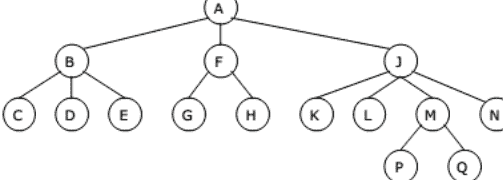

在计算机科学中，树数据结构可以用于：

- 存储目录结构；
- 构建解析树（在编译器的语法分析期间）；
- 搜索空间树等。

#### 1.1.7. 二叉树

这是一种特殊的树，每个节点最多有两个子节点。根据定义，树元素被视为一个集合。该集合可以划分为三个互不相交的子集。其中一个是根节点，另外两个是被称为左子树和右子树的二叉树。

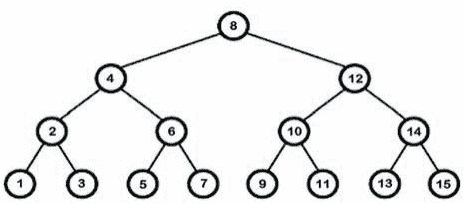

在上面的树中，S={1, 2, 3, 4, 5, 6, 7, 8, 9, 10, 11, 12, 13, 14, 15}

S1={8}
S2={1, 2, 3, 4, 5, 6, 7}
S3={9, 10, 11, 12, 13, 14, 15}

二叉树用于各种计算机科学应用，例如：

- 通过霍夫曼编码进行数据压缩；
- 算术表达式表示；
- 搜索（使用二叉搜索树 (BST)）；
- 排序（使用堆）；
- 构建决策树等。

二叉树的特殊类型：

- 堆；
- BST；
- AVL 树；
- 区间树；
- 伸展树；

#### 1.1.8. 图

图用于表示某些站点之间的连接。它由一组顶点和一组边组成。

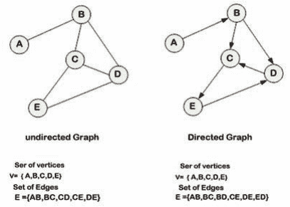

图在日常生活和计算机科学中有广泛的应用，例如：

- 使用 GPS 寻找两个站点（源点和目的地）之间的最短路径；
- 路径搜索；
- 旅行推销员问题；
- 最大流问题；
- 中国邮递问题；
- 在计算机网络中寻找数据流路径；
- 使用拓扑排序确定顺序。

### 1.2. 数据结构的分类

#### 1.2.1 线性数据结构

如果数据元素构成一个线性列表的序列，则该数据结构被认为是线性的。元素之间以指定的顺序相邻连接。线性数据结构中的示例包括数组、栈、队列、链表等。数据元素的遍历以及插入或删除都是按顺序进行的。

#### 1.2.2. 非线性数据结构

在这种结构中，数据元素可以连接到多个元素，表现出分层关系，这涉及子节点、父节点和祖节点之间的关系。在非线性数据结构中，数据元素的遍历以及插入或删除不是顺序进行的。非线性数据结构有两个常见的例子——树和图。树数据结构以分层关系组织并存储数据元素。

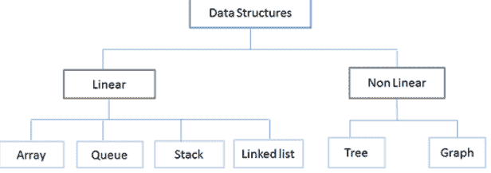

## 练习题

1. 什么是数据结构？列出数据结构的不同类型以及每类型的示例。
2. 说明线性数据结构和非线性数据结构之间的区别。
3. 定义：
   a. 栈；
   b. 队列；
   c. 二叉树；
   d. 图。
4. 解释各种数据结构的应用。
5. 选出不同项：
   a. 复合数据类型
   b. 用户定义数据类型
   c. （空白）
   d. 数组
6. 选出不同项：
   a. 数据类型
   b. 数据对象
   c. 抽象数据类型
   d. 数据行

## 2 算法编写

### 目录

2.1 算法 ................................................................................ 12
2.2 伪代码编写：工业标准 ...................................... 12
练习题 ............................................................................................ 19

### 2.1. 算法

对任何问题的解决方案的表示称为算法。算法可以用以下形式编写：

- 流程图（图形表示）；
- 用自己的话描述；
- 逐步指令；
- 伪代码。

算法是作为任何问题的通用解决方案编写的。它不是专门针对任何编程语言编写的。

### 2.2. 伪代码编写：工业标准

按照工业标准编写任何算法时，格式如下：

```
ALGORITHM<算法名称> (参数列表)
INPUT:<用文字描述输入
OUTPUT:<用文字描述输出
BEGIN
指令
END;
```

算法名称采用驼峰命名法书写。即，对于算法名称中的多个单词，第一个单词字母大写，其余部分全小写。

示例：

- `SumOfDigitsNumber`；
- `FibonacciSeries`；
- `BubbleSort`；
- `EvenOrOdd`。

#### 2.2.1. 各种语法的编写规则

| 类型 | 使用的模式 | 等效的 C 语言术语 |
|---|---|---|
| 输入 | READ | `scanf()` |
| 输出 | WRITE | `printf()` |
| 条件 | IF <condition> THEN | `if(condition)` |
| | ELSE | `else` |
| 循环 | WHILE <condition> DO | `while (Condition) { }` |
| 循环 | FOR 从下限到上限 STEP <> | `for(initialization; condition; increment/decrement)` |
| 循环 | DO ... WHILE <condition> BREAK | `do { while(Condition); break; }` |

在条件块和循环块中，不使用大括号。提供适当的缩进以提高算法的可读性。赋值使用 `←`。其余运算符与 C 语言相同。

- 编写条件语句：编写条件语句时，写 IF 后面跟条件，然后是 THEN。如果为假，可以写 ELSE。

```
IF condition THEN
Statement1
Statement2
Statement3
...
ELSE
Statement4
```

- 编写循环

对于 WHILE 循环：
```
WHILE Condition DO
Statement1
Statement2
Statement3
...
```

对于 FOR 循环：
```
FOR Condition DO
Statement1
Statement2
Statement3
...
```

假设循环计数器在每次执行后递增 1。如果循环计数器的增量不是 1，则遵循以下模式：

对于反向循环且循环计数器在每次执行后递减 1：
```
FOR Condition STEP –1 DO
Statement1
Statement2
Statement3
...
```

- 对于反向循环且循环计数器在每次执行后递减 2：
```
FOR Condition STEP –2 DO
Statement1
Statement2
Statement3
```

- 对于正向循环且循环计数器在每次执行后增加 2：
```
FOR Condition STEP +2 DO
Statement1
Statement2
Statement3
```

- 对于正向循环且循环计数器在每次执行后乘以 2：
```
FOR Condition STEP *2 DO
Statement1
Statement2
Statement3
```

- 对于反向循环且循环计数器在每次执行后除以 2：
```
FOR Condition STEP /2 DO
Statement1
Statement2
Statement3
```

#### 2.2.2. 一些算法示例

```
ALGORITHM EvenOrOdd()
INPUT: 一个整数 Number
OUTPUT: 数字的属性，即奇偶数
BEGIN:
READ(N)
IF N%2 = 0 THEN
WRITE("EVEN NUMBER");
ELSE
WRITE("ODD NUMBER");
END;
```

```
ALGORITHM LeapNonLeap(year)
INPUT: 一个年份 year
OUTPUT: 年份的属性，即闰年或平年
BEGIN:
IF year%4 = 0 AND year%100!==0 OR year%400 = 0 THEN
WRITE("Leap year")
ELSE
WRITE("Non Leap Year")
END;
```

```
ALGORITHM TableOfNumber()
INPUT: 一个整数 Number
OUTPUT: 数字的数表
BEGIN:
READ (N)
FOR i ← 1 TO 10 DO
WRITE (N*i)
END;
```

```
ALGORITHM NumberReverse()
INPUT: 一个整数 Number
OUTPUT: 数字的反转
BEGIN:
READ (N)
Rev ← 0
WHILE N>0 DO
Remainder ← N%10
Rev ← Rev*10+Remainder
N ← N/10
WRITE("Reversed Number is")
WRITE (Rev)
END;
```

```
ALGORITHM PrimeNumber()
INPUT: 一个数字范围
OUTPUT: 所有的素数
BEGIN:
READ (LowerLimit)
READ (UpperLimit)
FOR i ← LowerLimit TO UpperLimit Do
FOR j ← 2 TO SQRT(i) DO
IF i%j == 0 THEN
  BREAK;
IF J ← SQRT(i)+1 THEN
WRITE(i)
END;
```

```
算法 阶 (N)
输入：一个整数
输出：该数字的阶乘值
```


```text
BEGIN:
IF N ← 0 THEN
    RETURN 1
ELSE
    RETURN N*CALL Factorial(N–1)
END;
```

## 算法 斐波那契数（`N`）

输入：一个整数

输出：第 `N` 个斐波那契项

```text
BEGIN:
IF N == 1 THEN
    RETURN 0
ELSE
    IF N == 2 THEN
        RETURN 1
    ELSE
        RETURN CALL Fibonacci(N–1) + CALL Fibonacci(N–2)
    END;
```

## 算法 二分查找（`A[]`，`N`，`SearchKey`）

输入：一个大小为 `N` 的数组和一个搜索键

输出：搜索键在给定数组中的位置

```text
BEGIN:
Low ← 0
High ← N–1
WHILE Low <= High
    Mid ← (Low+High)/2
    IF A[Mid] == SearchKey THEN
        RETURN Mid
    ELSE
        IF SearchKey<A[Mid] THEN
            High ← Mid–1
        ELSE
            Low ← Mid+1

RETURN –1
END;
```

调用函数时，我们通常使用关键字 `CALL`。

## 递归二分查找

```text
ALGORITHM BinarySearch(A[ ], Low, High SearchKey)
INPUT: 一个大小为 N 的数组和一个搜索键
输出：搜索键在给定数组中的位置
BEGIN:
IF Low <= High
    Mid ← (Low+High)/2
    IF A[Mid] == SearchKey THEN
        RETURN Mid
    ELSE
        IF SearchKey<A[Mid] THEN
            CALL BinarySearch(A[ ], low, Mid–1, SearchKey)
        ELSE
            CALL BinarySearch(A[ ], Mid+1, High, SearchKey)
RETURN –1
END;
```

## 练习

1. 什么是算法？区分算法和伪代码之间的区别。

2. 为以下问题编写算法：
   - a. 找到一个数字的阶。
   - b. 通过线性查找在数组中找到一个数字。

3. 区分 `for` 循环、`while` 循环和 `do-while` 循环。

## 编程题

1. 写一个程序（此处及以后简写为 `WAP`）来计算各位数字之和。

2. 编写 `WAP` 在不使用第三变量的情况下交换两个整数变量的值。（提示：你可以使用加法或异或运算符）

# 3 算法复杂度

## 内容

- 3.1. 什么是复杂度 ................................................................. 22
- 3.2. 递归算法的空间复杂度................................................................ 22
- 3.3. 表示复杂度的符号 ................................................................. 24
- 练习 ............................................................................................ 29

## 3.1. 什么是复杂度

任何算法的效率衡量标准被称为复杂度。

算法当以程序的形式实现时，预计会消耗一些计算机资源。`CPU` 和 `RAM` 是两个最重要的资源。

任何算法的复杂度通过两个方面来衡量：

1. **时间复杂度：**它是为了实现逻辑所需的执行的算法指令数量计数。
2. **空间复杂度：**它是执行算法时所需的额外空间。

对于迭代算法，数组、`Array` 等中的局部变量数量会被计入空间复杂度中。

例如，考虑交换两个数字的简单算法。

### 算法 交换（`a`，`b`）

输入：两个数字

输出：数字交换后的值

```text
BEGIN:
t\leftarrow a
a\leftarrow b
b\leftarrow t
```

`END`：

其中 `a` 和 `b` 是作为参数给定的变量，`t` 是实现逻辑时取的唯一额外变量。因此，该算法的空间复杂度计为 1。如果算法中使用了大小为 10 的数组和一个循环计数器，空间复杂度计为 11。

## 3.2. 递归算法的空间复杂度

在递归算法中，任何时刻等待的最多数激活记录（activation records）数量被视为空间复杂度。

1. **激活记录：**当函数被调用时，在进程边界的 `STACK` 部分维护一个激活记录。激活记录包含许多信息。这些见下表：

| 返回值 | 局部变量 | 形式参数 | 实际参数 | 返回地址 |
| --- | --- | --- | --- | --- |

2. **返回地址：**表示函数终止返回返回地址。
3. **实际参数：**作为参数传递给函数的值。
4. **形式参数：**函数定义中接收实际参数的变量。
5. **局部变量：**函数中为了实现逻辑而取的额外变量。
6. **返回值：**函数的输出，将返回给调用函数。

举一个简单的 `C` 程序段示例：

```c
void main())
{
    int x=10, y=20, z;
    z=Sum(x, y);
    printf("Sum of data values is %%d", "%z");
}
```

```c
Sum(int a, int b)
{
    int s;
    s=a+b;
    return s;
}
```

对于上述 `C` 程序，假设 `RAM` 中语句 4 的地址为 10000。那么激活记录的内容将是：

| 项目 | 内容 |
| --- | --- |
| 返回值 | 30 |
| 局部变量 | `int s` |
| 形式参数 | `int a, int b` |
| 实际参数 | `X, y` |
| 返回地址 | 10000 |

如果函数定义中的局部变量是常量，则激活记录的大小假设为常数。在计算空间复杂度时，1 个激活记录的大小计为 1 个空间。

考虑下面用于查找算法阶的算法：

### 算法 阶（`N`）

输入：一个整数

输出：该数字的阶值

```text
BEGIN:
IF N ← 0 THEN
    RETURN 1
ELSE
    RETURN N*CALL Factorial(N–1)
END;
```

如果调用是 `Factorial(5)`，栈在任何时刻最多会有以下等待状态的激活记录。

| 激活记录 | 位置 |
| --- | --- |
| `Factorial(0)` 的激活记录 | 栈顶 |
| `Factorial(1)` 的激活记录 |  |
| `Factorial(2)` 的激活记录 |  |
| `Factorial(3)` 的激活记录 |  |
| `Factorial(4)` 的激活记录 |  |
| `Factorial(5)` 的激活记录 | ↑ |

这里有 6 个激活记录处于等待状态，一旦满足递归调用（`N=0`）就会开始。

该算法的空间复杂度为 `N+1`，因为任何时刻有 `N+1` 个激活记录。

## 3.3. 表示复杂度的符号

有三种符号可以表示时间/空间复杂度。

| 符号 | 读音 | 表示 |
| --- | --- | --- |
| `O` | Big Oh | 最坏情况 |
| `Ω` | Big Omega | 最好情况 |
| `Θ` | Big Theta | 平均情况或当最好和最坏情况相同时 |

对于具有固定数量语句的输入，时间复杂度被认为是常数，并用 `Θ` 符号表示。`Θ(1)` 意味着常量复杂度。

对于固定数量变量的算法，空间复杂度假设为常数并用 `Θ` 符号表示。`Θ(1)` 意味着常量空间。

| 语句数量 | 时间复杂度 |
| --- | --- |
| 4 | `Θ(1)` |
| 5 | `Θ(1)` |
| 7 | `Θ(1)` |
| 1 | `Θ(1)` |

### 算法 奇偶性

输入：一个整数

输出：数字的性质，即奇偶

```text
BEGIN:
READ(N)

IF N%2 == 0 THEN
    WRITE(“EVEN NUMBER”);
ELSE
    WRITE(“ODD NUMBER”);

END;
```

任何输入值的语句数为 2。因此时间复杂度为 `Θ(1)`。

此处逻辑使用的变量数为 1。因此空间复杂度为 `Θ(1)`。

### 算法 数字的表格（）

输入：一个整数

输出：输入数字的表格

```text
BEGIN:
READ (N)

FOR i ← 1 TO 10 DO
    WRITE (N*i)

END:
```

任何输入值的语句数为 10（因为循环固定十次，循环内部有一个语句）。因此时间复杂度为 `Θ(1)`。

此处逻辑使用的变量数为 2。因此空间复杂度为 `Θ(1)`。

当存在变量数量语句时，复杂度相对于变量数量编写。在编写复杂度时，省略数字的加法、减法和乘法。复杂度仅相对于主导因子编写。

| 语句数量 | 时间复杂度 |
| --- | --- |
| `n` | `Θ(N)` |
| `N+2` | `Θ(N)` |
| `N-1` | `Θ(N)` |
| `N+7` | `Θ(N)` |
| `2*N` | `Θ(N)` |
| `2*N+4` | `Θ(N)` |
| `2/3*N-7` | `Θ(N)` |

```text
END;
```

上述算法需要 `N` 次乘法、1 次对 `F` 的初始化以及一个 `RETURN` 语句。因此，需要执行的语句总数为 `N+2`。该算法的复杂度为 `Θ(N)`。

此处逻辑中使用的变量总数为 2。因此，空间复杂度为 `Θ(1)`。

考虑下面用于对 `N` 个数字排序的算法：

### 算法 Function（`A[ ]`，`N`）

输入：一组 `N` 个数字

输出：数组元素的重调整

```text
BEGIN:

FOR i ← 1 TO n-1
    FOR j ← 0 TO n-i-1 DO
        IF A[j]>A[j+1] THEN
            T ← A[j]
            A[j] ← A[j+1]
            A[j+1] ← T

END;
```

需要执行的语句总数为：

外层循环每执行一次，内层循环将执行 `n-i` 次。循环包含 3 条语句。

需要执行的语句总数：

```text
= (n-1) + (n-2) + (n-3) + ... +1
= n(n-1)/2
= n^2/n/2
```

这里假设 `n` 是一个非常大的数量，`n^2` 会更大。复杂度是相对于主导因子（即 `n^2`）编写的。因此，上述算法的复杂度为 `Θ(n^2)`。

此处逻辑中使用的变量总数为 3。因此，空间复杂度为 `Θ(1)`。

## 使用 C 语言编程的数据结构与算法实用方法

### 3.3.1. 最优与最坏情况复杂度

考虑下面在数组中搜索元素的算法。

```text
ALGORITHM Linear_search(A[], N, key)

BEGIN:

FOR i <- 1 TO N
    IF A[i] == key THEN
        RETURN i

RETURN -1

END;
```

如果在数组的第一个位置找到了搜索键，则返回循环内部的数组索引。这是最好情况。在这种情况下，循环的执行总数为 1，因此最佳时间复杂度用 `Ω` 符号表示：`Ω(1)`。

在最坏情况下，元素将在最后一个位置找到，循环将迭代 `N` 次。这是最坏情况。最坏情况复杂度用大 `O` 符号表示：`O(N)`。

### 3.3.2. 平均情况复杂度

为了找到平均情况复杂度，搜索元素在任何位置找到的概率是相等的。因此，每个位置成功搜索的概率为 `1/N`。复杂度可以通过以下方式找到：

> 概率 * 成功搜索所需的次数

```text
复杂度 = 1/N * 1 + 1/N * 2 + 1/N * 3 + ... + 1/N * N

= 1/N * (1+2+3+...+N)
= 1/N * (N*(N+1)/2)
= (N+1)/2
= N/2 + ½
```

复杂度可以写为 `Θ(N)`。

## 练习

1. 定义复杂度的大 `O` 符号。为什么它被称为渐近符号？

2. 按渐近增长从小到大对以下复杂度排序：

   `c^n`、`n^{cos(n)}`、`2^n`、`128^{log(n)}`、`log(n^n)`

   其中，`c > 1`。

3. 陈述时间复杂空间复杂度在现实世界中的重要性。

4. 将以下常表示算法复杂度的函数从慢到快排序。

   `O(1)`、`O(n)`、`O(n*log)`、`O(log n)`、`O(n^2)`、`O(2^n)`

5. 找出以下代码段的时间复杂度：

   - a. `for(x=0;x<n;x++)`

     ```text
     for(y=0;y<m;y++)
         // 常数时间操作
     ```

   - b. `for(x=0;x<n;x++)`

     ```text
     for(y=1;y<n;y*=2)
         // 常数时间操作
     ```

   - c. `for(x=0;x<n;x++)`

     ```text
     for(y=0;y<n;y++)
         x=x+1;
     ```

   - d. `void test(int n)`

     ```c
     {
         return n*test(n-1);
     }
     ```

   - e. `void test(int n)`

     ```c
     {
         return test(n-1)+test(n-1)+1;
     }
     ```

   - f. `for(x=0;x<n;x++)`

     ```text
     for(y=0;y<n-x;y++)
         // 常数时间操作
     ```

   - g. `for(x=0;x<n;x*=2)`

     ```text
     // 常数时间操作
     ```

   - h. `for(x=n; x>0; x/=2)`

     ```text
     // 常数时间操作
     ```

   - i.

     ```text
     for(x=0;x<n;x++)
         for(y=n;y>0; y/=2)
             // 常数时间操作

     j. for(x=0;x<n;x*=2)
         for(y=0;y<n;y++)
             // 常数时间操作
     ```

## 编程题

1. 给定只包含 0 和 1 的数组，编写一个程序（`WAP`）将所有 1 移到右侧，0 移到左侧。

2. 编写一个程序，用迭代和递归的方法找到斐波那契数列的第 `n` 个数。

3. 编写一个程序判断一个数是否是 2 的幂。尝试不同的方法，例如预计算、位操作等。

对于上述所有程序，请说明你程序的时间和空间复杂度。复杂度可以降低吗？列出不同方法的复杂度。

# 4 数组

## 目录

- 4.1. 数组的定义与类型 ................................................. 32
- 4.2. 数组的基本操作 ....................................................... 32
- 4.3. 与数组的应用问题 ................................................ 34
- 4.4. 索引公式...................................................................................... 37
- 练习....................................................................................................... 43

## 4.1. 数组的定义与类型

**定义：**数组是存储在连续内存位置上的同类数据元素的集合。

|  | 1 | 2 | 3 | 4 | 5 | 6 | 7 | 8 |
| --- | --- | --- | --- | --- | --- | --- | --- | --- |
| `A` | 12 | 8 | 34 | 19 | 26 | 31 | -5 | 78 |
|  | 1000 | 1002 | 1004 | 1006 | 1008 | 1010 | 1012 | 1014 |

在上述数组中，每个大小都已声明。算法表示中的索引从 1 开始（在 `C` 或 `Java` 中从 0 开始）。这里假设每个元素需要 2 字节存储。后续元素的位置是连续的。

- 一维数组类似于列表。
- 二维数组类似于表格或矩阵。

## 4.2. 数组的基本操作

### 1. 遍历

```text
ALGORITHM Traverse(A[ ], N)

BEGIN:

FOR i ← 1 TO N DO
    WRITE(A[i])

END;
```

**时间复杂度：** `Θ(N)`

**空间复杂度：** `Θ(1)`

上述表示（在 `C` 或 `Java` 中从 0 开始）。这里假设每个元素需要 2 字节存储。后续元素的位置是连续的。

### 2. 插入

```text
ALGORITHM Insertion(A[ ], N, key)

BEGIN:

i ← 0

WHILE A[i]<key DO
    i ← i+1

FOR j ← N-1 TO i STEP-1 DO
    A[j+1] ← A[j]

A[i] ← key
N ← N+1

END;
```

### 3. 删除

```text
ALGORITHM Deletion(A[ ], N, i)

BEGIN:

X ← A[i]

FOR j ← i+1 TO N DO
    A[j-1] ← A[j]

N ← N-1

END;
```

```c
int A[]={1, 2, 3, 4, 5, 6, 7};

InsertionSortedArray(A, 7, 6);

traverse(A, 7);
}
```

## 2. 在整数数组中寻找未重复的数字，其他数字均出现两次

算法：`Arr_func(A[ ], N)`

```text
BEGIN:
K \leftarrow 0, c, B[ ]

FOR i \leftarrow 0 TO N DO
    c \leftarrow 0
    FOR j \leftarrow 0 TO N DO
        IF A[j] == A[i] THEN
            c \leftarrow c+1
            IF c == 1 THEN
                B[k++] \leftarrow A[i]

FOR i \leftarrow 0 TO k DO
    WRITE(B[i])

END;
```

时间复杂度：`Θ(N^2)`

内层循环执行 `N` 次语句。外层循环执行 `n` 次内层循环和条件语句。第二个循环（从 `i` 到 `k`）在上述情况下执行单条语句。因此，语句总数将为 `n*(n+1)+1`。

空间复杂度：`Θ(1)`

使用了三个额外变量，`c` 和 `B[ ]`。在只有一个非重复元素的情况下，将是一个单元素数组。


## 4.4. 索引公式

给定一个数组及其基地址。如果我们通过公式计算目标元素的地址，则该公式被称为数组的索引公式。在使用指针编写数组的程序时，可以使用它。

### 4.4.1. 一维数组

考虑一个一维数组`[L:U]`。这里，`L`是数组的最小索引，`U`是数组的最大索引。如果我们想找到该数组中的元素个数，可以通过`U-L+1`来计算。例如，如果数组是 C 语言中的`A[0:9]`，则元素个数为`9-0+1=10`。

为了计算索引公式，我们首先假设索引从 1 开始，每个元素占用 1 字节进行存储。最后，我们将移除这些假设。

```c
Address of A[1] = \alpha
Address of A[2] = \alpha + 1
Address of A[3] = \alpha + 2
...
Address of A[i] = \alpha + (i-1)
移除假设
如果每个字节占用 N 字节存储
Address of A[i] = \alpha + (i-1) * N
如果数组索引从 L 开始，索引 i 将变为 i-L+1
Address of A[i] = \alpha + (i - L + 1) * N
```

> Address of `A[i]` = `$\alpha + (i - L + 1) * N$`

### 4.4.2. 二维数组

考虑一个二维数组 `A`，例如`A[L1:U1][L2, U2]`。数组元素可以被认为以行优先序方式存储（第一行的元素存储在内存中，接着是第二行，依此类推）或列优先序方式存储（第一列的元素存储在内存中，接着是第二列，依此类推）。

#### 4.4.2.1. 行优先序

在数组`A[L1:U1][L2, U2]`中，行数 = `U1 - L1 + 1`，列数 = `U2 - L2 + 1`。

| Address of `A[1][1]` = `$\alpha$` |
| :--- |
| Address of `A[1][2]` = `$\alpha + 1$` |
| Address of `A[1][3]` = `$\alpha + 2$` |
| Address of `A[1][U2]` = `$\alpha + U2-1$` |
| Address of `A[2][1]` = `$\alpha + U2$` |
| Address of `A[3][1]` = `$\alpha + 2*U2$` |
| ... |
| Address of `A[4][1]` = `$\alpha + 3*U2$` |

```c
Address of A[i][1] = \alpha + (i-1)*U2
Address of A[i][2] = \alpha + (i-1)*U2 + 1
Address of A[i][3] = \alpha + (i-1)*U2 + 2
Address of A[i][j] = \alpha + (i-1)*U2 + (j-1)
```

为了计算索引公式，我们首先假设索引从 1 开始，每个元素占用 1 字节进行存储。最后，我们将移除这些假设。

|   | 1 | 2 | 3 | ... | j | ... |
| :--- | :--- | :--- | :--- | :--- | :--- | :--- |
| 1 |   |   |   |   |   |   |
| 2 |   |   |   |   |   |   |
| 3 |   |   |   |   |   |   |
| ... |   |   |   |   |   |   |
| i |   |   |   |   |   |   |
| ... |   |   |   |   |   |   |
| U1 |   |   |   |   |   |   |

移除假设后，如果每个元素需要 N 字节进行存储，且行索引从 `L1` 开始，列索引从 `L2` 开始。

Address of `A[i][j]` = `$\alpha + [(i-L1+1)*(U2-L2+1) + (j-L2+1-1)] * N$`

> Address of `A[i][j]` = `$\alpha + [(i-L1)*(U2-L2+1) + (j-L2)] * N$`

#### 4.4.2.2. 列优先序

| Address of `A[1][1]` = `$\alpha$` |
| :--- |
| Address of `A[2][1]` = `$\alpha + 1$` |
| Address of `A[3][1]` = `$\alpha + 2$` |
| Address of `A[U1][1]` = `$\alpha + U1-1$` |
| Address of `A[1][2]` = `$\alpha + U1$` |
| Address of `A[1][3]` = `$\alpha + 2*U1$` |
| ... |
| Address of `A[1][j]` = `$\alpha + (j-1)*U1$` |

| 1 | 2 | 3 | ... | j | ... |
| :--- | :--- | :--- | :--- | :--- | :--- |
| 1 |   |   |   |   |   |   |
| 2 |   |   |   |   |   |   |
| 3 |   |   |   |   |   |   |
| ... |   |   |   |   |   |   |
| i |   |   |   |   |   |   |
| ... |   |   |   |   |   |   |
| U1 |   |   |   |   |   |   |

### 4.4.3. 三维数组

考虑一个三维数组，例如`A[L1:U1][L2:U2][L3:U3]`。该数组可以可视化为一个长方体。

#### 4.4.3.1. 行优先序

如果水平切片，我们将得到大小为`U2*U3`的切片。共有`U1`个这样的切片。

Address of `A[1][1][1]` = `$\alpha$`

Address of `A[2][1][1]` = `$\alpha + U2*U3$`

Address of `A[3][1][1]` = `$\alpha + 2*U2*U3$`

Address of `A[4][1][1]` = `$\alpha + 3*U2*U3$`

...

Address of `A[i][1][1]` = `$\alpha + (i-1)*U2*U3$`

#### 4.4.3.2. 列优先序

如果垂直切片，我们将得到大小为`U1*U3`的切片。共有`U2`个这样的切片。

Address of `A[1][1][1]` = `$\alpha$`

Address of `A[1][2][1]` = `$\alpha + U1*U3$`

Address of `A[1][3][1]` = `$\alpha + 2*U1*U3$`

Address of `A[1][4][1]` = `$\alpha + 3*U1*U3$`

...

Address of `A[1][j][1]` = `$\alpha + (j-1)*U1*U3$`

移除假设后，如果每个元素需要 N 字节进行存储，且行索引从 `L1` 开始，列索引从 `L2` 开始，深度索引从 `L3` 开始。

Address of `A[i][j][k]` = `$\alpha + [(i-L1+1)*(U2-L2+1)*(U3-L3+1) + (j-L2+1-1)*(U3-L3+1) + (k-L3+1-1)] * N$`

> Address of `A[i][j][k]` = `$\alpha + [(i-L1)*(U2-L2+1)*(U3-L3+1) + (j-L2)*(U3-L3+1) + (k-L3)] * N$`

## 练习题

1. 给定数组`A[lb:ub]`。该数组中的元素个数由公式给出
   a. `ub - lb`
   b. `ub - lb + 1`
   c. `ub - lb - 1`
   d. `lb - ub + 1`

2. 给定数组`A[-1:7, 0:6]`。该数组的行数和列数分别是：
   e. 9, 7
   f. 7, 6
   g. 8, 6
   h. 以上都不是

3. 数组中有 10 个元素。如果删除了第 4 个元素，有多少个元素的位置发生了改变？
   i. 7
   j. 8
   k. 6
   l. 5

4. 找到行优先顺序数组`A[0:10][-1:8][0:12]`中元素`A[4][6][9]`的地址。假设每个元素需要 4 字节存储，且基地址为 12000。

5. 在行优先顺序数组`P[1:10, -2:20]`中元素`P[6, 12]`的地址，其中每个元素占用 2 字节存储，基地址为 ............

6. 找到行优先顺序数组`A[-2:10][0:11]`中元素`A[3][8]`的地址。假设每个元素需要 8 字节存储，且基地址为 5000。

7. 数组`A[-2:5, -1:5, 0:5]`中的元素个数为：
   a. 48
   b. 125
   c. 336
   d. 512

## 编程题

1. 给定一个无序数组，找到数组中连续数字的最长序列的长度。

2. 给定 k 个排序数组，编写一个程序将它们合并为一个单一排序数组。

3. 给定一个整数数组，其中每个值满足 `1 <= x <= len(array)`，编写一个函数找到数组中所有的重复项。

# 5. 搜索算法

## 目录

- 5.1. 什么是搜索？
- 5.2. 顺序搜索（线性搜索）
- 5.3. 二分搜索
- 5.4. 线性搜索与二分搜索的比较
- 5.5. 索引顺序搜索
- 练习题

## 5.1. 什么是搜索？

考虑你手机的电话录，需要通过名称搜索电话号码。一个根据给定单词搜索描述的字典。一个根据特定项目搜索描述的目录。通过指纹扫描进行每日考勤（生物识别搜索）。任何根据某些键（如学号）搜索数据库记录。Google 中的关键词搜索。文本中的名称搜索。搜索是在值列表中查找给定值位置的过程。它决定了搜索键是否存在于数据中。它是从元素集合中查找特定项目的算法过程。

### 5.1.1 搜索技术

- 顺序搜索
- 二分搜索
- 索引顺序搜索
- 基于树的搜索

## 5.2. 顺序搜索（线性搜索）

- 顺序搜索也称为线性搜索。
- 顺序搜索从列表开始并检查列表的每一个元素。
- 它是一种朴素的（暴力法）搜索算法。
- 顺序搜索将搜索键与列表中的所有元素进行比较。如果元素匹配，则返回索引，否则返回 –1。

上图显示了顺序搜索的工作原理。它在数组中搜索键，直到找不到键元素为止。如果我们搜索元素 25，它将按照顺序逐步进行。顺序搜索适用于无序列表。

算法 ALGORITHM `Linear_Search(A[], N, key)`

```
BEGIN:
FOR i ← 1 TO N DO
IF A[i] == key THEN
RETURN i
RETURN –1
END;
```

**最坏情况时间复杂度**: `O(N)`

如果键元素在最后一个索引处或未找到，则将执行 `N+1` 条语句

**最优情况时间复杂度**: `Ω(1)`

如果键元素在第一个索引处，则只执行一条语句

**空间复杂度**: `Θ(1)`

只占用一个额外的变量，即 `i`

## C 程序

```c
#include <stdio.h>
```

```c
int Linear_search(int A[], int N, int key) {
  int i=1;
  for (i=1; i <= N; i++) {
    if (A[i] == key) {
      return i;
    }
  }
  return -1;
}
```

```c
int main(int argc, const char * argv[]) {
  int A[]={1, 2, 3, 4, 5, 6, 7, 8, 9};
  int position=Linear_search(A, 9, 7);
  printf("%d", position);
  return 0;
}
```

## 5.3. 二分搜索

二分搜索在排序数组上进行。它是一种快速的搜索算法，运行时间复杂度为`O(log n)`。二分搜索基于分治法原理。这种搜索技术通过比较集合中的中位元素来查找特定元素。当数组中有大量元素时非常有用。

- 在二分搜索中，`Mid`索引通过公式`Mid = (Low + High)/2`计算，这里`Low`和`High`表示数组的最小和最大索引。搜索键与数组的`Mid`元素进行比较。如果匹配，则搜索成功，返回`Mid`索引并停止搜索过程。
- 如果搜索键小于数组的`Mid`元素，搜索键可能在数组的左部分。因此，保持`Low`索引不变，将`High`改为`Mid–1`。
- 如果搜索键大于数组的`Mid`元素，搜索键可能在数组的右部分。因此，保持`High`索引不变，将`Low`改为`Mid+1`。
- 无论是在数组的左部分还是右部分进行搜索，数组的大小都会减少到之前的一半。
- 重复整个过程，直到搜索成功或得出元素不在数组中的结论。
- `Low<High`意味着数组中至少有2个元素。`Low=High`意味着数组中恰有1个元素。`Low>High`是算法的终止条件。

示例：

考虑数组有 5 个元素，搜索键为 11。二分搜索过程如下：

| [1] | [2] | [3] | [4] | [5] |
|---|---|---|---|---|
| 10 | 11 | 13 | 18 | 20 |

(i) `Mid = (1+5)/2 = 3`

`A[3] != 11`

由于`11 < 13`，搜索将在左半部分进行，保持`low`不变且`high = 3–1`

| [1] | [2] | [3] |
|---|---|---|
| 10 | 11 | 13 |

(ii) `Mid = (1+3)/2 = 2`

`A[2] != 11`

由于`11 > 10`，搜索将在右半部分进行，保持`high`不变且`low = 2+1`

| [2] | [3] |
|---|---|
| 11 | 13 |

(iii) `Mid = (2+3)/2 = 2`

`A[2] = 11`

由于`11 = 11`，搜索完成。

算法 ALGORITHM `Binary_search(A[], N, key)`

```
BEGIN:
LOW ← 1
HIGH ← N
WHILE LOW <= HIGH DO
MID ← (LOW+HIGH)/2
IF A[MID] = key THEN
RETURN MID
ELSE
IF key < A[MID] THEN
HIGH ← MID–1
ELSE
LOW ← MID+1
RETURN –1
END;
```

时间复杂度: `O(log₂N)`, `Ω(1)`

如果在第一次划分时就在数组中间找到元素，则执行三条语句（最优情况）。

上述算法在每次迭代中将数组折半。

时间复杂度可以写为

`T(n) = T(n/2) + C`

这里`C`代表将数组平分大小以及决定在数组的哪个部分进行搜索的常数语句。

`T(n) = T(n/2²) + C + C`

`= T(n/2²) + 2*C`

`= T(n/2³) + 3*C`

...

`= T(n/2ᵏ) + K*C`

假设数组大小在 k 次划分后减为 1，因此`n/(2ᵏ)=1`

可以重写为：

`2ᵏ=n`

对两边取对数，我们得到

`k=log₂n`

`T(n) = T(n/2ᵏ) + K*C`

`= T(1) + C*log₂n`

`= 1 + C*log₂n`

`= O(log₂n)`

**空间复杂度**: `Θ(1)`

使用了三个变量，即`HIGH`, `MID`和`LOW`

## C 程序

```c
#include <stdio.h>
```


`int BinarySearch(int A[], int N, int key)` 函数定义如下：

```c
int BinarySearch(int A[], int N, int key){
    int high=N-1, low=0;
```

```c
    while (low <= high) {
        int mid=(low+high)/2;
        if (A[mid] == key) {
            return mid;
        }
        else {
            if (key<A[mid]) {
                high=mid-1;
            }
            else {
                low=mid-1;
            }
        }
        return -1;
    }
}
/******************************************************************
```

```c
int main(int argc, const char * argv[] ) {
    int A[]={1, 2, 3, 4, 5, 6, 7, 8, 9};
    int position=BinarySearch(A, 9, 3);
    printf("%d", position);
    return 0;
}
/******************************************************************
```

## 5.4. 线性查找与二分查找对比

下表比较了线性查找和二分查找在最坏情况下的行为：

| 元素 | 线性查找 | 二分查找 | 解释 |
|---|---|---|---|
| 1024 | 1024 | 10 | 1024 是 $2^{10}$，$\log_2 2^{10}$ 为 10 |
| 1024*1024 | 1024*1024 | 20 | 1024*1024 是 $2^{20}$，$\log_2 2^{20}$ 为 20 |
| 1024*1024*1024 | 1024*1024*1024 | 30 | 1024*1024*1024 是 $2^{30}$，$\log_2 2^{30}$ 为 30 |

## 52 C语言语言数据结构与算法实践方法

从上表明显看出，二分查找是一种远优于线性查找的技术。

## 5.5. 索引顺序查找

在这种查找方法中，会创建一个索引，该索引包含所需记录的特定分组或划分。通过索引可以找到查找键可能所在的范围的下限和上限。在找到的范围内执行顺序查找。

索引查找的特点：

- 索引查找在有序列表上进行。
- 索引通过选择原数组中等距离（按索引计算）的元素来创建。
- 先查找索引，然后查找数组，并引导在数组中的查找。

```text
ALGORITHM: INDsearch(A[ ], N, KEY)
BEGIN:
Ind[ ], b[ 
nl1=0, c, d
FOR i ← 0 TO N STEP–2 DO
    Ind[nl] ← i
    b[nl] ← i
    nl ← nl1+1
    IF KEY<Ind[0] THEN
        WRITE("NO. NOT FOUND")
    ELSE
        FOR i ← 1 TO nl1 DO
            IF KEY<Ind[i] THEN
                c ← b[i-1]
                d ← b[i]
                BREAK
            FOR i ← c TO d+1 DO
                IF KEY == a[i] THEN
                    j ← 1
                    BREAK
                IF j == 1 THEN
                    WRITE(i+1)
            ELSE
                WRITE("No. not found")
END;
```

### 时间复杂度：$\Theta$(N/K)

如果索引通过选择列表中的第 $k^{th}$ 个元素创建，则索引的大小为 N/K，在其上执行顺序查找。

### 空间复杂度：$\Theta$(N/K)

如果索引通过选择列表中的第 $k^{th}$ 个元素创建，则索引的大小为 N/K。这是原数组之外的额外空间。在索引数组给出的情况下，空间复杂度为 $\Theta$(1)。

## C语言程序

```c
/******************************************************************/
#include <stdio.h>
#include <stdlib.h>
/*************************************************/
```

```c
void INDsearch(int A[ ], int n, int key)
{
    int elements[20], indices[20], temporary, i;
    int j = 0, ind = 0, start, end;
    for (i = 0; i < n; i += 3) {
        elements[ind] = A[i];
        indices[ind] = i;
        ind++;
    }

    if (key < elements[0]) {
        printf("Not found");
        exit(0);
    }
    else {
        for (i = 1; i <= ind; i++)
            if (key < elements[i]) {
                start = indices[i-1];
                end = indices[i];
                break;
            }
        for (i = start; i <= end; i++) {
            if (key == A[i]) {
                j = 1;
                break;
            }
            if (j == 1)
                printf("Found at index %d", i);
            else
                printf("Not found");
        }
    }
}
/*************************************************/
```

```c
void main()
{
    int arr[] = { 10, 5, 16, 14, 20 };
    int n=5;
    int k = 8;
    INDsearch(arr, n, k);
}
/************************************************/
```

## 练习题

1. 重写索引顺序查找算法，并在索引上执行二分查找。
2. 编写考虑名为键的索引顺序查找。索引按每个字母维护。
3. 编写一个C程序对学生数据表进行查找。可以根据姓名和学号进行查找。结果是与学生的完整记录。

## 单选题

1. 下列二分查找最坏情况的递归关系正确的是？
   - a. $T(n) = 2T(n/2) + O(1)$ 且 $T(1) = T(0) = O(1)$
   - b. $T(n) = T(n-1) + O(1)$ 且 $T(1) = T(0) = O(1)$
   - c. $T(n) = T(n/2) + O(1)$ 且 $T(1) = T(0) = O(1)$
   - d. $T(n) = T(n-2) + O(1)$ 且 $T(1) = T(0) = O(1)$

2. 在长度为 $n$ 的列表中，成功的顺序查找完成的键比较平均次数是：
   - a. $\log n$
   - b. $(n-1)/2$
   - c. $n/2$
   - d. $(n+1)/2$

3. 在大小为 $n$ 的数组上线性查找的平均情况分析需要……比较：
   - a. $n/2$
   - b. $n$
   - c. $(n-1)/2$
   - d. $(n+1)/2$

## 6 排序算法

## 目录

6.1. 冒泡排序..................................................58  
6.2. 插入排序...............................................................60  
6.3. 选择排序..............................................................64  
6.4. 快速排序.....................................................67  
6.5. 合并排序.....................................................74  
6.6. 使用数组的操作..........................................80  
6.7. 计数排序...............................................................91  
6.8. 基数排序..................................................94  

## 6.1. 冒泡排序

冒泡排序是一种简单的排序算法，通过重复遍历列表、比较相邻元素并在如果它们的顺序错误则进行交换。重复遍历列表直到列表排序完成。该算法之所以被称为“冒泡排序”，是因为较或较大的元素会在末端“泡”到正确的位置。

### ALGORITHM: BubbleSort(A[ ], N)

```text
BEGIN:
    FOR i ← 0 TO N-1 DO
        FOR j ← 0 TO N-i-1 DO
            IF A[j] > A[j+1] THEN
                temp ← A[j]
                A[j] ← A[j+1]
                A[j+1] ← temp
            END IF
        END FOR
    END FOR
END;
```

# 算法：优化化的泡泡排序(A[|], N)

```text
BEGIN:
FOR i <- 0 TO N-1 AND Flag == 1 DO
  flag <- 0
  FOR j <- 0 TO N-i-1 DO
    IF A[j]>A[j+1]
      Flag <- 1
      k <- A[j]
      A[j] <- A[j+1]
      A[j+1] <- k
END;
```

## 最优情况时间复杂度 (N)

当数组已经排序时，迭代会在第一轮比较完所有元素后停止，仅需进行 n-1 次比较，出现最优情况。

## 最坏情况时间复杂度 O(N²)

当数组是倒序排序时，需要 n-1 次外层迭代来排序整个数组。

## 空间复杂度：Θ(1)

在任何情况下都需要三个变量，即 i、j 和 flag。交换可能会导致一个额外的变量。

## 6.2. 插入排序

插入排序是一种简单的排序算法，对于小型列表和大部分已排序的列表来说非常高效。它将同一个数组分为两个部分：已排序部分和未排序部分。从仅一个元素开始，目标元素位于已排序列表中（第一个元素），而 n-1 个元素位于未排序列表中（第 2 到第 n 个元素）。它的工作原理是从未排序列表中逐个取出元素，并将它们插入到已排序列表的正确位置中。

## 排序算法

| 54 | 26 | 93 | 17 | 77 | 31 | 44 | 55 | 20 |
| 26 | 54 | 93 | 17 | 77 | 31 | 44 | 55 | 20 |
| 26 | 54 | 93 | 17 | 77 | 31 | 44 | 55 | 20 |
| 17 | 26 | 54 | 93 | 77 | 31 | 44 | 55 | 20 |
| 17 | 26 | 31 | 44 | 54 | 77 | 93 | 55 | 20 |
| 17 | 28 | 31 | 44 | 54 | 55 | 77 | 93 | 20 |
| 17 | 28 | 26 | 31 | 44 | 54 | 55 | 77 | 93 |

假设 54 是一个已排序的列表，随后插入了 26、93、17、77、31、44、55、20。

为了编写算法，让我们先只编写第一轮迭代的算法。

在第一轮通过中

`j ← 2;`

`Key ← A[2]`

```text
WHILE key < A[j-1] AND j > 1 DO
A[j] ← A[j-1];
j ← j-1
A[j+1] ← Key;
```

将会有 n–1 次相似的迭代，因此上述算法被放入运行 n–1 次的外循环中。

算法：插入排序(A[ ], N)

BEGIN:

```text
FOR i ← 2 TO N
key ← A[i]
j ← i-1
WHILE j > 1 AND A[j]>key DO
A[j+1] ← A[j]
j ← j-1
A[j+1] ← key
```

END;

## 使用 C 语言编程数据结构与算法的实用方法

如果数字是倒序排序的，每次插入在放置之前需要 i 次移动（i 是迭代次数）。

- 第一次迭代移动 1 次
- 第二次迭代移动 2 次
- 第三次迭代移动 3 次
- ...
- 第 (n-1) 次迭代移动 n-1 次

总移动次数

= 1+2+3 + ... +(n-1)

= n(n-1)/2

= n²/2 - n/2

（注：）

在每次迭代中，数字的放置完成一次。总放置次数 = n-1

观察上述算法，每次迭代中有一个语句 `Key=A[i]`，并且内层循环中有 `j=j-1`。

需要执行的语句总数

- 移动次数 + 放置次数 + 循环递减语句
- n²/2 - n/2 + n-1 + (1+2+3 + ...+n-1)
- n²/2 - n/2 + n-1 + n²/2 - n/2
- n-1

最坏时间复杂度：O(n²)

如果数字是倒序排序的，每次插入在放置之前需要 i 次移动（i 是迭代次数）。

最优时间复杂度：(n)

如果数字是排序的，则任何迭代中都不需要移动。

需要执行的语句总数

- 移动次数 + 放置次数 + 循环递减语句
- 0 + n-1 + 0
- n-1

空间复杂度：Θ(1)

上述算法仅使用了 i 和 j 两个键变量。

## 相关任务

1. 对给定的复数排序的程序

算法：

假设复数是以如下形式的结构体存储的

`Struct Complex`

```c
{
int real;
int imaginary;
int absolute;
};
```

`absolute = √(real+imaginary*imaginary)` (√ 是开根运算符)

```text
ALGORITHM SortComplexNumber(S[ ], N)
BEGIN:
FOR i ← 1 TO N–1 DO
smallest ← i
FOR j ← i+1 TO N DO
IF A[j].absolute<A[smallest].absolute THEN
  smallest ← j
  Exchange(A[smallest], A[i])
END;
```

```text
ALGORITHM Exchange(A[smallest], A[ij])
BEGIN:
treal ← A[smallest].real;
A[smallest].real ← A[i].real;
A[i].real ← treal;
imaginary ← A[smallest].imaginary;
A[smallest].imaginary ← A[i].imaginary;
A[i].imaginary ← imaginary;
tabsolute ← A[smallest].absolute;
A[smallest].absolute ← A[i].absolute;
A[i].absolute ← tabsolute;
```

时间复杂度：Θ(N²)

两个循环运行 n*n 次，因此复杂度为 N²

空间复杂度：Θ(1)

四个额外的变量是 i、j、t real 和 t imaginary。

## 64 使用 C 语言编程数据结构与算法的实用方法

## 6.3. 选择排序

两个循环运行 n*n 次，因此复杂度为 N²

空间复杂度：Θ(1)

四个额外的变量是 i、j、t real 和 t imaginary。

- 算法在第一次迭代中找到最小值并与第一个位置的值交换。
- 它在第二次迭代中找到最小值。
- 它在第三次迭代中找到最小值。
- ...
- 它在第 (n-1) 次迭代中找到最小值。

## 6.4. 快速排序

快速排序是一种分治算法，依赖于分区操作。对数组进行分区时，选择一个元素作为基准。将所有小于基值的元素移动到它之前，将所有大于它的元素移动到它之后。左和右子列表使用相同的算法递归排序。

- 分区
- 在分区中，假设最后一个元素大于数组中的所有其他元素。在第一次运行分区时，最后一个元素特定地大于所有其他元素；然而，在随后的运行中，最后一个元素变为所考虑的集合。
- 通常，选取第一个元素作为基准值（pivot）。所有其他元素都与该元素进行比较。
- 分区（Partition）的目的是找到基准值在排序数组中的合适位置。
- 为了上述目的，比基准值小的元素留在数组的左部分，比基准值大的留在右侧。
- 一旦在排序数组中找到基准值的合适位置，就会返回该位置，并在左右两个部分递归调用快速排序。

## 算法：Partition(A[], low, high)


# 快速排序（Quick Sort）

## 快速排序算法

### 分区算法（Partition）

下面的算法实现了快速排序中的分区操作。

```
BEGIN:
i ← low
j ← high+1
pivot ← A[low]
```

```
DO
DO
i ← i+1
WHILE(A[i] < pivot)

DO
j ← j+1
WHILE(A[j] > pivot)

IF i < j THEN
Exchange(A[i], A[j])
WHILE(i < j)
Exchange(A[j], A[low])
RETURN j
END;
```

## 排序算法 69

| LOW | | | | | | | HIGH |
|---|---|---|---|---|---|---|---|
| 原始数组 | 1 | 2 | 3 | 4 | 5 | 6 | 7 | 8 | 9 |
| | 50 | 10 | 60 | 70 | 30 | 40 | 100 | 25 | |
| 取最后一个元素作为 i | 1 | 2 | 3 | 4 | 5 | 6 | 7 | 8 | 9 |
| | 50 | 10 | 60 | 70 | 30 | 40 | 100 | 25 | |
| | | | | | | | | pivot=A[LOW]=50 | |
| 1 | 2 | 3 | 4 | 5 | 6 | 7 | 8 | 9 |
| | 50 | 10 | 60 | 70 | 30 | 40 | 100 | 25 | |
| | | | | | | | | j | |
| 1 | 2 | 3 | 4 | 5 | 6 | 7 | 8 | 9 |
| | 50 | 10 | 20 | 40 | 30 | 70 | 100 | 65 | |
| | | | | | | | | j | |
| 1 | 2 | 3 | 4 | 5 | 6 | 7 | 8 | 9 |
| | 50 | 10 | 20 | 40 | 30 | 70 | 100 | 60 | |
| | | | | | | | | i | |
| 1 | 2 | 3 | 4 | 5 | 6 | 7 | 8 | 9 |
| | 50 | 10 | 20 | 40 | 30 | 70 | 100 | 60 | |
| | | | | | | | | j | |
| 1 | 2 | 3 | 4 | 5 | 6 | 7 | 8 | 9 |
| | 50 | 10 | 20 | 40 | 30 | 70 | 100 | 60 | |

`A[low]` 索引 5 的位置。

### 语句执行次数

1. 在循环开始前有三条固定语句。
2. `i` 移动并在 `A[i]` 大于或等于基准值元素的位置停止。
3. `j` 移动并在 `A[j]` 小于或等于基准值元素的位置停止。
4. 如果 `i < j`，则交换 `A[i]` 和 `A[j]`（较小的元素在左侧，较大的在右侧）。
5. 重复过程直到 `i < j` 不成立。当 `i` 大于 `j` 时，过程停止并交换 `A[j]` 和 `A[low]`。`j` 是基准值的右侧位置。
6. 返回 `j`。

如果在 `i` 和 `j` 每次递增后，在递减并执行 `A[i]` 和 `A[j]` 交换后停止，则此操作所需的总语句数为：

`i` 的递增 (1) + `j` 的递减 (1) + 交换 (3) = 5

因此，`n/2` 次重复的总语句数 = `5*n/2`

最后，一次 `A[low]` 与 `A[j]` 的交换 (3) + 一次返回 (1) = 4

总语句数 = `5*n/2 + 4`

分区的复杂度 Θ(N)

### 快速排序算法

算法：`QuickSort(A[], low, high)`

```
BEGIN:
IF low < high THEN
j ← Partition(A[], low, high)
QuickSort(A[], low, j-1)
QuickSort(A[], j+1, high)
END;
```

# 使用C语言编程的数据结构与算法实用方法

## C 程序

```c
#include <stdio.h>

void Exchange(int* a, int* b)
{
    int t = *a;
    *a = *b;
    *b = t;
}
```

```c
int Partition(int A[], int low, int high){
    int i=low; int j=high+1; int pivot=A[low];
    do{
        i=i+1;
    } while (A[i]<pivot);
    do{
        j=j-1;
    } while (A[j]>pivot);
    if (i<j) {
        Exchange(&A[i], &A[j]);
    }
    } while (i<j);
    Exchange(&A[j], &A[low]);
    return j;
}
```

```c
void QuickSort(int A[], int low, int high) {
    if (low<high) {
        int j=Partition(A, low, high);
        QuickSort(A, low, j-1);
        QuickSort(A, j+1, high);
    }
}
```

```c
void Traverse(int A[], int n) {
    for (int i=0; i <= n-1; i++) {
        printf("%d\t", A[i]);
    }
}
```

```c
int main(int argc, char *argv[]) {
    int A[]={5, 2, 3, 4, 9, 8, 7, 6, 1, 2};
    QuickSort(A, 0, 9);
    printf("\nQuick sort\n");
    Traverse(A, 9);
    return 0;
}
```

## 时间复杂度分析

`T` 代表快速排序的时间复杂度。分区后会创建两个部分。其中一个部分的大小为 `n/2`，另一个为 `n/2–1`。当 `n` 很大时，假设 `n/2–1` 非常接近 `n/2`。快速排序的递归式可以写为：

```
T(n) = 2T(n/2) + Θ(n)
```

分区的递归式可以重写为：

```
T(n) = 2T(n/2) + C
```

# 使用C语言编程的数据结构与算法实用方法

```
T(n) = 2(2T(n/4) + C/2) + C
= 4T(n/4) + C + C
= 4T(n/4) + 2C
= 8T(n/8) + C + 2C
= 8T(n/8) + 3C
= 16T(n/16) + 2C + 3C
= 16T(n/16) + 4C
...
= 2^k T(n/2^k) + kC
```

当 `2^k = n`，则 `k = log n`，

```
T(n) = n T(1) + n log n
= n log n
```

## 最好情况：Ω(n log n)

## 坏情况：O(n²)

## 6.4.1 改进坏情况

`n²)`

## 空间复杂度：O(log n)

# 6.5. 合并排序 (MERGE SORT)

- 合并排序基于分治法进行工作。
- 它不断将给定数组分为两部分，直到得到一个只有一个元素的数组。
- 一个元素的数组被认为是有序的。
- 将两个排序数组合并成一个更大的排序数组。
- 分离出来的部分才能合并。
- 这是一个递归过程。

为了理解合并操作，首先尝试理解两个排序数组的合并。

## 合并两个排序数组

算法：`MergeArray(A[], m, B[], n)` // `m` 是 `A[]` 的大小，`n` 是 `B[]` 数组的大小

```
BEGIN:
C[m+n]
i ← 1, j ← 1, k ← 1
WHILE i <= m AND j <= n // 比较 A[] 和 B[] 数组的元素
IF A[i] < B[j] THEN
C[k] ← A[i]
i ← i+1
k ← k+1
ELSE
C[k] ← B[j]
j ← j+1
k ← k+1
WHILE i <= m // 如果 A[] 数组中还有元素被遗留
C[k] ← A[i]
i ← i+1
k ← k+1
WHILE j <= n // 如果 B[] 数组中还有元素被遗留
C[k] ← B[j]
j ← j+1
k ← k+1
```

## 使用 C 语言进行数据结构与算法的实用方法

归并排序过程将原始数组分为两个大小为 `n/2` 和 `n/2` 的部分。合并这两个部分需要 `Θ(n)`。

归并排序的递归式可以写为：

```
T(n) = 2T(n/2) + Θ(n)
```

`T(n/2)` 是对包含 `n/2` 个元素的数组进行归排序的时间复杂度。递归式可以重写为：

```
T(n) = 2T(n/2) + Cn
T(n) = 4T(n/4) + 2Cn + Cn
T(n) = 8T(n/8) + 4Cn + 2Cn + Cn
...
T(n) = 2^k · T(n/2^k) + kCn
```

假设在第 `k` 次划分后，数组大小减为 1，即 `n/2^k = 1`，因此 `k = log₂ n`。

```
T(n) = n · T(1) + n log₂ n
T(n) = n + n log₂ n
```

由于 `n` 主导了 `n log₂ n`，因此复杂度为 `Θ(n log n)`。

**时间复杂度：** `Θ(n log n)`

**空间复杂度：** `Θ(n)`

这里，由于我们使用了大小为 `n` 的额外数组，会形成调用栈。

# 6. 使用数组进行集合操作

### 1. 写一个程序找出属于 B 的 A 中的元素。

算法：`A_AND_B(A[], m, n)`

```
BEGIN:
C[m+n]
i ← 1, j ← 1, k ← 1
WHILE i <= m AND j <= n DO
  IF A[i] < B[j] THEN
    i ← i + 1
  ELSE IF A[i] > B[j] THEN
    j ← j + 1
  ELSE
    C[k] ← A[i]
    i ← i + 1
    j ← j + 1
    k ← k + 1
RETURN C
END;
```

## C 程序

```c
#include <stdio.h>
int C[1000];
int A_AND_B(int A[], int m, int B[], int n) {
  int i = 1, j = 1, k = 1;
  while (i <= m && j <= n) {
    if (A[i] < B[j]) {
      i++;
    } else if (A[i] > B[j]) {
      j++;
    } else {
      C[k] = A[i];
      i++;
      j++;
      k++;
    }
  }
  return k;
}

int main(int argc, char * argv[]) {
  int A[] = {1, 3, 4, 7, 9, 15};
  int B[] = {2, 3, 4, 8, 11};
  int c = A_AND_B(A, 6, B, 5);
  for (int i = 1; i < c; i++) {
    printf("%d\t", C[i]);
  }
  return 0;
}
```

### 2. 写一个程序找出不属于 B 的 A 中的元素。

算法：`A_AND_NOT_B(A[], m, B[], n)`

```
BEGIN:
C[m+n]
i ← 1, j ← 1, k ← 1
WHILE i <= m AND j <= n DO
  IF A[i] < B[j] THEN
    C[k] ← A[i]
    k ← k + 1
    i ← i + 1
  ELSE IF A[i] > B[j] THEN
    j ← j + 1
  ELSE
    i ← i + 1
    j ← j + 1
WHILE i <= m DO
  C[k] ← A[i]
  i ← i + 1
  k ← k + 1
WHILE j <= n DO
  C[k] ← B[j]
  j ← j + 1
  k ← k + 1
RETURN C
END;
```

### 3. 写一个程序求集合并集。将排序后的数组为一个集合。

算法：`SetUnion(A[], m, B[], n)`

```
BEGIN:
C[m+n]
i ← 1, j ← 1, k ← 1
WHILE i <= m AND j <= n DO
  IF A[i] < B[j] THEN
    C[k] ← A[i]
    k ← k + 1
    i ← i + 1
  ELSE IF A[i] > B[j] THEN
    C[k] ← B[j]
    k ← k + 1
    j ← j + 1
  ELSE
    C[k] ← A[i]
    i ← i + 1
    j ← j + 1
    k ← k + 1
WHILE i <= m DO
  C[k] ← A[i]
  i ← i + 1
  k ← k + 1
WHILE j <= n DO
  C[k] ← B[j]
  j ← j + 1
  k ← k + 1
RETURN C
END;
```

```c
#include <stdio.h>

int C[1000];
int SetUnion(int A[], int m, int B[], int n) {
    int i = 0, j = 0, k = 1;
    while (i < m) && (j < n) {
        if (A[i] < B[j]) {
            C[k] = A[i];
            k = k + 1;
            i = i + 1;
        } else if (A[i] == B[j]) {
            C[k] = B[j];
            i = i + 1;
            j = j + 1;
            k = k + 1;
        } else {
            C[k] = B[j];
            j = j + 1;
            k = k + 1;
        }
    }
    while (i <= m) {
        C[k] = A[i];
        i = i + 1;
        k = k + 1;
    }
    while (j <= n) {
        C[k] = B[j];
        j = j + 1;
        k = k + 1;
    }
    return k;
}
```

## 排序算法

```c
int main(int argc, const char * argv[]) {
    int A[] = {1, 3, 4, 7, 9, 15};
    int B[] = {2, 3, 4, 8, 11};
    int c = SetUnion(A, 6, B, 5);
    for (int i = 1; i < (c - 2); i++) {
        printf("%d", C[i]);
    }
    return 0;
}
```

### 4. 编写一个寻找集合交集的程序。将排序数组视为其中一个集合。

算法：`SetIntersection(A[], m, B[], n)`

```
BEGIN:
C[m+n]
i ← 1, j ← 1, k ← 1
WHILE i <= m AND j <= n DO
  IF A[i] < B[j] THEN
    i ← i + 1
  ELSE IF A[i] > B[j] THEN
    j ← j + 1
  ELSE
    C[k] ← B[j]
    i ← i + 1
    j ← j + 1
    k ← k + 1
RETURN C
END;
```

## 时间复杂度：Θ(m+n)

循环将持续直到 `A` 和 `B` 的所有元素都被遍历完毕。因此，它需要 `m+n` 条语句。

## 空间复杂度：Θ(m+n)

在这里，形成了一个大小为 `m+n` 的新数组。

## C 程序

```c
C 程序
```


```c
****************************************************
#include <stdio.h>
****************************************************
int C[1000];
int SetIntersection(int A[], int m, int B[], int n) {
    int i = 0, j = 0, k = 1;
    while ((i < m) && (j < n)) {
        if (A[i] < B[j]) {
            i = i + 1;
        } else if (A[i] == B[j]) {
            C[k] = B[j];
            i = i + 1;
            j = j + 1;
            k = k + 1;
        } else {
            j = j + 1;
        }
    }
    return k;
}
************************************************
int main(int argc, const char * argv[]) {
    int A[] = {1, 3, 4, 7, 9, 15};
    int B[] = {2, 3, 4, 8, 11};
    int c = SetIntersection(A, 6, B, 5);
    for (int i = 1; i < c; i++) {
        printf("%d", C[i]);
    }
    return 0;
}
```

## 5. 编写一个寻找集合差集的程序

将排序数组视为一个集合。

### 算法：`SetDifference(A[], j, m, B[], j, n)`

```c
开始；
C[m]
i <- 1, j <- m, k <- 1
WHILE i <= m AND j <= n 执行
    IF A[i] < B[j] THEN
        i <- i+1
    ELSE
        IF A[i] = B[j] THEN
            i <- i+1
            j <- j+1
        ELSE
            C[k] <- B[j]
            j <- j+1
            k <- k+1
WHILE j <= n 执行
    C[k] <- B[j]
    j <- j+1
    k <- k+1
返回 C
结束；
```

时间复杂度：`Θ(m+n)`

循环将持续直到`A`和`B`的所有元素都被遍历完毕。因此，它需要`m+n`条语句。

## 空间复杂度：`Θ(m)`

在这里，形成了一个大小为`m`的新数组。

## C程序


```c
#include <stdio.h>

int C[1000];

int SetDifference(int A[], int m, int B[], int n) {
    int i = 0, j = 0, k = 1;
    while ((i < m) && (j < n)) {
        if (A[i] < B[j]) {
            i = i + 1;
        } else if (A[i] == B[j]) {
            i = i + 1;
            j = j + 1;
        } else {
            C[k] = B[j];
            j = j + 1;
            k = k + 1;
        }
    }
    while (i <= m) {
        C[k] = A[i];
        i = i + 1;
        k = k + 1;
    }
    while (j <= n) {
        C[k] = B[j];
        j = j + 1;
        k = k + 1;
    }
    return k;
}
```


`# include <stdio.h>`

`int C[1000];`

`int SetUnion(int A[], int m, int B[], int n)` {

    `int i = 0, j = 0, k = 1;`

    `while (i < m) && (j < n)` {

        `if (A[i] < B[j])` {

            `C[k] = A[i];`

            `k = k + 1;`

            `i = i + 1;`

        } `else if (A[i] == B[j])` {

            `C[k] = B[j];`

            `i = i + 1;`

            `j = j + 1;`

            `k = k + 1;`

        } `else` {

            `C[k] = B[j];`

            `j = j + 1;`

            `k = k + 1;`

        }

    }

    `while (i <= m)` {

        `C[k] = A[i];`

        `i = i + 1;`

        `k = k + 1;`

    }

    `while (j <= n)` {

        `C[k] = B[j];`

        `j = j + 1;`

        `k = k + 1;`

    }

    `return k;`

}

## 排序算法

`int main(int argc, const char * argv[])` {

    `int A[] = {1, 3, 4, 7, 9, 15};`

    `int B[] = {2, 3, 4, 8, 11};`

    `int c = SetUnion(A, 6, B, 5);`

    `for (int i = 1; i < (c - 2); i++)` {

        `printf("%d", C[i]);`

    }

    `return 0;`

}

4. 编写一个寻找集合交集的程序。将排序数组视为其中一个集合。

算法：`SetIntersection(A[], m, B[], n)`

开始：

`C[m+n]`

`i ← 1, j ← m` 且 `j <= n` 执行

  如果 `A[i] < B[j]` 则

    `i ← i+1`

  否则

  如果 `A[i] = B[j]` 则

    `C[k] ← B[j]`

    `i ← i+1`

    `j ← j+1`

    `k ← k+1`

  否则

    `j ← j+1`

返回 `C`

结束；

## 时间复杂度：`Θ(m+n)`

循环将持续直到 `A` 和 `B` 的所有元素都被遍历完毕。因此，它需要 `m+n` 条语句。

## 空间复杂度：`Θ(m+n)`

在这里，形成了一个大小为 `m+n` 的新数组。

## C程序

`# include <stdio.h>`

`int C[1000];`

`int SetIntersection(int A[], int m, int B[], int n)` {

    `int i = 0, j = 0, k = 1;`

    `while ((i < m) && (j < n))` {

        `if (A[i] < B[j])` {

            `i = i + 1;`

        } `else if (A[i] == B[j])` {

            `C[k] = B[j];`

            `i = i + 1;`

            `j = j + 1;`

            `k = k + 1;`

        } `else` {

            `j = j + 1;`

        }

    }

    `return k;`

}

`int main(int argc, const char * argv[])` {

    `int A[] = {1, 3, 4, 7, 9, 15};`

    `int B[] = {2, 3, 4, 8, 11};`

    `int c = SetIntersection(A, 6, B, 5);`

    `for (int i = 1; i < c; i++)` {

        `printf("%d", C[i]);`

    }

    `return 0;`

}

5. 编写一个寻找集合差集的程序。将排序数组视为一个集合。

# 算法：`SetDifference(A[], j, m, B[], j, n)`

开始；

`C[m]`

`i <- 1, j <- m, k <- 1`

`WHILE i <= m AND j <= n` 执行

    `IF A[i] < B[j] THEN`

        `i <- i+1`

    `ELSE`

        `IF A[i] = B[j] THEN`

            `i <- i+1`

            `j <- j+1`

        `ELSE`

            `C[k] <- B[j]`

            `j <- j+1`

            `k <- k+1`

`WHILE j <= n` 执行

    `C[k] <- B[j]`

    `j <- j+1`

    `k <- k+1`

返回 `C`

结束；

时间复杂度：`Θ(m+n)`

循环将持续直到 `A` 和 `B` 的所有元素都被遍历完毕。因此，它需要 `m+n` 条语句。

## 空间复杂度：`Θ(m)`

在这里，形成了一个大小为 `m` 的新数组。

## C程序

`# include <stdio.h>`

`int C[1000];`

`int SetDifference(int A[], int m, int B[], int n)` {

    `int i = 0, j = 0, k = 1;`

    `while ((i < m) && (j < n))` {

        `if (A[i] < B[j])` {

            `i = i + 1;`

        } `else if (A[i] == B[j])` {

            `i = i + 1;`

            `j = j + 1;`

        } `else` {

            `C[k] = B[j];`

            `j = j + 1;`

            `k = k + 1;`

        }

    }

    `while (i <= m)` {

        `C[k] = A[i];`

        `i = i + 1;`

        `k = k + 1;`

    }

    `while (j <= n)` {

        `C[k] = B[j];`

        `j = j + 1;`

        `k = k + 1;`

    }

    `return k;`

}

6. 6.8. 基排序

基排序是一种通过对具有相同有效位和数值的整数键进行分组的非比较排序算法。

通常，基排序是对相同长度的数字进行。首先对最低有效位进行计数排序，然后向最高有效位移动，对每个位进行计数排序。

算法：`RadixSort(A[], n, d)`

开始：

`FOR i=1 TO d` 执行

  在 `A[]` 的基 `i` 上应用计数排序

结束；

# 时间复杂度：`Θ(d.n)`

计数排序调用了 `d` 次。

## 空间复杂度：`Θ(n)`

计数排序执行了 `d` 次。

## 练习

- 1. 什么是外部排序？所学算法中哪些是外部排序？

- 2. 编写归并排序的算法。

- 3. 什么是稳定排序？书中讨论的排序技术哪些是稳定的？

- 4. 为冒泡排序编写递归过程。

- 5. 书中讨论的排序算法哪些是外部排序？

- 6. 考虑数组 `A[]={6, 4, 8, 1, 3}` 应用插入排序对数组进行排序。考虑每次排序的成本为25卢比，当元素 `1` 到达第一个位置时，插入排序的总成本是多少？

# 96 使用C语言进行数据结构与算法的实用方法

- 2. 快速排序（最坏情况） b. `O(n)`

3. 二分查找（最好情况） c. `O(n²)`

4. 合并排序（平均情况） d. `O(1)`

13. 下列排序技术中哪一种是稳定的

   a. 冒泡排序

   b. 选择排序

   c. 计数排序

   d. 合并排序

14. 下列算法中哪一个不需要排序后的集合作为前提

   a. 合并排序

   b. 顺序查找

   c. 二分查找

   d. 索引顺序查找

15. 对集合 `<100, 50, 20, 70, 120, 150, 10, 40>` 应用快速排序算法，第一轮后左半和右部分的元素个数为：

16. 将按字母顺序排列字符串集合称为 --------------------

## 7. 堆与堆排序

## 目录

- 7.1. 堆 .................................................................................... 98

- 7.2. 堆的插入 ...................................................................... 102

- 7.3. 堆的删除 ................................................................................ 103

- 7.4. 作为优先级队列的堆 ................................................ 104

- 7.5. 堆排序 ............................................................................ 105

- 练习题 ....................................................................................... 109

98 使用C语言进行数据结构与算法的实用方法

## 7.1. 堆

堆是一种特殊的基于树的数据结构，满足以下两个属性：

1. 形状：二叉树的形状是一个完全完全二叉树。

2. 顺序：根据此可以分为两种堆：

   - a. 最小堆：根节点包含最小键。树中所有父节点包含的信息都小于子节点。

   - b. 最大堆：根节点包含最大键。树中所有父节点的信息都大于子节点。

### 7.1.1. 堆的创建

为了构建堆，选择了隐式二叉树表示法。根据此，如果父节点在 `i`，则左子节点索引为 `2*i`，右子节点索引为 `2*i+1`。

如果子节点在某 `i`，则父节点在 `i/2` 索引处。

| 父节点 | 左孩子 | 右孩子 |

| :--- | :--- | :--- |

| `i` | `2*i` | `2*i+1` |

| 子节点 | 父节点 | |

| `i` | 下界(`i/2`) | |

堆与堆排序

为了构建堆，执行 `MaxHeapify` 或 `MinHeapify` 操作。该操作从底部开始并向上，将每个子树转换为堆。总共执行 `n/2` 次调整。

### 算法 `MaxHeapify(A[], N)`

开始：

```
FOR i <- N/2 TO 1 STEP-1 DO
   Adjust(A, i, N)
```

结束：

`Adjust` 算法从位置 `i` 开始。它首先检查索引 `i` 的左孩子是否存在。如果存在，再查找右孩子是否存在。在左孩子和右孩子中，将最大的与父节点进行比较，如果子节点的信息更多，则与父节点交换。如果在交换后的节点下方还有更多元素，则重复该过程，直到交换后的孩子下方没有元素或不需要与父节点交换。

### 算法 `Adjust(A[], i, N)`

开始：

```
WHILE 2*i <= N DO
   j <- 2*i
   IF j+1 <= N AND A[j+1] < A[j]
      j <- j+1
   IF A[j]>A[i] THEN
      Exchange(A[j], A[i])
   ELSE
      BREAK
   i <- j
END;
```

使用C语言进行数据结构与算法的实用方法

为了理解 `MaxHeapify` 操作的时间复杂度，需要层和高度的概念。

**层：** 二叉树中根节点位于第 0 层，其直接孩子在第 1 层。第 1 层孩子在第 2 层，依此类推。树的最大层被称为深度。

**高度：** 二叉树中节点到叶子节点的距离。

- 高度 0：在树中，节点 `H, I, J, K, L, M, N, O` 位于高度 0

- 高度 1：在树中，节点 `D, E, F, G` 位于高度 1

- 高度 2：在树中，节点 `B, C` 位于高度 2

- 高度 3：在树中，节点 `A` 位于高度 3

根的高度是树的高度，对于完全二叉树，它约等于 `log N`。如果树有 `n` 个节点，则高度 `h` 的数量由公式给出：`Ceil(log₂n)`。

在上面的树中 `n=15`：

- 高度 0 节点 = `Ceil(15/2)` = 8

- 高度 1 节点 = `Ceil(15/2²)` = 4

- 高度 2 节点 = `Ceil(15/2³)` = 2

- 高度 3 节点 = `Ceil(15/2⁴)` = 1

`MaxHeapify` 操作的总工作量：

```
Sum(某高度的节点数 * Adjust 的代价)
= n/2¹ + n/2² + n/2³ + ... + n/2ⁿ
```

（在高度 0，不调整；在高度 1，调整代价 `1*C`；在高度 2，调整代价 `2*C`；... 在高度 `log n`，调整代价 `log n*C`）

= `n*C * (1/2¹ + 2/2² + 3/2³ ... + log n/2²)` = `n*C`

复杂度可以写为 `Θ(n)`。

时间复杂度：`Θ(n)`

空间复杂度：`Θ(1)`

在 `MaxHeapify` 中，只使用了一个变量。在 `Adjust` 中，还需要另一个 `j` 和临时变量。总空间是常数。要创建最小堆，执行 `MinHeapify` 操作就像执行 `MaxHeapify` 一样。

```
ALGORITHM MinHeapify(A[], N)
BEGIN:
  FOR i <- N/2 TO 1 STEP-1
    Adjust(A, i, N)
END;
```

```
ALGORITHM Adjust(A[], i, N)
BEGIN:
  WHILE 2*i <= N DO
    j <- 2*i
    IF j+1 <= N THEN
      IF A[j+1] < A[j]
        j <- j+1
    IF A[j]<A[i] THEN
      Exchange(A[j], A[i])
    ELSE
      BREAK
  i <- j
END;
```

## 7.2. 堆的插入

如果堆的最后一个元素位于索引 `N`，新元素添加到 `N+1`。插入的元素与其父节点进行比较，如果元素较大，则向上移动。

### `InsertHeap(A[], N, key)`

开始：

```
A[N+1] ← key
i ← N+1
WHILE i>1 AND A[i]>A[i/2] DO
  Exchange(A[i], A[i/2])
  i ← i/2
```

结束：

时间复杂度：`Θ(log N)`

在插入时，我们使用循环向上遍历堆来修复堆属性，直到 `i = i/2`。

空间复杂度：`Θ(1)`

仅取 `i` 作为额外变量。

### 7.3. 堆的删除

删除时，根节点被删除，索引 `N` 的节点被放在索引 1，即根节点。现在认为只有 `N–1` 个节点。由于在根节点放置了新数据值，从 1 开始的子树属性被破坏了。所有子树仍然是堆。因此，从 1 开始调整以使其恢复堆。

## 算法 `DeleteHeap(A[], N)`

开始：

```
key ← A[1]
```

`A[1] ← A[N]`

`Adjust(A, 1, N-1)`

`N ← N - 1`

结束：

时间复杂度：`Θ(log N)`

当从顶部移除元素时，调用 `Adjust`，其复杂度为 `log₂N`。因此是 `3 + log₂N`

空间复杂度：`Θ(1)`

唯一的新变量是 `key`。`Adjust` 可能需要一些额外变量。变量的总需求是常数。

## 7.4. 作为优先级队列的堆

堆可以实现为优先级队列。认为堆中节点中的键代表优先级。

如果在最大堆中执行重复删除，将得到降序序列。因此可以重命名为升序优先级队列。

如果在最小堆中执行重复删除，将得到升序序列。因此可以重命名为升序优先级队列。

升序优先级队列（最小堆）中的插入和删除如下：

```
ALGORITHM PQInsert(A[], N, key)
BEGIN:
  A[N+1] ← key
  i ← N+1
  WHILE i>1 AND A[i]<A[i/2] DO
    Exchange(A[i], A[i/2])
  i ← i/2
  N ← N+1
END;
```


## 算法 ExtractMin(A[], N)

BEGIN:

```
key ← A[1]
A[1] ← A[N]
Adjust(A, 1, N-1)
N ← N - 1
END:
```

时间复杂度: Θ(log N)

当元素从顶部删除时，会调用`Adjust`，其复杂度为`logN`。因此复杂度为`3 + log2N`。

空间复杂度: Θ(1)

唯一的新变量是`key`。

## 7.5. 堆排序 (HEAP SORT)

为了执行堆排序，首先构建一个大顶堆。根处的最大元素被移动到最后一个索引元素。由于最大元素在排序后的数组中位于最后一个索引，忽略该元素并从索引 1 执行`Adjust`，使根节点的子树重新成为堆。重复此过程，直到堆中只剩下 1 个元素。

### 算法 HeapSort(A[], N)

BEGIN:

```
MaxHeapify(A, N)
FOR j ← N TO 2 STEP-1 DO
  Exchange(A[1], A[j])
  Adjust(A, 1, j-1)
END:
```

`Adjust`消耗`O(log2N)`条语句，`Exchange`消耗 3 条。循环迭代`N-1`次。循环内部总语句`((C log2N + 3) * (N-1))`。

堆排序的总语句 = `MaxHeapify` + 循环中重复的`exchange`和`adjust`。

```
= C* N + (C log2N + 3) *(N-1)
=C*N + CN log2N + 3N-3 – C log N
```

这里的主导因素是`N log2N`，因此复杂度将相对于`N log2N`。

### 时间复杂度: Θ(NlogN)

空间复杂度: Θ(1)

```
C语言程序
****************************************************
#include<stdio.h>
****************************************************
void HeapSort(int[ ], int);
void Adjust(int[ ], int);
void MaxHeapify(int[ ], int);
****************************************************
main()
{
    int n, i, a[10];
    printf("enter the size of array : ");
    scanf("%d", &n);
    printf("enter the elements of an array :\n");
    for(i=1;i<= n;i++)
    {
        scanf("%d", &a[i]);
    }
    HeapSort(a, n-1);
    printf("sorted array is'\n");
    for(i=1;i<= n;i++)
    {
        printf("%d\n", a[i]);
    }
}

****************************************************
void HeapSort(int a[ ], int n)
{
```

```
int j, t, k=10;
MaxHeapify(a, n);
for(j=n;j>=2;j--)
{
  t=a[1];
  a[1]=a[j];
  a[j]=t;
  Adjust(a, 1, j-1);
}
```

```
void Adjust(int a [], int i, int n)
{
  int j, t;
  while(2*i <= n)
{
    j=2*i;
    if (j+1 <= n)
    {
      if(a[j+1]>a[j])
        j=j+1;
    }
    if(a[j]>a[i])
    {
      t=a[j];
      a[j]=a[i];
      a[i]=t;
    }
    else
      break;
    i=j;
  }
}
```

```
**********************************void MaxHeapify(int a[ ], int n)
{
    int i;
    for(i=n/2;i>= 1;i--)
    {
        Adjust(a, i, n);
    }
}
```

********************************Output*********enter the size of array : 5

enter the elements of an array :

76

45

23

112

21

sorted array is

21

23

45

76

112

## 练习 (EXERCISES)

1. 如果数组索引从 0 开始，回答以下问题

   a. 如果子节点在索引`i`，父节点的索引是多少？

   b. 如果父节点在索引`i`，左右子节点的索引是多少？

2. 堆可以用链表实现吗？请说明你的理由。

3. 为以下数据项创建一个大顶堆并执行堆排序：50, 10, 20, 90, 70, 60, 40, 30, 100, 80

4. 考虑一个有序堆，其中每个元素都小于其右兄弟节点。编写一个算法从给定数据元素创建这样的堆。

5. 数组集合`<A V L T R E S O K>`在执行`Heapify`操作后发生了变化

6. 将表 1 的元素与表 2 匹配

| 表 1 | 表 2 |
|---|---|
| a) 泡排序（最好情况） | i) O(n²) |
| b) 堆排序 | ii) O(logn) |
| c) 快速排序（最坏情况） | iii) O(1) |
| d) 二分查找（最坏情况） | iv) O(n) |

7. 按最坏情况的复杂度从小到大排列以下算法

   a. 顺序查找

   b. 泡排序

   c. 二分查找

   d. 堆排序

8. 二叉堆中节点左、右子节点的关系是什么？

   a. 左子节点比右节点的信息少

   b. 左子节点比右节点的信息多

   c. 左子节点与右节点的信息相等

   d. 右子节点没有关系

9. 二叉堆中节点左、右子节点的关系是什么？（注：题目重复）

   a. 左子节点比右节点的信息少

   b. 左子节点比右节点的信息多

   c. 左子节点与右节点的信息相等

   d. 右子节点没有关系

# C 语言数据结构与算法实用方法

10. 二叉堆的性质是什么？

   a. 节点的信息比其后代多

   b. 节点的信息比其后代少

   c. 节点的信息与其后代相等

   d. 以上均非

11. 二叉堆的性质是什么？（注：题目重复）

   a. 节点的信息比其后代多

   b. 节点的信息比其后代少

   c. 节点的信息与其后代相等

   d. 以上均非

12. 二叉堆的形状

   a. 严格二叉树

   b. 完全二叉树

   c. 似完全二叉树

   d. 以上均非

13. 在二叉堆中删除具有最大键节点需要

   a. O(n) 时间

   b. O(log n) 时间

   c. O(1) 时间

   d. O(n log n)

14. `Adjust (A[ ], i, n)`操作用于

   a. 调整以`i`为根的子树的形状

   b. 调整树的高度

   c. 调整`i`子树的堆顺序

   d. 以上均非

15. 假设堆的深度为 5。堆的最小键数是多少？

   a. 33

   b. 32

   c. 64

   d. 63

16. 假设堆的深度为 5。堆的最小键数是多少？（注：题目重复）

   a. 33

   b. 32

   c. 64

   d. 63

17. 由数组 [10, 90, 60, 30, 40, 100, 110, 70] 构建一个大顶堆。在执行`Heapify`操作后，数组变为：

   a. [110, 90, 100, 70, 40, 10, 60, 30]

   b. [110, 100, 90, 70, 60, 40, 30, 10]

   c. [10, 30, 40, 60, 70, 90, 100, 110]

   d. 以上均非

18. 在二叉堆中，减少-key (p, x) 操作减少了由`p`指向的节点键。该操作运行需要多少次比较？

   a. O(n)

   b. O(log n)

   c. O(1)

   d. O(n log n)

## 8 矩阵操作

- 8.1. 矩阵转置.................................. 14
- 8.2. 打印矩阵............................... 17
- 8.3. 矩阵加法............................................... 18
- 8.4. 矩阵乘法............................................... 20
- 练习..................................................... 22

## 8.1 矩阵转置

矩阵转置通过交换`A[i][j]`元素与`A[j][i]`元素完成。结果存储在一个矩阵中。

```
$$\begin{bmatrix} 1 & 2 & 3 & 4 \\ 5 & 6 & 7 & 8 \\ 9 & 10 & 11 & 12 \end{bmatrix}^T = \begin{bmatrix} 1 & 5 & 9 \\ 2 & 6 & 10 \\ 3 & 7 & 11 \\ 4 & 8 & 12 \end{bmatrix}$$
```

**算法 MatrixTranspose(A[ ], M, N)**

```
BEGIN:
B[M]
FOR i <- 1 TO M DO
  FOR j <- 1 TO N DO
    B[j][i] <- A[i][j]
END;
```

时间复杂度: Θ(M*N)

两个嵌套循环明显执行了`M*N`次。

空间复杂度: Θ(M*N)

形成了一个大小为`M*N`的新矩阵。

C语言程序

```
****************************************************
#include <stdio.h>
****************************************************
int B[10][10];
void MatrixTranspose(int A[ ][3], int M, int N)
{
  for (int i=0; i<M; i++)
  {
    for (int j=0; j<N; j++)
    {
      B[j][i]=A[i][j];
    }
  }
}

****************************************************
int main(int argc, constchar * argv[]) {
int A[3][3]={{1, 2, 3}, {1, 2, 3}};
int m=3;int n=3;
MatrixTranspose(A, m, n);
printf("matrix A->\n");
for (int i=0; i<m; i++) {
    for (int j=0; j<n; j++) {
        printf("%d\t", A[i][j]);
    }
    printf("\n");
}
printf("\ntranspose of matrix A->\n");
for (int i=0; i<m; i++) {
    for (int j=0; j<n; j++) {
        printf("%d\t", B[i][j]);
    }
    printf("\n");
}
return0;
}
****************************************************
```

## 8.1.1. 不使用第二个矩阵的矩阵转置

矩阵转置通过交换`A[i][j]`元素与`A[j][i]`元素完成。结果存储在原矩阵中。需要存储对角线一侧的元素。

## 使用C语言进行数据结构与算法的实用方法

```
FOR i <- 1 TO M DO
  FOR j <- 1 TO I DO
    temporary <- A[i][j]
    A[i][j] <- A[j][i]
    A[j][i] <- temporary
```

RETURN A

END;

```

### 时间复杂度：Θ(n²)

两个嵌套循环执行了`n*n`次语句。

### 空间复杂度：Θ(1)

仅单独使用了两个变量`i`, `j`。

### C语言程序

```c

****************************************************/

#include <stdio.h>

****************************************************/

void MatrixTranspose(int A[ ][3], int M, int N)

{

  int temporary;

  for (int i=0; i<M; i++) {

    for (int j=0; j<i; j++) {

      temporary=A[i][j];

      A[i][j]=A[j][i];

      A[j][i]=temporary;

    }

  }

}

****************************************************/

int main(int argc, const char * argv[]) {

  int A[3][3]={{1, 2, 3}, {1, 2, 3}, {1, 2, 3}};

  int m=3; int n=3;

  printf("matrix->\n\n");

  for (int i=0; i<m; i++) {

    for (int j=0; j<n; j++) {

        printf("%d\t", A[i][j]);

    }

    printf("\n");

  }

  MatrixTranspose(A, m, n);

  printf("\nuntranspose of matrix A->\n\n");

  for (int i=0; i<m; i++) {

    for (int j=0; j<n; j++) {

        printf("%d\t", A[i][j]);

    }

    printf("\n");

  }

  return 0;

}

/******************************************/

```

## 8.2. 螺旋形打印矩阵

算法 MatrixInSpiralForm(a[|], r, c)
BEGIN:

```
i, k ← 0, l ← 0

WHILE k<r and l<c DO

    FOR i ← 1 TO c DO

        WRITE(a[k][i])

    k++

    FOR i ← k TO r DO

        WRITE(a[i][c-1])

    c--

    IF k<r THEN

        FOR i ← c-1 TO 1 DO

            WRITE(a[r-1][i])

        r ← r-1

    IF l<c THEN

        FOR i ← r-1 TO k STEP -1 DO

            WRITE("%d ", a[i])

END;
```

### 时间复杂度：Θ(r*c)

由于所有`r*c`个元素都被遍历了一次，复杂度为`r*c`。

### 空间复杂度：Θ(I)

在任何情况下，仅额外使用了三个变量。

## 8.3. 矩阵加法

将一个矩阵的`i, j`元素与另一个矩阵的`i, j`元素相加。

| a11 | a12 | a13 | | b11 | b12 | b13 | | a11+b11 | a12+b12 | a13+b13 |
| a21 | a22 | a23 | + | b21 | b22 | b23 | = | a21+b21 | a22+b22 | a23+b23 |
| a31 | a32 | a33 | | b31 | b32 | b33 | | a31+b31 | a32+b32 | a33+b33 |

算法: MatrixAdd(A[| ], B[| ], M, N)
BEGIN:

```
C[M][N]

FOR i ← 1 TO M DO

  FOR j ← 1 TO N DO

    C[i][j] ← A[i][j]+B[i][j]
```

RETURN C
END;

### 时间复杂度：Θ(M*N)

两个嵌套循环显然执行了`m*n`次语句。

### 空间复杂度：Θ(M*N)

形成了一个包含`m*n`个元素的新数组（矩阵`C`）。

### C语言程序


# 8.4. 矩阵乘法

跨越第一个矩阵的第一行，乘以第二个矩阵的第一列，逐个元素进行相乘。将乘积相加。结果位于矩阵的左上角 `c11`。

**算法:** `MatrixMultiply(A [], M, N, B [], Q)`

`M` & `N` 是第一个矩阵的行，`P` & `Q` 是第二个矩阵的列

```
BEGIN:
C[M][Q]
IF N ← P THEN
    FOR i ← 1 TO M
      FOR j ← 1 TO Q
        C[i][j] ← 0
        FOR k ← 1 TO N
          C[i][j] ← C[i][j] + A[i][k]*B[k][j]
```

## 时间复杂度：`Θ(³)`

如果矩阵大小为 `N*N`，三个嵌套循环每个执行 `n` 次初始化零。因此，执行的语句数量为 `n*n*n + 1`。

## 空间复杂度：`Θ(N²)`

如果矩阵大小为 `N*N`，形成了一个包含 `m*n` 个元素的新数组。

## C语言程序

```c
#include <stdio.h>

int C[10][10];

void Matrixmultiply(int A[][], M, N, B[][], P, Q)
{
    if (N == P) {
        for (int i=0; i<M; i++) {
            for (int j=0; j<Q; j++) {
                C[i][j]=0;
                for (int k=0; k<N; k++) {
                    C[i][j]=C[i][j]+A[i][k]*B[k][j];
                }
            }
        }
    }
}

int main(int argc, const char * argv[]) {
    int A[3][3]={1, 2, 3}, {1, 2, 3}, {1, 2, 3}};
    int B[3][3]={1, 2, 3}, {1, 2, 3}, {1, 2, 3}};
    int m=3; n=3; p=3; q=3;
    Matrixmultiply(A, m, n, B, p, q);
    for (int i=0; i<m; i++) {
        for (int j=0; j<n; j++) {
            printf("%d", C[i][j]);
        }
    }
    printf("\n");
    return 0;
}
```

## 练习

**编程题**

1. 写一个求矩阵行列式的程序。
2. 写一个求给定矩阵逆的程序。
3. 写一个寻找矩阵中最大元素的程序。
4. 写一个排序矩阵内容的程序。
5. 写一个在 `O(N²)` 时间内找到矩阵乘积程序。

# 9. 字符串

## 目录

- 9.1. 字符串相关问题 ............124
- 练习题 ................................................137

# 124 C语言中的数据结构与算法实用方法

**定义：** 字符串是以空字符结尾的特殊字符数组。字符串是计算机科学应用中使用的重要数据结构。

```
char Str[]="Hello";

| Index | 0 | 1 | 2 | 3 | 4 | 5 |
|---|---|---|---|---|---|---|
| Value | H | e | l | l | o | '\0' |
| Address | 1001 | 1001 | 1002 | 1003 | 1004 | 1005 |
```

本章描述字符串的操作。

# 9.1. 字符串相关问题

## 1. 求字符串长度

**算法** `LengthOfString( String str[ ])`

```
BEGIN:
  i ← 0
  WHILE str[ i ] != '\0'
    i ← i + 1
  RETURN i
END;
```

## 时间复杂度：`Θ(L)`

需要 `L` 条语句遍历整个字符串，加上循环上方和下方的语句。`L` 是字符串的长度。

## 空间复杂度：`Θ(1)`

仅取 `i` 作为额外变量。

## C语言程序

```c
#include<stdio.h>

int StringLength(char[ ]);

int main()
{
  char s[100];
  int d;
  printf("enter the string: ");
  scanf("%s", s);
  d=StringLength(s);
  printf("The length of string is %d", d);
  return 0;
}

int StringLength(char s[ ])
{
    int i,l=0;
    for(i=0;s[i]!='\0';i++)
    {
        l++;
    }
    return l;
}
```

## 2. 反转给定字符串

**算法** `ReverseOfString(STRING str1[ ])`

```
BEGIN:
STRING str2[ ]
L ← LengthOfString(str1[ ])
i ← 0
WHILE i<L DO
    str2[ i] ← str1[L ]
    i ← i+ 1
    L ← L-1
str2[i] ← '\0'
END;
```

## 时间复杂度：`Θ(L)`

执行的语句为 `3*L` 用于在循环中反转整个字符串，再加上五条（循环上方3条，下方2条）。`L` 是字符串的长度。

## 空间复杂度：`Θ(L)`

使用一个长度为 `L` 的新字符串，加上两个额外变量。

## C语言程序

```c
#include<stdio.h>

int StringLength(char[ ]);
void Reverse(char[ ], int);

int main()
{
    char s[100];
    int d;
    printf("enter the string: ");
    scanf("%s", s);
    d=StringLength(s);
    printf("The length of string is %d", d);
    Reverse(s, d);
    return 0;
}

int StringLength(char s[ ])
{
    int i,l=0;
    for(i=0;s[i]!='\0';i++)
    {
        l++;
    }
    return l;
}

void Reverse(char s[ ], int l)
{
    int i, j;
    // (Note: The OCR code for Reverse was incomplete in source, reconstructed based on context)
}
```

```c
char c[100];
for(j=0, i=l-1;j<l;++j, --i)
{
    c[j]=s[i];
}
c[l]='\0';
printf("\nReverse string is %s\n", c);
/****************************************************/
```

## 3. 检查给定字符串是否为回文

**算法** `StringPalindrome( String str[ ] )`

```
BEGIN:
    L ← LengthOfString(str[ ] )
    i ← 0
    c ← 0
    WHILE i < L/2 DO
        IF str[i] != str[L - i-1]
            c ← c +1
        i ← i+1
    IF c == 0 THEN
        RETURN TRUE
    ELSE
        RETURN FALSE
END;
```

**时间复杂度:** `Θ(L)`

循环运行 `L/2` 次，每次迭代执行 2 条语句。循环上方有 3 条语句，下方有条件条件的 2 条语句。总计 `2*L/2+3+2= L+5`

**空间复杂度:**`Θ(1)`

使用了新变量 `c`, `L`, `i`

# 128 使用 C语言语言进行数据结构与算法的实用方法

## C 程序

```c
#include<stdio.h>

int StringLength(char s[]);
void Palindrome(char [ ], int);

int main() {
    char s[100];
    int d;
    printf("enter the string: ");
    scanf("%s", s);
    d=StringLength(s);
    printf("The length of string is %d", d);
    return 0;
}

int StringLength(char s []) {
    int i, l=0;
    for(i=0;s[i]!='\0';i++) {
        l++;
    }
    return l;
}

void Palindrome(char s[ ], int l) {
    int i;
    int c=0;
    for(i=0;i<l/2;i++) {
        if(s[i]!=s[l-i-1])
        {
            c++;
            break;
        }
    }
    if(c == 0)
        printf("\nString is palindrome");
    else
        printf("\nString is not palindrome");
}
```

## 4. 查找段落中的单词数

**算法** `WordCount( String str[ l ] )`

```
BEGIN:
    c ← 1
    i ← 0
WHILE str[ i ] !='\0' DO
    IF str[i] == ' ' // 空格
        c ← c+1
    i++
RETURN c
END;
```

**时间复杂度:** `Θ(N), N` 是字符串的长度

遍历每个元素以统计空格的数量，我们有 `N` 个元素。

**空间复杂度:**`Θ(1)`

额外取两个新变量 `i` 和 `c`。

## C 程序

```c
#include <stdio.h>
```

# 130 使用 C语言语言进行数据结构与算法的实用方法

```c
#define MAX_SIZE 100 // 最大字符串大小

int main()
{
    char str[MAX_SIZE];
    int i, words;

    printf("Enter any string: ");
    gets(str);

    i = 0;
    words = 1;
    while(str[i] != '\0')
    {
        if(str[i] == ' ' || str[i] == '\n' || str[i] == '\t')
        {
            words++;
        }
        i++;
    }
    printf("Total number of words = %d", words);

    return 0;
}
```

## 5. 将小写字母转换为大写反反亦然

**算法** `CaseChange(String str[ ])`

```
BEGIN:
WHILE str[i] !='\0' DO
    IF str[i] <= 'z' && str[i] >= 'a' THEN
        str[i] <- str[i] - 32
    ELSE IF str[i] <= 'Z' && str[i] >= 'A' THEN
        str[i] ← str[i] + 32
END;
```

这里假设编码是 `ASCII`。如果是 `Unicode` 编码，则适用相应的更改。

## C 程序

```c
#include<stdio.h>

void exchanger(char s[ ])
{
    int i;
    for(i=0;s[i]!='\0';i++)
    {
        if(s[i] <= 'z' && s[i] >= 'a')
            s[i]-=32;
        else if(s[i] <= 'Z' && s[i] >= 'A')
            s[i]+=32;
    }
    puts(s);
}

void main()
{
    char s[5000];
    printf("Enter the string:\n");
    gets(s);
    exchanger(s);
}
```

**输出:**

```
Enter the string:
keyboard
```

## 6. 按字典顺序排列字符串

**算法** `Dictionary(str[ ], Count 是字符串的数量)`

```
BEGIN:
  FOR i=0 TO Count
    FOR j=i+1 TO Count
      IF strcmp(str[i], str[j])>0 THEN
        Exchange(str[i], str[j])
END;
```

## C 程序

```c
#include<stdio.h>
#include<string.h>

int main(){

  int i, j, count;


`char str[25][25], temporary[25];`

`printf("How many strings are to enter?: ");`

`scanf("%d", &count);`

`for(i=0; i<count; i++) {`

`printf("String %d: ", i+1);`

`scanf("%s", str[i]);`

`}`

`for(i=0; i<count; i++) {`

`for(j=i+1; j<count; j++) {`

`if(strcmp(str[i], str[j]) > 0) {`

`strcpy(temporary, str[i]);`

`strcpy(str[i], str[j]);`

`strcpy(str[j], temporary);`

`}`

`}`

`}`

`printf("Order of Sorted Strings:");`

`for(i=0; i<count; i++) {`

`puts(str[i]);`

`}`

`return 0;`

`}`

```
How many strings are to enter?: 5
Enter Strings by one:
John
Rose
Twinkle
Herry
Suzzie
Order of Sorted Strings:
Herry
John
Rose
Suzzie
Twinkle
```

## 7. 翻转消息中的所有单词

**Algorithm** `ReverseWords(msg[])`

```
BEGIN:
    i ← 0
    j ← 0
WHILE msg[i] != '\0' DO
    IF msg[i] != ' '
        str[j] <- msg[i]
        j++
    ELSE
        str[j] <- '\0'
        printf(str)
        j ← 0
    i++
END;
```

## C 程序

```c
#include<stdio.h>

************************************

void main() {

    char msg[] = "Welcome to Programming World";

    char str[100];

    int i = 0; int j = 0;

    while (msg[i] != '\0') {

        if (msg[i] != ' ') {

            str[j] = msg[i];

            j++;

        }

        else {

            str[j] = '\0';

            printf("%s", str);

            printf(" ");

            j = 0;

        }

        i++;

    }

}
```

**输出**

```
World Programming to Welcome
```

## 8. 在给定文本中查找单词的位置

**Algorithm** `FindLocation(s1[], s2[])`

```
BEGIN:

    M ← StringLength(s1)

    N ← StringLength(s2)

    FOR i ← 0 to N-M

      FOR j ← 0 to M

        IF s2[i + j] != s1[j] THEN

          BREAK

      IF j == M

        RETURN i

RETURN -1

END;
```

## C 程序

```c
#include <stdio.h>
*******************
int StringLength(char s[])
{
  int i, l=0;
  for(i=0;s[i]='\0';i++) {
    l++;
  }
  return l;
}
*******************
int isSubstring(char s1[], char s2[])
{
    int M = StringLength(s1);
    int N = StringLength(s2);

    for (int i = 0; i <= N - M; i++)
    {
        int j;
        for (j = 0; j < M; j++)
        {
            if (s2[i + j] != s1[j])
            {
                j=M+1;
                break;
            }
        }
        if (j == M)
            return i;
    }
    return -1;
}
********************
int main()
{
    char s1[] = "abes";
    char s2[] = "abes engineering college";
    int res = isSubstring(s1, s2);
    if (res == -1)
        printf("Not present");
    else
        printf("Present at index %d", res);

    return 0;
}
```

**输出**

```
Present at index 0
```

## 练习

## 编程题

- 1. 使用 C 语言编写程序在文本中搜索关键词。关键词可能出现多次。
- 2. 使用 C 语言编写程序在表中查找名称相关的记录。
- 3. 使用 C 语言编写程序统计文本消息中各种字符的频率。

## 10

## 栈

+ 目录
10.1. 栈基础................................................................ 140
10.2. 栈的原始操作........................................................... 141
10.3. 栈的应用............................................................... 145
练习题........................................................................... 183

# 使用C语言编程数据结构与算法的实用方法

## 10.1. 栈基础

栈是一个有序的项集合，元素可以从称为“栈顶”的相同末端插入或移除。栈按照后进先出（Last First Out, LIFO）原理工作，这意味着先插入的元素最后被取出，反之亦然。

### 10.1.1. 如何直观地理解栈？

栈有很多生活中的例子。考虑食堂里叠放在另一个之上的盘子的简单例子。最顶部的盘子是第一个被移除的，也就是说位于最位置的盘子在栈中保留的时间最长。因此，可以看到它遵循 LIFO/FIFO 顺序。

使用一些基本术语来描述栈的原始操作，例如 `Push`（入栈）意味着向栈中插入元素以增加栈的大小，而 `Pop`（出栈）意味着从栈中移除一个元素。（注意：`Push` 和 `Pop` 操作只能在栈的最顶端元素进行）。排序、搜索和遍历等其他原始操作在栈中是不可能的，因为我们只能访问栈的最顶端元素。

### 10.1.2. 栈的应用

- 表达式的有效性检查；
- 算术和逻辑表达式的评估与相互转换；
- 浏览器中的前进和后退功能；
- 语法解析；
- 回溯；
- 解析函数调用；
- 解析递归；
- 软件中的撤销操作管理；
- 收到的 WhatsApp 消息/邮件的可见性等；
- 字符串/数字反转；
- 回文检查；
- 不同进制数的转换。

## 10.2. 栈的原始操作

在本节中，假设栈是使用数组实现的。栈有两个组成：用于插入元素的数组，以及表示当前数组最顶部索引的 `TOP`。

`STACK` 是一个类型，如果取其变量为 `S`

`STACK S`

可以通过 `S.TOP` 访问栈顶
栈元素可以通过 `S.ITEM [S.TOP]` 访问。

1. **初始化栈 (Initialize Stack):** 为了实现栈，`TOP` 被视为数组的索引。索引 0 是有效索引，`SIZE-1` 是数组的最后一个索引。如果 `TOP` 初始化为 0，将表示栈中有一个元素，因此它失效为无效索引，即 -1。

```
ALGORITHM `InitializeStack(Stack S)`

BEGIN:

  S.TOP=-1

END;
```

**时间复杂度：** $\Theta(1)$
算法中只有一条指令。

**空间复杂度：** $\Theta(1)$
算法中没有采取额外的变量。

2. **入栈 (Push):** 如果栈已满，则将无法进行进一步插入。尝试在满栈中插入元素将导致溢出（Overflow）。这是一个错误状态，不应该发生。关于其发生的消息/信息应该发送到 `EXIT` 并终止程序。

> ⇒ *如果在一个装满水的桶里继续倒水，新入的水将会落到地板上。这就是溢出。*

如果一切顺利，只需更新 `TOP` 索引并在数组的 `TOP` 索引处插入元素。

## ALGORITHM `Push(Stack S, key)`

```
BEGIN:

    IF S.TOP == SIZE-1 THEN

        WRITE(“Stack Overflows”)

        EXIT (1)

    ELSE

    S.TOP++

    S.ITEM[S.TOP] ← key

END;
```

# 时间复杂度: $\Theta(1)$

如果 `TOP` 等于 `SIZE–1`，则执行条件内的两个语句。在这种情况下，如果为假，则在 `else` 中执行两个语句。条件性执行了三个语句。

# 空间复杂度: $\Theta(1)$

没有额外的变量。

3. **空栈检查 (Empty Check):** 如果栈中没有元素，则栈为空。空栈检查是一个返回 `TRUE` 或 `FALSE` 的布尔值函数。

## ALGORITHM `Empty (Stack S)`

```
BEGIN:

    IF S.TOP == -1 THEN

        RETURN TRUE

    RETURN FALSE

END;
```

# 时间复杂度: $\Theta(1)$

条件性执行两个语句。

# 空间复杂度: $\Theta(1)$

没有利用额外的变量。

4. **出栈 (POP):** 删除操作被赋予了标准名称 ‘POP’。如果栈为空，则不允许删除。尝试从空栈中删除元素将导致下溢（Underflow）。这是一个错误状态，不应该发生。关于其发生的消息/信息应该发送到 `EXIT` 并终止程序。
如果一切顺利，只需通过将 `TOP` 减 1 来保存栈元素索引。

```
ALGORITHM `POP (Stack S, key)`

BEGIN:

  IF EMPTY(S) THEN

    WRITE ("Stack underflows")

    EXIT(1)

ELSE

  X ← S.ITEM[S.TOP]

  S.TOP--

  RETURN X

END;
```

# 时间复杂度: $\Theta(1)$

如果栈为空，执行条件内的两个语句。

# 空间复杂度: $\Theta(1)$

没有利用额外的变量。

5. **读取栈顶 (StackTop):** 它读取栈顶元素并返回。

```
ALGORITHM `StackTop(Stack S)`

BEGIN:

  RETURN S.ITEM[S.TOP]

END;
```

# 时间复杂度: $\Theta(1)$

只执行一条语句。

# 空间复杂度: $\Theta(1)$

没有采取额外的变量。

```c
    S.top--;

    return x;

}
****************************************************************/

void DecimalToBinary(int n)

{

    int r, x;

    initialize();

    while(n!=0)

    {

        r=n%2;

        Push(r);

        n=n/2;

    }

    printf("binary no.=");

    while(!Empty())

    {

        x=Pop();

        printf("%d", x);

    }

    printf("\n");

}

****************************************************************/

void main()

{

    int n;

    printf("enter the no:\n");

    scanf("%d", &n);

    DecimalToBinary(n);

}

****************************************************************/
```

## 2. 十进制转八进制：对十进制数进行重复除8操作，并将余数保存在栈中。从栈中弹出并打印。

## 算法 `DecimalToOctal`：

```
开始:

  栈 S

  初始化(s)

  当 n!=0 时循环：

    r <- n%8

    Push(S, r)

    n <- n/8

  当 ! Empty (s) 时循环：

    X <- Pop(s)

    WRITE(x)

结束;
```

### 时间复杂度：$\Theta$(N)

任何数字都可以被除以 8 n/8 次。因此，循环进行了 n/8 次迭代。

### 空间复杂度：$\Theta$(1)

使用了三个新变量 `r`, `X` 和一个栈 `S`

****************************************************************
结构体声明和基本操作与上一个程序相同
****************************************************************

## C函数

```c
void DecimalToOctal(int n)

{

  int r, x;

  initialize();

  while(n!=0)

  {

    r=n%8;

    Push(r);

    n=n/8;

  }

  printf("octal no.=");

  while(!Empty())

  {

    x=Pop();

    printf("%d", x);

  }

  printf("\n");

}

*****************************************
```

```c
main()

{

    int n;

    printf("enter the no\n");

    scanf("%d", &n);

    DecimalToOctal(n);

}

************************************************
```

## 3. 十进制转十六进制：结构体声明和基本操作与上一个程序相同

```c
void DecimalToHexadecimal(int n)

{

    int r, x;

    initialize();

    while(n!=0)

    {

        r=n%16;

        Push(r);

        n=n/16;

    }

    printf("hexadecimal no.=");

    while(!Empty())

    {

        x=Pop();

        if(x<10)

            printf("%d", x);

        else

        {

            switch (x)

            {

                case 10: printf("A"); break;

                case 11: printf("B"); break;

                case 12: printf("C"); break;

                case 13: printf("D"); break;

                case 14: printf("E"); break;

                case 15: printf("F"); break;

            }

        }

    }

    printf("\n");

}

*************************************************/

void main()

{

    int n;

    printf("enter the no\n");

    scanf("%d", &n);

    DecimalToHexadecimal(n);

}

*************************************************/
```

## 4. 十进制转任意进制转换

## 算法 `DecimaltoAnyBase(n, b)`

```
开始:

    栈 S

    初始化(s)
```


`A[16]={'0', '1', '2', '3', '4', '5', '6', '7', '8', '9', 'A', 'B', 'C', 'D', 'E', 'F'}`

当`n!=0`时循环：

- `r <- n%b`
- `Push(S, A[r])`
- `n <- n/b`

当`!Empty(s)`时循环：

- `X <- Pop(s)`
- `Write(x)`

结束；

```
## 时间复杂度：Θ(N)
任何数字都可以被除以`b` `n/b`次。因此，循环进行了`n/b`次迭代。

## 空间复杂度：Θ(1)
使用了四个新变量`r`, `X`, `A[16]`和一个栈`S`
```

## C函数

```c
void DecimalToAnyBase(int n, int base)
{
    int r, x;
    int A[16]={'0', '1', '2', '3', '4', '5', '6', '7', '8', '9', 'A', 'B', 'C', 'D', 'E', 'F'};
    initialize();
    while(n!=0)
    {
        r=n%base;
        Push(r);
        n=n/base;
    }
    printf("base %d number equivalent is =", base);
    while(!Empty())
    {
        x=Pop();
        printf("%c", A[x]);
    }
    printf("\n");
}
void main()
{
    int n, base;
    printf("enter the no and base\n");
    scanf("%d %d", &n, &base);
    DecimalToAnyBase(n, base);
}
```

## 10.3.2. 反转字符串

字符串的每个字符都被推入栈中。当字符串中没有剩余字符时，逐个从栈中删除元素并打印。由于字符是从栈中反序检索的，因此字符串也被反转了。这里与栈使用的数组是字符数组。

### 算法 `Reverse(String)`

```
开始:
  i=0
  栈 s
  初始化(s)
  当 str[i]!='0' 时循环：
    Push(s, str[i])
    i++
  当 !Empty(s) 时循环：
    x <- Pop(s)
    WRITE(x)
结束;
```

### 时间复杂度： `Θ(N)`

循环执行`n`次。即每个元素执行`1`次迭代，字符串长度为`n`

### 空间复杂度：`θ(N)`

栈的最大own为`n`

### C程序

```c
#include<stdio.h>
#define SIZE 20
void initialize();
void Push(char);
int Pop();
void reverse(char);
struct STACK
{
    char item[SIZE];
    int top;
} s;
void main()
{
    char w[SIZE];
    printf("enter the string\n");
    gets(w);
    reverse(w);
}
void reverse(char *str)
{
    int i=0;
    initialize();
    while(str[i]!='0')
    {
        Push(s, str[i]);
        i++;
    }
    printf("Reverse string=\n");
    while(!Empty(s))
    {
        char x=Pop();
        printf("%c", x);
    }
}
void initialize()
{
    s.top=-1;
}
void Push(char key)
{
    if(s.top == SIZE-1)
    {
        printf("Stack overflows");
        exit(1);
    }
    s.top++;
    s.item[s.top]=key;
}
int Pop()
{
    char x;
    if(s.top == -1)
    {
        printf("Stack Empty");
        exit(1);
    }
    x=s.item[s.top];
    s.top--;
    return x;
}
```

Enter the string

hello

Reverse string=olleh

## 栈 (Stack)

当遇到右括号时，检查栈是否为空。如果为空，则从栈中弹出（`Pop`）。如果不为空，意味着右括号的数量多于左括号，此时声明该表达式为无效。

如果表达式中没有其他字符剩余，检查栈是否为空。如果栈为空，说明表达式是有效的。该表达式以左括号开头，且左右括号的数量完全相同。

如果栈不为空，意味着左括号的数量多于右括号。该表达式是无效。

```c
ALGORITHM ValidExpression(String Exp[ ])
BEGIN:
Valid=1
Stack S
Initialize S
  WHILE Exp[i] != "\0" DO
    IF Exp[i] = '(' THEN
      Push(S, Exp[i])
    ELSE
      IF Exp[i] = ')' THEN
        IF Empty(S) THEN
          Valid ← 0
          BREAK
        ELSE
          Pop(S)
      END IF
    i++
  END WHILE
IF valid = 0 THEN
  WRITE("Invalid Expression")
ELSE
  IF Empty(S) THEN
    WRITE("Valid Expression")
  ELSE
    WRITE("Invalid Expression")
  END IF
END;
```

### 时间复杂度：`Θ(N)`

循环执行语句`n`次。即每个元素执行`1`次迭代。

### 空间复杂度：`Θ(N)`

在任何点，栈的最大尺寸可以为`n/2`。

### C语言程序

```c
/**************************************************/
#include<stdio.h>
#define SIZE 20
/************************************************/
void initialize();
void Push(char);
int Pop();
void parenthesisCheck();
/************************************************/
struct {
    char item[SIZE];
    int top;
}s;
/************************************************/
main()
{
    char w[SIZE];
    printf("Enter the expression\n");
    gets(w);
    ParenthesisCheck(w);
}
/************************************************/
void ParenthesisCheck(char *str)
{
    int i=0, valid=1;
    initialize();

    while(str[i]!='\0')
    {
        if(str[i] == '(')
            Push(str[i]);
        else
        {
            if(str[i] == ')')
            {
                if(Empty())
                {
                    valid=0;
                    break;
                }
                else
                    Pop();
            }
        }
        i++;
    }
    if(valid == 0)
        printf("Invalid Expression\n");
    else
    {
        if(Empty())
            printf("valid Expression\n");
        else
            printf("Invalid Expression\n");
    }
}
/****************************OUTPUT**************************/
Enter the expression
(a+b)(c*c)
Invalid Expression
```

## 10.3.5. 波兰表示表达式的相互转换与求值

假设我们得到了一个表达式：

`A+B*C-D/E+F↑G-(H/G)`

为了解决此类表达式，我们需要遍历整个表达式，找到哪个运算符的优先级最高。我们需要多次从左到右和从右到左来求值表达式。

如果给的是另一种类型的表达式（后缀），例如`897-*`，

如果我们像这样解决它：

- 如果观察到操作数，则入栈。
- 如果观察到运算符，弹出栈两次并将元素分别存储在`b`和`a`中。对`a`和`b`应用运算符，并将结果压栈。
- 如果表达式中没有剩余项，则弹出栈，这即为结果。

在这种情况下，我们只需要从左到右移动一次。一旦到达右端，我们就得到了答案。

| | | | | | | | | |
| :--- | :--- | :--- | :--- | :--- | :--- | :--- | :--- |
| 顶 | 9 | 顶 | 9 | 2 | 顶 | | |
| 8 | | 8 | | | 16 | 顶 | | |
| | | 9 | | 7 | | b=9 | b=8 |
| 入(8) | 入(9) | 入(7) | a=7 | a=2 | | | |
| | | | a-2 | 2*8=16 | | | |
| | | | 入(2) | 入(16) | | | |

表达式有三种书写方式：

| 表达式类型 | 说明 | 示例 |
| :--- | :--- | :--- |
| 中缀 (Infix) | 运算符在操作数之间 | `3+4` |
| 后缀 (Postfix) | 运算符写操作数之后 | `34+` |
| 前缀 (Prefix) | 运算符写操作数之前 | `+34` |

前缀称为波兰表示法，后缀称为逆波兰表示法。

如果使用栈来对前缀和后缀表达式进行求值，表达式的求值将变得非常简单直接。在用栈求值表达式时，不需要检查运算符的优先级和结合性。

示例：`4325-* = 4+3-2*5=-3`

| 符号 | 操作数1 | 操作数2 | 数值 | 操作数栈 |
| :--- | :--- | :--- | :--- | :--- |
| 4 | | | | 4 |
| 3 | | | | 4,3 |
| 2 | | | | 4,3,2 |
| * | 2 | 5 | 10 | 4,3,10 |
| - | 3 | 10 | 7 | 4,3,10 |
| + | 4 | 7 | 3 | 4,7,3 |

### 算法求值（后缀表达式）

```
BEGIN:
操作数栈
Initialize(OperandStack)
WHILE 未结束后缀表达式 DO
  Symbol ← 取后缀表达式的字符
  IF symbol 是操作数 THEN
    Push(OperandStack, Symbol)
  ELSE
    opnd2 ← Pop(OperandStack)
    opnd1 ← Pop(OperandStack)
    value ← 将 symbol 应用于 opnd1 和 opnd2
    Push(OperandStack, value)
  END IF
END
END;
```

### 时间复杂度：`Θ(N)`

表达式中有`N`个符号。对于每个符号，都需要决定入栈还是弹出。在操作数的情况下，执行语句执行`N`次。由于有`N/2+1`个运算符。

### 空间复杂度：`Θ(N)`

栈在任何点的最大尺寸可以为`n/2`。需要`Symbol`、`value`和结果这三个变量。总空间 = `N/2+1`。

### C语言程序

```c
/**************************************************/
#include<stdio.h>
#include<stdlib.h>
#include<math.h>
#define SIZE 20
/************************************************/
void initialize();
void Push(char);
int Pop();
void parenthesisCheck();
/************************************************/
struct {
    char item[SIZE];
    int top;
}s;
/************************************************/
void initialize()
{
    s.top=-1;
}
/************************************************/
void Push(int key)
{
    if(s.top == SIZE-1)
    {
        printf("stack overflow");
        exit(1);
    }
    s.top++;
    s.item[s.top]=key;
}
/************************************************/
int Pop()
{
    return s;
s.0];
}
/************************************************/
int PostFixEvaluation(char postfix[])
{
    int i=0, op1, op2, value, x;
    char symbol;
    while(postfix[i]!='\0')
    {
        symbol=postfix[i];
        if(symbol >= '0' && symbol <= '9')
            Push(symbol-'0');
        else
        {
            op2=Pop();
            op1=Pop();
            value=Evaluation(op1, op2, symbol);
            Push(value);
        }
        i++;
    }
    x=Pop();
    return x;
}
int Evaluation(int op1, int op2, char symbol)
{
    int x;
    switch(symbol)
    {
        case '+': x=(op1+op2); break;
        case '-': x=(op1-op2); break;
        case '*': x=(op1*op2); break;
        case '/': x=(op1/op2); break;
        case '%': x=(op1%op2); break;
        case '^': x=pow(op1, op2); break;
    }
    return x;
}
main()
{
    initialize();
    char postfix[20]="45+-";
    int answer;
    answer=PostFixEvaluation(postfix);
    printf("%d", answer);
}
```

#### 10.3.5.1. 前缀表达式的求值

为了求值前缀表达式，执行以下步骤：

- 取一个空的运算符栈；
- 反转前缀表达式；
- 如果观察到操作数，将其入栈；
- 如果观察到运算符，弹出栈两次并将元素分别存储在`a`和`b`中；
- 对`a`和`b`应用运算符，并将结果压栈。

如果表达式中没有剩余运算符，则弹出栈，这即为结果。

#### 使用C语言进行数据结构与算法的实用方法

```
IF symbol 是操作数 THEN
Push(OperandStack, symbol)
ELSE
oprnd1 ← Push(OperandStack)
oprnd2 ← Push(OperandStack)
value ← Result of applying symbol to oprnd1 and oprnd2
Push(OperandStack, value)
Result ← Pop(OperandStack)
RETURN Result
END;
```

#### 时间复杂度：`Θ(N)`


表达式中共有`N`个符号。对于每个符号，都需要决定入栈（`Push`）或出栈（`Pop`）。假设操作数执行 1 次，运算符执行 4 次。有`N/2+1`个运算符和`N/2–1`个运算符。

因此，总语句数 = 翻转 + 初始化 + (`N/2+1`) * 1 + (`N/2–1`) * 3 + 返回结果

```
= C*N+1+2*N-2+2
```

```
= (C+2)*N+1
```

## 空间复杂度：Θ(N)

需要一个大小为`N/2+1`的栈，以及三个用于符号、值和结果的变量。为了翻转字符串还需要另一个大小为`N`的栈。总空间=`N+N/2+1+3=3N/2+4`

## C语言程序

```c
/************************************/
void main()
{
    InitialiseStack();
    int answer;
    char prefix[] ="*+-\^234*63";
    printf("Prefix Expression\n");
    puts(post);
    answer=PrefixEvaluation(prefix);
    printf("value = %d", answer);
}
**************************************************/
int PrefixEvaluation(char prefix[])
{
    int i=0, symbol, x, op1, op2, value;
    strev(post);
    while(prefix[i]!='0')
    {
        symbol=prefix[i];
        if(symbol >= '0' && symbol <= '9')
            Push(symbol-'0');
        else
        {
            op1=Pop();
            op2=Pop();
            value=evaluation(op1, op2, symbol);
            Push(value);
        }
        i++;
    }
    x=Pop();
    return x;
}
```

前缀表达式

`+-234*63`

value = 22

## 10.3.5.2. 中缀表达式转后缀表达式转换

要将给定的中缀表达式转换为后缀表达式，让我们重写优先级和结合性规则。我们假设只有幂（`↑`）、除法（`/`）、乘法（`*`）、加法（`+`）和减法（`-`）运算符。

### 优先级和结合性规则

| 运算符 | 优先级 | 结合性 |
| --- | --- | --- |
| `↑` | 最高优先级 | 右结合 |
| `*` | 第二高优先级 | 左结合 |
| `/` | 第二高优先级 | 左结合 |
| `+` | 最低优先级 | 左结合 |
| `-` | 最低优先级 | 左结合 |

为了在转换中实现这一点，我们取一个函数名为`Precedence(a, b)`，其结果如下：

| 结果 | 条件 |
| --- | --- |
| `TRUE` | `a`的优先级高于`b` |
| `TRUE` | `a`的优先级与`b`相等且`a`&`b`是左结合 |
| `FALSE` | `a`的优先级与`b`相等且`a`&`b`是右结合 |
| `FALSE` | `b`的优先级高于`a` |

| 函数调用 | 结果 |
| --- | --- |
| `Precedence(+, +)` | `TRUE` |
| `Precedence(+, -)` | `TRUE` |
| `Precedence(-, -)` | `TRUE` |
| `Precedence(-, +)` | `TRUE` |
| `Precedence(*, *)` | `TRUE` |
| `Precedence(/, /)` | `TRUE` |
| `Precedence(*, /)` | `TRUE` |
| `Precedence(↑, ↑)` | `FALSE` |
| `Precedence(↑, /)` | `TRUE` |
| `Precedence(↑, +)` | `TRUE` |
| `Precedence(+, ↑)` | `FALSE` |
| `Precedence(*, ↑)` | `FALSE` |

考虑一个中缀表达式。要将其转换为后缀表达式，每次从表达式中取一个符号。转换遵循以下规则：

- 准备一个运算符栈；
- 如果符号是操作数，将该符号添加到后缀表达式中；
- 如果符号是运算符且栈为空，将该符号入栈；
- 如果符号是运算符且栈不空，执行以下操作：
  - 查找`Precedence (栈顶元素, 符号)`。如果优先级为`TRUE`，则从栈中弹出一个元素并将符号添加到后缀表达式中。
  - 如果弹出后栈不为空，则重复上述语句，否则将该符号入栈。
- 如果`Precedence (栈顶元素, 符号)`为`FALSE`，将该符号入栈。
- 如果所有符号处理完毕，重复弹出栈元素并将符号添加到后缀表达式中。

`$`被视为表达式末尾的符号。

考虑中缀表达式`A+B*C/DE↑F*G`

| 符号 | 运算符栈 | 后缀表达式 | 优先级函数 |
| --- | --- | --- | --- |
| `A` | | | |
| `+` | `+` | | |
| `B` | | `AB` | |
| `*` | `+, *` | | `(*, *)` `FALSE` |
| `C` | | `ABC` | |
| `/` | `+, /` | `ABC*` | `(*, /)` `TRUE` |
| `D` | | `ABC*D` | |
| `↑` | `+, / ↑` | `ABC*DE` | |
| `E` | `+, / ↑` | `ABC*DE` | |
| `F` | `+, / ↑ *` | `ABC*DEF` | |
| `*` | `+, / ↑ * *` | `ABC*DEF*F` | |
| `G` | `+, / ↑ * * *` | `ABC*DEF*F*G` | |

# 使用C语言进行数据结构与算法的实用方法

| 优先级(`*`, `)`) | `TRUE` |
| 优先级(`↑`, `)`) | `TRUE` |
| 优先级(`(`, `)`) | `FALSE` |

考虑一个中缀表达式`A+(B*(C/D+E))`

| 符号 | 运算符栈 | 后缀表达式 | 优先级函数 |
| :--- | :--- | :--- | :--- |
| `A` | | | |
| `+` | `+` | | |
| `(` | `+, (` | | `(+, )` `FALSE` |
| `B` | | `AB` | |
| `*` | `+, *` | | `(*, )` `FALSE` |
| `(` | `+, *, (` | | `(*, )` `FALSE` |
| `C` | | `ABC` | |
| `/` | `+, *, /` | | `(/, )` `FALSE` |
| `D` | | `ABCD` | |
| `+` | | `ABCD/` | `(/,+)` `TRUE` |
| | `+, *, (, +` | | `(,+)` `FALSE` |
| `E` | | `ABCD/E` | |
| `)` | | `ABCD/E+` | `(+, )` `TRUE` |
| | `+, *` | | `(,) )` `FALSE` |
| `)` | | `ABCD/E*` | `(*, )` `TRUE` |
| | `+` | | `(,) )` `FALSE` |
| `$` | | `ABCD/E+*+` | |

### 算法 `InfixToPostfix (中缀表达式)`

开始：

```
STACK OperatorStack
Initialize (OperatorStack)
WHILE not the end of input from Infix Expression DO
    Symbol ← Next symbol from Infix Expression
    IF Symbol is an operand THEN
        Add symbol to postfix expression
    ELSE
        WHILE ! Empty (OperatorStack) && Precedence (StackTop(OperatorStack), Symbol) DO
            x ← Pop(OperatorStack)
            Add x to postfix Expression

        IF Symbol = ')' THEN
            x ← Pop(OperatorStack)
        ELSE
            Push(OperatorStack, Symbol)

WHILE ! Empty(OperatorStack) DO
    x ← Pop(OperatorStack)
    Add x to Postfix Expression

RETURN Postfix Expression
END;
```

该算法的复杂度与带括号的转换相同。

## 10.3.5.4. 中缀转前缀表达式

考虑中缀表达式。要将其转换为前缀表达式，使用以下规则：

- 反转中缀表达式。
- 取一个空的运算符栈。
- 如果符号是操作数，将符号添加到前缀表达式中。
- 如果符号是运算符且栈为空，将符号推入栈。
- 如果符号是运算符且栈不为空，执行以下操作：
  - 查找`Precedence(Symbol, StackTop item)`。如果优先级为`FALSE`，则从栈中弹出一个元素并将符号添加到前缀表达式中。
  - 如果弹出后栈仍不为空，则重复上述语句，否则将符号推入栈。
  - 如果`Precedence (Stacktop item, Symbol)`为`TRUE`，则将符号推入栈。
- 如果所有符号处理完毕，重复弹出栈并将符号添加到后缀表达式中（注）。
- 反转前缀表达式。

考虑中缀表达式`A+B*C/D↑E↑F*G`

反转后的表达式

`G*F↑E/D/C*B+`

# 使用C语言进行数据结构与算法的实用方法

| 符号 | 运算符栈 | 前缀表达式 | 优先级函数 |
| :--- | :--- | :--- | :--- |
| `G` | | | |
| `*` | `*` | | |
| `F` | | `GF` | |
| `↑` | `*, ↑` | `GF` | (`↑`, `*`) `TRUE` |
| `E` | `*, ↑` | `GFE` | |
| `↑` | | `GFE↑` | (`↑`, `↑`) `FALSE` |
| | | `*, ↑` | | `TRUE` |
| `D` | `*, ↑` | `GFE↑D` | |
| `/` | | `GFE↑D↑` | |
| | | `(, ↑)` `FALSE` | |
| | | `*, /` | `(*, *)` `TRUE` |
| `C` | `*, /` | `GFE↑DC` | |
| `*` | `*, /` | `(*, /)` | `TRUE` |
| `B` | `*, /` | `GFE↑DCB` | |
| `+` | `*, /` | `GFE↑DCB*` | `(+, *)` `FALSE` |
| | | `GFE↑DCB/*` | `(+/ )` `FALSE` |
| | | `GFE↑DCB*/*` | `(*, *)` `FALSE` |
| `+` | | | |
| `A` | | `GFE↑DCB*/*A` | |
| `S` | | `GFE↑DCB*/*A+` | |
| | | `+A*/BCD↑EFG` | |

### 算法 `InfixToPrefix (中缀表达式)`

开始：

```
Reverse (Infix Expression)
STACK OperatorStack
Initialize (OperatorStack)
WHILE not the end of input from Infix Expression DO
    Symbol ← Next symbol from Infix Expression
    IF Symbol is an operand THEN
      Add symbol to prefix expression
    ELSE
        WHILE ! Empty (OperatorStack) && ! Precedence (Symbol, StackTop(OperatorStack)) DO
          x ← Pop (OperatorStack)
          Add x to prefix Expression
        Push(OperatorStack , Symbol)

WHILE ! Empty(OperatorStack) DO
    x ← Pop(OperatorStack)
    Add x to Prefix Expression
RETURN Reverse (Prefix Expression)
END;
```

时间复杂度：Θ(N)

逻辑中执行了两次，需要`2*CN`的工作。对于任何符号，都有两个决策。如果符号是操作数，执行一条语句。否则，如果循环条件为真则执行 2 条语句，否则执行 1 条`Push`语句。总体语句数量为`N`数量级。

空间复杂度：Θ(N)

在任何一点，栈的最大大小可以为`N`

### C 程序

```c
/********************************************************/
#include<stdio.h>
#include<stdlib.h>
#include<string.h>
#define SIZE 20
#define TRUE 1
#define FALSE 0
/**************************************************/
void initialize();
void Push(char);
int Pop();
int StackTop();
int Empty();
int precedence(char, char);
void InfixToPrefix(char [ ]);
```

```c
struct
{
    char item[SIZE];
    int top;
} s;

int main()\{
    int i;
    char Infix[100];
    printf("Enter the infix expression\n");
    gets(Infix);
    InfixToPrefix(Infix);
}
```

```c
int precedence(char a, char b)
{
    if(a == '^' || a == '*' || a == '/' || a == '%')
    {
        if(b == '^')
            return FALSE;
        else
            return TRUE;
    }
    else
    {
        if(a == '+' || a == '-')
        {
            if(b == '+' || b == '-')
                return TRUE;
            else
                return FALSE;
        }
    }
}
```

```c
void InfixToPrefix(char Infix[] )
{

  int i=0, j=0, r;

  char Prefix[100];

  char symbol, d, x;

  initialize();

  strev(Infix);

  while(Infix[i]!='0')

  {

    symbol=symbol;

    if((symbol >= 48 && symbol <= 57) || (symbol >= 65 && symbol <= 90) || (symbol >= 97 && symbol <= 122)) {

      Prefix[j]=symbol;

      j++;

    }

    else

    {

      while(!Empty() && !precedence(symbol, StackTop()))

      {

        x=Pop();

        Prefix[j]=x;

        j++;

      }

      Push(symbol);

    }

    i++;

  }

  while(!Empty())

  {

    d=Pop();

}

```

```c

Prefix[j]='0';

printf("prefix\n");

strev(Prefix);

}
```

输入中缀表达式

```
/**********************************/
```

## 练习题

1. 使用表格法将以下中缀表达式转换为后缀表达式。
2. 解决以下问题：
   a) `((B+D)*F)`
   b) `(A+C)*D`
3. ...
4.
5. 如果两个栈实现在单个数组上，则溢出发生在
6. 如果`PRCD(x,y)`是一个当`x`的优先级高于`y`或当`x`的优先级与`y`相同但具有左结合性时返回`TRUE`的函数，那么调用`PRCD(S,S)`将返回（`S`是幂运算）
7. 后缀表达式`4 * 9 /6 2 - 3 2`的求值是


# 8. 哈希除留法中选择质数的原因是什么？

# 9. 在具有 12 个槽位并使用线性探测法解决冲突的哈希表中，成功查找所需的平均探测次数是

# 10. `ASBSCDSE` 的后缀等效表达式
- a. `ABC$$$$`
- b. `AB$C$D$E`
- c. `abcDE$$`
- d. `ABCD$$$$E`

```c
push it on the stack
else if ( the character is a ‘’) and the stack is not empty
pop a character off the stack
else
print “unbalanced” and exit
}
```

`print “balanced”`

上述代码认为在这些不平衡序列中，哪一个是平衡的？

- A. `(())`
- B. `(())`
- C. `((()))`

# 17. 这是一个中缀表达式：`4+3*(6*3-2)`。假设我们正在使用常用的栈算法将该表达式从中缀表达式转换为逆波表达式（后缀表达式）。在表达式转换过程中，栈中**同一时刻**出现的符号最大数量是多少？
- A. 1    B. 2    C. 3    D. 4    E. 5

# 18. 将下面给出的中缀表达式转换为逆波表达式，执行的 `PUSH` 和 `POP` 操作次数为...
`a*b+c/d↑e f`

# 19. 表达式 `↑b↑d*c*e /f /g /h` 的波兰表示法（前缀表达式）是

# 20. 下列算法中哪一个需要应用栈（直接或间接）
- a. 快速排序
- b. 堆排序
- c. 选择排序
- d. 冒泡排序

# 21. 求值逆波表达式 `4 3 2 * 6–8+` 的 `PUSH` 和 `POP` 操作次数是
- a. 9 `PUSH`, 8 `POP`
- b. 5 `PUSH`, 4 `POP`
- c. 5 `PUSH`, 9 `POP`
- d. 9 `PUSH`, 9 `POP`

## C 语言中数据结构与算法编程的实用方法

# 22. 用于查找包含所有类型括号（例如 `[ ]`, `{ }`, `( )`）的数学表达式之有效性的最合适的数据结构是 ......................

# 23. 下列算法中哪一个在通过栈处理之前需要对输入字符串进行反转
- a. `Infix to postfix conversion`（中缀转逆波转换）
- b. `Infix to prefix conversion`（中缀转前缀转换）
- c. `Postfix evaluation`（逆波求值）
- d. `Prefix evaluation`（前缀求值）

# 24. 假设 `multipop(S, k)` 是一个从栈 `S` 中移除 `k` 个元素的操作。在以下算法中，可以应用 `multipop()` 函数？
- a. `Infix to postfix conversion`
- b. `Infix to prefix conversion`
- c. `Postfix evaluation`
- d. 以上均不是

# 25. 假设有一个整数栈。在执行以下操作后，栈中包含多少元素？
`PUSH(S, 1), PUSH(S, 2), ..., PUSH(S, 10)`
`Multipop(S, 5)`
`PUSH(S, 11), PUSH(S, 12), ..., PUSH(S, 30)`

- a. 20
- b. 30
- c. 10
- d. 15

## 编程题

1) 编写一个 C 程序在单个数组上实现两个栈

2) 编写一个 C 程序用于中缀表达式的求值

3) 编写一个 C 程序将逻辑表达式（包括 `AND`, `OR`, `NOT` 和 `XOR` 运算符）转换为逆波表达式

4) 编写一个 C 程序将逻辑表达式（包括 `AND`, `OR`, `NOT` 和 `XOR` 运算符）转换为前缀表达式

5) 编写一个 C 程序对以逆波形式编写的逻辑表达式（包括 `AND`, `OR`, `NOT` 和 `XOR` 运算符）进行求值。

# 11 递归

- 11.1. 递归概念 ............................................................ 188
- 11.2. 与递归相关的应用题 ........................ 188
- 11.3. 汉诺塔.................................................................................. 195
- 练习 ................................................................................................ 199

188 C 语言中数据结构与算法编程的实用方法

## 11.1. 递归概念

递归是解决问题的方法，其解决方案取决于相同问题的更小实例的解决方案。在以递归为背景的情况下，已经开发了解决问题的几种方法，例如：

- 分治法；
- 动态规划；
- 回溯法等。

基本条件（`Base Condition`）：是递归中停止进一步缩小问题的条件。例如：

```
n!=n*(n-1)!
```

当 `n` 变为 0 时应停止缩小，并应声明 `0!=1` 的直接值。

为了理解递归的空间复杂度，请参阅本书的第 3 章，其中讨论了激活记录（`Activation Records`）的概念。

接下来的几页中设计了一些与递归相关的函数。

## 11.2. 与递归相关的应用题

### 1. 使用递归计算数字阶乘的程序：

`ALGORITHM FACTORIAL(a)`

```
BEGIN :
IF a == 0 THEN
    RETURN(1)
ELSE
    RETURN(a*FACTORIAL(a-1))
END;
```

时间复杂度：`Θ(N)`

阶乘函数被调用 `N+1` 次。每次激活记录都被推入（`Push`）栈中。返回时，激活记录被弹出（`Pop`）。共 `N+1` 次 `Push` 和 `N+1` 次 `Pop`。由于 `Push` 和 `Pop` 需要常数时间，总时间 = `2(N+1) *C`，可以写作 `Θ(N)`

### 空间复杂度：`Θ(N)`

在任何时刻，调用栈上的最大等待激活记录将是 `N+1`。假设激活记录占用恒定空间，该算法的空间复杂度将是 `Θ(N)`

```c
#include<stdio.h>
/****************函数定义********************/
int factorial(int a)
{
    if(a == 0)
        return 1;
    else
        return(a*factorial(a-1));
}
/********************************************************************/
main()
{
    int a, f;
    printf("Enter the number");
    scanf("%d", &a);
    f=factorial(a);
    printf("Factorial of a number=%d", f);
}
/******************输出*********************************/
```

`Enter the number 5`

`Factorial of a number=120`

### 2. 编写一个使用递归计算给定数字幂的程序：

`b^b = a * aᵇ-1`（递归过程）

`a^0 = 1`（基本条件）

`ALGORITHM POWER(a, b)`

## C 语言中数据结构与算法编程的实用方法

### BEGIN:

```
IF b == 0 THEN
RETURN 1
ELSE
RETURN a*POWER(a, b-1);
```

`END;`

### 时间复杂度：`Θ(N)`

幂函数被调用 `N+1` 次（从 `ab` 到 `an`）。每次激活记录都被推入栈中。返回时，激活记录被弹出。共 `N+1` 次 `Push` 和 `N+1` 次 `Pop`。由于 `Push` 和 `Pop` 需要常数时间，总时间 = `2(N+1) *C`，可以写作 `Θ(N)`

### 空间复杂度：`Θ(N)`

在任何时刻，栈上的最大等待激活记录将是 `N+1`。假设激活记录占用恒定空间，该算法的空间复杂度将是 `Θ(N)`

### C 程序

```c
#include<stdio.h>
********************函数定义****************/
int power(int a, int b)
{
  if(b == 0)
    return 1;
  else
    return(a*power(a, b-1));
}
****************************************************/
main()
{
  int a, b, p;
  printf("Enter the numbers");
  scanf("%d%d", &a, &b);
  p=power(a, b);
```

`printf("power =%d", p);`

}

`************输出**/`

`Enter the numbers 2 3`

`power =8`

`***********************`

### 3. 使用递归计算斐波那契数列项的程序：

`Fibonacci (n) = 0` if `n=1`（基本条件）

`Fibonacci (n) = 1` if `n=2`（基本条件）

`Fibonacci (n)=Fibonacci (n−1)+Fibonacci(n−2)` if `n>2`（递归定义）

`ALGORITHM F(a)`

`BEGIN:`

`IF a == 1 THEN`

`RETURN 0`

`ELSE`

`IF a == 2 THEN`

`RETURN 1`

`ELSE`

`RETURN Fibonacci(a−1)+Fibonacci(a−2)`

`END;`

### 时间复杂度：`Θ(2N)`

在这里，计算数字的斐波那契项使用了两个栈。因此，

`T(N) = T(N−1) + T(N−2) + T(1)`。该递归的结果为 `Θ(2N)`。

### 空间复杂度：`Θ(N)`

会形成一个 `N, N−1, N−2....1` 的调用栈，其高度都不会超过 `N`。

### C 程序

192 C 语言中数据结构与算法编程的实用方法

```c
#include<stdio.h>
/************************************************************/
int fibonacci(int a)
{
    if(a == 1)
        return 0;
    else
    {
        if(a == 2)
            return 1;
        else
            return fibonacci(a-1)+fibonacci(a-2);
    }
}
```

```c
main()
{
    int n, f;
    printf("Enter the number %d", &n);
    scanf("%d",&n);
    f=fibonacci(n);
    printf("Result=%d", f);
}
```

`************************************输出****`

`Enter the number 6`

`Result=5`

### 4. 计算两个数字的最大公约数（`GCD/ HCF`）的程序：

`GCD(a, b) = a`                if `a=b`（基本条件）

`GCD(a, b) = GCD(a-b, b)`    if `a>b`（递归定义）

`GCD(a, b) = GCD(a, b-a)`    if `a<b`（递归定义）

### 算法 `GCD(a, b)`

```
BEGIN:
IF a == b THEN
RETURN a
ELSE IF a>b THEN
RETURN GCD(a-b, b)
ELSE
RETURN GCD (a, b-a)
END;
```

### 时间复杂度: `Θ(min(a, b))`

在这里，函数自身调用了最小的 `(a, b)` 次，每个函数执行两条语句

### 空间复杂度: `Θ(N)`

即使两个数都是质数，调用栈的高度也永远不会超过 `N`

### C语言程序

```c
/****************************************************/
#include<stdio.h>
/************************************************/
int GCD(int a, int b)
{
  if(a == b)
    return a;
  else if(a>b)
    return GCD(a-b, b);
  else
    return GCD(a, b-a);
}
/************************************************/
```

## C语言编程数据结构与算法的实用方法

```c
main()
{
    int a, b, p;
    printf("Enter the numbers\n");
    scanf("%d%d", &a, &b);
    p=GCD(a, b);
    printf("GCD =%d\n", p);
}
```

`****************************/`

输入数字 4 6

`GCD =2`

`***********************************`

### 5. 使用递归计算数字反数的程序：

```
ALGORITHM REV (a, len)
BEGIN:
IF len == 1 THEN
RETURN a
ELSE
RETURN((a%10)*pow(10, len-1))+REV(a/10, len)
END;
```

**时间复杂度: $\Theta$(N)**

每次调用都会执行 2 条语句，即比较和返回。反转一个数字需要 `len` 次调用。

**空间复杂度: $\Theta$(N)**

调用栈的高度等于数字的长度。

**C语言程序**

`**************************************************/`

`#include<math.h>`

`#include<stdio.h>`

```c
int reverse(int a, int len)
{
    if(len == 1)
        return a;
    else
        return((a%10)*pow(10, len-1))+reverse(a/10, len-1);
}
```

```c
main() {
    int a, b, p;
    printf("Enter the number:%d", &a);
    scanf("%d", &a);
    printf("Enter the length:%d", &b);
    scanf("%d", &b);
    p=reverse(a, b);
    printf("reverse=%d", p);
}
```

`**********************************输出********************`

输入数字 321

输入长度 3

`reverse =123`

## 11.3. 汉诺塔 (TOWERS OF HANOI)

根据印度教神话，《吠陀经》中的故事说：神灵（`Devtas`）和阿罗波（`Danavas`）曾居住在一起，阿罗波经常为神灵制造麻烦。神灵请求湿婆神创造宇宙。湿婆神请求梵天通过建立三个角角来创造宇宙，即：天界（`Akash`）、地界（`Patal`）和人界（`Dharti Lok`）。天界分配给神灵，地界分配给阿罗波，人界分配给新创造的人类。地球上建立的第一城市是瓦西（`Kashi`）。梵天在天界、地界和人界建立了三座塔，并在类似天界塔上堆叠了 64 个尺寸逐渐减小的盘子（从下到上）。神灵被赋予了将盘子从天界移动到地界的任务，并将人界作为媒介。

## C语言编程数据结构与算法的实用方法

关于瓦拉纳西印度庙瓦西·什瓦纳特庙（`Kashi Vishwanath`）的故事也广为人知。据说寺庙内有一个带有三个古老柱子的大房间，周围有 64 个金盘子。婆门祭司根据古代启示的指令，按照当时不可更改的梵天法则移动这些盘子。因此，这个谜题也被称为梵之塔。

根据传说，当谜题的最后一步完成时，世界将会结束。

如果这个传说是真的，而且祭司们能够以每天一次的速度移动盘子，他们将需要 `2⁶⁴ – 1` 天。

在越南河内的佛教寺庙也有类似的安排。僧侣根据规则每天移动一次，即大盘子不能放在小盘子上面。

汉诺塔问题的解决方案

汉诺塔是一个经典的递归问题，其解决方案可以写为：

如果 `n == 1`，将盘子从源移动到目的地

```
将 n-1 个盘子从源移动到媒介
将 1 个盘子从源移动到目的地
如果 n > 1，将 n-1 个盘子从媒介移动到目的地
```

### 算法 `TOH(N, S, M, D)`

```
BEGIN:
IF N == 1 THEN
将盘子从 S 到 D
ELSE
TOH(N-1, S, M, D)
将盘子从 S 到 D
TOH(N-1, M, D)
END;
```

### 时间复杂度: `Θ(2N)`

`T(N)=2T(N-1) + 1`

`T(N-1)=2T(N-2) + 1`

`T(N)=2(2T(N-2)+1)+1`

`T(N)=2^N(0) + 2^{N-1} + 2^{N-2} + .... 2^1 + 1`

`T(N)=2^N`

### 空间复杂度: `Θ(N)`


为了移动盘子，会形成一个阶为`N`的调用栈。

运行 3 个盘子的汉诺塔：

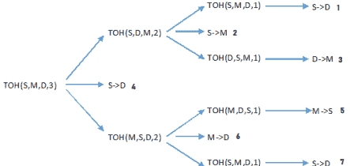

总移动次数 = `2^{3-1} = 4`

## C语言程序

```c
/**************************************************/
#include<stdio.h>
/**************************************************/
void TowersOfanoi(int n, char s, char m, char d);
void main()
{
    int n;
    printf("enter the value");
    scanf("%d", &n);
    TowersOfanoi(n, 'S', 'M', 'D');
}

void TowersOfanoi(int n, char s, char m, char d)
{
    if(n == 1)
      printf("Transfer disk from %c to %c\n", s, d);
    else
    {
      TowersOfanoi(n-1, s, m, d);
      printf("Transfer disk from %c to %c\n", s, d);
      TowersOfanoi(n-1, m, d);
    }
}
```

# 练习题

## 多选题

1) 递归依赖于解决

a) 不同的问题

b) 相同的问题

c) 规模问题

d) 以上均不是

2) 以下哪种问题可以使用递归解决？

a) 数字的阶乘

b) N 斐波那契数

c) 字符串的长度

d) 以上均是

3) 递归类似于哪种？

a) Switch

b) 循环

c) If-else

d) 以上均不是

4) 在递归中，函数停止调用的条件是

a) 最优情况

b) 最坏情况

c) 基础情况 (Base case)

d) 没有条件

5) 以下代码片段：

```c
void my_recursive_function() {
    my_recursive_function();
}
int main() {
    my_recursive_function();
    return 0;
}
```

执行上述片段会发生什么？

a) 代码执行成功且没有输出

b) 代码执行成功并生成随机输出

c) 代码编译时错误

d) 代码运行一段时间后堆栈溢出

6) 以下代码的输出是什么？

```c
void my_recursive_function(int n)
{
  if(n == 0)
    return;
  printf("%d ",n);
  my_recursive_function(n-1);
}

int main()
{
  my_recursive_function(10);
  return 0;
}
```

a) 10

b) 1

c) 10 9 8...0

d) 10 9 8...1

7) 以下代码的基础情况是？

```c
void my_recursive_function(int n)
{
  if(n == 0)
    return;
  printf("%d ",n);
  my_recursive_function(n-1);
}

int main()
{
  my_recursive_function(10);
  return 0;
}
```

a) return

b) printf("%d ", "n")

c) if(n == 0)

d) my_recursive_function(n-1)

8) 执行以下代码时，递归函数被调用多少次？

```c
void my_recursive_function(int n)
{
  if(n == 0)
    return;
  printf("%d , "n");
  my_recursive_function(n-1);
}
int main()
{
  my_recursive_function(10);
  return 0;
}
```

a) 9

b) 10

c) 11

d) 12

9) 以下递归代码的功能是

```c
void my_recursive_function(int n)
{
  if(n == 0)
    return;
  my_recursive_function(n-1);
  printf("%d , "n");
}
```

```c
int main()
{
    my_recursive_recursive_function(10);
    return 0;
}
```

- a) 打印从 10 到 1 的数字

- b) 打印从 10 到 0 的数字

- c) 打印从 1 到 10 的数字

- d) 打印从 0 到 10 的数字

- **10) 下述哪个说法正确？**

- a) 递归比迭代更好

- b) 递归比迭代消耗内存

- c) 递归比迭代节省内存

- d) 迭代比递归更好且简单

- **11. 选出不同项**

- a) 随机值

- b) 返回地址

- c) 局部变量空间

- d) 全局变量空间

- **12. 下列函数中哪个不是线性递归**

- a) 阶乘

- b) 斐波纳契数列

- c) a^b

- d. 自然数和

- **13. 在哈诺问题中，使用 C 语言将 n 个盘从 Tower A 转移到 Tower B 需要多少步**

- a. 2^n

- b. 2^n - 1

- c. 2^{n+1}

- d. 2^{n-1}

- **14. 在 f(8) 的调用中，以下递归产生多少次 f(3) 的调用？**

f(n) = n=1

n=2

f(n-1)+f(n-2) n>2

a. 7

b. 6

c. 5

d. 8

设 m 和 n 为整数 A(m, n) 为递归定义的函数

A(m, n) = 5

A = A(m-n, n+2) + m 如果 m ≥ n

- **15. A(2, 7) 的值是多少？**

- a. 2

- b. 7

- c. 5

- d. 以上都不是

- **16. A(5, 3) 的值是多少？**

- a. 5

- b. 3

- c. 8

- d. 10

- **17. A(15, 5) 的值是多少？**

- a. 15

- b. 2

- c. 5

- d. 42

设 Gcd(m, n) 为如下所示递归递归函数

Gcd(n, m) m<n

Gcd(m, n) = n=0

Gcd(m, m%n) 否则

- **18. Gcd(6, 15) = ?**

- a. 6

- b. 15

- c. 3

- d. 0

- **19. Gcd(20, 28) = ?**

- a. 4

- b. 20

- c. 7

- d. 28

- **20. Gcd(18, 60) = ?**

- a. 9

- b. 3

- c. 6

- d. 以上都不是

## 编程题

1) 编写一个 C 程序使用分治法计算`a^b`。

2) 编写一个 C 程序，在 4x4 的棋盘上放置四个皇后，使得没有任何皇后处于攻击位置。

# 队列

## 12.1. 队列基础

队列是数据的线性集合。它们遵循先进先出（FIFO）原则，这意味着队列中的第一个元素将是第一个被移除的元素。队列有两个端：队尾（REAR）和头部（FRONT）。插入发生在尾，删除发生在头部。

每当提交请求的实体与处理这些请求的实体之间速度不匹配时，就会使用队列，例如：

- 输入输出缓冲区。

- 打印机缓冲区。

- CPU 调度。

- 实时预订系统，如闪购和票务预订系统。

- 轮询调度等。

- 在生活中，我们可以将其与售票窗口前的队列联系起来，按照到达顺序向先到达的人提供票务。这里的服务基于先来先服务（FCFS）原则。

- 铁路线道路的自动信号。

- 工厂输送带上制品的包装。

- 它用于实现各种算法，如图中的广度优先搜索（BFS）、树的层序遍历等。

- 消息投递。

队列的类型：

- 线性队列；

- 循环队列；

- 双端队列；

- 优先级队列。

## 12.2. 线性队列

线性队列用于队列仅一次使用的场景。

| Front=0 | | Rear=2 | | | | | | |
|---|---|---|---|---|---|---|---|---|
| 10 | 20 | 30 | | | | | | |
| 0 | 1 | 2 | 3 | 4 | 5 | 6 | 7 | |
| Front | | Rear | | | | | | |
| 删除元素 | | 插入元素 | | | | | | |

- 队列的原子操作：这里假设队列使用数组实现。

- 初始化：将`REAR`和`FRONT`初始化，以显示队列初始为空。`REAR`初始化为 -1，`FRONT`初始化为 0。在任何时刻，队列中的元素总数可以通过公式给出：

`REAR–1+0 = 0` 队列中的元素个数

ALGORITHM Initialize(Queue Q)

```c
BEGIN:
Q.REAR ← –1
Q.FRONT ← 0
END;
```

时间复杂度：`Θ(1)`

算法中只有两个语句

空间复杂度：`Θ(1)`

没有额外变量

## 12.3. 循环队列

一个简单的循环队列

大小为 8

ALGORITHM Initialize(Queue Q)

```c
BEGIN:
CQ.REAR ← SIZE-1
CQ.FRONT ← SIZE-1
END;
```

时间复杂度：`Θ(1)`

算法只有2条语句

空间复杂度：`Θ(1)`

没有使用额外变量

- 2. **空检查**：这是一个布尔值函数，根据队列是否包含零元素返回真或假。如果`REAR`等于`FRONT`，则循环队列为空。

ALGORITHM Empty (Queue Q)

```c
BEGIN:
IF CQ.REAR = CQ.FRONT THEN
RETURN TRUE
ELSE
RETURN FALSE
END;
```

- 3. **队列删除**：删除操作有一个标准名称，即`DeQueue`。删除从前端（FRONT）进行。如果队列中元素不存在，则无法进行删除。尝试删除元素可能会导致下溢条件。

在线性队列中，先从前端执行删除操作，然后更新`FRONT`。在循环队列中，先更新`FRONT`，然后执行删除操作。

ALGORITHM DeQueue (Queue Q)

```c
BEGIN:
IF Empty(CQ) THEN
WRITE("Queue Underflows")
EXIT(1)
ELSE
CQ.FRONT ← (CQ.FRONT+1)%SIZE
X ← CQ.Item[CQ.FRONT]
RETURN X
END;
```

时间复杂度：`Θ(1)`

在从队列中删除元素时，条件性执行2/3条语句

空间复杂度：`Θ(1)`

只使用了一个变量，即`x`

- 4. **队列插入**：插入操作有一个标准名称，即`Enqueue`。插入在尾端（REAR）进行。在循环队列中插入元素时，首先更新`REAR`。通过更新`REAR`，如果它变得等于`FRONT`，则不允许插入。在允许插入的情况下，`REAR`将变得等于`FRONT`。如果我们稍后尝试对此次插入的元素进行删除，我们将感知到循环队列为空，尽管队列实际上是满的。为了避免这种情况，当我们在队列拥有`SIZE-1`个元素时对其进行限制。进一步尝试插入元素可能会导致溢出条件。

| FRONT | 0 | 1 | 2 | 3 | 4 | 5 |
|---|---|---|---|---|---|---|
| FRONT | | | | | | | |
| A | | | | | | | |
| 0 | 1 | 2 | 3 | 4 | 5 | Enqueue(A) |
| REAR | | | | | | | |
| A | B | | | | | | |
| 0 | 1 | 2 | 3 | 4 | 5 | Enqueue(B) |
| REAR | | | | | | | |
| B | C | | | | | | |
| 0 | 1 | 2 | 3 | 4 | 5 | Enqueue(C) |
| FRONT | REAR | | | | | | |
| B | C | | | | | | |
| 0 | 1 | 2 | 3 | 4 | 5 | Dequeue) |
| FRONT | REAR | | | | | | |
| C | | | | | | | |
| 0 | 1 | 2 | 3 | 4 | 5 | Dequeue) |
| REAR | FRONT | | | | | | |
| 0 | 1 | 2 | 3 | 4 | 5 | Dequeue) FRONT+REAR QUEUE IS EMPTY |

ALGORITHM Enqueue(循环队列 CQ, key)

```c
BEGIN:
IF (CQ.REAR+1)%SIZE == CQ.FRONT THEN
WRITE("Queue Overflows")
EXIT (1)
ELSE
CQ.REAR ← (CQ.REAR+1)%SIZE
CQ.Item[CQ.REAR] ← key
```

时间复杂度：`Θ(1)`

在向队列中添加元素时，执行了3条语句

空间复杂度：`Θ(1)`

这里没有使用额外变量

## C程序

```c
/**************************************************/
#include<stdio.h>
#include<stdlib.h>
#define SIZE 10
/**************************************************/
void Initialize();
void Enqueue(char);
int DeQueue();
/**************************************************/
struct CircularQueue
{
    int REAR;
    int FRONT;
    char item[SIZE];
}; cq;
/**************************************************/
main()
{
    char x;
    Initialize('A');
    Enqueue('A');
    Enqueue('B');
    Enqueue('C');
    x= DeQueue();
    printf("\n%c", x);
    Enqueue('Q');
    Enqueue('W');
    Enqueue('E');
    Enqueue('T');
    Enqueue('Y');
    x= DeQueue();
    printf("\n%c", x);
    x= DeQueue();
    printf("\n%c", x);
    x= DeQueue();
    printf("\n%c", x);
    x= DeQueue();
    printf("\n%c", x);
}
/**************************************************/
Initialize()
{
    cq.REAR=SIZE-1;
    cq.FRONT=SIZE-1;
}
/**************************************************/
Enqueue(char key)
{
    if((cq.REAR+1)%SIZE == cq.FRONT)
    {
        printf("Queue Overflows");
        exit(1);
    }
    cq.REAR=(cq.REAR+1)%SIZE;
    cq.item[cq.REAR]=key;
}
/**************************************************/
int DeQueue()
{
    char x;
    if(cq.REAR == cq.FRONT)
    {
        printf("Queue Underflows");
        exit(1);
    }
    cq.FRONT=(cq.FRONT+1)%SIZE;
    x=cq.item[cq.FRONT];
    return x;
}
```


# 2.4 优先级队列

在这里，每个元素都有自己的优先级。例如，在元素排序时，小元素的优先级高于大元素。在任务执行中，某些进程的优先级比其他进程高。这些进程在低优先级进程之前获得执行的机会。它最广泛用于：

- 在带宽管理中创建排序序列。
- 用于实现 Dijkstra 算法、最小生成树、哈夫曼编码等。
- CPU 调度。
- 人工智能中的搜索。

1. **优先级队列的插入**：优先级队列的插入操作使得高优先级元素获得适当的位置。
2. **优先级队列的删除**：先删除高优先级元素。高优先级元素在低优先级元素之前被删除。如果两个元素的优先级相同，则按先来先出（FIFO）顺序删除。
3. **优先级队列的实现**：优先级队列可以使用数组、堆或链表实现。

## 2.4.1 优先级队列的数组实现

对于优先级队列的数组实现，假设元素的内容代表优先级。数字越小表示优先级越高，数字越大表示优先级越低。

### 优先级队列插入

算法 `PQInsert(A[ ], N, key)`：

```text
BEGIN:

i ← 0

WHILE i <= N-1 AND key >= A[i] DO

    i ← i+1

FOR j ← N-1 TO STEP -1 DO

    A[j+1] ← A[j]

A[i] ← key

N ← N+1

END;
```

**时间复杂度：** `Θ(N)`

`while` 循环执行 `i` 次语句，`for` 循环执行 `n-i` 次语句，还有三条语句用于赋值 `i`、`A[i]` 的值以及增加 `N` 的值。在任何情况下，都执行了 `i+n-i+3` 条语句。

**空间复杂度：** `Θ(1)`

这里使用了两个变量 `i` 和 `j`。

### 优先级队列删除

算法 `PQDeletion(A[ ], N)`：

```text
BEGIN:

x ← A[0]

FOR j ← 1 TO N

    A[j-1] ← A[j]

N ← N-1

RETURN x

END;
```

## C 程序

```c
/**************************************************/

#include <stdio.h>

****************************************************

void Traverse(int A[ ], int N){

    for (int i=0; i <= N-1; i++) {

        printf("%d", A[i]);

    }

}

****************************************************

void PQInsertion(int A[ ], int *N, int key){

    int i=0;

    while (key >= A[i]) {

        i=i+1;

    }

    for (int j=*N-1; j >= i; j--) {

        A[j+1]=A[j];

    }

    A[i]=key;

    *N=*N+1;

}

****************************************************

int PQDelete(int A[ ], int *N){

    int x;

    x=A[0];

    for (j=1; j <= *N-1;j++) {

        A[j-1]=A[j];

    }

    *N=*N-1;

    return x;

}

****************************************************

int main(int argc, const char * argv[]) {

    int A [20]={1, 2, 3, 4, 5, 6, 7};

    int N=7;

    PQInsertion(A, &N, 6);

    Traverse(A, N);

    x=PQDelete(A, &N)

    printf("Deleted Element from Priority Queue is=> %d", x);

}
```

## 2.4.2 堆实现

堆可以实现优先级队列。堆节点中的键代表优先级。

如果在最大堆中执行重复删除，将得到降序序列。因此它可以被重命名为降序优先级队列。

如果在最小堆中执行重复删除，将得到升序序列。因此它可以被重命名为升序优先级队列。

### 升序优先级队列（最小堆）的插入和删除

#### 算法 `PQInsert(A[ ], N, key)`

```text
BEGIN:

A[N+1] ← key

i ← N+1

WHILE i>1 AND A[i]<A[i/2] DO

    Exchange(A[i], A[i/2])

    i ← i/2

N ← N+1

END;
```

**时间复杂度：** `Θ(log N)`

**空间复杂度：** `Θ(1)`

#### 算法 `ExtractMin(A[ ], N)`

```text
BEGIN:

key ← A[1]

A[1] ← A[N]

Adjust(A, 1, N-1)

N ← N - 1

END;
```

### 时间复杂度：`Θ(log₂N)`

当元素从顶部删除时，会调用 `Adjust`，其复杂度为 `log₂N`。因此为 `3 + log₂2N`。

### 空间复杂度：`Θ(1)`

唯一的新变量是 `key`。

# 练习题

1. 显示出在容量为 8 的线性队列（Linear Queue）上执行以下操作序列的结果。初始队列为空。

   - 插入两个元素 A 和 B。
   - 删除一个元素。
   - 插入三个元素 P、Q、R。
   - 删除一个元素。
   - 插入两个元素 X、Y。
   - 删除一个元素。
   - 插入两个元素 C 和 D。

2. 显示出在容量为 8 的循环队列（Circular Queue）上执行以下操作序列的结果。初始队列为空。

   - 插入两个元素 A 和 B。
   - 删除一个元素。
   - 插入三个元素 P、Q、R。
   - 删除一个元素。
   - 插入两个元素 X、Y。
   - 删除一个元素。
   - 插入两个元素 C 和 D。

3. 写一个 C 程序，实现输入受限的双端队列（Input restricted Double ended queue）。

4. 写一个 C 程序，实现输出受限的双端队列（Output restricted Double ended queue）。

5. 考虑下面这个双端队列：

| 右 (Right) |  |  |  |  |  |
|---|---|---|---|---|---|
| A | B |  | D | E | F |

在什么情况下发生溢出（overflow）？

- `Left = Right`
- `Left + 1 = Right`
- `Left = right + 1`
- 无

6. 给出一个线性队列：

| 1 | 2 | 3 | 4 | 5 | 6 | 7 |
|---|---|---|---|---|---|---|
|  |  | A | B | C |  |  |

在执行以下操作后，队头（front）和队尾（rear）的位置在哪里？

`Insert(Q, D)`、`Remove(Q)`、`Insert(Q, E)`

- a. `Rear=6, Front=3`
- b. `Rear=7, Front=4`
- c. `Rear=7, Front=3`
- d. 以上均不是

7. 给出一个线性队列：

| 1 | 2 | 3 | 4 | 5 |  | 7 |
|---|---|---|---|---|---|---|
|  |  | A | B | C |  |  |

在执行以下操作后，队头（front）和队尾（rear）的位置在哪里？

`Insert(Q, D)`、`Insert(Q, E)`、`Remove()`、`Insert(Q, F)`

- a. `Rear=7, Front=4`
- b. `Rear=7, Front=3`
- c. `Rear=8, Front=3`
- d. 队列溢出

8. 给出一个循环队列：

| 1 | 2 | 3 | 4 | 5 | 6 | 7 |
|---|---|---|---|---|---|---|
| A | B | C |  |  |  |  |

在执行以下操作后，队头（front）和队尾（rear）的位置在哪里？

`Insert(Q, X)`、`Insert(Q, Y)`、`Remove(Q)`、`Insert(Q, Z)`

- a. `Rear=6, Front=1`
- b. `Rear=6, Front=7`
- c. `Rear=7, Front=1`
- d. 以上均不是

9. 给出一个循环队列：

| 1 | 2 | 3 | 4 | 5 | 6 | 7 |
|---|---|---|---|---|---|---|
| A | B | C |  |  |  |  |

在执行以下操作后，队头（front）和队尾（rear）的位置在哪里？

`Insert(Q, X)`、`Insert(Q, Y)`、`Remove(Q)`、`Insert(Q, Z)`、`Insert(Q, D)`、`Insert(Q, E)`

- a. `Rear=1, front=1`
- b. `Rear=1, front=7`
- c. `Rear=1, front=2`
- d. 队列溢出

## 使用 C 语言编程的数据结构与算法实用方法

10. 在 C 中实现容量为 `MAXQUEUE` 的线性队列时，上溢（underflow）发生在：

   - a. `Front = 0`
   - b. `Rear = -1`
   - c. `Rear = Front`
   - d. `Rear – Front + 1 = 0`

11. 在 C 中实现容量为 `MAXQUEUE` 的线性队列时，溢出（overflow）发生在：

   - a. `Front = MAXQUEUE`
   - b. `Rear = MAXQUEUE - 1`
   - c. `Rear = Front`
   - d. `Rear – Front + 1 = 0`

12. 在容量为 `MAXQUEUE` 的循环队列中，溢出发生在：

   - a. 在增加 `rear` 之前，`rear = front`
   - b. 在增加 `rear` 之后，`rear = front`
   - c. 在增加 `rear` 之前，`rear = front + 1`
   - d. 在增加 `rear` 之后，`rear = front + 1`

13. 在容量为 `MAXQUEUE` 的循环队列中，溢出发生在：

   - a. 在增加 `rear` 之前，`rear = front`
   - b. 在增加 `rear` 之后，`rear = front`
   - c. 在增加 `rear` 之前，`rear = front + 1`
   - d. 在增加 `rear` 之后，`rear = front + 1`

# 数据结构与算法的实用方法（C 语言编程）

（注：此处后续文本似乎存在重复，已根据要求仅保留非重复部分。）

## 算法 `InsertAfter(p, key)`

开始：

```text
q=GetNode()

q->Info=key

q->Next=p->Next

p->Next=q
```

结束。

### 时间复杂度：`θ(1)`

上述算法执行了 4 条语句。

### 空间复杂度：`θ(1)`

使用了一个额外的变量 `q`。此外，内存中为新节点分配了空间。

- **尾部插入**：对于尾部插入，需要遍历链表到最后一个节点。通过设置指针将新节点插入到最后一个节点之后。新创建的节点的后续字段应设置为 `NULL`，因为这将是最后一个节点。

## 算法 `InsertEnd(START, key)`

开始：

```text
p=START

WHILE p!=NULL DO

    p=p->Next

q = GetNode()

q->Info=key

q->Next=NULL

p->Next=q
```


# C 语言编程数据结构与算法的实用方法

## 初始链表

```text
p = START
WHILE p != NULL
    p->next
```

## 时间复杂度：Θ(N)

`while` 循环一直运行到链表的末尾。因此，对于一个包含 `N` 个项的链表，将执行 `N+5` 条语句。

## 空间复杂度：Θ(1)

这里使用的额外变量是 `p` 和 `q`。此外，在新节点中分配了空间。

## 删除

执行删除操作时，应该销毁被删除节点占用的内存并将信息内容返回给调用函数。让我们假设 `FreeNode` 函数销毁给定节点的内存。

### 从头部删除

对于删除第一个节点，需要将 `START` 移动到第二个节点。

```text
p = START
START = p->Next
x = p->info
FreeNode(p)
RETURN x
```

### 算法 `DelBeg(START)`

```text
BEGIN:
    p = START
    START = START->Next
    x = p->Info
    FreeNode(p)
    RETURN x
END;
```

### 时间复杂度：Θ(1)

上述算法无条件地执行了四条语句。

### 空间复杂度：Θ(1)

使用了两个额外变量 `p` 和 `x`。

### 从尾部删除

对于从尾部删除，需要遍历链表到最后一个节点。我们还需要保留倒数第二个节点的地址，因为它将变成最后一个节点。

为了这个目的，这里引入了前驱节点的概念。

### 算法 `DeleteEnd(START)`

```text
BEGIN:
    p = START
    q = NULL

    WHILE p->Next != NULL DO
        q = p
        p = p->Next

    q->Next = NULL
    x = p->Info
    FreeNode(q)
    RETURN x
END;
```

### 时间复杂度：Θ(N)

`while` 循环重复执行两条语句直到到达最后一个元素。此外，循环外还执行了五条语句。

### 空间复杂度：Θ(1)

利用了三个额外变量，即 `p`、`q` 和 `x`。

### 删除中间节点

假设已给出被删除节点之前的节点地址。需要调整指针以维持链表连接的断开。

### 算法 `DeleteAft(p)`

```text
BEGIN:
    IF p == NULL OR p->Next = NULL THEN
        WRITE("Void Deletion")
        EXIT(1)

    q = p->Next
    x = q->Info
    p->Next = q->Next
    FreeNode(q)
    RETURN x
END;
```

### 时间复杂度：Θ(1)

这里执行了语句。

### 空间复杂度：Θ(1)

除了传递的参数外，还使用了两个额外变量 `q` 和 `x`。

### 遍历

只需从第一个节点开始访问每个节点。

### 算法 `Traverse(START)`

```text
BEGIN:
    p = START

    WHILE p != NULL DO
        WRITE p->Info
        p = p->Next
END;
```

### 时间复杂度：Θ(N)

`while` 循环执行了 `2n` 条语句，其中链表中有 `n` 个元素。此外，还执行了一条语句来初始化 `p`。

### 空间复杂度：Θ(1)

`p` 被视为一个额外变量。

## C 程序

```c
/****************************************************/

#include <stdio.h>
#include <stdlib.h>

/****************************************************/

struct node
{
    int info;
    struct node *next;
};

/****************************************************/

struct node *GetNode()
{
    struct node *p;

    p = (struct node *)malloc(sizeof(struct node));
    return p;
}

/****************************************************/

void InsertBeginning(struct node **START, int key)
{
    struct node *p, *temporary;

    p = GetNode();
    p->info = key;
    p->next = (*START);
    (*START) = p;
}

/****************************************************/

void InsertEnd(struct node **START, int key)
{
    struct node *p, *q;

    p = *START;

    while (p->next != NULL)
    {
        p = p->next;
    }

    q = GetNode();
    q->info = key;
    q->next = NULL;
    p->next = q;
}

/****************************************************/

void InsertAfter(struct node **q, int x)
{
    struct node *p;

    p = GetNode();
    p->info = x;
    p->next = (*q)->next;
    (*q)->next = p;
}

/****************************************************/

void DeleteBeginning(struct node **START)
{
    if (*START == NULL)
    {
        printf("void DELETION\n");
        exit(1);
    }
    else
    {
        struct node *p;

        p = (*START);
        (*START) = p->next;

        int x = p->info;
        free(p);

        printf("Deleted element %d\n", x);
    }
}

/**************************************************/

void DeleteAfter(struct node **p)
{
    if (*p == NULL || (*p)->next == NULL)
    {
        printf("void DELETION\n");
        exit(1);
    }
    else
    {
        struct node *q;

        q = (*p)->next;
        (*p)->next = q->next;

        int x = q->info;
        free(q);

        printf("Deleted element %d\n", x);
    }
}

/**************************************************/

void DeleteEnd(struct node **START)
{
    if (*START == NULL)
    {
        printf("void DELETION\n");
        exit(1);
    }
    else
    {
        struct node *p, *q;

        p = (*START);
        q = NULL;

        while (p->next != NULL)
        {
            q = p;
            p = p->next;
        }

        if (q == NULL)
        {
            (*START) = NULL;
        }
        else
        {
            q->next = NULL;
        }

        int x = p->info;
        free(p);

        printf("Deleted element %d\n", x);
    }
}

/**************************************************/

void Traverse(struct node *START)
{
    struct node *p;

    p = START;

    while (p != NULL)
    {
        printf("%d->", p->info);
        p = p->next;
    }

    printf("NULL\n");
}

int main()
{
    struct node *START;
    struct node *p;

    START = NULL;

    InsertBeginning(&START, 700);
    InsertBeginning(&START, 600);
    InsertBeginning(&START, 100);
    InsertBeginning(&START, 400);

    p = START;

    InsertBeginning(&START, 300);
    InsertBeginning(&START, 100);
    InsertBeginning(&START, 100);
    InsertBeginning(&START, 50);

    InsertEnd(&START, 750);
    InsertAfter(&p, 350);

    Traverse(START);

    DeleteBeginning(&START);
    Traverse(START);

    DeleteEnd(&START);
    Traverse(START);

    DeleteAfter(&p);
    Traverse(START);
}
```

## 13.3. 相关函数

### 元素两两交换

算法 `PairWiseSwap(START)`：

```text
BEGIN:
    p = START

    WHILE p != NULL && p->Next != NULL DO
        Swap(p->Info, p->Next->Info)
        p = p->Next

        IF (p != NULL) THEN
            p = p->Next
        ELSE
            BREAK

    Traverse(START)
END;
```

### 时间复杂度：Θ(N)

`while` 循环在迭代中执行四条语句。它从链表的第一个节点遍历到第二个节点。此外，`Traverse` 函数具有 Θ(N) 的时间复杂度。因此，执行的语句数为 `4(N-1) + CN`。

### 空间复杂度：Θ(1)

`p` 被视为一个额外变量。

### 逆序打印链表内容

```text
ALGORITHM RevTraverse(START)

BEGIN:
    IF START != NULL
        RevTraverse(START)
        WRITE(Info(START))
END;
```

### 时间复杂度：Θ(N)

由于这是一个递归函数，会形成一个大小为 `n` 的栈，每次执行一条语句。

### 空间复杂度：Θ(N)

形成的调用栈的高度为 `N`，其中 `N` 是链表中的元素数量。

## 相关 C 代码

```c
#include <stdlib.h>

/**************************************************/

struct node
{
    int info;
    struct node *next;
};

/**************************************************/
```

```c
struct node *GetNode()
{
    struct node *p;

    p = (struct node *)malloc(sizeof(struct node));
    return p;
}

/**********************************************************/
```

```c
void InsertBeginning(struct node **START, int key)
{
    struct node *p, *temporary;

    p = GetNode();
    p->info = key;
    p->next = (*START);
    (*START) = p;
}

/**********************************************************/
```

```c
void InsertAfter(struct node **q, int x)
{
    struct node *p;

    p = GetNode();
    p->info = x;
    p->next = (*q)->next;
    (*q)->next = p;
}
```

## 240 使用 C 语言编程数据结构与算法的实用方法

```c
void InsertAtPosition(struct node **START, int pos, int item)
{
    struct node *p;

    p = GetNode();
    p->info = item;

    if (*START == NULL)
    {
        *START = p;
    }
    else
    {
        int i = 0;
        struct node *temporary = *START;

        while (temporary->next != NULL)
        {
            i = i + 1;

            if (i == pos - 1)
            {
                p->next = temporary->next;
                temporary->next = p;
                break;
            }

            temporary = temporary->next;
        }
    }
}

/****************************************************************/

void DisplayReverse(struct node *START)
{
    if (START != NULL)
    {
        DisplayReverse((START)->next);
    }

    printf("%d->", (START)->info);
}

/****************************************************************/

void Traverse(struct node *START)
{
    struct node *p;

    p = START;

    while (p != NULL)
    {
        printf("%d->", p->info);
        p = p->next;
    }

    printf("NULL\n");
}

/****************************************************************/

int main()
{
    struct node *START;
    struct node *p;

    START = NULL;

    InsertBeginning(&START, 700);
    InsertBeginning(&START, 650);
    InsertBeginning(&START, 500);
    InsertBeginning(&START, 450);
    InsertBeginning(&START, 330);
    InsertBeginning(&START, 200);
    InsertBeginning(&START, 100);
    InsertBeginning(&START, 50);

    InsertAtPosition(&START, 2, 150);

    printf("start\n");
    Traverse(START);
```

## 使用 C 语言编程数据结构与算法的实用方法

```c
struct node *START1 = NULL, *START2 = NULL;

InsertBeginning(&START1, 750);
InsertBeginning(&START1, 650);
InsertBeginning(&START1, 550);
InsertBeginning(&START1, 450);
InsertBeginning(&START1, 330);

printf("\nstart\n");
Traverse(START1);
```

```c
printf("\nreverse of start\n");
DisplayReverse(START);

printf("\nreverse of start\n");
DisplayReverse(START);
}
```

### 反转线性链表

```text
算法 ReverseLinkedList(START)

开始:

current = START
previous = NULL

当 current != NULL 时执行循环:
    Next = current->Next
```


`current->Next = previous`

`previous = current`

`current = Next`

`START = previous`

返回`START`

结束

### 时间复杂度：Θ(N)

`while`循环在每次迭代中执行了四条语句。循环运行`N`次，其中`N`是链表中的元素数量。除了循环之外，算法中还执行了四条语句。

### 空间复杂度：Theta(1)

仅使用了两个额外变量，即`current`和`previous`。

### C语言程序

```c
#include<stdio.h>
#include<stdlib.h>

struct node
{
    int info;
    struct node *next;
};

struct node *GetNode()
{
    struct node *p;
    p=(struct node*)malloc(sizeof(struct node));
    return p;
}

void InsertBeg(struct node **START, int x)
{
    struct node *temporary;
    temporary=GetNode();
    temporary->info=x;
    temporary->next=(*START);
    (*START)=temporary;
}

void Traverse(struct node *START)
{
    struct node *t;
    t=START;
    while(t!=NULL)
    {
        printf("%d\t\t", t->info);
        t=t->next;
    }
}

struct node *reverse(struct node*START1)
{
    struct node *curr, *prev, *next;
    curr=START1;
    prev=NULL;
    while(curr!=NULL)
    {
        next=curr->next;
        curr->next=prev;
        prev=curr;
        curr=next;
    }
    START1=prev;
    return START1;
}

int main()
{
    struct node *START1, *START2;
    START1=NULL;
    START2=NULL;
    printf("Before reverse...\n");
    InsertBeg(&START1, 10);
    InsertBeg(&START1, 20);
    InsertBeg(&START1, 30);
    Traverse(START1);
    printf("\nAfter reverse...\n");
    START2 = reverse(START1);
    Traverse(START2);
}
```

## 线性链表的反转

线性链表的反转：需要将第一个链表的尾部连接到第二个链表的头部。为了实现这一点，我们需要遍历第一个链表直到第一个链表的最后一个节点。

```text
算法 ConcatList(list1,list2)
开始:
p=list1
当 p->next!=NULL 时执行循环:
  p=p->next
p->next=list2
返回 list1
```

### 时间复杂度：Θ(N)，N 是第一个链表的长度。为了实现这一点，我们需要遍历第一个链表直到第一个链表的最后一个节点。

### 空间复杂度：Theta(1)，使用了额外的变量`p`。

# 246 使用C语言编程数据结构与算法的实用方法

# 248 使用C语言编程数据结构与算法的实用方法

```c
printf("\n");
printf("两个链表的连接结果为...\n");
START3 = concat(START1, START2);
Traverse(START3);
```

## 升序链表的创建

让我们假设已经存在一个升序的链表。对于在这样的链表中进行插入，我们需要搜索适当的插入位置。这里有以下可能的情况：

- 如果键要插入在第一个节点的数据之前：调用`InsertBeginning`函数
- 在中间位置：调用`InsertAfter`函数
- 在末尾：在最后一个节点调用`InsertAfter`函数。

```text
算法 AscendingOrderList (START, key)
开始:
P=START
Q=NULL
当 P!=NULL 且 key >= P->Info 时执行循环:
链表 249
Q=P
P=P→Next
IF Q = NULL THEN
InsertBeginning(START, key)
ELSE
InsertAfter(Q, key)
END;
```

### 时间复杂度: O(N), Ω(1)

在最好的情况下，要插入的元素是最小的。因此，不会进入循环。只需执行五个语句。

在最坏的情况下，新元素是链表中所有元素中最大的。因此，循环将运行`N`次（其中`N`是链表的节点数）。之后，将执行两条语句。

### 空间复杂度:Θ(1)

使用的额外变量有两个，即`p`和`q`。

### C 语言程序

```c
#include<stdio.h>
#include<stdlib.h>

struct node
{
    int info;
    struct node *next;
};

struct node *GetNode()
{
    struct node *p;
    p=(struct node *)malloc(sizeof(struct node));
    return p;
}

void InsertBeginning(struct node **START, int key)
{
    struct node *p, *temporary;
    p=GetNode();
    p->info=key;
    p->next=(*START);
    (*START)=p;
}

void InsertAftervalue(struct node **START, int y, int x)
{
    struct node *q, *temporary;
    temporary=(*START);
    while(temporary!=NULL)
    {
        if(temporary->info == y)
        {
            break;
        }
        else
            temporary=temporary->next;
    }
    q=GetNode();
    q->info=x;
    q->next=(temporary)->next;
    (temporary)->next=q;
}

void InsertAfter(struct node **q, int x)
{
    struct node *p;
    p=GetNode();
    p->info=x;
    p->next=(*q)->next;
    (*q)->next=p;
}

void OrderedInsert(struct node **START, int key)
{
    struct node *p, *q;
    p=(*START);
    q=NULL;
    while(p!=NULL && key >= p->info)
    {
        q=p;
        p=p->next;
    }
    if(q == NULL)
        InsertBeginning(&(*START), key);
    else
        InsertAfter(&q, key);
}

void Traverse(struct node *START)
{
    struct node *p;
    p=(*START);
    while(p!=NULL)
    {
        printf("%d->", p->info);
        p=p->next;
    }
    printf("NULL\n");
}

int main()
{
    struct node *START;
    struct node *p;
    START=NULL;
    InsertBeginning(&START, 700);
    InsertBeginning(&START, 600);
    InsertBeginning(&START, 500);
    InsertBeginning(&START, 400);
    InsertBeginning(&START, 300);
    InsertBeginning(&START, 200);
    InsertBeginning(&START, 100);
    Traverse(START);

    InsertAftervalue(&START, 300, 350);
    Traverse(START);

    OrderedInsert(&START, 150);
    Traverse(START);

    OrderedInsert(&START, 750);
    Traverse(START);

    OrderedInsert(&START, 650);
    Traverse(START);

    OrderedInsert(&START, 50);
    Traverse(START);
}
```

## 合并两个升序链表

这个过程与排序章节中讨论的数组合并操作非常相似。在此过程中，我们比较两个链表的元素。哪一个较小就将其添加到第三个链表的末尾。如果无法进行比较，则哪个链表还有剩余节点，其元素将逐个添加到第三个链表的末尾。

### 算法 Merge(list1, list2)

开始:

```text
p=list1
q=list2
List3=NULL
WHILE p!=NULL && q!=NULL DO
  If(p->Info < q->Info) THEN
    InsertEnd(list3, p->Info)
    p=p->Next
  ELSE
    InsertEnd(list3, q->Info)
    q=q->Next
WHILE p!=NULL DO
  InsertEnd(list3, p->Info)
  p=p->Next
WHILE q!=NULL DO
  InsertEnd(list3, q->Info)
  q=q->Next
RETURN list3
```

时间复杂度: $\Theta(M+N)$，`M`和`N`分别是第一个和第二个链表的长度。

我们可以看到，为了复制两个链表的所有元素，我们需要从每个元素的开始进行迭代。因此，在任何情况下，循环共同导致`m+n`次迭代。

### 空间复杂度: $\Theta(M+N)$

形成了一个长度为`m+n`的新链表来容纳两个列表的所有元素。

这里的`InsertEnd`重写为：

### 算法 InsertEnd(START, key)

开始:

```text
p=START
IF START == NULL THEN
InsertBeginning(START, key)
ELSE
WHILE p!=NULL DO
  p=p->Next
q = GetNode()
q->Info=key
p->Next=q
END;
```

### C 语言程序

```c
#include<stdio.h>
#include<stdlib.h>

struct node
{
    int info;
    struct node *next;
};

struct node *GetNode()
{
    struct node *p;
    p=(struct node *)malloc(sizeof(struct node));
    return p;
}

void InsertBeginning(struct node **START, int key)
{
    struct node *p, *temporary;
    p=GetNode();
    p->info=key;
    p->next=(*START);
    (*START)=p;
}

void InsertAftervalue(struct node **START, int y, int x)
{
    struct node *q, *temporary;
    temporary=(*START);
    while(temporary!=NULL)
    {
        if(temporary->info == y)
        {
            break;
        }
        else
            temporary=temporary->next;
    }
    q=GetNode();
    q->info=x;
    q->next=(temporary)->next;
    (temporary)->next=q;
}

void InsertAfter(struct node **q, int x)
{
    struct node *p;
    p=GetNode();
    p->info=x;
    p->next=(*q)->next;
    (*q)->next=p;
}

struct node mergelist(struct node **START, struct node **START1)
{
    struct node *p, *q, *d, *k;
    p=(*START);
    q=(*START1);
    d=NULL;
    if(p->info>q->info)
    {
        InsertBeginning(&d, p->info);
        p=p->next;
    }
    else
    {
        InsertBeginning(&d, q->info);
        q=q->next;
    }
    k=d;
    while(p!=NULL && q!=NULL)
    {
        if(p->info>q->info)
        {
            InsertAfter(&d, q->info);
            d=d->next;
            q=q->next;
        }
        else
        {
            InsertAfter(&d, p->info);
            d=d->next;
            p=p->next;
        }
    }
    while(p!=NULL)
    {
        InsertAfter(&d, p->info);
        d=d->next;
        p=p->next;
    }
    while(q!=NULL)
    {
        InsertAfter(&d, q->info);
        d=d->next;
        q=q->next;
    }
    return k;
}

void Traverse(struct node *START)
{
    struct node *p;
    p=(*START);
    while(p!=NULL)
    {
        printf("%d->", p->info);
        p=p->next;
    }
}
```


```c
printf("%0d->to", p->info);

p=p->next;

}

printf("NULL\n");

}

```

```c
int main()

{

struct node *START;

struct node *p;

START=NULL;

InsertBeginning(&START, 700);

InsertBeginning(&START, 600);

InsertBeginning(&START, 500);

InsertBeginning(&START, 400);

InsertBeginning(&START, 300);

InsertBeginning(&START, 200);

InsertBeginning(&START, 100);

Traverse(START);

InsertAftervalue(&START, 300, 350);

Traverse(START);

struct node *START1=NULL, *START2=NULL;

InsertBeginning(&START1, 750);

InsertBeginning(&START1, 650);

InsertBeginning(&START1, 550);

InsertBeginning(&START1, 450);

InsertBeginning(&START1, 330);

Traverse(START1);

START2=mergelist(&START, &START1);

printf("after merge\n");

Traverse(START2);

}

```

## 13.4. 使用链表进行集合操作

### 两个有序链表的并集（将链表元素视为集合）

#### 算法 `Union(START1, START2)`

开始：

```text
START3=NULL

p=START

q=START2

WHILE p!=NULL&&q!=NULL DO

IF p→ Info = q→ Info THEN

p=p→ Next

ELSE

IF p→ Info<q→ Info THEN

InsertEnd(START3, p→ Info)

p=p→ Next

ELSE

InsertEnd(START3, p→ Info)

q=q→ Next
```

#### C语言程序

```c
struct node

{

  int info;

  struct node *next;

};

/***************************************************/

struct node *GetNode()

{

  struct node *p;

  p=(struct node*)malloc(sizeof(struct node));

  return p;

}

/***************************************************/

void InsertBeginning(struct node **START, int key)

{

  struct node *p, *temporary;

  p=GetNode();

  p->info=key;

  p->next=(START);

  (*START)=p;

}

/***************************************************/

void InsertAfter(struct node **q, int x)

{

  struct node *p;

  p=GetNode();

  p->info=x;

  p->next=(q)->next;

  (*q)->next=p;

}

/***************************************************/

struct node *union1(struct node *START, struct node **START1)

{

  struct node *p, *q, *d, *k;

  p=(*START);

  q=(*START1);

  d=NULL;

  if(p->info == q->info)

  {

    InsertBeginning(&d, q->info);

    q=q->next;

  }

  else if(p->info<q->info)

  {

    InsertBeginning(&d, p->info);

    p=p->next;

  }

  else

  {

    InsertBeginning(&d, q->info);

    q=q->next;

  }

  k=d;

  while(p!=NULL&&q!=NULL)

  {

    if(p->info>q->info)

    {

      InsertAfter(&d, q->info);

      d=d->next;

      q=q->next;

    }

    else if(p->info<q->info)

    {

      InsertAfter(&d, p->info);

      d=d->next;

      p=p->next;

    }

    else if(p->info == q->info)

    {

      InsertAfter(&d, p->info);

      d=d->next;

      q=q->next;

      p=p->next;

    }

  }

  while(p!=NULL)

  {

    InsertAfter(&d, p->info);

    d=d->next;

    p=p->next;

  }

  while(q!=NULL)

  {

    InsertAfter(&d, q->info);

    d=d->next;

    q=q->next;

  }

  return k;

}

```

```c
/********************************************************************/

void Traverse(struct node *START)

{

  struct node *p;

  p=(START);

  while(p!=NULL)

  {

    printf("%d\to\to", p->info);

    p=p->next;

  }

  printf("NULL\n");

}

int main()

{

  struct node *START;

  struct node *p;

  START=NULL;

  InsertBeginning(&START, 700);

  InsertBeginning(&START, 650);

  InsertBeginning(&START, 500);

  InsertBeginning(&START, 450);

  InsertBeginning(&START, 330);

  InsertBeginning(&START, 200);

  InsertBeginning(&START, 50);

  Traverse(START);

  struct node *START1=NULL, *START2=NULL;

  InsertBeginning(&START1, 750);

  InsertBeginning(&START1, 650);

  InsertBeginning(&START1, 550);

  InsertBeginning(&START1, 450);

  InsertBeginning(&START1, 330);

  Traverse(START1);

  START2=union1(&START, &START1);

  printf("after union");

  Traverse(START2);

}

```

### 两个有序链表的交集（链表被视为集合）

#### 算法 `Intersection(list1, list2)`

开始：

```text
list3=NULL
p=list1
q=list2

WHILE p!=NULL && q!=NULL DO
  IF p->info == q->info THEN
    InsertEnd(list3, p->info)
    p=p->Next
    q=q->Next
  ELSE
    IF p->info<q->info THEN
      p=p->Next
    ELSE
      q=q->Next

RETURN list3
```

结束。

### 时间复杂度：Θ(M+N)

M 和 N 分别是第一个和第二个链表的长度。

正如我们所见，为了比较两个链表中的所有元素，我们需要从每个元素开始进行迭代。因此，在任何情况下，循环共同将产生 m+n 次迭代。

### 空间复杂度：Θ(M+N)

形成了一个长度为 m+n 的新链表来容纳两个链表的元素。

### C语言程序

```c
/****************************************************************/

#include<stdio.h>

#include<stdlib.h>

/************************************************/

struct node

{

  int info;

  struct node *next;

};

/****************************************************************//

struct node *GetNode()

{

  struct node *p;

  p=(struct node*)malloc(sizeof(struct node));

  return p;

}

/*********************************************************************************/

void InsertBeg(struct node **START, int x)

{

  struct node *temporary;

  temporary=GetNode();

  temporary->info=x;

  temporary->next=(*START);

  (*START)=temporary;

}

/**********************************************************************************/

void Traverse(struct node *START)

{

  struct node *t;

  t=START; // 已从 t=NULL 修正

  while(t!=NULL)

  {

    printf("%d\n", t->info);

    t=t->next;

  }

}

/**********************************************************************************/

struct node *Intersection(struct node *list1, struct node*list2)

{

  struct node *list3=NULL;

  struct node *p, *q;

  p=list1;

  q=list2;

  while(p!=NULL&&q!=NULL)

  {

    if(p->info == q->info)

    {

      InsertBeg(&list3, p->info);

      p=p->next;

      q=q->next;

    }

    else

    {

      if(p->info<q->info)

      {

        p=p->next;

      }

      else

      {

        q=q->next;

      }

    }

  }

  return list3;

}

/************************************************/

int main()

{

  struct node *START1, *START2, *START3, *t;

  START1=NULL;

  START2=NULL;

  START3=NULL;

  printf("第一个链表为...\n ");

  InsertBeg(&START1, 10);

  InsertBeg(&START1, 20);

  InsertBeg(&START1, 30);

  InsertBeg(&START1, 40);

  InsertBeg(&START1, 50);

  InsertBeg(&START1, 60);

  InsertBeg(&START2, 12);

  InsertBeg(&START2, 22);

  InsertBeg(&START2, 40);

  InsertBeg(&START2, 50);

  InsertBeg(&START2, 60);

  Traverse(START1);

  printf("第二个链表为...\n ");

  Traverse(START2);

  START3=Intersection(START1, START2);

  printf("交集链表为...\n ");

  Traverse(START3);

}

```

```c
temporary=GetNode();

temporary->coef=c;

temporary->exp=e;

temporary->next=*list;

*list=temporary;

}

```

```c
/********************************************************************

InsertEnd(struct node **list, int c, int e)
```

```c
{    struct node *temporary, *p;

    temporary=*list;

    if(*list == NULL)

        InsertBeg(&*list, c, e);

    else

    {

        while(temporary->next!=NULL)

            temporary=temporary->next;

        p=GetNode();

        p->coef=c;

        p->exp=e;

        p->next=NULL;

        temporary->next=p;

    }

}

```

```c
/********************************************************************

Traverse(struct node *list)
```

```c
{    struct node *t;

    t=list;

    while(t!=NULL)

    {

        printf("\t %dX%d +", t->coef, t->exp);

        t=t->next;

    }

}

```

```c
/******************************************************************

struct node * AddPolynomial(struct node *poly1, struct node *poly2)

{

    struct node *poly3=NULL;

    struct node *p, *q;

    p=poly1;

    q=poly2;

    while(p!=NULL&&q!=NULL)

    {

        if(p->exp == q->exp)

        {

            InsertEnd(&poly3, p->coef+q->coef, p->exp);

            p=p->next;

            q=q->next;

        }

        else

        {

            if(p->exp>q->exp)

            {

                InsertEnd(&poly3, p->coef, p->exp);

                p=p->next;

            }

            else

            {

                InsertEnd(&poly3, q->coef, q->exp);

                q=q->next;

            }

        }

    }

    while(p!=NULL)

    {

        InsertEnd(&poly3, p->coef, p->exp);

        p=p->next;

    }

    while(q!=NULL)

    {

        InsertEnd(&poly3, q->coef, q->exp);

        q=q->next;

    }

    return poly3;

}
```


`void main()`
```c
/**************************************************/
void main()
{
    struct node *Start1, *Start2, *Start3;
    Start1=NULL;
    Start2=NULL;
    Start3=NULL;
    int x;

    InsertEnd(&Start1, 3, 8);
    InsertEnd(&Start1, 5, 7);
    InsertEnd(&Start1, -2, 6);
    InsertEnd(&Start1, 8, 4);
    printf("\n第一个多项式:=> \n");
    Traverse(Start1);

    InsertEnd(&Start2, 4, 7);
    InsertEnd(&Start2, 5, 6);
    InsertEnd(&Start2, -1, 3);
    InsertEnd(&Start2, 7, 2);
    InsertEnd(&Start2, -3, 0);
    printf("\n\n");
    printf("第二个多项式:=> \n");
    Traverse(Start2);

    Start3=AddPolynomial(Start1, Start2);
    printf("\n\n");
    printf("多项式相加的结果:=> \n");
    Traverse(Start3);
}
/************************************************/
```

# 13.6. 大数算术

考虑一个很大的数字，例如 `12345678912345678912345678912345`。这个数字无法存储在任何变型整数变量中。如果两个这样的数字相加，在链表中存储这样的大数字将使运算变得简单。

考虑 C 语言中的 2 字节整数，其范围为 -2¹⁵ 到 2¹¹¹，即 -32768 到 32767。这意味着最大的 5 位数无法存储在整数变量中。通过从后往前将数字拆分成每 4 位一组的部分来处理它。将数字存储在链表中，例如 `n1234 5678 9123 4567 7891 2345`。

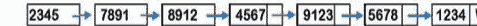

数字的加法从最低位（LSD）开始。在这里，4位一组的数字是从数字尾部存储的。因此，加法将从链表的头部向前进行。

假设两个数字的加法：
`1234 5678 9123 4567 7891 2345`
`5678 8912 3456 7891 2345`

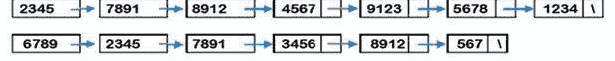

对于加法：初始进位为 0 的两个四位数相加，可能会产生五位数。我们可以分离最后四位，第一位是下一次加法的进位。
`8912+7891+0=16803`，1 是下一次加法的进位
初始进位为 1 的最大四位数相加，结果仍留在整数变量范围内。
`9999+9999+1=19999`，1 是下一次加法的进位

```c
GORITHM AdditionOfNumbers(List1, List2)

BEGIN:

P=Start1

Q=List2

Carry=0

List3=NULL

WHILE p!=NULL AND q!=NULL DO

    Total=p->Info + q->Info + Carry

    Sum=Total%10000

    Carry=Total/10000

    InsertBeginning(List3, Sum)

    P=p->Next

    Q=q->Next

WHILE p!=NULL DO

    Total=p->Info + Carry

    Sum=Total%10000

    Carry=Total/10000

    InsertBeginning(List3, Sum)

    P=p->Next

WHILE q!=NULL DO

    Total=q->Info + Carry

    Sum=Total%10000

    Carry=Total/10000

    InsertBeginning(List3, Sum)

    Q=q->Next

IF Carry == 1

    InsertBeginning(List3, Carry)

RETURN List3

END;
```

# 13.7. 链表实现队列

使用链表实现队列，我们有两个端：尾部（`REAR`）和头部（`FRONT`）。插入发生在尾部，删除发生在头部，从而确保先进先出（FIFO）的行为。

```c
GORITHM Initialize(FRONT, REAR)

BEGIN:

REAR=NULL

FRONT=NULL

END;
```

时间复杂度：`Θ(1)`
执行两条语句。

空间复杂度：`Θ(1)`
未使用额外变量。

```c
GORITHM Empty(FRONT, REAR)

BEGIN:

    IF(REAR == NULL && FRONT == NULL) THEN

        RETURN True

    ELSE

        RETURN False

END;
```

时间复杂度：`Θ(1)`
任何情况下执行两条语句。

空间复杂度：`Θ(1)`
未使用额外变量。

```c
GORITHM Enqueue(FRONT, REAR, x)

BEGIN:

    IF REAR == NULL THEN

        InsertBeginning(REAR, x)

        FRONT = REAR

    ELSE

        InsertAfter(REAR, x)

        REAR = REAR->Next

END;
```

时间复杂度：`Θ(1)`
任何情况下执行三条语句。

空间复杂度：`Θ(1)`
为新节点分配内存空间。

```c
GORITHM Dequeue(FRONT, REAR)

BEGIN:

    IF FRONT == NULL THEN

        WRITE("Underflows")

        Exit(1)

    ELSE

        x = DelBeg(FRONT)

        IF FRONT == NULL

            REAR = NULL

        RETURN x

END;
```

时间复杂度：`Θ(1)`
如果列表为空，执行三条语句。否则，执行五条。

空间复杂度：`Θ(1)`
使用额外变量 x。

## C语言程序

```c
/************************************************

#include<stdio.h>

#include<stdlib.h>

/************************************************

struct node

{

    int info;

    struct node *next;

};

/************************************************

struct node *GetNode()

{

    struct node *p;

    p=(struct node*)malloc(sizeof(struct node));

    return p;

}

/************************************************

void InsertBeg(struct node **START, int x)

{

    struct node *temporary;

    temporary=GetNode();

    temporary->info=x;

    temporary->next = (*START);

    (*START) = temporary;

}

/************************************************

int DelBeg(struct node**START)

{

    int x;

    struct node*temporary;

    temporary = (*START);

    (*START) = (*START)->next;

    x=temporary->info;

    free(temporary);

    return x;

}

/************************************************/

void Traverse(struct node *START)

{

    struct node *t;

    t=START;

    while(t!=NULL)

    {

        printf("%d\t", t->info);

        t = t->next;

    }

    printf("\n");

}

/************************************************

void InsertAfter(struct node **p, int key)

{

    struct node *q;

    q=GetNode();

    q->info=key;

    q->next=(*p)->next;

    (*p)->next=q;

}

```

```c
void Enqueue(struct node **FRONT, struct node **REAR, int x)

{

    if(*REAR == NULL)

    {

        InsertBeg(&*REAR, x);

        *FRONT=*REAR;

    }

    else

    {

        InsertAfter(&*REAR, x);

        (*REAR)=(*REAR)->next;

    }

}
```

```c
int Empty(struct node **FRONT, struct node **REAR)

{

    if(*REAR == NULL&&(*FRONT == NULL)

        return 0;

    else

        return 1;

}
```

```c
int Dequeue(struct node**FRONT, struct node**REAR)

{

    int x;

    if(*FRONT == NULL)

    {

        printf("Underflows");

        exit(1);

    }

    else

    {

        x = DelBeg(FRONT);

        if(*FRONT == NULL)

            REAR = NULL;

        return x;

    }

}
```

```c
x=DelBeg(&*FRONT));
if(*FRONT == NULL)
*REAR=NULL;
}
return x;
}
```

```c
int main()
{
  struct node*FRONT, *REAR;
  FRONT=NULL; // 初始化
  REAR=NULL;
  int x;
  Enqueue(&FRONT, &REAR, 100);
  Enqueue(&FRONT, &REAR, 200);
  Enqueue(&FRONT, &REAR, 300);
  Enqueue(&FRONT, &REAR, 400);
  Enqueue(&FRONT, &REAR, 500);
  Traverse(FRONT);
```

```c
x=Dequeue(&FRONT, &REAR);
printf("\n删除的值是...%d\n", x);
Traverse(FRONT);
Enqueue(&FRONT, &REAR, 700);
Traverse(FRONT);
```

```c
x=Dequeue(&FRONT, &REAR);
printf("\n删除的值是...%d\n", x);
Traverse(FRONT);
}
```

# 13.8. 栈的链表实现

对于使用链表实现栈，我们有一个端点 `TOP`。它保存了节点的地址。插入和删除操作均在 `TOP` 端进行。在这里，插入在头部进行，删除也同样在头部进行，从而确保了 LIFO（后进先出）的特性。

## 算法 Initialize()

```c
开始:
TOP=NULL
结束;
```

## 时间复杂度: `Θ(1)`

执行了一条语句。

## 空间复杂度: `Θ(1)`

没有使用新变量。

## 算法 Empty()

```c
开始:
IF Top == NULL THEN
RETURN TRUE
ELSE
RETURN FALSE
结束;
```

## 时间复杂度: `Θ(1)`

执行了两条语句。

## 空间复杂度: `Θ(1)`

没有使用新变量。

## 算法 Push(Top, x)

```c
开始:
InsertBeginning(Top, x)
结束;
```

## 使用 C 语言编程的数据结构与算法实战方法

## 时间复杂度: `Θ(1)`

调用了一个时间复杂度为 `Θ(1)` 的函数。

## 空间复杂度: `Θ(1)`

没有使用新变量。此外，在 `InsertBeginning` 函数中为新节点分配了内存空间。

## 算法 Pop(Top)

```c
开始:
IF Top = NULL THEN
    WRITE("栈上空")
    Exit(1)
ELSE
    x=DelBeg(Top)
RETURN x
结束;
```

## 算法 StackTop(Top)

```c
开始:
RETURN(Info(Top))
结束;
```

## 时间复杂度: `Θ(1)`

只执行了一条语句，即 `RETURN` 语句。

## 空间复杂度: `Θ(1)`

没有使用新变量。

## C语言程序


```c
****************************************************************
#include<stdio.h>
#include<stdlib.h>
****************************************************************

struct node
{
    int info;
    struct node *next;
};

/**************************************************/

struct node *GetNode()
{
    struct node *p;
    p=(struct node*)malloc(sizeof(struct node));
    return p;
}

/**********************************************************/

void InsertBeg(struct node **START, int x)
{
    struct node *temporary;
    temporary=GetNode();
    temporary->info=x;
    temporary->next=(*START);
    (*START)=temporary;
}

/**********************************************************/

int DelBeg(struct node**START)
{
    int x;
    struct node *temporary;
    temporary=(*START);
    (*START)=(*START)->next;
    x=temporary->info;
    free(temporary);
    return x;
}

/**********************************************************/

void Traverse(struct node *START)
{
    struct node *t;
    t=START;
    while(t!=NULL)
    {
        printf("%d\t%s", t->info);
        t=t->next;
    }
}

/************************************************************************************************/

void Push(struct node **TOP

int Empty(struct node **TOP)
{
    if(*TOP == NULL)
        return 1;
    else
        return 0;
}

/************************************************************************************************/

int Pop(struct node **TOP)
{
    if(*TOP == NULL)
    {
        printf("\n栈上空\n");
        exit(1);
    }
    else
    {
        int x;
        x=DelBeg(&*TOP);
        return x;
    }
}

****************************************************************

int main()
{
    struct node *TOP;
    TOP=NULL;// 初始化
    int x;
    Push(&TOP, 50);
    Push(&TOP, 100);
    Push(&TOP, 200);
    Push(&TOP, 300);
    Traverse(TOP);
    //printf("\n删除的值是.\n");

    x=Pop(&TOP);
    printf("\n删除的值是..%d\n", x);
    Traverse(TOP);

    int y=Pop(&TOP);
    printf("\n删除的值是..%d\n", y);
    Traverse(TOP);

    int z=StackTop(TOP);
    printf("\nTOP的值是..%d\n", z);
}

****************************************************************
```

## 13.10. 循环链表

### 13.10.1. 基本操作

在循环链表中，初始化通过`cSTART=NULL`完成。与线性链表`cSTART`留在第一个节点不同，这里`cSTART`留在最后一个节点。将`cSTART`留在最后一个节点可以提高`InsertEnd`操作的运行时间。

- **头部插入**：如果初始列表为空，则……

### 循环链表

设计为指向自身，且`cSTART`仅在此节点设置。

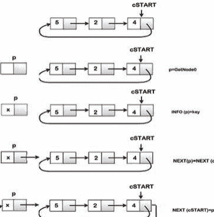

### 算法 `InsertBeginning(cSTART, key)`

```c
BEGIN:
p=GetNode()
p→ Info=key
IF cSTART!=NULL THEN
p→ Next=cSTART→ Next
cSTART→ Next=p
ELSE
cSTART=p
cSTART→ Next=cSTART
END;
```

### 时间复杂度：$\Theta(1)$

在这里，在任何情况下都会执行 4 条语句。

### 空间复杂度：$\Theta(1)$

使用了一个额外的变量`p`。此外，在内存中为新节点分配了空间。

### C语言编程中的数据结构与算法实用方法

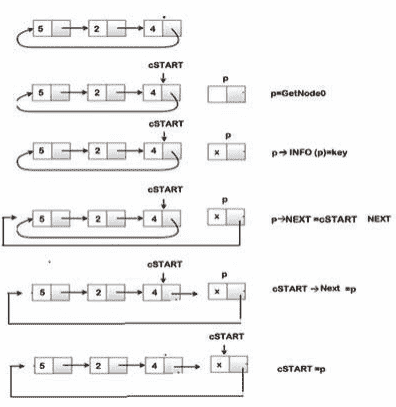

- **在末尾插入**：这只需要将`cSTART`指向新创建的节点。如果链表最初为空，则使其指向自身，且`cSTART`仅在此节点设置。

```c
ALGORITHM InsertEnd(cSTART, key)
BEGIN:
p=GetNode()
p→ Info=key
IF cSTART!=NULL THEN
p→ Next=cSTART→ Next
cSTART→ Next=p
cSTART=p
ELSE
cSTART=p
p→ Next=p
END;
```

### 时间复杂度：$\Theta(1)$

如果链表为空，执行 6 条语句；否则，执行 5 条。因此，它们与链表中存在的元素数量不是线性相关的。

### 空间复杂度：$\Theta(1)$

使用了一个额外的变量`p`。此外，在内存中为新节点分配了空间。

### 循环链表 293

- **在给定节点后插入**：此操作的工作方式与线性链表相同。

```c
ALGORITHM InsertAfter(cSTART, key)
BEGIN:
IF p == NULL THEN
WRITE("void Insertion")
EXIT(1)
ELSE
q=GetNode()
q→ Info=key
q→ Next=p→ Next
p→ Next=q
END;
```

### 时间复杂度：$\Theta(1)$

如果链表为空，执行 2 条语句；否则，根据条件执行 4 条。因此，它们与链表中存在的元素数量不是线性相关的。

### 空间复杂度：$\Theta(1)$

使用了两个额外变量`p`和`q`。此外，在内存中为新节点分配了空间。

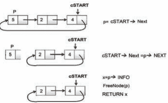

- **删除操作**：
  - **从头部删除**：将`cSTART`的`Next`指向第二个节点。如果链表只有一个节点，则在删除后将`cSTART`设置为`NULL`。

```c
ALGORITHM Delbeg(cSTART)
BEGIN:
IF cSTART == NULL THEN
EXIT(1)
ELSE
p=cSTART→ Next
cSTART→ Next→Next=p→ Next
x=p→ Info
IF cSTART→ Next = cSTART THEN
cSTART=NULL
FreeNode(p)
RETURN x
END;
```

### 时间复杂度：$\Theta(1)$

当循环链表为空时仅需执行两条语句，否则需要执行 6 条。在上述两种情况下，该数量都是固定的。

### 空间复杂度：$\Theta(1)$

使用了两个额外变量`p`和`x`。

- **在末尾删除**：链表需要遍历以到达倒数第二个节点。将倒数第二个节点的`Next`指向第一个节点。`cSTART`现在保留倒数第二个节点的地址。

```c
ALGORITHM DeleteEnd(cSTART)
BEGIN:
IF cSTART == NULL THEN
Write("void deletion")
EXIT(1)
ELSE
IF cSTART → Next == cSTART THEN
  q=cSTART
  cSTART=NULL
ELSE
p=cSTART → Next
WHILE p → Next!=cSTART DO
  p=p → Next
q=cSTART
p→ Next=cSTART → Next
cSTART=p
x=q→ Info
FreeNode(q)
RETURN x
END;
```

### 时间复杂度：$\Theta(N)$

这里的`while`循环是主因素，它迭代`N`次，每次迭代执行 3 条语句。

### 空间复杂度：$\Theta(1)$

这里使用的额外变量为`P`、`q`和`x`。

- **在给定节点后删除**：此操作的工作方式与线性链表相同。

```c
ALGORITHM DelAft(cSTART)
BEGIN:
p=cSTART
IF p == NULL||p→ Next = NULL THEN
Write("void deletion")
EXIT(1)
ELSE
q=p→ Next
p→ Next=q→ Next
x=q→ Info
FreeNode(q)
RETURN x
END;
```

### 时间复杂度：$\Theta(1)$

在任何情况下都执行固定数量的语句，它们与链表中的元素线性无关。

### 空间复杂度：$\Theta(1)$

使用了三个额外变量`P`、`q`和`x`。

- **遍历**：这些操作需要在循环中打印节点，最后一个节点需要单独打印。

```c
ALGORITHM Traverse(cSTART)
BEGIN:
IF cSTART!=NULL THEN
p=cSTART→ Next
WHILE p!=cSTART DO
  WRITE(p→ Info)
  p=p→ Next
WRITE(p→ Info)
END;
```

### 时间复杂度：$\Theta(N)$

其中`N`是链表中节点的数量，`while`循环迭代`N`次，每次迭代执行两条语句。

### 空间复杂度：$\Theta(1)$

`p`被用作额外变量。

## 程序

```c
#include <stdio.h>
#include <stdlib.h>

struct node
{
    int info;
    struct node *next;
};

struct node *GetNode()
{
    struct node *p;
    p=(struct node*)malloc(sizeof(struct node));
    return p;
}

void cBeg(struct node **cSTART, int x)
{
    struct node *temporary;
    temporary=GetNode();
    temporary->info=x;
    if(*cSTART == NULL)
    {
        (*cSTART)=temporary;
        (*cSTART)->next=(*cSTART);
    }
    else
    {
        temporary→next=(*cSTART→next);
    }
}

void cInsert(struct node **cSTART, int key)
{
    struct node *temporary, *a;
    temporary=GetNode();
    temporary->info=key;
    if(*cSTART == NULL)
    {
        (*cSTART)=temporary;
        (*cSTART)->next=(*cSTART);
    }
    else
    {
        temporary→next=(*cSTART→next);
        (*cSTART)->next=temporary;
        (*cSTART)=temporary;
    }
}

void cTraverse(struct node *cSTART)
{
    struct node *p;
    if(cSTART!=NULL)
    {
        p=cSTART→next;
        while(p!=cSTART)
        {
            printf("%d ", p->info);
            p=p->next;
        }
        printf("%d\n", p->info);
    }
}

int cDeletebeg(struct node **cSTART)
{
    struct node *p;
    int x;
    if(*cSTART == NULL)
    {
        exit(1);
    }
    else
    {
        p=(cSTART)->next;
        (*cSTART)->next->next=p->next;
        x=p->info;
        if((*cSTART)->next == (*cSTART)
        {
            (*cSTART)=NULL;
        }
        free(p);
        return x;
    }
}

int cDeleteEnd(struct node **cSTART)
{
    struct node *p, *q;
    int x;
    if(*cSTART == NULL)
    {
        exit(1);
    }
    else
    {
        if((*cSTART)->next == (*cSTART)
        {
            q=(*cSTART);
            (*cSTART)=NULL;
        }
        else
        {
            p=(cSTART)->next;
            while(p->next!=(*cSTART))
            {
                p=p->next;
            }
            q=(*cSTART);
            p->next=(cSTART)->next;
            (*cSTART)=p;
            x=q->info;
            free(q);
        }
        return x;
    }
}

int main()
{
    struct node *cSTART1;
    cSTART1=NULL;
    cBeg(&cSTART1, 300);
    cBeg(&cSTART1, 200);
    cBeg(&cSTART1, 100);
    cTraverse(cSTART1);
    cInsertEnd(&cSTART1, 350);
    cTraverse(cSTART1);

    int x;
    x=cDeletebeg(&cSTART1);
    printf("Deleted element=%d\n", x);
    cTraverse(cSTART1);

    x=cDeleteEnd(&cSTART1);
    printf("Deleted element=%d\n", x);
    cTraverse(cSTART1);
    return 0;
}
```

```c
{
q=q→next;
}
cInsertaft(&cSTART1, &q, 460);
cTraverse(cSTART1);
}
```

- **循环链表的合并**

### 算法 `ConcatCircularList(cSTART1, cSTART2)`

```text
BEGIN:
```

```c
p=cSTART1→ Next
cSTART1→ Next=cSTART2→ Next
cSTART2→ Next=p
```

```text
RETURN cSTART2
END:
```

### 时间复杂度：$\Theta(1)$

执行的语句数为 4 条，这是一个常数。

### 空间复杂度：$\Theta(1)$

使用了一个额外变量，即`p`。

## 13.11. 双向链表

### 13.11.1. 基本操作

双向链表，顾名思义，将保留左节点和右节点的地址。每个节点有三个字段，其中两个是地址字段，`dSTART`存储第一个节点的地址。初始化通过`dSTART=NULL`完成。

- **头部插入**：节点中总共需要进行 2 次指针调整。

### 算法 `InsertBeginning(dSTART, key)`

```text
BEGIN:
```

```c
p=GetNode()
p→ Info=key
p→ Left=NULL
p→Right=dSTART
```

```text
IF dSTART!=NULL THEN
dStart→Left=p
dSTART=p
END;
```


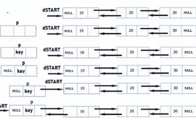

## 时间复杂度：`O(1)`

当列表不为空时，执行语句数为 5 条；当列表初始为空时，为 7 条。

## 空间复杂度：`O(1)`

使用了一个额外变量 `p`。此外，内存中为新节点分配了空间。

### 尾部插入

需要遍历链表直到最后一个节点。新创建的节点被插入到最后一个节点之后。连接新节点与最后一个节点需要 2 次指针调整。同时，新节点的 `Right` 字段被设置为 `NULL`。

### 算法：`InsertEnd(dSTART, key)`

```c
BEGIN:
p=dSTART
q=GetNode()
q→Info=key
IF dSTART == NULL THEN
  InsertBeginning(dSTART, key)
ELSE
  WHILE p→Right!=NULL
    p=p→Right
p→Right=q
```

`q→Right=NULL`

`q→Left=p`

```c
END;
```

## 时间复杂度：`Θ(N)`

在列表末尾插入时，有一个 `while` 循环，它会迭代 `n` 次到达最后一个元素。

## 空间复杂度：`Θ(1)`

这里使用了两个额外变量 `p` 和 `q`。此外，内存中为新节点分配了空间。

### 在指定节点之后或之前插入

在链表中间插入总共需要 4 次指针调整。

## 链表中的删除

### 算法：`InsertLeft(p, key)`

```c
BEGIN:
IF p→ Left == NULL THEN
  InsertBeginning(p, key)
ELSE
  IF p→ Left!=NULL THEN
    q=GetNode()
    r=p→ Left
    q→ Info=key
    q→Left=r
    Right(r)=q
    q→Right=p
    p→ Left=q
  ELSE
    InsertBeginning(p, key)
END;
```

## 时间复杂度：`Θ(1)`

上述算法执行了固定数量的语句，这些语句与链中元素的数量线性无关。

## 空间复杂度：`Θ(1)`

使用了一个额外变量 `q`。此外，内存中为新节点分配了空间。

### 算法：`InsertRight(p, key)`

```c
BEGIN:
q=GetNode(key)
q→ Info=key
r=p→ Right
p→ Right=q
q→Left=p
IF p→ Right!=NULL THEN
  q→Right=r
  Left(r)=q
ELSE
  q→Right=NULL
END;
```

## 时间复杂度：`Θ(1)`

在这里，任何情况下都执行了 7 或 8 条语句。因此，复杂度被认为是常数。

## 空间复杂度：`Θ(1)`

这里使用了两个额外变量 `p` 和 `q`。此外，内存中为新节点分配了空间。

## 链表中的删除

### 头部删除

`dSTART` 指向第二个节点。如果列表中仅有 1 个节点，删除后 `dSTART` 被设置为 `NULL`。

### 算法：`Delbeg(dSTART)`

```c
BEGIN:
IF dSTART = NULL THEN
  WRITE("void deletion")
  EXIT(1)
ELSE
  p=dSTART
  dSTART=dStart→ Right
  IF p→ Right!=NULL THEN
    dStart→ Left→NULL
  x=p→ Info
  FreeNode(p)
  RETURN x
END;
```

## 时间复杂度：`Θ(1)`

当列表为空时执行 3 条语句。否则执行 8 条语句。因此，复杂度被认为是常数。

## 空间复杂度：`Θ(1)`

`p` 被用作额外变量。

### 尾部删除

需要遍历链表以到达最后一个节点和倒数第二个节点。倒数第二个节点的 `Next` 被设置为 `NULL`。`dSTART` 现在保留倒数第二个节点的地址。

### 算法：`DeleteEnd(dSTART)`

```c
BEGIN:
IF dSTART == NULL
  WRITE("void deletion")
  EXIT(1)
ELSE
  p=dSTART
  q=NULL
  WHILE p→ Right!=NULL
    q=p
    p=p→ Right
    IF q == NULL THEN
      dSTART=NULL
ELSE
  x=p→ Info
  FreeNode(p)
  RETURN x
END;
```

## 时间复杂度：`Θ(N)`

主导因素是 `while` 循环迭代 `n` 次到达列表末尾，其中 `n` 是链中元素的数量，每次迭代执行四条语句。

## 空间复杂度：`Θ(1)`

使用了两个额外变量 `p` 和 `q`。

### 在指定节点之后或之前删除

此操作需要 2 次指针调整。

### 算法：`DeleteLeft(p)`

```c
BEGIN:
IF p == Left || p
 Left = THEN

(
 deletion")

1)

p
p

=

x=
 Info
FreeNode(q)

 x
END;
```

### 算法：`DeleteRight(p)`

```c
BEGIN:
IF p == NULL || p→ Right = THEN
  WRITE("void deletion")
EXIT(1)
ELSE
  q=q→Right
  r=q→Right
  p

x=
 Info
FreeNode(q)
RETURN x
END;
```

## 时间复杂度：`Θ(1)`

上述算法都执行固定数量的语句，与链的大小无关。

## 空间复杂度：`Θ(1)`

`q` 和 `r` 被用作额外变量。

## 遍历

### 算法：`Traverse(dSTART)`

```c
ALGORITHM Traverse(dSTART)
BEGIN:
p=dSTART
WHILE(p!=NULL) DO
  WRITE(p→ Info)
  p=p→ Right
END;
```

## 时间复杂度：`Θ(N)`

`while` 循环运行 `N` 次，其中 `N` 是链表中的节点数。每次迭代，

## 空间复杂度：`Θ(1)`

使用了一个额外变量。

```c
}
else
{
    q->Right=NULL;
}
int x=p->info;
free(p);
return x;
}
****************************************************/
```

```c
int Deletep(struct node **p)
{
    if ((*p) == NULL)
    {
        printf("void deletion\n");
        exit(1);
    }
    else
    {
        int x;
        struct node *r, *q;
        {
            if ((*p)->Left == NULL)
            {
                x=DelBeg(&*p);
            }
            else
            {
                if ((*p)->Right == NULL)
                {
                    (*p)->Left)->Right=NULL;
                }
                else
            }
        }
    }
}
```

```c
{
  r=(*p)->Left;
  q=(*p)->Right;
  r->Right=q;
  q->Left=r;
}
x=(*p)->info;
free(*p);
return x;
}
}
```

```c
********************************************************************
```

### `DeleteLeft(struct node **p)`

```c
int DeleteLeft(struct node **p)
{
  if(*p) == NULL||(*p)->Left == NULL)
  {
    printf("void deletion\n");
    exit(1);
  }
  else
  {
    int x;
    struct node *r, *q;
    r=(*p)->Left;
    if(r->Left == NULL)
    {
      (*p)->Left=NULL;
    }
    else
    {
      q=r->Left;
      q->Right=(*p);
    }
  }
}
```

```c
(*p)->Left=q;
}

x=r->info;

free(r);

return x;

}

}
```

### `DeleteRight(struct node **p)`

```c
****************************************************************/
int DeleteRight(struct node **p)
{
  if(*p) == NULL||(*p)->Right == NULL)
  {
    printf("void deletion\n");
    exit(1);
  }
  else
  {
    int x;
    struct node *r, *q;
    r=(*p)->Right;
    if(r->Right == NULL)
    {
      (*p)->Right=NULL;
    }
    else
    {
      q=r->Right;
      q->Left=(*p);
      (*p)->Right=q;
    }
    x=r->info;
    free(r);
    return x;
  }
}
}
```

# 316 使用 C 语言编程数据结构与算法实用方法

### `dInsertEnd(struct node **dSTART, int key)`

```c
void dInsertEnd(struct node **dSTART, int key)
{
    struct node *p;
    p=(*dSTART);
    if(p == NULL)
    {
        dInsertBeg(&*dSTART, key);
    }
    else
    {
        struct node *q;
        while(p->Right!=NULL)
        {
            p=p->Right;
        }
        q=GetNode();
        p->Right=q;
        q->info=key;
        q->Left=p;
        q->Right=NULL;
    }
}
```

### `main()`

```c
int main()
{
    struct node *dSTART1;
    dSTART1=NULL;
    dInsertBeg(&dSTART1, 300);
    dInsertBeg(&dSTART1, 200);
    struct node *p;
    p=dSTART1;
    dInsertBeg(&dSTART1, 100);
    dInsertBeg(&dSTART1, 500);
```

```c
dInsertBeg(&dSTART1, 1600);
InsertBeg(&dSTART1, 700);
InsertBeg(&dSTART1, 800);
InsertBeg(&dSTART1, 900);
InsertEnd(&dSTART1, 400);
dTraverse(dSTART1);
```

```c
printf("\n");
InsertBeg(&dSTART1, 90);
dTraverse(dSTART1);
```

```c
printf("\n");
InsertLeft(&p, 150);
dTraverse(dSTART1);
```

```c
int x;

InsertRight(&p, 150);
printf("\n");
dTraverse(dSTART1);
```

```c
x=DeleteLeft(&p);

printf("\nDeleted element %d\n", x);
dTraverse(dSTART1);
```

```c
x=DeleteRight(&p);

printf("\nDeleted element %d\n", x);
dTraverse(dSTART1);
```

```c
x=Deleteat(&p);

printf("\nDeleted element %d\n", x);
dTraverse(dSTART1);
```

```c
x=DelBeg(&dSTART1);

printf("\nDeleted element %d\n", x);
dTraverse(dSTART1);
```

## 使用 C 语言编程数据结构与算法实用方法

```c
x=DeleteEnd(&dSTART);

printf("\nDeleted element %d\n", x);
dTraverse(dSTART);

}
```

```c
********************************************************************
```

# 13.2 循环双向链表

这种链表与循环链表非常相似。通过最后一个节点的地址进行标识。指针的调整次数是循环链表的双倍。

在循环链表中，第一个节点的左侧字段指向最后一个节点的地址。


## 13.1 基本操作

### 在头部插入

算法 `InsertEnd(dSTART)`

```c
BEGIN:

p=dSTART->Next

q=GetNode()

q->Info=key

IF(dSTART == NULL)

  q->left=q

  q->right=q

ELSE

  q->Right=p

  p->Left=q

  q->Left=dSTART

  dSTART->Right=q

END
```

#### 时间复杂度：`Θ(1)`

在头部无条件地执行 3 条语句，有条件地执行 4 条语句。总语句数不取决于链表的大小。

#### 空间复杂度：`Θ(1)`

使用了两个额外变量，即 `p` 和 `q`。此外，为新节点分配了内存空间。

### 在尾部插入

算法 `InsertEnd(dSTART, key)`

```c
BEGIN:

IF dSTART == NULL

    InsertBeginning(dSTART, key)

ELSE

p=dSTART->Next

q=GetNode()

q->Info=key

    q->Right=p

p->Left=q

p->Left=dSTART

dSTART->Right=q

dSTART=q

END
```

#### 时间复杂度：`Θ(1)`

当链表不为空时执行 8 条语句；当链表为空时调用 `InsertBeginning`，确保了恒定数量的语句。

#### 空间复杂度：`Θ(1)`

使用了两个额外变量，即 `p` 和 `q`。此外，为新节点分配了内存空间。

### 算法：`InsertLeft(p, key)`

```c
BEGIN:

IF p == NULL THEN

WRITE("void Insertion")

ELSE

IF p->Left == NULL THEN
```

```c
InsertBeginning()

ELSE

q=GetNode()

q->Left=p->Left

q->Right=p

q->Info=key

(p->Left)->Right=q
```

```c
END;
```

#### 时间复杂度：`Θ(1)`

在上述算法中执行了固定数量的语句，与链表的元素个数无关。

#### 空间复杂度：`Θ(1)`

使用了 `p` 和 `q` 作为变量。

### 算法：`InsertRight(p, key)`

```c
IF p == NULL THEN
```

```c
InsertBeginning()
```

```c
ELSE

q=GetNode()

q->Left=p

q->Right=p->Right

p->Right->Left=q

p->Right=q
```

```c
END;
```

#### 时间复杂度：`Θ(1)`

如果 `p` 为空，调用 `InsertBeginning`，其复杂度为 `Θ(1)`。否则执行六条语句。

#### 空间复杂度：`Θ(1)`

使用了 `p` 和 `q` 作为变量。

### 算法：`DeleteBeginning(dSTART)`

```c
BEGIN:

IF dSTART=NULL THEN

    WRITE("void deletion")

    EXIT(1)

ELSE

p=dSTART

IF dSTART->Right == dSTART THEN

dSTART=NULL

ELSE

q=p->Right

q->Left=dSTART

dSTART->Right=q

x=p->Info

FreeNode(p)

return x

END;
```

#### 时间复杂度：`Θ(1)`

在上述算法中执行了固定数量的语句，与链表的元素个数无关。

#### 空间复杂度：`Θ(1)`

使用了 `p` 和 `q` 作为变量。

32 使用 C 语言编程数据结构与算法实用方法

### 算法：`DeleteEnd(dSTART)`

```c
BEGIN:

IF dSTART=NULL THEN

WRITE("void deletion")

EXIT(1)

ELSE

p=dSTART

IF dSTART->Right == dSTART THEN

dSTART=NULL

ELSE

q=p->Right

q->Left=dSTART

dSTART->Right=q

x=p->Info

FreeNode(p)

return x


END;

```

时间复杂度：`Θ(1)`

在上述算法中执行了固定数量的语句，与链表的元素个数无关。

空间复杂度：`Θ(1)`

使用了`p`和`q`作为变量。

```c
struct node
{
    int info;
    struct node *Left;
    struct node *Right;
};
```

```c
struct node* GetNode()
{
    struct node *p;
    p = (struct node*)malloc(sizeof(struct));
    return p;
}
```

```c
void dInsertBeg(struct node **cdSTART, int x)
{
    struct node *p;
    p = GetNode();
    p->info = x;
    if (*cdSTART == NULL)
    {
        p->Right = p;
        p->Left = p;
        (*cdSTART) = p;
    }
    else
    {
        struct node *q;
        q = (*cdSTART)->Right;
        p->Right = q;
        q->Left = p;
        p->Left = (*cdSTART);
        (*cdSTART)->Right = p;
    }
}
```

```c
void dTraverse(struct node *dSTART)
{
    if (dSTART == NULL)
    {
        printf("Empty list\n");
        exit(1);
    }
    else
    {
        struct node *p, *q;
        p = (dSTART)->Right;
        q = (dSTART)->Left;
        while (q != (dSTART))
        {
            printf("%d ", p->info);
            p = p->Right;
            q = p->Left;
        }
        printf("\n");
    }
}
```

```c
void InsertLeft(struct node **p, int key)
{
    if (*p == NULL)
    {
        printf("Insertion not possible");
        exit(1);
    }
    else
    {
        struct node *q, *r;
        r = GetNode();
        r->info = key;
        if ((*p)->Right == (*p))
        {
            (*p)->Left = r;
            r->Right = (*p);
            r->Left = (*p);
            (*p)->Right = r;
        }
        else
        {
            q = (*p)->Left;
            r->Right = (*p);
            r->Left = q;
            (*p)->Left = r;
            q->Right = r;
        }
    }
}
```

```c
void InsertRight(struct node **p, int key)
{
    if ((*p) == NULL)
    {
        printf("Insertion not possible\n");
        exit(1);
    }
    else
    {
        struct node *q, *r;
        r = GetNode();
        r->info = key;
        if ((*p)->Right == (*p))
        {
            (*p)->Right = r;
            r->Left = (*p);
            r->Right = (*p);
            (*p)->Left = r;
        }
        else
        {
            q = (*p)->Right;
            r->Left = (*p);
            r->Right = q;
            (*p)->Right = r;
            q->Left = r;
        }
    }
}
```

```c
int DelBeg(struct node **dSTART)
{
    if (*dSTART == NULL)
    {
        printf("void deletion\n");
        exit(1);
    }
    else
    {
        int x;
        if ((*dSTART)->Right == (*dSTART))
        {
            struct node *p;
            p = (*dSTART);
            (*dSTART) = NULL;
            x = p->info;
            return x;
        }
        else
        {
            struct node *p, *q;
            q = (*dSTART)->Right;
            x = q->info;
            p = q->Right;
            (*dSTART)->Right = p;
            p->Left = (*dSTART);
            free(q);
            return x;
        }
    }
}
```

```c
int DeleteEnd(struct node **dSTART)
{
    if (*dSTART == NULL)
    {
        printf("void deletion\n");
        exit(1);
    }
    else if ((*dSTART)->Right == (*dSTART))
    {
        int x;
        struct node *p;
        p = (*dSTART);
        (*dSTART) = NULL;
        x = p->info;
        free(p);
        return x;
    }
    else
    {
        int x;
        struct node *p, *q;
        q = (*dSTART)->Right;
        p = (*dSTART)->Left;
        p->Right = q;
        q->Left = p;
        x = (*dSTART)->info;
        (*dSTART) = p;
        return x;
    }
}
```

```c
int Deleteatp(struct node **p)
{
    if (*p == NULL)
    {
        printf("void deletion\n");
        exit(1);
    }
    else
    {
        int x;
        struct node *r, *q;
        if ((*p)->Left == (*p))
        {
            x = DelBeg(&(*p));
        }
        else
        {
            r = (*p)->Left;
            q = (*p)->Right;
            r->Right = q;
            q->Left = r;
            x = (*p)->info;
            free(*p);
        }
        return x;
    }
}
```

```c
int DeleteLeft(struct node **p)
{
    if (*p == NULL || (*p)->Left == (*p))
    {
        printf("void deletion\n");
        exit(1);
    }
    else
    {
        int x;
        struct node *r, *q;
        r = (*p)->Left;
        if (r->Left == (*p))
        {
            (*p)->Left = (*p);
        }
        else
        {
            q = r->Left;
            q->Right = (*p);
            (*p)->Left = q;
        }
        x = r->info;
        free(r);
        return x;
    }
}
```

```c
void dlnertEnd(struct node **dSTART, int key)
{
    struct node *p;
    p = GetNode();
    p->info = key;
    if (*dSTART == NULL)
    {
        dInsertBeg(&*dSTART, key);
    }
    else
    {
        struct node *q;
        q = (*dSTART)->Right;
        (*dSTART)->Right = p;
        p->Left = (*dSTART);
        p->Right = q;
        q->Left = p;
        (*dSTART) = p;
    }
}
```

```c
int main()
{
    struct node *dSTART1;
    dSTART1 = NULL;
    dInsertBeg(&dSTART1, 300);
    dInsertBeg(&dSTART1, 200);
    dInsertBeg(&dSTART1, 100);
    struct node *p;
    p = dSTART1;
    dTraverse(dSTART1);
    dlnertEnd(&dSTART1, 400);
    dTraverse(dSTART1);
    InsertRight(&p, 150);
    printf("\n");
    dTraverse(dSTART1);
    printf("\n");
    InsertLeft(&p, 150);
    int x;
    x = DelBeg(&dSTART1);
    printf("\nDeleted element %d\n", x);
    dTraverse(dSTART1);
    x = DeleteEnd(&dSTART1);
    dTraverse(dSTART1);
    printf("\nDeleted element %d\n", x);
    dTraverse(dSTART1);
    x = DeleteLeft(&p);
    printf("\nDeleted element %d\n", x);
    dTraverse(dSTART1);
    x = Deleteatp(&p);
    printf("\nDeleted element %d\n", x);
    dTraverse(dSTART1);
}
```

## 使用C语言编程的数据结构与算法的实战方法

## 练习题

1. 解释链表的概念。

2. 解释循环链表的概念。

3. 线性链表插入末尾的复杂度是：

| 系数 | 指数 |
|---|---|
| 0 | 4 |
| 1 | 5 |
| 2 | |
| 3 | 1 |
| 4 | |
| 5 | 9 |
| 6 | |
| 7 | 8 |

   a) `$x^7 + 9x^5 + 3x^4 + 8$`

   b) `$x^7 + 9x^5 + 3x + 8$`

   c) `$x^7 + 9x^5 + 3x^4 + x$`

   d) `$x^7 + 9x^5 + 3x^4 + 8$`

4. 用链表表示的多项式是：

| 系数 | 指数 |
|---|---|
| 0 | 7 |
| 1 | 5 |
| 2 | 3 |
| 3 | 4 |
| 4 | 0 |
| 5 | 9 |
| 6 | 8 |
| 7 | 2 |

   a) `$x^7 + 9x^5 + 3x^4 + 8x^2$`

   b) `$x^7 + 9x^5 + 3x^4 + 8x^2$`

   c) `$x^7 + 9x^5 + 3x^4 + 8x^2$`

   d) `$x^7 + 9x^5 + 3x^4 + 8x^2$`

5. 循环链表删除末尾节点的概念是：

   a. 结构

   b. 

   c. 

   d. 结构

6. 双向链表删除末尾节点的复杂度是：

   a. `$O(1)$`

   b. `$O(n)$`

   c. `$O(n^2)$`

   d. `$O(\log n)$`

7. 关于链表的表述正确的：

   a. 线性结构

   b. 循环结构

   c. 线性结构

   d. 结构

8. 循环链表使用头部节点的目的是：

   a. 包含全局信息

   b. 包含指向末尾的指针

   c. 删除

   d. 以上都不是

9. 下列哪个函数需要线性链表：

   a. 有序插入

   b. 删除所有项

   c. 在末尾插入

   d. 以上

10. 循环链表在末尾插入节点所需的复杂度是：

    a. `$O(\log n)$`

    b. `$O(n)$`

    c. `$O(1)$`

    d. 以上都不是

11. 双向链表删除末尾节点的指针调整次数为：

   a. 1

   b. 2

   c. 3

   d. 4

## 编程题

1. 编写 C 代码实现数组实现的链表。

2. 编写 C 代码从中间拆分给定的链表。

3. 编写 C 代码从链表中删除所有等于`x`的项。

# 14

# 二叉树

## 目录

- 14.1. 二叉树基础 ............................................................. 338

- 14.2. 二叉树的实现 ....................................................... 340

- 14.3. 二叉树中的基本操作 ................................................... 341

- 14.4. 从给定遍历序列构建二叉树 ........................................... 347

- 14.5. 二叉树的层序遍历 ..................................................... 348

- 14.6. 与二叉树的应用问题 ................................................... 349

- 14.7. 表达式树 ........................................................................ 356

- 14.8. 霍曼编码 ......................................................................... 358

习题 ......................................................................................................... 360

## 14.1. 二叉树基础

这是一种特殊的树，每个节点最多可以有两个孩子。根据定义，树的元素被视为一个集合。该集合可以划分为三个不相交的子集。其中一个是根节点。另外两个本身是被称为左子树和右子树的二叉树。

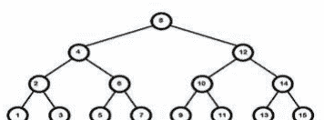

在上述树中，`S`=`{1, 2, 3, 4, 5, 6, 7, 8, 9, 10, 11, 12, 13, 14, 15}`

`S1`=`{8}`

`S2`=`{1, 2, 3, 4, 5, 6, 7}`

`S3`=`{9, 10, 11, 12, 13, 14, 15}`

`S1`是根节点

`S2`是左子树

`S3`是右子树

二叉树用于各种计算机科学应用中，例如：

- 通过霍曼编码进行数据压缩；

- 算术表达式的表示；


搜索（使用二叉搜索树 (BST)）；  
排序（使用堆）；  
构建决策树等。

## 14.1. 二叉树中节点的关系

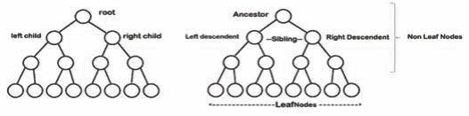

- **严格二叉树/2-树/满二叉树**：树中的所有节点要么有 2 个孩子，要么有 0 个孩子。不允许存在只有一个孩子的节点。
- **完全二叉树**：这是一种所有叶子节点都在同一层上的严格二叉树。

### 二叉树 339

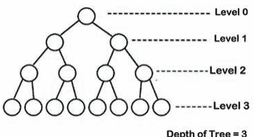

此类树的节点总数为：

`N = 第 0 层节点 + 第 1 层节点 + 第 2 层节点 + ... 第 d 层节点`

`= 1 + 2^1 + 2^2 + ... + 2^d`（一个公比为 `d`，项数为 `d+1` 的等比数列）

`= 1 * (2^(d+1) - 1) / (2 - 1)`

`N = (2^(d+1) - 1)`

重新调整上述等式：

`N + 1 = 2^(d+1)`

`d = log2(N+1) - 1`（注意：原式中 `d = log2(N+1)` 可能适用于特定编号，此处保留原意，若 `d` 表示深度，则正确；基于原文保留）

上述等式表明，我们可以根据给定的节点数量找到完全二叉树的深度。

- **二叉树节点的高度**：节点的高度是从该节点到叶子节点的距离。例如：

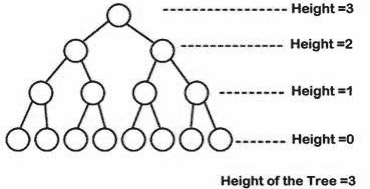

根节点的高度称为树的高度。树的深度与树的高度相同。如果树是完全的，二叉树的高度最小；如果树不是满的，高度将会增加；如果树的所有节点都位于一侧，高度可能会达到 `N-1`，这种树被称为倾斜二叉树。

## 使用 C 语言编程数据结构与算法实用方法

- **计算给定节点数的二叉树数量**：如果只有一个节点，只有 1 棵树可能；如果有两个节点，可能有 2 棵树；如果有 3 个节点，总共可能有 5 棵树。

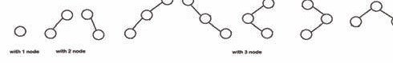

可能的树的数量可以通过公式给出：`2nCn / (N+1)`。对于 3 个节点，`C3/4 = 5`（这里 `C` 表示组合）。如果给出了信息，例如节点为 `A, B, C`，则可能的树总数为：

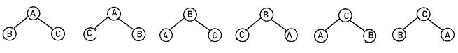

存在 6 棵结构相同的树，即 `3!`。因此，可能的树总量可以通过公式给出：`(2nCn / (N+1)) * N!`。对于 3 个节点 `A, B, C`，该图结果为 30。

## 14.2. 二叉树的实现

二叉树可以使用以下方式实现：
- 数组；
- 链表。

### 14.2.1. 数组实现

这种实现仅适用于完全二叉树或接近完全的二叉树。这种实现也是一种隐式二叉树表示。

在这种表示中，如果我们考虑数组索引从 1 开始：
- 如果父节点在索引 `I` 处，左孩子：`2*I+1` 索引，右孩子：`2*I+1`（注：原文如此，可能为笔误，但保留原文）
- 如果孩子在索引 `I` 处，父节点：`Floor(I/2)`

如果考虑数组索引从 0 开始：
- 如果父节点在索引 `I` 处，左孩子：`2*I+1`，右孩子：`2*I+2`
- 如果孩子在索引 `I` 处，父节点：`Floor((I-1)/2)`

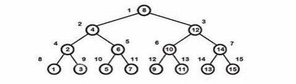

| `[1]` | `[2]` | `[3]` | `[4]` | `[5]` | `[6]` | `[7]` | `[8]` | `[9]` | `[10]` | `[11]` | `[12]` | `[13]` | `[14]` | `[15]` |
|---|---|---|---|---|---|---|---|---|---|---|---|---|---|---|
| `A(15)` | `8` | `12` | `2` | `6` | `10` | `14` | `1` | `3` | `5` | `7` | `9` | `11` | `13` | `15` |

| `[0]` | `[1]` | `[2]` | `[3]` | `[4]` | `[5]` | `[6]` | `[7]` | `[8]` | `[9]` | `[10]` | `[11]` | `[12]` | `[13]` | `[14]` |
|---|---|---|---|---|---|---|---|---|---|---|---|---|---|---|
| `A(15)` | `8` | `12` | `2` | `6` | `10` | `14` | `1` | `3` | `5` | `7` | `9` | `11` | `13` | `15` |

### 14.2.2. 链表实现

这种实现是一种所有叶子节点都在同一层上的严格二叉树。这种实现也是一种隐式二叉树表示。

在这种表示中，如果我们考虑数组索引从 1 开始：
- 如果父节点在索引 `I` 处，左孩子：`2*I+1` 索引，右孩子：`2*I+1`（注：原文如此，可能为笔误，但保留原文）

#### 二叉树 345

```c
struct node *Right;
};
```

```c
***************************************************
struct node *MakeNode(int x)
{
    struct node *p;
    p = (struct node*)malloc(sizeof(struct node));
    p->data = x;
    p->Left = NULL;
    p->Right = NULL;
    return p;
}
```

```c
***************************************************
void PreOrderTraversal(struct node *root)
{
    if (root == NULL)
    {
        printf(" %0d ", root->data);
        PreOrderTraversal(root->Left);
        PreOrderTraversal(root->Right);
    }
}
```

```c
***************************************************
void PostOrderTraversal(struct node *root)
{
    if (root != NULL)
    {
        PostOrderTraversal(root->Left);
        PostOrderTraversal(root->Right);
        printf(" %0d ", root->data);
    }
}
```

```c
***************************************************
void InOrderTraversal(struct node *root)
{
    if (root != NULL)
    {
        InOrderTraversal(root->Left);
        printf("% d", root->data);
        InOrderTraversal(root->Right);
    }
}
```

```c
void CreateTree(struct node **t)
{
    int choice, x;
    struct node *p;
    printf("whether Left of %d exits(1/0)\t", (*t)->data);
    scanf("%d", &choice);
    if (choice == 1)
    {
        printf("input the key of Left node of root\t");
        scanf("%d", &x);
        p = MakeNode(x);
        (*t)->Left = p;
        CreateTree(&p);
    }
    printf("whether Right of %d exits(1/0)\t", (*t)->data);
    scanf("%d", &choice);
    if (choice == 1)
    {
        printf("input the key of Right node of root\t");
        scanf("%d", &x);
        p = MakeNode(x);
        (*t)->Right = p;
        CreateTree(&p);
    }
}
```

#### 346 C语言编程数据结构与算法的实用方法

#### 二叉树 347

****************************************************

```c
int main()
{
    struct node *root;
    int x;
    printf("input the key of root\t");
    scanf("%d", &x);
    root = MakeNode(x);
    CreateTree(&root);
    printf("\npre order traversal \n");
    PreOrderTraversal(root);
    printf("\npost order traversal \n");
    PostOrderTraversal(root);
    printf("\nin order traversal \n");
    InOrderTraversal(root);
    printf("\n");
}
****************************************************
```

## 14.4. 根据给定的遍历构建二叉树

如果给出了前序遍历与中序遍历或后序遍历与中序遍历的组合，就可以唯一地构建二叉树。

如果给出了前序与中序遍历的组合：

| 中序 | `(20, 30, 35, 40, 45, 50, 55, 60, 70)` |
|---|---|
| 前序 | `(50, 40, 30, 20, 35, 45, 60, 55, 70)` |

前序遍历中的第一个节点是根节点。在中序遍历中找到该节点。

## 348 C语言编程数据结构与算法的实用方法

在中序遍历中，该节点左侧的所有节点都是左子树节点；该节点右侧的所有节点都是右子树节点。对前序遍历中的下一个元素重复相同的操作，将进一步把树分为二部分。

示例结果树为：

## 14.5. 二叉树的层序遍历

执行层序遍历需要一个队列。首先将根节点存入队列，只要队列不为空，就从队列出一个元素，打印该节点的数据，并将其左右孩子存入队列。

算法 `LevelOrderTraversal(root)`

```c
BEGIN:
Queue Q
Initialize(Q)
Enqueue(Q)
WHILE !Empty(Q) DO
  x <- Dequeue(Q)
  WRITE(Data(x))
  IF LEFT(x) != NULL THEN
    Enqueue(x)
  IF Right(x) != NULL THEN
    Enqueue(x)
END;
```

### 时间复杂度：`Θ(N)`

每个节点被入队列一次并从队列取出一次。总操作数为常数级。

### 空间复杂度：`Θ(N)`

队列大小为 `N`。

## 14.6. 二叉树的应用问题

### 求二叉树的高度

```c
ALGORITHM HEIGHT(root)
BEGIN:
IF root == NULL
RETURN 0
ELSE
IF Left(root) == NULL AND Right(root) == NULL
RETURN 0
ELSE
RETURN 1 + Max(Left(root), Right(root))
END;
```

### 时间复杂度：`Θ(N)`

计算高度需要访问所有节点一次。

### 空间复杂度：`O(log N)`

如果树是平衡的，调用栈最大深度为 `log n + 1`。如果树是倾斜的，调用栈可能会增长到 `n`。

### C 函数：

```c
************************************************
int height(struct node *root)
{
    if (root == NULL)
        return 0;
    else
        if (root->Left == NULL && root->Right == NULL)
            return 0;
        else
            return 1 + max(height(root->Left), height(root->Right));
}
************************************************
```

### 求二叉树中具有 0 个节点的个数

```c
ALGORITHM CountOfN0(root)
BEGIN:
IF root == NULL
RETURN 0
ELSE
IF LEFT(root) == NULL AND Right(root) == NULL
RETURN 1
ELSE
RETURN CountOfN0(LEFT(root)) + CountOfN0(Right(root))
END;
```

### 时间复杂度：`Θ(N)`

### 空间复杂度：`O(log2 N), O(N)`  
如果树是平衡的，调用栈最大深度为 `log n + 1`。如果树是倾斜的，调用栈可能会增长到 `n`。

### C 函数：

```c
************************************************
int N0Count(struct node *tree)
{
    if (tree == NULL)
        return 0;
    else
        if ((tree->Left == NULL) && (tree->Right == NULL))
            return 1;
        else
            return N0Count(tree->Left) + N0Count(tree->Right);
}
************************************************
```

### 求二叉树中具有 1 个子节点的个数

```c
ALGORITHM CountOfN1(root)
BEGIN:
IF root == NULL
RETURN 0
ELSE
IF LEFT(root) == NULL AND Right(root) == NULL
RETURN 0
ELSE
IF LEFT(root) != NULL AND Right(root) != NULL
RETURN 1 + CountOfN1(LEFT(root)) + CountOfN1(Right(root))
END;
```

### 时间复杂度：`Θ(N)`

### 空间复杂度：`O(log2 N), O(N)`

如果树是平衡的，调用栈最大深度为 `log n + 1`。如果树是倾斜的，调用栈可能会增长到 `n`。

### C 函数：

```c
************************************************
int N1Count(struct node *tree)
{
    if (tree == NULL)
        return 0;
    else
    {
        if (tree->Left == NULL && tree->Right == NULL)
            return 0;
        else if (tree->Left != NULL && tree->Right != NULL)
            return N1Count(tree->Left) + N1Count(tree->Right);
        else
            return 1 + (N1Count(tree->Left) + N1Count(tree->Right));
    }
}
************************************************
```

### 求二叉树中具有 2 个子节点的个数

```c
ALGORITHM CountOfN2(tree)
BEGIN:
IF tree == NULL
RETURN 0
ELSE
IF LEFT(tree) == NULL AND Right(tree) == NULL
RETURN 0
ELSE
IF LEFT(tree) != NULL AND Right(tree) != NULL
RETURN 1 + CountOfN2(LEFT(tree)) + CountOfN2(Right(tree))
ELSE
RETURN CountOfN2(LEFT(tree)) + CountOfN2(Right(tree))
END;
```

### 时间复杂度：`Θ(N)`

### 空间复杂度：`O(log N), O(N)`  
如果树是平衡的，调用栈最大深度为 `log n + 1`。如果树是倾斜的，调用栈可能会增长到 `n`。

### C 函数：

```c
********************************************************/
int N2Count(struct node *tree)
{
    if (tree == NULL)
        return 0;
    else
        if ((tree->Left == NULL) && (tree->Right == NULL))
            return 0;
        else if (tree->Left != NULL && tree->Right != NULL)
            return 1 + (N2Count(tree->Left) + N2Count(tree->Right));
        else
            return (N2Count(tree->Left) + N2Count(tree->Right));
}
********************************************************/
```

## 查找二叉树是否为完全树

算法 `isComplete(root, index, number_nodes)`

```c
BEGIN:
IF tree == NULL THEN
    RETURN True;
    // 如果分配给当前节点的索引大于
    // 树中的节点数，则树是完全树
IF index >= number_nodes THEN
    RETURN False;
    // 递归处理左、右子树
RETURN (isComplete(LEFT(root), 2*index + 1, number_nodes) AND
        isComplete(Right(root), 2*index + 2, number_nodes));
END;
```


END;

```

时间复杂度：`Θ(N)`

计算高度需要访问所有节点一次。

空间复杂度：`(log N)`, `O(N)`

如果树是平衡的，在任何时刻，调用栈最多会有`log n+1`个条目。如果树是倾斜的，调用栈可能会增长到`n`个激活记录。

## C语言函数实现

```c
****************************************************************

int NodeCount(struct node* root)

{

    if (root == NULL)

        return (0);

    return (1 + NodeCount(root->Left) + NodeCount(root->Right));

}

****************************************************************

int isComplete (struct node* root, int index, int number_nodes)

{

    if (root == NULL)

      return 1;

    if (index >= number_nodes)

      return 0;

    return isComplete(root->Left, 2*index + 1, number_nodes) &&

    isComplete(root->Right, 2*index + 2, number_nodes);

}

/*************************************************/
```

## 查找节点的平衡因子

`LH`代表左高度，`RH`右高度。`LH – RH`是给定节点的平衡因子。

## 算法`BalanceFactor(N)`

```
BEGIN:

IF Left(N)!=NULL

    LH ← 1+ h(Left(N))

ELSE

    LH ← 0

IF Right(N)!=NULL

    RH ← 1+ h(Right(N))

ELSE

    RH ← 0

RETURN(LH – RH)

END;
```

### 时间复杂度：`Θ(N)`

计算高度需要访问所有节点一次。

### 空间复杂度：`(log₂N)`, `O(N)`

如果树是平衡的，在任何时刻，调用栈最多会有`log₂n+1`个条目。如果树是倾斜的，调用栈可能会增长到`n`个激活记录。

## 14.7. 表达式树

表达式树帮助我们评估给定的算术/逻辑表达式。为了理解如何构建表达式树，我们将首先学习如何为二元运算符构建表达式树。下一个概念将扩展到理解如何为一元运算符构建表达式树。

在构建表达式树时，我们将观察到：

- 所有的运算符都是非叶节点；
- 所有的操作数都是叶子节点。

如果表达式仅包含二元运算符，生成的树将是二叉树/严格二叉树。

如何构建表达式树：

首先将给定的表达式转换为后序表达式。

使用栈来构建表达式树。遍历表达式并采取以下操作：

- 如果符号是操作数，将其推入栈中；
- 如果符号是运算符，从栈中弹出两个元素并将它们分别设置为该运算符的右、左孩子，然后将当前节点推入栈。

在最后，弹出栈。弹出的符号将是给定表达式的根。

考虑表达式`a+b`

后序= `ab+`

| 符号 | 栈 |
| :--- | :--- |
| `a` | `a` |
| `b` | `a,b` |
| `+` | |

### 14.7.1. 表达式树的属性

表达式树的中序遍历结果应当是该表达式的中序等效形式。

如果为一元运算符构建表达式树，上述属性将非常有用。

### 14.7.2. 构建表达式树并转换为后序

| 表达式 | 表达式树 | 中序遍历 |
| :--- | :--- | :--- |
| `(a+3)` |  | `a + 3` |
| `3+(4*5-(9+6))` |  | `3+4*5-9+6` |
| `log(x)` |  | `log x` |
| `n!` |  | `n!` |

| 表达式字符串 | 表达式栈 | 运算符栈 |
| :--- | :--- | :--- |
| `1+2*3/(4-2)` | ① | |
| `+2*3/(4-2)` | ② | |
| `2*3/(4-2)` | ② ③ | `+` |
| `3*4/(4-2)` | ② ③ ④ | `*` |
| `/(4-2)` | ② ③ ④ ⑤ | `+` |
| `(4-2)` | ② ③ ④ ⑤ ⑥ | `+/` |
| `4-2)` | | |
| `-2)` | ② ③ ④ ⑤ ⑥ ⑦ | `+/-` |
| `2)` | ② ③ ④ ⑤ ⑥ ⑦ ⑧ | `+/-` |
| `)` | ② ③ ④ ⑤ ⑥ ⑦ ⑧ ⑨ | `+/-` |
| | ⑩ ⑪ ⑫ ⑬ | `+` |
| | ⑩ ⑪ ⑫ ⑬ ⑮ | `十` |

## 哈曼编码

哈曼编码是一种无损文本压缩技术。它为文本中出现的各种字符生成变长编码。这些编码都是唯一的前缀码，可以直接解码。编码机制统计文本中各种字符的频率或出现概率。使用优先队列构建哈曼树。

### 14.8.1. 构建哈曼树

下面给出了构建哈曼树和编码的示例。

`C: 0`    `E: 10`    `A: 11`

出现次数越多的字符编码越短，出现次数越少的字符编码越长。

示例2：二叉树

通过插入所有`N`个字符创建一个优先队列（这些字符在插入前转换为节点）。对于`N`个字符，执行`N–1`步。每一步发生以下情况：

- 插入两个元素
- 创建一个数据值为`X+Y`的新节点`Z`。
- 将`X`设置为`Z`的左孩子。
- 将`Y`设置为`Z`的右孩子。
- 将`Z`插入优先队列。对于每个创建的分支，左分支给`0`，右分支给`1`。

算法`HuffmanTree(C[], N`

```
BEGIN:

PriorityQueue PQ

PQ ← NULL

FOR i ← 1 to N-1 DO

  X ← MakeNode(C[i])

  PQInsert(PQ, X)

  X ← ExtractMin(PQ)

  Y ← ExtractMin(PQ)

  Z ← MakeNode(X→Data→Data)

  Z→Left ← X

  Z→Right ← Y

  PQInsert(PQ, Z)

X ← ExtractMin(PQ)

RETURN X;

END;
```

## 练习题

1. 给一组中序和前序节点，写一个输出树的非递归算法。
2. 如果两个二叉树都为空或都不为空，则它们相似。写一个算法判断它们是否相似。
3. 节点的度是它的孩子数量。证明在任何二叉树中，叶子节点的数量比节点的度多一个（等等，上下文是指内部节点）。
4. 写一个中序遍历树的非递归算法。
5. 根据以下中序和前序序列构建二叉树：中序：10, 15, 17, 18, 20, 25, 30, 35, 48, 50
前序：20, 15, 17, 18, 25, 30, 35, 48, 50
6. 根据以下中序和前序序列构建二叉树：
中序：`D, G, B, H, E, A, F, I, C`
前序：`A, B, D, G, E, H, F, I, C`
7. 给下表画哈曼树并找到各种字符的编码：

| 字符 | `A` | `X` | `?` | `C` | `M` | `I` | `L` |
| :--- | :--- | :--- | :--- | :--- | :--- | :--- | :--- |
| 频率 | 20 | 7 | 5 | 10 | 12 | 25 | 15 |

8. 根据以下遍历画出二叉树：
前序：`seupcltm`
中序：`puencqjm`
9. 为以下表达式画表达式树：
- `b + sqrt((b^2-4ac)) / (2a)`
10. 为以下表达式画表达式树：
- `(a-b)+e`

11. 给下表画哈曼树并找到各种字符的编码：

| 字符 | `A` | `X` | `?` | `C` | `M` |
| :--- | :--- | :--- | :--- | :--- | :--- |
| 频率 | 0.45 | 0.02 | 0.24 | 0.18 | 0.11 |

12. 解码以下消息：`101100110111110010111110110100`

---

在二叉树的双向序线线（不带头节点）中

- 18. 有多少右空指针分配了线程？
- a. 5
- b. 6
- c. 7
- d. 8

- 19. 有多少左空指针分配了线程？
- a. 4
- b. 5
- c. 6
- d. 7

- 20. 有多少节点同时分配了左孩子和线程？
- a. 1
- b. 2
- c. 3
- d. 4

- 21. 剩余多少空指针未被分配？
- a. 1
- b. 2
- c. 3
- d. 4

给定字符及其对应的频率。
`A: 25 B: 15 C: 10 D: 5 E: 5`
如果构建了哈夫曼树

- 22. 树的深度是多少？
- a. 2
- b. 3
- c. 4
- d. 5

- 23. 加权路径长度是多少？
- a. 100
- b. 125
- c. 130
- d. 14

- 24. 任意字符的哈夫曼编码的最大长度是多少？
- a. 2
- b. 3
- c. 4
- d. 5

- 25. 执行了多少次节点对合并？
- a. 2
- b. 3
- c. 4
- d. 5

- 26. 二叉树是元素的有限集。这个有限集等于：
- a. {左子树} U {右子树}
- b. {根} U {右子树}
- c. {左子树} U {根}
- d. {根} U {左子树} U {右子树}

- 27. 5个节点可以形成多少棵严格二叉树？
- a. 1
- b. 2
- c. 3
- d. 4

给定树的遍历序列
前序遍历：`A B C D E F G H I J`
中序遍历：`D C B E F A G I H J`

- 28. 后序遍历是什么？
- a. `D C F E B I J H G A`
- b. `D C B E F A G I H J`
- c. `D C B E F I J H G A`
- d. 以上都不是

- 29. 树的根节点是什么？
- a. `A`
- b. `D`
- c. `J`
- d. 以上都不是

- 30. 根节点的左子树中有多少个元素？
- a. 5
- b. 4
- c. 6
- d. 以上都不是

- 31. 根节点的右子树中有多少个元素？
- a. 5
- b. 4
- c. 6
- d. 以上都不是

- 32. 最大深度有多少有多少元素？
- a. 2
- b. 3
- c. 4
- d. 5

- 33. 树的最大深度是多少？
- a. 2
- b. 4
- c. 3
- d. 5

下图所示通过添加一些外部节点转换为等价的 2-树。生成的树被称为扩展二叉树。

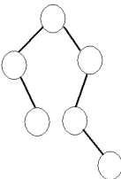

回答以下问题

- 34. 外部节点的数量是多少？
- a. 6
- b. 7
- c. 8
- d. 以上都不是

- 35. 树的最大深度是多少？
- a. 3
- b. 2
- c. 4
- d. 5

## 36. 内部路径长度是多少？
- a. 9
- b. 6
- c. 21
- d. 12

## 37. 外部路径长度是多少？
- a. 9
- b. 6
- c. 21
- d. 12

## 38. 下列哪项不是二叉树的属性？
- a. 有一个专门指定的节点称为根
- b. 其余节点可以划分为`t`个不相交集 (`t >= 0`)
- c. 任何节点都可以从树的任何地方可达
- d. 树中最多存在一个环

## 39. 深度为`k`的二叉树的最大节点数是：
- a. `2^k-1`
- b. `2(k+1)`
- c. `2^k -1`
- d. `2(k+1)-1`

## 40. 具有`k`个节点 (`k > 1)`) 的二叉树有...........个空指针
- a. `k`
- b. `k+1`
- c. `k-1`
- d. `2*k`

## 41. 声称某二叉树的中序和后序遍历产生以下序列
中序：`HAT GLOVE SOCKS SCARF GLASSES`
后序：`GLOVE SCARF HAT GLASSES SOCKS`
- a. `HAT`是二叉树的根
- b. `SOCKS`是二叉树的根
- c. 该树是倾斜二叉树
- d. 遍历不正确

## 数据结构与算法的`C`语言实践方法
- 42. 对于非空二叉树`T`，如果`n0`是度为0的节点数，`n2`是度为2的节点数，那么：
- a. `n0=n2`
- b. `n0=n2+1`
- c. `n0+1=n2`
- d. `n0<n2`

- 43. 关于二叉树和森林，下列哪项是不正确的？
- a. 二叉树可以为空而森林不能为空
- b. 二叉树中任意节点的度最多为2，而森林节点的度没有上限限制
- c. 二叉树的节点具有左、右字段，而森林具有孩子、兄弟和父节点字段
- d. 二叉树和森林的最佳表示结构是数组。

- 44. 具有`n`个叶子的完全二叉树包含：
- a. `n`个节点
- b. `2n-1`个节点
- c. `2n`个节点
- d. `log n`个节点

- 45. 为命名为`Root`的二叉树找到合适的匹配
- a. 左子树和根
- b. 右子树和父节点
- c. 左子树和孩子
- d. 根和兄弟

- 46. 为命名为`Preorder`的二叉树找到合适的匹配
- a. 左子树和根
- b. 右子树和父节点
- c. 左子树和孩子
- d. 根和兄弟

- 47. 为命名为`Postorder`的二叉树找到合适的匹配
- a. 左子树和根
- b. 右子树和父节点
- c. 左子树和孩子
- d. 根和兄弟

- 48. 为命名为`Inorder`的二叉树找到合适的匹配
- a. 左子树和根
- b. 右子树和父节点
- c. 左子树和孩子
- d. 根和兄弟

---

# 15. 二叉搜索树

+ 目录
- 15.1. 二叉搜索树 (`BST`) 基础 ................................................ 372
- 15.2. 二叉搜索树 (`BST`) 的基本操作 ................................ 372
- 15.3. 平衡搜索树: `AVL Tree` ............................................ 379
- 习题 ................................................................................................ 385

## 15.1. 二叉搜索树 (`BST`) 基础

二叉搜索树 (`BST`) 用于实现高效的搜索。在 `BST` 中，左子树的键值小于父节点的键值，而右子树节点的键值大于父节点的键值。下所示的树是一个二叉搜索树的示例。

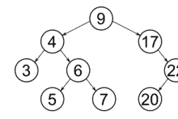

二叉树的中序遍历结果将键按升序排列。通常情况下，`BST` 是使用带有4个字段的链表来实现的。

| 父节点 | 左节点 | 数据 | 右节点 |
| :--- | :--- | :--- | :--- |

如果不在 `BST` 上执行删除操作，可以省略父节点字段，仅需三个字段（数据、左、右）就足够执行操作了。

## 15.2. 二叉搜索树 (`BST`) 的基本操作

- 查找最小键值节点：通过遍历最左侧的元素，可以找到键值最小的节点

```
ALGORITHM BST Minimum(Tree)

BEGIN:

P = Tree

WHILE P -> Left != NULL Do

  P = P -> Left

RETURN P

END;
```

时间复杂度：`(log₂N, O(N))`
如果树是平衡的，最左侧的元素将是一个叶子节点，且距离高度为`log₂N`。如果树向左侧倾斜，树的高度可能为`N`。

空间复杂度：`Θ(1)`
仅使用了一个变量`P`。

- 查找最大键值节点

通过遍历最右侧的元素，可以找到键值最大的节点

```
ALGORITHM BST Maximum(Tree)

BEGIN:

P = Tree

WHILE P-> Right != NULL Do

  P = P-> Right

RETURN P

END:
```

时间复杂度：`(log₂N)`, `O(N)`
如果树是平衡的，最右侧的元素将是一个叶子节点，且距离高度为`log₂N`。如果树向左倾斜，树的高度可能为`N`。

空间复杂度：`Θ(1)`
仅使用了一个变量`P`。

- 1. 执行搜索
- 将根节点的键值与搜索键进行比较。如果匹配，则返回节点地址。如果没有匹配，且搜索键小于当前节点的键值，则在左子树中进行搜索；否则在右子树中进行搜索。
- 在 `BST` 中执行的搜索是二分查找。
- 如果通过搜索返回了节点的有效地址，则搜索成功。如果返回`NULL`，则说明搜索的键不在 `BST` 中（搜索失败）。

```
ALGORITHM BSTSearch(Tree, key)

BEGIN:

P = Tree

WHILE P!=NULL

  IF key == P\-> Data THEN

    RETURN P

  ELSE

    IF key < P\-> Data THEN

      P = P→ Left

    ELSE

      P = P→ Right

  RETURN NULL

END;
```

### 时间复杂度：

- 如果树是平衡的：当键位于根节点时，出现最好情况。
  最坏情况是键位于距离根为`log₂N`的叶子节点。
- 如果树是倾斜的：当键位于根节点时，出现最好情况。
  最坏情况是键位于距离根为`N`的叶子节点。

`(1)`, `Θ(log N)`, `O(N)`

### 空间复杂度：`Θ(1)`

逻辑中仅使用了1个变量。

- 插入：`BST` 中的插入始终作为叶子节点发生。
  通过遍历 `BST` 查找合适的插入位置，根据要插入的键是小于还是大于当前节点的键值，分别从根节点向左或向右移动进行查找。所有插入都从根节点开始。

## 算法`BSTInsert(Tree, key)`

```
BEGIN:

P = Tree

Q = Null

R = MakeNode(key)

WHILE P!=NULL Do

  IF key < P→Data THEN

    Q = P

    P = P→ Left

  ELSE


```text
Q = P

P = P→Right

IF key < Q→Data THEN

  Q→Left = R

  R→Father = Q

ELSE

  Q→Right = R

  R→Father = Q

END;
```

### 时间复杂度

`O(1)`、`O(log₂N)`、`O(N)`

如果树是平衡的，叶子节点距离根的距离为`log₂N`。如果树是倾斜的，插入可能发生在紧邻根节点且倾斜的反方向。在这种情况下可能需要常数级的工作。最坏情况下，插入可能发生在倾斜树的底部，需要`N`次操作。

### 空间复杂度

`Θ(1)`

`P`、`Q`、`R`指针变量以及一个节点的内存。

### 递归插入过程

#### 算法 `BSTInsert(Tree, key)`

```text
BEGIN:

  IF Tree = NULL THEN

    Tree = MakeNode(key)

  ELSE

    IF key < P→Data THEN

      Tree→Left = BSTInsert(Tree, key)

    ELSE

      Tree→Right = BSTInsert(Tree, key)

END;
```

### 时间复杂度

`O(1)`、`O(log₂N)`、`O(N)`

如果树是平衡的，叶子节点距离根的距离为`log₂N`。如果树是倾斜的，插入可能发生在紧邻根节点且倾斜的反方向。在这种情况下可能需要常数级的工作。最坏情况下，插入可能发生在倾斜树的底部，需要`N`次操作。

### 空间复杂度

`Θ(height)`

## 二叉搜索树

```text
q = p→Right

IF p→Left != NULL AND p→Right = NULL THEN

  q = p→Left

  r = p→Father

  IF IsLeft(p) THEN

    r→Left = q

    q→Father = r

  ELSE

    r→Right = q

    q→Father = r
```

```text
x = p→Data
FreeNode(p)
RETURN x
```

## 情况 3：如果待删除节点有 2 个孩子

对于这种情况，找到并删除 BST 后继节点（后继节点的删除属于情况 1 或情况 2）。删除后继节点的值将保留在原本要删除的节点`p`中。

```text
q = BSTSuccessor(p)
x = BSTDelete(q)  // 根据情况 1 或情况 2 进行递归删除，取决于哪种情况适用
pp→Data = x

END;
```

## 15.3. 平衡搜索树：AVL 树

BST 的高度取决于插入键的序列。它可能会发生倾斜，导致大多数操作的复杂度变为`O(n)`。为了平衡它并将高度限制在`log n`数量级，形成了 AVL 树。

AVL 树是一种平衡搜索树。任何节点的平衡因子只能在`+1`和`-1`之间。当树中任何节点的平衡因子在插入过程中变为`+2`或`-2`时，会执行旋转操作来恢复平衡。

节点的平衡因子：

节点`p`的平衡因子 = `Height(p→Left) – Height(p→Right)`

## AVL 树中的旋转

AVL 树定义了四种旋转：

`LL`、`RR`、`LR`、`RL`

其中，`LL`和`RR`是单旋转，`LR`和`RL`是双旋转。

- `LL`旋转：当插入发生在不平衡节点的左侧时执行。
- `RR`旋转：当插入发生在不平衡节点的右侧时执行。
- `LR`旋转：当插入发生在不平衡节点的左侧时执行。
- `RL`旋转：当插入发生在不平衡节点的右侧时执行。

为了使上述旋转更简单，写了两个基础旋转：`rotateRight`、`rotateLeft`。

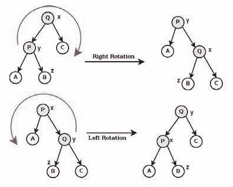

### 算法 `RotateRight(x)`

```text
BEGIN:

y = x→Left
z = y→Right
y→Right = z
x→Left = z

RETURN y

END;
```

时间复杂度：`Θ(1)`

空间复杂度：`Θ(1)`

### 算法 `RotateLeft(x)`

```text
BEGIN:

y = x→Right
z = y→Left
y→Left = z
x→Right = z

RETURN y

END;
```

时间复杂度：`Θ(1)`

空间复杂度：`Θ(1)`

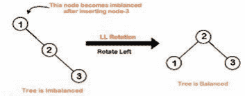

### 情况 02

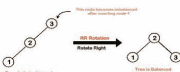

### 情况 03

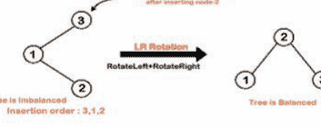

### 情况 04

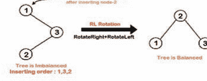

### 算法 `LL(T)`

```text
BEGIN:

T = RotateRight(T)
RETURN T

END;
```

时间复杂度：`Θ(1)`

空间复杂度：`Θ(1)`

### 算法 `RR(T)`

```text
BEGIN:

T = RotateLeft(T)
RETURN T

END;
```

时间复杂度：`Θ(1)`

空间复杂度：`Θ(1)`

### 算法 `LR(T)`

```text
BEGIN:

x = T→Left
x = RotateLeft(x)
T→Left = x
T = RotateRight(T)

RETURN T

END;
```

时间复杂度：`Θ(1)`

空间复杂度：`Θ(1)`

### 算法 `RL(T)`

```text
BEGIN:

x = T→Right
x = RotateRight(x)
T→Right = x
T = RotateLeft(T)

RETURN T

END;
```

时间复杂度：`Θ(1)`

空间复杂度：`Θ(1)`

### AVL 中的插入

AVL 树的插入操作与 BST 相同。插入后，会重新计算插入路径上节点的平衡因子。如果平衡因子为`+2`或`–2`，则对该节点进行旋转以使树平衡。

如果插入路径上有两个或多个不平衡节点，则对插入节点最近的不平衡节点进行旋转。

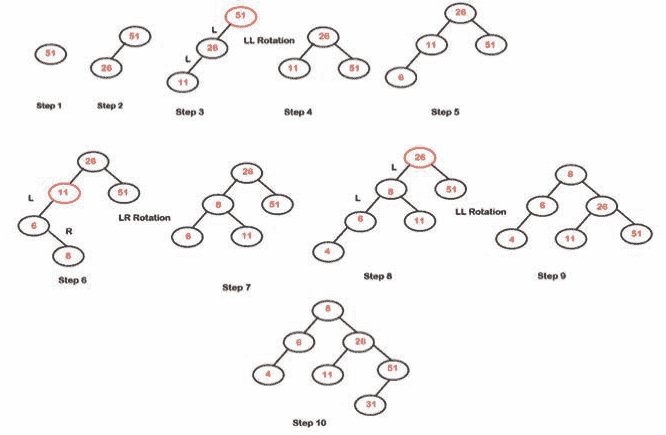

### 算法 `AVLInsertion(N, Key)`

```text
BEGIN:

IF N == NULL
  N = MakeNode(Key)
  h(N) = 0
ELSE
  IF Key < N→Data
    N→Left = AVLInsertion(N→Left, Key)

    IF Balance(N) == 2
      IF Key < N→Left→Data
        N = LL(N)
      ELSE
        N = LR(N)
  ELSE
    N→Right = AVLInsertion(N→Right, Key)

    IF Balance(N) == -2
      IF Key > N→Right→Data
        N = RR(N)
      ELSE
        N = RL(N)

h(N) = Height(N)
RETURN N

END;
```

时间复杂度：`O(N)`

空间复杂度：`Θ(1)`

## 习题

1. 定义二叉搜索树（BST）。按照序列 45, 36, 76, 23, 89, 115, 98, 39, 41, 56, 48 插入构造 BST。求其前序、中序遍历。
2. 使用键 1, 2 & 3 可以构造多少种不同的 BST？
3. 按照序列 45, 32, 90, 34, 68, 72, 15, 24, 30, 66, 11, 50 插入构造 AVL 树。求其前序、中序和后序遍历。
4. 按照 March, April, May, August, September, December, February 插入构造 AVL 树。
5. 按照序列 150, 155, 160, 115, 120, 145, 130, 147, 170, 180 插入构造 AVL 树。
6. 定义伸树（Splay Tree）和区间树（Interval Tree）。按照顺序 10, 5, 4, 9, 13, 12, 16 插入构造二叉搜索树。
7. 键 9 的节点深度是多少？
   - a. 1
   - b. 2
   - c. 3
   - d. 4
8. 构造的树深度是多少？
   - a. 3
   - b. 2
   - c. 4
   - d. 以上都不是
9. 有多少节点的平衡因子为零？
   - a. 3
   - b. 4
   - c. 5
   - d. 6
10. 有多少节点的平衡因子为`+1`？
    - a. 0
    - b. 1
    - c. 2
    - d. 3
11. 有多少节点的平衡因子为`-1`？
    - a. 0
    - b. 1
    - c. 2
    - d. 3
12. 树的中序遍历是什么？
    - a. 10 5 4 9 13 12 11 16
    - b. 4 5 9 10 11 12 13 16
    - c. 4 9 5 11 12 16 13 10
    - d. 以上都不是
13. 如果对二叉搜索树执行`LL`旋转：
    - a. 中序遍历改变，前序不变
    - b. 中序遍历不变，前序改变
    - c. 中序和后序遍历都改变
14. 如果对二叉搜索树执行`RR`旋转：
    - a. 中序遍历改变，前序不变
    - b. 中序遍历不变，前序改变
    - c. 中序和后序遍历都改变
    - d. 以上都不是

给定一个 AVL 树，插入元素 20 后：

15. 旋转之前有多少元素的平衡因子为 2 或`–2`？
    - a. 0
    - b. 1
    - c. 2
    - d. 3
16. 执行哪种旋转可以使该树再次平衡？
    - a. `LL`
    - b. `LR`
    - c. `RR`
    - d. `RL`
17. 旋转后有多少个节点的平衡因子为 0？
    - a. 2
    - b. 3
    - c. 4
    - d. 5
18. 旋转后有多少个节点的平衡因子为 1？
    - a. 0
    - b. 1
    - c. 2
    - d. 3
19. 旋转后有多少个节点的平衡因子为 1？
    - a. 0
    - b. 1
    - c. 2
    - d. 3
20. 最大深度处有多少个元素？
    - a. 1
    - b. 2
    - c. 3
    - d. 4
21. 在二叉搜索树的以下哪些函数中，必须使用父节点字段？
    - a. 插入
    - b. 删除
    - c. 中序后继或逻辑后继
    - d. 搜索
22. 二叉搜索树中节点`x`的逻辑后继是什么？
    - a. `x`左子树的最大值
    - b. `x`左子树的最小值
    - c. `x`右子树的最大值
    - d. `x`右子树的最小值
23. 二叉搜索树中节点`x`的逻辑前驱是什么？
    - a. `x`左子树的最大值
    - b. `x`左子树的最小值
    - c. `x`右子树的最大值
    - d. `x`右子树的最小值
24. 给定一个 AVL 搜索树，插入 45 后有多少个节点不平衡？
    - a. 1
    - b. 2
    - c. 3
    - d. 0
25. 在空的 AVL 树中依次插入元素 A, V, LT, R, E, I, S, O, K，需要多少次`LL`旋转？
    - a. 0
    - b. 1
    - c. 2
    - d. 以上均不是
26. 所需`RR`旋转次数：
    - a. 2
    - b. 0
    - c. 1
    - d. 以上都不是
27. 所需`LR`旋转次数：
    - a. 1
    - b. 2
    - c. 0
    - d. 以上都不是
28. 所需`RL`旋转次数：
    - a. 0
    - b. 1
    - c. 2
    - d. 以上都不是
29. 如果在一个具有`n`个节点的扩展二叉树中，`LE`是外部路径长度，`LI`是内部路径长度，则`LE`与`LI`之间的关系由公式给出：
    - a. `LE = LI`
    - b. `LE = LI + 2n`
    - c. `LE = LI + n`
    - d. `LE + n = LI`
30. 给定一个具有`n`个节点的二叉搜索树。在树中查找一个键所需的比较次数为：
    - a. `O(1)`
    - b. `O(n)`
    - c. `O(nlogn)`
    - d. `O(logn)`
31. 在空 BST 中插入元素 Z, X, D, C, B, A 导致：
    - a. 一个 AVL 树
    - b. 一左斜树
    - c. 一右斜树
    - d. 一个堆

通过插入节点 15, 20, 19, 6, 8, 4, 21, 18, 17 创建了一个二叉搜索树。回答以下问题：

## 32. 根节点是什么

- a. 4
- b. 21
- c. 15
- d. 以上都不是

## 33. 创建的树的高度是多少

- a. 4
- b. 3
- c. 5
- d. 2

## 34. 根节点的左子树和右子树各有多少个节点

- a. 5, 3
- b. 4, 4
- c. 2, 6
- d. 3, 5

## 35. 前序遍历是

- a. 15 6 4 8 20 19 18 4 17 21
- b. 21 17 18 19 20 8 4 6 15
- c. 8 4 6 17 18 19 21 20 15
- d. 以上都不是

## 36. 后序遍历是

- a. 15 6 4 8 20 19 18 17 21
- b. 21 17 18 19 20 8 4 6 15
- c. 8 4 6 17 18 19 21 20 15
- d. 以上都不是

## 37. `xyz(root)`

```c
while (left(root) != NULL)
    root = left(root);
return root;
```

对于二叉搜索树，函数`xyz`返回：

- a. 具有最大值的节点
- b. 具有最小值的节点
- c. 空指针
- d. 以上都不是

38. 二叉搜索树的前序遍历序列为 30, 20, 10, 15, 25, 23, 39, 35, 42。下列哪个是该树的后序遍历序列？
    - a. 10, 20, 15, 25, 35, 42, 39, 30
    - b. 15, 10, 25, 23, 20, 42, 35, 30
    - c. 15, 20, 10, 23, 25, 42, 35, 30
    - d. 15, 10, 23, 25, 20, 35, 42, 30
39. 假设我们在二叉搜索树中有 1 到 100 之间的数字，并想要查找数字 55。下列序列哪个不可能是检查的节点序列？
    - a. `{10, 75, 64, 43, 60, 57, 55}`
    - b. `{90, 12, 68, 34, 62, 45, 55}`
    - c. `{9, 85, 47, 68, 43, 57, 55}`
    - d. `{79, 14, 72, 56, 16, 53, 55}`
40. 一个二叉搜索树（BST）存储 37 到 573 范围内的值。考虑以下键的序列：

    I. 81, 537, 102, 439, 285, 376, 305

    II. 52, 97, 121, 195, 242, 381, 472

    III. 142, 248, 520, 386, 345, 270

    IV. 550, 149, 507, 395, 463, 402

    下列叙述哪个是正确的？

    - a. II 和 IV 是三个不同 BST 的中序序列
    - b. II 是以 43 为根的 BST 的前序序列
    - c. II 是以 121 为根的 BST 的中序序列；52 是叶节点
    - d. IV 是以 149 为根的 BST 的后序序列

41. 使用二叉搜索树定位数字 43。下列探测序列哪些可能，哪些是不可能的？

- a. 61 52 14 17 40 43
- b. 2 3 50 40 60
- c. 10 65 31 48 37
- d. 81 61 52 14 41 43
- e. 17 27 66 18 43

## B-Tree & B+-Tree

### 目录

- 16.1 B-Tree ...................................394
- 16.2 B+-Tree ..................................396
- 练习题 .......................................399

B-Tree 和 B*-Tree 是多路搜索树。考虑一个节点只有一个键的二叉搜索树（BST）。从当前节点有两个选择：向左或向右。如果我们有两个键 X 和 Y，例如在一个节点中有 3 条搜索路径：一个小于 X，另一个在 X 和 Y 之间，最后一个大于 Y。允许多个键的树被称为多路搜索树。

## 16.1. B-TREE

B-Tree 是具有以下属性的多路搜索树：

- 树由阶`m`定义，阶定义了节点可以拥有的子节点。
- 阶`m`最大键数为`m-1`。
- 最小键数为`(m-1)/2`。
- 根节点可以违反最小条件并有一个键。
- 没有节点可以违反最大条件。
- 所有叶节点位于同一层。
- 节点中的键按非降序排列：`K1 <= K2 <= ... <= Kn`。
- 子节点中的键遵循以下关系：`Key(Cj) <= Kj <= ... <= K_{m-1} <= Key(Cm)`。
- 在 B-Tree 中，任何内部节点或叶节点都可以包含搜索的键。

## 16.1.1. B-Tree 中的插入

在 B-Tree 中插入键，需要搜索以找到合适的节点。插入总是发生在叶节点。插入时有两种情况：

- 目标节点少于`m-1`个键：在节点正确的位置插入键。


- 目标节点恰好包含 `m-1` 个键：在这种情况下执行键的插入。节点分裂为两个。中间键之前的元素留在另一个节点中。中间键发送到父节点。如果父节点不存在，则创建父节点且树的高度增加 1。如果父节点存在且有 `m-1` 个键，该节点同样分裂并将中间键向上发送。

## 16.1.2. B-Tree 中阶的计算

考虑下面的数据库表：

| 学号 (Roll) | 姓名 | 父亲名 | 地址 | 联系电话 |
| :--- | :--- | :--- | :--- | :--- |
| 98201 | Abhishek Yadav | Pankaj Yadav | C-5, Alambagh, Lucknow | 0522489987 |
| 98202 | Adesh Kumar Singh | Katar Singh | 346, Patel Nagar 2, Ghaziabad | 0120713547 |
| 98203 | Akhilesh Kr Srivastava | Ramesh Srivastava | C-13/111, Lakhhangpur, Varanasi | 0542241999 |
| ... | | | | |

表存储在持久性存储中，可以随时进行搜索。通常，搜索围绕键值（在此表中是学号）。预期结果是与学号相关的信息（例如 98203），所需信息是与学号 98203 记录。B-Tree 存储所有记录的键值和记录地址对。每当对特定键进行搜索时，该键的记录地址可以是 B-Tree 的输出。

B-Tree 存储在持久性存储中。通常，一个 B-Tree 节点恰好适应磁盘扇区。每个扇区为 512 字节，因此每个 B-Tree 节点的大小为 512 字节或少。

## B-Tree 节点结构

```text
C1 <K1, R1> C2 <K2, R2> C3 <K3, R3> ... <K_{m-2}, R_{m-2}> C_{m-1} <K_{m-1}, R_{m-1}> Cm
```

有：

- `m-1` 个键；
- `m-1` 个记录地址；
- `m` 个子节点指针。

如果键、记录地址、子节点指针 `K`、`R` 和存储字节 `C`，则满足：

```text
(m-1)*K+(m-1)*R+m*C <= 512
```

示例：

```text
如果 K=8 字节，R=12 字节，C=2 字节
(m-1) 8 +(m-1) 12 +m*2 <= 512
22 m-20 <= 512
22 m <= 532
m <= 532/22
m <= 24.1818
```

## 16.2. B-Tree

B*Tree 与 B-Tree 相似，键仅存储在叶节点中。在数据库中，这些表组织成 B-Tree 用于搜索。如果需要搜索整个表，则从 B'Tree 的根节点搜索第一个键以到达该键的叶节点。由于所有叶节点都是连接的，可以通过遍历叶节点找到剩余的键。

## 16.2.1. B+树的插入

对于 B+树中的键插入，将从根节点开始搜索到相应的插入叶子节点。插入始终发生在叶子节点。在插入时有两种可能：

- 目标节点包含的键少于 `m-1` 个：在节点的右侧位置插入该键。
- 目标节点恰好包含 `m-1` 个键：在这种情况下，对键进行虚拟插入。该节点分裂为两个节点。中位数键及之前的元素保留在另一个节点中。中位数键发送到父节点（从而将中位数键留在叶子节点上，其副本作为索引节点中的键向上发送）。如果父节点不存在，则创建父节点并将高度增加 1。如果父节点存在且父节点之前也有 `m-1` 个键，则该节点中的额外键将违反最大条件，从而在分裂该节点时也会分裂；分裂时中位数键不保留（因为这是一个索引节点）。中位数键向上发送到父节点。

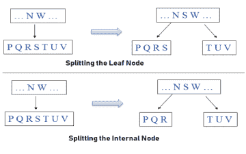

## 16.2.2. B+树的阶计算

在 B+树中，内部节点的结构与叶子节点不同。内部节点仅包含索引和子节点的地址。叶子节点包含键、记录地址以及指向兄弟节点的指针。

- B 树存储在持久性存储器上。通常，B+树恰好适应硬盘的扇区。每个扇区为 512 字节，因此每个 B 树节点的大小也是 512 字节。
- B 树节点的结构。

### 内部节点

| C1 | K1 | C2 | K2 | C3 | K3 | ... | Km-2 | Cm-1 | Km-1 | Cm |
| :--- | :--- | :--- | :--- | :--- | :--- | :--- | :--- | :--- | :--- | :--- |

有 `m-1` 个键和 `m` 个子节点指针。如果键、记录地址、子节点指针分别需要 `K`、`R` 和 `C` 字节进行存储，那么：

```text
(m-1)*K+m*C <= 512
```

### 叶子节点

```text
P_{Left} <K1, R1> <K2, R2> <K3, R3> ... <K_{m-2}, R_{m-2}> <K_{m-1}, R_{m-1}> P_{Right}
```

有 `m-1` 个键、`m-1` 个记录地址以及 2 个指向左、右兄弟节点的指针（某些情况下仅指向右兄弟节点）。如果键、记录地址、兄弟节点指针需要 `K`、`R` 和 `S` 字节进行存储，那么：

```text
(m-1)*K+(m-1)*R+2*S <= 512 (如果记录了左右、右兄弟节点)
(m-1)*K+(m-1)*R+1*S <= 512 (如果叶子节点中仅记录了右兄弟节点)
```

示例：

如果 `K=8` 字节，`R=12` 字节，`C/S=2` 字节。

#### 叶子节点的阶

```text
(m-1) 8 + (m-1) 12 + 2*2 <= 512
20 m-16 <= 512
20 m <= 528
m <= 528/20
m <= 26.4
```

因此，B 树叶子节点的阶为 26 或更小。

#### 内部节点的阶

```text
(m-1)K+mC <= 512
(m-1)*8+m*2 <= 512
10m <= 520
m <= 52
```

因此，B 树内部节点的阶为 52 或更小。

## 练习

1. 为以下输入数据集：69, 19, 43, 16, 25, 40, 132, 100, 145, 7, 15, 18 构建一个阶为 3 的 B 树。
2. 按顺序向一个阶为 5 的空 B 树插入键：F, S, Q, K, C, L, H, T, V, W, M, R, N, P, A, B, X, Y, D, Z, E，并显示结果。
3. 按顺序向一个阶为 5 的空 B 树插入键：F, S, Q, K, C, L, H, T, V, W, M, R, N, P, A, B, X, Y, D, Z, E，并显示结果。
4. 找出高度为 `h` 的 B 树中可能包含的最大键数。
5. 找出高度为 `h` 的 B 树中可能包含的最小键数。
6. 按照以下序列插入键 A G F B K D H M J S I R X C L N T U P，画出阶为 5 的 B 树。

# 17. 图

## 目录

- 17.1. 图的基础知识 ................................................................................ 402
- 17.2. 图的应用 ................................................................ 405
- 17.3. 图的表示...................................................................... 406
- 17.4. 图的遍历.................................................................................. 407
- 17.5. 最短路径 .............................................................................. 412
- 17.6. 传递闭包......................................................................... 415
- 17.7. 生成树 ................................................................................ 418
- 17.8. 拓扑排序 ........................................................................ 421
- 练习.................................................................................................. 424

## 17.1. 图的基础知识

图是非线性数据结构。它是顶点和边的集合。在图中，节点可以通过边与任意数量的顶点连接。

### 17.1.1. 图的术语

图可以是有向的或无向的。有图中方向指定在边上。无向图中边没有方向。


节点的度：包含该节点的边。

- 度(A): 1
- 度(B): 3
- 度(C): 3
- 度(D): 3
- 度(E): 2

入度：终止于节点的边。

- 入度(A): 0
- 入度(B): 1
- 入度(C): 2
- 入度(D): 2
- 入度(E): 1

出度：从节点出的边。

- 出度(A): 2
- 出度(B): 1
- 出度(C): 1
- 出度(D): 1
- 出度(E): 1

在无向图中，如果 A 和 B 之间存在边：

图的顶点，边表示关系。考虑给定场景。

在有向图中，如果存在 `A→B`：

A 是 B 的前驱。B 是 A 的后继。

在无向图中，如果 A 和 B 之间存在边：

A 和 B 是邻居。

### 17.1.2. 图的类型

- 无环的有向图称为 DAG（无环有向图）。每顶点之间都有边的无向图称为完全图。


## 17.1.2.1. 多重图

具有并行边（源和终点相同的边）和自环（端点相同）的图称为多重图。

无向图中边的总数为 `n(n-1)/2`，其中 `n` 代表顶点。每个顶点到其他顶点都有边的有向图将是 `n(n-1)`。

如果每条边都带有权重，则图被称为权图。这些权重可以表示：

- 从边的一个端点到另一个端点的代价；
- 端点之间的距离；
- 从边的一个端点到另一个端点的时间。


# 406 使用 C 语言的数据结构与算法实用方法

图是表示上述场景的标准方式，有标准的算法来回答此类问题：

- 从德里到瓦拉纳西的火车最短路径是什么？或者从德里到瓦拉纳西哪条路线花费的时间最少？
- 工厂在 20 点之前需要完成哪些工作？
- 为了执行 i 逻辑中的某些语句 no，还有哪些语句将在此之前执行？
- 从当前状态开始，我可以在多少步内赢得跳棋游戏。

## 17.3. 图的表示

图在内存中可以用三种方式表示：

- 邻接矩阵 (Adjacency matrix)；
- 关联矩阵 (Incidence matrix)；以及
- 邻接列表 (Adjacency list)。

### 17.3.1. 邻接矩阵

这是一个 `N x N` 的方矩阵，其中 `N` 是顶点数。连接用 `1` 表示，无连接用 `0` 表示。对于自环连接，用邻接矩阵中的项 `2` 表示。

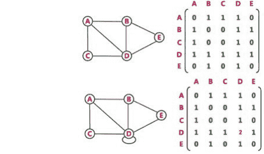

邻接矩阵中所有项之和在无向图中是边数的 2 倍，在有向图中等于边数。

### 17.3.2. 关联矩阵

关联矩阵的行表示顶点，列表示边。对于普通边，边的端点用值 `1` 表示，对于自环用值 `2` 表示。每列的列和为 2。

### 17.3.3. 邻接列表

邻接列表是链表表的数组。数组中的元素个数与顶点数相同。对于每个链接，通过顺序添加节点（以线性链表节点的形式）显示连接。

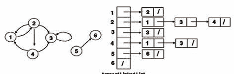

#### 17.3.3.1. 通过名称访问节点

如果顶点分配了名称（例如瓦拉纳西 Varanasi），则需要一个快速查找表（例如哈希表 Hash Table）来将名称与节点编号映射。这是因为图算法假设节点编号是计算的基础。

## 17.4. 图的遍历

图中的基本问题是遍历。系统地遍历图中顶点/边有两种标准方法：

- 广度优先搜索 (BFS)；以及
- 深度优先搜索 (DFS)。

对于图的遍历，顶点有三种状态：未发现、已探索、已完成。

- 在我们对节点发现的描述中，顶点被赋予三种颜色：
- 未发现 (Undiscovered)：初始状态（白色 WHITE）；
- 已探索 (Explored)：灰色 GRAY）；以及
- 已完成 (Completed)：访问所有邻居后的顶点（黑色 BLACK）。

开始时，取单个顶点并探索从其发出的边。

- 如果边指向一个未发现的顶点，则将其标记为已探索并加入已发现顶点列表。
- 如果边指向一个已经探索或完成的顶点，则忽略该顶点。

### 17.4.1. 时间复杂度

每条边被访问一次（有向图）或两次（无向图），因此时间复杂度为 `Θ(|V| + |E|)`。

- 取决于已探索顶点的存储方式，我们得到了两种遍历方法：BFS 和 DFS：
- 队列 (Queue)：首先被探索的顶点是最先完成的。与已探索顶点连接的顶点留在队列中。队列中的顶点按先进先（FIFO）方式删除，如果它们的邻居顶点未被探索，则将其插入队列。
- 栈 (Stack)：首先被探索的顶点是最后完成的。与已探索顶点连接的顶点留在栈中。寻找最新探索的顶点尚未被探索的邻居顶点。

### 17.4.2. 广度优先搜索 (BFS)

- 所有顶点初始化为白色。
- 定义一个空队列用于存储灰色顶点。
- 将源顶点 `s` 插入队列并将其颜色定义为灰色。
- 维护一个距离向量 `d[]`，定义从源 `s` 到给定顶点的路径长度。
- 源的距离，即 `d[s]` 初始化为 0。
- 在 `Π[]` 中维护每个顶点的前驱。如果存在边 `(u, v)` 且在 BFS 中从 `u` 探索到 `v`，则将 `v` 的前驱设为 `u`。
- 从队列中删除的顶点标记为黑色。
- 执行 BFS 后，`d[]` 告诉源到给定顶点的最小距离。

#### ALGORITHM BFS (G, s)

```text
BEGIN:
QUEUE Q
Initialize (Q)
```

For all `u ∈ V[G]` DO

`Π[u] ← Nil`

`Color[u] ← White`

`EnQueue(Q, s)`

`Color[s] ← Grey`

`d[s] ← 0`

```text
WHILE (!Empty(Q)) Do
u ← DeQueue (Q) Do
For each V ε Adj[u]
If Color[u] = White
Color [u] ← Grey
Enqueue(Q, u)
d[v] ← d[u]+1
Π[u] ← u
Color[u] ← Black
WRITE (u)
END;
```

**时间复杂度：`Θ(|V|+|E|)`**

**空间复杂度：`Θ(|V|)`**

考虑下面的图。

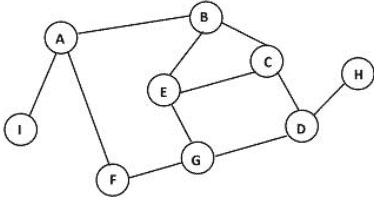

邻接列表给出：

- `A: B, F, I`
- `B: A, C, E`
- `C: B, D, E`
- `D: C, G, H`
- `E: B, C, G`
- `F: A, G`
- `G: D, E, F`
- `H: D`
- `I: A`

| | | | | |
|---|---|---|---|
| Π g | A | A |
| Π b | 1 | 3 | 3 |
| Π a | B | B |
| Π f | 1 | 2 | 2 |
| Π e | F | E |
| Π a | A | F |
| Π f | I | G |
| Π b | B | F |
| Π c | 3 | E | G |
| Π f | B | C |
| Π g | 2 | G |
| Π e | I | G |
| Π f | F | C |
| Π g | 2 | O |
| Π e | F | C |
| Π g | 3 | D | O |
| Π c | C | D |
| Π h | M | | G | H |

| VERTEX | Distance | Π |
|---|---|---|
| A | 0 | NL |
| B | 1 | C |
| D | 2 | B |
| E | 2 | B |
| F | 3 | E |
| G | 2 | R |
| I | 1 | A |

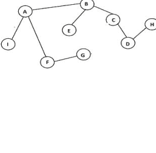

上述图中找到的前驱形成 BFS 树（所示）。从 BFS 树可以验证，BFS 期间记录的距离表示考虑每条边长度为 1 的最短路径。

### 17.4.3. 深度优先搜索 (DFS)

- 所有顶点初始化为白色。
- 定义一个空栈用于存储灰色顶点。
- 将源 `x` 插入栈并将其颜色定义为灰色。
- 栈用于保存已的顶点。
- 原则，“尽可能深入”，直到找到未探索的相邻顶点。
- 计算顶点的“开始时间”和“完成时间”。
- 开始时间 `S[u]` 定义了访问顶点的时间。
- 完成时间 `F[u]` 定义了所有顶点被探索的时间。
- 在 `II[]` 中维护每个顶点的前驱。如果存在边 `(u, v)` 且在 DFS 中从 `u` 探索到 `v`，则将 `v` 的前驱设为 `u`。

#### ALGORITHM DFS (G)

```text
BEGIN:
For all u ∈ V[G] Do
Color[u] ← White
Time ← 0

For all u ∈ V[G] Do
IF Color[u] ← White
DFS ← Visit (u)
END;
```


### 算法：`DFS-VISIT(U)`

```text
BEGIN:
  Color[u] ← Grey
  S[u] ← Time + 1
  For all V ∈ Adj[U] Do
    IF Color[V] ← White
      II[V] ← U
      DFS ← Visit(V)
  Color[U] ← Black
  F[U] ← Time + 1
  Time ← Time + 1
END;
```

**时间复杂度：**`Θ(|V| + |E|)`

**空间复杂度：**`Θ(|V|)`

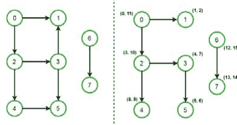

在右侧图中，`(x, y)`代表顶点的开始时间和完成时间对。开始时间表示探索顶点的时间。

| Vertex | Connections | Start Time | Finish Time | Predecessor II |
|---|---|---:|---:|---|
| 0 | 1, 2 | 0 | 11 | NIL |
| 1 |  | 1 | 2 | 0 |
| 2 | 3, 4 | 3 | 10 | 0 |
| 3 | 1, 5 | 4 | 7 | 2 |
| 4 | 5 | 8 | 9 | 2 |
| 5 |  | 5 | 6 | 3 |
| 6 | 7 | 12 | 15 | NIL |
| 7 |  | 13 | 14 | 6 |

上述图的 DFS 是它们首次被发现的时间，即 0, 1, 2, 3, 5, 4, 6, 7。

右侧图也显示了 DFS 森林的发现（前驱帮助形成了它）。

## 17.5 最短路径

如果图代表城市/站点，边代表它们之间的连接，最短路径是对于给定源和终点，行走长度最小的路径。例如，考虑下面的图。

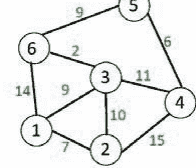

从 1 到 5 有多条可能的路径：

- `1 → 2 → 4 → 5`，长度 28
- `1 → 6 → 5`，长度 23
- `1 → 2 → 3 → 4 → 5`，长度 34

在所有可用路径中，`1 → 3 → 6 → 5` 是长度为 20 的最短路径。

### 17.5.1 全对最短路径

考虑一个虚拟场景：在选举期间，选举委员会决定为居住在国家其他地区的选民支付旅费，这些选民的名字只在家乡的选民名单上。这样做是为了提高整体投票率。选举委员会决定通过最短的路线为选民支付从工作城市到各个市的旅行费用。为了避免任何运行时问题，选举委员会官员将找到范围内每对站点之间的最短路径。

以下算法用于寻找每对站点之间的最短路径。具有`N`个顶点的图的权重矩阵作为输入。它表示两个顶点之间存在的边权重，否则为 0。算法考虑，如果顶点对之间不存在边（作为起点和终点），则它们是不可达的，其距离设置为无穷大。

算法将每个顶点`(k)`作为中间节点处理一次并计算路径长度。目的地`(i → j)`的直接路径或通过中间节点`(i → k → j)`的最短路径，被作为矩阵`(i, j)`单元格中的新条目。

```text
W[i][j] ← Min(W[i][j], W[i][k] + W[k][j])
ALGORITHM APSFloydWarshall(W[][], N)
BEGIN:
  FOR i ← 1 To N DO
    FOR j ← 1 To N DO
      IF W[i][j] == 0
        IF i != j THEN
          W[i][j] = ∞

  FOR k ← 1 To N DO
    FOR i ← 1 To N DO
      FOR j ← 1 To N DO
        W[i][j] ← Min(W[i][j], W[i][k] + W[k][j])
```

**时间复杂度：**`Θ(N^3)`

**空间复杂度：**`Θ(1)`

上图显示了使用 Floyd Walsh 算法计算最短路径的过程。`D_0`矩阵显示初始距离矩阵，所有 0 条目（对角线除外）已转换为无穷。`D_1`、`D_2`、`D_3`、`D_4`显示了以顶点 1、2、3、4 作为中间节点的更新距离矩阵。对于`D_1`，`D_0`是基础；对于`D_2`，`D_1`是基础；对于`D_3`，`D_2`是基础；对于`D_4`，`D_3`是基础。它是最短路径的最终矩阵。

### 17.5.2 单源最短路径

如果你通过任何基于 App 的出租服务预订，你会设置起点和目的地。App 会计算最短路径并提前告知。只有当 App 在运行时计算所选起点和目的地之间的最短路径时，这才是可能的。

考虑一种情况：某著名大学正在举办一次全国会议。所有代表将获得参加会议的旅行费用补贴。大学需要提前计算从大学城市到所有目的地的最短路径。在这种情况下，单源是大学城市。

下给算法使用 Dijkstra 算法考虑单源计算到所有目的地的最短路径。在算法中，使用一个存储顶点的优先队列。起点的距离初始化为 0，所有其他顶点初始化为`∞`。从队列中删除最小距离顶点，并更新其连接的距离（如果新距离比之前计算的短）。前驱节点也会被更新。该操作持续进行，直到队列中没有顶点为止。

### 算法：`SSSP Dijkstra(G, W[][], S)`

```text
BEGIN:
  - Priority Queue PQ
  - Initialize(PQ)
  - For all U ∈ V[G] Do
    - D[U] ← ∞
    - Π[U] ← NIL
    - PQ Insert(PQ, U)
  - D[S] ← 0
  - WHILE PQ ≠ Empty Do
    - U ← ExtractMin(PQ)
    - For All V ∈ Adj[U] AND V ∈ PQ
      - IF d[V] < d[U] + W[U][V]
        - d[V] ← d[U] + W[U][V]
        - Π[V] ← U
END;
```

**时间复杂度：**`O(|E| + |V| log |V|)`

**空间复杂度：**`Θ(|V|)`

## 17.6 传递闭包

图的传递闭包是一个图，它通过直接边的形式显示了顶点对之间是否存在路径。可以通过两种方法找到传递闭包：

- Marshall 方法；
- 矩阵乘法方法。

### 17.6.1 用于传递闭包的 Marshall 算法

类似于用于全对最短路径的 Floyd Marshall 算法，这里也使用中间顶点更新路径的存在。所有顶点被逐一作为中间节点。该过程如下：

- 找到图的邻接矩阵。
- 通过在寻找路径时选取中间节点来更新邻接矩阵`A[i][j]`。通过公式`A[i][j] = A[i][j] OR (A[i][k] AND A[k][j])`实现。
- 要么是`A[i][j]`之间的直接路径，或者是通过`k`的路径，即`A[i][k]`和`A[k][j]`。在两种情况下，`A[i][j]`条目均被设置为 1。
- 该过程对邻接矩阵的所有条目重复，每个顶点作为中间节点。
- 新创建的以`k`为中间节点的邻接矩阵，作为计算以`k + 1`为中间节点的邻接矩阵的基础。

```text
ALGORITHM TransitiveClosureWarshall(A[][], N)
BEGIN:
  FOR k ← 1 To N Do
    FOR i ← 1 To N Do
      FOR j ← 1 To N Do
        A[i][j] ← A[i][j] | (A[i][k] & A[k][j])
END;
```

**时间复杂度：**`Θ(N^3)`

**空间复杂度：**`Θ(1)`

### 17.6.2 矩阵乘法方法

图的邻接矩阵显示长度为 1 的路径。

找到`A^2 = A × A`。此矩阵代表长度为 2 的路径。

找到`A^3 = A^2 × A`。此矩阵代表长度为 3 的路径。

找到`A^4 = A^3 × A`。此矩阵代表长度为 4 的路径。

...

`A^N = A + A^2 + A^3 + ... + A^N`

其中`N`是图的顶点数。

找到`M = A + A^2 + A^3 + ... + A^N`

其中`N`是图的顶点数。

```text
ALGORITHM TransitiveClosureWarshall(A[][], N)
BEGIN:
  FOR k ← 1 To N Do
    FOR i ← 1 To N Do
      FOR j ← 1 To N Do
        A[i][j] ← A[i][j] | (A[i][k] & A[k][j])
END;
```

END;

**时间复杂度：**`O(|E| + |V| Log |V|)`

**空间复杂度：**`Θ(|V|)`

|  | 距离 | 前驱节点 |
|---|---|---|
| 1 | 0 | NIL NIL NIL NIL NIL |
| 2 | ... 2 | NIL 1 1 1 1 1 |
| 3 | ... 5 | NIL 4 2 2 2 |
| 4 | ... NIL | NIL 3 1 1 1 |
| 5 | ... 4 4 | NIL 1 1 1 1 1 |
| 6 | ... 6 6 | NIL 2 2 2 |

Prim 算法运行过程。

### 17.7.3 用于最小生成树的 Kruskal 算法

Kruskal 算法将边按权重升序序列进行排列。逐个选择边，如果该边不形成任何环，则将其添加到生成树的选边集合中。生成树中的环路检测通过一种名为“并集结构”（Disjoint set structure）的数据结构来实现。

- 并集数据结构：某些应用涉及将`n`个不同对象分成一组互不相交的集合。重要的操作是查找给定对象属于哪个集合以及合并集合。

并集数据结构维护一个互不相交集合集合`S = {S₁, S₂, ..., Sₖ}`。每个集合由一个代表元素标识，该代表元素通常是一个成员`x`。

- 集合操作：假设`x`是一个对象。我们希望支持以下操作。
- `MakeSet(x)`创建一个新集合，其中成员由`x`指向；注意`x`不在其他集合中。`x`被设置为集合的根。
- `Union(x, y)`将包含对象`x`和`y`的两个不交集合（例如`S_k`和`S_l`）合并为一个新集合`S_k ∪ S_l`，假设`S_k ∩ S_l = ∅`。
- `FindSet(x)`返回指向集合`x`的代表元素/根的指针。

### 算法：`MST-Kruskal(G, W[|V|])`

根据权重对`E`中的所有边进行排序。

```text
MST 的边集 E' ← ∅
For all U ∈ V[G] DO
  MakeSet(U)
  For Each Edge(U, V) ∈ E[G] DO
    IF FindSet(U) != FindSet(V)
      Union(U, V)
      Select(U, V) In E'
Return E'
```

**时间复杂度：**`O(|E| + |V| Log |V|)`

**空间复杂度：**`Θ(|V|)`

## 17.8 拓扑排序

假设我们需要调度一系列任务，例如课程或建筑作业，在所有先决条件完成之前，我们无法启动某项任务。我们希望将任务组织成线性顺序，以便能够在不违反任何先决条件的情况下完成它们。我们可以使用有向无环图（DAG）对问题建模。图是有向的，因为一个顶点是另一个的先决条件——顶点之间有方向关系。它是无环的，因为环表示冲突的先决条件序列，在不违反至少一个先决条件下无法完成。将 DAG 的顶点按线性顺序排列以满足先决规则的过程被称为拓扑排序。

有两种找到拓扑排序序列的方法：

- 使用节点的度和入度；
- 使用 DFS（深度优先搜索）。

这里，我们将使用节点的入度作为计算拓扑排序序列的基础。入度为 0 的节点表示该节点代表的活动立即开始。此类节点被插入队列。我们从队列中删除的第一个节点开始继续探索顶点，并将连接结点的入度减 1。在这个过程中，如果找到入度为 0 的节点，则将其加入队列并重复该过程，直到队列为空。

### 算法：`拓扑排序(G, Indeg[])`

```text
BEGIN:
  Queue Q
  Initialize(Q)
  FOR All U ∈ V[G]
    IF Indeg[U] = 0
      Enqueue(Q, U)

  WHILE !Empty(Q) DO
    U ← Dequeue(Q)
    WRITE(U)
    FOR All V ∈ Adj[U]
      IF Indeg[V] = 0
        Enqueue(Q, U)
END;
```

**时间复杂度：**`Θ(|V| + |E|)`

**空间复杂度：**`Θ(|V|)`

### 图 423

| 顶点 | 入度 |
|---|---:|
| 0 | 0 |
| 1 | 1 |
| 3 | 1 |
| 4 | 2 |
| 5 | 2 |
| 6 | 2 |

| 队列 |
|---|
| 1 |
| 2, 3 |
| 3 |
| 4 |
| 5, 6 |
| 6 |

## 练习题

1. 使用 Prim 方法找到下图的最小生成树。
2. 使用 DFS 方法遍历给定的图。画出森林。
3. 编写 BFS 算法。找到图的 BFS 序列。
4. 使用 Marshall 算法找到图中每个顶点之间的最短路径。
5. 使用 Prim 方法找到下图的最小生成树。
6. 使用 DFS 方法遍历给定的图。画出森林。
7. Kruskal 算法的运行时间是
8. Prim 方法使用的数据结构是
9. 无向图的邻接矩阵的元素个数为
10. `n`个顶点完全图的边数为
11. 选择正确项
12. 不带头节点的线程表示
13. 隐式树表示
14. 图中度为 0 的节点称为
15. 图具有边`e₁ = (u, u)`、`e₂ = (u, v)`、`e₃ = (u, v)`。该图可以命名为
16. 二叉搜索树的中序遍历产生
17. 基于树的排序技术具有
18. 无环连通图`G = (V, E)`包含
19. 搜索需要
20. 节点允许的最小键
21. 节点允许的最大键
22. 图`G = (V, E)`有一个生成树`T = (V, E)`，其边数为`|E|`
23. 考虑给定的图。从 A 到 F 的最短距离为……
24. 最佳合并模式是构建……的方法
25. 下列不是最小生成树的应用
26. 下列哪项不是图的应用
27. 给定一个图。哪个路径是简单路径？
28. 使用 Warshall 算法求解`n`个顶点的最短路径需要
29. 在图`G = (V, E)`上进行 BFS 需要`(|V|)`表示顶点数，`|E|`表示边数
30. 下所示最小生成树的代价是多少？
31. 使用 Kruskal 算法找到 MST 的边
32. 生成树的代价是多少？

## 以节点 A 为中介的顶点对

|  | A | B | C | D |
|---|---:|---:|---:|---:|
| A | 0 | 20 | 25 | 60 |
| B | 40 | 0 | 30 | 0 |
| C | 35 | 0 | 0 | 100 |
| D | 0 | 0 | 0 | 0 |

### a

|  | A | B | C | D |
|---|---:|---:|---:|---:|
| A | 0 | 20 | 25 | 60 |
| B | 40 | 0 | 30 | 100 |
| C | 35 | 55 | 0 | 95 |
| D | 0 | ∞ | ∞ | 0 |

### b

|  | A | B | C | D |
|---|---:|---:|---:|---:|
| A | 0 | 20 | 25 | 50 |
| B | 40 | 0 | 30 | 100 |
| C | 35 | 55 | 0 | 95 |
| D | 0 | ∞ | ∞ | 0 |

### c

|  | A | B | C | D |
|---|---:|---:|---:|---:|
| A | 0 | 20 | 25 | 60 |
| B | 40 | 0 | 30 | 90 |
| C | 35 | 55 | 0 | 95 |
| D | 0 | ∞ | ∞ | 0 |

### d

|  | A | B | C | D |
|---|---:|---:|---:|---:|
| A | 0 | 20 | 25 | 60 |
| B | 40 | 0 | 30 | 100 |
| C | 35 | 55 | 0 | 90 |
| D | 0 | ∞ | ∞ | 0 |

## 34. 考虑给出的图，其中哪些是连通的

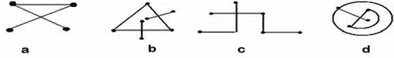

- i. a
- j. b
- k. c
- l. d

## 35. 给出的图有多少种可能的生成树

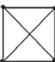

- a. 8
- b. 16
- c. 9


## 36. 给定一个图 G=(V, E)，其中 V = {a, b, c, d, e, f, g, h, i, j, k} & E = {{a, b], [d, e], [j, k], [g, k], [e, f], [b, c], [i, k]}。找到该图的连通分量

- a. {a, b, c}, {d, e}, {g, i, j, k}
- b. {a, b, c}, {d, e, f}, {g, i, j}
- c. {a, b, c}, {d, e}, {g}, {j, k}
- d. 以上均不是

## 37. 以下哪项定义了连通图

- a. 每对顶点之间都存在路径
- b. 某些对顶点之间存在路径
- c. 单对顶点之间存在路径
- d. 以上都不是

## 38. 图的传递闭包（Transitive Closure）是一个关于图的矩阵，它包含：

- a. 告知每对顶点之间边关系的条目
- b. 每对顶点之间所有长度为 1 的路径
- c. 所有不同长度的路径
- d. 以上都不是

## 39. 给定树的外部和内部路径长度为

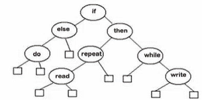

- a. 39, 22
- b. 14, 30
- c. 30, 14
- d. 以上均不是

# 18 稀疏矩阵

## 目录

- 18.1. 稀疏矩阵基础 .................................................... 434
- 18.2. 稀疏矩阵的类型 ................................ 434
- 18.3. 稀疏矩阵的加 ................................... 438

434 使用C语言编程数据结构与算法

## 18.1. 稀疏矩阵基础

稀疏矩阵或稀疏数组是指大部分元素为零的矩阵。零元素的数量除以元素总数（例如 m × n）称为矩阵的稀疏度。当矩阵的稀疏度大于 0.5 时，该矩阵即为稀疏矩阵。

在计算机上存储时，使用利用稀疏结构的专门算法是有益且通常是必要的。当应用于大型矩阵时，使用稠密矩阵结构的操作速度较慢且效率低下，因为浪费了内存。大型稀疏矩阵需要的存储空间少得多。

### 18.1.1. 存储稀疏矩阵

稀疏矩阵通常以二维数组的形式存储。访问矩阵的每个元素 $a_{i,j}$。按照习惯，$i$ 是从上到下的行索引，$j$ 是从左到右的列索引。对于 m × n 矩阵，以这种格式存储矩阵所需的内存与 m × n 成比例，忽略了矩阵维度也需要存储的事实。

对于稀疏矩阵，通过只存储非零元素可以大幅减少内存。根据非零元素的分布，可以使用不同的数据结构，与基础方法相比，可以节省大量的内存。

## 18.2. 稀疏矩阵的类型

### 18.2.1. 有模式的

|    |    |    |    |    |    |    |    |    |
|----|----|----|----|----|----|----|----|----|
| 1  | 0  | 0  | 0  | 1  | 0  | 0  | 0  | 10 |
| 2  | 0  | 0  | 0  | 2  | 3  | 0  | 0  | 6  |
| 3  | 0  | 0  | 0  | 4  | 5  | 0  | 0  |    |
| 4  | 0  | 0  | 0  | 0  | 7  | 8  | 9  | 10 |
| 5  | 0  | 0  | 0  | 0  | 11 | 12 | 13 | 14 |

对角线矩阵，三角矩阵

### 18.2.2. 无模式的

例如，大图的邻接矩阵。

|    |    |    |    |    |    |    |    |    |
|----|----|----|----|----|----|----|----|----|
| 0  | 2  | 6  | 0  | 0  | 1  | 0  | 0  | 0  |
| 2  | 0  | 2  | 0  | 0  | 1  | 1  | 0  | 0  |
| 0  | 2  | 0  | 2  | 0  | 0  | 1  | 0  | 0  |
| 0  | 0  | 2  | 0  | 0  | 0  | 2  | 0  | 0  |
| 0  | 0  | 0  | 2  | 0  | 0  | 0  | 1  | 0  |
| 1  | 1  | 1  | 0  | 0  | 0  | 0  | 0  | 1  |
| 0  | 1  | 1  | 1  | 0  | 0  | 0  | 0  | 1  |
| 0  | 0  | 0  | 0  | 1  | 0  | 0  | 0  | 2  |
| 0  | 0  | 0  | 0  | 0  | 1  | 1  | 2  | 0  |

表示稀疏矩阵以节省内存：

- **对角线矩阵：** 考虑下面的对角线稀疏矩阵：

|    |    |    |    |
|----|----|----|----|
| 1  | 0  | 0  | 0  |
| 0  | 2  | 0  | 0  |
| 0  | 0  | 3  | 0  |
| 0  | 0  | 0  | 4  |

为了节省内存，可以使用一维数组。矩阵 $i, j$ 元素的索引将存储在 $i$ 位置。

- **三角矩阵：** 考虑下面的三角稀疏矩阵：

|    | 2  | 3  |    |    |    |
|----|----|----|----|----|----|
|    | 4  | 5  | 6  |    |    |
|    |    | 7  | 8  | 9  | 10 |
|    |    |    | 11 | 12 | 13 | 14 |

为了节省内存，可以使用一维数组。矩阵 $i, j$ 元素的索引可以通过以下方法找到。矩阵第 $i$ 行有若干元素。在存储维数组中存储 $i, j$ 元素之前，已经放置了 $i-1$ 行。$i-1$ 行的元素数量为 1+2+3...(i-1) = (i-1)i/2。在每行中，$i, j$ 之前有 $j-i+1$ 个元素。一维数组中 $i, j$ 的存储位置为 (i-1)i/2 + (j-i+1) = (i^2-i+2j-2i+2)/2 = (i^2-3i+2j+2)/2。

- **无模式稀疏矩阵的存储：** 无模式的稀疏矩阵可以用两种方法存储：
  - 结构数组；
  - 链表。
  - **结构数组表示稀疏矩阵**：这种表示也称为向量表示。对于元素的存储，必须包含它们的行和列号，这将有助于我们进行计算。

```c
struct sparse {
    int element;
    int row;
    int column;
};
struct sparse S[10];
```

|    | 1  | 2  | 3  | 4  | 5  | Row | Column | Element |
|----|----|----|----|----|----|-----|--------|---------|
| 1  | 0  | 0  | 7  | 0  | 9  | S[0] | 1      | 3       | 7  |
| 2  | 3  | 0  | 0  | 4  | 0  | S[1] | 1      | 5       | 9  |
| 3  | 0  | 8  | 3  | 0  |    | S[2] | 2      | 1       | 3  |
| 4  | 0  | 0  | 9  | 0  | 4  | S[3] | 2      | 4       | 4  |
| 5  | 1  | 0  | 0  | 0  | 12 | S[4] | 3      | 2       | 8  |
|    |    |    |    |    |    | S[5] | 3      | 3       |    |
|    |    |    |    |    |    | S[6] | 4      | 3       | 9  |
|    |    |    |    |    |    | S[7] | 4      | 5       | 4  |
|    |    |    |    |    |    | S[8] | 5      | 1       |    |
|    |    |    |    |    |    | S[9] | 5      | 5       | 12 |

- **链表表示：** 对于链表表示，用于存储稀疏矩阵元素的节点应该有 4 个字段。

| row | column | element | next |
|-----|--------|---------|------|
|     | Column |         |      |
|     | 1  | 2  | 3  | 4  | 5  |
| 1   |    | 0  | 0  | 7  | 0  | 9  |
| 2   |    | 3  | 0  | 0  | 4  | 0  |
| 3   |    | 0  | 8  | 3  | 0  | 0  |
| 4   |    | 0  | 0  | 9  | 0  | 4  |
| 5   |    | 1  | 0  | 0  | 0  | 7  |

## 18.3. 两个稀疏矩阵的加法

假设两个稀疏矩阵以链表的形式给出。要执行加法，当前节点的矩阵行号和列号必须相同。加法的逻辑如下所示算法所示。

### 算法 SparseMatrixAddition(Sparse1, Sparse2)

开始:

```
p=Sparse1
q=Sparse2
Sparse3=NULL
WHILE p!=NULL AND q!=NULL DO
  IF p->row == q->row THEN
    IF p->column == q->column THEN
      InsBeg(Sparse3, p->row, p->column,
        p->element=q->element)
    ELSE
      IF p->column < q->column THEN
        InsBeg(Sparse3, p->row, p->column,
        p->element)
      ELSE
        InsBeg(Sparse3, q->row, q->column,
        q->element)
  ELSE
    IF p->row < q->row THEN
      InsBeg(Sparse3, p->row, p->column,
        p->element)
    ELSE
      InsBeg(Sparse3, q->row, q->column,
        q->element)
  WHILE p!=NULL DO
    InsBeg(Sparse3, p->row, p->column, p->element)
  WHILE q!=NULL DO
    InsBeg(Sparse3, q->row, q->column, q->element)
  RETURN Sparse3
END;
```

## 练习题

1. 写一个 C 语言程序求稀疏矩阵的转置。
2. 写一个 C 语言程序实现两个稀疏矩阵法。
3. 稀疏矩阵有哪些表示方法可以节省存储空间？
4. 写一个程序判断给定矩阵是否为稀疏矩阵？
5. 我们在一个二维数组中只存储非零元素，以存储一个大小为 nxn 的三角稀疏数组。该数组的基地址为 1000，那么元素 A[100, 50] 的地址是多少？（假设每个元素占用 1 个字 m/y）。
6. 选出不同的一项
   a. 树图的邻接矩阵
   b. 单位矩阵
   c. 三对角矩阵
   d. 完全图的邻接矩阵

## 19 哈希

## 目录

- 19.1. 直接寻址表 ................................................................ 442
- 19.2. 哈希表 ................................................................................ 442
- 19.3. 哈希表中的冲突解决............................................... 444
- 练习题 ............................................................................................ 448

## 442 C 语言数据结构与算法编程的实用方法

在编译器中，词法分析阶段会识别各种标记（tokens）并将它们保存到符号表中。在程序执行期间，每当变量出现在计算语句中时，都需要查看其类型。如果程序很长，对变量的引用将会频繁。我们需要一种技术，将标记存储在符号表中，以便快速实现检索（最好是常数时间）。

考虑一种名称与图顶点关联的情况。图计算是根据顶点编号进行的。因此，需要将名称快速转换为顶点编号。

哈希是一种能够让我们在常数时间内进行搜索的方法。用于符号表的数据结构是哈希表。

### 19.1. 直接寻址表

假设我们要存储一个班 60 名学生在某一科目上的成绩。考虑一个大小为 60 的数组。

| [1] | [2] | [3] | [4] | ... | [60] |
|-----|-----|-----|-----|-----|------|
| 成绩 |     |     |     |     |      |

在数组中，成绩[1] 代表学号 1 学生的成绩，成绩[2] 代表学号 2 学生的成绩，成绩[3] 代表学号 3 学生的成绩，...

在这样的表中访问某个学生的成绩可以在常数时间内完成。学号对应的学生的成绩为 Marks[i]。这种将键值视为索引的表被称为直接寻址表。

## 19.2. 哈希表

哈希表类似于直接寻址表。通常，哈希表的大小巨大，且键值可能无法提供数组中的直接索引，因此应用一个函数将键转换为哈希表中的索引。

```
H:Key→L
```

H 是哈希函数，L 是键在哈希表中的位置（Location）。

有多种可能的哈希函数：

- 除法哈希函数；
- 平方法函数；
- 折叠哈希函数。

## 哈希 443

考虑一个大小为 100、索引范围从 0–99 的哈希表。我们需要哈希函数生成 00–99 之间的地址。为了这个目的，可以对键取模 100。这将生成 00–99 之间的地址。

由于 100 有许多因子，在除以 100 时可能会得到相同的余数。例如，12345、23445、32345 都会导致位置 i 即 45。为了避免得到相同的余数，我们可以对键对接近 100 的质数取模。

| 键 (key) | 位置 (Location) |
|----------|-----------------|
| 12345    | 45              |
| 23445    | 45              |
| 32345    | 45              |

### 19.2.1. 平方法函数

考虑一个大小为 100、索引范围从 0–99 的哈希表。我们需要哈希函数生成 00–99 之间的地址。为了这个目的，可以对键取模 100。这将生成 00–99 之间的地址。

| 键 (key) | 键平方 (key²) |
|----------|---------------|
| 12345    | 25            |
| 78399    | 39            |
| 54277    | 29            |
| 80290    | 00            |
| 53535    | 25            |

### 19.2.2. 折叠法

考虑一个大小为 100、索引范围从 0–99 的哈希表。我们需要哈希函数生成 00–99 之间的地址。为了这个目的，可以对键取模 100。这将生成 00–99 之间的地址。

## 哈希 444 C 语言数据结构与算法编程的实用方法

| 键 (key) | 分组 (Groups) |
|----------|---------------|
| 12345    | 23            |
| 78399    | 61            |
| 54277    | 77            |
| 80290    | 64            |
| 53535    | 88            |

## 哈希 445 C 语言数据结构与算法编程的实用方法

| 键 (key) | 探测次数 (Probes) |
|----------|--------------------|
| 12345    | 45                 |
| 78399    | 40                 |
| 54277    | 63                 |
| 80290    | 54                 |
| 53535    | 25                 |

## 446 使用 C 语言编程数据结构与算法的实用方法

使用二次公式：

h(k, i) = (h(k) + a*i+b*i²) mod m

i=0, 1, 2, ...

if a=1/2, b=1/2

- 第一个槽探测：h(k)
- 第二个槽探测：(h(k) + ½²) mod m
- 第三个槽探测：(h(k) + ½*2 + ½*)mod m，以此类推
- 第四个槽探测：(h(k) + ½*3 + ½ *3*) mod m，以此类推

h1(k), h1(k)+1, h1(k)+3, h1(k)+6, ...

## 2. 双重哈希

使用哈希函数确定第一个槽，并使用第二个哈希函数确定探测序列的增量

h(k, i) = (h(k) + i*h(k)) mod m, i=0, 1, ...

- 初始探测：h1(k)
- 第二次探测偏移 h2(k) mod m，以此类推...

示例

| 索引 | 键 |
|------|----|
| 0    | 79 |
| 1    |    |
| 2    |    |
| 3    |    |
| 4    | 69 |
| 5    | 98 |
| 6    |    |
| 7    | 72 |
| 8    |    |
| 9    | 14 |
| 10   |    |
| 11   |    |
| 12   | 50 |

h1(k) = k mod 13
h2(k) = 1+ (k mod 11)
h(k, i) = (h1(k) + i*h2(k)) mod 13

插入键：14:
- h1(14, 0) = 14 mod 13 = 1
- h(14, 1) = (h1(14) + h2(14)) mod 13
  = (1 + 4) mod 13 = 5
- h(14, 2) = (h1(14) + 2 h2(14)) mod 13
  = (1 + 8) mod 13 = 9

## 3. 成功查找所需的平均探测次数

考虑哈希表大小为 13

| 0 | 1 | 2 | 3 | 4 | 5 | 6 | 7 | 8 | 9 | 10 | 11 | 12 |
|---|---|---|---|---|---|---|---|---|---|----|----|----|
| H | C | J | B | A | G | D |   |   | F |    | E  | I  |

考虑使用线性探测法处理以下键集：

成功查找所需的总探测次数 = 1+1+1+1+1+3+1+2+4
成功查找所需的平均探测次数 = 16/10 = 1.6

## 4. 失败查找所需的平均探测次数

对于上述哈希表，如果要查找的键不在表中，

查看每个表位置所需的总探测次数等于 4+3+2+1+5+4+3+2+1+2+6+5=39
失败查找和失败查找所需的平均探测次数 = 39/13=3


成功查找和失败查找的平均探测次数均与表的大小无关，是常数。

与线性搜索和二分搜索相比，哈希方法在搜索性能的平均情况表现方面产生了更好的结果。哈希表可以用于需要快速查找表的地方。

# 使用 C 语言编程数据结构与算法的实用方法

## 练习题

1. 定定值 `{2341, 4234, 2839, 430, 22, 397, 3920}`。考虑一个大小为 7 的哈希表，以及哈希函数 `h(x) = x mod 7`。显示按照给定顺序插入这些值后，使用每种冲突策略后生成的表。

   a. 线性探测

   b. 二次探测

   c. 使用 `(2x−1) mod 7` 的双重哈希

2. 假设表 `T` 有 11 个内存位置 `T[1]`、`T[2]`、`...`、`T[11]`。一个文件由 8 条记录 A、B、C、D、E、X、Y、Z、W 组成。以下是哈地址：

   | 记录 | A | B | C | D | E | X | Y | Z |
   |---|---|---|---|---|---|---|---|---|
   | `H(K)` | 4 | 8 | 2 | 11 | 4 | 11 | 5 | 1 |

   如果按照 Z、Y、X、E、D、C、B 的顺序存储记录，找出文件中记录的内存存储。

   如果在存储后搜索键，成功查找和失败查找的平均探测次数是多少？

3. 在以下情况下哈希表中发生冲突：

   - 两个不同数据的条目具有相同的键。
   - 两个不同键的条目具有相同的哈希值。
   - 除了键之外，两个条目完全相同。
   - 两个具有相同键的条目具有不同的哈希值。

4. 声明了一个带有链的哈希表，其大小为 512 的链表数组。该表中可以放置的最大键数为：

   - 512
   - 256
   - 511
   - 元素数量没有上限

5. 一个长度为 10 个单位的开放寻址哈希表，使用哈希函数 `h(k) = k mod 10`，在空哈希表中插入 6 个值后，表所示。

   | 位置 | 值 |
   |---|---|
   | 0 |  |
   | 1 |  |
   | 2 | 42 |
   | 3 | 23 |
   | 4 | 34 |
   | 5 | 52 |
   | 6 | 46 |
   | 7 | 33 |
   | 8 |  |
   | 9 |  |
   | 10 |  |

   下列哪个选项给出了键值可能插入表中的可能顺序？

   - 46、34、42、23、52、33
   - 46、42、34、52、23、33
   - 42、46、33、23、52、34
   - 34、23、52、46、42、33

6. 在使用哈希函数 `h(k) = k mod 10` 的哈希表中，在空哈希表中插入 6 个值后，表所示。

   以下选项中哪个是可能的？

   i. 均匀分布的键具有相同的平均哈希值

   ii. 键具有相同的哈希值

   iii. 所有键具有相同的哈希值

   iv. 每个键都具有不同的哈希值

   - 仅 i
   - 仅 ii
   - i 和 iv

7. 在大小为 7 的哈希表中，哈希函数为 `(3x + 1) mod 7`，存储了从 0 开始的键。以下哪种描述是正确的？

   | 位置 | 值 |
   |---|---|
   | 0 |  |
   | 1 |  |
   | 2 |  |
   | 3 |  |
   | 4 |  |
   | 5 |  |
   | 6 |  |

   | 位置 | 值 |
   |---|---|
   | 0 |  |
   | 1 |  |
   | 2 |  |
   | 3 |  |
   | 4 |  |
   | 5 |  |
   | 6 |  |

   | 位置 | 值 |
   |---|---|
   | 0 |  |
   | 1 |  |
   | 2 |  |
   | 3 |  |
   | 4 |  |
   | 5 |  |
   | 6 |  |

   | 位置 | 值 |
   |---|---|
   | 0 |  |
   | 1 |  |
   | 2 |  |
   | 3 |  |
   | 4 |  |
   | 5 |  |
   | 6 |  |

   | 位置 | 值 |
   |---|---|
   | 0 |  |
   | 1 |  |
   | 2 |  |
   | 3 |  |
   | 4 |  |
   | 5 |  |
   | 6 |  |

   考虑大小为 10 的哈希表，哈希函数为 `k mod 10`，在空哈希表中插入 6 个值后，表所示。

   | 位置 | 值 |
   |---|---|
   | 0 |  |
   | 1 |  |
   | 2 | 42 |
   | 3 | 23 |
   | 4 | 34 |
   | 5 | 52 |
   | 6 | 46 |
   | 7 | 33 |
   | 8 |  |
   | 9 |  |
   | 10 |  |

   （注：原文示例中 10 可能是笔误或 11 索引，此处按逻辑翻译）

8. 在大小为 7 的哈希表中，哈希函数为 `(3x + 1) mod 7`，存储了从 0 开始的键。以下哪种描述是正确的？

   | 位置 | 值 |
   |---|---|
   | 0 |  |
   | 1 |  |
   | 2 |  |
   | 3 |  |
   | 4 |  |
   | 5 |  |
   | 6 |  |

   （此处冲突）

9. 使用线性探测解决哈希表冲突的 C 方法。

10. 使用二次探测解决哈希表冲突的 C 方法。

11. 使用双重哈希解决哈希表冲突的 C 方法。

12. 使用链法解决哈希表冲突的 C 方法。

13. 在大小为 `n` 的有序表上进行搜索，如果键均匀分布，以下哪种技术需要最少的工作？

   a. 顺序搜索

   b. 索引搜索

   c. 二分搜索

   d. 插值搜索

# 索引

## A

- 邻接矩阵
- 渐近表示法
- 算法
- 数组
- 算术表达式
- 升序

## B

- 二叉树
- 布尔值
- 广度优先搜索（BFS）

## C

- 完全二叉树
- 复杂度
- 循环队列

## D

- 数据压缩
- 数据元素
- 有图
- 深度优先搜索（DFS）

## E

- 效率测量
- 执行语句
- 极值

## F

- 阶乘函数
- 先来先服务（FCFS）
- 先进先出（FIFO）
- 函数定义

## H

- 硬盘扇区
- 哈希函数
- 哈希表
- 堆属性
- 十六进制转换
- 哈夫编码

## I

- 实现
- 中缀表达式
- 插入元素
- 内部节点

## L

- 后进先出（LIFO）
- 最低有效数字（LSD）

## O

- 一维数组

## P

- 波兰表示法（Polish notation）
- 后缀表达式
- 幂函数

## R

- 递归
- 递归函数

## M

- 矩阵
- 矩阵乘法
- 矩阵转置
- 中位数键
- 合并操作

## 索引 453

- 方矩阵 406
- 434
- 标准算法 406
- 符号决策 168
- 结构声明 149、150

## T

- 大量的内存需求
- 电话簿 46

# C 语言编程：数据结构与算法的实用方法

> “算法必须亲眼所见方为真实” —— 唐纳德·克努斯（Donald Knuth）

本书的目的是让学生对数据结构和算法达到深入的理解。本书对数据结构的基础和算法分析的原理进行了详尽且全面的涵盖。书中介绍了基础数据结构的概念、当前范式中使用的许多数据结构技术以及算法基础。采用了一种以结构为导向的解决问题的方法。在对问题进行理论描述之后，随之介绍了其底层技术。

随后，本书将详细解释每种数据结构并说明与之相关的方法。每种方法、算法和 C 代码都提供了详细的解释。这些内容通过示例、随后的算法，最后是对应的 C 语言程序得到了良好的支持。

总之，本书的目标是提供对所有数据结构和算法，以及与所有数据结构实现和操作相关的所有方法的深度理解。本书试图从非常基础的内容开始深入解释这些概念。

本书旨在服务计算机科学专业的工程研究生以及计算机应用领域的研究生水平课程。本书也可以作为参加 GATE、UGC、NET、PSUs 等竞争性考试学生的催化剂。

Akhilesh Kumar Srivastava 先生毕业于 K.N.I.T. Sultanpur 的计算机科学专业，并于勒克瑙 Dr. ApJ Abdul Kalam 技术大学获得研究生学位。作者已通过 GATE 和 UGC Net 考试。他曾在国际/国家期刊发表过 3 本书和多篇研究论文，并在国际会议上发表。作者拥有自己的一个在全球范围内拥有大量观众的 YouTube 频道。作者曾获得学术机构和 Infosys Ltd 等行业颁发的若干奖项。
