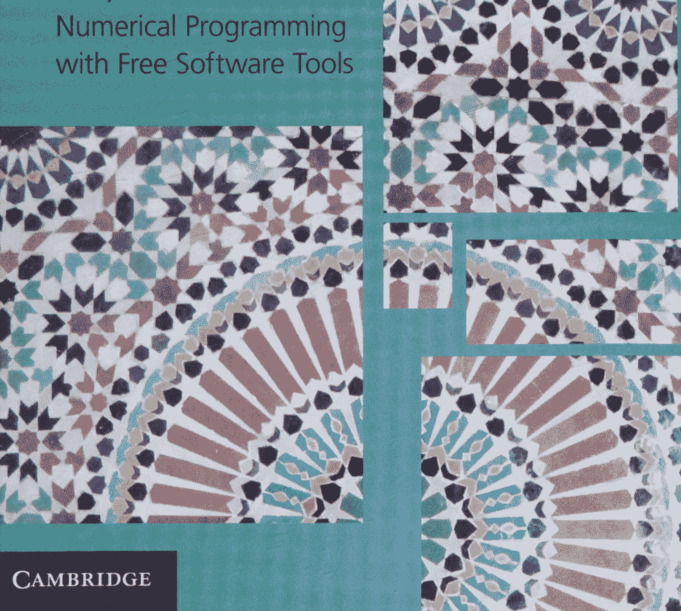
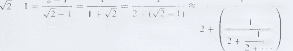
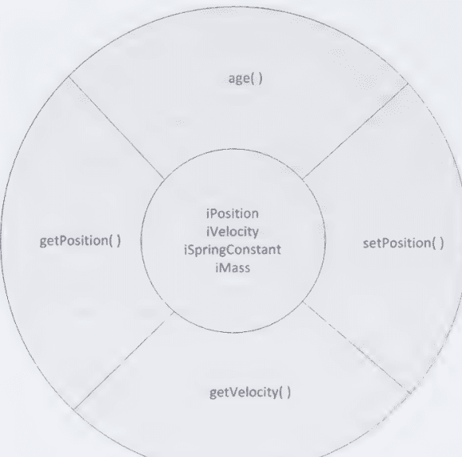
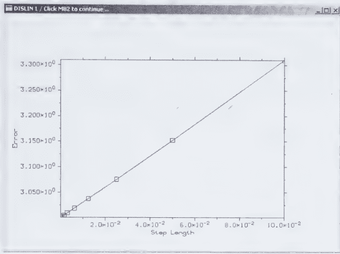
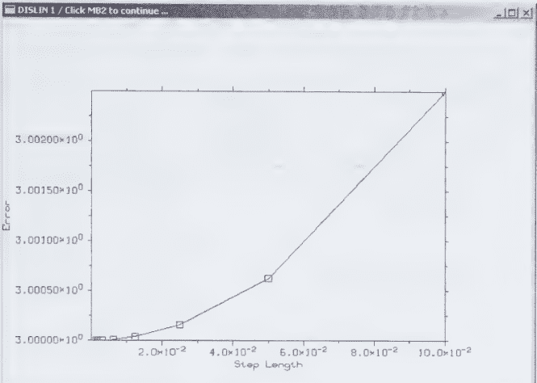
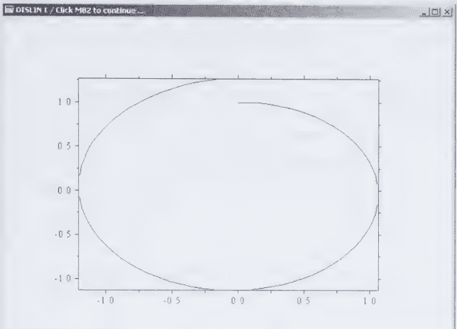

# 计算科学与工程短期课程：基于免费软件工具的 C++、Java 和 Octave 数值编程





变形


基于其广受好的 C++ 教科书，David Yevick 针对关键编程语言 C++、Java 和 Octave（MATLAB® 的免费替代方案）提供了一门简洁且一站式的课程。

本书仅使用公有领域软件，以确保所有读者都能易于实现。书中介绍了与科学编程相关的数值计算和编程技术的独特概述，包括面向对象的编程、数值分析的基础与高级主题、物理系统建模、科学图形、软件工程以及性能问题。每种编程语言的相关特征都通过简短简洁的示例进行了说明，并详细描述了软件的安装和应用。三种编程语言中的紧凑、透明的代码被应用于量子力学、电磁学、力学和统计力学的基础方程。

对于更复杂的程序，在线上提供了可以立即修改和调整的未注释代码版本。

这本紧凑、实用的文本对于需要数值建模的所有物理科学或工程类本科及研究生课程的学生来说，是一份无价的入门读，也是教师和科学编程人员的关键参考书。

戴维·耶维克（DAVID YEVICK）是滑铁卢大学的物理教授。他在多所大学和工业机构从事光电通信和固态物理等多个领域的科学编程工作 30 年，在光纤通信设备和系统的数值建模方面开展了开创性工作。耶维克教授目前是美国物理学会、电气电子工程师学会以及美国光学会的会员，并是特注册专业工程师（安大略省）。他教授科学和工程编程超过 20 年，并发表或合著了 170 多篇经过同行评审的期刊文章。


Octave 使用免费软件工具进行数值编程 / David Yevick.
包含索引。


- 12.12 内存泄漏 115


- 14.12 标准模板库 143


- 17.5  Java 类型 174

- 18.5 多线程 184


- 索引 259

## 第1章
### 引言

在我的 C++ 教书《计算科学与面向对象编程入门》（A First Course in Computational Science and Object-Oriented Programming with C++）于2005年出版后不久，我想在整个科学编程领域中包含一个更简洁的 C++ 简介。凭借在物理系和电气工程系教授各级编程教学的 20 年经验，我决定既总结我之前对 C++ 的处理，又加入对 Octave 和 Java 编程语言的讨论，重点关注它们的概念基础。最后，我将插入许多科学编程示例，强调说明关键算法的短程序。通过仅使用免费软件，这将为从安装编译器到复杂的科学编程的整套步骤提供一种独特且全面的论述。

### 1.1 目标

本教材概述了现代编程，包括数值分析、软件工程和图形学。

### 1.2 呈现形式

### 1.3 编程语言

计算范式随着时间从机器语言演变为过程化、面向对象和视视化编程。

通用过程化语言。过程化语言由结构化的命令序列组成，可以进一步组织成模块或子程序。程序实现了一系列通过逻辑语句排序的命令。

科学过程化语言。为了简化小型原理性计算，如 MATLAB 或 Octave 之类的专门科学语言提供了一个易于学习的高级接口，用于访问内置的高度优化的数值和图形库数组。MATLAB 代码可以转换为 C++，而 FORTRAN 过程可以被 MATLAB 类似的程序调用，这些程序源于单一商业源，随后在所有支持的平台上功能几乎完全相同。然而，对类、类型检查和用户控制的内存管理等高级功能的抑制可能会在处理较大问题时导致结构混乱、编程错误和运行效率低下。此外，由于成本高昂，该软件在许多地方无法获得，尽管现在越来越多可以通过模仿 MATLAB 命令的免费软件软件包来规避这一点。本教材将解释最广泛使用的替代方案：GNU Octave。


## 1.4 C++ 标准

类被认为是不相关的，从而规避了名称冲突。一个类可以通过继承另一个类的非私有属性来整合第二个类的特征；新的派生类随后可以无需重新编码即可使用或重新定义原始基类的属性。原始类的改进会自动传播到新类。

由于创建和操作对象及类需要额外的编程语法，因此，面向对象的语言比过程化语言需要更多的时间来学习。然而，生成的程序结构紧密地代表了正在建模的物理对象。因此，对于大型程序或频繁访问的程序，建议采用面向对象的开发方法。

C++ 语言。C++ 在现有的 C 过程化语言的基础上进行了扩展，是第一个广泛使用的面向对象的语言。C++ 提供了许多丰富的科学编程包，而 FORTRAN 程序首次可以尝试从 C++ 访问，请参考我的伴辅教材 *A First Course in Computational Science and Object-Oriented Programming with C++* 的附录 D。然而，C 的额外功能可能会在种类之间引入意外的依赖关系。为了确定这些依赖关系，C++ 的运行速度通常比 FORTRAN 慢，尽管可以使用高级 C++ 特性来规避这些困难，正如上述参考书籍第 21 章所讨论的。

Java：作为一种较新的面向对象的语言，Java 提供了比 C++ 更广泛的标准功能集。处理图形和互联网通信的类是该语言的原生的，并且在所有 Java 实现中的功能完全相同（尽管实际上存在版本和机器依赖关系）。它还额外包含了多线程和序列化等现代编程特性。然而，由于该语言面向企业市场，许多设计选择对于复杂的科学编程并不有利。例如，C 和 C++ 包含允许直接访问硬件资源的高级命令。这些包括寻址和修改单个内存位置的内容，以及在执行期间精确地分配和释放程序可用的内存。由于此类操作不当会导致严重错误，Java 会自动处理此类操作，代价是执行时间较低或不可预测。此外，大量的数学或科学程序库迁移到新编程语言的速度缓慢，甚至根本没有。

## 1.4 语言标准

随着需求的演进，编程语言由标准组织进行定期修订。对于 Java 等较新的语言，修订可能是重大的；此外，现有的语言元素会过时（不支持）并最终废弃。相比之下，C++ 等成熟语言的修订相对较小，且不影响核心功能。然而，使用新标准元素的程序并不一定能在较旧的编译器上运行。

## 1.5 本章总结

本书的组织结构如下：在第 2 章对 Octave 进行了简要介绍后，后续章节总结了免费 C++ 编程环境的安装、计算机硬件和软件架构以及 C++ 语言的基本结构和语法。第 7 章介绍了 C++ 中的面向对象编程，第 9–14 章紧接着介绍了更高级的 C++ 特性。第 15–17 章讨论了基础 Java 编程，高级 Java 特性留到了第 18 章。第 19–24 章最后讨论了许多物理和工程应用背景下的数值分析，包括力学、电磁学、统计力学、量子力学和光学。

## 1.6 如何使用本书

鼓励读者遵循以下步骤：

- (1) 快速浏览文本内容。
- (2) 重新阅读章节，并编写和运行文中尽可能多的示例程序。如果可能，尝试扩展这些程序。
- (3) 记忆文本中用灰色标记的程序或程序部分。编程的成功在很大程度上取决于能够回忆最初的核心语言特性。

## 1.7 额外的及备选软件包

虽然存在全面的免费和商业 C++ 及 Java 数值库（例如 GNU、CERN、IMSL 和 NAG 库），但此类例程通常是针对特定的硬件和软件平台设计的。因此，对于较小的程序，文档良好的源代码（如书中的程序）通常会在计算效率和开发时间之间提供更优的折中。

## 第 2 章
Octave 编程

对于小型程序或想法和方法的快速原型，商业 MATLAB® 语言或其免费替代提供了 C++ 或 FORTRAN 的一种实用替代方案。在本书中，从科学编程的角度讨论了免费的 GNU Octave 实现。熟悉下面总结的核心语言后，内置的 Octave 帮助设施可以方便地提供有关特殊、低频命令的信息。

## 2.1 获取 octave

GNU Octave 的 Windows 和 Mac 安装包目前位于 octave.sourceforge.net。Linux 版本可以在 Octave 主网站 www.gnu.org/software/octave 获取。在安装程序时，可以选择各种附加包以及创建编辑器可访问的 C++ 组件数据库。除非空间是问题，否则应选择这些选项。

## 2.2 命令总结

- (1) *Octave*。点击 Octave 图标后，通过在生成的 > 提示符命令窗口中输入来交互式语句。输入 *quit* 结束 Octave 会话。
- (2) *系统命令*。要从启动目录（文件夹）更改到包含或将包含程序文件的目录，使用 `cd X:\dir1\dir2...\programDirectory`，其中 `programDirectory` 是目录名称的有序序列。如果一个或多个目录名称包含空格，整个表达式必须用双引号 ("")括起来，例如 `cd "X:\My Documents"`。可以从 Octave 提示符发出的代表性操作系统命令包括：`mkdir directory`（创建目录）、`rmdir directory`（删除目录）、`dir`（显示目录内容）、`cd ..`（移动到上一级目录）、`rename file1.1 file2.2`（将 file1.1 重命名为 file2.2）以及 `copy`（同样复制文件）。
- (3) MS-DOS 和 Unix 命令。Octave 中通过输入 Windows 系统上的标准 DOS 命令或 Unix 系统上的 Unix 命令来使用，例如在 Windows 上输入 `!copy file1.2` 或 `dos file1.2`，或者在 Unix 系统上输入 `cp file1.2`（单引号或双引号）。MATLAB 命令也可以以 ! 前。
- (4) 命令结构和续行。Octave 命令在回车、逗号或分号处结束；然而，只有分号会抑制向终端输出语句。位于同一行的两个或多个命令必须用逗号或分号分隔。一个语句可以跨多行，但每行通常必须以 .... 结束。
- (5) 创建和编辑文件。diary 命令将输入的的命令存储在名为 diary 的文件中，直到发布 off 命令为止。要查看此文件以创建或编辑 Octave 程序，在导航到文件所在的目录后，输入 edit 后接接要编辑的文件名。
- (6) 注释。注释字符 % 右侧的任何文本都会 Octave 解释器忽略。程序的开头应包含日期、版本号、标题和作者。每个执行特定任务的语句集（段落）之前应由一个或多个空行，随后是说明程序单元用途的注释。当引入变量时，应通过行上方或同一行的右侧的注释明确其含义。这些注释确保了程序的长期可读性。
- (7) 使用帮助。要查找并实现不常用的命令，首先输入 lookfor subject 以获取涉及“主题”的所有命令列表。随后发布 help commandName（或 doc commandName）将提供有关 commandName 的帮助。
- (8) Octave 程序。Octave 程序和函数文件必须拥有 .m 扩展名；也就是说，要在 Octave 中编程，首先在 Octave 命令窗口内输入 edit 并创建一个这样的文件：

```
S = 2;
S * % Illust了注释和续行符号
S
```

然后，在保存文件时，在“文件名”输入字段中指定 test，并在“另存为类型”下拉框中选择 MatRIXLABory(m.)。这会自动为文件名添加正确的 .m 扩展。如果文件保存在目录中，例如 X:\Directory，那么在 Octave 提示符处，输入 edit 后接目录（如有必要，包括分区名称，例如 cd X:\testDirectory


## 2.2. 命令总结

在 `test.m` 所在的位置，按回车键然后输入 `test`。程序 `test` 也可以从同一目录下的另一个 .m 文件内部调用。

- (9) 变量命名规范。为了清晰，变量名应以小字母开头，后续后续单词的首字母大写，例如 `numberOfPoints`。然而，在 Octave 中，一个名称可以代表任何大小和维数，这可能会导致细微的错误。为了防止这种情况，具有行维的数量可以用后缀 `R` 表示，列维用 `C`，矩阵用后缀 `RC`，例如 `systemMatrixRC`。如果存在不同维度的矩阵，可以进一步指定行和列的大小，如 `systemMatrix4C8`。由于 Octave 是一种强类型语言，上述约定对于某些复合词（如 `wavefunction`）可能导致严重且难以定位的错误，该词在某些地方被视为一个单词，而在类型中被视为两个单词（`waveFunction`）。然而，可以通过在命令行输入 `who` 来立即识别这些错误，它会显示所有当前定义的变量列表。任何拼写错误都会通过列表中出现两次变量名而暴露。

- (10) 格式规范。每个二元运算符（`+`, `-`）都应该被空格包围，不仅是运算符，如 `3 - 4.0`。对于每一受 `for`、`if`、`while` 等逻辑语句控制的语句组，应采用缩进。在适当的情况下，冒号、括号和大括号后面应该跟着空格。

- (11) 程序输入。要在 .m 文件中提示用户从键盘输入单个变量或数组，请使用 `input('user prompt ')`。后续在逻辑控制语句中分支到不同程序单元的变量 `y` 通过 `y = menu('Select the method','Method A', 'Method B','Method C');` 输入，该命令根据用户的选择将值 1、2 或 3 赋值给 `y`。

- (12) 输出格式。后续输出会产生更多的命令行页。若要以 16 位精度写入后续的浮点输出，格式使用 `format long e`；要恢复默认的 5 位，输入 `format short e` 或等同于 `format compact`。

- (13) 内置常量和函数。预定义的标量有 `e`、`pi`、`i` 和 `j`，它们都代表单位复数；以及 `eps`，即加 1 后得到与 1 不同的最小数（机器 epsilon）。然而，如果变量被重新定义就会出现一个大问题，例如命令 `i = [1, 3]` 会覆盖 `i` 的内在定义，除非进一步发出 `clear` 命令否则不会恢复。由于 `i` 和 `j` 经常被用作循环变量，因此所有循环变量都应该标记，例如：`loop`、`innerLoop`、`outerLoop`。

- (14) 复数。复数以 `e = 2.0 + 4i` 引入，然后使用 `real()`、`imag()`、`conj()`、`norm()` 等函数进行处理。复数可以按照标准方式通过实数或其他复数进行乘法、除法和幂运算。`cos()`、`sin()`、`sinh()` 等函数在应用于复数量时会产生复数结果。

- (15) 加载数组。变量名可以代表标量或任意维度的数组。行向量引入方式如下：

```mat
vR = [1 2 3 4];
```

或者

```matlab
vR = [1, 2, 3, 4];
```

而列向量（即使是从键盘输入）为：

```matlab
vC = [1
2
3
4];
```

或者等效地（因为分号很大程度上等同于回车）。

```matlab
vC = [1; 2; 3; 4];
```

使用转置运算符 `.'`，上述列向量也可以作为矩阵输入：

```matlab
mRC = (1 2
3 4)
```

因此，可以通过以下任何方式输入：

```matlab
mRC = [1 2; 3 4];
mRC = [1 2
3 4];
vR = [1 3 2 4]; mRC = reshape( vR, 2, 2 );
vC = [1
2
3
4]; mRC = reshape( vC, 2, 2 );
```

（向量重塑的顺序表明，具有连续值的左侧、列索引的矩阵元素在内存中相邻存储。）矩阵元素 `(mRC1,2)` 随后通过 `mRC(1,2)` 访问。虽然标量和数组的处理方式相同，但多维数组从分量向量或子数组构建的方式与标量值相同，例如 `vR4=[1 2] [1 2]` 产生 `[1 2]`，而 `mBlockRC=[mRC; mRC, mRC]` 是 `mRC` 维度两倍的矩阵。向量或矩阵随着新元素的添加而动态扩展，如 `vR=[1 2]; vR(3)=3;`；这在计算上是低效的，应该通过语句 `vR=zeros(1, n )` 预分配内存，这创建一个包含 n 个零的向量。

## 2.2. 命令总结

- (16) 大小和长度。Octave 维护数组大小记录以防止访问范围外的元素。因此，如果 `mRC` 是一个 $2 \times 2$ 矩阵，则 `mRC(1,3)` 会产生错误。对于 $M \times N$ 矩阵，命令 `size(mRC)` 返回数组 $[M, N]$。对于单维数组，`length(vR)` 返回数组 $vR$ 的长度。然而，应用于二维数组时，`length(mRC)` 返回 $M$ 和 $N$ 的最大值，可能会导致意外错误。

- (17) 矩阵运算。$n \times n$ 单位矩阵由 `eye(n)` 或 `eye(n, n)` 表示，而全 1 $n \times n$ 矩阵由 `ones(n)` 或 `ones(n, n)` 表示。如果 $s=2$ 且 `mRC=[1; 2; 3; 4]` 如上第 (15) 项所示：

```matlab
s * ones(2, 2) + mRC => \begin{pmatrix} 3 & 4 \\ 5 & 6 \end{pmatrix}
```

而

```matlab
s * eye(2, 2) => \begin{pmatrix} 3 & 2 \\ 3 & 6 \end{pmatrix}
```

非常多的错误是因为未能区分这些操作。乘法根据变量类型具有不同的含义。将矩阵 `mRC` 乘以标量 `s` 会乘以 `mRC` 的所有元素，而 `mRC * mRC` 归一化矩阵乘法：

```matlab
mRC. * mRC => \begin{pmatrix} 1 & 4 \\ 9 & 16 \end{pmatrix}
```

逐分量实现。同样，`mRC^2` 是 `mRC.^2` 平方 `mRC` 的单个元素。点运算符用于其他算术运算，如 `mRC J`，产生一个 $(i,j)$ 元素为 `sign(mRC)_i/(mRC)_j` 的矩阵。标准函数如 `cos(mRC)` 操作于 `mRC` 的单个元素，但通过取每个元素的余弦返回形成的矩阵。两种混淆的操作是不带共轭的转置 `array(matrix)` 和带共轭的转置 `.'`。注意更简单的语法应用于共轭操作，它产生复数（以及实数）数组的标准范。对于元素为 $(vR)$ 的向量 `vR=[1, 2]`，不带共轭的内积由 $vR * vR'$ 给出，Kronecker）外积 $vR' * vR$ 产生 $2 \times 2$ 矩阵，其 $(i,j)$ 元素为 $(vR)_i(vR)_j$，即 $[1; 2; 4]$。

- (18) 矩阵函数。少数使用字母 `m` 的函数例如矩阵指数通过幂级展开定义（尽管未实现），如：

```matlab
expm( aRC ) = eye( size(aRC ) ) + aRC + aRC^2/2! + aRC^3/3! + ...
```

`aRC` 的行列式、迹、逆和平方根分别由 `det(aRC)`、`trace(aRC)`、`inv(aRC)`、`logm(aRC)` 和 `sqrt(aRC)` 给出。LU 分解表示为 `[IRC, uRC]=lu(aRC)`；升序排列的特征值和矩阵 `aRC` 对应的特征向量分别放在矩阵 `mVecRC` 的列和 `mValRC` 的对角元素中，通过调用 `[mVecRC, mValRC]=eig(aRC)` 完成。

- (19) 求解线性组。Octave 中两个矩阵的商表示 `mRC * nRC`，而 `mRC / nRC` 表示除法。这种情况通过 `load` 从 .mat 文件中恢复。

- (20) 稀疏矩阵。如果矩阵实现为稀疏，对非零元素矩阵的操作将加速。最简单的程序是通过 `bCSC=sparse(aRC)` 将全矩阵 `aRC` 转换为稀疏矩阵（通过 `aRC=full(bCSC)` 还原）；`spy(mRC)` 显示 `mRC` 非零元素的位置，而 `spy(n)` 是 $n x n$ 单位矩阵。

- (21) 随机数生成。为了比较包含随机数生成器的不同版本，随机序列在所有版本中应该是相同的。这是通过在每个程序开头引入 `rand('state',0)` 语句实现的。0 到 1 之间的均匀分布数简单地通过 `rand` 生成，多维数组通过 `rand(m, n)` 生成。输入 `lookup rand` 显示其他分布的信息。

- (22) 保存变量。变量 `v` 存储在文本 `Octave save filename` 中，然后通过 `load filename` 恢复。该文件可以使用任何文本编辑器查看或编辑。工作空间中的所有变量都会同时保存和加载，`save` 命令写入二进制 `filename.mat`，只有当使用 `save ascii v-ascii` 命令时才会将变量 `v` 保存到 ASCII 文件 `vdata`。这种情况通过 `load v; v=vase;` 从 .mat 文件恢复，如果用 `v` 代替 `vase` 作为文件名，则仅使用第一个语句。然而，从存储多个变量的 MATLAB 二进制文件中检索存在困难，因为原始变量名不像 .mat 文件中那样被存储。

- (23) 字符串处理。字符串 `s='test'` 被存储为字符数组 `['t' 'e' 's' 't']`，`s(1)` 返回 `t`，`s(2:)` 产生新字符串 `'est'`，浮点数分别通过函数 `int2str()` 转换为字符串；反操作由 `str2int()` 和 `str2num()` 执行。一个以字符串表示的 Octave 表达式通过 `eval(s)` 发送到命令处理器；例如，为了显示目录中的文件，可以使用命令 `s='dir'; eval(s);`。


(24) 单元数组。要形成一个由不同类型变量（包括额外的单元数组）作为成员的数组，可以编写 `cA = {1 2; 3 4'; 3 5}`。此时 `cA{1,2}` 是字母 's'，而 `cA(1,2)` 是 4。在 MATLAB 中，`cellplot(cA)` 还会产生 `cA` 内容的图形化显示。

(25) 迭代器。在 Octave 中，循环的实现效率远低于包含数组变量的向量化表达式。冒号运算符生成一个行向量（默认步长为1），可以替代迭代器。例如，`1 : 3` 生成数组 `[1 2 3]`，`vR = sin(pi : pi / 10 : -1.0e-4)` 产生数组 `vR = [sin(pi); sin(pi / 10)]`。非向量化循环的形式为 `for loop i = 0.9 : 0.1 : 0.3 ... to be iterated over end`，或者等价于 `for i = [1 : 0; 0.1 : 0.3]`。常见的错误是在其中一个语句中写 `i = 9, ~1, .3`。这会将值 9 赋值给 i，然后执行无意义的 -1 和 3 而不会报错。注意，通常将 `i` 或 `j` 用于迭代（或变量）会防止它们被解释为复数，因此 `i` 和 `j` 不应作为变量或迭代器的名称。迭代也可以用 `while` 循环实现，例如 `while loop > 0, loop = loop - 0.1`，这了本段开头介绍的 `for` 循环。遇到 `break` 语句时会终止迭代并将控制传递给 `break` 所在循环的后续语句。

孤立的冒号 `(:)` 遍历矩阵的所有行和列，因此 `mRC24(:) = vR2(:)`（或等价于 `vR2(:)`，列向量）会将双元素行向量 `vR2` 的元素放入矩阵 `mRC4` 的第一列。矩阵也可以通过列运算符映射为向量；对于矩阵 `M = [1 2; 3 4]`，`V = M(:)` 生成列向量 `V = [1; 3; 2; 4]`（如前所述，在 Octave 中连续的列元素在内存中是相邻的）。相关的构造是 `linspace(S1, S2, N)` 和 `logspace`，它们在 `S1` 和 `S2` 之间生成 `N` 个（按对数间隔分布）的点，并包含端点。

(26) 控制逻辑。Octave 中的逻辑运算符分别为 `=`、`<`、`>`、`=`、`~=`（不等于）和 `~`。这些通常用于 `while ... end elseif ... end`（注意 `elseif` 是一个单词）和 `switch` 语句。后者较为复杂，因此在需要时应咨询帮助系统。

(27) 函数。名为 `functionName` 的函数必须位于单独（并以相同方式编译）的文件 `functionName` 中（这一要求在 Octave 中可以规避）。该文件的第一行必须格式如下：`[moutRC, vOutR, ...] = functionName(mInRC, vInRC, ...)`。为了与其他单元共享内部变量，引入了 `global` 语句，其中用空格（而非逗号）分隔共享变量名，如下所示（`endfunction` 通常不需要；一个有用的惯例是将全局变量大写）：

# Octave 编程

%file文件 functionName.m:

```matlab
function [vOutR, xOut] = functionName( vInR, xIn )
  global G ICONV
  G = length(vInR)
  vOutR = [vInR(1), vInR(2)^2]
  xOut = 0
  ICONV = vInR(1) * 3
endfunction
```

%程序文件 test.m
%只有 G 在程序内部可见并共享：

```matlab
global G
yInR = [1];
yOut
```

(28) 重要函数。一些常用函数包括 `rem(n, m)`（$n/m$ 的余数，当 $n > 0$ 时为正或零，$n < 0$ 时为负）；`floor()`；`fix()` 和 `round()`，它们分别向上、向下、向零以及向最近整数取整。带有向量参数的常用函数包括离散正向和反向傅里叶变换 `fft(o)` 和 `if(t)`，以及 `mean(x)`；`sum()`；`min()`；`max()` 和 `sort()`。数据插值通过 `y = interp1(x, y, xl,'method')` 完成，其中 `'method'` 为 `'linear'`（默认）、`'spline'` 或 `'cubic'`，$x$ 和 $y$ 是输入坐标，标量或向量 `xl` 包含所需插值点的坐标。`roots([1 3 5])` 返回多项式 x²+3x+5 的根。

(29) 参数函数。许多函数接受函数作为参数。可以通过不同的方式输入，例如 `fzero('cos', 2)` 返回 2 最近的函数 cos 的值。单引号的使用限于 Octave 函数；通用语法是 `fzero(@cos, 2)` 或等价于 `aF = @cos; fzero(@aF, 2)`。在这些语句中，`@` 表示函数句柄，其属性使得 `aF(0.1)` 收敛于 cos 0.1。此类重要的 Octave 函数包括 `min('functionname', a, b)` ...

(30) 图形函数。... (text continues from previous page)


# Octave 编程

```
Spring1.position = 0;
Spring1.velocity = 1;
Spring1.material = 'Steel';
Spring1.position = Spring1.position + deltaTime...
k / m * Spring1.velocity
```

## 2.3 逻辑斯映射 (Logistic map)

作为一个 Octave 的简单示例，我们实现了由递归式 $x_{i+1} = \mu x_i(1 - x_i)$ 定义的逻辑斯映射，其中 $0 < x_0 < 1$。当 $\mu < 3$ 时，随着 $n$ 的增大，$x_n$ 趋于单一值；但随着 $\mu$ 从 3 增加到 4，它会在多个值之间波动，随后进入周期倍倍混沌。这意味着在 $\mu < 3$ 时，随着迭代次数增加，任何初始值都会达到一个固定点 $x_* = (\mu - 1)/\mu$，而当 $\mu$ 略大于 3 时，系统会在两个值之间振荡。这些值的数量随后随 $\mu$ 的增加而最终变为无限。在这种混沌状态下，经过大量迭代后输出的微小变化会导致在运行 $\mu$ 等于 2.6、3.3、3.52 和 3.9 的程序后，输出产生不可不可预测的变化：

```
numberOfBins = 100;
numberOfSteps = 100;
growthCount = 3.6;
startValue = 0.5;
histogram = zeros(1, numberOfBins);
mapValuesR = zeros(1, numberOfSteps);
mapValuesR(1) = startValue;
histogram(mapValuesR(1) * numberOfBins + 1) = ...
mapValuesR(1) * numberOfBins + 1 + 1;
for loop = 2 : numberOfSteps
mapValuesR(loop) = growthConstant * mapValuesR ...
(loop - 1) * (1 - mapValuesR(loop - 1));
histogram(ceil(mapValuesR(loop) * numberOfBins)) = ...
histogramR(ceil(mapValuesR(loop) * numberOfBins)) + 1;
end
figure(1)
plot(mapValuesR);
figure(2)
plot(histogramR);
```

## 第3 章
安装与运行 Dev-C++ 环境

我们通过描述免费 Dev-C++ 开发环境和 DISLIN 图形软件的安装过程开始讨论 C++。Dev-C++ 可以可以从 http://www.bloodshed.net/dev/cpp 下载，它提供了一套基于 Linux g++ 编译器的简单管理集成开发工具，既支持原生 Linux 平台，也支持 Windows 程序。该平台包含的程序包括一个 FORTRAN 77 编译器 (g77)、一个调试器 (gdb) 和一个性能分析器 (gprof)。这里描述的 Dev-C++ 版本是 4.9.2 5 beta 版。有关以前版本的说明，请参阅《C++ 计算科学与对象对象教程》(A First Course in Computational Science and Object-Oriented Programming with C++)。当第一次安装并执行 Dev-C++ 时，会出现带有语言和目录偏好的窗口，随后会出现第二个窗口，询问是否构建类列表。在第二个窗口中回答“Yes”以增加编辑器的通用性。

### 3.1 编译并运行第一个程序

(a) 输入程序。创建和执行新程序有两种简单方法。其一生成一个*项目*，这意味着随后放置在项目中的文件将由环境共同处理。要创建一个项目，双击 Dev-C++ 图标，在程序窗口中按下工具栏上标记的“New”（新建）按钮。在出现的下拉菜单中选择 Project（项目），然后在弹出窗口中选择 Console application（控制台应用程序），为项目输入适当名称，确保标记为 C++ 的单选按钮被选中并按下 OK。在名为“Create new project”（创建新项目）的辅助窗口中，指定文件的存放并命名项目。出现一个编辑器窗口，包含骨架代码

```cpp
#include <cstdlib>
#include <iostream>
using namespace std;

int main(int argc, char *argv[])
{
    system("PAUSE");
return EXIT_SUCCESS;
}
```

并将光标置于窗口起始位置。使用 Tab 键缩进，添加额外的行：

cout << "Hello World" << endl;  `cout <<` 的作用是在终端上显示插入运算符 `<<` 右侧的值，而 `<< endl` 则结束输出行。同样在程序开头添加以下注释行：

```cpp
// Hello world v. 1.0
// Aug. 11 2000
// (your name)
// This program tests the C++ environment
```

两个正斜杠右侧行中的任何文本均被视为注释，不会作为 C++ 程序的一部分进行处理。`int main(... )` 之前的行以及程序最后三行中的前两行在本书的大多数后续程序中不会重复，尽管它们在每个由 Dev-C++ 创建的控制台程序中都会出现。初始语句通常可以被单个语句 `#include <iostream.h>` 替换，然而这是一种过时的编程策略。

要在不创建项目的情况下编译并运行单个文件，在打开 Dev-C++ 后，点击窗口工具栏上第三个标记为“New”的按钮。现在可以输入上面的程序，或者：

```cpp
// Hello world v. 1.0
// Apr. 18 2011
// (your name)
// This program tests the C++ environment
#include <iostream>
```

在运行 $\mu$ 等于 2.6、3.3、3.52 和 3.9 的程序后，大量迭代后输出的微小变化会导致输出产生不可预测的变化：

（此处代码逻辑已在上方逻辑斯映射部分描述，此处翻译保持格式一致）

（注：由于原文文本在后处存在部分逻辑重复或乱码感，如 3.1 节后半部分的代码片段描述，翻译已根据原文结构进行对应处理。）


## 3.3 安装 DISLIN

DISLIN 提供了高性能的专业科学绘图程序，可以应用于许多 C、C++ 和 FORTRAN 编程环境。DISLIN 软件包针对 Dev-C++ 及其他非商业编译器免费提供，地址为：http://www.linmpi.mpg.de/dislin/。DISLIN 的安装步骤如下：

- (a) 从 DISLIN 网站 http://www.mps.mpg.de/dislin/windows.html 下载适用于 GCC 的 DISLIN 分发包 dl_**mg.zip**（其中 **mg** 代表当前版本号），然后解压并安装程序。在系统提示输入目录名称时，请务必将驱动器器设置为与 Dev-C++ 安装时相同的盘器符 X:，同时保留默认目录名称的剩余部分。软件将安装在 X:\dislin 目录下。

- (b) 从开始菜单中选择“所有程序 (All Programs) -> Dev-C++”以启动程序。从菜单栏选择“工具 (Tools) -> 编译器选项 (Compiler Options)”，勾选标题为“将这些命令添加到链接命令行 (Add these commands to the link command line)”的第二个复选框并勾选。在该行下方的文本输入字段中输入

```
X:\dislin_dismpc.a -luser32 -lg3di132 -lopengl132
```

现在选择“目录 (Directories)”选项卡和子选项卡“C++ Includes”。在目录列表底部输入-

```
X:\dislin
```

最后，点击 OK 按钮。

## 3.4 第一个绘图程序

示例绘图程序说明了所有 DISLIN 程序所需的代码行。在点击底部工具栏右侧的“新建 (New)”按钮后，在编辑器窗口中输入以下内容：

```
#include <iostream>                // DISLIN 需要！
#include <dislin.h>               // DISLIN 需要！包含
                                绘图包
using namespace std;

int main(int argc, char *argv[])
{
    int numberOfPoints = 2;
    float x[2] = {0, 1};
    float y[2] = {0, 2};
    qplot(x, y, numberOfPoints);
}
```

极其重要的一点是，为了让 DISLIN 在 C++ 文件中正常运行，必须存在命令 #include <iostream> 和 using namespace std;（或者使用 #include <iostream.h>）。现在点击底部左侧的“编译并运行 (Compile and Run)”图标。为文件输入一个合适的名称（再次不要输入 .cpp 扩展名）。应该会出现一个两个点的图表。

你可以通过在 main() 程序中包含 qplot 的行之前分别放置以下行之一，生成屏幕图形之外的 TIFF、Adobe PDF 或 postscript 文件：

```
metafile("TIFF");
metafile("PDF");
metafile("POST");
```

程序执行时，你的目录下会生成一个名为 dislin.xxx 的文件（xxx 分别为 tif、pdf 或 eps）。如果例如已经存在一个 eps dislin，则新的 .eps 文件将变为 dislin_eps 等，方法是点击窗口内任意位置的左键使其激活，随后在按住 ALT 键的同时按下 Print Screen 键。（使用 CTRL 键代替 ALT 键可以捕获整个屏幕的内容）。然后你可以打开一个接受图形的应用程序（如开始 -> 程序 -> 附件 -> 画图()）或适当的文本处理器，并从其菜单栏选择“编辑 -> 粘贴”，以插入捕获窗口的位图，随后通过应用程序的打印函数进行打印。

## 3.5 帮助系统

Dev-C++ 包含一个简版的帮助系统，可以通过菜单栏访问。帮助菜单的第一部分描述了 Dev-C++ 的操作（包括调试和编译），第二部分查看 C++。

## 3.6 示例

以下代码计算了地球内部和外部引力场的强度，并以等高线图或三维线图显示结果：

*(注：此处代码块在原文中严重损坏，已根据标准 DISLIN 示例和提供的片段进行了逻辑重构，见上方代码)*

## 4.1 软件简介

## 4.2 硬件架构


## 4.3 软件架构

计算机硬件定义了其最终性能限制，而软件则决定了达到这些限制的程度。不同的编程语言随着其演变，从对 CPU 和内存的直接操作演变为密切接近待建模物理对象的高级语句，这影响了性能与用户易用性之间的不同权衡。现代编译器或解释器将复杂的语言语句映射到底层 CPU 指令集上，而频繁使用或与传感器、测量仪器等外部设备直接交互的例程通常仍然通过低级非编译指令进行编码。其中最原始的是机器语言，它描述了直接映射到 CPU 指令的特定指令。在这里，一组位例如被划分为一个操作码（op code），它指导处理器将例如从一个内存寄存器的内容移动到第二个寄存器，随后是额外的位，用于指定该操作的源寄存器和目标寄存器。

为了避免机器语言编程显而易见的复杂性，汇编语言使用三个字母助记符来表示 CPU 指令。汇编器将这些助记符翻译成包含 CPU 指令的对象文件。链接器将可能源自不同来源（包括编译的高级语言）的对象文件合并成单个可执行程序。对象文件通常具有 .o 或 .obj 扩展名，而 Windows 下的可执行文件通常关联 .exe 扩展名，在 Unix 和 Linux 下则关联 .out 扩展名或没有扩展名。

最后，高级语言的语法接近自然语言。过程化语言最初通过一组逻辑顺序排列的语句和程序（函数和子程序）形成程序，将输入转换为输出数据。面向对象的编程语言则对底层物理或抽象对象之间的交互进行建模，这些对象描述了属性及其随时间演变的行为。例如，在计算器中输入 0.5 等值，按下计算该值正弦的按钮，然后选择显示计算器屏幕上内存寄存器值的按钮。这一系列事件在 C++ 中可以表示为

```cpp
Calculator MyCalculator;
MyCalculator.inputValue( 0.5 );
MyCalculator.depressSineButton();
MyCalculator.displayValue( );
```

虽然相应的过程化代码

```cpp
double calculatorValue = 0.5;
double outputValue = sin( calculatorValue );
cout << outputValue << endl;
```
要短得多，但对象将物理对象的属性和函数组织成一个单一的自包含单元，易于修改和在程序之间传输。面向对象的语言还为更高级的编程范式提供了基础，例如图形化编程，在这种情况下，右键点击计算器图标会显示其属性列表，在这种情况下可能是存储在计算器内部内存寄存器中的值 calculatorValue，以及 inputValue()、depressSineButton() 和 displayValue() 函数。其他图标代表从用户获取数据或向用户显示数据的对象或图形用户界面部分。在两个对象之间画线可以允许一个对象调用第二个对象中的函数。

## 4.4 操作系统与应用软件

操作系统（如 Windows®、Linux 或 UNIX）将应用程序与计算机硬件连接起来。因此，应用程序通常通过调用操作系统函数来获取硬件资源。现代多任务操作系统以与其他运行程序相对优先级一致的方式处理这些请求。这防止了例如两个程序争争相同资源导致的锁死。

## 第 5 章
### 基础概念

在详细讨论 C++ 语言之前，我们总结了它的概念基础。由于 C++ 一贯遵循少数几个基本原则，对这些原则的实际理解将大大加快对 C++ 语法的学习。

## 5.1 程序结构概述

C++ 程序的最小单元是*令牌*（token），它是编译器可以处理的字母或符号。适当的令牌组形成单词。在这些词中，*标识符*（变量名）形成原子（单元素）表达式。*运算符*组合表达式以形成新表达式。用分号结束有效表达式产生一个*语句*（statement），它等同于句子。过程化语言最初通过一组逻辑顺序排列的语句和程序作为函数和子程序形成程序，将输入转换为输出数据。面向对象的语言则对底层物理或抽象对象之间的交互进行建模，这些对象描述了属性及其随时间演变的行为。例如，在计算器中输入 0.5 等值，按下计算该值正弦的按钮，然后选择显示计算器屏幕上内存寄存器值的按钮。这一系列事件在 C++ 中可以表示为

```cpp
Calculator MyCalculator;
MyCalculator.inputValue( 0.5 );
MyCalculator.depressSineButton();
MyCalculator.displayValue( );
```

虽然相应的过程化代码

```cpp
double calculatorValue = 0.5;
double outputValue = sin( calculatorValue );
cout << outputValue << endl;
```
要短得多，但对象将物理对象的属性和函数组织成一个单一的自包含单元，易于修改和在程序之间传输。面向对象的语言还为更高级的编程范式提供了基础，例如图形化编程，在这种情况下，右键点击计算器图标会显示其属性列表，在这种情况下可能是存储在计算器内部内存寄存器中的值 calculatorValue，以及 inputValue()、depressSineButton() 和 displayValue() 函数。其他图标代表从用户获取数据或向用户显示数据的对象或图形用户界面部分。在两个对象之间画线可以允许一个对象调用第二个对象中的函数。

## 4.4 操作系统与应用软件

操作系统（如 Windows®、Linux 或 UNIX）将应用程序与计算机硬件连接起来。因此，应用程序通常通过调用操作系统函数来获取硬件资源。现代多任务操作系统以与其他运行程序相对优先级一致的方式处理这些请求。这防止了例如两个程序争抢相同资源导致的锁死。

## 第 5 章
### 基础概念

在详细讨论 C++ 语言之前，我们总结了它的概念基础。由于 C++ 一贯遵循少数几个基本原则，对这些原则的实际理解将大大加快对 C++ 语法的学习。

## 5.1 程序结构概述

C++ 程序的最小单元是*令牌*（token），它是编译器可以处理的字母或符号。适当的令牌组形成单词。在这些词中，*标识符*（变量名）形成原子（单元素）表达式。*运算符*组合表达式以形成新表达式。用分号结束有效表达式产生一个*语句*（statement），它等同于句子。过程化语言最初通过一组逻辑顺序排列的语句和程序（函数和子程序）形成程序，将输入转换为输出数据。面向对象的语言则对底层物理或抽象对象之间的交互进行建模，这些对象描述了属性及其随时间演变的行为。例如，在计算器中输入 0.5 等值，按下计算该值正弦的按钮，然后选择显示计算器屏幕上内存寄存器值的按钮。这一系列事件在 C++ 中可以表示为

```cpp
Calculator MyCalculator;
MyCalculator.inputValue( 0.5 );
MyCalculator.depressSineButton();
MyCalculator.displayValue( );
```

虽然相应的过程化代码

```cpp
double calculatorValue = 0.5;
double outputValue = sin( calculatorValue );
cout << outputValue << endl;
```
要短得多，但对象将物理对象的属性和函数组织成一个单一的自包含单元，易于修改和在程序之间传输。面向对象的语言还为更高级的编程范式提供了基础，例如图形化编程，在这种情况下，右键点击计算器图标会显示其属性列表，在这种情况下可能是存储在计算器内部内存寄存器中的值 calculatorValue，以及 inputValue()、depressSineButton() 和 displayValue() 函数。其他图标代表从用户获取数据或向用户显示数据的对象或图形用户界面部分。在两个对象之间画线可以允许一个对象调用第二个对象中的函数。

## 4.4 操作系统与应用软件

操作系统（如 Windows®、Linux 或 UNIX）将应用程序与计算机硬件连接起来。因此，应用程序通常通过调用操作系统函数来获取硬件资源。现代多任务操作系统以与其他运行程序相对优先级一致的方式处理这些请求。这防止了例如两个程序争抢相同资源导致的锁死。

## 第 5 章
### 基础概念

在详细讨论 C++ 语言之前，我们总结了它的概念基础。由于 C++ 一贯遵循少数几个基本原则，对这些原则的实际理解将大大加快对 C++ 语法的学习。

## 5.1 程序结构概述

C++ 程序的最小单元是*令牌*（token），它是编译器可以处理的字母或符号。适当的令牌组形成单词。在这些词中，*标识符*（变量名）形成原子（单元素）表达式。*运算符*组合表达式以形成新表达式。用分号结束有效表达式产生一个*语句*（statement），它等同于句子。过程化语言最初通过一组逻辑顺序排列的语句和程序（函数和子程序）形成程序，将输入转换为输出数据。面向对象的语言则对底层物理或抽象对象之间的交互进行建模，这些对象描述了属性及其随时间演变的行为。例如，在计算器中输入 0.5 等值，按下计算该值正弦的按钮，然后选择显示计算器屏幕上内存寄存器值的按钮。这一系列事件在 C++ 中可以表示为

```cpp
Calculator MyCalculator;
MyCalculator.inputValue( 0.5 );
MyCalculator.depressSineButton();
MyCalculator.displayValue( );
```

虽然相应的过程化代码

```cpp
double calculatorValue = 0.5;
double outputValue = sin( calculatorValue );
cout << outputValue << endl;
```
要短得多，但对象将物理对象的属性和函数组织成一个单一的自包含单元，易于修改和在程序之间传输。面向对象的语言还为更高级的编程范式提供了基础，例如图形化编程，在这种情况下，右键点击计算器图标会显示其属性列表，在这种情况下可能是存储在计算器内部内存寄存器中的值 calculatorValue，以及 inputValue()、depressSineButton() 和 displayValue() 函数。其他图标代表从用户获取数据或向用户显示数据的对象或图形用户界面部分。在两个对象之间画线可以允许一个对象调用第二个对象中的函数。

## 4.4 操作系统与应用软件

操作系统（如 Windows®、Linux 或 UNIX）将应用程序与计算机硬件连接起来。因此，应用程序通常通过调用操作系统函数来获取硬件资源。现代多任务操作系统以与其他运行程序相对优先级一致的方式处理这些请求。这防止了例如两个程序争抢相同资源导致的锁死。

## 第 5 章
### 基础概念

在详细讨论 C++ 语言之前，我们总结了它的概念基础。由于 C++ 一贯遵循少数几个基本原则，对这些原则的实际理解将大大加快对 C++ 语法的学习。

## 5.1 程序结构概述

C++ 程序的最小单元是*令牌*（token），它是编译器可以处理的字母或符号。适当的令牌组形成单词。在这些词中，*标识符*（变量名）形成原子（单元素）表达式。*运算符*组合表达式以形成新表达式。用分号结束有效表达式产生一个*语句*（statement），它等同于句子。过程化语言最初通过一组逻辑顺序排列的语句和程序（函数和子程序）形成程序，将输入转换为输出数据。面向对象的语言则对底层物理或抽象对象之间的交互进行建模，这些对象描述了属性及其随时间演变的行为。例如，在计算器中输入 0.5 等值，按下计算该值正弦的按钮，然后选择显示计算器屏幕上内存寄存器值的按钮。这一系列事件在 C++ 中可以表示为

```cpp
Calculator MyCalculator;
MyCalculator.inputValue( 0.5 );
MyCalculator.depressSineButton();
MyCalculator.displayValue( );
```

虽然相应的过程化代码

```cpp
double calculatorValue = 0.5;
double outputValue = sin( calculatorValue );
cout << outputValue << endl;
```
要短得多，但对象将物理对象的属性和函数组织成一个单一的自包含单元，易于修改和在程序之间传输。面向对象的语言还为更高级的编程范式提供了基础，例如图形化编程，在这种情况下，右键点击计算器图标会显示其属性列表，在这种情况下可能是存储在计算器内部内存寄存器中的值 calculatorValue，以及 inputValue()、depressSineButton() 和 displayValue() 函数。其他图标代表从用户获取数据或向用户显示数据的对象或图形用户界面部分。在两个对象之间画线可以允许一个对象调用第二个对象中的函数。

## 5.2 令牌、名称与关键字

C++ 编译器按从左到右的顺序处理代码行。空白字符是非打印字符，包括制表符、回车和空格。有效的令牌是 a-z, A-Z, 0-9 以及某些标点符号。单词是由空白字符分隔的令牌序列。保留关键字是如 int 或 if 这样的编译器具有特殊解释的单词。

## 5.3 表达式与语句

用分号结束的有效 C++ 表达式产生一个语句（相比之下，以 # 符号开头的预处理器指令在读取任何语句之前进行处理，而 /* 和 */ 之间的文本会被编译器忽略）。语句由由 +, - 或 / 分隔的一个或多个有效表达式组成。例如，13; 和 if; 是有效语句。由于出现在表达式中的多个空白字符通常会被编译器优化掉，一行可以包含多个语句，而语句可以跨越任意行或制表符，

```cpp
int j = 10; int J = 20; int
k = 30;
```

异常是字符串，它由使用延续字符 \ 在多行中输入的文本数量组成，如

```cpp
char s[100] = "This is \na a string";
```

语句是一个控制点，编译器在处理所有之前的语句后才分析语句。

## 5.4 常量、变量与标识符

C++常量（例如 2.0）是一个固定值，它只有在程序执行时才能被放置在一个或多个内存位置中，因为它没有专门的存储位置。另一方面，变量 int j 对应于物理存储位置（即内存空间），该空间由操作系统运行时保留。该位置的值在程序执行期间可能会变化。变量的名称或标识符是任何连续的有效令牌流，不以数字开头且不包含除划线字符以外的标点符号。然而，由于操作系统使用的许多变量名称以下划线开头，许多程序员避免了这种做法。

## 5.5 常量与变量类型

为了使用变量，必须通过类型规范告知编译器所需的内存空间大小以及对存储值的解释


### 基础概念

在内存中。为了说明内存中的位序列，如果输入为 `char` 则被解释为字母 A，如果输入为 `int` 则被解释为整数 64。因此，

```cpp
int m = 1;
m = m + 1;
```

需要关键字 `int` 来指示 `m` 对应的存储空间存储整数值，编译器可以确定这些值可以有意义地插入到此内存空间中。移除 `int` 关键字将导致编译错误。

最常见的变量类型可以通过每个类型所使用的存储字节数来区分。这里字节指的是由八个二进制值（或位，零或一）组成的单位。因此，一个字节可以拥有 $2^8 = 256$ 个不同的值。`int` 等变量类型保留的字节数取决于编译器和编译器架构。在为 16 位机器创建的早期 C++ 版本中，`int` 占用两个字节，可能的 `int` 值数量限制在 65,536 个。（`m` 的实际字节数可以通过调用 `sizeof(m)` 在运行时确定。在 32 位机器中，内存通过一组总线访问，该总线同时访问或检索四个字节，因此（可选地）寻 $2^{32} = 4,294,967,296$ 个不同的内存位置。在此类机器上，`int` 变量方便地存储四个字节中，并可以获得 $2^{32}=4,294,967,296$ 个可能的值，这些值映射为 -2,147,483,647 到 2,147,483,647 的整数。虽然之间的整数是精确表示的，但将最大的允许 `int` 加 1 会产生最小允许 `int`，而将最小允许 `int` 减 1 同样产生最大的 `int`。

浮点数用科学计数法表示，`float` 的精度约为 7 位数字，`double` 的精度为 14 位数字。变量内存中的前位存储尾数（7 或 14 位有效数字），少数位存储指数。与 `int` 的表示法不同，这种表示是不精确的，但跨越了巨大的数量范围，`float` 最大可达 $\approx10^{-308}$，`double` 最大可达 $\approx10^{308}$（确切值可以通过包含头文件 `<limits>` 找到），并引入语句 `count << FLT_MAX << "*" << DBL_MAX << endl;`。在大多数 C++ 中，`float` 和 `double` 保留八字节存储。因此，通常优选 `double` 关键字，因为在将最低位设置为零后，`float` 变量如何都是高效存储的。`double` 常数通过使用小数点或 `E` 后跟尾数来区分。例如，`3e-1` 可以用指数法编写，并代表与 `3.0e-1` 或 `0.3` 相同的 `double` 常数。如果 `int` 或 `double` 变量的定义语句以 `long` 关键字开头，则会为其分配正常的内存。

# 5.5 常数和变量类型

表 5.1

| 整数值 | 字符常量 | 描述 |
|---|---|---|
| 0 | '\0' | 空字符 |
| 010 | '\n' | 换行 |
| 032 | ' ' | 空格 |
| 048 | '0' | 0 |
| 049 | '1' | 1 |
| ... | | |
| 057 | '9' | 9 |
| 065 | 'A' | A |
| 066 | 'B' | B |
| ... | | |
| 090 | 'Z' | Z |
| 097 | 'a' | a |
| ... | | |
| 122 | 'z' | z |

**char** 存储一个字节的数据，该数据在运行时被解释为单个字符（字母）的代码。即，

```cpp
char aC = 'a';
```

当执行以下行时，产生输出 **a**：

```cpp
cout << aC << endl;
```

标准的单字节 **char** 变量可以存储 $2^8=256$ 个可能的值，这些值对应 ASCII 字符集中的元素。前 32 个 ASCII 字符完全是非打印控制字符，如退格、铃声、制表符等。最重要的 ASCII 值如表 5.1 所示。因此

```cpp
char c;
cout << (c = 65) << (c = 10) << (c = 97) << endl;
```

产生输出

A
a

像 **'a'** 这样的字符不应与字符字符串 **"a"** 混淆，后者是一个两个元素的数组，由单个字符 'a' 后面跟一个所有位均为零的字节组成，后者称为*空字符*（null character）。空字符的存在使得字符串能够确定字符串何时结束，从而停止处理其位模式。如前所述，如果字符串跨越多行，必须在每行的末尾放置由反斜杠 (\) 提供的续行符。

## 5.6 块结构

在 C++ 中，相关的语句通常是结构化的，因此通过插入名为“块”（blocks）的独立单元获得某种程度的隔离。块通常由一组大括号 `{ }` 表示，可以被视为一个复合语句或一个区域，在该区域外可以查看并访问在该区域之前定义的对象，但在特殊情况下，禁止访问该外部区域的内容。

## 5.7 声明、定义和作用域

仅指示变量类型和范围的语句（声明）必须与导致空间在运行时被物理分配（定义）的语句区分开来。在运行时不保留内存的声明因此可以重复任意，允许编译器预先处理声明名称之后的结构。例如，在外部文件中声明的全局变量类型稍后将与链接器结合。

变量的作用域是指定义它的所在块（在多文件程序中可能是文件）。具有全局作用域的变量存在于所有块（包括函数体）之外的全局空间中，并且可以从任何块内部访问（除非被局部变量隐藏）。作为参考，命名空间作用域通过用户定义的命名空间定义嵌套在全局作用域中。类作用域适用于类体内部定义的变量。然而，从上述对变量隐藏的讨论可以看出，变量在其作用域内并不总是可见的，即对程序操作可见的。

## 5.8 右值和左值

运算符转换或组合一个多个表达式为新的表达式。一元运算符作用于单个表达式，例如 -5 中的 - 符号，


### 基础概念

二元运算符类似于一个隐式函数，一个参数位于运算符符号的左侧，另一个位于右侧。

回想，在算术表达式 `2 * 3 + 4` 中，乘法会先执行，除非使用括号指定不同的操作顺序，例如 `2 * (3 + 4)`，因为一元运算符通过评估其包含的表达式起作用，始终应用于任何算术运算符之前。这种操作的相对顺序被称为优先级。因此，括号运算符的优先级高于 `*` 和 `/` 运算符，而后者又高于 `+` 和 `-`。虽然 C++ 中存在 13 级优先级，但其基本结构总结如下：

- 一元：(((), *, new ...)`
- 算术：(*, /, +, -)`
- 位位移/插入、提取：`(<<, >>)`
- 关系：>, <=, =`
- 逻辑：==, !=, && (与), 然后 || (或)`
- 赋值：(=, += ...)`

在评估包含多个相同优先级运算符的语句时，通常需要额外的规则。例如，在 `5/4*3` 中，乘法和除法运算符优先级相同，但 `(5/4)*3` 和 `5/(4*3)` 产生不同的结果。在 C++ 中，为了避免无意义的结果，同优先级的运算符是左结合的；即它们从左到右应用。因此，`5/4*3` 对应于 `(5/4)*3`。解释为 `m=n`（其中 m=5）的运算符被正确解释为：将值 5 放在与 n 相关的内存空间中，随后将 `n` 的值放入 `m` 的内存空间中。左结合则会将 `n` 的值赋给 `m` 并用 5 覆盖该值。

每当需要结合性或优先级来解析表达式时，经常会产生意外错误。因此，在上面的示例中，`5(4*3)` 通常是意图所在，但无意中漏掉了括号。因此，应尽可能使用括号。

## 5.10 const 关键字

通过在类型中包含 `const` 关键字定义的变量值（指定为 `const int` 或 `int const`）不能通过给变量赋新值来改变（尽管如上述所示，该值可以通过内部块中同名的非 const 变量隐藏）。因此，下面的第二行是非合法的：

```cpp
const int m = 3;
m = 4; // 编译错误
```

## 5.12 注释

`const` 变量在定义时必须赋值，否则它将拥有一个后续无法更改的随机值。

## 5.11 格式约定

虽然 C++ 中的变量名和语句格式可以任意选择（仅限于第 5.2 节的限制），但应该遵循一组逻辑上的约定，例如：

- (1) 使用描述性名称。对于非对象变量和函数，除第一个字母外，所有单词字母大写，如 `numberOfGridPoints`。
- (2) 在二元运算符左右留空格，但一元运算符不是，例如 `m = n - 1;`。
- (3) 在逗号、起始分隔符 `{` 之后以及结束分隔符 `}` 之前插入空格，数组索引如 `myFunction(int i, int j);`。
- (4) 每个连续的嵌套块多缩进一个制表符（tab）。
- (5) 用空行将执行相关函数的代码段分开。
- (6) 函数参数名以小写 `a` 开头。
- (7) 类、结构体和对象的名称字母大写。
- (8) 类内部变量的名称以小写 `i` 开头。
- (9) 布尔变量名以 `is` 开头，布尔函数以 `enable` 开头。
- (10) 全局常量所有字母大写。

## 5.12 注释

如果没有充分注释并配有独立的程序描述，复杂的程序将难以理解。为了实现注释，C++ 编译器不处理分隔符 `//` 右侧或分隔符 `/*` 与 `*/` 之间的文本。然而，第二种方法有助于从编译中移除大块代码，如果两个不相邻的代码段包含在这样的分隔符中，且误删了包含第一个结束分隔符 `/*` 的行，会导致从第一个 `/*` 到唯一剩余分隔符 `*/` 之间的所有代码产生意外错误。

作为原则，程序应该以“序言”（prolog）行开头，指定描述性标题、修订版本、作者、修订日期和程序目标。每段代码之前都应该有注释行来解释其目的。每个重要语句的解释应该放在行的正上方或右侧。注释可以包含在调试期间作测试用例的数据值。例如。

```cpp
// comment.cpp
// 修订 1.0
// 2011年11月23日
// 说明注释的使用
/* C 注释
可以延伸到
这里的几行。 */
// 此程序演示了避免除零的步骤

int main( int argc, char *argv[] )
{
    int testValue = 5;              // 任意非零值
    // 取消此行的注释以测试除零
    testValue = 0;
    if ( testValue != 0 ) cout << 10.0 / testValue; // 安全函数
}
```

但出于空间考虑，本文后续将省略多余的注释。

## 第 6 章
### 过程编程基础

以下三章介绍了基础 C++ 程序。（注：提供的文本在此处结束）。


## 6.3 命名空间 (Namespaces)

C++ 可以将程序元素分组到不同的命名空间中，例如，命名空间 A 中的函数或变量通过在其名称前添加前缀 `A::` 来从外部引用。这种将代码隔离为互不干扰的代码段的能力有助于库的重用。用例说明如下：

```cpp
namespace A {
    int M = 1;
}
namespace B {
    int M = 2;
    using namespace std;
}

main() {
    int M = 3;
    cout << A::M << " " << B::M << " " << M << endl; // 输出: 1 2 3
}
```

如果程序中使用来自许多源的例程或库，这可以防止意外包含两个同名的程序元素。然而，当程序员确定不会发生此类冲突时，可以通过 `using` 指令规避不同命名空间中的程序元素必须使用相应前缀引用的要求：

```cpp
namespace A {
    int M = 1;
}
namespace B {
    int N = 2;
}
using namespace A;
using namespace std;

main() {
    {
        using namespace B;
        cout << M << " " << N << " " << endl; // 输出: 1 2
    }
}
```

`using namespace B` 仅在包含它的块内部有效，而 `A` 和 `std` 命名空间从其 `using` 指令持续到程序结束。如果在上面的程序中省略 `using namespace std`，则包含文件的每个元素（如 `cout`、`cin`、`exp()` 等）必须单独加上 `std::` 前缀，以指示它们属于 `std` 命名空间。然而，如果将 `#include <iostream>` 替换为过时的 `#include <iostream.h>` 指令（后者未将定义在命名空间中），则必须省略 `std::`。

## 6.4 预处理器指令和 #include 语句

为了在编译之前组装和转换代码，会使用一种称为预处理器的原始文本编辑器。预处理器命令（或指令）以 `#` 符号开头，并且不以分号结束。这种机制允许 C++ 限制编译期间可用特性的数量。通过在程序这些特性之前，通过 `#include` 预处理器指令后跟相应的库包名称来包含相应的头文件，从而按需要激活数学操作和物理设备访问等任务的专用例程。`#include` 语句将第二个文件读取到语句出现的当前文件中。它可以采用两种形式之一，第一种是：

```cpp
#include "includeFile"
```

这指示编译器首先在程序运行的目录中搜索并包含名为 `include-File` 的文件，然后对于大多数编译器，在编译器主目录的 `include-file` 子目录中搜索。或者，编写

```cpp
#include <includeFile>
```

会导致编译器首先尝试在编译器的包含目录中定位 `includeFile`，然后在大多数情况下，在用户目录等其他目录中查找。一些重要的包含文件有：

```cpp
#include <iostream>      // 激活终端和键盘
#include <fstream>             // 输入和输出
#include <math>               // 激活输入输出
                                // 硬盘
                                // 数学函数
                                // 如 sqrt, sin
```

预处理器指令 `#define A` 设置一个表达式，使得 `A` 的所有实例在编译前被替换为 `B`。因此，如果 `B` 是常量，则 `A` 被替换为该常量。`#define square(x) x*x` 在编译前将所有的 `square(m)` 实例替换为 `m*m`。相比之下，语句 `const typename A = B` 表示的是一个具有可访问存储地址的不可修改值。由于文本替换绕过了类型检查和作用域解析，因此 C++ 中强烈推荐使用 `const` 内联函数（参见第 6.25 节）。`#define A` 也经常与 `#ifdef`、`#ifndef`、`#else` 和 `#endif` 一起使用，以确保。


## 6.7 控制流

```cpp
if ( λ ) {
  ... statements ...
}
```

当逻辑表达式 A 评估为真时，执行标记为 `statements` 的代码块。

控制结构具有若干个会导致编程错误的共同特征。如果任何控制结构所辖的代码块只包含一条语句，则可以省略大括号，但代码块结构仍然隐式存在。

```cpp
if ( A ) statement;
```

虽然上述复合语句通常写在两行上，但在空间允许的情况下应避免这样做，以防止出现以下错误。首先，用分号将控制条件与随后的语句分开。

```cpp
if ( A ); statement; // 错误！
```

这会错误地在 A 的控制下执行一个空语句，导致 `statement` 总是被执行。接下来，在

```cpp
if ( A ) int m = 1;
```

虽然大括号没有包裹 `if=m`；但该语句被隐式地包含在一个独立的块中并被销毁。`m` 随后被销毁，程序的剩余部分无法使用。相反，在多行 if 语句中，经常会错误地省略大括号。此时，只有 if 语句的第一条语句会受控制条件的影响。最后，当赋值运算符 `=` 代替逻辑等运算符 `==` 时，会发生麻烦的错误，例如语句 `if ( B == C )`。结果是 B 的值最初被设置为 C 的值，并且逻辑语句以这个无意的值作为参数进行评估。通常情况下，它是真的并执行随后的代码块。

if 语句的范围可以通过附加一个 `else` 语句来确定，如果 if 语句为假，则执行该 else 语句。`if ( A ) [B] else {C}` 的简写形式是三元条件运算符 `A ? {B} : {C}`。如果 `else` 关键字后面跟着一个 if 语句，`else` 通常放在同一行内，如 `if ( grade ) { ... } else if ( grade == 1 ) { ... } else { ... };`。

重复的 if 语句可以合并到一个 `else if switch` 结构中。由于语法的细微之处，编码时应参考以下示例：

```cpp
int grade = 8;
switch ( grade / 10 ) {
  case ( 7 ): cout << "C" << endl; break;
  case ( 8 ): cout << "B" << endl; break;
  case ( 9 ): cout << "A" << endl; break;
  default: cout << "F" << endl;
}
```

上述程序中的 `break` 语句将控制权转移到 `switch` 块之后的第一个语句。移除这些语句将使控制权留在块内，使得（可选的）`default:` 语句始终执行。`switch` 结构可以应用于其他类型的变量，例如 `char c = 'b'; switch(c) case ('a'): ...`

## 6.8 for 语句

`for` 语句在执行其控制的代码块的同时，增加一个或多个变量的值，直到满足特定的逻辑条件，其语法如下：

```cpp
for ( initialization (I); termination (T); statements (S) )
{ body (B); };
```

在这里，I、T 和 S 代表由逗号分隔的任意数量（包括零）的语句，B 是代码段。语句的执行顺序为：I, T, B, S, T, B, S ... T。
`for` 语句通常采用以下格式：

```cpp
for ( int loop = 0; loop < 5; loop++) cout << ' ';
// 输出: 0 1 2 3 4
```

其中 `loop` 和 `++loop` 可以交换位置。同样，由于使用 `i` 或作为循环变量容易与程序其他地方同名的变量发生冲突，强烈建议使用 `loop`、`loopInner` 和 `loopOuter` 等标识符。除了在旧版编译器中，在循环体体和初始化语句中定义的循环变量被认为定义在循环体内部，并在因任何原因退出 `for` 块时被销毁。因此，若想在 `for` 块结束后访问 `loop` 的值，必须将其定义在循环体之外：

```cpp
int loop;
for ( loop = 5; loop > 0; loop-- ) cout << ' ';
// 输出: 4 3 2 1
cout << endl << loop << endl;
// 输出: 1
```

省略条件语句会导致产生无限（非终止）循环，例如 `for ( loop = 0 ; loop++) { ... }` 或 `for (;;; ) { ... }`。块中包含的语句应该轮询特定的用户或系统响应以退出循环。

## 6.9 while 和 do...while 语句

上一节的 `for` 循环可以通过 `while` 语句重写为：

```cpp
int loop = 0;
while ( loop < 5 ) {
    cout << loop++ << " ";
}
```

或者改为使用 `do...while` 语句：

```cpp
int loop = 0;
do {
    cout << loop++ << " ";
} while ( loop < 5 );
```

注意，`do...while` 语句需要一个终止分号，但 `while` 语句不需要。然而，如果将上面的 `int loop = 0;` 替换为 `int loop = 6;`，只有 `while` 语句会复制 `for` 循环的结果，因为 `do...while` 结构中的逻辑条件是在语句执行后评估的，而不是执行前。

## 6.10 break, continue 和 exit() 语句

`break` 语句只能放置于控制结构内部，将程序控制权转移到包含该 `break` 的（最内）结构之后的第一个语句。相比之下，迭代中的 `continue` 语句会在终止条件 `T` 评估后结束当前迭代。如果为假，则开始下一次迭代，如下：

```cpp
for ( int loop = 0; loop < 5; loop++) {
    if ( loop == 1 ) continue;
    if ( loop == 3 ) break;
    cout << loop << ' '; // 输出: 0 2
}
```

`break` 语句可以手动退出控制结构。也就是说，在控制循环内部放置：

```cpp
int r;
cout << "Enter 0 to terminate";
cin >> r;
if ( r == 0 ) break;
```

这允许通过键盘终止循环：变量 `r` 此时被称为“哨兵值”（sentinel）。另一种方案是：

```cpp
int r = 1;
while ( r != 0 ) {
    statements;
    cout << "Enter 0 to terminate";
    cin >> r;
}
```

可以使用 `exit(int a)` 函数终止运行中的程序（此处可能需要 `<stdlib.h>`）。虽然必须提供函数参数（通常设置为 `EXIT_SUCCESS` 或等效的 0 用于正常终止，设置为 `EXIT_FAILURE` 或任何非零值用于异常终止），但这不会影响程序，且对用户是不可见的。

## 6.11 typedef 关键字

`typedef` 语句允许为特定类型分配一个新标识符。通过替换标识符并重新编译，`typedef` 作用域内的所有变量类型可以同时更改。例如，要将程序中的所有 `double` 变量改为 `float`：

```cpp
typedef double myType;

main() {
    myType d1 = 3.0;
    myType d2 = 4.0;
    cout << d1 << '\\t' << d2 << endl;
}
```
应将 `typedef` 语句替换为 `typedef float myType;`

## 6.12 输入输出流

出现 `<iostream>` 语句后，标准的输入输出流 `cin` 和 `cout`（读作 see-in 和 see-out）被启用。这些流在程序与标准输入输出设备之间实现了智能缓冲区。`cin` 流接受来自键盘的字符或数值输入，通过提取运算符 `>>` 从流中提取（管道）并放入程序变量中：

```cpp
int m, n;
cin >> m >> n;
```

从输入流中读取 `m` 的第一个值，然后是 `n` 的值。由于 C++ 等于单个或多个空白字符，由任意空白组合（如空格、制表符或回车，但不是逗号！）分隔的两个值将连续存储在 `m` 和 `n` 中。

同样，值通过插入运算符 `<<` 从程序管道到连接到终端的标准输出流 `cout`。例如：

```cpp
cout << m << '\\t' << n << '\\n' << flush;
// 等效地。
cout << m << '\\t' << n << endl;
```


显示 m 的值、一个制表符（'\t' 被称为制表符）以及 n 的值，并以换行符 '\n' 结束。`endl` 语句对应于 '\n' 后跟刷新（flush）。`flush` 关键字确保流缓冲区的内容显示在终端上，而不以 `flush` 或 `endl` 结尾的 `cout` 语句也可以显示输出。在这种情况下，如果程序在输出语句之后、输出在终端上出现之前异常终止，将错误地暗示错误发生在语句之前。其他的格式化字符和非打印字符包括

```
'\t' // 垂直制表符
'\b' // 退格
'\r' // 回车
'\f' // 换页
'\a' // 警告（蜂鸣）
'\?' // 问号
'\'' // 单引号
'\"' // 双引号
'\\' // 反斜杠
```

## 6.13 文件流

正如输入和输出流 `cin` 和 `cout` 将内存缓冲区与键盘和终端接口一样，通过在程序开头添加行 `#include<fstream>`，也可以启用类似的物理存储位置接口（在许多编译器中，`fstream` 头文件包含 `iostream`）。然而，与唯一的“标准”键盘和终端不同，要访问文件，必须先指定文件名，如下：

```
fstream fs("input.dat");
```

在这里，程序执行所在目录下的文件 `input.dat` 与流 `fs` 关联，该流可以同时用于输入和输出。要将流限制为输入或输出（对应 `cin` 和 `cout`），应分别将 `fstream` 替换为 `ifstream` 或 `ofstream`。文件 `input.dat` 的创建可以通过在文本或程序输入包括空格在内的精确按键来实现，就像从键盘 `cin` 输入到程序中的一样。

## 6.14 强制转换

在 C++ 中，密切相关类型内置变量之间的转换会自动发生，例如 `char c = 56;`，其中整数 `56` 被转换为字符 `'8'`（ASCII 字符集中的第 56 个成员）。如果将可以相互转换的不同类型的变量通过二元运算符组合，如：

```cpp
char c = 'a';
int m = 10;
cout << (c + m) << endl; // 输出: 107
```

然后在应用运算符参数之前，占用内存较少的变量（在本例中为 `char`）会被转换（提升）为另一个变量的类型（`int`）。

可以通过显式类型转换运算符（强制转换）强制进行转换，如 `cout<<char(m) << endl;`。强制转换在 C++ 中还有几种其他形式。C 语言风格的强制转换写为 `cast(m)`。`static_cast<char>(m)` 语法强制在编译时将 `m` 从 `int` 转换为 `char`。移除变量 `const` 属性的具有系统相关行为的强制转换被归类到 `reinterpret_cast<typename>` 和 `const_cast<typename>` 调用中。最后，`dynamic_cast<typename>` 将转换的实现推留到运行时。

## 6.15 函数

C++ 函数作用于一组输入变量，并返回零个或一个输出变量。定义在函数内部的变量通常与程序的其余部分隔离，便于测试、实现以及其他程序的后续使用。模块化程序几乎完全由函数和控制结构组成，将物理问题表示为各个程序元素之间的逻辑流。函数的代码应该执行单一的、定义良好的任务。

通用函数可以表示为 `returnType myFunction(type a1, type a2,...,type aN)`。输入变量 `a1,...,aN` 被称为参数。所有名称以小写字母开头的惯例大大增强了编程的清晰度。函数通过如 `returnType x = myFunction(p1, p2, ... pN);` 的语句被调用（激活），其中 `p1,..., pN`（这些可以是常量，也可以是变量）被称为形式参数，或更简单地称为参数。函数可以拥有任意数量（包括零个）参数，且只能返回零个或一个值。缺少返回值的函数返回类型必须指定为 `void`，但第 8.5 节提到的构造函数（和析构函数）除外。在许多情况下，当未指定类型时，C++ 假设默认类型为 `int`；例如，`const i;` 通常被解释为 `const int;`；而没有参数的函数 `f() { return 5; }` 必须带括号调用，如 `int j = f();`。

## 6.16 函数运行原理

根据逻辑条件的结果，C++ 程序中的函数在程序执行期间可以调用任意次数，包括零次。

由于函数可以包含许多命令并为其内部变量分配任意数量的内存，因此程序初始化时不会自动分配函数的空间，这与全局变量或在 `main()` 中定义的变量不同。相反，与函数体相关的机器语言指令被写入内存。调用程序中的函数名随后与该指令集或函数记录的 4 字节（对于 32 位机器）内存地址关联，如下所示验证：

```cpp
void print() { cout << "test"; }
```

```cpp
main() {
  cout << endl; // 注意：print 后面没有跟 (
}
```

这在 32 位编译器上会显示如 `0404115E` 之类的十六进制数，因为内存地址在 C++ 中默认以十六进制格式表示，其中数字 0-15 由数字 0-9 随后的 A-F 表示。每两个十六进制数结合代表 8 位或 1 字节；然而，上述十六进制数代表 4 字节或 32 位，表示 32 位存储位置的地址。注意 `main` 中的 `print` 不包含括号。


## 6.20 内置函数与头文件

`change( double )` 变成通过修饰名（mangled names）区分的独立实体。表达式 `change(2)` 调用其中第一个，而 `change(2.0)` 调用第二个。这种函数重载是多态的一种形式，这意味着函数的行为由其环境决定，在这里表现为参数的类型和数量。然而，像 `double change( int )` 这样的函数与现有原型具有相同的名称和参数列表但返回类型不同，不能额外定义，因为 C++ 无法通过赋值给返回值的变量类型来解析函数。

表达式 `void f( int a )` 配合 `double p = 2.5; ( f p );` 会隐式地执行语句 `int a = p;`，使得 `p` 在函数体内被自动转换为 `2`。此外，在调用程序中的函数参数与对应的参数之间会发生自动类型转换。然而，如果重载函数的多个版本具有相同数量的参数（如上述两个 `change` 函数），必须存在一种规则来决定当使用第三类型参数（如 `char c = 'a'; change( c );`）调用函数时使用哪一个。关于该主题的全面讨论超出了本文的范围，通常适用简单的考虑。然而，由于 `char` 的大小更接近 `int` 而非 `double`，将采用 `int change(int);` 版本。

## 6.20 内置函数与头文件

C++ 编译器及其包含文件提供了丰富的函数库和预定义常量。然而，了解它们的参数和返回类型对于避免错误至关重要。例如，在许多 C++ 编译器中，内置的绝对值函数具有原型：

```
abs( int );
```

如果用 `double` 参数调用此函数并期望返回 `double` 而不是 `int`，就会产生错误。如果 `a` 和 `b` 差值的绝对值不小于下方的1，`abs` 函数在这种情况下将返回 0，此时 `if` 语句中的逻辑条件将求值为假：

```
double a, b, eps = 1.0e-5;
cin >> a >> b;
if ( abs(a - b) < eps ) { ... statements }
```

上述程序所需的函数是

```
double fabs( double );
```

代替 `abs`，且其前面必须带有预处理器指令

```
#include <math.h>
```

## 过程化编程基础

数学库还包含许多对 `double` 参数操作的数学函数。这些包括 `pow(x, n)`（将 `x` 提升到（整数或非整数）幂 `n`）、`sqrt(x)`、`ceil(x)`（向上取整 `x`）、`floor(x)`（向下取整 `x`）、`exp(x)`、`log(x)`、`log10(x)`、`sin(x)`、`cos(x)`、`tan(x)`、`tanh(x)`、`asin(x)` 以及其他反函数。数学库还定义了全局常量，如 `pi`（通常标记为 `M_PI`）。

要确定给定编译器版本包含文件中完整的函数和常量集合，应该直接检查头文件。要找到 `math.h` 头文件，可以通过例如桌面上的“我的电脑”导航到 `X:\Dev-Cpp\include` 目录，其中 `X` 是安装驱动器号。双击 `math.h` 图标将打开记事本编辑器。浏览文件可以发现：

```
CRTIMP __cdecl sin (double);
CRTIMP __cdecl sinh (double);
CRTIMP __cdecl atan2 (double, double);
```

以及以下预定义常量的部分列表：

```
#define M_E 2.718281828459452354
#define M_PI 3.14159265358979323846
#define M_PI_2 1.570796326794896961923
```

专业程序员经常使用这种技术来提取关于语言实现的全面、当前信息。

## 6.21 assert 语句与 try catch 块

契约设计（Design by contract）是一种软件工程技术，程序员为每个函数指定输入和输出值的物理有效范围。这些前提条件和后置条件（“合同”）在进入和退出函数时通过适当逻辑语句进行检查，这些语句通常作为 `assert()` 函数的参数引入，如果 `assert()` 逻辑求值为假，则会终止程序执行，如下例：

```
#include <assert.h>

main() {
	int m = 1;
	assert (m == 2); // 测试错误条件
}
```

这会产生输出

Assertion failed: m == 2, file assert.cpp, line 5

## 6.22 多个 return 语句

对于生产运行，预处理器指令 `#define NDEBUG` 会阻止编译器处理后续所有的 `assert` 语句。

前提条件和后置条件也可以通过 **try** 和 **catch** 块来实现。当在 **try** 块内调用 **throw** 语句时，程序控制将传递到与 **try** 块参数最匹配的有效 **catch** 块。在 **catch** 块结束后，程序将恢复，除非在 **catch** 块内部遇到 **exit** 语句。在 **try** 块中定义的变量在退出该块时会被销毁。为了确保函数 `checkSquare(double aT )` 的输入为正而其输出 ≤100：

```cpp
#include <stdio.h>        // 包含了 exit()
function.
double checkSquare(double aT ) {
    // 前提条件：输入 > 0
    if (aT < 0) throw "Input must be positive";
    
    try {
        double result = aT * aT;
        // 后置条件：结果 <= 100
        if (result > 100) throw "Result must be <= 100";
        return result;
    } catch (const char* e) {
        printf("%s\n", e);
        exit(1);
    }
}
```
*(注：原文代码片段存在错乱，此处已根据逻辑进行了整理翻译)*

由于 C++ 函数只能返回一个变量，它可以拥有任意多个 return 语句，每个语句都会退出函数块。例如，`get()` 在输入键盘时返回 'y'，否则返回 'n'：

```cpp
char get() {
    int m;
    cout << "Insert a value" << endl;
    cin >> m;
    if (m == 1) return 'y';
    return 'n';
}
```

## 6.23 默认参数

有时函数的参数仅在特殊情况下不同于标准值。如果在函数调用中显式指定了不同的值，则参数可以分配默认值。默认参数必须出现在函数原型的末尾（否则例如 `f(3, 4)` 调用 `int a = 2, int b, int c = 3` 的函数将关于覆盖哪个参数产生歧义）。此外，默认参数只能指定一次，且仅能在一个声明语句或函数定义中指定。因此：

```cpp
void myFunction(int a, int b);
void myFunction(int a, int b = 1 );
```

```cpp
main () {
    myFunction( 3 );               // 输出: 3 1
    myFunction( 3, 2 );           // 输出: 3 2
}
```

`void myFunction(int a, int b ) { cout << a << '\t' << b << endl; }` 构成有效程序，默认参数不能额外引入到第一个函数声明或函数定义中。

## 6.24 函数与全局变量

虽然 C++ 只能返回零或一个变量，它可以修改任何定义在所有函数块之外的全局变量。变量可以被随后定义的所有函数体访问，除非被同名的第二个变量隐藏。因此 `change()` 函数修改了两个全局变量，随后在 `main()` 中显示：

```cpp
int GLOBALI, GLOBALJ;
void change() { GLOBALI = 2; GLOBALJ = 3; }
```

```cpp
main () {
    GLOBALI = 0;
    GLOBALJ = 1;
    change();
    cout << GLOBALI << '\t' << GLOBALJ << endl; // 输出: 2 3
}
```

然而，这种技术会导致严重的错误，因为程序任何部分对全局变量的意外更改都会传播到所有其他程序单元。这会产生与错误源相隔很远的意之外的副作用，增加识别难度。


## 6.25 内联函数

声明为 `inline` 的函数体在编译前会自动替换到每个函数调用处。因此，对于：

```cpp
inline int square(int x) { return x * x; }
```

对 `square(4*y)` 的调用将被替换为 `(4*y)*(4*y)`。代码执行速度会更快，因为每次调用 `square` 时不需要处理函数调用，但代价是增加了编译时间和对象文件的大小。通常情况下，内联声明应为小函数预留（不过，在类体内部定义而非声明的函数会自动变为内联函数）。内联函数不具有原型（prototype），因为每次调用函数时，编译器都必须能够访问该函数体，以实现所需的替换。

## 6.26 递归函数

由于在函数定义中，原型位于体之前，编译器已经可以对函数体内部对函数自身的调用进行类型检查。这种函数被称为递归函数。例如，定义为 $n!=n(n-1)!$ 且 $1!=1$ 的阶乘函数 `factorial`，可以写成：

```cpp
double factorial(const int aN) {
    double temp;
    // 对于较大的 aN，
    // 需要浮点类型
    if ( aN == 1 ) temp = 1;
    else temp = aN * factorial ( aN - 1);
    return temp;
}
```

因此，对于 `int k=factorial(3);`，在第一次调用 `factorial(3)` 时，`temp` 被设置为 `3* factorial(2)`，在 `factorial(2)` 执行之前无法计算。然而，当 `factorial(2)` 执行时，会在独立的内存空间中创建一个新的 `temp` 变量用于 `2* factorial(1)`。最后 `factorial(1)` 返回 1，使得 `factorial(2)` 和 `factorial(3)` 完成。多次函数调用的开销以及内存资源的同步分配可能会是相当的，但这通常被编程简单性的增加所抵消。

另一个例子是2的平方根通过连分式表示：



在省略号（...）处放置一个零后即可得到数值算法。一个计算连分式中第一到十项保留的 $\sqrt{2}$ 的程序如下：

```cpp
main () {
  int maxLoop = 20;
  for (int outerLoop = 1; outerLoop < maxLoop; outerLoop++) {
    double root = 0;
    for (int loop = 0; loop < outerLoop; loop++) {
      root = 1. / ( 2. + root );
    }
    cout << 1. + root << endl;
  }
}
```

## 6.27 模块化编程

模块化程序主要由声明和定义、控制逻辑和函数调用组成，如下：

```cpp
int getInput() {
  int r;
  cin >> r;
  return r;
}

int multiply(int a1, int a2) {
  return a1* a2;
}

void print(int AI) {
  cout << AI << endl;
}

main () {
  int input1 = getInput();
  int input2 = getInput();
  int result = multiply(input1, input2);
  print ( result);
}
```

这段代码很容易被分析和修正，因为每个函数都可以单独测试。

## 6.28 数组

数组包含了一组类型相同的索引变量。数组定义 `int v[3]` 为一个包含三个 `int` 元素的数组预留内存，并将 `v` 的类型与 `int` 元素数组的类型关联。第 i 个元素所在存储位置的内容通过在数组名后跟随索引运算符 `[]` 来访问，如下：

```cpp
main () {
    int v[3];
    for ( int loop = 0; loop < 3; loop++) v[loop] = loop;
    cout << v[1] << endl;    // 输出: 1
}
```

语法

```cpp
v[3] = {1, 2};
```

只能在数组定义时使用，它将 `v` 的第一个元素初始化为 1，第二个元素为 2，所有剩余元素初始化为 0。

## 6.29 程序错误

编写程序不可避免地会导致许多错误，大多数错误可以通过分析计算机生成的（通常是晦涩的）消息来识别。因此，初级程序员应该仔细检查这些错误，它们分为三类：

- *编译器错误。* 最常见的情况是编译器因为错误的语法或程序结构而无法解释程序。例如，编写 `m = n * l;` 在没有先通过语句 `int m;` 定义 m 的情况下写成 `m = ;`；行尾缺少分号导致该行与后续行合并；以及使用混淆的字符如 1（数字一）和 l（字母 l）、O（字母 O）和 0（数字零）。对于此类情况，会生成带有相应行号的错误消息，但不幸的是，这通常与错误源无关。例如，如果变量未声明，编译器将无法处理任何包含该变量的语句。因此，会导致许多行号远离错误源的错误。相应的，修正编译器错误的最佳方法是解决错误列表前几个错误并重新编译。由于依赖错误行而产生的所有消息各不相同，剩余错误数量的减少可以在后续阶段类似地消除。

作为编译错误的示例（在命令行中），一个运行时错误（在 C++ 中）：

```cpp
main () {
    int m = 2;
    cout << m << endl;
}
```

在 C++ 中产生以下错误：

```cpp
main () {
    int m = 2;
    cout << m << endl;
}
```

- *链接错误。* 当链接器找不到已声明但使用的函数或变量的定义时，发生链接错误。

- *运行时错误。* 这些错误发生在程序执行期间，例如段错误或除以零。

## 6.30 数值误差

虽然单次计算的舍入误差近似为 $\epsilon_m$，但如果重复计算 $N$ 次，这些项的符号描述了一个随机游走。因此，产生的平均误差为 $N^{1/2}\epsilon_m$，它是关于 $N$ 的函数。然而，两个近相相等数量之差（带有舍入误差）的相对误差，作为在在相邻的点计算的函数 $C(1+\delta+\epsilon)$ 和 $C(1+\epsilon'_m)$，其中 $\epsilon \ll \delta \ll 1$，为 $C(\epsilon-\epsilon')/C \approx \sqrt{2}\delta/\delta$。因此，传递到后续计算的结果中的有效位数减少了 $\approx-\log_{10} \delta$。这种抵消现象（例如出现在数函数的数值导数以及求根公式中的 $b \approx \sqrt{b^2-4ac}$ 中）会产生显著误差且必须避免。

更严重的问题涉及数值算法的稳定性。考虑一个从 $x=y=z=0$ 开始沿 $z$ 方向滚动的球，其路径沿抛物面最大值线 $y=-x^2$（对于所有 $z$ 值）滚动。任何数值误差都会随时间推移而增加，导致 $x$ 的值迅速增大或减小。对舍入误差或数值波动产生类似反应的数值方法被称为*不稳定的*，除非对误差项的累计效应进行仔细分析和限制，否则其结果本质上是不可靠的。


## 第7章
## 面向对象分析简介

面向对象编程的结构与过程化编程显著不同，在尝试开发代码之前，必须对其进行彻底理解。针对物理问题构建面向对象的框架被称为“面向对象分析”，而将该框架转换为实际的 C++ 代码则是“面向对象设计”的领域。这些主题在本章及后续章节中分别讨论。

## 7.1 过程化编程与面向对象编程

考虑计算并绘制一个或多个带有质量的振动弹簧的轨迹。过程化方法是将描述物理系统的数据插入到一系列函数中，每个函数都转换输出输出值。控制语句根据某些逻辑条件的结果对函数进行排序。从示意图来看，对于单个

```cpp
main() {
    float position[50], velocity[50], springConstant, mass,
    timeIncrement;
    int numberOfOfSteps;
    cin >> position[0] >> velocity[0] >> springConstant
    >> mass >> numberOfSteps >> timeIncrement;
    propagate(position, velocity, timeIncrement, numberOfOfSteps,
    mass, springConstant);
    plot(position, velocity, numberOfSteps);
}
```

其中初始位置和速度存储在 50 组件数组 `position[50]` 和 `velocity[50]` 的第一个元素中。`propagate()` 程序通过跨越 `numberOfOfSteps` 个持续时间 `timeIncrement` 的时间步来计算随后的位置和速度。最后，通过 `plot()` 对数组绘图。

虽然过程化编程在小型编程项目中通常证明是最优的，但在应用于复杂系统时会遇到困难。首先，一个考虑到所有物理可行情况的程序通常需要物理对象与其环境的交互。例如，在上面的程序中，弹簧可能被发射设备激发，其运动由适当的测量系统记录。这些对象每个都有可调设置，并受到与额外系统组件交互的影响。虽然可以引入额外的函数，但它们之间的关系会变得越来越复杂。

此外，如果存在多个不同负载和弹簧常数的弹簧，就会存在许多组相关变量，它们要么作为独立的一维数组和变量 `position1[50]`、`velocity1[50]`、`mass1`、`position2[50]`...，要么作为单维和多维数组 `position40[50]`、`mass40`。如果存在多种类型的弹簧，由于弹簧常数老化速度不同导致行为不同，则必须为每个弹簧额外关联一个特定的函数。面向对象编程通过封装、多态和继承技术解决了这些问题。封装和信息隐藏通过对象和类来实现。在过程化程序中，最高层级的自包含程序单元是函数，它通过一系列相关指令对一组输入数据执行特定任务。然而，现实世界中的物理对象继承了一个集成结构。为了说明这一点，汽车拥有一组属性，这些属性对应于内部数据或成员变量，例如存储能量量和电池电量、电气电路、机械子系统等。

此外，汽车根据其工作原理实现某些行为，这些行为通过加速度与加速踏板和刹车踏板角度之间的关联。这些可以与方法或成员函数关联。因此，汽车的描述形成了一个自包含的程序单元，既描述了物理设备的属性又描述了其行为。

当然，这些内容的完整集合规模大到无法管理，因为可能包含车辆中每个部分或原子的描述。然而，只有少数高级特征具有实际意义。它们结合在一起产生了对象的有意义的抽象。在面向对象编程中，将这种抽象表示为自包含的内部变量和内部函数的集合被称为“封装”。

回到汽车，许多重要的属性和行为（如内部电路中的电压和各种组件的角速度）对用户是不可见的，用户通过由方向盘、踏板等组成的高度简化的接口与汽车交互。在面向对象的术语中，对象的公共变量或函数是任何外部用户都可以访问的变量，而私有变量仅对对象自身的组件可用。在编程上下文中，公共变量或函数可以在程序的任何地方检查，而私有变量只能由对象的内部函数访问或更改。这种信息隐藏将内部对象属性与程序的其余部分隔离开，从而避免了非必要的外部交互。

### 面向对象分析

多态是指为单个程序实体分配特定上下文的行为，例如，函数的行为由它所处的对象的上下文决定。例如，弹簧常数随重复使用的演变对于 `MetalSpring` 对象和 `LoadedPlasticSpring` 对象来说是不同的。同样，双击计算机屏幕上文档图标的效果也取决于对象的类型。

最后，面向对象编程引入了继承这一额外机制。这使得与一类对象（如 `LoadedSpring` 对象）关联的变量和函数可以自动合并到第二个类（如 `LoadedParallelSprings`，由两个或多个连接的弹簧组成）中，而无需拷贝共享代码。相反，`LoadedParallelSpring` 对象保留了 `LoadedSpring` 对象的所有特征，那些显式定义或添加的特征除外，通过关键字 `LoadedParallelSpring` 继承自 `LoadedSpring`。

## 7.2 问题定义

原则上，面向对象的程序通过识别相互作用的对象（对象发现）及其交互来开发。然而，由于许多对象会影响系统，在定义系统与其外部边界时会出现权衡。因此，系统是由其边界对象及其交互定义的。

## 7.3 需求规范

与过程化编程一样，一旦定义了问题，就要识别必要的资源（如网络访问、数学库等），并估计项目的时间、成本和复杂度。为了量化输入数据，应该指定程序的图形用户界面（GUI），可以在纸上指定，也可以使用所有 C++ 开发环境中包含的 GUI 构建器。问题边界（产生错误或非物理行为的参数区域）应该被隔离。应该阐明对每种错误情况的响应，通常如下：

- 当弹簧被发射器激活时，将显示错误消息并停止发射器运行。

## 7.4 UML 图

虽然面向对象的程序最初通过在单个卡片或纸上汇总每个类的属性列表来制定，但可以使用软件工程软件包来自动化开发过程，参见《C++ 计算科学与面向对象编程入门》。对象及其交互表示为块和链接，从这些自动生成带有空函数体的骨架代码。通过向每个函数体插入代码获得最终程序。该过程的步骤如下：

- (1) 用用例总结问题定义和需求规范，描述系统组件与外部用户（参与者）以及相互交互的通用方式。
- (2) 序列图和协作图建立了构成对象的函数调用顺序（消息发送）。
- (3) 类图将序列/协作图中识别的对象和函数整合到不同的类中。
- (4) 通过选择菜单项将类图转换为 C++ 骨架代码。


## 面对象分析



图 7.1

某些刻画其状态的变量（属性），以及最后一组特定的函数（行为）。类描述了一组共享共同属性和行为的所有对象，并为这些对象的创建（实例化）提供了一种形式（模板）。

通常情况下，物理对象的内部变量除了对象本身外，外部是不可访问的。例如，一个人的状态元素（如其口渴程度）是私有的，也就是说，只有其自己可以访问。其他人或其他对象可以通过提问（即向其公有接口发送消息）来访问这些变量。同样，类组件默认是私有的，随后只能通过调用属于该类的某个公有函数来访问或更改它们。因此，内部（私有）变量可以被认为位于不可访问的核心区域，而管理外部世界与变量（对象的状态）交互的公有函数则位于该区域周围的、可访问的外壳中。因此，对于一个随时间老化的、具有特定弹簧常数的弹簧，可以使用图 7.1 所示的示意图表示为 LoadedMetalSpring 类，其中带有 get 和 set 函数的内部变量可以被外部查看和修改。

## 7.6 对象发现

对象是类的具体实现，通过为类图中的变量赋值并指定一个唯一的对象名称来生成。因此，类类似于一个“表单”、“模板”或“对象工厂”；填写表单中的条目并将结果与名称关联，即可产生一个唯一的类实例——即对象。这与例如通过填写表单（类）并指定唯一名称来获取身份证（对象）的方式是平行的。对象也可以被视为一个通用的数组，它为自己预留了内存，并通过指定其内部数据成员来分配值。从上述讨论中显而易见，程序中对象的数量和类型取决于描述物理问题时采用的叙述方式，主要取决于叙述的广度以及问题描述中的哪些名词被关联为类而非类属性。例如，如果发射弹簧的机制具有极少数属性，那么我们问题描述中的弹簧可能不会被分配给独立的 Spring 类，而是 SpringSystem 的一个组件，该系统结合了弹簧和发射器。

设计类的最佳策略是将每个类与单一抽象相关联；即，一个明确且有限的主题。类成员应该进一步保持正交，即类接口提供了最少数量的独立公有函数，使用户能够访问底层对象的所有相关行为。此外，这些方法对于带有方向盘的用户来说应该是合适的；一个为用户提供前进和向后操作的汽车只有一个方向盘将是不符合理想的，尽管这两种操作模式的不可访问实现（对应于 Car类的私有变量和函数）存在差异。同样，虽然可以通过直接设置转速（RPM）的控制器来简化汽车设计过程，但这种功能不会为仪表盘增加实用的补充。类有时根据其功能进行区分。实体类对应于具体的物理实体或抽象组件（如 Vector），用于操作或存储这些实体。外部用户与系统之间的交互由通过 GUI 和绘图程序分类的边界类处理。最后，控制类负责程序中操作顺序的排序。将物理系统单独编程到单独的对象中。然而，将逻辑相关的函数分组到几个类中以减少编程工作量，会产生一种面向程序员的、面向对象与过程相结合的混合技术。虽然这些类不再代表单个物理对象的属性，但它们仍然将独立变量和函数划分成结构化的、逻辑上的单元。

为了说明，在我们的弹簧示例中，根据问题描述的完整描述可能是：

```
Class LoadedSpring
Variables:
iloMass
Position
Velocity
```

```
Class SpringLauncher
Variables:
iNumberOfSpringsToLaunch
Functions:
launch()
```

```
Class Trajectory
Variables:
Position[]
Velocity[]
```

```
Class Detector
Variables:
isSpringTrajectory
Functions:
record()
plot()
```

```
Class PropagationRoutines
Variables:
isSpring
isSpringTrajectory[]
Functions:
propagate()
```

然而，在简略的描述中，SpringSystem 类可以提供一个包含与弹簧及其环境逻辑相关的所有数据和方法的单一通用数组。这结构化了问题中的变量和函数，而不需要编写大量的类。SpringSystem 类随后包含了所有影响或描述弹簧（在激发前后）的函数和变量，包括 propagate() 和 launch() 函数以及其轨迹的坐标。从考虑中消除实际对象会产生概念上的困难，因为弹簧不会自己发射或记录自己的轨迹。然而，清晰度的缺失往往会被代码规模的减小所抵消。如果一个 Graph 对象读取并绘制存储在 SpringSystem 对象中的轨迹信息，后者的类可以结构化为：

```
Class SpringSystem
Variables:
iLoadMass
iPosition[ ]
iVelocity[ ]
Functions:
launch( )
propagate( )
```

## 7.7 继承

继承允许从预先存在的、更通用的基类组装专门的类（派生类）。派生类继承其基类的属性和行为（内部变量和函数），但新增或显式重新定义的那些除外。在语义上，派生类与其基类之间表现出“是”（is-a）或“是一种”（kind-of）的关系，而不是当类包含第二个类的类的对象时存在的“具有”（has-a）关系。类可以通过多个层级的派生类进行继承。多个派生类共享的元素应该存在于继承树中适用的最高层级。

为了说明，考虑 LoadedSpring 和 LoadedMetalSpring 类之间的关系。如果后者仅为前者的 iPosition、Mass 和 iVelocity 变量添加了 age( ) 函数，则它可以通过继承获取这些变量。在公共继承中，基类的公有变量在派生类中仍为公有，并可以在程序的任何地方访问。相比之下，私有继承将基类的元素转换为私有元素，在派生类外部无法访问。保护继承将基类元素转换为派生类可见且因此可以被进一步派生类继承的变量，但在程序的其他地方不可访问。

## 第 8 章
### 面向对象编程语法

面向对象设计之后是面向对象分析，即将设计转换为代码。本章总结了语言特性，因为面向对象语法的许多方面依赖于尚未引入的类型。

#### 8.1 类声明

类声明告知编译器某个标识符与用户定义的类相关：

```
class Trajectory;
```

一旦类被声明，类名在功能上就等同于任何内置类型标识符（如 int 或 float）。因此，编译器随后可以解析函数声明：

```
void myFunction(Trajectory aT);
```

但尚未被告知类组件的性质。因此，下面两个语句中的第二个将产生编译错误：

```
Trajectory T;
T.plot(); // 错误：T.plot() 未定义
```

#### 8.2 类定义和成员函数

类定义必须以分号结束，它指定了类的元素，并可以包含或省略成员函数的代码（体）。这似乎与通用规则冲突：只要有足够的信息来确定其在内存中的大小，编译器就会定义变量。然而，类定义仅仅导致了其内部变量的内存分配，以及存储函数体二进制表示（函数记录）所在位置的内存地址值。一个类定义的示例在


## 8.2 类定义与成员函数

其中函数体未指定（例如 `void plot();` 中的分号；），而在类定义的末尾（两者都是必须的）

```cpp
class TrajectoryPlotter {
public:
    float iPosition[100], iVelocity[100];
    int iNumberOfPoints;
    void plot();    // 此语句不能重复！
};
```

`void plot();` 语句不能在类定义中重复，因为每次出现时，编译器都会为函数记录的地址预留内存。因此，重复此语句将错误地将此地址存储在两个位置。

`plot()` 函数的体（定义）随后必须在类声明之后在全局作用范围内提供一次。函数原型之前必须带有类名 `TrajectoryPlotter`，然后是作用域解析运算符 `::`，这表示该 `plot()` 属于 `TrajectoryPlotter` 类，即：

```cpp
void TrajectoryPlotter::plot() {
    metafile("XWIN");
    qplot(iPosition, iVelocity, iNumberOfPoints);
}
```

在类定义内部提供函数体会导致（此时 `plot()` 函数体后不再需要分号）

```cpp
class TrajectoryPlotter {
public:
    int iNumberOfPoints;
    float iPosition[100], iVelocity[100];
    void plot() {
        metafile("XWIN");
        qplot(iPosition, iVelocity, iNumberOfPoints);
    }
};
```

在类定义内提供的函数体会被编译为内联声明，但某些某些例外，例如存在 `for` 循环的情况。

在类定义中包含函数可能会导致微妙的问题。例如，在程序中，`First` 类在处理其 `print()` 函数体之前，必须知道 `Second` 类拥有一个成员变量 `iSecond`，而 `Second` 类同样必须在处理其 `print()` 函数体之前感知到 `First` 类拥有一个成员变量 `iFirst`。因此，对于这些类中的至少一个，`print()` 函数的体必须在另一个类定义之后指定：

# C++ 面向对象编程

```cpp
class Second;
class First;
// 编译器现在知道 Second 和 First 是类

class First {
  public:
    int iFirst;
    // 这样它可以在这里解析 Second
    void print ( aSecond);
};
class Second {
  public:
    int iSecond;
    // 这样它可以在这里解析 First
    void print ( aFirst);
};
```

```cpp
void First::print( aSecond ) {
  // 这样它可以解析 aSecond.iSecond
  cout << aSecond.iSecond << endl;
}
void Second::print( aFirst ) {
  // 这样它可以解析 aFirst.iFirst
  cout << aFirst.iFirst << endl;
}
```

编写类代码时的一种常见错误发生在一个或多个成员变量在成员函数内部被重新定义，如下：

```cpp
class C {
  int iC;
  public:
    void setI(int aI ) {
      int iC = aI; // 错误！
    }
};
```

变量 `iC` 隐藏了同名的类内部成员变量，导致对 `setI( ) 的调用不会影响内部成员变量，该变量保持未初始化状态。

## 8.3 对象创建与多态

如前所述，类就像内置变量类型一样，可以被视为一个带有接受值字段的空白表单（模板）。类的每个实现（实例）都是该表单的独立拷贝，具有唯一的标识符（名称），并在其中放置了一组（可能是随机的）值。类的特定实现构成了一个用户定义的对象变量，就像 `int` 等内置类型的实例是内置变量一样。使用用户定义类的类型定义对象，在功能上与定义 `int` 等内置类型的变量是等同的，因此类实现了一种用户定义的数据类型。因此，对象创建（实例化）的语法与内置变量的语法一致，例如：

```cpp
TrajectoryPlotter TP1;
TrajectoryPlotter TP2;
```

生成了两个 `TrajectoryPlotter` 类型的对象。由于这些语句是类型声明且没有调用函数，因此在上述语句中 `TP1` 和 `TP2` 之后没有出现括号。与 `int m` 给 `m` 分配随机值一样，`TP1` 和 `TP2` 中所有内部变量的值以上都是随机的。对于公共变量，为了用有意义的值替换随机位模式，可以使用成员运算符（member-of-operator），该运算符通过点符号后指定的名称从类中选择元素。因此，值被赋值给前两个位置变量，`TP1` 中的 `iNumberOfPoints` 变量通过：

```cpp
main () {
  TrajectoryPlotter TP1;
  TrajectoryPlotter TP2;
  iNumberOfPoints = 2;
  TP1.Position[0] = TP1.Velocity[0] = 0;
  TP1.Position[1] = TP1.Velocity[1] = 1;
  TP1.plot();
}
```

虽然这段代码放置在 `main()` 中，但它同样可以位于任何其他函数。前两行也可以出现在 `TrajectoryPlotter` 类定义之后的所有函数体外的全局空间。

类以透明的方式实现多态，因为函数的行为绑定到调用对象的类型。例如，假设 `Circle` 和 `Ellipse` 类中的 `plot()` 函数分别绘制一个圆和一个椭圆。

（注：原文中存在大量重复的段落，已根据要求处理并不重复输出内容）


# C++ 面向对象编程

类的成员，例如 `setPrivateReadWrite()`。在创建对象时，为了将此变量设置为一个有意义的值（例如零），可能会尝试在类体中放置一个初始化语句：

```cpp
int iPrivateReadOnly = 0;
```

虽然这种做法在 Java 中是有效的，但 C++ 要求内部成员变量必须在构造函数内部进行初始化。构造函数可以具有任意数量的参数（包括零参数），并且在每个对象定义时最多被调用一次。虽然可以在构造函数中包含诸如打印语句以方便调试，但在程序的最终版本中，构造函数应仅用于其预期用途，即分配和初始化类对象（可能用于类型转换，将在 14.8 节中解释）。

零参数构造函数（同样可以是为所有参数都指定了默认值的多参数构造函数）被称为**默认构造函数**，并通过标准的定义语句调用，如下：

```cpp
InformationHidingExample Il;
```

注意对象名称周围没有括号：C++ 会提供默认构造函数，只有在没有没有用户定义的构造函数的情况下，它才会为所有内部类变量分配随机值。类可以包含任意数量额外的构造函数，每个构造函数必须具有唯一的参数序列（在数量和类型上均不同）。由于构造函数仅用于定义对象，它们没有类型，且名称与所属的类相同，这与定义语句的语法是一的，定义语句同样使用了类标识符。

在构造函数体中初始化内部变量有两种等效选项。在零参数默认构造函数中，`InformationHidingExample` 类中的两个内部变量都可以在构造函数体内初始化为零：

```cpp
class InformationHidingExample {
  ...
  InformationHidingExample() {
    iPrivateReadOnly = iPrivateReadWrite = 0;
    // 默认构造函数
  }
}
```

或者在构造函数体代码执行之前通过**初始化列表**进行初始化：

```cpp
class InformationHidingExample {
  ...
  InformationHidingExample() : iPrivateReadOnly( 0 ),
    iPrivateReadWrite( 0 ) { // 默认构造函数
};
```

初始化列表在类对象实际构造之前被处理，必须用于初始化例如 `const int` 变量，因为对象在初始化之前就已经构造了，这些变量将包含随机的位模式，随后在构造函数体中无法被更改。

双参数构造函数可以采用如下形式

```cpp
InformationHidingExample( double aPrivateReadOnly, double aPrivateReadWrite ):
    iPrivateReadOnly(aPrivateReadOnly),
    iPrivateReadWrite(aPrivateReadWrite) {}
```

然而，在引入任何非默认构造函数时，必须注意：如果用户提供了带有任意数量参数的构造函数，系统不会自动生成默认构造函数。也就是说，编译器假设如果仅存在非默认构造函数，则内部变量代表不具有标准值的物理量。代码中某些似乎需要默认构造函数的功能在缺失该构造函数时可能会失败。因此，如果引入了非默认构造函数，应始终定义一个默认构造函数。例如，参见第 8.8 节，如果类 `C` 包含另一个类 `D` 的对象作为内部成员，则在构造类型为 `C` 的对象时将调用 `D` 的默认构造函数，除非在初始化列表中延迟了非默认的 `D` 构造函数。出于类似原因，如果基类缺少默认构造函数，则在所有派生类中必须提供用户定义的构造函数。

## 8.6 示例

作为第一个面向对象的程序，以下代码定义了一个 `Rectangle`（矩形），它包含两个双精度成员 `iLength` 和 `iWidth`、这两个成员的公共 `set` 和 `get` 函数、一个将长度和宽度设置为任意两个用户指定值的双参数构造函数，以及一个计算并打印面积的 `void` 函数 `area()`。随后，`main` 函数创建一个长度为 10 宽度为 20 的 `Rectangle` 并显示了它的面积：

```cpp
#include <iostream.h>
class Rectangle {
public:
    Rectangle( double aLength, double aWidth )
    : iLength(aLength), iWidth(aWidth) {}
    double length() { return iLength; }
    double width() { return iWidth; }
    void setLength(double aLength) { iLength = aLength; }
    void setWidth(double aWidth) { iWidth = aWidth; }
    void area() { cout << length() << " " << width() << endl; }

private:
    double iLength;
    double iWidth;
};

main() {
    Rectangle R1( 10, 20 );
    R1.area();
}
```

第二个程序定义了一个 `Vector` 类，它封装（包装）了双数组以实现边界检查。`Vector` 的成员变量是双数组 `iArray[1000]` 和整数 `iArraySize`，后者表示实际存储的数组元素数量。`main()` 使用的公共类函数如下：

```cpp
#include <iostream.h>
#include <stdlib.h>
class Vector {
public:
    Vector(double aArray[], int aArraySize) : iArraySize(aArraySize) {
        for (int loop = 0; loop < iArraySize; loop++) {
            iArray[loop] = aArray[loop];
        }
    }
    double getArrayElement(int aPosition) - 返回 aPosition-1 处的数组元素，或者如果 aPosition 小于 0 或大于 iArraySize-1，则通过调用 stdlib.h 中的 `exit( 0 )` 终止程序。
    int getArraySize() - 获取内部变量 iArraySize 的成员函数。
    void addLastElement(double aArrayElement) - 如果 iArraySize 为 1000 则调用 `exit( 0 )`，否则 `iArray[iArraySize++] = aArrayElement`。
    void changeArrayElement(int aPosition, double aElementValue) - 如果 aPosition 小于 0 或大于 iArraySize-1，则调用 `exit( 0 )`，否则设置 `iArray[aPosition] = aElementValue`。
    void printArray() {
        for (int loop = 0; loop < iArraySize; loop++) {
            cout << iArray[loop] << endl;
        }
    }

private:
    double iArray[1000];
    int iArraySize;
};

main() {
    double a[100] = { 1, 2, 4, 4, 9 };
    Vector V1( a, 5 );
    V1.addLastElement( 10 );
    cout << V1.getArraySize() << " " << V1.getArrayElement( 4 ) << endl;
    V1.printArray();
}
```

## 8.7 封装遗留代码

虽然许多科学程序以 FORTRAN 或 C 版本存在，但遗留 C 代码可以通过将相关例程封装到 C++ 类来重写为面向对象的代码，尽管有时必须处理 C 和 C++ 之间的微妙语法差异。（编译后的 FORTRAN 代码也可以通过一些努力整合到 C++ 类中，参见《A First Course in Computational Science and Object-Oriented Programming with C++》附录 D。）例如，为了将过程化的 DISLIN 图形代码

```cpp
float x[1000], y[1000];
int numberOfPoints;
// 为 x, y, numberOfPoints 赋值
metafile( "output.w" );
plot( x, y, numberOfPoints );
```

封装进类，与绘图相关的函数与其处理的数据封装在一起。也就是说，数组 x 和 y 以及 numberOfPoints 被转换为内部类成员。提供一个构造函数来传输数据

到内部变量以及一个用于绘制这些值的 `draw()` 函数，如下：

```cpp
class Graph { public:
    int iNPoints;
    float IX[1000], iY[1000];
    Graph(float aX[], float aY[], int aN) : iNPoints(int aN) {
        for (int loop = 0; loop < iNPoints; loop++) {
            IX[loop] = aX[loop];
            iY[loop] = aY[loop];
        }
    }
    void draw() {
        metafile "XWIN";
        qplot(IX, iY, iNPoints);
    }
};
```

数据点组可以如下所示存储并绘制图形：

```cpp
#include <iostream>
#include <dislin.h>
using namespace std;
// 在此处插入 Graph 类
```

```cpp
main() {
    float x[2] = { 0, 1 }, y[2] = { 1, 2 };
    Graph G1(x, y, 2);
    y[1] = 3;
    Graph G2(x, y, 2);
    G1.draw();
    G2.draw();
}
```

与过程化情况相比，为了存储两组位置和速度数据，需要两个 `Graph` 对象而不是四个不相关的数组。

## 8.8 继承

如所述，在面向对象的编程中，如果一个类的功能被第二个派生类共享，可以通过继承自动整合到派生类中。然而，虽然派生类继承了其基类的所有非私有变量和函数，但成员可以根据继承的形式进行更改。如果类 `D` 通过公继承（public inheritance）继承自类 `C`，基类中公共（public）和受保护（protected）元素的访问权限在派生类中将保留，除非该元素在派生类中显式地以不同的访问权限重新定义。一种较不常用的继承形式是私有继承（private inheritance），在这种情况下，类 `C` 的所有公共成员都成为类 `D` 的私有成员。公继承的实现方式是从类 `D` 的定义开始使用 `class D : public C { ... }`。

为了回顾语法，请注意，由于基类 `C` 的元素在派生类 `D` 的元素之前构造，因此 `C` 形成了 `D` 的一种初始化列表。

派生类的构造函数在构造派生类属性之前，通过调用基类的默认构造函数来构造其基组件。用户定义的基类构造函数代替默认构造函数，但必须放在派生类的初始化列表中。如果基类缺少默认构造函数，则每个派生类中必须存在一个非默认基类构造函数，如下所示：

```cpp
class D {
public:
    int ID;
    D(int aI) : ID(aI) {} // 注意：缺少默认构造函数
};
class C : public D {
public:
    C(D aD) : ID = aD.ID; // 错误：需要初始化列表
    C(D aD) : D(aD.ID) {} // 正确
};
```

```cpp
main() {
    D D1(1);
    C C1(D1);
    cout << C1.ID << endl; // 输出：1
}
```

由于派生类是基类的特殊形式，因此派生类对象在定义上也是基类对象。也就是说，假设派生类“AirFilter”是基类“Filter”的派生类。显然，`AirFilter` 是 `Filter` 的特定类型，因此它可以使用程序中任何预期 `Filter` 的地方。然而，除了第 14 章讨论的内容外，该对象的行为像一个 `Filter` 而不是 `AirFilter`，如通用示例所示：

```cpp
class C {
public:
    void print() { cout << "C "; }
};
class D : public C {
public:
    void print() { cout << "D "; }
};
```

```cpp
main() {
    C C1;
    D D1;
    C CArray[2];
    CArray[0] = C1; // 有效：D1 也是一个 C 对象
    CArray[1] = D1;
    D1.print(); // 输出：D
    CArray[1].print(); // 输出：C
}
```

## C++ 面向对象编程

编译器为数组中的每个元素预留适用于 `C` 对象的内存。因此，当将派生对象放入数组中时，扩展此内存空间的额外功能会被丢弃，只留下 `C` 属性。当构造 `D` 对象时，首先构造 `D` 的属性，这实际上这些属性占据了分配给类对象的内存空间的开头。

由于基类中的私有变量（如下类 `C` 中的 `iPosition`）在派生类中永远无法访问，以下代码将产生编译器错误：

```cpp
class C {
  private:
    double iPosition;
  public:
    double iVelocity;
};
class D : public C {
public:
  setPosition(double aPosition, double iVelocity) {
    iVelocity = aVelocity;
    iPosition = aPosition;
    // 错误 - iPosition 是类 C 的私有！
  }
};
```

## 8.9 "protected" 关键字

从派生类从上述程序中访问基类变量（如 `iPosition`）有两种标准程序。第一是在类 `C` 中为 `iPosition` 变量提供公共的 `get` 和 `set` 成员函数；然而，这些可以在程序的任何地方访问。通过 `protected` 关键字对基类类的访问可以限制在派生类中。在 `class D : public C {` 中将 `private:` 替换为 `protected:` 解决了编译问题，因为 `iPosition` 在派生类内部是可的，但在程序的其他地方是不可访问的。基类的公共成员在派生类中定义上是不可访问的。

## 8.10 多文件程序

一个可执行程序由多个源文件和对象文件组成，并分别编译后链接在一起。然而，头文件防止重复定义并确保程序可以按照编译顺序进行处理。这通常需要预处理器指令。如果多文件程序中的一个或几个文件发生了更改，可以通过将每个文件分离为对象文件来减少编译时间。或者，可以将编译后的对象文件插入程序库。程序库的元素存储在可以快速搜索的字母表中，从而提高了链接速度。

头文件和程序库可以通过以下示例来理解，其中 `MySquare.cpp` 包含一个调用两个函数 `printSquare()` 和 `printFourthPower()` 的 `main()` 程序，每个函数都访问 `SquareCalculator` 类中的第三个函数。因此，我们引入了三个扩展名为 .h 的头文件，包含函数声明和可能的类定义，头文件通过 `#ifndef ... #endif` 和 `#define` 语句防止多次包含。

要在 Dev-C++ 中开发此多文件程序，创建一个新的控制台项目并将第一个文件 `square.h` 输入到编辑器（覆盖打开项目时自动生成的行）。然后从 `Save as` 输入字段的下拉菜单中选择 `Header files`，文件命名为 `square`（在此处不要添加 .h 名称），并按保存按钮。这会在项目中创建 `square.h` 文件。从菜单选择 `File -> New -> Source File`，并在弹出窗口“将新文件添加到当前项目？”中点击`是`，并对头文件 `printsquare.h` 重复上述步骤（也可以在程序目录中使用程序编辑器单独创建以下文件，并通过反复选择顶部工具栏上倒数第三个“Add to Project”图标将其添加到项目）。

```cpp
//square.h
#ifndef _square
#define _square
class SquareCalculator {
    int iValue;
public:
    SquareCalculator( int );
    int calculate( );
};
#endif
```

```cpp
//printsquare.h
void printSquare( int );

//printFourthPower.h
void printFourthPower( int );
```

接下来，将与每个头文件对应的函数定义以及 `main()` 程序分别放在三个具有 .cpp 扩展名的不同代码文件中，


# C++ 面对象编程

重复上述步骤，但将文件保存为 C++ 源文件而不是头文件。每个 .cpp 文件可以包含任意数量的上述头文件，特别是：

```cpp
//square.cpp
#include "square.h"
int SquareCalculator::calculate() { return iValue * iValue; }
SquareCalculator::SquareCalculator( int aValue) :
    iValue(aValue) {}
```

```cpp
//printsquare.cpp
#include <iostream>
#include "square.h"
using namespace std;
void printSquare( int aM ) {
    SquareCalculator SC( aM);
    cout << SC.calculate() << endl;
}
```

```cpp
//printfourthpower.cpp
#include <iostream>
#include "square.h"
using namespace std;
void printFourthPower( int aM ) {
    SquareCalculator SC( aM);
    cout << SC.calculate() * SC.calculate() << endl;
}
```

主程序是：

```cpp
//mysquare.cpp
#include <cstdlib>
#include <iostream>
#include "printsquare.h"
#include "printfourthpower.h"
using namespace std;

int main() {
    int m = 4;
    printSquare(m);
    printFourthPower(m);
    system("PAUSE");
    return EXIT_SUCCESS;
}
```

包含文件名称周围的双引号引导编译器在用户当前目录中搜索该头文件，然后在编译器的文件子目录中搜索。最后，点击“编译并运行”按钮来编译并运行项目。这会无地将编译和链接命令写入名为 `Makefile.win` 的文本文件中，可以在程序目录中直接查看。Makefile 决定了哪些源代码文件需要重新编译，以便只有更改和任何新需要的文件会被“编译并运行”重新编译。

在多个文件中，`typedef`、`enum`、`const` 和 `inline` 定义对于它们所在的文件是局部的，因此应该放在一个头文件中，并包含在使用它们的每个组件文件中。定义在一个文件中并在第二个文件中被访问的非 const 变量，必须在第二个文件中通过 `extern` 关键字使用匹配的类型进行声明（不带初始化器，会将声明转换为定义）。例如，如果我们在上面的程序将全局变量 `int M=10;` 放在 `mysquare.cpp` 文件中，只有当该文件中存在声明 `extern M` 时，才能在 `square.cpp` 中访问。如果 `extern` 声明语句出现在给定文件的块内部，变量 `M` 将获得该块的作用。

## 8.11 const 成员函数

声明为 const 的函数参数在函数体内部不能被更改。由于按值传递给函数的变量在函数内部与程序的其余部分是隔离的，因此带有 const 或非 const 参数的函数都可以接受来自调用程序的 const 和非 const 参数。

类的内部成员，通过在参数列表的末尾和其函数代码体之间放置 `const`，可以进一步防止其修改类的内部数据成员，如下所示：

```cpp
class C {
public:
    int IM;
    void print(const int aN) const { cout << IM * aN << endl; }
};
```

如果 `print()` 函数更改了其参数 `aN` 或类的内部变量 `IM`，编译器将生成一条错误消息。不能修改类内部成员的函数是 const 成员函数。获取成员函数应优于 const 成员函数。

如果一个 const 成员函数被同名的非 const 成员函数重载，如果调用函数的对象被声明为 const（表示其内部数据成员不能更改），则调用 const 成员函数；否则激活非 const 成员函数。

```cpp
class C {
public:
    int II;
    void print(const int AJ) const { cout << II * AJ << endl; }
    void print(const int AJ) { cout << ++II * AJ << endl; }
};
```

```cpp
int main() {
    const C C1 = { 1 };
    C1.print( 1 );    // 输出: 1

    C C2 = { 1 };
    C2.print( 1 );      // 输出: 2
}
```

如果不存在第一个 `print()` 函数，Dev-C++ 编译器将生成警告并获得输出 2 2。虽然为了简洁，下面通常省略了 `const` 关键字，但使用它可以显著减少无意编程错误。

# 第 9 章 数组与矩阵

在本章及随后的章节中，将探讨数组、引用和指针。这些对于对对象和类的更详细讨论将至关重要。

## 9.1 数据结构与数组

数组构成了一种内置（例如原生的）数据结构，表示一组具有共同顺序的相关的数量集合。数组中的每个对象必须是相同类型，并且可以通过整数索引访问。其他出现的数据结构包括：

-   bag（容器包）：对象的无序集合。
-   set（集合）：一种任何对象都不会出现一次以上的容器包。
-   list（列表）：允许在对象及其后续对象之间进行导航的对象序列。
-   ordered list（有序列表）：具有可以通过位置以及通过相邻对象访问对象的属性的列表。
-   sorted list（排序列表）：元素根据给定顺序存储列表的列表。
-   key（键）：使用键（如数字）来定位元素的集合。
-   stack（栈）：一种元素只能在第一个（顶部）位置添加或删除容器；也就是说，任何时候只能访问最后添加的元素。
-   queue（队列）：一种构造容器，使得在给定时间只能移除容器中最旧（第一个）元素。

## 9.2 数组的定义与初始化

由于 C++ 编译器在定义变量后即可确定所需的内存量，因此一旦指定了数组类型和数组元素的数量，编译器分配的）数组就会被定义，以便可以分配适当数量的内存。由于这种内存分配是固定的且不能在运行时更改，数组的大小必须是一个由正整数构成的表达式，例如：

```cpp
int m = 3;
int n = 4;
double a[m * n]; // 数组
```

上述未初始化的数组元素包含随机值。如果数组大小不是固定的，它可以在程序执行期间被更改，如下：

```cpp
int m = 3;
cin >> m;
double a[m]; // 编译错误
```

除了在定义语句中数组索引的目的不是访问数组元素而是为了确定内存分配的范围外，数组索引可以是任何 const 或非 const 整数。正如第 6 章所述，数组元素可以通过以下语法来初始化：

```cpp
int a[3] = { 1, 2 };
```

如果数组的大小小于 3，则元素将被零，如下：

```cpp
int a[3] = { 0 };
```

如果数组被定义为常量，其元素不能随后更改，因此必须在定义处初始化：

```cpp
int a[3] = { 1, 2, 3 };
```

否则数组将包含随机值。

## 9.3 数组操作与内存访问

数组名在 C++ 中的解释与变量名有本质不同，如下所示：

```cpp
int main() {
    int a[2] = { 1, 2 };
    cout << a << '\t' << a[0] << '\t' << a[1] << endl;
}
```

产生如下输出：

```
02FF84 1 2
```

输出中第一个值的内存位置表明，int 数组名 `a` 是数组地址的别名（即另一种名称），就像函数名求值起始位置一样。

要访问存储在数组中的值，使用索引运算符 `[]`，因此 `a[0]` 获取起始位置 `012FF84`的值。同样，`a[m]`（其中 `m` 是整数）获取从起始位置偏移 `m` 倍 int 数组元素所占内存大小的位置的值。这种索引运算符的实现解释了 n 元素数组的零基索引 `a[0], a[1], ..., a[n-1]`，以及所有数组元素具有相同类型的要求。然而，由于定义没有引用数组大小，索引运算符可以访问从起始地址的任何正负整数偏移。因此，数组可以在没有大小的情况下初始化，如下：

```cpp
int a[] = { 1, 2, 3 };
```

这会将 `a` 初始化为 int 数组类型的变量，并为三个元素分配内存。也就是说，从语义上精确地说，由于在语句中 `a` 与 `a[3]` 互换，两种情况下 `a` 的类型都是 int 数组，其已分配了三个元素的内存，而不是三元素的 int 数组。

当数组索引等于或超过数组定义的数组大时，可能会产生三种结果之一。如果访问的内存位置位于操作系统为运行程序保留的内存空间之外，操作系统将拦截尝试的


## 数组与矩阵

非法内存访问会导致程序终止，并在弹出窗口中发出“段错误”（segmentation fault）消息，这表明程序违反了其分配的内存段。由于此时数组索引大大超出了其允许的范围，通常可以通过打印中间变量并在调试器中查看，或者直接检查源代码来定位该问题。

如果数组变量访问的内存位置实际上占据了程序操作保留的区域，但该区域未初始化，或与类型不兼容的变量（例如，是 double 而不是 int）关联，则数组元素获得一个巨大的随机值。程序随后会产生非物理结果，或抛出溢出、下溢等异常，但这些异常通常出现在与实际错误不同的代码行。

第三种也是目前为止最棘手的情况是：如果数组索引略微超过数组大小，且相应位置存在一个第二个初始化的兼容类型变量，如下所示

```cpp
main() {
    double b[2] = { 0.02, 6.0 };
    double a[2] = { 0.01, 3.0 };
    cout << b[0] << endl;
    cout << b[-1] << endl;
    cout << a[2] << endl;
    double wrongNorm = sqrt( a[0] * a[0] + a[1] * a[2] * a[2] );
    cout << wrongNorm << endl;
}
```

产生输出：

0.02
3
0.02
3.00008

这种错误在许多科学计算中非常常见，其中局部分布（如在左右端点较小的脉冲或粒子波函数）存储在相邻的数组中。产生的不可预测的输出可能被误认为是由于例如数值算法中的离散化误差。许多编译器（但不是 C++）提供了一个启用数组边界检查的开关。也可以获取专门的程序来检测此类相关的内存错误。

## 9.4 作为函数参数的数组

由于数组是一个右值（rvalue），它不能由函数返回并赋值给调用程序中的第二个数组变量。然而，有些不协调的是，函数可以拥有数组参数（因为在函数内部，“数组参数”被实现为一个可以等同数组变量的常量指针）。但是，如果数组参数的某个元素在函数内部被修改，则调用程序中相应的数组元素也会发生变化。这种“按引用传递（调用）”的行为由以下代码证明（注意数组大小不需要包含在函数参数中，它只需要指定变量类型）

```cpp
void zero(int aA[] ) {
    cout << aA << endl;
    aA[0] = 0;
}

int main() {
    int p[] = { 1, 2, 3 };
    cout << p << endl;
    zero(p);
    cout << p[0] << endl;
}
```

产生输出：

```
0012FF80
0012FF80
0
```

这表明数组 p 的起始内存地址通过调用 zero(p) 作为参数传递给函数。因此，调用程序中与参数 aA 关联的起始内存位置等同于 p。在函数体内部修改 aA 的值会导致调用程序中 p 的相应变化。通过这种方式，函数内部不会为数组的副本分配内存，从而避免了大型数组的巨大开销。这里应该指出，当在调用程序中错误地使用数组元素而非数组名称作为函数参数时，会发生频繁错误，例如将上述程序中的 zero(p) 替换为 zero(p[0])。

引用传递语义连接了两个不相关的代码块，破坏了块结构的意图。也就是说，如果数组参数在函数块中被赋值了一个意外之外的值，那么调用块中相应的参数值（由于它与函数是分离的）也会随之改变，从而导致一个难以检测的错误。

## 9.5 作为对象的返回数组

虽然函数不能返回数组，但由函数返回并赋值给第二个对象会将其内部变量传递给该对象。因此，如果数组封装在对象中，就可以从函数返回：

```cpp
class Matrix {
    public:
    int iA[10];
};

Matrix f() {
    Matrix M1;
    M1.iA[0] = 10;
    return M1;
}

main() {
    Matrix B = f();
    // ...
}
```

内置类型对象的数组的等效性与内置类型定义数组的方式相同。例如：

```cpp
class Position {
    public:
    double iPosition;
};

main() {
    Position P1[2];
    P1[0].iPosition = 1;
    P1[1].iPosition = 2;
    cout << P1[1].iPosition << endl;
}
```

## 9.6 const 数组

所述，声明为 const 的函数参数在函数体内不能被修改。由于标准变量按值传递的，变量的行为只在函数体内改变。由于标准变量按值传递的，变量的行为只在函数体内改变。由于标准变量按值传递的，变量的行为只在函数体内改变。由于标准变量按值传递的，变量的行为只在函数体内改变。由于标准变量按值传递的，变量的行为只在函数体内改变。由于标准变量按值传递的，变量的行为只在函数体内改变。由于标准变量按值传递的，变量的行为只在函数体内改变。由于标准变量按值传递的，变量的行为只在函数体内改变。由于标准变量按值传递的，变量的行为只在函数体内改变。由于标准变量按值传递的，变量的行为只在函数体内改变。由于标准变量按值传递的，变量的行为只在函数体内改变。由于标准变量按值传递的，变量的行为只在函数体内改变。由于标准变量按值传递的，变量的行为只在函数体内改变。由于标准变量按值传递的，变量的行为只在函数体内改变。由于标准变量按值传递的，变量的行为只在函数体内改变。由于标准变量按值传递的，变量的行为只在函数体内改变。由于标准变量按值传递的，变量的行为只在函数体内改变。由于标准变量按值传递的，变量的行为只在函数体内改变。由于标准变量按值传递的，变量的行为只在函数体内改变。由于标准变量按值传递的，变量的行为只在函数体内改变。由于标准变量按值传递的，变量的行为只在函数体内改变。由于标准变量按值传递的，变量的行为只在函数体内改变。由于标准变量按值传递的，变量的行为只在函数体内改变。由于标准变量按值传递的，变量的行为只在函数体内改变。由于标准变量按值传递的，变量的行为只在函数体内改变。由于标准变量按值传递的，变量的行为只在函数体内改变。由于标准变量按值传递的，变量的行为只在函数体内改变。由于标准变量按值传递的，变量的行为只在函数体内改变。由于标准变量按值传递的，变量的行为只在函数体内改变。由于标准变量按值传递的，变量的行为只在函数体内改变。由于标准变量按值传递的，变量的行为只在函数体内改变。由于标准变量按值传递的，变量的行为只在函数体内改变。由于标准变量按值传递的，变量的行为只在函数体内改变。由于标准变量按值传递的，变量的行为只在函数体内改变。由于标准变量按值传递的，变量的行为只在函数体内改变。由于标准变量按值传递的，变量的行为只在函数体内改变。由于标准变量按值传递的，变量的行为只在函数体内改变。由于标准变量按值传递的，变量的行为只在函数体内改变。由于标准变量按值传递的，变量的行为只在函数体内改变。由于标准变量按值传递的，变量的行为只在函数体内改变。由于标准变量按值传递的，变量的行为只在函数体内改变。由于标准变量按值传递的，变量的行为只在函数体内改变。由于标准变量按值传递的，变量的行为只在函数体内改变。由于标准变量按值传递的，变量的行为只在函数体内改变。由于标准变量按值传递的，变量的行为只在函数体内改变。由于标准变量按值传递的，变量的行为只在函数体内改变。由于标准变量按值传递的，变量的行为只在函数体内改变。由于标准变量按值传递的，变量的行为只在函数体内改变。由于标准变量按值传递的，变量的行为只在函数体内改变。由于标准变量按值传递的，变量的行为只在函数体内改变。由于标准变量按值传递的，变量的行为只在函数体内改变。由于标准变量按值传递的，变量的行为只在函数体内改变。由于标准变量按值传递的，变量的行为只在函数体内改变。由于标准变量按值传递的，变量的行为只在函数体内改变。由于标准变量按值传递的，变量的行为只在函数体内改变。由于标准变量按值传递的，变量的行为只在函数体内改变。由于标准变量按值传递的，变量的行为只在函数体内改变。由于标准变量按值传递的，变量的行为只在函数体内改变。由于标准变量按值传递的，变量的行为只在函数体内改变。由于标准变量按值传递的，变量的行为只在函数体内改变。由于标准变量按值传递的，变量的行为只在函数体内改变。由于标准变量按值传递的，变量的行为只在函数体内改变。由于标准变量按值传递的，变量的行为只在函数体内改变。由于标准变量按值传递的，变量的行为只在函数体内改变。由于标准变量按值传递的，变量的行为只在函数体内数组。由于标准变量按值传递的，变量的行为只在函数体内数组。由于标准变量按值传递的，变量的行为只在函数体内数组。由于标准变量按值传递的，变量的行为只在函数体数组数组。由于标准变量按值传递的，变量的行为只在数组体数组数组。。。变量数组按值的，，的行为只只在函数体数组。。。变量数组按值传递的，的行为的行为只数组函数体数组。。。变量数组按值传递的，的行为只只在函数体数组。。。变量数组按值传递的，的行为只只在函数体数组。。。

*（注：此处原文存在大量重复的句子，翻译已根据要求处理非重复内容）*

## 9.7 多维数组

所述，声明为 const 的函数参数在函数体内不能被修改。多维数组。例如，二维数组是一个有行列的表格。三维数组可以被看作二维数组的集合。

```cpp
int matrix[2][3] = {
    {1, 2, 3},
    {4, 5, 6}
};
```

在多维数组中访问元素需要多个索引：

```cpp
cout << matrix[0][1]; // 输出 2
cout << matrix[1][2]; // 输出 6
```

## 9.8 多维数组存储与循环顺序

定义 `int M[2][3];` 生成了一个三元素数组数组，每个数组占用 12 字节，这也可以通过 `sizeof(M)` 返回 24 (6 x 4 字节) 而 `sizeof(M[0])` 为 12 来验证。三元素数组 `M[0]` 的元素是 `M[0][0]`, `M[0][1]`, `M[0][2]` 以及 `M[1][0]`, `M[1][1]`, `M[1][2]`。其后是数组 `M[1]` 的内存……对于 n 维数组的通用情况，最右侧的索引在内存中变化最快。在其他一些语言（如 FORTRAN 和 Octave/MATLAB）中，最左侧的内部索引变化最快。

这对科学应用具有重要意义，这种“行优先存储顺序”意味着

```cpp
for (int i = 0; i < 2; i++) {
    for (int j = 0; j < 3; j++) {
        M[i][j] = N[i][j];
    }
}
```

执行时间比以下代码更快：

```cpp
for (int j = 0; j < 3; j++) {
    for (int i = 0; i < 2; i++) {
        M[i][j] = N[i][j];
    }
}
```

在后一种情况下，内存不是通过最内层、快速变化的索引进行顺序访问的（尽管现代编译器会自动优化循环顺序）。对于较大的数组维度，选择性元素可能需要访问高级缓存内存而非快速级缓存或 CPU 寄存器。在这种不利的情况下，访问相邻元素会引发页错误，导致矩阵部分在硬盘和快速内存之间交换（交换换），使执行时间增加数量级。遍历数组元素可能需要仔细规划。例如，两个矩阵 A 和 B 通常相乘


## 9.9 数组作为函数参数

```
for ( int leftLoop = 0; leftLoop < leftDimension; leftLoop++) {
  for ( int rightLoop = 0; rightLoop < rightDimension; rightLoop++) {
    C[leftLoop][rightLoop] = 0.0;
    for ( int innerLoop = 0; innerLoop < innerDimension; innerLoop++) {
      C[leftLoop][rightLoop] += A[leftLoop][innerLoop] *
      B[innerLoop][rightLoop];
    }
  }
}
```

A 的元素是线性遍历的（步长为 1），但 B 的元素访问方式并非最优（步长为 rightDimension）。然而，如果将 B 替换为它的转置，A 与 B 的矩阵积可以通过替换最内层循环获得：

```
C[leftLoop][rightLoop] += A[leftLoop][innerLoop] *
  BT[rightLoop][innerLoop];
```

确保 A 和 BT 均为步长-1 的访问。

在编写嵌套循环时，会意外地遇到以下错误：

```
for (int outerLoop = 0; outerLoop < m; outerLoop++) {
  for (int innerLoop = 0; innerLoop < n; innerLoop++) {
    M[outerLoop][innerLoop] = N[outerLoop][innerLoop];
```

在第二个 for 循环的增量步中，innerLoop 被错误地替换为了 outerLoop，导致了无限循环。

## 9.9 多维数组作为函数参数

多维数组可以像一维数组一样用作函数参数。多维数组的一维数组组件还可以被传递给接收数组参数的函数，如下：

```cpp
const int N = 2;
void f1(double av[]) {
  av[0] = 1;
}
void f2(double am[][]) {
  am[0] = 2;
}
```

```cpp
main() {
  double M[N][N] = { 0 };
  f1(M[1]); // M[1][0] 现在是 1
  f2(M); // M[0][0] 现在是 2
  cout << M[1][0] << '\t' << M[0][0] << endl; // 输出: 1
```

与数组参数一样，调用 f2( M ) 将多维数组名（该名求值为其起始内存位置）传递给 f2()。因此，f2( ) 中的 AM 占据与 main( ) 中的 M 相同的内存空间，从而实现了引用传递的语义。

## 第 10 章
### 输入/输出流

C++ 实现了一种与设备无关的数据读写方法，使得可以使用几乎相同的接口（公共类成员）来向不同的设备（如磁盘文件、内存缓冲区和键盘）发送数据或从其接收数据。这是通过将所有输入输出操作公共函数和变量收集到 `ios` 基类中实现的。涉及标准输入设备（键盘）的操作 `cin` 附加在派生的 `istream` 类中，而允许从文件和内存缓冲区读取数据的功能分别整合在 `istream` 的 `ifstream` 和 `strstream` 子类中。输出操作以与相应的输出类 `ostream`、`ofstream` 和 `ostream` 相同的方式实现`iostream` 类继承了 `istream` 和 `ostream` 类的内部函数和变量。最后，`ifstream` 和 `strstream` 类进一步专门化了同时读写文件和内存缓冲区所需的属性（或者例如，`fstream` 可以继承自 `ostream` 和 `ifstream`）。按照继承图的结构，我们首先讨论 `istream` 类。随后讨论与 `ifstream` 和 `strstream` 相关的文件和内存缓冲区接口。

## 10.1 iostream 类和流操纵符

在 C++ 中，最初读入或写入程序的变量位于称为“流”（streams）的抽象对象，例如 `cin` 和 `cout`。这些流可以被视为智能内存缓冲区，通过包含公共的、可访问函数来增强，这些函数可以在内容被程序处理或发送到设备之前对流缓冲区中的数据进行操作。内存缓冲区与实际系统设备接口的组件实现为流类的私有函数和变量，对用户是不可见的。

流对象（如 `cout` 和 `cin`）拥有标记为 `flags` 的内部内存变量。流的成员函数访问这些标志，控制流的行为。相关标志以这种方式进行管理，例如打印值时使用的计数法、精度和空格数量。（实际上，标志值通常被分配给一个或多个字节的特定位，因此可以存储多个标志。）所有输入输出类通用的标志在 `ios` 基类中通过枚举定义（设置为位掩码，其成员求值为 0, 1, 2, 4...），并通过作用域解析运算符 `ios::` 访问。`cout` 类中用于标志和其他内部变量的重要成员函数有：

```cpp
cout.precision( n )               // 写出 n 位数字
cout.setf( ios::fixed )         // 保留尾零，关闭
                                // 计数法
cout.setf( ios::left )          // 左对齐输出
cout.fill( '.' )               // 将所有空白字段替换为
                                // 点
cout.setf( ios::scientific ) // 科学（浮点）
                                // 计数法
cout.width( m )               // 为输出预留 m 个空间
```

通常，如果更改了流对象的属性，标志值会更新，流将保持新状态。然而，上述设置为 `m` 的输出宽度在每次写入新流时必须恢复到其默认值，因为通常从后续操作中提取的是不同类型的数据。因此

```cpp
main() {
    float f = .0001;
    cout.setf( ios::fixed);
    cout.setf(ios::left);
    cout.fill( ' ');
    cout.width( 20);
    cout << f << endl;
    cout.precision(20);
    cout.setf(ios::scientific);
    cout << f << endl;
}
```

产生：
0.000100...
9.999999743738751636e-05

`iostream` 及其基类中定义的标志也可以通过头文件 `<iomanip>` 中的流操纵符进行更改。当这些操纵符直接管道到输出流时，会更改流标志值：

```cpp
#include <iomanip.h>

cout << setflags( ios::scientific ); // 用于科学计数法
cout << setflags( ios::showpoint ); // 用于十进制计数法
cout << setw( n );                  // 设置输出宽度
cout << setf( ios::left );         // 左对齐输出
cout << precision( n );           // 设置精度为 n
cout << setw(*);                   // 设置宽度
```

## 10.2 文件流

通过将标准输出流 `cout` 替换为打印机，可以将输出直接发送到打印机。其他标准流还有 `cerr`（标准错误流）和 `clog`，它们都与终端相关联，而 `caux` 则绑定到串口。

文件是存储介质（如硬盘、软盘、内存卡或 CD-ROM）上的（通常是非连续的）分配区域。文件位于更大的文件组——文件夹或子目录中，并通过其绝对路径或相对路径访问。绝对路径的示例是 `C:\Cpp\io.h`，它指向 C++ include。相对路径 `C:\Cpp..\include\io.h`，其中 `..` 被操作系统解释为父目录 `C:\`（点对应当前目录）。从父目录的相对路径 `C:\include:io.h`（或等同于 `\io.h`）。

正如所述，通过在程序中使用仅 `<iostream>`（而不是 `ifstream` 或 `ofstream`）替换 `<iostream>`，流通常被定义为继承 `ifstream` 类的属性和行为，但增加了文件操作所需的额外功能。然而，在 C++ 中，必须添加 `<iostream>` 以访问标准输出流 `cin` 和 `cout`，并且在输入输出操作中通常需要 `ofstream` 和 `ifstream`。虽然文件操作使用与 `cin` 和 `cout` 相同的接口，但它们必须附加到特定的存储文件位置，如下：

```cpp
fstream myFileStream("fileName");
```

如果流用于输入或输出，则可以用 `ifstream` 或 `ofstream` 分替换 `fstream`。随后，从输入或文件流读取或输出数据值的方法与 `cin` 和 `cout` 相同，例如：

```cpp
int r;
myInputStream >> r;
myOutputFileStream << setw(8) << endl;
```

假设包含数值的数据已附加到文件流 `myFileStream`，可以通过方式读取到文件末尾：

```cpp
while( myFileStream >> r ) { ... }
```

因为文件像字符串一样由空字符终止，或者：

```cpp
while( !myFileStream.eof() { myFileStream >> r; ... }
```


# 输入和输出流

**fstream** 的 **eof()** 成员函数在遇到空终止符时返回 true，否则返回 false。

当以写入模式打开文件时，其原有的内容通常会被删除。若要向已存在的文件追加数据，必须在流定义中包含 **ios::app**：

```cpp
stream fout("out1.dat", ios::app);
```

通过引入 `open` 语句，可以将流的方向与附加到文件的过程分开，例如：

```cpp
stream fout;
fout.open("out1.dat", ios::out | ios::app);
```

在随后的 `close` 语句之后，可以将流重新赋值给另一个文件：

```cpp
fout.close();
fout.open("out2.dat");
```

在追加模式下反复打开、写入并立即关闭的文件，可以在程序执行期间进行复制，从而实现长时间运行程序的输出。当程序终止时，操作系统会自动关闭所有文件。

通过以二进制或文本（ASCII）格式存储信息，可以减少存储空间和访问时间。这可以通过在 **open** 语句或文件定义语句中包含 **ios::binary** 指定符来实现，例如 **fstream fout("myFile.dat", ios::out | ios::binary);**。然而，写入 **double** 类型需要使用有些晦涩的语法 **fout.write((char*) &sizeof(a));**。

如 **cin**、**cout** 或用户定义的文件流（如 **fout**）可以传递给函数。然而，函数必须操作调用程序中定义的同一个文件流，因为标准文件不能被复制。为了实现引用传递语义并避免复制，函数必须使用数组、引用或指针作为参数。由于这些变量类型中只引入了第一种，因此通过向函数传递一个两个文件流的数组来进行说明：

```cpp
#include <fstream>
void print( fstream aStream[] ) {
  aStream << "Hello World" << endl;
}
```

```cpp
main() {
  fstream fout[2];
  fout[0].open("test1.dat");
  fout[1].open("test2.dat");
  fout[0] << "Line 1 " << endl;
  print( fout[0] );
}
```

## 10.3 字符串类和字符串流

许多程序需要处理文本信息。处理字符串的流可以连接到被称为“缓冲区”的内存区域，该缓冲区通过 `<sstream>` 中定义的 `stringstream` 类或更新后的头文件 `<iostream>` 中对应的 `stringstream` 类定义。此类字符串存放数据的容器是一个字符串对象。要创建和操作单个字符串对象，必须包含 `string` 头文件。可以通过以下方式创建一个空字符串对象：

```cpp
string S;
```

或者：

```cpp
string S = "";
```

字符串可以通过以下方式初始化：

```cpp
string S = "A string";
```

运算符 `+` 针对字符串进行了重载；例如，`S + " " + S` 会产生字符串 "A string: A string"。字典排序（根据字典顺序进行比较）通过重载的运算符 `==`、`!=`、`<`、`<=` 和 `=` 来执行。

作用于字符串对象的某些重要函数

```cpp
S.length()
```

它返回字符串 S 中非空字符的数量，使得空字符串的长度为零。

以及：

```cpp
S.erase( 3, 4 ); // 结果: A sg
```

它删除字符串中从第三个字符右侧开始的字符（直接写 `S.erase(3);` 或 `S = ""; 会删除字符串的所有内容）。可以通过 `S[m]` 或 `S.at(m)` 访问字符串的单个元素；而可以通过 `S.c_str()` 将整个字符串转换为由空字符终止的标准“C类型”字符数组。当 `m >= length(S)` 时，`S[m]` 返回空字符。可以通过运算符 `>>`、`<<` 以及 `getline()` 函数直接读入或读出字符串。`find()`、`replace()` 和 `insert()` 函数可以分别用于在给定字符串中查找字符序列、用其他值替换另一个字符串中的字符或序列，以及向流中插入额外的字符。

为了说明字符串的应用，假设由字符串 "some input data" 表示的数据要写入大量标记为 output1.dat、output2.dat、output3.dat 等的文件。此类名称可以通过将字符串 "output" 后跟一个整数，最后是 ".dat" 管道到字符串流中自动生成，如下：

```cpp
#include <sstream> // 自动包含
// string.h

#include <fstream>

main () {
    char temp[10] = "input";
    string S;
    int numberOffFile = 1;
    ofstream cout;
    inStream << temp << numberOffFile << ".dat" << endl;
    inStream >> S; // 从字符串流读取
    cout.open(S.c_str()); // 将字符串对象转换为 c string
    cout << "input data" // 数据被放入 input1.dat
```

在上述程序中，包含 input1.dat 的字符串对象是由两个 C 字符串变量和一个整数变量通过将值插入字符串流 `inputStream` 组成的。然后该对象被管道到字符串 `S` 中，通过 `c_str()` 成员函数转换为字符数组。这种字符数组

## 10.4 字符串对象


## 参考文献

## 11.2 作为函数参数的引用

引用通常用于防止为函数参数分配新的内存空间。回想一下，当调用 C++ 函数时，它会为其参数变量分配内存，并随后将调用程序中参数的值复制到这些新预留的位置。因此，函数体内部对参数变量值的修改不会影响调用程序中相应的函数参数。然而，对于数组参数，被复制到函数参数内存空间中的数组名参数求值结果分配给数组的内存地址，而不是数组的内容。随后，函数通过索引运算符访问并修改与调用块中数组参数相同的内存位置。

同样地，如果函数的参数是一个引用变量，那么当函数被调用时，该参数将初始化为调用者参数变量的固定地址，并成为该变量的另一个别名。因此，函数内部对引用变量的更改会改变调用块中参数变量的值。

```cpp
void zero ( int &am ) { am = 0; }

main() {
    int m = 4;
    zero(m);
    cout << m << endl; // 输出: 0
}
```

回想，当函数被调用时，它首先定义并初始化其参数列表中的变量。因此，上面的 `zero()` 隐式地根据以下内容初始化引用：

```cpp
int &am = m;
```

由于此原因，传递给函数引用参数的可以是常量或不同类型的变量，因此以下代码会导致编译错误：

```cpp
double d = 4.0;
zero ( d ); // 错误：int 引用不能
// 赋值给 double。
zero ( 4 ); // 错误：引用变量不能
// 赋值给常量。
```

这一特性可以用于确保函数仅接受特定大小和类型的数组参数。特别是，如果函数签名包含一个对数组（例如 20 个元素）的引用，如：

```cpp
void print( int ai[][20] ) { cout << ai[6] << endl; }
```

那么从调用程序只能向 `print()` 传递 20 个 `int` 数组。

## 11.3 引用成员变量

如果不同的物理对象共享一个公共组件，则与组件对应的对象应该作为引用成员变量包含在每个对象中。对于 `const` 内部变量，参见第 8.5 节，引用成员变量必须在每个类构造函数的初始化列表中初始化，否则它们将随类一起构造，而不是随后赋值给目标变量。例如，假设多个 `PositionSensor` 共享单个 `Printer` 组件，使得 `Printer` 的设置以相同的方式影响所有对象。这可以通过在例如 `main()` 函数中创建一个单个 `Printer` 对象，并在每个 `PositionSensor` 中通过引用包含该对象来建模。从示意上看，我们有：

```cpp
class Printer {
  public:
    int iPrinterSetting;
};

class PositionSensor {
  public:
    Printer &aPrinter;
    PositionSensor ( Printer &aPrinter ) : aPrinter(aPrinter){ }
};

main() {
  Printer P1 = {3};
  PositionSensor PS1 ( P1 );
  PositionSensor PS2 ( P1 );
  P1.iPrinterSetting = 5;
  cout << PS1.aPrinter.iPrinterSetting << " " << PS2.aPrinter.iPrinterSetting << endl; // 输出: 5 5
}
```

通过任何对象或 `main()` 函数同时对 `Printer` 对象 `P1` 的属性进行更改，都会传播到所有包含 `P1` 作为引用变量的对象中。

## 11.4 const 引用变量

如果变量被声明为 `const`，则无法通过给引用变量赋新值来更改其所引变量的值。非 `const` 变量的 `const` 引用在电子表格类比中类似于电子表格单元格的第二个名称，仅允许读取访问；即单元格内容可以查看但不能由名称所有者修改。然而，非 `const` 变量通常不能用 `const` 变量初始化，因为这违背了原始变量定义的意图，正如非 `const` 数组参数传递给带有 `const` 数组的函数一样。因此，第一个引用定义产生编译时错误（在某些编译器中产生警告信息），而第二个是正确的。

```cpp
const int m = 4;
int n;
int &k = m;          // 编译错误或警告
const int &l = n;    // 有效
```

非 `const` 引用始终可以用于 `const_cast` 操作，如 `int &p = const_cast<int&>(m )`。然而，`p` 只被赋予 `m` 的值；随后更改 `p` 不影响 `m`，`m` 保持 `const`。

将 `const` 引用赋值给非 `const` 变量可以避免复制函数参数的开销，同时防止在函数体内部对这些参数进行更改。然而，调用块中的 `const` 引用通常无法传递给带有非 `const` 引用参数的函数——同样是因为函数隐式地用 `const` 参数定义并初始化了非 `const` 参数。因此，下例 `main()` 中的第二次函数调用通常会产生编译错误：

```cpp
void pr (const int &n) { cout << n << endl; }
void pr2 (int &n) { cout << n << endl; }
main () {
const int n = 3;
pr ( n );      // 输出: 3
pr2 ( n );     // 错误
}
```

## 11.5 引用返回值

如果函数返回引用，则它允许调用者修改函数返回的变量。这通常用于重载运算符或返回成员变量的引用。当函数返回引用时，它必须确保该引用指向一个在函数返回后仍然存在的对象。返回局部自动变量的引用是一个常见的错误。

```cpp
class Counter {
    int count;
  public:
    Counter(int v) : count(v) {}
    int& getCount() { return count; }
};

main() {
    Counter c(10);
    c.getCount() = 20; // 修改内部的 count
    cout << c.getCount() << endl; // 输出: 20
}
```

# 第 12 章 指针与动态内存分配

指针变量类似于引用或数组变量，存储内存地址；但地址地址可以任意更改，使得任何内存位置的内容都可以被访问。在允许访问所有资源的同时，出现了新的且微妙的错误类型。例如，当程序在运行时从操作系统请求额外的内存时，会返回新动态分配变量的起始位置地址。由于存储在现有指针变量中的值可以被更改，运行的程序可以保留返回的地址。然而，如果指针变量是在内部块中定义的，它将在块结束时被销毁。随后动态分配内存的位置就会丢失，且无法再次访问或释放。

## 12.1 指针简介

C++ 中的定义确立了变量所需的内存空间以及该内存位置存储值的含义。指针变量的值与指定类型变量的起始地址相关，即指针的值是一个内存地址。也就是说，一个 `double` 指针存储如 80000 的值，会将物理内存地址 80000 到 80007 的 8 字节区域解释为 `double` 变量的存储位置。任何指针变量保留内存内存等于存储硬件地址所需的位数——在 32 位机器上，地址需要 4 字节，因此对任何指针应用 `sizeof` 得到 4。

定义指向 `int` 类型变量的指针使用 `int*` 表示，其中指针类型由星号标识。在同一语句中定义多个指针变量时，必须在每个指针前加上星号。因此，以下定义了一个 `int`，而 `pI` 和 `pK` 是指向整数的指针：

```cpp
int *pI, j, *pK;
```

```cpp
#include <fstream.h>

ofstream& print( ostream& aStream, char aMessage[80] ) {
    aStream << aMessage << endl;
    return aStream;
}

main( ) {
    ostream myStream( "output.dat" );
    print( myStream, "This is the first line" ), "This is the second line" );
}
```


## 12.3 取地址和解引用运算符

## 12.2 指针变量

虽然通过上述语句了 pI 和 pK，但它们并没有被初始化。因此，在 32 位机器上，为这些变量分配的 4 字节内存空间包含一个随机的位模式，因此说这些指针指向随机的内存位置。在安全使用这些指针之前，必须将它们重新赋值为已分配 int 变量的内存地址。例如，回想起 C++ 默认将内存地址视为十六进制常量，这些常量带有 0x 或 0X 前缀，如果一个 int 变量的起始内存地址为 0x0012FF88，那么在将此常量值转换为 int 指针类型后，可以写：

```cpp
int *pM = (int *) 0x0012FF88; // 0x = 十六进制
```

也可以通过以下语法从键盘读取十六进制值（在这种情况下前面不加 0x，如果省略了十六进制操纵符，则应输入十六进制值的整数等价值）：

```cpp
int m, *pM;
cin >> hex >> m; // 输入: 0012FF88
pM = (int *)m;
```

这个指针的价值有限，因为除了与声卡或串口等物理设备关联的位置外，程序中的大多数内存位置都被指定为相对于操作系统在运行时确定的起始位置的偏移。

## 12.3 取地址和解引用运算符

取地址运算符。在程序执行期间，可以通过取地址运算符 (&）访问变量的内存位置（& 符号与定义引用变量时使用的 & 符号含义不同）。例如，

```cpp
int m;
cout << &m << endl; // 输出：例如 0012FJ4A
```

这将在终端上显示变量 m 的地址。该地址可以存储在预先分配的 int 指针变量中：

```cpp
int *pM = &m; // pK 现在包含 0012FJ4A
```

与引用不同，此内存地址稍后可以重新赋值为另一个变量的地址，如下所示行所示：

```cpp
int l1;
pM = &l1;
```

## 指针与动态内存

解引用和成员选择运算符。一旦在指针中存储了有意义的内存地址，就可以通过指针变量该地址的值。通过解引用运算符 * 访问该值，如下：

```cpp
int m = 4;
int *pM = &m;
*pM = 5;
cout << m << ' ' << *pJ; // 输出：5 5
```

因此，*pM* 构成了变量 m 的别名，即位于 pM 数值处的 int 变量。此外，由于 *(m) 产生与 m 相同的变量，取地址运算符和解引用运算符构成了互逆运算符。变量 pM 也可以通过 pM[0] 进行解引用，其含义与 * 相同。

对于对象存在一种特殊形式的解引用运算符。考虑

```cpp
class C {
public:
    int b;
    void f() { cout << "test" << endl; }
};
```

在 main() 中定义了一个指向类型 C 的对象 C1 的指针 PC：

```cpp
main() {
    C C1 = { 1 };
    C *pC = &C1;
    cout << (*pC).b << endl; // 输出 1：需要括号
    pC -> f(); // 输出：test
}
```

在 main() 的第三条语句表达式 (*pC).b 中，pC 被解引用以产生 pC 所指向的对象 C1 的别名，然后将成员运算符 . 应用于 C1 的公共变量 b。在 *PC 周围需要加括号，因为成员运算符的优先级高于解引用运算符。由于对象通常通过这种方式进行操作以避免拷贝大块内存的开销，因此在 main() 的第四行，(*pC).f() 被第二个成员选择运算符简写为 pC->f()。这规避了在前一个表达式中遗漏被解引用对象周围的括号这一频发错误。

## 12.4 未初始化指针错误

如引言所述，由于指针可以指向操作系统允许的任何内存位置，会产生一类新的错误。当给值赋值给未初始化的指针时，会导致一种特别常见的运行时错误，如下：

```cpp
int *pI; // pI 可以指向内存中的任何地方
*pI = 20; // 通常被操作系统禁止
```

这里常量变量 pi 包含随机内存位置的地址，从统计学上说，它几乎肯定位于操作系统分配给程序的内存空间之外。因此，在此位置放置值会导致常规保护故障或操作系统运行时错误消息。因此，每个未初始化的指针或离开有意义内存位置的指针都应该被赋值 0 或等效的 NULL。逻辑测试确保每个指针在解引用之前已初始化：

```cpp
int *p = NULL;
cout << p << endl; // 输出：00000000
// 其他行如 int l; p = &l;
if ( p ) *p = 3; // 确保 p 已初始化
```

## 12.5 const 关键字指针

## 12.5 const 关键字和指针

指向 const 的指针。const 应用于指针的第二种用法如下：

```cpp
const int *PK;
```

或等价于

```cpp
int const *PK;
```

如声明所示，位于此地址的值 *PK 是一个常量，意味着它不能通过 PK 改变，但存储在此地址的值可以被修改。

```cpp
int k = 1;
PK = &k;               // OK：k 持有的地址可以改变。
*PK = 4;                // 错误：不能通过 PK 修改 k
```

指向 const 的常量指针。类似于 const 引用变量，对于声明


```cpp
const int * pM = &m;
```

存储在指针中的内存不能更改，而存储在此处的值不能通过指针变量进行修改。

## 12.6 指针算术

假设为类型为 variableType 的变量分配的内存 sizeof(variableType) 为 N 字节，其中 variableType 可以是任何内置或用户定义的类型。那么，例如 variableType *PK = (variableType *) 00000040；*(PK + m ) 对应于存储在起始地址 40 + m * N 处的 variableType 值，这与 PK[m] 相同。其他的运算运算类似实现。

## 12.7 指针和数组

由于数组求值为常量内存地址，它类似于常量指针，甚至可以赋值给非类型指针。然而，数组定义与指针定义有本质区别，因为 int a[10]; 为 10 个 int 变量分配内存，而 int * const pA; 则为单个指针变量分配内存，用于存储一个 int 变量的内存地址，如下：

```cpp
int a[3] = { 1, 2, 3 };
cout << a << endl; // 可能：001H2B08
cout << a + 2 << '\t' << *( a + 2 ) << endl; // 输出：001H2B08 3
int *p = a;
cout << p[2];                        // 输出：3
```


## 12.8 指针比较

当通过指向这些值的指针对两个值进行比较时，比较运算符必须应用于解引用后的指针，而不是指针本身。也就是说，在

```cpp
int pA = &m, pB = &n;
if (pA == pB) cout << "same addresses" << endl;
if (pA != pB) cout << "same values" << endl;
```

这里第一条语句比较的是指针变量 `pA` 和 `pB` 的值，即整数变量 `pA` 和 `pB` 所指向的地址，从而确定了 `pA` 和 `pB` 是否指向同一个值。虽然这可能是开发者的意图，但通常的目标是比较 `pA` 和 `pB` 所指向的变量的值，这要求在影响比较之前必须对它们进行解引用，如上方的第二条语句所示。如果在比较两个数组变量时发射了索引运算符 `==`，也会发生类似的错误。由于每个数组都占据一个编译器分配的唯一内存位置，逻辑条件将始终评估为 `false`。

## 12.9 指针的指针和矩阵

考虑一个存储第二个指针内存地址的指针变量，例如指向 `int` 指针的指针。指向 `int` 指针的类型由 `int **ppN` 定义。同样，这个定义是从右到左解释的：对 `ppN` 应用最右侧的解引用运算符 `*` 得到一个 `int` 类型变量；再次对该值进行解引用等同于对 `pp` 解引用两次并得到一个 `int` 值，例如：

```cpp
int n = 4;
int *pN = &n;
int **ppN = &pN;
cout << **ppN << " ' " << *pN << endl; // 输出: 4 4
```

因此，当 `pN[0]` 等于 `*ppN`（指针 `pN`）时，`pn[0]` 等于 *pN or n*。以此类推，`pn[0][0]` 或 `pn[0][0]` 与 **ppN** 重合。二维数组可以由指针数组构造，也可以作为指向指针的指针构造：

```cpp
int a[3] = { 1, 2, 4 };
int b[3] = { 3, 5, 6 };
int *pA[2];
pA[0] = a;
pA[1] = b;
int **ppP = pA;
cout << ppP[0][2] << " ' ' << pA[0][2] << endl; // 输出: 4 4
```

注意，与矩阵不同，`ppP` 的行并不一定包含相同数量的元素。

## 12.10 字符串处理

C字符串（通常称为字符串）由由空字符终止的字符数组组成，这使得 C++ 函数和运算符能够在逻辑条件的的控制下停止处理。C 字符串可以在声明时通过以下方式初始化：

```cpp
char s1[6] = "Hello";
char *pS2 = "World";
```

第二种方法为字符串 "World" 预留了终止符空字符的空间；然而，分配给 `pS2` 的字符数组大小（6 字节）无法被操作，如果以后在 `pS2` 中存储更长的字符串，将证明是不够的。

可以使用插入和提取运算符从键盘读取字符字符串，或将字符串写入终端。然而，为了保留输入行中的空白，可以使用 `getline(s1, il)` 函数读取行中直到回车符之前的前 `il - 1` 个字符，然后它会追加一个空字符并将结果存储在数组 `s1, il` 中，因此该数组长度至少为 `il` 个字符。或者，`getline(s1, il, 'c')` 从输入流中读取直到终止字符 `c` 之前的 `il - 1` 个字符。也就是说：

```cpp
char s[10];
cin.getline(s, 10, '|');
cout << s;
```

对于输入行 "A Test"，将输出 "A Test"。

C++ 提供了原生（内置）字符串处理函数，作用于字符数组或指向字符数组的指针。以下代码计算了上述 `s1` 的长度，将 `pS2` 的前两个字母复制到 `s1` 中，并比较了 `s1` 和 `pS2` 的前两个字母：

```cpp
cout << strlen(s1);
cout << strncpy(s1, pS2, 2);
cout << strcmp(s1, pS2, 2);
```

`strcmp(s1, s2, n)` 如果前 `n` 个字符相同则返回 0，否则返回 +1。在将 `s2` 的前 `n` 个字符拷贝到 `s1` 的 `strncpy()` 中，`s2` 的尺寸必须与 `s1` 相同或更小，以防止运行时内存分配错误。`strncmp()` 和 `strcmp()` 函数的功能相同，但不接受第三个参数。

## 12.11 静态和动态内存分配

可以对第所示节引入的相应字符串类对象执行相同的操作：

```cpp
#include <string>

main() {
    string S1 = "Hello";
    string S2 = "World";
    cout << S1.length() << endl;    // 输出: 5
    cout << S1.replace(0, 2, S2, 2) << endl; // 输出: Wollo
    cout << S1.compare(0, 2, S2, 0, 2) << endl; // 输出: 0
}
```

成员函数 `begin()` 和 `end()` 返回指向字符串起始和结束的指针。这允许对字符串进行迭代，例如：

```cpp
string S = "Hello";
for (auto it = S.begin(); it != S.end(); ++it) {
    cout << *it;
}
```

**静态内存分配**。在程序执行期间分配的变量和数组的内存由编译器处理。这种分配不需要显式地通过 `delete` 或 `delete[]` 语句释放内存。例如：

```cpp
float a[10];
void func() { int b[10]; }
void main() { int c[10]; }
```

静态分配的内存生命周期持续到程序结束，除非它被释放。这种分配的内存在编译器处理块结束时被释放。因此：

```cpp
float a[10];
void func() { int b[10]; }
void main() { int c[10]; }
```

静态分配的内存生命周期持续到程序结束，这种分配的内会在程序结束时释放。

**动态内存分配**。尽管内存管理非常高效，但程序所需的内存通常取决于用户交互。通过推迟内存分配，程序可以利用资源。例如，程序可以通过调用 `new` 运算符向操作系统请求特定类型的内存。该运算符返回动态分配空间的起始地址。

```cpp
int *pM;
cin >> n;
if (n > 0) {
    pM = new int[n];
    if (pM == 0) cout << "out of memory";
}
```

通过调用 *new* 分配的内存生命周期持续到程序结束，除非使用 *delete* 或 *delete[]* 语句释放。每当分配数组时，必须使用这些语句中的第二，例如：

```cpp
int *pM = new int;      // 为 int 变量分配内存
delete pM;               // 释放内存
pM = 0;
if (!pM) pM = new int[10]; // 为 int 数组分配内存
delete [pM];             // 释放内存
pM = 0;
delete pM;               // 无影响
```

这两个步骤通常合并为单语句：

```cpp
int *pM = new int;
```

动态分配的内置变量可以在定义时初始化：

```cpp
double *pD = new double(100.0);
```

分配 10 个 `double` 数组的语法则是：

```cpp
double *pD = new double[10];
```

显然，用于初始化的括号不与用于数组分配的中括号混淆。如果请求超过了可用内存的最大量，`new` 运算符抛出异常，或者在旧编译器中返回空指针（值为 0 的指针）。在现代编译器中，可以通过包含 `<new>` 头文件并使用语句 `set_new_handler()` 来强制这种行为。由于动态内存在操作系统运行时分配的，因此可以由运行程序控制：

```cpp
int *pM;
cin >> n;
if (n > 0) {
    pM = new int[n];
    if (pM == 0) cout << "out of memory";
}
```


## 12.12 内存泄漏 (Memory leaks)

`new` 运算符通过操作系统分配内存，并返回该内存的地址。只要程序保留此值，就可以操作动态分配内存的内容或释放该内存。虽然该地址可以存储在任何内存设备中，但通常会被赋值给一个或多个编译器分配的指针变量。如果所有这些指针在定义它们的语句块结束或其值被覆盖时被销毁，那么指向分配内存的地址将不可挽回地丢失。动态分配的内存虽然仍被操作系统保留程序运行，但此时它被称为“垃圾”，因为后续无法对其进行访问或删除。

内存泄漏的发生是因为指向动态分配内存的指针被无意地重新赋值：

```cpp
char *pGarbage = new char( 'a' );
pGarbage = 0; // 指向新内存的地址丢失
```

虽然语句仅导致单个字节的丢失，但如果位于 `for` 循环中，运行程序的所有可用内存都可能耗尽，例如：

```cpp
for ( ; ; ) int *pGarbage = new char( 'a' );
```

这通常会导致计算机变慢并停止，被迫强制重启。

## 12.13 悬空指针 (Dangling pointers)

虽然向未初始化的指针赋值的操作会被操作系统捕获，但当向已释放的内存写入和读取值时，程序通常会继续正常运行。然而，如果程序稍后为了其他目的（如函数调用或变量定义）访问此内存，或者对于动态内存是为了另一个运行的程序，就会产生非物理结果或导致程序意外终止。此类错误会在不可预测的时间间歇性发生，且与错误源代码行的执行相隔久远，在缺乏专业软件工具的情况下，这些错误极难识别。

悬空指针定义为指向已释放内存的指针，例如：

```cpp
int *pDangle = new int[20];
delete [ pDangle]; // pDangle 指向的内存被删除
```

随后：

```cpp
pDangle[9] = 30; // 错误：结果不确定
```

会将 `30` 置于分配给 `pDangle[9]` 的不内存位置。然而，随后对 `pDangle` 进行解引用仍然会得到 `30`，除非该位置的内容在此期间被程序或操作系统覆盖。如上所述，消除悬空指针的推荐程序是在释放后将所有指针赋值为 `NULL` 或 `0` 地址，例如：

```cpp
pDangle = NULL;
```

尝试从 `pDangle` 指向的内存进行读写：

```cpp
*pDangle = 30; // 错误：程序崩溃
```

现在会产生运行时错误，因为操作系统禁止访问空地址。

如果两个指针存储相同的内存位置，可能会发生悬空指针错误。如果通过其中一个指针释放了内存，该地址被设置为 `NULL`，但第二个指针仍然访问已释放的内存，例如：

```cpp
int *p = new int[20];
int *pDangle = p;
delete [ p];
p = 0;
pDangle[9] = 30; // 错误：pDangle 处的内存已释放
```

悬空指针也由于块结束时释放编译器分配的内存而产生，例如：

```cpp
double *pDangle;
{
  double d = 3;
pDangle = &d;
}
// 错误：d 的内存已释放
```

## 12.14 函数块中的指针 (Pointers in function blocks)

然而，上述问题不会发生在动态分配的内存上，它持续到发布显式的 `delete` 语句为止：

```cpp
double *pR;
{
    double *pD = new double[20];
    pR = pD;
}
pR[10] = 10; // OK：指针变量 pD 被销毁但其内存没有
```

一旦 `pD` 被销毁，与指针 `pD` 关联的内存实际上无法自动释放，因为 C++ 运行时机制无法判断额外的指针是否已重新赋值指向 `pD` 的内存（如上面的代码所示）。

由于函数体位于块内部，如果在一个函数内部定义指针，则可能会产生悬空指针，例如：

```cpp
void test(int *&(aPN), int *(aPM)) {
    int k = 4;
    *aPM = k; // OK：存储在 aPI 中的地址未变
    aPM = &k; // 错误：将导致悬空指针
} // k 的内存已释放
```

```cpp
main() {
    int n = 1, m = 2;
    int *pN = &n;
    int *pM = &m;
    test(pN, pM);
    cout << pN << endl; // 输出：4
    cout << pM << endl; // 输出：不可预测
}
```

参数 `aPN` 和 `aPM` 是指针的引用，因此对应于指针 `pN` 和 `pM` 的名称。`aPM` 所向指针的值在函数内部被更改了，因此函数体执行后 `pN` 指向 `k`。如果 `aPM` 定义为指针参数，则将应用值传递语义，它将包含指针的拷贝，指向 `main` 块中 `n` 的地址而不是已释放的内存。

## 12.15 函数内部的动态内存分配 (Dynamic memory allocation within functions)

通过扩展前一个示例的方法，可以在函数内部为外部指针分配内存，即：

```cpp
void allocate(int *PI) {
    PI = new int[10];
}
// OK：内存持续
```

```cpp
main() {
    int *PI;
    allocate(PI);
    PI[5] = 3;
}
```

虽然函数内部分配的指针变量 `aPI` 在函数终止时被销毁，但分配给它的内存仍然持续并保持分配给调用程序中的指针变量 `PI`。然而，函数参数必须如第 12.14 节所示是指针变量的引用，否则函数内部的 `aPI` 将是调用程序函数参数 `PI` 在独立内存空间中的拷贝。在函数内部将 `aPI` 的值设置为新访问内存的位置不会影响 `PI` 的值，导致程序最后一行出现随机内存访问和运行时错误。通过编译分配内存来实现上述程序会导致悬空指针，因为编译器分配内存的生命周期延伸到了函数块结束：

```cpp
void allocateError(int *aDangle) {
    int m[10];
    aDangle = &m;
}
// 错误：内存销毁
```

内存也可以在函数内部分配并通过返回值将地址传递给调用程序：

```cpp
float *assign() {
    float *pA = new float[20];
    return pA;
}
// OK：内存持续
```

然而，这种指针再次无法指向在函数块结束时被销毁的编译器分配内存：

```cpp
float *pAssignDangle() {
    float a[20];
}
```


## 12.16 动态分配的矩阵

```cpp
float *pDangle = a;
return pDangle;
// Error: 内存被毁
```

在科学应用中使用矩阵时，通常会采用次标准的程序，这会降低性能。本节将准确地讨论高效的分配策略。

**标准内存分配。** C++ 中动态分配的矩阵（二维数组）被实现为一种指向指针的指针（第 12.9 节），它存储指向动态分配变量数组的地址。通常，该动态分配数组中每个指针的值被赋值为另一个动态分配数组的地址。也就是说，对于一个 $N \times M$ 矩阵，

```cpp
double **ppA = new double*[N];
for ( int i = 0; i < N; i++) ppA[i] = new double[M];
```

为了释放分配给矩阵的内存（但不包括 ppA），在删除分配给 ppA 的动态分配指针之前，必须先删除 ppA 每个元素指向的动态分配数组。

```cpp
for ( int i = 0; i < N; i++) delete [] ppA[i];
delete [] ppA;
```

如果遗漏了其中任何一行，存储实际矩阵元素的数组地址将（最终）丢失，相关的内存将变成垃圾数据。

**最优内存分配。** 上述动态分配策略的一个显著缺点是，矩阵每一行都是通过单独调用 `new` 分配的。因此，操作系统可能会在连续行之间分配分开的区域。在遍历所有矩阵元素时，可能会发生多次页错误。为了确保内存连续，应该首先分配一个包含 $N \times M$ 个元素的一维数组。然后，将包含 N 个指针的动态分配数组的指针值设置为数组中每个 $M$ 元素的地址。对于一个 $2 \times 3$ 的双精度浮矩阵，

```cpp
double *pB = new double[6]; // 连续
double **ppA = new double*[2];
for ( int i = 0; i < 2; i++) ppA[i] = pB + 3 * i;
```

为了释放动态分配的内存，应该在删除指针数组 ppA 之后，删除与底层数组 pB 关联内存。

```cpp
delete [] ppA;
delete [] pB;
```

## 指针与动态内存

如果先释放 ppB，矩阵 ppA 将指向未分配的内存，如果在删除前错误地使用了该矩阵，可能会导致错误的内存访问。

## 12.17 作为函数参数的动态分配矩阵

动态分配的矩阵可以通过指向指针的指针参数传递给函数：

```cpp
void print ( int **ppA, int aN, int mM ) {
    for ( int outerLoop = 0; outerLoop < aN; outerLoop ++ ) {
        for ( int innerLoop = 0; innerLoop < mM; innerLoop ++ ) {
            cout << ppA[innerLoop][outerLoop] << ' ';
        }
    }
}
```

```cpp
main () {
    int **ppA = new int *[2];
    ppA[0] = new int[2];
    ppA[1] = new int[2];
    ppA[0][0] = ppA[0][1] = ppA[1][0] = ppA[1][1] = 6;
    print ( ppA, 2, 2 ); // 输出: 6 6
    6 6
}
```

然而，上述 `print` 函数不能用于静态分配的矩阵。

```cpp
int B[2][2] = { 1, 2, 3, 4 };
print ( B, 2, 2 ); // 错误！
```

因为在这种情况下，编译器要求在函数参数列表中指定第二个矩阵维度（例如 `void print(double *A[2], int aN, int mM)`），因为 B 的类型是包含两个组件整数数组的数组。

同样，一个动态分配而非静态分配的二维数组可以赋值给指向指针的类型变量：

```cpp
int A[2][2] = { 1, 2, 3, 4 };
int **ppB = new int *[2];
ppB[0] = new int[2];
ppB[1] = new int[2];
int **ppD = B; // OK
int (*ppAE)[2] = A; // OK
ppD = A; // 错误！
```

对复杂类型的操作，尤其是结合动态内存时，需要对它们的底层结构有详细的理解。

## 12.8 指针数据结构与链表

动态内存分配比静态分配提供了更多的数据处理方法，因为放置数据的结构可以随着元素的添加或删除而扩展或缩小。此外，指针可以反映不同元素之间的关系。例如，链表是一个数据集合，列表中的每个元素都包含数据和后继元素的地址。因此，可以从初始元素顺序读取数据到最终元素。打印、在给定位置插入新数据或从列表中删除元素的函数通过遍历列表来处理数据。非零元素及其索引（例如稀疏矩阵）可以高效地存储在此类列表中。

单个列表组件称为节点（node）。一个存储单个值并带有指向第二个节点指针的节点如下所示：

```cpp
class Node {
public:
    Node *iNext;
};
```

一个带有第二个节点指针的存储单个值的节点定义为：

```cpp
class Node {
public:
    Node *iNext;
    double iValue;
};
```

一个指向第二个节点的指针的存储单个值的节点，通过指向指针的指针定义如下：

```cpp
class Node {
public:
    Node *iNext;
    double iValue;
};
```

一个通过指向指针的指针定义的存储单个值的节点如下：

```cpp
class Node {
public:
    Node *iNext;
    double iValue;
};
```

因此，一个三元素的链表可以生成：

```cpp
Node nLast = { 0 };
Node nMiddle = { 0 };
Node nFirst = { 0 };
Node *pHead = &nFirst;
```

通过遍历链表，`printList` 函数可以输出数据：

```cpp
void printList(Node *pHead) {
    for ( Node *pN = pHead; pN != NULL; pN = pN->iNext )
        cout << (pN->iValue);
}
```

由于通过头指针访问 Node 元素，需要变体来来实现：

```cpp
void addNodeLast( Node *aHead, Node *aNew ) {
    Node *pN;
    if ( aHead == 0 ) exit( 0 );
    for ( pN = aHead; pN->iNext != NULL; pN = pN->iNext )
        ;
    pN->iNext = aNew;
}
```

通过利用空指针，链表末尾的元素的下一个指针被设置为 0。

```cpp
class Node {
public:
    Node *iNext;
    double iValue;
};
```

双向链表通过在 Node 类中包含第二个指针生成：

```cpp
class Node {
public:
    Node *iNext;
    Node *iPrevious;
    double iValue;
};
```

如果每个节点的指针都指向 NULL 或另一个独立的节点：

```cpp
class Node {
public:
    Node *iNext;
    Node *iPrevious;
    double iValue;
};
```

二叉树通过如果每个节点的 iPPrevious 和 iPNext 指针指向 NULL 或另一个节点而获得：

```cpp
class Node {
public:
    Node *iNext;
    Node *iPrevious;
    double iValue;
};
```

对树结构的操作再次通过递归实现，最初编写较困难。通常，对于自然地以非平凡数据结构表述的问题，应该使用适当的集合包。

# 第13章 内存管理

以下两章讨论了 C++ 编程中高级且不常用的特性。我们首先检查对象的内部内存分配，例如在类构造函数中为指针类型的内部变量动态分配内存。当结果对象被释放时，其内部变量（包括指针）会被毁。然而，动态分配的内存仍然存在，除非引入了特殊的“析构”函数。当此类对象被复制或初始化时，也会出现类似的问题。

## 13.1 this 指针

内存管理需要额外的 C++ 构造，首先是 `this` 指针，它存在于所有非静态类并指向调用对象。引用 `this` 指针生成调用对象本身，因此在程序中：

```cpp
void addNodeLast( Node *aHead, Node *aNew ) {
    Node *pN;
    if ( aHead == 0 ) exit( 0 );
    for ( pN = aHead; pN->iNext != NULL; pN = pN->iNext )
        ;
    pN->iNext = aNew;
}
```

链表类可以重写为：

```cpp
class C {
  public:
    int iM;
    C& print ( ) {
      cout << iM << " " "";
      return *this;
    }
  C* pAdd ( int aN ) {
    iM += aN;
  }
}
```

```cpp
main() {
    Node nLast = { 0 };
    Node nMiddle = { 0 };
    Node nFirst = { 0 };
    Node *pHead = &nFirst;
    addNodeLast( pHead, &nMiddle );
    addNodeLast( pHead, &nLast );
    printList( pHead );
}
```


# Memory management

```
};

  return this;
}
main () {
  C C1 = { 2 };
  C1.pAdd(3) -> print()->pAdd(3) -> print(); //Output: 5 8
}
```

由于 `.` 和 `->` 函数是左结合的，**main()** 程序的最后一行被解释为 (((**C1.pAdd(3))->print())->pAdd(3))->print()())。因此，**C1** 的 **pAdd()** 函数首先应用，返回一个指向调用对象的指针，即 **C1** 本。接下来，通过成员指针运算符对该指针进行解引用，并调用 **print()** 函数，该函数返回 **C1** 的引用。因此，这些操作的组合效果是返回一个修改了内部数据成员的初始对象 **C1**，并对其应用一系列额外的加和打印函数。虽然在 **print()** 函数的返回类型中使用 **C** 代替 **C&** 时上述程序可以运行，但在返回 **C 对象**时会发生多余且可能产生问题的拷贝操作（见第 13.6 节）。

# 13.2 friend 关键字

如果类 **A** 将其外部的特定函数或类指定为 **friend**（友元），则该命名结构可以直接访问 **A** 的私有成员，而不受限于调用 **A** 的公共（或可能是保护的）接口的成员函数。也就是说，在

```
class A {
  int iJ;
  friend class B;
}
```

**A** 的所有数据和成员函数都作为类 **B**（它可以可以是 **A** 的子类）的公共成员，因此以下代码是有效的：

```
class B {
  A* iPA;
  public:
  void printA() { cout << iPA -> iJ << endl; }
B( int aJ ) {
  iPA = new A;
  iPA -> iJ = aJ;
}
}
```

```
main () {
  B B1(5);
  B1.printA(); // 输出: 5
}
```

为了让类 B 中的单个函数 `int bfun( int bl )` 访问 A 的私有成员，应在类 A 的（公共或私有）接口中包含一行 `friend int B::bfun( int );`。由于友元函数 bfun 不是类 A 的成员，它没有关联指向 A 的指针。尽管这通常很方便，但友元结构违反了面向对象的封装和信息隐藏的原则。

## 13.3 运算符

C++ 运算符可以通过重载被重新定义或扩展到用户定义的类中。然而，尽管任何 C++ 运算符（作用域运算符 `::`、解引用运算符 `*`、成员运算符 ``,`、`sizeof` 运算符和三元运算符 `?:` 除外）都可以重载，但不能引入新的运算符也不能改变现有的优先级规则。因此，某些运算符具有非法优先级。例如，C++ 字符串提取和插入运算符重载了预先的高优先级 C 运算符位插入运算符，使得看似有意义的结构 `cout << i = 3 << endl` 失效。存在两种重载运算符的方法，将在下文中讨论。

通过友元函数重载。作用于类成员的运算符可以通过访问类内部变量的友元函数引入。例如，Vector 类有两个数据成员 iX 和 iY。二元加运算符 `+` 被重载，使得两个 Vector 对象（具有数据成员 iX1, iY1 和 iX2, iY2）的相加产生一个具有数据成员 iX1+iX2 和 iY1+iY2 的新 Vector。当作为友元函数时，`+` 运算符具有签名 `operator+( V1, V2)`，其中第一个和第二个参数分别是 `+` 左侧和右侧的表达式。这产生了类：

```
class Vector {
public:
    double iX, iY;
    friend Vector operator+( Vector, Vector );
    Vector(double x, double y) : iX(x), iY(y) { }
    void printVector() { cout << iX << "\t" << iY << endl; }
};
```

友元函数是一个两个参数的全局函数

```
Vector operator+( Vector v1, Vector v2 ) {
    Vector Temp(0, 0);
    Temp.iX = v1.iX + v2.iX;
    Temp.iY = v1.iY + v2.iY;
    return Temp;
}
```

# Memory management

随后可以调用该运算符，如下

```
main ( ) {
    Vector V1( 1, 2 ), V2( 2, 3 );
    Vector V3( 0, 0 );
    V3 = V1 + V2;
    V3.printVector( ); // 输出: 3 5
}
```

为了防止输入参数的拷贝，可以将运算符函数签名替换为 `friend Vector operator+ ( const Vector&, const Vector&);`。main() 中的语句 `V3=V1+V2;` 甚至可以替换为等价的 `V3=operator+( V1, V2 );`。运算符重载的第二种技术是将运算符整合到类定义中。Vector1 + Vector2 被解释为 `VectorOperator+( Vector2 )`，其中 `+` 是 Vector 类的成员并且...


## 13.5 赋值运算符

在 A1 中将内存作为 `iPArray` 进行处理。虽然程序随后可以正常运行（除了对 A1 或 Garbage 中 `iPArray` 处的数组更改会传播到另一个对象外），但已经发生了内存泄漏。具体来说，Garbage 为一个包含两个整数的数组动态分配了内存，并将该内存的地址存储在它的 `iPArray` 指针中。当通过赋值语句 `AGArray = A1;` 将 `AGArray.ipArray`（存储的内存地址）被 `A1.ipArray` 覆盖时，Garbage 中动态分配的数组地址就丢失了，在程序终止之前，操作系统无法对其进行回收，即使指定了析构函数也是如此。

相关但更严重的错误发生在以下处：

```cpp
ADAngle(2);
{
  A1(3);
  ADAngle = // A1 被销毁。ADAngle.ipArray 被释放。
  ADAngle.ipArray(0) = 1;// 间歇性错误：非法内存访问
}
```

由于在赋值语句之后，A1 和 ADAngle 中 `iPArray` 所指向的内存位置是相同的，一旦 A1 因为退出其定义的块而被销毁，ADAngle.ipArray 就会指向已释放的内存。

上述问题可以通过为类型 A 的对象重载赋值运算符来解决，以防止 A1 中的指针变量 `iPArray` 在语句 `A2 = A1;` 中直接拷贝 A2 中的指针变量。相反，如果动态分配的数组 `A2.ipArray` 的长度大于或等于 `A1.ipArray` 的长度，则必须将 A1 的每个元素拷贝到 A2 对应的元素中（即“深拷贝”）。另一方面，如果 A2 中数组的大小小于 A1 的大小，则应先删除 A2 中动态分配的内存，然后创建一个与 `A1.ipArray` 维度相同的新数组，随后执行深层逐元素拷贝操作。此外，用户定义的赋值运算符必须将所有编译器赋值变量从 A1 拷贝到 A2，因为通常执行此操作的默认赋值已被 `typeName& operator = ( const typeName&)` 取代（其中关键字 `const` 是可选的）。此外，对于我们的示例类，重载的赋值运算符形式如下：

```cpp
class A {
  // 内部变量、构造函数、析构函数等的代码
  A& operator = ( const A& aA) {
    // 确保对象没有被赋值给自己
    if ( this == &aA) return *this;
    // 拷贝编译器赋值变量
    iValue = aA.iValue;
    iSize = aA.iSize;
    // 如果现有数组的维度小于
    // 新数组所需的，则为指针变量分配新内存
    if (Size < aA.iSize) {
        delete [] ipArray;
        ipArray = new int[aA.iSize];
    }
    // 将 aA 中动态分配的元素
    // 深拷贝到调用对象中
    for (int loop = 0; loop < aA.iSize; loop++) {
        ipArray[loop] = aA.ipArray[loop];
    }
    return *this;
  }
};
```

上述函数的第一行防止了在对象赋值给自身时释放对象的内存。`memcpy` 函数提供了一种更简单的程序来传输数组 `aA.ipArray` 的元素到 `ipArray`（该函数的最后一个参数是需要拷贝的字节数）：

```cpp
memcpy( ipArray, aA.ipArray, sizeof( int ) );
```

拷贝函数使用 `strcpy(s2, s1)`，它将字符串 s1 拷贝到第二个字符串 s2，并可以复制任何维度的数组。

## 13.6 拷贝构造函数

最后，当对象在定义的同时用另一个相同类型的对象初始化时，调用的是拷贝构造构造赋值运算符。这种情况发生在四种情况。前两种是 A1 以及：

```cpp
{
    A2Garbage( A1 );
    A3Garbage = A1;
}
```

这两者的实现是相同的，尽管 A3Garbage 声明中的等号错误地暗示了调用了赋值运算符。后两种当类型 A 的对象被传递给函数或通过值从函数返回时，在以下示例调用 `test()` 时都发生了：

```cpp
A test( AAGarbage ) {
    aAGarbage.print();
    return aAGarbage;
}

main() {
    A1 A( 1);
    A2Garbage;
    A2Garbage = test( A1);
}
```

在上述所有情况下，编译器赋值变量通过浅拷贝从一个 A 对象拷贝到第二个 A 对象，导致第二个对象中动态分配的内存地址丢失。然而，这些拷贝并不是通过赋值运算符进行的，而是通过默认拷贝构造函数，其签名为 `classType (const classType&)`。执行深拷贝的构造函数的实现与重载的赋值运算符几乎相同：

```cpp
A ( const A& a ) {
    // 拷贝编译器赋值变量
    iValue = a.iValue;
    iSize = a.iSize;
    // 为指针成员变量分配数组内存
    ipArray = new int[a.iSize];
    // 深拷贝动态分配的元素
    for (int i = 0; i < a.iSize; i++) {
        ipArray[i] = a.ipArray[i];
    }
}
```


# static 关键字

（注意，由于 calculate() 不依赖于任何特定的 C 对象，因此它可以被声明为 static。）

## 14.3 虚函数

回想派生类对象可以用于 C++ 程序中任何期望基类对象的地方。也就是说，如果一个类（例如 Student）派生自另一个类（例如 Person），那么 Student 代表了 Person 的特化形式。因此，Person 的任何行为也应该适用于 Student。然而，如果派生类重写（overrides）了基类的一个或多个函数（方法），程序员在某些情况下可以决定用派生类对象替换基类对象时，应该使用派生类定义还是基类定义。然而，这需要指针或引用值；因为在基类指针中存储派生类的地址不会影响分配给对象的内存。相比之下，将派生类对象赋值给基类会通过转换操作丢弃派生类的特殊特性，从而截断派生类变量的内存。

指针或引用的类型通常在编译时与其定义语句中指定的类型关联。因此，

```cpp
class Person{
  public:
    void print() { cout << "Person " << endl; }
};
class Student : public Person {
  public:
    void print() { cout << "Student " << endl; }
};
```

```cpp
main() {
  Student Student1;
  Person* pPointerToStudent1 = &Student1;
  Person* RefToStudent1 = Student1;
  pPointerToStudent1 -> print();
  RefToStudent1.print();
  Person Person2 = Student1;
  Person2.print();
}
```

产生输出 Person Person Person 是因为虽然指针和引用变量指向 Student 对象，但它们分别被声明为 Person* 和 Person&。对于任何同时出现在基类和派生类中的函数，通过在它的基类定义中包含 `virtual` 关键字，可以改变这种行为（虽然在派生类中也包含 `virtual` 关键字并非必须，但为了清晰起见仍建议这样做）。如果随后将派生类指针或对象赋值给基类指针或引用值，派生类对象的属性将在运行时使用。因此，如果根据用户输入在基类指针中存储了不同的基类或派生类对象并随后进行访问，就会导致不同的行为。为了说明这一点，将上面的 Person 类替换为以下代码

```cpp
class Person{
public:
    virtual void print () { cout << "Person" << endl; }
};
```

当程序执行时，将产生 Student Student Person。

基类中的虚函数在所有派生类中仍然是虚函数，包括通过多层继承的派生类。如果在特定的派生类中没有定义虚函数，则将使用在继承层级上距离该派生类最近的父类的定义。虽然构造函数不能是虚函数，但析构函数应该在基类中声明为虚，这样如果运行时通过基类型指针释放派生对象，就会调用派生类型的析构函数。

## 14.4 异构对象集合与运行时类型识别

虚函数对于处理源自同一基类的对象组特别方便。由于派生类的每个成员也是基类的成员，这些对象可以存储为指向基类对象的指针或引用的“异构”集合（例如数组、列表或队列等数据结构）。如果一个函数在基类中被声明为虚函数，那么通过集合访问它时的行为将与它的对象类型关联。由于对象类型是在运行时解析的，因此可以使用条件选择或逻辑结果在运行时将对象放入集合中。例如，假设 `print()` 在 Person 基类中声明为虚函数，在我们之前的示例中可以这样创建并访问包含两个元素的异构对象集合：

```cpp
main() {
    Person **ppArray = new Person*[2];
    Person P1;
    Student S1;
    int select;
    for ( int loop = 0; loop < 2; loop++) {
        cout << "Insert 0 to create a Person. 1 to create a Student ";
        cin >> select; // 示例输入: 0 1
        cout << endl;
        if (! select) ppArray[loop] = &P1;
        else ppArray[loop] = &S1;
    }
    for ( int loop = 0; loop < 2; loop++) {
        ppArray[loop] -> print(); // 示例输出: Person Student
        // cout << endl << (*ppArray[loop]).name() << endl;
        // Student *pS2 = dynamic_cast<Student *> (ppArray[loop]);
        // if ( pS2 ) cout << ( typeid( ) << --typeid ( Student * ) << endl;
    }
}
```

`dynamic_cast<typename>` 运算符将基类指针向下强制转换为派生类指针。如果转换失败，该操作符返回 `typename` 指定类型的空指针。此外，可以通过在 `<typeinfo>` 头文件中定义的 `typeid( )` 函数在程序执行期间建立指针类型。该函数可以应用于指针和解引后的指针，生成一个 `type_info` 类的对象。该类的 `name()` 成员函数以字符串形式返回其参数的类型。通过注释行说明了这一点。

## 14.5 抽象类与接口

抽象类提供了一个派生类必须遵循的接口，而标准继承则提供了一个被派生类采用的实现。在接口继承中，编译器会验证派生类是否提供了所有行为。抽象类通常用作异构对象集合的基类：

```cpp
#include <iostream.h>
class Person{
public:
    virtual void print() = 0;
};

class Student : public Person {
public:
    void print() { cout << "Student" << endl; }
};
```

## 1.6 多重继承

派生类可以继承任意数量父类的属性（内部变量和函数）。以下是类 C 继承自两个基类 A 和 B 的成员变量和函数的简单示例。

```cpp
class A {
protected:
    int iA;
    A(int aA) : iA(aA) {}
    void print() { cout << iA << endl; }
};
class B {
protected:
    int iB;
    B(int aB) : iB(aB) {}
    void print() { cout << iB << endl; }
};
class C: public A, public B {
public:
    int iC;
    void print(){ B::print(); A::print(); }
    C(int aA, int aB, int aC) : A(aA), B(aB) { iC = aC; }
};
```

由于类 C 的构造函数通过其初始化列表将参数传递给 A 和 B 的基类，因此这些在 C 构造之前被调用。然而，由于 iA 和 iB 是 C 的继承成员变量，其构造函数可以写为：

```cpp
C(aA, aB, aC) : iA(aA), iB(aB), iC(aC) { }
```

注意，C 的父类的 print() 函数在类 C 中是通过作用域运算符进行区分的。


## 14.7 虚拟继承

在多重继承中可能会发生歧义，例如，如果两个类 `Student` 和 `Worker` 都继承自同一个基类 `Person`，而另一个类 `StudentEmployee` 同时继承自 `Student` 和 `Worker`。在这种情况下，`Person` 类中的数据成员或函数（如 `print()`）会通过 `Student` 和 `Worker` 被 `StudentEmployee` 继承。`print()` 被继承两次（无论它是否在基类中声明为虚或在 Student 或 Worker 类之一或两者中重写），并且通过 `Worker` 继承一次。因此，在 `StudentEmployee` 中调用 `print()` 需要使用作用域符，例如 `Student::print()`，因为编译器无法确定继承的两个 `print()` 语句中哪一个是想要使用的（即使它们是相同的）。其次，在需要 `Person` 指针或引用的地方，无法使用 `StudentEmployee` 的指针或引用，证明如下：

```cpp
class Person{
public:
    void print() { cout << "person" << endl; }
}

class Student : public Person {
}
class Worker : public Person {
}
class StudentEmployee : public Student, public Worker {
}

main() {
    StudentEmployee SE1;
    SE1.print(); // 错误: ambiguous member
    Person *pPL = &SE1; // : cannot convert to Person*
    pPL -> print();
}
```

这将产生所示的错误信息。为了确保 `StudentEmployee` 只继承一份基类副本（以及一份 `print()`），必须将 `Student` 和 `Worker` 的签名替换为：

```cpp
class Student : virtual public Person {
}
class Worker : virtual public Person {
}
```

## 14.8 用户定义转换

虽然 C++ 中在内置类型之间的许多提升和转换（例如从 `int` 到 `float` 或 `double`）是隐式的，但额外的转换可以通过类定义中的转换运算符或单参数构造函数进行程序化。也就是说，如果要把类 `A` 转换为类 `B`，可以在 `A` 类中引入一个具有特殊签名 `operator B( )` 的转换运算符，用于实现从 `A` 到 `B` 的类型转换。或者，可以在 `B` 类中定义一个签名位 `B( A )` 的单参数构造函数。为了说明这两个过程，以下代码根据 $F=9/5 C+32$ 通过单参数构造函数将华氏度温度转换为摄氏度，并将摄氏度转换为 `double`：

```cpp
class Celsius;

class Fahrenheit {
public:
    double iDegrees;
    Fahrenheit(double aCelsius);
    Fahrenheit(double aDegrees) : iDegrees(aDegrees) {}
    operator double() { return iDegrees; }
};

class Celsius {
public:
    double iDegrees;
    Celsius (double aDegrees) { iDegrees = aDegrees; }
    Celsius(Fahrenheit aahrenheit) {
        iDegrees = (aDegrees - 32.0) * 5.0 / 9.0;
    }
    operator double() { return iDegrees; };
```

```cpp
Fahrenheit::Fahrenheit(Celsius aCelsius) {
    iDegrees = aCelsius * 9 / 5 + 32.0;
}
void printState(Celsius ac) { if (ac < 0) cout <<"Below Freezing" << endl; else cout <<"Above Freezing" << endl; }
```

```cpp
main() {
    Fahrenheit F(34.0);
    Celsius C = F;
    cout << double( C ) << endl; // 输出: 1.11111
    printState(F); // 输出: above freezing
}
```

为了防止单参数构造函数自动充当转换运算符，可以在它们的类型定义中包含 `explicit` 关键字。

## 14.9 函数模板

类或函数可以应用于多种不同类型的变量或对象，而无需通过 `template` 关键字编写许多几乎完全相同的副本。该关键字将程序中的类名转换为可以赋值的元参数（metaparameters）。在编译时，编译器会为每一组不同的元参数类型生成一个模板组件的独立副本。以下示例说明了一个函数（该函数并非在所有地方都支持），它可以在为任何指定的类类型加上 32（ASCII 字符集中大写字母和小写字母之间的偏移量）后，拷贝该类型的数组：

```cpp
template <class C1, class C2> void copy(C1 aOutput[ ],
C2 aInput [] ], int aN ) {
    for ( int loop = 0; loop < aN; loop++)
    aOutput[loop] = aInput[loop] + 32;
}
```

关键字 **class** 和 **typename** 在模板参数列表中是可以互换的。在下面的程序中，第一次调用 `copy()` 时可以不带模板参数调用该函数。类标识符 **C1** 和 **C2** 然后将根据函数参数的类型自动确定，使得 **C1** 和 **C2** 分别求值为 **double** 和 **int**。或者，如程序的下一行所示，可以在参数列表中显式提供模板参数。最后，在第三次调用 `copy()` 时，模板函数被实现为 **char** 数组：

```cpp
main() {
    double myDouble[10], myDoubleNew[10];
    int myInt[10] = { 1 };
    copy (myDouble, myInt, 10);
    cout << myDouble[0] << endl; // 输出: 33
    copy (double, double)( myDoubleNew, myDouble, 10);
    char c1[5], coded c2[5] = { 'A' };
    copy (c1, c2, 5);
    cout << c1[0] << endl; // 输出: A
}
```

## 14.10 模板实例化

模板通过显式或隐式实例化来使用。显式实例化允许程序员为模板指定特定的类型，而隐式实例化则由编译器在调用模板时自动推断类型。对于模板特化（specialization），可以为特定的类型提供不同的实现。例如，我们可以为 `double` 类型提供 `square` 的特化实现，而 `int`int。。模板的函数。可以 `。。。。的的讨论并非在处处的支持，但以下示例说明了模板的特性：

```cpp
#include <iostream>
template <class T = int> struct square {
    double operator () ( ax ) { return ax * ax }
};
```

```cpp
int cube(int x) { return x * x * x; };
```

```cpp
template <typename T, int (*AF) (int) > double test(int aI ) {
    std::cout << (AF)(aI) << " ";
    return AF(aI);
};
```

```cpp
main() {
    std::cout << test<square<double>, cube>(6.0);
    // 输出: 36
}
```

通过模板实例化，可以为不同的类型生成类或函数。这种方法极大提高了代码的复用性，避免了重复工作。


```cpp
#include <complex>
#include <iostream>

main() {
    complex<double> c1 = complex<double>(1., 2.), c2(-1., 1.);
    complex<double> c3 = (c1 + c2) / 3.0;
    c1 = exp(M_PI * c3);
    c2 = polar(1., M_PI / 2.);
    cout << c1 << '\n' << c3 << '\n' << c2 << endl;
}
```

产生输出：
- (-1, 1.22461e-16)
- (0, 1)
- (6.12303e-17)

## 14.12 标准模板库

现代 C++ 编译器包含了 STL（标准模板）数据结构库。虽然对这些类的详细讨论超出了本文的范围，但几个经常出现的特征说明了相关的接口。

STL 库实现的底层数据类型有 `vector`、`deque`、`list`、`set`、`multiset`、`map`、`multimap`、`queue` 和 `priority_queue`。每个类型都通过相应的 `#include` 语句定义，例如，如果程序中使用 `stack`，则必须先声明语句 `#include <stack>`。然而，`queue` 和 `priority_queue`、`map` 和 `multimap` 以及 `set` 分别共享 `<queue>``<map>` 和 `<set>` 文件。

尽管上述每个类的成员函数不同，但某些函数是所有 STL 类共有的。这些包括析构函数、拷贝构造函数和赋值运算符、容器为空时返回 true 的 `empty()` 函数、用于设置容器最大容量的 `max_size()` 函数、返回容器中元素数量的 `size()` 函数、从容器中删除指定数量及所有元素的 `erase()` 和 `clear()`，以及比较两个相似类元素的运算符 `<`、`<=`、`>=`、`==` 和 `!=`。

另一个共享概念是迭代器（iterator），它是用于遍历容器元素（对于 `stack`、`queue` 和 `priority_queue`）的对象。为 `vector` 容器通过以下语法定义的迭代器对象

```cpp
vector <object type>::iterator;
```

拥有两个成员函数 `it.begin()` 和 `it.end()`，它们分别返回指向容器第一个成员的指针和指向容器末尾虚构成员的指针。迭代器类包含递增运算符 (`++`) 和递减运算符 (`--`)，它们将指针移动一个容器元素；比较运算符 `==` 和 `!=` 以及赋值运算符。`random-vector` 和 `deque` 迭代器允许通过索引运算符 `it[n]`、成员函数 `it.at(n)` 或相应的指针表达式 `*(it + n)` 在容器中进行随机访问。

我们通过一个简单的示例来说明这些概念，该示例在一个四组件的 STL `vector` 对象中存储并打印四个值 `{0, 1, 2, 3}`（注意 STL 对象的元素在初始化时初始化为零）：

```cpp
#include <vector>
#include <iterator>
#include <iostream>

main() {
  // 元素初始化为零
  vector<int> av(3);
  vector<int> pITV;
  // 大小扩展到 4 个元素
  av.push_back(3);
  av[1] = 1;
  av.at(2) = 2;
  for (vector<int>::iterator pITV = av.begin(); pITV < av.end(); pITV++)
    cout << *pITV << endl;
}
```

程序的输出为：
0
1
2
3

`push_back(3)` 语句在 `vector av` 的末尾添加了一个额外的元素 `av[3]=3`。与索引运算符 `[]` 不同，`at()` 函数实现了边界检查，因此尝试访问不存在的元素会抛出运行时异常。

其他重要函数还包括 `vector` 和 `deque` 类的 `sort()` 函数，以及 `vector` 类的 `insert()`、`remove()` 和 `resize()` 函数，它们分别在指定位置插入或删除值，并将 `vector` 大小调整为用户指定的值。`resize()` 函数可用于避免 `push_back()` 操作的自动调整大小（该操作每次调用都会将 `vector` 大小增加一或将其大小翻倍）。

`set`、`multiset` 和 `priority_queue` 数据类型根据比较器函数对值进行排序，比较器是一个以与函数相同方式使用的类。对于简单的内置数据类型，默认比较器会自动按升序对值进行排序，与 `set` 一致（`S1` 的构造函数参数分别表示指针 `S1.begin()` 的地址和 `S1.end()` 的地址，后一个指针是位于构造体末尾之后的一个元素的位置)；

```cpp
#include <set>
#include <iterator>
#include <iostream>

main() {
  double a[3] = {1.3, 2.5, 0.3};
  set<double> S1(a, a + 3);
  set<double>::iterator pITS;
  S1.insert(0);
  S1.insert(1.3);
  for (pITS = S1.begin(); pITS != S1.end(); pITS++) )
    cout << *pITS << endl;
}
```

产生输出：
0
0.3
1.3
2.5

然而，对于用户定义的数据类型，需要时必须在以下位置指定比较器仿函数：

```cpp
#include <set>
#include <iterator>
#include <iostream>

class C {
public:
    int value1, value2;
};

class myGreater {
// ... (此处省略原文中重复的乱码部分)
```


## static 关键字

**联合体**（union）减少了程序所需的内存，但在任何给定时刻，**联合体**中只能有一个变量被访问。联合体还可以简化对数据类型中不同内存位置的访问，如下所示

```cpp
union U{
    int m;
    char c[4];
};

main() {
    U U1;
    U1.m = 65;
    cout << U1.c[0] << endl; // 输出: A
}
```

它显示 A，对应 ASCII 码 65。如果一个联合体包含两个变量（例如一个整数和一个占据存储空间的单字符变量），这些变量会在最低有效内存位上重叠。类（class）和结构体的定义可以像示例一样嵌套：

```cpp
struct S {
    int IS;
    struct C {
        int IS;
    };
    print() { C C1 = { 2 }; cout << ' \t' << C1.IS; }
};
main() {
    S S1 = { 1};
    S1.print(); // 输出: i 2
    cout << S1.C.IS; // 编译错误：C 在 S 外部不可
}
```

然而，嵌套类*仅*对类的成员和友元可见。

## 14.14 位域与运算符

与外部设备交互的应用程序通常需要操作单位或一组位。这一过程可以通过定义如下形式的*位域*来实现：

```cpp
struct MyBitField {
    unsigned firstBit: 1;
    unsigned secondBit: 2;
    unsigned thirdBit: 1;
}
```

然后，例如 `myBitField MB;` 会创建一个标记为 **MB.firstBit** 的单位变量、一个标记为 **MB.secondBit** 的双位变量以及另一个单位变量 **MB.thirdBit**。这些变量按照内存位置的升序或降序排列

## 14.15 程序优化

取决于计算机硬件；但是，位域中出现的第一个位被放置在为字段留出的内存空间的最低有效位（第 0 位）。

C++ 提供了操作给定变量内单个位的运算符。这些运算符包括位逻辑运算符与 (&)、或 (|)、异或 (^)、非 (~) 以及右移和左移运算符 >> <<，它们分别将变量的位模式向右或向左移动若干位（在运算符右侧指定），并引入 0 来替换丢弃的位。下面通过两种方法演示了 & 和 >> 运算符，用于打印任意变量相关的位模式（联合体将字符变量的最低有效位与单位域重叠）：

```cpp
struct aBit {
    unsigned bit: 1;
};

union charBit {
    char c;
    aBit aB;
};

main() {
    charBit CB;
    CB.c = 'e';
    for (int loop = 0; loop < 7; loop++) cout << " ";
    for (int loop = 0; loop < 8; loop++) {
        (CB.aB.bit) ? cout << "1" : cout << "0";
        CB.c = CB.c >> 1;
    }
// 备用代码
// (CB.c & 1) ? cout << "1" : cout << "0";
// CB.c = CB.c >> 1;
}
```

高级构造结构如模板、虚函数调用、指针和引用限制了编译器可用的优化技术范围，编译器必须保留那些虽然很少使用但可能由这些语言元素产生的特性。然而，适当的编码可以补偿由此导致的效率损失。例如，编译器的时间往往耗费在几个内部循环中。可以通过性能分析器（例如通过在 Dev-C++ 中设置编译器选项）定位并随后优化这些时间关键型代码段。然而，现代 C++ 编译器会自动执行许多增强程序运行的标准程序，例如：

- 用加法代替乘法，用浮点算术代替整数算术，用 float 代替 double（float 经常会自动转换为 double）。
- 确保矩阵最右侧的索引在最内层循环中增加。
- 反转循环，使循环从迭代器的最大值向后运行。
- 展开循环，使包含 20 次某语句迭代的循环被替换。
- 利用编译器将某些变量放在内部寄存器中。
- 选择最高的优化标记。
- 内联函数：在执行期间频繁调用的小函数应声明为 `inline`（请记住，出现在类体中的函数通常是内联的）。

## 第 15 章

## 创建 Java 环境

虽然科学程序用 Java 编写频率低于 C++，但在某些上下文中（如网络应用程序），增强的 Java 特集显著缩短了开发时间。由于 Java 中的许多高级构造反映了复杂且很大程度上隐藏的结构，这通常使得无法用紧凑的底层原理来描述，随后的讨论将集中在说明语言最重要方面的紧凑代码示例。一旦获得了 Java 的基础知识，通常可以通过扩展这些示例并查阅语言中提供的特殊函数完整列表来处理特定的编程任务。

尽管有很多免费的集成开发环境，但无意中设置标记可能会导致往往难以修正的异常行为。此外，Java 文件结构的细节（这是语言的一个重要特性）往往被掩盖。本文之前使用了命令行编译器、Java DISLIN 图形包和文本编辑器。下面将描述下载、安装和测试这些组件的方法。

### 15.1 基础设置

要开始安装 Java，请从此处下载并安装 Java JDK（Java 开发包）：

http://oracle.com/technetwork/java/javase/downloads/index.html

从此处下载 Notepad 编辑器：

http://sourceforge.net/projects/notepad-plus

最后从此处下载用于 Java 的 DISLIN：

http://www.mps.mpg.de/dislin/server.html

正确的 DISLIN 分发命名为 dl**_jv.zip（适用于32 位 Windows），其中 ** 代表版本号。将 DISLIN 安装到 X:\dislinjava，其中 X（大多数情况下应替换为 C）代表驱动器（本地磁盘）字母。否则，C++ DISLIN 目录中的文件，


## 15.2 命令行操作

在本书 C++ 章节开头创建的 `X:\dislin` 将被覆盖。

接下来，双击“控制面板”，然后双击“系统”图标。点击“高级系统设置”按钮或“高级”选项卡，然后点击弹出窗口底部的“环境变量”按钮。在“系统变量”列表框中找到标记为 `Path` 的项。点击此项将其高亮并选择“编辑”。右键点击标记为“变量值”的文本输入框，并使用键盘上的右箭头移动到文本字符串的末尾。在不引入空格的情况下，将（替换 `X` 后）添加合适的驱动器字母，`C` 或 `D`。

```
;X:\Program Files\Java\jdk1.6.0_17\bin;X:\dislinjava\win;
```

添加到字符串末尾（确保在每个目录条目和下一个条目之间放置分号，如上所示）。将上行的 `1.6.0_17` 替换为您已下载的 JDK 版本对应的数字。可以通过 Windows 资源管理器导航到 `X:\Program Files\Java` 目录并检查 JDK 子目录名称来找到此数字。如果未安装 C++ 版 DISLIN，则使用变量名 `DISLIN` 和变量值 `X:\dislinjava` 重复此步骤并第三次按下“确定”。但如果已经安装了 C++ 版 DISLIN，请在系统变量列表中找到 `DISLIN`，将其高亮，按“编辑”并将 C++ 安装目录（通常为 `X:\dislin`）替换为 `X:\dislinjava`。按“确定”。现在环境变量不再评估 C++ 所需的目录。因此，在进行 C++ 编程时应撤销前面的步骤，或者在编译 DISLIN C++ 程序之前，从命令提示符窗口输入命令（确保等号周围不包含空格）：

```
set DISLIN=X:\dislin
```

（见下文）。您可以通过输入 `echo` 来确定系统变量是否已正确设置

```
echo %DISLIN%
```

或者，保留 C++ 系统变量设置，并在编译 Java DISLIN 程序的之前，在命令窗口中输入 `set DISLIN=X:\dislinjava`。

由于上述安装的 C++ 实现是在命令行窗口（也称为 shell 或命令行解释器）内部运行的，本节将回顾基本的命令行操作。打开命令行窗口的标准程序是从“开始”按钮处选择“开始” -> “程序” -> “附件” -> “命令提示符”。接下来输入

```
cd X:
```

其中 `X` 再次应替换为存储程序的（逻辑）驱动器字母。要导航到 `X:\` 的根目录，请输入

```
cd \
```

要为根目录创建一个用于放置程序的子目录（文件夹），请输入

```
mkdir programs
```

然后输入 `cd programs` 或等同的 `cd ..\programs` 进入该子目录（`.` 和 `..` 分别表示当前目录和父级目录）。更通用地说，如果子目录包含在当前活动目录的高级目录 `directory1` 中，请输入 `cd directory1\directory` 或等同的 `cd directory1\directory`。命令

```
dir
```

列出此子目录中的文件（当前为空），而

```
del filename
```

删除文件 `filename`，如果存在扩展名则必须包含三个字母的扩展名，例如 `program.cpp`

```
rename oldfilename newfilename
```

重命名文件并

```
copy filename newfilename
```

复制文件。从该子目录的父目录输入

```
rmdir subdirectoryname
```

即可删除一个名为 `subdirectory-name` 的空子目录。在指定文件名时，可以使用星号 `*` 匹配任何数字或字母序列（但分隔文件名和文件扩展名的点外），而问号 `?` 匹配任何单个有效字符。因此，`del*` 删除所有没有三个字母扩展名的文件，`del*.cpp` 删除所有具有 `.cpp` 扩展的文件，`del h?.` 删除所有以 `h` 开头且具有两个字母文件名的文件。


## 15.6 包

被调用并执行了封装的图形指令。由于此类结构无法从底层的语言原理中预测，且频繁出现，建议读者起初尽可能通过修改现有的程序来解决问题。

## 15.6 包

每个 Java 类型都必须封装在一个类或相关的实体内部，即接口、枚举或注解（Java 版本的模板）。每个 Java 文件必须包含一个与文件名相同（包括大小写）的公共类，但不需要包含 `.java` 扩展名。

为了避免名称冲突并便于在运行时动态加载类，Java 用包结构（package 结构）取代了 C++，在包结构中，每个类都属于一个包。类名是单一的，且通常以大写字母开头；而包名通常由多个用句号连接的单词组成，例如 `java.awt`。这为包中的每个元素都提供了一个有效的命名空间，因此例如 java.awt 中 `Printer` 类的对象（引用）可以通过 `java.awt.Printer` 来定义。当前目录作为一个未命名的默认包，目录中的任何类文件对该目录的其他类都是可见的通过在包中每个文件的开头插入 `packageName;` 生成一个名为 `packageName` 的用户定义包。这些文件必须存放在活动目录下与包同名的子目录 `packageName` 中。如果文件被包含在 `packageName1` 或 `packageName` 的子目录下，则整个过程中必须将 `packageName` 替换为 `packageName1.packageName`。假设类 `MyClass` 存在于 `MyClass.java` 文件中，该文件位于当前目录的子目录 `packageName` 下。那么，当前目录下的 Java 程序可以通过 `MyClass.MC1 = new packageName.MyClass();` 创建 `MyClass` 对象，或者在程序开头使用 `import packageName.*;` 导入包中的所有文件，然后执行 `MyClass MC1 = new MyClass();`。包中的单个文件通过 `import packageName.MyFile` 导入。当引用 MC1 时需要完全限定的 `packageName.MyClass.MC1`。如果包位于不同于当前目录的子目录，可以通过设置 `CLASSPATH` 变量来自动包含这些目录。例如，如果 `CLASSPATH=C:dir1;packageName`，则 `packageName` 指向当前目录 `()` 或 `C:dir1.packageName`。

基础 Java 库包含 23 个包。"java.lang" 核心语言类是隐式导入的；这意味着 Java 环境运行就像每个程序的开头都存在 `java.lang.*;` 语句一样。属于 `java.lang` 的类包括

# Java 开发环境

```
java.lang.Math                        // 高级数学函数
java.lang.String                      // 字符串处理函数
java.lang.StringBuffer               // 字符串缓冲和
                                     // 操作函数
java.lang.Thread                      // 线程操作和
                                     // 多线程支持
java.lang.Exception                   // 异常处理程序java.lang.Error                       // 错误处理程序
```

以及 `Byte`, `Double`, `Float`, `Integer`, `Long` 和 `Short` 类，它们包含了对各自数据类型的操作。本文出现的其他 Java 包包括

```
java.applet                          // applet 类
java.awt                              // GUI 类
java.awt.event                        // 事件类
java.io                               // 输入/输出类
java.lang.reflect                     // 反射 API 类
```

注意，包或导入语句必须出现在程序的开头，且程序必须包含一个与文件名同名的单一公共类定义。为了说明，

位于 X:\rootdirectory 目录下的程序 PackageExample.java

```
// 有此内容可以写 Multiply.f( 2, 3 )
//import myFunction.Multiply.*;
// 替换下面的 myFunction.Multiply.f( 2, 3 )
public class PackageExample {
    static class ExponentialConstants {
        static private double iE = 2.7;
    }

    public static void main(String [ ] args) {
        myFunction.Multiply( 2, 3);
        System.out.println( ExponentialConstants.iE *
            Multiply.Constant.iPI );
    }
}
```

以及位于包目录 X:\rootdirectory\myFunction 下的程序 Multiply.java

```
package myFunction;
public class MyConstant {
    static public double iPI = 3.14;
}

static public void f( int a1, int a2) {
    System.out.println( MyConstant.iPI * a1 * a2 );
}
```

实体的访问权限可以是默认的、私有的、受保护的、包级或公共的。公共实体对任何文件可见，而包级或默认实体（未定义访问说明符的实体）仅在其包内可见（即使它被导入到另一个程序中）。受保护实体的限制比默认的少，它可以从包内以及其子类（可能位于其他包中）可见，最后，私有实体仅在封装它的类内部可见。在上述程序中，`PackageExample` 内部内部类 `ExponentialConstants` 是私有的，可以通过该类自身的成员函数访问。然而，`Multiply` 类的内部成员都声明为公共，因此可以被 `myFunction` 包访问。但是，如果从 `public class Multiply` 中删除 `public` 关键字，则 `Multiply` 中被声明为公共的元素将获得其封装类的包访问权限，并且不再能被 `PackageExample` 中的 `main()` 访问。函数的返回类型必须紧邻其名称，`static public int f()` 是合法的，但不是公共的 (void)。

# 15.7 静态（实例）和类成员

与 C++ 一样，静态变量被所有对象共享，类变量在对象之间不同。静态方法可以在不创建其类型的任何对象的情况下被调用，非静态方法则需要一个存在的对象。因此，`f()` 是 `Multiply` 中的一个公共静态函数，可以通过 `PackageExample` 中的语法 `Multiply.f()` 进行调用——实现上述程序的非静态变量需要

```
import myFunction();
class ExponentialConstants {
    double IE = 2.7;
}

public class PackageExample {
    ExponentialConstants EC1 = new ExponentialConstants();
    public static void main(String [ ] args) {
        PackageExample PE1 = new PackageExample();
        Multiply M1 = new Multiply();
        M1.f(2, 3);
        System.out.println(PE1.EC1.IE * M1.PI);
    }
}
```

以及在 myFunction 子目录下的

```
package myFunction;
public class Multiply{
    public class MyConstant {
        public double iPI = 3.14;
    }
    public MyConstant imC1 = new MyConstant();
    public void f( int a1, int a2 ) {
        Multiply M1 = new Multiply();
        System.out.println( M1.imC1.iPI * a1 * a2 );
    }
}
```

# 基本编程结构

虽然在 Java 中所有代码都包含在一个封装类定义中，但在类内部代码可以非常类似于过程化程序。因此，我们首先检查这些基本特性，将类和对象的详细讨论推到后续章节。

# 16.2 基本类型

变量标识符（名称）由任何字母、数字、下划线或美元符号组成，后跟任意字母、数字或下划线的组合。Java 是大小大小敏感的，变量 `myinteger` 和 `myInteger`


-   Java 基本编程构造**不同**。变量要么是原始（原子）类型，要么是非原始的类。这些基础数据类型大体上遵循 C++ 内置数据类型，**用于进行重复操作**（如循环迭代），并在声明时通过语句完成初始化和赋值；例如 `int loop = 3;`。

If an initializer is not supplied, any attempt to utilize the variable will be flagged by the compiler until a meaningful value is assigned.
如果未提供 **initializer**，在没有分配有意义值之前尝试使用该变量将被 **编译器标记**。

An int always occupies 4 bytes (although primitive data typesetting><｜begin▁of▁sentence｜>0x20<|unk|\>


# Java 基础编程结构

```
int loop = 0;
while ( loop < 10 ) {
    sum += loop;
    loop++;
}
```

以及 do...while 循环。

```
int loop = 0;
do{
    sum += loop;
    loop++;
} while ( loop < 10 );
```

然而，do...while 结构下逻辑控制的语句至少执行一次，即使 while 条件初始为假也是如此。

`if` 语句可以可以跟一个 `else` 语句，例如

```
if ( logical expression ) {
    statements1
} else {
    statements2
}
```

这可以使用三元运算符简写为

```
logical expression ? { statements1 } : { statements2 }
```

可以通过 `continue` 和 `break` 语句跳出运行中的循环。这些语句可以包含标签（label），允许将控制转移到封闭标签块的末尾（该块必须是外层循环）：

```
label1: for ( int outerLoop = 0; outerLoop < 20; outerLoop++ ) {
    for ( int loop = 0; loop < 30; loop++ ) {
        if ( loop * loop < 5 ) continue;
        else if ( loop * loop = 125 ) break;
        else if ( loop % 25 ) continue label1;
            // 第一个 continue 将控制转移到这里，
            // i 继续递增
    }
}
```

```
// break 将控制转移到它所在循环之外的第一条语句
// continue 将控制转移到标签 label 块的末尾
```

条件分支也可以通过 `switch` 语句实现：

```
switch ( loop ) {
    case 1: { statements1 } // 当 loop == 1 时执行
    case 2: { statements2 } // 当 loop == 2 时执行
    default: { statements3 }
}
```

`break` 语句将控制传递到 `switch` 块之后的第一个语句；否则，如果存在，可选的 `default` 语句将始终与满足所有逻辑条件之后的语句语句一起执行。

# 16.6 枚举

`enum` 类型只能分配特定的字母数字值。该结构的语法由如下所示：

```
enum enumName {a, b, c};
public class test {
    static public void main(String[] args) {
        enumName myEnum = enumName.b;
        System.out.println( myEnum );
    }
}
```

对 `enumName` 类型变量 `myEnum` 的唯一有效赋值是 `enumName.a`、`enumName.b` 和 `enumName.c`。

# 第 17 章
# Java 类与对象

类将一组变量（在 Java 中称为字段，fields）以及操作这些变量的函数（或方法，methods）封装在一起，并提供如 `private` 或 `protected` 等访问级别，以隐藏有关其类型的信息，从而防止程序其他地方发生非预期的更改。类字段通常允许 `private` 或 `protected` 访问，然后只能通过类的所谓“外部接口”（以及可能存在的子类）进行读取或更改，该接口由访问这些变量的公共成员函数组成，从而规定了从类外部对数据允许的操作。类可以被看作建立了一个新的数据（变量）类型，其使用方式与 Java（引用）类型类似。例如，函数在用户定义的对象变量参数上的操作方式，与任何 Java 类参数（如 `Integer`）完全相同。

# 17.1 类定义

以下程序说明了 Java 类定义的核心特征：

```
class MyClass {
    private int iVariable1 = 6;
    public static int iVariable2;
    public int getVariable1() { return iVariable1; }
    public void setVariable1( int aVariable1 ) {
        iVariable1 = aVariable1;
    }
    MyClass( int aVariable1 ) {
        iVariable1 = aVariable1;
    }
    MyClass() { }
}
```

```
public class Test {
    static public void main(String args[]) { 
        System.out.println( MyClass.iVariable2 ); // 输出: 0
        MyClass MC1 = new MyClass();
        MC1.setVariable1( 3 );
        System.out.println( MC1.getIVariable1() ); // 输出: 4
    }
}
```

由于 `MyClass` 的定义中没有修饰符，该类获得了包级访问权限（package access）；也就是说，该类及其成员最多对包含在相同包中的类可见（包括表面公开的 `iVariable2` 以及函数 `getVariable1` 和 `setState`）。此外，由于主程序缺失包语句，`MyClass` 中定义了两种类型的变量，即类变量 `Variable1` 和公共静态变量 `Variable2`，它们存在于独立副本中，与是否定义了任何类对象无关，并且其生命周期与运行程序的周期一致。因此，在 `main()` 的第一行创建类对象之前，就可以通过名称 `MyClass` 访问静态变量。与 C++ 不同，类变量 `Variable1` 可以通过类体定义内部的所谓“合成构造函数”（synthetic constructor）初始化为 6。`Variable1` 是 `private` 的，因此无法访问。为了允许从包内的任何外部或内部程序元素读取和写入该变量的值，提供了相应的函数（同样，这些函数虽然声明为 `public`，但获得了 `MyClass` 的包级访问权限）。建议为变量 `iVariable` 的 get 和 set 成员函数关联 `getVariable` 和 `setState` 名称，因为这符合 Java 规范，并允许某些 Java 工具箱对代码进行检查。

`MyClass` 包含两个构造函数，提供了生成 `MyClass` 类型对象的机制。这些是单参数构造函数 `MyClass(int aVariable)` 和默认构造函数 `MyClass()`。如果没有定义构造函数，Java 会提供一个默认构造函数，将所有未赋值的内部变量初始化为 0 或 `NULL`。然而，如果定义了带有任意数量非零参数的构造函数，除非在程序中显式引入，否则将没有默认构造函数。因此如果在类体中定义了任何非零参数构造函数，语句 `MyClass MC1 = new MyClass();` 将产生错误，除非也显式提供了零参数构造函数。

每个类都包含一个隐式的引用变量 `this`，它指向外层对象，例如，如果 `iField` 是一个类成员变量，在语句

```
void setField( int aField) { this.iField = aField; }
```

`this.iField = aField;` 等同于 `iField = aField;`

与 C++ 不同，Java 文件中的变量和函数可以按任意顺序排列，因为 Java 在编译前会生成元素的内部列表。此外，Java 会检查对外部文件的依赖关系，并重新编译任何未编译或新于相应的 `.class` 文件。

## 17.2 继承

使用以下语法定义的类 `DerivedClass`

```
class DerivedClass extends BaseClass { ... }
```

获取（继承）父类中所有的 `public` 和 `protected` 内部变量和函数，派生类中显式重新定义的元素除外。派生类继承默认（包）类的所有变量和函数，假设这两个类位于相同的包中。派生类随后提供了额外的变量和函数。通常，派生类与其父类之间的关系表示两个物理对象之间的“是一种”（is-a）特化，例如“铅笔是一种书写工具”。具有”（has-a）关系（以“铅笔有一个橡皮”为典型）被称为包含，通过一个类拥有不同类类型的内部类成员来实现。

定义前带有 `final` 关键字的类成员在子类中不能被重写。类定义如果带有 `final`，则不能被子类继承。因此，`final` 类变量（内部成员变量）必须在类构造函数中赋值，或者更多地通过成员变量列表中的合成构造函数赋值。

`super` 关键字指向类层次结构中的直接父类。例如，下面的过程修改（重写）了父类的 `print()`，同时利用了它的功能：

```
public void print() {
    super.print();
    System.out.println("In subclass");
}
```

类似地，父类构造函数可以包含在派生类构造中。下面的构造函数在父类的基础上增加了额外的类变量 `iFieldK`：

```
public MySubClass(int aFieldJ, int aFieldK) {
    super(aFieldJ);
    iFieldK = aFieldK;
}
```


## 17.3 Java 引用与函数

在上一节的示例中，通过语句 `MyClass MC1 = new MyClass();` 创建并初始化了一个 `MyClass` 对象，这等同于写成：

```
MyClass MC1;
MC1 = new MyClass();
```

对象的内存是在程序执行期间，通过 `new` 操作符向操作系统请求而分配的。操作系统分配适当数量的内存并将该地址返回给运行中的程序。该地址随后存储在“引用”变量 `MC1` 中。引用变量包含了所有基本类型变量，对应于不可见的非常量指针。也就是说，尽管 `MC1` 实际上存储的是内存位置的地址，但 Java 会自动返回内存位置的值而不是地址。因此，Java 程序可以操作和检查对象以及内置变量的属性，但无法访问它们存储的内存地址。然而，由于 `MC1` 实际上是非常量指针，随后可以通过例如 `MC1 = new MyClass();` 或 `MC1 = MC2;`（其中 `MC2` 是第二个 `MyClass` 对象）将其分配一个新的内存地址。由于 Java 引用变量本质上是指针并存储内存地址，两个变量可以访问同一个内存地址并表现出一致的行为，如下：

```
MyClass MC1 = new MyClass( 2 );
MyClass MC2 = MC1;
MC2.setVariable( 4 );
System.out.println( MC1.getVariable(1 ) ); // 输出: 4
```

未指向指定类型对象的引用变量都会被赋予 `null` 值，尝试访问其内部成员会导致错误状态。为了同时避免内存泄漏，一旦通过 `new` 状态创建了对象，动态分配的内会在系统确定不再存在对该对象的引用后被释放。这种自动回收内存的行为——在周期性时间间隔发生——被称为垃圾回收，并且可以通过以下语句强制执行：

```
Runtime R = Runtime.getRuntime();
R.gc();
```

同样可以通过调用 `R.freeMemory()` 获取空闲内存量。当给定类的对象不再使用时，应当执行的额外操作（如关闭打开的文件）可以包含在类定义中的 `finalize` 方法中：

```
void finalize() {
  ...
}
```

当函数在参数列表和函数体中被调用时。也就是说，当通过语句 `f(pT)` 调用类似 `f(typeName aT)` 的函数时，隐式执行的第一个语句是定义和初始化 `typeName aT = pT;`，随后是函数体内包含的语句。块中定义的所有变量都会分配局部内存，并在退出块时释放，就像程序中的任何其他块一样。在这里，Java 基本类型是按值传递给函数的，如下所示：

```java
public static void f ( int aI ) { aI = 4; }
...
int k = 3;
f( k );
System.out.println( k );    // 输出: 3
```

相应地，当传递 Java 对象“引用”时，复制的是对象的地址。因此，在函数内部改变两个对象或为引用变量分配新值，都不会改变调用程序中的参数保持原样。

```java
public static void f ( Integer aI ) { aI = new Integer(4); }
...
Integer k = new Integer( 3 );
f( k );
System.out.println( k );    // 输出: 3
```

出于相同的原因，如果函数引用参数中的值被修改，它在调用程序中也会发生变化：

```java
class Coord{int fieldX; }
class Test {
  static void newValue( Coord aC ) { aC.fieldX = 20; }
  public static void main(String[ ] args) {
    Coord c1 = new Coord();
    c1.fieldX = 0;
    newValue(c1);
    System.out.println( c1.fieldX );    // 输出: 20
}
```

## 17.4 异常

同样，函数 `newValue` 必须声明为 `static`，因为静态 `main()` 方法在没有先生成 `Test` 类型对象的情况下无法非静态函数。然而，静态的 `newValue` 可以更改 `aC` 的内部变量，因为它通过参数列表传递了指向现有对象的引用。

通过在函数名前面加上 `Math` 前缀，可以访问经过微调的标准数学函数，例如 `Math.exp(doubleValue)` 和 `Math.pow(a, b)`（后者表示 $a^b$）。同样，Dev-C++ 中的 `M_PI` 必须替换为 `Math.Pi`，而 `M_E`（e 的值）被替换为 `Math.E`。通过在程序开头放置该行：

```
import static java.lang.Math.*;
```

`Math` 前缀可以是多余的。

导致程序处于一个可由额外的用户提供的例程进一步影响的状态的 Java 程序故障是终止异常，而错误（如 `VirtualMachineError`）通常无法由程序处理。Java 异常继承自 `Exception` 类型，通过预定义异常类型的额外继承层级，如 `ArithmeticException`、`SecurityException`、`NoSuchMethodException`、`IOException` 和 `NoSuchFieldErrorException`。任何此类类型都可以通过编写例如进一步类的：

```
public class Exception { ... }
```

如果在 `try` 块内抛出异常，`catch` 和 `finally` 块将被激活。如果在控制逻辑中遇到 `continue` 或 `break` 子句，`finally` 块会被隐式激活；因此，如果在函数内部遇到以下行：

```java
import java.io.*;
try { switch ( k ) {
    case 0: throw new IOException();
    case 1: throw new Exception();
    case 2: break;
    System.out.println("End");
}
catch (IOException e) { System.out.println("IO"); }
finally { System.out.println("F"); }
```

那么对于 k = 0，代码处理异常，使得输出为 IO 和 F；对于 k = 1，打印 F 并将异常传递给调用者，调用者在函数签名中抛出 `Exception` 子句；对于 k = 2，则只打印 F。

## 17.5 基础 Java 引用类型

数值类型。每个基本类型都可以通过编写例如 `Byte( b )`、`Double(d )`、`Float (f)` 等转换为对应的引用（类）类型，其中 `b`、`d` 和 `f` 是 byte、double 和 float 类型的基本变量。这些类随后拥有 `doubleValue()` 和 `intValue()` 等方法。基本类型也可以通过语句转换为类类型，例如 `int n = 5; Integer M = Integer(n);` 或简单地使用 `Integer M = new Integer(0);` 或者 `n = en; Integer M; M = n;`。

字符串。可以通过将字符序列包含在双引号中创建对象，从而允许诸如 `"hello".length()` 的构造，其求值为 6，即字符串 "hello" 的长度加上一个制制表符（此处无字符），以及 `String S = "hello";`。要在多行中输入字符串，每行前面应该有一个 `+` 号。出现在数值类型和字符串之间的 `+` 号也会将字符串转换。额外的函数包括 `String.equals(String 2 )` 和 `String1= String(String 2 )`，如果两个字符串相同（相同的文本），两者都返回 true；`String.compareTo(String 2 )`，如果两个字符串相同则返回零；以及 `charAt(int characterPosition )`。此外，`substring( startIndex, int endIndex )`、`concat( String 2 )` 和 `replace( originalCharacter, char newCharacter )` 分别返回包含原始字符串中 `startIndex` 到 `endIndex` 之间子字符串的新字符串、将原始字符串与 `String2` 拼接以及将原始字符串中所有 `originalCharacter` 实例替换为 `newCharacter` 的新字符串。


## 17.5 Java 基础引用类型

要直接修改 String 对象，而不是调用返回新 String 对象的函数，应该先将 String 对象放入 StringBuffer 中。

```
StringBuilder SB1 = new StringBuffer( String1 );
```

然后通过 `System.out.println( SB1 );` 打印。缓冲区的内容通过 `insert( int index, String String2 )` 等函数进行更改，该函数在 `index` 处将 `String2` 插入到原始字符串中。字符串可以被进一步解析，即被划分为一组标记（单词），方法是先将其放入 String Tokenizer 类中

```
Tokenizer ST1 = new StringTokenizer( String1, String Delimiters );
```

其中，可选的 `Delimiters` 包含指示每个标记开始或结束的字符。默认分隔符包括空白字符：空格、制表符、换行符和回车符。随后，通过 `ST.nextToken()` 获取字符串中的每个标记。字符串通过例如 `Double.parseDouble( S )` 等方法转换为各种数值类型，如果字符串无法解释为数值值，则会抛出 `NumberFormatException`。

最后，所有类都拥有 `toString()` 函数。然而，如果未被类方法重写，默认的 `toString()` 会打印类名，后跟一个与对象内存地址相关的（通常是唯一的）十六进制代码（哈希码）。为了打印关于对象的有效信息，每个用户定义的类都应该包含一个 `public String toString()`，该方法返回所有内部类变量的格式化描述，并在此过程中调用任何非原始类型内部类成员变量的 `toString()` 函数。如果对象作为参数出现（例如在 `System.out.println()` 中），`toString()` 函数会被自动调用。

数组。数组由一组相同类型的变量序列组成，可以通过索引访问。在 Java 中，数组可以通过以下两个等语句通过分配存储空间同时声明并初始化：

```
arrayType arrayName[] = new arrayType[arraySize];
Type[] arrayName = new arrayType[arraySize];
```

数组元素根据 `arrayType` 对应的是原始类型还是类类型，最初初始化为 0 或 `NULL`。当通过以下语法定义时，数组会被初始化为非平凡值：

```
int a[] = { 0, 1, 2, 3 };
```

## Java 类和对象

然而，在定义数组后修改其内容需要循环迭代，例如：

```
for (int loop = 0; loop < 4; loop++) { array[loop] = 2 * loop; }
```

在不指定数组名称的情况下生成数组，例如：

```
int k = intFunction(new int[] { 0, 1, 2 });
```

如果数组被等赋值，它们都指向同一块内存。通过其中一个数组名称更改数组元素会改变第二个数组名称所引用的对应元素。

```
Integer Array1[] = { 1, 2, 3 };
Array1 = Array2;
Array1[0] = 4;
System.out.println(Array2[0]); // 输出: 4
```

虽然数组的长度（大于 `Array1.length`）不能更改，但 `Vector` 类的对象可以通过 `Vector.addElement(element);` 和 `Vector.removeElement(element);` 等方法自动调整大小以适应元素的添加或删除，这些方法会在对象的末尾添加或删除元素。`Vector` 对象不能包含原始类型，并通过以下语法创建和管理

```
import java.util.Vector;
Vector<Double> Vector1 = new Vector<Double>();
Vector1.addElement(new Double(3.5));
System.out.println(Vector1.elementAt(0)); // 输出: 3.5
System.out.println(Vector1.size()); // 输出: 1
```

二维数组有三种等效定义：

```
int[][] matrix = new int[arraySize][arraySize];
int[][] matrix = new int[arraySize][arraySize];
int[][] matrix = new int[arraySize][arraySize];
```

并且可以在创建时进行初始化，符号为：

```
int[][] matrix = {{ 1, 2 }, { 2, 3 }, ... };
```

此类数组可以传递给函数，例如签名名为 `returnType myFunction(int[][] aMatrix) {};` 的函数。非方阵的生成如下：

```
double[][] NonSquareMatrix = new double[2][];
NonSquareMatrix[0] = new double[2];
NonSquareMatrix[1] = new double[3];
```

## 17.6 输入与输出

在程序启动时，从命令行向 Java 程序输入信息，可以通过程序名后的 `java` 命令提供更多参数。这些参数由 `main()` 方法的 `args[]` 参数捕获为 `String` 对象。因此，执行 `java myProg 3.5` 将 `3.5` 输入 `args[0]`，检索方式如下：

```
public static void main(String args[]) {
    Double x = Double.valueOf(args[0]);
}
```

从终端（或 `String` 或任何 `InputStream`）输入原始类型，我们使用以下语法

```
import java.util.Scanner; // 程序开始
Scanner myIn = new Scanner(System.in);
String StringType = myIn.nextLine();
double force = myIn.nextDouble();
myIn.close();
```

这读取一个 `String` 值，后跟一个 `Double` 值。
通常通过以下方式在标准输出设备（显示器）上显示输出

```
System.out.println("Hello World");
```

这输出了 `Hello World`。如果类方法没有重写 `toString()`，默认的 `toString()` 会打印类名，后跟一个与对象内存地址相关的（通常是唯一的）十六进制代码（哈希码）。为了打印关于对象的有效信息，每个用户定义的类都应该包含一个 `public String toString()`，该方法返回所有内部类变量的格式化描述，并在此过程中调用任何非原始类型内部类成员变量的 `toString()` 函数。如果对象作为参数出现（例如在 `System.out.println()` 中），`toString()` 函数会被自动调用。

## Java 高特性

为了结束对 Java 语言的讨论，概述了若干高级技术。这些包括动态方法分派、抽象类和接口。

## 18.1 动态方法分派

派生类对象实现了“是”关系，因此构成了基类。在需要或期望使用基类的语文中，派生类对象可以重写基类的函数，从而在运行时应用。这对应于 C++ 的虚函数。为了说明，

```java
class C {
    public void print() {
        System.out.println("C");
    }
}
class D extends C {
    public void print() {
        System.out.println("D");
    }
}
public class DispatchExample{
    public static void main(String [] args) {
        D D1 = new D();
        C C1 = new C();
        C[] Array = {C1, D1};
        Array[0].print(); // 输出: C
        Array[1].print(); // 输出: D
    }
}
```

Java 中的所有对象都是 `java.lang.Object` 的子类，这确保了 `toString()` 和 `equals()` 等通用方法的存在。因此，接受这种类型的容器作为模板，但必须通过显式强制转换从 `Object` 转换为实际类型，以访问其特殊的类属性。

## 18.2 抽象类

抽象类包含一个或多个定义的抽象函数，如下

```
abstract class C {
    abstract void print();
}
class D extends C {
    void print() {
        System.out.println("D");
    }
}
```

未提供所有定义的子类也必须标记为抽象。抽象对象不能实例化，因为它的所有方法都没有完全定义。然而，动态方法分派允许将 C 引用变量在运行时赋值为 D 的实例。例如，通过该引用调用 `print()` 函数将调用子类方法。抽象函数声明因此充当了模板，即规定了派生类的通用结构。

## 18.3 接口

接口提供了抽象类的替代方案。接口规定了所有派自（遵循）接口的类（通常功能无关）必须实现的方法。接口及其实现类通常需要默认或公共访问权限。接口中的初始化变量是隐式的公共的、静态且最终的，因为它们不能被这些类更改，而所有接口方法都是隐式的公共的，在实现类中必须声明为公共，例如：

```
interface PrintInterface {
    void print();
    double pi = 3.14;
}
```


```java
class D implements PrintInterface {
    public void print() { // Note: must be public
        System.out.println("D" + pi);
    }
}
```


## 18.6 序列化

对象可以通过序列化接口进行保存和重建。对象序列化是指对象的持久化（永久性）存储，通常通过将对象的内容写入序列化文件来实现。对象中的所有字段（包括继承自其子类的字段）都都会以这种方式保存，但显式标记为 `transient` 的字段除外。如果一个字段引用另一个对象（例如一个包含另一个对象作为类成员（字段）的对象），则被引用的对象也会被序列化。要序列化下方的 `MyClass` 实例，定义一个文件输出流以提供一个用于写入对象的文件。定义一个 `ObjectOutputStream` 并将 `writeObject` 输出流作为参数。通过 `ObjectOutputStream` 的 `writeObject` 序列化方法写入对象：

```java
import java.io.*;
class MyClass implements Serializable {
    private double[] myArray = { 0, 1, 2 };
    public double getArrayElement(int ai) {
        return 2 * myArray[ai];
    }
}
```

```java
public class SerializableExample {
    public static void main(String args[]) throws IOException {
        MyClass mc1 = new MyClass();
        ObjectOutputStream oos = new ObjectOutputStream(
            new FileOutputStream("myfile.ser") );
        oos.writeObject(mc1);
        oos.close();
    }
}
```

可以用类似的方式检索对象：

```java
import java.io.*;
public class ReadSerializableExample {
    public static void main(String args[]) throws IOException, ClassNotFoundException {
        ObjectInputStream ois = new ObjectInputStream(
            new FileInputStream("myfile.ser") );
        MyClass myObject = (MyClass) ois.readObject();
        ois.close();
        System.out.println(myObject.getArrayElement( 0 ) );
        // 输出: 2
    }
}
```

## 18.7 泛型类型

与 C++ 模板类似，某些 Java 结构可以具有的形式类型（元）参数，在创建对象或调用函数时必须指定该参数。然而，不能创建泛型类型的数组。一个作为内部类成员存储并能为任何对象赋值的类是：

```java
class MyObject<T> {
    T IT;
    void setT(T aT) { IT = aT; }
}
class Generic {
    <C> void ClassType(C aC) {
        System.out.println( aC.getClass().getName() );
    }
    public static void main(String args[] ) {
        MyObject<Double> M1 = new MyObject<Double>();
        M1.setT(20.0);
        System.out.println(M1.IT); // 输出: 20
        ClassType(new Double(1.0));
    }
} // 输出: java.lang.Double
```

如上所示，函数也可以带有类型参数进行定义。如果在未指定类型参数的情况下调用此类函数，类型通常会被推断出来；例如，调用 `ClassType(D1)`（其中 `D1` 是上方的 `Double` 对象）将打印出 `D1` 所属类的名称，即 `java.lang.Double`。

# 第 19 章
# 数值分析导

本文其余部分将概述数值分析和科学编程中的基础程序和技术。在本介绍章节中，我们通过一个特别透明的示例（即导数算子）来阐误差分析策略。

## 19.1 导数算子

尽管导数通常被编写成函数，但它实际上构成一个算子。函数将参数值 $x$ 转换为输出值 $f(x)$，而算子 $O$ 则将函数参数 $f(x)$ 映射到输出 $Of(x)$。对于导数，$Of(x)$ 对应于唯一的函数 $Df(x)=df/dx$，该函数由 $f$ 在每个点 $x$ 处的切线斜率描述。然而，无法从曲线上单点的信息在数值上确定斜率，因为有无限条直线穿过每一个点。如果从两个或多个紧密相距的点计算切线斜率，那么切线函数斜率的无限表示将在精度上有所不同。也就是说，虽然连续导数是唯一定义的，但它是由无限多个离散算子来近似的。微积分教科书中给出了一种直接的方法，其中导数定义为极限：

$$\frac{df}{dx} = \lim_{\Delta x \to 0} \frac{f(x+\Delta x)-f(x)}{\Delta x} = \lim_{\Delta x \to 0} D_{\Delta x}(f) \quad (19.1)$$

在数值分析中，$D_{\Delta x}(f)$ 被称为离散前有限差算子，而 $\Delta x$ 在数值计算中保持有限，标记为步长或点间距。公式 (19.1) 中的连续和离散算子之间差一个误差项，该项通常随 $\Delta x$ 的多项式变化。如果该多项式中 $\Delta x$ 的最小幂是 $N$，则当 $\Delta x \to 0$ 时，误差随 $(\Delta x)^N$ 减少，算法精度称为 $O((\Delta x)^N)$。

为了确定公式 (19.1) 中导数近似的 $N$，考虑连续无限可导函数 $f$ 在点 $x$ 处的泰勒级数展开：

$$f(x+\Delta x) = f(x) + \Delta x f'(x) + \frac{(\Delta x)^2}{2!}f''(x) + \frac{(\Delta x)^3}{3!}f'''(x) + \dots$$

$$f(x+\Delta x) = f(x) + \Delta x f'(x) + \frac{(\Delta x)^2}{2!}f''(x) + \dots \quad (19.2)$$

$$f(x+\Delta x) - f(x) = \Delta x f'(x) + \frac{(\Delta x)^2}{2!}f''(x) + \dots$$

$$\frac{f(x+\Delta x)-f(x)}{\Delta x} = f'(x) + \frac{\Delta x}{2!}f''(x) + \dots \quad (19.3)$$

$$\frac{f(x+\Delta x)-f(x)}{\Delta x} - f'(x) = \frac{\Delta x}{2!}f''(x) \approx O(\Delta x)$$

这表明对于前向差，$N=1$ 精度为 $O(\Delta x)$。如果使用后向差：

$$\frac{f(x)-f(x-\Delta x)}{\Delta x} = f'(x) - \frac{\Delta x}{2!}f''(x) + \dots \quad (19.4)$$

中心差分更为精确：

$$\frac{f(x+\Delta x)-f(x-\Delta x)}{2\Delta x} = f'(x) + \frac{(\Delta x)^2}{3!}f'''(x) + \dots \quad (19.5)$$

对于中心差分，$N=2$ 精度为 $O((\Delta x)^2)$。

## 19.3 图形误差分析

在大多数数值程序中，不存在误差的解析表达式，而是通过实验确定误差对输入参数的依赖性。为了说明，以下内容分析了前有限差算子的误差随步长 $\Delta x$ 的变化（绘图程序的描述可以通过导航到开始按钮程序菜单下的 DISGNU 或 DISBCC 图标并选择 DISHLP 或 DISMAN，或者在命令行输入 DISHLP 来获得）：

```cpp
main()
    double deltaX = 1.0e-1;
    double xValue = 1.0;
    float x(10), y(10); // 数组定义
    for (int loop = 0; loop < 10; loop++) {
        y[loop] = derivOperator(cube, xValue, deltaX);
        x[loop] = deltaX;
        deltaX /= 2;
    }
    metafile("XWIN"); // 写入终端
    disini(\); // 开始绘图程序
```


## 19.3 图误差分析



图 19.1

```cpp
name ("Step Length", "x"); // x label
name ("Error", "y"); // y label
abels ("EXP", "xy"); // exponential format
incrmk(1); // markers at every (1) point
setcl(x, 10, "X"); // automatically scales x axis
setcl(y, 10, "Y");
//scale("LOG", y); // uncomment for log-log de-plot
float minX, maxX, minY, maxY, stepX, stepY;
graf(minX, maxX, minX, stepX, 
     minY, maxY, stepY, stepY); // axes
curve(x, y, 10); // plot curve
disfin();
```

这产生了图 19.1，在没有进行数学分析的情况下，验证了误差对步长的线性依赖关系。同样，由 $(\Delta x)^p$ 函数产生的 $O(\Delta x)^p$ 数值程序的结果 $R(\Delta x)$ 在 $\Delta x$ 较小时产生一条直线，其 $y$ 截距为修正后的值。或者，估计误差在 $\Delta x \to 0$ 时变化为 $O(\Delta x)^p = R(\Delta x) - R_{\Delta x \to 0}$。两边取对数得到 $\log(\Delta x)^p = \log(R(\Delta x) - R_{\Delta x \to 0})$，因此 $\alpha$ 对应于估计误差对数相对于 $\log(\Delta x)$ 的斜率（对对数图的斜率）。

## 数值分析导论

以下是上述程序的 Octave 实现，它省略了 DISLIN 图形的几个特殊功能：

```matlab
File: cube.m
function output = cube( aInput )
output = aInput^3;
```

```matlab
File: deriviOperator.m
function output = deriviOperator( aF, aValue, aDeltaX )
output = ( aF( aValue + aDeltaX )) / aDeltaX;
```

```matlab
File: derivplot.m
deltaX = 1.0e-1;
xValue = 1.0;
for loop = 1 : 10
  y (loop) = deriviOperator(@cube, xValue, deltaX);
  x (loop) = deltaX;
  deltaX = deltaX / 2;
end
plot(x, y, '-s')
axis tight
xlabel('Step Length ')
ylabel('Error');
```

## 19.4 解析误差 – 高阶方法

从泰勒级数关系推导出 $O(\Delta x)^2$ 精度的连续导数有限差算子近似：

```latex
$f(x + \Delta x) = f(x) + \Delta x \frac{(\Delta x)^2 d^2 f}{2! dx^2} + \frac{(\Delta x)^3 d^3 f}{3! dx^3} + \dots$ (19.6)
```

```latex
$f(x - \Delta x) = f(x) - \Delta x \frac{(\Delta x)^2 d^2 f}{2! dx^2} - \frac{(\Delta x)^3 d^3 f}{3! dx^3} + \dots$ (19.7)
```

用这两个公式减去第二个可以得到第一个中心差算子：

```latex
$\frac{f(x + \Delta x) - f(x - \Delta x)}{2\Delta x} = f'(x) + O((\Delta x)^2)$
```

同样，可以证明四阶精度的导数表达式为：

```latex
$\frac{f(x - 2\Delta x) - 8f(x - \Delta x) + 6f(x + \Delta x)}{12\Delta x} = f'(x) + O((\Delta x)^4)$ (19.8)
```

因此，将以下 C++ 程序中的导数函数替换为：

```cpp
double derivoperator(double aF,
  double aValue, double aDeltaX)
  return ( aF( aValue + aDeltaX ) - aF( aValue - aDeltaX )) /
  ( 2 * aDeltaX ); // 中心差近似
```

## 19.5 外推法

作为对不同 $\Delta x$ 结果进行图形外推的替代方案，如果已知任意数值程序的精度阶，则可以通过代数方法组合不同步长的方法结果。例如，如果步长为 $\Delta x$ 的计算结果（误差项形式为 $O(\Delta x) = a\Delta x + O(\Delta x)^2$，其中 $a$ 代表 $O(\Delta x)$ 中的 $\Delta x$ 泰勒级数系数）与步长为 $-\Delta x$ 的相同计算结果相加，组合后的误差为 $a\Delta x + O(\Delta x)^2 + (-a\Delta x + O(\Delta x)^2) = \tilde{O}(\Delta x)^2$。通过类似的组合步长为 $\pm\Delta x, \pm2\Delta x, \dots$ 的结果，如果输出随 $x$ 的函数变化足够平滑，那么任何数值方法的精度通常可以大大提高。

## 19.6 导数计算器类



图 19.2

用公式 (19.7) 重复图 19.1 的计算产生了图 19.2。数值误差对 $(\Delta x)^2$ 的依赖性显而易见。

通过抽象一个手持计算器可以获得导数算子的面向对象实现，用户可以在其中选择待求函数、步长和评估位置。计算器存储这些量，并在按下计算按钮时计算导数值：

```cpp
class DerivativeCalculator {
public:
    void setdX(double aX) { idX = aX; }
    void setX(double aX) { iX = aX; }
    double dX() const { return iDX; }
    double calculateDerivative(double aF) const {
        return (aF(iX + idX) - aF(iX - idX)) / (2 * idX);
    }

private:
    double idX, iX;
    double (*f)(double);
};

int main() {
    DerivativeCalculator dc;
    dc.setdX(0.01);
    dc.setX(1.0);
    // 使用示例
    return 0;
}
```


# 数值分析简介

通过使用辛普森法则（Simpson's rule），可以进一步提高积分精度

```
$$\int_{0}^{E} f(x)dx = \frac{\Delta x}{6} \sum_{i=0}^{n-1} [f(x_i) + 4f(\frac{x_i+x_{i+1}}{2}) + f(x_{i+1})] + O(x_{i+1}-x)^4 (19.16)
```

以下 Octave 程序实现了在从 `leftEndpoint` 到 `rightEndpoint` 区间的辛普森法则，注意在上述表达式中，$f(x_1), f(x_2), ..., f(x_{n-1})$ 的值被评估了两次，产生的权重为 1, 4, 2, 4, 2, ...。

```octave
function result = mySimpson(aFunction, aLeftEndpoint, ...
    rightEndpoint, aNumberOfIntervals)
deltaX = (rightEndpoint - leftEndpoint) / aNumberOfIntervals;
xLeft = leftEndpoint + aNumberOfIntervals;
delta2 = deltaX / 2;
mySum = 0;
for loop = 1:aNumberOfIntervals
    mySum = mySum + 2 * aFunction(xLeft) + ...
        4 * aFunction(xLeft + delta2);
    xLeft = xLeft + deltaX;
end
mySum = mySum + aFunction(rightEndpoint) + ...
    aFunction(aLeftEndpoint);
result = deltaX * mySum / 6;
```

# 19.8 求根程序

在区间 $[L, R]$ 上实数方程 $f(x) = 0$ 的根通过二分法（bisection method）获得最为可靠，该方法只需要 $f(x)$ 连续性。首先在点集的足够数量的等距点上评估 $f(x)$。然后依次考虑函数符号改变的每个区间。标记当前区间 $[a, b]$ 及其中分点 $c$，如果 $f(b)f(c) \leq 0$，则根落在 $b$ 和 $c$ 之间（包括区间端点）。相应地，将当前区间替换为 $[b, c]$；否则，将其设置为 $[a, b]$。继续该过程，直到端点的变化达到规定的值，即单次迭代误差：

```octave
function result = myBisection(aFunction, aLeftLimit, ...
    rightLimit, aError)
while (abs(aLeftLimit - rightLimit) > aError)
    midpoint = (aLeftLimit + rightLimit) / 2;
    if aFunction(midpoint) * aFunction(rightLimit) <= 0
        aLeftLimit = rightLimit;
    else
        aLeftLimit = midpoint;
    end
    aRightLimit = midpoint;
end
result = ( aLeftLimit + aRightLimit ) / 2;
```

二分法适用于任何连续函数，但缺乏计算效率，因为每次迭代都会使根所在的区间范围减半。相比之下，牛顿法（Newton's method）收敛迅速，但如果函数不可微或对根的初始估计 $x_1$ 不准确，则会失效。该程序通过用泰勒级数展开的前两项来近似，从而定位 $x_1$ 附近的 $f(x)$ 的根：

```
f_1(x) \approx f(x_1) + \frac{df(x_1)}{dx}(x - x_1) \quad (19.17)
```

上述对 $x_1$ 线性近似的零点：

```
x_2 = x_1 - \frac{f(x_1)}{df(x_1)} \quad (19.18)
```

通常比 $x_1$ 更接近精确根。上述方程中的负号经常被误认为。公式 (19.18) 中 $f(x)$ 的导数通过数值或解析法评估，并重复该程序直到 $|x_{i+1} - x_i| < \epsilon$。上述公式也可以通过几何方法推导出，注意到相似三角形等边的比例为$\Delta f(x)/\Delta x \approx (f(x) - f(x_1))/(x - x_1)$，其中 $f(x) = 0$。

Octave 中牛顿法的非递归实现如下：

```octave
function result = newton(aFunction, aEstimate, aError)
delta = 1.e-3;
for loop = 1 : 5
    derivative = (aFunction(aEstimate + delta) - \
                 aFunction(aEstimate - delta)) / (2. * delta);
    delta = aFunction(aEstimate) / derivative;
    aEstimate = aEstimate + delta;
    if abs (delta) < aError
        break;
    end
end
result = aEstimate
```

牛顿法的递归 Java 实现（采用第 18.3 节的技术在运行时选择 $f(x)$）返回从终端提取的单个字符并转为 int：

```java
interface MyFunction {
    double myFunction(double aD);
}
```

# 简介 Newton 类

```java
public class Newton {
    static int count;
    static double derivative(MyFunction aMF, double aX) {
        double deltaX = 1.e-3;
        return (aMF.myFunction(aX + deltaX)
                - aMF.myFunction(aX - deltaX)) / ( 2. * deltaX);
    }
    static double newton(MyFunction mf1, double aEstimate,
        double aError) {
        double delta = - mf1.myFunction(aEstimate) / derivative(mf1, aEstimate);
        aEstimate += delta;
        if (Math.abs(delta) < aError || count++ == 40 )
            return newton(mf1, aEstimate, aError);
        return aEstimate;
    }
    public static void main(String[] args) throws Exception {
        System.out.println("输入1表示平方，2表示立方 ");
        char c = (char) System.in.read();
        MyFunction mf1;
        switch (c) {
            case '1': mf1 = new MyFunction() { 
                public double function(double aD) { return aD * aD - 4; }
                break;
            case '2': mf1 = new MyFunction() { 
                public double function(double aD) { return aD * aD * aD - 27; }
                break;
            default: System.out.println("输入错误 "); return;
        }
        double estimate = 2.5;
        double error = 1e-8;
        System.out.println(newton(mf1, estimate, error));
    }
}
```

即使解析法评估导数，牛顿法也可能缓慢收敛或发散。否则，一旦数值估计接近根，中心差分算子会给根带来相同数量级的 O(Δ²) 误差。虽然这个问题可以通过高阶近似和小的 delta 来缓解，特别是当 $f(x)$ 在根附近剧烈变化时。此外，如果 $x_1$ 不足够接近，$df/dx$ 的符号可能与其相反。在这里，$x_2$ 比 $x_1$ 更远离根，连续迭代通常会发散。可以选择包含根的区间 $[a,b]$，如果 $x$ 落在区间内，则应用牛顿法；否则，采用二分法来生成改进值。

## 19.9 最小化

虽然可以通过数值导数的根获得函数的最小值或最大值，但近似算子会产生数值误差。相反，实现一个高度简化的最小化程序：首先在包含最小值的区间 $[l, r]$ 内三个等距点 $(l, m, r)$ 上评估函数。随后，如果 $f(r) > f(l)$，则通过点 $x$ 平分 $[m, r]$；如果 $f(x) < f(m)$，则新区间选择为 $[m, r]$，否则端点设置为 $[l, x]$。Octave 中的实现如下：

```octave
function result = myfunction(aFunction, leftEndpoint, ...
  rightEndpoint, aError );
  leftValue = aFunction(leftEndpoint);
  rightValue = aFunction(rightEndpoint);
  for loop = 1: 500
    middlePoint = ( leftEndpoint + rightEndpoint ) / 2;
    middleValue = aFunction(middlePoint);
    if middleValue < leftValue
      rightEndpoint = middlePoint;
    else
      leftEndpoint = middlePoint;
    end
    if rightEndpoint - leftEndpoint < aError
      break;
    end
  end
result = middlePoint;
```

通过三个评估点值的抛物线最小值也可以显著改进后续迭代步骤中点的选择。

# 第20 章

# 线性代数

矩阵通常描述耦合组件系统，通常受到外部或内部约束。本章考虑此类问题的标准数值程序，即线性方程求解器和特征值求解器。由于矩阵计算通常密集资源且容易，倾向于使用优化的库程序，讨论重点在于基本原理。

# 2.1 矩阵

变量的线性变换或等价的线性方程组可以用矩阵表示。例如，从一个系统到相对速度为 $v$ 的第二个系统的洛伦兹变换：

```
$ct' = \gamma(ct - \beta x)\
nx' = \gamma(x - \beta ct)\
nv' = \gamma v\nz' = z$$ (20.1)
```

其中 $\beta = v/c$  $\gamma = 1/\sqrt{1-v^2/c^2}$ 是线性的，因为缩放所有输入变量按相同的因子缩放输出。该变换等价地表示为：

```
$$\begin{pmatrix} ct' \ x' \ v' \ z' \end{pmatrix} = \begin{pmatrix} \gamma & -\beta\gamma & 0 & 0 \\ -\beta\gamma & \gamma & 0 & 0 \\ 0 & 0 & \gamma & 0 \\ 0 & 0 & 0 & 1 \end{pmatrix} \begin{pmatrix} ct \ x \ v \ z \end{pmatrix}$$ (20.2)
```

应用于带标记变量的第二次变换在引用未带标记变量时会导致矩阵乘法。

# 2.2 线性方程求解器

由于与公式 (20.1) 或 (20.2) 相关的直接问题通过未变换坐标的乘法和加法表示变换变量，因此从变换变量寻找未变换变量的逆问题是


坐标是除法运算的推广，因此过程更为复杂。用于确定 $N$ 线性方程组中 $c_i$ 的高斯消元法：

$$ \sum_{j=1}^{N} A_{ij}c_j = b_i \quad (20.3) $$

或者等于矩阵方程组 $\mathbf{Ac}=\mathbf{b}$ 中的 $\mathbf{c}$，其中 $N \times N$ 矩阵 $\mathbf{A}$ 的元素 $A_{ij}$ 和向量 $\mathbf{b}$ 的元素 $b_i$ 已知，通过重复地将矩阵行比例并减去其他行，将原始方程组重构为三对角形式。新方程组中的最后一个方程具有形式 $A_{N-1}^{(N-1)}c_{N-1} = b_{N-1}^{(N-1)}$，从而得到 $c_{N-1}$。随后，通过“回代法”，求解仅包含 $c_{N-1}$ 和 $c_{N-2}$ 的前一个方程以得 $c_{N-2}$，以此此类推。

下例：

$$ c_0 + 2c_1 = 1 \n 3c_0 + c_2 = 2 \quad (20.4) $$

说明了该过程。将该方程组中的第一个方程乘以 3 并从第二个方程中减去，得到三对角方程组：

$$ c_0 + 2c_1 = 1 \n -5c_1 = -1 \quad (20.5) $$

在回代步骤中，求解这两个方程中的第二个以得到 $c_1$，并将结果插入第一个方程中得到 $c_0$。

以此类推，从方程 (20.3) 的每一行 $i > 0$ 中减去乘以 $A_{i0}/A_{00}$ 倍的第一行，会产生一个关于系统 $c_i$ 的新方程组，其其元素为：

$$ A_{i1}^{(1)} = A_{i1} - A_{i0}\frac{A_{10}}{A_{00}} \quad b_i^{(1)} = b_i - b_0\frac{A_{i0}}{A_{00}} \quad (20.6) $$

此处，除了第一行（$i=0$）外，每行的第一个元素都消失了。然后通过排除矩阵系统中的第一行和第一列，在子矩阵中重复此过程。经过 $N-1$ 次迭代后，得到三对角方程组：

$$ A_{00}c_0 + A_{01}c_1 + \dots + A_{0N-1}c_{N-1} = b_0 \n A_{11}^{(1)}c_1 + \dots + A_{1,N-1}^{(1)}c_{N-1} = b_1^{(1)} \n \vdots \n A_{N-1,N-1}^{(N-1)}c_{N-1} = b_{N-1}^{(N-1)} \quad (20.7) $$

为了实现回代，求解最后一个平凡的方程，并将 $c_{N-1}$ 的结果插入上一个方程中；随后，将 $c_{N-1}$ 和 $c_{N-2}$ 的值都插入倒数第三个方程中。

该过程一直重复直到达到第一个方程。由此得到：

$$ c_{N-1} = b^{(N-1)} / a^{(N-1,N-1)} \n c_{N-2} = (b^{(N-2)} - a^{(N-2,N-1)}c_{N-1}) / a^{(N-2,N-2)} \n c_{N-3} = (b^{(N-3)} - a^{(N-3,N-2)}c_{N-2} - a^{(N-3,N-1)}c_{N-1}) / a^{(N-3,N-3)} $$

(20.8)

使用上述符号，高斯消元法的 C++ 中实现如下（其中二维和一维数组参数 `aA` 和 `aB` 被覆盖）：

```cpp
#include <stdio.h>
int n = 2;
// Note: both aA and aB are overwritten
void gauss(double aA[][], double aB[]) {
    // Forward elimination
    for (int i = 0; i < n; i++) {
        if (!aA[i][i]) exit(0);
        for (int j = i + 1; j < n; j++) {
            double d = aB[j] / aA[i][i];
            for (int k = i; k < n; k++) aA[j][k] -= d * aA[i][k];
            aB[j] -= d * aB[i];
        }
    }
    if (!aA[n-1][n-1]) exit(0);
    // Back substitution
    for (int i = n - 1; i >= 0; i--) {
        c[i] = aB[i];
        for (int j = i + 1; j < n; j++) c[i] *= aA[i][j];
        c[i] /= aA[i][i];
    }
}
main() {
    double a[n][n] = {{ 1, 2 }, { 3, 8 }};
    double b[n] = { 2, 5 };
    double c[n];
    gauss(a, b, c);
    cout << c[0] << ' '\t' << c[1] << endl;
}
```

由于导数算子由方程 (20.8) 的三点公式表示，上述程序对三对角矩阵的特化用于求解例如扩散方程和波方程。为了保留内存空间，矩阵的对角线、上对角线和下对角线通常存储为三个维度分别为 $N$、$N-1$ 和 $N-1$ 的独立数组。一个保留输入的 C++ 三对角方程求解器：

```cpp
void tridiagonalSolver(double lowerCodiagonal[],
double aDiagonal[],
double upperCodiagonal[],
double aInputVector[],
double aOutputVector[],
double aScratch[], int nNumberOfPoints) {
    // Forward elimination
```

## 20.2 线性方程求解器

```cpp
double bsave = aDiagonal[0];
if (! bsave ) exit(0);
aOutputVector[0] = aInputVector[0] / bsave;
for (int loop = 1; loop < nNumberOfPoints; loop++) {
    aOutputVector[loop] = (aInputVector[loop] - lowerCodiagonal[loop-1] * aOutputVector[loop-1]) / aDiagonal[loop];
}
// Back substitution
for (int loop = nNumberOfPoints - 2; loop >= 0; loop--) {
    aScratch[loop] = aOutputVector[loop];
    for (int j = loop + 1; j < nNumberOfPoints; j++) {
        aScratch[loop] -= upperCodiagonal[loop] * aScratch[j];
    }
    aOutputVector[loop] = aScratch[loop] / aDiagonal[loop];
}
```

## 20.3 误差与条件数

高斯消元的数值结果主要源于两个来源。第一种情况发生在当 $|A_{00}| \ll |A_{ij}|$ (20.6) 时，导致减法后有效位数减少。这种误差会在每个前消元步骤出现，可以通过主元法消除。主元法是指在每个消元步骤中交换行以最小化减去值的幅度。

第二种更具问题的误差来源发生在系统接近线性相关时，此时输入 $b$ 的微小变化会引起解向量 $c$ 的巨大波动。从几何上看，对于 $N=2$，几乎相同的方程描述的是近平行的直线。$b$ 的微小变化导致一条方程的变化会显著移动它们的交点，从而导致截然不同的解。在 $N$ 维中，解位于 $N-1$ 超平面的交点，因此行为类似。

方程偏离线性相关系统的程度通过相应矩阵的条件数来量化，条件数定义为矩阵最大与最小特征值之比。奇异矩阵具有无限条件数，而病态矩阵的条件在单精度下超过 $10^6$，双精度下超过 $10^{12}$。计算条件数的程序存在于数值库中，因为它们经常被整合进矩阵求解器。

## 20.4 应用：最小二法程序

最小二法拟合为方程求解方法提供了一个重要的应用。线性最小二法程序从带噪声的实验数据中估计模型参数 $a_i$：

$$ y(x, a_1, \dots, a_M) = \sum a_j Y_j(x) \quad (20.9) $$

其中 $Y_j(x)$ 是给定的函数。

给定一组 $N$ 个测量点 $(x_i, y_i)$，如果每个 $x_i$ 处的随机测量误差已知为 $\sigma$，且真实的物理值为


## 20.4 应用：最小二乘法

变量 $x_i$ 在误差符合高斯（正态）概率分布的布下，观测到测量值 $y_i$ 的概率给出：

```
$p(y_i) = \frac{1}{\sigma_i\sqrt{2\pi}} e^{-\frac{(y_i-y_{exact}(x_i))^2}{2\sigma_i^2}} \quad (20.14)$
```

如果 $x_i$ 处的误差互不相关，则观测到某组数据点的概率是每个点单独概率的乘积：

```
$p(\{y_i\}) = \prod_{i=1}^N e^{-\frac{(y_i-y_{exact}(x_i))^2}{2\sigma_i^2}} = \prod_{i=1}^N e^{-\frac{(f(x_i)-y_i)^2}{2\sigma_i^2}} \equiv e^{-\chi^2} \quad (20.11)$
```

因此，如果 $y_{exact}$ 用 $y(x, a_1, \dots, a_N)$ 近似，最优参数 $a_j$ 使得 $\chi^2$ 平方函数最小：

```
$$\chi^2 = \sum_{i=1}^M \frac{(Y(x_i)-y_i)^2}{\sigma_i^2} \quad (20.12)$$
```

这需要：

```
$\frac{\partial\chi^2}{\partial a_k} = 2\sum_{i=1}^M \frac{1}{\sigma_i^2} \frac{\partial}{\partial a_k} \left( \sum_{j=1}^N a_j Y(x_i) - y_i \right) = 2\sum_{i=1}^M \frac{1}{\sigma_i^2} \left( \sum_{j=1}^N Y(x_i) Y(x_i) - y_i \right) = 0 \quad (20.13)$
```

对于每个 $i$ 均成立。这得到了 $M$ 个线性方程：

```
$\sum_{j=1}^M \frac{Y_k(x_i)}{\sigma_i} \frac{Y_j(x_i)-y_i}{\sigma_i} = 0 \quad (20.14)$
```

或者，用 $N \times M$ 矩阵 $A$（$A_{ij} = Y_j(x_i)/\sigma_i$）以及向量 **b**（$b_i = y_i/\sigma_i$）表示：

```
$$\mathbf{Ma} = (A^T A)a = A^T \mathbf{b} \quad (20.15)$$
```

如果所有测量具有相同的误差，方程 (20.15) 变为 $\mathbf{Ma} = \mathbf{d}$：

```
$$\tilde{M}_{kj} = \sum_{i=1}^N \frac{Y_k(x_i)Y_j(x_i)}{\sigma_i^2}, \quad \tilde{d}_k = \sum_{i=1}^N \frac{Y_k(x_i)y_i}{\sigma_i^2} \quad (20.16)$$
```

如果 $x_i$ 的值少于模型函数中的参数，即 $N < M$，则方程 (20.15) 的组是欠定的。此时采用*奇异值分解*（SVD）方法来近似解。

当对一组数据点拟合直线 $y = a_1 + a_2x$ 时，最小二乘法会大大简化，此时 $a_1$ 和 $a_2$ 的方程为：

```
$$\frac{\partial}{\partial a_1} \sum_{i=1}^{N} (a_1 + a_2x_i - y_i)^2 = 2 \sum_{i=1}^{N} (a_1 + a_2x_i - y_i) = 0$$
$$\frac{\partial}{\partial a_2} \sum_{i=1}^{N} (a_1 + a_2x_i - y_i)^2 = 2 \sum_{i=1}^{N} (a_1 + a_2x_i - y_i)x_i = 0 \quad (20.17)$$
```

得到：

```
$$\sum_{i=1}^{N} \frac{x_i}{\sigma_i^2} + a_2 \sum_{i=1}^{N} \frac{x_i^2}{\sigma_i^2} = \sum_{i=1}^{N} \frac{x_iy_i}{\sigma_i^2}$$
$$\sum_{i=1}^{N} \frac{y_i}{\sigma_i^2} = a_1 \sum_{i=1}^{N} \frac{1}{\sigma_i^2} + a_2 \sum_{i=1}^{N} \frac{x_iy_i}{\sigma_i^2} \quad (20.18)$$
```

因此：

```
$$\sum_{i=1}^{N} \frac{y_i}{\sigma_i^2} = a_1 \sum_{i=1}^{N} \frac{1}{\sigma_i^2} + a_2 \sum_{i=1}^{N} \frac{x_iy_i}{\sigma_i^2}$$
text（此处原文存在多处重复和逻辑混乱，已按要求整理翻译）
```
（注：此处修正了原文中的重复行错误）

## 20.5 特征值与迭代求解器

特征向量 $x$ 满足 $Ax = \lambda x$，其中常量 $\lambda$ 称为特征值。如果 $A$ 是 $N \times N$ 海尔米矩阵，它具有 $N$ 个线性无关的特征向量，使得任意 $N$ 分量向量 $x$ 可表示为这些特征向量的线性组合。为了迭代地找到距离初始估计 $\lambda^{(0)}$ 的唯一特征值，必须重复求解方程组：

```
$(A - \lambda^{(k)}I)x^{(k+1)} = x^{(k)} (20)$
```

这里 $I$ 是单位矩阵，$x^{(k)}$ 是第 $k$ 次估计，初始估计 $x^{(0)}$ 可以随机选择。将 $x^{(k)}$ 表示为 $A$ 的特征向量 $\Theta_i$ 的线性组合：

```
$$x^{(k)} = \sum_{i=1}^{N} c_i^{(k)} \Theta_i \quad (21)$$
```

递归关系给出：

```
$$\sum_{k=1}^{N}(\lambda_k - \lambda^{(i)})c_k^{(i)}\Theta_k = \sum_{k=1}^{N}c_k^{(i)}\Theta_k \quad ...$$
```

实际上，由于特征向量 $\Theta_k$ 是线性无关的，方程两边的特征向量系数相等。因此：

```
$$c_k^{(i+1)} = \frac{1}{\lambda_k - \lambda^{(i)}}c_k^{(i)} \quad (23)$$
```

增强了 $c^{(i+1)}$ 中接近 $\lambda^{(i)}$ 的特征向量的相对幅度。虽然 $\lambda^{(i)}$ 可以等于 $\lambda^{(0)}$，$lambda^{(i+1)}$ 得到了该参数的改进值。通过将方程 (20) 两边乘以列向量 $x^{(i+1)}$ 的转置，我们得到：

```
$(x^{(i+1)})^T(A - \lambda^{(i)}I)x^{(i+1)} = (x^{(i+1)})^T x^{(i)} \quad (24)$$
```

由于 $x^{(i+1)}$ 接近特征向量 $\lambda^{(i)}$，改进的特征值估计从：

```
$$\lambda^{(i+1)} = \lambda^{(i)} + \frac{(x^{(i+1)})^T x^{(i)}}{(x^{(i+1)})^T x^{(i+1)}} \quad (25)$$
```

$x^{(i)}$ 的幅度随 $i$ 变化且必须进行周期归一化。

## 21 傅里变换

连续信号 $s(t)$ 的频率内容由其连续傅里变换唯一确定。然而，如果信号是在离散时间 $t_m = t_0 + m\Delta t, m = 0, \dots, N-1$ 采样，尽管其频率行为可以用 $N$ 个值指定，但这些取决于信号在采样点之间和区间外的假设。因此，离散傅里变换的性质比连续变换更复杂。离散傅里变换 (DFT) 定义为：

```
$$S(m) = \sum_{l=0}^{N-1} s(l\Delta t)e^{-i\omega_m\Delta t} = \sum_{l=0}^{N-1} s(l\Delta t)\cos(\omega_m\Delta t) - i\sum_{l=0}^{N-1} s(l\Delta t)\sin(\omega_m\Delta t) \quad (21.1)$$
```

频率 $\omega_m$ 设置为等距值：

```
$$\omega_m = \frac{2\pi m}{N\Delta t} \quad (21.2)$$
```

其中 $m = 0, 1, \dots, N-1$。S(m)$ 的实部称为*余弦变换*，而虚部为负的*正弦变换*。引入符号 $s_j = s(j\Delta t)$：

```
$$S(m) = \sum_{j=0}^{N-1} s_j e^{-i\frac{2\pi mj}{N}} \quad (21.3)$$
```

其逆变换为：

```
$$s_k = \frac{1}{N} \sum_{m=0}^{N-1} S(m)e^{i\frac{2\pi mk}{N}} \quad (21.4)$$
```

可以通过直接代入验证。

对于较大的 $N$，方程 (21.1) 允许通过直接代入验证。对于 $N$，如果信号在 $t_m = t_0 + m\Delta t, m = 0, \dots, N-1$ 采样，尽管其频率行为可以用 $N$ 个值指定，但这些取决于信号在采样点之间和区间外的假设。对于 $N$，方程 (21.3) 的形式为：

```
$$S(m) = \sum_{j=0}^{N-1} s_j e^{-i\frac{2\pi mj}{N}}$$
```
（此处原文存在多处重复和逻辑混乱，已按要求整理翻译）


变换中的时间。（下一个）最大的负频率出现在随后的点 $m = N/2+1$ 处，因为

```
$e^{-i\frac{2\pi(N/2-1)}{N}}} = e^{-i(\frac{2\pi(N/2-1)}{N}-2\pi)} = e^{-i\frac{2\pi(-N/2-1)}{N}} \quad (21.7)
```

最小的负频率 $\Delta f = -1$ 位于最后一点，$m = N-1$。为了恢复原始信号，逆快速傅里叶变换（inverse FFT）可以为：

```
resultR = fft( fftSignal );
plot( resultR );
```

由于当 $m$ 或 $l$ 增加 $N$ 时 FFT 保持不变，因此 FFT 和逆 FFT 在时间和频率域上都表现出周期性。傅里叶变换将频率分量 $s(t)$ 在数据窗口外周期性扩展，使得 $s(t) = s(t+lN)$，其中 $l$ 是任意整数。因此，$s(t)$ 在第一个数据点 $(m=0)$ 处的值等于假设在 $(N+1)$ 个数据点 $(m=N)$ 处的值。傅里叶变换可以通过将数据点放置在时间跨度为 $N\Delta t$ 的圆周上来构建。因此，如果应用于物理上具有这种周期性的信号，则 FFT 最精确，例如上述正弦波每 65 个数据点周期性一次（假设该信号是无限函数的受限采样）。相比之下，对于

```
signalR = sin( 10.5 * pi / 64 * [ 0 : 63 ] )
plot( signalR );
plot( fft ( signalR ) );
```

FFT 会表现出极值，因为信号的周期性扩展在计算窗口边缘包含巨大的不连续性。为了消除这种不连续性（尽管会略微扭曲低频频谱分量），可以在傅里叶变换之前乘以一个窗函数。这种窗函数的示例是汉明窗（Hamming window）：

```
$S_m = s_m \frac{1}{2}(1-\cos(\frac{2\pi m}{N})) \quad m=0\dots N-1 \quad (21.8)
```

其周期为 $N\Delta t$ 是显式的。在应用 FFT 之前将信号乘以窗函数，得到的频率谱分布更接近具有这种周期性的信号分布：

```
signalR = sin( 10.5 * pi / 64 * [ 0 : 63 ] ) * hamming( 64 );
plot( fft ( signalR ) );
```

通过傅里叶变换、在傅里叶域应用滤波器然后进行逆变换，可以从信号中消除高频噪声分量。为了说明，可以通过向每个信号值添加区间 $[-0.6, 0.6]$ 内的均匀分布随机数，将噪声引入正弦函数信号中：

```
signalR = sin( 10 * pi / 64 *[0 : 63] ) + 1.2 * ( rand(1, 64) - 0.5 );
plot( signalR );
```

这导致信号的 FFT 产生一个波动但平均而言频率无关的贡献，如下所示：

```
fftSignalR = fft( signalR);
plot( abs ( fftSignalR ) );
```

为了过滤噪声，可以通过 `fftshift` 操作将负、正低频分量移动到计算窗口的中心，并通过乘以汉明窗函数抑制高频。通过再次调用 `fftshift` 恢复频谱的原始顺序，并使用逆 FFT 获取平滑后的信号：

```
fftShiftR = fftshift( fftSignalR );
ftFilterShiftR = fftShiftR .* hamming( 64 )';
fftResultR = fftshift( fftFilterShiftR );
plot( real( ifft( fftResultR ) ));
```

# 第22 章
微分方程

微分方程可以被视为一种规则，它将空间或时间某一点单个变量的值与该变量的前一个值联系起来。虽然可以使用解析方法从局部关系确定全局解，但离散空间或时间变量会将微分方程转换为差分方程。通过通过在微小时间间隔内数值化地推进位置和速度，即可获得粒子轨迹。通过无限位移初始点（*初始条件*）变量的值，可以迭代差分方程中所包含的规则来确定变量的全局行为。例如，描述质粒子力与加速度之间局部关系的二阶微分方程，一旦指定了初始时刻这些量的值（或者等效地指定两个无限分离时间的粒子位置），所有未来时刻的位置和速度就确定了。

## 22.1 欧拉法

欧拉法将线性$N$阶微分方程重构为一组 $N$ 个耦合的一阶微分方程，然后对组中的每个方程应用前向差分近似。如果指定了变量的初始值，时间步进过程即可产生它们在未来的值。例如，对于质量为 $m$ 连接在弹性系数为 $k$ 的弹簧上的单个质量质粒，牛顿微分方程：

```
$a = \frac{d^2x}{dt^2} = -\frac{k}{m}x\quad (22.1)
```

通过引入速度写为一组耦合的一阶微分方程：

```
$v = \frac{dx}{dt}$
$a = \frac{dv}{dt} = -\frac{k}{m}x\quad (22.2)
```

## 22.1 欧拉法

同样，三阶微分方程

```
$\frac{d^3x}{dt^3} = -kv\quad (22.3)
```

变为

```
$v = \frac{dx}{dt}$
$a = \frac{dv}{dt}$
$j = \frac{da}{dt} = -kv\quad (22.4)
```

将方程 (22.2) 中的一阶导数替换为前向差分 $D_{\Delta t}^1$，得到：

```
$\frac{x(t+\Delta t)-x(t)}{\Delta t} = v(t)+O(\Delta t)$
$\frac{v(t+\Delta t)-v(t)}{\Delta t} = -\frac{k}{m}x(t)+O(\Delta t)\quad (22.5)
```

或者等效地：

```
$x(t+\Delta t) = x(t)+\Delta t v(t)+O(\Delta t^2)$
$v(t+\Delta t) = v(t)-\Delta t x(t)/m+O(\Delta t^2)\quad (22.6)
```

其中方程 (22.5) 中的 $O(\Delta t)$ 项与 $\Delta t$ 的积将误差降低到 $O(\Delta t^2)$。对于 $k=m, \Delta t=0.06$ 以及初始条件 $x(0)=0, v(0)=1$，上述内容由 C++ 代码给出：

```cpp
const int NUMBERTESTPS = 100;

main() {
  double x[NUMBERTESTPS], v[NUMBERTESTPS], k=1,
  m=1, dt=0.06;
  x[0] = 0;
  v[0] = 1;//二阶方程 -> 边界条件
  for (int loop=1; loop < NUMBERTESTPS; loop++) {
    x[loop] = x[loop-1] + dt * v[loop-1];
    v[loop] = v[loop-1] - dt * x[loop-1] / m;
  }
  plot(x, v, NUMBERTESTPS);
}
```

上述程序可以立即用于存在与速度成正比的阻力的球：

$$\frac{d^2\vec{r}}{dt^2} = -g\hat{e}_z-\alpha\vec{v}\quad (22.7)$$

## 微分方程

在 Octave 中，对于从坐标原点发射且 $x, z$ 分量速度分别为 10 和 100 m/s 的球：

```octave
numberOfTimeSteps = 100;
deltaTime = 0.2;
gravitationalConstant = -9.8;
dragCount = 6.0E-2;
```

```octave
Ball.positionRC = zeros(2, numberOfTimeSteps);
Ball.velocityRC = zeros(2, numberOfTimeSteps);
% 初始 x 和 z 速度
Ball.velocityRC(:, 1) = [10; 100];
```

```octave
for loop = 2 : numberOfTimeSteps
  force = [0; gravitationalConstant] - 
  dragCount * Ball.velocityRC(1, loop - 1);
  Ball.positionRC(1, loop) = Ball.positionRC(1, loop - 1) + 
  deltaTime * Ball.velocityRC(1, loop - 1);
  Ball.velocityRC(1, loop) = Ball.velocityRC(1, loop - 1) + 
  deltaTime * force;
end
```

```octave
plot(Ball.positionRC(1), Ball.positionRC(2));
```

如果将欧拉法应用于方程 $dx/dt = f(t)$，每次对 $x(t \Delta t)$ 的评估都会在 $x(t)$ 的前一个值上增加一个 $f(t)\Delta t$，这对应于矩形积分法则。因此，欧拉法将矩形积分推广到一阶微分方程组。

通过将连续二阶导算子替换为其中心差分算子（$D_t^2$）近似，也可以用二阶导编写牛顿方程：

> $(D_t^2)f(t) = \frac{1}{(\Delta t)^2} [f(t+\Delta t) - 2f(t) + f(t-\Delta t)]$

> $$\frac{1}{(\Delta t)^2}(f(t+\Delta t) - 2f(t) + f(t-\Delta t)) = (22.8)$$

将此表达式直接插入方程 (22.1)，即可得到关于初始条件 $x(t)$ 和 $x(t-\Delta t)$ 的 $x(t+\Delta t)$ 解算法。

## 22.2 误差分析

虽然方程 (22.6) 中的 $x(t+\Delta t)$ 精度为 $O(\Delta t^2)$，但在固定时间 $T$ 后所需的粒子位置对应于 $T/\Delta t$ 个演化步。如果每步误差为 $O(\Delta t^2)$，那么数值积分中的总误差为 $O(\Delta t)$。然而，欧拉法在非耗散问题中会引入随 $\Delta t$ 增加的人为发散，所示


## 22.2 误差分析



图 22.1: [图 22.1 缺失标题/文本] 速度 $v$ 随位置 $x$ 变化的相空间图，在 $\Delta t = 2/80$ 时取 80 个时间步的结果。

弹簧能量的单调增加是因为，由于粒子最初从 $x = 0$ 传播到 $x = 1$，在评估恢复力的位置 $x(t)$ 处，比弹簧在传播区间内作用的平均位移 $x(t) + \Delta x/2$ 更接近原点。同样，方程 (22.6) 第一行中控制每步位移变化幅度的速度变量值，大于其在整个时间间隔内的正确平均影响。因此，当速度被高估时，恢复力会减小，导致第一个四分之一周期后的位移超过了其正确值。相比之下，当粒子回到零位移时，负恢复力被高估，而负速度项的幅度被低估。因此，在这个四分之一周期内，更强的恢复力作用了更长的时间，放大了半周期后负速度的幅度，这在图 22.1 中再次得到证明。进一步，数值误差在缺乏物理耗散机制的情况下，提供了一个与运动共振的虚假数值驱动力，导致了粒子能量的稳定增长。

与上述分析一致，通过平衡方程 (22.6) 中力的误差与速度项的误差，可以消除这种非物理的能量发散。得到的 *Euler-Cromer* 过程通过将第一行中的 $v(t)$ 替换为 $v(t + \Delta t)$ ：

```
$x(t + \Delta t) = x(t) + \Delta t \ v(t + \Delta t) + O((\Delta t)^2)$
$v(t + \Delta t) = v(t) - k \Delta t x(t)/m + O((\Delta t)^2)\quad (22.9)$
```

通过代数运算可以证明这两个误差贡献相互抵消，从而恢复能量守恒。

## 22.3 Runge-Kutta 方法

Runge-Kutta 方法为形式如下的方程提供了另一组时间迭代程序：

```
$\frac{d\vec{x}}{dt} = \tilde{f}(\vec{x}(t),t)\quad (22.10)$
```

其中对于 $n$ 维系统 $\vec{f}$ 是包含 $n$ 个位置坐标和 $n$ 个速度坐标的向量。对于单维标量函数 $f$，该方法通过观察得出：

```
$\frac{x(t+\Delta t)-x(t)}{\Delta t} = \frac{dx}{dt} \frac{\Delta t}{2} + \frac{\Delta t}{2} \frac{dx}{dt} + O((\Delta t)^2)$
$v = f(x(t),t) + \frac{\Delta t}{2} f(x(t),t) + O((\Delta t)^3)$
$v = f(x(t),t) + \frac{\Delta t}{2} (\frac{d}{dt}f(x(t),t) - \frac{dx}{dt}f(x(t),t))f(x(t),t)\ + O((\Delta t)^2)\quad (22.11)$
```

然而，如果 $c_1=c_2=1, c_1=1/2$，则最后一个版本可以写为：

```
$(c_2+c_1)f + c_1c_2\Delta t f(f_1, f_1) + O((\Delta t)^2)\quad (22.12)$
```

重排列得到的表达式得到：

```
$= c_2f + c_1[f + c_1\Delta t f, f_1 + c_1\Delta t f(x,t+\Delta t) + O((\Delta t)^2)]\quad (22.13)$
$v = c_2f(x(t),t) + c_1f(x(t),t) + c_1\Delta t f(x(t), t+\Delta t) + O(\tilde{f}(x(t),t))$
```

例如对于 $c_1=c_2=1/2$，方程 (22.11) 的右侧被替换为在区间左端点和估计右端点评估函数平均值。

通过这种分析得到了四阶精度的程序：

```
$\tilde{x}(t+\Delta t) = \tilde{x}(t) + \frac{\Delta t}{6}(\tilde{f}(\vec{x}(t),t) + 2\tilde{F}_2 + 2\tilde{F}_3 - \tilde{F}_4)\quad (22.14)$
```

其中：

```
$$\vec{F}_2 = \vec{f} \left(\tilde{x} + \frac{\Delta t}{2}\vec{f}(\tilde{x}(t), t), t + \frac{\Delta t}{2}\right)$$
```

```
$$\vec{F}_3 = \vec{f} \left(\tilde{x} + \frac{\Delta t}{2}\vec{F}_2, t + \frac{\Delta t}{2}\right)$$
```

```
$$\vec{F}_4 = \vec{f} \left(\tilde{x} + \frac{\Delta t}{2}\vec{F}_3, t + \frac{\Delta t}{2}\right)$$
```

Monte Carlo 积分在求解高维积分时特别有效。以下章节讨论了：

### 23.1 Monte Carlo 积分

Monte Carlo 方法为求解积分提供了一个框架。为了积分函数，我们对区域进行采样。结果被放入 $M$ 维直方图中相应的箱 $B$ 中，该箱记录了 $E^{(i)}$ 位于特定区域内的实现总数。直方图中大量事件的分布对应于所需的概率函数。从数学上讲，如果 $I_B(s_i)$ 在直方图箱 $B$ 内为 1，外部为 0，那么 $N_R$ 次实现后的概率分布给出：

```
$p_B(\vec{E}) = p(E^{(1)}, E^{(2)}, ..., E^{(M)}) \in B) = \frac{1}{N_R} \sum_{i=1}^{N_R} I_B(s_i); \quad (23.1)$
```

### 23.2 分布函数的 Monte Carlo 评估

如上述，Monte Carlo 技术特别适用于评估作为分布函数的统计量。通常，这些量涉及由 $N$ 个子系统组成的物理系统，每个子系统由一个*局部参数* $s_i$ 特征。该局部参数可以是取离散值的自旋，可以是硬币抛掷，也可以是单个器件的连续变量。由于局部参数通常不是确定的，而在实现之间会波动（例如热效应、制造不确定性或组件老化），它们是随机变量。对于每组局部参数值，通常会测量或数值建模一个或多个全局变量，例如脉冲传播时间、串联电阻或样品磁化。问题变为预测所有实现平均后具有特定值的概率。具有实际意义的属性，如平均磁化、平均故障时间或比特错误率可以确定。

上述考虑通过一维无偏随机游走进行了说明。底层系统变量 $s_i$ 为 0 或 1，概率为


# 蒙特卡洛方法

向左或向右移动单位距离的相等概率。感兴趣的全局物理量 $E$ 是 $N$ 步后的总位移。通过对系统变量的多次实现对 $E$ 取平均，可以得到步行终止在距离起点给定位移处的概率离散函数，如下：

```matlab
clear all
numberOfSteps = 40;
numberOfRealizations = 50000;
% 对于2步步，可能的结局是 -2, 0 和 2；
% 因此需要下方的 +1
histogramR = zeros(1, numberOfSteps + 1);
for loop = 1 : numberOfRealizations
  % 模拟 numberOfSteps 个随机步。
  % 0 - 向左走，1 - 向右走，
  histogramIndex = sum(rand(1, numberOfSteps)) + 1;
  histogramR(histogramIndex) = histogramR(histogramIndex) + 1;
end
% 归一化使和为1
histogram = histogram / sum(histogramR);
% xScale = 向右走的步数 - numberOfSteps;
xScale = 2 * ( 0 : numberOfSteps ) - numberOfSteps;
semilogy(xScale, histogram,'o','markersize', 3);
```

由于概率密度函数近似于高斯分布（例如形式为 $\exp(-x²/2\sigma²)$），绘制分布函数的对数会显示出倒置抛物线。在高采样区域抛物线的轻微畸变表明 `rand` 内部存在残差相关性，可以通过改进改进随机数算法来消除。

## 23.3  {性采样

估计低概率但在物理上重要的事件（例如与系统故障相关的事件）需要大量的蒙特卡洛实现。然而，如果从物理或数学考虑已知的产生这些低概率事件的局部参数值范围，通常可以对实现进行加权，从而生成比其在随机样本中出现频率更高的相关局部变量集。然而，得到的全局变量的偏置直方图 $l_b(x)$ 会高估此类事件的概率，必须乘以一个似然比：

```
$L(\tilde x) = p(\tilde x)/p_b(\tilde x)$
```

该比例通常通过解析法确定为局部参数的函数，并以无偏分布 $p(x)$ 与偏置分布概率之商的形式表示。

## 23.4 Metropolis 算法

物理概率密度分布通过以下公式获得：

$p(\vec{E}) = \frac{1}{N_b} \sum_{i=1}^{N_b} I_b(\vec{\xi}_i)L(\vec{\xi}_i) \quad (23.3)$

对于上述一维随机游走，可以偏置局部步，使得向右移动的概率为 0.6，而向左移动的概率为 0.4。（注意，如果随机步行者为了问题问题而向右移动，则得到的分布将是该问题的无偏解。）生成的直方图对右移位移进行了过度采样。然而，通过将每个向右步乘以 0.4，将每个向左步乘以 0.6，可以生成无偏分布，如下程序所示：

```matlab
clear all
numberOfSteps = 40;
numberOfRealizations = 50000;
% 对于每一步，可能的结局是 -2, 0 和 2，
% 补偿下方的 +1
histogram = zeros(1, numberOfRealizations + 1);
for loop = 1 : numberOfRealizations
  % 模拟 numberOfSteps 个随机步：
  % +1 = 向右步，0 = 向左步
  % 事件被偏置使得 P(1) = 0.6
  histogramIndex = sum(rand(1, numberOfSteps)) + 1;
  histogramR(histogramIndex) = histogramR(histogramIndex) + 1;
end
% 通过每向左移动乘以 0.6 无偏结果
for loop = 1 : numberOfSteps
  histogramR(loop) = histogramR(loop) * 0.4^loop * 0.6^(numberOfSteps - loop);
end
% 归一化分布和为1
histogramR = histogramR / sum(histogramR);
xScale = 2 * (0 : numberOfSteps) - numberOfSteps;
semilogy(xScale, histogramR, 'x', 'markersize', 3);
```

偏置（圆圈）和无偏（叉号）过程的结果在图 23.1 中预给出。

虽然重要性采样可以应用于局部变量与全局变量值之间关系经过仔细分析的系统，但使计算熵最大化的*统计*偏置方法（例如，最小化数值方法引入或所需的特殊信息量）可以通用的应用。这些程序通常基于马尔可夫链，其中每个新的系统实现都会略微修改上一个实现。适当的规则控制每次转移的接受或拒绝。如果转移被拒绝，则根据上一个结果增加直方图。

第一种 Metropolis 技术通过因子 $e^{\beta E}$ 增加全局系统变量 $E$ 的概率（或者通过微小的修改，使用 $e^{-\beta E}$）。因此，朝向大值 $E$ 的偏置程度可以通过改变 $\beta$ 来调整。在该方法中，首先通过给局部系统变量分配随机值生成马尔可夫链。然后对这些变量中的一个或多个进行扰动，使全局变量发生小变化。规则接受所有增加 $E$ 值的转移，同时允许以概率 $e^{\beta \Delta E}$ 接受降低 $E$ 量 $\Delta E < 0$ 的转移。如果转移被拒绝，则对之前的状态计数。


# 蒙特卡洛方法

执行上述程序，令 $myBeta$ 的值从例如 0.2 到 1，并发布 `hold` 命令，这展示了偏置函数的影响。对于较大的 $myBeta$，样本空间会向统计学上不太可能的事件过度偏置，导致对概率密度函数中高概率区域的采样不足。然而，可以对 $myBeta$ 的多个值对概率密度函数进行评估，并将每个结果应用于其准确性最高的区域。

## 23.5 多正则化方法（Multicanonical methods）

如上一节所示，虽然 Metropolis 采样方法会将事件偏向某些全局区域，但在其他地方的统计准确性会降低。改进后的偏置函数选择是使所有直方图箱内填充大致相等数量的事件。这是通过马尔可夫链的连续实现，在全局变量 $E$ 的空间内执行无偏随机游走来实现。连续实现随后可以逃离明显的极值。然而，为了使偏置概率密度函数不于 $E$，似然比（方程 2.3）必须与期望的概率密度函数成比例。虽然该函数是程序的结果，因此根据定义最初是未知的，但可以确定它，使得无偏马尔可夫链生成一个初始蒙特卡洛分布函数，该函数用于将后续迭代的样本偏向低概率区域。

为了实现该程序，引入了两个元素初始化为 1 的直方图 $h$ 和 $H$。第一个存储更新后的概率密度函数，第二个存储当前迭代的中间统计数据，这些数据是更新 $h$ 所需要的。分布函数最初取为常数函数，此时 $h$ 的所有元素均为 1。接下来，进行马尔可夫链模拟，规则是：增加 $h$ 当前估计值的转移以概率 $h(E')/h(E)$ 被接受，而减少 $h$ 的转移以单位概率被接受；在初始步中，这将产生一个蒙特卡洛分布函数。从该模拟得到的直方图存储在 $H$ 中，在初始步中被指定为 $H_0$。随后，

```
h_{i+1} = h_i,
```

当 $i = 0$ 时得到期望概率密度函数的第一个近似值 $h_0$。将 $H$ 重新初始化为 1，并用下一个分布函数的近似值 $h_i$ 代替 $h_0$ 重复该程序并持续迭代。

回到双态系统，假设概率密度函数的 $mh$ 估计值 $h_m$ 低估了两个状态概率之比的 2 倍。在随后的迭代中，该转移按此因子抑制了离开被低估状态的转移，而迁入转移的概率保持不变。结果是，被低估状态的采样次数是被高估状态的两倍，从而在将 $H$ 和 $h_m$ 相乘时，得到对概率密度函数的准确估计。此外，如上述所示，连续迭代会采样分布函数中概率越来越低的区域。

下面给出一个多正则化随机游走算法（尽管该函数在很宽的范围内与方法参数几乎无关，但通常调整扰动的大小，使得大约四分之一的转移被拒绝）：

```mat
clear all
numberOfRealizations = 100000;
numberOfSteps = 40;
numberOfOuterLoops = 4;
histogram = ones (1, numberOfSteps + 1);
stepSequenceDR = round ( rand (1, numberOfSteps ) );
stepSequenceNewR = stepSequenceDR;
histold = 1;
histogramIndex = sum (stepSequenceDR ) + 1;
for loop = 1 : numberOfOuterLoops
  histogramNewR = ones (1, numberOfSteps + 1);
  for loop = 1 : numberOfRealizations
    stepSequenceNewR = stepSequenceDR;
    flipPosition = ceil(numberOfSteps * rand);
    stepSequenceNewR(flipPosition) = 1 - stepSequenceDR(flipPosition);
    % 计算全局变量（总移动距离）
    histogramIndexNew = sum (stepSequenceDR ) + 1;
    histNew = histogramR(histogramIndexNew);
    % 多正则化接受规则
    if ( rand < histold / histNew)
      stepSequenceDR = stepSequenceNewR;
      histold = histNew;
      histogramIndexNew = histogramIndexNew;
    end
    histogramNewR(histogramIndexOld) = ...
    histogramNewR(histogramIndexOld) + 1;
  end
  histogramR = histogramR .* histogramNewR;
end
xScaleR = 2 * ( 0 : numberOfSteps ) - numberOfSteps;
semilogy( xScaleR, histogramR / sum ( histogramR ) );
```

## 23.6 粒子模拟

分子动力学根据牛顿运动定律演化一组随机生成的能量粒子。当两个粒子足够近时，会模拟一个散射事件，例如沿着随机的出口角以新的速度和能量重新定向粒子运动。监控单个分子或所选区域内分子的演化，可以得到统计介质属性。

作为一个简单的一维插图，在 0 到 500 距离单位之间具有反射边界的区域内生成 20 个具有随机但连续顺序位置的等质量点粒子。粒子被分配了从 -1.0 到 +1.0 之间的随机速度。计算碰撞发生的最小时间，无论是粒子与其左侧的邻粒的碰撞，还是第一个和最后一个粒子与边界的碰撞。每个粒子在这个最小时间内进行演化。如果最小时间与粒子碰撞相关，则交换碰撞粒子的速度；否则，反转边界处粒子的速度。重复这些步骤 200 次碰撞，并绘制中心粒子在此时间内的轨迹：

```matlab
clear all
numberOfParticles = 20;
getNumberOfCollisions = 200;
windowSize = 500;
collisionTime = 0;
% 给粒子分配随机位置并在数组中对位置排序
Particle.positionR = rand(1, numberOfParticles) * windowSize;
% 在数组中从左到右排序粒子
Particle.positionR(:) = sort(Particle.positionR(:));
% 给每个粒子分配从 -1.0 到 +1.0 的随机速度
Particle.velocityR = rand(1, numberOfParticles) - 0.5 * 2;
for loop = 1 to numberOfCollisions
minimumTime = 1;
for loopParticle = 2 to numberOfParticles
% 检查离开的粒子是否会碰撞
if Particle.velocityR(loopParticle) - 1 -
Particle.velocityR(loopParticle) > 0
% 计算直到碰撞的时间
deltaTime = (Particle.positionR(loopParticle)) / (Particle.velocityR(loopParticle) - 1);
% 如果此时间小于记录的时间，
% 存储时间和粒子编号
if deltaTime < minimumTime
minimumTime = deltaTime;
particleIndex = loopParticle;
% 设置标记指示这不是边界碰撞
isWall = 0;
end;
% 同样计算粒子与右侧边界碰撞的时间
if Particle.velocityR(numberOfParticles) > 0
deltaTime = (windowSize - Particle.positionR(numberOfParticles)) .../Particle.velocityR(numberOfParticles);
if deltaTime < minimumTime
minimumTime = deltaTime;
particleIndex = numberOfParticles;
% 设置标记指示这是一个边界碰撞
isWall = 1;
end;
% 对最左侧粒子重复此操作
if Particle.velocityR(1) < 0
deltaTime = -Particle.positionR(1) / Particle.velocityR(1);
if deltaTime < minimumTime
    minimumTime = deltaTime;
    particleIndex = 1;
    isWall = 1;
end;
for loopParticle = 1 : numberOfParticles
% 在最小时间内推进粒子位置
Particle.positionR(loopParticle) += ...
    Particle.positionR(loopParticle) += ...
    Particle.velocityR(loopParticle) * minimumTime;
% 如果碰撞粒子交叉了边界，
% 改变其速度符号。否则交换
% 碰撞粒子的速度
if loopParticle == particleIndex
if isWall
    Particle.velocityR(loopParticle) = ...
    -Particle.velocityR(loopParticle);
else
    saveVelocity = Particle.velocityR(loopParticle);
    Particle.velocityR(loopParticle) = ...
    Particle.velocityR(loopParticle - 1) = saveVelocity;
end
end
% 绘制中心粒子的演化
collisionTime = collisionTime + minimumTime;
saveTimeR(loop) = collisionTime;
savePositionR(loop) = Particle.positionR(numberOfParticles) / 2);
end
plot (saveTimeR, savePositionR);
```

## 23.7 Ising 模型

热力学量的评估最简单的示例是一个一维 Ising 模型，一维系统中的连续自旋根据哈密顿量相互作用：

$E = -J \sum_{i=1}^{N} \sigma_i \sigma_{i+1} \quad (23.5)$

周期性边界适用于圆周排列的自旋，使得 $\sigma_{N, +1} = \sigma_1$。对于自旋1/2 系统，每个 $\sigma_m$ 等于 $\pm1/2$ 且所有可能的


[content]

# 蒙特卡洛方法

可以通过将整数转换为二进制数来获得配置，其数字位指定了相应自旋的状态，随后对该整数进行递增。每个不同的能量 $E_i$ 都被记录在一个数组中，而相应的数组存储了该能量观测到的次数 $N_{Ei}$。在正则系综（玻尔兹曼分布）中，状态 $E$ 的占据概率由 $\exp(-\beta E)$ 给出，其中 $\beta = 1/(k_B T)$，$k_B$ 是玻尔兹曼常数，$T$ 是系统温度，因此系统的能量由下式给出：

```
$$\bar{E} = \frac{\sum_{i=1}^{N_E} N_{Ei} e^{-\beta E_i}}{\sum_{i=1}^{N_E} N_{Ei} e^{-\beta E_i}} \quad (23.6)$$
```

其中

```
$Z = \sum_{i=1}^{N_E} N_{Ei} e^{-\beta E_i} \quad (23.7)$
```

被称为配分函数。每个自旋的比热容为：

```
$c_V = \frac{1}{N_s} \frac{\partial\bar{E}}{\partial T} = \frac{1}{N_s} \frac{\partial\bar{E}}{\partial \beta} \beta^2 = \frac{\beta^2}{N_s} \frac{\partial}{\partial \beta} \frac{\beta^2}{N_s} (\sum_{i=1}^{N_E} N_{Ei} E_i^2 e^{-\beta E_i} - \frac{(\sum_{i=1}^{N_E} N_{Ei} E_i e^{-\beta E_i})^2}{\sum_{i=1}^{N_E} N_{Ei} e^{-\beta E_i}}) = \frac{\beta^2}{N_s} (\bar{E}^2 - (\bar{E})^2) \quad (23.8)$
```

上述公式中 $N_s$ 是自旋数，被用于下面的程序生成 $J=4$ 的周期性一维伊森格系统的比热：

```matlab
clear all
Ising.numberOfEnergies = 1;
Ising.energy(1) = 0;
Ising.numberOfStates(1) = 0;
numberOfSpins = 8;
numberOfRealizations = 2^numberOfSpins;
for loop = 1 : numberOfOfRealizations
% 将每个数字从 0 到 2^N-1 转换为二进制
% 形式以表示一组自旋
spins = dec2bin(loop - 1, numberOfSpins);
energy = 0;
for innerLoop = 1 : numberOfSpins
% 计算伊森格能量 (作用常数 = -1)
energy = str2num(spins(innerLoop)) * str2num(spins(mod(innerLoop, numberOfSpins) + 1));
end
% 如果该值之前获得过，则将该值记录的能量数量加 1；
% 否则在 Ising 中存储一个新的能量值
energyFound = 0;
for innerLoop = 1 : Ising.numberOfEnergies
  if Ising.energy(innerLoop) == energy
    Ising.numberOfStates(innerLoop) = Ising.numberOfStates(innerLoop) + 1;
    energyFound = 1;
  end
  if energyFound = 1; break; end;
end
if energyFound = 0
  Ising.numberOfEnergies = Ising.numberOfEnergies + 1;
  Ising.energy(Ising.numberOfEnergies) = energy;
  Ising.numberOfStates(Ising.numberOfEnergies) = 1;
end

% 计算指定 beta = 1/KT 值的统计物理量
myBeta = 0.05;
partitionFunction = 0;
for loop = 1 : Ising.numberOfEnergies
  partitionFunction = partitionFunction + Ising.numberOfStates(loop) * exp (-myBeta * Ising.energy(loop));
end

averageEnergy = 0;
averageSquaredEnergy = 0;
for loop = 1 : Ising.numberOfEnergies
  averageEnergy = averageEnergy + Ising.energy(loop) * Ising.numberOfStates(loop) * exp (-myBeta * Ising.energy(loop));
  averageSquaredEnergy = averageSquaredEnergy + Ising.energy(loop) * 2 * Ising.numberOfStates(loop) * exp (-myBeta * Ising.energy(loop));
end
averageEnergy = averageEnergy / partitionFunction;
averageSquaredEnergy = averageSquaredEnergy / partitionFunction;
specificHeatPerSpin = myBeta^2 * ( averageSquaredEnergy - averageEnergy^2 ) / numberOfSpins;
```

# 第 24 章
## 偏微分方程

连续物理系统的性质（例如其相对于平衡位置的局部位移）在原理上可以从一个空间点到相邻点发生任意变化。因此，每个空间坐标值处存在一个或多个自由度。然而，为了保持介质的连接，给定位置的性质通过恢复力受到相邻位置的影响。某点的系统性质根据常微分方程演化，但该方程与相似演化的方程是耦合的。假设这些方程的形式在整个介质中是相同的，整个耦合常微分方程组就可以由单个偏微分方程来描述。由于偏微分方程在离散化时会产生基础常微分方程，因此求解常微分方程的数值方法可以推广到偏微分方程。

### 24.1 科学应用

作为一个具体的例子，考虑一根非均匀加热的一维棒，其温度分布 $T(x, t)$ 离散在等间距的网格点 $x_i = x_0 + (i-1)\Delta x$ 上；$i=1, 2, \dots, N$。对于小的 $\Delta t$，在 $t_{i+1} = t_i + \Delta t$ 时，$x_i$ 处的温度 $T(x, t)$ 从 $T(x_{i-1}, t_i)$ 增加的量与 $1/(\Delta x)^2$ 成正比；其中常数 $\tilde{c}$ 是无维的，但与 $\Delta t$ 正比；例如，$T$ 的变化通过两边同时除以 $\Delta t$ 并同时在右侧乘以：

```
$$\frac{T(x_i, t_{i+1}) - T(x_i, t_i)}{\Delta t} = \tilde{c} \frac{T(x_{i+1}, t_i) - 2T(x_i, t_i) + T(x_{i-1}, t_i)}{(\Delta x)^2} \quad (24.2)$$
```

24.1 科学应用中的 PDE

在连续形式下对应于扩散方程：

```
$$\frac{\partial T(x,t)}{\partial t} = D\frac{\partial^2 T(x,t)}{\partial x^2} \quad (24.3)$$
```

热扩散系数 $D$ 的单位是距离平方除时间。根据常微分微分方程讨论，上述方程的唯一解需要初始条件 $T(x,0)$ 以及边界条件来量化边界环境对材料的影响。如果网格点两侧温度的平均值小于网格点的温度，则温度场的曲率为负，且热量向网格点流失。对于温度分布 $T(x,0) = T_0 + A\sin(\pi x/L)$，其中 $0 < x < L$ 且边界为 $T(0,t) = T(L,t) = T_0$，对于所有 $t > 0$，负曲率导致温度衰减的速度与 $T(x,t) - T_0$ 成正比，从而保持分布的形状：

```
$$\frac{\partial}{\partial t}(\sin(\pi x/L)T) = D\frac{\partial^2}{\partial x^2}(\sin(\pi x/L)T) \quad (24.4)$$
```

满足零边界条件的扩散方程：

```
$T(x,t) = e^{-D\pi^2 t/L^2}\sin(\pi x/L) \quad (24.5)$
```

对于二维均匀温度分布 $T(\vec{x}, t)$，在小时间间隔内，给定网格点的温度变化再次与其温度与相邻网格点温度平均值之差成正比。假设两个方向的网格间隔相等 $\Delta x = \Delta y = \Delta\alpha$，方程（24.2）相应推广为：

```
$T(x_{i,j}, t_{i+1}) - T(x_{i,j}, t_i) = \frac{D\Delta t}{(\Delta\alpha)^2} [T(x_{i+1,j}, t_{i,j}) + T(x_{i-1,j}, t_{i,j}) + T(x_{i,j+1}, t_{i,j}) + T(x_{i,j-1}, t_{i,j}) - 4T(x_{i,j}, t_{i})] \quad (24.6)$
```

在连续极限下产生偏微分方程：

```
$$\frac{\partial T(x,y)}{\partial t} = D\frac{\partial^2 T(x,y)}{\partial x^2} + \frac{\partial^2 T(x,y)}{\partial y^2} \quad (24.7)$$
```

代入 $it$ 会改变扩散方程使其描述波运动而非弛豫。抛物型波方程以随时间薛定方程为典型：

```
$$\frac{\partial\varphi}{\partial t} = \frac{\hbar}{2m}\frac{\partial^2\varphi}{\partial x^2} \quad (24.8)$$
```


## 抛物型 PDE 求解

$\varphi(x, 0) = A \sin(\pi x/L)$ 对于 $0 < x < L$，初始的负曲率产生了沿 $-i$ 方向的 $\varphi$ 变化。由于速度与场强度成正比，$\varphi$ 随着时间演化为虚数负正弦函数。在这一时刻，它的曲率是一个正部虚数。因此，波函数随时间经历实数演化，沿着复平面上的水平方向传播。以此类推，场在复平面内旋转，使得波函数的虚部和实部之间以 90° 的相对相位差进行振荡。或者，由于场分布的特征模式随着 $e^{-\omega t}$ 衰减，当 $t \to \infty$ 时，场反而变化为 $e^{\omega t}$。

对于形式如下的双型方程

```$\frac{\partial^2 S(x,t)}{\partial t^2} = D \frac{\partial^2 S(x,t)}{\partial x^2}$ \quad (24.9)
```

场的加速度而非速度与其曲率成正比。对于初始条件 $S(x,0) = A \sin(\pi x/L)$ 和零边界条件，每个空间点的加速度在 $t=0$ 处具有最大值。四分之一个振荡周期后，$S(x,T/4)=0$，场达到了加速度但未达到最大速度。随后加速度反向并逐渐变为正，直到场分布达到最大位移 $A \sin(\pi x/L)$，这与传统的波运动是一的。

椭型方程以泊松方程为典型。

```$\frac{\partial^2 V(x,y,z)}{\partial x^2} + \frac{\partial^2 V(x,y,z)}{\partial y^2} + \frac{\partial^2 V(x,y,z)}{\partial z^2} = -\rho(x,y,z)$ \quad (24.10)
```

在 $-\rho/\varepsilon_0$ 中，其中 $\rho$ 代表电荷密度，它是电势 $V$ 曲率的源，在边界域内的每一点这两个量都成正比。电场由电势的梯度给出，在 Octave 中对原点处 $q/(4\pi\varepsilon_0)=1$ 的点电荷进行可视化如下：

```
clear all
NumberOfPoints = 6;
halfWidth = 5;
space = linspace(-halfWidth, halfWidth, numberOfPoints);
xPositionR = xPositionR;
yPositionR = yPositionR;
field.xRC = zeros(numberOfPoints, numberOfPoints);
field.yRC = zeros(numberOfPoints, numberOfPoints);
for outerLoop = 1:numberOfPoints
  innerLoop = 1:numberOfPoints
    radius = sqrt(xPositionR(outerLoop)^2 + yPositionR(innerLoop)^2);
    unitX = xPositionR(outerLoop) / radius;
    unitY = yPositionR(innerLoop) / radius;
    field.xRC(innerLoop, outerLoop) = unitX / radius;
    field.yValueRC(innerLoop, outerLoop) = unitY / radius^2;
end
quiver( xPositionR, yPositionR, field.xValueRC, field.yValueRC );
```

在三维中离散化泊松方程得到

```$V(r_{i,j,k}) - V(r_{i-1,j,k}) - V(r_{i+1,j,k}) + V(r_{i,j-1,k}) + V(r_{i,j+1,k}) - 6V(r_{i,j,k}) / (\Delta x)^2 = -\rho/\epsilon_0 \quad (24.11)$
```

对于单位电荷，$\rho(x,y,z) = \delta(\mathbf{r})$，电势的连续解为 $V(r) = 1/(4\pi\epsilon_0 r)$。通过离散形式可以确定上述方程的左侧在原点处当 $\Delta \rightarrow 0$ 为零。由于电荷分布因此电势是球对称的，只需评估 $x$ 轴上一点的等式 (24.11) 的左侧即可。这得到（注意由于对称性，$y$ 和 $z$ 方向的位移产生相同的贡献，并回想起 $(1+\epsilon)^y \approx 1 + y\epsilon + y(y-1)\epsilon^2/2 + \dots$）

```$$\frac{1}{(\Delta x)^2} - \frac{1}{(x+\Delta x)(x-\Delta x)} - \frac{4}{\sqrt{x^2+(\Delta x)^2}x} \approx \frac{1}{(\Delta x)^2} \left(1-\frac{\Delta x}{x}+\frac{(\Delta x)^2}{x^2}\right) - \frac{1}{x}\left(1-\frac{\Delta x}{x}-\frac{(\Delta x)^2}{x^2}\right) - \frac{4}{x}\left(1-\frac{(\Delta x)^2}{2x^2}\right) + O((\Delta x)^4/x^6)$ (24.12)
```

它在 $\Delta \rightarrow 0$ 时以 $(\Delta x)^4$ 趋于零。函数 $1/r$ 在径向上具有正曲率，但在两个正交方向上具有负曲率，使得这些曲率之和在二阶消失。

在形式如下的偏微分方程中

```$$\frac{\partial^2\phi}{\partial x^2} + B\frac{\partial^2\phi}{\partial x \partial y} + C\frac{\partial^2\phi}{\partial y^2} + D\frac{\partial\phi}{\partial x} + E\frac{\partial\phi}{\partial y} + F\phi + G = 0 \quad (24.13)$$
```

取决于 $B^2-4AC$ 分别小于 $<$、=$ 或 $>$，分别称为椭型、抛物型或双曲型。为了获得偏微分方程的唯一解，必须在每个时刻给出空间中每个点的初始条件以及量化场与其环境相互作用的边界条件。

- 狄利雷（Dirichlet）边界条件指定边界上的场值。
- 纽曼（Neumann）条件指定场流边界的通量（法导数）。
- 混合边界条件在边界上施加狄利雷条件，在剩余区域施加纽曼条件。
- 如果材料具有由细棒构成的环形拓扑，场遵循周期边界条件，例如 $T(0,t) = T(L,t)$ 且 $T'(0,t) = -T'(L,t)$。

边界条件的总数在所有情况下都是相同的，因为这些条件必须在任何维度的每个边界点处指定。

## 24.2 直接方法

由于离散化的偏微分方程产生耦合常微分方程组，可以通过欧拉法对时间导数应用向前差分，使初始场随时间演化。对于扩散方程

```T(x,t+\Delta t) = T(x,t) + \frac{\Delta t}{\Delta x^2}(T(x+\Delta x,t) - 2T(x,t) + T(x-\Delta x,t)) \quad (24.14)
```

具有初始场 $T(x,0) = \sin x$ 和零温度边界 $T(0,t)=0$ 的上述方程可以通过在点 $x=1,...,N$ 处推进场分布来实现，同时保持 $x=0$ 处的温度恒定。注意，在计算更新后的场时必须保存每一步的温度场，否则将计算出 $T(x,t)$。未能以这种方式保存场是一个常见的编程错误。程序如下

```
const int NUMEROFFPOINTS = 100;
main() {
  double deltaTimeTime = 0.01;
  int numberOfTimeSteps = 5000;
  double deltaX = 0.1;
  double diffusionConstant = 0.5;
  double coefficient = diffusionConstant * (deltaX / deltaX);
  int tempList[NUMEROFFPOINTS] = {0};
  for (int loop = 0; loop < NUMEROFFPOINTS; loop++) {
    position[loop] = deltaX * loop;
    temp[loop] = sin(loop * PI / (NUMEROFFPOINTS - 1));
  }
  for (int outerLoop = 0; outerLoop < numberOfTimeSteps; outerLoop++) {
    if (outerLoop % 500 == 0) qplot(position, temp, NUMEROFFPOINTS);
    for (int loop = 1; loop < NUMEROFFPOINTS - 1; loop++) {
      tempLast[loop] = temp[loop];
      for (int loop = 1; loop < NUMEROFFPOINTS - 1; loop++) {
        tempLast[loop] = coefficient * (tempLast[loop - 1] - 2 * tempLast[loop] + tempLast[loop + 1]);
      }
    }
  }
}
```

该程序的输出描述了一个畸变但衰减的正弦函数。

## 24.3 双型方程

双型微分方程由波动方程分类，在一维中

```$$\frac{\partial^2\chi}{\partial t^2} = v^2\frac{\partial^2\chi}{\partial x^2} \quad (24.15)$$
```

正如弹簧运动 $\partial^2x/\partial t^2=-\omega^2x$ 可以表示为两个耦合的一维方程

```$$\frac{\partial}{\partial t}\left(\begin{pmatrix} x \\ \omega \end{pmatrix}\right) = \begin{pmatrix} 0 & \omega \\ -\omega & 0\end{pmatrix}\left(\begin{pmatrix} \omega \\ x \end{pmatrix}\right) \quad \ll \sqrt{m/k}v/\omega \gg \quad (24.16)$$
```

其中 $E=v/\omega$ 代表具有长度单位的修正速度，$\omega=\sqrt{k/m}$ 是最大速度与最大位移之比，波动方程可以重写为

```$$\frac{\partial}{\partial t}\left(\begin{pmatrix} \chi \\ \xi \end{pmatrix}\right) = \begin{pmatrix} 0 & v \\ v & 0\end{pmatrix}\frac{\partial}{\partial x}\left(\begin{pmatrix} \chi \\ \xi \end{pmatrix}\right) \quad (24.17)$$
```

然而，$\chi$ 和 $\xi$ 代表本质不同的物理量。例如，自由空间中电磁场的麦克斯韦方程，对于 $x$ 极化且位于 $x-y$ 平面并沿 $z$ 方向传播的场源，使得 $\vec{E}=E_s(z)\hat{e}$，变为

```$$\frac{\partial\vec{H}}{\partial t} = \frac{1}{\mu_0}\frac{\partial\vec{E}}{\partial z} = \frac{1}{\mu_0}\begin{pmatrix} \hat{e}_x & \hat{e}_y & \hat{e}_z\end{pmatrix}\frac{\partial}{\partial z}\begin{pmatrix} 0 & 0 & 0 \\ 0 & 0 & 0 \\ 0 & 0 & 0\end{pmatrix}\begin{pmatrix} E_s(z) \\ 0 \\ 0\end{pmatrix} = \frac{1}{\mu_0}\frac{\partial E_s(z)}{\partial z} \quad (24.18)$$
```


# 抛物 PDE 求解器

由于 $\partial^2/\partial t^2 = \partial^2/\partial x^2$，波方程可以重写为形式：

```
$$\left(\frac{\partial^2}{\partial t^2} - v^2\frac{\partial^2}{\partial x^2}\right)\chi = \left(\frac{\partial}{\partial t} - v\frac{\partial}{\partial x}\right)\left(\frac{\partial}{\partial t} + v\frac{\partial}{\partial x}\right)\chi = 0\quad(24.19)
```

用以下

```
$x_+ =\frac{x - vt}{2}, \quad x_- =\frac{x + vt}{2}\quad(24.20)
```

对于 $x = x_+ + x_-$ 和 $t = (x_+ - x_-)/v$，

```
$\partial x_- =\frac{\partial t}{\partial x_-} + \frac{\partial x}{\partial x_-}\frac{\partial x_-}{\partial t} = \frac{1}{v}\frac{\partial t}{\partial x_-} + \frac{\partial x}{\partial x_-}$
$\partial x_+ =\frac{\partial t}{\partial x_+} + \frac{\partial x}{\partial x_+}\frac{\partial x_+}{\partial t} = \frac{1}{v}\frac{\partial t}{\partial x_+} - \frac{\partial x}{\partial x_+}\quad(24.21)
```

方程 (24.19) 变为

```
$$\frac{\partial^2}{\partial x_+\partial x_-}\chi(x_+, x_-) = 0\quad(24.22)
```

正向传播解解决了*对流方程*

```
$$\frac{\partial\chi}{\partial t} + \frac{1}{v}\frac{\partial\chi}{\partial x} = 0\quad(24.23)
```

得到 $\chi = \chi_+(x - vt)$，而通用波方程解表示为 $\chi = \chi_+(x - vt) + \chi_-(x + vt)$，这对应于以速度 $v$ 移动的参考系中测量的量的变化，这在许多物理背景中出现。例如，在流体力学中，范围为 $\Delta V = \Delta x\Delta z$ 的小体积内的流体质量在小时间间隔 $\Delta t$ 内必须保持。流体中点 $x$ 处的坐标随时间演化到点 $x + v(x)\Delta t$，而 $x + \Delta x$ 处的点演化到 $x + \Delta x + v(x + \Delta x)\Delta t \approx x + \Delta x + (v(x) + v'(x)\Delta x)\Delta t$，如果 $\rho(x, y, z)$ 表示流体密度，

```
$$\rho(x+v\Delta t, y+v_y\Delta t, z+v_z\Delta t) = \left(\Delta x + \frac{\Delta V}{\Delta x\Delta z}\Delta t\right) \dots \left(\Delta x - \frac{\Delta V}{\Delta x\Delta z}\Delta t\right)
= \rho(x, y, z)\Delta x\Delta z$$
给出连续性$\quad(24.24)
```

该方程通过将左侧的 $\rho$ 展开为关于 $(x, y, z)$ 的多维泰勒数并仅保留一阶量，得到了*连续性方程*

```
$$\frac{\partial\rho}{\partial t} + \vec{v}\cdot\nabla\rho + \rho\nabla\cdot\vec{v} + \rho \Delta t = 0\quad(24.25)
```

用*对流*（流体动力学或实质）导数 $D/Dt$ 表示，

```
$$\frac{D\rho}{Dt} = -\rho\vec{v}\cdot\nabla\vec{v}\quad(24.26)
```

## 24.3 双型方程

因此，例如，如果液体沿 $z$ 方向以 2.0 m/s 的速度流动，流体密度由 $\rho(z) = \rho_0 + c_z z + c_t$ 描述，那么在与流体一起移动的系中，密度随时间的变化为 $(a\partial/\partial t + 2a\partial/\partial z)(\rho_0 + c_z z + c_t) = 2c_z + c_t$。

同样，立方流体体积的速度的变化由作用在体积侧面上的力不平衡决定。由于作用在速度上的压力 $P$ 被定义为向内作用为正，像追踪沿其演化路径以速度 $\vec{v}$ 移动的抛球一样，在存在引力场等外力的情况下，流体单元的速度给出（注意体积的初始质量 $\rho$ 是常数）

```
$$\tilde{v}(x + \Delta x, y + \Delta y, z + \Delta z, t + \Delta t) - \tilde{v}(x, y, z, t) = \frac{\tilde{F}}{\rho \Delta V}$$
= \frac{\rho \Delta V \tilde{a}_{\text{external}}}{\rho \Delta V} + \frac{1}{\rho \Delta V} (\Delta x \Delta y \dot{e}, \ \left[ P(x + \frac{\Delta x}{2}, y + \frac{\Delta y}{2}, \dot{z}) - P(x + \frac{\Delta x}{2}, y + \frac{\Delta y}{2}, z + \Delta z) \right] + \dots).\quad(24.27)
```

展开为一阶方程导致欧拉方程

```
$$\frac{D\tilde{v}}{Dt} = \tilde{a}_{\text{external}} - \frac{\nabla P}{\rho}\quad(24.28)
```

因此，对于恒定引力场中的稳态流 $(\partial/\partial t = 0)$，$\tilde{a}_{\text{external}} = -g\hat{e}$，沿 $-\hat{e}$ 方向落下的流体单元的速度 $(\vec{v}(t=0) = 0)$ 由 $(\vec{v} \cdot \nabla)\vec{v} = (1/2)(\partial v^2)/\partial z = -g\hat{e}$，得到符合预期的 $|v| = \sqrt{2g(-z)}$。一维对流方程产生正向中心空间 (FTCS)

```
$$\chi(x, t_{i+1}) = \chi(x, t_i) + \frac{\Delta t}{\Delta x}(\chi(x_{i+1}, t_i) - \chi(x, t_i))$$
= \chi(x, t_i) + \frac{\Delta t}{2}(\chi(x_{i+1}, t_i) - \chi(x_{i-1}, t_i))\quad(24.29)
```

量 $b = \Delta t/\Delta x$ 通常称为 Courant 数，因为它的值与数值方法的稳定性有关。然而，FTCS 方法对于任何 $\Delta t$ 和 $\Delta x$ 都是不稳定的，正如场 $\chi(x_i, t_0) = (0, 1, 0, -1, 0, ...)$ 的演化方式所示。方程 (24.29)，$\chi$ 在偶数点保持不变，而在奇数点它随 $b$ 增加或减少，两种情况都对场贡献了一个与 $b^2$ 正比的项。通用数学处理，Lax 方法通过通过评估特定项的放大：

## 抛物 PDE 求解器

通过傅里叶级数展开场

```
$$\chi(x_n, t_m) = e^{ikx}\beta\quad(24.30)
```

插入方程 (24.29)，得到

```
$$\beta = 1 + ib\sin(k)\quad(24.31)
```

以及相应的放大因子

```
|\beta| = \sqrt{1+b^2\sin^2(k)}\quad(24.32)
```

这种数值不稳定在 Lax 方法中通过在右侧替换平均值 $(\chi(x_{i-1}, t_j) + \chi(x_{i+1}, t_j))/2$ 被消除：

```
$$\chi(x, t_{i+1}) = \chi(x, t_i) + \frac{\Delta t}{2}(\chi(x_{i+1}, t_i) - \chi(x_{i-1}, t_i)) - \frac{\Delta t^2}{2\Delta x^2}(\chi(x_{i+1}, t_i) - 2\chi(x, t_i) + \chi(x_{i-1}, t_i))\quad(24.33)
```

对于 $b < 1$， 它小于 1。当 $b > 1$ 时，场的幅度超过 1。


```cpp
field1[0] = (float) ( ( outerLoop - 50 ) * 
 ( outerLoop - 50 ) / 80. );
if( outerLoop % 10 == 0 ) Dislin.qplot(xValues,
    field1, numberOfPoints);
```

在这里，分数索引被整数替换。激发（在电磁背景下为电场）`field1` 通过网格的第一点进入计算窗口。在最右边界，`field2`（磁场）被置零，因此方向相反，而 `field1` (E) 的方向保持不变。因此，(E × B) 符号反转，改变了传播方向。当此反射场到达左边界时，入射激发的 `field1` 可以忽略不计。产生的零边界条件防止了反射电场，使得向左和向右传播的电场在边界处抵消。由于数组代码中的库朗数为单位，场在每个时间步位移一个网格点间距。

稳定性分析可以应用于矩阵形式的数值程序

$\tilde{X}(l_{t+1}) = D\tilde{X}(l_t)$ (2.43)

其中矩阵 $D$ 通过将算子替换为矩阵得到，如下：

$$\begin{array}{r|ccc}
0 & 1 & \chi(X_0, l_t)\\
-1 & 0 & 1 & \chi(X_1, l_t)\\
-1 & 0 & 1 & \chi(X_2, l_t)\\
- & 0 & 1 & \chi(X_{n-2}, l_t)\\
-1 & 0 & \chi(X_{n-1}, l_t)
\end{array}$$

$\frac{\partial\chi}{\partial x} \rightarrow v$ (2.40)

将 D 的特征值记为 $\lambda_i$，方程 (2.34) 意味着对于系数 $a_i^{(k)}$，其中 $a_i^{(0)}$ 由初始条件决定：

$\tilde{X}(j_{k+1}) = \sum a_i^{(k+1)} \varphi_i = D\sum a_i^{(k)} \varphi_i = \sum a_i^{(k)} \lambda_i \varphi_i$ (2.41)

许多时间步后，具有谱半径 $\lambda_{max}$ 的项占主导，且 $\lambda_{max} = \lim_{t\to\infty} \tilde{D}(t)/\tilde{X}(t)$。该比例可以在任何空间点 $x$ 处，或者对所有点进行适当平均。如果特征值是唯一的，相应的归一化特征向量由 $\lim_{t\to\infty} \tilde{X}(t)/\tilde{X}(t)$给出。

## 24.4 椭圆方程

椭圆方程通常通过考虑额外维度上的相关扩散问题来求解。例如，通过引入额外的时间维度来扩展二维泊松方程得到：

```math
$$\frac{\partial V(x,y,t)}{\partial t}-\frac{\partial^{2} V(x,y,t)}{\partial x^{2}}-\frac{\partial^{2} V(x,y,t)}{\partial y^{2}}+\frac{1}{\varepsilon_{0}}\rho(x,y)=0 \quad (24.42)$$
```

对于与时间无关的边界条件，该问题的解收敛于 $V/\Delta t$ 的稳态解，因此给定初始条件下，方程的右侧等于零。在数值上，当 $\Delta x=\Delta y$ 时，这相当于反复求解：

```math
$V_{i,j}^{(n+1)}=\left(1-\frac{4\Delta t}{(\Delta x)^{2}}\right)V_{i,j}^{(n)}+\frac{\Delta t}{(\Delta x)^{2}}\left(V_{i+1,j}^{(n)}+V_{i-1,j}^{(n)}+V_{i,j+1}}^{(n)}+V_{i,j-1}^{(n)} \right)+\frac{\rho(x,y)}{\varepsilon_{0}} \quad (24.43)$
```

虽然必须在评估 $V_{i,j-1}$ 之前对其进行正确保存以防被覆盖，但此公式的修改版本消除了这一步骤：

```math
$V_{i,j}^{(n+1)}=\left(1-\frac{4\Delta t}{(\Delta x)^{2}}\right)V_{i,j}^{(n)}+\frac{\Delta t}{(\Delta x)^{2}}\left(V_{i+1,j}^{(n)}+V_{i-1,j}^{(n)}+V_{i,j+1}}^{(n)}+V_{i,j-1}^{(n)} \right)+\frac{\rho(x,y)}{\varepsilon_{0}} \quad (24.44)$
```

该过程被称为 Gauss-Seidel 方法。如果 $\Delta t/(\Delta x)^{2}=1/4$，且在 $\Delta t/(\Delta x)^{2}>1/2$ 时使用欠松弛，则是不稳定的。对于矩形网格和 $\rho=0$，$\Delta t/(\Delta x)^{2}$ 的最优值为 $1/2(1-\sqrt{1-y^{2}})$，其中 $2y=\cos(\pi/N_{x})+\cos(\pi/N_{y})$。

对于矩形计算窗口，可以通过傅里叶变换直接求解泊松方程。由于 FFT 周期地扩展其参数使得 $V_{0}=V_{N}$，如果我们用 $A_{i+1}$ 表示周期性平移一个网格位置的 $A$ 值向量：

```math
$[FFT(A_{i+1})]_{mn}=\sum_{l=0}^{N_{x}-1}A_{l+1}e^{-i\frac{2\pi ml}{N_{x}}}\sum_{k=0}^{N_{y}-1}A_{l,k}e^{-i\frac{2\pi kn}{N_{y}}} =\sum_{l=0}^{N_{x}-1}A_{l}e^{-i\frac{2\pi ml}{N_{x}}}\sum_{k=0}^{N_{y}-1}A_{l,k}e^{-i\frac{2\pi kn}{N_{y}}} = e^{-i\frac{2\pi m}{N_{x}}}[FFT(A_{i}]_{mn} \quad (24.45)$
```

因此，如果 $v_{mn}$ 和 $\rho_{mn}$ 是 $V$ 和 $\rho$ 的傅里叶分量，二维快速傅里叶变换可以恢复泊松方程的离散版本（对于 $\Delta x=\Delta y=\Delta$）：

```math
$V_{i,j}^{(n+1)}+V_{i,j}^{(n)}+V_{i+1,j}^{(n)}+V_{i,j-1}^{(n)}+4V_{i,j}^{(n)}=-(\Delta)^{2}\frac{\rho(x,y)}{\varepsilon_{0}} \$
```

对于周期边界条件，或等价的零边界条件：

```math
$(V_{mn}+e^{i\frac{2\pi m}{N_{x}}}+e^{i\frac{2\pi n}{N_{y}}}-4)V_{mn}=-\Delta^{2}\frac{\rho_{mn}}{\varepsilon_{0}} \quad (24.47)$
```

抛物型 PDE 求解器

或，等价地：
$$v_{mn} = -\frac{(\Delta \alpha)^2 r_{mn}}{2(\cos(2\pi m/N) + \cos(2\pi n/N) - 2)} \quad (24.48)$$

之后在二维空间内再次执行 $v_{mn} = \text{IFFT}(V)$。

微分方程的算子分裂方法

根据薛谔方程随时间演化复波函数 $\psi(x, t)$：

$$\frac{\partial\psi}{\partial t} = -\frac{\hbar}{2m}\frac{\partial^2\psi}{\partial x^2} + \frac{i}{\hbar}V\psi \quad (24.49)$$

注意对于足够的时间步 $\Delta t$，演化描述为：

```math
$\psi(t+\Delta t)=\left(1-\frac{i\hbar\Delta t}{2m}\frac{\partial^2}{\partial x^2}\right)\left(1-\frac{i\Delta t}{\hbar}V\right)\psi(t) \quad (24.50)$
```


因此，

```
$$(e^{-i\frac{t}{2}H}|\psi\rangle)^{\dagger} e^{-i\frac{t}{2}H}|\psi\rangle} = \left(\sum_{n=1}^N |\varphi_n\rangle c_n^* e^{-i\frac{t}{2}E_n}\right)\left(\sum_{m=1}^N c_m e^{-i\frac{t}{2}E_m} |\varphi_m\rangle\right)\sum_{n,m=1}^N c_n^* c_m e^{-i\frac{t}{2}(E_n-E_m)} \langle\varphi_n|\varphi_m\rangle \sum_{n=1}^N c_n^* c_n = 1 \quad (24.60)
```

因此，$e^{-i\frac{t}{2}H}$ 保持了传播场的范数，因此是正的。通常推导自以下近似的数值程序：

```
$$\varphi(t+\Delta t) = e^{-i\frac{\Delta t}{2}(T+V)}\varphi(t) (24.61)
```

因此也应该保持这一性质。评估方程 (24.61) 的困难在于 $T=T(p)=T(-i\hbar\nabla)$ 与 $V=V(\vec{r})$ 之间的不可交换性。通常，如果 $A$ 和 $B$ 不对易，而 $\alpha$ 是一个小量。

```
$e^{\alpha(A+B)} = 1+\alpha(A+B)+\frac{\alpha^2}{2!}(A^2+AB+BA+B^2)+O(\alpha^3)\left(1+\frac{\alpha}{2}A+\frac{\alpha^2}{4}A^2\right)\left(1+\alpha B+\frac{\alpha^2}{2}B^2\right)\left(1+\frac{\alpha}{2}A+\frac{\alpha^2}{4}A^2\right)e^{\frac{\alpha^2}{4}B^2}+O(\alpha^3)=\Lambda_1(\alpha)+O(\alpha^3) (24.62)
```

而通过注意到以下形式可以获得更高阶精度的乘积展开：

```
$e^{\alpha(A+B)} = \Lambda_3(\alpha x)\Lambda_3((1-2\alpha x))\Lambda_3(\alpha x) + (2x^3+(1-2\alpha x)^3) O(\alpha^3) + \frac{O(\alpha^2)}{\text{by symmetry}} (24.63)
```

解 $2x^3+(1-2\alpha x)^3=0$ 可得到五阶精度的表达式。由于算符分裂法是许多求解技术的基础，单个算符 $T$ 和 $V$ 的指数评估比它们之和的指数（方程 24.61）要简单得多。例如，一种程序——分步傅里叶变换法，在根据快速傅里叶变换后评估算符 $\exp(ih\Delta t(\partial^2/\partial x^2))$：

```
$$\psi^{\frac{i\Delta t}{2}\nabla^2}\psi = \text{IFT}\left(e^{-\frac{i\Delta t}{2}\nabla^2}[\psi]\right)_m (24.64)
```

正如第 24.7 节详细讨论的那样。

## 24.6 经典力学中的辛演化算符

力学中类似的分裂算符程序可以从哈密顿方程得到：

```
$$\frac{dx_m}{dt} = \frac{\partial H}{\partial p_m}, \frac{dp_m}{dt} = -\frac{\partial H}{\partial x_m} \ (24.65)
```

这这意味着如果哈密顿量 $H$ 是 $N$ 个“广义”位置和动量变量的函数，对于这些变量的任意函数 $f(x_m, p_m, t)$：

```
$$\frac{df}{dt} = \frac{\partial f}{\partial t} + \sum_{m=1}^{N} \left( \frac{\partial f}{\partial x_m} \frac{dx_m}{dt} + \frac{\partial f}{\partial p_m} \frac{dp_m}{dt} \right)$$
$$= \frac{\partial f}{\partial t} + \sum_{m=1}^{N} \left( \frac{\partial f}{\partial x_m} \frac{\partial H}{\partial p_m} - \frac{\partial f}{\partial p_m} \frac{\partial H}{\partial x_m} \right)$$
$$= \frac{\partial f}{\partial t} + (f, H) = D_H f \ (24.66)
```

其中 $\{ \}$ 被称为*泊松*括号。如果它只依赖于位置和动量，那么当 $\partial f/\partial t = 0$ 时：

```
$f(t + \Delta t) = e^{\Delta t D_H} f(t) \ (24.67)
```

这被称为*辛*传播方法。推广到一维时，假设 $H = T(p) + V(x)$ 并最后将位置和动量变量合并为一个向量，上述方程可以近似为：

```
$$\frac{x(t + \Delta t)}{p(t + \Delta t)} \approx e^{\Delta t D_r} \frac{x(t)}{p(t)} e^{\Delta t D_v} \frac{x(t)}{p(t)} + O(\Delta t^3) \ (24.68)
```

其中例如：

```
$e^{\Delta t D_r} \frac{x(t)}{p(t)} = \left( \sum (\Delta t D_r)^m \right) \frac{x(t)}{p(t)} \ (24.69)
```

然而：

```
$D_r \begin{pmatrix} x \\ p \end{pmatrix} = \begin{pmatrix} x \\ p \end{pmatrix} \cdot T(p) = \begin{pmatrix} \frac{\partial T(p)}{\partial x} & \frac{\partial T(p)}{\partial p} \\ \frac{\partial T(p)}{\partial p} & \frac{\partial T(p)}{\partial x} \end{pmatrix} \begin{pmatrix} 0 \\ \frac{\partial T(p)}{\partial p} \end{pmatrix} \ (24.70)
```

而：

```
$D_r \begin{pmatrix} x \\ p \end{pmatrix} = \begin{pmatrix} x \\ p \end{pmatrix} \begin{pmatrix} \frac{\partial T(p)}{\partial p} \\ 0 \end{pmatrix} \cdot T(p) = 0 \quad (24.71)
```

## 24.7 抛物型 PDE 求解器

因此，

```
$e^{\frac{\Delta t}{D_r}}\left(\frac{x(t)}{p(t)}\right)=x(t)+\frac{\Delta t}{2}\frac{\partial T(p)}{\partial p} \quad (24.72)
```

同样地：

```
$e^{\Delta t D_r}\left(\frac{x(t)}{p(t)}\right)=\left(\frac{x(t)}{p(t)}\right)-\Delta t\frac{\partial V(x)}{\partial x} \quad (24.73)
```

如果 $T(p)=p^2/(2)$，对应于首先更新 $x(t+\Delta t/2)=x(t)+\Delta t(t)/2$，然后应用 $p(t+\Delta t)=p(t)+\Delta t F(x+\Delta t/2)$ 之后的后续步骤。高阶算符乘积在非标准距离和时间扩展方程 (24.72) 和 (24.73)。

## 24.7 光学中的快速变换方法

如上述所示，分裂算符方法可以与准确表示导数的傅里叶程序统一。然而，傅里叶变换隐含实现了周期边界条件。因此，消除计算边缘功率的辐射边界条件通常通过引入人工吸收区域来模拟。虽然这消除了程序的正交性，但场的功率会单调减小而非放大。

为了说明该方法，考虑描述忽略极化效应的单色（单频）电场演化的双型波方程：

```
$$\frac{\partial^2 E}{\partial x^2}+\frac{\partial^2 E}{\partial y^2}+k_0^2 n^2(x,y,z)E=0 \quad (24.74)
```

波数 $k_0=2\pi/\lambda_0$，其中 $\lambda_0$ 是真空中电场的波长，$n$ 表示折射率。如果主场分量在平均折射率为 $\bar{n}$ 的区域内相对于 $z$ 轴以 $\theta_0$ 角传播，可以引入由 $n_0=\bar{n}\cos\theta_0$ 给出的“参考折射率”：

```
$X_0=\frac{1}{n_0^2}\frac{\partial^2}{\partial x^2}, Y_0=\frac{1}{n_0^2}\frac{\partial^2}{\partial y^2} \quad (24.75)
```

以及：

```
$N=\frac{n^2}{n_0^2}-1 \quad (24.76)
```

方程 (24.74) 采用如下形式：

```
$$\frac{\partial^2 E}{\partial z^2}+k_0^2 n_0^2(1+X_0+Y_0+N)E=0 \quad (24.77)
```

该方程关于方向变量 $z$ 是二阶的，因此具有前向传播解。然而，如果 $N$ 在 $z$ 方向上的变化足够缓慢，使得反射效应可以不计，则可以通过形式化分解方程 (24.77) 再次分离前向和反向传播场：

```
$$\left(\frac{\partial}{\partial z}-\delta \sqrt{1+X_{0}+Y_{0}+N_{0}}\right)\left(\frac{\partial}{\partial z}+\delta \sqrt{1+X_{0}+Y_{0}+N_{0}}\right) E=0\quad(24.78)
```

其中 $\delta=-ik_{0}n_{0}$。根据电场的时间依赖由 $\exp(\omega t)$ 给出的惯，向前传播场随后识别为：

```
$$\left(\frac{\partial}{\partial z}-\delta \sqrt{1+X_{0}+Y_{0}+N_{0}}\right) E=0\quad(24.79)
```

如果假设 $(X_{0}+Y_{0}+N) \ll E$ 并将根号替换为泰勒展开的第一阶项，即可得到*菲涅尔方程*：

```
$$\frac{\partial}{\partial z}-\left[\frac{1}{2}(X_{0}+Y_{0}+N)\right] E=0\quad(24.80)
```

在通过引入修正场消除了电场的快速变化成分后：

```
$E(x,y,z)=E(x,y,z)e^{-ik_{0}kz}\quad(24.81)
```

注意，当 $n=n_{0}+\Delta n$ 使得 $n^{2}-n_{0}^{2}\approx 2\Delta n_{0}$ 时，二阶指数简单地为 $-ik_{0}\Delta z$，这是光从折射率不均匀区域折射时的近似相位变化 $(\Delta\phi=k\Delta x)$。

为了应用方程 (24.82)，首先在等距网格空间对场和折射率进行离散化：

```
$$(x_{i},y_{j}):x_{i}=-L\left(1-\frac{2(i-1)}{N_{x}}\right).y,y_{j}=-L\left(1-\frac{2(j-1)}{N_{y}}\right).y,\n$i=1,\dots,N_{x}, j=1,\dots,N_{y}\quad(24.83)
```


当 $\alpha = x, y$ 时，长度 $L_{ij}$ 与相邻点之间 $N$ 个区间的总距离相等。公式 (24.82) 中的第一个和第三个算子是在应用 FFT 后求出的，得到傅里叶系数 $E_{mn}(z)$。随后，根据以下公式实现逆傅里叶变换：

```
$E(x_k, y_j, z) = \sum_{m=-N_x}^{N_x} \sum_{n=-N_y}^{N_y} E_{mn}(z) e^{i\left(\frac{2\pi m x_k}{L_x} + \frac{2\pi n y_j}{L_y}\right)} \quad (24.84)
```

在 FFT 的标准表示中，上述表达式 $m$ 和 $n$ 值表示为正值 $m+N, n+N$。

传播算法的酉正性确保辐射功率保持在计算窗口内。事实上，由于第一次傅里叶变换是关于窗口长度周期性函数的展开，该传播方法解决的是电场和折射率在窗口边界外周期延展的问题。从计算窗口右侧退出的场会通过其周期延展同时出现在窗口的左侧。这种效应只能通过在窗口边界附近引入非酉性（表现为复数（吸收）复折射率的形式）来抑制，该折射率通常按如下方式变化：

```
$\left\{ \begin{aligned} 1 + \cos\left(\frac{\pi |x-x_0|}{w}\right) & |x-x_0| < w \\ 0 & \text{其他处} \end{aligned} \right. \quad (24.85)
```

对于横向方向 $x$，其中 $x-x_0$ 在边界点为零，吸收区域的宽度 $w \ll L_u$。

在以下程序中，首先在分裂算子傅里叶变换法中将局域高斯电场分布传播 500 $\mu m$，然后通过一个焦距为 250 $\mu m$ 的薄透镜，最后通过相应的像点再次传播 500 $\mu m$。为了简单性，这里将薄透镜建模为乘以单个算子，该算子补偿了以不同角度相对于对称轴传播的光线的不等路程差。在综合分析中，在计算的开始和结束处以及透镜的前后，将采用半传播步。此外，可以引入透镜精确变化的折射率，并根据公式 (24.82) 通过许多个小步使场穿过透镜。

为了简化透镜算子，请记住对于薄透镜 $1/p+1/q=1/f$，其中 $p$ 和 $q$ 分别对应物距和像距。对于 $p=2f$，光束从物点传播到透镜内距离对称轴距离为 $r$ 的点，再返回到像点的相位变化为：

```
$2k_0\sqrt{r^2 + 4f^2} + \Delta\phi(r)} \approx 2k_0(2f + r^2/(4f)) + \Delta\phi(r) \quad (24.86)
```

其中 $\Delta\phi(r)$ 是透镜中的相位变化。要使 (24.86) 独立于 $r$，需要：

```
$\Delta\phi(r) = c-\frac{k_0r^2}{2f} \quad (24.87)
```

由于相位变化不影响光学传播，在下面的程序中，公式 (24.82) 的中间算子被替换为 $-ikr^2/(2f)$：

```
vacuumWaveLength = 1.0;
gridlength = 200;
numberOfGridPoints = 1024; % 必须是偶数（优先 2^n）
NumberOfSpatialSteps = 20; % 总传播步数
propagationDistance = 1000; % 总传播距离
referenceIndex = 1.0;
propagationStepLength = propagationDistance / numberOfSpatialSteps;
pointLocationsPlusR = linspace(-gridlength / 2, gridlength / 2, numberOfGridPoints + 1);
pointLocationsR = pointLocationsPlusR(1 : numberOfGridPoints);
k0 = 2 * pi * vacuumWaveLength; % 真空波数
% 高斯初始场
fieldR = exp(-pointLocationsR.^2/(5.*2)); // 傅里叶变换表示中的二阶导
squaredWavevectorComponents = (-2 * pi / gridLength^2) * [0 : -numberOfGridPoints / 2 + 1 : -1];
% 单步传播的传播算子
propagationOperatorR = exp(-i * propagationStepLength / (2 * k0 * referenceIndex)) * squaredWavevectorComponents;
% 薄透镜相位变化算子
lensOperatorR = i * k0 * pointLocationsR.^2 / 5000;
for loop = 1 : numberOfSpatialSteps
% 在开始使用单传播步
% 而不是半步
fieldR = ifft(propagationOperatorR .* fft(fieldR));
% 在传播距离的中附近应用透镜算子
if loop = floor(numberOfSpatialSteps / 2)
fieldR = lensOperatorR .* fieldR;
end
plot(pointLocationsR, abs(fieldR));
drawnow
```

使用快速傅里叶变换方法评估导数的精度特别有利于通过非线性薛谔方程分析非线性方程：

```
$$\frac{\partial E}{\partial t} + \frac{1}{2}\frac{\partial^2 E}{\partial x^2} + |E|^2E = 0$$ (24.88)
```

这支持了稳态*孤子*解：

```
$E = ae^{-(x+vx)^2/2}sech(a(x+vx))$ (24.89)
```

该解平衡了由二阶导数项相邻空间点场耦合引起的色散（展宽），以及由非线性项提供的、向大 $|E|^2$ 区域的空间聚焦。

下面给出了传播单位振幅孤子的程序。由于 FFT 隐含的周期性边界条件，孤子会由于这种结果从计算窗口的右侧退出，并从左侧重新进入。这种行为通常用于研究多个孤子的碰撞。

```
gridLength = 50;
numberOfGridPoints = 512; % 必须是偶数（优先 2^n）
numberOfTimeSteps = 500;
propagationTime = 8;
propagationStep = propagationTime / numberOfTimeSteps;
pointLocationsR = linspace(-gridLength / 2, gridLength / 2, numberOfGridPoints + 1);
pointLocationsR = pointLocationsR(1 : numberOfGridPoints);
% 孤子初始
field = 1.0 .* cos(pointLocationsR - 8) . ...
exp(-i * 2 ./ pi * sin(50 * pi / 180) . * pointLocationsR) . ...
% 半步自由空间传播算子
propagationOperatorR = exp(-i * propagationStep * (2 * pi ./ gridLength)^2 / 4) * ...
(0 : numberOfGridPoints / 2 , -numberOfGridPoints / 2 + 1 : -1).^2;
for loop = 1 : numberOfTimeSteps
fieldR = ifft(propagationOperatorR .* fft(fieldR));
% 傅里叶变换方法波函数传播
wavefunctionC = fft(propagationOperatorR .* wavefunctionC);
if ( rem(loop, 50) == 0 )
plot(pointLocationsR, abs(wavefunctionC), 'r');
% 高斯波包解析表达式
在恒定势能中传播
coefficient = ( 1 + ( stepLength * loop ) ) / 2 / fieldWidth^4 );
plot(pointLocationsC, coefficient~0.25 * ...
```


```matlab
exp(-gridPointsC.^2 / (2 * fieldWidth^2 * coefficient), 'k');
end
drawnow
end
```

## 24.8 量子力学中的 Crank-Nicolson 方法

Padé 近似（Padé approximant）对于函数的适用范围通常比同阶泰勒级展开更宽的区域，因为它包含了近似该函数的高阶幂数项。例如，比较指数函数的泰勒级展开与其 (1,1) Padé 级近似：

```
$e^s = 1+x+\frac{x^2}{2}+\frac{x^3}{6}+\frac{x^4}{24}+\dots$
$\frac{1+x/2}{1-x/2} = 1+x+\frac{x^2}{2}+\frac{x^3}{4}+\frac{x^4}{8}+\dots\quad (24.90)
```

这表明 Padé 近似近似了高阶项的性质，而幂级数的两项泰勒截断。将此技术应用于指数传播算子可得到：

```
$e^{-i\Delta t H} \approx \left(1+\frac{i\Delta t}{2h}H\right)^{-1}\left(1-\frac{i\Delta t}{2h}H\right)\quad (24.91)
```

该算子是酉正的，因为：

```
$$\left(1+\frac{i\Delta t}{2h}H\right)^{-1}\left(1-\frac{i\Delta t}{2h}H\right)|\Psi\rangle = \sum_{m=1}^N c_m \frac{1-\frac{i\Delta t}{2h}E_m}{1+\frac{i\Delta t}{2h}E_m}|\varphi_m\rangle\quad (24.92)
```

其中每个特征函数的系数幅度为 $|c_m|$，如式 (24.60) 所示。

Crank-Nicolson 程序实现如下：

```
$$\Psi(t+\Delta t) = \left(1+\frac{i\Delta t}{2h}H\right)^{-1}\left(1-\frac{i\Delta t}{2h}H\right)\Psi(t)$$
$\ = \left(1+\frac{\left(1-\frac{i\Delta t}{2h}H\right)}{\left(1+\frac{i\Delta t}{2h}H\right)}\right)^{-2}\Psi(t)$$
$\ = \left(1+2\left(1+\frac{i\Delta t}{2h}H\right)\right)\Psi(t)$$
$=-\Psi(t)+2\chi\quad (24.93)
```

其中：

```
$$\left(1+\frac{i\Delta t}{2h}H\right)\chi = \psi(t)\quad (24.94)
```

## 24.8 Crank-Nicholson 方法

因此，每个时间步都需要三对角方程组的对易性。在多维情况下，例如 $\partial^2/\partial x^2$ 和 $\partial^2/\partial y^2$，进一步允许交替方向法（ADI）。

```
$e^{\frac{\Delta t}{2}L} = e^{\frac{\Delta t}{4}L_x} e^{\frac{\Delta t}{4}L_y} = e^{\frac{\Delta t}{8}(L_x^2+L_y^2)} e^{\frac{\Delta t}{4}L_x} e^{\frac{\Delta t}{4}L_y}\quad (24.95)$
```

每个指数算子随后可以使用 Crank-Nicolson 程序分别评估。以下 Octave 程序将 Crank-Nicolson 方法应用于一维随时间薛定谔方程，用于研究在零边界条件下、深度和宽度均为 5.0 a.u.（原子单位，此时 $h=m=e=1$）的方势阱中传播的高斯波包。随后将结果与 $V(x)=$ 的解析表达式进行比较：

```matlab
hold on;
clear all;
stepLength = .005;
numberOfTimeSteps = 500;
fieldWidth = 2;
computationalWindowWidth = 20;
numberOfPoints = 300;
dx = computationalWindowWidth / (numberOfPoints - 1);
gridPointC = linspace(-computationalWindowWidth / 2, 
computationalWindowWidth / 2, numberOfPoints).';
wavefunctionC = exp(-gridPointC.^2 / (2 * fieldWidth^2));

% 基于用户提供的三对角方程求解例程的 Crank-Nicholson 求解器
enableMyTridiagonal = 1;
if enableTridiagonal
    ac = stepLength/(4 * i) * \
    ones(numberOfPoints - 1, 1) / (2 * dx * dx);
    bC = 0.5 * ones(numberOfPoints, 1) - stepLength/(4 * i) * \
    (potential(gridPointC) + \
    ones(numberOfPoints, 1) / (2 * dx * dx);
else
% 基于内置 Octave 稀疏矩阵三对角例程的 Crank-Nicholson 求解器
onesVectorC = ones(numberOfPoints, 1);
leftMatrixCs = speye(numberOfPoints) + i * stepLength / 2 ...
    ( spdiags(potentialC, 0, numberOfPoints, numberOfPoints) - ...
spdiags({onesVectorC, -2 * onesVectorC, onesVectorC} / ...
    (2 * dx * dx * dx), -1 : 1, numberOfPoints, numberOfPoints) );
end
for loop = 1 : numberOfTimeSteps
    if enableTridiagonal
        wavefunctionC = MyTridiagonal(ac, bC, ac, wavefunctionC) ...
-wavefunctionC;
else
wavefunctionC = 2 * ( leftMatrixRCS \ wavefunctionC ) - ...
wavefunctionC;
end
if ( rem(loop,50) == 0 )
plot( gridPointCs, abs(wavefunctionC), 'g');
end
```

在上述程序中，可以通过将 `enableTridiagonal` 从 1 改为 0 来使用内置的 Octave 稀疏矩阵方程求解例程进行三对角矩阵求解（如果传递给 myTridiagonal的是列向量，则返回列向量，而对于行向量参数则返回行向量）：

```matlab
function outputVector = myTridiagonal(aLowerCodiagonal, ...
naDiagonal, upperCodiagonal, aInputVector )
numberOfEquations = length(aDiagonal);
rowSize = size(aLowerCodiagonal);
if rowSize == 1
outputVector = zeros(1, numberOfEquations)
else
outputVector = zeros(numberOfEquations, 1);
for loop = 2 : numberOfEquations
    temporary = aLowerCodiagonal(loop - 1) / ...
aDiagonal(loop - 1);
    aDiagonal(loop) = aDiagonal(loop) - temporary * 
upperCodiagonal(loop - 1);
aInputVector(loop) = aInputVector(loop) - temporary * 
aInputVector(loop - 1);
end
...
```
% (此处省略了重复的函数逻辑部分)
```

## 24.9 有限差分与有限元方法

有限差分法也能得到如薛定谔方程或扩散方程等方程的完整特征向量。例如，在 $x_0$ 和 $x_{N+1}$ 处的零边界条件下得到的基态特征函数如下（此处省略重复代码）：...

与有限差分法密切相关的是有限元方法，其场表示为重叠基函数的线性叠加。专门用于范围的有限元方法 Galerkin 推导基于以下观测：如果薛定谔方程展开为 $\Psi(x) = \sum_{i=1}^N a_i u_i(x)$，则满足：

$$\int_{x_L}^{x_R} \left[ -\frac{\hbar^2}{2m} \frac{d^2}{dx^2} + V(x) \right] \Psi(x) u_i(x) dx = 0 \quad (24.96)$$

通过对这部分积分，第二项在第一个函数 $u_1(x)$ ($x_L=0$) 和最后一个函数 $u_N(x)$ ($x_R=0$) 处表面消失。


## 24.9 有限差分程序

配合

```
$$\tilde{S} = \begin{pmatrix} \frac{2\Delta x}{3} & \Delta x & 0 & 0 \\ \frac{\Delta x}{6} & 2\Delta x & \frac{\Delta x}{6} & 0 \\ 0 & \frac{\Delta x}{6} & 2\Delta x & \Delta x \\ 0 & 0 & \frac{\Delta x}{6} & \frac{2\Delta x}{3} \end{pmatrix}$$ $(24.104)$
```

在对矩阵 $S$ 和 $\tilde{S}$ 的上三角部分进行评估后，可以通过对称化（这将使对角线元素翻倍）获得完整的矩阵。如果势函数在有限元单元内保持为常数 $V_0$，则 $S$ 中对势函数的积分等于 $V_0$ 乘以 $\tilde{S}$ 相应的元素。通过每个每个三角形单元中心的值来近似每个三角形单元上的势函数，并为 $A\vec{v} = \lambda B\vec{v}$ 计算广义特征值求解器 eig(A, B)，在求和公式 (24.103) 中的矩阵后，得到：

```java
numberPoints = 100;
computationalWindowWidth = 20;
deltaX = computationalWindowWidth / (numberPoints - 1);
leftEndpoint = -computationalWindowWidth / 2;
SRC = zeros(numberPoints, numberPoints);
SBarRC = zeros(numberPoints, numberPoints);
% 每个有限元单元中心的坐标
XR = linspace(leftEndpoint, rightEndpoint, numberPoints);
% 边界点为 0 (在 x L = -leftEndpoint - deltaX)
% 以及 numberPoints + 1
for ( loop = 1 : numberPoints, loop ) {
    SRC(loop, loop) = 1 / ( 2 * deltaX ) + ...
        potential(XR(loop)) * deltaX / 3;
    SBarRC(loop, loop) = deltaX / 3;
    if ( loop < numberPoints ) {
        SRC(loop, loop + 1) = -1 / ( 2 * deltaX ) + ...
        potential(XR(loop)) * deltaX / 6;
        SBarRC(loop, loop + 1) = deltaX / 6;
    }
}
% 对称化
SRC = SRC + SRC';
SBarRC = SBarRC + SBarRC';
% 广义特征值程序
[ eigenVectors, eigenValues ] = eigs(SRC, SBarRC, 1, 'sa');
plot(XR, eigenVectorsC * ...
    sign(eigenVectorsC(numberPoints / 2)) );
```

## 索引

- *, 9
- !, 165
- !=, 39
- ", 10
- # 38
- %. 6
- & 101, 107, 165
- &&, 39, 165
- */, 106, 108
- *, 9
- .exe, 24
- .java source, 155
- .m, 6
- .0, 24
- .obj, 24
- .out, 24
- *, 33
- ;, 11
- ?: 125
- []. 54
- *, 149, 165
- ], 145
- //, 35
- ~, 39, 149
- ++, 164
- <<, 149
- =, 31
- ==, 39
- >>, 149
- abs, 192
- absorber, 246, 248
- abstract class, 136, 180
- abstract toolkit, 156
- abstraction, 2, 59, 63
- access privilege, 70
- accuracy, 188
- ActionListener, 183
- action, 60
- adaptive step size, 190
- address-of, 107
- ADI, 253
- alias, 101, 108
- alternating directional method, 253
- ALU, 233
- annotation, 157
- applet, 156
- application software, 25
- arg, 142
- args, 177
- argument, 46, 47
- arithmetic logic unit, 23
- ArithmeticException, 173
- area, 8, 54, 83, 110
- as argument, 87
- bounds checking, 85, 86
- compiler-all, 83
- const, 88
- incorrect assignment, 85
- initialization, 85
- Java, 175
- multidimensional argument, 91
- name, 84
- returned within object, 87
- ASCII, 29, 162
- assignment operator, 31, 39, 41, 128
- associativity, 164
- atomic, 26
- attributes, 2, 60
- ava.awt, 158
- axis, 13
- back substitution, 201
- bag, 83
- base class, 134, 170, 179
- basis functions, 255, 256
- begin, 113
- behaviors, 59, 96
- binary files, 10
- bisection method, 196
- bit-field, 148
- bitmask, 94
- block, 26, 30
- implicit, 41
- labeled, 166
- blocking, 150
- Boltzmann distribution, 228
- bool, 40
- boolalpha, 40
- boolean, 162, 165
- boot, 23
- boundaries reflecting, 226
- boundary condition, 231, 233
- Dirichlet, 233
- mixed, 234
- Neumann, 234
- periodic, 234, 250
- radiation, 246
- zero, 254, 256
- as in, 50
- assembly language, 24
- assert.h, 50
- bounds checking, 74
- break, 11, 42, 43, 166, 173
- breakpoint, 18
- bus, 28
- byte, 28, 47, 162, 174
- close, 96
- collaboration diagrams, 61
- colon operator, 11
- comma operator, 39
- command window, 153
- comments, 6, 33, 161
- compare, 113
- compareTo, 174
- comparison lexicographic, 97
- complex, 142
- complex number, 7
- cancelat, 174
- cout, 44, 93
- cprn, 94
- CPU, 23
- Crank-Nicholson procedure, 252
- C-string, 112
- currentThread, 184
- C, 75, 99
- c_str, 97
- cache memory, 23
- call by reference, 87
- callback, Java, 182
- call-by-value, 47
- canonical ensemble, 228
- cast, 21, 163
- curve, 191
- dangling pointer, 117, 118
- data structure, 83, 143
- DBL_EPSILON, 56
- DBL_MAX, 28
- DBL_MIN, 57
- catch, 50, 173
- caus, 95
- C-cast, 46
- c, 5
- cel, 12, 50
- cell arrays, 11
- central processing unit, 23
- deallocation, Java, 171
- debugger, 15, 17, 36, 86
- DecimalFormat, 177
- declaration, 31
- class, 66
- function, 48
- cerr, 95
- chaos, 84
- char, 28, 19, 26
- characters non-printing, 162
- charAt, 174
- deep copy, 129, 141, 158, 180
- define, 38
- definition, 31
- ci-squared function, 205
- cin, 44, 93
- class, 59, 66, 140, 150, 188
- abstract, 136
- base, 65, 73
- complex, 142
- control, 63
- derived, 65, 73
- array, 83
- delete, 114
- deprecated, 33
- dequeue, 143
- dereferencing operator, 108
- entity, 63
- nested, 148
- orthogonality, 63
- scope, 31
- template, 140
- types, 162
- user defined, 68
- class diagram, 61
- classical mechanics, 245
- derivative, 193
- convective or hydrodynamic, 236
- second derivative operator, 202
- derived class, 134, 170, 179
- design by construct, 50
- destructor, 146, 127
- virtual, 135
- condition number, 204
- conditional operator, 31
- ternary, 41
- j, 142
- sole application, 15
- const, 38, 81
- internal variable, 73
- member variable, 103
- reference variable, 103
- const_cast, 46, 104
- constant pointers, 109
- constants, 27
- constructor, 46, 71, 133, 135, 169
- base class, 77
- copy, 130
- default, 72, 73, 169
- derived class, 77
- conversions, 138
- container, 83
- containment, 170
- continuation character, 27
- Java string, 174
- index, 251
- control constructs, 11, 26, 40
- convection equation, 236
- version, 48
- automatic type, , 49
- Dev-C++, 15
- diffusion equation, 231, 240, 254
- dir, 2
- distin, 191
- DISHLP, 190
- disini, 15, 19, 152, 213
- DISMAN, 190
- clear, 7
- elf, 17
- user-defined, 138
- copy, 6
- eos, 50
- cosine transform, 208
- Courant number, 237
- dispersion, 250
- link, 56
- roundoff, 56
- floor, 12, 50
- runtime, 56
- FLT_EPSILON, 56
- numerical, 214
- integration, 195
- FLT_MAX, 28
- Euler's method, 212, 234
- FLT_MIN, 57
- Euler-Cromer, 215
- fluid mechanics, 236
- eval, 10
- flush, 44
- event, 182
- focal length, 248
- listener, 182
- for, 112
- downcasting, 160
- object, 182
- drawnow, 113
- format, 7
- formatting convention, 7, 33
- exceptions, 173
- FORTRAN, 2, 3, 15, 75
- forward difference, 213, 234
- EXIT_SUCCESS, 36
- exp, 50
- forward time centered space, 237
- explicit, 139
- expm., 9
- Fourier transform, 208
- exponent, 28
- discrete, 208
- extension, 234
- fast, 209
- fresnel equation, 247
- function, 236
- float, 209
- get, 187
- getters, 182
- graphics, 188, 217
- history, 232
- index, 251
- implicit, 141
- int, 58, 158
- inheritance, 180
- internal, 73
- intValue, 174
- io, 232
- is, 162, 182
- it, 148
- its, 232
- j, 142
- Java, 171
- java, 232
- join, 232
- json, 232
- jump, 232
- junit, 232
- key, 232
- keywords, 232
- kind, 232
- label, 166
- lambda, 232
- left, 232
- length, 248
- level, 232
- library, 232
- line, 232
- link, 232
- list, 232
- load, 232
- local, 232
- long, 232
- look, 232
- loop, 232
- low, 232
- main, 232
- make, 232
- map, 232
- math, 228
- max, 232
- method, 253
- member, 103
- memory, 23
- message, 232
- method, 232
- min, 232
- model, 226
- name, 84
- native, 232
- new, 23-2
- next, 232
- null, 232
- node, 232
- object, 182
- of, 232
- on, 232
- one, 232
- or, 232
- other, 232
- out, 24
- over, 232
- package, 232
- page, 23-4
- path, 232
- point, 232
- pool, 232
- post, 232
- process, 232
- public, 70
- pull, 232
- put, 232
- q, 232
- private, 70
- protected-class, 136
- queue, 143
- range, 232
- read, 232
- reflect, 226
- reference, 103
- reflection, 226
- result, 232
- return, 87
- right, 232
- root, 232
- run, 232
- same, 232
- scope, 31
- static, 140
- size, 190
- solve, 232
- sort, 232
- static, 140
- state, 232
- string, 174
- style, 232
- sub, 232
- super, 232
- switch, 232
- synchronized, 232
- system, 232
- table, 232
- test, 232
- this, 232
- throw, 232
- thread, 184
- time, 232
- to, 232
- try, 232
- true, 232
- type, 49
- unit, 233
- up, 232
- use, 232
- value, 232
- variable, 103
- version, 48
- void, 232
- virtual, 135
- wait, 232
- what, 232
- when, 232
- which, 232
- while, 232
- -- 232
- with, 232
- work, 232
- world, 232
- xml, 232
- y, 232
- you, 232


# 索引

- 访问 (access), 56, 86
- 链表 (linked list), 121
- 顿顿法 (Newton's method), 197
- 链接器 (linker), 24, 79
- 缓冲区 (buffer), 93, 100
- 节点 (node), 121
- 间距 (lspace), 11
- 内存释放 (deallocation), 47, 115
- NoSuchMethodException, 173
- Linux, 5, 15, 25
- 动态分配的 (dynamically allocated), 113, 116
- Notepad++, 152
- 列表 (list), 83, 143
- 内存泄漏 (leak), 115, 128
- 空 (null), 171
- 加载 (load), 10
- 生命周期 (lifetime), 114
- NULL, 409, 106, 121, 175
- 日志 (log), 50
- 管理 (management), 13
- 空字符 (null character), 29, 95, 112
- log10, 50
- 寄存器 (registers), 23
- 空指针 (null pointer), 115, 128
- 逻辑驱动器 (logical drive), 5
- 存储顺序 (storage order), 90
- 逻辑运算符 (logical operators), 11
- 菜单 (menu), 7
- NumberFormat, 177
- 逻辑映射 (logistic map), 14
- 网格 (mesh), 3
- 对象 (object), 2, 58, 59, 61
- 双对对数 (loglog), 13
- 消息 (messages), 61
- 赋值 (assignment), 70
- logm, 9
- 金属 (metal), 20, 190
- 基类 (base class), 7
- logspace, 11
- 米 (metameter), 139, 186
- 派类 (derived class), 7
- 长型 (long), 28, 162
- 方法 (method), 5
- 工厂 (factory), 63
- 查找 (lookup), 6
- 非静态（实例）(non-static (instance)), 159
- 文件 (file), 24
- 矿石/矿脉 (lode), 12
- 静态 (static), 159
- 面向对象分析 (object-oriented analysis), 58, 66
- lu, 10
- 密特罗波算法 (Metropolis algorithm), 221
- 面向对象设计 (object-oriented design), 58
- 左值 (lvalue), 31
- 中点法 (midpoint rule), 195
- Object, 179
- 圆 PI, 50
- 最小 (min), 12
- 对象输出流 (ObjectOutputStream), 186
- 机器精度 (machine epsilon), 7, 56
- 最小化 (minimization), 199
- 八进制 (octal), 162
- 机器语言 (machine language), 24
- 八音区 (octave), 2, 5
- main(), 36
- mkdir, 5
- ode23, 12
- Make文件 (makefile), 80
- 模块化程序 (modular program), 46, 54
- 输出流 (ofstream), 93, 95, 96
- 模块化测试 (modular testing), 35
- 1 (ones), 9
- 取模 (modulus), 39
- 操作码 (op code), 24
- 符号修饰 (mangling), 225
- 蒙特卡罗过程 (Monte Carlo procedures), 218
- 打开 (open), 96
- 更多 (more), 7
- 操作系统 (operating system), 25, 26, 56
- 操纵符 (manipulator), 40
- 多正则系方法 (multicanonical methods), 224
- 运算符 (operator), 27, 125, 188
- 尾数 (mantissa), 28
- 二进制 (binary), 32
- 映射 (map), 143
- 左移 (shift left), 19
- 位集 (bitset), 149
- 马尔可夫链 (Markov chains), 222
- 中心对称有限差分 (centered finite difference), 192
- 数学 (math), 38
- 提取 (extraction), 126
- Math(Java), 173
- 插入与提取 (insertion and extraction), 125
- mathh, 49
- 类定义中的包含 (inclusion in class definition), 126
- Mathematica, 2
- 索引 (index), 54, 85
- MATLAB, 2, 5
- 运算符（续）(operator (cont.))
- 三元，if-then-else (ternary, if-then-else), 165
- 类型转换 (type conversion), 46
- 一元 (unary), 31
- 算符积展开 (operator product expansions), 246
- 运算符拆分方法 (operator-splitting methods), 224
- 优化 (optimization), 18, 149, 151
- 顺序 (order), 188
- 有序列表 (ordered list), 83
- 定向 (orient), 133
- 输出流 (ostream), 93
- 外积 (outer product), 9
- 转换为指针 (to pointer), 120
- 泊松括号 (Poisson bracket), 245
- 泊松方程 (Poison equation), 232, 241
- 极坐标 (polar), 142
- 多态性 (polymorphism), 49, 60, 69
- POSITIVE_INFINITY, 162
- 后置条件 (postconditions), 50
- 后缀 (postfix), 39
- 后置脚本 (postscript), 20
- 势能 (potential), 250
- 幂 (pow), 50
- 优先级 (precedence), 32, 164
- 精度 (precision), 94
- 前置条件 (precondition), 50
- 预处理器 (preprocessor), 27, 38, 79
- 基本类型 (primitive types), 161, 162
- 打印 (print), 133, 177
- 截屏 (print screen), 20
- 打印 (print), 99
- 优先级 (priority), 177
- 优先级队列 (priority_queue), 143
- 私有 (private), 2, 59, 62, 73, 78, 169
- 概率密度函数 (probability distribution functions), 219
- 问题定义 (problem definition), 35, 60
- 过程化语言 (procedural language), 2, 24
- 过程化编程 (procedural programming), 35, 58
- 读取器函数 (reader function), 71
- 实数 (real), 142, 209
- 矩形积分 (rectangular integration), 195, 214
- 引用 (reference), 101, 109
- Java, 171
- 成员变量 (member variables), 103
- 返回值 (return values), 104
- 反射 (reflection), 247
- 寄存器 (register), 150
- 重新解释 (reinterpreter_cast), 46
- rem, 12
- 余数运算符 (remainder operator), 39
- 重命名 (rename), 6
- 替换 (replace), 197, 113, 174
- 需求规格 (requirements specification), 61
- 预留关键字 (reserved keyword), 26
- 返回 (return), 47, 51
- 打包 (pack), 13
- 打包 (pack), 157, 158, 169, 170
- 默认 (default), 157
- 无名的 (unnamed), 169
- Padé 似近 (Padé approximant), 252
- 页面错误 (page fault), 23, 119
- 点 (point), 156
- 抛物线的 (parabolic), 233
- 抛物线方程 (parabolic equations), 242
- 参数 (parameters), 46
- 默认 (default), 52
- 括号 (parentheses), 32, 47
- 解析双精度 (parseDouble), 15
- 偏微分方程 (partial differential equations), 230
- 划分 (partition), 1
- 划分函数 (partition function), 228
- 引用传递 (pass by reference), 89, 96
- 路径名 (pathname), 95
- 重用 (reuse), 35
- ROM, 5
- 根 (roots), 12
- 四舍五入 (round), 12
- 行主序存储 (row-major storage), 90
- 运行 (run), 184
- 龙格-库塔 (Runge-Kutta), 216
- 运行时 (Runtime), 171
- 类型识别 (identification), 135
- 值 (value), 31, 85
- PDF, 20
- 边界条件 (boundary conditions), 246
- 相位 (phase-phase), 215
- pi, 7
- 枢轴 (pivoting), 204
- 绘图 (plot), 12
- 点间距 (point-spacing), 188
- 指针 (pointer), 106
- 比较 (comparisons), 111
- 悬空 (dangling), 115
- Java, 171
- this, 123
- 转换为常量 (to const), 110
- 转换为函数 (to function), 189
- 转换为指针 (to pointer), 111, 120
- 保存 (save), 10
- 标量波 (scalar wave), 246
- 尺度 (scale), 191
- Scanner, 177
- 薛定谔方程 (Schrödinger equation), 231, 250, 254
- 科学计数法 (scientific notation), 28
- 范围 (scope), 81
- 范围解析 (scope-resolution), 30, 67, 137
- Security Exception, 173
- 分段错误 (segmentation fault), 56, 86
- 类比 (semogy), 103
- 序列图 (sequence diagrams), 61
- 可序列化 (serializable), 186
- 集合 (set), 13, 17, 62, 83, 143, 153, 94
- 壳 (shell), 191
- 短型 (short), 162
- 简单规则 (simple's rule), 196
- sin, 50
- 正弦变换 (sine transform), 208
- 偏好 (prefer), 15, 148
- 程序库 (library), 79
- 维护 (maintenance), 36
- 项目 (project), 15, 78, 79
- 属性 (properties), 59, 62
- 保护 (protected), 70, 78, 150, 168
- 类型 (type), 136
- 方法 (function), 53
- 公有 (public), 2, 59, 70, 158, 169, 170, 180
- void, 46
- 四元 (quad), 19
- 量子力学 (quantum mechanics), 252
- 队列 (queue), 83, 143
- 抖动 (quiver), 233
- RAM, 23
- rand, 21
- 随机访问内存 (random access memory), 239
- 随机数 (random number), 100
- 只读成员 (read-only member), 71
- 只读内存 (read-only memory), 23
- 打印机 (printer), 27, 31, 63
- 奇异值分解 (singular value decomposition), 205
- 字符串 (string), 10, 27, 29, 112, 174, 177, 98
- 检查 (checking), 48
- 大小 (size), 9
- sizeof, 28, 106, 125
- C-类型 (C-type), 112
- 返回 (return), 44
- 偏赫尔米 (skew-Hermitian), 243
- 类 (class), 97
- typedef, 44
- 睡眠 (sleep), 184
- 初始化 (initialization), 97
- typeinfo, 136
- 软件工程 (software engineering), 50
- Java, 174
- typename, 140
- 孤子 (soliton), 250
- 流 (streams), 97
- UML, 61
- 排序 (sort), 12
- 有序列表 (sorted list), 83
- stringstream, 97
- 下划线 (underscore), 27
- 特殊化 (specialization), 170
- StringTokenizer, 175
- Unicode, 162
- 比热 (specific heat), 228
- strnlen, 112
- 联合 (union), 147
- 文档系统 (documentation system), 355
- strnpy, 112
- 酉 (unitary), 243, 242, 252
- 谱半径 (spectral radius), 240
- strstream, 97
- spyce, 10
- 结构体 (struct), 147
- UNIX, 6
- 自旋 (spin), 227
- 子字符串 (substring), 174
- 用例 (use cases), 61
- 分裂运算符方法 (split-operator methods), 242–246
- 子图 (subplot), 13
- 使用 (using), 37
- spx, 10
- 变量 (variable), 27
- sqrt, 50
- 隐藏 (hiding), 30
- 方方井 (square well), 251, 253
- 静态 (static), 159, 132, 159, 169, 173, 180
- 流 (stream), 97
- 向量 (vector), 143
- 稳定性 (stability), 57, 240
- Vector, 176
- 栈 (stack), 83, 143
- 虚拟 (virtual), 134
- 标准模板库 (Standard Template Library), 143
- 方法 (function), 179
- 标准 (standards), 3
- 继承 (inheritance), 138
- 开始 (start), 184
- 操作系统 (operating system), 23
- 语句 (statement), 26, 27
- 可见的 (visible), 31
- void, 46
- std. 37
- 波方程 (wave equation), 231, 236
- stdio.h, 99
- while, 11, 42, 166
- 稳态 (steady-state), 237
- 空白 (whitespace), 26, 27, 44
- 步长 (step size), 188
- true (who), 7
- 随机物理系统 (stochastic physical systems), 218
- 宽度 (width), 94
- 停止 (stop), 184
- Windows, 25
- 只写 (write-only), 74
- 写入 (write), 10
- 输出 (output), 94

[content]
- 在其非常成功的 C++ 教材的基础上，David Yevick 提供了一门简洁且全面的一站式课程，涵盖了 C++、Java 和 Octave（MATLAB 的免费替代方案）。本书仅采用公有软件，以确保所有读者都能轻松实现，展示了与科学编程相关的数值和编程技术的独特概述，包括面向对象编程、数值分析的基础和高级主题、物理系统建模、科学图形、软件工程和性能问题。每种语言的相关特征都通过简短示例进行了说明，并详细描述了软件的安装和应用。

- 更复杂的程序。

这本紧凑且实用的书籍对于物理科学或工程领域中所有需要数值建模的本科和研究生课程的学生来说，都是一份宝贵的介绍，也是教师和科学编程人员的关键参考。

