# 绝对 C++（第 4 版）


## 第1章 C++ 基础


> 分析机对任何事物都毫无野心。
> 它只能做我们命令它执行的事情。它可以遵循分析；但它没有预见任何分析关系或真理的能力。它的职责是帮助我们利用我们已经熟悉的东西。
> —— Ada Augusta，洛夫莱斯伯爵夫人

### 引言

本章介绍 C++ 语言并提供足够细节，使你能够处理涉及表达式、赋值和控制台输入/输出（I/O）的简单程序。赋值和表达式的细节与大多数其他高级语言相似。每种语言都有自己的控制台 I/O 语法，因此如果你不熟悉 C++，那可能看起来新颖且不同。

### 1.1 C++ 简介

> 语言是科学的唯一工具。
> —— 塞缪尔·约翰逊

本节概述 C++ 编程语言。

#### C++ 语言的起源

可以将 C++ 编程语言视为在 C 编程语言的基础上添加了类（以及其他现代特性）。C 编程语言由 AT&T Bell 实验室的 Dennis Ritchie 在 1970 年代开发。它最初用于编写和维护 UNIX 操作系统。 （在此之前，UNIX 系统程序要么用汇编语言编写，要么用一种名为 B 的语言编写，该语言由 UNIX 的创始人 Ken Thompson 开发。）C 是一种通用语言，可用于编写任何类型的程序，但其成功和流行与 UNIX 操作系统密切相关。如果你想维护你的 UNIX 系统，你需要使用 C。C 和 UNIX 配合得如此之好，以至于很快不仅系统程序，而且几乎所有在 UNIX 下运行的商业程序都是用 C 语言编写的。C 变得如此流行，以至于该语言的版本被编写用于其他流行的操作系统；其使用

C++ 中的设施与你在其他编程语言中找到的相似。C++ 中的内存管理与 C 中的相似。程序员必须自行分配内存并处理自己的垃圾回收。大多数编译器允许你在 C++ 中使用 C 风格的内存管理，因为 C 本质上是 C++ 的子集。然而，C++ 也有其自己的用于 C++ 风格内存管理的语法，建议你在 C++ 编码时使用 C++ 风格的内存管理。本书仅使用 C++ 风格的内存管理。

#### C++ 术语

所有类似过程的实体在 C++ 中都称为函数。在其他语言中称为过程、方法、函数或子程序的东西在 C++ 中都称为函数。正如我们在下一小节中将看到的，C++ 程序基本上只是一个名为 main 的函数；当你运行程序时，运行时系统会自动调用名为 main 的函数。其他 C++ 术语与大多数其他编程语言基本相同，而且无论如何，在每个概念引入时都会进行解释。

#### 一个示例 C++ 程序

显示 1.1 包含一个简单的 C++ 程序以及用户运行程序时可能生成的两个屏幕显示。C++ 程序实际上是名为 main 的函数定义。当程序运行时，名为 main 的函数会被调用。函数 main 的主体用大括号 {} 括起来。当程序运行时，大括号内的语句会被执行。

以下两行设置了程序可以使用控制台输入和输出设施的库。有关这两行及相关主题的细节将在第 1.3 节以及第 9、11 和 12 章中介绍。

```cpp
#include <iostream>
using namespace std;
```

以下一行表示 main 是一个没有参数并返回 int（整数）值的函数：

```cpp
int main()
```

某些编译器允许你省略 int 或将其替换为 void，表示一个不返回值 的函数。然而，上述形式是启动 C++ 程序 main 函数最普遍接受的方式。

程序在执行以下语句时结束：

```cpp
return 0;
```

该语句结束对函数 main 的调用并返回 0 作为函数的值。根据 ANSI/ISO C++ 标准，该语句不是必需的，但许多编译器仍然要求它。第 3 章涵盖了关于 C++ 函数的所有这些细节。

**显示 1.1 一个示例 C++ 程序**

```cpp
#include <iostream>
using namespace std;

int main()
{
    int numberOfLanguages;

    cout << "Hello reader.\n"
         << "Welcome to C++.\n";

    cout << "How many programming languages have you used? ";
    cin >> numberOfLanguages;

    if (numberOfLanguages < 1)
        cout << "Read the preface. You may prefer\n"
             << "a more elementary book by the same author.\n";
    else
        cout << "Enjoy the book.\n";

    return 0;
}
```

**示例对话 1**

```text
Hello reader.
Welcome to C++.
How many programming languages have you used? 0
```

*User types in 0 on the keyboard.*

```text
Read the preface. You may prefer
a more elementary book by the same author.
```

**示例对话 2**

```text
Hello reader.
Welcome to C++.
How many programming languages have you used? 1
```

*User types in 1 on the keyboard.*

```text
Enjoy the book.
```

C++ 中的变量声明与在其他编程语言中相似。显示 1.1 中的以下行声明变量 `numberOfLanguages`：

```cpp
int numberOfLanguages;
```

类型 `int` 是 C++ 中用于整数（整数）的类型之一。

如果你以前没有用 C++ 编程过，那么使用 `cin` 和 `cout` 进行控制台 I/O 可能对你来说是新的。那一主题将在本章稍后介绍，但一般思想可以在此示例程序中观察到。例如，考虑显示 1.1 中的以下两行：

```cpp
cout << "How many programming languages have you used? ";
cin >> numberOfLanguages;
```

第一行将引号内的文本输出到屏幕。第二行读取用户在键盘上输入的数字并将该数字设为变量 `numberOfLanguages` 的值。

行

```cpp
cout << "Read the preface. You may prefer\n"
     << "a more elementary book by the same author.\n";
```

输出两个字符串而不是一个字符串。细节将在本章第 1.3 节中解释，但这一简要介绍足以让你理解在第 1.3 节之前的示例中 `cin` 和 `cout` 的简单使用。符号 `\n` 是换行字符，指示计算机开始输出新行。

虽然你可能还不确定如何编写此类语句的确切细节，但你可能可以猜出 if–else 语句的含义。细节将在下一章中解释。

（顺便说一下，如果你没有至少一些编程语言的经验，你应该阅读前言，看看你是否可能更喜欢本程序中讨论的更基础的书籍。你不必有 C++ 经验即可阅读本书，但强烈建议具备最基本的编程经验。）

### 1.2 变量、表达式和赋值语句

> 一旦一个人理解了编程中变量的使用方式，他就理解了编程的精髓。
> —— E. W. Dijkstra，《结构化编程笔记》

C++ 中的变量、表达式和赋值与大多数其他通用语言相似。

#### 标识符

变量（或程序中你可能定义的其它项目）的名称称为标识符。C++ 标识符必须以字母或下划线符号开头，并且所有


存在一类特殊的标识符，称为**关键字**或**保留字**，它们在 C++ 中具有预定义含义，不能用作变量或其他名称。 在本书的代码示例中，关键字以不同的颜色显示。 关键字完整列表见附录 1。

一些预定义词，例如 `cin` 和 `cout`，不是关键字。 这些预定义词不是 C++ 核心语言的一部分，你可以重新定义它们。 虽然这些预定义词不是关键字，但它们定义在 C++ 语言标准要求的库中。 不言而喻，将预定义标识符用于其标准含义以外的任何用途都可能令人困惑且危险，因此应避免。 最安全、最简单的做法是将所有预定义标识符都当作关键字对待。

### VARIABLES

C++ 程序中的每个变量在使用前都必须 *声明*。 当你**声明**一个变量时，你是在告诉编译器——最终是计算机——你将在该变量中存储什么类型的数据。 例如，以下是可能出现在 C++ 程序中的两个定义：

```
int numberOfBeans;
double oneWeight, totalWeight;
```

第一个定义了变量 `numberOfBeans`，使其可以保存类型为 int 的值，即一个整数。 名称 int 是“integer”的缩写。 类型 int 是整数类型之一。 第二个定义将 `oneWeight` 和 `totalWeight` 声明为类型为 double 的变量，double 是带小数点的数字类型之一（称为 *浮点数*）。 如图所示，当定义中包含多个变量时，变量之间用逗号分隔。 此外，请注意每个定义都以分号结束。

每个变量在使用前必须声明；否则，变量可以在任何地方声明。 当然，它们应始终声明在使程序更易读的位置。 通常，变量是在使用前立即声明，或在块开始处声明（以左大括号 `{` 表示）。 任何合法标识符，除保留字外，都可用于变量名。

C++ 具有字符、整数和浮点数（带小数点的数字）的基本类型。 显示 1.2 列出了基本 C++ 类型。 常用整数类型

¹ C++ 在 *声明* 和 *定义* 标识符之间有所区别。 当标识符被声明时，名称被引入。 当它被定义时，为命名项分配存储。 对于本章讨论的变量类型，以及本书的大部分内容，我们所称的 *变量声明* 既声明变量又定义变量，即为变量分配存储。 许多作者模糊了变量定义和变量声明之间的区别。 声明和定义标识符之间的区别对于我们将在后面章节中遇到的其他类型的标识符更为重要。

**Display 1.2  Simple Types**

| TYPE NAME | MEMORY USED | SIZE RANGE | PRECISION |
|---|---|---|---|
| `short` (also called `short int`) | 2 bytes | −32,767 to 32,767 | Not applicable |
| `int` | 4 bytes | −2,147,483,647 to 2,147,483,647 | Not applicable |
| `long` (also called `long int`) | 4 bytes | −2,147,483,647 to 2,147,483,647 | Not applicable |
| `float` | 4 bytes | approximately 10⁻³⁸ to 10³⁸ | 7 digits |
| `double` | 8 bytes | approximately 10⁻³⁰⁸ to 10³⁰⁸ | 15 digits |
| `long double` | 10 bytes | approximately 10⁻⁴⁹³² to 10⁴⁹³² | 19 digits |
| `char` | 1 byte | All ASCII characters (Can also be used as an integer type, although we do not recommend doing so.) | Not applicable |
| `bool` | 1 byte | `true`, `false` | Not applicable |

这里列出的值只是示例值，用来让你大致了解类型之间的差异。 这些条目中的任何值的实际值在你的系统上可能不同。 精度指的是有意义的位数，包括小数点前的位数。 类型 `float`、`double` 和 `long double` 的范围是正数的范围。 负数有类似的范围，但前面带有负号。

对于整数，常用类型是 `int`。 类型 `char` 是单个字符的类型。 类型 `char` 可以被视为整数类型，但我们不鼓励这样做。 浮点数的常用类型是 `double`，因此除非你有特定理由使用其他浮点类型，否则应使用 `double` 表示浮点数。 类型 `bool`（Boolean 的缩写）具有值 `true` 和 `false`。 它不是整数类型，但为了兼容旧代码，你可以在 `bool` 和任何整数类型之间相互转换。 此外，名为 `string` 的标准库提供了类型 `string`，用于表示字符字符串。 程序员可以为数组、类和指针定义类型，这些内容将在本书后面的章节中讨论。

### VARIABLE DECLARATIONS

所有变量在使用前必须声明。 变量声明的语法如下。

### SYNTAX

```
Type_Name Variable_Name_1, Variable_Name_2, ... ;
```

### EXAMPLE

```
int count, numberOfDragons, numberOfTrolls;
double distance;
```

每种整数类型都有一个无符号版本，只包含非负值。 这些类型是 unsigned short、unsigned int 和 unsigned long。 它们的范围并不完全对应于类型 short、int 和 long 的正值范围，但很可能更大（因为它们使用与对应类型 short、int 或 long 相同的存储空间，但无需记住符号）。 你不太可能需要这些类型，但在某些 C++ 库中预定义函数的规范中可能会遇到它们，我们将在第 3 章讨论这些库。

### ASSIGNMENT STATEMENTS

更改变量值的最直接方法是使用赋值语句。 在 C++ 中，等号用作赋值运算符。 赋值语句始终由等号左边的变量和等号右边的表达式组成。 赋值语句以分号结束。 等号右边表达式可以是变量、数字，或由变量、数字、运算符和函数调用组成的更复杂的表达式。 赋值语句指示计算机计算等号右边表达式的值（即计算其值），并将左边变量的值设为该表达式的值。 以下为 C++ 赋值语句的示例：

```
totalWeight = oneWeight * numberOfBeans;
temperature = 98.6;
count = count + 2;
```

第一个赋值语句将 totalWeight 的值设为 oneWeight 变量中的数字乘以 numberOfBeans 中的数字。 （在 C++ 中，乘法使用星号 * 表示。） 第二个赋值语句将 temperature 的值设为 98.6。 第三个赋值语句将变量 count 的值增加 2。

在赋值语句中，首先计算等号右边表达式的值，然后将等号左边变量设为该值。

### SYNTAX

```
Variable = Expression;
```

### EXAMPLES

```
distance = rate * time;
count = count + 2;
```

在 C++ 中，赋值语句可作为表达式使用。 作为表达式使用时，赋值语句返回赋给变量的值。 例如，考虑

```
n = (m = 2);
```

子表达式 (m = 2) 既将 m 的值改为 2，又返回值 2。 因此，这将 n 和 m 都设为 2。 如我们在第 2 章详细讨论运算符优先级时将会看到，你可以省略括号，因此所讨论的赋值语句可以写成

```
n = m = 2;
```

我们建议你不要将赋值语句用作表达式，但你应该了解这种行为，因为它有助于你理解某些类型的编码错误。 例如，这将解释为什么当你错误地写成

```
n = m = 2;
```

而不是你本意写的

```
n = m + 2;
```

时不会收到错误信息。 （这是一个容易犯的错误，因为 = 和 + 在键盘上是同一个键。）

### LVALUES AND RVALUES

作者经常在 C++ 书籍中提到 lvalue 和 rvalue。 lvalue 是可以出现在赋值运算符 (=) 左边的任何东西，这意味着任何类型的变量。 rvalue 是可以出现在赋值运算符右边、求值后得到值的任何表达式。


# 陷阱：未初始化变量

变量在程序为其赋值之前，不具有有意义的值。例如，如果变量minimumNumber没有通过赋值语句左侧或其他方式（如通过cin语句获得输入值）被赋值，那么下面的代码就是一个错误：

```
desiredNumber = minimumNumber + 10;
```

这是因为minimumNumber没有有意义的值，因此等号右侧的整个表达式也没有有意义的值。像minimumNumber这样未被赋值的变量称为未初始化变量。实际上，这种情况比minimumNumber完全没有值更糟糕。未初始化变量（如minimumNumber）只会包含某个垃圾值。未初始化变量的值取决于最后一个使用该内存区域的程序留在其内存位置上的任意0和1模式。

避免未初始化变量的一种方法是在声明变量的同时对其进行初始化。可以通过添加等号和值来实现，如下所示：

```
int minimumNumber = 3;
```

这既将minimumNumber声明为int类型的变量，又将变量minimumNumber的值设置为3。以这种方式在声明中初始化变量时，可以使用更复杂的表达式，例如涉及加法或乘法的表达式。再举一个例子，下面声明了三个变量并初始化了其中两个：

```
double rate = 0.07, time, balance = 0.00;
```

C++允许在声明变量时使用另一种初始化语法。下面演示了这种替代语法，它与前面的声明等价：

```
double rate(0.07), time, balance(0.00);
```

### 在声明中初始化变量

你可以在声明变量时初始化变量（即给它一个值）。

### 语法

```
Type_Name Variable_Name_1 = Expression_for_Value_1,
    Variable_Name_2 = Expression_for_Value_2, ...;
```

**示例**

```text
int count = 0, limit = 10, fudgeFactor = 2;
double distance = 999.99;
```

### 语法

在声明中初始化的替代语法：

```
Type_Name Variable_Name_1 (Expression_for_Value_1),
             Variable_Name_2 (Expression_for_Value_2), ...;
```

**示例**

```text
int count(0), limit(10), fudgeFactor(2);
double distance(999.99);
```

### 提示——使用有意义的名称

程序中的变量名和其他名称至少应暗示其命名对象的含义或用途。如果变量具有有意义的名称，程序就更容易理解。对比

```text
x = y * z;
```

与更具提示性的

```text
distance = speed * time;
```

这两个语句完成同样的事情，但第二个更容易理解。

### 更多赋值语句

存在一种简写符号，它将赋值运算符（=）与算术运算符组合在一起，从而可以通过加、减、乘或除以指定值来改变给定变量的值。一般形式为

```text
Variable Operator = Expression
```

它等价于

```text
Variable = Variable Operator (Expression)
```

表达式可以是另一个变量、一个常量或更复杂的算术表达式。下面列出了一些示例。

| 示例 | 等价于 |
|---|---|
| count += 2; | count = count + 2; |
| total -= discount; | total = total - discount; |
| bonus *= 2; | bonus = bonus * 2; |
| time /= rushFactor; | time = time/rushFactor; |
| change %= 100; | change = change % 100; |
| amount *= cnt1 + cnt2; | amount = amount * (cnt1 + cnt2); |

# 自测练习

- 1. 给出名为feet和inches的两个变量的声明。两个变量都是int类型，并且都应在声明中初始化为零。给出两种初始化替代方案。
- 2. 给出名为count和distance的两个变量的声明。count是int类型，初始化为零。distance是double类型，初始化为1.5。给出两种初始化替代方案。
- 3. 编写一个程序，其中包含一些语句，用于输出五个或六个已定义但未初始化变量的值。编译并运行该程序。输出是什么？请解释。

# 赋值兼容性

作为一般规则，你不能将一种类型的值存储在另一种类型的变量中。例如，大多数编译器会反对以下代码：

int intVariable;
intVariable = 2.99;

问题是类型不匹配。常量2.99是double类型，而变量intVariable是int类型。不幸的是，并非所有编译器对上述赋值语句的反应都相同。有些会发出错误消息，有些只会发出警告消息，还有些编译器根本不会反对。即使编译器确实允许你使用上述赋值，它也会给intVariable赋予int值2，而不是3。既然你不能指望编译器接受上述赋值，就不应该将double值赋给int类型的变量。

即使编译器允许你在赋值语句中混合类型，在大多数情况下你也不应该这样做。这样做会降低程序的可移植性，并且可能造成混淆。

在某些特殊情况下，允许将一种类型的值赋给另一种类型的变量。将整数类型（如int）的值赋给浮点类型（如double）的变量是可以接受的。例如，以下代码既合法又风格可接受：

```
double doubleVariable;
doubleVariable = 2;
```

上述代码会将名为doubleVariable的变量的值设置为2.0。

尽管这样做通常不是一个好主意，但你可以将int值（如65）存储在char类型的变量中，也可以将字母（如'Z'）存储在int类型的变量中。在许多情况下，C语言将字符视为小整数，也许不幸的是，C++从C语言继承了这一点。允许这样做是因为char类型的变量比int类型的变量占用更少的内存；因此，用char类型的变量进行算术运算可以节省一些内存。然而，处理整数时使用int类型，处理字符时使用char类型会更清晰。

一般规则是，你不能将一种类型的值放入另一种类型的变量中——尽管看起来这条规则的例外情况可能比遵循规则的情况还要多。即使编译器没有非常严格地执行这条规则，遵循它仍然是一个好习惯。将一种类型的数据放入另一种类型的变量可能会引起问题，因为该值必须被转换为适当类型的值，而这个值可能不是你期望的。

bool类型的值可以赋给整数类型（short、int、long）的变量，整数也可以赋给bool类型的变量。不过，这样做风格不佳。为了完整性并帮助你阅读他人的代码，以下是细节：当赋给bool类型的变量时，任何非零整数都将存储为true。零将存储为false。当将bool值赋给整数变量时，true存储为1，false存储为0。

# 字面量

字面量是某个特定值的名称。字面量通常被称为常量，与变量相对。字面量或常量不会改变值；变量可以改变其值。整数常量的书写方式与你平时写数字的方式一致。int类型（或任何其他整数类型）的常量不能包含小数点。double类型的常量可以用两种形式之一书写。double常量的简单形式类似于日常书写小数的方式。以这种形式书写时，double常量必须包含小数点。在C++中，任何数字常量（整数或浮点数）都不能包含逗号。


一种更复杂的 double 类型常量的记法称为科学记数法或浮点记法，对于书写非常大的数字和非常小的分数特别方便。例如，3.67 × 10¹⁷，与 367000000000000000.0 相同

最好用 C++ 中的常量 3.67e17 表示。数字 5.89 × 10⁻⁶，与 0.00000589 相同，最好用 C++ 中的常量 5.89e-6 表示。e 代表指数，意思是“乘以 10 的后随幂次”。e 可以是大写也可以是小写。

把 e 后的数字看作告诉你小数点移动的方向和位数。例如，要把 3.49e4 改写成没有 e 的数字，你把小数点向右移动四位得到 34900.0，这是同一种数字的另一种写法。如果 e 后的数字为负，你就把小数点向左移动指示的空格数，必要时插入额外的零。因此，3.49e-2 与 0.0349 相同。

e 前的数字可能包含小数点，尽管不是必需的。然而，e 后的指数绝对不能包含小数点。

### What Is Doubled?

为什么带小数部分的数字类型叫做 double？是否存在一种叫做“single”的类型，其大小只有一半？没有，但情况有点类似。许多编程语言传统上对带小数部分的数字使用两种类型。一种类型使用较少的存储空间且非常不精确（即不允许很多有效数字）。第二种类型使用双倍的存储空间，因此更精确；它还允许更大的数字（尽管程序员更倾向于关心精度而不是大小）。使用两倍存储空间的数字称为双精度数，使用较少存储空间的称为单精度。遵循这一传统，（或多或少）对应于这种双精度类型的类型在 C++ 中被命名为 double。对应于 C++ 中单精度的类型称为 float。C++ 还有第三种带小数部分的数字类型，称为 long double。

char 类型的常量通过将字符放在单引号中来表示，如下例所示：

```
char symbol = 'Z';
```

请注意，左侧和右侧的单引号符号是同一个符号。

字符字符串的常量用双引号给出，如以下取自 Display 1.1 的行所示：

```
cout << "How many programming languages have you used? ";
```

务必注意，字符串常量放在双引号内，而 char 类型的常量放在单引号内。这两种引号的含义不同。特别是，’A’ 和 "A" 的含义不同。’A’ 是 char 类型的值，可以存储在 char 类型的变量中。"A" 是一个字符字符串。字符串恰好只包含一个字符这一事实并不会使 "A" 成为 char 类型的值。还请注意，对于字符串和字符，左侧和右侧的引号是相同的。

用双引号括起来的字符串，如 "Hello"，通常称为 C 字符串。在第 9 章我们将看到 C++ 有不止一种字符串类型，而这种特定类型恰好称为 C 字符串。

bool 类型有两个常量，true 和 false。这两个常量可以赋给 bool 类型的变量，或在允许使用 bool 类型表达式的任何地方使用。它们必须全部用小写字母拼写。

### ESCAPE SEQUENCES

反斜杠 \\ 位于字符之前，告诉编译器其后序列的含义与单独出现的字符不同。这种序列称为转义序列。序列作为两个字符输入，符号之间没有空格。C++ 中定义了若干转义序列。

如果你想在字符串常量中放入反斜杠 \\ 或引号符号 "，你必须通过使用 \" 来转义 " 终止字符串常量的能力，或通过使用 \\ 来转义 \\ 的能力。\\ 告诉编译器你指的是真正的反斜杠 \\，而不是转义序列；\\" 告诉它你指的是真正的引号，而不是字符串常量的结束。

字符串常量中一个孤立的 \\，例如 \z，在不同编译器上会有不同的效果。一个编译器可能只是返回一个 z；另一个可能会产生错误。ANSI/ISO 标准规定，未指定的转义序列具有未定义行为。这意味着编译器可以做其作者认为方便的任何事情。其后果是，使用未定义转义序列的代码不可移植。你不应使用 C++ 标准提供的转义序列之外的任何转义序列。这些 C++ 控制字符列在 Display 1.3 中。

### NAMING CONSTANTS

计算机程序中的数字存在两个问题。第一个是它们没有助记价值。例如，当程序中遇到数字 10 时，它不会提示其意义。如果程序是银行程序，它可能是分行数量或总行柜台窗口数量。要理解程序，你需要知道每个常量的意义。第二个问题是当程序需要更改某些数字时，更改往往会引入错误。假设银行程序中出现 10 共十二次——其中四次代表分行数量，八次代表总行柜台窗口数量。当银行开设新分行并需要更新程序时，很可能有些应改为 11 的 10 没有改，或有些不应更改的被更改了。避免这些问题的方法是为每个数字命名，并在程序中使用名称而不是数字。例如，银行程序可能有两个名为 BRANCH_COUNT 和 WINDOW_COUNT 的常量。这两个数字的值可能都是 10，但当银行开设新分行时，你只需更改 BRANCH_COUNT 的定义即可更新程序。

如何在 C++ 程序中命名一个数字？一种命名数字的方法是将变量初始化为该数值，如以下示例：

```
int BRANCH_COUNT = 10;
int WINDOW_COUNT = 10;
```

然而，这种命名数字常量的方法存在一个问题：你可能会无意中更改其中一个变量的值。C++ 提供了标记已初始化变量使其无法更改的方法。如果程序尝试更改其中一个变量，它会产生错误条件。要标记变量声明使其值不可更改，请在声明前加上单词 const（constant 的缩写）。例如：

```
const int BRANCH_COUNT = 10;
const int WINDOW_COUNT = 10;
```

如果变量是同一类型，可以将上述行合并为一个声明，如下所示：

```
const int BRANCH_COUNT = 10, WINDOW_COUNT = 10;
```

然而，大多数程序员发现将每个名称定义放在单独一行更清晰。单词 const 通常称为修饰符，因为它修改（限制）所声明的变量。

使用 const 修饰符声明的变量通常称为声明常量。用全大写字母书写声明常量并不是 C++ 语言要求的，但它是 C++ 程序员的标准做法。

一旦以这种方式命名了一个数字，该名称就可以在允许使用该数字的任何地方使用，并且其含义与所命名的数字完全相同。要更改一个命名常量，你只需更改 const 变量声明中的初始化值。例如，只需将 BRANCH_COUNT 的声明中初始化值 10 改为 11，BRANCH_COUNT 的所有出现含义即可从 10 改为 11。

Display 1.4 包含一个简单的程序，说明了声明修饰符 const 的使用。

### Display 1-3 Some Escape Sequences

| SEQUENCE | MEANING |
|---|---|
| `\n` | New line |
| `\r` | Carriage return (Positions the cursor at the start of the current line. You are not likely to use this very much.) |
| `\t` | (Horizontal) Tab (Advances the cursor to the next tab stop.) |
| `\a` | Alert (Sounds the alert noise, typically a bell.) |
| `\\` | Backslash (Allows you to place a backslash in a quoted expression.) |
| `\'` | Single quote (Mostly used to place a single quote inside single quotes.) |
| `\"` | Double quote (Mostly used to place a double quote inside a quoted string.) |
|  | The following are not as commonly used, but we include them for completeness: |
| `\v` | Vertical tab |
| `\b` | Backspace |
| `\f` | Form feed |
| `\?` | Question mark |

### ARITHMETIC OPERATORS AND EXPRESSIONS

与大多数其他语言一样，C++ 允许你使用变量、常量和算术运算符形成表达式：+（加法）、-（减法）、*（乘法）、/（除法）和 %（取模，余数）。这些表达式可以在合法使用表达式产生类型的值的任何地方使用。

所有算术运算符都可以用 int 类型的数字、double 类型的数字，甚至一种类型为一种、另一种类型为另一种的数字使用。然而，产生值的类型和结果的确切值取决于所组合数字的类型。如果两个操作数（即两个数字）都是 int 类型，则用算术运算符组合它们的结果是 int 类型。如果一个或两个操作数是 double 类型，则结果是 double 类型。例如，如果变量 baseAmount 和 increase 是 int 类型，则以下表达式产生的数字是 int 类型：

```
baseAmount + increase
```


### 使用 const 修饰符命名常量

当你在声明中初始化一个变量时，可以标记该变量，使程序不允许更改其值。为此，将单词 const 放在声明前面，如下所述：

### 语法

```
const Type_Name Variable_Name = Constant;
```

### 示例

```
const int MAX_TRIES = 3;
const double PI = 3.14159;
```

另外，通常最好包含括号，即使预期的运算顺序是优先级规则所规定的顺序。括号使表达式更易于阅读，并且不易出现程序员错误。完整的 C++ 优先级规则在附录 2 中给出。

### 整数和浮点数除法

当与一个或两个操作数为 double 类型一起使用时，除法运算符 / 的行为可能与你预期的一样。然而，当与两个 int 类型操作数一起使用时，除法运算符产生除法结果的整数部分。换句话说，整数除法丢弃小数点后的部分。因此，10/3 是 3（不是 3.3333...），5/2 是 2（不是 2.5），11/3 是 3（不是 3.6666...）。请注意，数字不会被四舍五入；小数点后的部分无论大小如何都会被丢弃。

运算符 % 可以与 int 类型的操作数一起使用，以恢复在使用 / 对 int 类型数字进行除法时丢失的信息。当与 int 类型的值一起使用时，两个运算符 / 和 % 产生你在小学学过的长除法算法产生的两个数字。例如，17 除以 5 的结果为 3，余数为 2。/ 操作产生一个数字“包含”在另一个数字中的次数。% 操作给出余数。例如，语句

```
cout << "17 divided by 5 is " << (17/5) << "\n";
cout << "with a remainder of " << (17%5) << "\n";
```

产生以下输出：

```
17 divided by 5 is 3
with a remainder of 2
```

当与 int 类型的负值一起使用时，运算符 / 和 % 的结果可能因 C++ 的不同实现而异。因此，你应该仅在知道两个值都是非负数时才使用 / 和 % 与 int 值。

### 1. 引言

本文档旨在介绍一种基于深度学习的图像识别方法，该方法在多个标准数据集上取得了领先的性能。我们详细阐述了模型的架构设计、训练策略以及实验结果，并探讨了其在实际应用中的潜力。

### 2. 相关工作

近年来，卷积神经网络（CNN）在计算机视觉领域取得了巨大成功。从早期的 AlexNet 到后来的 ResNet、DenseNet 等，网络结构不断加深，性能也不断提升。然而，这些方法在处理高分辨率图像和复杂场景时仍面临挑战。

### 3. 方法

我们提出了一种新颖的网络架构，称为增强型注意力网络（Enhanced Attention Network, EAN）。该网络通过引入自注意力机制和多尺度特征融合模块，有效提升了模型对关键区域的关注度。

- 自注意力模块：捕捉长距离依赖关系。
- 多尺度特征融合：整合不同层级的语义信息。
- 轻量化设计：在保持高精度的同时降低计算复杂度。

### 4. 实验

我们在 CIFAR-10 和 ImageNet 数据集上进行了广泛的实验。结果表明，我们的方法在准确率和推理速度上均优于现有的主流方法。

is a type cast. The expression `static_cast<double>` is like a function that takes an `int` argument (actually, an argument of almost any type) and returns an “equivalent” value of type `double`. So, if the value of `m` is 2, the expression `static_cast<double>(m)` returns the double value `2.0`.

Note that `static_cast<double>(n)` does not change the value of the variable `n`. If `n` has the value 2 before this expression is evaluated, then `n` still has the value 2 after the expression is evaluated. (If you know what a function is in mathematics or in some programming language, you can think of `static_cast<double>` as a function that returns an “equivalent” value of type `double`.)

You may use any type name in place of `double` to obtain a type cast to another type. We said this produces an “equivalent” value of the target type. The word equivalent is in quotes because there is no clear notion of equivalent that applies between any two types. In the case of a type cast from an integer type to a floating-point type, the effect is to add a decimal point and a zero. The type cast in the other direction, from a floating-point type to an integer type, simply deletes the decimal point and all digits after the decimal point. Note that when type casting from a floating-point type to an integer type, the number is truncated, not rounded. `static_cast<int>(2.9)` is `2`, it is not `3`.

This `static_cast` is the most common kind of type cast and the only one we will use for some time. For completeness and reference value, we list all four kinds of type casts. Some may not make sense until you reach the relevant topics. If some or all of the remaining three kinds do not make sense to you at this point, do not worry. The four kinds of type casts are as follows:

```
static_cast<Type>(Expression)
const_cast<Type>(Expression)
dynamic_cast<Type>(Expression)
reinterpret_cast<Type>(Expression)
```

We have already discussed `static_cast`. It is a general-purpose type cast that applies in most “ordinary” situations. The `const_cast` is used to cast away constness. The `dynamic_cast` is used for safe downcasting from one type to a descendent type in an inheritance hierarchy. The `reinterpret_cast` is an implementation-dependent cast that we will not discuss in this book and that you are unlikely to need. (These descriptions may not make sense until you cover the appropriate topics, where they will be discussed further. For now, we only use `static_cast`.)

The older form of type casting is approximately equivalent to the `static_cast` kind of type casting but uses a different notation. One of the two notations uses a type name as if it were a function name. For example `int(9.3)` returns the value 9; `double(42)` returns the value 42.0. The second, equivalent, notation for the older form of type casting would write `(double)42` instead of `double(42)`. Either notation can be used with variables or other more complicated expressions instead of just with constants.

Although C++ retains this older form of type casting, you are encouraged to use the newer form of type casting. (Someday, the older form may go away, although there is, as yet, no such plan for its elimination.)

As we noted earlier, you can always assign a value of an integer type to a variable of a floating-point type.

```
double d = 5;
```

In such cases C++ performs an automatic type cast, converting the 5 to 5.0 and placing 5.0 in the variable d. You cannot store the 5 as the value of d without a type cast, but sometimes C++ does the type cast for you. Such an automatic conversion is sometimes called a **type coercion**.

### 增量和减量运算符

++ 在 C++ 语言名称中出现的原因来自增量运算符 ++。**增量运算符** 将变量的值加 1。**减量运算符** -- 将变量的值减 1。它们通常与 int 类型的变量一起使用，但可以与任何数值类型一起使用。如果 n 是数值类型的变量，则 n++ 将 n 的值增加 1，n-- 将 n 的值减少 1。因此 n++ 和 n--（后跟分号）是可执行语句。例如，以下代码：

```
int n = 1, m = 7;
n++;
cout << "The value of n is changed to " << n << "\n";
m--;
cout << "The value of m is changed to " << m << "\n";
```

产生以下输出：

```
The value of n is changed to 2
The value of m is changed to 6
```

像 n++ 这样的表达式在更改变量 n 的值时也会返回一个值，因此 n++ 可用于 `2*(n++)` 这样的算术表达式中

表达式 n++ 首先返回变量 n 的值，然后 n 的值增加 1。例如，考虑以下代码：

```
int n = 2;
int valueProduced = 2*(n++);
cout << valueProduced << "\n";
cout << n << "\n";
```

此代码将产生输出：

```
4
3
```

请注意表达式 `2*(n++)`。当 C++ 评估此表达式时，它使用数字在递增**之前**的值，而不是递增**之后**的值。因此，表达式 `n++` 产生的值为 2，即使增量运算符将 n 的值更改为 3。这可能看起来很奇怪，但有时这正是你想要的。而且，正如你即将看到的，如果你想要行为不同的表达式，你也可以拥有它。

表达式 `n++` 计算为变量 n 的值，然后变量 n 的值增加 1。如果你反转顺序并将 `++` 放在变量前面，这两个动作的顺序就会反转。表达式 `++n` 首先增加变量 n 的值，然后返回此增加后的 n 值。例如，考虑以下代码：

```
int n = 2;
int valueProduced = 2*(++n);
cout << valueProduced << "\n";
cout << n << "\n";
```

此代码与上一段代码相同，只是 `++` 在变量之前，因此此代码将产生以下输出：

```
6
3
```

请注意，`n++` 和 `++n` 中的两个增量运算符对变量 n 具有相同的效果：它们都将 n 的值增加 1。但这两个表达式计算出的值不同。记住，如果 `++` 在**变量之前**，则递增在**返回**值**之前**完成；如果 `++` 在**变量之后**，则递增在**返回**值**之后**完成。

我们对增量运算符所说的一切也适用于减量运算符，只是变量的值减少 1 而不是增加 1。例如，考虑以下代码：

```
int n = 8;
int valueProduced = n--;
cout << valueProduced << "\n";
cout << n << "\n";
```

这会产生输出

```
8
7
```

另一方面，代码

```
int n = 8;
int valueProduced = --n;
cout << valueProduced << "\n";
cout << n << "\n";
```


产生输出

7
7

`n--` 返回 n 的值然后再递减 n；另一方面，`--n` 先递减 n 然后返回 n 的值。

你不能对除单个变量之外的任何东西应用自增和自减运算符。诸如 `(x + y)++`、`--(x + y)`、`5++` 等表达式在 C++ 中都是非法的。

当自增和自减运算符在更复杂的表达式内部使用时可能会很危险，如 Pitfall 中所述。

### Pitfall — ORDER OF EVALUATION

对于大多数运算符，子表达式的求值顺序是不确定的。特别是，你通常不能假设求值顺序是从左到右。例如，考虑以下表达式：

```
n + (++n)
```

假设在表达式求值之前 n 的值为 2。那么，如果先求值第一个表达式，结果为 2 + 3。如果先求值第二个表达式，结果为 3 + 3。由于 C++ 不保证求值顺序，该表达式可能求值为 5 或 6。寓意是，你不应该以依赖求值顺序的方式编程，除非是下一段讨论的运算符。

某些运算符确实保证其子表达式的求值顺序是从左到右。对于运算符 `&&`（与）、`||`（或）以及逗号运算符（将在第 2 章讨论），C++ 保证求值顺序是从左到右。幸运的是，这些正是你最有可能希望求值顺序可预测的运算符。例如，考虑

```
(n <= 2) && (++n > 2)
```

假设在表达式求值之前 n 的值为 2。在这种情况下你知道子表达式 `(n <= 2)` 会在 n 的值被递增之前求值。你知道 `(n <= 2)` 会求值为 true，因此整个表达式会求值为 true。

不要将运算顺序（由优先级规则决定）与求值顺序混淆。例如，

```
(n + 2) * (++n) + 5
```

始终意味着

```
((n + 2) * (++n)) + 5
```

然而，不清楚 ++n 是在 n + 2 之前求值还是之后求值。两者都可能先被求值。

现在你知道为什么我们说通常在较大表达式的子表达式中使用自增（++）和自减（--）运算符是个坏主意了。

如果这太令人困惑，只需遵循一个简单的规则：不要编写依赖于子表达式求值顺序的代码。

## 1.3 Console Input/Output

> Garbage in means garbage out.

> Programmer’s saying

简单的控制台输入使用对象 cin、cout 和 cerr 完成，所有这些都定义在库 iostream 中。为了使用此库，你的程序应在包含代码的文件开头附近包含以下内容：

```
#include <iostream>
using namespace std;
```

### OUTPUT USING cout

变量的值以及文本字符串都可以使用 cout 输出到屏幕。可以输出变量和字符串的任意组合。例如，考虑程序在 Display 1.1 中的以下内容：

```
cout << "Hello reader.\n"
     << "Welcome to C++.\n";
```

此语句输出两行字符串，每行一个。使用 cout，你可以输出任意数量的项目，每个项目都是字符串、变量或更复杂的表达式。只需在每个要输出的内容前插入一个 << 即可。

另一个例子如下：

```
cout << numberOfGames << " games played.";
```

此语句告诉计算机输出两个项目：变量 numberOfGames 的值和带引号的字符串 " games played."。

注意你不需要为每个输出项目准备单独的 cout 对象。你可以简单地列出所有要输出的项目，并在每个要输出的项目前加上箭头符号 <<。之前的单个 cout 语句等价于以下两个 cout 语句：

```
```cpp
cout << numberOfGames;
cout << " games played.";
```
```

你可以在 cout 语句中包含算术表达式，如以下示例所示，其中 price 和 tax 是变量：

```
```cpp
cout << "The total cost is $" << (price + tax);
```
```

某些编译器要求算术表达式（如 price + tax）加上括号，因此最好包含它们。

两个 < 符号应不带任何空格输入。箭头符号 << 通常称为 **插入运算符**。整个 cout 语句以分号结束。

注意我们在示例中引号内的空格。计算机不会在 cout 语句输出的项目前后插入任何额外空格，这就是为什么示例中的带引号字符串通常以空白开头或结尾的原因。空白可防止各种字符串和数字连在一起。如果你只需要一个空格并且在想要插入空格的地方没有带引号的字符串，那么使用只包含一个空格的字符串，如下所示：

```
```cpp
cout << firstNumber << " " << secondNumber;
```
```

### ■ NEW LINES IN OUTPUT

如转义序列小节所述，\n 告诉计算机开始输出新行。除非你告诉计算机换行，否则它会将所有输出放在同一行。根据你的屏幕设置，这可能会产生任意换行或输出超出屏幕的情况。注意 \n 在引号内。在 C++ 中，换行被视为特殊字符，在带引号字符串中拼写此特殊字符的方式是 \n，\n 两个符号之间没有空格。虽然它被输入为两个符号，但 C++ 将 \n 视为一个称为 **换行字符** 的单个字符。

如果你想在输出中插入一个空行，可以单独输出换行字符 \n：

```
```cpp
cout << "\n";
```
```

输出空行的另一种方法是使用 endl，其含义基本上与 "\n" 相同。因此你也可以按如下方式输出空行：

```
```cpp
cout << endl;
```
```

尽管 "\n" 和 endl 含义相同，但使用方式略有不同；\n 必须始终在引号内，而 endl 不应放在引号中。

决定使用 \n 还是 endl 的一个好规则如下：如果可以将 \n 包含在较长字符串的末尾，则使用 \n，如下所示：

```
cout << "Fuel efficiency is "
    << mpg << " miles per gallon\n";
```

另一方面，如果 \n 会单独作为短字符串 "\n" 出现，则改用 endl：

```
cout << "You entered " << number << endl;
```

### STARTING NEW LINES IN OUTPUT

要开始新输出行，你可以在带引号的字符串中包含 \n，如以下示例所示：

```
cout << "You have definitely won\n"
    << "one of the following prizes:\n";
```

请记住 \n 是两个符号输入，两个符号之间没有空格。

或者，你可以通过输出 endl 来开始新行。上述 cout 语句的等价写法如下：

```
cout << "You have definitely won" << endl
    << "one of the following prizes:" << endl;
```

### END EACH PROGRAM WITH \n OR endl

在每个程序的末尾输出换行指令是个好主意。如果要输出的最后一个项目是字符串，则在字符串末尾包含一个 \n；如果不是，则将 endl 作为程序中的最后一个输出操作输出。这有两个目的。某些编译器如果在末尾不包含换行指令，将不会输出程序的最后一行。在其他系统上，你的程序可能在没有此最终换行指令的情况下也能正常工作，但下一个运行的程序的第一行输出会与前一个程序的最后一行混合。即使在你的系统上也不会出现这些问题，在末尾放置换行指令也会使你的程序更具可移植性。

### FORMATTING FOR NUMBERS WITH A DECIMAL POINT

当计算机输出类型为 double 的值时，格式可能不是你想要的。例如，以下简单的 cout 语句可以产生各种各样的输出：

```
cout << "The price is $" << price << endl;
```


如果 price 的值为 78.5，输出可能是

```
The price is $78.500000
```

也可能是

```
The price is $78.5
```

也可能是以下记法输出（该记法在标题为 Literals 的小节中已解释）：

```
The price is $7.850000e+01
```

输出极不可能为如下形式，尽管这是最合理的格式：

```
The price is $78.50
```

为了确保输出为你想要的形式，你的程序应包含某种指令告诉计算机如何输出数字。

有一个“魔法公式”，你可以将其插入程序中，使包含小数点的数字，例如 double 类型的数字，以日常记法输出，且小数点后位数完全由你指定。如果你想要小数点后两位，使用以下魔法公式：

```
cout.setf(ios::fixed);
cout.setf(ios::showpoint);
cout.precision(2);
```

如果你在程序中插入上述三条语句，那么这些语句之后出现的任何 cout 语句都将以普通记法输出任何浮点类型的值，且小数点后恰好有两位。例如，假设以下 cout 语句出现在该魔法公式之后，并且 price 的值为 78.5。

```
cout << "The price is $" << price << endl;
```

输出将如下所示：

```
The price is $78.50
```

你可以用任何其他非负整数代替 2 来指定不同的小数点后位数。你甚至可以用 int 类型的变量代替 2。

我们将在第 12 章详细解释这个魔法公式。现在，你应将此魔法公式视为一条长指令，告诉计算机你希望它如何输出包含小数点的数字。

如果你希望更改小数点后的位数，使程序中不同的值以不同的位数输出，你可以重复使用魔法公式，但将 2 换成其他数字。然而，当你重复魔法公式时，只需重复该公式的最后一行。如果魔法公式已在程序中出现过一次，那么以下行将把小数点后的位数改为五位，适用于此后输出的任何浮点类型的所有值：

```
cout.precision(5);
```

### OUTPUTTING VALUES OF TYPE double

如果你在程序中插入以下“魔法公式”，那么所有 double 类型（或任何其他浮点类型）的数字都将以普通记法输出，且小数点后有两位：

```
cout.setf(ios::fixed);
cout.setf(ios::showpoint);
cout.precision(2);
```

你可以用任何其他非负整数代替 2 来指定不同的小数点后位数。你甚至可以用 int 类型的变量代替 2。

### OUTPUT WITH cerr

对象 cerr 的使用方式与 cout 相同。对象 cerr 将其输出发送到标准错误输出流，通常是控制台屏幕。这为你提供了一种区分两种输出的方法：cout 用于常规输出，cerr 用于错误消息输出。如果你不做任何特殊更改，cout 和 cerr 都将把输出发送到控制台屏幕，因此它们之间没有区别。

在某些系统上，你可以将程序的输出重定向到文件。这是操作系统指令，而不是 C++ 指令，但它可能很有用。在允许输出重定向的系统上，cout 和 cerr 可能被重定向到不同的文件。

### INPUT USING cin

你使用 cin 进行输入的方式与使用 cout 进行输出大致相同。语法相似，只是使用 cin 代替 cout，且箭头指向相反方向。例如，在 Display 1.1 中的程序中，变量 numberOfLanguages 由以下 cin 语句填充：

```
cin >> numberOfLanguages;
```

你可以在单个 `cin` 语句中列出多个变量，如下所示：

```cpp
cout << "Enter the number of dragons\n"
     << "followed by the number of trolls.\n";
cin >> dragons >> trolls;
```

如果你愿意，上述 `cin` 语句可以写成两行，如下所示：

```cpp
cin >> dragons
    >> trolls;
```

请注意，与 `cout` 语句一样，每个 `cin` 出现一次就有一个分号。

当程序执行到 `cin` 语句时，它会等待从键盘输入。它将第一个变量设为键盘上输入的第一个值，第二个变量设为第二个输入的值，以此类推。然而，程序不会在用户按下回车键之前读取输入。这允许用户在输入一行时使用退格键纠正错误。

输入中的数字必须由一个或多个空格或换行符分隔。当你使用 `cin` 语句时，计算机将跳过任意数量的空白或换行符，直到找到下一个输入值。因此，输入数字之间用一个空格、多个空格甚至换行符分隔都没有关系。

你可以使用 `cin` 读取整数、浮点数或字符。本书后面我们将讨论使用 `cin` 读取其他类型数据的情形。

### CIN STATEMENTS

`cin` 语句将变量设为在键盘上输入的值。

### SYNTAX

```
cin >> variable_1 >> variable_2 >> ...;
```

### EXAMPLES

```
cin >> number >> size;
cin >> timeLeft
    >> pointsNeeded;
```

### Tip

### LINE BREAKS IN I/O

可以让输出和输入在同一行上，有时可以为用户提供更美观的界面。如果你简单地省略最后一个提示行末尾的 \n 或 endl，那么用户的输入将与提示出现在同一行。例如，假设你使用以下提示和输入语句：

```
cout << "Enter the cost per person: $";
 cin >> costPerPerson;
```

当 cout 语句执行时，屏幕上会出现以下内容：

Enter the cost per person: $

当用户输入时，它将出现在同一行，如下所示：

Enter the cost per person: $1.25

### Self-Test Exercises

- 9. 给出一个输出语句，使屏幕上产生以下消息。
- The answer to the question of
- Life, the Universe, and Everything is 42.

- 10. 给出一个输入语句，使变量 theNumber（类型为 int）填充键盘上输入的数字。在输入语句前加上一个提示语句，提示用户输入一个整数。

- 11. 你应该在程序中包含哪些语句，以确保当 double 类型的数字输出时，它将以普通记法输出，且小数点后有三位？

- 12. 编写一个完整的 C++ 程序，将短语 Hello world 写到屏幕上。程序不做其他任何事。

- 13. 给出一个输出语句，产生字母 'A'，后跟换行字符，后跟字母 'B'，后跟制表符，后跟字母 'C'。

### Program Style

> > In matters of grave importance, style, not sincerity, is the vital thing.
> >
> > — Oscar Wilde, *The Importance of Being Earnest*

C++ 编程风格与其它语言使用的风格相似。目标是使你的代码易于阅读和易于修改。我们将在下一章谈谈缩进。我们已经讨论了定义常量。程序中大多数，如果不是全部，字面量都应定义为常量。变量名的选择和仔细的缩进应能消除对大量注释的需求，但任何仍然不清楚的地方都值得加上注释。

### COMMENTS

在 C++ 程序中插入注释有两种方法。在 C++ 中，双斜杠 // 用于表示注释的开始。从 // 到行尾的所有文本都是注释。编译器会忽略行中 // 之后的所有内容。如果你想要跨越多行的注释，请在注释的每一行放置 //。符号 // 之间没有空格。

在 C++ 程序中插入注释的另一种方法是使用符号对 /* 和 */。这些符号之间的文本被视为注释，并被编译器忽略。与 // 注释不同，后者需要在每一行都加上 //，/*-to-*/ 注释可以跨越多行，如下所示：

```
/*This is a comment that spans
three lines. Note that there is no comment
symbol of any kind on the second line.*/
```

/* */ 类型的注释可以插入到程序中允许空格或换行符的任何位置。然而，它们不应插入到除易于阅读且不分散程序布局的地方以外的任何位置。通常，注释放在行尾或单独成行。

关于哪种注释最好使用，意见不一。如果使用得当，两种类型（// 类型或 /* */ 类型）都有效。一种做法是在最终代码中使用 // 注释，并将 /**/-风格的注释保留用于调试时临时注释掉代码。

很难说程序应包含多少注释。唯一正确的答案是“刚刚足够”，这当然对新手程序员来说意义不大。需要一些经验才能体会何时最好加入注释。


当某些内容重要且不明显时，就值得添加注释。然而，注释过多与过少一样糟糕。如果程序的每一行都有注释，那么程序结构就会被淹没在大量显而易见的说明之中，反而难以看清。像下面这样的注释对理解毫无帮助，不应出现在程序中：

```
distance = speed * time; //计算行驶的距离。
```

## 1.5 库与命名空间

C++ 附带了许多标准库。这些库将其定义放在命名空间中，命名空间本质上就是给一组定义起的名字。有关包含库以及处理命名空间的技术将在本书后面详细讨论。本节只讨论足够让你使用标准 C++ 库的细节。

### 库与 include 指令

C++ 包含许多标准库。事实上，编写 C++ 程序时几乎不可能不使用其中至少一个库。让库对你的程序可用的常规方法是使用 include 指令。标准库的 include 指令形式如下：

```
#include <库名>
```

例如，用于控制台输入/输出的库是 iostream。因此，我们的大多数演示程序都会以

```
#include <iostream>
```

开头。

编译器（预处理器）对 include 指令中的空格可能非常挑剔。因此，最安全的做法是输入 include 指令时不要有多余空格：# 前无空格，# 后无空格，<> 内也无空格。

include 指令只是指示在指令所在位置包含某个文件中的文本。库名就是包含该库中所有条目定义的文件的名称。我们最终会讨论将 include 指令用于标准库之外的其他用途，但目前我们只需要标准 C++ 库的 include 指令。一些标准 C++ 库的列表见附录 4。

C++ 有一个预处理器，在程序文本交给编译器之前，它会处理一些简单的文本操作。有些人会告诉你，include 指令不是由编译器处理的，而是由预处理器处理的。他们说得没错，但这种区别更像是一种文字游戏，你无需过分在意。在几乎所有编译器上，当你编译程序时，预处理器都会自动被调用。

严格来说，库定义只有一部分在头文件中给出。然而，在现阶段，这个区别并不重要，因为对库使用带头文件的 include 指令（在几乎所有系统上）都会使 C++ 自动添加库定义的其余部分。

### 命名空间

**命名空间**是名称定义的集合。一个名称（如函数名）可以在两个不同的命名空间中拥有不同的定义。程序可以在一个位置使用其中一个命名空间，在另一个位置使用另一个。我们将在本书后面详细讨论命名空间。目前，我们只需要讨论 std 命名空间。所有标准库都会将其定义放在 std（标准）命名空间中。要在程序中使用这些定义中的任何一个，你必须插入以下 using 指令：

```
using namespace std;
```

因此，一个使用控制台输入/输出的简单程序会以

```
#include <iostream>
using namespace std;
```

开头。

如果你只想让命名空间中的部分名称（而非全部）对你的程序可用，还有一种 using 指令形式可以只让一个名称可用。例如，如果你只想让 std 命名空间中的名称 cin 对你的程序可用，可以使用以下 using 指令：

```
using std::cin;
```

因此，如果你的程序只使用 std 命名空间中的 cin、cout 和 endl，你可以这样开始程序：

```
#include <iostream>
using std::cin;
using std::cout;
using std::endl;
```

而不是

```
#include <iostream>
using namespace std;
```

较旧的 C++ 库头文件没有将其定义放在 std 命名空间中，所以如果你查看较旧的 C++ 代码，可能会看到头文件名拼写略有不同，并且代码中不包含任何 using 指令。这是为了向后兼容而允许的。但是，你应该使用较新的库头文件和 std 命名空间指令。

### 陷阱

### 库名称的问题

C++ 语言目前正处于过渡期。新标准已经出台，其中就包括库的新名称。如果你使用的编译器尚未修订以符合新标准，那么你需要使用不同的库名称。

如果以下代码不起作用
```
#include <iostream>
```
请使用
```
#include <iostream.h>
```

类似地，对于较旧的编译器，其他库名称也不同。附录 5 给出了新旧库名称的对应关系。本书始终使用新的编译器名称。如果某个库名称在你的编译器上不起作用，请尝试相应的旧库名称。很可能要么所有新库名称都有效，要么你需要全部使用旧库名称。你的系统上不太可能只有部分库名称已更新。

如果你使用较旧的库名称（以 .h 结尾的那些），则不需要 using 指令
```
using namespace std;
```

### 章节总结

- C++ 区分大小写。例如，count 和 COUNT 是两个不同的标识符。
- 为变量使用有意义的名称。
- 变量必须在使用前声明。除此之外，变量声明可以出现在任何位置。
- 确保变量在程序尝试使用其值之前已初始化。这可以在声明变量时完成，也可以在变量首次使用前通过赋值语句完成。
- 你可以将整数类型（如 int）的值赋给浮点类型（如 double）的变量，但不能反过来。
- 程序中几乎所有的数字常量都应该赋予有意义的名称，以便在程序中代替数字使用。这可以通过在变量声明中使用修饰符 const 来实现。
- 在算术表达式中使用足够的括号，以使运算顺序清晰。
- 对象 cout 用于控制台输出。
- 带引号字符串中的 \n 或发送到控制台输出的 endl 会开始新的一行输出。
- 对象 cerr 用于错误消息。在典型环境中，cerr 的行为与 cout 相同。
- 对象 cin 用于控制台输入。
- 为了使用 cin、cout 或 cerr，你应该在程序文件的开头附近放置以下指令：

```
#include <iostream>
using namespace std;
```

- C++ 中有两种注释形式：同一行中 // 之后的所有内容都是注释，/* 和 */ 之间的任何内容也都是注释。
- 不要过度注释。

### 自测练习答案

1. int feet = 0, inches = 0;
int feet(0), inches(0);

2. int count = 0;
double distance = 1.5;
int count(0);
double distance(1.5);

3. 此类程序的实际输出取决于系统以及系统的使用历史。

```
#include <iostream>
using namespace std;

int main()
{
int first, second, third, fourth, fifth;
cout << " first << " " << second << " " << third
<< " " << fourth << " " << fifth << "\n";
return 0;
}
```

4. 3*x
3*x + y
(x + y)/7  注意 x + y/7 是不正确的。
(3*x + y)/(z + 2)

5. bcbc

6. (1/3) * 3 等于 0
由于 1 和 3 是 int 类型，/ 运算符执行整数除法，会丢弃余数，因此 1/3 的值是 0，而不是 0.3333.... 这使得整个表达式的值为 0 * 3，当然也就是 0。

```
```cpp
#include <iostream>
using namespace std;

int main()
{
    int number1, number2;

    cout << "Enter two whole numbers: ";
    cin >> number1 >> number2;
    cout << number1 << " divided by " << number2
         << " equals " << (number1/number2) << "\n"
         << " with a remainder of " << (number1%number2)
         << "\n";
    return 0;
}
```
```

- 8.
  a. `52.0`
  b. `9/5` 的 int 值为 1。由于分子和分母都是 int，所以执行整数除法；小数部分被丢弃。程序员可能想要的是浮点除法，这样不会丢弃小数点后的部分。
  c. `f = (9.0/5) * c + 32.0;`
     或者
     `f = 1.8 * c + 32.0;`

- 9. `cout << "The answer to the question of\n"`
     `     << "Life, the Universe, and Everything is 42.\n";`

- 10. `cout << "Enter a whole number and press Return: ";`
       `cin >> theNumber;`

- 11. ```cpp
cout.setf(ios::fixed);
cout.setf(ios::showpoint);
cout.precision(3);
```

```
```cpp
#include <iostream>
using namespace std;

int main()
{
    cout << "Hello world\n";
    return 0;
}
```
```

- 13. `cout << 'A' << endl << 'B' << '\t' << 'C';`

其他答案也是正确的。例如，字母可以用双引号而不是单引号。另一个可能的答案是：

`cout << "A\nB\tC";`


# 编程项目

1. 一公吨等于 35,273.92 盎司。编写一个程序，读取一包早餐麦片的重量（以盎司为单位），并输出其重量（以公吨为单位）以及需要多少盒才能达到一公吨麦片。

2. 一家政府研究实验室得出结论，常用在减肥汽水中的一种人工甜味剂会导致实验室小鼠死亡。你的一位朋友急于减肥但无法戒掉汽水。你的朋友想知道在不因此死亡的情况下最多可以喝多少减肥汽水。编写一个程序来提供答案。程序的输入是杀死一只小鼠所需的人工甜味剂量、小鼠的体重以及节食者的体重。为了确保朋友的安全，请确保程序要求节食者停止节食时的体重，而不是节食者的当前体重。假设减肥汽水含有十分之一的 1% 人工甜味剂。使用带有 `const` 修饰符的变量声明为该分数命名。你可能希望将百分比表示为双精度值 0.001。

3. 某公司员工获得 7.6% 的加薪，追溯期为六个月。编写一个程序，将员工之前的年薪作为输入，并输出员工应得的追溯薪酬、新的年薪以及新的月薪。使用带有 `const` 修饰符的变量声明来表示加薪幅度。

4. 谈判消费者贷款并不总是直接的。一种贷款形式是贴现分期贷款，其运作方式如下。假设贷款面值为 $1,000。利率为 15%，期限为 18 个月。利息通过将 $1,000 的面值乘以 0.15 计算得出，得出 $150。然后该数字乘以 1.5 年的贷款期限，得出应付总利息 $225。该金额立即从面值中扣除，使消费者只得到 $775。还款以基于面值的等额月供进行。因此月贷款付款为 $1,000 除以 18，即 $55.56。如果消费者需要 $775 美元，这种计算方法可能还不错，但如果消费者需要 $1,000，计算就会复杂一些。编写一个程序，将接受三个输入：消费者需要收到的金额、利率以及贷款期限（以月为单位）。程序应然后计算出消费者需要收到的金额所需的面值。它还应计算月付款。

5. 编写一个程序，确定会议室是否违反了关于最大房间容量的消防法规。程序将读取最大房间容量和参加会议的人数。如果人数小于或等于最大房间容量，程序会宣布举行会议是合法的，并说明还可以合法参加多少人。如果人数超过最大房间容量，程序会宣布由于消防法规，会议不能按计划举行，并说明为了符合消防法规必须排除多少人。

6. 一名员工每周常规工作时间的工资为每小时 $16.78。超出部分按一倍半的加班费支付。从工人的税前工资中，6% 用于社会保障税，14% 用于联邦

# 第2章 控制流

- 2.1 布尔表达式 44
- 构建布尔表达式 44
- 陷阱：不等式串 45
- 评估布尔表达式 46
- 优先级规则 48
- 陷阱：整数值可作为布尔值使用 52
- 
- 2.2 分支机制 54
- if-else 语句 54
- 复合语句 56
- 陷阱：使用 = 代替 == 57
- 省略 else 58
- 嵌套语句 59
- 多路 if-else 语句 59
- switch 语句 61
- 陷阱：在 switch 语句中忘记 break 63
- 提示：使用 switch 语句制作菜单 63
- 枚举类型 64
- 条件运算符 64
- 
- 2.3 循环 66
- while 和 do-while 语句 66
- 增量和减量运算符回顾 69
- 逗号运算符 72
- for 语句 73
- 提示：重复 N 次循环 76
- 陷阱：for 语句中的额外分号 76
- 陷阱：无限循环 77
- break 和 continue 语句 80
- 嵌套循环 83
- 
- 章节总结 83
- 自测练习答案 84
- 编程项目 89


# 控制流

> > “你能告诉我，请问我该往哪走？”
> > “这要看你想去哪里，”猫说。
> >
> > — 刘易斯·卡罗尔，《爱丽丝梦游仙境》

# 引言

与大多数编程语言一样，C++ 使用分支和循环语句处理控制流。C++ 的分支和循环语句与其它语言中的分支和循环语句相似。它们与 C 语言中的相同，与 Java 编程语言中的非常相似。异常处理也是处理控制流的一种方式。异常处理在第 18 章中介绍。

### 2.1 布尔表达式

> > 谁想区分真与假，就必须对什么是真和什么是假有充分的认识。
> >
> > — 本杰明·斯宾诺莎，《伦理学》

大多数分支语句都由布尔表达式控制。**布尔表达式**是任何要么为真要么为假的表达式。布尔表达式的最简单形式由两个表达式，例如数字或变量，使用第 2.1 节中显示的比较运算符进行比较组成。请注意，其中一些运算符由两个符号拼写，例如 ==、!=、<=、>=。请注意相等号使用双等号 ==，而不等号使用两个符号 !=。这样的双符号运算符之间不应有空格。

### 构建布尔表达式

你可以使用“与”运算符 && 将两个比较组合起来，该运算符在 C++ 中拼写为 &&。例如，以下布尔表达式在 x 大于 2 且 x 小于 7 时为真：

```
`(2 < x) && (x < 7)`
```

当两个比较使用 && 连接时，只要两个比较都为真，整个表达式就为真；否则，整个表达式为假。

# “与”运算符，&&

你可以通过使用“与”运算符 && 组合两个更简单的布尔表达式来形成更复杂的布尔表达式。

# 使用 && 的布尔表达式的语法

```
(Boolean_Exp_1) && (Boolean_Exp_2)
```

# 示例（在 if-else 语句中）

```
if ( (score > 0) && (score < 10) )
    cout << "score is between 0 and 10.\n";
else
    cout << "score is not between 0 and 10.\n";
```

如果 score 的值大于 0 且 score 的值也小于 10，则第一个 cout 语句将被执行；否则，第二个 cout 语句将被执行。（if-else 语句将在本章稍后介绍，但这个简单例子的含义应该很直观。）

你也可以使用“或”运算符 || 将两个比较组合起来，该运算符在 C++ 中拼写为 ||。例如，以下在 y 小于 0 或 y 大于 12 时为真：

```
(y < 0) || (y > 12)
```

当两个比较使用 || 连接时，只要一个或两个比较为真，整个表达式就为真；否则，整个表达式为假。

你可以使用 ! 运算符否定任何布尔表达式。如果你想否定一个布尔表达式，请将表达式放在括号中，并在其前面放置 ! 运算符。例如，!(x < y) 表示“x 不小于 y”。! 运算符通常可以避免。例如，!(x < y) 等价于 x >= y。在某些情况下可以安全地省略括号，但括号永远不会有害。关于省略括号的确切细节在标题为优先级规则的小节中给出。

# 陷阱

# 不等式串

不要使用 x < z < y 这样的不等式串。如果你这样做，你的程序很可能会编译并运行，但它无疑会给出不正确的输出。相反，你必须使用 && 连接的两个不等式，如下所示：

```
(x < z) && (z < y)
```


### 展示 2.1 比较运算符

| 数学符号 | 英文 | C++ 表示法 | C++ 示例 | 数学等价式 |
|---|---|---|---|---|
| = | 等于 | == | x + 7 == 2*y | x + 7 = 2y |
| ≠ | 不等于 | != | ans != 'n' | ans ≠ 'n' |
| < | 小于 | < | count < m + 3 | count < m + 3 |
| ≤ | 小于或等于 | <= | time <= limit | time ≤ limit |
| > | 大于 | > | time > limit | time > limit |
| ≥ | 大于或等于 | >= | age >= 21 | age ≥ 21 |

### “或”运算符 ||

你可以使用“或”运算符 || 将两个更简单的布尔表达式组合成一个更复杂的布尔表达式。

### 使用 || 的布尔表达式语法

```
(Boolean_Exp_1) || (Boolean_Exp_2)
```

### if-else 语句中的示例

```
if ( (x == 1) || (x == y) )
    cout << "x is 1 or x equals y.\n";
else
    cout << "x is neither 1 nor equal to y.\n";
```

如果 x 的值等于 1，或者 x 的值等于 y 的值（或两者同时成立），则将执行第一个 cout 语句；否则，将执行第二个 cout 语句。（if-else 语句将在本章稍后介绍，但这个简单示例的含义应该是直观清晰的。）

### 布尔表达式的求值

正如你将在本章接下来的两节中看到的，布尔表达式用于控制分支和循环语句。然而，布尔表达式除了可用于分支或循环语句之外，还具有独立的身份。bool 类型的变量可以存储 true 或 false 这两个值之一。因此，你可以将 bool 类型的变量设置为一个布尔表达式。例如：

```
bool result = (x < z) && (z < y);
```

布尔表达式的求值方式与算术表达式的求值方式相同。唯一区别在于，算术表达式使用 +、*、/ 等运算，最终结果是一个数字；而布尔表达式使用 ==、< 等关系运算以及 &&、||、! 等布尔运算，最终结果是 true 或 false 这两个值之一。注意，==、!=、<、<= 等运算符对任意内置类型的成对操作数进行运算，产生布尔值 true 或 false。

首先让我们回顾一下如何求值算术表达式。同样的技术也适用于布尔表达式的求值。考虑以下算术表达式：

```
(x + 1) * (x + 3)
```

假设变量 x 的值为 2。要求值这个算术表达式，你先计算两个和式得到数字 3 和 5，然后用 * 运算符将这两个数字 3 和 5 组合起来，得到最终值 15。注意在进行这种求值时，你并不是在相乘表达式 (x + 1) 和 (x + 3)，而是相乘这两个表达式的值。你使用 3，而不是 (x + 1)；你使用 5，而不是 (x + 3)。

计算机以相同的方式求值布尔表达式。子表达式被求值以获得值，每个值要么是 true，要么是 false。然后根据展示 2.2 中的表格规则将这些 true 或 false 的单独值组合起来。例如，考虑布尔表达式

```
!( ( y < 3 ) || ( y > 7 ) )
```

它可能是 if-else 语句的控制表达式。假设 y 的值为 8。在这种情况下，(y < 3) 求值为 false，(y > 7) 求值为 true，因此上述布尔表达式等价于

```
!( false || true )
```

查阅 || 的表格（标记为 OR），计算机发现括号内的表达式求值为 true。因此，计算机认为整个表达式等价于

```
!(true)
```

再次查阅表格，计算机发现 !(true) 求值为 false，因此它得出结论：原始布尔表达式的值为 false。

### 展示 2.2 真值表

### 与（AND）

| Exp_1 | Exp_2 | Exp_1 && Exp_2 |
|---|---|---|
| true | true | true |
| true | false | false |
| false | true | false |
| false | false | false |

### 或（OR）

| Exp_1 | Exp_2 | Exp_1 \|\| Exp_2 |
|---|---|---|
| true | true | true |
| true | false | true |
| false | true | true |
| false | false | false |

### 非（NOT）

| Exp | !(Exp) |
|---|---|
| true | false |
| false | true |

### 布尔（bool）值：true 和 false

true 和 false 是 bool 类型的预定义常量。（它们必须小写。）在 C++ 中，布尔表达式在满足条件时求值为布尔值 true，不满足时求值为布尔值 false。

### 优先级规则

布尔表达式（以及算术表达式）不必完全加括号。如果省略括号，默认优先级如下：先执行 !，然后执行 <、<=、> 等关系运算，最后执行 ||。然而，最好包含大部分括号以使表达式更易于理解。一个可以安全省略括号的地方是一连串的 && 或 ||（但不是两者的混合）。以下表达式无论对 C++ 编译器还是可读性来说都是可以接受的：

```
(temperature > 90) && (humidity > 0.90) && (poolGate == OPEN)
```

由于关系运算 > 和 == 在 && 运算之前执行，你可以在上述表达式中省略括号，其含义不变，但包含一些括号可以使表达式更容易阅读。

当表达式中省略括号时，编译器会根据称为优先级规则的规则对各项进行分组。C++ 的大部分优先级规则如展示 2.3 所示。该表包含了一些本书后面不会讨论的运算符，但为了内容的完整性，也为了那些可能已经了解它们的人，将它们包含在内。

### 展示 2.3 运算符优先级（第 1 部分，共 2 部分）

|  |  | 最高优先级（先执行） |
|---|---|---|
| :: | 作用域解析运算符 | |
| . | 点运算符 | |
| -> | 成员选择 | |
| [] | 数组索引 | |
| () | 函数调用 | |
| ++ | 后缀自增运算符（置于变量之后） | |
| -- | 后缀自减运算符（置于变量之后） | |
| ++ | 前缀自增运算符（置于变量之前） | |
| -- | 前缀自减运算符（置于变量之前） | |
| ! | 非 | |
| - | 一元负号 | |
| + | 一元正号 | |
| * | 解引用 | |
| & | 取地址 | |
| new | 创建（分配内存） | |
| delete | 销毁（释放内存） | |
| delete[] | 销毁数组（释放内存） | |
| sizeof | 对象大小 | |
| ( ) | 类型转换 | |
| * | 乘 | |
| / | 除 | |
| % | 取余（模） | |
| + | 加 | |
| - | 减 | |
| << | 插入运算符（控制台输出） | 较低优先级（后执行） |
| >> | 提取运算符（控制台输入） | |

### 展示 2.3 运算符优先级（第 2 部分，共 2 部分）

第 2 部分中的所有运算符的优先级都低于第 1 部分中的运算符。

|  |  |
|---|---|
| < | 小于 |
| > | 大于 |
| <= | 小于或等于 |
| >= | 大于或等于 |
| == | 等于 |
| != | 不等于 |
| && | 与 |
| \|\| | 或 |
| = | 赋值 |
| += | 加并赋值 |
| -= | 减并赋值 |
| *= | 乘并赋值 |
| /= | 除并赋值 |
| %= | 取模并赋值 |
| ? : | 条件运算符 |
| throw | 抛出异常 |
| , | 逗号运算符 |

最低优先级（最后执行）

如果一个操作在另一个操作之前执行，则先执行的操作具有更高的优先级。在展示 2.3 的同一个方框中的所有运算符具有相同的优先级。上方方框中的运算符的优先级高于下方方框中的运算符。

当运算符具有相同优先级且顺序未由括号决定时，一元运算从右到左执行。赋值运算也是从右到左执行。例如，x = y = z 表示 x = (y = z)。其他具有相同优先级的二元运算从左到右执行。例如，x+y+z 表示 (x+y)+z。

注意，优先级规则既包括 + 和 * 等算术运算符，也包括 && 和 || 等布尔运算符。这是因为许多表达式会组合算术运算和布尔运算，如下面的简单示例所示：

```
(x + 1) > 2 || (x + 1) < -3
```

如果查看展示 2.2 中给出的优先级规则，你会发现这个表达式等价于：

```
((x + 1) > 2) || ((x + 1) < -3)
```

更高优先级


因为 `>` 和 `<` 的优先级高于 `||`。事实上，你可以省略前一个表达式中的所有括号，它仍然具有相同的含义，尽管可读性会变差。虽然我们并不提倡省略所有括号，但了解使用优先级规则如何解释此类表达式可能会有所帮助。下面是没有任何括号的表达式：

```
x + 1 > 2 || x + 1 < −3
```

优先级规则说首先应用一元 `-`，然后应用 `+`，然后是 `>` 和 `<`，最后应用 `||`，这正是完全加括号的版本所要求的操作。

前面关于布尔表达式如何求值的描述基本上是正确的，但在 C++ 中，计算机在求值布尔表达式时偶尔会采用一种捷径。请注意，在许多情况下，你只需要求值布尔表达式中两个子表达式中的第一个即可。例如，考虑以下情况：

```
(x >= 0) && (y > 1)
```

如果 x 为负，则 `(x >= 0)` 为 false。正如你在 Display 2.1 中的表中所看到的，当 `&&` 表达式中的一个子表达式为 false 时，整个表达式为 false，无论另一个表达式是 true 还是 false。因此，如果我们知道第一个表达式为 false，就没有必要求值第二个表达式。`||` 表达式也会发生类似的情况。如果用 `||` 运算符连接的两个表达式中的第一个为 true，那么你就知道整个表达式为 true，无论第二个表达式是 true 还是 false。C++ 语言利用这一事实，有时可以免去求值用 `&&` 或 `||` 连接的逻辑表达式中的第二个子表达式。C++ 首先求值由 `&&` 或 `||` 连接的两个表达式中的左侧表达式。如果这足以确定表达式的最终值（与第二个表达式的值无关），那么 C++ 就不会费心去求值第二个表达式。这种求值方法称为短路求值。

除了 C++ 之外的某些语言使用完全求值。在完全求值中，当两个表达式由 `&&` 或 `||` 连接时，两个子表达式始终会被求值，然后使用真值表来获得最终表达式的值。

短路求值和完全求值给出相同的答案，那么你为什么要关心 C++ 使用短路求值呢？大多数时候你不必关心。只要由 `&&` 或 `||` 连接的两个子表达式都有值，这两种方法就会产生相同的结果。然而，如果第二个子表达式未定义，你可能会很高兴知道 C++ 使用短路求值。让我们看一个说明这一点的例子。考虑以下情况：

```
if ( (kids != 0) && ((pieces/kids) >= 2) )
    cout << "Each child may have two pieces!";
```

如果 `kids` 的值不为零，此语句没有细微差别。然而，假设 `kids` 的值为零；让我们看看短路求值如何处理这种情况。表达式 `(kids != 0)` 求值为 false，因此就没有必要求值第二个表达式。使用短路求值，C++ 声明整个表达式为 false，而不费心求值第二个表达式。这可以防止运行时错误，因为求值第二个表达式将涉及除以零。

### Pitfall

### INTEGER VALUES CAN BE USED AS BOOLEAN VALUES

C++ 有时会将整数当作布尔值使用，并将布尔值当作整数使用。特别是，C++ 将整数 1 转换为 true，将整数 0 转换为 false，反之亦然。情况甚至比简单地使用 1 表示 true、0 表示 false 更复杂。编译器会将任何非零数字视为 true 值，将 0 视为 false 值。只要你在编写布尔表达式时不出错，这种转换就不会造成问题。然而，当你在调试时，了解编译器很乐意使用布尔运算符 `&&`、`||` 和 `!` 组合整数可能会有所帮助。

例如，假设你想要一个布尔表达式，只要时间尚未用完（在某些游戏或过程中）就为 true。你可能会使用以下表达式：

```
!time
```

如果你大声读出来，这听起来是正确的：“not time greater than limit。” 然而布尔表达式是错误的，不幸的是，编译器不会给你错误信息。编译器将应用 Display 2.3 中的优先级规则，并将你的布尔表达式解释为以下形式：

```
(!time) > limit
```

这看起来像胡说八道，直觉上也是胡说八道。如果 `time` 的值例如为 36，那么 `(!time) > limit` 可能有什么意义呢？毕竟，这等价于“not 36”。但在 C++ 中，任何非零整数都会转换为 true，0 会转换为 false。因此，`!36` 被解释为“not true”，因此求值为 false，然后因为我们在与 int 比较，所以又转换回 0。

我们想要的布尔表达式的值和 C++ 给出的值并不相同。如果 `time` 的值为 36 且 `limit` 的值为 60，你希望上面显示的布尔表达式求值为 true（因为 time > limit 不成立）。不幸的是，布尔表达式的求值如下：`(!time)` 求值为 false，转换为 0，因此整个布尔表达式等价于

```
0 > limit
```

这又等价于 `0 > 60`，因为 `limit` 的值为 60，而这求值为 false。因此，上述逻辑表达式求值为 false，而你希望它求值为 true。

有两种方法可以纠正这个问题。一种方法是正确使用 `!` 运算符。使用 `!` 运算符时，请务必在参数周围加上括号。正确编写上述布尔表达式的方法是

integers convert to bool

```
!(time > limit)
```

另一种纠正问题的方法是完全避免使用 `!` 运算符。例如，以下内容也是正确的，而且更易读：

```
if (time <= limit)
```

你几乎总可以避免使用 `!` 运算符，有些程序员主张尽可能避免它。

### Self-Test Exercises

- 1. 确定以下每个布尔表达式的值为 true 还是 false，假设变量 `count` 的值为 0，变量 `limit` 的值为 10。你的答案应为 true 或 false 中的一个。
  - a. (count == 0) && (limit < 20)
  - b. count == 0 && limit < 20
  - c. (limit > 20) || (count < 5)
  - d. !(count == 12)
  - e. (count == 1) && (x < y)
  - f. (count < 10) || (x < y)
  - g. !((count < 10) || (x < y)) && (count >= 0)
  - h. ((limit/count) > 7) || (limit < 20)
  - i. (limit > 20) || ((limit > 7)
  - j. ((limit/count) > 7) && (limit < 0)
  - k. (limit < 0) && ((limit/count) > 7)
  - l. (5 && 7) + (16)

- 2. 你有时会看到数值区间表示为
  - 2 < x < 3
  - 在 C++ 中，此区间不具有你可能期望的含义。解释原因并给出正确的 C++ 布尔表达式，指定 x 位于 2 和 3 之间。

- 3. 考虑一个二次表达式，例如
  - x² - x - 2

描述该二次式为正（即大于 0）涉及描述一组数，它们要么小于较小的根（为 −1），要么大于较大的根（为 2）。写出一个 C++ 布尔表达式，当此公式的值为正时为 true。

4. 考虑二次表达式
x² − 4x + 3
描述该二次式为负涉及描述一组数，它们同时大于较小的根（1）且小于较大的根（3）。写出一个 C++ 布尔表达式，当此二次式的值为负时为 true。

### 2.2 Branching Mechanisms

当你来到岔路口时，就走那条路。

Attributed to Yogi Berra

### if-else STATEMENTS

`if-else` 语句根据布尔表达式的值在两个备选语句之间进行选择。例如，假设你想设计一个程序来计算小时工一周的工资。假设公司对超过前 40 小时工作时间的所有小时支付 1.5 倍的常规费率。当员工工作 40 小时或更多小时时，工资等于

```
rate*40 + 1.5*rate*(hours - 40)
```

然而，如果员工工作少于 40 小时，正确的工资公式只是

```
rate*hours
```

下面的 `if-else` 语句计算员工的正确工资，无论员工工作少于 40 小时还是工作 40 小时或更多，

```
if (hours > 40)
    grossPay = rate*40 + 1.5*rate*(hours - 40);
else
    grossPay = rate*hours;
```

`if-else` 语句的语法在随附的框中给出。如果 `if` 之后括号中的布尔表达式求值为 true，则在 `else` 之前的语句会被执行。如果布尔表达式求值为 false，则在 `else` 之后的语句会被执行。


### if-else 语句

if-else 语句根据布尔表达式的值在两个备选操作之间进行选择。语法如下所示。请务必注意，布尔表达式必须用括号括起来。

### 语法：每个备选方案一个语句

```
if (Boolean_Expression)
    Yes_Statement
else
    No_Statement
```

如果 Boolean_Expression 的计算结果为 true，则执行 Yes_Statement。如果 Boolean_Expression 的计算结果为 false，则执行 No_Statement。

### 语法：每个备选方案一组语句

```
if (Boolean_Expression)
{
    Yes_Statement_1
    Yes_Statement_2
    ...
    Yes_Statement_Last
}
else
{
    No_Statement_1
    No_Statement_2
    ...
    No_Statement_Last
}
```

### 示例

```
if (myScore > yourScore)
{
    cout << "I win!\n";
    wager = wager + 100;
}
else
{
    cout << "I wish these were golf scores.\n";
    wager = 0;
}
```

请注意，if–else 语句中嵌入了更小的语句。C++ 中的大多数语句形式都允许你通过以特定方式组合较小的语句来用较小的语句构建更大的语句。

请记住，当你在 if–else 语句中使用布尔表达式时，布尔表达式必须用括号括起来。

### 复合语句

你经常希望 if–else 语句的分支各执行多于一个语句。为此，将每个分支的语句用一对大括号 { 和 } 括起来，如标题为 **if–else Statement** 的框中的第二个语法模板所示。用一对大括号括起来的语句列表称为 **compound statement**。复合语句被 C++ 视为单个语句，可以在任何可以使用单个语句的地方使用。因此，标题为 if–else Statement 的框中的第二个语法模板实际上只是第一个的特例。

在 if–else 语句中缩进和放置大括号的两种常用方法如下所示：

```
if (myScore > yourScore)
{
    cout << "I win!\n";
    wager = wager + 100;
}
else
{
    cout << "I wish these were golf scores.\n";
    wager = 0;
}
```

和

```
if (myScore > yourScore){
    cout << "I win!\n";
    wager = wager + 100;
} else {
    cout << "I wish these were golf scores.\n";
    wager = 0;
}
```

唯一的区别是大括号的放置。我们发现第一种形式更容易阅读，因此更喜欢它。第二种形式节省了行数，因此一些程序员更喜欢第二种形式或其某种轻微变体。

### Pitfall
使用 = 代替 ==

不幸的是，你可以在 C++ 中编写许多你认为是不正确形成的 C++ 语句的东西，但它们最终却具有某种晦涩的含义。这意味着如果你错误地写了一些你期望会产生错误消息的东西，你可能会发现程序编译并运行没有任何错误消息，但会给出不正确的输出。由于你可能没有意识到自己写错了，这可能会导致严重问题。例如，考虑一个以如下方式开始的 if-else 语句：

```
if (x = 12)
    Do_Something
else
    Do_Something_Else
```

假设你想测试 x 的值是否等于 12，因此你实际上打算使用 == 而不是 =。你可能会认为编译器会捕获你的错误。表达式

```
x = 12
```

不是满足或不满足的东西。它是一个赋值语句，所以编译器肯定会给出错误消息。不幸的是，情况并非如此。在 C++ 中，表达式 x = 12 是一个返回值的表达式，就像 x + 12 或 2 + 3 一样。赋值表达式的值是转移到左侧变量的值。例如，x = 12 的值是 12。我们在讨论布尔值兼容性时看到，非零 int 值会被转换为 true。如果你将 x = 12 用作 if-else 语句中的布尔表达式，布尔表达式将始终计算为 true。

这个错误很难找到，因为它看起来是正确的。如果将 12 放在比较的左侧，编译器可以在没有任何特殊说明的情况下找到错误：12 == x 不会产生错误消息，但 12 = x 会产生错误消息。

### 自测练习

5. 下列序列是否会产生除零错误？
j = -1;
if ((j > 0) && (1/(j+1) > 10))
    cout << i << endl;

6. 编写一个 if-else 语句，如果变量 score 的值大于 100 则输出单词 High，如果 score 的值最多为 100 则输出 Low。变量 score 的类型为 int。

7. 假设 savings 和 expenses 是已赋值的 double 类型变量。编写一个 if-else 语句，如果 savings 至少与 expenses 一样大，则输出单词 Solvent，将 savings 的值减少 expenses 的值，并将 expenses 的值设为零。如果 savings 小于 expenses，则 if-else 语句仅输出单词 Bankrupt 并且不更改任何变量的值。

8. 编写一个 if-else 语句，如果变量 exam 的值大于或等于 60 并且变量 programsDone 的值大于或等于 10，则输出单词 Passed。否则，if-else 语句输出单词 Failed。变量 exam 和 programsDone 均为 int 类型。

9. 编写一个 if-else 语句，如果变量 temperature 的值大于或等于 100，或者变量 pressure 的值大于或等于 200，或者两者都满足，则输出单词 Warning。否则，if-else 语句输出单词 OK。变量 temperature 和 pressure 均为 int 类型。

### 10. 下列输出是什么？解释你的答案。

```
a. if(0)
    cout << "0 is true";
else
    cout << "0 is false";
cout << endl;
```

```
b. if(1)
    cout << "1 is true";
else
    cout << "1 is false";
cout << endl;
```

```
c. if(-1)
    cout << "-1 is true";
else
    cout << "-1 is false";
cout << endl;
```

> Note: This is an exercise only. This is not intended to illustrate programming style you should follow.

### 省略 else

有时你希望 if-else 语句的两个备选方案之一什么也不做。在 C++ 中，这可以通过省略 else 部分来实现。这类语句

被称为 **if statements**，以区别于 if–else 语句。例如，以下两个语句中的第一个是 if 语句：

```
if (sales >= minimum)
    salary = salary + bonus;
cout << "salary = $" << salary;
```

如果 sales 的值大于或等于 minimum 的值，则执行赋值语句，然后执行以下 cout 语句。另一方面，如果 sales 的值小于 minimum，则嵌入的赋值语句不执行。因此，if 语句不引起任何变化（即基本工资不加奖金），程序直接进行到 cout 语句。

### 嵌套语句

正如你所见，if–else 语句和 if 语句在其内部包含更小的语句。到目前为止，我们已将复合语句和简单的语句（如赋值语句）用作这些较小的子语句，但还有其他可能性。事实上，任何语句都可以用作 if–else 语句或其他包含一个或多个语句的语句的子部分。

嵌套语句时，你通常会缩进每一层嵌套的子语句，尽管在某些特殊情况下（如多路 if–else 分支）不遵循此规则。

### 多路 if–else 语句

多路 if–else 语句并不是真正不同种类的 C++ 语句。它只是嵌套在 if–else 语句中的普通 if–else 语句，但它被认为是一种语句，并且与其它嵌套语句的缩进方式不同，以反映这种想法。

多路 if–else 语句的语法和一个简单示例在随附的框中给出。请注意，布尔表达式彼此对齐，它们的相应操作也彼此对齐。这使得布尔表达式与其操作之间的对应关系很容易看出。布尔表达式按顺序求值，直到找到一个为真的布尔表达式为止。此时布尔表达式的求值停止，并执行与第一个为真布尔表达式相对应的操作。最后的 else 是可选的。如果存在最后的 else 并且所有布尔表达式都为假，则执行最后的操作。如果没有最后的 else 并且所有布尔表达式都为假，则不采取任何操作。


# 多路 if-else 语句

# 语法

```
if (Boolean_Expression_1)
    Statement_1
else if (Boolean_Expression_2)
    Statement_2
    .
    .
else if (Boolean_Expression_n)
    Statement_n
else
    Statement_For_All_Other_Possibilities
```

# 示例

```
if ((temperature < -10) && (day == SUNDAY))
    cout << "Stay home.";
else if (temperature < -10) //and day != SUNDAY
    cout << "Stay home, but call work.";
else if (temperature <= 0) //and temperature >= -10
    cout << "Dress warm.";
else //temperature > 0
    cout << "Work hard and play hard.";
```

这些布尔表达式会按顺序依次检查，直到遇到第一个为真的布尔表达式，然后执行对应的语句。如果所有布尔表达式都不为真，则执行 `Statement_For_All_Other_Possibilities` 语句。

# 自测练习

11. 下面的代码将产生什么输出？

```
int x = 2;
cout << "Start\n";
if (x <= 3)
    if (x != 0)
        cout << "Hello from the second if.\n";
    else
        cout << "Hello from the else.\n";
cout << "End\n";

cout << "Start again\n";
if (x > 3)
    if (x != 0)
```
```
cout << "Hello from the second if.\n";
else
cout << "Hello from the else.\n";
cout << "End again\n";
```

# 12. 下面的代码将产生什么输出？

```
int extra = 2;
if (extra < 0)
cout << "small";
else if (extra == 0)
cout << "medium";
else
cout << "large";
```

# 13. 如果在自测练习 12 中，赋值改为以下内容，输出会是什么？

```
int extra = -37;
```

# 14. 如果在自测练习 12 中，赋值改为以下内容，输出会是什么？

```
int extra = 0;
```

# 15. 编写一个多路 if-else 语句，将 int 变量 n 的值分类为以下类别之一，并输出相应的消息。

```
n < 0 或 0 ≤ n ≤ 100 或 n > 100
```

# switch 语句

switch 语句是 C++ 中另一种实现多路分支的语句。switch 语句的语法和一个简单示例见随附的框中。

执行 switch 语句时，会执行多个不同分支中的一个。选择执行哪个分支，由关键字 switch 后括号中的控制表达式决定。switch 语句的控制表达式必须始终返回 bool 值、枚举常量（本章稍后讨论）、某种整数类型或字符。执行 switch 语句时，会对这个控制表达式求值，然后计算机查找各个 case 标识符后面给出的常量值。如果找到等于控制表达式值的常量，则执行该 case 的代码。不能有两个 case 后面跟相同的常量值，因为那会造成指令歧义。

# switch 语句

# 语法

```
switch (Controlling_Expression)
{
    case Constant_1:
        Statement_Sequence_1
        break;
    case Constant_2:
        Statement_Sequence_2
        break;

        .
        .
        .

    case Constant_n:
        Statement_Sequence_n
        break;
    default:
        Default_Statement_Sequence
}
```

> 不必在每个 case 中都放置 break 语句。如果省略 break，case 会继续执行，直到遇到 break（或到达 switch 语句末尾）。

# 示例

```
int vehicleClass;
double toll;
cout << "Enter vehicle class: ";
cin >> vehicleClass;

switch (vehicleClass)
{
    case 1:
        cout << "Passenger car: ";
        toll = 0.50;
        break;
    case 2:
        cout << "Bus.";
        toll = 1.50;
        break;
    case 3:
        cout << "Truck.";
        toll = 2.00;
        break;
    default:
        cout << "Unknown vehicle class!";
}
```

> 如果忘记这个 break，那么客车将支付 1.50 美元。

switch 语句在遇到 break 语句或到达 switch 语句末尾时结束。break 语句由关键字 break 后跟一个分号组成。当计算机执行某个 case 标签后的语句时，会一直继续直到遇到 break 语句。当计算机遇到 break 语句时，switch 语句结束。如果省略 break 语句，那么在执行完一个 case 的代码后，计算机会继续执行下一个 case 的代码。

注意，你可以为同一段代码设置两个 case 标签，如下面的 switch 语句片段所示：

```
case 'A':
case 'a':
    cout << "Excellent. "
         << "You need not take the final.\n";
    break;
```

由于第一个 case 没有 break 语句（实际上也没有任何语句），其效果等同于一个 case 有两个标签，但 C++ 语法要求每个标签（如 'A' 和 'a'）都带一个关键字 case。

如果没有 case 标签的常量与控制表达式的值匹配，则执行 default 标签后面的语句。你也可以没有 default 部分。如果没有 default 部分，且没有找到与控制表达式值匹配的项，那么执行 switch 语句时不会发生任何事情。不过，最安全的做法是始终包含 default 部分。如果你认为 case 标签已经列出了所有可能的情况，那么可以在 default 部分放入一条错误消息。

# 陷阱
在 switch 语句中忘记 break

如果在 switch 语句中忘记 break，编译器不会发出错误消息。你写出的 switch 语句在语法上是正确的，但它不会按照你的意图执行。请注意标题为“switch 语句”的框内示例中的注释。

# 提示
使用 switch 语句实现菜单

多路 if-else 语句比 switch 语句更灵活，在任何可以使用 switch 语句的地方，都可以使用多路 if-else 语句。不过，有时 switch 语句更清晰。例如，switch 语句非常适合实现菜单。switch 语句的每个分支可以对应一个菜单选项。

这种用法让人联想到较老的编程风格，我们不建议使用它。这里将其包含进来是为了内容的完整性（也以防你不同意我们的编程风格）。

条件运算符是某些 if-else 语句形式的一种记法变体。下面说明这种变体。考虑下面的语句：

```
if (n1 > n2)
    max = n1;
else
    max = n2;
```

这可以使用条件运算符表示为：

```
max = (n1 > n2) ? n1 : n2;
```

赋值语句右侧的表达式就是**条件运算符表达式**：

```
(n1 > n2) ? n1 : n2;
```

? 和 : 共同构成一个三目运算符，称为条件运算符。条件运算符表达式以布尔表达式开头，后跟 ?，再后跟两个用冒号分隔的表达式。如果布尔表达式为真，则返回两个表达式中的第一个；否则返回两个表达式中的第二个。

# 自测练习

- 16. 给定以下声明和输出语句，假设它们被嵌入一个正确的程序中并运行。输出是什么？
- 
- ```cpp
enum Direction { N, S, E, W };
// ...
cout << W << " " << E << " " << S << " " << N << endl;
```
- 
- 17. 给定以下声明和输出语句，假设它们被嵌入一个正确的程序中并运行。输出是什么？
- 
- ```cpp
enum Direction { N = 5, S = 7, E = 1, W };
// ...
cout << W << " " << E << " " << S << " " << N << endl;
```

# 循环

> > 生活不是一件接一件的倒霉事——而是一件倒霉事反复发生。
> >
> > ——埃德娜·圣文森特·米莱，致亚瑟·达里森·菲克的信，1930年10月24日

C++ 中的循环机制与其他高级语言类似。C++ 的三种循环语句是 while 语句、do-while 语句和 for 语句。C++ 使用的术语与其他语言相同。循环中重复执行的代码称为**循环体**。循环体的每次重复称为循环的一次**迭代**。

# while 和 do-while 语句

while 语句及其变体 do-while 语句的语法见随附的框中。在两种情况下，多语句循环体的语法都是单语句循环体语法的特例。多语句循环体是一个复合语句。while 语句和 do-while 语句的示例见展示 2.4 和 2.5。

**while 和 do-while 语句的语法**

**单语句循环体的 while 语句**

```cpp
while (Boolean_Expression)
    Statement
```

**多语句循环体的 while 语句**

```cpp
while (Boolean_Expression)
{
    Statement_1
    Statement_2
    .
    .
    .
    Statement_Last
}
```


### 单语句体的 do-while 语句

```
do
    Statement
while (Boolean_Expression);
```

### 多语句体的 do-while 语句

```
do
{
    Statement_1
    Statement_2
    .
    .
    .
    Statement_Last
} while (Boolean_Expression);
```

不要忘记末尾的分号。

### 显示 2.4 while 语句示例（第 1 部分，共 2 部分）

```
1 #include <iostream>
2 using namespace std;
3 
4 int main()
5 {
6     int countDown;
7 
8     cout << "How many greetings do you want? ";
9     cin >> countDown;
10 
11 while (countDown > 0)
12 {
13     cout << "Hello ";
14     countDown = countDown - 1;
15 }
16 
17 cout << endl;
18 cout << "That's all!\n";
19 
20     return 0;
21 }
```

### 显示 2.4 while 语句示例（第 2 部分，共 2 部分）

### 示例对话 1

How many greetings do you want? 3
Hello Hello Hello
That's all!

### 示例对话 2

How many greetings do you want? 0
That's all!

循环体被执行了零次

### 显示 2.5 do-while 语句示例（第 1 部分，共 2 部分）

```
1 #include <iostream>
2 using namespace std;
3 
4 int main() 
5 {
6     int countDown;
7 
8     cout << "How many greetings do you want? ";
9     cin >> countDown;
10 
11 do
12 {
13     cout << "Hello ";
14     countDown = countDown - 1;
15 }while (countDown > 0);
16 
17     cout << endl;
18     cout << "That's all!\n";
19 
20     return 0;
21 }
```

### 示例对话 1

How many greetings do you want? 3
Hello Hello Hello
That's all!

## 显示 2.5 do-while 语句示例（第 2 部分，共 2 部分）

### 示例对话 2

```
How many greetings do you want? 0
Hello
That's all!
```

循环体总是至少被执行一次。

while 循环和 do-while 循环之间的重要区别在于控制布尔表达式的检查时机。对于 while 语句，布尔表达式在循环体执行之前被检查。如果布尔表达式的值为 false，则循环体根本不会被执行。对于 do-while 语句，循环体首先被执行，然后在循环体执行之后检查布尔表达式。因此，do-while 语句总是至少执行一次循环体。在此启动之后，while 循环和 do-while 循环的行为相同。在每次循环体迭代之后，再次检查布尔表达式；如果为 true，则再次迭代循环。如果它从 true 变为 false，则循环语句结束。

当 while 循环被执行时，首先发生的事情是计算控制布尔表达式。如果此时布尔表达式的值为 false，则循环体永远不会被执行。执行零次循环体可能看起来毫无意义，但这有时正是所需的操作。例如，while 循环常用于对数字列表求和，但列表可能为空。更具体地说，一个支票簿平衡程序可能会使用 while 循环来汇总你一个月内写下的所有支票的金额——但你可能会休假一个月而根本不写任何支票。在这种情况下，需要求和的数字为零，因此循环被迭代零次。

执行零次循环体

### 再论递增和递减运算符

总的来说，我们不鼓励在表达式中使用递增和递减运算符。然而，许多程序员喜欢在 while 或 do-while 语句的控制布尔表达式中使用它们。如果小心使用，这可以令人满意地工作。显示 2.6 中给出了一个示例。务必注意，在 `count++ <= numberOfItems` 中，`count++` 返回的值是 `count` 在递增之前的值。

### 显示 2.6 表达式中的递增运算符

```
#include <iostream>
using namespace std;

int main()
{
    int numberOfItems, count,
        caloriesForItem, totalCalories;

    cout << "How many items did you eat today? ";
    cin >> numberOfItems;

    totalCalories = 0;
    count = 1;
    cout << "Enter the number of calories in each of the\n"
         << numberOfItems << " items eaten:\n";

    while (count++ <= numberOfItems)
    {
        cin >> caloriesForItem;
        totalCalories = totalCalories
                      + caloriesForItem;
    }

    cout << "Total calories eaten today = "
         << totalCalories << endl;
    return 0;
}
```

### 示例对话

How many items did you eat today? 7
Enter the number of calories in each of the
7 items eaten:
300 60 1200 600 150 1 120
Total calories eaten today = 2431

### 自测练习

- 18. 以下代码的输出是什么？
- 
- ```cpp
int count = 3;
while (count-- > 0)
    cout << count << " ";
```
- 
- 19. 以下代码的输出是什么？
- 
- ```cpp
int count = 3;
while (--count > 0)
    cout << count << " ";
```
- 
- 20. 以下代码的输出是什么？
- 
- ```cpp
int n = 1;
do
    cout << n << " ";
while (n++ <= 3);
```
- 
- 21. 以下代码的输出是什么？
- 
- ```cpp
int n = 1;
do
    cout << n << " ";
while (++n <= 3);
```
- 
- 22. 以下代码产生的输出是什么？（x 是 int 类型。）
- 
- ```cpp
int x = 10;
while (x > 0)
{
    cout << x << endl;
    x = x - 3;
}
```
- 
- 23. 如果上一个练习中的 > 符号被替换为 <，会产生什么输出？

- 24. 以下代码产生的输出是什么？（x 是 int 类型。）
- 
- ```cpp
int x = 10;
do
{
    cout << x << endl;
    x = x - 3;
} while (x > 0);
```

- 25. 以下代码产生的输出是什么？（x 是 int 类型。）

```
int x = -42;
do
{
    cout << x << endl;
    x = x - 3;
} while (x > 0);
```

26. while 语句和 do-while 语句之间最重要的区别是什么？

### 逗号运算符

逗号运算符是一种计算表达式列表并返回最后一个表达式值的方式。在 for 循环中使用它有时很方便，正如我们在下一小节中对 for 循环的讨论中所指出的那样。我们不建议在其他上下文中使用它，但在任何表达式中使用它都是合法的。

逗号运算符由以下赋值语句说明：

```
result = (first = 2, second = first + 1);
```

逗号运算符就是所示的逗号。逗号表达式是赋值运算符右侧的表达式。逗号运算符有两个表达式作为操作数。在这种情况下，两个操作数是

```
first = 2 和 second = first + 1
```

第一个表达式被计算，然后第二个表达式被计算。正如你可能从第 1 章中回忆的那样，赋值语句在用作表达式时返回赋值运算符左侧变量的新值。因此，这个逗号表达式返回变量 `second` 的最终值，这意味着变量 `result` 被设置为等于 3。

将 `result` 的值设置为等于 4。然而，以下代码给 `result` 的值是不可预测的，因为它不保证表达式按顺序计算：

```
result = (first = 2, second = first + 1, third = second + 1);
```

例如，`third = second + 1` 可能在 `second = first + 1` 之前被计算。

### for 语句

C++ 中第三个也是最后一个循环语句是 for 语句。for 语句最常用于以相等的增量步进某个整数变量。正如我们将在第 5 章中看到的，for 语句常用于遍历数组。然而，for 语句是一个完全通用的循环机制，可以执行 while 循环能做的任何事情。

例如，以下 for 语句对整数 1 到 10 求和：

```
sum = 0;
for (n = 1; n <= 10; n++)
    sum = sum + n;
```

for 语句以关键字 for 开头，后跟括号中的三项内容，告诉计算机如何处理控制变量。for 语句的开头如下所示：

```
for (Initialization_Action; Boolean_Expression; Update_Action)
```

第一个表达式说明变量、多个变量或其他事物如何被初始化；第二个表达式给出一个布尔表达式，用于检查循环何时应该结束；最后一个表达式告诉循环控制变量在每次循环体迭代后如何更新。

for 语句开头的三个表达式由两个——且仅两个——分号分隔。不要屈服于在第三个表达式后放置分号的诱惑。（技术解释是这三项是表达式，而不是语句，因此末尾不需要分号。）

for 语句通常使用单个 int 变量来控制循环迭代和循环结束。然而，for 语句开头的三个表达式可以是任何 C++ 表达式；因此，它们可能涉及多于（甚至少于）一个变量，并且变量可以是任何类型。

> 1 C++ 标准确实规定由逗号连接的表达式应按从左到右的顺序计算。然而，根据我们的经验，并非所有编译器在这方面都符合标准。


### 显示 2.7 for 语句

### FOR 语句语法

```
for (初始化动作; 布尔表达式; 更新动作)
    循环体语句
```

### 示例

```
for (number = 100; number >= 0; number--)
    cout << number
         << " bottles of beer on the shelf.\n";
```

### 等效的 WHILE 循环语法

```
初始化动作;
while (布尔表达式)
{
    循环体语句
    更新动作;
}
```

### 等效示例

```
number = 100;
while (number >= 0)
{
    cout << number
         << " bottles of beer on the shelf.\n";
    number--;
}
```

### 示例对话

```
100 bottles of beer on the shelf.
99 bottles of beer on the shelf.
        .
        .
        .
0 bottles of beer on the shelf.
```

### for 语句

### 语法

```
for (初始化动作; 布尔表达式; 更新动作)
循环体语句
```

### 示例

```
for (sum = 0, n = 1; n <= 10; n++)
    sum = sum + n;
```

有关 for 语句动作的说明，请参见显示 2.7。

### 提示

### 重复 N 次循环

for 语句可用于生成一个循环，该循环将循环体重复预定次数。例如，以下是一个将其循环体重复三次的循环：

```
for (int count = 1; count <= 3; count++)
    cout << "Hip, Hip, Hurray\n";
```

for 语句的循环体不必引用循环控制变量（如变量 count）。

### 陷阱

### FOR 语句中的多余分号

通常，不要在 for 循环开头的括号后放置分号。要了解可能发生的情况，请考虑以下 for 循环：

```
for (int count = 1; count <= 10; count++);  问题分号
    cout << "Hello\n";
```

如果你没有注意到多余的分号，你可能会期望此 for 循环将 Hello 写入屏幕十次。如果你确实注意到分号，你可能会期望编译器发出错误消息。但这两件事都不会发生。如果你将此 for 循环嵌入到完整程序中，编译器不会报错。如果你运行该程序，只会输出一个 Hello，而不是十个 Hello。这是怎么回事？要回答这个问题，我们需要一些背景知识。

在 C++ 中创建语句的一种方法是在某些内容后放置分号。如果你在 x++ 后放置分号，你就将表达式

```
x++
```

变成了语句

```
x++;
```

如果你在什么都没有后放置分号，你仍然会创建一条语句。因此，单独的分号本身就是一条语句，称为空语句或 null 语句。空语句不执行任何操作，但它仍然是一条语句。因此，以下是一个完整且合法的 for 循环，其循环体是空语句：

```
for (int count = 1; count <= 10; count++);
```

这个 for 循环确实迭代了十次，但由于循环体是空语句，迭代时什么也不会发生。这个循环什么也不做，而且它什么也不做十次！

同样类型的问题也可能出现在 while 循环中。注意不要在 while 循环开头的布尔表达式右括号后放置分号。do-while 循环则正好相反。你必须记住始终以分号结束 do-while 循环。

### 陷阱

### 无限循环

只要控制布尔表达式为真，while 循环、do-while 循环或 for 循环就不会终止。此布尔表达式通常包含一个将由循环体改变的变量，并且该变量的值通常会以某种方式改变，最终使布尔表达式为假，从而终止循环。但是，如果你犯了错误，编写程序时使布尔表达式始终为真，那么循环将永远运行。永远运行的循环称为无限循环。

不幸的是，无限循环的例子并不难找到。首先让我们描述一个确实会终止的循环。以下 C++ 代码将写出小于 12 的正偶数。也就是说，它将输出数字 2、4、6、8 和 10，每行一个，然后循环结束。

```
x = 2;
while (x != 12)
{
    cout << x << endl;
    x = x + 2;
}
```

x 的值在每次循环迭代时增加 2，直到达到 12。此时，while 后面的布尔表达式不再为真，因此循环结束。
现在假设你想写出小于 12 的奇数，而不是偶数。你可能会错误地认为只需将初始化语句改为

```
x = 1;
```

但这个错误将创建一个无限循环。因为 x 的值从 11 变为 13，x 的值永远不会等于 12；因此，循环永远不会终止。

当循环通过使用 == 或 != 检查数值来终止时，这类问题很常见。在处理数字时，测试是否超过某个值总是更安全。例如，以下代码作为 while 循环的第一行将正常工作：

```
while (x < 12)
```

有了这个更改，x 可以初始化为任何数字，循环仍然会终止。

处于无限循环中的程序将永远运行，除非有某种外部力量停止它。既然你现在可以编写包含无限循环的程序，那么学习如何强制程序终止是个好主意。强制程序停止的方法因系统而异。在许多系统上，按 Control-C 键将终止程序。（要键入 Control-C，请在按 C 键的同时按住 Control 键。）

在简单程序中，无限循环几乎总是错误。然而，有些程序故意写成永远运行（原则上），例如航空公司预订程序中的主外层循环，它会不断请求更多预订，直到你关闭计算机（或以非典型方式终止程序）。

### 自测练习

27. 以下代码的输出是什么（当嵌入到完整程序中时）？

```
for (int count = 1; count < 5; count++)
    cout << (2 * count) << " ";
```

28. 以下代码的输出是什么（当嵌入到完整程序中时）？

```
for (int n = 10; n > 0; n = n - 2)
{
    cout << "Hello ";
    cout << n << endl;
}
```

29. 以下代码的输出是什么（当嵌入到完整程序中时）？

```
for (double sample = 2; sample > 0; sample = sample - 0.5)
    cout << sample << " ";
```

30. 将以下循环重写为 for 循环。
a.

```
int i = 1;
while(i <= 10)
{
```

```
if (i < 5 && i != 2)
    cout << 'X';
    i++;
}
```

b.

```
int i = 1;
while(i <=10)
{
    cout << 'X';
    i = i + 3;
}
```

c.

```
long n = 100;
do
{
    cout << 'X';
    n = n + 100;
} while(n < 1000);
```

31. 此循环的输出是什么？识别 n 的值与变量 log 的值之间的联系。

```
int n = 1024;
int log = 0;
for (int i = 1; i < n; i = i * 2)
    log++;
cout << n << " " << log << endl;
```

32. 此循环的输出是什么？对代码进行评论。（这与上一个练习不同。）

```
int n = 1024;
int log = 0;
for (int i = 1; i < n; i = i * 2);
    log++;
cout << n << " " << log << endl;
```

33. 此循环的输出是什么？对代码进行评论。（这与前两个练习中的任何一个都不同。）

```
int n = 1024;
int log = 0;
for (int i = 0; i < n; i = i * 2);
    log++;
cout << n << " " << log << endl;
```

### break 和 continue 语句

在前面的小节中，我们描述了 while、do-while 和 for 循环的基本控制流。这是循环通常应该使用的方式，也是它们通常被使用的方式。但是，你可以通过两种方式改变控制流，在极少数情况下，这可能是一种有用且安全的技术。改变控制流的两种方式是插入 break 或 continue 语句。break 语句结束循环。continue 语句结束循环体的当前迭代。break 语句可以与任何 C++ 循环语句一起使用。

我们在讨论 switch 语句时描述了 break 语句。break 语句由关键字 break 后跟分号组成。执行时，break 语句结束最近的封闭 switch 或循环语句。显示 2.8 包含一个 break 语句的示例，该语句在输入不适当输入时结束循环。

**continue 语句**由关键字 continue 后跟分号组成。执行时，continue 语句结束最近的封闭循环语句的当前循环体迭代。显示 2.9 包含一个包含 continue 语句的循环示例。

在 for 循环中使用 continue 语句时，你应该注意的一点是，continue 语句将控制转移到更新表达式。因此，任何循环控制变量将在 continue 语句执行后立即更新。

请注意，break 语句完全结束循环。相比之下，continue 语句仅结束一次循环迭代；下一次迭代（如果有）将继续循环。你会发现比较显示 2.8 和 2.9 中程序的细节很有启发性。特别注意控制布尔表达式的变化。

- 34. 对于以下每种情况，说明哪种类型的循环（while、do-while 或 for）最合适。
- a. 对一系列求和，例如 1/2 + 1/3 + 1/4 + 1/5 + ··· + 1/10。
- b. 读取一名学生的考试分数列表。
- c. 读取部门员工休病假的天数。
- d. 测试函数以查看其在不同参数值下的表现。
- 35. 以下代码产生的输出是什么？（x 是 int 类型。）

```
int x = 10;
while (x > 0)
{
    cout << x << endl;
    x = x + 3;
}
```


### 显示 2.8 循环中的 break 语句

```
#include <iostream>
using namespace std;

int main()
{
    int number, sum = 0, count = 0;
    cout << "Enter 4 negative numbers:\n";

    while (++count <= 4)
    {
        cin >> number;

        if (number >= 0)
        {
            cout << "ERROR: positive number"
                 << " or zero was entered as the "
                 << count << "th number! Input ends "
                 << "with the " << count << "th number.\n"
                 << count << "th number was not added in.\n";
            break;
        }

        sum = sum + number;
    }

    cout << sum << " is the sum of the first "
         << (count - 1) << " numbers.\n";

    return 0;
}
```

### 示例对话

Enter 4 negative numbers:
-1 -2 3 -4
ERROR: positive number or zero was entered as the
3rd number! Input ends with the 3rd number.
3rd number was not added in
-3 is the sum of the first 2 numbers.

### 显示 2.9 循环中的 continue 语句

```
#include <iostream>
using namespace std;

int main()
{
    int number, sum = 0, count = 0;
    cout << "Enter 4 negative numbers, ONE PER LINE:\n";

    while (count < 4)
    {
        cin >> number;

        if (number >= 0)
        {
            cout << "ERROR: positive number (or zero)!\n" << "Reenter that number and continue:\n";
            continue;
        }

        sum = sum + number;
        count++;
    }

    cout << sum << " is the sum of the " << count << " numbers.\n";
    return 0;
}
```

### 示例对话

Enter 4 negative numbers, ONE PER LINE:
1
ERROR: positive number (or zero)!
Reenter that number and continue:
-1
-2
3
ERROR: positive number!
Reenter that number and continue:
-3
-4
-10 is the sum of the 4 numbers.

请注意，你永远也不绝对需要 break 或 continue 语句。显示 2.8 和 2.9 中的程序可以重写，使其既不使用 break 也不使用 continue 语句。continue 语句尤其棘手，可能使你的代码难以阅读。最好完全避免使用 continue 语句，或者至少只在极少数情况下使用它。

### 嵌套循环

将一个循环语句嵌套在另一个循环语句内部是完全合法的。进行此操作时，请记住，任何 break 或 continue 语句都适用于包含该 break 或 continue 语句的最内层循环（或 switch）语句。最好通过将内层循环放在函数定义中，并在外层循环中放置函数调用来避免嵌套循环。函数将在第 3 章中介绍。

### 自测练习

- 36. break 语句做什么？在哪里合法放置 break 语句？
- 37. 预测以下嵌套循环的输出：

```
int n, m;
for (n = 1; n <= 10; n++)
  for (m = 10; m >= 1; m--)
    cout << n << " times " << m
         << " = " << n*m << endl;
```

### 章节总结

- 布尔表达式的求值方式与算术表达式的求值方式相似。
- C++ 的分支语句是 if-else 语句和 switch 语句。
- switch 语句是多路分支语句。你也可以通过嵌套 if-else 语句形成多路 if-else 语句来形成多路分支语句。
- switch 语句是为你的程序用户实现菜单的好方法。
- 循环可以用 `break` 语句提前结束。循环体的单次迭代可以用 `continue` 语句提前结束。最好谨慎使用 `break` 语句。最好完全避免使用 `continue` 语句，尽管一些程序员在极少数情况下确实会使用它们。

### 自测练习答案

- 1. a. **true.**
- b. **true.** 请注意表达式 `a` 和 `b` 完全相同。因为运算符 `==` 和 `<` 的优先级高于 `&&`，所以你不需要包含括号。括号确实使阅读更容易。大多数人会发现 `a` 中的表达式比 `b` 中的表达式更容易阅读，即使它们含义相同。
- c. **true.**
- d. **true.**
- e. **false.** 由于第一个子表达式 `(count == 1)` 的值为 false，你就知道整个表达式为 false，而无需费心求值第二个子表达式。因此，`x` 和 `y` 的值无关紧要。这是 *短路求值*。
- f. **true.** 由于第一个子表达式 `(count < 10)` 的值为 true，你就知道整个表达式为 true，而无需费心求值第二个子表达式。因此，`x` 和 `y` 的值无关紧要。这是 *短路求值*。
- g. **false.** 请注意，`g` 中的表达式包含 `f` 中的表达式作为子表达式。此子表达式使用我们对 `f` 描述的短路求值进行求值。`g` 中的整个表达式等价于：

```text
!((true || (x < y)) && true)
```

而它又等价于 `!(true && true)`，而后者等价于 `!(true)`，最终值为 **false**。

- h. 求值此表达式时会产生错误，因为第一个子表达式 `((limit/count) > 7)` 涉及除零。
- i. **true.** 由于第一个子表达式 `(limit < 20)` 的值为 true，你就知道整个表达式为 true，而无需费心求值第二个子表达式。因此，第二个子表达式

```text
((limit/count) > 7)
```

永远不会被求值，所以它涉及除零的事实永远不会被计算机注意到。这是 *短路求值*。
- j. 求值此表达式时会产生错误，因为第一个子表达式 `((limit/count) > 7)` 涉及除零。
- k. false. 由于第一个子表达式 `(limit < 0)` 的值为 false，你就知道整个表达式为 false，而无需费心求值第二个子表达式。因此，第二个子表达式

`((limit/count) > 7)`

永远不会被求值，所以它涉及除零的事实永远不会被计算机注意到。这是短路求值。

- l. 如果你认为此表达式毫无意义，你是对的。该表达式没有直观的含义，但 C++ 将 int 值转换为 bool，然后求值 `&&` 和 `!` 操作。因此，C++ 会求值这个混乱的东西。回想一下，在 C++ 中，任何非零整数都转换为 true，而 0 转换为 false，所以 C++ 会按如下方式求值

`(5 && 7) + (!6)`

在表达式 `(5 && 7)` 中，5 和 7 转换为 true；`true && true` 求值为 true，C++ 将其转换为 1。在表达式 `(!6)` 中，6 转换为 true，所以 `!` (true) 求值为 false，C++ 将其转换为 0。因此，整个表达式求值为 `1 + 0`，即 1。最终值因此为 1。C++ 会将数字 1 转换为 true，但作为 true 的答案几乎没有直观意义；最好只说答案是 1。没有必要熟练求值这些无意义的表达式，但做几个可以帮助你理解为什么编译器在你犯下在单个表达式中混合数值和布尔运算符的错误时不会给出错误消息。

- 2. 表达式 `2 < x < 3` 是合法的。然而，它并不意味着

`(2 < x) && (x < 3)`

正如许多人所希望的那样。它意味着 `(2 < x) < 3`。由于 `(2 < x)` 是一个布尔表达式，其值是 true 或 false，因此转换为 0 或 1，而两者都小于 3。所以，`2 < x < 3` 总是 true。结果与 x 的值无关，始终为 true。

- 3. `(x < −1 || (x > 2)`
- 4. `(x > 1 && (x < 3)`
- 5. 不会。在布尔表达式中，`(j > 0)` 为 false（`j` 刚刚被赋值为 −1）。`&&` 使用短路求值，如果可以根据第一个表达式确定真值，则不会求值第二个表达式。第一个表达式为 false，所以第二个无关紧要。
- 6. 如果 `(score > 100)`

```cpp
cout << "High";
else
    cout << "Low";
```

你可能想在上述引用的字符串末尾添加 `\n`，这取决于程序的其他细节。


7. if (savings >= expenses)
{
    savings = savings - expenses;
    expenses = 0;
    cout << "Solvent";
}
else
{
    cout << "Bankrupt";
}

根据程序的其他细节，你可能希望在上述带引号的字符串末尾添加 \n。

8. if ( (exam >= 60) && (programsDone >= 10) )
    cout << "Passed";
else
    cout << "Failed";

根据程序的其他细节，你可能希望在上述带引号的字符串末尾添加 \n。

9. if ( (temperature >= 100) || (pressure >= 200) )
    cout << "Warning";
else
    cout << "OK";

根据程序的其他细节，你可能希望在上述带引号的字符串末尾添加 \n。

10. 所有非零整数都被转换为 true；0 被转换为 false。

- a. 0 为 false
- b. 1 为 true
- c. -1 为 true

11. Start
Hello from the second if.
End
Start again
End again

12. large

else if ((0 <= n) && (n <= 100))
    cout << n << " is between 0 and 100 (inclusive).\n";
else if (n >100)
    cout << n << " is larger than 100.\n";

以及

if (n < 0)
    cout << n << " is less than zero.\n";
else if (n <= 100)
    cout << n << " is between 0 and 100 (inclusive).\n";
else
    cout << n << " is larger than 100.\n";

16. 3 2 1 0

17. 2 1 7 5

18. 2 1 0

19. 2 1

20. 1 2 3 4

21. 1 2 3

22. 10
7
4
1

23. 不会有输出；循环被迭代了零次。

24. 10
7
4
1

25. -42

26. 使用 do-while 语句时，循环体至少执行一次。使用 while 语句时，可能存在循环体完全不执行的情况。

27. 2 4 6 8

28. Hello 10
Hello 8
Hello 6
Hello 4
Hello 2

29. 2.000000 1.500000 1.000000 0.500000

30. a. for (int i = 1; i <= 10; i++)
    if (i < 5 && i != 2)
        cout << 'X';

b. for (int i = 1; i <= 10; i = i + 3)
    cout << 'X';

c. cout << 'X'// necessary to keep output the same. Note
// also the change in initialization of n
for (long n = 200; n < 1000; n = n + 100)
    cout << 'X';

31. 输出是 1024 10。第二个数字是第一个数字以 2 为底的对数。（如果第一个数字不是 2 的幂，那么只会产生以 2 为底的对数的近似值。）

32. 输出是 1024 1。for 循环第一行后面的分号很可能是一个陷阱错误。

33. 这是一个无限循环。考虑更新表达式 i = i * 2。由于 i 的初始值是 0，该表达式无法改变 i，因此 i 保持其初始值 0。由于 for 循环第一行后面的分号，它不会产生任何输出。

- 34. a. 一个 for 循环
- b. 和 c. 两者都需要 while 循环，因为输入列表可能为空。
- d. 可以使用 do-while 循环，因为至少会执行一次测试。

35. 这是一个无限循环。开头几行输出如下：

10
13
16
19
21

36. break 语句用于退出循环（while、do-while 或 for 语句）或终止 switch 语句。在 C++ 程序中，break 语句不能出现在其他任何地方。注意，如果循环是嵌套的，break 语句只终止一层循环。

37. 输出太长，无法在此重现。格式如下：

1 times 10 = 10
1 times 9 = 9
.
.

1 times 1 = 1
2 times 10 = 20
2 times 9 = 18
.
.
.
2 times 1 = 2
3 times 10 = 30
.
.
.

### 编程项目

1. 制定跨越数年的预算很困难，因为价格并不稳定。如果你的公司每年需要 200 支铅笔，你不能简单地将今年的价格用作两年后铅笔的成本。由于通货膨胀，成本很可能高于今天。编写一个程序来估算指定年份后某项物品的预期成本。程序询问物品的成本、从现在到购买该物品的年数以及通货膨胀率。然后程序输出指定时期后该物品的估计成本。让用户以百分比形式输入通货膨胀率，例如 5.6（百分数）。你的程序随后应将百分比转换为分数，例如 0.056，并使用循环来估算经通货膨胀调整后的价格。（提示：使用循环。）

2. 你刚刚以 1000 美元的价格购买了一套立体声音响系统，采用以下信用计划：无需首付，年利率 18%（因此每月 1.5%），每月还款 50 美元。每月 50 美元的还款用于支付利息，剩余部分用于偿还部分剩余债务。因此，第一个月你支付 1000 美元的 1.5% 作为利息，即 15 美元利息。剩余的 35 美元从你的债务中扣除，使你的债务变为 965.00 美元。下个月你支付 965.00 美元的 1.5% 利息，即 14.48 美元。因此，你可以从欠款中扣除 35.52 美元（即 50 美元减去 14.48 美元）。

编写一个程序，告诉你还清贷款需要多少个月，以及在贷款期限内支付的总利息金额。使用循环计算每月的利息金额和债务规模。（你最终的程序不必输出每月支付的利息金额和剩余债务，但你可能想编写一个输出这些值的初步版本程序。）使用一个变量来统计循环迭代次数，从而统计直到债务为零所需的月数。你可能还需要使用其他变量。如果债务很小，最后一次还款可能少于 50 美元，但不要忘记利息。如果你欠 50 美元，那么每月 50 美元的还款不会还清你的债务，尽管会很接近。50 美元一个月的利息只有 75 美分。（提示：使用循环。）

有关其他在线编程项目，请单击下面的 CodeMate 图标。

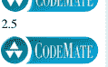


# 第3章 函数基础

# 第3章 函数基础
函数基础

3.1 预定义函数 92
返回值的预定义函数 92
预定义 void 函数 97
随机数生成器 99

3.2 程序员自定义函数 103
定义返回值的函数 103
函数声明的替代形式 106
陷阱：参数顺序错误 107
陷阱：术语 parameter 和 argument 的用法 107
函数调用函数 107
示例：舍入函数 107
返回布尔值的函数 110
定义 void 函数 111
void 函数中的返回语句 112
前置条件和后置条件 113
main 是一个函数 115
递归函数 116

3.3 作用域规则 117
局部变量 117
过程抽象 120
全局常量和全局变量 121
块 124
嵌套作用域 124
提示：在分支和循环语句中使用函数调用 125
在 for 循环中声明的变量 125

本章小结 126
自测练习答案 127
编程项目 130


# 函数基础

> *好东西总是装在小包装里。*

## 简介

如果你已经用其他语言编过程序，那么本章的内容对你来说会很熟悉。你仍然应该浏览本章，了解 C++ 中函数基础部分的语法和术语。第 4 章包含 C++ 中可能与其他语言不同的函数相关内容。

一个程序可以被认为由多个子部分组成，例如获取输入数据、计算输出数据和显示输出数据。与大多数编程语言一样，C++ 具有分别命名和编码这些子部分的功能。在 C++ 中，这些子部分称为*函数*。大多数编程语言都有函数或类似函数的东西，尽管在其他语言中它们并不总是被称为函数。你以前可能听过*过程*、*子程序*和*方法*这些术语，它们本质上与*函数*意思相同。在 C++ 中，函数可以返回一个值（产生一个值），也可以不返回值而执行某个操作，但无论子部分是否返回值，在 C++ 中它仍然被称为函数。本章介绍 C++ 函数的基本细节。在告诉你如何编写自己的函数之前，我们首先告诉你如何使用一些预定义的 C++ 函数。

### 3.1 预定义函数

> *不要重复发明轮子。*

C++ 附带了可以在程序中使用的预定义函数库。C++ 中有两种函数：返回（产生）值的函数和不返回值的函数。不返回值的函数称为 **void 函数**。我们首先讨论返回值的函数，然后讨论 void 函数。

# 返回值的预定义函数

我们将使用 sqrt 函数来说明如何使用返回值的预定义函数。sqrt 函数计算一个数的平方根。


（一个数的平方根是这样一个数，它与自身相乘时会得到你最初的那个数。例如，9 的平方根是 3，因为 3² 等于 9。）函数 sqrt 从一个数开始，例如 9.0，并计算其平方根，在本例中为 3.0。函数开始时使用的值称为其参数。它计算出的值称为返回值。某些函数可能有不止一个参数，但没有一个函数会返回不止一个值。

在程序中使用函数的语法很简单。要将名为 theRoot 的变量设为 9.0 的平方根，可以使用以下赋值语句：

```
theRoot = sqrt(9.0);
```

表达式 sqrt(9.0) 被称为函数调用或函数调用。函数调用中的参数可以是常量，例如 9.0，也可以是变量，或更复杂的表达式。函数调用是一个表达式，可以像任何其他表达式一样使用。例如，sqrt 返回的值的类型为 double；因此，以下是合法的（尽管也许有点吝啬）：

```
bonus = sqrt(sales)/10;
```

sales 和 bonus 通常是类型为 double 的变量。函数调用 sqrt(sales) 是一个单独的项，就好像它被括在括号中一样。因此，上述赋值语句等价于

```
bonus = (sqrt(sales))/10;
```

你可以在任何允许使用函数返回值类型指定的表达式的地方使用函数调用。

Display 3.1 包含一个使用预定义函数 sqrt 的完整程序。该程序计算可以用用户愿意花费的钱建造的最大正方形狗舍的大小。程序会询问用户一笔钱，然后确定可以用这笔钱购买多少平方英尺的地面面积。该计算得出狗舍地板的面积（平方英尺）。函数 sqrt 给出狗舍地板一边的长度。

cmath 库包含函数 sqrt 的定义以及许多其他数学函数。如果你的程序使用某个库中的预定义函数，则必须包含一个命名该库的 include 指令。例如，Display 3.1 中的程序使用 sqrt 函数，因此它包含

```
#include <cmath>
```

这个特定程序有两个 include 指令。你给出这两个 include 指令的顺序无关紧要。Include 指令在第 1 章中讨论过。

预定义函数的定义通常将这些函数放在 std 命名空间中，因此还要求以下 using 指令，如 Display 3.1 所示：

```
using namespace std;
```

### FUNCTIONS THAT RETURN A VALUE

对于返回值的函数，函数调用是一个表达式，由函数名后跟括在括号中的参数组成。如果有多个参数，则参数由逗号分隔。如果函数调用返回值，则该函数调用是一个表达式，可以像该函数返回值类型指定的任何其他表达式一样使用。

### SYNTAX

```
Function_Name(Argument_List)
where the Argument_List is a comma-separated list of arguments:
Argument_1, Argument_2, . . . , Argument_Last
```

### EXAMPLES

```
side = sqrt(area);
cout << "2.5 to the power 3.0 is "
     << pow(2.5, 3.0);
```

in the library with header file cstdlib, so any program that uses either of these functions must contain the following directive:

```
#include <cstdlib>
```

还请注意，有三个绝对值函数。如果你想求类型为 int 的数的绝对值，使用 abs；如果你想求类型为 long 的数的绝对值，使用 labs；如果你想求类型为 double 的数的绝对值，使用 fabs。事情甚至更复杂，abs 和 labs 在头文件为 cstdlib 的库中，而 fabs 在头文件为 cmath 的库中。fabs 是 floating-point absolute value 的缩写。回想一下，小数点后带有分数的数，例如类型为 double 的数，通常称为浮点数。

另一个预定义函数的例子是 pow，它在头文件为 cmath 的库中。函数 pow 可用于在 C++ 中进行指数运算。例如，如果你想将变量 result 设为 xʸ，可以使用以下语句：

```
result = pow(x, y);
```

因此，以下三行程序代码将把数字 9.0 输出到屏幕，因为 (3.0)² 是 9.0：

```
double result, x = 3.0, y = 2.0;
result = pow(x, y);
cout << result;
```

### Display 3.2 Some Predefined Functions

| NAME | DESCRIPTION | TYPE OF ARGUMENTS | TYPE OF VALUE RETURNED | EXAMPLE | VALUE | LIBRARY HEADER |
|---|---|---|---|---|---|---|
| sqrt | Square root | double | double | sqrt(4.0) | 2.0 | cmath |
| pow | Powers | double | double | pow(2.0, 3.0) | 8.0 | cmath |
| abs | Absolute value for int | int | int | abs(-7) abs(7) | 7 7 | cstdlib |
| labs | Absolute value for long | long | long | labs(-70000) labs(70000) | 70000 70000 | cstdlib |
| fabs | Absolute value for double | double | double | fabs(-7.5) fabs(7.5) | 7.5 7.5 | cmath |
| ceil | Ceiling (round up) | double | double | ceil(3.2) ceil(3.9) | 4.0 4.0 | cmath |
| floor | Floor (round down) | double | double | floor(3.2) floor(3.9) | 3.0 3.0 | cmath |
| exit | End program | int | void | exit(1); | None | cstdlib |
| rand | Random number | None | int | rand( ) | Varies | cstdlib |
| srand | Set seed for rand | unsigned int | void | srand(42); | None | cstdlib |

所有这些预定义函数都需要 using namespace std; 以及一个 include 指令。

请注意，之前的 pow 调用返回 9.0，而不是 9。函数 pow 总是返回类型为 double 的值，而不是类型为 int 的值。还请注意，函数 pow 需要两个参数。函数可以有任意数量的参数。而且，每个参数位置都有指定的类型，函数调用中使用的参数应为该类型。在许多情况下，如果你使用错误类型的参数，C++ 会为你自动进行类型转换。然而，结果可能不是你所期望的。当你调用函数时，你应该使用为该函数指定的类型的参数。对此警告的一个例外是参数从类型 int 到类型 double 的自动转换。在许多情况下，包括对

### void FUNCTIONS

void 函数执行某些操作，但不返回值。对于 void 函数，函数调用是一个语句，由函数名后跟括在括号中的参数组成，然后以分号结束。如果有多个参数，则参数由逗号分隔。对于 void 函数，函数调用（函数调用）是一个语句，可以像任何其他 C++ 语句一样使用。

### SYNTAX

```
function_Name(Argument_List);
```

where the Argument_List is a comma-separated list of arguments:

Argument_1, Argument_2, . . . , Argument_Last

### EXAMPLE

```
exit(1);
```

function pow, you can safely use an argument of type int (or other integer type) when an argument of type double (or other floating-point type) is specified.

许多 pow 的实现对可使用的参数有限制。在这些实现中，如果 pow 的第一个参数为负数，则第二个参数必须是整数。可能最简单和最安全的做法是仅在第一个参数非负时使用 pow。

### PREDEFINED void FUNCTIONS

void 函数执行某些操作，但不返回值。由于它执行操作，void 函数调用是一个语句。void 函数的函数调用与返回值的函数调用写法相似，只是它以分号结束并用作语句而不是表达式。预定义 void 函数的处理方式与返回值的预定义函数相同。因此，要使用预定义 void 函数，你的程序必须有一个 include 指令，指定定义该函数的库的名称。

例如，函数 exit 定义在库 cstdlib 中，因此使用该函数的程序必须在文件开始（或附近）包含以下内容：

```
#include <cstdlib>
using namespace std;
```

以下是函数 exit 的一个示例调用（示例调用）：

```
exit(1);
```


# exit 函数

exit 函数是一个预定义的 void 函数，它接受一个 int 类型的参数。因此，调用 exit 函数就是执行下面这样的语句：

```
exit(Integer_Value);
```

当调用 exit 函数时（也就是执行上述语句时），程序会立即结束。可以使用任何 Integer_Value，但按照惯例，1 用于因错误而导致的 exit 调用，0 用于其他情况。

exit 函数的定义位于 cstdlib 库中，并且它把 exit 函数放在 std 命名空间中。因此，任何使用 exit 函数的程序都必须包含以下两条指令：

```
#include <cstdlib>
using namespace std;
```

调用 exit 函数会立即结束程序。程序清单 3.3 包含一个演示 exit 函数的玩具程序。

注意，函数 exit 有一个参数，其类型为 int。这个参数会传递给操作系统。就你的 C++ 程序而言，你可以使用

# 程序清单 3.3 对预定义 void 函数的函数调用

```
1 #include <iostream>
2 #include <cstdlib>
3 using namespace std;
4 
5 int main( )
6 {
7   cout << "Hello Out There!\n";
8   exit(1);
9 
10 cout << "This statement is pointless,\n" << "because it will never be executed.\n" << "This is just a toy program to illustrate exit.\n";
11 
12   return 0;
13 }
```

这只是一个玩具示例。如果你省略这些行，它也会产生相同的输出。

# 示例对话

Hello Out There!

任何 int 值都可以作为参数，但按照惯例，1 用于因错误而导致的 exit 调用，0 用于其他情况。

void 函数可以有任意数量的参数。void 函数参数的细节与返回值的函数的参数细节相同。特别是，如果你使用了错误类型的参数，在很多情况下 C++ 会为你自动进行某种类型转换。然而，结果可能并非你所期望的。

# 自测练习

+   1. 确定下列每个算术表达式的值。
+      sqrt(16.0)    sqrt(16)    pow(2.0, 3.0)
+      pow(2, 3)     pow(2.0, 3)    pow(1.1, 2)
+      abs(3)        abs(-3)      abs(0)
+      fabs(-3.0)    fabs(-3.5)   fabs(3.5)
+      ceil(5.1)     ceil(5.8)    floor(5.1)
+      floor(5.8)    pow(3.0, 2)/2.0    pow(3.0, 2)/2
+      7/abs(-2)     (7 + sqrt(4.0))/3.0    sqrt(pow(3, 2))

+   2. 将下列每个数学表达式转换为 C++ 算术表达式。
+      a. √(x + y)
+      b. x^(7+7)
+      c. √(area + judge)
+      d. √(time + tide) / nobody
+      e. (-b + √(b² - 4ac)) / (2a)
+      f. |x - y|

+   3. 编写一个完整的 C++ 程序，计算并输出从 1 到 10 的整数的平方根。

+   4. void 函数 exit 的 int 参数有什么作用？

# 随机数生成器

随机数生成器是一个返回“随机选择”的数的函数。它不同于我们目前见过的函数，因为其返回值不是由参数（通常没有参数）决定的，而是由某些全局条件决定的。由于你可以把返回值看作一个随机数，因此可以用随机数生成器来模拟随机事件，例如掷骰子或抛硬币的结果。除了模拟机会游戏之外，随机数生成器还可以用来模拟那些严格来说可能不是随机、但对我们来说似乎是随机的事物，例如收费站车辆到达之间的时间间隔。

头文件为 `<cstdlib>` 的 C++ 库包含一个名为 rand 的随机数函数。这个函数没有参数。当程序调用 rand 时，函数返回 0 到 RAND_MAX（包含）范围内的一个整数。（生成的数可能等于 0 或 RAND_MAX。）RAND_MAX 是一个已定义的整型常量，其定义同样位于头文件为 `<cstdlib>` 的库中。RAND_MAX 的确切值取决于系统，但始终至少为 32767（最大的双字节正整数）。例如，下面输出 0 到 RAND_MAX 范围内十个“随机”数的列表：

```
int i;
for (i = 0; i < 10; i++)
    cout << rand() << endl;
```

你更可能希望得到某个较小范围内的随机数，例如 0 到 10。要确保值在 0 到 10（包含端点）范围内，可以使用

```
rand() % 11
```

这称为缩放。下面输出 0 到 10（包含）范围内的十个“随机”整数：

```
int i;
for (i = 0; i < 10; i++)
    cout << (rand() % 11) << endl;
```

诸如 rand 函数之类的随机数生成器并不会生成真正的随机数。（这就是“随机”一词要加引号的原因。）对 rand 函数（或几乎任何随机数生成器）的一连串调用会产生一串看似随机的数（即 rand 返回的值）。然而，如果你能把计算机恢复到开始这一连串 rand 调用之前的状态，就会得到相同的“随机数”序列。那些看起来随机但实际上并不随机的数，例如通过调用 rand 得到的一串数，称为伪随机数。

伪随机数序列通常由一个称为种子的数决定。如果你一次又一次地用同一个种子启动随机数生成器，那么每次它都会产生相同的（看起来随机的）数列。你可以用 srand 函数为 rand 函数设置种子。void 函数 srand 接受一个（正）整数参数，该参数就是种子。例如，下面将输出两串完全相同的十个伪随机数：

```
int i;
srand(99);
for (i = 0; i < 10; i++)
    cout << (rand() % 11) << endl;
srand(99);
for (i = 0; i < 10; i++)
    cout << (rand() % 11) << endl;
```

数字 99 本身没有什么特别之处，只不过我们对两次 srand 调用使用了相同的数字。

请注意，给定种子产生的伪随机数序列可能依赖于系统。如果在不同系统上使用相同种子运行，伪随机数序列在该系统上可能不同。不过只要你在同一系统上使用相同的 C++ 实现，相同的种子就会产生相同的伪随机数序列。

### 伪随机数

函数 `rand` 不接受参数，返回 0 到 `RAND_MAX`（包含）范围内的一个伪随机整数。`void` 函数 `srand` 接受一个参数，该参数就是随机数生成器 `rand` 的种子。`srand` 的参数类型为 `unsigned int`，因此该参数必须为非负数。函数 `rand`、`srand` 以及已定义的常量 `RAND_MAX` 都定义在库 `cstdlib` 中，因此使用它们的程序必须包含以下指令：

```cpp
#include <cstdlib>
using namespace std;
```

对于大多数应用来说，这些伪随机数已经足够接近真正的随机数。事实上，它们往往比真正的随机数更受欢迎。伪随机数生成器相对于真正的随机数生成器有一个很大的优势：它产生的数列是可重复的。如果使用相同的种子值运行两次，它会产生相同的数列。这对很多用途来说都非常方便。当发现并修复错误后，可以用与暴露该错误时相同的伪随机数序列重新运行程序。类似地，只要使用的是伪随机数生成器，就可以重复某一次特别有趣的程序运行。而使用真正的随机数生成器时，程序的每次运行都很可能不同。

程序清单 3.4 展示了一个使用随机数生成器 `rand` 来“预测”天气的程序。在这种情况下，预测是随机的，但有些人认为天气预测也就不过如此了。（天气预报实际上可以非常准确，但这个程序只是一个用来演示伪随机数的游戏。）

请注意，在程序清单 3.4 中，用作 `srand` 参数的种子值是月份乘以日期。这样，如果重新运行程序并输入相同的日期，就会做出相同的预测。（当然，这个程序仍然非常简单。对 14 日后一天的预测可能与对 15 日的预测相同，也可能不同，但这个程序足以作为一个简单的示例。）

概率通常表示成 0.0 到 1.0 范围内的浮点数。假设你想要一个随机概率，而不是随机整数。这可以通过


### 显示 3.4：使用随机数生成器的函数（第 1 部分，共 2 部分）

```cpp
#include <iostream>
#include <cstdlib>
using namespace std;

int main( )
{
    int month, day;
    cout << "Welcome to your friendly weather program.\n";
    cout << "Enter today's date as two integers for the month and the day:\n";
    cin >> month;
    cin >> day;
    srand(month*day);
    int prediction;
    char ans;
    cout << "Weather for today:\n";
    do
    {
        prediction = rand() % 3;
        switch (prediction)
        {
            case 0:
                cout << "The day will be sunny!!\n";
                break;
            case 1:
                cout << "The day will be cloudy.\n";
                break;
            case 2:
                cout << "The day will be stormy!\n";
                break;
            default:
                cout << "Weather program is not functioning properly.\n";
        }
        cout << "Want the weather for the next day?(y/n): ";
        cin >> ans;
    } while (ans == 'y' || ans == 'Y');
    cout << "That's it from your 24-hour weather program.\n";
    return 0;
}
```

由另一种缩放形式产生。下面生成一个介于 0.0 和 1.0 之间的伪随机浮点值：

```cpp
rand() / static_cast<double>(RAND_MAX)
```

进行类型转换是为了进行浮点除法而不是整数除法。

### 显示 3.4 使用随机数生成器的函数（第 2 部分，共 2 部分）

### 示例对话

```
Welcome to your friendly weather program.
Enter today's date as two integers for the month and the day:
2 14
Weather for today:
The day will be cloudy.
Want the weather for the next day?(y/n): y
The day will be cloudy.
Want the weather for the next day?(y/n): y
The day will be stormy!
Want the weather for the next day?(y/n): y
The day will be stormy!
Want the weather for the next day?(y/n): y
The day will be sunny!!
Want the weather for the next day?(y/n): n
That's it from your 24-hour weather program.
```

### 自测练习

- 5. 给出一个表达式，用于生成 5 到 10（含）范围内的伪随机整数。
- 6. 编写一个完整的程序，要求用户输入一个种子，然后输出基于该种子的十个随机数列表。这些数字应为 0.0 到 1.0（含）范围内的浮点数。

## 3.2 程序员自定义函数

> 量身定制的西装总是比成衣更合身。

我的裁缝叔叔

上一节告诉您如何使用预定义函数。本节告诉您如何定义自己的函数。

### 定义返回值函数

您可以定义自己的函数，既可以将其放在与程序主部分相同的文件中，也可以放在单独的文件中，以便多个不同的程序使用这些函数。

无论哪种情况，定义都是相同的，但目前我们假设函数定义与程序主部分放在同一个文件中。本小节仅讨论返回值的函数。后面的小节将告诉您如何定义 void 函数。

显示 3.5 包含一个完整程序中的示例函数定义，演示了如何调用该函数。该函数名为 totalCost，接受两个参数——单件商品的价格和该价格下的商品数量。该函数返回包括销售税在内的总成本。调用该函数的方式与调用预定义函数的方式相同。该函数的定义必须由程序员编写，稍微复杂一些。

函数的描述分为两部分。第一部分称为**函数声明**或**函数原型**。以下是显示 3.5 中定义的函数的函数声明（函数原型）：

```cpp
double totalCost(int numberParameter, double priceParameter);
```

函数声明中的第一个词指定函数返回值的类型。因此，对于函数 totalCost，返回值的类型是 double。接下来，函数声明告诉您函数的名称；在本例中是 totalCost。函数声明告诉您（以及编译器）编写和使用函数调用所需的一切。它告诉您函数需要多少个参数以及参数应为哪种类型；在本例中，函数 totalCost 有两个参数，第一个是 int 类型，第二个是 double 类型。标识符 numberParameter 和 priceParameter 称为**形式参数**，或简称**参数**。形式参数用作一种空白或占位符，来代表实参。当您编写函数声明时，您不知道实参是什么，因此您使用形式参数来代替实参。形式参数的名称可以是任何有效的标识符。请注意，函数声明以分号结尾。

虽然函数声明告诉您编写函数调用所需的一切，但它不会告诉您将返回什么值。返回的值由函数定义决定。在显示 3.3 中，函数定义位于程序的第 24 到 30 行。**函数定义**描述了函数如何计算其返回的值。函数定义由**函数头**和**函数体**组成。**函数头**的写法与函数声明类似，只是函数头末尾没有分号。返回的值由 *函数体* 中的语句决定。

**函数体**跟随函数头并完成函数定义。函数体由一对花括号括起来的声明和可执行语句组成。因此，函数体就像程序主部分的函数体一样。当函数被调用时，实参值会插入到形式参数中，然后执行函数体中的语句。函数返回的值在函数执行 *return* 语句时确定。（有关这种“插入”的细节将在第 4 章中讨论。）

### 显示 3.5 使用随机数生成器的函数（第 1 部分，共 2 部分）

```cpp
#include <iostream>
using namespace std;

double totalCost(int numberParameter, double priceParameter);
//Computes the total cost, including 5% sales tax,
//on numberParameter items at a cost of priceParameter each.

int main( )
{
    double price, bill;
    int number;

    cout << "Enter the number of items purchased: ";
    cin >> number;
    cout << "Enter the price per item $";
    cin >> price;

    bill = totalCost(number, price);

    cout.setf(ios::fixed);
    cout.setf(ios::showpoint);
    cout.precision(2);
    cout << number << " items at $" << price << " each.\n"
         << "Final bill, including tax, is $" << bill
         << endl;

    return 0;
}

double totalCost(int numberParameter, double priceParameter)
{
    const double TAXRATE = 0.05; //5% sales tax
    double subtotal;

    subtotal = priceParameter * numberParameter;
    return (subtotal + subtotal*TAXRATE);
}
```

函数声明；也称为函数原型

函数调用

函数头

函数体

函数定义

### 示例对话

```
Enter the number of items purchased: 2
Enter the price per item: $10.10
2 items at $10.10 each.
Final bill, including tax, is $21.21
```

**return 语句**由关键字 return 后跟一个表达式组成。显示 3.5 中的函数定义包含以下 return 语句：

```cpp
return (subtotal + subtotal*TAXRATE);
```

当执行此 return 语句时，以下表达式的值将作为函数调用的值返回：

```cpp
(subtotal + subtotal*TAXRATE)
```

括号不是必需的。如果省略括号，程序运行结果相同。但是对于较长的表达式，括号使 return 语句更易读。为了保持一致性，一些程序员提倡即使对简单表达式也使用这些括号。在显示 3.3 的函数定义中，return 语句之后没有语句，但如果有，它们也不会被执行。当执行 return 语句时，函数调用结束。

请注意，函数体可以包含任何 C++ 语句，并且这些语句将在函数被调用时执行。因此，返回值函数除了返回值外，还可以执行任何其他操作。然而，在大多数情况下，返回值函数的主要目的是返回该值。

完整的函数定义或函数声明（函数原型）必须出现在函数被调用之前的代码中。最典型的安排是，函数声明和程序主部分出现在一个或多个文件中，函数声明在程序主部分之前，而函数定义出现在另一个文件中。我们还没有讨论跨越多个文件划分程序，因此我们将函数定义放在程序主部分之后。如果完整的函数定义放在程序主部分之前，则可以省略函数声明。

### 函数声明的替代形式

您不必在函数声明（函数原型）中列出形式参数名称。以下两个函数声明是等价的：

```cpp
double totalCost(int numberParameter, double priceParameter);
```

和

```cpp
double totalCost(int, double);
```

我们通常使用第一种形式，以便在伴随函数声明的注释中引用形式参数。但是，您会经常在手册中看到第二种形式。

这种替代形式仅适用于函数声明。函数定义必须始终列出形式参数名称。


### 陷阱
实参顺序错误

当调用函数时，计算机将第一个实参替换为第一个形式参数，第二个实参替换为第二个形式参数，依此类推。尽管计算机检查每个实参的类型，但不会检查合理性。如果混淆了实参的顺序，程序将不会执行你想要的操作。如果因实参类型错误而造成类型违规，则会收到错误消息。如果没有类型违规，程序可能会正常运行，但函数返回的值会产生不正确的结果。

### 陷阱
参数和实参术语的使用

我们在本书中使用的形式参数和实参术语与常见用法一致，但人们也经常互换使用“参数”和“实参”这两个术语。当你看到“参数”和“实参”这两个术语时，必须根据上下文确定其确切含义。许多人将我们称为形式参数和实参的内容都统称为参数。其他人则使用“实参”一词同时指代我们所说的形式参数和实参。不要指望人们在使用这两个术语时保持一致。（在本书中，我们有时使用“参数”一词来表示形式参数，但这更像是一种缩写，而不是真正的不一致。）

### 函数调用函数

函数体可以包含对另一个函数的调用。这类函数调用的情况与函数调用出现在程序主部分中的情况相同；唯一的限制是函数声明（或函数定义）必须出现在函数使用之前。如果你按照我们一直以来的方式设置程序，这将自动发生，因为所有函数声明都在程序主部分之前，所有函数定义都在主部分之后。虽然可以在另一个函数的定义中包含函数调用，但不能将一个函数的定义放在另一个函数定义的函数体内。

### 示例
一个四舍五入的函数

预定义函数表（显示3.2）不包含任何用于对数字进行四舍五入的函数。函数ceil和floor几乎就是四舍五入函数，但又不完全是。函数ceil总是返回下一个最高的整数（如果参数恰好是整数，则返回参数本身）。因此，ceil(2.3)返回3.0，而不是2.0。函数floor总是返回小于（或等于）参数的最接近的整数。因此，floor(2.9)返回2.0，而不是3.0。幸运的是，定义一个真正执行四舍五入的函数很容易。该函数定义在显示3.6中。函数round将其参数四舍五入到最接近的整数。例如，round(2.3)返回2，round(2.6)返回3。

为了验证round能正确工作，让我们看一些示例。考虑round(2.4)。返回的值如下（转换为int值）：

```
floor(2.4 + 0.5)
```

即floor(2.9)，或2.0。实际上，对于任何大于或等于2.0且严格小于2.5的数字，该数字加上0.5将小于3.0，因此对加上0.5后的数字应用floor将返回2.0。因此，对任何大于或等于2.0且严格小于2.5的数字应用round将返回2。（由于round的函数声明指定返回值的类型为int，我们将计算出的值类型转换为int。）

现在考虑大于或等于2.5的数字；例如，2.6。调用round(2.6)返回的值如下（转换为int值）：

```
floor(2.6 + 0.5)
```

即floor(3.1)，或3.0。实际上，对于任何大于2.5且小于或等于3.0的数字，该数字加上0.5将大于3.0。因此，使用任何大于2.5且小于或等于3.0的数字调用round将返回3。

因此，round对所有在2.0和3.0之间的参数都能正确工作。显然，2.0和3.0之间的参数并没有什么特殊之处。类似推理适用于所有非负数。因此，round对所有非负参数都能正确工作。

### 显示 3.6 round 函数（第 1 部分，共 2 部分）

测试round函数的程序

```
1 #include <iostream>
2 #include <cmath>
3 using namespace std;

4 int round(double number);
5 //Assumes number >= 0.
6 //Returns number rounded to the nearest integer.

7 int main( )
8 {
9     double doubleValue;
10    char ans;

11 do
12 {
13    cout << "Enter a double value: ";
14    cin >> doubleValue;
```

### 显示 3.6 round 函数（第 2 部分，共 2 部分）

```
15      cout << "Rounded that number is " << round(doubleValue) << endl;
16      cout << "Again? (y/n): ";
17      cin >> ans;
18  }while (ans == 'y' || ans == 'Y');
19  cout << "End of testing.\n";
20
21  }
22
23  //Uses cmath:
24  int round(double number)
25  {
26      return static_cast<int>(floor(number + 0.5));
27  }
```

### 示例对话

输入一个双精度值：9.6
四舍五入后，该数字为10
再来一次？(y/n)：y
输入一个双精度值：2.49
四舍五入后，该数字为2
再来一次？(y/n)：n
测试结束。

### 自测练习

7. 以下程序的输出是什么？

```
#include <iostream>
using namespace std;

char mystery(int firstParameter, int secondParameter);

int main()
{
    cout << mystery(10, 9) << "\n";
    return 0;
}
char mystery(int firstParameter, int secondParameter)
{
    if (firstParameter >= secondParameter)
        return 'W';
    else
        return 'H';
}
```

- 8. 编写一个函数的函数声明（函数原型）和函数定义，该函数接受三个int类型的参数，并返回这三个参数之和。
- 9. 编写一个函数的函数声明和函数定义，该函数接受一个double类型的参数。如果参数为正数，函数返回字符值’P’；如果参数为零或负数，返回’N’。
- 10. 函数定义可以出现在另一个函数定义的函数体内吗？
- 11. 列出调用预定义（即库）函数和用户自定义函数之间的相似之处和不同之处。

### 返回布尔值的函数

函数的返回类型可以是bool类型。对这种函数的调用返回true或false值之一，可以在允许布尔表达式的任何地方使用。例如，它可以用在布尔表达式中来控制if-else语句或控制循环语句。这通常可以使程序更易于阅读。通过函数声明，可以将复杂的布尔表达式与有意义的名称关联起来。例如，语句

```
if (((rate >= 10) && (rate < 20)) || (rate == 0))
{
    ...
}
```

可以变为

```
if (appropriate(rate))
{
    ...
}
```

前提是定义了以下函数：

```
bool appropriate(int rate)
{
    return (((rate >= 10) && (rate < 20)) || (rate == 0));
}
```

### 自测练习

- 12. 编写一个名为inOrder的函数定义，该函数接受三个int类型的参数。如果三个参数按升序排列，函数返回true；否则返回false。例如，inOrder(1, 2, 3)和inOrder(1, 2, 2)都返回true，而inOrder(1, 3, 2)返回false。
- 13. 编写一个名为`even`的函数定义，该函数接受一个`int`类型的参数并返回`bool`值。如果该参数是偶数，函数返回true；否则返回false。
- 14. 编写一个名为`isDigit`的函数定义，该函数接受一个`char`类型的参数并返回`bool`值。如果参数是十进制数字，函数返回true；否则返回false。

### 定义 void 函数

在C++中，void函数的定义方式与返回值函数的定义方式类似。例如，以下是一个void函数，它输出将华氏温度转换为摄氏温度的计算结果。实际计算将在程序的其他位置完成。该void函数只实现输出计算结果的子任务。

```
void showResults(double fDegrees, double cDegrees)
{
    cout.setf(ios::fixed);
    cout.setf(ios::showpoint);
    cout.precision(1);
    cout << fDegrees
         << " degrees Fahrenheit is equivalent to \n"
         << cDegrees << " degrees Celsius.\n";
}
```

如上函数定义所示，void函数定义与返回值函数定义之间只有两个区别。一个区别是，我们在通常指定返回值的类型的位置使用关键字void。这告诉编译器该函数不会返回任何值。名称void用于表示“此函数不返回任何值”。第二个区别是，void函数定义不需要return语句。函数执行在函数体中的最后一条语句执行完毕时结束。

void函数调用是一个可执行语句。例如，上述函数`showResults`可以如下调用：

```
showResults(32.5, 0.3);
```

如果上述语句在程序中执行，将导致以下内容出现在屏幕上：

```
32.5 degrees Fahrenheit is equivalent to
0.3 degrees Celsius.
```


请注意函数调用以分号结尾，这告诉编译器该函数调用是一个可执行语句。

当调用一个 void 函数时，参数会被替换为形式参数，并且函数体中的语句会被执行。例如，对本节前面给出的 void 函数 showResults 的调用会使一些输出写入屏幕。可以这样思考对 void 函数的调用：想象函数定义的主体被复制到程序中，替换函数调用的位置。当函数被调用时，参数会被替换为形式参数，然后就好像函数体是程序中的代码行一样。（第 4 章详细描述了将参数替换为形式参数的过程。在此之前，我们只使用简单的例子，这些例子在没有正式描述替换过程的情况下也应该足够清晰。）

拥有一个没有参数的函数是完全合法的，有时也是有用的。在这种情况下，函数声明中根本没有列出形式参数，并且在调用函数时也不使用参数。例如，下面定义的 void 函数 initializeScreen 只是向屏幕发送一个换行命令：

```cpp
void initializeScreen( )
{
    cout << endl;
}
```

如果你的程序包含对该函数的以下调用作为其第一个可执行语句，那么先前运行程序的输出将与你的程序的输出分开：

```cpp
initializeScreen( );
```

请务必注意，即使函数没有参数，你仍然必须在函数声明中和对函数的调用中包含括号。

函数声明（函数原型）和函数定义的放置方式对于 void 函数与我们对返回值的函数所描述的方式相同。

### void 函数中的 return 语句

void 函数和返回值的函数都可以有 return 语句。对于返回值的函数，return 语句指定返回的值。对于 void 函数，return 语句不包含返回值的表达式。void 函数中的 return 语句只是结束函数调用。每个返回值的函数必须通过执行 return 语句结束。然而，void 函数不必包含 return 语句。如果它不包含 return 语句，它将在执行完函数体中的代码后结束。就好像在函数体末尾的最后一个右大括号 } 之前有一个隐式的 return 语句。

### 函数声明（函数原型）

函数声明（函数原型）告诉你编写对该函数的调用所需知道的所有信息。函数声明（或完整的函数定义）必须在对函数的调用之前出现在你的代码中。函数声明通常放在程序的主体之前。

### 语法

```text
Type_Returned_Or_void FunctionName(Parameter_List);
```

不要忘记这个分号。

其中 Parameter_List 是以逗号分隔的参数列表：

`Type_1 Formal_Parameter_1, Type_2 Formal_Parameter_2, ..., Type_Last Formal_Parameter_Last`

### 示例

```cpp
double totalWeight(int number, double weightOfOne);
//Returns the total weight of number items that
//each weigh weightOfOne.

void showResults(double fDegrees, double cDegrees);
//Displays a message saying fDegrees Fahrenheit
//is equivalent to cDegrees Celsius.
```

函数体中在最后一个右大括号之前存在隐式 return 语句这一事实并不意味着你在 void 函数中永远不需要 return 语句。例如，Display 3.7 中的函数定义可能被用作餐厅管理程序的一部分。该函数输出将给定量的冰淇淋分配给桌上人员的说明。如果桌上没有人（即 number 等于 0），那么 if 语句中的 return 语句将终止函数调用并避免除以零。如果 number 不为 0，则函数调用将在函数体末尾执行最后一个 cout 语句时结束。

### Display 3.7 void 函数中 return 的使用

```cpp
#include <iostream>
using namespace std;

void iceCreamDivision(int number, double totalWeight);
//Outputs instructions for dividing totalWeight ounces of ice cream among
//number customers. If number is 0, only an error message is output.

int main( )
{
    int number;
    double totalWeight;

    cout << "Enter the number of customers: ";
    cin >> number;
    cout << "Enter weight of ice cream to divide (in ounces): ";
    cin >> totalWeight;

    iceCreamDivision(number, totalWeight);

    return 0;
}

void iceCreamDivision(int number, double totalWeight)
{
    double portion;

    if (number == 0)
    {
        cout << "Cannot divide among zero customers.\n";
        return;                    // if number is 0, then the
                                    // function execution ends here.
    }
    portion = totalWeight/number;
    cout << "Each one receives "
         << portion << " ounces of ice cream." << endl;
}
```

**示例对话**

```text
Enter the number of customers: 0
Enter weight of ice cream to divide (in ounces): 12
Cannot divide among zero customers.
```

### 前置条件和后置条件

编写函数声明注释的一个好方法是将其分解为两种信息，称为前置条件和后置条件。前置条件说明在调用函数时假定为真。函数不应被使用，也不能期望在前置条件不成立时正确执行。后置条件描述了函数调用的效果；也就是说，后置条件说明在前置条件成立的情况下，函数执行后将为真。对于返回值的函数，后置条件将描述函数返回的值。对于改变某些参数变量值的函数，后置条件将描述对参数值所做的所有更改。

例如，下面是一个带有前置条件和后置条件的函数声明：

```cpp
void showInterest(double balance, double rate);
//Precondition: balance is a nonnegative savings account balance.
//rate is the interest rate expressed as a percentage, such as 5 for 5%.
//Postcondition: The amount of interest on the given balance
//at the given rate is shown on the screen.
```

你不需要知道函数 showInterest 的定义就能使用这个函数。只要前置条件和后置条件所提供的信息就足以使用该函数。

当唯一的后置条件是对返回值的描述时，程序员通常会省略“Postcondition”一词，如以下示例所示：

```cpp
double celsius(double fahrenheit);
//Precondition: fahrenheit is a temperature in degrees Fahrenheit.
//Returns the equivalent temperature expressed in degrees Celsius.
```

一些程序员选择不在函数注释中使用前置条件和后置条件这两个词。然而，无论你是否使用这些词，在设计函数和决定函数注释中包含什么内容时，你都应始终以前置条件和后置条件为思考方式。

### main 是一个函数

正如我们已经指出的，程序的主体实际上是名为 main 的函数的定义。当程序运行时，main 函数会被自动调用；它反过来可以调用其他函数。虽然看起来程序主体中的 return 语句应该是可选的，但实际上并非如此。C++ 标准说你可以在程序主体中省略 return 0 语句，但许多编译器仍然要求它，而几乎所有编译器都允许你包含它。为了可移植性，你应该在 main 函数中包含 return 0 语句。你应该将程序的主体视为返回类型为 int 的函数，因此需要 return 语句。将程序的主体视为返回整数的函数可能听起来很奇怪，但这是许多编译器强制执行的传统。

虽然某些编译器可能允许你这样做，但你不应在代码中包含对 main 的调用。只有系统应该调用 main，它在你运行程序时调用它。


# 递归函数

C++ 允许你定义递归函数。递归函数在第 13 章中介绍。如果你不知道递归函数是什么，在到达该章节之前无需担心。如果你想提前阅读有关递归函数的内容，在完成第 4 章后，可以阅读第 13 章的第 13.1 节和第 13.2 节。请注意，主函数不应被递归调用。

# 自测练习

15. 以下程序的输出是什么？

```
#include <iostream>
using namespace std;

void friendly();

void shy(int audienceCount);
int main()
{
    friendly();
    shy(6);
    cout << "One more time:\n";
    shy(2);
    friendly();
    cout << "End of program.\n";
    return 0;
}

void friendly()
{
    cout << "Hello\n";
}

void shy(int audienceCount)
{
    if (audienceCount < 5)
        return;
    cout << "Goodbye\n";
}
```

16. 假设你在 Display 3.7 中 iceCreamDivision 的函数定义中省略了 return 语句。这会对程序产生什么影响？程序能否编译？能否运行？程序的行为会有任何不同吗？

17. 编写一个 void 函数的定义，该函数有三个 int 类型的参数，并将这三个参数的乘积输出到屏幕上。将该定义放在一个完整的程序中，该程序读取三个数字然后调用此函数。

18. 你的编译器是否允许 void main( ) 和 int main( )？如果你使用 int main( ) 并且没有提供 return 0; 语句，会发出什么警告？为此，编写几个小的测试程序，也许可以询问你的讲师或当地的专家。

19. 给出预定义函数 sqrt 的前置条件和后置条件，该函数返回其参数的平方根。

# 3.3 作用域规则

> 目的必须合法，必须在宪法的范围内，…… 
> 
> 约翰·马歇尔，美国最高法院首席大法官，《麦卡洛克诉马里兰州案》(1803)

函数应该是自包含的单元，不会干扰其他函数——更不用说其他代码了。为了实现这一点，你通常需要为函数提供自己的变量，这些变量与函数定义外部声明的任何其他变量不同，并且可能与函数所属的变量具有相同的名称。这些在函数定义中声明的变量称为局部变量，是本节的主题。

### 局部变量

回顾 Display 3.1 中的程序。它包含对预定义函数 sqrt 的调用。我们使用此函数时不需要知道 sqrt 函数定义的细节。特别是，我们不需要知道在 sqrt 的定义中声明了哪些变量。你定义的函数也一样。在函数定义内声明的变量声明就如同在预定义函数或另一个程序中的变量声明一样。如果你在一个函数定义中声明一个变量，然后在程序的主函数中（或在另一个函数定义的体内）声明另一个同名变量，那么这两个变量是两个不同的变量，即使它们具有相同的名称。让我们看一个例子。

Display 3.8 中的程序有两个名为 averagePea 的变量；一个在函数 estimateOfTotal 的函数定义中声明并使用，另一个在程序的主函数中声明并使用。函数 estimateOfTotal 的函数定义中的变量 averagePea 和主函数中的变量 averagePea 是两个不同的变量。这就如同函数 estimateOfTotal 是一个预定义函数一样。两个名为 averagePea 的变量不会相互干扰，就像两个完全不同程序中的两个变量一样。

# Display 3.8 局部变量（第 1 部分，共 2 部分）

```
//Computes the average yield on an experimental pea growing patch.
#include <iostream>
using namespace std;

double estimateOfTotal(int minPeas, int maxPeas, int podCount);
//Returns an estimate of the total number of peas harvested.
//The formal parameter podCount is the number of pods.
//The formal parameters minPeas and maxPeas are the minimum
//and maximum number of peas in a pod.

int main() {
    int maxCount, minCount, podCount;
    double averagePea, yield;

    cout << "Enter minimum and maximum number of peas in a pod: ";
    cin >> minCount >> maxCount;
    cout << "Enter the number of pods: ";
    cin >> podCount;
    cout << "Enter the weight of an average pea (in ounces): ";
    cin >> averagePea;

    yield =
        estimateOfTotal(minCount, maxCount, podCount) * averagePea;

    cout.setf(ios::fixed);
    cout.setf(ios::showpoint);
    cout.precision(3);
    cout << "Min number of peas per pod = " << minCount << endl
         << "Max number of peas per pod = " << maxCount << endl
         << "Pod count = " << podCount << endl
         << "Average pea weight = "
         << averagePea << " ounces" << endl
         << "Estimated average yield = " << yield << " ounces"
         << endl;

    return 0;
}

double estimateOfTotal(int minPeas, int maxPeas, int podCount)
{
    double averagePea;

    averagePea = (maxPeas + minPeas)/2.0;
    return (podCount * averagePea);
}
```

> 这个名为 averagePea 的变量是 main 函数的局部变量。

> 这个名为 averagePea 的变量是函数 estimateOfTotal 的局部变量。

# Display 3.8 局部变量（第 2 部分，共 2 部分）

### 示例对话

```
Enter minimum and maximum number of peas in a pod: 4 6
Enter the number of pods: 10
Enter the weight of an average pea (in ounces): 0.5
Min number of peas per pod = 4
Max number of peas per pod = 6
Pod count = 10
Average pea weight = 0.500 ounces
Estimated average yield = 25.000 ounces
```

当在对 estimateOfTotal 的函数调用中给变量 averagePea 赋一个值时，这不会改变主函数中也名为 averagePea 的变量的值。

在函数定义的主体内部声明的变量被称为对该函数**局部**或具有该函数作为其**作用域**。如果一个变量对某个函数是局部的，你有时可以简单地称它为局部变量，而不指定函数。

局部变量的另一个例子可以在 Display 3.5 中看到。该程序中函数 totalCost 的定义如下开始：

```
double totalCost(int numberParameter, double priceParameter)
{
    const double TAXRATE = 0.05; //5% sales tax
    double subtotal;
```

变量 subtotal 是函数 totalCost 的局部变量。命名常量 TAXRATE 也是函数 totalCost 的局部变量。（命名常量实际上只是一个初始化为某个值并且其值不能被更改的变量。）

### 局部变量

在函数定义的主体内部声明的变量被称为对该函数局部或具有该函数作为其作用域。如果一个变量对某个函数是局部的，那么你可以在另一个函数定义中有一个（或其他类型）具有相同名称的变量；这些将是两个不同的变量，即使它们具有相同的名称。（特别是，这甚至在其中一个函数是主函数时也成立。）

# 程序抽象

使用程序的人不需要知道程序是如何编码的。想象一下，如果你必须知道并记住你使用的编译器的代码，你的生活会有多糟糕。一个程序有其要完成的工作，例如编译你的程序或检查论文中单词的拼写。你需要知道程序的工作是什么，以便使用程序，但你不需要（或至少不应该）知道程序如何完成其工作。函数就像一个小型程序，应该以类似的方式使用。使用程序中函数的程序员需要知道函数做什么（例如计算平方根或将温度从华氏度转换为摄氏度），但不需要知道函数如何完成其任务。这通常被称为将函数视为黑盒。

称某物为黑盒是一种比喻，旨在传达一个物理设备的形象，你知道如何使用它，但其操作方法是个谜，因为它被封闭在一个你无法看到内部的黑盒子里（也无法撬开）。如果一个函数设计良好，程序员就可以像使用黑盒一样使用该函数。程序员需要知道的全部是，如果他或她把适当的实参放入黑盒中，那么它就会执行一些适当的操作。设计函数使其可以像黑盒一样使用，有时被称为信息隐藏，以强调程序员的行为就像函数的函数体对他是隐藏的一样。

将函数编写和使用为黑盒也称为程序抽象。在 C++ 中编程时，更合适的称呼可能是函数抽象。然而，过程是一个比函数更通用的术语，计算机科学家将其用于所有“类似函数”的指令集，因此他们更喜欢

### 程序抽象

应用于函数定义时，程序抽象原则意味着你的函数应该被编写成可以像黑盒一样使用。这意味着使用该函数的程序员不需要查看函数定义的函数体以了解函数的工作原理。函数声明和随附的注释应该是程序员使用函数所需了解的全部内容。为了确保你的函数定义具有这一重要属性，你应严格遵守以下规则：

### 如何编写黑盒函数定义

- 函数声明注释应告诉程序员函数实参所需的所有条件，并描述函数调用的结果。
- 函数体中使用的所有变量都应在函数体中声明。（形式参数不需要声明，因为它们列在函数标题中。）


术语过程抽象。术语抽象旨在传达这样一个思想：当你将函数用作黑箱使用时，你就是在抽象掉函数体中包含的代码细节。你可以称这种技术为黑箱原则或过程抽象原则或信息隐藏。这三个术语含义相同。不管你如何称呼这一原则，重要的是在设计和编写函数定义时你应该使用它。

### 全局常量和全局变量

正如我们在第1章中所述，你可以使用 const 修饰符为常量值命名。例如，在显示 3.5 中，我们使用 const 修饰符为销售税率命名，使用以下声明：

```
const double TAXRATE = 0.05; //5% sales tax
```

如果此声明位于函数定义内部，如显示 3.5 中所示，那么名称 TAXRATE 对函数定义是局部的，这意味着在包含该声明的函数定义之外，你可以对名称 TAXRATE 用于另一个命名常量、变量或任何其他东西。

另一方面，如果此声明出现在你的程序开头，位于所有函数体之外（并且位于程序主体的主体之外），那么该命名常量被称为全局命名常量，并且该命名常量可以在常量声明之后出现的任何函数定义中使用。

显示 3.9 显示了一个使用全局命名常量的程序示例。该程序要求输入半径，然后使用以下公式计算圆的面积和球体的体积：

area = π x (radius)²
volume = (4/3) x π x (radius)³

两个公式都包含常量 π，其近似等于 3.14159。符号 π 是被称为“pi”的希腊字母。因此程序使用以下全局命名常量：

```
const double PI = 3.14159;
```

它出现在任何函数定义之外（包括 main 的定义之外）。

编译器允许你在放置全局命名常量的声明时有很大的自由度。然而，为了提高可读性，你应该将所有 include 指令放在一起，将所有全局命名常量声明放在另一组中，并将所有函数声明（函数原型）放在一起。我们将遵循标准做法，将所有全局命名常量声明放在 include 和 using 指令之后以及函数声明之前。

### Display 3.9 A Global Named Constant (part of 2)

```
//Computes the area of a circle and the volume of a sphere.
//Uses the same radius for both calculations.
#include <iostream>
#include <cmath>
using namespace std;

const double PI = 3.14159;

double area(double radius);
//Returns the area of a circle with the specified radius.

double volume(double radius);
//Returns the volume of a sphere with the specified radius.

int main()
{
    double radiusOfBoth, areaOfCircle, volumeOfSphere;

    cout << "Enter a radius to use for both a circle\n"
        << "and a sphere (in inches): ";
    cin >> radiusOfBoth;

    areaOfCircle = area(radiusOfBoth);
    volumeOfSphere = volume(radiusOfBoth);

    cout << "Radius = " << radiusOfBoth << " inches\n"
        << "Area of circle = " << areaOfCircle
        << " square inches\n"
        << "Volume of sphere = " << volumeOfSphere
        << " cubic inches";

    return 0;
}

double area(double radius)
{
    return (PI * pow(radius, 2));
}

double volume(double radius)
{
    return ((4.0/3.0) * PI * pow(radius, 3));
}
```

### Display 3.9 A Global Named Constant (part 2 of 2)

### SAMPLE DIALOGUE

```
Enter a radius to use for both a circle
and a sphere (in inches): 2
Radius = 2 inches
Area of circle = 12.5664 square inches
Volume of sphere = 33.5103 cubic inches
```

将所有命名常量声明放在程序开头可以提高可读性，即使命名常量仅被一个函数使用。如果命名常量需要在程序的未来版本中更改，将其放在程序开头会更容易找到。例如，将销售税率的常量声明放在会计程序的开头，将使在税率更改时轻松修改程序。

可以声明普通变量，而不使用 const 修饰符，作为全局变量，可供文件中的所有函数定义访问。这与为全局命名常量所做的方式类似，只是变量声明中不使用 const 修饰符。然而，很少有必要使用此类全局变量。此外，全局变量会使程序更难理解和维护，因此我们敦促你避免使用它们。

### Self-Test Exercises

- 20. 如果你在函数定义中使用一个变量，你应该在哪里声明该变量？在函数定义中？在 main 函数中？在方便的任何地方？
- 21. 假设有一个名为 function1 的函数，其定义内部声明了一个名为 sam 的变量，并且有一个名为 function2 的函数，其定义内部也声明了一个名为 sam 的变量。程序会编译吗（假设其他一切正确）？如果程序会编译，它会运行吗（假设其他一切正确）？如果它运行，运行时会生成错误消息吗（假设其他一切正确）？如果它运行并且运行时没有产生错误消息，它会给出正确的输出吗（假设其他一切正确）？
- 22. 函数声明附带的注释的目的是什么？
- 23. 过程抽象原则应用于函数定义时的含义是什么？
- 24. 当我们说使用函数的程序员应该能够将函数视为黑箱时，这意味着什么？（这个问题与前一个问题非常密切相关。）

### BLOCKS

在复合语句内部（即在大括号对内部）声明的变量对复合语句是局部的。变量的名称可以在复合语句之外用于其他用途，例如作为不同变量的名称。

通常将包含声明的复合语句称为块。实际上，块和复合语句是同一事物的两个术语。然而，当我们关注在复合语句内部声明的变量时，我们通常使用术语块而不是复合语句，并说在块内声明的变量对块是局部的。

如果在块中声明了一个变量，则定义从声明的位置起作用到块的末尾。这通常表述为声明的作用域从声明的位置到块的末尾。因此，如果变量在块开始时声明，其作用域就是整个块。如果变量在块中间部分声明，声明要到程序到达声明位置时才生效（参见自测练习 25）。

请注意，函数定义的体是一个块。因此，对函数局部的变量与对函数定义体局部的变量是同一回事（它是一个块）。

> **BLOCKS**
> 
> *块* 是用大括号括起来的一些 C++ 代码。在块中声明的变量对块是局部的，因此变量名可以在块之外用于其他用途（例如被重用为不同变量的名称）。

### NESTED SCOPES

假设你有一个块嵌套在另一个块内部，并且假设一个标识符在每个这些块中都被声明为变量。这两个变量同名但不同。 一个变量仅存在于内部块内，不能在该内部块之外访问。另一个变量仅存在于外部块内，不能在内部块中访问。这两个变量是不同的，因此对其中一个变量所做的更改不会对另一个变量产生任何影响。


### 嵌套块的作用域规则

如果某个标识符在两个块中都被声明为变量，且其中一个块嵌套在另一个块内，那么这两个是同名的不同变量。一个变量只存在于内层块中，在内层块之外无法访问。另一个变量只存在于外层块中，在内层块中无法访问。这两个变量是彼此独立的，因此对其中一个变量的修改不会影响另一个变量。

### 在分支和循环语句中使用函数调用

switch 语句和 if-else 语句允许你在每个分支中放置多条不同的语句。然而，这样做可能会使 switch 语句或 if-else 语句难以阅读。与其在分支语句中放置复合语句，通常更可取的做法是将复合语句转换为函数定义，并在分支中放置函数调用。类似地，如果循环体较大，最好将复合语句转换为函数定义，并将循环体改为函数调用。

### 在 for 循环中声明的变量

可以在 for 语句的头部声明变量，这样变量在 for 语句开始时就被声明并初始化。例如：

```
for (int n = 1; n <= 10; n++)
    sum = sum + n;
```

ANSI/ISO C++ 标准要求声称符合该标准的 C++ 编译器将 for 循环初始化器中的任何声明视为循环体内部的局部变量。早期的 C++ 编译器并未这样做。你应该确定你的编译器如何处理 for 循环初始化器中声明的变量。如果可移植性对你的应用程序至关重要，你不应编写依赖此行为的代码。最终，所有广泛使用的 C++ 编译器很可能会遵守此规则，但目前可用的编译器可能遵守也可能不遵守。

### 自测练习

25. 尽管我们不建议你用这种风格编程，但我们提供了一个使用嵌套块的练习，以帮助你理解作用域规则。请说明如果将以下代码片段嵌入到一个完整、正确的程序中，它会输出什么结果。

```cpp
{
    int x = 1;
    cout << x << endl;
    {
        cout << x << endl;
        int x = 2;
        cout << x << endl;
        {
            cout << x << endl;
            int x = 3;
            cout << x << endl;
        }
        cout << x << endl;
    }
    cout << x << endl;
}
```

### 章节总结

- C++ 中有两类函数：返回值函数和 void 函数。
- 函数应被定义成可以像黑盒一样使用。使用该函数的程序员不需要知道函数编码的任何细节。程序员只需知道函数声明以及描述返回值的附带注释即可。这条规则有时被称为过程抽象原则。
- 编写函数声明注释的一个好方法是使用前置条件和后置条件。前置条件说明调用函数时假定为真的条件。后置条件描述函数调用的效果；也就是说，后置条件说明在前置条件成立的情况下，函数执行后将为真的条件。
- 在函数定义中声明的变量称为该函数的局部变量。
- 形参是一种占位符，在调用函数时用实参填充。有关此“填充”过程的详细信息将在第 4 章中介绍。

### 自测练习答案

1. 4.0  4.0  8.0
   8.0  8.0  1.21
   3    3    0
   3.0  3.5  3.5
   6.0  6.0  5.0
   5.0  4.5  4.5
   3    3.0  3.0

2. a. sqrt(x + y)
   b. pow(x, y + 7)
   c. sqrt(area + fudge)
   d. sqrt(time+tide)/nobody
   e. (-b + sqrt(b*b - 4*a*c))/(2*a)
   f. abs(x - y) 或 labs(x - y) 或 fabs(x - y)

```cpp
#include <iostream>
#include <cmath>
using namespace std;
int main()
{
    int i;
    for (i = 1; i <= 10; i++)
    cout << "The square root of " << i
         << " is " << sqrt(i) << endl;
    return 0;
}
```

4. 该参数被传递给操作系统。就你的 C++ 程序而言，你可以使用任何 int 值作为参数。但按照惯例，1 用于因错误而调用的 exit，0 用于其他情况。

5. (5 + (rand() % 6))

```cpp
#include <iostream>
#include <cstdlib>
using namespace std;

int main()
{
    cout << "Enter a nonnegative integer to use as the\n"
         << "seed for the random number generator: ";
    unsigned int seed;
    cin >> seed;
    srand(seed);

    cout << "Here are ten random probabilities:\n";
    int i;
    for (i = 0; i < 10; i++)
        cout << (RAND_MAX - rand())/static_cast<double>(RAND_MAX)
             << endl;

    return 0;
}
```

7. Wow

8. 函数声明为

```cpp
int sum(int n1, int n2, int n3);
//Returns the sum of n1, n2, and n3.
```

函数定义为

```cpp
int sum(int n1, int n2, int n3)
{
    return (n1 + n2 + n3);
}
```

9. 函数声明为

```cpp
char positiveTest(double number);
//Returns 'P' if number is positive.
//Returns 'N' if number is negative or zero.
```

函数定义为

```cpp
char positiveTest(double number)
{
    if (number > 0)
        return 'P';
    else
        return 'N';
}
```

10. 不可以，函数定义不能出现在另一个函数定义的函数体内部。

11. 预定义函数和用户自定义函数的调用方式相同。

```cpp
bool inOrder(int n1, int n2, int n3)
{
    return ((n1 <= n2) && (n2 <= n3));
}
```

12. bool inOrder(int n1, int n2, int n3)

```cpp
bool even(int n)
{
    return ((n % 2) == 0);
}
```

13. bool even(int n)

14. bool isDigit(char ch)
{
    return ('0' <= ch) && (ch <= '9');
}

15. Hello
Goodbye
One more time:
Hello
End of program.

16. 如果你在显示 3.7 中省略了 iceCreamDivision 函数定义中的 return 语句，程序仍会编译并运行。但是，如果你输入顾客数为零，程序将因除以零而产生运行时错误。

```cpp
#include <iostream>
using namespace std;
void productOut(int n1, int n2, int n3);

int main() {
    int num1, num2, num3;
    cout << "Enter three integers: ";
    cin >> num1 >> num2 >> num3;
    productOut(num1, num2, num3);
    return 0;
}

void productOut(int n1, int n2, int n3)
{
    cout << "The product of the three numbers "
         << n1 << ", " << n2 << ", and "
         << n3 << " is " << (n1*n2*n3) << endl;
}
```

17. #include <iostream> using namespace std; void productOut(int n1, int n2, int n3);

18. 这些答案依赖于具体系统。

```cpp
double sqrt(double n);
//Precondition: n >= 0.
//Returns the square root of n.
```

19. double sqrt(double n);
//Precondition: n >= 0.
//Returns the square root of n.

如果你愿意，可以将第二行注释改写为以下形式，但上面的版本是返回值函数的常用形式：

//Postcondition: Returns the square root of n.

20. 如果你在函数定义中使用变量，应在函数定义的函数体中声明该变量。

21. 一切都会正常。程序将编译（假设其他一切正确）。程序将运行（假设其他一切正确）。程序运行时不会产生错误消息（假设其他一切正确）。程序将给出正确的输出（假设其他一切正确）。

22. 注释说明了函数采取的操作，包括返回的任何值，并提供了使用该函数所需的其他任何信息。

23. 过程抽象原则指出，函数应被编写成可以像黑盒一样使用。这意味着使用该函数的程序员无需查看函数定义的函数体来了解函数如何工作。函数声明和附带注释应足以让程序员使用该函数。

24. 当我们说使用函数的程序员应能将函数视为黑盒时，我们的意思是程序员无需查看函数定义的函数体来了解函数如何工作。函数声明和附带注释应足以让程序员使用该函数。

25. 稍微修改代码片段有助于理解每个用法解析到哪个声明。该代码有三个不同的名为 x 的变量。在下面，我们将这三个变量重命名为 x1、x2 和 x3。输出在注释中给出。

```cpp
{
    int x1 = 1;// output in this column
    cout << x1 << endl;// 1<new line>
    {
        cout << x1 << endl;// 1<new line>
        int x2 = 2;
        cout << x2 << endl;// 2<new line>
        {
            cout << x2 << endl;// 2<new line>
            int x3 = 3;
            cout << x3 << endl;// 3<new line>
        }
        cout << x2 << endl;// 2<new line>
    }
    cout << x1 << endl;// 1<new line>
}
```

### 编程项目


1. 一升等于 0.264179 加仑。编写一个程序，读取用户汽车消耗的汽油升数和汽车行驶的英里数，然后输出汽车每加仑行驶的英里数。你的程序应允许用户根据需要多次重复此计算。定义一个函数来计算


每加仑燃油行驶的英里数。你的程序应使用一个全局常量来表示每升对应的加仑数。

### 2. 编写一个程序，用于衡量过去一年的通货膨胀率。程序要求输入某件物品（例如一个热狗或一颗一克拉钻石）一年前的价格和今天的价格。它通过价格差除以一年前的价格来估算通货膨胀率。你的程序应允许用户根据需要多次重复此计算。定义一个函数来计算通货膨胀率。通货膨胀率应为double类型，以百分比形式给出，例如5.3表示5.3%。

### 3. 增强上一个练习中的程序，使其还能打印出从计算时起一年后和两年后该物品的估算价格。一年内的成本增长估算为通货膨胀率乘以年初的价格。定义第二个函数，以当前物品价格和通货膨胀率作为参数，确定指定年数后物品的估算成本。

### 4. 两个质量分别为m1和m2、相距为d的物体之间的万有引力由以下公式给出：

F = G m1 m2 / d²

其中G是万有引力常量：

G = 6.673 × 10⁻⁸ cm³/(g · sec²)

编写一个函数定义，以两个物体的质量和它们之间的距离为参数，返回它们之间的万有引力。由于你将使用上述公式，引力将以达因（dynes）为单位。1达因等于

g * cm/sec²

你应该使用一个全局常量来表示万有引力常量。将你的函数定义嵌入一个完整的程序中，该程序在给定适当输入时计算两个物体之间的万有引力。你的程序应允许用户根据需要多次重复此计算。

### 5. 编写一个程序，询问用户的身高、体重和年龄，然后根据以下公式计算服装尺寸。

- 帽子尺寸 = 体重（磅）除以身高（英寸），再乘以2.9。
- 夹克尺寸（胸围，英寸）= 身高乘以体重除以288，然后每超过30岁10年增加八分之一英寸进行调整。（注意：只有在满10年后才进行调整。因此，30到39岁没有调整，但40岁时增加八分之一英寸。）
- 腰围（英寸）= 体重除以5.7，然后每超过28岁2年增加十分之一英寸进行调整。（注意：只有在满2年后才进行调整。因此，29岁没有调整，但30岁时增加十分之一英寸。）

对每项计算使用函数。你的程序应允许用户根据需要多次重复此计算。

6. 编写一个函数，计算四个分数的平均值和标准差。标准差定义为四个值：(s_i − a)^2 的平均值的平方根，其中a是四个分数s1、s2、s3和s4的平均值。该函数将有六个参数，并将调用另外两个函数。将该函数嵌入一个程序中，允许你反复测试该函数，直到你告诉程序你已经完成。

7. 在寒冷的天气里，气象学家会报告一个称为风寒指数的指标，该指标考虑了风速和温度。该指数衡量了在给定气温下风的寒冷效应。风寒可以近似用以下公式表示：

W = 13.12 + 0.6215*t − 11.37*v^0.16 + 0.3965*t*v^0.016

其中

- v = 风速，单位m/sec
- t = 温度，单位摄氏度：t <= 10
- W = 风寒指数（单位摄氏度）

编写一个返回风寒指数的函数。你的代码应确保不违反温度限制。在图书馆查阅过期报纸中的一些天气报告，并将你计算出的风寒指数与报纸上报告的结果进行比较。

## 第4章 参数与重载


- #### 4.1 参数 134
- 传值参数 134  
- 初识传引用参数 137  
- 传引用机制详解 139  
- 示例：swapValues函数 141  
- 常量引用参数 142  
- 提示：思考动作，而非代码 143  
- 混合参数列表 144  
- 提示：应使用哪种参数 145  
- 陷阱：意外的局部变量 146  
- 提示：选择形参名 147  
- 示例：购买比萨 147

- #### 4.2 重载与默认参数 151
- 重载简介 151  
- 陷阱：自动类型转换与重载 154  
- 重载解析规则 156  
- 示例：修改后的购买比萨程序 157  
- 默认参数 159

- #### 4.3 测试和调试函数 161
- assert宏 161  
- 桩函数和驱动程序 162

本章小结 165  
自测练习答案 166  
编程项目 168

## 参数与重载

只需填写空白。

通用说明

## 引言

本章讨论了C++在函数调用中为参数插入实参所用机制的细节。还讨论了重载，这是一种为同一个函数名提供两个（或更多）不同函数定义的方式。最后，介绍了一些测试函数的基本技术。

### 4.1 参数

不能把方钉放进圆孔里。

俗语

本节描述了C++在调用函数时为形参插入实参所用机制的细节。C++中有两种基本的参数，因此也有两种基本的插入机制。这两种基本参数是传值参数和传引用参数。本书在此之前出现的所有参数都是传值参数。对于传值参数，只插入实参的值。对于传引用参数，实参是一个变量，插入的是该变量本身；因此，函数调用可以改变该变量的值。传引用参数通过在参数类型后附加符号&来表示，如下面的函数声明所示：

```
void getInput(double& variableOne, int& variableTwo);
```

传值参数通过不使用&来表示。传值参数和传引用参数的细节将在以下小节中给出。

### 传值参数

传值参数不仅仅是用函数实参值填充的空白。传值参数实际上是一个局部变量。当函数被调用时，传值实参的值被计算，相应的传值参数（一个局部变量）被初始化为该值。

传值参数

传引用参数

在大多数情况下，你可以将传值参数视为一种由函数调用中对应实参的值填充的空白或占位符。然而，在某些情况下，将传值参数用作局部变量并在函数定义体内改变参数的值会很方便。例如，程序清单4.1中的程序展示了传值参数用作局部变量，其值在函数定义体中被改变。注意函数fee定义中的形参minutesWorked。它被用作变量，并通过函数定义内出现的以下行改变了它的值：

```
minutesWorked = hoursWorked*60 + minutesWorked;
```

### 程序清单4.1 形参用作局部变量（第1部分，共2部分）

```
//Law office billing program.
#include <iostream>
using namespace std;

const double RATE = 150.00; //Dollars per quarter hour.

double fee(int hoursWorked, int minutesWorked);
//Returns the charges for hoursWorked hours and
//minutesWorked minutes of legal services.

int main()
{
  int hours, minutes;
  double bill;

  cout << "Welcome to the law office of\n"
  << "Dewey, Cheatham, and Howe.\n"
  << "The law office with a heart.\n"
  << "Enter the hours and minutes"
  << " of your consultation:\n";
  cin >> hours >> minutes;

  bill = fee(hours, minutes);

  cout.setf(ios::fixed);
  cout.setf(ios::showpoint);
  cout.precision(2);
  cout << "For " << hours << " hours and " << minutes
  << " minutes, your bill is $" << bill << endl;

  return 0;
}
```

调用fee并不会改变minutes的值。


### 展示 4.1 将形式参数用作局部变量（第 2 部分，共 2 部分）

```
26 double fee(int hoursWorked, int minutesWorked)
27 {
28     int quarterHours;
29     minutesWorked = hoursWorked*60 + minutesWorked;
30     quarterHours = minutesWorked/15;
31     return (quarterHours*RATE);
32 }
```

minutesWorked 是一个局部变量，其初始值为 minutes 的值。

### 示例对话

```
Welcome to the law office of
Dewey, Cheatham, and Howe.
The law office with a heart.
Enter the hours and minutes of your consultation:
5 46
For 5 hours and 46 minutes, your bill is $3450.00
```

按值传递的参数与你在函数体内声明的变量一样，都是局部变量。但是，你不应为形式参数添加变量声明。在函数头中列出形式参数 minutesWorked 本身就充当了变量声明。以下是定义 fee 函数的错误方式，因为它重复声明了 minutesWorked：

```
double fee(int hoursWorked, int minutesWorked)
{
    int quarterHours;
    int minutesWorked;
    ...
```

当 minutesWorked 是参数时，切勿这样做！

### 自测练习

1. 仔细描述按值传递的参数机制。

2. 以下函数本应以英尺和英寸表示的长度作为参数，并返回该长度对应的总英寸数。例如，totalInches(1, 2) 应返回 14，因为 1 英尺 2 英寸等于 14 英寸。以下函数能否正确执行？如果不能，原因是什么？

```
double totalInches(int feet, int inches)
{
    inches = 12*feet + inches;
    return inches;
}
```

### 初步了解按引用传递的参数

我们迄今为止使用的按值传递机制，并不足以完成你可能希望函数执行的所有任务。例如，函数的一个常见任务是从用户处获取输入值，并将该输入值赋给一个参数变量。使用我们迄今所用的按值传递形式参数时，函数调用中的对应实参可以是变量，但函数只取该变量的值，而不会以任何方式改变该变量。对于按值传递的形式参数，只有实参的值被替换为形式参数。而对于输入函数，你希望将变量（而非变量的值）替换为形式参数。按引用传递机制正是以这种方式工作的。对于按引用传递的形式参数，函数调用中的对应实参必须是变量，并且该实参变量会被替换为形式参数。这几乎就像实参变量被字面复制到函数定义体中，取代了形式参数的位置。实参被替换后，函数体中的代码被执行，并可以改变实参变量的值。

按引用传递的参数必须以某种方式标记，以便编译器能将其与按值传递的参数区分开来。指示按引用传递参数的方法是在形式参数列表中的类型名末尾附加与号 &。这在函数声明（函数原型）和函数定义的头部都要进行。例如，以下函数定义有一个形式参数 receiver，它是一个按引用传递的参数：

```
void getInput(double& receiver)
{
    cout << "Enter input number:\n";
    cin >> receiver;
}
```

在包含此函数定义的程序中，以下函数调用会将 double 变量 inputNumber 设置为从键盘读取的值：

```
getInput(inputNumber);
```

C++ 允许你将与号放在类型名旁边或参数名旁边，因此你有时会看到

```
void getInput(double &receiver);
```

这与以下写法等价：

```
void getInput(double& receiver);
```

展示 4.2 演示了按引用传递的参数。该程序读入两个数字，然后以相反顺序写出相同的数字。在

### 展示 4.2 按引用传递的参数（第 1 部分，共 2 部分）

```
//Program to demonstrate call-by-reference parameters.
#include <iostream>
using namespace std;

void getNumbers(int& input1, int& input2);
//Reads two integers from the keyboard.

void swapValues(int& variable1, int& variable2);
//Interchanges the values of variable1 and variable2.

void showResults(int output1, int output2);
//Shows the values of variable1 and variable2, in that order.

int main()
{
    int firstNum, secondNum;

    getNumbers(firstNum, secondNum);
    swapValues(firstNum, secondNum);
    showResults(firstNum, secondNum);
    return 0;
}

void getNumbers(int& input1, int& input2)
{
    cout << "Enter two integers: ";
    cin >> input1
        >> input2;
}

void swapValues(int& variable1, int& variable2)
{
    int temp;

    temp = variable1;
    variable1 = variable2;
    variable2 = temp;
}

void showResults(int output1, int output2)
{
    cout << "In reverse order the numbers are: "
         << output1 << " " << output2 << endl;
}
```

### 展示 4.2 按引用传递的参数（第 2 部分，共 2 部分）

### 示例对话

```
Enter two integers: 5 6
In reverse order the numbers are: 6 5
```

函数 getNumbers 和 swapValues 中的参数是按引用传递的参数。输入操作由以下函数调用执行：

```
getNumbers(firstNum, secondNum);
```

变量 firstNum 和 secondNum 的值由该函数调用设置。之后，以下函数调用反转了两个变量 firstNum 和 secondNum 中的值：

```
swapValues(firstNum, secondNum);
```

接下来的几个小节将更详细地描述按引用传递机制，并解释展示 4.2 中使用的特定函数。

### 按引用传递的参数

要将形式参数设为按引用传递的参数，请在其类型名后附加与号 &。函数调用中的对应实参应为变量，而非常量或其他表达式。当函数被调用时，对应的变量实参（而非其值）将被替换为形式参数。在函数体中对形式参数所做的任何更改，都会在函数调用时作用于实参变量。替换机制的具体细节将在本章正文中给出。

#### 示例

```
void getData(int& firstInput, double& secondInput);
```

### 按引用传递机制的详细说明

在大多数情况下，按引用传递机制的工作方式就像函数实参中给出的变量名被字面替换为按引用传递的形式参数一样。然而，这个过程比这更微妙一些。在某些情况下，这种微妙之处很重要，因此我们需要更详细地考察这种按引用传递的替换过程。

程序变量以内存位置实现。每个内存位置都有一个唯一的地址，该地址是一个数字。编译器为每个变量分配一个内存位置。例如，当展示 4.2 中的程序被编译时，变量 firstNum 可能被分配位置 1010，而变量 secondNum 可能被分配位置 1012。就所有实际用途而言，这些内存位置就是变量。

例如，考虑展示 4.2 中的以下函数声明：

```
void getNumbers(int& input1, int& input2);
```

按引用传递的形式参数 input1 和 input2 是函数调用中实际实参的占位符。

现在考虑同一程序中的如下函数调用：

```
getNumbers(firstNum, secondNum);
```

当函数调用被执行时，函数并不会获得实参名称 firstNum 和 secondNum。相反，它获得的是与每个名称关联的内存位置列表。在此示例中，该列表由以下位置组成：

1010
1012

这些是按顺序分配给实参变量 firstNum 和 secondNum 的位置。与形式参数关联的正是这些内存位置。第一个内存位置与第一个形式参数关联，第二个内存位置与第二个形式参数关联，依此类推。用图示表示，在这种情况下对应关系为：

```
firstNum ⟶ 1010 ⟶ input1
secondNum ⟶ 1012 ⟶ input2
```

当函数语句被执行时，函数体对形式参数所做的任何操作，实际上都会对与该形式参数关联的内存位置中的变量执行。在此示例中，getNumbers 函数体中的指令表明应使用 cin 语句将一个值存储到形式参数 input1 中，因此该值被存储到内存位置 1010 中的变量中（恰好是变量 firstNum）。类似地，getNumbers 函数体中的指令表明随后应使用 cin 语句将另一个值存储到形式参数 input2 中，因此该值被存储到内存位置 1012 中的变量中（恰好是变量 secondNum）。因此，函数指示计算机对 input1 和 input2 所做的任何操作，实际上都会作用于变量 firstNum 和 secondNum。


名称的巧合。例如，函数 getNumbers 的形式参数名为 input1 和 input2。假设你想修改 Display 4.2 中的程序，使其使用 getNumbers 函数，并且参数也命名为 input1 和 input2，并且假设你想做一些不太明显的事情。假设你希望第一个输入的数字存储在名为 input2 的变量中，而第二个输入的数字存储在名为 input1 的变量中——也许是因为第二个数字会先被处理，或者因为它是更重要的数字。现在，假设在你的程序主部分声明的变量 input1 和 input2 已被分配内存位置 1014 和 1016。函数调用可以如下所示：

```
int input1, input2;
getNumbers(input2, input1);
```

注意参数的顺序。

在这种情况下，如果你说“input1”，我们不知道你是说在程序主部分声明的名为 input1 的变量，还是形式参数 input1。然而，如果在你的程序主函数中声明的变量 input1 被分配了内存位置 1014，那么短语“内存位置 1014 处的变量”就是无歧义的。让我们回顾一下这种情况下的替换机制的细节。

在此调用中，对应于形式参数 input1 的参数是变量 input2，而对应于形式参数 input2 的参数是变量 input1。这对我们来说可能令人困惑，但对计算机来说完全没有问题，因为计算机从不真正“用 input2 替换 input1”或“用 input1 替换 input2”。计算机只是处理内存位置。计算机用“内存位置 1016 处的变量”替换形式参数 input1，并用“内存位置 1014 处的变量”替换形式参数 input2。

### Example

### THE swapValues FUNCTION

Display 4.2 中定义的函数 swapValues 交换两个变量中存储的值。函数的描述由以下函数声明和 accompanying 注释给出：

```
void swapValues(int& variable1, int& variable2);
//Interchanges the values of variable1 and variable2.
```

要了解函数 supposed 的工作原理，假设变量 firstNum 的值为 5，变量 secondNum 的值为 6，并考虑以下函数调用：

```
swapValues(firstNum, secondNum);
```

在此函数调用之后，firstNum 的值将为 6，secondNum 的值将为 5。

如 Display 4.2 所示，swapValues 函数的定义使用了一个名为 temp 的局部变量。这个局部变量是必需的。你可能会想函数的定义可以简化为以下形式：

```
void swapValues(int& variable1, int& variable2)
{
    variable1 = variable2;
    variable2 = variable1;
}
```

这不起作用！

要看出这种替代定义无法工作，请考虑使用这种定义和函数调用时会发生什么

```
swapValues(firstNum, secondNum);
```

变量 firstNum 和 secondNum 将被替换为形式参数 variable1 和 variable2，因此使用这种不正确的函数定义，函数调用等价于以下内容：

```
firstNum = secondNum;
secondNum = firstNum;
```

这段代码不会产生期望的结果。firstNum 的值被设为 secondNum 的值，正如它应该的那样。但随后，secondNum 的值被设为 firstNum 的已更改值，而该值现在是 secondNum 的原始值。因此，secondNum 的值根本没有改变。 （如果这不清楚，请使用 firstNum 和 secondNum 的具体值逐步进行。）函数需要做的是保存 firstNum 的原始值，以免该值丢失。这正是正确函数定义中局部变量 temp 的用途。正确的定义是 Display 4.2 中的那个。当使用该正确版本并用参数 firstNum 和 secondNum 调用函数时，函数调用等价于以下正确工作的代码：

```
temp = firstNum;
firstNum = secondNum;
secondNum = temp;
```

### CONSTANT REFERENCE PARAMETERS

我们在此放置本小节供参考。如果你在按顺序阅读本书，可以直接跳过本节。该主题将在本书后面的部分更详细地解释。

如果在 call-by-reference 参数的类型前加上 const，你就会得到一个不能被更改的 call-by-reference 参数。对于我们迄今为止见过的类型，这没有优势。然而，它在数组和类类型参数方面会成为效率的帮助。我们将在讨论数组时以及在讨论类时讨论这些常量参数。

### Tip

### THINK OF ACTIONS, NOT CODE

尽管我们可以用替换代码来解释函数调用的工作方式，但那不是你通常应该思考函数调用的方式。你应该将函数调用视为一个动作。例如，考虑 Display 4.2 中的函数 swapValues 以及如下调用

```
swapValues(firstNum, secondNum);
```

将此函数调用视为交换其两个参数值的动作更容易、更清晰。将其视为代码

```
temp = firstNum;
firstNum = secondNum;
secondNum = temp;
```

则要模糊得多。

### Self-Test Exercises

3. 以下程序的输出是什么？

```
#include <iostream>
using namespace std;

void figureMeOut(int& x, int y, int& z);

int main()
{
    int a, b, c;
    a = 10;
    b = 20;
    c = 30;
    figureMeOut(a, b, c);
    cout << a << " " << b << " " << c << endl;
    return 0;
}

void figureMeOut(int& x, int y, int& z)
{
    cout << x << " " << y << " " << z << endl;
    x = 1;
    y = 2;
    z = 3;
    cout << x << " " << y << " " << z << endl;
}
```

4. 如果你在 swapValues 的函数声明和函数头部的第一个参数中省略了 &，Display 4.2 中的程序输出会是什么？& 并未从第二个参数中移除。假设用户按 Display 4.2 中的示例对话输入数字。

5. 编写一个 void 函数定义，函数名为 zeroBoth，它有两个 call-by-reference 参数，两者都是 int 类型的变量，并将两个变量的值都设为 0。

6. 编写一个 void 函数定义，函数名为 addTax。函数 addTax 有两个形式参数：taxRate，表示以百分比表示的销售税金额；cost，表示税前商品成本。函数更改 cost 的值，使其包含销售税。

### MIXED PARAMETER LISTS

形式参数是 call-by-value 参数还是 call-by-reference 参数取决于其类型说明是否附带 &。如果存在 &，形式参数就是 call-by-reference 参数。如果形式参数没有关联的 &，它就是 call-by-value 参数。

### Parameters and Arguments

所有与参数和参数相关的不同术语都可能令人困惑。然而，如果你牢记几个简单的要点，你就能轻松处理这些术语。

- 1. 函数的形式参数列在函数声明中，并在函数定义的函数体中使用。形式参数（任何类型）是一种空白或占位符，在函数被调用时会被填入某物。
- 2. 参数是用来填入形式参数的东西。当你写下函数调用时，参数列在函数名后的括号中。当函数调用被执行时，参数被填入形式参数。
- 3. 术语 call-by-value 和 call-by-reference 指的是填入过程中使用的机制。在 call-by-value 方法中，只使用参数的值。在这种 call-by-value 机制中，形式参数是一个局部变量，被初始化为对应参数的值。在 call-by-reference 机制中，参数是一个变量，并且整个变量被使用。在 call-by-reference 机制中，参数变量被替换为形式参数，因此对形式参数所做的任何更改实际上都是对参数变量所做的更改。


完全合法地在同一个函数中混合使用传值和传引用形式参数。例如，下面的函数声明中第一个和最后一个形式参数是传引用形式参数，而中间的一个是传值参数：

```cpp
void goodStuff(int& par1, int par2, double& par3);
```

传引用参数并不局限于返回类型为 void 的函数。你也可以在返回值的函数中使用它们。因此，一个带有传引用参数的函数既可以改变作为参数传递的变量的值，也可以返回值。

> **提示**
> 
> ### 使用哪种参数
> 
> 显示 4.3 说明了编译器如何处理传值和传引用形式参数的不同之处。参数 par1Value 和 par2Ref 都在函数定义的主体内部被赋了一个值。然而，由于它们是不同类型的参数，因此效果不同。
> 
> par1Value 是一个传值参数，因此它是一个局部变量。当函数按如下方式被调用时，
> 
> ```cpp
> doStuff(n1, n2);
> ```
> 
> 局部变量 par1Value 被初始化为 n1 的值。也就是说，局部变量 par1Value 被初始化为 1，而变量 n1 然后就被函数忽略了。正如示例对话所示，形式参数 par1Value（它是一个局部变量）在函数主体中被设为 111，并且该值被输出到屏幕上。然而，参数 n1 的值并没有改变。正如示例对话所示，n1 保留了其值为 1 的值。
> 
> 另一方面，par2Ref 是一个传引用参数。当函数被调用时，变量参数 n2（而不仅仅是它的值）被替换为形式参数 par2Ref。因此当执行以下代码时，
> 
> ```cpp
> par2Ref = 222;
> ```
> 
> 它等同于执行以下代码：
> 
> ```cpp
> n2 = 222;
> ```
> 
> 因此，当函数主体被执行时，变量 n2 的值被改变了，所以，正如对话所示，n2 的值由函数调用从 2 变为 222。
> 
> 如果你牢记显示 4.3 的教训，就很容易决定使用哪种参数机制。如果你希望一个函数改变一个变量的值，那么相应的形式参数必须是传引用形式参数，并且必须用与号 & 标记。在所有其他情况下，你可以使用传值形式参数。

### 显示 4.3 比较参数机制

```cpp
1 //Illustrates the difference between a call-by-value
2 //parameter and a call-by-reference parameter.
3 #include <iostream>
4 using namespace std;
5 
6 void doStuff(int par1Value, int& par2Ref);
7 //par1Value is a call-by-value formal parameter and
8 //par2Ref is a call-by-reference formal parameter.
9 
10 int main()
11 {
12     int n1, n2;
13 
14     n1 = 1;
15     n2 = 2;
16     doStuff(n1, n2);
17     cout << "n1 after function call = " << n1 << endl;
18     cout << "n2 after function call = " << n2 << endl;
19     return 0;
20 }
21 
22 void doStuff(int par1Value, int& par2Ref)
23 {
24     par1Value = 111;
25     cout << "par1Value in function call = "
26          << par1Value << endl;
27     par2Ref = 222;
28     cout << "par2Ref in function call = "
29          << par2Ref << endl;
30 }
```

### 示例对话

```
par1Value in function call = 111
par2Ref in function call = 222
n1 after function call = 1
n2 after function call = 222
```

### 陷阱 非故意局部变量

如果你希望一个函数改变一个变量的值，那么相应的形式参数必须是传引用参数，因此必须在其类型后附加与号 &。如果你粗心地省略了与号，函数将具有一个传值参数，而你本意是传引用参数。当程序运行时，你会发现函数调用并没有改变相应参数的值，因为形式传值参数是一个局部变量。如果在函数中改变了参数的值，那么，就像任何局部变量一样，这种改变在函数体之外没有任何效果。这是一个很难发现的错误，因为代码看起来是正确的。

例如，显示 4.4 中的程序与显示 4.2 中的程序相似，只是函数 swapValues 中的与号被错误地省略了。因此，形式参数 variable1 和 variable2 是局部变量。参数变量 firstNum 和 secondNum 从未被替换为 variable1 和 variable2；variable1 和 variable2 反而被初始化为 firstNum 和 secondNum 的值。然后，variable1 和 variable2 的值被互换，但 firstNum 和 secondNum 的值保持不变。省略了两个与号使得程序完全错误，但它看起来几乎与正确的程序相同，并且可以在没有任何错误消息的情况下编译和运行。

### 提示 — 选择形式参数名

函数应该是自包含的模块，其设计独立于程序的其余部分。在大型编程项目中，不同的程序员可能会被分配编写不同的函数。程序员应为形式参数选择他或她能找到的最有意义的名称。将被替换为形式参数的参数很可能是另一个函数或主函数中的变量。这些变量也应被赋予有意义的名称，通常由编写函数定义的程序员以外的人选择。这使得某些或全部参数很可能与某些形式参数具有相同的名称。这完全是可以接受的。不管为将用作参数的变量选择什么名称，这些名称都不会与为形式参数使用的名称产生任何混淆。

### 示例 — 购买披萨

大号的“经济”尺寸的商品并不总是比小号更划算。购买披萨时尤其如此。披萨尺寸以英寸为单位给出披萨的直径。然而，披萨的数量由披萨的面积决定，而面积与直径不成比例。大多数人无法轻松估计十英寸披萨和十二英寸披萨之间的面积差异，因此无法轻松确定哪种尺寸最划算——即每平方英寸价格最低。显示 4.5 显示了一个消费者可以用它来确定两种披萨尺寸中哪一种更划算的程序。

请注意，函数 getData 和 giveResults 具有相同的参数，但由于 getData 将改变其参数的值，因此其参数是传引用的。另一方面，giveResults 只需要其参数的值，因此其参数是传值的。

另请注意，giveResults 有两个局部变量，并且其函数体包含对函数 unitPrice 的调用。最后，请注意函数 unitPrice 既有局部变量也有局部定义的常量。

### 显示 4.4 非故意局部变量

```cpp
//Program to demonstrate call-by-reference parameters.
#include <iostream>
using namespace std;

void getNumbers(int& input1, int& input2);
//Reads two integers from the keyboard.

void swapValues(int variable1, int variable2);
//Interchanges the values of variable1 and variable2.

void showResults(int output1, int output2);
//Shows the values of variable1 and variable2, in that order.

int main( )
{
    int firstNum, secondNum;

    getNumbers(firstNum, secondNum);
    swapValues(firstNum, secondNum);
    showResults(firstNum, secondNum);
    return 0;
}

void swapValues(int variable1, int variable2)
{
    int temp;

    temp = variable1;
    variable1 = variable2;
    variable2 = temp;
}
```

getNumbers 和 showResults 的定义与显示 4.2 中的相同。

### 示例对话

```
Enter two integers: 5 6
In reverse order the numbers are: 5 6
```


### Display 4.5 买披萨（第 1 部分，共 2 部分）

```
1 //Determines which of two pizza sizes is the best buy.
2 #include <iostream>
3 using namespace std;
4
5 void getData(int& smallDiameter, double& priceSmall,
6             int& largeDiameter, double& priceLarge);
7
8 void giveResults(int smallDiameter, double priceSmall,
9                  int largeDiameter, double priceLarge);
10
11 double unitPrice(int diameter, double price);
12 //Returns the price per square inch of a pizza.
13 //Precondition: The diameter parameter is the diameter of the pizza
14 //in inches. The price parameter is the price of the pizza.
15
16 int main()
17 {
18     int diameterSmall, diameterLarge;
19     double priceSmall, priceLarge;
20
21     getData(diameterSmall, priceSmall, diameterLarge, priceLarge);
22     giveResults(diameterSmall, priceSmall, diameterLarge, priceLarge);
23
24     return 0;
25 }
26
27 void getData(int& smallDiameter, double& priceSmall,
28              int& largeDiameter, double& priceLarge)
29 {
30     cout << "Welcome to the Pizza Consumers Union.\n";
31     cout << "Enter diameter of a small pizza (in inches): ";
32     cin >> smallDiameter;
33     cout << "Enter the price of a small pizza: $";
34     cin >> priceSmall;
35     cout << "Enter diameter of a large pizza (in inches): ";
36     cin >> largeDiameter;
37     cout << "Enter the price of a large pizza: $";
38     cin >> priceLarge;
39 }
40
41 void giveResults(int smallDiameter, double priceSmall,
42                  int largeDiameter, double priceLarge)
43 {
44     double unitPriceSmall, unitPriceLarge;
45
46     unitPriceSmall = unitPrice(smallDiameter, priceSmall);
47     unitPriceLarge = unitPrice(largeDiameter, priceLarge);
```

变量 diameterSmall、diameterLarge、priceSmall 和 priceLarge 用于将数据从函数 getData 传递到函数 giveResults。

一个函数在另一个函数中被调用

### Display 4.5  买披萨（第 2 部分，共 2 部分）

```
```cpp
40    cout.setf(ios::fixed);
41    cout.setf(ios::showpoint);
42    cout.precision(2);
43    cout << "Small pizza:\n"
44         << "Diameter = " << smallDiameter << " inches\n"
45         << "Price = $" << priceSmall
46         << " Per square inch = $" << unitPriceSmall << endl
47         << "Large pizza:\n"
48         << "Diameter = " << largeDiameter << " inches\n"
49         << "Price = $" << priceLarge
50         << " Per square inch = $" << unitPriceLarge << endl;
51    if (unitPriceLarge < unitPriceSmall)
52        cout << "The large one is the better buy.\n";
53    else
54        cout << "The small one is the better buy.\n";
55    cout << "Buon Appetito!\n";
56 }

57 double unitPrice(int diameter, double price)
58 {
59     const double PI = 3.14159;
60     double radius, area;

61     radius = diameter/static_cast<double>(2);
62     area = PI * radius * radius;
63     return (price/area);
64 }
```
```

# SAMPLE DIALOGUE

```
```text
Welcome to the Pizza Consumers Union.
Enter diameter of a small pizza (in inches): 10
Enter the price of a small pizza: $7.50
Enter diameter of a large pizza (in inches): 13
Enter the price of a large pizza: $14.75
Small pizza:
Diameter = 10 inches
Price = $7.50 Per square inch = $0.10
Large pizza:
Diameter = 13 inches
Price = $14.75 Per square inch = $0.11
The small one is the better buy.
Buon Appetito!
```
```

### Self-Test Exercises

7. 如果你将 Display 4.3 中函数 doStuff 的函数声明改为如下所示，并且相应地修改函数头，使形式参数 par2Ref 改为按值调用参数，那么该程序的输出会是什么？

```
void doStuff(int par1Value, int par2Ref);
```

## 4.2 重载和默认参数

> "...and that shows that there are three hundred and sixty-four days when you might get un-birthday presents—" "Certainly," said Alice. "And only one for birthday presents, you know. There's glory for you!" "I don't know what you mean by 'glory,'" Alice said. Humpty Dumpty smiled contemptuously. "Of course you don't—till I tell you. I mean 'there's a nice knock-down argument for you!'" "But 'glory' doesn't mean 'a nice knock-down argument,'" Alice objected. "When I use a word," Humpty Dumpty said, in rather a scornful tone, "it means just what I choose it to mean—neither more nor less." "The question is," said Alice, "whether you can make words mean so many different things." "The question is," said Humpty Dumpty, "which is to be master—that's all."

Lewis Carroll, Through the Looking-Glass

C++ 允许你为同一个函数名提供两个或多个不同的定义，这意味着你可以在各种不同的情况下重用具有强烈直观吸引力的名称。例如，你可以有三个名为 max 的函数：一个计算两个数的最大值，另一个计算三个数的最大值，还有一个计算四个数的最大值。为同一个函数名提供两个（或更多）函数定义称为重载函数名。

### 介绍重载

假设你正在编写一个需要计算两个数平均值的程序。你可能会使用以下函数定义：

```
double ave(double n1, double n2)
{
    return ((n1 + n2)/2.0);
}
```

现在假设你的程序还需要一个计算三个数平均值的函数。你可能会定义一个名为 ave3 的新函数，如下所示：

```
```cpp
double ave3(double n1, double n2, double n3)
{
    return ((n1 + n2 + n3)/3.0);
}
```
```

这会起作用，并且在许多编程语言中你别无选择只能这样做。然而，C++ 重载允许更优雅的解决方案。在 C++ 中，你只需为两个函数都使用相同的函数名 ave 即可。在 C++ 中，你可以用以下函数定义代替上面的函数定义：

```
```cpp
double ave(double n1, double n2, double n3)
{
    return ((n1 + n2 + n3)/3.0);
}
```
```

这样函数名 ave 就有两个定义。这就是重载的例子。在这种情况下我们重载了函数名 ave。Display 4.6 将这两个 ave 函数定义嵌入到一个完整的示例程序中。请注意每个函数定义都有自己的声明（原型）。

编译器可以通过检查函数调用中的参数数量和类型来判断使用哪个函数定义。在 Display 4.6 的程序中，其中一个名为 ave 的函数有两个参数，另一个有三个参数。当函数调用中有两个参数时，第一个定义适用。当函数调用中有三个参数时，第二个定义适用。

### 重载函数名

> 如果你为同一个函数名有两种或更多函数定义，这就称为 *重载*。当你重载一个函数名时，函数定义必须具有不同数量的形式参数或某些形式参数的类型不同。当有函数调用时，编译器使用其形式参数的数量和类型与函数调用中的参数匹配的函数定义。

每当你为同一个函数名提供两个或多个定义时，各个函数定义必须对其参数有不同的规范；也就是说，任何两个具有相同函数名的函数定义必须使用不同数量的形式参数或有一个或多个参数类型不同（或两者兼有）。请注意，当你重载函数名时，两个不同定义的声明必须在其形式参数上有所不同。*你不能仅通过返回值的类型不同来重载函数名。* 也不可以

基于除参数数量或类型之外的任何差异进行重载。你不能仅基于 const 或仅基于按值调用与按引用调用参数进行重载。

> 实际上，一些编译器会允许你基于 const 与非 const 进行重载，但你不应依赖这一点。C++ 标准说这是不允许的。

### Display 4-6  **重载函数名**

```
```cpp
//Illustrates overloading the function name ave.
#include <iostream>
using namespace std;

double ave(double n1, double n2);
//Returns the average of the two numbers n1 and n2.

double ave(double n1, double n2, double n3);
//Returns the average of the three numbers n1, n2, and n3.

int main()
{
    cout << "The average of 2.0, 2.5, and 3.0 is "
         << ave(2.0, 2.5, 3.0) << endl;

    cout << "The average of 4.5 and 5.5 is "
         << ave(4.5, 5.5) << endl;

    return 0;
}

double ave(double n1, double n2)
{
    return ((n1 + n2)/2.0);
}

double ave(double n1, double n2, double n3)
{
    return ((n1 + n2 + n3)/3.0);
}
```
```

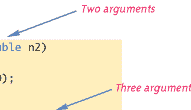

# SAMPLE DIALOGUE

```
```text
The average of 2.0, 2.5, and 3.0 is 2.5
The average of 4.5 and 5.5 is 5.0
```
```

基于除参数数量或类型之外的任何差异进行重载。你不能仅基于 const 或仅基于按值调用与按引用调用参数进行重载。

> 实际上，一些编译器会允许你基于 const 与非 const 进行重载，但你不应依赖这一点。C++ 标准说这是不允许的。


你已经在第 1 章（此处回顾）中看到了一种重载，即除法运算符 `/`。如果两个操作数都是 `int` 类型，如 `13/2`，则返回的值是整数除法的结果，在本例中为 6。另一方面，如果一个或两个操作数是 `double` 类型，则返回的值是常规除法的结果；例如，`13/2.0` 返回的值为 6.5。除法运算符 `/` 有两个定义，并且这两个定义并不是通过操作数的数量不同来区分的，而是通过要求操作数具有不同的类型来区分的。`/` 的重载与函数名重载之间的唯一区别是，C++ 语言设计者已经完成了 `/` 的重载，而你必须自己编写函数名的重载。第 8 章讨论了如何重载运算符如 `+`、`-` 等。

### 签名

函数的签名是函数名加上参数列表中的类型序列，不包括 `const` 关键字，也不包括符号 `&`。当你重载一个函数名时，使用此签名定义，两个函数定义的签名必须不同。（某些权威人士将 `const` 和/或 `&` 包含为签名的一部分，但我们希望有一个适用于解释重载的定义。）

### 陷阱

#### 自动类型转换与重载

假设以下函数定义出现在你的程序中，并且你没有重载函数名 `mpg`（因此这是名为 `mpg` 的唯一函数定义）。

```cpp
double mpg(double miles, double gallons)
//Returns miles per gallon.
{
    return (miles/gallons);
}
```

如果你使用 `int` 类型的参数调用函数 `mpg`，那么 C++ 会自动将任何 `int` 类型的参数转换为 `double` 类型的值。因此，以下语句会向屏幕输出 22.5 英里每加仑：

```cpp
cout << mpg(45, 2) << " miles per gallon";
```

C++ 将 45 转换为 45.0，将 2 转换为 2.0，然后执行除法 45.0/2.0 以获得返回的值，该值为 22.5。

如果一个函数需要 `double` 类型的参数，而你给它一个 `int` 类型的参数，C++ 会自动将 `int` 参数转换为 `double` 值。这非常有用且自然，以至于我们几乎不会考虑它。然而，重载会干扰这种自动类型转换。让我们看一个例子。

假设你（愚蠢地）重载了函数名 `mpg`，使得你的程序除了之前的定义外还包含以下 `mpg` 的定义：

```cpp
int mpg(int goals, int misses)
//Returns the Measure of Perfect Goals
//which is computed as (goals − misses).
{
    return (goals − misses);
}
```

在一个包含这两个 `mpg` 函数定义的程序中，以下语句将（不幸地）输出 43 英里每加仑（因为 43 是 45 − 2）：

```cpp
cout << mpg(45, 2) << " miles per gallon";
```

当 C++ 看到函数调用 `mpg(45, 2)`，它有两个 `int` 类型的参数时，C++ 首先寻找具有两个 `int` 类型形式参数的 `mpg` 函数定义。如果找到这样的函数定义，C++ 就会使用该函数定义。C++ 只有在找不到匹配的函数定义时才会将 `int` 参数转换为 `double` 值。

`mpg` 示例说明了关于重载的另一点：你不应为两个不相关的函数使用相同的函数名。这种粗心的函数名使用肯定会造成混淆。

#### 自测练习

- 8. 假设你有两个函数定义，其声明如下：

  ```cpp
  double score(double time, double distance);
  int score(double points);
  ```

  在以下函数调用中将使用哪个函数定义，为什么会使用它？（`x` 为 `double` 类型。）

  ```cpp
  double finalScore = score(x);
  ```

- 9. 假设你有两个函数定义，其声明如下：

  ```cpp
  double theAnswer(double data1, double data2);
  double theAnswer(double time, int count);
  ```

  在以下函数调用中将使用哪个函数定义，为什么会使用它？（`x` 和 `y` 为 `double` 类型。）

  ```cpp
  x = theAnswer(y, 6.0);
  ```

### 重载解析规则

如果你使用重载为同一个函数名产生两个定义，其参数列表相似（但不完全相同），那么重载与自动类型转换的交互可能会令人困惑。编译器用于确定对给定函数调用应用哪个重载定义的多个函数名定义的规则如下：

1. *精确匹配：* 如果参数的数量和类型与某个定义完全匹配（无需任何自动类型转换），则使用该定义。
2. *使用自动类型转换的匹配：* 如果没有精确匹配但存在使用自动类型转换的匹配，则使用该匹配。

如果在阶段 1 找到两个匹配项，或者在阶段 1 未找到匹配项而在阶段 2 找到两个匹配项，则情况不明确，将发出错误消息。

例如，以下重载是可疑的风格，但完全有效：

```cpp
void f(int n, double m);
void f(double n, int m);
```

然而，如果你还有以下调用

```cpp
f(98, 99);
```

那么编译器不知道将哪一个 `int` 参数转换为 `double` 值，将生成错误消息。

为了说明情况可能有多令人困惑和危险，假设你添加了以下第三个重载：

```cpp
void f(int n, int m);
```

添加此第三个重载后，你不再收到错误消息，因为现在存在精确匹配。显然，这种令人困惑的重载应避免。

上述两条规则在几乎所有情况下都适用。事实上，如果你需要更精确的规则，你应该重写代码使其更直接。然而，确切的规则甚至更复杂一些。出于参考价值，我们在下面给出确切的规则。其中一些术语可能在你阅读本书的更多内容之前没有意义，但不必担心。上面给出的简单两条规则在你理解更完整的规则之前对你很有用。

1. 如前所述的精确匹配。
2. 使用整数类型内部或浮点类型内部的提升进行匹配，例如 `short` 到 `int` 或 `float` 到 `double`。（注意 `bool` 到 `int` 和 `char` 到 `int` 的转换被视为整数类型内部的提升。）
3. 使用预定义类型的其他转换进行匹配，例如 `int` 到 `double`。
4. 使用用户定义类型的转换进行匹配（参见第 8 章）。
5. 使用省略号 `...` 进行匹配。（本书未涵盖，如果你不使用它，就不会成为问题。）

如果在找到匹配的第一阶段找到两个匹配项，则情况不明确，将发出错误消息。

### 示例：修订版披萨购买程序

披萨消费者联盟对我们在显示 4.5 中为其编写的程序非常成功。事实上，现在每个人总是买最划算的披萨。有一家不法披萨店曾通过欺骗消费者购买更贵的披萨来赚钱，但我们的程序已经结束了它的邪恶做法。然而，店主希望继续其卑鄙的行为，并想出了一个新的欺骗消费者的办法。他们现在提供圆形披萨和矩形披萨。他们知道我们编写的程序无法处理矩形披萨，因此希望再次混淆消费者。显示 4.7 是我们程序的另一个版本，用于比较圆形披萨和矩形披萨。请注意，函数名 `unitPrice` 已被重载，以便适用于圆形和矩形披萨。

#### 显示 4.7  修订版披萨程序（第 1 部分，共 3 部分）

```cpp
//Determines whether a round pizza or a rectangular pizza is the best buy.
#include <iostream>
using namespace std;

double unitPrice(int diameter, double price);
//Returns the price per square inch of a round pizza.
//The formal parameter named diameter is the diameter of the pizza
//in inches. The formal parameter named price is the price of the pizza.

double unitPrice(int length, int width, double price);
//Returns the price per square inch of a rectangular pizza
//with dimensions length by width inches.
//The formal parameter price is the price of the pizza.

int main()
{
    int diameter, length, width;
    double priceRound, unitPriceRound,
           priceRectangular, unitPriceRectangular;

    cout << "Welcome to the Pizza Consumers Union.\n";
    cout << "Enter the diameter in inches"
         << " of a round pizza: ";
    cin >> diameter;
    cout << "Enter the price of a round pizza: $";
```


### 显示 4.7 修订版披萨程序（第 2 部分，共 3 部分）

```
22  cin >> priceRound;
23  cout << "Enter length and width in inches\n" 
24  << "of a rectangular pizza: ";
25  cin >> length >> width;
26  cout << "Enter the price of a rectangular pizza: $";
27  cin >> priceRectangular;

28  unitPriceRectangular =
29  unitPrice(length, width, priceRectangular);
30  unitPriceRound = unitPrice(diameter, priceRound);

31  cout.setf(ios::fixed);
32  cout.setf(ios::showpoint);
33  cout.precision(2);
34  cout << endl
35  << "Round pizza: Diameter = "
36  << diameter << " inches\n"
37  << "Price = $" << priceRound
38  << " Per square inch = $" << unitPriceRound
39  << endl
40  << "Rectangular pizza: Length = "
41  << length << " inches\n"
42  << "Rectangular pizza: Width = "
43  << width << " inches\n"
44  << "Price = $" << priceRectangular
45  << " Per square inch = $" << unitPriceRectangular
46  << endl;

47  if (unitPriceRound < unitPriceRectangular)
48  cout << "The round one is the better buy.\n";
49  else
50  cout << "The rectangular one is the better buy.\n";
51  cout << "Buon Appetito!\n";

52  return 0;
53  }

54  double unitPrice(int diameter, double price)
55  {
56  const double PI = 3.14159;
57  double radius, area;
58
59  radius = diameter/double(2);
60  area = PI * radius * radius;
61  return (price/area);
62  }
```

### 显示 4.7 修订版披萨程序（第 3 部分，共 3 部分）

```
63  double unitPrice(int length, int width, double price)
64  {
65      double area = length * width;
66      return (price/area);
67  }
```

### 示例对话

Welcome to the Pizza Consumers Union.
Enter the diameter in inches of a round pizza: 10
Enter the price of a round pizza: $8.50
Enter length and width in inches
of a rectangular pizza: 6 4
Enter the price of a rectangular pizza: $7.55

Round pizza: Diameter = 10 inches
Price = $8.50 Per square inch = $0.11
Rectangular pizza: Length = 6 inches
Rectangular pizza: Width = 4 inches
Price = $7.55 Per square inch = $0.31
The round one is the better buy.
Buon Appetito!

### 默认参数

你可以为函数中一个或多个传值参数指定默认参数。如果对应的参数被省略，则用默认参数代替。例如，显示 4.8 中的函数 volume 根据长、宽、高计算盒子的体积。如果没有给出高度，则假定高度为 1。如果既没有给出宽度也没有给出高度，则两者都假定为 1。

请注意，在显示 4.8 中，默认参数是在函数声明中给出，而不在函数定义中给出。默认参数是在函数首次声明时给出（或如果先定义则在定义时给出）。后续的声明或随后的定义不应再次给出默认参数，因为某些编译器即使给出的参数与之前一致也会将其视为错误。

你可以有多个默认参数，但所有默认参数的位置必须在最右侧。因此，对于显示 4.8 中的函数 volume，我们可以为最后一个、最后两个或全部三个参数给出默认参数，但其他任何组合的默认参数都不允许。

### 显示 4.8 默认参数

```
1
2 #include <iostream>
3 using namespace std;
4 void showVolume(int length, int width = 1, int height = 1);
5 //Returns the volume of a box.
6 //If no height is given, the height is assumed to be 1.
7 //If neither height nor width is given, both are assumed to be 1.
8 int main()
9 {
10     showVolume(4, 6, 2);
11     showVolume(4, 6);
12     showVolume(4);
13 
14     return 0;
15 }
16 void showVolume(int length, int width, int height)
17 {
18     cout << "Volume of a box with \n"
19          << "Length = " << length << ", Width = " << width << endl
20          << "and Height = " << height
21          << " is " << length*width*height << endl;
22 }
```

### 示例对话

Volume of a box with
Length = 4, Width = 6
and Height = 2 is 48
Volume of a box with
Length = 4, Width = 6
and Height = 1 is 24
Volume of a box with
Length = 4, Width = 1
and Height = 1 is 4

如果函数有多个默认参数，则在调用函数时，必须从右侧开始省略参数。例如，请注意显示 4.8 中有两个默认参数。当只省略一个参数时，假定为最后一个参数。在调用 volume 时，没有办法省略第二个参数而不同时省略第三个参数。

默认参数的价值有限，但有时它们可以用来反映你对参数的思考方式。默认参数只能与传值参数一起使用。对于传引用参数则没有意义。用默认参数能做的任何事情都可以用重载来实现，尽管默认参数版本可能比重载版本更短。

### 自测练习

10. 这个问题与名为修订版披萨购买程序的编程示例有关。假设总是试图欺骗顾客的邪恶披萨店引入了一种方形披萨。你能重载函数 unitPrice 使得它既能计算方形披萨每平方英寸的价格，也能计算圆形披萨每平方英寸的价格吗？为什么或为什么不？

### 4-3 测试和调试函数

> I beheld the wretch—the miserable monster whom I had created.

> Mary Wollstonecraft Shelley, Frankenstein

本节回顾了测试程序和函数的一些一般指导方针。

### assert 宏

断言是一个为真或为假的陈述。断言用于记录和检查程序的正确性。我们在第 3 章中讨论过的先决条件和后置条件就是断言的例子。当精确表达并使用 C++ 语法时，断言只是一个布尔表达式。如果你将断言转换为布尔表达式，则预定义的宏 assert 可用于检查你的代码是否满足该断言。（宏与内联函数非常相似，并且像函数一样使用。）

assert 宏像一个返回类型为 void 且接受一个类型为 bool 的传值参数的函数一样使用。由于断言只是一个布尔表达式，这意味着 assert 的参数是一个断言。当 assert 宏被调用时，其断言参数会被求值。如果求值为 true，则什么也不发生。如果参数求值为 false，则程序结束并发出错误消息。因此，对 assert 宏的调用是包含在程序中进行错误检查的紧凑方式。

例如，以下函数声明取自编程项目 3：

```
void computeCoin(int coinValue, int& number, int& amountLeft);
//Precondition: 0 < coinValue < 100; 0 <= amountLeft < 100
//Postcondition: number has been set equal to the maximum number
//of coins of denomination coinValue cents that can be obtained
//from amountLeft cents. amountLeft has been decreased by the
//value of the coins, that is, decreased by number*coinValue.
```

你可以检查函数调用的先决条件是否成立，如以下示例所示：

```
assert((0 < currentCoin) && (currentCoin < 100))
&& (0 <= currentAmountLeft) && (currentAmountLeft < 100));
computeCoin(currentCoin, number, currentAmountLeft);
```

如果先决条件不满足，你的程序将结束并输出错误消息。

assert 宏定义在库 cassert 中，因此任何使用 assert 宏的程序都必须包含以下内容：

```
#include <cassert>
```

使用 assert 的一个优点是你可以关闭 assert 调用。你可以在程序中使用 assert 调用来调试程序，然后将其关闭，以便用户不会收到他们可能不理解的错误消息。这样做可以减少程序执行的开销。要关闭程序中所有的 #define NDEBUG 断言，请在 include 指令之前添加 #define NDEBUG，如下所示：

```
#define NDEBUG
#include <cassert>
```

因此，如果你在程序完全调试后插入 #define NDEBUG，程序中所有的 assert 调用都将被关闭。如果你后来更改程序并需要再次调试它，可以通过删除 #define NDEBUG 行（或将其注释掉）来重新打开 assert 调用。

并非所有注释断言都可以很容易地转换为 C++ 布尔表达式。先决条件比后置条件更容易转换。因此，assert 宏并不是调试函数的万能药，但它可以非常有用。

### 桩和驱动

每个函数都应作为独立于其余程序的单独单元进行设计、编码和测试。当你将每个函数视为单独单元时，你将一个大任务转变为一系列更小、更易管理的任务。但如何在不属于其的程序之外测试一个函数呢？一种方法是编写一个专门用于测试的程序。例如，显示 4.9 显示了一个用于测试在显示 4.5 中使用的函数 unitPrice 的程序。这类程序称为驱动程序。这些驱动程序是临时工具，可以非常简陋。它们不需要花哨的输入例程。它们不需要执行最终程序将执行的所有计算。它们只需要获取合理的


### 显示 4.9 驱动程序（第 1 部分，共 2 部分）

```cpp
//Driver program for the function unitPrice.
#include <iostream>
using namespace std;

double unitPrice(int diameter, double price);
//Returns the price per square inch of a pizza.
//Precondition: The diameter parameter is the diameter of the pizza.
//In inches. The price parameter is the price of the pizza.

int main()
{
    double diameter, price;
    char ans;

    do
    {
        cout << "Enter diameter and price:\n";
        cin >> diameter >> price;

        cout << "unit price is $"
             << unitPrice(diameter, price) << endl;

        cout << "Test again? (y/n)";
        cin >> ans;
        cout << endl;
    } while (ans == 'y' || ans == 'Y');

    return 0;
}

double unitPrice(int diameter, double price)
{
    const double PI = 3.14159;
    double radius, area;

    radius = diameter/static_cast<double>(2);
    area = PI * radius * radius;
    return (price/area);
}
```

### 显示 4.9 驱动程序（第 2 部分，共 2 部分）

### 示例对话

```
Enter diameter and price:
13 14.75
Unit price is: $0.11126
Test again? (y/n): y

Enter diameter and price:
2 3.15
Unit price is: $1.00268
Test again? (y/n): n
```

函数实参应尽可能以最简单的方式获得——通常来自用户——然后执行函数并显示结果。如显示 4.9 中的程序所示，循环允许你在不同的实参上重新测试函数，而无需重新运行程序。

如果你分别测试每一个函数，你就会发现程序中的大部分错误。而且，你会找出哪些函数包含错误。如果你只测试整个程序，你可能会发现是否存在错误，但你可能不知道错误在哪里。更糟糕的是，你可能以为自己知道错误在哪里，但其实是错的。

一旦你充分测试了一个函数，就可以在某个其他函数的驱动程序中使用它。每个函数都应该在一个程序中测试，并且在该程序中它是唯一未测试的函数。不过，在测试其他函数时使用一个已充分测试的函数是完全可以的。如果发现 bug，你就知道 bug 出在未测试的函数中。

有时，要测试一个函数，却不得不使用某些尚未编写或尚未测试的其他函数，这可能是无法做到或不方便的。在这种情况下，你可以使用缺失的或未测试函数的简化版本。这些简化函数称为桩（stub）。这些桩不一定执行正确的计算，但它们会提供足以进行测试的值，而且它们足够简单，让你能对其表现有信心。例如，下面是一个可能的 unitPrice 函数桩：

```cpp
//A stub. The final function definition must still be written.
double unitPrice(int diameter, double price)
{
    return (9.99);//Not correct but good enough for a stub.
}
```

使用带桩的程序轮廓，你可以测试并逐步完善基本程序轮廓，而不是为测试每个函数而编写一个全新的程序。因此，带桩的程序轮廓通常是最有效的测试方法。一种常见的做法是使用驱动程序来测试一些基本函数（例如输入和输出），然后用带桩的程序来测试其余函数。桩一次一个地被替换：将一个桩替换为完整函数并测试；一旦该函数被充分测试，再将另一个桩替换为完整的函数定义，依此类推，直到最终程序生成。

### 测试函数的基本规则

每个函数都应该在一个程序中测试，并且该程序中的其他每个函数都已经充分测试并调试完毕。

### 自测练习

- 11. 测试函数的基本规则是什么？为什么这是测试函数的好方法？
- 12. 什么是驱动程序？
- 13. 什么是桩？
- 14. 为下面给出声明的函数编写一个桩。不要写整个程序，只写将放入程序中的桩部分。*（提示：它非常短。）*

```cpp
double rainProb(double pressure, double humidity, double temp);
//Precondition: pressure is the barometric pressure in inches of mercury,
//humidity is the relative humidity as a percentage, and
//temp is the temperature in degrees Fahrenheit.
//Returns the probability of rain, which is a number between 0 and 1.
//0 means no chance of rain. 1 means rain is 100% certain.)
```

### 章节总结

- 形式参数是一种占位符，在函数调用时用函数实参填充。在 C++ 中，有两种执行这种替换的方法：按值调用和按引用调用，因此有两种基本参数：按值调用参数和按引用调用参数。
- 按值调用形式参数是一个局部变量，在函数调用时被初始化为其对应实参的值。偶尔，将按值调用形式参数用作局部变量是有用的。
- 在按引用调用的替换机制中，实参应该是一个变量，并且整个变量被用来替换对应的形式参数。
- 在函数定义中表示按引用调用参数的方法是将与符号 & 附加到形式参数的类型上。（按值调用参数通过没有与符号来表示。）
- 与按值调用参数对应的实参不能通过函数调用改变。与按引用调用参数对应的实参可以通过函数调用改变。如果你希望函数改变某个变量的值，就必须使用按引用调用参数。
- 你可以为同一个函数名提供多个定义，前提是与该同名函数具有不同数量的参数，或某些参数位置具有不同的类型，或两者兼有。这称为函数名重载。
- 你可以为函数中的一个或多个按值调用参数指定默认实参。默认实参总是位于最右边的实参位置。
- assert 宏可以通过检查断言是否成立来帮助调试程序。
- 每个函数都应该在一个程序中测试，并且该程序中的其他每个函数都已经充分测试并调试完毕。

### 自测练习答案

1. 按值调用参数是一个局部变量。当函数被调用时，计算按值调用实参的值，并将相应的按值调用参数（它是一个局部变量）初始化为此值。

2. 函数将正常工作。这就是全部答案，但这里有一些补充信息：形式参数 inches 是一个按值调用参数，因此，正如正文所讨论的，它是一个局部变量。因此，实参的值不会被改变。

3.
```text
10 20 30
1 2 3
1 20 3
```

4.
```text
Enter two integers: 5 10
In reverse order the numbers are: 5 5
```

5.
```cpp
void zeroBoth(int& n1, int& n2)
{
    n1 = 0;
    n2 = 0;
}
```

6.
```cpp
void addTax(double taxRate, double& cost)
{
    cost = cost + (taxRate/100.0)*cost;
}
```

除以 100 是为了将百分比转换为小数。例如，10% 是 10/100.0，即成本的十分之一。

7. 函数调用中的 par1Value = 111
函数调用中的 par2Ref = 222
函数调用后的 n1 = 1
函数调用后的 n2 = 2，不同

8. 将使用带一个参数的那个，因为该函数调用只有一个参数。

9. 将使用第一个，因为它是精确匹配，即两个 double 类型的参数。

10. 这无法做到（至少没有好的方法）。表示方形披萨和圆形披萨的自然方式是相同的。每种披萨都自然地表示为一个数字，对于圆形披萨是半径，对于方形披萨是边长。无论哪种情况，函数 unitPrice 都需要一个 double 类型的形式参数来表示价格，以及一个 int 类型的形式参数来表示尺寸（半径或边长）。因此，这两个函数声明将具有相同数量和类型的形式参数。（具体来说，它们都会有一个 double 类型的形式参数和一个 int 类型的形式参数。）因此，编译器将无法决定使用哪个定义。你仍然可以通过定义两个函数来挫败这个邪恶披萨店的策略，但这两个函数需要有不同的名称。

11. 测试函数的基本规则是：每个函数都应该在一个程序中测试，并且该程序中的其他每个函数都已经充分测试并调试完毕。这是测试函数的好方法，因为如果你遵循这条规则，那么当你发现 bug 时，你就会知道哪个函数包含这个 bug。

12. 驱动程序是为测试一个函数而专门编写的程序。

13. 桩是一个函数的简化版本，用来代替该函数，以便可以测试其他函数。

14.
```cpp
//THIS IS JUST A STUB.
double rainProb(double pressure,
    double humidity, double temp)
{
    return 0.25; //Not correct,
    //but good enough for some testing.
}
```


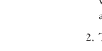

### PROGRAMMING PROJECTS

- 1. 编写一个程序，将 24 小时制转换为 12 小时制。例如，它应将 14:25 转换为 2:25 P.M。输入以两个整数给出。应至少有三个函数：一个用于输入，一个用于转换，一个用于输出。将 A.M./P.M. 信息记录为类型为 char 的值，'A' 表示 A.M.，'P' 表示 P.M。因此，用于转换的函数将有一个类型为 char 的传引用形式参数来记录是 A.M. 还是 P.M.（该函数还将有其他参数。）包含一个循环，让用户可以对新的输入值重复此计算，直到用户说他或她想要结束程序。

- 2. 任意三角形的面积可以使用公式计算

area = √[s(s − a)(s − b)(s − c)]

其中 a、b 和 c 是边的长度，s 是半周长。

s = (a + b + c)/2

编写一个 void 函数，使用五个参数：三个值参数提供边的长度，两个引用参数计算面积和周长（不是半周长）。使你的函数健壮。注意，并非所有 a、b 和 c 的组合都能构成三角形。你的函数应对合法数据产生正确结果，对非法组合产生合理结果。

- 3. 编写一个程序，告诉对于 1 美分到 99 美分的任何找零金额应给出哪些硬币。例如，如果金额为 86 美分，输出将类似于以下内容：

86 cents can be given as
3 quarter(s) 1 dime(s) and 1 penny(pennies)

使用 25 美分（四分之一元）、10 美分（十分之一元）和 1 美分（便士）的硬币面额。不要使用镍币和半美元硬币。你的程序将使用以下函数（其中之一）：

```
void computeCoin(int coinValue, int& number, int& amountLeft);
//Precondition: 0 < coinValue < 100; 0 <= amountLeft < 100.
//Postcondition: number has been set equal to the maximum number
//of coins of denomination coinValue cents that can be obtained
//from amountLeft cents. amountLeft has been decreased by the
//value of the coins, that is, decreased by number*coinValue.
```

例如，假设变量 amountLeft 的值为 86。那么，在以下调用之后，number 的值将为 3，amountLeft 的值将为 11（因为如果你从 86 美分中取出三个四分之一元，剩下 11 美分）：

```
computeCoins(25, number, amountLeft);
```

包含一个循环，让用户可以对新的输入值重复此计算，直到用户说他或她想要结束程序。（提示：使用整数除法和 % 运算符来实现此函数。）

- 4. 编写一个程序，读取英尺和英寸的长度并输出等效长度（以米和厘米为单位）。使用至少三个函数：一个用于输入，一个或多个用于计算，一个用于输出。包含一个循环，让用户可以对新的输入值重复此计算，直到用户说他或她想要结束程序。1 英尺有 0.3048 米，1 米有 100 厘米，1 英尺有 12 英寸。

- 5. 编写一个与上一练习类似的程序，将米和厘米转换为英尺和英寸。使用函数处理子任务。

- 6. （你应该在做本练习之前先完成前两个编程项目。）编写一个程序，结合前两个编程项目中的函数。程序询问用户是否要将英尺和英寸转换为米和厘米，或将米和厘米转换为英尺和英寸。然后程序执行所需的转换。让用户通过输入整数 1 表示一种转换，2 表示另一种转换。程序读取用户的答案然后执行 if-else 语句。if-else 语句的每个分支都将是一个函数调用。if-else 语句中调用的两个函数将具有与前两个编程项目程序非常相似的函数定义。因此，它们将是相当复杂的函数定义，会调用其他函数。包含一个循环，让用户可以对新的输入值重复此计算，直到用户说他或她想要结束程序。

- 7. 编写一个程序，读取磅和盎司的重量并输出等效重量（以千克和克为单位）。使用至少三个函数：一个用于输入，一个或多个用于计算，一个用于输出。包含一个循环，让用户可以对新的输入值重复此计算，直到用户说他或她想要结束程序。1 千克有 2.2046 磅，1 千克有 1000 克，1 磅有 16 盎司。

- 8. 编写一个与上一练习类似的程序，将千克和克转换为磅和盎司。使用函数处理子任务。

- 9. （你应该在做本练习之前先完成前两个编程项目。）编写一个程序，结合前两个编程项目的函数。程序询问用户是否要将磅和盎司转换为千克和克，或将千克和克转换为磅和盎司。然后程序执行所需的转换。让用户通过输入整数 1 表示一种转换，2 表示另一种转换。程序读取用户的答案然后执行 if-else 语句。if-else 语句的每个分支都将是一个函数调用。if-else 语句中调用的两个函数将具有与前两个编程项目程序非常相似的函数定义。因此，它们将是相当复杂的函数定义，其函数体中会调用其他函数。包含一个循环，让用户可以对新的输入值重复此计算，直到用户说他或她想要结束程序。

- 10. （你应该在做本编程项目之前先完成编程项目 6 和 9。）编写一个程序，结合编程项目 6 和 9 的函数。程序询问用户是否要转换长度或重量。如果用户选择长度，则程序询问用户是否要将英尺和英寸转换为米和厘米，或将米和厘米转换为英尺和英寸。如果用户选择重量，则会询问关于磅、盎司、千克和克的类似问题。然后程序执行所需的转换。让用户通过输入整数 1 表示一种转换，2 表示另一种转换。程序读取用户的答案然后执行 if-else 语句。if-else 语句的每个分支都将是一个函数调用。if-else 语句中调用的两个函数将具有与编程项目 6 和 9 的程序非常相似的函数定义。因此，这些函数将是相当复杂的函数定义，会调用其他函数；然而，它们将很容易通过改编你为编程项目 6 和 9 编写的程序来编写。请注意，你的程序将具有嵌套在 if-else 语句中的 if-else 语句，但只是间接地。外部 if-else 语句将包含两个函数调用作为其两个分支。这些两个函数调用各自又包含一个 if-else 语句，但你不必考虑这一点。它们只是函数调用，细节在你定义这些函数时创建的黑盒中。如果你试图创建四向分支，你可能走错了方向。你只需要考虑两向分支（即使整个程序最终分支为四种情况）。包含一个循环，让用户可以对新的输入值重复此计算，直到用户说他或她想要结束程序。

For additional online Programming Projects, click the CodeMate icons below.
1.7


# 第5章 数组


- 5.1 数组简介 172
  - 声明和引用数组 172
  - 提示：使用 For 循环处理数组 175
  - 陷阱：数组索引始终从零开始 175
  - 提示：使用已定义的常量作为数组的大小 175
  - 内存中的数组 176
  - 陷阱：数组索引超出范围 177
  - 初始化数组 178
- 5.2 函数中的数组 181
  - 索引变量作为函数参数 181
  - 整个数组作为函数参数 182
  - const 参数修饰符 185
  - 陷阱：const 参数使用不一致 187
  - 返回数组的函数 188
  - 示例：生产图 188
- 5.3 使用数组编程 194
  - 部分填充的数组 194
  - 提示：不要吝啬形式参数 194
  - 示例：搜索数组 197
  - 示例：排序数组 199
- 5.4 多维数组 204
  - 多维数组基础 204
  - 多维数组参数 205
  - 示例：二维评分程序 207
- 章节总结 211
- 自测练习答案 212
- 编程项目 216

# 数组

> 在没有数据之前就进行理论化是一个致命的错误。
>
> ——亚瑟·柯南·道尔，《波希米亚丑闻》中的《夏洛克·福尔摩斯》

## 引言

数组用于处理一组全部为相同类型的数据，例如温度列表或姓名列表。本章介绍在 C++ 中定义和使用数组的基础知识，并介绍在设计使用数组的算法和程序时使用的许多基本技术。

你可以在阅读本章之前跳过本章并阅读第 6 章和第 7 章的大部分内容，其中涵盖了类。在这些章节中唯一使用本章内容的材料是第 7.3 节，其中介绍了向量。

## 5.1 数组简介

假设我们要编写一个程序，读取五个测试分数并对这些分数进行一些操作。例如，程序可能会计算最高测试分数，然后输出每个分数与最高分的差距。最高分数在读取所有五个分数之前是未知的。因此，所有五个分数都必须保留在存储中，以便在计算出最高分数后可以将每个分数与其进行比较。为了保留这五个分数，我们需要相当于五个类型为 int 的变量。我们可以使用五个单独的类型为 int 的变量，但五个变量很难跟踪，而且我们以后可能希望将程序更改为处理 100 个分数；当然，100 个变量是不切实际的。数组是完美的解决方案。数组的行为就像一个变量列表，具有统一的命名机制，可以在一行简单的代码中声明。例如，我们需要的五个单独变量的名称可能是 score[0]、score[1]、score[2]、score[3] 和 score[4]。不变的部分，在本例中，是数组的名称。可能发生变化的部分是方括号 [] 中的整数。

### 声明和引用数组

在 C++ 中，由五个类型为 int 的变量组成的数组可以按如下方式声明：

```cpp
int score[5];
```

此声明类似于将以下五个变量都声明为类型为 int：

```
score[0], score[1], score[2], score[3], score[4]
```

这些共同构成数组的各个变量以多种不同的方式引用。我们将称它们为索引变量，尽管它们有时也称为下标变量或数组的元素。方括号中的数字称为索引或下标。在 C++ 中，索引从 0 开始编号，而不是从 1 或除 0 之外的任何其他数字开始。数组中索引变量的数量称为数组的声明大小，有时也简单地称为数组的大小。当声明数组时，数组的大小在数组名称后的方括号中给出。然后索引变量从 0 开始编号，使用方括号，结束于小于数组大小的整数减一。

在我们的示例中，索引变量的类型为 int，但数组可以具有任何类型的索引变量。例如，要声明一个索引变量类型为 double 的数组，只需在数组声明中使用类型名 double 代替 int 即可。但是，一个数组的所有索引变量都是同一类型。此类型称为数组的基础类型。因此，在我们的 score 数组示例中，基础类型是 int。

你可以将数组和普通变量一起声明。例如，以下声明了两个 int 变量 next 和 max 以及数组 score：

```
int next, score[5], max;
```

像 score[3] 这样的索引变量可以在任何可以使用普通类型为 int 的变量的地方使用。

不要混淆使用数组名称的两种方括号 [] 的方式。当在声明中使用时，例如

```
int score[5];
```

方括号中括起来的数字指定数组具有多少个索引变量。当在其他任何地方使用时，方括号中括起来的数字表示指的是哪个索引变量。例如，score[0] 到 score[4] 是上面声明的数组的索引变量。

方括号内的索引不必作为整数常量给出。你可以在方括号中使用任何表达式，只要该表达式计算结果为从 0 到小于数组大小的整数减一范围内的整数即可。例如，以下将设置 score[3] 的值为 99：

```
int n = 2;
score[n + 1] = 99;
```

尽管看起来不同，但在上面的代码中 score[n + 1] 和 score[3] 是同一个索引变量，因为 n + 1 计算结果为 3。

像 score[i] 这样的索引变量的身份由其索引的值决定，在本例中为 i。因此，你可以编写程序说“对第 i 个索引变量执行诸如此类的操作”，其中 i 的值由程序计算。例如，显示 5.1 中的程序以本章开头描述的方式读取分数并处理它们。

### 显示 5.1 使用数组的程序

```
//读取五个分数并显示每个分数与最高分数的差异。
#include <iostream>
using namespace std;

int main()
{
    int i, score[5], max;
    cout << "Enter 5 scores:\n";
    cin >> score[0];
    max = score[0];
    for (i = 1; i < 5; i++)
    {
        cin >> score[i];
        if (score[i] > max)
            max = score[i];
        //max 是 score[0]...score[i] 值中的最大值。
    }
    cout << "The highest score is " << max << endl
         << "The scores and their\n"
         << "differences from the highest are:\n";
    for (i = 0; i < 5; i++)
        cout << score[i] << " off by "
             << (max - score[i]) << endl;
    return 0;
}
```

#### 示例对话

```
Enter 5 scores:
5 9 2 10 6
The highest score is 10
The scores and their
differences from the highest are:
5 off by 5
9 off by 1
2 off by 8
10 off by 0
6 off by 4
```

### 提示：使用 For 循环处理数组

显示 5.1 中的第二个 for 循环说明了遍历数组的常见方法：

```
for (i = 0; i < 5; i++)
  cout << score[i] << " off by "
      << (max - score[i]) << endl;
```

for 语句非常适合数组操作。

### 陷阱：数组索引始终从零开始

数组的索引始终从 0 开始，结束于小于数组大小的整数减一。

### 提示：使用已定义的常量作为数组的大小

再看一下显示 5.1 中的程序。它仅适用于恰好有五个学生的班级。大多数班级没有恰好五个学生。使程序更通用的方法之一是为每个数组的大小使用已定义的常量。例如，显示 5.1 中的程序可以重写为使用以下已定义的常量：

```
const int NUMBER_OF_STUDENTS = 5;
```

数组声明的行然后为

```
int i, score[NUMBER_OF_STUDENTS], max;
```

当然，程序中所有具有数组大小为 5 的地方也应更改为使用 NUMBER_OF_STUDENTS 而不是 5。如果对程序进行这些更改（或更好的是，如果程序一开始就这样编写），那么程序可以通过简单地更改定义常量 NUMBER_OF_STUDENTS 的一行来适用于任何数量的学生。

请注意，你不能使用变量作为数组大小，例如以下内容：

```
cout << "Enter number of students:\n";
cin >> number;
int score[number]; //ILLEGAL ON MANY COMPILERS!
```

有些但不是所有编译器都会允许你以这种方式使用变量指定数组大小。然而，为了可移植性，你不应该这样做，即使你的编译器允许它。（在第 10 章中，我们将讨论一种不同类型的数组，其大小可以在程序运行时确定。）


### 数组声明

### 语法

```
类型名 数组名[声明大小];
```

### 示例

```
int bigArray[100];
double a[3];
double b[5];
char grade[10], oneGrade;
```

如上形式的数组声明将定义 `声明大小` 个带下标的变量，即下标变量 `数组名[0]` 到 `数组名[声明大小-1]`。每个下标变量都是类型为 `类型名` 的变量。

数组 `a` 由下标变量 `a[0]`、`a[1]` 和 `a[2]` 组成，它们都是 `double` 类型。数组 `b` 由下标变量 `b[0]`、`b[1]`、`b[2]`、`b[3]` 和 `b[4]` 组成，同样也都是 `double` 类型。你可以将数组声明与简单变量的声明组合在一起，例如上面所示的变量 `oneGrade`。

### 数组在内存中的表示

在讨论数组如何在计算机内存中表示之前，我们先来看看一个简单变量（例如 `int` 或 `double` 类型的变量）是如何在计算机内存中表示的。计算机的内存由一系列编号的位置组成，这些位置称为字节。[^1] 字节的编号称为其地址。一个简单变量被实现为内存中由若干连续字节组成的一段区域。字节的数量由变量的类型决定。因此，内存中的一个简单变量由两条信息来描述：内存中的一个地址（给出该变量第一个字节的位置）以及变量的类型（它告诉该变量需要占用多少字节的内存）。当我们谈到变量的地址时，指的就是这个地址。当你的程序将值存储到变量中时，实际发生的是该值（编码为 0 和 1）被放入分配给该变量的那些内存字节中。类似地，当一个变量作为（按引用调用的）参数传递给函数时，实际传递给被调用函数的是该变量的地址。现在让我们继续讨论数组是如何存储在内存中的。

[^1]: 一个字节由八个位组成，但字节的确切大小对本次讨论并不重要。

数组的下标变量在内存中的表示方式与普通变量相同，但数组的情况要稍微复杂一些。各个数组下标变量的位置在内存中总是彼此相邻放置的。例如，考虑以下声明：

```
int a[6];
```

当你声明这个数组时，计算机会预留足够的内存来容纳六个 `int` 类型的变量。此外，计算机总是将这些变量一个接一个地放置在内存中。然后，计算机会记住下标变量 `a[0]` 的地址，但不会记住任何其他下标变量的地址。当你的程序需要该数组中某个其他下标变量的地址时，计算机会根据 `a[0]` 的地址来计算该下标变量的地址。例如，如果你从 `a[0]` 的地址开始，数过足够容纳三个 `int` 类型变量的内存，那么你就会到达 `a[3]` 的地址。为了获得 `a[3]` 的地址，计算机从 `a[0]` 的地址（一个数字）开始，然后将容纳三个 `int` 类型变量所需的字节数加到 `a[0]` 的地址数字上。结果就是 `a[3]` 的地址。这种实现方式在示意图 5.2 中进行了描绘。C++ 中数组的许多特性只有从这些内存细节的角度才能理解。例如，在下一个陷阱部分，我们将利用这些细节来解释当你的程序使用非法数组下标时会发生什么。

### 陷阱

**数组下标越界**

使用数组时最常见的编程错误是试图引用不存在的数组下标。例如，考虑以下数组声明：

```
int a[6];
```

在使用数组 `a` 时，每个下标表达式都必须求值为 0 到 5 之间的整数之一。例如，如果你的程序包含下标变量 `a[i]`，那么 `i` 必须求值为六个整数 0、1、2、3、4 或 5 之一。如果 `i` 求值为其他任何值，那就是一个错误。当下标表达式求值为数组声明所允许的值以外的某个值时，该下标被称为越界或简称为非法。在大多数系统上，非法数组下标的结果是：你的程序只会做一些错误的事情，可能是灾难性的错误，并且不会给你任何警告。

例如，假设你的系统是典型的，数组 `a` 如上声明，并且你的程序包含以下代码：

```
a[i] = 238;
```

现在，假设 `i` 的值不幸恰好是 7。计算机会像 `a[7]` 是一个合法的下标变量一样继续执行。计算机计算出 `a[7]` 应该在的地址（如果确实存在 `a[7]` 的话），并将值 238 放入内存中的那个位置。然而，并不存在下标变量 `a[7]`，而接收这个 238 的内存很可能属于某个其他变量，也许是一个名为 `moreStuff` 的变量。因此，`moreStuff` 的值被无意中改变了。这种情况在示意图 5.2 中进行了说明。

数组下标最常在处理数组的循环的第一次或最后一次迭代时越界。因此，仔细检查所有处理数组的循环，确保它们以合法的数组下标开始和结束，是非常值得的。

**示意图 5.2 内存中的数组**

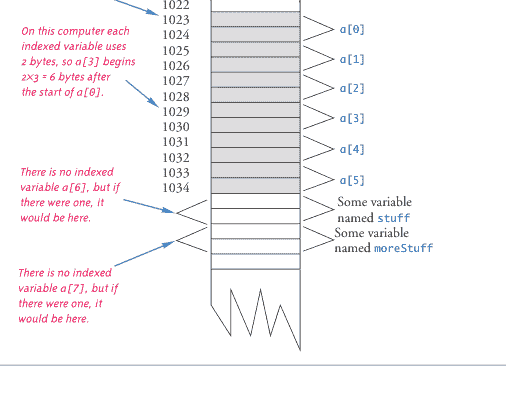

### 数组的初始化

数组可以在声明时进行初始化。初始化数组时，各个下标变量的值用花括号括起来，并用逗号分隔。例如：

```
int children[3] = {2, 12, 1};
```

上述声明等价于以下代码：

```
int children[3];
children[0] = 2;
children[1] = 12;
children[2] = 1;
```

如果你列出的值少于下标变量的数量，这些值将用于初始化前几个下标变量，而其余的下标变量将被初始化为数组基类型的零值。在这种情况下，未提供初始值的下标变量会被初始化为零。然而，没有初始化器的数组以及在函数定义（包括程序的 `main` 函数）内声明的其他变量不会被初始化。尽管数组下标变量（以及其他变量）有时可能会被自动初始化为零，但你不能也不应该依赖这一点。

如果你在声明数组时对其进行初始化，可以省略数组的大小，数组将自动被声明为初始化值所需的最小大小。例如，以下声明

```
int b[] = {5, 12, 11};
```

等价于

```
int b[3] = {5, 12, 11};
```

### 自测练习

- 1. 描述 `int a[5];` 的含义与 `a[4]` 的含义之间的区别。在每种情况下，`[5]` 和 `[4]` 的含义是什么？

- 2. 在数组声明 `double score[5];` 中，指出以下各项：
    - a. 数组名
    - b. 基类型
    - c. 数组的声明大小
    - d. 访问此数组的下标可以具有的值的范围
    - e. 此数组的一个下标变量（或元素）

- 3. 指出以下数组声明中的任何错误。
    - a. `int x[4] = { 8, 7, 6, 4, 3 };`
    - b. `int x[] = { 8, 7, 6, 4 };`
    - c.
      ```
      const int SIZE = 4;
      int x[SIZE];
      ```

- 4. 以下代码的输出是什么？

    ```
    char symbol[3] = {'a', 'b', 'c'};
    for (int index = 0; index < 3; index++)
        cout << symbol[index];
    ```

- 5. 以下代码的输出是什么？

    ```
    double a[3] = {1.1, 2.2, 3.3};
    cout << a[0] << " " << a[1] << " " << a[2] << endl;
    a[1] = a[2];
    cout << a[0] << " " << a[1] << " " << a[2] << endl;
    ```

- 6. 以下代码的输出是什么？

    ```
    int i, temp[10];
    for (i = 0; i < 10; i++)
        temp[i] = 2*i;
    for (i = 0; i < 10; i++)
        cout << temp[i] << " ";
    cout << endl;
    for (i = 0; i < 10; i = i + 2)
        cout << temp[i] << " ";
    ```

- 7. 以下代码片段有什么问题？

    ```
    int sampleArray[10];
    for (int index = 1; index <= 10; index++)
        sampleArray[index] = 3*index;
    ```

- 8. 假设我们期望数组 `a` 的元素按顺序排列，使得

    a[0] ≤ a[1] ≤ a[2] ≤ ...

    然而，为了安全起见，我们希望程序测试该数组，并在某些元素无序时发出警告。以下代码本应输出这样的警告，但它包含一个错误。这个错误是什么？

    ```
    double a[10];
    <此处为填充数组 a 的代码。>
    for (int index = 0; index < 10; index++)
        if (a[index] > a[index + 1])
            cout << "数组元素 " << index << " 和 " << (index + 1) << " 顺序错误。";
    ```


+   9. 编写一段 C++ 代码，将从键盘读入的 20 个 `int` 类型的值填入一个数组中。你不必编写完整的程序，只需编写完成此操作的<|message|>代码，但要给出数组和所有变量的声明。

+   10. 假设你的程序中有以下数组声明：
+   
+   ```cpp
+   int yourArray[7];
+   ```
+   
+   另外，假设在你的 C++ 实现中，`int` 类型变量使用两字节的内存。当你运行程序时，这个数组会消耗多少内存？假设当你运行程序时，系统将内存地址 1000 分配给索引变量 `yourArray[0]`。索引变量 `yourArray[3]` 的地址会是什么？

### 5.2 函数中的数组

你可以使用数组索引变量和整个数组作为函数的参数。我们首先讨论数组索引变量作为函数的参数。

### 索引变量作为函数参数

索引变量可以作为函数的参数，就像数组基类型的任何变量可以作为参数一样。例如，假设程序包含以下声明：

```
```cpp
double i, n, a[10];
```
```

如果 `myFunction` 接受一个 `double` 类型的参数，那么以下内容是合法的：

```
```cpp
myFunction(n);
```
```

由于数组 `a` 的索引变量也是 `double` 类型的变量，就像 `n` 一样，以下内容同样合法：

```
```cpp
myFunction(a[3]);
```
```

索引变量可以是传值参数或传引用参数。

然而，使用索引变量作为参数时有一个细微之处。例如，考虑以下函数调用：

```
```cpp
myFunction(a[i]);
```
```

如果 `i` 的值是 3，则参数是 a[3]。另一方面，如果 `i` 的值是 0，则此调用等价于以下内容：

```
myFunction(a[0]);
```

索引表达式会被求值以确定作为参数给出的确切索引变量。

### 自测练习

+   11. 考虑以下函数定义：

```
void tripler(int& n)
{
    n = 3*n;
}
```

以下哪些是可接受的函数调用？

```
int a[3] = {4, 5, 6}, number = 2;
tripler(a[2]);
tripler(a[3]);
tripler(a[number]);
tripler(a);
tripler(number);
```

+   12. 以下代码有什么（如果有的话）问题？`tripler` 的定义在自测练习 11 中给出。

```
int b[5] = {1, 2, 3, 4, 5};
for (int i = 1; i <= 5; i++)
    tripler(b[i]);
```

### 整个数组作为函数参数

一个函数可以为整个数组设置形式参数，这样当函数被调用时，插入到该形式参数中的参数就是整个数组。然而，整个数组的形式参数既不是传值参数也不是传引用参数；它是一种新的形式参数，称为数组参数。让我们从一个例子开始。

### 显示 5.3 具有数组参数的函数

### 函数声明

```
void fillUp(int a[], int size);
//Precondition: size is the declared size of the array a.
//The user will type in size integers.
//Postcondition: The array a is filled with size integers
//from the keyboard.
```

### 函数定义

```
void fillUp(int a[], int size)
{
    cout << "Enter " << size << " numbers:\n";
    for (int i = 0; i < size; i++)
        cin >> a[i];
    cout << "The last array index used is " << (size - 1) << endl;
}
```

使用从键盘输入的值填充数组；函数随后向屏幕输出一条消息，告知最后使用的数组索引。

形式参数 int a[] 是一个数组参数。方括号内没有索引表达式，这是 C++ 用来表示数组参数的方式。数组参数并不完全是传引用参数，但就大多数实际用途而言，它的行为非常类似于传引用参数。让我们详细分析这个例子，看看在这个情况下数组参数是如何工作的。（数组参数，当然，是插入到数组参数中的数组，例如 a[]。）

当函数 fillUp 被调用时，它必须有两个参数：第一个给出一个整数数组，第二个应给出数组的声明大小。例如，以下是一个可接受的函数调用：

```
int score[5], numberOfScores = 5;
fillUp(score, numberOfScores);
```

此对 fillUp 的调用将使用键盘输入的五个整数填充数组 score。请注意，形式参数 a[]（在函数声明和函数定义头中使用）是用方括号但没有索引表达式给出的。（你可以在方括号内为数组参数插入一个数字，但编译器会简单地忽略该数字，因此我们本书中不会使用此类数字。）另一方面，在函数调用中给出的参数（本例中为 score）不带任何方括号或索引表达式。

array argument

when to use []

在这个函数调用中，数组参数 score 会发生什么？很宽松地说，参数 score 被插入到函数体中形式数组参数 a 的位置，然后执行函数体。因此，函数调用

```
fillUp(score, numberOfScores);
```

等价于以下代码：

```
{ size = 5; cout << "Enter " << size << " numbers:\n"; for (int i = 0; i < size; i++) cin >> score[i]; cout << "The last array index used is " << (size - 1) << endl; }
```

5 是 numberOfScores 的值

形式参数 a 是我们迄今为止见过的不同于其他参数的一种参数。形式参数 a 仅仅是参数 score 的占位符。当函数 fillUp 使用 score 作为数组参数被调用时，计算机的行为就像用相应的参数 score 替换它一样。当数组在函数调用中用作参数时，对数组参数执行的任何操作都会对数组参数执行，因此函数的数组参数的索引变量的值可以被函数更改。如果在函数体中更改了形式参数（例如使用 cin 语句），则数组参数将被更改。

到目前为止，看起来数组参数只是一个数组的传引用参数。这几乎是正确的，但数组参数与传引用参数略有不同。为了帮助解释差异，让我们回顾一下数组的一些细节。

回想一下，数组存储为一段连续的内存。例如，考虑数组 score 的以下声明：

```
int score[5];
```

当你声明此数组时，计算机为五个 `int` 类型变量预留足够的内存，这些变量在计算机内存中一个接一个地存储。计算机不会记住这五个索引变量各自的地址；它只记住索引变量 score[0] 的地址。计算机还记得 score 总共有五个索引变量，都是 `int` 类型。它不会记住除 score[0] 之外的任何索引变量在内存中的地址。例如，当你的程序需要 score[3] 时，计算机从 score[0] 的地址计算出 score[3] 的地址。计算机知道 score[3] 位于 score[0] 之后三个 `int` 变量的位置。因此，要获得 score[3] 的地址，计算机取 score[0] 的地址并加上代表三个 `int` 变量所用内存量的数字；结果就是 score[3] 的地址。

从这种方式来看，数组有三个部分：第一个索引变量在内存中的地址（位置）、数组的基类型（决定每个索引变量使用多少内存）以及数组的大小（即索引变量的数量）。当数组用作函数中的数组参数时，只将其中的第一个部分传递给函数。当数组参数被插入到其对应的形式参数中时，插入的只是数组第一个索引变量的地址。数组参数的基类型必须与形式参数的基类型匹配，因此函数也知道数组的基类型。然而，数组参数不会告诉函数数组的大小。当函数体中的代码被执行时，计算机知道数组在内存中开始的位置以及每个索引变量使用多少内存，但（除非你做出特殊安排）它不知道数组有多少个索引变量。这就是为什么你必须始终有一个额外的 `int` 参数告诉函数数组的大小是至关重要的。（这也是数组参数与传引用参数不同的原因。你可以把数组参数看作是一种弱形式的传引用参数，其中关于数组的一切都被告诉函数，除了数组的大小）。²

这些数组参数可能看起来有点奇怪，但由于它们看似奇怪的定义，它们至少有一个非常好的特性。这个优点最好通过再次查看显示 5.3 中函数 fillUp 的例子来说明。相同的函数可以用来填充任意大小的数组，只要数组的基类型是 `int`。例如，假设你有以下数组声明：

```
int score[5], time[10];
```

以下对 fillUp 的第一个调用用五个值填充数组 score，第二个调用用十个值填充数组 time：

```
fillUp(score, 5);
fillUp(time, 10);
```

你可以使用同一个函数处理不同大小的数组参数，因为大小是一个单独的参数。

### `const` 参数修饰符

当你在函数调用中使用数组参数时，函数可以更改数组中存储的值。这通常是可以的。然而，在复杂的函数定义中，你可能会编写代码无意中更改数组中一个或多个值，即使数组根本不应该被更改。作为预防措施，你可以告诉编译器你不打算更改数组参数，然后计算机将检查以确保你的代码不会无意中更改数组中的任何值。要告诉编译器数组参数不应被你的函数更改，请在该参数的数组参数前插入修饰符 const

² 如果你听说过指针，这听起来就像指针，事实上数组参数是通过传递指向其第一个（零）索引变量的指针来传递的。我们将在第 10 章讨论这个问题。如果你还没有学过指针，可以安全地忽略这个脚注。


### 数组形参与实参

函数的实参可以是整个数组，但整个数组作为实参时，既不是按值传递，也不是按引用传递。它是一种新型的参数，称为数组实参。当数组实参被传递给数组形参时，传递给函数的仅仅是该数组实参第一个索引变量（索引为0的那个）在内存中的地址。数组实参并不会告知函数该数组的大小。因此，当函数带有数组形参时，通常还必须另有一个`int`类型的形参来指明数组的大小（如下例所示）。

数组实参在以下方面类似于按引用传递的实参：如果函数体修改了数组形参，那么在函数被调用时，这种修改实际上会作用于数组实参。因此，函数可以改变数组实参的值（即可以改变其索引变量的值）。

带有数组形参的函数声明的语法如下。

### 语法

```
返回类型 函数名(..., 基类型 数组名[]...);
```

### 示例

```
void sumArray(double& sum, double a[], int size);
```

用`const`修饰的数组形参称为常量数组形参。

例如，下面的函数输出数组中的值，但不会改变数组中的值：

```
void showTheWorld(int a[], int sizeOfa)
//前置条件：sizeOfa是数组a的声明大小。
//a的所有索引变量都已被赋值。
//后置条件：a中的值已被输出到屏幕。
{
    cout << "数组包含以下值：\n";
    for (int i = 0; i < sizeOfa; i++)
        cout << a[i] << " ";
    cout << endl;
}
```

这个函数可以正常工作。然而，作为一项额外的安全措施，你可以在函数头中添加`const`修饰符，如下所示：

```
void showTheWorld(const int a[], int sizeOfa)
```

添加了`const`修饰符后，如果你的函数定义中包含任何改变数组实参值的错误，计算机将会发出错误信息。例如，下面是`showTheWorld`函数的一个版本，其中包含一个无意中改变数组实参值的错误。幸运的是，这个函数定义版本包含了`const`修饰符，因此错误信息会告诉我们数组`a`已被修改。这条错误信息将有助于解释错误所在：

```
void showTheWorld(const int a[], int sizeOfa)
//前置条件：sizeOfa是数组a的声明大小。
//a的所有索引变量都已被赋值。
//后置条件：a中的值已被输出到屏幕。
{
    cout << "数组包含以下值：\n";
    for (int i = 0; i < sizeOfa; a[i]++)
        cout << a[i] << " ";
    cout << endl;
}
```

这是一个错误，但除非你使用`const`修饰符，否则编译器不会发现它。

如果在上述函数定义中我们没有使用`const`修饰符，并且犯了所示的错误，函数将会编译并运行，且不会产生任何错误信息。然而，代码将包含一个无限循环，不断递增`a[0]`并将其新值输出到屏幕。

这个错误版本的`showTheWorld`的问题在于，`for`循环中递增了错误的项。被递增的是索引变量`a[i]`，而应该递增的是索引`i`。在这个错误版本中，索引`i`从值0开始，且该值从未改变。但`a[0]`（与`a[i]`相同）却被递增了。当索引变量`a[i]`被递增时，就改变了数组中的值，而由于我们包含了`const`修饰符，计算机将发出警告信息。这条错误信息应该能提示问题所在。

程序中除了函数定义之外，通常还有函数声明。当你在函数定义中使用`const`修饰符时，也必须在函数声明中使用它，以便函数头和函数声明保持一致。

`const`修饰符可以用于任何类型的参数，但通常只用于数组参数和类的按引用传递参数（这将在第6章和第7章中讨论）。

### 陷阱：`const`参数使用不一致

> `const`参数修饰符是一个“全有或全无”的命题。如果你为某个特定类型的数组参数使用了它，那么对于所有具有该类型且不被函数修改的其他数组参数，你也应该使用它。原因与函数调用中的函数调用有关。

考虑函数`showDifference`的定义，下面给出了该定义以及定义中使用的函数的声明：

```
double computeAverage(int a[], int numberUsed);
//返回数组a的前numberUsed个元素的平均值。数组a保持不变。

void showDifference(const int a[], int numberUsed)
{
    double average = computeAverage(a, numberUsed);
    cout << "这" << numberUsed
         << "个数的平均值 = " << average << endl
         << "这些数是：\n";
    for (int index = 0; index < numberUsed; index++)
        cout << a[index] << " 与平均值相差 "
             << (a[index] - average) << endl;
}
```

对于大多数编译器，上述代码会产生错误信息或警告信息。函数`computeAverage`不会改变其参数`a`。然而，当编译器处理`showDifference`的函数定义时，它会认为`computeAverage`会（或至少可能）改变其参数`a`的值。这是因为在翻译`showDifference`的函数定义时，编译器对`computeAverage`的全部了解仅限于`computeAverage`的函数声明，而该声明中没有包含`const`来告知编译器参数`a`不会被改变。因此，如果你在函数`showDifference`中对参数`a`使用了`const`，那么你也应该在函数`computeAverage`中对参数`a`使用`const`修饰符。`computeAverage`的函数声明应如下所示：

```
double computeAverage(const int a[], int numberUsed);
```

### 返回数组的函数

函数不能像返回`int`或`double`类型的值那样直接返回数组。有一种方法可以获得与返回数组的函数大致等价的效果。方法是返回一个指向数组的指针。我们将在第10章讨论数组与指针的交互时探讨这个主题。在学会指针之前，你没有办法编写返回数组的函数。

### 示例：生产图表

显示5.4包含一个使用数组和多个数组参数的程序。这个为Apex塑料汤匙制造公司编写的程序显示了一个条形图，展示其四个制造工厂在任意给定周内的生产率。各工厂为每个部门分别保留生产数据，例如茶匙部门、汤匙部门、普通鸡尾酒匙部门、彩色鸡尾酒匙部门等等。此外，四个工厂的部门数量各不相同。

正如显示5.4中的示例对话所示，图表中每1000个生产单位使用一个星号。由于输出以1000为单位，因此必须通过除以1000来进行缩放。这带来一个问题，因为计算机必须显示整数个星号。它不能为1600个单位显示1.6个星号。因此我们四舍五入到最近的千位数。因此，1600将与2000相同，并产生两个星号。

数组`production`保存四个工厂各自的总产量。在C++中，数组索引始终从0开始。但由于工厂编号为1到4，而不是0到3，我们将工厂编号`n`的总产量放在索引变量`production[n−1]`中。工厂1的产量将存放在`production[0]`中，工厂2的数据将存放在`production[1]`中，依此类推。

由于输出以千为单位，程序将对数组元素的值进行缩放。如果工厂3的总产量为4040个单位，那么`production[2]`的值将初始设置为4040。然后这个4040将被缩放为4，使得`production[2]`的值变为4，并输出四个星号来表示工厂3的产量。这个缩放由函数`scale`完成，该函数将整个数组`production`作为参数，并改变数组中存储的值。

函数`round`将其参数四舍五入到最接近的整数。例如，`round(2.3)`返回2，`round(2.6)`返回3。函数`round`在第3章的编程示例“一个取整函数”中讨论过。

```
//读取数据并显示每个工厂生产率的条形图。
#include <iostream>
#include <cmath>
using namespace std;
const int NUMBER_OF_PLANTS = 4;

void inputData(int a[], int lastPlantNumber);
//前置条件：lastPlantNumber是数组a的声明大小。
//后置条件：对于plantNumber = 1 到 lastPlantNumber：
//a[plantNumber−1] 等于工厂plantNumber的总产量。

void scale(int a[], int size);
//前置条件：a[0] 到 a[size−1] 每个都是非负值。
//后置条件：对于所有满足 0 <= i <= size−1 的i，a[i]已被改为
//原始a[i]中的千位数（四舍五入为整数）。
```


### 显示 5.4 生产图程序（第 2 部分，共 4 部分）

```
14 void graph(const int asteriskCount[], int lastPlantNumber);
//Precondition: a[0] through a[lastPlantNumber-1] have nonnegative values.
//Postcondition: A bar graph has been displayed saying that plant
//number N has produced a[N-1] 1000s of units, for each N such that
//1 <= N <= lastPlantNumber

19 void getTotal(int& sum);
//Reads nonnegative integers from the keyboard and
//places their total in sum.

22 int round(double number);
//Precondition: number >= 0.
//Returns number rounded to the nearest integer.

25 void printAsterisks(int n);
//Prints n asterisks to the screen.

27 int main( )
{
    int production[NUMBER_OF_PLANTS];
    cout << "This program displays a graph showing\n"
        << "production for each plant in the company.\n";
    inputData(production, NUMBER_OF_PLANTS);
    scale(production, NUMBER_OF_PLANTS);
    graph(production, NUMBER_OF_PLANTS);
    return 0;
}

37 void inputData(int a[], int lastPlantNumber)
{
    for (int plantNumber = 1;
        plantNumber <= lastPlantNumber; plantNumber++)
    {
        cout << endl
            << "Enter production data for plant number "
            << plantNumber << endl;
        getTotal(a[plantNumber - 1]);
    }
}

48 void getTotal(int& sum)
{
```

### 显示 5.4 生产图程序（第 3 部分，共 4 部分）

```
50  cout << "Enter number of units produced by each department.\n"
      << "Append a negative number to the end of the list.\n";

  sum = 0;
  int next;
  cin >> next;
  while (next >= 0)
  {
      sum = sum + next;
      cin >> next;
  }

  cout << "Total = " << sum << endl;
  }

  void scale(int a[], int size)
  {
      for (int index = 0; index < size; index++)
          a[index] = round(a[index]/1000.0);
  }

  int round(double number)
  {
      return static_cast<int>(floor(number + 0.5));
  }

  void graph(const int asteriskCount[], int lastPlantNumber)
  {
      cout << "\nUnits produced in thousands of units:\n";
      for (int plantNumber = 1;
          plantNumber <= lastPlantNumber; plantNumber++)
      {
          cout << "Plant #" << plantNumber << ": ";
          printAsterisks(asteriskCount[plantNumber - 1]);
          cout << endl;
      }
  }

  void printAsterisks(int n)
  {
      for (int count = 1; count <= n; count++)
          cout << "*";
  }
```

### 显示 5.4 生产图程序（第 4 部分，共 4 部分）

### 示例对话

```
This program displays a graph showing the
production for each plant in the company.

Enter production data for plant number 1
Enter number of units produced by each department.
Append a negative number to the end of the list.
2000 3000 1000 -1
Total = 6000

Enter production data for plant number 2
Enter number of units produced by each department.
Append a negative number to the end of the list.
2050 3002 1300 -1
Total = 6352

Enter production data for plant number 3
Enter number of units produced by each department.
Append a negative number to the end of the list.
5000 4020 500 4348 -1
Total = 13868

Enter production data for plant number 4
Enter number of units produced by each department.
Append a negative number to the end of the list.
2507 6050 1809 -1
Total = 10366

Units produced in thousands of units:

Plant #1 *****
Plant #2 ******
Plant #3 **************
Plant #4 ***********
```

### 自测练习

- 13. 编写一个名为 `oneMore` 的函数定义，该函数有一个整型数组的形参，并将每个数组元素的值增加 1。添加所需的任何其他形参。

### 14. 考虑以下函数定义：

```
void too2(int a[], int howMany)
{
    for (int index = 0; index < howMany; index++)
        a[index] = 2;
}
```

以下哪些是可接受的函数调用？

- int myArray[29];
- too2(myArray, 29);
- too2(myArray, 10);
- too2(myArray, 55);
- "Hey too2. Please come over here."
- int yourArray[100];
- too2(yourArray, 100);
- too2(myArray[3], 29);

### 15. 在以下可以改为常量数组参数的数组参数前插入 const。

```
void output(double a[], int size);
//Precondition: a[0] through a[size - 1] have values.
//Postcondition: a[0] through a[size - 1] have been written out.
```

```
void dropOdd(int a[], int size);
//Precondition: a[0] through a[size - 1] have values.
//Postcondition: All odd numbers in a[0] through a[size - 1]
//have been changed to 0.
```

### 16. 编写一个名为 outOfOrder 的函数，该函数以 double 类型的数组和一个名为 size 的 int 参数作为参数，并返回 int 类型的值。此函数将测试该数组是否无序，即数组违反以下条件：

a[0] <= a[1] <= a[2] <= ...

如果元素没有无序，则函数返回 -1；否则，它将返回数组中第一个无序元素的索引。例如，考虑声明

```
double a[10] = {1.2, 2.1, 3.3, 2.5, 4.5,
    7.9, 5.4, 8.7, 9.9, 1.8};
```

在上面的数组中，a[2] 和 a[3] 是第一个无序的配对，a[3] 是第一个无序的元素，因此函数返回 3。如果数组已排序，则函数将返回 -1。

## 5·3 使用数组编程

> 不要相信笼统的印象，我的孩子，但要集中精力于细节。

亚瑟·柯南·道尔，《身份之谜》（夏洛克·福尔摩斯）

本节讨论部分填充的数组，并简要介绍数组的排序和搜索。本节没有关于 C++ 语言的新材料，但确实包含了更多关于 C++ 数组参数的练习。

### 部分填充的数组

通常在编写程序时所需的数组的确切大小是未知的，或者大小可能在程序的一次运行到另一次运行之间变化。处理这种情况的一种常见且简单的方法是声明数组的大小为程序可能需要的最大大小。然后程序可以自由使用所需的多或少的数组。

部分填充的数组需要谨慎处理。程序必须跟踪数组使用了多少，并且不得引用任何未赋值的索引变量。显示 5.5 中的程序说明了这一点。该程序读取高尔夫球成绩列表并显示每个成绩与平均值的差异。该程序适用于短至一个成绩、长至十个成绩以及两者之间的任何长度的列表。成绩存储在数组 score 中，该数组有十个索引变量，但程序仅使用其需要的数组部分。变量 numberUsed 跟踪数组中存储了多少个元素。元素（即成绩）存储在位置 score[0] 到 score[numberUsed – 1]。细节与 numberUsed 是数组的声明大小并且整个数组都被使用时非常相似。特别是，变量 numberUsed 通常必须是操作部分填充数组的任何函数的参数。由于参数 numberUsed（在正确使用时）通常可以确保函数不会引用非法的数组索引，因此这有时（但并非总是）消除了提供数组声明大小的参数的需要。例如，函数 showDifference 和 computeAverage 使用参数 numberUsed 来确保仅使用合法的数组索引。然而，函数 fillArray 需要知道数组的最大声明大小，以便不使数组溢出。

### 提示 不要吝啬形参

注意显示 5.5 中的函数 fillArray。当调用 fillArray 时，声明的数组大小 MAX_NUMBER_SCORES 作为参数之一给出，如显示 5.5 中以下函数调用所示：

```
fillArray(score, MAX_NUMBER_SCORES, numberUsed);
```


你可能会抗议说 MAX_NUMBER_SCORES 是一个全局定义的常量，因此它可以在 fillArray 的定义中使用，而无需将其作为参数。你是对的，如果我们只在 Display 5.5 中的程序中使用 fillArray，而不在其他程序中使用，我们就可以不用将 MAX_NUMBER_SCORES 作为 fillArray 的参数来应付。然而，fillArray 是一个通用有用的函数，你可能希望在多个不同的程序中使用它。我们事实上也在下一小节讨论的 Display 5.6 中的程序中使用了函数 fillArray。在 Display 5.6 中的程序中，声明的数组大小的参数是一个不同命名的全局常量。如果我们将全局常量 MAX_NUMBER_SCORES 写进函数 fillArray 的主体中，我们就无法在 Display 5.6 中的程序中重用该函数。

即使我们只在一个程序中使用 fillArray，将声明的数组大小作为 fillArray 的参数仍然是一个好主意。将数组的声明大小作为参数显示，提醒我们函数以极其关键的方式需要此信息。

### Display 5.5 Partially Filled Array (part 1 of 3)

//Shows the difference between each of a list of golf scores and their average.
#include <iostream>
using namespace std;
const int MAX_NUMBER_SCORES = 10;

void fillArray(int a[], int size, int& numberUsed);
//Precondition: size is the declared size of the array a.
//Postcondition: numberUsed is the number of values stored in a.
//a[0] through a[numberUsed-1] have been filled with
//nonnegative integers read from the keyboard.

double computeAverage(const int a[], int numberUsed);
//Precondition: a[0] through a[numberUsed-1] have values; numberUsed > 0.
//Returns the average of numbers a[0] through a[numberUsed-1].

void showDifference(const int a[], int numberUsed);
//Precondition: The first numberUsed indexed variables of a have values.
//Postcondition: Gives screen output showing how much each of the first
//numberUsed elements of the array a differs from their average.

int main()
{
    int score[MAX_NUMBER_SCORES], numberUsed;

    cout << "This program reads golf scores and shows\n"
         << "how much each differs from the average.\n";

    cout << "Enter golf scores:\n";
```

### Display 5.5 Partially Filled Array (part 2 of 3)

```
    fillArray(score, MAX_NUMBER_SCORES, numberUsed);
    showDifference(score, numberUsed);

    return 0;
}

void fillArray(int a[], int size, int& numberUsed)
{
    cout << "Enter up to " << size << " nonnegative whole numbers.\n"
         << "Mark the end of the list with a negative number.\n";
    int next, index = 0;
    cin >> next;
    while ((next >= 0) && (index < size))
    {
        a[index] = next;
        index++;
        cin >> next;
    }
    numberUsed = index;
}

double computeAverage(const int a[], int numberUsed)
{
    double total = 0;
    for (int index = 0; index < numberUsed; index++)
        total = total + a[index];
    if (numberUsed > 0)
    {
        return (total/numberUsed);
    }
    else
    {
        cout << "ERROR: number of elements is 0 in computeAverage.\n"
             << "computeAverage returns 0.\n";
        return 0;
    }
}

void showDifference(const int a[], int numberUsed)
{
    double average = computeAverage(a, numberUsed);
    cout << "Average of the " << numberUsed
         << " scores = " << average << endl
         << "The scores are:\n";
```

### Display 5.5 Partially Filled Array (part 3 of 3)

```
    for (int index = 0; index < numberUsed; index++)
        cout << a[index] << " differs from average by "
             << (a[index] - average) << endl;
}
```

### Sample Dialogue

This program reads golf scores and shows how much each differs from the average.
Enter golf scores:
Enter up to 10 nonnegative whole numbers.
Mark the end of the list with a negative number.
69 74 68 -1
Average of the 3 scores = 70.3333
The scores are:
69 differs from average by -1.33333
74 differs from average by 3.66667
68 differs from average by -2.33333

### Example: Searching an Array

一个常见的编程任务是在数组中搜索给定值。例如，数组可能包含某门课程中所有学生的学号。为了判断某个特定学生是否已注册，数组会被搜索以查看是否包含该学生的号码。Display 5.6 中的简单程序填充一个数组，然后根据用户指定的值搜索该数组。实际的应用程序会复杂得多，但这展示了顺序搜索算法的所有要点：程序按顺序查看数组元素，从第一个到最后一个，以查看目标数字是否等于数组中的任何元素。

在 Display 5.6 中，使用函数 search 来搜索数组。在搜索数组时，你通常希望知道的不仅仅是目标值是否在数组中。如果目标值在数组中，你通常希望知道保存该目标值的索引变量的索引，因为该索引可能作为了解目标值的其他信息的指南。因此，我们设计函数 search 使其返回一个索引，表示目标值在数组中的位置，前提是目标值确实在数组中。如果目标值不在数组中，search 返回 -1。让我们更详细地看一下函数 search。

函数 search 使用 while 循环逐一检查数组元素，以查看其中是否有一个等于目标值。变量 found 用作标志，记录是否找到了目标元素。如果在数组中找到目标元素，found 被设为 true，这反过来会结束 while 循环。

sequential search

### Display 5.6 Searching an Array (part 1 of 2)

//Searches a partially filled array of nonnegative integers.
#include <iostream>
using namespace std;
const int DECLARED_SIZE = 20;

void fillArray(int a[], int size, int& numberUsed);
//Precondition: size is the declared size of the array a.
//Postcondition: numberUsed is the number of values stored in a.
//a[0] through a[numberUsed-1] have been filled with
//nonnegative integers read from the keyboard.

int search(const int a[], int numberUsed, int target);
//Precondition: numberUsed is <= the declared size of a.
//Also, a[0] through a[numberUsed-1] have values.
//Returns the first index such that a[index] == target,
//provided there is such an index; otherwise, returns -1.

int main()
{
    int arr[DECLARED_SIZE], listSize, target;

    fillArray(arr, DECLARED_SIZE, listSize);

    char ans;
    int result;
    do
    {
        cout << "Enter a number to search for: ";
        cin >> target;

        result = search(arr, listSize, target);
        if (result == -1)
            cout << target << " is not on the list.\n";
        else
            cout << target << " is stored in array position "
                 << result << endl
                 << "(Remember: The first position is 0.)\n";

        cout << "Search again?(y/n followed by Return): ";
        cin >> ans;
    } while ((ans != 'n') && (ans != 'N'));
    cout << "End of program.\n";
    return 0;
}

void fillArray(int a[], int size, int& numberUsed)
<-The rest of the definition of fillArray is given in Display 5.5->
```

### Display 5.6 Searching an Array (part 2 of 2)

```
int search(const int a[], int numberUsed, int target)
{
    int index = 0;
    bool found = false;
    while (!found && (index < numberUsed))
        if (target == a[index])
            found = true;
        else
            index++;

    if (found)
        return index;
    else
        return -1;
}
```

### Sample Dialogue

Enter up to 20 nonnegative whole numbers.
Mark the end of the list with a negative number.
10 20 30 40 50 60 70 80 -1
Enter a number to search for: 10
10 is stored in array position 0
(Remember: The first position is 0.)
Search again?(y/n followed by Return): y
Enter a number to search for: 40
40 is stored in array position 3
(Remember: The first position is 0.)
Search again?(y/n followed by Return): y
Enter a number to search for: 42
42 is not on the list.
Search again?(y/n followed by Return): n
End of program.

### Example: Sorting an Array

最常见且研究最透彻的编程任务之一，当然是排序值列表，例如必须从低到高或从高到低排序的销售额列表，或必须按字母顺序排序的单词列表。本示例描述了一个名为 sort 的函数，它将对部分填充的数字数组进行排序，使其按从小到大的顺序排列。


排序过程有一个数组参数 `a`。数组 `a` 将被部分填充，因此还有一个额外的形式参数 `numberUsed`，用于表示数组中实际使用的元素个数。因此，函数 `sort` 的声明和前置条件如下：

```
void sort(int a[], int numberUsed);
//前置条件：numberUsed <= 数组 a 的声明大小。
//数组元素 a[0] 到 a[numberUsed-1] 均有值。
```

函数 `sort` 重新排列数组 `a` 中的元素，使得函数调用完成后，元素按如下顺序排列：

a[0] ≤ a[1] ≤ a[2] ≤ ... ≤ a[numberUsed - 1]

我们用于排序的算法称为**选择排序**。它是所有排序算法中最容易理解的一种。

设计算法的一种方式是依赖于问题的定义。本例中，问题是将数组 `a` 从小到大排序。这意味着重新排列数值，使 `a[0]` 最小，`a[1]` 次小，依此类推。这个定义给出了选择排序算法的框架：

```
for (int index = 0; index < numberUsed; index++)
    将第 index 小的元素放入 a[index]
```

实现这种通用方法的方式有很多。细节可以使用两个数组，将元素按排序顺序从一个数组复制到另一个数组，但使用一个数组既足够又经济。因此，函数 `sort` 仅使用包含待排序值的一个数组。函数 `sort` 通过交换成对的值来重新排列数组 `a` 中的值。让我们通过一个具体示例来了解该算法的工作原理。

考虑显示 5.7 中所示的数组。算法会将最小值放入 `a[0]`。最小值是 `a[3]` 中的值，因此算法交换 `a[0]` 和 `a[3]` 的值。然后算法寻找次小的元素。此时 `a[0]` 中的值已是最小元素，因此次小元素是剩余元素 `a[1]`、`a[2]`、`a[3]`、...、`a[9]` 中最小的。在显示 5.7 的示例中，次小元素位于 `a[5]`，因此算法交换 `a[1]` 和 `a[5]` 的值。这种将第二小元素定位的过程在显示 5.7 的第四和第五个数组图中进行了说明。随后算法定位第三小元素，依此类推。随着排序的进行，数组开头的元素被设置为正确的排序值。数组的已排序部分通过从数组未排序末尾的元素中逐个添加元素而增长。请注意，算法无需对最后一个索引变量 `a[9]` 中的值做任何操作。一旦其他元素被正确定位，`a[9]` 也必然具有正确的值。毕竟，`a[9]` 的正确值是剩余待移动的最小值，而唯一剩余待移动的值就是已经在 `a[9]` 中的值。

然后算法在数组未排序的末尾找到次小元素，然后进行交换，将这个次小元素移动到数组的已排序部分。

显示 5.8 中所示的函数 `swapValues` 用于交换索引变量的值。例如，以下调用将交换 `a[8]` 和 `a[3]` 的值：

swapValues(a[8], a[3]);

函数 `swapValues` 已在第 4 章中解释过。

### 显示 5.7 选择排序

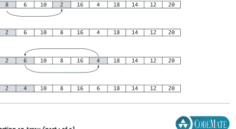

### 显示 5.8 数组排序（第 1 部分，共 3 部分）

```
1 //测试排序过程 sort。
2 #include <iostream>
3 using namespace std;
4
5 void fillArray(int a[], int size, int& numberUsed);
6 //前置条件：size 是数组 a 的声明大小。
7 //后置条件：numberUsed 是存储在 a 中的值的个数。
8 //a[0] 到 a[numberUsed - 1] 已从键盘读入
9 //非负整数填充。
10 void sort(int a[], int numberUsed);
11 //前置条件：numberUsed <= 数组 a 的声明大小。
```

### 显示 5.8 数组排序（第 2 部分，共 3 部分）

```
//数组元素 a[0] 到 a[numberUsed - 1] 均有值。
//后置条件：a[0] 到 a[numberUsed - 1] 的值已被
//重新排列，使得 a[0] <= a[1] <= ... <= a[numberUsed - 1]。

void swapValues(int& v1, int& v2);
//交换 v1 和 v2 的值。

int indexOfSmallest(const int a[], int startIndex, int numberUsed);
//前置条件：0 <= startIndex < numberUsed。引用数组元素
//均有值。返回索引 i，使得 a[i] 是
//a[startIndex]、a[startIndex + 1]、...、a[numberUsed - 1] 中最小的值。

int main()
{
    cout << "本程序将数字从低到高排序。\n";
    int sampleArray[10], numberUsed;
    fillArray(sampleArray, 10, numberUsed);
    sort(sampleArray, numberUsed);

    cout << "按排序顺序，数字为：\n";
    for (int index = 0; index < numberUsed; index++)
        cout << sampleArray[index] << " ";
    cout << endl;

    return 0;
}

void fillArray(int a[], int size, int& numberUsed)
{
    //fillArray 定义的其余部分在显示 5.5 中给出
}

void sort(int a[], int numberUsed)
{
    int indexOfNextSmallest;
    for (int index = 0; index < numberUsed - 1; index++)
    {//将正确的值放入 a[index]：
        indexOfNextSmallest =
            indexOfSmallest(a, index, numberUsed);
        swapValues(index, indexOfNextSmallest);
        //a[0] <= a[1] <=...<= a[index] 是原始数组中最小的元素。
        //其余元素位于剩余位置。
    }
}

void swapValues(int& v1, int& v2)
{
    int temp;
    temp = v1;
    v1 = v2;
```

### 显示 5.8 数组排序（第 3 部分，共 3 部分）

```
51        v2 = temp;
52    }
53
54    int indexOfSmallest(const int a[], int startIndex, int numberUsed)
55    {
56        int min = a[startIndex];
57        int indexOfMin = startIndex;
58        for (int index = startIndex + 1; index < numberUsed; index++)
59        {
60            if (a[index] < min)
61            {
62                min = a[index];
63                indexOfMin = index;
64                //min 是 a[startIndex] 到 a[index] 中最小的
65            }
66        }
67        return indexOfMin;
68    }
```

### 示例对话

> 本程序将数字从低到高排序。
> 输入最多 10 个非负整数。
> 用负数标记输入的结束。
> 80 30 50 70 60 90 20 30 40 -1
> 按排序顺序，数字为：
> 20 30 30 40 50 60 70 80 90

### 自测练习

- 17. 编写一个程序，将最多十个非负整数读入名为 `numberArray` 的数组中，然后将这些整数写回屏幕。本练习无需使用任何函数。这只是一个简单的小程序，可以非常精简。

- 18. 编写一个程序，将最多十个字母读入一个数组中，然后按相反顺序将字母写回屏幕。例如，如果输入为

  `abcd.`

  则输出应为

  `dcba`

  使用句点作为哨兵值来标记输入的结束。将数组命名为 `letterBox`。本练习无需使用任何函数。这只是一个简单的小程序，可以非常精简。

- 19. 下面是显示 5.6 中定义的函数 `search` 的替代版本的声明。为了使用此替代版本的搜索函数，我们需要稍微重写程序，但本练习只需编写此替代版本 `search` 的函数定义。

```
bool search(const int a[], int numberUsed, int target, int& where);
//前置条件：numberUsed <= 数组 a 的声明大小。
//此外，a[0] 到 a[numberUsed -1] 均有值。
//后置条件：如果 target 是 a[0]
//到 a[numberUsed - 1] 中的某个元素，则此函数返回
//true 并设置 where 的值，使得 a[where] ==
//target；否则，此函数返回 false 且
//where 的值保持不变。
```

## 5.4 多维数组

C++ 允许声明具有多个索引的数组。本节介绍这些多维数组。

### 多维数组基础

有时使用具有多个索引的数组会很有用，这在 C++ 中是允许的。以下声明了一个名为 `page` 的字符数组。数组 `page` 有两个索引：第一个索引范围从 0 到 29，第二个索引范围从 0 到 99。

```
char page[30][100];
```

该数组的索引变量每个都有两个索引。例如，`page[0][0]`、`page[15][32]` 和 `page[29][99]` 是该数组的三个索引变量。请注意，每个索引必须放在各自的一组方括号中。与我们之前看到的一维数组一样，多维数组的每个索引变量都是基类型的变量。

数组可以有任意数量的索引，但最常见的索引数量可能是两个。二维数组可以可视化为二维显示，第一个索引表示行，第二个索引表示列。例如，二维数组 `page` 的索引变量可以如下可视化：

| | 第 0 列 | 第 1 列 | ... | 第 99 列 |
|---|---|---|---|---|
| **第 0 行** | page[0][0] | page[0][1] | ... | page[0][99] |
| **第 1 行** | page[1][0] | page[1][1] | ... | page[1][99] |
| **...** | ... | ... | ... | ... |
| **第 29 行** | page[29][0] | page[29][1] | ... | page[29][99] |


```
page[0][0], page[0][1], ..., page[0][99]
page[1][0], page[1][1], ..., page[1][99]
page[2][0], page[2][1], ..., page[2][99]
.
.
.
page[29][0], page[29][1], ..., page[29][99]
```

你可能使用数组 page 来存储一页文本中的所有字符，该页有三十行（编号为 0 到 29），每行有 100 个字符（编号为 0 到 99）。

在 C++ 中，像 page 这样的二维数组实际上是一种数组的数组。上述 page 数组实际上是一个大小为 30 的一维数组，其基类型是大小为 100 的一维字符数组。通常，你不必关心这一点，而且你通常可以像 page 数组真的具有两个索引（而不是难以跟踪的数组的数组）那样使用它。然而，至少有一种情况会使二维数组非常像数组的数组，那就是当你有一个函数，其数组参数是针对二维数组的，这将在下一小节中讨论。

### 多维数组声明

### 语法

```
Type Array_Name[Size_Dim_1][Size_Dim_2]...[Size_Dim_Last];
```

### 示例

```
char page[30][100];
int matrix[2][3];
double threeDPicture[10][20][30];
```

上面所示的数组声明将为数组索引的每种组合定义一个带下标的变量。例如，上述示例声明中的第二条为数组 matrix 定义了以下六个带下标的变量：

```
matrix[0][0], matrix[0][1], matrix[0][2],
matrix[1][0], matrix[1][1], matrix[1][2]
```

### 多维数组参数

下面的二维数组声明实际上声明了一个大小为 30 的一维数组，其基类型是大小为 100 的一维字符数组。

```
char page[30][100];
```

将二维数组视为数组的数组，将有助于你理解 C++ 如何处理多维数组的参数。

例如，下面的函数接收一个像 page 这样的数组，并将其打印到屏幕上：

```
void displayPage(const char p[][100], int sizeDimension1)
{
    for (int index1 = 0; index1 < sizeDimension1; index1++)
    { // Printing one line
        for (int index2 = 0; index2 < 100; index2++)
            cout << p[index1][index2];
        cout << endl;
    }
}
```

请注意，对于二维数组参数，第一个维度的大小没有给出，因此我们必须包含一个 int 参数来给出第一个维度的大小。（与普通数组一样，编译器允许你通过在第一对方括号内放置一个数字来指定第一个维度。但是，这样的数字只是注释；编译器会忽略该数字。）第二个维度的大小（如果有多个维度，则是所有其他维度的大小）在数组参数之后给出，如参数

```
const char p[][100]
```

如果你认识到多维数组是数组的数组，那么这个规则就开始变得有意义了。由于二维数组参数

```
const char p[][100]
```

是一个数组的数组的参数，第一个维度实际上是该数组的下标，其处理方式与普通一维数组的下标完全相同。第二个维度是基类型描述的一部分，该基类型是大小为 100 的字符数组。

当在函数头或函数声明中给出多维数组参数时，第一个维度的大小不给出，但其余维度的大小必须放在方括号中给出。由于第一个维度的大小未给出，你通常需要一个额外的 int 类型参数来给出这个第一个维度的大小。下面是一个函数声明的示例，其中包含二维数组参数 p：

```
void getPage(char p[][100], int sizeDimension1);
```

### 示例：二维评分程序

显示 5.9 包含一个程序，它使用名为 grade 的二维数组来存储并显示一个小班的成绩记录。这个班有四名学生，记录包括三次测验。显示 5.10 展示了如何使用 grade 数组来存储数据。第一个数组下标用于指定学生，第二个数组下标用于指定测验。由于学生和测验都是从 1 而不是 0 开始编号的，我们必须从学生编号中减去 1，并从测验编号中减去 1，才能获得存储特定测验分数的下标变量。例如，学生编号 4 在测验编号 1 上的分数记录在 grade[3][0] 中。

我们的程序还使用了两个普通的一维数组。数组 stAve 将用于记录每位学生的平均测验分数。例如，程序会将 stAve[0] 设置为学生 1 收到的测验分数的平均值，将 stAve[1] 设置为学生 2 收到的测验分数的平均值，依此类推。数组 quizAve 将用于记录每次测验的平均分数。例如，程序会将 quizAve[0] 设置为测验 1 的所有学生分数的平均值，quizAve[1] 将记录测验 2 的平均分数，依此类推。显示 5.10 展示了数组 grade、stAve 和 quizAve 之间的关系。该显示展示了 grade 数组的一些示例数据。这些数据反过来决定了程序存储在 stAve 和 quizAve 中的值。显示 5.11 也展示了这些值，即程序为 stAve 和 quizAve 计算出的值。

用于填充数组 grade，然后计算并显示学生平均值和测验平均值的完整程序如显示 5.9 所示。在该程序中，我们将数组维度声明为全局命名常量。由于这些过程特定于该程序，无法在其他地方重用，因此我们在过程体中使用了这些全局定义的常量，而没有为数组维度的大小设置参数。由于这属于常规操作，显示中未展示填充数组的代码。

### 显示 5.9 二维数组

```
1 //Reads quiz scores for each student into the two-dimensional array grade (but the input
2 //code is not shown in this display). Computes the average score for each student and
3 //the average score for each quiz. Displays the quiz scores and the averages.
4 #include <iostream>
5 #include <iomanip>
6 using namespace std;
7 const int NUMBER_STUDENTS = 4, NUMBER_QUIZZES = 3;
8 
9 void computeStAve(const int grade[][NUMBER_QUIZZES], double stAve[]);
10 //Precondition: Global constants NUMBER_STUDENTS and NUMBER_QUIZZES
11 //are the dimensions of the array grade. Each of the indexed variables
12 //grade[stNum-1][quizNum-1] contains the score for student stNum on quiz quizNum.
13 //Postcondition: Each stAve[stNum-1] contains the average for student number stNum.
14 void computeQuizAve(const int grade[][NUMBER_QUIZZES], double quizAve[]);
15 //Precondition: Global constants NUMBER_STUDENTS and NUMBER_QUIZZES
16 //are the dimensions of the array grade. Each of the indexed variables
17 //grade[stNum-1][quizNum-1] contains the score for student stNum on quiz quizNum.
18 //Postcondition: Each quizAve[quizNum-1] contains the average for quiz numbered
19 //quizNum.

20 void display(const int grade[][NUMBER_QUIZZES],
21                const double stAve[], const double quizAve[]);
22 //Precondition: Global constants NUMBER_STUDENTS and NUMBER_QUIZZES are the
23 //dimensions of the array grade. Each of the indexed variables grade[stNum-1][quizNum-1]
24 //contains the score for student stNum on quiz quizNum. Each
25 //stAve[stNum-1] contains the average for student stNum. Each quizAve[quizNum-1]
26 //contains the average for quiz numbered quizNum.
27 //Postcondition: All the data in grade, stAve, and quizAve have been output.

28 int main()
29 {
30     int grade[NUMBER_STUDENTS][NUMBER_QUIZZES];
31     double stAve[NUMBER_STUDENTS];
32     double quizAve[NUMBER_QUIZZES];
33

35     <The code for filling the array grade goes here, but is not shown>

37     computeStAve(grade, stAve);
38     computeQuizAve(grade, quizAve);
39     display(grade, stAve, quizAve);
40     return 0;
41 }

42 void computeStAve(const int grade[][NUMBER_QUIZZES], double stAve[])
43 {
44     for (int stNum = 1; stNum <= NUMBER_STUDENTS; stNum++)
45     {//Process one stNum:
46         double sum = 0;
47         for (int quizNum = 1; quizNum <= NUMBER_QUIZZES; quizNum++)
48             sum = sum + grade[stNum-1][quizNum-1];
49         //sum contains the sum of the quiz scores for student number stNum.
50         stAve[stNum-1] = sum/NUMBER_QUIZZES;
51         //Average for student stNum is the value of stAve[stNum-1]
52     }
53 }

54 void computeQuizAve(const int grade[][NUMBER_QUIZZES], double quizAve[])
```


### 显示 5.9 二维数组（第 3 部分，共 3 部分）

```cpp
{
    for (int quizNum = 1; quizNum <= NUMBER_QUIZZES; quizNum++)
    {//Process one quiz (for all students):
        double sum = 0;
        for (int stNum = 1; stNum <= NUMBER_STUDENTS; stNum++)
            sum = sum + grade[stNum-1][quizNum-1];
        //sum contains the sum of all student scores on quiz number quizNum.
        quizAve[quizNum-1] = sum/NUMBER_STUDENTS;
        //Average for quiz quizNum is the value of quizAve[quizNum-1]
    }
}

void display(const int grade[][NUMBER_QUIZZES],
             const double stAve[], const double quizAve[])
{
    cout.setf(ios::fixed);
    cout.setf(ios::showpoint);
    cout.precision(1);

    cout << setw(10) << "Student"
         << setw(5) << "Ave"
         << setw(15) << "Quizzes\n";
    for (int stNum = 1; stNum <= NUMBER_STUDENTS; stNum++)
    {//Display for one stNum:
        cout << setw(10) << stNum
             << setw(5) << stAve[stNum-1] << " ";
        for (int quizNum = 1; quizNum <= NUMBER_QUIZZES; quizNum++)
            cout << setw(5) << grade[stNum-1][quizNum-1];
        cout << endl;
    }

    cout << "Quiz averages = ";
    for (int quizNum = 1; quizNum <= NUMBER_QUIZZES; quizNum++)
        cout << setw(5) << quizAve[quizNum-1];
    cout << endl;
}
```

### 示例对话

> _<填充数组 grade 的对话未显示。>_

| Student | Ave | Quizzes |
|---:|---:|:---|
| 1 | 10.0 | 10  10  10 |
| 2 | 1.0 | 2  0  1 |
| 3 | 7.7 | 8  6  9 |
| 4 | 7.3 | 8  4  10 |
| **Quiz Average** |  | **7.0  5.0  7.5** |

### 显示 5.10 二维数组 grade

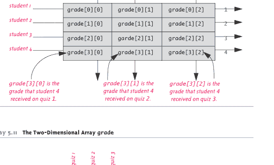

### 显示 5.11 二维数组 grade

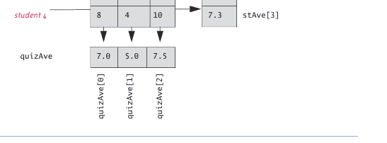

### 自测练习

20. 以下代码产生的输出是什么？

```
int myArray[4][4], index1, index2;
for (index1 = 0; index1 < 4; index1++)
    for (index2 = 0; index2 < 4; index2++)
        myArray[index1][index2] = index2;
for (index1 = 0; index1 < 4; index1++)
{
    for (index2 = 0; index2 < 4; index2++)
        cout << myArray[index1][index2] << " ";
    cout << endl;
}
```

21. 编写代码，将数组 a（如下声明）用键盘输入的数字填充。数字将以每行五个、共四行的形式输入（尽管你的解决方案不必依赖于输入数字如何分成行）。

```
int a[4][5];
```

22. 编写一个名为 echo 的 void 函数定义，使得以下函数调用将回显自测练习 21 中描述的输入，并且以我们为输入指定的相同格式回显它（即每行五个数字，共四行）：

```
echo(a, 4);
```

### 章节总结

- 一个数组可用于存储和操作一组全部为相同类型的数据。
- 数组的索引变量可像该数组基类型的任何其他变量一样使用。
- for 循环是遍历数组元素并对每个索引变量执行某些程序操作的好方法。
- 使用数组时最常见的编程错误是尝试访问不存在的数组索引。始终检查操作数组的循环的第一个和最后一个迭代，以确保它没有使用非法过小或非法过大的索引。
- 数组形式参数既不是传值参数也不是传引用参数，而是一种新的参数类型。数组参数与传引用参数相似，因为在函数体中对形式参数所做的任何更改都将在函数调用时对数组参数产生影响。
- 数组的索引变量在计算机内存中彼此相邻存储，因此数组占据内存中的连续部分。当数组作为参数传递给函数时，只会将第一个索引变量（编号为 0 的那个）的地址提供给调用函数。因此，具有数组参数的函数通常需要另一个类型为 int 的形式参数来给出数组的大小。
- 使用部分填充的数组时，你的程序需要一个额外的类型为 int 的变量来跟踪数组的使用程度。
- 要告诉编译器数组参数不应被你的函数更改，你可以在该参数位置的数组参数前插入 const 修饰符。用 const 修改的数组参数称为常量数组参数。
- 如果你需要一个多于一个索引的数组，可以使用多维数组，它实际上是数组的数组。

### 自测练习答案

- 1. 语句 `int a[5];` 是一个声明，其中 5 是数组元素的数量。表达式 `a[4]` 是对前一条语句定义的数组的访问。访问的是具有索引 4 的元素，即第五个（也是最后一个）数组元素。
- 2. a. `score`
  b. `double`
  c. `5`
  d. `0 through 4`
  e. `score[0]`、`score[1]`、`score[2]`、`score[3]`、`score[4]` 中的任何一个
- 3. a. 初始化器过多
  b. 正确。数组大小为 4。
  c. 正确。数组大小为 4。
- 4. `abc`
- 5.
  ```text
  1.1 2.2 3.3
  1.1 3.3 3.3
  ```
  （记住索引从 0 开始，而不是 1。）
- 6.
  ```text
  0  2  4  6  8  10  12  14  16  18
  0  4  8  12  16
  ```
- 7. `sampleArray` 的索引变量是 `sampleArray[0]` 到 `sampleArray[9]`，但这段代码试图填充 `sampleArray[1]` 到 `sampleArray[10]`。`sampleArray[10]` 中的索引 10 超出范围。
- 8. 索引越界。当 index 等于 9 时，index + 1 等于 10，因此 a[index + 1]，即 a[10]，具有非法索引。循环应少一次迭代。要纠正代码，将 for 循环的第一行改为

```
for (int index = 0; index < 9; index++)
```
- 9. int i, a[20];
cout << "Enter 20 numbers:\n";
for (i = 0; i < 20; i++)
    cin >> a[i];
- 10. 该数组将消耗 14 字节内存。索引变量 yourArray[3] 的地址为 1006。
- 11. 以下函数调用是可以接受的：

```
tripler(a[2]);
tripler(a[number]);
tripler(number);
```

以下函数调用是不正确的：

```
tripler(a[3]);
tripler(a);
```

第一个具有非法索引。第二个根本没有索引表达式。你不能像第二个调用那样使用整个数组作为 tripler 的参数。整个数组作为函数参数的章节讨论了可以使用整个数组作为参数的不同情况。
- 12. 循环遍历索引变量 b[1] 到 b[5]，但 5 是数组 b 的非法索引。索引为 0、1、2、3 和 4。代码的正确版本如下所示：

```
int b[5] = {1, 2, 3, 4, 5};
for (int i = 0; i < 5; i++)
    tripler(b[i]);
```
- 13. void oneMore(int a[], int size)
//前置条件：size 是数组 a 的声明大小。
//a[0] 到 a[size-1] 已赋予值。
//后置条件：a[index] 已增加 1
//对于 a 的所有索引变量。
{
    for (int index = 0; index < size; index++)
        a[index] = a[index] + 1;
}
- 14. 以下函数调用都是可以接受的：

too2(myArray, 29);  
too2(myArray, 10);  
too2(yourArray, 100);

调用

too2(myArray, 10);

是合法的，但只会填充 myArray 的前十个索引变量。如果这就是所需的行为，则该调用是可以接受的。

以下函数调用都是不正确的：

too2(myArray, 55);
“Hey too2. Please come over here.”
too2(myArray[3], 29);

第一个不正确是因为第二个参数过大，第二个因为缺少最终的分号（以及其他原因），第三个因为它在应该使用整个数组的地方使用了索引变量。
- 15. 你可以使 output 中的数组参数成为常量参数，因为没有必要更改数组参数的任何索引变量的值。你不能使 dropOdd 中的参数成为常量参数，因为它可能会更改其某些索引变量的值。

```
void output(const double a[], int size)
//前置条件：a[0] 到 a[size − 1] 有值。
//后置条件：a[0] 到 a[size − 1] 已被写出。

void dropOdd(int a[], int size);
//前置条件：a[0] 到 a[size − 1] 有值。
//后置条件：a[0] 到 a[size − 1] 中的所有奇数
//已更改为 0。
```
- 16. int outOfOrder(double array[], int size)
      {
          for(int i = 0; i < size − 1; i++)
              if (array[i] > array[i+1])//fetch a[i+1] for each i.
                  return i+1;
          return −1;
      }
- 17. #include <iostream>
    using namespace std;
    const int DECLARED_SIZE = 10;
    
    int main()
    {
        cout << "Enter up to ten nonnegative integers.\n"


### 数组

```cpp
<< "Place a negative number at the end.\n";
int numberArray[DECLARED_SIZE], next, index = 0;
cin >> next;
while (( next >= 0 ) && ( index < DECLARED_SIZE ) )
{
    numberArray[index] = next;
    index++;
    cin >> next;
}

int numberUsed = index;
cout << "Here they are back at you:";
for (index = 0; index < numberUsed; index++)
    cout << numberArray[index] << " ";
cout << endl;
return 0;
}
```

```cpp
18. #include <iostream>
using namespace std;
const int DECLARED_SIZE = 10;

int main()
{
    cout << "Enter up to ten letters"
         << " followed by a period:\n";
    char letterBox[DECLARED_SIZE], next;
    int index = 0;
    cin >> next;
    while (( next != '.' ) && ( index < DECLARED_SIZE ) )
    {
        letterBox[index] = next;
        index++;
        cin >> next;
    }

    int numberUsed = index;
    cout << "Here they are backwards:\n";
    for (index = numberUsed-1; index >= 0; index--)
        cout << letterBox[index];
    cout << endl;
    return 0;
}
```

```cpp
19. bool search(const int a[], int numberUsed,
               int target, int& where)
{
    int index = 0;
    bool found = false;
    while ((!found) && (index < numberUsed))
        if (target == a[index])
            found = true;
        else
            index++;
    //If target was found, then
    //found == true and a[index] == target.
    if (found)
        where = index;
    return found;
}
```

```text
20. 0 1 2 3
0 1 2 3
0 1 2 3
0 1 2 3
```

```cpp
21. int a[4][5];
int index1, index2;
for (index1 = 0; index1 < 4; index1++)
    for (index2 = 0; index2 < 5; index2++)
        cin >> a[index1][index2];
```

```cpp
22. void echo(const int a[][5], int sizeOfa)
//Outputs the values in the array a on sizeOfa lines
//with 5 numbers per line.
{
    for (int index1 = 0; index1 < sizeOfa; index1++)
    {
        for (int index2 = 0; index2 < 5; index2++)
            cout << a[index1][index2] << " ";
        cout << endl;
    }
}
```

### 编程项目


- 1. 编写一个程序，读取某个城市一年中每个月的平均月降雨量，然后读取过去12个月每个月的实际月降雨量。程序随后打印出一个格式良好的表格，显示过去12个月每个月的降雨量，以及每个月高于或低于平均值的数量。平均月降雨量按一月、二月等顺序给出。要获得过去12个月的实际降雨量，程序首先

S = sqrt( sum_{i=1}^{N} (x_i - x̄)^2 / N )

部分填充数组中的数字。由于部分填充数组需要两个参数，该函数实际上将有两个形参：一个数组参数和一个类型为 int 的形参，用于给出已使用的数组位置数量。数组中的数字将为 double 类型。将你的函数嵌入一个合适的测试程序中。

- 4. 编写一个程序，读入一个 int 类型的数组。你可以假设数组中的条目少于50个。你的程序确定使用了多少个条目。输出是一个两列的列表。第一列是不同的数组元素列表；第二列是每个元素出现次数的计数。列表应按第一列的条目排序，从大到小。

对于数组值：

```text
-12 3 -12 4 1 1 -12 1 -1 1 2 3 4 2 3 -12
```

输出应为：

| N | 计数 |
|---|-------|
| 4 | 2 |
| 3 | 3 |
| 2 | 2 |
| 1 | 4 |
| -1 | 1 |
| -12 | 4 |

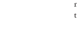

- 5. 数组可以用于一次存储一个大整数的一位数字。例如，整数 1234 可以存储在数组 a 中，方法是设置 a[0] 为 1，a[1] 为 2，a[2] 为 3，a[3] 为 4。然而，在这个练习中，你会发现倒序存储数字可能更有用，也就是将 4 放在 a[0]，3 放在 a[1]，2 放在 a[2]，1 放在 a[3]。在这个练习中，你将编写一个程序，读入两个长度不超过20位的正整数，然后输出这两个数的和。你的程序将把数字作为 char 类型读取，这样数字 1234 会被读取为四个字符 '1'、'2'、'3' 和 '4'。在读入程序后，这些字符会被转换为 int 类型的值。数字将被读入一个部分填充的数组，你可能会发现在数组从键盘填入数据后反转数组元素的顺序是有用的。（是否反转数组元素的顺序由你决定。两种方式都可以，各有优缺点。）你的程序将通过实现通常的纸笔加法算法来执行加法。加法的结果存储在一个大小为20的数组中，然后将结果写到屏幕上。如果加法的结果是一个超过最大位数（即超过20位）的整数，那么你的程序应该发出一条消息，说明它遇到了“整数溢出”。你应该能够改变整数的最大长度

- 8. 编写一个程序，接受类似于程序清单 5.4 中程序的输入，并输出类似于该程序中的条形图，不同之处在于你的程序将垂直输出条形，而不是水平输出。二维数组可能会很有用。

- 9. 数学家约翰·霍顿·康威发明了“生命游戏”。尽管从任何传统意义上来说它都不是一个“游戏”，但只用几条规则就能产生有趣的行为。这个项目要求你编写一个程序，允许你指定一个初始配置。程序遵循生命游戏的规则（稍后列出）来展示该配置的持续行为。

生命是一种生活在离散的二维世界中的生物。虽然这个世界实际上是无限的，但我们没有那样的奢侈，所以我们将数组限制为 80 个字符宽、22 个字符位置高。如果你可以使用更大的屏幕，请务必使用它。

这个世界是一个数组，每个单元格能够容纳一个生命细胞。世代标志着时间的流逝。每一代都会给生命社群带来出生和死亡。出生和死亡遵循以下规则：

  - 1. 我们定义每个细胞有八个邻居细胞。一个细胞的邻居是位于其正上方、正下方、正右方、正左方、右上斜、左上斜、右下斜和左下斜的细胞。
  - 2. 如果某个被占据的细胞有零个或一个邻居，它就会因孤独而死。如果某个被占据的细胞有超过三个邻居，它就会因过度拥挤而死。
  - 3. 如果一个空细胞恰好有三个被占据的邻居细胞，就会有一个新细胞出生以取代该空细胞。
  - 4. 出生和死亡是瞬间发生的，并在世代更替时发生。一个细胞无论因何种原因死亡，都可能有助于引起出生，但一个新生的细胞不能复活一个正在死亡的细胞，细胞的死亡也不能阻止另一个细胞的死亡，比如通过减少局部种群数量。

  *示例：* `***` 变成 `*`，然后又变成 `***`，依此类推。

  *备注：* 有些配置会从相对较小的初始配置开始生长。另一些配置会在区域内移动。建议在文本输出时使用一个 80 列 22 行的矩形 char 数组来存储生命世界连续的各代。使用 `*` 表示活细胞，使用空白表示空（或死）细胞。如果你的屏幕行数比这更多，请务必使用整个屏幕。

  *建议：* 寻找稳定的配置。也就是说，寻找持续重复模式的群落。重复中配置的数量称为*周期*。有些配置是固定的，也就是说，它们保持不变。一个可能的项目是找到这样的配置。

  *提示：* 定义一个名为 `generation` 的 void 函数，该函数接受我们称为 `world` 的数组，即一个 80 列 22 行的 char 类型数组，其中包含初始配置。该函数扫描数组并修改细胞，按照前面列出的规则标记出生和死亡的细胞。这涉及依次检查每个细胞，然后要么


杀死该细胞，让它存活，或者，如果该细胞为空，则决定是否应该诞生一个细胞。应该有一个名为 display 的函数，它接受数组 world 并在屏幕上显示该数组。在 generation 和 display 的调用之间加入某种时间延迟是合适的。为此，你的程序应在按下 Return 时生成并显示下一代。你可以自由地实现自动化，但对程序来说自动化并非必要。

### 第6章 结构与类


+ 6.1 STRUCTURES 22A
+ - Structure Types 226
+ - Pitfall: Forgetting a Semicolon in a Structure Definition 230
+ - Structures as Function Arguments 230
+ - Tip: Use Hierarchical Structures 231
+ - Initializing Structures 234
+ 
+ 6.2 CLASSES 236
+ - Defining Classes and Member Functions 236
+ - Encapsulation 242
+ - Public and Private Members 243
+ - Accessor and Mutator Functions 247
+ - Tip: Separate Interface and Implementation 248
+ - Tip: A Test for Encapsulation 249
+ - Structures versus Classes 250
+ - Tip: Thinking Objects 252
+ 
+ CHAPTER SUMMARY 252
+ ANSWERS TO SELF-TEST EXERCISES 253
+ PROGRAMMING PROJECTS 255

### 结构与类

> 'The time has come,' the Walrus said,
> 'To talk of many things:
> Of shoes—and ships—and sealing wax—
> Of cabbages—and kings.'

Lewis Carroll, Through the Looking Glass

### INTRODUCTION

类也许是 C++ 语言与 C 语言区别的单一最重要的特性。类是一种类型，其值称为对象。对象既有数据也有成员函数。成员函数对它们所属对象的数据具有特殊访问权限。这些对象就是面向对象编程的对象，而面向对象编程是一种非常流行且强大的编程哲学。

我们将分两步介绍类。首先我们告诉你如何为结构给出类型定义。结构（此处讨论的类型）可以被视为没有成员函数的对象。¹ 结构的重要特性是结构中的数据可以是多种类型的数据项的集合。在你学习了结构之后，定义类将是自然的扩展。

你不需要阅读第 5 章中关于数组的材料即可阅读第 6 章，以及第 7 章和第 8 章的大部分内容，这些章节涵盖了类。

## 6.1 Structures

> I don't care to belong to any club that will accept me as a member.

Groucho Marx, The Groucho Letters

有时将不同类型的多个值收集起来并将该集合作为单个项目处理是有用的。例如，考虑银行存款单，通常称为 CD。CD 是一种银行账户，在指定的月数内不允许取款。CD 自然有三个

¹ 结构实际上可以在 C++ 中拥有成员函数，但这不是我们将采用的方法。此细节将在本章后面解释。此脚注只是为了让发现错误的用户知道我们了解结构的官方定义。大多数读者应忽略此脚注。

相关的数据项：账户余额、账户利率以及期限，即到期前的月数。前两项可以用 type double 的值表示，月数可以用 type int 的值表示。Display 6.1 显示了可用于此类账户的结构 CDAccountV1 的定义。（V1 代表版本 1。我们将在本章后面定义一个改进的版本。）

### Display 6.1 A Structure Definition (part 1 of 2)

//Program to demonstrate the CDAccountV1 structure type.
#include <iostream>
using namespace std;

//Structure for a bank certificate of deposit:
struct CDAccountV1
{
    double balance;
    double interestRate;
    int term;//months until maturity
};

An improved version of this structure will be given later in this chapter.

void getData(CDAccountV1 &theAccount);
//Postcondition: theAccount.balance, theAccount.interestRate, and //theAccount.term have been given values that the user entered at the keyboard.

int main()
{
    CDAccountV1 account;
    getData(account);

    double rateFraction, interest;
    rateFraction = account.interestRate/100.0;
    interest = account.balance*(rateFraction*(account.term/12.0));
    account.balance = account.balance + interest;

    cout.setf(ios::fixed);
    cout.setf(ios::showpoint);
    cout.precision(2);
    cout << "When your CD matures in "
         << account.term << " months,\n"
         << "it will have a balance of $"
         << account.balance << endl;

    return 0;
}

### Display 6.1 A Structure Definition (part 2 of 2)

```cpp
//Uses iostream:
void getData(CDAccountV1& theAccount)
{
    cout << "Enter account balance: $";
    cin >> theAccount.balance;
    cout << "Enter account interest rate: ";
    cin >> theAccount.interestRate;
    cout << "Enter the number of months until maturity: ";
    cin >> theAccount.term;
}
```

### SAMPLE DIALOGUE

```
Enter account balance: $100.00
Enter account interest rate: 10.0
Enter the number of months until maturity: 6
When your CD matures in 6 months,
it will have a balance of $105.00
```

### ■ STRUCTURE TYPES

Display 6.1 中的结构定义如下：

```cpp
struct CDAccountV1
{
    double balance;
    double interestRate;
    int term; //months until maturity
};
```

关键字 `struct` 宣布这是一个结构类型定义。标识符 `CDAccountV1` 是结构类型的名称，称为 **结构标签**。结构标签可以是任何合法的标识符且不是关键字。虽然 C++ 语言并不要求，但结构标签通常以大写字母开头。花括号 `{}` 内声明的标识符称为 **成员名**。如本例所示，结构类型定义以右花括号 `}` 和分号结束。

结构定义通常放在任何函数定义之外（与全局定义的常量声明放在所有函数定义之外的方式相同）。结构类型随后成为全局定义，可供结构定义之后的所有代码使用。

一旦给出结构类型定义，结构类型就可以像预定义类型 int、char 等一样使用。请注意，在 Display 6.1 中，结构类型 CDAccountV1 用于在函数 main 中声明一个变量，并用作函数 getData 的参数类型名称。

结构变量可以像任何其他变量一样保存值。结构值是由称为成员值的较小值组成的集合。对于结构定义中声明的每个成员名，都有一个成员值。例如，类型 CDAccountV1 的值是由三个成员值组成的集合，其中两个为 type double，一个为 type int。构成结构值的成员值存储在成员变量中，我们接下来讨论这一点。

每个结构类型指定一个成员名列表。在 Display 6.1 中，结构 CDAccountV1 有三个成员名：balance、interestRate 和 term。这些成员名中的每一个都可用于挑选出较大的结构变量的一部分的较小变量。这些较小的变量称为成员变量。成员变量是通过给出结构变量的名称后跟一个点然后是成员名来指定的。例如，如果 account 是类型 CDAccountV1 的结构变量（如 Display 6.1 中声明的那样），则结构变量 account 具有以下三个成员变量：

```
account.balance
account.interestRate
account.term
```

前两个成员变量的类型为 double，最后一个为 type int。如 Display 6.1 所示，这些成员变量可以像任何其他该类型的变量一样使用。例如，Display 6.1 中程序的以下行将把成员变量 account.balance 中包含的值和普通变量 interest 中包含的值相加，然后将结果放入成员变量 account.balance 中：

```
account.balance = account.balance + interest;
```

两个或多个结构类型可以使用相同的成员名。例如，在同一个程序中拥有以下两个类型定义是完全合法的：

```
struct FertilizerStock
{
    double quantity;
    double nitrogenContent;
};
```

和

```
struct CropYield
{
    int quantity;
    double size;
};
```


### 点运算符

点运算符用于指定结构体变量的成员变量。

### 语法

点运算符

```
结构体变量名.成员变量名
```

### 示例

```
struct StudentRecord
{
    int studentNumber;
    char grade;
};

int main()
{
    StudentRecord yourRecord;
    yourRecord.studentNumber = 2001;
    yourRecord.grade = 'A';
}
```

有些作者将点运算符称为结构体成员访问运算符，尽管我们不会使用这个术语。

这种名称上的巧合不会产生任何问题。例如，如果你声明以下两个结构体变量：

```
FertilizerStock superGrow;
CropYield apples;
```

那么 superGrow 肥料的量存储在成员变量 superGrow.quantity 中，而苹果的产量存储在成员变量 apples.quantity 中。点运算符和结构体变量共同指定了每种情况下所指的量。

结构体值可以被视为成员值的集合。结构体值也可以被视为单个（复合）值（它恰好由成员值组成）。由于结构体值可以被视为单个值，因此结构体值和结构体变量可以像使用预定义类型（如 int）的简单值和简单变量一样使用。特别是，你可以使用等号来赋值结构体值。例如，如果 apples 和 oranges 是之前定义的 CropYield 类型的结构体变量，那么以下操作是完全合法的：

```
apples = oranges;
```

上面的赋值语句等价于

```
apples.quantity = oranges.quantity;
apples.size = oranges.size;
```

### 简单的结构体类型

如下所示定义结构体类型。Structure_Tag 是结构体类型的名称。

### 语法

```
struct Structure_Tag
{
    Type_1 Member_Variable_Name_1;
    Type_2 Member_Variable_Name_2;
    :
    Type_Last Member_Variable_Name_Last;
};
不要忘记这个分号。
```

### 示例

```
struct Automobile
{
    int year;
    int doors;
    double horsePower;
    char model;
};
```

虽然我们不会使用这个特性，但你可以将相同类型的成员名称合并成一个用逗号分隔的列表。例如，以下定义与上面的结构体定义等价：

```
struct Automobile
{
    int year, doors;
    double horsePower;
    char model;
};
```

结构体类型的变量可以像其他类型的变量一样声明。例如：

```
Automobile myCar, yourCar;
```

成员变量使用点运算符指定。例如：myCar.year、myCar.doors、myCar.horsePower 和 myCar.model。

### 陷阱：在结构体定义中忘记分号

当你为结构体定义添加最后的右花括号 } 时，感觉结构体定义已经完成，但实际上还没有。你必须在最后的右花括号后面加上分号。这是有原因的，尽管这个原因是我们不会用到的特性。结构体定义不仅仅是定义，它还可以用来声明结构体变量。你可以在最后的右花括号和最后的分号之间列出结构体变量名。例如，以下定义了一个名为 WeatherData 的结构体，并声明了两个结构体变量 dataPoint1 和 dataPoint2，它们的类型都是 WeatherData：

```
struct WeatherData
{
    double temperature;
    double windVelocity;
} dataPoint1, dataPoint2;
```

### 结构体作为函数参数

函数可以有结构体类型的按值参数或结构体类型的按引用参数，或者两者都有。例如，Display 6.1 中的程序包含一个名为 getData 的函数，它有一个结构体类型 CDAccountV1 的按引用参数。

结构体类型也可以是函数返回值的类型。例如，以下定义了一个函数，它接受一个 CDAccountV1 类型的参数，并返回一个 CDAccountV1 类型的结构体。返回的结构体将具有与参数相同的余额和期限，但支付的利率是参数的两倍。

```
CDAccountV1 doubleInterest(CDAccountV1 oldAccount)
{
    CDAccountV1 temp;
    temp = oldAccount;
    temp.interestRate = 2*oldAccount.interestRate;
    return temp;
}
```

注意 CDAccountV1 类型的局部变量 temp；temp 用于构建所需类型的完整结构体值，然后由函数返回。如果 myAccount 是一个 CDAccountV1 类型的变量，并且其成员变量已被赋值，那么以下操作将为 yourAccount 赋予一个利率是 myAccount 两倍的账户值：

```
CDAccountV1 yourAccount;
yourAccount = doubleInterest(myAccount);
```

### 使用层次结构体

有时，让结构体的成员本身是更小的结构体是有意义的。例如，一个名为 PersonInfo 的结构体类型，用于存储一个人的身高、体重和出生日期，可以定义如下：

```
struct Date
{
    int month;
    int day;
    int year;
};
```

```
struct PersonInfo
{
    double height;//以英寸为单位
    int weight;//以磅为单位
    Date birthday;
};
```

PersonInfo 类型的结构体变量以通常的方式声明：

```
PersonInfo person1;
```

如果结构体变量 person1 的值已设置为记录一个人的出生日期，那么该人的出生年份可以如下输出到屏幕：

```
cout << person1.birthday.year;
```

阅读此类表达式的方式是从左到右，并且非常仔细。从最左边开始，person1 是一个 PersonInfo 类型的结构体变量。要获取名为 birthday 的成员变量，你使用点运算符，如下所示：

```
person1.birthday
```

这个成员变量本身是一个 Date 类型的结构体变量。因此，这个成员变量本身也有成员变量。通过添加一个点和成员变量名（如 year）来获取结构体变量 person1.birthday 的成员变量，这产生了上面所示的表达式 person1.birthday.year。

在 Display 6.2 中，我们重写了 Display 6.1 中的定期存款类。这个新版本有一个 Date 结构体类型的成员变量，用于保存到期日。我们还用两个新的成员变量替换了单一的余额成员变量，分别给出初始余额和到期余额。

### Display 6.2 带有结构体成员的结构体（第 1 部分，共 2 部分）

> 这是 Display 6.1 中定义的 CDAccountV1 结构体的改进版本。

//演示 CDAccount 结构体类型的程序。
#include <iostream>
using namespace std;

struct Date
{
    int month;
    int day;
    int year;
};

//用于银行定期存款的改进结构体：
struct CDAccount
{
    double initialBalance;
    double interestRate;
    int term;//到期前的月数
    Date maturity; //CD 到期日期
    double balanceAtMaturity;
};

void getCDData(CDAccount& theAccount);
//后置条件：theAccount.initialBalance、theAccount.interestRate、
//theAccount.term 和 theAccount.maturity 已被赋予
//用户在键盘上输入的值。

void getDate(Date& theDate);
//后置条件：theDate.month、theDate.day 和 theDate.year
//已被赋予用户在键盘上输入的值。

int main()
{
    CDAccount account;
    cout << "输入账户开立当天的账户数据：\n";
    getCDData(account);
    double rateFraction, interest;
    rateFraction = account.interestRate/100.0;
    interest = account.initialBalance*(rateFraction*(account.term/12.0));
    account.balanceAtMaturity = account.initialBalance + interest;

    cout.setf(ios::fixed);
    cout.setf(ios::showpoint);
    cout.precision(2);
    cout << "当 CD 在 "
         << account.maturity.month << "-" << account.maturity.day

### Display 6.2 带有结构体成员的结构体（第 2 部分，共 2 部分）

```
41        << "-" << account.maturity.year << " 到期时" << endl;
42        << "它的余额为 $"
43        << account.balanceAtMaturity << endl;
44    return 0;
45 }

46 //使用 iostream：
47 void getCDData(CDAccount& theAccount)
48 {
49     cout << "输入账户初始余额：$";
50     cin >> theAccount.initialBalance;
51     cout << "输入账户利率：";
52     cin >> theAccount.interestRate;
53     cout << "输入距离到期的月数：";
54     cin >> theAccount.term;
55     cout << "输入到期日期：\n";
56     getDate(theAccount.maturity);
57 }

58 //使用 iostream：
59 void getDate(Date& theDate)
60 {
61     cout << "输入月份：";
62     cin >> theDate.month;
63     cout << "输入日期：";
64     cin >> theDate.day;
65     cout << "输入年份：";
66     cin >> theDate.year;
67 }
```

### 示例对话

```
输入账户开立当天的账户数据：
输入账户初始余额：$100.00
输入账户利率：10.0
输入距离到期的月数：6
输入到期日期：
输入月份：2
输入日期：14
输入年份：1899
当 CD 在 2-14-1899 到期时
它的余额为 $105.00
```


# 初始化结构体

你可以在声明时初始化一个结构体。要给一个结构体变量赋一个值，就在它后面跟上等号和用大括号括起来的成员值列表。例如，下面的日期结构体类型的定义在前一小节中给出过：

```
struct Date
{
    int month;
    int day;
    int year;
};
```

一旦类型 Date 被定义，你就可以按如下方式声明并初始化一个名为 dueDate 的结构体变量：

```
Date dueDate = {12, 31, 2003};
```

初始化值必须按与结构体类型定义中成员变量的顺序相对应的顺序给出。在此示例中，dueDate.month 接收第一个初始化值 12，dueDate.day 接收第二个值 31，而 dueDate.year 接收第三个值 2003。

如果初始化值多于结构体成员，则为错误。如果初始化值少于结构体成员，则提供的按顺序用于初始化数据成员。每个没有初始化器的成员都初始化为该变量类型的适当零值。

### 自测练习

- 1. 给出以下结构体和结构体变量声明，

```
struct CDAccountV2
{
    double balance;
    double interestRate;
    int term;
    char initial1;
    char initial2;
};
CDAccountV2 account;
```

以下每个的类型是什么？标记其中不正确的。
a. account.balance
b. account.interestRate
c. CDAccountV1.term
d. account.initial2
e. account

- 2. 考虑以下类型定义：

```
struct ShoeType
{
    char style;
    double price;
};
```

给定上述结构体类型定义，以下代码将产生什么输出？

```
ShoeType shoe1, shoe2;
shoe1.style = 'A';
shoe1.price = 9.99;
cout << shoe1.style << " $" << shoe1.price << endl;
shoe2 = shoe1;
shoe2.price = shoe2.price/9;
cout << shoe2.style << " $" << shoe2.price << endl;
```

- 3. 以下结构体定义中的错误是什么？

```
struct Stuff
{
    int b;
    int c;
}

int main()
{
    Stuff x;
    // other code
}
```

- 4. 给出以下结构体定义，

```
struct A
{
    int member b;
    int member c;
};
```

声明 x 使其具有此结构体类型。将 x 的成员 member b 和 member c 分别初始化为值 1 和 2。

5. 这里有一个结构体的初始化。说明每次初始化会发生什么。注意这些初始化中的任何问题。

```
struct Date
{
    int month;
    int day;
    int year;
};
```

a. Date dueDate = {12, 21};
b. Date dueDate = {12, 21, 1995};
c. Date dueDate = {12, 21, 19, 95};

6. 编写一个结构体类型的定义，用于记录由一个人的工资率、已累积假期（为若干整天数）和状态（为小时工或薪资工）组成。状态表示为两个字符值 ‘H’ 和 ‘S’ 中的一个。将类型命名为 EmployeeRecord。

7. 给出与以下函数声明相对应的函数定义。 （类型 ShoeType 在自测练习 2 中给出。）

```
void readShoeRecord(ShoeType& newShoe);
//Fills newShoe with values read from the keyboard.
```

8. 给出与以下函数声明相对应的函数定义。 （类型 ShoeType 在自测练习 2 中给出。）

```
ShoeType discount(ShoeType oldRecord);
//Returns a structure that is the same as its argument,
//but with the price reduced by 10%.
```

## 6.2 类

> 我们都知道——泰晤士报知道——但我们假装不知道。
> 
> Virginia Woolf, Monday or Tuesday

类基本上是一个同时具有成员函数和成员数据的结构体。类是面向对象编程方法论的核心。

### 定义类和成员函数

类是一种类型，其与结构体类型相似，但类类型通常同时具有成员函数和成员变量。名为 DayOfYear 的类的一个过于简单但具有说明性的示例在显示 6.3 中给出。该类有一个名为 output 的成员函数，以及两个成员变量 month 和 day。术语 public: 被称为访问说明符。它仅仅意味着其后的成员没有任何限制。我们将在通过这个简单示例后讨论 public: 及其替代方案。显示 6.3 中定义的 DayOfYear 类型是用于日期值（如一月一日或七月四日）的对象的类定义。

### 显示 6.3 具有成员函数的类（第 1 部分，共 2 部分）

//Program to demonstrate a very simple example of a class.
//A better version of the class DayOfYear will be given in Display 6.4.
#include <iostream>
using namespace std;

class DayOfYear
{
public:
    void output();
    int month;
    int day;
};

int main()
{
    DayOfYear today, birthday;
    cout << "Enter today's date:\n";
    cout << "Enter month as a number: ";
    cin >> today.month;
    cout << "Enter the day of the month: ";
    cin >> today.day;
    cout << "Enter your birthday:\n";
    cout << "Enter month as a number: ";
    cin >> birthday.month;
    cout << "Enter the day of the month: ";
    cin >> birthday.day;

    cout << "Today's date is ";
    today.output();
    cout << endl;
    cout << "Your birthday is ";
    birthday.output();
    cout << endl;

    if (today.month == birthday.month && today.day == birthday.day)
        cout << "Happy Birthday!\n";
    else
        cout << "Happy Unbirthday!\n";
    return 0;
}

> 通常，成员变量是私有的而不是公开的，如本示例中所示。这将在本章稍后讨论。

> 成员函数声明

> 对成员函数 output 的调用

### 显示 6.3 具有成员函数的类（第 2 部分，共 2 部分）

```
//Uses iostream:
void DayOfYear::output( )
{
    switch (month)
    {
        case 1:
            cout << "January "; break;
        case 2:
            cout << "February "; break;
        case 3:
            cout << "March "; break;
        case 4:
            cout << "April "; break;
        case 5:
            cout << "May "; break;
        case 6:
            cout << "June "; break;
        case 7:
            cout << "July "; break;
        case 8:
            cout << "August "; break;
        case 9:
            cout << "September "; break;
        case 10:
            cout << "October "; break;
        case 11:
            cout << "November "; break;
        case 12:
            cout << "December "; break;
        default:
            cout << "Error in DayOfYear::output. Contact software vendor.";
    }
    
    cout << day;
}
```

成员函数定义

### 示例对话

Enter today's date:
Enter month as a number: 10
Enter the day of the month: 15
Enter your birthday:
Enter month as a number: 2
Enter the day of the month: 21
Today's date is October 15
Your birthday is February 21
Happy Unbirthday!

类类型变量的值称为对象（因此，宽松地说，类类型的变量也常被称为对象）。一个对象同时具有数据成员和函数成员。在使用类进行编程时，一个程序被视为一组相互作用的对象的集合。对象可以相互作用，因为它们能够执行操作，即调用成员函数。类类型的变量以值的方式保存对象。类类型的变量的声明方式与预定义类型的变量相同，也与结构体变量的声明方式相同。

暂时忽略显示 6.3 中出现的 public: 一词。DayOfYear 类的其余定义与结构体定义非常相似，只是它使用关键字 class 而不是 struct，并且列出了成员函数 output（以及成员变量 month 和 day）。请注意，成员函数 output 是通过给出其声明（原型）来列出的。类定义通常只包含其成员函数的声明。成员函数的定义通常在其他地方给出。在 C++ 类定义中，你可以以任何方式混合成员变量和成员函数的顺序，但我们将遵循的风格倾向于在成员变量之前列出成员函数。

类类型对象的成员变量使用点运算符指定，其方式与点运算符用于指定结构体成员变量的方式相同。例如，如果 today 是显示 6.3 中定义的类类型 DayOfYear 的变量，则 today.month 和 today.day 是对象 today 的两个成员变量。

你定义的类的成员函数使用点运算符调用，其方式与指定成员变量的方式类似。例如，显示 6.3 中的程序按如下方式声明两个 DayOfYear 类型的对象：

```
DayOfYear today, birthday;
```

成员函数 output 使用对象 today 调用如下：

```
today.output();
```

成员函数 output 使用对象 birthday 调用如下：

```
birthday.output();
```

当成员函数被定义时，定义必须包含类名，因为可能有两个或多个类具有同名的成员函数。显示 6.3 中只有一个类定义，但在其他情况下你可能有多个类定义，并且多个类可能具有同名的成员函数。类 DayOfYear 的成员函数 output 的定义显示在显示 6.3 的第 2 部分中。该定义与普通函数定义相似，只是你必须在函数定义的标题中指定类名。

成员函数 output 的函数定义标题如下：

```
void DayOfYear::output()
```

运算符 :: 被称为作用域解析运算符，其作用与点运算符类似。点运算符和作用域解析运算符都用于


要说明一个成员函数属于什么，使用作用域解析运算符 ::。然而，作用域解析运算符与类名一起使用，而点运算符则与对象（即类变量）一起使用。作用域解析运算符由两个冒号组成，中间没有空格。在作用域解析运算符之前的类名通常称为类型限定符，因为它将函数名专门化（“限定”）为某一特定类型。

请看在 Display 6.3 中给出的成员函数 DayOfYear::output 的定义。注意在 DayOfYear::output 的函数定义中，我们直接使用了成员名 month 和 day，而没有先给出对象和点运算符。这乍看之下可能很奇怪，但此时我们只是定义成员函数 output。output 的这个定义将适用于所有 DayOfYear 类型的对象，但此时我们并不知道将要使用的 DayOfYear 类型对象的名称，因此无法给出它们的名称。当成员函数被调用时，如

```
today.output();
```

函数定义中的所有成员名都会被专门化为调用对象的名称。因此，上述函数调用等价于以下内容：

```
{
    switch (today.month)
    {
        case 1:
        .
        .
        .
    }
    cout << today.day;
}
```

### 成员函数定义

成员函数的定义与任何其他函数类似，只是函数头中给出了 Class_Name 和作用域解析运算符 ::。

### 语法

```
Returned_Type Class_Name::Function_Name(Parameter_List)
{
    Function_Body_Statements
}
```

### 示例

参见 Display 6.3。注意在成员函数定义中出现的成员变量（month 和 day）前面没有对象名和点。

在成员函数的函数定义中，你可以使用该类的所有成员的名称（包括数据成员和函数成员），而无需使用点运算符。

### 点运算符与作用域解析运算符

点运算符与作用域解析运算符都与成员名一起使用，以指定它们属于何物。例如，假设你声明了一个名为 DayOfYear 的类，并按如下方式声明一个对象 today：

```
DayOfYear today;
```

你使用点运算符来指定对象 today 的一个成员。例如，output 是 DayOfYear 类的成员函数（定义在 Display 6.3 中），下面的函数调用将输出存储在对象 today 中的数据值：

```
today.output();
```

你使用作用域解析运算符 :: 来在给出成员函数的函数定义时指定类名。例如，成员函数 output 的函数定义头的写法如下：

```
void DayOfYear::output()
```

记住，作用域解析运算符 :: 与类名一起使用，而点运算符与该类的对象一起使用。

### 一个类是一个完整的类型

类是一种类型，就像类型 int 和 double 一样。你可以有类类型的变量，可以有类类型的参数，函数可以返回类类型的值，更一般地说，你可以像使用其他类型一样使用类类型。

### 自测练习

- 9. 下面我们重新定义了 Display 6.3 中的类 DayOfYear，现在它多了一个名为 input 的成员函数。写出该成员函数 input 的适当定义。
  
  ```cpp
  class DayOfYear
  {
  public:
  ```

```
```cpp
void input();
void output();
int month;
int day;
};
```
```

- 10. 给出以下类定义，写出成员函数 set 的适当定义。
  
  ```cpp
  class Temperature
  {
  public:
      void set(double newDegrees, char newScale);
      //Sets the member variables to the values given as
      //arguments.
      double degrees;
      char scale; //'F' for Fahrenheit or 'C' for Celsius.
  };
  ```

- 11. 仔细区分点运算符与作用域解析运算符 :: 的含义和用法

### ■ 封装

数据类型，例如类型 int，具有某些指定的值，例如 0、1、−1、2 等等。你倾向于认为数据类型就是这些值，但对这些值的操作与值本身一样重要。没有这些操作，你就无法对值做任何有趣的事情。类型 int 的操作包括 +、−、*、/、% 以及一些其他运算符和预定义库函数。你不应将数据类型仅仅视为值的集合。数据类型由一组值以及定义在这些值上的基本操作集合组成。如果使用该类型的程序员无法访问值和操作的实现细节，则该数据类型称为抽象数据类型（缩写为 ADT）。预定义类型，如 int，都是抽象数据类型（ADT）。你不知道类型 int 的操作，如 + 和 * 是如何实现的。即使你知道，也无法在任何 C++ 程序中使用这些信息。类，即程序员定义的类型，也应该是 ADT；也就是说，“操作”的实现细节应该对使用该类的任何程序员隐藏，或者至少与之无关。类的操作是类的（公有）成员函数。使用类的程序员不需要甚至查看成员函数的定义。类定义中给出的成员函数声明以及一些注释应该是程序员使用该类所需的一切。

使用类的程序员也不需要知道类的实现方式。数据的实现应该像成员函数的实现一样被隐藏。事实上，隐藏成员函数的实现和数据的实现几乎无法区分。对程序员来说，类 DayOfYear（Display 6.3）的数据是日期，而不是数字。程序员不应该关心也不在乎月份 March 是实现为 int 值 3、引号字符串 "March"，还是以其他方式实现。

将类的成员函数实现和对象中数据的实现对使用该类的程序员来说未知，或至少无关紧要，这种定义类的方式被称为多种不同的术语。最常用的术语是信息隐藏、数据抽象和封装，每一种都意味着类的实现细节对使用该类的程序员是隐藏的。这是面向对象编程（OOP）的主要原则之一。在讨论 OOP 时，最常使用的术语是封装。应用这一封装原则到你的类定义的一种方式是使所有成员变量私有，这将在下一小节中讨论。

### 公有和私有成员

回顾 Display 6.3 中给出的类型 DayOfYear 的定义。为了使用该类，你需要知道有两个类型为 int 的成员变量，名为 month 和 day。这违反了我们在上一小节讨论的封装（信息隐藏）原则。Display 6.4 是对类 DayOfYear 的重写版本，更好地符合这一封装原则。

注意 Display 6.4 中的 private: 和 public:。在 private: 之后列出的所有项（在本例中为成员变量 month 和 day）被称为私有，这意味着它们不能在除类 DayOfYear 的成员函数定义之外的任何地方按名称引用。例如，使用这个修改后的类 DayOfYear 定义，以下两个赋值和其他指示的代码在程序的主函数中不再被允许，也不在任何其他函数定义中被允许，除非是类 DayOfYear 的成员函数：

```
DayOfYear today; //This line is OK.
today.month = 12;//ILLEGAL
today.day = 25;//ILLEGAL
cout << today.month;//ILLEGAL
cout << today.day;//ILLEGAL
if (today.month == 1) //ILLEGAL
cout << "January";
```

一旦你将一个成员变量设为私有成员变量，就没有办法在不使用其中一个成员函数的情况下更改其值（或以其他方式引用该成员变量）。这意味着编译器将强制执行


### Display 6.4 带私有成员的类（第 1 部分，共 3 部分）

```
#include <iostream>
#include <cstdlib>
using namespace std;

class DayOfYear
{
public:
    void input();
    void output();
    void set(int newMonth, int newDay);
    //Precondition: newMonth and newDay form a possible date.

    void set(int newMonth);
    //Precondition: 1 <= newMonth <= 12
    //Postcondition: The date is set to the first day of the given month.

    int getMonthNumber(); //Returns 1 for January, 2 for February, etc.
    int getDay();
private:
    int month;
    int day;
};

int main()
{
    DayOfYear today, bachBirthday;
    cout << "Enter today's date:\n";
    today.input();
    cout << "Today's date is ";
    today.output();
    cout << endl;

    bachBirthday.set(3, 21);
    cout << "J. S. Bach's birthday is ";
    bachBirthday.output();
    cout << endl;
    if ( today.getMonthNumber() == bachBirthday.getMonthNumber() &&
        today.getDay() == bachBirthday.getDay() )
        cout << "Happy Birthday Johann Sebastian!\n";
    else
        cout << "Happy Unbirthday Johann Sebastian!\n";

    return 0;
}

//Uses iostream and cstdlib:
void DayOfYear::set(int newMonth, int newDay)
```

这是我们在 Display 6.3 中给出的类 DayOfYear 的改进版本。

私有成员

请注意，函数名 set 被重载了。你可以像重载任何其他函数一样重载成员函数。

### Display 6.4 带私有成员的类（第 2 部分，共 3 部分）

```
42 {
43     if ((newMonth >= 1) && (newMonth <= 12))
44         month = newMonth;
45     else
46     {
47         cout << "Illegal month value! Program aborted.\n";
48         exit(1);
49     }
50     if ((newDay >= 1) && (newDay <= 31))
51         day = newDay;
52     else
53     {
54         cout << "Illegal day value! Program aborted.\n";
55         exit(1);
56     }
57 }
58 //Uses iostream and cstdlib:
59 void DayOfYear::set(int newMonth)
60 {
61     if ((newMonth >= 1) && (newMonth <= 12))
62         month = newMonth;
63     else
64     {
65         cout << "Illegal month value! Program aborted.\n";
66         exit(1);
67     }
68     day = 1;
69 }
70 
71 int DayOfYear::getMonthNumber()
72 {
73     return month;
74 }
75 
76 int DayOfYear::getDay()
77 {
78     return day;
79 }
80 //Uses iostream and cstdlib:
81 void DayOfYear::input()
82 {
83     cout << "Enter the month as a number: ";
84     cin >> month;
85     cout << "Enter the day of the month: ";
86     cin >> day;
```

变异函数

访问函数

私有成员可以在成员函数定义中使用，但不能在其他地方使用。

### Display 6.4 带私有成员的类（第 3 部分，共 3 部分）

```
86  if ((month < 1) || (month > 12) || (day < 1) || (day > 31))
87  {
88      cout << "Illegal date! Program aborted.\n";
89      exit(1);
90  }
91  }

92  void DayOfYear::output()
93  <The rest of the definition of DayOfYear::output is given in Display 6.3.>
```

# SAMPLE DIALOGUE

```
Enter today's date:
Enter the month as a number: 3
Enter the day of the month: 21
Today's date is March 21
J. S. Bach's birthday is March 21
Happy Birthday Johann Sebastian!
```

类 DayOfYear 的数据实现。如果你仔细查看 Display 6.4 中的程序，你会看到成员变量名 month 和 day 使用的唯一地方是在成员函数的定义中。在成员函数定义之外，没有任何地方引用 today.month、today.day、bachBirthday.month 或 bachBirthday.day。

所有在 public: 之后出现的项（在本例中为成员函数）被称为公开的，这意味着它们可以在任何地方按名称引用。公开成员的使用没有任何限制。

任何成员变量可以是公开的也可以是私有的。任何成员函数可以是公开的也可以是私有的。然而，正常的良好编程实践要求所有成员变量都是私有的，而通常大多数成员函数是公开的。

类定义中可以有任意多个 public 和 private 访问说明符的出现。每当你插入

```
public:
```

成员列表就会从私有变为公开。每当你插入

```
private:
```

成员列表就会变回私有成员。你不必只有一组公开成员和一组私有成员。然而，通常只有一组公开部分和一组私有部分。

public:

public
member
variable

关于是否应先列出公开成员还是先列出私有成员，并没有普遍一致的意见。大多数人似乎更喜欢先列出公开成员。这使得使用该类的程序员可以轻松查看他们实际使用的部分。你可以自行决定想先放什么，但本书中的示例将遵循大多数人的做法，先列出公开成员，然后列出私有成员。

从某种意义上说，C++ 似乎更倾向于先放置私有成员。如果第一个成员组既没有 public: 也没有 private: 说明符，那么该组中的成员将自动为私有。你会在代码中看到这种默认行为的使用，并且应该熟悉它。然而，我们在本书中不会使用它。

# 访问函数和变异函数

你应该始终将类中的所有成员变量设为私有。有时你可能需要对类对象中的数据做一些事情。然而，成员函数将允许你对对象中的数据执行许多操作，但迟早你会想要或需要对数据执行某些操作，而没有相应的成员函数。你如何才能对对象中的数据进行新的操作？答案是，只要你为类配备合适的访问函数和变异函数，你就可以做任何合理想要做的事情。这些是允许你以非常通用的方式访问和更改对象中的数据的成员函数。访问函数允许你读取数据。在 Display 6.4 中，成员函数 getMonthNumber 和 getDay 是访问函数。访问函数不必字面地返回每个成员变量的值，但它们必须返回等效于这些值的内容。例如，对于像 DayOfYear 这样的类，你可能有一个访问函数返回月份名称作为某种字符串值，而不是返回月份的数字。

**变异函数**允许你更改数据。在 Display 6.4 中，两个名为 set 的函数是变异函数。传统上，访问函数的名称中包含 get 这个词，而变异函数的名称中包含 set 这个词。（Display 6.4 中的函数 input 和 output 实际上分别是变异函数和访问函数，但 I/O 是如此特殊的情况，通常它们只是被称为 I/O 函数而不是访问或变异函数。）

你的类定义应始终提供足够的一组访问函数和变异函数。

看起来访问函数和变异函数违背了将成员变量设为私有的目的，但事实并非如此。请注意 Display 6.4 中的变异函数 set。它不会允许你将 month 成员变量设为 13 或任何不代表月份的数字。同样，它也不会允许你将 day 成员变量设为不在 1 到 31 之间的数字（包含）。如果变量是公开的，你可以将数据设为对日期没有意义的值。（目前，你仍然可以将数据设为不代表真实日期的值，例如二月三十一日，但很容易排除这些日期。我们没有排除这些日期以保持示例简单。）使用变异函数，你可以控制和过滤对数据的更改。

# 自测练习

12. 假设你的程序包含以下类定义，

```
class Automobile
{
public:
    void setPrice(double newPrice);
    void setProfit(double newProfit);
    double getPrice();
private:
    double price;
    double profit;
    double getProfit();
};
```

并且假设你的程序的主函数包含以下声明，并且程序以某种方式将所有成员变量的值设为某些值：

Automobile hyundai, jaguar;

那么以下哪些语句可以在程序的主函数中允许？
hyundai.price = 4999.99;
jaguar.setPrice(30000.97);
double aPrice, aProfit;
aPrice = jaguar.getPrice();
aProfit = jaguar.getProfit();
aProfit = hyundai.getProfit();
hyundai = jaguar;

13. 假设你更改自测练习 12，使得在 Automobile 类的定义中所有成员变量都是公开的而不是私有的。这将如何改变你对自测练习 12 中问题的答案？

14. 在类定义中 public: 和 private: 有什么含义？

- 15. a. 一个类要有用，需要多少个 public: 部分？
- b. 一个类需要多少个 private: 部分？

# Tip

# 分离接口和实现

封装原则说，你应该定义类，使得使用该类的程序员不必关心该类是如何实现的。使用该类的程序员只需要知道如何使用该类的规则。如何使用该类的规则被称为接口或 API。关于 API 这个首字母缩写代表什么存在一些分歧，但一般认为它们代表类似 application programmer


接口或抽象编程接口或类似的东西。在本书中我们将称这些规则为类的接口。重要的是要牢记接口与类的实现之间存在明确的区别。如果你的类设计良好，那么使用该类的任何程序员只需要知道类的接口，而不需要知道类的实现的任何细节。这种方式将接口和实现分离的类有时被称为抽象数据类型（ADT）或封装良好的类。在第11章中，我们将向你展示如何通过将它们放在不同的文件中来分离接口和实现，但重要的是在概念上将它们分开。

对于 C++ 类，接口由两类事物组成：通常位于类定义开头的注释，说明对象的[content]
接口或抽象编程接口或类似的东西。在本书中我们将称这些规则为类的接口。重要的是要牢记接口与类的实现之间存在明确的区别。如果你的类设计良好，那么使用该类的任何程序员只需要知道类的接口，而不需要知道类的实现的任何细节。这种方式将接口和实现分离的类有时被称为抽象数据类型（ADT）或封装良好的类。在第11章中，我们将向你展示如何通过将它们放在不同的文件中来分离接口和实现，但重要的是在概念上将它们分开。

对于 C++ 类，接口由两类事物组成：通常位于类定义开头的注释，说明对象的[content]
接口或抽象编程接口或类似的东西。在本书中我们将称这些规则为类的接口。重要的是要牢记接口与类的实现之间存在明确的区别。如果你的类设计良好，那么使用该类的任何程序员只需要知道类的接口，而不需要知道类的实现的任何细节。这种方式将接口和实现分离的类有时被称为抽象数据类型（ADT）或封装良好的类。在第11章中，我们将向你展示如何通过将它们放在不同的文件中来分离接口和实现，但重要的是在概念上将它们分开。

对于 C++ 类，接口由两类事物组成：通常位于类定义开头的注释，说明对象的数据 supposed to represent，such as a date or bank account or state of a simulated car wash; and the public member functions of the class along with the comments that tell how to use these public member functions. In a well-designed class, the interface of the class should be all you need to know in order to use the class in your program.

The implementation of a class tells how the class interface is realized as C++ code. The implementation consists of the private members of the class and the definitions of both the public and private member functions. Although you need the implementation in order to run a program that uses the class, you should not need to know anything about the implementation in order to write the rest of a program that uses the class; that is, you should not need to know anything about the implementation in order to write the main function of the program and to write any nonmember functions or other classes used by the main function.

The most obvious benefit you derive from cleanly separating the interface and implementation of your classes is that you can change the implementation without having to change the other parts of your program. On large programming projects this division between interface and implementation will facilitate dividing the work among different programmers. If you have a well-designed interface, then one programmer can write the implementation for the class while other programmers write the code that uses the class. Even if you are the only programmer working on a project, you have divided one larger task into two smaller tasks, which makes your program easier to design and to debug.

### A TEST FOR ENCAPSULATION

If your class definition produces an ADT (that is, if it properly separates the interface and the implementation), then you can change the implementation of the class (that is, change the data representation and/or change the implementation of some member functions) without needing to change any (other) code for any program that uses the class definition. This is a sure test for whether you have defined an ADT or just some class that is not properly encapsulated.

For example, you can change the implementation of the class DayOfYear in Display 6.4 to the following and no program that uses this class definition would need any changes:

```
class DayOfYear
{
```

```
public:
    void input();
    void output();
    void set(int newMonth, int newDay);
    //Precondition: newMonth and newDay form a possible date.
    //Postcondition: The date is reset according to the arguments.
    void set(int newMonth);
    //Precondition: 1 <= newMonth <= 12
    //Postcondition: The date is set to first day of the month.
    int getMonthNumber();
    //Returns 1 for January, 2 for February, etc.
    int getDay();
private:
    char firstLetter;//of month
    char secondLetter;//of month
    char thirdLetter;//of month
    int day;
};
```

In this version, a month is represented by the first three letters in its name, such as 'J', 'a', and 'n' for January. The member functions should also be rewritten, of course, but they can be rewritten to behave exactly as they did before. For example, the definition of the function getMonthNumber might start as follows:

```
int DayOfYear::getMonthNumber()
{
    if (firstLetter == 'J' && secondLetter == 'a'
        && thirdLetter == 'n')
        return 1;
    if (firstLetter == 'F' && secondLetter == 'e'
        && thirdLetter == 'b')
        return 2;
    ...
```

This would be rather tedious, but not difficult.

### STRUCTURES VERSUS CLASSES

Structures are normally used with all member variables public and with no member functions. However, in C++ a structure can have private member variables and both public and private member functions. Aside from some notational differences, a C++ structure can do anything a class can do. Having said this and satisfied the "truth in advertising" requirement, we advocate that you forget this technical detail about structures. If

### CLASSES AND OBJECTS

A class is a type whose variables can have both member variables and member functions. The syntax for a class definition is given below.

### SYNTAX

```
class Class_Name
{

public:
    Member_SpecificationN+1;
    Member_SpecificationN+2;
    .
    .
    .

private:
    Member_Specification_1;
    Member_Specification_2;
    .
    .
    .
    Member_SpecificationN
};
```

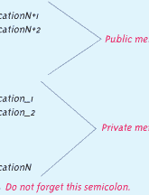

Each Member_Specification_i is either a member variable declaration or a member function declaration (prototype).

Additional public: and private: sections are permitted. If the first group of members does not have either a public: or a private: label, then it is the same as if there were a private: before the first group.

### EXAMPLE

```
class Bicycle
{
public:
    char getColor();
    int numberOfSpeeds();
    void set(int theSpeeds, char theColor);
private:
    int speeds;
    char color;
};
```

Once a class is defined, an object variable (variable of the class type) can be declared in the same way as variables of any other type. For example, the following declares two object variables of type Bicycle:

```
Bicycle myBike, yourBike;
```

you take this technical detail seriously and use structures in the same way that you use classes, then you will have two names (with different syntax rules) for the same concept. On the other hand, if you use structures as we described them, then you will have a meaningful difference between structures (as you use them) and classes; and your usage will be the same as that of most other programmers.

One difference between a structure and a class is that they differ in how they treat an initial group of members that has neither a public nor a private access specifier. If the first group of members in a definition is not labeled with either public: or private:, then a structure assumes the group is public, whereas a class would assume the group is private.

### THINKING OBJECTS

If you have not programmed with classes before, it can take a little while to get the feel of programming with them. When you program with classes, data rather than algorithms takes center stage. It is not that there are no algorithms. However, the algorithms are made to fit the data, as opposed to designing the data to fit the algorithms. It's a difference in point of view. In the extreme case, which is considered by many to be the best style, you have no global functions at all, only classes with member functions. In this case, you define objects and how the objects interact, rather than algorithms that operate on data. We will discuss the details of how you accomplish this throughout this book. Of course, you can ignore classes completely or relegate them to a minor role, but then you are really programming in C, not C++.

### Self-Test Exercises

- 16. When you define a C++ class, should you make the member variables public or private? Should you make the member functions public or private?
- 17. When you define a C++ class, what items are considered part of the interface? What items are considered part of the implementation?

### Chapter Summary

- A structure can be used to combine data of different types into a single (compound) data value.
- A class can be used to combine data and functions into a single (compound) object.
- A member variable or a member function for a class can be either public or private. If it is public, it can be used outside the class. If it is private, it can be used only in the definition of a member function.


+   函数可以拥有类或结构体类型的形参。函数可以返回类或结构体类型的值。

+   类的成员函数可以像普通函数一样被重载。

+   在定义C++类时，应将接口与实现分离，这样任何使用该类的程序员只需了解接口，甚至无需查看实现。这就是封装的原则。

### 自测练习答案

+   1. a. double
+   b. double
+   c. 非法——不能使用结构体标签代替结构体变量
+   d. char
+   e. CDAccountV2

+   2. A $9.99
+   A $1.11

3. Stuff的定义末尾缺少分号。

4. A x = {1,2};

+   5. a. 初始化器太少；不是语法错误。初始化后，month==12，day==21，year==0。未提供初始化器的成员变量将被初始化为相应类型的零值。
+   b. 初始化后正确。12==month，21==day，1995==year。
+   c. 错误：初始化器太多。

```
8. ShoeType discount(ShoeType oldRecord)
{
    ShoeType temp;
    temp.style = oldRecord.style;
    temp.price = 0.90*oldRecord.price;
    return temp;
}
```

```
9. void DayOfYear::input()
{
    cout << "Enter month as a number: ";
    cin >> month;
    cout << "Enter the day of the month: ";
    cin >> day;
}
```

```
10. void Temperature::set(double newDegrees, char newScale)
{
    degrees = newDegrees;
    scale = newScale;
}
```

11. 点运算符和作用域解析运算符都与成员名称一起使用，以指定该成员名称属于哪个类或结构体。如果类DayOfYear如显示6.3中所定义，且today是类DayOfYear的一个对象，则成员month可以通过点运算符访问：today.month。当我们给出成员函数的定义时，使用作用域解析运算符来告诉编译器该函数是在类中声明的那个函数。

```
12. hyundai.price = 4999.99; //非法。price是私有的。
jaguar.setPrice(30000.97); //合法
double aPrice, aProfit;//合法
aPrice = jaguar.getPrice(); //合法
aProfit = jaguar.getProfit();//非法。getProfit是//私有的。
aProfit = hyundai.getProfit();//非法。getProfit是//私有的。
hyundai = jaguar;//合法
```

13. 修改之后，它们都将变为合法。

14. 所有标记为private:的成员（成员变量和成员函数）只能在同一类的成员函数（包括公有和私有）定义中按名称访问。标记为public:的成员在使用位置上没有限制。

15. a. 只有一个。如果类（或结构体）中没有public:成员，编译器会发出警告。
b. 没有，但我们通常期望在类中至少找到一个private:部分。

16. 成员变量应全部为私有。作为接口一部分的成员函数应为公有。你也可以拥有仅在其它成员函数定义中使用的辅助（帮助）函数。这些辅助函数应为私有。

17. 所有私有成员变量的声明都是实现的一部分。（不应有公有成员变量。）类定义中列出的所有公有成员函数的声明，以及这些声明的解释性注释，都是接口的一部分。所有私有成员函数的声明都是实现的一部分。所有成员函数的定义（无论函数是公有还是私有）都是实现的一部分。

### 编程项目

+   1. 为一个班级编写一个评分程序，采用以下评分政策。
+    a. 有两次测验，每次按10分制评分。
+    b. 有一次期中考试和一次期末考试，每次按100分制评分。
+    c. 期末考试占总成绩的50%，期中考试占25%，两次测验合计占25%。（不要忘记对测验成绩进行归一化处理。在计算平均值之前，应将它们转换为百分比。）
+    任何90分或以上的成绩为A，80分或以上（但低于90分）为B，70分或以上（但低于80分）为C，60分或以上（但低于70分）为D，任何低于60分的成绩为F。程序将读取学生的分数并输出学生的记录，该记录包括两次测验和两次考试的成绩，以及学生整个课程的平均数值分数和最终字母等级。定义并使用一个结构体来存储学生记录。

+   2. 为名为CounterType的类型定义一个类。此类型的对象用于计数，因此它记录一个非负整数的计数。包含一个设置函数，将计数器设置为作为参数给定的计数。包含成员函数来将计数增加一和减少一。确保没有成员函数允许计数器的值变为负数。此外，包含一个返回当前计数值的成员函数和一个输出计数的成员函数。将你的类定义嵌入到一个测试程序中。

+   3. Point类型是一个相当简单的数据类型，但在另一个名称下（模板类pair），该数据类型在C++标准模板库中被定义和使用，尽管你不需要了解标准模板库的任何知识来完成此练习。编写一个名为Point的类的定义，该类可能用于存储和操作平面中点的位置。你需要声明并实现以下成员函数：

+   a. 一个set成员函数，在此类对象创建后设置私有数据。
+   b. 一个成员函数，按第一个和第二个参数指定的垂直和水平方向移动点。
+   c. 一个成员函数，将点绕原点顺时针旋转90度。
+   d. 两个const检查函数，用于检索点的当前坐标。

用适当的注释记录这些函数。将你的类嵌入到一个测试程序中，该程序向用户请求多个点的数据，创建这些点，然后执行成员函数。

# 4. 编写一个名为GasPump的类的定义，用于模拟汽车服务站的一台加油泵。在进一步进行此编程练习之前，请从购买者的角度写下你期望加油泵具有的行为。

下面列出了加油泵可能被期望执行的一些事情。如果你的列表不同，并且你认为你的列表与这些一样好或更好，那么请咨询你的指导老师。你和你的指导老师应共同决定要实现的行为。然后实现并测试商定的加油泵类设计。

+   a. 显示已分配的数量
+   b. 显示已分配数量所收取的金额
+   d. 显示每加仑、每升或你所在地区使用的其它体积单位的成本。
+   e. 使用前，加油泵必须将已分配数量和已收取金额重置为零。
+   f. 加油泵的实际行为是，一旦启动，只要你按住喷嘴杆，它就会持续分配。控制台I/O的特殊性使得在等待停止信号时难以持续分配。一种解决方案是通过让用户反复按回车键来模拟此行为，每次按键分配一定量的燃料并重新计算收取的金额，例如每次按0.1加仑。
+   g. 需要某种停止分配的控制。

将加油泵的行为实现为加油泵类的成员函数声明，然后编写这些成员函数的实现。你将不得不决定加油泵是否需要跟踪用户不应访问的数据。如果是这样，请将这些设为私有成员变量。

如需更多在线编程项目，请点击下方的CodeMate图标。

1.7


2.5


### 第7章 构造函数和其他工具


+   **7.1 构造函数** 258
+   
+   构造函数定义 258  
+   陷阱：无参数的构造函数 263  
+   显式构造函数调用 265  
+   提示：始终包含默认构造函数 265  
+   示例：BankAccount 类 268  
+   类类型成员变量 274
+   
+   **7.2 更多工具** 277
+   
+   const 参数修饰符 277  
+   陷阱：const 使用不一致 279  
+   内联函数 284  
+   静态成员 286  
+   嵌套和局部类定义 289
+   
+   **7.3 向量——标准模板库预览** 290
+   
+   向量基础 290  
+   陷阱：使用方括号超出向量大小 293  
+   提示：向量赋值行为良好 294  
+   效率问题 294
+   
+   **章节总结** 296  
+   **自测练习答案** 296  
+   **编程项目** 298

+   1. 构造函数必须与类同名。例如，如果类名为 BankAccount，则该类的任何构造函数都必须命名为 BankAccount。

+   2. 构造函数定义不能返回值。此外，在函数声明或函数头开始处不能给出任何类型，甚至不能是 void。

例如，假设我们想为 DayOfYear 类型的对象添加一个用于初始化月份和日期的构造函数，该类我们在 6.4 显示中给出，并在下面重新定义以包含构造函数。我们省略了一些注释以节省空间，但在实际程序中应包含它们。

```
class DayOfYear
{
public:
    DayOfYear(int monthValue, int dayValue); //Initializes the month and day to arguments.
    void input();
    void output();
    void set(int newMonth, int newDay);
    void set(int newMonth);
    int getMonthNumber();
    int getDay();
private:
    int month;
    int day;
};
```

请注意，构造函数命名为 DayOfYear，即类的名称。还请注意，构造函数 DayOfYear 的声明（原型）并未以 void 或任何其他类型名称开头。最后，请注意构造函数被放在类定义的 public 部分。通常，您应将构造函数设为 public 成员函数。如果您将所有构造函数设为 private 成员，则将无法声明该类类型的任何对象，这将使类完全无用。

使用重新定义的 DayOfYear 类，两个 DayOfYear 类型的对象可以按如下方式声明并初始化：

```
DayOfYear date1(7, 4), date2(5, 5);
```

假设构造函数的定义执行了我们承诺的初始化操作，则上述声明将声明对象 date1，将 date1.month 的值设为 7，并将 date1.day 的值设为 4。因此，对象 date1 被初始化为代表 7 月 4 日。同理，date2 被初始化为代表 5 月 5 日。发生的情况是，对象 date1 被声明，然后使用两个参数 7 和 4 调用构造函数 DayOfYear。同样，date2 被声明，然后使用参数 5 和 5 调用构造函数 DayOfYear。

### 显示 7.1 带有构造函数的类（第 2 部分，共 2 部分）

```
```cpp
DayOfYear::DayOfYear(int monthValue) : month(monthValue), day(1)
{
    testDate();
}

DayOfYear::DayOfYear( ) : month(1), day(1)
{/*Body intentionally empty.*/}

//uses iostream and cstdlib:
void DayOfYear::testDate( )
{
    if ((month < 1) || (month > 12))
    {
        cout << "Illegal month value!\n";
        exit(1);
    }
    if ((day < 1) || (day > 31))
    {
        cout << "Illegal day value!\n";
        exit(1);
    }
}
```
```

> *<其他成员函数的定义与显示 6.4 中的相同。>*

# 示例对话

```
```
Initialized dates:
February 21
May 1
January 1
date1 reset to the following:
October 31
```
```

成员函数 set（我们在显示 6.4 中展示的旧版本类中包含）。

# 陷阱

# 无参数的构造函数

必须记住，当您声明类变量并希望使用无参数的构造函数时，不要使用任何括号。例如，考虑显示 7.1 中的以下行：

```
```cpp
DayOfYear date1(2, 21), date2(25), date3;
```
```

对象 date1 由接受两个参数的构造函数初始化，对象 date2 由接受一个参数的构造函数初始化，对象 date3 由不接受参数的构造函数初始化。

人们很容易认为在声明变量以调用无参数构造函数时应使用空括号，但这样做的原因是不会这样做。考虑以下似乎应声明变量 date3 并调用无参数构造函数的例子：

```
DayOfYear date3(); //PROBLEM! Not what you might think it is.
```

问题在于，虽然您可能将其视为声明和构造函数调用，但编译器将其视为名为 date3 的函数的声明（原型），该函数没有参数并返回 DayOfYear 类型的值。由于一个没有参数且返回 DayOfYear 类型值的函数 date3 是完全合法的，因此此记法始终具有该含义。当您想在声明时调用无参数构造函数时，使用不同的记法（不带括号）。

# 调用构造函数

构造函数在声明对象时会自动调用，但您必须在声明对象时给出构造函数的参数。构造函数也可以显式调用，但语法与普通成员函数使用的语法不同。

# 当您有构造函数时对象声明的语法

```
Class_Name Variable_Name(Arguments_for_Constructor);
```

# 示例

```
DayOfYear holiday(7, 4);
```

# 显式构造函数调用的语法

```
Variable = Constructor_Name(Arguments_For_Constructor);
```

# 示例

```
holiday = DayOfYear(10, 31);
```

构造函数必须与它所属的类同名。因此，在上述语法描述中，Class_Name 和 Constructor_Name 是相同的标识符。

# 显式构造函数调用

每当您声明类类型的对象时，构造函数会自动调用，但也可以在对象声明后再次调用。这允许您方便地设置对象的全部成员。技术细节如下。调用构造函数会使用新值创建一个匿名对象。匿名对象是尚未被任何变量命名的对象。匿名对象可以赋给命名对象。例如，以下是对构造函数 DayOfYear 的调用，它为 5 月 5 日创建了一个匿名对象。此匿名对象被赋给变量 holiday（已声明为 DayOfYear 类型），因此 holiday 也代表 5 月 5 日。

```
holiday = DayOfYear(5, 5);
```

（从记法上可以猜到，构造函数有时表现得像返回其类类型对象的函数。）

请注意，当您显式调用无参数构造函数时，确实会包含括号，如下所示：

```
holiday = DayOfYear();
```

只有在声明类类型的变量并希望在声明的一部分中调用无参数构造函数时，才省略括号。

# 提示

# 始终包含默认构造函数

不接受参数的构造函数称为默认构造函数。这个名称可能具有误导性，因为有时它会默认生成（即自动生成），有时则不会。以下是完整情况。如果您定义一个类并且完全不包含任何类型的构造函数，则会自动创建一个默认构造函数。此默认构造函数不执行任何操作，但它确实为您提供了一个未初始化的类类型对象，该对象可以赋给类类型的变量。如果您的类定义包含一个或多个任何类型的构造函数，则不会自动生成构造函数。因此，例如，假设您定义了一个名为 SampleClass 的类。如果您包含一个或多个每个接受一个或多个参数的构造函数，但未在类定义中包含默认构造函数，则没有默认构造函数，任何如下声明都将是非法的：

```
SampleClass aVariable;
```

上述声明的问题在于它要求编译器调用默认构造函数，但在这种情况下没有默认构造函数。

1 请注意，此过程比简单地更改成员变量的值更复杂。因此，出于效率原因，您可能希望保留名为 set 的成员函数，以代替显式调用构造函数。


为了具体说明这一点，假设你定义了一个类，如下所示：

```
class SampleClass
{
public:
SampleClass(int parameter1, double parameter2);
void doStuff();
private:
int data1;
double data2;
};
```

你应该能认出下面这种声明 `SampleClass` 类型对象并调用该类构造函数的方式是合法的：

```
SampleClass myVariable(7, 7.77);
```

然而，下面这种方式是非法的：

```
SampleClass yourVariable;
```

编译器将上述声明解释为包含一次对无参数构造函数的调用，但该类并没有定义零参数的构造函数。你必须在 `yourVariable` 的声明中添加两个参数，或者为该类添加一个无参数构造函数的定义。

如果你将 `SampleClass` 类重新定义如下，那么上述 `yourVariable` 的声明就是合法的：

```
class SampleClass
{
public:
SampleClass(int parameter1, double parameter2);
SampleClass();
void doStuff();
private:
int data1;
double data2;
};
默认构造函数
```

为了避免这种混淆，你应该始终在你定义的任何类中包含一个默认构造函数。如果你不希望默认构造函数初始化任何成员变量，你可以在实现它时简单地给它一个空函数体。下面的构造函数定义是完全合法的。它除了创建一个未初始化的对象外什么也不做：

```
SampleClass::SampleClass()
{/*什么也不做。*/}
```

```
```cpp
YourClass yetAnotherObject();
anObject = YourClass(99, 'B');
anObject = YourClass();
anObject = YourClass;
```
```

- 2. 什么是默认构造函数？每个类都有默认构造函数吗？

## 练习 1：BankAccount 类

显示 7.2 包含了一个类的定义，该类在一个小型演示程序中表示一个简单的银行账户。这种形式的银行账户有两项数据：账户余额和利率。请注意，我们将账户余额表示为两个 `int` 类型的值，一个表示美元，一个表示美分。这说明了数据的内部表示不必仅仅是每个概念性数据对应的一个成员变量。看起来余额似乎应该表示为 `double` 类型的值，而不是两个 `int` 值。然而，账户包含的是精确的美元和美分数，而 `double` 类型的值实际上是一个近似量。此外，像 $323.52 这样的余额并不是浮点值前面的美元符号。$323.52 在小数点后不能多于或少于两位数字。你不能有 $323.523 的余额，而 `double` 类型的成员变量会允许这样的余额。拥有带小数美分的账户并非不可能，只是这不是我们对银行账户所期望的。

请注意，使用 `BankAccount` 类的程序员可以将余额视为 `double` 类型的值，也可以视为两个 `int` 类型的值（分别表示美元和美分）。访问器和修改器函数允许程序员将余额作为 `double` 或两个 `int` 来读取和设置。使用该类的程序员不需要也不应该考虑任何底层的成员变量。这是实现的一部分，对使用该类的程序员是“隐藏”的。

请注意，修改器函数 `setBalance` 以及构造函数名称都是重载的。还要注意，所有构造函数和修改器函数都会检查值以确保它们是合适的。例如，利率不能为负数。余额可以为负数，但你不能有正数的美元和负数的美分。

这个类有四个私有成员函数：`dollarsPart`、`centsPart`、`round` 和 `fraction`。这些成员函数被设为私有，因为它们仅用于其他成员函数的定义中。

### 显示 7.2 BankAccount 类（第 1 部分，共 5 部分）

```
```cpp
#include <iostream>
#include <cmath>
#include <cstdlib>
using namespace std;

//数据由两项组成：账户余额的金额和利率的百分比。
class BankAccount
{
public:
    BankAccount(double balance, double rate);
    //根据参数初始化余额和利率。

    BankAccount(int dollars, int cents, double rate);
    //将账户余额初始化为 $dollars.cents。对于负余额，美元和美分都必须为负数。
    //将利率初始化为 rate 百分比。

    BankAccount(int dollars, double rate);
    //将账户余额初始化为 $dollars.00，并将利率初始化为 rate 百分比。

    BankAccount( );
    //将账户余额初始化为 $0.00，利率初始化为 0.0%。

    void update( );
    //后置条件：一年的单利已添加到账户中。
    void input( );
    void output( );
    double getBalance( );
    int getDollars( );
    int getCents( );
    double getRate( ); //以百分比形式返回利率。

    void setBalance(double balance);
    void setBalance(int dollars, int cents);
    //检查参数是否都为负数或都非负。

    void setRate(double newRate);
    //如果 newRate 非负，则成为新利率。否则，终止程序。

private:
    //负金额表示为负美元和负美分。
    //例如，负 $4.50 将 accountDollars 设为 -4，accountCents 设为 -50。
    int accountDollars; //余额的美元部分
    int accountCents;   //余额的美分部分
    double rate;        //以百分比表示
```
```

### 显示 7.2 BankAccount 类（第 2 部分，共 3 部分）

```
40  int dollarsPart(double amount);
41  int centsPart(double amount);
42  int round(double number);
43
44  double fraction(double percent);
45  //将百分比转换为分数。例如，fraction(50.3) 返回 0.503。
46 }
```

```
46 int main()
47 {
48     BankAccount account1(1345.52, 2.3), account2;
49     cout << "account1 初始化如下：\n";
50     account1.output();
51     cout << "account2 初始化如下：\n";
52     account2.output();
53
54     account1 = BankAccount(999, 99, 5.5);
55     cout << "account1 重置为以下内容：\n";
56     account1.output();
57
58     cout << "为账户 2 输入新数据：\n";
59     account2.input();
60     cout << "account2 重置为以下内容：\n";
61     account2.output();
62
63     account2.update();
64     cout << "一年后 account2 将增长为：\n";
65     account2.output();
66
67     return 0;
68 }
```

```
65 BankAccount::BankAccount(double balance, double rate)
66   : accountDollars(dollarsPart(balance)), accountCents(centsPart(balance))
67 {
68     setRate(rate);
69 }
70
71 BankAccount::BankAccount(int dollars, int cents, double rate)
72 {
73     setBalance(dollars, cents);
74     setRate(rate);
75 }
76
77 BankAccount::BankAccount(int dollars, double rate)
78   : accountDollars(dollars), accountCents(0)
79 {
80     setRate(rate);
81 }
```

> 此声明会导致调用默认构造函数。请注意，这里没有括号。

> 对构造函数 `BankAccount::BankAccount` 的显式调用

> 这些函数会检查数据是否合适。

### 显示 7.2 BankAccount 类（第 3 部分，共 5 部分）

```
79 }

80 BankAccount::BankAccount() : accountDollars(0), accountCents(0), rate(0.0)
81 {/*函数体有意留空。*/}

82 void BankAccount::update()
83 {
84     double balance = accountDollars + accountCents*0.01;
85     balance = balance + fraction(rate)*balance;
86     accountDollars = dollarsPart(balance);
87     accountCents = centsPart(balance);
88 }

89 //使用 iostream：
90 void BankAccount::input()
91 {
92     double balanceAsDouble;
93     cout << "输入账户余额 $";
94     cin >> balanceAsDouble;
95     accountDollars = dollarsPart(balanceAsDouble);
96     accountCents = centsPart(balanceAsDouble);
97     cout << "输入利率（不要百分号）：";
98     cin >> rate;
99     setRate(rate);
100 }
101 //使用 iostream 和 cstdlib：
102 void BankAccount::output()
103 {
104     int absDollars = abs(accountDollars);
105     int absCents = abs(accountCents);
106     cout << "账户余额：$";
107     if (accountDollars < 0)
108         cout << "-";
109     cout << absDollars;
110     if (absCents >= 10)
111         cout << "." << absCents << endl;
112     else
113         cout << "." << '0' << absCents << endl;
114     cout << "利率：" << rate << "%\n";
115 }

116 double BankAccount::getBalance()
117 {
118     return (accountDollars + accountCents*0.01);
119 }
```

关于 `BankAccount::input` 的更好定义，请参见自测练习 3。


### Display 7.2  **银行账户类（第 4 部分，共 5 部分）**

```cpp
int BankAccount::getDollars()
{
    return accountDollars;
}

int BankAccount::getCents()
{
    return accountCents;
}

double BankAccount::getRate()
{
    return rate;
}

void BankAccount::setBalance(double balance)
{
    accountDollars = dollarsPart(balance);
    accountCents = centsPart(balance);
}

//Uses cstdlib:
void BankAccount::setBalance(int dollars, int cents)
{
    if ((dollars < 0 && cents > 0) || (dollars > 0 && cents < 0))
    {
        cout << "Inconsistent account data.\n";
        exit(1);
    }
    accountDollars = dollars;
    accountCents = cents;
}

//Uses cstdlib:
void BankAccount::setRate(double newRate)
{
    if (newRate >= 0.0)
        rate = newRate;
    else
    {
        cout << "Cannot have a negative interest rate.\n";
        exit(1);
    }
}

int BankAccount::dollarsPart(double amount)
{
```

> > 使用该类的程序员并不关心余额是以一个实数还是两个整数存储的。

> > 这可以是一个普通函数而不是成员函数，但作为成员函数，我们能够将其设为私有。

### Display 7.2  **银行账户类** *（第 5 部分，共 5 部分）*

```cpp
161     return static_cast<int>(amount);
162 }
163 //Uses cmath:
164 int BankAccount::centsPart(double amount)
165 {
166     double doubleCents = amount*100;
167     int intCents = (round(fabs(doubleCents)))%100; //% can misbehave on negatives
168     if (amount < 0)
169         intCents = -intCents;
170     return intCents;
171 }

172 //Uses cmath:
173 int BankAccount::round(double number)
174 {
175     return static_cast<int>(floor(number + 0.5));
176 }

177 double BankAccount::fraction(double percent)
178 {
179     return (percent/100.0);
180 }
```

> > 这些可以是普通函数而不是成员函数，但作为成员函数，我们能够将它们设为私有。

> > 如果这还不够清楚，请参阅第 3 章第 3.2 节中关于 round 的讨论。

### SAMPLE DIALOGUE

```text
account1 initialized as follows:
Account balance: $1345.52
Rate: 2.3%
account2 initialized as follows:
Account balance: $0.00
Rate: 0%
account1 reset to the following:
Account balance: $999.99
Rate: 5.5%
Enter new data for account 2:
Enter account amount: $100.00
Enter interest rate (NO percent sign): 10
account2 reset to the following:
Account balance: $100
Rate: 10%
In one year account2 will grow to:
Account balance: $110
Rate: 10%
```

### Self-Test Exercises

- 3. Display 7.2 中的函数 `BankAccount::input` 将账户余额作为类型为 `double` 的值读取。当该值以二进制形式存储在计算机内存中时，这可能会产生轻微误差。通常不会注意到，函数对于演示类 `BankAccount` 已足够好。花费太多时间进行数值分析会分散主要信息。尽管如此，此输入函数对于银行来说还不够好。重写函数 `BankAccount::input`，使其将诸如 78.96 这样的金额读作整数 76 和三个字符值 `'7'`、`'9'` 和 `'6'`。你可以假设用户总是为金额输入两位小数，例如 99.00 而不是仅 99 且没有多余内容。提示：以下公式可将一位数字转换为对应的 int 值，例如将 `'6'` 转换为 6：

```cpp
static_cast<int>(digit) - static_cast<int>('0')
```

### CLASS TYPE MEMBER VARIABLES

一个类可能具有其类型为另一个类的成员变量。大体上，你不需要做任何特别的事情来拥有一个类成员变量，但有一个特殊的记法可以让你在外部类的构造函数中调用成员变量的构造函数。示例在 Display 7.3 中给出。

Display 7.3 中的类 `Holiday` 可能被某个城市警察部门用来帮助跟踪哪些假日会执行停车执法（例如停车计时器和一小时停车区）。这是一个高度简化的类。真正的类会有更多成员函数，但类 `Holiday` 已足够完整以说明我们的要点。

类 `Holiday` 有两个成员变量。成员变量 `parkingEnforcement` 是简单类型 `bool` 的普通成员变量。成员变量 `date` 的类型是类 `DayOfYear`。

下面我们重现了 Display 7.3 中的一个构造函数定义：

```
Holiday::Holiday(int month, int day, bool theEnforcement)
    : date(month, day), parkingEnforcement(theEnforcement)
{/*Intentionally empty*/}
```

请注意，我们已在初始化部分以通常的方式设置成员变量 `parkingEnforcement`，即使用

```
parkingEnforcement(theEnforcement)
```

成员变量 `date` 是类类型 `DayOfYear` 的成员。要初始化 `date`，我们需要从类 `DayOfYear`（date 的类型）调用一个构造函数。这是在初始化部分使用类似的记法完成的

```
date(month, day)
```

```cpp
#include <iostream>
#include <cstdlib>
using namespace std;

class DayOfYear
{
public:
    DayOfYear(int monthValue, int dayValue);
    DayOfYear(int monthValue);
    DayOfYear();
    void input();
    void output();
    int getMonthNumber();
    int getDay();
private:
    int month;
    int day;
    void testDate();
};

class Holiday
{
public:
    Holiday(); //Initializes to January 1 with no parking enforcement
    Holiday(int month, int day, bool theEnforcement);
    void output();
private:
    DayOfYear date;
    bool parkingEnforcement; //true if enforced
};

int main()
{
    Holiday h2(14, true);
    cout << "Testing the class Holiday.\n";
    h.output();

    return 0;
}

Holiday::Holiday() : date(1, 1), parkingEnforcement(false)
{/*Intentionally empty*/}

Holiday::Holiday(int month, int day, bool theEnforcement)
    : date(month, day), parkingEnforcement(theEnforcement)
{/*Intentionally empty*/}
```

> 类 DayOfYear 与 Display 7.1 中的相同，但我们重复了本次讨论所需的所有细节。

> 类型的类成员变量

> 来自类 DayOfYear 的构造函数的调用。

### Display 7.3 A Class Member Variable (part 2 of 3)

```cpp
42 void Holiday::output()
43 {
44     date.output();
45     cout << endl;
46     if (parkingEnforcement)
47         cout << "Parking laws will be enforced.\n";
48     else
49         cout << "Parking laws will not be enforced.\n";
50 }
51
51 DayOfYear::DayOfYear(int monthValue, int dayValue)
52     : month(monthValue), day(dayValue)
53 {
54     testDate();
55 }
56
56 //uses iostream and cstdlib:
57 void DayOfYear::testDate()
58 {
59     if ((month < 1) || (month > 12))
60     {
61         cout << "Illegal month value!\n";
62         exit(1);
63     }
64     if ((day < 1) || (day > 31))
65     {
66         cout << "Illegal day value!\n";
67         exit(1);
68     }
69 }
70
70 //Uses iostream:
71 void DayOfYear::output()
72 {
73     switch (month)
74     {
75     case 1:
76         cout << "January "; break;
77     case 2:
78         cout << "February "; break;
79     case 3:
80         cout << "March "; break;
81     .
```

被省略的行在 Display 6.3 中，但它们足够明显，你不必去查阅。

```cpp
82        case 11:
83            cout << "November "; break;
84        case 12:
85            cout << "December "; break;
86        default:
87            cout << "Error in DayOfYear::output. Contact software vendor.";
88    }

89    cout << day;
90 }
```

### SAMPLE DIALOGUE

```
Testing the class Holiday.
February 14
Parking laws will be enforced.
```

记法 date(month, day) 是对类 DayOfYear 的构造函数的调用，使用参数 month 和 day 来初始化 date 的成员变量。请注意，此记法与你声明类型为 DayOfYear 的变量 data 的方式类似。还请注意，可以在对成员变量的构造函数调用中使用较大类构造函数 Holiday 的参数。

## 7.2  More Tools

> > 智力……是制造人工物，尤其是制造工具来制造工具的能力。
> >
> > —— Henri Bergson，《创造进化》

本节讨论三个主题，虽然重要，但在此之前不易很好地安排。这三个主题是类的 const 参数修饰符、内联函数和静态类成员。

### THE const PARAMETER MODIFIER

按引用调用的参数比按值调用的参数更高效。按值调用的参数是一个局部变量，其初始化为其参数的值，因此在函数被调用时，参数有两个副本。按引用调用的参数只是一个占位符，被参数替换，因此参数只有一个副本。对于简单类型（如 int 或 double）的参数，效率差异可以忽略不计，但对于类参数，差异在


效率有时可能很重要。因此，对于类类型，即使函数不会修改参数，使用按引用传递参数也可能比按值传递参数更有意义。

如果你使用按引用传递参数，且函数不会修改参数的值，你可以标记该参数，以便编译器知道该参数不应被修改。为此，请在参数类型前加上修饰符 `const`。该参数随后被称为常量参数或常量按引用传递参数。例如，在展示 7.2 中，我们定义了一个名为 `BankAccount` 的类，用于表示简单的银行账户。在某些程序中，你可能希望编写一个返回布尔值的函数来测试两个账户中哪个余额更大。该函数的定义可能如下：

```
bool isLarger(BankAccount account1, BankAccount account2)
//如果account1中的余额大于account2中的余额，则返回true。
//否则返回false。
{
    return(account1.getBalance( ) > account2.getBalance( ));
}
```

这是完全合法的。这两个参数是按值传递参数。然而，更高效且更常见的做法是将参数设为常量按引用传递参数，如下所示：

```
bool isLarger(const BankAccount& account1,
    const BankAccount& account2)
//如果account1中的余额大于account2中的余额，则返回true。
//否则，返回false。
{
    return(account1.getBalance( ) > account2.getBalance( ));
}
```

请注意，唯一的区别是我们通过添加 `&` 将参数改为按引用传递，并添加了 `const` 修饰符。如果存在函数声明，则必须在函数声明中对参数进行相同的修改。

常量参数是一种自动错误检查的形式。如果你的函数定义中包含错误，导致意外修改了常量参数，编译器将发出错误消息。

参数修饰符 `const` 可以用于任何类型的参数；然而，它通常仅用于类类型的按引用传递参数（以及某些对应实参较大的其他参数，例如数组）。

假设你为一个类的对象调用成员函数，例如展示 7.2 中的 `BankAccount` 类。例如：

```
BankAccount myAccount;
myAccount.input( );
myAccount.output( );
```

如果你没有在成员函数 `output` 的函数声明中添加 `const` 修饰符，那么 `welcome` 函数将产生错误消息。成员函数 `welcome` 不会修改调用对象 `price`。然而，当编译器处理 `welcome` 的函数定义时，它会认为 `welcome` 确实（或至少可能）修改了 `yourAccount` 的值。这是因为在翻译 `welcome` 的函数定义时，编译器对成员函数 `output` 的了解仅限于 `output` 的函数声明。如果函数声明中没有包含 `const` 来告知编译器调用对象不会被修改，那么编译器就会假定调用对象会被修改。因此，如果你对 `BankAccount` 类型的参数使用 `const` 修饰符，那么你也应该对所有不修改调用对象值的 `BankAccount` 成员函数使用 `const`。特别是，成员函数 `output` 的函数声明应包含 `const`。

### 常量参数修饰符

如果你在按引用传递参数的类型前放置修饰符 `const`，则该参数被称为常量参数。如果你添加了 `const`，你就是在告诉编译器该参数不应被修改。如果你在函数定义中犯了错误，导致它修改了常量参数，那么编译器将给出错误消息。不被函数修改的类类型参数通常应为常量按引用传递参数，而不是按值传递参数。

如果成员函数不修改其调用对象的值，你可以通过在函数声明中添加 `const` 修饰符来标记该函数。如果你在函数定义中犯了错误，导致它修改了调用对象，并且该函数被标记为 `const`，计算机将给出错误消息。`const` 放置在函数声明的末尾，紧接在最终分号之前。函数定义的函数头也应包含 `const`，以便与函数声明匹配。

### 示例

```
class Sample
{
public:
    Sample();
    void input();
    void output() const;
private:
    int stuff;
    double moreStuff;
};

int compare(const Sample& s1, const Sample& s2);
```

使用 `const` 修饰符是一个全有或全无的主张。只要对类参数合适，并且对类的成员函数合适，你就应该使用 `const` 修饰符。如果你没有在每次对类合适时都使用它，那么你就不应该对该类使用它。

在展示 7.4 中，我们重写了展示 7.2 中给出的 `BankAccount` 类的定义，但这次我们在适当的地方使用了 `const` 修饰符。在展示 7.4 中，我们还添加了之前讨论过的两个函数 `isLarger` 和 `welcome`，它们具有常量参数。

### 自测练习

4. 为什么如下所示，在展示 7.2 中给出的 `BankAccount` 类的成员函数 `input` 的声明中添加修饰符 `const` 是不正确的？

```
class BankAccount
{
public:
    void input( ) const;
    ...
```

5. 按值传递参数和常量按引用传递参数之间的区别和相似之处是什么？说明这些的声明如下。

```
void callByValue(int x);
void callByConstReference(const int& x);
```

6. 给定定义

```
const int x = 17;
class A
{
public:
    A( );
    A(int n);
    int f( ) const;
    int g(const A& x);
private:
    int i;
};
```

这三个 `const` 关键字中的每一个都是对编译器的承诺，编译器将强制执行。每种情况下的承诺是什么？

### 展示 7.4 常量参数修饰符（共 3 部分，第 1 部分）

```
1 #include <iostream>
2 #include <cmath>
3 #include <cstdlib>
4 using namespace std;

5 //数据包含两项：账户余额的金额
6 //和利率的百分比。
7 class BankAccount
8 {
9 public:
10 BankAccount(double balance, double rate);
11 //根据参数初始化余额和利率。
12
13 BankAccount(int dollars, int cents, double rate);
14 //将账户余额初始化为$dollars.cents。对于负余额，dollars
15 //和cents都必须为负数。将利率初始化为rate百分比。
16
17 BankAccount(int dollars, double rate);
18 //将账户余额初始化为$dollars.00，
19 //并将利率初始化为rate百分比。
20
21 BankAccount();
22 //将账户余额初始化为$0.00，利率初始化为0.0%。
23
24 void update();
25 //后置条件：一年的单利已添加到账户中。
26 void input();
27 void output() const;
28 double getBalance() const;
29 int getDollars() const;
30 int getCents() const;
31 double getRate() const;//以百分比形式返回利率。
32
33 void setBalance(double balance);
34 void setBalance(int dollars, int cents);
35 //检查参数均为非负或均为非正。
36
37 void setRate(double newRate);
38 //如果newRate为非负，则它成为新利率。否则，终止程序。
39
40 private:
41 //负金额表示为负的dollars和负的cents。
42 //例如，负$4.50将accountDollars设置为-4，将accountCents设置为-50。
43 int accountDollars; //余额的美元部分
44 int accountCents; //余额的美分部分
45 double rate;//以百分比表示
```

这是展示 7.2 中的类，使用 `const` 修饰符重写。


# 显示 7.4 const 参数修饰符（第 2 部分，共 3 部分）

```
40  int dollarsPart(double amount) const;
41  int centsPart(double amount) const;
42  int round(double number) const;
43
44  double fraction(double percent) const;
45  //Converts a percentage to a fraction. For example, fraction(50.3) returns 0.503.
46  };
```

```
46  //Returns true if the balance in account1 is greater than that
47  //in account2. Otherwise returns false.
48  bool isLarger(const BankAccount& account1, const BankAccount& account2);
```

```
49  void welcome(const BankAccount& yourAccount);
```

```
50  int main()
51  {
52      BankAccount account1(6543.21, 4.5), account2;
53      welcome(account1);
54      cout << "Enter data for account 2:\n";
55      account2.input();
56      if (isLarger(account1, account2))
57          cout << "account1 is larger\n";
58      else
59          cout << "account2 is at least as large as account1.\n";
60
61      return 0;
62  }
```

```
63  bool isLarger(const BankAccount& account1, const BankAccount& account2)
64  {
65      return(account1.getBalance() > account2.getBalance());
66  }
```

```
67  void welcome(const BankAccount& yourAccount)
68  {
69      cout << "Welcome to our bank.\n"
70           << "The status of your account is:\n";
71      yourAccount.output();
72  }
```

```
73  //Uses iostream and cstdlib:
74  void BankAccount::output() const
75  <The rest of the function definition is the same as in Display 7.2.>
```

<Other function definitions are the same as in Display 7.2, except that const is added where needed to match the function declaration.>

# 显示 7.4 const 参数修饰符（第 3 部分，共 3 部分）

## 示例对话

```
Welcome to our bank.
The status of your account is:
Account balance: $6543.21
Rate: 4.5%
Enter data for account 2:
Enter account balance $100.00
Enter interest rate (NO percent sign): 10
account1 is larger.
```

### 内联函数

你可以在类的定义内给出成员函数的完整定义。这种定义称为内联函数定义。这些内联定义通常用于非常短的函数定义。显示 7.5 显示了显示 7.4 中的类重写为多个内联函数。

内联函数不仅仅是我们已经见过的那种成员函数定义的记法变体。编译器以特殊方式处理内联函数。内联函数声明的每个调用位置都会插入其代码。这节省了函数调用的开销。

在其他条件相同的情况下，内联函数应该更高效，因此通常比以通常方式定义的函数更可取。然而，其他条件很少，如果有的话，总是相等。内联函数的缺点是混合了类的接口和实现，因此违背了封装的原则。而且，正如通常的争论来回进行一样。

一般认为，只有非常短的函数定义才应定义为内联。对于长函数定义，内联版本实际上可能效率更低，因为大段代码会被频繁重复。除此一般规则外，你需要自行决定是否使用内联函数。

任何函数都可以定义为内联函数。要将非成员函数定义为内联，只需在函数声明和函数定义前放置关键字 inline。我们在本书中不会使用，也不会进一步讨论内联非成员函数。

### 自测练习

- 7. 重写显示 7.3 中给出的类 DayOfYear 的定义，使函数 getMonthNumber 和 getDay 以内联方式定义。

# 显示 7.5 内联函数定义

这是使用内联成员函数重写的显示 7.4。

```
```cpp
#include <iostream>
#include <cmath>
#include <cstdlib>
using namespace std;

class BankAccount
{
public:
    BankAccount(double balance, double rate);
    BankAccount(int dollars, int cents, double rate);
    BankAccount(int dollars, double rate);
    BankAccount();
    void update();
    void input();
    void output() const;

    double getBalance() const { return (accountDollars + accountCents*0.01); }
    int getDollars() const { return accountDollars; }
    int getCents() const { return accountCents; }
    double getRate() const { return rate; }

    void setBalance(double balance);
    void setBalance(int dollars, int cents);
    void setRate(double newRate);
private:
    int accountDollars; //of balance
    int accountCents; //of balance
    double rate;//as a percentage

    int dollarsPart(double amount) const { return static_cast<int>(amount); }
    int centsPart(double amount) const;
    int round(double number) const
    { return static_cast<int>(floor(number + 0.5)); }
    double fraction(double percent) const { return (percent/100.0); }
};
```
```

*内联函数没有进一步的定义。其他函数定义与显示 7.4 相同。*


# 静态成员

有时你希望有一个变量被类的所有对象共享。例如，你可能希望有一个变量来计数特定成员函数被类的所有对象调用的次数。这种变量称为静态变量，可以用于对象之间通信或协调其行为。这种变量允许使用全局变量的一些优点，而不会打开真正的全局变量所带来的所有滥用大门。特别是，静态变量可以是私有的，这样只有类的对象可以直接访问它。

如果一个函数不访问任何对象的数据，但你希望该函数是类的成员，你可以使其成为静态函数。静态函数可以用通常的方式使用类的调用对象进行调用。然而，更常见且更清晰的做法是使用类名和作用域解析运算符调用静态函数，如以下示例：

```
Server::getTurn()
```

由于静态函数不需要调用对象，静态函数的定义不能使用任何依赖于调用对象的东西。静态函数定义不能使用任何非静态变量或非静态成员函数，除非该非静态变量或函数具有在定义中作为局部变量或以其他方式创建的对象作为调用对象。如果上一句话听起来难以理解，只需使用更简单的规则：静态函数的定义不能使用任何依赖于调用对象的东西。

显示 7.6 是一个演示程序，使用了静态变量和静态函数。请注意，静态变量由其声明开头的限定关键字 static 指示。还请注意，所有静态变量都按如下方式初始化：

```
int Server::turn = 0;
int Server::lastServed = 0;
bool Server::nowOpen = true;
```

这种初始化需要一点解释。每个静态变量都必须在类定义之外初始化。此外，静态变量不能被初始化超过一次。如显示 7.6 中所示，私有静态变量——事实上，所有静态变量——都在类之外初始化。这似乎与私有概念相矛盾。然而，类的作者预计会进行初始化，通常在与类定义相同的文件中。在这种情况下，使用类的任何程序员都不能初始化静态变量，因为静态变量不能被第二次初始化。

请注意，关键字 static 用于成员函数声明中，但在成员函数定义中未使用。

static variable

initializing
static
member
variables

# 显示 7.6 静态成员（第 1 部分，共 2 部分）

```
#include <iostream>
using namespace std;

class Server
{
public:
    Server(char letterName);
    static int getTurn();
    void serveOne();
    static bool stillOpen();
private:
    static int turn;
    static int lastServed;
    static bool nowOpen;
    char name;
};

int Server::turn = 0;
int Server::lastServed = 0;
bool Server::nowOpen = true;

int main()
{
    Server s1('A'), s2('B');
    int number, count;
    do
    {
        cout << "How many in your group? ";
        cin >> number;
        cout << "Your turns are: ";
        for (count = 0; count < number; count++)
            cout << Server::getTurn() << ' ';
        cout << endl;
        s1.serveOne();
        s2.serveOne();
    } while (Server::stillOpen());
    cout << "Now closing service.\n";
    return 0;
}

Server::Server(char letterName) : name(letterName)
{/*Intentionally empty*/}

int Server::getTurn()
{
    turn++;
    return turn;
}
```

Since getTurn is static, only static members can be referenced in here.


### 展示 7.6 静态成员（第 2 部分，共 2 部分）

```
45 bool Server::stillOpen()
46 {
47     return nowOpen;
48 }

49 void Server::serveOne()
50 {
51     if (nowOpen && lastServed < turn)
52     {
53         lastServed++;
54         cout << "Server " << name
55             << " now serving " << lastServed << endl;
56     }
57     if (lastServed >= turn) //Everyone served
58         nowOpen = false;
59 }
```

### 示例对话

你们组有多少人？ 3
你们的序号是： 1 2 3
服务器 A 正在服务 1
服务器 B 正在服务 2
你们组有多少人？ 2
你们的序号是： 4 5
服务器 A 正在服务 3
服务器 B 正在服务 4
你们组有多少人？ 0
你们的序号是：
服务器 A 正在服务 5
现在停止服务。

展示 7.6 中的程序是一个场景的概要，该场景中有一个客户排队等待服务，以及两个服务器为这个单一队列提供服务。你可以想出许多系统编程场景，将其充实为一个实际的例子。对于一个仅用于学习概念的简单模型，可以把 `getTurn` 产生的数字想象成熟食店或冰淇淋店发给顾客的小纸条。两个服务器就是两个接待顾客的店员。这家店可能有一个奇特之处：顾客成群到达，但一次只服务一位（也许是为了让他们各自点自己特定的三明治或冰淇淋口味）。

### 自测练习

- 8. 下面定义的函数能否作为静态函数添加到展示 7.6 中的 `Server` 类中？请解释你的答案。
- 

```cpp
void Server::showStatus()
{
    cout << "Currently serving " << turn << endl;
    cout << "Server name " << name << endl;
}
```

### 嵌套类和局部类定义

本节内容仅供参考，除第 17 章中简要提及外，本书其他地方不会使用。

你可以在一个类中定义另一个类。这种类中定义的类称为**嵌套类**。其总体布局显而易见：

```
class OuterClass
{
public:
    ...
private:
    class InnerClass
    {
        ...
    };
    ...
};
```

嵌套类可以是公有的，也可以是私有的。如果它是私有的（如示例布局所示），则不能在外部类之外使用。无论嵌套类是公有还是私有，它都可以在外部类的成员函数定义中使用。

由于嵌套类位于外部类的作用域内，因此嵌套类的名称（如示例布局中的 `InnerClass`）可以在外部类之外用于其他用途。如果嵌套类是公有的，则可以在外部类之外将其用作类型。但是，在外部类之外，嵌套类的类型名是 `OuterClass::InnerClass`。

本书中不会用到这种嵌套类定义。然而，在第 17 章中，我们确实提出了嵌套类的一个可能应用。²

类定义也可以定义在函数定义内部。在这种情况下，该类称为**局部类**，因为其含义仅限于该函数定义。

> ² 该建议在第 17 章中题为“友元类和类似替代方案”的小节中提出。

## 7.3 向量——标准模板库预览

> “好吧，我就吃它，”爱丽丝说，“如果它让我变大，我就能拿到钥匙；如果它让我变小，我就能从门底下钻过去；所以无论如何我都能进花园。”

刘易斯·卡罗尔，《爱丽丝梦游仙境》

向量可以被视为在程序运行期间长度可以增长（和缩短）的数组。在 C++ 中，一旦程序创建了数组，就无法更改数组的长度。向量与数组的用途相同，区别在于它们可以在程序运行期间改变长度。

向量由标准模板库（STL）中的模板类构成。我们在第 16 章讨论模板，并在第 19 章讨论 STL。然而，在详细了解模板和 STL 之前，学习向量的一些基本用法是很容易的。你不需要了解很多关于类的知识就能使用向量。你可以在读完第 6 章后学习本节关于向量的内容。你不需要先阅读本章前面的章节再学习本节。

### 向量基础

与数组一样，向量有一个基类型，并且与数组一样，向量存储其基类型值的集合。然而，向量类型和向量变量声明的语法与数组的语法不同。

你声明一个基类型为 `int` 的向量变量 `v`，如下所示：

```
vector<int> v;
```

记号 `vector<Base_Type>` 是一个模板类，这意味着你可以将任何类型插入 `Base_Type`，从而生成具有该基类型的向量类。你可以简单地将其视为指定向量的基类型，就像为数组指定基类型一样。你可以使用任何类型（包括类类型）作为向量的基类型。记号 `vector<int>` 是一个类名，因此前面将 `v` 声明为 `vector<int>` 类型的向量，包含了对类 `vector<int>` 的默认构造函数的调用，该构造函数创建一个空的（没有元素的）向量对象。

```
v[i] = 42;
cout << "The answer is " << v[i];
```

然而，向量使用方括号记法有一个限制，这与数组使用相同记法不同。你可以使用 `v[i]` 更改第 i 个元素的值。但是，你不能使用 `v[i]` 初始化第 i 个元素；你只能更改已经被赋予某个值的元素。要向向量首次添加元素，通常使用成员函数 `push_back`。

你按位置顺序向向量添加元素，先位置 0，然后是位置 1，再是位置 2，依此类推。成员函数 `push_back` 在下一个可用位置添加元素。例如，以下代码为向量 `sample` 的元素 0、1 和 2 赋予初始值：

```
vector<double> sample;
sample.push_back(0.0);
sample.push_back(1.1);
sample.push_back(2.2);
```

向量中元素的数量称为向量的大小。成员函数 `size` 可用于确定向量中有多少个元素。例如，在执行前面显示的代码后，`sample.size( )` 返回 3。你可以按如下方式写出当前向量 `sample` 中的所有元素：

```
for (int i = 0; i < sample.size( ); i++)
    cout << sample[i] << endl;
```

函数 `size` 返回 `unsigned int` 类型的值，而不是 `int` 类型的值。当需要 `int` 类型时，该返回值应自动转换为 `int` 类型，但某些编译器可能会警告你在需要 `int` 的地方使用了 `unsigned int`。如果你想非常安全，可以始终应用类型转换将返回的 `unsigned int` 转换为 `int`，或者在这种情况下（如这个 for 循环），使用 `unsigned int` 类型的循环控制变量，如下所示：

```
for (unsigned int i = 0; i < sample.size( ); i++)
    cout << sample[i] << endl;
```

展示 7.7 给出了一个演示一些基本向量技术的简单示例。

有一个向量构造函数接受一个整数参数，并将初始化给定参数所指定的位置数量。例如，如果你按如下方式声明 `v`：

```
vector<int> v(10);
```

那么前十个元素被初始化为 0，并且 `v.size( )` 将返回 10。然后你可以使用 `v[i]` 为第 i 个元素设置值，其中 `i` 的值为 0 到 9。特别是，以下代码可以紧接在声明之后：

```
for (unsigned int i = 0; i < 10; i++)
    v[i] = i;
```

### 展示 7.7 使用向量

```
#include <iostream>
#include <vector>
using namespace std;

int main()
{
    vector<int> v;
    cout << "Enter a list of positive numbers.\n";
    cout << "Place a negative number at the end.\n";

    int next;
    cin >> next;
    while (next > 0)
    {
        v.push_back(next);
        cout << next << " added. ";
        cout << "v.size() = " << v.size() << endl;
        cin >> next;
    }

    cout << "You entered:\n";
    for (unsigned int i = 0; i < v.size(); i++)
        cout << v[i] << " ";
    cout << endl;

    return 0;
}
```

### 示例对话

输入一个正数列表。
在末尾放置一个负数。
2 4 6 8 -1
2 added. v.size = 1
4 added. v.size = 2
6 added. v.size = 3
8 added. v.size = 4
You entered:
2 4 6 8

要设置 `i` 大于或等于 10 的第 i 个元素，你应该使用 `push_back`。

当你使用带整数参数的构造函数时，数字向量会被初始化为该数字类型的零值。如果向量基类型是类类型，则使用默认构造函数进行初始化。


vector 的定义位于 vector 库中，它被放置在 std 命名空间中。因此，使用 vector 的文件应包含以下内容（或类似内容）：

```
#include <vector>
using namespace std;
```

### 向量

向量的使用与数组非常相似，但 vector 没有固定大小。如果存储另一个元素需要更多容量，其容量会自动增加。vector 定义在 vector 库中，该库将其置于 std 命名空间。因此，使用 vector 的文件应包含以下几行：

```
#include <vector>
using namespace std;
```

给定 Base_Type 的 vector 类写作 vector<Base_Type>。两个 vector 声明的示例如下：

```
vector<int> v; //default constructor producing an empty vector.
vector<AClass> record(20); //vector constructor uses the
//default constructor for AClass to initialize 20 elements.
```

元素通过成员函数 push_back 添加到 vector 中，如下所示：

```
v.push_back(42);
```

一旦某个元素位置通过 push_back 或构造函数初始化收到了它的第一个元素，就可以使用方括号表示法访问该元素位置，就像访问数组元素一样。

### 陷阱

### 在超出 vector 大小的位置使用方括号

如果 v 是一个 vector，且 i 大于或等于 v.size( )，那么元素 v[i] 尚不存在，需要通过 push_back 添加元素，直到包含位置 i 为止。如果你尝试为大于或等于 v.size( ) 的 i 设置 v[i]，例如

```
v[i] = n;
```

那么你可能会或可能不会收到错误消息，但你的程序无疑会在某个时刻出现异常行为。

可以使用成员函数 resize 更改 vector 的大小。例如，下面代码将 vector 的大小调整为 24 个元素：

```
v.resize(24);
```

如果之前的大小小于 24，那么新元素将按照我们在带整数参数的构造函数中所描述的方式进行初始化。如果之前的大小大于 24，那么除前 24 个元素之外的所有元素都会丢失。如有必要，其容量会自动增加。当不再需要某些元素或某些容量时，可以使用 resize 和 reserve 来缩小 vector 的大小和容量。

### 大小与容量

vector 的大小是 vector 中元素的个数。vector 的容量是当前已为其分配内存的元素个数。对于 vector v，可以通过成员函数 v.size( ) 和 v.capacity( ) 获取其大小和容量。

### 自测练习

9. 以下程序是否合法？如果合法，输出是什么？

```
#include <iostream>
#include <vector>
using namespace std;

int main()
{
    vector<int> v(10);
    int i;

    for (i = 0; i < v.size(); i++)
        v[i] = i;

    vector<int> copy;
    copy = v;
    v[0] = 42;

    for (i = 0; i < copy.size(); i++)
        cout << copy[i] << " ";
    cout << endl;

    return 0;
}
```

10. vector 的 size 与 capacity 有什么区别？

### 章节小结

- 构造函数是类的一个成员函数，当声明该类的对象时会被自动调用。构造函数必须与其所属的类同名。
- 默认构造函数是没有参数的构造函数。你应该始终为你的类定义默认构造函数。
- 类的成员变量本身可以是类类型。如果一个类具有类类型成员变量，则可以在外部类构造函数的初始化部分调用该成员变量的构造函数。
- 对于类类型参数，常量按引用传递比按值传递更高效。
- 将非常简短的函数定义设为内联可以提高代码的效率。
- 静态成员变量是由一个类的所有对象共享的变量。
- vector 类的对象行为与数组非常相似，当需要更多容量时，其容纳元素的能力会自动增加。

### 自测练习答案

1. YourClass anObject(42, 'A'); //LEGAL
YourClass anotherObject(); //LEGAL
YourClass yetAnotherObject(); //PROBLEM
anObject = YourClass(99, 'B'); //LEGAL
anObject = YourClass(); //LEGAL
anObject = YourClass; //ILLEGAL

标有 //PROBLEM 的语句并非严格非法，但它的含义可能不是你想的那样。如果你本意是将其声明为名为 yetAnotherObject 的对象，那么它是错误的。它是名为 yetAnotherObject 的函数的正确声明，该函数接受零个参数并返回 YourClass 类型的值，但这通常不是预期的含义。实际上，你可以将其视为非法。若要声明一个名为 yetAnotherObject 的对象并使用默认构造函数初始化它，正确的方式如下：

YourClass yetAnotherObject;

2. 默认构造函数是不带参数的构造函数。并非每个类都有默认构造函数。如果你完全不为类定义任何构造函数，那么会自动提供一个默认构造函数。另一方面，如果你定义了一个或多个构造函数，但没有定义默认构造函数，那么你的类将没有默认构造函数。

3. 如果你同时在 BankAccount 类中添加一个名为 BankAccount::digitToInt 的私有辅助函数（如下所示），那么该定义会更容易给出。

```
//Uses iostream
void BankAccount::input()
{
    int dollars;
    char point, digit1, digit2;
    cout <<
        "Enter account balance (include cents even if .00) $";
    cin >> dollars;
    cin >> point >> digit1 >> digit2;
    accountDollars = dollars;
    accountCents = digitToInt(digit1)*10 + digitToInt(digit2);
    if (accountDollars < 0)
        accountCents = -accountCents;
    cout << "Enter interest rate (NO percent sign): ";
    cin >> rate;
    setRate(rate);
}
```

```
int BankAccount::digitToInt(char digit)
{
    return (static_cast<int>(digit) - static_cast<int>('0'));
}
```

4. 成员函数 input 会更改其调用对象的值，因此如果你添加 const 修饰符，编译器将发出错误消息。

5. 相似之处：每种参数传递方式都保护调用者的实参不被修改。不同之处：如果类型是大型结构或类对象，按值传递会复制调用者的实参，因此比常量引用传递占用更多内存。

6. 在 const int x = 17; 中，const 关键字向编译器承诺，作者编写的代码不会改变 x 的值。

在 int f() const; 声明中，const 关键字向编译器承诺，作者为实现函数 f 而编写的代码不会改变调用对象中的任何内容。

在 int g(const A& x); 中，const 关键字向编译器承诺，类作者编写的代码不会改变为 x 传入的实参。

```
7. class DayOfYear
{
public:
    DayOfYear(int monthValue, int dayValue);
    DayOfYear(int monthValue);
    DayOfYear();
```

```
void input();
void output();
int getMonthNumber() { return month; }
int getDay() { return day; }
private:
    int month;
    int day;
    void testDate();
};
```

- 8. 不能，它不能是静态成员函数，因为它需要调用对象来访问成员变量 `name`。

- 9. 该程序合法。输出是

```
0 1 2 3 4 5 6 7 8 9
```

请注意，修改 `v` 不会改变 copy。赋值操作会生成一个真正独立的副本。

```
copy = v;
```

- 10. 大小是 vector 中元素的数量，而容量是为其分配了内存的元素数量。通常，容量大于大小。

### 编程项目

- 1. 定义一个名为 Month 的类，它是月份的抽象数据类型。你的类将有一个类型为 int 的成员变量来表示月份（1 表示一月，2 表示二月，依此类推）。包含以下所有成员函数：一个构造函数，使用月份名称的前三个字母作为三个参数来设置月份；一个构造函数，使用一个整数作为参数来设置月份（1 表示一月，2 表示二月，依此类推）；一个默认构造函数；一个以整数形式读取月份的输入函数；一个以月份名称前三个字母形式读取月份的输入函数；一个以整数形式输出月份的输出函数；一个以月份名称前三个字母形式输出月份的输出函数；以及一个返回下一个月（类型为 Month 的值）的成员函数。将你的类定义嵌入到测试程序中。

- 2. 重新定义编程项目 1 中描述的 Month 类的实现（或者如果此前尚未定义，则按此处描述的方式实现）。这一次，month 由三个类型为 char 的成员变量实现，用于存储月份名称的前三个字母。将你的定义嵌入到测试程序中。

- 3. 我妈妈总是带着一个红色的小计数器去杂货店。这个计数器用来记录，如果她买下购物篮里的所有东西，她在那次到店购物中到目前为止会花掉多少钱。计数器有一个四位数的显示屏、每个数字对应的递增按钮和一个重置按钮。如果输入的金额超过了它能登记的 99.99 美元，溢出指示灯会亮起红色。（这是很久以前的事了。）


**7.4** 编写并实现一个 `Counter` 类的成员函数，该类用于模拟并稍微泛化这家杂货店计数器的行为。构造函数应创建一个 `Counter` 对象，该对象可以计数到构造函数的参数值。也就是说，`Counter(9999)` 应提供一个计数上限为 9999 的计数器。新构造的计数器显示读数为 0。成员函数 `void reset();` 将计数器的数值设置为 0。成员函数 `void incr1();` 将个位数字增加 1，`void incr10();` 将十位数字增加 1，`void incr100();` 和 `void incr1000();` 分别将百位和千位数字增加 1。在递增时处理任何进位，只需向私有数据成员添加一个适当的数字即可，无需其他操作。成员函数 `bool overflow();` 用于检测溢出。（溢出是指将计数器的私有数据成员递增到超出计数器构造时输入的最大值。）

使用这个类来模拟我母亲的小红色计数器的行为。尽管显示的是一个整数，但在模拟中，最右边（低位）的两位数字始终被视为“分”和“十美分”，下一位数字是“元”，第四位数字是“十元”。

为“分”、“角”、“元”和“十元”提供按键。遗憾的是，无论选择哪种按键似乎都特别容易记忆。一种选择是使用按键 `asdf`：`a` 表示“分”，后跟数字 1 到 9；`s` 表示“角”，后跟数字 1 到 9；`d` 表示“元”，后跟数字 1 到 9；`f` 表示“十元”，同样后跟数字 1 到 9。每次输入（`asdf` 之一后跟 1 到 9）之后都要按回车键。每次操作后都会报告任何溢出。可以通过按 `o` 键来请求溢出。

如需更多在线编程项目，请点击下方的 CodeMate 图标。


## 第8章 运算符重载、友元和引用

- 8.1 基本运算符重载 302
  - 重载基础 303
  - 提示：构造函数可以返回对象 308
  - 按 const 值返回 309
  - 提示：返回类类型的成员变量 312
  - 重载一元运算符 313
  - 重载为成员函数 314
  - 提示：类可以访问其所有对象 316
  - 重载函数调用运算符 ( ) 317
  - 陷阱：重载 &&、|| 和逗号运算符 317
- 8.2 友元函数和自动类型转换 318
  - 用于自动类型转换的构造函数 318
  - 陷阱：成员运算符和自动类型转换 319
  - 友元函数 320
  - 陷阱：不支持友元的编译器 323
  - 友元类 323
- 8.3 引用和更多重载运算符 324
  - 引用 325
  - 陷阱：返回对某些成员变量的引用 327
  - 重载 >> 和 << 327
  - 提示：应使用哪种返回模式 335
  - 赋值运算符 336
  - 重载递增和递减运算符 337
  - 重载数组运算符 [ ] 337
  - 基于左值与右值的重载 341
- 本章小结 342
- 自测练习答案 342
- 编程项目 345

> 永恒真理除非对每种新的社会情况都具有新的意义，否则就既不真实，也不永恒。
>
> 富兰克林·D·罗斯福，在宾夕法尼亚大学的演讲 [1940年9月20日]

### 引言

本章讨论定义类时使用的一些工具。第一个工具是运算符重载，它允许你重载诸如 `+` 和 `==` 之类的运算符，使它们适用于你所定义的类的对象。第二个工具是使用友元函数，这些函数不是类的成员，但仍能访问类的私有成员。本章还讨论如何提供从其他数据类型到你定义的类的自动类型转换。

如果你还没有学习数组（第 5 章），则应跳过 8.3 节中标题为“重载数组运算符 []”的小节。除非你了解数组的基础知识，否则该主题可能难以理解。

### 8.1 基本运算符重载

> 他是个圆滑的经营者。
>
> 出自莎黛（由莎黛·阿杜和雷·圣约翰创作）歌曲中的一句歌词

诸如 `+`、`-`、`%`、`==` 等运算符只不过是以略微不同的语法使用的函数。我们写 `x + 7` 而不是 `+(x, 7)`，但 `+` 运算符是一个接受两个参数（通常称为操作数而非参数）并返回单个值的函数。因此，运算符并不是真正必需的。我们可以用 `+(x, 7)` 甚至 `add(x, 7)` 来代替。运算符是通常所谓的“语法糖”的一个例子，意思是人们喜欢的略微不同的语法。然而，人们对 C++ 为 `int` 和 `double` 等类型使用的通常运算符语法 `x + 7` 感到非常舒适。而将 C++ 这样的高级语言视为一种让人们舒适地进行计算机编程的方式，也是一种观点。因此，这种语法糖可能是一个好主意；至少，它是一个根深蒂固的想法。在 C++ 中，你可以重载诸如 `+` 和 `==` 之类的运算符，使它们能够处理你所定义类中的操作数。重载运算符的方式与重载函数名非常相似。具体细节最好通过示例来解释。

#### 重载基础

显示 8.1 包含一个类的定义，其值是美式货币金额，例如 $9.99 或 $1567.29。该类与我们在显示 7.2 中定义的 `BankAccount` 类有很多共同之处。它以相同的方式表示金额，即用两个 `int` 分别表示美元和美分部分。它具有相同的私有辅助函数。其构造函数、访问器和修改器函数与 `BankAccount` 类的类似。这个 `Money` 类真正新颖之处在于，我们重载了加号和减号，使它们可以用于相加或相减两个 `Money` 类的对象，并且我们重载了 `==` 符号，使其可以用于比较两个 `Money` 类对象是否表示相同的金额。让我们来看看这些重载的运算符。

你可以重载 `+` 运算符（以及许多其他运算符），使其接受类类型的参数。重载 `+` 运算符与定义普通函数之间的区别仅在于语法上的细微变化：你使用符号 `+` 作为函数名，并在 `+` 之前加上关键字 `operator`。加号的运算符声明（函数声明）如下：

```
const Money operator +(const Money& amount1, const Money& amount2);
```

操作数（参数）都是 `Money` 类型的常量引用参数。操作数可以是任何类型，只要至少有一个是类类型。在一般情况下，操作数可以是值传递或引用传递参数，并且可以带或不带 `const` 修饰符。然而，出于效率原因，对于类，通常使用常量引用传递来代替值传递。在这种情况下，返回的值是 `Money` 类型，但在一般情况下，返回的值可以是任何类型，包括 `void`。返回类型 `Money` 之前的 `const` 将在本章后面解释。现在，你可以安全地忽略那个 `const`。

请注意，重载的二元运算符 `+` 和 `-` 不是 `Money` 类的成员运算符（成员函数），因此无权访问 `Money` 类的私有成员。这就是重载运算符的定义使用访问器和修改器函数的原因。在本章后面，我们将看到重载运算符的其他方法，包括将其重载为成员运算符。每种重载运算符的方法都有其优点和缺点。

重载的二元运算符 `+` 和 `-` 的定义可能比你预期的要复杂一些。额外的细节是为了处理金额可能为负数的情况。

一元减号运算符 `-` 将在本章后面的“重载一元运算符”小节中讨论。

运算符 `==` 也被重载，以便它可以用于比较两个 `Money` 类的对象。请注意，返回的类型是 `bool`，因此 `==` 可以以通常的方式用于比较，例如在 if-else 语句中。

**如何重载运算符**


### 显示 8.1 运算符重载（第 1 部分，共 5 部分）

```cpp
#include <iostream>
#include <cstdlib>
#include <cmath>
using namespace std;

//Class for amounts of money in U.S. currency
class Money
{
public:
    Money();
    Money(double amount);
    Money(int theDollars, int theCents);
    Money(int theDollars);
    double getAmount() const;
    int getDollars() const;
    int getCents() const;
    void input(); //Reads the dollar sign as well as the amount number.
    void output() const;
private:
    int dollars; //A negative amount is represented as negative dollars and
    int cents; //negative cents. Negative $4.50 is represented as -4 and -50.

    int dollarsPart(double amount) const;
    int centsPart(double amount) const;
    int round(double number) const;
};

const Money operator +(const Money& amount1, const Money& amount2);
const Money operator -(const Money& amount1, const Money& amount2);
bool operator ==(const Money& amount1, const Money& amount2);
const Money operator -(const Money& amount);

int main()
{
    Money yourAmount, myAmount(10, 9);
    cout << "Enter an amount of money: ";
    yourAmount.input();
    cout << "Your amount is ";
    yourAmount.output();
    cout << endl;
    cout << "My amount is ";
    myAmount.output();
    cout << endl;
```

这是一个一元运算符，并在小节“重载一元运算符”中进行了讨论。

有关返回类型上的 const 的解释，请参阅小节“按 const 值返回”。

### 显示 8.1 运算符重载（第 4 部分，共 5 部分）

```cpp
117 {
118     return dollars;
119 }

120 int Money::getCents() const
121 {
122     return cents;
123 }

124 //Uses iostream and cstdlib:
125 void Money::output() const
126 {
127     int absDollars = abs(dollars);
128     int absCents = abs(cents);
129     if (dollars < 0 || cents < 0)//accounts for dollars == 0 or cents == 0
130         cout << "$-";
131     else
132         cout << '$';
133     cout << absDollars;
134
135     if (absCents >= 10)
136         cout << '.' << absCents;
137     else
138         cout << '.' << '0' << absCents;
139 }

140 //Uses iostream and cstdlib:
141 void Money::input()
142 {
143     char dollarSign;
144     cin >> dollarSign; //hopefully
145     if (dollarSign != '$')
146     {
147         cout << "No dollar sign in Money input.\n";
148         exit(1);
149     }
150
151     double amountAsDouble;
152     cin >> amountAsDouble;
153     dollars = dollarsPart(amountAsDouble);
154     cents = centsPart(amountAsDouble);
155 }

155 int Money::dollarsPart(double amount) const
```

> 有关输入函数的更好定义，请参阅第 7 章中的自测练习 3。

> <其余定义与显示 7.2 中的 BankAccount::dollarsPart 相同。>

### 显示 8.1 运算符重载（第 5 部分，共 5 部分）

```cpp
157  int Money::centsPart(double amount) const
158      <The rest of the definition is the same as BankAccount::centsPart in Display 7.2.>

159  int Money::round(double number) const
160      <The rest of the definition is the same as BankAccount::round in Display 7.2.>
```

### 示例对话

```text
Enter an amount of money: $123.45
Your amount is $123.45
My amount is $10.09.
One of us is richer.
$123.45 + $10.09 equals $133.54
$123.45 − $10.09 equals $113.36
```

如果查看显示 8.1 中演示程序中的 main 函数，你会看到重载的二元运算符 +、− 和 == 与类 Money 的对象一起使用的方式与 +、− 和 == 用于预定义类型（如 int 和 double）的方式相同。

你可以重载大多数但不是所有运算符。对重载运算符的一个主要限制是，至少有一个操作数必须是类类型。因此，例如，你可以重载 % 运算符使其适用于两个 Money 类型的对象，或适用于 Money 类型对象和 double，但你不能重载 % 来组合两个 double。

### 运算符重载

一个（二元）运算符，如 +、−、/、% 等，本质上是一个使用不同语法列出其参数的函数。对于二元运算符，参数列在运算符的前后；对于函数，参数列在函数名后面的括号中。运算符定义与函数定义类似书写，只是运算符定义在运算符名称前包含保留字 `operator`。预定义的运算符，如 +、− 等，可以通过为类类型提供新的定义来重载。显示 8.1 给出了重载 +、− 和 == 运算符的示例。

### 提示 — 构造函数可以返回一个对象

我们经常把构造函数当作 void 函数来看待。然而，构造函数是具有特殊属性的特殊函数，有时把它们看作返回一个对象更有意义。

```cpp
return Money(finalDollars, finalCents);
```

被返回的表达式是对 Money 构造函数的调用。虽然我们有时把构造函数看作 void 函数，但构造函数构造一个对象，也可以被看作返回该类的一个对象。如果你对这种构造函数的使用感到不舒服，可以知道该 return 语句等价于以下更繁琐且效率更低的代码：

```cpp
Money temp;
temp = Money(finalDollars, finalCents);
return temp;
```

像 Money(finalDollars, finalCents) 这样的表达式有时被称为**匿名对象**，因为它没有被任何变量命名。然而，它仍然是一个完整的对象。你甚至可以用它作为调用对象，如下所示：

```cpp
Money(finalDollars, finalCents).getDollars()
```

前面的表达式返回 finalDollars 的 int 值。

### 自测练习

- 1. （二元）运算符和函数有什么区别？
- 2. 假设你希望重载运算符 < 使其适用于显示 8.1 中定义的 Money 类型。你需要在显示 8.1 中给出的 Money 定义中添加什么？
- 3. 使用运算符重载是否可能改变整数上 + 的行为？为什么或为什么不？

### 按 const 值返回

注意显示 8.1 中类 Money 的重载运算符声明中的返回类型。例如，以下是显示 8.1 中出现的重载加法运算符 + 的声明：

```cpp
const Money operator +(const Money& amount1, const Money& amount2);
```

本小节解释了该行开头的 const。但在讨论第一个 const 之前，让我们确保理解返回值的其他所有细节。因此，让我们先考虑该 const 在重载加法运算符的声明或定义中都不出现的情况。假设声明如下：

```cpp
Money operator +(const Money& amount1, const Money& amount2);
```

并且让我们看看可以用返回的值做什么。

当返回一个对象时，例如 (m1 + m2)，其中 m1 和 m2 为 Money 类型，该对象可用于调用成员函数，该成员函数可能会也可能不会改变对象 (m1 + m2) 中的成员变量的值。例如，

```cpp
(m1 + m2).output();
```

是完全合法的。在这种情况下，它不会改变对象 (m1 + m2)。然而，如果我们在加法运算符的返回类型前省略 const，那么以下代码将是合法的，并且会改变对象 (m1 + m2) 的成员变量的值：

```cpp
(m1 + m2).input();
```

因此，即使对象不与任何变量关联，也可以被更改。理解这一点的一种方法是注意到对象具有成员变量，因此具有可以被更改的某种变量。

现在假设一切都如显示 8.1 中所示；也就是说，每个返回 Money 类型对象的运算符前都有一个 const。例如，下面是显示 8.1 中出现的重载加法运算符的声明：

```cpp
const Money operator +(const Money& amount1, const Money& amount2);
```

该行上的第一个 const 是 const 修饰符的新用法。这称为按 const 值返回或按 const 值返回或按常量值返回。在这种情况下，const 修饰符的意思是返回的对象不能被更改。例如，考虑以下代码：

```cpp
Money m1(10.99), m2(23.57);
(m1 + m2).output();
```

对 output 的调用是完全合法的，因为它不会改变对象 (m1 + m2)。然而，在返回类型前加上该 const 后，以下代码将产生编译器错误消息：

```cpp
(m1 + m2).input();
```

你为什么要按 const 值返回？它提供了一种自动错误检查。当你构造 (m1 + m2) 时，你不希望无意中更改它。

起初，这种防止更改对象的保护可能看起来过于严格，因为你可以有


```
Money m3;
m3 = (m1 + m2);
```

你很可能还想改变 m3。没问题——下面是完全合法的：

```
m3 = (m1 + m2);
m3.input();
```

m3 的值和 (m1 + m2) 是两个不同的对象。赋值运算符不会使 m3 与对象 (m1 + m2) 相同。相反，它会将 (m1 + m2) 的成员变量的值复制到 m3 的成员变量中。对于类的对象，默认的赋值运算符不会使两个对象成为同一个对象，它只会将成员变量的值从一个对象复制到另一个对象。

这种区别很微妙但很重要。如果你回忆起类类型的变量和类类型的对象并不是同一回事，就有助于理解这些细节。对象是类类型的值，可以存储在类类型的变量中，但变量和对象并不是同一回事。在代码中

```
m3 = (m1 + m2);
```

变量 m3 及其值 (m1 + m2) 是不同的东西，就像 n 和 5 在

```
int n = 5;
```

或在

```
int n = (2 + 3);
```

中是不同的东西一样。

要习惯这种按 const 值返回的概念可能需要一段时间。在此期间，一个好的经验法则是，除非有明确的理由不这样做，否则始终按 const 值返回类类型。对于大多数简单程序，这对你的程序没有其他影响，只是标记了一些微妙的错误。

请注意，虽然合法，但按 const 值返回基本类型，例如 int，是毫无意义的。对于基本类型，const 没有任何效果。当函数或运算符返回 int、double 或 char 等基本类型之一的值时，它返回的是值，例如 5、5.5 或 'A'。它不会返回变量或类似变量的东西。与变量不同，该值不能被更改——你不能更改 5。基本类型的值无论返回类型前是否有 const 都不能被更改。另一方面，类类型的值——即对象——可以被更改，因为它们具有成员变量，因此 const 修饰符对返回的对象有影响。

1. 除非返回的值是通过引用返回的，但返回引用是本章后面讨论的主题。这里我们假设值不是通过引用返回的。

### Returning Member Variables of a Class Type

当返回类类型的成员变量时，在几乎所有情况下都很重要要按 const 值返回成员值。为了说明原因，假设你没有这样做，如下例所示：

```
class Employee
{
public:
    Money getSalary() { return salary; }
    . . .
private:
    Money salary;
    . . .
};
```

在此示例中，salary 是一个私有成员变量，除非使用 Employee 类的某个访问函数，否则不应被更改。然而，这种隐私很容易被规避，如下所示：

```
Employee joe;
(joe.getSalary()).input();
```

现在名字叫 Joe 的幸运员工可以输入他想要的任何薪水！

另一方面，假设 getSalary 按 const 值返回其值，如下所示：

```
class Employee
{
public:
    const Money getSalary() { return salary; }

private:
    Money salary;
    . . .
};
```

在这种情况下，以下代码将给出编译器错误消息。

```
(joe.getSalary()).input();
```

（getSalary 的声明理想情况下应该是

```
const Money getSalary() const { return salary; }
```

但我们不想用另一种 const 来混淆问题。）

### Self-Test Exercises

4. 假设你在重载的加法运算符的声明和定义开头省略了 const，因此值不是按 const 值返回。以下是否合法？

```
Money m1(10.99), m2(23.57), m3(12.34);
(m1 + m2) = m3;
```

如果 Money 类的定义如 Display 8.1 所示，因此加法运算符按 const 值返回其值，是否合法？

### Overloading Unary Operators

除了二元运算符，如 x + y 中的 +，C++ 还有一元运算符，例如当它用于表示取负时运算符 -。一元运算符是只取一个操作数（一个参数）的运算符。在下面的语句中，一元运算符 - 用于将变量 x 的值设为变量 y 的值的负值：

```
x = -y;
```

自增和自减运算符 ++ 和 -- 是其他一元运算符的例子。

你可以重载一元运算符，就像重载二元运算符一样。例如，我们已为类型 Money 重载了减法运算符 -（Display 8.1），使其同时具有一元和二元版本的减法/取负运算符 -。例如，假设你的程序包含此类定义和以下代码：

```
Money amount1(10), amount2(6), amount3;
```

那么以下代码将把 amount3 的值设为 amount1 减去 amount2：

你可以以与 Display 8.1 中重载取负运算符类似的方式重载 ++ 和 -- 运算符。如果你按照 Display 8.1 中减号 - 的示例重载 ++ 和 -- 运算符，那么重载定义将适用于运算符在前缀位置使用时，如 ++x 和 --x。 本章后面我们将更全面地讨论重载 ++ 和 --，然后解释如何重载这些运算符以在后缀位置使用。

### Overloading as Member Functions

在 Display 8.1 中我们将运算符重载为在类外部定义的独立函数。也可以将运算符重载为成员运算符（成员函数）。这在 Display 8.2 中有所说明。

请注意，当二元运算符被重载为成员运算符时，只有一个参数，而不是两个。调用对象充当第一个参数。例如，考虑以下代码：

```
Money cost(1, 50), tax(0, 15), total;
total = cost + tax;
```

当 + 被重载为成员运算符时，在表达式 cost + tax 中，变量 cost 是调用对象，tax 是 + 的唯一参数。

成员运算符 + 的定义在 Display 8.2 中给出。请注意该定义中的以下行：

```
int allCents1 = cents + dollars*100;
```

表达式 cents 和 dollars 是调用对象的成员变量，在本例中是第一个操作数。如果此定义应用于

```
cost + tax
```

那么 cents 表示 cost.cents，dollars 表示 cost.dollars。

请注意，由于第一个操作数是调用对象，因此在大多数情况下，你应该在运算符声明和运算符定义的末尾添加 const 修饰符。每当运算符调用不改变调用对象（即第一个操作数）时，良好的编程风格就要求你在运算符声明和运算符定义的末尾添加 const，如 Display 8.2 所示。

将运算符重载为成员函数乍一看似乎很奇怪，但很容易适应新的细节。许多专家主张始终将运算符重载为成员函数而不是非成员（像 Display 8.1 中那样）：它更符合面向对象编程的精神，并且效率稍高一些，因为定义可以直接引用成员变量而无需使用访问器和修改器函数。然而，正如我们将在本章后面发现的那样，将运算符重载为成员也存在一个重大的缺点。

### 1. 引言

随着人工智能技术的快速发展，大语言模型（Large Language Model, LLM）在自然语言处理领域取得了显著的成就。这些模型通过在海量文本数据上进行预训练，学习到了丰富的语言知识和世界知识，能够执行多种复杂的语言任务，如文本生成、机器翻译、问答系统等。

然而，尽管大语言模型在诸多任务上表现出色，它们仍然面临着一系列挑战。首先，模型的推理能力（Reasoning）仍然有限，尤其是在处理需要多步逻辑推理的复杂问题时，模型往往会出现错误。其次，模型的上下文理解能力（Context Understanding）在长文本场景下会有所下降，导致信息丢失或误解。此外，模型在生成内容时可能会出现事实性错误（Hallucination），即生成与事实不符的内容。

为了解决上述问题，研究者们提出了多种改进方法。其中，思维链（Chain-of-Thought, CoT）提示方法通过引导模型逐步推理，显著提升了模型在复杂推理任务上的表现。同时，检索增强生成（Retrieval-Augmented Generation, RAG）技术通过引入外部知识库，增强了模型的知识覆盖面和事实准确性。此外，模型微调（Fine-tuning）和指令微调（Instruction Tuning）也被广泛应用于提升模型的特定任务能力。

本文旨在系统性地回顾大语言模型在推理能力提升方面的最新研究进展。我们将首先介绍大语言模型的基本原理和发展历程，然后重点讨论思维链提示、检索增强生成等关键技术，最后探讨当前面临的挑战和未来的研究方向。

### 2. 大语言模型基础

大语言模型通常基于Transformer架构，通过自注意力机制（Self-Attention）捕捉文本中的长距离依赖关系。模型的训练过程主要分为预训练（Pre-training）和微调（Fine-tuning）两个阶段。在预训练阶段，模型通过自监督学习任务（如掩码语言模型）从大规模无标注文本中学习语言表示；在微调阶段，模型通过有监督学习在特定任务上进行优化。

- 模型规模：参数数量从数百万到数千亿不等，模型规模越大，通常表现越好。
- 训练数据：涵盖书籍、网页、论文、代码等多种来源，数据质量直接影响模型性能。
- 上下文窗口：指模型一次能处理的最大文本长度，长上下文窗口有助于处理复杂任务。

近年来，随着模型规模的不断扩大和训练数据的持续增加，大语言模型展现出了许多新兴能力（Emergent Abilities），这些能力在小型模型中并不明显，但在大型模型中却表现得十分突出。例如，上下文学习（In-Context Learning）、思维链推理、代码生成等能力，都是随着模型规模的增大而逐渐显现的。

尽管大语言模型取得了令人瞩目的成就，但其内部工作机制仍然是一个“黑盒”，研究者们对其推理过程和决策依据的理解仍然有限。这促使了可解释性研究（Interpretability）的发展，旨在揭示模型内部的计算过程和知识表示方式。


### Display 8.2  **作为成员重载运算符（第 2 部分，共 2 部分）**

```
42    if (sumAllCents < 0)
43    {
44        finalDollars = -finalDollars;
45        finalCents = -finalCents;
46    }

47    return Money(finalDollars, finalCents);
48 }

49 const Money Money::operator -(const Money& secondOperand) const
50 {
       // The rest of this definition is self-explanatory.
51 bool Money::operator ==(const Money& secondOperand) const
52 {
53     return ((dollars == secondOperand.dollars)
54             && (cents == secondOperand.cents));
55 }

56 const Money Money::operator -() const
57 {
58     return Money(-dollars, -cents);
59 }

60        <definitions of all other member functions are the same as in Display 8.1>
```

### Tip **一个类可以访问其所有对象**

在定义成员函数或运算符时，你可以访问调用对象的任何私有成员变量（或函数）。然而，你被允许的权限甚至更多。你可以访问正在定义的类的任何对象的任何私有成员变量（或私有成员函数）。

例如，考虑以下几行，它们开始了在 Display 8.2 中为类 Money 定义加法运算符：

```
const Money Money::operator +(const Money& secondOperand) const
{
    int allCents1 = cents + dollars*100;
    int allCents2 = secondOperand.cents + secondOperand.dollars*100;
```

在这种情况下，加法运算符被定义为成员运算符，因此函数体第一行的变量 cents 和 dollars 是调用对象的成员变量（碰巧是第一个操作数）。然而，按名称访问对象 secondOperand 的成员变量也是合法的，如以下行所示：

```
int allCents2 = secondOperand.cents + secondOperand.dollars*100;
```

这是合法的，因为 secondOperand 是类 Money 的一个对象，并且这一行位于类 Money 的成员运算符的定义中。许多初学者错误地认为他们只能直接访问调用对象的私有成员，而没有意识到他们可以直接访问正在定义的类的所有对象。

### 自测练习

- 5. 完成 Display 8.2 中成员二元运算符 - 的定义。

### 重载函数应用 ( )

函数调用运算符 ( ) 必须作为成员函数重载。它允许你将类的对象用作函数。如果类 AClass 重载了函数应用运算符使其有一个类型为 int 的参数，并且 anObject 是 AClass 的一个对象，那么 anObject(42) 将调用重载的函数调用运算符 ( )，调用对象为 anObject，参数为 42。返回的类型可以是 void 或任何其他类型。

函数调用运算符 ( ) 的不寻常之处在于它允许任意数量的参数。因此，你可以定义函数调用运算符 ( ) 的多个重载版本。

### Pitfall: 重载 &&、|| 以及逗号运算符

为类型 bool 工作而预定义的 && 和 || 版本使用短路求值。然而，当被重载时，这些运算符会执行完全求值。这与大多数程序员的预期完全相反，因而不可避免地会导致问题。最好就不要重载这两个运算符。

逗号运算符也存在问题。在其正常使用中，逗号运算符保证从左到右求值。当被重载时则不提供这种保证。逗号运算符是另一个最好避免重载的运算符。

### 8.2 友元函数和自动类型转换

*相信你的朋友。*

常见建议

友元函数是非成员函数，但它们拥有成员函数的全部特权。在详细讨论友元函数之前，我们先讨论通过构造函数进行的自动类型转换，因为这有助于解释将运算符（或其他函数）重载为友元函数的一个优势。

#### 用于自动类型转换的构造函数

如果你的类定义包含适当的构造函数，系统将自动执行某些类型转换。例如，如果你的程序包含类 Money 的定义，如 Display 8.1 中给出或如 Display 8.2 中给出，你可以在程序中使用以下内容：

```
Money baseAmount(100, 60), fullAmount;
fullAmount = baseAmount + 25;
fullAmount.output();
```

输出将是

$125.60

上面的代码看起来足够简单自然，但有一个微妙之处。表达式 baseAmount + 25 中的 25 不是适当的类型。在 Display 8.1 中我们只重载了运算符 + 使其可用于两个类型为 Money 的值。我们没有重载 + 使其可用于类型为 Money 的值和整数。常量 25 可以被视为类型为 int，但除非类定义以某种方式告诉系统如何将整数转换为 Money 值，否则 25 不能用作 Money 值。系统知道 25 表示 $25.00 的唯一原因是我们包含了一个带有一个类型为 int 参数的构造函数。当系统看到表达式

```
baseAmount + 25
```

时，构造函数将 25 转换为表示 $25.00 的 Money 对象。 （构造函数的定义在 Display 8.1 中。）

请注意，除非存在合适的构造函数，否则这种类型转换将无法工作。如果类 Money 不包含带有一个类型为 `int` 参数的构造函数（或某些其他数字类型，如 `long` 或 `double`），那么表达式

```
baseAmount + 25
```

将产生错误消息。

这些自动类型转换（由构造函数产生）在重载的数值运算符如 + 和 - 上似乎最常见且最有说服力。然而，这些自动转换以完全相同的方式适用于普通函数的参数、成员函数的参数以及其他重载运算符的参数。

#### Pitfall: 成员运算符与自动类型转换

当你将二元运算符重载为成员运算符时，两个参数不再对称。一个是调用对象，只有第二个“参数”才是真正的参数。这不仅不美观，而且也有非常实际的缺点。任何自动类型转换只适用于第二个参数。因此，例如，正如我们在前一小节中指出的，以下内容是合法的：

```
Money baseAmount(100, 60), fullAmount;
fullAmount = baseAmount + 25;
```

这是因为 Money 有一个带有一个类型为 int 参数的构造函数，因此值 25 将被视为 int 值并自动转换为 Money 值。

然而，如果你将 + 重载为成员运算符（如 Display 8.2 中），那么你就不能反转 + 的两个参数。以下内容是非法的：

```
fullAmount = 25 + baseAmount;
```

因为 25 不能是调用对象。int 值到 Money 类型的转换适用于参数，但不适用于调用对象。

另一方面，如果你将 + 重载为非成员（如 Display 8.1 中），那么以下内容是完全合法的：

```
fullAmount = 25 + baseAmount;
```

这是将运算符重载为非成员的最大优势。

将运算符重载为非成员可让你对所有参数进行自动类型转换。将运算符重载为成员可让你高效地绕过访问器和修改器函数并直接访问成员变量。有一种重载运算符（和某些函数）的方法可以同时提供这两种优势。它被称为重载为友元函数，是我们下一个主题。

#### **友元函数**

如果你的类有一套完整的访问器和修改器函数，你可以使用访问器和修改器函数来定义非成员重载运算符（如 Display 8.1 与 Display 8.2 相比）。然而，虽然这可能让你访问私有成员变量，但它可能不会高效地访问它们。再看一下在 Display 8.1 中给出的重载加法运算符 + 的定义。与其直接读取四个成员变量，它必须承担两次 getCents 调用和两次 getDollars 调用的开销。这增加了一些低效，也可能使代码更难理解。将 + 重载为成员可以解决这个问题，但代价是失去对第一个操作数的自动类型转换。将 + 运算符重载为友元将允许我们同时直接访问成员变量并对所有操作数进行自动类型转换。

一个类的**友元函数**不是类的成员函数，但它可以访问该类的私有成员（包括私有成员变量和私有成员函数）就像成员函数一样。要使一个函数成为友元函数，你必须在类定义中命名它。例如，在 Display 8.3 中我们又一次重写了类 Money 的定义。这次我们将运算符重载为友元。你通过在类定义中列出运算符或函数声明并在声明前加上关键字 `friend` 来使一个运算符或函数成为类的友元。

友元运算符或友元函数的声明列在类定义中，就像你会列出成员函数的声明一样，只是你用关键字 `friend` 放在声明之前。然而，友元*不是*成员函数；它实际上是一个具有对类数据成员的特殊访问权限的普通函数。友元像它所是的普通函数一样定义。特别是，Display 8.3 中显示的运算符定义在函数头中不包含限定符 `Money::`。此外，你在函数定义中不使用关键字 `friend`（仅在函数声明中使用）。Display 8.3 中的友元运算符像 Display 8.1 中的非友元、非成员运算符一样被调用，并且它们像 Display 8.1 中的非友元、非成员运算符一样对所有参数具有自动类型转换。

最常见的友元函数种类是重载运算符。然而，任何种类的函数都可以被设为友元函数。

一个函数（或重载运算符）可以是多个类的友元。要使其成为多个类的友元，只需在你希望它成为友元的每个类中给出友元函数的声明即可。

许多专家认为友元函数（和运算符）在某种意义上不是“纯”的。他们认为在真正的面向对象编程精神中，所有运算符和函数都应该是成员函数。另一方面，将运算符重载为友元提供了所有参数自动类型转换的实用优势，并且由于运算符声明位于类定义内部，它比非成员、非友元运算符提供了更多封装。我们向你展示了三种重载运算符的方法：作为非成员非友元、作为成员、以及作为友元。你可以自行决定偏好哪种技术。


# Display 8.3  作为友元重载运算符（第 1 部分，共 2 部分）

```cpp
#include <iostream>
#include <cstdlib>
#include <cmath>
using namespace std;

//Class for amounts of money in U.S. currency
class Money
{
public:
    Money( );
    Money(double amount);
    Money(int dollars, int cents);
    Money(int dollars);
    double getAmount( ) const;
    int getDollars( ) const;
    int getCents( ) const;
    void input( ); //Reads the dollar sign as well as the amount number.
    void output( ) const;
    friend const Money operator +(const Money& amount1, const Money& amount2);
    friend const Money operator +(const Money& amount1, const Money& amount2);
    friend bool operator ==(const Money& amount1, const Money& amount2);
    friend const Money operator -(const Money& amount);
private:
    int dollars; //A negative amount is represented as negative dollars and
    int cents; //negative cents. Negative $4.50 is represented as -4 and -50.

    int dollarsPart(double amount) const;
    int centsPart(double amount) const;
    int round(double number) const;
};

int main( )
{
    /*If the main function is the same as in Display 8.1, then the screen dialogue
      will be the same as shown in Display 8.1.*/
}

const Money operator +(const Money& amount1, const Money& amount2)
{
    int allCents1 = amount1.cents + amount1.dollars*100;
    int allCents2 = amount2.cents + amount2.dollars*100;
    int sumAllCents = allCents1 + allCents2;
    int absAllCents = abs(sumAllCents); //Money can be negative.
    int finalDollars = absAllCents/100;
```

# Display 8.3  作为友元重载运算符（第 2 部分，共 2 部分）

```cpp
41    int finalCents = absAllCents%100;
42
43    if (sumAllCents < 0)
44    {
45        finalDollars = -finalDollars;
46        finalCents = -finalCents;
47    }
48
49    return Money(finalDollars, finalCents);
50 }

51 const Money operator -(const Money& amount1, const Money& amount2)
52 {
53     bool operator ==(const Money& amount1, const Money& amount2)
54     {
55         return ((amount1.dollars == amount2.dollars)
56                 && (amount1.cents == amount2.cents));
57     }

58 const Money operator -(const Money& amount)
59 {
60     return Money(-amount.dollars, -amount.cents);
61 }
```

*注意友元可以直接访问成员变量。*

*完整定义见自测练习题 7。*

*除 Display 8.1 中所述外，其他所有成员函数的定义均相同。*

# FRIEND FUNCTIONS

类的友元函数是一个普通的函数，只是它可以访问该类对象的私有成员。要使一个函数成为类的友元，必须在类定义中列出该友元函数的函数声明。函数声明前面加上关键字 `friend`。函数声明可以放在私有部分或公有部分，但无论如何它都是一个公有函数，因此更清晰的做法是将其列在公有部分。

# 包含友元函数的类定义的语法

```cpp
class Class_Name
{
public:
    friend Declaration_for_Friend_Function_1
    friend Declaration_for_Friend_Function_2
        .
        .
        .
};
```

*你不必先列出友元函数。你可以交错这些声明的顺序。*

### 1.2 函数

函数是数学中的一个基本概念，它描述了一种从一个集合（定义域）到另一个集合（值域）的对应关系。

在初中阶段，我们主要学习一次函数、二次函数和反比例函数。这些函数在解决实际问题中有着广泛的应用。

- 一次函数：形如 y = kx + b (k ≠ 0) 的函数。
- 二次函数：形如 y = ax² + bx + c (a ≠ 0) 的函数。
- 反比例函数：形如 y = k/x (k ≠ 0) 的函数。

函数的图像是理解函数性质的重要工具。通过图像，我们可以直观地看出函数的增减性、最值等特征。

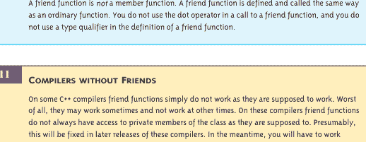

> > 数学是打开科学大门的钥匙。

在解决函数问题时，我们常常需要用到数形结合的思想，将代数问题转化为几何问题，或者将几何问题转化为代数问题。

```python
def linear_function(x, k, b):
    return k * x + b
```

当一个类是另一个类的友元时，通常这些类会在其类定义中相互引用。这要求你对第二个定义的类包含一个**前向声明**，如下文概述所示。请注意，前向声明只是类定义的首部后面跟一个分号。

如果你想让类 F 成为类 C 的友元，设置的方式大致如下：

```
class F; //forward declaration

class C
{
public:
    ...
    friend class F;
    ...
};

class F
{
    ...
};
```

使用友元类的完整示例在第 17 章给出。我们到那时才开始使用友元类。

- **Self-Test Exercises**
- 6. 类的友元函数与该类的成员函数有什么区别？
- 7. 完成 Display 8.3 中友元减法运算符 − 的定义。
- 8. 假设你希望重载运算符 < 使其适用于 Display 8.3 中定义的 Money 类型。你需要在 Display 8.3 中给出的 Money 定义中添加什么？

# 8.3 References and More Overloaded Operators

> Do not mistake the pointing finger for the moon.
> 
> — Zen Saying

本节介绍一些专门的但重要的重载主题，包括重载赋值运算符和 <<、>>、[]、++、-- 运算符。因为

# RULES ON OVERLOADING OPERATORS

- 重载运算符时，结果重载运算符的至少一个参数（一个操作数）必须是类类型。
- 大多数运算符可以作为类的成员、类的友元或非成员非友元来重载。
- 以下运算符只能作为类的（非静态）成员来重载：[]、->、->* 和（）。
- 你不能创建新的运算符。你只能重载已有的运算符，如 +、-、*、/、% 等。
- 你不能改变运算符所取参数的个数。例如，你不能在重载时将 % 从二元改为一元；你不能在重载时将 ++ 从一元改为二元。
- 你不能改变运算符的优先级。重载的运算符具有与普通版本运算符相同的优先级。例如，x*y + z 总是表示 (x*y) + z，即使 x、y、z 是对象且运算符 + 和 * 已为适当类重载。
- 以下运算符不能被重载：点运算符（.）、作用域解析运算符（::）、sizeof、?:，以及本书未讨论的运算符 ^。
- 重载的运算符不能有默认参数。

你需要理解返回引用才能以更自然的方式重载某些运算符，因此我们也讨论这个主题。

# REFERENCES

引用是存储位置的名称。² 你可以有独立的引用，如下所示：

```
int robert;
int& bob = robert;
```

这使得 bob 成为变量 robert 的存储位置的引用，这使得 bob 成为变量 robert 的别名。对 bob 所做的任何更改也会对 robert 产生影响。如此表述，独立引用听起来只是使代码变得混乱并惹麻烦的一种方式。在大多数情况下，独立引用只是

² 如果你了解指针，你会注意到引用听起来像指针。引用本质上是，但不完全是，一个常量指针。指针和引用之间存在差异，它们并非完全可以互换。

麻烦，尽管在少数情况下它可能很有用。我们将不再讨论独立引用，也不会使用它们。

正如你可能猜到的，引用用于实现传引用参数机制。因此，这个概念对本章来说并不完全新颖，尽管“引用”这个词是新的。

我们在这里关心引用是因为返回引用将允许你以更自然的方式重载某些运算符。返回引用可以被视为类似于返回一个变量，或更准确地说，返回一个变量的别名。语法细节很简单。你在返回类型中加上一个 &。例如：

```
double& sampleFunction(double& variable);
```

由于像 double& 这样的类型与 double 不同，因此你必须在函数声明和函数定义中都使用 &。返回表达式必须是具有引用的东西，例如适当类型的变量。它不能是表达式，如 X + 5。尽管许多编译器会让你这样做（结果不幸），你也不应返回局部变量，因为你会生成一个别名指向一个变量并立即销毁该变量。函数定义的简单示例是

```
double& sampleFunction(double& variable)
{
    return variable;
}
```

当然，这是一个相当无用、甚至麻烦的函数，但它说明了概念。例如，以下代码将输出 99 然后输出 42：

```
double m = 99;
cout << sampleFunction(m) << endl;
sampleFunction(m) = 42;
cout << m << endl;
```

我们只会在定义某些种类的重载运算符时返回引用。

# L-VALUES AND R-VALUES

术语 l-value 用于可以出现在赋值运算符左侧的东西。术语 r-value 用于可以出现在赋值运算符右侧的东西。

如果你希望函数返回的对象是一个 l-value，它必须通过引用返回。


# 陷阱

## 返回对某个成员变量的引用

当成员函数返回一个成员变量，且该成员变量属于某个类类型时，通常不应按引用返回。例如，考虑以下代码：

```
class A
{
public:
    const SomeClass getMember() { return member; }
    ...
private:
    SomeClass member;
    ...
};
```

其中 SomeClass 当然是某种类类型。函数 getMember 不应返回引用，而应像示例中那样按 const 值返回。

按引用返回类类型成员变量的问题，与本章“编程技巧”部分中“返回类类型的成员变量”所描述的非 const 值返回问题相同。当返回的成员变量本身是某个类类型时，通常应按 const 值返回。（每一条这样的规则都有罕见的例外。）

### 重载 >> 和 <<

运算符 >> 和 << 可以被重载，这样你就可以使用它们来输入和输出你定义的类的对象。其细节与我们之前看到的其他运算符并没有太大不同，但有一些新的微妙之处。

我们在 cout 中使用的插入运算符 << 是一个二元运算符，非常类似于 + 或 -。例如，考虑以下代码：

```
cout << "Hello out there.\n";
```

运算符是 <<，第一个操作数是预定义对象 cout（来自库 iostream），第二个操作数是字符串值 "Hello out there.\n"。预定义对象 cout 的类型是 ostream，因此当你重载 << 时，接收 cout 的参数类型应为 ostream。你可以更改 << 的两个操作数中的任意一个。当我们在第 12 章介绍文件 I/O 时，你将看到如何创建一个类型为 ostream 的对象，用于将输出发送到文件。（这些文件 I/O 对象以及 cin 和 cout 对象被称为流，这就是库名称为 ostream 的原因。）我们为 cout 设计的重载，在重载 << 的定义不做任何更改的情况下，也将同样适用于文件输出。

在我们之前的 Money 类定义中（显示 8.1 到显示 8.3），我们使用成员函数 output 来输出 Money 类型的值。这已经足够，但如果我们能直接使用插入运算符 << 来输出 Money 类型的值，那就更好了，如下所示：

```
Money amount(100);
cout << "I have " << amount << " in my purse.\n";
```

而不必像下面这样使用成员函数 output：

```
Money amount(100);
cout << "I have ";
amount.output();
cout << " in my purse.\n";
```

重载运算符 << 的一个问题是如何决定在如下表达式中使用 << 时应该返回什么值（如果有的话）：

```
cout << amount
```

上述表达式中的两个操作数是 cout 和 amount，对该表达式的求值应使 amount 的值被写到屏幕上。但如果 << 是像 + 或 - 那样的运算符，那么上述表达式也应该返回某个值。毕竟，带有其他操作数的表达式（如 n1 + n2）会返回值。但 cout << amount 返回什么呢？要得到这个问题的答案，我们需要观察一个涉及 << 的更复杂表达式。

让我们考虑以下表达式，它涉及使用 << 对一系列表达式进行链式求值：

```
cout << "I have " << amount << " in my purse.\n";
```

如果你将运算符 << 视为与其他运算符（如 +）类似，那么上面的表达式应该（事实上也确实）等价于以下形式：

```
( (cout << "I have ") << amount ) << " in my purse.\n";
```

为了使上面的表达式有意义，<< 应该返回什么值？首先被求值的是子表达式：

```
(cout << "I have ")
```

如果要让一切顺利进行，上面的子表达式最好返回 cout，这样计算就可以继续如下：

```
( cout << amount ) << " in my purse.\n";
```

如果还要继续顺利进行，(cout << amount) 最好也返回 cout，这样计算就可以继续如下：

```
cout << " in my purse.\n";
```

这在显示 8.4 中得到了说明。运算符 << 应返回它的第一个参数，其类型为 ostream（cout 的类型）。

因此，重载运算符 <<（用于 Money 类）的声明应如下所示：

```
class Money
{
public:
        . . .
    friend ostream& operator <<(ostream& outs, const Money& amount);
```

#### 显示 8.4    << 作为运算符

```
cout << "I have " << amount << " in my purse.\n";
```

等价于

```
((cout << "I have ") << amount) << " in my purse.\n";
```

其求值过程如下：

首先求值 (cout << "I have ")，它返回 cout：

```
(cout << "I have ")
```

字符串 "I have " 被输出。

```
(cout << amount) << " in my purse.\n";
```

然后求值 (cout << amount)，它返回 cout：

```
(cout << amount) << " in my purse.\n";
```

amount 的值被输出。

```
cout << " in my purse.\n";
```

然后求值 cout << " in my purse.\n"，它返回 cout：

```
cout << " in my purse.\n"
```

字符串 "in my purse.\n" 被输出。

```
cout;
```

由于没有更多的 << 运算符，过程结束。

一旦我们重载了插入（输出）运算符 <<，就不再需要成员函数 output，并将从 Money 类的定义中删除 output。重载运算符 << 的定义与成员函数 output 非常相似。以下是重载运算符的定义大纲：

```
ostream& operator <<(ostream& outputStream, const Money& amount)
{
    <这部分与
    Money::output 的函数体相同（显示 8.1 中给出），只是
    dollars 替换为 amount.dollars
    cents 替换为 amount.cents。>

    return outputStream;
}
```

注意，该运算符返回一个引用。

提取运算符 >> 的重载方式与我们为插入运算符 << 描述的类似。然而，对于提取（输入）运算符 >>，第二个参数将是接收输入值的对象，因此第二个参数必须是普通的按引用调用参数。以下是重载提取运算符 >> 的定义大纲：

```
istream& operator >>(istream& inputStream, Money& amount)
{
    <这部分与
    Money::input 的函数体相同（显示 8.1 中给出），只是
    dollars 替换为 amount.dollars
    cents 替换为 amount.cents。>

    return inputStream;
}
```

重载运算符 << 和 >> 的完整定义在显示 8.5 中给出，其中我们再次重写了 Money 类。这次我们重写该类，使得运算符 << 和 >> 被重载，以便我们可以对这些运算符使用 Money 类型的值。

请注意，你实际上无法将 >> 或 << 重载为成员运算符。如果 << 和 >> 要按我们希望的方式工作，那么第一个操作数（第一个参数）必须是 cout 或 cin（或某个文件 I/O 流）。但如果我们想将这些运算符重载为（比如）Money 类的成员，那么第一个操作数必须是调用对象，因此类型必须是 Money，而这将不允许你将这些运算符定义为其在 >> 和 << 上正常工作的行为。

#### 显示 8.5 重载 << 和 >>（共 3 部分中的第 1 部分）

```
#include <iostream>
#include <stdlib.h>
#include <cmath>
using namespace std;

//Class for amounts of money in U.S. currency
class Money
{
public:
    Money();
    Money(double amount);
    Money(int theDollars, int theCents);
    Money(int theDollars) const;
    double getAmount() const;
    int getDollars() const;
    int getCents() const;
    friend const Money operator +(const Money& amount1, const Money& amount2);
    friend const Money operator -(const Money& amount1, const Money& amount2);
    friend bool operator ==(const Money& amount1, const Money& amount2);
    friend const Money operator -(const Money& amount);
    friend ostream& operator <<(ostream& outputStream, const Money& amount);
    friend istream& operator >>(istream& inputStream, Money& amount);
private:
    int dollars; //A negative amount is represented as negative dollars and
    int cents; //negative cents. Negative $4.50 is represented as -4 and -50.
    int dollarsPart(double amount) const;
    int centsPart(double amount) const;
    int round(double number) const;
};

int main()
{
    Money yourAmount, myAmount(10, 9);
    cout << "Enter an amount of money: ";
    cin >> yourAmount;
    cout << "Your amount is " << yourAmount << endl;
    cout << "My amount is " << myAmount << endl;
    if (yourAmount == myAmount)
        cout << "We have the same amounts.\n";
    else
        cout << "One of us is richer.\n";
    Money ourAmount = yourAmount + myAmount;
```


### 显示 8.5 重载 `<<` 和 `>>`

```cpp
cout << yourAmount << " + " << myAmount
     << " equals " << ourAmount << endl;

Money diffAmount = yourAmount - myAmount;
cout << yourAmount << " - " << myAmount
     << " equals " << diffAmount << endl;

return 0;
}
```

其他成员函数的定义如显示 8.1。其他重载运算符的定义如显示 8.3。

```cpp
ostream& operator <<(ostream& outputStream, const Money& amount)
{
    int absDollars = abs(amount.dollars);
    int absCents = abs(amount.cents);
    if (amount.dollars < 0 || amount.cents < 0)
        //accounts for dollars == 0 or cents == 0
        outputStream << "$-";
    else
        outputStream << '$';

    outputStream << absDollars;

    if (absCents >= 10)
        outputStream << '.' << absCents;
    else
        outputStream << '.' << '0' << absCents;

    return outputStream;
}
```

```cpp
//Uses iostream and cstdlib:
istream& operator >>(istream& inputStream, Money& amount)
{
    char dollarSign;
    inputStream >> dollarSign; //hopefully
    if (dollarSign != '$')
    {
        cout << "No dollar sign in Money input.\n";
        exit(1);
    }

    double amountAsDouble;
    inputStream >> amountAsDouble;
    amount.dollars = amount.dollarsPart(amountAsDouble);
    amount.cents = amount.centsPart(amountAsDouble);
    return inputStream;
}
```

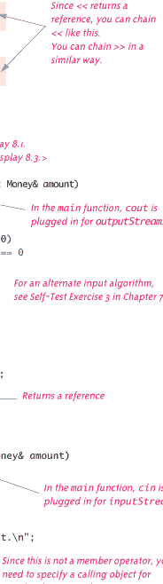

返回一个引用

#### 示例对话

```text
Enter an amount of money: $123.45
Your amount is $123.45
My amount is $10.09.
One of us is richer.
$123.45 + $10.09 equals $133.54
$123.45 - $10.09 equals $113.36
```

### 自测练习

- 9. 在显示 8.5 中，重载运算符 << 的定义包含如下行：

  `outputStream << "$-";`

  这不是循环吗？我们不是在用 << 来定义 << 吗？

- 10. 为什么我们不能将 << 或 >> 重载为成员运算符？

- 11. 下面是名为 Percent 的类的定义。Percent 类型的对象表示诸如 10% 或 99% 之类的百分比。请给出重载运算符 >> 和 << 的定义，以便它们可用于对 Percent 类的对象进行输入和输出。假设输入始终由一个整数后跟字符 '%' 组成，例如 25%。所有百分比都是整数，并存储在名为 value 的 int 成员变量中。你不需要定义其他重载运算符，也不需要定义构造函数。你只需要定义重载运算符 >> 和 <<。

```cpp
#include <iostream>
using namespace std;
class Percent
{
public:
    friend bool operator ==(const Percent& first,
        const Percent& second);
    friend bool operator <(const Percent& first,
        const Percent& second);
    Percent();
    friend istream& operator >>(istream& inputStream,
                         Percent& aPercent);
    friend ostream& operator <<(ostream& outputStream,
                         const Percent& aPercent);
    //There would normally also be other members and friends.
private:
    int value;
};
```

### 重载 >> 和 <<

输入和输出运算符 >> 和 << 可以像其他任何运算符一样被重载。如果你希望运算符对 cin、cout 和文件 I/O 的行为符合预期，那么返回的值应为 istream 类型用于输入，ostream 类型用于输出，并且值应通过引用返回。

### 声明

```cpp
class Class_Name
{
        . . .
public:
        . . .
    friend istream& operator >>(istream& Parameter_1,
                                  Class_Name& Parameter_2);

    friend ostream& operator <<(ostream& Parameter_3,
                                  const Class_Name& Parameter_4);
        . . .
```

运算符不需要是友元，但不能是被输入或输出的类的成员。

### 定义

```cpp
istream& operator >>(istream& Parameter_1,
                              Class_Name& Parameter_2)
{
        . . .
}
ostream& operator <<(ostream& Parameter_3,
    const Class_Name& Parameter_4)
{
    ...
}
```

如果你有足够的访问器和修改器函数，可以将 >> 和 << 重载为非友元函数。然而，将它们定义为友元更自然也更高效。

### 要使用哪种返回值的模式

一个函数可以用四种不同的方式返回类型 T 的值：

- 通过普通值返回，如函数声明 T f()；
- 通过常量值返回，如函数声明 const T f()；
- 通过引用返回，如函数声明 T& f()；
- 通过常量引用返回，如函数声明 const T& f()；

关于使用哪一种并没有一致的共识。因此，不要期望使用上的一致性。即使作者或程序员有明确的策略，他们也很少能毫无例外地遵循它。尽管如此，一些要点是明确的。

如果你返回的是 int 或 char 之类的简单类型，在通过值或通过引用返回时使用 const 没有意义。因此程序员通常在返回类型为简单类型时不会在返回类型上使用 const。如果你希望返回的简单值可以作为左值，即允许在赋值语句的左侧使用，那么就通过引用返回；否则就通过普通值返回简单类型。类类型并不那么简单。以下讨论适用于返回类类型对象的情况。

是否通过引用返回的决定取决于是否希望将返回的对象用作左值。如果你希望返回可以作为左值使用的东西，即可以在赋值运算符的左侧使用，你必须通过引用返回，因此在返回类型上必须使用 & 符号。

通过引用返回局部变量（或其他短寿命对象），无论是否带 const，都可能产生问题，应避免。

对于类类型，返回类型说明 const T 和 const T& 非常相似。它们都意味着你不能通过直接在返回对象上调用某个修改器函数来更改返回对象，如

```cpp
f().mutator();
```

返回的值仍可通过赋值运算符复制到另一个变量，然后可对该变量应用修改器函数。如果你无法在 const T& 和 const T 之间做出决定，请使用 const T（不带 &）。const T& 可能比 const T 更高效一些。3 然而，这种差异通常并不重要，大多数程序员使用 const T 而不是 const T& 作为返回类型说明。如前所述，const T& 有时会导致问题。

以下总结可能有所帮助。假定 T 为类类型。拷贝构造函数直到第 10 章才介绍，但我们在此为参考价值包含了有关它们的细节。如果你尚未阅读第 10 章，只需忽略所有关于拷贝构造函数的引用即可。

如果一个公共成员函数返回一个私有类成员变量，它应始终在返回类型上带有 const，正如我们在本章的陷阱部分中“返回类类型的成员变量”中所解释的那样。（此规则的一个例外是程序员通常总是通过普通值而不是通过常量值返回 string 类型的值。这可能是因为 string 类型被视为像 int 和 char 一样的简单类型，即使 string 是类类型。）

以下总结可能有所帮助。假定 T 为类类型。

- 简单地通过值返回，如函数声明 T f()；
  不能用作左值，并且返回的值可以直接更改，如 f().mutator()。调用拷贝构造函数。
- 通过常量值返回，如 const T f()；
  此情况与前一种情况相同，但返回的值不能直接更改，如 f().mutator()。
- 通过引用返回，如 T& f()；
  可以用作左值，并且返回的值可以直接更改，如 f().mutator()。不调用拷贝构造函数。
- 通过常量引用返回，如 const T& f()；
  不能用作左值，并且返回的值不能直接更改，如 f().mutator()。不调用拷贝构造函数。

### 赋值运算符

如果你重载赋值运算符 =，你必须将其重载为成员运算符。如果你不重载赋值运算符 =，那么你的类会自动获得一个赋值运算符。此默认赋值运算符将一个对象的成员变量的值复制到另一个对象的对应成员变量中。对于简单的类，这通常是你想要的。当我们讨论指针时，此默认赋值运算符将不是我们想要的，我们将在那时讨论重载赋值运算符。

3 这是因为 const T& 不会调用拷贝构造函数而 const T 会调用拷贝构造函数。拷贝构造函数在第 10 章中讨论。


# 重载自增和自减运算符

自增运算符 `++` 和自减运算符 `--` 各自都有两个版本。根据它们是以前缀表示法 `++x` 还是后缀表示法（后缀记法）`x++` 使用，它们可以执行不同的操作。因此，在重载这些运算符时，你需要以某种方式区分前缀和后缀版本，以便可以有两个重载运算符的版本。在 C++ 中，这种前缀和后缀版本之间的区别以一种乍一看（甚至再看一遍）似乎有点做作的方式处理。如果你以常规方式重载 `++` 运算符（作为带一个参数的非成员运算符或不带参数的成员运算符），那么你重载的是前缀形式。要获得后缀版本 `x++` 或 `x--`，你需要添加一个 `int` 类型的第二个参数。这只是给编译器的一个标记；当你调用 `x++` 或 `x--` 时，你不需要提供第二个 `int` 实参。

例如，显示 8.6 包含了一个类的定义，其数据是整数对。自增运算符 `++` 被定义，使其在前缀和后缀表示法中都能工作。我们将 `++` 定义为具有对 `int` 变量使用 `++` 时的直观含义。这是定义 `++` 的最佳方式，但你可以自由地将其定义为返回任何类型的值并执行任何类型的操作。

后缀版本的定义忽略了那个 `int` 参数，如显示 8.6 所示。当编译器看到 `a++` 时，它将其视为调用 `IntPair::operator++(int)`，其中 `a` 是调用对象。

对于简单类型（如 `int` 和 `char`）的自增和自减运算符，前缀形式返回引用，后缀形式返回值。如果你想在为自己的类类型重载这些运算符时模拟简单类型的行为，那么你应该为前缀形式返回引用，为后缀形式返回值。然而，我们发现对于自增或自减运算符返回引用会引发太多问题，因此我们总是简单地让所有版本的自增和自减运算符都返回值。

# 自测练习

12. 以下代码合法吗？解释你的答案。（`IntPair` 的定义在显示 8.6 中。）
`IntPair o(1,2);`
`(o++)++;`

# 重载数组运算符 [ ]

你可以为一个类重载方括号 `[]`，以便它们可以与该类的对象一起使用。如果你想在赋值运算符左侧的表达式中使用 `[]`，那么该运算符必须定义为返回引用。重载 `[]` 时，运算符 `[]` 必须是成员函数。

# 显示 8.6 重载 ++ （第 1 部分，共 2 部分）

> 在函数或运算符声明中，你不需要给出参数名。对于 `++`，不给出参数是有意义的，因为该参数未被使用。

```
#include <iostream>
#include <cstdlib>
using namespace std;

class IntPair
{
public:
    IntPair(int firstValue, int secondValue);
    IntPair operator++(); //前缀版本
    IntPair operator++(int); //后缀版本
    void setFirst(int newValue);
    void setSecond(int newValue);
    int getFirst() const;
    int getSecond() const;
private:
    int first;
    int second;
};

int main()
{
    IntPair a(1,2);
    cout << "后缀 a++：对象 a 的起始值：";
    cout << a.getFirst() << " " << a.getSecond() << endl;
    IntPair b = a++;
    cout << "返回的值：";
    cout << b.getFirst() << " " << b.getSecond() << endl;
    cout << "更改后的对象：";
    cout << a.getFirst() << " " << a.getSecond() << endl;

    a = IntPair(1, 2);
    cout << "前缀 ++a：对象 a 的起始值：";
    cout << a.getFirst() << " " << a.getSecond() << endl;
    IntPair c = ++a;
    cout << "返回的值：";
    cout << c.getFirst() << " " << c.getSecond() << endl;
    cout << "更改后的对象：";
    cout << a.getFirst() << " " << a.getSecond() << endl;
    return 0;
}

IntPair::IntPair(int firstValue, int secondValue)
    : first(firstValue), second(secondValue)
{/*函数体有意留空*/}
```

# 显示 8.6 重载 ++ （第 2 部分，共 2 部分）

```
```cpp
IntPair IntPair::operator++(int ignoreMe) //后缀版本
{
    int temp1 = first;
    int temp2 = second;
    first++;
    second++;
    return IntPair(temp1, temp2);
}

IntPair IntPair::operator++() //前缀版本
{
    first++;
    second++;
    return IntPair(first, second);
}

void IntPair::setFirst(int newValue)
{
    first = newValue;
}

void IntPair::setSecond(int newValue)
{
    second = newValue;
}

int IntPair::getFirst() const
{
    return first;
}

int IntPair::getSecond() const
{
    return second;
}
```
```

# 示例对话

```
```text
后缀 ++：对象 a 的起始值：1 2
返回的值：1 2
更改后的对象：2 3
前缀 ++：对象 a 的起始值：1 2
返回的值：2 3
更改后的对象：2 3
```
```

回顾运算符 `[]` 的语法可能会有所帮助，因为它与我们见过的任何其他运算符都不同。请记住，`[]` 是作为成员运算符重载的；因此，在使用 `[]` 的表达式中，必须有一个项是调用对象。在表达式 `a[2]` 中，`a` 是调用对象，`2` 是成员运算符 `[]` 的参数。重载 `[]` 时，这个“索引”参数可以是任何类型。

例如，在显示 8.7 中，我们定义了一个类 `Pair`，其对象的行为类似于具有索引 1 和 2（而不是 0 和 1）的字符数组。请注意，表达式 `a[1]` 和 `a[2]` 的行为就像数组索引变量一样。如果你查看重载运算符 `[]` 的定义，你会看到它返回一个引用，并且该引用是对成员变量的引用，而不是对整个 `Pair` 对象的引用。这是因为成员变量类似于数组的索引变量。当你更改 `a[1]`（在显示 8.7 的示例代码中）时，你希望这是对成员变量 `first` 的更改。请注意，这允许任何程序访问私有成员变量，例如，通过显示 8.7 中示例 `main` 函数中的 `a[1]` 和 `a[2]`。尽管 `first` 和 `second` 是私有成员，但该代码是合法的，因为它没有直接通过名称引用 `first` 和 `second`，而是间接地使用名称 `a[1]` 和 `a[2]`。

# 显示 8.7 重载 [] （第 1 部分，共 2 部分）

```
#include <iostream>
#include <cstdlib>
using namespace std;

class CharPair
{
public:
    CharPair() {/*函数体有意留空*/}
    CharPair(char firstValue, char secondValue)
        : first(firstValue), second(secondValue)
    {/*函数体有意留空*/}

    char& operator[](int index);
private:
    char first;
    char second;
};

int main()
{
    CharPair a;
    a[1] = 'A';
    a[2] = 'B';
```

# 显示 8.7 重载 [] （第 2 部分，共 2 部分）

```
22  cout << "a[1] 和 a[2] 是：\n";
23  cout << a[1] << a[2] << endl;
24
25  cout << "输入两个字母（无空格）：\n";
26  cin >> a[1] >> a[2];
27  cout << "你输入了：\n";
28  cout << a[1] << a[2] << endl;
29
30  return 0;
31  }
32
33  //使用 iostream 和 cstdlib：
34  char& CharPair::operator[](int index)
35  {
36    if (index == 1)
37      return first;
38    else if (index == 2)
39      return second;
40    else
41    {
42      cout << "非法索引值。\n";
43      exit(1);
44    }
45  }
```

> 请注意，你返回的是成员变量，而不是整个 `Pair` 对象，因为成员变量类似于数组的索引变量。

# 示例对话

```
a[1] 和 a[2] 是：
AB
输入两个字母（无空格）：
CD
你输入了：
CD
```

# 基于左值与右值的重载

虽然我们在本书中不会这样做，但你可以重载一个函数名（或运算符），使其用作左值和用作右值时表现不同。（回想一下，左值意味着它可以用于赋值语句的左侧。）例如，如果你希望函数 `f` 根据它是用作左值还是右值而表现不同，你可以这样做：

```
class SomeClass
{
public:
    int& f(); // 将用于任何左值调用
    const int& f() const; // 用于任何右值调用
    ...
};
```

两个参数列表不必为空，但它们应该相同（否则你只是进行简单的重载）。请务必注意，`f` 的第二个声明中有两个 `const`。你必须包含这两个 `const`。当然，`&` 符号也是必需的。

# 章节总结

+   - 运算符，如 `+` 和 `==`，可以被重载，以便它们可以与你自己定义的类类型的对象一起使用。
+   - 运算符只是一个使用不同调用语法的函数。
+   - 类的友元函数是一个普通函数，但它可以访问类的私有成员，就像成员函数一样。
+   - 当运算符被重载为类的成员时，第一个操作数是调用对象。
+   - 如果你的每个类都有一整套访问器函数，那么使一个函数成为友元的唯一原因是为了使友元函数的定义更简单、更高效，但这通常已经是一个充分的理由。
+   - 引用是命名变量的一种方式。它本质上是变量的别名。
+   - 重载 `>>` 或 `<<` 运算符时，返回的类型应该是流类型，并且应该是引用，这通过在返回类型名称后附加 `&` 来表示。

# 自测练习答案

1. （二元）运算符（如 `+`、`*` 或 `/`）与函数之间的区别在于它们的调用语法。在函数调用中，参数放在函数名后面的括号中。对于运算符，参数放在运算符的前面和后面。此外，你必须在运算符声明和重载运算符的定义中使用保留字 `operator`。

2. 添加以下声明和函数定义：

```
bool operator <(const Money& amount1, const Money& amount2);
```

```
bool operator <(const Money& amount1, const Money& amount2)
{
```


```
int dollars1 = amount1.getDollars();
int dollars2 = amount2.getDollars();
int cents1 = amount1.getCents();
int cents2 = amount2.getCents();
return ((dollars1 < dollars2) ||
        ((dollars1 == dollars2) && (cents1 < cents2)));
}
```

3. 重载运算符时，运算符的参数中至少有一个必须是类类型。这可以防止改变整数 + 的行为。

4. 如果你在类 Money 的重载加法运算符的声明和定义开头省略 const，那么以下内容是合法的：

```
(m1 + m2) = m3;
```

如果类 Money 的定义如 Display 8.1 所示，使得加法运算符按 const 值返回，那么它是不合法的。

### 5. const Money

```
Money::operator -(const Money& secondOperand) const
{
    int allCents1 = cents + dollars*100;
    int allCents2 = secondOperand.cents
                 + secondOperand.dollars*100;
    int diffAllCents = allCents1 - allCents2;
    int absAllCents = abs(diffAllCents);
    int finalDollars = absAllCents/100;
    int finalCents = absAllCents%100;
    if (diffAllCents < 0)
    {
        finalDollars = -finalDollars;
        finalCents = -finalCents;
    }
    return Money(finalDollars, finalCents);
}
```

6. 友元函数和成员函数相似之处在于它们都可以在其函数定义中使用类的任何成员（公共或私有）。然而，友元函数像普通函数一样定义和使用；调用友元函数时不使用点运算符，且在定义友元函数时不使用类型限定符。另一方面，成员函数使用对象名和点运算符调用。此外，成员函数定义包括由类名和作用域解析运算符 :: 组成的类型限定符。

```
//Uses stdlib:
const Money operator -(const Money& amount1,
                       const Money& amount2)
{
    int allCents1 = amount1.cents + amount1.dollars*100;
    int allCents2 = amount2.cents + amount2.dollars*100;
    int diffAllCents = allCents1 - allCents2;
    int absAllCents = abs(diffAllCents);

    int finalDollars = absAllCents/100;
    int finalCents = absAllCents%100;

    if (diffAllCents < 0)
    {
        finalDollars = -finalDollars;
        finalCents = -finalCents;
    }

    return Money(finalDollars, finalCents);
}
```

8. 添加以下声明和函数定义：

```
friend bool operator <(const Money& amount1,
                       const Money& amount2);

bool operator <(const Money& amount1,
                const Money& amount2)
{
    return ((amount1.dollars < amount2.dollars) ||
            ((amount1.dollars == amount2.dollars) &&
             (amount1.cents < amount2.cents)));
}
```

9. 要理解为什么它不是循环的，你需要思考重载的基本思想：单个函数或运算符名可以有两种或更多定义。这意味着两种或更多不同的运算符（或函数）可以共享一个名称。在行

```cpp
outputStream << "$";
```

中，运算符 << 是在库 iostream 中定义的运算符的名称，用于第二个参数为带引号字符串时。我们在 Display 8.5 中定义的名为 << 的运算符是不同的运算符，当第二个参数为类型 Money 时起作用。

10. 如果 << 和 >> 要按我们想要的方式工作，那么第一个操作数（第一个参数）必须是 cout 或 cin（或某个文件 I/O 流）。但如果我们想将运算符重载为例如类 Money 的成员，那么第一个操作数将不得不是调用对象，因此必须是类型 Money，而这不是我们想要的。

```
//Uses istream:
istream& operator >> (istream& inputStream,
                                Percent& aPercent)
{
    char percentSign;
    inputStream >> aPercent.value;
    inputStream >> percentSign; //Discards the % sign.
    return inputStream;
}

//Uses iostream:
ostream& operator <<(ostream& outputStream,
                                const Percent& aPercent)
{
    outputStream << aPercent.value << '%';
    return outputStream;
}
```

12. 这是合法的，但含义可能不是你想要的。 (a++) 增加 a 的成员变量的值一，但 (a++)++ 将 a++ 的成员变量的值增加一，而 a++ 与 a 是不同的对象。 （可以定义自增运算符使得 (a++)++ 将成员变量的值增加二，但这需要使用 this 指针，而 this 指针直到第 10 章才讨论。）

# PROGRAMMING PROJECTS

- 1. 修改 Display 8.5 中所示的类 Money 的定义，以便添加以下内容：
  
  a. 运算符 <、<=、> 和 >= 已被重载以应用于类型 Money。 *(提示：参见自测练习 8.)*
  
  b. 以下成员函数已添加到类定义中。 （我们以其在类定义中应出现的形式显示函数声明。函数的定义本身将包括限定符 `Money::`。）

```
const Money percent(int percentFigure) const;
//Returns a percentage of the money amount in the calling object.
//For example, if percentFigure is 10, then the value returned is
//10% of the amount of money represented by the calling object.
```

例如，如果 purse 是类型 Money 的对象，其值表示金额 $100.10，那么调用

```
purse.percent(10);
```

返回 $100.10 的 10%；也就是说，它返回类型 Money 的值，表示金额 $10.01。

- 2. 定义一个有理数的类。有理数是可以表示为两个整数商的数。例如，1/2、3/4、6/4/2 等等都是有理数。 （通过 1/2 等我们指的是日常分数，而不是 C++ 程序中该表达式会产生的整数除法。）将有理数表示为两个类型为 int 的值，一个为分子，一个为分母。命名该类为 Rational。包含一个有两个参数的构造函数，可用于将对象的成员变量设置为任何合法值。还包含一个只有一个类型为 int 参数的构造函数；将此单个参数称为 wholeNumber 并定义构造函数，使对象初始化为有理数 wholeNumber/1。包含一个默认构造函数，将对象初始化为 0（即 0/1）。重载输入和输出运算符 >> 和 <<。数字应以 1/2、15/32、300/401 等形式输入和输出。请注意分子、分母或两者都可能包含负号，因此 −1/2、15/−32 和 −300/−401 也是可能的输入。重载以下所有运算符，使其正确应用于类型 Rational：==、<、<=、>、>=、+、−、* 和 /。编写一个测试程序来测试你的类。提示：两个有理数 a/b 和 c/d 相等当且仅当 a*d 等于 c*b。如果 b 和 d 是正有理数，则当 a*d 小于 c*b 时，a/b 小于 c/d。你应包含一个函数来规范化存储的值，以便规范化后分母为正且分子和分母尽可能小。例如，规范化后 4/−8 将与 −1/2 表示相同。

- 3. 定义一个复数的类。复数是形式为
  
  *a + b*i*
  
  的数，其中就我们的目的而言，*a* 和 *b* 是类型为 double 的数，而 *i* 是表示 √−1 的数。将复数表示为两个类型为 double 的值。将成员变量命名为 real 和 imaginary。 （乘以 *i* 的数称为 *imaginary*。）命名该类为 Complex。包含一个有两个 double 类型参数的构造函数，可用于将对象的成员变量设置为任意值。包含一个只有一个 double 类型参数的构造函数；将此参数称为 realPart 并定义构造函数，使对象初始化为 realPart + 0*i。包含一个默认构造函数，将对象初始化为 0（即 0 + 0*i）。重载以下所有运算符，使其正确应用于类型 Complex：==、+、−、*、>> 和 <<。你还应编写一个测试程序来测试你的类。提示：要加或减两个复数，只需加或减两个 double 类型的成员变量。两个复数的乘积由以下公式给出：

\((a + b*i)*(c + d*i) == (a*c − b*d) + (a*d + b*c)*i\)

在接口文件中，你应按如下方式定义常量 i：

```
const Complex i(0, 1);
```

此定义的常量 i 将与上面讨论的 i 相同。

- 4. （累积地修改 Display 8.7 的示例如下。


+   a. 在 Display 8.7 中，将私有 char 成员 first 和 second 替换为一个大小为 100 的 char 数组和一个名为 size 的私有数据成员。
+   
+      提供一个默认构造函数，将 size 初始化为 10 并将 char 位置的前 10 个设为 '#'。 （这仅使用了可能的 100 个槽中的 10 个。）
+   
+      提供一个访问函数返回私有成员 size 的值。
+   
+      测试。

+   b. 添加一个 operator[] 成员，返回一个 char&，允许用户使用小于 size 的非负整数索引访问或设置私有数据数组的任何成员。
+   
+      测试。

+   c. 添加一个构造函数，接受一个 int 参数 sz，将 char 数组的前 sz 个成员设为 '#'。
+   
+      测试。

+   d. 添加一个构造函数，接受一个 int 参数 sz 和一个大小为 sz 的 char 数组。构造函数应将私有数据数组的前 sz 个成员设为参数 char 数组的 sz 个成员。
+   
+      测试。

NOTES: 当你测试时，你应该使用已知正确的值、在边界上使用数据以及使用故意错误的值进行测试。你不需要在代码中加入索引越界错误检查，但那会是一个不错的补充。错误处理替代方案：发出错误消息然后退出（即调用 exit(1)）或给用户另一个机会输入正确的条目。

### 第9章 字符串

### 字符串


+   9.1  AN ARRAY TYPE FOR STRINGS 351
+   C-String Values and C-String Variables 351
+   Pitfall: Using = and == with C-strings 355
+   Other Functions in <cstring> 357
+   C-String Input and Output 360
+   
+   9.2  CHARACTER MANIPULATION TOOLS 363
+   Character I/O 363
+   The Member Functions get and put 364
+   Example: Checking Input Using a Newline Function 366
+   Pitfall: Unexpected '\n' in input 368
+   The putback, peek, and ignore Member Functions 369
+   Character-Manipulating Functions 372
+   Pitfall: toupper and tolower Return int Values 374
+   
+   9.3  THE STANDARD CLASS string 375
+   Introduction to the Standard Class string 376
+   I/O with the Class string 379
+   Tip: More Versions of getline 382
+   Pitfall: Mixing cin >> variable; and getline 383
+   String Processing with the Class string 384
+   Example: Palindrome Testing 388
+   Converting between string Objects and C-Strings 392
+   
+   CHAPTER SUMMARY 393
+   ANSWERS TO SELF-TEST EXERCISES 393
+   PROGRAMMING PROJECTS 397

### 字符串

> Polonius: What do you read my lord?
> Hamlet: Words, words, words
> 
> William Shakespeare, Hamlet

### INTRODUCTION

本章讨论两种其值表示字符字符串的类型，例如 "Hello"。一种类型只是基类型为 char 的数组，它在数组中存储字符字符串并用空字符 '\0' 标记字符串的结束。这是表示字符串的较老的方式，C++ 从 C 语言继承而来。这种类型的字符串称为 C-string。尽管 C-string 是表示字符串的较老方式，但在 C++ 中进行任何字符串处理时至少会与 C-string 有接触。例如，引号字符串，如 "Hello"，在 C++ 中被实现为 C-string。

ANSI/ISO C++ 标准以类 string 的形式包含了一种更现代的字符串处理设施。类 string 是我们将在本章讨论的第二种字符串类型。完整的类 string 使用模板，因此类似于标准模板库 STL 中的模板类。模板在第 16 章中介绍，STL 在第 19 章中介绍。本章涵盖对类 string 的基本使用，这些使用不需要模板知识。

此材料不需要对数组有深入的了解，但你应该熟悉基本的数组记法，例如 a[1]。第 5 章第 5.1 节的数组内容足以让你阅读本章的材料。此材料也不需要对类有深入的了解。第 9.1 节关于 C-string 和第 9.2 节关于字符操作可以在第 6、7 和 8 章之前进行，这些章节介绍类。然而，在阅读第 9.3 节关于标准类 string 之前，你应该阅读第 6 章和第 7 章的以下部分：第 7.1 节和第 7.2 节的子节“const 参数修饰符”及其附带的陷阱部分。

### 9.1 An Array Type for Strings

> 在一切事物中必须考虑其终结。
> 
> — Jean de La Fontaine, *Fables, book III (1668)*

本节描述了一种表示字符字符串的方式，C++ 从 C 语言继承而来。第 9.3 节描述了一种更现代的表示字符串的字符串类。尽管这里描述的字符串可能有点“老式”，但它仍然被广泛使用并且是 C++ 语言不可分割的一部分。

#### C-STRING VALUES AND C-STRING VARIABLES

表示字符串的一种方式是基类型为 char 的数组。然而，如果字符串是 "Hello"，将其表示为包含六个索引变量的字符数组很方便：五个用于 "Hello" 中的五个字母，再加上一个用于字符 '\0'，它用作结束标记。字符 '\0' 称为空字符，并用作结束标记，因为它与所有“真实”字符不同。结束标记允许你的程序一次读取数组一个字符，并知道当它读取到 '\0' 时应停止读取。以这种方式存储的字符串（作为以 '\0' 终止的字符数组）称为 C-string。

我们在程序中写 '\0' 时使用两个符号，但就像换行字符 '\n' 一样，字符 '\0' 实际上只有一个字符值。像任何其他字符值一样，'\0' 可以存储在一个类型为 char 的变量中或字符数组的一个索引变量中。

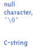

> **THE NULL CHARACTER, '\0'**
> 
> 空字符 '\0' 用于标记存储在字符数组中的 C-string 的结束。当字符数组以这种方式使用时，数组通常称为 C-string 变量。尽管空字符 '\0' 使用两个符号书写，但它是一个可放入类型为 char 的一个变量或字符数组的一个索引变量中的单个字符。

你已经在使用 C-string 了。在 C++ 中，字面字符串，例如 "Hello" 被存储为 C-string，尽管你很少需要意识到这个细节。

C-string 变量只是一个字符数组。

因此，以下数组声明为我们提供了一个能够存储最多九个字符的 C-string 值的 C-string 变量：

```
char s[10];
```

10 是用于字符串中的 9 个字母加上空字符 '\0' 来标记字符串的结束。

C-string 变量是一个部分填充的字符数组。像任何其他部分填充的数组一样，C-string 变量使用从索引变量 0 开始的若干位置。然而，C-string 变量不使用 int 变量来跟踪当前使用了多少数组。相反，字符串变量在 C-string 的最后一个字符之后立即在数组中放置特殊符号 '\0'。因此，如果 s 包含字符串 "Hi Mom!"，数组元素填充如下所示：

| s[0] | s[1] | s[2] | s[3] | s[4] | s[5] | s[6] | s[7] | s[8] | s[9] |
| H | i |  | M | o | m | ! | \0 | ? | ? |

字符 '\0' 被用作哨兵值来标记 C-string 的结束。如果你从索引变量 s[0] 开始读取 C-string 中的字符，继续到 s[1]，然后到 s[2]，等等，你知道当你遇到符号 '\0' 时你已到达 C-string 的末尾。由于符号 '\0' 总是占用数组的一个元素，数组可以容纳的最长字符串长度比数组大小少一。

区分 C-string 变量与普通字符数组的是 C-string 变量必须在 C-string 值末尾包含空字符 '\0'。这是一种关于数组如何使用而非数组是什么的区分。C-string 变量是一个字符数组，但使用方式不同。

你可以在声明时初始化 C-string 变量，如以下示例所示：

```
char myMessage[20] = "Hi there.";
```

注意，分配给 C-string 变量的 C-string 不必填满整个数组。

当你初始化 C-string 变量时，你可以省略数组大小，C++ 将自动使 C-string 变量的大小比引号字符串的长度多一。 （多出的一个索引变量用于 '\0'。）例如：

```
char shortString[] = "abc";
```

等价于

```
char shortString[4] = "abc";
```


### C-字符串变量声明

C-字符串变量本质上与字符数组相同，但使用方式不同。C-字符串变量以通常的方式声明为字符数组。

### 语法

```
char Array_Name[Maximum_C-string_Size + 1];
```

### 示例

```
char myCstring[11];
```

+ 1 用于容纳终止任何存储在数组中的 C-字符串的空字符 '\0'。例如，上述示例中的 C-字符串变量 myCstring 可以容纳长度为十个或更少字符的 C-字符串。

请确保不要混淆以下初始化：

```
char shortString[] = "abc";
```

和

```
char shortString[] = {'a', 'b', 'c'};
```

它们不等价。这两种可能的初始化中的第一种会在字符 'a'、'b' 和 'c' 之后在数组中放置空字符 '\0'。第二种则不会在数组的任何位置放置 '\0'。

### 初始化 C-字符串变量

C-字符串变量可以在声明时进行初始化，如以下示例所示：

```
char yourString[11] = "Do Be Do";
```

以这种方式初始化会自动在指定的 C-字符串末尾将空字符 '\0' 放置在数组中。

如果省略方括号 [] 中的数字，则 C-字符串变量将被赋予比 C-字符串长度多一个字符的大小。例如，以下声明将 myString 定义为有九个索引变量：八个用于 C-字符串 "Do Be Do" 的字符，一个用于空字符 '\0'：

```
char myString[] = "Do Be Do";
```

C-字符串变量是一个数组，因此它具有可以像任何其他数组一样使用的索引变量。例如，假设你的程序包含以下 C-字符串变量声明：

```
char ourString[5] = "Hi";
```

按上述方式声明 ourString 后，你的程序具有以下索引变量：ourString[0]、ourString[1]、ourString[2]、ourString[3] 和 ourString[4]。例如，以下代码会将 ourString 中的 C-字符串值更改为由全部 'X' 字符组成且长度相同的 C-字符串：

```
int index = 0;
while (ourString[index] != '\0')
{
    ourString[index] = 'X';
    index++;
}
```

在操作这些索引变量时，你应非常小心不要用其他值替换空字符 '\0'。如果数组丢失了值 '\0'，它将不再像 C-字符串变量那样表现。例如，以下代码会更改数组 happyString，使其不再包含 C-字符串：

```
char happyString[7] = "DoBeDo";
happyString[6] = 'Z';
```

执行上述代码后，数组 happyString 仍包含 C-字符串 "DoBeDo" 中的六个字母，但 happyString 将不再包含用于标记 C-字符串结束的空字符 '\0'。许多字符串处理函数严重依赖 '\0' 的存在来标记 C-字符串值的结束。

再举一个例子，考虑上述更改 C-字符串变量 ourString 中字符的 while 循环。该 while 循环会更改字符直到遇到 '\0'。如果循环从未遇到 '\0'，那么它可能会将大块内存更改为不想要的值，从而使你的程序出现奇怪的行为。作为安全措施，最好将上述 while 循环重写如下，以便如果空字符 '\0' 丢失，循环也不会无意中更改数组末尾之外的内存位置：

```
int index = 0;
while ( (ourString[index] != '\0') && (index < SIZE) )
{
    ourString[index] = 'X';
    index++;
}
```

SIZE 是一个定义常量，其值等于数组 ourString 的声明大小。

C-字符串变量的索引变量

不要破坏 '\0'。

#### `<cstring>` 库

声明和初始化 C-字符串不需要任何 include 指令或 using 语句。然而，在处理 C-字符串时，你不可避免地会使用库 `<cstring>` 中的一些预定义字符串函数。因此，在使用 C-字符串时，你通常会在包含代码的文件开头附近给出以下 include 指令：

```
#include <cstring>
```

`<cstring>` 中的定义被放置在全局命名空间中，而不是 std 命名空间中，因此不需要 using 语句。

#### 陷阱 使用 = 和 == 处理 C-字符串

C-字符串值和 C-字符串变量不像其他数据类型的值和变量那样，并且许多常用操作对 C-字符串无效。你不能使用 = 在赋值语句中使用 C-字符串变量。如果你使用 == 来测试 C-字符串是否相等，你将得不到预期的结果。这些问题的原因是 C-字符串和 C-字符串变量是数组。

为 C-字符串变量赋值并不像为其他类型变量那样简单。以下代码是非法的：

```
char aString[10];
aString = "Hello";  // illegal!
```

虽然你可以在声明变量时使用等号为 C-字符串变量赋值，但在程序的其他任何地方都不能这样做。技术上，在声明中使用等号，如

```
char happyString[7] = "DoBeDo";
```

你会得到一个安全的 `strcpy` 版本（如果你的 C++ 版本允许此第三个参数）。例如：

```
char anotherString[10];
strcpy(anotherString, aStringVariable, 9);
```

使用此版本的 `strcpy`，无论 `aStringVariable` 中的字符串多长，最多只会复制九个字符（为 '\0' 留出空间）。

你也不能在表达式中使用运算符 `==` 来测试两个 C-字符串是否相同。实际上情况更糟。你可以使用 `==` 处理 C-字符串，但它并不会测试 C-字符串是否相等。因此，如果你使用 `==` 测试两个 C-字符串是否相等，你很可能会得到错误的结果，但不会有错误信息！要测试两个 C-字符串是否相同，你可以使用预定义函数 `strcmp`。例如：

```
if (strcmp(cString1, cString2))
    cout << "The strings are NOT the same.";
else
    cout << "The strings are the same.";
```

请注意，函数 `strcmp` 的工作方式可能与你猜测的不同。比较在字符串不匹配时为真。函数 `strcmp` 会逐字符比较 C-字符串参数中的字符。如果在任何一点 cString1 中的字符的数值编码小于 cString2 中对应字符的数值编码，测试将在该点停止并返回负数。如果 cString1 中的字符大于 cString2 中的字符，则返回正数。某些 `strcmp` 实现返回字符编码的差值，但你不应依赖这一点。如果 C-字符串相同，则返回 0。用于比较字符的排序关系称为字典序。需要注意的重要一点是，如果两个字符串全为大写或全为小写，则字典序就是字母顺序。

我们看到 `strcmp` 根据 C-字符串字典序比较结果小于、大于或等于，返回负值、正值或零。如果你将 `strcmp` 用作 `if` 或循环语句中的布尔表达式来测试 C-字符串是否相等，非零值将在字符串不同时转换为 true，而零将在字符串相等时转换为 false。请务必记住这种反转逻辑来测试 C-字符串相等性。

符合标准的 C++ 编译器具有更安全的 `strcmp` 版本，它有一个第三个参数，指定要比较的最大字符数。

函数 `strcpy` 和 `strcmp` 位于头文件 `<cstring>` 的库中，因此要使用它们，你必须在文件顶部附近插入以下内容：

```
#include <cstring>
```

`strcpy` 和 `strcmp` 的定义被放置在全局命名空间中，而不是 `std` 命名空间中，因此不需要 using 指令。


### <cstring> 中的其他函数

Display 9.1 包含了头文件 <cstring> 库中最常用的几个函数。要使用它们，请在文件顶部附近插入以下内容：

```
#include <cstring>
```

请注意，<cstring> 将所有这些定义都放在全局命名空间中，而不是 std 命名空间中，因此不需要 using 语句。

我们已经讨论过 strcpy 和 strcmp。函数 strlen 易于理解和使用。例如，strlen("dobedo") 返回 6，因为 "dobedo" 中有六个字符。

函数 strcat 用于连接两个 C 字符串；即通过将两个较短的 C 字符串首尾相接形成一个更长的字符串。第一个参数必须是 C 字符串变量。第二个参数可以是任何能求值为 C 字符串值的表达式，例如带引号的字符串。结果被放在第一个参数的 C 字符串变量中。例如，考虑以下内容：

```
char stringVar[20] = "The rain";
strcat(stringVar, " in Spain");
```

这段代码会将 stringVar 的值更改为 "The rain in Spain"。正如这个例子所示，在连接 C 字符串时，你需要小心考虑空格。如果查看 Display 9.1 中的表格，你会看到在许多但并非所有版本的 C++ 中都提供了一个更安全、三个参数的 strcat 版本。

### Display 9.1 <cstring> 中一些预定义的 C 字符串函数（第 1 部分，共 2 部分）

| FUNCTION | DESCRIPTION | CAUTIONS |
|---|---|---|
| strcpy(Target_String_Var, Src_String) | 将 C 字符串值 Src_String 复制到 C 字符串变量 Target_String_Var 中。 | 不检查 Target_String_Var 是否足够大以容纳 Src_String 的值。 |
| strncpy(Target_String_Var, Src_String, Limit) | 与两个参数的 strcpy 相同，只是最多复制 Limit 个字符。 | 如果 Limit 选择得当，这比两个参数版本的 strcpy 更安全。并非所有版本的 C++ 都实现。 |
| strcat(Target_String_Var, Src_String) | 将 C 字符串值 Src_String 拼接到 C 字符串变量 Target_String_Var 中的 C 字符串末尾。 | 不检查 Target_String_Var 是否足够大以容纳连接的结果。 |
| strncat(Target_String_Var, Src_String, Limit) | 与两个参数的 strcat 相同，只是最多追加 Limit 个字符。 | 如果 Limit 选择得当，这比两个参数版本的 strcat 更安全。并非所有版本的 C++ 都实现。 |

### Display 9.1 <cstring> 中一些预定义的 C 字符串函数（第 2 部分，共 2 部分）

| FUNCTION | DESCRIPTION | CAUTIONS |
|---|---|---|
| strlen(Src_String) | 返回等于 Src_String 长度的整数。 （空字符 '\0' 不计入长度。） | |
| strcmp(String_1, String_2) | 如果 String_1 和 String_2 相同则返回 0。如果 String_1 小于 String_2 则返回 < 0 的值。如果 String_1 大于 String_2 则返回 > 0 的值（即如果 String_1 和 String_2 不同则返回非零值）。顺序是按字典顺序。 | 如果 String_1 等于 String_2，此函数返回 0，这会转换为 false。请注意，这与你可能期望的字符串相等时返回的值相反。 |
| strncmp(String_1, String_2, Limit) | 与两个参数的 strcmp 相同，只是最多比较 Limit 个字符。 | 如果 Limit 选择得当，这比两个参数版本的 strcmp 更安全。并非所有版本的 C++ 都实现。 |

### C 字符串参数和参数

C 字符串变量是一个数组，因此函数中的 C 字符串参数只是一个数组参数。与任何数组参数一样，只要函数更改 C 字符串参数的值，最安全的做法是包含一个额外的 int 参数，给出 C 字符串变量的声明大小。

另一方面，如果函数仅使用 C 字符串参数中的值而不更改该值，则无需包含另一个参数来给出 C 字符串变量的声明大小或 C 字符串变量数组中已填充的部分。空字符 '\0' 可用于检测存储在 C 字符串变量中的 C 字符串值的结尾。

### 自测练习

- 1. 以下哪些声明是等价的？

```
char stringVar[10] = "Hello";
char stringVar[10] = {'H', 'e', 'l', 'l', 'o', '\0'};
char stringVar[10] = {'H', 'e', 'l', 'l', 'o'};
char stringVar[6] = "Hello";
char stringVar[] = "Hello";
```

### 2. 运行以下代码后，singingString 中会存储什么 C 字符串？

```
char singingString[20] = "DoBeDo";
strcat(singingString, " to you");
```

假设代码嵌入在完整且正确的程序中，并且程序文件中包含 <cstring> 的 include 指令。

### 3. 以下代码有什么（如果有的话）问题？

```
char stringVar[] = "Hello";
strcat(stringVar, " and Good-bye.");
cout << stringVar;
```

假设代码嵌入在完整程序中，并且程序文件中包含 <cstring> 的 include 指令。

### 4. 假设函数 strlen（返回其字符串参数的长度）尚未为你定义。给出 strlen 的函数定义。请注意 strlen 只有一个参数，即 C 字符串。不要添加额外参数；它们不需要。

### 5. 以下声明声明的字符串变量可以容纳的字符串长度（最大）是多少？解释。

```
char s[6];
```

### 6. 以下字符和字符串常量各包含多少个字符？

- a. '\n'
- b. 'n'
- c. "Mary"
- d. "M"
- e. "Mary\n"

### 7. 由于字符字符串只是 char 数组，为什么文本警告你不要混淆以下声明和初始化？

换行符）在此方式读取 C 字符串时会被跳过。此外，每次读取输入都会在下一个空格或换行符处停止。例如，考虑以下代码：

```
char a[80], b[80];
cout << "Enter some input:\n";
cin >> a >> b;
cout << a << b << "END OF OUTPUT\n";
```

嵌入在完整程序中时，此代码会产生如下对话：

```
Enter some input:
Do be do you!
DobeEND OF OUTPUT
```

C 字符串变量 a 和 b 各自只接收输入的一个单词：a 接收 C 字符串值 "Do"，因为 Do 之后的输入字符是空白；b 接收 "be"，因为 be 之后的输入字符是空白。

如果你希望程序读取整行输入，可以使用提取运算符 >> 一次一个词地读取该行。这很繁琐，而且仍然不会读取行中的空格。有一种更简单的方法可以读取整行输入并将 resulting C 字符串放入 C 字符串变量中：只需使用预定义的成员函数 getline，它是每个输入流（如 cin 或文件输入流）的成员函数。函数 getline 有两个参数。第一个参数是接收输入的 C 字符串变量，第二个是通常为 C 字符串变量的声明大小的整数。第二个参数指定 getline 允许用字符填充 C 字符串变量中的最大数组元素数。例如，考虑以下代码：

```
char a[80];
cout << "Enter some input:\n";
cin.getline(a, 80);
cout << a << " END OF OUTPUT\n";
```

嵌入在完整程序中时，此代码会产生如下对话：

```
Enter some input:
Do be do to you!
Do be do to you!END OF OUTPUT
```

使用函数 cin.getline，整行都会被读取。读取在行结束时结束，即使 resulting C 字符串可能短于第二个参数指定的最大字符数。

当执行 getline 时，读取会在第二个参数给出的字符数填入 C 字符串数组后停止，即使尚未到达行尾。例如，考虑以下代码：

```
char shortString[5];
cout << "Enter some input:\n";
cin.getline(shortString, 5);
cout << shortString << "END OF OUTPUT\n";
```

嵌入在完整程序中时，此代码会产生如下对话：

```
Enter some input:
dobedowap
dobeEND OF OUTPUT
```

请注意，只有四个，而不是五个字符被读入 C 字符串变量 shortString，即使第二个参数是 5。这是因为空字符 '\0' 占用一个数组位置。每个 C 字符串在存储到 C 字符串变量时都会以空字符 '\0' 终止，这始终占用一个数组位置。

我们为 cout 和 cin 举例说明的 C 字符串输入和输出技术对于文件输入输出的方式相同。输入流 cin 可以被连接到文件的输入流所取代。输出流 cout 可以被连接到文件的输出流所取代。 （文件 I/O 在第 12 章中讨论。）

### getline

成员函数 getline 可用于读取一行输入并将该行上的字符字符串放入 C 字符串变量中。

### SYNTAX

```
cin.getline(String_Var, Max_Characters + 1);
```

从流 Input_Stream 读取一行输入，并将 resulting C 字符串放在 String_Var 中。如果该行长于 Max_Characters，则只读取该行上的前 Max_Characters 个字符。 （+1 是必需的，因为每个 C 字符串在 C 字符串末尾都会加上空字符 '\0'，因此存储在 String_Var 中的字符串比读取的字符数长一。）

### EXAMPLE

```
char oneLine[80];
cin.getline(oneLine, 80);
```

正如你在第 12 章中将看到的，你可以使用连接到文本文件 的输入流来代替 cin。


### 自测练习

13. 考虑以下代码（并假设它嵌入在一个完整且正确的程序中然后运行）：

```
char a[80], b[80];
cout << "Enter some input:\n";
cin >> a >> b;
cout << a << '...' << b << " END OF OUTPUT\n";
```

如果对话如下开始，下一个输出行会是什么？

Enter some input:
The
    time is now.

14. 考虑以下代码（并假设它嵌入在一个完整且正确的程序中然后运行）：

```
char myString[80];
cout << "Enter a line of input:\n";
cin.getline(myString, 6);
cout << myString << "<END OF OUTPUT";
```

如果对话如下开始，下一个输出行会是什么？

Enter a line of input:
May the hair on your toes grow long and curly.

### 9.2 字符操作工具

> 他们拼写为 Vinci 发音为 Vinchy；外国人总是拼写得比发音好。
> 
> 马克·吐温，《海外无知者》

任何形式的字符串最终都是由单个字符组成。因此，在进行字符串处理时，通常需要有工具来测试和操作类型为 char 的单个值。本节就是关于此类工具的。

### 字符 I/O

所有数据都是作为字符数据输入和输出的。当你的程序输出数字 10 时，实际上输出的是两个字符 '1' 和 '0'。同样，当用户想要输入数字 10 时，他或她输入的是字符 '1' 后跟字符 '0'。计算机是否将此“10”解释为两个字符或数字 10 取决于你的程序是如何编写的。但是，无论你的程序如何编写，计算机硬件始终读取的是字符 '1' 和 '0'，而不是数字 10。这种字符和数字之间的转换通常是自动完成的，因此你不必考虑此类细节；然而，有时所有这些自动帮助会妨碍。因此，C++ 提供了一些用于字符数据输入和输出的低级设施。这些低级设施不包括自动转换。这使你能够绕过自动设施，并以任何你想要的方式进行输入/输出。你甚至可以编写输入和输出函数以罗马数字表示法读取和写入 int 值，如果你想如此任性。

### 成员函数 get 和 put

函数 get 允许你的程序读取一个输入字符并将其存储在类型为 char 的变量中。每个输入流，无论是输入文件流还是流 cin，都有 get 作为成员函数。我们将在此处将 get 描述为对象 cin 的成员函数。（当我们在第 12 章讨论文件 I/O 时，我们将看到它对输入文件流的行为与对 cin 完全相同）。

到目前为止，我们一直使用 cin 与提取运算符 >> 一起使用以读取一个字符的输入（或任何其他输入）。当你使用提取运算符 >> 时，一些事情会为你自动完成，例如跳过空白。但有时你不想跳过空白。成员函数 cin.get 读取下一个输入字符，无论该字符是否是空白。

成员函数 get 接受一个参数，应为类型为 char 的变量。该参数接收从输入流读取的输入字符。例如，以下代码将从键盘读取下一个输入字符并将其存储在变量 nextSymbol 中：

```
char nextSymbol;
 cin.get(nextSymbol);
```

需要注意的是，你的程序可以以这种方式读取任何字符。如果下一个输入字符是空白，此代码将读取空白字符。如果下一个字符是换行字符 '\n'（即程序刚刚到达输入行的末尾），则上述对 cin.get 的调用将把 nextSymbol 的值设为 '\n'。例如，假设你的程序包含以下代码：

```
char c1, c2, c3;
 cin.get(c1);
 cin.get(c2);
 cin.get(c3);
```

并且假设你输入以下两行输入供此代码读取：

AB
CD

c1 的值设为 'A'，c2 的值设为 'B'，c3 的值设为 '\n'。变量 c3 不设为 'C'。

成员函数 get 的一个用途是让你的程序检测到行尾。以下循环将读取一行输入并在经过换行字符 '\n' 后停止。任何后续输入都将从下一行的开头读取。对于这个第一个例子，我们只是回显输入，但同样的技术允许你对输入做任何你想做的事情。

```
cout << "Enter a line of input and I will echo it:\n";
char symbol;
do
{
    cin.get(symbol);
    cout << symbol;
} while (symbol != '\n');
cout << "That's all for this demonstration.\n";
```

此循环将读取任何一行输入并完全回显它，包括空白。以下是由此代码产生的一个示例对话：

```
Enter a line of input and I will echo it:
Do Be Do 1 2    34
Do Be Do 1 2    34
That's all for this demonstration.
```

请注意换行字符 '\n' 既被读取也被输出。由于 '\n' 被输出，以单词 "That's" 开头的字符串位于新的一行。

### '\n' 和 "\n"

'\n' 和 "\n" 有时看起来是同一回事。在 cout 语句中，它们产生相同的效果，但在所有情况下都不能互换使用。'\n' 是类型为 char 的值，可以存储在类型为 char 的变量中。另一方面，"\n" 是一个恰好由一个字符组成的字符串。因此，"\n" 不是类型为 char 并且不能存储在类型为 char 的变量中。

成员函数 put 类似于成员函数 get，只是它用于输出而不是输入。函数 put 允许你的程序输出一个字符。成员函数 cout.put 接受一个参数，应为类型为 char 的表达式，例如常量或类型为 char 的变量。参数的值在函数被调用时输出到屏幕。例如，以下代码将把字母 'a' 输出到屏幕：

```
cout.put('a');
```

### 成员函数 get

函数 get 可用于读取一个字符的输入。与提取运算符 >> 不同，get 读取下一个输入字符，无论该字符是什么。特别是，get 将读取空白或换行字符 '\n'，如果它们是下一个输入字符。函数 get 接受一个参数，应为类型为 char 的变量。当 get 被调用时，下一个输入字符被读取并且参数变量的值被设为此输入字符。

### 示例

```
```cpp
char nextSymbol;
cin.get(nextSymbol);
```
```

正如我们在第 12 章将看到的，如果你想使用 get 从文件读取，你使用输入/文件流代替流 cin。

函数 cout.put 不允许你做任何使用插入运算符 << 不能做的事情，但我们为了完整性而包含它。（当我们在第 12 章讨论文件 I/O 时，我们将看到 put 可以与连接到文本文件的输出流一起使用，并且不局限于仅与 cout 一起使用。）

如果你的程序使用 cin.get 或 cout.put，那么与使用 cin 和 cout 的其他用途一样，你的程序应包含以下之一（或类似内容）：

```
```cpp
#include <iostream>
using namespace std;
```
```

或

```
```cpp
#include <iostream>
using std::cin;
using std::cout;
```
```

### 使用换行函数检查输入

Display 9.2 中的函数 getInt 会询问用户输入是否正确，如果用户说输入不正确则要求输入新值。Display 9.2 中的程序只是一个用于测试函数 getInt 的驱动程序，但该函数或与之非常相似的函数几乎可以在任何从键盘获取输入的程序中使用。

注意对函数 newLine() 的调用。函数 newLine 读取当前行的剩余所有字符但对它们不做任何处理。这相当于丢弃该行的剩余部分。因此，如果用户输入 No，则程序读取第一个字母，即 N，并且


然后调用函数 newLine，它会丢弃输入行的剩余部分。这意味着如果用户在下一行输入中输入 75，如示例对话所示，程序将读取数字 75，并且不会尝试读取单词 No 中的字母 o。如果程序没有包含对函数 newLine 的调用，那么下一次读取的项目将是包含 No 的行中的 o，而不是下一行中的数字 75。

### Display 9.2 Checking Input (part 1 of 2)

//Program to demonstrate the functions newLine and getInput
#include <iostream>
using namespace std;

void newLine();
//Discards all the input remaining on the current input line.
//Also discards the '\n' at the end of the line.

void getInt(int& number);
//Sets the variable number to a
//value that the user approves of.

int main()
{
    int n;

    getInt(n);
    cout << "Final value read in = " << n << endl
         << "End of demonstration.\n";

    return 0;
}

//Uses iostream:
void newLine()
{
    char symbol;
    do
    {
        cin.get(symbol);
    } while (symbol != '\n');
}
//Uses iostream:
void getInt(int& number)
{

### Display 9.2 Checking Input (part 2 of 2)

```cpp
30    char ans;
31    do
32    {
33        cout << "Enter input number: ";
34        cin >> number;
35        cout << "You entered " << number
36             << " Is that correct? (yes/no): ";
37        cin >> ans;
38        newLine();
39    } while ((ans == 'N') || (ans == 'n'));
```

### SAMPLE DIALOGUE

```
Enter input number: 57
You entered 57 Is that correct? (yes/no): No No No!
Enter input number: 75
You entered 75 Is that correct? (yes/no): yes
Final value read in = 75
End of demonstration.
```

### Pitfall UNEXPECTED '\n' IN INPUT

当使用成员函数 get 时，你必须考虑输入的每一个字符，即使是那些你不认为是有意义的符号的字符，例如空格和换行符 '\n'。使用 get 时常见的问题是忘记处理每行输入末尾的 '\n'。如果输入流中存在未被读取（通常是丢弃）的换行符，那么当你的程序下一次期望使用成员函数 get 读取一个“真实”的符号时，它反而会读取字符 '\n'。为了清除输入流中残留的 '\n'，你可以使用我们在 Display 9.2 中定义的函数 newLine（或者你可以使用我们在下一小节中讨论的函数 ignore）。让我们看一个具体的例子。

可以合法地混合使用 cin 的不同形式。例如，以下是合法的：

```cpp
cout << "Enter a number:\n";
int number;
cin >> number;
cout << "Now enter a letter\n";
char symbol;
cin.get(symbol);
```

然而，这可能会产生问题，如以下对话所示：

```
Enter a number:
21
Now enter a letter:
A
```

在此对话中，number 的值将如你所期望的那样为 21。然而，如果你期望变量 symbol 的值为 'A'，你会失望。赋给 symbol 的值是 '\n'。读取数字 21 之后，输入流中的下一个字符是换行符 '\n'，因此下一个被读取的就是它。记住，get 不会跳过换行和空格。（事实上，根据程序其余部分的情况，你可能甚至没有机会输入 A。一旦变量 symbol 被填入字符 '\n'，程序就会继续执行程序中的下一个语句。如果下一个语句向屏幕发送输出，屏幕将被输出填满，在你有机会输入 A 之前。）

以下对上述代码的重写将使上述对话将变量 number 填为 21 并将变量 symbol 填为 'A'：

```
cout << "Enter a number:\n";
int number;
cin >> number;
cout << "Now enter a letter:\n";
char symbol;
cin >> symbol;
```

或者，你也可以使用在 Display 9.2 中定义的函数 newLine，如下所示：

```
cout << "Enter a number:\n";
int number;
cin >> number;
newLine();
cout << "Now enter a letter:\n";
char symbol;
cin.get(symbol);
```

正如这个第二次重写所示，你可以混合使用 cin 的两种形式并且让程序正确工作，但它确实需要一些额外的注意。

作为第三种替代方案，你也可以使用我们在下一小节中讨论的函数 ignore。

### THE putback, peek, AND ignore MEMBER FUNCTIONS

有时你的程序需要知道输入流中的下一个字符。然而，在读取下一个字符之后，可能发现你并不想处理该字符，因此希望将其“放回”。例如，如果你希望程序读取到但不包括它遇到的第一个空格，那么你的程序必须读取那个第一个空格以便知道何时停止读取——但随后该空格就不再在输入流中了。程序的其他部分可能需要读取并处理这个空格。处理这种情况的一种方法是使用成员函数 cin.putback。函数 cin.putback 接受一个类型为 char 的参数，并将该参数的值放回输入流中，以便它成为下一个要读取的字符。参数可以是任何求值为类型为 char 的值的表达式。成员函数 putback 放回输入流中的字符不必是最后读取的字符；它可以是你想要的任何字符。

peek 成员函数做的事情正如其名称所暗示的那样。cin.peek() 返回将由 cin 读取的下一个字符，但它不会使用掉该字符；下一次读取仍从该字符开始。换句话说，peek 函数向前窥视以告诉你的程序下一个要读取的字符将是什么。

如果你想跳过输入直到某个指定的字符，例如换行符 '\n'，你可以使用 ignore 成员函数。例如，以下将跳过所有输入字符直到包括换行符 '\n'：

cin.ignore(1000, '\n');

1000 是要忽略的最大字符数。如果在 1000 个字符之后仍未找到分隔符，在本例中为 '\n'，则不再忽略任何字符。当然，可以用不同的 int 参数代替 1000，也可以用不同的字符参数代替 '\n'。

正如我们在第 12 章中将会看到的，成员函数 putback、peek 和 ignore 可以用文件输入流对象代替 cin 来用于文本文件输入。

### Self-Test Exercises

15. 考虑以下代码（并假设它嵌入在一个完整且正确的程序中然后运行）：

```
char c1, c2, c3, c4;
cout << "Enter a line of input:\n";
cin.get(c1);
cin.get(c2);
cin.get(c3);
cin.get(c4);
cout << c1 << c2 << c3 << c4 << "END OF OUTPUT";
```

如果对话开始如下，下一个输出行会是什么？

Enter a line of input:
a b c d e f g

16. 考虑以下代码（并假设它嵌入在一个完整且正确的程序中然后运行）：

```
char next;
int count = 0;
cout << "Enter a line of input:\n";
cin.get(next);
while (next != '\n')
{
    if ((count%2) == 0)
        cout << next;
    count++;
    cin.get(next);
}
```

如果对话开始如下，下一个输出行会是什么？

Enter a line of input:
abcdef gh

17. 假设在 Self-Test Exercise 16 中描述的程序被运行，并且对话开始如下（而不是 Self-Test Exercise 16 中所示的开始）。下一个输出行会是什么？

Enter a line of input:
0 1 2 3 4 5 6 7 8 9 10 11

18. 考虑以下代码（并假设它嵌入在一个完整且正确的程序中然后运行）：

```
char next;
int count = 0;
cout << "Enter a line of input:\n";
cin >> next;
while (next != '\n')
{
    if ((count%2) == 0)
        cout << next;
    count++;
    cin >> next;
}
```

### CHARACTER-MANIPULATING FUNCTIONS

在文本处理中，你经常希望将小写字母转换为大写或反之。预定义函数 toupper 可用于将小写字母转换为大写字母。例如，toupper('a') 返回 'A'。如果函数 toupper 的参数不是小写字母，toupper 只是原样返回参数。因此 toupper('A') 返回 'A'，而 toupper('?') 返回 '?'。函数 tolower 类似，只是它将大写字母转换为其小写版本。

函数 toupper 和 tolower 位于库 <cctype> 中，因此任何使用这些函数或该库中任何其他函数的程序都必须包含以下内容：

#include <cctype>

请注意 <cctype> 将所有这些定义放在全局命名空间中，因此不需要 using 指令。Display 9.3 包含库 <cctype> 中最常用的一些函数的描述。

### Display 9.3 Some Functions in <cctype> (part 1 of 2)

| FUNCTION | DESCRIPTION | EXAMPLE |
|---|---|---|
| toupper(Char_Exp) | Returns the uppercase version of Char_Exp (as a value of type int). | char c = toupper('a'); cout << c; Outputs: A |
| tolower(Char_Exp) | Returns the lowercase version of Char_Exp (as a value of type int). | char c = tolower('A'); cout << c; Outputs: a |
| isupper(Char_Exp) | Returns true provided Char_Exp is an uppercase letter; otherwise, returns false. | if (isupper(c)) cout << "Is uppercase."; else cout << "Is not uppercase."; |
| islower(Char_Exp) | Returns true provided Char_Exp is a lowercase letter; otherwise, returns false. | char c = 'a'; if (islower(c)) cout << c << " is lowercase."; Outputs: a is lowercase. |
| isalpha(Char_Exp) | Returns true provided Char_Exp is a letter of the alphabet; otherwise, returns false. | char c = '$'; if (isalpha(c)) cout << "Is a letter."; else cout << "Is not a letter."; Outputs: Is not a letter. |


# Display 9.3 <cctype> 中的一些函数（第 2 部分，共 2 部分）

| FUNCTION | DESCRIPTION | EXAMPLE |
|---|---|---|
| isdigit(Char_Exp) | 只要 Char_Exp 是 '0' 到 '9' 中的一个数字字符，就返回 true；否则返回 false。 | if (isdigit('3')) cout << "It's a digit."; else cout << "It's not a digit."; Outputs: It's a digit. |
| isalnum(Char_Exp) | 只要 Char_Exp 是字母或数字，就返回 true；否则返回 false。 | if (isalnum('3') && isalnum('g')) cout << "Both alphanumeric."; else cout << "One or more are not."; Outputs: Both alphanumeric |
| isspace(Char_Exp) | 只要 Char_Exp 是空白字符，如空格或换行符，就返回 true；否则返回 false。 | //Skips over one "word" and sets c //equal to the first whitespace character after the "word": do { cin.get(c); } while (! isspace(c)); |
| ispunct(Char_Exp) | 只要 Char_Exp 是除空白、数字或字母之外的可打印字符，就返回 true；否则返回 false。 | if (ispunct('?')) cout << "Is punctuation."; else cout << "Not punctuation."; |
| isprint(Char_Exp) | 只要 Char_Exp 是可打印字符，就返回 true；否则返回 false。 |  |
| isgraph(Char_Exp) | 只要 Char_Exp 是除空白之外的可打印字符，就返回 true；否则返回 false。 |  |
| isctrl(Char_Exp) | 只要 Char_Exp 是控制字符，就返回 true；否则返回 false。 |  |

函数 isspace 如果其参数是空白字符则返回 true。空白字符是指在屏幕上显示为空白的所有字符，包括空格字符、制表符和换行符 '\n'。如果 isspace 的参数不是空白字符，则 isspace 返回 false。因此，isspace(' ') 返回 true 而 isspace('a') 返回 false。

另一种让计算机将 toupper 或 tolower 返回的值视为类型为 char 的值的方法是使用类型转换，如下所示：

```
cout << static_cast<char>(toupper('a'));
```

# Self-Test Exercises

19. 考虑以下代码（并假设它嵌入在一个完整且正确的程序中然后运行）：

```
cout << "Enter a line of input:\n";
char next;
do
{
    cin.get(next);
    cout << next;
} while ( (! isdigit(next)) && (next != '\n') );
cout << "\nEND OF OUTPUT";
```

如果对话开始如下，下一行输出会是什么？

```
Enter a line of input:
I'll see you at 10:30 AM.
```

20. 编写一些 C++ 代码，该代码将读取一行文本并回显该行但删除所有大写字母。

21. 重写 Display 9.2 中 newLine 函数的定义，但这次使用 ignore 成员函数。

# 9-3 The Standard Class string

> I try to catch every sentence, every word you and I say, and quickly lock all these sentences and words away in my literary storehouse because they might come in handy.
> 
> Anton Chekhov, The Seagull

第 9.1 节介绍了 C 字符串。这些 C 字符串只是以空字符 '\0' 终止的字符数组。要操作这些 C 字符串，你需要关心处理数组的所有细节。例如，当你想向 C 字符串添加字符而数组中没有足够的空间时，你必须创建另一个数组

### 2024年12月全国居民消费价格涨跌幅

2024年12月份，全国居民消费价格同比上涨0.1%。其中，城市上涨0.1%，农村持平；食品价格下降0.5%，非食品价格上涨0.2%；消费品价格下降0.2%，服务价格上涨0.5%。

12月份，食品烟酒类价格同比下降0.3%，影响CPI（居民消费价格指数）下降约0.09个百分点。食品中，鲜菜价格下降22.7%，影响CPI下降约0.43个百分点；鲜果价格下降3.0%，影响CPI下降约0.06个百分点；畜肉类价格下降1.3%，影响CPI下降约0.04个百分点，其中猪肉价格上涨12.5%，影响CPI上涨约0.15个百分点；蛋类价格下降1.2%，影响CPI下降约0.01个百分点。

其他七大类价格同比五涨两降。其中，其他用品及服务、衣着、医疗保健价格分别上涨4.9%、1.3%和0.3%，教育文化娱乐、居住价格分别上涨0.9%和0.1%；交通通信、生活用品及服务价格分别下降2.2%和0.2%。

2024年12月份，全国居民消费价格环比持平。其中，城市持平，农村下降0.1%；食品价格下降0.6%，非食品价格上涨0.1%；消费品价格下降0.1%，服务价格上涨0.1%。

12月份，食品烟酒类价格环比下降0.6%，影响CPI下降约0.17个百分点。食品中，鲜菜价格下降10.4%，影响CPI下降约0.18个百分点；鲜果价格下降2.4%，影响CPI下降约0.05个百分点；蛋类价格下降1.9%，影响CPI下降约0.01个百分点；畜肉类价格下降0.4%，影响CPI下降约0.01个百分点，其中猪肉价格下降2.1%，影响CPI下降约0.03个百分点。

其他七大类价格环比四涨一平两降。其中，交通通信、生活用品及服务价格分别上涨0.5%和0.4%，教育文化娱乐、居住价格分别上涨0.1%和0.1%；医疗保健价格持平；衣着、其他用品及服务价格分别下降0.3%和0.1%。

2024年全年，全国居民消费价格比上年上涨0.2%。

| 指标 | 12月同比 | 12月环比 | 2024年全年 |
| --- | --- | --- | --- |
| 全国居民消费价格 | 0.1% | 0.0% | 0.2% |
| 城市 | 0.1% | 0.0% | 0.2% |
| 农村 | 0.0% | -0.1% | 0.2% |
| 食品 | -0.5% | -0.6% | — |
| 非食品 | 0.2% | 0.1% | — |
| 消费品 | -0.2% | -0.1% | — |
| 服务 | 0.5% | 0.1% | — |

数据来源：国家统计局

第一行声明字符串变量 phrase 并将其初始化为空字符串。第二行声明 noun 为类型 string 并将其初始化为等价于 C 字符串 "ants" 的字符串值。大多数程序员在松散地说时会说 "noun 被初始化为 "ants""，但这里确实有一个类型转换。带引号的字符串 "ants" 是一个 C 字符串，而不是类型为 string 的值。变量 noun 接收一个字符串值，该值具有与 "ants" 相同的字符且顺序相同，但该字符串值不以空字符 '\0' 终止。至少在理论上，你不需要关心或在乎 noun 的字符串值是否甚至存储在数组中，而不是存储在某种其他数据结构中。

声明字符串变量并调用默认构造函数的另一种记法。以下两行完全等价：

```
string noun("ants");
string noun = "ants";
```

关于类 string 的这些基本细节在 Display 9.4 中有所说明。注意，如图所示，你可以使用运算符 << 输出字符串值。

考虑 Display 9.4 中的以下行：

```
phrase = "I love " + adjective + " " + noun + "!";
```

# Display 9.4 Program Using the Class string

```
//Demonstrates the standard class string.
#include <iostream>
#include <string>
using namespace std;

int main( )
{
    string phrase;
    string adjective("fried"), noun("ants");
    string wish = "Bon appetite!";

    phrase = "I love " + adjective + " " + noun + "!";
    cout << phrase << endl;
    << wish << endl;

    return 0;
}
```

initialized to the empty string.

Two equivalent ways of initializing a string variable

# SAMPLE DIALOGUE

I love fried ants!
Bon appetite!

C++ 必须做很多工作才能让你以这种简单自然的方式连接字符串。字符串常量 "I love " 不是类型为 string 的对象。像 "I love " 这样的字符串常量存储为 C 字符串（换句话说，作为以空字符结尾的字符数组）。当 C++ 看到 "I love " 作为 + 的参数时，它会找到适用于 "I love " 这样值的 + 的定义（或重载）。+ 运算符有重载，其左侧为 C 字符串右侧为 string，以及此位置的反向。甚至还有一个版本，其两侧都是 C 字符串并产生一个字符串对象作为返回值。当然，还有你期望的重载，其两个操作数类型均为 string。

C++ 实际上不需要提供所有这些 + 的重载情况。如果没有提供这些重载，C++ 会寻找可以执行类型转换以将 C 字符串 "I love " 转换为 + 可应用的值的构造函数。在这种情况下，带有一个 C 字符串参数的构造函数将执行这样的转换。然而，额外的重载可能更高效。

类 string 通常被视为 C 字符串的现代替代品。然而，在 C++ 中，当你使用类 string 编程时，你无法完全避免也使用 C 字符串。

# THE CLASS string

类 string 可用于表示字符字符串的值。类 string 提供的表示比第 9.1 节中讨论的 C 字符串更灵活。

类 string 定义在也名为 <string> 的库中，其定义放在 std 命名空间中。因此，使用类 string 的程序应包含以下之一（或大致等价的内容）：

```
#include <string>
using namespace std;
```

or

```
#include <string>
using std::string;
```

类 string 有一个默认构造函数，将字符串对象初始化为空字符串，以及一个接受 C 字符串作为参数并将字符串对象初始化为表示作为参数给出的字符串的值的构造函数。例如：

```
string s1, s2("Hello");
```


### 与 `string` 类的输入/输出

你可以像处理其他类型的数据一样，使用插入运算符 `>>` 和 `cout` 来输出 `string` 对象。这在显示 9.4 中有所说明。使用 `string` 类进行输入则稍微复杂一些。

提取运算符 `>>` 和 `cin` 对 `string` 对象的作用方式与其他数据相同，但请记住，提取运算符会忽略开头的空白，并在遇到更多空白时停止读取。这对字符串和其他数据都是一样的。例如，考虑以下代码：

```cpp
string s1, s2;
cin >> s1;
cin >> s2;
```

如果用户输入

May the hair on your toes grow long and curly!

那么 `s1` 将接收值 `"May"`，并删除任何开头（或结尾）的空白。变量 `s2` 接收字符串 `"the"`。使用提取运算符 `>>` 和 `cin`，你只能读取单词；无法读取包含空格的一行或其他字符串。有时这正是你想要的，但有时却完全不是。

如果你希望程序将一整行输入读入 `string` 类型的变量，可以使用 `getline` 函数。将 `getline` 与 `string` 对象一起使用的语法与我们第 9.1 节中描述的 C 字符串略有不同。你不使用 `cin.getline`；相反，你将 `cin` 作为 `getline` 的第一个参数。¹（因此，这个版本的 `getline` 不是成员函数。）

```cpp
string line;
cout << "Enter a line of input:\n";
getline(cin, line);
cout << line << " END OF OUTPUT\n";
```

当嵌入到完整程序中时，此代码会产生如下对话：

```
Enter some input:
 Do be do to you!
 Do be do to you! END OF OUTPUT
```

如果该行有开头或结尾的空白，它们也将成为 `getline` 读取的字符串值的一部分。这个版本的 `getline` 位于库 `<string>` 中。（正如我们将在第 12 章中看到的，你可以使用连接到文本文件的流对象代替 `cin`，通过 `getline` 从文件进行输入。）

> ¹ 这有点讽刺，因为 `string` 类是使用更现代的面相对象技术设计的，而它用于 `getline` 的表示法却是老式的、不太面向对象的表示法。这是历史的偶然。这个 `getline` 函数是在 `iostream` 库已经投入使用之后才定义的，因此设计者几乎没有选择，只能让这个 `getline` 成为一个独立函数。

你不能使用 `cin >>` 来读取空白字符。如果你想一次读取一个字符，可以使用我们在第 9.2 节讨论的 `cin.get`。函数 `cin.get` 读取 `char` 类型的值，而不是 `string` 类型，但在处理字符串输入时可能很有帮助。显示 9.5 包含一个程序，演示了 `getline` 和 `cin.get` 用于字符串输入。函数 `newline` 的意义在题为“混合使用 `cin >> variable;` 和 `getline`”的陷阱中解释。

### 显示 9.5 使用 `string` 类的程序

```cpp
//演示 getline 和 cin.get。
#include <iostream>
#include <string>
using namespace std;

void newline();
int main()
{
    string firstName, lastName, recordName;
    string motto = "Your records are our records.";
    cout << "Enter your first and last name:\n";
    cin >> firstName >> lastName;
    newline();

    recordName = lastName + ", " + firstName;
    cout << "Your name in our records is: ";
    cout << recordName << endl;

    cout << "Our motto is\n"
         << motto << endl;
    cout << "Please suggest a better (one line) motto:\n";
    getline(cin, motto);
    cout << "Our new motto will be:\n";
    cout << motto << endl;

    return 0;
}
//使用 iostream：
void newline()
{
    char nextChar;
    do
    {
        cin.get(nextChar);
    } while (nextChar != '\n');
}
```

**示例对话**

Enter your first and last names:
B'Elanna Torres
Your name in our records is: Torres, B'Elanna
Our motto is
Your records are our records.
Please suggest a better (one-line) motto:
Our records go where no records dared to go before.
Our new motto will be:
Our records go where no records dared to go before.

### 使用 `string` 对象的输入/输出

你可以使用插入运算符 `<<` 和 `cout` 来输出 `string` 对象。你可以使用提取运算符 `>>` 和 `cin` 来输入字符串。使用 `>>` 进行输入时，代码会读取以空白分隔的字符串。你可以使用 `getline` 函数将整行文本输入到字符串对象中。

**示例**

```cpp
string greeting("Hello"), response, nextLine;
cout << greeting;
cin >> response;
getline(cin, nextLine);
```

### 自测练习

- 22. 考虑以下代码（并假设它嵌入在完整且正确的程序中然后运行）：

    ```cpp
    string s1, s2;
    cout << "Enter a line of input:\n";
    cin >> s1 >> s2;
    cout << s1 << "*" << s2 << "<END OF OUTPUT";
    ```

    如果对话如下开始，下一行输出将是什么？

    Enter a line of input:
    A string is a joy forever!

- 23. 考虑以下代码（并假设它嵌入在完整且正确的程序中然后运行）：

    ```cpp
    string s;
    cout << "Enter a line of input:\n";
    getline(cin, s);
    cout << s << "<END OF OUTPUT";
    ```

    如果对话如下开始，下一行输出将是什么？

    Enter a line of input:
    A string is a joy forever!

### 提示：更多 `getline` 版本

到目前为止，我们描述了以下使用 `getline` 的方式：

```cpp
string line;
cout << "Enter a line of input:\n";
getline(cin, line);
```

此版本在遇到行尾标记 `'\n'` 时停止读取。还有一个版本允许你指定不同的字符作为停止信号。例如，以下代码将在遇到第一个问号时停止：

```cpp
string line;
cout << "Enter some input:\n";
getline(cin, line, '?');
```

将 `getline` 当作 void 函数使用是合理的，但它实际上返回对其第一个参数的引用，在上述代码中即 `cin`。因此，以下代码将一行文本读入 `s1`，并将一个非空白字符的字符串读入 `s2`：

```cpp
string s1, s2;
getline(cin, s1) >> s2;
```

调用 `getline(cin, s1)` 返回对 `cin` 的引用，因此在调用 `getline` 之后，接下来发生的事情等同于

```cpp
cin >> s2;
```

这种 `getline` 的使用方式似乎是为 C++ 问答节目而设计的，而不是为了满足任何实际的编程需求，但有时它可能会派上用场。

### 陷阱：混合使用 `cin >> variable;` 和 `getline`

在混合使用 `cin >> variable;` 输入和 `getline` 输入时要小心。例如，考虑以下代码：

```cpp
int n;
string line;
cin >> n;
getline(cin, line);
```

当此代码读取以下输入时，你可能期望 `n` 的值设置为 42，`line` 的值设置为表示 `"Hello hitchhiker."` 的字符串：

```
42
Hello hitchhiker.
```

然而，虽然 `n` 确实设置为 42，但 `line` 被设置为空字符串。发生了什么？

使用 `cin >> n` 会跳过输入开头的空白，但会将行的其余部分（在这种情况下只是 `'\n'`）留给下一次输入。像

```cpp
cin >> n;
```

这样的语句总是会在行上留下一些内容供后续的 `getline` 读取（即使只是 `'\n'`）。在这种情况下，`getline` 看到 `'\n'` 并停止读取，因此 `getline` 读取了一个空字符串。如果你发现程序似乎神秘地忽略了输入数据，请检查你是否混合了这两种输入。你可能需要使用显示 9.5 中的 `newline` 函数或库 `iostream` 中的 `ignore` 函数。例如，

```cpp
cin.ignore(1000, '\n');
```

使用这些参数，调用 `ignore` 成员函数将读取并丢弃该行的其余部分，直到并包括 `'\n'`（或者如果它在 1000 个字符后未找到行尾，则丢弃 1000 个字符）。

> 其他令人困惑的问题可能出现在使用 `cin` 同时使用 `>>` 和 `getline` 的程序中。此外，当你从一个 C++ 编译器切换到另一个时，这些问题可能会出现和消失。当其他方法都失败时，或者如果你想确保可移植性，你可以使用 `cin.get` 进行逐字符输入。
> 
> 这些问题可能出现在我们本章讨论的任何版本的 `getline` 中。

### 用于 `string` 类对象的 `getline`

用于 `string` 对象的 `getline` 函数有两个版本：

```cpp
istream& getline(istream& ins, string& strVar,
                 char delimiter);
```

和

```cpp
istream& getline(istream& ins, string& strVar);
```

此函数的第一个版本从作为第一个参数给出的 `istream` 对象（本章中始终为 `cin`）读取字符，将字符插入字符串变量 `strVar`，直到遇到分隔符字符的实例。分隔符字符从输入中移除并丢弃。第二个版本使用 `'\n'` 作为分隔符的默认值；否则，其工作方式相同。

这些 `getline` 函数返回它们的第一个参数（本章中始终为 `cin`），但它们通常被当作 void 函数使用。

### 使用 `string` 类进行字符串处理

`string` 类允许你执行与我们在第 9.1 节讨论的 C 字符串相同的操作，甚至更多。（多得多！标准 `string` 类有超过 100 个成员和其他相关函数。）

你可以像访问数组元素一样访问 `string` 对象中的字符，因此 `string` 对象具有字符数组的优势，以及数组不具备的许多优势，例如自动增加容量。

如果 `lastName` 是 `string` 对象的名称，那么 `lastName[i]` 可以访问 `lastName` 表示的字符串中的第 i 个字符。这种数组方括号的使用在显示 9.6 中有所说明。

显示 9.6 还说明了成员函数 `length`。每个 `string` 对象都有一个名为 `length` 的成员函数，它不接受参数并返回 `string` 对象表示的字符串的长度。因此，`string` 对象不仅可以用作


你会被告知问题是非法索引值。有一个名为 `at` 的成员函数会检查非法索引值。名为 `at` 的成员函数的行为与方括号基本相同，但有两个区别：使用 `at` 时采用函数表示法，因此不用 `q[i]`，而是用 `q.at(i)`；并且 `at` 成员函数会检查 `i` 是否求值为非法索引。如果 `a.at(i)` 中的 `i` 值是非法索引，你应该会收到一条运行时错误消息，告诉你出了什么问题。在以下代码片段中，尝试的访问超出了范围，尽管它可能不会产生错误消息，但它会访问一个不存在的索引变量：

```
string str("Mary");
cout << str[6] << endl;
```

然而，下一个示例将导致程序异常终止，这样你至少知道出了问题：

```
string str("Mary");
cout << str.at(6) << endl;
```

但请注意，某些系统在 `a.at(i)` 具有非法索引 `i` 时给出的错误消息非常糟糕。

你可以通过向索引变量（如 `str[i]`）赋一个 `char` 值来更改字符串中的单个字符。由于该成员函数返回引用，因此也可以使用 `at` 成员函数完成此操作。例如，要将字符串对象 `str` 中的第三个字符更改为 `'X'`，可以使用以下任一代码片段：

```
str.at(2)='X';
```

或

```
str[2]='X';
```

与普通字符数组一样，`string` 类型对象的字符位置从 0 开始索引，因此字符串中的第三个字符位于索引位置 2。

显示 9.7 给出了 `string` 类成员函数的部分列表。

在许多方面，`string` 类的对象比我们在 9.1 节中介绍的 C 字符串表现更好。特别是，`string` 类对象上的 `==` 运算符返回的结果符合我们对字符串相等的直观概念；也就是说，如果两个字符串包含相同顺序的相同字符，则返回 `true`，否则返回 `false`。类似地，比较运算符 `<`、`>`、`<=` 和 `>=` 使用字典序比较字符串对象。（字典序是使用附录 3 中 ASCII 字符集中给出的符号顺序的字母顺序。如果字符串全部由字母组成，并且都是全大写或全小写字母，那么在这种情况下，字典序与日常的字母顺序相同。）

### 显示 9.7 标准类 `string` 的成员函数

| 示例 | 说明 |
|---|---|
| 构造函数 | |
| `string str;` | 默认构造函数；创建空字符串对象 `str`。 |
| `string str("string");` | 创建数据为 `"string"` 的字符串对象。 |
| `string str(aString);` | 创建字符串对象 `str`，它是 `aString` 的副本。`aString` 是 `string` 类的对象。 |
| 元素访问 | |
| `str[i]` | 返回 `str` 中索引 `i` 处字符的读/写引用。 |
| `str.at(i)` | 返回 `str` 中索引 `i` 处字符的读/写引用。 |
| `str.substr(position, length)` | 返回从 `position` 开始且具有 `length` 个字符的调用对象的子字符串。 |
| 赋值/修改器 | |
| `str1 = str2;` | 分配空间并将其初始化为 `str2` 的数据，释放为 `str1` 分配的内存，并将 `str1` 的大小设置为 `str2` 的大小。 |
| `str1 += str2;` | 将 `str2` 的字符数据连接到 `str1` 的末尾；大小会相应设置。 |
| `str.empty()` | 如果 `str` 是空字符串，则返回 `true`；否则返回 `false`。 |
| `str1 + str2` | 返回一个字符串，其中 `str2` 的数据连接到 `str1` 数据的末尾。大小会相应设置。 |
| `str.insert(pos, str2)` | 从位置 `pos` 开始将 `str2` 插入 `str`。 |
| `str.remove(pos, length)` | 从位置 `pos` 开始移除大小为 `length` 的子字符串。 |
| 比较 | |
| `str1 == str2`   `str1 != str2` | 比较相等或不相等；返回布尔值。 |
| `str1 < str2`   `str1 > str2` | 四种比较。所有都是字典序比较。 |
| `str1 <= str2`   `str1 >= str2` | |
| `str.find(str1)` | 返回 `str1` 在 `str` 中首次出现的索引。 |
| `str.find(str1, pos)` | 返回字符串 `str1` 在 `str` 中首次出现的索引；搜索从位置 `pos` 开始。 |
| `str.find_first_of(str1, pos)` | 返回 `str` 中 `str1` 中任何字符首次出现的索引，搜索从位置 `pos` 开始。 |
| `str.find_first_not_of(str1, pos)` | 返回 `str` 中不在 `str1` 中的任何字符首次出现的索引，搜索从位置 `pos` 开始。 |

### 字符串和 C 字符串的 `=` 和 `==` 是不同的

运算符 `==`、`!=`、`<=`、`>=`、`<` 和 `>` 在与标准 C++ 类型 `string` 一起使用时，产生的结果符合我们对字符串比较的直观概念。它们不会像我们在 9.1 节中讨论的那样，像 C 字符串那样表现异常。

### 示例

### 回文测试

回文是一个从前到后和从后到前读起来相同的字符串。显示 9.8 中的程序测试输入字符串是否为回文。我们的回文测试将忽略所有空格和标点符号，并在判断是否为回文时将字母的大写和小写版本视为相同。一些回文示例如下：

Able was I 'ere I saw Elba.
I Love Me, Vol. I.
Madam, I'm Adam.
A man, a plan, a canal, Panama.
Rats live on no evil star.
radar
deed
mom
racecar

`removePunct` 函数很有趣，因为它使用了字符串成员函数 `substr` 和 `find`。成员函数 `substr` 根据所需子字符串的位置和长度提取调用对象的子字符串。`removePunct` 的前三行声明了函数中使用的变量。`for` 循环逐个遍历参数 `s` 的字符，并尝试在 `punct` 字符串中找到它们。为此，提取一个长度为 1 的 `s` 子字符串，位于每个字符位置。然后使用 `find` 成员函数确定该子字符串在 `punct` 中的位置。如果这个单字符字符串不在 `punct` 字符串中，则将该单字符字符串连接到要返回的 `noPunct` 字符串。

### 显示 9.8 回文测试程序（第 1 部分，共 4 部分）

```
//测试回文属性。
#include <iostream>
#include <string>
#include <cctype>
using namespace std;

void swap(char& v1, char& v2);
//交换 v1 和 v2 的值。
```

### 显示 9.8 回文测试程序（第 2 部分，共 4 部分）

```
```cpp
string reverse(const string& s);
//返回 s 的副本，但字符顺序相反。

string removePunct(const string& s, const string& punct);
//返回 s 的副本，其中删除了 punct 字符串中字符的任何出现。

string makeLower (const string& s);
//返回 s 的副本，其中所有大写字符都改为小写，其他字符不变。

bool isPal(const string& s);
//如果 s 是回文，则返回 true；否则返回 false。

int main()
{
    string str;
    cout << "输入回文测试候选\n"
         << "然后按回车。\n";
    getline(cin, str);

    if (isPal(str))
        cout << "\"" << str + "\" 是回文。";
    else
        cout << "\"" << str + "\" 不是回文。";
    cout << endl;

    return 0;
}

void swap(char& v1, char& v2)
{
    char temp = v1;
    v1 = v2;
    v2 = temp;
}

string reverse(const string& s)
{
    int start = 0;
    int end = s.length();
    string temp(s);

    while (start < end)
```
```

### 显示 9.8 回文测试程序（第 3 部分，共 4 部分）

```
44 {
45     end--;
46     swap(temp[start], temp[end]);
47     start++;
48 }

49     return temp;
50 }

51 //使用 <cctype> 和 <string>
52 string makeLower(const string& s)
53 {
54     string temp(s);
55     for (int i = 0; i < s.length(); i++)
56         temp[i] = tolower(s[i]);
57
58     return temp;
59 }
60
61 string removePunct(const string& s, const string& punct)
62 {
63     string noPunct; //初始化为空字符串
64     int sLength = s.length();
65     int punctLength = punct.length();
66     for (int i = 0; i < sLength; i++)
67     {
68         string aChar = s.substr(i,1); //一个单字符字符串
69         int location = punct.find(aChar, 0);
70         //在 punct 中查找 src 的连续字符的位置。
71
72         if (location < 0 || location >= punctLength)
73             noPunct = noPunct + aChar; //aChar 不在 punct 中，因此保留它
74     }
75
76     return noPunct;
77 }

78 //使用函数 makeLower、removePunct
79 bool isPal(const string& s)
80 {
81     string punct(",.;:!?\" ' "); //包括一个空格
82     string str(s);
83     str = makeLower(str);
```


### 展示 9.8 回文检测程序（第4部分，共4部分）

```cpp
84      string lowerStr = removePunct(str, punct);
85      return (lowerStr == reverse(lowerStr));
86 }
```

### 示例对话

```text
请输入一个待检测的回文候选
并按回车键结束。
Madam, I'm Adam.
"Madam, I'm Adam." 是一个回文。

请输入一个待检测的回文候选
并按回车键结束。
Radar
"Radar" 是一个回文。

请输入一个待检测的回文候选
并按回车键结束。
Am I a palindrome?
"Am I a palindrome?" 不是一个回文。
```

### 自测练习

24. 考虑以下代码：

```cpp
string s1, s2("Hello");
cout << "Enter a line of input:\n";
cin >> s1;
if (s1 == s2)
    cout << "Equal\n";
else
    cout << "Not equal\n";
```

如果对话如下开始，下一行输出将是什么？

```text
Enter a line of input:
Hello friend!
```

25. 以下代码产生的输出是什么？

```cpp
string s1, s2("Hello");
s1 = s2;
s2[0] = 'j';
cout << s1 << " " << s2;
```

### 在 string 对象和 C-字符串之间转换

你已经看到 C++ 会执行自动类型转换，允许你将 C-字符串存储在 `string` 类型的变量中。例如，以下代码可以正常工作：

```cpp
char aCString[] = "This is my C-string.";
string stringVariable;
stringVariable = aCString;
```

然而，以下代码会产生编译器错误消息：

```cpp
aCString = stringVariable; //非法
```

以下代码也是非法的：

```cpp
strcpy(aCString, stringVariable); //非法
```

`strcpy` 不能将 `string` 对象作为其第二个参数，并且 `string` 对象不会自动转换为 C-字符串，这就是我们似乎无法回避的问题。

要获取与 `string` 对象对应的 C-字符串，你必须执行显式转换。这可以通过 `string` 成员函数 `c_str()` 来完成。我们一直尝试的复制操作的正确版本如下：

```cpp
strcpy(aCString, stringVariable.c_str()); //合法
```

请注意，你需要使用 `strcpy` 函数来进行复制。成员函数 `c_str()` 返回与调用该函数的 `string` 对象对应的 C-字符串。正如本章前面所述，赋值运算符不适用于 C-字符串。所以，以防你认为以下代码可能有效，我们应当指出它也是非法的。

```cpp
aCString = stringVariable.c_str(); //非法
```

### 章节总结

- C-字符串变量与字符数组相同，但使用方式略有不同。C-字符串变量使用空字符 `'\0'` 来标记存储在数组中的字符串的结束。

- C-字符串变量通常必须像数组一样处理，而不是像我们用于数字和单个字符的那种简单变量。特别是，你不能使用等号 `=` 将 C-字符串值赋给 C-字符串变量，也不能使用 `==` 运算符比较两个 C-字符串变量的值。相反，你必须使用特殊的 C-字符串函数来执行这些任务。

- `<cctype>` 库包含许多有用的字符处理函数。

- 你可以使用 `cin.get` 读取单个输入字符，而不会跳过空白字符。函数 `cin.get` 读取下一个字符，无论它是什么类型的字符。

- 各种版本的 `getline` 函数可用于从键盘读取整行输入。

- ANSI/ISO 标准的 `<string>` 库提供了一个功能完备的名为 `string` 的类，可用于表示字符串。

- `string` 类的对象比 C-字符串的行为更规范。特别是，赋值运算符和相等运算符 `=` 和 `==` 在与 `string` 类的对象一起使用时具有其直观的含义。

### 自测练习答案

1. 以下两个声明彼此等价（但与其他任何声明不等价）：

```cpp
char stringVar[10] = "Hello";
char stringVar[10] = {'H', 'e', 'l', 'l', 'o', '\0'};
```

以下两个声明彼此等价（但与其他任何声明不等价）：

```cpp
char stringVar[6] = "Hello";
char stringVar[] = "Hello";
```

以下声明与其他任何声明都不等价：

```cpp
char stringVar[10] = {'H', 'e', 'l', 'l', 'o'};
```

2. "DoBeDo to you"

3. 该声明意味着 `stringVar` 只有容纳六个字符的空间（包括空字符 `\0`）。函数 `strcat` 不会检查 `stringVar` 是否有空间添加更多字符，因此 `strcat` 会将字符串 `"Good-bye."` 中的所有字符写入内存，即使这需要的内存超过了分配给 `stringVar` 的内存。这意味着不应更改的内存将被更改。最终效果是不可预测的，但肯定是不好的。

4. 如果 `strlen` 尚未为你定义，你可以使用以下定义：

```cpp
int strlen(const char str[])
//前置条件：str 包含一个以 '\0' 结尾的字符串值。
//返回字符串 str 中的字符数（不包括 '\0'）。
{
    int index = 0;
    while (str[index] != '\0')
        index++;
    return index;
}
```

5. 最大字符数是五个，因为第六个位置需要用于空终止符（`\0`）。

6.  
   a. 1  
   b. 1  
   c. 5（包括 `\0`）  
   d. 2（包括 `\0`）  
   e. 6（包括 `\0`）

7. 这些*不*等价。第一个在字符 `a`、`b` 和 `c` 之后将空字符 `\0` 放入数组中。第二个仅将连续位置赋值为 `a`、`b` 和 `c`，但没有在任何位置放置 `\0`。

8.

```cpp
int index = 0;
while ( ourString[index] != '\0' )
{
    ourString[index] = 'X';
    index++;
}
```

9.  
   a. 如果 C-字符串变量没有空终止符 `\0`，循环可能会超出为 C-字符串分配的内存，从而破坏该内存之外的内容。为了保护数组末尾之外的内存，请将 while 条件修改为 b 中所示。  
   b. `while( ourString[index] != '\0' && index < SIZE )`

10.

```cpp
#include <cstring>
//需要它来获取 strcpy 的声明
...
strcpy(aString, "Hello");
```

11. 我按我的方式做了！

12. 字符串 `"good, I hope."` 对于 `aString` 来说太长了。一块不属于数组 `aString` 的内存将被覆盖。

13. 完整对话如下：

```text
Enter some input:
The
time is now.
The-time<END OF OUTPUT
```

14. 完整对话如下：

```text
Enter a line of input:
May the hair on your toes grow long and curly.
May t<END OF OUTPUT
```

15. 完整对话如下：

```text
Enter a line of input:
a b c d e f g
a b <END OF OUTPUT
```

16. 完整对话如下：

```text
Enter a line of input:
abcdef gh
ace h
```

请注意，输出只是输入中的每隔一个字符，并且空格与其他任何字符一样被对待。

17. 完整对话如下：

```text
Enter a line of input:
0 1 2 3 4 5 6 7 8 9 10 11
01234567891 1
```

请务必注意，输入字符串 `10` 中只有 `'1'` 被输出。这是因为 `cin.get` 读取的是字符，而不是数字，因此它将输入 `10` 读取为两个字符 `'1'` 和 `'0'`。由于此代码被编写为仅回显每隔一个字符，因此 `'0'` 不会被输出。由于 `'0'` 未被输出，下一个字符（即空格）被输出，因此输出中有一个空格。类似地，`11` 中的两个 `'1'` 字符中只有一个被输出。如果这不清楚，请将输入写在一张纸上，并用一个小方块表示空格字符。然后，划掉每隔一个字符；上面显示的输出就是剩下的内容。

18. 此代码包含一个无限循环，只要用户继续提供输入，它就会继续运行。布尔表达式 `(next != '\n')` 始终为真，因为 `next` 是通过语句

```cpp
cin >> next;
```

填充的，而该语句总是跳过换行符 `'\n'`（以及任何空格）。代码将运行，如果用户不提供额外输入，对话将如下：

```text
Enter a line of input:
0 1 2 3 4 5 6 7 8 9 10 11
0246811
```

此代码输出每隔一个非空白字符。输出中的两个 `'1'` 字符分别是输入 `10` 中的第一个字符和输入 `11` 中的第一个字符。

19. 完整对话如下：

```text
Enter a line of input:
I'll see you at 10:30 AM.
I'll see you at 1<END OF OUTPUT
```

20.

```cpp
cout << "Enter a line of input:\n";
char next;
do
{
    cin.get(next);
    if (!isupper(next))
        cout << next;
} while (next != '\n');
```

请注意，你应该使用 `!isupper(next)` 而不是 `islower(next)`。这是因为如果 `next` 包含非字母字符（例如空格或逗号符号），`islower(next)` 会返回 false。

21.

```cpp
//使用 iostream
void newline()
{
    cin.ignore(10000, '\n');
}
```

当然，这仅适用于长度小于约 10,000 个字符的行，但任何更长的行可能都表明存在其他无关的问题。

22. `A*string<END OF OUTPUT`

23. `A string is a joy forever!<END OF OUTPUT`


24. 完整的对话如下：
输入一行：
Hello friend!
Equal

25. Hello Jello

### PROGRAMMING PROJECTS

1. 编写一个程序，读取最多 100 个字符的句子并输出该句子，修正空格并修正字母的大小写。具体来说，在输出句子中，所有两个或更多空格的字符串都应压缩为单个空格。句子应以大写字母开头，但不应包含其他大写字母。不要担心专有名词；如果其首字母改为小写是可以接受的。将换行符视为空白，即换行符和任意数量的空格被压缩为单个空格。假设句子以句号结束且不包含其他句号。例如，输入

```
the Answer to life, the Universe, and everything
IS 42.
```

应产生以下输出：

The answer to life, the universe, and everything is 42.

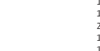

2. 编写一个程序，读取一行文本并输出该行中的单词数以及每个字母出现的次数。将单词定义为在每一端均由空白、句号、逗号或行首/行尾分隔的字母字符串。可以假设输入完全由字母、空白、逗号和句号组成。在输出一行中出现的字母数时，请确保将字母的大写和小写版本计为同一字母。按字母顺序输出字母，并仅列出在输入行中出现的字母。例如，输入行

```
I say Hi.
```

应产生与以下类似的输出：

```
3 words
1 a
1 h
2 i
1 s
1 y
```

3. 编写一个程序，按以下格式读取一个人的姓名：名字，然后是中间名或中间名缩写，然后是姓氏。程序随后以以下格式输出姓名：

```
Last_Name, First_Name, Middle_Initial.
```

例如，输入

Mary Average User

应产生输出

```
User, Mary A.
```

输入

Mary A. User

也应产生输出

```
User, Mary A.
```

你的程序应在中间名缩写后加上句号，即使输入中没有句号。你的程序应允许用户不提供中间名或中间名缩写。在这种情况下，输出当然不包含中间名或缩写。例如，输入

Mary User

应产生输出

```
User, Mary
```

如果你使用 C 字符串，假设每个名字最多为 20 个字符长。或者，使用 string 类。提示：你可能希望使用三个字符串变量而不是一个大的字符串变量作为输入。你可能发现不使用 getline 会更容易。

4. 编写一个程序，读取一行文本并用单词 "love" 替换所有四个字母的单词。例如，输入字符串

I hate you, you dodo!

应产生输出：

```
I love you, you love!
```

当然，输出并不总是合理。例如，输入字符串

John will run home.

应产生输出：

Love love run love.

如果四个字母的单词以大写字母开头，应替换为 "Love"，而不是 "love"。你无需检查大小写，除了单词的首字母。单词是仅由字母组成的字符串，并在每一端由空白、行尾或任何非字母字符分隔。你的程序应重复此操作，直到用户说要退出。

### 5. 编写一个程序，可用于训练用户使用更少性别歧视的语言，通过建议用户提供的句子的替代版本。程序将要求输入一个句子，将句子读入字符串变量，并将所有男性代词替换为性别中立的代词。例如，它会将 "he" 替换为 "she or he"。因此，输入句子

See an adviser, talk to him, and listen to him.

应产生以下建议的修改版本句子：

See an adviser, talk to her or him, and listen to her or him.

确保保留句子的第一个单词的大写字母。代词 "his" 可以替换为 "her(s)"；你的程序无需在 "her" 和 "hers" 之间做出选择。允许用户对更多句子重复此操作，直到用户说她或他已完成。这将是一个需要大量耐心的长程序。你的程序不应在 "he" 出现在另一个单词内部时，例如 "here" 中替换字符串 "he"。单词是仅由字母组成的字符串，并在每一端由空白、行尾或任何非字母字符分隔。允许句子长达 100 个字符。

### 6. 有一张可供购买的 CD，其中包含公共领域的音乐的 .jpeg 和 .gif 图像。CD 包含一个文件，由包含标题名称，然后是该标题作曲家的行组成，每行一个。作品名称在前，然后是零个或多个空格，然后是连字符 (-) 字符，然后是一个或多个空格，然后是作曲家姓名。作曲家姓名可能仅为姓氏，或首字母和一个名字，或两个名字：名字 姓氏，或三个名字：名字 中间名 姓氏。有几首曲目的作者为 "no author listed"。在后续处理中，"no author listed" 不应重新排列。以下是标题和作者的非常简略的列表。

+ 1. Adagio "MoonLight" Sonata - Ludwig Van Beethoven
+ 2. An Alexis - F.H. Hummel and J.N. Hummel
+ 3. A La Bien Aimee - Ben Schutt
+ 4. At Sunset - E. MacDowell
+ 5. Angelus - J. Massenet
+ 6. Anitra's Dance - Edward Grieg
+ 7. Ase's Death - Edward Grieg
+ 8. Au Matin - Benj. Godard
+ ...

37. The Dying Poet - L. Gottschalk
38. Dead March - G.F. Handel
39. Do They Think of Me At Home - Chas. W. Glover
40. The Dearest Spot - W.T. Wrighton
1. Evening - L. Van Beethoven
2. Embarrassment - Franz Abt
3. Erin is my Home - no author listed
4. Ellen Bayne - Stephen C. Foster
...
9. Alla Mazurka - A. Nemerowsky
...
1. The Dying Volunteer - A.E. Muse
2. Dolly Day - Stephen C. Foster
3. Dolcy Jones - Stephen C. Foster
4. Dickory, Dickory, Dock - no author listed
5. The Dear Little Shamrock - no author listed
6. Dutch Warbler - no author listed
...

最终任务是生成按字母顺序排列的作曲家列表，然后是按标题在作曲家内按字母顺序排列的作品列表。此练习如果分解为部分会更容易：

编写代码以：

+ a. 删除前导数字、任何句号和任何空格，以便标题的第一个词是行的第一个词。
+ b. 将任何多个空格替换为单个空格。
+ c. 少数标题可能有多个 - 字符，例如：
+ 20. Ba- Be- Bi- Bo- Bu - no author listed
+ 在行尾之前将该行上的所有连字符 - 字符替换为空格，除了最后一个。
+ d. 标题中的最后一个词可能带有 - 字符且其与 - 字符之间没有空格。加上空格。
+ e. 在对标题进行字母排序时，你不希望考虑标题开头的 "A"、"An" 或 "The"。编写代码将此类初始词移动到 - 字符之前。标题最后一个词后的逗号不是必需的，但那会很不错。这可以在作曲家姓名移至前面之后完成，但显然代码会不同。
+ f. 将作曲家姓名移至行的开头，后跟 - 字符，后跟作品标题。
+ g. 将作曲家的任何首字母、名字和第二个名字移至作曲家姓氏之后。如果作曲家是 "no author listed"，则不应重新排列，因此请测试此组合。

+ h. 按作曲家字母排序，使用你所知的任何排序例程。你可以忽略任何重复的作曲家姓氏，例如 CPE Bach 和 JS Bach，但按作曲家的第二个名字排序会很不错。你可以使用插入排序、选择排序、冒泡排序或其他排序算法。

+ i. 如果尚未这样做，将可能开始标题的 "A"、"An" 或 "The" 移至标题末尾。然后在每个作曲家内按作品标题字母排序。

+ j. 保留你的设计和代码的副本。你将被要求使用 STL vector 容器重做此操作。


# 第10章 指针与动态数组
CHAPTER
指针与动态数组

+   10.1 指针 404
+   指针变量 405
+   基本内存管理 414
+   陷阱：悬空指针 416
+   动态变量与自动变量 416
+   提示：定义指针类型 417
+   陷阱：指针作为传值参数 419
+   指针的用途 421
+   
+   10.2 动态数组 422
+   数组变量与指针变量 422
+   创建与使用动态数组 423
+   示例：返回数组的函数 427
+   指针算术 429
+   多维动态数组 430
+   
+   10.3 类、指针与动态数组 433
+   -> 运算符 433
+   this 指针 434
+   重载赋值运算符 435
+   示例：部分填充数组的类 437
+   析构函数 445
+   拷贝构造函数 446
+   
+   章节总结 451
+   自测练习答案 452
+   编程项目 454


# 指针与动态数组

*记忆是推理所有操作所必需的。*

布莱兹·帕斯卡，《思想录》

## 引言

*指针* 是一种让你更能控制计算机内存的构造。本章将向你展示指针如何与数组一起使用，并介绍一种新的数组形式，称为 *动态分配数组*。动态分配数组（简称动态数组）是指其大小在程序运行时确定，而不是在程序编写时固定的数组。

在阅读第 10.1 节和 10.2 节关于指针和动态分配数组的内容之前，你应先阅读第 1 章至第 6 章（如果你愿意，可以省略对向量的介绍），但不必阅读第 7 章至第 9 章的任何内容。你甚至可以在只阅读了第 1 章到第 5 章之后就阅读第 10.1 节和 10.2 节，前提是你忽略那些提到类的少数段落。

第 10.3 节讨论了一些仅在你开始使用指针和动态数据（例如动态分配数组）时才变得相关的类的工具。在学习第 10.3 节之前，你应阅读第 1 章至第 8 章，虽然你也可以省略对向量的介绍。

你可以按任意顺序学习本章、第 11 章关于分离编译和命名空间、第 12 章关于文件 I/O 以及第 13 章关于递归的内容。如果你没有在阅读本章之前阅读第 11 章中关于命名空间的部分，你可能会发现回顾第 1 章中题为“命名空间”的部分是有益的。

### 10.1 指针

*通过迂回找到方向。*

威廉·莎士比亚，《哈姆雷特》

*指针* 是变量的内存地址。回顾第 5 章，计算机的内存被划分为编号的内存位置（称为 *字节*），变量被实现为相邻内存位置的序列。还请回忆，有时 C++ 系统使用这些内存地址作为变量的名称。如果一个变量被实现为例如三个内存位置，那么有时这些内存位置中第一个的地址会被用作该变量的名称。例如，当变量用作传引用参数时，传递给调用函数的不是变量的标识符名称，而是该地址。一个以这种方式用于命名变量的地址（通过给出变量在内存中开始的位置）称为指针，因为该地址可以被认为“指向”该变量。地址“指向”变量是因为它通过指出变量的位置来标识变量，而不是通过指出变量的名称。

你已经在许多情况下使用过指针。如前一段所述，当一个变量在函数调用中是传引用参数时，函数以指向该变量的指针的形式获得该参数变量。如第 5 章所述，数组被传递给函数（或传递给其他任何东西）时，是通过传递指向第一个数组元素的指针来实现的。（当时我们称这些指针为“内存地址”，但那与指针是同一回事。）这些是指针的两种强大用途，但它们由 C++ 系统自动处理。本章将向你展示如何编写直接操作指针的程序，而不是依赖系统为你操作指针。

#### 指针变量

指针可以存储在变量中。然而，即使指针是内存地址而内存地址是数字，你也不能将指针存储在类型为 int 或 double 的变量中。用于保存指针的变量必须声明为指针类型。例如，以下声明 p 为指针变量，可以保存一个指向类型为 double 的变量的指针：

```
double *p;
```

变量 p 可以保存指向类型为 double 的变量的指针，但它通常不能包含指向其他类型变量（如 int 或 char）的指针。每种变量类型都需要不同的指针类型。¹

一般来说，要声明一个可以保存指向特定类型其他变量的指针的变量，你可以像声明该类型的普通变量一样声明指针变量，但要在变量名前面加上一个星号。例如，以下声明 p1 和 p2 使它们可以保存指向类型为 int 的变量的指针；它还声明了两个类型为 int 的普通变量 v1 和 v2：

```
int *p1, *p2, v1, v2;
```

每个指针变量前都必须有一个星号。如果你省略上述声明中的第二个星号，那么 p2 将不是指针变量；它将是类型为 int 的普通变量。

> ¹ 有办法将一种类型的指针放入另一种类型的指针变量中，但它不会自动发生，而且无论如何都是非常糟糕的风格。

#### 指针变量声明

一个可以保存指向类型为 _Type_Name_ 的其他变量的指针的变量，其声明方式与声明类型为 _Type_Name_ 的变量类似，只是你在变量名前加上一个星号。

# SYNTAX

```
Type_Name *Variable_Name1, *Variable_Name2, . . . ;
```

# EXAMPLE

```
double *pointer1, *pointer2;
```

#### 地址与数字

指针是一个地址，地址是一个整数，但指针不是整数。那并不疯狂——那是抽象！C++ 坚持要求你将指针用作地址，而不是用作数字。指针不是类型为 int 或任何其他数值类型的值。你通常不能将指针存储在类型为 int 的变量中。如果你尝试，大多数 C++ 编译器会给出错误消息或警告消息。此外，你不能对指针执行正常的算术运算。（正如你将在本章后面看到的，你可以对指针执行一种加法和一种减法，但它们不是通常的整数加法和减法。）

在讨论指针和指针变量时，我们通常说 _指向_ 而不是说 _地址_。当指针变量，例如 p1，包含变量，例如 v1 的地址时，指针变量被称为 _指向变量 v1_ 或是 _指向变量 v1 的指针_。

指针变量，如上面声明的 p1 和 p2，可以包含指向变量如 v1 和 v2 的指针。你可以使用运算符 & 来确定变量的地址，然后可以将该地址赋给指针变量。例如，以下将设置变量 p1 等于指向变量 v1 的指针：

```
p1 = &v1;
```

现在你有两种方式引用 v1：你可以称它为 v1，也可以称它为“p1 所指向的变量”。在 C++ 中，说“p1 所指向的变量”的方式是 *p1。这与我们声明 p1 时使用的同一个星号，但现在它又有另一种含义。当星号以这种方式使用时，它被称为 **解引用运算符**，指针变量被称为被 _解引用_。


### 指针类型

C++ 在命名指针类型时存在一点不一致（或至少存在混淆的可能性）。如果你想要一个参数，其类型例如是 int 类型变量的指针，那么类型写法为 int*，如下例所示：

```
void manipulatePointer(int* p);
```

如果你想声明一个相同指针类型的变量，* 会跟随变量，如下例所示：

```
int *p1, *p2;
```

事实上，编译器并不关心 * 是附着在 int 上还是变量名上，所以以下写法也被编译器接受且含义相同：

```
void manipulatePointer(int *p);//Accepted but not as nice.
```

```
int* p1, *p2;//Accepted but dangerous.
```

然而，我们认为第一种写法更清晰。特别注意，在声明变量时，每个指针变量必须有一个 *。

把这些片段组合起来会产生一些令人惊讶的结果。考虑以下代码：

```
v1 = 0;
p1 = &v1;
*p1 = 42;
cout << v1 << endl;
cout << *p1 << endl;
```

这段代码会输出以下内容到屏幕：

42
42

只要 p1 包含指向 v1 的指针，那么 v1 和 *p1 就引用同一个变量。所以当你把 *p1 设为 42 时，你也在把 v1 设为 42。

用于获取变量地址的符号 & 与你在函数声明中用于指定传引用参数的符号是同一个符号。这并非巧合。回想一下，传引用参数是通过向调用函数提供参数的地址来实现的。所以，这两种 & 的用法非常密切相关，尽管它们并不完全相同。

### * 和 & 运算符

在指针变量前面的 * 运算符会产生它所指向的变量。以这种方式使用时，* 运算符称为解引用运算符。

在普通变量前面的 & 运算符会产生该变量的地址；也就是说，它会产生指向该变量的指针。& 运算符简单地称为取地址运算符。

例如，考虑声明

```
double *p, v;
```

以下语句使 p 的值指向变量 v：

```
p = &v;
```

*p 产生 p 所指向的变量，所以在上述赋值之后，*p 和 v 引用同一个变量。例如，以下语句将 v 的值设为 9.99，即使名字 v 从未被显式使用：

```
*p = 9.99;
```

你可以将一个指针变量的值赋给另一个指针变量。例如，如果 p1 仍指向 v1，那么以下语句会使 p2 也指向 v1：

```
p2 = p1;
```

只要我们没有改变 v1 的值，以下语句也会输出 42 到屏幕：

```
cout << *p2;
```

请确保你不会混淆

```
p1 = p2;
```

和

```
*p1 = *p2;
```

当你加上星号时，你处理的不再是指针 p1 和 p2，而是指针所指向的变量。这在 10.1 节中有所说明，其中变量用方框表示，变量的值写在方框内。我们没有显示指针变量中的实际数字地址，因为数字不重要。重要的是数字是某个特定变量的地址。所以，与其使用实际的地址数字，我们只是用一个指向具有该地址的变量的箭头来表示地址。

### Display 10.1 使用赋值运算符时的指针变量

```
p1 = p2;
```

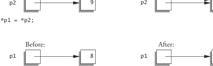

```
*p1 = *p2;
```

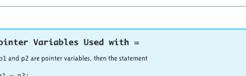

### 使用 = 的指针变量

如果 p1 和 p2 是指针变量，那么语句

```
p1 = p2;
```

会改变 p1 的值，使其成为 p2 中的内存地址（指针）。一种常见的思考方式是，赋值会改变 p1，使其指向 p2 当前所指向的东西。

地址，我们只是用一个箭头指向具有该地址的变量来表示地址。

由于指针可用于引用变量，你的程序可以操作变量，即使这些变量没有标识符来命名它们。new 运算符可用于创建没有标识符作为其名称的变量。这些无名变量通过指针引用。例如，以下语句创建一个类型为 int 的新变量，并将指针变量 p1 设为此新变量的地址（也就是说，p1 指向这个新的无名变量）：

```
p1 = new int;
```

这个新的无名变量可以被引用为 *p1（即，被 p1 指向的变量）。你可以用这个无名变量做任何对其他类型为 int 的变量可以做的事。例如，以下代码从键盘读取一个类型为 int 的值到这个无名变量中，将值加 7，然后输出这个新值：

```
cin >> *p1;
*p1 = *p1 + 7;
cout << *p1;
```

new 运算符产生一个新的无名变量并返回指向该新变量的指针。你通过在 new 运算符后写出类型名来指定这个新变量的类型。用 new 运算符创建的变量称为动态分配变量或简称为动态变量，因为它们在程序运行期间被创建和销毁。10.2 节中的程序演示了指针和动态变量的一些简单操作。10.3 节以图形方式说明了 10.2 节中程序的工作原理。

动态变量

### new 运算符

new 运算符创建一个指定类型的新的动态变量并返回指向该新变量的指针。例如，以下语句创建一个类型为 MyType 的新的动态变量，并使指针变量 p 指向这个新变量：

```
MyType *p;
p = new MyType;
```

如果类型是类类型，则为新创建的动态变量调用默认构造函数。你可以通过包含参数来指定不同的构造函数，如下所示：

```
MyType *mtPtr;
mtPtr = new MyType(32.0, 17); // calls MyType(double, int);
```

类似的记法允许你初始化非类类型的动态变量，如下所示：

```
int *n;
n = new int(17); // initializes *n to 17
```

在早期的 C++ 编译器中，如果没有足够的可用内存来创建新变量，则 new 返回一个名为 NULL 的特殊指针。C++ 标准规定，如果没有足够的可用内存来创建新变量，则 new 运算符默认终止程序。

### Display 10.2 基本指针操作

```
//Program to demonstrate pointers and dynamic variables.
#include <iostream>
using std::cout;
using std::endl;

int main()
{
    int *p1, *p2;

    p1 = new int;
    *p1 = 42;
    p2 = p1;
    cout << "*p1 == " << *p1 << endl;
    cout << "*p2 == " << *p2 << endl;

    *p2 = 53;
    cout << "*p1 == " << *p1 << endl;
    cout << "*p2 == " << *p2 << endl;

    p1 = new int;
    *p1 = 88;
    cout << "*p1 == " << *p1 << endl;
    cout << "*p2 == " << *p2 << endl;

    cout << "Hope you got the point of this example!\n";
    return 0;
}
```

### 示例对话

*p1 == 42
*p2 == 42
*p1 == 53
*p2 == 53
*p1 == 88
*p2 == 53
Hope you got the point of this example!

### Display 10.3 Display 10.2 的解释

```
int *p1, *p2;
```

```
p1 = new int;
```

```
*p1 = 42;
```

```
p2 = p1;
```

```
*p2 = 53;
```

```
p1 = new int;
```

```
*p1 = 88;
```

当 new 运算符用于创建类类型的动态变量时，会调用该类的构造函数。如果你没有指定使用哪个构造函数，则会调用默认构造函数。例如，以下语句调用默认构造函数：

```
SomeClass *classPtr;
classPtr = new SomeClass; //Calls default constructor.
```

```
p2 = new int;
*p1 = 10;
*p2 = 20;
cout << *p1 << " " << *p2 << endl;
*p1 = *p2; //This is different from Exercise 4
cout << *p1 << " " << *p2 << endl;
*p1 = 30;
cout << *p1 << " " << *p2 << endl;
```

### 基本内存管理

一块特殊的内存区域，称为自由存储区或堆，被保留用于动态分配的变量。程序创建的任何新的动态变量都会消耗自由存储区中的一些内存。如果你的程序创建了过多的动态变量，它将消耗掉自由存储区中的所有内存。如果发生这种情况，任何额外的 new 调用都会失败。当我们在耗尽自由存储区（所有为动态分配变量保留的内存）后使用 new 时会发生什么，将取决于你的编译器的更新程度。在早期的 C++ 编译器中，如果没有足够的可用内存来创建新变量，则 new 返回一个名为 NULL 的特殊值。如果你有一个完全符合更新的 C++ 标准的编译器，那么如果没有足够的可用内存来创建新变量，new 运算符将终止程序。第 18 章讨论了配置程序以便在 new 耗尽自由存储区时执行除中止之外的其他操作的方法。

如果你有一个较旧的编译器，你可以通过测试 new 调用是否返回 NULL 来检查 new 调用是否成功。例如，以下代码测试创建新的动态变量的尝试是否成功。如果 new 调用未能创建所需的动态变量，程序将以错误消息结束：

```
int *p;
p = new int;
if (p == NULL)
{
    cout << "Error: Insufficient memory.\n";
    exit(1);
}
//If new succeeded, the program continues from here.
```

（请记住，由于此代码使用了 exit，你需要包含库的包含指令 <cstdlib>，或在某些实现中为 <stdlib.h>。）

2 技术上，new 运算符会抛出异常，如果未被捕获，则会终止程序。可以捕获异常并处理异常。异常处理在第 18 章中讨论。


常量 NULL 实际上就是数字 0，但我们更倾向于将其视为并拼写为 NULL，以明确你指的是这个特殊用途的值，可将其赋给指针变量。我们将在本书后面讨论 NULL 的其他用途。标识符 NULL 的定义在多个标准库中，例如 <iostream> 和 <cstddef>，因此当你使用 NULL 时，应为 <iostream>、<cstddef>（或其他合适的库）使用 include 指令。

正如我们所说，NULL 实际上只是数字 0。NULL 的定义由 C++ 预处理器处理，它用 0 替换 NULL。因此，编译器永远看不到“NULL”，所以不存在命名空间问题，也不需要为 NULL 使用 using 指令。3 虽然我们更倾向于在代码中使用 NULL 而不是 0，但我们注意到有些权威人士持相反观点，主张使用 0 而不是 NULL。

（不要将 NULL 指针与用于终止 C 字符串的空字符 '\0' 混淆。它们不是同一个东西。一个是整数 0，而另一个是字符 '\0'。）

较新的编译器不需要上述显式检查来查看新的动态变量是否已创建。在较新的编译器上，如果 new 调用未能创建所需的动态变量，你的程序将自动以错误消息结束。然而，对于任何编译器，上述检查都不会造成伤害，并且会使你的程序更具可移植性。

### NULL

NULL 是一个特殊的常量指针值，用于为本无值的指针变量赋一个值。NULL 可以赋给任何类型的指针变量。标识符 NULL 在多个库中定义，包括 <iostream>。（常量 NULL 实际上是整数 0。）

自由存储区的大小因 C++ 的实现而异。它通常很大，一个适度的程序不太可能使用完自由存储区中的所有内存。然而，即使在适度的程序中，回收不再需要的任何自由存储区内存也是一种良好的做法。如果你的程序不再需要一个动态变量，则该动态变量使用的内存可以返回给自由存储区管理器，该管理器会回收内存以创建其他动态变量。delete 运算符会消除一个动态变量并将该动态变量所占用的内存返回给自由存储区管理器，以便内存可以被重用。假设 p 是一个指向动态变量的指针变量。以下代码将销毁 p 所指向的动态变量并将该动态变量所使用的内存返回给自由存储区管理器以供重用：

```
delete p;
```

3 细节如下：NULL 的定义使用 #define，这是一种继承自 C 语言的定义形式，由预处理器处理。

### THE delete OPERATOR

delete 运算符会消除一个动态变量并将该动态变量所占用的内存返回给自由存储区。内存随后可用于创建新的动态变量。例如，以下代码会消除指针变量 p 所指向的动态变量：

```
delete p;
```

调用 delete 后，指针变量的值，如上面的 p，是未定义的。（稍后本章讨论的 delete 的一个略有不同的版本用于动态分配的变量是数组时。）

### Pitfall DANGLING POINTERS

当你对一个指针变量应用 delete 时，它所指向的动态变量会被销毁。此时，指针变量的值是未定义的，这意味着你不知道它指向何处。此外，如果其他指针变量也指向被销毁的动态变量，那么这个其他指针变量也是未定义的。这些未定义的指针变量称为悬空指针。如果 p 是一个悬空指针，并且你的程序对 p 应用解引用运算符 *（以产生表达式 *p），结果是不可预测的，通常是灾难性的。在对指针变量应用解引用运算符 * 之前，你应确定该指针变量指向某个变量。

C++ 没有内置的测试来检查指针变量是否为悬空指针。避免悬空指针的一种方法是把任何悬空指针变量设为等于 NULL。然后你的程序可以在对指针变量应用解引用运算符 * 之前测试该指针变量是否等于 NULL。当你使用此技术时，你会在调用 delete 后跟上将所有悬空指针设为等于 NULL 的代码。记住，除了在 delete 调用中使用的那个指针变量之外，其他指针变量也可能变成悬空指针，所以务必将所有悬空指针设为 NULL。跟踪悬空指针并将其设为 NULL 或以其他方式确保它们不被解引用，是程序员的责任。

### DYNAMIC VARIABLES AND AUTOMATIC VARIABLES

使用 new 运算符创建的变量称为动态变量（或动态分配的变量），因为它们在程序运行时被创建和销毁。局部变量——即在函数定义内声明的变量——也具有某种动态特性，但它们不称为动态变量。如果一个变量是函数的局部变量，则该变量在函数被调用时由 C++ 系统创建，并在函数调用完成后被销毁。由于程序的主体部分实际上只是名为 main 的函数，这甚至适用于你在程序主部分声明的变量。（由于对 main 的调用在程序结束前不会结束，因此在 main 中声明的变量要到程序结束时才被销毁，但处理局部变量的机制对于 main 与其他任何函数都相同。）这些局部变量有时称为自动变量，因为它们的动态属性由系统自动为你控制。它们在声明它们的函数被调用时自动创建，并在函数调用结束时自动销毁。

在任何函数或类定义之外声明的变量，包括 main 之外，称为全局变量。这些全局变量有时称为静态分配的变量，因为它们与动态和自动变量相比是真正静态的。我们在第 3 章中简要讨论了全局变量。事实证明，我们不需要全局变量，也没有使用它们。⁴

### Tip

### DEFINE POINTER TYPES

你可以定义一个指针类型名，以便指针变量可以像其他变量一样声明，而无需在每个指针变量前放置星号。例如，以下代码定义了一个名为 IntPtr 的类型，它是包含指向 int 变量的指针的指针变量的类型：

```
typedef int* IntPtr;
```

因此，以下两个指针变量声明是等价的：

```
IntPtr p;
```

和

```
int *p;
```

你可以使用 typedef 为任何类型名或定义定义别名。例如，以下代码将类型名 Kilometers 定义为与类型名 double 相同：

```
typedef double Kilometers;
```

一旦你给出了此类型定义，你就可以按如下方式定义 double 类型的变量：

```
Kilometers distance;
```

以这种方式重命名现有类型偶尔会很有用。然而，我们主要使用 typedef 来为指针变量定义类型。

请记住，typedef 并不会产生新类型，而只是类型定义的别名。例如，给定之前的 Kilometers 定义，Kilometers 类型的变量可以替代 double 类型的参数。Kilometers 和 double 是同一类型的两个名称。

使用定义的指针类型名（如前面定义的 IntPtr）有两个优点。首先，它避免了遗漏星号的错误。记住，如果你打算让 p1 和 p2 成为指针，那么以下代码是一个错误：

```
int *p1, p2;
```

由于 p2 省略了 *，变量 p2 只是一个普通的 int 变量，而不是指针变量。如果你感到困惑并将 * 放在 int 上，问题是相同的，但更难注意到。C++ 允许你将 * 放在类型名上，例如 int，因此以下代码是合法的：

```
int* p1, p2;
```

尽管以上代码是合法的，但它具有误导性。它看起来像 p1 和 p2 都是指针变量，但事实上只有 p1 是指针变量；p2 是一个普通的 int 变量。就 C++ 编译器而言，附加到标识符 int 的 * 也可以附加到标识符 p1。将 p1 和 p2 都声明为指针变量的一种正确方法是：

```
int *p1, *p2;
```

声明 p1 和 p2 都为指针变量的一种更简单、更不易出错的方法是使用定义的<|message|>
IntPtr p1, p2;
```

第二个使用定义指针类型的优点，如 IntPtr，在你为指针变量定义一个传引用调用的函数时可见。在没有定义的指针类型名的情况下，你需要在函数声明中同时包含 * 和 &，细节可能会令人困惑。如果你使用指针类型的类型名，则为指针的传引用参数不会涉及任何复杂性。你为定义的指针类型定义传引用参数的方式与为任何其他传引用参数定义的方式相同。以下是一个示例：

```
void sampleFunction(IntPtr& pointerVariable);
```

### Self-Test Exercises

- 5. 以下声明会发生什么不幸的误解？

  ```cpp
  int* intPtr1, intPtr2;
  ```

- 6. 假设一个动态变量按如下方式创建：

  ```cpp
  char *p;
  p = new char;
  ```


假设指针变量 p 的值未发生变化（因此它仍然指向同一个动态变量），如何销毁这个新的动态变量并将它所使用的内存返回给自由存储管理器，以便该内存可以被重用于创建其他新的动态变量？

7. 编写一个名为 NumberPtr 的类型的定义，该类型将用于持有指向类型为 double 的动态变量的指针的指针变量。另请编写一个指针变量 myPoint 的声明，其类型为 NumberPtr。

8. 描述 new 运算符的作用。new 运算符返回什么？错误有哪些指示？

### 类型定义

您可以为类型定义指定一个名称，然后使用该类型名称声明变量。这是通过关键字 typedef 完成的。这些类型定义通常放置在程序主体的外部以及其他函数的外部，通常位于文件的开头。这样 typedef 就是全局的，可供整个程序使用。我们将使用类型定义来定义指针类型的名称，如下面的示例所示。

### 语法

```
typedef Known_Type_Definition New_Type_Name;
```

### 示例

```
typedef int* IntPtr;
```

类型名 IntPtr 然后可用于声明指向类型为 int 的动态变量的指针，如以下示例所示：

```
IntPtr pointer1, pointer2;
```

### 指针作为按值调用参数

当按值调用参数的类型为指针类型时，其行为有时会微妙且令人困惑。考虑显示 10.4 中所示的函数调用。函数 sneaky 中的参数 temp 是一个按值调用参数，因此它是一个局部变量。调用函数时，temp 的值被设置为参数 p 的值并执行函数体。由于 temp 是局部变量，对 temp 的任何更改都不应超出函数 sneaky。特别是，指针变量 p 的值不应被更改。然而，示例对话似乎表明指针变量 p 的值已发生变化。在调用函数 sneaky 之前，*p 的值为 77，而在调用 sneaky 之后，*p 的值是 99。发生了什么？

情况在显示 10.5 中进行了图解。尽管示例对话可能看起来像是 `p` 被更改了，但函数调用 `sneaky` 并未更改 `p` 的值。指针 `p` 与之关联有两个东西：`p` 的指针值以及 `p` 所指向位置存储的值。但 `p` 的值是指针（即内存地址）。在调用 `sneaky` 之后，变量 `p` 包含相同的指针值（即相同的内存地址）。对 `sneaky` 的调用更改了 `p` 所指向的变量的值，但并未更改 `p` 本身的值。

如果参数类型是类或结构类型并且具有指针类型的成员变量，那么使用类类型的按值调用参数也会发生同类令人惊讶的更改。然而，对于类类型，您可以通过定义复制构造函数来避免（并控制）这些意外更改，如本章后面所述。

### Display 10.4  A Call-by-Value Pointer Parameter (part 1 of 2)

```
//Program to demonstrate the way call-by-value parameters
//behave with pointer arguments.
#include <iostream>
using std::cout;
using std::cin;
using std::endl;

typedef int* IntPointer;

void sneaky(IntPointer temp);

int main()
{
    IntPointer p;

    p = new int;
    *p = 77;
    cout << "Before call to function *p == "
         << *p << endl;

    sneaky(p);

    cout << "After call to function *p == "
         << *p << endl;

    return 0;
}
```

### Display 10.4 A Call-by-Value Pointer Parameter (part 2 of 2)

```
21 void sneaky(IntPointer temp)
22 {
23   *temp = 99;
24   cout << "Inside function call *temp == "
25       << *temp << endl;
26 }
```

### SAMPLE DIALOGUE

> Before call to function *p == 77
> Inside function call *temp == 99
> After call to function *p == 99

### Display 10.5 The Function Call sneaky(p);

+   1. Before call to sneaky:


+   2. Value of p is plugged in for temp:

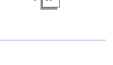

+   3. Change made to *temp:

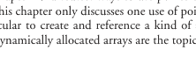

+   4. After call to sneaky:

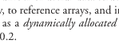

### 指针的用途

第 17 章讨论了使用指针创建多种有用数据结构的方法。本章仅讨论指针的一种用途，即引用数组，特别是创建和引用一种称为动态分配数组的数组。动态分配数组是第 10.2 节的主题。

### 10.2 动态数组

在本节中，您将看到数组变量实际上是指针变量。您还将了解如何编写具有动态分配数组的程序。**动态分配数组**（也简单称为**动态数组**）是指其大小在编写程序时未指定，而是在程序运行时确定的数组。

#### 数组变量和指针变量

第 5 章描述了数组如何在内存中保存。在那时我们以内存地址的术语讨论数组。但内存地址是一个指针。因此，在 C++ 中，数组变量实际上是一种指向数组的第一个索引变量的指针变量。给定以下两个变量声明，p 和 a 都是指针变量。

```
int a[10];
typedef int* IntPtr;
IntPtr p;
```

a 和 p 都是指针变量这一事实在显示 10.6 中进行了说明。由于 a 是一个指向类型为 int 的变量（即变量 a[0]）的指针，a 的值可以分配给指针变量 p 如下：

```
p = a;
```

在此赋值之后，p 指向与 a 相同的内存位置。因此，p[0]、p[1]、……p[9] 引用索引变量 a[0]、a[1]、……a[9]。只要指针变量指向内存中的数组，您就可以继续使用方括号表示法将数组变量指向指针变量。在上述赋值之后，您可以像对待数组标识符一样对待标识符 p。您也可以像对待指针变量一样对待标识符 a，但有一个重要的保留：*您不能更改数组变量中的指针值。* 如果指针变量 p2 有一个值，您可能会想以下操作是合法的，但它不是：

```
a = p2; //ILLEGAL. You cannot assign a different address to a.
```

此赋值不起作用的根本原因是数组变量的类型不是 int*，而是 int* 的常量版本。数组变量，如 a，是一个带有 const 修饰符的指针变量，这意味着其值不能被更改。

（数组变量实际上比普通指针变量多一些，因为它携带有关数组的一些额外大小信息，但数组变量确实包含指向数组的指针，并且数组变量可以分配给指针变量。因此，数组变量是一种指针变量，可以像值不可更改的指针变量一样对待。）

#### Display 10.6 Arrays and Pointer Variables

```
//Program to demonstrate that an array variable is a kind of pointer variable.
#include <iostream>
using std::cout;
using std::endl;

typedef int* IntPtr;

int main()
{
    IntPtr p;
    int a[10];
    int index;

    for (index = 0; index < 10; index++)
        a[index] = index;

    p = a;

    for (index = 0; index < 10; index++)
        cout << p[index] << " ";
    cout << endl;

    for (index = 0; index < 10; index++)
        p[index] = p[index] + 1;

    for (index = 0; index < 10; index++)
        cout << a[index] << " ";
    cout << endl;

    return 0;
}
```

> 请注意，对数组 p 的更改也是对数组 a 的更改。

### SAMPLE DIALOGUE

```
0 1 2 3 4 5 6 7 8 9
1 2 3 4 5 6 7 8 9 10
```

### 创建和使用动态数组

我们在第 5 章中讨论的数组类型的一个问题是，您必须在编写程序时指定数组的大小——但您可能要到程序运行时才知道需要多大的数组。例如，数组可能保存学生身份号码列表，但每次运行程序时班级的大小可能不同


program is run. With the kinds of arrays you have used thus far, you must estimate the largest possible size you may need for the array and hope that size is large enough. There are two problems with this. First, you may estimate too low, and then your program will not work in all situations. Second, since the array might have many unused positions, this can waste computer memory. Dynamically allocated arrays avoid these problems. If your program uses a dynamically allocated array for student identification numbers, then the number of students can be entered as input to the program and the dynamically allocated array can be created to have a size exactly equal to the number of students.

### creating a dynamically array

Dynamically allocated arrays are created using the new operator. The creation and use of dynamically allocated arrays is surprisingly simple. Since array variables are pointer variables, you can use the new operator to create dynamically allocated variables that are arrays and can treat these dynamically allocated arrays as if they were ordinary arrays. For example, the following creates a dynamically allocated array variable with ten array elements of type double:

```
typedef double* DoublePtr;
DoublePtr d;
d = new double[10];
```

To obtain a dynamically allocated array of elements of any other type, simply replace double with the desired type. In particular, you can replace the type double with a struct or class type. To obtain a dynamically allocated array variable of any other size, simply replace 10 with the desired size.

There are also a number of less-obvious things to notice about this example. First, the pointer type that you use for a pointer to a dynamically allocated array is the same as the pointer type you would use for a single element of the array. For instance, the pointer type for an array of elements of type double is the same as the pointer type you would use for a simple variable of type double. The pointer to the array is actually a pointer to the first indexed variable of the array. In the above example, an entire array with ten indexed variables is created, and the pointer p is left pointing to the first of these ten indexed variables.

Second, notice that when you call new, the size of the dynamically allocated array is given in square brackets after the type, which in this example is the type double. This tells the computer how much storage to reserve for the dynamic array. If you omitted the square brackets and the 10 in this example, the computer would allocate enough storage for only one variable of type double, rather than for an array of ten indexed variables of type double.

Display 10.7 contains a program that illustrates the use of a dynamically allocated array. The program searches a list of numbers stored in a dynamically allocated array. The size of the array is determined when the program is run. The user is asked how many numbers there will be, and then the new operator creates a dynamically allocated array of that size. The size of the dynamic array is given by the variable arraySize. The size of a dynamic array need not be given by a constant. It can, as in Display 10.7, be given by a variable whose value is determined when the program is run.

### Display 10.7 A Dynamically Allocated Array (part 1 of 2)

```
1 //Searches a list of numbers entered at the keyboard.
2 #include <iostream>
3 using std::cin;
4 using std::cout;
5
6 typedef int* IntPtr;
7
8 void fillArray(int a[], int size);
9 //Precondition: size is the size of the array a.
10 //Postcondition: a[0] through a[size-1] have been
11 //filled with values read from the keyboard.
12
13 int search(int a[], int size, int target);
14 //Precondition: size is the size of the array a.
15 //The array elements a[0] through a[size-1] have values.
16 //If target is in the array, returns the first index of target.
17 //If target is not in the array, returns -1.
18
19 int main()
20 {
21     cout << "This program searches a list of numbers.\n";
22
23     int arraySize;
24     cout << "How many numbers will be on the list? ";
25     cin >> arraySize;
26     IntPtr a;
27     a = new int[arraySize];
28
29     fillArray(a, arraySize);
30
31     int target;
32     cout << "Enter a value to search for: ";
33     cin >> target;
34     int location = search(a, arraySize, target);
35     if (location == -1)
36         cout << target << " is not in the array.\n";
37     else
38         cout << target << " is element " << location << " in the array.\n";
39
40     delete [] a;
41
42     return 0;
43 }
```

Ordinary array parameters

The dynamic array a is used like an ordinary array.

### Display 10.7 A Dynamically Allocated Array (part 2 of 2)

```
37 //Uses the library <iostream>:
38 void fillArray(int a[], int size)
39 {
40   cout << "Enter " << size << " integers.\n";
41   for (int index = 0; index < size; index++)
42     cin >> a[index];
43 }
44 
45 int search(int a[], int size, int target)
46 {
47   int index = 0;
48   while ((a[index] != target) && (index < size))
49     index++;
50   if (index == size)//if target is not in a.
51     index = -1;
52   return index;
53 }
```

### SAMPLE DIALOGUE

This program searches a list of numbers.
How many numbers will be on the list? 5
Enter 5 integers.
1 2 3 4 5
Enter a value to search for: 3
3 is element 2 in the array.

Notice the delete statement, which destroys the dynamically allocated array pointed to by a in Display 10.7. Since the program is about to end anyway, we did not really need this delete statement; if the program went on to do other things, however, you would want such a delete statement so that the memory used by this dynamically allocated array would be returned to the freestore manager. The delete statement for a dynamically allocated array is similar to the delete statement you saw earlier, except that with a dynamically allocated array you must include an empty pair of square brackets like so:

delete [] a;

The square brackets tell C++ that a dynamically allocated array variable is being eliminated, so the system checks the size of the array and removes that many indexed variables. If you omit the square brackets you will not be eliminating the entire array. For example:

delete a;

is not legal, but the error is not detected by most compilers. The C++ standard says that what happens when you do this is "undefined." That means the author of the compiler

can have this do anything that is convenient (for the compiler writer, not for you). Always use the

```
delete [] arrayPtr;
```

syntax when you are deleting memory that was allocated with something like

```
arrayPtr = new MyType[37];
```

Also note the position of the square brackets in the delete statement

```
delete [] arrayPtr;  //Correct
 delete arrayPtr[]; //ILLEGAL!
```

You create a dynamically allocated array with a call to new using a pointer, such as the pointer a in Display 10.7. After the call to new, you should not assign any other pointer value to this pointer because that can confuse the system when the memory for the dynamic array is returned to the restore manager with a call to delete.

Dynamically allocated arrays are created using new and a pointer variable. When your program is finished using a dynamically allocated array, you should return the array memory to the restore manager with a call to delete. Other than that, a dynamically allocated array can be used just like any other array.

### EXAMPLE: A FUNCTION THAT RETURNS AN ARRAY

In C++ an array type is not allowed as the return type of a function. For example, the following is illegal:

```
int [] someFunction(); //ILLEGAL
```

If you want to create a function similar to this, you must return a pointer to the array base type and have the pointer point to the array. So, the function declaration would be as follows:

```
int* someFunction(); //Legal
```

An example of a function that returns a pointer to an array is given in Display 10.8.

### Self-Test Exercises

- 9. Write a type definition for pointer variables that will be used to point to dynamically allocated arrays. The array elements are to be of type char. Call the type CharArray.
- 10. Suppose your program contains code to create a dynamically allocated array as follows:

```
int *entry;
entry = new int[10];
```


使得指针变量 entry 指向这个动态分配的数组。编写代码用键盘输入的十个数填充这个数组。

11. 假设你的程序包含创建动态分配数组的代码，如自测练习 10 中所示，并且假设指针变量 entry 的（指针）值未被更改。编写代码销毁这个动态分配的数组并将其使用的内存返回给 freestore 管理器。

### 12. 以下代码片段的输出是什么？

```
int a[10];
int arraySize = 10;
int *p = a;
int i;
for (i = 0; i < arraySize; i++)
    a[i] = i;
for (i = 0; i < arraySize; i++)
    cout << p[i] << " ";
cout << endl;
```

### Display 10.8 Returning a Pointer to an Array (part 1 of 2)

```
1 #include <iostream>
2 using std::cout;
3 using std::endl;
4
4 int* doubler(int a[], int size);
//Precondition: size is the size of the array a.
//All indexed variables of a have values.
//Returns: a pointer to an array of the same size as a in which
//each indexed variable is double the corresponding element in a.
9
9 int main()
10 {
11     int a[] = {1, 2, 3, 4, 5};
12     int* b;
13
13     b = doubler(a, 5);
14
14     int i;
15     cout << "Array a:\n";
16     for (i = 0; i < 5; i++)
17         cout << a[i] << " ";
18     cout << endl;
```

这种指针算术为你提供了一种操作数组的替代方法。例如，如果 arraySize 是由 d 指向的动态分配数组的大小，那么以下代码将输出动态数组的内容：

```
for (int i = 0; i < arraySize; i++)
    cout << *(d + i) << " ";
```

上面等价于以下代码：

```
for (int i = 0; i < arraySize; i++)
    cout << d[i] << " ";
```

你不能对指针进行乘法或除法运算。你只能将整数加到指针上、从指针中减去整数，或减去两个相同类型的指针。当你减去两个指针时，结果是两个地址之间索引变量的数量。记住，对于两个指针值的减法，这些值必须指向同一个数组！从指向一个数组的指针中减去指向不同数组的指针意义不大。

你也可以使用自增和自减运算符 ++ 和 -- 来执行指针算术。例如，d++ 将使 d 的值前进，以便它包含下一个索引变量的地址，而 d-- 将改变 d 使其包含前一个索引变量的地址

### MULTIDIMENSIONAL DYNAMIC ARRAYS

你可以拥有多维动态数组。你只需要记住多维数组是数组的数组，或数组的数组的数组等等。例如，要创建一个二维动态数组，你必须记住它是一个数组的数组。要创建一个整数的二维数组，你首先创建一个 int* 类型的指针的一维动态数组，int* 是 int 的一维数组的类型。然后你为数组的每个元素创建一个整数的动态数组。

类型定义可以帮助理清思路。以下是一个普通一维整数动态数组的变量类型：

```
typedef int* IntArrayPtr;
```

要获得一个三乘四的整数数组，你想要一个基类型为 IntArrayPtr 的数组。例如：

```
IntArrayPtr *m = new IntArrayPtr[3];
```

这是一个包含三个指针的数组，每个指针都可以命名一个整数的动态数组，如下所示：

```
for (int i = 0; i < 3; i++)
    m[i] = new int[4];
```

### How to Use a Dynamic Array

- Define a pointer type: 定义指向与数组元素相同类型的变量的指针类型。例如，如果动态数组是 double 的数组，你可能会使用以下定义：
  
  ```
  typedef double* DoubleArrayPtr;
  ```
- Declare a pointer variable: 声明此定义类型的指针变量。指针变量将指向内存中的动态分配数组，并将作为动态数组的名称。
  
  ```
  DoubleArrayPtr a;
  ```
  （或者，不使用定义好的指针类型，使用 double *a;）。
- Call new: 使用 new 运算符创建动态数组：
  
  ```
  a = new double[arraySize];
  ```
  动态数组的大小在方括号中给出，如上例所示。大小可以使用 int 变量或其他 int 表达式给出。在上面的例子中，arraySize 可以是类型为 int 的变量，其值在程序运行时确定。
- Use like an ordinary array: 指针变量，如 a，与普通数组一样使用。例如，索引变量以通常的方式书写：a[0]、a[1] 等等。指针变量不应被赋予任何其他指针值，而应像数组变量一样使用。
- Call delete []: 当你的程序完成对动态分配数组变量的使用时，使用 delete 和空方括号以及指针变量来消除动态数组并将它占用的存储空间返回给 freestore 管理器以便重用。例如：
  
  ```
  delete [] a;
  ```

 resulting array m 是三乘四的动态数组。一个简单的程序来说明这一点在 Display 10.9 中给出。

请注意 Display 10.9 中 delete 的使用。由于动态数组 m 是一个数组的数组，使用 for 循环在第 13 行和第 14 行用 new 创建的每个数组都必须通过调用 delete [] 返回给 freestore 管理器；然后，数组 m 本身必须通过另一个调用 delete [] 返回给 freestore 管理器。对于每个用 new 创建数组的调用，都必须有一个 delete [] 的调用。 （由于程序在调用 delete [] 后立即结束，我们可以安全地省略 delete [] 的调用，但我们想说明它们的使用。）

### Display 10-9 A Two-Dimensional Dynamic Array (part 1 of 2)

```
```cpp
#include <iostream>
using std::cin;
using std::cout;
using std::endl;

typedef int* IntArrayPtr;

int main( )
{
    int d1, d2;
    cout << "Enter the row and column dimensions of the array:\n";
    cin >> d1 >> d2;

    IntArrayPtr *m = new IntArrayPtr[d1];
    int i, j;
    for (i = 0; i < d1; i++)
        m[i] = new int[d2];
    //m is now a d1-by-d2 array.

    cout << "Enter " << d1 << " rows of "
         << d2 << " integers each:\n";
    for (i = 0; i < d1; i++)
        for (j = 0; j < d2; j++)
            cin >> m[i][j];

    cout << "Echoing the two-dimensional array:\n";
    for (i = 0; i < d1; i++)
    {
        for (j = 0; j < d2; j++)
            cout << m[i][j] << " ";
        cout << endl;
    }

    for (i = 0; i < d1; i++)
        delete[] m[i];
    delete[] m;

    return 0;
}
```
```

> 请注意，对于每个用 new 创建数组的调用，都必须有一个 delete [] 的调用。 （这些 delete [] 的调用在程序结束时并不是真正需要的，但在其他上下文中包含它们可能很重要。）

### Display 10.9 A Two-Dimensional Dynamic Array (part 2 of 2)

### SAMPLE DIALOGUE

```
Enter the row and column dimensions of the array:
3 4
Enter 3 rows of 4 integers each:
1 2 3 4
5 6 7 8
9 0 1 2
Echoing the two-dimensional array:
1 2 3 4
5 6 7 8
9 0 1 2
```

### 10.3 Classes, Pointers, and Dynamic Arrays

组合是无穷无尽的。

常见的广告文案

动态分配的数组可以有一个基类型是类。类可以有一个成员变量是动态分配的数组。你可以将类和动态分配的数组以几乎任何组合结合起来。当使用类和动态分配的数组时，有一些需要担心的事情，但基本技术是你已经使用过的。本节中介绍的许多技术适用于所有动态分配的结构，例如我们在第 17 章中讨论的结构，而不仅仅是涉及动态分配数组的类。

### THE -> OPERATOR

C++ 有一个运算符可以与指针一起使用，以简化指定 struct 或 class 成员的记法。箭头运算符 -> 结合了解引用运算符 * 和点运算符的作用，以指定由给定指针指向的动态 struct 或 class 对象的成员。例如，假设你有以下定义：

```
struct Record
{
    int number;
    char grade;
};
```

arrow operator


以下代码创建了一个类型为 Record 的动态分配变量，并将动态结构体变量的成员变量设置为 2001 和 'A'：

```cpp
Record *p;
p = new Record;
p->number = 2001;
p->grade = 'A';
```

记号 `p->grade` 和 `(*p).grade` 含义相同。然而，前者更方便，几乎总是使用的记号。

### THE this POINTER

this 指针是一个预定义的指针，指向调用对象。例如，考虑如下类：

```cpp
class Sample
{
public:
        ...
        void showStuff() const;
        ...
private:
        int stuff;
        ...
};
```

以下两种定义成员函数 showStuff 的方式是等价的：

```cpp
void Sample::showStuff() const
{
    cout << stuff;
}

//Not good style, but this illustrates the this pointer:
void Sample::showStuff()
{
    cout << this->stuff;
}
```

请注意 this 不是调用对象的名称，而是指向调用对象的指针的名称。this 指针的值不能被更改；它始终指向调用对象。

正如我们之前的评论所指出的，你通常不需要指针 this。然而，在少数情况下它很有用。this 指针常用的一种地方是在重载赋值运算符 = 中，我们接下来讨论。

由于 this 指针指向调用对象，因此你不能在任何静态成员函数的定义中使用 this。一个静态成员函数通常没有可以让 this 指针指向的调用对象。

### OVERLOADING THE ASSIGNMENT OPERATOR

在本书中我们通常把赋值运算符当作 void 函数使用。然而，预定义的赋值运算符返回一个引用，从而允许一些专门的使用。

使用预定义的赋值运算符，你可以像这样链接赋值运算符：`a = b = c;`，其含义为 `a = (b = c);`。第一个操作 `b = c` 返回 b 的新版本。因此，`a = b = c;` 的作用是将 a 和 b 都设为 c。为了确保你的赋值运算符的重载版本可以这样使用，你需要定义赋值运算符使其返回与其左侧相同类型的值。正如你很快就会看到的，this 指针将允许你做到这一点。（没有双关语的意图。）然而，虽然这要求赋值运算符返回与其左侧相同类型的值，但并不要求它返回引用。赋值运算符的另一种使用说明了为什么要返回引用。

预定义的赋值运算符返回引用的原因是这样你就可以对返回值调用成员函数，如 `(a = b).f();` 其中 f 是一个成员函数。如果你希望你的赋值运算符的重载版本允许以这种方式调用成员函数，那么你应该让它们返回引用。这并不是返回引用的一个很有说服力的理由，因为这是一个很少使用的次要属性。然而，返回引用是传统做法，而且返回引用并不比简单地返回一个值困难多少。

例如，考虑以下类（可能用于一些预定义类 string 不能轻易处理的专门字符串处理）：

```cpp
class StringClass
{
public:
    ...
    void someProcessing();
    ...
    StringClass& operator=(const StringClass& rtSide);
    ...
private:
    char *a;//Dynamic array for characters in the string
    int capacity;//size of dynamic array a
    int length;//Number of characters in a
};
```

如第 8 章所述，当你重载赋值运算符时，它必须是类的成员；它不能是类的友元。这就是为什么上述 operator= 的定义只有一个参数的原因。例如，考虑以下情况：

`s1 = s2;//s1 和 s2 在类 StringClass 中`

在上述调用中，s1 是调用对象，s2 是成员 operator = 的参数。

以下对重载赋值运算符的定义可用于像

`s1 = s2 = s3;`

这样的赋值链，并且可用于如下调用成员函数：

`(s1 = s2).someProcessing();`

重载赋值运算符的定义使用 this 指针返回 = 符号左侧的对象（即调用对象）：

```cpp
//This version does not work in all cases.
StringClass& StringClass::operator=(const StringClass& rtSide)
{
    capacity = rtSide.capacity;
    length = rtSide.length;
    delete [] a;
    a = new char[capacity];
    for (int i = 0; i < length; i++)
        a[i] = rtSide.a[i];
    return *this;
}
```

此版本在赋值运算符两侧使用相同对象时存在问题，如下所示：

`s = s;`

当执行此赋值时，以下语句被执行：

`delete [] a;`

但调用对象是 s，所以这意味着

`delete [] s.a;`

指针 s.a 然后未定义。赋值运算符已损坏对象 s，并且此程序运行可能已毁坏。

对于许多类，赋值运算符的重载的明显定义在赋值运算符两侧的对象相同时不能正确工作。你应该始终检查这种情况并小心编写赋值运算符的重载定义，使其在此情况下也能工作。

为了避免我们对重载赋值运算符的第一个定义所遇到的问题，你可以使用 this 指针来测试这种特殊情况，如下所示：

```cpp
//Final version with bug fixed:
StringClass& StringClass::operator=(const StringClass& rtSide)
{
    if (this == &rtSide)
    //if the right side is the same as the left side
    {
        return *this;
    }
    else
    {
        capacity = rtSide.capacity;
        length = rtSide.length;
        delete [] a;
        a = new char[capacity];
        for (int i = 0; i < length; i++)
            a[i] = rtSide.a[i];
        return *this;
    }
}
```

在下一个编程示例中给出了一个带有重载赋值运算符的完整示例。

#### Example: A CLASS FOR PARTIALLY FILLED ARRAYS

类 PFArrayD 在 Displays 10.10 和 10.11 中是一个用于部分填充的 double 数组的类。⁵ 如 Display 10.12 中的演示程序所示，PFArrayD 的对象可以使用方括号像普通数组一样访问，但对象也自动跟踪数组使用了多少。因此，它像部分填充的数组一样工作。成员函数 getNumberUsed 返回使用的数组位置数，因此可以在 for 循环中像以下示例代码一样使用：

```cpp
PFArrayD stuff(cap);//cap is an int variable.
<some code to fill object stuff with elements.>
for (int index = 0; index < stuff.getNumberUsed(); index++)
    cout << stuff[index] << " ";
```

PFArrayD 的对象有一个动态数组作为成员变量。此成员变量数组存储元素。动态数组成员变量实际上是一个指针变量。在每个构造函数中，此成员变量被设置为指向一个动态数组。还有两个类型为 int 的成员变量：成员变量 capacity 记录动态数组的大小，成员变量 used 记录到目前为止已填充的数组位置数。如部分填充数组的惯例，元素必须按顺序填充，先填入位置 0，然后是 1，然后是 2，等等。

PFArrayD 的对象可以用作部分填充的 double 数组。它比普通 double 数组或 double 的动态数组具有一些优势。与标准数组不同，此数组在使用非法数组索引时会给出错误消息。此外，PFArrayD 的对象不需要额外的 int 变量来跟踪数组使用了多少。（你可能会抗议说“有这样的 int 变量。它是一个成员变量。”然而，该成员变量是实现中的私有成员变量，使用 PFArrayD 类的程序员永远不需要意识到该成员变量的存在。）

PFArrayD 的对象仅适用于存储类型为 double 的值。当我们在第 16 章讨论模板时，你会看到将定义转换为适用于任何类型的模板类是很容易的，但现在我们将满足于存储类型为 double 的元素。

PFArrayD 类定义中的大部分细节仅使用到目前为止所涵盖的内容，但有三项新内容：拷贝构造函数、析构函数和赋值运算符的重载。我们接下来解释重载的赋值运算符，并在接下来的两个小节中讨论拷贝构造函数和析构函数。

为了说明为什么你想要重载赋值运算符，假设 Displays 10.10 和 10.11 中省略了赋值运算符的重载。假设 list1 和 list2 然后声明如下：

```cpp
PFArrayD list1(10), list2(20);
```

5 如果你已经阅读了第 7 章关于向量的部分，你会注意到这里定义的类是向量的一个弱版本。即使你可以在使用此类的地方使用向量，这仍然是一个使用本章讨论的许多技术的 instructive 示例。此外，此示例将让你深入了解向量类可能如何实现。


### 显示 10.10 具有动态数组成员的类的定义

```
1
2 //Objects of this class are partially filled arrays of doubles.
3 class PFArrayD
4 {
5 public:
6   PFArrayD();
7   //Initializes with a capacity of 50.
8
9   PFArrayD(int capacityValue);
10
11  PFArrayD(const PFArrayD& pfaObject);
12
13  void addElement(double element);
14  //Precondition: The array is not full.
15  //Postcondition: The element has been added.
16
17  bool full() const { return (capacity == used); }
18  //Returns true if the array is full, false otherwise.
19
20  int getCapacity() const { return capacity; }
21
22  int getNumberUsed() const { return used; }
23
24  void emptyArray() { used = 0; }
25  //Empties the array.
26
27  double& operator[](int index);
28  //Read and change access to elements 0 through numberUsed - 1.
29
30  PFArrayD& operator=(const PFArrayD& rightSide);
31
32  ~PFArrayD();
33 private:
34  double *a; //For an array of doubles
35  int capacity; //For the size of the array
36  int used; //For the number of array positions currently in use
37 };
```

### 显示 10.11 PFArrayD 类的成员函数定义（第 1 部分，共 2 部分）

```
1
2 //These are the definitions for the member functions for the class PFArrayD.
3 //They require the following include and using directives:
4 //#include <iostream>
5 //#using std::cout;
6
7 PFArrayD::PFArrayD() :capacity(50), used(0)
8 {
9   a = new double[capacity];
10 }
11
12 PFArrayD::PFArrayD(int size) :capacity(size), used(0)
13 {
14   a = new double[capacity];
15 }
16
17 PFArrayD::PFArrayD(const PFArrayD& pfaObject)
18 :capacity(pfaObject.getCapacity()), used(pfaObject.getNumberUsed())
19 {
20   a = new double[capacity];
21   for (int i =0; i < used; i++)
22     a[i] = pfaObject.a[i];
23 }
24
25 void PFArrayD::addElement(double element)
26 {
27   if (used >= capacity)
28   {
29     cout << "Attempt to exceed capacity in PFArrayD.\n";
30     exit(0);
31   }
32   a[used] = element;
33   used++;
34 }
35
36 double& PFArrayD::operator[](int index)
37 {
38   if (index >= used)
39   {
40     cout << "Illegal index in PFArrayD.\n";
41     exit(0);
42   }
43
44   return a[index];
45 }
```

### 显示 10.11 PFArrayD 类的成员函数定义（第 2 部分，共 2 部分）

```
PFArrayD& PFArrayD::operator =(const PFArrayD& rightSide)
{
    if (capacity != rightSide.capacity)
    {
        delete [] a;
        a = new double[rightSide.capacity];
    }

    capacity = rightSide.capacity;
    used = rightSide.used;
    for (int i = 0; i < used; i++)
        a[i] = rightSide.a[i];

    return *this;
}

PFArrayD::~PFArrayD( )
{
    delete [] a;
}
```

> 请注意，这也检查了赋值运算符两侧使用相同对象的情形。

### 显示 10.12 PFArrayD 的演示程序（第 1 部分，共 3 部分）

```
// Program to demonstrate the class PFArrayD
#include <iostream>
using std::cin;
using std::cout;
using std::endl;

class PFArrayD
{
    <The rest of the class definition is the same as in Display 10.10.>
};

void testPFArrayD( );
// Conducts one test of the class PFArrayD.

int main( )
{
    cout << "This program tests the class PFArrayD.\n";
```

> 类定义的其余部分与显示 10.10 中的相同。在第 11 章的第 11.1 节中，我们将向您展示如何将此长文件划分为三个较短的文件，大致对应于显示 10.10、10.11 以及不包含显示 10.10、10.11 代码的本显示。


### 显示 10.12 PFArrayD 的演示程序（第 2 部分，共 3 部分）

```
15  char ans;
16  do
17  {
18      testPFArrayD( );
19      cout << "Test again? (y/n) ";
20      cin >> ans;
21  }while ((ans == 'y') || (ans == 'Y'));
22
23  return 0;
24  }
```

<The definitions of the member functions for the class PFArrayD go here.>

```
25  void testPFArrayD( )
26  {
27      int cap;
28      cout << "Enter capacity of this super array: ";
29      cin >> cap;
30      PFArrayD temp(cap);
31
32      cout << "Enter up to " << cap << " nonnegative numbers.\n";
33      cout << "Place a negative number at the end.\n";
34
35      double next;
36      cin >> next;
37      while ((next >= 0) && (!temp.full( )))
38      {
39          temp.addElement(next);
40          cin >> next;
41      }
42
43      cout << "You entered the following "
44      << temp.getNumberUsed( ) << " numbers:\n";
45      int count = temp.getNumberUsed( );
46      for (index = 0; index < count; index++)
47          cout << temp[index] << " ";
48      cout << endl;
49      cout << "(plus a sentinel value.)\n";
50  }
```

### 显示 10.12 PFArrayD 的演示程序（第 3 部分，共 3 部分）

#### 示例对话

```
This program tests the class PFArrayD.
Enter capacity of this super array: 10
Enter up to 10 nonnegative numbers.
Place a negative number at the end.
1.1
2.2
3.3
4.4
-1
You entered the following 4 numbers:
1.1 2.2 3.3 4.4
(plus a sentinel value.)
Test again? (y/n) n
```

如果 list2 已通过 list2.addElement 的调用获得了一组数字的列表，那么即使我们假设赋值运算符没有重载，以下赋值语句仍然是定义的，但其含义可能不是您想要的：

```
list1 = list2;
```

如果没有重载赋值运算符，则使用默认预定义的赋值运算符。像往常一样，此预定义的赋值运算符版本将 list2 的每个成员变量的值复制到 list1 的相应成员变量中。因此，list1.a 的值被更改为与 list2.a 相同，list1.capacity 的值被更改为与 list2.capacity 相同，list1.used 的值被更改为与 list2.used 相同。但这会引起问题。

成员变量 list1.a 包含一个指针，赋值语句将此指针设置为与 list2.a 相同的值。因此，list1.a 和 list2.a 都指向内存中的同一位置。因此，如果您更改数组 list1.a，您也会更改数组 list2.a。同样，如果您更改数组 list2.a，您也会更改数组 list1.a。这不是我们通常想要的。我们通常希望赋值运算符产生右侧事物的完全独立的副本。修复方法是通过重载赋值运算符使其对 PFArrayD 类的对象执行我们想要的操作。这就是我们在显示 10.10 和 10.11 中所做的。

显示 10.11 中重载的赋值运算符的定义如下所示：

```
PFArrayD& PFArrayD::operator =(const PFArrayD& rightSide)
{
```

```
if (capacity != rightSide.capacity)
{
    delete [] a;
    a = new double[rightSide.capacity];
}

capacity = rightSide.capacity;
used = rightSide.used;
for (int i = 0; i < used; i++)
    a[i] = rightSide.a[i];

return *this;
```

当您重载赋值运算符时，它必须是类的成员；它不能是类的友元。这就是为什么上面的定义只有一个参数。例如，考虑以下情况：

list1 = list2;

在上述调用中，list1 是调用对象，list2 是成员 operator = 的参数。请注意，会检查两个对象的容量是否相等。如果不相等，则使用 delete 销毁左侧（即调用对象）的数组成员变量 a，并使用 new 创建具有适当容量的新数组。这确保了赋值运算符左侧的对象将具有正确大小的数组，但也做了另一件非常重要之事：它确保如果赋值运算符两侧出现相同的对象，则不会通过对 delete 的调用删除由成员变量 a 命名的数组。要了解为什么这很重要，请考虑以下替代的更简单的重载赋值运算符的定义：

```
//This version has a bug:
PFArray& PFArray::operator =(const PFArray& rightSide)
{
    delete [] a;
    a = new double[rightSide.capacity];

    capacity = rightSide.capacity;
    used = rightSide.used;
    for (int i = 0; i < used; i++)
        a[i] = rightSide.a[i];

    return *this;
}
```

当在赋值运算符两侧使用相同对象的赋值中使用此版本时会出现问题，例如以下情况：

myList = myList;


执行该赋值时，执行的第一个语句是

`delete [] a;`

但调用对象是 myList，所以这意味着

`delete [] myList.a;`

指针 myList.a 随后变为未定义。赋值运算符已破坏对象 myList。使用我们在第 10.11 节中给出的重载赋值运算符的定义时就不会出现此问题。

### 浅拷贝与深拷贝

在定义重载赋值运算符或拷贝构造函数时，如果你的代码只是将一个对象的成员变量内容简单地复制到另一个对象中，这被称为浅拷贝。默认的赋值运算符和默认的拷贝构造函数执行浅拷贝。如果不涉及指针或动态分配的数据，这就很好用。如果某个成员变量命名了一个动态数组或指向其他动态结构，那么你通常不希望进行浅拷贝。相反，你希望创建每个成员变量所指向内容的副本，以便得到一个独立但相同的副本，如第 10.10 节图所示。这称为深拷贝，在重载赋值运算符或定义拷贝构造函数时我们通常会这样做。

### 析构函数

动态分配的变量有一个问题：除非你的程序对 delete 做出合适的调用，否则它们不会消失。即使动态变量是用局部指针变量创建的，并且局部指针变量在函数调用结束时消失，动态变量仍会保留，除非有对 delete 的调用。如果你不通过对 delete 的调用来消除动态变量，动态变量将继续占用内存空间，这可能会导致你的程序因耗尽 freestore 管理器中的所有内存而中止。此外，如果动态变量嵌入在类的实现细节中，使用该类的程序员可能不知道动态变量的存在，也不能期望他执行对 delete 的调用。事实上，由于数据成员通常是私有成员，程序员通常无法访问所需的指针变量，因此无法使用这些指针变量调用 delete。为了解决这个问题，C++ 有一种特殊的成员函数，称为析构函数。

析构函数是在类的对象超出作用域时自动调用的成员函数。如果你的程序包含一个局部变量，该变量命名了带析构函数的类的一个对象，那么当函数调用结束时，析构函数将被自动调用。如果析构函数定义正确，析构函数将调用 delete 以消除对象创建的所有动态分配变量。这可能通过一次对 delete 的调用完成，也可能需要多次对 delete 的调用。你可能还希望析构函数执行其他清理工作，但将内存返回给 freestore 管理器以供重用是析构函数的主要工作。

成员函数 ~PFArrayD 是第 10.10 节所示类 PFArrayD 的析构函数。与构造函数一样，析构函数始终与它所属的类同名，但析构函数在其名称开头有波浪号 ~，以便你可以区分它是析构函数而不是构造函数。与构造函数一样，析构函数没有返回值的类型，甚至不是 void 类型。析构函数没有参数。因此，一个类只能有一个析构函数；你不能重载类的析构函数。否则，析构函数与任何其他成员函数一样定义。

注意第 10.11 节中给出的析构函数 ~PFArrayD 的定义。~PFArrayD 调用 delete 以消除成员指针变量 a 所指向的动态分配数组。再看一下第 10.12 节所示示例程序中的函数 testPFArrayD。局部变量 temp 包含一个由成员变量 temp.a 指向的动态数组。如果该类没有析构函数，那么在对 testPFArrayD 的调用结束后，该动态数组仍会占用内存，即使该动态数组对程序已无用。此外，do-while 循环的每次迭代都会产生另一个无用的动态数组来占用内存。如果循环迭代足够多次，函数调用可能会消耗 freestore 管理器中的所有内存，你的程序随后会异常结束。

#### 析构函数

类的析构函数是类的成员函数，当类的对象超出作用域时自动调用。其他事情中，这意味着如果类的对象是函数的局部变量，那么在函数调用结束前的最后一个动作中，析构函数会自动被调用。析构函数用于消除对象已创建的任何动态分配变量，以便这些动态变量占用的内存被返回给 freestore 管理器以供重用。析构函数也可以执行其他清理任务。析构函数的名称必须由波浪号 ~ 后跟类名组成。

### 拷贝构造函数

拷贝构造函数是一个构造函数，它有一个参数，该参数的类型与类相同。该一个参数必须是传引用参数，并且通常该参数前面加上 const 参数修饰符，因此它是一个常量参数。在其他方面，拷贝构造函数与任何其他构造函数定义方式相同，也可像其他构造函数一样使用。例如，使用第 10.10 节中定义的类 PFArrayD 的程序可能包含以下内容：

```
PFArrayD b(20);

for (int i = 0; i < 20; i++)
    b.addElement(i);

PFArrayD temp(b);//Initialized by the copy constructor
```

对象 b 使用具有 int 类型参数的构造函数进行初始化。类似地，对象 temp 由具有 const PFArrayD& 类型一个参数的构造函数初始化。以这种方式使用时，拷贝构造函数就像任何其他构造函数一样被使用。

拷贝构造函数应定义为，使被初始化的对象成为其参数的完整、独立的副本。因此，在声明

```
PFArrayD temp(b);
```

中，成员变量 temp.a 不应简单地设置为与 b.a 相同的值；那样会产生两个指向同一动态数组的指针。拷贝构造函数的定义显示在第 10.11 节中。注意在拷贝构造函数的定义中，创建了一个新的动态数组，并将一个动态数组的内容复制到另一个动态数组。因此，在上述声明中，temp 被初始化为其数组成员变量与 b 的数组成员变量不同。两个数组成员变量 temp.a 和 b.a 包含相同类型为 double 的值，但如果对其中一个数组成员变量进行更改，则不会对另一个数组成员变量产生影响。因此，对 temp 所做的任何更改都不会影响 b。

正如你所见，拷贝构造函数可像任何其他构造函数一样使用。拷贝构造函数也在某些其他情况下自动调用。大致来说，每当 C++ 需要复制一个对象时，它会自动调用拷贝构造函数。特别是，拷贝构造函数在三种情况下自动调用：

- 1. 当类对象正在声明并且由括号中给出的同一类型的另一个对象初始化时。 （这是像使用任何其他构造函数一样使用拷贝构造函数的情况。）
- 2. 当函数返回类类型的值时。
- 3. 每当类类型的参数被“插入”用于传值参数时。在这种情况下，拷贝构造函数定义了“插入”的含义。

如果你没有为类定义拷贝构造函数，C++ 会自动为你生成一个拷贝构造函数。然而，这个默认拷贝构造函数只是复制成员变量的内容，并且对于具有指针或成员变量中动态数据的类不起作用。因此，如果你的类成员变量涉及指针、动态数组或其他动态数据，你应该为该类定义拷贝构造函数。

为了说明为什么你需要拷贝构造函数，让我们看看如果我们没有为类 PFArrayD 定义拷贝构造函数会发生什么。假设我们没有包含拷贝


*在类 `PFArrayD` 的定义中的构造函数*，并假设我们在函数定义中使用了按值传递的参数，例如：

```
void showPFArrayD(PFArrayD parameter)
{
    cout << "第一个值是："
         << parameter[0] << endl;
}
```

考虑以下包含函数调用的代码：

```
PFArrayD sample(2);
sample.addElement(5.5);
sample.addElement(6.6);
showPFArrayD(sample);
cout << "调用后：" << sample[0] << endl;
```

*由于类 `PFArrayD` 没有定义复制构造函数，该类拥有一个默认的复制构造函数，它只是简单复制成员变量的内容。接下来事情是这样进行的。* 当函数调用执行时，`sample` 的值被复制到局部变量 `parameter`，因此 `parameter.a` 被设置为等于 `sample.a`。但这些都是指针变量，所以在函数调用期间，`parameter.a` 和 `sample.a` 指向同一个动态数组，如下所示：

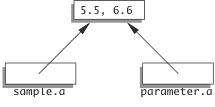

当函数调用结束时，`PFArrayD` 的析构函数被调用，将 `parameter` 使用的内存返回给自由存储管理器以便重用。析构函数的定义包含以下语句：

```
delete [] a;
```

由于析构函数是针对对象 `parameter` 调用的，该语句等价于

```
delete [] parameter.a;
```

这使图片变为如下所示：

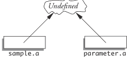

与你可能预期的相反，当你使用赋值运算符将一个对象赋给另一个对象时，复制构造函数并不会被调用。6 然而，如果你不喜欢默认赋值运算符的行为，你可以像我们在显示 10.10 和 10.11 中所做的那样重新定义赋值运算符。

### 复制构造函数

复制构造函数是一种构造函数，它有一个与类类型相同的按引用传递参数。该参数必须是按引用传递参数；通常，该参数也是一个常量参数——也就是说，它前面带有 `const` 参数修饰符。每当函数返回类类型的值时，类的复制构造函数会被自动调用。每当参数被传入类类型的按值传递参数时，复制构造函数也会被自动调用。复制构造函数也可以像其他构造函数一样使用。

任何使用指针和 `new` 运算符的类都应该有一个复制构造函数。

### 三大件

复制构造函数、`=` 赋值运算符和析构函数被称为三大件，因为专家说如果你需要其中任何一个，你就需要全部三个。如果其中任何一个缺失，编译器会创建它，但创建出来的东西可能不会按你想要的方式运行。因此，自己定义它们是值得的。如果所有成员变量都是预定义类型（如 `int` 和 `double`），编译器为你生成的复制构造函数和重载的 `=` 赋值运算符会正常工作。对于任何使用指针和 `new` 运算符的类，最安全的做法是自己定义复制构造函数、重载的 `=` 和析构函数。

### 自测练习

13. 如果一个类名为 `MyClass` 并且它有一个构造函数，那么这个构造函数叫什么名字？如果 `MyClass` 有一个析构函数，那么这个析构函数叫什么名字？

14. 假设你将显示 10.11 中的析构函数定义改为以下内容。显示 10.12 中的示例对话会如何变化？

```
PFArrayD::~PFArrayD( )
{
```

> 6 C++ 区分初始化（调用复制构造函数的三种情况）和赋值。初始化使用复制构造函数创建一个新对象；赋值运算符作用于一个现有对象并修改它，使其成为赋值右侧对象的相同副本（除了位置之外）。

```
cout << "\n再见了，残酷的世界！这个动态数组的\n" << "短暂生命即将结束。\n";
delete [] a;
```

15. 以下是类 `PFArrayD` 复制构造函数定义的第一行。标识符 `PFArrayD` 出现了三次，每次含义略有不同。在三种情况下它分别表示什么？

```
PFArrayD::PFArrayD(const PFArrayD& pfaObject)
```

# 16. 回答关于析构函数的问题。

+   a. 什么是析构函数，析构函数的名称必须是什么？
+   b. 析构函数何时被调用？
+   c. 析构函数实际上做了什么？
+   d. 析构函数应该做什么？

# 17. a. 仔细解释为什么当数据仅由内置类型组成时不需要重载赋值运算符。

+   b. 对于复制构造函数，同 a。
+   c. 对于析构函数，同 a。

### 章节总结

+   指针是一个内存地址，因此指针提供了一种通过命名变量在计算机内存中的地址来间接命名变量的方式。
+   动态变量（也称为动态分配的变量）是在程序运行期间创建（和销毁）的变量。
+   动态变量的内存位于计算机内存的一个特殊部分，称为自由存储管理器。当程序用完一个动态变量时，该动态变量使用的内存可以返回给自由存储管理器以供重用；这是通过 `delete` 语句完成的。
+   动态分配的数组（也简称为动态数组）是其大小在程序运行时确定的数组。动态数组是作为数组类型的动态变量实现的。
+   析构函数是类的一种特殊成员函数。当类的对象超出作用域时，析构函数会被自动调用。析构函数的主要目的是将内存返回给自由存储管理器，以便内存可以被重用。

复制构造函数是一种构造函数，它有一个与类类型相同的单一参数。如果你定义了复制构造函数，每当函数返回类类型的值以及每当参数被传入类类型的按值传递参数时，它都会被自动调用。任何使用指针和 `new` 运算符的类都应该有一个复制构造函数。

当重载赋值运算符时，它必须作为成员运算符进行重载。请务必检查你的重载在重载赋值运算符两侧是同一个变量时是否正常工作。

### 自测练习答案

1. 指针是变量的内存地址。

```
2. int *p; // 这声明了一个指向 int 变量的指针。
*p = 17; // 这里，* 是解引用运算符。这将 17 赋给 p 指向的内存位置。
void func(int* p); // 声明 p 为一个指针值参数。
```

3. 10 20
20 20
30 30

如果你将 `*p1 = 30;` 替换为 `*p2 = 30;`，输出将是相同的。

4. 10 20
20 20
30 20

5. 对于粗心的人或新手来说，这看起来像是两个指向 int 的指针类型的对象，即 `int*`。不幸的是，`*` 绑定到标识符，而不是类型（即不是 `int`）。结果是这个声明将 `intPtr1` 声明为 int 指针，而 `intPtr2` 是一个普通的 int 变量。

```
6. delete p;
```

```
7. typedef double* NumberPtr;
NumberPtr myPoint;
```

8. `new` 运算符以类型作为其参数。`new` 在自由存储上为参数类型的变量分配空间。如果有足够的空间，它返回一个指向该内存的指针。如果没有足够的空间，`new` 运算符可能返回 `NULL`，或者可能中止程序，这取决于你的特定编译器的工作方式。

```
9. typedef char* CharArray;
```

```
10. cout << "输入 10 个整数：\n";
for (int i = 0; i < 10; i++)
    cin >> entry[i];
```

+   11. `delete [] entry;`

+   12. `0 1 2 3 4 5 6 7 8 9`

+   13. **构造函数**名为 `MyClass`，与类名相同。*析构函数*名为 `~MyClass`。

+   14. 对话将变为以下内容：
+   
+   ```text
+   这个程序测试类 PFArrayD。
+   输入这个超级数组的容量：10
+   输入最多 10 个非负数。
+   在末尾放置一个负数。
+   1.1
+   2.2
+   3.3
+   4.4
+   −1
+   你输入了以下 4 个数字：
+   1.1 2.2 3.3 4.4
+   （加上一个哨兵值。）
+   
+   再见了，残酷的世界！这个动态数组的
+   短暂生命即将结束。
+   再测试一次？(y/n) n
+   ```

+   15. `::` 之前的 `PFArrayD` 是类的名称。`::` 之后的 `PFArrayD` 是成员函数的名称。（记住，构造函数是与类同名的成员函数。）括号内的 `PFArrayD` 是参数 `pfaObject` 的类型。

+   16.
+      a. 析构函数是类的成员函数。析构函数的名称总是以波浪号 `~` 开头，后跟类名。
+      b. 当类对象超出作用域时，析构函数被调用。
+      c. 析构函数实际上做了类作者编程让它做的任何事情！
+      d. 析构函数*应该*删除由类的构造函数分配的动态变量。析构函数也可能执行其他清理任务。

+   17. 对于赋值运算符 `=` 和复制构造函数，如果数据只有内置类型，复制机制正是你想要的，所以默认行为工作正常。对于析构函数，没有进行动态内存分配（没有指针），所以默认的不做任何事的操作也是你想要的。


# 编程项目

+   1. 重新阅读显示10.9中的代码。然后，编写一个类`TwoD`，在其构造函数中使用该显示中的思路实现二维动态double数组。你应该有一个类型为指向double的指针的私有成员来指向动态数组，以及两个int（或unsigned int）值作为MaxRows和MaxCols。
+   
+   你应该提供一个默认构造函数，为其选择默认的最大行和列大小，以及一个参数化构造函数，允许程序员设置最大行和列大小。
+   
+   此外，你应该提供一个void成员函数，用于设置特定行和列条目，以及一个成员函数，返回特定行和列条目作为double类型的值。
+   
+   备注：重载[]使其适用于二维数组是困难或不可能的（取决于细节）。因此只需使用普通函数表示法的访问器和修改器函数。
+   
+   将+运算符重载为友元函数，用于添加两个二维数组。该函数应返回一个TwoD对象，其第i行第j列元素是左操作数TwoD对象的第i行第j列元素与右操作数TwoD对象的第i行第j列元素之和。
+   
+   提供复制构造函数、重载的operator=和析构函数。
+   
+   将不改变数据的类成员函数声明为const成员。


+   2. 使用动态数组，实现一个多项式类，支持多项式加法、减法和乘法。

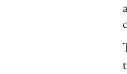

讨论：多项式中的变量只不过充当系数的占位符。因此，多项式唯一有趣的地方在于系数数组和相应的指数。考虑多项式

x*x*x*x + x + 1

x*x项在哪里？实现多项式类的一种简单方法是使用double数组存储系数。数组的索引是相应项的指数。如果某项缺失，则其系数为零。

有一些技术可以用许多缺失项来表示高次多项式。这些技术使用所谓的稀疏矩阵技术。除非你已经知道这些技术，或者学得很快，否则不要使用这些技术。

提供默认构造函数、复制构造函数和参数化构造函数，以便构造任意多项式。

提供重载的operator =和析构函数。
提供以下操作：
多项式 + 多项式，常数 + 多项式，多项式 + 常数，
多项式 – 多项式，常数 – 多项式，多项式 – 常数。
多项式 * 多项式，常数 * 多项式，多项式 * 常数。
提供按指数索引的系数赋值和提取函数。
提供一个在double类型值处计算多项式的函数。
你应该决定将这些函数实现为成员函数、友元函数还是独立函数。

如需更多在线编程项目，请点击下方的CodeMate图标。
1.7


那么你只需要重新编译包含类实现的文件。其他文件，包括包含使用该类的程序的文件，不需要更改甚至重新编译。本节将告诉你如何执行这种类的分离编译。

# 封装回顾

封装原则规定，你应该将程序员如何使用类的规范与类的实现细节分开。这种分离应如此彻底，以至于你可以在不更改任何使用该类的程序的情况下更改实现。确保这种分离的方式可以总结为三条规则：

+   1. 使所有成员变量成为类的私有成员。

+   2. 使类的每个基本操作成为类的公有成员函数、友元函数、普通函数或重载运算符。将类定义和函数及运算符声明（原型）分组在一起。该组及其附带的注释称为类的接口。在类或函数或运算符声明附带的注释中完整说明如何使用每个此类函数或运算符。

+   3. 使基本操作的实现对使用类的程序员不可用。实现由函数定义和重载运算符定义（以及这些定义所需的任何辅助函数或其他附加项）组成。

在C++中，确保遵循这些规则的最佳方法是将类的接口和实现放在单独的文件中。正如你可能猜到的，包含接口的文件通常称为接口文件，包含实现的文件称为实现文件。关于如何设置、编译和使用这些文件的具体细节在不同C++版本之间略有不同，但基本方案在所有C++版本中相同。特别是，文件中内容的细节在所有系统中都是相同的。唯一不同的是用于编译和链接这些文件的命令。下一小节将说明这些文件内容的细节。

一个典型的类具有私有成员变量。私有成员变量（和私有成员函数）对我们关于将类的接口和实现放在单独文件中的基本理念构成了问题。类定义的公有部分是类的接口的一部分，但私有部分是实现的一部分。这是一个问题，因为C++不允许你将类定义拆分为两个文件。因此，需要某种折衷方案。唯一明智的折衷方案是将整个类定义放在接口文件中。由于使用类的程序员无法使用类的任何私有成员，私有成员实际上仍然对程序员隐藏。

# 1.2 矩阵的运算

矩阵的运算包括矩阵的加法、数乘、乘法、转置、共轭转置、逆矩阵等。本节主要介绍矩阵的加法、数乘、乘法、转置和共轭转置等基本运算，逆矩阵将在1.4节中介绍。

# 1.2.1 矩阵的加法与数乘

定义1.2.1 设A=(a_ij)和B=(b_ij)都是m×n矩阵，则矩阵A与B的和定义为

A+B=(a_ij+b_ij)

即两个同型矩阵的和等于对应元素相加所组成的矩阵。

设k为一个数，则数k与矩阵A的乘积定义为

kA=(ka_ij)

即数乘矩阵等于用该数乘以矩阵的每一个元素。

矩阵的加法与数乘统称为矩阵的线性运算。

设A、B、C都是m×n矩阵，k、l为数，则矩阵的线性运算满足以下运算规律：

+   1. 交换律：A+B=B+A
+   2. 结合律：(A+B)+C=A+(B+C)
+   3. 零矩阵：A+O=A
+   4. 负矩阵：A+(-A)=O
+   5. 数乘结合律：k(lA)=(kl)A
+   6. 分配律：k(A+B)=kA+kB
+   7. 分配律：(k+l)A=kA+lA
+   8. 数乘单位元：1A=A

# 显示11.1 DigitalTime类的接口文件

```
//This is the header file dtime.h. This is the interface for the class DigitalTime.
//Values of this type are times of day. The values are input and output in 24-hour
//notation, as in 9:30 for 9:30 AM and 14:45 for 2:45 PM.
#include <iostream>
using namespace std;

class DigitalTime
{
public:
    DigitalTime(int theHour, int theMinute);
    DigitalTime();
    //Initializes the time value to 0:00 (which is midnight).

    int getHour( ) const;
    int getMinute( ) const;
    void advance(int minutesAdded);
    //Changes the time to minutesAdded minutes later.

    void advance(int hoursAdded, int minutesAdded);
    //Changes the time to hoursAdded hours plus minutesAdded minutes later.

    friend bool operator ==(const DigitalTime& time1,
                            const DigitalTime& time2);

    friend istream& operator >>(istream& ins, DigitalTime& theObject);

    friend ostream& operator <<(ostream& outs, const DigitalTime& theObject);
private:
    int hour;
    int minute;

    static void readHour(int& theHour);
    //Precondition: Next input to be read from the keyboard is
    //a time in notation, like 9:45 or 14:45.
    //Postcondition: theHour has been set to the hour part of the time.
    //The colon has been discarded and the next input to be read is the minute.

    static void readMinute(int& theMinute);
    //Reads the minute of the keyboard after readHour has read the hour.

    static int digitToInt(char c);
    //Precondition: c is one of the digits '0' through '9'.
    //Returns the integer for the digit; for example, digitToInt('3') returns 3.
};
```

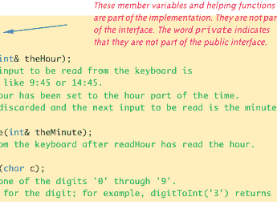


# 显示 11.2 实现文件（第 1 部分，共 3 部分）

//这是 DigitalTime 类的实现文件 dtime.cpp。
//DigitalTime 类的接口位于头文件 dtime.h 中。
#include <iostream>
#include <ctype>
#include <cstdlib>
using namespace std;
#include "dtime.h"

//使用 iostream 和 cstdlib：
DigitalTime::DigitalTime(int theHour, int theMinute)
{
    if (theHour < 0 || theHour > 24 || theMinute < 0 || theMinute > 59)
    {
        cout << "DigitalTime 构造函数的参数非法。";
        exit(1);
    }
    else
    {
        hour = theHour;
        minute = theMinute;
    }

    if (hour == 24)
        hour = 0; //将午夜标准化为 0:00
}

DigitalTime::DigitalTime()
{
    hour = 0;
    minute = 0;
}

int DigitalTime::getHour() const
{
    return hour;
}

int DigitalTime::getMinute() const
{
    return minute;
}

void DigitalTime::advance(int minutesAdded)
{
    int grossMinutes = minute + minutesAdded;
    minute = grossMinutes%60;
    int hourAdjustment = grossMinutes/60;
    hour = (hour + hourAdjustment)%24;
}

void DigitalTime::advance(int hoursAdded, int minutesAdded)
{
    hour = (hour + hoursAdded)%24;
    advance(minutesAdded);
}

bool operator ==(const DigitalTime& time1, const DigitalTime& time2)
{
    return (time1.hour == time2.hour && time1.minute == time2.minute);
}

//使用 iostream：
ostream& operator <<(ostream& outs, const DigitalTime& theObject)
{
    outs << theObject.hour << ':';
    if (theObject.minute < 10)
        outs << '0';
    outs << theObject.minute;
    return outs;
}

//使用 iostream：
istream& operator >>(istream& ins, DigitalTime& theObject)
{
    DigitalTime::readHour(theObject.hour);
    DigitalTime::readMinute(theObject.minute);
    return ins;
}

int DigitalTime::digitToInt(char c)
{
    return ( int(c) - int('0') );
}

//使用 iostream、ctype 和 cstdlib：
void DigitalTime::readMinute(int& theMinute)
{
    char c1, c2;
    cin >> c1 >> c2;

    if (!(isdigit(c1) && isdigit(c2)))
    {
        cout << "错误：readMinute 输入非法\n";
        exit(1);
    }

    theMinute = digitToInt(c1)*10 + digitToInt(c2);
    if (theMinute < 0 || theMinute > 59)
    {
        cout << "错误：readMinute 输入非法\n";
        exit(1);
    }
}

//使用 iostream、cctype 和 cstdlib：
void DigitalTime::readHour(int &theHour)
{
    char c1, c2;
    cin >> c1 >> c2;
    if ( (! isdigit(c1) && (isdigit(c2) || c2 == ':') ) )
    {
        cout << "错误：readHour 输入非法\n";
        exit(1);
    }

    if (isdigit(c1) && c2 == ':')
    {
        theHour = DigitalTime::digitToInt(c1);
    }
    else //(isdigit(c1) && isdigit(c2))
    {
        theHour = DigitalTime::digitToInt(c1)*10
                 + DigitalTime::digitToInt(c2);
        cin >> c2; //丢弃 ':'
        if (c2 != ':')
        {
            cout << "错误：readHour 输入非法\n";
            exit(1);
        }
    }

    if (theHour == 24)
        theHour = 0; //将午夜标准化为 0:00

    if ( theHour < 0 || theHour > 23 )
    {
        cout << "错误：readHour 输入非法\n";
        exit(1);
    }
}

任何使用 DigitalTime 类的文件都必须包含 include 指令

```
#include "dtime.h"
```

因此，实现文件和程序文件都必须包含指定接口文件的 include 指令。包含程序（即包含 main 函数的文件）的文件通常称为应用程序文件或驱动程序文件。显示 11.3 包含一个应用程序文件，其中有一个非常简单的程序，使用并演示了 DigitalTime 类。

运行这个包含在三个文件中的完整程序的具体细节取决于你所使用的系统。然而，所有系统的基本细节都是相同的。你必须编译实现文件，也必须编译包含 main 函数的应用程序文件。你不需要编译接口文件，在本例中即显示 11.1 中给出的 dtime.h 文件。你不需要编译接口文件，因为编译器认为该接口文件的内容已经包含在其他两个文件中。回想一下，实现文件和应用程序文件都包含指令

```
#include "dtime.h"
```

编译程序时会自动调用预处理器，该预处理器读取此 include 指令并将其替换为 dtime.h 文件中的文本。因此，编译器会看到 dtime.h 的内容，所以 dtime.h 文件不需要单独编译。（实际上，编译器会看到 dtime.h 的内容两次：一次在编译实现文件时，一次在编译应用程序文件时。）这种对 dtime.h 文件的复制只是概念上的复制。编译器表现得好像 dtime.h 的内容被复制到了每个包含 include 指令的文件中。但是，如果你在编译后查看这些文件，你只会找到 include 指令；你不会找到 dtime.h 文件的内容。

一旦实现文件和应用程序文件编译完成，你仍然需要连接这些文件，以便它们能够协同工作。这称为链接文件，由称为链接器的独立工具完成。如何调用链接器的细节取决于你所使用的系统。通常，运行程序的命令会自动调用链接器，因此你根本不需要显式调用链接器。文件链接后，你就可以运行程序了。

这听起来是一个复杂的过程，但许多系统都有自动或半自动管理这些细节的功能。在任何系统上，这些细节很快就会变得常规化。在 UNIX 系统上，这些细节由 make 工具处理。在大多数 IDE（集成开发环境）中，这些不同的文件被组合到称为项目的东西中。

显示 11.1、11.2 和 11.3 包含一个完整的程序，分为几个部分并放置在三个不同的文件中。你也可以将这三个文件的内容合并到一个文件中，然后编译并运行这一个文件，无需这些繁琐的步骤。

# 显示 11.3 使用 DigitalTime 类的应用程序文件

```
//这是应用程序文件 timedemo.cpp，演示了 DigitalTime 的使用。
#include <iostream>
using namespace std;
#include "dtime.h"

int main()
{
    DigitalTime clock, oldClock;

    cout << "你可以将午夜写为 0:00 或 24:00，\n"
         << "但我总是将其写为 0:00。\n"
         << "以 24 小时制输入时间：";
    cin >> clock;

    oldClock = clock;
    clock.advance(15);
    if (clock == oldClock)
        cout << "出错了。";
    cout << "你输入的是 " << oldClock << endl;
    cout << "15 分钟后时间将是 "
         << clock << endl;

    clock.advance(2, 15);
    cout << "再过 2 小时 15 分钟后\n"
         << "时间将是 "
         << clock << endl;

    return 0;
}
```

# 示例对话

你可以将午夜写为 0:00 或 24:00，
但我总是将其写为 0:00。
以 24 小时制输入时间：11:15
你输入的是 11:15
15 分钟后时间将是 11:30
再过 2 小时 15 分钟后
时间将是 13:45

关于 include 指令和链接单独文件。为什么要费心使用三个单独的文件？将程序分成单独的文件有几个优点。由于你在与应用程序文件分开的文件中拥有 DigitalTime 类的定义和实现，你可以在许多不同的程序中使用这个类，而无需在每个程序中重写类的定义。此外，你

# 在单独文件中定义类：总结

你可以在单独的文件中定义类，并将类的定义及其成员函数的实现放在单独的文件中。然后，你可以将类与任何使用该类的程序分开编译，并且可以在任意数量的不同程序中使用同一个类。该类按如下方式放置在文件中：

+   1. 将类的定义放在称为接口文件的头文件中。此头文件的名称以 .h 结尾。接口文件还包含定义基本类操作但未在类定义中列出的任何函数和重载运算符的声明（原型）。包含解释所有这些函数和运算符如何使用的注释。
+   2. 上述所有函数和重载运算符的定义（无论它们是成员、友元还是两者都不是）都放在另一个称为实现文件的文件中。此文件必须包含一个指定上述接口文件的 include 指令。此 include 指令在文件名周围使用引号，如下例所示：
+   3. 当你想在程序中使用该类时，将程序的主要部分（以及任何额外的函数定义、常量声明等）放在另一个称为应用程序文件或驱动程序文件的文件中。此文件还必须包含一个指定接口文件的 include 指令，如下例所示：

```
#include "dtime.h"
```

接口文件和实现文件传统上具有相同的名称，但以不同的后缀结尾。接口文件以 .h 结尾。实现文件以你用于包含完整 C++ 程序的文件相同的后缀结尾。实现文件在任何程序中使用之前会单独编译。

```
#include "dtime.h"
```

应用程序文件与实现文件分开编译。你可以编写任意数量的此类应用程序文件，以与一对接口文件和实现文件配合使用。要运行整个程序，你必须首先链接编译应用程序文件产生的目标代码和编译实现文件产生的目标代码。（在某些系统上，链接可能会自动或半自动完成。）如果你在程序中使用多个类，那么你只需拥有多个接口文件和多个实现文件，每个文件都单独编译。


这些辅助函数 readHour 和 readMinute 使用了另一个名为 digitToInt 的辅助函数。函数 digitToInt 将数字字符（如 '3'）转换为数字（如 3）。该函数此前已在本书第 7 章自测练习 3 的答案中给出。

### 提示：可重用组件

一个开发并编码到独立文件中的类，是一种软件组件，可以在多个不同的程序中反复使用。可重用组件节省了精力，因为它不需要为每个应用重新设计、重新编码和重新测试。可重用组件也比仅使用一次的组件更可靠。它更可靠的原因有两个。首先，如果一个组件将被多次使用，你可以投入更多时间和精力来开发它。其次，如果组件被反复使用，它也会被反复测试。每次使用软件组件都是对该组件的一次测试。在不同上下文中多次使用软件组件，是发现软件中残留缺陷的最佳方式之一。

### 使用 #ifndef

我们已经提供了一种将程序放置到三个（或更多）文件中的方法：两个用于每个类的接口和实现，一个用于程序的应用程序部分。程序可以保存在三个以上的文件中。例如，一个程序可能使用多个类，每个类可以保存在一对单独的文件中。假设你的程序分布在许多文件中，并且不止一个文件包含了某个类接口文件的 include 指令，如下所示：

```
#include "dtime.h"
```

在这种情况下，你可能会遇到文件包含其他文件的情况，而这些其他文件又可能包含另外的文件。这很容易导致一个文件实际上多次包含 dtime.h 中的定义。C++ 不允许你多次定义一个类，即使重复的定义完全相同。此外，如果你在许多不同的项目中使用了同一个头文件，那么几乎不可能跟踪你是否多次包含了类定义。为了避免这个问题，C++ 提供了一种标记代码段的方法，表示“如果你之前已经包含过这段内容，则不要再次包含”。实现方式相当直观，尽管符号在习惯之前可能看起来有点奇怪。我们将通过一个示例来详细说明。

下面的指令定义了 DTIME_H：

```
#define DTIME_H
```

DTIME_H 不表示任何含义，仅仅是放在列表中。关键在于，你可以使用另一个指令来测试 DTIME_H 是否已被定义，从而测试某段代码是否已经被处理过。你可以使用任何（非关键字）标识符代替 DTIME_H，但你会看到，对于应使用哪个标识符，有标准的约定。

下面的指令用于测试 DTIME_H 是否已被定义：

```
#ifndef DTIME_H
```

如果 DTIME_H 已经被定义，那么该指令与下面指令第一次出现之间的所有内容都会被跳过：

```
#endif
```

另一种等价表述方式（可能有助于澄清这些指令的拼写）是：如果 DTIME_H 未被定义，则编译器处理直到下一个 #endif 的所有内容。“未被定义”就是 #ifndef 中 n 存在的原因。（这可能让你想知道是否既有 #ifdef 指令又有 #ifndef 指令。确实有，而且含义显而易见，但我们没有机会使用 #ifdef。）

现在考虑以下代码：

```
#ifndef DTIME_H
#define DTIME_H
< 类定义 >
#endif
```

如果这段代码位于名为 dtime.h 的文件中，那么无论你的程序中包含多少次

```
#include "dtime.h"
```

在显示 11.4 中，我们重写了显示 11.1 中所示的头文件 dtime.h，但这次我们使用这些指令来防止多重定义。使用显示 11.4 中所示的 dtime.h 版本，如果某个文件多次包含以下 #include 指令，类 DigitalTime 仍然只会被定义一次：

```
#include "dtime.h"
```

你可以使用其他标识符代替 DTIME_H，但通常的约定是使用文件名的大写形式，并用下划线代替点号。你应该遵循这一约定，以便其他人更容易阅读你的代码，也便于你无需记住标志名称。这样，标志名称会自动确定，没有任何需要记住的任意内容。

这些相同的指令也可以用于跳过非头文件中的代码，但我们只在头文件中使用这些指令。

### #ifndef

你可以通过在头文件（接口文件）中使用 #ifndef 来避免类的（或任何其他内容的）多重定义，如显示 11.4 所示。如果该文件被多次包含，则只会使用所包含定义中的一个。

**显示 11.4 避免类的多重定义**

```
1 //这是头文件 dtime.h。这是类 DigitalTime 的接口。
2 //此类型的值是一天中的时间。值以 24 小时制输入和输出，
3 //如 9:30 表示上午 9:30，14:45 表示下午 2:45。
4
5 #ifndef DTIME_H
6 #define DTIME_H
7
8 #include <iostream>
9 using namespace std;
10
11 class DigitalTime
12 {
13     <类 DigitalTime 的定义与显示 11.1 中的相同。>
14
15 };
16
17 #endif //DTIME_H
```

### 提示：定义其他库

你不需要定义类就可以使用单独编译。如果你有一个相关函数的集合，想将其设计为你自己的库，你可以将函数声明（原型）和附带的注释放在头文件中，将函数定义放在实现文件中，就像我们为类概述的那样。之后，你可以在程序中使用这个库，就像使用你放在单独文件中的类一样。

### 自测练习

- 1. 假设你在定义一个类，然后想在程序中使用这个类。你想按照本章所述，将类和程序部分分别放入不同的文件中。请说明以下各项应放在接口文件、实现文件还是应用程序文件中。

  - a. 类定义
  - b. 作为类操作但既不是类的成员也不是类的友元的函数声明
  - c. 作为类操作但既不是类的成员也不是类的友元的重载运算符的声明
  - d. 作为类操作但既不是类的成员也不是类的友元的函数定义
  - e. 作为类操作的友元函数的定义
  - f. 成员函数的定义
  - g. 作为类操作但既不是类的成员也不是类的友元的重载运算符的定义
  - h. 作为类操作且是类的友元的重载运算符的定义
  - i. 程序的主函数

- 2. 以下哪个文件的名字以 .h 结尾：类的接口文件、类的实现文件，还是使用该类的应用程序文件？

- 3. 当你在单独的文件中定义类时，有接口文件和实现文件。这些文件中哪一个需要编译？（两者？都不需要？只有一个？如果是，是哪一个？）

- 4. 假设你在单独的文件中定义了一个类，并在程序中使用该类。现在假设你更改了类的实现文件。以下哪些文件（如果有）需要重新编译：接口文件、实现文件和/或应用程序文件？


5. 假设你想更改在第 11.1 和 11.2 节中给出的类 DigitalTime 的实现。具体来说，你想更改记录时间的方式。不是使用两个私有变量 hour 和 minute，你想使用一个单一的（私有）int 变量，将其命名为 minutes。在这个新的实现中，私有变量 minutes 将把时间记录为自 0:00 时间（即自午夜）以来的分钟数。例如，1:30 记录为 90 分钟，因为它是午夜后的 90 分钟。描述你需要如何更改第 11.1 和 11.2 节中显示的接口和实现文件。你不必完整写出文件；只需以非常概括的方式指出你需要更改哪些项目以及如何更改它们。

### 11.2 命名空间

> 人名有什么意义？我们称之为玫瑰
> 换个名字也会一样芬芳。
> 
> 威廉·莎士比亚，《罗密欧与朱丽叶》

当一个程序使用由不同程序员编写的不同类和函数时，就有可能两个程序员会为两个不同的事物使用相同的名称。命名空间是处理此问题的一种方法。命名空间是一组名称定义，例如类定义和变量声明。可以说命名空间可以被打开和关闭，这样当其某些名称否则会与另一个命名空间中的名称冲突时，它可以被关闭。

### 命名空间和 using 指令

我们已经在使用名为 std 的命名空间。std 命名空间包含许多标准 C++ 库文件（例如 iostream）中定义的所有名称。例如，当你在文件开头放置以下行时，

```
#include <iostream>
```

它会将所有名称定义（如 cin 和 cout）放入 std 命名空间。你的程序除非指定它正在使用 std 命名空间，否则不知道 std 命名空间中的名称。要使 std 命名空间中的所有定义对你的代码可用，插入以下 using 指令：

```
using namespace std;
```

了解为什么你可能想要包含此 using 指令的一个好方法是思考为什么你可能不想要包含它。如果你不为命名空间 std 包含此 using 指令，那么你可以将 cin 和 cout 定义为具有除其标准含义之外的其他含义。（也许你想重新定义 cin 和 cout，因为你希望它们的行为与标准版本略有不同。）它们的标准含义在 std 命名空间中；如果没有 using 指令（或类似的东西），你的代码对 std 命名空间一无所知，因此就你的代码而言，它所知道的 cin 和 cout 的唯一定义就是你给它们的定义。

你编写的每一块代码都在某个命名空间中。如果你没有将代码放在某个特定命名空间中，那么代码就在一个被称为全局命名空间的命名空间中。到目前为止，我们没有将我们编写的任何代码放在任何命名空间中，因此我们所有的代码都在全局命名空间中。全局命名空间没有 using 指令，因为你始终在使用全局命名空间。你可以说总有一个隐式的自动 using 指令表示你正在使用全局命名空间。

请注意，你可以在同一个程序中使用多个命名空间。例如，我们始终在使用全局命名空间，我们通常也在使用 std 命名空间。如果一个名称在两个命名空间中都被定义，并且你同时使用这两个命名空间，会怎样？这会导致错误（根据具体细节，可能是编译器错误或运行时错误）。你可以在两个不同的命名空间中定义相同的名称，但如果是这样，那么你一次只能使用其中一个命名空间。然而，这并不意味着你不能在同一个程序中使用这两个命名空间。你可以在同一个程序中在不同时间使用它们。

例如，假设 NS1 和 NS2 是两个命名空间，并且假设 myFunction 是一个在两个命名空间中都定义但在两个命名空间中定义方式不同的无参数 void 函数。以下内容就是合法的：

```
{
    using namespace NS1;
    myFunction();
}
{
    using namespace NS2;
    myFunction();
}
```

第一次调用将使用命名空间 NS1 中给出的 myFunction 的定义，而第二次调用将使用命名空间 NS2 中给出的 myFunction 的定义。

回想一下，块是一组用大括号 {} 括起来的语句、声明以及可能的其它代码。块开头的 using 指令仅适用于该块。因此上面的第一个 using 指令仅适用于第一个块，第二个 using 指令仅适用于第二个块。通常的说法是 NS1 using 指令的作用域是第一个块，而 NS2 using 指令的作用域是第二个块。请注意，由于此作用域规则，我们能够在同一个程序中使用两个冲突的命名空间（例如在包含我们刚才讨论的两个块的程序中）。

再次查看第 11.5 节的显示，你会看到函数 greeting 的定义也放在命名空间 Space1 中。这是通过以下额外的命名空间分组完成的：

```
namespace Space1
{
    void greeting()
    {
        cout << "Hello from namespace Space1.\n";
    }
}
```

### 显示 11.5 命名空间演示（第 1 部分，共 2 部分）

```
1
2 #include <iostream>
3 using namespace std;
4
5 namespace Space1
6 {
7     void greeting();
8 }
9
10 namespace Space2
11 {
12     void greeting();
13 }
14
15 void bigGreeting();
16
17 int main()
18 {
19     {
20         using namespace Space2;
21         greeting();
22     }
23     {
24         using namespace Space1;
25         greeting();
26     }
27     bigGreeting();
28     return 0;
29 }
```

此块中的名称使用命名空间 Space2、std 和全局命名空间中的定义。

此块中的名称使用命名空间 Space1、std 和全局命名空间中的定义。

此处的名称仅使用命名空间 std 和全局命名空间中的定义。

### 显示 11.5 命名空间演示（第 2 部分，共 2 部分）

```
namespace Space1
{
    void greeting()
    {
        cout << "Hello from namespace Space1.\n";
    }
}
```

```
namespace Space2
{
    void greeting()
    {
        cout << "Greetings from namespace Space2.\n";
    }
}

void bigGreeting()
{
    cout << "A Big Global Hello!\n";
}
```

### 示例对话

> Greetings from namespace Space2.
> Hello from namespace Space1.
> A Big Global Hello!

请注意，对于单个命名空间，你可以有任意数量的这些命名空间分组。在显示 11.5 中，我们对命名空间 Space1 使用了两个命名空间分组，对命名空间 Space2 使用了另外两个分组。

在命名空间中定义的每个名称都在命名空间分组内部可用，但名称也可以使代码在命名空间分组之外可用。例如，命名空间 Space1 中的函数声明和函数定义可以通过 using 指令

```
using namespace Space1
```

使之可用，如显示 11.5 所示。

### 2024年6月全国大学英语四级考试真题（第1套）

Part I Writing (30 minutes)

Directions: Suppose your university is seeking students to volunteer for the upcoming international conference on AI and education. You are to write an essay to express your willingness to participate and describe what you can do for the conference. You will have 30 minutes for this task. You should write at least 120 words but no more than 180 words.

Part II Listening Comprehension (25 minutes)

Section A

Directions: In this section, you will hear three news reports. At the end of each news report, you will hear two or three questions. Both the news report and the questions will be spoken only once. After you hear a question, you must choose the best answer from the four choices marked A), B), C) and D). Then mark the corresponding letter on Answer Sheet 1 with a single line through the centre.

Questions 1 and 2 are based on the following news report.

1. A) A fire broke out in a downtown building.  B) A severe storm hit a coastal town.  C) A major traffic accident occurred on a highway.  D) A chemical plant exploded in an industrial area.

2. A) It caused widespread power outages.  B) It resulted in several injuries.  C) It led to the evacuation of residents.  D) It damaged many local businesses.

Questions 3 and 4 are based on the following news report.

3. A) A new species of fish was discovered.  B) A rare bird was spotted in the wild.  C) An ancient artifact was found underwater.  D) A new volcano was detected on the ocean floor.

4. A) It is the largest ever recorded.  B) It is over 1,000 years old.  C) It is made of gold and silver.  D) It is believed to be from a sunken ship.


# 将定义放在命名空间中

你可以通过将其放在命名空间分组中来将名称定义放在命名空间中，其语法如下：

```
namespace Namespace_Name
{
    Definition_1
    Definition_2
    .
    .
    Definition_Last
}
```

你可以有多个命名空间分组（甚至在多个文件中），并且所有分组中的所有定义都将在同一个命名空间中。

# 自测练习

6. 考虑显示 11.5 中的程序。我们能否使用名称 greeting 代替 bigGreeting？

7. 在练习 6 中，我们看到你不能向全局命名空间添加以下函数的定义：

```
void greeting();
```

你能向全局命名空间添加以下函数声明的定义吗？

```
void greeting(int howMany);
```

# 使用声明

本小节描述了一种限定单个名称的方法，以便你只能将命名空间中的一个名称提供给你的程序，而不是使命名空间中的所有名称都可用。我们在第 1 章中看到了这种技术，因此这是对我们在第 1 章中所说内容的回顾和扩展。

假设你面临以下情况。你有两个命名空间，NS1 和 NS2。你想使用 NS1 中定义的函数 fun1 和命名空间 NS2 中定义的函数 fun2。问题是 NS1 和 NS2 都定义了函数 myFunction。（假设本讨论中的所有函数都不带参数，因此重载不适用。）以下内容存在问题

```
using namespace NS1;
using namespace NS2;
```

这可能会为 myFunction 提供冲突的定义。（如果名称 myFunction 从未被使用，则大多数编译器不会检测到该问题，并允许你的程序编译和运行。）

你需要一种方法来说明你正在使用 NS1 中的 fun1 和 NS2 中的 fun2，而命名空间 NS1 和 NS2 中没有其他内容。我们已经在使用一种可以处理这种情况的技术。以下就是你的解决方案：

```
using NS1::fun1;
using NS2::fun2;
```

形式为

```
using Name_Space::One_Name;
```

的限定使来自命名空间 Name_Space 的名称 One_Name（的定义）可用，但不会使 Name_Space 中的任何其他名称可用。这称为 using 声明。

请注意，我们在这些 using 声明中使用的作用域解析运算符 :: 与我们在定义成员函数时使用的作用域解析运算符相同。这两种使用作用域解析运算符的方式具有相似性。例如，显示 11.2 中有以下函数定义：

```
void DigitalTime::advance(int hoursAdded, int minutesAdded)
{
    hour = (hour + hoursAdded)%24;
    advance(minutesAdded);
}
```

在这种情况下，:: 的意思是我们正在为类 DigitalTime 定义函数 advance，而不是在任何其他类中名为 advance 的任何其他函数。同样，

```
using NS1::fun1;
```

意味着我们正在使用在命名空间 NS1 中定义的名为 fun1 的函数，而不是在任何其他命名空间中对 fun1 的任何其他定义。

using 声明，例如

```
using std::cout;
```

与 using 指令例如

```
using namespace std;
```

之间有两个区别。区别如下：

+ 1. using 声明仅使命名空间中的一个名称对你的代码可用，而 using 指令使命名空间中的所有名称都可用。
+ 2. using 声明将名称（如 cout）引入你的代码，因此不能对该名称进行其他使用。然而，using 指令仅可能引入命名空间中的名称。

第 1 点很明显。第 2 点有一些细微之处。例如，假设命名空间 NS1 和 NS2 都为 myFunction 提供定义，但没有其他名称冲突，那么以下内容不会产生任何问题：

```
using namespace NS1;
using namespace NS2;
```

前提是（在这些指令的作用域内）冲突的名称 myFunction 在你的代码中从未被使用。

另一方面，以下内容是非法的，即使函数 myFunction 从未被使用：

```
using NS1::myFunction;
using NS2::myFunction;
```

有时这个细微点很重要，但它不会影响大多数常规代码。因此，我们经常宽松地使用术语 using 指令来表示 using 指令或 using 声明。

# 限定名称

本节介绍了一种我们尚未讨论过的限定名称的方法。假设你打算使用命名空间 NS1 中定义的名称 fun1，但你只打算使用一次（或少量几次）。你可以使用命名空间的名称和作用域解析运算符按如下方式命名函数（或其他项）：

```
NS1::fun1();
```

此形式通常在指定参数类型时使用。例如，考虑

```
int getInput(std::istream inputStream)
```

在函数 getInput 中，参数 inputStream 的类型为 istream，其中 istream 在 std 命名空间中定义。如果这是你从 std 命名空间中需要的唯一名称（或如果你需要的所有名称都类似地用 std:: 限定），那么你不需要

```
using namespace std;
```

或

```
using std::istream;
```

请注意，即使在另一个命名空间的作用域内使用 using 指令，而该命名空间也定义了名称 istream，你也可以使用 std::istream。在这种情况下，std::istream 和 istream 将具有不同的定义。例如，考虑

```
using namespace MySpace;
void someFunction(istream p1, std::istream p2);
```

假设 istream 是在命名空间 MySpace 中定义的类型，则 p1 将具有 MySpace 中定义的 istream 类型，而 p2 将具有 std 命名空间中定义的 istream 类型。

# 自测练习

8. 以下程序产生的输出是什么？

```
#include <iostream>
using namespace std;

namespace Hello
{
    void message();
}

namespace GoodBye
{
    void message();
}

void message();

int main()
{
    using GoodBye::message;

    {
        using Hello::message;
        message();
        GoodBye::message();
    }

    message();

    return 0;
}

void message()
{
    cout << "Global message.\n";
}

namespace Hello
{
    void message()
    {
        cout << "Hello.\n";
    }
}

namespace GoodBye
{
    void message()
    {
        cout << "Good-Bye.\n";
    }
}
```

9. 编写一个名为 wow 的 void 函数的声明（原型）。函数 wow 有两个参数，第一个参数的类型为 speedway 命名空间中定义的 speed，第二个参数的类型为 indy500 命名空间中定义的 speed。

# 示例 一个类定义在命名空间中

在显示 11.6 和 11.7 中，我们再次重写了类 DigitalTime 的头文件 dtTime.h 和类 DigitalTime 的实现文件。这一次（无意双关），我们将定义放在名为 DTimeSavitch 的命名空间中。请注意，命名空间 DTimeSavitch 跨越了两个文件 dtTime.h 和 dtTime.cpp。命名空间可以跨越多个文件。

如果你按照显示 11.6 和 11.7 所示重写类 DigitalTime 的定义，则显示 11.3 中的应用程序文件需要以某种方式指定命名空间 DTimeSavitch，例如以下内容：

```
using namespace DTimeSavitch;
```

或

```
using DTimeSavitch::DigitalTime;
```

# 提示 为命名空间选择名称

最好在你的命名空间名称中包含你的姓氏或其他唯一字符串，以减少其他人使用与你相同的命名空间名称的机会。对于多个程序员为同一项目编写代码的情况，确保本意不同的命名空间确实具有不同的名称非常重要。否则，你很容易在同一作用域中对同一名称有多个定义。这就是为什么我们在显示 11.9 中将名称 Savitch 包含在命名空间 DTimeSavitch 中的原因。

# 显示 11.6 将类放在命名空间中（头文件）

```
//This is the header file dtime.h.
#ifndef DTIME_H
#define DTIME_H

#include <iostream>
using std::istream;
using std::ostream;

namespace DTimeSwitch
{

    class DigitalTime
    {

        //<The definition of the class DigitalTime is the same as in Display 11.1.>

    };
}// DTimeSwitch

#endif //DTIME_H
```

*将在显示 11.8 和 11.9 中给出此类定义的更好版本。*

*类 DigitalTime 的定义与显示 11.1 中的相同。*

*请注意，命名空间 DTimeSwitch 跨越两个文件。另一个显示在显示 11.7 中。*

# 显示 11.7 将类放在命名空间中（实现文件）

```
//This is the implementation file dtime.cpp.
#include <iostream>
#include <cctype>
#include <cstdlib>
using std::istream;
using std::ostream;
using std::cout;
using std::cin;
#include "dtime.h"

namespace DTimeSwitch
{

    <All the function definitions from Display 11.2 go here.>

}// DTimeSwitch
```

*你可以使用单个 using 指令 `using namespace std;` 代替这四个 using 声明。然而，这四个 using 声明是更可取的风格。*


### 展示 11.8 在命名空间中隐藏辅助函数（接口文件）（第2部分，共2部分）

```
21 void advance(int hoursAdded, int minutesAdded);
//Changes the time to hoursAdded hours plus minutesAdded minutes later.

24 friend bool operator ==(const DigitalTime& time1,
25 const DigitalTime& time2);
26 friend istream& operator >>(istream& ins, DigitalTime& theObject);
27 friend ostream& operator <<(ostream& outs,
28 const DigitalTime& theObject);
29 private:
30 int hour;
31 int minute;
32 };
33 #endif //DTIME_H
```

请注意，辅助函数并未在接口文件中提及。

### 展示 11.9 在命名空间中隐藏辅助函数（实现文件）（第1部分，共3部分）

```
//This is the implementation file dtime.cpp of the class DigitalTime.
//The interface for the class DigitalTime is in the header file dtime.h.
#include <iostream>
#include <cctype>
#include <cstdlib>
using std::istream;
using std::ostream;
using std::cout;
using std::cin;
#include "dtime.h"
namespace
{
int digitToInt(char c)
{
return ( int(c) - int('0') );
}
//Uses iostream, ctype, and cstdlib:
void readMinute(int& theMinute)
{
char c1, c2;
cin >> c1 >> c2;
if (!(isdigit(c1) && isdigit(c2)))
{
cout << "Error: illegal input to readMinute\n";
```

指定未命名命名空间

未命名命名空间内定义的名字是该编译单元的局部变量。因此，这些辅助函数是文件dtime.cpp的局部函数。

### 展示 11.9 在命名空间中隐藏辅助函数（实现文件）（第2部分，共3部分）

```
25             exit(1);
26         }

27         theMinute = digitToInt(c1)*10 + digitToInt(c2);

28         if (theMinute < 0 || theMinute > 59)
29         {
30             cout << "Error: illegal input to readMinute\n";
31             exit(1);
32         }
33     }

34
35     //Uses iostream, cctype, and cstdlib:
36     void readHour(int& theHour)
37     {
38         char c1, c2;
39         cin >> c1 >> c2;
40         if ( (!isdigit(c1) && (isdigit(c2) || c2 == ':')) )
41         {
42             cout << "Error: illegal input to readHour\n";
43             exit(1);
44         }

45         if (isdigit(c1) && c2 == ':')
46         {
47             theHour = digitToInt(c1);
48         }
49         else //(isdigit(c1) && isdigit(c2))
50         {
51             theHour = digitToInt(c1)*10 + digitToInt(c2);
52             cin >> c2; //discard ':'
53             if (c2 != ':')
54             {
55                 cout << "Error: illegal input to readHour\n";
56                 exit(1);
57             }
58         }

59         if (theHour == 24)
60             theHour = 0; //Standardize midnight as 0:00.

61         if ( theHour < 0 || theHour > 23 )
62         {
```

### 展示 11.9 在命名空间中隐藏辅助函数（实现文件）（第3部分，共3部分）

```
63          cout << "Error: illegal input to readHour\n";
64          exit(1);
65        }
66
67 } //unnamed namespace
68
69 namespace DTimeSavitch
70 {
71
72     //Uses iostream:
73     istream& operator >>(istream& ins, DigitalTime& theObject)
74     {
75         readHour(theObject.hour);
76         readMinute(theObject.minute);
77         return ins;
78     }
79
80     ostream& operator <<(ostream& outs, const DigitalTime& theObject)
81     <The body of the function definition is the same as in Display 11.2.>

83     bool operator ==(const DigitalTime& time1, const DigitalTime& time2)
84     <The body of the function definition is the same as in Display 11.2.>

86     DigitalTime::DigitalTime(int theHour, int theMinute)
87     <The body of the function definition is the same as in Display 11.2.>

89     DigitalTime::DigitalTime( )
90     <The body of the function definition is the same as in Display 11.2.>

92     int DigitalTime::getHour( ) const
93     <The body of the function definition is the same as in Display 11.2.>

95     int DigitalTime::getMinute( ) const
96     <The body of the function definition is the same as in Display 11.2.>

98     void DigitalTime::advance(int minutesAdded)
99     <The body of the function definition is the same as in Display 11.2.>

101    void DigitalTime::advance(int hoursAdded, int minutesAdded)
102    <The body of the function definition is the same as in Display 11.2.>

104 } //DTimeSavitch
```

> 在编译单元内（本例中为dtime.cpp），你可以不加限定地直接使用未命名命名空间中的名字。

以及DigitalTime类的实现文件。请注意，辅助函数readHour、readMinute和digitToInt都在未命名命名空间中，因此它们是编译单元的局部部分。如展示 11.10所示，未命名命名空间中的名字可以在编译单元外部被重用于其他用途。在展示 11.10中，函数名readHour在应用程序中被重用为另一个不同的函数。

### 展示 11.10 在命名空间中隐藏辅助函数（应用程序）（第1部分，共2部分）

```
//This is the application file timedemo.cpp. This program
//demonstrates hiding the helping functions in an unnamed namespace.

#include <iostream>
#include "dtime.h"

void readHour(int & theHour);

int main()
{
    using std::cout;
    using std::cin;
    using std::endl;

    using DTimeSavitch::DigitalTime;

    int theHour;
    readHour(theHour);

    DigitalTime clock(theHour, 0), oldClock;

    oldClock = clock;
    clock.advance(15);
    if (clock == oldClock)
        cout << "Something is wrong.";
    cout << "You entered " << oldClock << endl;
    cout << "15 minutes later the time will be "
         << clock << endl;

    clock.advance(2, 15);
    cout << "2 hours and 15 minutes after that\n"
         << "the time will be "
         << clock << endl;

    return 0;
}
```

如果你将using声明放在此处，程序行为将会相同。然而，许多权威人士认为，应该使每个using声明或using指令的作用域尽可能合理地小，而我们希望为你展示这种技术的示例。

这是与实现文件dtime.cpp（如展示 11.9所示）中的readHour函数不同的另一个函数。

### 展示 11.10 在命名空间中隐藏辅助函数（应用程序）（第2部分，共2部分）

```
28 void readHour(int& theHour)
29 {
30     using std::cout;
31     using std::cin;

33     cout << "Let's play a time game.\n"
         << "Let's pretend the hour has just changed.\n"
         << "You may write midnight as either 0 or 24,\n"
         << "but, I will always write it as 0.\n"
         << "Enter the hour as a number (0 to 24): ";
38     cin >> theHour;
39 }
```

> 当我们之前给出这些using声明时，它们位于main函数中，因此它们的作用域是main函数。因此，我们需要在这里重复它们，以便在readHour中使用cin和cout。

### 示例对话

```
Let's play a time game.
Let's pretend the hour has just changed.
You may write midnight as either 0 or 24,
but, I will always write it as 0.
Enter the hour as a number (0 to 24): 11
You entered 11:00
15 minutes later the time will be 11:15
2 hours and 15 minutes after that
the time will be 13:30
```

如果你再看一下实现文件展示 11.9，你会看到辅助函数digitToInt、readHour和readMinute在未命名命名空间之外被使用，且没有任何命名空间限定符。未命名命名空间中定义的任何名字都可以不加限定地在编译单元的任何位置使用。（当然，这必然是如此，因为未命名命名空间没有名字可用于限定其成员。）

有趣的是，未命名命名空间与C++中“同一个命名空间中不能有两个同名定义”这一规则是如何相互作用的。每个编译单元中有一个未命名命名空间。编译单元之间很容易发生重叠。例如，类的实现文件和使用该类的应用程序通常都会包含该类的头文件（接口文件）。因此，头文件位于两个编译单元中，从而参与了两个未命名命名空间。尽管这听起来很危险，但只要每个编译单元的命名空间独立考虑时是合理的，通常不会产生任何问题。例如，如果一个名字在头文件的未命名命名空间中被定义


file，如果在实现文件或应用程序文件中再次定义，则不能在无名命名空间中再次定义。因此，避免了名称冲突。

### UNNAMED NAMESPACE

你可以使用无名命名空间使定义局限于一个编译单元。每个编译单元有一个无名命名空间。无名命名空间中定义的所有标识符都局限于该编译单元。你通过将定义放在没有命名空间名称的命名空间分组中来将定义放入无名命名空间，如下所示：

```
namespace
{
    Definition_1
    Definition_2
    .
    .
    Definition_Last
}
```

你可以在编译单元的任何地方使用无名命名空间中的任何名称而无需限定符。参见显示 11.8、11.9 和 11.10 的完整示例。

### Pitfall CONFUSING THE GLOBAL NAMESPACE AND THE UNNAMED NAMESPACE

不要混淆全局命名空间和无名命名空间。如果你没有将名称定义放在命名空间分组中，那么它就在全局命名空间中。要将名称定义放入无名命名空间，你必须将其放在以如下方式开始的命名空间分组中，且没有名称：

```
namespace
{
```

全局命名空间中的名称和无名命名空间中的名称都可以通过限定符访问。然而，全局命名空间中的名称具有全局作用域（所有程序文件），而无名命名空间中的名称是局限于编译单元的。

在编写代码时，全局命名空间和无名命名空间之间的这种混淆并不常见，因为人们倾向于认为全局命名空间中的名称是“在没有任何命名空间中”，尽管在技术上是不正确的。然而，在讨论代码时，这种混淆很容易产生。

### UNNAMED NAMESPACES REPLACE THE static QUALIFIER

早期版本的 C++ 使用限定符 static 使名称局限于文件。这种 static 的用法正在被淘汰，你应该改用无名命名空间来使名称局限于编译单元。请注意，这种 static 的用法与用于限定类成员的 static 的用法无关（在第 7 章“静态成员”小节中讨论）。因此，由于 static 曾经表示多于一种含义，所以其中一种用法的淘汰可能是件好事。

### HIDING HELPING FUNCTIONS

隐藏类的辅助函数有两种好方法。你可以使该函数成为类的私有成员函数，或者可以将辅助函数放在类的实现文件的无名命名空间中。如果函数自然需要调用对象，那么它应被设为私有成员函数。如果它不自然需要调用对象，你可以将其设为静态成员函数（例如 Displays 11.1 和 11.2 中的 DigitalTime::readHour），或者可以将其放在实现文件的无名命名空间中（例如 Displays 11.8 和 11.9 中的 readHour。）

如果辅助函数不需要调用对象，那么将辅助函数放在实现文件的无名命名空间中会使代码更清晰，因为它更好地将接口和实现分离到不同的文件中，并且避免了大量函数名称限定的需要。例如，注意在 Display 11.9 中我们可以使用函数名 readHour 而无需限定符，因为它在无名命名空间中，而在 Display 11.2 的版本中我们需要使用 DigitalTime::readHour。

### NESTED NAMESPACES

命名空间可以嵌套。当从嵌套命名空间限定名称时，你只需限定两次。例如，考虑

```
namespace S1
{
    namespace S2
    {
        void sample()
        {
            .
            .
            .
        }
    }
}
```

```
.\n.\n} //S2\n}//S1
```

要在命名空间 S1 之外调用 sample，你使用

```
S1::S2::sample( );
```

要在命名空间 S2 之外但在命名空间 S1 内部调用 sample，你使用

```
S2::sample( );
```

或者，你也可以使用合适的 using 指令。

#### Tip
WHAT NAMESPACE SPECIFICATION SHOULD YOU USE?

你有三种方法指定你的代码使用在名为 theSpace 的命名空间中定义的名为 f 的函数（或其他项）的定义。你可以插入

```
using namespace theSpace;
```

或者，你可以插入

```
using theSpace::f;
```

最后，你可以完全省略 using 指令，但始终通过写 theSpace::f 而不是仅仅 f 来限定函数名。

应该使用哪种形式？这三种方法都可以使用，而且权威人士对首选风格的建议各不相同。然而，为了充分发挥命名空间的价值，最好避免使用以下形式

```
using namespace theSpace;
```

将此类 using 指令放在文件开头与将所有定义放在全局命名空间中几乎没有区别，而早期版本的 C++ 实际上就是这样做的。因此，这种方法得不到命名空间机制的任何价值。（如果你将此类 using 指令放在块内，则它仅适用于该块。这是另一种选择，它是合理的，并且被许多权威人士提倡。）

我们更喜欢大多数时候使用第二种方法，在文件开头插入如下语句：

```
using theSpace::f;
```

这允许你省略命名空间中但未使用的名称。这反过来避免了潜在的名称冲突。此外，它很好地记录了你使用的名称，而且不像始终使用 theSpace::f 形式的符号限定名称那样混乱。

如果你的文件结构使得不同的命名空间在不同的位置使用，有时最好将你的 using 指令和 using 声明放在块内，例如函数定义的主体中，而不是放在文件的开头。

### Self-Test Exercises

10. 如果你用以下两个 using 指令替换 Display 11.10 中的四个 using 声明

```
using std::cout;
using std::cin;
using std::endl;
using DTimeSavitch::DigitalTime;
```

与以下两个 using 指令？

```
using namespace std;
using namespace DTimeSavitch;
```

11. 以下程序产生的输出是什么？

```
#include <iostream>
using namespace std;

namespace Sally
{
    void message( );
}

namespace
{
    void message( );
}

int main()
{
    {
        message( );
        using Sally::message;
        message( );
    }

message();

    return 0;
}

namespace Sally
{
    void message()
    {
        cout << "Hello from Sally.\n";
    }
}

namespace
{
    void message()
    {
        cout << "Hello from unnamed.\n";
    }
}
```

12. 以下程序产生的输出是什么？

```
#include <iostream>
using namespace std;

namespace Outer
{
    void message();

    namespace Inner
    {
        void message();
    }
}

int main()
{
    Outer::message();
    Outer::Inner::message();

    using namespace Outer;
    Inner::message();

    return 0;
}
```

```
```cpp
namespace Outer
{
    void message()
    {
        cout << "Outer.\n";
    }

    namespace Inner
    {
        void message()
        {
            cout << "Inner.\n";
        }
    }
}
```
```

### Chapter Summary

- 你可以定义一个类并将类的定义和其成员函数的实现放在单独的文件中。然后你可以将类与使用它的任何程序分开编译，并且你可以在任意数量的不同程序中使用同一个类。
- 命名空间是名称定义的集合，例如类定义和变量声明。
- 使用命名空间中的名称有三种方法：通过 using 指令使命名空间中的所有名称可用，通过 using 声明使单个名称可用，或通过使用命名空间的名称和作用域解析运算符限定名称。
- 你通过将定义放在该命名空间的命名空间分组中来将定义放入命名空间。
- 无名命名空间可用于使名称定义局限于编译单元。

### Answers to Self-Test Exercises

- 1. 部分 a、b 和 c 放在接口文件；部分 d 到 h 放在实现文件。（任何类型的类操作定义都放在实现文件中。）部分 i（即程序的主体部分）放在应用程序文件中。
- 2. 接口文件的名称以 .h 结尾。
- 3. 只有实现文件需要编译。接口文件不需要编译。


4. 只有实现文件需要重新编译。但是，你仍需要重新链接文件。

5. 你需要从显示 11.1 中的接口文件中删除私有成员变量 hour 和 minute，并用成员变量 minutes（带 s）替换它们。你不需要在接口文件中做其他任何更改。在实现文件中，你需要更改所有构造函数的定义以及其他成员函数的定义，以及重载运算符的定义，使其适用于这种新的记录时间方式。（在这种情况下，你不需要更改辅助函数 readHour、readMinute 或 digitToInt 的定义，但对于某些其他类或甚至该类的其他重新实现，这可能不成立。）例如，重载运算符 >> 的定义可以更改为如下所示：

```
istream& operator >>(istream& ins,
    DigitalTime& theObject)
{
    int inputHour, inputMinute;
    DigitalTime::readHour(inputHour);
    DigitalTime::readMinute(inputMinute);
    theObject.minutes = inputMinute + 60*inputHour;
    return ins;
}
```

你不需要更改使用该类的程序的任何应用程序文件。但是，由于接口文件已更改（实现文件也已更改），你将需要重新编译任何应用程序文件，当然你也需要重新编译实现文件。

6. 不。如果用 greeting 替换 bigGreeting，你将在全局命名空间中为名称 greeting 提供一个定义。程序中有些部分同时可以使用命名空间 Space1 中的所有名称定义和全局命名空间中的所有名称定义。在程序的这些部分中，将会有两个不同的定义
void greeting();

7. 是的。额外的定义不会引起任何问题，因为重载始终是允许的。例如，当命名空间 Space1 和全局命名空间可用时，函数名 greeting 将被重载。自测练习 6 中的问题在于，有时会存在两个具有相同参数列表的函数名 greeting 的定义。

8. Hello
Good-Bye
Good-Bye

9. void wow(speedway::speed s1, indy500::speed s2);

10. 程序的行为将完全相同。然而，大多数权威人士更倾向于使用 using 声明，正如我们在显示 11.10 中所做的那样。请注意，无论使用哪种方式，仍然有两个不同的名为 readHour 的函数。显示 11.10 中的那个与显示 11.9 中无名命名空间中定义的那个不同。

11. Hello from unnamed.
Hello from Sally.
Hello from unnamed.

12. Outer.
Inner.
Inner.

### PROGRAMMING PROJECTS

1. 本练习旨在说明命名空间和在你的开发环境中分离编译。你应该使用本课程中常规使用的开发环境来完成此练习。在文件 f.h 中，将 void f( ) 的声明放在命名空间 A 中。在文件 g.h 中，将 void g( ) 的声明放在命名空间 A 中。在文件 f.cpp 和 g.cpp 中，分别放置 void f( ) 和 void g( ) 的定义。将 void f( ) 和 void g( ) 的定义放在命名空间 A 中。函数可以做任何你想要的事情，但为了跟踪执行情况，请包含类似

```
cout <<"Function_Name called" << endl;
```

的内容，其中 Function_Name 是特定函数的名称。在另一个文件 main.cpp 中，放置你的 main 函数，#include 最少的集合文件以提供访问命名空间 A 中的名称。在你的 main 函数中依次调用函数 f 然后 g。使用你的开发环境进行编译、链接和执行。为了提供对命名空间中名称的访问，你可以使用局部 using 声明，例如：

```
using std::cout;
```

或使用局部 using 指令，例如：

```
using namespace std;
```

在块内，或使用命名空间的名称限定名称，例如 std::cout。你不得使用全局命名空间指令，例如以下不在块内并适用于整个文件的内容：

```
using namespace std;
```

当然你必须处理命名空间 A 以及函数名 f 和 g，除了可能 std 和 cout。
完成上述操作后，写一份一页的说明，介绍如何在你的环境中创建和使用命名空间和分离编译。

2. 获取显示 10.10、10.11 和 10.10 中的 PFArrayD 类和演示程序的源代码。修改此程序以使用命名空间和分离编译。将类定义和其他函数声明放在一个文件中。将实现放在单独的文件中。将命名空间定义分布在两个文件之间。将演示程序放在第三个文件中。为了提供对命名空间中名称的访问，你可以使用局部 using 声明，例如：

```
using std::cout;
```

或使用局部 using 指令，例如：

```
using namespace std;
```

在块内，或使用命名空间的名称限定名称，例如 std::cout。你不得使用全局命名空间指令，例如以下不在块内并适用于整个文件的内容：

```
using namespace std;
```

3. 扩展第 10 章中的编程项目 1，其中你实现了一个二维数组类，通过将类定义和实现放在命名空间中，然后提供对命名空间中名称的访问。测试你的代码。为了提供对命名空间中名称的访问，你可以使用局部 using 声明，例如

```
using std::cout;
```

或使用局部 using 指令，例如：

```
using namespace std;
```

在块内，或使用命名空间的名称限定名称，例如 std::cout。你不得使用全局命名空间指令，例如以下不在块内并适用于整个文件的内容：

```
using namespace std;
```

### 第12章 流与文件I/O

12.1 I/O STREAMS 501
File I/O 501
Pitfall: Restrictions on Stream Variables 506
Appending to a File 506
Tip: Another Syntax for Opening a File 508
Tip: Check That a File Was Opened Successfully 509
Character I/O 512
Checking for the End of a File 513

12.2 TOOLS FOR STREAM I/O 517
File Names as Input 517
Formatting Output with Stream Functions 518
Manipulators 521
Saving Flag Settings 523
More Output Stream Member Functions 524
Example: Cleaning Up a File Format 525
Example: Editing a Text File 528

12.3 STREAM HIERARCHIES: A PREVIEW OF INHERITANCE 528
Inheritance among Stream Classes 528
Example: Another newLine Function 533

12.4 Random Access to Files 536
CHAPTER SUMMARY 538
ANSWERS TO SELF-TEST EXERCISES 539
PROGRAMMING PROJECTS 541


### 流与文件I/O

> Fish say, they have their stream and pond;
> But is there anything beyond?
> 
> Rupert Brooke, Heaven (1913)

> As a leaf is carried by a stream, whether the stream ends in a lake or in the sea, so too is the output of your program carried by a stream not knowing if the stream goes to the screen or to a file.
> 
> Washroom Wall of a Computer Science Department (1995)

### INTRODUCTION

输入被传递到你的程序，输出从你的程序被传递到输出设备，通过称为流的特殊对象。术语流旨在传达这样一个想法：输出被流式传输到或从你的程序，而你的程序并不知晓（或至少不太知晓）输入数据来自何处或输出数据去向何处。这应该意味着，并且确实意味着，文件输入的处理方式与我们迄今为止使用的键盘输入基本相同，而文件输出的处理方式与屏幕输出基本相同。

文件 I/O 对继承做出了少量但至关重要的使用，而继承直到第 14 章才介绍。然而，我们将本章放在继承章节之前，因为程序员通常希望尽早开始使用文件 I/O。因此本章包括对文件 I/O 所需的少量继承细节的简要介绍。

你可以在完成第 1 至 4 章和第 6 至 9 章的材料后随时学习本章；换句话说，你可以在第 5、10 和 11 章之前学习本章。即使在阅读这些章节之前，也足以让你进行简单的文件 I/O。第 12.1 节讨论的基本文件 I/O 元素可以在阅读第 1 至 4 章、第 6 章以及第 9 章中题为“成员函数 get 和 put”的小节后随时学习。该小节是自成体系的，不需要阅读第 9 章的其他部分。第 12.2 节的全部内容，除了题为“File Names as Input”的小节外，也可以在仅阅读第 1 至 4 章、第 6 章以及第 9 章中题为“成员函数 get 和 put”的小节后阅读。


# I/O 流

> _好吧！我已经讲了四十多年散文，却一直不知道。_
> 
> — 莫里哀，《伪君子》

一个 **流** 是字符（或其他类型数据）的流动。如果流动进入你的程序，则该流称为 **输入流**。如果流动流出你的程序，则该流称为 **输出流**。如果输入流来自键盘，则你的程序将从键盘获取输入。如果输入流来自文件，则你的程序将从该文件获取输入。同样，输出流可以发送到屏幕或文件。

尽管你可能没有意识到，你已经在程序中使用过流。你已经使用过的 `cin` 是一个连接到键盘的输入流，而 `cout` 是一个连接到屏幕的输出流。只要你的程序同时包含命名头文件 `<iostream>` 的 `include` 指令以及对 `std` 命名空间的 using 指令，这两个流就会自动可供你的程序使用。你可以定义其他来自文件或发送到文件的流；一旦定义了它们，你就可以在程序中使用它们，就像使用流 `cin` 和 `cout` 一样。例如，假设你的程序定义了一个名为 `inStream` 的流，它来自某个文件。 （我们稍后会告诉你如何定义它。）你就可以在程序中使用以下代码，用该文件中的数字填充名为 `theNumber` 的整数：

```
int theNumber;
inStream >> theNumber;
```

同样，如果你的程序定义了一个名为 `outStream` 的输出流，它发送到另一个文件，那么你就可以将变量 `theNumber` 的值输出到该文件。以下代码将输出字符串 "theNumber is " 后跟变量 `theNumber` 的内容到连接到流 `outStream` 的输出文件：

```
outStream << "theNumber is " << theNumber << endl;
```

一旦流连接到所需的文件，你的程序就可以像使用键盘和屏幕进行 I/O 一样进行文件 I/O。

### FILE I/O

我们将在本章中用于 I/O 的文件是文本文件；也就是说，它们与包含你的 C++ 程序的文件是同一种文件。

当你的程序从文件获取输入时，称其为 **读取** 文件；当你的程序向文件发送输出时，称其为 **写入** 文件。读取文件输入还有其他方法，但本小节给出的方法会从文件开头读到结尾（或程序结束前读到的位置）。

使用这种方法，你的程序不允许倒回去第二次读取文件中的任何内容。这正是你的程序从键盘获取输入时发生的情况，所以它不应该显得新奇或奇怪。 （正如我们将看到的，你的程序可以从文件开头重新读取文件，但这是在重新开始，而不是倒回去。）同样，对于这里介绍的方法，你的程序会从文件开头开始将输出写入文件并向前进行。你的程序不允许倒回去更改它已写入文件中的任何输出。这正是你的程序向屏幕发送输出时发生的情况。你可以向屏幕发送更多输出，但你不能倒回去更改屏幕输出。将输入从文件获取到你的程序中或将输出从你的程序发送到文件的方式是通过流将你的程序连接到文件。

要向文件发送输出，你的程序必须首先将文件连接到 `ofstream` 类的（流）对象。要从文件读取输入，你的程序必须首先将文件连接到 `ifstream` 类的（流）对象。类 `ifstream` 和 `ofstream` 在 `<fstream>` 库中定义并置于 `std` 命名空间中。因此，要同时进行文件输入和文件输出，你的程序将包含

```
#include <fstream>
using namespace std;
```

或

```
#include <fstream>
using std::ifstream;
using std::ofstream;
```

流必须像声明任何其他类变量一样声明。因此，你声明 `ifstream` 为文件的输入流，`ofstream` 为另一个文件的输出流如下：

```
ifstream inStream;
ofstream outStream;
```

流变量，例如上面声明的 `inStream` 和 `outStream`，必须各自连接到一个文件。这称为 **打开文件**，并使用名为 `open` 的成员函数完成。例如，假设你希望输入流 `inStream` 连接到名为 `infile.txt` 的文件。你的程序必须在读取该文件的任何输入之前包含以下内容：

```
inStream.open("infile.txt");
```

你可以在给出文件名时指定路径名（目录或文件夹）。指定路径名的细节因系统而异，所以请向当地专家咨询细节（或做一些试错编程）。在我们的示例中，我们将使用简单的文件名，这假定文件位于你的程序运行的同一目录（文件夹）中。

一旦你声明了输入流变量并使用 `open` 函数将其连接到文件，你的程序就可以使用提取运算符 `>>` 从文件获取输入，输入流变量的使用方式与 `cin` 相同。例如，以下代码从连接到 `inStream` 的文件读取两个输入数字并将它们放入变量 `oneNumber` 和 `anotherNumber` 中：

```
int oneNumber, anotherNumber;
inStream >> oneNumber >> anotherNumber;
```

输出流的打开方式与上面对输入流描述的方式相同。例如，以下代码声明输出流 `outStream` 并将其连接到名为 `outfile.txt` 的文件：

```
ofstream outStream;
outStream.open("outfile.txt");
```

当与类型为 `ofstream` 的流一起使用时，成员函数 `open` 会在文件不存在时创建输出文件。如果输出文件已存在，成员函数 `open` 将丢弃文件的内容，以便在调用 `open` 之后输出文件为空。 （我们将在本章稍后讨论其他打开文件的方式。）

在调用 `open` 将文件连接到流 `outStream` 之后，程序就可以使用插入运算符 `<<` 将输出发送到该文件。例如，以下代码将两个字符串以及变量 `oneNumber` 和 `anotherNumber` 的内容写入连接到流 `outStream` 的文件（在本例中为名为 `outfile.txt` 的文件）：

```
outStream << "oneNumber = " << oneNumber
          << " anotherNumber = " << anotherNumber;
```

> **>> 和 << 的重载适用于文件**
> 
> 正如我们在第 8 章中指出的，如果你重载了 `>>` 和 `<<`，那么这些重载同样适用于文件输入和输出流，就像适用于 `cin` 和 `cout` 一样。 （如果你尚未阅读第 8 章，可以忽略此说明。它将在第 8 章中重复。）

请注意，当你的程序处理文件时，就好像文件有两个名字。一个是操作系统使用的文件的通常名称，即 **外部文件名**。在我们的示例代码中，外部文件名是 `infile.txt` 和 `outfile.txt`。内部文件名在某种意义上是文件的“真实名称”。这些外部文件名的拼写约定因系统而异。我们在示例中使用的名称 `infile.txt` 和 `outfile.txt` 在你的系统上可能看起来像文件名，也可能不像。你应该按照操作系统的约定命名文件。尽管外部文件名是文件的真实名称，但在程序中通常只使用一次。外部文件名作为参数传递给函数 `open`，但在文件打开后，文件始终通过命名连接到文件的流来引用。因此，在你的程序内部，流名充当文件的第二个名称。

### 一个文件有两个名字

你的程序使用的每个输入和输出文件都有两个名字。外部文件名是文件的真实名称，但它仅在调用将文件连接到流的成员函数 `open` 时使用。调用 `open` 之后，你始终使用流名作为文件的名称。

Display 12.1 中的示例程序从一个文件读取三个数字，并将它们的和以及一些文本写入另一个文件。

每个文件都应在你的程序完成从文件获取输入或向文件发送输出时关闭。关闭文件会将流与文件断开。文件通过调用函数 `close` 来关闭。Display 12.1 中程序中的以下行说明了如何使用函数 `close`。

```
inStream.close();
outStream.close();
```

请注意，函数 `close` 不接受任何参数。如果你的程序正常结束但未关闭文件，系统将自动为你关闭文件。然而，养成关闭文件的习惯至少有两个原因。首先，系统只有在你的程序正常结束时才会为你关闭文件。如果你的程序因错误而异常结束，文件将不会被关闭并且可能处于损坏状态。如果你的程序在完成对文件的操作后立即关闭文件，则文件损坏的可能性较小。其次，你可能希望你的程序向文件发送输出并稍后将该输出读回程序。为此，你的程序应在完成向文件写入后关闭文件，然后使用输入流重新打开文件。 （可以打开文件以同时进行输入和输出，但这是以稍微不同方式完成的。）

一个使用较少的成员函数，但你最终可能需要的是 `flush`，它是每个输出流的成员函数。出于效率原因，输出通常会被缓冲——即暂时存储在某处——然后才实际写入文件。成员函数 `flush` 会刷新输出流，以便可能已被缓冲的所有输出都会物理写入文件。调用 `close` 会自动调用 `flush`，因此你很少需要使用 `flush`。`flush` 的语法由以下示例说明：

```
outStream.flush();
```


### 显示 12.1 简单的文件输入/输出

```cpp
//Reads three numbers from the file infile.txt, sums the numbers,
//and writes the sum to the file outfile.txt.
#include <fstream>
using std::ifstream;
using std::ofstream;
using std::endl;

int main()
{
    ifstream inStream;
    ofstream outStream;

    inStream.open("infile.txt");
    outStream.open("outfile.txt");

    int first, second, third;
    inStream >> first >> second >> third;
    outStream << "The sum of the first 3\n"
              << " numbers in infile.txt\n"
              << " is " << (first + second + third)
              << endl;

    inStream.close();
    outStream.close();

    return 0;
}
```

本程序的改进版本在显示 12.3 中给出。

### 示例对话

屏幕上没有输出，也没有来自键盘的输入。

### infile.txt

（程序未更改）

```text
1
2
3
4
```

### outfile.txt

（程序运行后）

```text
The sum of the first 3
numbers in infile.txt
is 6
```

### 陷阱 流变量的限制

你以通常的方式声明流变量（类型为 ifstream 或 ofstream 的变量），但这些变量不能以其他变量使用的某些方式使用。你不能使用赋值语句为流变量赋值。你可以有一个流类型（ifstream、ofstream 或任何其他流类型）的参数，但它必须是传引用参数。它不能是传值参数。

### 向文件追加

当向文件发送输出时，你的代码必须首先使用成员函数 open 打开文件并将其连接到类型为 ofstream 的流。我们迄今为止所做的方式（文件名只有一个参数）总是产生一个空文件。如果指定名称的文件已存在，其旧内容将被丢失。还有另一种打开文件的方式，以便你的程序的输出将附加到文件已有的任何数据之后。

要将你的输出附加到名为 "important.txt" 的文件，你将使用 open 的两个参数版本，如下所示：

```
ofstream outStream;
 outStream.open("important.txt", ios::app);
```

如果文件 "important.txt" 不存在，这将创建一个空文件以接收你的程序的输出；如果文件已存在，则你的程序的所有输出都将附加到文件的末尾，因此文件中的旧数据不会丢失。这在显示 12.2 中有所说明。

第二个参数 ios::app 是类 ios 中定义的常量。类 ios 在 <iostream> 库中定义（也在其他一些流库中）。类 ios 的定义放在 std 命名空间中，因此以下任一方式都可使 ios（从而使 ios::app）对你的程序可用：

```
#include <iostream>
using namespace std;
```

或

```
#include <iostream>
using std::ios;
```

### 显示 12.2 向文件追加

```
//Appends data to the end of the file alldata.txt.
#include <fstream>
#include <iostream>
using std::ofstream;
using std::cout;
using std::ios;

int main()
{
    cout << "Opening data.txt for appending.\n";
    ofstream fout;
    fout.open("data.txt", ios::app);

    fout << "5 6 pick up sticks.\n"
         << "7 8 ain’t C++ great!\n";

    fout.close();
    cout << "End of appending to file.\n";

    return 0;
}
```

### 示例对话

### data.txt
（程序运行前）

1 2 bucket my shoe.
3 4 shut the door.

### data.txt
（程序运行后）

1 2 bucket my shoe.
3 4 shut the door.
5 6 pick up sticks.
7 8 ain’t C++ great!

### 屏幕输出

Opening data.txt for appending.
End of appending to file.

### 向文件追加

如果你想将数据附加到文件，使其位于文件现有内容之后，请按如下方式打开文件。

### 语法

```
Output_Stream.open(File_Name, ios::app);
```

### 示例

```
ofstream outStream;
outStream.open("important.txt", ios::app);
```

### 打开文件的另一种语法

类 ifstream 和 ofstream 各自都有构造函数，允许你指定文件名，有时还指定其他参数来打开文件。几个例子将使语法清晰。

以下两个语句

```
ifstream inStream;
inStream.open("infile.txt");
```

可以用以下等效行替换：

```
ifstream inStream("infile.txt");
```

以下两个语句

```
ofstream outStream;
outStream.open("outfile.txt");
```

可以用以下等效行替换：

```
ofstream outStream("outfile.txt");
```

作为最后一个例子，以下两行

```
ofstream outStream;
outStream.open("important.txt", ios::app);
```

等价于以下内容：

```
ofstream outStream("important.txt", ios::app);
```

### 检查文件是否成功打开

对 open 的调用可能因多种原因而失败。例如，如果你尝试打开输入文件，而没有具有你指定的外部名称的文件，则对 open 的调用将失败。另一个例子是，尝试打开输出文件可能会失败，因为该文件存在，而你的程序（即你的账户）对该文件没有写权限。当发生此类情况时，你可能不会收到错误消息，你的程序可能只是继续进行一些意外的操作。因此，你应该始终在对 open 的调用之后进行测试，以查看对 open 的调用是否不成功，如果调用不成功，则结束程序（或采取其他适当的操作）。

你可以使用名为 `fail` 的成员函数来测试流操作是否失败。类 `ifstream` 和 `ofstream` 各自都有一个名为 `fail` 的成员函数。`fail` 函数不带参数并返回一个 bool 值。

你应该在每次对 open 的调用之后立即调用 `fail`；如果对 open 的调用失败，函数 `fail` 将返回 true。例如，如果以下对 open 的调用失败，则程序将输出错误消息并结束；如果调用成功，fail 函数返回 false，程序将继续。

```
ifstream.open("stuff.txt");
if (inStream.fail())
{
    cout << "Input file opening failed.\n";
    exit(1);
}
```

显示 12.3 包含显示 12.1 中的程序重写，加入了检查输入和输出文件是否成功打开的测试。它以与显示 12.1 中的程序完全相同的方式处理文件。特别是，假设文件 infile.txt 存在并且具有显示 12.1 中所示的内容，则显示 12.3 中的程序将创建显示 12.1 中所示的 outfile.txt 文件。然而，如果出现问题并且其中一个对 open 的调用失败，则显示 12.3 中的程序将结束并向屏幕发送适当的错误消息。例如，如果没有名为 infile.txt 的文件，则对 inStream.open 的调用将失败，程序将结束，并且错误消息将被写入屏幕。请注意，我们使用 cout 输出错误消息；这是因为我们希望错误消息发送到屏幕，而不是发送到文件。由于此程序使用 cout 向屏幕输出（除了文件 I/O），我们添加了对头文件 <iostream> 的包含指令。实际上，当你的程序具有 #include <fstream> 时，你的程序不需要 #include <iostream>，但包含它不会造成问题，并且它提醒你程序除了文件 I/O 外还使用屏幕输出。

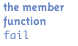

### 显示 12.3 带 open 检查的文件 I/O

```cpp
//Reads three numbers from the file infile.txt and writes the sum to the
//file outfile.txt.
#include <fstream>
#include <iostream>
#include <cstdlib> // for exit
using std::ifstream;
using std::ofstream;
using std::endl;

int main()
{
    ifstream inStream;
    ofstream outStream;

    inStream.open("infile.txt");
    if (inStream.fail())
    {
        cout << "Input file opening failed.\n";
        exit(1);
    }

    outStream.open("outfile.txt");
    if (outStream.fail())
    {
        cout << "Output file opening failed.\n";
        exit(1);
    }

    int first, second, third;
    inStream >> first >> second >> third;
    outStream << "The sum of the first 3\n"
              << "numbers in infile.txt\n"
              << "is " << (first + second + third) << endl;

    inStream.close();
    outStream.close();
    return 0;
}
```

### 示例对话 *（如果文件 infile.txt 不存在）*

> Input file opening failed.


# 文件 I/O 语句摘要

在本示例中，输入来自名为 `infile.txt` 的文件，输出发送到名为 `outfile.txt` 的文件。

- 在你的程序文件中放置以下包含指令：

```cpp
#include <fstream>    // For file I/O
#include <iostream>   // For cout
#include <cstdlib>    // For exit
```

添加以下 using 指令（或类似内容）：

```
using std::ifstream;
using std::ofstream;
using std::cout;
using std::endl;  // if endl is used
```

- 为输入流选择一个流名并声明它为类型为 `ifstream` 的变量。为输出文件选择一个流名并声明它为类型为 `ofstream`。例如：

```cpp
ifstream inStream;
ofstream outStream;
```

- 使用成员函数 `open` 并以外部文件名作为参数，将每个流连接到一个文件。记得使用成员函数 `fail` 来测试 open 调用是否成功：

```cpp
inStream.open("infile.txt");
if (inStream.fail())
{
    cout << "Input file opening failed.\n";
    exit(1);
}
outStream.open("outfile.txt");
if (outStream.fail())
{
    cout << "Output file opening failed.\n";
    exit(1);
}
```

- 使用流 `inStream` 从文件 `infile.txt` 获取输入，就像你使用 `cin` 从键盘获取输入一样。例如：

```cpp
inStream >> someVariable >> someOtherVariable;
```

- 使用流 `outStream` 将输出发送到文件 `outfile.txt`，就像你使用 `cout` 将输出发送到屏幕一样。例如：

```cpp
outStream << "someVariable = "
          << someVariable << endl;
```

- 使用函数 `close` 关闭流：

```cpp
inStream.close();
outStream.close();
```

### 自测练习

- 1. 假设你正在编写一个使用名为 `fin` 的流的程序，该流将连接到输入文件，以及一个名为 `fout` 的流，该流将连接到输出文件。你如何声明 `fin` 和 `fout`？在你的程序文件中需要放置什么 `include` 指令，如果有的话？
- 2. 假设你正在继续编写上一练习中讨论的程序，并且你希望你的程序从文件 `stuff1.txt` 读取输入并将输出发送到文件 `stuff2.txt`。你需要在程序中放置哪些语句以将流 `fin` 连接到文件 `stuff1.txt` 并将流 `fout` 连接到文件 `stuff2.txt`？务必包含检查以确保打开成功。
- 3. 假设你仍在编写我们在前两个练习中讨论的同一个程序，并且你到达了不再需要从文件 `stuff1.txt` 获取输入也不再需要向文件 `stuff2.txt` 发送输出的点。你如何关闭这些文件？
- 4. 假设你想更改显示 12.1 中的程序，使其将输出发送到屏幕而不是文件 `outfile.txt`。 （输入仍应来自文件 `infile.txt`。）你需要对程序做哪些更改？
- 5. 程序员已读取文件中的一半行。程序员必须对文件做什么才能再次读取第一行？

### 字符 I/O

第 9 章描述了使用 `cin` 从键盘进行字符 I/O 以及使用 `cout` 向屏幕进行字符 I/O。所有这些细节同样适用于文件 I/O。只需用连接到文件的输入流代替 `cin`，或用连接到文件的输出流代替 `cout` 即可。特别是，`get`、`getline`、`putback`、`peek` 和 `ignore` 对于文件输入的工作方式与键盘输入相同；¹ `put` 对于文件输出的工作方式与屏幕输出相同。

### 检查文件末尾

处理输入文件的一种常见方法是使用一个循环，该循环在到达文件末尾之前处理文件中的数据。测试文件末尾有两种标准方法。最直接的方法是使用 eof 成员函数。

每个输入文件流都有一个名为 eof 的成员函数，可用于测试是否到达输入文件的末尾。函数 eof 不带参数，因此如果输入流称为 fin，则对函数 eof 的调用写为

```
fin.eof()
```

这是一个布尔表达式，可用于控制 while 循环、do-while 循环或 if-else 语句。此表达式在程序读取超过输入文件末尾时返回 true；否则返回 false。

由于我们通常希望测试是否未到达文件末尾，因此对成员函数 eof 的调用通常在其前面加上 not。回想一下，在 C++ 中，符号 ! 用于表示 not。例如，连接到输入流 inStream 的文件的全部内容可以用以下 while 循环写入屏幕：

```
inStream.get(next);
while (! inStream.eof())
{
    cout << next;
    inStream.get(next);
}
```

如果你愿意，这里也可以使用 cout.put(next)。

上面的 while 循环使用成员函数 get 将输入文件中的每个字符读入 char 变量 next，然后将该字符写入屏幕。程序在文件末尾之后，inStream.eof() 的值会从 false 变为 true。因此，

(! inStream.eof())

会从 true 变为 false，循环结束。

请注意，inStream.eof() 不会在程序尝试读取文件末尾之后的一个字符之前变为 true。例如，假设文件包含以下内容（在 c 之后没有换行符）：

ab
c

这实际上是以下四个字符的列表：

ab<换行符 '\n'>c

上面的循环将读取 'a' 并将其写入屏幕，然后读取 'b' 并将其写入屏幕，然后读取换行符 '\n' 并将其写入屏幕，然后读取 'c' 并将其写入屏幕。此时循环将已读取文件中的所有字符。然而，inStream.eof( ) 仍为 false。inStream.eof( ) 的值要到程序尝试再读取一个字符时才会从 false 变为 true。
这就是为什么上面的 while 循环以 inStream.get(next) 结束。循环需要读取一个额外的字符才能结束。

文件末尾有一个特殊的结束文件标记。成员函数 eof 不会在此结束文件标记被读取之前从 false 变为 true。这就是为什么之前的 while 循环可以读取超出你认为的文件中最后一个字符的一个字符。然而，此结束文件标记不是普通字符，不应像普通字符一样操作。你可以读取此结束文件标记，但不应再次将其写出。如果你写出结束文件标记，结果是不可预测的。系统会自动为你将此结束文件标记放置在每个文件的末尾。

检查文件末尾的第二种方法是注意（并使用）提取运算符的读取实际上返回一个布尔值这一事实。表达式

(inStream >> next)

如果读取成功则返回 true，如果你的代码尝试读取超出文件末尾则返回 false。例如，以下代码将读取连接到输入流 inStream 的整数文件中的所有数字并将其总和计算在变量 sum 中：

```
double next, sum = 0;
while (inStream >> next)
    sum = sum + next;
cout << "the sum is " << sum << endl;
```

上面的循环看起来可能有点奇怪，因为 inStream >> next 从流 inStream 读取一个数字并返回一个布尔值。涉及提取运算符 >> 的表达式同时既是动作又是布尔条件。² 如果还有另一个数字可输入，则读取该数字并返回布尔值 true，因此循环体再执行一次。如果没有更多数字可读取，则不输入任何内容并返回布尔值 false，因此循环结束。在此示例中，输入变量 next 的类型为

硬汉式检查文件末尾的方式

> ² 技术上，布尔条件的工作方式如下：运算符 >> 的返回值是一个输入流引用（istream& 或 ifstream&），如第 8 章所述。此流引用会自动转换为 bool 值。 resulting 值如果流能够提取数据则为 true，否则为 false。


double, but this method of checking for the end of the file works the same way for other data types, such as int and char.

这种检查文件结束的方法虽然是针对 double 的，但对于其他数据类型，如 int 和 char 也同样适用。

This second method of testing for the end of a file is preferred by many C++ programmers for what appears to be a cultural reason. It was commonly used in C programming. It is also possible that, depending on implementation details, this second method might be a bit more efficient. In any event, whether you use this second method or not, you need to know it so you can understand other programmer's code.

许多 C++ 程序员出于似乎是文化上的原因更喜欢这种第二种测试文件结束的方法。它在 C 编程中被广泛使用。也有可能根据实现细节，这种第二种方法会稍微高效一些。无论如何，你是否使用这种第二种方法，都需要了解它，以便理解其他程序员的代码。

An illustration of using the eof member function is given in Display 12.4.

使用 eof 成员函数的示例见图 12.4。

### Display 12.4. Checking for the End of a File (part 1 of 2)

```
1
2 //Copies story.txt to numstory.txt,
3 //but adds a number to the beginning of each line.
4 //Assumes story.txt is not empty.
5 #include <fstream>
6 #include <iostream>
7 #include <cstdlib>
8 
9 using std::ifstream;
10 using std::ofstream;
11 using std::cout;
12 
13 int main( )
14 {
15     ifstream fin;
16     ofstream fout;
17 
18     fin.open("story.txt");
19     if (fin.fail( ))
20     {
21         cout << "Input file opening failed.\n";
22         exit(1);
23     }
24 
25     fout.open("numstory.txt");
26     if (fout.fail( ))
27     {
28         cout << "Output file opening failed.\n";
29         exit(1);
30     }
```

### Display 12.4. Checking for the End of a File (part 2 of 2)

```
27
28 char next;
29 int n = 1;
30 fin.get(next);
31 fout << n << " ";
32 while (! fin.eof())
33 {
34
35 fout << next;
36 if (next == '\n')
37 {
38 n++;
39 fout << n << ' ';
40 }
41 fin.get(next);
42 }
43 fin.close();
44 fout.close();
45 return 0;
46 }
```

Notice that the loop ends with a read (fin.get). The member function fin.eof does not return true until your program tries to read one more character after reading the last character in the file.

注意循环以一次读取操作 fin.get 结束。成员函数 fin.eof 在程序尝试读取文件最后一字符之后再多读取一个字符之前不会返回 true。

### Sample Dialogue

There is no output to the screen and no input from the keyboard.

没有屏幕输出，也没有键盘输入。

### story.txt
(Not changed by program)

The little green men had
pointed heads and orange
toes with one long curly
hair on each toe.

### numstory.txt
(After program is run)

1 The little green men had
2 pointed heads and orange
3 toes with one long curly
4 hair on each toe.

### Self-Test Exercises

6. What output will be produced when the following lines are executed, assuming the file list.txt contains the data shown (and assuming the lines are embedded in a complete and correct program with the proper include and using directives)?

ifstream ins;
ins.open("list.txt");

```
int count = 0, next;
while (ins >> next)
{
    count++;
    cout << next << endl;
}
ins.close();
cout << count;
```

文件 list.txt 包含以下三个数字（且没有其他内容）：

| 1 | 2 |
| 3 |  |

7. Write the definition for a void function called toScreen. The function toScreen has one formal parameter called fileStream, which is of type ifstream. The precondition and postcondition for the function are given below.

//Precondition: The stream fileStream has been connected
//to a file with a call to the member function open. The
//file contains a list of integers (and nothing else).
//Postcondition: The numbers in the file connected to
//fileStream have been written to the screen one per line.
//(This function does not close the file.)

### 12.2 Tools for Stream I/O

> You shall see them on a beautiful quarto page, where a neat rivulet of text shall meander through a meadow of margin.
> 
> Richard Brinsley Sheridan, The School for Scandal

#### FILE NAMES AS INPUT

Thus far, we have written the literal file names for our input and output files into the code of our programs. We did this by giving the file name as the argument to a call to the function open, as in the following example:

```
inStream.open("infile.txt");
```

You can instead read the file name in from the keyboard, as illustrated by the following: as a C-string

```
char fileName[16];
ifstream inStream;
```

```
cout << "Enter file name (maximum of 15 characters):\n";
cin >> fileName;
inStream.open(fileName);
```

Note that our code reads the file name as a C-string. The member function open takes an argument that is a C-string. You cannot use a string variable as an argument to open, and there is no predefined type cast operator to convert from a string object to a C-string. However, as an alternative, you can read the file name into a string variable and use the string member function c_str() to produce the corresponding C-string value for open. The code would be as follows:

as a string object

```
string fileName;
ifstream inStream;

cout << "Enter file name:\n";
cin >> fileName;
inStream.open(fileName.c_str());
```

Note that when you use a string variable for the file name, there is essentially no limit to the size of the file name.³

#### FORMATTING OUTPUT WITH STREAM FUNCTIONS

You can control the format of your output to a file or to the screen with commands that determine such details as the number of spaces between items and the number of digits after the decimal point. For example, in Chapter 1 we gave the following “magic formula” to use for outputting amounts of money:

```
cout.setf(ios::fixed);
cout.setf(ios::showpoint);
cout.precision(2);
```

We are now in a position to explain these and other formulas for formatting output.

The first thing to note is that you can use these formatting commands on any output stream. Output streams connected to a file have these same member functions as the object cout. If outStream is a file output stream (of type ofstream), you can format output in the same way:

```
outStream.setf(ios::fixed);
outStream.setf(ios::showpoint);
outStream.precision(2);
```

To explain this magic formula, we will consider the member functions in reverse order.

> ³ The lack of accommodation for the type string within the iostream library is because iostream was written before the string type was added to the C++ libraries.

Every output stream has a member function named precision. When your program executes a call to precision such as the one above for the stream outStream, then from that point on in your program, any number that has a decimal point that is output to that stream will be written with a total of two significant figures or with two digits after the decimal point, depending on when your compiler was written. The following is some possible output from a compiler that sets two significant digits:

```
23. 2.2e7 2.2 6.9e-1 0.00069
```

The following is some possible output from a compiler that sets two digits after the decimal point:

```
23.56 2.26e7 2.21 0.69 0.69e-4
```

In this book, we assume the compiler sets two digits after the decimal point. Of course, you can use a different argument than 2 to obtain more or less precision.

Every output stream has a member function named setf that can be used to set certain flags. These flags are constants in the class ios, which is in the std namespace. When set with a call to setf, the flags determine certain behaviors of the output stream. Below are the two calls to the member function setf with the stream outStream as the calling object:

```
outStream.setf(ios::fixed);
outStream.setf(ios::showpoint);
```

Each of these flags is an instruction to format output in one of two possible ways. What it causes the stream to do depends on the flag.

The flag ios::fixed causes the stream to output floating-point numbers in what is called fixed-point notation, which is a fancy phrase for the way we normally write numbers. If the flag ios::fixed is set (by a call to setf), then all floating-point numbers (such as numbers of type double) that are output to that stream will be written in ordinary everyday notation, rather than e-notation.

The flag ios::showpoint tells the stream to always include a decimal point in floating-point numbers. If the number to be output has a value of 2.0, then it will be output as 2.0 and not simply as 2; that is, the output will include the decimal point even if all the digits after the decimal point are 0. Some common flags and the actions they cause are described in Display 12.5.

You can set multiple flags with a single call to setf. Simply connect the various flags with '|' symbols, as illustrated below:

```
outStream.setf(ios::fixed | ios::showpoint | ios::right);
```

> 4 The | operator is bitwise-or. You are literally or-ing a bitwise mask that indicates the flag settings, although you need not be aware of this low level detail.


# 图 12.5 setf 的格式化标志

| 标志 | 设置该标志的含义 | 默认值 |
|---|---|---|
| ios::fixed | 浮点数不以科学计数法表示。（设置此标志会自动取消设置 `ios::scientific` 标志。） | 未设置 |
| ios::scientific | 浮点数以科学计数法表示。（设置此标志会自动取消设置 `ios::fixed` 标志。）如果 `ios::fixed` 和 `ios::scientific` 均未设置，则由系统决定如何输出每个数值。 | 未设置 |
| ios::showpoint | 浮点数始终显示小数点和末尾的零。如果未设置此标志，小数点后全为零的数值可能会在输出时省略小数点及其后的零。 | 未设置 |
| ios::showpos | 在正整数值前输出加号。 | 未设置 |
| ios::right | 如果设置了此标志，并且通过调用成员函数 `width` 指定了某个字段宽度值，则下一个输出项将位于 `width` 所指定空间的右端。换句话说，所有多余的空格都会放在输出项之前。（设置此标志会自动取消设置 `ios::left` 标志。） | 已设置 |
| ios::left | 如果设置了此标志，并且通过调用成员函数 `width` 指定了某个字段宽度值，则下一个输出项将位于 `width` 所指定空间的左端。换句话说，所有多余的空格都会放在输出项之后。（设置此标志会自动取消设置 `ios::right` 标志。） | 未设置 |
| ios::dec | 以十进制（基数为 10）表示法输出整数。 | 已设置 |
| ios::oct | 以八进制（基数为 8）表示法输出整数。 | 未设置 |
| ios::hex | 以十六进制（基数为 16）表示法输出整数。 | 未设置 |
| ios::uppercase | 对浮点数使用科学计数法时，使用大写字母 E 而不是小写字母 e。十六进制数使用大写字母输出。 | 未设置 |
| ios::showbase | 显示输出数值的进制（八进制前导 `0`，十六进制前导 `0x`）。 | 未设置 |

输出流除了 `precision` 和 `setf` 外，还有其他成员函数。一个非常常用的格式化函数是 `width`。例如，考虑流 `cout` 对以下 `width` 的调用：

```
cout << "Start Now";
cout.width(4);
cout << 7 << endl;
```

### 1. 引言

本文档旨在介绍一种新型的文档解析方法，该方法能够高效地从复杂布局的图片中提取结构化信息。

- 支持多种文档元素识别
- 支持表格与图片的定位
- 输出标准化的 JSON 格式

### 2. 方法

我们采用基于深度学习的视觉模型，结合文本检测与版面分析技术，实现文档元素的精准提取。

| 元素类型 | 识别准确率 | 平均耗时 |
|----------|------------|----------|
| 标题     | 98.5%      | 12ms     |
| 段落     | 97.2%      | 15ms     |
| 表格     | 95.8%      | 20ms     |

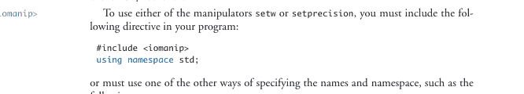

> > 该方法的性能在多个公开数据集上均达到领先水平。

```
```python
import docparser
result = docparser.parse(image_path)
```
```

# ■ 保存标志设置

函数不应具有不必要或意外的副作用。例如，一个用于输出金额的函数可能包含以下代码：

```
cout.setf(ios::fixed);
cout.setf(ios::showpoint);
cout.precision(2);
```

函数调用结束后，这些设置仍然会生效。如果不希望产生此类副作用，可以保存并恢复原始设置。

`precision` 函数经过重载，因此在不带参数调用时，它会返回当前的精度设置，以便之后恢复该设置。

使用 `setf` 设置的标志很容易保存和恢复。成员函数 `flags` 经过重载，可以提供保存并随后恢复标志设置的方法。成员函数 `cout.flags()` 返回一个 `long` 类型的值，该值对所有标志设置进行编码。可以将此 `long` 值作为参数传递给 `cout.flags`，从而重置这些标志。对于文件输出流，这些技术与用于 `cout` 的技术相同。

例如，可以按如下方式构造一个保存并恢复这些设置的函数：

```
void outputStuff(ofstream& outStream)
{
    int precisionSetting = outStream.precision();
    long flagSettings = outStream.flags();
    outStream.setf(ios::fixed);
    outStream.setf(ios::showpoint);
    outStream.precision(2);
            Do whatever you want here.
    outStream.precision(precisionSetting);
    outStream.flags(flagSettings);
}
```

恢复设置的另一种方式是：

```
cout.setf(0, ios::floatfield);
```

使用这些参数调用成员函数 `setf` 将恢复默认的 `setf` 设置。请注意，这些是默认值，不一定是上次更改设置之前的值。还要注意，默认设置值取决于具体实现。最后请注意，这不会重置精度设置，也不会重置任何未通过 `setf` 设置的设置。

### 输出流的其他成员函数

图 12.6 总结了 `ostream` 类的一些格式化成员函数及其操纵器。请记住，要使用这些操纵器，需要包含以下内容（或类似内容）：

```
```cpp
#include <iomanip>
using namespace std;
```
```

**图 12.6 `ostream` 类的格式化工具**

| 函数 | 描述 | 对应的操纵器 |
|---|---|---|
| `setf(ios_Flag)` | 设置图 12.5 中所述的标志 | `setiosflags(ios_Flag)` |
| `unsetf(ios_Flag)` | 取消设置标志 | `resetiosflags(ios_Flag)` |
| `setf(0, ios::floatfield)` | 恢复默认标志设置 | 无 |
| `precision(int)` | 设置浮点数输出的精度 | `setprecision(int)` |
| `precision()` | 返回当前精度设置 | 无 |
| `width(int)` | 设置输出字段宽度；仅适用于下一个输出项 | `setw(int)` |
| `fill(char)` | 指定输出字段大于输出值时使用的填充字符；默认为空格 | `setfill(char)` |

#### 自测练习

- 8. 执行以下代码行时会产生什么输出？
- 
- ```cpp
cout << "*";
cout.width(5);
cout << 123;
cout << "*" << 123 << "*" << endl;
cout << "*" << setw(5) << 123
     << "*" << 123 << "*" << endl;
```
- 
- 9. 执行以下代码行时会产生什么输出？
- 
- ```cpp
cout << "*" << setw(5) << 123;
cout.setf(ios::left);
cout << "*" << setw(5) << 123;
```

```
cout.setf(ios::right);
cout << "*a" << setw(5) << 123 << "*a" << endl;
```

# 10. 执行以下代码行时会产生什么输出？

```
cout << "*a" << setw(5) << 123 << "*a"
<< 123 << "*a" << endl;
cout.setf(ios::showpos);
cout << "*a" << setw(5) << 123 << "*a"
<< 123 << "*a" << endl;
cout.unsetf(ios::showpos);
cout.setf(ios::left);
cout << "*a" << setw(5) << 123 << "*a"
<< setw(5) << 123 << "*a" << endl;
```

# 11. 执行以下代码行时，将向文件 stuff.txt 输出什么内容？

```
ofstream fout;
fout.open("stuff.txt");
fout << "*a" << setw(5) << 123 << "*a"
<< 123 << "*a" << endl;
fout.setf(ios::showpos);
fout << "*a" << setw(5) << 123 << "*a"
<< 123 << "*a" << endl;
fout.unsetf(ios::showpos);
fout.setf(ios::left);
fout << "*a" << setw(5) << 123 << "*a"
<< setw(5) << 123 << "*a" << endl;
```

# 12. 执行以下代码行时会产生什么输出（假设该代码行嵌入在一个完整且正确的程序中，并且已包含适当的头文件和 using 指令）？

```
cout << "*a" << setw(3) << 12345 << "*a" << endl;
```

# 示例：整理文件格式

图 12.7 中的程序从文件 rawdata.txt 读取输入，并以整洁的格式将输出同时写入屏幕和文件 neat.txt。该程序将数字从文件 rawdata.txt 复制到文件 neat.txt，但使用格式化指令以整洁的方式写出这些数字。数字每行写出一个，字段宽度为 12，这意味着每个数字前面会添加足够的空格，使空格与数字总共占据 12 个字符。数字以普通表示法写出，也就是说，不使用科学计数法。每个数字的小数点后有五位数字，并带有正号或负号。该程序使用了一个名为 `makeNeat` 的函数，该函数的形参分别表示输入文件流和输出文件流。


### 显示 12.7 格式化输出（第 2 部分，共 2 部分）

```cpp
//Reads all the numbers in the file rawdata.dat and writes the numbers
//to the screen and to the file neat.dat in a neatly formatted way.
#include <iostream>
#include <fstream>
#include <cstdlib>
#include <iomanip>
using std::ifstream;
using std::ofstream;
using std::cout;
using std::endl;
using std::cin;
using std::setw;

void makeNeat(ifstream& messyFile, ofstream& neatFile,
              int numberAfterDecimalPoint, int fieldWidth);
//Precondition: The streams messyFile and neatFile have been connected to
//two different files. The file named messyFile contains only floating-point
//numbers. Postcondition: The numbers in the file connected to messyFile
//have been written to the screen and to the file connected to the stream
//neatFile. The numbers are written one per line, in fixed-point notation
//(that is, not in e-notation), with numberAfterDecimalPoint digits after
the decimal point; each number is preceded by a plus or minus sign and each
number is in a field of width fieldWidth. (This function does not close
the file.)

int main( )
{
    ifstream fin;
    ofstream fout;

    fin.open("rawdata.txt");
    if (fin.fail( ))
    {
        cout << "Input file opening failed.\n";
        exit(1);
    }

    fout.open("neat.txt");
    if (fout.fail( ))
    {
        cout << "Output file opening failed.\n";
        exit(1);
    }

    makeNeat(fin, fout, 5, 12);

    fin.close( );
    fout.close( );
}
```

```cpp
44    cout << "End of program.\n";
45    return 0;
46 }

47 //Uses <iostream>, <fstream>, and <iomanip>;
48 void makeNeat(ifstream& messyFile, ofstream& neatFile,
49              int numberAfterDecimalPoint, int fieldWidth)
50 {
51     neatFile.setf(ios::fixed);
52     neatFile.setf(ios::showpoint);
53     neatFile.setf(ios::showpos);
54     neatFile.precision(numberAfterDecimalPoint);

55     cout.setf(ios::fixed);
56     cout.setf(ios::showpoint);
57     cout.setf(ios::showpos);
58     cout.precision(numberAfterDecimalPoint);

59     double next;
60     while (messyFile >> next)
61     {
62         cout << setw(fieldWidth) << next << endl;
63         neatFile << setw(fieldWidth) << next << endl;
64     }
65 }
```

setf 和 precision
对文件输出流的行为
与对 cout 的行为相同
。

满足如果有
下一个数字可读

对文件输出流的工作方式
与对 cout 的工作方式相同

**rawdata.txt**
*(未被程序更改)*

|  |
|---|
| 10.37      −9.89897 |
| 2.313      −8.950  15.0 |
|  |
| 7.33333    92.8765 |
| −1.237568432e2 |

**neat.txt**
*(程序运行后)*

|  |
|---|
| +10.37000 |
| −9.89897 |
| +2.31300 |
| −8.95000 |
| +15.00000 |
| +7.33333 |
| +92.87650 |
| −123.75684 |

**屏幕输出**

|  |
|---|
| +10.37000 |
| −9.89897 |
| +2.31300 |
| −8.95000 |
| +15.00000 |
| +7.33333 |
| +92.87650 |
| −123.75684 |
| End of program. |

### 示例 编辑文本文件

这里讨论的程序是文本编辑应用于文件的一个非常简单的例子。此程序可用于从现有的 C 广告材料自动生成 C++ 广告材料（以一种相当简单的方式）。该程序从包含赞美 C 的广告文案的文件中读取输入，并将类似的关于 C++ 的广告文案写入另一个文件。包含 C 广告文案的文件称为 cad.txt，而接收 C++ 广告文案的新文件称为 cppad.txt。该程序显示在显示 12.8 中。该程序只是读取 cad.txt 文件中的每个字符并将字符复制到 cppad.txt 文件。每个字符都被原样复制，除了当从输入文件读取大写字母 'C' 时，程序将字符串 "C++" 写入输出文件。该程序假设只要字母 'C' 出现在输入文件中，它就表示 C 编程语言；因此这种更改正是产生更新后的广告文案所需的。请注意，当程序从输入文件读取字符并将字符写入输出文件时，换行符得以保留。换行字符 '\n' 被当作任何其他字符处理。它使用成员函数 get() 从输入文件读取，并使用插入运算符 << 写入输出文件。我们必须使用成员函数 get 来读取输入（而不是提取运算符 >>），因为我们希望读取空白字符。

### 12.3 流层次结构：继承的预览

组织类的一个非常有用的方法是使用“派生自”的关系。当我们说一个类派生自另一个类时，我们的意思是派生类是通过添加特性从另一个类获得的。例如，输入文件流类是通过添加 open 和 close 等附加成员函数从所有输入流类派生而来的。流 cin 属于所有输入流类，但不属于输入文件流类，因为 cin 没有名为 open 和 close 的成员函数。本节介绍派生类的概念，作为思考和组织预定义流类的一个方法。（第 14 章展示了如何使用派生类的思想来定义自己的类。）

### 流类之间的继承

预定义的流 cin 和输入文件流都是输入流。因此在某种意义上它们是相似的。例如，你可以使用提取运算符 >> 与两种流一起使用。另一方面，输入文件流可以使用成员函数 open 连接到文件，但流 cin 没有名为 open 的成员函数。输入文件流是一种与 cin 相似但不同的流类型。输入文件流的类型为 ifstream。对象 cin 是类 istream（不带 'f' 拼写）的对象。类 ifstream 和 istream 是不同但密切相关的类型。类 ifstream 是类 istream 的派生类。让我们看看这意味着什么。

### 显示 12.8 编辑文本文件（第 1 部分，共 2 部分）

```cpp
1 //Program to create a file called cplusad.txt that is identical to the file
2 //cad.txt except that all occurrences of 'C' are replaced by "C++". Assumes
3 //that the uppercase letter 'C' does not occur in cad.txt except as the
4 //name of the C programming language.
5 #include <fstream>
6 #include <iostream>
7 #include <cstdlib>
8 using std::ifstream;
9 using std::ofstream;
10 using std::cout;

11 void addPlusPlus(ifstream& inStream, ofstream& outStream);
12 //Precondition: inStream has been connected to an input file with open.
13 //outStream has been connected to an output file with open.
14 //Postcondition: The contents of the file connected to inStream have been
15 //copied into the file connected to outStream, but with each 'C' replaced
16 //by "C++". (The files are not closed by this function.)

17 int main( )
18 {
19     ifstream fin;
20     ofstream fout;

21     cout << "Begin editing files.\n";

22     fin.open("cad.txt");
23     if (fin.fail() )
24     {
25         cout << "Input file opening failed.\n";
26         exit(1);
27     }

28     fout.open("cppad.txt");
29     if (fout.fail() )
30     {
31         cout << "Output file opening failed.\n";
32         exit(1);
33     }

34     addPlusPlus(fin, fout);
```

### 显示 12.8 编辑文本文件（第 2 部分，共 2 部分）

```cpp
35  fin.close();
36  fout.close();
37
38  cout << "End of editing files.\n";
39  return 0;
40  }

41  void addPlusPlus(ifstream& inStream, ofstream& outStream)
42  {
43    char next;

44    inStream.get(next);
45    while (! inStream.eof())
46    {
47      if (next == 'C')
48        outStream << "C++";
49      else
50        outStream << next;

51      inStream.get(next);
52    }
53  }
```

# cad.txt

（未被程序更改）

> C 是世界上最现代的编程语言之一。没有语言像 C 那样多才多艺，而且 C 使用起来很有趣。

# cppad.txt

（程序运行后）

> C++ 是世界上最现代的编程语言之一。没有语言像 C++ 那样多才多艺，而且 C++ 使用起来很有趣。

# 屏幕输出

```
Begin editing files.
End of editing files.
```


当我们说某个类 D 是另一个类 B 的派生类时，意味着类 D 具有类 B 的所有特性，但它还可以具有额外的特性。例如，任何类型为 istream（不带‘f’）的流都可以使用提取运算符 >>。类 ifstream（带‘f’）是类 istream 的派生类，因此类型为 ifstream 的对象可以使用提取运算符 >>。类 ifstream 的对象具有类型为 istream 的对象的所有属性。特别是，类 ifstream 的对象也是类型为 istream 的对象。

然而，ifstream 具有额外的特性，因此你可以用类型为 ifstream 的对象做更多的事情，而不仅仅是类型为 istream 的对象。例如，一个新增的特性是类型为 ifstream 的流可以使用函数 open。流 cin 仅为类型 istream 而不是类型 ifstream。你不能使用函数 open 来使用 cin。请注意，类 ifstream 和 istream 之间的关系不是对称的。每个类型为 ifstream 的对象都是类型为 istream 的对象（文件输入流是输入流），但类型为 istream 的对象不一定是类型为 ifstream 的对象（对象 cin 是类型为 istream 但不是类型为 ifstream）。

派生类的概念其实很常见。来自日常生活的例子可能有助于使这个概念更清晰。例如，所有敞篷车组成的类就是所有汽车类的一个派生类。每辆敞篷车都是汽车，但敞篷车不仅仅是一辆汽车。敞篷车是一种特殊的汽车，具有其他汽车所没有的特殊属性。如果你拥有一辆敞篷车，你可以放下车顶使汽车敞开。（你可以说敞篷车具有“打开”功能作为新增特性。）

如果 D 是类 B 的派生类，那么每个类型为 D 的对象也是类型为 B 的对象。敞篷车也是汽车。文件输入流（类 ifstream 的对象）也是输入流（也是类 istream 的对象）。因此，如果我们使用 istream 作为函数参数的类型，而不是使用 ifstream，那么可以为该参数传入更多对象。考虑以下两个函数定义，它们仅在参数类型（和函数名）上不同：

```
void twoSumVersion1(ifstream& sourceFile)//ifstream with an 'f'
{
    int n1, n2;
    sourceFile >> n1 >> n2;
    cout << n1 << " + " << n2 << " = " << (n1 + n2) << endl;
}
```

和

```
void twoSumVersion2(istream& sourceFile)//istream without an 'f'
{
    int n1, n2;
    sourceFile >> n1 >> n2;
    cout << n1 << " + " << n2 << " = " << (n1 + n2) << endl;
}
```

对于 twoSumVersion1，参数必须是类型 ifstream。因此如果 fileIn 是一个连接到文件的输入流，那么

```
twoSumVersion1(fileIn);
```

是合法的，但

```
twoSumVersion1(cin); // ILLEGAL
```

是不合法的，因为 cin 不是类型 ifstream。对象 cin 只是一个流且仅为类型 istream；cin 不是文件输入流。

函数 twoSumVersion2 更通用。以下两者都是合法的：

```
twoSumVersion2(fileIn);
twoSumVersion2(cin);
```

寓意很明确：只要可以，就使用 istream 而不是 ifstream 作为参数类型。在选择参数类型时，使用你能用的最通用类型。（为了做现实生活的类比：你可能更喜欢拥有一辆敞篷车，但你不会想要一个只能停放敞篷车的车库。如果朋友借给你一辆轿车呢？你仍然希望能把轿车停进你的车库。）

你不能总是使用参数类型 istream 代替参数类型 ifstream。如果你定义了一个参数类型为 istream 的函数，那么该参数只能使用 istream 成员函数。特别是，它不能使用函数 open 和 close。如果你不能将对成员函数 open 和 close 的所有调用都放在函数定义之外，那么你必须使用参数类型 ifstream。

到目前为止，我们讨论了两种输入流类：istream 及其派生类 ifstream。输出流的情况类似：第 1 章介绍了输出流 cout 和 cerr，它们属于类 ostream。本章介绍了文件输出流，它们属于类 ofstream（带‘f’）。类 ostream 是所有输出流的类。流 cout 和 cerr 是类型 ostream，但不是类型 ofstream。与 cout 或 cerr 相反，输出文件流被声明为类型 ofstream。类 ofstream 的输出文件流是类 ostream 的派生类。例如，以下函数将单词 "Hello" 写入作为其参数给出的输出流。

```
void sayHello(ostream& anyOutStream)
{
    anyOutStream << "Hello";
}
```

以下第一个调用将 "Hello" 写入屏幕；第二个调用将 "Hello" 写入外部文件名 afile.txt 的文件。

```
ofstream fout;
fout.open("afile.txt");
sayHello(cout);
sayHello(fout);
```

请注意，输出文件流是类型 ofstream 也是类型 ostream。

派生类通常使用继承和家庭关系的隐喻来讨论。如果类 D 是类 B 的派生类，那么类 D 被称为类 B 的子代，而类 B 被称为类 D 的父代。派生类被认为继承了其父类的成员函数。例如，每辆敞篷车都从所有汽车的类继承了它有四个轮子的事实，每个输入文件流都从所有输入流的类继承了提取运算符 >>。这就是为什么派生类的主题通常被称为继承。

### 使流参数通用

如果你想定义一个以输入流作为参数的函数，并且希望该参数在某些情况下为 cin，在其他情况下为输入文件流，那么使用类型为 istream（不带‘f’）的形式参数。然而，输入文件流即使作为类型为 istream 的参数使用，也必须仍然声明为类型 ifstream（带‘f’）。

类似地，如果你想定义一个以输出流作为参数的函数，并且希望该参数在某些情况下为 cout，在其他情况下为输出文件流，那么使用形式参数类型为 ostream。然而，输出文件流即使作为类型为 ostream 的参数使用，也必须仍然声明为类型 ofstream（带‘f’）。你不能打开或关闭类型为 istream 或 ostream 的流参数。在将它们传递给你的函数之前打开这些对象，并在函数调用后关闭它们。

流类 istream 和 ostream 在 iostream 库中定义并放置在 std 命名空间中。使它们可用于你的代码的一种方法是以下方式：

```
#include <iostream>
using std::istream;
using std::ostream;
```

### 示例 ANOTHER newLine FUNCTION

作为使流函数更通用的示例，考虑我们在 Display 9.2 中定义的函数 newLine。那个函数仅适用于来自键盘的输入，即来自预定义流 cin 的输入。Display 9.2 中的函数 newLine 没有参数。下面我们重写了函数 newLine，使其具有类型为 istream 的输入流形式参数：

//Uses <iostream>:
```
void newline(istream& inStream)
{
    char symbol;
    do
    {
        inStream.get(symbol);
    } while (symbol != '\n');
}
```

现在，假设你的程序包含这个新版本的函数 newLine。如果你的程序正在从名为 fin 的输入流（连接到输入文件）读取输入，以下代码将丢弃当前正在从输入文件读取的行上剩余的所有输入：

```
newLine(fin);
```

如果你的程序也从键盘读取一些输入，以下代码将丢弃在键盘上输入的当前输入行的剩余部分：

```
newLine(cin);
```

如果你的程序只有上面重写的 newLine 版本，它接受 fin 或 cin 这样的流参数，你必须始终给出流名，即使流名是 cin。但由于重载，你可以在同一个程序中同时拥有两个版本的函数 newLine：Display 9.2 中给出的无参数版本，以及我们刚刚定义的带有一个类型为 istream 参数的版本。在同时具有两个 newLine 定义的程序中，以下两个调用是等价的：

```
newLine(cin);

and

newLine();
```

你其实不需要两个版本的函数 newLine。带有一个类型为 istream 参数的版本可以满足你的所有需求。然而，许多程序员发现为键盘输入拥有一个无参数版本很方便，因为键盘输入使用得非常频繁。

另一种方法是用默认参数代替两个重载的 newLine 函数版本（正如第 4 章所讨论的）。在下面的代码中，我们第三次重写了 newLine 函数：

//Uses <iostream>:
```
void newLine(istream& inStream = cin)
{
    char symbol;
    do
    {
        inStream.get(symbol);
    } while (symbol != '\n');
}

If we call this function as

    newLine();
```


形参默认取参数 `cin`。如果我们这样调用：

`newLine(fin);`

则形参取参数 `fin`。
使用这个 `newLine` 函数的另一种方法是使用我们在第 9 章讨论过的 `ignore` 函数。`ignore` 函数是每个输入文件流以及 `cin` 的成员函数。

### 自测练习

- 13. 流 `cin` 的类型是什么？流 `cout` 的类型是什么？

- 14. 定义一个名为 `copyChar` 的函数，该函数接受一个输入流作为参数。调用时，`copyChar` 将从作为其参数的输入流中读取一个输入字符，并将该字符写入屏幕。你应该能够使用 `cin` 或输入文件流作为 `copyChar` 函数的参数来调用它。（如果参数是输入文件流，则在调用函数之前该流已连接到文件，因此 `copyChar` 不会打开或关闭任何文件。）例如，下面两次对 `copyChar` 的调用中，第一次将把文件 `stuff.txt` 中的一个字符复制到屏幕，第二次将把键盘输入的一个字符复制到屏幕：

```
ifstream fin;
fin.open("stuff.txt");
copyChar(fin);
copyChar(cin);
```

- 15. 定义一个名为 `copyLine` 的函数，该函数接受一个输入流作为参数。调用时，`copyLine` 将从作为其参数的输入流中读取一行输入，并将该行写入屏幕。你应该能够使用 `cin` 或输入文件流作为 `copyLine` 函数的参数来调用它。（如果参数是输入文件流，则在调用函数之前该流已连接到文件，因此 `copyLine` 不会打开或关闭任何文件。）例如，下面两次对 `copyLine` 的调用中，第一次将把文件 `stuff.txt` 中的一行复制到屏幕，第二次将把键盘输入的一行复制到屏幕：

```
ifstream fin;
fin.open("stuff.txt");
copyLine(fin);
copyLine(cin);
```

- 16. 定义一个名为 `sendLine` 的函数，该函数接受一个输出流作为参数。调用时，`sendLine` 将从键盘读取一行输入，并将该行输出到作为其参数的输出流。你应该能够使用 `cout` 或输出文件流作为 `sendLine` 函数的参数来调用它。（如果参数是输出文件流，则在调用函数之前该流已连接到文件，因此 `sendLine` 不会打开或关闭任何文件。）例如，下面两次对 `sendLine` 的调用中，第一次将把键盘输入的一行复制到文件 `morestuff.txt`，第二次将把键盘输入的一行复制到屏幕：

```
ofstream fout;
fout.open("morestuff.txt");
cout << "Enter 2 lines of input:\n";
sendLine(fout);
sendLine(cout);
```

- 17. 以下陈述正确还是错误？如果错误，请改正。无论哪种情况，请仔细解释。

  使用 `ifstream` 或 `ofstream` 类参数编写的函数，可以分别使用 `ifstream` 或 `ofstream` 参数调用。

### 12.4 文件的随机访问

> *随时随地。*

> 对挑战的常见回应

我们在本章前几节讨论的用于文件顺序访问的流，是 C++ 中最常用于文件访问的流。然而，一些需要非常快速访问大型数据库中记录的应用，需要对文件的特定部分进行某种随机访问。这类应用最好使用专门的数据库软件来完成。但也许你的任务是使用 C++ 编写这样的软件包，或者你只是好奇这类事情在 C++ 中是如何完成的。C++ 确实提供了对文件的随机访问，因此你的程序可以读取和写入文件中的随机位置。本节简要介绍这种对文件的随机访问。这不是关于文件随机访问的完整教程，但会让你了解所使用的主要流类名称以及你将遇到的重要问题。

如果你想在 C++ 中既能读取又能写入文件，可以使用 `<fstream>` 库中定义的流类 `fstream`。`fstream` 的定义位于 `std` 命名空间中。

关于打开文件并将其连接到 `fstream` 类中的流的细节，与 `ifstream` 和 `ofstream` 类讨论的基本相同，只是 `fstream` 的 `open` 函数有第二个参数。这第二个参数指定流是用于输入、输出，还是同时用于输入和输出。例如，一个对名为 "stuff" 的文件同时进行输入和输出的程序可能如下开始：

```
#include <fstream>
using namespace std;

int main()
{
    fstream rwStream;
    rwStream.open("stuff", ios::in | ios::out);
}
```

如果你愿意，可以用以下代码替换前面两行：

```
fstream rwStream("stuff", ios::in | ios::out);
```

之后，你的程序可以使用流 `fstream` 从文件 "stuff" 中读取，也可以使用同一流写入文件 "stuff"。当你在读取和写入之间切换时，无需关闭并重新打开文件。此外，你可以对文件中的任何位置进行随机访问以进行读取和写入。然而，还有其他复杂之处。

通过 `fstream` 进行随机访问读写时，至少会出现两个复杂问题：（1）你通常使用 `char` 类型或 `char` 数组以字节为单位工作，需要自行处理类型转换；（2）你通常需要在每次读取或写入之前定位一个指针（指示读取或写入开始的位置）。

找到位置并用新数据替换文件的一部分的限制意味着，大多数此类随机访问 I/O 是通过读取或写入记录（以结构体或类的形式）来完成的。每次定位指针后，读取或写入一条记录（或整数条记录）。

每个 `fstream` 对象都有一个名为 `seekp` 的成员函数，用于将写指针定位到你希望写入（"put"）数据的位置。`seekp` 函数接受一个参数，即下一个要写入的第一个字节的地址。文件中的第一个字节编号为零。例如，要将连接到 `fstream` `rwStream` 的文件中的指针定位到第 1000 个字节，调用方式如下：

```
rwStream.seekp(1000);
```

当然，你需要知道一条记录需要多少字节。`sizeof` 运算符可用于确定类或结构体对象所需的字节数。实际上，`sizeof` 可以应用于任何类型、对象或值。它返回其参数的大小（以字节为单位）。`sizeof` 运算符是 C++ 核心语言的一部分，不需要包含指令或 using 指令。一些示例调用如下：

- `sizeof(s)`（其中 `s` 是字符串 `string s = "Hello";`）
- `sizeof(10)`
- `sizeof(double)`
- `sizeof(MyStruct)`（其中 `MyStruct` 是已定义的类型）

### 自测练习答案

- 1. 流 `fin` 和 `fout` 声明如下：

```
ifstream fin;
ofstream fout;
```

文件顶部的包含指令是

```
#include <fstream>
```

由于定义位于 `std` 命名空间中，你还应该有以下之一（或类似内容）：

```
using std::ifstream;
using std::ofstream;
```

或

```
using namespace std;
```

- 2.

```
fin.open("stuff1.txt");
if (fin.fail())
{
    cout << "Input file opening failed.\\n";
    exit(1);
}

fout.open("stuff2.txt");
if (fout.fail())
{
    cout << "Output file opening failed.\\n";
    exit(1);
}
```

- 3.

```
fin.close();
fout.close();
```

- 4. 你需要将流 `outStream` 替换为流 `cout`。请注意，你不需要声明 `cout`，不需要为 `cout` 调用 `open`，也不需要关闭 `cout`。

- 5. 这就是“重新开始”。文件必须关闭并再次打开。此操作将读取位置置于文件开头，准备再次读取。

- 6.

```
1
2
3
3
```


7. ```cpp
void toScreen(ifstream& fileStream)
{
    int next;
    while (fileStream >> next)
        cout << next << endl;
}
```

8. * 123*123*
   * 123*123*
   
每个空格都包含恰好两个空白字符。请注意，对 width 或 setw 的调用仅对一个输出项有效。

9. * 123*123  *  123*
   
每个空格都由恰好两个空白字符组成。

10. *  123*123*
    * +123*+123*
    *123   *123   *
    
第二行 ’*’ 与 ’+’ 之间只有一个空格。其他每个空格都包含恰好两个空白字符。

11. 输出到文件 stuff.txt 将与 Self-Test Exercise 10 的答案中给出的输出完全相同。

12. *12345*
   
请注意，整个整数都会被输出，即使这需要的空间超过了 setw 指定的空间。

13. cin 的类型是 istream；cout 的类型是 ostream。

14. ```cpp
void copyChar(istream& sourceFile)
{
    char next;
    sourceFile.get(next);
    cout << next;
}
```

15. ```cpp
void copyLine(istream& sourceFile)
{
    char next;
    do
    {
        sourceFile.get(next);
        cout << next;
    } while (next != '\n');
}
```

16. ```cpp
void sendLine(ostream& targetStream)
{
    char next;
    do
    {
        cin.get(next);
        targetStream << next;
    }while (next != '\n');
}
```

17. 错误。这里陈述的情况与正确情况相反。任何类型为 ifstream 的流也是类型为 istream 的流，因此在函数调用中，类型为 istream 的形式参数可以用类型为 ifstream 的实参替换，同样适用于流 ostream 和 ofstream。

### PROGRAMMING PROJECTS

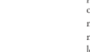

1. 编写一个程序，搜索一个包含 int 类型数字的文件，并将最大数和最小数写到屏幕上。文件仅包含由空白或换行符分隔的 int 类型数字。


2. 编写一个程序，其输入来自一个包含 double 类型数字的文件，并将文件中数字的平均值输出到屏幕上。文件仅包含由空白和/或换行符分隔的 double 类型数字。

3. a. 计算数据文件的中位数。中位数是大于该数的元素个数与小于该数的元素个数相同的数据。针对本问题，假设数据已排序（即按递增顺序排列）。如果元素个数为奇数，中位数是文件的中间元素；如果文件元素个数为偶数，中位数是两个中间元素的平均值。你需要打开文件，计数成员，关闭文件并计算文件中间的位置，再次打开文件（回忆本章开头讨论的“重新开始”），计数到你需要的条目，并计算中间值。

b. 对于已排序的文件，四分位数是三个数之一：第一个数以下有四分之一的数据值，第一个数与第二个数之间（包括第二个数）有四分之一的数据值，第二个数与第三个数之间（包括第三个数）有四分之一的数据点，第三个四分位数以上有四分之一。求你在 a 部分使用的数据文件的三个四分位数。注意“四分之一”是指尽可能接近四分之一。
提示：你应该认识到完成 a 部分后，你的工作已完成三分之一。（你已经有了第二个四分位数。）你也应该认识到你已经完成了寻找另外两个四分位数的大部分工作。

4. 编写一个程序，其输入来自一个包含 double 类型数字的文件。程序将数字的平均值和标准差输出到屏幕上。文件仅包含由空白和/或换行符分隔的 double 类型数字。

一组数字 *n₁, n₂, n₃* 等等的标准差定义为以下数字平均值的平方根：

(*n₁ − a*)², (*n₂ − a*)², (*n₃ − a*)², 等等

数字 *a* 是数字 *n₁, n₂, n₃* 等等的平均值。

*提示：* 让你的程序首先读取整个文件并计算所有数字的平均值，然后关闭文件，然后重新打开文件并计算标准差。你会发现先做编程项目 2 然后修改该程序以获得本项目的程序很有帮助。

5. 编写一个程序，给出并接受编程建议。该程序首先将一条建议写到屏幕上并要求用户输入另一条建议。程序然后结束。下一个运行该程序的人会收到上一个运行该程序的人给出的建议。建议保存在一个文件中，并且每次运行程序后文件的内容都会改变。你可以使用编辑器在文件中输入初始建议，以便第一个运行该程序的人收到一些建议。允许用户输入任意长度的建议（任意多行长）。用户通过按两次回车键来结束他的建议。你的程序可以通过检查是否读取到字符 '\n' 的两个连续出现来判断是否到达输入的末尾。

6. 编写一个程序，合并两个文件中的数字并将所有数字写入第三个文件。你的程序从两个不同的文件读取输入并向第三个文件写入输出。每个输入文件包含一个按从小到大排序的 int 类型数字列表。程序运行后，输出文件将包含两个输入文件中的所有数字，按从小到大排序组成一个更长的列表。你的程序应定义一个函数，该函数以两个输入文件流和输出文件流作为三个参数调用。

7. 编写一个程序来生成个性化垃圾邮件。程序同时从输入文件和键盘读取输入。输入文件包含信件的文本，只是收件人的姓名用三个字符 ## 表示。程序要求用户输入姓名，然后将信件写入第二个文件，但用姓名替换三个字母 ##。字母串 ## 在信中恰好出现一次。

*提示：* 让你的程序从输入文件读取直到遇到三个字符 ##，并在读取时将其复制到输出文件。当它遇到三个字母 ## 时，然后向屏幕发送输出，要求从键盘输入姓名。你应该能够弄清楚其余的细节。你的程序应定义一个函数，该函数以输入和输出文件流作为参数调用。如果这是作为课堂作业完成，请向你的指导教师获取文件名。

*更难的版本：* 允许字符串 ## 在文件中出现任意多次。在这种情况下，姓名存储在两个字符串变量中。对于此版本，假设有一个名字和姓氏但没有中间名或姓名缩写。

8. 编写一个程序来计算课程的数值成绩。课程记录在将作为输入文件的文件中。输入文件格式如下：每一行包含学生的姓氏，然后是一个空格，然后是学生的名字，然后是一个空格，然后是十个测验分数全部在一行上。测验分数为整数，并用一个空格分隔。你的程序将从此文件读取输入并向第二个文件发送输出。输出文件中的数据与输入文件中的数据相同，只是每一行的末尾会多一个数字（类型为 double）。该数字是学生十个测验分数的平均值。使用至少一个具有文件流作为全部或部分参数的函数。

9. 以以下所有方式增强你为编程项目 8 编写的程序。
- 每一行上的测验分数列表将包含十个或更少的测验分数。（如果测验分数少于十个，意味着学生缺考了一个或多个测验。）平均分仍为测验分数之和除以 10。这相当于给学生缺考的测验成绩 0。
- 输出文件将在文件开头包含一行（或多行）解释输出。使用格式说明使布局整洁易读。
- 在将所需输出放入输出文件后，你的程序将关闭所有文件，然后将“输出”文件的内容复制到“输入”文件，这样净效果是改变输入文件的内容。

使用至少两个具有文件流作为全部或部分参数的函数。

10. 编写一个程序，计算包含一些文本的文件的平均词长（每个词的平均字符数）。单词定义为由以下之一在每一端之前和之后包围的符号串：一个空白、一个逗号、一个句点、一行的开头或一行的结尾。你的程序应定义一个函数，该函数以输入文件流作为参数调用。此函数也应能使用流 cin 作为输入流，尽管在此程序中该函数不会以 cin 作为参数调用。如果这是作为课堂作业完成，请向你的指导教师获取文件名。

11. 编写一个程序，纠正 C++ 程序中 cin 和 cout 使用运算符 << 或 >> 的错误。程序将每个（错误）出现的

```
cin <<
```

替换为修正后的版本

```
cin >>
```

并将每个（错误）出现的

```
cout >>
```

替换为修正后的版本

```
cout <<
```


对于更简单的版本，假设 `cin` 与其后面的 `<<` 之间始终恰好有一个空白符号，并且同样假设 `cout` 与其后面的 `>>` 之间始终恰好有一个空格。对于更困难的版本，允许 `cin` 与 `<<` 之间以及 `cout` 与 `>>` 之间可能有任意数量的空白，甚至为零；在这种更困难的情况下，替换后的修正版本在 `cin` 与 `cout` 之间以及后面的操作符之间只有一 个空白。待修正的程序在 一个文件中，修正后的版本输出到第二个文件。你的程序应定义一个函数，该函数以输入和输出文件流作为参数被调用。 *(提示：即使你在做更困难的版本，你也会发现先做更容易的版本然后再修改程序使其执行更困难的任务会更容易、更快。)*

- 12. 编写一个程序，允许用户输入任意一条单行问题，然后回答该问题。程序实际上不会真正关注问题，但会简单地读取问题行并丢弃所读取的所有内容。它总是给出以下答案之一：
  
  ```text
  I’m not sure but I think you will find the answer in Chapter #N.
  That’s a good question.
  If I were you, I would not worry about such things.
  That question has puzzled philosophers for centuries.
  I don’t know. I’m just a machine.
  I think it and the answer will come to you.
  I used to know the answer to that question, but I’ve forgotten it.
  The answer can be found in a secret place in the woods.
  ```

这些答案存储在一个文件中（每行一个答案），你的程序只需从文件中读取下一个答案并将其作为问题的答案写出。程序在读完整个文件后，简单地关闭文件，重新打开文件，并重新从答案列表开始。

每当你的程序输出第一个答案时，它应将两个符号 `#N` 替换为 1 到 20 之间的数字（包括 1 和 20 的可能性）。为了在 1 到 20 之间选择一个数字，你的程序应将一个变量初始化为 20，并在每次输出一个数字时将该变量的值减少 1，以便章节号从 20 倒数到 1。当变量达到值 0 时，你的程序应将其值改回 20。给数字 20 起名为 `NUMBER_OF_CHAPTERS`，并使用 const 修饰符的全局命名常量声明。 *(提示：使用本章中定义的 new-line 函数。)*

- 13. 本项目与编程项目 12 相同，只是本项目中你的程序将使用更复杂的方法来选择问题的答案。当你的程序读取一个问题时，它会计算问题中的字符数并将该数字存储在名为 `count` 的变量中。然后它用答案号 `count%ANSWERS` 作出回应。文件中的第一个答案是答案号 0，下一个是答案号 1，然后是 2，依此类推。`ANSWERS` 在如下所示的常量声明中定义，因此它等于答案文件中的答案数：

```cpp
const int ANSWERS = 8;
```

这样你就可以更改答案文件使其包含更多或更少的答案，并且只需更改常量声明即可使你的程序对不同数量的可能答案正常工作。假设文件中最先列出的答案将始终是以下内容，即使答案文件被更改：

I’m not sure but I think you will find the answer in Chapter #N.

在将两个字符 #N 替换为数字时，使用数字 `(count%NUMBER_OF_CHAPTERS + 1)`，其中 count 是上面讨论的变量，NUMBER_OF_CHAPTERS 是一个全局命名常量，定义为等于本书中的章节数。

- 14. 该程序对文本文件中找到的行进行编号。

编写一个程序，从文件中读取文本并输出每行前面加上行号。将行号右对齐打印在三个空格的字段中。行号后跟冒号，然后是一个空格，然后是该行的文本。你应一次获取一个字符，并编写代码以忽略每行开头的空白。可以假设行足够短以适应屏幕上的行。否则，如果行太长，则允许默认的打印机或屏幕输出行为（即换行或截断）。

一个稍微困难的版本通过在处理文件行之前计数行来确定行号字段所需的空格数。该版本的程序应在 72 字符行内能容纳的最后一个完整词之后插入新行。

- 15. 在此程序中，你需要处理文本以创建 KWIX 表（Key Word In conteXt 表）。其思想是生成一个关键词列表（不是编程语言关键字，而是讨论中具有重要技术意义的词），然后对于每个关键词的每个实例，将关键词、上下文的行号以及关键词在其上下文中的情况放入表中。给定关键词可能有多个上下文。关键词内条目的顺序应为文本中出现的顺序。对于此问题，“上下文”是用户选择的关键词之前的词数、关键词本身以及关键词之后的词数。

该表有一个按字母顺序排列的关键词列，后跟关键词出现的行号(s)，后跟关键词出现的全部上下文的列。见下面的示例。为文本选择请咨询你的指导教师。

*提示：* 为了获取关键词列表，你应选择并输入文本中的几段，然后从你的段落中省略“无聊”的词，例如动词“to be”的形式；代词如 I, me, he, she, her, you, us, them, who, which 等；最后，对关键词列表进行排序并删除重复项。你在这方面做得越好，输出就越有用。

*示例：* 一段文字及其 KWIX 列表：

There are at least two complications when reading and writing with random access via an fstream: (1) You normally work in bytes using

the type `char` or arrays of `char` and need to handle conversions on your own, and (2) You typically need to position a pointer (indicating where the read or write begins) before each read or write.

KWIX 列表：

| Keyword | Line Number | Keyword in Context |
|---|---|---:|
| access | 2 | with random *access* via |
| arrays | 3 | *char* or *arrays* of |
| bytes | 2 | work in *bytes* using |
| char | 3 | the type *char* or |
| char | 3 | array of *char* and |
| conversions | 3 | handle type *conversions* on |

该表比这些示例条目更长。

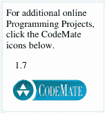

## 第13章 递归

### 13.1 递归 void 函数

- 示例：垂直数字 549
- 追踪递归调用 552
- 更深入地了解递归 555
- 陷阱：无限递归 556
- 递归的栈 558
- 陷阱：栈溢出 559
- 递归与迭代 559

### 13.2 返回值的递归函数

- 返回值的递归函数的通用形式 561
- 示例：另一个幂函数 561

### 13.3 递归思考

- 递归设计技术 566
- 二分搜索 568

- 章节总结 576
- 自测练习答案 576
- 编程项目 581


### 递归

在一次关于宇宙学和太阳系结构的讲座后，威廉·詹姆斯被一位小老太太拦住。
“詹姆斯先生，你关于太阳是太阳系中心、地球是围绕其旋转的球体的理论听起来很有说服力，但它是错的。我有一个更好的理论，”小老太太说。
“那是什么，夫人？”詹姆斯礼貌地问道。
“我们生活在巨龟背上的地球地壳上。”
不愿通过动用他所掌握的大量科学证据来摧毁这个荒谬的小理论，詹姆斯决定通过让对手看到其立场的一些不足来温和地劝阻她。
“如果你的理论正确，夫人，”他问道，“这只乌龟站在什么上面？”
“詹姆斯先生，你是个很聪明的人，这是一个很好的问题，”小老太太回答道，“但我有答案。就是这样：第一只乌龟站在第二只、更大得多的乌龟背上，后者直接在其下方。”
“但这第二只乌龟站在什么上面？”詹姆斯耐心地追问。
对此，小老太太得意地叫道。“没用，詹姆斯先生——一直是乌龟往下走。”

> J. R. Ross, Constraints on Variables in Syntax

### 引言

包含对其自身调用的函数定义被称为递归。像大多数现代编程语言一样，C++ 允许函数递归。如果谨慎使用，递归可以是一种有用的编程技术。本章介绍定义成功的递归函数所需的基本技术。本章中没有任何内容是真正独特于 C++ 的。如果你已经熟悉递归，可以安全地跳过本章。
本章仅使用第 1 章到第 5 章的材料。第 13.1 节和第 13.2 节不使用第 5 章的任何材料，因此你可以在第 4 章之后随时学习递归。如果你尚未阅读第 11 章，回顾第 1 章中关于命名空间的部分可能会有所帮助。


# 递归 void 函数

> 我还记得《一千零一夜》中那一夜，恰好在中间，山鲁佐德（由于抄写员的魔幻疏忽）开始逐字逐句地讲述《一千零一夜》的故事，从而冒着再次来到那个必须重复它的夜晚的风险，进而走向无限。
> 
> 霍尔赫·路易斯·博尔赫斯，《分岔花园》

当你编写一个函数来解决一个任务时，一个基本的设计技术是将任务分解为子任务。有时会出现至少一个子任务是同一任务的一个较小示例的情况。例如，如果任务是在列表中搜索特定值，你可能会将其分为搜索列表前半部分的任务和搜索列表后半部分的任务。搜索列表两半的任务是“较小”的原始任务版本。每当一个子任务是需要完成的原始任务的一个较小版本时，你就可以使用递归函数来解决原始任务。我们从一个简单的例子开始来说明这种技术。

### 递归

在 C++ 中，函数定义中可能包含对正在定义的函数的调用。在这种情况下，该函数被称为递归。

### 示例 VERTICAL NUMBERS

Display 13.1 包含一个名为 writeVertical 的递归函数的演示程序，该函数接收一个（非负）int 参数，并将该 int n 写入屏幕，数字垂直排列，每行一个。例如，调用

```
writeVertical(1234);
```

会产生输出

1
2
3
4

writeVertical 需要执行的任务可以分解为以下两种情况：

- 简单情况：如果 n < 10，则将数字 n 写入屏幕。

毕竟，如果数字只有一位长，任务是微不足道的。

- 递归情况：如果 n >= 10，则执行两个子任务：
  1. 输出除最后一位之外的所有数字。
  2. 输出最后一位。

例如，如果参数为 1234，则第一个子任务会输出
1
2
3

第二个子任务会输出 4。这种分解为子任务的方法可用于推导函数定义。

子任务 1 是原始任务的一个较小版本，因此我们可以用递归调用来实现此子任务。子任务 2 只是我们上面列出的简单情况。因此，我们的 writeVertical 函数算法的概要，参数为 n，由以下伪代码给出：

```
if (n < 10)
{
    cout << n << endl;
}
else //n is two or more digits long:
{
    writeVertical(the number n with the last digit removed);
    cout << the last digit of n << endl;
}
```

如果你观察到以下恒等式，就很容易将此伪代码转换为完整的 C++ 函数定义：
n/10 是去掉最后一位的数字 n。
n%10 是 n 的最后一位。

例如，1234/10 的计算结果为 123，而 1234%10 的计算结果为 4。

该函数的完整代码如下：

```
void writeVertical(int n)
{
    if (n < 10)
    {
        cout << n << endl;
    }
    else //n is two or more digits long:
    {
        writeVertical(n/10);
        cout << (n%10) << endl;
    }
}
```

### Display 13.1  一个递归 void 函数

```cpp
//Program to demonstrate the recursive function writeVertical.
#include <iostream>
using std::cout;
using std::endl;

void writeVertical(int n);
//Precondition: n >= 0.
//Postcondition: The number n is written to the screen vertically,
//with each digit on a separate line.

int main( )
{
    cout << "writeVertical(3):" << endl;
    writeVertical(3);

    cout << "writeVertical(12):" << endl;
    writeVertical(12);

    cout << "writeVertical(123):" << endl;
    writeVertical(123);

    return 0;
}

//uses iostream:
void writeVertical(int n)
{
    if (n < 10)
    {
        cout << n << endl;
    }
    else // n is two or more digits long:
    {
        writeVertical(n/10);
        cout << (n%10) << endl;
    }
}
```

### SAMPLE DIALOGUE

> ```text
> writeVertical(3):
> 3
> writeVertical(12):
> 1
> 2
> writeVertical(123):
> 1
> 2
> 3
> ```

### TRACING A RECURSIVE CALL

让我们看看当进行以下函数调用时到底发生了什么（见 Display 13.1）：

```
writeVertical(123);
```

当执行此函数调用时，计算机的处理方式与任何函数调用一样。参数 123 被替换为参数 n，并执行函数体。替换 123 为 n 之后，需要执行的代码等价于以下内容：

```
if (123 < 10)
{
    cout << 123 << endl;
}
else //n is two or more digits long:
{
    writeVertical(123/10);
    cout << (123%10) << endl;
}
```

计算将在此停止，直到递归调用返回。

由于 123 不小于 10，因此执行 else 部分。然而，else 部分以以下函数调用开始：

```
writeVertical(n/10);
```

由于 n 等于 123，这就是调用

```
writeVertical(123/10);
```

等价于

```
writeVertical(12);
```

当执行到达此递归调用时，当前函数计算被置于暂停状态并执行递归调用。当此递归调用完成时，暂停的计算将返回到此点并继续。

递归调用

```
writeVertical(12);
```

的处理方式与其他函数调用一样。参数 12 被替换为参数 n，并执行函数体。替换 12 为 n 后，有两个计算，一个暂停，一个活动，如下所示：

当这次执行函数体时，发生了不同的事情。由于 1 小于 10，if-else 语句中的布尔表达式为真，因此执行 else 之前的语句。该语句只是一个 cout 语句，将参数 1 写入屏幕，因此调用 writeVertical(1) 将 1 写入屏幕并结束，且没有递归调用。

当调用 writeVertical(1) 结束时，等待其结束的暂停计算将从其离开的地方恢复，如下所示：

```
if (123 < 10)
{
}
else
{
}

if (12 < 10)
{
    cout << 12 << endl;
}
else //n is two or more digits long:
{
    writeVertical(12/10);
    cout << (12%10) << endl;
}
Computation resumes here.
```

当此暂停计算恢复时，它执行一个 cout 语句，输出值 12%10，即 2。这结束了该计算，但仍有另一个暂停计算等待恢复。

当这个最后一个暂停计算恢复时，情况如下：

```
if (123 < 10)
{
    cout << 123 << endl;
}
else //n is two or more digits long:
{
    writeVertical(123/10);
    cout << (123%10) << endl;
}
Computation resumes here.
```

这个最后一个暂停计算输出值 123%10，即 3。原始函数调用的执行随后结束。果然，数字 1、2 和 3 已按顺序每行一个写入屏幕。

### A CLOSER LOOK AT RECURSION

函数 writeVertical 的定义使用了递归。然而我们在评估函数调用 writeVertical(123) 时并没有做任何新或不同的事情。我们像对待前几章中看到的任何函数调用一样对待它。我们只是将参数 123 替换为参数 n，然后执行函数定义体中的代码。当我们到达递归调用

```
writeVertical(123/10);
```

时，我们只是重复这个过程一次。

计算机以以下方式跟踪递归调用。当函数被调用时，计算机为参数代入参数并开始执行代码。如果遇到递归调用，它会暂时停止计算，因为它必须知道递归调用的结果才能继续。它保存继续计算所需的所有信息，然后继续评估递归调用。当递归调用完成后，计算机返回以完成外部计算。

C++ 语言对函数定义中递归调用的使用没有限制。然而，为了使递归函数定义有用，必须设计成任何函数调用最终都必须以不依赖递归的代码结束。函数可以调用自身，而该递归调用又可以再次调用函数。该过程可以重复任意多次。然而，除非最终某个递归调用不依赖递归即可返回值，否则该过程不会终止。成功的递归函数定义的一般概要如下：

- 一个或多个使用一个或多个递归调用来完成任务的一个或多个较小版本的函数来完成其任务的情况。

- 一个或多个函数不使用任何递归调用即可完成其任务的情况。这些不使用任何递归调用的情况称为基本情况或停止情况。

通常 if-else 语句决定执行哪种情况。一个典型的场景是原始函数调用执行包含递归调用的情况。该递归调用可能反过来执行需要另一个递归调用的情况。对于若干次，每次递归调用都会产生另一个递归调用，但最终应适用其中一个停止情况。函数的每次调用必须最终导致停止情况，否则函数调用将永远不会结束，因为递归调用的无限链。（实际上，包含无限递归调用链的调用通常会异常终止，而不是真正无限运行。）

确保最终达到停止情况的最常见方法是编写函数，使某个（正）数值在每次递归调用时减小，并为某个“较小”值提供停止情况。这就是我们在 Display 13.1 中设计函数 writeVertical 的方式。当调用函数 writeVertical 时，该调用会产生一个参数更小的递归调用。这会继续进行


每次递归调用都会产生另一次递归调用，直到参数小于 10 为止。当参数小于 10 时，函数调用结束，不再产生任何递归调用，整个过程逐步返回到最初的调用，然后结束。

### 递归函数定义的一般形式

一个成功的递归函数定义通常遵循如下框架：

-   一个或多个情况包含对正在定义的函数的一次或多次递归调用。这些递归调用应当解决被定义函数所执行任务的“更小”版本。
-   一个或多个情况不包含任何递归调用。这些不含递归调用的情况称为基本情形或停止情形。

### 陷阱：无限递归

在前面小节讨论的 writeVertical 函数示例中，递归调用系列最终会到达一个不涉及递归的函数调用（即达到了停止情形）。另一方面，如果每次递归调用都会产生另一次递归调用，那么对函数的调用理论上将永远运行下去。这被称为无限递归。在实践中，这样的函数通常会一直运行，直到计算机耗尽资源，程序异常终止。

无限递归的例子并不难找。下面是一个语法正确的 C++ 函数定义，它可能是试图定义 writeVertical 函数的另一种版本的结果：

```
void newWriteVertical(int n)
{
    newWriteVertical(n/10);
    cout << (n%10) << endl;
}
```

如果将这个定义嵌入到调用该函数的程序中，编译器会将函数定义翻译成机器代码，你可以执行该机器代码。此外，这个定义甚至还有一定的合理性。它说：要输出 newWriteVertical 的参数，先输出除最后一位以外的所有数字，然后输出最后一位。然而，当被调用时，这个函数会产生无限序列的递归调用。如果你调用 `newWriteVertical(12)`，该执行将停下来去执行递归调用 `newWriteVertical(12/10)`，这相当于 `newWriteVertical(1)`。该递归调用的执行又会停下来去执行递归调用

```
newWriteVertical(1/10);
```

这相当于

```cpp
newWriteVertical(0);
```

接着，这又会停下来去执行递归调用 `newWriteVertical(0/10);`，这也相当于

```cpp
newWriteVertical(0);
```

而这又会产生另一次递归调用，再次执行相同的递归函数调用 `newWriteVertical(0);`，如此往复，永无止境。由于 `newWriteVertical` 的定义没有停止情形，这个过程将永远持续下去（或者直到计算机耗尽资源）。

### 自测练习

-   1. 以下程序的输出是什么？
    
    ```cpp
    #include <iostream>
    using std::cout;
    void cheers(int n);
    
    int main()
    {
        cheers(3);
        return 0;
    }
    
    void cheers(int n)
    {
        if (n == 1)
        {
            cout << "Hurray\n";
        }
        else
        {
            cout << "Hip ";
            cheers(n - 1);
        }
    }
    ```
    
-   2. 编写一个递归的 void 函数，该函数有一个正整数参数，并在屏幕上写出一行该数量的星号（*），全部在同一行。
    
-   3. 编写一个递归的 void 函数，该函数有一个正整数参数。调用时，函数将其参数以相反顺序写到屏幕上。也就是说，如果参数是 1234，它在屏幕上输出以下内容：
    
    ```text
    4321
    ```

-   4. 编写一个递归的 void 函数，该函数接受一个 int 参数 n，并写出整数 1, 2, ..., n。
    
-   5. 编写一个递归的 void 函数，该函数接受一个 int 参数 n，并写出整数 n, n−1, ..., 3, 2, 1。（提示：注意，你可以通过交换两行代码，从练习 4 的代码得到本练习的代码，反之亦然。）

### 用于递归的栈

为了跟踪递归（以及其他许多事情），大多数计算机系统使用一种称为栈的结构。栈是一种非常特殊的内存结构，类似于一叠纸。在这个类比中，有源源不断的额外空白纸张。要把某些信息放入栈中，就将其写在一张纸上，然后放到纸堆的顶部。要放入更多信息，就取一张干净的纸，把信息写在上面，然后将这张新纸放到纸堆的顶部。用这种直接的方式，越来越多的信息可以被放入栈中。

从栈中取出信息也通过一个非常简单的过程完成。可以读取最上面的那张纸，当不再需要它时，就把它扔掉。有一个复杂之处：只有最上面的那张纸可以被访问。例如，要读取从上往下数第三张纸，必须把最上面的两张纸扔掉。由于最后放入栈中的纸是最先被取出的，栈通常被称为后进先出内存结构。

利用栈，计算机可以轻松地跟踪递归。每当一个函数被调用时，就会取出一张新纸。函数定义被复制到这张纸上，参数被代入函数形参中。然后计算机开始执行函数定义的主体。当它遇到递归调用时，它会停止在那张纸上正在进行的计算，以便计算递归调用返回的值。但在计算递归调用之前，它会保存足够的信息，以便最终确定递归调用返回的值后，能够继续被停止的计算。这些保存的信息被写在一张纸上并放到栈中。递归调用使用一张新纸。计算机在这张新纸上写下函数定义的第二份副本，将参数代入函数形参，然后开始执行递归调用。当它在被递归调用的副本中遇到递归调用时，它会重复将信息保存到栈中并为新的递归调用使用一张新纸的过程。这一过程在“追踪递归调用”小节中已有图示。尽管当时我们没有称之为栈，但这些一层叠一层的计算图示说明了栈的运作方式。

这个过程一直持续到某个对函数的递归调用在没有产生更多递归调用的情况下完成其计算。此时，计算机将注意力转向栈顶的那张纸。这张纸上包含着一个部分完成的计算，它正在等待刚刚结束的递归计算的结果。因此，可以继续那个被挂起的计算。当那个被挂起的计算结束时，计算机丢弃那张纸，栈中位于它下面的被挂起计算成为栈顶的计算。计算机将注意力转向现在位于栈顶的被挂起计算，依此类推。这个过程一直持续到最底部那张纸上的计算完成。根据产生了多少次递归调用以及函数定义是如何编写的，栈可以以任何方式增长或收缩。注意，栈中的纸只能以后进先出的方式访问，而这正是跟踪递归调用所需要的。每个被挂起的版本都在等待栈中位于它正上方的那个版本完成。

不用说，计算机并没有纸堆。这只是一个类比。计算机使用内存的某些部分而不是纸张。这些内存部分（“纸张”）的内容称为激活帧。这些激活帧以我们刚才讨论的后进先出方式处理。（这些激活帧并不包含函数定义的完整副本，而只是引用函数定义的单一副本。然而，激活帧包含足够的信息，使计算机能够表现得好像激活帧包含了函数定义的完整副本一样。）

### 栈

栈是一种后进先出的内存结构。从栈中引用或移除的第一项总是最后进入栈的项。计算机使用栈来跟踪递归（以及用于其他目的）。

### 陷阱：栈溢出

栈的大小总是有一定限制。如果存在一条很长的链，函数对自己进行递归调用，而该调用又导致另一次递归调用，该调用又产生另一次递归调用，依此类推，那么这条链中的每次递归调用都会导致另一个激活帧被放到栈上。如果这条链太长，栈将试图增长超过其限制。这是一种错误状态，称为栈溢出。如果你收到一条“栈溢出”的错误消息，很可能是某个函数调用产生了过长的递归调用链。栈溢出的一个常见原因是无限递归。如果一个函数无限递归，那么它最终会试图使栈超出任何栈大小限制。

### 递归与迭代

递归并不是绝对必要的。事实上，有些编程语言不允许递归。任何可以用递归完成的任务，也都可以用不使用递归的其他方式完成。例如，Display 13.2 包含一个非递归的


# 显示 13.2 显示 13.1 中函数的迭代版本

```cpp
//Uses iostream:
void writeVertical(int n)
{
    int nsTens = 1;
    int leftEndPiece = n;
    while (leftEndPiece > 9)
    {
        leftEndPiece = leftEndPiece/10;
        nsTens = nsTens*10;
    }
    //nsTens is a power of ten that has the same number
    //of digits as n. For example, if n is 2345, then
    //nsTens is 1000.

    for (int powerOf10 = nsTens;
             powerOf10 > 0; powerOf10 = powerOf10/10)
    {
        cout << (n/powerOf10) << endl;
        n = n%powerOf10;
    }
}
```

显示 13.1 中给出的函数的版本。非递归函数的版本通常使用某种循环（或循环）来代替递归。因此，非递归版本通常被称为**迭代版本**。如果用显示 13.2 中给出的版本替换显示 13.1 中给出的函数 `writeVertical` 的定义，输出将是相同的。正如本例所示，函数的递归版本有时可能比迭代版本简单得多。

递归编写的函数通常运行速度较慢并且使用比等效的迭代版本更多的存储空间。计算机必须做大量的工作来操作栈以跟踪递归。然而，由于系统会自动为你完成所有这些工作，使用递归有时可以使你作为程序员的工作更轻松，有时可以产生更易于理解的代码。

### 自测练习

- 6. 如果你的程序产生错误信息说“stack overflow”，错误的可能来源是什么？
- 7. 编写函数 `cheers` 的迭代版本，该函数定义在自测练习 1 中。
- 8. 编写自测练习 2 中定义的函数的迭代版本。
- 9. 编写自测练习 3 中定义的函数的迭代版本。

### 13.2 返回值的递归函数

> _迭代是人类的，递归是神圣的。_
> 
> —匿名

#### 返回值递归函数的通用形式

到目前为止你看到的递归函数都是 void 函数，但递归并不限于 void 函数。递归函数可以返回任何类型的值。设计返回值的递归函数的技术基本上与 void 函数相同。成功返回值的递归函数定义的概要如下：

- 一个或多个情况下，返回的值是通过对同一函数的调用计算得出的（即使用递归调用）。与 void 函数的情况一样，递归调用的参数最终应该是“更小”的。
- 一个或多个情况下，返回的值是在不使用任何递归调用的情况下计算得出的。这些没有递归调用的情况称为 _基本情况_ 或 _停止情况_（与 void 函数的情况一样）。

下一编程示例说明了这种技术。

### 示例 另一个幂函数

第 3 章介绍了预定义函数 pow，它计算幂。例如，pow(2.0, 3.0) 返回 2.0³，或以下将变量 result 设置为 8.0：

```
double result = pow(2.0, 3.0);
```

函数 pow 接受两个 double 类型的参数并返回 double 类型的值。显示 13.3 包含一个递归定义，用于定义一个类似但使用类型 int 而不是 double 的函数。这个新函数称为 power。例如，以下将使 result2 的值等于 8，因为 2³ 是 8：

```
int result2 = power(2, 3);
```

我们定义函数 power 的主要原因是有一个简单的递归函数示例，但在某些情况下，函数 power 会比函数

# 显示 13.3 递归函数 power

```
//Program to demonstrate the recursive function power.
#include <iostream>
#include <cstdlib>
using std::cout;
using std::endl;

int power(int x, int n);
//Precondition: n >= 0.
//Returns x to the power n.

int main()
{
    for (int n = 0; n < 4; n++)
        cout << "3 to the power " << n
            << " is " << power(3, n) << endl;

    return 0;
}

//uses iostream and cstdlib:
int power(int x, int n)
{
    if (n < 0)
    {
        cout << "Illegal argument to power.\n";
        exit(1);
    }

    if (n > 0)
        return ( power(x, n - 1)*x );
    else // n == 0
        return (1);
}
```

### 示例对话

3 to the power 0 is 1
3 to the power 1 is 3
3 to the power 2 is 9
3 to the power 3 is 27

pow 更可取。函数 pow 返回 double 类型的值，这只是一个近似量。函数 power 返回 int 类型的值，这是一个精确量。在某些情况下，你可能需要函数 power 提供的额外精度。

函数 power 的定义基于以下公式：

x^n 等于 x^(n-1) * x

将其翻译成 C++ 表示 power(x, n) 返回的值应与表达式的值相同

```
power(x, n - 1)*x
```

显示 13.3 中给出的函数 power 的定义确实为 power(x, n) 返回此值，前提是 n > 0。

n 等于 0 的情况是停止情况。如果 n 为 0，则 power(x, n) 仅返回 1（因为 x^0 为 1）。

让我们看看当函数 power 用一些示例值调用时会发生什么。首先考虑以下简单表达式：

```
power(2, 0)
```

当函数被调用时，x 的值被设置为 2，n 的值被设置为 0，并且函数定义体中的代码被执行。由于 n 的值是合法值，因此 if-else 语句被执行。由于此 n 值不大于 0，因此使用 else 之后的 return 语句，因此函数调用返回 1。因此，以下将使 result3 的值等于 1：

```
int result3 = power(2, 0);
```

现在让我们看一个涉及递归调用的例子。考虑表达式

```
power(2, 1)
```

当函数被调用时，x 的值被设置为 2，n 的值被设置为 1，并且函数定义体中的代码被执行。由于此 n 值大于 0，因此使用以下 return 语句来确定返回的值：

```
return ( power(x, n - 1)*x );
```

在这种情况下等价于

```
return ( power(2, 0)*2 );
```

此时 power(2, 1) 的计算被挂起，此挂起计算的副本被放在栈上，然后计算机开始新的函数调用以计算 power(2, 0) 的值。正如你已经看到的，power(2, 0) 的值是 1。在确定 power(2, 0) 的值后，计算机用其值 1 替换表达式 power(2, 0) 并

恢复挂起的计算。恢复的计算根据上述 return 语句确定 `power(2, 1)` 的最终值如下：

`power(2, 0) * 2 是 1*2，即 2。`

因此，`power(2, 1)` 返回的最终值是 2。所以，以下将使 `result4` 的值等于 2：

```
int result4 = power(2, 1);
```

第二个参数的较大数值会产生更长的递归调用链。例如，考虑语句

```
cout << power(2, 3);
```

`power(2, 3)` 的值计算如下：

```
power(2, 3) 是 power(2, 2)*2
    power(2, 2) 是 power(2, 1)*2
        power(2, 1) 是 power(2, 0)*2
            power(2, 0) 是 1（停止情况）
```

当计算机到达停止情况 `power(2, 0)` 时，有三个挂起的计算。在计算停止情况的返回值后，它恢复最近挂起的计算以确定 `power(2, 1)` 的值。之后，计算机完成其他每个挂起的计算，使用每个计算出的值作为插入到另一个挂起计算中的值，直到它到达并完成原始调用 `power(2, 3)` 的计算为止。整个计算的细节在显示 3.4 中说明。

### 自测练习

- 12. 以下程序的输出是什么？

```
#include <iostream>
using std::cout;
using std::endl;

int mystery(int n);
//Precondition: n >= 1.

int main()
{
    cout << mystery(3) << endl;
    return 0;
}

int mystery(int n)
{
```


### 显示 13.4 评估递归函数调用 power(2, 3)

### 递归调用的顺序

### 最终值的计算方式

power(2, 0) * 2

power(2, 1) * 2

power(2, 2) * 2

power(2, 3)

从这里开始

1

*2

1*2 得到 2

2

*2

2*2 得到 4

4

*2

4*2 得到 8

8

power(2, 3) 的结果是 8

```
if (n <= 1)
    return 1;
else
    return ( mystery(n - 1) + n );
}
```

13. 下面程序的输出是什么？rose 是什么著名的数学函数？

```
#include <iostream>
using std::cout;
using std::endl;

int rose(int n);
//前置条件：n >= 0.

int main()
{
    cout << rose(4) << endl;
```

```cpp
return 0;
}

int rose(int n)
{
    if (n <= 0)
        return 1;
    else
        return (rose(n - 1) * n);
}
```

- 14. 重新定义 power 函数，使其也能处理负指数。为此，你还需要将返回值类型改为 double。重新定义后的 power 函数的函数声明和头部注释如下：
-
-   ```cpp
+   double power(int x, int n);
+   //前置条件：如果 n < 0，则 x 不为 0。
+   //返回 x 的 n 次幂。
+   ```
+   
+   提示：x⁻ⁿ 等于 1/(xⁿ)。

### 13.3 递归式思考

> > 世上有两种人，一种人把世界分成两种人，另一种则不。
> >
> > — 匿名

### 递归设计技巧

在定义和使用递归函数时，你不希望时刻关注堆栈和挂起的计算。递归的威力在于，你可以忽略这些细节，让计算机替你完成簿记工作。以显示 13.3 中的 power 函数为例。思考 power 定义的方式如下：

```
```text
power(x, n)

返回

power(x, n − 1)*x
```
```

由于 xⁿ 等于 xⁿ⁻¹x，只要计算总能到达停止情况并正确计算停止情况，这就是要返回的正确值。因此，在检查了定义的递归部分是正确的之后，你只需要检查

递归调用链是否总能到达停止情况，以及停止情况是否总是返回正确的值。

在设计递归函数时，你不需要为程序中该函数的实例追踪完整的递归调用序列。如果函数返回一个值，你只需检查以下三个属性是否满足：

- 1. 不存在无限递归。（一个递归调用可能导致另一个递归调用，那个又可能导致另一个，以此类推，但每一个这样的递归调用链最终都会到达一个停止情况。）
- 2. 每个停止情况都返回该情况的正确值。
- 3. 对于涉及递归的情况：如果所有递归调用都返回正确的值，那么函数返回的最终值就是正确的值。

例如，考虑显示 13.3 中的 power 函数。

- 1. 不存在无限递归：power(x, n) 的第二个参数在每次递归调用中减 1，所以任何递归调用链最终都必须到达停止情况 power(x, 0)。因此，不存在无限递归。
- 2. 每个停止情况都返回该情况的正确值：唯一的停止情况是 power(x, 0)。形式为 power(x, 0) 的调用总是返回 1，而 x^0 的正确值是 1。所以停止情况返回了正确的值。
- 3. 对于涉及递归的情况：如果所有递归调用都返回正确的值，那么函数返回的最终值就是正确的值：唯一涉及递归的情况是当 n > 1 时。当 n > 1 时，power(x, n) 返回 power(x, n - 1)*x。

要验证这是否是要返回的正确值，请注意，如果 power(x, n - 1) 返回正确的值，那么 power(x, n - 1) 返回 x^(n-1)，因此 power(x, n) 返回 x^(n-1) * x，即 x^n，这正是 power(x, n) 的正确值。

要确保 power 的定义是正确的，你只需要检查这些。（上述技巧被称为数学归纳法，这个概念你可能在数学课上听说过。但是，你不需要熟悉数学归纳法这个术语也能使用这个技巧。）

我们给出了三个标准，供你检查返回值的递归函数的正确性。基本上相同的规则可以应用于递归的 void 函数。如果你证明你的递归 void 函数定义满足以下三个标准，那么你就知道你的 void 函数执行正确：

- 1. 不存在无限递归。
- 2. 每个停止情况都对该情况执行正确的操作。
- 3. 对于每个涉及递归的情况：如果所有递归调用都正确执行了它们的操作，那么整个情况就正确执行。

### 二分查找

本小节开发一个递归函数，用于搜索数组以确定它是否包含指定值。例如，数组可能包含不再有效的信用卡号列表。店员需要搜索该列表以查看客户的卡是有效还是无效。

如果数组 a 的索引是整数 0 到 finalIndex。为了使搜索数组的任务更容易，我们假设数组是已排序的。因此，我们知道以下内容：

a[0] ≤ a[1] ≤ a[2] ≤... ≤ a[finalIndex]

搜索数组时，你可能想知道该值是否在列表中，以及如果在，它在列表中的什么位置。例如，如果我们正在搜索信用卡号，那么数组索引可以作为记录号。由这些索引索引的另一个数组可能保存电话号码或其他信息，用于报告可疑卡。因此，如果所寻求的值在数组中，我们希望函数告诉我们该值在数组中的位置。

现在让我们继续生成一个算法来解决这个任务。用非常具体的方式来想象这个问题会有所帮助。假设数字列表很长，需要用一本书才能全部列出。实际上，无法访问计算机的商店就是这样分发无效信用卡号的。如果你是店员，拿到一张信用卡，你必须检查它是否在列表中，因此无效。你会怎么做？把书翻到中间，看看号码是否在那里。如果不在，并且它小于中间的数字，那么从前面往回想。如果数字大于中间的数字，就向书的末尾查找。这个想法产生了我们算法的初稿：

```
found = false;//到目前为止。
mid = 0 和 finalIndex 之间的近似中点；
if (key == a[mid])
{
    found = true;
    location = mid;
}
else if (key < a[mid])
    搜索 a[0] 到 a[mid - 1]；
else if (key > a[mid])
    搜索 a[mid + 1] 到 a[finalIndex]；
```

由于对较短列表的搜索是我们正在设计的算法所要执行任务的较小版本，这个算法自然适合使用递归。可以使用对算法本身的递归调用来搜索较小的列表。

### 显示 13.5 二分查找的伪代码

```
int a[Some_Size_Value];

搜索 a[first] 到 a[last] 的算法
    //前置条件：
    //a[first] <= a[first + 1] <= a[first + 2] <= ... <= a[last]

定位键值 KEY：
    if (first > last) //一个停止情况
        found = false;
    else
    {
        mid = first 和 last 之间的近似中点；
        if (key == a[mid]) //一个停止情况
        {
            found = false;
            location = mid;
        }
        else if key < a[mid] //一个涉及递归的情况
            搜索 a[first] 到 a[mid - 1]；
        else if key > a[mid] //一个涉及递归的情况
            搜索 a[mid + 1] 到 a[last]；
    }
```

### 编码

现在我们可以按常规方式将伪代码翻译成 C++ 代码。结果显示在显示 13.6 中。search 函数是显示 13.5 中给出的递归算法的实现。该函数在示例数组上的执行方式示意图如显示 13.7 所示。

请注意，search 函数解决了一个比原始任务更一般的问题。我们的目标是设计一个搜索整个数组的函数，但 search 函数允许我们通过指定索引边界 first 和 last 来搜索数组的任何区间。这在设计递归函数时很常见。通常，为了能够表达递归算法，有必要解决一个更一般的问题。在这种情况下，我们只想要 first 和 last 分别设置为 0 和 finalIndex 时的答案。然而，递归调用会将它们设置为 0 和 finalIndex 以外的值。


# 显示 13.6 二分查找的递归函数（第 2 部分，共 2 部分）

```cpp
//Program to demonstrate the recursive function for binary search.
#include <iostream>
using std::cin;
using std::cout;
using std::endl;
const int ARRAY_SIZE = 10;

void search(const int a[], int first, int last,
            int key, bool& found, int& location);
//Precondition: [first] through [last] are sorted in increasing order.
//Postcondition: key is not one of the values [first] through [last],
//then found == false; otherwise, a[location] == key and found == true.

int main()
{
    int a[ARRAY_SIZE];
    const int finalIndex = ARRAY_SIZE - 1;

    /*This portion of the program contains some code to fill and sort
      the array. The exact details are irrelevant to this example.*/

    int key, location;
    bool found;
    cout << "Enter number to be located: ";
    cin >> key;
    search(a, 0, finalIndex, key, found, location);

    if (found)
        cout << key << " is in index location "
             << location << endl;
    else
        cout << key << " is not in the array." << endl;

    return 0;
}
void search(const int a[], int first, int last,
            int key, bool& found, int& location)
{
    int mid;
    if (first > last)
    {
        found = false;
    }
    else
    {
        mid = (first + last)/2;
        if (key == a[mid])
        {
            found = true;
            location = mid;
        }
        else if (key < a[mid])
        {
            search(a, first, mid - 1, key, found, location);
        }
        else if (key > a[mid])
        {
            search(a, mid + 1, last, key, found, location);
        }
    }
}
```

# 检查递归

“递归设计技术”小节给出了三个标准，用来确保递归 void 函数定义是正确的。让我们对显示 13.6 中给出的函数 search 检查这三个条件。

+   1. 不会出现无限递归：在每次递归调用中，first 的值都会增加或 last 的值会减小。如果递归调用链没有以其他方式结束，那么最终函数将被调用时 first 大于 last，这是一个停止情况。

+   2. 每个停止情况都执行了该情况的正确操作：有两个停止情况，即 first > last 和 key == a[mid]。让我们分别考虑每种情况。
+   如果 first > last，则 a[first] 和 a[last] 之间没有数组元素，因此 key 不在这个数组段中。 （这个数组段中什么都没有！）因此，如果 first > last，函数 search 正确地将 found 设置为 false。
+   如果 key == a[mid]，算法正确地将 found 设置为 true 并将 location 设置为 mid。因此，两个停止情况都是正确的。

+   3. 对于涉及递归的每种情况，如果所有递归调用都正确执行其操作，则整个情况执行正确：有两种涉及递归调用的情况，即 key < a[mid] 和 key > a[mid]。我们需要检查这两种情况。
+   首先假设 key < a[mid]。在这种情况下，由于数组已排序，我们知道如果 key 在数组中，则 key 是 a[first] 到 a[mid - 1] 中的一个元素。

因此，函数只需搜索这些元素，这正是递归调用

```
search(a, first, mid − 1, key, found, location);
```

所做的。因此，如果递归调用是正确的，则整个操作是正确的。
接下来，假设 key > a[mid]。在这种情况下，由于数组已排序，我们知道如果 key 在数组中，则 key 是 a[mid + 1] 到 a[last] 中的一个元素。因此，函数只需搜索这些元素，这正是递归调用

```
search(a, mid + 1, last, key, found, location);
```

所做的。因此，如果递归调用是正确的，则整个操作是正确的。因此，在这两种情况下，函数都执行了正确的操作（假设递归调用执行了正确的操作）。
函数 search 通过了我们所有的三个测试，因此它是一个良好的递归函数定义。

# 显示 13.7 函数 search 的执行

key 为 63

first == 0

mid = (0 + 9)/2

last == 9

next

不在这一半

first == 5

mid = (5 + 9)/2

last == 9

next

first == 5

last == 6

不在这里

mid = (5 + 6)/2 为 5
a[mid] 为 a[5] == 63
found = TRUE;
location = mid;

# 效率

与简单地按顺序尝试所有数组元素的算法相比，二分查找算法极快。在二分查找中，你一开始就排除了大约一半的数组。随后你排除四分之一，然后是八分之一，等等。这些节省累积起来形成了一个速度极快的算法。对于包含 100 个元素的数组，二分查找永远不需要比较超过 7 个数组元素与 key。简单的串行查找可能需要比较多达 100 个数组元素与 key，平均会比较约 50 个数组元素与 key。而且，数组越大，节省就越显著。对于包含 1000 个元素的数组，二分查找只需要比较约 10 个数组元素与 key 值，而简单的串行查找算法平均为 500。

函数 search 的迭代版本在显示 13.8 中给出。在某些系统上，迭代版本比递归版本运行更高效。迭代版本的算法是通过镜像递归版本得出的。在迭代版本中，局部变量 first 和 last 镜像了递归版本中参数的角色，这些参数也命名为 first 和 last。正如这个例子所示，即使你预计以后会将其转换为迭代算法，设计递归算法也通常是有意义的。

# 显示 13.8 二分查找的迭代版本

### 函数声明

```
void search(const int a[], int lowEnd, int highEnd,
    int key, bool& found, int& location);
//Precondition: a[lowEnd] through a[highEnd] are sorted in increasing
//order.
//Postcondition: If key is not one of the values a[lowEnd] through
//a[highEnd], then found == false; otherwise, a[location] == key and
//found == true.
```

### 函数定义

```
void search(const int a[], int lowEnd, int highEnd,
    int key, bool& found, int& location)
{
    int first = lowEnd;
    int last = highEnd;
    int mid;

    found = false;//so far
    while ( (first <= last) && !(found) )
    {
        mid = (first + last)/2;
        if (key == a[mid])
        {
            found = true;
            location = mid;
        }
        else if (key < a[mid])
        {
            last = mid - 1;
        }
        else if (key > a[mid])
        {
            first = mid + 1;
        }
    }
}
```

# 自测练习

15. 为以下函数编写递归函数定义：

```
int squares(int n);
//Precondition: n >= 1
//Returns the sum of the squares of the numbers 1 through n.
```

例如，squares(3) 返回 14，因为 1² + 2² + 3² 为 14。

# 章节总结

+   如果一个问题可以简化为同一问题的更小实例，那么递归解法很可能容易找到并实现。

+   函数定义的递归算法通常包含两种情况：一种或多种包含至少一次递归调用的情况，以及一种或多种停止情况，在停止情况中问题在不进行任何递归调用的情况下得到解决。

+   编写递归函数定义时，始终检查函数是否不会产生无限递归。

+   当你定义递归函数时，使用“递归设计技术”小节中给出的三个标准来检查函数是否正确。

+   在设计递归函数来解决任务时，通常有必要解决比给定任务更一般的问题。这可能是为了允许进行适当的递归调用，因为更小的问题可能与给定任务不完全相同。例如，在二分查找问题中，任务是搜索整个数组，但递归解法是搜索数组的任意部分（全部或其一部分）的算法。

# 自测练习答案

1. Hip Hip Hurray

2.

```
using std::cout;
void stars(int n)
{
    cout << '*';
    if (n > 1)
        stars(n - 1);
}
```

以下也是正确的，但更复杂：

```
void stars(int n)
{
    if (n <= 1)
```


}
}

//testing code for both Exercises 4 and 5
int main()
{
    cout << "calling writeUp(" << 10 << ")\n";
    writeUp(10);
    cout << endl;
    cout << "calling writeDown(" << 10 << ")\n";
    writeDown(10);
    cout << endl;
    return 0;
}

/* Test results
calling writeUp(10)
1 2 3 4 5 6 7 8 9 10
calling writeDown(10)
10 9 8 7 6 5 4 3 2 1*/

6. 错误信息显示“stack overflow”是在告诉你计算机尝试在栈上放置的激活帧数量超过了系统允许的数量。这种错误信息的一个可能原因是无限递归。

7. using std::cout;
void cheers(int n)
{
    while (n > 1)
    {
        cout << "Hip ";
        n--;
    }
    cout << "Hurray\n";
}

8. using std::cout;
void stars(int n)
{
    for (int count = 1; count <= n; count++)
        cout << '*';
}

9. using std::cout;
void backward(int n)
{
    while (n >= 10)
{
    cout << (n%10);//write last digit
    n = n/10;//discard the last digit
}
cout << n;
}

### 10. Trace for Self-Test Exercise 4. If n = 3, the code to be executed is

```
if (3 >= 1)
{
    writeDown(3 - 1);
}
```

On the next recursion, n = 2 and the code to be executed is

```
if (2 >= 1)
{
    writeDown(2 - 1)
}
```

On the next recursion, n = 1 and the code to be executed is

```
if (1 >= 1)
{
    writeDown(1 - 1)
}
```

On the final recursion, n = 0 and the true clause is not executed:

```
if (0 >= 1) // condition false
{
    // this clause is skipped
}
```

The recursion unwinds, the cout << n << " "; line of code is executed for each recursive call that was on the stack, with n = 3, then n = 2, and finally n = 1. The output is 3 2 1.

### 11. Trace for Self-Test Exercise 5. If n = 3, the code to be executed is

```
if (3 >= 1)
{
    cout << 3 << " ";
    writeUp(3 - 1);
}
```

On the next recursion, n = 2 and the code to be executed is

```
if (2 >= 1)
{
    cout << 2 << " ";
    writeUp(2 - 1);
```

On the next recursion, n = 1 and the code to be executed is

```
if (1 >= 1)
{
    cout << 1 << " ";
    writeUp(1 - 1);
}
```

On the final recursion, n = 0 and the code to be executed is

```
if (0 >= 1) // condition false, body skipped
{
    // skipped
}
```

The recursions unwind; the output (obtained by working through the stack) is 1 2 3.

12. 6

13. 输出是 24。该函数是阶乘函数，通常写成 n! 并定义如下：

n! 等于 n*(n-1)*(n-2)*...*1

14. //Uses iostream and cstdlib:
double power(int x, int n)
{
    if (n < 0 && x == 0)
    {
        cout << "Illegal argument to power.\n";
        exit(1);
    }
    if (n < 0)
        return ( 1/power(x, -n));
    else if (n > 0)
        return ( power(x, n - 1)*x );
    else // n == 0
        return (1.0);
}

15. int squares(int n)
{
    if (n <= 1)
        return 1;
    else
        return ( squares(n - 1) + n*n );
}

### PROGRAMMING PROJECTS

- 1. 编写一个递归函数定义，该函数有一个参数 n，类型为 int，并返回第 n 个斐波那契数。斐波那契数是 F0 为 1，F1 为 1，F2 为 2，F3 为 3，F4 为 5，且一般情况下 F_{i+2} = F_i + F_{i+1} 对于 i = 0, 1, 2, ...

- 2. 计算从 n 个元素的集合中选择 r 个不同元素的组合数公式如下：C(n, r) = n! / (r!*(n - r)!) 阶乘函数 n! 定义为 n! = n*(n-1)*(n-2)*...*1 发现 C(n, r) 公式的一个递归版本并编写一个递归函数来计算该公式的值。将函数嵌入到程序中并对其进行测试。

- 3. 编写一个递归函数，该函数有一个参数是字符数组，另外两个参数是数组索引。函数应反转这两个边界之间索引的那些条目的顺序。例如，如果数组是 a[1] == 'A' a[2] == 'B' a[3] == 'C' a[4] == 'D' a[5] == 'E' 且边界为 2 和 5，则在函数运行后数组元素应为 a[1] == 'A' a[2] == 'E' a[3] == 'D' a[4] == 'C' a[5] == 'B' 将函数嵌入到程序中并对其进行测试。在完全调试此函数后，定义另一个函数，该函数只有一个参数，即包含字符串值的数组；该函数应反转数组参数中字符串值的拼写。此函数将包含对本项目第一部分所做的递归定义的调用。将此第二个函数嵌入到程序中并对其进行测试。

- 4. 编写前一个项目中递归函数的迭代版本。将它嵌入到程序中并对其进行测试。

- 5. 汉诺塔。有一个关于佛教僧侣玩这个谜题的 64 个石盘的故事。故事声称当僧侣们完成将盘子从一个柱子经第三个柱子移动到第二个柱子时，时间将结束。末世论和神学将留给更合格的人；我们的兴趣仅限于该问题的递归解法。n 个盘子按递减尺寸堆叠在一个柱子上。任务是将盘子一个一个地从第一个柱子移动到第二个柱子。为此，任何盘子都可以从任何柱子移动到任何其他柱子，但须遵守规则，即你永远不能将较大的盘子放在较小的盘子上。提供的（备用）第三个柱子是为了使解决方案成为可能。你的任务是编写一个递归函数来描述该问题的解决方案的说明。我们没有图形可用，因此你应该输出将解决该问题的指令序列。

提示：如果可以将 n−1 个盘子从第一个柱子使用第二个柱子作为备用移动到第三个柱子，那么最后一个盘子就可以从第一个柱子移动到第二个柱子。然后通过使用相同的技术（无论那是什么）可以将 n−1 个盘子从第三个柱子移动到第二个柱子，使用第一个盘子作为备用。好了！你已经解决了这个谜题。你只需要决定非递归情况是什么，递归情况是什么，以及何时输出移动盘子的指令。

- 6. （你需要先完成编程项目 1。）在此练习中，你将比较递归和迭代函数计算斐波那契数的效率。

  - a. 检查斐波那契数递归函数计算。注意每个斐波那契数都被重新计算了多次。为了避免这种重新计算，以迭代方式而不是递归方式完成编程问题 1；也就是说，用循环来做这个问题。你应该在计算所请求数字的过程中只计算一次每个斐波那契数，并在不再需要时丢弃这些数字。

  - b. 对项目 1 和本项目 a 部分的解决方案在查找第 1、3、5、7、9、11、13 和 15 个斐波那契数时进行计时。确定每个函数花费的时间。比较并评论你的结果。
  
  - 提示：如果你在 Linux 上运行，可以使用 Bash ‘time’ 实用程序。它给出实际时间（即挂钟时间）、用户时间（用于你的程序的 cpu 周期）和 sys 时间（用于除你的程序之外的任务的 cpu 周期）。如果你在其他环境中运行，你将不得不阅读你的手册，或询问你的讲师，以了解如何测量程序运行所需的时间。

- 7. （你需要先完成编程项目 6。）当使用最直接的递归函数定义计算斐波那契数时，递归解法会多次重新计算每个斐波那契数。为了计算 Fₙ₊₂ = Fₙ + Fₙ₊₁，它在计算 Fₙ₊₁ 时第二次计算了在计算 Fₙ 时计算的所有数字。你可以通过在计算 Fₙ 时保存数字到数组中来避免这种情况。基于这个想法编写你递归斐波那契函数的另一个版本。在计算第 N 个斐波那契数的递归解法中，声明一个大小为 N 的数组。数组索引为 i 的条目在第一次计算时存储第 i 个（i ≤ N）斐波那契数。然后使用数组来避免斐波那契数的第二次（冗余）重新计算。按编程项目 6 中的方式对该解决方案进行计时，并将其与迭代解决方案的结果进行比较。


## 第14章 继承

### 14.1 继承基础
- 派生类 584
- 派生类中的构造函数 594
- 陷阱：从基类使用私有成员变量 596
- 陷阱：私有成员函数实际上并未被继承 598
- protected 限定符 598
- 成员函数的重新定义 601
- 重新定义与重载 603
- 对重新定义的基函数的访问 604
- 未被继承的函数 605

### 14.2 使用继承进行编程
- 派生类中的赋值运算符和拷贝构造函数 606
- 派生类中的析构函数 607
- 示例：带备份的部分填充数组 608
- 陷阱：赋值运算符两边的对象相同 617
- 示例：PFArrayDBak 的另一种实现 617
- 提示：一个类可以访问该类的所有对象的私有成员 618
- 提示：“是”与“拥有” 620
- protected 和 private 继承 621
- 多重继承 622

- 章节总结 623
- 自测练习答案 623
- 编程项目 625

### 继承

*像母亲，像女儿*

俗语

### 引言

面向对象编程是一种流行且强大的编程技术。其中之一，它提供了被称为 *继承* 的抽象维度。这意味着可以定义并编译一个非常通用的类形式。之后，可以定义该类的更专业版本，并继承通用类的属性。本章涵盖继承的一般概念，以及它在 C++ 中的具体实现。

本章不使用第 12 章（文件 I/O）或第 13 章（递归）中介绍的任何内容。它也不使用第 7 章第 7.3 节中的内容，该节涵盖向量。第 14.1 节也不使用第 10 章（指针和动态数组）的任何内容。

### 14.1 继承基础

> *如果我们希望在孩子身上改变什么，我们首先应该审视它，并看看是否不是更应该在我们自己身上改变的东西。*
> 
> 卡尔·古斯塔夫·荣格，《人格的整合》

继承是通过另一个类创建新类的过程，新类称为 *派生类*，另一个类称为 *基类*。派生类自动拥有基类所有的成员变量和所有普通成员函数，并且可以拥有额外的成员函数和额外的成员变量。

#### 派生类

假设我们正在设计一个记录保存程序，该程序具有薪资员工和按小时计酬员工的记录。这些类之间存在自然的层次结构。它们都是员工这一属性的人类。

按小时工资支付的员工是员工的一个子集。另一个子集由每月或每周支付固定工资的员工组成。尽管程序可能不需要对应于所有员工集合的类型，但以更一般的员工概念来思考是有用的。例如，所有员工都有姓名和社会安全号码，并且设置和更改姓名和社会安全号码的成员函数对于薪资员工和小时员工来说是相同的。

在 C++ 中，你可以定义一个名为 Employee 的类，其中包含所有员工，无论是薪资还是小时，然后使用该类来定义小时员工类和薪资员工类。

Employee 类还将包含操作 Employee 类数据字段的成员函数。显示 14.1 和 14.2 显示了 Employee 类的一种可能定义。

#### 显示 14.1 基类 Employee 的接口

```
//This is the header file employee.h.
//This is the interface for the class Employee.
//This is primarily intended to be used as a base class to derive
//classes for different kinds of employees.
#ifndef EMPLOYEE_H
#define EMPLOYEE_H

#include <string>
using std::string;

namespace SavitchEmployees
{
    class Employee
    {
    public:
        Employee( );
        Employee(string theName, string theSsn);
        string getName( ) const;
        string getSsn( ) const;
        double getNetPay( ) const;
        void setName(string newName);
        void setSsn(string newSsn);
        void setNetPay(double newNetPay);
        void printCheck( ) const;
    private:
        string name;
        string ssn;
        double netPay;
    };

}//SavitchEmployees

#endif //EMPLOYEE_H
```

#### 显示 14.2 基类 Employee 的实现（第 1 部分，共 2 部分）

```
//This is the file employee.cpp.
//This is the implementation for the class Employee.
//The interface for the class Employee is in the header file employee.h.
#include <string>
#include <cstdlib>
#include <iostream>
#include "employee.h"
using std::string;
using std::cout;

namespace SavitchEmployees
{
    Employee::Employee() : name("No name yet"), ssn("No number yet"), netPay(0)
    {
        //deliberately empty
    }

    Employee::Employee(string theName, string theNumber)
        : name(theName), ssn(theNumber), netPay(0)
    {
        //deliberately empty
    }

    string Employee::getName() const
    {
        return name;
    }

    string Employee::getSsn() const
    {
        return ssn;
    }

    double Employee::getNetPay() const
    {
        return netPay;
    }

    void Employee::setName(string newName)
    {
        name = newName;
    }

    void Employee::setSsn(string newSsn)
```

#### 显示 14.2 Employee 类的实现（第 2 部分，共 2 部分）

```
{
    ssn = newSsn;
}

void Employee::setNetPay (double newNetPay)
{
    netPay = newNetPay;
}

void Employee::printCheck( ) const
{
    cout << "\nERROR: printCheck FUNCTION CALLED FOR AN \n"
        << "UNDIFFERENTIATED EMPLOYEE. Aborting the program.\n"
        << "Check with the author of the program about this bug.\n";
    exit(1);
}

}//SavitchEmployees
```

你可以有一个（未区分的）Employee 对象，但我们定义 Employee 类的原因是为了能够为不同种类的员工定义派生类。特别是，printCheck 函数在派生类中总会改变其定义，以便不同种类的员工可以有不同种类的支票。这反映在 Employee 类的 printCheck 函数的定义中（显示 14.2）。为这样一个（未区分的）Employee 打印支票意义不大。我们对这个员工一无所知。因此，我们实现了 Employee 类的 printCheck 函数，如果为基类 Employee 对象调用 printCheck，程序将以错误消息停止。正如你将看到的，派生类将拥有足够的信息来重新定义 printCheck 函数以生成有意义的员工支票。

从 Employee 类派生的类将自动拥有 Employee 类的所有成员变量（name、ssn 和 netPay）。从 Employee 类派生的类还将拥有 Employee 类的所有成员函数，例如 printCheck、getName、setName 以及显示 14.1 中列出的其他成员函数。这通常被表述为派生类继承了成员变量和成员函数。

Employee 类的两个派生类的接口文件分别在显示 14.3（HourlyEmployee）和 14.4（SalariedEmployee）中给出。我们将 Employee 类和两个派生类放在同一个命名空间中。C++ 不要求它们在同一个命名空间中，但由于它们是相关的类，将它们放在同一个命名空间是有意义的。我们将首先讨论派生类 HourlyEmployee，如显示 14.3 所示。


### 显示 14.3 — 派生类 HourlyEmployee 的接口

```cpp
//This is the header file hourlyemployee.h.
//This is the interface for the class HourlyEmployee.
#ifndef HOURLYEMPLOYEE_H
#define HOURLYEMPLOYEE_H

#include <string>
#include "employee.h"

using std::string;

namespace SavitchEmployees
{

    class HourlyEmployee : public Employee
    {
    public:
        HourlyEmployee( );
        HourlyEmployee(string theName, string theSsn,
                       double theWageRate, double theHours);
        void setRate(double newWageRate);
        double getRate( ) const;
        void setHours(double hoursWorked);
        double getHours( ) const;
        void printCheck( );
    private:
        double wageRate;
        double hours;
    };

}//SavitchEmployees

#endif //HOURLYEMPLOYEE_H
```

> 请注意，派生类的定义与任何其他类定义开始方式相同，但在类定义的第五行添加了冒号、保留字 public 以及基类的名称，如下所示（来自显示 14.3）：

```cpp
class HourlyEmployee : public Employee
{
```
派生类（如 HourlyEmployee）会自动获得基类（如 Employee）的所有成员变量和成员函数，并可以添加额外的成员变量和成员函数。

### 显示 14.4 派生类 SalariedEmployee 的接口

```
//This is the header file salariedemployee.h.
//This is the interface for the class SalariedEmployee.
#ifndef SALARIEDEMPLOYEE_H
#define SALARIEDEMPLOYEE_H

#include <string>
#include "employee.h"

using std::string;

namespace SavitchEmployees
{

class SalariedEmployee : public Employee
{
public:
    SalariedEmployee();
    SalariedEmployee(string theName, string theSsn, double theWeeklySalary);
    double getSalary() const;
    void setSalary(double newSalary);
    void printCheck();
private:
    double salary;//weekly
};

}//SavitchEmployees

#endif //SALARIEDEMPLOYEE_H
```

类 HourlyEmployee 的定义没有提到成员变量 name、ssn 和 netPay，但 HourlyEmployee 类的每个对象都有名为 name、ssn 和 netPay 的成员变量。成员变量 name、ssn 和 netPay 是从类 Employee 继承而来的。类 HourlyEmployee 声明了两个额外的成员变量 wageRate 和 hours。因此，HourlyEmployee 类的每个对象都有五个成员变量，名为 ssn、netPay、wageRate 和 hours。请注意，派生类（如 HourlyEmployee）的定义只列出新增的成员变量。基类中定义的成员变量不会被提及。它们会自动提供给派生类。

正如它继承了类 Employee 的成员变量一样，类 HourlyEmployee 也继承了类 Employee 的所有成员函数。因此，类 HourlyEmployee 从类 Employee 继承了成员函数 getName、getSsn、getNetPay、setName、setSsn、setNetPay 和 printCheck。

### 继承的成员

派生类自动拥有基类的所有成员变量和所有普通成员函数。 （正如本章后面所讨论的，有一些特殊的成员函数，如构造函数，并不会自动继承。）这些来自基类的成员被称为继承。 这些继承的成员函数和继承的成员变量，除一个例外外，都不会在派生类的定义中提及，但它们会自动成为派生类的成员。如文中所述，如果你想更改继承成员函数的定义，则会在派生类的定义中提及该继承成员函数。

除了继承的成员变量和成员函数外，派生类还可以添加新的成员变量和新的成员函数。新的成员变量和新的成员函数的声明列在类定义中。例如，派生类 HourlyEmployee 添加了两个成员变量 wageRate 和 hours，并添加了新的成员函数 setRate、getRate、setHours 和 getHours。这在显示 14.3 中有所展示。请注意，除非你想更改继承成员函数的定义，否则不会给出继承成员函数的声明，我们稍后会讨论这一点。现在，不要担心派生类构造函数定义的细节。我们将在下一小节讨论构造函数。

在派生类的实现文件中，例如显示 14.5 中 HourlyEmployee 的实现，你给出所有新增成员函数的定义。请注意，除非在派生类中更改了成员函数的定义，否则不会给出继承成员函数的定义，我们接下来会讨论这一点。

### 父类和子类

在讨论派生类时，通常使用源自家庭关系的术语。基类通常被称为父类。派生类则被称为子类。这使得继承的语言非常流畅。例如，我们可以说子类从其父类继承其成员变量和成员函数。这个类比通常会再进一步。一个类的父类的父类（或其他任意数量的“父类的”迭代）通常被称为祖先类。如果类 A 是类 B 的祖先，则类 B 通常被称为类 A 的后代。

派生类定义中可以更改继承成员函数的定义，使其在派生类中的含义与在基类中的含义不同。这称为重新定义继承的成员函数。例如，

成员函数 printCheck( ) 在派生类 HourlyEmployee 的定义中被重新定义。要重新定义成员函数定义，只需将其列在类定义中并为其提供新的定义，就像你对在派生类中添加的成员函数所做的那样。这通过类 HourlyEmployee 的重新定义函数 printCheck( ) 进行了说明（显示 14.3 和 14.5）。

### 显示 14.5 派生类 HourlyEmployee 的实现（第 1 部分，共 2 部分）

```cpp
1 //This is the file hourlyemployee.cpp.
2 //This is the implementation for the class HourlyEmployee.
3 //The interface for the class HourlyEmployee is in
4 //the header file hourlyemployee.h.
5 #include <string>
6 #include <iostream>
7 #include "hourlyemployee.h"
8 using std::string;
9 using std::cout;
10 using std::endl;
11 
12 namespace SavitchEmployees
13 {
14     HourlyEmployee::HourlyEmployee() : Employee(), wageRate(0), hours(0)
15     {
16         //deliberately empty
17     }
18     
19     HourlyEmployee::HourlyEmployee(string theName, string theNumber,
20                                    double theWageRate, double theHours)
21         : Employee(theName, theNumber), wageRate(theWageRate), hours(theHours)
22     {
23         //deliberately empty
24     }
25     
26     void HourlyEmployee::setRate(double newWageRate)
27     {
28         wageRate = newWageRate;
29     }
30     
31     double HourlyEmployee::getRate() const
32     {
33         return wageRate;
34     }
35     
36     void HourlyEmployee::setHours(double hoursWorked)
37     {
38         hours = hoursWorked;
39     }
```

#### 3.2 基于深度学习的文本检测与识别

传统的文本检测与识别方法依赖于手工设计的特征，如边缘检测、连通域分析等，这些方法在复杂场景下鲁棒性较差。近年来，随着深度学习技术的快速发展，基于深度学习的文本检测与识别方法逐渐成为主流，并在自然场景、文档图像、视频帧等多种应用中取得了显著的性能提升。

在文本检测方面，主流方法可分为基于回归的方法和基于分割的方法。基于回归的方法（如EAST、DBNet）直接预测文本区域的边界框或多边形，具有较高的推理速度；基于分割的方法（如PSENet、PANet）则通过像素级分割来定位文本区域，能够更好地处理任意形状的文本。

在文本识别方面，基于CTC（Connectionist Temporal Classification）的方法和基于注意力机制的方法是目前的两大主流框架。CTC方法（如CRNN）通过引入时序分类损失，能够有效处理不定长序列的识别问题；注意力方法（如ASTER、SAR）则通过编码器-解码器结构，结合注意力机制实现更精准的字符对齐与识别。

此外，端到端的文本检测与识别方法（如FOTS、Mask TextSpotter）将检测和识别任务统一到一个网络框架中，通过共享特征提取层，不仅简化了训练流程，还提升了整体性能。这些方法在车牌识别、票据识别、场景文字翻译等实际应用中展现了巨大的潜力。

尽管基于深度学习的文本检测与识别方法已取得显著进展，但在复杂背景、多语言混合、低分辨率等场景下仍面临挑战。未来的研究将更加注重模型的轻量化、跨域泛化能力以及多模态信息的融合。


### Display 14.6 Implementation for the Derived Class SalariedEmployee (part 2 of 2)

```
42      cout << "Salaried Employee. Regular Pay: "
43      cout << salary << endl;
44      cout << "--------------------------------------------------\n";
45    }
46 }//SavitchEmployees
```

### CONSTRUCTORS IN DERIVED CLASSES

A constructor in a base class is not inherited in the derived class, but you can invoke a constructor of the base class within the definition of a derived class constructor, which is all you need or normally want. A constructor for a derived class uses a constructor from the base class in a special way: A constructor for the base class initializes all the data inherited from the base class. Thus, a constructor for a derived class begins with an invocation of a constructor for the base class. The special syntax for invoking the base class constructor is illustrated in the constructor definitions for the class HourlyEmployee given in Display 14.5. In what follows we have reproduced (with minor changes in the line breaks to make it fit the text column) one of the constructor definitions for the class HourlyEmployee taken from that display:

```
HourlyEmployee::HourlyEmployee(string theName,
    string theNumber, double theWageRate, double theHours)
  : Employee(theName, theNumber),
    wageRate(theWageRate), hours(theHours)
{
    //deliberately empty
}
```

The portion after the colon is the initialization section of the constructor definition for the constructor HourlyEmployee::HourlyEmployee. The part Employee(theName, theNumber) is an invocation of the two-argument constructor for the base class Employee. Note that the syntax for invoking the base class constructor is analogous to the syntax used to set member variables: The entry wageRate(theWageRate) sets the value of the member variable wageRate to theWageRate; the entry Employee(theName, theNumber) invokes the base class constructor Employee with the arguments theName and theNumber. Since all the work is done in the initialization section, the body of the constructor definition is empty.

Below we reproduce the other constructor for the class HourlyEmployee from Display 14.5:

```
HourlyEmployee::HourlyEmployee() : Employee(), wageRate(0),
    hours(0)
{
    //deliberately empty
}
```

### AN OBJECT OF A DERIVED CLASS HAS MORE THAN ONE TYPE

In everyday experience an hourly employee is an employee. In C++ the same sort of thing holds. Since HourlyEmployee is a derived class of the class Employee, every object of the class HourlyEmployee can be used anyplace an object of the class Employee can be used. In particular, you can use an argument of type HourlyEmployee when a function requires an argument of type Employee. You can assign an object of the class HourlyEmployee to a variable of type Employee. (But be warned: You cannot assign a plain old Employee object to a variable of type HourlyEmployee. After all, an Employee is not necessarily an HourlyEmployee.) Of course, the same remarks apply to any base class and its derived class. You can use an object of a derived class anyplace that an object of its base class is allowed.

More generally, an object of a class type can be used anyplace that an object of any of its ancestor classes can be used. If class Child is derived from class Ancestor and class Grandchild is derived from class Child, then an object of class Grandchild can be used anyplace an object of class Child can be used, and the object of class Grandchild can also be used anyplace that an object of class Ancestor can be used.

In this constructor definition the default (zero-argument) version of the base class constructor is called to initialize the inherited member variables. You should always include an invocation of one of the base class constructors in the initialization section of a derived class constructor.

If a constructor definition for a derived class does not include an invocation of a constructor for the base class, then the default (zero-argument) version of the base class constructor will be invoked automatically. So, the following definition of the default constructor for the class HourlyEmployee (with Employee() omitted) is equivalent to the version we just discussed:

```
HourlyEmployee::HourlyEmployee( ) : wageRate(0), hours(0)
{
    //deliberately empty
}
```

However, we prefer to always explicitly include a call to a base class constructor, even if it would be invoked automatically.

A derived class object has all the member variables of the base class. When a derived class constructor is called, these member variables need to be allocated memory and should be initialized. This allocation of memory for the inherited member variables must be done by a constructor for the base class, and the base class constructor is the most convenient place to initialize these inherited member variables. That is why you should always include a call to one of the base class constructors when you define a constructor for a derived class. If you do not include a call to a base class constructor (in the initialization section of the definition of a derived class constructor), then the

default (zero-argument) constructor of the base class is called automatically. (If there is no default constructor for the base class, an error occurs.)

The call to the base class constructor is the first action taken by a derived class constructor. Thus, if class B is derived from class A and class C is derived from class B, then when an object of class C is created, first a constructor for class A is called, then a constructor for B is called, and finally the remaining actions of the class C constructor are taken.

### CONSTRUCTORS IN DERIVED CLASSES

A derived class does not inherit the constructors of its base class. However, when defining a constructor for the derived class, you can and should include a call to a constructor of the base class (within the initialization section of the constructor definition).

If you do not include a call to a constructor of the base class, then the default (zero-argument) constructor of the base class will automatically be called when the derived class constructor is called.

### USE OF PRIVATE MEMBER VARIABLES FROM THE BASE CLASS

An object of the class HourlyEmployee (Displays 14.3 and 14.5) inherits a member variable called name from the class Employee (Displays 14.1 and 14.2). For example, the following would set the value of the member variable name of the object joe to "Josephine" (it also sets the member variable ssn to "123-45-6789" and both wageRate and hours to 0):

```
HourlyEmployee joe("Josephine", "123-45-6789", 0, 0);
```

If you want to change joe.name to "Mighty-Joe", you can do so as follows:

```
joe.setName("Mighty-Joe");
```

You must be a bit careful about how you manipulate inherited member variables such as name. The member variable name of the class HourlyEmployee was inherited from the class Employee, but the member variable name is a private member variable in the definition of the class Employee. That means that name can only be directly accessed within the definition of a member function in the class Employee. A member variable (or member function) that is private in a base class is not accessible by name in the definition of a member function for any other class, not even in a member function definition of a derived class. Thus, although the class HourlyEmployee does have a member variable named name (inherited from the base class Employee), it is illegal to directly access the member variable name in the definition of any member function in the class definition of HourlyEmployee.

```
For example, the following are the first few lines from the body of the member function Hourly-Employee::printCheck (taken from Display 14.5):

```cpp
void HourlyEmployee::printCheck()
{
    setNetPay(hours * wageRate);

    cout << "\\n";
    cout << "Pay to the order of " << getName() << endl;
    cout << "The sum of " << getNetPay() << " Dollars\\n";
}
```
```

You might have wondered why we needed to use the member function setNetPay to set the value of the netPay member variable. You might be tempted to rewrite the start of the member function definition as follows:

```
```cpp
void HourlyEmployee::printCheck()
{
    netPay = hours * wageRate;
}
```
```

As the comment indicates, this will not work. The member variable netPay is a private member variable in the class Employee, and although a derived class like HourlyEmployee inherits the variable netPay, it cannot access it directly. It must use some public member function to access the member variable netPay. The correct way to accomplish the definition of printCheck in the class HourlyEmployee is the way we did it in Display 14.5 (part of which was displayed earlier).

The fact that name and netPay are inherited variables that are private in the base class also explains why we needed to use the accessor functions getName and getNetPay in the definition of HourlyEmployee::printCheck instead of simply using the variable names name and netPay. You cannot mention a private inherited member variable by name. You must instead use public accessor and mutator member functions (such as getName and setName) that were defined in the base class. (Recall that an accessor function is a function that allows you to access member variables of a class and a mutator function is one that allows you to change member variables of a class. A class accessor and mutator functions were covered in Chapter 6.)

The fact that a private member variable of a base class cannot be accessed in the definition of a member function of a derived class often seems wrong to people. After all, if you are an hourly employee and you want to change your name, nobody says, "Sorry, name is a private member variable of the class Employee." After all, if you are an hourly employee, you are also an employee. In Java, this is also true; an object of the class HourlyEmployee is also an object of the class Employee. However, the laws regarding the use of private member variables and private member functions in C++ must be as we described, or else they would be compromised. If private member variables of a class were accessible in member function definitions of a derived class, then anytime you wanted to access a private member variable, you could simply create a derived class and access it in a member function of that class, which would mean that all private member variables would be accessible to anybody who wanted to put in a little extra effort. This scenario illustrates the problem, but the big problem is unintentional errors rather than intentional

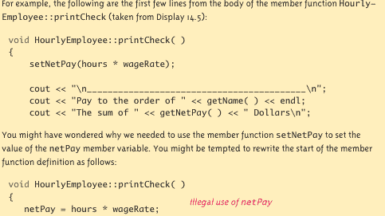


subversion. 如果派生类的成员函数定义中可以访问基类的私有成员变量，那么成员变量可能会被错误地或以不适当的方式更改。（请记住，访问器和修改器函数可以防止对成员变量进行不适当更改。）

我们将在本章稍后“受保护限定符”小节中讨论一种可能的解决方法，以绕过对基类私有成员变量的此限制。

### 陷阱 私有成员函数实际上并未被继承

如前一陷阱部分所述，基类中为私有的成员变量（或成员函数）在基类的接口和实现之外是无法直接访问的，甚至在派生类的成员函数定义中也无法直接访问。请注意，私有成员函数在不可直接使用方面与私有变量一样。在成员函数的情况下，此限制更为严重。私有变量可以通过访问器或修改器成员函数间接访问。私有成员函数则根本不可用。就好像私有成员函数未被继承一样。

这不应该成为问题。私有成员函数应仅用作帮助函数，因此其使用应限于定义它们的类。如果你希望一个成员函数在多个继承类中用作帮助成员函数，那么它就不仅仅是一个帮助函数，你应该将该成员函数设为 public。

### 受保护限定符

如你所见，你无法在派生类的定义或实现中访问私有成员变量或私有成员函数。存在一种成员变量和函数的分类，允许它们按名称在派生类中被访问，但不能在其他任何地方被访问，例如在非派生类中。如果你在使用成员变量或成员函数前使用限定符 protected 而非 private 或 public，那么对于派生类或函数以外的任何类或函数，其效果就如同该成员变量被标记为 private；然而，在派生类中，该变量可以通过名称访问。

例如，考虑派生自基类 Employee 的类 HourlyEmployee。我们被要求在 HourlyEmployee::printCheck 的定义中使用访问器和修改器成员函数来操作继承的成员变量。如果将类 Employee 中所有私有成员变量改用关键字 protected 而非 private 标记，则派生类 Employee 中 HourlyEmployee::printCheck 的定义可以简化为如下：

```
void HourlyEmployee::printCheck()
//Only works if the member variables of Employee are marked
//protected instead of private.
```
```cpp
{
    netPay = hours * wageRate;

    cout << "\n----------------------------------------------\n";
    cout << "Pay to the order of " << name << endl;
    cout << "The sum of $" << netPay << " Dollars\n";
    cout << "----------------------------------------------\n";
    cout << "Check Stub: NOT NEGOTIABLE\n";
    cout << "Employee Number: " << ssn << endl;
    cout << "Hourly Employee.\nHours worked: " << hours
         << "   Rate: " << wageRate << "   Pay: " << netPay << endl;
    cout << "----------------------------------------------\n";
}
```

在派生类 HourlyEmployee 中，继承的成员变量 name、netPay 和 ssn 可以按名称访问，前提是它们在基类 Employee 中被标记为 protected（而不是 private）。然而，在任何未派生自类 Employee 的类中，这些成员变量都被视为如同被标记为 private。

在基类中标记为 protected 的成员变量在任何派生类中也如同被标记为 protected。例如，假设你定义了类 HourlyEmployee 的派生类 PartTimeHourlyEmployee。类 PartTimeHourlyEmployee 继承了类 HourlyEmployee 的所有成员变量，包括 HourlyEmployee 从类 Employee 继承的成员变量。因此，类 PartTimeHourlyEmployee 将具有成员变量 netPay、name 和 ssn。如果这些成员变量在类 Employee 中被标记为 protected，则它们可以在类 PartTimeHourlyEmployee 的函数定义中使用。

除派生类（以及派生类的派生类等）外，被标记为 protected 的成员变量被视为与被标记为 private 相同。

我们主要包含对 protected 成员变量的讨论，因为你会看到它们被使用并且应该熟悉它们。许多，但并非所有编程权威人士都说使用 protected 成员变量是不良风格，因为这样会损害隐藏类实现的原则。他们说所有成员变量都应标记为 private。如果所有成员变量都标记为 private，则继承的私有成员变量无法按名称在派生类函数定义中访问。然而，这听起来并没有那么糟糕。继承的私有成员变量可以通过调用继承的函数间接访问，这些函数读取或更改私有继承变量。由于权威人士对是否应使用 protected 成员存在分歧，你必须自行决定是否使用它们。

### 受保护成员

如果你在使用成员变量前使用限定符 protected 而非 private 或 public，那么对于派生类或函数以外的任何类或函数，其效果就如同该成员变量被标记为 private。然而，在派生类的成员函数定义中，该变量可以通过名称访问。类似地，如果你在使用成员函数前使用限定符 protected，那么对于派生类或函数以外的任何类或函数，其效果就如同该成员变量被标记为 private。然而，在派生类的成员函数定义中，受保护的函数可以被使用。

受保护成员在派生类中被继承，就如同它们在派生类中被标记为 protected。换句话说，如果一个成员在基类中被标记为 protected，则它可以在所有后代类的定义中按名称访问，而不仅仅是在直接派生自基类的那些类中。

### 自测练习

- 1. 下列程序是否合法（假设已添加适当的 #include 和 using 指令！）？

```
void showEmployeeData(const Employee object);

int main()
{
    HourlyEmployee joe("Mighty Joe",
                        "123-45-6789", 20.50, 40);
    SalariedEmployee boss("Mr. Big Shot",
                          "987-65-4321", 10500.50);
    showEmployeeData(joe);
    showEmployeeData(boss);

    return 0;
}

void showEmployeeData(const Employee object)
{
    cout << "Name: " << object.getName() << endl;
    cout << "Social Security Number: "
         << object.getSsn() << endl;
}
```

- 2. 给出一个类 SmartBut 的定义，它是下面给出的基类 Smart 的派生类。无需考虑 #include 指令或命名空间细节。

```
class Smart
{
```
```
public:
    Smart();
    void printAnswer() const;
protected:
    int a;
    int b;
};

该类应有一个额外的 bool 类型的数据字段 crazy；一个不带参数并返回 bool 类型值的额外成员函数；以及合适的构造函数。新的函数名为 isCrazy。你不需要给出任何实现，只需给出类定义即可。

- 3. 下列是否是派生类 SmartBut 中成员函数 isCrazy 的合法定义，如自测练习 2 中所述？解释你的答案。（请记住，问题问的是是否合法，而不是是否是一个合理的定义。）

```
bool SmartBut::isCrazy() const
{
    if (a > b)
        return crazy;
    else
        return true;
}
```

### ■ 成员函数的重新定义

在派生类 HourlyEmployee 的定义中（Display 14.3），我们给出了新成员函数 setRate、getRate、setHours 和 getHours 的声明。我们还只给出了从类 Employee 继承的成员函数之一的函数声明。未给出函数声明的继承成员函数（如 setName 和 setSsn）保持不变继承。它们在类 HourlyEmployee 中的定义与在基类 Employee 中相同。当你定义像 HourlyEmployee 这样的派生类时，你只列出你想要更改其定义以在派生类中具有不同定义的继承成员函数的函数声明。如果你查看类 HourlyEmployee 的实现（Display 14.5），你会看到我们重新定义了继承的成员函数 printCheck。类 SalariedEmployee 也对成员函数 printCheck 提供了新的定义，如 Display 14.6 所示。而且，这两个类给出了不同的定义。函数 printCheck 在派生类中被重新定义。

Display 14.7 给出了一个演示程序，说明了派生类 HourlyEmployee 和 SalariedEmployee 的使用。


# 重定义继承的函数

派生类继承了基类所属的所有成员函数（和成员变量）。然而，如果派生类需要对继承的成员函数使用不同的实现，则可以在派生类中重定义该函数。当成员函数被重定义时，你必须在派生类的定义中列出其声明，即使该声明与基类中的声明相同。如果不希望重定义从基类继承的成员函数，则不要在派生类的定义中列出它。

### Display 16-7 Using Derived Classes (part 1 of 2)

```cpp
#include <iostream>
#include "hourlyemployee.h"
#include "salariedemployee.h"
using std::cout;
using std::endl;
using SavitchEmployees::HourlyEmployee;
using SavitchEmployees::SalariedEmployee;

int main()
{
    HourlyEmployee joe;

    joe.setName("Mighty Joe");
    joe.setSsn("123-45-6789");
    joe.setRate(20.50);
    joe.setHours(40);
    cout << "Check for " << joe.getName()
         << " for " << joe.getHours() << " hours.\n";
    joe.printCheck();
    cout << endl;

    SalariedEmployee boss("Mr. Big Shot", "987-65-4321", 10500.50);
    cout << "Check for " << boss.getName() << endl;
    boss.printCheck();

    return 0;
}
```

*函数 setName、setSsn、setRate、setHours 和 getName 是从类 Employee 继承而来且未改变。函数 printCheck 被重定义。函数 getHours 被添加到派生类 HourlyEmployee 中。*

### Display 14.7 Using Derived Classes (part 2 of 2)

#### SAMPLE DIALOGUE

```
Check for Mighty Joe for 40 hours.
------------------------------------------------
Pay to the order of Mighty Joe
The sum of 820 Dollars
------------------------------------------------
Check Stub: NOT NEGOTIABLE
Employee Number: 123-45-6789
Hourly Employee.
Hours worked: 40 Rate: 20.5 Pay: 820
------------------------------------------------
Check for Mr. Big Shot
------------------------------------------------
Pay to the order of Mr. Big Shot
The sum of 10500.5 Dollars
------------------------------------------------
Check Stub NOT NEGOTIABLE
Employee Number: 987-65-4321
Salaried Employee. Regular Pay: 10500.5
------------------------------------------------
```

# 重定义与重载

不要将派生类中重定义函数定义与重载函数名混淆。当你重定义函数定义时，派生类中给出的新函数定义具有相同数量和类型的参数。当你重载一个函数时，派生类中的函数与基类中的函数相比参数数量不同或参数类型不同，并且派生类同时拥有这两个函数。例如，假设我们在类 HourlyEmployee 的定义中添加了以下函数声明：

```
void setName(string firstName, string lastName);
```

类 HourlyEmployee 将拥有这个有两个参数的函数 setName，并且还会继承以下有一个参数的函数 setName：

```
void setName(string newName);
```

类 HourlyEmployee 将拥有两个名为 setName 的函数。这就是对函数名 setName 的重载。

另一方面，类 Employee 和类 HourlyEmployee 都定义了具有以下函数声明的函数：

```
void printCheck( );
```

在这种情况下，类 HourlyEmployee 只有一个名为 printCheck 的函数，但类 HourlyEmployee 的 printCheck 函数的定义与类 Employee 的定义不同。在这种情况下，函数 printCheck 已经被重定义。

如果你把重定义和重载搞混了，你也有一点安慰：它们都是合法的。因此，学习如何使用它们比学习如何区分它们更重要。尽管如此，你仍应学习它们之间的区别。

# SIGNATURE

函数的签名是函数名加上参数列表中的类型序列，不包括 const 关键字和与号 &。当你重载一个函数名时，根据这种签名定义，函数名的两个定义必须具有不同的签名。有些权威人士将 const 和/或与号包含在签名中，但我们希望有一个可以用于解释重载的定义。派生类中与基类中同名但签名不同的函数是被重载的，而不是被重定义的。

（正如我们在第 4 章中所指出的，一些编译器实际上允许你基于 const 与非 const 来重载，但你不应依赖这一点。C++ 标准说这是不允许的。）

# ACCESS TO A REDEFINED BASE FUNCTION

假设你重定义了一个函数，使其在派生类中的定义与基类中的定义不同。基类中给出的定义并没有完全丢失给派生类对象。然而，如果你想用派生类对象调用基类中给出的函数版本，你需要一种方法来说明“使用基类中给出的该函数的定义（即使我是一个派生类对象）”。你使用作用域解析运算符与基类名来说明这一点。一个例子应该能阐明细节。

考虑基类 Employee（Display 14.1）和派生类 HourlyEmployee（Display 14.3）。函数 printCheck() 在两个类中都被定义。现在假设你有每个类的一个对象，如下所示：

```
Employee JaneE;
HourlyEmployee SallyH;
```

那么

```
JaneE.printCheck( );
```

使用类 Employee 中给出的 printCheck 的定义，而

```
SallyH.printCheck( );
```

使用类 HourlyEmployee 中给出的 printCheck 的定义。

但假设你想用派生类对象 SallyH 作为 printCheck 的调用对象来调用基类 Employee 定义中给出的 printCheck 版本。你可以按如下方式执行：

```
SallyH.Employee::printCheck( );
```

当然，你不太可能想使用特定类 Employee 中给出的 printCheck 版本，但在其他类和其他函数中，你偶尔可能想用派生类对象使用基类中的函数定义。示例见自测练习 6。

# FUNCTIONS THAT ARE NOT INHERITED

作为一般规则，如果 Derived 是以 Base 为基类的派生类，那么类 Base 中的所有“普通”函数都是类 Derived 可用的继承成员。然而，有一些特殊函数在实际操作中并不被继承。我们已经看到，从实际角度来看，构造函数不被继承，私有成员函数也不被继承。析构函数（在第 14.2 节中讨论）也实际上不被继承。

拷贝构造函数不被继承，但如果你没有在派生类（或任何类）中定义拷贝构造函数，C++ 会自动为你生成一个拷贝构造函数。然而，这个默认拷贝构造函数只是复制成员变量的内容，对于类中成员变量包含指针或动态数据的类来说工作不正确。因此，如果你的类成员变量涉及指针、动态数组或其他动态数据，你应该为该类定义拷贝构造函数。这适用于派生类与否。

赋值运算符 = 也不被继承。如果基类 Base 定义了赋值运算符，但派生类 Derived 没有定义赋值运算符，那么类 Derived 将拥有一个赋值运算符，但它将是 C++ 在你未定义 = 时创建的默认赋值运算符；它与 Base 中定义的基类赋值运算符无关。定义赋值运算符的技术在第 14.2 节的“派生类中的赋值运算符和拷贝构造函数”小节中讨论。

构造函数、析构函数和赋值运算符不被继承是很自然的。为了正确执行它们的任务，它们需要基类不具备的信息；即，它们需要知道派生类中引入的新成员变量。


# 自测练习

4. 类 SalariedEmployee 同时从基类 Employee 继承了函数 getName 和 printCheck（以及其他内容），但在类 SalariedEmployee 的定义中只给出了函数 printCheck 的函数声明。为什么在 SalariedEmployee 的定义中没有给出函数 getName 的函数声明？

5. 给出一个类 TitledEmployee 的定义，该类是第 14.4 节中给出的基类 SalariedEmployee 的派生类。类 TitledEmployee 有一个额外的成员变量，类型为 string，名为 title。它还有两个额外的成员函数：getTitle，不带参数并返回一个 string，以及 setTitle，是一个 void 函数，带有一个类型为 string 的参数。它还重新定义了成员函数 setName。你不需要给出任何实现，只需给出类定义即可。但是要给出所有需要的 #include 指令和所有 using namespace 指令。将类 TitledEmployee 放在命名空间 SavitchEmployees 中。

6. 给出你在自测练习 5 的答案中给出的类 TitledEmployee 的构造函数的定义。另给出成员函数 setName 的重新定义。函数 setName 应该将 title 插入到 name 中。不要费心给出 #include 指令或命名空间细节。

7. 你知道重载的赋值运算符和拷贝构造函数是不会被继承的。这是否意味着如果不为派生类定义重载的赋值运算符或拷贝构造函数，那么该派生类将没有赋值运算符和拷贝构造函数？

### 14.2 使用继承进行编程

魔鬼在细节中。

俗语

本节介绍有关继承的一些更微妙的细节，并提供另一个完整示例，以及关于继承和相关编程技术的一些讨论。本节中的材料使用了动态数组（第 10 章），并且大多数主题仅与使用动态数组或指针和其他动态数据的类相关。

### 派生类中的赋值运算符和拷贝构造函数

重载的赋值运算符和构造函数不会被继承。但是，它们可以在派生类中重载的赋值运算符和拷贝构造函数的定义中使用——在几乎所有情况下都必须使用。

在派生类中重载赋值运算符时，你通常会使用基类的重载赋值运算符。为了帮助理解我们将给出的代码大纲，请记住，重载的赋值运算符必须定义为类的成员函数。

如果 Derived 是从 Base 派生的类，那么类 Derived 的重载赋值运算符的定义通常会以如下内容开始：

```
Derived& Derived::operator =(const Derived& RightSide)
{
    Base::operator =(rightSide);
}
```

定义体中的第一行代码是对 Base 类的赋值运算符的调用。这负责继承的成员变量及其数据。重载赋值运算符的定义随后将继续设置在类 Derived 的定义中引入的新成员变量。本章后面“带备份的部分填充数组”的编程示例中给出了包含此技术的完整示例。

对于在派生类中定义拷贝构造函数的情况也是类似的。如果 Derived 是从 Base 派生的类，那么类 Derived 的拷贝构造函数的定义通常会使用类 Base 的拷贝构造函数来设置继承的成员变量及其数据。代码通常会以如下内容开始：

```
Derived::Derived(const Derived& Object)
    : Base(Object), <probably more initializations>
{
```

对基类拷贝构造函数 Base(Object) 的调用设置正在创建的 Derived 类对象的继承成员变量。请注意，由于 Object 的类型为 Derived，因此它也是类型为 Base；因此，Object 是类 Base 的拷贝构造函数的合法参数。本章后面“带备份的部分填充数组”的编程示例中给出了包含基类中拷贝构造函数的完整示例。

当然，这些技术只有在你拥有一个功能正确的赋值运算符和一个功能正确的拷贝构造函数供基类使用时才有效。这意味着基类定义必须包含一个拷贝构造函数，并且基类的默认自动创建的赋值运算符对基类有效，或者基类具有赋值运算符的重载定义。

### 派生类中的析构函数

如果基类具有功能正确的析构函数，那么在从基类派生的类中定义一个功能正确的析构函数就相对容易了。当派生类的析构函数被调用时，它会自动调用基类的析构函数，

因此无需显式编写对基类析构函数的调用；它总是自动发生的。派生类析构函数因此只需担心对在派生类中添加的成员变量（以及它们指向的任何数据）使用 delete。调用继承的成员变量上的 delete 是基类析构函数的工作。

如果类 B 从类 A 派生，并且类 C 从类 B 派生，那么当类 C 的对象超出作用域时，首先调用类 C 的析构函数，然后调用类 B 的析构函数，最后调用类 A 的析构函数。请注意，析构函数调用的顺序与构造函数调用的顺序相反。我们在“带备份的部分填充数组”的编程示例中给出了在派生类中编写析构函数的示例。

### 带备份的部分填充数组

本示例展示了第 10 章中我们介绍的部分填充数组类 PFArrayD 的派生类（第 10.10 节）。作为参考，我们在第 14.8 节中重复了基类 PFArrayD 的头文件。我们在第 14.9 节中重复了基类 PFArrayD 的实现中我们将讨论的大部分内容。请注意，我们对第 10 章中给出的定义做了一个重要更改。我们已将成员变量从 private 改为 protected。这将允许派生类中的成员函数按名称访问成员变量。

我们将使用 PFArrayD 作为基类定义一个名为 PFArrayDBak 的派生类。派生类 PFArrayDBak 的对象将具有基类 PFArrayD 的所有成员函数，并且可以像 PFArrayD 类的对象一样使用，但 PFArrayDBak 类的对象将具有以下附加功能：有一个名为 backup 的成员函数可以制作部分填充数组中所有数据的备份副本，并且在任何稍后时间，程序员可以使用成员函数 restore 将部分填充数组恢复到上一次调用 backup 之前的状态。如果这些新增成员函数的含义不明确，你应该预览一下第 14.12 节中显示的示例演示程序。

派生类 PFArrayDBak 的接口显示在第 14.10 节。类 PFArrayDBak 添加了两个成员变量来保存部分填充数组的备份副本：一个类型为 double* 的成员变量 b，它将指向一个动态数组，其中包含（继承的）工作数组的备份版本，以及一个名为 usedB 的 int 成员变量，用于指示备份数组中有多少被数据填充。由于没有办法更改 PFArrayD（或 PFArrayDBak）的容量，因此无需备份容量值。处理部分填充数组的所有基本函数都从基类 PFArrayD 不变地继承。这些继承的函数像在基类 PFArrayD 中一样操作继承的数组 a 和继承的 int 变量 used。

类 PFArrayDBak 的新成员函数的实现显示在第 14.11 节。派生类 PFArrayDBak 的构造函数依赖于基类的构造函数来设置常规的部分填充数组（继承的成员变量 a、used 和 capacity）。每个构造函数还创建一个与数组 a 相同大小的新动态数组。这个第二个数组是用于备份 a 中数据的数组 b。


### 显示图 4.8 **基类 PFArrayD 的接口**

```
//This is the header file pfarrayd.h. This is the interface for the class
//PFArrayD. Objects of this type are partially filled arrays of doubles.
#ifndef PFARRAYD_H
#define PFARRAYD_H

class PFArrayD
{
public:
    PFArrayD( );
    //Initializes with a capacity of 50.

    PFArrayD(int capacityValue);

    PFArrayD(const PFArrayD& pfObject);

    void addElement(double element);
    //Precondition: The array is not full.
    //Postcondition: The element has been added.

    bool full( ) const;
    //Returns true if the array is full, false otherwise.

    int getCapacity( ) const;

    int getNumberUsed( ) const;

    void emptyArray( );
    //Resets the number used to zero, effectively emptying the array.

    double& operator[](int index);
    //Read and change access to elements 0 through numberUsed − 1.

    PFArrayD& operator =(const PFArrayD& rightSide);

    ~PFArrayD( );
protected:
    double *a; //for an array of doubles.
    int capacity; //for the size of the array.
    int used; //for the number of array positions currently in use.
};

#endif //PFARRAYD_H
```

### 显示 14.9 基类 PFArrayD 的实现（第 1 部分，共 2 部分）

```
#include <iostream>
using std::cout;
#include "pfarrayd.h"

PFArrayD::PFArrayD() : capacity(50), used(0)
{
    a = new double[capacity];
}

PFArrayD::PFArrayD(int size) : capacity(size), used(0)
{
    a = new double[capacity];
}

PFArrayD::PFArrayD(const PFArrayD& pfaObject)
    :capacity(pfaObject.getCapacity()), used(pfaObject.getNumberUsed())
{
    a = new double[capacity];
    for (int i = 0; i < used; i++)
        a[i] = pfaObject.a[i];
}

double& PFArrayD::operator[](int index)
{
    if (index >= used)
    {
        cout << "Illegal index in PFArrayD.\n";
        exit(0);
    }

    return a[index];
}
PFArrayD& PFArrayD::operator =(const PFArrayD& rightSide)
{
    if (capacity != rightSide.capacity)
    {
        delete [] a;
        a = new double[rightSide.capacity];
    }

    capacity = rightSide.capacity;
    used = rightSide.used;
    for (int i = 0; i < used; i++)
        a[i] = rightSide.a[i];
```

> 这是实现文件 pfarrayd.cpp 的一部分。完整的实现在显示 10.11 中给出，但这里展示的内容已足够本章使用。

### 显示 14.9 基类 PFArrayD 的实现（第 2 部分，共 2 部分）

```
40     return *this;
41   }
42 
42 PFArrayD::~PFArrayD()
43 {
44     delete [] a;
45 }
```

### 显示 14.10 派生类 PFArrayDBak 的接口

```
1  //This is the header file pfarraydbak.h. This is the interface for the class
2  //PFArrayDBak. Objects of this type are partially filled arrays of doubles.
3  //This version allows the programmer to make a backup copy and restore
4  //to the last saved copy of the partially filled array.
5  #ifndef PFARRAYDBAK_H
6  #define PFARRAYDBAK_H
7  #include "pfarrayd.h"
8  
9  class PFArrayDBak : public PFArrayD
10 {
11   public:
12     PFArrayDBak();
13     //Initializes with a capacity of 50.
14     
15     PFArrayDBak(int capacityValue);
16     
17     PFArrayDBak(const PFArrayDBak& Object);
18     
19     void backup();
20     //Makes a backup copy of the partially filled array.
21     
22     void restore();
23     //Restores the partially filled array to the last saved version.
24     //If backup has never been invoked, this empties the partially filled
25     //array.
26     
27     PFArrayDBak& operator =(const PFArrayDBak& rightSide);
28     
29     ~PFArrayDBak();
30   private:
31     double *b; //for a backup of main array.
32     int usedB; //backup for inherited member variable used.
33 };
34 
35 #endif //PFARRAYD_H
```

### 显示 14.11 派生类 PFArrayDBak 的实现（第 1 部分，共 2 部分）

```
//This is the file pfarraydbak.cpp.
//This is the implementation of the class PFArrayDBak.
//The interface for the class PFArrayDBak is in the file pfarraydbak.h.
#include "pfarraydbak.h"
#include <iostream>
using std::cout;

PFArrayDBak::PFArrayDBak( ) : PFArrayD( ), usedB(0)
{
    b = new double[capacity];
}

PFArrayDBak::PFArrayDBak(int capacityValue) : PFArrayD(capacityValue), usedB(0)
{
    b = new double[capacity];
}

PFArrayDBak::PFArrayDBak(const PFArrayDBak& oldObject)
    : PFArrayD(oldObject), usedB(0)
{
    b = new double[capacity];
    usedB = oldObject.usedB;
    for (int i = 0; i < usedB; i++)
        b[i] = oldObject.b[i];
}

void PFArrayDBak::backup( )
{
    usedB = used;
    for (int i = 0; i < usedB; i++)
        b[i] = a[i];
}

void PFArrayDBak::restore( )
{
    used = usedB;
    for (int i = 0; i < used; i++)
        a[i] = b[i];
}

PFArrayDBak& PFArrayDBak::operator=(const PFArrayDBak& rightSide)
{
    PFArrayD::operator=(rightSide);
    if (capacity != rightSide.capacity)
    {
        delete [] b;
```

请注意，b 是数组 a 的副本。我们不希望使用 b = a;。

为了给基类的成员变量赋值，需要调用基类的赋值运算符。

```
delete [] b;
 b = new double[rightSide.capacity];
}
```

请注意，if 语句中的布尔表达式确保当赋值运算符两侧的对象的容量相同时，b 不会被删除。特别是，这确保了当同一个对象出现在赋值运算符两侧时，数组 b 不会被删除。在此之后，数据复制就是常规操作了。

请注意，类 PFArrayDBak 的析构函数没有显式提及继承来的成员变量 a。它只是通过以下代码将 b 数组的内存归还给自由存储区以供回收：

```
delete [] b;
```

继承来的数组 a 的内存也同样被归还给自由存储区，尽管你在派生类 PFArrayDBak 的析构函数中看不到任何对 a 的提及。当派生类 PFArrayDBak 的析构函数被调用时，它会在动作结束时自动调用基类 PFArrayD 的析构函数，而该析构函数包含以下释放 a 的代码：

```
delete [] a;
```

类 PFArrayDBak 的演示程序见显示 14.12。

### 显示 14.12 类 PFArrayDBak 的演示程序（第 1 部分，共 3 部分）

```
1 //Program to demonstrate the class PFArrayDBak.
2 #include <iostream>
3 #include "pfarraydbak.h"
4 using std::cin;
5 using std::cout;
6 using std::endl;
7
8 void testPFArrayDBak( );
//Conducts one test of the class PFArrayDBak.
9
10 int main( )
11 {
12   cout << "This program tests the class PFArrayDBak.\n";
13
14   char ans;
15   do
16   {
17     testPFArrayDBak( );
18     cout << "Test again? (y/n) ";
```

### 显示 14.12 类 PFArrayDBak 的演示程序（第 2 部分，共 3 部分）

```
17    cin >> ans;
18 }while ((ans == 'y') || (ans == 'Y'));
19
20 }
21
22 void testPFArrayDBak()
23 {
24     int cap;
25     cout << "Enter capacity of this super array: ";
26     cin >> cap;
27     PFArrayDBak a(cap);
28
29     cout << "Enter up to " << cap << " nonnegative numbers.\n";
30     cout << "Place a negative number at the end.\n";
31
32     double next;
33
34     cin >> next;
35     while ((next >= 0) && (!a.full()))
36     {
37         a.addElement(next);
38         cin >> next;
39     }
40
41     if (next >= 0)
42     {
43         cout << "Could not read all numbers.\n";
44         //Clear the unread input:
45         while (next >= 0)
46             cin >> next;
47     }
48
49     int count = a.getNumberUsed();
50     cout << "The following " << count
51     << " numbers read and stored:\n";
52     int index;
53     for (index = 0; index < count; index++)
54         cout << a[index] << " ";
55     cout << endl;
56
57     cout << "Backing up array.\n";
58     a.backup();
59
60     cout << "Emptying array.\n";
```

### 显示 14.12 类 PFArrayDBak 的演示程序（第 3 部分，共 3 部分）

```
53    a.emptyArray( );
54    cout << a.getNumberUsed( )
55        << " numbers are now stored in the array.\n";

56    cout << "Restoring array.\n";
57    a.restore( );
58    count = a.getNumberUsed( );
59    cout << "The following " << count
60        << " numbers are now stored:\n";
61    for (index = 0; index < count; index++)
62        cout << a[index] << " ";
63    cout << endl;
64 }
```

# 示例对话

本程序测试类 PFArrayDBak。
请输入该超级数组的容量：10
请输入不超过 10 个非负数。
请在末尾输入一个负数。
1 2 3 4 5 -1
以下 5 个数字已被读取并存储：
1 2 3 4 5
正在备份数组。
正在清空数组。
现在数组中存储了 0 个数字。
正在恢复数组。
以下 5 个数字现已存储：
1 2 3 4 5
是否再次测试？(y/n) y
请输入该超级数组的容量：5
请输入不超过 5 个非负数。
请在末尾输入一个负数。
1 2 3 4 5 6 7 -1
无法读取全部数字。
以下 5 个数字已被读取并存储：
1 2 3 4 5
正在备份数组。
正在清空数组。
现在数组中存储了 0 个数字。
正在恢复数组。
以下 5 个数字现已存储：
1 2 3 4 5
是否再次测试？(y/n) n


# 陷阱

### 赋值运算符两边是同一对象

每当你重载赋值运算符时，务必确保你的定义在赋值运算符两边出现同一对象时也能正常工作。在大多数情况下，你需要用一些专门的代码将其作为特例处理。编程示例“带备份的部分填充数组”中给出了一个例子。

### 自测练习

- 8. 假设 Child 是从类 Parent 派生的类，而类 Grandchild 是从类 Child 派生的类。本题涉及三个类 Parent、Child 和 Grandchild 的构造函数和析构函数。当类 Grandchild 的构造函数被调用时，哪些构造函数会被调用以及调用顺序如何？当类 Grandchild 的析构函数被调用时，哪些析构函数会被调用以及调用顺序如何？
- 9. 以下对类 PFArrayDBak 的默认构造函数的替代定义是否合法？（Display 14.10 和 14.11 中对基类构造函数的调用已被省略。）解释你的答案。

```cpp
PFArrayDBak::PFArrayDBak() : usedB(0)
{
    b = new double[capacity];
}
```

### 示例：

### PFArrayDBak 的替代实现

乍一看，似乎我们需要将基类 PFArrayD 的成员变量设为 protected，以便给出派生类 PFArrayDBak 的成员函数的定义。毕竟，其中许多成员函数都操作继承的成员变量 a、used 和 capacity。我们在 Display 14.11 中给出的实现确实按名称引用了 a、used 和 capacity，因此这些特定的定义确实依赖于这些成员变量在基类中为 protected（而不是 private）。然而，基类中已有足够的访问器和修改器函数，只要多思考一下，我们就可以重写派生类 PFArrayDBak 的实现，使其即使在基类 PFArrayD 中的所有成员变量都是 private（而非 protected）时也能工作。

Display 14.13 显示了类 PFArrayDBak 的一种替代实现，即使基类中的所有成员变量为 private 而非 protected 也能正常工作。与之前实现不同的部分已着色。大多数更改都很明显，但有几点值得注意。

考虑成员函数 backup。在我们之前的实现（Display 14.1）中，我们将数组条目从 a 复制到 b。由于 a 现在是 private，我们无法按名称访问它，但我们已重载了数组方括号运算符（`operator[]`），使其适用于 PFArrayD 类型的对象，并且该运算符在 PFArrayDBak 中被继承。我们只需使用调用对象的 `operator[]`。净效果是将数组 a 复制到数组 b，但我们从未按名称提及私有数组 a。代码如下：

```
usedB = getNumberUsed( );
for (int i = 0; i < usedB; i++)
    b[i] = operator[](i);
```

务必注意调用正在定义类的运算符的语法。如果 superArray 是 PFArrayDBak 类的对象，则在调用 superArray.backup( ) 时，记号 `operator[](i)` 表示 superArray[i]。

我们本可以在成员函数 restore 的定义中使用记号 `operator[](i)`，但使用继承的成员函数 empty—Array 来清空数组 a，然后使用 addElement 添加备份的元素也同样简单。这样，我们也在过程中设置了私有成员变量 used。

使用这种替代实现，类 PFArrayDBak 的使用方式与之前的实现完全相同。特别是，Display 14.12 中的演示程序对两种实现都完全相同。

### 一个类可以访问该类的所有对象的私有成员

考虑 Display 14.13 中给出的重载赋值运算符实现中的以下行：

```
usedB = rightSide.usedB;
for (int i = 0; i < usedB; i++)
    b[i] = rightSide.b[i];
```

你可能会反对说 rightSide.usedB 和 rightSide.b[i] 是非法的，因为 usedB 和 b 是除调用对象之外的某个对象的私有成员变量。通常这种反对意见是正确的。然而，对象 rightSide 与正在定义的类是同一类型，因此这是合法的。

在类的定义中，你可以访问该类的任何对象的私有成员，而不仅仅是调用对象的私有成员。

### Display 14.13  PFArrayDBak 的替代实现（第 1 部分，共 2 部分）

```
//This is the file pfarraydbak.cpp.
//This is the implementation of the class PFArrayDBak.
//The interface for the class PFArrayDBak is in the file pfarraydbak.h.
#include "pfarraydbak.h"
#include <iostream>
using std::cout;

PFArrayDBak::PFArrayDBak( ) : PFArrayD( ), usedB(0)
{
    b = new double[getCapacity( )];
}

PFArrayDBak::PFArrayDBak(int capacityValue) : PFArrayD(capacityValue), usedB(0)
{
    b = new double[getCapacity( )];
}

PFArrayDBak::PFArrayDBak(const PFArrayDBak& oldObject)
    : PFArrayD(oldObject), usedB(0)
{
    b = new double[getCapacity( )];
    usedB = oldObject.usedB;
    for (int i = 0; i < usedB; i++)
        b[i] = oldObject.b[i];
}

void PFArrayDBak::backup( )
{
    usedB = getNumberUsed( );
    for (int i = 0; i < usedB; i++)
        b[i] = operator[ ](i);
}

void PFArrayDBak::restore( )
{
    emptyArray( );
    for (int i = 0; i < usedB; i++)
        addElement(b[i]);
}

PFArrayDBak& PFArrayDBak::operator =(const PFArrayDBak& rightSide)
{
    PFArrayD::operator =(rightSide);
}
```

> 此实现即使基类中的所有成员变量为 private（而非 protected）也能工作。

> 使用调用对象调用方括号运算符

### Display 14.13  PFArrayDBak 的替代实现（第 2 部分，共 2 部分）

```
39    if (getCapacity() != rightSide.getCapacity())
40    {
41        delete [] b;
42        b = new double[rightSide.getCapacity()];
43    }
44
45    usedB = rightSide.usedB;
46    for (int i = 0; i < usedB; i++)
47        b[i] = rightSide.b[i];

48    return *this;
49 }

50 PFArrayDBak::~PFArrayDBak( )
51 {
52    delete [] b;
53 }
```

### 提示  “Is A” 与 “Has A”

- “is a” 关系
- “has a” 关系

本章早期我们使用类 Employee 作为基类定义了一个派生类 HourlyEmployee。在这种情况下，派生类 HourlyEmployee 的对象也是 Employee 类型。更简单地说，HourlyEmployee 是 Employee。这就是类之间“is a”关系的例子。这是从简单类构建更复杂类的一种方式。

从简单类构建更复杂类的另一种方式被称为“has a”关系。例如，如果你有一个表示日期的类，那么你可以通过向 Employee 类添加一个类型为 Date 的成员变量来为 Employee 类添加雇佣日期。在这种情况下我们说 Employee “has a” Date。另一个例子是，如果我们有一个适当命名的类来模拟喷气发动机，并且我们正在定义一个类来模拟客机，那么我们可以给 PassengerAirPlane 类一个或多个类型为 JetEngine 的成员变量。在这种情况下我们说 PassengerAirPlane “has a” JetEngine。

在大多数情况下，你可以使用“is a”关系或“has a”关系让代码工作。让 PassengerAirPlane 类成为 JetEngine 类的派生类似乎很愚蠢（而且确实很愚蠢），但可以做到并且可以使其工作（也许会有困难）。幸运的是，最佳编程技术就是遵循英语中最自然的说法。说“客机有一台喷气发动机”比说“客机是一台喷气发动机”更有意义。因此，从编程角度来看，让 JetEngine 成为 PassengerAirPlane 类的成员变量更有意义。让 PassengerAirPlane 类成为 JetEngine 类的派生类意义不大。


# 自测练习

+   10. 假设你定义了一个参数类型为 PFArrayD 的函数。能否将 PFArrayDBak 类的对象作为该函数的实参传入？
+   
+   11. 以下作为添加到 Employee 类（Display 14.1）的成员函数的定义是否合法？（请记住，问题是它是否合法，而不是它是否合理。）

```
void Employee::doStuff()
{
    Employee object("Joe", "123-45-6789");
    cout << "Hello " << object.name << endl;
}
```

### 保护继承和私有继承

到目前为止，我们所有派生类的定义在类头中都包含了关键字 public，如下所示：

```
class SalariedEmployee : public Employee
{
```

这可能会让你怀疑，public 一词是否可以替换为 protected 或 private，从而获得不同种类的继承。在这种情况下，你的怀疑是正确的。然而，保护继承和私有继承很少使用。为了完整起见，我们对它们进行简要描述。

保护继承和私有继承的语法如下所示：

```
class SalariedEmployee : protected Employee
{
```

如果你使用关键字 protected 进行继承，那么基类中公有的成员在派生类中继承时将是受保护的。如果你使用关键字 private 进行继承，那么基类的所有成员（公有的、受保护的和私有的）在派生类中都不可访问；换句话说，所有成员继承后都如同它们在基类中被标记为私有的一样。

此外，使用保护继承和私有继承时，派生类的对象不能用作基类类型的实参。如果 Derived 是使用 protected 或 private（而不是 public）从 Base 派生的，那么 Derived 类型的对象就不是 Base 类型的对象；“是一个”关系不适用于保护继承和私有继承。其思想是，使用保护继承和私有继承时，基类仅仅是用于定义派生类的一个工具。虽然保护继承和私有继承可以用于某些目的，但正如你可能怀疑的那样，它们很少被使用，而且它们可能有的任何用途都可以通过其他方式实现。

关于保护继承和私有继承的详细信息总结在 Display 14.14 中。

### Display 14.14 公有继承、保护继承和私有继承

| 基类中的访问说明符 | 继承类型（派生类定义中类名后的说明符） | | |
|---|---|---|---|
| | public | protected | private |
| public | 公有 | 保护 | 私有（只能在成员函数和友元的定义中按名称使用） |
| protected | 保护 | 保护 | 私有（只能在成员函数和友元的定义中按名称使用） |
| private | 不能在派生类中按名称访问 | 不能在派生类中按名称访问 | 不能在派生类中按名称访问 |

表中的条目显示了继承的成员在派生类中如何处理。

请注意，保护继承和私有继承并不是我们在公有继承中所描述的那种继承。使用保护继承或私有继承时，基类只是派生类中使用的一个工具。

### 多重继承

一个派生类可以有多个基类。语法非常简单：列出所有基类，用逗号分隔。然而，产生歧义的可能性很多。如果两个基类有一个名称和参数类型都相同的函数，该怎么办？继承哪一个？如果两个基类有一个同名成员变量，又该怎么办？所有这些问题都可以回答，但这些问题和其他问题使得多重继承成为一件非常危险的事情。一些权威人士认为多重继承过于危险，根本不应该使用。这种立场可能过于极端，也可能并非如此，但事实上，在你成为非常有经验的 C++ 程序员之前，不应认真尝试多重继承。到那时，你会意识到几乎总是可以通过使用某种危险性较低的技术来避免多重继承。本书不讨论多重继承，而是将其留给更高级的参考资料。

### 章节总结

+   - 继承通过从一个类派生另一个类并在派生类中添加功能，提供了一种代码复用的工具。
+   - 派生类对象继承基类的成员，并且可以添加成员。
+   - 如果成员变量在基类中是私有的，则不能在派生类中按名称访问它。
+   - 私有成员函数不会被继承。
+   - 可以在派生类中重新定义成员函数，使其行为与基类中的行为不同。即使重新定义的成员函数的声明与基类中的声明相同，也必须给出该声明。
+   - 基类中的受保护成员可以在公有派生类的成员函数定义中按名称访问。
+   - 重载的赋值运算符不会被继承。但是，基类的赋值运算符可以在派生类的重载赋值运算符的定义中使用。
+   - 构造函数不会被继承。但是，基类的构造函数可以在派生类的构造函数定义中使用。

### 自测练习答案

+   1. 可以。你可以将派生类的对象作为基类类型参数的实参。
      `HourlyEmployee` 是一个 `Employee`。`SalariedEmployee` 是一个 `Employee`。
+   
+   2. ```cpp
   class SmartBut : public Smart
   {
   public:
       SmartBut( );
       SmartBut(int newA, int newB, bool newCrazy);
       bool isCrazy( ) const;
   private:
       bool crazy;
   };
   ```
+   
+   3. 这是合法的，因为 `a` 和 `b` 在基类 `Smart` 中被标记为 protected，因此可以在派生类中按名称访问。如果 `a` 和 `b` 被标记为 private，那么这就是非法的。
+   
+   4. 函数 `getName` 的声明没有在 `SalariedEmployee` 的定义中给出，因为它没有在 `SalariedEmployee` 类中重新定义。它是从基类 `Employee` 原样继承而来的。

```
5. #include <iostream>
#include "salaryemployee.h"
using namespace std;
namespace SavitchEmployees
{
    class TitledEmployee : public SalariedEmployee
    {
    public:
        TitledEmployee();
        TitledEmployee(string theName, string theTitle,
            string theSsn, double theSalary);
        string getTitle() const;
        void setTitle(string theTitle);
        void setName(string theName);
    private:
        string title;
    };
}//SavitchEmployees
```

```
6. namespace SavitchEmployees
{
    TitledEmployee::TitledEmployee()
        : SalariedEmployee(), title("No title yet")
    {
        //deliberately empty
    }

    TitledEmployee::TitledEmployee(string theName,
        string theTitle,
        string theSsn, double theSalary)
        : SalariedEmployee(theName, theSsn, theSalary),
          title(theTitle)
    {
        //deliberately empty
    }

    void TitledEmployee::setName(string theName)
    {
        Employee::setName(title + " " + theName);
    }
}//SavitchEmployees
```

7. 不是。如果你没有为派生类定义重载赋值运算符或复制构造函数，那么将为派生类定义默认赋值运算符和默认复制构造函数。然而，如果类涉及指针、动态数组或其他动态数据，那么默认赋值运算符和默认复制构造函数几乎肯定都不会按你所期望的方式运行。

8. 构造函数的调用顺序如下：首先是 Parent，然后是 Child，最后是 Grandchild。析构函数的调用顺序相反：首先是 Grandchild，然后是 Child，最后是 Parent。

9. 是的，这是合法的，并且与 Display 14.11 中给出的定义具有相同的含义。如果没有调用基类构造函数，那么将自动调用基类的默认构造函数。

10. 可以。派生类的对象也是其基类的对象。PFArrayDBak 是一个 PFArrayD。

11. 是的，这是合法的。你可能认为它非法的一个原因是 name 是私有成员变量。然而，object 位于 Employee 类中，而 Employee 正是正在定义的类，因此我们可以访问 Employee 类的所有对象的所有成员变量。

### 编程项目

1. 编写一个程序，使用 Display 14.4 中给出的 SalariedEmployee 类。你的程序要定义一个派生类 Administrator，它从 SalariedEmployee 类派生。你可以将基类中的 private 改为 protected。你需要提供以下额外的数据和函数成员：

+   - 一个 string 类型的成员变量，包含管理者的职务头衔（例如 Director 或 Vice President）。
+   - 一个 string 类型的成员变量，包含公司的职责领域（例如 Production、Accounting 或 Personnel）。
+   - 一个 string 类型的成员变量，包含该管理者的直接上级姓名。
+   - 一个 double 类型的受保护成员变量，保存管理者的年薪。如果你做了上面建议的修改，也可以使用现有的 salary 成员。
+   - 一个名为 setSupervisor 的成员函数，用于更改上级姓名。
+   - 一个从键盘读取管理员数据的成员函数。
+   - 一个名为 print 的成员函数，用于将对象的数据输出到屏幕。
+   - 最后，重载成员函数 printCheck()，并在支票上添加适当的说明。

2. 将临时、行政、永久和其他类别的员工添加到 Display 14.1、14.3 和 14.4 中的层次结构中。实现并测试该层次结构。测试所有成员函数。带菜单的用户界面对于你的测试程序来说将是一个不错的附加功能。

3. 给出一个名为 Doctor 的类的定义，其对象是诊所医生的记录。该类将是 Display 14.4 中给出的 SalariedEmployee 类的派生类。Doctor 记录包含医生的专业（例如“Pediatrician”、“Obstetrician”、“General Practitioner”等，因此使用 string 类型）和门诊费（使用 double 类型）。确保你的类具有合理的构造函数和访问器方法、重载赋值运算符和复制构造函数。编写一个驱动程序来测试你的所有方法。


# 第15章 多态与虚函数
多态与虚函数


- 15.1 虚函数基础 628
- 后期绑定 628
- C++ 中的虚函数 629
- 提示：虚属性会被继承 636
- 提示：何时使用虚函数 636
- 陷阱：省略虚成员函数的定义 637
- 抽象类和纯虚函数 637
- 示例：抽象类 638
- 15.2 指针与虚函数 641
- 虚函数与扩展类型兼容性 641
- 陷阱：切片问题 645
- 提示：将析构函数设为虚函数 646
- 向下转换和向上转换 647
- C++ 如何实现虚函数 649
- 本章小结 650
- 自测练习答案 651
- 编程项目 651

### 多态与虚函数

> _我走自己的路。_
> 
> — 弗兰克·西纳特拉

### 引言

多态指的是通过一种称为虚函数或后期绑定的特殊机制，将一个函数名关联到多种含义的能力。多态是一种流行而强大的编程哲学——面向对象编程的基本机制之一。哇，好多花哨的词！本章将对这些概念进行解释。

15.1 节不需要第 10 章（指针和动态数组）、第 12 章（文件 I/O）或第 13 章（递归）的内容。15.2 节不需要第 12 章（文件 I/O）或第 13 章（递归）的内容，但需要第 10 章（指针和动态数组）的内容。

### 15.1 虚函数基础

**virtual** adj. 1. 虽然在实际上、形式上或名义上并不存在，但在本质上或效果上存在或产生的。

> _《美国传统英语词典》，第三版_

虚函数之所以如此命名，是因为从某种意义上说，它可以在被定义之前就明确并投入使用。虚函数将被证明是软件重用的又一工具。

#### 后期绑定

虚函数最适合通过一个例子来解释。假设你在为一个图形软件包设计软件，该软件包包含几种图形的类，如矩形、圆形、椭圆形等。每种图形都可能是不同类的对象。例如，Rectangle 类可能有表示高度、宽度和中心点的成员变量，而 Circle 类可能有表示中心点和半径的成员变量。在一个设计良好的编程项目中，所有这些类很可能都是一个单一父类的后代，例如 Figure 类。现在，假设你想要一个在屏幕上绘制图形的函数。要绘制一个圆，你需要与绘制矩形不同的指令。因此，每个类都需要一个不同的函数来绘制它自己的那类图形。然而，由于这些函数从属于各自的类，它们都可以称为 draw。如果 r 是 Rectangle 对象，c 是 Circle 对象，那么 r.draw() 和 c.draw() 可以用不同的代码来实现。这些都不是什么新鲜事，但现在我们要转向一些新的东西：在父类 Figure 中定义的虚函数。

父类 Figure 可能拥有适用于所有图形的函数。例如，它可能有一个名为 center 的函数，通过擦除图形然后在屏幕中央重新绘制图形，将图形移动到屏幕中央。函数 Figure::center 可能会使用 draw 函数在屏幕中央重新绘制图形。当你考虑对 Rectangle 和 Circle 类的图形使用继承来的 center 函数时，你就会开始发现这里有一些复杂问题。

为了让这一点更清楚、更生动，我们假设 Figure 类已经编写完成并投入使用，而在稍后的某个时间，你为一个全新的图形种类添加一个类，比如 Triangle 类。现在，Triangle 可以是 Figure 类的派生类，因此 center 函数将从 Figure 类继承而来。因此 center 函数应该适用于（并正确执行于）所有 Triangle。但有一个复杂问题。center 函数使用了 draw，而 draw 函数对于每种图形类型是不同的。继承而来的 center 函数（如果不做特殊处理）将使用 Figure 类中给出的 draw 函数定义，而那个 draw 函数对 Triangle 不能正确工作。我们希望继承的成员函数 center 使用 Triangle::draw 而不是 Figure::draw。但是在编写并编译 center 函数（在 Figure 类中定义）时，Triangle 类——以及 Triangle::draw 函数——甚至还没有编写！center 函数怎么可能对 Triangle 正确工作呢？在 center 被编译时，编译器对 Triangle::draw 一无所知！答案是：只要 draw 是虚函数，它就可以做到。

当你把一个函数声明为虚函数时，你是在告诉编译器：“我不知道这个函数是如何实现的。等它在程序中使用时，再从对象实例中获取实现。” 这种等到运行时才确定函数实现的技术通常称为后期绑定或动态绑定。虚函数是 C++ 提供后期绑定的方式。但介绍已经够了。我们需要一个例子来让这个概念变得生动（并教你如何在程序中使用虚函数）。为了解释 C++ 中虚函数的细节，我们将使用一个来自绘图以外应用领域的简化例子。

#### C++ 中的虚函数

假设你在为一个汽车配件商店设计记录程序。你希望程序尽可能灵活，但你不确定能否考虑到所有可能的情况。例如，你想记录销售情况，但无法预见所有类型的销售。起初，只有面向零售客户的常规销售，这些客户会到店里购买某一种特定零件。然而，以后你可能想增加折扣销售或带有运费的邮购销售。所有这些销售都是针对有基本价格的商品，最终都会产生某种账单。对于简单销售，账单就是基本价格；但如果你以后增加折扣，则某些类型的账单还会取决于折扣的大小。你的程序将需要计算每日总销售额，直观地说，这应该就是所有单个销售账单的总和。你可能还想计算当天最大和最小的销售额，或当天的平均销售额。所有这些都可以从单个账单中计算出来，但许多计算账单的函数要等到以后当你决定处理哪些销售类型时才会添加。为了适应这种情况，我们将计算账单的函数设为虚函数。（为简化这第一个例子，我们假设每次销售只针对一件商品，虽然使用派生类和虚函数我们可以（但此处不）处理多件商品的销售。）

显示15.1和15.2包含了 Sale 类的接口和实现。所有销售类型都将是 Sale 类的派生类。Sale 类对应于

### 显示15.1 基类 Sale 的接口

```
1
2 //This is the header file sale.h.
3 //This is the interface for the class Sale.
4 //Sale is a class for simple sales.
5
6 #ifndef SALE_H
7 #define SALE_H
8
9 namespace SavitchSale
10 {
11     class Sale
12     {
13     public:
14         Sale();
15         Sale(double thePrice);
16         double getPrice() const;
17         void setPrice(double newPrice);
18         virtual double bill() const;
19         double savings(const Sale& other) const;
20         //Returns the savings if you buy other instead of the calling object.
21     private:
22         double price;
23     };
24
25     bool operator < (const Sale& first, const Sale& second);
26     //Compares two sales to see which is larger.
27
28 } //SavitchSale
29
30 #endif // SALE_H
```


# 显示 15.2 基类 Sale 的实现（第 1 部分，共 2 部分）

```
1
2 //This is the file sale.cpp.
3 //This is the implementation for the class Sale.
4 //The interface for the class Sale is in the file sale.h.
5
6 #include <iostream>
7 #include "sale.h"
8 using std::cout;
9
10 namespace SavitchSale
11 {
12
13 Sale::Sale() : price(0)
14 {
15     //Intentionally empty
16 }
17
18 Sale::Sale(double thePrice)
19 {
20     if (thePrice >= 0)
21         price = thePrice;
22     else
23     {
24         cout << "Error: Cannot have a negative price!\n";
25         exit(1);
26     }
27 }
28
29 double Sale::bill() const
30 {
31     return price;
32 }
33
34 double Sale::getPrice() const
35 {
36     return price;
37 }
38
39 void Sale::setPrice(double newPrice)
40 {
41     if (newPrice >= 0)
42         price = newPrice;
43     else
44     {
45         cout << "Error: Cannot have a negative price!\n";
46         exit(1);
47     }
```

# 显示 15.2 基类 Sale 的实现（第 2 部分，共 2 部分）

```
41     }
42   }

43 double Sale::savings(const Sale& other) const
44 {
45     return (bill() - other.bill());
46 }

47 bool operator < (const Sale& first, const Sale& second)
48 {
49     return (first.bill() < second.bill());
50 }

51 }//SavitchSale
```

简单的单件销售，没有额外折扣或费用。请注意成员函数 bill 的声明中保留字 virtual（显示 15.1）。请注意（显示 15.2）成员函数 savings 和重载的运算符 < 都使用了函数 bill。由于 bill 被声明为虚函数，我们以后可以定义 Sale 类的派生类并定义它们自己的 bill 成员函数版本，而我们随 Sale 类给出的 savings 成员函数和重载运算符 < 的定义将使用与派生类对象相对应的 bill 成员函数版本。

例如，显示 15.3 和 15.4 显示了派生类 DiscountSale。请注意，类 DiscountSale 需要对其 bill 成员函数版本有不同的定义。尽管如此，当 savings 成员函数和重载运算符 < 与 DiscountSale 类的对象一起使用时，它们将使用随 DiscountSale 类给出的 bill 函数定义的版本。这确实是 C++ 能做的一个相当花哨的技巧。考虑 DiscountSale 类的对象 d1 和 d2 的函数调用 d1.savings(d2)。savings 函数的定义（即使对于 DiscountSale 类的对象）也给出在基类 Sale 的实现文件中，该文件在我们甚至想到 DiscountSale 类之前就已编译。然而，在函数调用 d1.savings(d2) 中，调用 bill 函数的那一行知道足够多以使用为 DiscountSale 类给出的 bill 函数的定义。

这是如何工作的？为了编写 C++ 程序，你可以假设它是通过魔法发生的，但真正的解释已在本节的介绍中给出。当你将一个函数标记为 virtual 时，你是在告诉 C++ 环境“等到此函数在程序中使用时，再获取与调用对象相对应的实现。”

显示 15.5 给出了一个示例程序，说明了虚函数 bill 以及使用 bill 的函数在完整程序中的工作方式。

# 显示 15.3 派生类 DiscountSale 的接口

```
//This is the file discountsale.h.
//This is the interface for the class DiscountSale.

4 #ifndef DISCOUNTSALE_H
5 #define DISCOUNTSALE_H
6 #include "sale.h"

7 namespace SavitchSale
8 {

9   class DiscountSale : public Sale
10   {

11   public:
12     DiscountSale();
13     DiscountSale(double thePrice, double theDiscount);
14     //Discount is expressed as a percentage of the price.
15     //A negative discount is a price increase.
16     double getDiscount() const;
17     void setDiscount(double newDiscount);
18     double bill() const;
19   private:
20     double discount;
21   };

22 }//SavitchSale

23 #endif //DISCOUNTSALE_H
```

> 由于 bill 在基类中被声明为虚函数，它在派生类 DiscountSale 中自动为虚函数。你可以在 bill 的声明中添加 virtual 修饰符或像这里一样省略它；在任何一种情况下，bill 在 DiscountSale 类中都是虚函数。（我们更喜欢在所有虚函数声明中都包含 virtual 关键字，即使它不是必需的。我们在这里省略它是为了说明它不是必需的。）

# 显示 15.4 派生类 DiscountSale 的实现（第 1 部分，共 2 部分）

```
//This is the implementation for the class DiscountSale.
//This is the file discountsale.cpp.
//The interface for the class DiscountSale is in the header file
//discountsale.h.
#include "discountsale.h"

namespace SavitchSale
{
  DiscountSale::DiscountSale() : Sale(), discount(0)
  {
```

# 显示 15.4 派生类 DiscountSale 的实现（第 2 部分，共 2 部分）

```
11        //Intentionally empty
12    }

13    DiscountSale::DiscountSale(double thePrice, double theDiscount)
14        : Sale(thePrice), discount(theDiscount)
15    {
16        //Intentionally empty
17    }

18    double DiscountSale::getDiscount() const
19    {
20        return discount;
21    }

22    void DiscountSale::setDiscount(double newDiscount)
23    {
24        discount = newDiscount;
25    }

26    double DiscountSale::bill() const
27    {
28        double fraction = discount/100;
29        return (1 - fraction)*getPrice();
30    }

31 } //SavitchSale
```

> 你不会在函数定义中重复 `virtual` 限定符。

# 显示 15.5 虚函数的用法（第 1 部分，共 2 部分）

```
//Demonstrates the performance of the virtual function bill.
#include <iostream>
#include "sale.h" //Not really needed, but safe due to ifndef.
#include "discountsale.h"
using std::cout;
using std::endl;
using std::ios;
using namespace SavitchSale;

int main()
{
```

# 覆盖

当虚函数定义在派生类中被更改时，程序员通常说函数定义被覆盖。在 C++ 文献中，通常在 redefined 和 overridden 术语之间做出区分。两个术语都指在派生类中更改函数的定义。如果该函数是虚函数，此行为称为覆盖。如果该函数不是虚函数，则称为重新定义。这对你程序员来说可能看起来像是一个愚蠢的区别，因为在两种情况下你都做同样的事情，但编译器对这两种情况的处理不同。

# 提示

### 虚属性是继承的

虚函数的属性是继承的。例如，由于 bill 在基类 Sale 中被声明为虚函数（显示 15.1），函数 bill 在派生类 DiscountSale 中自动为虚函数（显示 15.3）。因此，以下两个对成员函数 bill 的声明在派生类 DiscountSale 的定义中是等价的：

```
double bill() const;
virtual double bill() const;
```

因此，如果 SuperDiscountSale 是继承 savings 函数的 DiscountSale 类的派生类，并且如果为 SuperDiscountSale 类提供了 bill 函数的新定义，那么 SuperDiscountSale 类的所有对象都将使用在 SuperDiscountSale 类的定义中给出的 bill 函数的定义。即使是继承的 savings 函数（其中包含对 bill 函数的调用），当调用对象属于 SuperDiscountSale 类时，也将使用在 SuperDiscountSale 中给出的 bill 的定义。

# 提示

### 何时使用虚函数

使用虚函数有明显的优势，而到目前为止我们还没有看到明显的缺点。那么为什么不把所有成员函数都设为虚函数呢？事实上，为什么不定义 C++ 编译器使其（像某些其他语言，如 Java）所有成员函数自动为虚函数呢？答案是使函数变为虚函数会带来很大的开销。这样做会使用更多的存储空间，并且使你的程序运行速度比函数非虚时慢。这就是为什么 C++ 设计者让程序员控制哪些成员函数是虚的，哪些不是。如果你期望需要虚成员函数的优势，那么就让该成员函数为虚函数。如果你不期望需要虚函数的优势，那么如果不让成员函数为虚函数，你的程序将运行得更高效。


# 自测练习

- 1. 解释 virtual function（虚函数）、late binding（晚绑定）和 polymorphism（多态性）这三个术语之间的区别。
- 2. 假设你修改了类 Sale（Display 15.1）的定义，删除了保留字 virtual。 这会如何改变 Display 15.5 中程序的输出？

### 陷阱 省略虚成员函数的定义

逐步开发是明智的。 这意味着写一点代码，然后测试一点，然后再写一点代码并测试一点，依此类推。 然而，如果你尝试编译包含虚成员函数的类，但没有实现每个成员，你可能会遇到一些非常难以理解的错误信息，即使你没有调用未定义的成员函数！

如果在编译之前任何虚成员函数都没有实现，编译就会失败，并出现类似以下的错误信息：

Undefined reference to Class_Name virtual table.

即使没有派生类，并且只有一个虚成员函数，但该函数没有定义，也会出现这种信息。

使错误信息非常难以解读的原因是，如果没有对声明为虚的函数的定义，就会进一步出现错误信息，抱怨对默认构造函数的未定义引用，即使这些构造函数实际上已经定义了。

当然，你可以在准备好定义函数的“真实”版本之前，为虚函数使用一些简单的定义。

此警告不适用于我们下一节讨论的纯虚函数。 正如你将看到的，纯虚函数不应该有定义。

### 抽象类和纯虚函数

你可能会遇到这样的情况：你希望有一个类用作多个其他类的基类，但对于其一个或多个成员函数，你没有有意义的定义。 当我们介绍虚函数时，我们讨论过这样一种场景。 现在让我们回顾一下。

假设你正在为一个图形包设计软件，该软件有用于多种图形的类，例如矩形、圆形、椭圆形等。 每个图形可能是不同类的对象，例如 Rectangle 类或 Circle 类。 在一个设计良好的编程项目中，所有这些类很可能都是某个父类 Figure 的后代，例如 Figure。 现在，假设你想要一个在屏幕上绘制图形的函数。 为了绘制一个圆，你需要的指令与绘制一个矩形所需的指令不同。 因此，每个类都需要有一个不同的函数来绘制其类型的图形。 如果 r 是一个 Rectangle 对象而 c 是一个 Circle 对象，则 r.draw( ) 和 c.draw( ) 可以是用不同代码实现的函数。

父类 Figure 可能有一个名为 center 的函数，它通过擦除图形然后在屏幕中央重新绘制它来将图形移动到屏幕中央。 函数 Figure::center 可能会使用函数 draw 在屏幕中央重新绘制图形。 通过使成员函数 draw 成为虚函数，你可以在类 Figure 中编写成员函数 Figure::center 的代码，并且知道当它用于派生类，例如 Circle 时，将使用类 Circle 中 draw 的定义。 你永远不会打算创建类型为 Figure 的对象。 你只打算创建派生类的对象，例如 Circle 和 Rectangle。 因此，你给 Figure::draw 的定义永远不会被使用。 然而，仅根据我们迄今为止所涵盖的内容，你仍然需要为 Figure::draw 提供一个定义，即使它可以是微不足道的。

如果你将成员函数 Figure::draw 设为 **纯虚函数**，那么你就不必为该成员函数提供任何定义。 使成员函数成为纯虚函数的方法是将其标记为 virtual 并在成员函数声明中添加注释 = 0，如以下示例所示：

```
virtual void draw() = 0;
```

任何类型的成员都可以设为纯虚函数。 它不必像我们的示例中那样是无参数的 void 函数。

包含一个或多个纯虚函数的类称为 **抽象类**。 抽象类只能用作派生其他类的基类。 你不能创建抽象类的对象，因为它不是完整的类定义。 抽象类是一个部分类定义，因为它可以包含其他不是纯虚函数的成员函数。 抽象类也是一个类型，因此你可以用抽象类类型编写参数的代码，它将适用于抽象类的所有后代对象的对象。

如果你从抽象类派生一个类，派生类本身将成为抽象类，除非你为所有继承的纯虚函数提供定义（并且也没有引入任何新的纯虚函数）。 如果你确实为所有继承的纯虚函数提供了定义（并且也没有引入任何新的纯虚函数），则 resulting 类不是抽象类，这意味着你可以创建该类的对象。

### 示例：一个抽象类

在 Display 15.6 中，我们对 Display 14.4 中的类 Employee 进行了略微改写。 这次我们将 Employee 设为抽象类。 以下行（在 Display 15.6 中突出显示）是我们之前对 Employee 的定义（Display 14.4）的唯一不同之处：

```
virtual void printCheck() const = 0;
```

成员函数头中的 virtual 关键字和 = 0 告诉编译器这是一个纯虚函数，因此类 Employee 现在是抽象类。 类 Employee 的实现不包含对类 Employee::printCheck 的定义，但除此之外，类 Employee 的实现与之前相同（即与 Display 14.2 相同）。

成员函数 Employee::printCheck 没有定义是有意义的，因为在你不知道处理的是什么类型的员工之前，你不知道要写什么类型的支票。 在我们第一次对类 Employee 的定义（Displays 14.1 和 14.2）中，我们被迫为 Employee::printCheck 提供一个定义，因此给出了一个输出错误消息说不应该调用该函数的定义。 现在我们有一个更优雅的解决方案。 通过使 Employee::printCheck 成为纯虚函数，我们设置了编译器将强制禁止调用 Employee::printCheck。

### Display 15.6 抽象类 Employee 的接口（第 1 部分，共 2 部分）

```
//This is the header file employee.h.
//This is the interface for the abstract class Employee.
#ifndef EMPLOYEE_H
#define EMPLOYEE_H

#include <string>
using std::string;

namespace SavitchEmployees
{

class Employee
{
public:
Employee();
Employee(string theName, string theSsn);
string getName() const;
string getSsn() const;
double getNetPay() const;
void setName(string newName);
void setSsn(string newSsn);
void setNetPay(double newNetPay);
virtual void printCheck() const = 0;
private:
string name;
string ssn;
```

这是 Display 14.1 中给出的类 Employee 的改进版本。

该类的实现与 Display 14.2 中的相同，只是没有为成员函数 printCheck() 给出定义。

一个纯虚函数

### Display 15.6 抽象类 Employee 的接口（第 2 部分，共 2 部分）

```
double netPay;

};

}//SavitchEmployees

#endif //EMPLOYEE_H
```

# 自测练习

- 3. 在一个抽象类中，所有成员函数都是纯虚函数是否合法？
- 4. 给定 Display 15.6 中类 Employee 的定义，以下哪些是合法的？

a.

```
Employee joe;
joe = Employee( );
```

b.

```
class HourlyEmployee : public Employee
{
public:
    HourlyEmployee( );
    <Some more legal member function definitions, none of which are pure virtual functions.>
private:
    double wageRate;
    double hours;
};

int main( )
{
    Employee joe;
    joe = HourlyEmployee( );
```

c.

```
bool isBossOf(const Employee& e1, const Employee& e2);
```


# 15.2 指针与虚函数

> 慎防你在追逐影子时失去了实体。
> 
> 伊索，《狗与影子》

本节探讨虚函数中一些更微妙的问题。要理解这些内容，你需要先学习第10章中关于指针的内容。

### 虚函数与扩展类型兼容性

如果 Derived 是基类 Base 的派生类，那么你可以将 Derived 类型的对象赋给 Base 类型的变量（或参数），但反过来不行。如果考虑一个具体的例子，这就显得合理。例如，DiscountSale 是 Sale 的派生类（图示 15.1 和 15.3）。你可以将 DiscountSale 类型的对象赋给 Sale 类型的变量，因为 DiscountSale 是一种 Sale。然而，你不能进行反向赋值，因为 Sale 不一定是 DiscountSale。可以将派生类对象赋给其基类的变量（或参数）这一事实对于通过继承实现代码重用至关重要。但它也有问题。

例如，假设某个程序或单元包含以下类定义：

```
class Pet
{
public:
    string name;
    virtual void print() const;
};

class Dog : public Pet
{
public:
    string breed;
    virtual void print() const; //keyword virtual not needed,
                                //but put here for clarity.
};

Dog vdog;
Pet vpet;
```

现在集中关注数据成员 name 和 breed。（为了让这个例子简单，我们将成员变量设为 public。在实际应用中，它们应该是 private 并通过函数来操作。）

任何 Dog 也是 Pet。似乎应该允许程序将 Dog 类型的值视为 Pet 类型的值，因此以下操作应该被允许：

```
vdog.name = "Tiny";
vdog.breed = "Great Dane";
vpet = vdog;
```

C++ 确实允许这种赋值。你可以将 vdog 这样的值赋给 vpet 这样的父类型变量，但不允许进行反向赋值。尽管上述赋值是允许的，被赋给变量 vpet 的值会丢失其 breed 字段。这称为切片问题。以下尝试访问将产生错误信息：

```
cout << vpet.breed;
// Illegal: class Pet has no member named breed
```

你可以认为这很合理，因为一旦 Dog 被移到 Pet 类型的变量中，它就应该像其他 Pet 一样被对待，而不具有 Dog 特有的属性。这引发了激烈的哲学争论，但在编程时通常只会带来麻烦。名为 Tiny 的狗仍然是 Great Dane，我们希望能够引用它的品种，即使在某处将其视为 Pet。

幸运的是，C++ 为我们提供了一种在不丢弃品种名称的情况下将 Dog 视为 Pet 的方法。为此，我们使用指向动态变量的指针。

假设我们添加以下声明：

```
Pet *ppet;
Dog *pdog;
```

如果我们使用指针和动态变量，我们就可以在不丢失其品种的情况下将 Tiny 视为 Pet。以下操作是允许的。¹

```
pdog = new Dog;
pdog->name = "Tiny";
pdog->breed = "Great Dane";
ppet = pdog;
```

而且，我们仍然可以访问 ppet 所指向的节点的 breed 字段。假设
Dog::print() const;

定义如下：

```
void Dog::print() const
{
```

¹ 如果你不熟悉 -> 运算符，请参阅第10章的“-> 运算符”小节。

```cpp
cout << "name: " << name << endl;
cout << "breed: " << breed << endl;
}
```

语句

`ppet->print();`

将导致屏幕上打印以下内容：

```text
name: Tiny
breed: Great Dane
```

这种良好的输出之所以发生，是因为 `print()` 是一个虚成员函数。（无双关之意。）我们在图示 15.7 中包含了测试代码。

#### Display 15.7  击败切片问题（第2部分之2）

```
//Program to illustrate use of a virtual function to defeat the slicing
//problem.
#include <string>
#include <iostream>
using std::string;
using std::cout;
using std::endl;

class Pet
{
public:
    string name;
    virtual void print() const;
};

class Dog : public Pet
{
public:
    string breed;
    virtual void print() const;
};

int main()
{
    Dog vdog;
    Pet vpet;
    vdog.name = "Tiny";
    vdog.breed = "Great Dane";
    vpet = vdog;
    cout << "The slicing problem:\n";
```

我们将成员变量设为 private 以保持示例简单。在实际应用中它们应为 private 并通过成员函数访问。

关键字 `virtual` 在这里不是必需的，但我们为了清晰而写上。

#### Display 15.7  击败切片问题（第2部分之2）

```
//vpet.breed; is illegal since class Pet has no member named breed.
vpet.print();
cout << "Note that it was print from Pet that was invoked.\n";

cout << "The slicing problem defeated:\n";
Pet *ppet;
Pet *p = new Pet;
Dog *pdog;
pdog = new Dog;
pdog->name = "Tiny";
pdog->breed = "Great Dane";
ppet = pdog;
ppet->print();
pdog->print();

//The following, which accesses member variables directly
//rather than go through virtual functions, would produce an error:
//cout << "name: " << ppet->name << " breed: "
//     << ppet->breed << endl;
//It generates an error message saying
//class Pet has no member named breed.

return 0;
}

void Dog::print() const
{
    cout << "name: " << name << endl;
    cout << "breed: " << breed << endl;
}

void Pet::print() const
{
    cout << "name: " << name << endl;
}
```

*这两个打印相同的输出：*
*name: Tiny*
*breed: Great Dane*

*注意没有提到品种*

#### SAMPLE DIALOGUE

```text
The slicing problem:
name: Tiny
Note that it was print from Pet that was invoked.
The slicing problem defeated:
name: Tiny
breed: Great Dane
name: Tiny
breed: Great Dane
```

使用动态变量进行面向对象编程是一种非常不同的编程视角。起初这可能会让人困惑。如果你记住以下两条简单规则会有所帮助：

- 1. 如果指针 pAncestor 的域类型是指针 pDescendant 的域类型的祖先类，则允许进行以下指针赋值：
    
        pAncestor = pDescendant;
    
    而且，被 pDescendant 指向的动态变量的数据成员或成员函数都不会丢失。

- 2. 尽管动态变量的所有额外字段都存在，你需要虚成员函数来访问它们。

### Pitfall

### 切片问题

尽管将派生类对象赋给基类变量是合法的，但将派生类对象赋给基类对象会切掉数据。派生类对象中不在基类中的任何数据成员在赋值时都会丢失，并且基类中未定义的任何成员函数对 resulting 基类对象同样不可用。

例如，如果 Dog 是 Pet 的派生类，则以下操作是合法的：

```
Dog vdog;
Pet vpet;
vpet = vdog;
```

然而，除非该函数也是 Pet 的成员函数，否则 vpet 不能作为 Dog 的成员函数的调用对象，并且 vdog 的所有未从类 Pet 继承的成员变量都会丢失。这就是切片问题。

请注意，仅仅使成员函数变为虚函数并不能击败切片问题。请注意图示 15.7 中的以下代码：

```
Dog vdog;
Pet vpet;

vdog.name = "Tiny";
vdog.breed = "Great Dane";
vpet = vdog;
...
vpet.print();
```

尽管 vdog 中的对象是 Dog 类型，但当 vdog 被赋给 vpet 变量（类型为 Pet）时，它就变成了一个 Pet 类型的对象。因此，vpet.print() 调用的是 Pet 中定义的 print() 版本，而不是 Dog 中定义的版本。尽管 print() 是虚函数，但仍会发生这种情况。为了击败切片问题，函数必须是虚函数，并且你必须使用指针和动态变量。


+   5. 为什么不能将基类对象赋给派生类变量？
+   
+   6. 将派生类对象赋给基类变量（合法的赋值）有什么问题？
+   
+   7. 假设基类和派生类各自都有一个签名相同的成员函数。当你有一个指向派生类对象的基类指针并通过该指针调用成员函数时，讨论是什么决定了实际被调用的是哪个函数，基类成员函数还是派生类成员函数。

### Tip

### MAKE DESTRUCTORS VIRTUAL

始终将析构函数设为虚函数是一个良好的策略，但在解释为什么这是良好的策略之前，我们需要先说一说析构函数与指针如何交互，以及析构函数为虚函数意味着什么。

考虑下面的代码，其中 SomeClass 是一个析构函数不是虚函数的类：

```
SomeClass *p = new SomeClass;

 delete p;
```

当使用 p 调用 delete 时，SomeClass 类的析构函数会自动被调用。现在，让我们看看析构函数被标记为虚时会发生什么。

描述析构函数如何与虚函数机制交互的最简单方法是，析构函数被视为好像所有析构函数都有相同的名称（尽管实际上并非如此）。例如，假设 Derived 是类 Base 的派生类，并且类 Base 中的析构函数被标记为虚。现在考虑下面的代码：

```
Base *pBase = new Derived;

 delete pBase;
```

当使用 pBase 调用 delete 时，会调用一个析构函数。由于类 Base 中的析构函数被标记为虚，并且被指向的对象类型为 Derived，因此会调用类 Derived 的析构函数（它进而调用类 Base 的析构函数）。如果类 Base 中的析构函数未声明为虚，则只会调用类 Base 中的析构函数。

需要记住的另一点是，当析构函数被标记为虚时，则所有派生类的析构函数都会自动变为虚（无论是否标记为虚）。再次，这种行为是基于所有析构函数具有相同名称的假设（尽管实际上并非如此）。

现在我们准备解释为什么所有析构函数都应为虚。考虑当基类中析构函数未声明为虚时会发生什么。特别是考虑类 PFArrayD

（部分填充的 double 数组）和其派生类 PFArrayDBak（带备份的部分填充的 double 数组）。我们在第 14 章讨论过这些类。那时我们还不知道虚函数，因此基类 PFArrayD 中的析构函数未被标记为虚。在 Display 15.8 中我们总结了关于类 PFArrayD 和 PFArrayDBak 的所有必要事实，这样你就不必回看第 14 章。

考虑下面的代码：

```
PFArrayD *p = new PFArrayDBak;
    . . .
delete p;
```

由于基类的析构函数未被标记为虚，只有基类（PFArrayD）的析构函数会被调用。这会将成员数组 a（在 PFArrayD 中声明）的内存归还给自由存储区，但成员数组 b（在 PFArrayDBak 中声明）的内存将永远不会被归还给自由存储区（直到程序结束）。

另一方面，如果（与 Display 15.8 不同）基类 PFArrayD 的析构函数被标记为虚，则当对 p 应用 delete 时，类 PFArrayDBak 的析构函数将被调用（因为被指向的对象类型为 PFArrayDBak）。类 PFArrayDBak 的析构函数会删除数组 b，然后自动调用基类 PFArrayD 的构造函数，而这会删除成员数组 a。因此，在基类析构函数被标记为虚的情况下，所有内存都会被归还给自由存储区。为了应对此类情况，最好始终将析构函数标记为虚。

### DOWNCASTING AND UPCASTING

你可能会认为某种类型转换可以让你轻松绕过切片问题。然而，事情并非如此简单。以下是不合法的：

```
Pet vpet;
Dog vdog; //Dog is a derived class with base class Pet.
. . .
vdog = static_cast<Dog>(vpet); //ILLEGAL!
```

然而，另一种方向的转换是完全合法的，甚至不需要转换运算符：

```
vpet = vdog; //Legal (but does produce the slicing problem.)
```

从后代类型到祖先类型的转换称为上转型，因为你在沿着类层次结构向上移动。上转型是安全的，因为你只是忽略了一些信息（忽略成员变量和函数）。因此，以下是完全安全的：

```
vpet = vdog;
```

#### Display 15.8 Review of the Classes PFArrayD and PFArrayDBak

```
class PFArrayD
{
public:
    PFArrayD( );
    ...
    ~PFArrayD( );
protected:
    double *a; //for an array of doubles.
    int capacity; //for the size of the array.
    int used; //for the number of array positions currently in use.
};

PFArrayD::PFArrayD( ) : capacity(50), used(0)
{
    a = new double[capacity];
}

PFArrayD::~PFArrayD( )
{
    delete [] a;
}
```

> 有关基类 PFArrayD 的一些细节。PFArrayD 的更完整定义在 Displays 14.8 和 14.9 中给出，但本显示已包含本章所需的所有细节。

```
class PFArrayDBak : public PFArrayD
{
public:
    PFArrayDBak( );
    ...
    ~PFArrayDBak( );
private:
    double *b; //for a backup of main array.
    int usedB; //backup for inherited member variable used.
};

PFArrayDBak::PFArrayDBak( ) : PFArrayD( ), usedB(0)
{
    b = new double[capacity];
}

PFArrayDBak::~PFArrayDBak( )
{
    delete [] b;
}
```

> 析构函数应该是虚的，但在我们编写这些类时尚未涵盖虚函数。

> 有关派生类 PFArrayDBak 的一些细节。PFArrayDBak 的完整定义在 Displays 14.10 和 14.11 中给出，但本显示已包含本章所需的所有细节。

从祖先类型到后代类型的转换称为下转型，并且非常危险，因为你假设信息被添加了（添加了成员变量和函数）。我们在第 1 章中简要讨论过的 dynamic_cast 用于下转型。它在某种程度上可以用来对抗切片问题，但非常不可靠且充满陷阱。dynamic_cast 可能允许你进行下转型，但它仅适用于指针类型，如下所示：

```
Pet *ppet;
ppet = new Dog;
Dog *pdog = dynamic_cast<Dog*>(ppet); //Dangerous!
```

即使在像这样简单的情况下，我们也曾遇到下转型失败，因此我们不推荐使用它。

dynamic_cast 应该在失败时通知你。如果转换失败，dynamic_cast 应该返回 NULL（实际上是整数 0）。

如果你想尝试下转型，请记住以下几点：

-   1. 你需要跟踪事物，以便知道要添加的信息确实存在。
-   2. 你的成员函数必须是虚的，因为 dynamic_cast 使用虚函数信息来执行转换。

### HOW C++ IMPLEMENTS VIRTUAL FUNCTIONS

你无需了解编译器的工作原理即可使用它。这是信息隐藏的原则，也是所有良好程序设计哲学的基石。特别是，你无需了解虚函数是如何实现的即可使用虚函数。然而，许多人发现对实现的具象模型有助于理解，而在阅读其他书籍中关于虚函数的介绍时，你很可能会遇到对虚函数实现的引用。因此，我们将简要概述它们是如何实现的。所有具有虚函数的语言（包括 C++）的所有编译器通常都以基本相同的方式实现它们。

如果一个类有一个或多个虚成员函数，编译器会为该类创建一个所谓的虚函数表。该表为每个虚成员函数包含一个指针（内存地址）。该指针指向该成员函数的正确代码位置。如果一个虚函数被继承且未被更改，则其表项指向父类（或必要时其他祖先类）中为该函数提供的定义。如果另一个虚函数在该类中有新的定义，则该成员函数的表中的指针指向该定义。 （记住，具有虚函数这一属性是

> 2 标准规定“对指针类型的失败转换的值是所需结果类型的空指针。对引用类型的失败转换会抛出 bad_cast。”


继承，因此一旦一个类拥有虚函数表，那么它的所有派生类也都有虚函数表。）

每当创建一个具有一个或多个虚函数的类的对象时，存储在内存中的对象描述中会额外增加一个指针。这个指针指向该类的虚函数表。当你使用指向对象的指针（没错，又是一个指针）调用成员函数时，运行时系统使用虚函数表来决定使用哪个成员函数的定义；它不会使用指针的类型。

当然，这一切都是自动发生的，所以你不必担心它。编译器编写者甚至可以以其他方式实现虚函数，只要它能正确工作即可（尽管实际上从未以不同方式实现）。

### 自测练习

8. 为什么下面的是非法的？

```
Pet vpet;
Dog vdog; //Dog is a derived class with base class Pet.
...
vdog = static_cast<Dog>(vpet); //ILLEGAL!
```

### 章节总结

- 晚绑定意味着哪个版本的成员函数是合适的这一决定是在运行时做出的。在 C++ 中，使用晚绑定的成员函数称为虚函数。*多态*是晚绑定的另一个词。
- 纯虚函数是一个没有定义的成员函数。纯虚函数用关键字 *virtual* 和成员函数声明中的记号 = 0 表示。有一个或多个纯虚函数的类称为 *抽象类*。
- 抽象类是一种类型，可以用作基类来派生其他类。然而，你不能创建抽象类类型的对象（除非它是某个派生类的对象）。
- 你可以将派生类对象赋给其基类的变量（或任何祖先类），但不在基类中的成员变量会丢失。这被称为 *切片问题*。
- 如果指针 pAncestor 的域类型是指针 pDescendant 的域类型的基类，则允许以下指针赋值：

```
pAncestor = pDescendant;
```

而且，被 pDescendant 指向的动态变量的数据成员或成员函数都不会丢失。尽管动态变量的所有额外字段都在那里，但你需要虚成员函数来访问它们。

将析构函数设为虚函数是一个良好的编程实践。

### 自测练习答案

- 1. 本质上这三个术语之间没有区别。它们都指的是同一个主题。它们的使用上只有细微差别。（虚函数是一种成员函数，晚绑定是指当函数是虚函数时用于决定使用哪个函数定义所使用的机制，而多态是晚绑定的另一个名称。）
- 2. 输出将更改为以下内容：
  
  Discounted item is not cheaper.
- 3. 是的，拥有全部成员函数都是纯虚函数的抽象类是合法的。
- 4. a. 非法，因为 Employee 是一个抽象类。
  b. 合法。
  c. 合法，因为抽象类是一种类型。
- 5. 没有成员可以赋给派生类新增的成员。
- 6. 尽管将派生类对象赋给基类变量是合法的，但这会丢弃派生类对象中不是基类成员的部分。这种情况被称为切片问题。
- 7. 如果基类函数带有 virtual 修饰符，则调用派生类成员函数。如果基类成员函数没有 virtual 修饰符，则调用基类成员函数。
- 8. 由于 Dog 可能比 Pet 有更多的成员变量，对象 vpet 可能没有足够的数据来容纳所有类型为 Dog 的成员变量。

### 编程项目

- 1. 考虑一个图形系统，它有各种图形的类，比如矩形、正方形、三角形、圆形等等。例如，矩形可能有数据成员高度、宽度和中心点，而正方形和圆形可能只有中心点和边长或半径，分别。在一个设计良好的系统中，这些将派生自一个公共类 Figure。你需要实现这样一个系统。
  
  类 Figure 是基类。你应该仅添加派生自 Figure 的 Rectangle 和 Triangle 类。每个类都有成员函数 erase 和 draw 的存根。每个这些成员函数输出一条消息，说明哪个函数被调用以及调用对象的类是什么。由于这些只是存根，它们除了输出此消息之外什么也不做。成员函数 center 调用 erase 和 draw 以擦除并重绘图形的中心。由于你只有 erase 和 draw 的存根，center 不会做任何“居中”操作，但会调用成员函数 erase 和 draw。另请在成员函数 center 中添加一条输出消息，宣布 center 正在被调用。成员函数不应接受任何参数。该项目有三个部分：
  
  a. 使用不带虚函数的类定义。编译并测试。
  b. 使基类成员函数变为虚函数。编译并测试。
  c. 解释结果的差异。

对于真实的例子，你必须用实际绘图代码替换这些成员函数的定义。你将在编程项目 2 中被要求这样做。

对所有测试使用以下 main 函数：

```
//This program tests Programming Problem 1.

#include <iostream>
#include "figure.h"
#include "rectangle.h"
#include "triangle.h"
using std::cout;
int main()
{
    Triangle tri;
    tri.draw();
    cout << "\nDerived class Triangle object calling center().\n";
    tri.center(); //Calls draw and center

    Rectangle rect;
    rect.draw();
    cout << "\nDerived class Rectangle object calling center().\n";
    rect.center(); //Calls draw and center
    return 0;
}
```

2. 完善编程问题 1。为各种构造函数和成员函数 Figure::center, Figure::draw, Figure::erase, Triangle::draw, Triangle::erase, Rectangle::draw 和 Rectangle::erase 提供新的定义，以便 draw 函数通过在屏幕上的合适位置放置字符 '*' 实际在屏幕上绘制图形。对于 erase 函数，你可以简单地清除屏幕（通过输出空白行或做更复杂的操作）。其中有很多细节，你必须自行决定其中的一些。

如需更多在线编程项目，请点击下方的 CodeMate 图标。

# 第16章 模板


- 16.1 FUNCTION TEMPLATES 654
- Syntax for Function Templates 656
- Pitfall: Compiler Complications 659
- Example: A Generic Sorting Function 661
- Tip: How to Define Templates 665
- Pitfall: Using a Template with an Inappropriate Type 665
  
- 16.2 CLASS TEMPLATES 667
- Syntax for Class Templates 667
- Example: An Array Template Class 671
- The vector and basic_string Templates 677
  
- 16.3 TEMPLATES AND INHERITANCE 678
- Example: Template Class for a Partially filled Array with Backup 678
- CHAPTER SUMMARY 684
- ANSWERS TO SELF-TEST EXERCISES 684
- PROGRAMMING PROJECTS 688

```
temp = variable1;
variable1 = variable2;
variable2 = temp;
}
```

请注意，函数 swapValues 仅适用于类型为 int 的变量。然而，函数体中给出的算法同样可以用来交换两个类型为 char 的变量的值。如果我们还想用函数 swapValues 来交换类型为 char 的变量，我们可以通过添加以下定义来重载函数名 swapValues：

```
void swapValues(char& variable1, char& variable2)
{
    char temp;

    temp = variable1;
    variable1 = variable2;
    variable2 = temp;
}
```

但这两种 swapValues 函数定义显得低效且不令人满意：它们几乎完全相同。唯一的区别是一个定义在三个地方使用类型 int，另一个在相同三个地方使用类型 char。以这种方式继续，如果我们希望函数 swapValues 适用于类型为 double 的变量对，我们就必须编写第三个几乎相同的函数定义。如果我们希望 swapValues 适用于更多类型，几乎相同的函数定义的数目会更大。这需要大量的输入，并且会让我们的代码充斥着看起来完全相同的许多定义。我们应该能够说以下函数定义适用于任何类型的变量：

```
void swapValues(Type_Of_The_Variables& variable1,
                Type_Of_The_Variables& variable2)
{
    Type_Of_The_Variables temp;

    temp = variable1;
    variable1 = variable2;
    variable2 = temp;
}
```

正如我们将看到的，类似这样的操作是可能的。我们可以定义一个适用于所有类型变量的函数，尽管语法比上面所示的要复杂一些。正确的语法在下一小节中描述。


# 函数模板的语法

显示 16.1 给出了 C++ 中函数 swapValues 的模板。此函数模板允许你交换任意两种变量的值，类型不限，只要两个变量具有相同的类型即可。定义和函数声明都以以下行开始

```
template<class T>
```

这通常被称为模板前缀，它告诉编译器随后是模板的定义或函数声明，并且 T 是一个类型参数。在此上下文中，单词 class 实际上意味着类型。¹ 正如我们将看到的，类型参数 T 可以被任何类型替换，无论该类型是类还是不是。在函数定义的函数体内部，类型参数 T 就像任何其他类型一样使用。

函数模板定义实际上是一组大量的函数定义。对于显示 16.1 中所示的 swapValues 的函数模板，实际上为每种可能的类型名称提供一个函数定义。这些定义中的每一个都是通过将类型参数 T 替换为类型名称得到的。例如，下面所示的函数定义是通过将 T 替换为类型名称 double 得到的：

```
void swapValues(double& variable1, double& variable2)
{
    double temp;

    temp = variable1;
    variable1 = variable2;
    variable2 = temp;
}
```

通过将函数模板中的类型参数 T 替换为类型名称 int，可以得到 swapValues 的另一个定义。再次通过将类型参数 T 替换为 char 可以得到另一个定义。显示 16.1 中所示的单个函数模板重载了函数名 swapValues，使得每种可能的类型都有一个略有不同的函数定义。

编译器不会字面地为函数名 swapValues 的每种可能类型生成定义，但它会表现得好像已生成了所有这些函数定义一样。对于你使用模板的每种不同类型，都会生成一个单独的定义，但对于你未使用的类型则不会。对于单个类型，无论你使用模板多少次，都只会生成一个定义。请注意，在显示 16.1 中，函数 swapValues 被调用了两次：一次

> 1 事实上，ANSI/ISO 标准规定在模板前缀中可以使用关键字 typename 代替 class。使用关键字 typename 而不是 class 会更合理，但每个人都使用 class，所以我们也这样做。（通常，保持代码一致性比最优性更重要。）

参数的类型为 int，另一次参数的类型为 char。考虑显示 16.1 中的以下函数调用：

```
swapValues(integer1, integer2);
```

当 C++ 编译器遇到此函数调用时，它会注意到参数的类型——在本例中为 int——然后它使用模板生成一个函数定义，其中类型参数 T 被替换为类型名称 int。类似地，当编译器看到函数调用

```
swapValues(symbol1, symbol2);
```

时，它会注意到参数的类型——在本例中为 char——然后它使用模板生成一个函数定义，其中类型参数 T 被替换为类型名称 char。

请注意，当你调用使用函数模板定义的函数时，无需做任何特殊操作；你像调用任何其他函数一样调用它。编译器会完成从函数模板生成函数定义的所有工作。

函数模板可以像普通函数一样具有函数声明和定义。你可能能够将函数模板的函数声明和定义放在与普通函数声明和定义相同的位置。然而，大多数编译器尚未实现模板定义的分离编译和模板函数声明的分离编译，因此最安全的做法是将模板函数定义放在你调用模板函数的同一文件中，就像我们在显示 16.1 中所做的那样。事实上，大多数编译器要求模板函数定义出现在模板的第一次调用之前。你只需在调用模板函数之前 #include 包含模板函数定义的那个文件即可。你的特定编译器可能表现不同；你应向本地专家咨询细节。

在显示 16.1 的函数模板中，我们使用了字母 T 作为类型的参数。这是一种传统做法，但 C++ 语言并不要求这样做。类型参数可以是任何标识符（关键字除外）。T 是类型参数的一个好名称，但也可以使用其他名称。

可以存在具有一个以上类型参数的函数模板。例如，具有两个类型参数 T1 和 T2 的函数模板将如下开始：

```
template<class T1, class T2>
```

然而，大多数函数模板只需要一个类型参数。你不能有未使用的模板参数；也就是说，每个模板参数必须在你的模板函数中使用。

### 显示 16.1 一个函数模板

```cpp
//Program to demonstrate a function template.
#include <iostream>
using std::cout;
using std::endl;

//Interchanges the values of variable1 and variable2.
//The assignment operator must work for the type T.
template<class T>
void swapValues(T& variable1, T& variable2)
{
    T temp;

    temp = variable1;
    variable1 = variable2;
    variable2 = temp;
}

int main( )
{
    int integer1 = 1, integer2 = 2;
    cout << "Original integer values are "
         << integer1 << " " << integer2 << endl;
    swapValues(integer1, integer2);
    cout << "Swapped integer values are "
         << integer1 << " " << integer2 << endl;

    char symbol1 = 'A', symbol2 = 'B';
    cout << "Original character values are"
         << symbol1 << " " << symbol2 << endl;
    swapValues(symbol1, symbol2);
    cout << "Swapped character values are: "
         << symbol1 << " " << symbol2 << endl;
    return 0;
}
```

> 编译器对模板仍存在问题。为了确保你的模板能在最广泛的编译器上工作，将模板定义放在与之使用的同一文件中，并使模板定义先于模板的所有使用。

### 示例对话

```text
Original integer values are: 1 2
Swapped integer values are: 2 1
Original character values are: A B
Swapped character values are: B A
```

### 陷阱
编译器复杂性

许多编译器不允许模板的分离编译，因此你可能需要将模板定义与使用它的代码一起包含。通常，至少函数声明必须先于函数模板的任何使用。

一些 C++ 编译器对使用模板有额外的特殊要求。如果你在编译模板时遇到问题，请查阅手册或咨询本地专家。你可能需要设置特殊选项或重新排列模板定义和其他项目在文件中的顺序。

似乎能与最广泛的编译器配合使用的模板程序布局如下：将模板定义放在与之使用的同一文件中，并使模板定义先于模板的所有使用（所有调用）。如果你想将函数模板定义放在与应用程序程序不同的文件中，可以在应用程序文件中 #include 包含函数模板定义的那个文件。

### 自测练习

- 1. 编写一个名为 maximum 的函数模板。该函数将两个相同类型的数值作为参数，并返回两者中较大的值（如果相等则返回任一值）。给出该模板的函数声明和函数定义。你将在定义中使用运算符 <。因此，此函数模板仅适用于定义了 < 的类型。编写函数声明的注释以解释此限制。

- 2. 我们使用了三种绝对值函数：abs、labs 和 fabs。这些函数仅在参数类型上有所不同。最好有一个绝对值函数的函数模板。给出一个名为 absolute 的绝对值函数的函数模板。模板仅适用于定义了 < 的类型、定义了单目否定运算符的类型，以及可以用常量 0 与该类型的值进行比较的类型。因此，函数 absolute 可以使用任何数字类型调用，例如 int、long 和 double。给出该模板的函数声明和函数定义。

- 3. 定义或描述 C++ 的模板设施。

- 4. 在模板前缀
  ```
  template <class T>
  ```
  中，参数 T 是什么种类的变量？从下面列出的答案中选择。
  a. T 必须是类。
  b. T 不必须是类。
  c. T 只能是 C++ 语言内置的类型。
  d. T 可以是任何类型，无论是 C++ 内置的还是程序员定义的。
  e. T 可以是任何种类的类型，无论是 C++ 内置的还是程序员定义的，但 T 必须满足某些要求。（它们是什么？）


### 函数模板

函数模板的函数定义和函数声明都以以下内容为前缀：

```
template<class Type_Parameter>
```

函数声明（如果使用）和定义随后与任何普通函数的声明和定义相同，只是 Type_Parameter 可以代替类型使用。

例如，以下是函数模板的函数声明：

```
template<class T>
void showStuff(int stuff1, T stuff2, T stuff3);
```

此函数模板的定义可能如下：

```
template<class T>
void showStuff(int stuff1, T stuff2, T stuff3)
{
    cout << stuff1 << endl
        << stuff2 << endl
        << stuff3 << endl;
}
```

本示例中给出的函数模板等价于为每种可能的类型名各提供一个函数声明和一个函数定义。类型名被替换为类型参数（示例中为 T）。例如，考虑以下函数调用：

```
showStuff(2, 3.3, 4.4);
```

当此函数调用执行时，编译器使用用类型名 double 替换 T 后得到的函数定义。对模板使用的每种不同类型都会生成单独的定义，但对未使用的类型则不会。对于特定类型，无论使用模板的次数多少，只会生成一个定义。

### 算法抽象

正如我们在讨论 swapValues 函数时所见，交换两个变量的值存在一种非常通用的算法，该算法适用于任何类型的变量。使用函数模板，我们能够在 C++ 中表达这种更通用的算法。这就是算法抽象的一个非常简单的例子。当我们说我们在使用算法抽象时，我们的意思是我们以非常通用的方式表达算法，以便忽略偶然的细节并集中于算法的实质部分。函数模板是 C++ 支持算法抽象的一个特性。

### 示例

### 一个通用排序函数

第 5 章给出了对 type int 的值数组进行排序的选择排序算法。该算法在 C++ 代码中实现为函数 sort，给出于 Display 5.8。下面我们重复该函数 sort 的定义：

```
void sort(int a[], int numberUsed)
{
    int indexOfNextSmallest;
    for (int index = 0; index < numberUsed - 1; index++)
    {//Place the correct value in a[index]:
        indexOfNextSmallest =
            indexOfSmallest(a, index, numberUsed);
        swapValues(a[index], a[indexOfNextSmallest]);
        //a[0] <= a[1] <=...<= a[index] are the smallest of the
        // original array elements. The rest of the elements
        //are in the remaining positions.
    }
}
```

如果你研究上面函数 sort 的定义，你会看到数组的基本类型在任何重要意义上都未被使用。如果我们用类型 double 替换函数头中数组的基本类型，我们将得到一个适用于类型为 double 的值数组的排序函数。当然，我们还必须调整帮助函数，使其适用于基本类型为 double 的数组的元素。让我们考虑函数 sort 的函数体内部调用的帮助函数。两个帮助函数是 swapValues 和 indexOfSmallest。

我们已经看到 swapValues 可以应用于赋值运算符可用的任何类型的变量，前提是我们将其定义为函数模板（如 Display 16.1 所示）。让我们看看 indexOfSmallest 是否在任何重要意义上依赖于被排序数组的基本类型。indexOfSmallest 的定义如下重复，以便你可以研究其细节。

```
int indexOfSmallest(const int a[], int startIndex, int numberUsed)
{
    int min = a[startIndex];
    int indexOfMin = startIndex;
    for (int index = startIndex + 1; index < numberUsed; index++)
        if (a[index] < min)
        {
            min = a[index];
            indexOfMin = index;
            //min is the smallest of a[startIndex] through a[index]
        }
    return indexOfMin;
}
```

函数 indexOfSmallest 也不在任何重要意义上依赖于数组的基本类型。如果我们用类型 double 替换类型 int 的两个高亮实例，那么我们将改变函数 indexOfSmallest，使其适用于基本类型为 double 的数组。

为了改变函数 sort 使其能够用于基本类型为 double 的数组进行排序，我们只需要用类型名 double 替换几个类型名 int 的实例。而且，类型 double 并没有什么特别之处。我们可以对许多其他类型进行类似的替换。我们唯一需要知道的是该类型的赋值运算符和运算符 < 已定义。这正是函数模板的完美情况。如果我们用类型参数替换函数 sort 和 indexOfSmallest 中的几个类型名 int 实例，那么函数 sort 就可以对任何类型的值数组进行排序，前提是该类型的值可以用赋值运算符赋值并使用 < 运算符比较。在 Display 16.2 中我们写出了这样一个函数模板。

请注意，Display 16.2 中显示的函数模板 sort 可以用于不是数字的值的数组。在演示程序中，函数模板 sort 被调用以对字符数组进行排序。字符可以使用 < 运算符进行比较，该运算符根据它们的 ASCII 数字顺序比较字符（参见附录 3）。因此，当应用于两个大写字母时，运算符 < 测试第一个字符是否在字母顺序中排在第二个之前。同样，当应用于两个小写字母时，运算符 < 测试第一个字符是否在字母顺序中排在第二个之前。当混合使用大写和小写字母时，情况就不那么良好，但 Display 16.2 中显示的程序仅处理大写字母。在该程序中，一个大写字母数组通过对函数模板 sort 的调用按字母顺序排序。（函数模板 sort 甚至可以对你定义的类的对象数组进行排序，前提是你重载 < 运算符以应用于该类的对象。）

我们的通用排序函数通过将排序函数的定义放在文件 sort.cpp 中（Display 16.3）将实现与排序函数的声明分离。然而，大多数编译器不允许以通常意义上的方式单独编译模板。因此，我们从程序员的角度分离了实现，但从编译器的角度来看，它看起来像所有内容都在一个文件中。文件 sort.cpp 在我们的主文件中被 #include，因此就像所有内容都在一个文件中一样。请注意，sort.cpp 的 #include 指令放在模板定义的函数的任何调用之前。对于大多数编译器，这是使模板工作的唯一方法。

### Display 16.2 一个通用排序函数（第 1 部分，共 3 部分）

```
//Demonstrates a template function that implements
//a generic version of the selection sort algorithm.
#include <iostream>
using std::cout;
using std::endl;

template<class T>
void sort(T a[], int numberUsed);
```

### Display 16.3 通用排序函数的实现（第 2 部分，共 2 部分）

```
```cpp
14  template<class T>
15  void swapValues(T& variable1, T& variable2)
      <the rest of the definition of swapValues is given in Display 16.1.>

16  template<class T>
17  int indexOfSmallest(const T a[], int startIndex, int numberUsed)
18  {
19      T min = a[startIndex];
20      int indexOfMin = startIndex;

21      for (int index = startIndex + 1; index < numberUsed; index++)
22      {
23          if (a[index] < min)
24          {
25              min = a[index];
26              indexOfMin = index;
27              //min is the smallest of a[startIndex] through a[index].
28          }
29      }

30      return indexOfMin;
31  }
```
```

### 提示 如何定义模板

当我们在 Display 16.3 中定义函数模板时，我们从一个对 type int 的元素数组进行排序的函数开始。然后我们通过用类型参数 T 替换数组的基本类型创建了一个模板。这是在编写模板时一个很好的通用策略。如果你想编写一个函数模板，首先编写一个根本不是模板的版本，而只是一个普通函数。然后完全调试普通函数，最后通过用类型参数替换一些类型将普通函数转换为模板。这种方法有两个优点。首先，当你在定义普通函数时，你处理的是一个更具体的案例，这使得问题更容易可视化。其次，每个阶段需要检查的细节更少；在担心算法本身时，你无需关心模板语法规则。

### 陷阱 使用不合适的类型使用模板

你可以用模板函数与任何使函数定义中的代码有意义的类型一起使用。然而，模板函数中的所有代码都必须有意义并且必须以适当的方式表现。例如，你不能用类型参数替换为赋值运算符根本不起作用或不起作用“正确”的类型的类型来使用 swapValues 模板（Display 16.1）。


作为更具体的例子，假设你的程序像 Display 16.1 中那样定义了模板函数 swapValues。你不能将以下内容添加到你的程序中。

```
int a[10], b[10];
<some code to fill arrays>
swapValues(a, b);
```

这段代码无法工作，因为赋值操作不适用于数组类型：

### 自测练习

- 5. Display 5.6 显示了一个名为 search 的函数，它在数组中搜索指定的整数。给出一个 search 的函数模板版本，该模板可用于搜索任意类型的元素的数组。给出该模板的函数声明和函数定义。 （提示：它几乎与 Display 5.6 中给出的函数相同。）
- 6. 比较和对比函数名的重载与为函数名定义函数模板。
- 7. （此练习仅适用于那些已经阅读了至少第 6 章关于结构和类的读者，最好也阅读了第 8 章关于重载运算符的读者。）你能使用 sort 模板函数（Display 16.3）对以 Display 6.4 中定义的 DayOfYear 为基类型的数组进行排序吗？
- 8. （此练习仅适用于那些已经阅读了第 10 章关于指针和动态数组的读者。）尽管赋值运算符不适用于普通的数组变量，但它适用于用于命名动态数组的指针变量。假设你的程序像 Display 16.1 中那样定义了模板函数 swapValues，并且包含以下代码。此代码会产生什么输出？

```
typedef int* ArrayPointer;
ArrayPointer a, b, c;
a = new int[3];
b = new int[3];

int i;
for (i = 0; i < 3; i++)
{
    a[i] = i;
    b[i] = i*100;
}
c = a;

cout << "a contains: ";
for (i = 0; i < 3; i++)
    cout << a[i] << " ";
cout << endl;
```

```
cout << "b contains: ";
for (i = 0; i < 3; i++)
    cout << b[i] << " ";
cout << endl;
cout << "c contains: ";
for (i = 0; i < 3; i++)
    cout << c[i] << " ";
cout << endl;

swapValues(a, b);
b[0] = 42;

cout << "After swapping a and b,\n"
     << "and changing b:\n";
cout << "a contains: ";
for (i = 0; i < 3; i++)
    cout << a[i] << " ";
cout << endl;
cout << "b contains: ";
for (i = 0; i < 3; i++)
    cout << b[i] << " ";
cout << endl;
cout << "c contains: ";
for (i = 0; i < 3; i++)
    cout << c[i] << " ";
cout << endl;
```

### 16.2 类模板

> *平等的财富和平等的文化机会……只是让我们都成为同一个阶层的一员。*
> 
> — Edward Bellamy, *Looking Backward 2000–1887*

正如你在上一节中所看到的，函数定义可以通过使用模板变得更通用。在本节中你将看到，模板也可以使类定义更通用。

#### 类模板的语法

类模板的语法细节基本上与函数模板相同。以下内容放在模板定义之前：

```
template<class T>
```

类型参数

类型参数 T 在类定义中使用，就像任何其他类型一样。与函数模板一样，类型参数 T 代表可以是任何类型的类型；类型参数不必替换为类类型。与函数模板一样，你可以使用任何（非关键字）标识符代替 T，尽管传统上使用 T。

Display 16.4（第 1 部分）展示了类模板的一个例子。此类的对象包含一对类型为 T 的值：如果 T 是 int，则对象值是整数对；如果 T 是 char，则对象值是字符对，等等。

声明对象

一旦类模板被定义，你就可以声明该类的对象。声明必须指定要为 T 填充的类型。例如，以下声明了对象 score 使其可以记录一对整数，并声明了对象 seats 使其可以记录一对字符：

```
Pair<int> score;
Pair<char> seats;
```

对象随后像任何其他对象一样使用。例如，以下将 score 设置为第一队为 3，第二队为 0：

```
score.setFirst(3);
score.setSecond(0);
```

#### Display 16.4. （第 1 部分）类模板定义

```
//Class for a pair of values of type T:
template<class T>
class Pair
{
public:
Pair();
Pair(T firstValue, T secondValue);
void setFirst(T newValue);
void setSecond(T newValue);
T getFirst() const;
T getSecond() const;
private:
T first;
T second;
};
```

Pair 是 Display 8.6 中给出的类 intPair 的模板版本。然而，由于它们不适用于所有类型 T，我们省略了自增和自减运算符。

#### Display 16.4（第 2 部分）一些示例成员函数定义

```
template<class T>
Pair<T>::Pair(T firstValue, T secondValue)
{
    first = firstValue;
    second = secondValue;
}

template<class T>
void Pair<T>::setFirst(T newValue)
{
    first = newValue;
}

template<class T>
T Pair<T>::getFirst() const
{
    return first;
}
```

> 并非所有成员函数都显示在这里。

类模板的成员函数与普通类的成员函数定义方式相同。唯一的区别是成员函数定义本身也是模板。例如，Display 16.4（第 2 部分）显示了模板类 Pair 的 setFirst 和 getFirst 成员函数的适当定义，以及带两个参数的构造函数的定义。请注意，作用域解析运算符之前的类名是 Pair<T>，而不是简单的 Pair，但作用域解析运算符之后的构造函数名是简单名称 Pair 而没有任何 <T>。

类模板的名称可以用作函数参数的类型。例如，以下是具有整数对参数的函数的可能函数声明：

```
int addUp(const Pair<int>& thePair);
//Returns the sum of the two integers in thePair.
```

请注意，我们指定了类型——在本例中为 int——要为类型参数 T 填充。

你甚至可以在函数模板中使用类模板。例如，与其定义上面给出的专用函数 addUp，你可以改为定义如下的函数模板，以便该函数适用于所有类型数字：

```
template<class T>
T addUp(const Pair<T>& thePair);
//Precondition: The operator + is defined for values of type T.
//Returns the sum of the two values in thePair.
```

几乎所有模板类定义对可以合理地替换为类型参数（或参数）的类型都有一些限制。即使像 Pair 这样直接的模板类也不适用于绝对所有类型 T。类型 Pair<T> 不会表现良好，除非类型 T 的赋值运算符和拷贝构造函数表现良好，因为赋值运算符在成员函数定义中使用，并且存在类型为 T 的按值调用参数的成员函数。如果 T 涉及指针和动态变量，则 T 还应具有合适的析构函数。然而，这些是你可能期望一个表现良好的类类型 T 具有的要求。因此，这些要求是最小的。对于其他模板类，可以替换为类型参数的类型的要求可能更严格。

类型参数的限制

#### 类模板语法

类模板定义及其成员函数的定义前面加上以下内容：

```
template<class Type_Parameter>
```

类和成员函数定义然后与任何普通类相同，只是 Type_Parameter 可以用作类型。

例如，以下是类模板定义的开头：

```
template<class T>
class Pair
{
public:
  Pair();
  Pair(T firstValue, T secondValue);
  ...
```

成员函数和重载运算符然后作为函数模板定义。例如，上述示例类模板的双参数构造函数的定义将如下开始：

```
template<class T>
Pair<T>::Pair(T firstValue, T secondValue)
{
  ...
```

你可以通过为类名提供类型参数来专门化类模板，如以下示例所示：

```
Pair<int>
```

专门化的类名，如 Pair<int>，然后可以像任何类名一样使用。它可用于声明对象或指定形式参数的类型。


# 类型定义

你可以定义一个新的类类型名，其含义与特化的类模板名相同，例如 Pair<int>。此类定义类类型名的语法如下：

```
typedef Class_Name<Type_Arguments> New_Type_Name;
```

例如：

```
typedef Pair<int> PairOfInt;
```

类型名 PairOfInt 随后可用于声明 Pair<int> 类型的对象，如以下示例所示：

```
PairOfInt pair1, pair2;
```

类型名 PairOfInt 也可用于指定形式参数的类型，或在允许使用类型名的任何地方使用。

### 自测练习

9. 给出类模板 Pair 在 Display 16.4 中的默认（无参数）构造函数的定义。

10. 给出以下函数的完整定义，该函数在前一小节中讨论过：

```
int addUp(const Pair<int>& thePair);
//Returns the sum of the two integers in thePair.
```

11. 给出以下模板函数的完整定义，该函数在前一小节中讨论过：

```
template<class T>
T addUp(const Pair<T>& thePair);
//Precondition: The operator + is defined for values of type T.
//Returns the sum of the two values in thePair
```

# 示例

### 一个数组模板类

在第 10 章中我们定义了一个部分填充的 double 数组的类（Displays 10.10 和 10.11）。在此示例中，我们将该定义转换为一个用于部分填充的任意类型值的模板类。模板类 PFArray 具有类型参数 T，用于数组的基础类型。

转换是常规的。我们只需将 double（当它作为数组的基础类型出现时）替换为类型参数 T，并将类定义和成员函数定义都转换为模板形式。模板类定义在 Display 16.5 中给出。成员函数模板定义在 Display 16.6 中给出。

请注意，我们已将模板定义放在一个命名空间中。命名空间与模板一起使用的方式与它们与简单、非模板定义一起使用的方式相同。

一个示例应用程序在 Display 16.7 中给出。请注意，我们已将类模板接口、实现和应用程序程序分离到三个文件中。不幸的是，这些文件不能用于传统的分离编译方法。大多数编译器尚未支持这种分离编译。因此，我们尽力而为，将接口和实现文件 #include 到应用程序文件中。对编译器来说，这看起来就像一切都在一个文件中。

### Display 16.5 PFArray 模板类的接口（第 1 部分，共 2 部分）

```
//This is the header file pfarray.h. This is the interface for the class
//PFArray. Objects of this type are partially filled arrays with base type T.
#ifndef PFARRAY_H
#define PFARRAY_H

namespace PFArraySavitch
{
template<class T>
class PFArray
{
public:
PFArray( ); //Initializes with a capacity of 50.

PFArray(int capacityValue);

PFArray(const PFArray<T>& pfAobject);

void addElement(T element);
//Precondition: The array is not full.
//Postcondition: The element has been added.

bool full( ) const; //Returns true if the array is full; false, otherwise.

int getCapacity( ) const;

int getNumberUsed( ) const;

void emptyArray( );
//Resets the number used to zero, effectively emptying the array.
```

### Display 16.5 PFArray 模板类的接口（第 2 部分，共 2 部分）

```
T& operator[](int index);
//Read and change access to elements 0 through numberUsed - 1.

PFArray<T>& operator =(const PFArray<T>& rightSide);

virtual ~PFArray( );
private:
T *a; //for an array of T.
int capacity; //for the size of the array.
int used; //for the number of array positions currently in use.
};
}// PFArraySavitch
#endif //PFARRAY_H
```

### Display 16.6 PFArray 模板类的实现（第 1 部分，共 3 部分）

//This is the implementation file pfarray.cpp.
//This is the implementation of the template class PFArray.
//The interface for the template class PFArray is in the file pfarray.h.

```
#include "pfarray.h"
#include <iostream>
using std::cout;

namespace PFArraySavitch
{

template<class T>
PFArray<T>::PFArray() :capacity(50), used(0)
{
  a = new T[capacity];
}

template<class T>
PFArray<T>::PFArray(int size) :capacity(size), used(0)
{
  a = new T[capacity];
}

template<class T>
PFArray<T>::PFArray(const PFArray<T>& pfaObject)
  :capacity(pfaObject.getCapacity()), used(pfaObject.getNumberUsed())
{
  a = new T[capacity];
  for (int i = 0; i < used; i++)
    a[i] = pfaObject.a[i];
```

请注意 T 在作用域解析运算符之前使用，但在构造函数名中没有使用 T

### Display 16.6 PFArray 模板类的实现（第 2 部分，共 3 部分）

```
}

template<class T>
void PFArray<T>::addElement(T element)
{
    if (used >= capacity)
    {
        cout << "Attempt to exceed capacity in PFArray.\n";
        exit(0);
    }
    a[used] = element;
    used++;
}

template<class T>
bool PFArray<T>::full( ) const
{
    return (capacity == used);
}

template<class T>
int PFArray<T>::getCapacity( ) const
{
    return capacity;
}

template<class T>
int PFArray<T>::getNumberUsed( ) const
{
    return used;
}

template<class T>
void PFArray<T>::emptyArray( )
{
    used = 0;
}

template<class T>
T& PFArray<T>::operator[](int index)
{
    if (index >= used)
    {
        cout << "Illegal index in PFArray.\n";
        exit(0);
```

### Display 16.6 PFArray 模板类的实现（第 3 部分，共 3 部分）

```
}
       return a[index];
   }

   template<class T>
   PFArray<T>& PFArray<T>::operator =(const PFArray<T>& rightSide)
   {
       if (capacity != rightSide.capacity)
       {
           delete [] a;
           a = new T[rightSide.capacity];
       }
       capacity = rightSide.capacity;
       used = rightSide.used;
       for (int i = 0; i < used; i++)
           a[i] = rightSide.a[i];

       return *this;
   }

   template<class T>
   PFArray<T>::~PFArray()
   {
       delete [] a;
   }
   }// PFArraySavitch
```

### Display 16.7 模板类 PFArray 的演示程序（第 1 部分，共 3 部分）

```
//Program to demonstrate the template class PFArray.
#include <iostream>
#include <cstring>
using std::cin;
using std::cout;
using std::endl;
using std::string;

#include "pfarray.h"
#include "pfarray.cpp"
using PFArraySavitch::PFArray;

int main( )
{
```


### Display 16.7 模板类 PFArray 的演示程序（第 3 部分，共 3 部分）

### 示例对话

Enter up to 10 nonnegative integers.
Place a negative number at the end.
1 2 3 4 5 -1
You entered the following:
1 2 3 4 5
Enter three words:
I love you
You wrote the following:
I love you
I hope you really mean it.

### 友元函数

友元函数与模板类一起使用的方式与它们与普通类一起使用的方式相同。唯一的区别是你必须在适当的地方包含一个类型参数。

### 自测练习

12. 你必须做什么才能使以下函数成为 Display 16.5 中的模板类 PFArray 的友元？

```
void showData(PFArray<T> theObject);
//Displays the data in theObject to the screen.
//Assumes that << is defined for values of type T.
```

### vector 和 basic_string 模板

如果你尚未阅读，现在是阅读第 7 章第 7.3 节的好时机，该节涵盖了模板类 vector。

另一个预定义模板类是 basic_string 模板类。类 basic_string 是一个模板类，可以处理任何类型的元素的字符串。类 basic_string<char> 是字符字符串的类。类 basic_string<double> 是 double 类型数字字符串的类。类 basic_string<YourClass> 是 YourClass 类对象的字符串类（无论它是什么）。


# 模板与继承

你已经在使用基本字符串模板类的一个特例。未修饰的名称 string，我们一直在使用，是类 basic_string<char> 的别名。你为类 string 学到的所有成员函数都适用于模板类 basic_string<>，并且行为相似。

模板类 basic_string 在库中以头文件 <string> 定义，其定义放在 std 命名空间中。因此在使用类 basic_string 时，你需要在文件开头附近写下以下内容或类似内容：

```
#include <string>
using namespace std;
```

或

```
#include <string>
using std::basic_string;
using std::string; //Only if you use the name string by itself
```

> *The ruling ideas of each age have ever been the ideas of its ruling class.*
> 
> — Karl Marx and Friedrich Engels, *The Communist Manifesto*

关于模板和继承几乎没有什么新东西需要学习。要定义一个派生模板类，你从一个模板类（有时是普通类）开始，并从中派生出另一个模板类。你以与从普通基类派生普通类相同的方式来做。示例应能澄清你对语法细节可能有的任何疑问。

# 示例：带备份的部分填充数组的模板类

第 14 章（图 14.10 和 14.11）定义了用于带备份的 double 部分填充数组的类 PFArrayDoub。我们将其定义为 PFArrayD（图 14.8 和 14.9）的派生类。类 PFArrayD 是一个部分填充数组的类，但它仅适用于基类型 double。图 16.5 和 16.6 将类 PFArrayD 转换为模板类 PFArray，使其适用于任何类型作为数组基类型。在本程序中，我们将定义模板类 PFArrayBak，用于带备份的部分填充数组，可适用于任何类型作为数组基类型。我们将模板类 PFArrayBak 定义为模板 PFArray 的派生类。我们可以通过从常规派生类 PFArrayDoub 开始，将所有出现的数组基类型 double 替换为类型参数 T，将类 PFArrayD 替换为模板类 PFArray，并清理语法使其完全符合模板语法，来几乎自动地完成此操作。

模板类 PFArrayBak 的接口在图 16.8 中给出。请注意基类是 PFArray<T> 带有数组参数，而不是简单的 PFArray。如果你想一想，你会意识到你需要 <T>。T 的部分填充数组带备份是 T 的部分填充数组的派生类。T 很重要，它的使用方式也很重要。

模板类 PFArrayBak 的实现在图 16.9 中给出。下面我们重现实现中的第一个构造函数定义：

```
template<class T>
PFArrayBak<T>::PFArrayBak() : PFArray<T>(), usedB(0)
{
    b = new T[getCapacity()];
}
```

请注意，与任何模板类函数的定义一样，它以

```
template<class T>
```

开始。还请注意数组的基类型（new 之后给出）是类型参数 T。其他细节可能不太明显，但是有道理的。

接下来考虑以下行：

```
PFArrayBak<T>::PFArrayBak() : PFArray<T>(), usedB(0)
```

与任何模板类函数的定义一样，定义在作用域解析运算符之前带有 PFArray<T> 和类型参数，但构造函数名只是普通的 PFArrayBak，没有任何类型参数。还请注意基类构造函数在初始化 PFArray<T>() 中包含类型参数 T。这样构造函数就能与接口中以下行的基类型 PFArray<T> 匹配：

```
class PFArrayBak : public PFArray<T>
```

使用模板类 PFArrayBak 的示例程序在图 16.10 中给出。

### Display 16.8 Interface for the Template Class PFArrayBak (part 1 of 2)

```
//This is the header file pfarraybak.h. This is the interface for the
//template class PFArrayBak. Objects of this type are partially filled
//arrays of any type T. This version allows the programmer to make a backup
//copy and restore to the last saved copy of the partially filled array.
#ifndef PFARRAYBAK_H
#define PFARRAYBAK_H
#include "pfarray.h"

namespace PFArraySavitch
{
```

### Display 16.8 Interface for the Template Class PFArrayBak (part 2 of 2)

```
template<class T>
class PFArrayBak : public PFArray<T>
{
public:
    PFArrayBak();
    //Initializes with a capacity of 50.

    PFArrayBak(int capacityValue);

    PFArrayBak(const PFArrayBak<T>& Object);

    void backup();
    //Makes a backup copy of the partially filled array.

    void restore();
    //Restores the partially filled array to the last saved version.
    //If backup has never been invoked, this empties the partially
    //filled array.

    PFArrayBak<T>& operator =(const PFArrayBak<T>& rightSide);

    virtual ~PFArrayBak();
private:
    T *b; //for a backup of main array.
    int usedB; //backup for inherited member variable used.
};
}// PFArraySavitch
#endif //PFARRAY_H
```

### Display 16.9 Implementation for the Template Class PFArrayBak (part 1 of 3)

//This is the file pfarraybak.cpp.
//This is the implementation for the template class PFArrayBak. The
//interface for the template class PFArrayBak is in the file pfarraybak.h.
#include "pfarraybak.h"
#include <iostream>
using std::cout;

namespace PFArraySavitch
{

template<class T>
PFArrayBak<T>::PFArrayBak() : PFArray<T>(), usedB(0)

### Display 16.9 Implementation for the Template Class PFArrayBak (part 2 of 3)

{
    b = new T[getCapacity()];
}

template<class T>
PFArrayBak<T>::PFArrayBak(int capacityValue)
    : PFArray<T>(capacityValue), usedB(0)
{
    b = new T[getCapacity()];
}

template<class T>
PFArrayBak<T>::PFArrayBak(const PFArrayBak<T>& oldObject)
    : PFArray<T>(oldObject), usedB(0)
{
    b = new T[getCapacity()];
    usedB = oldObject.getNumberUsed();
    for (int i = 0; i < usedB; i++)
        b[i] = oldObject.b[i];
}

template<class T>
void PFArrayBak<T>::backup()
{
    usedB = getNumberUsed();
    for (int i = 0; i < usedB; i++)
        b[i] = operator[](i);
}

template<class T>
void PFArrayBak<T>::restore()
{
    emptyArray();

    for (int i = 0; i < usedB; i++)
        addElement(b[i]);
}

template<class T>
PFArrayBak<T>& PFArrayBak<T>::operator =(const PFArrayBak<T>& rightSide)
{
    PFArray<T>::operator =(rightSide);

    if (getCapacity() != rightSide.getCapacity())
    {
        delete [] b;
        b = new T[rightSide.getCapacity()];
    }
}

### Display 16.9 Implementation for the Template Class PFArrayBak (part 3 of 3)

```
    usedB = rightSide.usedB;
    for (int i = 0; i < usedB; i++)
        b[i] = rightSide.b[i];

    return *this;
}
template<class T>
PFArrayBak<T>::~PFArrayBak()
{
    delete [] b;
} // PFArraySavitch
```

### Display 16.10 Demonstration Program for Template Class PFArrayBak (part 1 of 2)

```
//Program to demonstrate the template class PFArrayBak.
#include <iostream>
#include <string>
using std::cin;
using std::cout;
using std::endl;
using std::string;
#include "pfarraybak.h"
#include "pfarraybak.cpp"
#include "pfarraybak.cpp"
using PFArraySavitch::PFArrayBak;
int main()
{
    int cap;
    cout << "Enter capacity of this super array: ";
    cin >> cap;
    PFArrayBak<string> a(cap);
    cout << "Enter " << cap << " strings\n";
    cout << " separated by blanks.\n";
    string next;
    for (int i = 0; i < cap; i++)
    {
        cin >> next;
        a.addElement(next);
    }
```

Do not forget to include the implementation of the base class template


### 显示 16.10 模板类 PFArrayBak 的演示程序（第 2 部分，共 2 部分）

```
26  int count = a.getNumberUsed();
27  cout << "The following " << count
28  << " strings read and stored:\n";
29  int index;
30  for (index = 0; index < count; index++)
31      cout << a[index] << " ";
32  cout << endl;
33
34  cout << "Backing up array.\n";
35  a.backup();
36
37  cout << "Emptying array.\n";
38  a.emptyArray();
39  cout << a.getNumberUsed()
40  << " strings are now stored in the array.\n";
41
42  cout << "Restoring array.\n";
43  a.restore();
44  count = a.getNumberUsed();
45  cout << "The following " << count
46  << " strings are now stored:\n";
47  for (index = 0; index < count; index++)
48      cout << a[index] << " ";
49  cout << endl;
50
51  cout << "End of demonstration.\n";
52  return 0;
53  }
```

### 示例对话

Enter capacity of this super array: 3
Enter 3 strings
separated by blanks.
I love you
The following 3 strings read and stored:
I love you
Backing up array.
Emptying array.
0 strings are now stored in the array.
Restoring array.
The following 3 strings are now stored:
I love you
End of demonstration.

### 自测练习

13. 下面所示的派生模板类是否合法？模板类 TwoDimPFArrayBak 设计为具有备份的二维部分填充数组。

```
template<class T>
class TwoDimPFArrayBak : public PFArray< PFArray<T> >
{
public:
    TwoDimPFArrayBak();
```

请注意 < PFAarray<T> > 中的空格很重要，或者至少最后一个空格很重要。如果省略了倒数第二个 > 与最后一个 > 之间的空格，则编译器可能会将 >> 解释为用于 cin >> n; 等表达式中输入的提取运算符，而不是将其解释为嵌套的 < >。

14. 给出自测练习 13 中给出的类 TwoDimPFArrayBak 的默认（零参数）构造函数的标题。 （假设所有实例变量都在构造函数定义的主体中初始化，因此您不需要执行该操作。）

### 章节总结

- 使用函数模板，您可以定义具有类型参数的函数。
- 使用类模板，您可以定义具有用于类子部分的类类型参数的类。
- 预定义的 vector 和 basic_string 类实际上是模板类。
- 您可以定义一个模板类，该模板类是模板基类的派生类。

### 自测练习答案

1. 函数声明：

```
template<class T>
T maximum(T first, T second);
//Precondition: The operator < is defined for the type T.
//Returns the maximum of first and second.
```

2. 函数声明：

```cpp
template<class T>
T absolute(T value);
//Precondition: The expressions x < 0 and −x are defined
//whenever x is of type T.
//Returns the absolute value of its argument.
```

定义：

```cpp
template<class T>
T absolute(T value)
{
    if (value < 0)
        return −value;
    else
        return value;
}
```

3. 模板提供了一种机制，允许定义具有类型名称参数的函数和类。

4. e. 任何类型，无论是 C++ 提供的原始类型还是用户定义的类型（类或结构体类型、枚举类型、或数组定义的 int、float、double 等类型），但 T 必须是模板中代码有意义的类型。例如，对于 swapValues 模板函数（显示 16.1），类型 T 必须具有正常工作的赋值运算符。

5. 函数声明和函数定义如下所示。它们基本上与显示 5.6 中给出的版本相同，只是参数列表中的两个 `int` 被改为 T。

函数声明：

```cpp
template<class T>
int search(const T a[], int numberUsed, T target);
//Precondition: numberUsed is <= the declared size of a.
//Also, a[0] through a[numberUsed −1] have values.
//Returns the first index such that a[index] == target,
//provided there is such an index, otherwise returns −1.
```

定义：

```cpp
template<class T>
int search(const T a[], int numberUsed, T target)
{
    int index = 0;
    bool found = false;
    while ((!found) && (index < numberUsed))
        if (target == a[index])
            found = true;
        else
```

```
```cpp
index++;

if (found)
    return index;
else
    return −1;
```
```

6. 函数重载仅适用于提供了重载的类型。 （重载可能适用于自动转换为提供了重载的某些类型的类型，但它可能不会按您期望的方式工作。）模板解决方案将适用于在调用时已定义且模板函数体对该类型有意义的任何类型。

7. 不可以，因为 < 运算符未在 DayOfYear 类型的值上定义，因此您不能使用基类型为 DayOfYear 的数组使用模板函数 sort。 （如果您重载 <，如我们在第 8 章中讨论的那样，为 DayOfYear 类型的值提供合适的排序，那么您就可以使用基类型为 DayOfYear 的数组使用模板函数 sort。例如，您可以重载 <，使其表示一个日期在日历上早于另一个日期，然后按日历顺序对日期数组进行排序。）

8. ```text
a contains: 0 1 2
b contains: 0 100 200
c contains: 0 1 2
After swapping a and b,
and changing b:
a contains: 0 100 200
b contains: 42 1 2
c contains: 42 1 2
```

请注意，在 swapValues(a, b); 之前，c 是数组 a 的别名（另一个名称）。在 swapValues(a, b); 之后，c 是 b 的别名。虽然 a 和 b 的值在某种意义上被交换了，但事情并不像您希望的那样简单。使用指针变量时，使用 swapValues 可能会产生副作用。

这里说明的要点是，赋值运算符在数组指针上的行为不如您想要的那样好，因此模板 swapValues 不能像您希望的那样与指向数组的变量一起使用。赋值运算符不会逐元素交换，而只是交换两个指针。因此，使用指向数组的指针的 swapValues 函数只是交换两个指针。最好不要使用 swapValues 与指向数组（或其他指针）的指针，除非您非常清楚它对指针的行为方式。使用类型 T 的 swapValues 模板函数与类型 T 上的赋值运算符一样好，也一样糟糕。

9. 由于类型可以是任何类型，因此默认初始化值的自然候选者不存在。因此此构造函数不执行任何操作，但它允许您在不提供任何构造函数参数的情况下声明（未初始化）对象。

```
template<class T>
Pair<T>::Pair()
{
    //Do nothing.
}
```

10. int addUp(const Pair<int>& thePair)
{
    return (thePair.getFirst() + thePair.getSecond());
}

11. template<class T>
T addUp(const Pair<T>& thePair)
{
    return (thePair.getFirst() + thePair.getSecond());
}

12. 您将以下内容添加到模板类 PFArray 定义的 public 部分：

```
friend void showData(PFArray<T> theObject);
//Displays the data in theObject to the screen.
//Assumes that << is defined for values of type T.
```

您还需要添加 showData 的函数模板定义。一种可能的定义如下：

```
namespace PFArraySavitch
{
    template<class T>
    void showData(PFArray< T > theObject)
    {
        for (int i = 0; i < theObject.used; i++)
            cout << theObject[i] << endl;
    }
}//PFArraySavitch
```

13. 是的，这是完全合法的。有其他可能更可取的方法来实现同样的目的，但这是合法的，甚至不算疯狂。

```
template<class T>
TwoDimPFArrayBak<T>::TwoDimPFArrayBak()
    : PFArray< PFArray<T> >( )
```


# 编程项目

+   1. 编写 Display 13.8 中迭代二分搜索的模板版本。指定模板参数类型的要求。讨论模板参数类型的要求。
+   2. 编写 Display 13.6 中递归二分搜索的模板版本。指定模板参数类型的要求。讨论模板参数类型的要求。
+   3. Display 16.3 中的模板排序例程基于一种称为选择排序的算法。另一种相关的排序算法称为插入排序。插入排序算法是用于对 Bridge 手牌进行排序的排序方法。依次考虑每个元素，将其插入到数组开头已排序元素的适当位置。正在考虑的元素通过移动较大的元素“向右”来腾出空间并插入空出的位置来实现插入。例如，以下显示了对整型数组 a 进行选择排序的步骤。a[0] 到 a[4] 的值在每一行给出。星号标记已排序部分和未排序部分之间的边界。
+   
+   2 * 5 3 4
+   2 5 * 3 4
+   2 3 5 * 4
+   2 3 4 5 *
+   
+   首先，编写一个适用于整型的插入排序函数。接下来，编写此排序函数的模板版本。最后，使用多种基本类型进行彻底测试，并使用你创建的类型进行测试，该类型仅具有使用排序例程所需的最小机制。

要获取更多在线编程项目，请点击下方的 CodeMate 图标。

1.7

# 第17章 链接数据结构

+   17.1 节点和链接列表 691
+   节点 691
+   链接列表 696
+   在列表头部插入节点 698
+   陷阱：丢失节点 700
+   在列表内部插入和删除节点 702
+   陷阱：使用赋值运算符处理动态数据结构 706
+   搜索链接列表 706
+   示例：链接列表工具的模板版本 711
+   
+   17.2 链接列表应用 715
+   示例：栈模板类 715
+   示例：队列模板类 722
+   提示：关于命名空间的说明 725
+   友元类及类似替代方案 726
+   
+   17.3 迭代器 729
+   指针作为迭代器 729
+   迭代器类 730
+   示例：迭代器类 731
+   
+   17.4 树 738
+   树属性 739
+   示例：树模板类 742
+   
+   章节总结 747
+   自测练习答案 747
+   编程项目 754


# 链接数据结构

> 如果那里恰好有人
> 真心爱我
> 我的心会指认他给我
> 我也会指认他给你。
> 
> 吉尔伯特和沙利文，《鲁迪戈尔》

# 引言

链接列表是使用指针构造的列表。链接列表的大小不是固定的，可以在程序运行期间增长和缩小。树是另一种使用指针构造的数据结构。本章介绍使用指针构建此类数据结构的方法。标准模板库 STL 已预定义了这些和其他类似的数据结构。STL 在第 19 章中介绍。通常，使用 STL 中的预定义数据结构比自行定义数据结构更有意义。然而，在某些情况下，你需要使用指针自行定义数据结构。有人必须定义 STL。此外，这些材料将让你了解 STL 可能是如何定义的，并介绍一些基本且广泛使用的材料。

链接数据结构使用 new 运算符创建的动态变量及其连接这些变量的指针来创建其结构。这使你完全控制如何构建和管理数据结构，包括如何管理内存。这使你有时可以更高效地完成某些操作。例如，将值插入已排序的链接列表比插入已排序的数组更容易、更快。

处理本章讨论的数据结构基本上有三种方法：

+   1. 使用全局函数和所有内容公开的 struct 的 C 风格方法
+   2. 使用所有成员变量私有并使用访问器和修改器函数的类
+   3. 使用友元类 或类似的东西，例如私有或受保护继承或本地定义的类

我们给出了所有三种方法的示例。我们使用方法 1 介绍链接列表。然后我们介绍有关基本链接列表的更多细节，并使用方法 2 介绍栈和队列数据结构。我们使用友元类 方法 3 给出队列模板类的另一种定义，并使用友元类 方法 3 展示树模板类。这样你就可以看到每种方法的优点和缺点。我们个人的偏好是使用友元类，但每种方法都有其拥护者。

第 17.1 节至第 17.3 节不使用第 13 章至第 15 章的材料 递归、继承和多态 ，有一个小的例外：我们已按照第 15 章给出的建议将类析构函数标记为 virtual 修饰符。如果你尚未阅读关于虚函数的章节 第 15 章 ，你可以假装代码中不存在 “virtual”。对于本章所做的内容，是否包含 “virtual” 并无区别。第 17.4 节使用递归 第 13 章 ，但不使用第 14 章和第 15 章。

# 17.1 节点和链接列表

链接列表，如 Display 17.1 所示，是动态数据结构的简单示例。它被称为动态数据结构，因为 Display 17.1 中的每个方框都是使用 new 运算符动态创建的 struct 或类类型的变量。在动态数据结构中，这些方框称为节点，图中用箭头表示的指针指向其他节点。本节介绍构建和维护链接列表的基本技术。

动态数据结构

# 节点

Display 17.1 中显示的结构由我们画成方框并用箭头连接的项目组成。方框称为节点，箭头代表指针。Display 17.1 中的每个节点都包含一个字符串值、一个整数和一个可以指向同一类型其他节点的指针

节点结构

# Display 17.1 节点和指针

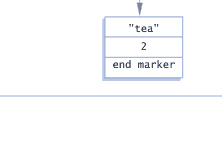

请注意，指针指向整个节点，而不是节点内部的单个项目 例如 10 或 “rolls”。

节点在 C++ 中以 struct 或类实现。例如，Display 17.1 中所示类型的节点的 struct 类型定义以及指向此类节点的指针的类型定义可以如下所示：

```
struct ListNode
{
    string item;
    int count;
    ListNode *link;
};
```

```
typedef ListNode* ListNodePtr;
```

类型定义的顺序很重要。ListNode 的定义必须先出现，因为它在 ListNodePtr 的定义中使用。

Display 17.1 中标记为 head 的方框不是节点，而是一个可以指向节点的指针变量。指针变量 head 声明如下：

```
ListNodePtr head;
```

即使我们已按顺序排列类型定义以避免某些非法的循环形式，以上对 struct 类型 ListNode 的定义仍然是循环的。ListNode 类型的定义使用类型名 ListNode 来定义成员变量 link。这种特定的循环性在 C++ 中是允许的，没有任何问题。这种定义在逻辑上不一致的一个迹象是，你可以绘制 Display 17.1 这样的图来表示此类结构。

我们现在在 struct 内部有了指针，并且这些指针指向包含指针的 struct，依此类推。在这种情况下，语法有时会变得复杂，但所有情况下的语法都遵循我们为指针和 struct 描述的那些规则。作为说明，假设声明如上，情况如 Display 17.1 所示，并且你想将第一个节点中的数字从 10 改为 12。一种实现方法是使用以下语句：

```
(*head).count = 12;
```

赋值运算符左侧的表达式可能需要一点解释。变量 head 是一个指针变量。表达式 *head 因此是它所指向的东西，即包含 “rolls” 和整数 10 的节点 动态变量 。这个节点，由 *head 引用，是一个 struct，并且该 struct 的成员变量，包含 int 类型的值，称为 count；因此，(*head).count 是第一个节点中 int 变量的名称。*head 周围的括号不是可选的。你希望解引用操作 * 在点操作之前执行。然而，点运算符的优先级高于解引用运算符 *，因此如果没有括号，点操作将被先执行


(这将产生一个错误)。下一段描述了一种可以避免担心括号的简写记法。

C++ 有一个运算符可以与指针一起使用，以简化指定结构体或类的成员的记法。第 10 章介绍了箭头运算符 ->，但到目前为止我们还没有广泛使用它。因此，需要复习一下。箭头运算符将解引用运算符 * 和点运算符 . 的作用结合起来，以指定由给定指针指向的动态结构体或类对象的成员。例如，前面更改第一个节点中数字的赋值语句可以更简单地写成

```
head->count = 12;
```

该赋值语句与前一个语句含义相同，但这是通常使用的形式。

第一个节点中的字符串可以用以下语句从 "rolls" 改为 "bagels"：

```
head->item = "bagels";
```

对列表中第一个节点所做的这些更改的结果在 Display 17.2 中进行了图解。

### 箭头运算符，->

箭头运算符 -> 指定由指针变量指向的结构体成员或类对象成员。语法是

Pointer_Variable->Member_Name

上面指的是由 Pointer_Variable 指向的结构体或类对象的成员。它指的是哪个成员由 Member_Name 给出。例如，假设你有以下定义：

```
struct Record
{
    int number;
    char grade;
};
```

以下代码创建一个类型为 Record 的动态变量并将动态结构体变量的成员变量设置为 2001 和 'A'：

```
Record *p;
p = new Record;
p->number = 2001;
p->grade = 'A';
```

### Display 17.2 访问节点数据

```
head->count = 12;
head->item = "bagels";
```

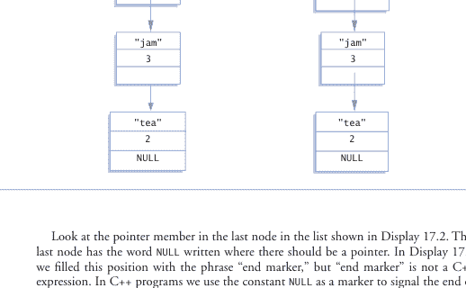

查看 Display 17.2 中所示列表的最后一个节点中的指针成员。该最后一个节点在应该有指针的位置写着 NULL。在 Display 17.1 中我们用短语 "end marker" 填充了该位置，但 "end marker" 不是 C++ 表达式。在 C++ 程序中我们使用常量 NULL 作为标记来表示链表的结束（或任何其他类型的链接数据结构的结束）。

NULL 通常用于两种不同的（但经常重合的）目的。首先，NULL 用于为否则不会有值的指针变量赋一个值。这可以防止对内存的意外引用，因为 NULL 不是任何内存位置的地址。第二类用途是作为结束标记。程序可以像 Display 17.2 所示那样遍历节点列表，并在程序到达包含 NULL 的节点时知道它已到达列表的末尾。

正如第 10 章所述，常量 NULL 实际上是数字 0，但我们更喜欢将其视为并拼写为 NULL，以使其清楚地表示这种可分配给指针变量的特殊用途值。标识符 NULL 的定义在许多标准库中，例如 <iostream> 和 <cstdlib>，因此当你使用 NULL 时，应使用包含指令包含 <iostream>、<cstddef> 或其他合适的库。NULL 的定义由 C++ 预处理器处理，

将 NULL 替换为 0。因此，编译器永远看不到 "NULL"，因此没有命名空间问题；因此，不需要使用指令来使用 NULL。

指针可以使用赋值运算符设置为 NULL，如下所示，它声明一个名为 there 的指针变量并将其初始化为 NULL：

```
double *there = NULL;
```

常量 NULL 可以分配给任何指针类型的指针变量。

### NULL

NULL 是一个特殊常量值，用于为否则不会有值的指针变量赋一个值。NULL 可以分配给任何类型的指针变量。标识符 NULL 在包括头文件为 <cstddef> 的库和头文件为 <iostream> 的库在内的许多库中定义。常量 NULL 实际上是数字 0，但我们更喜欢将其视为并拼写为 NULL。

### 自测练习

- 1. 假设你的程序包含以下类型定义：
  
  struct Box
  {
      string name;
      int number;
      Box *next;
  };
  
  typedef Box* BoxPtr;
  
  以下代码产生的输出是什么？
  
  BoxPtr head;
  head = new Box;
  head->name = "Sally";
  head->number = 18;
  cout << (*head).name << endl;
  cout << head->name << endl;
  cout << (*head).number << endl;
  cout << head->number << endl;

- 2. 假设你的程序包含自测练习 1 中给出的类型定义和代码。该代码创建了一个包含字符串 "Sally" 和数字 18 的节点。你会添加什么代码将该节点的成员变量 next 的值设为 NULL？

3. 给出以下结构定义：

```
struct ListNode
{
    string item;
    int count;
    ListNode *link;
};
ListNode *head = new ListNode;
```

给出将字符串 "Wilbur's brother Orville" 分配给 head 所指向的变量的成员变量 item 的代码。

### 链表作为参数

你应该始终保留一个指向链表头的指针变量。该指针变量是命名链表的一种方式。当你编写一个以链表作为参数的函数时，该指针（指向链表的头）可以用作链表参数。

### 链表

如 Display 17.1 所示的列表称为链表。链表是节点列表，其中每个节点都有一个成员变量，该成员变量是指向列表中下一个节点的指针。链表中的第一个节点称为头，这就是指向第一个节点的指针变量命名为 head 的原因。请注意，名为 head 的指针本身不是列表的头，而只是指向列表的头。最后一个节点没有特殊名称，但它有一个特殊属性：其成员指针变量的值为 NULL。要测试一个节点是否为最后一个节点，只需测试该节点中的指针变量是否等于 NULL 即可。

我们本节的目标是为操作链表编写一些基本函数。为了多样性并简化记法，我们将使用比 Display 17.2 中使用的更简单的数据类型作为节点。这些节点将只包含一个整数和一个指针。然而，我们将在一个方面使我们的节点更复杂。我们将使我们的节点成为类的对象，而不是简单的结构体。我们将使用的节点和指针类型定义如下：

```
class IntNode
{
public:
    IntNode() {}
    IntNode(int theData, IntNode* theLink)
        : data(theData), link(theLink) {}

```

```
IntNode* getLink() const { return link; }
int getData() const { return data; }
void setData(int theData) { data = theData; }
void setLink(IntNode* pointer) { link = pointer; }
private:
    int data;
    IntNode *link;
};
typedef IntNode* IntNodePtr;
```

请注意，类 IntNode 中的所有成员函数都足够简单，可以有内联定义。

注意类 IntNode 的双参数构造函数。它将允许我们创建具有指定整数作为数据且链接成员指向指定的节点。 例如，如果 p1 指向节点 n1，则以下代码创建一个由 p2 指向的新节点，使得该新节点的数据为 42 且其链接成员指向 n1：

```
IntNodePtr p2 = new IntNode(42, p1);
```

在我们为这种节点类型推导出创建和操作链表的一些基本函数后，我们将把节点类型和函数转换为模板版本，以便它们可以存储节点中的任何类型的数据。

作为热身练习，让我们看看如何构造这种类型的节点的链表的开始。我们首先声明一个指针变量，称为 head，它将指向我们的链表的头：

```
IntNodePtr head;
```

要创建我们的第一个节点，我们使用 new 运算符创建一个新的动态变量，它将成为我们链表中的第一个节点：

```
head = new IntNode;
```

然后我们为这个新节点的成员变量赋予值：

```
head->setData(3);
head->setLink(NULL);
```

请注意，该节点的指针成员被设为 NULL，因为该节点是列表中的最后一个节点（也是第一个节点）。此时我们的链表看起来像这样：


一个节点的链表


这比我们实际需要做的工作要多。通过使用带两个参数的 `IntNode` 构造函数，我们可以更轻松地创建单节点链表。下面是一种更简便的方法来获得刚刚图示的单节点链表：

```
head = new IntNode(3, NULL);
```

事实证明，我们总是会使用这个双参数构造函数来创建新的 `IntNode` 节点。许多程序甚至会从 `IntNode` 的定义中省略零参数构造函数，这样就无法在不指定每个成员变量值的情况下创建节点。

我们的单节点链表是以临时方式构建的。要拥有更大的链表，程序必须能够以系统的方式添加节点。接下来，我们将描述一种在链表中插入节点的简单方法。

### 在链表头部插入节点

在本小节中，我们假设链表已经包含一个或多个节点，并开发一个函数来添加另一个节点。插入函数的第一个参数是一个按引用传递的指针变量，该指针指向链表的头部，即指向链表中第一个节点的指针变量。另一个参数将给出要存储在新节点中的数字。我们的插入函数声明如下：

```
void headInsert(IntNodePtr& head, int theData);
```

为了将新节点插入链表，我们的函数将使用 `new` 运算符和 `IntNode` 的双参数构造函数。新节点将以 `theData` 作为其数据，并且其链接成员将指向链表中的第一个节点（在插入之前）。动态变量创建如下：

```
new IntNode(theData, head)
```

我们希望指针 `head` 指向这个新节点，因此函数体可以简单地写成：

```
{
    head = new IntNode(theData, head);
}
```

显示 17.3 包含了操作 `head = new IntNode(theData, head);` 的图示，其中 `theData` 为 12。完整的函数定义在显示 17.4 中给出。

您需要允许列表为空的可能性。例如，购物清单可能为空，因为本周没有要买的东西。空列表称为空链表。链表通过命名一个指向链表头部的指针来命名，但空链表没有头节点。要指定空链表，您使用值 `NULL`。如果指针变量 `head` 应该指向链表的头节点，而您想表示链表为空，则按如下方式设置 `head` 的值：

```
head = NULL;
```

每当您设计操作链表的函数时，应始终检查它是否适用于空链表。如果不适用，您可以为空链表添加一个特殊情况。如果您无法设计适用于空链表的函数，那么您的程序必须设计为以其他方式处理空链表，或完全避免它们。幸运的是，空链表通常可以像任何其他链表一样处理。例如，显示 17.4 中的 `headInsert` 函数是以非空链表为模型设计的，但检查将表明它也适用于空链表。

### 显示 17.3 向链表头部添加节点

插入前的链表

由 `new IntNode(12, head)` 创建的节点

执行 `head = new IntNode(12, head);` 后的链表

### 陷阱

### 丢失节点

您可能会尝试使用零参数构造函数来编写 `headInsert`（显示 17.4）的函数定义，以设置新节点的成员变量。如果您尝试这样做，可能会按如下方式开始函数：

```
head = new IntNode;
head->setData(theData);
```

此时，新节点已构建，包含正确的数据，并由指针 `head` 指向——一切如预期。剩下要做的就是通过设置新节点中的指针成员，使其指向原链表的第一个节点，从而将链表的其余部分附加到此节点。您可以使用以下代码完成此操作，前提是您能弄清楚用哪个指针替换问号：

```
head->setLink(?);
```

显示 17.5 展示了新数据值为 12 时的情况，并说明了问题。如果您以这种方式继续，将没有任何指针指向包含 15 的节点。由于没有命名的指针指向它（或指向延伸到该节点的指针链），程序无法引用此节点。该节点及其下方的所有节点都将丢失。程序无法使指针指向这些节点中的任何一个，也无法访问这些节点中的数据或对节点执行任何其他操作。它根本无法引用这些节点。这种情况会在程序运行期间占用内存。丢失节点的程序有时被称为存在内存泄漏。严重的内存泄漏可能导致程序内存耗尽并异常终止。更糟糕的是，在极少数情况下，普通用户程序中的内存泄漏（丢失节点）可能导致操作系统崩溃。为避免此类节点丢失，程序必须始终保持某个指针指向链表的头部，通常是像 `head` 这样的指针变量中的指针。

### 显示 17.5 丢失的节点

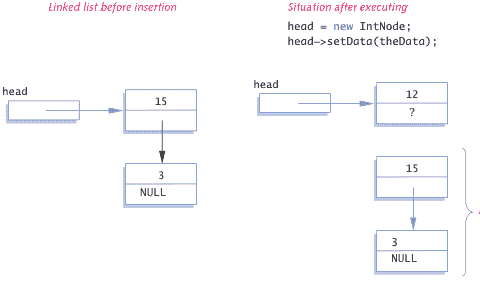

### 在链表内部插入和删除节点

接下来，我们设计一个函数，在链表的指定位置插入节点。如果您希望节点按特定顺序排列，例如数字或字母顺序，则不能简单地在链表的开头或结尾插入节点。因此，我们将设计一个函数，在链表中指定节点之后插入节点。

我们假设某个其他函数或程序部分已正确放置了一个名为 `afterMe` 的指针，指向链表中的某个节点。我们希望新节点放置在 `afterMe` 指向的节点之后，如显示 17.6 所示。同样的技术适用于任何类型数据的节点，但为了具体起见，我们将使用与前几小节相同类型的节点。类型定义在显示 17.4 中给出。我们要定义的函数的声明如下：

```
void insert(IntNodePtr afterMe, int theData);
//前置条件：afterMe 指向链表中的一个节点。
//后置条件：包含 theData 的新节点
//已添加到 afterMe 指向的节点之后。
```

新节点插入列表内部的方式与在列表头部（开头）添加节点的方式基本相同，我们已讨论过。唯一的区别是我们使用指针 `afterMe->link` 而不是指针 `head`。插入操作如下：

```
afterMe->setLink(new IntNode(theData, afterMe->getLink()));
```

#### 显示 17.6 在链表中间插入

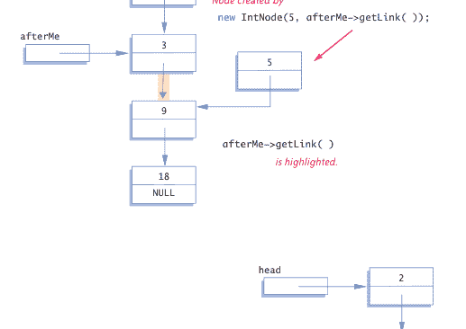

由 `new IntNode(5, afterMe->getLink( ));` 创建的节点

`afterMe->getLink()` 被突出显示。

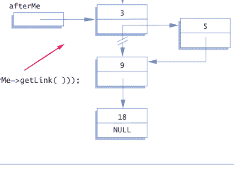

`afterMe->setLink(new IntNode(theData, afterMe->getLink()));` 的最终结果

`theData` 等于 5 的细节在显示 17.6 中图示，最终函数定义在显示 17.4 中给出。

如果您仔细查看 `insert` 函数的代码，您会发现即使 `afterMe` 指向的节点是链表中的最后一个节点，它也能正确工作。但是，`insert` 不能用于在链表开头插入节点。显示 17.4 中给出的 `headInsert` 函数可用于在列表开头插入节点。

通过使用 `insert` 函数，您可以按数字、字母或其他顺序维护链表。您只需调整两个指针即可将新节点挤入正确位置。无论链表有多长，或者您希望新数据放在列表中的哪个位置，这都是成立的。如果您改用数组，则必须复制数组的大部分（在极端情况下是整个数组）才能为新值腾出正确位置。尽管定位 `afterMe` 指针存在开销，但插入链表通常比插入数组更高效。

从链表中删除节点也非常容易。显示 17.7 说明了该方法。一旦 `before` 和 `discard` 指针定位完毕，删除节点所需的全部操作就是以下语句：

```
before->setLink(discard->getLink());
```

这足以将节点从链表中移除。但是，如果您不将此节点用于其他用途，则应销毁该节点并将其占用的内存返回以供回收；您可以通过调用 `delete` 来执行此操作，如下所示：

```
delete discard;
```

正如我们在第 10 章中所述，动态变量的内存保存在称为自由存储区的内存区域中。由于自由存储区不是无限的，当程序不再需要动态变量（节点）时，应使用 `delete` 运算符将此内存返回以供回收。我们在随附的框中包含了对 `delete` 运算符的回顾。

#### delete 运算符

`delete` 运算符消除动态变量，并将动态变量占用的内存返回给自由存储区。然后，该内存可被重用，以创建新的动态变量。例如，以下代码消除了指针变量 `p` 指向的动态变量：

```
delete p;
```

调用 `delete` 后，指针变量（如上面的 `p`）的值是未定义的。

在两端插入

与数组的比较

删除节点


### Display 17.7 删除一个节点

```
before->setLink(discard->getLink());
```

```
delete discard;
```

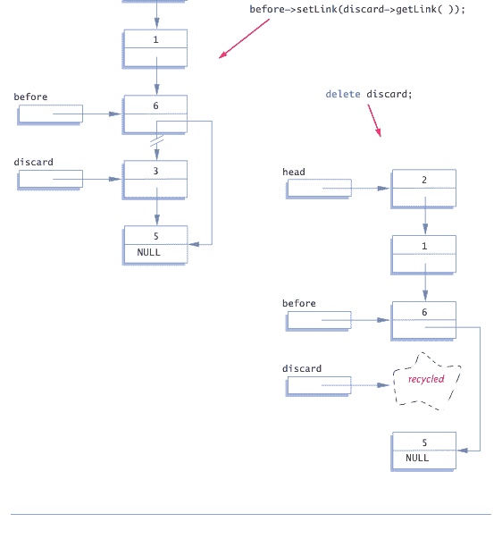

### 陷阱 — 使用赋值运算符处理动态数据结构

如果 head1 和 head2 是指针变量并且 head1 指向链表的头节点，那么下面的语句会使 head2 指向同一个头节点从而指向同一个链表：

```
head2 = head1;
```

然而，你必须记住只有一个链表，而不是两个。如果你改变了 head1 所指向的链表，那么 head2 所指向的链表也会改变，因为它们是同一个链表。

如果 head1 指向一个链表，而你希望 head2 指向该链表的一个完全相同的第二个副本，那么上面的赋值语句将不起作用。相反，你必须逐节点地复制整个链表。

### 搜索链表

接下来我们将设计一个函数来搜索链表以定位特定节点。我们将使用与前面小节中相同的节点类型，称为 IntNode。 （节点和指针类型的定义见 Display 17.4。）我们设计的函数将有两个参数：链表和我们想要定位的整数。该函数将返回一个指向包含该整数的第一个节点的指针。如果没有节点包含该整数，则函数将返回 NULL。因此，你的程序可以通过检查函数是否返回不等于 NULL 的指针值来测试该 int 是否在列表中。我们的函数声明和头注释如下：

```
IntNodePtr search(IntNodePtr head, int target);
//Precondition: The pointer head points to the head of a
//linked list. The pointer variable in the last node is NULL.
//If the list is empty, then head is NULL.
//Returns
//target. If node contains the target, the function returns NULL.
```

我们将使用一个本地指针变量，这里称为 here，来遍历列表寻找目标。移动链表或任何由节点和指针组成的其他数据结构的唯一方法就是跟随指针。因此，我们将从 here 指向第一个节点开始，并将指针从一个节点移动到下一个节点，跟随每个节点的指针。这种技术在 Display 17.8 中进行了图解。

由于空列表会带来一些会使讨论变得混乱的次要问题，我们起初假设链表至少包含一个节点。稍后我们将回来确保算法也适用于空列表。这种搜索技术产生以下算法：

### search 函数的伪代码

*使指针变量 here 指向链表的头节点（即第一个节点）。*

```
while (here is not pointing to a node containing target
                 and here is not pointing to the last node)
{
    Make here point to the next node in the list.
}

if (the node pointed to by here contains target)
    return here;
else
    return NULL;
```

要将指针 here 移动到下一个节点，我们必须以可用的命名指针为出发点进行思考。下一个节点就是当前由 here 指向的节点的指针成员所指向的节点。当前由 here 指向的节点的指针成员由表达式给出

```
here->getLink( )
```

要将 here 移动到下一个节点，我们希望改变 here 使其指向上述命名的指针所指向的节点。因此，以下语句会将指针 here 移动到列表中的下一个节点：

```
here = here->getLink( );
```

将这些部分组合起来得到 search 函数算法伪代码的以下细化：

```
here = head;

while (here->getData( ) != target && here->getLink( ) != NULL)
    here = here->getLink( );

if (here->getData( ) == target)
    return here;
else
    return NULL;
```

注意 while 语句中的布尔表达式。我们通过测试成员变量 here->getLink( ) 是否等于 NULL 来测试 here 是否指向最后一个节点。

我们仍然必须回过头来处理空列表。如果我们检查之前的代码，会发现空列表存在问题。如果列表为空，则 here 等于 NULL，因此以下表达式未定义：

`here->getData()`
`here->getLink()`

当 here 为 NULL 时，它不指向任何节点，因此没有数据成员或链接成员。因此，我们将空列表作为特殊情况处理。完整的函数定义见 Display 17.9。

### Display 17.9 在链表中定位节点的函数

```
FUNCTION DECLARATION

IntNodePtr search(IntNodePtr head, int target);
//Precondition: The pointer head points to the head of a
//linked list. The pointer variable in the list node is NULL.
//If the list is empty, then head is NULL.
//Returns a pointer that points to the first node that contains the
//target. If no node contains the target, the function returns NULL.

FUNCTION DEFINITION

//Uses cstddef:
IntNodePtr search(IntNodePtr head, int target)
{
        IntNodePtr here = head;

        if (here == NULL) //if empty list
        {
                return NULL;
        }
        else
        {
                while (here->getData() != target && here->getLink() != NULL)
                        here = here->getLink();

                if (here->getData() == target)
                        return here;
                else
                        return NULL;
        }
}
```

> IntNode 和 IntNodePtr 的定义见 Display 17.4。

### 自测练习

4. 编写链表中节点和指针的类型定义。节点类型称为 NodeType，指针类型称为 PointerType。链表将是字母的列表。

5. 链表通常通过指向列表中第一个节点的指针来引用，但空列表没有第一个节点。通常使用什么指针值来表示空列表？

6. 假设你的程序包含以下类型定义和指针变量声明：

```
struct Node
{
    double data;
    Node *next;
};

typedef Node* Pointer;
Pointer p1, p2;
```

假设 p1 指向上述类型的一个节点，该节点在链表中。编写代码使 p1 指向此链表中的下一个节点。 （指针 p2 用于下一个练习，与本练习无关。）

7. 假设你的程序包含与自测练习 6 相同的类型定义和指针变量声明。假设此外 p2 指向上述类型的一个节点，该节点在链表中并且不是列表的最后一个节点。编写代码将删除 p2 所指向的节点之后的节点。执行此代码后，链表应保持不变，只是链表中少了一个节点。 （提示：你可能希望声明另一个指针变量来使用。）

8. 假设你的程序包含以下类型定义和指针变量声明：

```
class Node
{
public:
    Node(double theData, Node* theLink)
        : data(theData), next(theLink){}
    Node* getLink() const { return next; }
    double getData() const { return data; }
    void setData(double theData) { data = theData; }
    void setLink(Node* pointer) { next = pointer; }
private:
    double data;
    Node *next;
};
```

```
typedef Node* Pointer;
Pointer p1, p2;
```

假设 p1 指向上述类型的一个节点，该节点在链表中。编写代码使 p1 指向此链表中的下一个节点。 （指针 p2 用于下一个练习，与本练习无关。）

9. 假设你的程序包含与自测练习 8 相同的类型定义和指针变量声明。假设此外 p2 指向上述类型的一个节点，该节点在链表中并且不是列表的最后一个节点。编写代码将删除 p2 所指向的节点之后的节点。执行此代码后，链表应保持不变，只是链表中少了一个节点。 （提示：你可能希望声明另一个指针变量来使用。）

10. 选择以下语句的结尾并解释：
对于包含相同类型对象的较大数组和较大列表，将新对象插入到链表中间的已知位置与在数组中插入相比是

+   a. 更高效。
+   b. 更低效。
+   c. 大致相同。

### 示例

### 链表工具的模板版本

将我们的类型定义和函数定义转换为模板以使其适用于节点中数据为任意类型 T 的链表是常规操作。然而，有一些细节需要考虑。你需要做的核心工作是用类型参数 T 替换节点中数据的类型（Display 17.4 中的类型 int），并在适当位置插入以下内容：

```
template<class T>
```

然而，你还应该做一些额外的工作以考虑类型 T 可能是类类型。由于类型 T 可能是类类型，类型 T 的值参数应改为常量引用参数，并且类型 T 的返回类型应添加 const 使其按常量值返回。 （按 const 值返回的原因在第 8 章中进行了解释。）

我们描述的更改后的最终模板显示在 Displays 17.10 和 17.11 中。从简单的整数链表的情况来看，还需要做一个额外的更改。由于大多数编译器未实现模板 typedef，我们无法使用它们。这意味着有时我们需要使用以下难以阅读的参数类型规范：

```
Node<T>*&
```


这是一个对指向类型为 Node<T> 的节点的指针的引用参数。下面，我们重现了 Display 17.11 中的一个函数声明，以便你可以在上下文中看到此参数类型规范：

template<class T>
void headInsert(Node<T>*& head, const T& theData);

### Display 17.10 链表库的接口文件（第 1 部分，共 2 部分）

//This is the header file listtools.h. This contains type definitions and
//function declarations for manipulating a linked list to store data of any
//type T. The linked list is given as a pointer of type Node<T>* that points
//to the head (first) node of the list. The implementation of the functions
//is given in the file listtools.cpp.
#ifndef LISTTOOLS_H
#define LISTTOOLS_H
namespace LinkedListSavitch
{
template<class T>
class Node
{
public:
Node(const T& theData, Node<T>* theLink) : data(theData), link(theLink){}
Node<T>* getLink() const { return link; }
const T getData() const { return data; }
void setData(const T& theData) { data = theData; }
void setLink(Node<T>* pointer) { link = pointer; }
private:
T data;
Node<T> *link;
};
template<class T>
void headInsert(Node<T>*& head, const T& theData);
//Precondition: The pointer variable head points to
//the head of a linked list.
//Postcondition: A new node containing theData
//has been added at the head of the linked list.
template<class T>
void insert(Node<T>* afterMe, const T& theData);
//Precondition: afterMe points to a node in a linked list.
//Postcondition: A new node containing theData
//has been added after the node pointed to by afterMe.

使用 T 作为参数类型是可以接受的，我们在其中使用了 const T&。我们使用了常量引用参数，因为我们预计 T 经常会是一个类类型。

### Display 17.10 链表库的接口文件（第 2 部分，共 2 部分）

```cpp
34
35    template<class T>
36    void deleteNode(Node<T>** before);
37    //Precondition: The pointer before points to a node that has
38    //at least one node after it in the linked list.
39    //Postcondition: The node after the node pointed to by before
40    //has been removed from the linked list and its storage
41    //returned to the freestore.

42
43    template<class T>
44    void deleteFirstNode(Node<T>*& head);
45    //Precondition: The pointer head points to the first
46    //node in a linked list with at most one node.
47    //Postcondition: The node pointed to by head has been removed
48    //from the linked list and its storage returned to the freestore.

48    template<class T>
49    Node<T>* search(Node<T>* head, const T& target);
50    //Precondition: The pointer points to the head of a linked list.
51    //The pointer variable in the last node is NULL.
52    //== is defined for type T.
53    //(== is used as the criterion for being equal.)
54    //If the list is empty, then head is NULL.
55    //Returns a pointer that points to the first node that
56    //is equal to the target. If no node equals the target,
57    //then the function returns NULL.
58    }//LinkedListSavitch

59    #endif //LISTTOOLS_H
```

### Display 17.11 链表库的实现文件（第 1 部分，共 2 部分）

```cpp
1    //This is the implementation file listtools.cpp. This file contains
2    //function definitions for the functions declared in listtools.h.
3    #include <cstddef>
4    #include "listtools.h"

5    namespace LinkedListSavitch
6    {
7        template<class T>
8        void headInsert(Node<T>*& head, const T& theData)
9        {
10           head = new Node<T>(theData, head);
11       }
```

### Display 17.11 链表库的实现文件（第 2 部分，共 2 部分）

```
12  template<class T>
13  void insert(Node<T>* afterMe, const T& theData)
14  {
15      afterMe->setLink(new Node<T>(theData, afterMe->getLink()));
16  }
17
18  template<class T>
19  void deleteNode(Node<T>* before)
20  {
21      Node<T>* discard;
22      discard = before->getLink();
23      before->setLink(discard->getLink());
24      delete discard;
25  }
26
27  template<class T>
28  void deleteFirstNode(Node<T>*& head)
29  {
30      Node<T>* discard;
31      discard = head;
32      head = head->getLink();
33      delete discard;
34  }
35
36  //Uses cstddef:
37  template<class T>
38  Node<T>* search(Node<T>* head, const T& target)
39  {
40      Node<T>* here = head;
41
42      if (here == NULL) //if empty list
43      {
44          return NULL;
45      }
46      else
47      {
48          while (here->getData() != target && here->getLink() != NULL)
49              here = here->getLink();
50
51          if (here->getData() == target)
52              return here;
53          else
54              return NULL;
55      }
56  }//LinkedListSavitch
```

### 链表应用

> 但如今在前的，将要在后；在后的，将要在前。

马太福音 19:30

先来后到

一个常见的（更世俗的）说法

链表有 Display 17.12 应用。本节仅介绍其使用的两个小例子，即每个都使用链表作为其实现核心的两个类模板定义。

### 示例

### 一个栈模板类

栈是一种以与数据存储顺序相反的顺序检索数据的数据结构。假设你将字母 'A'、'B' 然后是 'C' 放入栈中。当你从栈中取出这些字母时，它们将被按 'C'、然后是 'B'、然后是 'A' 的顺序移除。栈的这种使用在 Display 17.12 中进行了图解。如图所示，你可以将栈想象成地面上的一个洞。为了从栈中取出某样东西，你必须先移除上面覆盖它的物品。因此栈通常被称为后进先出数据结构。

### 栈

栈是一种后进先出数据结构；也就是说，数据项是以与它们放入栈的顺序相反的顺序检索的。

栈用于许多语言处理任务。第 13 章讨论了计算机系统如何使用栈来跟踪 C++ 函数调用。然而，这里我们只关注一个非常简单的应用。我们的目标在这个例子中是展示如何使用链表技术来实现特定的数据结构，例如栈。

我们栈类的接口在 Display 17.13 中给出。这是一个模板类，具有类型参数 T 用于栈中存储的数据类型。一个存储在栈中的项是类型为 T 的值。在我们展示的示例中，T 被字符类型 char 替换。然而，在大多数应用中，存储在栈中的项很可能是一个结构体或类对象。存储在栈中的每个记录（类型为 T 的项）称为栈帧，这就解释了为什么我们在栈模板类的定义中偶尔使用 stackFrame 作为标识符名称。可以对栈执行两个基本

### Display 17.12 一个栈

pushing

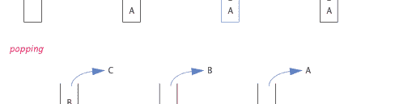

popping

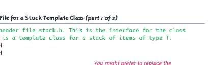

### Display 17.13 栈模板类的接口文件（第 1 部分，共 2 部分）

```
//This is the header file stack.h. This is the interface for the class
//Stack, which is a template class for a stack of items of type T.
#ifndef STACK_H
#define STACK_H

namespace StackSavitch
{
  template<class T>
  class Node
  {
   public:
     Node(T theData, Node<T>* theLink) : data(theData), link(theLink){}
     Node<T>* getLink() const { return link; }
     const T getData() const { return data; }
     void setData(const T& theData) { data = theData; }
     void setLink(Node<T>* pointer) { link = pointer; }
   private:
     T data;
     Node<T> *link;
  };

  template<class T>
  class Stack
  {
```

你可能更喜欢用 const T& 替换参数类型 T。

### Display 17.13 栈模板类的接口文件（第 2 部分，共 2 部分）

```
23 public:
24 Stack();
25 //Initializes the object to an empty stack.
26 Stack(const Stack<T>& aStack); // Copy constructor
27 Stack<T>& operator =(const Stack<T>& rightSide);
28 virtual ~Stack(); // The destructor destroys the stack and returns all the memory to the freestore.
29 void push(T stackFrame);
30 //Postcondition: stackFrame has been added to the stack.
31 T pop();
32 //Precondition: The stack is not empty.
33 //Returns the top stack frame and removes that top
34 //stack frame from the stack.
35 bool isEmpty() const;
36 //Returns true if the stack is empty. Returns false otherwise.
37 private:
38 Node<T> *top;
39 };
40 }//StackSavitch
41 #endif //STACK_H
```

操作：向栈中添加一项以及从栈中移除一项。向栈中添加一项，我们称执行此操作的成员函数为 push。从栈中弹出一项称为弹出操作，因此我们称执行此操作的成员函数为 pop。

名称 push 和 pop 源自对栈的一种特定可视化方式。栈类似于有时用于在食堂存放盘子的机制。该机制将盘子存储在台面上的一个孔中。盘子下面有一个弹簧，其张力调整为只有最上面的盘子突出在台面之上。如果这种机制被用作栈数据结构，数据将写在盘子上（这可能会违反某些健康法规，但仍然是一个很好的类比）。要向栈中添加一个盘子，你把它放在其他盘子上面，新盘子的重量会向下压弹簧。当你移除一个盘子时，下面的盘子会弹出。

Display 17.14 显示了一个简单的程序，说明了 Stack 类的使用。该程序一次读取一行文本的一个字符并将字符放入栈中。然后程序一次移除一个字符并将其写入屏幕。因为数据是从


### 显示 17.14 使用栈模板类的程序

```
//Program to demonstrate use of the Stack template class.
#include "iostream"
#include "stack.h"
#include "stack.cpp"
using std::cin;
using std::cout;
using std::endl;
using StackSavitch::Stack;

int main()
{
    char next, ans;

    do
    {
        Stack<char> s;
        cout << "Enter a line of text:\n";
        cin.get(next);
        while (next != '\n')
        {
            s.push(next);
            cin.get(next);
        }

        cout << "Written backward that is:\n";
        while ( ! s.isEmpty() )
            cout << s.pop();
        cout << endl;

        cout << "Again?(y/n): ";
        cin >> ans;
        cin.ignore(10000, '\n');
    }while (ans != 'n' && ans != 'N');

    return 0;
}
```

cin 的 ignore 成员在第 9 章中讨论。它丢弃行上剩余的输入。

### 示例对话

```
Enter a line of text:
straw
Written backward that is:
warts
Again?(y/n): y
Enter a line of text:
I love C++
Written backward that is:
++C evol I
Again?(y/n): n
```

栈以与进入栈的顺序相反的顺序输出，因此输出显示该行被写反了。我们已在应用程序程序中包含了 Stack 类的实现，正如我们通常对模板类所做的那样。这意味着在我们完成 Stack 类模板的实现之前，我们甚至无法运行或编译我们的应用程序程序。

模板类 Stack 的成员函数的定义在显示 17.15 中所示的实现文件中给出。我们的 Stack 类实现为链表，其中列表的头用作栈顶。成员变量 top 是一个指向链表头的指针。指针 top 起的作用与我们在先前讨论链表时指针 head 起的作用相同。

### PUSH 和 POP

向栈数据结构添加数据项称为将数据项压入栈。从栈中移除数据项称为将该项弹出栈。

### 显示 17.15 栈模板类的实现（第 1 部分，共 2 部分）

```
//This is the implementation file stack.cpp.
//This is the implementation of the template class Stack.
//The interface for the template class Stack is in the header file stack.h.

#include <iostream>
#include <cstdlib>
#include <cstddef>
#include "stack.h"
using std::cout;

namespace StackSwitchit
{

    //Uses cstddef
    template<class T>
    Stack<T>::Stack() : top(NULL)
    {
        //Intentionally empty
    }

    template<class T>
    Stack<T>::Stack(const Stack<T>& aStack)
    <The definition of the copy constructor is Self-Test Exercise 2.>
```

### 显示 17.15 栈模板类的实现（第 2 部分，共 2 部分）

```
template<class T>
Stack<T>& Stack<T>::operator =(const Stack<T>& rightSide)
<The definition of the overloaded assignment operator is Self-Test Exercise 13.>

template<class T>
Stack<T>::~Stack()
{
    T next;
    while (! isEmpty())
        next = pop();//pop calls delete.
}

//Uses cstddef:
template<class T>
bool Stack<T>::isEmpty() const
{
    return (top == NULL);
}

template<class T>
void Stack<T>::push(T stackFrame)
<The rest of the definition is Self-Test Exercise 11.>

//Uses cstdlib and iostream:
template<class T>
T Stack<T>::pop()
{
    if (isEmpty())
    {
        cout << "Error: popping an empty stack.\n";
        exit(1);
    }

    T result = top->getData();

    Node<T> *discard;
    discard = top;
    top = top->getLink();

    delete discard;

    return result;
}
}//StackSavitch
```

编写成员函数 push 的定义是自测练习 11。然而，我们已经给出了此任务的算法。push 成员函数的代码本质上与显示 17.1 中所示的函数 headInsert 相同；只是成员函数 push 中使用名为 top 的指针代替名为 head 的指针。

空栈只是一个空链表，因此空栈通过将指针 top 设置为 NULL 来实现。一旦你意识到 NULL 代表空栈，默认构造函数的实现和成员函数 empty 的实现就显而易见了。

拷贝构造函数的定义稍微复杂一些，但没有使用我们尚未讨论过的任何技术。细节留给自测练习 12。

pop 成员函数首先检查栈是否为空。如果栈不为空，它将继续移除栈顶字符。它将局部变量 result 设置为栈顶符号，如下所示：

```
T result = top->getData();
```

在栈顶节点的数据保存到变量 result 之后，指针 top 被移动到链表中的下一个节点，从而有效地从列表中移除栈顶节点。指针 top 的移动使用语句

```
top = top->getLink();
```

然而，在指针 top 被移动之前，一个临时指针，称为 discard，被定位使其指向即将从列表中移除的节点。然后可以借助以下对 delete 的调用回收被移除节点的存储：

```
delete discard;
```

成员函数 pop 从链表中移除的每个节点都通过对 delete 的调用回收其内存，因此析构函数需要做的只是通过对 pop 的调用将每个项目从栈中移出。然后每个节点的内存将被返回到自由存储以供回收。

### 自测练习

- 11. 给出显示 17.13 和 17.15 中描述的模板类 Stack 的成员函数 push 的定义。
- 12. 给出显示 17.13 和 17.15 中描述的模板类 Stack 的拷贝构造函数的定义。
- 13. 给出显示 17.13 和 17.15 中描述的模板类 Stack 的重载赋值运算符的定义。

### 一个队列模板类

栈是一种后进先出的数据结构。另一种常见的数据结构是队列，它以先进先出的方式处理数据。队列可以用链表实现，其方式与我们对 Stack 模板类的实现类似。然而，队列需要在链表的头部和末尾各有一个指针，因为操作发生在两个位置。 从链表头部移除节点比从链表另一端移除节点更容易。因此，我们的实现将从链表头部移除节点（我们现在称其为列表的前端），并将节点添加到列表的另一端，我们现在称其为列表的末尾（或队列的末尾）。

队列模板类的定义在显示 17.16 中给出。使用类 Queue 的示例应用程序显示在显示 17.17 中。成员函数的定义留作自测练习（但请记住，如果你在填写细节时遇到任何问题，答案在章节末尾给出）。

### QUEUE

队列是一种先进先出的数据结构；也就是说，数据项是从队列中以与它们添加到队列相同的顺序移除的。

### 显示 17.16 队列模板类的接口文件（第 1 部分，共 2 部分）

```cpp
//This is the header file queue.h. This is the interface for the class
//Queue, which is a template class for a queue of items of type T.
#ifndef QUEUE_H
#define QUEUE_H

namespace QueueSwitch
{
    template<class T>
    class Node
    {
    public:
        Node(T theData, Node<T>* theLink) : data(theData), link(theLink){}
        Node<T>* getLink() const { return link; }
        const T getData() const { return data; }
        void setData(const T& theData) { data = theData; }
        void setLink(Node<T>* pointer) { link = pointer; }
    private:
        T data;
```

> 这是我们为显示 17.13 中的栈接口给出的模板类 Node 的相同定义。参见提示“关于命名空间的说明”以讨论此重复。


### 显示 17.16 队列模板类的接口文件（第 2 部分，共 2 部分）

```
19     Node<T>* link;
20   };

21   template<class T>
22   class Queue
23   {
24   public:
25     Queue();
26     //Initializes the object to an empty queue.

27     Queue(const Queue<T>& aQueue);

28     Queue<T>& operator =(const Queue<T>& rightSide);

29     virtual ~Queue();

30
31     void add(T item);
32     //Postcondition: item has been added to the back of the queue.

33     T remove();
34     //Precondition: The queue is not empty.
35     //Returns the item at the front of the queue
36     //and removes that item from the queue.

37
38     bool isEmpty() const;
39     //Returns true if the queue is empty. Returns false otherwise.
40   private:
41     Node<T>* front;//Points to the head of a linked list.
42     //Items are removed at the head
43     Node<T>* back;//Points to the node at the other end of the linked list.
44     //Items are added at this end.
45   };

45   }//QueueSavitch

46   #endif //QUEUE_H
```

你可能更喜欢用 const T& 替换参数类型 T。

拷贝构造函数

析构函数销毁队列并将所有内存返回给自由存储区。

### 显示 17.17 使用队列模板类的程序（第 1 部分，共 2 部分）

```
//Program to demonstrate use of the Queue template class.
#include "iostream"
#include "queue.h"
#include "queue.cpp"
using std::cin;
using std::cout;
using std::endl;
using QueueSavitch::Queue;

int main()
{
    char next, ans;

    do
    {
        Queue<char> q;
        cout << "Enter a line of text:\n";
        cin.get(next);
        while (next != '\n')
        {
            q.add(next);
            cin.get(next);
        }

        cout << "You entered:\n";
        while ( ! q.isEmpty() )
            cout << q.remove();
        cout << endl;

        cout << "Again?(y/n): ";
        cin >> ans;
        cin.ignore(1000, '\n');
    }while (ans != 'n' && ans != 'N');

    return 0;
}
```

> 将此与我们在显示 17.14 中给出的使用栈而不是队列的类似程序进行对比。

### 显示 17.17 使用队列模板类的程序（第 2 部分，共 2 部分）

### 示例对话

```
Enter a line of text:
straw
You entered:
straw
Again?(y/n): y
Enter a line of text:
I love C++
You entered:
I love C++
Again?(y/n): n
```

### 提示

### 关于命名空间的评论

请注意，StackSavitch（显示 17.13）和 QueueSavitch（显示 17.16）这两个命名空间都定义了一个名为 Node 的模板类。事实证明，这两个 Node 的定义是相同的，但这里讨论的要点无论这两个定义是否相同都适用。C++ 不允许你两次定义同一个标识符，即使两个定义是相同的，除非这两个名称以某种方式区分。在这种情况下，两个定义是允许的，因为它们位于两个不同的命名空间中。甚至可以在同一个程序中使用 Stack 模板类和 Queue 模板类。然而，你应该使用

```
using StackSavitch::Stack;
using QueueSavitch::Queue;
```

而不是

```
using namespace StackSavitch;
using namespace QueueSavitch;
```

如果不使用标识符 Node，大多数编译器允许使用任一套 using 指令，但第二套 using 指令提供了标识符 Node 的两个定义，因此应避免使用。

也可以使用以下两者之一，但不能同时使用：

```
using StackSavitch::Node;
```

或

```
using QueueSavitch::Node;
```

### 自测练习

- 14. 给出模板类 Queue（显示 17.16）的默认（无参数）构造函数和成员函数 Queue<T>::isEmpty 的定义。
- 15. 给出模板类 Queue（显示 17.16）的成员函数 Queue<T>::add 和 Queue<T>::remove 的定义。
- 16. 给出模板类 Queue（显示 17.16）的析构函数的定义。
- 17. 给出模板类 Queue（显示 17.16）的拷贝构造函数的定义。
- 18. 给出模板类 Queue（显示 17.16）的重载赋值运算符的定义。

### 友元类和类似的替代方案

你可能发现使用模板类 Node（参见显示 17.13 或显示 17.16）中的访问器和修改器函数 getLink 和 setLink 很麻烦。你可能想通过简单地将类 Node 的成员变量 link 从 private 改为 public 来避免对 getLink 和 setLink 的调用。在你放弃将所有成员变量设为私有的原则之前，请注意两点。首先，使用 getLink 和 setLink 对你这个程序员来说并不比直接访问节点中的链接更困难。（然而，getLink 和 setLink 确实会引入一些开销，因此可能会略微降低效率。）其次，有一种方法可以避免使用 getLink 和 setLink，而是直接访问节点的链接，而不必将 link 成员变量设为 public。让我们探讨一下这种第二种可能性。

第 8 章讨论了友元函数。正如你所回忆的，如果 f 是类 C 的友元函数，那么 f 不是 C 的成员函数；然而，当你编写函数 f 的定义时，你可以访问 C 的私有成员，就像在 C 的成员函数的定义中一样。类可以像函数一样成为另一个类的友元。如果类 F 是类 C 的友元，那么类 F 的每个成员函数都是类 C 的友元。因此，如果例如 Queue 模板类是 Node 模板类的友元，那么私有 link 成员变量将在 Queue 的成员函数的定义中直接可用。细节在显示 17.18 中概述。

当一个类是另一个类的友元时，通常类会在其类定义中相互引用。这要求你对第二个定义的类或类模板进行前向声明，如显示 17.18 所示。请注意，前向声明只是类或类模板定义的标题后跟一个分号。使用友元类的完整示例在第 17.4 节给出（参见“一个树模板类”）。

### 显示 17.18 队列模板类作为 Node 类的友元（第 1 部分，共 2 部分）

```
//This is the header file queue.h. This is the interface for the class
//Queue, which is a template class for a queue of items of type T.
#ifndef QUEUE_H
#define QUEUE_H

namespace QueueSavitch
{
    template<class T>
    class Queue;

    template<class T>
    class Node
    {
    public:
        Node(T theData, Node<T>* theLink) : data(theData), link(theLink){}
        friend class Queue<T>;
    private:
        T data;
        Node<T> *link;
    };

    template<class T>
    class Queue
    {
        <The definition of the template class Queue is identical to the one given in Display 17.16. However, the
        definitions of the member functions will be different from the ones we gave in the Self-Test Exercises
        for the nonfriend version of Queue.>
    } //QueueSavitch
#endif //QUEUE_H

#include <iostream>
#include <cstdlib>
#include "queue.h"
using std::cout;
namespace QueueSavitch
{
    template<class T> //Uses ctypedef:
    void Queue<T>::add(T item)
    {
        if (isEmpty())
```
> 一个前向声明。不要忘记分号。

> 这是显示 17.16 中给出的另一种方法。在这个版本中，Queue 模板类是 Node 模板类的友元。

> 如果 Node<T> 仅在友元类 Queue<T> 的定义中使用，则不需要修改器或访问器函数。

> 实现文件将包含这些定义以及对节点节点的 link 和 data 成员变量按名称访问的其他成员函数的类似修改的定义。

### 显示 17.18 队列模板类作为 Node 类的友元（第 2 部分，共 2 部分）

```
40        front = back = new Node<T>(item, NULL);
41        else
42        {
43            back->link = new Node<T>(item, NULL);
44            back = back->link;
45        }
46    
47    template<class T> //Uses cstdlib and iostream:
48    T Queue<T>::remove()
49    {
50        if (isEmpty())
51        {
52            cout << "Error: Removing an item from an empty queue.\n";
53            exit(1);
54        }
55    
56        T result = front->data;
57    
58        Node<T> *discard;
59        discard = front;
60        front = front->link;
61        if (front == NULL) //if you removed the last node
62            back = NULL;
63    
64        delete discard;
65        return result;
66    }
67    }//QueueSavitch
```

两种在目的上基本相同并且可以以与友元类基本相同的方式与 Node 和 Queue 等类和模板类一起使用的替代方法是（1）使用 protected 或 private 继承从 Node 派生 Queue，以及（2）在 Queue 的定义内给出 Node 的定义，以便 Node 是局部类（模板）定义。（受保护的继承在第 14 章中讨论，类在类内局部定义在第 7 章中讨论。）


### 17-3 迭代器

> 白兔戴上他的眼镜。“陛下，我该从哪里开始呢？”他问道。
> “从开头开始，”国王非常严肃地说。“一直进行到结尾：然后停止。”
> 
> 刘易斯·卡罗尔，《爱丽丝梦游仙境》

数据结构中的一个重要概念是迭代器。迭代器是一个构造（通常是某个迭代器类的对象），它允许你遍历存储在数据结构中的数据项，以便你对每个数据项执行想要的任何操作。

### ITERATOR

迭代器是一个构造（通常是某个迭代器类的对象），它允许你遍历存储在数据结构中的数据项，以便你对数据结构中的每个数据项执行想要的任何操作。

### POINTERS AS ITERATORS

迭代器的基本思想，事实上原型模型，可以很容易地在链表的上下文中看到。链表是原型数据结构之一，而指针是迭代器的原型示例。你可以通过从链表的头部开始一次一个节点地移动指针来使用指针作为迭代器，并遍历列表中的所有节点。总体轮廓如下：

```
Node_Type *iterator;
for (iterator = Head; iterator != NULL; iterator = iterator->Link)
    Do whatever you want with the node pointed to by iterator;
```

其中 Head 是指向链表头节点的指针，而 Link 是节点成员变量的名称，该变量指向列表中的下一个节点。

例如，要输出我们在第 17.1 节中讨论的那种链表中所有节点的数据，你可以使用以下代码：

```
IntNode *iterator;
for(iterator = head; iterator != NULL; iterator = iterator->getLink() )
    cout << (iterator->getData());
```

IntNode 的定义在 Display 17.4 中给出。

请注意，你通过使用相等运算符 == 来测试两个指针是否指向同一个节点。指针是内存地址。如果两个指针变量包含相同的内存地址，那么它们比较相等并且指向同一个节点。同样，你可以使用 != 来比较两个指针，以查看它们是否不指向同一个节点。

### ITERATOR CLASSES

迭代器类比指针更通用、更灵活。它非常经常在数据的核心有一个指针成员变量，如下一个编程示例中所示，但这不是必需的。例如，迭代器的核心可能是一个数组索引。迭代器类具有函数和重载运算符，允许你使用指针语法来操作迭代器类的对象，无论你对底层数据结构、节点类型或基本位置标记（指针或数组索引或其他）使用什么。此外，它提供了一个通用框架，可用于广泛的数据结构。

迭代器类通常具有以下重载运算符：

- ++ 重载的递增运算符，将迭代器推进到下一项。
- -- 重载的递减运算符，将迭代器移动到上一项。
- == 重载的相等运算符，用于比较两个迭代器并在它们都指向同一项时返回 true。
- != 重载的不相等运算符，用于比较两个迭代器并在它们不指向同一项时返回 true。
- * 重载的解引用运算符，提供对一项的访问。 （通常它返回一个引用以允许读写访问。）

当思考这组运算符时，你可以使用链表作为具体示例。在这种情况下，请记住列表中的项是列表中的数据，而不是整个节点，也不是节点的指针成员。除了数据项之外的一切都是实现细节，旨在对使用迭代器和数据结构类的程序员隐藏。

迭代器与存储某种类型数据项的特定结构类一起使用。数据结构类通常具有以下提供该类对象的迭代器的成员函数：

begin( ): 一个不带参数的成员函数，返回位于（“指向”）数据结构中第一项的迭代器。

end( ): 一个不带参数的成员函数，返回可用于测试是否已遍历数据结构中所有项的迭代器。如果 i 是一个迭代器并且 i 已被推进到数据结构中最后一项之外，那么 i 应该等于 end( )。

使用迭代器，你可以按如下方式遍历数据结构中的项：

```
for (i = ds.begin(); i != ds.end(); i++)
    process *i; // i 是当前数据项。
```

其中 i 是一个迭代器。第 19 章讨论了具有更多项目和改进的迭代器，但这些对于入门已经足够了。

在没有示例的情况下，这种抽象讨论不会变得生动。所以，让我们通过一个示例。

### ITERATOR CLASS

迭代器类通常具有以下重载运算符：++，移动到下一项；--，移动到上一项；==，重载相等；!=，重载不相等运算符；以及 *，重载解引用运算符，提供对一个数据项的访问。

对应于迭代器类的典型数据结构通常具有以下两个成员函数：begin()，返回位于（“指向”）数据结构中第一项的迭代器；以及 end()，返回可用于测试是否已遍历数据结构中所有项的迭代器。如果 i 是一个迭代器并且 i 已被推进到数据结构中最后一项之外，那么 i 应该等于 end()。

使用迭代器，你可以按如下方式遍历数据结构中的项：

```
for (i = ds.begin(); i != ds.end(); i++)
    process *i; // i 是当前数据项。
```

### Example: An Iterator Class

Display 17.9 包含了一个迭代器类的定义，该类可用于基于链表的堆栈或队列等数据结构。我们已将节点类和迭代器类放入它们自己的命名空间中。这是有意义的，因为迭代器与节点类密切相关，并且任何使用此节点类的类也可以使用迭代器类。此迭代器类没有递减运算符，因为递减运算符的定义取决于链表的细节，而不仅仅取决于类型 Node<T>。 （让迭代器的定义依赖于底层链表并没有什么问题。我们只是决定避免这种复杂性。）

如你所见，模板类 ListIterator 本质上是一个包装在类中的指针，以便它可以具有所需的成员运算符。重载运算符的定义很直接，事实上非常简短，以至于我们将它们全部定义为内联函数。请注意

### Display 17.19 An Iterator Class for Linked Lists (part 1 of 2)

```
//This is the header file iterator.h. This is the interface for the class
//ListIterator, which is a template class for an iterator to use with linked
//lists of items of type T. This file also contains the node type for a
//linked list.
#ifndef ITERATOR_H
#define ITERATOR_H

namespace ListNodeSavitch
{

template<class T>
class Node
{
public:
Node( T theData, Node<T>* theLink ) : data(theData), link(theLink){}
Node<T>* getLink( ) const { return link; }
const T getData( ) const { return data; }
void setData(const T & theData) { data = theData; }
void setLink(Node<T>* pointer) { link = pointer; }
private:
T data;
Node<T> *link;
};

template<class T>
class ListIterator
{
public:
ListIterator( ) : current(NULL) {}
ListIterator(Node<T>* initial) : current(initial) {}
const T operator *() const { return current->getData(); }
//Precondition: Not equal to the default constructor object;
//that is, current != NULL.
ListIterator operator ++() //Prefix form
{
current = current->getLink();
return this;
}
ListIterator operator ++(int) //Postfix form
{
ListIterator startVersion(current);
current = current->getLink();
```

> 请注意，解引用运算符 * 产生的是节点的数据成员，而不是整个节点。此版本不允许你更改节点中的数据。


### Display 17.19 链表的迭代器类（第 2 部分，共 2 部分）

```
41        return startVersion;
42    }
43    bool operator ==(const ListIterator& rightSide) const
44    { return (current == rightSide.current); }
45
46    bool operator !=(const ListIterator& rightSide) const
47    { return (current != rightSide.current); }
48
49    //The default assignment operator and copy constructor
50    //should work correctly for ListIterator.
51    private:
52        Node<T> *current;
53    };
54
55 } //ListNodeSavitch
56
57 #endif //ITERATOR_H
```

解引用运算符，*，产生指向的节点的数据成员变量。只有数据成员变量才是数据。节点中的指针成员变量是实现细节，用户程序员无需关心。

你可以使用 ListIterator 类作为任何基于链表且使用模板类 Node 的类的迭代器。作为示例，我们重写了模板类 Queue，使其具有迭代器功能。模板类 Queue 的接口在 Display 17.20 中给出。此 Queue 模板的定义与我们之前的版本（Display 17.16）相同，只是我们添加了类型定义以及以下两个成员函数：

```
Iterator begin() const { return Iterator(front); }
Iterator end() const { return Iterator(); }
//The end iterator has end().current == NULL.
```

让我们先讨论成员函数。

成员函数 begin() 返回位于（指向）队列前端节点的迭代器，即底层链表的头节点。每次应用自增运算符，++，迭代器都会移动到下一个节点。因此，你可以按如下方式遍历名为 q 的队列中的节点，从而遍历数据：

```
for (i = q.begin(); Stopping_condition; i++)
    process *i //*i is the current data item.
```

### Display 17.20 带迭代器的队列接口文件 模板类

```
//This is the header file queue.h. This is the interface for the class
//Queue, which is a template class for a queue of items of type T, including
//iterators.
#ifndef QUEUE_H
#define QUEUE_H
#include "iterator.h"
using namespace ListNodeSavitch;

namespace QueueSavitch
{
    template<class T>
    class Queue
    {
    public:
        typedef ListIterator<T> Iterator;

        Queue();
        Queue(const Queue<T>& aQueue);
        Queue<T>& operator=(const Queue<T>& rightSide);
        virtual ~Queue();
        void add(T item);
        T remove();
        bool isEmpty() const;

        Iterator begin() const { return Iterator(front); }
        Iterator end() const { return Iterator(); }
        //The end iterator has end().current == NULL.
        //Note that you cannot dereference the end iterator.
    private:
        Node<T> *front;//Points to the head of a linked list.
        //Items are removed at the head
        Node<T> *back;//Points to the node at the other end of the linked
        //list.
        //Items are added at this end.
    };

}//QueueSavitch

#endif //QUEUE_H
```

> Node<T> 和 ListIterator<T> 的定义在文件 iterator.h 的命名空间 ListNodeSavitch 中。

其中 i 是迭代器类型的一个变量。

成员函数 end( ) 返回其 current 成员变量为 NULL 的迭代器。因此，当迭代器 i 经过最后一个节点时，布尔表达式

```
i != q.end( )
```

从 true 变为 false。这就是期望的 Stopping_Condition。此队列类和迭代器类允许你以我们为迭代器概述的方式遍历队列中的数据：

```
for (i = q.begin( ); i != q.end( ); i++)
    process /* //*i is the current data item.
```

请注意，当 i 位于最后一个节点时，i 不等于 q.end( )。迭代器 i 不等于 q.end( ) 直到它被推进到最后一个节点之后的一个位置为止。为了记住这个细节，请将 q.end( ) 视为像 NULL 这样的结束标记；在这种情况下，它本质上是 NULL 的一个版本。显示使用这种 for 循环的示例程序在 Display 17.21 中。

注意我们在新模板类中的类型定义：

```
typedef ListIterator<T> Iterator;
```

这个 typedef 并不是绝对必要的。你始终可以使用 ListIterator<T> 代替类型名 Iterator。然而，这个类型定义确实使代码更清晰。有了这个类型定义，类 Queue<char> 的迭代器写成

```
Queue<char>::Iterator i;
```

这使得迭代器打算与哪个类一起使用变得清晰。

我们新的模板类 Queue 的实现在 Display 17.22 中给出。由于我们添加到这个新 Queue 类的唯一成员函数都是内联定义的，实现文件实际上没有真正的新内容，但我们包含实现文件以展示其布局并展示它将包含哪些指令。

### Display 17.21 使用带迭代器的队列模板类的程序（第 1 部分，共 2 部分）

```
//Program to demonstrate use of the Queue template class with iterators.
#include "iostream"
#include "vector.h"//not needed
#include "queue.cpp"
#include "iterator.h"//not needed
using std::cin;
using std::cout;
using std::endl;
using namespace QueueSavitch;

int main( )
{
    char next, ans;
    do
    {
        Queue<char> q;
        cout << "Enter a line of text:\n";
        cin.get(next);
        while (next != '\n')
        {
            q.add(next);
            cin.get(next);
        }

        cout << "You entered:\n";
        Queue<char>::Iterator i;

        for (i = q.begin( ); i != q.end( ); i++)
            cout << *i;
        cout << endl;

        cout << "Again?(y/n): ";
        cin >> ans;
        cin.ignore(10000, '\n');
    }while (ans != 'n' && ans != 'N');

    return 0;
}
```

即使它们不是必需的，许多程序员仍更喜欢包含这些包含指令以便文档记录。

如果你的编译器对 Queue<char>::Iterator i; 不满意，请尝试使用 namespace ListNodeSavitch; ListIterator<char> i;

### Display 17.21 使用带迭代器的队列模板类的程序（第 2 部分，共 2 部分）

# SAMPLE DIALOGUE

```
Enter a line of text:
Where shall I begin?
You entered:
Where shall I begin?
Again?(y/n): y
Enter a line of text:
Begin at the beginning
You entered:
Begin at the beginning
Again?(y/n): n
```

### Display 17.22 带迭代器的队列实现文件 模板类（第 1 部分，共 2 部分）

```
1 //This is the file queue.cpp. This is the implementation of the template
2 //class Queue. The interface for the template class Queue is in the header
3 //file queue.h.
4 #include <iostream>
5 #include <cstdlib>
6 #include <cstddef>
7 #include "queue.h"
8 using std::cout;

9 using namespace ListNodeSavitch;
10 namespace QueueSavitch
11 {
12   template<class T>
13   Queue<T>::Queue() : front(NULL), back(NULL)
14     <The rest of the definition is given in the answer to Self-Test Exercise 14.>
15   template<class T>
16   Queue<T>::Queue(const Queue<T>& aQueue)
17     <The rest of the definition is given in the answer to Self-Test Exercise 17.>
18   template<class T>
19   Queue<T>& Queue<T>::operator =(const Queue<T>& rightSide)
20     <The rest of the definition is given in the answer to Self-Test Exercise 18.>
```

> 成员函数定义与 Queue 模板的上一版本中的相同。这是为了展示文件布局和命名空间的使用。

### Display 17.22 带迭代器的队列实现文件 模板类（第 2 部分，共 2 部分）

```
21  template<class T>
22  Queue<T>::~Queue( )
23  <The rest of the definition is given in the answer to Self-Test Exercise 16.>
24
25  template<class T>
26  bool Queue<T>::isEmpty( ) const
27  <The rest of the definition is given in the answer to Self-Test Exercise 14.>
28
29  template<class T>
30  void Queue<T>::add(T item)
31  <The rest of the definition is given in the answer to Self-Test Exercise 15.>
32
33  template<class T>
34  T Queue<T>::remove( )
35  <The rest of the definition is given in the answer to Self-Test Exercise 15.>
36  }//QueueSavitch
37  #endif //QUEUE_H
```

### 自测练习

19. 编写下面所示的模板函数 inQ 的定义。使用迭代器。使用 Display 17.20 中给出的 Queue 的定义。

```
template<class T>
bool inQ(Queue<T>& q, T target);
//Returns true if target is in the queue q;
//otherwise, returns false.
```

### 17-4 树

> 我想我永远也看不到比树更有用的数据结构了。
> 
> Anonymous

本章对树的详细处理超出了本章的范围。本章的目标是教你构建和操作基于节点和指针的数据结构的基本技术。链表作为我们讨论的一个很好的例子。然而，链表中的节点有一个相当受限的细节：它们只有一个指针成员变量来指向另一个节点。一个


树节点有两个（在某些应用中可能更多）成员变量，用于存储指向其他节点的指针。此外，树是一种非常重要且广泛使用的数据结构。因此，我们将简要概述构建和操作树时常用的通用技术。

本节使用了递归，相关内容在第13章中介绍。

### 树的属性

树是一种数据结构，其结构如图17.23所示。请注意，树必须具有图17.23中展示的结构类型。具体来说，在树中，你可以通过沿着链接（指针）的某条路径，从顶部（根）节点到达任何节点。注意，树中不存在环。如果你沿着指针走，最终会到达一个“末端”。图17.23中还展示了这种整数树节点类的定义。注意，每个节点都有两个链接（两个指针）从它出发。这种树被称为二叉树，因为它恰好有两个链接成员变量。还有其他具有不同数量链接成员变量的树，但二叉树是最常见的情况。

名为`root`的指针的作用类似于链表中的头指针`head`（图17.1）。由`root`指针指向的节点称为根节点。注意，`root`指针本身不是根节点，而是指向根节点。树中的任何节点都可以通过沿着链接从根节点到达。

“树”这个术语可能看起来有点用词不当。根在树的顶部，而分支结构看起来更像根的分支结构，而不是真正的树冠分支结构。这个术语的奥秘在于将图片（图17.23）倒过来看。这样图片确实类似于树的分支结构，而根节点就是树根开始的地方。位于分支末端、两个链接成员变量都设置为`NULL`的节点被称为叶节点，这个术语现在可能就说得通了。

与空链表类似，空树通过将指针变量`root`设置为`NULL`来表示。

注意，树具有递归结构。每棵树都有两个子树，其根节点分别是根节点的`leftLink`和`rightLink`所指向的节点。这两个子树在图17.23中用圆圈标出。这种自然的递归结构使得树特别适合递归算法。例如，考虑以某种方式遍历树，访问每个节点并对节点中的数据进行操作（例如将其写入屏幕）的任务。总体策略如下：

#### 前序处理

- 1. 处理根节点中的数据。
- 2. 处理左子树。
- 3. 处理右子树。

### 图17.23 一棵二叉树

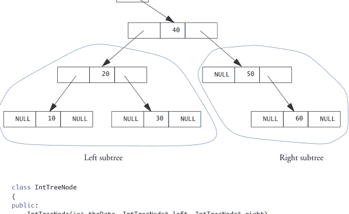

左子树

右子树

```
class IntTreeNode
{
public:
    IntTreeNode(int theData, IntTreeNode* left, IntTreeNode* right)
        : data(theData), leftLink(left), rightLink(right){}
private:
    int data;
    IntTreeNode *leftLink;
    IntTreeNode *rightLink;
};

IntTreeNode *root;
```

### 2024年12月18日 星期三 第 1 版

### 要闻

新华社北京12月17日电 中央农村工作会议17日至18日在北京召开。会议以习近平新时代中国特色社会主义思想为指导，深入贯彻党的二十大和二十届二中、三中全会精神，落实中央经济工作会议部署，分析当前“三农”工作面临的形势和挑战，部署2025年“三农”工作。

中共中央总书记、国家主席、中央军委主席习近平对做好“三农”工作作出重要指示。习近平指出，2024年，我国粮食生产迈上新台阶，农民收入稳步增长，农村社会和谐稳定，为推动经济社会高质量发展提供了有力支撑。做好2025年“三农”工作，要坚持城乡融合发展，进一步深化农村改革，完善强农惠农富农支持制度，全面推进乡村振兴。

习近平强调，要严守耕地红线，高质量推进高标准农田建设，强化农业科技和装备支撑，确保粮食和重要农产品稳产保供。要积极发展乡村富民产业，提高农业综合效益，壮大县域经济，拓宽农民增收渠道，持续巩固拓展脱贫攻坚成果，坚决守住不发生规模性返贫致贫底线。要深入学习运用“千万工程”经验，扎实推进乡村建设，繁荣乡村文化，推进移风易俗，建设宜居宜业和美乡村。要加强农村基层党组织建设，提升党建引领基层治理效能。

中共中央政治局常委、国务院总理李强在会议上讲话。中共中央政治局常委、中央办公厅主任蔡奇出席会议。

会议指出，习近平总书记的重要指示，明确了当前和今后一个时期“三农”工作的目标任务、战略重点和主攻方向，具有极强的思想引领性、战略指导性和现实针对性，我们要深入学习领会，抓好贯彻落实。

会议强调，要聚焦学习运用“千万工程”经验、推进乡村全面振兴，集中力量抓好办成一批重点实事，千方百计推动农业增效益、农村增活力、农民增收入。要坚决扛牢保障国家粮食安全重任，持续增强粮食等重要农产品供给保障能力，稳定粮食播种面积，深入推进粮油作物大面积单产提升行动，加强农业防灾减灾能力建设。要构建多元化食物供给体系，扶持畜牧业稳定发展，健全粮食和食物节约长效机制。

要稳定和完善农村土地承包关系，有序推进第二轮土地承包到期后再延长三十年试点，健全承包地经营权流转管理服务制度，完善农业经营体系，发展新型农村集体经济。要推动乡村产业提质增效，做好“土特产”文章，培育新产业新业态，完善联农带农机制，促进农民增收。

要提升乡村规划建设水平，顺应人口变化趋势，推动乡村全面振兴与新型城镇化有机结合，统筹县域城乡规划布局，推动基础设施向农村延伸，提高农村基本公共服务水平，持续改善农村人居环境，加强农村生态环境治理。要着力健全乡村治理体系，深入推进抓党建促乡村振兴，加强农村精神文明建设，持续推进移风易俗，维护农村社会和谐稳定。

要坚持从农村实际出发，尊重农民意愿，发挥农民主体作用，改进工作方式方法，鼓励各地实践探索和制度创新。要加强党对“三农”工作的全面领导，压实五级书记抓乡村振兴政治责任，完善城乡融合发展体制机制，提高党委农村工作领导小组运行效能，健全要素保障和优化配置体制机制，广泛调动社会力量参与乡村振兴的积极性主动性创造性。

### 示例 树模板类

图17.24包含二叉搜索树模板类的定义。在此示例中，我们将`SearchTree`类设为`TreeNode`类的友元类。这允许我们在树类成员函数的定义中按名称访问节点成员变量。该`SearchTree`类的实现在图17.25中给出，演示程序在图17.26中给出。

此模板类旨在让你体会树处理的风格，但它并不是一个真正完整的示例。一个真正的类会有更多的成员函数。特别是，真正的树类会有复制构造函数和重载的赋值运算符。为了节省篇幅，我们省略了这些。

关于`SearchTree`类中的函数定义，有几点值得注意。`insert`和`inTree`函数是重载的。单参数版本是我们需要的。然而，最清晰的算法是递归的，而递归算法需要为子树的根添加一个额外参数。因此，我们为每个函数定义了带两个参数的私有辅助函数，并在双参数函数中实现了递归算法。单参数函数则简单地调用双参数版本，并将子树根参数设置为整棵树的根。重载成员函数`inOrderShow`的情况类似。函数`deleteSubtree`为析构函数服务。

最后，重要的是要注意，`insert`函数构建的树满足二叉搜索树存储规则。由于`insert`是该模板类中唯一可用于构建树的函数，因此该树模板类的对象将始终满足二叉搜索树存储规则。函数`inTree`在其算法中利用了树满足二叉搜索树存储规则这一事实。这使得搜索树非常高效。当然，这意味着必须为存储在树中的类型`T`的数据定义`<`运算符。为了确保一切正常工作，当应用于类型`T`的值时，操作`<`应满足以下规则：

- - 传递性：`a < b`且`b < c`意味着`a < c`。
- - 反对称性：如果`a`和`b`不相等，则要么`a < b`要么`b < a`，但不能同时成立。
- - 非自反性：永远不会有`a < a`。

大多数自然顺序都满足这些规则。

> 1 注意，通常你同时有“小于或等于”关系和“小于”关系。这些规则仅适用于“小于”关系。实际上，你可以使用更弱的排序概念，称为严格弱排序，这在第19章中定义，但对于通常遇到的排序来说，这比你需要了解的细节更多。

### 1. 项目概述

本项目旨在开发一套智能文档处理系统，该系统能够自动识别、解析并提取各类文档中的结构化信息。系统采用先进的自然语言处理与计算机视觉技术，支持多种文档格式的输入，并输出标准化的数据结果。

### 2. 系统架构

系统整体架构分为三层：数据接入层、智能处理层和输出服务层。数据接入层负责多格式文档的采集与预处理；智能处理层为核心，包含版面分析、文字识别、语义理解等模块；输出服务层提供标准化接口，供下游业务系统调用。

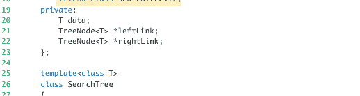

### 3. 核心功能

- - 文档版面智能分析
- - 多语种文字识别
- - 表格结构还原
- - 语义关系抽取
- - 自定义模板匹配

> > 系统在标准测试集上的准确率达到98.5%，处理速度较传统方案提升3倍以上。

### 图17.25 树模板类的实现文件（第1部分，共2部分）

```
//这是实现文件tree.cpp。这是模板类SearchTree的实现。
//接口在文件tree.h中。
namespace TreeSavitch
{
template<class T>
void SearchTree<T>::insert(T item, TreeNode<T>*& subTreeRoot)
{
    if (subTreeRoot == NULL)
        subTreeRoot = new TreeNode<T>(item, NULL, NULL);
    else if (item < subTreeRoot->data)
        insert(item, subTreeRoot->leftLink);
    else //item >= subTreeRoot->data
        insert(item, subTreeRoot->rightLink);
}

template<class T>
void SearchTree<T>::insert(T item)
{
    insert(item, root);
}

template<class T>
bool SearchTree<T>::inTree(T item, TreeNode<T>* subTreeRoot) const
{
    if (subTreeRoot == NULL)
        return false;
    else if (subTreeRoot->data == item)
        return true;
    else if (item < subTreeRoot->data)
        return inTree(item, subTreeRoot->leftLink);
    else //item > link->data
        return inTree(item, subTreeRoot->rightLink);
}

template<class T>
bool SearchTree<T>::inTree(T item) const
{
    return inTree(item, root);
}
template<class T> //使用iostream：
void SearchTree<T>::inorderShow(TreeNode<T>* subTreeRoot) const
{
    if (subTreeRoot != NULL)
    {
        inorderShow(subTreeRoot->leftLink);
        cout << subTreeRoot->data << " ";
```

> 如果所有数据都通过`insert`函数输入，树将满足二叉搜索树存储规则。

> `inTree`函数使用了一种二分搜索算法，该算法是图13.5中给出的算法的一个变体。

> 使用树的中序遍历。


### 显示 17.25 树模板类的实现文件（第 2 部分，共 2 部分）

```
44        inorderShow(subTreeRoot->rightLink);
45    }
46 }

47    template<class T> //uses iostream:
48    void SearchTree<T>::inorderShow( ) const
49    {
50        inorderShow(root);
51    }

52    template<class T>
53    void SearchTree<T>::deleteSubtree(TreeNode<T>*& subTreeRoot)
54    {
55        if (subTreeRoot != NULL)
56        {
57            deleteSubtree(subTreeRoot->leftLink);
58
59            deleteSubtree(subTreeRoot->rightLink);
60
61            //subTreeRoot now points to a one node tree.
62            delete subTreeRoot;
63            subTreeRoot = NULL;
64        }
65    }

64    template<class T>
65    SearchTree<T>::~SearchTree( )
66    {
67        deleteSubtree(root);
68    }
69 }//TreeSavitch
```

使用树的后序遍历。

### 自测练习

20. 定义以下成员函数，可将其添加到显示 17.24 中的类 SearchTree。这些函数分别显示树的前序和后序遍历中遇到的數據。分别为每个函数定义一个私有帮助函数，就像我们为 SearchTree<T>::inorderShow 所做的那样。

void SearchTree<T>::preorderShow( ) const
void SearchTree<T>::postorderShow( ) const

### 显示 17.26 树模板类的演示程序

```
//Demonstration program for the Tree template class.
#include <iostream>
#include "tree.h"
#include "tree.cpp"
using std::cout;
using std::cin;
using std::endl;
using TreeSavitch::SearchTree;

int main()
{
    SearchTree<int> t;

    cout << "Enter a list of nonnegative integers.\n"
         << "Place a negative integer at the end.\n";
    int next;
    cin >> next;
    while (next >= 0)
    {
        t.insert(next);
        cin >> next;
    }

    cout << "In sorted order: \n";
    t.inorderShow();
    cout << endl;

    return 0;
}
```

#### 示例对话

Enter a list of nonnegative integers.
Place a negative integer at the end.
40 30 20 10 11 22 33 44 -1
In sorted order:
10 11 20 22 30 33 40 44

### 章节总结

+   - 一个节点是一个结构体或类对象，它有一个或多个成员变量为指针变量。这些节点可以通过其成员指针变量连接起来，产生可以在程序运行期间增长和缩小的数据结构。
+   - 链表是一个节点列表，其中每个节点包含指向列表中下一个节点的指针。
+   - 链表（或其他链接数据结构）的末尾通过将指针成员变量设为 NULL 来指示。
+   - 栈是一个后进先出的数据结构。队列是一个先进先出的数据结构。两者都可以使用链表实现。
+   - 迭代器是一个构造（通常是某个迭代器类的对象），它允许你遍历存储在数据结构中的数据项。
+   - 树是一种数据结构，其节点有两个（或更多）成员变量指向其他节点。如果一棵树满足二叉搜索树存储规则，则可以设计一个函数来快速在树中找到数据。

### 自测练习答案

1. Sally
Sally
18
18

请注意 (*head).name 和 head->name 含义相同。同样，(*head).number 和 head->number 含义相同。

2. 最佳答案是

```
head->next = NULL;
```

但是以下也是正确的：

```
(*head).next = NULL;
```

3. head->item = "Wilbur's brother Orville";

```
4. class NodeType
{
public:
NodeType() {}
NodeType(char theData, NodeType* theLink)
: data(theData), link(theLink){}
NodeType* getLink() const { return link; }
char getData() const { return data; }
void setData(char theData) { data = theData; }
```

```
void setLink(NodeType* pointer) { link = pointer; }
private:
    char data;
    NodeType *link;
};

typedef NodeType* PointerType;
```

+   5. 值 NULL 用于指示空列表。

+   6. p1 == p1->next;

+   7. Pointer discard;
+      discard = p2->next; // discard 指向要删除的节点。
+      p2->next = discard->next;
+   
+      这足以从链表中删除该节点。但是，如果你没有将此节点用于其他用途，你应该使用 delete 调用销毁该节点，如下所示：
+   
+      delete discard;

+   8. p1 = p1->getLink( );

+   9. Pointer discard;
+      discard = p2->getLink( ); // 指向要删除的节点。
+      p2->setLink(discard->getLink( ));
+   
+      这足以从链表中删除该节点。但是，如果你没有将此节点用于其他用途，你应该使用 delete 调用销毁该节点，如下所示：
+   
+      delete discard;

+   10. a. 在大型链表的已知位置插入新项比在大型数组中插入更有效。如果你插入到列表中，大约有五次操作，其中大部分是指针赋值，与列表大小无关。如果你插入到数组中，平均需要移动大约一半的数组条目来插入一个数据项。
+   
+       对于小型列表，答案是 c，差不多。

+   11. 请注意，此函数本质上与显示 17.11 中的 headInsert 相同。

```
template<class T>
void Stack<T>::push(T stackFrame)
{
    top = new Node<T>(stackFrame, top);
}
```

+   12. //Uses cstddef:
+       template<class T>
+       Stack<T>::Stack(const Stack<T>& aStack)
+       {
+           if (aStack.isEmpty( ))

```
top = NULL;
else
{
    Node<Ts> *temp = aStack.top;//temp moves
    //through the nodes from top to bottom of aStack.
    Node<Ts> *end;//Points to end of the new stack.

    end = new Node<T>(temp->getData(), NULL);
    top = end;
    //First node created and filled with data.
    //New nodes are now added AFTER this first node.

    temp = temp->getLink();//move temp to second node
    //or NULL if there is no second node.
    while (temp != NULL)
    {
        end->setLink(
            new Node<T>(temp->getData(), NULL));
        temp = temp->getLink();
        end = end->getLink();
    }
    //end->link == NULL;
}

13. template<class Ts>
Stack<T>& Stack<T>::operator =(const Stack<T>& rightSide)
{
    if (top == rightSide.top) //if two stacks are the same
        return *this;
    else //send left side back to freestore
    {
        T next;
        while (! isEmpty())
            next = pop();//remove calls delete.
    }

    if (rightSide.isEmpty())
    {
        top = NULL;
        return *this;
    }
    else
    {
        Node<Ts> *temp = rightSide.top;//temp moves through
        //the nodes from front top to bottom of rightSide.
        Node<Ts> *end;//Points to end of the left-side stack.
        end = new Node<T>(temp->getData(), NULL);
```

```
top = end;;
//First node created and filled with data.
//New nodes are now added AFTER this first node.

temp = temp->getLink();//Move temp to second node
//or set to NULL if there is no second node.

while (temp != NULL)
{
    end->setLink(
        new Node<T>(temp->getData(), NULL));
    temp = temp->getLink();
    end = end->getLink();
}
//end->link == NULL;

    return *this;
}
```

14. 以下内容应放在命名空间 QueueSavitch 中：

```
//Uses cstddef:
template<class T>
Queue<T>::Queue() : front(NULL), back(NULL)
{
    //Intentionally empty.
}

//Uses cstddef:
template<class T>
bool Queue<T>::isEmpty() const
{
    return (back == NULL);//front == NULL would also work
}
```

15. 以下内容应放在命名空间 QueueSavitch 中：

```
//Uses cstddef:
template<class T>
void Queue<T>::add(T item)
{
    if (isEmpty())
        front = back = new Node<T>(item, NULL);//Sets both
        //front and back to point to the only node
    else
    {
        back->setLink(new Node<T>(item, NULL));
        back = back->getLink();
```

```
//Uses cstdlib and iostream:
template<class T>
T Queue<T>::remove()
{
    if (isEmpty())
    {
        cout << "Error: Removing an item from an empty queue.\n";
        exit(1);
    }

    T result = front->getData();

    Node<T> *discard;
    discard = front;
    front = front->getLink();
    if (front == NULL) //if you removed the last node
        back = NULL;

    delete discard;

    return result;
}
```

16. 以下内容应放在命名空间 QueueSavitch 中：

```
template<class T>
Queue<T>::Queue()
{
    T next;
    while (! isEmpty())
        next = remove();//remove calls delete.
}
```

17. 以下内容应放在命名空间 QueueSavitch 中：

```
//Uses cstddef:
template<class T>
Queue<T>::Queue(const Queue<T>& aQueue)
{
    if (aQueue.isEmpty())
        front = back = NULL;
    else
    {
        Node<T> *temp = aQueue.front;//temp moves
        //through the nodes from front to back of aQueue.
        back = new Node<T>(temp->getData(), NULL);
```


```
front = back;
//创建第一个节点并填入数据。
//现在新节点将添加在此第一个节点之后。

temp = temp->getLink( );//现在temp指向第二个
//节点；如果没有第二个节点则为NULL。

while (temp != NULL)
{
    back->setLink(new Node<T>(temp->getData( ), NULL));
    back = back->getLink( );
    temp = temp->getLink( );
}
//back->link == NULL
```

18. 以下内容应放在命名空间 `QueueSavitch` 中：

```
//Uses cstddef:
template<class T>
Queue<T>& Queue<T>::operator =(const Queue<T>& rightSide)
{
    if (front == rightSide.front)//if the queues are the same
        return *this;
    else //send left side back to freestore
    {
        T next;
        while (! isEmpty( ))
            next = remove( );//remove calls delete.
    }

    if (rightSide.isEmpty( ))
    {
        front = back = NULL;
        return *this;
    }
    else
    {
        Node<T> *temp = rightSide.front;//temp moves
        //through the nodes from front to back of rightSide.

        back = new Node<T>(temp->getData( ), NULL);
        front = back;
        //First node created and filled with data.
        //New nodes are now added AFTER this first node.

        temp = temp->getLink( );//temp now points to second
```

```
preorderShow(subTreeRoot->rightLink);
}
```

```
template<class T> //uses iostream:
void SearchTree<T>::postorderShow() const
{
    postorderShow(root);
}
```

```
template<class T> //uses iostream:
void SearchTree<T>::postorderShow(
    TreeNode<T>* subTreeRoot) const
{
    if (subTreeRoot != NULL)
    {
        postorderShow(subTreeRoot->leftLink);
        postorderShow(subTreeRoot->rightLink);
        cout << subTreeRoot->data << " ";
    }
}
```

### 编程项目

- 1. 编写一个 void 函数，该函数接受一个整数链表并反转其节点的顺序。该函数将有一个按引用传递的参数，该参数是指向链表头部的指针。函数调用结束后，该指针将指向一个新链表的头部，新链表包含与原始链表相同的节点，但顺序与原始链表中的顺序相反。请注意，你的函数既不会创建也不会销毁任何节点，它只是重新排列节点。将你的函数放入一个合适的测试程序中。

- 2. 编写一个名为 `mergeLists` 的函数，该函数接受两个按引用传递的参数，这两个参数是指向 int 类型链表头部的指针变量。假定这两个链表已排序，使得头部的数字最小，依此类推。该函数返回一个指针，指向一个新链表的头部，新链表包含原始两个链表中的所有节点。这个更长链表中的节点也按从小到大的顺序排序。请注意，你的函数既不会创建也不会销毁任何节点。当函数调用结束时，两个指针变量参数的值应为 `NULL`。

- 3. 设计并实现一个用于多项式的类。多项式 aₙxⁿ + aₙ₋₁xⁿ⁻¹ + ... + a₀ 将实现为链表。每个节点将包含一个 int 值表示 x 的幂，以及一个 int 值表示相应的系数。类的操作应包括加法、减法、乘法和多项式求值。重载运算符 +、- 和 * 分别用于加法、减法和乘法。多项式的求值实现为一个成员函数，其参数为 int 类型。求值成员函数返回将参数代入 x 并执行指定运算后得到的值。

  包含四个构造函数：一个默认构造函数，一个复制构造函数，一个带单个 int 类型参数的构造函数（该构造函数生成一个仅包含一个常数项的多项式，该常数项等于构造函数的参数），以及一个带两个 int 类型参数的构造函数（该构造函数生成一个单项式，其系数和指数由这两个参数给出）。[在前面的表示法中，单参数构造函数生成的多项式是仅由 a0 组成的简单形式。双参数构造函数生成的多项式是稍微复杂的 a0x^n 形式。] 包含一个合适的析构函数。包含用于输入和输出多项式的成员函数。

  当用户输入多项式时，用户输入以下形式：
  a_n x^n + a_{n-1} x^{n-1} + ... + a0

  然而，如果某个系数 a_i 为 0，用户可以省略项 a_i x^i。例如，多项式
  3x^4 + 7x^2 + 5
  可以输入为
  3x^4 + 7x^2 + 5

  也可以输入为
  3x^4 + 0x^3 + 7x^2 + 0x^1 + 5

  如果系数为负数，则使用减号代替加号，如下例所示：
  3x^5 - 7x^3 + 2x^1 - 8
  -7x^4 + 5x^2 + 9

  多项式开头的减号（如上面第二个例子所示）仅适用于第一个系数；它并不对整个多项式取负。多项式以相同的格式输出。在输出时，系数为 0 的项不输出。为了简化输入，你可以假定多项式总是每行输入一项，并且总是存在常数项 a0。如果没有常数项，用户输入 0 作为常数项，如下所示：
  12x^8 + 3x^2 + 0

- 4. 部分 A。显示 17.24 中的注释说明，一个真正的 SearchTree 模板类应该有一个复制构造函数、一个重载的赋值运算符、其他重载的运算符以及其他成员函数。获取显示 17.24 的代码，并为以下函数和重载运算符添加声明：

  

  默认构造函数、复制构造函数、delete、重载运算符 =、makeEmpty、height、size、preOrderTraversal、inOrderTraversal 和 postOrderTraversal。函数 preOrderTraversal、inOrderTraversal 和 postOrderTraversal 各自调用一个全局函数 process 来处理遇到的节点。函数 process 是 SearchTree 类的友元，在本练习中它只是一个存根（stub）。
  为这些函数提供前置条件和后置条件，描述每个函数应完成的工作。

  函数 height 没有参数，返回树的高度。树的高度是所有节点高度的最大值。节点的高度是它到根节点之间的链接数。

  函数 size 没有参数，返回树中节点的数量。

  函数 makeEmpty 从树中移除所有节点，并将节点占用的内存返还以供复用。makeEmpty 函数将根指针置为 NULL。

  部分 B。实现成员函数、友元函数和重载运算符。请注意，此处列出的一些函数已在正文中实现。你应充分利用正文中的代码。你应全面测试你的包。

  部分 C：为树类设计并实现一个迭代器类。你需要确定对于你的 searchTree 来说，begin 和 end 元素分别代表什么，以及 ++ 运算符指向的下一个元素是什么。

  提示 1：你可以维护一个私有的 size 变量，该变量在插入时增加，在删除时减少，其值由 size 函数返回。另一种方法（如果你知道对 size 的调用将非常少，则使用此方法）是在需要时通过遍历树来计算大小。类似的技术（尽管细节更复杂）可以用来实现 height 函数。

  提示 2：一次只编写其中几个成员。在完成每组少量成员后编译并测试。你会发现这样做是值得的。

  提示 3：在编写运算符 = 和复制构造函数之前，请注意它们的任务有一个共同点——复制另一棵树。编写一个 copyTree 函数，将复制构造函数和运算符 = 的共同任务抽象出来。然后使用这些公共代码编写这两个重要的函数。

  提示 4：函数 makeEmpty 和析构函数有一个共同的树销毁任务。


# 第18章 异常处理

### 18.1 异常处理基础

异常处理的玩具示例 759

定义你自己的异常类 768

多个抛出和捕获 768

陷阱：先捕获更具体的异常 772

提示：异常类可以很简单 773

在函数中抛出异常 773

异常规范 775

陷阱：派生类中的异常规范 777

### 18.2 异常处理的编程技术

何时抛出异常 779

陷阱：未捕获的异常 781

陷阱：嵌套的 try–catch 块 781

陷阱：异常的过度使用 782

异常类层次结构 782

测试可用内存 782

重新抛出异常 783

章节总结 783

自测练习答案 784

编程项目 785


# 异常处理

> It's the exception that proves the rule.

Common maxim

### INTRODUCTION

编写程序的一种方法是首先假设不会发生任何异常或错误情况。例如，如果程序从列表中取出一个条目，你可能会假设列表不为空。一旦你让程序在一切按计划进行的核心情况下正常工作，你就可以添加代码来处理异常情况。C++ 有一种方法可以在你的代码中体现这种方法。基本上，你的代码编写时假设不会发生非常异常的事情。之后，你使用 C++ 异常处理设施来添加处理那些异常情况的代码。

异常处理通常用于处理错误情况，但也许更好的看法是将其视为处理异常情况的一种方式。毕竟，如果你的代码正确处理了“错误”，那么它就不再是错误了。

异常最重要用途之一是处理具有某些特殊情况的函数，具体处理方式取决于函数的使用方式。也许该函数将在许多程序中使用，其中一些程序会以一种方式处理特殊情况，而另一些程序则以另一种方式处理。例如，如果函数中出现除零，则对于函数的某些调用，程序可能应该结束，但对于函数的其他调用则应发生其他事情。你会看到这样的函数可以被定义为在特殊情况发生时抛出异常；该异常将允许在函数外部处理特殊情况。因此，特殊情况可以针对不同的函数调用以不同的方式处理。

在 C++ 中，异常处理按如下方式进行：要么某些库软件，要么你的代码提供一种机制来发出信号，表明发生了异常情况。这称为*抛出异常*。在你的程序的另一处，你放置处理异常情况的代码。这称为*处理异常*。这种编程方法使代码更清晰。当然，我们仍然需要解释在 C++ 中如何做到这一点。

本章的大部分内容仅使用了第 1 章到第 9 章的材料。然而，“派生类中的异常规范”和“异常类层次结构”部分使用了第 14 章的材料。“测试可用内存”部分使用了第 17 章的材料。这些列出的部分中的任何一个或全部都可以省略，而不会影响章节的连贯性。“异常规范”部分有一段引用了派生类（第 14 章），但该段可以省略。

### 18.1 Exception Handling Basics

> *Well, the program works for most cases. I didn’t know it had to work for that case.*
> 
> Computer Science Student, *Appealing a grade*

异常处理旨在少量使用，并且在比简单入门示例中合理包含的情况更复杂的情况下使用。因此，我们将通过简单的示例来教你 C++ 的异常处理细节，这些示例在正常情况下不会使用异常处理。这对于学习 C++ 异常处理细节来说很有意义，但请不要忘记这些第一个示例是玩具示例；在实践中，你不会对如此简单的事情使用异常处理。

#### A TOY EXAMPLE OF EXCEPTION HANDLING

对于此示例，假设牛奶在我们的文化中是一种如此重要的食物，人们几乎从不缺货，但我们仍然希望我们的程序能够适应极不可能的缺奶情况。假设我们不会缺奶的基本代码可能如下：

```
cout << "Enter number of donuts:\n";
cin >> donuts;
cout << "Enter number of glasses of milk:\n";
cin >> milk;
dpg = donuts/static_cast<double>(milk);
cout << donuts << " donuts.\n"
     << milk << " glasses of milk.\n"
     << "You have " << dpg
     << " donuts for each glass of milk.\n";
```

如果没有牛奶，则此代码将包括除零，这是一个错误。为了处理我们缺奶的这种特殊情况，我们可以添加一个测试。显示 18.1 中显示了添加了对特殊情况的此测试的完整程序。显示 18.1 中的程序不使用异常处理。现在，让我们看看如何使用 C++ 异常处理设施重写此程序。

在显示 18.2 中，我们使用异常重写了显示 18.1 中的程序。这只是一个玩具示例，你可能不会在这种情况下使用异常。然而，它确实给我们一个简单的示例来使用。虽然程序作为一个整体并不更简单，但至少 try 和 catch 之间的部分更清晰，这暗示了使用异常的优势。看看 try 和 catch 之间的代码。它基本上与显示 18.1 中的代码相同，只是而不是大 if-else 语句（在显示 18.1 中突出显示），这个新程序有以下较小的 if 语句（加上一些简单的非分支语句）：

```
if (milk <= 0)
    throw donuts;
```

此 if 语句表示如果没有牛奶，则执行异常操作。异常操作在 catch 之后给出。想法是 try 之后的代码处理正常情况，而 catch 之后的代码处理异常情况。因此，我们将正常情况与异常情况分开。在这个玩具示例中，这并没有真正带来太多好处，但在其他情况下它将证明非常有帮助。让我们看看细节。

在 C++ 中处理异常的基本方式由 try-throw-catch 三者组成。try 块具有以下语法：

```
try
{
    Some_Code
}
```

此 try 块包含基本算法的代码，说明一切顺利时该做什么。它被称为 try 块，因为你不能 100% 确定一切都会顺利，但你想“试一试”。

如果发生异常情况，你希望抛出异常，这是一种表明发生异常情况的方式。因此，当我们添加 throw 时，基本轮廓如下：

```
try
{
```


Code_To_Try
Possibly_Throw_An_Exception
More_Code
}

下面是一个包含 throw 语句的 try 块示例（摘自 Display 18.2）：

```
try
{
    cout << "Enter number of donuts:\n";
    cin >> donuts;
    cout << "Enter number of glasses of milk:\n";
    cin >> milk;

    if (milk <= 0)
        throw donuts;

    dpg = donuts/static_cast<double>(milk);
    cout << donuts << " donuts.\n"
         << milk << " glasses of milk.\n"
         << "You have " << dpg
         << " donuts for each glass of milk.\n";
}
```

下面的语句抛出一个 int 类型的值 donuts：

```
throw donuts;
```

被抛出的值（在此例中是 donuts）有时被称为异常；执行 throw 语句称为抛出异常。你可以抛出任何类型的值。在这个例子中，抛出的是一个 int 值。

当有东西被“抛出”时，它从一个地方移到另一个地方。在 C++ 中，从一个地方移到另一个地方的是控制流（以及被抛出的值）。当异常被抛出时，周围的 try 块中的代码停止执行，另一段称为 catch 块的代码开始执行。执行 catch 块称为捕获异常或处理异常。当异常被抛出时，它最终应该由某个 catch 块处理（捕获）。在 Display 18.2 中，相应的 catch 块紧跟在 try 块之后。下面我们重复一下这个 catch 块：

```
catch(int e)
{
    cout << e << " donuts, and No Milk!\n"
         << "Go buy some milk.\n";
}
```

### throw 语句

### 语法

```
throw Expression_for_Value_to_Be_Thrown;
```

当 throw 语句执行时，包含它的 try 块的执行被停止。如果 try 块后面跟着一个合适的 catch 块，那么控制流就会转移到 catch 块。throw 语句几乎总是嵌入在分支语句（如 if 语句）中。抛出的值可以是任何类型。

### 示例

```
if (milk <= 0)
    throw donuts;
```

这个 catch 块看起来非常像一个带有 int 类型参数的函数定义。它并不是函数定义，但在某些方面，catch 块就像函数。它是一段独立的代码，当你的程序遇到（并执行）以下语句时（在前面的 try 块内），就会执行这段代码：

```
throw Some_int;
```

因此，这个 throw 语句类似于函数调用，但它不是调用函数，而是调用 catch 块并指定执行 catch 块中的代码。catch 块通常被称为异常处理器（exception handler），这个术语表明 catch 块具有类似函数的性质。

在下面来自 catch 块的一行中，标识符 e 是什么？

```
catch(int e)
```

这个标识符 e 看起来像一个参数，而且行为也很像参数。事实上，catch 块标题中的标识符（如 e）称为 catch 块参数。每个 catch 块最多只能有一个 catch 块参数。catch 块参数有两个作用：

即被抛出的值。我们当前的示例只有一个 catch 块。catch 块参数的常用名称是 e，但你可以在 e 的位置使用任何合法的标识符。

让我们看看 Display 18.2 中的 catch 块是如何工作的。当一个值被抛出时，try 块中代码的执行结束，控制权转移到紧接在 try 块之后的 catch 块（或一组 catch 块）。Display 18.2 中的 catch 块在这里重现：

```
catch(int e)
{
    cout << e << " donuts, and No Milk!\n"
        << "Go buy some milk.\n";
}
```

当一个值被抛出时，为了使这个特定的 catch 块适用，被抛出的值必须是 int 类型。在 Display 18.2 中，被抛出的值由变量 donuts 给出，因为 donuts 是 int 类型，所以这个 catch 块能够捕获被抛出的值。

假设 donuts 的值为 12，milk 的值为 0，如 Display 18.2 中的第二个示例对话所示。由于 milk 的值不是正数，if 语句中的 throw 语句被执行。在这种情况下，变量 donuts 的值被抛出。当 Display 18.2 中的 catch 块捕获到 donuts 的值时，donuts 的值被代入 catch 块参数 e，然后执行 catch 块中的代码，产生以下输出：

```
12 donuts, and No Milk!
Go buy some milk.
```

如果 donuts 的值为正，则 throw 语句不会被执行。在这种情况下，整个 try 块都会被执行。当 try 块中的最后一条语句执行完后，会执行 catch 块之后的语句。注意，如果没有异常被抛出，catch 块会被忽略。

这一讨论听起来像是 try–throw–catch 结构与 if–else 语句等价。除了被抛出的值以外，它几乎是等价的。try–throw–catch 结构就像 if–else 语句，但额外具备向其中一个分支发送消息的能力。这听起来与 if–else 语句没有太大区别，但在实践中却有很大不同。

以更正式的语气总结：try 块包含一些代码，我们假设其中包含 throw 语句。throw 语句通常只在异常情况下执行，但一旦执行，它会抛出某种类型的值。当异常（如 Display 18.2 中的值 donuts）被抛出时，try 块结束。try 块中其余所有代码都被忽略，控制权传递给合适的 catch 块。catch 块只适用于紧邻其前面的 try 块。如果异常被抛出，那么该异常对象会被代入 catch 块参数，并执行 catch 块中的语句。例如，如果你查看 Display 18.2 中的对话，你会发现一旦用户输入一个非正数，try 块就会停止，catch 块开始执行。目前，我们将

### catch 块参数

catch 块参数是 catch 块标题中的一个标识符，它充当可能被抛出的异常（值）的占位符。当前面的 try 块中抛出一个合适的值时，该值会被代入 catch 块参数。（为了使 catch 块执行，被抛出的值必须与其 catch 块参数指定的类型一致。）你可以使用任何合法（非保留字）标识符作为 catch 块参数。

### 示例

```
catch(int e)
{
    cout << e << " donuts, and No Milk!\n"
         << "Go buy some milk.\n";
}
```

e 就是 catch 块参数。

假设每个 try 块后面都跟着一个合适的 catch 块。稍后我们将讨论没有合适的 catch 块时会发生什么。

如果在 try 块中没有抛出异常（值），那么当 try 块执行完毕后，程序继续执行 catch 块之后的代码。换句话说，如果没有异常抛出，catch 块会被忽略。在程序执行的大多数时候，throw 语句不会被执行，因此在大多数情况下，try 块中的代码会一直运行到结束，而 catch 块中的代码会被完全忽略。

### try-throw-catch

抛出和捕获异常的基本机制是 try-throw-catch 序列。throw 语句抛出异常（一个值）。catch 块捕获异常（该值）。当异常被抛出时，try 块结束，然后执行 catch 块中的代码。catch 块执行完毕后，会执行 catch 块（或一组 catch 块）之后的代码（前提是 catch 块没有结束程序或执行其他特殊操作）。

（被抛出的异常类型必须与 catch 块参数列出的类型匹配，否则该异常不会被此 catch 块捕获。这一点将在“Multiple Throws and Catches”小节中进一步讨论。）

如果在 try 块中没有抛出异常，那么当 try 块执行完毕后，程序继续执行 catch 块或一组 catch 块之后的代码。（换句话说，如果没有异常抛出，catch 块或一组 catch 块会被忽略。）


# SYNTAX

```
try
{
    Some_Statements
    <Either some code with a throw statement or
    a function invocation that might throw an exception>
    Some_More_Statements
}
catch(Type e)
{
    < Code to be performed if a value of the
    catch-block parameter type is thrown in the try block>
}
```

# EXAMPLE

See Display 18.2 for an example.

# Self-Test Exercises

+   1. What output is produced by the following code?

```
int waitTime = 46;

try
{
    cout << "Try block entered.\n";
    if (waitTime > 30)
        throw waitTime;
    cout << "Leaving try block.\n";
}

catch(int thrownValue)
{
    cout << "Exception thrown with\n"
         << "waitTime equal to " << thrownValue << endl;
}
cout << "After catch block" << endl;
```

+   2. What would be the output produced by the code in Self-Test Exercise 1 if we made the following change? Change the line
+   int waitTime = 46;
+   to
+   int waitTime = 12;

+   3. In the code given in Self-Test Exercise 1, what is the throw statement?
+   4. What happens when a throw statement is executed? (Tell what happens in general, not simply what happens in the code in Self-Test Exercise 1 or some other sample code.)
+   5. In the code given in Self-Test Exercise 1, what is the try block?
+   6. In the code given in Self-Test Exercise 1, what is the catch block?
+   7. In the code given in Self-Test Exercise 1, what is the catch-block parameter?

# DEFINING YOUR OWN EXCEPTION CLASSES

A throw statement can throw a value of any type. A common thing to do is to define a class whose objects can carry the precise kinds of information you want thrown to the catch block. An even more important reason for defining a specialized exception class is so that you can have a different type to identify each possible kind of exceptional situation.

An exception class is just a class. What makes it an exception class is how it is used. Still, it pays to take some care in choosing an exception class’s name and other details.

Display 18.3 contains an example of a program with a programmer-defined exception class. This is just a toy program to illustrate some C++ details about exception handling. It uses much too much machinery for such a simple task, but it is an otherwise uncluttered example of some C++ details.

Notice the throw statement, reproduced in what follows:

```
throw NoMilk(donuts);
```

The part NoMilk(donuts) is an invocation of a constructor for the class NoMilk. The constructor takes one int argument (in this case, donuts) and creates an object of the class NoMilk. That object is then thrown.

# MULTIPLE THROWS AND CATCHES

A try block can potentially throw any number of exception values, which can be of differing types. In any one execution of the try block, at most one exception will be thrown (since a throw statement ends the execution of the try block), but different types of exception values can be thrown on different occasions when the try block is executed. Each catch block can only catch values of one type, but you can catch exception values of differing types by placing more than one catch block after a try block. For example, the program in Display 18.4 has two catch blocks after its try block.

Note that there is no parameter in the catch block for DivideByZero. If you do not need a parameter, you can simply list the type with no parameter. This is discussed a bit more in the programming tip section entitled "Exception Classes Can Be Trivial."

# Display 18.3 Defining Your Own Exception Class

```
#include <iostream>
using std::cin;
using std::cout;

class NoMilk
{
public:
    NoMilk() {}
    NoMilk(int howMany) : count(howMany) {}
    int getCount() const { return count; }
private:
    int count;
};

int main()
{
    int donuts, milk;
    double dpg;
    try
    {
        cout << "Enter number of donuts:\n";
        cin >> donuts;
        cout << "Enter number of glasses of milk:\n";
        cin >> milk;

        if (milk <= 0)
            throw NoMilk(donuts);

        dpg = donuts/static_cast<double>(milk);
        cout << donuts << " donuts\n"
             << milk << " glasses of milk.\n"
             << "You have " << dpg
             << " donuts for each glass of milk.\n";
    }
    catch(NoMilk e)
    {
        cout << e.getCount() << " donuts, and No Milk!\n"
             << "Go buy some milk.\n";
    }
    cout << "End of program.\n";
    return 0;
}
```

This is just a toy example to learn C++ syntax. Do not take it as an example of good typical use of exception handling.

The sample dialogues are the same as in Display 18.2.

# Display 18.4. Catching Multiple Exceptions (part 1 of 2)

```
```cpp
#include <iostream>
#include <string>
using std::cin;
using std::cout;
using std::endl;
using std::string;

class NegativeNumber
{
public:
    NegativeNumber() {}
    NegativeNumber(string theMessage): message(theMessage) {}
    string getMessage() const { return message; }
private:
    string message;
};

class DivideByZero
{};

int main()
{
    int pencils, erasers;
    double ppe; //pencils per eraser

    try
    {
        cout << "How many pencils do you have?\n";
        cin >> pencils;
        if (pencils < 0)
            throw NegativeNumber("pencils");

        cout << "How many erasers do you have?\n";
        cin >> erasers;
        if (erasers < 0)
            throw NegativeNumber("erasers");

        if (erasers != 0)
            ppe = pencils/static_cast<double>(erasers);
        else
            throw DivideByZero();

        cout << "Each eraser must last through "
             << ppe << " pencils.\n";
    }
```
```

> *Exception classes can have their own interface and implementation files and can be put in a namespace. This is another example.*

### 1. 引言

在当今快速发展的技术时代，人工智能（AI）已经成为推动社会进步的重要力量。从智能助手到自动驾驶，AI 技术正在深刻改变我们的生活方式和工作模式。本文旨在探讨 AI 技术的最新进展及其在各领域的应用前景。

### 2. AI 技术的主要领域

- 机器学习：通过数据训练模型，使系统能够自动学习和改进。
- 深度学习：基于神经网络的多层结构，处理复杂模式识别任务。
- 自然语言处理：使计算机能够理解、解释和生成人类语言。
- 计算机视觉：让机器能够“看懂”图像和视频内容。

### 3. 应用场景

| 领域 | 应用示例 | 影响程度 |
|------|----------|----------|
| 医疗 | 疾病诊断、药物研发 | 高 |
| 交通 | 自动驾驶、智能调度 | 高 |
| 教育 | 个性化学习、智能辅导 | 中 |
| 金融 | 风险评估、欺诈检测 | 高 |

> > “AI 不是要取代人类，而是要增强人类的能力。” —— 某知名 AI 研究者

综上所述，AI 技术正在多个领域展现出巨大的潜力。未来，随着算法的不断优化和计算能力的提升，AI 将在更多场景中发挥关键作用，为人类社会带来更多福祉。

# Pitfall
CATCH THE MORE SPECIFIC EXCEPTION FIRST

When catching multiple exceptions, the order of the catch blocks can be important. When an exception value is thrown in a try block, the catch blocks that follow it are tried in order, and the first one that matches the type of the exception thrown is the one that is executed.

For example, the following is a special kind of catch block that will catch a thrown value of any type:

```
catch (...)
{
    <Place whatever you want in here.>
}
```

The three dots do not stand for something omitted. You actually type in those three dots in your program. This makes a good default catch block to place after all other catch blocks. For example, we could add it to the catch blocks in Display 18.4 as follows:

```
catch(NegativeNumber e)
{
    cout << "Cannot have a negative number of "
         << e.getMessage() << endl;
}
catch(DivideByZero)
{
    cout << "Do not make any mistakes.\n";
}
catch (...)
{
    cout << "Unexplained exception.\n";
}
```

However, it only makes sense to place this default catch block at the end of a list of catch blocks. For example, suppose we instead used:

```
catch(NegativeNumber e)
{
    cout << "Cannot have a negative number of "
         << e.getMessage() << endl;
}
catch (...)
{
    cout << "Unexplained exception.\n";
}
catch(DivideByZero)
{
    cout << "Do not make any mistakes.\n";
}
```

With this second ordering, an exception (a thrown value) of type `NegativeNumber` will be caught by the `NegativeNumber` catch block as it should be. However, if a value of type `DivideByZero` were thrown, it would be caught by the block that starts `catch(...)`. So, the `DivideByZero` catch block could never be reached. Fortunately, most compilers will tell you if you make this sort of mistake.

# Tip — EXCEPTION CLASSES CAN BE TRIVIAL

Below we have reproduced the definition of the exception class `DivideByZero` from Display 18.4:

```
class DivideByZero
{};
```

This exception class has no member variables and no member functions (other than the default constructor). It has nothing but its name, but that is useful enough. Throwing an object of the class `DivideByZero` can activate the appropriate catch block, as it does in Display 18.4.

When using a trivial exception class, you normally do not have anything you can do with the exception (the thrown value) once control gets to the catch block. The exception is just being used to get you to the catch block. Thus, you can omit the catch-block parameter. In fact, you can omit the catch-block parameter any time you do not need it, whether the exception type is trivial or not.

# THROWING AN EXCEPTION IN A FUNCTION

Sometimes it makes sense to delay handling an exception. For example, you might have a function `f` that codes that throws an exception if there is an attempt to divide by zero, but you may not want to catch the exception in that function. Perhaps some programs that use that function should simply end if the exception is thrown, and other programs that use the function should do something else. Thus, you would not know what to do with the exception if you caught it inside the function. In these cases, it makes sense to not catch the exception in the function definition, but instead to have any program (or other code) that uses the function place the function invocation in a try block and catch the exception in a catch block that follows that try block.

Look at the program in Display 18.5. It has a try block, but there is no throw statement visible in the try block. The statement that does the throwing in that program is

```
if (bottom == 0)
    throw DivideByZero();
```

This statement is not visible in the try block. However, it is in the try block in terms of program execution, because it is in the definition of the function `safeDivide` and there is an invocation of `safeDivide` in the try block.


# Display 18.5 在函数内部抛出异常（第 2 部分，共 2 部分）

# 示例对话 1

```
Enter numerator:
5
Enter denominator:
10
5/10 = 0.5
End of Program.
```

# 示例对话 2

```
Enter numerator:
5
Enter denominator:
0
Error: Division by zero!
Program aborting.
```

safeDivide 声明中 throw (DivideByZero) 的含义将在下一小节中讨论。

### 异常规范

如果一个函数没有捕获异常，它至少应该警告程序员，函数的任何调用都可能抛出异常。如果在函数定义中可能抛出但未被捕获的异常存在，那么这些异常类型应列在异常规范中，如以下函数声明所示，该声明取自 Display 18.5：

```
double safeDivide(int top, int bottom) throw (DivideByZero);
```

如 Display 18.5 所示，异常规范应同时出现在函数声明和函数定义中。如果一个函数有多个函数声明，那么所有函数声明必须具有相同的异常规范。函数的异常规范有时也称为 throw 列表。

如果在函数定义中可能抛出多个异常，则异常类型以逗号分隔列出，如下所示：

```
void someFunction() throw (DivideByZero, SomeOtherException);
```

异常规范中列出的所有异常类型都按正常方式处理。当我们说异常被正常处理时，我们的意思是按本小节之前描述的方式处理。特别是，你可以将函数调用放在 try 块后面跟一个 catch 块来捕获该类型的异常，如果函数抛出异常（并且在函数内部没有捕获它），那么跟在 try 块后面的 catch 块将捕获该异常。

如果根本没有异常规范（甚至没有空的规范），那么代码的行为就好像列出了所有可能的异常类型一样；也就是说，抛出的任何异常都按正常方式处理。

当在函数中抛出异常但未列在异常规范中（并且在函数内部未被捕获）时会发生什么？这既不是编译时错误也不是运行时错误。在这种情况下，函数 unexpected( ) 将被调用。你可以更改 unexpected( ) 的行为，但默认行为是调用 terminate( ) 函数，后者结束程序。特别是要注意，如果在函数中抛出异常但未列在异常规范中（并且在函数内部未被捕获），那么它将不会被程序中的任何 catch 块捕获，而是会导致 unexpected( ) 的调用，其默认行为是结束你的程序。

请记住，异常规范是针对“逃出”函数的异常。如果它们没有逃出函数，就不应包含在异常规范中。如果它们逃出函数，就应包含在异常规范中，无论它们起源于何处。如果在函数定义内部的 try 块中抛出异常，并且在函数定义内部的 catch 块中捕获，那么其类型无需列在异常规范中。如果函数定义包含对另一个函数的调用，而该另一个函数可能抛出未被捕获的异常，那么该异常的类型应放在异常规范中。

你可能会认为抛出未被捕获且不在 throw 列表中的异常的可能性应由编译器检查并产生编译器错误。然而，由于 C++ 中异常的细节，编译器无法执行该检查。检查必须在运行时进行。¹

要表示函数不应抛出在函数内部未被捕获的任何异常，请使用空的异常规范，如下所示：

```
void someFunction( ) throw ( );
```

总结如下：

```
void someFunction( ) throw (DivideByZero, SomeOtherException);
//类型为 DivideByZero 或 SomeOtherException 的异常
//按正常方式处理。所有其他异常都会调用 unexpected( )。
```

¹ 这在所有编程语言中都不是真的。这取决于异常规范细节在语言中是如何定义的。

```
```cpp
void someFunction() throw();
//空异常列表，因此所有异常都会调用 unexpected()。

void someFunction();
//所有类型的异常都按正常方式处理。
```
```

unexpected() 的默认操作是结束程序。你无需使用任何特殊的 include 或 using 指令即可获得 unexpected() 的默认行为。你通常无需重新定义 unexpected() 的行为；然而，unexpected() 的行为可以用 set_unexpected 函数更改。如果你需要使用 set_unexpected，你应查阅更高级的书籍以了解细节。

请记住，派生类的对象也是其基类的对象。因此，如果 D 是 B 的派生类并且 B 在异常规范中，那么类 D 的抛出对象将被正常处理，因为它是类 B 的对象。然而，不会进行自动类型转换。如果 double 在异常规范中，这并不能说明抛出 int 值的情况。你需要在异常规范中同时包含 int 和 double。

最后警告：并非所有编译器都按应有的方式处理异常规范。有些编译器本质上将异常规范视为注释；对于这些编译器，异常规范对你的代码没有任何影响。这也是将你的函数可能抛出的所有异常都放在 throw 规范中的另一个原因。这样所有编译器都会以相同的方式处理你的异常。当然，你也可以通过完全不使用任何 throw 规范来获得相同的编译器一致性，但那样你的程序就不会得到很好的文档说明，并且你也不会获得使用 throw 规范的编译器提供的额外错误检查。有了处理 throw 规范的编译器，你的程序会在抛出你未预料到的异常时立即终止。 （请注意，这是一种运行时行为，但你得到的运行时行为取决于你的编译器。）

### 陷阱 — 派生类中的异常规范

当你在派生类中重新定义或覆盖函数定义时，它应具有与基类中相同的异常规范，或者它应具有异常规范，其异常是基类异常规范的子集。换句话说，当你重新定义或覆盖函数定义时，你不能向异常规范添加任何异常（但如果你愿意，可以删除一些异常）。这是有道理的，因为派生类的对象可以在基类的对象可以使用的任何地方使用，因此重新定义或覆盖的函数必须适合为基类的对象编写的任何代码。

### 自测练习

8. 以下程序产生的输出是什么？

```
```cpp
#include <iostream>
using std::cout;

void sampleFunction(double test) throw (int);

int main( )
{
    try
    {
        cout << "Trying.\n";
        sampleFunction(98.6);
        cout << "Trying after call.\n";
    }
    catch(int)
    {
        cout << "Catching.\n";
    }

    cout << "End program.\n";
    return 0;
}
void sampleFunction(double test) throw (int)
{
    cout << "Starting sampleFunction.\n";
    if (test < 100)
        throw 42;
}
```
```

9. 当对自测练习 8 中的程序进行以下更改时，程序产生的输出是什么？将

```
```cpp
sampleFunction(98.6);
```

在 try 块中更改为

```
```cpp
sampleFunction(212);
```
```


### 18.2 异常处理的编程技术

> *仅在特殊情况下使用。*
> 
> —— Warren Peace，《中尉的工具》

到目前为止，我们展示了大量解释 C++ 中异常处理如何工作的代码，但我们没有展示一个对异常处理进行良好且现实使用的程序示例。然而，现在你已经了解了异常处理的机制，本节可以继续解释异常处理技术。

### 何时抛出异常

我们给出了一些非常简单的代码来说明异常处理的基本概念。然而，我们的示例过于简单不切实际。更复杂但更好的指导原则是将抛出异常和捕获异常分离到不同的函数中。在大多数情况下，你应该在函数定义中包含并抛出语句，为该函数列出异常规范，并在不同的函数中放置 catch 子句。因此，try–throw–catch 三元组的首选用法如图所示：

```cpp
void functionA() throw (MyException)
{
        .
        .
        .

        throw MyException(<Maybe an argument>);
        .
        .
        .
}
```

然后，在某个其他函数中（甚至可能是某个其他文件中的某个其他函数），你有以下内容：

```cpp
void functionB()
{
        .
        .
        .
}
```

在很大程度上，throw 语句应在使用函数内部并在函数的异常规范中列出。此外，它们应保留用于异常情况的处理方式取决于函数如何以及在何处使用的情况。如果异常情况的处理方式取决于函数如何以及在何处被调用，那么最好的做法是让调用该函数的程序员处理异常。在其他情况下，几乎总是最好避免抛出异常。

#### 陷阱

#### 未捕获的异常

你的代码抛出的每个异常都应该在你的代码中的某个地方被捕获。如果抛出异常但在任何地方都没有被捕获，程序将结束。

从技术上讲，如果抛出异常但未被捕获，则会调用函数 terminate( )。terminate( ) 的默认含义是结束你的程序。你可以从默认值更改其含义，但这很少需要，我们在此不详细介绍。

如果在函数中抛出异常但未在函数内部或外部捕获，则有两种可能情况。如果异常未列在异常规范中，则会调用函数 unexpected( )。如果异常未列在异常规范中，则会调用函数 terminate( )。但除非你更改 unexpected( ) 的默认行为，否则 unexpected( ) 会调用 terminate( )。因此，在这两种情况下结果都相同。如果在函数中抛出异常但未在函数内部或外部捕获，则你的程序将结束。

#### 陷阱

#### 嵌套的 try-catch 块

你可以在更大的 try 块内部或更大的 catch 块内部放置一个 try 块和随后的 catch 块。在极少数情况下这可能有用，但如果你想这样做，你应该怀疑存在更优雅的方式来组织你的程序。几乎总是最好将内部 try-catch 块放在函数定义内部，并在外部 try 或 catch 块中放置对该函数的调用（或者也许完全消除一个或多个 try 块）。

如果你将一个 try 块和随后的 catch 块放在更大的 try 块内部，并且在内部 try 块中抛出异常但未在任何内部 catch 块中捕获，则异常将被抛出到外部 try 块进行处理，可能会被跟随外部 try 块的 catch 块捕获。

#### 陷阱 过度使用异常

异常允许你编写控制流如此复杂以至于几乎不可能理解程序的程序。而且，这并不难做到。抛出异常允许你将控制流从程序中的任何位置转移到程序中几乎任何其他位置。在编程的早期阶段，这种不受限制的控制流是通过一种称为 goto 的结构允许的。编程专家现在一致认为这种不受限制的控制流是非常糟糕的编程风格。异常允许你回到这些不受限制的控制流的糟糕旧时代。异常应谨慎使用并且仅以特定方式使用。一个好的规则如下：如果你想包含一个 throw 语句，那么想想你如何在没有这个 throw 语句的情况下编写你的程序或类定义。如果你能想到一种产生合理代码的替代方案，那么你可能不希望包含 throw 语句。

### 异常类层次结构

定义异常类层次结构可能非常有用。例如，你可能有一个 ArithmeticError 异常类，然后定义一个派生自 ArithmeticError 的 DivideByZeroError 异常类。由于 DivideByZeroError 是 ArithmeticError，因此针对 ArithmeticError 的每个 catch 块都会捕获 DivideByZeroError。如果你在异常规范中列出 ArithmeticError，那么实际上你也将 DivideByZeroError 添加到了异常规范中，无论你是否在异常规范中按名称列出 DivideByZeroError。

### 测试可用内存

在第 17 章中，我们使用类似以下的代码创建新的动态变量：

```cpp
struct Node
{
    int data;
    Node *link;
};
typedef Node* NodePtr;
...
NodePtr pointer = new Node;
```

只要有足够的内存来创建新节点，这就可以正常工作。但如果没有足够的内存会怎样？如果没有足够的内存来创建节点，则会抛出 bad_alloc 异常。

由于 new 在没有足够内存创建节点时会抛出 bad_alloc 异常，你可以按如下方式检查内存耗尽：

```cpp
try
{
NodePtr pointer = new Node;
}
catch (bad_alloc)
{
    cout << "Ran out of memory!";
}
```

当然，你可以做的事情不仅仅是给出警告消息，但你所做细节将取决于你的特定编程任务。

bad_alloc 的定义在带有头文件 <new> 的库中，并放置在 std 命名空间中。因此，在使用 bad_alloc 时，你的程序应包含以下内容（或类似内容）：

```cpp
#include <new>
using std::bad_alloc;
```

### 重新抛出异常

在 catch 块中抛出异常是合法的。在极少数情况下，你可能想要捕获异常，然后根据细节决定抛出相同或不同的异常以供异常处理块链中更高层处理。

### 自测练习

- 10. 当异常从未被捕获时会发生什么？
- 11. 你可以在另一个 try 块内嵌套一个 try 块吗？

### 章节总结

- 异常处理允许你将程序的正常情况设计和编码与处理异常情况的代码分开。
- 可以在 try 块中抛出异常。或者，可以在不包含 try 块（或不包含捕获该类型异常的 catch 块）的函数定义中抛出异常。在这种情况下，可以将函数的调用放在 try 块中。
- 异常在 catch 块中被捕获。
- try 块可以跟随一个以上的 catch 块。在这种情况下，始终在针对更一般异常类的 catch 块之前列出针对更具体异常类 catch 块。
- 异常的最佳用法是在函数中抛出异常（但不在函数中捕获它）只要异常的处理方式将因一次调用而异


将函数抛向另一个函数。除此之外，很少有其他情况可以从抛出异常中获益。

- 如果在函数中抛出异常但未在该函数中捕获，则异常类型应列在该函数的异常规范中。
- 如果抛出异常但从未被捕获，则默认行为是结束你的程序。
- 不要过度使用异常。

### 自测练习答案

1. 进入 Try 块。
抛出异常，waitTime 等于 46
Catch 块之后。

2. 进入 Try 块。
离开 Try 块。
Catch 块之后。

3. throw waitTime;

请注意，以下是一个 if 语句，而不是 throw 语句，即使它包含一个 throw 语句：

```
if (waitTime > 30)
    throw waitTime;
```

4. 当执行 throw 语句时，封闭 try 块的执行结束。try 块中的其他语句不会被执行，控制权传递给随后的 catch 块或块。当我们说控制权传递给随后的 catch 块时，我们的意思是将抛出值填入 catch 块参数（如果有）中，并执行 catch 块中的代码。

```
try
{
    cout << "Try block entered.";
    if (waitTime > 30)
        throw waitTime;
    cout << "Leaving try block.";
}
```

```
catch(int thrownValue)
{
    cout << "Exception thrown with\n"
         << "waitTime equal to" << thrownValue << endl;
}
```

### 第19章 标准模板库
CHAPTER
标准模板库


19.1 迭代器 789
迭代器基础 789
迭代器种类 795
常量和可变迭代器 798
反向迭代器 800
陷阱：编译器问题 802
其他种类的迭代器 802

19.2 容器 803
顺序容器 803
陷阱：迭代器与删除元素 808
提示：容器中的类型定义 808
容器适配器 stack 和 queue 809
关联容器 set 和 map 810
效率 815

19.3 通用算法 817
运行时间和大 O 记法 818
容器访问运行时间 822
非修改序列算法 823
修改序列算法 828
集合算法 828
排序算法 829

章节总结 831
自测练习答案 832
编程项目 833

### 标准模板库

> 图书馆不是造出来的；它们是生长出来的。

Augustine Birrell

### 引言

在第 17 章中，我们构建了自己的 stack 和 queue 数据结构版本。存在一个用于存储数据的标准结构的大型集合。由于它们非常标准，因此对这些数据结构的标准可移植实现是有意义的。标准模板库（STL）包含此类数据结构的库。STL 中包含 stack、queue 以及许多其他标准数据结构的实现。当在 STL 的上下文中讨论时，这些数据结构通常称为容器类，因为它们用于保存数据集合。第 7 章通过描述 vector 模板类预览了 STL，vector 是 STL 中的一个容器类。本章概述了 STL 中包含的一些基本类。由于 STL 非常庞大，我们无法在此对其进行全面介绍，但我们将介绍足够的内容，让你开始使用一些基本的 STL 容器类以及 STL 中的其他项目。

STL 由 Alexander Stepanov 和 Hewlett-Packard 的 Meng Lee 开发，并基于 Stepanov、Lee 和 David Musser 的研究。它是用 C++ 语言编写的库集合。虽然 STL 不是 C++ 核心语言的一部分，但它是 C++ 标准的一部分，因此任何符合标准的 C++ 实现都包含 STL。从实际角度来看，你可以将 STL 视为 C++ 语言的一部分。

顾名思义，STL 中的类是模板类。STL 中的典型容器类对要存储在容器类中的数据类型有一个类型参数。

STL 容器类大量使用迭代器，迭代器是便于遍历容器中数据的对象。第 17 章第 17.3 节介绍了迭代器这一通用概念。虽然本章不假设你已阅读该节，但大多数读者会发现先阅读该节再阅读本章很有帮助。如 STL 中所定义，迭代器非常通用，可用于不仅仅是遍历我们将讨论的几个容器类。我们对迭代器的讨论将专门针对本章讨论的容器类的简单用法。这应该使概念在具体环境中变得生动，并应给你足够的理解，以便阅读有关 STL 的更高级的文本。有许多专门介绍 STL 的书籍。

STL 还包含许多重要的通用算法的实现，例如搜索和排序。算法被实现为模板函数。在讨论容器类之后，我们将描述其中一些算法实现。

STL 与其他 C++ 库，例如 <iostream>，不同之处在于类和算法是通用的，换句话说，它们是模板类和模板函数。

如果你尚未阅读，请阅读第 7 章第 7.3 节，其中涵盖了 STL 的 vector 模板类。虽然本章不使用第 17 章中的任何材料，但大多数读者会发现先阅读第 17 章再阅读本章有助于理解本章，因为它提供了 STL 内在抽象思想的一些具体实现示例。本章不使用第 12 章到第 15 章中的任何材料。

### 19.1 迭代器

> 迭代是人类的本性，而程序员是人类。

Anonymous

如果你尚未阅读，请阅读第 10 章关于指针和数组的内容，并阅读第 7 章第 7.3 节，其中涵盖了 vector。Vector 是 STL 中的容器模板类之一。迭代器是指针的泛化。本节展示了如何将迭代器与 vector 一起使用。我们在第 19.2 节中介绍的其他容器模板类以相同的方式使用迭代器。因此，你在本节中学到的有关迭代器的所有内容都适用于广泛的容器，而不仅仅适用于 vector。这反映了 STL 哲学的基石之一：迭代器用法的语义、命名和语法在不同容器类型之间应该是（并且是）统一的。

### 迭代器基础

迭代器是指针的泛化，事实上通常甚至使用指针实现，但迭代器的抽象旨在让你免于实现细节的困扰，并为你提供在不同容器类之间相同的统一接口。每个容器类都有自己的迭代器类型，就像每种数据类型都有自己的指针类型一样。但正如所有指针类型对于其特定数据类型的动态变量的行为本质上相同一样，每个迭代器类型也行为相同，但每个迭代器仅与其自己的容器类型一起使用。

迭代器不是指针，但如果你把它当作指针来思考和使用，你也不会大错。像指针变量一样，迭代器变量位于（指向

### Display 19.1 与 Vector 一起使用的迭代器

```
//Program to demonstrate STL iterators.
#include <iostream>
#include <vector>
using std::cout;
using std::endl;
using std::vector;
using std::vector<int>::iterator;

int main()
{
    vector<int> container;

    for (int i = 1; i <= 4; i++)
        container.push_back(i);

    cout << "Here is what is in the container:\n";
    iterator p;
    for (p = container.begin(); p != container.end(); p++)
        cout << *p << " ";
    cout << endl;

    cout << "Setting entries to 0:\n";
    for (p = container.begin(); p != container.end(); p++)
        *p = 0;

    cout << "Container now contains:\n";
    for (p = container.begin(); p != container.end(); p++)
        cout << *p << " ";
    cout << endl;

    return 0;
}
```

# 示例对话

Here is what is in the container:
1 2 3 4
Setting entries to 0:
Container now contains:
0 0 0 0


成员函数 `begin()` 用于将迭代器定位到容器中的第一个元素。对于 vector 以及许多其他容器类，成员函数 `begin()` 返回一个位于第一个元素的迭代器。（对于 vector v，第一个元素是 `v[0]`。）因此，

```
iterator p = v.begin( );
```

将迭代器变量 p 初始化为一个位于第一个元素的迭代器。因此，遍历 vector v 的所有元素的基本 for 循环为

```
iterator p;
for (p = v.begin( ); Boolean_Expression; p++)
    Action_At_Location p;
```

所需的停止条件是

```
p = v.end( )
```

成员函数 `end()` 返回一个哨兵值，可用于检查迭代器是否已越过最后一个元素。如果 p 位于最后一个元素，那么在 `p++` 之后，测试 `p = v.end()` 会从 false 变为 true。因此，正确的 `Boolean_Expression` 是这个停止条件的否定：

```
iterator p;
for (p = v.begin( ); p != v.end( ); p++)
    Action_At_Location p;
```

注意，`p != v.end()` 直到 p 的位置越过最后一个元素之后才会从 true 变为 false。因此，`v.end()` 并不位于任何元素上。`v.end()` 是一个特殊值，用作哨兵。它不是迭代器，但你可以使用 `==` 和 `!=` 将 `v.end()` 与迭代器进行比较。`v.end()` 类似于用来标记第 17 章讨论的那种链表结尾的 `NULL` 值。

下面来自 Display 19.1 的 for 循环使用了相同的技术，容器名为 container：

```
iterator p;
for (p = container.begin( ); p != container.end( ); p++)
    cout << *p << " ";
```

在迭代器 p 的位置执行的动作是

```
cout << *p << " ";
```

解引用运算符 `*` 已针对 STL 容器迭代器进行了重载，因此 `*p` 会生成位置 p 处的元素。具体来说，对于 vector 容器，`*p` 生成位于迭代器 p 处的元素。因此，上面的 cout 语句输出位于迭代器 p 处的元素，所以整个 for 循环输出了 vector 容器中的所有元素。

解引用运算符 `*p` 总是生成位于迭代器 p 处的元素。在某些情况下，`*p` 提供只读访问，不允许你更改元素。在其他情况下，它允许你访问该元素并允许你更改元素。对于 vector，`*p` 允许你更改位于 p 处的元素，如下面来自 Display 19.1 的 for 循环所示：

```
for (p = container.begin(); p != container.end(); p++)
    *p = 0;
```

这个 for 循环遍历 vector 容器中的所有元素，并将所有元素更改为 0。

### 迭代器

迭代器是一种对象，可配合容器使用以访问容器中的元素。迭代器是指针概念的泛化。运算符 `==`、`!=`、`++` 和 `--` 对迭代器的行为与对指针的行为相同。迭代器如何遍历容器中所有元素的基本轮廓如下：

```
iterator p;
for (p = container.begin(); p != container.end(); p++)
    Process_Element_At_location p;
```

成员函数 `begin()` 返回一个位于第一个元素的迭代器。成员函数 `end()` 返回一个值，一旦迭代越过容器中的最后一个元素，该值就充当哨兵值。

### 解引用

解引用运算符 `*p` 在应用于迭代器 p 时，生成位于迭代器 p 处的元素。在某些情况下，`*p` 提供只读访问，不允许你更改元素。在其他情况下，它允许你访问该元素并允许你更改元素。

### 自测练习

- 1. 如果 v 是一个 vector，`v.begin()` 返回什么？`v.end()` 返回什么？
- 2. 如果 p 是 vector 对象 v 的迭代器，`*p` 是什么？
- 3. 假设 v 是一个 int 类型的 vector。编写一个 for 循环，输出除第一个元素之外的所有元素。

### 迭代器的种类

不同的容器具有不同种类的迭代器。迭代器根据可对它们执行的操作类型进行分类。vector 迭代器是最通用的形式；也就是说，所有操作都适用于 vector 迭代器。因此，我们将再次使用 vector 容器来演示迭代器。在这种情况下，我们使用 vector 来演示*递减*和*随机访问*迭代器操作。Display 19.2 显示了另一个使用名为 container 的 vector 对象和迭代器 p 的程序。

递减运算符用于 Display 19.2 的第 30 行。正如你所期望的，`p--` 将迭代器 p 移动到前一个位置。递减运算符 `--` 类似于递增运算符 `++`，但它向相反方向移动迭代器。

```
//Program to demonstrate bidirectional and random-access iterators.
#include <iostream>
#include <vector>
using std::cout;
using std::endl;
using std::vector;
using std::vector<char>::iterator;

int main( )
{
    vector<char> container;

    container.push_back('A');
    container.push_back('B');
    container.push_back('C');
    container.push_back('D');

    for (int i = 0; i < 4; i++)
        cout << container[i] << " " << endl;

    iterator p = container.begin( );
    cout << "The third entry is " << container[2] << endl;
    cout << "The third entry is " << p[2] << endl;
    cout << "The third entry is " << *(p + 2) << endl;

    cout << "Back to container[0].\n";
    p = container.begin( );
    cout << "which has value " << *p << endl;

    cout << "Two steps forward and one step back:\n";
    p++;
    cout << *p << endl;
}
```

*同一事物的三种不同表示法*

*这种表示法专门用于 vector 和数组。*

*这两种适用于任何随机访问迭代器。*

### Display 19.2 双向和随机访问迭代器的使用（第 2 部分，共 2 部分）

```
28  p++;
29  cout << *p << endl;
30  p--;
31  cout << *p << endl;
32
33 }
```

> 这适用于任何双向迭代器。

### 示例对话

```
container[0] == A
container[1] == B
container[2] == C
container[3] == D
The third entry is C
The third entry is C
The third entry is C
Back to container[0].
which has value A
Two steps forward and one step back:
B
C
B
```

递增和递减运算符可以用于前缀（`++p`）或后缀（`p++`）表示法。除了改变 p 之外，它们还返回一个值。返回值的具体细节与 int 变量上的递增和递减运算符完全类似。在前缀表示法中，先更改变量，然后返回更改后的值。在后缀表示法中，先返回值，然后再更改变量。我们倾向于不使用递增和递减运算符作为返回值的表达式；我们只用它们来更改变量的值。

Display 19.2 中的以下几行说明，使用 vector 迭代器，你可以随机访问 vector（如 container）的元素：

```
iterator p = container.begin();
cout << "The third entry is " << container[2] << endl;
cout << "The third entry is " << p[2] << endl;
cout << "The third entry is " << *(p + 2) << endl;
```

随机访问意味着你可以一步直接到达任何特定元素。我们已经使用 `container[2]` 作为对 vector 的一种随机访问形式。这只是数组和 vector 标准的方括号运算符。新的地方在于你可以对迭代器使用相同的方括号表示法。表达式 `p[2]` 是一种访问索引为 2 的元素的方式。

表达式 `p[2]` 和 `*(p + 2)` 完全等价。类似于指针算术（参见第 10 章），`(p + 2)` 表示 p 之后两个位置的位置。由于在前面的代码中 p 位于第一个（索引 0）位置，因此 `(p + 2)` 位于第三个（索引 2）位置。表达式 `(p + 2)` 返回一个迭代器。表达式 `*(p + 2)` 解引用该迭代器。当然，你可以将 2 替换为不同的非负整数，以获得指向不同元素的指针。

请务必注意，`p[2]` 和 `(p + 2)` 都不会改变迭代器变量 p 中迭代器的值。表达式 `(p + 2)` 返回另一个位置的另一个迭代器，但它将 p 留在原处。类似的情况在 `p[2]` 背后也会发生。还要注意，`p[2]` 和 `(p + 2)` 的含义取决于 p 中迭代器的位置。例如，`(p + 2)` 表示 p 位置之后两个位置的位置，无论 p 在哪里。

例如，假设将前面 Display 19.2 中的代码替换为以下代码（注意添加了 `p++`）：

```
iterator p = container.begin( );
p++;
cout << "The third entry is " << container[2] << endl;
cout << "The third entry is " << p[2] << endl;
cout << "The third entry is " << *(p + 2) << endl;
```

这三个 cout 的输出将不再是

```
The third entry is C
The third entry is C
The third entry is C
```

而是

```
The third entry is C
The third entry is D
The third entry is D
```

`p++` 将 p 从位置 0 移动到位置 1，因此 `(p + 2)` 现在是位置 3 的迭代器，而不是位置 2。所以，`*(p + 2)` 和 `p[2]` 等价于 `container[3]`，而不是 `container[2]`。

我们现在已经足够了解如何操作迭代器，从而可以理解迭代器是如何分类的。迭代器的主要种类如下。

- *前向迭代器*：`++` 可作用于该迭代器。
- *双向迭代器*：`++` 和 `--` 都可作用于该迭代器。
- *随机访问迭代器*：`++`、`--` 和随机访问都可作用于该迭代器。

注意，这些是逐级增强的类别：每个随机访问迭代器也是双向迭代器，每个双向迭代器也是前向迭代器。

正如我们将看到的，不同的模板容器类具有不同种类的迭代器。vector 模板类的迭代器是随机访问迭代器。


请注意，*前向迭代器*、*双向迭代器*和*随机访问迭代器*这些名称指的是迭代器的种类，而不是类型名称。实际的类型名称可能类似于`std::vector<int>::iterator`；在本例中，它恰好是一个随机访问迭代器。

### 迭代器的种类

不同的容器具有不同种类的迭代器。以下是迭代器的主要种类。

- *前向迭代器：*`++`可用于该迭代器。
- *双向迭代器：*`++`和`--`都可用于该迭代器。
- *随机访问迭代器：*`++`、`--`以及随机访问都可用于该迭代器。

### 自测练习

4. 假设向量v按顺序包含字母'A'、'B'、'C'和'D'。以下代码的输出是什么？

```
using std::vector<char>::iterator;

iterator it = v.begin();
it++;
cout << *(it + 2) << " ";
it--;
cout << it[2] << " ";
cout << *(it + 2) << " ";
```

### 常量迭代器和可变迭代器

前向迭代器、双向迭代器和随机访问迭代器这几类迭代器，根据解引用运算符对迭代器的行为，各自又细分为两类——*常量*迭代器和*可变*迭代器。对于**常量迭代器**，解引用运算符会生成元素的只读版本。对于常量迭代器p，可以使用*p将元素赋值给变量，或将其输出到屏幕上，但不能通过例如给*p赋值的方式改变容器中的元素。对于**可变迭代器**p，可以给*p赋值，这将改变容器中相应的元素。换一种说法，对于可变迭代器p，*p返回一个左值。下面是Display 19.1中的代码行，它们展示了向量迭代器是可变的：

```
cout << "Setting entries to 0;\n";
for (p = container.begin(); p != container.end(); p++)
    *p = 0;
```

如果一个容器只有常量迭代器，就无法为该容器获得可变迭代器。但是，如果一个容器具有可变迭代器，而你希望为该容器使用常量迭代器，那么可以做到这一点。如果你希望代码不改变容器中的元素，可能会希望使用常量迭代器作为一种错误检查工具。例如，下面的代码将为名为`container`的向量容器生成一个常量迭代器：

```
std::vector<char>::const_iterator p = container.begin();
```

或者等价地：

```
using std::vector<char>::const_iterator;
const_iterator p = container.begin();
```

以这种方式声明`p`后，下面的代码将产生错误消息：

```
*p = 'Z';
```

例如，如果将

```
using std::vector<int>::iterator;
```

改为

```
using std::vector<int>::const_iterator;
```

并将

```
iterator p;
```

替换为

```
const_iterator p;
```

那么Display 19.2的行为将完全相同。

但是，在Display 19.1中进行类似的修改将无法正常工作，因为该程序中包含以下代码行：

```
*p = 0;
```

请注意，`const_iterator`是一个类型名称，而*常量迭代器*是一种迭代器的名称。不过，任何名为`const_iterator`的类型的迭代器，都将是常量迭代器。

### 常量迭代器

常量迭代器是一种不允许你修改其所在位置元素的迭代器。

### 反向迭代器

有时，你可能希望以相反的顺序遍历容器中的元素。如果你有一个具有双向迭代器的容器，可能会想尝试以下代码：

```
iterator p;
for (p = container.end( ); p != container.begin( ); p--)
cout << *p << " ";
```

这段代码可以编译，并且在某些系统上可能确实能够以某种方式运行，但它存在一个根本性错误：container.end( )不是普通迭代器，而只是一个哨兵；container.begin( )则不是哨兵。

幸运的是，有一种简单的方法可以实现你想要的效果。对于具有双向迭代器的容器，可以使用一种称为反向迭代器的迭代器来反向遍历所有元素。以下代码可以正常工作：

```
reverse_iterator rp;
for (rp = container.rbegin( ); rp != container.rend( ); rp++)
cout << *rp << " ";
```

成员函数rbegin( )返回一个位于最后一个元素处的迭代器。成员函数rend( )返回一个哨兵，用于标记反向顺序中元素的“末尾”。请注意，对于`reverse_iterator`类型的迭代器，递增运算符++会沿着元素向后移动。换句话说，--和++的含义互换了。Display 19.3中的程序演示了反向迭代器。

`reverse_iterator`类型也有一个常量版本，名为`const_reverse_iterator`。

反向迭代器

rbegin( )

rend( )

### 反向迭代器

反向迭代器可用于遍历具有双向迭代器的容器中的所有元素。元素将按相反顺序访问。一般形式如下：

```
reverse_iterator rp;
for (rp = c.rbegin( ); rp != c.rend( ); rp++)
    Process_At_Location p;
```

对象c是一个具有双向迭代器的容器类对象。

使用`reverse_iterator`时，需要有某种using声明或等价的声明。例如，如果c是一个`vector<int>`，以下声明就足够了：

```
using std::vector<int>::reverse_iterator;
```

### 易错点

### 编译器问题

某些编译器在迭代器声明方面存在问题。你可以通过不同方式声明迭代器。例如，我们一直使用以下形式：

```
using std::vector<char>::iterator;
. . .
iterator p;
```

此外，也可以使用以下形式：

```
std::vector<char>::iterator p;
```

还可以使用以下形式，虽然不太简洁：

```
using namespace std;
. . .
vector<char>::iterator p;
```

还有其他类似的变体。

你的编译器应该能够接受上述任一种写法。但是，我们发现某些编译器只能接受其中的某些写法。如果某种形式无法在你的编译器中正常工作，请尝试另一种形式。

### 其他种类的迭代器

还有其他种类的迭代器，本书将不作介绍。下面简要提及两种你可能会遇到的迭代器。**输入迭代器**本质上是可用于输入流的前向迭代器。**输出迭代器**本质上是可用于输出流的前向迭代器。有关更多细节，你需要查阅更高级的参考资料。

### 自测练习

5. 假设向量`v`按顺序包含字母'A'、'B'、'C'和'D'。以下代码的输出是什么？

```
using std::vector<char>::reverse_iterator;
. . .
reverse_iterator i = v.rbegin();
i++; i++;
cout << *i << " ";
i--;
cout << *i << " ";
```

6. 假设你希望运行以下代码，其中v是一个整数向量：

```
for (p = v.begin( ); p != v.end( ); p++)
    cout << *p << " ";
```

以下哪一种是声明p的可行方式？

```
std::vector<int>::iterator p;
std::vector<int>::const_iterator p;
```

### 19.2 容器

> 你可以把所有鸡蛋放在同一个篮子里，
> 但要确保这个篮子足够好。

Walter Savitch，《Absolute C++》

STL的容器类是用于存放数据的不同类型结构，例如列表、队列和栈。每个容器都是一个模板类，其中有一个参数用于指定要存储的数据类型。因此，例如，你可以指定一个由int、double或字符串组成的列表，也可以指定由你所需的任何类或结构体类型组成的列表。每个容器模板类都可能拥有自己专用的访问器函数和修改器函数，用于向容器添加数据和从容器中删除数据。不同的容器类可能具有不同种类的迭代器。例如，一个容器类可能具有双向迭代器，而另一个容器类可能只有前向迭代器。但是，无论如何定义，迭代器运算符以及成员函数begin( )和end( )在所有STL容器类中都具有相同的含义。

### 顺序容器

顺序容器将数据项排列成一个列表，其中有第一个元素、下一个元素，依此类推，直到最后一个元素。我们在第17章讨论的链表就是顺序容器的一种。第17章讨论的列表有时称为单链表，因为从一个位置到另一个位置只有一条链接。STL没有与这种单链表对应的容器，尽管某些实现确实提供了单链表实现，通常称为slist。STL中最简单的列表是双向链表，即名为list的模板类。这两种列表之间的区别在Display 19.4中有所说明。

1 Silicon Graphics版本的STL包含slist，并随g++编译器一起分发。SGI为其STL版本提供了一份非常有用的参考文档，该文档适用于几乎所有人的STL版本。在本书付印时，该文档可通过网络访问，网址为http://www.sgi.com/。


# Display 19.4  **两种列表**

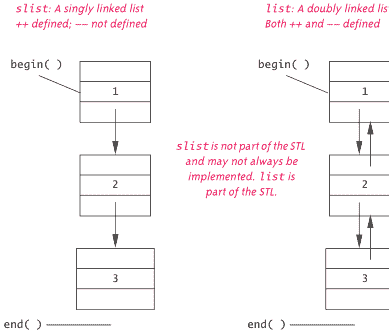

Display 19.4 中的列表包含按顺序的三个整数值 1、2 和 3。两个列表的类型分别为 `slist<int>` 和 `list<int>`。该图还指出了迭代器 `begin()` 和 `end()` 的位置。我们尚未告诉你如何将整数输入到列表中。

在 Display 19.4 中，我们将单向和双向链表绘制为第 17 章中讨论的节点和指针形式。STL 类 `list` 和非标准类 `slist` 可能会以这种方式实现，也可能不会。然而，使用 STL 模板类时，你会被屏蔽这些实现细节。因此，你只需以数据的位置为思考对象（可能是节点，也可能不是），以及迭代器（而不是指针）。你可以将 Display 19.4 中的箭头视为 `++`（向下）和 `--`（在 Display 19.4 中向上）的方向指示。

我们介绍了模板类 `list` 以帮助提供顺序容器的上下文。它对应于我们在第 17 章中讨论的内容，并且是大多数程序员在提到链表时首先想到的东西。然而，由于模板类 `list` 不是标准的，我们将不再讨论它。如果你的实现提供了模板类 `list` 并且你想使用它，细节与我们将为 `list` 描述的类似，只是递减运算符 `--`（前缀和后缀）未为 `slist` 定义。

使用 STL 模板类 list 的简单程序在 Display 19.5 中给出。函数 push_back 将元素添加到列表末尾。请注意，对于 list 模板类，解引用运算符可让你读取和更改数据。也请注意，使用 list 模板类以及 STL 的所有模板类和迭代器时，所有定义都放在 std 命名空间中。

### Display 19.5 使用 list 模板类

```
//Program to demonstrate the STL template class list.
#include <iostream>
#include <list>
using std::cout;
using std::endl;
using std::list;
using std::list<int>::iterator;

int main( )
{
    list<int> listObject;

    for (int i = 1; i <= 3; i++)
        listObject.push_back(i);

    cout << "List contains:\n";
    iterator iter;
    for (iter = listObject.begin( ); iter != listObject.end( ); iter++)
        cout << *iter << " ";
    cout << endl;

    cout << "Setting all entries to 0:\n";
    for (iter = listObject.begin( ); iter != listObject.end( ); iter++)
        *iter = 0;

    cout << "List now contains:\n";
    for (iter = listObject.begin( ); iter != listObject.end( ); iter++)
        cout << *iter << " ";
    cout << endl;

    return 0;
}
```

### SAMPLE DIALOGUE

```
List contains:
1 2 3
Setting all entries to 0:
List now contains:
0 0 0
```

请注意，如果我们将 Display 19.5 中的 list 和 list<int> 分别替换为 vector 和 vector<int>，Display 19.5 将完全相同地编译和运行。这种使用上的统一性是 STL 语法的一个关键部分。

然而，vector 容器和 list 容器之间存在差异。其中一个主要区别是 vector 容器具有随机访问迭代器，而 list 只有双向迭代器。例如，如果你从使用随机访问的 Display 19.2 开始，并将其中所有 vector 和 vector<char> 的出现分别替换为 list 和 list<char>，然后编译程序，你将得到编译错误。即使你删除包含 container[1] 或 container[2] 的语句，也会收到错误消息。

STL 的基本顺序模板类列在 Display 19.6 中。其他容器，如栈和队列，可以使用标题为“容器适配器 stack 和 queue”的小节中讨论的技术从这些容器获得。顺序容器类的一些成员函数的示例在 Display 19.7 中给出。所有这些序列模板类都有一个析构函数，用于回收存储。

### Display 19.6 STL 基本顺序容器

| TEMPLATE CLASS NAME | ITERATOR TYPE NAMES | KIND OF ITERATORS | LIBRARY HEADER FILE |
|---|---|---|---|
| slist (Warning: slist is not part of the STL.) | slist<T>::iterator<br>slist<T>::const_iterator | Mutable forward<br>Constant forward | <slist> (Depends on implementation and may not be available.) |
| list | list<T>::iterator<br>list<T>::const_iterator<br>list<T>::reverse_iterator<br>list<T>::const_reverse_iterator | Mutable bidirectional<br>Constant bidirectional<br>Mutable bidirectional<br>Constant bidirectional | <list> |
| vector | vector<T>::iterator<br>vector<T>::const_iterator<br>vector<T>::reverse_iterator<br>vector<T>::const_reverse_iterator | Mutable random access<br>Constant random access<br>Mutable random access<br>Constant random access | <vector> |
| deque | deque<T>::iterator<br>deque<T>::const_iterator<br>deque<T>::reverse_iterator<br>deque<T>::const_reverse_iterator | Mutable random access<br>Constant random access<br>Mutable random access<br>Constant random access | <deque> |

### Display 19.7 一些顺序容器成员函数

| MEMBER FUNCTION (c IS A CONTAINER OBJECT) | MEANING |
|---|---|
| c.size( ) | Returns the number of elements in the container. |
| c.begin( ) | Returns an iterator located at the first element in the container. |
| c.end( ) | Returns an iterator located one beyond the last element in the container. |
| c.rbegin( ) | Returns an iterator located at the last element in the container. Used with reverse_iterator. Not a member of sList. |
| c.rend( ) | Returns an iterator located one beyond the first element in the container. Used with reverse_iterator. Not a member of sList. |
| c.push_back(Element) | Inserts the Element at the end of the sequence. Not a member of sList. |
| c.push_front(Element) | Inserts the Element at the front of the sequence. Not a member of vector. |
| c.insert(Iterator, Element) | Inserts a copy of Element before the location of Iterator. |
| c.erase(Iterator) | Removes the element at location Iterator. Returns an iterator at the location immediately following. Returns c.end( ) if the last element is removed. |
| c.clear( ) | A void function that removes all the elements in the container. |
| c.front( ) | Returns a reference to the element in the front of the sequence. Equivalent to *c.begin(). |
| c1 == c2 | True if c1.size( ) == c2.size( ) and each element of c1 is equal to the corresponding element of c2. |
| c1 != c2 | !(c1 == c2) |
| All the sequence containers discussed in this section also have a default constructor, a copy constructor, and various other constructors for initializing the container to default or specified elements. Each also has a destructor that returns all storage for recycling, and a well-behaved assignment operator. |

Deque 发音为 “d-queue” 或 “deck”，代表 “doubly ended queue”。deque 是一种超级队列。使用队列时，你在一端添加数据并从另一端移除数据。使用 deque 时，你可以在任一端添加数据并从任一端移除数据。模板类 deque 是用于存储数据的 deque 的模板类，其参数为数据类型。

### ■ **容器适配器 stack 和 queue**

容器适配器是建立在其他类之上的模板类。例如，stack 模板类默认建立在 deque 模板类之上，这意味着 stack 实现中隐藏着一个 deque，其中存放所有数据。然而，你被屏蔽了这一实现细节，将栈视为一个简单的后进先出数据结构。

其他容器适配器是 queue 和 priority_queue 模板类。栈和队列在第 17 章中讨论过。**优先队列** 是具有额外属性的队列，即每个条目在添加到队列时都会被赋予优先级。如果所有条目具有相同优先级，则条目将以与从队列中移除相同的方式从优先队列中移除。如果项目具有不同优先级，则更高优先级的项目将在较低优先级项目之前移除。我们不会详细介绍优先队列，但为了那些可能熟悉该概念的人而提及它。

尽管适配器模板类具有默认的容器类作为其构建基础，但你可以根据应用程序的需求出于效率或其他原因指定不同的底层容器。例如，任何顺序容器都可作为 stack 模板类的底层容器，而除 vector 之外的任何顺序容器都可作为 queue 模板类的底层容器。stack 和 queue 的默认底层数据结构都是 deque。对于 priority_queue，默认底层容器是 vector。如果你对默认底层容器类型满意，那么容器适配器对你来说看起来就像任何其他模板容器类。例如，使用默认底层容器的 stack 模板类的类型名为 stack<int> 表示 int 的栈。如果你希望指定底层容器为 vector 模板类，则类型名将为 stack<int, vector<int> >。我们将始终使用默认底层容器。

如果你确实指定了底层容器，请注意不要在类型表达式中将两个 > 符号放在一起而没有空格在中间，否则编译器可能会混淆。使用 stack<int, vector<int> >，在最后两个 > 之间留一个空格。不要使用 stack<int, vector<int>>。

关于 stack 模板类的成员函数和其他细节在 Display 19.8 中给出。对于 queue 模板类，这些细节在 Display 19.9 中给出。使用 stack 模板类的简单示例在 Display 19.10 中给出。

### Self-Test Exercises

- 11. 栈模板适配器类具有什么种类的迭代器（前向、双向或随机访问）？
- 
- 12. 队列模板适配器类具有什么种类的迭代器（前向、双向或随机访问）？
- 
- 13. 如果 s 是 stack<char>，则 s.pop() 返回值的类型是什么？


### 显示 19.8 stack 模板类

### stack 适配器模板类详情

类型名称：`stack<T>` 或 `stack<T, Sequence_Type>`，用于存储类型为 T 的元素的栈。

库头文件：`<stack>`，其定义位于 std 命名空间中。

定义的类型：`value_type`、`size_type`。

没有迭代器。

### 示例成员函数

| 成员函数（s 是一个栈对象） | 含义 |
|---|---|
| `s.size()` | 返回栈中元素的数量。 |
| `s.empty()` | 如果栈为空，则返回 true；否则返回 false。 |
| `s.top()` | 返回栈顶元素的可变引用。 |
| `s.push(Element)` | 将 Element 的一个副本插入到栈顶。 |
| `s.pop()` | 移除栈顶元素。注意 pop 是一个 void 函数，它不返回被移除的元素。 |
| `s1 == s2` | 如果 `s1.size() == s2.size()` 且 s1 的每个元素都等于 s2 中对应的元素，则为 true；否则返回 false。 |

stack 模板类还具有默认构造函数、复制构造函数，以及一个接受任何序列类对象并将栈初始化为该序列中元素的构造函数。它还有一个析构函数，用于将存储空间返还给系统以便回收，以及一个行为良好的赋值运算符。

### 关联容器 set 和 map

关联容器基本上是非常简单的数据库。它们存储数据，例如结构体或任何其他类型的数据。每个数据项都有一个关联值，称为其键。例如，如果数据是包含员工记录的结构体，则键可能是员工的社会安全号码。根据键来检索项目。键类型和要存储的数据类型之间不需要有任何关系，尽管它们通常是相关的。一个非常简单的例子是每个数据项本身就是自己的键。例如，在 set 中，每个元素就是自己的键。

从某种意义上说，set 模板类是你所能想象到的最简单的容器。它存储元素而不重复。第一次插入将元素放入集合中。第一次之后的额外插入不会产生任何效果，因此任何元素都不会出现多次。每个元素都是自己的键。基本上，你只需添加或删除元素，并询问某个元素是否在集合中。与所有 STL 类一样，set 模板类被设计为以效率为目标。为了高效工作，set 对象将其值按排序顺序存储。你可以按如下方式指定用于存储元素的顺序：

```
set<T, Ordering> s;
```

Ordering 应该是一个行为良好的排序关系，它接受两个类型为 T 的参数并返回一个 bool 值。² T 是所存储元素的类型。如果未指定排序，

> ² 该排序必须是严格弱排序。大多数用于实现 < 运算符的典型排序都是严格弱排序。对于那些想要了解细节的人：严格弱排序必须满足：（非自反性）Ordering(x, x) 始终为 false；（反对称性）Ordering(x, y) 意味着 !Ordering(y, x)；（传递性）Ordering(x, y) 和 Ordering(y, z) 意味着 Ordering(x, z)；（等价的传递性）如果 x 等价于 y 且 y 等价于 z，则 x 等价于 z。如果 Ordering(x, y) 和 Ordering(y, x) 都为 false，则两个元素 x 和 y 等价。

### 显示 19.12 使用 set 模板类的程序

```
//Program to demonstrate use of the set template class.
#include <iostream>
#include <set>
using std::cout;
using std::endl;
using std::set;
using std::set<char>::const_iterator;

int main()
{
    set<char> s;

    s.insert('A');
    s.insert('D');
    s.insert('D');
    s.insert('C');
    s.insert('C');
    s.insert('B');

    cout << "The set contains:\n";
    const_iterator p;
    for (p = s.begin(); p != s.end(); p++)
        cout << *p << " ";
    cout << endl;

    cout << "Removing C.\n";
    s.erase('C');
    for (p = s.begin(); p != s.end(); p++)
        cout << *p << " ";
    cout << endl;

    return 0;
}
```

> 无论你向集合中添加元素多少次，该集合都只包含该元素的一个副本。

### 示例对话

The set contains:
A B C D
Removing C.
A B D

如果你希望为每个字符串名称分配一个唯一的数字，可以按如下方式声明一个 map 对象：

```
map<string, int> numberMap;
```

对于称为键的字符串值，numberMap 对象可以关联一个唯一的 int 值。

与 set 对象一样，map 对象将其元素按键值排序存储。你可以将键上的排序规则指定为尖括号 < > 中的第三个条目。如果未指定排序规则，则使用默认排序规则。你可以使用的排序规则的限制与 set 模板类允许的排序规则相同。请注意，排序仅针对键值。第二个类型可以是任何类型，并且不必与任何排序相关。与 set 对象一样，map 对象中存储条目的排序也是出于效率原因。

关于 map 模板类的一些基本细节在显示 19.13 中给出。为了理解这些细节，你首先需要了解一些 pair 模板类的知识。

STL 模板类 `pair<T1, T2>` 的对象是值对，其中第一个元素的类型为 T1，第二个元素的类型为 T2。如果 aPair 是类型 `pair<T1, T2>` 的对象，则 `aPair.first` 是第一个元素，类型为 T1，`aPair.second` 是第二个元素，类型为 T2。成员变量 first 和 second 是公有成员变量，因此不需要访问器或修改器函数。

pair 模板的头文件是 `<utility>`。因此，要使用 pair 模板类，你需要在文件中包含以下内容或类似内容：

```
#include<utility>
using std::pair;
```

我们将提及另外两种关联容器，但不会给出它们的任何细节。模板类 multiset 和 multimap 本质上分别与 set 和 map 相同，只是 multiset 允许元素重复，multimap 允许每个键值关联多个值。

### 效率

STL 在设计时将效率作为重要考虑因素。事实上，STL 实现力求达到最优效率。例如，set 和 map 的元素按排序顺序存储，以便搜索元素的算法可以更高效。

每个模板类的每个成员函数都有保证的最大运行时间。这些最大运行时间使用所谓的 big-O 表示法来表示，我们将在 19.3 节讨论。（19.3 节还给出了我们已经讨论过的某些容器成员函数的一些保证运行时间。这些在“容器访问运行时间”小节中给出。）当你使用更高级的参考资料或在本章后面，你将会看到某些函数的保证最大运行时间。


**自测练习**

- 14. 为什么 set 模板类中的元素按排序顺序存储？
- 15. set 能否包含类类型的元素？
- 16. 假设 s 的类型为 `set<char>`。如果 'A' 在 s 中，`s.find('A')` 返回什么值？如果 'A' 不在 s 中，返回什么值？

### 19.3 泛型算法

> > “如果你从三百六十五中减去一个，还剩下什么？”
> >
> > “当然是三百六十四。”
> >
> > 亨普蒂·邓普蒂看起来很怀疑。“我宁愿在纸上看到这个过程，”他说。
> >
> > —— 刘易斯·卡罗尔，《镜中奇遇》

本节介绍 STL 中的一些基本函数模板。我们无法在此全面描述所有内容，但我们将提供足够多的示例，让你对 STL 中包含的内容有一个良好的认识，并提供足够的细节让你开始使用这些模板函数。

这些模板函数有时被称为 *泛型算法*。使用 *算法* 这个词是有原因的。回想一下，算法只是一组执行任务的指令。算法可以用任何语言呈现，包括像 C++ 这样的编程语言。但是，当程序员使用 *算法* 这个词时，通常指的是用英语或伪代码给出的不太正式的描述。因此，它通常被认为是对定义函数的代码的抽象。它给出了重要的细节，但没有给出编码的细微细节。STL 对 STL 模板函数所基于的算法的某些细节进行了规定，这就是为什么它们有时被称为 *泛型算法*。这些 STL 函数模板不仅仅以实现者希望的任何方式提供一个值。STL 中的函数模板附带了最低要求，如果要满足标准，其实现必须满足这些要求。在大多数情况下，它们必须以保证的运行时间实现。这为函数接口的概念增加了一个全新的维度。在 STL 中，接口不仅告诉程序员函数做什么以及如何使用函数，还告诉程序员任务将多快完成。在某些情况下，标准甚至规定了所使用的特定算法，尽管没有规定编码的确切细节。而且，当它规定特定算法时，是因为该算法已知的效率。关键的新点是对代码的效率保证的规范。在本章中，我们将使用术语 *泛型算法*、*泛型函数* 和 *STL 函数模板* 表示相同的含义。

为了讨论这些模板函数或泛型算法的效率，有一些术语，我们首先介绍一下通常如何衡量算法效率的一些背景。

### 运行时间和大 O 记号

如果你问程序员他的程序有多快，你可能会期望得到“两秒钟”这样的答案。然而，程序的速度不能用一个数字来表示。程序通常在更大的输入上花费的时间比在较小的输入上更长。你会期望一个用于排序数字的程序对十个数字的排序时间少于对一千个数字的排序时间。也许它排序十个数字需要两秒钟，但排序一千个数字需要十秒钟。那么程序员该如何回答“你的程序有多快？”这个问题呢。程序员必须提供一个值表，显示程序对不同大小输入花费的时间。例如，表可能如 Display 19.14 所示。此表没有给出单个时间，而是为各种不同的输入大小给出了不同的时间。

数学函数

该表描述了数学中称为函数的概念。就像一个（非 void）C++ 函数接受一个参数并返回一个值一样，这个函数也接受一个参数，即输入大小，并返回一个数字，即程序在该大小输入上花费的时间。如果我们称此函数为 T，那么 T(10) 为 2 秒，T(100) 为 2.1 秒，T(1,000) 为 10 秒，T(10,000) 为 2.5 分钟。该表只是此函数 T 的一些值的样本。程序在任何大小的输入上都会花费一些时间。因此，尽管表中没有显示，但 T(1)、T(2)、...、T(101)、T(102) 等也存在。对于任何正整数 N，T(N) 是程序对 N 个数字进行排序所需的时间。函数 T 称为程序的运行时间。

运行时间

到目前为止，我们一直假设此排序程序在任何 N 个数字的列表上花费的时间相同。这不一定是真的。也许如果列表已经排序或几乎排序，它会花费更少的时间。在这种情况下，T(N) 定义为“最难”的列表所花费的时间，即使程序运行时间最长的 N 个数字列表所花费的时间。这称为最坏情况运行时间。在本

最坏情况运行时间

#### Display 19.14 运行时间函数的一些值

| INPUT SIZE | RUNNING TIME |
|---|---|
| 10 numbers | 2 seconds |
| 100 numbers | 2.1 seconds |
| 1,000 numbers | 10 seconds |
| 10,000 numbers | 2.5 minutes |

章中，当我们给出算法或某些代码的运行时间时，我们始终指最坏情况运行时间。

程序或算法所花费的时间通常由公式给出，例如 $4N + 3$、$5N + 4$ 或 $N^2$。如果运行时间 $T(N)$ 为 $5N + 5$，则在大小为 $N$ 的输入上，程序将运行 $5N + 5$ 个时间单位。

下面是一些用于搜索包含 $N$ 个元素的数组以确定特定值 target 是否在数组中的代码：

```
int i = 0;
bool found = false;
while ((i < N) && (!found))
    if (a[i] == target)
        found = true;
    else
        i++;
```

我们想计算计算机执行此代码大约需要多长时间。我们希望得到一个不依赖于我们使用哪台计算机的估计值，要么是因为我们不知道将使用哪台计算机，要么是因为我们可能在不同时间使用多台不同的计算机运行程序。

一种可能性是计算“步骤”数，但很难决定什么是步骤。在这种情况下，正常的做法是计算操作数。操作这个术语几乎和步骤这个术语一样模糊，但在实践中至少对什么是操作有一些共识。让我们说，对于此 C++ 代码，以下每种应用都算作一次操作：=、<、&&、!、[]、== 和 ++。计算机必须做的事情不仅仅是执行这些操作，但这些似乎是它主要做的事情，我们将假设它们占运行此代码所需时间的绝大部分。事实上，我们对时间的分析假设其他一切都不需要时间，并且我们程序的总运行时间等于执行这些操作所需的时间。虽然这是一个明显不完全正确的理想化，但事实证明这种简化假设在实践中效果很好，因此在分析程序或算法时经常使用。

即使有了我们的简化假设，我们仍然必须考虑两种情况：要么值 target 在数组中，要么不在。让我们先考虑 target 不在数组中的情况。执行的次数将取决于搜索的数组元素数。操作 = 在循环执行前执行两次。由于我们假设 target 不在数组中，循环将执行 $N$ 次，每次对应数组的一个元素。每次执行循环时，都会执行以下操作：<、&&、!、[]、== 和 ++。这为每次循环迭代增加了五个操作。最后，在 $N$ 次迭代后，布尔表达式再次被检查并发现为假。这增加了最后三次操作（<、&&、!）。如果我们汇总所有这些

3 由于短路求值，! (found) 未被求值，因此我们实际上得到两次操作，而不是三次。然而，重要的是获得一个良好的上界。如果我们多加一个不重要的操作。


sample case, 这个参数 N 是要搜索的数组元素的个数。毫不奇怪，搜索较大数量的数组元素所需的时间比搜索较少数量的数组元素要长。Big-O 运行时间估计始终表示为问题规模的函数。在本章中，我们所有的算法都将涉及某个容器中的一系列值。在所有情况下，N 都是该范围中元素的个数。

> 以下是关于 big-O 估计的一种替代的、实用的思考方式：
> 只看指数最高的项，不要理会常数倍数。

例如，以下所有都是 O(N²)：

N² + 2N + 1,  3N² + 7,  100N² + N

以下所有都是 O(N³)：

N³ + 5N² + N + 1,  8N³ + 7,  100N³ + 4N + 1

这些 big-O 运行时间估计 admittedly 粗糙，但它们确实包含了一些信息。它们无法区分运行时间为 5N + 5 和运行时间为 100N，但它们确实能让我们区分某些运行时间，从而判断某些算法比其他算法更快。查看 Display 19.15 中的图表，注意所有 O(N) 函数的图表最终都会落在函数 0.5N² 的图表下方。结果是不可避免的：只要使用足够大的 N 值，O(N) 算法总是比任何 O(N²) 算法运行得更快。虽然对于你处理的规模，O(N²) 算法可能比 O(N) 算法更快，但程序员发现，实际上，对于大多数直观上“大”的实际应用，O(N) 算法比 O(N²) 算法表现更好。对任何其他两种不同的 big-O 运行时间也适用类似的评论。

一些术语有助于描述通用算法运行时间。线性运行时间意味着运行时间为 T(N) = aN + b。线性运行时间始终是 O(N) 运行时间。二次运行时间意味着运行时间最高项为 N²。二次运行时间始终是 O(N²) 运行时间。我们在运行时间公式中也会偶尔出现对数。那些通常不带任何底数给出，因为改变底数只是常数倍。如果看到 log N，可以认为是 N 的以 2 为底的对数，但认为是以 10 为底的对数也没错。对数是非常缓慢增长的函数。因此，O(log N) 运行时间非常快。

在许多情况下，我们的运行时间估计会比 big-O 估计更好。特别是，当我们指定线性运行时间时，这是一个紧的上界，你可以认为运行时间正好是 T(N) = cN，尽管 c 仍未指定。

### Display 19.15  **运行时间比较**

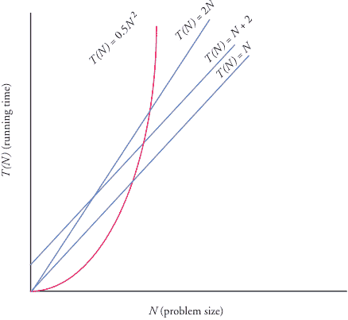

### ■  容器访问运行时间

现在我们知道了 big-O 表示法，我们就可以表达我们在第 19.2 节中讨论的容器类的某些访问函数的效率。向 vector 后端插入（push_back）、向 deque 前端或后端插入（push_back 和 push_front），以及向 list 的任意位置插入（insert）都是 $O(1)$（即运行时间的常数上界，与容器大小无关）。对 vector 或 deque 的任意元素的插入或删除是 $O(N)$，其中 $N$ 是容器中的元素个数。对于 set 或 map，查找（find）是 $O(\log N)$，其中 $N$ 是容器中的元素个数。

### 自测练习

- 17. 证明运行时间 \(T(N)=aN+b\) 是 \(O(N)\) 运行时间。 （提示：唯一的问题是加号。假设 \(N\) 始终至少为 1。）
- 18. 证明对于对数的任意两个底数 \(a\) 和 \(b\)，如果 \(a\) 和 \(b\) 都大于 1，则存在常数 \(c\) 使得 \(\log_a N \le c(\log_b N)\)。因此，无需在 \(O(\log N)\) 中指定底数。也就是说，\(O(\log_a N)\) 和 \(O(\log_b N)\) 意味着相同的事情。

### 非修改序列算法

本节描述的模板函数对容器进行操作，但不会以任何方式修改容器内容。一个简单典型的例子是通用的 find 函数。

通用的 find 函数类似于 set 模板类的 find 成员函数，但是一个不同的函数。通用的 find 函数可与任何 STL 序列容器类一起使用。Display 19.16 显示了通用的 find 函数与类 vector<char> 配合使用的示例。Display 19.16 中的函数如果将 vector<char> 全部替换为 list<char>，或者将 vector<char> 替换为任何其他序列容器类，其行为将完全相同。这就是为什么这些函数被称为通用函数的原因之一：find 函数的一个定义适用于大量容器。

如果 find 函数找不到它正在寻找的元素，它将返回其第二个迭代器参数，该参数不一定等于 Display 19.16 中的某个 end()。该显示中的示例对话 2 显示了 find 未找到所需内容的情况。

find 是否适用于绝对任何容器？不完全是。首先，它以迭代器作为参数，而某些容器，例如 stack，并没有迭代器。要使用 find 函数，容器必须具有迭代器，元素必须以线性序列存储，以便 ++ 运算符将迭代器在容器中移动，并且元素必须可使用 == 进行比较。换句话说，容器必须具有前向迭代器（或更强的迭代器类型，例如双向迭代器）。

在介绍通用函数模板时，我们将使用所需迭代器类型的名称作为类型参数名来描述迭代器类型参数。因此，ForwardIterator 应被替换为某种前向迭代器类型的类型，例如 list、vector 或其他容器模板类中的迭代器类型。请记住，双向迭代器也是前向迭代器，随机访问迭代器也是双向迭代器。因此，类型名 ForwardIterator 也可以与任何双向或随机访问迭代器类型以及普通的前向迭代器类型一起使用。在某些情况下，当我们指定 ForwardIterator 时，你可以使用更简单的迭代器类型，即输入迭代器或输出迭代器。然而，由于我们尚未讨论输入和输出迭代器，因此在我们的函数模板声明中不提及它们。

请记住，名称 *前向迭代器*、*双向迭代器* 和 *随机访问迭代器* 指的是迭代器的种类，而不是类型名。实际的类型名将是类似 `std::vector<int>::iterator` 的东西，在这种情况下恰好是一个随机访问迭代器。

Display 19.17 给出了 STL 中一些非修改通用函数的示例。Display 19.17 使用了在讨论容器迭代器时常见的记号。从迭代器 first 移动到但不包括迭代器 last 时遇到的迭代器位置称为 **范围 [first, last)**。例如，以下 for 循环输出范围 [first, last) 中的所有元素：

```
for (iterator p = first; p != last; p++)
    cout << *p << endl;
```

请注意，当给出两个范围时，它们不必在同一个容器中，甚至不必是同一种类型的容器。例如，对于 search 函数，范围 [first1, last1) 和 [first2, last2) 可能在相同或不同的容器中。

### Display 19.16  **通用 find 函数（第 2 部分之 2）**

#### 示例对话 1

> ```text
> Enter a line of text
> A line of text.
> You entered the following before you entered your first e:
> A lin
> You entered the following after that:
> e of text.
> End of demonstration.
> ```

#### 示例对话 2

> ```text
> Enter a line of text
> I will not!
> You entered the following before you entered your first e:
> I will not!
> You entered the following after that:
> 
> End of demonstration.
> ```
> 
> *如果 find 没有找到它正在寻找的内容，它将返回 `line.end()`。*


### 显示 19.17 一些非修改通用函数

这些函数都适用于前向迭代器，这意味着它们也适用于双向迭代器和随机访问迭代器。（在某些情况下它们甚至适用于我们尚未详细讨论的其他类型的迭代器。）

```
template <class ForwardIterator, class T>
ForwardIterator find(ForwardIterator first,
ForwardIterator last, const T& target);
//Traverses the range [first, last) and returns an iterator located at
//the first occurrence of target. Returns last if target is not found.
//Time complexity: linear in the size of the range [first, last).
```

```
template <class ForwardIterator, class T>
int count(ForwardIterator first, ForwardIterator last, const T& target);
//Traverse the range [first, last) and returns the number
//of elements equal to target.
//Time complexity: linear in the size of the range [first, last).
```

```
template <class ForwardIterator1, class ForwardIterator2>
bool equal(ForwardIterator1 first1, ForwardIterator1 last1,
ForwardIterator2 first2);
//Returns true if [first1, last1) contains the same elements in the same order as
//the first last1-first1 elements starting at first2. Otherwise, returns false.
//Time complexity: linear in the size of the range [first, last).
```

```
template <class ForwardIterator1, class ForwardIterator2>
ForwardIterator1 search(ForwardIterator1 first1, ForwardIterator1 last1,
ForwardIterator2 first2, ForwardIterator2 last2);
//Checks to see if [first2, last2) is a subrange of [first1, last1).
//If so, it returns an iterator located in [first1, last1) at the start of
//the first match. Returns last1 if a match is not found.
//Time complexity: quadratic in the size of the range [first1, last1).
```

```
template <class ForwardIterator, class T>
bool binary_search(ForwardIterator first, ForwardIterator last, const T& target);
//Precondition: The range [first, last) is sorted into ascending order using <.
//Uses the binary search algorithm to determine if target is in the range [first,
//last). Time complexity: For random access iterators O(log N). For non-random-
//access iterators linear in N, where N is the size of the range [first, last).
```

### 范围 [FIRST, LAST)

从某个迭代器 first，通常是 container.begin()，移动到但不包括某个位置 last，通常是 container.end()，这种移动非常常见，以至于它有了专门的名称，范围 [first, last)。例如，以下代码输出范围 [c.begin(), c.end()) 中的所有元素，其中 c 是某个容器对象，例如 vector：

```
for (iterator p = c.begin(); p != c.end(); p++)
    cout << *p << endl;
```

请注意，显示 19.17 中有三个搜索函数：find、search 和 binary_search。函数 search 搜索子序列，而 find 和 binary_search 函数搜索单个值。当搜索单个元素时，你如何决定使用 find 还是 binary_search？一个函数返回迭代器而另一个只返回布尔值，但这不是最大的区别。binary_search 函数要求被搜索的范围按 < 排序为升序，并且运行时间为 O(log N)，而 find 函数不要求范围排序，但只能保证线性时间。如果元素已排序或可以排序，你可以使用 binary_search  much 更快地搜索它们。

请注意，使用 binary_search 函数可以保证实现将使用在第 13 章中讨论过的二分搜索算法。使用二分搜索算法的重要性在于它保证了非常快的运行时间，O(log N)。如果你没有读过第 13 章，也没有听说过二分搜索，只要把它想成一种非常高效的搜索算法，要求元素已排序即可。关于二分搜索的这两点是与本章内容相关的唯一要点。

### 自测练习

- 19. 在显示 19.16 中将标识符 vector 的所有出现替换为标识符 list。编译并运行程序。
- 20. 假设 v 是类 vector<int> 的对象。使用搜索通用函数（显示 19.17）编写一些代码来确定 v 是否包含紧跟在 42 之后的数字 43。你不必给出完整程序，但要给出所有必要的 include 和 using 指令。（提示：使用第二个 vector 可能有帮助。）

### 修改序列算法

显示 19.18 包含 STL 中改变容器内容的一些通用函数的描述。

请记住，向容器添加或从容器中删除元素可能会影响其他所有迭代器。除非容器模板类做出此类保证，否则无法保证迭代器在添加或删除后仍位于同一元素。迄今为止我们见过的模板类中，list 和 slist 保证其迭代器不会因添加或删除而移动，当然如果迭代器位于被删除的元素上则除外。模板类 vector 和 deque 不做出此类保证。显示 19.18 中的某些函数模板保证某些特定迭代器的值；当然，你可以无论容器为何都依赖这些保证。

### 自测练习

- 21. 你能将 random_shuffle 模板函数与 list 容器一起使用吗？
- 22. 你能将 copy 模板函数与 vector 容器一起使用吗，即使 copy 需要前向迭代器而 vector 具有随机访问迭代器？

### 集合算法

显示 19.19 显示了 STL 中定义的一些通用集合操作函数示例。请注意，通用算法假定容器以排序顺序存储其元素。容器 set、map、multiset 和 multimap 确实以排序顺序存储其元素；因此，显示 19.19 中的所有函数都适用于这四个模板类容器。其他容器，例如 vector，不以排序顺序存储其元素；不应将这些函数与此类容器一起使用。要求元素排序的原因是为了使算法更高效。

### 自测练习

- 23. 数学课程版本的集合不保持其元素按排序顺序，并且它有一个并集运算符。为什么 set_union 模板函数要求容器保持其元素按排序顺序？

### 显示 19.20 一些通用排序算法

```
template <class RandomAccessIterator>
void sort(RandomAccessIterator first, RandomAccessIterator last);
//Sorts the elements in the range [first, last) into ascending order.
//Time complexity: O(N log N), where N is the size of the range [first, last).
```

```
template <class ForwardIterator1, class ForwardIterator2, class ForwardIterator3>
void merge(ForwardIterator1 first1, ForwardIterator1 last1,
    ForwardIterator2 first2, ForwardIterator2 last2,
    ForwardIterator3 result);

//Precondition: The ranges [first1, last1) and [first2, last2) are sorted.
//Action: Merges the two ranges into a sorted range [result, last3) where
//last3 = result + (last1 - first1) + (last2 - first2).
//Time complexity: linear in the size of the range [first1, last1)
//plus the size of [first2, last2).
```

> 排序使用 < 运算符，因此必须定义 < 运算符。这里没有给出其他版本，允许你提供排序关系。“排序”意味着按升序排序。

### 章节总结

- 迭代器是指针的泛化。迭代器用于在容器的某个范围内移动。迭代器通常定义了 ++、-- 和解引用 * 操作。
- 具有迭代器的容器类有成员函数 end() 和 begin()，它们返回迭代器值，使得你可以按如下方式处理容器中的所有数据：
  
  ```
  for (p = c.begin(); p != c.end(); p++)
      process *p //*p is the current data item.
  ```
- 主要的迭代器种类如下。
  前向迭代器：++ 在迭代器上工作。
  双向迭代器：++ 和 -- 都在迭代器上工作。
  随机访问迭代器：++、-- 和随机访问都与迭代器一起工作。
- 对于常量迭代器 p，解引用运算符 *p 产生元素的只读版本。对于可变迭代器 p，*p 可以被赋值为一个值。
- 双向容器具有反向迭代器，允许你的代码以相反顺序遍历容器中的元素。


+   ■ STL 中主要的容器模板类有 list，它具有可变的双向迭代器；以及模板类 vector 和 deque，两者都具有可变的随机访问迭代器。

+   ■ stack 和 queue 是容器适配器类，这意味着它们是构建在其他容器类之上的。stack 是一种后进先出容器。queue 是一种先进先出容器。

+   ■ set、map、multiset 和 multimap 容器模板类为了搜索算法的效率而以排序顺序存储其元素。set 是一个简单的元素集合。map 允许按键值存储和检索。multiset 类允许条目重复。multimap 类允许一个键关联多个数据项。

+   ■ STL 包含模板函数来实现具有最大运行时间保证的通用算法。

### ANSWERS TO SELF-TEST EXERCISES

+   1. v.begin() 返回位于 v 的第一个元素的迭代器。v.end() 返回一个值，作为 v 中所有元素末尾的哨兵值。

+   2. *p 是对 p 应用的解引用运算符。*p 是位于位置 p 的元素的引用。

+   3. using std::vector<int>::iterator;
+   ...
+   iterator p;
+   for (p = v.begin(), p++; p != v.end(); p++)
+       cout << *p << " ";

+   4. D C C

+   5. B C

+   6. Either would work.

+   7. 一个主要区别是 vector 容器具有随机访问迭代器，而 list 只有双向迭代器。

+   8. All except slist.

+   9. vector and deque.

+   10. They all can have mutable iterators.

+   11. stack 模板适配器类没有迭代器。

+   12. queue 模板适配器类没有迭代器。

+   13. 没有返回值；pop 是一个 void 函数。

+   14. 为了便于高效搜索元素。

+   15. Yes, they can be of any type, although there is only one type for each object. The type parameter in the template class is the type of element stored.

16. If 'A' is in s, then s.find('A') returns an iterator located at the element 'A'. If 'A' is not in s, then s.find('A') returns s.end().

17. Just note that aN + b ≤ (a + b)N, as long as 1 ≤ N.

18. This is mathematics, not C++. So, = will mean equals, not assignment.
First note that loga N = (loga b)(logb N).
To see this first identity just note that if you raise a to the power loga N you get N and if you raise a to the power (loga b)(logb N) you also get N.
If you set c = (loga b) you get loga N = c (logb N).

19. The programs should run exactly the same.

```
20. #include <iostream>
#include <vector>
#include <algorithm>
using std::cout;
using std::vector;
using std::vector<int>::const_iterator;
using std::search;
...
vector<int> target;
target.push_back(42);
target.push_back(43);
const_iterator result = search(v.begin(), v.end(),
    target.begin(), target.end());
if (result != v.end())
    cout << "Found 42, 43.\n";
else
    cout << "42, 43 not there.\n";
```

21. No, you must have random-access iterators, and the list template class only has bidirectional iterators.

22. Yes, a random-access iterator is also a forward iterator.

23. set_union 模板函数要求容器以排序顺序保持其元素，以便函数模板可以以更有效的方式实现。

### PROGRAMMING PROJECTS

1. 这个练习的目的是证明：一个表现得像迭代器的对象就是一个迭代器。更精确地说，如果一个对象访问某个容器并表现得像特定强度的迭代器，那么该对象可以用作迭代器，通过任何需要具有该强度迭代器的通用函数来操作容器。然而，虽然通用算法可以用这个容器使用，但成员函数，例如 begin 和 end，当然不会存在，除非它们有

#### 3. 质数是一个大于 1 且只能被自身和 1 整除的整数。整数 x 能被整数 y 整除，如果存在另一个整数 z 使得 x = y*z。希腊数学家埃拉托斯特尼提出了寻找小于某个整数 N 的所有质数的算法。这个算法称为埃拉托斯特尼筛法。它的工作方式如下：从 2 到 N 的整数列表开始，2 是第一个质数。（考虑为什么这是真的很有启发性。）2 的倍数，即 4、6、8 等，不是质数。我们将它们从列表中划掉。然后 2 之后第一个未被划掉的数是下一个质数。这个数是 3。3 的倍数不是质数。将它们从列表中划掉。注意 6 已经没了，划掉 9，12 已经没了，划掉 15，等等。第一个未被划掉的数是下一个质数。该算法以这种方式继续，直到我们达到 N。列表中未被划掉的所有数都是质数。

+   a. 编写一个使用此算法的程序来查找小于用户提供的数字 N 的所有质数。使用 vector 容器存放整数。使用初始设为全部为 true 的 bool 数组来跟踪被划掉的整数。对于被划掉的列表中的整数，将条目改为 false。

+   b. 对 N = 10、30、100 和 300 进行测试。

### Improvements:

+   c. 实际上，我们不需要一直进行到 N。你可以在 N/2 处停止。试试这个并测试你的程序。N/2 有效且更好，但不是我们能用的最小数字。论证要得到 1 到 N 之间的所有质数，最小的限制是 N 的平方根。

+   d. 修改你在 a) 部分的代码，使用 N 的平方根作为上限。

#### 4. 假设你有一组学生记录。记录是以下类型的结构：

```
struct StudentInfo
{
    string name;
    int grade;
};
```

记录保存在一个 vector<StudentInfo> 中。编写一个程序提示并获取数据并构建学生记录的 vector，然后按姓名对 vector 进行排序，计算最高分和最低分，以及班级平均分，然后打印这些汇总数据以及带成绩的班级花名册。（我们不关心谁获得了最高分和最低分，只关心最高、最低和平均统计数据。）测试你的程序。

#### 5. 继续编程项目 4，编写一个函数将 StudentInfo 记录的 vector 中的学生分为两个 vector，一个包含及格学生的记录，一个包含不及格学生的记录。（使用 60 分或以上为及格）

要求你以两种方式完成，并给出一些运行时间估计。

+   a. 考虑继续使用 vector。你可以生成一个及格学生的第二个 vector 和一个不及格学生的第三个 vector。这会在一段时间里保留重复记录，所以不要那样做。你可以创建一个不及格学生的 vector 和一个测试不及格的函数。然后 push_back 不及格学生的记录，然后从原始 vector 中 erase 不及格学生的记录。按这种方式编写程序。

+   b. 考虑此解决方案的效率。你可能从 vector 的中间擦除了 $O(N)$ 个成员。在这种情况下你必须移动大量成员。从 vector 中间擦除是一个 $O(N)$ 操作。给出此程序运行时间的 big $O$ 估计。

+   c. 如果你使用了 `list<StudentInfo>`，erase 和 insert 函数的运行时间是多少？考虑 list 的 erase 时间效率如何影响程序的运行时间。用 `list` 重写此程序而不是 vector。记住 list 不提供索引也不提供随机访问，其迭代器仅为双向，而非随机访问。

### 第20章 模式与UML

### 第20章 模式与UML
Patterns and UML


+   20.1 PATTERNS 848
+   Adapter Pattern 839
+   The Model-View-Controller Pattern 839
+   Example: A Sorting Pattern 841
+   Efficiency of the Sorting Pattern 845
+   Tip: Pragmatics and Patterns 847
+   Pattern Formalism 848
+   
+   20.2 UML 849
+   History of UML 849
+   UML Class Diagrams 850
+   Class Interactions 850
+   
+   CHAPTER SUMMARY 851
+   ANSWERS TO SELF-TEST EXERCISES 851
+   PROGRAMMING PROJECTS 853


# 模式与UML

> > 爱因斯坦认为自然界必须存在简化的解释，因为上帝不是任性的或随意的。软件工程师却得不到这样的安慰。他必须掌握的许多复杂性是任意的复杂性。
> >
> > —— F. Brooks，《没有银弹：软件工程的本质与偶然》，*IEEE Computer*，1987 年 4 月。

### 引言

模式和 UML 是两种软件设计工具，只要使用的编程语言提供类和面向对象编程相关的设施，它们就适用于任何编程语言。本章对这两个主题做一个非常简短的介绍。它不包含关于 C++ 语言的任何新细节。

编程中的模式与任何其他上下文中的模式非常相似。它是一种模板或软件任务的大纲，可以在不同的、但相似的应用中以不同的代码实现。

UML 是一种图形语言，用于在面向对象编程框架内设计和记录软件。

本章使用了之前各章的部分材料。然而，如果你已经阅读了大部分但不是全部的前几章，你仍然可以从阅读本章中获得全部或大部分收益。

### 20.1 模式

> > 我劝他把目光投向人们的生活，就像照进镜子一样，并从他人身上为自己取一个榜样。
> >
> > —— 特伦斯（Publius Terentius Afer，公元前 190–159 年），*Adelphoe*

**模式** 是适用于多种软件应用的设计原则。要有用的话，模式必须适用于多种情况。要有实质内容，模式必须对它适用的应用领域做出一些假设。例如，迭代器模式适用于几乎任何类型的容器类。回想一下，我们在第 19 章讨论迭代器时，首先将它们抽象地描述为在任何类型的容器中遍历数据范围的方式。然后我们给出了迭代器模式的具体应用，例如列表迭代器、常量列表迭代器、反向列表迭代器、常量反向列表迭代器、向量迭代器、常量向量迭代器、反向向量迭代器、常量反向向量迭代器等等。利用迭代器的覆盖模式，你可以组织你对容器操作的知识，以便轻松理解和交流使用 STL 容器和迭代器类的软件。

想象一下，如果我们将每种容器迭代器单独呈现，并为 begin()、end() 和 ++ 使用不同的名称，你需要消化多少细节。事实上，为了理解那座细节的山，你可能不得不自己发明迭代器模式。现在你知道了迭代器模式，你无论我们如何呈现迭代器都会看到那个模式。然而，直到有人有洞察力去看到并解释该模式之前，各种迭代器只是一大堆看似相似但并未被任何覆盖原则所组织的不同的应用。我们使用过的另一个相关模式是容器模式。事实上，按模式通常的组织方式，这些会被视为一个更大的模式——容器-迭代器模式——的一部分。

本简短的章节只能给出模式是什么的初步印象。在本节中，我们将讨论一些示例模式，让你看看模式是什么样的。还有许多已知的和使用的模式，还有许多尚未阐明的模式。这是软件工程中一个新且仍在发展的领域。

#### 适配器模式

适配器模式在不改变底层类的情况下将一个类转变为另一个类，只是通过添加一个新的接口。（新的接口取代了底层类的旧接口。）例如，在第 19 章中我们提到过，STL 的栈和队列模板类就是适配器类。我们描述了栈和队列接口，并说你可以选择将实际存储数据的底层类。例如，你可以有一个底层为 vector 的 int 栈，stack<int, vector<int>> 或一个底层为 list 的 int 栈，stack<int, list<int>>（或使用其他底层容器类，但两个就足以说明我们的观点）。在任何一种情况下，无论是 list 还是 vector，底层类都没有被改变。只添加了一个接口。

接口是如何添加的？这是一个实现细节，无需成为适配器模式的一部分。然而，至少有两种明显的方法可以做到。例如，对于栈适配器，底层容器类可以是栈类的成员变量，或者栈类可以是底层容器类的派生类。

#### 模型-视图-控制器模式

模型-视图-控制器模式是把应用程序的 I/O 任务与应用程序其余部分分开的一种方式。模式中的模型部分执行应用程序的核心。视图部分是输出部分；它显示模型状态的画面。控制器是输入部分；它将用户的命令传递给模型。通常，这三个交互部分都被视为具有各自任务责任的对象。模型-视图-控制器模式是分而治之策略的一个例子：一个大的任务被划分为三个职责明确的较小的任务。显示 20.1 描述了模型-视图-控制器模式。

一个非常简单的例子，模型可能是一个容器类，例如栈。视图可能显示栈顶。控制器给出推送或弹出数据的命令。模型（栈）在栈内容发生变化时通知视图显示新的栈顶值。

任何应用程序都可以被调整以符合模型-视图-控制器模式，但它特别适用于 GUI（图形用户界面）设计项目，在这种情况下，视图确实可以是对模型状态的可视化。（GUI 只是你可以在大多数现代软件应用程序中找到的那种窗口界面，与本书中使用的简单文本 I/O 相反。）例如，模型可能是一个对象来表示你的计算机桌面对象名称列表。视图可以是一个 GUI 对象，产生你桌面图标的屏幕显示。控制器将命令传递给模型（即桌面对象）以添加或删除名称。模型对象在屏幕需要更新时通知视图对象。

我们将模型-视图-控制器模式呈现为用户是控制器的情况，主要是为了简化示例。控制器不必在用户的直接控制下，而可以是其他类型的软件或硬件组件。

#### 显示 20.1 模型-视图-控制器模式

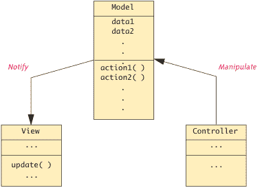

### 示例

#### 一个排序模式

所有最高效的排序算法似乎都遵循相似的模式。用递归表达，它们将待排序的元素列表分为两个较小的列表，递归地对这两个较小的列表进行排序，然后重新组合这两个已排序的列表以获得最终的已排序列表。在显示 20.2 中，该模式被表达为一个模板函数，使用 < 运算符将数组按递增顺序排序。

我们的排序模式使用分而治之策略。它将待排序的整个元素集合分为两个较小的集合，通过递归调用对较小的集合进行排序，然后将两个已排序的集合合并以获得最终的已排序数组。以下是我们排序模式的核心：

```
int splitPt = split(a, begin, end);
sort(a, begin, splitPt);
sort(a, splitPt, end);
join(a, begin, splitPt, end);
```

尽管该模式对 split 和 join 函数提出了一些最低要求，但该模式并未说明 split 和 join 函数的确切定义方式。split 和 join 的不同定义将产生不同的排序算法。

数组索引是迭代器的例子，我们将使用第 19 章中的记法 [begin, end) 来注释该模式，实际上用来思考和推导该模式。

函数 split 重新排列区间 [begin, end) 中的元素，然后在分割点 splitPt 处分割该区间。然后通过对函数 sort 的递归调用对两个较小的区间 [begin, splitPt) 和 [splitPt, end) 进行排序。注意，split 函数既重新排列数组区间 [begin, end) 中的元素，又返回分割区间 [begin, end) 的索引 splitPt。在两个较小的区间排序后，函数 join 然后将两个已排序的区间合并以获得整个较大区间的最终已排序版本。

该模式没有说明函数 split 如何重新排列和分割区间 [begin, end)。在简单情况下，split 可能只是在 begin 和 end 之间选择一个值 splitPt，并将区间分为 splitPt 之前的点和之后的点，而不进行任何重新排列。我们将看到一个以这种方式定义 split 来实现排序模式的例子。另一方面，split 函数可以做更复杂的事情，例如将所有“小”元素移到数组前面，将所有“大”元素移向数组末尾。这将是完全排序值的途中一步。我们还将看到一个以第二种方式实现排序模式的例子。

这种排序模式最简单的实现是显示 20.3 中给出的归并排序实现。测试程序在显示 20.4 中给出。归并排序是一个 split 定义非常简单的例子。它将数组分为两个区间而不重新排列元素。join 函数更复杂。在两个子区间排序后，它合并两个已排序的子数组，将元素从数组复制到临时数组。合并从比较每个较小的已排序区间中的最小元素开始。较小的这两个元-


# Display 20.2 分治排序模式

```
//This is the file sortpattern.cpp.
template <class T>
int split(T a[], int begin, int end);
//Rearranges elements [begin, end) of array a into two intervals
//[begin, splitPt) and [splitPt, end), such that the Sorting pattern works.
//Returns splitPt.

template <class T>
void join(T a[], int begin, int splitPt, int end);
//Combines the elements in the two intervals [begin, split) and
//[splitPt, end) in such a way that the Sorting pattern works.

template <class T>
void sort(T a[], int begin, int end)
//Precondition: Interval [begin, end) of a has elements.
//Postcondition: The values in the interval [begin, end) have
//been rearranged so that a[0] <= a[1] <= ... <= a[(end - begin) - 1].
{
    if ((end - begin) > 1)
    {
        int splitPt = split(a, begin, end);
        sort(a, begin, splitPt);
        sort(a, splitPt, end);
        join(a, begin, splitPt, end);
    }//else sorting one (or fewer) elements, so do nothing.
}

template <class T>
void sort(T a[], int numberUsed)
//Precondition: numberUsed == declared size of the array a.
//The array elements a[0] through a[numberUsed - 1] have values.
//Postcondition: The values of a[0] through a[numberUsed - 1] have
//been rearranged so that a[0] <= a[1] <= ... <= a[numberUsed - 1].
{
    sort(a, 0, numberUsed);
}
```

# Display 20.3 排序模式的归并排序实现（第 1 部分，共 2 部分）

```
//File mergesort.cpp: the merge sort realization of the Sorting pattern.
template <class T>
int split(T a[], int begin, int end)
{
    return ((begin + end)/2);
}
```

# Display 20.3 排序模式的归并排序实现（第 2 部分，共 2 部分）

```
template <class T>
void join(T a[], int begin, int splitPt, int end)
{
    T *temp;
    int intervalSize = (end - begin);
    temp = new T[intervalSize];
    int nextLeft = begin; //index for first chunk
    int nextRight = splitPt; //index for second chunk
    int i = 0; //index for temp

    //Merge till one side is exhausted:
    while ((nextLeft < splitPt) && (nextRight < end))
    {
        if (a[nextLeft] < a[nextRight])
        {
            temp[i] = a[nextLeft];
            i++; nextLeft++;
        }
        else
        {
            temp[i] = a[nextRight];
            i++; nextRight++;
        }
    }

    while (nextLeft < splitPt) //Copy rest of left chunk, if any.
    {
        temp[i] = a[nextLeft];
        i++; nextLeft++;
    }

    while (nextRight < end) //Copy rest of right chunk, if any.
    {
        temp[i] = a[nextRight];
        i++; nextRight++;
    }

    for (i = 0; i < intervalSize; i++)
        a[begin + i] = temp[i];
}
```

# Display 20.4 演示排序模式

```
```cpp
//Tests the Divide-and-Conquer Sorting pattern.
#include <iostream>
using std::cout;
using std::cin;
using std::endl;
#include "sortpattern.cpp"
#include "mergesort.cpp"

void fillArray(int a[], int size, int& numberUsed)
//Precondition: size is the declared size of the array a.
//Postcondition: numberUsed is the number of values stored in a.
//a[0] through a[numberUsed - 1] have been filled with
//nonnegative integers read from the keyboard.

int main( )
{
    cout << "This program sorts numbers from lowest to highest.\n";
    int sampleArray[10], numberUsed;
    fillArray(sampleArray, 10, numberUsed);
    sort(sampleArray, numberUsed);

    cout << "In sorted order the numbers are:\n";
    for (int index = 0; index < numberUsed; index++)
        cout << sampleArray[index] << " ";
    cout << endl;

    return 0;
}

void fillArray(int a[], int size, int& numberUsed)
        //The rest of the definition of fillArray is given in Display 5.5.
```
```

# SAMPLE DIALOGUE

```
```text
This program sorts numbers from lowest to highest.
Enter up to 10 nonnegative whole numbers.
Mark the end of the list with a negative number.
80 30 50 70 60 90 20 30 40 -1
In sorted order the numbers are:
20 30 30 40 50 60 70 80 90
```
```

ments is the smallest of all the elements in either subinterval, and so it is moved to the first position in the temporary array. The process is then repeated with the remaining elements in the two smaller sorted intervals to find the next smallest element, and so forth.

There is a trade-off between the complexity of the functions split and join. You can make either of them simple at the expense of making the other more complicated. For the merge sort, split was simple and join was complicated. We next give a realization in which split is complicated and join is simple.

Display 20.5 gives the **quick-sort** realization of our Sorting pattern. If the line

```
#include "mergesort.cpp"
```

in Display 20.4 is replaced by the following:

```
#include "quicksort.cpp"
```

then the program will give the same input and output. The files mergesort.cpp and quick-sort.cpp give two different realizations of the same Sorting pattern.

In the quick-sort realization, the definition of split is quite sophisticated. An arbitrary value in the array is chosen; this value is called the **splitting value**. In our realization we chose a[begin], as the splitting value, but any value will do equally well. The elements in the array are rearranged so that all those elements that are less than or equal to the splitting value are at the front of the array and all the values that are greater than the splitting value are at the other end of the array; the splitting value is placed so that it divides the entire array into these smaller and larger elements. Note that the smaller elements are not sorted and the larger elements are not sorted, but all the elements before the splitting value are smaller than any of the elements after the splitting value. The smaller elements are sorted by a recursive call, the larger elements are sorted by another recursive call, and then these two sorted segments are combined with the join function. In this case the join function is as simple as it possibly could be: It does nothing. Since the sorted smaller elements all precede the sorted larger elements, the entire array is sorted.

(The quick-sort realization can be done without the use of a second temporary array (temp). However, that detail would only distract from the message of this example. In a real application, you may or may not, depending on details, want to consider the possibility of using the quick-sort realization without a temporary array.)

# EFFICIENCY OF THE SORTING PATTERN

Essentially any sorting algorithm can be realized using this Sorting pattern. However, the most efficient implementations are those for which the split function divides the array into two substantial chunks, such as half and half, or one-fourth and three-fourths. A realization of split that divides the array into one, or a very few, elements and the rest of the array will not be very efficient.

# Display 20.5 排序模式的快速排序实现（第 1 部分，共 2 部分）

```
```cpp
//File quicksort.cpp: the quick-sort realization of the Sorting pattern.
#include <algorithm>
using std::swap;

template <class T>
int split(T a[], int begin, int end)
{
    T *temp;
    int size = (end - begin);
    temp = new T[size];

    T splitV = a[begin];
    int up = 0;
    int down = size - 1;
    //Note that a[begin] = splitV is skipped.
    for (int i = begin + 1; i < end; i++)
    {
        if (a[i] <= splitV)
        {
            temp[up] = a[i];
            up++;
        }
        else
        {
            temp[down] = a[i];
            down--;
        }
    }
    //0 <= up = down < size

    temp[up] = a[begin]; //Positions the split value, splitV.

    //temp[i] <= splitV for i < up; temp[up] = splitV; temp[i] > splitV for
    //i > up. So, temp[i] <= temp[j] for i in [0, up) and j in [up, end).

    for (i = 0; i < size; i++)
        a[begin + i] = temp[i];

    if (up > 0)
        return (begin + up);
    else
        return (begin + 1); //Ensures that both pieces are nonempty.
}
```


Divide-and-Conquer Sorting 模式必须将正在排序的区间划分为两个较小的区间。如果 split 函数将区间划分为一个空区间和剩余部分的情况存在，那么一个子区间将与正在划分的原始区间相同，从而导致无限递归。在 quick-sort 实现中，我们通过 split 定义中的以下几行避免了这种无限递归：

```
if (up > 0)
    return (begin + up);
else
    return (begin + 1);  // Ensures that both pieces are nonempty.
```

如果没有这种额外的调整，函数 split 可能会计算出 up 的值为 0，从而将区间划分为两个区间，其中一个为空。这会产生无限递归。通常避免这种情况的方法是使用 quick-sort 实现（并且这种方法能产生最简洁的代码）是将分割点分离出来并仅划分剩余元素，这样数组区间就被划分为三部分：分割点、分割点之前的子区间以及分割点之后的子区间。这保证了即使一个子区间为空，另一个子区间也比正在划分的区间更短。因此，避免了无限递归。

考虑到这些要点，在设计 quick-sort 实现时，你很可能会将 Sorting 模式更改为以下形式：

```
if ((end − begin) > 1)
{
    int splitPt = split(a, begin, end);
    sort(a, begin, splitPt − 1);
    sort(a, splitPt + 1, end);
}//else sorting one (or fewer) elements, so do nothing.
```

模式是为了帮助你，而不是成为障碍。如有需要，请随意调整它们。

### PATTERN FORMALISM

存在一套成熟的技术用于使用模式。我们在这里不详细介绍。Section 20.2 中讨论的 UML 就是用于表达模式的一种形式化方法。模式在软件设计过程中的位置以及模式的任何特定形式化方法尚不明确。然而，很明显，基本模式——以及某些模式名称，例如 Model-View-Controller——已成为软件设计的标准且有用的工具。

### Self-Test Exercises

- 1. Is a template function definition a pattern?
- 2. Give the contents of a file named selectionsort.cpp that will realize the selection sort algorithm (see Display 5.8) for the Divide-and-Conquer Sorting pattern given in Display 20.2. (This is the selection sort analog of what was done for the quick sort in Display 20.5.)

3. Which of the following would give the fastest running time when an array is sorted using the quick-sort algorithm: a fully sorted array, an array of random values, or an array sorted from largest to smallest (that is, sorted backwards)? Assume that all arrays are of the same size and have the same base type.

### 20.2 UML

> *One picture is worth a thousand words.*

人们不会用 C++ 或任何其他编程语言思考。因此，计算机科学家一直寻求更以人为本的程序表示方式。一种广泛使用的表示方式是伪代码，它是 C++ 等编程语言与英语等自然语言的混合。为了在不必担心 C++ 等语言的语法细节的情况下思考编程问题，你可以放宽语法规则并用伪代码书写。

伪代码已成为程序员使用的标准工具，但它是对编程的线性且代数式的表示。计算机科学家长期以来一直寻求为软件设计提供图形表示。为此，已经提出了、使用了并最终被认为不理想的多种程序设计的图形表示系统。诸如流程图、结构图以及其他图形程序表示的名称，今天只有老一辈的人才认识。今天的图形表示形式化候选者是统一建模语言（UML）。UML 的设计是为了反映并与面向对象编程哲学一起使用。是否 UML 能经受住时间的考验还为时过早，但它有一个良好的开端。许多公司已采用 UML 形式化方法用于其软件设计项目。

### HISTORY OF UML

UML 伴随着面向对象编程一起发展。随着 OOP 哲学变得越来越常用，不同的团体为 OOP 设计开发了自己的图形或其他表示方法。1996 年 Grady Booch、Ivar Jacobson 和 James Rumbaugh 发布了 UML 的早期版本。UML 的目的是将各种不同的图形表示方法汇集起来，形成面向对象设计和文档的标准图形表示语言。此后，UML 根据 OOP 社区的反馈进行了开发和修订。今天，UML 标准由 Object Management Group（OMG）维护和认证，OMG 是一个促进面向对象技术使用的非营利组织。

### Display 20.6 A UML Class Diagram

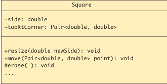

### UML CLASS DIAGRAMS

类是 OOP 的核心，而 **class diagram** 是 UML 图形表示中最容易理解和使用的。Display 20.6 显示了用于表示正方形的类的类图。图表由分为三个部分的框组成。顶部部分为类名 Square。下一部分为类的<|message|> 数据规范。在此示例中，有两个数据项（两个成员变量）：一个类型为 double 的值表示边的长度，以及一个值 topRtCorner 表示正方形右上角的位置。（值 topRtCorner 给出为一对类型为 double 的数字，指定相对于某个原点的 x,y 坐标点。）减号表示私有成员。因此，对于类 Square，所有数据都是私有的。第三部分给出操作（类成员函数）。加号表示公有成员。# 号表示受保护成员。因此，对于类 Square，类图显示了两个公有成员函数和一个受保护成员函数。类图不必给出类的完整描述。当你不需要类中的所有成员进行当前分析时，就不会在类图中列出所有成员。缺失的成员用省略号（三个点）表示。

### CLASS INTERACTIONS

仅靠类图价值不大，因为它们只是重复类接口，可能带有省略号。要理解一个设计，你需要说明各种类的对象如何交互。UML 有多种方式来表示类交互。各种带注释的箭头表示从一个类对象到另一个类对象的<|message|> 信息流，例如 Display 20.1 所示。UML 还有用于类分组为类似库的聚合、继承以及其他交互的注释。此外，UML 是可扩展的。如果 UML 中没有你想要和需要的东西，你

可以将其添加到 UML 中。当然，这一切都在规定的框架内进行，以便不同的软件开发人员能够理解彼此的 UML。

这只是 UML 的一个提示。如果你有兴趣了解更多，请参阅本书末尾列出的参考文献。

### Self-Test Exercises

- 4. Draw a class diagram for a class whose objects represent circles. Use Display 20.6 as a model.
- 5. Draw a class diagram for the IntNode class presented in Display 17.4.

### Chapter Summary

- Patterns are design principles that apply across a variety of software applications.
- The patterns discussed in this chapter are the Container-Iterator, Adapter, Model-View-Controller, and Divide-and-Conquer Sorting patterns.
- A pattern can give you a framework for comparing related algorithms for efficiency.
- The Unified Modeling Language (UML) is a graphical representation language for object-oriented software design.
- UML is one formalism that can and is used to express patterns.

### ANSWERS TO SELF-TEST EXERCISES

1. Yes, a template function definition is a pattern, but the term pattern is much more general and encompasses more. Moreover, a useful pattern expressed as a template function would leave some details unimplemented. If the only variation possible is a type parameter, it is still a pattern but not likely to be usefully viewed as a pattern. (It can still be useful as a template function, but it might not be useful to view it as a pattern in the sense discussed in this chapter.)

```
2. //File selectionsort.cpp: the selection sort realization
//of the Sorting pattern.
#include <algorithm>
using std::swap;

template <class T>
int indexOfSmallest(const T a[], int startIndex,
    int sentinelIndex)
{
    int min = a[startIndex];
    indexOfMin = startIndex;
    for (int index = startIndex + 1;
        index < sentinelIndex; index++)
```


```cpp
if (a[index] < min)
{
    min = a[index];
    indexOfMin = index;
    //min is the smallest of a[startIndex]
    //through a[index]
}
```

```cpp
return indexOfMin;
```

```cpp
template <class T>
int split(T a[], int begin, int end)
{
    int index = indexOfSmallest(a, begin, end);
    swap(a[begin], a[index]);
    return (begin + 1);
}
```

```cpp
template <class T>
void join(T a[], int begin, int splitPt, int end)
{
    //Nothing to do.
}
```

### 3.
随机值的数组将具有最快的运行时间，因为它大部分时间会将数组段划分为大致相等的子数组。其他两种情况的运行时间大致相同，这将是 O(N²) 的最坏情况运行时间，因为算法总是会将一个数组段划分为非常不相等的小块，一个小块只有一个元素，另一个小块包含其余元素。讽刺但真实的是，我们版本的快速排序算法在已经排序的数组上表现最差。快速排序算法有变体，在已排序数组上表现良好。例如，选择中间元素作为分割值将在已排序数组上提供良好的性能。但无论你选择什么分割值，总会有一些情况会出现这种最坏情况的运行时间。

### 4.
没有唯一的答案，但下面是一个合适的答案：

| Circle |
|---|
| -radius: double<br>-center: Pair<double, double> |
| +resize(double newRadius): void<br>+move(Pair<double, double> point): void<br>#erase(): void<br>... |

识别此情况下的主要对象。识别每个对象的行为。确定几个对象如何交互。然后识别类和成员函数。然后识别类必须记住的状态，以便能够控制电梯。

我们建议使用时钟驱动的模拟，其中所有事情都在时钟滴答时发生（例如一秒，但你的程序不会有任何计时。一次点击只是一次循环的执行。）你在每个滴答时调用随机数生成器来决定每个楼层到达多少人。

设计并编码大楼电梯的模拟。

这不是一个困难的练习，但它需要清晰的思考。它还要求你提供我们遗漏的一些细节，例如到达楼层时铃声响起，以及门打开，只是举两个例子。

### 5.
（4 的更难版本。）将编程项目 4 推广为模拟电梯系统，其中电梯数量大于一且楼层数量大于二。在此版本中，每个楼层将有两个呼叫按钮：一个呼叫电梯上行，一个呼叫电梯下行。为确定起见，使用 2 部电梯和 10 层楼，但原则无论数量如何都相同。你必须决定在按下呼叫按钮时在几种情况下呼叫哪部电梯。例如，假设在呼叫者楼层有一部电梯正在移动朝向呼叫者楼层，而另一部电梯正在远离。计数停止的电梯时，这样的组合不止 4 种。

你将不得不决定为电梯使用者提供哪些额外的控制和显示。你将不得不决定模拟器需要什么输出，以便用户可以看到并理解模拟中发生了什么。

