# Absolute C++ 第6版 全球版


# 标准模板库

标准模板库 STL 是一个庞大的预编程数据结构类和算法集合。STL 可能是一个与核心 C++ 语言一样大的主题，因此我包含了对 STL 的大量介绍。有一整章介绍模板的一般主题，一整章介绍 STL 的具体内容，以及文本其他部分关于 STL 或相关的其他材料。

# 面向对象编程

本书围绕 C++ 的结构组织。因此，前几章涵盖了 C++ 的方面，这些方面常见于大多数高级编程语言，但并不特别面向面向对象编程 OOP。对于一本参考书——对于一本学习第二语言的书来说——这是有意义的。然而，我认为 C++ 是一种 OOP 语言。如果你用 C++ 编程而不是 C，你必须使用 C++ 的 OOP 特性。本书对 C++ 语言中实现的封装、继承和多态进行了广泛的介绍。第 20 章关于模式和 UML，给出了 OOP 相关材料的额外介绍。

# 主题排序的灵活性

本书允许教师在重新排序材料方面有很大的自由度。如果一本书要作为参考书，这一点很重要。这也符合我的理念，即适应教师的风格，而不是将教师束缚于我个人对主题排序的偏好。每章的介绍都解释了在涵盖该章的每个部分之前必须已经涵盖哪些材料。

# 对学生友好

一本书呈现正确的主题并按正确的顺序呈现是不够的。对教师来说正确清晰也不够。材料还需要以对初学者来说易于理解的方式呈现。与我其他深受学生欢迎的教科书一样，本书的写作是为了对学生友好和易于理解。

# 摘要框

每个主要点都总结在框中。这些框分布在每章中。它们作为材料的摘要，作为快速参考来源，以及作为快速学习 C++ 语法的方式，用于你一般了解但不知道 C++ 具体细节的功能。

# 自测练习

每章包含大量自测练习。所有自测练习的完整答案都给出在每章末尾。

# 视频笔记

VideoNotes 是逐步视频，指导读者完成一章末尾问题的解决方案或进一步阐明文本中介绍的概念。文本中的图标指示 VideoNote 增强了某个主题。完全可导航的问题允许自定步调的教学。VideoNotes 可在 www.pearsonglobaleditions.com/savitch 获取。

# 其他功能

陷阱部分、编程技术部分，以及带有示例输入和输出的完整程序示例贯穿每章。每章以摘要和编程项目集合结束。

# 支持材料

以下支持材料可在 www.pearsonglobaleditions.com/savitch 向本书所有用户提供：

- 书中源代码

以下资源仅可在 www.pearsonglobaleditions.com/savitch 向合格教师提供。

- 含解答的教师手册
- PowerPoint® 幻灯片

# 如何访问教师和学生资源材料

**在线练习和评估，使用** MyProgrammingLab™。MyProgrammingLab 帮助学生完全掌握编程的逻辑、语义和语法。通过练习题和即时个性化反馈，MyProgrammingLab 提高了初学者的编程能力，这些初学者通常难以掌握流行高级编程语言的基本概念和范式。

作为自学和家庭作业工具，MyProgrammingLab 课程由围绕本书结构组织的数百个小练习问题组成。对于学生，系统会自动检测其代码提交中的逻辑和语法错误，并提供有针对性的提示，使学生能够弄清出了什么问题——以及原因。对于教师，综合成绩簿跟踪正确答案和错误答案，并存储学生输入的代码以供审阅。

如需完整演示、查看教师和学生的反馈，或在您的课程中使用 MyProgrammingLab，请访问 www.myprogramminglab.com。

# 致谢

许多人对本书的出版提供了宝贵的帮助和支持。Addison-Wesley 的 Frank Ruggierilo 和 Susan Hartman 最先构思了这个想法并支持了第一版，我对他们表示感激。A


特别感谢 Matt Goldstein，他担任第二版、第三版和第四版的编辑。他的帮助和支持对本项目的成功至关重要。Chelsea Kharakozova、Marilyn Lloyd、Yez Alayan 以及 Pearson Education 的其他优秀人员也提供了宝贵的支持和鼓励。

以下审阅者为本书提供了建议。我感谢他们所有人的辛勤工作和宝贵的评论。

| 审阅者 | 机构 |
|---|---|
| Duncan Buell | 南卡罗来纳大学 |
| Daniel Cliburn | 太平洋大学 |
| Natacha Gueroguieva | 斯塔滕岛学院，CUNY |
| Archana Sharma Gupta | 德拉瓦技术与社区学院 |
| Kenneth Moore | 阿勒格尼县社区学院 |
| Robert Meyers | 佛罗里达州立大学 |
| Clayton Price | 密苏里科技大学 |
| Terry Rooker | 俄勒冈州立大学 |
| William Smith | 特尔萨社区学院 |
| Hugh Lauer | 伍斯特理工学院 |
| Richard Albright | 特拉华大学 |
| J. Boyd Trolinger | 巴特学院 |
| Jerry K. Bilbrey, Jr | 弗朗西斯马里昂大学 |
| Albert M. K. Cheng | 休斯顿大学 |
| David Cherba | 密歇根州立大学 |
| Fredrick H. Colclough | 科罗拉多技术大学 |
| Drue Coles | 波士顿大学 |
| Stephen Corbesero | 摩拉维亚学院 |
| Christopher E. Cramer |  |
| Ron DiNapoli | 康奈尔大学 |
| Qin Ding | 宾夕法尼亚州立大学哈里斯堡分校 |
| Martin Dulberg | 北卡罗来纳州立大学 |
| H. E. Dunsmore | 伯明翰大学 |
| Evan Golub | 马里兰大学 |
| Terry Harvey | 特拉华大学 |
| Joanna Klukowska | 亨特学院，CUNY |
| Lawrence S. Kroll | 旧金山州立大学 |
| Stephen P. Leach | 佛罗里达州立大学 |
| Alvin S. Lim | 奥本大学 |
| Tim H. Lin | 加州理工学院波莫纳分校 |
| R. M. Lowe | 克莱姆森大学 |
| Jeffrey L. Popyack | 德雷塞尔大学 |
| Amar Raheja | 加州理工学院波莫纳分校 |
| Victoria Rayskin | 洛杉矶中央大学 |
| Loren Rhodes | 朱尼阿塔学院 |
| Jeff Ringenberg | 密歇根大学 |
| Victor Shtern | 波士顿大学 |
| Aaron Striegel | 诺特丹大学 |
| J. Boyd Trolinger | 巴特学院 |
| Chrysafis Vogiatzis | 佛罗里达大学 |
| Joel Weinstein | 诺丁汉大学 |
| Dick Whalen | 马里兰南部学院 |

特别感谢 Kenrick Mock（阿拉斯加大学安克雷奇分校）完成了本版的更新。他再次承担了满足我、编辑和他自己的艰难任务。我感谢他做出了真正出色的工作。

Walter Savitch

Pearson 感谢并承认 Muthuraj M 为全球版做出的贡献，以及 Ela Kashyap、Amity University、Sandeep Singh、Jaypee Institute of Information Technology、Vikas Saxena、Jaypee Institute of Information Technology 和 Piyali Bandopadhyay 对全球版的审阅。

## 文本中 VIDEONOTES 的位置

www.pearsonglobaleditions.com/savitch

| 章节 | Videonote |
|---|---|
| Chapter 1 | 编译和运行 C++ 程序，第 32 页<br>C++11 固定宽度整数类型，第 38 页<br>编程项目 1.11 的解决方案，第 73 页 |
| Chapter 2 | 嵌套循环示例，第 113 页<br>编程项目 2.5 的解决方案，第 124 页<br>编程项目 2.9 的解决方案，第 125 页<br>编程项目 2.10 的解决方案，第 126 页 |
| Chapter 3 | 生成随机数，第 137 页<br>作用域讲解，第 155 页<br>编程项目 3.9 的解决方案，第 170 页 |
| Chapter 4 | 使用集成调试器，第 203 页<br>编程项目 4.4 的解决方案，第 210 页<br>编程项目 4.11 的解决方案，第 211 页 |
| Chapter 5 | 数组讲解，第 217 页<br>基于范围的 for 循环，第 222 页<br>冒泡排序讲解，第 247 页<br>编程项目 5.7 的解决方案，第 266 页<br>编程项目 5.15 的解决方案，第 270 页 |
| Chapter 6 | 编程项目 6.5 的解决方案，第 306 页<br>编程项目 6.9 的解决方案，第 307 页 |
| Chapter 7 | 构造函数讲解，第 310 页<br>成员变量的默认初始化，第 329 页<br>编程项目 7.4 的解决方案，第 351 页<br>编程项目 7.7 的解决方案，第 352 页 |
| Chapter 8 | 编程项目 8.7 的解决方案，第 400 页 |
| Chapter 9 | 使用 cin 和 getline 与 string 类，第 433 页<br>编程项目 9.11 的解决方案，第 451 页<br>编程项目 9.13 的解决方案，第 452 页 |
| Chapter 10 | 浅拷贝与深拷贝示例，第 493 页<br>编程项目 10.5 的解决方案，第 503 页 |
| Chapter 11 | 使用 #ifndef 避免多次定义，第 518 页<br>编程项目 11.5 的解决方案，第 546 页 |
| Chapter 12 | stringstream 演示讲解，第 588 页<br>编程项目 12.17 的解决方案，第 600 页<br>编程项目 12.25 的解决方案，第 604 页 |
| Chapter 13 | 递归与栈，第 616 页<br>互递归讲解，第 625 页<br>编程项目 13.9 的解决方案，第 643 页<br>编程项目 13.11 的解决方案，第 644 页 |
| Chapter 14 | 编程项目 14.7 的解决方案，第 691 页 |
| Chapter 15 | 编程项目 15.5 的解决方案，第 726 页<br>编程项目 15.7 的解决方案，第 727 页 |
| Chapter 16 | 编程项目 16.3 的解决方案，第 764 页<br>编程项目 16.7 的解决方案，第 765 页 |
| Chapter 17 | 编程项目 17.5 的解决方案，第 856 页<br>编程项目 17.11 的解决方案，第 858 页 |
| Chapter 18 | 编程项目 18.5 的解决方案，第 893 页 |
| Chapter 19 | C++11 与容器，第 927 页<br>编程项目 19.9 的解决方案，第 948 页<br>编程项目 19.12 的解决方案，第 949 页 |

## 1 C++ 基础

> > 分析机绝无任何傲慢自许，认为自己能创造什么。它只能执行我们懂得如何命令它去做的事情。它能遵循分析步骤，但无力预示任何分析关系或真理。它的职责是帮助我们利用已知的知识。
> >
> > — 埃达·奥古斯塔，*查尔斯·巴贝奇先生发明的分析机概述，含译者埃达·洛夫莱斯之注释，载于《科学回忆录》第3卷，1842年*

## 引言

本章介绍 C++ 语言，并提供足够的细节，让你能够处理涉及表达式、赋值和控制台输入/输出（I/O）的简单程序。赋值和表达式的细节与大多数其他高级语言类似。每种语言都有自己的控制台 I/O 语法，因此如果你不熟悉 C++，可能会觉得这一部分陌生而不同。

### 1.1 C++ 简介

> > 语言是科学的唯一工具。
> >
> > — 塞缪尔·约翰逊，*《苏格兰西部群岛之旅》。伦敦：伦敦 A. Strahan 与 T. Cadell 出版社，1791年*

本节概述 C++ 编程语言。

## C++ 语言的起源

C++ 编程语言可以看作是在 C 编程语言的基础上添加了类（以及其他现代特性）。C 编程语言由 AT&T 贝尔实验室的丹尼斯·里奇于 20 世纪 70 年代开发。它最初用于编写和维护 UNIX 操作系统。（在那之前，UNIX 系统程序要么用汇编语言编写，要么用一种称为 B 的语言编写，这种语言由 UNIX 的创始人肯·汤普森开发。）C 是一种通用语言，可用于编写任何类型的程序，但它的成功和流行与 UNIX 操作系统密切相关。如果你想维护 UNIX 系统，就需要使用 C。C 和 UNIX 配合得如此默契，以至于很快不仅系统程序，几乎所有在 UNIX 下运行的商业程序都用 C 语言编写。C 变得如此流行，以至于该语言也出现了适用于其他流行操作系统的版本；因此，它的使用并不局限于使用 UNIX 的计算机。然而，尽管 C 非常流行，它并非没有缺点。

C 语言很特别，因为它是一种具有许多低级语言特征的高级语言。C 介于极高层次的语言与低级语言这两个极端之间，其优点和缺点都在于此。与（低级的）汇编语言类似，C 程序可以直接操作计算机的内存。另一方面，C 又具有高级语言的特征，使其比汇编语言更易于阅读和编写。这使得 C 成为编写系统程序的绝佳选择，但对于其他程序（在某种意义上甚至对于系统程序），C 不像其他语言那样容易理解；此外，它也不像某些其他高级语言那样拥有那么多自动检查机制。

为了克服 C 的这些以及其他缺点，AT&T 贝尔实验室的比雅尼·斯特劳斯特鲁普在 20 世纪 80 年代初开发了 C++。斯特劳斯特鲁普将 C++ 设计成一种更好的 C。C 的大部分内容是 C++ 的子集，因此大多数 C 程序也是 C++ 程序。（反过来则不然；许多 C++ 程序绝对不是 C 程序。）与 C 不同，C++ 具备类设施，因此可以用于面向对象编程。

C++14 是 C++ 编程语言标准的最新版本。它于 2014 年 8 月 19 日获得国际标准化组织批准。在撰写本文时，C++14 标准尚未发布。C++14 主要包含对 C++11 的小幅改进，而 C++11 则对先前版本进行了显著改进。能够处理 C++11 或 C++14 的新编译器可以编译和运行为旧版本 C++ 编写的程序。然而，C++11 和 C++14 标准包含的新语言特性与旧版 C++ 编译器不兼容。这意味着，如果你使用的是旧版 C++ 编译器，可能无法编译和运行 C++11 或 C++14 程序。

## C++ 与面向对象编程

面向对象编程（OOP）是一种当前流行且功能强大的编程技术。OOP 的主要特征是封装、继承和多态。封装是一种信息隐藏或抽象的形式。继承与编写可重用代码有关。多态指的是在继承的上下文中，单个名称可以具有多种含义。说了这些之后，我们必须承认，对于之前没有听说过 OOP 的读者来说，这些说法意义不大。不过，我们将在本书后面详细描述所有这些术语。C++ 通过提供类（一种将数据和算法结合的数据类型）来支持 OOP。C++ 并不是某些权威人士所说的“纯 OOP 语言”。C++ 以对效率以及某些人可能称之为“实用性”的考量来平衡其 OOP 特性。这种结合使 C++ 目前成为使用最广泛的 OOP 语言，尽管并非所有使用都严格遵循 OOP 哲学。

## C++ 的特点

C++ 拥有类，因此可以用作面向对象语言。它允许函数和运算符的重载。（所有这些术语最终都会得到解释，所以如果你不完全理解某些术语，不必担心。）C++ 与 C 语言的渊源使它看起来比更新的面向对象语言更为传统，但它比许多当前流行的语言拥有更强大的抽象机制。C++ 具有模板设施，可以完整而直接地实现算法抽象。C++ 模板允许你使用类型参数进行编码。最新的 C++ 标准以及大多数 C++ 编译器允许多个命名空间，以适应更多的类和函数名称复用。C++ 中的异常处理设施与其他编程语言中的类似。C++ 中的内存管理与 C 中的类似。程序员必须自己分配内存并处理自己的垃圾回收。大多数编译器允许你在 C++ 中进行 C 风格的内存管理，因为 C 本质上是 C++ 的子集。然而，C++ 也有自己的 C++ 风格内存管理语法，建议你在编写 C++ 代码时使用 C++ 风格的内存管理。本书只使用 C++ 风格的内存管理。

## C++ 术语

在 C++ 中，所有类似过程的实体都称为函数。在其他语言中称为过程、方法、函数或子程序的东西，在 C++ 中都称为函数。正如我们将在下一小节看到的，C++ 程序基本上就是一个名为 main 的函数；当你运行程序时，运行时系统会自动调用名为 main 的函数。C++ 的其他术语与大多数其他编程语言基本相同，并且无论如何，在介绍每个概念时都会加以解释。

## 一个 C++ 示例程序

显示 1.1 包含一个简单的 C++ 程序，以及用户运行该程序时可能生成的两种屏幕显示。C++ 程序实际上是一个名为 main 的函数定义。程序运行时，会调用名为 main 的函数。main 的函数体用花括号 {} 括起来。程序运行时，将执行花括号中的语句。

下面这两行代码进行了设置，使程序可以使用具有控制台输入和输出功能的库。关于这两行代码及相关主题的详细信息将在第 1.3 节以及第 9、11 和 12 章中介绍。

```
#include <iostream>
using namespace std;
```

下面这行代码表示 main 是一个不带参数、返回 int（整数）值的函数：

```
int main( )
```

## 显示 1.1 一个 C++ 示例程序

```
1 #include <iostream>
2 using namespace std;
3
3 int main() {
4 {
5     int numberOfLanguages;
6
7     cout << "Hello reader.\n"
8         << "Welcome to C++.\n";
9
10    cout << "How many programming languages have you used? ";
11    cin >> numberOfLanguages;
12
13    if (numberOfLanguages < 1)
14        cout << "Read the preface. You may prefer\n"
15            << "a more elementary book by the same author.\n";
16    else
17        cout << "Enjoy the book.\n";
18
19    return 0;
20 }
```

## 示例对话 1

```
Hello reader.
Welcome to C++.
How many programming languages have you used? 0
Read the preface. You may prefer
a more elementary book by the same author.
```

用户在键盘上输入 0。用户输入以粗体显示。

## 示例对话 2

```
Hello reader.
Welcome to C++.
How many programming languages have you used? 1
Enjoy the book
```

用户在键盘上输入 1。用户输入以粗体显示。

## 提示：编译 C++ 程序

你可能还需要指定要编译的 C++ 标准。例如，要使用 g++ 4.7 编译 C++11，需要在命令行中添加编译器标志 -std=c++11；否则，编译器将假定该 C++ 程序是按较旧的标准编写的。编译名为 testing.cpp 的 C++11 程序的命令行如下所示：

```
g++ testing.cpp -std=c++11
```


## 提示：（续）

请查阅编译器的文档，以确定编译C++11（或C++14）程序是否需要特殊步骤，以及支持哪些语言特性。

C++中的变量声明与其他编程语言类似。Display 1.1中的以下代码行声明了变量`numberOfLanguages`：

```
int numberOfLanguages;
```

类型`int`是C++中用于整数（整数类型）的类型之一。

如果你之前没有用C++编程过，那么使用`cin`和`cout`进行控制台输入/输出对你来说可能是新内容。这个话题将在本章稍后部分介绍，但你可以在本示例程序中看到大致思路。例如，考虑Display 1.1中的以下两行：

```
cout << "How many programming languages have you used? ";
cin >> numberOfLanguages;
```

第一行将引号内的文本输出到屏幕。引号内的文本称为字符串，或者更准确地说，是C字符串。第二行读取用户在键盘上输入的数字，并将变量`numberOfLanguages`的值设置为该数字。

以下代码行：

```
cout << "Read the preface. You may prefer\n"
    << "a more elementary book by the same author.\n";
```

输出两个字符串而不是一个字符串。具体细节将在本章后面的1.3节中解释，但这段简短的介绍足以让你理解在1.3节之前的示例中`cin`和`cout`的简单用法。符号`\n`是换行符，指示计算机开始新的一行输出。

虽然你可能还不确定如何编写这些语句的确切细节，但你大概能猜到if-else语句的含义。具体细节将在下一章中解释。

（顺便说一句，如果你对某些编程语言还不太熟悉，你应该阅读前言，看看是否更适合选择一本更基础的教材。阅读本书不需要任何C++经验，但强烈建议具备一些基本的编程经验。）

## 1.2 变量、表达式和赋值语句

> 一旦一个人理解了变量在编程中的使用方式，他就理解了编程的精髓。
>
> E. W. DIJKSTRA，《关于结构化编程的笔记》，1969年8月

string
C-string

C++中的变量、表达式和赋值与大多数其他通用语言类似。

### 标识符

变量（或你在程序中可能定义的其他项目）的名称称为**标识符**。C++标识符必须以字母或下划线符号开头，其余所有字符必须是字母、数字或下划线符号。例如，以下都是有效的标识符：

```
x x1 x_1 _abc ABC123z7 sum RATE count data2 bigBonus
```

所示的所有名称都是合法的，编译器中会接受这些名称，但前五个作为标识符而言是较差的选择，因为它们不能描述标识符的用途。以下都不是合法的标识符，编译器会拒绝它们：

```
12 3X %change data-1 myfirst.c PROG.CPP
```

前三个不被允许，因为它们不是以字母或下划线开头。其余三个不是标识符，因为它们包含字母、数字和下划线符号以外的符号。

虽然以下划线开头作为标识符是合法的，但你应该避免这样做，因为以下划线开头的标识符被非正式地保留给系统标识符和标准库使用。

C++是一种**区分大小写**的语言；也就是说，它在标识符的拼写中区分大写字母和小写字母。因此，以下是三个不同的标识符，可以用来命名三个不同的变量：

```
rate RATE Rate
```

然而，在同一个程序中使用两个这样的变体并不是一个好主意，因为这可能会引起混淆。虽然不是C++的要求，但变量的第一个字母通常使用小写拼写。预定义的标识符，如`main`、`cin`、`cout`等，必须全部使用小写字母拼写。在面向对象编程中现在普遍采用的约定是：变量名混合使用大写和小写字母（以及数字），变量名始终以小写字母开头，并用大写字母表示“单词”边界，如下面的变量名所示：

```
topSpeed, bankRate1, bankRate2, timeOfArrival
```

这种约定在C++中不像在其他一些面向对象语言中那样普遍，但正在变得越来越广泛使用，并且是一个值得遵循的好约定。

C++标识符可以是任意长度，尽管有些编译器会忽略某个（较大的）指定数量的初始字符之后的所有字符。

### 标识符

C++标识符必须以字母或下划线符号开头，其余字符必须全部是字母、数字或下划线符号。C++标识符区分大小写，且长度没有限制。

### 变量

有一类特殊的标识符，称为**关键字**或**保留字**，它们在C++中具有预定义的含义，不能用作变量或其他任何事物的名称。在本书的代码展示中，关键字以不同的颜色显示。附录1中给出了完整的关键字列表。

一些预定义的字，如`cin`和`cout`，不是关键字。这些预定义字不是核心C++语言的一部分，你被允许重新定义它们。虽然这些预定义字不是关键字，但它们是在C++语言标准所要求的库中定义的。不用说，将预定义的标识符用于其标准含义以外的任何用途都可能会引起混淆和危险，因此应该避免。最安全且最简单的做法是将所有预定义标识符视为关键字。

C++程序中的每个变量在使用之前必须**声明**。当你**声明**一个变量时，你是在告诉编译器——以及最终告诉计算机——你将在此变量中存储什么类型的数据。例如，以下是可能出现在C++程序中的两个定义：

```
int numberOfBeans;
double oneWeight, totalWeight;
```

第一个定义将变量`numberOfBeans`定义为可以容纳`int`类型的值，即整数。名称`int`是“integer”（整数）的缩写。类型`int`是整数类型之一。第二个定义声明`oneWeight`和`totalWeight`为`double`类型的变量，`double`是带小数点的数字（称为**浮点数**）的类型之一。如这里所示，当一个定义中有多个变量时，变量之间用逗号分隔。另外，请注意每个定义以分号结尾。

每个变量在使用之前必须声明；除此之外，变量可以声明在任何位置。当然，它们应该始终声明在使程序更易于阅读的位置。通常，变量要么在使用之前声明，要么在块（以左花括号`{`表示）的开头声明。任何合法的标识符，除了保留字之外，都可以用作变量名。

C++具有用于字符、整数和浮点数（带小数点的数字）的基本类型。Display 1.2列出了基本的C++类型。常用的整数类型是`int`。类型`char`是单个字符的类型。类型`char`可以被视为整数类型，但我们不建议你这样做。常用的浮点数类型是`double`，因此对于浮点数，你应该使用`double`。

> ¹C++区分标识符的*声明*和*定义*。当标识符被声明时，名称被引入。当标识符被定义时，为所命名的项目分配存储空间。对于我们在本章中讨论的变量类型，以及在本书中更多的内容中，我们所称的**变量声明**既声明了变量又定义了变量，也就是说，为变量分配了存储空间。许多作者模糊了变量定义和变量声明之间的区别。声明和定义标识符之间的区别对于其他类型的标识符更为重要，我们将在后面的章节中遇到这些标识符。


除非你有特定理由使用其他浮点类型之一，否则请使用数字。`bool` 类型（Boolean 的缩写）具有 `true` 和 `false` 两个值。它不是整数类型，但为了兼容旧代码，你可以在 `bool` 和任何整数类型之间来回转换。程序员还可以为数组、类和指针定义类型，所有这些都将在本书后续章节中讨论。

## 显示 1.2 简单类型

| 类型名称 | 占用内存 | 取值范围 | 精度 |
|---|---|---|---|
| short（也称为 short int） | 2 字节 | −32,768 到 32,767 | 不适用 |
| int | 4 字节 | −2,147,483,648 到 2,147,483,647 | 不适用 |
| long（也称为 long int） | 4 字节 | −2,147,483,648 到 2,147,483,647 | 不适用 |
| float | 4 字节 | 大约 10⁻³⁸ 到 10³⁸ | 7 位数字 |
| double | 8 字节 | 大约 10⁻³⁰⁸ 到 10³⁰⁸ | 15 位数字 |
| long double | 10 字节 | 大约 10⁻⁴⁹³² 到 10⁴⁹³² | 19 位数字 |
| char | 1 字节 | 所有 ASCII 字符（也可以用作整数类型，尽管我们不建议这样做。） | 不适用 |
| bool | 1 字节 | true、false | 不适用 |

这里列出的值仅为示例值，旨在让你大致了解这些类型之间的差异。这些条目中的任何值在你的系统上可能有所不同。精度指的是有效数字的位数，包括小数点前面的数字。float、double 和 long double 类型的范围是正数的范围。负数也有类似的范围，只是每个数字前面有一个负号。

## 1.2 随机事件与样本空间

在随机试验中，我们往往会关心某个或多个事件是否发生。比如，在掷骰子试验中，关心掷出的点数是否小于3；在记录某地一昼夜的最高温度试验中，关心最高温度是否大于30℃。

在一个随机试验中，人们常常关心的是试验结果中具有某些特征的事件是否发生。例如，在掷骰子试验中，关心掷出的点数是否小于3；在记录某地一昼夜的最高温度试验中，关心最高温度是否大于30℃。

一般地，把在条件S下，一定会发生的事件叫做相对于条件S的必然事件，简称必然事件；把在条件S下，一定不会发生的事件叫做相对于条件S的不可能事件，简称不可能事件。必然事件与不可能事件统称为相对于条件S的确定事件。把在条件S下，可能发生也可能不发生的事件叫做相对于条件S的随机事件，简称随机事件。

在条件S下，确定事件和随机事件统称为事件，一般用大写字母A，B，C，…表示。

在试验中，为了便于研究，我们往往关心的是试验结果中的某些部分。例如，掷骰子试验中，关心掷出的点数是否为偶数。这时，我们把随机试验的每一个可能结果称为样本点，全体样本点的集合称为样本空间。

一般地，我们用Ω表示样本空间，用ω表示样本点。

例如，掷一枚骰子，观察掷出的点数，样本空间为Ω={1,2,3,4,5,6}。

思考：在掷骰子试验中，样本点总数是多少？样本空间是什么？

如果随机试验的样本空间为Ω，则随机事件A是Ω的某个子集，而且事件A发生当且仅当试验的结果是子集A中的元素。

例如，在掷骰子试验中，样本空间Ω={1,2,3,4,5,6}，事件“掷出的点数小于3”可表示为A={1,2}，事件“掷出的点数为偶数”可表示为B={2,4,6}。

C++11 还引入了一种名为 `auto` 的类型，它根据等号右侧的表达式来推断变量的类型。例如，

```
auto x = expression;
```

定义了一个名为 x 的变量，其数据类型与“表达式”计算出的结果相匹配。这一特性目前对我们没有太大帮助，但当我们开始处理自己定义的较长的数据类型时，它将为我们省去一些冗长、杂乱的代码。

另一方面，C++11 引入了一种确定变量或表达式类型的方法，decltype (expr) 是变量或表达式 expr 的声明类型，可用于声明：

```
int x = 10;
decltype(x*3.5) y;
```

这段代码声明 y 与 x*3.5 具有相同的类型。表达式 x*3.5 是 double 类型，因此 y 被声明为 double。

## 赋值语句

赋值
语句

改变变量值最直接的方法是使用赋值语句。在 C++ 中，等号用作赋值运算符。赋值语句总是由等号左侧的变量和右侧的表达式组成。赋值语句以分号结尾。等号右侧的表达式可以是变量、数字，或者是由变量、数字、运算符和函数调用组成的更复杂的表达式。赋值语句指示计算机对等号右侧的表达式进行求值（即计算其值），并将等号左侧的变量值设置为该表达式的值。以下是 C++ 赋值语句的示例：

```
totalWeight = oneWeight * numberOfBeans;
temperature = 98.6;
count = count + 2;
```

## 赋值语句

在赋值语句中，首先对等号右侧的表达式进行求值，然后将等号左侧的变量设置为该值。

语法
变量 = 表达式;

示例

```
distance = rate * time;
count = count + 2;
```

第一个赋值语句将 `totalWeight` 的值设置为变量 `oneWeight` 中的数字乘以 `numberOfBeans` 中的数字。（在 C++ 中，乘法用星号 * 表示。）第二个赋值语句将 `temperature` 的值设置为 98.6。第三个赋值语句将变量 `count` 的值增加 2。

在 C++ 中，赋值语句可以用作表达式。当用作表达式时，赋值语句返回赋给变量的值。例如，考虑

```
n = (m = 2);
```

子表达式 `(m = 2)` 将 m 的值改为 2，并返回值 2。因此，这会将 n 和 m 都设置为 2。正如我们在第 2 章详细讨论运算符优先级时所看到的，你可以省略括号，所以所讨论的赋值语句可以写成

```
n = m = 2;
```

我们建议你不要将赋值语句用作表达式，但你应该了解这种行为，因为它将帮助你理解某些类型的编码错误。首先，它将解释为什么当你错误地写下

```
n = m = 2;
```

而你本意是写

```
n = m + 2;
```

时，你不会收到错误消息。（这是一个容易犯的错误，因为 = 和 + 位于同一个键盘键上。）

> **左值和右值**
> 
> 作者们经常在 C++ 书籍中引用 *左值* 和 *右值*。*左值* 是可以出现在赋值运算符（`=`）左侧的任何东西，也就是任何类型的变量。*右值* 是可以出现在赋值运算符右侧的任何东西，也就是任何求值为一个值的表达式。

## string 类简介

尽管 C++ 缺乏一种直接操作字符串（文本序列）的简单数据类型，但有一个 `string` 类，可以用与我们目前所见数据类型类似的方式来处理字符串。类与简单数据类型（如 `int`）之间的区别将在第 6 章讨论。`string` 类的更多细节将在第 9 章讨论。

要使用 `string` 类，我们必须首先在程序顶部添加以下代码行来包含 string 库：

```
#include <string>
```

声明 `string` 类型的变量就像声明 `int` 或 `double` 类型的变量一样。例如，以下声明一个 `string` 类型的变量并将文本“durian”存储在其中：

```
string fruit;
fruit = "durian";
```

## 陷阱：未初始化的变量

在程序给变量赋予值之前，变量没有有意义的值。例如，如果变量 `minimumNumber` 没有被赋予值，无论是作为赋值语句的左侧，还是通过其他方式（例如通过 `cin` 语句获得输入值），那么以下代码就是一个错误：

```
desiredNumber = minimumNumber + 10;
```

这是因为 `minimumNumber` 没有有意义的值，所以等号右侧的整个表达式也没有有意义的值。像 `minimumNumber` 这样没有被赋予值的变量称为未初始化变量。事实上，这种情况比 `minimumNumber` 根本没有值更糟糕。一个未初始化的变量（如 `minimumNumber`）只会带有一些垃圾值。未初始化变量的值由最后一个使用该内存区域的程序留在其内存位置中的零和一模式决定。

避免未初始化变量的一种方法是在声明变量的同时对其进行初始化。可以通过添加等号和值来完成，如下所示：

```
int minimumNumber = 3;
```

这既将 `minimumNumber` 声明为 `int` 类型的变量，又将变量 `minimumNumber` 的值设置为 3。在这种方式下，你可以在声明中初始化变量时使用涉及加法或乘法等运算的更复杂的表达式。再举一个例子，下面声明了三个变量并初始化了其中两个：

```
double rate = 0.07, time, balance = 0.00;
```

C++ 允许在声明变量时使用另一种初始化表示法。这种替代表示法由下面的例子说明，它与前面的声明等效：

```
double rate(0.07), time, balance(0.00);
```


## 在声明中初始化变量

可以在声明变量时初始化变量（即给变量赋一个值）。

### 语法

```
Type_Name Variable_Name_1 = Expression_for_Value_1,
    Variable_Name_2 = Expression_for_Value_2, ...;
```

### 示例

```
int count = 0, limit = 10, fudgeFactor = 2;
double distance = 999.99;
```

### 语法

在声明中初始化的另一种语法：

```
Type_Name Variable_Name_1 (Expression_for_Value_1),
    Variable_Name_2 (Expression_for_Value_2), ...;
```

### 示例

```
int count(0), limit(10), fudgeFactor(2);
double distance(999.99);
```

### 提示：使用有意义的名称

程序中的变量名和其他名称至少应暗示其命名对象的含义或用途。如果变量具有有意义的名称，程序就更容易理解。对比

```
x = y * z;
```

与更具提示性的

```
distance = speed * time;
```

这两个语句完成相同的工作，但第二个更容易理解。

### 更多赋值语句

存在一种简写表示法，它将赋值运算符（=）与一个算术运算符组合在一起，从而可以通过加上、减去、乘以或除以某个指定值来改变给定变量的值。其一般形式为

```
Variable Operator = Expression
```

它等价于

```
Variable = Variable Operator (Expression)
```

其中 Expression 可以是另一个变量、一个常量或更复杂的算术表达式。下面列表给出了例子。

| 示例 | 等价于 |
| --- | --- |
| count += 2; | count = count + 2; |
| total -= discount; | total = total - discount; |
| bonus *= 2; | bonus = bonus * 2; |
| time /= rushFactor; | time = time / rushFactor; |
| change %= 100; | change = change % 100; |
| amount *= cnt1 + cnt2; | amount = amount * (cnt1 + cnt2); |

### 自测练习

- 1. 给出两个名为 feet 和 inches 的变量的声明。两个变量均为 int 类型，并且都要在声明中初始化为零。给出两种初始化替代形式。
- 2. 给出两个名为 count 和 distance 的变量的声明。count 为 int 类型，初始化为零。distance 为 double 类型，初始化为 1.5。给出两种初始化替代形式。
- 3. 编写一个程序，其中包含输出五个或六个已定义但未初始化变量的值的语句。编译并运行该程序。输出是什么？请解释。

### 赋值兼容性

一般来说，不能将一种类型的值存储到另一种类型的变量中。例如，大多数编译器会拒绝以下代码：

```
int intVariable;
intVariable = 2.99;
```

问题在于类型不匹配。常量 2.99 是 double 类型，而变量 intVariable 是 int 类型。不幸的是，并非所有编译器都会对上述赋值语句做出相同反应。有些会给出错误消息，有些只给出警告消息，还有些编译器根本不会反对。即使编译器允许使用上述赋值语句，它也会将 intVariable 赋为 int 值 2，而不是值 3。由于不能指望编译器接受上述赋值，因此不应将 double 值赋给 int 类型的变量。

在某些特殊情况下，允许将一种类型的值赋给另一种类型的变量。可以将整数类型（如 `int`）的值赋给浮点类型（如 `double`）的变量。例如，以下是一种有效且可接受的风格：

```
double doubleVariable;
doubleVariable = 2;
```

所示风格会将名为 `doubleVariable` 的变量的值设置为 2.0。

尽管这样做通常是个坏主意，但可以将 int 值（如 65）存储在 char 类型的变量中，也可以将字母（如 'z'）存储在 int 类型的变量中。在许多用途上，C 语言将字符视为小整数，也许不幸的是，C++ 从 C 继承了这一点。允许这样做是因为 char 类型的变量比 int 类型的变量占用更少的内存；因此，使用 char 类型的变量进行算术运算可以节省一些内存。然而，在处理整数时使用 int 类型，在处理字符时使用 char 类型，会更清晰。

一般规则是，不能将一种类型的值放入另一种类型的变量中——尽管看起来这条规则的例外情况比遵循规则的情况还多。即使编译器没有严格执行这条规则，遵循它也是一个好主意。将一种类型的数据放入另一种类型的变量可能会引发问题，因为该值必须转换为适当类型的值，而该值可能并非你所期望的。

`bool` 类型的值可以赋给整数类型（`short`、`int`、`long`）的变量，整数也可以赋给 `bool` 类型的变量。然而，这样做是不良风格。为了完整起见并帮助你阅读他人的代码，以下是细节：当赋给 `bool` 类型的变量时，任何非零整数都将存储为值 true。零将存储为值 false。当将 bool 值赋给整数变量时，true 将存储为 1，false 将存储为 0。

### 字面量

字面量是某个特定值的名称。与变量相对，字面量通常被称为常量。字面量或常量不改变值；变量可以改变其值。整数常量的书写方式与你习惯的书写数字的方式一致。`int` 类型（或其他任何整数类型）的常量不得包含小数点。`double` 类型的常量可以用两种形式之一书写。double 常量的简单形式类似于日常书写十进制小数的方式。以这种形式书写时，double 常量必须包含小数点。C++ 中任何数字常量（整数或浮点数）都不能包含逗号。

double 类型常量的一种更紧凑的表示法称为**科学记数法**或**浮点记数法**，特别适合书写非常大的数和非常小的分数。例如，3.67 × 10^17（即 `367000000000000000.0`）在 C++ 中最适合用常量 `3.67e17` 表示。数字 5.89 × 10^-6（即 `0.00000589`）在 C++ 中最适合用常量 `5.89e-6` 表示。这里的 e 代表指数（exponent），意思是“乘以 10 的后面数字次幂”。e 可以是大写或小写。

可以把 e 后面的数字看作告诉你小数点移动的方向和位数。例如，要将 3.49e+4 改为不带 e 的数值，你需要将小数点向右移动四位，得到 34900.0，这是同一数字的另一种写法。如果 e 后面的数字为负，则向左移动小数点相应的位数，必要时插入额外的零。因此，3.49e-2 与 0.0349 相同。

e 前面的数字可以包含小数点，尽管不是必须的。但是，e 后面的指数绝对不能包含小数点。

### 什么是 double？

为什么带有小数部分的数字类型被称为 double？是否存在一种大小只有它一半、称为“single”的类型？不，但有类似的情况。许多编程语言传统上对带有小数部分的数字使用两种类型。一种类型占用较少存储空间，且非常不精确（即不允许太多有效数字）。第二种类型占用两倍存储空间，因此精确得多；它还允许更大的数字（尽管程序员往往更关心精度而非大小）。占用两倍存储空间的数字类型被称为双精度（double-precision）数字；占用较少存储空间的被称为单精度（single precision）。沿袭这一传统，C++ 中将（或多或少）对应于双精度类型的类型命名为 double。C++ 中对应于单精度的类型称为 float。C++ 还有第三种用于带有小数部分的数字的类型，称为 long double。

char 类型的常量通过将字符放在单引号中来表示，如下所示：

```
char symbol = 'Z';
```

注意，左右单引号是同一个符号。

字符串常量用双引号表示，如下面取自显示 1.1 的一行所示：

```
cout << "How many programming languages have you used? ";
```

务必注意，字符串常量放在双引号内，而 char 类型的常量放在单引号内。这两种引号含义不同。特别是，'A' 和 "A" 含义不同。'A' 是 char 类型的值，可以存储在 char 类型的变量中。"A" 是一个字符串。该字符串恰好只包含一个字符，这并不会使 "A" 成为 char 类型的值。还要注意，对于字符串和字符，左右引号都是相同的。

引号

双引号中的字符串（如 "Hello"）通常被称为 C 字符串（C-string）。C 字符串与前面介绍的 string 类并不相同，尽管两者都用于存储文本序列，我们有时会将两者互换使用。两者之间的区别将在第 9 章详细解释。出于安全性和灵活性的考虑，专家建议在可能的情况下使用 string 类而不是 C 字符串。

C 字符串


## 原始字符串字面量

C++11 引入了一个新特性——原始字符串字面量，可以更轻松地插入转义序列。原始字符串字面量在你想要编码包含反斜杠的字符串时尤其有帮助。例如，假设你确实想精确编码字符串 "\t\t\n"。如果我们这样尝试：

```
string s = "\t\\t\n";
```

那么由于转义字符是 \，C++ 会将第一个 "\t" 解释为制表符，接下来 "\\" 解释为反斜杠，"t" 解释为字符 t，而 "\n" 解释为换行符。存储在变量 s 中的字符串于是为 "tab" + "\t" + 换行符。要存储字面字符串 "\t\t\n"，我们需要对每个反斜杠出现的位置都使用 "\\"。结果是

```
string s = "\t\\\t\\\n";
```

编码此字符串更容易的方法是使用原始字符串字面量。格式为大写字母 R 后跟双引号，然后是括号中的期望字面字符串。以下代码会将 "\t\t\n" 存储在变量 s 中：

```
string s = R"(\t\t\n)";
```

变量 s 现在包含精确的字符串 "\t\t\n"。原始字符串字面量在你需要引用文件路径名或使用正则表达式时非常方便，正则表达式允许程序员指定匹配字符的模式。

## 命名常量

计算机程序中的数字存在两个问题。第一个问题是它们没有助记价值。例如，当程序中遇到数字 10 时，它并不能提示其意义。如果程序是银行程序，它可能是分行数量或主办公室柜台窗口数量。要理解程序，你需要知道每个常量的意义。第二个问题是当程序需要更改某些数字时，更改往往会引入错误。假设银行程序中出现了十二次 10——其中四次代表分行数量，八次代表主办公室柜台窗口数量。当银行开设新分行时，程序需要更新，有很大可能其中应改为 11 的 10 没有被更改，或者不应更改的却被更改了。避免这些问题的方法是为每个数字命名，并在程序中使用名称而不是数字。例如，银行程序可能有两个名为 BRANCH_COUNT 和 WINDOW_COUNT 的常量。

这两个数字的值可能都是 10，但当银行开设新分行时，你只需更改 BRANCH_COUNT 的定义即可更新程序。

如何在 C++ 程序中命名一个数字？一种方法是将变量初始化为该数字值，如以下示例：

```
int BRANCH_COUNT = 10;
int WINDOW_COUNT = 10;
```

然而，这种命名数字常量的方法存在一个问题：你可能会无意中更改其中一个变量的值。C++ 提供了标记已初始化变量使其无法更改的方法。如果程序尝试更改其中一个变量，它会产生错误条件。要标记变量声明使其值无法更改，请在声明前加上单词 const（constant 的缩写）。例如，

```
const int BRANCH_COUNT = 10;
const int WINDOW_COUNT = 10;
```

如果变量类型相同，可以将前两行合并为一个声明，如下所示：

```
const int BRANCH_COUNT = 10, WINDOW_COUNT = 10;
```

然而，大多数程序员认为将每个名称定义放在单独一行更清晰。单词 const 通常被称为修饰符，因为它修改（限制）所声明的变量。

使用 const 修饰符声明的变量通常称为声明常量。用全大写字母书写声明常量不是 C++ 语言的要求，但它是 C++ 程序员的标准做法。

一旦以这种方式命名了数字，该名称就可以在允许使用该数字的任何地方使用，并且其含义与它所命名的数字完全相同。要更改命名常量，你只需更改 const 变量声明中的初始化值。例如，BRANCH_COUNT 的所有出现都可以通过更改 BRANCH_COUNT 声明中 10 的初始化值为 11 而从 10 改为 11。

显示 1.5 包含一个简单的程序，说明了声明修饰符 const 的使用。

### 使用 const 修饰符命名常量

当你在声明中初始化变量时，可以标记该变量使其值不被程序更改。要做到这一点，请在声明前放置单词 const，如下所述：

**SYNTAX**

```
const Type_Name Variable_Name = Constant;
```

**EXAMPLES**

```
const int MAX_TRIES = 3;
const double PI = 3.14159;
```

## 算术运算符和表达式

与大多数其他语言一样，C++ 允许你使用变量、常量和算术运算符形成表达式：+（加法）、-（减法）、*（乘法）、/（除法）和 %（取模，余数）。这些表达式可以在使用表达式产生类型的值的任何合法位置使用。

所有算术运算符都可以用类型为 int 的数字、类型为 double 的数字，甚至用两种类型各一个的数字使用。然而，产生值的类型和结果的精确值取决于所组合数字的类型。如果两个操作数（即两个数字）都是类型 int，则使用算术运算符组合它们的结果是类型 int。如果一个或两个操作数是类型 double，则结果是类型 double。例如，如果表达式包含加法，通常最好包含括号，即使预期运算顺序是优先级规则所规定的顺序。括号使表达式更易读，也更不易出现程序员错误。完整的 C++ 优先级规则集在附录 2 中给出。

### 整数除法和浮点除法

**integer division**

当与一个或两个操作数为类型 double 使用时，除法运算符 / 的行为如你所期望的那样。然而，当与两个操作数都为类型 int 使用时，除法运算符会产生除法后的整数部分。换句话说，整数除法会丢弃小数点后的部分。因此，10/3 是 3（不是 3.333...），5/2 是 2（不是 2.5），11/3 是 3（不是 3.666...）。注意数字不会被四舍五入；小数点后的部分无论大小都会被丢弃。

**the % operator**

运算符 % 可以与类型为 int 的操作数一起使用，以恢复在使用 / 对类型为 int 的数字进行除法时丢失的信息。当与类型为 int 的值一起使用时，两个运算符 / 和 % 会产生你在小学学过的长除法算法产生的两个数字。例如，17 除以 5 的结果为 3 余 2。/ 操作产生一个数字“包含”在另一个数字中的次数。% 操作给出余数。例如，语句

```
cout << "17 divided by 5 is " << (17 / 5) << "\n";
cout << "with a remainder of " << (17 % 5) << "\n";
```

会产生以下输出：

```
17 divided by 5 is 3
with a remainder of 2
```

**negative integers in division**

当与类型为 int 的负值一起使用时，运算符 / 和 % 的结果可能因不同的 C++ 实现而不同。因此，你应仅在知道两个值都是非负数时才对 int 值使用 / 和 %。

## PITFALL: Division with Whole Numbers

当你对两个整数使用除法运算符 / 时，结果是一个整数。这可能成为一个问题，如果你期望得到一个分数的话。而且问题很容易被忽视，导致程序看起来没问题，但却在你甚至没有意识到的情况下产生错误的输出。例如，假设你是一名景观建筑师，按每英里 5,000 美元收费来景观美化高速公路，并且你知道你正在工作的高速公路长度以英尺为单位。你收取的价格可以很容易地通过以下 C++ 语句计算：

```
totalPrice = 5000 * (feet/5280.0);
```

这之所以有效，是因为一英里有 5,280 英尺。如果你要景观美化的高速公路路段长 15,000 英尺，这个公式会告诉你总价是

```
5000 * (15000/5280.0)
```

你的 C++ 程序按如下方式获得最终值：15000/5280.0 计算为 2.84。然后程序将 5000 乘以 2.84 得到值 14200.00。在你的 C++ 程序的帮助下，你知道你应该为该项目收取 $14,200。

现在假设变量 feet 是类型 int，并且你忘记加上小数点和零，因此程序中的赋值语句读作

```
totalPrice = 5000 * (feet/5280);
```

它看起来仍然不错，但会引起严重问题。如果你使用赋值语句的第二种形式，你是在对两个类型为 int 的值进行除法，因此除法 feet/5280 的结果是 15000/5280，即 int 值 2（而不是你认为得到的 2.84 值）。分配给 totalPrice 的值因此是 5000*2，即 10000.00。如果你忘记小数点，你将收取 $10,000。然而，正如我们已经看到的，正确的值是 $14,200。缺少小数点让你损失了 $4,200。注意这对于 totalPrice 的类型是 int 还是 double 都是如此；损害是在值被分配给 totalPrice 之前造成的。

## 自测练习

- 4. 将以下每个数学公式转换为 C++ 表达式。

   `3x`   `3x + y`   `(x + y) / 7`   `(3x + y) / (z + 2)`

- 5. 当以下程序行嵌入到一个正确声明所有变量为类型 `char` 的程序中时，其输出是什么？

   ```cpp
   a = 'b';
   b = 'c';
   c = a;
   cout << a << b << c << 'c';
   ```


## 自测练习（续）

6. 当以下程序行嵌入在一个正确声明 number 为 int 类型的程序中时，其输出是什么？

```
number = (1/3) * 3;
cout << "(1/3) * 3 is equal to " << number;
```

7. 编写一个完整的 C++ 程序，该程序将两个整数读入两个类型为 int 的变量中，然后输出第一个数除以第二个数时的整数部分和余数。这可以使用运算符 / 和 % 来完成。

8. 给出以下声称将摄氏度转换为华氏度的片段，回答以下问题：

```
double c = 20;
double f;
f = (9/5) * c + 32.0;
```

+ a. 分配给 f 的值是多少？
+ b. 解释实际发生了什么，以及程序员可能想要什么。
+ c. 按程序员的意图重写代码。

## 类型转换

type cast

类型转换是将一种类型的值更改为另一种类型的值的一种方法。类型转换是一种从一种类型的值产生另一种类型的值的函数，该值是 C++ 对等价值的最佳猜测。C++ 有四到六种不同的转换，具体取决于计数方式。有一种较旧的类型转换形式有两种表示法来表达它，并且在最新标准中引入了四种新的类型转换种类。新的类型转换种类被设计为旧形式的替代品；在本书中，我们将使用较新的种类。然而，C++ 保留了旧的类型转换以及新的类型转换，因此我们也会简要描述旧的类型。

让我们从较新的类型转换种类开始。考虑表达式 9/2。在 C++ 中该表达式求值为 4，因为当两个操作数都是整数类型时，C++ 执行整数除法。在某些情况下，你可能希望答案是 double 值 4.5。你可以通过使用“等价”的浮点值 2.0 代替整数值 2 来得到 4.5 的结果，如 9/2.0，它求值为 4.5。但如果 9 和 2 是类型为 int 的变量 n 和 m 的值呢？那么，n/m 的结果为 4。如果在这种情况下你想要浮点除法，你必须从 int 到 double（或其他浮点类型）进行类型转换，例如以下：

```
double ans = n/static_cast<double>(m);
```

表达式

`static_cast<double>(m)`

是一个类型转换。表达式 `static_cast<double>` 就像一个函数，它接受一个 int 参数（实际上，几乎任何类型的参数）并返回一个“等价”的 double 类型的值。因此，如果 m 的值为 2，则表达式 `static_cast<double>(m)` 返回 double 值 2.0。

请注意，`static_cast<double>(n)` 并不会改变变量 n 的值。如果在评估此表达式之前 n 的值为 2，则在评估此表达式之后 n 仍然为 2。（如果你知道数学或某些编程语言中的函数是什么，你可以把 `static_cast<double>` 想象成一个返回“等价” double 类型值的函数。）

你可以用任何类型名代替 double 来获得对另一种类型的类型转换。我们说这会产生目标类型的“等价”值。单词等价被加引号是因为没有适用于任何两种类型的等价的明确概念。在从整数类型到浮点类型的类型转换的情况下，其效果是添加小数点和小数点后的零。相反方向的类型转换，即从浮点类型到整数类型，仅仅删除小数点和小数点后的所有数字。请注意，从浮点类型到整数类型进行类型转换时，数字会被截断，而不是四舍五入。`static_cast<int>(2.9)` 为 2；它不是 3。

这种 `static_cast` 是最常见的类型转换种类，也是我们目前唯一会使用的类型转换。为了完整性和参考价值，我们列出所有四种类型转换种类。有些可能在你到达相关主题之前没有意义。如果你现在对剩余的三种中的一些或全部没有意义，请不要担心。四种类型转换种类如下：

```
`static_cast<Type>(Expression)`
`const_cast<Type>(Expression)`
`dynamic_cast<Type>(Expression)`
`reinterpret_cast<Type>(Expression)`
```

我们已经讨论过 `static_cast`。它是一种通用类型的转换，适用于大多数“普通”情况。`const_cast` 用于去掉常量的属性。`dynamic_cast` 用于在继承层次结构中从一种类型到其派生类型的<|message|> 安全向下转换。`reinterpret_cast` 是一种实现相关的转换，我们在本书中不会讨论，你也可能不需要它。（这些描述可能在你覆盖适当主题之前没有意义，在那里它们将被进一步讨论。现在，我们只使用 `static_cast`。）

旧的类型转换形式与 `static_cast` 类型的转换大致等价，但使用不同的记法。其中一种记法使用类型名就像函数名一样。例如，`int(9.3)` 返回 int 值 9；`double(42)` 返回值 42.0。旧形式类型转换的第二种等价记法会写成 `(double)42` 而不是 `double(42)`。这两种记法都可以用变量或其他更复杂的表达式代替常量。

尽管 C++ 保留了这种旧的类型转换形式，但鼓励你使用新的类型转换形式。（总有一天，旧形式可能会消失，尽管目前还没有消除它的计划。）

正如我们之前所指出的，你始终可以将整数类型的值赋给浮点类型的变量，例如

```
double d = 5;
```

在这种情况下，C++ 执行自动类型转换，将 5 转换为 5.0 并将 5.0 放入变量 d。你不能在没有类型转换的情况下将 5 存储为 d 的值，但有时 C++ 会为你执行类型转换。这种自动转换有时被称为类型强制转换。

type coercion

## 自增和自减运算符

C++ 语言名称中的 ++ 来自自增运算符，++。自增运算符将变量的值加 1。自减运算符 -- 从变量的值减去 1。它们通常与类型为 int 的变量一起使用，但也可以与任何数值类型一起使用。如果 n 是数值类型的变量，则 n++ 将 n 的值增加 1，n-- 将 n 的值减少 1。因此 n++ 和 n--（后跟分号）是可执行语句。例如，语句

increment operator

decrement operator

```
int n = 1, m = 7;
n++;
cout << "The value of n is changed to " << n << "\n";
m--;
cout << "The value of m is changed to " << m << "\n";
```

产生以下输出：

```
The value of n is changed to 2
The value of m is changed to 6
```

像 n++ 这样的表达式在改变变量 n 的值的同时也返回一个值，因此 n++ 可以用在 `2* (n++)` 这样的算术表达式中。

表达式 n++ 首先返回变量 n 的值，然后将 n 的值增加 1。例如，考虑以下代码：

```
int n = 2;
int valueProduced = 2* (n++);
cout << valueProduced << "\n";
cout << n << "\n";
```

此代码将产生输出

```
4
3
```

请注意表达式 2* (n++)。当 C++ 评估此表达式时，它使用数字在递增之前的值，而不是递增之后的值。因此，表达式 n++ 产生的值为 2，即使自增运算符将 n 的值更改为 3。这可能看起来很奇怪，但有时这正是你想要的。而且，正如你即将看到的，如果你想要一个行为不同的表达式，你也可以拥有它。

表达式 `n++` 评估为变量 n 的值，然后将变量 n 的值增加 1。如果你将顺序反转并把 `++` 放在变量前面，这两个动作的顺序就会反转。表达式 `++n` 首先增加变量 n 的值，然后返回这个增加后的 n 的值。例如，考虑以下代码：

```cpp
int n = 2;
int valueProduced = 2*(++n);
cout << valueProduced << "\n";
cout << n << "\n";
```

这段代码与上一段代码相同，只是 `++` 在变量之前，因此这段代码将产生以下输出：

```text
6
3
```

请注意，`n++` 和 `++n` 中的两个自增运算符对变量 n 具有相同的效果：它们都将 n 的值增加 1。但这两个表达式求值得到不同的值。记住，如果 `++` 在变量 *之前*，则递增是在值返回 *之前* 执行的；如果 `++` 在变量 *之后*，则递增是在值返回 *之后* 执行的。

我们对自增运算符所说的一切也适用于自减运算符，只是变量的值减少 1 而不是增加 1。例如，考虑以下代码：

```cpp
int n = 8;
int valueProduced = n--;
cout << valueProduced << "\n";
cout << n << "\n";
```

这会产生输出

```text
8
7
```

另一方面，代码

```cpp
int n = 8;
int valueProduced = --n;
cout << valueProduced << "\n";
cout << n << "\n";
```

产生输出

```text
7
7
```

`n--` 返回 n 的值然后递减 n；另一方面，`--n` 首先递减 n 然后返回 n 的值。


你不能对除单个变量之外的任何东西应用自增和自减运算符。诸如 (x + y)++、--(x + y)、5++ 等表达式在 C++ 中都是非法的。

当在更复杂的表达式中使用时，自增和自减运算符会很危险，如以下 Pitfall 所述。

## PITFALL: Order of Evaluation

对于大多数运算符，子表达式的求值顺序是不确定的。特别是，你通常不能假设求值顺序是从左到右。例如，考虑以下表达式：

```
n + (++n)
```

假设在表达式求值之前 n 的值为 2。那么，如果先求值第一个表达式，结果为 2 + 3。如果先求值第二个表达式，结果为 3 + 3。由于 C++ 不保证求值顺序，该表达式可能求值为 5 或 6。寓意是，你不应该以依赖求值顺序的方式编程，除非是下一段讨论的运算符。

某些运算符确实保证其子表达式的求值顺序是从左到右。对于运算符 &&（与）、||（或）以及逗号运算符（将在第 2 章讨论），C++ 保证求值顺序是从左到右。幸运的是，这些正是你最有可能想要可预测求值顺序的运算符。例如，考虑

```
(n <= 2) && (++n > 2)
```

假设在表达式求值之前 n 的值为 2。在这种情况下，你知道子表达式 (n <= 2) 会在 n 的值被递增之前求值。

因此你知道 (n <= 2) 将求值为 true，从而整个表达式将求值为 true。

不要将运算顺序（由优先级规则决定）与求值顺序混淆。例如，

```
(n + 2) * (++n) + 5
```

始终意味着

```
((n + 2) * (++n)) + 5
```

然而，不清楚 ++n 是在 n + 2 之前求值还是之后求值。两者都可能先求值。

现在你知道为什么我们说在较大表达式的子表达式中使用自增 (++) 和自减 (–) 运算符通常是个坏主意了。

如果这太令人困惑，只需遵循一个简单的规则：不要编写依赖于子表达式求值顺序的代码。

注意我们在示例中引号内的空格。计算机不会在 cout 语句输出的项目前或后插入任何额外空格，这就是为什么示例中的带引号字符串通常以空白开头或结尾的原因。空白使各种字符串和数字不会连在一起。如果只需要一个空格并且在你想插入空格的地方没有带引号的字符串，那么使用只包含一个空格的字符串，如下所示：

```
cout << firstNumber << " " << secondNumber;
```

同样，如果你将 ‘+’ 符号放在两个类型为 string 的变量之间，则该运算符将这两个字符串连接（即连接）起来以创建一个更长的字符串。例如，代码

```
string day1 = "Monday", day2="Tuesday";
cout << day1 + day2;
```

输出连接后的字符串

```
"MondayTuesday"
```

## New Lines in Output

如转义序列小节所述，\n 告诉计算机开始输出新的一行。除非你告诉计算机换行，否则它会将所有输出放在同一行。根据你的屏幕设置，这可能会产生从任意换行到输出超出屏幕的任何情况。请注意 \n 在引号内。在 C++ 中，换行被视为一个特殊字符，而在带引号的字符串内拼写此特殊字符的方式是 \n，\n 两个符号之间没有空格。虽然它被输入为两个符号，但 C++ 将 \n 视为一个称为换行符的单个字符。

如果你想在输出中插入一个空行，可以单独输出换行符 \n：

```
cout << "\n";
```

输出空行的另一种方法是使用 endl，其含义基本上与 "\n" 相同。因此你也可以按如下方式输出空行：

```
cout << endl;
```

尽管 "\n" 和 endl 含义相同，但它们的使用略有不同；\n 必须始终在引号内，而 endl 不应放在引号中。

决定使用 \n 还是 endl 的一个好规则如下：如果可以将 \n 包含在较长的字符串末尾，则使用 \n，如下所示：

```
cout << "Fuel efficiency is "
     << mpg << " miles per gallon\n";
```

另一方面，如果 \n 会单独作为短字符串 "\n" 出现，则改用 endl：

```
cout << "You entered " << number << endl;
```

## Starting New Lines in Output

要开始新的一行输出，你可以在带引号的字符串中包含 `\n`，如下例所示：

```
cout << "You have definitely won\n"
     << "one of the following prizes:\n";
```

回想一下，`\n` 是以两个符号输入的，两个符号之间没有空格。或者，你可以通过输出 `endl` 来开始新的一行。等效地写出之前的 cout 语句如下：

```
cout << "You have definitely won" << endl
     << "one of the following prizes:" << endl;
```

## TIP: End Each Program with \n or endl

最好在每个程序的末尾输出一个换行指令。如果要输出的最后一项是字符串，则在字符串末尾包含一个 `\n`；如果不是，则将 `endl` 作为程序中最后的输出操作输出。这有两个目的。某些编译器如果在程序末尾不包含换行指令，就不会输出程序的最后一行。在其他系统上，你的程序可能在没有此最终换行指令的情况下也能正常工作，但接下来运行的程序的第一行输出会与前一个程序的最后一行混合。即使在你的系统上也不会出现这两个问题，将换行指令放在末尾也会使你的程序更具可移植性。

## Formatting for Numbers with a Decimal Point

当计算机输出类型为 double 的值时，格式可能不是你想要的。例如，以下简单的 `cout` 语句可以产生各种各样的输出：

```
cout << "The price is $" << price << endl;
```

如果 price 的值为 78.5，输出可能是

```
The price is $78.500000
```

也可能是

```
The price is $78.5
```

也可能是以下表示法输出的（在题为“Literals”的小节中已解释）：

```
The price is $7.85000e01
```

然而，即使这是最合理的格式，输出也极不可能如下所示：

```
The price is $78.50
```

为了确保输出采用你想要的形式，你的程序应包含一些指令来告诉计算机如何输出数字。

有一个“魔术公式”，你可以将其插入程序中，使包含小数点的数字，例如 double 类型的数字，以日常记数法输出，并且小数点后恰好是你指定的位数。如果你想要小数点后两位，使用以下魔术公式：

```
cout.setf(ios::fixed);
cout.setf(ios::showpoint);
cout.precision(2);
```

如果你在程序中插入上述三条语句，那么这些语句之后出现的任何 cout 语句都将以普通记数法输出任何浮点类型的值，小数点后恰好有两位。例如，假设以下 cout 语句出现在该魔术公式之后，并且 price 的值为 78.5。

```
cout << "The price is $" << price << endl;
```

输出将如下所示：

```
The price is $78.50
```

你可以用任何其他非负整数代替 2 来指定不同的小数位数。你甚至可以用类型为 int 的变量代替 2。

我们将在第 12 章详细解释这个魔术公式。现在，你应该将这个魔术公式视为一条长指令，告诉计算机你希望它如何输出包含小数点的数字。

如果你希望更改小数点后的位数，以便程序中的不同值以不同的位数输出，你可以重复魔术公式并用其他数字代替 2。然而，当你重复魔术公式时，只需重复公式的最后一行。如果魔术公式已在程序中出现过一次，那么以下行将把小数点后的位数更改为所有后续浮点类型值的 5 位：

```
cout.precision(5);
```


## 输出 `double` 类型的值

如果在程序中插入下面这个“魔法公式”，那么所有 `double` 类型（或其他任何浮点类型）的数都将以带两位小数的普通记数法输出：

```
cout.setf(ios::fixed);
cout.setf(ios::showpoint);
cout.precision(2);
```

你可以用任意其他非负整数替换这里的 2，来指定不同的小数位数。你甚至可以用 `int` 类型的变量替换 2。

## 使用 `cerr` 输出

对象 `cerr` 的使用方式与 `cout` 相同。`cerr` 将输出发送到标准错误输出流，通常也就是控制台屏幕。这样你就有了区分两种输出的途径：`cout` 用于常规输出，`cerr` 用于错误信息输出。如果你不特别对它们进行设置，那么 `cout` 和 `cerr` 都会将输出发送到控制台屏幕，因此两者没有区别。

在某些系统上，你可以将程序输出重定向到文件。这是操作系统指令，而不是 C++ 指令，但它很有用。在允许输出重定向的系统中，`cout` 和 `cerr` 可以被重定向到不同的文件。

## 使用 `cin` 输入

使用 `cin` 进行输入的方式与使用 `cout` 进行输出大致相同。语法类似，只不过用 `cin` 代替 `cout`，且箭头指向相反方向。例如，在程序清单 1.1 的程序中，变量 `numberOfLanguages` 由以下 `cin` 语句填充：

```
cin >> numberOfLanguages;
```

你可以在一条 `cin` 语句中列出多个变量，如下所示：

```
cout << "Enter the number of dragons\n"
     << "followed by the number of trolls.\n";
cin >> dragons >> trolls;
```

如果你愿意，上面的 `cin` 语句也可以写成两行，如下所示：

```
cin >> dragons
   >> trolls;
```

注意，与 `cout` 语句一样，每条 `cin` 语句只有一个分号。

当程序执行到 `cin` 语句时，它会等待从键盘输入数据。它把第一个变量设为键盘输入的第一个值，第二个变量设为第二个输入值，依此类推。但是，程序直到用户按下回车键后才读取输入。这使得用户在输入一行时可以退格并纠正错误。程序清单 1.6 演示了在同一个程序中读取一个 `int` 和一个 `string`，并附带一个简单计算。

输入中的数字必须用一个或多个空格或换行符分隔。这些分隔字符称为空白字符。当你使用 `cin` 语句时，计算机会跳过任意数量的空格或换行符，直到找到下一个输入值。因此，输入的数字之间是用一个空格、多个空格还是换行符分隔都无关紧要。当你将数据读入字符串时，行为也是如此。这意味着你不能输入包含空格的字符串。这有时会导致错误，如程序清单 1.6 的示例对话 2 所示。这种情况下，用户打算输入“Mr. Bojangles”作为宠物名字，但字符串只读到了“Mr.”，因为下一个字符是空格。字符串“Bojangles”被该程序忽略，但如果后面还有 `cin` 语句，它将被下一个语句读取。第 9 章将介绍一种输入可包含空格的字符串的技术。

你可以使用 `cin` 读取整数、浮点数、字符或字符串。在本书后面，我们将讨论使用 `cin` 读取其他类型的数据。

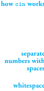

## 程序清单 1.6 将 `cin` 和 `cout` 与字符串一起使用（第 1 部分，共 2 部分）

```
//Program to demonstrate cin and cout with strings
#include <iostream>
#include <cstring>

using namespace std;
int main( )
{
    string dogName;
    int actualAge;
    int humanAge;

    cout << "How many years old is your dog?" << endl;
    cin >> actualAge;
    humanAge = actualAge * 7;

    cout << "What is your dog's name?" << endl;
    cin >> dogName;

    cout << dogName << " is age is approximately " <<
         "equivalent to a " << humanAge << " year old human."
         << endl;

    return 0;
}
```


## 程序清单 1.6 将 `cin` 和 `cout` 与字符串一起使用（第 2 部分，共 2 部分）（续）

示例对话 1

```
How many years old is your dog?
5
What is your dog's name?
Rex
Rex's age is approximately equivalent to a 35 year old human.
```

示例对话 2

```
How many years old is your dog?
10
What is your dog's name?
Mr. Bojangles
Mr.'s age is approximately equivalent to a 70 year old human.
```

> “Bojangles”没有被读入 `dogName`，因为 `cin` 在空格处停止输入。

## `cin` 语句

一条 `cin` 语句将变量设置为在键盘上输入的值。

## 语法

```
cin >> Variable_1 >> Variable_2 >>…;
```

## 示例

```
cin >> number >> size;
cin >> timeLeft
    >> pointsNeeded;
```

## 自测练习

- 9. 给出一个输出语句，使其在屏幕上产生以下信息。
  
      The answer to the question of
      Life, the Universe, and Everything is 42.

- 10. 给出一个输入语句，用键盘输入的数填充变量 theNumber（类型为 `int`）。在输入语句之前加一条提示语句，要求用户输入一个整数。

## 自测练习（续）

- 11. 在你的程序中应包含哪些语句，以确保当输出 `double` 类型的数时，将以带三位小数的普通记数法输出？
  
- 12. 编写一个完整的 C++ 程序，只向屏幕写出 `Hello world` 这个短语，不做其他任何事情。
  
- 13. 给出一个输出语句，产生字母 `'A'`，后跟换行字符，再跟字母 `'B'`，后跟制表字符，再跟字母 `'C'`。
  
- 14. 以下代码本意是输入用户的名字、姓氏和年龄。但它有一个错误。请修复该代码。

```
string fullName;
int age;
cout << "Enter your first and last name." << endl;
cin >> fullName;
cout << "Enter your age." << endl;
cin >> age;
cout << "You are " << age << " years old, " << fullName << endl;
```

- 15. 以下代码将输出什么？

```
string s1 = "5";
string s2 = "3";
string s3 = s1 + s2;
cout << s3 << endl;
```

## 提示：输入/输出中的换行

保持输出和输入在同一行是可能的，有时可以为用户提供更好的界面。如果只是在最后一个提示行的末尾省略 `\n` 或 `endl`，那么用户的输入就会出现在提示信息的同一行。例如，假设你使用以下提示和输入语句：

```
cout << "Enter the cost per person: $";
cin >> costPerPerson;
```

当 `cout` 语句执行时，屏幕上将出现：

```
Enter the cost per person: $
```

当用户输入时，它会出现在同一行，如下所示：

```
Enter the cost per person: $1.25
```

## 1.4 程序风格

> 在至关重要的事情上，起决定作用的不是真诚，而是风格。
> 
> 奥斯卡·王尔德，《不可儿戏》，第三幕，伦敦，1895年

C++ 编程风格与在其他语言中使用的风格相似。目标是使代码易于阅读和易于修改。我们将在下一章讨论缩进问题。我们已经讨论了定义常量。程序中的大多数（如果不是全部）字面量都应该是定义常量。变量名的选择和仔细的缩进应能减少对大量注释的需求，但任何仍然不清楚的地方都值得加注释。

## 注释

在 C++ 程序中有两种插入注释的方式。在 C++ 中，两个斜杠 `//` 用来表示注释的开始。`//` 与行尾之间的所有文本都是注释。编译器会忽略一行中 `//` 之后的任何内容。如果你想要一个跨多行的注释，请在注释的每一行都放置一个 `//`。符号 `//` 之间没有空格。

在 C++ 程序中插入注释的另一种方式是使用符号对 `/*` 和 `*/`。这两个符号之间的文本被视为注释，编译器会忽略它们。与每行都需要额外 `//` 的注释不同，`/*` 到 `*/` 的注释可以跨越多行，如下所示：

```
/*This is a comment that spans
three lines. Note that there is no comment
symbol of any kind on the second line.*/
```

`/* */` 类型的注释可以插入程序中的任何允许空格或换行符的位置。但是，除非它们易于阅读并且不会干扰程序布局，否则不应随意插入。通常，注释放在行尾或单独成行。

对于哪种注释最好，意见不一。只要使用得当，这两种（`//` 型或 `/* */` 型）都可以很有效。一种做法是在最终代码中使用 `//` 注释，而将 `/**/` 风格的注释保留用于调试时临时注释掉代码。

很难说一个程序应该包含多少注释。唯一正确的答案是“恰到好处”，这当然对新手程序员没有太多指导意义。需要一些经验才能掌握何时最好添加注释。凡是重要且不明显的地方，都值得加注释。然而，注释太多和太少一样糟糕。每行都有注释的程序会被评论淹没，程序结构隐藏在大量显而易见的观察中。像下面这样的注释对理解毫无帮助，不应出现在程序中：

```
distance = speed * time; //Computes the distance traveled.
```


## 1.5 库和命名空间

C++ 带有若干标准库。这些库将其定义放在一个命名空间中，命名空间只不过是赋予一组定义的一个名称。本书稍后会详细讨论包含库和使用命名空间的技术。本节讨论足够的细节以便你使用标准 C++ 库。

### 库和包含指令

C++ 包含若干标准库。事实上，不使用至少一个这些库几乎不可能编写 C++ 程序。使库对程序可用的通常方式是使用包含指令。标准库的包含指令形式为

```
#include <library_Name>
```

例如，控制台 I/O 的库是 iostream。因此，我们的大多数演示程序将以

```
#include <iostream>
```

开始

编译器（预处理器）对包含指令中的空格非常挑剔。因此，最安全的做法是以不带额外空格的方式键入包含指令：# 前没有空格，# 后没有空格，<> 内部也没有空格。

包含指令只是一个指示在包含指令位置插入文件中文本的指令。库名称只是一个包含库中所有项目定义的文件的名称。我们最终会讨论使用包含指令来处理标准库以外的事物，但现在我们只需要为标准 C++ 库使用包含指令。一些标准 C++ 库的列表在附录 4 中给出。

C++ 有一个预处理器，在程序文本交给编译器之前处理一些简单的文本操作。有些人会告诉你包含指令不是由编译器处理的，而是由预处理器处理的。他们是对的，但这种区别更多是文字游戏，而不是你需要关心的事情。在几乎所有编译器上，预处理器在你编译程序时会自动调用。

从技术上讲，库定义的只有一部分在头文件中给出。然而，在这个阶段，这不是一个重要的区别，因为使用库的头文件的包含指令将（在几乎所有系统上）导致 C++ 自动添加其余的库定义。

### 命名空间

命名空间是一组名称定义的集合。一个名称，例如函数名，可以在两个命名空间中给出不同的定义。然后程序可以在一个地方使用其中一个命名空间，在另一个位置使用另一个命名空间。我们将在本书后面详细讨论命名空间。现在，我们只需要讨论命名空间 std。我们将使用的所有标准库都定义在 std（标准）命名空间中。要在程序中使用这些定义中的任何一个，你必须插入以下 using 指令：

```
using namespace std;
```

因此，使用控制台 I/O 的简单程序将以

```
#include <iostream>
using namespace std;
```

开始

如果你想使命名空间中的某些名称，但不是全部名称，对程序可用，有一种 using 指令形式可使仅一个名称可用。例如，如果你只想使名称 cin 从 std 命名空间对程序可用，你可以使用以下 using 指令：

```
using std::cin;
```

因此，如果你的程序从 std 命名空间使用的唯一名称是 cin、cout 和 endl，你可能会以

```
#include <iostream>
using std::cin;
using std::cout;
using std::endl;
```

而不是

```
#include <iostream>
using namespace std;
```

开始

旧的 C++ 库头文件没有将其定义放在 std 命名空间中，因此如果你查看旧的 C++ 代码，你可能会看到头文件名称拼写略有不同并且代码中不包含任何 using 指令。出于向后兼容性，这是允许的。然而，你应该使用更新的库头文件和 std 命名空间指令。

### 陷阱：库名称问题

C++ 语言不断变化。如果你使用的是尚未修订以符合新标准的编译器，那么你将需要使用不同的库名称。

如果以下内容不起作用

```
#include <iostream>
```

使用

```
#include <iostream.h>
```

同样，其他库名称对于旧编译器也是不同的。附录 5 给出了旧库名称和新库名称之间的对应关系。本书始终使用新的编译器名称。如果库名称在你的编译器上不起作用，请尝试对应的旧库名称。很可能要么所有新库名称都有效，要么你需要使用所有旧库名称。你的系统上只有部分库名称被更新的可能性不大。

如果你使用旧的库名称（以 .h 结尾的名称），你不需要 using 指令

```
using namespace std;
```

### 章节总结

- C++ 是区分大小写的。例如，count 和 COUNT 是两个不同的标识符。
- 为变量使用有意义的名称。
- 变量必须在使用前声明。除了遵循此规则外，变量声明可以出现在任何地方。
- 确保在程序尝试使用其值之前变量已初始化。这可以在变量声明时完成，也可以在变量首次使用前使用赋值语句完成。
- 你可以将 int 等整数类型的值赋给 double 等浮点类型的变量，但不能反过来。
- C++11 引入了新的定宽整数数据类型。
- 程序中几乎所有的数字常量都应赋予有意义的名称，可在数字位置使用。这可以通过在变量声明中使用 const 修饰符来完成。
- 在算术表达式中使用足够的括号使运算顺序清晰。
- 对象 cout 用于控制台输出。
- 引号字符串中的 \n 或发送到控制台输出的 endl 开始新的一行输出。
- 对象 cerr 用于错误消息。在典型环境中，cerr 的行为与 cout 相同。
- 对象 cin 用于控制台输入。
- 为了使用 cin、cout 或 cerr，你应在包含程序的文件开头附近放置以下指令：
```
#include <iostream>
using namespace std;
```
- C++ 中有两种形式的注释：// 后同行所有内容都是注释，以 /* 和 */ 括起来的任何内容都是注释。
- 不要过度注释。

### 自测练习答案

- 1.
```
int feet = 0, inches = 0;
int feet(0), inches(0);
```
- 2.
```
int count = 0;
double distance = 1.5;
int count(0);
double distance(1.5);
```
```
public static void main(String[] args)
```
- 3. 诸如此类程序的实际输出取决于系统以及系统的使用历史。
```
#include <iostream>
using namespace std;

int main()
{
    int first, second, third, fourth, fifth;
    cout << first << " " << second << " " << third
         << " " << fourth << " " << fifth << "\n";
    return 0;
}
```
- 4.
```
3*x
3*x + y
(x + y)/7 注意 x + y/7 是不正确的。
(3*x + y)/(z + 2)
```
- 5.
```
b c b c
```
- 6. (1/3) * 3 等于 0
由于 1 和 3 都是 int 类型，/ 运算符执行整数除法，丢弃余数，因此 1/3 的值是 0，而不是 0.3333.... 这使得整个表达式的值为 0 * 3，当然是 0。

```
```cpp
#include <iostream>
using namespace std;

int main()
{
    int number1, number2;
    cout << "Enter two whole numbers: ";
    cin >> number1 >> number2;
    cout << number1 << " divided by " << number2
         << " equals " << (number1/number2) << "\n"
         << "with a remainder of " << (number1%number2)
         << "\n";
    return 0;
}
```
```

- 8.
  a. `52.0`
  b. `9/5` 的 int 值是 1。由于分子和分母都是 int，因此执行整数除法；小数部分被丢弃。程序员可能想要浮点除法，后者不会丢弃小数点后的部分。
  c. `f = (9.0/5) * c + 32.0;`
     或
     `f = 1.8 * c + 32.0;`

- 9. `cout << "The answer to the question of\n"`
     `     << "Life, the Universe, and Everything is 42.\n";`

- 10. `cout << "Enter a whole number and press Return: ";`
       `cin >> theNumber;`

- 11. `cout.setf(ios::fixed);`
       `cout.setf(ios::showpoint);`
       `cout.precision(3);`

```
```cpp
#include <iostream>
using namespace std;

int main()
{
    cout << "Hello world\n";
    return 0;
}
```
```

- 13. `cout << 'A' << endl << 'B' << '\t' << 'C';`

其他答案也是正确的。例如，字母可以用双引号代替单引号。另一个可能的答案如下：

`cout << "A\nB\tC";`


14. `cin` 仅读取到下一个空白字符，因此如果名字和姓氏之间有空格，按原样写入时无法将名字和姓氏读入同一个字符串中。目前最简单的解决方案是将名字和姓氏读入两个独立的变量：

```cpp
string first, last;
int age;
cout << "Enter your first and last name." << endl;
cin >> first >> last;
cout << "Enter your age." << endl;
cin >> age;
cout << "You are " << age << " years old, " << first << " " << last << endl;
```

15. + 运算符连接两个字符串操作数。结果为 s3 = "53"。如果 s1 和 s2 是数值数据类型，则值将被相加。

## 编程项目

- 1. 一加仑等于 3785.41 毫升。编写一个程序，读取一包牛奶的体积（以毫升为单位），并输出以加仑为单位的体积，以及获得一加仑牛奶所需的包装数量。
- 2. 政府研究实验室已得出结论，减肥汽水中常用的一种人工甜味剂会导致实验室小鼠死亡。你的一位朋友急于减肥但无法放弃汽水。你的朋友想知道在不致死的情况下可以喝多少减肥汽水。编写一个程序来提供答案。程序的输入是杀死一只小鼠所需的人工甜味剂量、小鼠的体重以及节食者的体重。为了确保朋友的安全，请确保程序要求输入节食者停止节食时的体重，而不是节食者的当前体重。假设减肥汽水含有十分之一的 1% 人工甜味剂。使用带有 `const` 修饰符的变量声明为该分数命名一个名称。你可能希望将百分比表示为 double `0.001`。
- 3. 一家电子公司销售额比上一年增长 13%，利润比上一年工作增长 27%。编写一个程序，以公司上一年销售额和利润（单位为百万）作为输入，并输出与上一年相比销售额和利润的增长（单位为百万）。使用带有 `const` 修饰符的变量声明来表示销售额和利润增长。
- 4. 谈判消费者贷款并不总是那么直接。一种贷款形式是贴现分期贷款，其运作方式如下。假设贷款面值为 $1,000，利率为 15%，期限为 18 个月。利息通过将 $1,000 的面值乘以 0.15 计算得出，得出 $150。然后该数字乘以 1.5 年的贷款期限，得出应付总利息 $225。该金额立即从面值中扣除，使消费者只剩下 $775。偿还以基于面值的等额月供进行。因此每月贷款付款为 $1,000 除以 18，即 $55.56。如果消费者需要 $775，这种计算方法可能还不错，但如果消费者需要 $1,000，计算会稍微复杂一些。编写一个程序，将接受三个输入：消费者需要收到的金额、利率以及贷款期限（以月为单位）。程序应然后计算所需的面值，以便消费者收到所需的金额。它还应计算每月付款。
- 5. 编写一个程序来确定卡车是否超载超过其额定载重。程序将读取卡车的最高载重能力（以公吨为单位）、其携带的箱子数量以及箱子的平均重量。如果箱子的总重量小于或等于卡车的载重能力，程序会宣布卡车可以合法携带所有箱子，并说明还可以添加多少个额外箱子。如果箱子数量超过最大载重能力，程序会宣布卡车超载，并说明必须移除多少个箱子。
- 6. 一家城市出租车服务提供商根据距离和时间向客户收费。该服务对最初两公里收取 $2。超过最初两公里后，该服务对接下来的六公里每公里收取 $0.50。超过六公里后，客户每公里收取 $1。行程结束时，根据总行程时间按每分钟 $0.2 收取费用。编写一个程序，读取出租车行程行驶的公里数和花费的分钟数，并根据服务的收费计算车费。
- 7. 一个人每天在跑步机上跑步十五分钟作为锻炼计划的一部分。他们以 4 英里每小时的速度开始锻炼，前三分钟，然后每四分钟增加 2 英里每小时。编写一个程序来计算这次锻炼期间燃烧的总卡路里。燃烧的卡路里数可以使用以下公式估计

Calories/Minute = 0.0175 × (代谢当量数 (MET)) × (体重千克)

以 6 英里每小时的速度跑步消耗 10 METS。你的程序应输入个人的体重（以千克为单位）并输出他们燃烧的卡路里。
- 8. 计算正数 n 的平方根的巴比伦算法如下：

- 1. 对答案进行猜测（你可以将 n/2 作为初始猜测）。
- 2. 计算 r = n / guess。
- 3. 设置 guess = (guess + r) / 2。
- 4. 尽可能多次返回步骤 2。步骤 2 和 3 重复的次数越多，guess 就越接近 n 的平方根。

编写一个程序，输入 n 的 double，迭代巴比伦算法五次，并将答案作为 double 输出到小数点后两位。你的答案对于 n 的小值最准确。

## 9.

你当地游戏厅的电子游戏机根据你玩游戏的好坏输出优惠券。你可以用 10 张优惠券兑换一根糖果棒或 3 张优惠券兑换一颗口香糖。你更喜欢糖果棒而不是口香糖。编写一个程序，输入你赢得的优惠券数量，并输出如果你先用所有优惠券兑换糖果棒，然后用剩余优惠券兑换口香糖，可以获得多少根糖果棒和口香糖。

## 10.

编写一个程序，读取飞机的速度（英里每小时）和飞行时间（小时）。程序应显示飞机在该时间内行驶的距离（英里），以及其速度（米每秒）。使用方程

Speed in m/s = (Speed in MPH/3600) × 1609.344

## 11.

编写一个程序，输入一个整数，表示以秒为单位的时间长度。程序应然后输出对应于该秒数的小时数、分钟数和秒数。例如，如果用户输入 50391 总秒数，则程序应输出 13 小时、59 分钟和 51 秒。

## 12.

估计理想体重的一个简单规则是，前 5 英尺身高允许 110 磅，每增加一英寸增加 5 磅。编写一个程序，设置一个变量表示人的身高（以英尺为单位），另一个变量表示额外的英寸，并从键盘输入这些变量的值。假设身高至少为 5 英尺。例如，身高 6 英尺 3 英寸的人将用存储数字 6 的变量和存储数字 3 的另一个变量表示。基于这些值计算并输出理想体重。

## 13.

科学家估计，一次摄入大约 10 克咖啡因是致命过量。编写一个程序，输入饮料中咖啡因的毫克数，并输出需要多少杯这种饮料才能杀死一个人。一罐 12 盎司的可乐大约含有 34 毫克咖啡因，而一杯 16 盎司的咖啡大约含有 160 毫克咖啡因。

此页故意留空

## 控制流 2

### 2.1 布尔表达式 76
构建布尔表达式 76
陷阱：不等式串 77
求值布尔表达式 78
优先级规则 80
陷阱：整数值可作为布尔值使用 84

### 2.2 分支机制 86
if-else 语句 86
复合语句 88
陷阱：使用 = 代替 == 89
省略 else 91
嵌套语句 91
多路 if-else 语句 91
switch 语句 92
陷阱：在 switch 语句中忘记 break 95
提示：使用 switch 语句进行菜单 95
枚举类型 95
条件运算符 97

### 2.3 循环 97
while 和 do-while 语句 98
增量和减量运算符回顾 101
逗号运算符 102
for 语句 104
提示：重复 N 次循环 106
陷阱：for 语句中的额外分号 107
陷阱：无限循环 107
break 和 continue 语句 110
嵌套循环 113

### 2.4 文件输入简介 113
使用 ifstream 从文本文件读取 114


> “请问，我该走哪条路？”
> “那很大程度上取决于你想去哪里，”猫说。

刘易斯·卡罗尔，《爱丽丝梦游仙境》。伦敦：麦克米伦出版社，1865年

## 引言

与大多数编程语言一样，C++ 通过分支和循环语句来处理控制流。C++ 的分支和循环语句与其他语言中的类似，与 C 语言中的相同，并且与 Java 编程语言中的非常相似。异常处理也是处理控制流的一种方式。异常处理将在第 18 章中介绍。

## 2.1 布尔表达式

> 能够区分真伪的人，必须对真与假有充分的认识。

巴鲁赫·斯宾诺莎，《伦理学，按几何顺序证明》。1677年

布尔表达式

大多数分支语句都由布尔表达式控制。布尔表达式是任意取值为真或假的表达式。布尔表达式的最简单形式由两个表达式（如数字或变量）组成，它们与显示 2.1 中所示的比较运算符之一进行比较。请注意，有些运算符由两个符号拼写而成，例如 `==`、`!=`、`<=` 或 `>=`。务必注意，相等使用双等号 `==`，不等使用两个符号 `!=`。这类双符号运算符的两个符号之间不应有任何空格。

### 构建布尔表达式

`&&` 表示“且”

你可以使用“且”运算符（在 C++ 中拼写为 `&&`）来组合两个比较。例如，当 x 大于 2 并且 x 小于 7 时，以下布尔表达式为真：

```
(2 < x) && (x < 7)
```

当两个比较用 `&&` 连接时，只有当两个比较都为真时，整个表达式才为真；否则整个表达式为假。

## “且”运算符，&&

你可以使用“且”运算符 `&&` 将两个更简单的布尔表达式组合起来，形成更复杂的布尔表达式。

### 使用 && 的布尔表达式语法

```
(Boolean_Exp_1) && (Boolean_Exp_2)
```

### 语法（在 if-else 语句中）

```
if ( (score > 0) && (score < 10) )
    cout << "score is between 0 and 10.\n";
else
    cout << "score is not between 0 and 10.\n";
```

如果 score 的值大于 0 并且 score 的值也小于 10，则执行第一个 cout 语句；否则，执行第二个 cout 语句。（if-else 语句将在本章稍后介绍，但这个简单示例的含义应该很直观。）

`||` 表示“或”

你还可以使用“或”运算符（在 C++ 中拼写为 `||`）来组合两个比较。例如，当 y 小于 0 或 y 大于 12 时，以下表达式为真：

```
(y < 0) || (y > 12)
```

当两个比较用 `||` 连接时，只要其中一个或两个比较为真，整个表达式就为真；否则整个表达式为假。

你可以使用 `!` 运算符对任何布尔表达式取反。如果你想对一个布尔表达式取反，请将该表达式放在括号中，并在其前面放置 `!` 运算符。例如，`!(x < y)` 表示“x 不小于 y”。`!` 运算符通常可以避免使用。例如，`!(x < y)` 等价于 `x >= y`。在某些情况下，你可以安全地省略括号，但加上括号永远不会有害。关于省略括号的具体细节，请参见“优先级规则”小节。

### 陷阱：不等式字符串

不要使用像 `x < z < y` 这样的不等式字符串。如果你这样做了，程序很可能会编译并运行，但肯定会给出错误的输出。相反，你必须使用两个用 `&&` 连接的不等式，如下所示：

```
(x < z) && (z < y)
```

## 显示 2.1 比较运算符

| 数学符号 | 英文 | C++ 记法 | C++ 示例 | 数学等价 |
|---|---|---|---|---|
| = | 等于 | == | x + 7 == 2*y | x + 7 = 2y |
| ≠ | 不等于 | != | ans != 'n' | ans ≠ 'n' |
| < | 小于 | < | count < m + 3 | count < m + 3 |
| ≤ | 小于或等于 | <= | time <= limit | time ≤ limit |
| > | 大于 | > | time > limit | time > limit |
| ≥ | 大于或等于 | >= | age >= 21 | age ≥ 21 |

## “或”运算符，||

你可以使用“或”运算符 `||` 将两个更简单的布尔表达式组合起来，形成更复杂的布尔表达式。

### 使用 || 的布尔表达式语法

```
(Boolean_Exp_1) || (Boolean_Exp_2)
```

### if-else 语句中的示例

```
if ( (x == 1) || (x == y) )
    cout << "x is 1 or x equals y.\n";
else
    cout << "x is neither 1 nor equal to y.\n";
```

如果 x 的值等于 1 或等于 y（或两者都等于），则执行第一个 cout 语句；否则，执行第二个 cout 语句。（if-else 语句将在本章稍后介绍，但这个简单示例的含义应该很直观。）

## 计算布尔表达式

正如你将在本章接下来的两节中看到的，布尔表达式用于控制分支和循环语句。然而，布尔表达式具有独立于你可能使用它的任何分支或循环语句的独立身份。`bool` 类型的变量可以存储 `true` 或 `false` 这两个值之一。因此，你可以将一个 `bool` 类型的变量设置为等于一个布尔表达式。例如：

```
bool result = (x < z) && (z < y);
```

布尔表达式可以像算术表达式一样被计算。唯一的区别是，算术表达式使用诸如 `+`、`*` 和 `/` 之类的运算，并产生一个数字作为最终结果；而布尔表达式使用诸如 `==` 和 `<` 之类的关系运算，以及诸如 `&&`、`||` 和 `!` 之类的布尔运算，并产生 `true` 或 `false` 这两个值之一作为最终结果。注意，`==`、`!=`、`<`、`<=` 等运算符作用于任意内置类型的一对值，以产生布尔值 `true` 或 `false`。

首先让我们回顾一下如何计算算术表达式。同样的技术也适用于计算布尔表达式。考虑以下算术表达式：

```
(x + 1) * (x + 3)
```

假设变量 x 的值为 2。要计算这个算术表达式，你先计算两个和，得到数字 3 和 5，然后使用 `*` 运算符组合这两个数字 3 和 5，得到最终值 15。注意，在计算过程中，你并不是用 `(x + 1)` 和 `(x + 3)` 这两个表达式本身相乘，而是用它们的值相乘。你使用 3，而不是 `(x + 1)`；使用 5，而不是 `(x + 3)`。

计算机以同样的方式计算布尔表达式。子表达式被计算以得到值，每个值要么为真要么为假。然后根据显示 2.2 中的表格规则组合这些真或假的单个值。例如，考虑布尔表达式

```
!( (y < 3) || (y > 7) )
```

它可能是某个 if-else 语句的控制表达式。假设 y 的值为 8。在这种情况下，`(y < 3)` 计算为假，而 `(y > 7)` 计算为真，因此上述布尔表达式等价于

```
!( false || true )
```

查阅 `||`（标记为 OR）的表格，计算机看到括号内的表达式计算为真。因此，计算机看到整个表达式等价于

```
!(true)
```

再次查阅表格，计算机看到 `!(true)` 计算为假，因此它得出结论：原布尔表达式的值为假。

## 显示 2.2 真值表

### 与（AND）

| Exp_1 | Exp_2 | Exp_1 && Exp_2 |
|---|---|---|
| true | true | true |
| true | false | false |
| false | true | false |
| false | false | false |

### 或（OR）

| Exp_1 | Exp_2 | Exp_1 \|\| Exp_2 |
|---|---|---|
| true | true | true |
| true | false | true |
| false | true | true |
| false | false | false |

### 非（NOT）

| Exp | !(Exp) |
|---|---|
| true | false |
| false | true |

## 布尔（bool）值是 true 和 false

`true` 和 `false` 是 `bool` 类型的预定义常量。（它们必须用小写字母书写。）在 C++ 中，当布尔表达式满足条件时，其计算结果为 `bool` 值 `true`；不满足时，则计算为 `bool` 值 `false`。

## 优先级规则

布尔表达式（以及算术表达式）不必全部加括号。如果省略括号，默认优先级如下：先执行 `!`，然后执行关系运算如 `<`，然后 `&&`，最后 `||`。然而，最好加上大部分括号，以使表达式更容易理解。一个可以安全省略括号的地方是仅由 `&&` 或仅由 `||` 构成的简单字符串（但不能混合两者）。以下表达式在 C++ 编译器和可读性方面都是可接受的：

```
(temperature > 90) && (humidity > 0.90) && (poolGate == OPEN)
```


由于关系运算符 > 和 == 是在 && 运算符之前执行的，你可以在之前的表达式中省略括号，其含义也相同，但包含一些括号会使表达式更易读。

当表达式中省略了括号时，编译器会根据称为优先级规则的规则对项目进行分组。C++ 大多数的优先级规则在第 2.3 显示中给出。该表包含了一些直到本书后面才讨论的运算符，但为了完整性和那些可能已经了解它们的人而包含在内。

## Display 2.3 Precedence of Operators (part 1 of 2)

| Operator | Description |
|---|---|
| :: | Scope resolution operator |
| . | Dot operator |
| -> | Member selection |
| [] | Array indexing |
| ( ) | Function call |
| ++ | Postfix increment operator (placed after the variable) |
| -- | Postfix decrement operator (placed after the variable) |
| ++ | Prefix increment operator (placed before the variable) |
| -- | Prefix decrement operator (placed before the variable) |
| ! | Not |
| - | Unary minus |
| + | Unary plus |
| * | Dereference |
| & | Address of |
| new | Create (allocate memory) |
| delete | Destroy (deallocate) |
| delete [] | Destroy array (deallocate) |
| sizeof | Size of object |
| ( ) | Type cast |
| * | Multiply |
| / | Divide |
| % | Remainder (modulo) |
| + | Addition |
| - | Subtraction |
| << | Insertion operator (console output) |
| >> | Extraction operator (console input) |

Highest precedence (done first)

Lower precedence (done later)

precedence rules

## Display 2.3 Precedence of Operators (part 2 of 2)

*All operators in part 2 are of lower precedence than those in part 1.*

| Operator | Description |
|---|---|
| `<` | Less than |
| `>` | Greater than |
| `<=` | Less than or equal to |
| `>=` | Greater than or equal to |
| `==` | Equal |
| `!=` | Not equal |
| `&&` | And |
| `||` | Or |
| `=` | Assignment |
| `+=` | Add and assign |
| `-=` | Subtract and assign |
| `*=` | Multiply and assign |
| `/=` | Divide and assign |
| `%=` | Modulo and assign |
| `? :` | Conditional operator |
| `throw` | Throw an exception |
| `,` | Comma operator |

lowest precedence
(done last)

如果一个操作在另一个操作之前执行，则先执行的那个操作被称为具有**更高的优先级**。Display 2.3 中同一框中的所有运算符具有相同的优先级。较高框中的运算符比较低框中的运算符具有更高的优先级。

当运算符具有相同的优先级并且顺序未由括号确定时，则一元操作从右到左执行。赋值操作也从右到左执行。例如，`x = y = z` 表示 `x = (y = z)`。其他具有相同优先级的二元

higher precedence

操作从左到右执行。例如，x + y + z 表示 (x + y) + z。

请注意，优先级规则包括算术运算符如 + 和 * 以及布尔运算符如 && 和 ||。这是因为许多表达式结合了算术和布尔操作，如以下简单示例：

```
(x + 1) > 2 || (x + 1) < -3
```

如果你检查 Display 2.3 中给出的优先级规则，你会看到这个表达式等价于

```
((x + 1) > 2) || ((x + 1) < -3)
```

因为 > 和 < 的优先级高于 ||。事实上，你可以省略前一个表达式中的所有括号，其含义也相同，尽管可读性会变差。虽然我们不提倡省略所有括号，但了解使用优先级规则如何解释此类表达式可能会有所帮助。以下是没有任何括号的表达式：

```
x + 1 > 2 || x + 1 < -3
```

优先级规则说首先应用一元 -，然后应用 +，然后应用 > 和 <，最后应用 ||，这正是完全加括号的版本所指示的。

之前对布尔表达式如何求值的描述基本上是正确的，但在 C++ 中，计算机在求值布尔表达式时偶尔会采用捷径。请注意，在许多情况下，你只需要求值布尔表达式中两个子表达式中的第一个。例如，考虑以下内容：

```
(x >= 0) && (y > 1)
```

如果 x 为负，则 (x >= 0) 为假。正如你在 Display 2.2 中的表中看到的那样，当 && 表达式中的一个子表达式为假时，整个表达式为假，无论另一个表达式是真还是假。因此，如果我们知道第一个表达式为假，就没有必要求值第二个表达式。|| 表达式也会发生类似的情况。如果由 || 运算符连接的两个表达式中的第一个为真，则你知道整个表达式为真，无论第二个表达式是真还是假。C++ 语言利用这一事实，有时可以免去求值由 && 或 || 连接的逻辑表达式中的第二个子表达式的麻烦。C++ 首先求值由 && 或 || 连接的两个表达式中的左侧表达式。如果这提供了足够的信息来确定表达式的最终值（与第二个表达式的值无关），则 C++ 不会费心求值第二个表达式。这种求值方法称为短路求值。

C++ 以外的一些语言使用完全求值。在完全求值中，当两个表达式由 && 或 || 连接时，两个子表达式总是被求值，然后使用真值表来获得最终表达式的值。

## PITFALL: Integer Values Can Be Used as Boolean Values

C++ 有时会将整数当作布尔值使用，并将布尔值当作整数使用。特别是，C++ 将整数 1 转换为 true 并将整数 0 转换为 false，反之亦然。情况甚至比简单地使用 1 表示 true 和 0 表示 false 更复杂。编译器会将任何非零数字视为 true 值，并将 0 视为 false 值。只要你在编写布尔表达式时不犯错误，这种转换就不会引起问题。然而，当你在调试时，了解编译器很乐意使用布尔运算符 &&、|| 和 ! 组合整数可能会有所帮助。

例如，假设你想要一个布尔表达式，只要时间尚未用完（在某些游戏或过程中）就为真。你可能会使用以下内容：

```
!time > limit
```

如果你大声读出来，这听起来是正确的：“不是时间大于限制。” 然而，布尔表达式是错误的，而且不幸的是，编译器不会给你错误信息。编译器将应用 Display 2.3 中的优先级规则并将你的布尔表达式解释为以下内容：

```
(!time) > limit
```

这看起来像胡说八道，直觉上也是胡说八道。如果 time 的值为例如 36，那么 (!time) 可能有什么意义呢？毕竟，那相当于“不是 36”。但在 C++ 中，任何非零整数都会转换为 true，而 0 会转换为 false。因此，36 被解释为“不是 true”，因此求值结果为 false，然后再次转换回 0，因为我们正在与 int 进行比较。

我们想要的这个布尔表达式的值和 C++ 给出的值是不一样的。如果 time 的值为 36 且 limit 的值为 60，你希望之前显示的布尔表达式求值为 true（因为 time > limit 不为真）。不幸的是，布尔表达式的求值如下：(!time) 求值为 false，转换为 0，因此整个布尔表达式等价于

```
0 > limit
```

这又等价于 0 > 60，因为 60 是 limit 的值，而它求值为 false。因此，上述逻辑表达式求值为 false，而你希望它求值为 true。

## PITFALL: (continued)

纠正此问题的另一种方法是完全避免使用 ! 运算符。例如，以下内容也是正确的且更易读：

```
if (time <= limit)
```

你几乎总可以避免使用 ! 运算符，有些程序员主张尽可能避免它。

短路求值和完全求值给出相同的答案，那么为什么你应该关心 C++ 使用短路求值呢？大多数时候你不必关心。只要由 && 或 || 连接的两个子表达式都有值，这两种方法就会产生相同的结果。然而，如果第二个子表达式未定义，你可能会很高兴知道 C++ 使用短路求值。让我们看一个说明这一点的例子。考虑以下语句：

```
if ( (kids != 0) && ((pieces/kids) >= 2) )
    cout << "Each child may have two pieces!";
```

如果 kids 的值不为零，此语句没有细微差别。然而，假设 kids 的值为零：考虑短路求值如何处理这种情况。表达式 (kids!=0) 求值为 false，因此没有必要求值第二个表达式。使用短路求值，C++ 说整个表达式为假，而不费心求值第二个表达式。这可以防止运行时错误，因为求值第二个表达式将涉及除以零。

## Self-Test Exercises

1. Determine the value, true or false, of each of the following Boolean expressions, assuming that the value of the variable count is 0 and the value of the variable limit is 10. Give your answer as one of the values true or false.

- a. (count == 0) && (limit < 20)
- b. count == 0 && limit < 20
- c. (limit > 20) || (count < 5)
- d. !(count == 12)
- e. (count == 1) && (x < y)
- f. (count < 10) || (x < y)
- g. !((count < 10) || (x < y)) && (count >= 0)
- h. ((limit / count) > 7) || (limit < 20)
- i. (limit / 20) || ((limit / count) > 7)
- j. ((limit / count) > 7) && (limit < 0)
- k. (limit < 0) && ((limit / count) > 7)
- l. (5 && 7) + (!(6))


## 自测练习（续）

2. 你有时会看到数值区间表示为
2 < x < 3
在 C++ 中，这个区间并不具有你可能期望的含义。请解释原因，并给出正确的 C++ 布尔表达式，以指定 x 位于 2 和 3 之间。

3. 考虑一个二次表达式，例如
x² - x - 2
描述该二次表达式为正（即大于 0）的区域，需要描述一组数，这些数要么小于较小的根（即 -1），要么大于较大的根（即 2）。编写一个 C++ 布尔表达式，当该公式取正值时为真。

4. 考虑二次表达式
x² - 4x + 3
描述该二次表达式为负的区域，需要描述一组数，这些数同时大于较小的根（1）且小于较大的根（3）。编写一个 C++ 布尔表达式，当该二次表达式的值为负时为真。

## 2.2 分支机制

> 当你来到岔路口时，就选一条路走。

> 据说出自约吉·贝拉

### if-else 语句

if-else 语句根据布尔表达式的值在两条备选语句之间进行选择。例如，假设你想设计一个程序来计算小时工的周薪。假设公司对超过前 40 小时的所有工作时间按正常费率的 1.5 倍支付加班费。当员工工作 40 小时或更多时，工资等于

```
rate * 40 + 1.5 * rate * (hours - 40)
```

if-else 语句

## if-else 语句

if-else 语句根据布尔表达式的值在两种备选操作之间进行选择。语法如下所示。请务必注意，布尔表达式必须用括号括起来。

### 语法：每个备选分支为单条语句

```
if (Boolean_Expression)
Yes_Statement
else
No_Statement
```

如果 Boolean_Expression 求值为 true，则执行 Yes_Statement。如果 Boolean_Expression 求值为 false，则执行 No_Statement。

### 语法：每个备选分支为语句序列

```
if (Boolean_Expression)
{
    Yes_Statement_1
    Yes_Statement_2
    ...
    Yes_Statement_Last
}
else
{
    No_Statement_1
    No_Statement_2
    ...
    No_Statement_Last
}
```

### 示例

```
if (myScore > yourScore)
{
    cout << "I win!\n";
    wager = wager + 100;
}
else
{
    cout << "I wish these were golf scores.\n";
    wager = 0;
}
```

然而，如果员工工作时间少于 40 小时，正确的工资公式则简单为

```
rate * hours
```

以下 if-else 语句无论员工工作时间少于 40 小时还是工作 40 小时或更多，都能计算出正确的工资：

```
if (hours > 40)
    grossPay = rate * 40 + 1.5 * rate * (hours - 40);
else
    grossPay = rate * hours;
```

if-else 语句的语法在随附的方框中给出。如果括号内（在 if 之后）的布尔表达式求值为 true，则执行 else 之前的语句。如果布尔表达式求值为 false，则执行 else 之后的语句。

请注意，if-else 语句中嵌入了更小的语句。C++ 中的大多数语句形式允许你通过以特定方式组合较小的语句，从较小的语句构造出较大的语句。

请记住，当你在 if-else 语句中使用布尔表达式时，布尔表达式必须用括号括起来。

## 复合语句

你通常希望 if-else 语句的每个分支执行多条语句。为此，请将每个分支的语句用一对花括号 { 和 } 括起来，如标题为“if-else 语句”的方框中第二个语法模板所示。用一对花括号括起来的语句列表称为复合语句。C++ 将复合语句视为单个语句，并且可以在任何可以使用单个语句的地方使用它。（因此，标题为“if-else 语句”的方框中的第二个语法模板实际上只是第一个语法模板的特例。）

在 if-else 语句中，有两种常见的缩进和放置花括号的方式，如下所示：

```
if (myScore > yourScore)
{
    cout << "I win!\n";
    wager = wager + 100;
}
else
{
    cout << "I wish these were golf scores.\n";
    wager = 0;
}
```

以及

```
if (myScore > yourScore){
    cout << "I win!\n";
    wager = wager + 100;
} else {
    cout << "I wish these were golf scores.\n";
    wager = 0;
}
```

唯一的区别在于花括号的放置位置。我们认为第一种形式更易读，因此更倾向于使用它。第二种形式节省行数，所以一些程序员更喜欢第二种形式或其某种变体。

## 陷阱：在应使用 == 的地方使用了 =

不幸的是，在 C++ 中你可以编写许多你认为格式错误、但实际上具有某种晦涩含义的语句。这意味着，如果你错误地编写了某些你期望会产生错误消息的内容，你可能会发现程序编译并运行且没有错误消息，但输出却不正确。由于你可能没有意识到自己写错了，这可能会导致严重的问题。例如，考虑一个以如下方式开头的 if-else 语句：

```
if (x = 12)
    Do_Something
else
    Do_Something_Else
```

假设你想测试 x 的值是否等于 12，因此你真正想使用的是 == 而不是 =。你可能会认为编译器会捕捉到你的错误。表达式

```
x = 12
```

并不是一个被满足或不满足的条件。它是一个赋值语句，所以编译器肯定会给出错误消息。不幸的是，情况并非如此。在 C++ 中，表达式 x = 12 是一个返回值的表达式，就像 x + 12 或 2 + 3 一样。赋值表达式的值是赋给左侧变量的值。例如，x = 12 的值是 12。我们在讨论布尔值兼容性时看到，非零的 int 值会被转换为 true。如果你在 if-else 语句中使用 x = 12 作为布尔表达式，该布尔表达式将始终求值为 true。

这个错误很难发现，因为它看起来是正确的。如果你将 12 放在比较的左侧，编译器无需任何特殊指令就能找到错误：12 == x 不会产生错误消息，但 12 = x 会产生错误消息。

## 自测练习

- 5. 以下序列是否会产生除以零的情况？
- 
- ```cpp
j = -1;
if ((j > 0) && (1/(j + 1) > 10))
    cout << i << endl;
```

- 6. 编写一个 `if-else` 语句，如果变量 `score` 的值大于 100，则输出单词 High；如果 `score` 的值至多为 100，则输出单词 Low。变量 `score` 的类型为 `int`。

- 7. 假设 savings 和 expenses 是类型为 `double` 且已被赋值的变量。编写一个 `if-else` 语句，如果 savings 至少与 expenses 一样大，则输出单词 Solvent，将 savings 的值减去 expenses 的值，并将 expenses 的值设置为零。然而，如果 savings 小于 expenses，该 `if-else` 语句仅输出单词 Bankrupt，并且不改变任何变量的值。

- 8. 编写一个 `if-else` 语句，如果变量 `exam` 的值大于或等于 60，并且变量 `programsDone` 的值大于或等于 10，则输出单词 Passed。否则，该 `if-else` 语句输出单词 Failed。变量 `exam` 和 `programsDone` 的类型均为 `int`。

- 9. 编写一个 `if-else` 语句，如果变量 `temperature` 的值大于或等于 100，或者变量 `pressure` 的值大于或等于 200，或者两者都满足，则输出单词 Warning。否则，该 `if-else` 语句输出单词 OK。变量 `temperature` 和 `pressure` 的类型均为 `int`。

- 10. 以下代码的输出是什么？请解释你的答案。
- 
  a.
  ```cpp
  if (0)
      cout << "0 is true";
  else
      cout << "0 is false";
  cout << endl;
  ```
  
  b.
  ```cpp
  if (1)
      cout << "1 is true";
  else
      cout << "1 is false";
  cout << endl;
  ```
  
  c.
  ```cpp
  if (-1)
      cout << "-1 is true";
  else
      cout << "-1 is false";
  cout << endl;
  ```

> *注意：* 这只是一个练习。这*并非*旨在说明你应该遵循的编程风格。


## 2024年12月26日 星期四

今日天气：晴，气温-3℃~8℃，微风，空气质量良。

- 今日待办事项：
  - 上午9:00 项目评审会议
  - 下午2:00 客户拜访
  - 下午5:00 提交周报

| 时间 | 事项 | 地点 |
|------|------|------|
| 09:00 | 项目评审 | 3楼会议室 |
| 14:00 | 客户拜访 | 客户公司 |
| 17:00 | 提交周报 | 办公室 |

> “成功是留给有准备的人的。”

今日重点：确保项目进度按计划推进，及时与客户沟通需求变更。

## Multiway if-else Statement

### SYNTAX

```
if (Boolean_Expression_1)
    Statement_1
else if (Boolean_Expression_2)
    Statement_2
    .
    .
else if (Boolean_Expression_n)
    Statement_n
else
    Statement_For_All_Other_Possibilities
```

### EXAMPLE

```
if ((temperature < -10) && (day == SUNDAY))
    cout << "Stay home.";
else if (temperature < -10) // and day != SUNDAY
    cout << "Stay home, but call work.";
else if (temperature <= 0) // and temperature >= -10
    cout << "Dress warm.";
else // temperature > 0
    cout << "Work hard and play hard.";
```

The Boolean expressions are checked in order until the first true Boolean expression is encountered, and then the corresponding statement is executed. If none of the Boolean expressions is true, then the Statement_For_All_Other_Possibilities is executed.

## The switch Statement

The switch statement is the only other kind of C++ statement that implements multiway branches. Syntax for a switch statement and a simple example are shown in the accompanying box.

When a switch statement is executed, one of a number of different branches is executed. The choice of which branch to execute is determined by a controlling expression given in parentheses after the keyword switch. The controlling expression for a switch statement must always return either a bool value, an enum constant (discussed later in this chapter), one of the integer types, or a character. When the switch statement is executed, this controlling expression is evaluated and the computer looks at the constant values given after the various occurrences of the case identifiers. If it finds a constant that equals the value of the controlling expression, it executes the code for that case. You cannot have two occurrences of case with the same constant value after them because that would create an ambiguous instruction.

switch statement

controlling expression

## switch Statement

### SYNTAX

```
switch (Controlling_Expression)
{
    case Constant_1:
        Statement_Sequence_1
        break;
    case Constant_2:
        Statement_Sequence_2
        break;
        .
        .
    case Constant_n:
        Statement_Sequence_n
        break;
    default:
        Default_Statement_Sequence
}
```

You need not place a break statement in each case. If you omit a break, that case continues until a break (or the end of the switch statement) is reached.

### EXAMPLE

```
int vehicleClass;
double toll;
cout << "Enter vehicle class: ";
cin >> vehicleClass;
```

```
switch (vehicleClass)
{
    case 1:
        cout << "Passenger car.";
        toll = 0.50;
        break;
    case 2:
        cout << "Bus.";
        toll = 1.50;
        break;
    case 3:
        cout << "Truck.";
        toll = 2.00;
        break;
    default:
        cout << "Unknown vehicle class!";
}
```

if you forget this break, then passenger cars will pay $ 1.50.

The switch statement ends when either a break statement is encountered or the end of the switch statement is reached. A break statement consists of the keyword break followed by a semicolon. When the computer executes the statements after a case label, it continues until it reaches a break statement. When the computer encounters a break statement, the switch statement ends. If you omit the break statements, then after executing the code for one case, the computer will go on to execute the code for the next case.

Note that you can have two case labels for the same section of code, as in the following portion of a switch statement:

```
case 'A':
case 'a':
    cout << "Excellent. "
    << "You need not take the final.\n";
    break;
```

Since the first case has no break statement (in fact, no statement at all), the effect is the same as having two labels for one case, but C++ syntax requires one keyword case for each label, such as 'A' and 'a'.

If no case label has a constant that matches the value of the controlling expression, then the statements following the default label are executed. You need not have a default section. If there is no default section and no match is found for the value of the controlling expression, then nothing happens when the switch statement is executed. However, it is safest to always have a default section. If you think your case labels list all possible outcomes, then you can put an error message in the default section.

## Self-Test Exercises

11. What output will be produced by the following code?

```
int x = 2;
cout << "Start\n";
if (x < 3)
    if (x != 0)
        cout << "Hello from the second if.\n";
    else
        cout << "Hello from the else.\n";
cout << "End\n";

cout << "Start again\n";
if (x > 3)
    if (x != 0)
        cout << "Hello from the second if.\n";
    else
        cout << "Hello from the else.\n";
cout << "End again\n";
```

## Self-Test Exercises (continued)

12. What output will be produced by the following code?

```
int extra = 2;
if (extra < 0)
    cout << "small";
else if (extra == 0)
    cout << "medium";
else
    cout << "large";
```

13. What would be the output in Self-Test Exercise 12 if the assignment were changed to the following?

```
int extra = -37;
```

14. What would be the output in Self-Test Exercise 12 if the assignment were changed to the following?

```
int extra = 0;
```

15. Write a multiway if-else statement that classifies the value of an int variable n into one of the following categories and writes out an appropriate message.

n < 0 or 0 ≤ n ≤ 100 or n > 100

## PITFALL: Forgetting a break in a switch Statement

If you forget a break in a switch statement, the compiler will not issue an error message. You will have written a syntactically correct switch statement, but it will not do what you intended it to do. Notice the annotation in the example in the box entitled "switch Statement."

## TIP: Use switch Statements for Menus

The multiway if-else statement is more versatile than the switch statement, and you can use a multiway if-else statement anywhere you can use a switch statement. However, sometimes the switch statement is clearer. For example, the switch statement is perfect for implementing menus. Each branch of the switch statement can be one menu choice.

## Enumeration Types

enumeration type

An enumeration type is a type whose values are defined by a list of constants of type int. An enumeration type is very much like a list of declared constants. Enumeration types can be handy for defining a list of identifiers to use as the case labels in a switch statement.

When defining an enumeration type, you can use any int values and can define any number of constants. For example, the following enumeration type defines a constant for the length of each month:

```
enum MonthLength { JAN_LENGTH = 31, FEB_LENGTH = 28,
MAR_LENGTH = 31, APR_LENGTH = 30, MAY_LENGTH = 31,
JUN_LENGTH = 30, JUL_LENGTH = 31, AUG_LENGTH = 31,
SEP_LENGTH = 30, OCT_LENGTH = 31, NOV_LENGTH = 30,
DEC_LENGTH = 31 };
```

As this example shows, two or more named constants in an enumeration type can receive the same int value.

If you do not specify any numeric values, the identifiers in an enumeration type definition are assigned consecutive values beginning with 0. For example, the type definition

```
enum Direction { NORTH = 0, SOUTH = 1, EAST = 2, WEST = 3 };
```

is equivalent to

```
enum Direction { NORTH, SOUTH, EAST, WEST };
```

The form that does not explicitly list the int values is normally used when you just want a list of names and do not care about what values they have.

Suppose you initialize an enumeration constant to some value, say

```
enum MyEnum { ONE = 17, TWO, THREE, FOUR = -3, FIVE };
```

then ONE takes the value 17; TWO takes the next int value, 18; THREE takes the next value, 19; FOUR takes -3; and FIVE takes the next value, -2. In short, the default for the first enumeration constant is 0. The rest increase by 1 unless you set one or more of the enumeration constants.

Although the constants in an enumeration type are given as int values and can be used as integers in many contexts, remember that an enumeration type is a separate type and treat it as a type different from the type int. Use enumeration types as labels and avoid doing arithmetic with variables of an enumeration type.

C++11 introduced a new version of enumerations called strong enums or enum classes that avoids some of the problems with conventional enums. For example, you may not want an enum to act as an integer, since this opens up the possibility of storing a value not associated with a declared constant in the enumeration type variable. Additionally, enums are global in scope so you can’t have the same enum value twice. To define a strong enum, add the word class after enum. You can qualify an enum value by providing the enum name followed by two colons followed by the value. For example:

```
enum class Days { Sun, Mon, Tue, Wed, Thu, Fri, Sat };
enum class Weather { Rain, Sun };
Days d = Days::Tue;
Weather w = Weather::Sun;
```

The variables d and w are not integers so we can’t treat them as such. For example, it would be illegal to check if (d == 0), whereas this is legal in a traditional enum. It is legal to check if (d == Days::Sun).


## 条件运算符

可以通过使用称为条件运算符的三元运算符在表达式中嵌入条件（也称为三元运算符或算术 if）。其用法让人想起一种较旧的编程风格，我们不建议使用它。这里包含它是为了完整性（以及以防你不同意我们的编程风格）。

条件运算符是 if-else 语句的某些形式的记法变体。此变体如下所示。考虑语句

```
if (n1 > n2)
    max = n1;
else
    max = n2;
```

这可以用条件运算符表示如下：

```
max = (n1 > n2) ? n1 : n2;
```

赋值语句右侧的表达式是条件运算符表达式：

```
(n1 > n2) ? n1 : n2
```

? 和 : 一起构成一个称为条件运算符的三元运算符。条件运算符表达式以布尔表达式开头，然后跟 ?，然后跟两个用冒号分隔的表达式。如果布尔表达式为真，则返回两个表达式中的第一个；否则，返回两个表达式中的第二个。

## 自测练习

- 16. 给出以下声明和输出语句，假设它已嵌入到正确的程序中并运行。输出是什么？

```
enum Direction { N, S, E, W };
// ...
cout << W << " " << E << " " << S << " " << N << endl;
```

- 17. 给出以下声明和输出语句，假设它已嵌入到正确的程序中并运行。输出是什么？

```
enum Direction { N = 5, S = 7, E = 1, W };
// ...
cout << W << " " << E << " " << S << " " << N << endl;
```

## 2.3 循环

> 没有什么任务比家务活更像西西弗斯的折磨了，有着无尽的重复：干净的东西变得肮脏，肮脏的东西被弄干净，一遍又一遍，日复一日。

> 西蒙娜·德·波伏娃，《第二性》。Constance Borde 和 Sheila Malovany-Chevallier 译。1949

条件运算符

条件运算符表达式

C++ 中的循环机制与其他高级语言中的类似。C++ 的三种循环语句是 while 语句、do-while 语句和 for 语句。与其他语言一样，使用相同的术语。在循环中重复的代码称为循环体。循环体的每次重复称为循环的一次迭代。

## while 和 do-while 语句

while 语句及其变体 do-while 语句的语法在随附的框中给出。在这两种情况下，多语句体语法是具有单语句体的循环的语法的特例。多语句体是一个单一的复合语句。while 语句和 do-while 语句的示例分别在显示 2.4 和 2.5 中给出。

## while 和 do-while 语句的语法

```
A while STATEMENT WITH A SINGLE-STATEMENT BODY
while (Boolean_Expression)
    Statement
```

```
A while STATEMENT WITH A MULTISTATEMENT BODY
while (Boolean_Expression)
{
    Statement_1
    Statement_2
    .
    .
    Statement_Last
}
```

```
A do-while STATEMENT WITH A SINGLE-STATEMENT BODY
do
    Statement
while (Boolean_Expression);
```

```
A do-while STATEMENT WITH A MULTISTATEMENT BODY
do
{
    Statement_1
    Statement_2
    .
    .
    Statement_Last
} while (Boolean_Expression);
```

不要忘记最后的分号。

## 显示 2.4 while 语句的示例

```
1 #include <iostream>
2 using namespace std;
3
4 int main()
5 {
6     int countDown;
7
8     cout << "How many greetings do you want? ";
9     cin >> countDown;
10
11    while (countDown > 0)
12    {
13        cout << "Hello ";
14        countDown = countDown - 1;
15    }
16
17    cout << endl;
18    cout << "That's all!\n";
19
20    return 0;
21 }
```

## 示例对话 1

```
How many greetings do you want? 3
Hello Hello Hello
That's all!
```

## 示例对话 2

```
How many greetings do you want? 0
That's all!
```

while 循环和 do-while 循环之间的重要区别在于控制布尔表达式被检查的时间。对于 while 语句，布尔表达式在执行循环体之前检查。如果布尔表达式求值为 false，则主体根本不执行。对于 do-while 语句，循环体首先执行，然后在循环体执行后检查布尔表达式。因此，do-while 语句总是至少执行一次循环体。经过此启动后，while 循环和 do-while 循环的行为相同。每次循环体迭代后，布尔表达式再次检查；如果为真，则循环再次迭代。如果它从真变为假，则循环语句结束。

## 显示 2.5 do-while 语句的示例

```
```cpp
#include <iostream>
using namespace std;

int main()
{
    int countDown;

    cout << "How many greetings do you want? ";
    cin >> countDown;

    do
    {
        cout << "Hello ";
        countDown = countDown - 1;
    } while (countDown > 0);

    cout << endl;
    cout << "That's all!\n";

    return 0;
}
```
```

## 示例对话 1

```
```text
How many greetings do you want? 3
Hello Hello Hello
That's all!
```
```

## 示例对话 2

```
```text
How many greetings do you want? 0
Hello
That's all!
```
```

> 循环体总是至少执行一次

当 while 循环执行时，首先评估控制布尔表达式。如果此时布尔表达式求值为 false，则循环体永远不会执行。执行循环体零次似乎毫无意义，但有时这是期望的操作。例如，while 循环通常用于求和数字列表，但列表可能为空。更具体地说，支票簿平衡程序可能会使用 while 循环来求和你在一个月内写的所有支票的值——但你可能休一个月假并且根本不写支票。在这种情况下，没有数字需要求和，因此循环迭代零次。

> 执行
> 循环体
> 零次

## 自增和自减运算符回顾

通常，我们不鼓励在表达式中使用自增和自减运算符。然而，许多程序员喜欢在 while 或 do-while 语句的控制布尔表达式中使用它们。如果谨慎操作，这可以令人满意地工作。示例在显示 2.6 中给出。请务必注意在 count++ <= numberOfItems 中，count++ 返回的值是 count 在递增之前的值。

## 自测练习

18. 以下的输出是什么？

```
int count = 3;
while (count-- > 0)
    cout << count << " ";
```

19. 以下的输出是什么？

```
int count = 3;
while (--count > 0)
    cout << count << " ";
```

20. 以下的输出是什么？

```
int n = 1;
do
    cout << n << " ";
while (n++ <= 3);
```

21. 以下的输出是什么？

```
int n = 1;
do
    cout << n << " ";
while (++n <= 3);
```

## 自测练习（续）

24. 以下产生的输出是什么？（x 为 int 类型。）

```
int x = 10;
do
{
    cout << x << endl;
    x = x - 3;
} while (x > 0);
```

25. 以下产生的输出是什么？（x 为 int 类型。）

```
int x = -42;
do
{
    cout << x << endl;
    x = x - 3;
} while (x > 0);
```

26. while 语句和 do-while 语句之间最重要的是什么区别？

## 逗号运算符

逗号运算符

逗号运算符是一种评估表达式列表并返回最后一个表达式的值的方法。在 for 循环中使用它有时很方便，如我们在下一小节中讨论 for 循环时所指出的。我们不建议在其他上下文中使用它，但它可以在任何表达式中合法使用。

逗号运算符由以下赋值语句说明：

```
result = (first = 2, second = first + 1);
```

逗号运算符是前一条语句中间显示的逗号。逗号表达式是赋值运算符右侧的表达式。逗号运算符有两个表达式作为操作数。在这种情况下，两个操作数是

first = 2 and second = first + 1

逗号表达式

首先评估第一个表达式，然后评估第二个表达式。正如你可能从第 1 章回忆的那样，赋值语句用作表达式时返回左变量的新值。因此，此逗号表达式返回变量 second 的最终值，这意味着变量 result 被设置为等于 3。

由于只返回第二个表达式的值，因此第一个表达式仅为其副作用而被评估。在前面的示例中，第一个表达式的副作用是更改变量 first 的值。

你可以用逗号连接更长的表达式列表，但只有在评估顺序不重要时才应这样做。如果评估顺序很重要，你应该使用括号。例如，

```
result = ((first = 2, second = first + 1), third = second + 1);
```


将 result 的值设为 4。然而，下面的表达式赋给 result 的值是不可预测的，因为它并不保证表达式按顺序求值：

result = (first = 2, second = first + 1, third = second + 1);

例如，third = second + 1 可能会在 second = first + 1 之前被求值。

## Display 2.6 The Increment Operator in an Expression

```
1 #include <iostream>
2 using namespace std;

3 int main( )
4 {
5     int numberOfItems, count,
6         caloriesForItem, totalCalories;

7     cout << "How many items did you eat today? ";
8     cin >> numberOfItems;
9     totalCalories = 0;
10    count = 1;
11    cout << "Enter the number of calories in each of the\n"
12        << numberOfItems << " items eaten:\n";

13    while (count++ <= numberOfItems)
14    {
15        cin >> caloriesForItem;
16        totalCalories = totalCalories
17                    + caloriesForItem;
18    }

19    cout << "Total calories eaten today = "
20        << totalCalories << endl;
21    return 0;
22 }
```

## Sample Dialogue

```
How many items did you eat today? 7
Enter the number of calories in each of the
7 items eaten:
300 60 1200 600 150 1 120
Total calories eaten today = 2431
```

> 1 C++ 标准确实规定用逗号连接的表达式应从左到右求值。然而，我们的经验是，并非所有编译器都符合这一标准。

## The for Statement

C++ 中第三个也是最后一个循环语句是 **for statement**。for 语句最常用于以等增量遍历某个整型变量。正如我们在第 5 章中将会看到的，for 语句经常用于遍历数组。然而，for 语句是一个完全通用的循环机制，可以做 while 循环能做的任何事情。

例如，下面的 for 语句对 1 到 10 的整数求和：

```
sum = 0;
int n;
for (n = 1; n <= 10; n++)
    sum = sum + n;
```

for 语句以关键字 for 开始，后面跟着三个用括号括起来的部分，告诉计算机如何处理控制变量。for 语句的开头看起来如下：

```
for (Initialization_Action; Boolean_Expression; Update_Action)
```

第一个表达式说明变量、变量组或其他事物如何初始化；第二个给出一个布尔表达式，用于检查循环何时结束；最后一个表达式说明循环体每次迭代后循环控制变量如何更新。

for 语句开头处的三个表达式由两个——也仅有两个——分号分隔。不要受诱惑在第三个表达式后放置分号。技术上的解释是，这三件事是表达式，而不是语句，因此不需要在末尾加分号。

for 语句通常使用单个 int 变量来控制循环迭代和循环结束。然而，for 语句开头处的三个表达式可以是任意 C++ 表达式；因此，它们可能涉及多于（甚至少于）一个变量，且变量可以是任何类型。

使用逗号运算符，你可以将多个操作添加到三个括号内项目中的第一个或最后一个（但通常不是第二个）。例如，你可以将变量 sum 的初始化移入 for 循环内部，得到以下与我们之前展示的 for 语句代码等价的内容：

```
for (sum = 0, n = 1; n <= 10; n++)
    sum = sum + n;
```

尽管我们不建议这样做，因为可读性不佳，但你可以将 for 循环的整个主体移入括号内的第三个项目中。之前的 for 语句等价于以下内容：

```
for (sum = 0, n = 1; n <= 10; sum = sum + n, n++);
```

## Display 2.7 for Statement

## for Statement Syntax

```
for (Initialization_Action; Boolean_Expression; Update_Action)
Body_Statement
```

## EXAMPLE

```
for (number = 100; number >= 0; number--)
    cout << number
        << " bottles of beer on the shelf.\n";
```

## EQUIVALENT while LOOP SYNTAX

```
Initialization_Action;
while (Boolean_Expression)
{
    Body_Statement
    Update_Action;
}
```

## EQUIVALENT EXAMPLE

```
number = 100;
while (number >= 0)
{
    cout << number
        << " bottles of beer on the shelf.\n";
    number--;
}
```

## Sample Dialogue

```
100 bottles of beer on the shelf.
99 bottles of beer on the shelf.
.
.
0 bottles of beer on the shelf.
```

Display 2.7 显示了 for 语句的语法，并通过展示其如何转换为等价的 while 语句来描述 for 语句的动作。请注意，在 for 语句中，如同对应的 while 语句中一样，停止条件是在第一次循环迭代之前进行测试。因此，可能存在一个 for 循环，其主体被执行零次。

## PITFALL: Extra Semicolon in a for Statement

你通常不会在 for 循环开始处的括号后放置分号。来看会发生什么，考虑下面的 for 循环：

```
for (int count = 1; count <= 10; count++);
cout << "Hello\n";
```

如果你没有注意到额外的分号，你可能会期望这个 for 循环十次向屏幕写入 Hello。如果你注意到了分号，你可能会期望编译器发出错误信息。两者都不会发生。如果你将这个 for 循环嵌入到一个完整的程序中，编译器不会抱怨。如果你运行程序，只有一次 Hello 会被输出，而不是十次。发生了什么？要回答这个问题，我们需要一些背景知识。

在 C++ 中创建一个语句的一种方法是给某物后面加上分号。如果你给 x++ 后面加上分号，你就把表达式

```
x++
```

改成了语句

```
x++;
```

如果你在空无一物后面放置分号，你仍然创建了一个语句。因此，分号本身就是一个语句，被称为空语句或 null 语句。空语句不执行任何操作，但它仍然是一个语句。因此，以下是一个完整且合法的 for 循环，其主体是空语句：

```
for (int count = 1; count <= 10; count++);
```

这个 for 循环确实迭代了十次，但由于主体是空语句，主体迭代时什么也不会发生。这个循环什么也不做，而且做了十次！

这种问题也可能出现在 while 循环中。注意不要在 while 循环开始处括住布尔表达式的右括号后放置分号。do-while 循环则恰好相反。你必须始终记住用分号结束 do-while 循环。

## PITFALL: Infinite Loops

只要控制布尔表达式为真，while 循环、do-while 循环或 for 循环就不会终止。这个布尔表达式通常包含一个变量，该变量会被循环体改变，并且通常这个变量的值会以最终使布尔表达式变为假从而终止循环的方式改变。然而，如果你犯了错误，写出程序使得布尔表达式始终为真，那么循环将永远运行。永远运行的循环称为无限循环。

infinite loop

不幸的是，无限循环的例子并不难找到。首先让我们描述一个会终止的循环。下面的 C++ 代码会写出小于 12 的正偶数。也就是说，它会逐行输出数字 2、4、6、8 和 10，然后循环结束。

```
x = 2;
while (x != 12)
{
    cout << x << endl;
    x = x + 2;
}
```

x 的值在每次循环迭代中增加 2，直到达到 12。此时，while 关键字后的布尔表达式不再为真，所以循环结束。

现在假设你想写出小于 12 的奇数，而不是偶数。你可能会错误地认为你只需要把初始化语句改为

```
x = 1;
```

但这个错误会创建一个无限循环。因为 x 的值从 11 变到 13，x 的值永远不会等于 12；因此，循环永远不会终止。

当循环通过使用 == 或 != 检查数值来终止时，这种问题很常见。处理数字时，始终更安全地测试是否越过某个值。例如，以下内容作为我们的 while 循环的第一行会很好地工作：

```
while (x < 12)
```

有了这个改动，x 可以初始化为任意数字，循环仍然会终止。

一个处于无限循环中的程序将永远运行，除非有外部力量停止它。由于你现在可以编写包含无限循环的程序，了解如何强制程序终止是个好主意。强制程序停止的方法因系统而异。Control-C 键可以在许多系统上终止程序。按下 Control-C 的方法是按住 Control 键的同时按下 C 键。

在简单程序中，无限循环几乎总是错误。然而，有些程序是有意编写成原则上永远运行的，例如航空公司预订程序中的主外层循环，它只是不断询问更多预订，直到你关闭计算机（或以非典型方式终止程序）。


## 自测练习（续）

32. 这个循环的输出是什么？请对代码进行注释。（这与前面的练习不同。）

```
int n = 1024;
int log = 0;
for (int i = 1; i < n; i = i * 2) {
    log++;
}
cout << n << " " << log << endl;
```

33. 这个循环的输出是什么？请对代码进行注释。（这与前面两个练习都不同。）

```
int n = 1024;
int log = 0;
for (int i = 0; i < n; i = i * 2) {
    log++;
}
cout << n << " " << log << endl;
```

34. 针对以下每种情况，说明哪种循环类型（while、do-while 或 for）最合适。

- a. 对一个数列求和，例如 1/2 + 1/3 + 1/4 + 1/5 + ... + 1/10。
- b. 读取一名学生的考试成绩列表。
- c. 读取一个部门员工请病假的天数。
- d. 测试一个函数，观察其在不同参数值下的表现。

35. 以下代码的输出是什么？（x 是 int 类型。）

```
int x = 10;
while (x > 0)
{
    cout << x << endl;
    x = x + 3;
}
```

## break 和 continue 语句

在前面的小节中，我们描述了 while、do-while 和 for 循环的基本控制流程。这是循环的正常使用方式，也是通常的使用方式。不过，你可以通过两种方式改变控制流程，在少数情况下，这是一种有用且安全的技术。这两种改变控制流程的方式是插入 break 或 continue 语句。break 语句结束整个循环。continue 语句结束循环体的当前迭代。break 语句可用于 C++ 的任何循环语句。

我们在讨论 switch 语句时已经介绍过 break 语句。break 语句由关键字 break 后跟一个分号组成。执行时，break 语句会结束最近的封闭 switch 或循环语句。显示 2.8 包含一个 break 语句的示例，当输入不合适的值时，该语句会结束循环。

## 显示 2.8 循环中的 break 语句

```
1 #include <iostream>
2 using namespace std;

3 int main( )
4 {
5     int number, sum = 0, count = 0;
6     cout << "Enter 4 negative numbers:\n";

7     while (++count <= 4)
8     {
9         cin >> number;

10        if (number >= 0)
11        {
12            cout << "ERROR: positive number";
13            cout << " or zero was entered as the\n";
14            cout << count << "th number! Input ends ";
15            cout << "with the " << count << "th number.\n";
16            cout << count << "th number was not added in.\n";
17            break;
18        }
19        sum = sum + number;
20    }

21    cout << sum << " is the sum of the first "
22        << (count - 1) << " numbers.\n";

23    return 0;
24 }
```

## 示例对话

Enter 4 negative numbers:
-1 -2 -3 4
ERROR: positive number or zero was entered as the 4th number! Input ends with the 4th number.
4th number was not added in.
-6 is the sum of the first 3 numbers.

## continue 语句

continue 语句由关键字 continue 后跟一个分号组成。执行时，continue 语句会结束最近的封闭循环语句的当前循环体迭代。显示 2.9 包含一个含有 continue 语句的循环示例。

## 显示 2.9 循环中的 continue 语句

```
1 #include <iostream>
2 using namespace std;

3 int main() {
4 {
5     int number, sum = 0, count = 0;
6     cout << "Enter 4 negative numbers, ONE PER LINE:\n";
7     while (count < 4)
8     {
9         cin >> number;
10        if (number >= 0)
11        {
12            cout << "ERROR: positive number (or zero)!\n";
13            cout << "Reenter that number and continue:\n";
14            continue;
15        }
16        sum = sum + number;
17        count++;
18    }
19    cout << sum << " is the sum of the "
20    << count << " numbers.\n";
21    return 0;
22 }
```

## 示例对话

```
Enter 4 negative numbers, ONE PER LINE:
1
ERROR: positive number (or zero)!
Reenter that number and continue:
-1
-2
3
ERROR: positive number!
Reenter that number and continue:
-3
-4
-10 is the sum of the 4 numbers.
```

在 for 循环中使用 continue 语句时，需要注意的一点是：continue 语句会将控制权转移到更新表达式。因此，在 continue 语句执行后，任何循环控制变量都会立即被更新。

请注意，break 语句会完全结束循环。相比之下，continue 语句仅仅结束一次循环迭代；下一次迭代（如果有的话）会继续循环。对比显示 2.8 和 2.9 中程序的细节，你会发现很有启发。请特别注意控制布尔表达式的变化。

请注意，你并非绝对需要 break 或 continue 语句。显示 2.8 和 2.9 中的程序可以重写，使两者都不使用 break 或 continue 语句。continue 语句可能特别棘手，并且可能使你的代码难以阅读。最好完全避免使用 continue 语句，或者至少只在极少数情况下使用。

## 嵌套循环

在一个循环语句内部嵌套另一个循环语句是完全合法的。这样做时，请记住，任何 break 或 continue 语句都适用于包含该 break 或 continue 语句的最内层循环（或 switch）语句。最好通过将内层循环放在函数定义中，并在外层循环中放置函数调用来避免嵌套循环。我们将在第 3 章介绍如何编写自己的函数。

## 自测练习

- 36. break 语句的作用是什么？在何处放置 break 语句是合法的？
- 37. 预测以下嵌套循环的输出：

```
int n, m;
for (n = 1; n <= 10; n++)
    for (m = 10; m >= 1; m--)
        cout << n << " times " << m
             << " = " << n * m << endl;
```

## 2.4 文件输入简介

> 你将在精美的四开页上看到它们，一条整齐的文字小溪蜿蜒流过木兰花的草地。

> 理查德·布林斯利·谢里丹，《造谣学校》。第一幕，第一场。1777年

到目前为止，你应该已经熟悉使用 cin 从键盘读取数据。cin 是所谓输入流的一个例子。我们还可以将输入流连接到磁盘上的文件。一旦设置完成，我们就可以几乎以与从 cin 读取完全相同的方式从文件中读取。关于从文件读取和写入文件的细节要到第 12 章才讨论，并且需要理解我们尚未涵盖的编程概念。不过，我们可以在这里提供足够的内容，使你的程序能够从文本文件中读取。这将使你能够处理具有真实世界数据的问题，否则每次运行程序时手动输入这些数据的工作量会太大。


## 使用 ifstream 从文本文件读取

文本文件是以文本格式存储的文件。你可以使用 Windows 中的记事本、Mac 上的 TextEdit 或 UNIX 机器上的 vi/nano/emacs 等程序创建它们。大多数文字处理器和许多其他程序也会以文本格式保存文件。

要从文本文件读取，我们需要包含 fstream 库，并创建一个位于 std 命名空间中的 ifstream 对象。因此，你的程序应包含

```
#include <fstream>
using namespace std;
```

然后，你可以像声明任何其他变量一样声明一个输入流：

```
ifstream inputStream;
```

接下来，你必须将 inputStream 变量连接到磁盘上的文本文件：

```
inputStream.open("filename.txt");
```

在指定文件名时，你可以指定路径名（目录或文件夹）。指定路径名的细节因系统而异，因此请咨询当地的专家以了解详细信息（或进行一些试错编程）。在我们的示例中，我们将使用简单的文件名，这假定文件与程序运行的目录（文件夹）相同。

一旦你声明了输入流变量并使用 open 函数将其连接到文件，你的程序就可以使用提取运算符 >> 从文件中获取输入，方式与 cin 相同。

例如，你可以使用 inputStream >> intVar 从文件中读取整数，使用 inputStream >> strVar 从文件中读取字符串（直到空白字符），等等。C++ 从文件开头开始读取，并在读取数据时向文件末尾推进。当程序完成文件操作后，应使用 inputStream.close( ) 关闭文件，这将释放与该文件关联的所有已分配资源。


## 显示 2.11 用于读取显示 2.10 中文本文件的程序

```
1 #include <iostream>
2 #include <fstream>
3 #include <string>

4 using namespace std;
5 int main( )
6 {
7     string firstName, lastName;
8     int score;
9    fstream inputStream;

10    inputStream.open("player.txt");

11    inputStream >> score;
12    inputStream >> firstName >> lastName;

13    cout << "Name: " << firstName << " "
14    << lastName << endl;
15    cout << "Score: " << score << endl;
16    inputStream.close();

17    return 0;
18 }
```

## 示例对话

```
Name: Gordon Freeman
Score: 100510
```

通常你会想知道程序是否已经读取了文件中的所有内容。一种方法是注意：流提取运算符在读取成功时返回 `true`，失败时返回 `false`。因此，如果我们尝试读取到文件末尾之后，`>>` 将返回 `false`，此时我们可以忽略该结果。这可能看起来有点奇怪，因为在同一行中我们既执行了读取操作，又检查了一个布尔结果。显示 2.12 使用 `while` 循环将 `player.txt` 文件中的每一行数据作为字符串读取并输出。

## 显示 2.12 使用循环读取显示 2.10 中的文本文件（第 1 部分，共 2 部分）

```
1 #include <iostream>
2 #include <fstream>
3 #include <string>

4 using namespace std;
5 int main( )
```

## 显示 2.12 使用循环读取显示 2.10 中的文本文件（第 2 部分，共 2 部分）

```
6 {
7     string text;
8     fstream inputStream;

9    inputStream.open("player.txt");

10    while (inputStream >> text)
11    {
12        cout << text << endl;
13    }
14    inputStream.close();
15
16    return 0;
17 }
```

当文件中没有剩余数据可读时，该表达式求值为 `false`

## 示例对话

```
100510
Gordon
Freeman
```

## 自测练习

38. 下面的代码本应输出文件中的每个单词，而且只输出文件中的每个单词，但它并不能完全正常工作。问题出在哪里？

```
bool moreToRead = true;
while (moreToRead)
{
    string text;
    moreToRead = inputStream >> text;
    cout << text << endl;
}
```

39. 考虑一个高分文件。第一行是一个整数，存储文件中的记录条数。记录在玩家姓名（仅名字）和玩家得分之间交替出现。下面是一个名为 `scores.txt` 的示例文件，包含三条记录：

```
3
Gordon
500
Mario
550
Illidan
385
```

## 自测练习（续）

编写代码读取该文件，并将玩家姓名和得分输出在同一行，例如：

```
Gordon, 500
Mario, 550
Illidan, 385
```

40. 修改你对自测练习 39 的解答，使其只输出得分最高的玩家的姓名和得分。

## 章节小结

- *布尔表达式*的求值方式与算术表达式的求值方式类似。
- C++ 的分支语句是 *if-else* 语句和 *switch* 语句。
- *switch* 语句是一种多路分支语句。你也可以通过嵌套 *if-else* 语句来形成多路 *if-else* 语句，从而实现多路分支。
- *switch* 语句是为程序用户实现菜单的好方法。
- C++ 的循环语句是 *while*、*do-while* 和 *for* 语句。
- *do-while* 语句的*循环体*至少会执行一次。而 *while* 语句和 *for* 语句的循环体可能执行零次。
- *for* 循环可以用来实现“将循环体重复 n 次”这一指令的等效操作。
- 可以使用 *break* 语句提前结束循环。可以使用 *continue* 语句提前结束循环体的某一次迭代。最好谨慎使用 *break* 语句。最好完全避免使用 *continue* 语句，尽管有些程序员在极少数情况下会使用它们。
- *输入流*可以用于从文件读取数据，其使用方式类似于使用 *cin* 从键盘读取数据。

## 自测练习答案

1. a. 真。
b. 真。注意表达式 a 和 b 的含义完全相同。因为运算符 `==` 和 `<` 的优先级高于 `&&`，所以不需要加括号。不过，加括号确实更容易阅读。大多数人觉得表达式 a 比表达式 b 更容易阅读，尽管它们的含义相同。
c. 真。

d. 真。

e. 假。由于第一个子表达式 `(count == 1)` 的值为假，你无需再对第二个子表达式求值即可知道整个表达式为假。因此，`x` 和 `y` 的值是什么并不重要。这就是短路求值。

f. 真。由于第一个子表达式 `(count < 10)` 的值为真，你无需再对第二个子表达式求值即可知道整个表达式为真。因此，`x` 和 `y` 的值是什么并不重要。这就是短路求值。

g. 假。注意表达式 g 中包含了表达式 f 作为其子表达式。该子表达式按照我们在 f 中描述的短路求值方式进行求值。整个表达式 g 等价于
`! ( true || (x > y) ) && true`
进而等价于 `! ( true && true )`，再等价于 `! (true)`，最终等价于假。

h. 该表达式在求值时会产生错误，因为第一个子表达式 `((limit/count) > 7)` 涉及除以零。

i. 真。由于第一个子表达式 `(limit < 20)` 的值为真，你无需再对第二个子表达式求值即可知道整个表达式为真。因此，第二个子表达式
`((limit/count) > 7)`
永远不会被求值，所以计算机永远不会注意到它涉及除以零。这就是短路求值。

j. 该表达式在求值时会产生错误，因为第一个子表达式 `((limit/count) > 7)` 涉及除以零。

k. 假。由于第一个子表达式 `(limit < 0)` 的值为假，你无需再对第二个子表达式求值即可知道整个表达式为假。因此，第二个子表达式
`((limit/count) > 7)`
永远不会被求值，所以计算机永远不会注意到它涉及除以零。这就是短路求值。

l. 如果你认为这个表达式毫无意义，那你是对的。该表达式没有直观含义，但 C++ 会将 `int` 值转换为 `bool`，然后对 `&&` 和 `!` 运算进行求值。因此，C++ 会对这个混乱的表达式进行求值。回想一下，在 C++ 中，任何非零整数都会转换为 `true`，而 `0` 会转换为 `false`，所以 C++ 会按如下方式求值 `(5 && 7) + (!6)`。在表达式 `(5 && 7)` 中，`5` 和 `7` 转换为 `true`；`true && true` 求值为 `true`，C++ 将其转换为 `1`。在表达式 `(!6)` 中，`6` 被转换为 `true`，因此 `!(true)` 求值为 `false`，C++ 将其转换为 `0`。因此，整个表达式求值为 `1 + 0`，即 `1`。最终值就是 `1`。C++ 会将数字 `1` 转换为 `true`，但这个答案作为 `true` 并没有太多直观含义；也许最好直接说答案是 `1`。没有必要精通于求值这些无意义的表达式，但做几个这样的练习有助于你理解：当你错误地将数值运算符和布尔运算符混用在同一个表达式中时，编译器为什么不会给出错误信息。

+ 2. 表达式 `2 < x < 3` 是合法的。然而，它并不像许多人希望的那样表示
+     `(2 < x) && (x < 3)`
+     它表示的是 `(2 < x) < 3`。由于 `(2 < x)` 是一个布尔表达式，其值为真或假，因此会被转换为 `0` 或 `1`，而这两者都小于 `3`。所以，`2 < x < 3` 总是为真。无论 `x` 的值是多少，结果都为真。
+ 
+ 3. `(x < -1) || (x > 2)`
+ 
+ 4. `(x > 1) && (x < 3)`
+ 
+ 5. 不是。在布尔表达式 `(j > 0) && ...` 中，`(j > 0)` 为假（`j` 刚刚被赋值为 `-1`）。`&&` 使用短路求值：如果第一个表达式的值已经能够确定整个表达式的真假，就不会对第二个表达式求值。第一个表达式为假，所以第二个表达式无关紧要。

```
if (score > 100)
    cout << "High";
else
    cout << "Low";
```

你可能需要根据程序的其他细节，在之前引用的字符串末尾添加 `\n`。

```
if (savings >= expenses)
{
    savings = savings - expenses;
    expenses = 0;
    cout << "Solvent";
}
else
{
    cout << "Bankrupt";
}
```

你可能需要根据程序的其他细节，在之前引用的字符串末尾添加 `\n`。

```
if ( (exam >= 60) && (programDone >= 10) )
    cout << "Passed";
else
    cout << "Failed";
```

你可能需要根据程序的其他细节，在之前引用的字符串末尾添加 `\n`。

```
if ( (temperature >= 100) || (pressure >= 200) )
    cout << "Warning";
else
    cout << "OK";
```


10. 所有非零整数都转换为 true；0 转换为 false。
a. 0 为 false
b. 1 为 true
c. -1 为 true

11. 开始
来自第二个 if 的问候。
结束
再次开始
再次结束

12. 大

13. 小

14. 中等

15. 以下两者都是正确的：

```
if (n < 0)
    cout << n << " is less than zero.\n";
else if ((0 <= n) && (n <= 100))
    cout << n << " is between 0 and 100 (inclusive).\n";
else if (n >100)
    cout << n << " is larger than 100.\n";
```

和

```
if (n < 0)
    cout << n << " is less than zero.\n";
else if (n <= 100)
    cout << n << " is between 0 and 100 (inclusive).\n";
else
    cout << n << " is larger than 100.\n";
```

16. 3 2 1 0

17. 2 1 7 5

18. 2 1 0

19. 2 1

20. 1 2 3 4

21. 1 2 3

22. 10
7
4
1

23. 不会有输出；循环迭代了零次。

24. 10
7
4
1

25. -42

26. 使用 do-while 语句，循环体至少执行一次。使用 while 语句，可能存在循环体根本不执行的条件。

27. 2 4 6 8

28. Hello 10
    Hello 8
    Hello 6
    Hello 4
    Hello 2

29. 2.000000 1.500000 1.000000 0.500000

30. a. for (int i = 1; i <= 10; i++)
    if (i < 5 && i != 2)
        cout << 'X';
 b. for(int i = 1; i <= 10; i = i + 3)
    cout << 'X';
 c. cout << 'X' // 保持输出相同所必需。注意 n 初始化的改变
    for (long n = 200; n < 1000; n = n + 100)
    cout << 'X';

31. 输出为 1024 10。第二个数字是第一个数字的以 2 为底的对数。 （如果第一个数字不是 2 的幂，则只产生以 2 为底的对数的近似值。）

32. 输出为 1024 1。 for 循环第一行后的分号可能是陷阱错误。

33. 这是一个无限循环。请考虑更新表达式 i = i * 2。由于其初始值为 0，它无法改变 i，因此使 i 保持其初始值 0。由于 for 循环第一行后的分号，它没有输出。

34. a. 一个 for 循环
 b. 和 c. 两者都需要 while 循环，因为输入列表可能为空。
 d. 可以使用 do-while 循环，因为至少会执行一次测试。

35. 这是一个无限循环。输出的前几行如下：
 10
 13
 16
 19
 21

36. break 语句用于退出循环（while、do-while 或 for 语句）或终止 switch 语句。break 语句在 C++ 程序中其他任何地方都不合法。注意，如果循环嵌套，break 语句只终止一层循环。

37. 输出太长，无法在此处全部列出。模式如下：

```
1 times 10 = 10
1 times 9 = 9
.
.
.
1 times 1 = 1
2 times 10 = 20
2 times 9 = 18
.
.
.
2 times 1 = 2
3 times 10 = 30
.
.
```

38. 变量 moreToRead 直到我们尝试读取文件最后一项之后才设置为 false。这意味着我们在最后一次循环迭代中会输出一个额外的换行符。我们可以通过先输出读取的值，然后在循环迭代结束时读取下一个字符串（可能为文件末尾）来解决这个问题。这也处理了文件为空的情况。

```
string text;
bool moreToRead = inputStream >> text;
while (moreToRead)
{
    cout << text << endl;
    moreToRead = inputStream >> text;
}
```

39. 以下代码读取第一行，然后循环该次数。

```
fstream inputStream;

inputStream.open("player.txt");
int numScores;
inputStream >> numScores;
for (int i = 0; i < numScores; i++)
{
    string name;
    int score;
    inputStream >> name;
    inputStream >> score;
    cout << name << ", " << score << endl;
}
inputStream.close();
```

40. 此解决方案记住迄今为止看到的最高分数和姓名，并在循环结束后输出它。

```
fstream inputStream;
inputStream.open("player.txt");
int numScores;
int highScore = -1;
string highName = "";
inputStream >> numScores;
for (int i = 0; i < numScores; i++)
{
    string name;
    int score;
    inputStream >> name;
    inputStream >> score;
    if (score > highScore)
    {
        highScore = score;
        highName = name;
    }
}
inputStream.close();
cout << highName << " has the high score of "
    << highScore << endl;
```

## 编程项目

1. 一家房地产开发商希望在开始营销之前估算其开发项目中每层每套公寓的成本。他决定为不同楼层的公寓报价不同。第一层所有公寓的价格为其基础价格、设施费用和税费之和。从第二层开始的公寓，其基础价格将增加 2%。例如，如果第一层公寓的基础价格为 $650,000，那么第二层公寓的基础价格将为 $663,000。设施费用按公寓基础价格的指定费率收取。税费按公寓基础价格加上设施费用之和的指定费率计算。您的程序要求输入楼层数、第一层公寓的基础价格以及设施费用和税费的费率（以小数表示）。程序应输出每层公寓的基础价格、设施费用、税费和总价格。 （提示：使用循环。）

2. 为了高效管理资金，一个人将一笔钱存入银行账户。他们在每个月的第五天提取固定比例。银行在每个月的最后一天将累积利息计入其余额。编写一个程序，输入初始存款、银行提供的利率以及每月提取的固定金额。计算金额（包括已计利息）可以使用多少个月。 （提示：使用循环）

注意：检查边界条件 – 如果每月赚取的利息大于固定提取金额，程序应打印该消息并返回。

3. 一个组织打算让人们赞助弱势儿童的教育。作为其计划的一部分，他们推出一个网站，人们可以在上面注册，输入他们的详细信息以及他们希望每月赞助的金额（以美元计）。网站根据教育一个孩子所需的金额计算捐赠者可以赞助的孩子数量。

编写一个程序，输入一个孩子教育所需的金额，以及一个人愿意赞助的金额，并计算该人可以赞助的孩子数量。程序还应打印在计算孩子数量后个人金额剩余多少，并建议再多多少美元可以教育另一个孩子。 （提示：使用 do while 循环）

4. 编写一个程序，查找并打印 3 到 100 之间所有的质数。质数是只能被一和它本身整除的数（即 3、5、7、11、13、17、...）。

一种解决方法是使用双重嵌套循环。外层循环可以从 3 迭代到 100，而内层循环检查外层循环的计数器值是否为质数。判断数字 n 是否为质数的一种方法是循环从 2 到 n – 1；如果这些数字中的任何一个能整除 n，则 n 不能为质数。如果 2 到 n – 1 之间的值都不能整除 n，则 n 必须是质数。 （请注意，有几种简单的方法可以使此算法更高效。）

5. 在密码算术谜题中，数学方程使用字母书写。每个字母可以是 0 到 9 的数字，但两个字母不能相同。这里有一个示例问题：

SEND + MORE = MONEY
一个解是 S = 9，R = 8，O = 0，M = 1，Y = 2，E = 5，N = 6，D = 7。
编写一个程序，找出以下密码算术谜题的解：

TOO + TOO + TOO + TOO = GOOD
最简单的技术是对每个唯一字母（本例中为 T、O、G、D）使用嵌套循环。循环将系统地为每个字母分配 0–9 的数字。例如，它可能首先尝试 T = 0，O = 0，G = 0，D = 0，然后 T = 0，O = 0，G = 0，D = 1，然后 T = 0，O = 0，G = 0，D = 2，等等，直到 T = 9，O = 9，G = 9，D = 9。

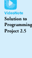


在循环体中，测试每个变量是否唯一且方程是否被满足。输出满足方程的字母所对应的值。

## 6. 浮力是物体漂浮的能力。阿基米德原理指出，浮力等于被浸没物体排开的液体的重量。

浮力可以通过以下公式计算：

$F_b = V \times \gamma$

其中，$F_b$ 是浮力，$V$ 是浸没物体的体积，$\gamma$ 是流体的比重。如果 $F_b$ 大于或等于物体的重量，则物体将漂浮，否则将下沉。

编写一个程序，输入球体的重量（磅）和半径（英尺），并输出该球体在水中是下沉还是漂浮。使用 $\gamma = 62.4\ \text{lb/ft}^3$ 作为水的比重。球体的体积由 $(4/3)\pi r^3$ 计算。

## 7. 编写一个程序，通过获取学生所有科目的成绩来计算其平均绩点（GPA）。成绩及其绩点如下：

| 成绩 | 绩点 |
|-------|--------|
| 等级 S | 10 分 |
| 等级 A | 9 分 |
| 等级 B | 8 分 |
| 等级 C | 7 分 |
| 等级 D | 6 分 |
| 等级 E | 5 分 |
| 等级 F | 0 分 |

程序应输入科目数量，然后是每门科目获得的成绩。程序应计算绩点的平均值并打印。

## 8. 编写一个程序，找出一个整数温度，使得其在摄氏和华氏两种温标下数值相同。从摄氏转换为华氏的公式如下：

华氏 = $\frac{9}{5}$ 摄氏 + 32

你的程序应创建两个整数变量，分别表示摄氏温度和华氏温度。将温度初始化为100摄氏度。在循环中，递减摄氏值并计算相应的华氏温度，直到两个值相等。

## 9. （这是第1章中一个练习的扩展。）用于计算正数n的平方根的巴比伦算法如下：

- 1. 对答案进行猜测（你可以选择 n/2 作为初始猜测）。
- 2. 计算 r = n / guess。
- 3. 设置 guess = (guess + r) / 2。
- 4. 根据需要多次返回第2步。第2步和第3步重复的次数越多，guess 就越接近 n 的平方根。

编写一个程序，输入一个 double 类型的 n，迭代执行巴比伦算法，直到 guess 与上一次 guess 的误差在1%以内，并将答案输出为保留两位小数的 double。即使对于较大的 n 值，你的答案也应该是准确的。

## 10.

创建一个包含文本“I hate C++ and hate programming!”的文本文件。编写一个程序，从文件中读取文本并将每个单词输出到控制台，但将任何出现的“hate”替换为“love”。你的程序应该适用于任何包含“hate”一词的文本行，而不仅仅是本问题中给出的示例。

## 11.

（这是第1章中一个练习的扩展。）估算理想体重的简单规则是：身高前5英尺允许110磅，每增加一英寸加5磅。在文本文件中创建以下文本。其中包含 Tom Atto（6'3"）、Eaton Wright（5'5"）和 Cary Oki（5'11"）的姓名以及以英尺和英寸为单位的身高：

```
Tom Atto
6
3
Eaton Wright
5
5
Cary Oki
5
11
```

编写一个程序，读取文件中的数据并输出每个人的全名和理想体重。使用循环从文件中读取姓名。你的程序还应处理文件中任意数量的条目，而不仅仅是处理三个条目。

## 12.

这个问题基于Steve Wolfman的“Nifty Assignment”（http://nifty.stanford.edu/2006/wolfman-pretid）。考虑来自现实生活数据源的数字列表，例如，包含不同课程部分注册学生人数的列表、不同Facebook状态更新收到的评论数量的列表、不同图书馆馆藏书籍数量的列表、每个选区投票数的列表等。列表中的每个数字的首位数字似乎是1–9，且概率相等。然而，本福德定律指出，首位数字为1的概率约为30%，并且随着数字增大而下降。首位数字为9的概率仅约为5%。

编写一个测试本福德定律的程序。从某个现实生活数据源收集至少一百个数字的列表，并将它们输入到文本文件中。你的程序应遍历数字列表，统计1作为第一位数字出现的次数、2作为第一位数字出现的次数等等。对于每个数字，输出其作为第一位数字出现的百分比。

如果你将数字读入名为strNum的字符串变量，则可以使用strNum[0]以char类型访问第一位数字。这一点将在第9章中更详细地描述。

## 13. 创建一个文本文件，其中包含10个整数，每行一个整数。你可以在文件中输入任意10个你喜欢的整数。然后编写一个程序，从键盘输入一个数字，并确定文本文件中的10个整数中是否有任意一对相加恰好等于键盘输入的数字。如果是，程序应输出这对整数。如果没有一对整数相加等于该数字，则程序应输出“No pair found.”。

此页有意留空。

## 3 函数基础

> 好东西往往小巧。
> 
> 常言道

### 引言

如果你曾用其他语言编程，那么本章的内容对你来说会似曾相识。你仍然应该浏览本章，以了解函数基础的C++语法和术语。第4章包含C++中可能与其他语言不同的函数相关内容。

可以将程序视为由若干子部分组成，例如获取输入数据、计算输出数据和显示输出数据。C++与大多数编程语言一样，提供了分别命名和编码这些子部分的功能。在C++中，这些子部分称为*函数*。大多数编程语言都有函数或类似于函数的东西，尽管在其他语言中并不总是这样称呼。你可能以前听说过*过程*、*子程序*和*方法*这些术语，它们本质上与*函数*意思相同。在C++中，函数可以返回值（产生一个值），也可以执行某些动作而不返回值，但无论子部分是否返回值，在C++中它仍然被称为函数。本章介绍C++函数的基本细节。在告诉你如何编写自己的函数之前，我们首先告诉你如何使用一些预定义的C++函数。

### 3.1 预定义函数

> 不要重造轮子。
> 
> 常言道

C++自带预定义函数库，你可以在程序中使用。C++中有两种函数：返回（产生）值的函数和不返回值的函数。不返回值的函数称为**void函数**。我们首先讨论返回值的函数，然后讨论void函数。

void函数

#### 返回值的预定义函数

我们将使用sqrt函数来说明如何使用返回值的预定义函数。sqrt函数计算一个数的平方根。（一个数的平方根是这样一个数，它自身相乘后得到你开始时的那个数。例如，9的平方根是3，因为3²等于9。）sqrt函数以一个数（如9.0）开始，计算其平方根，本例中为3.0。函数开始时的值称为其参数。它计算出的值称为返回值。有些函数可能有多个参数，但没有函数返回多个值。

在程序中使用函数的语法很简单。要将名为theRoot的变量设置为9.0的平方根，可以使用以下赋值语句：

```
theRoot = sqrt(9.0);
```

表达式sqrt(9.0)被称为函数调用或函数调用。函数调用中的参数可以是常量（如9.0）、变量或更复杂的表达式。函数调用是一个表达式，可以像任何其他表达式一样使用。例如，sqrt返回的值是double类型；因此，以下是合法的（尽管可能有点吝啬）：

```
bonus = sqrt(sales)/10;
```

sales和bonus通常是double类型的变量。函数调用sqrt(sales)是一个单项，就像它被括在括号中一样。因此，前面的赋值语句等价于：

```
bonus = (sqrt(sales))/10;
```

在函数返回值类型的表达式合法出现的任何地方，你都可以使用函数调用。

显示3.1包含一个使用预定义函数sqrt的完整程序。该程序计算用户愿意花费的金额所能建造的最大方形狗屋的尺寸。程序询问用户金额，然后确定该金额可以购买多少平方英尺的占地面积。该计算得出狗屋地板的面积（平方英尺）。sqrt函数得出狗屋地板一边的长度。

cmath库包含函数sqrt以及其他许多数学函数的定义。如果你的程序使用了某个库中的预定义函数，则必须包含一个指定该库的include指令。例如，显示3.1中的程序使用了sqrt函数，因此它包含

```
#include <cmath>
```

这个特定程序有两个include指令。这两个include指令的先后顺序无关紧要。include指令在第1章中讨论过。

预定义函数的定义通常将这些函数放在std命名空间中，因此还需要以下using指令，如显示3.1所示：

```
using namespace std;
```

参数 返回值

函数调用

#include 指令


## 展示 3.1 一个返回值的预定义函数

```cpp
1 //计算根据用户预算可以购买的狗屋大小
2 //给定用户的预算。
3 #include <iostream>
4 #include <cmath>
5 using namespace std;
6 
7 int main()
8 {
9     const double COST_PER_SQ_FT = 10.50;
10    double budget, area, lengthSide;
11 
12    cout << "输入你为狗屋预算的金额 $";
13    cin >> budget;
14 
15    area = budget / COST_PER_SQ_FT;
16    lengthSide = sqrt(area);
17 
18    cout.setf(ios::fixed);
19    cout.setf(ios::showpoint);
20    cout.precision(2);
21    cout << "对于价格 $" << budget << endl
22    << "我可以为你建造一个豪华的方形狗屋\n"
23    << "每边长 " << lengthSide
24    << " 英尺。\n";
25 
26    return 0;
27 }
```

### 示例对话

```
输入你为狗屋预算的金额 $25.00
对于价格 $25.00
我可以为你建造一个豪华的方形狗屋
每边长 1.54 英尺。
```

通常，使用库所需的全部操作就是在包含程序的文件中放置该库的 `include` 指令和 `using` 指令。如果仅凭这些指令就能正常工作，你无需担心其他事情。然而，对于某些系统上的某些库，你可能需要向编译器提供额外的指令，或显式运行链接器程序来链接该库。具体细节因系统而异；你需要查阅手册或咨询本地专家，以确定确切需要做什么。

*仅`#include`可能不够*

展示 3.2 中描述了一些预定义函数。附录 4 中描述了更多预定义函数。

## 返回值函数

对于返回值的函数，函数调用是一个表达式，由函数名后跟括号括起来的参数组成。如果有多个参数，参数之间用逗号分隔。如果函数调用返回一个值，则该函数调用是一个表达式，可以像该函数返回类型指定的任何其他表达式一样使用。

### 语法

```
函数名(参数列表)
```

其中参数列表是以逗号分隔的参数列表：

```
参数_1, 参数_2, . . . , 参数_最后
```

### 示例

```
side = sqrt(area);
cout << "2.5 的 3.0 次幂是 "
     << pow(2.5, 3.0);
```

请注意，绝对值函数 `abs` 和 `labs` 位于头文件为 `cstdlib` 的库中，因此任何使用这两个函数之一的程序都必须包含以下指令：

```cpp
#include <cstdlib>
```

*abs 和 labs*

还要注意有三个绝对值函数。如果你想生成 `int` 类型数字的绝对值，请使用 `abs`；如果你想生成 `long` 类型数字的绝对值，请使用 `labs`；如果你想生成 `double` 类型数字的绝对值，请使用 `fabs`。更复杂的是，`abs` 和 `labs` 位于头文件为 `cstdlib` 的库中，而 `fabs` 位于头文件为 `cmath` 的库中。`fabs` 是浮点绝对值的缩写。回想一下，小数点后有分数的数字，例如 `double` 类型的数字，通常被称为浮点数。

预定义函数的另一个例子是 `pow`，它位于头文件为 `cmath` 的库中。函数 `pow` 可用于在 C++ 中执行幂运算。例如，如果你想将变量 `result` 设置为等于 x^y，可以使用以下代码：

```cpp
result = pow(x, y);
```

因此，以下三行程序代码将向屏幕输出数字 9.0，因为 (3.0)^2.0 是 9.0：

```cpp
double result, x = 3.0, y = 2.0;
result = pow(x, y);
cout << result;
```

## 展示 3.2 一些预定义函数

所有这些预定义函数都需要 `using namespace std;` 以及一个 `include` 指令。

| 名称 | 描述 | 参数类型 | 返回值类型 | 示例 | 值 | 库头文件 |
|---|---|---|---|---|---|---|
| sqrt | 平方根 | double | double | sqrt(4.0) | 2.0 | cmath |
| pow | 幂 | double | double | pow(2.0,3.0) | 8.0 | cmath |
| abs | int 的绝对值 | int | int | abs(-7) abs(7) | 7 7 | cstdlib |
| labs | long 的绝对值 | long | long | labs(-70000) labs(70000) | 70000 70000 | cstdlib |
| fabs | double 的绝对值 | double | double | fabs(-7.5) fabs(7.5) | 7.5 7.5 | cmath |
| ceil | 向上取整 | double | double | ceil(3.2) ceil(3.9) | 4.0 4.0 | cmath |
| floor | 向下取整 | double | double | floor(3.2) floor(3.9) | 3.0 3.0 | cmath |
| exit | 结束程序 | int | void | exit(1); | 无 | cstdlib |
| rand | 随机数 | 无 | int | rand() | 变化 | cstdlib |
| srand | 为 rand 设置种子 | unsigned int | void | srand(42); | 无 | cstdlib |

请注意，之前对 `pow` 的调用返回 9.0，而不是 9。函数 `pow` 总是返回 `double` 类型的值，而不是 `int` 类型。还要注意，函数 `pow` 需要两个参数。一个函数可以有任意数量的参数。此外，每个参数位置都有指定的类型，函数调用中使用的参数应该是该类型。在许多情况下，如果你使用了错误类型的参数，C++ 会为你进行一些自动类型转换。但是，结果可能不是你想要的。当你调用函数时，应该使用为该函数指定的参数类型。此警告的一个例外是从 `int` 类型到 `double` 类型的参数自动转换。在许多情况下，包括调用 `pow` 函数时，当指定了 `double`（或其他浮点类型）参数时，你可以安全地使用 `int`（或其他整数类型）参数。

## void 函数

void 函数执行某些操作但不返回值。对于 void 函数，函数调用是一个语句，由函数名后跟括号括起来的参数，然后以分号结尾组成。如果有多个参数，参数之间用逗号分隔。对于 void 函数，函数调用（函数调用）是一个语句，可以像任何其他 C++ 语句一样使用。

### 语法

```
函数名(参数列表);
```

其中参数列表是以逗号分隔的参数列表：

```
参数_1, 参数_2, . . . , 参数_最后
```

### 示例

```
exit(1);
```

许多 `pow` 的实现对可以使用哪些参数有限制。在这些实现中，如果 `pow` 的第一个参数是负数，则第二个参数必须是整数。当第一个参数为非负数时，使用 `pow` 可能是最简单和最安全的。

## 预定义 void 函数

void 函数执行某些操作但不返回值。由于它执行操作，void 函数是一个语句。void 函数的函数调用写法类似于返回值函数的函数调用，只是它以分号结尾，并用作语句而不是表达式。预定义 void 函数的处理方式与返回值的预定义函数相同。因此，要使用预定义的 void 函数，你的程序必须有一个 `#include` 指令，给出定义该函数的库的名称。

例如，函数 `exit` 定义在库 `cstdlib` 中，因此使用该函数的程序必须在文件开头（或附近）包含以下内容：

```cpp
#include <cstdlib>
using namespace std;
```

以下是函数 `exit` 的示例调用：

```cpp
exit(1);
```

## exit 函数

`exit` 函数是一个预定义的 void 函数，它接受一个 `int` 类型的参数。因此，`exit` 函数的调用是一个如下编写的语句：

```cpp
exit(整数值);
```

当 `exit` 函数被调用时（即执行上述语句时），程序立即结束。可以使用任何整数值，但按照惯例，`1` 用于因错误引起的 `exit` 调用，`0` 用于其他情况。

`exit` 函数定义在库 `cstdlib` 中，并将 `exit` 函数置于 `std` 命名空间中。因此，任何使用 `exit` 函数的程序都必须包含以下两条指令：

```cpp
#include <cstdlib>
using namespace std;
```

调用 `exit` 函数会立即结束程序。展示 3.3 包含一个演示 `exit` 函数的简单程序。

请注意，`exit` 函数有一个参数，类型为 `int`。该参数被传递给操作系统。就你的 C++ 程序而言，你可以使用任何 `int` 值作为参数，但按照惯例，`1` 用于因错误引起的 `exit` 调用，`0` 用于其他情况。

## 展示 3.3 预定义 void 函数的函数调用

```cpp
1 #include <iostream>
2 #include <cstdlib>
3 using namespace std;
4 int main()
5 {
6 cout << "你好，外面的世界！\n";
7 exit(1);
8 cout << "这条语句毫无意义，\n"
9 << "因为它永远不会被执行。\n"
10 << "这只是一个用来演示 exit 的简单程序。\n";
11 return 0;
12 }
```

这只是一个简单的例子。如果省略这些行，它会产生相同的输出。

### 示例对话

```
你好，外面的世界！
```


空函数可以有任意数量的参数。空函数的参数细节与返回值的函数相同。特别是，如果你使用错误类型的参数，那么在许多情况下，C++ 会为你自动进行类型转换。然而，结果可能不是你所期望的。

## 自测练习

- 1. 求出下面每个算术表达式的值。
  - sqrt(16.0)    sqrt(16)    pow(2.0, 3.0)
  - pow(2, 3)     pow(2.0, 3)  pow(1.1, 2)
  - abs(3)        abs(-3)     abs(0)
  - fabs(-3.0)    fabs(-3.5)  fabs(3.5)
  - ceil(5.1)     ceil(5.8)   floor(5.1)
  - floor(5.8)    pow(3.0, 2)/2.0   pow(3.0, 2)/2
  - 7/abs(-2)     (7 + sqrt(4.0))/3.0   sqrt(pow(3, 2))

- 2. 将下面每个数学表达式转换为 C++ 算术表达式。
  - a. √x + y
  - b. x^(y + 7)
  - c. √area + fudge
  - d. √(time + tide) / nobody
  - e. (-b ± √(b² - 4ac)) / 2a
  - f. | x - y |

- 3. 编写一个完整的 C++ 程序来计算并输出 1 到 10 的整数的平方根。

- 4. void 函数 exit 的 int 参数的功能是什么？

## 随机数生成器

随机数生成器是一个返回“随机选择”数字的函数。它与我们迄今为止看到的函数不同，因为返回的值不是由参数决定的，通常根本没有参数，而是由某些全局条件决定的。由于你可以把返回的值看作是随机数，因此你可以使用随机数生成器来模拟随机事件，例如掷骰子或抛硬币的结果。除了模拟机会游戏之外，随机数生成器还可以用来模拟严格来说可能不是随机的但对我们来说看起来随机的事物，例如汽车到达收费站之间的时间。

C++ 库头文件 <cstdlib> 包含一个名为 rand 的随机数函数。该函数没有参数。当你的程序调用 rand 时，函数返回一个介于 0 到 RAND_MAX 之间的整数，包含端点。生成的数字可能等于 0 或 RAND_MAX。RAND_MAX 是一个定义的整数常量，其定义也在头文件 <cstdlib> 的库中。RAND_MAX 的确切值取决于系统，但始终至少为 32767（最大两位字节正整数）。例如，以下输出 0 到 RAND_MAX 范围内的十个“随机”数字：

```
int i;
for (i = 0; i < 10; i++)
    cout << rand() << endl;
```

你更可能想要一个更小范围内的随机数，例如 0 到 10 的范围。为了确保值在 0 到 10 的范围内，包含端点，你可以使用

```
rand() % 11
```

这称为缩放。以下输出十个介于 0 到 10 之间的“随机”整数，包含端点：

```
int i;
for (i = 0; i < 10; i++)
    cout << (rand() % 11) << endl;
```

随机数生成器，例如函数 rand，并不生成真正随机的数字。 （这就是为什么“随机”周围有引号。）对函数 rand（或几乎任何随机数生成器）的调用序列会产生一个数字序列（rand 返回的值），看起来是随机的。然而，如果你能把计算机恢复到调用 rand 序列开始时的状态，你会得到相同的“随机数”序列。看起来是随机的但实际上不是的数字，例如由对 rand 的调用生成的数字序列，被称为伪随机数。

伪随机数序列通常由一个数字决定，称为种子。如果你用相同的种子反复启动随机数生成器，那么每次它都会产生相同的、看起来随机的数字序列。你可以使用函数 srand 来设置函数 rand 的种子。void 函数 srand 接受一个（正）整数参数，即种子。例如，以下将输出两个相同的十个伪随机数序列：

```
int i;
srand(99);
for (i = 0; i < 10; i++)
    cout << (rand() % 11) << endl;
srand(99);
for (i = 0; i < 10; i++)
    cout << (rand() % 11) << endl;
```

数字 99 之所以没有特殊之处，只是因为我们对两次 srand 调用都使用了相同的数字。

请注意，对于给定的种子产生的伪随机数序列可能是系统相关的。如果在不同的系统上使用相同的种子重新运行，伪随机数序列在该系统上可能不同。然而，只要你使用的是同一系统和同一 C++ 实现，相同的种子就会产生相同的伪随机数序列。

## 伪随机数

函数 rand 不接受参数并返回一个介于 0 到 RAND_MAX 之间的伪随机整数，包含端点。void 函数 srand 接受一个参数，即随机数生成器 rand 的种子。srand 的参数类型为 unsigned int，因此参数必须为非负。函数 rand 和 srand 以及定义的常量 RAND_MAX 都在库 cstdlib 中定义，因此使用它们的程序必须包含以下指令：

```
#include <cstdlib>
using namespace std;
```

这些伪随机数对于大多数应用来说足够接近真正的随机数。事实上，它们通常比真正的随机数更可取。伪随机数生成器相比于真正的随机数生成器有一个很大的优势：它产生的数字序列是可重复的。如果用相同的种子值运行两次，它会产生相同的数字序列。这对于许多目的非常方便。当发现并修复错误时，可以使用暴露该错误的相同伪随机数序列重新运行程序。同样，使用伪随机数生成器，可以重复程序的特别有趣的运行。使用真正的随机数生成器，每次程序运行很可能都不同。

显示 3.4 显示了一个使用随机数生成器 rand 来“预测”天气的程序。在这种情况下预测是随机的，但有些人认为这与天气预测差不多。 （天气预测实际上可以非常准确，但这个程序只是一个游戏，用来说明伪随机数。）

请注意，在显示 3.4 中，用于 srand 参数的种子值是月份乘以日期。这样，如果程序重新运行并且输入相同的日期，就会做出相同的预测。 （当然，这个程序仍然很简单。14 日之后的预测可能与 15 日相同，也可能不同，但这个程序作为一个简单示例已经足够了。）

概率通常表示为 0.0 到 1.0 范围内的浮点数。假设你想要一个随机概率而不是随机整数。这可以通过另一种形式的缩放来产生。以下生成一个介于 0.0 和 1.0 之间的伪随机浮点值：

```
(RAND_MAX - rand())/static_cast<double>(RAND_MAX)
```

### 显示 3.4  使用随机数生成器的函数（第 1 部分，共 2 部分）

```
```cpp
#include <iostream>
#include <cstdlib>
using namespace std;

int main()
{
    int month, day;
    cout << "Welcome to your friendly weather program.\n"
         << "Enter today's date as two integers for the month " <<
         "and the day:\n";
    cin >> month;
    cin >> day;
    srand(month * day);
    int prediction;
    char ans;
    cout << "Weather for today:\n";
    do
    {
        prediction = rand() % 3;
        switch (prediction)
        {
            case 0:
                cout << "The day will be sunny!!\n";
                break;
            case 1:
                cout << "The day will be cloudy.\n";
                break;
            case 2:
                cout << "The day will be stormy!\n";
                break;
            default:
                cout << "Weather program is not " <<
                        "functioning properly.\n";
        }
        cout << "Want the weather for the next day?(y/n): ";
        cin >> ans;
    } while (ans == 'y' || ans == 'Y');
    cout << "That's it from your 24-hour weather program.\n";
    return 0;
}
```
```


## 显示 3.4 使用随机数生成器的函数（第 2 部分，共 2 部分）

### 示例对话

```
Welcome to your friendly weather program.
Enter today's date as two integers for the month and the day:
2 14
Weather for today:
The day will be cloudy.
Want the weather for the next day? (y/n): y
The day will be cloudy.
Want the weather for the next day? (y/n): y
The day will be stormy!
Want the weather for the next day? (y/n): y
The day will be stormy!
Want the weather for the next day? (y/n): y
The day will be sunny!!
Want the weather for the next day? (y/n): n
That's it from your 24-hour weather program.
```

类型转换是为了使我们得到浮点除法而不是整数除法。

## 自测练习

- 5. 给出一个表达式以产生范围在 5 到 10（包含）之间的伪随机整数。
- 6. 编写一个完整的程序，要求用户输入一个种子，然后基于该种子输出十个随机数。数字应为范围在 0.0 到 1.0（包含）之间的浮点数。

## 3.2 程序员定义的函数

> 定制西装总是比现成西装更合身。

我叔叔，裁缝

上一节告诉你如何使用预定义函数。本节告诉你如何定义自己的函数。

## 定义返回值的函数

你可以在与程序主部分相同的文件中定义自己的函数，也可以放在单独的文件中，以便函数可被多个不同的程序使用。定义在两种情况下都相同，但目前我们假设函数定义将与程序主部分在同一文件中。本小节仅讨论返回值的函数。稍后小节将告诉你如何定义 void 函数。

显示 3.5 包含一个完整的程序中的示例函数定义，该程序演示了对函数的调用。函数名为 totalCost，接受两个参数——一件商品的价格和购买的商品数量。函数返回该数量商品在指定价格下的总成本，包括销售税。函数调用的方式与预定义函数调用相同。函数定义，程序员必须编写，稍微复杂一些。

函数的描述分为两部分。第一部分称为函数声明或函数原型。以下是显示 3.5 中定义的函数的函数声明（函数原型）：

```
double totalCost(int numberParameter, double priceParameter);
```

函数声明中的第一个词指定函数返回值的类型。因此，对于函数 totalCost，返回值的类型为 double。接下来，函数声明告诉你函数的名称；在本例中为 totalCost。函数声明告诉你（和编译器）编写和使用函数调用所需的一切。它告诉你函数需要多少个参数以及参数的类型应该是什么；在这种情况下，函数 totalCost 接受两个参数，第一个为 int 类型，第二个为 double 类型。标识符 numberParameter 和 priceParameter 称为形式参数，或简称为参数。形式参数用作一种空白或占位符，代表参数。当你编写函数声明时，你不知道参数会是什么，所以你用形式参数代替参数。形式参数的名称可以是任何有效的标识符。请注意，函数声明以分号结束。

尽管函数声明告诉你编写函数调用所需的一切，但它并不会告诉你将返回什么值。返回的值由函数定义决定。在显示 3.5 中，函数定义在程序的第 24 到 30 行。函数定义描述了函数如何计算其返回值。函数定义由函数头和函数体组成。函数头与函数声明类似书写，只是头末尾没有分号。返回的值由函数体中的语句决定。

函数体跟随函数头并完成函数定义。函数体由声明和可执行语句组成，包含在一对大括号内。因此，函数体就像程序主部分的主体一样。当函数被调用时，参数值被填入形式参数，然后执行体内的语句。

## 显示 3.5 使用随机数生成器的函数

```cpp
#include <iostream>
using namespace std;

double totalCost(int numberParameter, double priceParameter);
//Computes the total cost, including 5% sales tax,
//on numberParameter items at a cost of priceParameter each.

int main()
{
    double price, bill;
    int number;

    cout << "Enter the number of items purchased: ";
    cin >> number;
    cout << "Enter the price per item $";
    cin >> price;

    bill = totalCost(number, price);

    cout.setf(ios::fixed);
    cout.setf(ios::showpoint);
    cout.precision(2);
    cout << number << " items at "
         << "$" << price << " each.\n"
         << "Final bill, including tax, is $" << bill
         << endl;

    return 0;
}

double totalCost(int numberParameter, double priceParameter)
{
    const double TAXRATE = 0.05; //5% sales tax
    double subtotal;

    subtotal = priceParameter * numberParameter;
    return (subtotal + subtotal*TAXRATE);
}
```

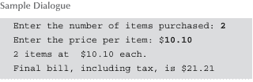

函数返回的值在函数执行 return 语句时确定。（这种“填入”的细节将在第 4 章讨论。）

return 语句由关键字 return 后跟一个表达式组成。显示 3.5 中的函数定义包含以下 return 语句：

```
return (subtotal + subtotal * TAXRATE);
```

当执行此 return 语句时，以下表达式的值作为函数调用的值返回：

```
(subtotal + subtotal * TAXRATE)
```

括号不是必需的。如果省略括号，程序运行结果相同。然而，对于更长的表达式，括号使 return 语句更易读。出于一致性考虑，一些程序员主张即使对于简单表达式也使用这些括号。在显示 3.5 中的函数定义中，return 语句之后没有语句，但如果有，也不会被执行。

当执行 return 语句时，函数调用结束。

请注意，函数体可以包含任何 C++ 语句，并且在函数被调用时这些语句将被执行。因此，返回值的函数也可以执行其他操作，而不仅仅是返回值。然而，在大多数情况下，返回值的函数的主要目的是返回该值。

函数被调用之前，必须在代码中出现完整的函数定义或函数声明（函数原型）。最典型的安排是函数声明和程序主部分出现在一个或多个文件中，函数声明在程序主部分之前，而函数定义出现在另一个文件中。我们尚未讨论将程序分为多个文件，因此我们将把函数定义放在程序主部分之后。如果完整的函数定义放在程序主部分之前，则可以省略函数声明。

## 函数声明的替代形式

你不需要在函数声明（函数原型）中列出形式参数名称。以下两个函数声明是等价的：

```
double totalCost(int numberParameter, double priceParameter);
```

和

```
double totalCost(int, double);
```

我们通常使用第一种形式，以便可以在伴随函数声明的注释中引用形式参数。然而，你在手册中经常会看到第二种形式。

此替代形式仅适用于函数声明。函数定义必须始终列出形式参数名称。


## 陷阱：参数顺序错误

当一个函数被调用时，计算机用第一个参数替换第一个形式参数，用第二个参数替换第二个形式参数，以此类推。虽然计算机会检查每个参数的类型，但它不会检查合理性。如果你混淆了参数的顺序，程序将不会按你期望的方式运行。如果由于参数类型错误导致类型违规，你将收到错误信息。如果没有类型违规，你的程序很可能会正常运行，但函数返回的值将不正确。

## 陷阱：参数和参数术语的使用

我们在本书中遵循的形式参数和参数的术语使用与常见用法一致，但人们也经常互换使用参数和参数这两个术语。当你看到参数和参数这两个术语时，你必须根据上下文确定其确切含义。许多人使用参数一词来指我们所说的形式参数和我们所说的参数。其他人使用参数一词既指我们所说的形式参数，也指我们所说的参数。不要期望人们对这两个术语的使用保持一致。 （在本書中，我们有时使用参数一词来表示形式参数，但这更多是一种缩写，而非真正的不一致。）

## 函数调用函数

函数体中可能包含对另一个函数的调用。对于这类函数调用的情况与函数调用发生在程序主部分的情况相同；唯一的限制是函数声明（或函数定义）必须在函数被使用之前出现。如果你按照我们一直的做法设置程序，这将自动发生，因为所有函数声明都在程序主部分之前，而所有函数定义都在程序主部分之后。虽然你可以在另一个函数的定义中包含函数调用，但你不能将一个函数的定义放在另一个函数定义的体内。

## 示例：一个四舍五入函数

预定义函数表（Display 3.2）中不包含任何用于四舍五入数字的函数。ceil 和 floor 函数几乎是四舍五入函数，但并不完全相同。ceil 函数始终返回下一个最高的整数（或如果它恰好是整数，则返回其参数）。因此，ceil(2.1) 返回 3.0，而不是 2.0。

### Display 3.6 函数 round（第 2 部分，共 2 部分）

```
11   do
12   {
13       cout << "Enter a double value: ";
14       cin >> doubleValue;
15       cout << "Rounded that number is " << round(doubleValue) <<
16       endl;
17       cout << "Again? (y/n): ";
18       cin >> ans;
19   } while (ans == 'y' || ans == 'Y');
20   cout << "End of testing.\n";
21   }
22   //Uses cmath:
23   int round(double number)
24   {
25       return static_cast<int>(floor(number + 0.5));
26   }
```

#### Sample Dialogue

```
Enter a double value: 9.6
Rounded, that number is 10
Again? (y/n): y
Enter a double value: 2.49
Rounded, that number is 2
Again? (y/n): n
End of testing.
```

## 自测练习

7. 以下程序产生的输出是什么？

```
#include <iostream>
using namespace std;
char mystery(int firstParameter, int secondParameter);
int main()
{
    cout << mystery(10, 9) << "ow\n";
    return 0;
}
```

12. 编写一个名为 inOrder 的函数定义，该函数接受三个类型为 int 的参数。如果三个参数按升序排列，函数返回 true；否则返回 false。例如，inOrder(1, 2, 3) 和 inOrder(1, 2, 2) 都返回 true，而 inOrder(1, 3, 2) 返回 false。

13. 编写一个名为 even 的函数定义，该函数接受一个类型为 int 的参数并返回一个 bool 值。如果其唯一参数为偶数，函数返回 true；否则返回 false。

14. 编写一个函数定义 isDigit，该函数接受一个类型为 char 的参数并返回一个 bool 值。如果参数是十进制数字，函数返回 true；否则返回 false。

## 定义 void 函数

在 C++ 中，void 函数的定义方式与返回值的函数类似。例如，下面是一个 void 函数，它输出将华氏温度转换为摄氏温度的计算结果。实际计算将在程序的其他地方完成。此 void 函数仅实现输出计算结果的子任务。

```
void showResults(double fDegrees, double cDegrees)
{
    cout.setf(ios::fixed);
    cout.setf(ios::showpoint);
    cout.precision(1);
    cout << fDegrees
         << " degrees Fahrenheit is equivalent to\n"
         << cDegrees << " degrees Celsius.\n";
}
```

如前面的函数定义所示，void 函数的函数定义与返回值的函数定义只有两个区别。一个区别是，我们在通常指定返回值的类型的地方使用关键字 void。这告诉编译器此函数不会返回任何值。void 名称被用作一种说法，表示“此函数不返回任何值”。第二个区别是 void 函数定义不需要 return 语句。函数执行在函数体中的最后一个语句执行时结束。

void 函数调用是一个可执行语句。例如，前面的函数 showResults 可能会按如下方式调用：

```
showResults(32.5, 0.3);
```

如果在程序中执行前面的语句，它将导致以下内容出现在屏幕上：

```
32.5 degrees Fahrenheit is equivalent to
0.3 degrees Celsius.
```

请注意，函数调用以分号结束，这告诉编译器函数调用是一个可执行语句。

当 void 函数被调用时，参数被替换为形式参数，函数体中的语句被执行。例如，对我们在此节前面给出的 void 函数 showResults 的调用将导致一些输出写入屏幕。思考 void 函数调用的一种方法是想象函数定义的函数体被复制到程序中，替换函数调用的位置。当函数被调用时，参数被替换为形式参数，然后就好像函数体是程序中的行一样。 （第 4 章详细描述了将参数替换为形式参数的过程。在此之前，我们将只使用简单的示例，这些示例应该足够清晰，而无需对替换过程进行正式描述。）

## 函数声明（函数原型）

函数声明（函数原型）告诉你编写对该函数的调用所需的所有信息。函数声明（或完整的函数定义）必须在对函数的调用之前出现在你的代码中。函数声明通常放在程序主部分之前。

### Syntax

```
Type_Returned_Or_void FunctionName (Parameter_List);
```

其中 Parameter_List 是以逗号分隔的参数列表：

```
Type_1 Formal_Parameter_1, Type_2 Formal_Parameter_2, ...
Type_Last Formal_Parameter_Last
```

### Examples

```
double totalWeight(int number, double weightOfOne);
//Returns the total weight of number items that
//each weigh weightOfOne.
```

```
void showResults(double fDegrees, double cDegrees);
//Displays a message saying fDegrees Fahrenheit
//is equivalent to cDegrees Celsius.
```

拥有无参数的函数是完全合法的，有时也是有用的。在这种情况下，函数声明中根本不列出形式参数，调用函数时也不使用参数。例如，void

不要忘记这个分号。

无参数的函数


接下来定义的 `initializeScreen` 函数只是向屏幕发送一个换行命令：

```
void initializeScreen()
{
    cout << endl;
}
```

如果你的程序将下面对该函数的调用作为第一条可执行语句，那么之前运行的程序所产生的输出将与你的程序的输出分隔开：

```
initializeScreen();
```

请务必注意，即使函数没有参数，在函数声明和函数调用中仍然必须包含括号。

对于 void 函数，函数声明（函数原型）和函数定义的位置与我们之前描述的有返回值函数的情况相同。

## void 函数中的 return 语句

void 函数和返回值函数都可以有 return 语句。对于返回值函数，return 语句指定返回的值。对于 void 函数，return 语句不包含任何返回值表达式。void 函数中的 return 语句只是结束函数调用。每个返回值函数必须通过执行 return 语句来结束。然而，void 函数不需要包含 return 语句。如果它不包含 return 语句，它将在执行完函数体中的代码后结束。就像在函数体末尾的最终右花括号 `}` 之前有一个隐式的 return 语句一样。

函数体末尾右花括号之前有隐式 return 语句这一事实并不意味着在 void 函数中永远不需要 return 语句。例如，显示 3.7 中的函数定义可能是餐厅管理程序的一部分。该函数输出关于如何在餐桌旁的人群中分配给定数量冰淇淋的指令。如果餐桌旁没有人（即，如果 `number` 等于 0），那么 `if` 语句中的 return 语句将终止函数调用并避免除以零。如果 `number` 不为 0，那么当函数体末尾的最后一条 `cout` 语句执行时，函数调用结束。

## 前置条件和后置条件

编写函数声明注释的一个好方法是将其分解为两类信息，称为前置条件和后置条件。前置条件说明调用函数时假设什么为真。除非前置条件成立，否则不应使用该函数，也不能指望它正确执行。后置条件描述函数调用的效果；也就是说，后置条件说明在前置条件成立的情况下执行函数后什么将变为真。对于返回值函数，后置条件将描述函数返回的值。对于改变某些参数变量值的函数，后置条件将描述对参数值所做的所有更改。

### 显示 3.7 在 void 函数中使用 return

```
1 #include <iostream>
2 using namespace std;
3 void iceCreamDivision(int number, double totalWeight);
4 //Outputs instructions for dividing totalWeight ounces of ice cream
5 //among number customers. If number is 0, only an error message is output.
6 int main()
7 {
8     int number;
9     double totalWeight;
10     cout << "Enter the number of customers: ";
11     cin >> number;
12     cout << "Enter weight of ice cream to divide (in ounces): ";
13     cin >> totalWeight;
14     iceCreamDivision(number, totalWeight);
15     return 0;
16 }
17 void iceCreamDivision(int number, double totalWeight)
18 {
19     double portion;
20     if (number == 0)
21     {
22         cout << "Cannot divide among zero customers.\n";
23         return;
24     }
25     portion = totalWeight/number;
26     cout << "Each one receives "
27         << portion << " ounces of ice cream." << endl;
28 }
```

如果 `number` 为 0，则函数执行在此结束。

### 示例对话

```
Enter the number of customers: 0
Enter weight of ice cream to divide (in ounces): 12
Cannot divide among zero customers.
```

例如，下面是一个带有前置条件和后置条件的函数声明：

```
void showInterest(double balance, double rate);
//Precondition: balance is a nonnegative savings account balance.
//rate is the interest rate expressed as a percentage, such as 5
//for 5%.
//Postcondition: The amount of interest on the given balance
//at the given rate is shown on the screen.
```

使用这个函数并不需要知道函数 `showInterest` 的定义。使用该函数所需知道的一切都由前置条件和后置条件给出。

当唯一的后置条件是对返回值的描述时，程序员通常会省略“Postcondition”一词，如下例所示：

```
double celsius(double fahrenheit);
//Precondition: fahrenheit is a temperature in degrees
//Fahrenheit.
//Returns the equivalent temperature expressed in degrees
//Celsius.
```

有些程序员选择在函数注释中不使用“precondition”和“postcondition”这两个词。然而，无论你是否使用这些词，在设计函数以及决定函数注释中包含什么内容时，你都应该始终从前置条件和后置条件的角度来思考。

## main 是一个函数

正如我们已经指出的，程序的主要部分实际上是一个名为 `main` 的函数的定义。程序运行时，函数 `main` 会被自动调用；它转而又可能调用其他函数。尽管程序主要部分中的 return 语句看起来似乎是可以选的，但实际上并非如此。C++ 标准规定你可以省略程序主要部分中的 `return 0` 语句，但许多编译器仍然要求它，而且几乎所有编译器都允许你包含它。为了可移植性，你应该在 `main` 函数中包含 `return 0` 语句。你应该将程序的主要部分视为一个返回 `int` 类型值的函数，因此需要 return 语句。将程序的主要部分视为返回整数的函数可能听起来很奇怪，但这是许多编译器强制遵循的传统。

尽管有些编译器可能允许你这样做而不受惩罚，但你不应该在代码中包含对 `main` 的调用。只有系统才应该调用 `main`，而系统会在你运行程序时这样做。

## 递归函数

C++ 确实允许你定义递归函数。递归函数在第 13 章中介绍。如果你不知道递归函数是什么，那么在读到那一章之前不必担心。如果你想提前阅读递归函数，可以在完成第 4 章后阅读第 13 章的 13.1 和 13.2 节。注意，`main` 函数不应被递归调用。

## 自测练习

- 15. 下面程序的输出是什么？

    ```
    #include <iostream>
    using namespace std;
    void friendly( );
    void shy(int audienceCount);
    int main()
    {
        friendly( );
        shy(6);
        cout << "One more time:\n";
        shy(2);
        friendly( );
        cout << "End of program.\n";
        return 0;
    }
    void friendly()
    {
        cout << "Hello\n";
    }
    void shy(int audienceCount)
    {
        if (audienceCount < 5)
            return;
        cout << "Goodbye\n";
    }
    ```

- 16. 假设你在显示 3.7 的 `iceCreamDivision` 函数定义中省略了 return 语句。这对程序会有什么影响？程序能编译吗？它能运行吗？程序的行为会有什么不同吗？

- 17. 为一个 void 函数编写定义，该函数有三个 `int` 类型的参数，并在屏幕上输出这三个参数的乘积。将定义放在一个完整的程序中，该程序读取三个数字然后调用这个函数。

- 18. 你的编译器是否允许 `void main( )` 和 `int main( )`？如果你使用 `int main( )` 但未提供 `return 0;` 语句，会发出什么警告？要查明这一点，请编写几个小的测试程序，或者咨询你的老师或当地的专家。

- 19. 为预定义函数 `sqrt` 给出前置条件和后置条件，该函数返回其参数的平方根。


# 3.3 作用域规则

> 目的应当是合法的，应当在宪法的范围内，...
> 
> 约翰·马歇尔，美国最高法院首席大法官，
> *麦卡洛克诉马里兰州案*。美国最高法院。1819年。印刷

函数应是自包含的单元，不会干扰其他函数——或任何其他代码。实现这一点时，你通常需要为函数提供其自身变量，这些变量与函数定义之外声明的任何其他变量不同，即使它们可能与函数所属的变量同名。在函数定义中声明的这些变量称为局部变量，本节的主题就是它们。

## 局部变量

回顾一下第 3.1 节中的程序。它包含对预定义函数 sqrt 的调用。我们使用该函数时不需要知道 sqrt 函数定义的任何细节。特别是，我们不需要知道在 sqrt 的定义中声明了哪些变量。你定义的函数也一样。在函数定义内声明的变量声明，就如同在预定义函数或另一个程序中的变量声明一样。如果你在一个函数定义中声明一个变量，然后在程序的主函数中（或在另一个函数定义的体内）声明另一个同名的变量，那么这两个变量就是两个不同的变量，即使它们同名。让我们看一个例子。

第 3.8 节的程序有两个名为 averagePea 的变量；一个在函数 estimateOfTotal 的函数定义中声明并使用，另一个在程序的主函数中声明并使用。函数 estimateOfTotal 定义中的变量 averagePea 和主函数中的变量 averagePea 是两个不同的变量。这就如同函数 estimateOfTotal 是一个预定义函数一样。两个名为 averagePea 的变量不会相互干扰，就像两个完全不同程序中的两个变量一样。当在对 estimateOfTotal 的函数调用中给变量 averagePea 赋予值时，这不会改变主函数中也名为 averagePea 的变量的值。

在函数定义体内声明的变量被称为对该函数是局部的，或具有该函数作为其作用域。如果一个变量对某个函数是局部的，我们有时就简单地称它为局部变量，而不指明函数。

局部变量的另一个例子可以在第 3.5 节中看到。该程序中函数 totalCost 的定义如下开始：

```
double totalCost(int numberParameter, double priceParameter)
{
    const double TAXRATE = 0.05; // $ sales tax
    double subtotal;
}
```


local variable scope

## 显示 3.8 局部变量（第 1 部分，共 2 部分）

```
1 //Computes the average yield on an experimental pea growing patch.
2 #include <iostream>
3 using namespace std;

4 double estimateOfTotal(int minPeas, int maxPeas, int podCount);
5 //Returns an estimate of the total number of peas harvested.
6 //The formal parameter podCount is the number of pods.
7 //The formal parameters minPeas and maxPeas are the minimum
8 //and maximum number of peas in a pod.

9 int main( )
10 {
11     int maxCount, minCount, podCount;
12     double averagePea, yield;
13
14     cout << "Enter minimum and maximum number of peas in a pod: ";
15     cin >> minCount >> maxCount;
16     cout << "Enter the number of pods: ";
17     cin >> podCount;
18     cout << "Enter the weight of an average pea (in ounces): ";
19     cin >> averagePea;

20     yield =
21         estimateOfTotal(minCount, maxCount, podCount) * averagePea;

22     cout.setf(ios::fixed);
23     cout.setf(ios::showpoint);
24     cout.precision(3);
25     cout << "Min number of peas per pod = " << minCount << endl
26         << "Max number of peas per pod = " << maxCount << endl
27         << "Pod count = " << podCount << endl
28         << "Average pea weight = "
29         << averagePea << " ounces" << endl
30         << "Estimated average yield = " << yield << " ounces"
31         << endl;

32     return 0;
33 }

34 double estimateOfTotal(int minPeas, int maxPeas, int podCount)
35 {
36     double averagePea;
37     averagePea = (maxPeas + minPeas)/2.0;
38     return (podCount * averagePea);
39 }
```

这个名为 averagePea 的变量是主函数的局部变量。

这个名为 averagePea 的变量是函数 estimateOfTotal 的局部变量。

## 显示 3.8 局部变量（第 2 部分，共 2 部分）

### 示例对话

```
Enter minimum and maximum number of peas in a pod: 4 6
Enter the number of pods: 10
Enter the weight of an average pea (in ounces): 0.5
Min number of peas per pod = 4
Max number of peas per pod = 6
Pod count = 10
Average pea weight = 0.500 ounces
Estimated average yield = 25.000 ounces
```

变量 subtotal 是函数 totalCost 的局部变量。命名常量 TAXRATE 也对函数 totalCost 是局部的。 （命名常量实际上只不过是一个初始化为某个值且其值不能更改的变量。）

## 局部变量

在函数定义体内声明的变量被称为对该函数是局部的，或具有该函数作为其作用域。如果一个变量对某个函数是局部的，那么你可以在另一个函数定义中拥有另一个同名的变量（或其他类型项）；这些将是两个不同的变量，即使它们同名。 （特别是，即使其中一个函数是主函数，这也是成立的。）

## 程序抽象

使用程序的人不需要知道程序是如何编码的。想象一下，如果你必须知道并记住你使用的编译器的代码，你的生活会有多糟糕。一个程序有其要完成的工作，例如编译你的程序或检查你论文中的单词拼写。你需要知道程序的工作是什么，以便使用程序，但你不需要（或至少不应该）知道程序如何完成其工作。函数就像一个小型程序，应该以类似的方式使用。使用程序中函数的程序员需要知道函数做什么（例如计算平方根或将温度从华氏度转换为摄氏度），但不需要知道函数如何完成其任务。这通常被称为将函数视为黑盒。

black box

称某物为黑盒是一种比喻，旨在传达一个物理设备的形象，你知道如何使用它，但其操作方法是个谜，因为它被封闭在一个黑盒子里，你看不到里面（也无法撬开）。

如果一个函数设计良好，程序员就可以像使用黑盒一样使用该函数。程序员需要知道的全部是，如果他或她向黑盒中放入适当的自变量，那么它就会采取适当的行动。将函数设计成可以像黑盒一样使用，有时被称为 **信息隐藏**，以强调程序员的行为就好像函数体对他是隐藏的一样。

像黑盒一样编写和使用函数也称为 **程序抽象**。在 C++ 编程中，可能更合理地称之为 **函数抽象**。然而，*过程* 比 *函数* 更通用，计算机科学家将其用于所有“类似函数”的指令集，因此他们更喜欢术语 **程序抽象**。术语 *抽象* 旨在传达这样一个思想：当你像黑盒一样使用函数时，你是在抽象掉函数体中包含的代码细节。你可以称这种技术为 **黑盒原则** 或 **程序抽象原则** 或 **信息隐藏**。这三个术语含义相同。不管你如何称呼这一原则，重要的是在设计和编写函数定义时应使用它。

> **程序抽象**
> 
> 当应用于函数定义时，*程序抽象* 原则意味着你的函数应被编写成可以像 *黑盒* 一样使用。这意味着使用该函数的程序员不需要查看函数定义的函数体以了解函数的工作方式。函数声明和随附的注释应该是程序员使用函数所需了解的全部内容。为了确保你的函数定义具有这一重要属性，你应严格遵守以下规则：
> 
> **如何编写黑盒函数定义**
> 
> - 函数声明注释应告诉程序员函数自变量所需的任何和所有条件，并应描述函数调用的结果。
> - 函数体中使用的所有变量都应在函数体中声明。 （形式参数不需要声明，因为它们列在函数标题中。）

## 全局常量和全局变量

正如我们在第 1 章中指出的，你可以使用 `const` 修饰符为常量值命名。例如，在第 3.5 节中，我们使用 `const` 修饰符为销售税率命名，使用以下声明：

```
const double TAXRATE = 0.05;  //5% sales tax
```


如果这个声明位于一个函数的定义内部，如 Display 3.5 所示，那么名称 TAXRATE 对函数定义是局部的，这意味着在包含该声明的函数定义之外，你可以对名称 TAXRATE 用于另一个命名常量、变量或任何其他东西。

另一方面，如果这个声明出现在你的程序开头，在所有函数体之外（并且在程序主体的主体之外），那么该命名常量被称为全局命名常量，并且该命名常量可以在常量声明之后出现的任何函数定义中使用。

Display 3.9 显示了一个使用全局命名常量示例的程序。该程序要求输入半径，然后计算具有该半径的圆的面积和球体的体积，使用以下公式：

```
area = π × (radius)²
volume = (4/3) × π × (radius)³
```

两个公式都包含常量 π，它大约等于 3.14159。符号 π 是被称为“pi”的希腊字母。因此程序使用了以下全局命名常量，

```
const double PI = 3.14159;
```

它出现在任何函数定义之外（包括 main 的定义之外）。

编译器允许你在放置全局命名常量的声明时有很大的自由度。然而，为了提高可读性，你应该将所有的 include 指令放在一起，将所有的全局命名常量声明放在另一个组中，并将所有的函数声明（函数原型）放在一起。我们将遵循标准做法，将所有的全局命名常量声明放在我们的 include 和 using 指令之后，以及我们的函数声明之前。

即使命名常量仅被一个函数使用，将所有命名常量声明放在程序开头也可以提高可读性。如果命名常量需要在程序的未来版本中更改，将其放在程序开头会更容易找到。例如，将销售税率的常量声明放在会计程序的开头，将使在税率更改时轻松修改程序。

可以声明普通变量，而不使用 const 修饰符，作为全局变量，这些变量可供文件中的所有函数定义访问。这与为全局命名常量所做的方式类似，只是变量声明中不使用 const 修饰符。然而，很少有必要使用此类全局变量。此外，全局变量会使程序更难理解和维护，因此我们敦促你避免使用它们。

global named constant

global variable

## Display 3.9 A Global Named Constant (part 1 of 2)

```
//Computes the area of a circle and the volume of a sphere.
//Uses the same radius for both calculations.
#include <iostream>
#include <cmath>
using namespace std;

const double PI = 3.14159;

double area(double radius);
//Returns the area of a circle with the specified radius.

double volume(double radius);
//Returns the volume of a sphere with the specified radius.

int main() {
    double radiusOfBoth, areaOfCircle, volumeOfSphere;

    cout << "Enter a radius to use for both a circle\n" << "and a sphere (in inches): ";
    cin >> radiusOfBoth;

    areaOfCircle = area(radiusOfBoth);
    volumeOfSphere = volume(radiusOfBoth);

    cout << "Radius = " << radiusOfBoth << " inches\n" << "Area of circle = " << areaOfCircle << " square inches\n" << "Volume of sphere = " << volumeOfSphere << " cubic inches\n";

    return 0;
}

double area(double radius)
{
    return (PI * pow(radius, 2));
}

double volume(double radius)
{
    return ((4.0/3.0) * PI * pow(radius, 3));
}
```

## Display 3.9 A Global Named Constant (part 2 of 2)

### Sample Dialogue

```
Enter a radius to use for both a circle
and a sphere (in inches) : 2
Radius = 2 inches
Area of circle = 12.5664 square inches
Volume of sphere = 33.5103 cubic inches
```

### Self-Test Exercises

- 20. 如果你在函数定义中使用一个变量，你应该在哪里声明该变量？在函数定义中？在 main 函数中？在方便的任何地方？
- 21. 假设有一个名为 function1 的函数在 function1 的定义内声明了一个名为 sam 的变量，并且有一个名为 function2 的函数也在 function2 的定义内声明了一个名为 sam 的变量。程序会编译吗（假设其他一切正确）？如果程序会编译，它会运行吗（假设其他一切正确）？如果它运行，在运行时会生成错误消息吗（假设其他一切正确）？如果它运行并且在运行时不产生错误消息，它会给出正确的输出吗（假设其他一切正确）？
- 22. 函数声明附带的注释的目的是什么？
- 23. 程序设计抽象的原则如何应用于函数定义？
- 24. 当我们说使用函数的程序员应该能够将函数视为黑箱时，这意味着什么？（这个问题与前一个问题非常密切相关。）

### Blocks

在复合语句内部（即在大括号对内部）声明的变量对复合语句是局部的。变量的名称可以在复合语句之外用于其他用途，例如不同变量的名称。

block

带有声明的复合语句通常称为块。实际上，块和复合语句是同一事物的两个术语。然而，当我们关注在复合语句内声明的变量时，我们通常使用块而不是复合语句这个术语，并且我们说在块内声明的变量对块是局部的。

如果一个变量在块中声明，那么定义从声明的位置起作用到块的末尾。这通常表述为声明的作用域从声明的位置到块的末尾。因此，如果一个变量在块开始时声明，其作用域是整个块。如果变量在块中间部分声明，声明要到程序到达声明位置时才生效（参见自测练习 25）。

请注意，函数定义的体是一个块。因此，对函数局部的变量与对函数定义体局部的变量是同一回事（它是一个块）。

### Blocks

块是被大括号括起来的一些 C++ 代码。在块中声明的变量对块是局部的，因此变量名可以在块之外用于其他用途（例如被重用为不同变量的名称）。

### Nested Scopes

假设你有一个块嵌套在另一个块内部，并且假设一个标识符在一个块中声明为变量，在另一个块中也声明为变量。这两个变量同名但不同。 一个变量仅存在于内部块内，不能在该内部块之外访问。另一个变量仅存在于外部块内，不能在内部块中访问。这两个变量是不同的，因此对其中一个变量所做的更改不会影响这两个变量中的另一个变量。

### Scope Rule for Nested Blocks

如果一个标识符在两个块中都被声明为变量，其中一个块在另一个块内，那么这就是两个同名但不同的变量。一个变量仅存在于内部块内，不能在内部块之外访问。另一个变量仅存在于外部块内，不能在内部块中访问。这两个变量是不同的，因此对其中一个变量所做的更改不会影响这两个变量中的另一个变量。

### TIP: Use Function Calls in Branching and Loop Statements

switch 语句和 if-else 语句允许你在每个分支中放置多个不同的语句。然而，这样做会使 switch 语句或 if-else 语句难以阅读。与其在分支语句中放置复合语句，通常更可取的是将复合语句转换为一个


# 提示：（续）

定义一个函数，并在分支中放置函数调用。类似地，如果循环体很大，最好将复合语句转换为函数定义，并使循环体成为函数调用。

# for 循环中声明的变量

可以在 for 语句的头部声明变量，这样该变量在 for 语句开始时既被声明又被初始化。例如，

```
for (int n = 1; n <= 10; n++)
    sum = sum + n;
```

ANSI/ISO C++ 标准要求，声称符合该标准的 C++ 编译器应将 for 循环初始化器中的任何声明视为循环体内部的局部声明。早期的 C++ 编译器并非如此。你应该确定自己的编译器如何处理在 for 循环初始化器中声明的变量。如果可移植性对你的应用程序至关重要，你不应编写依赖于此行为的代码。然而，大多数 C++ 编译器都符合这条规则。

# 自测练习

+   25. 尽管我们力劝你不要使用这种风格编程，但我们提供了一个使用嵌套块的练习来帮助你理解作用域规则。说出如果这段代码片段被嵌入到一个其他方面完整、正确的程序中，它将产生什么输出。

```
{
    int x = 1;
    cout << x << endl;
    {
        cout << x << endl;
        int x = 2;
        cout << x << endl;
        {
            cout << x << endl;
            int x = 3;
            cout << x << endl;
        }
        cout << x << endl;
    }
    cout << x << endl;
}
```

# 章节总结

+   - C++ 中有两种函数：返回值函数和 void 函数。
+   - 函数的定义应使其可以用作黑盒。使用该函数的程序员不需要知道函数编码的任何细节。程序员只需要知道函数声明和伴随的、描述返回值的注释。这条规则有时被称为过程抽象原则。
+   - 编写函数声明注释的一个好方法是使用前置条件和后置条件。前置条件说明调用函数时假定什么为真。后置条件描述函数调用的效果；也就是说，后置条件告诉在前置条件成立的情况下函数执行后将是什么为真。
+   - 在函数定义中声明的变量称为该函数的局部变量。
+   - 形式参数是一种占位符，在调用函数时用函数实参填充。有关此“填充”过程的详细信息将在第 4 章中介绍。

# 自测练习答案

1. 4.0 4.0 8.0
8.0 8.0 1.21
3 3 0
3.0 3.5 3.5
6.0 6.0 5.0
5.0 4.5 4.5
3 3.0

+   2. a. sqrt(x + y)
+   b. pow(x, y + 7)
+   c. sqrt(area + fudge)
+   d. sqrt(time+tide)/nobody
+   e. (-b ± sqrt(b*b - 4*a*c))/(2*a)
+   f. abs(x - y) or labs(x - y) or fabs(x - y)

```
3. #include <iostream>
#include <cmath>
using namespace std;
int main()
{
    int i;
```

```
for (i = 1; i <= 10; i++)
cout << "The square root of " << i
<< " is " << sqrt(i) << endl;
return 0;
}
```

4. 该参数被传递给操作系统。就你的 C++ 程序而言，你可以使用任何 int 值作为参数。但按照惯例，1 用于表示因错误而调用 exit，0 用于其他情况。

5. (5 + (rand() % 6))

```
#include <iostream>
#include <cstdlib>
using namespace std;

int main()
{
cout << "Enter a nonnegative integer to use as the\n"
<< "seed for the random number generator: ";
unsigned int seed;
cin >> seed;
srand(seed);
cout << "Here are ten random probabilities:\n";
int i;
for (i = 0; i < 10; i++)
cout << ((RAND_MAX - rand()) / static_cast<double>(RAND_MAX))
<< endl;
return 0;
}
```

7. Wow

8. 函数声明为

```
int sum(int n1, int n2, int n3);
//Returns the sum of n1, n2, and n3.
```

函数定义为

```
int sum(int n1, int n2, int n3)
{
    return (n1 + n2 + n3);
}
```

9. 函数声明为

```
char positiveTest(double number);
//Returns 'P' if number is positive.
//Returns 'N' if number is negative or zero.
```

函数定义为

```
char positiveTest(double number)
{
    if (number > 0)
        return 'P';
    else
        return 'N';
}
```

10. 不可以，函数定义不能出现在另一个函数定义的内部。

11. 预定义函数和用户定义函数的调用方式相同。

```
12. bool inOrder(int n1, int n2, int n3)
{
    return ((n1 <= n2) && (n2 <= n3));
}
```

```
13. bool even(int n)
{
    return ((n % 2) == 0);
}
```

```
14. bool isDigit(char ch)
{
    return ('0' <= ch) && (ch <= '9');
}
```

15. Hello
Goodbye
One more time:
Hello
End of program.

16. 如果你在程序清单 3.7 中 iceCreamDivision 的函数定义中省略了 return 语句，程序仍然可以编译和运行。但是，如果你输入顾客数为零，那么程序将因除以零而产生运行时错误。

```
17. #include <iostream>
using namespace std;
void productOut(int n1, int n2, int n3);

int main()
{
    int num1, num2, num3;
    cout << "Enter three integers: ";
    cin >> num1 >> num2 >> num3;
    productOut(num1, num2, num3);
    return 0;
}
```

```
void productOut(int n1, int n2, int n3)
{
    cout << "The product of the three numbers "
         << n1 << ", " << n2 << ", and "
         << n3 << " is " << (n1*n2*n3) << endl;
}
```

18. 这些答案依赖于系统。

19. double sqrt(double n);
//前置条件：n >= 0。
//返回 n 的平方根。

如果你愿意，可以将第二行注释改写如下，但前面的版本是用于返回值函数的常见形式：

```
//后置条件：返回 n 的平方根。
```

20. 如果你在函数定义中使用变量，应该在函数定义体内声明该变量。

21. 一切都会正常。程序将编译（假设其他一切正确）。程序将运行（假设其他一切正确）。程序在运行时不会生成错误消息（假设其他一切正确）。程序将给出正确的输出（假设其他一切正确）。

22. 注释解释了函数执行的操作，包括返回的任何值，并给出使用该函数所需的其他任何信息。

23. 过程抽象原则表明，函数的编写应使其可以像黑盒一样使用。这意味着使用该函数的程序员不需要查看函数定义体来了解函数如何工作。函数声明和伴随的注释应该就是程序员使用该函数所需的全部内容。

24. 当我们说使用函数的程序员应该能够将函数视为黑盒时，我们的意思是程序员不需要查看函数定义体来了解函数如何工作。函数声明和伴随的注释应该就是程序员使用该函数所需的全部内容。

25. 稍微改动代码片段有助于理解每次使用对应哪个声明。该代码有三个不同的名为 x 的变量。在下面，我们将这三个变量重命名为 x1、x2 和 x3。输出在注释中给出。

```
{
    int x1 = 1; // output in this column
    cout << x1 << endl; // !<new line>
    {
        cout << x1 << endl; // !<new line>
        int x2 = 2;
```

```
cout << x2 << endl; // 2<new line>
{
    cout << x2 << endl; // 2<new line>
    int x3 = 3;
    cout << x3 << endl; // 3<new line>
}
    cout << x2 << endl; // 2<new line>
}
cout << x1 << endl; // 1<new line>
}
```

# 编程项目

+   1. 一兆字节（megabyte）等于 8000 千比特（kilobits）。编写一个程序，读取视频片段的比特率（以千比特每秒为单位）和时长（以分钟为单位），并输出该视频片段的文件大小（以兆字节为单位）。
+   
+   定义一个函数来计算视频片段的文件大小。你的程序应使用一个全局常量来表示每兆字节的千比特数。

+   2. 编写一个程序来估算员工相较于去年的加薪幅度。程序询问他们今年和去年的年薪。它将加薪百分比估算为今年与去年薪水的差值除以往年的薪水。你的程序应允许用户根据需要重复此计算。定义一个函数来计算员工的加薪百分比。加薪率应为 double 类型值，以百分比形式给出，例如 5.3 表示 5.3%。

+   3. 增强上一练习中的程序，使其还打印出从计算时起一两年后员工的估计年薪。年薪的增长估算为加薪率乘以年初的薪水。定义第二个函数，以员工的当前薪水和加薪率作为参数，确定指定年数后员工的估计薪水。

+   4. 两个质量分别为 m₁ 和 m₂、相距 d 的物体之间的万有引力由以下公式给出：
+   
+   F = G m₁ m₂ / d²
+   
+   其中 G 是万有引力常量：
+   
+   G = 6.673 × 10⁻⁸ cm³/(g · sec²)
+   
+   编写一个函数定义，以两个物体的质量和它们之间的距离为参数，返回它们之间的万有引力。


由于你将使用前面的公式，引力将以达因为单位。一达因等于

g • cm/sec²

你应该为万有引力常量使用一个全局定义的常量。将你的函数定义嵌入到一个完整的程序中，该程序在给定合适输入的情况下计算两个物体之间的引力。你的程序应允许用户根据需要重复此计算。

## 5. 编写一个程序，询问用户的身高、体重和年龄，然后根据以下公式计算服装尺码。

- 帽子尺码 = 体重（磅）除以身高（英寸），然后乘以 2.9。
- 夹克尺码（胸围，英寸）= 身高乘以体重再除以 288，然后根据超过 30 岁后每满 10 年加八分之一英寸进行调整。（注意：只有在满 10 年后才会进行调整。因此，30 到 39 岁之间没有调整，但到了 40 岁会加八分之一英寸。）
- 腰围（英寸）= 体重除以 5.7，然后根据超过 28 岁后每满 2 年加十分之一英寸进行调整。（注意：只有在满 2 年后才会进行调整。因此，29 岁没有调整，但到了 30 岁会加十分之一英寸。）

对每个计算使用函数。你的程序应允许用户根据需要重复此计算。

## 6. 编写一个函数，计算四个分数的平均值和标准差。

标准差定义为四个值 (si − a)² 的平均值的平方根，其中 a 是四个分数 s1、s2、s3 和 s4 的平均值。该函数将有六个参数，并将调用另外两个函数。将该函数嵌入到一个程序中，使你可以反复测试该函数，直到你告诉程序结束为止。

## 7. 二维平面上的点可以通过两个数唯一确定：该点到水平 x 轴的距离，以及它到垂直 y 轴的距离。

任意两点 (x1, y1) 和 (x2, y2) 之间的距离可以使用以下公式计算

s = √((x2 − x1)² + (y2 − y1)²)

编写一个程序，读取平面上两个点的 x 和 y 坐标，并使用上述公式计算它们之间的距离。
确保你的程序使用 cmath 库中的函数来执行计算。

## 第 3 章 函数基础

### 8. 编写一个程序，输出“墙上有九十九瓶啤酒”这首歌的全部 99 段歌词。你的程序应该用英文打印瓶数，而不是用数字：

墙上有九十九瓶啤酒，
九十九瓶啤酒，
拿下一瓶，传一圈，
墙上有九十八瓶啤酒。
...
墙上有一瓶啤酒，
一瓶啤酒，
拿下一瓶，传一圈，
墙上零瓶啤酒。
你的程序不应使用九十九条不同的输出语句！


### 9. 在双骰子（craps）游戏中，“过线”下注的规则如下。一轮双骰子中第一次掷出两个六面骰子称为“出场掷”。当场出掷是 7 或 11 时，下注立即获胜；当场出掷是 2、3 或 12 时，下注立即失败。如果出场掷出 4、5、6、8、9 或 10，则该数字成为“点数”。玩家继续掷骰子，直到掷出 7 或掷出该点数。如果先掷出点数，则玩家赢得下注。如果玩家先掷出 7，则玩家输掉。

编写一个程序，按照这些规则玩双骰子，使其模拟无需人工输入的游戏。程序不要求下注金额，而是计算玩家会赢还是输。创建一个模拟掷两个骰子并返回总和的函数。添加一个循环，使程序玩 10,000 局。添加计数器，统计玩家赢的次数和输的次数。在 10,000 局结束时，计算获胜概率，即 赢 / (赢 + 输)，并输出该值。从长远来看，谁会赢得更多的双骰子游戏，你还是庄家？

### 10. 估算孩子身高的一种方法是使用以下公式，该公式使用父母的身高：

Hₘₐₗₑ_child = ((Hₘₒₜₕₑᵣ × 13/12) + H_father)/2
H_female_child = ((H_father × 12/13) + H_mother)/2

所有高度均以英寸为单位。编写一个函数，以孩子的性别、母亲的身高（英寸）和父亲的身高（英寸）作为输入参数，并输出孩子的估计身高（英寸）。将你的函数嵌入到一个程序中，使你可以反复测试该函数，直到告诉程序退出。用户应该能够以英尺和英寸为单位输入身高，程序应以英尺和英寸为单位输出孩子的估计身高。使用整数数据类型存储身高。

### 11. 猪（Pig）游戏是一种简单的双人骰子游戏，先达到 100 分或更多分的玩家获胜。玩家轮流进行。在每个回合中，玩家掷一个六面骰子：

- 如果玩家掷出 2–6，那么他或她可以选择
  - **再次掷骰（ROLL AGAIN）**
  - **停住（HOLD）。** 此时，本回合所有掷出的点数之和将加到玩家的总分中，并轮到另一位玩家。
- 如果玩家掷出 1，则该玩家失去回合。该玩家不会获得任何新分数，轮到对手。

如果玩家在停住后达到 100 分或更多，则该玩家获胜。

编写一个程序来玩猪游戏，其中一个玩家是人类，另一个是计算机。允许人类输入“r”表示再次掷骰，或“h”表示停住。计算机程序应遵循以下规则：在计算机的回合中继续掷骰，直到累积到 20 分或更多，然后停住。当然，如果计算机获胜或掷出 1，则回合立即结束。让人类先掷骰。

使用至少两个函数编写你的程序：

```
int humanTurn(int humanTotalscore);
int computerTurn(int computerTotalscore);
```

这些函数应执行必要的逻辑来处理计算机或人类的单个回合。输入参数是人类或计算机的总分。函数应在回合完成时返回要添加到总分的点数。例如，如果人类掷出 3 和 6，然后停住，则 humanTurn 应返回 9。但是，如果人类掷出 3 和 6，然后掷出 1，则函数应返回 0。

### 12. 编写一个程序，输入日期（例如，2008 年 7 月 4 日），并输出该日期对应的星期几。以下算法来自 http://en.wikipedia.org/wiki/Calculating_the_day_of_the_week 。实现将需要几个函数：

```
bool isLeapYear(int year);
```

如果年份是闰年，此函数应返回 true，否则返回 false。以下是确定闰年的伪代码：

```
leap_year == (year divisible by 400) or (year divisible by 4 and year not divisible by 100)
```

```
int getCenturyValue(int year);
```

此函数应取年份的前两位数字（即世纪），除以 4，并保存余数。用 3 减去余数，并返回该值乘以 2 的结果。例如，年份 2008 变成 (20/4) = 5 余 0。3 − 0 = 3。返回 3 × 2 = 6。

```
int getYearValue(int year);
```

此函数根据自本世纪开始以来的年数计算一个值。首先，提取年份的最后两位数字。例如，对于 2008，提取 08。接下来，考虑闰年。将上一步的值除以 4 并丢弃余数。将两个结果相加并返回该值。例如，从 2008 中提取 08。然后 (8/4) = 2 余 0。返回 2 + 8 = 10。

```
int getMonthValue(int month, int year);
```

此函数应根据下表返回一个值，并且需要调用 isLeapYear 函数：

| 月份 | 返回值 |
| --- | --- |
| 一月 | 0（如果年份是闰年则为 6） |
| 二月 | 3（如果年份是闰年则为 2） |
| 三月 | 3 |
| 四月 | 6 |
| 五月 | 1 |
| 六月 | 4 |
| 七月 | 6 |
| 八月 | 2 |
| 九月 | 5 |
| 十月 | 0 |
| 十一月 | 3 |
| 十二月 | 5 |

最后，要计算星期几，将日期的日加上 getMonthValue、getYearValue 和 getCenturyValue 返回的值求和。将总和除以 7 并计算余数。余数 0 对应星期日，1 对应星期一，依此类推——直到 6——对应星期六。例如，日期 2008 年 7 月 4 日应计算为（月份中的日）+（getMonthValue）+（getYearValue）+（getCenturyValue）= 4 + 6 + 10 + 6 = 26。26/7 = 3 余 5。一周中的第五天对应星期五。


你的程序应允许用户输入任意日期并输出对应的星期几（英文）。

## 13.

你有四个相同的奖品要发放，候选人池有 25 名决赛选手。决赛选手的编号为 1 到 25。编写一个程序随机选择 4 名决赛选手的编号以获得奖品。确保不要重复挑选同一个号码。例如，挑选决赛选手 3、15、22 和 14 是有效的，但挑选 3、3、31 和 17 是无效的，因为决赛选手编号 3 被列出了两次且 31 不是有效的决赛选手编号。

## 14.

编程项目 2.9 要求你实现巴比伦算法来计算一个数的平方根。将此算法放入一个函数中并通过用它计算若干个数的平方根来测试它。该函数应以 double 返回平方根，并且也应将数字 n 作为 double 处理。

## 15.

社会保障局维护了一张精算生命表，其中包含美国某人死亡的概率（http://www.ssa.gov/OACT/STATS/table4c6.html）。2009 年的死亡概率存储在文件 LifeDeathProbability.txt 中，该文件包含在本书的网站上。每行有三个值：年龄、男性的死亡概率和女性的死亡概率。例如，前五行是

```
0 0.006990 0.005728
1 0.000447 0.000373
2 0.000301 0.000241
3 0.000233 0.000186
4 0.000177 0.000150
```

对第四行的解释是，3 岁女性在 3 岁到 4 岁期间死亡的概率为 0.000186。

编写一个程序，从键盘在主函数中输入年龄和性别。主函数应调用一个名为 simulate 的函数（你必须编写），将年龄和性别作为参数传递。函数应模拟一个人将活到什么年龄，通过从给定年龄和性别的死亡概率开始。你可以通过逐行读取文件中的数据来实现。跳过小于输入年龄的行。一旦达到输入年龄，生成一个介于 0 和 1 之间的随机数，如果该数小于或等于相应的死亡概率，则预测该人将活到当前年龄并返回该年龄。如果随机数大于死亡概率，则将年龄增加一并对文件中的下一行重复计算。如果模拟达到 120 岁，则停止并预测用户将活到 120 岁。主函数应输出模拟的死亡年龄。此程序只是一个模拟，每次运行结果会不同，前提是你更改随机数生成器的种子。

## Parameters and Overloading 4

### 4.1 PARAMETERS 176

Call-by-Value Parameters 176

A First Look at Call-by-Reference Parameters 178

Call-by-Reference Mechanism in Detail 181

Constant Reference Parameters 183

Example: The swapValues Function 183

Tip: Think of Actions, Not Code 184

Mixed Parameter Lists 185

Tip: What Kind of Parameter to Use 186

Pitfall: Inadvertent Local Variables 188

Tip: Choosing Formal Parameter Names 189

Example: Buying Pizza 190

### 4.2 OVERLOADING AND DEFAULT ARGUMENTS 193

Introduction to Overloading 193

Pitfall: Automatic Type Conversion and Overloading 196

Rules for Resolving Overloading 197

Example: Revised Pizza-Buying Program 199

Default Arguments 201

### 4.3 TESTING AND DEBUGGING FUNCTIONS 203

The assert Macro 203

Stubs and Drivers 204

## 4 Parameters and Overloading

Just fill in the blanks.

Common instruction

# Introduction

本章讨论了 C++ 用于在函数调用中为参数插入参数的机制的细节。它还讨论了重载，这是一种为同一个函数名提供两个（或更多）不同函数定义的方法。最后，它介绍了测试函数的一些基本技术。

## 4.1 Parameters

你不能把方形的楔子塞进圆形的孔里。

Common saying

本节描述了 C++ 用于在函数被调用时为形式参数插入参数的机制的细节。C++ 中有两种基本参数类型，因此有两种基本插入机制。两种基本参数类型是传值参数和传引用参数。书中到目前为止出现的所有参数都是传值参数。

对于传值参数，只插入参数的值。对于传引用参数，参数是一个变量，并且变量本身被插入；因此，变量的值可以被函数调用更改。传引用参数是通过在参数类型后加上与号 & 来表示的，如以下函数声明所示：

```
void getInput(double& variableOne, int& variableTwo);
```

传值参数是通过不使用与号来表示的。关于传值和传引用参数的细节在以下小节中给出。

## Call-by-Value Parameters

传值参数不仅仅是被函数参数值填入的空白。传值参数实际上是一个局部变量。当函数被调用时，传值参数的值被计算，并且相应的传值参数，即一个局部变量，被初始化为该值。

在大多数情况下，你可以将传值参数视为一种空白或占位符，由函数调用中对应参数的值填充。然而，在某些情况下，将传值参数用作局部变量并在函数体内部更改参数的值是很有用的

call-by-value parameter

call-by-reference parameter

definition。例如，程序在 Display 4.1 中说明了传值参数用作局部变量，其值在函数定义体中被更改。注意 fee 函数定义中的形式参数 minutesWorked。它被用作变量，其值被函数定义体内的以下行更改：

```
minutesWorked = hoursWorked*60 + minutesWorked;
```

## Display 4.1 Formal Parameter Used as a Local Variable (part 1 of 2)

```
//Law office billing program.
#include <iostream>
using namespace std;

const double RATE = 150.00; //Dollars per quarter hour.

double fee(int hoursWorked, int minutesWorked);
//Returns the charges for hoursWorked hours and
//minutesWorked minutes of legal services.

int main()
{
    int hours, minutes;
    double bill;

    cout << "Welcome to the law office of\n"
         << "Dewey, Cheatham, and Howe.\n"
         << "The law office with a heart.\n"
         << "Enter the hours and minutes"
         << " of your consultation:\n";
    cin >> hours >> minutes;

    bill = fee(hours, minutes);

    cout.setf(ios::fixed);
    cout.setf(ios::showpoint);
    cout.precision(2);
    cout << "For " << hours << " hours and " << minutes
         << " minutes, your bill is $" << bill << endl;

    return 0;
}
double fee(int hoursWorked, int minutesWorked)
{
    int quarterHours;

    minutesWorked = hoursWorked*60 + minutesWorked;
    quarterHours = minutesWorked/15;
    return (quarterHours*RATE);
}
```

minutes 的值不会被对 fee 的调用更改。

minutesWorked 是初始化为 minutes 值的局部变量。

## Display 4.1 Formal Parameter Used as a Local Variable (part 2 of 2)

# Sample Dialogue

```
Welcome to the law office of
Dewey, Cheatham, and Howe.
The law office with a heart.
Enter the hours and minutes of your consultation:
5 46
For 5 hours and 46 minutes, your bill is $3450.00
```

传值参数就像你在函数体内部声明的变量一样是局部变量。然而，你不应该为形式参数添加变量声明。在函数头中列出形式参数 minutesWorked 也充当了变量声明。以下是以错误方式开始 fee 函数定义的方法，因为它声明了 minutesWorked 两次：

```
double fee(int hoursWorked, int minutesWorked)
{
    int quarterHours;
    int minutesWorked;
    ...
```

当 minutesWorked 是参数时不要这样做！

## Self-Test Exercises

- 1. 仔细描述传值参数机制。
- 2. 以下函数本应以英尺和英寸表示的长度作为参数并返回总英寸数。例如，totalInches(1, 2) 本应返回 14，因为 1 英尺 2 英寸等于 14 英寸。以下函数是否能正确执行？如果不能，为什么？

```
double totalInches(int feet, int inches)
{
    inches = 12*feet + inches;
    return inches;
}
```

## A First Look at Call-by-Reference Parameters

我们到目前为止使用的传值机制对于你可能希望函数执行的所有任务来说是不够的。例如，函数的一个常见任务是从用户那里获取输入值并将参数变量的值设置为该输入值。使用我们到目前为止使用的传值形式参数，


函数调用中相应的实参可以是一个变量，但函数只取该变量的值，并且绝不会以任何方式改变该变量。对于按值调用（call-by-value）形参，只有实参的值被用于替换形参。对于输入函数，你希望用变量（而不是变量的值）来替换形参。按引用调用（call-by-reference）机制正是以这种方式工作的。对于按引用调用形参，函数调用中相应的实参必须是变量，并且该实参变量将被用于替换形参。这几乎就像实参变量被原样复制到函数定义体中形参所在的位置。实参被替换后，函数体中的代码被执行，并可以改变实参变量的值。

按引用调用参数必须以某种方式加以标记，以便编译器能够将其与按值调用参数区分开来。标记按引用调用参数的方法是在形参列表中的类型名末尾附加与符号&。在函数声明（函数原型）和函数定义的头部都要这样做。例如，下面的函数定义有一个形参 receiver，它是一个按引用调用参数：

```cpp
void getInput(double& receiver)
{
    cout << "Enter input number:\n";
    cin >> receiver;
}
```

在包含此函数定义的程序中，下面的函数调用将把 double 变量 inputNumber 设置为从键盘读入的值：

```cpp
getInput(inputNumber);
```

C++ 允许你将与符号放在类型名旁边或参数名旁边，因此你有时会看到

```cpp
void getInput(double &receiver);
```

它等价于

```cpp
void getInput(double& receiver);
```

程序4.2演示了按引用调用参数。该程序读入两个数字，然后按相反顺序输出这两个数字。函数 getNumbers 和 swapValues 中的参数都是按引用调用参数。输入由函数调用

```cpp
getNumbers(firstNum, secondNum);
```

执行。变量 firstNum 和 secondNum 的值由此函数调用设置。之后，下面的函数调用将颠倒变量 firstNum 和 secondNum 中的值：

```cpp
swapValues(firstNum, secondNum);
```

## 程序4.2 按引用调用参数

```cpp
1 //Program to demonstrate call-by-reference parameters.
2 #include <iostream>
3 using namespace std;

4 void getNumbers(int& input1, int& input2);
5 //Reads two integers from the keyboard.

6 void swapValues(int& variable1, int& variable2);
7 //Interchanges the values of variable1 and variable2.

8 void showResults(int output1, int output2);
9 //Shows the values of output1 and output2, in that order.

10 int main()
11 {
12     int firstNum, secondNum;

13     getNumbers(firstNum, secondNum);
14     swapValues(firstNum, secondNum);
15     showResults(firstNum, secondNum);
16     return 0;
17 }

18 void getNumbers(int& input1, int& input2)
19 {
20     cout << "Enter two integers: ";
21     cin >> input1
22     >> input2;
23 }

24 void swapValues(int& variable1, int& variable2)
25 {
26     int temp;

27     temp = variable1;
28     variable1 = variable2;
29     variable2 = temp;
30 }

31 void showResults(int output1, int output2)
32 {
33     cout << "In reverse order the numbers are: "
34         << output1 << " " << output2 << endl;
35 }
```

### 示例对话

```text
Enter two integers: 5 6
In reverse order the numbers are: 6 5
```

接下来的几个小节将更详细地描述按引用调用机制，并解释程序4.2中使用的特定函数。

### 按引用调用参数

要使形参成为按引用调用参数，请在它的类型名后面附加与符号&。相应地，函数调用中的实参应该是变量，而不是常量或其他表达式。当函数被调用时，相应的变量实参（而不是它的值）将被用于替换形参。在函数体中对形参所做的任何更改，都会在调用函数时作用于实参变量。替换机制的确切细节将在本章正文中给出。

### 示例

```cpp
void getData(int& firstInput, double& secondInput);
```

### 按引用调用机制详解

在大多数情况下，按引用调用机制的工作方式就像用作为函数实参给出的变量名原样替换按引用调用形参一样。然而，这一过程实际上比这更微妙。在某些情况下，这种微妙之处很重要，因此我们需要更详细地考察按引用调用替换过程。

程序变量以内存单元的形式实现。每个内存单元都有一个唯一的地址，该地址是一个数字。编译器为每个变量分配一个内存单元。例如，当程序4.2被编译时，变量 firstNum 可能被分配单元 1010，而变量 secondNum 可能被分配单元 1012。就实际用途而言，这些内存单元就是变量。

例如，考虑程序4.2中的以下函数声明：

```cpp
void getNumbers(int& input1, int& input2);
```

按引用调用形参 input1 和 input2 是函数调用中实际实参的占位符。

现在考虑来自同一程序的如下函数调用：

```cpp
getNumbers(firstNum, secondNum);
```

当函数调用执行时，函数并不会获得实参名 firstNum 和 secondNum。相反，它获得的是与每个名字相关联的内存单元列表。在这个例子中，该列表由以下单元组成：

```text
1010
1012
```

这些单元按顺序分配给实参变量 firstNum 和 secondNum。与形参相关联的正是这些内存单元。

第一个内存单元与第一个形参相关联，第二个内存单元与第二个形参相关联，依此类推。用图示表示，在这种情况下，对应关系为：

```text
firstNum ⟶ 1010 ⟶ input1
secondNum ⟶ 1012 ⟶ input2
```

当函数语句执行时，函数体对形参所做的任何操作，实际上都会作用于与该形参相关联的内存单元中的变量。在这个例子中，函数 getNumbers 的函数体中的指令要求使用 cin 语句将值存储到形参 input1 中，因此该值会被存储到内存单元 1010 中的变量中（恰好是变量 firstNum）。类似地，函数 getNumbers 的函数体中的指令要求随后使用 cin 语句将另一个值存储到形参 input2 中，因此该值会被存储到内存单元 1012 中的变量中（恰好是变量 secondNum）。因此，无论函数指示计算机对 input1 和 input2 做什么操作，实际上都是对变量 firstNum 和 secondNum 进行的。

看起来似乎多了一层细节，或者至少多了一些冗长的表述。如果 firstNum 是内存单元为 1010 的变量，为什么我们要坚持说“内存单元 1010 处的变量”，而不是简单地说“firstNum”？如果实参和形参之间存在某种令人困惑的重名巧合，就需要这层额外的细节。例如，函数 getNumbers 的形参名为 input1 和 input2。假设你想修改程序4.2，使其在调用函数 getNumbers 时使用的实参也命名为 input1 和 input2，并且假设你想做一些不那么显而易见的事情。假设你想让键入的第一个数字存储在名为 input2 的变量中，而键入的第二个数字存储在名为 input1 的变量中——也许是因为第二个数字将首先被处理，或者因为它更重要。现在，让我们假设在你的程序 main 部分中声明的变量 input1 和 input2 已被分配内存单元 1014 和 1016。函数调用可能如下：

```cpp
int input1, input2;
getNumbers(input2, input1);
```

请注意实参的顺序。

在这种情况下，如果你说“input1”，我们不知道你指的是程序 main 部分中声明的名为 input1 的变量，还是形参 input1。然而，如果在程序 main 函数中声明的变量 input1 被分配了内存单元 1014，那么“内存单元 1014 处的变量”这个说法就没有歧义了。让我们仔细分析一下这种情况下的替换机制细节。

在此调用中，与形参 input1 对应的实参是变量 input2，而与形参 input2 对应的实参是变量 input1。这可能让我们感到困惑，但对计算机来说完全没有问题，因为计算机实际上从不“用 input2 替换 input1”，也从不“用 input1 替换 input2”。计算机只处理内存单元。计算机用“内存单元 1016 处的变量”来替换


形式参数 input1，以及形式参数 input2 对应的“内存位置 1014 处的变量”。

## 常量引用参数

我们把这一小节放在这里供参考。如果您按顺序阅读本书，可以直接跳过这一节。稍后在书中会更详细地解释该主题。

如果在传引用参数的类型前加上 const，您将得到一个不能被更改的传引用参数。对于我们迄今为止见过的类型，这没有优势。然而，对于数组和类类型参数，它将证明是有助于效率的。我们将在讨论数组时以及在讨论类时讨论这些常量参数。

## 示例：swapValues 函数

Display 4.2 中定义的函数 swapValues 交换两个变量中存储的值。该函数的描述由以下函数声明和附带注释给出：

```
void swapValues(int& variable1, int& variable2);
//Interchanges the values of variable1 and variable2.
```

要了解函数 supposed to work 的方式，假设变量 firstNum 的值为 5，变量 secondNum 的值为 6，并考虑以下函数调用：

```
swapValues(firstNum, secondNum);
```

在此函数调用之后，firstNum 的值将为 6，secondNum 的值将为 5。

如 Display 4.2 所示，swapValues 函数的定义使用了名为 temp 的局部变量。需要这个局部变量。您可能会想函数的定义可以简化为以下形式：

```
void swapValues(int& variable1, int& variable2)
{
    variable1 = variable2;
    variable2 = variable1;
}
```

这不起作用！

要看到这种替代定义无法工作，请考虑使用此定义和函数调用时会发生什么

```
swapValues(firstNum, secondNum);
```

## 示例：（续）

变量 firstNum 和 secondNum 将被替换为形式参数 variable1 和 variable2，因此使用此不正确的函数定义，函数调用等价于以下内容：

```
firstNum = secondNum;
secondNum = firstNum;
```

这段代码不会产生期望的结果。firstNum 的值被设为 secondNum 的值，正如它应该的那样。但随后，secondNum 的值被设为 firstNum 的已更改值，而 firstNum 现在是 secondNum 的原始值。因此，secondNum 的值根本没有改变。 （如果不清楚，请使用 firstNum 和 secondNum 的具体值逐步进行。）函数需要做的是保存 firstNum 的原始值，以免该值丢失。这就是正确函数定义中局部变量 temp 的用途。正确的定义是 Display 4.2 中的那个。当使用该正确版本并用参数 firstNum 和 secondNum 调用函数时，函数调用等价于以下能正确工作的代码：

```
temp = firstNum;
firstNum = secondNum;
secondNum = temp;
```

## 提示：思考操作，而非代码

尽管我们可以用替换代码来解释函数调用的工作方式，但这并不是您通常应该思考函数调用的方式。您应该将函数调用视为一种操作。例如，考虑 Display 4.2 中的函数 swapValues 以及如下调用

```
swapValues(firstNum, secondNum);
```

将此函数调用视为交换其两个参数值的操作更容易、更清晰。将其视为代码则清晰度要差得多

```
temp = firstNum;
firstNum = secondNum;
secondNum = temp;
```

## 自测练习

- 3. 以下程序的输出是什么？

```
#include <iostream>
using namespace std;

void figureMeOut(int& x, int y, int& z);
int main()
{
    int a, b, c;
    a = 10;
    b = 20;
    c = 30;
    figureMeOut(a, b, c);
    cout << a << " " << b << " " << c << endl;
    return 0;
}
void figureMeOut(int& x, int y, int& z)
{
    cout << x << " " << y << " " << z << endl;
    x = 1;
    y = 2;
    z = 3;
    cout << x << " " << y << " " << z << endl;
}
```

- 4. 如果您从 `swapValues` 的函数声明和函数头中的第一个参数中省略了 &，程序在 Display 4.2 中的输出会是什么？ & 并未从第二个参数中移除。假设用户输入的数字与 Display 4.2 中的示例对话相同。

- 5. 编写一个 void 函数定义，函数名为 `zeroBoth`，它有两个传引用参数，两者都是类型为 `int` 的变量，并将两个变量的值都设为 0。

- 6. 编写一个 void 函数定义，函数名为 `addTax`。函数 `addTax` 有两个形式参数：`taxRate`，表示以百分比表示的销售税金额；以及 `cost`，表示商品在税前的成本。函数更改 `cost` 的值，使其包含销售税。

## 混合参数列表

形式参数是传值参数还是传引用参数由其类型说明是否附带 & 符号决定。如果存在 & 符号，则形式参数是传引用参数。如果形式参数没有关联的 & 符号，则它是传值参数。

在同一个函数中混合使用传值和传引用形式参数是完全合法的。例如，以下函数声明中第一个和最后一个形式参数是传引用形式参数，而中间的一个是传值参数：

```
void goodStuff(int& par1, int par2, double& par3);
```

传引用参数并不局限于 void 函数。您也可以在返回值的函数中使用它们。因此，一个具有传引用参数的函数既可以更改作为参数给出的变量的值，也可以返回值。

## 参数和参数

与参数和参数相关的所有不同术语可能会令人困惑。然而，如果您牢记几个简单的要点，您将能够轻松处理这些术语。

- 1. 函数的形式参数列在函数声明中，并在函数定义的函数体中使用。形式参数（任何类型）是一种空白或占位符，在函数被调用时会被填入某物。
- 2. 参数是用于填入形式参数的东西。当您写下函数调用时，参数列在函数名后的括号中。当函数调用被执行时，参数被填入形式参数。
- 3. 传值和传引用指的是在填入过程中使用的机制。在传值方法中，仅使用参数的值。在这种传值机制中，形式参数是一个局部变量，被初始化为对应参数的值。在传引用机制中，参数是一个变量，并且整个变量被使用。在传引用机制中，参数变量被替换为形式参数，因此对形式参数所做的任何更改实际上是对参数变量所做的更改。

## 提示：使用哪种参数

Display 4.3 说明了编译器如何处理传值和传引用形式参数的不同之处。参数 par1Value 和 par2Ref 都在函数定义的主体内部被赋予一个值。然而，由于它们是不同类型的参数，因此效果不同。

par1Value 是传值参数，因此它是一个局部变量。当函数按如下方式被调用时：

```
doStuff(n1, n2);
```

局部变量 par1Value 被初始化为 n1 的值。也就是说，局部变量 par1Value 被初始化为 1，而变量 n1 然后被函数忽略。正如您从示例对话中看到的，形式参数 par1Value（其


## 提示：（续）

是一个局部变量）在函数体内被设置为111，并将该值输出到屏幕。然而，实参 n1 的值并未改变。如示例对话所示，n1 保持其值为1。

另一方面，par2Ref 是一个引用传递参数。当函数被调用时，变量实参 n2（不仅仅是它的值）被替换为形参 par2Ref。所以当执行以下代码时：

```
par2Ref = 222;
```

就如同执行了以下代码：

```
n2 = 222;
```

因此，变量 n2 的值在函数体执行时被改变，所以，如对话所示，n2 的值通过函数调用从2变为222。

如果你记住显示4.3的教训，就很容易决定使用哪种参数机制。如果你希望一个函数改变某个变量的值，那么对应的形参必须是引用传递形参，并且必须用与号 & 标记。在所有其他情况下，你可以使用值传递形参。

## 显示4.3 比较参数机制（第1部分，共2部分）

```
1 //Illustrates the difference between a call-by-value
2 //parameter and a call-by-reference parameter.
3 #include <iostream>
4 using namespace std;
5 
6 void doStuff (int par1Value, int& par2Ref);
7 //par1Value is a call-by-value formal parameter and
8 //par2Ref is a call-by-reference formal parameter.
9 
10 int main( )
11 {
12     int n1, n2;
13 
14     n1 = 1;
15     n2 = 2;
16     doStuff(n1, n2);
17     cout << "n1 after function call = " << n1 << endl;
18     cout << "n2 after function call = " << n2 << endl;
19     return 0;
20 }
21 
22 void doStuff(int par1Value, int& par2Ref)
23 {
24     par1Value = 111;
25    cout << "par1Value in function call = "
26        << par1Value << endl;
27    par2Ref = 222;
28    cout << "par2Ref in function call = "
29        << par2Ref << endl;
30 }
```

## 示例对话

```
par1Value in function call = 111
par2Ref in function call = 222
n1 after function call = 1
n2 after function call = 222
```

## 陷阱：无意的局部变量

如果你希望函数改变一个变量的值，对应的形参必须是引用传递形参，因此必须在其类型后加上与号 &。如果你不小心省略了与号，函数就会在你本意是引用传递形参的位置拥有一个值传递形参。当程序运行时，你会发现函数调用不会改变对应实参的值，因为值传递形参是局部变量。如果形参的值在函数内被改变，那么与任何局部变量一样，这种改变在函数体外没有任何效果。这是一个很难发现的错误，因为代码看起来是正确的。

例如，显示4.4中的程序与显示4.2中的程序类似，只是函数 swapValues 中错误地省略了与号。结果，形参 variable1 和 variable2 成为局部变量。实参变量 firstNum 和 secondNum 永远不会被替换为 variable1 和 variable2；相反，variable1 和 variable2 被初始化为 firstNum 和 secondNum 的值。然后，variable1 和 variable2 的值被交换，但 firstNum 和 secondNum 的值保持不变。省略两个与号使程序完全错误，但它看起来几乎与正确的程序相同，并且编译和运行时不会出现任何错误消息。

## 显示4.4 无意的局部变量（第1部分，共2部分）

```
1 //Program to demonstrate call-by-reference parameters.
2 #include <iostream>
3 using namespace std;
4 void getNumbers(int& input1, int& input2);
5 //Reads two integers from the keyboard.
6 void swapValues(int variable1, int variable2);
7 //Interchanges the values of variable1 and variable2.
8 void showResults(int output1, int output2);
9 //Shows the values of variable1 and variable2, in that order.
10 int main()
11 {
12     int firstNum, secondNum;
13     getNumbers(firstNum, secondNum);
14     swapValues(firstNum, secondNum);
15     showResults(firstNum, secondNum);
16     return 0;
17 }
18 void swapValues(int variable1, int variable2)
19 {
20     int temp;
21     temp = variable1;
22     variable1 = variable2;
23     variable2 = temp;
24 }
25 26 The definitions of getNumbers and showResults are the same as in Display 4.2.
```

## 示例对话

```
Enter two integers: 5 6
In reverse order the numbers are: 5 6
```

## 提示：选择形参名

函数应该是独立的模块，它们独立于程序的其他部分进行设计。在大型编程项目中，不同的程序员可能被指派编写不同的函数。程序员应该为形参选择他或她所能找到的最有意义的名称。将要替换形参的实参很可能是另一个函数或主函数中的变量。这些变量也应该被赋予有意义的名称，通常由编写函数定义的程序员以外的其他人选择。这使得部分或全部实参与某些形参同名的情况很有可能发生。这是完全可以接受的。无论为用作实参的变量选择什么名称，这些名称都不会与用于形参的名称产生混淆。

## 示例：购买披萨

物品的“经济”大号并不总是比小号更划算。在购买披萨时尤其如此。披萨的尺寸以英寸为单位给出披萨的直径。然而，披萨的数量由披萨的面积决定，而面积与直径不成正比。大多数人无法轻易估算十英寸披萨和十二英寸披萨之间的面积差异，因此难以确定哪种尺寸是更划算的选择——也就是说，哪种尺寸每平方英寸的价格最低。显示4.5展示了一个程序，消费者可以用它来确定两种尺寸的披萨中哪一种更划算。

请注意，函数 getData 和 giveResults 具有相同的参数，但由于 getData 会改变其实参的值，所以它的参数是引用传递。另一方面，giveResults 只需要实参的值，因此它的参数是值传递。

还要注意，giveResults 有两个局部变量，并且它的函数体包含对函数 unitPrice 的调用。最后，请注意函数 unitPrice 既有局部变量，也有一个局部定义的常量。

## 自测练习

7. 如果将显示4.3中函数 doStuff 的函数声明改为以下形式，并相应地更改函数头，从而使形参 par2Ref 变为值传递参数，那么程序的输出会是什么？

```
void doStuff (int par1Value, int par2Ref);
```

## 显示4.5 购买披萨（第1部分，共3部分）

```
1 //Determines which of two pizza sizes is the best buy.
2 #include <iostream>
3 using namespace std;
4 void getData(int& smallDiameter, double& priceSmall,
5 int& largeDiameter, double& priceLarge);
6 void giveResults(int smallDiameter, double priceSmall,
7 int largeDiameter, double priceLarge);
8 double unitPrice(int diameter, double price);
9 //Returns the price per square inch of a pizza.
10 //Precondition: The diameter parameter is the diameter of the pizza
11 //in inches. The price parameter is the price of the pizza.
12 int main()
13 {
14     int diameterSmall, diameterLarge;
15     double priceSmall, priceLarge;
16
17     getData(diameterSmall, priceSmall, diameterLarge, priceLarge);
18     giveResults(diameterSmall, priceSmall, diameterLarge, priceLarge);
19
20     return 0;
21 }
22 void getData(int& smallDiameter, double& priceSmall,
23               int& largeDiameter, double& priceLarge)
24 {
25     cout << "Welcome to the Pizza Consumers Union.\n";
26     cout << "Enter diameter of a small pizza (in inches): ";
27     cin >> smallDiameter;
28     cout << "Enter the price of a small pizza: $";
29     cin >> priceSmall;
30     cout << "Enter diameter of a large pizza (in inches): ";
31     cin >> largeDiameter;
32     cout << "Enter the price of a large pizza: $";
33     cin >> priceLarge;
34 }
35 void giveResults(int smallDiameter, double priceSmall,
36                  int largeDiameter, double priceLarge)
37 {
38     double unitPriceSmall, unitPriceLarge;
39
40     unitPriceSmall = unitPrice(smallDiameter, priceSmall);
41     unitPriceLarge = unitPrice(largeDiameter, priceLarge);
42     cout.setf(ios::fixed);
43     cout.setf(ios::showpoint);
44     cout.precision(2);
45     cout << "Small pizza:\n"
46          << "Diameter = " << smallDiameter << " inches\n"
47          << "Price = $" << priceSmall
48          << " Per square inch = $" << unitPriceSmall << endl;
49     cout << "Large pizza:\n"
50          << "Diameter = " << largeDiameter << " inches\n"
51          << "Price = $" << priceLarge
52          << " Per square inch = $" << unitPriceLarge << endl;
53     if (unitPriceLarge < unitPriceSmall)
54         cout << "The large one is the better buy.\n";
```

变量 diameterSmall、diameterLarge、priceSmall 和 priceLarge 用于将数据从函数 getData 传递到函数 giveResults。

一个函数在另一个函数中被调用


## 4.2 重载与默认参数

> “…and that shows that there are three hundred and sixty-four days when you might get un-birthday presents—”
> “Certainly,” said Alice.
> “And only one for birthday presents, you know. There’s glory for you!”
> “I don’t know what you mean by ‘glory,’” Alice said.
> Humpty Dumpty smiled contemptuously, “Of course you don’t—till I tell you. I mean there’s a nice knock-down argument for you!”
> “But ‘glory’ doesn’t mean ‘a nice knock-down argument,’” Alice objected.
> “When I use a word,” Humpty Dumpty said, in rather a scornful tone, “it means just what I choose it to mean—neither more nor less.”
> “The question is,” said Alice, “whether you can make words mean so many different things.”
> “The question is,” said Humpty Dumpty, “which is to be master—that’s all.”

*LEWIS CARROLL, Through the Looking-Glass, and What Alice Found There. London: Macmillan and Co., 1871*

C++ 允许你为同一个函数名提供两个或多个不同的定义，这意味着你可以在各种情况下重用具有强烈直观吸引力的名称。例如，你可以有三个名为 max 的函数：一个计算两个数的较大值，另一个计算三个数的最大值，还有一个计算四个数的最大值。为同一个函数名提供两个或多个函数定义称为对函数名进行 **overloading**。

### 介绍重载

假设你正在编写一个需要计算两个数平均值的程序。你可能会使用以下函数定义：

```cpp
double ave(double n1, double n2)
{
    return ((n1 + n2)/2.0);
}
```

现在假设你的程序还需要一个计算三个数平均值的函数。你可能会按如下方式定义一个名为 ave3 的新函数：

```cpp
double ave3(double n1, double n2, double n3)
{
    return ((n1 + n2 + n3)/3.0);
}
```

这样可行，而且在许多编程语言中你别无选择，只能这样做。然而，C++ 重载允许更优雅的解决方案。在

C++ 中，你只需对两个函数都使用相同的函数名 ave。在 C++ 中，你可以用以下函数定义代替函数定义 ave3：

```
double ave(double n1, double n2, double n3)
{
    return ((n1 + n2 + n3) / 3.0);
}
```

这样函数名 ave 就有两个定义。这就是重载的例子。在这种情况下我们重载了函数名 ave。Display 4.6 将这两个函数定义嵌入到一个完整的示例程序中。请注意，每个函数定义都有自己的声明（原型）。

编译器可以通过检查函数调用中参数的数量和类型来判断使用哪个函数定义。在 Display 4.6 中的程序里，其中一个名为 ave 的函数有两个参数，另一个有三个参数。当函数调用中有两个参数时，使用第一个定义。当函数调用中有三个参数时，使用第二个定义。

### 重载函数名

如果你为同一个函数名有两种或多种函数定义，这就叫做重载。当你重载一个函数名时，函数定义必须具有不同数量的形式参数或某些形式参数的类型不同。当有函数调用时，编译器使用其形式参数的数量和类型与函数调用中的参数匹配的函数定义。

确定哪个定义适用

每当你为同一个函数名提供两个或多个定义时，各个函数定义必须对其参数有不同的规范；也就是说，任何两个具有相同函数名的函数定义必须使用不同数量的形式参数或有一个或多个参数的类型不同（或两者兼有）。请注意，当你重载一个函数名时，两个不同定义的声明必须在其形式参数上有所不同。你不能仅通过返回值的类型不同来重载函数名。也不可以根据除参数数量或类型之外的任何差异进行重载。你不能仅基于 const 或仅基于传值与传引用参数来重载。

你已经在第 1 章中看到了一种重载（在此回顾）——除法运算符 /。如果两个操作数都是 int 类型，如 13/2，则返回的值是整数除法的结果，在本例中为 6。另一方面，如果一个或两个操作数是 double 类型，则返回的值是常规除法的结果；例如，13/2.0 返回值 6.5。/ 运算符有两个定义，并且这两个定义不是通过具有不同数量的操作数来区分，而是通过要求操作数具有不同的类型来区分。/ 的重载与函数名重载的唯一区别在于 C++ 语言设计者已经完成了 / 的重载，而你必须自己编程实现函数名的重载。第 8 章讨论如何重载 +、– 等运算符。

### Display 4.6 重载函数名

```
//Illustrates overloading the function name ave.
#include <iostream>
using namespace std;

double ave(double n1, double n2);
//Returns the average of the two numbers n1 and n2.

double ave(double n1, double n2, double n3);
//Returns the average of the three numbers n1, n2, and n3.

int main()
{
    cout << "The average of 2.0, 2.5, and 3.0 is "
         << ave(2.0, 2.5, 3.0) << endl;

    cout << "The average of 4.5 and 5.5 is "
         << ave(4.5, 5.5) << endl;

    return 0;
}

double ave(double n1, double n2)
{
    return ((n1 + n2)/2.0);
}

double ave(double n1, double n2, double n3)
{
    return ((n1 + n2 + n3)/3.0);
}
```

Two arguments

Three arguments

### Sample Dialogue

```
The average of 2.0, 2.5, and 3.0 is 2.5
The average of 4.5 and 5.5 is 5.0
```

### PITFALL: (continued)

当 C++ 看到函数调用 mpg(45, 2)，它有两个 int 类型的参数时，C++ 首先寻找一个具有两个 int 类型形式参数的 mpg 函数定义。如果找到这样的函数定义，C++ 就使用该函数定义。C++ 不会在找到匹配函数定义的唯一方式时才将 int 参数转换为 double 值。

mpg 示例说明了关于重载的另一个要点：你不应为两个不相关的函数使用相同的函数名。这种粗心的函数名使用肯定最终会产生混淆。

### Self-Test Exercises

8. 假设你有两个函数定义，其声明如下：

```
double score(double time, double distance);
int score(double points);
```

在以下函数调用中将使用哪个函数定义，为什么会使用它？（x 为 double 类型。）

```
double finalScore = score(x);
```

9. 假设你有两个函数定义，其声明如下：

```
double theAnswer(double data1, double data2);
double theAnswer(double time, int count);
```

在以下函数调用中将使用哪个函数定义，为什么会使用它？（x 和 y 为 double 类型。）

```
x = theAnswer(y, 6.0);
```

### Rules for Resolving Overloading

如果你使用重载为同一个函数名产生两个具有相似（但不完全相同）参数列表的定义，那么重载与自动类型转换的交互可能会令人困惑。编译器用于解析对给定函数调用应用哪个多个重载定义中的哪一个的规则如下：

-  1. 精确匹配：如果参数的数量和类型与某个定义完全匹配（无需任何自动类型转换），则使用该定义。


## 显示 4.7 修订版比萨程序（第 3 部分，共 3 部分）

## 示例对话

```
Welcome to the Pizza Consumers Union.
Enter the diameter in inches of a round pizza: 10
Enter the price of a round pizza: $8.50
Enter length and width in inches
of a rectangular pizza: 6 4
Enter the price of a rectangular pizza: $7.55

Round pizza: Diameter = 10 inches
Price = $8.50 Per square inch = $0.11
Rectangular pizza: Length = 6 inches
Rectangular pizza: Width = 4 inches
Price = $7.55 Per square inch = $0.31
The round one is the better buy.
Buon Appetito!
```

## 默认参数

你可以为一个函数中的一个或多个按值调用参数指定默认参数。如果省略对应的实参，则用默认参数替代。例如，显示 4.8 中的函数 volume 根据长方体的长、宽、高计算其体积。如果没有给出高度，则假定高度为 1。如果宽度和高度都没有给出，则两者都假定为 1。

> 注意，在显示 4.8 中，默认参数是在函数声明中给出的，而不是在函数定义中给出的。默认参数在函数首次被声明（如果先被定义，则在定义时）时给出。后续的声明或紧随其后的定义不应再次给出默认参数，因为即使给出的参数与先前一致，某些编译器也会将其视为错误。

你可以有多个默认参数，但所有默认参数的位置必须位于最右侧。因此，对于显示 4.8 中的函数 volume，我们可以为最后一个参数、最后两个参数或全部三个参数提供默认参数，但不允许任何其他默认参数组合。

如果你有多个默认参数，那么在调用函数时，必须从右侧开始省略实参。例如，注意在显示 4.8 中有两个默认参数。当只省略一个实参时，它被假定为最后一个实参。在调用 volume 时，无法只省略第二个实参而不省略第三个实参。

默认参数的用途有限，但有时它们可以用来体现你对待实参的思维方式。默认参数只能用于按值调用参数。它们对于按引用调用参数没有意义。用默认参数可以做到的事情都可以通过重载来完成，尽管默认参数版本可能比重载版本更简短。

## 显示 4.8 默认参数

```
1
2 #include <iostream>
3 using namespace std;
4 void showVolume(int length, int width = 1, int height = 1);
5 //Returns the volume of a box.
6 //If no height is given, the height is assumed to be 1.
7 //If neither height nor width is given, both are assumed to be 1.
8 int main()
9 {
10     showVolume(4, 6, 2);
11     showVolume(4, 6);
12     showVolume(4);
13     return 0;
14 }
15 void showVolume(int length, int width, int height)
16 {
17     cout << "Volume of a box with \n"
18     << "Length = " << length << ", Width = " << width << endl
19     << "and Height = " << height
20     << " is " << length*width*height << endl;
21 }
```

> 默认参数
> 默认参数不应被第二次给出。

## 示例对话

```
Volume of a box with
Length = 4, Width = 6
and Height = 2 is 48
Volume of a box with
Length = 4, Width = 6
and Height = 1 is 24
Volume of a box with
Length = 4, Width = 1
and Height = 1 is 4
```

## 自测练习

10. 这个问题与名为“修订版比萨购买程序”的编程示例有关。假设那个总是试图欺骗顾客的邪恶比萨店推出了一种方形比萨。你能否重载函数 unitPrice，使它既能计算圆形比萨每平方英寸的价格，也能计算方形比萨每平方英寸的价格？为什么能或为什么不能？

## 4.3 测试与调试函数

> > 我看到了那个可怜虫——我亲手创造的悲惨怪物。
> >
> > ——玛丽·沃斯通克拉夫特·雪莱，*《现代普罗米修斯》*。伦敦：Lackington, Hughes, Harding, Mavor & Jones，1818 年

本节回顾一些测试程序和函数的通用指南。

## assert 宏

断言是为真或为假的语句。断言用于记录和检查程序的正确性。我们在第 3 章讨论的前置条件和后置条件就是断言的例子。当用 C++ 语法精确表达时，断言就是一个布尔表达式。如果将一个断言转换为布尔表达式，那么预定义的宏 `assert` 就可以用来检查你的代码是否满足该断言。（宏与内联函数非常相似，使用方式也与函数一样。）

assert 宏的使用方式类似于一个接受一个 bool 类型按值调用参数的 void 函数。由于断言只是一个布尔表达式，这意味着 assert 的参数就是一个断言。当 assert 宏被调用时，会对它的断言参数进行求值。如果求值为 true，则什么都不发生。如果参数求值为 false，则程序结束并输出错误信息。因此，调用 assert 宏是在程序中包含错误检查的一种紧凑方式。

例如，下面的函数声明取自编程项目 4.3：

```
void computeCoin(int coinValue, int& number, int& amountLeft);
//Precondition: 0 < coinValue < 100; 0 <= amountLeft < 100.
//Postcondition: number has been set equal to the maximum number
//of coins of denomination coinValue cents that can be obtained
//from amountLeft cents. amountLeft has been decreased by the
//value of those coins, that is decreased by number*coinValue.
```

你可以像下面的例子所示的那样，检查函数调用的前置条件是否成立：

```
assert((0 < currentCoin) && (currentCoin < 100)
       && (0 <= currentAmountLeft) && (currentAmountLeft < 100));
computeCoin(currentCoin, number, currentAmountLeft);
```

如果前置条件不满足，你的程序将结束，并输出一条错误信息。

assert 宏定义在 `cassert` 库中，因此任何使用 assert 宏的程序都必须包含以下内容：

```
#include <cassert>
```

使用 assert 的一个优点是你可以关闭 assert 调用。你可以在程序中使用 assert 调用来调试程序，然后关闭它们，这样用户就不会得到他们可能无法理解的错误信息。这样做可以减少程序执行的开销。要关闭程序中所有的断言，请在 include 指令之前添加 #define NDEBUG，如下所示：

```
#define NDEBUG
#include <cassert>
```

因此，如果在程序完全调试通过后插入 #define NDEBUG，程序中所有的 assert 调用都将被关闭。如果以后修改了程序并需要再次调试，可以删除（或注释掉）#define NDEBUG 行来重新启用 assert 调用。

并非所有的注释断言都能轻松转换为 C++ 布尔表达式。前置条件比后置条件更容易转换。因此，assert 宏并不是调试函数的万能药，但它可能非常有用。

## 桩和驱动模块

每个函数都应该作为程序的独立单元来设计、编码和测试。当你将每个函数视为独立单元时，就把一个大任务转化为一系列更小、更易管理的任务。但是，如何在函数所服务的程序之外测试它呢？一种方法是编写一个专门的程序来进行测试。例如，显示 4.9 展示了一个测试函数 unitPrice 的程序，该函数曾用于显示 4.5 中的程序。像这样的程序称为驱动模块。这些驱动模块是临时工具，可以非常简陋。它们不需要花哨的输入例程。它们不需要执行最终程序将执行的所有计算。它们所要做的只是以尽可能简单的方式（通常是从用户处）获取合理的函数实参值，然后执行该函数并显示结果。循环（如显示 4.9 所示的程序）允许你在不同的实参上重新测试函数，而不必重新运行程序。

如果你分别测试每个函数，你会发现自己程序中的大多数错误。而且，你会找出哪些函数包含错误。如果只测试整个程序，你可能会发现问题存在，但可能不知道问题出在哪里。更糟糕的是，你可能以为自己知道问题出在哪里，但实际上却错了。

一旦你完全测试了一个函数，就可以在另一个函数的驱动模块中使用它。每个函数都应该在一个它是唯一未测试函数的程序中进行测试。不过，在测试其他函数时使用一个已完全测试的函数是完全可以的。如果发现错误，你就知道错误在未测试的函数中。


足够让你对它们的性能充满信心。例如，下面是函数 unitPrice 的一个可能存根：

//A stub. The final function definition must still be written.
double unitPrice(int diameter, double price)
{
    return (9.99);//Not correct but good enough for a stub.
}
```

## Display 4.9 驱动程序（第 1 部分，共 2 部分）

```
1
2 //Driver program for the function unitPrice.
3 #include <iostream>
4 using namespace std;
5
double unitPrice(int diameter, double price);
6 //Returns the price per square inch of a pizza.
7 //Precondition: The diameter parameter is the diameter of the pizza
8 //in inches. The price parameter is the price of the pizza.
9
10 int main( )
11 {
12     double diameter, price;
13     char ans;
14
15     do
16     {
17         cout << "Enter diameter and price:\n";
18         cin >> diameter >> price;
19         cout << "unit Price is $"
20             << unitPrice(diameter, price) << endl;
21
22         cout << "Test again? (y/n)";
23         cin >> ans;
24         cout << endl;
25     } while (ans == 'y' || ans == 'Y');
26
27     return 0;
28 }
29
double unitPrice(int diameter, double price)
30 {
31     const double PI = 3.14159;
32     double radius, area;
33
34     radius = diameter/static_cast<double>(2);
35     area = PI * radius * radius;
36     return (price/area);
37 }
```

## Display 4.9 驱动程序（第 2 部分，共 2 部分）

Sample Dialogue

```
Enter diameter and price:
13 14.75
Unit price is: $0.111126
Test again? (y/n): y

Enter diameter and price:
2 3.15
Unit price is: $1.00268
Test again? (y/n): n
```

使用带存根的程序大纲可以让你先测试然后完善基本程序大纲，而不是为测试每个函数而编写全新的程序。因此，带存根的程序大纲通常是测试的最有效方法。常见的做法是使用驱动程序来测试一些基本函数，如输入和输出，然后使用带存根的程序来测试剩余的函数。存根一次替换一个：一个存根被完整的函数替换并进行测试；一旦该函数完全测试完毕，另一个存根就被完整的函数定义替换，依此类推，直到最终程序产生。

## 测试函数的根本规则

> 每个函数都应该在一个程序中进行测试，在该程序中，该程序中的每个其他函数都已经完全测试并调试完毕。

## 自测练习

- 11. 测试函数的根本规则是什么？为什么这是测试函数的好方法？
- 12. 什么是驱动程序？
- 13. 什么是存根？
- 14. 编写一个函数的存根，其声明如下。不要编写整个程序，只写程序中会使用的存根。 （提示：它会非常简短。）

```
double rainProb(double pressure, double humidity, double temp);
//Precondition: pressure is the barometric pressure in inches
//of mercury, humidity is the relative humidity as a
//percentage, and temp is the temperature in degrees
//Fahrenheit. Returns the probability of rain, which is a
//number between 0 and 1. 0 means no chance of rain, 1 means
//rain is 100% certain.
```

- 3. 10 20 30
- 1 2 3
- 1 20 3

- 4. Enter two integers: 5 10
- In reverse order the numbers are: 5 5

```
5. void zeroBoth(int& n1, int& n2)
{
    n1 = 0;
    n2 = 0;
}
```

```
6. void addTax(double taxRate, double& cost)
{
    cost = cost + (taxRate/100.0)*cost;
}
```

除以 100 是为了将百分比转换为分数。例如，10% 是 10/100.0，即成本的十分之一。

- 7. par1Value in function call = 111
- par2Ref in function call = 222
- n1 after function call = 1
- n2 after function call = 2

8. 只有一个参数的那个会被使用，因为函数调用只有一个参数。

9. 第一个会被使用，因为它是精确匹配，即两个参数都是 double 类型。

10. 这不能做到（至少不能以任何好的方式做到）。正方形披萨和圆形披萨的自然表示方式是相同的。每个都自然地表示为一个数字，即圆形披萨的半径和方形披萨一边的长度。在任何情况下，函数 unitPrice 都需要有一个 double 类型的形式参数表示价格，以及一个 int 类型的形式参数表示尺寸（半径或边）。因此，两个函数声明将具有相同数量和类型的形式参数。 （具体来说，它们都将有一个 double 类型的形式参数和一个 int 类型的形式参数。）因此，编译器将无法决定使用哪个定义。你仍然可以通过定义两个函数来击败这个邪恶的披萨店的策略，但它们需要有不同的名称。

11. 测试函数的根本规则是，每个函数都应该在一个程序中进行测试，在该程序中，该程序中的每个其他函数都已经完全测试并调试完毕。遵循此规则是测试函数的好方法，因为如果你遵循此规则，那么当你发现一个错误时，你会知道哪个函数包含该错误。

12. 驱动程序是为了专门测试一个函数而编写的程序。

13. 存根是用于代替函数以便可以测试其他函数的简化版本的函数。

```
14. //THIS IS JUST A STUB.
double rainProb(double pressure,
    double humidity, double temp)
{
    return 0.25; //Not correct,
                //but good enough for some testing.
}
```

## 编程项目

- 1. 编写一个程序，将 24 小时制转换为 12 小时制。例如，它应将 14:25 转换为 2:25 P.M。输入作为两个整数给出。应至少有三个函数：一个用于输入，一个用于转换，一个用于输出。将 A.M./P.M. 信息记录为类型为 char 的值，'A' 表示 A.M.，'P' 表示 P.M.。因此，用于转换的函数将有一个类型为 char 的传引用形式参数来记录是 A.M. 还是 P.M. （函数还将有其他参数。）包含一个循环，让用户在用户说他或她想结束程序之前，反复为新的输入值执行此计算。

- 2. 圆的面积可以使用公式计算

A = πr²

其中 r 是圆的半径，π 是圆的周长与其直径的比率。周长可以使用公式计算

C = πd

其中 d 是圆的直径，其值是半径的两倍。编写一个 void 函数，接收圆的半径，并有两个引用参数来计算面积和周长。π 的值取 3.14159。

- 3. 你有一张面包店的代金券，用来兑换你选择的烘焙食品。代金券的价值是固定的，所选商品的总账单不应超过代金券价值。如果购买后代金券仍有剩余价值，则无法再次使用。编写一个程序，显示 4 种商品及其价格作为菜单，然后读取代金券的价值。
编写一个函数，参数 itemCode 和 voucherValue 按引用传递，仅当商品价值小于或等于代金券价值时才从代金券价值中扣除商品价格。使用循环根据需要多次调用上述函数，直到代金券的价值小于或等于菜单上最便宜的商品。
最后，显示所选商品价格的总和，以及购买后代金券未使用的余额。

4. 编写一个程序，读取以英尺和英寸为单位的长度，并输出以米和厘米为单位的等效长度。使用至少三个函数：一个用于输入，一个或多个用于计算，一个用于输出。包含一个循环，让用户在用户说他或她想结束程序之前，反复为新的输入值执行此计算。1 英尺有 0.3048 米，1 米有 100 厘米，1 英尺有 12 英寸。

5. 编写一个与上一练习类似的程序，将米和厘米转换为英尺和英寸。使用函数执行子任务。

6. （你应该在做本练习之前先完成前两个编程项目。）编写一个程序，将前两个编程项目中的函数结合起来。程序询问用户他或她是想将英尺和英寸转换为米和厘米，还是将米和厘米转换为英尺和英寸。然后程序执行所需的转换。让用户通过输入整数 1 表示一种转换类型，2 表示另一种转换类型来响应。程序读取用户的答案，然后执行 if-else 语句。if-else 语句的每个分支都将是一个函数调用。if-else 语句中调用的两个函数将具有与前两个编程项目程序非常相似的函数定义。因此，它们将是相当复杂的函数定义，它们调用其他函数。包含一个循环，让用户在用户说他或她想结束程序之前，反复为新的输入值执行此计算。

7. 编写一个程序，读取以磅和盎司为单位的重量，并输出以千克和克为单位的等效重量。使用至少三个函数：一个用于输入，一个或多个用于计算，一个用于输出。包含一个循环，让用户在用户说他或她想结束程序之前，反复为新的输入值执行此计算。1 千克有 2.2046 磅，1 千克有 1000 克，1 磅有 16 盎司。

8. 编写一个与上一练习类似的程序，将千克和克转换为磅和盎司。使用函数执行子任务。

9. （你应该在做本练习之前先完成前两个编程项目。）编写一个程序，将前两个编程项目的函数结合起来。程序询问用户他或她是想将磅和盎司转换为千克和克，还是将千克和克转换为磅和盎司。然后程序执行所需的转换。让用户通过输入整数 1 表示一种转换类型，2 表示另一种转换类型来响应。程序


程序读取用户的答案然后执行一个 if-else 语句。if-else 语句的每个分支都将是一个函数调用。if-else 语句中调用的两个函数将具有与前两个编程项目程序非常相似的函数定义。因此，它们将是相当复杂的函数定义，在其函数体中调用其他函数。包含一个循环，让用户在用户说他或她想要结束程序之前，对新的输入值重复此计算。

## 10. （你应该在做本编程项目之前先完成编程项目 4.6 和 4.9。）

编写一个程序，将编程项目 4.6 和 4.9 的功能结合起来。程序询问用户他或她是否想要转换长度或重量。如果用户选择长度，则程序询问用户他或她是否想要从英尺和英寸转换为米和厘米，或从米和厘米转换为英尺和英寸。如果用户选择重量，则会提出关于磅、盎司、千克和克的类似问题。程序然后执行所需的转换。让用户通过输入整数 1 表示一种转换类型，2 表示另一种转换类型来响应。程序读取用户的答案然后执行一个 if-else 语句。if-else 语句的每个分支都将是一个函数调用。if-else 语句中调用的两个函数将具有与编程项目 4.6 和 4.9 的程序非常相似的函数定义。因此，这些函数将是相当复杂的函数定义，调用其他函数；然而，通过改编你为编程项目 4.6 和 4.9 编写的程序，它们将非常容易编写。请注意，你的程序将在 if-else 语句内部包含 if-else 语句，但只是间接的方式。外部 if-else 语句将包含两个函数调用，作为其两个分支。这些两个函数调用各自又将包含一个 if-else 语句，但你不必考虑这一点。它们只是函数调用，细节在你定义这些函数时创建的黑盒中。如果你试图创建一个四向分支，你可能走错了方向。你只需要考虑两向分支（即使整个程序最终分支为四种情况）。包含一个循环，让用户在用户说他或她想要结束程序之前，对新的输入值重复此计算。

## 11. 你是游戏节目中的一名参赛者，并赢得了争夺大奖的机会。

在你面前有三扇门。100 万美元现金已随机放置在一扇门后。另两扇门后是洗碗机洗涤剂的安慰奖。游戏节目主持人请你选择一扇门，你随机挑选了一扇。然而，在揭晓你门后奖品之前，游戏节目主持人揭晓了另一扇包含安慰奖的门。此时，游戏节目主持人问你是否愿意坚持原来的选择或换成剩下的那扇门。

编写一个函数来模拟游戏节目问题。你的函数应随机选择奖品的位置，随机选择参赛者选择的门，然后确定参赛者坚持原选择或换到剩下的门时是否会赢或输。你可能希望创建由此函数调用的附加函数。


接下来，修改你的程序以模拟进行 10,000 场比赛。统计参赛者在切换时获胜的次数与坚持时的次数相比。如果你是参赛者，你应该做出什么选择来最大化赢得现金的机会，还是说这并不重要？

- 12. 在谜题王国，Aaron、Bob 和 Charlie 因谁是史上最伟大的解谜者而争吵不休。为了彻底结束争论，他们同意进行一场决斗。Aaron 射击很差，只有 1/3 的概率击中目标。Bob 好一些，击中目标的概率为 1/2。Charlie 是专家神枪手，从不失手。击中意味着击杀，被击中的人退出决斗。

为了弥补他们射击技巧上的不平等，三人决定他们将轮流射击，从 Aaron 开始，然后是 Bob，然后是 Charlie。循环将重复进行，直到只剩下一个男人。那个人将永远被铭记为史上最伟大的解谜者。

一个明显且合理的策略是每个男人都射击仍在世的最准确的射手，理由是该射手最致命，击中反击的机会最好。

编写一个程序来模拟使用此策略的决斗。你的程序应使用随机数和问题中给出的概率来确定射手是否击中目标。你可能希望创建多个子程序或函数来完成问题。一旦你能够模拟一场决斗，就在你的程序中添加一个循环来模拟 10,000 场决斗。统计每个参赛者获胜的次数并打印每个参赛者获胜的概率（例如，对于 Aaron，你的程序可能会输出“Aaron 在 10,000 场决斗中赢了 3595 场，或 35.95%”）。

另一种策略是 Aaron 在第一次射击时故意失手。修改程序以适应这种新策略并输出每个参赛者获胜的概率。对于 Aaron 来说，哪种策略更好，故意在第一次射击时失手还是尝试击中最好的射手？

- 13. 你想知道你跑步的速度是多少英里每小时。你的跑步机可以用配速（每英里分钟和秒，例如“5:30 英里”）或以公里每小时（kph）来告诉你速度。

编写一个名为 `convertToMPH` 的重载函数。第一个定义应接受两个整数作为输入，表示每英里的配速，单位为分钟和秒，并以 double 形式返回 mph 速度。第二个定义应接受一个 double 作为输入，表示 kph 速度，并以 double 形式返回 mph 速度。一英里大约为 1.61 公里。编写一个驱动程序来测试你的函数。

- 14. 你的时光机最多可以向前跳 24 小时。机器配置为以分钟为单位跳跃。为了将适当的分钟数输入你的机器，你希望有一个程序可以接受开始时间和结束时间并计算它们之间的分钟差。结束时间将始终在开始时间 24 小时之内。使用军用记时法表示开始和结束时间（例如，0000 表示午夜，2359 表示午夜前一分钟）。

编写一个函数，接受以军用记时法表示的开始时间和结束时间作为 int 输入。函数应以整数形式返回分钟差。编写一个驱动程序调用你的子程序，使用用户输入的时间。

提示：小心处理在午夜前开始并在次日结束的时间间隔。

## 15.

编写一个名为 convertToLowestTerms 的函数，输入两个整数引用参数 numerator 和 denominator。函数应将这些变量视为分数并将其化为最简形式。例如，如果 numerator 为 20 且 denominator 为 60，则函数应将变量分别更改为 1 和 3。这需要找到分子和分母的最大公约数，然后将两个变量都除以该数。如果分母为零，函数应返回 false，否则函数应返回 true。编写一个测试程序，使用 convertToLowestTerms 来化简并输出几个分数。

## 16.

考虑一个名为 scores.txt 的文本文件，其中包含游戏的玩家得分。可能的示例如下所示，其中 Ronaldo 的最佳得分为 10400，Didier 的最佳得分为 9800，等等。

```
Ronaldo
10400
Didier
9800
Pele
12300
Kaka
8400
Cristiano
8000
```

编写一个名为 getHighScore 的函数，接受一个字符串引用参数和一个整数引用参数。函数应扫描文件并将引用参数设置为得分最高的玩家姓名和相应的得分。

## 17.

给定编程项目 4.16 中描述的 scores.txt 文件，编写两个附加函数。第一个函数应名为 getPlayerScore，接受一个字符串参数作为输入，即玩家姓名，并应返回文件中存储的该玩家的最高分。如果玩家姓名不在文件中，则函数应返回 0。第二个函数应输出玩家的最高分是高于平均水平、等于平均水平还是低于平均水平，其中平均值从文件中所有得分计算得出。你应适当设计该函数（即确定函数名、参数和返回值）。


18. 编写一个名为 sort 的函数，该函数通过引用接收三个整数参数。函数应重新排列参数值，使得第一个参数被设为最小值，第二个参数被设为第二小的值，第三个参数被设为最大值。例如，给定变量赋值 a = 30; b = 10; c = 20，函数调用 sort(a,b,c) 应导致 a = 10，b = 20，且 c = 30。请注意，第 5 章中介绍的数组构造将为你提供一种方法来解决此问题，以处理任意数量的项目，而不仅仅是三个项目。

# Arrays 5

+   **5.1 INTRODUCTION TO ARRAYS** 216
+   - Declaring and Referencing Arrays 216
+   - Tip: Use for Loops with Arrays 219
+   - Pitfall: Array Indexes Always Start with Zero 219
+   - Tip: Use a Defined Constant for the Size of an Array 219
+   - Arrays in Memory 220
+   - Pitfall: Array Index out of Range 222
+   - The Range-Based for Loop 222
+   - Initializing Arrays 223

+   **5.2 ARRAYS IN FUNCTIONS** 225
+   - Indexed Variables as Function Arguments 225
+   - Entire Arrays as Function Arguments 226
+   - The `const` Parameter Modifier 230
+   - Pitfall: Inconsistent Use of `const` Parameters 231
+   - Functions That Return an Array 232
+   - Example: Production Graph 232

+   **5.3 PROGRAMMING WITH ARRAYS** 237
+   - Partially Filled Arrays 237
+   - Tip: Do Not Skimp on Formal Parameters 238
+   - Example: Searching an Array 241
+   - Example: Sorting an Array 243
+   - Example: Bubble Sort 247

+   **5.4 MULTIDIMENSIONAL ARRAYS** 251
+   - Multidimensional Array Basics 251
+   - Multidimensional Array Parameters 252
+   - Example: Two-Dimensional Grading Program 252

## 1. 引言

本文档旨在介绍一种基于深度学习的图像识别方法，该方法在多个标准数据集上取得了领先的性能。我们详细阐述了模型的架构、训练策略以及实验结果。

近年来，卷积神经网络（CNN）在计算机视觉领域取得了巨大的成功。然而，传统的CNN模型在处理高分辨率图像和复杂背景时仍面临挑战。为此，我们提出了一种新的注意力机制，能够动态地聚焦于图像中的关键区域。

## 2. 相关工作

在过去的几年中，研究者们提出了多种改进CNN性能的方法。其中，残差网络（ResNet）通过引入跳跃连接解决了深层网络的梯度消失问题。此外，注意力机制（如SENet和CBAM）也被证明能够有效提升模型的表现。

+   - 残差网络（ResNet）
+   - 注意力机制（SENet, CBAM）
+   - 特征金字塔网络（FPN）

## 3. 方法

我们提出的模型主要由三个模块组成：骨干网络、注意力模块和分类头。骨干网络采用ResNet-50，注意力模块通过计算特征图的空间和通道权重来增强关键信息。

| 模块 | 参数 | 输出尺寸 |
|------|------|----------|
| 骨干网络 | ResNet-50 | 7x7x2048 |
| 注意力模块 | 空间+通道 | 7x7x2048 |
| 分类头 | 全连接层 | 1000 |

## 4. 实验

我们在ImageNet和COCO数据集上进行了广泛的实验。结果表明，我们的方法在准确率和计算效率之间取得了良好的平衡。

这些构成数组的各个变量在不同场合下有多种不同的称呼。我们将称它们为索引变量，尽管它们有时也被称为下标变量或数组的元素。方括号中的数字称为索引或下标。在 C++ 中，索引从 0 开始编号，而不是从 1 或其他数字开始。数组中索引变量的个数称为数组的声明大小，有时也简单称为数组的大小。当声明一个数组时，数组的大小在数组名称之后用方括号给出。然后索引变量从 0 开始编号（同样使用方括号），直至小于数组大小的整数。

在我们的示例中，索引变量的类型为 int，但数组的索引变量可以是任何类型。例如，要声明一个索引变量类型为 double 的数组，只需在数组声明中使用类型名 double 代替 int 即可。然而，对于同一个数组的所有索引变量，其类型必须相同。这种类型称为数组的基础类型。因此，在我们的 score 数组示例中，基础类型为 int。

你可以同时声明数组和普通变量。例如，以下声明了两个 int 变量 next 和 max，以及数组 score：

```
int next, score[5], max;
```

像 score[3] 这样的索引变量可以在任何可以使用普通 int 类型变量的地方使用。

不要混淆用数组名称使用方括号 [] 的两种方式。当在声明中使用时，例如

```
int score[5];
```

方括号中括起来的数字指定了数组具有多少个索引变量。当在其他任何地方使用时，方括号中括起来的数字表示指的是哪个索引变量。例如，score[0] 到 score[4] 是之前声明的数组的索引变量。

方括号中的索引不必给出为整数常量。你可以使用任何表达式，只要该表达式求值结果为从 0 到小于数组大小的整数范围内的一个整数即可。例如，以下代码将把 score[3] 的值设为 99：

```
int n = 2;
score[n + 1] = 99;
```

尽管看起来不同，但在前面的代码中 score[n + 1] 和 score[3] 是同一个索引变量，因为 n + 1 求值结果为 3。

像 score[i] 这样的索引变量的身份由其索引的值决定，在此实例中即为 i。因此，你可以编写程序说“对第 i 个索引变量做这样那样的操作”，其中 i 的值由程序计算得出。例如，Display 5.1 中的程序读取分数并按本章开头所述的方式处理它们。

indexed variable, subscripted variable, or element

index or subscript

declared size

base type


# Display 5.1 Program Using an Array

```
1 //Reads in five scores and shows how much each
2 //score differs from the highest score.
3 #include <iostream>
4 using namespace std;

5 int main( )
6 {
7     int i, score[5], max;
8
9     cout << "Enter 5 scores:\n";
10    cin >> score[0];
11    max = score[0];
12    for (i = 1; i < 5; i++)
13    {
14        cin >> score[i];
15        if (score[i] > max)
16            max = score[i];
17        //max is the largest of the values score[0],..., score[i].
18    }

19    cout << "The highest score is " << max << endl
20        << "The scores and their\n"
21        << "differences from the highest are:\n";
22    for (i = 0; i < 5; i++)
23        cout << score[i] << " off by "
24            << (max - score[i]) << endl;
25    return 0;
}
```

# Sample Dialogue

```
Enter 5 scores:
5 9 2 10 6
The highest score is 10
The scores and their
differences from the highest are:
5 off by 5
9 off by 1
2 off by 8
10 off by 0
6 off by 4
```

# TIP: Use for Loops with Arrays

Display 5.1 中的第二个 for 循环说明了遍历数组的常见方法：

```
for (i = 0; i < 5; i++)
    cout << score[i] << " off by "
        << (max - score[i]) << endl;
```

for 语句非常适合数组操作。

# PITFALL: Array Indexes Always Start with Zero

数组的索引始终从 0 开始，到小于数组大小的整数结束。

# TIP: Use a Defined Constant for the Size of an Array

再次查看 Display 5.1 中的程序。它仅适用于恰好有五个学生的班级。大多数班级的学生数量并不恰好为五。使程序更具通用性的一种方法是为每个数组的大小使用一个已定义的常量。例如，Display 5.1 中的程序可重写为使用以下已定义的常量：

```
const int NUMBER_OF_STUDENTS = 5;
```

数组声明的行则变为

```
int i, score[NUMBER_OF_STUDENTS], max;
```

当然，程序中所有为数组大小使用 5 的地方也应改为使用 NUMBER_OF_STUDENTS 而不是 5。如果对程序进行这些更改（或更好的是，一开始就这样编写程序），那么只需更改定义常量 NUMBER_OF_STUDENTS 的一行，即可使程序适用于任意数量的学生。

你可能想使用变量作为数组大小，例如以下代码：

```
cout << "Enter number of students:\n";
cin >> number;
int score[number]; //ILLEGAL ON MANY COMPILERS!
```

有些但并非所有编译器都允许你以这种方式使用变量指定数组大小。然而，为了可移植性，你不应这样做，即使你的编译器允许。（在第 10 章中，我们将讨论一种不同类型的数组，其大小可以在程序运行时确定。）


## 数组声明

### 语法

```
Type_Name Array_Name[Declared_Size];
```

### 示例

```
int bigArray[100];
double a[3];
double b[5];
char grade[10], oneGrade;
```

此处所示形式的数组声明将定义 Declared_Size 个索引变量，即索引变量 Array_Name[0] 到 Array_Name[Declared_Size-1]。每个索引变量都是 Type_Name 类型的变量。

数组 a 由索引变量 a[0]、a[1] 和 a[2] 组成，全为 double 类型。

数组 b 由索引变量 b[0]、b[1]、b[2]、b[3] 和 b[4] 组成，也全为 double 类型。你可以将数组声明与简单变量的声明结合起来，如此处所示的变量 oneGrade。

## 内存中的数组

在讨论数组在计算机内存中的表示方式之前，让我们先看看简单变量，例如 int 或 double 类型的变量，是如何在计算机内存中表示的。计算机的内存由称为字节的编号位置列表组成。¹ 字节的编号称为其地址。简单变量被实现为由若干个连续字节组成的内存部分。字节数由变量的类型决定。因此，内存中的简单变量由两部分信息描述：内存中的一个地址（给出该变量的第一个字节的位置）和变量的类型，该类型说明变量需要多少字节的内存。当我们谈论变量的地址时，我们指的就是这个地址。当你的程序向变量存储一个值时，实际上发生的是该值（以零和一编码）被放置在分配给该变量的那些内存字节中。同样，当一个变量作为（传引用调用）参数传递给函数时，实际传递给调用函数的就是该变量的地址。现在让我们继续讨论数组如何在内存中存储。

数组索引变量在内存中的表示方式与普通变量相同，但对于数组来说还有一点需要注意。各个数组索引变量的位置始终在内存中彼此相邻放置。例如，考虑以下内容：

```
int a[6];
```

> ¹字节由八位组成，但字节的确切大小与本讨论无关。

当你声明此数组时，计算机为六个 int 类型变量预留足够的内存。此外，计算机总是将这些变量一个接一个地放在内存中。计算机随后记住索引变量 `a[0]` 的地址，但不记住任何其他索引变量的地址。当你的程序需要此数组中其他索引变量的地址时，计算机将从 `a[0]` 的地址计算出该其他索引变量的地址。例如，如果你从 `a[0]` 的地址开始，数过足以容纳三个 int 类型变量的内存，那么你就会到达 `a[3]` 的地址。为了获得 `a[3]` 的地址，计算机以 `a[0]` 的地址（这是一个数字）为起点。计算机随后将容纳三个 int 类型变量所需的字节数加到 `a[0]` 的地址这个数字上。结果就是 `a[3]` 的地址。这种实现在 Display 5.2 中进行了图解。C++ 中数组的许多特殊之处只能通过这些关于内存的细节来理解。例如，在下一个 Pitfall 部分中，我们利用这些细节来解释当你的程序使用非法数组索引时会发生什么。

### Display 5.2  内存中的数组

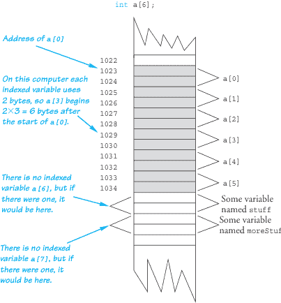

## PITFALL: 数组索引超出范围

在使用数组时最常见的编程错误是尝试引用不存在的数组索引。例如，考虑以下数组声明：

```
int a[6];
```

在使用数组 a 时，每个索引表达式必须求值为 0 到 5 之间的整数之一。例如，如果你的程序包含索引变量 a[i]，则 i 必须求值为六个整数 0、1、2、3、4 或 5 之一。如果 i 求值为其他任何值，那就是一个错误。当索引表达式求值为数组声明所允许的值之外的值时，该索引就被称为超出范围或简单地非法。在大多数系统上，非法数组索引的结果是你的程序只是做错了事，可能灾难性地做错，而且在没有给你任何警告的情况下就会这样做。

illegal array index

例如，假设你的系统是典型的，数组 a 按所示声明，并且你的程序包含以下内容：

```
a[i] = 238;
```

现在，假设 i 的值不幸地为 7。计算机 proceed 好像 a[7] 是一个合法的索引变量。计算机计算 a[7] 将在何处（如果只有 a[7] 存在的话）并将值 238 放在内存的该位置。然而，并不存在索引变量 a[7]，而接收这个 238 的内存可能属于某个其他变量，也许是一个名为 moreStuff 的变量。因此，moreStuff 的值已被无意中更改。这种情况在 Display 5.2 中有所说明。

数组索引最常在处理数组的循环的第一次或最后一次迭代时超出范围。因此，花时间仔细检查所有数组处理循环，以确保它们以合法的数组索引开始和结束是值得的。

## 基于范围的 for 循环

C++11 包含了一种新的 for 循环，即基于范围的 for 循环，它简化了对数组中每个元素的迭代。其语法如下所示：

```
for (datatype varname : array)
{
    // varname 被设置为数组中每个连续的元素
}
```

例如：

```
int arr[] = {20, 30, 40, 50};
for (int x : arr)
    cout << x << " ";
cout << endl;
```

输出将为 20 30 40 50。

在定义将遍历数组的变量时，我们可以使用在为函数定义参数时可用的相同修饰符。上面的示例等价于变量 x 的按值传递。如果你更改循环中的 x，这不会改变数组。我们可以使用 & 将 x 定义为按引用传递，那么对 x 的更改将反映到数组中。我们也可以使用 const 来表示变量不能被更改。下面示例递增数组中的每个元素然后输出它们。我们在输出循环中使用了 auto 数据类型以自动确定数组中元素的类型：

```
int arr[] = {20, 30, 40, 50};
for (int& x : arr)
    x++;
for (auto x : arr)
    cout << x << " ";
cout << endl;
```

这将输出 21 31 41 51。基于范围的 for 循环在遍历向量时尤其方便，向量将在第 7 章介绍，并在遍历容器时也很方便，容器将在第 19 章讨论。

## 初始化数组

数组可以在声明时进行初始化。在初始化数组时，各个索引变量的值用大括号括起来并用逗号分隔。例如，考虑以下内容：

```
int children[3] = {2, 12, 1};
```

之前的声明等价于以下代码：

```
int children[3];
children[0] = 2;
children[1] = 12;
children[2] = 1;
```

如果你列出的值少于索引变量的数量，则这些值将用于初始化前几个索引变量，而剩余的索引变量将被初始化为数组基本类型的零。在这种情况下，未提供初始值的索引变量将被初始化为零。然而，没有初始值的数组和其他在函数定义内声明的变量，包括程序的主函数，都不会被初始化。虽然数组索引变量（和其他变量）有时会被自动初始化为零，但你不能也不应该依赖它。

如果你在声明时初始化数组，可以省略数组的大小，数组将自动声明为足以容纳初始化值所需的最小大小。例如，以下声明

```
int b[] = {5, 12, 11};
```

等价于

```
int b[3] = {5, 12, 11};
```


## 自测练习

- 1. 描述 `int a[5];` 与 `a[4]` 的含义有何区别。在这两种情况下，`[5]` 和 `[4]` 分别表示什么？

- 2. 对于数组声明

  `double score[5];`

  指出以下各项：
  - a. 数组名
  - b. 基类型
  - c. 数组的声明大小
  - d. 访问该数组时下标可取值的范围
  - e. 该数组的一个下标变量（或元素）

- 3. 找出下列数组声明中的任何错误。
  - a. `int x[4] = { 8, 7, 6, 4, 3 };`
  - b. `int x[] = { 8, 7, 6, 4 };`
  - c. `const int SIZE = 4;`
    `int x[SIZE];`

- 4. 以下代码的输出是什么？

  ```
  char symbol[3] = {'a', 'b', 'c'};
  for (int index = 0; index < 3; index++)
      cout << symbol[index];
  ```

- 5. 以下代码的输出是什么？

  ```
  double a[3] = {1.1, 2.2, 3.3};
  cout << a[0] << " " << a[1] << " " << a[2] << endl;
  a[1] = a[2];
  cout << a[0] << " " << a[1] << " " << a[2] << endl;
  ```

- 6. 以下代码的输出是什么？

  ```
  int i, temp[10];
  for (i = 0; i < 10; i++)
      temp[i] = 2*i;
  for (i = 0; i < 10; i++)
      cout << temp[i] << " ";
  cout << endl;
  for (i = 0; i < 10; i = i + 2)
      cout << temp[i] << " ";
  ```

- 7. 下面的代码有什么问题？

  ```
  int sampleArray[10];
  for (int index = 1; index <= 10; index++)
      sampleArray[index] = 3*index;
  ```

- 8. 假设我们希望数组 a 的元素按如下顺序排列

  ```
  a[0] <= a[1] <= a[2] <= ...
  ```

  但为了安全起见，我们希望程序测试数组并在某些元素顺序不对时发出警告。下面的代码本应输出这样的警告，但它有一个 bug。请问 bug 是什么？

  ```
  double a[10];
  <此处为填充数组 a 的相同代码。>
  for (int index = 0; index < 10; index++)
      if (a[index] > a[index + 1])
          cout << "Array elements " << index << " and " << (index + 1) << " are out of order.";
  ```

- 9. 编写一些 C++ 代码，将从键盘读入的 20 个 int 类型值填充到数组 a 中。你不需要编写完整的程序，只需编写实现此功能的代码，但需要给出数组和所有变量的声明。

- 10. 假设你的程序中有以下数组声明：

  ```
  int yourArray[7];
  ```

  再假设在你的 C++ 实现中，int 类型变量占用两个字节的内存。运行程序时，这个数组会占用多少内存？假设运行程序时，系统将内存地址 1000 分配给下标变量 yourArray[0]。那么下标变量 yourArray[3] 的地址是多少？

## 5.2 函数中的数组

你可以将数组的下标变量和整个数组作为函数的参数。我们先讨论数组下标变量作为函数参数的情况。

### 下标变量作为函数参数

下标变量可以作为函数的参数，其方式与任何数组基类型变量作为参数完全相同。例如，假设程序包含以下声明：

```
double i, n, a[10];
```

如果 myFunction 接受一个 double 类型的参数，那么以下调用是合法的：

```
myFunction(n);
```

由于数组 a 的下标变量也是 double 类型的变量，就像 n 一样，因此以下调用同样合法：

```
myFunction(a[3]);
```

下标变量可以是按值传递参数，也可以是按引用传递参数。不过，当下标变量用作参数时有一个微妙之处。例如，考虑以下函数调用：

```
myFunction(a[i]);
```

如果 i 的值是 3，则参数是 a[3]。另一方面，如果 i 的值是 0，则此调用等价于：

```
myFunction(a[0]);
```

下标表达式会被求值，以确定具体哪个下标变量作为参数传递。

### 自测练习

- 11. 考虑以下函数定义：

  ```c
  void tripler(int& n)
  {
      n = 3 * n;
  }
  ```

  以下哪些是合法的函数调用？

  ```c
  int a[3] = {4, 5, 6}, number = 2;
  tripler(a[2]);
  tripler(a[3]);
  tripler(a[number]);
  tripler(a);
  tripler(number);
  ```

- 12. 下面的代码有什么问题（如果有的话）？`tripler` 的定义见自测练习 11。

  ```c
  int b[5] = {1, 2, 3, 4, 5};
  for (int i = 1; i <= 5; i++)
      tripler(b[i]);
  ```

### 整个数组作为函数参数

函数可以有一个形参用于表示整个数组，这样当函数被调用时，为该形参传入的参数就是一个完整的数组。然而，表示整个数组的形参既不是按值传递参数，也不是按引用传递参数；它是一种新的形参类型，称为数组参数。让我们从一个简单的例子开始。

显示 5.3 中定义的函数有一个数组参数 a，调用函数时该参数将被整个数组替换。它还有一个普通的按值传递参数（size），该参数被假定为一个等于数组大小的整数值。这个函数用从键盘输入的值填充其数组参数（即填充该数组的所有下标变量）；然后函数向屏幕输出一条消息，告知最后使用的数组下标。

形参 int a[] 是一个数组参数。方括号内不含下标表达式，这正是 C++ 用来表示数组参数的方式。数组参数并不完全是按引用传递参数，但在大多数实际用途中，它的行为非常类似于按引用传递参数。让我们详细分析这个例子，看看数组参数在这种情况下是如何工作的。（当然，数组参数就是为数组形参（如 a[]）所传入的数组。）

数组参数

### 显示 5.3 带数组参数的函数

函数声明

```cpp
void fillUp(int a[], int size);
//前置条件：size 是数组 a 的声明大小。
//用户将输入 size 个整数。
//后置条件：数组 a 被从键盘输入的 size 个整数填充。
```

```cpp
void fillUp(int a[], int size)
{
    cout << "Enter " << size << " numbers:\n";
    for (int i = 0; i < size; i++)
        cin >> a[i];
    cout << "The last array index used is " << (size - 1) << endl;
}
```

当调用函数 fillUp 时，它必须有两个参数：第一个给出一个整数数组，第二个应给出该数组的声明大小。例如，以下是一个可接受的函数调用：

```cpp
int score[5], numberOfScores = 5;
fillUp(score, numberOfScores);
```

何时使用 []

这次对 fillUp 的调用将用从键盘输入的五个整数填充数组 score。注意，形参 a[]（在函数声明和函数定义的头部中使用）在给出时带有方括号但不含下标表达式。（你可以为数组参数在方括号内放入一个数字，但编译器会直接忽略该数字，因此本书中我们不使用这样的数字。）另一方面，函数调用中给出的实参（本例中为 score）在给出时不带任何方括号或下标表达式。

在这个函数调用中，数组实参 score 会发生什么？粗略地说，实参 score 会被代入函数体中的数组形参 a，然后执行函数体。因此，函数调用

```cpp
fillUp(score, numberOfScores);
```

等价于以下代码：

```
{
    size = 5;
    cout << "Enter " << size << " numbers:\n";
    for (int i = 0; i < size; i++)
        cin >> score[i];
    cout << "The last array index used is " << (size - 1) << endl;
}
```

5 是 numberOfScores 的值。

形参 a 是一种与我们之前见过的参数不同的参数。形参 a 只是实参 score 的占位符。当函数 fillUp 以 score 作为数组实参被调用时，计算机的行为就像是将 a 替换为相应的实参 score。当数组在函数调用中用作实参时，对数组参数执行的任何操作都会作用于数组实参，因此函数可以改变数组实参的下标变量的值。如果函数体中的形参被改变（例如通过 cin 语句），那么数组实参也会被改变。

到目前为止，看起来数组参数只不过是一个用于数组的按引用传递参数。这几乎是对的，但数组参数与按引用传递参数略有不同。为了帮助解释这种差异，让我们回顾一些关于数组的细节。

内存中的数组

回想一下，数组是作为一块连续的内存存储的。例如，考虑以下数组 score 的声明：

```cpp
int score[5];
```

当你声明这个数组时，计算机会预留足够的内存来容纳五个 int 类型的变量，它们一个接一个地存储在计算机内存中。计算机不会记住这五个下标变量各自的地址；它只记住下标变量 score[0] 的地址。计算机还记住 score 总共有五个 int 类型的下标变量。它不记得除 score[0] 之外的任何下标变量在内存中的地址。例如，当你的程序需要 score[3] 时，计算机会从 score[0] 的地址计算出 score[3] 的地址。计算机知道 score[3] 位于 score[0] 之后三个 int 变量的位置。因此，要获得 score[3] 的地址，计算机会取 score[0] 的地址，然后加上一个表示三个 int 变量所占内存量的数字；结果就是 score[3] 的地址。


how much memory each indexed variable uses, but (unless you make special provisions) it does not know how many indexed variables the array has. That is why it is critical that you always have another int argument telling the function the size of the array. (That is also why an array parameter is not the same as a call-by-reference parameter. You can think of an array parameter as a weak form of call-by-reference parameter in which everything about the array is told to the function except for the size of the array.)²

Different size array arguments can be plugged in for the same array parameter

These array parameters may seem a little strange, but they have at least one very nice property as a direct result of their seemingly strange definition. This advantage is best illustrated by again looking at our example of the function fillUp given in Display 5.3. That same function can be used to fill an array of any size, as long as the base type of the array is int. For example, suppose you have the following array declarations:

```
int score[5], time[10];
```

The first of the following calls to fillUp fills the array score with five values, and the second fills the array time with ten values:

```
fillUp(score, 5);
fillUp(time, 10);
```

You can use the same function for array arguments of different sizes, because the size is a separate argument.

## Array Formal Parameters and Arguments

An argument to a function may be an entire array, but an argument for an entire array is neither a call-by-value argument nor a call-by-reference argument. It is a new kind of argument known as an array argument. When an array argument is plugged in for an array parameter, all that is given to the function is the address in memory of the first indexed variable of the array argument (the one indexed by 0). The array argument does not tell the function the size of the array. Therefore, when you have an array parameter to a function, you normally must also have another formal parameter of type int that gives the size of the array (as in the following example).

An array argument is like a call-by-reference argument in the following way: If the function body changes the array parameter, then when the function is called, that change is actually made to the array argument. Thus, a function can change the values of an array argument (that is, can change the values of its indexed variables).

The syntax for a function declaration with an array parameter is as follows.

SYNTAX
Type_Returned Function_Name(..., Base_Type Array_Name[ ],...);

EXAMPLE
void sumArray(double& sum, double a[ ], int size);

## The const Parameter Modifier

When you use an array argument in a function call, the function can change the values stored in the array. This is usually fine. However, in a complicated function definition, you might write code that inadvertently changes one or more of the values stored in an array even though the array should not be changed at all. As a precaution, you can tell the compiler that you do not intend to change the array argument, and the computer will then check to make sure your code does not inadvertently change any of the values in the array. To tell the compiler that an array argument should not be changed by your function, insert the modifier const before the array parameter for that argument position. An array parameter that is modified with a const is called a constant array parameter.

For example, the following function outputs the values in an array but does not change the values in the array:

```
void showTheWorld(int a[], int sizeOfa)
//Precondition: sizeOfa is the declared size of the array a.
//All indexed variables of a have been given values.
//Postcondition: The values in a have been written to the screen.
{
    cout << "The array contains the following values:\n";
    for (int i = 0; i < sizeOfa; i++)
        cout << a[i] << " ";
    cout << endl;
}
```

This function will work fine. However, as an added safety measure, you can add the modifier const to the function heading as follows:

```
void showTheWorld(const int a[], int sizeOfa)
```

With the addition of this modifier const, the computer will issue an error message if your function definition contains a mistake that changes any of the values in the array argument. For example, the following is a version of the function showTheWorld that contains a mistake that inadvertently changes the value of the array argument. Fortunately, this version of the function definition includes the modifier const, so that an error message will tell us that the array a has been changed. This error message will help to explain the mistake:

```
void showTheWorld(const int a[], int sizeOfa)
//Precondition: sizeOfa is the declared size of the array a.
//All indexed variables of a have been given values.
//Postcondition: The values in a have been written to the screen.
{
    cout << "The array contains the following values:\n";
    for (int i = 0; i < sizeOfa; a[i]++)
        cout << a[i] << " ";
    cout << endl;
}
```

Mistake, but the compiler will not catch it unless you use the const modifier.

If we had not used the const modifier in the previous function definition and if we made the mistake shown, the function would compile and run with no error messages. However, the code would contain an infinite loop that continually increments a[0] and writes its new value to the screen.

The problem with this incorrect version of showTheWorld is that the wrong item is incremented in the for loop. The indexed variable a[i] is incremented, but it should be the index i that is incremented. In this incorrect version, the index i starts with the value 0 and that value is never changed. But a[1], which is the same as a[0], is incremented. When the indexed variable a[i] is incremented, that changes a value in the array, and since we included the modifier const, the computer will issue a warning message. That error message should serve as a clue as to what is wrong.

You normally have a function declaration in your program in addition to the function definition. When you use the const modifier in a function definition, you must also use it in the function declaration so that the function heading and the function declaration are consistent.

The modifier const can be used with any kind of parameter, but it is normally used only with array parameters and call-by-reference parameters for classes, which are discussed in Chapters 6 and 7.

## PITFALL: Inconsistent Use of const Parameters

The const parameter modifier is an all-or-nothing proposition. If you use it for one array parameter of a particular type, then you should use it for every other array parameter that has that type and that is not changed by the function. The reason has to do with function calls within function calls. Consider the definition of the function showDifference, which is given here along with the declaration of a function used in the definition:

```
double computeAverage(int a[], int numberUsed);
//Returns the average of the elements in the first numberUsed
//elements of the array a. The array a is unchanged.

void showDifference(const int a[], int numberUsed)
{
    double average = computeAverage(a, numberUsed);
    cout << "Average of the " << numberUsed
         << " numbers = " << average << endl
         << "The numbers are:\n";
    for (int index = 0; index < numberUsed; index++)
        cout << a[index] << " differs from average by "
             << (a[index] - average) << endl;
}
```

The code shown will give an error message or warning message with most compilers. The function computeAverage does not change its parameter a. However, when the

compiler processes the function definition for showDifference, it will think that computeAverage does (or at least might) change the value of its parameter a. This is because when it is translating the function definition for showDifference, all the compiler knows about the function computeAverage is the function declaration for computeAverage, which does not contain a const to tell the compiler that the parameter a will not be changed. Thus, if you use const with the parameter a in the function showDifference, then you should also use the modifier const with the parameter a in the function computeAverage. The function declaration for computeAverage should be as follows:

```
double computeAverage(const int a[], int numberUsed);
```

## PITFALL: (continued)

## Functions That Return an Array

A function may not return an array in the same way that it returns a value of type int or double. There is a way to obtain something more or less equivalent to a function that returns an array. The thing to do is return a pointer to the array. We will discuss this topic when we discuss the interaction of arrays and pointers in Chapter 10. Until you learn about pointers, you have no way to write a function that returns an array.

## EXAMPLE: Production Graph

Display 5.4 contains a program that uses an array and a number of array parameters. This program for the Apex Plastic Spoon Manufacturing Company displays a bar graph showing the productivity of each of its four manufacturing plants for any given week. Plants keep separate production figures for each department, such as the teaspoon department, soup spoon department, plain cocktail spoon department, colored cocktail spoon department, and so forth. Moreover, each of the four plants has a different number of departments.

As you can see from the sample dialogue in Display 5.4, the graph uses one asterisk for each 1000 production units. Since output is in units of 1000, it must be scaled by dividing it by 1000. This presents a problem because the computer must display a whole number of asterisks. It cannot display 1.6 asterisks for 1600 units. We therefore round to the nearest thousand. Thus, 1600 will be the same as 2000 and will produce two asterisks.


# EXAMPLE: (continued)

由于输出以千为单位，程序将缩放数组元素的数值。如果工厂编号为 3 的总产量为 4040 单位，则 production[2] 的值最初将被设为 4040。4040 这个值随后将被缩放为 4，使得 production[2] 的值变为 4，并输出四个星号来表示工厂编号为 3 的产量。这种缩放由函数 scale 完成，该函数将整个数组 production 作为参数，并更改数组中存储的值。

函数 round 将其参数四舍五入到最接近的整数。例如，round(2.3) 返回 2，而 round(2.6) 返回 3。函数 round 在第 3 章中讨论过，在题为“A Rounding Function”的编程示例中。

## Display 5.4 Production Graph Program (part 1 of 4)

```
//Reads data and displays a bar graph showing productivity for each plant.
#include <iostream>
#include <cmath>
using namespace std;
const int NUMBER_OF_PLANTS = 4;

void inputData(int a[], int lastPlantNumber);
//Precondition: lastPlantNumber is the declared size of the array a.
//Postcondition: For plantNumber = 1 through lastPlantNumber:
//a[plantNumber-1] equals the total production for plant number
//plantNumber.

void scale(int a[], int size);
//Precondition: a[0] through a[size-1] each has a nonnegative value.
//Postcondition: a[i] has been changed to the number of 1000s (rounded to
//an integer) that were originally in a[i], for all i such that 0 <= i
//<= size-1.

void graph(const int asteriskCount[], int lastPlantNumber);
//Precondition: a[0] through a[lastPlantNumber-1] have nonnegative values.
//Postcondition: A bar graph has been displayed saying that plant
//number N has produced a[N-1] 1000s of units, for each N such that
//1 <= N <= lastPlantNumber

void getTotal(int& sum);
//Reads nonnegative integers from the keyboard and
//places their total in sum.

int round(double number);
//Precondition: number >= 0.
//Returns number rounded to the nearest integer.
```

## Display 5.4 Production Graph Program (part 2 of 4)

```
void printAsterisks(int n);
//Prints n asterisks to the screen.

int main()
{
    int production[NUMBER_OF_PLANTS];

    cout << "This program displays a graph showing\n"
        << "production for each plant in the company.\n";

    inputData(production, NUMBER_OF_PLANTS);
    scale(production, NUMBER_OF_PLANTS);
    graph(production, NUMBER_OF_PLANTS);
    return 0;
}

void inputData(int a[], int lastPlantNumber)
{
    for (int plantNumber = 1;
         plantNumber <= lastPlantNumber; plantNumber++)
    {
        cout << endl
            << "Enter production data for plant number "
            << plantNumber << endl;
        getTotal(a[plantNumber - 1]);
    }
}

void getTotal(int& sum)
{
    cout << "Enter number of units produced by each department.\n"
        << "Append a negative number to the end of the list.\n";

    sum = 0;
    int next;
    cin >> next;
    while (next >= 0)
    {
        sum = sum + next;
        cin >> next;
    }

    cout << "Total = " << sum << endl;
}

void scale(int a[], int size)
{
```

## Display 5.4 Production Graph Program (part 3 of 4)

```
for (int index = 0; index < size; index++)
    a[index] = round(a[index]/1000.0);

int round(double number)
{
    return static_cast<int>(floor(number + 0.5));
}

void graph(const int asteriskCount[], int lastPlantNumber)
{
    cout << "\nUnits produced in thousands of units.\n\n";
    for (int plantNumber = 1;
         plantNumber <= lastPlantNumber; plantNumber++)
    {
        cout << "Plant #" << plantNumber << " ";
        printAsterisks(asteriskCount[plantNumber - 1]);
        cout << endl;
    }
}

void printAsterisks(int n)
{
    for (int count = 1; count <= n; count++)
        cout << "*";
}
```

## Sample Dialogue

```
This program displays a graph showing
Production for each plant in the company.

Enter production data for plant number 1
Enter number of units produced by each department.
Append a negative number to the end of the list.
2000 3000 1000 -1
Total = 6000

Enter production data for plant number 2
Enter number of units produced by each department.
Append a negative number to the end of the list.
2050 3002 1300 -1
Total = 6352
```

## Display 5.4 Production Graph Program (part 4 of 4)

```
Enter production data for plant number 3
Enter number of units produced by each department.
Append a negative number to the end of the list.
5000 4020 500 4348 -1
Total = 13868

Enter production data for plant number 4
Enter number of units produced by each department.
Append a negative number to the end of the list.
2507 6050 1809 -1
Total = 10366

Units produced in thousands of units:

Plant #1 ******
Plant #2 *****
Plant #3 *************
Plant #4 **********
```

## Self-Test Exercises

- 13. 编写一个名为 `oneMore` 的函数定义，该函数有一个用于整数数组的形式参数，并将每个数组元素的值增加 1。添加所需的任何其他形式参数。
- 14. 考虑以下函数定义：

```
void too2(int a[], int howMany)
{
    for (int index = 0; index < howMany; index++)
        a[index] = 2;
}
```

以下哪些是可接受的函数调用？

```
int myArray[29];
too2(myArray, 29);
too2(myArray, 10);
too2(myArray, 55);
too2(myArray[], 10)
int yourArray[100];
too2(yourArray, 100);
too2(myArray[3], 29);
```

## Self-Test Exercises (continued)

15. 在以下可以更改为常量数组参数的数组参数前插入 const。

```
void output(double a[], int size);
```
//Precondition: a[0] through a[size - 1] have values.
//Postcondition: a[0] through a[size - 1] have been written out.

```
void dropOdd(int a[], int size);
```
//Precondition: a[0] through a[size - 1] have values.
//Postcondition: All odd numbers in a[0] through a[size - 1]
//have been changed to 0.

16. 编写一个名为 outOfOrder 的函数，该函数以 double 数组和一个名为 size 的 int 参数作为参数，并返回 int 类型的值。此函数将测试该数组是否乱序，即数组违反以下条件：

```
a[0] <= a[1] <= a[2] <= ...
```

如果元素未乱序，函数返回 -1；否则，它将返回数组中第一个乱序元素的索引。例如，考虑声明

```
double a[10] = {1.2, 2.1, 3.3, 2.5, 4.5,
                  7.9, 5.4, 8.7, 9.9, 1.0};
```

在前面的数组中，a[2] 和 a[3] 是第一个乱序的配对，a[3] 是第一个乱序的元素，因此函数返回 3。如果数组已排序，函数将返回 -1。

## 5.3 Programming with Arrays

> Never trust to general impressions, my boy, but concentrate yourself upon details.

SIR ARTHUR CONAN DOYLE, "A Case of Identity," The Adventures of Sherlock Holmes. George Newnes, 1892

本节讨论部分填充的数组，并简要介绍数组的排序和搜索。本节不包含关于 C++ 语言的新材料，但确实包含更多关于 C++ 数组参数的练习。

## Partially Filled Arrays

通常在编写程序时所需的确切数组大小是未知的，或者大小可能在程序的一次运行到另一次运行之间变化。处理这种情况的一种常见且简单的方法是声明数组的大小为程序可能需要的最大大小。程序随后可以自由使用所需的多或少的数组。

部分填充的数组需要谨慎处理。程序必须跟踪数组使用了多少，并且不得引用任何未赋值的索引变量。Display 5.5 中的程序说明了这一点。该程序读取高尔夫成绩列表并显示每个成绩与平均值的差异。该程序适用于短至一个成绩、长至十个成绩以及两者之间的任何长度的列表。成绩存储在数组 score 中，该数组有十个索引变量，但程序仅使用其需要的数组部分。变量 numberUsed 跟踪数组中存储了多少个元素。元素（即成绩）存储在位置 score[0] 到 score[numberUsed-1]。细节与 numberUsed 为数组的声明大小并且整个数组被使用时非常相似。特别是，变量 numberUsed 通常必须是操作部分填充数组的任何函数的参数。由于参数 numberUsed（在使用正确时）通常可以确保函数不会引用非法的数组索引，因此这有时（但并不总是）消除了提供数组声明大小的参数的需要。例如，函数 showDifference 和 computeAverage 使用参数 numberUsed 来确保仅使用合法的数组索引。然而，函数 fillArray 需要知道数组的最大声明大小，以便不填满数组。

## TIP: Do Not Skimp on Formal Parameters

注意 Display 5.5 中的函数 fillArray。当调用 fillArray 时，声明的数组大小 MAX_NUMBER_SCORES 作为参数之一给出，如 Display 5.5 中以下函数调用所示：

fillArray(score, MAX_NUMBER_SCORES, numberUsed);

你可能会抗议说 MAX_NUMBER_SCORES 是一个全局定义的常量，因此它可以在 fillArray 的定义中使用，而无需将其作为参数。你是对的，如果我们不将 fillArray 用于 Display 5.5 以外的任何程序，我们可以在不将 MAX_NUMBER_SCORES 作为 fillArray 的参数的情况下应付。然而，fillArray 是一个通用有用的函数，你可能希望在多个程序中使用它。我们事实上也在下一小节讨论的 Display 5.6 中的程序中使用了函数 fillArray。在 Display 5.6 的程序中，声明数组大小的参数是一个不同的命名全局常量。如果我们在函数 fillArray 的主体中写入全局常量 MAX_NUMBER_SCORES，我们将无法在 Display 5.6 的程序中重用该函数。

即使我们仅在一个程序中使用 fillArray，将声明的数组大小作为 fillArray 的参数仍然是一个好主意。将数组的声明大小显示为参数提醒我们函数以关键重要的方式需要此信息。


## 显示 5.5 部分填充的数组（第 1 部分，共 2 部分）

```
1 //Shows the difference between each of a list of golf scores and
//their average.
2 #include <iostream>
3 using namespace std;
4 const int MAX_NUMBER_SCORES = 10;
5 void fillArray(int a[], int size, int& numberUsed);
6 //Precondition: size is the declared size of the array a.
7 //Postcondition: numberUsed is the number of values stored in a.
8 //a[0] through a[numberUsed-1] have been filled with
9 //nonnegative integers read from the keyboard.
10 double computeAverage(const int a[], int numberUsed);
11 //Precondition: a[0] through a[numberUsed-1] have values;
12 //Returns the average of numbers a[0] through a[numberUsed-1].
13 void showDifference(const int a[], int numberUsed);
14 //Precondition: The first numberUsed indexed variables of a have values.
15 //Postcondition: Gives screen output showing how much each of the first
16 //numberUsed elements of the array a differs from their average.
17 int main()
18 {
19     int score[MAX_NUMBER_SCORES], numberUsed;
20     cout << "This program reads golf scores and shows\n"
21          << "how much each differs from the average.\n";
22
23     cout << "Enter golf scores:\n";
24
25     fillArray(score, MAX_NUMBER_SCORES, numberUsed);
26     showDifference(score, numberUsed);
27
28     return 0;
29 }
30 void fillArray(int a[], int size, int& numberUsed)
31 {
32     cout << "Enter up to " << size << " nonnegative whole numbers.\n"
33          << "Mark the end of the list with a negative number.\n";
34     int next, index = 0;
35     cin >> next;
36     while ((next >= 0) && (index < size))
37     {
38         a[index] = next;
39         index++;
40         cin >> next;
41     }
```

## 显示 5.5 部分填充的数组（第 2 部分，共 2 部分）

```
39      numberUsed = index;
40 }

41 double computeAverage(const int a[], int numberUsed)
42 {
43     double total = 0;
44     for (int index = 0; index < numberUsed; index++)
45         total = total + a[index];
46     if (numberUsed > 0)
47     {
48         return (total/numberUsed);
49     }
50     else
51     {
52         cout << "ERROR: number of elements is 0 in computeAverage.\n"
53             << "computeAverage returns 0.\n";
54         return 0;
55     }
56 }

57 void showDifference(const int a[], int numberUsed)
58 {
59     double average = computeAverage(a, numberUsed);
60     cout << "Average of the " << numberUsed
61         << " scores = " << average << endl
62         << "The scores are:\n";
63     for (int index = 0; index < numberUsed; index++)
64     cout << a[index] << " differs from average by "
65         << (a[index] - average) << endl;
66 }
```

### 示例对话

```
This program reads golf scores and shows
how much each differs from the average.
Enter golf scores:
Enter up to 10 nonnegative whole numbers.
Mark the end of the list with a negative number.
69 74 68 -1
Average of the 3 scores = 70.3333
The scores are:
69 differs from average by -1.33333
74 differs from average by 3.66667
68 differs from average by -2.33333
```

## 示例：搜索数组

搜索数组中给定值是一个常见的编程任务。例如，数组可能包含某门课程中所有学生的学号。为了判断某个特定学生是否已注册，搜索数组以查看是否包含该学生的号码。显示 5.6 中的简单程序填充一个数组，然后根据用户指定的值搜索该数组。实际的应用程序会复杂得多，但这展示了顺序搜索算法的所有要点。顺序搜索是你能想象到的最直接的搜索算法：程序按顺序查看数组元素，从第一个到最后一个，以查看目标数字是否等于任何数组元素。

在显示 5.6 中，使用函数 search 来搜索数组。搜索数组时，你通常想要知道的不仅仅是目标值是否在数组中。如果目标值在数组中，你通常还想知道保存该目标值的索引变量的索引，因为该索引可能作为有关目标值的其他信息的指南。因此，我们设计了函数 search，使其返回一个索引，表示目标值在数组中的位置，前提是目标值确实在数组中。如果目标值不在数组中，search 返回 -1。让我们更详细地看看函数 search。

函数 search 使用 while 循环逐个检查数组元素，以查看其中是否有一个等于目标值。变量 found 用作标志，记录目标元素是否已被找到。如果在数组中找到目标元素，found 将被设置为 true，这反过来会结束 while 循环。

## 显示 5.6 搜索数组（第 1 部分，共 3 部分）

```
1 //Searches a partially filled array of nonnegative integers.
2 #include <iostream>
3 using namespace std;
4 const int DECLARED_SIZE = 20;

5 void fillArray(int a[], int size, int& numberUsed);
6 //Precondition: size is the declared size of the array a.
7 //Postcondition: numberUsed is the number of values stored in a.
8 //a[0] through a[numberUsed-1] have been filled with
9 //nonnegative integers read from the keyboard.

10 int search(const int a[], int numberUsed, int target);
11 //Precondition: numberUsed is <= the declared size of a.
12 //Also, a[0] through a[numberUsed -1] have values.
13 //Returns the first index such that a[index] == target,
14 //provided there is such an index; otherwise, returns -1.
```

## 显示 5.6 搜索数组（第 2 部分，共 3 部分）

```
15 int main()
16 {
17     int arr[DECLARED_SIZE], listSize, target;
18
19     fillArray(arr, DECLARED_SIZE, listSize);
20
21     char ans;
22     int result;
23     do
24     {
25         cout << "Enter a number to search for: ";
26         cin >> target;
27
28         result = search(arr, listSize, target);
29         if (result == -1)
30             cout << target << " is not on the list.\n";
31         else
32             cout << target << " is stored in array position "
33                 << result << endl
34                 << "(Remember: The first position is 0.)\n";
35         cout << "Search again?(y/n followed by Return): ";
36         cin >> ans;
37     } while ((ans != 'n') && (ans != 'N'));
38     cout << "End of program.\n";
39     return 0;
40 }
41
42 void fillArray(int a[], int size, int & numberUsed)
43 <The rest of the definition of fillArray is given in Display 5.5>
44
45 int search(const int a[], int numberUsed, int target)
46 {
47     int index = 0;
48     bool found = false;
49     while ((!found) && (index < numberUsed))
50         if (target == a[index])
51             found = true;
52         else
53             index++;
54
55     if (found)
56         return index;
57     else
58         return -1;
59 }
```

## 显示 5.6 搜索数组（第 3 部分，共 3 部分）

### 示例对话

```
Enter up to 20 nonnegative whole numbers.
Mark the end of the list with a negative number.
10 20 30 40 50 60 70 80 -1
Enter a number to search for: 10
10 is stored in array position 0
(Remember: The first position is 0.)
Search again?(y/n followed by Return): y
Enter a number to search for: 40
40 is stored in array position 3
(Remember: The first position is 0.)
Search again?(y/n followed by Return): y
Enter a number to search for: 42
42 is not on the list.
Search again?(y/n followed by Return): n
End of program.
```

## 示例：排序数组

对值列表进行排序是最常见的编程任务之一，也是研究最透彻的任务之一，例如必须从低到高或从高到低排序的销售额列表，或必须按字母顺序排序的单词列表。本示例描述了一个函数 sort，它将部分填充的数字数组排序为从小到大。

函数 sort 有一个数组参数 a。数组 a 将是部分填充的，因此还有一个额外的形式参数称为 numberUsed，告诉有多少个数组位置被使用。因此，函数 sort 的声明和前置条件如下：

```
void sort(int a[], int numberUsed);
//Precondition: numberUsed <= declared size of the array a.
//The array elements a[0] through a[numberUsed-1] have values.
```

函数 sort 重新排列数组 a 中的元素，以便在函数调用完成后，元素按如下方式排序：

a[0] ≤ a[1] ≤ a[2] ≤ ... ≤ a[numberUsed - 1]

我们用来进行排序的算法称为选择排序。它是理解起来最简单的排序算法之一。


## EXAMPLE: (continued)

一种设计算法的方法是依赖于问题的定义。在本例中，问题是对数组 a 从小到大进行排序。这意味着重新排列值，使得 a[0] 是最小的，a[1] 是次小的，以此类推。该定义给出了选择排序算法的大纲：

```
for (int index = 0; index < numberUsed; index++)
    Place the indexth smallest element in a[index]
```

实现这一通用方法的方式有很多。细节可以使用两个数组并以排序顺序从一个数组复制元素到另一个数组来开发，但一个数组应该足够且经济。因此，函数 sort 只使用包含要排序的值的那个数组。函数 sort 通过交换值对来重新排列数组 a 中的值。让我们通过一个具体的例子来说明算法的工作原理。

考虑 Display 5.7 中显示的数组。算法将把最小值放在 a[0] 中。最小值是 a[3] 中的值，因此算法交换 a[0] 和 a[3] 的值。然后算法寻找下一个最小的元素。a[0] 中的值现在是最小元素，因此下一个最小的元素是剩余元素 a[1]、a[2]、a[3]、...、a[9] 中最小的。在 Display 5.7 的示例中，下一个最小的元素在 a[5] 中，因此算法交换 a[1] 和 a[5] 的值。第二个最小元素的定位如图 Display 5.7 中的第四和第五个数组图所示。然后算法定位第三个最小的元素，以此类推。随着排序的进行，开始的数组元素被设为正确的排序值。已排序的数组部分通过从未排序的数组末尾逐个添加元素而增长。请注意，算法无需对最后一个索引变量 a[9] 的值做任何事情。一旦其他元素被正确定位，a[9] 也必须具有正确的值。毕竟，a[9] 的正确值是剩余待移动的最小值，而唯一剩余待移动的值就是已经在 a[9] 中的值。

函数 sort 的定义包含在一个演示程序中，给出在 Display 5.8 中。sort 使用函数 indexOfSmallest 来查找数组未排序末尾的最小元素的索引，然后执行交换以将这个下一个最小元素移入已排序的数组部分。

函数 swapValues，如 Display 5.8 所示，用于交换索引变量的值。例如，以下调用将交换 a[0] 和 a[3] 的值：

```
swapValues(a[0], a[3]);
```

函数 swapValues 在第 4 章中进行了说明。

## Display 5.8 Sorting an Array (part 2 of 3)

```
20 int main()
21 {
22     cout << "This program sorts numbers from lowest to highest.\n";
23     int sampleArray[10], numberUsed;
24     fillArray(sampleArray, 10, numberUsed);
25     sort(sampleArray, numberUsed);
26     cout << "In sorted order the numbers are:\n";
27     for (int index = 0; index < numberUsed; index++)
28         cout << sampleArray[index] << " ";
29     cout << endl;
30     return 0;
31 }
32 
33 void fillArray(int a[], int size, int& numberUsed)
34     <The rest of the definition of fillArray is given in Display 5.5.>
35 
34 void sort(int a[], int numberUsed)
35 {
36     int indexOfNextSmallest;
37     for (int index = 0; index < numberUsed - 1; index++)
38         {//Place the correct value in a[index]:
39         indexOfNextSmallest =
40             indexOfSmallest(a, index, numberUsed);
41         swapValues(a[index], a[indexOfNextSmallest]);
42         //a[0] <= a[1] <= ... <= a[index] are the smallest of the
43         //original array elements. The rest of the
44         //elements are in the remaining positions.
45     }
46 }
47 
46 void swapValues(int& v1, int& v2)
47 {
48     int temp;
49     temp = v1;
50     v1 = v2;
51     v2 = temp;
52 }
53 
54 int indexOfSmallest(const int a[], int startIndex, int numberUsed)
55 {
56     int min = a[startIndex],
57     indexOfMin = startIndex;
```

## Display 5.8 Sorting an Array (part 3 of 3)

```
58  for (int index = startIndex + 1; index < numberUsed; index++)
59      if (a[index] < min)
60      {
61          min = a[index];
62          indexOfMin = index;
63          //min is the smallest of a[startIndex] through a[index]
64      }
65  
65  return indexOfMin;
66 }
```

## Sample Dialogue

```
This program sorts numbers from lowest to highest.
Enter up to 10 nonnegative whole numbers.
Mark the end of the list with a negative number.
80 30 50 70 60 90 20 30 40 -1
In sorted order the numbers are:
20 30 30 40 50 60 70 80 90
```

## EXAMPLE: Bubble Sort

我们刚刚描述的选择排序算法并不是排序数组的唯一方法。事实上，计算机科学家已经设计了数十种排序算法！其中一些算法比其他算法更高效，有些仅适用于特定类型的数据。冒泡排序是一种简单且通用的排序算法，与选择排序类似。

如果我们使用冒泡排序按升序对数组进行排序，则最大值会依次“冒泡”到数组末尾。例如，如果我们从由以下整数组成的未排序数组开始：
Initial array: {3, 10, 9, 2, 5}
那么在第一次遍历后，我们将把最大值 10 移到数组末尾：
After first pass: {3, 9, 2, 5, 10}
第二次遍历将把第二大值 9 移到数组倒数第二个索引：
After second pass: {3, 2, 5, 9, 10}

VideoNote
Bubble Sort
Walkthrough

第三次遍历将把第三大值 5 移到数组倒数第三个索引（它已经在那里）：

After third pass: {2, 3, 5, 9, 10}

第四次遍历将把第四大值 3 移到数组倒数第四个索引（它已经在那里）：

After fourth pass: {2, 3, 5, 9, 10}

此时算法完成。数组开头剩余的数字无需检查，因为它是唯一剩下的数字，必须是最小的。

要基于冒泡排序设计程序，请注意我们将最大项放在索引 length-1，第二大项放在 length-2，接下来放在 length-3，等等。这对应于一个从数组索引 length-1 开始并递减到索引 1 的循环。我们不需要包含索引 0，因为那里将包含最小元素。实现循环的一种方法是使用以下代码，其中变量 i 对应目标索引：

```
for (int i = length-1; i > 0; i--)
```

冒泡排序中的“冒泡”部分发生在该循环的每次迭代内部。冒泡步骤由另一个循环组成，该循环将最大数字向数组末尾移动。首先，索引 0 和索引 1 之间的最大数字将被冒泡到索引 1。我们通过比较索引 0 处的数字与索引 1 处的数字开始冒泡过程。如果索引 0 处的数字大于索引 1 处的数字，则交换值，从而使较大数字位于索引 1。如果索引 0 处的数字小于或等于索引 1 处的数字，则什么也不发生。我们从以下未排序数组开始：

Initial array: {3, 10, 9, 2, 5}

冒泡过程的第一步将比较 3 和 10。由于 10 > 3，什么也不发生，结果是数字 10 位于索引 1：

After step 1: {3, 10, 9, 2, 5}

## 1. 引言

本文档旨在介绍一种新型的文档解析方法，该方法能够高效地从复杂版面中提取结构化信息。该方法结合了深度学习与传统规则，适用于多种文档类型。

- 支持标题、段落、表格等元素的识别
- 支持阅读顺序的还原
- 支持版面方向（横/竖）的自动判断

| 方法 | 准确率 | 召回率 |
|------|--------|--------|
| 传统方法 | 85% | 80% |
| 深度方法 | 95% | 92% |

> > 注意：本方法在扫描件上的效果优于纯文本文件。

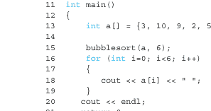

```
```
```python
import docx
print("Hello, world!")
```
```

综上所述，该方法在文档解析任务中表现优异，未来可进一步扩展到多模态场景。


## 显示 5.9 冒泡排序程序（第 2 部分，共 2 部分）

```cpp
25 {
26     // Bubble largest number toward the right
27     for (int i = length-1; i > 0; i--)
28         for (int j = 0; j < i; j++)
29             if (arr[j] > arr[j+1])
30             {
31                 // Swap the numbers
32                 int temp = arr[j+1];
33                 arr[j+1] = arr[j];
34                 arr[j] = temp;
35             }
36 }
```

## 示例对话

1 2 3 5 9 10

## 自测练习

- 17. 编写一个程序，将最多十个非负整数读入名为 numberArray 的数组中，然后将整数写回屏幕。对于此练习，您无需使用任何函数。这只是一个玩具程序，可以非常简约。

- 18. 编写一个程序，将最多十个字母读入数组中，并以相反顺序将字母写回屏幕。例如，如果输入是 abcd，则输出应为 dcba。使用句点作为哨兵值来标记输入的结束。将数组命名为 letterBox。对于此练习，您无需使用任何函数。这只是一个玩具程序，可以非常简约。

- 19. 以下是显示 5.6 中定义的函数 search 的替代版本的声明。为了使用 search 函数的此替代版本，我们需要稍微重写程序，但对于此练习，您只需为 search 的此替代版本编写函数定义即可。

```cpp
bool search(const int a[], int numberUsed,
    int target, int& where);
//Precondition: numberUsed is <= the declared size of the
//array a. Also, a[0] through a[numberUsed -1] have values.
//Postcondition: If target is one of the elements a[0]
//through a[numberUsed -1], then this function returns
//true and sets the value of where so that a[where] ==
//target; otherwise, this function returns false and the
//value of where is unchanged.
```

## 5.4 多维数组

C++ 允许您声明具有一个以上索引的数组。本节描述这些多维数组。

### 多维数组基础

有时拥有一个具有多个索引的数组是有用的，而在 C++ 中这是允许的。以下声明了一个名为 page 的字符数组。数组 page 有两个索引：第一个索引范围从 0 到 29，第二个从 0 到 99。

```cpp
char page[30][100];
```

此数组的索引变量每个都有两个索引。例如，page[0][0]、page[15][32] 和 page[29][99] 是此数组的三个索引变量。请注意，每个索引必须用自己的方括号括起来。正如我们已经看到的一维数组一样，多维数组的每个索引变量都是基类型的变量。

一个数组可以有任意数量的索引，但也许最常见的索引数量是两个。可以用二维显示来可视化二维数组，其中第一个索引给出行，第二个索引给出列。例如，可以将二维数组 page 的数组索引变量可视化如下：

```cpp
page[0][0], page[0][1], ..., page[0][99]
page[1][0], page[1][1], ..., page[1][99]
page[2][0], page[2][1], ..., page[2][99]
.
.
.
page[29][0], page[29][1], ..., page[29][99]
```

您可能会使用数组 page 来存储文本页上的所有字符，该页有 30 行（编号为 0 到 29），每行有 100 个字符（编号为 0 到 99）。

array declarations

indexed variables

在 C++ 中，像 page 这样的二维数组实际上是数组的数组。所示的数组类型实际上是一个大小为 30 的一维数组，其基类型是大小为 100 的字符一维数组。通常，这不必让您担心，您通常可以假装数组 page 是一个具有两个索引的数组（而不是更难跟踪的数组的数组）。然而，至少有一种情况，二维数组看起来非常像数组的数组，那就是当您有一个函数具有二维数组的数组参数时，这将在下一小节中讨论。

### 多维数组声明

**SYNTAX**

_Type Array_Name[Size_Dim_1][Size_Dim_2]...[Size_Dim_Last];_

**EXAMPLES**

```cpp
char page[30][100];
int matrix[2][3];
double threeD[10][20][30];
```

这种形式的数组声明将为每种数组索引组合定义一个索引变量。例如，前一个示例声明中的第二个定义了数组 matrix 的以下六个索引变量：

```cpp
matrix[0][0], matrix[0][1], matrix[0][2],
matrix[1][0], matrix[1][1], matrix[1][2]
```

### 多维数组参数

以下对二维数组的声明实际上声明了一个大小为 30 的一维数组，其基类型是大小为 100 的字符一维数组：

```cpp
char page[30][100];
```

将二维数组视为数组的数组将帮助您理解 C++ 如何处理多维数组的参数。

例如，以下是一个接受像 page 这样的数组并将其打印到屏幕上的函数：

```cpp
void displayPage(const char p[][100], int sizeDimension1)
{
    for (int index1 = 0; index1 < sizeDimension1; index1++)
    {
        // Printing one line:
        for (int index2 = 0; index2 < 100; index2++)
            cout << p[index1][index2];
        cout << endl;
    }
}
```

请注意，对于二维数组参数，第一个维度的大小没有给出，因此我们必须包含一个 int 参数来给出此第一个维度的大小。（与普通数组一样，编译器允许您通过在第一个方括号对中放置一个数字来指定第一个维度。然而，这样的数字只是一个注释；编译器会忽略该数字。）第二个维度（如果有超过两个维度，则所有其他维度）的大小在数组参数之后给出，如参数所示

```cpp
const char p[][100]
```

如果您意识到多维数组是数组的数组，那么这条规则就开始有意义了。由于二维数组参数

```cpp
const char p[][100]
```

是数组的数组的参数，第一个维度实际上是数组的索引，并像普通一维数组的数组索引一样处理。第二个维度是基类型描述的一部分，即大小为 100 的字符数组。

### 多维数组参数

当在函数头或函数声明中给出多维数组参数时，第一个维度的大小没有给出，但其余维度的大小必须在方括号中给出。由于第一个维度大小没有给出，您通常需要一个额外的 int 类型的参数来给出此第一个维度的大小。以下是一个具有二维数组参数 p 的函数声明的示例：

```cpp
void getPage(char p[][100], int sizeDimension1);
```

### 示例：二维成绩程序

显示 5.10 包含一个程序，该程序使用名为 grade 的二维数组来存储然后显示一个小班的成绩记录。该班有四名学生，记录包括三次测验。显示 5.11 说明了数组 grade 如何用于存储数据。第一个数组索引用于指定学生，第二个数组索引用于指定测验。由于学生和测验的编号从 1 开始而不是从 0 开始，我们必须从学生编号中减去 1，并从测验编号中减去 1 才能获得存储特定测验成绩的索引变量。例如，学生编号 4 在测验编号 1 上获得的成绩记录在 grade[3][0] 中。

我们的程序还使用了两个普通的一维数组。数组 stAve 将用于记录每位学生的平均测验成绩。例如，程序将把 stAve[0] 设置为学生 1 获得的测验成绩的平均值，stAve[1] 设置为学生 2 获得的测验成绩的平均值，


## 示例：（续）

以此类推。数组quizAve将用于记录每次测验的平均分。例如，程序会将quizAve[0]设置为测验1所有学生分数的平均值，quizAve[1]记录测验2的平均分，以此类推。图5.11展示了数组grade、stAve和quizAve之间的关系。该图显示了数组grade的一些示例数据。这些数据进而决定了程序在stAve和quizAve中存储的值。图5.12也显示了这些值，即程序为stAve和quizAve计算出的值。

完整的程序——先填充数组grade，然后计算并显示学生平均分和测验平均分——如程序清单5.10所示。在该程序中，我们将数组维度声明为全局命名常量。由于这些过程特定于此程序，不能在其他地方重用，我们在过程体中使用这些全局定义的常量，而不是为数组维度大小设置参数。由于这是常规操作，该程序清单没有显示填充数组的代码。

### 程序清单5.10 二维数组

```
//Reads quiz scores for each student into the two-dimensional array
//grade (but the input code is not shown in this display).
//Computes the average score for each student and the average score
//for each quiz. Displays the quiz scores and the averages.
#include <iostream>
#include <iomanip>
using namespace std;
const int NUMBER_STUDENTS = 4, NUMBER_QUIZZES = 3;
void computeStAve(const int grade[][NUMBER_QUIZZES], double stAve[]);
//Precondition: Global constants NUMBER_STUDENTS and NUMBER_QUIZZES
//are the dimensions of the array grade. Each of the indexed variables
//grade[stNum-1, quizNum-1] contains the score for student stNum on
//quiz quizNum.
//Postcondition: Each stAve[stNum-1] contains the average for student
//number stNum.
void computeQuizAve(const int grade[][NUMBER_QUIZZES],
                    double quizAve[]);
//Precondition: Global constants NUMBER_STUDENTS and NUMBER_QUIZZES
//are the dimensions of the array grade. Each of the indexed variables
//grade[stNum-1, quizNum-1] contains the score for student stNum on
//quiz quizNum.
//Postcondition: Each quizAve[quizNum-1] contains the average for
//quiz numbered quizNum.
void display(const int grade[][NUMBER_QUIZZES],
             const double stAve[],
             const double quizAve[]);
//Precondition: Global constants NUMBER_STUDENTS and NUMBER_QUIZZES
//are the dimensions of the array grade. Each of the indexed variables
//grade[stNum-1, quizNum-1] contains the score for student stNum on
//quiz quizNum. Each stAve[stNum-1] contains the average for student
//stNum. Each quizAve[quizNum-1] contains the average for quiz
//numbered quizNum.
//Postcondition: All the data in grade, stAve, and quizAve have been
//output.
int main()
{
    int grade[NUMBER_STUDENTS][NUMBER_QUIZZES];
    double stAve[NUMBER_STUDENTS];
    double quizAve[NUMBER_QUIZZES];

    <The code for filling the array grade goes here, but is not shown.>

    computeStAve(grade, stAve);
    computeQuizAve(grade, quizAve);
    display(grade, stAve, quizAve);
    return 0;
}
void computeStAve(const int grade[][NUMBER_QUIZZES], double stAve[])
{
    for (int stNum = 1; stNum <= NUMBER_STUDENTS; stNum++)
    {//Process one stNum:
        double sum = 0;
        for (int quizNum = 1; quizNum <= NUMBER_QUIZZES; quizNum++)
            sum = sum + grade[stNum-1][quizNum-1];
        //sum contains the sum of the grades for student number stNum.
        stAve[stNum-1] = sum/NUMBER_QUIZZES;
        //Average for student stNum is the value of stAve[stNum-1]
    }
}

void computeQuizAve(const int grade[][NUMBER_QUIZZES],
                    double quizAve[])
{
    for (int quizNum = 1; quizNum <= NUMBER_QUIZZES; quizNum++)
    {//Process one quiz (for all students):
        double sum = 0;
        for (int stNum = 1; stNum <= NUMBER_STUDENTS; stNum++)
            sum = sum + grade[stNum-1][quizNum-1];
        //sum contains the sum of all student scores on quiz number
        //quizNum.
        quizAve[quizNum-1] = sum/NUMBER_STUDENTS;
        //Average for quiz quizNum is the value of quizAve[quizNum-1]
    }
}
void display(const int grade[][NUMBER_QUIZZES],
             const double stAve[], const double quizAve[])
{
    cout.setf(ios::fixed);
    cout.setf(ios::showpoint);
    cout.precision(1);

    cout << setw(10) << "Student"
         << setw(5) << "Ave"
         << setw(15) << "Quizzes\n";
    for (int stNum = 1; stNum <= NUMBER_STUDENTS; stNum++)
    {//Display for one stNum:
        cout << setw(10) << stNum
             << setw(5) << stAve[stNum-1] << " ";
        for (int quizNum = 1; quizNum <= NUMBER_QUIZZES; quizNum++)
            cout << setw(5) << grade[stNum-1][quizNum-1];
    }

    cout << "Quiz averages = ";
    for (int quizNum = 1; quizNum <= NUMBER_QUIZZES; quizNum++)
        cout << setw(5) << quizAve[quizNum-1];
}
```

### 示例对话

> <填充数组grade的对话未显示。>

| 学生 | 平均 | 测验 |  |  |
|---------|-----|---------|------|------|
| 1 | 10.0 | 10 | 10 | 10 |
| 2 | 1.0 | 2 | 0 | 1 |
| 3 | 7.7 | 8 | 6 | 9 |
| 4 | 7.3 | 8 | 4 | 10 |
| 测验平均分 = |  | 7.0 | 5.0 | 7.5 |

### 图5.11 二维数组 `grade`

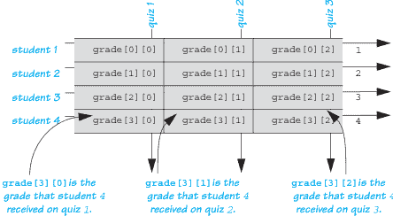

### 图5.12 二维数组 `grade`

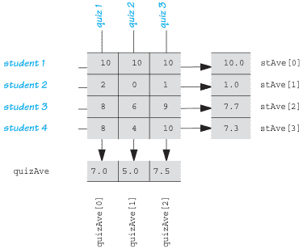

## 自测练习

20. 以下代码产生的输出是什么？

```
int myArray[4][4], index1, index2;
for (index1 = 0; index1 < 4; index1++)
    for (index2 = 0; index2 < 4; index2++)
        myArray[index1][index2] = index2;
for (index1 = 0; index1 < 4; index1++)
{
    for(index2 = 0; index2 < 4; index2++)
        cout << myArray[index1][index2] << " ";
    cout << endl;
}
```

21. 编写代码，用键盘输入的数字填充数组a（声明如下）。数字将以每行五个、共四行的方式输入（尽管你的解决方案不必依赖于输入数字如何分行）。

```
int a[4][5];
```

22. 为名为echo的void函数编写函数定义，使得以下函数调用能回显自测练习21中描述的输入，并以我们为输入指定的相同格式回显它（即每行五个数字，共四行）：

```
echo(a, 4);
```

## 章节总结

-   数组可用于存储和操作一组类型相同的数据。
-   数组的下标变量可以像数组基类型的任何其他变量一样使用。
-   for循环是遍历数组元素并对每个下标变量执行某些程序操作的好方法。
-   使用数组时最常见的编程错误是试图访问不存在的数组下标。始终检查操作数组的循环的第一次和最后一次迭代，以确保它没有使用非法过小或过大的下标。
-   数组形参既不是按值传递参数，也不是按引用传递参数，而是一种新型参数。数组参数类似于按引用传递参数，因为对函数体内的形参所做的任何更改，在调用函数时都会作用于数组实参。

## 1. 项目背景

本项目旨在开发一个智能文档处理系统，用于自动从各种文档中提取、分类和归档关键信息。该系统基于深度学习技术，可处理扫描文档、照片和电子文档等多种格式。

## 2. 系统架构

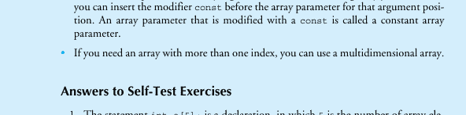

系统采用微服务架构，主要包括以下核心模块：

- 文档解析模块：负责将不同格式的文档转换为统一的文本表示
- 信息提取模块：使用NLP技术从文档中提取关键实体和关系
- 分类归档模块：根据预设规则自动对文档进行分类和存储
- 接口服务模块：提供RESTful API供外部系统调用

## 3. 技术选型

| 模块 | 技术栈 | 描述 |
|--------|------------------|-------------|
| 前端 | React + TypeScript | 提供可视化操作界面 |
| 后端 | Python + FastAPI | 高性能异步框架 |
| 数据库 | PostgreSQL + Redis | 关系型与缓存组合 |
| 部署 | Docker + Kubernetes | 容器化与自动伸缩 |


8. 存在索引越界。当 index 等于 9 时，index + 1 等于 10，因此 a[index + 1]，即 a[10]，具有非法的索引。循环应少一次迭代即可停止。要修正代码，将 for 循环的第一行改为

```
for (int index = 0; index < 9; index++)
```

9.

```
int i, a[20];
cout << "Enter 20 numbers:\n";
for (i = 0; i < 20; i++)
    cin >> a[i];
```

10. 该数组将消耗 14 字节的内存。索引变量 yourArray[3] 的地址是 1006。

11. 以下函数调用是可以接受的：

```
tripler(a[2]);
tripler(a[number]);
tripler(number);
```

以下函数调用是不正确的：

```
tripler(a[3]);
tripler(a);
```

第一个具有非法的索引。第二个根本没有索引表达式。你不能像第二个调用那样使用整个数组作为 tripler 的参数。章节“Entire Arrays as Function Arguments”讨论了可以把整个数组作为参数使用的不同情况。

12. 循环遍历索引变量 b[1] 到 b[5]，但 5 对于数组 b 来说是非法索引。索引为 0、1、2、3 和 4。代码的正确版本如下所示：

```
int b[5] = {1, 2, 3, 4, 5};
for (int i = 0; i < 5; i++)
    tripler(b[i]);
```

13.

```
void oneMore(int a[], int size)
//Precondition: size is the declared size of the array a.
//a[0] through a[size-1] have been given values.
//Postcondition: a[index] has been increased by 1
//for all indexed variables of a.
{
    for (int index = 0; index < size; index++)
        a[index] = a[index] + 1;
}
```

14. 以下函数调用都是可以接受的：

```
too2(myArray, 29);
too2(myArray, 10);
too2(yourArray, 100);
```

调用

```
too2(myArray, 10);
```

是合法的，但只会填充 myArray 的前十个索引变量。如果这是期望的结果，则该调用是可以接受的。

以下函数调用都是不正确的：

```
too2(myArray, 55);
too2(myArray[1], 10)
too2(myArray[3], 29);
```

其中第一个不正确是因为第二个参数过大，第二个因为缺少最后的分号并包含多余的方括号，第三个因为它使用了索引变量作为参数，而此处应使用整个数组。

15. 你可以使 output 中的数组参数为常量参数，因为不需要更改数组参数的任何索引变量的值。你不能使 dropOdd 中的参数为常量参数，因为它可能会更改其某些索引变量的值。

```
void output(const double a[], int size);
//Precondition: a[0] through a[size - 1] have values.
//Postcondition: a[0] through a[size - 1] have been written out.

void dropOdd(int a[], int size);
//Precondition: a[0] through a[size - 1] have values.
//Postcondition: All odd numbers in a[0] through a[size - 1]
//have been changed to 0.
```

16. 
```
int outOfOrder(double array[], int size)
{
    for(int i = 0; i < size - 1; i++)
        if(array[i] > array[i+1])//fetch a[i+1] for each i.
            return i+1;
    return -1;
}
```

17. 
```
#include <iostream>
using namespace std;
const int DECLARED_SIZE = 10;
int main()
{
    cout << "Enter up to ten nonnegative integers.\n"
         << "Place a negative number at the end.\n";
    int numberArray[DECLARED_SIZE], next, index = 0;
    cin >> next;
    while( (next >= 0) && (index < DECLARED_SIZE) )
    {
        numberArray[index] = next;
        index++;
        cin >> next;
    }
    int numberUsed = index;
    cout << "Here they are back at you:";
    for (index = 0; index < numberUsed; index++)
        cout << numberArray[index] << " ";
    cout << endl;
    return 0;
}
```

18. 
```
#include <iostream>
using namespace std;
const int DECLARED_SIZE = 10;
int main()
{
    cout << "Enter up to ten letters"
         << " followed by a period:\n";
    char letterBox[DECLARED_SIZE], next;
    int index = 0;
    cin >> next;
    while (next != '.' && (index < DECLARED_SIZE))
    {
        letterBox[index] = next;
        index++;
        cin >> next;
    }
    int numberUsed = index;
    cout << "Here they are backwards:\n";
    for (index = numberUsed-1; index >= 0; index--)
        cout << letterBox[index];
    cout << endl;
    return 0;
}
```

19. 
```
bool search(const int a[], int numberUsed,
               int target, int& where)
{
    int index = 0;
    bool found = false;
    while ((!found) && (index < numberUsed))
        if (target == a[index])
            found = true;
        else
            index++;
    //if target was found, then
    //found == true and a[index] == target.
    if (found)
        where = index;
    return found;
}
```

20. 0 1 2 3
  0 1 2 3
  0 1 2 3
  0 1 2 3

21.
```
int a[4][5];
int index1, index2;
for (index1 = 0; index1 < 4; index1++)
    for (index2 = 0; index2 < 5; index2++)
        cin >> a[index1][index2];
```

22.
```
void echo(const int a[][5], int sizeOfa)
//Outputs the values in the array a on sizeOfa lines
//with 5 numbers per line.
{
    for (int index1 = 0; index1 < sizeOfa; index1++)
    {
        for (int index2 = 0; index2 < 5; index2++)
            cout << a[index1][index2] << " ";
        cout << endl;
    }
}
```

## 编程项目

- 1. 编写一个程序，读取汽车在 10 个不同速度下的平均油耗，单位为每升公里，速度范围从每小时 10 公里到每小时 100 公里，然后读取在每个 10 个速度下测试行驶的实际油耗。程序随后打印出一个格式良好的表格，显示 10 次测试行驶的油耗以及其在该速度下是高于还是低于平均油耗，以及相差多少。平均油耗应以 10 kmph 步长给出 10 个不同速度。为了获得测试行驶的油耗，程序反复要求用户输入每个速度的油耗。输出应正确标记每个速度。
  
  在完成前一个程序后，制作一个增强版本，该版本还输出显示汽车在每个速度下的平均油耗和实际油耗的图表。图表应类似于 Display 5.4 所示的图表，只是每个速度应有两个条形，并标记为每个速度下的平均油耗和实际油耗。

  程序应询问用户是否想查看表格或条形图，然后显示所请求的格式。包含一个循环，允许用户在用户请求程序结束之前尽可能多次查看任一格式。

- 2. 编写一个名为 `deleteRepeats` 的函数，该函数以部分填充的字符数组作为形式参数，并删除数组中的所有重复字母。由于部分填充的数组需要两个参数，函数实际上将有两个形式参数：一个数组参数和一个类型为 `int` 的形式参数，给出使用的数组位置数。当删除一个字母时，其余字母向前移动以填补空隙。这将在数组末尾创建空位置，使得使用的数组更少。由于形式参数是部分填充的数组，第二个类型为 `int` 的形式参数将说明有多少数组位置被填充。该第二个形式参数将是传引用参数，并在重复字母被删除后更改以显示数组的使用量。例如，考虑以下代码：

```
char a[10];
a[0] = 'a';
a[1] = 'b';
a[2] = 'a';
a[3] = 'c';
int size = 4;
deleteRepeats(a, size);
```

执行此代码后，a[0] 的值为 'a'，a[1] 的值为 'b'，a[2] 的值为 'c'，size 的值为 3。 （a[3] 的值不再重要，因为部分填充的数组不再使用此索引变量。）你可以假设部分填充的数组只包含小写字母。将你的函数嵌入到合适的测试程序中。

- 3. 一组数字的标准差是衡量数字与平均值偏差程度的指标。如果标准差很小，则数字聚集在平均值附近。如果标准差很大，则数字远离平均值。N 个数字 xᵢ 的标准差 S 定义如下：

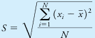

其中 x̄ 是 N 个数字 x₁、x₂、...、xₙ 的平均值。定义一个函数，该函数以部分填充的数字数组作为其参数并返回数组中数字的标准差。由于部分填充的数组需要两个参数，函数实际上将有两个形式参数：一个数组参数


并且有一个类型为 int 的形式参数，给出使用的数组位置数。数组中的数字将为 double 类型。将你的函数嵌入到合适的测试程序中。

+   4. 编写一个程序，读取一个字符数组。可以假设数组中条目少于 50 个。你的程序确定使用了多少个条目。输出应为两列列表。第一列是英语字母表中的元音列表；第二列是每个元音出现次数的计数。列表应按第一列条目的字母顺序排序。

对于数组值

```
b r e a d , b u t t e r , a n d j a m o n y o u r p l a t e
```

输出应为

| Vowel | Count |
|---|---:|
| a | 4 |
| e | 3 |
| i | 0 |
| o | 2 |
| u | 2 |

+   5. 数组可用于逐位存储大整数。例如，整数 1234 可以存储在数组 a 中，通过将 a[0] 设为 1，a[1] 设为 2，a[2] 设为 3，a[3] 设为 4。然而，对于本练习，你可能会发现将数字向后存储更有用，即将 4 放在 a[0] 中，3 放在 a[1] 中，2 放在 a[2] 中，1 放在 a[3] 中。在本练习中，你将编写一个程序，读取两个正整数，每个长度不超过 20 位，然后输出这两个数字的和。你的程序将以 type char 的值读取数字，因此数字 1234 被读取为四个字符 '1'、'2'、'3' 和 '4'。在读入程序后，字符被更改为 type int 的值。数字将读入部分填充的数组中，在数组用键盘数据填充后，你可能会发现反转数组中元素的顺序很有用。是否反转数组中元素的顺序由你决定。可以两种方式完成，每种方式都有其优点和缺点。你的程序将通过实现通常的笔算加法算法来执行加法。加法的结果存储在大小为 20 的数组中，然后结果写入屏幕。如果加法的结果是一个整数，其位数超过最大位数（即超过 20 位），则你的程序应发出一条消息，说明它已遇到“整数溢出”。你应能够通过更改一个全局定义的常量来更改整数的最大长度。包含一个循环，允许用户在用户说程序应结束之前继续进行更多加法。

+   6. 在一档流行的电视舞蹈节目中，每位参赛者根据 4 个参数获得分数：技术性、表现力、舞台利用率和参赛者的能量水平。由 3 名评委组成的评审团针对每个参数给出 1 到 10 分，

指定时仅有少数规则。本项目要求你编写一个程序，允许你指定初始配置。程序遵循生命的规则（稍后列出）来显示配置的持续行为。

LIFE 是一个生活在离散二维世界中的生物。虽然这个世界实际上是无限的，但我们没有这个奢侈，所以我们将数组限制为宽 80 个字符、高 22 个字符位置。如果您有更大的屏幕，请随意使用。

这个世界是一个数组，每个单元都能够容纳一个 LIFE 细胞。世代标志着时间的流逝。每个世代都会给 LIFE 社区带来出生和死亡。出生和死亡遵循以下规则集：

+   1. 我们定义每个单元有八个邻居单元。单元的邻居是直接在上方、下方、右侧、左侧、右上和左上对角线，以及右下、左下对角线的单元。
+   
+   2. 如果一个被占据的单元有零个或一个邻居，它会因孤独而死亡。如果一个被占据的单元有超过三个邻居，它会因过度拥挤而死亡。
+   
+   3. 如果一个空单元恰好有三个被占据的邻居单元，则会诞生一个新的单元来取代空单元。
+   
+   4. 出生和死亡是瞬时的，并在世代变化时发生。一个因某种原因死亡的单元可能会导致出生，但新生单元不能复活一个正在死亡的单元，也不会阻止另一个单元的死亡，例如通过减少局部人口。

*Examples:*  *** 变成 * 然后再次变成 ***，如此往复。

*Notes.* 一些配置从相对较小的起始配置中生长。其他则在区域中移动。建议对于文本输出，使用 80 列和 22 行的矩形 char 数组来存储 LIFE 世界的连续世代。使用 * 表示活细胞，使用空白表示空（或死）细胞。如果您有比这更多的行屏幕，请随意使用整个屏幕。

*Suggestions:* 寻找稳定的配置。也就是说，寻找不断重复模式的社区。重复中的配置数量称为 *周期*。有一些配置是固定的，即继续不变。一个可能项目是找到这样的配置。

*Hints:* 定义一个名为 `generation` 的 void 函数，它接受我们称为 `world` 的数组，一个 80 列乘 22 行的 type `char` 数组，其中包含初始配置。函数扫描数组并修改单元，根据之前列出的规则标记单元的出生和死亡。这涉及依次检查每个单元，要么杀死该单元，让它存活，或者，如果单元为空，决定是否应出生一个单元。应该有一个 `display` 函数，它接受数组 `world` 并在屏幕上显示数组。`generation` 和 `display` 调用之间适当的时延是合适的。为此，你的程序应在你按下 Return 时生成并显示下一代。你可以随意自动化它，但自动化对于程序来说不是必要的。

+   13. 年轻儿童玩的一种常见记忆匹配游戏是使用一副包含相同对的卡牌开始。例如，给定六张卡牌，两张可能标记为“1”，两张可能标记为“2”，两张可能标记为“3”。卡牌被洗牌并面朝下放在桌上。玩家然后选择两张面朝下的卡牌，翻开它们，如果它们匹配，则保持翻开。如果两张卡牌不匹配，则它们被放回原来的位置面朝下。游戏以这种方式继续，直到所有卡牌都翻开。
+   
+   编写一个程序来玩记忆匹配游戏。使用 16 张卡牌，排成 4 × 4 方形，并标记为 1 到 8 的数字对。你的程序应允许玩家通过坐标系统指定卡牌。
+   
+   例如，在以下布局中

|   | 1 | 2 | 3 | 4 |
|---|---|---|---|---|
| 1 | 8 | * | * | * |
| 2 | * | * | * | * |
| 3 | * | 8 | * | * |
| 4 | * | * | * | * |

所有卡牌都是面朝下的，除了在坐标 (1,1) 和 (2,3) 处找到的一对 8。输出大量换行符以使旧板移出屏幕，以隐藏暂时翻开的卡牌。

*Hint:* 使用 2D 数组来排列卡牌，并使用另一个 2D 数组来指示卡牌是面朝上还是面朝下。编写一个函数，通过反复随机选择两张卡牌并交换它们来“洗牌”数组中的卡牌。

+   14. 你已从四位电影评论家收集了评论，评论家编号为 0–3。每位评论家都对六部电影进行了评分，电影编号为 100–105。评分范围从 1（糟糕）到 5（优秀）。
+   
+   评论显示在以下表格中：

|   | 100 | 101 | 102 | 103 | 104 | 105 |
|---|---:|---:|---:|---:|---:|---:|
| 0 | 3 | 1 | 5 | 2 | 1 | 5 |
| 1 | 4 | 2 | 1 | 4 | 2 | 4 |
| 2 | 3 | 1 | 2 | 4 | 4 | 1 |
| 3 | 5 | 1 | 4 | 2 | 4 | 2 |

编写一个程序，使用 2D 数组存储此数据。基于此信息，你的程序应允许用户输入任意三部电影的评分。程序然后应找到评分与用户输入的评分最接近的评论家。然后它应通过输出评论家对用户未评分的电影的评分来预测用户的兴趣。使用笛卡尔距离作为度量来确定评论家的

## 1. 项目概述

本项目旨在开发一套智能文档处理系统，该系统能够自动识别、解析并提取各类文档中的结构化信息。系统采用先进的自然语言处理与计算机视觉技术，支持多种文档格式的输入，并输出标准化的数据格式。

## 2. 系统架构

系统整体架构分为三层：数据采集层、智能处理层和输出管理层。数据采集层负责接收不同来源的文档；智能处理层包含文档解析、信息抽取和语义理解模块；输出管理层提供数据校验、格式转换和接口服务。

### 2.1 核心模块

- 文档解析模块：支持 PDF、Word、图片等格式
- 信息抽取模块：基于深度学习模型提取关键字段
- 语义理解模块：结合知识图谱进行上下文推理
- 接口服务模块：提供 RESTful API 供外部系统调用

## 3. 技术指标

| 指标名称 | 目标值 | 测试方法 |
|----------|--------|----------|
| 解析准确率 | ≥ 98% | 标准测试集 |
| 处理速度 | ≤ 2秒/页 | 批量测试 |
| 系统可用性 | ≥ 99.9% | 持续监控 |


电影评分是指用户输入的评分。该技术是最近邻分类算法的一个简化版本。

例如，如果用户对电影102输入评分为5，对电影104输入评分为2，对电影105输入评分为5，那么最接近的匹配是评论者0，其距离为 sqrt((5 − 5)² + (2 − 1)² + (5 − 5)²) = 1。程序随后将预测电影100的评分为3，电影101的评分为1，电影103的评分为2。

## 15. 传统的密码输入方案容易受到“肩窥”攻击，即攻击者观察毫无防备的用户输入密码或PIN码，并在之后利用该信息获取账户访问权限。解决此问题的一种方法是使用随机挑战-响应系统。在这些系统中，用户每次根据一个秘密，针对随机生成的挑战输入不同的信息。考虑以下方案，其中密码由五位数字的PIN码（00000到99999）组成。每个数字被分配一个随机数，该随机数为1、2或3。用户输入与其PIN码对应的随机数，而不是其实际的PIN码。

例如，考虑一个实际的PIN码为12345。为了进行身份验证，用户将看到一个类似如下的屏幕：

```
PIN: 0 1 2 3 4 5 6 7 8 9
NUM: 3 2 3 1 1 3 2 2 1 3
```

用户将输入23113而不是12345。即使攻击者截获了输入，这也不会泄露密码，因为23113可能对应其他PIN码，例如69440或70439。下次用户登录时，将生成不同的随机数序列，例如：

```
PIN: 0 1 2 3 4 5 6 7 8 9
NUM: 1 1 2 3 1 2 2 3 3 3
```

您的程序应模拟身份验证过程。在程序中存储一个实际的PIN码。程序应使用一个数组为0到9的数字分配随机数。将随机数字输出到屏幕，输入用户的响应，并输出用户的响应是否正确匹配PIN码。

## 16. 完成编程项目5.14，但不要仅限于四位评论者，而是允许最多1000位评论者，并将评论存储在文本文件中。虽然您的程序应支持最多1000位评论者，但文件中存储的实际评论者数量可能从1到1000不等。与编程项目5.14一样，被评论的电影编号仅为100到105。您可以自行设计用于在文本文件中存储评论的格式。从文本文件读取评论后，程序应输入三部电影，并像编程项目5.14那样对剩余两部电影进行预测。

## 17. 编程项目2.12要求您探索本福特定律。编写该程序的一种更简单的方法是使用数组来存储数字计数。也就是说，`count[0]`可能存储0作为首位数字出现的次数（如果您的数据集中可能出现这种情况），`count[1]`可能存储1作为首位数字出现的次数，依此类推。使用数组重新完成编程项目2.12。

## 18. 本项目是编程项目4.16的扩展。考虑一个名为`scores.txt`的文本文件，其中包含玩家在游戏中的得分。下面显示了一个可能的示例，其中罗纳尔多的最佳得分是10400，迪迪埃的最佳得分是9800，等等。在文件中放置至少五个姓名和得分。

```
Ronaldo
10400
Didier
9800
Pele
12300
Kaka
8400
Cristiano
8000
```

编写一个名为`getHighScores`的函数，该函数接受两个数组参数：一个字符串数组和一个整数数组。该函数应扫描文件，并将索引0处的字符串数组条目设置为得分最高的玩家姓名，并将索引0处的整数数组条目设置为得分最高的玩家的得分。索引1处的字符串数组条目应设置为得分第二高的玩家姓名，索引1处的整数数组条目应设置为得分第二高的玩家的得分。对索引2处的条目执行相同操作。这两个数组共同提供前三名玩家的姓名和得分。在您的主函数中，通过调用`getHighScores`函数并输出前三名玩家及其得分来测试该函数。

## 19. 编写一个程序，在计算机内存中管理一个最多包含十名玩家及其高分列表（不像编程项目18那样存储在磁盘上）。使用两个数组来管理该列表。一个数组应存储玩家姓名，另一个数组应存储玩家高分。使用数组的索引将姓名与得分关联起来。在下一章中，您将学习一种不同的方式来组织相关数据，即将其放入结构体或类中。本程序不要使用结构体或类。您的程序应支持以下功能：

- a. 添加新玩家和得分（最多十名玩家）。
- b. 将所有玩家姓名及其得分打印到屏幕。
- c. 允许用户输入玩家姓名，并输出该玩家的得分，如果该玩家姓名尚未输入，则输出一条消息。
- d. 允许用户输入玩家姓名，并将该玩家从列表中移除。

创建一个菜单系统，允许用户选择要调用的选项。

此页有意留空

## 结构与类 6

- 6.1 结构 274
- 结构类型 276
- 陷阱：结构定义中忘记分号 280
- 结构作为函数参数 280
- 提示：使用层次结构 281
- 初始化结构 283

- 6.2 类 286
- 定义类和成员函数 286
- 封装 292

- 公有和私有成员 293
- 访问器和修改器函数 296
- 提示：分离接口与实现 298
- 提示：封装的测试 299
- 结构体与类的对比 300
- 提示：面向对象思维 302

# 6 结构与类

> “时候到了，”海象说，
> “该谈谈许多事情了：
> 谈谈鞋子——还有船——还有封蜡——
> 谈谈卷心菜——还有国王。”
> 
> 刘易斯·卡罗尔，《爱丽丝镜中奇遇记》。
> 伦敦：麦克米伦公司，1871年

## 引言

类也许是区分C++语言与C语言的最重要的单一特性。类是一种类型，其值称为对象。对象既有数据也有成员函数。成员函数对其对象的数据具有特殊访问权限。这些对象就是面向对象编程中的对象，面向对象编程是一种非常流行且强大的编程哲学。

我们将分两步介绍类。首先，我们告诉您如何为结构体提供类型定义。结构体（此处讨论的那种）可以被视为没有任何成员函数的对象。¹ 结构体的重要特性在于，结构体中的数据可以是各种不同类型数据项的集合。在您了解结构体之后，定义类将是一个自然的延伸。

您不需要阅读第5章中关于数组的内容来阅读第6章，以及大部分涵盖类的第7章和第8章。

## 6.1 结构体

> 我不在乎加入任何愿意接纳我为成员的俱乐部。
> 
> 格劳乔·马克思，《格劳乔书信集：格劳乔·马克思的往来信件》。
> 纽约：西蒙与舒斯特出版社，1967年

有时，将不同类型的值收集在一起，并将该集合视为单个项目是有用的。例如，考虑银行的存单，通常称为CD。CD是一种在指定月份数内不允许取款的银行账户。CD自然具有与之关联的三项数据：账户余额、账户利率和期限，即到期前的月数。前两项可以表示为`double`类型的值，月数可以表示为`int`类型的值。

¹在C++中，结构体实际上可以拥有成员函数，但这不是我们将采用的方法。此细节将在本章后面解释。此脚注仅是为了让那些觉得自己发现了错误的读者知道，我们了解结构体的官方定义。大多数读者应忽略此脚注。


Display 6.1 显示了可用于此类账户的结构 `CDAccountV1` 的定义。（V1 代表版本 1。我们将在本章后面定义一个改进的版本。）

## Display 6.1 A Structure Definition (part 1 of 2)

```cpp
//Program to demonstrate the CDAccountV1 structure type.
#include <iostream>
using namespace std;

//Structure for a bank certificate of deposit:
struct CDAccountV1
{
    double balance;
    double interestRate;
    int term; //months until maturity
};

void getData(CDAccountV1& theAccount);
//Postcondition: theAccount.balance, theAccount.interestRate, and
//theAccount.term have been given values that the user entered at the
//keyboard.

int main( )
{
    CDAccountV1 account;
    getData(account);

    double rateFraction, interest;
    rateFraction = account.interestRate/100.0;
    interest = account.balance*rateFraction*(account.term/12.0);
    account.balance = account.balance + interest;

    cout.setf(ios::fixed);
    cout.setf(ios::showpoint);
    cout.precision(2);
    cout << "When CD matures in "
         << account.term << " months,\n"
         << "it will have a balance of $"
         << account.balance << endl;

    return 0;
}
//Uses iostream:
void getData(CDAccountV1& theAccount)
{
    cout << "Enter account balance: $";
    cin >> theAccount.balance;
```

本章后面将给出此结构的改进版本。

## Display 6.1 A Structure Definition (part 2 of 2)

```cpp
36    cout << "Enter account interest rate: ";
37    cin  >> theAccount.interestRate;
38    cout << "Enter the number of months until maturity: ";
39    cin  >> theAccount.term;
40 }
```

## Sample Dialogue

```
Enter account balance: $100.00
Enter account interest rate: 10.0
Enter the number of months until maturity: 6
When your CD matures in 6 months,
it will have a balance of $105.00
```

## Structure Types

Display 6.1 中的结构定义如下：

```cpp
struct CDAccountV1
{
    double balance;
    double interestRate;
    int term;//months until maturity
};
```

关键字 `struct` 声明这是一个结构类型定义。标识符 `CDAccountV1` 是结构类型的名称，被称为结构标签。结构标签可以是任何合法的标识符且不是关键字。虽然 C++ 语言并不要求，但结构标签通常以大写字母开头。用大括号 `{}` 括起来的标识符称为成员名。正如本例所示，结构类型定义以大括号 `}` 和分号结束。

结构定义通常放在任何函数定义之外（与全局定义的常量声明放在所有函数定义之外的方式相同）。结构类型随后成为全局定义，可供结构定义之后的所有代码使用。

一旦给出结构类型定义，结构类型就可以像预定义类型 `int`、`char` 等一样使用。注意，在 Display 6.1 中，结构类型 `CDAccountV1` 用于在函数 `main` 中声明一个变量，并用作函数 `getData` 的参数类型名称。

结构变量可以像其他变量一样保存值。结构值是由称为成员值的较小值组成的集合。对于结构定义中声明的每个成员名，都存在一个成员值。例如，类型为 `CDAccountV1` 的值是由三个成员值组成的集合，其中两个为 `double` 类型，一个为 `int` 类型。构成结构值的成员值存储在成员变量中，我们接下来会讨论。

## 2024年1月1日 星期一

今天是2024年的第一天，也是元旦。在这个辞旧迎新的时刻，我们向所有读者致以最诚挚的问候和祝福。

新的一年，新的起点。让我们回顾过去一年的成就与不足，展望未来的机遇与挑战。

- 元旦快乐
- 新年新气象
- 万事如意

| 项目 | 内容 |
|------|------|
| 日期 | 2024年1月1日 |
| 节日 | 元旦 |
| 天气 | 晴 |

> 千里之行，始于足下。

在新的一年里，我们期待与读者一起成长，共同进步。

```python
print("Hello, 2024!")
```

感谢大家一直以来的支持，祝大家新年快乐！

## EXAMPLES

```cpp
struct StudentRecord
{
    int studentNumber;
    char grade;
};

int main( )
{
    StudentRecord yourRecord;
    yourRecord.studentNumber = 2001;
    yourRecord.grade = 'A';
}
```

有些作者称点运算符为结构成员访问运算符，尽管我们不会使用该术语。

这种名称的巧合不会产生任何问题。例如，如果你声明以下两个结构变量，

```cpp
FertilizerStock superGrow;
CropYield apples;
```

那么 superGrow 肥料的数量存储在成员变量 `superGrow.quantity` 中，而苹果产量存储在成员变量 `apples.quantity` 中。点运算符和结构变量指定了每种情况下所指的数量。

### Structure Variables in Assignment Statements

结构值可以被视为成员值的集合。结构值也可以被视为单个（复杂）值（只是由成员值组成）。由于结构值可以被视为单个值，因此结构值和结构变量可以像使用预定义类型如 `int` 的简单值和简单变量一样使用。特别是，你可以使用等号为结构值赋值。例如，如果 `apples` 和 `oranges` 是前面定义的 `CropYield` 类型的结构变量，则以下内容完全合法：

```cpp
apples = oranges;
```

之前的赋值语句等价于

```cpp
apples.quantity = oranges.quantity;
apples.size = oranges.size;
```

## Simple Structure Types

结构类型的定义如下所示。`Structure_Tag` 是结构类型的名称。

### Syntax

```cpp
struct Structure_Tag
{
    Type_1 Member_Variable_Name_1;
    Type_2 Member_Variable_Name_2;
                         .
                         .
                         .
    Type_Last Member_Variable_Name_Last;
};
```

*不要忘记这个分号。*

### Example

```cpp
struct Automobile
{
    int year;
    int doors;
    double horsePower;
    char model;
};
```

虽然我们不会使用此功能，但你可以将相同类型的成员名合并到一个用逗号分隔的列表中。例如，以下内容等价于前面的结构定义：

```cpp
struct Automobile
{
    int year, doors;
    double horsePower;
    char model;
};
```

结构类型的变量可以像其他类型的变量一样声明。例如，

```cpp
Automobile myCar, yourCar;
```

成员变量使用点运算符指定。例如，`myCar.year`、`myCar.doors`、`myCar.horsePower` 和 `myCar.model`。

## Pitfall: Forgetting a Semicolon in a Structure Definition

当你为结构定义添加最后一个大括号 `}` 时，感觉结构定义已经完成，但实际上并未完成。你还必须在此大括号之后放置一个分号。即使原因是一个我们不会使用到的特性，也有其道理。结构定义不仅仅是一个定义。它还可以用于声明结构变量。你允许在该最后一个大括号和最后一个分号之间列出结构变量名。例如，以下内容定义了一个名为 `WeatherData` 的结构，并声明了两个结构变量 `dataPoint1` 和 `dataPoint2`，两者类型均为 `WeatherData`：

```cpp
struct WeatherData
{
    double temperature;
    double windVelocity;
} dataPoint1, dataPoint2;
```

## Structures as Function Arguments

函数可以具有结构类型的按值调用参数或结构类型的按引用调用参数，或两者兼有。例如，Display 6.1 中的程序包含一个名为 `getData` 的函数，它具有结构类型 `CDAccountV1` 的按引用参数。

结构类型也可以是由函数返回的类型。例如，以下内容定义了一个函数，它接受一个类型为 `CDAccountV1` 的参数并返回一个不同的类型为 `CDAccountV1` 的结构。返回的结构将具有与参数相同的余额和期限，但支付的利率是参数的两倍。

```cpp
CDAccountV1 doubleInterest(CDAccountV1 oldAccount)
{
    CDAccountV1 temp;
    temp = oldAccount;
    temp.interestRate = 2*oldAccount.interestRate;
    return temp;
}
```

注意类型为 `CDAccountV1` 的局部变量 `temp`；`temp` 用于构建所需类型的完整结构值，然后由函数返回。如果 `myAccount` 是类型为 `CDAccountV1` 的变量，并且其成员变量已被赋予值，则以下内容将为 `yourAccount` 提供一个利率为 `myAccount` 两倍的账户的值：

```cpp
CDAccountV1 yourAccount;
yourAccount = doubleInterest(myAccount);
```


# 提示：使用层级结构

有时候，让某个结构的成员本身也是更小的结构是合理的。例如，可以定义一种名为 PersonInfo 的结构类型，用于存储一个人的身高、体重和出生日期，如下所示：

```
struct Date
{
    int month;
    int day;
    int year;
};
```

```
struct PersonInfo
{
    double height; //in inches
    int weight; //in pounds
    Date birthday;
};
```

类型为 PersonInfo 的结构变量按通常方式声明：

```
PersonInfo person1;
```

如果结构变量 person1 的值已经被设置为记录某个人的出生日期，那么该人的出生年份可以通过以下方式输出到屏幕：

```
cout << person1.birthday.year;
```

理解这类表达式的方式是从左到右，并且非常仔细。从左端开始，person1 是 PersonInfo 类型的结构变量。要获取名为 birthday 的成员变量，可使用点运算符如下：

```
person1.birthday
```

这个成员变量本身是一个 Date 类型的结构变量。因此，这个成员变量本身也有自己的成员变量。通过添加一个点和成员变量名（如 year），可以得到结构变量 person1.birthday 的成员变量，从而产生前面所示的表达式 person1.birthday.year。

在显示6.2中，我们重写了显示6.1中的存款凭证类。这个新版本有一个 Date 结构类型的成员变量，用于保存到期日。我们还用两个新的成员变量替换了单一的 balance 成员变量，分别表示初始余额和到期余额。

# 显示6.2   具有结构成员的结构（1/2部分）

```
//Program to demonstrate the CDAccount structure type.
#include <iostream>
using namespace std;

struct Date
{
    int month;
    int day;
    int year;
};

//Improved structure for a bank certificate of deposit:
struct CDAccount
{
    double initialBalance;
    double interestRate;
    int term; //months until maturity
    Date maturity; //date when CD matures
    double balanceAtMaturity;
};

void getCDData(CDAccount& theAccount);
//Postcondition: theAccount.initialBalance, theAccount.interestRate,
//theAccount.term, and theAccount.maturity have been given values
//that the user entered at the keyboard.

void getDate(Date& theDate);
//Postcondition: theDate.month, theDate.day, and theDate.year
//have been given values that the user entered at the keyboard.

int main( )
{
    CDAccount account;
    cout << "Enter account data on the day account was opened:\n";
    getCDData(account);
    double rateFraction, interest;
    rateFraction = account.interestRate / 100.0;
    interest = account.initialBalance * (rateFraction*(account.term /
                                                        12.0));
    account.balanceAtMaturity = account.initialBalance + interest;

    cout.setf(ios::fixed);
    cout.setf(ios::showpoint);
    cout.precision(2);
    cout << "When the CD matured on "
         << account.maturity.month << "/" << account.maturity.day
         << "," << account.maturity.year << " it had
         << "a balance of $"
         << account.balanceAtMaturity << endl;
    return 0;
}
```

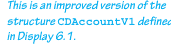

# 显示6.2 具有结构成员的结构（2/2部分）

```
45 }
46 //uses iostream:
47 void getCDData(CDAccount& theAccount)
48 {
49   cout << "Enter account initial balance: $";
50   cin >> theAccount.initialBalance;
51   cout << "Enter account interest rate: ";
52   cin >> theAccount.interestRate;
53   cout << "Enter the number of months until maturity: ";
54   cin >> theAccount.term;
55   cout << "Enter the maturity date:\n";
56   getDate(theAccount.maturity);
57 }
```

```
58 //uses iostream
59 void getDate(Date& theDate)
60 {
61   cout << "Enter month: ";
62   cin >> theDate.month;
63   cout << "Enter day: ";
64   cin >> theDate.day;
65   cout << "Enter year: ";
66   cin >> theDate.year;
67 }
```

# 示例对话

```
Enter account data on the day account was opened:
Enter account initial balance: $100.00
Enter account interest rate: 10.0
Enter the number of months until maturity: 6
Enter the maturity date:
Enter month: 2
Enter day: 14
Enter year: 1899
When the CD matured on 2-14-1899
it had a balance of $105.00
```

# 初始化结构

你可以在声明结构时对其进行初始化。要给结构变量一个值，可以在其后加上等号和用花括号括起来的成员值列表。例如，上一小节中给出了以下用于日期的结构类型定义：

```
struct Date
{
  int month;
```

int day;
int year;
};

一旦定义了 Date 类型，就可以按以下方式声明并初始化一个名为 dueDate 的结构变量：

```
Date dueDate = {12, 31, 2012};
```

初始化值的给定顺序必须与结构类型定义中成员变量的顺序一致。在此示例中，dueDate.month 接收第一个初始化值 12，dueDate.day 接收第二个值 31，dueDate.year 接收第三个值 2012。

如果初始化值的个数多于结构成员个数，则会产生错误。如果初始化值的个数少于结构成员个数，则按顺序使用提供的值初始化数据成员。每个没有初始化器的数据成员都被初始化为该成员相应类型的零值。

# 自测练习

+   1. 给定以下结构和结构变量声明：
+   
+   ```cpp
+   struct CDAccountV2
+   {
+       double balance;
+       double interestRate;
+       int term;
+       char initial1;
+       char initial2;
+   };
+   CDAccountV2 account;
+   ```
+   
+   以下各项的类型分别是什么？请标记出任何不正确的项。
+   
+   a. `account.balance`
+   b. `account.interestRate`
+   c. `CDAccountV1.term`
+   d. `account.initial2`
+   e. `account`

+   2. 考虑以下类型定义：
+   
+   ```cpp
+   struct ShoeType
+   {
+       char style;
+       double price;
+   };
+   ```

# 自测练习（续）

给定前面的结构类型定义，以下代码将产生什么输出？

```
ShoeType shoe1, shoe2;
shoe1.style = 'A';
shoe1.price = 9.99;
cout << shoe1.style << " $" << shoe1.price << endl;
shoe2 = shoe1;

shoe2.price = shoe2.price/9;
cout << shoe2.style << " $" << shoe2.price << endl;
```

3. 以下结构定义中的错误是什么？

```
struct Stuff
{
    int b;
    int c;
}

int main( )
{
    Stuff x;
    // other code
}
```

4. 给定以下 struct 定义：

```
struct A
{
    int b;
    int c;
};
```

声明 x 为该结构类型。将 x 的成员 b 和 c 分别初始化为值 1 和 2。

5. 这里有一个结构类型的初始化。说明每次初始化发生的情况，并指出这些初始化中的任何问题。

```
struct Date
{
    int month;
    int day;
    int year;
};
```

a. Date dueDate = {12, 21};
b. Date dueDate = {12, 21, 1995};
c. Date dueDate = {12, 21, 19, 95};

# 自测练习（续）

6. 为记录编写一个结构类型定义，该记录包含一个人的工资率、累计假期（某个整数天数）和状态（按小时计薪或固定薪金）。将状态表示为两个 char 值之一：‘H’ 和 ‘S’。将此类型命名为 EmployeeRecord。

7. 给出与以下函数声明对应的函数定义。（类型 ShoeType 在自测练习2中给出。）

void readShoeRecord(ShoeType& newShoe);
//Fills newShoe with values read from the keyboard.

8. 给出与以下函数声明对应的函数定义。（类型 ShoeType 在自测练习2中给出。）

ShoeType discount(ShoeType oldRecord);
//Returns a structure that is the same as its argument,
//but with the price reduced by 10%.

# 6.2 类

> 我们都知道——《泰晤士报》也知道——但我们假装不知道。

> 弗吉尼亚·伍尔夫，《未写的小说》，载于《星期一或星期二》。纽约：哈考特-布雷斯公司，1921年。

类基本上是一种既有成员函数又有成员数据的结构。类是被称为面向对象编程的编程方法学的核心。

# 定义类和成员函数

类（class）是一种与结构类型相似的类型，但类类型通常既有成员变量，也有成员函数。显示6.3中给出了一个过于简单但具有说明性的类叫做 DayOfYear 的示例。这个类有一个名为 output 的成员函数，以及两个成员变量 month 和 day。术语 public 称为访问说明符。它简单地意味着对后面的成员没有限制。在完成这个简单示例之后，我们将讨论 public 及其替代形式。在显示6.3中定义的 DayOfYear 类型是一个类定义，用于其值为日期的对象，例如1月1日或7月4日。

对象：类类型的变量的值称为对象（因此，松散地说，类类型的变量也常被称为对象）。一个对象既有数据成员也有函数成员。在使用类进行编程时，程序被视为相互作用的对象的集合。对象之间可以交互，因为它们能够执行动作，即调用成员函数。类类型的变量以对象作为值。类类型的变量与预定义类型的变量以及结构变量的声明方式相同。


暂时忽略 Display 6.3 中显示的单词 public。类 DayOfYear 的其余定义与结构定义非常相似，只是它使用关键字 class 而不是 struct，并且列出了成员函数 output（以及成员变量 month 和 day）。请注意，成员函数 output 是通过给出其声明（原型）来列出的。类定义通常只包含其成员函数的声明。成员函数的定义通常在其他地方给出。在 C++ 类定义中，你可以以任何你想要的方式混合成员变量和成员函数的顺序，但我们将遵循的风格倾向于在成员变量之前列出成员函数。

## Display 6.3   Class with a Member Function (part 1 of 3)

```cpp
//Program to demonstrate a very simple example of a class.
//A better version of the class DayOfYear will be given in Display 6.4.
#include <iostream>
using namespace std;

class DayOfYear
{
public:
    void output();
    int month;
    int day;
};

int main()
{
    DayOfYear today, birthday;
    cout << "Enter today's date:\n";
    cout << "Enter month as a number: ";
    cin >> today.month;
    cout << "Enter the day of the month: ";
    cin >> today.day;
    cout << "Enter your birthday:\n";
    cout << "Enter month as a number: ";
    cin >> birthday.month;
    cout << "Enter the day of the month: ";
    cin >> birthday.day;
    cout << "Today's date is ";
    today.output();
    cout << endl;
    cout << "Your birthday is ";
    birthday.output();
    cout << endl;

    if (today.month == birthday.month && today.day == birthday.day)
        cout << "Happy Birthday!\n";
}
```

通常，成员变量是私有而不是公开的，如本例所示。这将在本章后面讨论。

Member function declaration

Calls to the member function output

## Display 6.3  Class with a Member Function (part 2 of 3)

```cpp
33     else
34         cout << "Happy Unbirthday!\n";
35     return 0;
36 }
37 //Uses iostream:
38 void DayOfYear::output( )
39 {
40     switch (month)
41     {
42         case 1:
43             cout << "January "; break;
44         case 2:
45             cout << "February "; break;
46         case 3:
47             cout << "March "; break;
48         case 4:
49             cout << "April "; break;
50         case 5:
51             cout << "May "; break;
52         case 6:
53             cout << "June "; break;
54         case 7:
55             cout << "July "; break;
56         case 8:
57             cout << "August "; break;
58         case 9:
59             cout << "September "; break;
60         case 10:
61             cout << "October "; break;
62         case 11:
63             cout << "November "; break;
64         case 12:
65             cout << "December "; break;
66         default:
67             cout << "Error in DayOfYear::output.";
68     }

69     cout << day;
70 }
```


## Display 6.3   Class with a Member Function (part 3 of 3)

## Sample Dialogue

```
Enter today's date:
Enter month as a number: 10
Enter the day of the month: 15
Enter your birthday:
Enter month as a number: 2
Enter the day of the month: 21
Today's date is October 15
Your birthday is February 21
Happy Unbirthday!
```

类类型对象的成员变量是使用点运算符指定的，就像点运算符用于指定结构成员变量一样。例如，如果 today 是 Display 6.3 中定义的类类型 DayOfYear 的变量，那么 today.month 和 today.day 就是对象 today 的两个成员变量。

类中你定义的成员函数是使用点运算符调用的，其方式与指定成员变量的方式类似。例如，Display 6.3 中的程序以以下方式声明了两个 DayOfYear 类型的对象：

```
DayOfYear today, birthday;
```

成员函数 output 使用对象 today 调用如下：

```
today.output();
```

成员函数 output 使用对象 birthday 调用如下：

```
birthday.output();
```

当成员函数被定义时，定义必须包含类名，因为可能有两个或多个类具有同名的成员函数。在 Display 6.3 中只有一个类定义，但在其他情况下你可能有许多类定义，并且可能有多个类具有同名的成员函数。类 DayOfYear 的成员函数 output 的定义显示在 Display 6.3 的第 2 部分。定义类似于普通函数定义，只是你必须在函数定义的标题中指定类名。

成员函数 output 的函数定义标题如下：

```
void DayOfYear::output()
```

运算符 :: 称为 **作用域解析运算符**，其作用类似于点运算符。点运算符和作用域解析运算符都用于说明成员函数属于什么。但是，作用域解析运算符 :: 是与类名一起使用，而点运算符是与对象一起使用

## 1. 引言

在当今快速发展的科技时代，人工智能（AI）已经成为推动社会进步的重要力量。从智能家居到自动驾驶，从医疗诊断到金融分析，AI 技术正在深刻改变着我们的生活方式和工作模式。本文旨在探讨 AI 技术在现代社会中的多维度应用及其带来的深远影响。

## 2. AI 在医疗领域的应用

医疗行业是 AI 技术应用最为广泛的领域之一。通过深度学习算法，AI 能够辅助医生进行疾病诊断、药物研发和个性化治疗方案制定。例如，AI 在医学影像分析中的表现已经达到了专业医生的水平，能够快速识别出 X 光片和 CT 扫描中的异常情况。

- 智能诊断系统
- 药物研发加速
- 个性化医疗方案

## 3. AI 在交通领域的应用

自动驾驶技术是 AI 在交通领域最引人注目的应用。通过融合传感器数据、高精度地图和实时路况信息，AI 系统能够实现车辆的自主导航和决策。此外，AI 还被用于智能交通管理，通过优化信号灯配时和交通流量预测，有效缓解城市拥堵问题。

| 应用场景 | 技术特点 | 实际效果 |
|----------|----------|----------|
| 自动驾驶 | 多传感器融合 | 事故率降低 40% |
| 智能交通 | 实时流量分析 | 通行效率提升 25% |
| 物流配送 | 路径优化算法 | 配送成本下降 30% |

## 4. 结论

综上所述，AI 技术正在多个领域展现出巨大的应用潜力。然而，我们也必须正视其带来的挑战，如数据隐私、算法偏见和就业结构变化等问题。未来，我们需要在推动技术创新的同时，建立健全的法律法规和伦理准则，确保 AI 技术能够造福全人类。

在成员函数的函数定义中，你可以使用该类的所有成员的名称（包括数据成员和函数成员）而无需使用点运算符。

## The Dot Operator and the Scope Resolution Operator

点运算符和作用域解析运算符都与成员名称一起使用，以指定它们是哪个事物的成员。例如，假设你声明了一个名为 DayOfYear 的类，并按如下方式声明一个对象 today：

```
DayOfYear today;
```

你使用点运算符来指定对象 today 的成员。例如，output 是类 DayOfYear 的成员函数（定义在 Display 6.3 中），以下函数调用将输出存储在对象 today 中的数据值：

```
today.output( );
```

你使用作用域解析运算符 :: 来在给出成员函数的函数定义时指定类名。例如，成员函数 output 的函数定义标题如下：

```
void DayOfYear::output( )
```

记住，作用域解析运算符 :: 是与类名一起使用，而点运算符是与该类的对象一起使用。

## A Class Is a Full-Fledged Type

类是一种类型，就像类型 int 和 double 一样。你可以有类类型的变量，你可以有类类型的参数，函数可以返回类类型的值，更一般地说，你可以像使用其他类型一样使用类类型。

## Self-Test Exercises

9. 这里我们重新定义了 Display 6.3 中的类 DayOfYear，使其现在有一个额外的成员函数称为 input。编写该成员函数 input 的适当定义。

```
class DayOfYear
{
public:
    void input( );
    void output( );
    int month;
    int day;
};
```

## Self-Test Exercises (continued)

10. 给定以下类定义，编写成员函数 set 的适当定义。

```
class Temperature
{
public:
    void set(double newDegrees, char newScale);
    //Sets the member variables to the values given as
    //arguments.
    double degrees;
    char scale; // 'F' for Fahrenheit or 'C' for Celsius.
};
```

11. 仔细区分点运算符和作用域解析运算符 :: 的含义和用法。

## Encapsulation

数据类型，例如类型 int，具有某些指定的值，例如 0、1、-1、2 等等。你倾向于认为数据类型就是这些值，但这些值上的操作与值本身一样重要。没有操作，你就无法对值做任何有趣的事情。类型 int 的操作包括 +、-、*、/、% 以及一些其他运算符和预定义库函数。你不应将数据类型视为仅仅是一组值的集合。数据类型由一组值以及定义在这些值上的基本操作集组成。如果使用该类型的程序员无法访问值和操作的实现细节，则该数据类型称为抽象数据类型（缩写为 ADT）。预定义类型，如 int，都是 ADT。你不知道类型 int 的操作，如 + 和 *，是如何实现的。即使你知道了，也不能在任何 C++ 程序中使用此信息。类，即程序员定义的类型，也应该是 ADT；也就是说，“操作”的实现细节应该对使用该类的任何程序员隐藏，或者至少与之无关。类的操作是类的（公共）成员函数。使用类的程序员不需要甚至查看成员函数的定义。类定义中给出的成员函数声明和一些注释应该是程序员使用该类所需的一切。

使用类的程序员也不需要知道类的实现方式。数据的实现应该像成员函数的实现一样被隐藏。事实上，隐藏成员函数的实现和数据的实现几乎无法区分。对程序员来说，类 DayOfYear（Display 6.3）具有日期作为日期，而不是数字。程序员不应该关心或在意月份 March 是作为 int 值 3 实现的，还是作为引号字符串 "March" 实现的，或以其他方式实现。

定义类使得成员函数的实现和对象中数据的实现对使用该类的程序员来说是未知的，或者至少是无关紧要的，

data types and abstract data types


## 1. 项目概况

本项目旨在开发一套基于人工智能的智能文档处理系统，能够自动识别、提取和结构化处理各类文档中的信息。系统采用先进的深度学习算法，支持多种文档格式，包括PDF、Word、图片等。

## 2. 技术方案

系统采用模块化设计，主要包含以下核心模块：

- 文档解析模块：负责将不同格式的文档转换为统一的文本表示
- 信息提取模块：利用NLP技术提取文档中的关键信息
- 结构化输出模块：将提取的信息按照预定义格式输出

## 3. 实施计划

| 阶段 | 时间 | 主要任务 |
|------|------|----------|
| 需求分析 | 第1-2周 | 明确需求，制定方案 |
| 系统开发 | 第3-8周 | 模块开发与集成 |
| 测试优化 | 第9-12周 | 系统测试与性能优化 |

## 4. 预期成果

项目完成后，将交付一套功能完善的智能文档处理系统，并提供完整的用户手册和技术文档。系统将具备高识别率、高处理速度和良好的扩展性。

> 科技是第一生产力，创新是引领发展的第一动力。

项目负责人：张三
联系方式：zhangsan@example.com

## 显示 6.4 带私有成员的类（第 2 部分，共 3 部分）

```
//Postcondition: The date is set to the first day of the given month.

int getMonthNumber(); //Returns 1 for January, 2 for February, etc.
int getDay();
private:
    int month;
    int day;
};

int main()
{
    DayOfYear today, bachBirthday;
    cout << "Enter today's date:\n";
    today.input();
    cout << "Today's date is ";
    today.output();
    cout << endl;

    bachBirthday.set(3, 21);
    cout << "J. S. Bach's birthday is ";
    bachBirthday.output();
    cout << endl;
    if (today.getMonthNumber() == bachBirthday.getMonthNumber() &&
        today.getDay() == bachBirthday.getDay())
        cout << "Happy Birthday Johann Sebastian!\n";
    else
        cout << "Happy Unbirthday Johann Sebastian!\n";

    return 0;
}

//Uses iostream and cstdlib:
void DayOfYear::set(int newMonth, int newDay)
{
    if ((newMonth >= 1) && (newMonth <= 12))
        month = newMonth;
    else
    {
        cout << "Illegal month value! Program aborted.\n";
        exit(1);
    }
    if ((newDay >= 1) && (newDay <= 31))
        day = newDay;
    else
    {
        cout << "Illegal day value! Program aborted.\n";
        exit(1);
    }
}
```

私有成员

请注意，函数名 set 被重载了。你可以像重载任何其他函数一样重载成员函数。

变异函数

## 显示 6.4 带私有成员的类（第 3 部分，共 3 部分）

```
//Uses iostream and cstdlib;
void DayOfYear::set(int newMonth)
{
    if ((newMonth >= 1) && (newMonth <= 12))
        month = newMonth;
    else
    {
        cout << "Illegal month value! Program aborted.\n";
        exit(1);
    }
    day = 1;
}

int DayOfYear::getMonthNumber()
{
    return month;
}

int DayOfYear::getDay()
{
    return day;
}

//Uses iostream and cstdlib;
void DayOfYear::input()
{
    cout << "Enter the month as a number: ";
    cin >> month;
    cout << "Enter the day of the month: ";
    cin >> day;
    if ((month < 1) || (month > 12) || (day < 1) || (day > 31))
    {
        cout << "Illegal date! Program aborted.\n";
        exit(1);
    }
}

void DayOfYear::output()
    <The rest of the definition of DayOfYear::output is given in Display 6.3.>
```

示例对话

> ```text
> Enter today's date:
> Enter the month as a number: 3
> Enter the day of the month: 21
> Today's date is March 21
> J. S. Bach's birthday is March 21
> Happy Birthday Johann Sebastian!
> ```

一旦你将一个成员变量设为私有成员变量，就没有办法在类外部更改其值（或以任何其他方式引用该成员变量），除非使用其中一个成员函数。这意味着编译器将强制隐藏 DayOfYear 类的数据实现。如果仔细查看显示 6.4 中的程序，你会看到成员变量名 month 和 day 仅在成员函数定义中使用。在成员函数定义之外，没有任何地方引用 today.month、today.day、bachBirthday.month 或 bachBirthday.day。

所有在 public: 之后出现的项（在本例中为成员函数）被称为公开的，这意味着它们可以在任何地方按名称引用。对公开成员的使用没有任何限制。

任何成员变量都可以是公开的或私有的。任何成员函数都可以是公开的或私有的。然而，正常的良好编程实践要求所有成员变量都为私有，并且通常大多数成员函数为公开。

类定义中可以有任意数量的 public 和 private 访问说明符出现。每当你插入标签

```
public:
```

成员列表就会从私有变为公开。每当你插入标签

```
private:
```

成员列表就会变回私有成员。你不必只有一组公开成员和一组私有成员。然而，通常只有一组公开部分和一组私有部分。

关于是否应先列出公开成员还是先列出私有成员，并没有普遍一致的意见。大多数人似乎更喜欢先列出公开成员。这使得使用该类的程序员可以轻松查看他们实际使用的部分。你可以自行决定先放置什么，但本书中的示例通常先列出公开成员，然后列出私有成员。

从某种意义上说，C++ 似乎更倾向于先放置私有成员。如果第一个成员组既没有 public: 也没有 private: 说明符，则该组成员将自动为私有。你会在代码中看到这种默认行为的使用，并且应该熟悉它。然而，我们在本书中不会使用它。

### 访问器和变异器函数

你应该始终将类中的所有成员变量设为私有。有时你可能需要对类对象中的数据做一些事情。然而，成员函数将允许你对对象中的数据执行许多操作，但迟早你会想要或需要对数据执行某些操作，而目前没有成员函数可以执行。如何对对象中的数据执行新的操作？答案是，只要为你的类配备合适的访问器和变异器函数，你就可以执行任何合理想要的操作。这些是允许你以非常通用的方式访问和更改对象中的数据的成员函数。访问器函数允许你读取数据。在显示 6.4 中，成员函数

getMonthNumber 和 getDay 是访问器函数。访问器函数不必字面地返回每个成员变量的值，但它们必须返回等效于这些值的内容。例如，对于像 DayOfYear 这样的类，你可能有一个访问器函数返回月份名称作为某种字符串值，而不是返回月份的数字。

变异器函数允许你更改数据。在显示 6.4 中，两个名为 set 的函数是变异器函数。传统上，访问器函数使用包含单词 get 的名称，而变异器函数使用包含单词 set 的名称。（显示 6.4 中的函数 input 和 output 实际上分别是变异器和访问器函数，但 I/O 是如此特殊的案例，通常它们只是被称为 I/O 函数而不是访问器或变异器函数。）

你的类定义应始终提供足够的一组访问器和变异器函数。

看起来访问器和变异器函数违背了将成员变量设为私有的目的，但事实并非如此。请注意显示 6.4 中的变异器函数 set。它不会允许你将 month 成员变量设为 13 或任何不代表月份的数字。同样，它也不会允许你将 day 成员变量设为不在 1 到 31（含）范围内的任何数字。如果变量是公开的，你可以将数据设为对日期没有意义的值。（正如现在这样，你仍然可以将数据设为不代表真实日期的值，例如二月三十一日，但很容易排除这些日期。我们没有排除这些日期以保持示例简单。）使用变异器函数，你可以控制和过滤对数据的更改。

### 自测练习

12. 假设你的程序包含以下类定义：

```
class Automobile
{
public:
    void setPrice(double newPrice);
    void setProfit(double newProfit);
    double getPrice( );
private:
    double price;
    double profit;
    double getProfit( );
};
```

并且假设你的程序的主函数包含以下声明，并且程序以某种方式将所有成员变量的值设为某些值：

```
Automobile hyundai, jaguar;
```


# 自测练习（续）

在你的程序的主函数中，以下哪些语句是允许的？

```
hyundai.price = 4999.99;
jaguar.setPrice(30000.97);
double aPrice, aProfit;
aPrice = jaguar.getPrice( );
aProfit = jaguar.getProfit( );
aProfit = hyundai.getProfit( );
hyundai = jaguar;
```

13. 假设你将自测练习 12 改为在类 Automobile 的定义中所有成员变量都是 public 而不是 private。你会如何改变对自测练习 12 中问题的回答？

14. 在类定义中 public: 和 private: 有什么含义？

15. a. 一个类要想有用，需要多少个 public: 部分？
    b. 一个类需要多少个 private: 部分？

## 提示：分离接口和实现

封装原则说，你应该定义类，使得使用该类的程序员不必关心该类是如何实现的细节。使用该类的程序员只需要知道如何使用该类的规则。如何使用该类的规则被称为接口或 API。关于 API 首字母缩写具体代表什么存在一些分歧，但一般认为它们代表类似应用程序编程接口或抽象编程接口之类的意思。在本书中我们将称这些规则为类的接口。必须牢记类的接口和实现之间存在清晰的区分。如果你的类设计良好，那么任何使用该类的程序员只需要知道该类的接口，而不必知道该类的实现的任何细节。接口和实现以这种方式分离的类有时被称为抽象数据类型（ADT）或良好封装的类。在第 11 章我们将向你展示如何通过将它们放在不同的文件中来分离接口和实现，但重要的是在概念上将它们分开。

对于 C++ 类，接口由两类事物组成：通常位于类定义开头的注释，说明对象的<|message|> 是要代表什么，例如日期或银行账户或模拟洗车场的[content]

# 自测练习（续）

在你的程序的主函数中，以下哪些语句是允许的？

```
hyundai.price = 4999.99;
jaguar.setPrice(30000.97);
double aPrice, aProfit;
aPrice = jaguar.getPrice( );
aProfit = jaguar.getProfit( );
aProfit = hyundai.getProfit( );
hyundai = jaguar;
```

13. 假设你将自测练习 12 改为在类 Automobile 的定义中所有成员变量都是 public 而不是 private。你会如何改变对自测练习 12 中问题的回答？

14. 在类定义中 public: 和 private: 有什么含义？

15. a. 一个类要想有用，需要多少个 public: 部分？
    b. 一个类需要多少个 private: 部分？

## 提示：分离接口和实现

封装原则说，你应该定义类，使得使用该类的程序员不必关心该类是如何实现的细节。使用该类的程序员只需要知道如何使用该类的规则。如何使用该类的规则被称为接口或 API。关于 API 首字母缩写具体代表什么存在一些分歧，但一般认为它们代表类似应用程序编程接口或抽象编程接口之类的意思。在本书中我们将称这些规则为类的接口。必须牢记类的接口和实现之间存在清晰的区分。如果你的类设计良好，那么任何使用该类的程序员只需要知道该类的接口，而不必知道该类的实现的任何细节。接口和实现以这种方式分离的类有时被称为抽象数据类型（ADT）或良好封装的类。在第 11 章我们将向你展示如何通过将它们放在不同的文件中来分离接口和实现，但重要的是在概念上将它们分开。

对于 C++ 类，接口由两类事物组成：通常位于类定义开头的注释，说明对象的 数据 supposed to represent，such as a date or bank account or state of a simulated car wash；和类的 public 成员函数以及说明如何使用这些 public 成员函数的注释。在设计良好的类中，类的接口应该是你在程序中使用该类所需了解的全部内容。

interface API

## 提示：（续）

类的实现说明类的接口是如何以 C++ 代码实现的。实现由类的 private 成员和 public 与 private 成员函数的定义组成。虽然你需要实现来运行使用该类的程序，但你不必知道任何关于实现的细节就可以编写使用该类的其余程序；也就是说，你不必知道任何关于实现的细节就可以编写程序的主函数以及主函数使用的任何非成员函数或其他类。

从干净地分离类的接口和实现中获得的最明显的好处是，你可以在不必更改程序其他部分的情况下更改实现。在大型编程项目中，这种接口与实现的划分将有助于在不同程序员之间分配工作。如果你有一个设计良好的接口，那么一个程序员可以为类编写实现，而其他程序员编写使用该类的代码。即使你是项目中唯一的程序员，你也将一个较大的任务划分为两个较小的任务，这使得你的程序更容易设计和调试。

## 提示：封装的测试

如果你的类定义产生了一个 ADT（即，如果它正确地分离了接口和实现），那么你可以更改类的实现（即更改数据表示和/或更改某些成员函数的实现）而无需更改使用该类定义的任何（其他）程序代码。这是判断你是否定义了 ADT 还是仅仅定义了一些未正确封装的类的可靠测试。

例如，你可以将类 DayOfYear 在 Display 6.4 中的实现更改为如下所示，并且使用该类定义的任何程序都不需要任何更改：

```
class DayOfYear
{
public:
    void input( );
    void output( );

    void set(int newMonth, int newDay);
    //Precondition: newMonth and newDay form a possible date.
    //Postcondition: The date is reset according to the
    //arguments.

    void set(int newMonth);
    //Precondition: 1 <= newMonth <= 12
    //Postcondition: The date is set to first day of the month.
```

```
int getMonthNumber( );
//Returns 1 for January, 2 for February, etc.
int getDay( );
private:
char firstLetter;//of month
char secondLetter;//of month
char thirdLetter;//of month
int day;
};
```

在此版本中，一个月由其名称的前三个字母表示，例如 'J'、'a' 和 'n' 代表 January。成员函数也应该重写，当然，但它们可以重写为与之前完全相同的行为。例如，函数 getMonthNumber 的定义可能如下所示：

```
int DayOfYear::getMonthNumber( )
{
    if (firstLetter == 'J' && secondLetter == 'a'
        && thirdLetter == 'n')
        return 1;
    if (firstLetter == 'F' && secondLetter == 'e'
        && thirdLetter == 'b')
        return 2;
    ...
```

这会相当繁琐，但并不困难。

## 结构与类

结构通常用于所有成员变量都是 public 且没有成员函数的情况。然而，在 C++ 中，结构可以有 private 成员变量以及 public 和 private 成员函数。除了一些记号上的差异外，C++ 结构可以做类能做的任何事情。说了这一点并满足了“广告真实性”的要求，我们建议你忘记结构关于这个技术细节。如果你认真对待这个技术细节并以使用类的方式使用结构，那么你将有两个名称（语法规则不同）用于同一个概念。另一方面，如果你按我们描述的方式使用结构，那么结构（按你的使用方式）和类之间将有有意义的区别；并且你的用法与大多数其他程序员的用法相同。

结构和类之间一个区别是它们对没有 public 也不 private 访问说明符的初始成员组的处理方式不同。如果定义中的第一个成员组未标记为 public: 或 private:，则结构假定该组是 public，而类则假定该组是 private。

## 类和对象

类是一种类型，其变量可以同时具有成员变量和成员函数。类定义的语法如下所示。

## SYNTAX

```
class Class_Name
{
        .

public:
        Member_Specification_N+1
        Member_Specification_N+2
                .
                .
                .

private:
        Member_Specification_1
        Member_Specification_2
                .
                .
                .
        Member_Specification_N
};
```

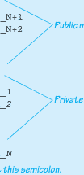

每个 Member_Specification_i 都是成员变量声明或成员函数声明（原型）。

允许有额外的 public: 和 private: 部分。如果第一个成员组没有 public: 或 private: 标签，则等同于在第一个组前有一个 private:。

## EXAMPLE

```
class Bicycle
{
public:
        char getColor();
        int numberOfSpeeds();
        void set(int theSpeeds, char theColor);
private:
        int speeds;
        char color;
};
```

一旦类被定义，对象变量（类类型的变量）就可以像任何其他类型的变量一样声明。例如，以下声明了两个 Bicycle 类型的对象变量：

```
Bicycle myBike, yourBike;
```


## TIP: 思考对象

如果你之前没有用类进行编程，掌握用它们编程的感觉可能需要一点时间。当你用类编程时，数据而不是算法占据中心地位。并不是说没有算法。然而，算法是为数据服务的，而不是为算法设计数据。这是一种观点上的差异。在极端情况下，许多人认为这是最好的风格，你完全没有全局函数，只有带有成员函数的类。在这种情况下，你定义对象以及对象如何交互，而不是操作数据的算法。我们将在本书中讨论如何实现这一点的细节。当然，你可以完全忽略类或将其 relegated 到次要角色，但那样你实际上是在用 C 编程，而不是 C++。

## 自测练习

- 16. 当你定义一个 C++ 类时，成员变量应设为 public 还是 private？成员函数应设为 public 还是 private？
- 17. 当你定义一个 C++ 类时，哪些项目被认为是接口的一部分？哪些项目被认为是实现的一部分？

## 章节总结

- 结构体可用于将不同类型的数据组合成一个单一的（复合）数据值。
- 类可用于将数据和函数组合成一个单一的（复合）对象。
- 类的成员变量或成员函数可以是 public 或 private。如果它是 public，则可以在类外使用。如果它是 private，则只能在成员函数的定义中使用。
- 一个函数可以具有类或结构体类型的形式参数。一个函数可以返回类或结构体类型的值。
- 类的成员函数可以像普通函数一样被重载。
- 在定义 C++ 类时，你应该将接口和实现分开，以便使用该类的任何程序员只需知道接口而无需查看实现。这就是封装的原则。

## 自测练习答案

1. a. `double`
   b. `double`
   c. illegal—cannot use a structure tag instead of a structure variable
   d. `char`
   e. `CDAccountV2`

2. A $9.99
   A $1.11

3. A semicolon is missing from the end of the definition of `Stuff`.

4. A x = {1,2};

5. a. Too few initializers; not a syntax error. After initialization, `month==12`, `day==21`, and `year==0`. Member variables not provided an initializer are initialized to a zero of the appropriate type.
   b. Correct after initialization. `12==month`, `21==day`, and `1995==year`.
   c. Error: too many initializers.

6. `struct EmployeeRecord`
   {
      `double wageRate;`
      `int vacation;`
      `char status;`
   };

7. `void readShoeRecord(ShoeType& newShoe)`
   {
      `cout << "Enter shoe style (one letter): ";`
      `cin >> newShoe.style;`
      `cout << "Enter shoe price $";`
      `cin >> newShoe.price;`
   }

8. `ShoeType discount(ShoeType oldRecord)`
   {
      `ShoeType temp;`
      `temp.style = oldRecord.style;`
      `temp.price = 0.90*oldRecord.price;`
      `return temp;`
   }

9. `void DayOfYear::input()`
   ```cpp
   {
       cout << "Enter month as a number: ";
       cin >> month;
       cout << "Enter the day of the month: ";
       cin >> day;
   }
   ```

10. `void Temperature::set(double newDegrees, char newScale)`
    ```cpp
    {
        degrees = newDegrees;
        scale = newScale;
    }
    ```

11. 点运算符和作用域解析运算符都与成员名一起使用，以指定成员名属于哪个类或结构体。如果类 DayOfYear 如 Display 6.3 中定义，并且 today 是 DayOfYear 类的一个对象，则成员 month 可通过点运算符访问：`today.month`。当我们给出成员函数的定义时，使用作用域解析运算符告诉编译器此函数是在类中声明的那个函数。

12. ```cpp
    hyundai.price = 4999.99; //ILLEGAL. price is private.
    jaguar.setPrice(30000.97); //LEGAL
    double aPrice, aProfit; //LEGAL
    aPrice = jaguar.getPrice(); //LEGAL
    aProfit = jaguar.getProfit(); //ILLEGAL. getProfit is
                                  //private.
    aProfit = hyundai.getProfit(); //ILLEGAL. getProfit is
                                  //private.
    hyundai = jaguar; //LEGAL
    ```

13. 更改后，它们都将是合法的。

14. 所有标记为 private 的成员（成员变量和成员函数）：只能在同一类的成员函数（公共和私有）的定义中按名称访问。标记为 public 的成员：在使用上没有任何限制。

15. a. 只有一个。编译器会警告如果你在类（或 struct）中没有 public: 成员。
    b. 没有，但我们通常期望在类中至少找到一个 private: 部分。

16. 成员变量都应为 private。接口的一部分的成员函数应为 public。你可能还有仅在其他成员函数的定义中使用的辅助（帮助）函数。这些辅助函数应为 private。

17. 所有私有成员变量的声明都是实现的一部分。（不应有公共成员变量。）类的所有公共成员函数的声明（在类定义中列出），以及这些声明的解释性注释，都是接口的一部分。所有私有成员函数的声明都是实现的一部分。所有成员函数定义（无论函数是 public 还是 private）都是实现的一部分。

## 编程项目

1. 编写一个软件开发公司的评级程序，其评级政策如下。

   a. 核心能力 – 该参数衡量员工对其分配任务的参与度、创新性和热情，满分为 10 分。

   b. 绩效评估 – 该参数衡量员工一年的绩效，满分为 30 分。

   c. 创意 – 员工根据其专利提交、获奖专利、技术论文发表等进行衡量，满分为 10 分。

   d. 绩效评估占员工最终评级的 50%，核心能力占 30%，创意占 20%。

   员工获得的总分相加并进行归一化。得分 80 分及以上者评为 1 级，60 至 79 分者评为 2 级，50 至 59 分者评为 3 级，低于 50 分者评为 4 级。

   程序将读取员工在三个标准下的得分，并输出按 100 分制计算的总分以及最终评级分数。定义并使用员工记录的结构体。

2. 定义一个名为 Circle 的类型类。Circle 类型的对象用于根据该对象的半径显示圆的面积、直径和周长。包含一个设置半径为作为参数给出的值的变异函数。包含计算圆的面积、直径和周长的成员函数。还包含一个返回圆半径的成员函数。将你的类定义嵌入到测试程序中。

3. Point 类型是一个相当简单的数据类型，但在另一个名称（模板类 pair）下，此数据类型在 C++ 标准模板库中被定义和使用，尽管你不必了解标准模板库即可完成此练习。编写一个名为 Point 的类的定义，可能用于存储和操作平面上点的位置。你需要声明并实现以下成员函数：

   a. 一个成员函数 set，在对象创建后设置私有数据。

   b. 一个成员函数，通过第一个和第二个参数指定的垂直和水平方向移动点。

   c. 一个成员函数，将点绕原点顺时针旋转 90 度。

   d. 两个 const 检查函数，用于检索点的当前坐标。


使用适当的注释记录这些函数。将你的类嵌入到一个测试程序中，该程序从用户请求多个点的数据，创建这些点，然后调用成员函数。

4. 编写一个名为 `GasPump` 的类的定义，用于模拟汽车加油站的加油泵。在继续本编程练习之前，先写下你期望加油泵的行为，从购买者的角度来看。

以下是加油泵可能被期望执行的功能列表。如果你的列表不同，并且你认为你的列表与这些一样好或更好，那么请咨询你的指导教师。你和你的指导教师应共同决定要实现的行为。然后实现并测试商定的加油泵类的设计。

-  dispensed 量的显示
-  dispensed 量的费用显示
-  每加仑、升或其他你所在地区使用的体积单位的成本显示
-  使用前，加油泵必须将 dispensed 量和费用重置为零。
-  一旦启动，加油泵会继续 dispensing 燃料，跟踪 dispensed 量，并计算 dispensed 量的费用，直到停止。
-  需要某种停止 dispensing 的控制。

将加油泵的行为实现为加油泵类的成员函数声明，然后编写这些成员函数的实现。你必须决定加油泵是否需要跟踪用户不应访问的数据。如果是，则将这些设为私有成员变量。

5. 定义一个名为 `Fraction` 的类。此类用于表示两个整数的比率。包含允许用户设置分子和分母的变异函数。还包括一个返回分子除以分母的值作为 double 的成员函数。包括一个额外的成员函数，将分数的值输出为最简形式。例如，函数不应输出 20/60，而应输出 1/3。这需要找到分子和分母的最大公约数，然后将两者除以该数。将你的类嵌入到一个测试程序中。

6. 定义一个名为 `BicycleSpeedometer` 的类，用于跟踪骑行者行驶的距离、行驶时间和平均速度。类应具有行驶距离（以英里为单位）和用时（以分钟为单位）的成员变量。包含设置距离和时间的变异函数。包含一个计算平均速度（以英里每小时为单位）的成员函数。

使用你的类编写一个测试程序，创建该类，读取所有必需成员变量的输入值并输出骑行者的平均速度。

7. 定义一个名为 `Pizza` 的类，具有成员变量来跟踪披萨类型（深盘、手抛或平底）以及尺寸（小、中或大）和 pepperoni 或奶酪配料的数量。你可以使用常量来表示类型和尺寸。包含类的变异和访问函数。创建一个 void 函数 `outputDescription()`，输出披萨对象的文本描述。还包括一个函数 `computePrice()`，根据以下规则计算披萨的成本并以 double 形式返回：

- 小披萨 = $10 + 每种配料 $2
- 中披萨 = $14 + 每种配料 $2
- 大披萨 = $17 + 每种配料 $2

编写一个合适的测试程序，创建并输出各种披萨对象的描述和价格。

8. 定义一个名为 `Money` 的类，存储货币金额。类应有两个私有整数变量，一个存储美元数，另一个存储美分数。添加访问和变异函数来读取和设置两个成员变量。添加另一个函数以 double 形式返回货币金额。编写一个程序，使用至少两个不同的 Money 对象测试你的所有函数。

9. 执行编程项目 6.8，但移除两个私有整数变量并使用单个 double 类型的变量来存储货币值代替。其他函数的头文件应保持相同。对于几个函数，这需要代码将整数格式转换为适当修改 double。例如，如果存储在 double 中的货币金额为 4.55（代表 $4.55），并且设置美元金额的函数被调用值为 13，则 double 应更改为 13.55。虽然这需要一些工作，但来自编程项目 6.8 的测试程序中的代码仍应无需任何更改即可工作。这是封装成员变量的好处。

10. 创建一个类 `Weight`，内部以磅存储重量。创建函数 `setWeightPounds`、`setWeightKilograms` 和 `setWeightOunces`，它们接受指定重量单位的输入重量，在需要时将重量转换为磅，并将该重量存储在类的成员变量中。此外，创建返回存储重量以磅、千克和盎司表示的函数。编写一个 main 函数来测试你的类。使用下面显示的方程在重量单位之间转换。

1 磅 = 16 盎司
1 千克 = 2.21 磅

11. 执行编程项目 5.18，但只使用一个数组作为参数而不是两个数组。单个数组应为类型 `Player`，其中 `Player` 是你创建的类。`Player` 类应具有类型为 string 的成员变量来存储玩家姓名，以及类型为 int 的成员变量来存储玩家得分。适当封装这些变量。返回函数后，索引 0 处的数组条目应设置为得分最佳玩家的姓名和得分，索引 1 处的条目应设置为得分第二好的玩家的姓名和得分，依此类推。

12. 你的社区支持农业（CSA）农场每周向你家送一次新鲜水果和蔬菜箱。对于本编程项目，定义包含恰好三个水果或蔬菜捆绑的类 `BoxOfProduce`。你可以用 string 类型的数组来表示水果或蔬菜。添加访问和变异函数来获取或设置数组中存储的水果或蔬菜。还编写一个输出函数，在控制台上显示箱子的完整内容。

接下来，编写一个 main 函数，创建一个 `BoxOfProduce`，其中包含从以下列表中随机选择的三个项目：

- Broccoli
- Tomato
- Kiwi
- Kale
- Tomatillo

该列表应存储在文本文件中，由你的程序读取。现在你可以假设列表包含恰好五种水果或蔬菜类型。

不必担心你的程序随机为三个项目选择重复的农产品。接下来，main 函数应显示箱子的内容并允许用户用五种可能的水果或蔬菜中的任何一种替换箱子中选定的任何水果或蔬菜中的一种。用户完成替换后，输出要交付的箱子的最终内容。

13. 执行编程项目 5.19，但这次使用名为 `Player` 的类来存储玩家的姓名和得分。然后使用 `Player` 类的数组来存储十名玩家。

## 构造函数和其他工具 7

| 章节 | 页码 |
| --- | --- |
| 7.1 构造函数 | 310 |
| 构造函数定义 | 310 |
| 陷阱：无参数的构造函数 | 315 |
| 显示的构造函数调用 | 316 |
| 提示：始终包含默认构造函数 | 317 |
| 示例：BankAccount 类 | 319 |
| 类类型成员变量 | 326 |
| C++11 中的成员初始化器和构造函数委托 | 329 |
| 7.2 更多工具 | 330 |
| const 参数修饰符 | 330 |
| 陷阱：const 使用不一致 | 332 |
| 内联函数 | 336 |
| 静态成员 | 338 |
| 嵌套和局部类定义 | 341 |
| 7.3 向量——标准模板库预览 | 342 |
| 向量基础 | 342 |
| 陷阱：使用方括号超出向量大小 | 344 |
| 提示：向量赋值行为良好 | 346 |
| 效率问题 | 346 |


## 7 构造函数和其他工具

> 给我们工具，我们就会完成任务。
> 
> —— 温斯顿·丘吉尔，《给我们工具》。广播，伦敦。1941年2月9日。演讲

## 引言

本章介绍了在用类进行编程时可使用的许多重要工具。其中最重要的工具是类构造函数，一种用于初始化类对象的函数。

第 7.3 节以向量作为类的示例，并作为标准模板库 STL 的预览。向量类似于数组，但大小可以增长和缩小。STL 是一个包含预定义类的庞大库。第 7.3 节现在可以讲解，也可以稍后讲解。第 8 章至第 18 章的材料不需要第 7.3 节的材料，因此如果你愿意，可以推迟讲解向量（第 7.3 节）。

第 7.1 节和第 7.2 节不使用第 5 章的材料，但使用第 6 章的材料。第 7.3 节需要第 1 章至第 6 章以及第 7.1 节。

## 7.1 构造函数

> 好的开始是成功的一半。
> 
> —— 谚语

通常你希望在声明对象时初始化对象的一个或全部成员变量。正如本书后面会看到的，你可能还想执行其他初始化操作，但初始化成员变量是最常见的初始化类型。C++ 包含了此类初始化的特殊规定。当你定义一个类时，可以定义一种特殊的成员函数，称为构造函数。构造函数是当声明该类的对象时自动调用的成员函数。构造函数用于初始化某些或全部成员变量的值，并执行可能需要的任何其他初始化。

### 构造函数定义

你定义构造函数的方式与定义任何其他成员函数相同，只是存在两点不同：

- 1. 构造函数必须与类同名。例如，如果类名为 `BankAccount`，则该类的任何构造函数都必须命名为 `BankAccount`。
- 2. 构造函数定义不能返回值。而且，在函数声明或函数头开始处不能给出任何类型，甚至 `void` 也不行。


例如，假设我们想为 DayOfYear 类型的对象添加一个用于初始化月份和日期的构造函数，该类我们在第 6.4 节中给出，并在下面重新定义以包含构造函数。（我们省略了一些注释以节省空间，但在实际程序中应包含它们。）

```
class DayOfYear
{
public:
    DayOfYear(int monthValue, int dayValue); //Initializes the month and day to arguments.
    void input();
    void output();
    void set(int newMonth, int newDay);
    void set(int newMonth);
    int getMonthNumber();
    int getDay();
private:
    int month;
    int day;
};
```

请注意，构造函数命名为 DayOfYear，与类名相同。还请注意，构造函数 DayOfYear 的声明（原型）不以 void 或任何其他类型名开头。最后，请注意构造函数被放在类定义的 public 部分。通常，你应将构造函数设为 public 成员函数。如果你将所有构造函数设为 private 成员，那么你将无法声明该类类型的任何对象，这将使类完全无用。

使用重新定义的 DayOfYear 类，两个 DayOfYear 类型的对象可以按如下方式声明并初始化：

```
DayOfYear date1(7, 4), date2(5, 5);
```

假设构造函数的定义执行了我们承诺的初始化操作，前面的声明将声明对象 date1，将 date1.month 的值设为 7，并将 date1.day 的值设为 4。因此，对象 date1 被初始化为表示 7 月 4 日。同理，date2 被初始化为表示 5 月 5 日。发生的情况是对象 date1 被声明，然后以 7 和 4 两个参数调用构造函数 DayOfYear。同样，date2 被声明，然后以 5 和 5 为参数调用构造函数 DayOfYear。其结果在概念上等同于以下内容（尽管你不能在 C++ 中这样写）：

```
DayOfYear date1, date2; //PROBLEMS--BUT FIXABLE
date1.DayOfYear(7, 4); //VERY ILLEGAL
date2.DayOfYear(5, 5); //VERY ILLEGAL
```

正如注释所指出的，你不能在程序中放置上面显示的三行。第一行可以被修改为可接受，但对构造函数 `DayOfYear` 的两次调用是非法的。构造函数不能像普通成员函数那样被调用。尽管如此，当我们写那三行时我们想要发生的事情是明确的，并且当你按如下方式声明对象 `date1` 和 `date2` 时会自动发生：

```
DayOfYear date1(7, 4), date2(5, 5);
```

构造函数的定义与任何其他成员函数相同。例如，如果你通过添加上面描述的构造函数来修改类 `DayOfYear` 的定义，你还需要添加构造函数的定义，可能如下所示：

```
DayOfYear::DayOfYear(int monthValue, int dayValue)
{
    month = monthValue;
    day = dayValue;
}
```

由于类名和构造函数函数名相同，函数头中出现了两次名称 `DayOfYear`；`::` 范围解析运算符之前的 `DayOfYear` 是类名，`::` 范围解析运算符之后的 `DayOfYear` 是构造函数函数名。还请注意，在构造函数定义的头中没有指定返回类型，甚至 `void` 类型也不指定。除了这些点之外，构造函数可以像普通成员函数一样定义。

> **构造函数**
> 
> *构造函数* 是类的成员函数，其名称与类名相同。构造函数在声明类的对象时自动调用。构造函数用于初始化对象。构造函数必须与它所属的类同名。

正如我们刚才举例说明的，构造函数可以像任何其他成员函数一样定义。然而，定义构造函数有一种更可取的替代方法。前面构造函数 `DayOfYear` 的定义与以下版本完全等价：

```
DayOfYear::DayOfYear(int monthValue, int dayValue)
                    : month(monthValue), day(dayValue)
/*Body intentionally empty*/}
```

构造函数定义第二行显示的新元素称为 **初始化区段**。正如本例所示，初始化区段位于参数列表结束的右括号之后、函数体开始的左大括号之前。初始化区段由冒号后跟一些或全部成员变量的列表组成，各变量之间用逗号分隔。每个成员变量后跟其初始化值，放在括号中。请注意，初始化值可以用构造函数参数表示。

带有初始化区段的构造函数定义中的函数体不必为空，如前例所示。例如，以下改进的构造函数定义会检查参数是否合适：

```
DayOfYear::DayOfYear(int monthValue, int dayValue)
                         : month(monthValue), day(dayValue)
{
    if ((month < 1) || (month > 12))
    {
        cout << "Illegal month value!\n";
        exit(1);
    }
    if ((day < 1) || (day > 31))
    {
        cout << "Illegal day value!\n";
        exit(1);
    }
}
```

你可以重载构造函数名 DayOfYear::DayOfYear，就像可以重载任何其他成员函数名一样。事实上，构造函数通常会被重载，以便对象可以用多种方式初始化。例如，在第 7.1 节中，我们重新定义了类 DayOfYear，使其具有三个版本的构造函数。此重新定义重载了构造函数名 DayOfYear，使其可以有两个参数（如我们刚才讨论的）、一个参数或没有参数。

请注意，在第 7.1 节中，两个构造函数调用成员函数 testDate 来检查其初始化值是否合适。成员函数 testDate 是私有的，因为它仅 intended 用于其他成员函数，因此是隐藏的实现细节的一部分。

我们从这个修订后的 DayOfYear 类定义中省略了成员函数 set。一旦你拥有了一组良好的构造函数定义，就不需要任何其他成员函数来设置类的成员变量。你可以使用第 7.1 节中的构造函数 DayOfYear 来实现与成员函数 set 相同的目的（我们在第 6.4 节中显示的旧版本类中包含了该函数）。


## 1. 引言

本文档旨在介绍一种基于深度学习的图像识别方法，该方法在多个标准数据集上取得了优异的性能。我们详细阐述了模型的架构设计、训练策略以及实验结果，并与其他主流方法进行了对比分析。

## 2. 相关工作

近年来，卷积神经网络（CNN）在计算机视觉领域取得了突破性进展。从早期的 AlexNet 到后来的 VGG、ResNet 等，网络结构不断加深，性能持续提升。此外，注意力机制的引入进一步增强了模型的特征提取能力。

## 3. 方法

我们提出了一种新颖的网络架构，该架构结合了残差连接和自注意力机制。具体来说，我们设计了一个轻量级的注意力模块，能够自适应地调整特征图的权重，从而提升模型对关键区域的关注度。

- 输入图像预处理
- 特征提取网络
- 注意力模块
- 分类器

实验结果表明，我们的方法在准确率和计算效率之间取得了良好的平衡。

# Display 7.1   类的构造函数（第 2 部分，共 2 部分）

```cpp
41  DayOfYear::DayOfYear(int monthValue) : month(monthValue), day(1)
42  {
43      testDate( );
44  }
45
46  DayOfYear::DayOfYear( ) : month(1), day(1)
47  {/*Body intentionally empty.*/}
48
49  //uses iostream and cstdlib;
50  void DayOfYear::testDate( )
51  {
52      if ((month < 1) || (month > 12))
53      {
54          cout << "Illegal month value!\n";
55          exit(1);
56      }
57      if ((day < 1) || (day > 31))
58      {
59          cout << "Illegal day value!\n";
60          exit(1);
61      }
62  }
```

> _其他成员函数的定义与 Display 6.4 中的相同。_

# Sample Dialogue

```
Initialized dates:
February 21
May 1
January 1
date1 reset to the following:
October 31
```

# PITFALL: 无参数的构造函数

请记住，当你声明一个类变量并希望调用无参数的构造函数时，不要使用任何括号。例如，考虑 Display 7.1 中的以下行：

```
DayOfYear date1(2, 21), date2(5), date3;
```

对象 date1 由接受两个参数的构造函数初始化，对象 date2 由接受一个参数的构造函数初始化，而对象 date3 由不接受参数的构造函数初始化。

# PITFALL: （续）

你可能会认为在声明一个变量以调用无参数的构造函数时应该使用空括号，但之所以不这样做是有原因的。考虑以下示例，看起来它应该声明变量 date3 并调用无参数的构造函数：

```
DayOfYear date3(); //PROBLEM! Not what you might think it is.
```

问题在于，虽然你可能将其视为声明和构造函数调用，但编译器会将其视为一个名为 date3 的函数的声明（原型），该函数没有参数并返回 DayOfYear 类型的值。由于一个没有参数且返回 DayOfYear 类型值的函数 date3 是完全合法的，因此这种记法始终具有该含义。当你想调用无参数的构造函数时，使用的是另一种记法（不带括号）。

# Calling a Constructor

构造函数会在对象被声明时自动调用，但你必须在声明对象时为构造函数提供参数。构造函数也可以显式调用，但其语法与普通成员函数所使用的语法不同。

# SYNTAX FOR AN OBJECT DECLARATION WHEN YOU HAVE CONSTRUCTORS

```
Class_Name Variable_Name(Arguments_for_Constructor);
```

# EXAMPLE

```
DayOfYear holiday(7, 4);
```

# SYNTAX FOR AN EXPLICIT CONSTRUCTOR CALL

```
Variable = Constructor_Name(Arguments_For_Constructor);
```

# EXAMPLE

```
holiday = DayOfYear(10, 31);
```

构造函数必须与它所属的类的名称相同。因此，在前面的语法描述中，Class_Name 和 Constructor_Name 是相同的标识符。

# Explicit Constructor Calls

构造函数在声明类类型的对象时会自动调用，但在对象声明后也可以再次调用。这使你能够方便地设置对象的全部成员。技术细节如下。调用构造函数会创建一个具有新值的不具名对象。不具名对象是指尚未由任何变量命名的对象。不具名对象可以赋给具名对象。例如，以下是对

# TIP: （续）

你应该认识到以下内容是声明 SampleClass 类型的对象并调用该类构造函数的合法方式：

```
SampleClass myVariable(7, 7.77);
```

然而，以下内容是非法的：

```
SampleClass yourVariable;
```

编译器将前面的声明解释为包括对无参数构造函数的调用，但没有对零参数构造函数的定义。你必须在 yourVariable 的声明中添加两个参数，或者添加一个无参数构造函数的定义。

如果你将 SampleClass 类重新定义如下，则前面的 yourVariable 声明将是合法的：

```
class SampleClass
{
public:
    SampleClass(int parameter1, double parameter2);
    SampleClass();
    void doStuff();
private:
    int data1;
    double data2;
};
```

为了避免此类混淆，你应该在定义的任何类中始终包含一个默认构造函数。如果你不希望默认构造函数初始化任何成员变量，可以在实现时简单地给它一个空体。以下构造函数定义是完全合法的。它除了创建一个未初始化的对象之外什么都不做：

```
SampleClass::SampleClass()
{ /*Do nothing.*/ }
```

# Constructors with No Arguments

不接受参数的构造函数称为默认构造函数。当你声明一个对象并希望调用零参数的构造函数时，不要包含任何括号。例如，要声明一个对象并向构造函数传递两个参数，你可能会这样做：

```
DayOfYear date1(12, 31);
```

然而，如果你希望使用零参数的构造函数，则按如下方式声明对象：

```
DayOfYear date2;
```

你不要按如下方式声明对象：

DayOfYear date2( ); //PROBLEM!

（问题在于这种语法声明了一个返回 DayOfYear 对象的函数且没有参数。）

但是，当你显式调用无参数的构造函数时，你确实包含括号，如下所示：

date1 = DayOfYear( );

# Self-Test Exercises

1. 假设你的程序包含以下类定义（以及成员函数的定义）：

```
class YourClass
{
public:
    YourClass(int newInfo, char moreNewInfo);
    YourClass( );
    void doStuff( );
private:
    int information;
    char moreInformation;
};
```

以下哪些是合法的？

YourClass anObject(42, 'A');
YourClass anotherObject;
YourClass yetAnotherObject();
anObject = YourClass(99, 'B');
anObject = YourClass( );
anObject = YourClass;

2. 什么是默认构造函数？每个类都有默认构造函数吗？

# EXAMPLE: BankAccount Class

Display 7.2 包含一个表示简单银行账户的类定义，该定义嵌入在一个小型演示程序中。这种形式的银行账户有两个数据项：账户余额和利率。请注意，我们将账户余额表示为两个 int 类型的值，一个用于美元，一个用于美分。这说明了数据的内部表示不必简单地为每个概念上的数据项提供一个成员变量。它可能

# EXAMPLE: （续）

似乎余额应表示为 double 类型的值，而不是两个 int 值。然而，账户包含确切的美元和美分数量，而 double 类型的值从实际意义上讲是一个近似量。此外，$323.52 的余额并不是一个浮点值前面的美元符号。$323.52 不能有超过或少于两位小数。你不能有 $323.523 的余额，而 double 类型的成员变量会允许这样的余额。拥有带小数美分的账户并非不可能。这只是我们不希望在银行账户中出现的。

请注意，使用 BankAccount 类的程序员可以将余额视为 double 类型的值或两个 int 值（美元和美分）。访问器和修改器函数允许程序员以 double 或两个 int 的形式读取和设置余额。使用该类的程序员不必也不应该考虑任何底层成员变量。那是“隐藏”在使用该类的程序员之外的实现的一部分。

请注意，修改器函数 setBalance 以及构造函数名称都是重载的。此外，所有构造函数和修改器函数都会检查值以确保其适当。例如，利率不能为负。余额可以为负，但你不能有正的美元数和负的美分数。

该类有四个私有成员函数：dollarsPart、centsPart、round 和 fraction。这些成员函数设为私有，因为它们仅 intended 用于其他成员函数的定义中。

```
#include <iostream>
#include <cmath>
#include <cstdlib>
using namespace std;

//Data consists of two items: an amount of money for the account balance
//and a percentage for the interest rate.
class BankAccount
{
public:
    BankAccount(double balance, double rate);
        //Initializes balance and rate according to arguments.

    BankAccount(int dollars, int cents, double rate);
        //Initializes the account balance to $dollars.cents. For a
        //negative balance both dollars and cents must be negative.
        //Initializes the interest rate to rate percent.
```


# 展示 7.2 BankAccount 类（第 2 部分，共 6 部分）

```
15  BankAccount(int dollars, double rate);
//Initializes the account balance to $dollars.00 and
//initializes the interest rate to rate percent.

19  BankAccount();
//Initializes the account balance to $0.00 and the interest rate
//to 0.0%.

23  void update();
//Postcondition: One year of simple interest has been added to the
//account.

27  void input();
28  void output();
29  double getBalance();
30  int getDollars();
31  int getCents();
32  double getRate(); //Returns interest rate as a percentage.

34  void setBalance(double balance);
35  void setBalance(int dollars, int cents);
 //Checks that arguments are both nonnegative or both nonpositive.

38  void setRate(double newRate);
//If newRate is nonnegative, it becomes the new rate. Otherwise,
//abort program.

42  private:
//A negative amount is represented as negative dollars and
//negative cents.
//For example, negative $4.50 sets accountDollars to -4 and
//accountCents to -50.
 int accountDollars; //of balance
 int accountCents; //of balance
 double rate; //as a percent
 int dollarsPart(double amount);
 int centsPart(double amount);
 int round(double number);

 double fraction(double percent);
//Converts a percentage to a fraction. For example, fraction(50.3)
//returns 0.503.
};
```

私有成员

这个声明会导致对默认构造函数的调用。注意这里没有括号。

# 展示 7.2 BankAccount 类（第 3 部分，共 6 部分）

```
51  cout << "account2 initialized as follows:\n";
52  account2.output( );
53  account1 = BankAccount(999, 99, 5.5);
54  cout << "account1 reset to the following:\n";
55  account1.output( );
56  cout << "Enter new data for account 2:\n";
57  account2.input( );
58  cout << "account2 reset to the following:\n";
59  account2.output( );
60  account2.update( );
61  cout << "In one year account2 will grow to:\n";
62  account2.output( );
63  return 0;
64  }
65  BankAccount::BankAccount(double balance, double rate)
66   : accountDollars(dollarsPart(balance)),
     accountCents(centsPart(balance))
67  {
68   setRate(rate);
69  }
70  BankAccount::BankAccount(int dollars, int cents, double rate)
71  {
72   setBalance(dollars, cents);
73   setRate(rate);
74  }
75  BankAccount::BankAccount(int dollars, double rate)
76   : accountDollars(dollars), accountCents(0)
77  {
78   setRate(rate);
79  }
80  BankAccount::BankAccount() : accountDollars(0),
     accountCents(0), rate(0.0)
81  {/*Body intentionally empty.*/
82  void BankAccount::update()
83  {
84   double balance = accountDollars + accountCents*0.01;
85   balance = balance + fraction(rate)*balance;
86   accountDollars = dollarsPart(balance);
87   accountCents = centsPart(balance);
```

> 对构造函数 BankAccount::BankAccount 的显式调用

> 这些函数检查数据是否合适。

# 展示 7.2 BankAccount 类（第 4 部分，共 6 部分）

```
88 }
89 //Uses iostream:
90 void BankAccount::input( )
91 {
92     double balanceAsDouble;
93     cout << "Enter account balance $";
94     cin >> balanceAsDouble;
95     accountDollars = dollarsPart(balanceAsDouble);
96     accountCents = centsPart(balanceAsDouble);
97     cout << "Enter interest rate (NO percent sign): ";
98     cin >> rate;
99     setRate(rate);
100 }
101 //Uses iostream and cstdlib:
102 void BankAccount::output( )
103 {
104     int absDollars = abs(accountDollars);
105     int absCents = abs(accountCents);
106     cout << "Account balance: $";
107     if (accountDollars > 0)
108         cout << " ";
109     cout << absDollars;
110     if (absCents >= 10)
111         cout << "." << absCents << endl;
112     else
113         cout << "." << '0' << absCents << endl;
114     cout << "Rate: " << rate << "%\n";
115 }
116 double BankAccount::getBalance( )
117 {
118     return (accountDollars + accountCents * 0.01);
119 }
120 int BankAccount::getDollars( )
121 {
122     return accountDollars;
123 }
124 int BankAccount::getCents( )
125 {
126     return accountCents;
127 }
130 double BankAccount::getRate( )
131 {
132     return rate;
133 }
```

> 关于 BankAccount::input 更好的定义，请参见自测练习 3。

> 使用该类的程序员并不关心余额是存储为一个实数还是两个整数。

# 展示 7.2 BankAccount 类（第 5 部分，共 6 部分）

```
134
135 void BankAccount::setBalance(double balance)
136 {
137     accountDollars = dollarsPart(balance);
138     accountCents = centsPart(balance);
139 }
140
141 //Uses cstdlib:
142 void BankAccount::setBalance(int dollars, int cents)
143 {
144     if ((dollars < 0 && cents > 0) || (dollars > 0 && cents < 0))
145     {
146         cout << "Inconsistent account data.\n";
147         exit(1);
148     }
149     accountDollars = dollars;
150     accountCents = cents;
151 }
152
153 //Uses cstdlib:
154 void BankAccount::setRate(double newRate)
155 {
156     if (newRate >= 0.0)
157         rate = newRate;
158     else
159     {
160         cout << "Cannot have a negative interest rate.\n";
161         exit(1);
162     }
163 }
164 int BankAccount::dollarsPart(double amount)
165 {
166     return static_cast<int>(amount);
167 }
168 //Uses cmath:
169 int BankAccount::centsPart(double amount)
170 {
171     double doubleCents = amount * 100;
172     int intCents = (round(fabs(doubleCents))) % 100;
173     //% can misbehave on negatives
174     if (amount < 0)
175         intCents = -intCents;
176     return intCents;
177 }
178
179 //Uses cmath:
180 int BankAccount::round(double number)
181 {
182     return static_cast<int>(floor(number + 0.5));
183 }
```

> *这个函数本可以是一个普通函数而不是成员函数，但作为成员函数，我们能够将其设为私有。*

> *这些函数本可以是普通函数而不是成员函数，但作为成员函数，我们能够将它们设为私有。*

> *如果这看起来不清楚，请参见第 3 章第 3.2 节关于 round 的讨论。*

# 展示 7.2 BankAccount 类（第 6 部分，共 6 部分）

```
183
184  double BankAccount::fraction(double percent)
185  {
186      return (percent/100.0);
187  }
```

# 示例对话

```
account1 initialized as follows:
Account balance: $1345.52
Rate: 2.3%
account2 initialized as follows:
Account balance: $0.00
Rate: 0%
account1 reset to the following:
Account balance: $999.99
Rate: 5.5%
Enter new data for account 2:
Enter account balance $100.00
Enter interest rate (NO percent sign): 10
account2 reset to the following:
Account balance: $100
Rate: 10%
In one year account2 will grow to:
Account balance: $110
Rate: 10%
```

# 自测练习

- 3. 在展示 7.2 中，函数 `BankAccount::input` 将账户余额读取为 double 类型的值。当该值以二进制形式存储到计算机内存中时，这可能会产生微小的误差。这种误差通常不会被注意到，而且该函数对于演示类 `BankAccount` 来说已经足够好了。在数值分析上花费过多时间会偏离当前的主题。不过，这个输入函数对于银行业务来说还不够好。请重写函数 `BankAccount::input`，使其将 78.96 这样的金额读取为 `int` 76 和三个字符 `'1'`、`'9'`、`'6'`。你可以假设用户输入金额时总是输入两位小数，例如输入 99.00 而不是只输入 99 而已。提示：下面的公式可以将一个数字字符转换为对应的 int 值，例如将 `'6'` 转换为 6：

```
static_cast<int>(digit) - static_cast<int>('0')
```

# 类类型的成员变量

一个类可以有一个成员变量，其类型是另一个类。总的来说，拥有一个类成员变量不需要什么特别的处理，但有一种特殊的记号，允许在外围类的构造函数中调用该成员变量的构造函数。展示 7.3 中给出了一个例子。

# 展示 7.3 一个类成员变量（第 1 部分，共 3 部分）

```
1 #include <iostream>
2 #include <cstdlib>
3 using namespace std;

4 class DayOfYear
5 {
6 public:
7   DayOfYear(int monthValue, int dayValue);
8   DayOfYear(int monthValue);
9   DayOfYear();
10  void input();
11  void output();
12  int getMonthNumber();
13  int getDay();
14 private:
15  int month;
16  int day;
17  void testDate();
18 };

19 class Holiday
20 {
21 public:
22  Holiday(); //Initializes to January 1 with no parking enforcement
23  Holiday(int month, int day, bool theEnforcement);
24  void output();
25 private:
26  DayOfYear date;
27  bool parkingEnforcement;//true if enforced
28 };

29 int main()
30 {
31  Holiday h(2, 14, true);
32  cout << "Testing the class Holiday.\n";
33  h.output();
34  return 0;
35 }
36
37 Holiday::Holiday() : date(1, 1), parkingEnforcement(false)
38 {/*Intentionally empty*/}
39 Holiday::Holiday(int month, int day, bool theEnforcement)
40   : date(month, day), parkingEnforcement(theEnforcement)
```

> 类 DayOfYear 与展示 7.1 中的一样，但这里我们重复了你所需要的全部细节。

类类型的成员变量

来自该类的构造函数调用


## 显示 7.3 一个类成员变量（第 2 部分，共 3 部分）

```
41 /* 有意留空 */
42 void Holiday::output( )
43 {
44     date.output( );
45     cout << endl;
46     if (parkingEnforcement)
47         cout << "Parking laws will be enforced.\n";
48     else
49         cout << "Parking laws will not be enforced.\n";
50 }
51
51 DayOfYear::DayOfYear(int monthValue, int dayValue)
52     : month(monthValue), day(dayValue)
53 {
54     testDate( );
55 }
56
56 //使用 iostream 和 cstdlib：
57 void DayOfYear::testDate( )
58 {
59     if ((month < 1) || (month > 12))
60     {
61         cout << "Illegal month value!\n";
62         exit(1);
63     }
64     if ((day < 1) || (day > 31))
65     {
66         cout << "Illegal day value!\n";
67         exit(1);
68     }
69 }
70
71 //使用 iostream；
72 void DayOfYear::output( )
73 {
74     switch (month)
75     {
76     case 1:
77         cout << "January "; break;
78     case 2:
79         cout << "February "; break;
80     case 3:
81         cout << "March "; break;
82         .
83         .
84     case 11:
85         cout << "November "; break;
```

省略的行在显示 6.3 中，但已经足够明显，你不必去查看。

## 显示 7.3 一个类成员变量（第 3 部分，共 3 部分）

```
84      case 12:
85          cout << "December "; break;
86      default:
87          cout << "Error in DayOfYear::output.";
88  }
89      cout << day;
90 }
```

### 示例对话

```
Testing the class Holiday.
February 14
Parking laws will be enforced.
```

显示 7.3 中的 Holiday 类可能会被一些城市的警察部门用来帮助跟踪哪些节假日会执行停车法规（如停车计时器和一小时停车区等）。这是一个高度简化的类。一个真实的类会有更多的成员函数，但 Holiday 类已足够完整地说明我们的要点。

Holiday 类有两个成员变量。成员变量 parkingEnforcement 是一个简单类型 bool 的普通成员变量。成员变量 date 是类类型 DayOfYear。

接下来我们重现了显示 7.3 中的一个构造函数定义：

```
Holiday::Holiday(int month, int day, bool theEnforcement)
    : date(month, day), parkingEnforcement(theEnforcement)
    {/* 有意留空 */}
```

注意，我们以通常的方式在初始化列表中设置了成员变量 parkingEnforcement，即使用

    parkingEnforcement(theEnforcement)

成员变量 date 是类类型 DayOfYear 的成员。要初始化 date，我们需要调用类 DayOfYear（date 的类型）中的构造函数。这是在初始化列表中通过类似的记法完成的：

    date(month, day)

记法 date(month, day) 是对类 DayOfYear 构造函数的调用，使用参数 month 和 day 来初始化 date 的成员变量。注意，这个记法类似于你声明一个 DayOfYear 类型的变量 date 的方式。还要注意，外部类构造函数 Holiday 的参数可以在成员变量的构造函数调用中使用。

## C++11 中的成员初始化器和构造函数委托

C++11 支持一个名为**成员初始化**的特性，这个特性在大多数面向对象编程语言中都有。该特性允许你为成员变量设置默认值。当创建对象时，成员变量会被自动初始化为指定的值。考虑以下 Coordinate 类的定义和实现：

```
class Coordinate
{
public:
    Coordinate();
    Coordinate(int x);
    Coordinate(int x, int y);
    int getX();
    int getY();
private:
    int x=1;
    int y=2;
};
Coordinate::Coordinate()
{ }
Coordinate::Coordinate(int xval) : x(xval)
{ }
Coordinate::Coordinate(int xval, int yval) : x(xval), y(yval)
{ }
int Coordinate::getX()
{
    return x;
}
int Coordinate::getY()
{
    return y;
}
```

如果我们创建一个 Coordinate 对象，那么成员变量 x 默认会被设置为 1，成员变量 y 默认会被设置为 2。如果我们调用一个显式设置这些变量的构造函数，这些值可以被覆盖。在下面的例子中，c1 设置了 x 和 y 的默认值，但对于 c2，只设置了 y 的默认值，因为 x 被显式设置为输入参数：

```
Coordinate c1, c2(10);
cout << c1.getX() << " " << c1.getY() << endl; // 输出 1 2
cout << c2.getX() << " " << c2.getY() << endl; // 输出 10 2
```

C++11 支持的一个相关特性是**构造函数委托**。简单来说，它允许一个构造函数调用另一个构造函数。例如，我们可以修改默认构造函数的实现，使其调用带两个参数的构造函数：

```
Coordinate::Coordinate() : Coordinate(99,99)
{ }
```

## 7.2 更多工具

> 智能……是制造人造物体的能力，尤其是制造工具以制造工具的能力。

亨利·柏格森，《生命进化中的不同方向——麻木、智能、本能》，《创造进化论》。亚瑟·米切尔博士译。纽约：亨利·霍尔特出版公司，1911年

本节讨论三个重要的主题，但它们之前不太容易插进来。这三个主题是：类的 const 参数、内联函数和静态类成员。

### const 参数修饰符

按引用传递参数比按值传递参数更高效。按值传递参数是一个局部变量，被初始化为其参数的值，因此当函数被调用时，参数有两份拷贝。而按引用传递参数时，参数只是一个占位符，被实参所替换，因此参数只有一份拷贝。对于简单类型（如 int 或 double）的参数，效率差异可以忽略不计，但对于类参数，效率差异有时可能很重要。因此，对于类，即使函数不修改该参数，使用按引用传递参数而不是按值传递参数也是有意义的。

如果你使用按引用传递参数，并且你的函数不改变参数的值，你可以标记该参数，让编译器知道该参数不应被修改。为此，需要在参数类型前放置修饰符 const。这样的参数称为常量参数或常量按引用传递参数。例如，在显示 7.2 中，我们定义了一个名为 BankAccount 的类，用于简单的银行账户。在某些程序中，你可能想编写一个返回布尔值的函数来测试两个账户中哪一个余额更大。函数的定义可能如下：

```
bool isLarger(BankAccount account1, BankAccount account2)
//如果 account1 中的余额大于 account2 中的余额，返回 true。
//否则返回 false。
{
    return(account1.getBalance() > account2.getBalance());
}
```

这是完全合法的。这两个参数是按值传递参数。然而，更高效也更常见的做法是使参数成为常量按引用传递参数，如下所示：

```
bool isLarger(const BankAccount& account1,
    const BankAccount& account2)
```

```
//如果 account1 中的余额大于 account2 中的余额，返回 true。
//否则，返回 false。
{
    return(account1.getBalance() > account2.getBalance());
}
```

注意，唯一的区别是我们通过添加 & 使参数成为按引用传递，并添加了 const 修饰符。如果有函数声明，则必须在函数声明中对参数做同样的更改。

常量参数是自动错误检查的一种形式。如果你的函数定义包含错误，导致意外更改了常量参数，编译器将发出错误消息。

参数修饰符 const 可以用于任何类型的参数；然而，它通常只用于类的按引用传递参数（以及某些对应实参较大的参数，如数组）。

假设你为一个类的对象调用成员函数，例如显示 7.2 中的 BankAccount 类。例如：

```
BankAccount myAccount;
myAccount.input();
myAccount.output();
```

成员函数 input 的调用会改变调用对象 myAccount 中成员变量的值。因此调用对象的行为有点像按引用传递参数；函数调用可以改变调用对象。有时，你不想改变调用对象的成员变量。例如，成员函数 output 不应改变调用对象成员变量的值。你可以使用 const 修饰符告诉编译器，成员函数的调用不应改变调用对象。

### 将 const 用于成员函数

修饰符 const 应用于调用对象的方式与应用于参数的方式相同。如果你有一个不应改变调用对象值的成员函数，你可以使用 const 修饰符标记该函数；如果你的函数代码意外改变了调用对象的值，计算机将发出错误消息。对于成员函数，const 放在函数声明的末尾，紧接在最后一个分号之前，如下所示：

```
class BankAccount
{
public:
    ...
    void output() const;
    ...
```

修饰符 const 应同时用于函数声明和函数定义中，因此 output 的函数定义应以如下方式开始：

```
void BankAccount::output() const
{
    ...
```

函数定义的其余部分将与显示 7.2 中的相同。


## 陷阱：const 使用不一致

const 修饰符的使用是一个“要么全用，要么全不用”的事情。如果你对某个特定类型的参数使用了 const，那么你应该对每一个具有该类型且不会被函数调用改变的参数也使用 const。此外，如果该类型是类类型，那么你还应该对每一个不改变调用对象值的成员函数使用 const 修饰符。原因与函数调用中的函数调用有关。例如，考虑以下函数 `welcome` 的定义：

```cpp
void welcome(const BankAccount& yourAccount)
{
    cout << "Welcome to our bank.\n" << "The status of your account is:\n";
    yourAccount.output();
}
```

如果你没有将 const 修饰符添加到成员函数 `output` 的函数声明中，那么函数 `welcome` 将产生错误信息。函数 `welcome` 并不改变调用对象的值。然而，当编译器处理 `welcome` 的函数定义时，它会认为 `welcome` 会（或者至少可能）改变 `yourAccount` 的值。这是因为在翻译 `welcome` 的函数定义时，编译器对成员函数 `output` 所知道的一切就是 `output` 的函数声明。如果函数声明中没有包含 const 来告诉编译器调用对象不会被改变，那么编译器就会假定调用对象会被改变。因此，如果你对 `BankAccount` 类型的参数使用了 const 修饰符，那么你也应该对所有不改变其调用对象值的 `BankAccount` 成员函数使用 const。特别是，成员函数 `output` 的函数声明应该包含一个 const。

在显示 7.4 中，我们重写了显示 7.2 中给出的类 `BankAccount` 的定义，但这次我们在适当的地方使用了 const 修饰符。在显示 7.4 中，我们还添加了前面讨论过的两个函数 `isLarger` 和 `welcome`，它们拥有常量参数。

### 显示 7.4 const 参数修饰符

这是使用 const 修饰符重写的来自显示 7.2 的类。

```cpp
1 #include <iostream>
2 #include <cmath>
3 #include <cstdlib>
4 using namespace std;

5 //Data consists of two items: an amount of money for the account balance
6 //and a percentage for the interest rate.
7 class BankAccount
{
public:
    BankAccount(double balance, double rate);
    //Initializes balance and rate according to arguments.

    BankAccount(int dollars, int cents, double rate);
    //Initializes the account balance to $dollars.cents. For a negative
    //balance both dollars and cents must be negative. Initializes the
    //interest rate to rate percent.
    BankAccount(int dollars, double rate);
    //Initializes the account balance to $dollars.00 and
    //initializes the interest rate to rate percent.

    BankAccount();
    //Initializes the account balance to $0.00 and the interest rate
    //to 0.0%.
    void update();
    //Postcondition: One year of simple interest has been added to the
    //account.
    void input();
    void output() const;
    double getBalance() const;
    int getDollars() const;
    int getCents() const;
    double getRate() const; //Returns interest rate as a percentage.
    void setBalance(double balance);
    void setBalance(int dollars, int cents);
    //Checks that arguments are both nonnegative or both nonpositive.

    void setRate(double newRate);
    //If newRate is nonnegative, it becomes the new rate. Otherwise,
    //abort program.

private:
    //A negative amount is represented as negative dollars and negative cents.
    //For example, negative $4.50 sets accountDollars to -4 and accountCents
    //to -50.
    int accountDollars; //of balance
    int accountCents; //of balance
    double rate; //as a percent
    int dollarsPart(double amount) const;
    int centsPart(double amount) const;
    int round(double number) const;

    double fraction(double percent) const;
    //Converts a percentage to a fraction. For example, fraction(50.3)
    //returns 0.503.
};
46 //Returns true if the balance in account1 is greater than that
47 //in account2. Otherwise returns false.
48 bool isLarger(const BankAccount& account1, const BankAccount& account2);
49 void welcome(const BankAccount& yourAccount);

50 int main()
51 {
52     BankAccount account1(6543.21, 4.5), account2;
53     welcome(account1);
54     cout << "Enter data for account 2:\n";
55     account2.input( );
56     if (isLarger(account1, account2))
57         cout << "account1 is larger.\n";
58     else
59         cout << "account2 is at least as large as account1.\n";
60
61     return 0;
62 }

63 bool isLarger(const BankAccount& account1, const BankAccount& account2)
64 {
65     return(account1.getBalance( ) > account2.getBalance( ));
66 }
67 void welcome(const BankAccount& yourAccount)
68 {
69     cout << "Welcome to our bank.\n"
70         << "The status of your account is:\n";
71     yourAccount.output( );
72 }

73 //Uses iostream and cstdlib:
74 void BankAccount::output( ) const
75     <The rest of the function definition is the same as in Display 7.2.>
76
77     <Other function definitions are the same as in Display 7.2, except that const
78 is added where needed to match the function declaration.>
```

### 示例对话

```
Welcome to our bank.
The status of your account is:
Account balance: $6543.21
Rate: 4.5%
Enter data for account 2:
Enter account balance $100.00
Enter interest rate (NO percent sign): 10
account1 is larger.
```

## const 参数修饰符

如果你将修饰符 const 放置在按引用传递参数的类型前面，该参数称为常量参数。当你添加 const 时，你是在告诉编译器这个参数不应被改变。如果你在函数定义中犯了错误，导致它确实改变了常量参数，那么编译器将给出错误信息。不被函数改变的类类型参数通常应该是常量按引用参数，而不是按值参数。

如果一个成员函数不改变其调用对象的值，那么你可以通过给函数声明添加 const 修饰符来标记该函数。如果你在函数定义中犯了错误，导致它确实改变了调用对象，并且该函数被标记为 const，计算机将给出错误信息。const 被放置在函数声明的末尾，就在最后一个分号之前。函数定义的头部也应该有一个 const，以便与函数声明匹配。

### 示例

```
class Sample
{
public:
    Sample();
    void input();
    void output() const;
private:
    int stuff;
    double moreStuff;
};

int compare(const Sample& s1, const Sample& s2);
```

const 修饰符的使用是一个“要么全用，要么全不用”的事情。只要对类参数合适，并且对类的成员函数合适，你就应该使用 const 修饰符。如果你没有在每次对类合适时都使用 const，那么你就不应该对该类使用它。

## 自测练习

4. 为什么如下所示，将修饰符 const 添加到显示 7.2 中类 `BankAccount` 的成员函数 `input` 的声明中是不正确的？

```
class BankAccount
{
public:
    void input() const;
    ...
```

5. 按值参数和常量按引用参数之间有什么异同？说明这些的声明如下。

```
void callByValue(int x);
void callByConstReference(const int & x);
```

6. 考虑以下定义：

```
const int x = 17;
class A
{
public:
    A();
    A(int n);
    int f() const;
    int g(const A& x);
private:
    int i;
};
```

三个 const 关键字中的每一个都是向编译器做出的承诺，编译器将强制执行该承诺。每种情况下的承诺是什么？

## 内联函数

你可以在类的定义中给出成员函数的完整定义。这种定义称为内联函数定义。这些内联定义通常用于非常短的函数定义。显示 7.5 显示了使用多个内联函数重写的显示 7.4 中的类。

内联函数不仅仅是我们已经见过的成员函数定义的一种记法变体。编译器以特殊方式处理内联函数。内联函数定义的代码会插入到函数被调用的每个位置。这节省了函数调用的开销。

在所有其他条件相同的情况下，内联函数应该比以通常方式定义的函数更有效，因而大概更可取。然而，所有其他条件很少能相同。内联函数的缺点是混淆了类的接口和实现，因而违背了封装原则。此外，对于许多编译器，内联函数只能在与定义它的文件相同的文件中调用。


## 1. 引言

随着信息技术的飞速发展，数据已成为现代社会最重要的战略资源之一。如何高效地管理和利用海量数据，是当前学术界和工业界共同关注的核心问题。本文旨在探讨大数据背景下数据治理的关键技术与发展趋势。

## 2. 数据治理框架

一个完善的数据治理框架通常包含以下几个核心组件：数据标准管理、数据质量管理、数据安全管理以及元数据管理。这些组件相互协作，共同保障数据的可用性、完整性与安全性。

- 数据标准管理：制定统一的数据定义与格式规范。
- 数据质量管理：监控并提升数据的准确性、一致性与时效性。
- 数据安全管理：通过权限控制与加密技术保护敏感数据。
- 元数据管理：记录数据的来源、流向与使用说明。

## 3. 关键技术分析

在数据治理实践中，机器学习与自动化工具的应用日益广泛。例如，通过自然语言处理技术自动识别数据中的敏感信息，利用异常检测算法实时发现数据质量问题。

| 技术领域 | 典型应用 | 成熟度 |
|----------|----------|--------|
| 机器学习 | 数据质量预测 | 高 |
| 区块链 | 数据溯源 | 中 |
| 隐私计算 | 安全共享 | 中高 |

# 自测练习

7. 重写在第 7.3 节中给出的类 DayOfYear 的定义，使函数 getMonthNumber 和 getDay 以内联方式定义。

# 静态成员

有时你希望有一个变量由类的所有对象共享。例如，你可能希望有一个变量来计数特定成员函数被该类的所有对象调用的次数。这类变量称为静态变量，可以被类的对象用来相互通信或协调其行为。这类变量允许获得一些全局变量的优点，而不会打开所有真正的全局变量所带来的滥用大门。特别是，静态变量可以是私有的，这样只有类的对象可以直接访问它。

如果一个函数不访问任何对象的数据，但你仍希望该函数成为类的成员，你可以将其设为静态函数。静态函数可以用正常方式调用，使用类的调用对象。然而，更常见且更清晰的做法是使用类名和作用域解析运算符调用静态函数，如以下示例所示：

```
Server::getTurn( )
```

由于静态函数不需要调用对象，静态函数的定义不能使用任何依赖于调用对象的东西。静态函数的定义不能使用任何非静态变量或非静态成员函数，除非该非静态变量或函数具有在定义中作为局部变量或以其他方式创建的调用对象。如果上一句话听起来难以理解，只需使用更简单的规则：静态函数的定义不能使用任何依赖于调用对象的东西。

第 7.6 节的演示程序同时使用了静态变量和静态函数。请注意，静态变量由其声明开头的限定关键字 static 指示。还请注意，所有静态变量都按如下方式初始化：

```
int Server::turn = 0;
int Server::lastServed = 0;
bool Server::nowOpen = true;
```

这种初始化需要一点解释。每个静态变量都必须在类定义之外初始化。此外，静态变量不能被初始化多次。如第 7.6 节所示，私有静态变量——事实上所有静态变量——都在类之外初始化。这似乎与私有概念相悖。然而，类的作者预计会进行初始化，通常在与类定义相同的文件中。在这种情况下，使用该类的任何程序员都无法初始化静态变量，因为静态变量不能被第二次初始化。

# 第 7.6 节 静态成员（第 1 部分，共 2 部分）

```
1 #include <iostream>
2 using namespace std;

3 class Server
4 {
5 public:
6   Server(char letterName);
7   static int getTurn();
8   void serveOne();
9   static bool stillOpen();
10 private:
11   static int turn;
12   static int lastServed;
13   static bool nowOpen;
14   char name;
15 };

16 int Server::turn = 0;
17 int Server::lastServed = 0;
18 bool Server::nowOpen = true;

19 int main()
20 {
21   Server s1('A'), s2('B');
22   int number, count;
23   do
24   {
25     cout << "How many in your group? ";
26     cin >> number;
27     cout << "Your turns are: ";
28     for (count = 0; count < number; count++)
29       cout << Server::getTurn() << ' ';
30     cout << endl;
31     s1.serveOne();
32     s2.serveOne();
33   } while (Server::stillOpen());
34
35   cout << "Now closing service.\n";
36
37   return 0;
38 }

39 Server::Server(char letterName) : name(letterName)
40 {/*Intentionally empty*/}
```

# 第 7.6 节 静态成员（第 2 部分，共 2 部分）

```
41 int Server::getTurn()
42 {
43
44     turn++;
45     return turn;
46 }
46 bool Server::stillOpen()
47 {
48
49     return nowOpen;
50 }
50 void Server::serveOne()
51 {
52     if (nowOpen && lastServed < turn)
53     {
54         lastServed++;
55         cout << "Server " << name
56             << " now serving " << lastServed << endl;
57     }
58     if (lastServed >= turn) //Everyone served
59         nowOpen = false;
60 }
```

> 由于 getTurn 是静态的，这里只能引用静态成员。

# 示例对话

```
How many in your group? 3
Your turns are: 1 2 3
Server A now serving 1
Server B now serving 2
How many in your group? 2
Your turns are: 4 5
Server A now serving 3
Server B now serving 4
How many in your group? 0
Your turns are:
Server A now serving 5
Now closing service.
```

请注意，关键字 static 用于成员函数声明中，但在成员函数定义中未使用。第 7.6 节中的程序是一个场景的概要，该场景有一个等待服务的客户队列和两个为此单一队列服务的服务器。你可以想出许多系统编程场景来将此扩展为现实的示例。

对于一个简单粗暴的模型以学习概念，可以将 getTurn 产生的数据想象成在熟食店或冰淇淋店分发给顾客的小纸条。两个服务器则是等待顾客的两个店员。一个也许有点奇怪的细节是，这个商店的顾客是成群到达的，但是一次只服务一个顾客（也许是为了点他们自己特别的沙拉或冰淇淋口味）。

# 自测练习

8. 以下定义的函数能否作为第 7.6 节中类 Server 的静态函数添加？解释你的答案。

```
void Server::showStatus()
{
    cout << "Currently serving " << turn << endl;
    cout << "server name " << name << endl;
}
```

# 嵌套和局部类定义

本节的材料是为了参考价值而包含的，除了第 17 章中简短的提及外，本书其他地方未使用。

嵌套类
你可以在一个类中定义一个类。这种类中类称为嵌套类。总体布局很明显：

```
class OuterClass
{
public:
    ...
private:
    class InnerClass
    {
        ...
    };
    ...
};
```

嵌套类可以是公有或私有的。如果它是私有的，如我们在示例布局中所示，则它不能在类外使用。无论嵌套类是公有还是私有，它都可以在外部类的成员函数定义中使用。

由于嵌套类在外部类的范围内，嵌套类的名称，如我们在示例布局中的 InnerClass，可能在外部类之外被用于其他东西。如果嵌套类是公有的，嵌套类可以在外部类之外作为类型使用。然而，在外部类之外，嵌套类的类型名是 OuterClass::InnerClass。

# 7.3 向量——标准模板库的预览

> > “好吧，我就吃它，”爱丽丝说，“如果它让我长大，我就能够到钥匙；
> > 如果它让我变小，我就能爬到门下；所以无论哪种方式我都能进入花园。”
> >
> > ——刘易斯·卡罗尔，《爱丽丝梦游仙境》。伦敦：
> > 麦克米伦公司，1865 年

**向量**可以被视为在程序运行期间长度可以增长（和缩小）的数组。在 C++ 中，一旦程序创建了一个数组，就不能更改数组的长度。向量在目的上与数组相同，只是它们可以在程序运行期间改变长度。

向量由标准模板库（STL）中的模板类形成。我们在第 16 章讨论模板，并在第 19 章讨论 STL。然而，在你详细学习模板和 STL 之前，学习向量的一些基本用法是很容易的。你不需要对类有太多了解就能使用向量。你可以在读完第 6 章后阅读本节关于向量的内容。在阅读本章之前的章节之前，你不必先阅读本章的这一节。

# 向量基础

像数组一样，向量有一个基类型，像数组一样，向量存储其基类型的值的集合。然而，向量类型和向量变量声明的语法与数组不同。

你声明一个基类型为 int 的向量变量 v 如下：

```
vector<int> v;
```

记号 vector<Base_Type> 是一个**模板类**，这意味着你可以为 Base_Type 插入任何类型，这将产生一个具有该基类型的向量的类。你可以简单地将其视为以与你为数组指定基类型相同的方式指定向量的基类型。你可以使用任何类型，包括类类型，作为向量的基类型。记号 vector<int> 是一个类名，因此之前的


声明 `vector<int>` 类型的向量 v 时，会调用类 `vector<int>` 的默认构造函数，创建一个空的向量对象（没有元素）。

向量元素的索引从 0 开始，与数组相同。可以使用方括号记法来读取或更改元素，就像使用数组一样。例如，以下代码更改向量 v 中第 i 个元素的值，然后输出该更改后的值。（i 是一个 int 变量。）

```
v[i] = 42;
cout << "The answer is " << v[i];
```

然而，向量中使用方括号记法有一个限制，这与数组中使用的相同记法不同。你可以使用 `v[i]` 来更改第 i 个元素的值。但是，你不能使用 `v[i]` 来初始化第 i 个元素；你只能更改已经赋予某个值的元素。要首次向向量添加元素，通常使用成员函数 `push_back`。

你按位置顺序向向量添加元素，首先是位置 0，然后是位置 1，然后是 2，依此类推。成员函数 `push_back` 在下一个可用位置添加一个元素。例如，以下代码为向量 sample 的元素 0、1 和 2 赋予初始值：

```
vector<double> sample;
sample.push_back(0.0);
sample.push_back(1.1);
sample.push_back(2.2);
```

## Vectors

向量与数组的使用方式非常相似，但向量没有固定的大小。如果它需要更多容量来存储另一个元素，其容量会自动增加。向量在库 vector 中定义，将其置于 std 命名空间中。因此，使用向量的文件将包含以下行：

```
#include <vector>
using namespace std;
```

给定 `Base_Type` 的向量类写为 `vector<Base_Type>`。两个示例向量声明如下：

```
vector<int> v; //default constructor producing an empty vector
vector<AClass> record(20); //vector constructor uses the
    //default constructor for AClass to initialize 20 elements.
```

元素使用成员函数 push_back 添加到向量中，如下所示：

```
v.push_back(42);
```

一旦某个元素位置已通过 push_back 或构造函数初始化接收到其第一个元素，该元素位置就可以使用方括号记法访问，就像数组元素一样。

向量中的元素数量称为向量的大小。成员函数 size 可用于确定向量中有多少个元素。例如，在执行了前面显示的代码之后，sample.size() 返回 3。你可以按如下方式写出向量 sample 中当前所有的元素：

```
for (int i = 0; i < sample.size(); i++)
    cout << sample[i] << endl;
```

函数 size 返回类型为 unsigned int 的值，而不是类型为 int 的值。此返回值在需要为 int 类型时应自动转换为 int 类型，但某些编译器可能会警告你在使用 unsigned int 而需要 int。 如果你想非常安全，可以始终应用类型转换将返回的 unsigned int 转换为 int，或者在这种 for 循环的情况下，使用类型为 unsigned int 的循环控制变量，如下所示：

```
for (unsigned int i = 0; i < sample.size(); i++)
    cout << sample[i] << endl;
```

一个简单的演示说明了一些基本向量技术，给出在 Display 7.7 中。

有一个向量构造函数接受一个整数参数，并将初始化参数指定的数量的位置。例如，如果你按如下方式声明 v：

```
vector<int> v(10);
```

那么前十个元素将被初始化为 0，并且 v.size() 将返回 10。你可以使用 v[i] 设置第 i 个元素的值，其中 i 的值为 0 到 9。特别是，以下代码可以紧跟在声明之后：

```
for (unsigned int i = 0; i < 10; i++)
    v[i] = i;
```

要设置 i 大于或等于 10 的第 i 个元素，你将使用 push_back。

## PITFALL: Using Square Brackets beyond the Vector Size

如果 v 是一个向量且 i 大于或等于 v.size()，那么元素 v[i] 尚不存在，需要使用 push_back 添加元素直到包括位置 i。如果尝试设置 i 大于或等于 v.size() 的 v[i]，例如

```
v[i] = n;
```

那么你可能不会也不可能得到错误消息，但你的程序在某个时刻无疑会表现异常。

## Display 7.7 Using a Vector

```
```cpp
#include <iostream>
#include <vector>
using namespace std;

int main()
{
    vector<int> v;
    cout << "Enter a list of positive numbers.\n"
         << "Place a negative number at the end.\n";

    int next;
    cin >> next;
    while (next > 0)
    {
        v.push_back(next);
        cout << next << " added.  ";
        cout << "v.size() = " << v.size() << endl;
        cin >> next;
    }

    cout << "You entered:\n";
    for (unsigned int i = 0; i < v.size(); i++)
        cout << v[i] << " ";
    cout << endl;

    return 0;
}
```
```

## Sample Dialogue

```
```text
Enter a list of positive numbers.
Place a negative number at the end.
2 4 6 8 -1
2 added. v.size = 1
4 added. v.size = 2
6 added. v.size = 3
8 added. v.size = 4
You entered:
2 4 6 8
```
```

当你使用带整数参数的构造函数时，数字的向量将被初始化为该数字类型的零。如果向量基类型是类类型，则使用默认构造函数进行初始化。

## TIP: Vector Assignment Is Well Behaved

向量中的赋值运算符会对赋值运算符左侧的向量进行逐元素赋值（在需要时增加容量并重置赋值运算符左侧向量的大小）。因此，只要基类型的赋值运算符对基类型的元素进行独立复制，那么向量上的赋值运算符就会对赋值运算符右侧的向量进行独立复制，而不是别名。

请注意，要使赋值运算符对赋值运算符右侧的向量产生完全独立的副本，需要基类型的赋值运算符进行完全独立的复制。向量上的赋值运算符的好坏（或坏）程度仅取决于其基类型的赋值运算符。

向量定义在库 vector 中，将其置于 std 命名空间中。因此，使用向量的文件将包含以下内容（或类似内容）：

```
#include <vector>
using namespace std;
```

## Efficiency Issues

### capacity
在任何时候，向量都有一个容量，即当前为其分配内存的元素数量。成员函数 capacity( ) 可用于查找向量的容量。不要将向量的容量与向量的大小混淆。大小是向量中的元素数量，而容量是已分配内存的元素数量。通常容量大于大小，并且容量始终大于或等于大小。

每当向量耗尽容量并需要为额外成员腾出空间时，容量会自动增加。增加的确切量取决于实现，但总是允许比立即需要的容量更多。一种常用的实现方案是容量在需要增加时加倍。因为增加容量是一项复杂任务，所以这种以大块重新分配容量的方法比分配大量小块更有效。

你可以完全忽略向量的容量，这对程序的行为没有任何影响。但是，如果效率是问题，你可能希望自行管理容量，而不仅仅接受在需要更多时加倍容量的默认行为。你可以使用成员函数 reserve 显式增加向量的容量。例如，

```
v.reserve(32);
```

将容量设置为至少 32 个元素，并且

```
v.reserve(v.size() + 10);
```


将容量设置为至少比当前向量中的元素数量多 10。请注意，你可以依靠 `v.reserve` 来增加向量的容量，但如果参数小于当前容量，它不一定会减少向量的容量。

你可以使用成员函数 `resize` 来更改向量的大小。例如：

```
v.resize(24);
```

如果之前的大小小于 24，那么新元素将按照我们在带有整数参数的构造函数中所描述的方式进行初始化。如果之前的大小大于 24，那么除前 24 个元素之外的所有元素都会丢失。如果需要，容量会自动增加。当不再需要某些元素或容量时，可以使用 `resize` 和 `reserve` 来缩小向量的大小和容量。

## 大小与容量

向量的大小是向量中元素的数量。向量的容量是当前已经为其分配内存的元素数量。对于向量 `v`，可以通过成员函数 `v.size()` 和 `v.capacity()` 获取其大小和容量。

## 自测练习

9. 下面的程序是否合法？如果合法，输出是什么？

```
#include <iostream>
#include <vector>
using namespace std;

int main()
{
    vector<int> v(10);
    int i;

    for (i = 0; i < v.size(); i++)
        v[i] = i;
    vector<int> copy;
    copy = v;
    v[0] = 42;

    for (i = 0; i < copy.size(); i++)
        cout << copy[i] << " ";
    cout << endl;

    return 0;
}
```

10. 向量的大小和容量有什么区别？

## 章节总结

- 构造函数是类的成员函数，在声明类的对象时会自动调用。构造函数必须与其所属类具有相同的名称。
- 默认构造函数是不带参数的构造函数。你应始终为自己的类定义默认构造函数。
- 类的成员变量本身可以是类类型。如果一个类具有类类型的成员变量，那么可以在外部类构造函数的初始化部分调用该成员变量的构造函数。
- 对于类类型参数，常量引用传递参数比值传递参数更高效。
- 将非常短的函数定义为内联函数可以提高代码的效率。
- 静态成员变量是由类的所有对象共享的变量。
- 向量类的对象行为非常类似于数组；如果需要更多容量来存放元素，其容量会自动增加。

## 自测练习答案

1.

```
YourClass anObject(42, 'A'); //合法
YourClass anotherObject(); //合法
YourClass yetAnotherObject(); //问题
anObject = YourClass(99, 'B'); //合法
anObject = YourClass(); //合法
anObject = YourClass; //不合法
```

标记为 `//PROBLEM` 的语句并不严格违法，但它的含义可能与你想象的不同。如果你想将其声明为一个名为 `yetAnotherObject` 的对象，那么这是错误的。它实际上是一个正确的函数声明：该函数名为 `yetAnotherObject`，不接受任何参数，并返回 `YourClass` 类型的值，但这通常不是预期的含义。实际上，你可以将其视为不合法。正确的声明方式如下，这样名为 `yetAnotherObject` 的对象就会使用默认构造函数进行初始化：

```
YourClass yetAnotherObject;
```

2. 默认构造函数是不接受任何参数的构造函数。并非每个类都有默认构造函数。如果你完全没有为一个类定义任何构造函数，那么系统会自动提供一个默认构造函数。另一方面，如果你定义了一个或多个构造函数，却没有定义默认构造函数，那么你的类将没有默认构造函数。

3. 如果同时向 `BankAccount` 类添加一个名为 `BankAccount::digitToInt` 的私有辅助函数，如下所示，则更容易给出该定义。

```
//Uses iostream:
void BankAccount::input( )
{
    int dollars;
    char digit1, digit2;
    cout <<
        "Enter account balance (include cents even if .00) $";
    cin >> dollars;
    cin >> digit1 >> digit2;
    accountDollars = dollars;
    accountCents = digitToInt(digit1)*10 + digitToInt(digit2);
    if (accountDollars < 0)
        accountCents = -accountCents;
    cout << "Enter interest rate (NO percent sign): ";
    cin >> rate;
    setRate(rate);
}

int BankAccount::digitToInt(char digit)
{
    return (static_cast<int>(digit) - static_cast<int>('0'));
}
```

4. 成员函数 `input` 会改变调用对象的值，因此如果添加 `const` 修饰符，编译器将发出错误消息。

5. 相似之处：每种参数传递方式都会保护调用者的实参不被改变。区别在于：如果类型是大型结构体或类对象，值传递会复制调用者的实参，因此比常量引用传递使用更多内存。

6. 在 `const int x = 17;` 中，关键字 `const` 向编译器保证，作者编写的代码不会改变 x 的值。

在 `int f( )` 声明中，关键字 `const` 向编译器保证，作者为实现函数 f 所编写的代码不会改变调用对象中的任何内容。

在 `int g(const A& x);` 中，关键字 `const` 向编译器保证，类的作者不会改变传递给 x 的参数。

7. `class DayOfYear`

```
class DayOfYear
{
public:
    DayOfYear(int monthValue, int dayValue);
    DayOfYear(int monthValue);
    DayOfYear( );
```

```
void input();
void output();
int getMonthNumber() { return month; }
int getDay() { return day; }
private:
    int month;
    int day;
    void testDate();
};
```

- 8. 不可以，因为它需要一个调用对象来访问成员变量名。
- 9. 程序合法。输出为：

      0 1 2 3 4 5 6 7 8 9

  请注意，修改 `v` 不会改变 `copy`。使用赋值可以创建真正独立的副本。

  ```
  copy = v;
  ```

- 10. 大小是向量中元素的数量，而容量是已经为其分配内存的元素数量。通常情况下，容量大于大小。

## 编程项目

- 1. 定义一个名为 `RainbowColor` 的类，将其作为可见光谱中一种颜色的抽象数据类型。你的类应包含一个 `int` 类型的成员变量，用于表示颜色。包括以下所有成员函数：一个以颜色名称的首字母作为参数来设置颜色的构造函数；一个以整数作为参数来设置颜色的构造函数；一个默认构造函数；一个将颜色读入为整数的输入函数；一个将颜色输出为整数的输入函数；一个输出颜色名称的输出函数；以及一个以 `RainbowColor` 类型值返回光谱中下一种颜色的成员函数。将类定义嵌入测试程序中。
- 2. 定义一个名为 `Rectangle` 的类，该类具有两个 `double` 类型的成员变量，用于表示矩形的宽度和高度。包括以下成员函数：一个使用宽度和高度作为参数来构造 `Rectangle` 类的构造函数；一个将宽度和高度都初始化为 5 的默认构造函数；以及分别设置宽度和高度的成员函数。此外，还要包含一个计算矩形面积的成员函数，以及用于显示矩形宽度、高度和面积的输出函数。

3. 你母亲过去总是带着一个小型红色计数器去杂货店。这个计数器用来累计记录：如果她把购物篮中的所有东西都买下，那么截至当时她在这次购物中将花费多少钱。计数器有四位显示屏、每一位的递增按钮，以及一个重置按钮。如果输入的金额超过它能够显示的 99.99 美元，就会出现红色的溢出指示灯。（那是很久以前的事了。）

编写并实现一个名为 `Counter` 的类的成员函数，以模拟并略微扩展这个杂货店计数器的行为。构造函数应创建一个最多可以计数到构造函数参数的 `Counter` 对象。也就是说，`Counter(9999)` 应提供一个最多可以计数到 9999 的计数器。新构造的计数器显示值为 0。成员函数 `void reset();` 将计数器的数值设置为 0。成员函数 `void incr1();` 将个位数字加 1，`void incr10();` 将十位数字加 1，`void incr100();` 和 `void incr1000();` 分别将接下来的两位数字加 1。递增时对进位进行处理时，只需将适当的数值加到私有数据成员上，无需其他操作。成员函数 `bool overflow();` 用于检测溢出。（溢出是指将计数器的私有数据成员递增到超过构造计数器时指定的最大值。）

使用这个类来模拟我母亲的小型红色计数器。尽管显示的是整数，但在模拟中，最右侧的两位（低位数字）始终被视为分和十分位，下一位表示美元，再下一位表示十美元。为分、十分位、美元和十美元提供按键。不过，没有哪组按键特别容易记忆。一种选择是使用 `asdf` 这些按键：`a` 表示分，后面输入数字 1 到 9；`s` 表示十分位，后面输入数字 1 到 9；`d` 表示美元，后面输入数字 1 到 9；`f` 表示十美元，后面输入数字 1 到 9。每次输入（`asdf` 中的一个字母后跟 1 到 9 中的一个数字）都要按回车键确认。每次操作后都要报告是否溢出。按 `o` 键可以请求检查溢出。

4. 你在城镇各处经营着几家热狗摊。定义一个名为 `HotDogStand` 的类，该类具有一个用于存储热狗摊 ID 号的成员变量，以及一个用于存储该摊位当天售出热狗数量的成员变量。创建一个构造函数，使类的使用者能够初始化这两个值。

另外，创建一个名为 `justSold` 的函数，使该摊位售出的热狗数量增加 1。每当摊位卖出一个热狗时，都将调用此函数，以便跟踪该摊位售出的热狗总数。再添加一个返回已售热狗数量的函数。

最后，添加一个静态变量，用于跟踪所有热狗摊售出的热狗总数，并添加一个返回该变量值的静态函数。编写一个 `main` 函数来测试你的类，至少使用三个各自售出数量不同热狗的摊位。

5. 在一个古老的国度里，美丽的公主 Eve 有许多追求者。她决定采用以下程序来确定自己要嫁给哪一位追求者。首先，所有追求者依次排成一列，并为每个人分配一个编号。


求婚者将被编号为 1，第二位编号为 2，依此类推直到最后一位求婚者，编号为 n。从第一个求婚者开始，她会沿着队伍数三个求婚者（因为她名字的字母有三个），第三个求婚者将被淘汰出赢得她芳心的竞争，并从队伍中移除。Eve 随后会继续，数另外三个求婚者，并淘汰每第三个求婚者。当她到达队伍末尾时，她会从开头继续计数。

例如，如果有六个求婚者，那么淘汰过程将如下进行：
123456 求婚者初始列表，从 1 开始计数
12456 求婚者 3 被淘汰，继续从 4 计数
1245 求婚者 6 被淘汰，继续从 1 计数
125 求婚者 4 被淘汰，继续从 5 计数
15 求婚者 2 被淘汰，继续从 5 计数
1 求婚者 5 被淘汰，1 是幸运的赢家

编写一个程序，使用 vector 来确定如果你有 n 个求婚者，应该站在哪个位置才能娶到公主。你会发现 Vector 类中的以下函数很有用：

```
v.erase(iter);
// Removes element at position iter
```

例如，要使用此函数从名为 theVector 的 vector 变量开头删除第四个元素，请使用

```
theVector.erase(theVector.begin() + 3);
```

使用数字 3 是因为 vector 中的第一个元素位于索引位置 0。

6. 本编程项目要求你首先完成第 6 章的编程项目 6.7，这是一个 Pizza 类的实现。添加一个 Order 类，其中包含一个类型为 Pizza 的私有 vector。此类表示客户的整个订单，订单可能包含多个披萨。包含适当的函数，以便 Order 类的用户可以向订单中添加披萨（类型为深盘、手抛或平底；尺寸为小、中或大； pepperoni 或奶酪配料的数量）。你可以使用常量来表示类型和尺寸。还编写一个函数来输出订单中的所有内容以及总价格。编写一个合适的测试程序，将多个披萨添加到订单中。

7. 做编程项目 6.8，Money 类的定义，除了创建一个默认构造函数，将货币金额设置为 0 美元和 0 美分，并创建一个第二个构造函数，具有美元和美分变量金额的输入参数。修改你的测试代码以调用构造函数。

- 8. 编写一个程序，输出一个班级学生作业成绩的直方图。程序应输入每个学生的成绩作为整数，并将成绩存储在 vector 中。成绩应输入直到用户为成绩输入 −1 为止。程序随后应扫描 vector 并计算直方图。在计算直方图时，成绩的最小值为 0，但你的程序应确定用户输入的最大值。将直方图输出到控制台。有关如何计算直方图的详细信息，请参阅编程项目 5.7。

- 9. 在 2009 年之前，美国邮政服务用于信封上的条形码使用一种称为 POSTNET 的格式表示五位（或更多）邮政编码。条形码由一个长条和三十个条组成，如下所示：


对于此程序，我们将条形码表示为数字字符串。数字 1 表示长条，数字 0 表示短条。因此，所示的条形码在我们的程序中将表示如下：

```
110010010010100101000101001
```

条形码的第一个和最后一个数字始终为 1。去掉它们后剩下 25 个数字。如果将这 25 个数字分成每组五个数字，则我们有以下内容：

```
10100 10100 01010 11000 01001
```

接下来，考虑每组五个数字。每组数字中始终恰好有两个 1。每个数字代表一个数字。从左到右，数字编码的值为 7、4、2、1 和 0。将对应值与数字相乘并计算总和以得到邮政编码的最终编码数字。下表显示了 10100 的编码。

|  | 1 | 0 | 1 | 0 | 0 |
|---|---:|---:|---:|---:|---:|
| **Value** | 7 | 4 | 2 | 1 | 0 |
| **Product of Digit * Value** | 7 | 0 | 2 | 0 | 0 |

Zip Code Digit = 7 + 0 + 2 + 0 + 0 = **9**

对每组五个数字重复此操作并连接起来得到完整的邮政编码。有一个特殊值。如果一组五个数字的总和为 11，则表示数字 0（这是必要的，因为每组两个数字无法表示零）。样本条形码的邮政编码解码为 90504。虽然 POSTNET 方案似乎不必要地复杂，但其设计允许机器检测扫描邮政编码时是否出现错误。

编写一个 `zip` 代码类，用于编码和解码美国邮政服务在信封上使用的五位条形码。该类应有两个构造函数。第一个构造函数应以整数形式输入邮政编码，第二个构造函数应以如上所述由 0 和 1 组成的条形码字符串形式输入邮政编码。虽然你有两种输入邮政编码的方式，但在内部，类应仅使用一种格式存储邮政编码。（你可以选择将其存储为条形码字符串或邮政编码数字。）该类还应至少有两个公共成员函数：一个返回邮政编码作为整数，另一个以字符串形式返回邮政编码的条形码格式。所有辅助函数应声明为私有。将你的类定义嵌入到合适的测试程序中。

- 10. 首先，完成编程项目 6.12。修改 main 函数，使用一个循环，以便用户决定创建多少个 `BoxOfProduce` 对象。每个盒子应包含从以下列表中随机选择的三种水果或蔬菜捆：tomatillo、broccoli、tomato、kiwi 和 kale。添加一个菜单，以便用户可以决定何时停止创建盒子。菜单应允许用户对盒子中随机选择的项目进行替换。

你希望在盒子包含 tomatillos 时附赠一份免费的 salsa verde 食谱传单。然而，只有 5 张食谱传单。将一个静态成员变量添加到 `BoxOfProduce` 类中，统计剩余的食谱传单数量并初始化为 5。还添加一个成员变量来指示盒子是否包含食谱传单，并修改输出函数以在盒子包含食谱传单时也打印“salsa verde recipe”。最后，在类内部添加逻辑，以便如果盒子包含至少一个 tomatillos 订单，则在所有食谱传单用完之前自动获得一份食谱传单。

通过使用菜单创建包含 tomatillos 的盒子，直到所有传单用完来测试你的类。

- 11. 做编程项目 5.19，但这次使用名为 `Player` 的类来存储玩家的姓名和分数。确保为此类包含一个构造函数来设置姓名和分数。然后使用 `Player` 类的 vector 来存储十名玩家。

## Operator Overloading, Friends, and References 8

## 8.1 BASIC OPERATOR OVERLOADING 356

- Overloading Basics 357
- Tip: A Constructor Can Return an Object 362
- Returning by const Value 363
- Overloading Unary Operators 366
- Overloading as Member Functions 366
- Tip: A Class Has Access to All Its Objects 369
- Overloading Function Application ( ) 369
- Pitfall: Overloading &&, ||, and the Comma Operator 370

## 8.2 FRIEND FUNCTIONS AND AUTOMATIC TYPE CONVERSION 370

- Constructors for Automatic Type Conversion 370
- Pitfall: Member Operators and Automatic Type Conversion 371
- Friend Functions 372
- Friend Classes 375
- Pitfall: Compilers without Friends 376

## 8.3 REFERENCES AND MORE OVERLOADED OPERATORS 377

- References 378
- Tip: Returning Member Variables of a Class Type 379
- Overloading >> and << 380
- Tip: What Mode of Returned Value to Use 386
- The Assignment Operator 389
- Overloading the Increment and Decrement Operators 389
- Overloading the Array Operator [ ] 392
- Overloading Based on L-Value versus R-Value 394


## 8 运算符重载、友元与引用

> 永恒真理除非对每个新的社会情境都具有新的意义，否则既不会永恒，也不会真实。
> 
> 富兰克林·D·罗斯福总统（1882–1945）

### 引言

本章讨论定义类时使用的若干工具。第一个工具是运算符重载，它允许你重载诸如 + 和 == 之类的运算符，使它们适用于你所定义的类的对象。第二个工具是友元函数的使用，友元函数虽然不是类的成员，但依然能够访问类的私有成员。本章还将讨论如何实现从其他数据类型到你定义的类的自动类型转换。

如果你还没有学习数组（第5章），应跳过8.3节中题为“重载数组下标运算符[]”的小节。该小节涉及的主题在你了解数组基础知识之前可能难以理解。

### 8.1 基本运算符重载

> 尽管这有些疯狂，却自有其方法。
> 
> 威廉·莎士比亚，《哈姆雷特》第二幕第二场，1603年

运算符与函数

操作数

语法糖

诸如 +、-、&、== 等运算符实际上只是使用了略微不同语法形式的函数。我们写 x + 7，而不是 +(x, 7)，但 + 运算符是一个接受两个参数（通常称为操作数而非参数）并返回单个值的函数。因此，运算符并非必不可少。我们可以用 +(x, 7) 甚至 add(x, 7) 来代替。运算符是常被称为“语法糖”的一个例子，语法糖意指人们喜欢的一种略有不同的语法。然而，人们对于 C++ 中 int 和 double 等类型所用的常规运算符语法 x + 7 感到非常舒适。而看待 C++ 这类高级语言的一种方式，就是它让人们在使用计算机编程时感到舒适。因此，这种语法糖很可能是个好主意；至少，这是一个根深蒂固的想法。在 C++ 中，你可以重载诸如 + 和 == 之类的运算符，使它们能作用于你所定义类中的操作数。重载运算符的方式与重载函数名非常相似。具体细节最好通过示例来说明。

### 显示 8.1 运算符重载

```cpp
    if (yourAmount == myAmount)
        cout << "We have the same amounts.\n";
    else
        cout << "One of us is richer.\n";

    Money ourAmount = yourAmount + myAmount;
    yourAmount.output(); cout << " + "; myAmount.output();
    cout << " equals "; ourAmount.output(); cout << endl;

    Money diffAmount = yourAmount - myAmount;
    yourAmount.output(); cout << " - "; myAmount.output();
    cout << " equals "; diffAmount.output(); cout << endl;
    return 0;
}

const Money operator +(const Money& amount1, const Money& amount2)
{
    int allCents1 = amount1.getCents() + amount1.getDollars() * 100;
    int allCents2 = amount2.getCents() + amount2.getDollars() * 100;
    int sumAllCents = allCents1 + allCents2;
    int absAllCents = abs(sumAllCents); //Money can be negative.
    int finalDollars = absAllCents / 100;
    int finalCents = absAllCents % 100;

    if (sumAllCents < 0)
    {
        finalDollars = -finalDollars;
        finalCents = -finalCents;
    }
    return Money(finalDollars, finalCents);
}

//Uses cstdlib:
const Money operator -(const Money& amount1, const Money& amount2)
{
    int allCents1 = amount1.getCents() + amount1.getDollars() * 100;
    int allCents2 = amount2.getCents() + amount2.getDollars() * 100;
    int diffAllCents = allCents1 - allCents2;
    int absAllCents = abs(diffAllCents);
    int finalDollars = absAllCents / 100;
    int finalCents = absAllCents % 100;

    if (diffAllCents < 0)
    {
        finalDollars = -finalDollars;
        finalCents = -finalCents;
    }
    return Money(finalDollars, finalCents);
}

bool operator == (const Money& amount1, const Money& amount2)
{
    return ( (amount1.getDollars() == amount2.getDollars())
          && (amount1.getCents()  == amount2.getCents()) );
}

const Money operator - (const Money& amount)
{
    return Money(-amount.getDollars(), -amount.getCents());
}

Money::Money() : dollars(0), cents(0)
{/*Body intentionally empty*/}

Money::Money(double amount)
             : dollars(dollarsPart(amount)), cents(centsPart(amount))
{/*Body intentionally empty*/}

Money::Money(int theDollars)
             : dollars(theDollars), cents(0)
{/*Body intentionally empty*/}

Money::Money(int theDollars, int theCents)
{
    if ((theDollars < 0 && theCents > 0) ||
        (theDollars > 0 && theCents < 0))
    {
        cout << "Inconsistent money data.\n";
        exit(1);
    }
    dollars = theDollars;
    cents = theCents;
}

double Money::getAmount() const
{
    return (dollars + cents * 0.01);
}

int Money::getDollars() const
{
    return dollars;
}

int Money::getCents() const
{
    return cents;
}

//Uses iostream and cstdlib:
void Money::output() const
{
    int absDollars = abs(dollars);
    int absCents = abs(cents);
    if (dollars < 0 || cents < 0) //accounts for dollars == 0 or cents == 0
        cout << "$-";
    else
        cout << '$';
    cout << absDollars;

    if (absCents >= 10)
        cout << '.' << absCents;
    else
        cout << '.' << '0' << absCents;
}

//Uses iostream and cstdlib:
void Money::input()
{
    char dollarSign;
    cin >> dollarSign; //hopefully
    if (dollarSign != '$')
    {
        cout << "No dollar sign in Money input.\n";
        exit(1);
    }
    double amountAsDouble;
    cin >> amountAsDouble;
    dollars = dollarsPart(amountAsDouble);
    cents = centsPart(amountAsDouble);
}

int Money::dollarsPart(double amount) const
<The rest of the definition is the same as BankAccount::dollarsPart in Display 7.2.>

int Money::centsPart(double amount) const
<The rest of the definition is the same as BankAccount::centsPart in Display 7.2.>

int Money::round(double number) const
<The rest of the definition is the same as BankAccount::round in Display 7.2.>
```

请注意，我们需要使用访问器和修改器函数。

如果返回语句让你困惑，请参阅标题为“构造函数可以返回对象”的提示。

在实践中，你可以将这些简短的构造函数定义做成第7章讨论的内联函数定义。

> 关于输入函数的更好定义，请参见第7章的自测练习3。

### 示例对话

```
Enter an amount of money: $123.45
Your amount is $123.45
My amount is $10.09.
One of us is richer.
$123.45 + $10.09 equals $133.54
$123.45 - $10.09 equals $113.36
```

你可以重载大多数但不是全部运算符。重载运算符的一个主要限制是：至少有一个操作数必须是类类型。例如，你可以重载 * 运算符使其作用于两个 Money 类型的对象，或者作用于一个 Money 类型的对象和一个 double，但不能重载 * 来组合两个 double。

### 运算符重载

（二元）运算符，如 +、-、/、% 等，本质上只是一个使用不同语法列出其参数的函数。对于二元运算符，参数列在运算符前后；对于函数，参数列在函数名后的括号中。运算符定义与函数定义写法类似，只是运算符定义在运算符名称前包含保留字 operator。预定义运算符（如 +、- 等）可以通过为某个类类型赋予新的定义来重载。显示 8.1 中给出了重载 +、- 和 == 运算符的示例。

### 提示：构造函数可以返回对象

我们常常把构造函数视为 void 函数。然而，构造函数是具有特殊属性的特殊函数，有时将它们视为返回值更有意义。请注意显示 8.1 中重载的 + 运算符定义中的返回语句，我们在此重复：

```cpp
return Money(finalDollars, finalCents);
```


# TIP：(续)

返回的表达式是对 Money 构造函数的调用。虽然我们有时会把构造函数看作一个 void 函数，但构造函数构造一个对象，也可以被视为返回该类的一个对象。如果你对这种构造函数的使用感到不舒服，可以知道，这个 return 语句等价于下面更繁琐、效率更低的代码：

```
Money temp;
temp = Money(finalDollars, finalCents);
return temp;
```

像 `Money(finalDollars, finalCents)` 这样的表达式有时被称为 **匿名对象**，因为它没有被任何变量命名。然而，它仍然是一个完整的对象。你甚至可以用它作为调用对象，如下所示：

```
Money(finalDollars, finalCents).getDollars()
```

前面的表达式返回 finalDollars 的 int 值。

## 自测练习

- 1. 二元运算符和函数有什么区别？
- 2. 假设你希望重载运算符 < 使其适用于 Display 8.1 中定义的 Money 类型。你需要在 Display 8.1 中给出的 Money 定义中添加什么？
- 3. 使用运算符重载是否可能改变整数上 + 的行为？为什么？

## 按 const 值返回

注意 Display 8.1 中为 Money 类重载的运算符的返回类型声明。例如，以下是 Display 8.1 中出现的重载加法运算符的声明：

```
const Money operator +(const Money& amount1,
                     const Money& amount2);
```

本小节解释了行首的 const。但在讨论第一个 const 之前，让我们先确保理解返回值的其他所有细节。让我们考虑在重载加法运算符的声明或定义中都不出现该 const 的情况。假设声明如下：

```
Money operator +(const Money& amount1, const Money& amount2);
```

然后让我们看看可以用返回的值做什么。

当一个对象被返回时，例如 `(m1 + m2)`，其中 m1 和 m2 的类型为 Money，该对象可以用来调用成员函数，该函数可能会或可能不会改变对象 `(m1 + m2)` 中的成员变量的值。例如，

```
```cpp
(m1 + m2).output();
```
```

是完全合法的。在这种情况下，它不会改变对象 `(m1 + m2)`。然而，如果我们在加法运算符返回的类型前省略了 const，那么以下代码将是合法的，并且会改变对象 `(m1 + m2)` 的成员变量的值：

```
```cpp
(m1 + m2).input();
```
```

因此，即使对象没有与任何变量关联，也可以被改变。理解这一点的一种方法是注意到对象具有成员变量，因此具有可以被改变的某种变量。

现在假设一切都如 Display 8.1 所示；也就是说，每个返回 Money 类型对象的运算符前都有一个 `const`。例如，以下是 Display 8.1 中出现的重载加法运算符的声明：

```
```cpp
const Money operator +(const Money& amount1, const Money& amount2);
```
```

行首的第一个 const 是 const 修饰符的新的用法。这称为按 const 值返回或按 const 值返回或按常量值返回。在这种情况下，const 修饰符的含义是返回的对象不能被改变。例如，考虑以下代码：

```
```cpp
Money m1(10.99), m2(23.57);
(m1 + m2).output();
```
```

对 output 的调用是完全合法的，因为它不会改变对象 `(m1 + m2)`。然而，在返回类型前加上该 const 后，以下代码将产生编译器错误信息：

```
```cpp
(m1 + m2).input();
```
```

为什么要按 const 值返回？它提供了一种自动的错误检查。当你构造 `(m1 + m2)` 时，你通常不希望无意中改变它。在这种情况下改变对象 `(m1 + m2)` 可能无关紧要，但如果返回的对象是对现有对象的引用，则可能导致问题。引用在第 8.3 节中介绍。

起初，这种防止改变对象的保护可能看起来过于严格，因为你可以有

```
```cpp
Money m3;
m3 = (m1 + m2);
```
```

你很可能希望改变 m3。没问题——以下代码是完全合法的：

```
```cpp
m3 = (m1 + m2);
m3.input();
```
```

m3 的值和 `(m1 + m2)` 的值是两个不同的对象。赋值运算符不会使 m3 与对象 `(m1 + m2)` 相同。相反，它将 `(m1 + m2)` 的成员变量的值复制到 m3 的成员变量中。对于类对象，默认的赋值运算符不会使两个对象相同，它只会将成员变量的值从一个对象复制到另一个对象。

这种区别很微妙但很重要。如果你回忆起类类型的变量和类类型的对象并不是同一回事，这可以帮助你理解细节。对象是类类型的值，可以存储在类类型的变量中，但变量和对象并不是同一回事。在代码中

```
m3 = (m1 + m2);
```

变量 m3 及其值 (m1 + m2) 是不同的事物，就像 n 和 5 在

```
int n = 5;
```

或在

```
int n = (2 + 3);
```

中是不同的事物一样。

要习惯这种按 const 值返回的概念可能需要一段时间。与此同时，一个好的经验法则是，除非有明确的理由不这样做，否则始终按 const 值返回类类型。对于大多数简单程序，这对你的程序没有其他影响，只是标记一些细微的错误。

请注意，虽然合法，但按 const 值返回基本类型，如 int，是毫无意义的。在基本类型的情况下，const 没有任何效果。当函数或运算符返回 int、double 或 char 等基本类型的值时，它返回的是值，如 5、5.5 或 'A'。它不会返回变量或类似变量的东西。与变量不同，该值不能被改变——你不能改变 5。基本类型的值无论返回类型前是否有 const 都不能被改变。另一方面，类类型的值——即对象——可以被改变，因为它们具有成员变量，因此 const 修饰符对返回的对象有影响。

## 自测练习

4. 假设你在重载加法运算符的声明和定义开头省略了 const，因此值不是按 const 值返回。以下代码是否合法？

```
Money m1(10.99), m2(23.57), m3(12.34);
(m1 + m2) = m3;
```

如果 Money 类的定义如 Display 8.1 所示，因此加法运算符按 const 值返回其值，是否合法？

## 重载一元运算符

除了 x + y 中的 + 等二元运算符外，C++ 还有一元运算符，例如用于表示取负的运算符 -。一元运算符是只取一个操作数（一个参数）的运算符。在以下语句中，一元运算符 - 用于将变量 x 的值设为变量 y 的值的负数：

```
x = -y;
```

自增和自减运算符 ++ 和 -- 也是其他一元运算符的例子。

你可以重载一元运算符，就像重载二元运算符一样。例如，我们已为 Money 类型重载了减法运算符 -（Display 8.1），使其同时具有减法/取负运算符 - 的一元和二元版本。例如，假设你的程序包含此类定义和以下代码：

```
Money amount1(10), amount2( ), amount3;
```

那么以下代码将 amount3 的值设为 amount1 减去 amount2：

```
amount3 = amount1 - amount2;
```

以下代码将输出 $4.00 到屏幕：

```
amount3.output( );
```

另一方面，以下代码将 amount3 设为 amount1 的负数：

```
amount3 = -amount1;
amount3.output( );
```

你可以以与 Display 8.1 中重载取负运算符类似的方式重载 ++ 和 -- 运算符。如果你按照 Display 8.1 中减号 - 的示例重载 ++ 和 -- 运算符，那么重载定义将适用于运算符在前缀位置使用时，如 ++x 和 --x。本章后面我们将更充分地讨论重载 ++ 和 --，然后解释如何为后缀位置重载这些运算符。

## 作为成员函数的重载

在 Display 8.1 中，我们将运算符重载为在类外部定义的独立函数。也可以将运算符重载为成员运算符（成员函数）。这在 Display 8.2 中有所说明。

请注意，当二元运算符被重载为成员运算符时，只有一个参数，而不是两个。调用对象充当第一个参数。例如，考虑以下代码：

```
Money cost(1, 50), tax(0, 15), total;
 total = cost + tax;
```

当 + 被重载为成员运算符时，在表达式 cost + tax 中，变量 cost 是调用对象，tax 是 + 的唯一参数。


# 2020年杭州市区 各类高中招生 集中统一第一、二批招生录取学校分数线

| 序号 | 学校名称 | 第一批分数线 | 第二批分数线 |
|------|----------|-------------|-------------|
| 1 | 杭州第二中学（滨江校区） | 540 | - |
| 2 | 杭州学军中学（西溪校区） | 538 | - |
| 3 | 杭州高级中学（贡院校区） | 533 | - |
| 4 | 杭州第十四中学（凤起校区） | 530 | - |
| 5 | 杭州第四中学（下沙校区） | 524 | - |
| 6 | 萧山中学 | 521 | - |
| 7 | 浙江大学附属中学（玉泉校区） | 519 | - |
| 8 | 杭州师范大学附属中学 | 516 | - |
| 9 | 富阳中学 | 513 | - |
| 10 | 长河高级中学 | 510 | - |
| 11 | 杭州学军中学（紫金港校区） | 508 | - |
| 12 | 杭州第二中学（东河校区） | 505 | - |
| 13 | 杭州第十四中学（康桥校区） | 502 | - |
| 14 | 杭州高级中学（钱江校区） | 500 | - |
| 15 | 杭州第四中学（吴山校区） | 497 | - |
| 16 | 源清中学 | 494 | - |
| 17 | 杭州第七中学 | 491 | - |
| 18 | 西湖高级中学 | 488 | - |
| 19 | 余杭第二高级中学 | 485 | - |
| 20 | 临安中学 | 482 | - |

# 显示 8.2 将运算符重载为成员（第 2 部分，共 2 部分）

```
22 private;
23     int dollars; //A negative amount is represented as negative
                   //dollars and
24     int cents;   //negative cents. Negative $4.50 is represented as
                   //-4 and -50.
25
26     int dollarsPart(double amount) const;
27     int centsPart(double amount) const;
28     int round(double number) const;
29 };

29 int main( )
30 {
31     <If the main function is the same as in Display 8.1, then the screen dialogue
32     will be the same as shown in Display 8.1.>
33 }

34 const Money Money::operator +(const Money& secondOperand) const
35 {
36     int allCents1 = cents + dollars * 100;
37     int allCents2 = secondOperand.cents + secondOperand.dollars * 100;
38     int sumAllCents = allCents1 + allCents2;
39     int absAllCents = abs(sumAllCents); //Money can be negative.
40     int finalDollars = absAllCents / 100;
41     int finalCents = absAllCents % 100;
42     if (sumAllCents < 0)
43     {
44         finalDollars = -finalDollars;
45         finalCents = -finalCents;
46     }
47     return Money(finalDollars, finalCents);
48 }

49 const Money Money::operator -(const Money& secondOperand) const
50     <The rest of this definition is Self-Test Exercise 5.>

51 bool Money::operator ==(const Money& secondOperand) const
52 {
53     return ((dollars == secondOperand.dollars)
54         && (cents == secondOperand.cents));
55 }

56 const Money Money::operator -() const
57 {
58     return Money(-dollars, -cents);
59 }

60     <Definitions of all other member functions are the same as in Display 8.1.>
```

# 提示：类可以访问其所有对象

在定义成员函数或运算符时，您可以访问调用对象的任何私有成员变量（或函数）。然而，您被允许的比这更多。您可以访问正在定义的类中任何对象的任何私有成员变量（或私有成员函数）。

例如，考虑以下几行，它们开始了在显示 8.2 中为类 Money 定义加法运算符：

```
const Money Money::operator+ (const Money& secondOperand) const
{
    int allCents1 = cents + dollars*100;
    int allCents2 = secondOperand.cents + secondOperand.dollars
                    * 100;
}
```

在这种情况下，加法运算符被定义为成员运算符，因此函数体第一行的变量 cents 和 dollars 是调用对象的成员变量（碰巧是第一个操作数）。然而，按名称访问对象 secondOperand 的成员变量也是合法的，如以下行所示：

```
int allCents2 = secondOperand.cents + secondOperand.dollars * 100;
```

这是合法的，因为 secondOperand 是类 Money 的一个对象，并且这一行位于类 Money 的成员运算符的定义中。许多初学者错误地认为他们只能直接访问调用对象的私有成员，而没有意识到他们可以直接访问正在定义的类的所有对象。

# 自测练习

+   5. 完成显示 8.2 中成员二元运算符的定义。

# 重载函数应用 ( )

函数调用运算符 ( ) 必须作为成员函数重载。它允许您将类的对象用作函数。如果类 AClass 重载了函数应用运算符使其有一个类型为 int 的参数，并且 anObject 是 AClass 的一个对象，那么 anObject(42) 将调用重载的函数应用运算符 ( )，调用对象为 anObject，参数为 42。返回的类型可以是 void 或任何其他类型。

函数调用运算符 ( ) 的不寻常之处在于它允许任意数量的参数。因此，您可以定义函数调用运算符 ( ) 的多个重载版本。

# 陷阱：重载 &&、|| 和逗号运算符

为类型 bool 预定义的 && 和 || 版本使用短路求值。然而，当被重载时，这些运算符会执行完全求值。这与大多数程序员的预期完全相反，不可避免地会导致问题。最好根本不要重载这两个运算符。

逗号运算符也存在问题。在其正常使用中，逗号运算符保证从左到右求值。当被重载时则不保证这种顺序。逗号运算符是另一个最好避免重载的运算符。

# 8.2 友元函数和自动类型转换

> 相信你的朋友。

常见建议

友元函数是非成员函数，但具有成员函数的全部特权。在详细讨论友元函数之前，我们先讨论通过构造函数进行的自动类型转换，因为这有助于解释将运算符（或其他函数）重载为友元函数的一个优势。

# 用于自动类型转换的构造函数

如果您的类定义包含适当的构造函数，系统将自动执行某些类型转换。例如，如果您的程序包含类 Money 的定义，如显示 8.1 中给出或如显示 8.2 中给出，您可以在程序中使用以下内容：

```
Money baseAmount(100, 60), fullAmount;
fullAmount = baseAmount + 25;
fullAmount.output( );
```

输出将是

$125.60

系统知道 25 表示 $25.00 的原因是我们包含了一个接受单个 int 类型参数的构造函数。当系统看到表达式

```
baseAmount + 25
```

时，它首先检查运算符 + 是否已为 Money 类型的值和整数的组合重载。由于没有这样的重载，系统接下来会查看是否存在接受单个整数参数的构造函数。如果找到接受单个整数参数的构造函数，它就会使用该构造函数将整数 25 转换为 Money 类型的值。单参数构造函数说明 25 应转换为一个 Money 类型的对象，其成员变量 dollars 等于 25，其成员变量 cents 等于 0。换句话说，构造函数将 25 转换为表示 $25.00 的 Money 类型对象。 （构造函数的定义在显示 8.1 中。）

请注意，除非存在合适的构造函数，否则这种类型转换将无法工作。如果类 Money 不包含一个参数类型为 int（或其他数字类型，如 long 或 double）的构造函数，那么表达式

```
baseAmount + 25
```

将产生错误信息。

这些自动类型转换（由构造函数产生）在重载的数值运算符如 + 和 - 中似乎最常见且最有说服力。然而，这些自动转换以完全相同的方式适用于普通函数的参数、成员函数的参数以及其他重载运算符的参数。

# 陷阱：成员运算符和自动类型转换

当您将二元运算符重载为成员运算符时，两个参数不再对称。一个是调用对象，只有第二个“参数”才是真正的参数。这不仅不美观，而且也有非常实际的缺点。任何自动类型转换只适用于第二个参数。因此，例如，正如我们在前一小节中指出的，以下内容是合法的：

```
Money baseAmount(100, 60), fullAmount;
fullAmount = baseAmount + 25;
```

这是因为 Money 有一个参数类型为 int 的构造函数，因此值 25 将被视为 int 值并自动转换为 Money 类型的值。

然而，如果您将 + 重载为成员运算符（如显示 8.2 中），那么您就不能交换 + 的两个参数。以下内容是非法的：

```
fullAmount = 25 + baseAmount;
```

因为 25 不能是调用对象。int 值到 Money 类型的转换适用于参数，但不适用于调用对象。


## PITFALL: （续）

另一方面，如果你将 + 重载为非成员（见 Display 8.1），那么以下代码是完全合法的：

```
fullAmount = 25 + baseAmount;
```

将运算符重载为非成员的最大优势就是如此。

将运算符重载为非成员可获得所有参数的自动类型转换。将运算符重载为成员可获得绕过访问器和修改器函数直接访问成员变量的效率。有一种重载运算符（和某些函数）的方式可以同时提供这两种优势。它称为重载为友元函数，是我们下一个主题。

## Friend Functions

如果你的类有一套完整的访问器和修改器函数，你可以使用访问器和修改器函数来定义非成员重载运算符（如 Display 8.1 中的做法，而非 Display 8.2）。然而，虽然这可能使你能够访问私有成员变量，但可能无法高效地访问它们。再次查看 Display 8.1 中给出的重载加法运算符 + 的定义。与其直接读取四个成员变量，它必须承担两次调用 getCents 和两次调用 getDollars 的开销。这增加了一些低效性，也可能使代码更难理解。将 + 重载为成员的替代方案解决了这个问题，但代价是失去了对第一个操作数的自动类型转换。将 + 运算符重载为友元将使我们既能直接访问成员变量，又能对所有操作数进行自动类型转换。

类的友元函数不是类的成员函数，但它可以像成员函数一样访问该类的私有成员（包括私有成员变量和私有成员函数）。要使一个函数成为友元函数，你必须在类定义中将其命名为友元。例如，在 Display 8.3 中，我们又一次重写了类 Money 的定义。这次我们将运算符重载为友元。你通过在类定义中列出运算符或函数声明，并在其前加上关键字 friend 来使运算符或函数成为类的友元。

友元运算符或友元函数的声明列在类定义中，就像你列出成员函数声明一样，只是你用关键字 friend 在其前加上前缀。然而，友元不是成员函数；它实际上是一个对类的成员数据具有特殊访问权限的普通函数。友元的定义方式与它所是的普通函数完全相同。特别是，Display 8.3 中显示的运算符定义在函数头中不包含限定符 Money::。另外，你在函数定义中不使用关键字 friend（仅在函数声明中使用）。Display 8.3 中的友元运算符的调用方式与 Display 8.1 中的非友元、非成员运算符相同，并且它们像 Display 8.1 中的非友元、非成员运算符一样具有所有参数的自动类型转换。

friend function

## 1. 引言

本文档旨在介绍一种新型的文档解析方法，该方法结合了深度学习和传统图像处理技术，能够高效地从复杂版面中提取结构化信息。

## 2. 方法概述

本方法主要分为三个步骤：版面分析、文本识别和结构重建。首先，通过卷积神经网络对文档图像进行区域分割；其次，利用光学字符识别技术提取文本内容；最后，根据版面信息重建文档的逻辑结构。

- 步骤一：版面分析
- 步骤二：文本识别
- 步骤三：结构重建

### 2.1 版面分析

版面分析阶段，我们采用基于注意力机制的U-Net架构，对图像中的文本块、表格、图片等元素进行像素级分割。

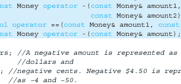

## Display 8.3 Overloading Operators as Friends (part 2 of 2)

```
25    int dollarsPart(double amount) const;
26    int centsPart(double amount) const;
27    int round(double number) const;
28 };

29 int main()
30 {
31    <If the main function is the same as in Display 8.1, then the screen dialogue will be the same as shown in Display 8.1.>
32 }
33 
34 const Money operator +(const Money& amount1, const Money& amount2)
35 {
36    int allCents1 = amount1.cents + amount1.dollars*100;
37    int allCents2 = amount2.cents + amount2.dollars*100;
38    int sumAllCents = allCents1 + allCents2;
39    int absAllCents = abs(sumAllCents); //Money can be negative.
40    int finalDollars = absAllCents/100;
41    int finalCents = absAllCents%100;
42 
43    if (sumAllCents < 0)
44    {
45       finalDollars = -finalDollars;
46       finalCents = -finalCents;
47    }
48 
49    return Money(finalDollars, finalCents);
50 }

49 const Money operator -(const Money& amount1, const Money& amount2)
50    <The complete definition is Self-Test Exercise 7.>

51 bool operator ==(const Money& amount1, const Money& amount2)
52 {
53    return ((amount1.dollars == amount2.dollars)
54       && (amount1.cents == amount2.cents));
55 }

56 const Money operator -(const Money& amount)
57 {
58    return Money(-amount.dollars, -amount.cents);
59 }

60 <Definitions of all other member functions are the same as in Display 8.1.>

Note that friends have direct access to member variables.
```

## Friend Classes

**friend class**

一个类可以像函数可以成为类的友元一样成为另一个类的友元。如果类 F 是类 C 的友元，则类 F 的每个成员函数都是类 C 的友元。要使一个类成为另一个类的友元，你必须在另一个类内部声明友元类。

**forward declaration**

当一个类是另一个类的友元时，通常类会在其类定义中相互引用。这要求你对第二个定义的类包含一个**前向声明**，如下文概述所示。请注意，前向声明只是类定义的首部后跟一个分号。

```
## Friend Functions

类的友元函数是一个普通函数，只是它可以访问该类对象的私有成员。要使一个函数成为类的友元，你必须在类定义中列出友元函数的函数声明。函数声明前面加上关键字 friend。函数声明可以放在私有部分或公共部分，但无论如何它都是一个公共函数，因此更清晰地将其列在公共部分。

### SYNTAX OF A CLASS DEFINITION WITH FRIEND FUNCTIONS

```cpp
class Class_Name
{
public:
    friend Declaration_for_Friend_Function_1
    friend Declaration_for_Friend_Function_2
    .
    .
    Member_Function_Declarations
private:
    Private_Member_Declarations
};
```

### EXAMPLE

```cpp
class FuelTank
{
public:
    friend void fillLowest(FuelTank& t1, FuelTank& t2);
    //Fills the tank with the lowest fuel level, or et al if a tie.

    FuelTank(double theCapacity, double theLevel);
    FuelTank();
};
```
```

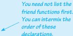

```
```cpp
void input();
void output() const;
private:
    double capacity; // in liters
    double level;
};
```
```

友元函数**不是**成员函数。友元函数像普通函数一样定义和调用。你在调用友元函数时不使用点运算符，并且在定义友元函数时不使用类型限定符。

如果你希望类 F 成为类 C 的友元，设置方式的一般概要如下：

```
```cpp
class F; // forward declaration

class C
{
public:
    ...
    friend class F;
};

class F
{
```
```

使用友元类的完整示例在第 17 章给出。我们到那时才开始使用友元类。

## PITFALL: Compilers without Friends

在某些 C++ 编译器上，友元函数根本无法按预期工作。最糟糕的是，它们有时能工作有时不能。在这些编译器上，友元函数并不总是能够访问类私有成员。 presumably，这将在这些编译器的后续版本中得到修复。在此期间，你必须想办法绕过这个问题。如果你有一个友元函数无法工作的编译器，你必须使用访问器函数来定义非成员函数和重载运算符，或者你必须将运算符重载为成员。


## 运算符重载规则

- 重载运算符时，重载后的运算符必须至少有一个参数（一个操作数）是类类型的。
- 大多数运算符可以重载为类的成员、类的友元或非成员非友元。
- 以下运算符只能重载为类的（非静态）成员：`->`、`[]`、`()` 和 `=`。
- 你不能创建新运算符。你只能重载现有运算符，如 `+`、`-`、`/`、`*` 等。
- 你不能改变运算符所需的参数个数。例如，重载 `+` 时不能将其从二元运算符改为一元运算符；重载 `++` 时不能将其从一元运算符改为二元运算符。
- 你不能改变运算符的优先级。重载后的运算符与普通版本的运算符具有相同的优先级。例如，`x*y + z` 始终表示 `(x*y) + z`，即使 `x`、`y` 和 `z` 是对象，且运算符 `+` 和 `*` 已为相应类重载。
- 以下运算符不能重载：点运算符（`.`）、作用域解析运算符（`::`）以及运算符 `.*`（本书不讨论）。
- 重载的运算符不能有默认参数。

## 自测练习

- 6. 类的友元函数和类的成员函数有什么区别？
- 7. 完成显示 8.3 中友元减法运算符 `-` 的定义。
- 8. 假设你想重载运算符 `<`，使其适用于显示 8.3 中定义的 `Money` 类型。你需要向显示 8.3 中给出的 `Money` 定义添加什么内容？

## 8.3 引用和更多重载运算符

> 不要将指向月亮的手指误认为月亮。
> 
> ——禅语

本节涵盖一些专门但重要的重载主题，包括重载赋值运算符以及 `<<`、`>>`、`++` 和 `--` 运算符。因为你需要理解返回引用才能正确重载其中一些运算符，所以我们也会讨论这个主题。

### 引用

**引用**

引用是存储位置的名称。¹ 你可以有一个独立引用，如下所示：

```
int robert;
int& bob = robert;
```

这使得 `bob` 成为变量 `robert` 存储位置的引用，从而让 `bob` 成为变量 `robert` 的别名。对 `bob` 所做的任何更改也会对 `robert` 进行。这样说来，独立引用似乎只是让代码变得混乱并给你带来麻烦的一种方式。在大多数情况下，独立引用只会带来麻烦，尽管有少数情况它可能有用。我们不再讨论独立引用，也不会使用它们。

你可能已经猜到，引用用于实现按引用调用参数机制。因此，这个概念对本章来说并不完全陌生，尽管“引用”这个说法是新的。

我们在这里对引用感兴趣，是因为返回引用可以让你以更自然的方式重载某些运算符。返回引用可以看作返回一个变量，或者更准确地说，返回变量的别名。语法细节很简单。你在返回类型中添加 `&`。例如：

```
double& sampleFunction(double& variable);
```

由于像 `double&` 这样的类型与 `double` 是不同的类型，你必须在函数声明和函数定义中都使用 `&`。返回表达式必须是具有引用的东西，例如适当类型的变量。它不能是像 `x + 5` 这样的表达式。尽管许多编译器允许你这样做（结果却不尽如人意），你也不应该返回局部变量，因为你将生成一个变量的别名，然后立即销毁该变量。函数定义的一个简单示例如下：

```
double& sampleFunction(double& variable)
{
    return variable;
}
```

当然，这是一个相当没用甚至麻烦的函数，但它说明了这个概念。例如，以下代码将输出 99 然后输出 42：

```
double m = 99;
cout << sampleFunction(m) << endl;
sampleFunction(m) = 42;
cout << m << endl;
```

我们只会在定义某些类型的重载运算符时返回引用。

> **左值和右值**
> 
> 术语 *左值* 用于表示可以出现在赋值运算符左侧的东西。术语 *右值* 用于表示可以出现在赋值运算符右侧的东西。
> 
> 如果你希望函数返回的对象是左值，则必须通过引用返回它。

### 提示：返回类类型的成员变量

当返回类类型的成员变量时，在几乎所有情况下，通过 const 引用返回成员值都很重要。要了解原因，假设你不这样做，如下面的示例所示：

```
class Employee
{
public:
    Money& getSalary() { return salary; }
    ...
private:
    Money salary;
    ...
};
```

在此示例中，`salary` 是一个私有成员变量，不应更改，除非使用 `Employee` 类的某个访问器函数。`getSalary` 函数返回类型为 `Money` 的变量 `salary`。如果我们不通过引用返回 `salary`，则会创建并返回一个新的临时 `salary` 副本。我们可能希望通过返回对 `salary` 的引用来避免这种开销，如示例中所示。然而，即使 `salary` 被声明为私有，这种私有性也很容易被绕过，如下所示：

```
Employee joe;
(joe.getSalary()).input();
```

名为 joe 的幸运员工现在可以输入她想要的任何薪水！
另一方面，假设 `getSalary` 通过 **const** 引用返回其值，如下所示：

```
class Employee
{
public:
    const Money& getSalary() { return salary; }
    ...
private:
    Money salary;
    ...
};
```

在这种情况下，以下内容将给出编译器错误消息：

```
(joe.getSalary()).input();
```

（`getSalary` 的声明理想情况下应该是

```
const Money& getSalary() const { return salary; }
```

但我们不想用另一种 const 来混淆问题。）
一般来说，当成员函数返回成员变量且该成员变量是某个类类型时，通常不应通过引用来返回它，以避免外部访问私有成员变量。如果出于效率原因想通过引用返回，那么向返回值添加 const 有助于保护对成员变量的访问。

### 重载 >> 和 <<

运算符 `>>` 和 `<<` 可以重载，以便你可以使用它们来输入和输出所定义类的对象。细节与我们之前看到的其他运算符并无太大不同，但有一些新的微妙之处。

我们与 `cout` 一起使用的插入运算符 `<<` 是一个二元运算符，非常类似于 `+` 或 `-`。例如，考虑以下内容：

```
cout << "Hello out there.\n";
```

运算符是 `<<`，第一个操作数是预定义对象 `cout`（来自库 `iostream`），第二个操作数是字符串值 `"Hello out there.\n"`。预定义对象 `cout` 的类型是 `ostream`，因此当你重载 `<<` 时，接收 `cout` 的参数将是 `ostream` 类型。你可以更改 `<<` 的两个操作数中的任何一个。当我们在第 12 章介绍文件 I/O 时，你将看到如何创建类型为 `ofstream` 的对象来向文件发送输出。（这些文件 I/O 对象以及对象 `cin` 和 `cout` 被称为流，这就是库名称为 `iostream` 的原因。）我们结合 `cout` 创建的重载，在重载 `<<` 的定义不变的情况下，也将同样适用于文件输出。

在我们之前对 `Money` 类的定义（显示 8.1 到显示 8.3）中，我们使用了成员函数 `output` 来输出 `Money` 类型的值。这足够了，但如果我们可以简单地使用插入运算符 `<<` 来输出 `Money` 类型的值，那就更好了，如下所示：

```
Money amount(100);
cout << "I have " << amount << " in my purse.\n";
```


instead of having to use the member function output as shown here:

```
Money amount(100);
cout << "I have ";
amount.output( );
cout << " in my purse.\n";
```

One problem in overloading the operator << is deciding what value, if any, should be returned when << is used in an expression like the following:

```
cout << amount
```

The two operands in the previous expression are cout and amount, and evaluating the expression should cause the value of amount to be written to the screen. But if << is an operator like + or -, then the previous expression should also return some value. After all, expressions with other operands, such as n1 + n2, return values. But what does cout << amount return? To obtain the answer to that question, we need to look at a more complicated expression involving <<.

Let us consider the following expression, which involves evaluating a chain of expressions using <<:

```
cout << "I have " << amount << " in my purse.\n";
```

If you think of the operator << as being analogous to other operators, such as +, then the latter expression should be (and in fact is) equivalent to the following:

```
( { cout << "I have " } << amount ) << " in my purse.\n";
```

What value should << return to make sense of the previous expression? The first thing evaluated is the subexpression:

```
(cout << "I have ")
```

If things are to work out, then the previous subexpression had better return cout so that the computation can continue as follows:

```
{ cout << amount } << " in my purse.\n";
```

And if things are to continue to work out, (cout << amount) had better also return cout so that the computation can continue as follows:

```
cout << " in my purse.\n";
```

This is illustrated in Display 8.4. The operator << should return its first argument, which is of type ostream (the type of cout).

Thus, the declaration for the overloaded operator << (to use with the class Money) should be as follows:

```
class Money
{
public:
...
friend ostream& operator <<(ostream& outs,
    const Money& amount);
```

chains of <<

<< returns a stream

## Display 8.4 << as an Operator

```
cout << "I have " << amount << " in my purse.\n";
```

means the same as

```
((cout << "I have ") << amount) << " in my purse.\n";
```

and is evaluated as follows:

First evaluate (cout << "I have "), which returns cout:

```
((cout << "I have ") << amount) << " in my purse.\n";
```

The string "I have " is output.

```
(cout << amount) << " in my purse.\n";
```

Then evaluate (cout << amount), which returns cout:

```
(cout << amount) << " in my purse.\n";
```

The value of amount is output.

```
cout << " in my purse.\n";
```

Then evaluate cout << " in my purse.\n", which returns cout:

```
cout << " in my purse.\n";
```

The string "in my purse.\n" is output.

```
cout;
```

Since there are no more << operators, the process ends.

Once we have overloaded the insertion (output) operator <<, we will no longer need the member function output and will delete output from our definition of the class Money. The definition of the overloaded operator << is very similar to the member function output. In outline form, the definition for the overloaded operator is as follows:

```
ostream& operator <<(ostream& outputStream, const Money& amount)
{
    /*This part is the same as the body of
    Money::output which is given in Display 8.1 (except that
    dollars is replaced with amount.dollars
    and cents is replaced by amount.cents).*/
    return outputStream;
}
```

## References and More Overloaded Operators

Note that the operator returns a reference.

The extraction operator >> is overloaded in a way that is analogous to what we described for the insertion operator <<. However, with the extraction (input) operator >>, the second argument will be the object that receives the input value, so the second parameter must be an ordinary call-by-reference parameter. In outline form the definition for the overloaded extraction operator >> is as follows:

```
istream& operator >> (istream& inputStream, Money& amount)
{
    /*This part is the same as the body of
      Money::input, which is given in Display 8.1 (except that
      dollars is replaced with amount.dollars
      and cents is replaced by amount.cents).*/

    return inputStream;
}
```

The complete definitions of the overloaded operators << and >> are given in Display 8.5, where we have rewritten the class Money yet again. This time we have rewritten the class so that the operators << and >> are overloaded to allow us to use these operators with values of type Money.

Note that you cannot realistically overload >> or << as member operators. If << and >> are to work as we want, then the first operand (first argument) must be cout or cin (or some file I/O stream). But if we want to overload the operators as members of, say, the class Money, then the first operand would have to be the calling object and so would have to be of type Money, and that will not allow you to define the operators so they behave in the normal way for >> and <<.

```
1  #include <iostream>
2  #include <cstdlib>
3  #include <cmath>
4  using namespace std;

5  //Class for amounts of money in U.S. currency
6  class Money
7  {
8  public:
9      Money( );
10     Money(double amount);
11     Money(int theDollars, int theCents);
12     Money(int theDollars);
13     double getAmount( ) const;
14     int getDollars( ) const;
15     int getCents( ) const;
```

## Display 8.5 Overloading << and >> (part 2 of 3)

```
16    friend const Money operator +(const Money& amount1,
17                                 const Money& amount2);
18    friend const Money operator -(const Money& amount1,
19                                 const Money& amount2);
20    friend bool operator ==(const Money& amount1,
21                           const Money& amount2);
22    friend const Money operator -(const Money& amount);
23    friend ostream& operator <<(ostream& outputStream,
24                               const Money& amount);
25    friend istream& operator >>(istream& inputStream, Money& amount);
26    private:
27        //A negative amount is represented as negative dollars
28        //and negative cents. Negative $4.50 is represented as
29        //-4 and -50.
30        int dollars, cents;

31    int dollarsPart(double amount) const;
32    int centsPart(double amount) const;
33    int round(double number) const;
34    };

35    int main()
36    {
37        Money yourAmount, myAmount(10, 9);
38        cout << "Enter an amount of money: ";
39        cin >> yourAmount;
40        cout << "Your amount is " << yourAmount << endl;
41        cout << "My amount is " << myAmount << endl;

42        if (yourAmount == myAmount)
43            cout << "We have the same amounts.\n";
44        else
45            cout << "One of us is richer.\n";

46        Money ourAmount = yourAmount + myAmount;
47        cout << yourAmount << " + " << myAmount
48             << " equals " << ourAmount << endl;

49        Money diffAmount = yourAmount - myAmount;
50        cout << yourAmount << " - " << myAmount
51             << " equals " << diffAmount << endl;

52        return 0;
53    }

    <Definitions of other member functions are as in Display 8.1.
    Definitions of other overloaded operators are as in Display 8.3.>
```

> Since << returns a reference, you can chain << like this. You can chain >> in a similar way.

## Self-Test Exercises

- 9. In Display 8.5, the definition of the overloaded operator << contains lines like the following:
  
  ```cpp
  outputStream << "$-";
  ```
  
  Is this not circular? Are we not defining << in terms of <<?

- 10. Why can we not overload << or >> as member operators?

- 11. Following is the definition for a class called Percent. Objects of type Percent represent percentages such as 10% or 99%. Give the definitions of the overloaded operators >> and << so that they can be used for input and output with objects of the class Percent. Assume that input always consists of an integer followed by the character '%', such as 25%. All percentages are whole numbers and are stored in the int member variable named value. You do not need to define the other overloaded operators and do not need to define the constructor. You only have to define the overloaded operators >> and <<.
  
  ```cpp
  #include <iostream>
  using namespace std;
  class Percent
  {
  public:
      friend bool operator ==(const Percent& first,
                              const Percent& second);
      friend bool operator <(const Percent& first,
                             const Percent& second);
      Percent();
      friend istream& operator >>(istream& inputStream,
                                  Percent& aPercent);
      friend ostream& operator <<(ostream& outputStream,
                                  const Percent& aPercent);
      //There would normally also be other members and friends.
  private:
      int value;
  };
  ```

## TIP: What Mode of Returned Value to Use

A function can return a value of type T in four different ways:

- By plain old value, as in the function declaration `T f();`
- By constant value, as in the function declaration `const T f();`
- By reference, as in the function declaration `T& f();`
- By `const` reference, as in the function declaration `const T& f();`


## TIP:（续）

对于何时使用哪一种，并没有一致的共识。因此，不要期望使用上太一致。即使作者或程序员有明确的策略，他们也很少能毫无例外地遵守它。尽管如此，有些要点是明确的。

如果返回的是简单类型，如 int 或 char，那么通过值或通过引用返回时使用 const 就没有意义。因此程序员通常在返回类型是简单类型时不会在返回类型上使用 const。如果你希望返回的简单值能够作为左值，即能够出现在赋值语句的左侧，那么就通过引用返回；否则就以普通值的方式返回简单类型。类类型并非如此简单。以下讨论适用于返回类类型对象的情形。

是否通过引用返回的决定取决于是否希望能够将返回的对象用作左值。如果你希望返回能够用作左值的东西，即能够出现在赋值运算符左侧的东西，你必须通过引用返回，因此必须在返回类型上使用与号 &。

通过引用返回局部变量（或其他短命对象），无论是否带 const，都可能产生问题，应避免。

对于类类型，两种返回类型说明 const T 和 const T& 非常相似。它们都意味着你不能通过直接在返回对象上调用某个修改器函数来改变返回的对象，如

f().mutator();

返回的值仍可通过赋值运算符复制到另一个变量，然后可在该变量上应用修改器函数。如果你无法在 const T& 和 const T 之间做出选择，请使用 const T（不带与号）。const T& 也许比 const T 稍微高效一些。* 然而，这种差异通常并不重要，大多数程序员使用 const T 而不是 const T& 作为返回类型说明。如前所述，const T& 有时会导致问题。

以下总结可能有所帮助。假定 T 为类类型。拷贝构造函数直到第 10 章才介绍，但我们在此为参考价值包含了有关它们的细节。如果你尚未阅读第 10 章，只需忽略所有关于拷贝构造函数的引用即可。

如果一个公有成员函数返回一个私有类成员变量，它在返回类型上应始终带有 const，正如本章“返回类类型的成员变量”提示部分所解释的那样。（此规则的一个例外是程序员通常总是以普通值而非 const 值的方式返回 string 类型的值。这 presumably 是因为 string 类型被视为像 int 和 char 一样的简单类型，即使 string 是类类型。）

（续）

## DEFINITIONS

```
istream& operator >> (istream& Parameter_1,
    Class_Name& Parameter_2)
{
    ...
}
```

```
ostream& operator << (ostream& Parameter_3,
    const Class_Name& Parameter_4)
{
    ...
}
```

如果有足够的访问器和修改器函数，你可以将 >> 和 << 重载为非友元函数。然而，将它们定义为友元更为自然且更高效。

## The Assignment Operator

如果重载赋值运算符 =，你必须将其重载为成员运算符。如果你不重载赋值运算符 =，那么你的类会自动获得一个赋值运算符。此默认赋值运算符将一个对象的成员变量的值复制到另一个对象的对应成员变量中。对于简单类来说，这通常是你想要的。当我们讨论指针时，此默认赋值运算符将不是我们想要的，我们将在那时讨论重载赋值运算符。

## Overloading the Increment and Decrement Operators

prefix and postfix

自增和自减运算符 ++ 和 -- 各有两个版本。它们的行为取决于使用前缀记法 ++x 还是后缀记法 x++。因此，在重载这些运算符时，你需要以某种方式区分前缀和后缀版本，以便拥有重载运算符的两个版本。在 C++ 中，这种前缀与后缀版本之间的区分在初读时（甚至在再读时）似乎有点牵强。如果你以常规方式重载 ++ 运算符（作为带一个参数的非成员运算符或作为无参数的成员运算符），那么你重载的是前缀形式。要获得后缀版本 x++ 或 x--，你添加一个类型为 int 的第二个参数。这只是编译器的标记；你在调用 x++ 或 x-- 时不会给出第二个 int 参数。

例如，Display 8.6 包含了一个数据为整数对的类的定义。自增运算符 ++ 被定义为在前缀和后缀记法下均可工作。我们已将 ++ 定义为具有对 int 变量的 ++ 的直观精神。这是定义 ++ 的最佳方式，但你可以自由地将其定义为返回任何类型的并执行任何操作。

### return by reference

后缀版本的定义忽略了该 int 参数，如 Display 8.6 所示。当编译器看到 a++ 时，它将其视为对 IntPair::operator++(int) 的调用，a 为调用对象。

简单类型如 int 和 char 上的自增和自减运算符在前缀形式下通过引用返回，在后缀形式下通过值返回。如果你希望在为类类型重载这些运算符时模拟简单类型发生的情况，那么你将在前缀形式下通过引用返回，在后缀形式下通过值返回。然而，我们发现通过引用返回自增或自减运算符会打开太多问题的门，因此我们总是简单地对自增和自减运算符的所有版本都通过值返回。

## Self-Test Exercise

12. 以下是否合法？解释你的答案。（IntPair 的定义见 Display 8.6。）

```
IntPair a(1,2);
(a++)++;
```

## Display 8.6 Overloading ++ (part 1 of 3)

```
1 #include <iostream>
2 #include <cstdlib>
3 using namespace std;

4 class IntPair
5 {
6 public:
7   IntPair(int firstValue, int secondValue);
8   IntPair operator++(); //Prefix version
9   IntPair operator++(int); //Postfix version
10  void setFirst(int newValue);
11  void setSecond(int newValue);
12  int getFirst() const;
13  int getSecond() const;
14 private:
15  int first;
16  int second;
17 };

18 int main()
19 {
20   IntPair a(1,2);
21   cout << "Postfix a++: Start value of object a: ";
```

你不必在函数或运算符声明中给出参数名。对于 ++ 来说，给出参数名没有意义，因为参数未被使用。

## Display 8.6 Overloading ++ (part 2 of 3)

```
22      cout << a.getFirst( ) << " " << a.getSecond( ) << endl;
23      IntPair b = a++;
24      cout << "Value returned: ";
25      cout << b.getFirst( ) << " " << b.getSecond( ) << endl;
26      cout << "Changed object: ";
27      cout << a.getFirst( ) << " " << a.getSecond( ) << endl;
28
29      a = IntPair(1, 2);
30      cout << "Prefix ++a: Start value of object a: ";
31      cout << a.getFirst( ) << " " << a.getSecond( ) << endl;
32      IntPair c = ++a;
33      cout << "Value returned: ";
34      cout << c.getFirst( ) << " " << c.getSecond( ) << endl;
35      cout << "Changed object: ";
36      cout << a.getFirst( ) << " " << a.getSecond( ) << endl;
37      return 0;
38  }
```

```
39  IntPair::IntPair(int firstValue, int secondValue)
40      : first(firstValue), second(secondValue)
41  {/*Body intentionally empty*/}
42  IntPair IntPair::operator++(int ignoreMe) //Postfix version
43  {
44      int temp1 = first;
45      int temp2 = second;
46      first++;
47      second++;
48      return IntPair(temp1, temp2);
49  }
```

```
50  IntPair IntPair::operator++( ) //Prefix version
51  {
52      first++;
53      second++;
54      return IntPair(first, second);
55  }
```

```
56  void IntPair::setFirst(int newValue)
57  {
58      first = newValue;
59  }
60  void IntPair::setSecond(int newValue)
61  {
62      second = newValue;
63  }
```


# Display 8.6 重载 ++（第 3 部分，共 3 部分）

```
64 int IntPair::getFirst() const
65 {
66     return first;
67 }

68 int IntPair::getSecond() const
69 {
70     return second;
71 }
```

# Sample Dialogue

```
Postfix a++: Start value of object a: 1 2
Value returned: 1 2
Changed object: 2 3
Prefix ++a: Start value of object a: 1 2
Value returned: 2 3
Changed object: 2 3
```

# Overloading the Array Operator []

You can overload the square brackets, [], for a class so that they can be used with objects of the class. If you want to use [] in an expression on the left-hand side of an assignment operator, then the operator must be defined to return a reference. When overloading [], the operator [] must be a member function.

It may help to review the syntax for the operator [], since it is different from any other operator we have seen. Remember that [] is overloaded as a member operator; therefore one thing in an expression using [] must be the calling object. In the expression a[2], a is the calling object and 2 is the argument to the member operator []. When overloading [], this "index" parameter must be an integer type, that is, enum, char, short, int, long, or an unsigned version of one of these types.

For example, in Display 8.7 we define a class called CharPair whose objects behave like arrays of characters with the two indexes 1 and 2 (not 0 and 1). Note that the expressions a[1] and a[2] behave just like array indexed variables. If you look at the definition of the overloaded operator [], you will see that a reference is returned and that it is a reference to a member variable, not to the entire CharPair object. This is because the member variable is analogous to an indexed variable of an array. When you change a[1] (in the sample code in Display 8.7), you want that to be a change to the member variable first. Note that this gives access to the private member variables to any program, for example, via a[1] and a[2] in the sample main function in Display 8.7. Although first and second are private members, the code is legal because it does not reference first and second by name but indirectly using the names a[1] and a[2].

# Display 8.7 Overloading [] (part 1 of 2)

```
#include <iostream>
#include <cstdlib>
using namespace std;

class CharPair
{
public:
    CharPair() {/*Body intentionally empty*/}
    CharPair(char firstValue, char secondValue)
        : first(firstValue), second(secondValue)
    {/*Body intentionally empty*/}

    char& operator[](int index);
private:
    char first;
    char second;
};

int main()
{
    CharPair a;
    a[1] = 'A';
    a[2] = 'B';
    cout << "a[1] and a[2] are:\n";
    cout << a[1] << a[2] << endl;

    cout << "Enter two letters (no spaces):\n";
    cin >> a[1] >> a[2];
    cout << "You entered:\n";
    cout << a[1] << a[2] << endl;

    return 0;
}
//Uses iostream and cstdlib.
char& CharPair::operator[](int index)
{
    if (index == 1)
        return first;
    else if (index == 2)
        return second;
    else
    {
        cout << "Illegal index value.\n";
        exit(1);
    }
}
```

> Note that you return the member variable, not the entire Pair object, because the member variable is analogous to an indexed variable of an array.

# Display 8.7 Overloading [] (part 2 of 2)

# Sample Dialogue

```
a[1] and a[2] are:
AB
Enter two letters (no spaces):
CD
You entered:
CD
```

# Overloading Based on L-Value versus R-Value

Although we will not be doing it in this book, you can overload a function name (or operator) so that it behaves differently when used as an l-value and when it is used as an r-value. (Recall that an l-value means it can be used on the left-hand side of an assignment statement.) For example, if you want a function f to behave differently depending on whether it is used as an l-value or an r-value, you can do so as follows:

```
class SomeClass
{
public:
    int& f(); // will be used in any l-value invocation
    const int& f() const; // used in any r-value invocation
    ...
};
```

The two parameter lists need not be empty, but they should be the same (or else you just get simple overloading). Be sure to notice that the second declaration of f has two occurrences of const. You must include both occurrences of const. The ampersand signs & are of course also required.

# Chapter Summary

- Operators, such as + and +=, can be overloaded so that they can be used with objects of a class type that you define.
- An operator is just a function that uses a different syntax for invocations.
- A friend function of a class is an ordinary function except that it has access to the private members of the class, just like member functions do.
- When an operator is overloaded as a member of a class, the first operand is the calling object.

## 3.2.2 使用 `use` 关键字将路径引入作用域

必须使用路径来调用函数的写法可能会显得冗长且重复。幸运的是，我们可以使用 `use` 关键字将路径一次性引入作用域，然后就可以像使用本地项一样调用路径中的项。

在示例 3-6 中，我们将 `crate::front_of_house::hosting` 模块引入了 `eat_at_restaurant` 函数的作用域，这样我们只需要指定 `hosting::add_to_waitlist` 即可调用 `add_to_waitlist` 函数。在示例 3-6 中，我们还指定了如何调用 `eat_at_restaurant` 函数。

```
```rust
mod front_of_house {
    pub mod hosting {
        pub fn add_to_waitlist() {}
    }
}

use crate::front_of_house::hosting;

pub fn eat_at_restaurant() {
    hosting::add_to_waitlist();
}
```
```

示例 3-6：使用 `use` 将模块引入作用域

在作用域中增加 `use` 和路径类似于在文件系统中创建符号链接。通过在 crate 根中增加 `use crate::front_of_house::hosting`，`hosting` 现在就是 crate 根中一个有效的名称，就像 `hosting` 模块是在 crate 根中定义的一样。通过 `use` 引入作用域的路径也会检查私有性，就像其它路径那样。

还可以使用 `use` 和相对路径将项引入作用域。示例 3-7 展示了如何指定相对路径而不是绝对路径。

```
```rust
mod front_of_house {
    pub mod hosting {
        pub fn add_to_waitlist() {}
    }
}

use front_of_house::hosting;

pub fn eat_at_restaurant() {
    hosting::add_to_waitlist();
}
```
```

示例 3-7：使用 `use` 和相对路径将模块引入作用域

```
int finalDollars = absAllCents/100;
int finalCents = absAllCents%100;

if (diffAllCents < 0)
{
    finalDollars = -finalDollars;
    finalCents = -finalCents;
}

return Money(finalDollars, finalCents);
}
```

6. A friend function and a member function are alike in that they both can use any member of the class (either public or private) in their function definition. However, a friend function is defined and used just like an ordinary function; the dot operator is not used when you call a friend function and no type qualifier is used when you define a friend function. A member function, on the other hand, is called using an object name and the dot operator. Also, a member function definition includes a type qualifier consisting of the class name and the scope resolution operator, ::.

//Uses cstdlib:
const Money operator -(const Money& amount1,
    const Money& amount2)
{
    int allCents1 = amount1.cents + amount1.dollars*100;
    int allCents2 = amount2.cents + amount2.dollars*100;
    int diffAllCents = allCents1 - allCents2;
    int absAllCents = abs(diffAllCents);

    int finalDollars = absAllCents/100;
    int finalCents = absAllCents%100;
    if (diffAllCents < 0)
    {
        finalDollars = -finalDollars;
        finalCents = -finalCents;
    }

    return Money(finalDollars, finalCents);
}
```

8. Add the following declaration and function definition:

```
friend bool operator <(const Money& amount1,
    const Money& amount2);

bool operator <(const Money& amount1,
    const Money& amount2)
{
    return ((amount1.dollars < amount2.dollars) ||
        ((amount1.dollars == amount2.dollars) &&
        (amount1.cents < amount2.cents)));
}
```

9. To understand why it is not circular, you need to think about the basic message of overloading: A single function or operator name can have two or more definitions. That means that two or more different operators (or functions) can share a single name. In the line

`outputStream << "$-";`

the operator << is the name of an operator defined in the library iostream to be used when the second argument is a quoted string. The operator named << that we define in Display 8.5 is a different operator that works when the second argument is of type Money.

10. If << and >> are to work as we want, then the first operand (first argument) must be cout or cin (or some file I/O stream). But if we want to overload the operators as members of, say, the class Money, then the first operand would have to be the calling object and so would have to be of type Money, and that is not what we want.

```
//Uses iostream:
istream& operator >> (istream& inputStream,
    Percent& aPercent)
{
    char percentSign;
    inputStream >> aPercent.value;
    inputStream >> percentSign;//Discards the % sign.
    return inputStream;
}
```

```
//Uses iostream:
ostream& operator << (ostream& outputStream,
    const Percent& aPercent)
{
    outputStream << aPercent.value << ' %';
    return outputStream;
}
```

12. It is legal, but the meaning is not what you might want. (a++) increases the value of the member variables in a by one, but (a++)+ raises the value of the member variables in a++ by one, and a++ is a different object from a. (It is possible to define the increment operator so that (a++)++ will increase the value of the member variables by two but that requires use of the this pointer which is not discussed until Chapter 10.)

# Programming Projects

- 1. Modify the definition of the class Money shown in Display 8.5 so that the following are added:
  - a. The operators <, <=, >, and >= have each been overloaded to apply to the type Money. (Hint: See Self-Test Exercise 8.)


b. 以下成员函数已被添加到类定义中。（我们展示的是该函数在类定义中应出现的函数声明。函数本身的定义将包含限定符 `Money::`。）

```
const Money percent(int percentFigure) const;
//Returns a percentage of the money amount in the calling
//object. For example, if percentFigure is 10, then the value
//returned is 10% of the amount of money represented by the
//calling object.
```

例如，如果 `purse` 是 `Money` 类型的对象，其值表示金额 100.10 美元，那么调用

```
purse.percent(10);
```

将返回 100.10 美元的 10%；也就是说，它返回一个 `Money` 类型的值，表示 10.01 美元。

## 2. 定义一个有理数类。

有理数是可以表示为两个整数之商的数。例如，1/2、3/4、64/2 等等都是有理数。（这里的 1/2 等指的是日常分数，而不是该表达式在 C++ 程序中会产生的整数除法。）

用两个 `int` 类型的值表示有理数，一个用于分子，一个用于分母。将这个类命名为 `Rational`。包含一个带两个参数的构造函数，可用于将对象的成员变量设置为任意合法值。还要包含一个只有一个 `int` 类型参数的构造函数；将此参数命名为 `wholeNumber`，并定义该构造函数，使对象被初始化为有理数 `wholeNumber/1`。包含一个默认构造函数，将对象初始化为 0（即 `0/1`）。重载输入和输出运算符 `>>` 和 `<<`。数字应以 1/2、15/32、300/401 等形式输入和输出。注意，分子、分母或两者都可能包含负号，因此 -1/2、15/-32 和 -300/-401 也是可能的输入。重载以下所有运算符，使它们能正确应用于 `Rational` 类型：`==`、`!=`、`<`、`>`、`+`、`-`、`*` 和 `/`。编写一个测试程序来测试你的类。提示：如果 `a*d` 等于 `c*b`，则两个有理数 a/b 和 c/d 相等。如果 b 和 d 是正有理数，则当 `a*d` 小于 `c*b` 时，a/b 小于 c/d。你应该包含一个函数来规范化所存储的值，使得规范化后分母为正，且分子和分母尽可能小。例如，规范化后 4/-8 将与 -1/2 具有相同的表示。

## 3. 定义一个复数类。

复数是一个形如 a + b\*i 的数，其中就我们的目的而言，a 和 b 是 `double` 类型的数，而 i 表示量 √-1。用两个 `double` 类型的值表示一个复数。将成员变量命名为 `real` 和 `imaginary`。（被 i 乘的那个数的变量称为 `imaginary`。）将这个类命名为 `Complex`。包含一个带两个 `double` 类型参数的构造函数，可用于将对象的成员变量设置为任意值。包含一个只有一个 `double` 类型参数的构造函数；将此参数命名为 `realPart`，并定义该构造函数，使对象被初始化为 `realPart + 0*i`。包含一个默认构造函数，将对象初始化为 0（即 `0 + 0*i`）。重载以下所有运算符，使它们能正确应用于 `Complex` 类型：`==`、`+`、`-`、`*`、`>>` 和 `<<`。你还应该编写一个测试程序来测试你的类。提示：要将两个复数相加或相减，只需将两个 `double` 类型的成员变量相加或相减。两个复数的乘积由以下公式给出：

(a + b\*i) \* (c + d\*i) = (a\*c - b\*d) + (a\*d + b\*c)\*i

在接口文件中，你应该定义一个常量 i 如下：

```
const Complex i(0, 1);
```

这个已定义的常量 i 将与上面讨论的 i 相同。

## 4. 按如下方式逐步修改程序清单 8.7 中的示例。

- a. 在程序清单 8.7 中，将私有 char 成员 `first` 和 `second` 替换为一个大小为 100 的 char 数组和一个名为 `size` 的私有数据成员。提供一个默认构造函数，将 `size` 初始化为 10，并将 char 位置中的前 10 个设置为 `'#'`。（这只使用了 100 个可能槽位中的 10 个。）提供一个访问器函数，返回私有成员 `size` 的值。测试。

- b. 添加一个 `operator[]` 成员函数，返回 `char&`，使用户能够使用小于 `size` 的非负索引访问或设置私有数据数组中的任意成员。测试。

- c. 添加一个构造函数，接受一个 `int` 参数 `sz`，将 char 数组的前 `sz` 个成员设置为 `'#'`。测试。

- d. 添加一个构造函数，接受一个 `int` 参数 `sz` 和一个大小为 `sz` 的 char 数组。该构造函数应将私有数据数组的前 `sz` 个成员设置为参数 char 数组的 `sz` 个成员。测试。

注意：测试时，你应该使用已知的正确值、边界上的数据和故意给出的错误值进行测试。不要求你在代码中添加索引越界错误检查，但添加会是一个不错的加分项。错误处理备选方案：发出错误信息然后终止（即调用 `exit(1)`），或者给用户另一次机会进行正确输入。

## 5. 为名为 `Vector2D` 的类编写定义，该类存储一个二维向量的信息。该类应具有获取和设置 x 和 y 分量的函数，其中 x 和 y 是整数。接下来，重载 `*` 运算符，使其返回两个向量的点积。二维向量 A 和 B 的点积等于

(Ax × Bx) + (Ay × By)。

最后，编写一个测试 `*` 运算的 main 函数。

## 6. 定义名为 `MyInteger` 的类，存储一个整数，并具有获取和设置该整数值的函数。然后重载 `[]` 运算符，使索引返回第 i 位的数字，其中 i = 0 是最低位（个位）。如果该位不存在，则应返回 −1。

例如，如果 x 是 `MyInteger` 类型且被设置为 418，那么 `x[0]` 应返回 8，`x[1]` 应返回 1，`x[2]` 应返回 4，`x[3]` 应返回 −1。

## 7. 定义一个名为 `PrimeNumber` 的类，用于存储一个素数。默认构造函数应将素数设置为 1。添加另一个构造函数，允许调用者设置素数。另外，添加一个获取素数的函数。最后，重载前缀和后缀 `++` 与 `--` 运算符，使它们返回一个 `PrimeNumber` 对象，该对象分别是下一个更大的素数（对于 `++`）和下一个更小的素数（对于 `--`）。例如，如果对象的素数被设置为 13，那么调用 `++` 应返回一个素数设置为 17 的 `PrimeNumber` 对象。为这个类创建一个合适的测试程序。

## 8. 完成编程项目 6.10 中 Temperature 类的定义，但要将 `==`、`<<` 和 `>>` 重载为成员运算符。如果两个温度值完全相同，`==` 运算符应返回 true，而 `<<` 应以华氏度输出温度，`>>` 应以华氏度输入温度。为重载的运算符创建适当的测试。

## 9. 编程项目 6.12 要求你编写一个 `BoxOfProduce` 类，该类存储三份水果或蔬菜（存储在一个大小为 3 的字符串数组中）以便运送给客户。重写这个类，使用 vector 代替数组，并添加合适的构造函数、修改器和访问器。该类应具有一个函数，可向箱子中添加额外的水果或蔬菜，因此一个箱子中可以有多于三份的农产品。输出函数应输出箱子中的所有物品。

重载 `+` 运算符，使其返回一个新的 `BoxOfProduce` 对象，该对象组合了两个操作数 `BoxOfProduce` 对象中的 vector 内容。在 main 函数中测试你的函数和 `+` 运算符。对于本编程项目，你不必实现编程项目 6.12 的其余部分，只需实现对 `BoxOfProduce` 类的修改。

## 字符串 9

### 9.1 字符串的数组类型 402

- C-字符串值和 C-字符串变量 403
- 陷阱：对 C-字符串使用 `=` 和 `==` 406
- `<cstring>` 中的其他函数 408
- 示例：命令行参数 410
- C-字符串输入和输出 413

### 9.2 字符处理工具 415

- 字符 I/O 415
- 成员函数 get 和 put 416
- 示例：使用换行函数检查输入 418
- 陷阱：输入中出现意外的 `'\n'` 420
- putback、peek 和 ignore 成员函数 421
- 字符处理函数 423
- 陷阱：toupper 和 tolower 返回 `int` 值 425

### 9.3 标准类 `string` 427

- 标准类 `string` 简介 427
- 类 `string` 的 I/O 430
- 技巧：getline 的更多版本 433
- 陷阱：混用 `cin >> variable;` 和 getline 433
- 使用类 `string` 处理字符串 435
- 示例：回文测试 438
- 在 string 对象和 C-字符串之间转换 442
- 在 string 对象和数字之间转换 442


## 9 字符串

> 波洛涅斯：你读什么，我的王？ 哈姆雷特：词，词，词

> 威廉·莎士比亚，《哈姆雷特》，第二幕第二场，1603年。

## 引言

本章讨论两种其值表示字符字符串的类型，例如 "Hello"。一种类型只是基类型为 char 的数组，它在数组中存储字符字符串并用空字符 '\0' 标记字符串的结尾。这是表示字符串的较老的方式，C++ 从 C 语言继承了这种方式。这类字符串称为 *C 字符串*。尽管 C 字符串是表示字符串的较老方式，但在 C++ 中进行任何字符串处理时至少会与 C 字符串有接触。例如，像 "Hello" 这样的引号字符串在 C++ 中被实现为 C 字符串。

ANSI/ISO C++ 标准以类 string 的形式包含了更现代的字符串处理设施。类 string 是本章将讨论的第二种字符串类型。如果你可以选择使用 C 字符串或类 string，那么通常的建议是使用类 string，因为它提供更大的功能并检查错误条件，从而使应用程序更安全。完整的类 string 使用模板，因此类似于标准模板库（STL）中的模板类。模板在第 16 章中介绍，STL 在第 19 章中介绍。本章涵盖类 string 的基本用法，这些用法不需要模板知识。

本材料不需要对数组有深入的了解，但你应该熟悉基本的数组记法，例如 `a[i]`。第 5 章第 5.1 节关于数组的内容足以让你阅读本章的材料。本材料也不需要对类有深入的了解。第 9.1 节关于 C 字符串和第 9.2 节关于字符操作可以在第 6、7 和 8 章之前进行，这些章节介绍类。然而，在阅读第 9.3 节关于标准类 string 之前，你应该阅读第 6 章和第 7 章的以下部分：第 7.1 节以及第 7.2 节的子节“const 参数修饰符”及其随附的陷阱部分。

## 9.1 字符串的数组类型

> 在一切事物中都必须考虑其终结。

> 让·德·拉封丹，“狐狸与蚊子”。《寓言》。1668 年。第三卷，第五则

本节描述了一种表示字符字符串的方式，C++ 从 C 语言继承而来。第 9.3 节描述了一种更现代的表示字符串的字符串类。尽管这里描述的字符串类型可能有点“老式”，但它仍然被广泛使用，并且是 C++ 语言不可分割的一部分。

### C 字符串值和 C 字符串变量

一种表示字符串的方式是作为基类型为 char 的数组。然而，如果字符串是 "Hello"，则将其表示为包含六个索引变量的字符数组很方便：五个用于 "Hello" 中的五个字母，再加上一个用于字符 '\0'，它作为结束标记。字符 '\0' 称为空字符，并用作结束标记，因为它与所有“真实”字符不同。结束标记允许你的程序一次读取一个字符的数组，并在读取到 '\0' 时知道应停止读取。以这种方式存储的字符串（作为以 '\0' 终止的字符数组）称为 C 字符串。

我们用两个符号拼写 '\0'，但就像换行字符 '\n' 一样，字符 '\0' 实际上只有一个字符值。像任何其他字符值一样，'\0' 可以存储在一个类型为 char 的变量中或字符数组的一个索引变量中。

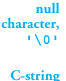

> **空字符，'\0'**
>
> 空字符 '\0' 用于标记存储在字符数组中的 C 字符串的结尾。当字符数组以这种方式使用时，数组通常称为 C 字符串变量。尽管空字符 '\0' 使用两个符号书写，但它是一个可放入类型为 char 的一个变量或字符数组的一个索引变量中的单个字符。

你已经在使用 C 字符串了。在 C++ 中，像 "Hello" 这样的字面字符串被存储为 C 字符串，尽管你很少需要意识到这个细节。

C 字符串变量只是一个字符数组。因此，以下数组声明为我们提供了一个能够存储最多九个字符的 C 字符串值的 C 字符串变量：

```
char s[10];
```

10 是用于字符串中九个字母加上空字符 '\0' 来标记字符串结尾。

C 字符串变量是一个部分填充的字符数组。像任何其他部分填充的数组一样，C 字符串变量使用从索引变量 0 开始的若干位置。然而，C 字符串变量不使用 int 变量来跟踪当前使用数组的多少。相反，字符串变量在 C 字符串的最后一个字符之后立即在数组中放置特殊符号 '\0'。因此，如果 s 包含字符串 "Hi Mom!"，则数组元素填充如下所示：

| s[0] | s[1] | s[2] | s[3] | s[4] | s[5] | s[6] | s[7] | s[8] | s[9] |
|---|---|---|---|---|---|---|---|---|---|
| H | i |   | M | o | m | ! | '\0' | ? | ? |

字符 '\0' 被用作哨兵值来标记 C 字符串的结尾。如果你从索引变量 a[0] 开始读取 C 字符串中的字符，然后到 a[1]，然后到 a[2]，依此类推，你知道当你遇到符号 '\0' 时，你已经到达 C 字符串的结尾。由于符号 '\0' 总是占用数组的一个元素，数组可以容纳的最长字符串长度比数组大小少一。

区分 C 字符串变量与普通字符数组的是，C 字符串变量必须在 C 字符串值的末尾包含空字符 '\0'。这是一种关于数组如何使用而非数组是什么的区分。C 字符串变量是字符数组，但使用方式不同。

### C 字符串变量声明

C 字符串变量与字符数组相同，只是使用方式不同。C 字符串变量以通常的方式声明为字符数组。

**SYNTAX**

```
char Array_Name[Maximum_C-string_Size + 1];
```

**EXAMPLE**

```
char myCString[11];
```

+1 是为了容纳终止存储在数组中的任何 C 字符串的空字符 '\0'。例如，前一个示例中的 C 字符串变量 myCString 可以容纳长度为十个或更少字符的 C 字符串。

你可以在声明时初始化 C 字符串变量，如以下示例所示：

```
char myMessage[20] = "Hi there.";
```

注意，分配给 C 字符串变量的 C 字符串不必填满整个数组。当你初始化 C 字符串变量时，可以省略数组大小，C++ 会自动将 C 字符串变量的大小设为引号字符串长度加一。（多出的一个索引变量用于 '\0'。）例如，

```
char shortString[] = "abc";
```

等价于

```
char shortString[4] = "abc";
```

请确保你不会混淆以下初始化：

```
char shortString[] = "abc";
```

和

```
char shortString[] = { 'a', 'b', 'c' };
```

它们不等价。前者在这两种可能的初始化中，将空字符 '\0' 放在字符 'a'、'b' 和 'c' 之后。第二个不把 '\0' 放在数组的任何位置。

### 初始化 C 字符串变量

C 字符串变量可以在声明时初始化，如以下示例所示：

```
char yourString[11] = "Do Be Do";
```

以这种方式初始化会自动将空字符 '\0' 放在数组中指定 C 字符串的末尾。

如果你省略方括号 [] 内的数字，则 C 字符串变量将被赋予比 C 字符串长度长一个字符的大小。例如，以下声明 myString 具有九个索引变量（八个用于 C 字符串 "Do Be Do" 的字符，一个用于空字符 '\0'）：

```
char myString[] = "Do Be Do";
```

C 字符串变量是一个数组，因此它具有可以像任何其他数组一样使用的索引变量。例如，假设你的程序包含以下 C 字符串变量声明：

```
char ourString[5] = "Hi";
```

以 ourString 声明的方式，你的程序具有以下索引变量：ourString[0]、ourString[1]、ourString[2]、ourString[3] 和 ourString[4]。例如，以下代码将把 ourString 中的 C 字符串值更改为由全部 'X' 字符组成且长度相同的 C 字符串：

```
int index = 0;
while (ourString[index] != '\0')
{
    ourString[index] = 'X';
    index++;
}
```

在操作这些索引变量时，你应非常小心不要用其他值替换空字符 '\0'。如果数组丢失了值 '\0'，它将不再像 C 字符串变量那样表现。例如，以下代码将更改数组 happyString，使其不再包含 C 字符串：

```
char happyString[7] = "DoBeDo";
happyString[6] = 'Z';
```

不要破坏 '\0'。


## 陷阱：(续)

虽然在声明 C 字符串变量时可以使用等号为其赋一个值，但在程序的其他任何地方都不能这样做。技术上讲，在声明中使用等号，如

```
char happyString[7] = "DoBeDo";
```

是初始化，而不是赋值。如果你想为 C 字符串变量赋值，必须做其他事情。

有多种不同的方法可以为 C 字符串变量赋值。最简单的方法是使用预定义函数 strcpy，如下所示：

```
strcpy(aString, "Hello");
```

这会将 aString 的值设为 "Hello"。不幸的是，这个版本的 strcpy 函数不会检查复制是否会超出第一个参数所表示的字符串变量的大小。许多，但并非全部，版本的 C++ 也有一个名为 strncpy 的 strcpy 版本（注意多了一个 'n'），它接受第三个参数，给出要复制的最大字符数。如果将此第三个参数设为第一个参数位置的数组变量大小减一，那么你就获得了 strncpy 的安全版本（前提是你的 C++ 版本允许此第三个参数）。例如，

```
char anotherString[10];
strncpy(anotherString, aStringVariable, 9);
```

使用此版本的 strncpy，最多会从 C 字符串变量 aStringVariable 复制九个字符（为 '\0' 留出空间）到 anotherString 不论 aStringVariable 中的字符串有多长。

你也不能在表达式中使用运算符 == 来测试两个 C 字符串是否相同。实际上情况比这更糟。你可以用 == 使用 C 字符串，但它并不会测试 C 字符串是否相等。因此，如果你用 == 测试两个 C 字符串是否相等，很可能会得到错误的结果，但不会有任何错误信息！

要测试两个 C 字符串是否相同，可以使用预定义函数 strcmp。例如，

```
if (strcmp(cString1, cString2))
    cout << "The strings are NOT the same.";
else
    cout << "The strings are the same.";
```

请注意，函数 strcmp 的工作方式可能与你猜测的不同。比较为真是指字符串不匹配。函数 strcmp 按字符逐个比较 C 字符串参数中的字符。如果在任何一点 cString1 中的字符的数值编码小于 cString2 中对应字符的数值编码，测试将在该点停止并返回负数。如果 cString1 中的字符大于 cString2 中的字符，则返回正数。有些 strcmp 实现返回字符编码的差值，但你不应依赖这一点。如果 C 字符串相同，则返回 0。用于比较字符的顺序关系称为字典序。需要注意的重要一点是，如果两个字符串全为大写或全为小写，则字典序就是字母顺序。

字典序

我们看到 strcmp 根据 C 字符串字典序比较结果为小于、大于或相等，分别返回负值、正值或零。如果你在 if 或循环语句中使用 strcmp 作为布尔表达式来测试 C 字符串是否相等，则非零值会在字符串不同时转换为 true，而零会在字符串相等时转换为 false。请务必记住在测试 C 字符串相等时这种反向逻辑。

符合标准的 C++ 编译器具有更安全的 strcmp 版本，它有一个第三个参数，给出要比较的最大字符数。

函数 strcpy 和 strcmp 在具有头文件 <cstring> 的库中，因此要使用它们必须在文件顶部附近插入以下内容：

```
#include <cstring>
```

strcpy 和 strcmp 的定义放在全局命名空间中，而不是 std 命名空间中，因此不需要 using 指令。

## <cstring> 中的其他函数

Display 9.1 包含来自具有头文件 <cstring> 的库中最常用的几个函数。要使用它们，请在文件顶部附近插入以下内容：

```
#include <cstring>
```

请注意，<cstring> 将所有这些定义放在全局命名空间中，而不是 std 命名空间中，因此不需要 using 语句。

我们已经讨论过 strcpy 和 strcmp。函数 strlen 易于理解和使用。例如，strlen("dobedo") 返回 6，因为 "dobedo" 中有六个字符。

函数 strcat 用于连接两个 C 字符串；即通过将两个较短的 C 字符串首尾相接形成更长的字符串。第一个参数必须是 C 字符串变量。第二个参数可以是任何能求值为 C 字符串值的表达式，例如引号字符串。结果放在第一个参数的 C 字符串变量中。例如，考虑以下内容：

```
char stringVar[20] = "The rain";
strcat(stringVar, "in Spain");
```

此代码会将 stringVar 的值更改为 "The rain in Spain"。正如此示例所示，连接 C 字符串时需要小心考虑空格。如果查看 Display 9.1 中的表格，你会看到在许多但并非所有版本的 C++ 中都提供了一个更安全的、三个参数的 strcat 函数版本。

## C 字符串参数和参数

C 字符串变量是一个数组，因此函数中的 C 字符串参数只是一个数组参数。

与任何数组参数一样，只要函数更改 C 字符串参数的值，最安全的做法是再包含一个 int 参数，给出 C 字符串变量的声明大小。

另一方面，如果函数仅使用 C 字符串参数中的值而不更改该值，则无需再包含一个参数来给出 C 字符串变量的声明大小或 C 字符串变量数组中已填充的部分。

空字符 '\0' 可用于检测存储在 C 字符串变量中的 C 字符串值的结尾。

## Display 9.1 <cstring> 中的一些预定义 C 字符串函数（第 1 部分，共 2 部分）

| FUNCTION | DESCRIPTION | CAUTIONS |
|---|---|---|
| strcpy (Target_String_Var, Src_String) | 将 C 字符串值 Src_String 复制到 C 字符串变量 Target_String_Var 中。 | 不检查 Target_String_Var 是否足够大以容纳值 Src_String。 |
| strncpy (Target_String_Var, Src_String, Limit) | 与两个参数的 strcpy 相同，只是最多复制 Limit 个字符。 | 如果 Limit 选择得当，则比两个参数的 strcpy 更安全。并非所有版本的 C++ 都实现。 |
| strcat (Target_String_Var, Src_String) | 将 C 字符串值 Src_String 串联到 C 字符串变量 Target_String_Var 中的 C 字符串末尾。 | 不检查 Target_String_Var 是否足够大以容纳串联结果。 |
| strncat (Target_String_Var, Src_String, Limit) | 与两个参数的 strcat 相同，只是最多追加 Limit 个字符。 | 如果 Limit 选择得当，则比两个参数的 strcat 更安全。并非所有版本的 C++ 都实现。 |
| strlen (Src_String) | 返回等于 Src_String 长度的整数。空字符 '\0' 不计入长度。 |  |

## Display 9.1 <cstring> 中的一些预定义 C 字符串函数（第 2 部分，共 2 部分）

| FUNCTION | DESCRIPTION | CAUTIONS |
|---|---|---|
| strcmp (String_1, String_2) | 如果 String_1 和 String_2 相同则返回 0。如果 String_1 小于 String_2 则返回 < 0 的值。如果 String_1 大于 String_2 则返回 > 0 的值（即如果 String_1 和 String_2 不同则返回非零值）。顺序为字典序。 | 如果 String_1 等于 String_2，此函数返回 0，这会转换为 false。请注意，这与你可能期望的字符串相等时的返回值相反。 |
| strncmp (String_1, String_2, Limit) | 与两个参数的 strcat 相同，只是最多比较 Limit 个字符。 | 如果 limit 选择得当，则比两个参数的 strcmp 更安全。并非所有版本的 C++ 都实现。 |

## 示例：命令行参数

到目前为止，我们尚未为 main 函数指定任何参数。然而，可以为 main 指定输入参数。输入参数与程序从命令行调用时给出的参数相对应。例如，在 UNIX 机器上，命令

```
ls /home
```

使用命令行参数 /home 调用 ls 程序，以列出 /home 目录的内容。要访问输入到 C++ 程序的命令行参数，请使用以下 main 头：

```
int main(int argc, char *argv[])
```

argc 参数是一个整数，指定给程序的参数个数。程序名本身也算在内，因此 argc 至少为 1。

argv 参数是一个 C 字符串数组。argv[0] 包含程序名。argv[1] 包含第一个参数的名称，argv[2] 包含第二个参数的名称，以此类推，直到 argv[argc-1]。

例如，如果程序名为 getPalindromes，并且从命令行调用为

```
getPalindromes string1 string2
```

则在 main 内部，argc = 3，argv[0] = "getPalindromes"，argv[1] = "string1"，argv[2] = "string2"。


## EXAMPLE: (continued)

如果你的程序打算使用 argv 的内容，那么它应该通过确保 argc 设置适当来验证是否确实输入了参数。否则，当访问 argv 时，你的程序可能会产生错误的结果。

## Self-Test Exercises

1. Which of the following declarations are equivalent?

```
char stringVar[10] = "Hello";
char stringVar[10] = {'H', 'e', 'l', 'l', 'o', '\0'};
char stringVar[10] = {"H", "e", "l", "l", "o"};
char stringVar[6] = "Hello";
char stringVar[] = "Hello";
```

2. What C-string will be stored in singingString after the following code is run?

char singingString[20] = "DoBeDo";
strcat(singingString, " to you");

Assume that the code is embedded in a complete program and that an include directive for <cstring> is in the program file.

3. What (if anything) is wrong with the following code?

char stringVar[] = "Hello";
strcat(stringVar, " and Good-bye.");
cout << stringVar;

Assume that the code is embedded in a complete program and that an include directive for <cstring> is in the program file.

4. Suppose the function strlen (which returns the length of its string argument) was not already defined for you. Give a function definition for strlen. Note that strlen has only one argument, which is a C-string. Do not add additional arguments; they are not needed.

## 1.1 认识人工智能

人工智能（Artificial Intelligence，简称AI）是研究、开发用于模拟、延伸和扩展人的智能的理论、方法、技术及应用系统的一门新的技术科学。人工智能是计算机科学的一个分支，它企图了解智能的实质，并生产出一种新的能以人类智能相似的方式做出反应的智能机器，该领域的研究包括机器人、语言识别、图像识别、自然语言处理和专家系统等。

人工智能从诞生以来，理论和技术日益成熟，应用领域也不断扩大，可以设想，未来人工智能带来的科技产品，将会是人类智慧的“容器”。人工智能可以对人的意识、思维的信息过程的模拟。人工智能不是人的智能，但能像人那样思考、也可能超过人的智能。

人工智能是包括十分广泛的科学，它由不同的领域组成，如机器学习，计算机视觉等等，总的说来，人工智能研究的一个主要目标是使机器能够胜任一些通常需要人类智能才能完成的复杂工作。但不同的时代、不同的人对这种“复杂工作”的理解是不同的。例如繁重的科学和工程计算本来是要人脑来承担的，现在计算机不但能完成这种计算，而且能够比人脑做得更快、更准确，因之当代人已不再把这种计算看作是“需要人类智能才能完成的复杂任务”，由此可见，人工智能的定义是不断变化的。

人工智能是研究使计算机来模拟人的某些思维过程和智能行为（如学习、推理、思考、规划等）的学科，主要包括计算机实现智能的原理、制造类似于人脑智能的计算机，使计算机能实现更高层次的应用。人工智能将涉及到计算机科学、心理学、哲学和语言学等学科，可以说几乎是自然科学和社会科学的所有学科，其范围已远远超出了计算机科学的范畴，数学常被认为是多种学科的基础科学，数学也进入语言、思维领域，人工智能学科也必须借用数学工具，数学不仅在标准逻辑、模糊数学等范围发挥作用，数学进入人工智能学科，它们互相促进地发展。

通常人工智能是指通过普通计算机程序来呈现人类智能的技术。该领域的研究包括机器人、语言识别、图像识别、自然语言处理和专家系统等。AI的核心问题包括建构能够跟人类似甚至超卓的推理、知识、规划、学习、交流、感知、移动和操作物体的能力等。强人工智能目前仍然是该领域长期的主要目标。目前强人工智能的实现还需要较长时间，人类对人工智能的想象也往往过于乐观。

## C-String Input and Output

C 字符串可以使用插入运算符 << 输出。事实上，我们已经用带引号的字符串这样做了。你可以用同样的方式使用 C 字符串变量。例如，

```
cout << news << "Now.\n";
```

其中 news 是一个 C 字符串变量。

可以使用输入运算符 >> 填充 C 字符串变量，但有一点需要注意。与所有其他类型的数据一样，使用这种方式读取 C 字符串时，所有空白字符（空格、制表符和换行符）都会被跳过。此外，每次读取输入都会在下一个空格或换行符处停止。例如，考虑以下代码：

```
char a[80], b[80];
cout << "Enter some input:\n";
cin >> a >> b;
cout << a << b << "END OF OUTPUT\n";
```

嵌入在完整程序中时，此代码会产生如下对话：

```
Enter some input:
Do be do to you!
DobeEND OF OUTPUT
```

C 字符串变量 a 和 b 各自只接收输入的一个词：a 接收 C 字符串值 "Do"，因为 Do 之后的输入字符是空格；b 接收 "be"，因为 be 之后的输入字符是空格。

如果你希望程序读取整行输入，可以使用提取运算符 >> 一次一个词地读取该行。这很繁琐，而且仍然不会读取行中的空格。有一种更简单的方法可以读取整行输入并将结果 C 字符串放入 C 字符串变量中：只需使用预定义的成员函数 getline，它是每个输入流（如 cin 或文件输入流）的成员函数。函数 getline 有两个参数。第一个参数是要接收输入的 C 字符串变量，第二个是通常为 C 字符串变量声明大小的整数。第二个参数指定 getline 允许用字符填充 C 字符串变量中的最大数组元素数。例如，考虑以下代码：

```
char a[80];
cout << "Enter some input:\n";
cin.getline(a, 80);
cout << a << "END OF OUTPUT\n";
```

嵌入在完整程序中时，此代码会产生如下对话：

```
Enter some input:
Do be do to you!
Do be do to you!END OF OUTPUT
```

使用函数 cin.getline，会读取整行。读取在行结束时结束，即使由此产生的 C 字符串可能短于第二个参数指定的最大字符数。

当执行 getline 时，读取会在第二个参数给出的字符数填入 C 字符串数组后停止，即使尚未到达行尾。例如，考虑以下代码：

```
char shortString[5];
cout << "Enter some input:\n";
cin.getline(shortString, 5);
cout << shortString << " END OF OUTPUT\n";
```

嵌入在完整程序中时，此代码会产生如下对话：

```
Enter some input:
dobedowap
dobeEND OF OUTPUT
```

请注意，尽管第二个参数为 5，但只有四个字符被读入 C 字符串变量 shortString。这是因为空字符 '\0' 占用一个数组位置。每个 C 字符串在存储到 C 字符串变量中时都会以空字符 '\0' 终止，这始终会消耗一个数组位置。

我们为 cout 和 cin 举例说明的 C 字符串输入和输出技术，对于使用文件的输入和输出也是同样的方式。输入流 cin 可以被替换为连接到文件的输入流。输出流 cout 可以被替换为连接到文件的输出流。（文件 I/O 在第 12 章讨论。）

## getline

成员函数 getline 可用于读取一行输入并将该行上的字符字符串放入 C 字符串变量中。

### SYNTAX

```
cin.getline (String_Var, Max_Characters + 1);
```

从流 Input_Stream 读取一行输入，并将由此产生的 C 字符串放入 String_Var 中。如果该行长度超过 Max_Characters，则只读取该行的前 Max_Characters 个字符。（需要 +1 ，因为每个 C 字符串都会在 C 字符串末尾添加空字符 '\0'，因此存储在 String_Var 中的字符串比读取的字符数长一个。）

### EXAMPLE

```
char oneLine[80];
cin.getline(oneLine, 80);
```

正如你在第 12 章中将会看到的那样，你可以使用连接到文本文件 的输入流来代替 cin。

## Self-Test Exercises

13. Consider the following code (and assume it is embedded in a complete and correct program and then run):

```
char a[80], b[80];
cout << "Enter some input:\n";
cin >> a >> b;
cout << a << ' ' << b << "END OF OUTPUT\n";
```

If the dialogue begins as follows, what will be the next line of output?

Enter some input:
The
time is now.

14. Consider the following code (and assume it is embedded in a complete and correct program and then run):

```
char myString[80];
cout << "Enter a line of input:\n";
cin.getline(myString, 6);
cout << myString << "END OF OUTPUT";
```

If the dialogue begins as follows, what will be the next line of output?

Enter a line of input:
May the hair on your toes grow long and curly.

## 9.2 Character Manipulation Tools

> They spell it Vinci and pronounce it Vinchy; foreigners always spell better than they pronounce.

> MARK TWAIN, The Innocents Abroad. Hartford: American Publishing Company, 1869

任何形式的字符串最终都由单个字符组成。因此，在进行字符串处理时，通常有助于拥有可用于测试和操作类型为 char 的单个值的工具。本节就是关于此类工具的。

## Character I/O

所有数据都作为字符数据输入和输出。当你的程序输出数字 10 时，实际上输出的是两个字符 '1' 和 '0'。同样，当用户想要输入数字 10 时，他或她输入字符 '1' 后跟字符 '0'。计算机是否将此 "10" 解释为两个字符或数字 10 取决于你的程序编写方式。但是，无论你的程序如何编写，计算机硬件始终都在读取


字符“1”和“0”不是数字10。这种字符与数字之间的转换通常是自动完成的，因此你无需考虑这些细节；然而，有时所有这些自动帮助反而会碍事。因此，C++提供了一些用于字符数据输入和输出的低级工具。这些低级工具不包含自动转换。这使你可以绕过自动工具，以任何你想要的方式进行输入/输出。如果你真的愿意，甚至可以编写能够以罗马数字记号读写int值的输入和输出函数。

## 成员函数get和put

函数get允许你的程序读入一个输入字符并将其存储到char类型的变量中。每个输入流，无论是输入文件流还是流cin，都有作为成员函数的get。我们将在此处将get描述为对象cin的成员函数。（当我们在第12章讨论文件I/O时，我们会看到它对于输入文件流的行为与对cin完全相同。）

在此之前，我们使用cin和提取运算符`>>`来读取一个输入字符（或就此而言，任何其他输入）。当你使用提取运算符`>>`时，有些事情会自动为你完成，比如跳过空白。但有时你并不想跳过空白。成员函数cin.get读取下一个输入字符，无论该字符是否为空白。

### cin.get

成员函数get接受一个参数，该参数应为char类型的变量。该参数接收从输入流中读取的输入字符。例如，以下代码将从键盘读取下一个输入字符并将其存储到变量nextSymbol中：

```
char nextSymbol;
 cin.get(nextSymbol);
```

读取空白和'\n'

重要的是要注意，你的程序可以以这种方式读取任何字符。如果下一个输入字符是空白，则此代码将读取该空白字符。如果下一个字符是换行符'\n'（也就是说，如果程序刚刚到达输入行的末尾），那么上一次对cin.get的调用会将nextSymbol的值设置为'\n'。例如，假设你的程序包含以下代码：

```
char c1, c2, c3;
 cin.get(c1);
 cin.get(c2);
 cin.get(c3);
```

并且假设你输入以下两行文本供此代码读取：

AB
CD

c1的值被设置为'A'，c2的值被设置为'B'，c3的值被设置为'\n'。变量c3不会被设置为'C'。

### 检测输入行的末尾

你可以使用成员函数get做的一件事情是让程序检测一行的末尾。以下循环将读取一行输入，并在经过换行符'\n'后停止。任何后续输入都将从下一行的开头读取。对于这第一个示例，我们只是回显了输入，但同样的技术允许你对输入执行任何你想做的操作。

```
cout << "Enter a line of input and I will echo it:\n";
char symbol;
do
{
    cin.get(symbol);
    cout << symbol;
} while (symbol != '\n');
cout << "That's all for this demonstration.\n";
```

此循环将读取任何输入行并精确回显它，包括空白。以下是此代码产生的示例对话：

```
Enter a line of input and I will echo it:
Do Be Do 1 2    34
Do Be Do 1 2    34
That's all for this demonstration.
```

请注意，换行符'\n'既被读取也被输出。由于输出了'\n'，以“That's”一词开头的字符串位于新行上。

### '\n'和"\n"

> '\n'和"\n"有时看起来像是相同的东西。在cout语句中，它们产生相同的效果，但它们不能在所有情况下互换使用。'\n'是char类型的值，可以存储在char类型的变量中。另一方面，"\n"是一个恰好由一个字符组成的字符串。因此，"\n"不是char类型，不能存储在char类型的变量中。

### put

成员函数put与成员函数get类似，不同之处在于它用于输出而不是输入。函数put允许你的程序输出一个字符。成员函数cout.put接受一个参数，该参数应为char类型的表达式，例如常量或char类型的变量。当调用该函数时，参数的值将输出到屏幕。例如，以下代码将字母'a'输出到屏幕：

```
cout.put('a');
```

函数cout.put并不允许你做任何使用插入运算符`<<`无法做到的事情，但我们包含它是为了完整起见。（当我们在第12章讨论文件I/O时，我们会看到put可以与连接到文本文件的输出流一起使用，并且不限于仅与cout一起使用。）

## 成员函数get

函数get可用于读取一个输入字符。与提取运算符`>>`不同，get读取下一个输入字符，无论该字符是什么。特别是，如果下一个输入字符是空白或换行符'\n'，get将读取它。函数get接受一个参数，该参数应为char类型的变量。当调用get时，下一个输入字符被读取，参数变量的值被设置为该输入字符。

### 示例

```
char nextSymbol;
 cin.get(nextSymbol);
```

正如我们将在第12章中看到的，如果你想使用get从文件读取，则使用输入文件流代替流cin。

如果你的程序使用cin.get或cout.put，那么与cin和cout的其他用法一样，你的程序应包含以下内容之一（或类似内容）：

```
#include <iostream>
using namespace std;
```

或

```
#include <iostream>
using std::cin;
using std::cout;
```

### 示例：使用换行函数检查输入

Display 9.2中的函数getInt询问用户输入是否正确，如果用户表示输入不正确，则要求输入新值。Display 9.2中的程序只是一个驱动程序，用于测试函数getInt，但该函数或与之非常相似的函数可以用于任何从键盘获取输入的程序中。

请注意对函数newLine()的调用。函数newLine读取当前行剩余的所有字符，但不做任何处理。这相当于丢弃该行的剩余部分。因此，如果用户输入No，则程序读取第一个字母N，然后调用函数newLine，该函数丢弃输入行的其余部分。这意味着，如果用户在下一输入行输入75，如示例对话所示，程序将读取数字75，而不会尝试读取单词No中的字母o。如果程序不包含对函数newLine的调用，那么下一个读取的项目将是包含No的行中的o，而不是下一行中的数字75。

## Display 9.2 检查输入（第1部分，共2部分）

```
//Program to demonstrate the functions newLine and getInput
#include <iostream>
using namespace std;

void newLine();
//Discards all the input remaining on the current input line.
//Also discards the '\n' at the end of the line.

void getInt(int& number);
//Sets the variable number to a
//value that the user approves of.

int main()
{
    int n;

    getInt(n);
    cout << "Final value read in = " << n << endl
        << "End of demonstration.\n";

    return 0;
}

//Uses iostream:
void newLine()
{
    char symbol;
    do
    {
        cin.get(symbol);
    } while (symbol != '\n');
}

//Uses iostream:
void getInt(int& number)
{
    char ans;
    do
    {
        cout << "Enter input number: ";
        cin >> number;
        cout << "You entered " << number
            << " Is that correct? (yes/no): ";
        cin >> ans;
        newLine();
    } while ((ans == 'N') || (ans == 'n'));
}
```


## Display 9.2 Checking Input (part 2 of 2)

### Sample Dialogue

```
Enter input number: 57
You entered 57 Is that correct? (yes/no): No No No!
Enter input number: 75
You entered 75 Is that correct? (yes/no): yes
Final value read in = 75
End of demonstration.
```

### PITFALL: Unexpected '\n' in Input

When using the member function get you must account for every character of input, even the characters you do not think of as being symbols, such as blanks and the newline character, '\n'. A common problem when using get is forgetting to dispose of the '\n' that ends every input line. If there is a newline character in the input stream that is not read (and usually discarded), then when your program next expects to read a "real" symbol using the member function get, it will instead read the character '\n'. To clear the input stream of any leftover '\n', you can use the function newline, which we defined in Display 9.2 (or you can use the function ignore, which we discuss in the next subsection). Let us look at a concrete example.

It is legal to mix the different forms of cin. For example, the following is legal:

```
cout << "Enter a number:\n";
int number;
cin >> number;
cout << "Now enter a letter:\n";
char symbol;
cin.get(symbol);
```

However, this can produce problems, as illustrated by the following dialogue:

```
Enter a number:
21
Now enter a letter:
A
```

With this dialogue, the value of number will be 21 as you expect. However, if you expect the value of the variable symbol to be 'A', you will be disappointed. The value given to symbol is '\n'. After reading the number 21, the next character in the input stream is the newline character, '\n', and so that is read next. Remember, get does not skip over line breaks and spaces. (In fact, depending on what is in the rest of the program, you may not even get a chance to type in the A. Once the variable symbol is filled with the character '\n', the program proceeds to whatever statement is next in the program. If the next statement sends output to the screen, the screen will be filled with output before you get a chance to type in the A.)

### PITFALL: (continued)

The following rewriting of the previous code will cause the previous dialogue to fill the variable number with 21 and fill the variable symbol with 'A':

```
cout << "Enter a number:\n";
int number;
cin >> number;
cout << "Now enter a letter:\n";
char symbol;
cin >> symbol;
```

Alternatively, you can use the function newLine, defined in Display 9.2, as follows:

```
cout << "Enter a number:\n";
int number;
cin >> number;
newLine();
cout << "Now enter a letter:\n";
char symbol;
cin.get(symbol);
```

As this second rewrite indicates, you can mix the two forms of cin and have your program work correctly, but it does require some extra care.

As a third alternative, you could use the function ignore, which we discuss in the next subsection.

## The putback, peek, and ignore Member Functions

Sometimes your program needs to know the next character in the input stream. However, after reading the next character, it might turn out that you do not want to process that character and so would like to "put it back." For example, if you want your program to read up to but not include the first blank it encounters, then your program must read that first blank in order to know when to stop reading—but then that blank is no longer in the input stream. Some other part of your program might need to read and process this blank. One way to deal with this situation is to use the member function cin.putback. The function cin.putback takes one argument of type char and places the value of that argument back in the input stream so that it will be the next character to be read. The argument can be any expression that evaluates to a value of type char. The character that is put back into the input stream with the member function putback need not be the last character read; it can be any character you wish.

putback

The peek member function does what you might expect from its name. cin.peek() returns the next character to be read by cin, but it does not use up that character; the next read starts with that character. In other words, the peek function peeks ahead to tell your program what the next character to be read will be.

peek

If you want to skip over input up to some designated character, such as the newline character '\n', you can use the ignore member function. For example, the following will skip over all input characters up to and including the newline character, '\n':

cin.ignore(1000, '\n');

The 1000 is the maximum number of characters to ignore. If the delimiter, in this case '\n', has not been found after 1000 characters, then no more characters are ignored. Of course, a different int argument can be used in place of 1000 and a different character argument can be used in place of '\n'.

As we will see in Chapter 12, the member functions putback, peek, and ignore can be used with cin replaced by a file input stream object for text file input.

## Self-Test Exercises

15. Consider the following code (and assume that it is embedded in a complete and correct program and then run):

```
char c1, c2, c3, c4;
cout << "Enter a line of input:\n";
cin.get(c1);
cin.get(c2);
cin.get(c3);
cin.get(c4);
cout << c1 << c2 << c3 << c4 << "END OF OUTPUT";
```

If the dialogue begins as follows, what will be the next line of output?

Enter a line of input:
a b c d e f g

16. Consider the following code (and assume that it is embedded in a complete and correct program and then run):

```
char next;
int count = 0;
cout << "Enter a line of input:\n";
cin.get(next);
while (next != '\n')
{
    if ((count % 2) == 0)
        cout << next;
    count++;
    cin.get(next);
}
```

If the dialogue begins as follows, what will the next line of output?

Enter a line of input:
abcdef gh

## Self-Test Exercises (continued)

17. Suppose that the program described in Self-Test Exercise 16 is run and the dialogue begins as follows (instead of beginning as shown in Self-Test Exercise 16). What will be the next line of output?
Enter a line of input:
0 1 2 3 4 5 6 7 8 9 10 11

18. Consider the following code (and assume that it is embedded in a complete and correct program and then run):

```
char next;
int count = 0;
cout << "Enter a line of input:\n";
cin >> next;
while (next != '\n')
{
    if ((count % 2) == 0)
        cout << next;
    count++;
    cin >> next;
}
```

If the dialogue begins as follows, what will be the next line of output?
Enter a line of input:
0 1 2 3 4 5 6 7 8 9 10 11

## Character-Manipulating Functions

In text processing you often want to convert lowercase letters to uppercase or vice versa. The predefined function toupper can be used to convert a lowercase letter to an uppercase letter. For example, toupper('a') returns 'A'. If the argument to the function toupper is anything other than a lowercase letter, toupper simply returns the argument unchanged. So toupper('A') returns 'A', and toupper('?') returns '?'. The function tolower is similar except that it converts an uppercase letter to its lowercase version.

The functions toupper and tolower are in the library with the header file <cctype>, so any program that uses these functions, or any other functions in this library, must contain the following:

```
#include <cctype>
```

Note that <cctype> places all these definitions in the global namespace, and so no using directive is required. Display 9.3 contains descriptions of some of the most commonly used functions in the library <cctype>.

The function isspace returns true if its argument is a whitespace character. Whitespace characters are all the characters that are displayed as blank space on the screen, including the blank character, the tab character, and the newline character, '\n'. If the argument to isspace is not a whitespace character, then isspace returns false. Thus, isspace(' ') returns true and isspace('a') returns false.


## 显示 9.3 <cctype> 中的一些函数（第 1 部分，共 2 部分）

| FUNCTION | DESCRIPTION | EXAMPLE |
|---|---|---|
| toupper( Char_Exp ) | 返回 Char_Exp 的大写形式，其值为类型 intl。 | char c = toupper('a'); cout << c; 输出：A |
| tolower( Char_Exp ) | 返回 Char_Exp 的小写形式，其值为类型 intl。 | char c = tolower ('A'); cout << c; 输出：a |
| isupper( Char_Exp ) | 只要 Char_Exp 是大写字母就返回 true；否则返回 false。 | if (isupper(c)) cout << "Is uppercase."; else cout << "Is not uppercase."; |
| islower( Char_Exp ) | 只要 Char_Exp 是小写字母就返回 true；否则返回 false。 | char c = 'a'; if (islower(c)) cout << c << " is lowercase."; 输出：a is lowercase. |
| isalpha( Char_Exp ) | 只要 Char_Exp 是字母表中的字母就返回 true；否则返回 false。 | char c = '5'; if (isalpha(c)) cout << "Is a letter."; else cout << "Is not a letter."; 输出：Is not a letter. |
| isdigit( Char_Exp ) | 只要 Char_Exp 是 '0' 到 '9' 之间的数字之一就返回 true；否则返回 false。 | if (isdigit('3')) cout << "It's a digit."; else cout << "It's not a digit."; 输出：It's a digit. |
| isalnum( Char_Exp ) | 只要 Char_Exp 是字母或数字就返回 true；否则返回 false。 | if (isalnum('3') && isalnum('a')) cout << "Both alphanumeric"; else cout << "One or more are not."; 输出：Both alphanumeric. |
| isspace( Char_Exp ) | 只要 Char_Exp 是空白字符，例如空格或换行符就返回 true；否则返回 false。 | //Skips over one "word" and sets c //equal to the first whitespace //character after the "word": do { cin.get(c); } while (! isspace(c)); |
| ispunct( Char_Exp ) | 只要 Char_Exp 是除空白、数字或字母之外的可打印字符就返回 true；否则返回 false。 | if (ispunct('?')) cout << "Is punctuation."; else cout << "Not punctuation."; |

## 显示 9.3 <cctype> 中的一些函数（第 2 部分，共 2 部分）

| FUNCTION | DESCRIPTION | EXAMPLE |
|---|---|---|
| isprint (Char_Exp) | 只要 Char_Exp 是可打印字符就返回 true，否则返回 false。 |  |
| isgraph (Char_Exp) | 只要 Char_Exp 是除空白之外的可打印字符就返回 true；否则返回 false。 |  |
| isctrl (Char_Exp) | 只要 Char_Exp 是控制字符就返回 true，否则返回 false。 |  |

例如，以下代码将读取以句号结束的句子并回显该字符串，同时用符号 '.-' 替换所有空白字符：

```
char next;
do
{
    cin.get(next);
    if (isspace(next))
        cout << '.-';
    else
        cout << next;
} while (next != '.');
```

例如，如果将前面的代码输入以下内容：

Ahh do be do.

它将产生以下输出：

Ahh--do-be-do.

## 陷阱：toupper 和 tolower 返回 int 值

在许多方面，C++ 将字符视为整数，类似于类型为 int 的数字。每个字符都被分配一个数字。当字符存储在类型为 char 的变量中时，放入计算机内存的就是这个数字。在 C++ 中你可以使用类型为 char 的值作为数字，例如将其放入类型为 int 的变量中。你也可以将类型为 int 的数字存储在类型为 char 的变量中（前提是数字不大）。因此，类型 char 可以用作字符的类型，也可以用作小整数的类型。通常你无需担心此细节，可以简单地将类型为 char 的值视为字符，而不必担心其作为数字的使用。然而，使用 <cctype> 中的某些函数时，此细节可能很重要。函数 toupper 和 tolower 实际上返回类型为 int 的值而不是类型为 char 的值；也就是说，它们返回我们认为它们返回的字符对应的数字，而不是字符本身。因此，以下代码不会输出字母 'A'，而是输出分配给 'A' 的数字：

```
cout << toupper('a');
```

要让计算机将 toupper 或 tolower 返回的值视为类型为 char 的值（而不是类型为 int 的值），你需要指明你想要类型为 char 的值。一种方法是将其返回的值放入类型为 char 的变量中。以下代码将输出字符 'A'，这通常是我们想要的。

```
char c = toupper('a');
cout << c;
```

让计算机将 toupper 或 tolower 返回的值视为类型为 char 的值的另一种方法是使用类型转换，如下所示：

```
cout << static_cast<char>(toupper('a'));
```

## 自测练习

19. 考虑以下代码（并假设它嵌入在完整且正确的程序中然后运行）：

```
cout << "Enter a line of input:\n";
char next;
do
{
    cin.get(next);
    cout << next;
} while ( (! isdigit(next)) && (next != '\n') );
cout << "<END OF OUTPUT>";
```

如果对话开始如下，下一个输出行会是什么？

```
Enter a line of input:
I'll see you at 10:30 AM.
```

20. 编写一些 C++ 代码，该代码将读取一行文本并回显该行，同时删除所有大写字母。

21. 重写显示 9.2 中 newLine 函数的定义，但这次使用 ignore 成员函数。

## 9.3 标准类 string

> 我试图捕捉你和我说的每句话、每个词，并迅速将这些句子和词锁在我文学仓库中，因为它们将来可能会派上用场。

> 安东·契诃夫，《海鸥》。第二幕。1896 年

第 9.1 节介绍了 C 字符串。这些 C 字符串只是以空字符 '\0' 终止的字符数组。要操作这些 C 字符串，你需要担心处理数组的所有细节。例如，当你想向 C 字符串添加字符而数组中没有足够空间时，你必须创建另一个数组来容纳这个更长的字符串。总之，C 字符串要求你程序员跟踪 C 字符串在内存中存储方式的所有低级细节。这是一项额外的大量工作，也是程序员错误的来源。ANSI/ISO C++ 标准规定 C++ 现在也必须有一个 string 类，允许程序员将字符串视为基本数据类型，而无需担心实现细节。本节向你介绍这种字符串类型。

### 标准类 string 的介绍

类 string 定义在库 <string> 中，定义放在 std 命名空间中。因此，要使用类 string，你的代码必须包含以下内容（或大致等效的内容）：

```
#include <string>
using namespace std;
```

类 string 允许你将字符串值和字符串表达式视为简单类型的值。你可以使用 = 运算符为字符串变量赋值，也可以使用 + 号连接两个字符串。例如，假设 s1、s2 和 s3 是类型为 string 的对象，并且 s1 和 s2 都有字符串值。那么 s3 可以设置为 s1 中的字符串值后跟 s2 中的字符串值的连接，如下所示：

```
s3 = s1 + s2;
```

s3 太小而容纳不了其新字符串值是不会有危险的。如果 s1 和 s2 的长度之和超过 s3 的容量，则会自动为 s3 分配更多空间。

正如我们在本章前面所指出的，引号字符串实际上是 C 字符串，因此它们不是字面意义上的类型 string。然而，C++ 提供了将引号字符串自动类型转换为类型 string 的值。因此，你可以像它们是类型 string 的字面值一样使用引号字符串，我们（以及大多数其他人）经常会把引号字符串当作类型 string 的值来引用。例如，

```
s3 = "Hello Mom!";
```

将字符串变量 s3 的值设置为与 C 字符串 "Hello Mom!" 相同的字符的字符串对象。

+ 表示连接


## constructors

类 string 有一个默认构造函数，它将 string 对象初始化为空字符串。类 string 还有第二个构造函数，它接受一个参数，该参数是标准 C 字符串，因此可以是带引号的字符串。这个第二个构造函数将 string 对象初始化为表示与其实参 C 字符串相同的字符串的值。例如，

```
string phrase;
string noun("ants");
```

第一行声明 string 变量 phrase 并将其初始化为空字符串。第二行声明 noun 为 string 类型并将其初始化为等价于 C 字符串 "ants" 的字符串值。大多数程序员在松散地谈论时都会说 "noun 被初始化为 "ants","，但这里确实存在类型转换。带引号的字符串 "ants" 是 C 字符串，而不是 string 类型的值。变量 noun 接收一个字符串值，该值具有与 "ants" 相同的字符且顺序相同，但该字符串值不以空字符 '\0' 终止。至少在理论上，你不需要关心或在意 noun 的字符串值是否甚至存储在数组中，而是在其他数据结构中。

声明 string 变量并调用默认构造函数的另一种记法。以下两行完全等价：

```
string noun("ants");
string noun = "ants";
```

关于类 string 的这些基本细节在 Display 9.4 中有所说明。注意，如图所示，你可以使用运算符 << 输出 string 值。

## Display 9.4 Program Using the Class string

```
//Demonstrates the standard class string.
#include <iostream>
#include <string>
using namespace std;

int main()
{
    string phrase;
    string adjective("fried"), noun("ants");
    string wish = "Bon appetit!";

    phrase = "I love" + adjective + " " + noun + "!";
    cout << phrase << endl;
    cout << wish << endl;

    return 0;
}
```

Sample Dialogue

> I love fried ants!
> Bon appetit!

考虑 Display 9.4 中的以下行：

```
phrase = "I love " + adjective + " " + noun + "!";
```

C++ 必须做很多工作才能让你以这种简单自然的方式连接字符串。字符串常量 "I love " 不是 string 类型的对象。像 "I love " 这样的字符串常量存储为 C 字符串（换句话说，作为以空字符结尾的字符数组）。当 C++ 看到 "I love " 作为 + 的实参时，它会找到适用于 "I love " 这样的值的 + 的定义（或重载）。+ 运算符有重载，其左侧为 C 字符串，右侧为 string，以及这种位置的反向。甚至还有一个版本，其两侧都是 C 字符串，并产生一个 string 对象作为返回值。当然，还有你期望的重载，两操作数类型均为 string。

C++ 其实并不需要提供所有这些 + 的重载情况。如果没有提供这些重载，C++ 会寻找可以执行类型转换以将 C 字符串 "I love" 转换为 + 可应用的值的构造函数。在这种情况下，带有一个 C 字符串参数的构造函数就会执行这样的转换。然而，额外的重载 presumably 更高效。

类 string 通常被认为是对 C 字符串的现代替代品。然而，在 C++ 中，使用类 string 编程时，你无法完全避免也使用 C 字符串。

## The Class string

类 string 可用于表示字符字符串的值。类 string 提供的字符串表示比第 9.1 节讨论的 C 字符串更灵活。

类 string 定义在也名为 <string> 的库中，其定义放在 std 命名空间中。因此，使用类 string 的程序应包含以下之一（或大致等价的内容）：

```
#include <string>
using namespace std;
```

或

```
#include <string>
using std::string;
```

类 string 有一个默认构造函数，它将 string 对象初始化为空字符串，以及一个接受 C 字符串作为参数并将 string 对象初始化为表示作为参数给出的字符串的值的构造函数。例如，

```
string s1, s2("Hello");
```

## I/O with the Class string

你可以使用插入运算符 >> 和 cout 以与处理其他类型数据相同的方式输出 string 对象。这在 Display 9.4 中有所说明。使用类 string 进行输入则稍微微妙一些。

提取运算符 >> 和 cin 对 string 对象的工作方式与对其他数据相同，但请记住提取运算符会忽略初始空白，并在遇到更多空白时停止读取。这对字符串同样如此，就像对其他数据一样。例如，考虑以下代码：

```
string s1, s2;
cin >> s1;
cin >> s2;
```

如果用户输入

```
May the hair on your toes grow long and curly!
```

那么 s1 将接收值 "May"，删除任何前导（或尾随）空白。变量 s2 接收字符串 "the"。使用提取运算符 >> 和 cin，你只能读取单词；你无法读取包含空白的行或其他字符串。有时这正是你想要的，但有时却完全不是你想要的。

如果你希望程序将整行输入读入 string 类型的变量，你可以使用函数 getline。使用 getline 与 string 对象时的语法与我们在第 9.1 节中对 C 字符串描述的略有不同。你不使用 cin.getline；相反，你将 cin 作为 getline 的第一个参数。（因此，这个版本的 getline 不是成员函数。）

```
string line;
cout << "Enter a line of input:\n";
getline(cin, line);
cout << line << " END OF OUTPUT\n";
```

嵌入在完整程序中时，此代码会产生如下对话：

```
Enter some input:
Do be do to you!
Do be do to you!END OF OUTPUT
```

如果该行有前导或尾随空白，它们也会成为 getline 读取的字符串值的一部分。这个版本的 getline 在库 <string> 中。（正如我们在第 12 章中将看到的，你可以使用连接到文本文件的流对象代替 cin 来使用 getline 从文件进行输入。）

你不能使用 cin 和 >> 读取空白字符。如果你想一次读取一个字符，可以使用 cin.get，我们在第 9.2 节中讨论过。函数 cin.get 读取 type char 的值，而不是 type string，但它在处理字符串输入时可能很有帮助。Display 9.5 包含一个程序，说明了 getline 和 cin.get 用于字符串输入。函数 newline 的意义在 Pitfall "Mixing cin >> variable; and getline." 中有解释。

## I/O with string Objects

你可以使用插入运算符 << 与 cout 输出 string 对象。你可以使用提取运算符 >> 与 cin 输入字符串。使用 >> 进行输入时，代码会读取以空白分隔的字符串。你可以使用函数 getline 将整行文本输入到 string 对象中。

## EXAMPLES

```
string greeting("Hello"), response, nextLine;
cout << greeting;
cin >> response;
getline(cin, nextLine);
```

## Display 9.5 Program Using the Class string (part 1 of 2)

```
1 //Demonstrates getline and cin.get.
2 #include <iostream>
3 #include <string>
4 using namespace std;
5
6 void newLine( );
7 int main( )
8 {
9 string firstName, lastName, recordName;
10 string motto = "Your records are our records.";
11 cout << "Enter your first and last name:\n";
12 cin >> firstName >> lastName;
13 newLine( );
14
15 recordName = lastName + ", " + firstName;
16 cout << "Your name in our records is: ";
17 cout << recordName << endl;
18 cout << "Our motto is\n";
19 cout << motto << endl;
20 cout << "Please suggest a better (one line) motto:\n";
21 getline(cin, motto);
22 cout << "Our new motto will be:\n";
23 cout << motto << endl;
```

## Display 9.5 Program Using the Class string (part 2 of 2)

```
22     return 0;
23 }
24 //Use iostream:
25 void newLine( )
26 {
27     char nextChar;
28     do
29     {
30         cin.get(nextChar);
31     } while (nextChar != '\n');
32 }
```

## Sample Dialogue

```
Enter your first and last names:
B'Elanna Torres
Your name in our records is: Torres, B'Elanna
Our motto is
Your records are our records.
Please suggest a better (one-line) motto:
Our records go where no records dared to go before.
Our new motto will be:
Our records go where no records dared to go before.
```

## Self-Test Exercises

22. 考虑以下代码（并假设它嵌入在完整且正确的程序中然后运行）：

```
string s1, s2;
cout << "Enter a line of input:\n";
cin >> s1 >> s2;
cout << s1 << "**" << s2 << "END OF OUTPUT";
```

如果对话如下开始，下一个输出行会是什么？

Enter a line of input:
A string is a joy forever!

23. 考虑以下代码（并假设它嵌入在完整且正确的程序中然后运行）：

```
string s;
cout << "Enter a line of input:\n";
getline(cin, s);
cout << s << "END OF OUTPUT";
```


# 自测练习（续）

如果对话以如下内容开始，下一行输出是什么？

```
输入一行内容：
A string is a joy forever!
```

## 提示：getline 的更多用法

到目前为止，我们介绍了使用 getline 的以下方式：

```
string line;
cout << "Enter a line of input:\n";
getline(cin, line);
```

这个版本在遇到行尾标记 `'\n'` 时停止读取。还有一种版本允许你指定其他字符作为停止信号。例如，下面的代码会在遇到第一个问号时停止：

```
string line;
cout << "Enter some input:\n";
getline(cin, line, '?');
```

将 getline 当作一个 void 函数来使用是合理的，但实际上它会返回其第一个参数的引用，在前面的代码中就是 cin。因此，下面的代码会将一行文本读入 s1，并将一串非空白字符读入 s2：

```
string s1, s2;
getline(cin, s1) >> s2;
```

调用 getline(cin, s1) 会返回 cin 的引用，因此在调用 getline 之后，接下来执行的操作等价于：

cin >> s2;

## 陷阱：混用 cin >> variable; 和 getline

混合使用 cin >> variable; 和 getline 进行输入时要特别小心。例如，考虑以下代码：

```
int n;
string line;
cin >> n;
getline(cin, line);
```

## 陷阱：（续）

当这段代码读取以下输入时，你可能会认为 n 的值会被设为 42，而 line 的值会被设为表示 `"Hello hitchhiker."` 的字符串：

```text
42
Hello hitchhiker.
```

然而，虽然 n 确实被设为了 42，line 却被设成了空字符串。发生了什么？

使用 `cin >> n` 会跳过输入中的前导空白，但会将该行剩余的内容（在本例中只有 `\n`）留给下一次输入。像下面这样的语句：

```cpp
cin >> n;
```

总会在该行中留下一些内容供后续的 `getline` 读取（即使只剩下 `\n`）。在本例中，`getline` 看到 `\n` 后就停止读取，因此 `getline` 读入了一个空字符串。

如果你发现程序似乎莫名其妙地忽略了输入数据，请检查是否混用了这两种输入方式。你可能需要使用第 9.5 节中的 `newline` 函数，或者使用库 `iostream` 中的 `ignore` 函数。例如：

```cpp
cin.ignore(1000, '\n');
```

使用这些参数时，对 ignore 成员函数的调用会读取并丢弃该行剩余的全部内容，直到并包括 `\n`（或者在找不到行尾的情况下，丢弃 1000 个字符后停止）。

使用 cin 同时配合 `>>` 和 `getline` 的程序还可能出现其他令人困惑的问题。此外，当你从一个 C++ 编译器换到另一个编译器时，这些问题可能会时隐时现。遇到所有其他方法都无效的情况，或者如果你希望确保程序具有可移植性，可以改用 cin.get 进行逐字符输入。

我们在本章讨论的 getline 的所有版本都可能出现这些问题。

## 用于 string 类对象的 getline

用于字符串对象的 getline 函数有两个版本：

```cpp
istream& getline(istream& ins, string& strVar, char delimiter);
```

以及

```cpp
istream& getline(istream& ins, string& strVar);
```

该函数的第一个版本从作为第一个参数给出的 istream 对象中读取字符（在本章中始终是 cin），并将字符插入字符串变量 strVar，直到遇到分隔字符。

该字符会从输入中移除并丢弃。第二个版本使用 `'\n'` 作为 delimiter 的默认值；除此之外，它的工作方式相同。

这些 getline 函数会返回它们的第一个参数（在本章中始终是 cin），但通常会将它们当作 void 函数来使用。

## 使用 string 类进行字符串处理

string 类允许你执行与第 9.1 节中讨论的 C 字符串相同的操作，并且还提供更多操作。（多得多！标准 string 类拥有超过 100 个成员函数和其他相关函数。）

你可以用访问数组元素的相同方式访问字符串对象中的字符，因此字符串对象不仅具有字符数组的优点，还具有数组所没有的一些优点，例如能够自动增加容量。

如果 lastName 是一个字符串对象的名称，那么 lastName[i] 就可以访问由 lastName 表示的字符串中的第 i 个字符。显示 9.6 演示了这种方括号数组表示法的用法。

显示 9.6 还演示了成员函数 length。每个字符串对象都有一个名为 length 的成员函数，该函数不接受任何参数，并返回该字符串对象所表示字符串的长度。因此，字符串对象不仅可以像数组一样使用，length 成员函数还使它表现得像一个能够自动记录已占用位置数量的部分填充数组。

对 string 类对象使用数组方括号时，不会检查索引是否合法。如果使用了非法索引（也就是说，索引大于或等于对象中字符串的长度），结果将无法预测，但肯定不会理想。你可能只会得到奇怪的行为，而不会看到任何错误消息来告诉你问题是索引值非法。有一个名为 at 的成员函数会检查索引值是否合法。名为 at 的成员函数基本上与方括号的作用相同，但有以下两点区别：

### 显示 9.6 字符串对象可以像数组一样使用（第 1 部分，共 2 部分）

```
1 //Demonstrates using a string object as if it were an array.
2 #include <iostream>
3 #include <string>
4 using namespace std;

5 int main( )
6 {
7     string firstName, lastName;

8     cout << "Enter your first and last name:\n";
9     cin >> firstName >> lastName;

10    cout << "Your last name is spelled:\n";
11    int i;
```

### 显示 9.6  字符串对象可以像数组一样使用（第 2 部分，共 2 部分）

```
```cpp
for (i = 0; i < lastName.length(); i++)
{
    cout << lastName[i] << " ";
    lastName[i] = '-';
}
cout << endl;
for (i = 0; i < lastName.length(); i++)
    cout << lastName[i] << " "; // Places a "-" under each letter.
cout << endl;

cout << "Good day " << firstName << endl;
return 0;
}
```
```

示例对话

```
```text
Enter your first and last names:
John Crichton
Your last name is spelled:
C r i c h t o n
- - - - - - -
Good day John
```
```

使用 at 时要采用函数表示法，因此不能写成 a[i]，而要写成 a.at(i)；at 成员函数会检查 i 的值是否为非法索引。如果 a.at(i) 中 i 的值是非法索引，你应该会得到一条运行时错误消息，告诉你发生了什么问题。在下面的代码片段中，尝试进行的访问超出了范围，但它很可能不会产生错误消息，尽管代码访问了一个不存在的索引变量：

```
```cpp
string str("Mary");
cout << str[6] << endl;
```
```

不过，下面的示例会导致程序异常终止，因此你至少可以知道出现了问题：

```
```cpp
string str("Mary");
cout << str.at(6) << endl;
```
```

但是请注意，当 a.at(i) 中的索引 i 非法时，有些系统给出的错误消息非常不清楚。

你可以通过向索引变量赋值一个 char 值来改变字符串中的单个字符，例如 str[i]。由于成员函数 at 返回一个引用，因此也可以通过该成员函数完成此操作。例如，要将字符串对象 str 中的第三个字符改为 `'X'`，可以使用以下任一代码片段：

```
```cpp
str.at(2) = 'X';
```
```

或者

str[2] = 'X';

与普通字符数组一样，string 类型对象中的字符位置从 0 开始索引，因此字符串中的第三个字符位于索引位置 2。

显示 9.7 给出了 string 类成员函数的部分列表。

在很多方面，string 类对象比我们在第 9.1 节中介绍的 C 字符串更容易使用。特别是，string 类对象上的 == 运算符会返回符合我们对字符串相等这一直观理解的结果；也就是说，当两个字符串包含顺序相同的相同字符时返回 true，否则返回 false。同样，比较运算符 <、>、<= 和 >= 会使用字典序比较字符串对象。（字典序是按照附录 3 中 ASCII 字符集所给出的符号顺序进行的字母顺序排列。如果字符串只包含字母，并且二者要么全部为大写字母，要么全部为小写字母，那么在这种情况下，字典序就与日常的字母顺序相同。）

### 显示 9.7 标准 string 类的成员函数（第 1 部分，共 2 部分）

| 示例 | 说明 |
|---|---|
| 构造函数 | |
| string str; | 默认构造函数；创建空字符串对象 str。 |
| string str("string"); | 创建一个数据为 `"string"` 的字符串对象。 |
| string str(aString); | 创建字符串对象 str，它是 aString 的副本。aString 是 string 类的对象。 |
| 元素访问 | |
| str[i] | 返回 str 中索引为 i 的字符的可读写引用。 |
| str.at(i) | 返回 str 中索引为 i 的字符的可读写引用。 |
| str.substr(position, length) | 返回调用对象中从 position 开始、长度为 length 个字符的子字符串。 |
| 赋值/修改器 | |
| str1 = str2; | 分配空间并用 str2 的数据对其进行初始化，释放为 str1 分配的内存，并将 str1 的大小设置为 str2 的大小。 |
| str1 += str2; | 将 str2 的字符数据连接到 str1 的末尾；并相应设置大小。 |
| str.empty( ) | 如果 str 是空字符串则返回 true，否则返回 false。 |


## 1.1 认识三角形

三角形是生活中常见的图形。观察图1-1中的图形，你能找出三角形吗？

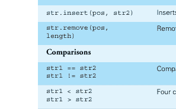

如图1-2，由不在同一条直线上的三条线段首尾顺次相接所组成的图形叫做三角形（triangle）。

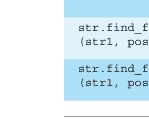

三角形用符号"△"表示。如图1-2的三角形记作"△ABC"，读作"三角形ABC"。

△ABC的三边，有时也用a，b，c来表示。如图1-3，顶点A所对的边BC用a表示，边AC、边AB分别用b、c来表示。

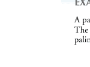

在三角形中，有的三边各不相等，有的两边相等，有的三边都相等。

三边各不相等的三角形叫做不等边三角形（scalene triangle）；

有两条边相等的三角形叫做等腰三角形（isosceles triangle）；

三边都相等的三角形叫做等边三角形（equilateral triangle）。

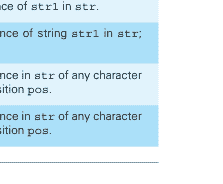

等边三角形是特殊的等腰三角形，即底边和腰相等的等腰三角形。

## EXAMPLE: (continued)

并且将字母的小写版本视为相同，以判断某物是否为回文。以下是一些回文示例：

Able was I 'ere I saw Elba.
I Love Me, Vol. I.
Madam, I'm Adam.
A man, a plan, a canal, Panama.
Rats live on no evil star.
radar
deed
mom
racecar

removePunct 函数很有趣，因为它使用了字符串成员函数 substr 和 find。成员函数 substr 在给定所需子字符串的位置和长度的情况下，提取调用对象的子字符串。前三行 removePunct 声明了函数中使用的变量。for 循环一次遍历参数 s 的一个字符，并尝试在 punct 字符串中找到它们。为此，提取 s 的子字符串，该子字符串在每个字符位置的长度为 1。子字符串在 punct 中的位置使用 find 成员函数确定。如果该单字符字符串不在 punct 字符串中，则该单字符字符串会被连接到要返回的 noPunct 字符串。

### Display 9.8 Palindrome Testing Program (part 1 of 3)

```
//Test for palindrome property.
#include <iostream>
#include <string>
#include <cctype>
using namespace std;
void swap(char& v1, char& v2);
//Interchanges the values of v1 and v2.
string reverse(const string& s);
//Returns a copy of s but with characters in reverse order.
string removePunct(const string& s, const string& punct);
//Returns a copy of s with any occurrences of characters
//in the string punct removed.
string makeLower (const string& s);
//Returns a copy of s that has all uppercase
//characters changed to lowercase, with other characters unchanged.
bool isPal(const string& s);
//Returns true if s is a palindrome; false otherwise.
```

### Display 9.8 Palindrome Testing Program (part 2 of 3)

```cpp
int main( )
{
    string str;
    cout << "Enter a candidate for palindrome test\n"
         << "followed by pressing Return.\n";
    getline(cin, str);

    if (isPal(str))
        cout << "\"" << str + "\" is a palindrome.";
    else
        cout << "\"" << str + "\" is not a palindrome.";
    cout << endl;

    return 0;
}

void swap(char& v1, char& v2)
{
    char temp = v1;
    v1 = v2;
    v2 = temp;
}

string reverse(const string& s)
{
    int start = 0;
    int end = s.length( );
    string temp(s);

    while (start < end)
    {
        end--;
        swap(temp[start], temp[end]);
        start++;
    }

    return temp;
}

//Uses <cctype> and <string>
string makeLower(const string& s)
{
    string temp(s);
    for (int i = 0; i < s.length( ); i++)
        temp[i] = tolower(s[i]);

    return temp;
}
```

### Display 9.8 Palindrome Testing Program (part 3 of 3)

```cpp
string removePunct(const string& s, const string& punct)
{
    string noPunct; //initialized to empty string
    int sLength = s.length( );
    int punctLength = punct.length( );
    for (int i = 0; i < sLength; i++)
    {
        string aChar = s.substr(i,1); //A one-character string
        int location = punct.find(aChar, 0);
        //Find location of a specified characters
        //of src in punct.

        if (location == 0 || location >= punctLength)
            noPunct = noPunct + aChar; //aChar is not in punct, so keep it
    }

    return noPunct;
}

//uses functions makeLower, removePunct
bool isPal(const string& str)
{
    string punct(",;:.?!\" "); //includes a blank
    string str(s);
    str = makeLower(str);
    string lowerStr = removePunct(str, punct);

    return (lowerStr == reverse(lowerStr));
}
```

### Sample Dialogues

```text
Enter a candidate for palindrome test
followed by pressing Return.
Madam, I'm Adam.
"Madam, I'm Adam." is a palindrome.
```

```text
Enter a candidate for palindrome test
followed by pressing Return.
Radar
"Radar" is a palindrome.
```

```text
Enter a candidate for palindrome test
followed by pressing Return.
Am I a palindrome?
"Am I a palindrome?" is not a palindrome.
```

## Self-Test Exercises

24. Consider the following code:

```
string s1, s2("Hello");
cout << "Enter a line of input:\n";
cin >> s1;
if (s1 == s2)
    cout << "Equal\n";
else
    cout << "Not equal\n";
```

如果对话开始如下，下一个输出行会是什么？

Enter a line of input:
Hello friend!

25. What is the output produced by the following code?

```
string s1, s2("Hello");
s1 = s2;
s2[0] = 'J';
cout << s1 << " " << s2;
```

## Converting Between string Objects and C-Strings

你已经看到 C++ 会执行自动类型转换，以便将 C 字符串存储在类型为 string 的变量中。例如，以下操作可以正常工作：

```
char aCString[] = "This is my C-string.";
string stringVariable;
stringVariable = aCString;
```

然而，以下操作会产生编译器错误消息：

```
aCString = stringVariable; //ILLEGAL
```

以下操作也是非法的：

```
strcpy(aCString, stringVariable); //ILLEGAL
```

strcpy 不能将其第二个参数作为 string 对象，并且没有 string 对象到 C 字符串的自动转换，这就是我们似乎无法摆脱的问题。

要获取 string 对象对应的 C 字符串，必须执行显式转换。这可以使用 string 成员函数 c_str() 来完成。我们尝试复制的正确版本如下：

```
strcpy(aCString, stringVariable.c_str()); //Legal
```

请注意，你需要使用 strcpy 函数来执行复制。成员函数 c_str() 返回调用对象对应的 C 字符串。正如

我们在本章前面提到的，赋值运算符不能与 C 字符串一起使用。因此，以防你认为以下操作可能有效，我们应该指出它也是非法的：

```
aCString = stringVariable.c_str(); // ILLEGAL
```

## Converting Between string Objects and Numbers

在 C++11 之前，在字符串和数字之间转换有点复杂，但在 C++11 中，只需调用一个函数即可。使用 stof、stod、stoi 或 stol 分别将字符串转换为 float、double、int 或 long。使用 to_string 将数值类型转换为字符串。这些函数是 string 库的一部分，并在以下示例中进行了说明：

```
int i;
double d;
string s;
i = stoi("35"); // Converts the string "35" to an integer 35
d = stod("2.5"); // Converts the string "2.5" to the double 2.5
s = to_string(d*2); // Converts the double 5.0 to a string "5.0000"
cout << i << " " << d << " " << s << "," << endl;
```

输出为 35 2.5 5.0000。

## Chapter Summary

+ - C 字符串变量与字符数组相同，但使用方式略有不同。string 变量使用空字符 '\0' 来标记存储在数组中的字符串的结尾。

+ - C 字符串变量通常必须像数组一样处理，而不是像我们对数字和单个字符所使用的那样简单的变量。特别是，你不能使用等号 = 将 C 字符串值赋给 C 字符串变量，也不能使用 == 运算符比较两个 C 字符串变量中的值。相反，你必须使用特殊的 C 字符串函数来执行这些任务。

+ - 库 <cctype> 有许多有用的字符操作函数。

+ - 你可以使用 cin.get 读取单个字符的输入，而不会跳过空白。函数 cin.get 读取下一个字符，无论它是什么类型的字符。

+ - getline 函数的各种版本可用于从键盘读取整行输入。

+ - ANSI/ISO 标准 <string> 库提供了一个功能齐全的类 string，可用于表示字符字符串。

+ - class string 的对象比 C 字符串表现更好。特别是，赋值和相等运算符 = 和 == 在与 class string 的对象一起使用时具有直观的含义。


# 自测练习答案

+   1. 以下两个声明彼此等价（但与任何其他声明都不等价）：

   ```c
   char stringVar[10] = "Hello";
   char stringVar[10] = {'H', 'e', 'l', 'l', 'o', '\0'};
   ```

   以下两个声明彼此等价（但与任何其他声明都不等价）：

   ```c
   char stringVar[6] = "Hello";
   char stringVar[] = "Hello";
   ```

   以下声明与任何其他声明都不等价：

   ```c
   char stringVar[10] = {'H', 'e', 'l', 'l', 'o'};
   ```

+   2. “DoBeDo to you”

+   3. 该声明意味着 stringVar 只能容纳六个字符（包括空字符 '\0'）。函数 strcat 不会检查 stringVar 是否有足够空间来添加更多字符，因此 strcat 会将字符串 " and Good-bye." 中的所有字符写入内存，即使这需要的内存超过了分配给 stringVar 的内存。这意味着本不应被修改的内存将被修改。最终结果不可预测，但肯定是不好的。

+   4. 如果 strlen 尚未为你定义，你可以使用以下定义：

   ```c
   int strlen(const char str[])
   //前置条件：str 包含一个以 '\0' 结尾的字符串值。
   //返回字符串 str 中的字符数（不包括 '\0'）。
   {
       int index = 0;
       while (str[index] != '\0')
           index++;
       return index;
   }
   ```

+   5. 最大字符数为五，因为第六个位置需要用于空终止符（'\0'）。

+   6. a. 1
   b. 1
   c. 5（包括 '\0'）
   d. 2（包括 '\0'）
   e. 6（包括 '\0'）

+   7. 这两者不等价。第一个在字符 'a'、'b' 和 'c' 之后将空字符 '\0' 放入数组中。第二个仅将 'a'、'b' 和 'c' 依次赋给数组的连续位置，但未在任何位置放置 '\0'。

# 8.

```
int index = 0;
while (ourString[index] != '\0' )
{
    ourString[index] = "X";
    index++;
}
```

# 9.

+   a. 如果 C 字符串变量没有空终止符 '\0'，循环可能会超出分配给该 C 字符串的内存范围，从而破坏该处的内存内容。为了保护数组末尾之后的内存，请将 while 条件改为 b 中所示的形式。

```
while( ourString[index] != '\0' && index < SIZE )
```

# 10.

```
#include <cstring>
//需要此头文件以获取 strcpy 的声明
...
strcpy(aString, "Hello");
```

# 11.

我按自己的方式做了！

# 12.

字符串 "good, I hope." 对于 aString 来说太长了。不属于数组 aString 的一块内存将被覆盖。

# 13.

完整对话如下：

```
Enter some input:
The
time is now.
The-time<END OF OUTPUT
```

# 14.

完整对话如下：

```
Enter a line of input:
May the hair on your toes grow long and curly.
May t<END OF OUTPUT
```

# 15.

完整对话如下：

```
Enter a line of input:
a b c d e f g
a b END OF OUTPUT
```

# 16.

务必注意，输入字符串 10 中只有 '1' 被输出。这是因为 cin.get 读取的是字符而非数字，因此它将输入 10 读作两个字符 '1' 和 '0'。由于此代码被编写为只回显每隔一个的字符，因此 '0' 不会被输出。由于 '0' 未被输出，下一个字符（即一个空格）会被输出，因此输出中有一个空格。类似地，11 中的两个 '1' 字符中只有一个被输出。如果这一点不清楚，请将输入写在一张纸上，并用一个小方块表示空格字符。然后，划掉每隔一个的字符；前面所示的输出就是剩下的内容。

# 18.

此代码包含一个无限循环，只要用户持续提供输入，它就会一直运行。布尔表达式 (next != '\n') 始终为真，因为 next 是通过语句
cin >> next;
填充的，而该语句总是跳过换行符 '\n'（以及任何空格）。代码会运行，如果用户不提供额外输入，对话将如下所示：

Enter a line of input:
0 1 2 3 4 5 6 7 8 9 10 11
0246811

此代码输出每隔一个的非空白字符。输出中的两个 '1' 字符分别是输入 10 中的第一个字符和输入 11 中的第一个字符。

# 19.

完整对话如下：
Enter a line of input:
I'll see you at 10:30 AM.
I'll see you at 1<END OF OUTPUT

# 20.

```
cout << "Enter a line of input:\n";
char next;
do
{
    cin.get(next);
    if (!isupper(next))
        cout << next;
} while (next != '\n');
```

注意，你应该使用 isupper(next) 而不是 islower(next)。这是因为如果 next 包含非字母字符（如空格或逗号符号），islower(next) 会返回 false。

# 21.

```
//使用 iostream
void newLine()
{
    cin.ignore(10000, '\n');
}
```

当然，这仅适用于长度小于约 10,000 字符的行，但任何超过该长度的行很可能表明存在其他无关的问题。

22. A*string<END OF OUTPUT

23. A string is a joy forever!<END OF OUTPUT

24. 完整对话如下：

```
Enter a line of input:
Hello friend!
Equal
```

25. Hello Jello

# 编程项目

+   1. 编写一个程序，读取最多 100 个字符的句子，并输出经过间距修正和字母大小写修正的句子。换句话说，在输出句子中，所有两个或更多空格的字符串都应压缩为单个空格。句子应以大写字母开头，但不应包含其他大写字母。不必担心专有名词；如果它们的首字母被改为小写，也是可以接受的。将换行符视为空格，即换行符和任意数量的空格都压缩为单个空格。假设句子以句点结尾，且不包含其他句点。例如，输入

```
the Answer to life, the Universe, and everything
IS 42.
```

应产生以下输出：

```
The answer to life, the universe, and everything is 42.
```

+   2. 一个情报机构以加密形式向接收者发送安全信息。接收者随后使用解密算法解密消息，其规则如下。

+   a. 每个字母应替换为字母表中它后面的第三个字母。

+   b. 每个数字应加 5，然后将和除以 10 取余数，得到一个单个数字。

+   c. 每个空格和换行符都应省略。

+   d. 每个特殊字符都应替换为空格。

编写一个程序，读取加密文本，并通过对其应用上述算法来显示解密后的消息。

3. 编写一个程序，按以下格式读取人名：名字，然后是中间名或中间首字母，然后是姓氏。程序随后按以下格式输出姓名：
姓氏, 名字, 中间首字母。
例如，输入
Mary Average User
应产生输出
User, Mary A.
输入
Mary A. User
也应产生输出
User, Mary A.
你的程序应在中间首字母后放置句点，即使输入中未包含句点。你的程序应允许用户不提供中间名或中间首字母。在这种情况下，输出当然不包含中间名或中间首字母。例如，输入
Mary User
应产生输出
User, Mary
如果你使用 C 字符串，假设每个名字最多 20 个字符。或者，使用 string 类。（提示：你可能希望使用三个字符串变量而不是一个大的字符串变量来存储输入。你可能会发现不使用 getline 更容易。）

4. 编写一个程序，读取一行文本，并将所有四个字母的单词替换为单词 "love"。例如，输入字符串
I hate you, you dodo!
应产生以下输出：
I love you, you love!
当然，输出并不总是有意义的。例如，输入字符串
John will run home.
应产生以下输出：
Love love run love.
如果四个字母的单词以大写字母开头，则应替换为 "Love"，而不是 "love"。你无需检查大小写，除了单词的首字母。单词是由字母表中的字母组成的任何字符串，且两端由空格、行尾或任何非字母字符分隔。你的程序应重复此操作，直到用户表示退出。

5. 编写一个程序，用于训练用户使用较少性别歧视的语言，方法是为用户给出的句子建议替代版本。程序将询问一个句子，将句子读入字符串变量，并替换所有出现的


of masculine pronouns with gender-neutral pronouns. For example, it will replace "he" with "she or he". Thus, the input sentence

```
See an adviser, talk to him, and listen to him.
```

should produce the following suggested changed version of the sentence:

```
See an adviser, talk to her or him, and listen to her or him.
```

Be sure to preserve uppercase letters for the first word of the sentence. The pronoun "his" can be replaced by "her(s)"; your program need not decide between "her" and "hers". Allow the user to repeat this for more sentences until the user says she or he is done. This will be a long program that requires a good deal of patience. Your program should not replace the string "he" when it occurs inside another word such as "here". A word is any string consisting of the letters of the alphabet and delimited at each end by a blank, the end of the line, or any other character that is not a letter. Allow your sentences to be up to 100 characters long.

## 6. There is a CD available for purchase that contains .jpeg and .gif images of music that is in the public domain. The CD includes a file consisting of lines containing the names, then composers of that title, one per line. The name of the piece is first, then zero or more spaces then a dash (-) character, then one or more spaces, then the composer’s name. The composer name may be only the last name, an initial and one name, two names (first and last), or three names (first, middle, and last). There are a few tunes with "no author listed" as author. In the subsequent processing, "no author listed" should not be rearranged. Here is a very abbreviated list of the titles and authors.

- 1. Adagio "MoonLight" Sonata - Ludwig Van Beethoven
- 2. An Alexis - F.H. Hummel and J.N. Hummel
- 3. A La Bien Aimee - Ben Schutt
- 4. At Sunset - E. MacDowell
- 5. Angelus - J. Massenet
- 6. Anitra's Dance - Edward Grieg
- 7. Ase's Death - Edward Grieg
- 8. Au Matin - Benj. - Godard
- ...

- 37. The Dying Poet - L. Gottschalk
- 38. Dead March - G.F. Handel
- 39. Do They Think of Me At Home - Chas. W. Glover
- 40. The Dearest Spot - W.T. Wrighton

- 1. Evening - L. Van Beethoven
- 2. Embarrassment - Franz Abt
- 3. Erin is my Home - no author listed
- 4. Ellen Bayne - Stephen C. Foster
- ...

- 9. Alla Mazurka - A. Nemerowsky
- ...
- 1. The Dying Volunteer - A.E. Muse
- 2. Dolly Day - Stephen C. Foster
- 3. Dolcy Jones - Stephen C. Foster
- 4. Dickory, Dickory, Dock - no author listed
- 5. The Dear Little Shamrock - no author listed
- 6. Dutch Warbler - no author listed
- ...

The ultimate task is to produce an alphabetized list of composers followed by a list of pieces by them alphabetized on the title within composer. This exercise is easier if it is broken into pieces:

Write code to do the following:

- a. Remove the lead numbers, any periods, and any spaces so that the first word of the title is the first word of the line.
- b. Replace any multiple spaces with a single space.
- c. A few titles may have several - characters, for example,
- 20. Ba- Be- Bi- Bo- Bu - no author listed
- Replace all dash - characters on any line before the end of the line by a space except the last one.
- d. The last word in the title may have the - character with no space between it and the = character. Put the space in.
- e. When alphabetizing the title, you do not want to consider an initial "A", "An", or "The" in the title. Write code to move such initial words to just before the character. A comma after the last word in the title is not required, but that would be a nice touch. This can be done after the composers' names are moved to the front, but obviously the code will be different.
- f. Move the composers' names to the beginning of the line, followed by the character, followed by the composition title.
- g. Move any first initial, or first and second names of the composer to after the composer's last name. If the composer is "no author listed" this should not be rearranged, so test for this combination.
- h. Alphabetize by composer using any sort routine you know. You may ignore any duplicate composer's last name, such as CPE Bach and JS Bach, but sorting by composer's second name would be a nice touch. You may use the insertion sort, or selection sort, or bubble sort, or other sorting algorithm.
- i. If you have not already done so, move "A", "An", or "The" that may begin a title to the end of the title. Then alphabetize within each composer by composition title.
- j. Keep a copy of your design and your code. You will be asked to do this over using the STL vector container.

```
20. Ba- Be- Bi- Bo- Bu - no author listed
```

## 1.2 空间几何体的三视图和直观图

### 1.2.1 中心投影与平行投影

由于光的照射，在不透明物体后面的屏幕上可以留下这个物体的影子，这种现象叫做投影。其中，我们把光线叫做投影线，把留下物体影子的屏幕叫做投影面。

光由一点向外散射形成的投影，叫做中心投影（central projection）。中心投影的投影线交于一点。

我们把在一束平行光线照射下形成的投影，叫做平行投影（parallel projection）。平行投影的投影线是平行的。

在平行投影中，投影线正对着投影面时，叫做正投影，否则叫做斜投影。

在平行投影中，投影线正对着投影面时，叫做正投影，否则叫做斜投影。

在平行投影中，投影线正对着投影面时，叫做正投影，否则叫做斜投影。

在平行投影中，投影线正对着投影面时，叫做正投影，否则叫做斜投影。

在平行投影中，投影线正对着投影面时，叫做正投影，否则叫做斜投影。

在平行投影中，投影线正对着投影面时，叫做正投影，否则叫做斜投影。

在平行投影中，投影线正对着投影面时，叫做正投影，否则叫做斜投影。

13. Some word games require the player to find words that can be formed using the letters of another word. For example, given the word SWIMMING then other words that can be formed using the letters include SWIM, WIN, WING, SING, MIMING, etc. Write a program that lets the user enter a word and then output all the words contained in the file words.txt (included on the website for this book) that can be formed from the letters of the entered word. One algorithm to do this is to compare the letter histograms for each word. Create an array that counts up the number of each letter in the entered word (e.g., one S, one W, two I, two M, etc.) and then creates a similar array for the current word read from the file. The two arrays can be compared to see if the word from the file could be created out of the letters from the entered word.

14. The file words.txt, which is included on the website for this book, contains a list of 1000 words. Write a program that reads each word from the file and outputs the words that are palindromes (sequences of characters that read the same from both ends). For example, the word ‘rotator’ is a palindrome.

## Pointers and Dynamic Arrays 10

- 10.1 POINTERS 454
- Pointer Variables 455
- Basic Memory Management 463
- `nullptr` 465
- Pitfall: Dangling Pointers 466
- Dynamic Variables and Automatic Variables 466
- Tip: Define Pointer Types 467
- Pitfall: Pointers as Call-by-Value Parameters 469
- Uses for Pointers 470

- 10.2 DYNAMIC ARRAYS 471
- Array Variables and Pointer Variables 471
- Creating and Using Dynamic Arrays 473
- Example: A Function That Returns an Array 476
- Pointer Arithmetic 478
- Multidimensional Dynamic Arrays 479

- 10.3 CLASSES, POINTERS, AND DYNAMIC ARRAYS 482
- The -> Operator 482
- The this Pointer 483
- Overloading the Assignment Operator 483
- Example: A Class for Partially Filled Arrays 490
- Destructors 493
- Copy Constructors 494

## Pointers and Dynamic Arrays

> Memory is necessary for all the operations of reason.
> BLAISE PASCAL, Pensées, 1670

## Introduction

A pointer is a construct that gives you more control of the computer’s memory. This chapter will show you how pointers are used with arrays and will introduce a new form of array called a dynamically allocated array. Dynamically allocated arrays (dynamic arrays for short) are arrays whose size is determined while the program is running, rather than being fixed when the program is written.

Before reading Sections 10.1 and 10.2 on pointers and dynamically allocated arrays you should first read Chapters 1 through 6 (omitting the coverage of vectors if you wish), but you need not read any of Chapters 7 through 9. You can even read Sections 10.1 and 10.2 after reading just Chapters 1 to 5, provided you ignore the few passages that mention classes.

Section 10.3 discusses some tools for classes that only become relevant once you begin to use pointers and dynamically allocated data (such as dynamically allocated arrays). Before covering Section 10.3, you should read Chapters 1 through 8, although you may omit the coverage of vectors if you wish.

You may cover this chapter, Chapter 11 on separate compilation and namespaces, Chapter 12 on file I/O, and Chapter 13 on recursion in any order. If you do not read the Chapter 11 section on namespaces before this chapter, you might find it profitable to review the section of Chapter 1 entitled “Namespaces”.

## 10.1 Pointers

> By indirections find directions out.
> WILLIAM SHAKESPEARE, Hamlet, Act II, Scene 7, 1603

pointer
A pointer is the memory address of a variable. Recall from Chapter 5 that the computer’s memory is divided into numbered memory locations (called bytes) and that variables are implemented as a sequence of adjacent memory locations. Recall also that sometimes the C++ system uses these memory addresses as names for the variables. If a variable is implemented as, say, three memory locations, then the address of the first of these memory locations is sometimes used as a name for that variable. For example, when the variable is used as a call-by-reference argument, it is this address, not the identifier name of the variable, that is passed to the calling function. An address that is used to name a variable in this way (by giving the address


## 指针变量声明

能够保存指向类型为 Type_Name 的其他变量的指针的变量，其声明方式与声明类型为 Type_Name 的变量类似，只是你在变量名前放置一个星号。

### SYNTAX

```
Type_Name *Variable_Name1, *Variable_Name2, ...;
```

### EXAMPLE

```
double *pointer1, *pointer2;
```

### 地址和数字

指针是一个地址，而地址是一个整数，但指针不是整数。这并不奇怪——这就是抽象！C++ 坚持要求你将指针用作地址，而不要将其用作数字。指针不是类型为 int 或任何其他数值类型的值。通常你不能将指针存储在类型为 int 的变量中。如果你尝试这样做，大多数 C++ 编译器会给出错误消息或警告消息。此外，你也不能对指针执行正常的算术运算。（正如你将在本章后面看到的，你可以对指针执行一种加法和一种减法，但它们不是通常的整数加法和减法。）

### & 运算符

像之前声明的 p1 和 p2 这样的指针变量，可以包含指向像 v1 和 v2 这样的变量的指针。你可以使用运算符 & 来确定一个变量的地址，然后可以将该地址赋给一个指针变量。例如，以下代码将变量 p1 设置为指向变量 v1 的指针：

```
p1 = &v1;
```

### * 运算符

### 解引用运算符

现在你有两种方式引用 v1：你可以称之为 v1，也可以称之为“p1 所指向的变量”。在 C++ 中，称“p1 所指向的变量”的方式是 *p1。这与我们声明 p1 时使用的同一个星号，但现在它又有另一种含义。当星号以这种方式使用时，它被称为解引用运算符，而指针变量被称为被解引用。

将这些部分组合起来可能会产生一些令人惊讶的结果。考虑以下代码：

```
v1 = 0;
p1 = &v1;
*p1 = 42;
cout << v1 << endl;
cout << *p1 << endl;
```

### 指针类型

C++ 在命名指针类型时存在一点不一致（或至少存在混淆的可能性）。如果你想要一个参数，其类型例如是指向类型为 int 的变量的指针，那么类型写成 int*，如下例所示：

```
void manipulatePointer (int* p);
```

如果你想要声明同一个指针类型的变量，* 与变量一起，如下例所示：

```
int *p1, *p2;
```

事实上，编译器并不关心 * 是附加在 int 上还是变量名上，所以以下写法也被编译器接受并且含义相同：

```
void manipulatePointer (int* p); //Accepted but not as nice.
int* p1, *p2; //Accepted but possibly confusing.
```

然而，我们发现第一个版本更清晰。特别注意，在声明变量时，每个指针变量必须有一个 *。

这段代码将输出以下内容到屏幕上：

```
42
42
```

只要 p1 包含指向 v1 的指针，那么 v1 和 *p1 就引用同一个变量。所以当你将 *p1 设置为 42 时，你同时也将 v1 设置为 42。

用于获取变量地址的符号 & 与你在函数声明中用于指定传引用参数的符号是同一个。这不是巧合。回想一下，传引用参数是通过向被调用函数提供参数的地址来实现的。所以，这两种 & 的用法非常密切相关，尽管它们并不完全相同。

你可以将一个指针变量的值赋给另一个指针变量。例如，如果 p1 仍指向 v1，那么以下代码将设置 p2 使其也指向 v1：

```
p2 = p1;
```

只要我们没有改变 v1 的值，以下代码也将输出 42 到屏幕上：

```
cout << *p2;
```

请确保你不会混淆

```
p1 = p2;
```

和

```
*p1 = *p2;
```

赋值语句中的指针

### * 和 & 运算符

在指针变量前面的 * 运算符会产生它所指向的变量。以这种方式使用时，* 运算符称为解引用运算符。

在普通变量前面的运算符 & 会产生该变量的地址；也就是说，它会产生指向该变量的指针。& 运算符简单地称为取地址运算符。

例如，考虑声明

```
double *p, v;
```

以下代码设置 p 的值使 p 指向变量 v：

```
p = &v;
```

*p 产生 p 所指向的变量，因此在之前的赋值之后，*p 和 v 引用同一个变量。例如，以下代码将 v 的值设置为 9.99，即使从未显式使用名称 v：

```
*p = 9.99;
```

当你加上星号时，你处理的不是指针 p1 和 p2，而是指针所指向的变量。这在 Display 10.1 中有所说明，其中变量表示为方框，变量的值写在方框内。我们没有显示指针变量中的实际数字地址，因为数字不重要。重要的是该数字是某个特定变量的地址。因此，而不是使用地址的实际数字，我们仅用一个指向具有该地址的变量的箭头来表示地址。

### 使用 = 的指针变量

如果 p1 和 p2 是指针变量，那么语句

```
p1 = p2;
```

会改变 p1 的值，使其成为 p2 中的内存地址（指针）。一种常见的思考方式是，该赋值会改变 p1 使其指向 p2 当前所指向的东西。

### Display 10.1 使用赋值运算符的指针变量

```
p1 = p2;
```

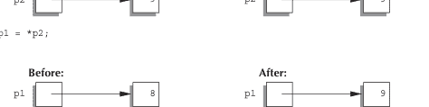

```
*p1 = *p2;
```

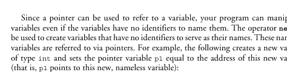

由于指针可用于引用变量，你的程序可以操作变量，即使这些变量没有标识符来命名它们。运算符 new 可用于创建没有标识符作为其名称的变量。这些无名变量通过指针引用。例如，以下代码创建一个新的类型为 int 的变量并将指针变量 p1 设置为此新变量的地址（也就是说，p1 指向这个新的无名变量）：

```
p1 = new int;
```

这个新的无名变量可以称为 *p1（也就是说，作为 p1 所指向的变量）。你可以对这个无名变量做任何对其他类型为 int 的变量可以做的事。例如，以下代码从键盘读取一个类型为 int 的值到这个无名变量中，将值加 7，然后输出这个新值：

```
cin >> *p1;
*p1 = *p1 + 7;
cout << *p1;
```

new 运算符产生一个新的无名变量并返回指向此新变量的指针。你通过在 new 运算符后写出类型名来指定这个新变量的类型。使用 new 运算符创建的变量称为动态分配变量或简单地称为动态变量，因为它们在程序运行时被创建和销毁。Display 10.2 中的程序演示了指针和动态变量的一些简单操作。Display 10.3 以图形方式说明了 Display 10.2 中程序的工作原理。

### Display 10.2 基本指针操作

```cpp
//Program to demonstrate pointers and dynamic variables.
#include <iostream>
using namespace std;

int main( )
{
    int *p1, *p2;

    p1 = new int;
    *p1 = 42;
    p2 = p1;
    cout << "*p1 == " << *p1 << endl;
    cout << "*p2 == " << *p2 << endl;

    *p2 = 53;
    cout << "*p1 == " << *p1 << endl;
    cout << "*p2 == " << *p2 << endl;

    p1 = new int;
    *p1 = 88;
    cout << "*p1 == " << *p1 << endl;
    cout << "*p2 == " << *p2 << endl;

    cout << "Hope you got the point of this example!\n";
    return 0;
}
```

### 示例对话

```text
*p1 == 42
*p2 == 42
*p1 == 53
*p2 == 53
*p1 == 88
*p2 == 53
Hope you got the point of this example!
```


## 显示 10.3 显示 10.2 的解释

```
(a)
int *p1, *p2;
```

```
(b)
p1 = new int;
```

```
(c)
*p1 = 42;
```

```
(d)
p2 = p1;
```

```
(e)
*p2 = 53;
```

```
(f)
p1 = new int;
```

```
(g)
*p1 = 88;
```

当使用 new 操作符创建类类型的动态变量时，会调用该类的构造函数。如果未指定使用哪个构造函数，则调用默认构造函数。例如，以下代码调用默认构造函数：

```
SomeClass *classPtr;
classPtr = new SomeClass; //Calls default constructor.
```

## new 操作符

new 操作符创建一个指定类型的新的动态变量，并返回指向该新变量的指针。例如，以下代码创建一个类型为 MyType 的新动态变量，并使指针变量 p 指向该新变量：

```
MyType *p;
 p = new MyType;
```

如果类型是类类型，则为新创建的动态变量调用默认构造函数。你可以通过包含参数来指定不同的构造函数，如下所示：

```
MyType *mPtr;
 mPtr = new MyType(32.0, 17); // calls MyType(double, int);
```

类似的记法允许你初始化非类类型的动态变量，如下所示：

```
int *n;
 n = new int(17); // initializes *n to 17
```

在早期的 C++ 编译器中，如果没有足够的可用内存来创建新的变量，则 new 返回一个名为 NULL 的特殊指针。C++ 标准规定，如果没有足够的可用内存来创建新的变量，则 new 操作符默认会终止程序。

如果你包含构造函数参数，可以调用不同的构造函数，如下所示：

```
classPtr = new SomeClass(32.0, 17);
 //Calls SomeClass(double, int).
```

类似的记法允许你初始化非类类型的动态变量，如下所示：

```
double *dPtr;
 dPtr = new double(98.6); // Initializes *dPtr to 98.6.
```

指针类型是一个完整的类型，可以像其他类型一样使用。特别是，你可以有一个指针类型的函数参数，并且可以有一个返回指针类型的函数。例如，以下函数有一个指向 int 变量的指针参数，并返回一个指向 int 变量的指针（可能不同）：

```
int* findOtherPointer(int* p);
```

### 指针参数

## 自测练习

- 1. 什么是 C++ 中的指针？
- 2. 给出 * 操作符的至少三种用途。命名并描述每种用途。
- 3. 以下代码产生的输出是什么？
- 4. 以下代码产生的输出是什么？

```
int *p1, *p2;
p1 = new int;
p2 = new int;
*p1 = 10;
*p2 = 20;
cout << *p1 << " " << *p2 << endl;
p1 = p2;
cout << *p1 << " " << *p2 << endl;
*p1 = 30;
cout << *p1 << " " << *p2 << endl;
```

如果将 *p1 = 30; 替换为以下代码，输出会如何改变？ *p2 = 30;

```
int *p1, *p2;
p1 = new int;
p2 = new int;
*p1 = 10;
*p2 = 20;
cout << *p1 << " " << *p2 << endl;
p1 = p2; //This is different from Exercise 3
cout << *p1 << " " << *p2 << endl;
*p1 = 30;
cout << *p1 << " " << *p2 << endl;
```

## 基本内存管理

freestore 或 heap

一块特殊的内存区域，称为 freestore 或 heap，保留用于动态分配的变量。程序创建的任何新动态变量都会消耗 freestore 中的一些内存。如果你的程序创建了过多的动态变量，它将消耗掉 freestore 中的所有内存。如果发生这种情况，任何额外的 new 调用都会失败。当你在耗尽 freestore 中的所有内存（所有保留用于动态分配变量的内存）后使用 new 时会发生什么，将取决于你的编译器的更新程度。在早期的 C++ 编译器中，如果没有足够的可用内存来创建新的变量，则 new 返回一个名为 NULL 的特殊值。如果你有一个完全符合更新的 C++ 标准的编译器，则如果没有足够的可用内存来创建新的变量，new 操作符将终止程序。第 18 章讨论了方法

## nullptr

常量 NULL 实际上是数字 0 这一事实导致了歧义问题。考虑以下重载函数：

```
void func(int *p);
void func(int i);
```

如果我们调用 func(NULL)，将调用哪个函数？由于 NULL 是数字 0，两者都同样有效。C++11 通过引入一个新的常量来解决这个问题，

nullptr。nullptr 不是整数 0；它是一个字面常量，用于表示空指针。在你会使用 NULL 的地方为指针使用 nullptr。例如，

```
double *there = nullptr;
```

我们建议如果你有 C++11 编译器，使用 nullptr 而不是 NULL。

## nullptr

nullptr 是一个特殊常量值，其使用方式与 NULL 相同，但它只能分配给指针。它不是数字 0。使用 nullptr 来区分空指针和数字 0。nullptr 在 C++11 中引入。

freestore 的大小因 C++ 的一种实现而异。它通常很大，一个适度的程序不太可能使用掉 freestore 中的所有内存。然而，即使在适度的程序中，回收不再需要的任何 freestore 内存也是一种良好的做法。如果你的程序不再需要一个动态变量，该动态变量使用的内存可以返回给 freestore 管理器，该管理器会回收内存以创建其他动态变量。delete 操作符消除一个动态变量并将该动态变量占用的内存返回给 freestore 管理器以供重用。假设 p 是一个指向动态变量的指针变量。以下代码将销毁 p 指向的动态变量并将该动态变量使用的内存返回给 freestore 管理器以供重用：

```
delete p;
```

## delete 操作符

delete 操作符消除一个动态变量并将该动态变量占用的内存返回给 freestore。内存然后可以被重用来创建新的动态变量。例如，以下代码消除指针变量 p 指向的动态变量：

```
delete p;
```

调用 delete 后，指针变量的值，如所示的 p，是未定义的。（稍后在本章中讨论的 delete 的一个略有不同的版本用于动态分配的变量是数组时。）

## 陷阱：悬空指针

当你对一个指针变量应用 delete 时，它所指向的动态变量被销毁。此时，指针变量的值是未定义的，这意味着你不知道它指向哪里。此外，如果其他指针变量指向被销毁的动态变量，则该其他指针变量也是未定义的。这些未定义的指针变量称为悬空指针。如果 p 是一个悬空指针并且你的程序对 p 应用解引用操作符 *（生成表达式 *p），结果是不可预测的并且通常是灾难性的。在对指针变量应用解引用操作符 * 之前，你应该确定指针变量指向某个变量。

C++ 没有内置的测试来检查指针变量是否为悬空指针。避免悬空指针的一种方法是设置任何悬空指针变量等于 NULL。然后你的程序可以在对指针变量应用解引用操作符 * 之前测试指针变量是否等于 NULL。当你使用这种技术时，你在调用 delete 后跟随代码将所有悬空指针设为 NULL。请记住，除了调用 delete 中使用的那个指针变量之外，其他指针变量也可能变成悬空指针，所以务必将所有悬空指针设为 NULL。跟踪悬空指针并将它们设为 NULL 或以其他方式确保它们不被解引用是程序员的责任。

## 动态变量和自动变量

使用 new 操作符创建的变量称为动态变量（或动态分配的变量），因为它们在程序运行时创建和销毁。局部变量——即在函数定义内声明的变量——也具有一定的动态特性，但它们不称为动态变量。如果一个变量是函数的局部变量，则该变量在函数被调用时由 C++ 系统创建，并在函数调用完成时销毁。由于程序的主体部分实际上只是名为 main 的一个函数，这甚至适用于你在程序主部分声明的变量。（由于对 main 的调用在程序结束前不会结束，在 main 中声明的变量在程序结束前不会被销毁，但处理局部变量的机制对于 main 与其他任何函数相同。）这些局部变量有时称为自动变量，因为它们的动态属性由系统自动控制。它们在声明它们的函数被调用时自动创建，并在函数调用结束时自动销毁。

在任何函数或类定义之外声明的变量，包括 main 之外，称为全局变量。这些全局变量有时称为静态分配的变量，因为它们与我们在此部分讨论的动态/自动对比相比是真正静态的。我们在第 3 章中简要讨论了全局变量。事实证明，我们不需要全局变量，也没有使用它们。

4 使用 static 修饰符在类内声明的变量在 static 的意义上与我们在此部分讨论的动态/静态对比不同。

dangling pointer

automatic variable

global variable


## TIP: Define Pointer Types

You can define a pointer type name so that pointer variables can be declared like other variables without the need to place an asterisk in front of each pointer variable. For example, the following defines a type called IntPtr, which is the type for pointer variables that contain pointers to int variables:

```
typedef int * IntPtr;
```

Thus, the following two pointer variable declarations are equivalent:

```
IntPtr p;
```

and

```
int *p;
```

You can use typedef to define an alias for any type name or definition. For example, the following defines the type name Kilometers to mean the same thing as the type name double:

```
typedef double Kilometers;
```

Once you have given this type definition, you can define a variable of type double as follows:

```
Kilometers distance;
```

Renaming existing types this way can occasionally be useful. However, our main use of typedef will be to define types for pointer variables.

Keep in mind that a typedef does not produce a new type but is simply an alias for the type definition. For example, given the previous definition of Kilometers, a variable of type Kilometers may be substituted for a parameter of type double. Kilometers and double are two names for the same type.

## TIP: (continued)

Although this is legal, it is misleading. It looks like both p1 and p2 are pointer variables, but in fact only p1 is a pointer variable; p2 is an ordinary int variable. As far as the C++ compiler is concerned, the * that is attached to the identifier int may as well be attached to the identifier p1. One correct way to declare both p1 and p2 to be pointer variables is

```
int *p1, *p2;
```

An easier and less error-prone way to declare both p1 and p2 to be pointer variables is to use the defined type name IntPtr as follows:

```
IntPtr p1, p2;
```

The second advantage of using a defined pointer type, such as IntPtr, is seen when you define a function with a call-by-reference parameter for a pointer variable. Without the defined pointer type name, you would need to include both an * and an & in the declaration for the function, and the details can get confusing. If you use a type name for the pointer type, then a call-by-reference parameter for a pointer type involves no complications. You define a call-by-reference parameter for a defined pointer type just like you define any other call-by-reference parameter. Here is an example:

```
void sampleFunction(IntPtr& pointerVariable);
```

## Self-Test Exercises

- 5. What unfortunate misinterpretation can occur with the following declaration?
- int* intPtr1, intPtr2;

- 6. Suppose a dynamic variable were created as follows:
- char *p;
- p = new char;
- Assuming that the value of the pointer variable p has not changed (so it still points to the same dynamic variable), how can you destroy this new dynamic variable and return the memory it uses to the freestore manager so that the memory can be reused to create other new dynamic variables?

- 7. Write a definition for a type called NumberPtr that will be the type for pointer variables that hold pointers to dynamic variables of type double. Also, write a declaration for a pointer variable called myPoint, which is of type NumberPtr.

- 8. Describe the action of the new operator. What does the new operator return? What are the indications of errors?

## Type Definitions

You can assign a name to a type definition and then use the type name to declare variables. This is done with the keyword typedef. These type definitions are normally placed outside the body of the main part of your program and outside the body of other functions, typically near the start of a file. That way the typedef is global and available to your entire program. We will use type definitions to define names for pointer types, as shown in the example here.

## SYNTAX

```
typedef Known_Type_Definition New_Type_Name;
```

## EXAMPLE

```
typedef int* IntPtr;
```

The type name IntPtr can then be used to declare pointers to dynamic variables of type int, as in the following example:

```
IntPtr pointer1, pointer2;
```

## PITFALL: Pointers as Call-by-Value Parameters

When a call-by-value parameter is of a pointer type, its behavior can occasionally be subtle and troublesome. Consider the function call shown in Display 10.4. The parameter temp in the function sneaky is a call-by-value parameter, and hence it is a local variable. When the function is called, the value of temp is set to the value of the argument p and the function body is executed. Since temp is a local variable, no changes to temp should go outside the function sneaky. In particular, the value of the pointer variable p should not be changed. Yet the sample dialogue makes it look like the value of the pointer variable p has changed. Before the call to the function sneaky, the value of *p was 77, and after the call to sneaky the value of *p is 99. What has happened?

The situation is diagrammed in Display 10.5. Although the sample dialogue may make it look as if p were changed, the value of p was not changed by the function call to sneaky. Pointer p has two things associated with it: p’s pointer value and the value stored where p points. But the value of p is the pointer (that is, a memory address). After the call to sneaky, the variable p contains the same pointer value (that is, the same memory address). The call to sneaky has changed the value of the variable pointed to by p, but it has not changed the value of p itself.

If the parameter type is a class or structure type that has member variables of a pointer type, the same kind of surprising changes can occur with call-by-value arguments of the class type. However, for class types, you can avoid (and control) these surprise changes by defining a copy constructor, as described later in this chapter.

## Display 10.5 The Function Call sneaky(p);

### 1. Before call to sneaky:

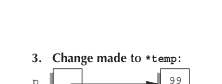

### 2. Value of p is plugged in for temp:


### 3. Change made to *temp:


### 4. After call to sneaky:


## 10.2 Dynamic Arrays

In this section you will see that array variables are actually pointer variables. You will also find out how to write programs with dynamically allocated arrays. A dynamically allocated array (also called simply a dynamic array) is an array whose size is not specified when you write the program, but is determined while the program is running.

dynamically allocated array

## Array Variables and Pointer Variables

Chapter 5 described how arrays are kept in memory. At that point we discussed arrays in terms of memory addresses. But a memory address is a pointer. So, in C++ an array variable is actually a kind of pointer variable that points to the first indexed variable of the array. Given the following two variable declarations, p and a are both pointer variables:

```
int a[10];
typedef int* IntPtr;
IntPtr p;
```

The fact that a and p are both pointer variables is illustrated in Display 10.6. Since a is a pointer that points to a variable of type int (namely, the variable a[0]), the value of a can be assigned to the pointer variable p as follows:

```
p = a;
```

After this assignment, p points to the same memory location that a points to. Thus, p[0], p[1], ..., p[9] refer to the indexed variables a[0], a[1], ..., a[9]. The square bracket notation you have been using for arrays applies to pointer variables as long as the pointer variable points to an array in memory. After the previous assignment,

you can treat the identifier p as if it were an array identifier. You can also treat the identifier a as if it were a pointer variable, but there is one important reservation: **You cannot change the pointer value in an array variable.** If the pointer variable p2 has a value, you might be tempted to think the following is legal, but it is not:

```
a = p2; // ILLEGAL. You cannot assign a different address to a.
```

The underlying reason that this assignment does not work is that an array variable is not of type int*, but its type is a const version of int*. An array variable, like a, is a pointer variable with the modifier const, which means that its value cannot be changed.

## Display 10.6 Arrays and Pointer Variables

```
//Program to demonstrate that an array variable is a kind of pointer
//variable.
#include <iostream>
using namespace std;

typedef int* IntPtr;

int main( )
{
    IntPtr p;
    int a[10];
    int index;

    for (index = 0; index < 10; index++)
        a[index] = index;

    p = a;

    for (index = 0; index < 10; index++)
        cout << p[index] << " ";
    cout << endl;

    for (index = 0; index < 10; index++)
        p[index] = p[index] + 1;

    for (index = 0; index < 10; index++)
        cout << a[index] << " ";
    cout << endl;

    return 0;
}
```

> Note that changes to the array p are also changes to the array a.

Sample Dialogue

| 0 | 1 | 2 | 3 | 4 | 5 | 6 | 7 | 8 | 9 |
|---|---|---|---|---|---|---|---|---|---|
| 1 | 2 | 3 | 4 | 5 | 6 | 7 | 8 | 9 | 10 |


## 创建和使用动态数组

我们在第5章中讨论的那种数组的一个问题是，你在编写程序时必须指定数组的大小——但你可能要等到程序运行时才知道需要多大的数组。例如，一个数组可能保存学生学号列表，但每次运行程序时班级的大小可能不同。使用到目前为止你所使用的那种数组，你必须估计数组可能需要的最大大小并希望该大小足够大。这样做有两个问题。首先，你可能估计过低，那么你的程序在所有情况下都无法正常工作。其次，由于数组可能有许多未使用的位置，这会浪费计算机内存。动态分配的数组可以避免这些问题。如果你的程序使用动态分配的数组来保存学生学号，那么学生人数可以作为程序的输入，并且可以创建动态分配的数组使其大小恰好等于学生人数。

### 创建动态数组

动态分配的数组是使用 new 操作符创建的。动态分配数组的创建和使用出奇地简单。由于数组变量是指针变量，你可以使用 new 操作符创建动态分配的数组变量，并可以将这些动态分配的数组当作普通数组一样对待。例如，以下代码创建了一个包含十个 double 类型数组元素的动态分配数组变量：

```
typedef double* DoublePtr;
DoublePtr d;
d = new double[10];
```

要获得其他任何类型的动态分配数组元素，只需将 double 替换为所需类型。特别是，你可以用结构体或类类型替换类型 double。要获得其他任何大小的动态分配数组变量，只需将 10 替换为所需大小。

关于此示例还有一些不太明显的事情需要注意。首先，你为指向动态分配数组使用的指针类型与你为数组的单个元素使用的指针类型相同。例如，double 类型元素的数组的指针类型与你为简单 double 类型变量使用的指针类型相同。指向数组的指针实际上是指向数组的第一个索引变量的指针。在前面的示例中，创建了一个包含十个索引变量的整个数组，并且指针 d 被指向这十个索引变量中的第一个。

其次，注意当你调用 new 时，动态分配数组的大小是在类型之后用方括号给出，在本示例中该类型是 double。这告诉计算机为动态数组保留多少存储空间。如果你在本示例中省略了方括号和 10，计算机将只为一个 double 类型变量分配足够的存储空间，而不是为十个 double 类型索引变量的数组分配存储空间。

Display 10.7 包含一个说明动态分配数组使用的程序。该程序搜索存储在动态分配数组中的数字列表。数组的大小在程序运行时确定。会询问用户将有多少个数字，然后 new 操作符创建该大小的动态分配数组。动态数组的大小由变量 arraySize 给出。动态数组的大小不必由常量给出。它可以像 Display 10.7 中那样由一个在程序运行时确定其值的变量给出。

### Display 10.7 动态分配的数组（第1部分，共2部分）

//Searches a list of numbers entered at the keyboard.
#include <iostream>
using namespace std;

typedef int* IntPtr;

void fillArray(int a[], int size);
//Precondition: size is the size of the array a.
//Postcondition: a[0] through a[size-1] have been
//filled with values read from the keyboard.

int search(int a[], int size, int target);
//Precondition: size is the size of the array a.
//The array elements a[0] through a[size-1] have values.
//If target is in the array, returns the first index of target.
//If target is not in the array, returns -1.

int main( )
{
    cout << "This program searches a list of numbers.\n";

    int arraySize;
    cout << "How many numbers will be on the list? ";
    cin >> arraySize;
    IntPtr a;
    a = new int [arraySize];

    fillArray(a, arraySize);

    int target;
    cout << "Enter a value to search for: ";
    cin >> target;
    int location = search(a, arraySize, target);
    if (location == -1)
        cout << target << " is not in the array.\n";
    else
        cout << target << " is element " << location << " in the array.\n";

    delete [] a;
    return 0;
}
```

普通数组参数

动态数组 a 的使用方式与普通数组相同。

### Display 10.7 动态分配的数组（第2部分，共2部分）

//Uses the library <iostream>:
void fillArray(int a[], int size)
{
  cout << "Enter " << size << " integers.\n";
  for (int index = 0; index < size; index++)
    cin >> a[index];
}

int search(int a[], int size, int target)
{
  int index = 0;
  while ((a[index] != target) && (index < size))
    index++;
  if (index == size)//if target is not in a.
    index = -1;
  return index;
}
```

### 示例对话

> This program searches a list of numbers.
> How many numbers will be on the list? 5
> Enter 5 integers.
> 1 2 3 4 5
> Enter a value to search for: 3
> 3 is element 2 in the array.

注意 Display 10.7 中的 delete 语句，它销毁了指针 a 所指向的动态分配数组。由于程序即将结束，我们其实并不真的需要这个 delete 语句；然而，如果程序继续做其他事情，你就需要这样的 delete 语句，以便将该动态分配数组使用的内存归还给 freestore 管理器。动态分配数组的 delete 语句与你之前看到的 delete 语句类似，只是对于动态分配数组你必须包含一对空的方括号，如下所示：

delete [] a;

方括号告诉 C++ 一个动态分配的数组变量正在被消除，因此系统会检查数组的大小并移除相应数量的索引变量。如果你省略方括号，你将不会消除整个数组。例如，

delete a;

是不合法的，但大多数编译器都不会检测到这个错误。C++ 标准说这样做会发生什么情况是“未定义的”。这意味着编译器的作者可以让它做任何方便的事情（对编译器编写者方便，而不是对你方便）。当你删除用类似

```
arrayPtr = new MyType[37];
```

分配的内存时，始终使用

```
delete [] arrayPtr;
```

语法。

还要注意 delete 语句中方括号的位置

```
delete [] arrayPtr; //Correct
```

```
delete arrayPtr[]; //ILLEGAL!
```

你使用 new 和一个指针（例如 Display 10.7 中的指针 a）调用来创建动态分配数组。在 new 调用之后，你不应将任何其他指针值赋给此指针变量，因为这会在使用 delete 调用将动态数组的内存归还给 freestore 管理器时使系统混淆。

动态分配数组是使用 new 和指针变量创建的。当你的程序完成对动态分配数组的使用后，你应该使用 delete 调用将数组内存归还给 freestore 管理器。除此之外，动态分配数组可以像任何其他数组一样使用。

## 示例：返回数组的函数

在 C++ 中，数组类型不允许作为函数的返回类型。例如，以下代码是非法的：

```
int [] someFunction( ); //ILLEGAL
```

如果你想创建一个类似的函数，你必须返回指向数组基类型的指针，并让该指针指向数组。因此，函数声明应如下所示：

```
int* someFunction( ); //Legal
```

返回指向数组的指针的函数的示例在 Display 10.8 中给出。


## 显示 10.8 返回指向数组的指针

```
#include <iostream>
using namespace std;

int* doubler(int a[], int size);
//Precondition: size is the size of the array a.
//All indexed variables of a have values.
//Returns: a pointer to an array of the same size as a in which
//each indexed variable is double the corresponding element in a.

int main()
{
    int a[] = {1, 2, 3, 4, 5};
    int* b;

    b = doubler(a, 5);

    int i;
    cout << "Array a:\n";
    for (i = 0; i < 5; i++)
        cout << a[i] << " ";
    cout << endl;
    cout << "Array b:\n";
    for (i = 0; i < 5; i++)
        cout << b[i] << " ";
    cout << endl;

    delete[] b;
    return 0;
}

int* doubler(int a[], int size)
{
    int* temp = new int[size];

    for (int i =0; i < size; i++)
        temp[i] = 2*a[i];

    return temp;
}
```

此处的 delete 调用其实并不真正需要，因为程序即将结束，但在其他上下文中包含此 delete 可能是很重要的。

示例对话

```
Array a:
1 2 3 4 5
Array b:
2 4 6 8 10
```

## 自测练习

9. 编写一个指针变量的类型定义，该指针变量将用于指向动态分配的数组。数组元素类型为 char。将该类型命名为 CharArray。

10. 假设你的程序包含以下代码来创建一个动态分配的数组：

```
int *entry;
entry = new int[10];
```

使得指针变量 entry 指向此动态分配的数组。编写代码用键盘输入的十个数填充此数组。

11. 假设你的程序包含如自测练习 10 中创建动态分配数组的代码，并且假设指针变量 entry 的指针值未被更改。编写代码销毁此动态分配的数组并将其使用的内存返回给 freestore 管理器。

12. 以下代码片段的输出是什么？

```
int a[10];
int arraySize = 10;
int *p = a;
int i;
for (i = 0; i < arraySize; i++)
    a[i] = i;
for (i = 0; i < arraySize; i++)
    cout << p[i] << " ";
cout << endl;
```

## 指针算术

你可以对指针执行一种算术运算，但它是地址的算术，而不是数字的算术。例如，假设你的程序包含以下代码：

```
typedef double* DoublePtr;
DoublePtr d;
d = new double[10];
```

在此语句之后，d 包含索引变量 d[0] 的地址。表达式 d + 1 求值为 d[1] 的地址，d + 2 是 d[2] 的地址，以此类推。请注意，尽管 d 的值是一个地址，而地址是一个数字，但 d + 1 并不是简单地将 1 加到 d 中的数字上。如果 double 类型的变量需要八个字节（八个内存位置）并且 d 包含地址 2000，则 d + 1 求值为内存地址 2008。当然，类型 double 可以被任何其他类型替换，然后指针加法以该类型变量的单位移动。

addresses, not numbers

这种指针算术为你提供了一种操作数组的替代方法。例如，如果 arraySize 是 d 所指向的动态分配数组的大小，则以下代码将输出动态数组的内容：

```
for (int i = 0; i < arraySize; i++)
    cout << *(d + i)<< " ";
```

前者等价于以下代码：

```
for (int i = 0; i < arraySize; i++)
    cout << d[i] << " ";
```

你不能对指针进行乘法或除法运算。你能做的只是将整数加到指针上、从指针中减去整数，或减去两个相同类型的指针。当你减去两个指针时，结果是两个地址之间索引变量的数量。记住，对于两个指针值的减法，这些值必须指向同一个数组！从指向一个数组的指针中减去指向不同数组的指针几乎没有意义。

你也可以使用自增和自减运算符 ++ 和 -- 来执行指针算术。例如，d++ 将使 d 的值前进，使其包含下一个索引变量的地址，而 d-- 将使 d 包含前一个索引变量的地址。

## 多维动态数组

你可以拥有多维动态数组。你只需要记住，多维动态数组是数组的数组，或数组的数组的数组等等。例如，要创建一个二维动态数组，你必须记住它是一个数组的数组。要创建整数的二维数组，你首先创建一个 int* 类型的指针的一维动态数组，这是 int 的一维数组的类型。然后你为数组的每个元素创建一个 int 的动态数组。

类型定义可能有助于理清思路。以下是一个普通一维动态整数数组的变量类型：

```
typedef int* IntArrayPtr;
```

要获得一个三乘四的整数数组，你需要一个基类型为 IntArrayPtr 的数组。例如，

```
IntArrayPtr *m = new IntArrayPtr[3];
```

这是一个包含三个指针的数组，每个指针都可以命名一个整数的动态数组，如下所示：

```
for {int i = 0; i < 3; i++}
m[i] = new int[4];
```

由此产生的数组 m 是一个三乘四的动态数组。一个简单的程序来说明这一点在显示 10.9 中给出。

## 如何使用动态数组

- **定义指针类型：** 定义一种指向与数组元素类型相同变量的指针的类型。例如，如果动态数组是一个 double 数组，你可能会使用以下定义：
  
  ```
  typedef double* DoubleArrayPtr;
  ```

- **声明指针变量：** 声明此定义类型的指针变量。指针变量将指向内存中的动态分配数组，并将作为动态数组的名称。
  
  ```
  DoubleArrayPtr a;
  ```
  （或者，如果没有定义指针类型，使用 double *a；）。

- **调用 new：** 使用 new 运算符创建动态数组：
  
  ```
  a = new double [arraySize];
  ```
  
  动态数组的大小在方括号中给出，如前例所示。大小可以用 int 变量或其他 int 表达式给出。在前例中，arraySize 可以是类型为 int 的变量，其值在程序运行时确定。

- **像普通数组一样使用：** 指针变量，例如 a，与普通数组一样使用。例如，索引变量以通常的方式书写：a[0]、a[1] 等等。指针变量不应有任何其他指针值分配给它，而应像数组变量一样使用。

- **调用 delete []：** 当你的程序完成对动态分配数组变量的使用时，使用 delete 和空方括号以及指针变量来消除动态数组并将它占用的存储返回给 freestore 管理器以供重用。例如，
  
  ```
  delete [] a;
  ```

请注意显示 10.9 中 delete 的使用。由于动态数组 m 是一个数组的数组，在 for 循环第 13 行和 14 行中使用 new 创建的每个数组都必须使用 delete [] 调用返回给 freestore 管理器；然后，数组 m 本身必须使用另一个 delete [] 调用返回给 freestore 管理器。必须为每个使用 new 创建数组的调用提供一次 delete [] 调用。（由于程序在 delete [] 调用后立即结束，我们可以安全地省略 delete [] 调用，但我们想说明其用法。）

## 显示 10.9 一个二维动态数组

```
#include <iostream>
using namespace std;

typedef int* IntArrayPtr;

int main() {
    int d1, d2;
    cout << "Enter the row and column dimensions of the array:\n";
    cin >> d1 >> d2;

    IntArrayPtr *m = new IntArrayPtr[d1];
    int i, j;
    for (i = 0; i < d1; i++)
        m[i] = new int[d2];
    // m is now a d1-by-d2 array.

    cout << "Enter " << d1 << " rows of "
         << d2 << " integers each:\n";
    for (i = 0; i < d1; i++)
        for (j = 0; j < d2; j++)
            cin >> m[i][j];

    cout << "Echoing the two-dimensional array:\n";
    for (i = 0; i < d1; i++) {
        for (j = 0; j < d2; j++)
            cout << m[i][j] << " ";
        cout << endl;
    }

    for (i = 0; i < d1; i++)
        delete[] m[i];
    delete [] m;

    return 0;
}
```

请注意，必须为每个使用 new 创建数组的调用提供一次 delete[] 调用。（由于程序即将结束，这些 delete[] 调用其实并不真正需要，但在其他上下文中包含它们可能是很重要的。）

## 示例对话

```
Enter the row and column dimensions of the array:
3 4
Enter 3 rows of 4 integers each:
1 2 3 4
5 6 7 8
9 0 1 2
Echoing the two-dimensional array:
1 2 3 4
5 6 7 8
9 0 1 2
```


## 10.3 类、指针和动态数组

*组合是无穷无尽的。*

常见的广告文案

动态分配的数组的基类型可以是类。类可以拥有一个动态分配的数组成员变量。你可以将类和动态分配的数组以几乎任意方式组合。使用类和动态分配的数组时，还有一些需要注意的事项，但基本技术都是你已经在使用的。本节介绍的许多技术适用于所有动态分配的结构，例如我们将在第17章讨论的那些，而不仅仅适用于涉及动态分配数组的类。

### -> 运算符

C++ 有一个可以与指针一起使用的运算符，用于简化指定结构体或类成员的表示法。箭头运算符 -> 结合了解引用运算符 * 和点运算符的作用，用于指定某个指针所指向的动态结构体或类对象的成员。例如，假设有以下定义：

```
struct Record
{
    int number;
    char grade;
};
```

下面创建了一个 Record 类型的动态分配变量，并将该动态结构体变量的成员变量设置为 2001 和 'A'：

```
Record *p;
p = new Record;
p->number = 2001;
p->grade = 'A';
```

以下表示法

```
p->grade
```

和

```
(*p).grade
```

具有相同的含义。不过，第一种更为方便，几乎总是使用这种表示法。

箭头运算符

### this 指针

在定义类的成员函数时，有时需要引用调用对象。this 指针是一个预定义的指针，指向调用对象。例如，考虑如下所示的类：

```
class Sample
{
public:
...
    void showStuff( ) const;
...
private:
    int stuff;
...
};
```

下面定义成员函数 showStuff 的两种方式是等价的：

```
void Sample::showStuff( ) const
{
    cout << stuff;
}
```

```
//Not good style, but this illustrates the this pointer:
void Sample::showStuff( )
{
    cout << this->stuff;
}
```

请注意，this 不是调用对象的名称，而是指向调用对象的指针的名称。this 指针的值不能被改变；它始终指向调用对象。

正如我们之前的评论所指出的，通常不需要 this 指针。然而，在少数情况下它很方便。this 指针常见的一个用途是在重载赋值运算符 = 时，我们接下来会讨论这一点。

由于 this 指针指向调用对象，因此不能在任意静态成员函数的定义中使用 this。静态成员函数通常没有调用对象可让 this 指针指向。

### 重载赋值运算符

在本书中，我们通常将赋值运算符当作 void 函数使用。然而，预定义的赋值运算符返回一个引用，从而允许一些特殊用途。

使用预定义的赋值运算符，你可以按如下方式链式使用赋值运算符：a = b = c;，这意味着 a = (b = c);。第一个操作 b = c 返回 b 的新版本。因此，执行

```
a = b = c;
```

是将 a 和 b 都设置为等于 c。为了确保重载版本的赋值运算符可以按这种方式使用，你需要将赋值运算符定义为返回与其左侧操作数相同类型的内容。稍后你会看到，this 指针将允许你做到这一点。（并非双关语。）然而，虽然这要求赋值运算符返回其左侧操作数的类型，但并不要求它返回引用。赋值运算符的另一个用途解释了为什么要返回引用。

预定义赋值运算符返回引用的原因是，你可以用返回的值调用成员函数，例如

```
(a = b).f();
```

其中 f 是一个成员函数。如果你希望重载版本的赋值运算符允许以这种方式调用成员函数，那么你应该让它们返回引用。这并不是返回引用的一个很有说服力的理由，因为这是一个很少使用的次要属性。然而，返回引用是传统做法，而且返回引用并不比直接返回值困难多少。

例如，考虑下面的类（它可能用于处理一些预定义 string 类不易处理的专门字符串处理）：

```
class StringClass
{
public:
...
void someProcessing( );
...
StringClass& operator=(const StringClass& rtSide);
...
private:
char *a; //Dynamic array for characters in the string
int capacity; //size of dynamic array a
int length; //Number of characters in a
};
```

正如第8章所述，当你重载赋值运算符时，它必须是类的成员；它不能是类的友元。这就是为什么前面的定义中 operator= 只有一个参数。例如，考虑以下情况：

```
s1 = s2; //s1 and s2 in the class StringClass
```

在上述调用中，s1 是调用对象，s2 是成员运算符 = 的参数。

下面重载赋值运算符的定义可以用于类似这样的赋值链：

```
s1 = s2 = s3;
```

并且可以按如下方式调用成员函数：

```
(s1 = s2).someProcessing();
```

重载赋值运算符的定义使用 this 指针返回 = 号左侧的对象（即调用对象）：

```
//This version does not work in all cases.
StringClass& StringClass::operator=(const StringClass& rtSide)
{
    capacity = rtSide.capacity;
    length = rtSide.length;
    delete [] a;
    a = new char[capacity];
```

```
for (int i = 0; i < length; i++)
    a[i] = rtSide.a[i];
}
return *this;
}
```

当赋值运算符两侧使用同一个对象时，这个版本会出现问题，例如：

```
s = s;
```

当执行这个赋值时，会执行下面的语句：

```
delete [] a;
```

但调用对象是 s，所以这意味着

```
delete [] s.a;
```

此时指针 s.a 变为未定义。赋值运算符破坏了对象 s，程序的这次运行很可能被毁掉。

对于许多类来说，当赋值运算符两侧是同一个对象时，重载赋值运算符的明显定义无法正确工作。你应该始终检查这种情况，并小心编写重载赋值运算符的定义，使其在这种情况下也能工作。

为了避免我们在第一个重载赋值运算符定义中遇到的问题，你可以使用 this 指针来检测这种特殊情况，如下所示：

```
//Final version with bug fixed:
StringClass& StringClass::operator=(const StringClass& rtSide)
{
    if (this == &rtSide)
        //if the right side is the same as the left side
    {
        return *this;
    }
    else
    {
        capacity = rtSide.capacity;
        length = rtSide.length;
        delete [] a;
        a = new char[capacity];
```

```
for (int i = 0; i < length; i++)
    a[i] = rtSide.a[i];
}
return *this;
}
```

下一个编程示例将给出一个带有重载赋值运算符的完整示例。

### 程序清单 10.10 具有动态数组成员的类的定义

```
//Objects of this class are partially filled arrays of doubles.
class PFArrayD
{
public:
    PFArrayD();
    //Initializes with a capacity of 50.
    PFArrayD(int capacityValue);
    PFArrayD(const PFArrayD& pfaObject);
    void addElement(double element);
    //Precondition: The array is not full.
    //Postcondition: The element has been added.
    bool full() const { return (capacity == used); }
    //Returns true if the array is full, false otherwise.
    int getCapacity() const { return capacity; }
    int getNumberUsed() const { return used; }
    void emptyArray() { used = 0; }
    //Empties the array.
    double& operator[](int index);
    //Read and change access to elements 0 through numberUsed - 1.
    PFArrayD& operator =(const PFArrayD& rightSide);
    ~PFArrayD();
private:
    double *a; //For an array of doubles
    int capacity; //For the size of the array
    int used; //For the number of array positions currently in use
};
```

复制构造函数

重载赋值

析构函数


# 程序清单 10.11 PFArrayD 类的成员函数定义（第 1 部分，共 2 部分）

```
1 //These are the definitions for the member functions for the class
2 //PFArrayD.
3 //They require the following include and using directives:
4 //#include <iostream>
5 //using std::cout;

PFArrayD::PFArrayD() :capacity(50), used(0)
{
    a = new double[capacity];
}

PFArrayD::PFArrayD(int size) :capacity(size), used(0)
{
    a = new double[capacity];
}

PFArrayD::PFArrayD(const PFArrayD& pfaObject)
    :capacity(pfaObject.getCapacity()), used(pfaObject.getNumberUsed())
{
    a = new double[capacity];
    for (int i = 0; i < used; i++)
        a[i] = pfaObject.a[i];
}

void PFArrayD::addElement(double element)
{
    if (used >= capacity)
    {
        cout << "Attempt to exceed capacity in PFArrayD.\n";
        exit(0);
    }
    a[used] = element;
    used++;
}

double& PFArrayD::operator[](int index)
{
    if (index >= used)
    {
        cout << "Illegal index in PFArrayD.\n";
        exit(0);
    }
    return a[index];
}
```

## 1. 引言

本文档旨在介绍人工智能在医疗影像诊断中的应用现状与未来发展趋势。随着深度学习技术的快速发展，AI辅助诊断系统已在多个临床场景中展现出显著价值。

## 2. 核心技术

- 卷积神经网络（CNN）
- 图像分割算法
- 多模态数据融合

## 3. 应用场景

| 场景 | 准确率 | 备注 |
|------|--------|------|
| 肺结节检测 | 94.2% | 基于CT影像 |
| 视网膜病变 | 91.5% | 基于眼底照片 |
| 骨折识别 | 89.8% | 基于X光片 |

> “AI不会取代医生，但使用AI的医生将取代不使用AI的医生。”

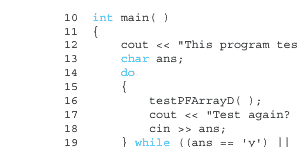

```python
import tensorflow as tf
model = tf.keras.applications.ResNet50()
```

# 程序清单 10.12 PFArrayD 的演示程序（第 2 部分，共 2 部分）

```
22  <The definitions of the member functions for the class PFArrayD go here.>
23 void testPFArrayD ()
24 {
25     int cap;
26     cout << "Enter capacity of this super array: ";
27     cin >> cap;
28     PFArrayD temp(cap);

30     cout << "Enter up to " << cap << " nonnegative numbers.\n";
31     cout << "Place a negative number at the end.\n";

33     double next;
34     cin >> next;
35     while ((next >= 0) && (!temp.full()))
36     {
37         temp.addElement(next);
38         cin >> next;
39     }

41     cout << "You entered the following "
42         << temp.getNumberUsed() << " numbers:\n";
43     int index;
44     int count = temp.getNumberUsed();
45     for (index = 0; index < count; index++)
46         cout << temp[index] << " ";
47     cout << endl;
48     cout << "(plus a sentinel value.)\n";
}
```

# 示例对话

```
This program tests the class PFArrayD.
Enter capacity of this super array: 10
Enter up to 10 nonnegative numbers.
Place a negative number at the end.
1.1
2.2
3.3
4.4
-1
You entered the following 4 numbers:
1.1 2.2 3.3 4.4
(plus a sentinel value.)
Test again? (y/n) n
```

# 示例：一个用于部分填充数组的类

程序清单 10.10 和 10.11 中的 PFArrayD 类是一个用于 double 类型的部分填充数组的类。如程序清单 10.12 中的演示程序所示，PFArrayD 类的对象可以像普通数组一样使用方括号访问，但同时该对象也会自动跟踪数组中有多少部分正在使用中。因此，它的功能就像一个部分填充的数组。成员函数 getNumberUsed 返回已使用的数组位置数量，因此可以像下面的示例代码那样在 for 循环中使用它：

```
PFArrayD stuff(cap); //cap is an int variable.
<some code to fill object stuff with elements.>
for (int index = 0; index < stuff.getNumberUsed(); index++)
    cout << stuff[index] << " ";
```

PFArrayD 类的对象有一个动态数组作为成员变量。这个成员变量数组存储元素。动态数组成员变量实际上是一个指针变量。在每个构造函数中，该成员变量被设置为指向一个动态数组。还有两个 int 类型的成员变量：成员变量 capacity 记录动态数组的大小，成员变量 used 记录到目前为止已填充的数组位置数量。按照部分填充数组的惯例，元素必须按顺序填充，先放入位置 0，然后是 1，再是 2，依此类推。

PFArrayD 类的对象可以用作 double 类型的部分填充数组。与普通的 double 数组或动态 double 数组相比，它有一些优点。与标准数组不同，如果使用了非法的数组索引，该数组会给出错误消息。此外，PFArrayD 类的对象不需要额外的 int 变量来跟踪数组使用了多少。（你可能会反驳说：“确实有这样的 int 变量。它是一个成员变量。”然而，该成员变量是实现中的私有成员变量，使用 PFArrayD 类的程序员永远不需要知道那个成员变量。）

PFArrayD 类的对象仅用于存储 double 类型的值。当我们在第 16 章讨论模板时，你将看到将定义转换为适用于任何类型的模板类很容易，但目前我们只满足于存储 double 类型的元素。

PFArrayD 类定义中的大部分细节只使用了此前介绍过的内容，但有三个新项目：复制构造函数、析构函数和赋值运算符的重载。我们接下来解释重载的赋值运算符，并在接下来的两个小节中讨论复制构造函数和析构函数。

# 示例：（续）

为了理解为什么要重载赋值运算符，假设程序清单 10.10 和 10.11 中省略了赋值运算符的重载。然后假设 list1 和 list2 声明如下：

```
PFArrayD list1(10), list2(20);
```

如果 list2 已经通过调用 list2.addElement 获得了一组数字，那么即使我们假设没有重载赋值运算符，下面的赋值语句仍然是合法的，但它的含义可能不是你期望的那样：

```
list1 = list2;
```

如果没有重载赋值运算符，则会使用默认的预定义赋值运算符。像往常一样，这个预定义的赋值运算符会将 list2 的每个成员变量的值复制到 list1 的相应成员变量中。因此，list1.a 的值被改为与 list2.a 相同，list1.capacity 的值被改为与 list2.capacity 相同，list1.used 的值被改为与 list2.used 相同。但这可能会引起问题。

成员变量 list1.a 包含一个指针，而赋值语句将该指针设置为与 list2.a 相同的值。因此，list1.a 和 list2.a 都指向内存中的同一位置。因此，如果你修改了数组 list1.a，也会修改数组 list2.a。类似地，如果你修改了数组 list2.a，也会修改数组 list1.a。这不是我们通常想要的。我们通常希望赋值运算符生成右侧对象的一个完全独立的副本。解决这个问题的方法是重载赋值运算符，使其在 PFArrayD 类的对象上做我们想要的操作。这就是我们在程序清单 10.10 和 10.11 中所做的。

程序清单 10.11 中重载赋值运算符的定义如下所示：

```
PFArrayD& PFArrayD::operator=(const PFArrayD& rightSide)
{
    if (capacity != rightSide.capacity)
    {
        delete [] a;
        a = new double[rightSide.capacity];
    }
    capacity = rightSide.capacity;
    used = rightSide.used;
    for (int i = 0; i < used; i++)
        a[i] = rightSide.a[i];
    return *this;
}
```

# 示例：（续）

当你重载赋值运算符时，它必须是类的成员，不能是类的友元。这就是为什么前面的定义只有一个参数。例如，考虑以下代码：

```
list1 = list2;
```

在前面的调用中，list1 是调用对象，list2 是成员运算符 = 的参数。

注意，会检查两个对象的容量是否相等。如果不相等，则使用 delete 销毁左侧（即调用对象）的数组成员变量 a，并使用 new 创建一个具有适当容量的新数组。这确保了赋值运算符左侧的对象将拥有正确大小的数组，但也做了另一件非常重要的事情：它确保如果同一个对象出现在赋值运算符的两侧，那么由成员变量 a 命名的数组不会被调用 delete 删除。为了理解为什么这很重要，请考虑以下替代的、更简单的重载赋值运算符定义：

```
//This version has a bug:
PFArrayD& PFArrayD::operator =(const PFArrayD& rightSide)
{
    delete [] a;
    a = new double[rightSide.capacity];
    
    capacity = rightSide.capacity;
    used = rightSide.used;
    for (int i = 0; i < used; i++)
        a[i] = rightSide.a[i];
    
    return *this;
}
```

这个版本在赋值运算符两侧使用同一个对象的赋值中会出问题，比如下面的情况：

```
myList = myList;
```

当执行这个赋值语句时，第一个执行的是

```
delete [] a;
```

但调用对象是 myList，所以这意味着

```
delete [] myList.a;
```

此时指针 myList.a 是未定义的。赋值运算符破坏了对象 myList。这个问题在我们给出的程序清单 10.11 中的重载赋值运算符定义下不会发生。


## 浅拷贝与深拷贝

当定义重载的赋值运算符或拷贝构造函数时，如果你的代码只是简单地将一个对象的成员变量内容复制到另一个对象中，这就被称为浅拷贝。默认的赋值运算符和默认的拷贝构造函数执行的就是浅拷贝。如果没有涉及指针或动态分配的数据，这样做是没问题的。如果某个成员变量命名了一个动态数组（或指向其他动态结构），那么你通常不希望进行浅拷贝。相反，你希望创建每个成员变量所指向内容的副本，以便获得一个独立但相同的副本，如 Display 10.11 所示。这称为深拷贝，这就是我们在重载赋值运算符或定义拷贝构造函数时通常所做的事情。

## 析构函数

动态分配的变量有一个问题：除非你的程序对 delete 做出合适的调用，否则它们不会消失。即使动态变量是使用局部指针变量创建的，并且局部指针变量在函数调用结束时消失，动态变量仍会保留，除非有对 delete 的调用。如果你不通过对 delete 的调用来消除动态变量，动态变量将继续占用内存空间，这可能会导致你的程序因耗尽 freestore 管理器中的所有内存而中止。此外，如果动态变量嵌入在类的实现细节中，使用该类的程序员可能不知道动态变量的存在，也无法期望执行对 delete 的调用。事实上，由于数据成员通常是私有成员，程序员通常无法访问所需的指针变量，因此无法使用这些指针变量调用 delete。为了解决这个问题，C++ 有一种特殊的成员函数，称为析构函数。

析构函数是在类的对象超出作用域时自动调用的成员函数。如果你的程序包含一个局部变量，该变量命名了具有析构函数的类的一个对象，那么当函数调用结束时，析构函数将被自动调用。如果析构函数定义正确，析构函数将调用 delete 以消除对象创建的所有动态分配变量。这可能通过一次对 delete 的调用完成，也可能需要多次对 delete 的调用。你可能还希望析构函数执行其他清理工作，但将内存归还给 freestore 管理器以供重用是析构函数的主要任务。

成员函数 ~PFArrayD 是 Display 10.10 中所示的类 PFArrayD 的析构函数。与构造函数一样，析构函数始终与它所属的类具有相同的名称，但析构函数在其名称开头有波浪号 ~，以便你可以区分它是析构函数而不是构造函数。与构造函数一样，析构函数没有返回值的类型，甚至不是 void 类型。析构函数没有参数。因此，一个类只能有一个析构函数；你不能重载类的析构函数。否则，析构函数就像任何其他成员函数一样定义。

请注意 Display 10.11 中给出的析构函数 ~PFArrayD 的定义。~PFArrayD 调用 delete 以消除由成员指针变量 a 指向的动态分配数组。再看一下 Display 10.12 中所示的示例程序中的函数 testPFArrayD。局部变量 temp 包含一个由成员变量 temp.a 指向的动态数组。如果该类没有析构函数，那么在对 testPFArrayD 的调用结束后，这个动态数组仍会占用内存，即使该动态数组对程序已无用。此外，do-while 循环的每次迭代都会产生另一个无用的动态数组来占用内存。如果循环迭代足够多次，函数调用可能会消耗 freestore 管理器中的所有内存，你的程序就会异常结束。

## 析构函数

类的析构函数是类的成员函数，当类的对象超出作用域时自动调用。除了其他事情之外，这意味着如果类的对象是函数的局部变量，那么在函数调用结束前的最后一个操作中，析构函数会自动调用。析构函数用于消除对象已创建的任何动态分配变量，以便这些动态变量占用的内存被归还给 freestore 管理器以供重用。析构函数也可以执行其他清理任务。析构函数的名称必须由波浪号 ~ 后跟类的名称组成。

## 拷贝构造函数

copy constructor

拷贝构造函数是一个只有一个参数的构造函数，该参数的类型与类相同。该一个参数必须是传引用参数，并且通常该参数前面加上 const 参数修饰符，因此它是一个常量参数。在其他所有方面，拷贝构造函数与任何其他构造函数定义方式相同，也可像其他构造函数一样使用。例如，使用 Display 10.10 中定义的类 PFArrayD 的程序可能包含以下内容：

```
PFArrayD b(20);
for (int i = 0; i < 20; i++)
    b.addElement(i);
PFArrayD temp(b); // Initialized by the copy constructor
```

对象 b 使用具有 int 类型参数的构造函数进行初始化。类似地，对象 temp 由具有一个 const PFArrayD& 类型参数的构造函数初始化。以这种方式使用时，拷贝构造函数就像任何其他构造函数一样使用。

拷贝构造函数应定义为，使被初始化的对象成为其参数的完整、独立的副本。因此，在声明
PFArrayD temp(b);

中，成员变量 temp.a 不应简单地设置为与 b.a 相同的值；那样会产生两个指向同一动态数组的指针。拷贝构造函数的定义显示在 Display 10.11 中。请注意，在拷贝构造函数的定义中，创建了一个新的动态数组，并且一个动态数组的内容被复制到另一个动态数组。因此，在之前的声明中，temp 被初始化为其数组成员变量与 b 的数组成员变量不同。两个数组成员变量 temp.a 和 b.a 包含相同类型为 double 的值，但如果对其中一个数组成员变量进行更改，则不会影响另一个数组成员变量。因此，对 temp 所做的任何更改都不会影响 b。

正如你所见，拷贝构造函数可像任何其他构造函数一样使用。拷贝构造函数也在某些其他情况下自动调用。粗略地说，每当 C++ 需要复制一个对象时，它会自动调用拷贝构造函数。特别是，拷贝构造函数在以下三种情况下自动调用：

- 1. 当类对象正在声明并且由括号中给出的同一类型的另一个对象初始化时。（这是像使用任何其他构造函数一样使用拷贝构造函数的情形。）
- 2. 当函数返回类类型的值时。
- 3. 每当类类型的参数被“插入”用于传值参数时。在这种情况下，拷贝构造函数定义了“插入”的含义。

如果你没有为类定义拷贝构造函数，C++ 会自动为你生成一个拷贝构造函数。然而，这个默认拷贝构造函数只是复制成员变量的内容，对于具有指针或成员变量中动态数据的类来说并不正确。因此，如果你的类成员变量涉及指针、动态数组或其他动态数据，你应该为该类定义拷贝构造函数。

为了说明为什么需要拷贝构造函数，让我们看看如果我们没有为类 PFArrayD 定义拷贝构造函数会发生什么。假设我们没有在类 PFArrayD 的定义中包含拷贝构造函数，并且假设我们在函数定义中使用了传值参数，例如，

```
void showPFArrayD(PFArrayD parameter)
{
    cout << "The first value is: "
         << parameter[0] << endl;
}
```

考虑以下包含函数调用的代码：

```
PFArrayD sample(2);
sample.addElement(5.5);
sample.addElement(6.6);
showPFArrayD(sample);
cout << "After call: " << sample[0] << endl;
```

由于没有为类 PFArrayD 定义拷贝构造函数，该类具有一个默认拷贝构造函数，该构造函数只是复制成员变量的内容。事情随后按如下方式进行。当执行函数调用时，sample 的值被复制到


局部变量参数，因此 `parameter.a` 被赋值为 `sample.a`。但这些都是指针变量，所以在函数调用期间，`parameter.a` 和 `sample.a` 指向同一个动态数组，如下所示：

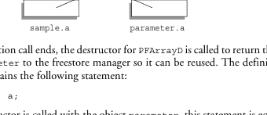

当函数调用结束时，`PFArrayD` 的析构函数被调用，将 `parameter` 使用的内存返回给自由存储管理器，以便它可以被重用。析构函数的定义包含以下语句：

```
delete [] a;
```

由于析构函数是以对象 `parameter` 调用，该语句等价于

```
delete [] parameter.a;
```

这使上图变为：

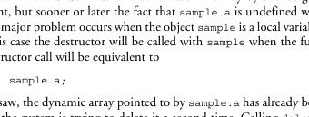

由于 `sample.a` 和 `parameter.a` 指向同一个动态数组，删除 `parameter.a` 等同于删除 `sample.a`。因此，当程序执行到以下语句时，`sample.a` 是未定义的：

```
cout << "After call: " << sample[0] << endl;
```

所以这个 `cout` 语句是未定义的。该 `cout` 语句可能碰巧输出你想要的结果，但迟早 `sample.a` 未定义这一问题会产生麻烦。一个主要问题出现在对象 `sample` 是某个函数中的局部变量时。这种情况下，当函数调用结束时，析构函数会以 `sample` 为对象被调用。该析构调用等价于

```
delete [] sample.a;
```

但是，正如我们刚刚看到的，`sample.a` 指向的动态数组已经被删除过一次，现在系统试图再次删除它。调用两次 `delete` 来删除同一个动态数组（或任何用 `new` 创建的其他变量）可能会导致严重的系统错误，从而使程序崩溃。

这就是如果没有复制构造函数会发生的情况。幸运的是，我们在类 `PFArrayD` 的定义中包含了复制构造函数，因此当执行以下函数调用时，复制构造函数会被自动调用：

```
showPFArrayD(sample);
```

复制构造函数定义了将实参 `sample` 插入到按值传递的参数 `parameter` 中的含义，因此现在的图如下：

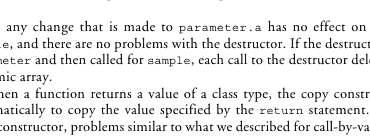

因此，对 `parameter.a` 所做的任何更改都不会影响实参 `sample`，并且析构函数也不会出现问题。如果析构函数先为 `parameter` 调用，然后为 `sample` 调用，那么每次析构调用都会删除不同的动态数组。

返回值

当函数返回类类型的值时，复制构造函数会被自动调用来复制 `return` 语句指定的值。如果没有复制构造函数，就会发生类似于我们在按值传递参数时描述的问题。

何时需要复制构造函数

如果类定义涉及指针以及使用 `new` 运算符动态分配内存，则需要包含复制构造函数。不涉及指针或动态内存分配的类不需要定义复制构造函数。

赋值语句

与你可能预期的相反，当你使用赋值运算符将一个对象赋给另一个对象时，复制构造函数不会被调用。6 然而，如果你不喜欢默认赋值运算符的行为，你可以像我们在显示 10.10 和 10.11 中所做的那样重新定义赋值运算符。

## 复制构造函数

复制构造函数是一种构造函数，它有一个与类类型相同的按引用传递参数。该参数必须是按引用传递参数；通常，该参数也是常量参数——也就是说，它前面有 `const` 参数修饰符。每当函数返回类类型的值时，类的复制构造函数会被自动调用。每当实参被插入到类类型的按值传递参数中时，复制构造函数也会被自动调用。复制构造函数也可以像其他构造函数一样使用。

任何使用指针和 `new` 运算符的类都应该有复制构造函数。

## 三巨头

复制构造函数、`=` 赋值运算符和析构函数被称为三巨头，因为专家们说，如果你需要其中任何一个，你就需要全部三个。如果其中任何一个缺失，编译器会创建它，但创建出来的东西可能不会按你想要的方式工作。因此，自己定义它们是值得的。如果所有成员变量都是预定义类型（如 `int` 和 `double`），编译器为你生成的复制构造函数和重载的 `=` 赋值运算符会正常工作。对于任何使用指针和 `new` 运算符的类，最安全的做法是自己定义复制构造函数、重载的 `=` 和析构函数。

## 自测练习

13. 如果一个类名为 `MyClass`，并且它有一个构造函数，那么这个构造函数叫什么？如果 `MyClass` 有一个析构函数，那么这个析构函数叫什么？

14. 假设你把显示 10.11 中的析构函数定义改为以下内容。显示 10.12 中的示例对话会如何变化？

```
PFArrayD::~PFArrayD()
{
    cout << "\nGood-bye cruel world! The short life of\n" << "this dynamic array is about to end.\n";
    delete [] a;
}
```

15. 以下是类 `PFArrayD` 的复制构造函数定义的第一行。标识符 `PFArrayD` 出现了三次，每次的含义略有不同。在三种情况下，它分别表示什么？

```
PFArrayD::PFArrayD(const PFArrayD& pfaObject)
```

16. 回答关于析构函数的这些问题。

- a. 什么是析构函数，析构函数的名称必须是什么？
- b. 析构函数何时被调用？
- c. 析构函数实际上做什么？
- d. 析构函数应该做什么？

17. a. 仔细解释，为什么当唯一的数据由内置类型组成时，不需要重载赋值运算符？
b. 对于复制构造函数，同 a。
c. 对于析构函数，同 a。

## 章节总结

- 指针是内存地址，因此指针提供了一种通过命名变量在计算机内存中的地址来间接命名变量的方式。
- 动态变量（也称为动态分配变量）是在程序运行期间创建（和销毁）的变量。
- `NULL` 是一个常量，用于表示空指针，它是数字 0。`nullptr` 是 C++11 中引入的较新的常量，用于表示空指针。`nullptr` 与数字 0 不同。
- 动态变量的内存位于计算机内存的一个特殊部分，称为自由存储管理器。当程序用完某个动态变量时，该动态变量使用的内存可以返回给自由存储管理器以供重用；这是通过 `delete` 语句完成的。
- 动态分配数组（也简称为动态数组）是其大小在程序运行时确定的数组。动态数组是作为数组类型的动态变量实现的。
- 析构函数是类的一种特殊成员函数。当类的对象超出作用域时，析构函数会被自动调用。析构函数的主要原因是将内存返回给自由存储管理器，以便内存可以被重用。
- 复制构造函数是一种构造函数，它有一个与类类型相同的单一参数。如果你定义了复制构造函数，那么每当函数返回类类型的值以及每当实参被插入到类类型的按值传递参数中时，它都会被自动调用。任何使用指针和 `new` 运算符的类都应该有复制构造函数。
- 重载赋值运算符时，它必须作为成员运算符进行重载。请务必检查你的重载在重载赋值运算符两侧是同一个变量时是否能正常工作。

## 自测练习答案

- 1. 指针是变量的内存地址。
- 2. `int *p;` // 这声明了一个指向 int 变量的指针。
  `*p = 17;` // 这里，* 是解引用运算符。这会将 //17 赋值给 p 指向的内存位置。
  `void func(int* p);` // 声明 p 为一个指针值 // 参数。
- 3. 10 20
  20 20
  30 30
  如果你把 `*p1 = 30;` 替换为 `*p2 = 30;`，输出将是一样的。


4. 10 20
20 20
30 20

5. 对于粗心大意的人或新手来说，这看起来像是两个指向 int 类型的指针对象，即 int*。不幸的是，`*` 绑定的是标识符，而不是类型（即不是 int）。结果是，这个声明将 intPtr1 声明为 int 指针，而 intPtr2 只是一个普通的 int 变量。

```
6. delete p;
```

```
7. typedef double* NumberPtr;
NumberPtr myPoint;
```

8. new 运算符以类型作为其参数。new 在自由存储管理器上为参数类型的变量分配空间。如果有足够的空间，它返回一个指向该内存的指针。如果没有足够的空间，new 运算符可能返回 NULL，或者可能中止程序，具体取决于你的特定编译器的工作方式。

```
9. typedef char* CharArray;
```

```
10. cout << "Enter 10 integers:\n";
for (int i = 0; i < 10; i++)
    cin >> entry[i];
```

```
11. delete [] entry;
```

12. 0 1 2 3 4 5 6 7 8 9

13. 构造函数命名为 MyClass，与类的名称相同。析构函数命名为 ~MyClass。

14. 对话将变为以下内容：

```
This program tests the class PFArrayD.
Enter capacity of this super array: 10
Enter up to 10 nonnegative numbers.
Place a negative number at the end.
1.1
2.2
3.3
4.4
-1
You entered the following 4 numbers:
1.1 2.2 3.3 4.4
(plus a sentinel value.)
Good-bye cruel world! The short life of
this dynamic array is about to end.
Test again? (y/n) n
```

15. `::` 之前的 `PFArrayD` 是类的名称。`::` 之后的 `PFArrayD` 是成员函数的名称。（记住，构造函数是与类同名的成员函数。）括号内的 `PFArrayD` 是参数 `pfArrayObject` 的类型。

16.
- a. 析构函数是类的成员函数。析构函数的名称总是以波浪号 `~` 开头，后跟类名。
- b. 当类对象超出作用域时，析构函数被调用。
- c. 析构函数实际上执行类作者为其编写的任何操作！
- d. 析构函数*应该*删除由类的构造函数为类分配的动态变量。析构函数也可以执行其他清理任务。

17. 对于赋值运算符 `=` 和复制构造函数，如果数据只有内置类型，复制机制正是你所需要的，因此默认行为就很好。对于析构函数，如果没有进行动态内存分配（没有指针），那么默认的无操作行为同样是你所需要的。

## 编程项目

1. 重新阅读显示 10.9 中的代码。然后，编写一个类 `TwoD`，在其构造函数中使用该显示中的思路实现二维动态 double 数组。你应该有一个类型为指向 double 的指针的私有成员来指向动态数组，以及两个 `int`（或 unsigned int）值，即 `MaxRows` 和 `MaxCols`。

你应该提供一个默认构造函数，在其中选择默认的最大行和列大小，以及一个参数化构造函数，允许程序员设置最大行和列大小。

此外，你应该提供一个 `void` 成员函数，允许设置特定的行和列条目，以及一个成员函数，以 double 类型的值返回特定的行和列条目。

备注：重载 `[ ]` 使其按你期望的方式用于二维数组是困难或不可能的（取决于具体细节）。因此，只需使用普通函数表示法的访问器和修改器函数。

重载 `+` 运算符作为友元函数来相加两个二维数组。此函数应返回一个 `TwoD` 对象，其第 i 行、第 j 列元素是左操作数 `TwoD` 对象的第 i 行、第 j 列元素与右操作数 `TwoD` 对象的第 i 行、第 j 列元素之和。

提供复制构造函数、重载的运算符 `=` 和析构函数。

将不修改数据的类成员函数声明为 `const` 成员。

2. 使用动态数组，实现一个多项式类，支持多项式加法、减法和乘法。

讨论：多项式中的变量除了作为系数的占位符外不起任何作用。因此，多项式唯一有趣的地方在于系数数组和相应的指数。考虑多项式

x*x*x + x + 1

x*x 项在哪里？实现多项式类的一种简单方法是使用 double 类型的数组来存储系数。数组的索引是对应项的指数。如果某项缺失，则其系数为零。

有一些技术可以表示具有许多缺失项的高次多项式。这些技术使用所谓的稀疏矩阵技术。除非你已经知道这些技术，或者学得很快，否则不要使用这些技术。

提供默认构造函数、复制构造函数和一个参数化构造函数，使任意多项式都能被构造。

提供重载的运算符 = 和析构函数。

提供以下操作：
- 多项式 + 多项式，常量 + 多项式，多项式 + 常量，
- 多项式 − 多项式，常量 − 多项式，多项式 − 常量，
- 多项式 * 多项式，常量 * 多项式，多项式 * 常量，

提供按指数索引来赋值和提取系数的函数。

提供一个函数来在 double 类型的值处求多项式的值。

你应该决定将这些函数实现为成员函数、友元函数还是独立函数。

3. 编写一个程序，接受用户输入的一行文本，并检查从文本两端计数的单词数量是否相等。你的程序应使用两个指针工作。“头”指针应设置为字符串中第一个字符的地址，“尾”指针应设置为字符串中最后一个字符的地址（即终止空字符之前的字符）。程序应持续递增“头”指针并持续递减“尾”指针，直到指针到达另一端。在遍历字符串时遇到空白字符，则递增单词计数，并在最后进行比较。

4. 创建一个名为 Subscriber 的类，该类具有三个成员变量：

- `name` — 存储订阅者名称的字符串
- `numChannels` — 跟踪订阅者订阅了多少个频道的整数。
- `channelList` — 用于存储订阅者订阅的频道名称的字符串动态数组。

为类编写适当的构造函数、修改器和访问器函数，以及以下内容：

- 一个从用户输入所有值的函数，包括频道名称列表。此函数必须支持任意数量频道的输入。
- 一个输出名称和所有频道列表的函数。
- 一个将频道数量重置为 0 并将 channelList 重置为空列表的函数。
- 一个重载的赋值运算符，能正确创建频道列表的新副本。
- 一个释放所有已分配内存的析构函数。
编写一个 main 函数来测试你的所有函数。

5. 此编程项目基于编程项目 7.8 和 5.7。编写一个程序，为一个班级学生的作业输出成绩直方图。程序应将每个学生的成绩作为整数输入，并将成绩存储在向量中。应持续输入成绩，直到用户为成绩输入 -1。然后程序应扫描向量并计算直方图。在计算直方图时，成绩的最小值为 0，但你的程序应确定用户输入的最大值。使用动态数组存储直方图。将直方图输出到控制台。

6. 动态数组的一个问题是，一旦使用 new 运算符创建了数组，其大小就无法更改。例如，你可能希望像向量一样从数组中添加或删除条目。此项目要求你创建一个名为 DynamicStringArray 的类，其中包含允许其模拟字符串向量行为的成员函数。

该类应具有以下内容：

- 一个名为 dynamicArray 的私有成员变量，引用 string 类型的动态数组。
- 一个名为 size 的私有成员变量，保存数组中的条目数。
- 一个默认构造函数，将动态数组设置为 nullptr 并将 size 设置为 0。
- 一个返回 size 的函数。
- 一个名为 addEntry 的函数，接受一个字符串作为输入。该函数应创建一个比 dynamicArray 大一个元素的新动态数组，将 dynamicArray 中的所有元素复制到新数组中，将新字符串添加到新数组的末尾，递增 size，删除旧的 dynamicArray，然后将 dynamicArray 设置为新数组。
- 一个名为 deleteEntry 的函数，接受一个字符串作为输入。该函数应在 dynamicArray 中搜索该字符串。如果未找到，则返回 false。如果找到，则创建一个比 dynamicArray 小一个元素的新动态数组。它应将除输入字符串外的所有元素复制到新数组中，删除 dynamicArray，递减 size，并返回 true。


+   - 一个名为 getEntry 的函数，它接受一个整数作为输入，并返回 dynamicArray 中该索引处的字符串。如果索引超出 dynamicArray 的边界，则应返回 nullptr。
+   - 一个复制构造函数，用于复制输入对象的动态数组。
+   - 重载赋值运算符，以便将动态数组正确复制到目标对象。
+   - 一个析构函数，释放分配给动态数组的内存。

将你的类嵌入到一个合适的测试程序中。

7. 完成编程项目 5.19，但这次使用一个名为 Player 的类来存储玩家的姓名和分数。请确保该类包含一个构造函数，用于设置姓名和分数。然后，使用 Player 类的动态数组来存储玩家。开始时，动态数组不存储任何玩家。要添加一名玩家，请创建一个比当前大小大 1 的新动态数组，并将现有玩家和新玩家复制到其中。要删除一名玩家，请创建一个比当前大小小 1 的新动态数组，并将除要删除的玩家以外的所有玩家复制到其中。

8. 创建一个名为 Television 的类，它有以下成员变量：

+   displayType - 一个字符串，存储电视的显示类型。
+   dimension - 一个 double 类型的变量，以英寸为单位存储电视的尺寸。
+   connectivitySupport - 一个字符串动态数组，存储电视支持的不同连接模式。

该类应具有修改器和访问器函数来设置和获取上述成员变量。包含一个构造函数，该构造函数接受 string、double 和 string 数组类型的参数，以赋值这三个成员变量。还应包含一个复制构造函数。

将你的类嵌入到一个测试程序中，该程序读取用户的输入，为电视设置默认的 displayType、dimension 和 connectivitySupport 值。然后，程序应读取电视数量的输入。程序应使用复制构造函数按需创建相应数量的 Television 对象，并询问用户是否需要对任何电视进行自定义。如果需要，则使用修改器方法相应地设置值。

## 分离编译与命名空间

+   11.1 分离编译 506
+   封装回顾 507
+   头文件与实现文件 507
+   示例：`DigitalTime` 类 516
+   提示：可复用组件 517
+   使用 `#ifndef` 517
+   提示：定义其他库 519

+   11.2 命名空间 521
+   命名空间与 using 指令 521
+   创建命名空间 523
+   using 声明 526

+   限定名称 527
+   提示：为命名空间选择名称 529
+   示例：命名空间中的类定义 530
+   未命名命名空间 531
+   陷阱：混淆全局命名空间与未命名命名空间 537
+   提示：使用命名空间替代 static 限定符 538
+   提示：隐藏辅助函数 538
+   嵌套命名空间 539
+   提示：应使用哪种命名空间规范？ 539

## 11 分离编译与命名空间

> 从我的私人图书馆中那些书卷，
> 我珍视它们胜过我的公国。

> 威廉·莎士比亚，《暴风雨》第一幕第二场，1610–1611

## 简介

本章涵盖两个与如何将 C++ 程序组织成独立部分相关的主题。11.1 节讨论分离编译，介绍如何将一个 C++ 程序分布到多个文件中，以便当程序的某些部分发生变化时，只需重新编译这些部分，并且这些独立的部分可以更容易地在其他应用程序中复用。

11.2 节讨论命名空间，命名空间在第 1 章中已简要介绍过。命名空间是一种允许你通过限定名称来指示不同用途，从而重用类、函数和其他项的名称的方式。命名空间将代码划分为若干部分，使不同的部分可以使用相同名称但具有不同含义。它们允许名称具有一种比局部变量更通用的局部含义。

本章可以在书中位置之前提前讲解。本章不涉及第 5 章（数组）、第 9 章（字符串）、第 10 章（指针和动态数组）或第 7 章第 7.3 节（vector）中的任何内容。

## 11.1 分离编译

> 你的“如果”是唯一的和事佬；“如果”中大有美德。

> 威廉·莎士比亚，《皆大欢喜》第五幕第四场，1603

C++ 提供了将程序划分为保存在不同文件中的多个部分的工具，这些部分分别编译，然后在程序运行时（或即将运行时）链接在一起。你可以将类（及其相关函数定义）的定义放在与使用该类的程序不同的文件中。这样，你就可以建立一个类库，使许多程序都能使用同一个类。你可以编译一次该类，然后在许多不同的程序中使用它，就像使用预定义库（如头文件 iostream 和 cstdlib 对应的库）一样。此外，你还可以将类本身定义在两个文件中，使类的功能规范与类的实现方式分离。如果只更改类的实现，则只需重新编译包含类实现的文件。其他文件，包括使用该类的程序文件，不需要更改，甚至不需要重新编译。本节将介绍如何对类进行这种分离编译。

## 封装回顾

封装原则要求将程序员使用类的规范与类的实现细节分离开来。这种分离应该足够彻底，以至于你可以更改实现，而无需更改任何使用该类的程序。确保这种分离的方式可以概括为三条规则：

+   1. 将所有成员变量设为类的私有成员。
+   2. 将类的每个基本操作设为类的公有成员函数、友元函数、普通函数或重载运算符。将类定义与函数和运算符声明（原型）组合在一起。该组合连同其附带的注释称为类的接口。在类给出的注释中，或在函数或运算符声明中，完整说明如何使用每个此类函数或运算符。
+   3. 使基本操作的实现对使用该类的程序员不可用。实现由函数定义和重载运算符定义（以及这些定义所需的任何辅助函数或其他附加项）组成。

在 C++ 中，确保遵循这些规则的最佳方法是将类的接口和实现放在不同的文件中。你可能已经猜到，包含接口的文件通常称为接口文件，包含实现的文件称为实现文件。如何设置、编译和使用这些文件的具体细节会因 C++ 版本而异，但基本方案在所有 C++ 版本中都是相同的。特别是，文件中应包含的内容在所有系统中都是相同的。唯一不同的是编译和链接这些文件所用的命令。下一小节将说明这些文件中应包含的内容。

典型的类具有私有成员变量。私有成员变量（以及私有成员函数）给我们把类的接口和实现放在不同文件中的基本理念带来了一个问题。类的定义中公有部分是类接口的一部分，但私有部分是实现的一部分。这很成问题，因为 C++ 不允许你将类定义拆分到两个文件中。因此，需要某种折衷方案。唯一合理的折衷方案是将整个类定义放在接口文件中。由于使用该类的程序员无法使用类的任何私有成员，私有成员实际上仍然对程序员是隐藏的。

## 头文件与实现文件

清单 11.1 包含一个名为 DigitalTime 的类的接口文件。DigitalTime 是一个值表示一天中时间（如 9:30）的类。只有类的公有成员才是接口的一部分。私有成员属于实现的一部分，即使它们位于接口文件中。标签 private: 警告你这些私有成员不是公共接口的一部分。程序员所需的一切

接口

实现

接口文件和实现文件

私有成员是实现的一部分。


需要了解使用类 `DigitalTime` 的内容在文件开头的注释以及类定义公共部分的注释中进行了说明。如接口文件顶部注释所述，该类使用 24 小时制，因此例如 1:30 P.M. 输入和输出为 13:30。这些以及你为了有效地使用类 `DigitalTime` 必须知道的其他细节都包含在与成员函数一起给出的注释中。

我们将接口放在名为 `dtime.h` 的文件中。后缀 `.h` 表示这是一个**头文件**。接口文件始终是头文件，因此始终以后缀 `.h` 结尾。任何使用类 `DigitalTime` 的程序都必须包含如下的 `include` 指令，其中命名了此文件：

```
#include "dtime.h"
```

当你编写 `include` 指令时，你必须指出头文件是为你提供的预定义头文件还是你自己编写的头文件。如果头文件是预定义的，则以尖括号写出头文件名，如 `<iostream>`。如果头文件是你自己编写的，则以引号写出头文件名，如 `"dtime.h"`。这种区别告诉编译器在哪里查找头文件。如果头文件名在尖括号中，编译器会在你的 C++ 实现中预定义头文件保存的位置查找。如果头文件名在引号中，编译器会在当前目录或系统上程序员定义的头文件保存的位置查找。

任何使用我们的 `DigitalTime` 类的程序都必须包含前面命名头文件 `dtime.h` 的 `include` 指令。这足以让你编译程序，但不足以让你运行程序。为了运行程序，你必须编写（并编译）成员函数和重载运算符的定义。我们已将这些函数和运算符定义放在另一个文件中，称为*实现文件*。虽然大多数编译器并不要求，但传统上接口文件和实现文件使用相同的名称。两个文件确实以不同的后缀结尾。我们已将类的接口放在名为 `dtime.h` 的文件中，并将类的实现放在名为 `dtime.cpp` 的文件中。你为实现文件使用的后缀取决于你的 C++ 版本。使用与你通常用于包含 C++ 程序的文件相同的后缀作为实现文件。 （其他常见后缀是 `.cc` 和 `.cxx` 和 `.hxx`。）我们 `DigitalTime` 类的实现文件在显示 11.2 中给出。在我们解释该类的各个文件如何相互作用之后，我们将返回到显示 11.2 并讨论此实现文件中定义的细节。

## Display 11.1 Interface File for the DigitalTime Class (part 1 of 2)

```
//This is the header file dtime.h. This is the interface for the class
//DigitalTime. Values of this type are times of day. The values are
// input and output in 24-hour notation, as in 9:30 for 9:30 AM and
//14:45 for 2:45 PM.
#include <iostream>
using namespace std;
```

## Display 11.1 Interface File for the DigitalTime Class (part 2 of 2)

```
6 class DigitalTime
7 {
8 public:
9   DigitalTime(int theHour, int theMinute);
10  DigitalTime();
11  //Initializes the time value to 0:00 (which is midnight).
12  int getHour() const;
13  int getMinute() const;
14  void advance(int minutesAdded);
15  //Changes the time to minutesAdded minutes later.
16  void advance(int hoursAdded, int minutesAdded);
17  //Changes the time to hoursAdded hours plus minutesAdded minutes later.
18  friend bool operator ==(const DigitalTime& time1,
19                        const DigitalTime& time2);
20  friend istream& operator >>(istream& ins, DigitalTime& theObject);
21  friend ostream& operator <<(ostream& outs, const DigitalTime&
22                            theObject);
23 private:
24  int hour;
25  int minute;
26  static void readHour(int& theHour);
27  //Precondition: Next input to be read from the keyboard is
28  //a time in notation, like 9:45 or 14:45.
29  //Postcondition: theHour has been set to the hour part of the time.
30  //The colon has been discarded and the next input to be read is the
31  //minute.
32  static void readMinute(int& theMinute);
33  //Reads the minute from the keyboard after readHour has read the
34  //hour.
35  static int digitToInt(char c);
36  //Precondition: c is one of the digits '0' through '9'.
37  //Returns the integer for the digit; for example, digitToInt('3')
38  //returns 3.
39 };
```

这些成员变量和帮助函数是实现的一部分。它们不是接口的一部分。单词 private 表示它们不是公共接口的一部分。

## Display 11.2 Implementation File (part 1 of 3)

```
//This is the implementation file dtime.cpp of the class DigitalTime.
//The interface for the class DigitalTime is in the header file dtime.h.
#include <iostream>
#include <cctype>
#include <cstdlib>
using namespace std;
#include "dtime.h"

//Uses iostream and cstdlib:
DigitalTime::DigitalTime(int theHour, int theMinute)
{
    if (theHour < 0 || theHour > 24 || theMinute < 0 || theMinute > 59)
    {
        cout << "Illegal argument to DigitalTime constructor.";
        exit(1);
    }
    else
    {
        hour = theHour;
        minute = theMinute;
    }
    if (hour == 24)
        hour = 0;//Standardize midnight as 0:00
}
DigitalTime::DigitalTime()
{
    hour = 0;
    minute = 0;
}
int DigitalTime::getHour() const
{
    return hour;
}
int DigitalTime::getMinute() const
{
    return minute;
}
void DigitalTime::advance(int minutesAdded)
{
    int grossMinutes = minute + minutesAdded;
    minute = grossMinutes % 60;
```

## Display 11.2 Implementation File (part 2 of 3)

```
     int hourAdjustment = grossMinutes / 60;
     hour = (hour + hourAdjustment) %24;
 }

 void DigitalTime::advance(int hoursAdded, int minutesAdded)
 {
     hour = (hour + hoursAdded) % 24;
     advance(minutesAdded);
 }

 bool operator ==(const DigitalTime& time1, const DigitalTime& time2)
 {
     return (time1.hour == time2.hour && time1.minute == time2.minute);
 }

 //Uses iostream:
 ostream& operator <<(ostream& outs, const DigitalTime& theObject)
 {
     outs << theObject.hour << ':';
     if (theObject.minute < 10)
         outs << '0';
     outs << theObject.minute;
     return outs;
 }
 
 //Uses iostream:
 istream& operator >>(istream& ins, DigitalTime& theObject)
 {
     DigitalTime::readHour(theObject.hour);
     DigitalTime::readMinute(theObject.minute);
     return ins;
 }

 int DigitalTime::digitToInt(char c)
 {
     return ( static_cast<int>(c) - static_cast<int>('0') );
 }

 //Uses iostream, cctype, and cstdlib:
 void DigitalTime::readMinute(int& theMinute)
 {
     char c1, c2;
     cin >> c1 >> c2;
     if (!isdigit(c1) && isdigit(c2))
     {
         cout << "Error: illegal input to readMinute\n";
```

## Display 11.2 Implementation File (part 3 of 3)

```
     exit(1);
 }
 theMinute = digitToInt(c1)*10 + digitToInt(c2);

 if (theMinute < 0 || theMinute > 59)
 {
     cout << "Error: illegal input to readMinute\n";
     exit(1);
 }
}

//Uses iostream, cctype, and cstdlib;
void DigitalTime::readHour(int& theHour)
{
    char c1, c2;
    cin >> c1 >> c2;
    if ( (!isdigit(c1) && (isdigit(c2) || c2 == ':')) )
    {
        cout << "Error: illegal input to readHour\n";
       exit(1);
   }

   if (isdigit(c1) && c2 == ':')
   {
       theHour = DigitalTime::digitToInt(c1);
   }
   else //(isdigit(c1) && isdigit(c2))
   {
       theHour = DigitalTime::digitToInt(c1)*10
                + DigitalTime::digitToInt(c2);
       cin >> c2; //discard ':'
       if (c2 != ':')
       {
           cout << "Error: illegal input to readHour\n";
           exit(1);
       }
   }

   if (theHour == 24)
       theHour = 0;  //Standardize midnight as 0:00

   if ( theHour < 0 || theHour > 23 )
   {
       cout << "Error: illegal input to readHour\n";
       exit(1);
   }
}
```


任何使用类 DigitalTime 的文件都必须包含包含指令

#include "dtime.h"

因此，实现文件和程序文件都必须包含命名接口文件的包含指令。包含程序的文件（即包含 main 函数的文件）通常称为应用程序文件或驱动文件。显示 11.3 包含一个应用程序文件，其中包含一个非常简单的程序，使用并演示了 DigitalTime 类。

运行此完整程序的确切细节，该程序包含在三个文件中，取决于您使用的系统而有所不同。但是，所有系统的基本细节都相同。您必须编译实现文件，并且必须编译包含 main 函数的应用程序文件。您不会编译接口文件，在本例中为显示 11.1 中给出的文件 dtime.h。您不需要编译接口文件，因为编译器认为此接口文件的内容已包含在另外两个文件中。请回忆一下，实现文件和应用程序文件都包含指令

#include "dtime.h"

编译程序会自动调用一个预处理器，该预处理器读取此包含指令并将其替换为文件 dtime.h 中的文本。因此，编译器会看到 dtime.h 的内容，因此文件 dtime.h 不需要单独编译。（事实上，编译器会看到 dtime.h 的内容两次：编译实现文件时一次，编译应用程序文件时一次。）将文件 dtime.h 复制过来只是一个概念上的复制。编译器会像 dtime.h 的内容被复制到每个具有包含指令的文件中一样行事。但是，如果您在编译后查看这些文件，您只会找到包含指令；您找不到文件 dtime.h 的内容。

一旦实现文件和应用程序文件被编译，您仍然需要连接这些文件，以便它们能够协同工作。这称为链接文件，由一个名为链接器的单独实用程序完成。如何调用链接器的细节取决于您使用的系统。通常，运行程序的命令会自动调用链接器，因此您甚至不需要显式调用链接器。文件链接后，您可以运行程序。

这听起来像是一个复杂的过程，但许多系统都有设施可以自动或半自动地为您管理其中的大部分细节。在任何系统上，这些细节很快就会变得常规。在 UNIX 系统上，这些细节由 make 设施处理。在大多数集成开发环境（IDE）中，这些各种文件被组合成一个项目。

显示 11.1、11.2 和 11.3 包含一个完整的程序，被分成几部分并放在三个不同的文件中。您也可以将这三个文件的内容合并到一个文件中，然后编译并运行这个文件，而不必担心包含指令和链接单独文件的所有麻烦。为什么要使用三个单独的文件？将程序分成单独的文件有几个优点。由于您将 DigitalTime 类的定义和实现放在与应用程序文件分开的文件中，因此您可以在许多不同的程序中使用此类，而无需

应用程序文件或驱动文件

编译和运行程序

链接

链接器

IDE

make

项目

为什么要分离文件？

## 显示 11.3 使用 DigitalTime 类的应用程序文件

```
//This is the application file timedemo.cpp, which demonstrates use of
//DigitalTime.
1 #include <iostream>
2 using namespace std;
3 #include "dtime.h"
4 int main( )
5 {
6     DigitalTime clock, oldClock;
7     cout << "You may write midnight as either 0:00 or 24:00,\n"
8         << "but I will always write it as 0:00.\n"
9        << "Enter the time in 24-hour notation: ";
10    cin >> clock;
11    oldClock = clock;
12    clock.advance(15);
13    if (clock == oldClock)
14        cout << "Something is wrong.";
15    cout << "You entered " << oldClock << endl;
16    cout << "15 minutes later the time will be "
17        << clock << endl;
18    clock.advance(2, 15);
19    cout << "2 hours and 15 minutes after that\n"
20        << "the time will be "
21        << clock << endl;
22    return 0;
23 }
```

## 示例对话

```
You may write midnight as either 0:00 or 24:00,
but I will always write it as 0:00.
Enter the time in 24-hour notation: 11:15
You entered 11:15
15 minutes later the time will be 11:30
2 hours and 15 minutes after that
the time will be 13:45
```

无需在每个程序中重写类的定义。更重要的是，您只需编译一次实现文件，无论有多少程序使用该类。但这只是优点之一。由于您已将 DigitalTime 类的接口与其实现分开，因此您可以更改实现文件，而无需更改使用该类的任何程序。事实上，您甚至不需要重新编译程序。如果您更改实现文件，您只需要重新编译实现文件并重新链接文件。节省一点重新编译时间很好，但更大的优点是避免了

## 在单独文件中定义类：摘要

您可以定义一个类并将类的定义和其成员函数的实现放在单独的文件中。然后您可以将类与使用该类的任何程序分开编译，并且可以在任意数量的不同程序中使用同一个类。类被放置在文件中的方式如下：

+   1. 将类的定义放在称为 *接口* 文件的头文件中。此头文件的名称以 `.h` 结尾。接口文件还包含任何函数和重载运算符的声明（原型），这些函数和重载运算符定义了基本类操作但未列在类定义中。包含解释所有这些函数和运算符如何使用的注释。
+   
+   2. 前述所有函数和重载运算符的定义（无论它们是成员、友元还是其他）都放在另一个称为 *实现* 文件的文件中。此文件必须包含一个 `include` 指令来命名前面描述的接口文件。此 `include` 使用引号括起文件名，如以下示例所示：

```
#include "dtime.h"
```

接口文件和实现文件传统上具有相同的名称，但后缀不同。接口文件以 `.h` 结尾。实现文件以您用于包含完整 C++ 程序的文件的相同后缀结尾。实现文件在用于任何程序之前单独编译。

+   3. 当您想在程序中使用该类时，您将程序的主要部分（以及任何附加函数定义、常量声明等）放在另一个称为 *应用程序文件* 或 *驱动文件* 的文件中。此文件也必须包含一个命名接口文件的 `include` 指令，如以下示例所示：

```
#include "dtime.h"
```

应用程序文件与实现文件分开编译。您可以使用一对接口和实现文件编写任意数量的这些应用程序文件。要运行整个程序，您必须先链接编译应用程序文件产生的目标代码和编译实现文件产生的目标代码。（在某些系统上，链接可能自动或半自动完成。）

如果程序中使用多个类，则只需有多个接口文件和多个实现文件，每个文件单独编译。

无需重写代码。您可以在许多程序中使用该类，而无需在每个程序中编写类代码。您可以更改类的实现，而无需重写使用该类的任何程序的任何部分。

类 `DigitalTime` 的实现细节在以下示例部分中讨论。

## 示例：`DigitalTime` 类

之前我们描述了显示 11.1、11.2 和 11.3 中的文件如何将程序分成三个文件：类 `DigitalTime` 的接口、类 `DigitalTime` 的实现，以及使用该类的应用程序。在这里我们讨论类实现的细节。本示例部分没有新材料，但如果显示 11.2 中的实现细节对您来说还不够完全清楚，本节可能会阐明您的困惑。

大多数实现细节都很直接，但有两点值得评论。请注意，成员函数名称 `advance` 被重载，因此它有两个函数定义。还请注意，重载的提取（输入）运算符 `>>` 的定义使用了两个帮助函数 `readHour` 和 `readMinute`，而这两个帮助函数本身又使用了一个第三个帮助函数 `digitToInt`。让我们讨论这些点。

类 `DigitalTime`（显示 11.1 和 11.2）有两个名为 `advance` 的成员函数。一个版本接受单个参数，即一个整数，表示要推进的时间分钟数。另一个版本接受两个参数，一个用于小时数，一个用于分钟数，并将时间推进该小时数加上该分钟数。请注意，两参数版本的 advance 的定义包含对单参数版本的调用。查看显示 11.2 中给出的两参数版本的定义。首先时间被推进 hoursAdded 小时，然后使用单参数版本的 advance 将时间再推进 minutesAdded 分钟。乍一看这可能很奇怪，但这是完全合法的。两个名为 advance 的函数是两个不同的函数，就编译器而言，它们只是碰巧具有相同的名称。

现在让我们讨论帮助函数。帮助函数 `readHour` 和 `readMinute` 逐字符读取输入，然后将输入转换为整数值并将其放入成员变量 hour 和 minute。函数 `readHour` 和 `readMinute` 逐位读取小时和分钟，因此它们读取的是类型为 char 的值。这比将输入作为 int 值读取要复杂，但它允许我们执行错误检查以查看输入是否正确形成，并在输入格式不正确时发出错误消息。这些帮助函数 `readHour` 和 `readMinute` 使用另一个名为 `digitToInt` 的帮助函数。函数 `digitToInt` 将数字，例如 '3'，转换为数字，例如 3。此函数之前已在本书中给出，作为第 7 章自测练习 3 的答案。


# TIP：可复用组件

一个被开发并编码到单独文件中的类就是一个软件组件，可以在许多不同的程序中一遍又一遍地使用。可复用组件节省了精力，因为它不需要为每个应用程序重新设计、重新编码和重新测试。可复用组件也更可能比只使用一次的组件更可靠。它更可能更可靠有两个原因。首先，如果一个组件将被多次使用，你就可以在它上面花费更多的时间和精力。其次，如果组件被一遍又一遍地使用，它也被一遍又一遍地测试。每一次使用软件组件都是对该组件的一次测试。在各种不同的上下文中使用软件组件多次是发现软件中剩余 bug 的最佳方法之一。

## 使用 #ifndef

我们给你介绍了一种将程序放在三个（或更多）文件中的方法：两个用于每个类的接口和实现，一个用于程序的应用部分。程序可以保存在三个以上的文件中。例如，一个程序可能会使用多个类，每个类都保存在一对单独的文件中。假设你有一个分布在多个文件中的程序，并且不止一个文件对类接口文件有包含指令，例如以下：

```
#include "dtime.h"
```

在这种情况下，你可以有包含其他文件的文件，而这些其他文件又可能包含其他文件。这很容易导致一个文件实际上包含 `dtime.h` 中的定义不止一次。C++ 不允许你定义一个类不止一次，即使重复的定义是相同的。而且，如果你在许多不同的项目中使用同一个头文件，就几乎不可能跟踪是否已经包含类定义不止一次。为避免此问题，C++ 提供了一种标记代码段的方法，意思是“如果你已经包含过一次这个内容，就不要再包含它了。”这样做的方式相当直观，尽管符号看起来可能有点奇怪，直到你习惯为止。我们将通过一个例子来讲解，边走边解释细节。

```
#define
```

下面的指令定义了 DTIME_H：

```
#define DTIME_H
```

这意味着编译器的预处理器将 DTIME_H 放在一个列表上，以表示已看到 DTIME_H。Defined 也许不是最好的词，因为 DTIME_H 并没有被定义为意味着任何东西，只是被放在一个列表上。重要的是，你可以使用另一个指令来测试 DTIME_H 是否已被定义，从而测试一段代码是否已被处理。你可以用 DTIME_H 之外的任何标识符，但你会看到使用哪个标识符有标准约定。

下面的指令测试 DTIME_H 是否已被定义：

```
#ifndef DTIME_H
```

如果 `DTIME_H` 已经定义，那么介于此指令和以下指令第一次出现之间的所有内容将被跳过：

```
#endif
```

一种等价的说法，可能有助于澄清指令的拼写方式，是： 如果 `DTIME_H` 未定义，则编译器处理到下一个 `#endif` 为止的内容。事实就是为什么有 `#ifndef`。这可能会让你想知道是否也有 `#if` 指令以及 `#ifndef` 指令。确实有，并且含义显而易见，但我们不会有使用 `#if` 的机会。

现在考虑以下代码：

```
#ifndef DTIME_H
#define DTIME_H
<a class definition>
#endif
```

如果这段代码在名为 `dtime.h` 的文件中，那么无论你的程序包含多少次

```
#include "dtime.h"
```

类也只会被定义一次。

第一次处理

```
#include "dtime.h"
```

时，标志 `DTIME_H` 被定义并且类被定义。现在，假设编译器再次遇到

```
#include "dtime.h"
```

当第二次处理包含指令时，指令

```
#ifndef DTIME_H
```

表示跳过到

```
#endif
```

为止的所有内容，因此类不会再次被定义。

在显示 11.4 中，我们重写了显示 11.1 中所示的头文件 `dtime.h`，但这次我们使用了这些指令来防止多次定义。使用显示 11.4 中所示的 `dtime.h` 版本，如果一个文件包含以下包含指令不止一次，类 `DigitalTime` 仍将只被定义一次：

```
#include "dtime.h"
```

你可以用其他标识符代替 `DTIME_H`，但通常的约定是使用文件名全部大写并用下划线代替句点。你应该遵循此约定，以便其他人更容易阅读你的代码，并且你不必记住标志名。这样标志名就会自动确定，没有任何需要记住的任意内容。

这些相同的指令也可以用于跳过头文件以外的文件中的代码，但我们不会有使用这些指令的机会，除非在头文件中。

## 显示 11.4 避免类的多次定义

```
//This is the header file dtime.h. This is the interface for the class
//DigitalTime. Values of this type are times of day. The values are
//input and output in 24-hour notation, as in 9:30 for 9:30 AM and
//14:45 for 2:45 PM.

#ifndef DTIME_H
#define DTIME_H

#include <iostream>
using namespace std;

class DigitalTime
{
<The definition of the class DigitalTime is the same as in Display 11.1.>
};

#endif //DTIME_H
```

#ifndef
你可以通过在头文件（接口文件）中使用 #ifndef 来避免类的多次定义（或任何其他内容），如显示 11.4 所示。如果文件被包含多次，只会使用其中一个包含的定义。

# TIP：定义其他库

你不必定义一个类才能使用分离编译。如果你有一组相关的函数想要做成你自己设计的库，你可以将函数声明（原型）和附带的注释放在头文件中，将函数定义放在实现文件中，就像我们为类概述的那样。之后，你就可以像使用放在单独文件中的类一样在程序中使用这个库。

## 自测练习

- 1. 假设你正在定义一个类，然后想在程序中使用这个类。你想按照本章所述将类和程序部分分离到单独的文件中。说明以下每一项应放在接口文件、实现文件还是应用程序文件中。
  
  a. 类的定义
  
  b. 一个函数的声明，该函数将作为类操作，但既不是类的成员也不是类的友元
  
  c. 一个重载运算符的声明，该运算符将作为类操作，但既不是类的成员也不是类的友元
  
  d. 一个函数的定义，该函数将作为类操作，但既不是类的成员也不是类的友元
  
  e. 一个友元函数作为类操作的定义
  
  f. 一个成员函数的定义
  
  g. 一个重载运算符的定义，该运算符将作为类操作，但既不是类的成员也不是类的友元
  
  h. 一个重载运算符的定义，该运算符将作为类操作并且是类的友元
  
  i. 你程序的 main 函数

- 2. 以下哪个文件的文件名以 .h 结尾：类的接口文件、类的实现文件，还是使用该类的应用程序文件？

- 3. 当你将类定义在单独的文件中时，有一个接口文件和一个实现文件。哪个文件需要编译？（两者？都不？只有一个？如果是，哪个？）

- 4. 假设你将类定义在单独的文件中并在程序中使用该类。现在假设你更改了类的实现文件。以下哪个文件，如果有的话，需要重新编译：接口文件、实现文件和/或应用程序文件？

- 5. 假设你想更改显示 11.1 和 11.2 中给出的类 DigitalTime 的实现。具体来说，你想更改记录时间的方式。不是使用两个私有变量 hour 和 minute，你想使用一个（私有）int 变量，称为 minutes。在这个新实现中，私有变量 minutes 将记录自 0:00 时间（即午夜）以来的分钟数。例如，1:30 记录为 90 分钟，因为它是午夜后的 90 分钟。描述你需要如何更改显示 11.1 和 11.2 中显示的接口和实现文件。你不必完整写出文件；只需指出你需要更改哪些项目以及如何以非常概括的方式更改它们。


namespaces? 这会导致错误（根据具体细节不同，可能是编译期错误或运行期错误）。你可以在两个不同的命名空间中定义相同的名称，但如果确实如此，那么你一次只能使用其中一个命名空间。然而，这并不意味着你不能在同一个程序中使用这两个命名空间。你可以在同一个程序中在不同的时间分别使用它们。

例如，假设 NS1 和 NS2 是两个命名空间，并且假设 myFunction 是一个在两个命名空间中都定义了的无参数 void 函数，但在两个命名空间中的定义方式不同。下面的代码就是合法的：

```
{
    using namespace NS1;
    myFunction( );
}
{
    using namespace NS2;
    myFunction( );
}
```

第一次调用将使用命名空间 NS1 中给出的 myFunction 的定义，而第二次调用将使用命名空间 NS2 中给出的 myFunction 的定义。

回想一下，块是一个用大括号 { } 括起来的语句、声明以及可能的其它代码的列表。块开始处的 using 指令仅适用于该块。因此，所示的第一个 using 指令仅适用于第一个块，而第二个 using 指令仅适用于第二个块。通常的说法是，NS1 using 指令的作用域是第一个块，而 NS2 using 指令的作用域是第二个块。请注意，由于这个作用域规则，我们能够在同一个程序中使用两个冲突的命名空间（例如在包含我们刚才讨论的两个块的程序中）。

通常，你会在块的开头放置 using 指令。然而，如果你将其放置在块的更下方，你就需要知道其精确的作用域。using 指令的作用域从其出现的位置运行到块的末尾。你可以在多个块中为同一个命名空间使用 using 指令，因此一个命名空间的整个作用域可能覆盖多个不相连的块。当你在块中使用 using 指令时，通常该块就是函数定义的函数体。

如果你将 using 指令放置在文件的开头（正如我们迄今为止通常所做的那样），那么 using 指令适用于整个文件。using 指令通常应放置在文件的开头附近（或块的开头），但精确的作用域规则是：位于所有块之外的 using 指令的作用域从 using 指令出现的位置到文件末尾。

## Scope Rule for using Directives

> The scope of a using directive is the block in which it appears (more precisely, from the location of the using directive to the end of the block). If the using directive is outside all blocks, then it applies to all of the file that follows the using directive.

## Creating a Namespace

要将一些代码放入命名空间中，你只需将其放在以下形式的命名空间分组中：

```
namespace Name_Space_Name
{
    Some_Code
}
```

当你在代码中包含其中一个分组时，就说你在 Name_Space_Name 命名空间中放置了 Some_Code 中定义的名称。这些名称（实际上是这些名称的定义）可以用 using 指令使之可用

```
using namespace Name_Space_Name;
```

例如，下面取自 Display 11.5 的代码将一个函数声明放在命名空间 Space1 中：

```
namespace Space1
{
    void greeting( );
}
```

如果你再次查看 Display 11.5，你会看到函数 greeting 的定义也被放在命名空间 Space1 中。这是通过以下额外的命名空间分组完成的：

```
namespace Space1
{
    void greeting( )
    {
        cout << "Hello from namespace Space1.\n";
    }
}
```

请注意，对于单个命名空间，你可以有任意数量的这些命名空间分组。在 Display 11.5 中，我们对命名空间 Space1 使用了两个命名空间分组，对命名空间 Space2 使用了另外两个分组。

在命名空间分组内部，每个在命名空间中定义的名称都可用，但这些名称也可以使之对命名空间分组之外的代码可用。例如，命名空间 Space1 中的函数声明和函数定义可以用 using 指令使之可用

```
using namespace Space1
```

正如 Display 11.5 所示。

## Display 11.5 Namespace Demonstration (part 1 of 2)

```
1
2 #include <iostream>
3 using namespace std;
4
4 namespace Space1
5 {
6     void greeting( );
7 }
8
8 namespace Space2
9 {
10     void greeting( );
11 }
12
12 void bigGreeting( );
13 int main()
14 {
15     {
16         using namespace Space2;
17         greeting( );
18     }
19
20     {
21         using namespace Space1;
22         greeting( );
23     }
24
25     bigGreeting( );
26
27     return 0;
28 }
29
29 namespace Space1
30 {
31     void greeting()
32     {
33         cout << "Hello from namespace Space1.\n";
34     }
35 }
36
37 namespace Space2
38 {
39     void greeting()
40     {
41         cout << "Greetings from namespace Space2.\n";
42     }
43 }
```

Names in this block use definitions in namespaces Space2, std, and the global namespace.

Names in this block use definitions in namespaces Space1, std, and the global namespace.

Names out here only use definitions in the namespace std and the global namespace.

## Display 11.5 Namespace Demonstration (part 2 of 2)

```
41 void bigGreeting()
42 {
43   cout << "A Big Global Hello!\n";
44 }
```

Sample Dialogue

> Greetings from namespace Space2.
> Hello from namespace Space1.
> A Big Global Hello!

## Putting a Definition in a Namespace

你通过将其放在命名空间分组中来将名称定义放入命名空间，其语法如下：

```
namespace Namespace_Name
{
    Definition_1
    Definition_2
    .
    .
    Definition_Last
}
```

你可以有多个命名空间分组（甚至在多个文件中），并且所有分组中的所有定义都将在同一个命名空间中。

## Self-Test Exercises

6. 考虑 Display 11.5 中显示的程序。我们能否用 greeting 代替 bigGreeting？

7.  在自测练习 6 中，我们看到你不能向全局命名空间添加以下函数的定义：

void greeting();

你能向全局命名空间添加以下函数声明的定义吗？

void greeting(int howMany);

## using Declarations

本小节描述了一种限定单个名称的方法，以便你只能使命名空间中的一个名称对你的程序可用，而不是使命名空间中的所有名称都可用。我们在第 1 章中见过这种技术，因此这是对我们在第 1 章中所说内容的回顾和扩展。

假设你面临以下情况。你有两个命名空间，NS1 和 NS2。你想使用在 NS1 中定义的函数 fun1 以及在命名空间 NS2 中定义的函数 fun2。问题是 NS1 和 NS2 都定义了一个函数 myFunction。（假设本讨论中的所有函数都不带参数，因此重载不适用。）你不能使用

```
using namespace NS1;
using namespace NS2;
```

这可能会为 myFunction 提供冲突的定义。（如果名称 myFunction 从未被使用，编译器将不会检测到问题并允许你的程序编译和运行。）

你需要一种方法来说明你正在使用 NS1 中的 fun1 和 NS2 中的 fun2，而在命名空间 NS1 和 NS2 中不使用其他任何东西。我们已经在使用一种可以处理这种情况的技术。以下就是你的解决方案：

```
using NS1::fun1;
using NS2::fun2;
```

形式为

```
using Name_Space::One_Name;
```

的限定使来自命名空间 Name_Space 的名称 One_Name（的定义）可用，但不会使 Name_Space 中的任何其他名称可用。这称为 using 声明。

请注意，我们在这些 using 声明中使用的作用域解析运算符 :: 与我们在定义成员函数时使用的作用域解析运算符相同。这两种使用作用域解析运算符的方式具有相似性。例如，Display 11.2 中有以下函数定义：

```
void DigitalTime::advance(int hoursAdded, int minutesAdded)
{
    hour = (hour + hoursAdded)%24;
    advance(minutesAdded);
}
```

在这种情况下，:: 的意思是我们正在为类 DigitalTime 定义函数 advance，而不是在任何其他类中名为 advance 的任何其他函数。类似地，

```
using NS1::fun1;
```

意味着我们正在使用在命名空间 NS1 中定义的名为 fun1 的函数，而不是在任何其他命名空间中对 fun1 的任何其他定义。


using 声明，例如

```
using std::cout;
```

和 using 指令，例如

```
using namespace std;
```

之间的区别有两点。

区别如下：

- 1. using 声明只使命名空间中的一个名字对你的代码可用，而 using 指令使命名空间中的所有名字都可用。

- 2. using 声明将一个名字（如 cout）引入到你的代码中，因此该名字不能被其他用途使用。然而，using 指令只可能引入命名空间中的名字。

第 1 点很明显。第 2 点有一些细微之处。例如，假设命名空间 NS1 和 NS2 都为 myFunction 提供了定义，但没有其他名字冲突。那么以下代码只要在这些指令的作用域内，冲突的名字 myFunction 从未在你的代码中使用，就不会产生问题：

```
using namespace NS1;
```

```
using namespace NS2;
```

另一方面，以下代码即使函数 myFunction 从未被使用，也是非法的：

```
using NS1::myFunction;
```

```
using NS2::myFunction;
```

有时这个细微点很重要，但它不会影响大多数常规代码。因此，我们经常宽松地使用术语 using 指令来指代 using 指令或 using 声明。

## 限定名字

本节介绍一种我们尚未讨论过的限定名字的方法。假设你打算使用命名空间 NS1 中定义的名为 fun1 的名字，但你只打算使用一次（或少量几次）。你可以使用命名空间的名字和作用域解析运算符按如下方式命名该函数（或其他项）：

```
NS1::fun1();
```

这种形式在指定参数类型时经常使用。例如，考虑

```
int getInput(std::istream inputStream)
```

在函数 getInput 中，参数 inputStream 的类型为 istream，其中 istream 定义在 std 命名空间中。如果这是你从 std 命名空间需要的唯一名字（或如果你需要的所有名字都类似地用 std:: 限定），那么你不需要

```
using namespace std;
```

或

```
using std::istream;
```

请注意，你可以在另一个命名空间的 using 指令的作用域内使用 std::istream，即使该命名空间也定义了名字 istream。在这种情况下 std::istream 和 istream 将具有不同的定义。例如，考虑

```
using namespace MySpace;
void someFunction(istream p1, std::istream p2);
```

假设 istream 是在命名空间 MySpace 中定义的类型，则 p1 将具有 MySpace 中定义的 istream 类型，而 p2 将具有 std 命名空间中定义的 istream 类型。

## 自测练习

8. 以下程序的输出是什么？

```
#include <iostream>
using namespace std;

namespace Hello
{
    void message();
}

namespace GoodBye
{
    void message();
}

void message();

int main()
{
    using GoodBye::message;

    {
        using Hello::message;
        message();
        GoodBye::message();
    }

```
```
message();

return 0;
}

void message()
{
    cout << "Global message.\n";
}

namespace Hello
{
    void message()
    {
        cout << "Hello.\n";
    }
}

namespace GoodBye
{
    void message()
    {
        cout << "Good-Bye.\n";
    }
}
```

9. 编写一个名为 wow 的 void 函数的声明（原型）。函数 wow 有两个参数，第一个参数的类型为 speedway 命名空间中定义的 speed，第二个参数的类型为 indy500 命名空间中定义的 speed。

## TIP：为命名空间选择一个名字

最好在你的命名空间的名字中包含你的姓氏或其他唯一字符串，以减少别人使用相同命名空间的可能性。在多个程序员为同一项目编写代码时，重要的是，意图不同的命名空间确实具有不同的名字。否则，你很容易在同一作用域中对同一名字有多个定义。这就是我们在 Display 11.9 中在命名空间 DTimeSavitch 中包含名字 Savitch 的原因。

## EXAMPLE：在命名空间中定义一个类

在 Displays 11.6 和 11.7 中，我们再次重写了类 DigitalTime 的头文件 dtime.h 和实现文件。这次（无意双关），我们将定义放在名为 DTimeSavitch 的命名空间中。请注意，命名空间 DTimeSavitch 跨越了两个文件 dtime.h 和 dtime.cpp。一个命名空间可以跨越多个文件。

如果你按 Displays 11.6 和 11.7 所示重写类 DigitalTime 的定义，那么 Display 11.3 中的应用程序文件需要以某种方式指定命名空间 DTimeSavitch，例如以下方式：

```
using namespace DTimeSavitch;
```

或

```
using DTimeSavitch::DigitalTime;
```

### Display 11.6 将类放在命名空间中（头文件）

```cpp
1  //This is the header file dtime.h.
2  #ifndef DTIME_H
3  #define DTIME_H

4  #include <iostream>
5  using std::istream;
6  using std::ostream;

7  namespace DTimeSavitch
8  {
9
10     
11     class DigitalTime
12     {
13
14         <The definition of the class DigitalTime is the same as in Display 11.1.>
15     };
16 } // DTimeSavitch

17 #endif  //DTIME_H
```

## 无名命名空间

compilation unit

编译单元是一个文件，例如类实现文件，以及文件中 #include 的所有文件，例如类的接口头文件。每个编译单元都有一个无名命名空间。无名命名空间的命名空间分组与任何其他命名空间的写法相同，但不给出名字，如以下示例：

```
namespace
{
    void sampleFunction()
    .
    .
} //unnamed namespace
```

### Display 11.7 将类放在命名空间中（实现文件）

```
1 //This is the implementation file dtime.cpp.
2 #include <iostream>
3 #include <cctype>
4 #include <cstdlib>
5 using std::istringstream;
6 using std::ostream;
7 using std::cout;
8 using std::cin;
9 #include "dtime.h"
10
11 namespace DTimeSavitch
12 {
13
14     <All the function definitions from Display 11.2 go here.>
15
16 } // DTimeSavitch
```

你可以使用单个 using 指令 using namespace std; 代替这四个 using 声明。然而，这四个 using 声明是更可取的风格。

无名命名空间中定义的所有名字都局限于编译单元，因此名字可以在编译单元外部被重用于其他用途。例如，Displays 11.8 和 11.9 显示了类 DigitalTime 的接口和实现文件的重写（最终）版本。请注意，帮助函数 readHour、readMinute 和 digitToInt 都在无名命名空间中；因此它们局限于编译单元。如 Display 11.10 所示，无名命名空间中的名字可以在编译单元外部被重用于其他用途。在 Display 11.10 中，函数名字 readHour 被重用于应用程序中的不同函数。

如果你再次查看 Display 11.9 中的实现文件，你会看到帮助函数 digitToInt、readHour 和 readMinute 在无名命名空间之外被使用，而没有命名空间限定符。无名命名空间中定义的任何名字都可以在编译单元中的任何地方不经限定使用。（当然，这必须是如此，因为无名命名空间没有名字可用于限定其名字。）

### Display 11.8 在命名空间中隐藏帮助函数（接口文件）

```
//This is the header file dtime.h. This is the interface for the class
//DigitalTime. Values of this type are times of day. The values are
//input and output in 24-hour notation, as in 9:30 for 9:30 AM and
//14:45 for 2:45 PM.
#ifndef DTIME_H
#define DTIME_H

#include <iostream>
using std::istream;
using std::ostream;

namespace DTimeSavitch
{
    class DigitalTime
    {
    public:
        DigitalTime(int theHour, int theMinute);

        DigitalTime();
        //Initializes the time value to 0:00 (which is midnight).

        getHour() const;
        getMinute() const;

        void advance(int minutesAdded);
        //Changes the time to minutesAdded minutes later.
        void advance(int hoursAdded, int minutesAdded);
        //Changes the time to hoursAdded hours plus minutesAdded minutes later.

        friend bool operator ==(const DigitalTime& time1,
                                const DigitalTime& time2);
        friend istream& operator >>(istream& ins,
                                    DigitalTime& theObject);
        friend ostream& operator <<(ostream& outs,
                                    const DigitalTime& theObject);
    private:
        int hour;
        int minute;
    };
} //DTimeSavitch
#endif //DTIME_H
```

这是我们对类 DigitalTime 的最终版本。这是最佳版本，也是你应该使用的版本。与此接口一起使用的实现在 Display 11.9 中给出。

请注意，帮助函数在接口文件中没有提及。


## Display 11.9  在命名空间中隐藏辅助函数（实现文件）（第 1 部分，共 3 部分）

//This is the implementation file dtime.cpp of the class DigitalTime.
//The interface for the class DigitalTime is in the header file dtime.h.
#include <iostream>
#include <cctype>
#include <cstdlib>
using std::istream;
using std::ostream;
using std::cout;
using std::cin;
#include "dtime.h"

namespace
{
    int digitToInt(char c)
    {
        return (int(c) - int('0'));
    }

    //Uses iostream, cctype, and cstdlib:
    void readMinute(int& theMinute)
    {
        char c1, c2;
        cin >> c1 >> c2;
        if (!(isdigit(c1) && isdigit(c2)))
        {
            cout << "Error: illegal input to readMinute\n";
            exit(1);
        }

        theMinute = digitToInt(c1)*10 + digitToInt(c2);

        if (theMinute < 0 || theMinute > 59)
        {
            cout << "Error: illegal input to readMinute\n";
            exit(1);
        }
    }

    //Uses iostream, cctype, and cstdlib:
    void readHour(int& theHour)
    {
        char c1, c2;
        cin >> c1 >> c2;
```

> 指定无名命名空间

> 在无名命名空间中定义的名字是局部于编译单元的。因此，这些辅助函数是局部于文件 dtime.cpp 的。

## Display 11.9 在命名空间中隐藏辅助函数（实现文件）（第 2 部分，共 3 部分）

```
40  if ( ! ( isdigit(c1) && isdigit(c2) || c2 == ':' ) )
41  {
42      cout << "Error: illegal input to readHour\n";
43      exit(1);
44  }
45
46  if ( isdigit(c1) && c2 == ':' )
47  {
48      theHour = digitToInt(c1);
49  }
50  else // (isdigit(c1) && isdigit(c2))
51  {
52      theHour = digitToInt(c1)*10 + digitToInt(c2);
53      cin >> c2; // discard '
54      if (c2 != ':')
55      {
56          cout << "Error: illegal input to readHour\n";
57          exit(1);
58      }
59  }
60
59  if (theHour == 24)
60      theHour = 0; // Standardize midnight as 0:00.
61
62  if (theHour < 0 || theHour > 23)
63  {
64      cout << "Error: illegal input to readHour\n";
65      exit(1);
66  }
67  } // unnamed namespace
68
69  namespace DTimeSavitch
70  {
71
72      // Uses iostream:
73      istream& operator >> (istream& ins, DigitalTime& theObject)
74      {
75          readHour(theObject.hour);
76          readMinute(theObject.minute);
77          return ins;
78      }
79      ostream& operator << (ostream& outs, const DigitalTime& theObject)
80      <The body of the function definition is the same as in Display 11.2.>

Within the compilation unit (in this case dtime.cpp), you can use names in the unnamed namespace without qualification.
```

## Display 11.10 在命名空间中隐藏辅助函数（应用程序）（第 2 部分，共 2 部分）

```
14      DigitalTime clock(theHour, 0), oldClock;

16      oldClock = clock;
17      clock.advance(15);
18      if (clock == oldClock)
19          cout << "Something is wrong.";
20      cout << "You entered " << oldClock << endl;
21      cout << "15 minutes later the time will be "
22          << clock << endl;

24      clock.advance(2, 15);
25      cout << "2 hours and 15 minutes after that\n"
26          << "the time will be "
27          << clock << endl;

29      return 0;
30  }
31  
32  void readHour(int& theHour)
33  {
34      using std::cout;
35      using std::cin;

37      cout << "Let's play a time game.\n"
38          << "Let's pretend the hour has just changed.\n"
39          << "You may write midnight as either 0 or 24,\n"
40          << "but, I will always write it as 0.\n"
41          << "Enter the hour as a number (0 to 24): ";
42      cin >> theHour;
```

当我们之前给出这些 using 声明时，它们位于 main 中，因此其作用域为 main。因此，我们需要在 readHour 中重复它们，以便在 readHour 中使用 cin 和 cout。

### Sample Dialogue

```
Let's play a time game.
Let's pretend the hour has just changed.
You may write midnight as either 0 or 24,
but, I will always write it as 0.
Enter the hour as a number (0 to 24): 11
You entered 11:00
15 minutes later the time will be 11:15
2 hours and 15 minutes after that
the time will be 13:30
```

## Unnamed Namespace

你可以使用 *无名命名空间* 使定义局部于编译单元。每个编译单元有一个无名命名空间。无名命名空间中定义的所有标识符都局部于编译单元。你通过将定义放在没有命名空间名称的命名空间分组中来将定义放在无名命名空间中，如下所示：

```
namespace
{
    Definition_1
    Definition_2
    .
    .
    .
    Definition_Last
}
```

你可以在编译单元的任何地方不加限定地使用无名命名空间中的任何名称。参见 Displays 11.8、11.9 和 11.10 以获得完整示例。

## PITFALL: Confusing the Global Namespace and the Unnamed Namespace

不要混淆全局命名空间和无名命名空间。如果你没有将名称定义放在命名空间分组中，那么它就在全局命名空间中。要将名称定义放在无名命名空间中，你必须将其放在以如下方式开始的命名空间分组中，没有名称：

```
namespace
{

```

全局命名空间中的名称和无名命名空间中的名称都可以在没有限定符的情况下访问。然而，全局命名空间中的名称具有全局作用域（所有程序文件），而无名命名空间中的名称是局部于编译单元的。

在编写代码时，这种全局命名空间和无名命名空间的混淆很少发生，因为人们倾向于认为全局命名空间中的名称是“在没有任何命名空间中”，尽管在技术上并不正确。然而，在讨论代码时，这种混淆很容易产生。

## TIP: Unnamed Namespaces Replace the static Qualifier

早期版本的 C++ 使用限定符 static 使名称局部于文件。这种 static 的使用正在被淘汰，你应该改用无名命名空间来使名称局部于编译单元。请注意，这种 static 的使用与使用 static 使类的成员由该类的所有对象共享的使用无关（在第 7 章“Static Members”小节中讨论）。因此，由于 static 有多种含义，淘汰其中一种用法可能是件好事。

## TIP: Hiding Helping Functions

隐藏类的辅助函数有两种好方法。你可以使该函数成为类的私有成员函数，或者你可以将辅助函数放在类的实现文件的无名命名空间中。如果该函数自然需要调用对象，那么它应该被设为私有成员函数。如果它不需要自然的调用对象，你可以将其设为静态成员函数（例如 Displays 11.1 和 11.2 中的 DigitalTime::readHour），或者你可以将其放在实现文件的无名命名空间中（例如 Displays 11.8 和 Displays 11.9 中的 readHour）。

如果辅助函数不需要调用对象，那么将辅助函数放在实现文件的无名命名空间中会使代码更清晰，因为它更好地将接口和实现分离到单独的文件中，并且避免了过多的函数名称限定。例如，请注意在 Display 11.9 中我们可以使用函数名 readHour 而无需限定，因为它在无名命名空间中，而在 Display 11.2 的版本中我们需要使用 DigitalTime::readHour。

值得注意的是无名命名空间如何与 C++ 的规则交互，即同一个命名空间中不能有两个名称的定义。每个编译单元有一个无名命名空间。编译单元很容易重叠。例如，类的实现文件和使用该类的应用程序程序通常都会包含该类的头文件（接口文件）。因此，头文件位于两个编译单元中，从而参与两个无名命名空间。尽管听起来很危险，只要每个编译单元的命名空间单独考虑时是有意义的，通常不会产生问题。例如，如果在头文件的无名命名空间中定义了一个名称，则它不能在实现文件或应用程序文件的无名命名空间中再次定义。因此，避免了名称冲突。


# TIP:（续）

这允许你省略命名空间中存在但未使用的名称。这样可以避免潜在的名称冲突。此外，它很好地记录了你使用的名称，而且不会像总是使用 `theSpace::f` 形式记号限定名称那样混乱。

如果你的文件结构使得不同位置使用不同的命名空间，有时最好将 using 指令和 using 声明放在块中，例如函数定义的主体，而不是放在文件的开头。

要在命名空间 `S1` 外调用 `sample`，你使用

```
S1::S2::sample();
```

要在命名空间 `S1` 内但在命名空间 `S2` 外调用 `sample`，你使用

```
S2::sample();
```

或者，你也可以使用合适的 using 指令。

# 自测练习

+   10. 如果你用以下两个 using 指令替换 Display 11.10 中的四个 `using` 声明
+   
+   ```cpp
+   using std::cout;
+   using std::cin;
+   using std::endl;
+   using DTimeSavitch::DigitalTime;
+   ```
+   
+   程序的行为会有所不同吗？
+   
+   ```cpp
+   using namespace std;
+   using namespace DTimeSavitch;
+   ```

+   11. 以下程序产生的输出是什么？
+   
+   ```cpp
+   #include <iostream>
+   using namespace std;
+   namespace Sally
+   {
+       void message();
+   }
+   
+   namespace
+   {
+       void message();
+   }
+   ```

# 自测练习（续）

```
int main()
{
    {
        message();
        using Sally::message;
        message();
    }
    message();
    return 0;
}

namespace Sally
{
    void message()
    {
        cout << "Hello from Sally.\n";
    }
}

namespace
{
    void message()
    {
        cout << "Hello from unnamed.\n";
    }
}
```

12. 以下程序产生的输出是什么？

```
#include <iostream>
using namespace std;

namespace Outer
{
    void message();
    namespace Inner
    {
        void message();
    }
}
int main()
{
    Outer::message();
    Outer::Inner::message();
    using namespace Outer;
    Inner::message();
```

## 1. 项目概况

本项目旨在开发一套基于人工智能的智能文档处理系统，通过光学字符识别（OCR）、自然语言处理（NLP）及深度学习技术，实现各类纸质及电子文档的自动化识别、结构化提取与智能归档。系统将支持多格式文档输入（PDF、图片、Word等），并输出高精度的结构化数据，以提升企业文档管理效率，降低人工成本。

## 2. 技术方案

系统采用模块化架构，核心组件包括：

+   - 文档解析引擎：负责PDF、图片等文件的解析与预处理
+   - OCR识别模块：基于深度学习的中英文文字识别
+   - 信息抽取模块：利用NLP技术提取关键字段与实体
+   - 数据存储层：支持结构化数据入库及全文检索
+   - 管理后台：提供任务调度、监控及可视化报表

## 3. 实施计划

| 阶段 | 时间 | 主要任务 |
|------|------|----------|
| 需求分析 | 第1-2周 | 调研用户需求，明确功能边界 |
| 系统设计 | 第3-4周 | 架构设计、数据库设计、接口定义 |
| 核心开发 | 第5-10周 | 各模块编码与单元测试 |
| 集成测试 | 第11-12周 | 系统联调、性能优化 |
| 试运行 | 第13-14周 | 用户培训、部署上线 |

## 4. 预期成果

+   - 完成一套可用的智能文档处理系统
+   - 文档识别准确率不低于95%
+   - 单页处理时间小于2秒
+   - 提供完整的操作手册及技术文档

+   2. 接口文件的名称以 `.h` 结尾。

+   3. 只有实现文件需要编译。接口文件不需要编译。

+   4. 只有实现文件需要重新编译。你仍然需要重新链接文件。

+   5. 你需要从 Display 11.1 所示的接口文件中删除私有成员变量 hour 和 minute，并用成员变量 minutes（带 s）替换它们。你不需要在接口文件中做其他任何更改。在实现文件中，你需要更改所有构造函数和其他成员函数的定义，以及重载运算符的定义，使其适用于这种新的记录时间方式。（在这种情况下，你不需要更改帮助函数 readHour、readMinute 或 digitToInt 的定义，但对于某些其他类甚至该类的其他实现，这可能不成立。）例如，重载运算符 >> 的定义可以更改为如下所示。

```
istream& operator >> (istream& ins,
                    DigitalTime& theObject)
{
    int inputHour, inputMinute;
    DigitalTime::readHour(inputHour);
    DigitalTime::readMinute(inputMinute);
    theObject.minutes = inputMinute + 60*inputHour;
    return ins;
}
```

你不需要更改使用该类的程序的任何应用程序文件。但是，由于接口文件已更改（实现文件也已更改），你将需要重新编译任何应用程序文件，当然你也需要重新编译实现文件。

+   6. 不会。如果你用 greeting 替换 bitGreeting，你将在全局命名空间中为名称 greeting 提供一个定义。程序中存在这样的部分，在这些部分中，命名空间 Space1 中的所有名称定义和全局命名空间中的所有名称定义同时可用。在程序的这些部分中，将有两个不同的定义

```cpp
void greeting();
```

+   7. 是的。额外的定义不会引起任何问题，因为重载总是允许的。例如，当命名空间 Space1 和全局命名空间可用时，函数名 greeting 将被重载。自我测试练习 6 中的问题在于函数名 greeting 有时会存在两个具有相同参数列表的定义。

+   8.

```text
Hello
Good-Bye
Good-Bye
```

```
9. void wow(speedway::speed s1, indy500::speed s2);
```

10. 程序的行为将完全相同。然而，大多数权威人士更喜欢使用 using 声明，就像我们在 Display 11.10 中所做的那样。请注意，使用任一方式，仍然有两个不同的名为 readHour 的函数。Display 11.10 中的那个与 Display 11.9 中未命名命名空间中定义的那个不同。

```
11. Hello from unnamed.
Hello from Sally.
Hello from unnamed.
```

```
12. Outer.
Inner.
Inner.
```

# 编程项目

+   1. 本练习旨在说明命名空间和在你的开发环境中进行分离编译。你应该使用本课程中常规使用的开发环境来完成此练习。在文件 f.h 中，放置在命名空间 A 中 void f() 的声明。在文件 g.h 中，放置在命名空间 A 中 void g() 的声明。在文件 f.cpp 和 g.cpp 中，分别放置 void f() 和 void g() 的定义。将 void f() 和 void g() 的定义放在命名空间 A 中。函数可以做任何你想要的事情，但为了跟踪执行情况，包含类似 cout << "Function_Name called" << endl; 的内容，其中 Function_Name 是特定函数的名字。在另一个文件 main.cpp 中，放置你的 main 函数，#include 最少的集合文件以提供对命名空间 A 中名称的访问。在你的 main 函数中调用函数 f 然后 g。使用你的开发环境编译、链接并执行。为了提供对命名空间中名称的访问，你可以使用局部 using 声明，例如 using std::cout; 或使用局部 using 指令，例如 using namespace std; 在块内，或使用命名空间名称限定名称，例如 std::cout。你不得使用全局命名空间指令，例如以下不在块中并适用于整个文件的内容：using namespace std; 当然你必须处理命名空间 A 和函数名 f 和 g，以及可能 std 和 cout。完成此操作后，写一份一页的说明，介绍如何在你的环境中创建和使用命名空间和分离编译。

+   2. 获取 Displays 11.10、10.11 和 10.12 中的 PFArrayD 类和演示程序的源代码。修改此程序以使用命名空间和分离编译。将类定义和其他函数声明

放在一个文件中。将实现放在单独的文件中。将命名空间定义分布在两个文件中。将演示程序放在第三个文件中。为了提供对命名空间中名称的访问，你可以使用局部 using 声明，例如

```
using std::cout;
```

或使用局部 using 指令，例如

```
using namespace std;
```

在块内，或使用命名空间名称限定名称，例如 std::cout。你不得使用全局命名空间指令，例如以下不在块中并适用于整个文件的内容：

```
using namespace std;
```

# 3. 扩展第 7 章中的编程项目 7.1，其中你实现了 RainbowColor 类，通过将类定义和实现放在命名空间中，然后提供对命名空间中名称的访问。测试你的代码。为了提供对命名空间中名称的访问，你可以使用局部 using 声明，例如

```
using std::cout;
```

或使用局部 using 指令，例如

```
using namespace std;
```

在块内，或使用命名空间名称限定名称，例如 std::cout。你不得使用全局命名空间指令，例如以下不在块中并适用于整个文件的内容：

```
using namespace std;
```

# 4. 你希望验证用户对你的系统的凭据。接下来列出的是一个名为 Security 的类，它对用户和密码进行身份验证。（请注意，此示例实际上并不安全。通常密码会被加密或存储在数据库中。）

```
class Security
{
public:
    static int validate(string username, string password);
};
```

```
// 此子程序硬编码有效用户，不被认为是安全的做法。
// 如果凭据无效则返回 0，
// 如果是有效用户则返回 1，
// 如果是有效管理员则返回 2
```

```
int Security::validate(string username, string password)
{
    if ((username=="abbott") && (password=="monday")) return 1;
    if ((username=="costello") && (password=="tuesday")) return 2;
    return 0;
}
```


将此类拆分为两个文件，一个文件包含头文件 `Security.h`，另一个文件包含实现 `Security.cpp`。

接下来，创建另外两个使用 Security 类的类，通过包含头文件。第一个类应命名为 `Administrator`，并包含一个名为 `Login` 的函数，如果给定的用户名和密码具有管理员权限，则返回 true。第二个类应命名为 `User`，并包含一个名为 `Login` 的函数，如果给定的用户名和密码具有用户或管理员权限，则返回 true。

User 和 Administrator 类都应拆分为头文件和实现的单独文件。

最后，编写一个 `main` 函数，调用 User 和 Administrator 类的 `Login` 函数以测试它们是否正常工作。main 函数应放在单独的文件中。确保使用 `#ifndef` 指令以确保没有头文件被包含多次。

+   5. 本编程项目探讨了无名命名空间的工作原理。列出了用于执行用户名和密码输入验证的程序片段。输入和验证用户名的代码与输入和验证密码的代码位于不同的文件中。

文件头 `user.cpp`：

```
namespace Authenticate
{
    void inputUserName( )
    {
        do
        {
            cout << "Enter your username (8 letters only)" << endl;
            cin >> username;
        } while (!isValid( ));
    }

    string getUserName( )
    {
        return username;
    }
}
```

在无名命名空间中定义 username 变量和 `isValid( )` 函数，以便代码可以编译。`isValid( )` 函数应返回 `true`，如果 username 包含恰好八个字母。为此代码生成适当的头文件。

对文件 password.cpp 重复相同的步骤，将 password 变量和 isValid( ) 函数放在无名命名空间中。在这种情况下，isValid( ) 函数应返回 true，如果输入的密码至少有八个字符并且至少包含一个非字母：

文件头 password.cpp：

```
namespace Authenticate
{
    void inputPassword( )
    {
        do
        {
            cout << "Enter your password (at least 8 characters " <<
            "and at least one non-letter)" << endl;
            cin >> password;
        } while (!isValid());
    }
    string getPassword( )
    {
        return password;
    }
}
```

此时，你应该有两个名为 isValid( ) 的函数，每个函数都在不同的无名命名空间中。将以下 main 函数放在适当的位置。程序应编译并运行。

```
int main()
{
    inputUserName( );
    inputPassword( );
    cout << "Your username is " << getUserName( ) <<
    " and your password is: " <<
    getPassword( ) << endl;
    return 0;
}
```

使用多个无效的用户名和密码测试程序。

## Streams and File I/O 12


## 12.1 I/O STREAMS 551

File I/O 551

Pitfall: Restrictions on Stream Variables 556

Appending to a File 556

Tip: Another Syntax for Opening a File 558

Tip: Check That a File Was Opened Successfully 560

Character I/O 562

Checking for the End of a File 563

## 12.2 TOOLS FOR STREAM I/O 567

File Names as Input 567

Formatting Output with Stream Functions 568

Manipulators 572

Saving Flag Settings 573

More Output Stream Member Functions 574

Example: Cleaning Up a File Format 576

Example: Editing a Text File 578

## 12.3 STREAM HIERARCHIES: A PREVIEW OF INHERITANCE 581

Inheritance among Stream Classes 581

Example: Another newLine Function 583

Parsing Strings with the stringstream Class 587

## 12.4 RANDOM ACCESS TO FILES 590

## 12.1  I/O Streams

> > *Good Heavens! For more than forty years I have been speaking prose\n> without knowing it.*\n>\n> — MOLIÈRE, *Le Bourgeois Gentilhomme*, Act II, Scene 4. Paris: October 14, 1670

一个 **stream** 是字符（或其他类型数据）的流动。如果流动进入你的程序，则该流称为 **input stream**。如果流动流出你的程序，则该流称为 **output stream**。如果输入流来自键盘，则你的程序将从键盘获取输入。如果输入流来自文件，则你的程序将从该文件获取输入。同样，输出流可以到屏幕或到文件。

虽然你可能没有意识到，但你已经在程序中使用了流。你已经使用的 cin 是一个连接到键盘的输入流，而 cout 是一个连接到屏幕的输出流。只要你的程序包含命名头文件 `<iostream>` 的 include 指令以及 std 命名空间的 using 指令，这两个流就会自动可用于你的程序。你可以定义其他来自文件或到文件的流；一旦定义了它们，你就可以在程序中使用它们，就像使用流 cin 和 cout 一样。例如，假设你的程序定义了一个名为 inStream 的流，它来自某个文件。（我们很快会告诉你如何定义它。）你就可以使用以下内容用此文件中的数字填充名为 theNumber 的 int 变量：

```
int theNumber;
inStream >> theNumber;
```

同样，如果你的程序定义了一个名为 outStream 的输出流，它到另一个文件，那么你就可以将变量 theNumber 的值输出到这个其他文件。以下内容将输出字符串 "theNumber is " 后跟变量 theNumber 的内容到连接到流 outStream 的输出文件：

```
outStream << "theNumber is " << theNumber << endl;
```

一旦流连接到所需的文件，你的程序就可以像使用键盘和屏幕进行 I/O 一样进行文件 I/O。

## File I/O

本章中我们用于 I/O 的文件是文本文件；也就是说，它们与包含你的 C++ 程序的文件是同一种文件。

当你的程序从文件获取输入时，称其为 **reading** 文件；当你的程序向文件发送输出时，称其为 **writing** 文件。读取文件输入还有其他方法，但本小节给出的方法是从头到尾读取文件（或程序在结束前所能读取到的位置）。使用此方法，你的程序不允许备份并再次读取文件中的任何内容。这正是你的程序从键盘获取输入时发生的情况，因此不应显得新奇或陌生。（正如我们将看到的，你的程序可以从文件开头开始读取文件，但这是重新开始，而不是备份。）同样，对于此处介绍的方法，你的程序从文件开头开始将输出写入文件并向前进行。你的程序不允许备份并更改它之前已写入文件中的任何输出。这正是你的程序向屏幕发送输出时发生的情况：你可以向屏幕发送更多输出，但不能备份并更改屏幕输出。通过流将你的程序连接到文件的方式，你可以从文件获取输入到你的程序中，或将输出从你的程序发送到文件中。

要向文件发送输出，你的程序必须首先将文件连接到 ofstream 类的（流）对象。要从文件读取输入，你的程序必须首先将文件连接到 ifstream 类的（流）对象。类 ifstream 和 ofstream 在 <fstream> 库中定义并放在 std 命名空间中。因此，要同时进行文件输入和文件输出，你的程序将包含

```
#include <fstream>
using namespace std;
```

或

```
#include <fstream>
using std::ifstream;
using std::ofstream;
```

流必须像声明任何其他类变量一样声明。因此，你可以按如下方式声明 inStream 为文件的输入流，outStream 为另一个文件的输出流：

```
ifstream inStream;
ofstream outStream;
```

流变量，例如之前声明的 inStream 和 outStream，必须各自连接到一个文件。这称为打开文件，并使用名为 open 的成员函数完成。例如，假设你希望输入流 inStream 连接到名为 infile.txt 的文件。你的程序必须在读取此文件的任何输入之前包含以下内容：

```
inStream.open("infile.txt");
```

你可以在给出文件名时指定路径名（目录或文件夹）。指定路径名的细节在系统之间变化不大，因此请咨询当地专家了解细节（或做一些试错编程）。在我们的示例中，我们将使用简单的文件名，这假设文件与你的程序运行的目录（文件夹）相同。


一旦你声明了一个输入流变量并使用 open 函数将其连接到一个文件，你的程序就可以使用提取运算符 >> 从文件中读取输入，使用输入流变量的方式与使用 cin 相同。例如，下面这段代码从连接到 inStream 的文件中读取两个输入数字，并将它们放入变量 oneNumber 和 anotherNumber 中：

```
int oneNumber, anotherNumber;
inStream >> oneNumber >> anotherNumber;
```

输出流的打开方式与前面描述的输入流相同。例如，下面这段代码声明输出流 outStream 并将其连接到名为 outfile.txt 的文件：

```
ofstream outStream;
outStream.open("outfile.txt");
```

当与类型为 ofstream 的流一起使用时，成员函数 open 会在文件不存在时创建输出文件。如果输出文件已存在，成员函数 open 会丢弃文件的内容，使调用 open 后的输出文件为空。（我们将在本章稍后讨论其他打开文件的方式。）

在调用 open 将文件连接到流 outStream 之后，程序就可以使用插入运算符 << 将输出发送到该文件。例如，下面这段代码将两个字符串以及变量 oneNumber 和 anotherNumber 的内容写入连接到流 outStream 的文件（在本例中为名为 outfile.txt 的文件）：

```
outStream << "oneNumber = " << oneNumber
<< " anotherNumber = " << anotherNumber;
```

## >> 和 << 的重载适用于文件

> 正如我们在第 8 章中指出的，如果你重载了 >> 和 <<，那么这些重载同样适用于文件输入和输出流，就像它们适用于 cin 和 cout 一样。（如果你尚未阅读第 8 章，可以忽略此说明。它将在第 8 章中重复。）

请注意，当你的程序处理文件时，就好像文件有两个名字。一个是操作系统使用的文件的通常名称，即外部文件名。在我们的示例代码中，外部文件名是 infile.txt 和 outfile.txt。外部文件名在某种意义上是文件的“真实名称”。这些外部文件名的拼写约定因系统而异。我们在示例中使用的文件名 infile.txt 和 outfile.txt 可能在你的系统上看起来不像文件名。你应该按照操作系统的约定来命名文件。尽管外部文件名是文件的真实名称，但在程序中通常只使用一次。外部文件名作为参数传递给函数 open，但在文件打开后，文件始终通过命名与其连接的流来引用。因此，在你的程序内部，流名充当文件的第二个名称。

## 文件有两个名字

你的程序使用的每个输入和输出文件都有两个名字。外部文件名是文件的真实名称，但它仅在调用成员函数 open 将文件连接到流时使用。调用 open 之后，你始终使用流名作为文件的名称。

Display 12.1 中的示例程序从一个文件读取三个数字，并将它们的和以及一些文本写入另一个文件。

程序在完成从文件读取输入或向文件发送输出后应关闭每个文件。关闭文件会将流与文件断开。文件通过调用函数 close 来关闭。Display 12.1 中程序的以下行说明了如何使用函数 close：

```
inStream.close( );
outStream.close( );
```

请注意，函数 close 不接受任何参数。如果你的程序正常结束但未关闭文件，系统会自动为你关闭文件。然而，养成关闭文件的习惯至少有两个原因。首先，系统只有在你的程序正常结束时才会为你关闭文件。如果你的程序因错误而异常结束，文件将不会被关闭，并且可能处于损坏状态。如果你的程序在完成对文件的操作后立即关闭文件，则文件损坏的可能性较小。其次，你可能希望你的程序向文件发送输出，然后稍后将该输出读回程序。为此，你的程序应在完成向文件写入后关闭文件，然后使用输入流重新打开文件。（也可以同时打开文件进行输入和输出，但这以略有不同方式完成。）

flush 是一个使用较少但你最终可能需要的成员函数，它是每个输出流的成员。出于效率原因，输出通常会被缓冲——即暂时存储在某处——然后才实际写入文件。成员函数 flush 会刷新输出流，使所有可能已被缓冲的输出都被物理写入文件。调用 close 会自动调用 flush，因此你很少需要使用 flush。flush 的语法由以下示例说明：

```
outStream.flush();
```

## 陷阱：对流变量的限制

你以通常的方式声明流变量（类型为 `ifstream` 或 `ofstream`），但这些变量不能像其他变量那样以某些方式使用。你不能使用赋值语句为流变量赋值。你可以有一个流类型（`ifstream`、`ofstream` 或其他任何流类型）的参数，但它必须是传引用参数。它不能是传值参数。

## 向文件追加

当向文件发送输出时，你的代码必须首先使用成员函数 `open` 打开文件并将其连接到类型为 `ofstream` 的流。我们迄今为止的做法是使用单个文件名字符串参数，这始终会产生一个空文件。如果指定名称的文件已存在，其旧内容将被丢失。还有一种替代方式打开文件，以便你的程序的输出会追加到文件已有的任何数据之后。

要将输出追加到名为 "important.txt" 的文件，你需要使用 open 的双参数版本，如下所示：

```
ofstream outStream;
outStream.open("important.txt", ios::app);
```

如果文件 "important.txt" 不存在，这将创建一个空文件以接收你的程序的输出；如果文件已存在，则你的程序的所有输出都将被追加到文件的末尾，因此文件中的旧数据不会丢失。这在 Display 12.2 中有所说明。

第二个参数 `ios::app` 是类 `ios` 中的一个已定义常量。类 `ios` 定义在 `<iostream>` 库中（也在其他一些流库中）。类 `ios` 的定义放在 `std` 命名空间中，因此以下任一方式都可以使 `ios`（从而 `ios::app`）对你的程序可用：

```
#include <iostream>
using namespace std;
```

或

```
#include <iostream>
using std::ios;
```

### Display 12.1 简单文件输入/输出

```cpp
//Reads three numbers from the file infile.txt, sums the numbers,
//and writes the sum to the file outfile.txt.
#include <fstream>
using std::ifstream;
using std::ofstream;
using std::endl;

int main()
{
    ifstream inStream;
    ofstream outStream;

    inStream.open("infile.txt");
    outStream.open("outfile.txt");

    int first, second, third;
    inStream >> first >> second >> third;
    outStream << "The sum of the first 3\n"
              << " numbers in infile.txt\n"
              << " is " << (first + second + third)
              << endl;

    inStream.close();
    outStream.close();

    return 0;
}
```

Display 12.3 给出了此程序的改进版本。

### 示例对话

没有屏幕输出，也没有键盘输入。

### Infile.txt

_(程序未更改)_

1
2
3
4

### Outfile.txt

_(程序运行后)_

The sum of the first 3
numbers in infile.txt
is 6


## 显示 12.2 向文件追加

```
1 //Appends data to the end of the file alldata.txt.
2 #include <fstream>
3 #include <iostream>
4 using std::ofstream;
5 using std::cout;
6 using std::ios;
7 int main( )
8 {
9     cout << "Opening data.txt for appending.\n";
10    ofstream fout;
11    fout.open("data.txt", ios::app);
12
13    fout << "5 6 pick up sticks.\n"
14        << "7 8 ain't C++ great!\n";
15
16    fout.close( );
17    cout << "End of appending to file.\n";
18
19    return 0;
20 }
```

示例对话

# Data.txt
(程序运行前)

1 2 buckle my shoe.
3 4 shut the door.

# Data.txt
(程序运行后)

1 2 buckle my shoe.
3 4 shut the door.
5 6 pick up sticks.
7 8 ain't C++ great!

# 屏幕输出

Opening data.txt for appending.
End of appending to file

## 向文件追加

如果你想将数据追加到文件中，使其位于文件现有内容之后，请按如下方式打开文件。

## 语法

```
Output_Stream.open(File_Name, ios::app);
```

## 示例

```
ofstream outStream;
outStream.open("important.txt", ios::app);
```

## 提示：打开文件的另一种语法

类 ifstream 和 ofstream 各自都有构造函数，允许你指定文件名，有时还可指定其他参数来打开文件。几个示例将使语法变得清晰。

以下两个语句

```
ifstream inStream;
inStream.open("infile.txt");
```

可以用以下等价行替换：

```
ifstream inStream("infile.txt");
```

以下两个语句

```
ofstream outStream;
outStream.open("outfile.txt");
```

可以用以下等价行替换：

```
ofstream outStream("outfile.txt");
```

作为最后一个示例，以下两行

```
ofstream outStream;
outStream.open("important.txt", ios::app);
```

等价于以下内容：

```
ofstream outStream("important.txt", ios::app);
```

## 提示：检查文件是否成功打开

open 的调用可能因多种原因而失败。例如，如果你尝试打开一个输入文件，但不存在你指定的外部名称的文件，则 open 的调用将失败。另一个例子是，尝试打开输出文件可能会失败，因为文件存在，而你的程序（即你的账户）对该文件没有写权限。当出现这种情况时，你可能不会收到错误消息，你的程序可能会继续执行一些意想不到的操作。因此，你应该始终在 open 的调用后进行测试，以查看 open 的调用是否成功，如果 open 的调用不成功，则结束程序（或采取其他适当措施）。

你可以使用名为 fail 的成员函数来测试流操作是否失败。类 ifstream 和 ofstream 各自都有名为 fail 的成员函数。fail 函数不带参数并返回一个 bool 值。

你应该在每次 open 调用之后立即调用 fail；如果 open 调用失败，fail 函数将返回 true。例如，如果以下 open 调用失败，则程序将输出错误消息并结束；如果调用成功，fail 函数返回 false，程序将继续。

```
inStream.open("stuff.txt");
if (inStream.fail())
{
  cout << "Input file opening failed.\n";
  exit(1);
}
```

显示 12.3 包含显示 12.1 中的程序重写，加入了检查输入和输出文件是否成功打开的测试。它以与显示 12.1 中的程序完全相同的方式处理文件。特别是，假设文件 infile.txt 存在并且具有显示 12.1 中所示的内容，则显示 12.3 中的程序将创建显示 12.1 中所示的 outfile.txt 文件。然而，如果出现问题并且其中一个 open 调用失败，则显示 12.3 中的程序将结束并向屏幕发送适当的错误消息。例如，如果不存在名为 infile.txt 的文件，则 inStream.open 的调用将失败，程序将结束，并且错误消息将被写入屏幕。请注意，我们使用了 cout 来输出错误消息；这是因为我们希望错误消息输出到屏幕，而不是输出到文件。由于此程序使用 cout 输出到屏幕（以及进行文件 I/O），我们已添加了对头文件 <iostream> 的包含指令。（实际上，当你的程序已包含 #include <fstream> 时，你的程序不需要 #include <iostream>，但包含它不会造成问题，并且它提醒你程序除了文件 I/O 外还使用屏幕输出。）

成员函数 fail

## 文件 I/O 语句摘要

在此示例中，输入来自名为 `infile.txt` 的文件，输出发送到名为 `outfile.txt` 的文件。

- 在你的程序文件中放置以下包含指令：
  
  ```cpp
  #include <fstream>   // For file I/O
  #include <iostream>  // For cout
  #include <cstdlib>   // For exit
  ```

添加以下 using 指令（或类似内容）：

```
using std::ifstream;
using std::ofstream;
using std::cout;
using std::endl; //if endl is used.
```

- 为输入流选择一个流名并将其声明为 `ifstream` 类型的变量。为输出文件选择一个流名并将其声明为 `ofstream` 类型。例如，
  
  ```cpp
  ifstream inStream;
  ofstream outStream;
  ```

- 使用成员函数 `open` 并将外部文件名作为参数，将每个流连接到文件。记得使用成员函数 `fail` 来测试 open 调用是否成功。
  
  ```cpp
  inStream.open("infile.txt");
  if (inStream.fail())
  {
      cout << "Input file opening failed.\n";
      exit(1);
  }
  outStream.open("outfile.txt");
  if (outStream.fail())
  {
      cout << "Output file opening failed.\n";
      exit(1);
  }
  ```

- 使用流 `inStream` 从文件 `infile.txt` 获取输入，就像使用 `cin` 从键盘获取输入一样。例如，
  
  ```cpp
  inStream >> someVariable >> someOtherVariable;
  ```

*(continued)*

## 文件 I/O 语句摘要（续）

- 使用流 outStream 将输出发送到文件 outfile.txt，就像使用 cout 将输出发送到屏幕一样。例如，
  
      outStream << "someVariable = "
      << someVariable << endl;

- 使用 close 函数关闭流：
  
      inStream.close();
      outStream.close();

## 自测练习

- 1. 假设你正在编写一个使用名为 fin 的流的程序，该流将连接到输入文件，以及一个名为 fout 的流，该流将连接到输出文件。你如何声明 fin 和 fout？你需要在程序文件中放置什么包含指令，如果有的话？

- 2. 假设你正在继续编写上一练习中讨论的程序，并且你希望你的程序从文件 stuff1.txt 读取输入并将输出发送到文件 stuff2.txt。你需要在程序中放置什么语句以将流 fin 连接到文件 stuff1.txt 并将流 fout 连接到文件 stuff2.txt？务必包含检查以确保打开成功。

- 3. 假设你仍在编写前面两个练习中讨论的同一程序，并且你已达到不再需要从文件 stuff1.txt 获取输入并且不再需要向文件 stuff2.txt 发送输出的点。你如何关闭这些文件？

- 4. 假设你想更改显示 12.1 中的程序，使其将输出发送到屏幕而不是文件 outfile.txt。（输入仍应来自文件 infile.txt。）你需要对程序做哪些更改？

- 5. 程序员已读取文件中的一半行。程序员必须对文件做什么才能再次读取第一行？

## 字符 I/O

第 9 章描述了使用 cin 从键盘进行字符 I/O 以及使用 cout 向屏幕进行字符 I/O。来自文件的字符 I/O 的工作方式与键盘和屏幕的字符 I/O 相同。只需使用连接到文件的输入流代替 cin，或使用连接到文件的输出流代替 cout。特别是，get、getline、putback、


这实际上是下面这四个字符的列表：

`abc 换行符 '\n'`

所示的循环将读取一个 ‘a’ 并将其写入屏幕，然后读取一个 ‘b’ 并将其写入屏幕，接着读取换行符 ‘\n’ 并将其写入屏幕，最后读取一个 ‘c’ 并将其写入屏幕。此时，循环已经读取了文件中的所有字符。然而，`inStream.eof()` 仍然为 false。`inStream.eof()` 的值不会从 false 变为 true，直到程序尝试再读取一个字符。这就是为什么之前的 while 循环以 `inStream.get(next)` 结尾。循环需要额外读取一个字符才能结束循环。

在文件的末尾有一个特殊的文件结束标记。成员函数 `eof` 只有在读取到这个文件结束标记后，才会从 false 变为 true。这就是为什么之前的 while 循环会比你所认为的文件中最后一个字符多读取一个字符。然而，这个文件结束标记并不是一个普通字符，不应像普通字符那样操作。你可以读取这个文件结束标记，但不应再次将其写出。如果你写出了文件结束标记，结果是不可预测的。系统会自动在每个文件末尾放置这个文件结束标记。

更复杂的是，在某些编译器上，`eof` 的实现可能无需读取文件结束标记就会返回 true，因此你可能需要查阅编译器的文档，或者编写一个简短的程序来确定编译器的行为。

## 硬核方式
检测文件
结束

第二种检查文件结束的方法是利用（并使用）这样一个事实：使用提取运算符进行的读取实际上会返回一个布尔值。表达式

```
inStream >> next
```

如果读取成功则返回 true，当你的代码试图读取超出文件末尾的内容时则返回 false。例如，下面代码将读取连接到输入流 `inStream` 的整数文件中的所有数字，并在变量 `sum` 中计算它们的和：

```
double next, sum = 0;
while (inStream >> next)
    sum = sum + next;
cout << "the sum is " << sum << endl;
```

前面的循环看起来可能有点奇怪，因为 `inStream >> next` 从流 `inStream` 中读取一个数字并返回一个布尔值。涉及提取运算符 `>>` 的表达式同时既是一个操作又是一个布尔条件。如果还有另一个数字要输入，那么就会读取该数字并返回布尔值 true，因此循环体将再执行一次。

> 从技术上讲，布尔条件的工作方式是这样的：运算符 `>>` 的返回值是一个输入流引用（`istream&` 或 `ifstream&`），如第 8 章所述。该流引用会自动转换为一个 bool 值。如果流能够提取数据，则结果值为 true，否则为 false。

如果没有更多的数字可读取，则不会输入任何内容，并返回布尔值 false，因此循环结束。在此示例中，输入变量 next 的类型是 double，但这种检查文件结束的方法对于其他数据类型（如 int）也同样适用。

许多 C++ 程序员更喜欢第二种检查文件结束的方法，这似乎是出于文化原因。它常用于 C 语言编程中。此外，根据实现细节的不同，第二种方法可能稍微高效一些。无论如何，无论你是否使用第二种方法，你都需要了解它，以便能够理解其他程序员的代码。

使用 `eof` 成员函数的示例见展示 12.4。

```
//Copies story.txt to numstory.txt,
//but adds a number to the beginning of each line.
//Assumes story.txt is not empty.
#include <fstream>
#include <iostream>
#include <cstdlib>

using std::ifstream;
using std::ofstream;
using std::cout;

int main( )
{
    ifstream fin;
    ofstream fout;

    fin.open("story.txt");
    if (fin.fail( ))
    {
        cout << "Input file opening failed.\n";
        exit(1);
    }

    fout.open("numstory.txt");
    if (fout.fail( ))
    {
        cout << "Output file opening failed.\n";
        exit(1);
    }
}
```

## 展示 12.4  检查文件结束（第 2 部分，共 2 部分）

```
26  char next;
27  int n = 1;
28  fin.get(next);
29  fout << n << " ";
30  while (! fin.eof())
31  {
32      fout << next;
33      if (next == '\n')
34      {
35          n++;
36          fout << n << ' ';
37      }
38      fin.get(next);
39  }
40
41  fin.close();
42  fout.close();
43
44  return 0;
45  }
```

> 注意，循环以一次读取（fin.get）结束。成员函数 fin.eof() 只有在你的程序读取了文件中的最后一个字符后，又尝试再读取一个字符时，才会返回 true。

## 示例对话

> 没有屏幕输出，也没有键盘输入。

## Story.txt
（程序未更改）

```
The little green men had
pointed heads and orange
toes with one long curly
hair on each toe.
```

## Numstory.txt
（程序运行后）

```
1 The little green men had
2 pointed heads and orange
3 toes with one long curly
4 hair on each toe.
```

## 自测练习

6. 假设文件 list.txt 包含所示数据（并假设这些行嵌入在一个包含正确 include 和 using 指令的完整且正确的程序中），执行以下行时会产生什么输出？

## 自测练习（续）

```
ifstream ins;
ins.open("infile.txt");
int count = 0, next;
while (ins >> next)
{
    count++;
    cout << next << endl;
}
ins.close();
cout << count;
```

文件 list.txt 包含以下三个数字（仅此而已）：

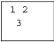

+   7. 编写一个名为 `toScreen` 的 void 函数的定义。函数 `toScreen` 有一个形式参数声明为 `fileStream`，类型为 `ifstream`。该函数的前置条件和后置条件如下。

```
//Precondition: The stream fileStream has been connected
//to a file with a call to the member function open. The
//file contains a list of integers (and nothing else).
//Postcondition: The numbers in the file connected to
//fileStream have been written to the screen one per line.
//(This function does not close the file.)
```

## 12.2  流 I/O 的工具

> 你将在精美的四开页上看到它们，一条整洁的文字小溪蜿蜒穿过页边空白组成的草地。
> 
> — 理查德·布林斯利·谢里丹，《造谣学校》

## 文件名作为输入

到目前为止，我们一直将输入和输出文件的字面文件名写在程序代码中。我们通过将文件名作为调用 open 函数的参数来实现这一点，如下例所示：

```
inStream.open("infile.txt");
```

你也可以改为从键盘读取文件名，如下所示：

```
char fileName[16];
ifstream inStream;
```

cout << "Enter file name (maximum of 15 characters):\n";
 cin >> fileName;
 inStream.open(fileName);

作为 C 字符串

注意，我们的代码将文件名作为 C 字符串读取。成员函数 open 接受的参数是 C 字符串。你不能使用 string 变量作为 open 的参数，也没有预定义的类型转换运算符可以将 string 对象转换为 C 字符串。不过，作为一种替代方案，你可以将文件名读入一个 string 变量，然后使用 string 的成员函数 c_str( ) 为 open 生成相应的 C 字符串值。代码如下：

作为 string 对象

```
string fileName;
ifstream inStream;

cout << "Enter file name:\n";
getline(cin, filename);
inStream.open(fileName.c_str());
```

请注意，当你使用 string 变量作为文件名时，文件名的长度实际上没有限制。³

## 使用流函数格式化输出

你可以使用命令控制输出到文件或屏幕的格式，这些命令决定诸如项目之间的空格数以及小数点后的位数等细节。例如，在第 1 章中，我们给出了以下用于输出金额的“神奇公式”：

```
cout.setf(ios::fixed);
cout.setf(ios::showpoint);
cout.precision(2);
```

现在我们可以解释这些以及其他用于格式化输出的公式了。
首先要说明的是，你可以在任何输出流上使用这些格式化命令。连接到文件的输出流具有与对象 cout 相同的这些成员函数。如果 outStream 是一个文件输出流（类型为 ofstream），你可以以相同的方式格式化输出：

```
outStream.setf(ios::fixed);
outStream.setf(ios::showpoint);
outStream.precision(2);
```

为了解释这个神奇公式，我们将按相反的顺序来考虑这些成员函数。


## precision

每个输出流都有一个名为 precision 的成员函数。当你的程序执行对 precision 的调用时，例如前面针对流 outStream 的调用，那么从那时起，在你的程序中，输出到该流的任何带小数点的数字都将以总共两位有效数字写入，或者根据编译器的编写时间以小数点后两位写入。以下是设置两位有效数字的编译器的一些可能输出：

```
23. 2.2e7 2.2 6.9e-1 0.00069
```

以下是设置小数点后两位数字的编译器的一些可能输出：

```
23.56 2.26e7 2.21 0.69 0.69e-4
```

在本书中，我们假设编译器设置小数点后两位数字。当然，你可以使用 2 以外的参数来获得更多或更少的精度。

## setf
flag

每个输出流都有一个名为 setf 的成员函数，可用于设置某些标志。这些标志是类 ios 中的常量，该类位于 std 命名空间中。当通过对 setf 的调用设置时，这些标志决定输出流的某些行为。以下是使用 outStream 作为调用对象的成员函数 setf 的两个调用：

```
outStream.setf(ios::fixed);
outStream.setf(ios::showpoint);
```

这些标志中的每一个都是以两种可能方式格式化输出的指令。它导致流执行的操作取决于标志。

### ios::fixed

### fixed-point notation

标志 ios::fixed 导致流以所谓的定点记数法输出浮点数，这是一个花哨的说法，指我们通常书写数字的方式。如果标志 ios::fixed 被设置（通过对 setf 的调用），那么输出到该流的所有浮点数（例如 double 类型的数字）都将以普通日常记数法书写，而不是 e-记数法。

### ios::showpoint

标志 ios::showpoint 告诉流始终在浮点数中包含小数点。如果要输出的数字值为 2.0，则它将被输出为 2.0 而不是简单地输出为 2；也就是说，即使小数点后的所有数字都是 0，输出也会包含小数点。一些常见的标志及其导致的操作在 Display 12.5 中描述。

你可以用一次对 setf 的调用设置多个标志。只需用 '|' 符号连接各个标志，如下例所示：

```
outStream.setf(ios::fixed | ios::showpoint | ios::right);
```

> 4| 运算符是按位或。你实际上是在或运算一个指示标志设置的按位掩码，尽管你不必了解这一低级细节。

## Display 12.5 Formatting Flags for setf

| FLAG | MEANING OF SETTING THE FLAG | DEFAULT |
|---|---|---|
| ios::fixed | 浮点数不以 e-记数法书写。（设置此标志会自动取消设置标志 ios::scientific。） | 未设置 |
| ios::scientific | 浮点数以 e-记数法书写。（设置此标志会自动取消设置标志 ios::fixed）如果既未设置 ios::fixed 也未设置 ios::scientific，则系统决定如何输出每个数字。 | 未设置 |
| ios::showpoint | 对于浮点数，始终显示小数点和尾随零。如果未设置，则小数点后全为零的数字可能不带小数点和后面的零输出。 | 未设置 |
| ios::showpos | 在正整数值前输出加号。 | 未设置 |
| ios::right | 如果设置了此标志并且通过对成员函数 width 的调用给出了某个字段宽度值，则下一个输出项将位于 width 指定的空间的右端。换句话说，任何额外的空白都放在输出项之前。（设置此标志会自动取消设置标志 ios::left。） | 已设置 |
| ios::left | 如果设置了此标志并且通过对成员函数 width 的调用给出了某个字段宽度值，则下一个输出项将位于 width 指定的空间的左端。换句话说，任何额外的空白都放在输出项之后。（设置此标志会自动取消设置标志 ios::right。） | 未设置 |
| ios::dec | 整数以十进制（基数 10）记数法输出。 | 已设置 |
| ios::oct | 整数以八进制（基数 8）记数法输出。 | 未设置 |
| ios::hex | 整数以十六进制（基数 16）记数法输出。 | 未设置 |
| ios::uppercase | 在浮点数的科学记数法中使用大写 E 而不是小写 e。十六进制数字使用大写字母输出。 | 未设置 |
| ios::showbase | 显示输出数字的基数（八进制的前导 0，十六进制的前导 0x）。 | 未设置 |

输出流除了 precision 和 setf 之外还有其他成员函数。其中一个非常常用的格式化函数是 width。例如，考虑流 cout 做的以下对 width 的调用：

```
cout << "Start Now";
cout.width(4);
cout << 7 << endl;
```

这段代码将导致以下行出现在屏幕上：

```
Start Now  7
```

此输出在字母 'w' 和数字 7 之间恰好有三个空格。width 函数告诉流在输出一个项目时使用多少个空格。在这种情况下，数字 7 只占用一个空格，而 width 被设置为使用四个空格，因此三个空格为空白。如果输出需要的空间超过你在 width 参数中指定的空间，则会使用所需的额外空间。整个项目始终会被输出，无论你为 width 提供什么参数。

## The Class ios

类 ios 有许多重要的定义常量，例如 ios::app（用于指示你正在向文件追加）和 Display 12.5 中列出的标志。类 ios 在输出流的库中定义，例如 <iostream> 和 <fstream>。使类 ios 以及所有这些常量（所有这些标志）可用于你的代码的一种方法是以下方式：

```
#include <iostream> //or #include <fstream> or both
```

```
using std::ios;
```

任何被设置的标志都可以被取消设置。要取消设置标志，请使用函数 unsetf。例如，以下将导致你的程序停止在输出到流 cout 的正整数上包含加号：

```
cout.unsetf(ios::showpos);
```

当标志被设置时，它会保持设置状态，直到被取消设置。对 precision 的调用的效果会一直保持到精度被重置为止。然而，成员函数 width 的行为不同。对 width 的调用仅适用于下一个输出的项目。如果你想输出 12 个数字，使用四个空格输出每个数字，那么你必须调用 width 12 次。如果这变得麻烦，你可能更喜欢使用下一小节中描述的操纵符 setw。

## Manipulators

操纵符是一个以非传统方式调用的函数。操纵符放在插入运算符 << 之后，就好像操纵符函数调用是要输出的项目一样。与传统函数一样，操纵符可能有也可能没有参数。我们已经见过一个操纵符 endl。本小节讨论两个名为 setw 和 setprecision 的操纵符。

操纵符 setw 和成员函数 width（你已经见过）做完全相同的事情。你通过在插入运算符 << 之后编写 setw 操纵符来调用它，就好像它要发送到输出流一样，这反过来会调用成员函数 width。例如，以下将使用指定的字段宽度输出数字 10、20 和 30：

```
cout << "Start" << setw(4) << 10
    << setw(4) << 20 << setw(6) << 30;
```

前面的语句将产生以下输出：

```
Start  10   20      30
```

（10 前有两个空格，20 前有两个空格，30 前有四个空格。）

与成员函数 width 一样，对 setw 的调用仅适用于下一个输出的项目，但包含多个对 setw 的调用比进行多次对 width 的调用更容易。

操纵符 setprecision 与成员函数 precision（你已经见过）做同样的事情。然而，对 setprecision 的调用是在插入运算符 << 之后编写的，其方式与你调用 setw 操纵符的方式类似。例如，以下将使用对 setprecision 的调用指示的小数点后数字位数输出所列数字：

```
cout.setf(ios::fixed);
cout.setf(ios::showpoint);
cout << "$" << setprecision(2) << 10.3 << endl
    << "$" << 20.5 << endl;
```


或者，你必须使用指定名称和命名空间的其他方法，例如以下：

```
#include <iomanip>
using std::setw;
using std::setprecision;
```

## 保存标志设置

函数不应有不需要的或意外的副作用。例如，用于输出货币金额的函数可能包含

```
cout.setf(ios::fixed);
cout.setf(ios::showpoint);
cout.precision(2);
```

在函数调用结束后，这些设置仍会生效。如果不想产生此类副作用，可以保存并恢复原始设置。

函数 precision 已被重载，因此在不带参数时返回当前的精度设置，以便日后恢复设置。

使用 setf 设置的标志很容易保存和恢复。成员函数 flags 被重载以提供保存然后恢复标志设置的方法。成员函数 cout.flags( ) 返回一个类型为 long 的值，该值编码了所有标志设置。可以使用此 long 值作为 cout.flags 的参数来重置标志。这些技术对文件输出流的工作方式与对 cout 相同。

例如，保存和恢复这些设置的函数可以结构如下：

```
void outputStuff(ofstream& outStream)
{
    int precisionSetting = outStream.precision();
    long flagSettings = outStream.flags();
    outStream.setf(ios::fixed);
    outStream.setf(ios::showpoint);
    outStream.precision(2);
    //Do whatever you want here.
    outStream.precision(precisionSetting);
    outStream.flags(flagSettings);
}
```

另一种恢复设置的方法是

```
cout.setf(0, ios::floatfield);
```

使用这些参数调用成员函数 setf 将恢复默认的 setf 设置。请注意，这些是默认值，而不一定是上次更改前的设置。另请注意，默认设置值是实现相关的。最后请注意，这不会重置精度设置或任何不是用 setf 设置的设置。

## 更多输出流成员函数

Display 12.6 总结了类 ostream 的一些格式化成员函数以及一些操纵符。请记住，要使用操纵符，你需要以下内容（或类似内容）：

```
#include <iomanip>
using namespace std;
```

**Display 12.6  类 ostream 的格式化工具**

| FUNCTION | DESCRIPTION | CORRESPONDING MANIPULATOR |
|---|---|---|
| `setf(ios_Flag)` | 设置如 Display 12.5 中所述的标志 | `setiosflags(ios_Flag)` |
| `unsetf(ios_Flag)` | 取消设置标志 | `resetiosflags(ios_Flag)` |
| `setf(0, ios::fmtflags)` | 恢复默认标志设置 | None |
| `precision(int)` | 设置浮点数输出的精度 | `setprecision(int)` |
| `precision()` | 返回当前精度设置 | None |
| `width(int)` | 设置输出字段宽度，仅适用于下一个输出项 | `setw(int)` |
| `fill(char)` | 指定当输出字段大于输出值时使用的填充字符；默认为空白 | `setfill(char)` |

## 自测练习

- 8. 执行以下行时会产生什么输出？

```
cout << "*";
cout.width(5);
cout << 123
     << "*" << 123 << "*" << endl;
cout << "*" << setw(5) << 123
     << "*" << 123 << "*" << endl;
```

## 自测练习（续）

9. 执行以下行时会产生什么输出？

```
cout << "**" << setw(5) << 123;
cout.setf(ios::left);
cout << "**" << setw(5) << 123;
cout.setf(ios::right);
cout << "**" << setw(5) << 123 << "**" << endl;
```

10. 执行以下行时会产生什么输出？

```
cout << "**" << setw(5) << 123 << "**"
<< 123 << "**" << endl;
cout.setf(ios::showpos);
cout << "**" << setw(5) << 123 << "**"
<< 123 << "**" << endl;
cout.unsetf(ios::showpos);
cout.setf(ios::left);
cout << "**" << setw(5) << 123 << "**"
<< setw(5) << 123 << "**" << endl;
```

11. 执行以下行时会将什么输出发送到文件 stuff.txt？

```
ofstream fout;
fout.open("stuff.txt");
fout << "**" << setw(5) << 123 << "**"
<< 123 << "**" << endl;
fout.setf(ios::showpos);
fout << "**" << setw(5) << 123 << "**"
<< 123 << "**" << endl;
fout.unsetf(ios::showpos);
fout.setf(ios::left);
fout << "**" << setw(5) << 123 << "**"
<< setw(5) << 123 << "**" << endl;
```

12. 执行以下行时会产生什么输出（假设该行嵌入在一个完整且正确的程序中，并具有适当的 include 和 using 指令）？

```
cout << "**" << setw(3) << 12345 << "**" << endl;
```

## **示例：清理文件格式**

Display 12.7 中的程序从文件 `rawdata.txt` 读取输入，并将输出以整洁的格式同时写入屏幕和文件 `neat.txt`。程序将数字从文件 `rawdata.txt` 复制到文件 `neat.txt`，但它使用格式化指令以整洁的方式写入它们。数字每行一个，字段宽度为 12，这意味着每个数字前面都有足够的空格，使空格加上数字占 12 个空格。数字以普通记数法写入；即不以 e-记数法写入。每个数字写入小数点后五位，并带有一个正负号。程序使用一个名为 `makeNeat` 的函数，该函数对输入文件流和输出文件流具有形式参数。

## Display 12.7  格式化输出（第 1 部分，共 3 部分）

//Reads all the numbers in the file rawdata.dat and writes the numbers
//to the screen and to the file neat.dat in a neatly formatted way.
#include <iostream>
#include <fstream>
#include <cstdlib>
#include <iomanip>

using std::ifstream;
using std::ofstream;
using std::cout;
using std::endl;
using std::ios;
using std::setw;

void makeNeat(ifstream& messyFile, ofstream& neatFile,
              int numberAfterDecimalpoint, int fieldWidth);
//Precondition: The streams messyFile and neatFile have been
//connected to two different files. The file named messyFile contains
//only floating-point numbers.
//Postcondition: The numbers in the file connected to messyFile have
//been written to the file connected to the stream
//neatFile. The numbers are written one per line, in fixed-point
//notation (that is, not in e-notation), with numberAfterDecimalpoint
//digits after the decimal point; each number is preceded by a plus or
//minus sign and each number is in a field of width fieldWidth. (This
//function does not close the file.)
int main()

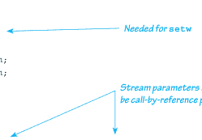

## Display 12.7 格式化输出（第 2 部分，共 3 部分）

```
25 {
26     ifstream fin;
27     ofstream fout;
28
29     fin.open("rawdata.txt");
30     if (fin.fail())
31     {
32         cout << "Input file opening failed.\n";
33         exit(1);
34     }
35
36     fout.open("neat.txt");
37     if (fout.fail())
38     {
39         cout << "Output file opening failed.\n";
40         exit(1);
41     }
42     makeNeat(fin, fout, 5, 12);
43
44     fin.close();
45     fout.close();
46     cout << "End of program.\n";
47     return 0;
48 }
49 //Uses <iostream>, <fstream>, and <iomanip>:
50 void makeNeat(ifstream& messyFile, ofstream& neatFile,
51             int numberAfterDecimalpoint, int fieldWidth)
52 {
53     neatFile.setf(ios::fixed);
54     neatFile.setf(ios::showpoint);
55     neatFile.setf(ios::showpos);
56     neatFile.precision(numberAfterDecimalpoint);
57
58     cout.setf(ios::fixed);
59     cout.setf(ios::showpoint);
60     cout.setf(ios::showpos);
61     cout.precision(numberAfterDecimalpoint);
62
63     double next;
64     while (messyFile >> next)
65     {
66         cout << setw(fieldWidth) << next << endl;
67         neatFile << setw(fieldWidth) << next << endl;
68     }
69 }
```

setf 和 precision 对文件输出流的行为与对 cout 相同。

满足如果有下一个数字可读

对文件流的工作方式与对 cout 相同


## 显示 12.7 格式化输出（第 3 部分，共 3 部分）

示例对话

# Rawdata.txt
（未被程序更改）

```
10.37    -9.89897
2.313   -8.950   15.0

7.33333   92.8765
-1.237568432e2
```

# neat.txt
（程序运行后）

```
+10.37000
-9.89897
+2.31300
-8.95000
+15.00000
+7.33333
+92.87650
-123.75684
```

# 屏幕输出

```
+10.37000
-9.89897
+2.31300
-8.95000
+15.00000
+7.33333
+92.87650
-123.75684
End of program.
```

# 示例：编辑文本文件

这里讨论的程序是文本编辑应用于文件的一个非常简单的例子。此程序可用于以一种相当简单的方式从现有的 C 广告材料自动生成 C++ 广告材料。程序从包含赞美 C 的广告文案的文件中读取输入，并将类似的关于 C++ 的广告文案写入另一个文件。包含 C 广告文案的文件称为 cad.txt，而接收 C++ 广告文案的新文件称为 cppad.txt。程序显示在显示 12.8 中。程序只是读取文件 cad.txt 中的每个字符并将字符复制到文件 cppad.txt 中。每个字符都被原样复制，除了当从输入文件读取大写字母 'C' 时，程序将字符串 "C++" 写入输出文件。该程序假设只要字母 'C' 在输入文件中出现，它就表示 C 编程语言；因此这种更改正是产生更新后的广告文案所需的。

请注意，当程序从输入文件读取字符并将字符写入输出文件时，换行符得以保留。换行符 '\n' 被当作任何其他字符对待。它使用成员函数 get 从输入文件读取，并使用插入运算符 << 写入输出文件。我们必须使用成员函数 get 来读取输入（而不是提取运算符 >>），因为我们希望读取空白字符。

## 显示 12.8 编辑文本文件（第 1 部分，共 2 部分）

```cpp
//Program to create a file called cpplad.txt that is identical
//to the file cad.txt except that all occurrences of 'C' are replaced
//by "C++". Assumes that the uppercase letter 'C' does not occur in
//cad.txt except as the name of the C programming language.
#include <fstream>
#include <iostream>
#include <cstdlib>
using std::ifstream;
using std::ofstream;
using std::cout;

void addPlus(ifstream& inStream, ofstream& outStream)
//Precondition: inStream has been connected to an input file with open.
//outStream has been connected to an output file with open.
//Postcondition: The contents of the file connected to inStream have been
//copied into the file connected to outStream, but with each 'C' replaced
//by "C++". (The files are not closed by this function.)

int main( )
{
    ifstream fin;
    ofstream fout;

    cout << "Begin editing files.\\n";

    fin.open("cad.txt");
    if (fin.fail( ))
    {
        cout << "Input file opening failed.\\n";
        exit(1);
    }

    fout.open("cppad.txt");
    if (fout.fail( ))
    {
        cout << "Output file opening failed.\\n";
        exit(1);
    }
}
```

## 12.3 流层次结构：继承的预览
组织类的一个非常有用的方法是使用“派生自”的关系。当我们说一个类派生自另一个类时，我们的意思是派生类是通过添加特性从另一个类获得的。例如，输入文件流的类是通过添加诸如 open 和 close 之类的额外成员函数从所有输入流的类派生而来的。流 cin 属于所有输入流的类，但不属于输入文件流的类，因为 cin 没有名为 open 和 close 的成员函数。本节介绍派生类的概念，作为思考和组织预定义流类的一个方式。（第 14 章展示了如何使用派生类的思想来定义自己的类。）

### 流类之间的继承

预定义的流 cin 和输入文件流都是输入流。因此在某种意义上它们是相似的。例如，你可以使用提取运算符 >> 与任何一种流一起使用。另一方面，输入文件流可以使用成员函数 open 连接到文件，但流 cin 没有名为 open 的成员函数。输入文件流是一种与 cin 相似但不同的流类型。输入文件流的类型为 ifstream。对象 cin 是类 istream 的对象（拼写时不带 'f'）。类 ifstream 和 istream 是不同但密切相关的类型。类 ifstream 是类 istream 的派生类。让我们看看这意味着什么。

当我们说某个类 D 是某个类 B 的派生类时，这意味着类 D 具有类 B 的所有特性，但它还具有附加特性。例如，任何类型为 istream（不带 'f'）的流都可以使用提取运算符 >>。类 ifstream（带 'f'）是类 istream 的派生类，因此类型为 ifstream 的对象可以使用提取运算符 >>。类 ifstream 的对象具有类 istream 对象的全部属性。特别是，类 ifstream 的对象也是类型为 istream 的对象。

然而，ifstream 具有附加特性，因此你可以用类型为 ifstream 的对象做更多的事情，而不仅仅是类型为 istream 的对象。例如，一个附加特性是类型为 ifstream 的流可以使用函数 open。流 cin 仅为类型 istream 而不是类型 ifstream。你不能使用函数 open 使用 cin。请注意，类 ifstream 和 istream 之间的关系不是对称的。每个类型为 ifstream 的对象都是类型为 istream 的对象（文件输入流是输入流），但类型为 istream 的对象不一定是类型为 ifstream 的对象（对象 cin 是类型为 istream 但不是类型为 ifstream）。

派生类的思想其实很常见。来自日常生活的例子可能有助于使这个思想更清晰。例如，所有敞篷车的类是所有汽车类的派生类。每辆敞篷车都是汽车，但敞篷车不仅仅是一辆汽车。敞篷车是一种具有其他汽车不具备的特殊属性的特殊汽车。如果你有一辆敞篷车，你可以放下车顶使汽车敞开。（你可以说敞篷车具有作为附加特性的“打开”功能。）

如果 D 是类 B 的派生类，则每个类型为 D 的对象也是类型为 B 的对象。敞篷车也是汽车。文件输入流（类 ifstream 的对象）也是输入流（也是类 istream 的对象）。因此，如果我们使用 istream 作为函数参数的类型，而不是使用 ifstream，那么可以为该参数插入更多对象。考虑以下两个函数定义，它们仅在参数类型（和函数名）上有所不同：

```
void twoSumVersion1(ifstream& sourceFile) //ifstream with an 'f'
{
    int n1, n2;
    sourceFile >> n1 >> n2;
    cout << n1 << " + " << n2 << " = " << (n1 + n2) << endl;
}
```

和

```
void twoSumVersion2(istream& sourceFile) //istream without an 'f'
{
    int n1, n2;
    sourceFile >> n1 >> n2;
    cout << n1 << " + " << n2 << " = " << (n1 + n2) << endl;
}
```

对于 twoSumVersion1，参数必须是类型 ifstream。因此如果 fileIn 是一个连接到文件的输入文件流，则

```
twoSumVersion1(fileIn);
```

是合法的，但

```
twoSumVersion1(cin); //ILLEGAL
```

不合法，因为 cin 不是类型 ifstream。对象 cin 只是一个流且仅为类型 istream；cin 不是文件输入流。

函数 twoSumVersion2 更通用。以下两者都是合法的：

```
twoSumVersion2(fileIn);
twoSumVersion2(cin);
```

寓意很清楚：只要可以，就使用 istream 而不是 ifstream 作为参数类型。在选择参数类型时，使用你能用的最通用的类型。（为了做一个现实生活的类比考虑以下：你可能更喜欢拥有一辆敞篷车，但你不会想要一个只能容纳敞篷车的车库。如果朋友借给你一辆轿车呢？你仍然希望能把轿车停进你的车库。）

你不能总是使用参数类型 istream 代替参数类型 ifstream。如果你定义一个参数类型为 istream 的函数，则该参数只能使用 istream 成员函数。特别是，它不能使用函数 open 和 close。如果你不能将对成员函数 open 和 close 的所有调用都放在函数定义之外，则必须使用类型为 ifstream 的参数。

到目前为止，我们讨论了输入流的两个类：istream 及其派生类 ifstream。输出流的情况类似。第 1 章介绍了


输出流 `cout` 和 `cerr` 属于类 `ostream`。本章介绍了完整的输出流，它们属于类 `ofstream`（带 'f'）。类 `ostream` 是所有输出流的类。流 `cout` 和 `cerr` 的类型是 `ostream`，但不是 `ofstream` 类型。与 `cout` 或 `cerr` 相反，输出文件流被声明为 `ofstream` 类型。输出文件流的类 `ofstream` 是类 `ostream` 的派生类。例如，下面的函数将单词 "Hello" 写入作为其参数给出的输出流：

```
void sayHello(ostream& anyOutStream)
{
    anyOutStream << "Hello";
}
```

下面两个调用中的第一个将 "Hello" 写入屏幕；第二个将 "Hello" 写入外部文件名 `afile.txt` 的文件：

```
ofstream fout;
fout.open("afile.txt");
sayHello(cout);
sayHello(fout);
```

请注意，输出文件流的类型是 `ofstream` 也是 `ostream` 类型。派生类通常使用继承和家庭关系的隐喻来讨论。如果类 D 是类 B 的派生类，则类 D 被称为类 B 的子代，而类 B 被称为类 D 的父代。派生类被认为继承了其父类的成员函数。例如，每个敞篷车都从所有汽车的类继承了它有四个轮子的事实，并且每个输入文件流都从所有输入流的类继承了提取运算符 `>>`。这就是为什么派生类的主题通常被称为继承。

## EXAMPLE: Another newLine Function

作为如何使流函数更通用的示例，考虑我们在 Display 9.2 中定义的函数 `newLine`。该函数仅适用于从键盘的输入，即从预定义流 `cin` 的输入。Display 9.2 中的函数 `newLine` 没有参数。接下来我们重写了函数 `newLine`，使其具有类型为 `istream` 的形式参数作为输入流。

```
//Uses <iostream>;
void newLine(istream& inStream)
{
    char symbol;
    do
    {
        inStream.get(symbol);
    } while (symbol != '\n');
}
```

### EXAMPLE: (continued)

现在，假设你的程序包含这个新版本的函数 `newline`。如果你的程序正在从名为 `fin` 的输入流获取输入（它连接到一个输入文件），以下代码将丢弃从输入文件当前正在读取的行上剩余的所有输入：

```
newLine(fin);
```

如果你的程序也从键盘读取一些输入，以下代码将丢弃在键盘上键入的输入行的剩余部分：

```
newLine(cin);
```

如果你的程序只有前面重写的 `newLine` 版本，它接受 `fin` 或 `cin` 这样的流参数，你必须始终给出流名，即使流名是 `cin`。但由于重载，你可以在同一个程序中同时拥有函数 `newLine` 的两个版本：Display 9.2 中给出的无参数版本和我们刚刚定义的带有一个类型为 `istream` 参数的版本。在同时具有 `newLine` 的两个定义的情况下，以下两个调用是等价的：

```
newLine(cin);
```

和

```
newLine();
```

你实际上不需要函数 `newLine` 的两个版本。带有一个类型为 `istream` 参数的版本可以满足你的所有需求。然而，许多程序员发现为键盘输入拥有一个无参数版本很方便，因为键盘输入使用得非常频繁。

拥有两个重载的 `newLine` 函数版本的一种替代方法是使用默认参数（在第 4 章中讨论）。在下面的代码中，我们第三次重写了 `newLine` 函数：

```
//Uses <iostream>
void newLine(istream& inStream = cin)
{
    char symbol;
    do
    {
        inStream.get(symbol);
    } while (symbol != '\n');
}
```

### EXAMPLE: (continued)

如果我们按如下方式调用此函数

```
newLine( );
```

形式参数采用默认参数 `cin`。如果我们按如下方式调用

```
newLine(fin);
```

形式参数采用参数 `fin`。

使用此 `newLine` 函数的一种替代方法是使用我们在第 9 章中讨论的函数 `ignore`。函数 `ignore` 是每个输入文件流以及 `cin` 的成员。

## Making Stream Parameters Versatile

如果你想定义一个函数，它接受输入流作为参数，并且你希望该参数在某些情况下为 `cin`，在其他情况下为输入文件流，那么使用类型为 `istream`（不带 'f'）的形式参数。然而，输入文件流，即使用作类型为 `istream` 的参数，也必须仍声明为类型 `ifstream`（带 'f'）。

类似地，如果你想定义一个函数，它接受输出流作为参数，并且你希望该参数在某些情况下为 `cout`，在其他情况下为输出文件流，那么使用类型为 `ostream` 的形式参数。然而，输出文件流，即使用作类型为 `ostream` 的参数，也必须仍声明为类型 `ofstream`（带 'f'）。你不能打开或关闭类型为 `istream` 或 `ostream` 的流参数。在将它们传递给你的函数之前打开这些对象，并在函数调用后关闭它们。

流类 `istream` 和 `ostream` 在 `iostream` 库中定义并放置在 `std` 命名空间中。使它们可用于你的代码的一种方法是以下方式：

```
#include <iostream>
using std::istream;
using std::ostream;
```

## Self-Test Exercises

+   13. 流 `cin` 的类型是什么？流 `cout` 的类型是什么？

+   14. 定义一个名为 `copyChar` 的函数，它接受一个参数，该参数是输入流。调用时，`copyChar` 将从作为其参数给出的输入流读取一个输入字符，并将该字符写入屏幕。你应该能够使用 `cin` 或输入文件流作为函数 `copyChar` 的参数来调用你的函数。（如果参数是输入文件流，则在调用函数之前流已连接到文件，因此 `copyChar` 不会打开或关闭任何文件。）例如，下面对 `copyChar` 的两个调用中的第一个将从文件 `stuff.txt` 复制一个字符到屏幕，第二个将从键盘复制一个字符到屏幕：

```
ifstream fin;
fin.open("stuff.txt");
copyChar(fin);
copyChar(cin);
```

+   15. 定义一个名为 `copyLine` 的函数，它接受一个参数，该参数是输入流。调用时，`copyLine` 从作为其参数给出的输入流读取一行输入并将该行写入屏幕。你应该能够使用 `cin` 或输入文件流作为函数 `copyLine` 的参数来调用你的函数。（如果参数是输入文件流，则在调用函数之前流已连接到文件，因此 `copyLine` 不会打开或关闭任何文件。）例如，下面对 `copyLine` 的两个调用中的第一个将从文件 `stuff.txt` 复制一行到屏幕，第二个将从键盘复制一行到屏幕：

```
ifstream fin;
fin.open("stuff.txt");
copyLine(fin);
copyLine(cin);
```

+   16. 定义一个名为 `sendLine` 的函数，它接受一个参数，该参数是输出流。调用时，`sendLine` 从键盘读取一行输入并将该行输出到作为其参数给出的输出流。你应该能够使用 `cout` 或输出文件流作为函数 `sendLine` 的参数来调用你的函数。（如果参数是输出文件流，则在调用函数之前流已连接到文件，因此 `sendLine` 不会打开或关闭任何文件。）例如，下面对 `sendLine` 的两个调用中的第一个将从键盘复制一行到文件 `morestuf.txt`，第二个将从键盘复制一行到屏幕：

```
ofstream fout;
fout.open("morestuf.txt");
cout << "Enter 2 lines of input:\n";
sendLine(fout);
sendLine(cout);
```

+   17. 下列陈述是真还是假？如果它是假的，请纠正它。在任何情况下，都要仔细解释它。
+   
+   使用类 `ifstream` 或 `ofstream` 的参数编写的函数可以用 `istream` 或 `ostream` 参数分别调用。


## 使用 stringstream 类解析字符串

我们可以以 stringstream 类为例来了解继承。 该类派生自 iostream 类，而 iostream 类又派生自 istream 类。 stringstream 类允许你使用从 istream 继承的 >> 运算符来操作字符串。 这意味着你可以使用与之前学习处理文件、键盘输入和控制台输出相同的格式来操作字符串。 当你需要从其他数据类型变量创建字符串，或从字符串读取其他数据类型变量时，stringstream 类很有用。 要使用该类，我们首先必须包含它：

```
#include <sstream>
using std::stringstream;
```

接下来创建 stringstream 类型的对象：

```
stringstream ss;
```

如果你想清除并将 stringstream 初始化为空字符串，则使用以下两个指令。 clear 函数是必要的，用于清除可能存储在 stringstream 中的任何错误状态。 str 函数用于将 stringstream 设置为初始字符串。 在以下代码中，我们将 stringstream 对象设置为空白字符串，尽管你可以将其初始化为其他字符串：

```
ss.clear();
ss.str("");
```

要从其他变量创建 stringstream ss，请使用流插入运算符，就像将变量输出到 cout 一样。 变量不会显示到控制台，而是会附加到 stringstream 对象。 例如，给定 int 变量 num 设置为 10 和 char 变量 c 设置为 'x'，以下代码将 "x 10" 插入到 ss 中：

```
ss << c << " " << num;
```

我们可以使用 str() 方法以字符串形式返回 stringstream 的值。

```
string s;
s = ss.str(); // Sets s to the string "x 10"
```

要从字符串中提取变量，请将字符串添加到 stringstream 对象，然后使用流提取运算符，就像从 cin 读取变量一样。 值不是从键盘读取，而是从字符串中读取。 例如，给定 stringstream 变量 ss 设置为 "x 10"，我们可以使用以下代码将变量读回：

// if ss = "x 10" then c is set to 'x' and num is set to 10
ss >> c >> num;
```

在最简单的形式中，你可以使用 stringstream 将单个数值转换为字符串，反之亦然。

Display 12.9 中给出了使用 stringstream 类的示例。 在此示例中，我们从包含一个人姓名和该人分数的字符串开始。 例如，如果 Luigi 有三个分数为 70、100 和 90，则字符串为 "Luigi 70 100 90"。 程序使用 stringstream 流提取运算符读取姓名和每个分数作为整数。 分数相加，计算平均值，然后将姓名和平均值放入字符串中，使用 stringstream 流插入运算符。 在我们的示例中，结果字符串为 "Name: Luigi Average: 86"。

### Display 12.9 Demonstration of the stringstream Class (part 1 of 2)

//Demonstration of the stringstream class. This program takes
//a string with a name followed by scores. It uses a
//stringstream to extract the name as a string, the scores
//as integers, then calculates the average score. The name
//and average are placed into a new string.
#include <iostream>
#include <string>
#include <sstream>

using namespace std;

int main( )
{
    stringstream ss;
    string scores = "Luigi 70 100 90";

    // Clear the stringstream
    ss.str("");
    ss.clear();

    //Put the scores into the stringstream
    ss << scores;

    // Extract the name and average the scores
    string name = "";
    int total = 0, count = 0, average = 0;
    int score;
    ss >> name; //Read the name
    while (ss >> score) // Read until the end of the string
    {
        count++;
        total += score;
    }
    if (count > 0)
    {
        average = total / count;
    }
```

### Display 12.9 Demonstration of the stringstream Class (part 2 of 2)

// Clear the stringstream
ss.clear();
ss.str("");
// Put the name and average into the stringstream
ss << "Name: " << name << " Average: " << average;
// Output as a string
cout << ss.str() << endl;
return 0;
}
```

### Sample Dialogue

```
Name: Luigi Average: 86
```

### Self-Test Exercises

18. Given the statement int num = 10; use the stringstream class to convert num into a string variable named s.

19. Given the statement string s = 10; use the stringstream class to convert s into a int variable named num.

20. The following code is supposed to compute the total from a list of numbers stored in a string. This is accomplished by putting the string into a stringstream and then using the getline function to extract values separated by a comma. Another stringstream object is then used to convert the field from a string to a double. However, the code does not quite calculate the correct total. What is wrong?

```
stringstream ssList, ssNum;
string numbers = "1.1, 1.2, 1.3";

double total = 0;
double num;

ssList.clear();
ssList.str(numbers);

string field;
while (getline(ssList, field, ','))
{
    ssNum.str(field);
    ssNum >> num;
    total += num;
}
cout << total << endl;
```

## 12.4 随机访问文件

*Any time, any where.*

Common response to a challenge for a confrontation

我们在本章前几节讨论的文件顺序访问流，是 C++ 中最常用于文件访问的流。 然而，一些需要对非常大的数据库中的记录进行非常快速访问的应用程序，需要对文件中的特定部分进行某种随机访问。 这种应用程序最好使用专门的数据库软件来完成。 但也许你被要求用 C++ 编写这样的软件包，或者你只是好奇 C++ 中是如何完成这些事情的。 C++ 确实提供了对文件的随机访问，以便你的程序可以从文件中的随机位置读取和写入。 本节简要介绍了对文件的这种随机访问。 这不是关于随机访问文件的完整教程，但会让你知道使用的主要流类名称以及你将遇到的重要问题。

如果你想在 C++ 中同时读取和写入文件，你使用在 `<fstream>` 库中定义的流类 `fstream`。 `fstream` 的定义放在 `std` 命名空间中。

打开文件并将其连接到 `fstream` 类中的流的细节基本上与为 `ifstream` 和 `ofstream` 类讨论的相同，只是 `fstream` 在 open 中有一个第二个参数。 这个第二个参数指定流是用于输入、输出还是同时输入和输出。 例如，一个对名为 "stuff" 的文件同时进行输入和输出的程序可能如下所示开始：

```
```cpp
#include <fstream>
using namespace std;

int main()
{
    fstream rwStream;
    rwStream.open("stuff", ios::in | ios::out);
}
```
```

如果你愿意，可以用以下内容代替前面的最后两行：

```
```cpp
fstream rwStream("stuff", ios::in | ios::out);
```
```

之后，你的程序可以使用流 `fstream` 从文件 "stuff" 读取，也可以使用同一流向文件 "stuff" 写入。 在从读取切换到写入或从写入切换到读取时，无需关闭和重新打开文件。 而且，你可以对文件中的任何位置进行随机读取和写入。 然而，还有其他复杂性。

使用 `fstream` 通过随机访问进行读写时，至少会出现两个复杂性：(1) 你通常使用 `char` 类型或 `char` 数组以字节为单位工作，并且需要自行处理类型转换，以及 (2) 你通常需要在每次读写之前定位一个指针（指示读写开始的位置）。


寻找位置的约束以及用新数据替换文件某一部分的数据意味着大多数此类随机访问 I/O 都是通过读写记录（以结构体或类的形式）来完成的。每次定位指针后都会读取或写入一个记录（或若干个完整的记录）。

每个 fstream 对象都有一个名为 seekp 的成员函数，用于将 put 指针定位到你希望写入（“put”）数据的地址。函数 seekp 接受一个参数，即下一个要写入的第一个字节的地址。文件的第一个字节编号为零。例如，要将连接到 fstream rwStream 的文件中的指针定位到第 1000 个字节，调用方式如下：

```
rwStream.seekp(1000);
```

当然，你需要知道一个记录需要多少字节。sizeof 运算符可用于确定类或结构体的对象所需的字节数。实际上，sizeof 可应用于任何类型、对象或值。它以字节为单位返回其参数的大小。运算符 sizeof 是 C++ 核心语言的一部分，不需要包含指令或 using 指令。一些示例调用如下：

```
sizeof(s) (where s is string s = "Hello;")
sizeof(10)
sizeof(double)
sizeof(MyStruct) (where MyStruct is a defined type)
```

其中每一个都返回一个整数，表示其参数以字节为单位的大小。

要将 put 指针定位到仅包含 MyStruct 类型记录的文件中第 100 个 MyStruct 类型记录处，seekp 的调用为

```
rwStream.seekp(100*sizeof(MyStruct) - 1);
```

成员函数 seekg 用于定位 get 指针，以指示下一个字节的读取（“getting”）将在何处进行。它与 seekp 完全类似。按照我们所示的设置，你可以使用 fstream rwStream 的成员函数 put 和 get 向文件“stuff”写入并从文件“stuff”读取。还有一个成员函数 write 可以写入多个字节，以及一个成员函数 read 可以读取多个字节。

理论上，你现在已经知道足够多的知识来执行随机访问文件 I/O。实际上，这只是其中涉及内容的冰山一角。本节旨在以一种概括的方式让你了解其大致内容。如果你打算进行任何真正的随机访问文件 I/O 编程，你应该查阅一本更高级、更专业的书籍。

## Chapter Summary

- 类型为 ifstream 的流可以通过调用成员函数 open 连接到文件。你的程序随后可以从该文件获取输入。
- 类型为 ofstream 的流可以通过调用成员函数 open 连接到文件。你的程序随后可以将输出发送到该文件。
- 你应该使用成员函数 fail 来检查 open 调用是否成功。
- 流成员函数，例如 width、setf 和 precision，可用于格式化输出。这些输出函数对于连接到屏幕的流 cout 以及连接到文件的输出流的工作方式相同。
- 一个函数可以具有流类型的形式参数，但它们必须是传引用参数。它们不能是传值参数。类型 ifstream 可用于输入文件流，类型 ofstream 可用于输出文件流。（请参阅下一个摘要点，了解其他类型可能性。）
- 如果你使用 istream（不带“f”拼写）作为输入流参数的类型，则与该形式参数对应的参数可以是流 cin 或类型为 ifstream（带“f”拼写）的输入文件流。如果你使用 ostream（不带“f”拼写）作为输出流参数的类型，则与该形式参数对应的参数可以是流 cout、流 cerr 或类型为 ofstream（带“f”拼写）的输出文件流。
- 成员函数 eof 可用于测试程序何时到达输入文件的末尾。
- 你用来操作文件的相同输入和输出函数可通过 stringstream 类来操作字符串。stringstream 类提供了一种简单的方法，可将其他数据类型变量创建为字符串，或从字符串读取其他数据类型变量。

## Answers to Self-Test Exercises

1. 流 fin 和 fout 声明如下：

```
ifstream fin;
ofstream fout;
```

放在文件顶部的包含指令是

```
#include <fstream>
```

由于定义放在 std 命名空间中，你还应该有以下之一（或类似内容）：

```
using std::ifstream;
using std::ofstream;

or

using namespace std;
```

2. 
```
fin.open("stuff1.txt");
if (fin.fail())
{
    cout << "Input file opening failed.\n";
    exit(1);
}

fout.open("stuff2.txt");
if (fout.fail())
{
    cout << "Output file opening failed.\n";
    exit(1);
}
```

3. 
```
fin.close();
fout.close();
```

4. 你需要用流 cout 替换流 outStream。请注意，你不需要声明 cout，你不需要用 cout 调用 open，并且你不需要关闭 cout。

5. 这是“重新开始”。文件必须关闭并再次打开。此操作将读取位置置于文件开头，准备再次读取。

6. 
```
1
2
3
3
```

7. 
```
void toScreen(ifstream& fileStream)
{
    int next;
    while (fileStream >> next)
        cout << next << endl;
}
```

8. 
```
* 123*123*
   * 123*123*
```

每个空格包含恰好两个空白字符。请注意，对 width 或 setw 的调用仅对一个输出项有效。

9. 
```
* 123*123 * 123*
```

每个空格由恰好两个空白字符组成。

## 1. 引言

本文档旨在介绍一种新型的文档解析方法，该方法能够高效地从复杂布局的图片中提取结构化信息。

- 支持多种文档元素识别
- 支持表格与图片的自动标注
- 输出标准 JSON 格式

## 2. 方法概述

我们采用基于深度学习的视觉模型，结合版面分析技术，对文档中的标题、段落、表格等元素进行定位与识别。

| 元素类型 | 识别准确率 | 平均耗时 |
|----------|------------|----------|
| 标题     | 98.2%      | 12ms     |
| 段落     | 97.5%      | 15ms     |
| 表格     | 95.8%      | 30ms     |

> 注意：所有坐标均采用相对坐标，范围在 0 到 1 之间。

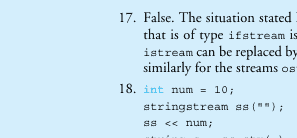

```
```cpp
int num;
string s = "10";
stringstream ss(s);
ss >> num;
```
```

20. 用于将 field 转换为 double 的 stringstream 变量 ssNum 需要为每个新处理的字符串进行清除。这可以通过在 while 循环内部调用 clear 函数来实现。

```
```cpp
stringstream ssList, ssNum;
string numbers = "1.1, 1.2, 1.3";

double total = 0;
double num;

ssList.clear();
ssList.str(numbers);

string field;
while (getline(ssList, field, ','))
{
    ssNum.clear();
    ssNum.str(field);
    ssNum >> num;
    total += num;
}
cout << total << endl;
```
```

## Programming Projects

- 1. 编写一个程序，搜索一个包含 int 类型数字的文件，并在屏幕上打印该文件中所有的质数。文件仅包含用空格或换行符分隔的 int 类型数字。
- 2. 编写一个程序，从包含 double 类型数字的文件中读取输入，并将文件中的数字平均值输出到屏幕。文件仅包含用空格和/或换行符分隔的 double 类型数字。
- 3. a. 计算数据文件的中位数。*中位数*是大于该数字的数据元素数量与小于该数字的数据元素数量相同。针对此问题，你应假设数据已排序（即按递增顺序排列）。如果元素个数为奇数，中位数是文件的中间元素；如果文件元素个数为偶数，中位数是两个中间元素的平均值。你需要打开文件，计数成员，关闭文件并计算文件中间的位置，再次打开文件（回顾本章开头“重新开始”的讨论），计数到你需要的条目，并计算中间值。


b. 对于已排序的文件，四分位数是以下三个数之一：第一个数使得至少有四分之一的数据值小于或等于它，四分之一的数据值介于第一个数和第二个数之间（含第二个数），四分之一的数据点介于第二个数和第三个数之间（含第三个数），还有四分之一高于第三个四分位数。对你用于第 a 问的数据文件，找出这三个四分位数。请注意，“四分之一”意味着尽可能接近四分之一。

提示：你应该能认识到，完成了第 a 问之后，你的任务已经完成了三分之一。（你已经得到了第二个四分位数。）你还应该认识到，在寻找另外两个四分位数方面，你几乎已经完成了所有工作。

## 4. 编写一个程序，从包含 `double` 类型数字的文件中读取输入。程序将文件中数字的平均值和标准差输出到屏幕。文件中只包含由空格和/或换行分隔的 `double` 类型数字。一组数字 n₁、n₂、n₃ 等等的标准差定义为以下这些数字的平均值的平方根：(n₁ − a)²、(n₂ − a)²、(n₃ − a)² 等等。其中数字 a 是数字 n₁、n₂、n₃ 等等的平均值。

提示：编写程序时，先读取整个文件并计算所有数字的平均值，然后关闭文件，再重新打开文件并计算标准差。你会发现先完成编程项目 12.2，然后修改该程序以得到本项目的程序，会很有帮助。

## 5. 一个文件包含一系列由空格分隔的整数。编写一个程序，从文件中读取整数，并检查它们是否构成等差数列 3, 7, 11, 15, ..., (3+4*n)。该数列以 3 开始，每个后续元素都比前一个元素大 4。你的程序应按数列顺序将这些数字打印到输出文件中，直到发现一个不属于该数列的数字，或到达文件末尾。

## 6. 编写一个程序，合并两个文件中的单词，并将所有不重复的单词写入第三个文件。你的程序从两个不同的文件读取输入，并将其输出写入第三个文件。每个输入文件都包含一个 `string` 类型的单词列表。程序运行后，输出文件将包含两个文件中的所有不重复单词，两个文件中的重复项将被忽略。你的程序应定义一个函数，该函数以两个输入文件流和输出文件流作为参数。

## 7. 编写一个生成个性化电子邮件的程序。程序同时从输入文件和键盘获取输入。输入文件包含一封面试邮件模板的文本，其中包含占位符 `<name>`、`<email>`、`<date>` 和 `<location>`。在将邮件发送给候选人之前，必须编辑模板，用候选人的数据替换占位符。程序要求用户提供姓名、电子邮件地址、日期和地点。然后程序将最终信件写入第二个文件，但将四个占位符替换为用户输入的相应值。每种类型的占位符在信件中恰好出现一次。

*提示：让程序读取候选人数量。对于每位候选人，让它从输入文件中读取，直到遇到占位符，并在读取过程中将内容复制到输出文件。当遇到占位符时，它向屏幕输出提示，向用户请求数据。你应该能自己推断出其余细节。你的程序应定义一个函数，该函数以输入和输出文件流作为参数。如果这是作为课堂作业，请向讲师获取文件名。*

## 8. 
编写一个程序，计算一系列汽车的里程指数。测试驾驶中获得的里程记录位于一个文件中，该文件将作为输入文件。每一行包含汽车的品牌、汽车型号以及三次测试驾驶获得的三个里程值，所有内容均由空格分隔。里程值均为整数。
你的程序将从此文件获取输入，并将其输出发送到第二个文件。输出文件中的数据将与输入文件中的数据相同，只是每行末尾会多一个数字（`double` 类型）。该数字将是汽车三次测试驾驶里程的平均值。至少使用一个以文件流作为全部或部分参数的函数。

## 9. 
以以下所有方式增强你在编程项目 12.8 中编写的程序。

-   输出文件将在文件开头包含一行（或多行）解释输出内容的说明。使用格式化指令使布局整洁且易于阅读。
-   在将所需输出放入输出文件后，程序将关闭所有文件，然后将输出文件的内容复制到输入文件中，这样最终效果是改变输入文件的内容。

至少使用两个以文件流作为全部或部分参数的函数。

## 10. 
编写一个程序，计算包含一些文本的文件的平均单词长度（每个单词的平均字符数）。单词被定义为任何字符串，其前后两端分别由以下字符之一分隔：空格、逗号、句点、行首或行尾。
你的程序应定义一个以输入文件流作为参数的函数。该函数也应能使用流 `cin` 作为输入流，尽管在本程序中该函数不会以 `cin` 作为参数被调用。如果这是作为课堂作业，请向讲师获取文件名。

## 11. 编写一个程序，纠正一个 C++ 程序中在使用 `cin` 和 `cout` 时错误使用了运算符 `<` 或 `>` 的错误。程序将每个（错误的）`cin <<` 出现替换为更正后的版本 `cin >>`，并将每个（错误的）`cout >>` 出现替换为更正后的版本 `cout <<`。

对于较简单的版本，假设任何 `cin` 与其后的 `<<` 之间恰好有一个空格符号，同样假设每个 `cout` 与其后的 `>>` 之间总是恰好有一个空格。对于较难的版本，允许 `cin` 与 `<<` 之间以及 `cout` 与 `>>` 之间可能存在任意数量的空格，甚至零个空格；在这种较难的情况下，替换后的更正版本在 `cin` 或 `cout` 与后续运算符之间只有一个空格。要被纠正的程序位于一个文件中，更正后的版本输出到第二个文件。你的程序应定义一个以输入和输出文件流作为参数的函数。（提示：即使你正在做较难的版本，你可能会发现先完成较简单的版本，然后修改程序以执行较难的任务，会更简单、更快捷。）

## 12. 编写一个程序，允许用户输入任意一行问题，然后回答该问题。程序实际上不会关注问题内容，而只是读取问题行并丢弃其读取的所有内容。它总是给出以下答案之一：

```
I'm not sure but I think you will find the answer in Chapter #N.
That's a good question.
If I were you, I would not worry about such things.
That question has puzzled philosophers for centuries.
I don't know. I'm just a machine.
Think about it and the answer will come to you.
I used to know the answer to that question, but I've forgotten it.
The answer can be found in a secret place in the woods.
```

这些答案存储在一个文件中（每行一个答案），你的程序只需从文件中读取下一个答案，并将其作为该问题的答案写出。程序读完整个文件后，只需关闭文件，重新打开文件，然后再次从头开始遍历答案列表。


每当你的程序输出第一个答案时，它应将两个符号 #N 替换为 1 到 20 之间的数字（包括 1 和 20 的可能性）。为了选择 1 到 20 之间的数字，你的程序应将一个变量初始化为 20，并在每次输出一个数字时将该变量的值减少 1，以便章节号从 20 倒数到 1。当变量达到值 0 时，你的程序应将其值改回 20。将数字 20 命名为 NUMBER_OF_CHAPTERS，使用 const 修饰符进行全局命名常量声明。 （提示：使用本章中定义的 newLine 函数。）

## 13.

此项目与编程项目 12.12 相同，只是本项目中你的程序将使用更复杂的方法来选择问题的答案。当你的程序读取一个问题时，它会计算问题中的字符数并将该数字存储在名为 count 的变量中。然后它会用答案编号 count%ANSWERS 进行响应。文件中的第一个答案是答案编号 0，下一个是答案编号 1，然后是 2，依此类推。ANSWERS 在常量声明中定义，如下所示，因此它等于答案文件中的答案数：

```
const int ANSWERS = 8;
```

这样，你就可以更改答案文件，使其包含更多或更少的答案，并且只需要更改常量声明，就能使你的程序针对不同数量的可能答案正确工作。假设文件中列出的第一个答案将始终为以下内容，即使答案文件被更改：

I’m not sure but I think you will find the answer in Chapter #N.

在将两个字符 #N 替换为数字时，使用数字 (count%NUMBER_OF_CHAPTERS + 1)，其中 count 是前面讨论的变量，NUMBER_OF_CHAPTERS 是一个全局命名常量，定义为等于本书中的章节数。

## 14.

此程序对文本文件中找到的行进行编号。
编写一个程序，从文件中读取文本并输出每行前面加上行号。用三个空格的字段右对齐打印行号。行号后跟冒号，然后是一个空格，然后是该行的文本。你应该一次获取一个字符，并编写代码以忽略每行开头的空白。你可以假设行足够短，可以容纳在屏幕上的一行中。否则，如果行太长，则允许使用默认的打印机或屏幕输出行为（即换行或截断）。

一个稍微更难的版本是通过在处理文件行之前计数行来确定行号字段所需的空格数。该版本的程序应在 72 字符行内可容纳的最后一个完整单词之后插入新行。

## 15.

在本程序中，你需要处理文本以创建 KWIX 表（Key Word In conteXt 表）。其思想是生成一个关键词列表（不是编程语言关键字，而是讨论中具有重要技术含义的词），

然后对于每个关键词的每个实例，将关键词、上下文的行号以及关键词在其上下文中的情况放入表中。对于给定的关键词可能有多个上下文。关键词内条目的顺序应为文本中出现的顺序。对于此问题，“上下文”是用户选择的关键词之前的词数、关键词本身以及关键词之后的词数。

该表有一个按字母顺序排列的关键词列，后跟关键词出现的行号(s)，后跟关键词出现的每个上下文的列。参见以下示例。文本的选择请咨询你的指导教师。

提示：为了获取关键词列表，你应该选择并输入文本中的几段文字，然后从你的段落中省略“无聊”的词，例如动词“to be”的形式；代词如 I, me, he, she, her, you, us, them, who, which 等。最后，对关键词列表进行排序并删除重复项。你做得越好，输出就越有用。

示例：一段文字及其 KWIX 列表：

There are at least two complications when reading and writing with random access via an fstream: (1) You normally work in bytes using the type char or arrays of char and need to handle type conversions on your own, and (2) you typically need to position a pointer (indicating where the read or write begins) before each read or write.

KWIX 列表：

| Keyword | Line Number | Keyword in Context |
|---|---|---|
| access | 2 | with random access via |
| arrays | 3 | char or arrays of |
| bytes | 2 | work in bytes using |
| char | 3 | the type char or |
| char | 3 | array of char and |
| conversions | 3 | handle type conversions on |

该表比这些示例条目更长。

## 16.

文本文件 words.txt，其中包含在本书网站的源代码中，包含按字母顺序排列的英文单词列表。请注意，单词为大小写混合。
编写一个程序，读取此文件并找到仅包含单个元音（a, e, i, o, u）的最长单词。输出此单词（实际上最长单词有几个并列。你的程序只需要输出其中一个单词）。

## 17.

文本文件 words.txt，其中包含在本书网站的源代码中，包含按字母顺序排列的英文单词列表。请注意，单词为大小写混合。
编写一个程序，读取此文件并找到反转为不同单词的最长单词。例如，“stun”反转为单词“nuts”，但只有四个字母长。找到最长这样的单词。在编写程序时，你可以使用 words.txt 文件包含恰好 45,407 个单词的信息。

## 3.2.2 用向量法证明平行与垂直问题

### 题型1 向量法证明平行问题

**例1** 如图，在四棱锥 $O-ABCD$ 中，底面 $ABCD$ 是边长为 1 的菱形，$OB \perp$ 底面 $ABCD$，$OA=2$，$M$ 为 $OA$ 的中点，$N$ 为 $BC$ 的中点。利用向量方法证明：直线 $MN \parallel$ 平面 $OCD$。

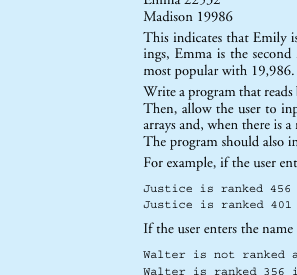

**证明** 因为 $OB \perp$ 底面 $ABCD$，且 $底面ABCD$ 是菱形，所以 $OA$ 在底面上的射影为 $AB$。以 $O$ 为原点，$OB$ 所在直线为 $z$ 轴，过点 $O$ 且平行于 $AB$ 的直线为 $x$ 轴，建立如图所示的空间直角坐标系。

因为 $OA=2$，$底面ABCD$ 是边长为 1 的菱形，所以 $OB = \sqrt{OA^2 - AB^2} = \sqrt{4-1} = \sqrt{3}$。

则 $O(0,0,0)$，$A(1,0,0)$，$B(0,0,\sqrt{3})$，$C(-\frac{1}{2}, \frac{\sqrt{3}}{2}, \sqrt{3})$，$D(\frac{1}{2}, \frac{\sqrt{3}}{2}, \sqrt{3})$。

因为 $M$ 为 $OA$ 的中点，$N$ 为 $BC$ 的中点，所以 $M(\frac{1}{2}, 0, 0)$，$N(-\frac{1}{4}, \frac{\sqrt{3}}{4}, \sqrt{3})$。

## 22.

重新做或第一次做第 9 章的编程项目 9.10。然而，与其硬编码测验数据，你的程序应从名为 `trivia.txt` 的文本文件中读取问题。文本文件的格式应为

```
<number of questions, N>
<question 1>
<answer 1>
<dollar amount for 1>
<question 2>
<answer 2>
<dollar amount for 2>
...
<question N>
<answer N>
<dollar amount for N>
```

例如，这里有一个包含两个问题的非常短的文件：

```
2
Creator of the C++ programming language?
Bjarne Stroustrup
10.00
The geometric figure most like a lost parrot?
Polygon
20.00
```

## 23.

此编程项目要求你完成编程项目 9.11，该项目要求你编写一个函数来确定两个字符串是否为字母异位词。文本文件 `words.txt`，其中包含在本書网站的源代码中，包含按字母顺序排列的英文单词列表。编写一个程序，将每个单词读入数组或向量。接下来，从控制台输入一个单词并输出数组或向量中是输入单词的字母异位词的每个单词。

## 24.

逗号分隔值或 CSV 文件是一种简单的文本格式，用于存储记录列表。逗号用作分隔符来分隔每条记录的字段。此格式通常用于在电子表格或数据库之间传输数据。在本编程项目中，考虑一家销售产品缩写为 A、B、C、D、E 等的商店。客户可以对每个产品进行 1–5 的评分，其中 1 为差，5 为优秀。评分存储在 CSV 文件中，每行包含客户对每个产品的评分。以下是包含三个客户评分和五个产品的示例文件：

```
A,B,C,D,E
3,0,5,1,2
1,1,4,2,1
0,0,5,1,3
```

此文件格式的第一行列出产品。数字 0 表示客户未对产品进行评分。在这种情况下，第一位客户将 A 评为 3，C 评为 5，


D 为 1，E 为 2。产品 B 未被评级。第三位顾客将 C 评为 5，D 评为 1，E 评为 3。第三位顾客未评级 A 或 B。

以此格式创建一个包含示例评级的文本文件。然后编写一个程序读取该文本文件并使用第一行确定产品的数量。程序应输出每个产品的平均评级。未对产品进行评级的顾客在计算该产品的平均评级时不应被考虑。处理数据的最简单方法可能是使用 getline 函数以逗号作为分隔符，并创建向量或动态数组来存储评级的计数和总和。你的程序应能处理任意数量的产品和顾客评级。


# 25.

使用 cin 直接读取到变量（如 int）的一个问题是，如果用户输入非整数数据，则程序将继续使用错误的数据，通常会崩溃。解决此问题的方法是作为字符串输入数据，进行输入验证，然后将字符串转换为整数。编写一个函数提示用户输入整数。程序应使用 getline 将用户的输入读入字符串。然后使用 stringstream 类从字符串中提取整数。如果无法提取整数，则应提示用户重试。该函数应返回提取的整数。

> 在一次关于宇宙学和太阳系结构的讲座后，威廉·詹姆斯被一位小老太太拦住。
> “詹姆斯先生，您关于太阳是太阳系中心、地球是围绕其旋转的球体的理论听起来很有说服力，但它是错误的。我有一个更好的理论，”小老太太说。
> “那是什么，夫人？”詹姆斯礼貌地问道。
> “我们生活在巨龟背上的一块地球地壳上。”
> 不愿通过动用自己掌握的大量科学证据来摧毁这个荒谬的小理论，詹姆斯决定通过让对手看到其立场的一些不足来温和地劝阻她。
> “如果您的理论正确，夫人，”他问道，“这只乌龟站在什么上面？”
> “詹姆斯先生，您是个很聪明的人，这确实是个好问题，”小老太太回答道，“但我对此有一个答案。那就是：第一只乌龟站在第二只、更大得多的乌龟背上，后者正好在它正下方。”
> “但这第二只乌龟站在什么上面？”詹姆斯耐心地追问。
> 对此，小老太太得意地叫道。“没用，詹姆斯先生——一直都是乌龟往下。”
> J. R. R. TOSS, Constraints on Variables in Syntax. MIT Press, 1967

## 引言

如果一个函数定义包含对其自身的调用，则称其为递归。像大多数现代编程语言一样，C++ 允许函数递归。如果谨慎使用，递归可以是一种有用的编程技术。本章介绍定义成功的递归函数所需的基本技术。本章中没有任何内容是真正独特于 C++ 的。如果你已经熟悉递归，可以安全地跳过本章。

本章使用第 1 章到第 5 章的材料。第 13.1 节和第 13.2 节不使用第 5 章的任何材料，因此你可以在第 4 章之后随时学习递归。如果你尚未阅读第 11 章，回顾第 1 章中关于命名空间的部分可能会有所帮助。

## 13.1 递归 void 函数

> 我还记得《一千零一夜》中那一夜，当谢赫拉查德（由于抄写员的一个神奇疏忽）开始逐字逐句地讲述《一千零一夜》的故事，从而冒着再次来到她必须重复讲述的那一夜的风险，进而走向无限。

> JORGE LUIS BORGES，“分岔花园” Trans. Anthony Boucher, 1948

当你编写一个函数来解决一个任务时，一个基本的设计技术是将任务分解为子任务。有时会出现至少一个子任务是同一任务的较小示例的情况。例如，如果任务是在列表中搜索特定值，你可能会将其分为搜索列表前半部分的子任务和搜索列表后半部分的子任务。搜索列表两半的子任务是“较小”的原始任务版本。每当一个子任务是原始任务的较小版本时，你就可以使用递归函数来解决原始任务。我们从一个简单的例子开始说明这种技术。

## 递归

在 C++ 中，函数定义可能包含对正在定义的函数的调用。在这种情况下，函数被称为递归。

## 示例：垂直数字

显示 13.1 包含一个名为 writeVertical 的递归函数的演示程序，该函数接受一个（非负）int 参数，并将该 int 写入屏幕，数字垂直向下排列，每行一个。例如，调用

```
writeVertical(1234);
```

将产生输出

```
1
2
3
4
```

writeVertical 所需执行的任务可分解为以下两种情况：

- 简单情况：如果 n < 10，则将数字 n 写入屏幕。毕竟，如果数字只有一位长，任务是微不足道的。

## 显示 13.1 一个递归 void 函数

```
1 //Program to demonstrate the recursive function writeVertical.
2 #include <iostream>
3 using std::cout;
4 using std::endl;
5 
6 void writeVertical(int n);
7 //Precondition: n >= 0.
8 //Postcondition: The number n is written to the screen vertically,
9 //with each digit on a separate line.
10 
11 int main()
12 {
13     cout << "writeVertical(3):" << endl;
14     writeVertical(3);
15 
16     cout << "writeVertical(12):" << endl;
17     writeVertical(12);
18 
19     cout << "writeVertical(123):" << endl;
20     writeVertical(123);
21 
22     return 0;
23 }
24 
25 //uses iostream:
26 void writeVertical(int n)
27 {
28     if (n < 10)
29     {
30         cout << n << endl;
31     }
32     else //n is two or more digits long:
33     {
34         writeVertical(n / 10);
35         cout << (n % 10) << endl;
36     }
37 }
```

## 示例对话

```
writeVertical(3):
3
writeVertical(12):
1
2
writeVertical(123):
1
2
3
```

## 追踪递归调用

让我们看看当进行以下函数调用时（正如显示 13.1 中所示）会发生什么：

```
writeVertical(123);
```

当执行此函数调用时，计算机的处理方式与任何函数调用一样。参数 123 被替换为参数 n，并执行函数体。在将 123 替换为 n 之后，待执行的代码等价于以下内容：

```
if (123 < 10)
{
    cout << 123 << endl;
}
else //n is two or more digits long:
{
    writeVertical(123 / 10);
    cout << (123 % 10) << endl;
}
```

由于 123 不小于 10，因此执行 else 部分。然而，else 部分以函数调用开始

```
writeVertical(n / 10);
```

由于 n 等于 123，这就是调用

```
writeVertical(123 / 10);
```

等价于

```
writeVertical(12);
```

当执行到达此递归调用时，当前函数计算被置于暂停状态，递归调用被执行。当此递归调用完成时，暂停的计算将返回到此处并继续。

递归调用

```
writeVertical(12);
```

的处理方式与任何其他函数调用一样。参数 12 被替换为参数 n，并执行函数体。在将 12 替换为 n 之后，有两个计算，一个暂停，一个活动，如下所示：

```
if (123 < 10)
{
    cout <<
}
else // n i
{
    writeV
    cout <<
}

if (12 < 10)
{
    cout << 12 << endl;
}
else // n is two or more digits long:
{
    writeVertical(12 / 10);
    cout << (12 % 10) << endl;
}
```

计算将在此处停止，直到递归调用返回。

由于 12 不小于 10，因此执行 else 部分。然而，正如你已经看到的，else 部分以递归调用开始。递归调用的参数是 n / 10，在本例中等价于 12 / 10。因此 writeVertical 函数的此第二次计算被暂停，并执行以下递归调用：

writeVertical(12 / 10);

等价于

writeVertical(1);

此时有两个暂停的计算等待恢复，计算机开始执行这个新的递归调用，其处理方式与之前所有递归调用一样。参数 1 被替换为参数 n，并执行函数体。此时，计算如下所示：

```
if (123 < 10)
{
    c
}
else
{
    w
    c
}

if (12 < 10)
{
}
else
{
}

if (1 < 10)
{
    cout << 1 << endl;
}
else // n is two or more digits long:
{
    writeVertical(1 / 10);
    cout << (1 % 10) << endl;
}
```

这次没有递归调用


## 1. 引言

在当今快速发展的科技时代，人工智能（AI）已经成为推动社会进步和经济发展的重要力量。从智能家居到自动驾驶，从医疗诊断到金融风控，AI 技术正在深刻改变着我们的生活方式和工作模式。本文旨在探讨 AI 技术在不同领域的应用现状、面临的挑战以及未来的发展趋势。

## 2. AI 技术的核心领域

AI 技术涵盖了多个核心领域，包括机器学习、深度学习、自然语言处理和计算机视觉等。这些技术相互融合，共同推动了 AI 系统的智能化水平。

- **机器学习**：通过数据训练模型，使系统能够自动学习和改进。
- **深度学习**：基于神经网络，处理复杂模式识别任务。
- **自然语言处理**：让机器理解和生成人类语言。
- **计算机视觉**：使机器能够“看懂”图像和视频。

## 3. AI 在各行业的应用

AI 技术已广泛应用于医疗、金融、教育、交通等多个行业，显著提升了效率和准确性。

| 行业 | 应用场景 | 效果 |
|------|----------|------|
| 医疗 | 影像诊断 | 提高诊断准确率 |
| 金融 | 风险控制 | 降低坏账率 |
| 教育 | 个性化学习 | 提升学习效率 |
| 交通 | 智能调度 | 减少拥堵时间 |

## 4. 面临的挑战

尽管 AI 技术发展迅速，但仍面临数据隐私、算法偏见、算力需求等挑战。如何平衡技术创新与伦理规范，是当前亟需解决的问题。

> “AI 的未来不仅取决于技术的进步，更取决于我们如何负责任地使用它。”

## 深入探讨递归

函数 `writeVertical` 的定义使用了递归。但在计算函数调用 `writeVertical(123)` 时，我们并没有做任何新的或不同的事情。我们像对待前几章中见到的任何函数调用一样处理它。我们简单地将实参 `123` 替换为形参 n，然后执行函数定义体中的代码。当执行到递归调用

```
writeVertical(123 / 10);
```

我们只是再重复了一次这个过程。

计算机以如下方式跟踪递归调用。当函数被调用时，计算机为形参放入实参并开始执行代码。如果遇到递归调用，它会暂时停止计算，因为它必须先知道递归调用的结果才能继续。它会保存之后继续计算所需的全部信息，然后继续求值该递归调用。当递归调用完成后，计算机返回来完成外层计算。

C++ 语言对递归调用在函数定义中的使用方式没有限制。然而，要使递归函数定义有用，其设计必须保证对函数的任何调用最终都以某段不依赖递归的代码结束。函数可以调用自身，而该递归调用又可以再次调用该函数。这个过程可以重复任意多次。但是，除非最终某个递归调用不依赖递归来返回一个值，否则这个过程不会终止。一个成功的递归函数定义的一般框架如下：

- 一种或多种情况，函数通过使用一个或多个递归调用来完成任务的若干较小版本，从而完成任务。
- 一种或多种情况，函数在不使用任何递归调用的情况下完成任务。这些不含任何递归调用的情况称为**基础情形（base cases）**或**停止情形（stopping cases）**。

通常，一个 `if-else` 语句决定将执行哪一种情况。一个典型场景是：最初的函数调用执行一个包含递归调用的情况；该递归调用反过来可能执行一个需要再次递归调用的情况。每个递归调用都会经过若干次再产生另一个递归调用，但最终应当应用某个停止情形。对函数的每次调用最终都必须到达一个停止情形，否则函数调用将因无限递归调用链而永远不会结束。（在实践中，包含无限递归调用链的调用通常会异常终止，而不是真的永远运行下去。）

确保最终到达停止情形的最常见方法是编写函数时使某个（正的）数值在每次递归调用中递减，并为某个“小”值设置一个停止情形。这正是我们在程序清单 13.1 中设计函数 `writeVertical` 的方式。当函数 `writeVertical` 被调用时，该调用会产生一个使用更小实参的递归调用。这个过程持续进行，每个递归调用都会产生另一个递归调用，直到实参小于 10。当实参小于 10 时，函数调用结束，不再产生更多递归调用，然后过程逐层返回到最初的调用，最后结束。

## 递归函数定义的一般形式

一个成功的递归函数定义的一般框架如下：

- 一种或多种情况，包含对正在定义的函数的一次或多次递归调用。这些递归调用应当解决被定义函数所执行任务的“更小”版本。
- 一种或多种情况，不包含任何递归调用。这些不含任何递归调用的情况称为基础情形或停止情形。

## 陷阱：无限递归

在前面的小节中讨论的函数 writeVertical 的例子中，一系列递归调用最终到达了一个不涉及递归的函数调用（也就是说，到达了停止情形）。另一方面，如果每个递归调用都会产生另一个递归调用，那么对函数的调用在理论上将永远运行下去。这称为无限递归。在实践中，这样的函数通常会一直运行到计算机耗尽资源，程序异常终止为止。

无限递归的例子并不难找。下面是一个语法正确的 C++ 函数定义，它可能是试图定义另一个版本的 writeVertical 函数时产生的：

```
void newWriteVertical(int n)
{
    newWriteVertical(n / 10);
    cout << (n % 10) << endl;
}
```

如果你将这个定义嵌入到一个调用该函数的程序中，编译器会把函数定义翻译成机器代码，然后你可以执行这些机器代码。而且，这个定义甚至还有一定的合理性。它表示：要输出传给 newWriteVertical 的实参，先输出除最后一位以外的所有数字，然后再输出最后一位。然而，当被调用时，这个函数会产生无穷的递归调用序列。如果你调用 newWriteVertical(12)，该执行会停下来执行递归调用 newWriteVertical(12 / 10)，它等价于 newWriteVertical(1)。执行该递归调用时，又会停下来执行递归调用

```
newWriteVertical(1 / 10);
```

它等价于

```
newWriteVertical(0);
```

## 陷阱：（续）

而那个调用又会停下来执行递归调用 `newWriteVertical(0 / 10);`，它同样等价于

`newWriteVertical(0);`

接着又会产生另一个递归调用，再次执行同一个递归函数调用 `newWriteVertical(0);`，如此循环，永无止境。由于 `newWriteVertical` 的定义没有停止情形，这个过程将永远进行下去（或者直到计算机耗尽资源）。

## 自测练习

- 1. 以下程序的输出是什么？

  ```cpp
  #include <iostream>
  using std::cout;
  void cheers(int n);
  
  int main()
  {
      cheers(3);
      return 0;
  }
  void cheers(int n)
  {
      if (n == 1)
      {
          cout << "Hurray\n";
      }
      else
      {
          cout << "Hip ";
          cheers(n - 1);
      }
  }
  ```

- 2. 编写一个递归的 void 函数，它有一个参数，该参数为正整数，并在屏幕上输出该数量的星号（*），全部在一行上。

- 3. 编写一个递归的 void 函数，它有一个参数，该参数为正整数。调用时，函数将其参数反向输出到屏幕。也就是说，如果实参是 `1234`，它向屏幕输出以下内容：

  `4321`

## 自测练习（续）

4. 编写一个递归的 void 函数，该函数接受一个 int 参数 n，并写出整数 1, 2, ..., n。

5. 编写一个递归的 void 函数，该函数接受一个 int 参数 n，并写出整数 n, n-1, ..., 3, 2, 1。（提示：请注意，你只需交换短短两行代码，就可以从自测练习 4 的代码得到本练习的代码，反之亦然。）

## 递归与栈

为了跟踪递归（以及其他一些事情），大多数计算机系统使用一种称为栈的结构。栈是一种非常特殊的内存结构，类似于一摞纸。在这个类比中，有取之不尽的额外空白纸张。要向栈中放入某些信息，就把信息写在其中一张纸上，然后放到整摞纸的最上面。要向栈中放入更多信息，就取一张干净的纸，把信息写在上面，然后将这张新纸放在这摞纸的最上面。通过这种简单直接的方式，越来越多的信息可以被放入栈中。

从栈中取出信息也是通过非常简单的过程完成的。可以读取最上面的那张纸，当不再需要时，就把它扔掉。有一个复杂之处：只有最上面的那张纸可以访问。例如，要读取从上往下数的第三张纸，必须先扔掉最上面的两张。由于最后放入栈中的纸是最先被取出的，所以栈通常被称为后进先出（last-in/first-out）的内存结构。

利用栈，计算机可以轻松地跟踪递归。每当一个函数被调用时，就会取一张新纸。函数定义被抄写到这张纸上，并把实参代入函数形参。然后计算机开始执行函数定义体中的代码。当它遇到递归调用时，会停止在这张纸上正在进行的计算，以便计算递归调用返回的值。但在计算递归调用之前，它会保存足够的信息，以便最终确定递归调用返回的值后，能够继续之前被停止的计算。这些被保存的信息写在一张纸上并放到栈中。递归调用使用一张新纸。计算机在这张新纸上写下函数定义的第二份副本，代入函数形参的实参，然后开始执行递归调用。当它在被递归调用的副本中遇到递归调用时，会重复将信息保存到栈中并为新的递归调用使用一张新纸的过程。这个过程在前面题为“跟踪递归调用”的小节中已作说明。尽管当时我们没有称它为栈，但那些一层层叠加的计算示意图正说明了栈的运作方式。

这个过程一直持续到对函数的某个递归调用完成其计算且不再产生任何递归调用为止。当这种情况发生时，

栈

后进先出


计算机将注意力转向堆栈顶部的纸张。这张纸包含正在等待刚刚结束的递归计算的部分完成的计算。因此，可以继续进行该挂起的计算。当该挂起的计算结束时，计算机丢弃该纸张，堆栈中位于其下方的挂起计算成为堆栈顶部的计算。计算机将注意力转向现在位于堆栈顶部的挂起计算，依此类推。该过程一直持续到底部纸张上的计算完成。取决于进行了多少次递归调用以及函数定义是如何编写的，堆栈可能会以任何方式增长和缩小。请注意，堆栈中的纸张只能以后进先出方式访问，但这正是跟踪递归调用所需的。每個被挂起的版本都在等待堆栈中直接位于其上方的版本完成。

毋庸置疑，计算机没有纸张堆栈。这只是一个类比。计算机使用内存的一部分而不是纸张。這些内存部分之一（“纸张”）的内容称为**激活帧**。这些激活帧以我们刚才讨论的后进先出方式处理。（这些激活帧不包含函数定义的完整副本，而只是引用函数定义的一个副本。然而，激活帧包含足够的信息，使计算机能够表现得好像激活帧包含函数定义的完整副本一样。）

## Stack

堆栈是一种后进先出的内存结构。从堆栈中引用或移除的第一项始终是最后进入堆栈的项。计算机使用堆栈来跟踪递归（以及其他用途）。

## PITFALL: Stack Overflow

堆栈的大小总是有一定限制。如果存在一条很长的链，其中一个函数对其自身进行递归调用，并且该调用导致另一次递归调用，并且该调用又产生另一次递归调用，等等，那么该链中的每次递归调用都会导致另一个活动帧被放置在堆栈上。如果该链太长，堆栈将尝试超出其限制。这是一种称为**堆栈溢出**的错误条件。如果您收到一条错误消息，上面写着“stack overflow”，那么很可能某个函数调用产生了过长的递归调用链。堆栈溢出的一个常见原因是无限递归。如果一个函数无限递归，那么它最终会尝试使堆栈超过任何堆栈大小限制。

efficiency

一个非尾递归的递归编写的函数通常比等价的迭代版本运行更慢并使用更多的存储。计算机必须做大量工作来操作堆栈以跟踪递归。然而，由于系统会自动为您完成所有这些，使用递归有时可以使您作为程序员的工作更轻松，因为它可以产生更易于理解的代码。

## Self-Test Exercises

- 6. 如果您的程序产生错误消息“stack overflow”，错误的可能来源是什么？
- 7. 编写 Self-Test Exercise 1 中定义的函数 cheers 的迭代版本。
- 8. 编写 Self-Test Exercise 2 中定义的函数的迭代版本。
- 9. 编写 Self-Test Exercise 3 中定义的函数的迭代版本。
- 10. 追踪您对 Self-Test Exercise 4 所做的递归解决方案。
- 11. 追踪您对 Self-Test Exercise 5 所做的递归解决方案。

## 13.2 Recursive Functions That Return a Value

> To iterate is human, to recurse divine.
> 
> ANONYMOUS

## General Form for a Recursive Function That Returns a Value

迄今为止您所见的递归函数都是 void 函数，但递归并不限于 void 函数。递归函数可以返回任何类型的值。设计返回值的递归函数的技术基本上与 void 函数相同。成功返回值的递归函数定义的概要如下：

- 一个或多个情况下，返回值是根据对同一函数的调用计算得出的（即使用递归调用）。与 void 函数的情况一样，递归调用的参数在直觉上应该是“更小”的。
- 一个或多个情况下，返回值是在不使用任何递归调用的情况下计算的。这些没有递归调用的情况称为基本情况或停止情况（与 void 函数的情况一样）。

## EXAMPLE: Another Powers Function

第 3 章介绍了预定义函数 pow，用于计算幂。例如，pow(2.0, 3.0) 返回 2.0³，因此以下语句将变量 result 设置为 8.0：

```
double result = pow(2.0, 3.0);
```

函数 pow 接受两个 double 类型的参数并返回 double 类型的值。Display 13.3 包含一个递归定义，用于定义一个类似但使用类型 int 而不是 double 的函数。这个新函数称为 power。例如，以下语句将使 result2 的值等于 8，因为 2³ 是 8：

```
int result2 = power(2, 3);
```

我们定义函数 power 的主要原因是有一个简单的递归函数示例，但在某些情况下，函数 power 会比函数 pow 更可取。函数 pow 返回 double 类型的值，这只是一个近似量。函数 power 返回 int 类型的值，这是一个精确量。在某些情况下，您可能需要函数 power 提供的额外精度。

函数 power 的定义基于以下公式：

xⁿ 等于 xⁿ⁻¹ × x

将此公式翻译成 C++ 表示 power(x, n) 返回的值应与表达式的值相同

```
power(x, n - 1)*x
```

Display 13.3 中给出的函数 power 的定义确实为 power 返回以下值：

(x, n) 只要 n > 0。

n 等于 0 的情况是停止情况。如果 n 为 0，则 power(x, n) 仅返回 1（因为 x⁰ 为 1）。

让我们看看当函数 power 用一些示例值调用时会发生什么。首先考虑以下简单表达式：

```
power(2, 0)
```

当函数被调用时，x 的值被设为 2，n 的值被设为 0，并且执行函数定义体中的代码。由于 n 的值是合法值，因此执行 if-else 语句。由于此 n 值不大于 0，因此使用 else 之后的 return 语句，因此函数调用返回 1。因此，以下语句将使 result3 的值等于 1：

```
int result3 = power(2, 0);
```

## Display 13.3 The Recursive Function power

```
1 //Program to demonstrate the recursive function power.
2 #include <iostream>
3 #include <cstdlib>
4 using std::cout;
5 using std::endl;

6 int power(int x, int n);
7 //Precondition: n >= 0.
8 //Returns x to the power n.

9 int main()
10 {
11     for (int n = 0; n < 4; n++)
12         cout << "3 to the power " << n
13             << " is " << power(3, n) << endl;
14
15     return 0;
16 }

17 //uses iostream and cstdlib:
18 int power(int x, int n)
19 {
20     if (n < 0)
21     {
22         cout << "Illegal argument to power.\n";
23         exit(1);
24     }
25     if (n > 0)
26         return ( power(x, n - 1) * x );
27     else // n == 0
28         return (1);
```

## Sample Dialogue

```
3 to the power 0 is 1
3 to the power 1 is 3
3 to the power 2 is 9
3 to the power 3 is 27
```

### 1.1 认识三角形

观察图片，你能发现哪些三角形？

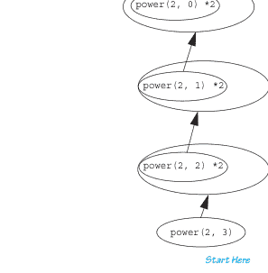

由不在同一条直线上的三条线段首尾顺次相接所组成的图形叫做三角形（triangle）。

如图1-1，线段AB，BC，CA是三角形的边，点A，B，C是三角形的顶点。∠A，∠B，∠C是相邻两边组成的角，叫做三角形的内角，简称三角形的角。

三角形用符号"△"表示，如图1-1的三角形记作"△ABC"，读作"三角形ABC"。

△ABC的三边，有时也用a，b，c来表示。如图1-1，顶点A所对的边BC用a表示，边CA、边AB分别用b、c来表示。


# 自测练习（续）

```
int mystery(int n)
{
    if (n <= 1)
        return 1;
    else
        return ( mystery(n - 1) + n );
}
```

13. 以下程序的输出是什么？`rose` 是众所周知的哪种数学函数？

```
#include <iostream>
using std::cout;
using std::endl;

int rose(int n);
//Precondition: n >= 0.

int main()
{
    cout << rose(4) << endl;
    return 0;
}

int rose(int n)
{
    if (n <= 0)
        return 1;
    else
        return ( rose(n - 1) * n );
}
```

14. 重新定义函数 `power`，使其也能处理负指数。为此，你还必须将返回值的类型改为 `double`。重新定义后的 `power` 的函数声明和头注释如下：

```
double power(int x, int n);
//Precondition: If n < 0, then x is not 0.
//Returns x to the power n.
```

提示：x⁻ⁿ 等于 1/(xⁿ)。

# 互递归

到目前为止，我们的示例中递归函数直接调用了同一个函数。然而，也有可能存在通过另一个函数间接调用自身的递归函数。当两个或多个函数相互递归调用时，称为互递归。

作为一个简单的例子，假设我们有一个由 0 和 1 组成的字符串。我们想要确定该字符串中 1 的个数是否为偶数。我们的策略是从左到右检查字符串中的符号，并在迄今为止遇到的 1 的个数为偶数时结束于函数 `evenNumberOfOnes`，并在迄今为止遇到的 1 的个数为奇数时结束于函数 `oddNumberOfOnes`。最初我们调用函数 `evenNumberOfOnes`。如果字符串为空，则零个 1 被认为是偶数，因此函数返回 `true`。另一方面，如果字符串以 1 开头，则去掉该 1 并调用函数 `oddNumberOfOnes`，因为前导的 1 使 1 的个数变为奇数。最后，如果字符串以 0 开头，则去掉该 0 并再次调用函数 `evenNumberOfOnes`，因为前导的 0 没有使字符串从偶数变为奇数。

函数 `oddNumberOfOnes` 遵循类似的策略。如果字符串为空，则函数返回 `false` 以表示 1 的个数不是偶数。如果字符串以 1 开头，则去掉该 1 并调用函数 `evenNumberOfOnes`，因为前导的 1 使我们切换回偶数个 1。最后，如果字符串以 0 开头，则去掉该 0 并再次调用函数 `oddNumberOfOnes`，因为前导的 0 没有使字符串从奇数变为偶数。

例如，输入 `"10011"` 的计算过程为

```
evenNumberOfOnes("10011")
    oddNumberOfOnes("0011")
        oddNumberOfOnes("011")
            oddNumberOfOnes("11")
                evenNumberOfOnes("1")
                    oddNumberOfOnes("")
                        return false
```

每当前导字符为 1 时，我们就在 `evenNumberOfOnes` 和 `oddNumberOfOnes` 之间切换。在检查完字符串中的所有字符后最终进入函数 `oddNumberOfOnes`，我们可以断定 1 的个数为奇数，并且 `false` 会通过递归调用链返回。

互递归函数在显示 13.5 中实现。`substr` 函数用于“删除”字符串的第一个字符。通过指定起始索引为 1 且不提供子字符串长度参数，`substr` 函数会返回字符串中从索引 1 到末尾的所有内容，跳过索引 0 处的字符。这个特定程序用迭代方式编写会更容易，但这里介绍的思路可以扩展到更复杂的解析器，这些解析器使用互递归更容易理解和实现。

### 1. 引言

在当今快速发展的科技时代，人工智能（AI）已成为推动社会进步的关键力量。从智能助手到自动驾驶，AI 技术正以前所未有的速度改变着我们的生活方式和工作模式。

本文旨在探讨 AI 技术在不同领域的应用现状，分析其带来的机遇与挑战，并展望未来的发展趋势。

### 2. AI 的主要应用领域

- 医疗健康：辅助诊断、药物研发、个性化治疗
- 交通运输：自动驾驶、智能交通管理
- 金融服务：风险评估、智能投顾、欺诈检测
- 教育领域：个性化学习、智能辅导系统
- 制造业：预测性维护、质量检测、流程优化

### 3. AI 带来的机遇与挑战

**机遇：** AI 能够大幅提升生产效率，降低运营成本，并催生新的商业模式和就业机会。

**挑战：** 数据隐私与安全问题、算法偏见、就业结构变化以及伦理道德困境是 AI 发展过程中必须面对的重要议题。

### 4. 未来展望

随着技术的不断进步，AI 将更加智能化、人性化，并与各行业深度融合。我们期待一个更加高效、便捷且充满可能性的未来。

# 自测练习

15. 显示 13.5 中的函数是尾递归吗？

16. 函数 `even` 应该在数字为偶数时返回 `true`，数字为奇数时返回 `false`，但它不完整。请编写函数 `odd` 使其能正确工作。

```
bool even(int num)
{
    if (num == 0)
        return true;
    else
        return odd(num - 1);
}
```

# 13.3 递归思考

> 世界上只有两种人，一种人把世界分为两种人，另一种人则不这样做。
> 
> ANONYMOUS

# 递归设计技术

在定义和使用递归函数时，你不需要持续关注栈和挂起的计算。递归的强大之处在于你可以忽略这些细节，让计算机为你处理簿记工作。以显示 13.3 中的函数 `power` 为例。`power` 的定义应这样思考：

```
power(x, n)

returns

    power(x, n - 1) * x
```

由于 xⁿ 等于 xⁿ⁻¹·x，只要计算总能到达并正确计算停止情况，这就是要返回的正确值。因此，在检查递归部分的定义是否正确后，你只需检查递归调用链是否总能到达停止情况，并且停止情况总是返回正确的值。

在设计递归函数时，你不必追踪程序中该函数实例的整个递归调用序列。

数组 `a` 的索引是整数 0 到 `finalIndex`。为了使搜索数组的任务更容易，我们假设数组是有序的。因此，我们知道以下关系成立：

a[0] ≤ a[1] ≤ a[2] ≤ ... ≤ a[finalIndex]

在搜索数组时，你可能既想知道该值是否在列表中，如果在，还想知道它在列表中的位置。例如，如果我们正在搜索信用卡号码，则数组索引可用作记录号。另一个以相同索引索引的数组可能保存电话号码或其他用于报告可疑卡的信息。因此，如果要查找的值在数组中，我们希望我们的函数能告诉该值在数组中的位置。

现在让我们开始为此任务设计算法。把问题用非常具体的术语可视化会有所帮助。假设数字列表太长，需要一本书才能全部列出。事实上，无效信用卡号码就是这样分发给没有计算机访问权限的商店的。如果你是一名店员，手里拿着一张信用卡，你必须检查它是否在列表中，因而无效。你会怎么做？打开书到中间，看看号码是否在那里。如果不在并且它小于中间的号码，则向书的开头方向工作。如果号码大于中间的号码，则向书的末尾方向工作。这个想法产生了我们算法的第一个草案：

# 算法——第一版

```
found = false; //so far.
mid = approximate midpoint between 0 and finalIndex;
if (key == a[mid])
{
    found = true;
    location = mid;
}
else if (key < a[mid])
    search a[0] through a[mid - 1];
else if (key > a[mid])
    search a[mid + 1] through a[finalIndex];
```

由于对较短列表的搜索是我们在设计算法来执行任务的非常任务的较小版本，因此该算法自然适合使用递归。对较短列表的搜索可以用对算法本身的递归调用来完成。

我们的伪代码有点过于不精确，难以轻松翻译成 C++ 代码。问题与递归调用有关。显示了两个递归调用：

search a[0] through a[mid - 1];

和

search a[mid + 1] through a[finalIndex];

为了实现这些递归调用，我们需要两个额外的参数。递归调用指定要搜索数组的子范围。在一种情况下，它是索引为 0 到 mid - 1 的元素。在另一种情况下，它是索引为 mid + 1


通过 `finalIndex`。这两个额外参数将指定搜索的第一个和最后一个索引，因此我们将它们称为 `first` 和 `last`。使用这些参数作为最低和最高索引，而不是 0 和 `finalIndex`，我们可以更精确地表达伪代码，如下所示：

```
To search a[first] through a[last] do the following:
    found = false; //so far.
    mid = approximate midpoint between first and last;
    if (key == a[mid])
    {
        found = true;
        location = mid;
    }
    else if (key < a[mid])
        search a[first] through a[mid - 1];
    else if (key > a[mid])
        search a[mid + 1] through a[last];
```

要搜索整个数组，算法将以 `first` 设置为 0 且 `last` 设置为 `finalIndex` 执行。递归调用将使用其他值作为 `first` 和 `last`。例如，第一次递归调用将 `first` 设置为 0，`last` 设置为计算值 `mid - 1`。

与任何递归算法一样，我们必须确保算法结束而不是产生无限递归。如果所求数字在列表上找到，则没有递归调用并且过程终止，但我们需要某种方法来检测数字不在列表上时。每一次递归调用，`first` 的值都会增加或 `last` 的值会减少。如果它们最终相互超过并且 `first` 和 `last` 相等或变得大于 `last`，我们将知道没有更多索引需要检查，并且键 `key` 不在数组中。如果我们将此测试添加到伪代码中，我们将获得完整的解决方案，如显示 13.6 所示。

## 编码

现在我们可以常规地将伪代码翻译成 C++ 代码。结果显示在显示 13.7 中。函数 `search` 是显示 13.6 中给出的递归算法的实现。函数在示例数组上的执行图显示在显示 13.8 中。

请注意，函数 `search` 解决的问题比原始任务更一般。我们的目标是设计一个搜索整个数组的函数，但搜索函数将允许我们通过指定索引边界 `first` 和 `last` 来搜索数组的任何区间。这是设计递归函数时常见的现象。经常有必要解决一个更一般的问题，以便能够表达递归算法。在这种情况下，我们只想要 `first` 和 `last` 设置为 0 和 `finalIndex` 的情况下的答案。然而，递归调用会将它们设置为 0 和 `finalIndex` 以外的其他值。

## 显示 13.7 二分搜索的递归函数（第 2 部分，共 2 部分）

此程序部分包含一些用于填充和排序数组 a 的代码。确切的细节与此示例无关。

```
16  int key, location;
17  bool found;
18  cout << "Enter number to be located: ";
19  cin >> key;
20  search(a, 0, finalIndex, key, found, location);

21  if (found)
22      cout << key << " is in index location "
23          << location << endl;
24  else
25      cout << key << " is not in the array." << endl;

26  return 0;
27 }
28 void search(const int a[], int first, int last,
29             int key, bool& found, int& location)
30 {
31     int mid;
32     if (first > last)
33     {
34         found = false;
35     }
36     else
37     {
38         mid = (first + last)/2;
39
40         if (key == a[mid])
41         {
42             found = true;
43             location = mid;
44         }
45         else if (key < a[mid])
46         {
47             search(a, first, mid - 1, key, found, location);
48         }
49         else if (key > a[mid])
50         {
51             search(a, mid + 1, last, key, found, location);
52         }
53     }
}
```

## 显示 13.8 函数 search 的执行

key is 63

54 a[0] 15
55 a[1] 20
56 a[2] 35
57 a[3] 41
58 a[4] 57
59 a[5] 63
60 a[6] 75
61 a[7] 80
62 a[8] 85
63 a[9] 90

first == 0

mid = (0 + 9)/2

last == 9

54 a[0] 15
55 a[1] 20
56 a[2] 35
57 a[3] 41
58 a[4] 57
59 a[5] 63
60 a[6] 75
61 a[7] 80
62 a[8] 85
63 a[9] 90

Not in this half

first == 5

mid = (5 + 9)/2

last == 9

next

54 a[0] 15
55 a[1] 20
56 a[2] 35
57 a[3] 41
58 a[4] 57
59 a[5] 63
60 a[6] 75
61 a[7] 80
62 a[8] 85
63 a[9] 90

first == 5

last == 6

Not here

next

mid = (5 + 6)/2 which is 5
a[mid] is a[5] == 63
found = TRUE;
location = mid;

## 检查递归

标题为“递归设计技术”的小节给出了三个标准，您应该检查以确保递归 void 函数定义是正确的。让我们对显示 13.7 中给出的函数 search 检查这三件事。

- 1. 没有无限递归：在每次递归调用中，`first` 的值会增加或 `last` 的值会减少。如果递归调用链没有以其他方式结束，那么最终函数将被调用时 `first` 大于 `last`，这是一个停止情况。

- 2. 每个停止情况都对该情况执行正确的操作。有两个停止情况，当 `first > last` 时以及当 `key == a[mid]` 时。让我们考虑每种情况。
  - 如果 `first > last`，则 `a[first]` 和 `a[last]` 之间没有数组元素，因此 `key` 不在这个数组段中。（这个数组段中没有任何东西！）因此，如果 `first > last`，函数 search 正确地将 `found` 设置为 false。
  - 如果 `key == a[mid]`，算法正确地将 `found` 设置为 true 并将 `location` 设置为 `mid`。因此，两个停止情况都是正确的。

- 3. 对于涉及递归的每种情况，如果所有递归调用都正确执行其操作，则整个情况执行正确。有两种涉及递归调用的情况，当 `key < a[mid]` 时以及当 `key > a[mid]` 时。我们需要检查这两种情况。

首先，假设 `key < a[mid]`。在这种情况下，由于数组已排序，我们知道如果 `key` 在数组中，则 `key` 是元素 `a[first]` 到 `a[mid - 1]` 之一。因此，函数只需要搜索这些元素，这正是递归调用

```
search(a, first, mid - 1, key, found, location);
```

所做的。因此，如果递归调用正确，则整个操作是正确的。

接下来，假设 `key > a[mid]`。在这种情况下，由于数组已排序，我们知道如果 `key` 在数组中，则 `key` 是元素 `a[mid + 1]` 到 `a[last]` 之一。因此，函数只需要搜索这些元素，这正是递归调用

```
search(a, mid + 1, last, key, found, location);
```

所做的。因此，如果递归调用正确，则整个操作是正确的。因此，在这两种情况下，函数执行正确的操作（假设递归调用执行正确的操作）。

函数 search 通过了我们所有的三个测试，因此它是一个良好的递归函数定义。

## 效率

与简单地按顺序尝试所有数组元素的算法相比，二分搜索算法极快。在二分搜索中，您在开始时就消除了大约一半的数组供考虑。然后您消除四分之一，然后是八分之一的数组，等等。这些节省累积成一个极快的算法。对于包含 100 个元素的数组，二分搜索永远不需要将超过 7 个数组元素与键进行比较。简单的串行搜索可能需要将多达 100 个数组元素与键进行比较，平均而言将比较约 50 个数组元素与键。此外，数组越大，节省就越显著。在包含 1000 个元素的数组上，二分搜索只需要比较大约 10 个数组元素与键值，而简单的串行搜索算法平均为 500。

函数 search 的迭代版本在显示 13.9 中给出。在某些系统上，迭代版本将比递归版本运行更高效。迭代版本的算法是通过镜像递归版本得出的。在迭代版本中，局部变量 `first` 和 `last` 镜像了递归版本中参数的角色，它们也命名为 `first` 和 `last`。正如这个例子所说明的，即使您期望稍后将其转换为迭代算法，也经常有意义地推导出递归算法。

## 显示 13.9 二分搜索的迭代版本（第 1 部分，共 2 部分）

### 函数声明

```
void search(const int a[ ], int lowEnd, int highEnd,
    int key, bool& found, int& location);
//Precondition: a[lowEnd] through a[highEnd] are sorted in
//increasing order.
//Postcondition: If key is not one of the values a[lowEnd]
//through a[highEnd], then found == false; otherwise,
//a[location] == key and found == true.
```

### 函数定义

```
void search(const int a[ ], int lowEnd, int highEnd,
    int key, bool& found, int& location)
{
    int first = lowEnd;
    int last = highEnd;
    int mid;

    found = false;//so far
    while ((first <= last) && !(found))
    {
        mid = (first + last)/2;
        if (key == a[mid])
        {
            found = true;
            location = mid;
```

(continued)


# 显示 13.9 二分查找的迭代版本（第 2 部分，共 2 部分）

```
}
else if (key < a[mid])
{
    last = mid - 1;
}
else if (key > a[mid])
{
    first = mid + 1;
}
}
```

# 自测练习

17. 为以下函数编写递归函数定义：

```
int squares(int n);
//Precondition: n >= 1
//Returns the sum of the squares of the numbers 1 through n.
```

例如，squares(3) 返回 14 因为 1² + 2² + 3² 是 14。

# 章节摘要

+   - 如果一个问题可以简化为同一问题的更小实例，那么递归解法很可能容易找到并实现。
+   - 函数定义的递归算法通常包含两种情况：一种或多种包含至少一次递归调用的情况，以及一种或多种停止情况，在停止情况中问题在没有任何递归调用的情况下得到解决。
+   - 互递归发生在两个或多个函数相互递归调用时。
+   - 编写递归函数定义时，始终检查函数是否会产生无限递归。
+   - 当你定义递归函数时，使用“递归设计技术”小节中给出的三个标准来检查函数是否正确。
+   - 当设计递归函数来解决任务时，通常有必要解决比给定任务更一般的问题。这可能是为了允许适当的递归调用，因为较小的问题可能不完全与给定任务相同。例如，在二分查找问题中，任务是搜索整个数组，但递归解法是搜索数组的任意部分（全部或其一部分）的算法。

# 自测练习答案

+   1. Hip Hip Hurray
+   2. using std::cout;
+   void stars(int n)
+   {
+       cout << '*';
+       if (n > 1)
+           stars(n - 1);
+   }
+   以下也是正确的，但更复杂：
+   void stars(int n)
+   {
+       if (n <= 1)
+       {
+           cout << '*';
+       }
+       else
+       {
+           stars(n - 1);
+           cout << '*';
+       }
+   }
+   3. using std::cout;
+   void backward(int n)
+   {
+       if (n < 10)
+       {
+           cout << n;
+       }
+       else
+       {
+           cout << (n%10);//write last digit
+           backward(n/10);//write the other digits backward
+       }
+   }
+   4-5. 自测练习 4 的答案是 writeUp。自测练习 5 的答案是 writeDown。

```
#include<iostream>
using std::cout;
using std::endl;
```

```
void writeDown(int n)
{
    if (n >= 1)
    {
        cout << n << " "; //write while the
        //recursion winds
        writeDown(n - 1);
    }
}

//5
void writeUp(int n)
{
    if (n >= 1)
    {
        writeUp(n - 1);
        cout << n << " "; //write while the
        //recursion unwinds
    }
}

//testing code for both Self-Test Exercises 4 and 5
int main()
{
    cout << "calling writeUp(" << 10 << ")\n";
    writeUp(10);
    cout << endl;
    cout << "calling writeDown(" << 10 << ")\n";
    writeDown(10);
    cout << endl;
    return 0;
}
/* Test results
calling writeUp(10)
1 2 3 4 5 6 7 8 9 10
calling writeDown(10)
10 9 8 7 6 5 4 3 2 1*/
```

6. 错误信息“stack overflow”是在告诉你计算机已尝试在堆栈上放置比系统允许更多的激活帧。导致此错误信息的一个可能原因是无限递归。

```
using std::cout;
void cheers(int n)
{
    while (n > 1)
```

```
{
    cout << "Hip ";
    n--;
}
cout << "Hurray\n";
}
```

# 8.

```
using std::cout;
void stars(int n)
{
    for (int count = 1; count <= n; count++)
        cout << '*';
}
```

# 9.

```
using std::cout;
void backward(int n)
{
    while (n >= 10)
    {
        cout << (n%10);//write last digit
        n = n/10;//discard the last digit
    }
    cout << n;
}
```

# 10. 自测练习 4 的跟踪。如果 n = 3，则要执行的代码是

```
if (3 >= 1)
{
    writeDown(3 - 1);
}
```

在下一次递归中，n = 2 且要执行的代码是

```
if (2 >= 1)
{
    writeDown(2 - 1)
}
```

在下一次递归中，n = 1 且要执行的代码是

```
if (1 >= 1)
{
    writeDown(1 - 1)
}
```

在最后一次递归中，n = 0 且真分支未执行：

```
if (0 >= 1) // condition false
{
    // this clause is skipped
}
```

### 3.1 数据链路层协议

数据链路层协议是计算机网络中负责在相邻节点之间可靠地传输数据帧的协议。它定义了帧的格式、差错检测和纠正方法以及流量控制机制。常见的数据链路层协议包括以太网协议、PPP协议和HDLC协议等。

以太网协议是最常用的局域网数据链路层协议，它采用CSMA/CD（载波监听多路访问/冲突检测）机制来管理共享信道上的数据传输。以太网帧格式包括前导码、目的地址、源地址、类型/长度字段、数据和帧校验序列。

PPP（点对点协议）主要用于点对点连接，如拨号上网和DSL连接。它提供了帧封装、链路控制协议（LCP）和网络控制协议（NCP）等功能，支持多种网络层协议的封装。

HDLC（高级数据链路控制）协议是一种面向比特的同步数据链路层协议，广泛应用于广域网中。它支持全双工通信，具有高效的差错检测和流量控制能力。

数据链路层协议在OSI参考模型中位于物理层之上，网络层之下。它通过将网络层的数据包封装成帧，添加必要的控制信息，确保数据在物理链路上可靠传输。

在实际应用中，数据链路层协议的选择取决于网络拓扑、传输介质和性能要求。以太网适用于局域网环境，PPP适用于拨号和点对点连接，而HDLC则常用于同步串行链路。

随着网络技术的发展，数据链路层协议也在不断演进，例如以太网从传统的共享介质发展到交换式以太网，并支持更高的传输速率和更复杂的网络管理功能。

```
if (n < 0)
    return (1/power(x, -n));
else if (n > 0)
    return (power(x, n - 1)*x);
else // n == 0
    return (1.0);
}
```

15. 是的，函数只是返回递归值而不做进一步处理，这使得它们是尾递归的。

```
bool odd(int num)
{
    if (num == 0)
        return false;
    else
        return even(num - 1);
}
```

```
int squares(int n)
{
    if (n <= 1)
        return 1;
    else
        return (squares(n - 1) + n*n);
}
```

# 编程项目

+   1. 编写一个递归函数定义，用于一个参数为 int 类型 n 的函数，并返回第 n 个斐波那契数。斐波那契数是 F0 为 1，F1 为 1，F2 为 2，F3 为 3，F4 为 5，且一般 F_{i+2} = F_{i+1} + F_{i} 对于 i = 0, 1, 2, ...
+   2. 计算从 n 个事物中选择 r 个不同事物的数量的公式如下：C(n, r) = n! / (r! * (n - r)!) 阶乘函数 n! 定义为 n! = n* (n-1) * (n-2) * ... * 1 发现 C(n, r) 公式的一个递归版本并编写一个递归函数来计算该公式的值。将函数嵌入到程序中并对其进行测试。

# 3.

编写一个递归函数，该函数有一个参数是字符数组和两个参数是数组索引。函数应反转这两个界限之间索引的那些条目的顺序。例如，如果数组是

```
a[1] == 'A' a[2] == 'B' a[3] == 'C' a[4] == 'D' a[5] == 'E'
```

并且界限是 2 和 5，那么在函数运行后，数组元素应为

```
a[1] == 'A' a[2] == 'E' a[3] == 'D' a[4] == 'C' a[5] == 'B'
```

将函数嵌入到程序中并对其进行测试。在完全调试此函数后，定义另一个函数，该函数接受一个参数，即包含字符串值的数组；该函数应反转数组参数中字符串值的拼写。此函数将包括对本项目第一部分所做的递归定义的调用。将此第二个函数嵌入到程序中并对其进行测试。

# 4.

编写前一个项目中递归函数的迭代版本。将它嵌入到程序中并对其进行测试。

# 5. 汉诺塔。

关于佛教僧侣玩这个谜题的 64 个石盘的故事。故事声称当僧侣完成将盘子从一个柱子经第三个柱子移动到第二个柱子时，时间将结束。末世论和神学将留给更合格的人；我们的兴趣仅限于该问题的递归解法。

一组 n 个盘子按递减大小放置在一个柱子上。任务是将盘子一个一个地从第一个柱子移动到第二个柱子。为此，任何盘子都可以从任何柱子移动到任何其他柱子，但须遵守规则，即你永远不能将较大的盘子放在较小的盘子上。提供的（备用）第三个柱子使解决方案成为可能。你的任务是编写一个递归函数来描述该问题的解决方案的说明。我们没有图形可用，因此你应该输出将解决问题的指令序列。

提示：如果你可以将 n − 1 个盘子从第一个柱子使用第二个柱子作为备用移动到第三个柱子，那么最后一个盘子就可以从第一个柱子移动到第二个柱子。然后通过使用相同的技术（无论那是什么），你可以将 n − 1 个盘子从第三个柱子移动到第二个柱子，使用第一个柱子作为备用。好了！你已经解决了谜题。你只需要决定非递归情况是什么，递归情况是什么，以及何时输出移动盘子的指令。

# 6.

（你需要先完成编程项目 13.1 才能进行此项目。）在此练习中，你将比较递归和迭代函数计算斐波那契数的效率。

## a.

检查斐波那契数递归函数的计算。注意每个斐波那契数被多次重新计算。为了避免这种重新计算，


## 1. 引言

本文档旨在介绍一种新型的文档解析方法，该方法能够高效地从复杂版面中提取结构化信息。

## 2. 方法概述

- 步骤一：图像预处理
- 步骤二：版面分析
- 步骤三：内容提取
- 步骤四：结构化输出

其中，版面分析是核心环节，它决定了后续提取的准确率。

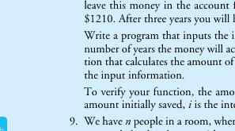

| 方法 | 准确率 | 速度 |
|------|--------|------|
| A    | 95%    | 快   |
| B    | 90%    | 中   |
| C    | 85%    | 慢   |

> 注意：以上数据基于标准测试集。

```python
print("Hello, World!")
```

握手总数。或者说在房间里有两个人时总共会有三次握手。

如果第四个人进入房间，他必须与房间里已有的三个人握手。这是在房间里有三个人时所做的握手次数之外的三次握手，或者总共六次握手。

如果你能将此推广到 n 次握手，你应该能够写出递归解法。

### 10. 考虑一个保龄球瓶架，其中每个 * 代表一个瓶子：

*
  * *
* * *
* * * *
* * * * * *

共有五排，总共十五个瓶子。如果我们只有前四排，总共有十个瓶子。如果我们只有前三排，总共有六个瓶子。如果我们只有前两排，总共有三个瓶子。如果我们只有第一排，总共有一个瓶子。

编写一个递归函数，以行数 n 作为输入，输出一个具有 n 行的金字塔中将存在的瓶子总数。你的程序应允许 n 的值大于 5。

### 11. 编写一个名为 contains 的递归函数，其头文件如下：

```
bool contains (char *haystack, char *needle)
```

该函数应返回 true，如果 C 字符串 needle 包含在 C 字符串 haystack 中，并且如果 needle 不在 haystack 中则返回 false。例如，

```
contains("C++ programming", "ogra") should return true
contains("C++ programming", "grammy") should return false
```

你不允许使用字符串类 substr 或 find 函数来确定匹配。

### 12. 下图是一个确定性有限状态自动机，或 DFA 的示例。此特定 DFA 描述了一种算法，用于确定字符序列是否是一个格式正确的带逗号的货币金额。例如，“$1,000”和“$25”以及“$551,323,991,391”是格式正确的，但“1,000”（没有初始 $）和“$1000”（缺少逗号）以及“$5424,132”（缺少逗号）则不是。

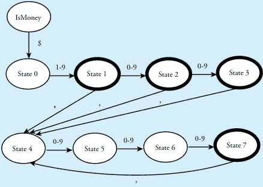

DFA 通过从标记为 IsMoney 的椭圆开始工作。这是初始状态。如果字符串的第一个字符是 $，则我们前进到第二个字符并移动到状态 0。否则我们得出字符串不是正确的货币金额。在状态 0，如果第二个字符是 1 到 9 之间的数字，则我们前进到第三个字符并移动到状态 1。否则我们得出字符串不是正确的货币金额。在状态 1，如果字符串中没有更多字符，则我们得出字符串是一个货币金额。这称为最终状态，用粗体椭圆表示。如果第三个字符是 0 到 9 之间的数字，则我们前进到第四个字符并移动到状态 2。否则如果第三个字符是逗号，则我们前进到第四个字符并移动到状态 4。否则我们得出字符串不是正确的货币金额。DFA 的其余部分以类似的方式运行。

编写一个使用递归实现 DFA 的程序。你的程序应为 DFA 中的每个状态提供一个单独的函数。每个函数应调用由图中箭头指示的下一个状态对应的函数。由于从状态 7 到状态 4 的循环存在相互递归。使用多个字符串测试你的解决方案，并输出每个字符串是否是格式正确的货币金额。

此解决方案为字符串中的每个字符调用一个函数。然而，该解决方案可以以尾递归方式编写，因此如果你的编译器高效，则长字符串可能不会耗尽栈。

### 13. 一个流行的文字游戏涉及从随机生成的字母网格中找到单词。单词必须至少有三个字母长，并且由相邻字母组成。字母不能重复使用，并且沿对角线移动是有效的。例如，考虑以下 4×4 字母网格：

| A | B | C | D |
| E | F | G | H |
| I | J | K | L |
| M | N | O | P |

单词“FAB”是有效的（字母位于左上角）并且单词“KNIFE”是有效的。单词“BABE”无效，因为“B”不能重复使用。单词“MINE”无效，因为“E”与“N”不相邻。

编写一个程序，使用 4 * 4 二维数组来表示游戏板。程序应随机为棋盘选择字母。你可能希望以高于辅音的概率选择元音。你也可能希望始终将“U”放在“Q”旁边或将“QU”视为单个字母。程序应从文本文件 words.txt 中读取单词（随本书在网站上提供），然后使用递归算法确定单词是否可以从游戏板上的字母形成。程序应输出文件中所有可在游戏板上形成的有效单词。

### 14.

单词阶梯游戏由刘易斯·卡罗尔于 1877 年发明。想法是从起始单词开始，然后一次改变一个字母，直到到达结束单词。途中每个单词都必须是英语单词。

例如，从 FISH 开始，你可以通过以下单词阶梯到达 MAST：

FISH, WISH, WASH, MASH, MAST

编写一个程序，使用递归查找给定起始单词和结束单词的单词阶梯，或确定不存在单词阶梯。使用随本书源代码在线提供的 words.txt 文件作为有效单词的词典。该文件包含 87,314 个单词。你的程序不需要在单词之间找到最短的单词阶梯；如果存在，任何单词阶梯都可以。

## Inheritance 14

### 14.1 INHERITANCE BASICS 648

- Derived Classes 648
- Constructors in Derived Classes 658
- Pitfall: Use of Private Member Variables from the Base Class 660
- Pitfall: Private Member Functions Are Effectively Not Inherited 662
- The protected Qualifier 662
- Redefinition of Member Functions 665
- Redefining versus Overloading 666
- Access to a Redefined Base Function 668
- Functions That Are Not Inherited 669

- Example: Partially Filled Array with Backup 672
- Pitfall: Same Object on Both Sides of the Assignment
- Operator 681
- Example: Alternate Implementation of PFArrayDBak 681
- Tip: A Class Has Access to Private Members of All Objects of the Class 684
- Tip: "Is a" versus "Has a" 684
- Protected and Private Inheritance 685
- Multiple Inheritance 686

### 14.2 PROGRAMMING WITH INHERITANCE 670

- Assignment Operators and Copy Constructors in Derived Classes 670
- Destructors in Derived Classes 671

## 14 Inheritance

> *Like mother, like daughter*
> 
> _Common saying_

### Introduction

面向对象编程是一种流行且强大的编程技术。在其他方面，它提供了称为 *继承* 的抽象维度。这意味着可以定义和编译一个非常通用的类形式。稍后，可以定义该类的更专业版本并继承通用类的属性。本章涵盖继承的一般概念，以及它在 C++ 中的具体实现。

本章不使用第 12 章（文件 I/O）或第 13 章（递归）中介绍的任何材料。它也不使用第 7 章第 7.3 节的材料，该节涵盖向量。第 14.1 节也不使用第 10 章（指针和动态数组）的任何材料。

### 14.1 Inheritance Basics

> *如果我们希望在孩子身上改变任何东西，我们首先应该审视它，看看是否不是更适合在我们自己身上改变的东西。*
> 
> CARL GUSTAV JUNG, *The Integration of the Personality: Trans.*
> 
> Stanley M. Dell. New York City: Farrar & Rinehart, Incorporated, 1939

继承是通过另一个类创建新类的过程，该类称为 **派生类**，另一个类称为 **基类**。派生类自动具有基类所具有的所有成员变量和所有普通成员函数，并且可以具有额外的成员函数和额外的成员变量。

### Derived Classes

假设我们正在设计一个记账程序，该程序具有薪资员工和小时员工的记录。这些类的自然层次结构是分组的。这些都是共享作为员工的属性的人的类。

按小时工资支付的员工是员工的一个子集。另一个子集由每月或每周支付固定工资的员工组成。虽然程序可能不需要对应于所有员工的集合的任何类型，但以员工的更一般概念为思考是有用的。例如，所有员工都有姓名和社会安全号码，并且成员函数用于


设置和更改姓名和社会安全号码对薪资员工和小时工来说是相同的。

在 C++ 中，你可以定义一个名为 Employee 的类，其中包含所有员工，无论是薪资还是小时工，然后使用该类来定义小时工类和薪资员工类。

类 Employee 还将包含操作类 Employee 数据字段的成员函数。显示 14.1 和 14.2 显示了类 Employee 的一种可能定义。

## Display 14.1 Interface for the Base Class Employee

```
//This is the header file employee.h.
//This is the interface for the class Employee.
//This is primarily intended to be used as a base class to derive
//classes for different kinds of employees.
#ifndef EMPLOYEE_H
#define EMPLOYEE_H

#include <string>
using std::string;

namespace SavitchEmployees
{

class Employee
{
public:
Employee();
Employee(const string& theName, const string& theSsn);
string getName() const;
string getSsn() const;
double getNetPay() const;
void setName(const string& newName);
void setSsn(const string& newSsn);
void setNetPay(double newNetPay);
void printCheck() const;
private:
string name;
string ssn;
double netPay;
};

};//SavitchEmployees

#endif //EMPLOYEE_H
```

## Display 14.2 Implementation for the Base Class Employee (part 1 of 2)

```
//This is the file employee.cpp.
//This is the implementation for the class Employee.
//The interface for the class Employee is in the header file employee.h.
#include <string>
#include <cstdlib>
#include <iostream>
#include "employee.h"
using std::string;
using std::cout;

namespace SavitchEmployees
{
    Employee::Employee() : name("No name yet"), ssn("No number yet"), netPay(0)
    {
        //deliberately empty
    }

    Employee::Employee(const string& theName, const string& theNumber)
        : name(theName), ssn(theNumber), netPay(0)
    {
        //deliberately empty
    }

    string Employee::getName() const
    {
        return name;
    }

    string Employee::getSsn() const
    {
        return ssn;
    }

    double Employee::getNetPay() const
    {
        return netPay;
    }

    void Employee::setName(const string& newName)
    {
        name = newName;
    }

    void Employee::setSsn(const string& newSsn)
```

## Display 14.2 Implementation for the Base Class Employee (part 2 of 2)

```
{
    ssn = newSsn;
}

void Employee::setNetPay (double newNetPay)
{
    netPay = newNetPay;
}

void Employee::printCheck( ) const
{
    cout << "\nERROR: printCheck FUNCTION CALLED FOR AN \n"
         << "UNDIFFERENTIATED EMPLOYEE. Aborting the program.\n"
         << "Check with the author of the program about this bug.\n";
    exit(1);
}
}//SavitchEmployees
```

你可以有一个（未区分的）Employee 对象，但我们定义类 Employee 的原因是为了能够为不同种类的员工定义派生类。特别是，函数 printCheck 将始终在派生类中更改其定义，以便不同种类的员工可以有不同种类的支票。这在类 Employee 的函数 printCheck 的定义中有所体现（显示 14.2）。为这种（未区分的）Employee 打印支票意义不大。我们对该员工一无所知。因此，我们实现了类 Employee 的函数 printCheck，以便如果为基类 Employee 对象调用 printCheck，程序将以错误消息停止。正如你将看到的，派生类将拥有足够的信息来重新定义函数 printCheck 以生成有意义的员工支票。

派生自类 Employee 的类将自动拥有类 Employee 的所有成员变量（name、ssn 和 netPay）。派生自类 Employee 的类还将拥有类 Employee 的所有成员函数，例如 printCheck、getName、setName 和显示 14.1 中列出的其他成员函数。这通常被表述为派生类继承成员变量和成员函数。

类 Employee 的两个派生类的接口文件在显示 14.3（HourlyEmployee）和显示 14.4（SalariedEmployee）中给出。我们将类 Employee 和两个派生类放在同一个命名空间中。C++ 不要求它们在同一个命名空间中，但由于它们是相关的类，将它们放在同一个命名空间中是有意义的。我们将首先讨论派生类 HourlyEmployee，给出在显示 14.3 中。

## Display 14.3 Interface for the Derived Class HourlyEmployee

```
//This is the header file hourlyemployee.h.
//This is the interface for the class HourlyEmployee.
#ifndef HOURLYEMPLOYEE_H
#define HOURLYEMPLOYEE_H

#include <string>
#include "employee.h"

using std::string;

namespace SavitchEmployees
{

class HourlyEmployee : public Employee
{
public:
    HourlyEmployee();
    HourlyEmployee(const string& theName, const string& theSsn, double theWageRate, double theHours);
    void setRate(double newWageRate);
    double getRate() const;
    void setHours(double hoursWorked);
    double getHours() const;
    void printCheck();
private:
    double wageRate;
    double hours;
};

}//SavitchEmployees

#endif //HOURLYEMPLOYEE_H
```

请注意，派生类的定义与任何其他类定义开始相同，但在类定义的第一个行添加冒号、保留字 public 和基类名，如以下（来自显示 14.3）所示：

```
class HourlyEmployee : public Employee
{
```

派生类（如 HourlyEmployee）自动接收基类（如 Employee）的所有成员变量和成员函数，并且可以添加额外的成员变量和成员函数。

类 HourlyEmployee 的定义没有提到成员变量 name、ssn 和 netPay，但类 HourlyEmployee 的每个对象都有

> 如果你想更改函数的定义，则只列出继承的成员函数的声明。

## Display 14.4 Interface for the Derived Class SalariedEmployee

```
//This is the header file salariedemployee.h.
//This is the interface for the class SalariedEmployee.
#ifndef SALARIEDEMPLOYEE_H
#define SALARIEDEMPLOYEE_H

#include <string>
#include "employee.h"

using std::string;

namespace SavitchEmployees
{

class SalariedEmployee : public Employee
{
public:
    SalariedEmployee();
    SalariedEmployee(const string& theName, const string& theSsn,
                    double theWeeklySalary);
    double getSalary() const;
    void setSalary(double newSalary);
    void printCheck();
private:
    double salary;//weekly
};
}//SavitchEmployees

#endif //SALARIEDEMPLOYEE_H
```

成员变量名为 name、ssn 和 netPay。成员变量 name、ssn 和 netPay 是从类 Employee 继承的。类 HourlyEmployee 声明了两个额外的成员变量名为 wageRate 和 hours。因此，类 HourlyEmployee 的每个对象都有五个成员变量名为 name、ssn、netPay、wageRate 和 hours。请注意，派生类（如 HourlyEmployee）的定义仅列出添加的成员变量。基类中定义的成员变量不会被提及。它们会自动提供给派生类。

正如它继承类 Employee 的成员变量一样，类 HourlyEmployee 也继承了类 Employee 的所有成员函数。因此，类 HourlyEmployee 继承了成员函数 getName、getSsn、getNetPay、setName、setSsn、setNetPay 和 printCheck 来自类 Employee。

## Inherited Members

派生类自动拥有基类的所有成员变量和所有普通成员函数。（正如本章后面讨论的那样，有一些专门的成员函数，如构造函数，并不是自动继承的。）这些来自基类的成员被称为继承。这些继承的成员函数和继承的成员变量，除了一个例外外，在派生类的定义中没有提及，但自动成为派生类的成员。如文中所述，如果你想更改继承的成员函数的定义，则在派生类的定义中提及该继承的成员函数。

除了继承的成员变量和成员函数外，派生类还可以添加新的成员变量和新的成员函数。新的成员变量和新成员函数的声明列在类定义中。例如，派生类 HourlyEmployee 添加了两个成员变量 wageRate 和 hours，并添加了新的成员函数 setRate、getRate、setHours 和 getHours。这在显示 14.3 中显示。请注意，除非你想更改这些定义，否则不会给出继承的成员函数的声明，这一点我们稍后会讨论。现在，不要担心派生类构造函数定义的细节。我们将在下一小节讨论构造函数。

在派生类的实现文件中，例如显示 14.5 中 HourlyEmployee 的实现，给出所有添加的成员函数的定义。请注意，除非在派生类中更改了成员函数的定义，否则不会给出继承的成员函数的定义，我们接下来讨论这一点。

## Parent and Child Classes

在讨论派生类时，常用来自家庭关系的术语。一个基类通常被称为父类。派生类则被称为子类。这使得继承的语言非常流畅。例如，我们可以说子类从其父类继承成员变量和成员函数。这种类比通常会更进一步。一个类的父类的父类（或其他任意次数的“父类”迭代）通常被称为祖先类。如果类 A 是类 B 的祖先，则类 B 通常被称为类 A 的后代。

继承的成员函数的定义可以在派生类的定义中更改，以便在派生类中具有与基类中不同的含义。这称为重新定义继承的成员函数。例如，成员函数 printCheck() 在派生类 HourlyEmployee 的定义中被重新定义。要重新定义成员函数定义，只需


在类定义中列出它并为其提供新的定义，就像你在派生类中添加成员函数时所做的那样。这通过类 HourlyEmployee 的重新定义的函数 printCheck( ) 进行了说明（见显示 14.3 和 14.5）。

## 显示 14.5 派生类 HourlyEmployee 的实现（第 1 部分，共 2 部分）

```
1 //This is the file hourlyemployee.cpp.
2 //This is the implementation for the class HourlyEmployee.
3 //The interface for the class HourlyEmployee is in
4 //the header file hourlyemployee.h.
5 #include <string>
6 #include <iostream>
7 #include "hourlyemployee.h"
8 using std::string;
9 using std::cout;
10 using std::endl;
11 
12 namespace SavitchEmployees
13 {
14 
15 HourlyEmployee::HourlyEmployee( ) : Employee( ), wageRate(0), hours(0)
16 {
17     //deliberately empty
18 }
19 
20 HourlyEmployee::HourlyEmployee(const string& theName,
21     const string& theNumber, double theWageRate,
22     double theHours)
23     : Employee(theName, theNumber), wageRate(theWageRate),
24     hours(theHours)
25 {
26     //deliberately empty
27 }
28 
29 void HourlyEmployee::setRate(double newWageRate)
30 {
31     wageRate = newWageRate;
32 }
33 
34 double HourlyEmployee::getRate( ) const
35 {
36     return wageRate;
37 }
38 
39 void HourlyEmployee::setHours(double hoursWorked)
40 {
41     hours = hoursWorked;
```

## 显示 14.6 派生类 SalariedEmployee 的实现（第 1 部分，共 2 部分）

```
1 //This is the file salariedemployee.cpp
2 //This is the implementation for the class SalariedEmployee.
3 //The interface for the class SalariedEmployee is in
4 //the header file salariedemployee.h
5 #include <iostream>
6 #include <string>
7 #include "salariedemployee.h"
8 using std::string;
9 using std::cout;
10 using std::endl;

11 namespace SavitchEmployees
12 {
13     SalariedEmployee::SalariedEmployee( ) : Employee( ), salary(0)
14     {
15         //deliberately empty
16     }

17     SalariedEmployee::SalariedEmployee(const string& theName,
18         const string& theNumber,
19         double theWeeklyPay)
20         : Employee(theName, theNumber), salary(theWeeklyPay)
21     {
22         //deliberately empty
23     }

24     double SalariedEmployee::getSalary( ) const
25     {
26         return salary;
27     }

28     void SalariedEmployee::setSalary(double newSalary)
29     {
30         salary = newSalary;
31     }

32     void SalariedEmployee::printCheck( )
33     {
34         getNetPay(salary);
35         cout << "\n" << "___________________________" << "\n";
36         cout << "Pay to the order of " << getName( ) << endl;
37         cout << "The sum of " << getNetPay( ) << " Dollars\n";
38         cout << "___________________________" << "\n";
39         cout << "Check Stub NOT NEGOTIABLE \n";
40         cout << "Employee Number: " << getSSN( ) << endl;
```

## 派生类中的构造函数

基类中的构造函数不会继承到派生类中，但你可以在派生类构造函数的定义中调用基类的构造函数，这就是你所需要或通常想要的。派生类的构造函数以特殊的方式使用基类的构造函数。基类的构造函数初始化从基类继承的所有数据。因此，派生类的构造函数以调用基类的构造函数开始。调用基类构造函数的特殊语法由显示 14.5 中给出的类 HourlyEmployee 的构造函数定义所说明。下面我们重现了从该显示中取出的类 HourlyEmployee 的一个构造函数定义（为了使其适应文本栏，对换行做了少量改动）：

```
HourlyEmployee::HourlyEmployee(const string& theName,
        const string& theNumber, double theWageRate,
        double theHours)
    : Employee(theName, theNumber),
      wageRate(theWageRate), hours(theHours)
{
    //deliberately empty
}
```

冒号之后的部分是构造函数 HourlyEmployee::HourlyEmployee 的定义初始化部分。部分 Employee(theName, theNumber) 是对基类 Employee 的双参数构造函数的调用。请注意，调用基类构造函数的语法类似于设置成员变量的语法：条目 wageRate(theWageRate) 将成员变量 wageRate 的值设置为 theWageRate；条目 Employee(theName, theNumber) 使用参数 theName 和 theNumber 调用基类构造函数 Employee。由于所有工作都在初始化部分完成，构造函数定义的体是空的。

下面，我们重现了从显示 14.5 中取出的类 HourlyEmployee 的另一个构造函数：

```
HourlyEmployee::HourlyEmployee( ) : Employee( ), wageRate(0),
                                      hours(0)
{
    // deliberately empty
}
```

## 派生类对象具有不止一种类型

在日常经验中，小时工就是员工。在 C++ 中也是如此。由于 HourlyEmployee 是类 Employee 的派生类，因此 HourlyEmployee 类的每个对象都可以在 Employee 类的对象可以使用的任何地方使用。特别是，当函数需要 Employee 类型的参数时，你可以使用 HourlyEmployee 类型的参数。你可以将 HourlyEmployee 类的对象赋给 Employee 类型的变量。 （但请注意：你不能将普通的 Employee 对象赋给 HourlyEmployee 类型的变量。毕竟，Employee 不一定是 HourlyEmployee。）当然，同样的说明适用于任何基类及其派生类。你可以在允许其基类对象的任何地方使用派生类对象。

更一般地，类类型的对象可以在其任何祖先类对象的任何地方使用。如果类 Child 从类 Ancestor 派生而来，且类 Grandchild 从类 Child 派生而来，那么类 Grandchild 的对象可以在类 Child 的对象可以使用的任何地方使用，并且类 Grandchild 的对象也可以在类 Ancestor 的对象可以使用的任何地方使用。

在此构造函数定义中，调用了基类的默认（零参数）版本来初始化继承的成员变量。你应该始终在派生类构造函数的初始化部分中包含对基类构造函数之一的调用。

如果派生类构造函数的定义不包含对基类构造函数的调用，则默认（零参数）版本的基类构造函数将被自动调用。因此，以下对类 HourlyEmployee 的默认构造函数的定义（省略了 Employee()）等同于我们刚刚讨论的版本：

```
HourlyEmployee::HourlyEmployee() : wageRate(0), hours(0)
{
    //deliberately empty
}
```

然而，我们更喜欢始终显式地包含对基类构造函数的调用，即使它会被自动调用。

派生类对象具有基类的所有成员变量。当调用派生类构造函数时，这些成员变量需要分配内存并应被初始化。对继承的成员变量的内存分配必须由基类的构造函数完成，而基类构造函数是初始化这些继承的成员变量的最方便的位置。这就是为什么你在为派生类定义构造函数时应始终包含对基类构造函数之一的调用的原因。如果你没有在派生类构造函数的定义初始化部分中包含对基类构造函数的调用，则基类的默认（零参数）构造函数将被自动调用。 （如果基类没有默认构造函数，则会发生错误。）


派生类构造函数执行的第一个动作是对基类构造函数的调用。因此，如果类 B 派生自类 A 且类 C 派生自类 B，那么当创建类 C 的对象时，首先会调用类 A 的构造函数，然后调用 B 的构造函数，最后执行类 C 构造函数的剩余动作。

## 派生类中的构造函数

派生类不会继承其基类的构造函数。然而，在为派生类定义构造函数时，你可以并且应该在构造函数定义的初始化部分中包含对基类构造函数的调用。

如果你没有包含对基类构造函数的调用，那么在派生类构造函数被调用时，基类的默认（无参数）构造函数将自动被调用。

## 陷阱：使用基类的私有成员变量

类 HourlyEmployee 的对象（见 14.3 和 14.5 显示）从类 Employee（见 14.1 和 14.2 显示）继承了一个名为 name 的成员变量。例如，以下代码将把对象 joe 的成员变量 name 的值设置为 "Josephine"（它同时将成员变量 ssn 设置为 "123-45-6789"，并且 wageRate 和 hours 都设置为 0）：

```
HourlyEmployee joe("Josephine", "123-45-6789", 0, 0);
```

如果你想将 joe.name 改为 "Mighty-Joe"，可以按如下方式操作：

```
joe.setName("Mighty-Joe");
```

你必须小心地操作 name 等继承的成员变量。类 HourlyEmployee 的成员变量 name 是从类 Employee 继承而来的，但在类 Employee 的定义中，成员变量 name 是一个私有成员变量。这意味着 name 只能在类 Employee 的成员函数定义内部直接访问。基类中为私有的成员变量（或成员函数）在任何其他类的成员函数定义中都不能按名称访问，甚至在派生类的成员函数定义中也不行。因此，虽然类 HourlyEmployee 确实有一个名为 name 的成员变量（从基类 Employee 继承），但在类 HourlyEmployee 的类定义中任何成员函数的定义中直接访问成员变量 name 是非法的。

## 陷阱：（续）

例如，以下是成员函数 HourlyEmployee::printCheck 的函数体开头几行（取自 14.5 显示）：

```
void HourlyEmployee::printCheck()
{
    setNetPay(hours * wageRate);
    cout << "\n";
    cout << "Pay to the order of " << getName() << endl;
    cout << "The sum of " << getNetPay() << " Dollars\n";
```

你可能想知道为什么我们需要使用成员函数 setNetPay 来设置 netPay 成员变量的值。你可能想诱使重写成员函数定义的开头如下：

```
void HourlyEmployee::printCheck()
{
    netPay = hours * wageRate; // Illegal use of netPay
```

正如注释所指出的，这行不通。成员变量 netPay 是类 Employee 中的私有成员变量，虽然像 HourlyEmployee 这样的派生类继承了变量 netPay，但它不能直接访问它。它必须使用某个公共成员函数来访问成员变量 netPay。在类 HourlyEmployee 中实现 printCheck 的正确方法是我们已在 14.5 显示中完成的方式（其中一部分已在前面显示）。

name 和 netPay 是继承变量并且在基类中为私有这一事实也解释了为什么我们在 HourlyEmployee::printCheck 的定义中使用了访问器函数 getName 和 getNetPay，而不是简单地使用变量名 name 和 netPay。你不能按名称提及私有继承的成员变量。你必须改用在基类中定义的公共访问器和变异器成员函数（如 getName 和 setName）。（请记住，访问器函数是允许你访问类的成员变量的函数，而变异器函数是允许你更改类的成员变量的函数。访问器和变异器函数在第 6 章中介绍。）

私有基类成员变量不能在派生类成员函数的定义中访问这一事实常常让人觉得不对劲。毕竟，如果你是一名小时工并且想更改你的名字，没有人会说，“抱歉，name 是类 Employee 的私有成员变量。”如果你是一名小时工，你也是一名员工。在 Java 中也是如此；类 HourlyEmployee 的对象也是类 Employee 的对象。然而，如果 C++ 允许从派生类访问私有成员变量和私有成员函数，那么每当你想访问私有成员变量时，你只需创建一个派生类并在该类的成员函数中访问它。这

## 陷阱：（续）

意味着所有私有成员变量都对任何想要付出一点额外努力的人都是可访问的。这个场景说明了问题，但更大的问题是无意的错误而不是有意的破坏。如果类的私有成员变量可以在派生类成员函数定义中访问，那么成员变量可能会被错误地更改或以不适当的方式更改。（请记住，访问器和变异器函数可以防止对成员变量的不当更改。）

我们将在本章稍后“受保护限定符”小节中讨论一种可能的规避基类私有成员变量此限制的方法。

## 陷阱：私有成员函数实际上并未被继承

如前一陷阱部分所述，基类中为私有的成员变量（或成员函数）在基类的接口和实现之外是无法直接访问的，甚至在派生类的成员函数定义中也不行。请注意，私有成员函数在不直接可用方面与私有变量一样。 对于成员函数而言，限制更为严厉。私有变量可以通过访问器或变异器成员函数间接访问。私有成员函数根本不可用。它就像私有成员函数未被继承一样。

这不应该是个问题。私有成员函数应仅用作帮助函数，因此其使用应限于它们所定义的类。如果你希望成员函数在多个继承类中用作帮助成员函数，那么它就不仅仅是一个帮助函数，你应该将成员函数设为 public。

## protected 限定符

如你所见，你不能在派生类的定义或实现中访问私有成员变量或私有成员函数。存在一种成员变量和函数的分类，允许它们按名称在派生类中访问，但不能在其他任何地方访问，例如在非派生类中。如果你在使用成员变量或成员函数前使用限定符 protected 而不是 private 或 public，那么对于派生类以外的任何类或函数，其效果就如同成员变量被标记为 private；然而，在派生类中，可以按名称访问该变量。

## 1. 引言

本文档旨在介绍一种新型的文档解析方法，该方法结合了深度学习与自然语言处理技术，能够高效地从复杂版面中提取结构化信息。

## 2. 相关工作

近年来，基于Transformer的模型在文档理解任务中取得了显著进展。例如，LayoutLMv3通过融合文本、布局和图像信息，实现了强大的多模态表示。

- 方法A：基于规则的方法
- 方法B：基于深度学习的方法
- 方法C：混合方法

## 3. 方法

我们提出了一种端到端的神经网络架构，该架构能够同时处理文本、表格和图像，并输出统一的语义表示。

| 模型 | 准确率 | F1分数 |
|------|--------|--------|
| Baseline | 85.2% | 83.1% |
| Ours | 92.4% | 91.0% |

> > 实验结果表明，我们的方法在多个基准数据集上均取得了最优性能。

此外，我们还提供了详细的消融实验分析，以验证各模块的有效性。

definitions. 然而，这并不像听起来那么糟糕。继承的私有成员变量可以通过调用继承的函数间接访问，这些函数要么读取要么更改私有继承变量。由于权威人士对是否应使用受保护成员存在不同意见，你必须自行决定是否使用它们。

## 受保护成员

如果你在使用类成员变量前使用限定符 protected（而不是 private 或 public），那么对于派生类以外的任何类或函数，其效果就如同成员变量被标记为 private。然而，在派生类成员函数的定义中，可以按名称访问该变量。类似地，如果你在使用类成员函数前使用限定符 protected，那么对于派生类以外的任何类或函数，其效果就如同成员变量被标记为 private。然而，在派生类成员函数的定义中，可以使用受保护的函数。

受保护成员在派生类中被继承，就好像它们在派生类中被标记为 protected 一样。换句话说，如果成员在基类中被标记为 protected，那么它可以在所有后代类的定义中按名称访问，而不仅仅是在直接从基类派生的那些类中。

## 自测练习

- 1. 以下程序是否合法（假设添加了适当的 #include 和 using 指令）？

```
void showEmployeeData(const Employee object);

int main()
{
    HourlyEmployee joe("Mighty Joe", "123-45-6789", 20.50, 40);
    SalariedEmployee boss("Mr. Big Shot", "987-65-4321", 10500.50);
    showEmployeeData(joe);
    showEmployeeData(boss);
    return 0;
}

void showEmployeeData(const Employee object)
{
    cout << "Name: " << object.getName() << endl;
    cout << "Social Security Number: " << object.getSsn() << endl;
}
```


# 自测练习（续）

2. 给出一个类 SmartBut 的定义，它是下面给出的基类 Smart 的派生类。不要理会 `#include` 指令或命名空间细节。

```
class Smart
{
public:
    Smart();
    void printAnswer() const;
protected:
    int a;
    int b;
};
```

该类应有一个额外的 bool 类型的数据字段 crazy；一个不带参数且返回 bool 类型值的额外成员函数；以及合适的构造函数。新的函数名为 isCrazy。你不需要给出任何实现，只需类定义即可。

3. 下列是否是派生类 SmartBut 中成员函数 isCrazy 的合法定义？在自测练习 2 中讨论过该类。解释你的答案。（记住，问题问的是是否合法，而不是是否是一个合理的定义。）

```
bool SmartBut::isCrazy() const
{
    if (a > b)
        return crazy;
    else
        return true;
}
```

## 成员函数的重新定义

在派生类 HourlyEmployee 的定义中（Display 14.3），我们给出了新的成员函数 setRate、getRate、setHours 和 getHours 的声明。我们还只给出了从类 Employee 继承的成员函数之一的函数声明。未给出函数声明的继承成员函数（如 setName 和 setSSn）保持不变继承。它们在类 HourlyEmployee 中的定义与在基类 Employee 中相同。当你定义像 HourlyEmployee 这样的派生类时，你只列出那些你希望在派生类中改变定义的继承成员函数的函数声明。如果你查看类 HourlyEmployee 的实现（Display 14.5），你会看到我们重新定义了继承的成员函数 printCheck。类 SalariedEmployee 也对成员函数 printCheck 提供了新的定义，如 Display 14.6 所示。而且，这两个类给出了彼此不同的定义。函数 printCheck 在派生类中被重新定义。

## 重新定义继承的函数

派生类继承了基类所属的所有成员函数（和成员变量）。然而，如果派生类需要对继承的成员函数使用不同的实现，则可以在派生类中重新定义该函数。当成员函数被重新定义时，你必须在派生类的定义中列出其声明，即使该声明与基类中的相同。如果你不希望重新定义从基类继承的成员函数，则不要在派生类的定义中列出它。

## 重新定义与重载

不要将派生类中函数定义的重新定义与函数名的重载混淆。当你重新定义函数定义时，派生类中给出的新函数定义具有相同数量和类型的参数。当你重载一个函数时，派生类中的函数与基类中的函数相比具有不同数量的参数或不同类型的参数，并且派生类同时拥有这两个函数。例如，假设我们在类 HourlyEmployee 的定义中添加了以下函数声明：

```
void setName(string firstName, string lastName);
```

类 HourlyEmployee 将拥有这个有两个参数的函数 setName，并且还会继承以下有一个参数的函数 setName：

```
void setName(string newName);
```

类 HourlyEmployee 将有两个名为 setName 的函数。这就是对函数名 setName 的重载。

另一方面，类 Employee 和类 HourlyEmployee 都定义了具有以下函数声明的函数：

```
void printCheck( );
```

在这种情况下，类 HourlyEmployee 只有一个名为 printCheck 的函数，但类 HourlyEmployee 的 printCheck 函数的定义与类 Employee 的定义不同。在这种情况下，函数 printCheck 已经被重新定义。

如果你把重新定义和重载搞混了，你也有一点安慰：它们都是合法的。因此，学习如何使用它们比学习如何区分它们更重要。尽管如此，你仍应学习它们之间的区别。

## Display 14.7 使用派生类

```
1 #include <iostream>
2 #include "hourlyemployee.h"
3 #include "salariedemployee.h"
4 using std::cout;
5 using std::endl;
6 using SavitchEmployees::HourlyEmployee;
7 using SavitchEmployees::SalariedEmployee;
8 int main() {
9 {
10 HourlyEmployee joe;
11 joe.setName("Mighty Joe");
12 joe.setSSn("123-45-6789");
13 joe.setRate(20.50);
14 joe.setHours(40);
15 cout << "Check for " << joe.getName() << "\n";
16 cout << " for " << joe.getHours() << " hours.\n";
17 joe.printCheck();
18 cout << endl;
19 SalariedEmployee boss("Mr. Big Shot", "987-65-4321", 10500.50);
20 cout << "Check for " << boss.getName() << endl;
21 boss.printCheck();
22 return 0;
23 }
```

函数 setName、setSSn、setRate、setHours 和 getName 是从类 Employee 不变继承的。函数 printCheck 被重新定义。函数 getHours 被添加到派生类 HourlyEmployee 中。

## 示例对话

```
Check for Mighty Joe for 40 hours.

Pay to the order of Mighty Joe
The sum of 820 Dollars

Check Stub: NOT NEGOTIABLE
Employee Number: 123-45-6789
Hourly Employee.
Hours worked: 40 Rate: 20.5 Pay: 820

Check for Mr. Big Shot

Pay to the order of Mr. Big Shot
The sum of 10500.5 Dollars

Check Stub: NOT NEGOTIABLE
Employee Number: 987-65-4321
Salaried Employee. Regular Pay: 10500.5
```

## 签名

函数的签名是函数名加上参数列表中类型的序列，不包括 const 关键字和引用符号 &；当你重载一个函数名时，函数名的两个定义必须使用此签名定义具有不同的签名。（一些权威人士将 const 和/或引用包含为签名的一部分，但我们想要一个适用于解释重载的定义。）一个在派生类中与基类中同名但具有不同签名的函数是被重载的，而不是被重新定义的。

> （正如我们在第 4 章中所指出的，一些编译器实际上会允许你基于 const 与非 const 进行重载，但你不应依赖这一点。C++ 标准说这是不允许的。）

## 对重新定义基函数的访问

假设你重新定义了一个函数，使其在派生类中的定义与在基类中的不同。基类中给出的定义并没有完全丢失给派生类对象。然而，如果你想用派生类中的对象调用基类中给出的函数版本，你需要某种方法来说“使用基类中给出的此函数的定义（即使我是一个派生类对象）”。你说这种方式的方法是使用作用域解析运算符与基类的名称。一个例子应该能阐明细节。

考虑基类 Employee（Display 14.1）和派生类 HourlyEmployee（Display 14.3）。函数 printCheck( ) 在两个类中都有定义。现在假设你有每个类的一个对象，如下所示：

```
Employee JaneE;
HourlyEmployee SallyH;
```

那么

```
JaneE.printCheck( );
```

使用类 Employee 中给出的 printCheck 的定义，而

```
SallyH.printCheck( );
```

使用类 HourlyEmployee 中给出的 printCheck 的定义。

但假设你想用派生类对象 SallyH 作为 printCheck 的调用对象来调用基类 Employee 定义中给出的 printCheck 版本。按如下方式执行：

```
SallyH.Employee::printCheck( );
```


当然，你不太可能想在特定的 `Employee` 类中使用 `printCheck` 的这个版本，但在其他类和函数中，你偶尔可能希望将基类中的函数定义用于派生类对象。自测练习 6 中给出了一个示例。

## 不被继承的函数

一般来说，如果 `Derived` 是以 `Base` 为基类的派生类，那么 `Base` 类中的所有“普通”函数都是 `Derived` 类的可用继承成员。然而，有些特殊函数实际上并不被继承。我们已经看到，构造函数和私有成员函数实际上并不被继承。析构函数（在第 14.2 节中讨论）实际上也不被继承。

拷贝构造函数不被继承，但如果你没有在派生类（或任何类）中定义拷贝构造函数，C++ 会自动为你生成一个拷贝构造函数。然而，这个默认的拷贝构造函数只是简单地复制成员变量的内容，对于成员变量中包含指针或动态数据的类来说，它无法正确工作。因此，如果你的类成员变量涉及指针、动态数组或其他动态数据，你应该为类定义拷贝构造函数。无论该类是否为派生类，这一点都适用。

赋值运算符 `=` 也不被继承。如果基类 `Base` 定义了赋值运算符，但派生类 `Derived` 没有定义，那么 `Derived` 类会有一个赋值运算符，但它是 C++ 创建的默认赋值运算符（当你没有定义 `=` 时）；它与 `Base` 中定义的基类赋值运算符没有任何关系。定义赋值运算符的技术在第 14.2 节的“派生类中的赋值运算符和拷贝构造函数”小节中讨论。

构造函数、析构函数和赋值运算符不被继承是很自然的。为了正确执行它们的任务，它们需要基类不具备的信息；也就是说，它们需要了解派生类中引入的新成员变量。

## 自测练习

- 4. `SalariedEmployee` 类从基类 `Employee` 继承了 `getName` 和 `printCheck` 这两个函数（以及其他内容），但 `SalariedEmployee` 类的定义中只给出了 `printCheck` 函数的声明。为什么 `SalariedEmployee` 的定义中没有给出 `getName` 函数的声明？

## 自测练习（续）

- 5. 给出一个 `TitledEmployee` 类的定义，它是显示 14.4 中基类 `SalariedEmployee` 的派生类。`TitledEmployee` 类有一个额外的 `string` 类型成员变量，名为 `title`。它还有两个额外的成员函数：`getTitle`，它不接受参数并返回一个 `string`；以及 `setTitle`，它是一个 `void` 函数，接受一个 `string` 类型的参数。它还重新定义了成员函数 `setName`。你不需要给出任何实现，只需给出类定义。但是，请给出所有需要的 `#include` 指令和所有 `using namespace` 指令。将 `TitledEmployee` 类放在 `SavitchEmployees` 命名空间中。
- 6. 给出你在自测练习 5 中回答的 `TitledEmployee` 类构造函数的定义。同时，给出成员函数 `setName` 的重新定义。`setName` 函数应将 `title` 插入到名称中。不必考虑 `#include` 指令或命名空间细节。
- 7. 你知道重载的赋值运算符和拷贝构造函数不被继承。这是否意味着如果你没有为派生类定义重载的赋值运算符或拷贝构造函数，那么该派生类将没有赋值运算符和拷贝构造函数？

## 14.2 使用继承进行编程

> 细节决定成败。

——常见谚语

本节介绍有关继承的一些更微妙的细节，并给出另一个完整示例，以及关于继承和相关编程技术的讨论。本节内容使用动态数组（第 10 章），并且大多数主题仅与使用动态数组或指针及其他动态数据的类相关。

### 派生类中的赋值运算符和拷贝构造函数

重载的赋值运算符和构造函数不被继承。然而，它们可以在派生类的重载赋值运算符和拷贝构造函数的定义中使用——而且在几乎所有情况下都必须使用。

在派生类中重载赋值运算符时，通常使用基类中的重载赋值运算符。为了帮助理解我们将给出的代码大纲，请记住，重载的赋值运算符必须定义为类的成员函数。

如果 `Derived` 是从 `Base` 派生的类，那么 `Derived` 类的重载赋值运算符的定义通常以如下代码开头：

```
Derived& Derived::operator =(const Derived& rightSide)
{
    Base::operator =(rightSide);
```

定义体中的第一行代码是对 `Base` 类赋值运算符的调用。这负责处理继承的成员变量及其数据。然后，重载赋值运算符的定义将继续设置 `Derived` 类定义中引入的新成员变量。包含此技术的完整示例见本章后面的编程示例“带备份的部分填充数组”。

类似的情况也适用于在派生类中定义拷贝构造函数。如果 `Derived` 是从 `Base` 派生的类，那么 `Derived` 类的拷贝构造函数定义通常使用 `Base` 类的拷贝构造函数来设置继承的成员变量及其数据。代码通常以如下内容开头：

```
Derived::Derived(const Derived& Object)
    : Base(Object), <可能还有更多初始化>
```

对基类拷贝构造函数 `Base(Object)` 的调用设置了正在创建的 `Derived` 类对象的继承成员变量。请注意，由于 `Object` 的类型是 `Derived`，它也是 `Base` 类型；因此，`Object` 是 `Base` 类拷贝构造函数的合法参数。包含基类中拷贝构造函数的完整示例见本章后面的编程示例“带备份的部分填充数组”。

当然，除非基类具有正确运行的赋值运算符和正确运行的拷贝构造函数，否则这些技术无法工作。这意味着基类定义必须包含拷贝构造函数，并且要么自动创建的默认赋值运算符对基类正确工作，要么基类具有重载的赋值运算符定义。

### 派生类中的析构函数

如果基类具有正确运行的析构函数，那么在从基类派生的类中定义正确运行的析构函数相对容易。当派生类的析构函数被调用时，它会自动调用基类的析构函数，因此无需显式编写对基类析构函数的调用；它总是自动发生。因此，派生类的析构函数只需考虑对派生类中添加的成员变量（以及它们指向的任何数据）使用 `delete`。对继承的成员变量调用 `delete` 是基类析构函数的工作。

## 示例：带备份的部分填充数组

如果类 B 派生自类 A，类 C 派生自类 B，那么当类 C 的对象超出作用域时，首先调用类 C 的析构函数，然后调用类 B 的析构函数，最后调用类 A 的析构函数。请注意，析构函数的调用顺序与构造函数的调用顺序相反。我们在编程示例“带备份的部分填充数组”中给出了在派生类中编写析构函数的示例。

此示例展示了我们在第 10 章（显示 10.10）中介绍的部分填充数组类 `PFArrayD` 的派生类。为便于参考，我们在显示 14.8 中重复了基类 `PFArrayD` 的头文件。我们在显示 14.9 中包含了我们将讨论的基类 `PFArrayD` 实现的尽可能多的内容。请注意，我们对第 10 章中给出的定义做了一个重要更改。我们将成员变量从 `private` 更改为 `protected`。这将允许派生类中的成员函数按名称访问成员变量。

我们将使用 `PFArrayD` 作为基类定义一个名为 `PFArrayDBak` 的派生类。派生类 `PFArrayDBak` 的对象将拥有基类 `PFArrayD` 的所有成员函数，并且可以像 `PFArrayD` 类的对象一样使用，但 `PFArrayDBak` 类的对象将具有以下附加功能：有一个名为 `backup` 的成员函数，可以制作部分填充数组中所有数据的备份副本；在稍后的任何时间，程序员可以使用 `restore` 成员函数将部分填充数组恢复到上次调用 `backup` 之前的状态。如果这些附加成员函数的含义不清楚，你应该提前查看显示 14.12 中的示例演示程序。

派生类 `PFArrayDBak` 的接口显示在显示 14.10 中。`PFArrayDBak` 类添加了两个成员变量来保存部分填充数组的备份副本：一个 `double*` 类型的成员变量 `b`，它将指向一个动态数组，其中包含（继承的）工作数组的备份版本；以及一个名为 `usedB` 的 `int` 成员变量，用于指示备份数组 `b` 中有多少数据被填充。由于无法更改 `PFArrayD`（或 `PFArrayDBak`）的容量，因此无需备份容量值。所有用于处理部分填充数组的基本函数都从基类 `PFArrayD` 原样继承。这些继承的函数操作继承的数组 `a` 和继承的 `int` 变量 `used`，就像它们在基类 `PFArrayD` 中一样。

`PFArrayDBak` 类的新成员函数的实现显示在显示 14.11 中。派生类 `PFArrayDBak` 的构造函数依赖基类的构造函数来设置常规的部分填充数组（继承的成员变量 `a`、`used` 和 `capacity`）。每个构造函数还创建一个与数组 `a` 大小相同的新动态数组。这第二个数组是用于备份 `a` 中数据的数组 `b`。


# EXAMPLE: (continued)

成员函数 backup 使用以下代码将部分填充的数组（a 和 used）中的数据复制到备份位置 b 和 usedB：

```
usedB = used;
for (int i = 0; i < usedB; i++)
    b[i] = a[i];
```

你应该注意，基类中的成员变量 a 和 used 是 protected 而不是 private。否则，前面的代码将是非法的，因为它通过名称访问继承的成员变量 a 和 used。

成员函数 restore 只是反向操作，将数据从 b 和 usedB 复制到 a 和 used。

派生类 PFArrayDBak 的重载赋值运算符的定义以对基类 PFArrayD 的赋值运算符的调用开始。这会将赋值运算符右手边的对象（参数 rightSide）中的成员变量 a、used 和 capacity 的所有数据复制到赋值运算符左手边的对象（调用对象）。我们依赖于该操作在基类 PFArrayD 的重载赋值运算符的定义中已正确完成。也就是说，我们依赖基类的赋值运算符在继承部分在赋值运算符的两侧出现相同对象时表现正确，并且我们假设复制操作对数组 a 进行了独立的复制。派生类 PFArrayDBak 的重载赋值运算符体中的代码需要为数组 b 创建同样独立的副本。

由于赋值运算符左右两侧的对象可能具有不同的容量，因此我们必须在大多数情况下创建新的数组 b。这按如下方式完成：

```
if (oldCapacity != rightSide.capacity)
{
    delete [] b;
    b = new double[rightSide.capacity];
}
```

请注意，if 语句中的布尔表达式确保当赋值运算符两侧的对象具有相同容量时，b 不会被删除。特别是，这确保了当同一个对象出现在赋值运算符的两侧时，数组 b 不会被删除。此后，数据的复制是常规操作。

请注意，类 PFArrayDBak 的析构函数对继承的成员变量 a 没有明确提及。它只是使用以下语句将 b 数组内存归还给 freestore 以供回收：

```
delete [] b;
```

继承的数组 a 的内存也将被归还给 freestore，即使你在派生类 PFArrayDBak 的析构函数中看不到对 a 的任何提及。当派生类 PFArrayDBak 的析构函数被调用时，它在结束其操作时会自动调用基类 PFArrayD 的析构函数；该析构函数包含以下代码来处理 a：

```
delete [] a;
```

我们对类 PFArrayDBak 的演示程序在 Display 14.12 中给出。

# Display 14.8 Interface for the Base Class PFArrayD (part 1 of 2)

```
//This is the header file pfarrayd.h. This is the interface for the
//class PFArrayD. Objects of this type are partially filled arrays
//of doubles.
#ifndef PFARRAYD_H
#define PFARRAYD_H
class PFArrayD
{
public:
PFArrayD();
//Initializes with a capacity of 50.
PFArrayD(int capacityValue);
PFArrayD(const PFArrayD& pfaObject);
void addElement(double element);
//Precondition: The array is not full.
//Postcondition: The element has been added.
bool full() const;
//Returns true if the array is full, false otherwise.
int getCapacity() const;
int getNumberUsed() const;
void emptyArray();
//Resets the number used to zero, effectively emptying the array.
double& operator[](int index);
//Read and change access to elements 0 through numberUsed - 1.
```

这个类与 Display 10.10 中的类相同，只是我们已将成员变量改为 protected 而不是 private。

最好将这个类放在一个命名空间中，但为了保持示例简单，我们没有这样做。

## 1. 引言

本文档旨在介绍一种基于深度学习的图像识别方法，该方法在多个标准数据集上取得了优异的性能表现。

近年来，随着计算能力的提升和大规模数据集的构建，深度学习技术在计算机视觉领域取得了突破性进展。本文提出的方法在传统卷积神经网络的基础上，引入了注意力机制，进一步提升了模型的表征能力。

## 2. 相关工作

在图像识别领域，已有大量研究工作致力于提升模型的准确率和鲁棒性。早期的研究主要依赖于手工设计的特征，如SIFT和HOG。随着深度学习的兴起，基于卷积神经网络的方法逐渐成为主流。

- 基于卷积神经网络的方法
- 基于注意力机制的方法
- 基于Transformer的方法

## 3. 方法

本文提出的方法主要包括三个模块：特征提取模块、注意力模块和分类模块。特征提取模块采用预训练的ResNet-50作为骨干网络，注意力模块用于增强关键区域的表征，分类模块则负责最终的类别预测。

| 模块名称 | 参数数量 | 说明 |
|----------|----------|------|
| 特征提取 | 23.5M | ResNet-50骨干网络 |
| 注意力模块 | 1.2M | 通道注意力与空间注意力 |
| 分类模块 | 0.8M | 全连接层 |

## 4. 实验

我们在CIFAR-10和ImageNet数据集上进行了实验验证。实验结果表明，本文提出的方法在准确率上优于现有的基线方法。

# Display 14.9 Implementation for the Base Class PFArrayD (part 2 of 2)

```
PFArrayD& PFArrayD::operator = (const PFArrayD& rightSide)
{
    if (capacity != rightSide.capacity)
    {
        delete [] a;
        a = new double[rightSide.capacity];
    }

    capacity = rightSide.capacity;
    used = rightSide.used;
    for (int i = 0; i < used; i++)
        a[i] = rightSide.a[i];
    return *this;
}
PFArrayD::~PFArrayD()
{
    delete [] a;
}
```

# Display 14.10 Interface for the Derived Class PFArrayDBak (part 1 of 2)

```
//This is the header file pfarraydbak.h. This is the interface for the
//class PFArrayDBak. Objects of this type are partially filled arrays
//of doubles.
//This version allows the programmer to make a backup copy and restore
//to the last saved copy of the partially filled array.
#ifndef PFARRAYDBAK_H
#define PFARRAYDBAK_H
#include "pfarrayd.h"

class PFArrayDBak : public PFArrayD
{
public:
    PFArrayDBak();
    //Initializes with a capacity of 50.

    PFArrayDBak(int capacityValue);

    PFArrayDBak(const PFArrayDBak& Object);

    void backup();
    //Makes a backup copy of the partially filled array.

    void restore();
    //Restores the partially filled array to the last saved version.

# Display 14.11 Implementation for the Derived Class PFArrayDBak (part 2 of 2)

```
void PFArrayDBak::restore()
{
    used = usedB;
    for (int i = 0; i < used; i++)
        a[i] = b[i];
}

PFArrayDBak& PFArrayDBak::operator = (const PFArrayDBak& rightSide)
{
    int oldCapacity = capacity;
    PFArrayD::operator = (rightSide);
    if (oldCapacity != rightSide.capacity)
    {
        delete [] b;
        b = new double[rightSide.capacity];
    }
    usedB = rightSide.usedB;
    for (int i = 0; i < usedB; i++)
        b[i] = rightSide.b[i];
    return *this;
}

PFArrayDBak::~PFArrayDBak()
{
    delete [] b;
}
```

> 为了对基类成员变量进行赋值，请调用基类赋值运算符。

> 基类 PFArrayD 的析构函数会自动调用，并且它会执行 delete [] a。

# Display 14.12 Demonstration Program for the Class PFArrayDBak (part 1 of 3)

```
//Program to demonstrate the class PFArrayDBak.
#include <iostream>
#include "pfarraydbak.h"
using std::cin;
using std::cout;
using std::endl;

void testPFArrayDBak();
//Conducts one test of the class PFArrayDBak.

int main()
{
    cout << "This program tests the class PFArrayDBak.\n";
```

# Display 14.12 Demonstration Program for the Class PFArrayDBak (part 2 of 3)

```
char ans;
do
{
    testPFArrayDBak();
    cout << "Test again? (y/n) ";
    cin >> ans;
} while ((ans == 'y') || (ans == 'Y'));

return 0;
}

void testPFArrayDBak()
{
    int cap;
    cout << "Enter capacity of this super array: ";
    cin >> cap;
    PFArrayDBak a(cap);

    cout << "Enter up to " << cap << " nonnegative numbers.\n";
    cout << "Place a negative number at the end.\n";

    double next;

    cin >> next;
    while ((next >= 0) && (!a.full()))
    {
        a.addElement(next);
        cin >> next;
    }
    if (next >= 0)
    {
        cout << "Could not read all numbers.\n";
        //Clear the unread input:
        while (next >= 0)
            cin >> next;
    }
    int count = a.getNumberUsed();
    cout << "The following " << count
    << " numbers read and stored:\n";
    int index;
    for (index = 0; index < count; index++)
        cout << a[index] << " ";
    cout << endl;

    cout << "Backing up array.\n";
    a.backup();
```


# Display 14.12 类 PFArrayDBak 的演示程序（第 3 部分，共 3 部分）

```
52      cout << "Emptying array.\n";
53      a.emptyArray();
54      cout << a.getNumberUsed() <<
55           " numbers are now stored in the array.\n";
56
57      cout << "Restoring array.\n";
58      a.restore();
59      count = a.getNumberUsed();
60      cout << "The following " << count
61           << " numbers are now stored:\n";
62      for (index = 0; index < count; index++)
63          cout << a[index] << " ";
64  }
```

# Sample Dialogue

```
This program tests the class PFArrayDBak.
Enter capacity of this super array: 10
Enter up to 10 nonnegative numbers.
Place a negative number at the end.
1 2 3 4 5 -1
The following 5 numbers read and stored:
1 2 3 4 5
Backing up array.
Emptying array.
0 numbers are now stored in the array.
Restoring array.
The following 5 numbers are now stored:
1 2 3 4 5
Test again? (y/n) y
Enter capacity of this super array: 5
Enter up to 5 nonnegative numbers.
Place a negative number at the end.
1 2 3 4 5 6 7 -1
Could not read all numbers.
The following 5 numbers read and stored:
1 2 3 4 5
Backing up array.
Emptying array.
0 numbers are now stored in the array.
Restoring array.
The following 5 numbers are now stored:
1 2 3 4 5
Test again? (y/n) n
```

# PITFALL: Same Object on Both Sides of the Assignment Operator

每当你重载赋值运算符时，务必确保你的定义在赋值运算符的两侧出现同一个对象时也能正常工作。在大多数情况下，你需要将其作为一种特殊情况并使用自己的代码。关于这一点的一个例子已在编程示例“带备份的部分填充数组”中给出。

# Self-Test Exercises

8. 假设 Child 是从类 Parent 派生的类，而类 Grandchild 是从类 Child 派生的类。本题关注三个类 Parent、Child 和 Grandchild 的构造函数和析构函数。当类 Grandchild 的构造函数被调用时，哪些构造函数会被调用以及调用顺序是什么？当类 Grandchild 的析构函数被调用时，哪些析构函数会被调用以及调用顺序是什么？

9.  下列对类 PFArrayDBak 的默认构造函数的替代定义是否合法？（Display 14.10 和 14.11） （对基类构造函数的调用已被省略。）请解释你的答案。

```
PFArrayDBak::PFArrayDBak() : usedB(0)
{
  b = new double[capacity];
}
```

# EXAMPLE: Alternate Implementation of PFArrayDBak

乍一看，似乎我们需要将基类 PFArray 的成员变量设为 protected 才能给出派生类 PFArrayDBak 的成员函数的定义。毕竟，许多成员函数都操作继承而来的成员变量 a、used 和 capacity。我们在 Display 14.11 中给出的实现确实按名称引用了 a、used 和 capacity，因此这些特定的定义确实依赖于这些成员变量在基类中为 protected（而不是 private）。然而，基类中提供了足够的访问器和修改器函数，只要再多思考一下，我们就可以重写派生类 PFArrayDBak 的实现，使其即使在基类 PFArray 中的所有成员变量都是 private（而不是 protected）时也能工作。

Display 14.13 显示了类 PFArrayDBak 的一种替代实现，即使基类中的所有成员变量都是 private 而不是 protected 也能正常工作。与我们之前的实现不同的部分已着色。大多数更改都很明显，但有几点值得注意。

## 1. 引言

本文档旨在介绍一种新型的文档解析方法，该方法能够高效地从复杂布局的PDF文件中提取结构化信息。

随着数字化办公的普及，PDF文档的数量呈指数级增长。如何从这些文档中快速、准确地提取关键信息，已成为自然语言处理领域的一个重要研究方向。

## 2. 相关工作

近年来，基于深度学习的文档解析模型取得了显著进展。例如，LayoutLMv3通过融合文本、布局和图像信息，在多个文档理解任务上达到了领先水平。

- 基于规则的方法：依赖人工定义的模板，灵活性差。
- 基于传统机器学习的方法：需要大量特征工程。
- 基于深度学习的方法：端到端训练，性能优越。

### 2.1 数据集

| 数据集名称 | 文档数量 | 标注类型 |
|------------|----------|----------|
| FUNSD      | 199      | 实体、关系 |
| CORD       | 1000     | 键值对   |
| SROIE      | 626      | 键值对   |

> > 注意：上述数据集的标注质量直接影响模型的最终性能。

在实验过程中，我们采用了数据增强策略来提升模型的泛化能力。

# Display 14.13  `PFArrayDBak` 的替代实现（第 2 部分，共 2 部分）

```
```cpp
15  PFArrayDBak::PFArrayDBak(const PFArrayDBak& oldObject)
16      : PFArrayD(oldObject),
17  {
18      b = new double[getCapacity()];
19      usedB = oldObject.usedB;
20      for (int i = 0; i < usedB; i++)
21          b[i] = oldObject.b[i];
22  }
23  void PFArrayDBak::backup()
24  {
25      usedB = getNumberUsed();
26      for (int i = 0; i < usedB; i++)
27          b[i] = operator[](i);
28  }
29
30  void PFArrayDBak::restore()
31  {
32      emptyArray();
33
34      for (int i = 0; i < usedB; i++)
35          addElement(b[i]);
36  }
37
38  PFArrayDBak& PFArrayDBak::operator=(const PFArrayDBak& rightSide)
39  {
40      int oldCapacity = getCapacity();
41      PFArrayD::operator=(rightSide);
42      if (oldCapacity != rightSide.getCapacity())
43      {
44          delete [] b;
45          b = new double[rightSide.getCapacity()];
46      }
47
48      usedB = rightSide.usedB;
49      for (int i = 0; i < usedB; i++)
50          b[i] = rightSide.b[i];
51
52      return *this;
53  }
54
55  PFArrayDBak::~PFArrayDBak()
56  {
57      delete [] b;
58  }
```
```

> 这种实现即使基类中的所有成员变量都是 private（而不是 protected）也能工作。

> 使用调用对象调用方括号运算符。

## 1.2 解直角三角形

在直角三角形中，由已知元素求出未知元素的过程，叫做解直角三角形。

在解直角三角形的过程中，主要用到的关系有：

- 三边之间的关系：$a^2 + b^2 = c^2$（勾股定理）
- 两锐角之间的关系：$\angle A + \angle B = 90^\circ$
- 边角之间的关系：$\sin A = \frac{a}{c}$，$\cos A = \frac{b}{c}$，$\tan A = \frac{a}{b}$

例1 在Rt△ABC中，∠C=90°，AC=√2，BC=√6，解这个直角三角形。

解：由勾股定理，得

$AB = \sqrt{AC^2 + BC^2} = \sqrt{(\sqrt{2})^2 + (\sqrt{6})^2} = \sqrt{8} = 2\sqrt{2}$

∵ $\tan A = \frac{BC}{AC} = \frac{\sqrt{6}}{\sqrt{2}} = \sqrt{3}$

∴ ∠A = 60°，∠B = 90° - 60° = 30°。

例2 在Rt△ABC中，∠C=90°，∠A=30°，AB=4，解这个直角三角形。

解：∠B = 90° - 30° = 60°

∵ $\sin A = \frac{BC}{AB}$，$\cos A = \frac{AC}{AB}$

# Self-Test Exercises

10. 假设你定义了一个参数类型为 PFArrayD 的函数。你能否将类 PFArrayDBak 的对象作为该函数的参数传入？

11.  下列是否为向类 Employee（Display 14.1）添加的成员函数定义的合法定义？（记住，问题是它是否合法，而不是是否合理。）

```
void Employee::doStuff() {
{
    Employee object("Joe", "123-45-6789");
    cout << "Hello " << object.name << endl;
}
```

# Protected and Private Inheritance

到目前为止，我们定义派生类时都包含类头中的关键字 public，如下所示：

```
class SalariedEmployee : public Employee
{
```

这可能会让你怀疑单词 public 可以被 protected 或 private 替换以获得不同类型的继承。在这种情况下，你的怀疑是正确的。然而，protected 和 private 继承很少使用。我们为完整性起见简要描述它们。

protected 和 private 继承的语法如下所示：

```
class SalariedEmployee : protected Employee
{
```

如果你使用关键字 protected 进行继承，则基类中为 public 的成员在派生类中继承时变为 protected。如果你使用关键字 private 进行继承，则基类的所有成员（public、protected 和 private）在派生类中都无法访问；换句话说，所有成员都像在基类中标记为 private 一样被继承。

此外，使用 protected 和 private 继承时，派生类的对象不能用作具有基类类型的参数。如果 Derived 使用 protected 或 private（而不是 public）从 Base 派生，则类型为 Derived 的对象不是类型为 Base 的对象；使用 protected 和 private 继承时，“是一种”关系不成立。想法是使用 protected 和 private 继承时，基类只是用于定义派生类的一个工具。虽然 protected 和 private 继承可以为某些目的工作，但正如你可能怀疑的那样，它们很少使用，而且它们所拥有的任何用途都可以通过其他方式实现。关于 protected 和 private 继承的细节总结在 Display 14.14 中。


| 基类中的访问说明符 | 继承类型（派生类定义中类名后的说明符） |  |  |
|---|---|---|---|
|  | `public` | `protected` | `private` |
| `public` | 公有 | 受保护 | 私有（只能在成员函数和友元的定义中按名称使用） |
| `protected` | 受保护 | 受保护 | 私有（只能在成员函数和友元的定义中按名称使用） |
| `private` | 不能在派生类中按名称访问 | 不能在派生类中按名称访问 | 不能在派生类中按名称访问 |

条目显示继承的成员在派生类中的处理方式。

> 请注意，受保护继承和私有继承并不是我们对公有继承所描述的意义上的继承。在受保护或私有继承中，基类只是派生类中使用的一个工具。

## 多重继承

派生类可以有多个基类。语法非常简单：所有基类都列出，以逗号分隔。然而，歧义的可能性很多。如果两个基类都有同名且参数类型相同的函数，会继承哪一个？如果两个基类都有同名成员变量怎么办？所有这些问题都可以得到解答，但这些和其他问题使得多重继承成为一件非常危险的事情。一些权威人士认为多重继承风险太大，根本不应该使用。这可能过于极端，但确实是真的，你在成为非常有经验的 C++ 程序员之前不应认真尝试多重继承。到了那时，你会意识到几乎总能通过使用某种不太危险的技术来避免多重继承。我们在本书中不会讨论多重继承，而是留给更高级的参考资料。

## 章节总结

- 继承通过从另一个类派生一个类来提供代码重用的工具，为派生类添加特性。
- 派生类对象继承基类的成员，并且可以添加成员。
- 如果基类中的成员变量是私有的，则不能在派生类中按名称访问它。
- 私有成员函数不会被继承。
- 成员函数可以在派生类中重新定义，使其与在基类中的执行方式不同。重新定义的成员函数的声明必须在派生类的类定义中给出，即使它与基类中的相同。
- 基类中的受保护成员可以在公有派生类的成员函数定义中按名称访问。
- 重载的赋值运算符不会被继承。但是，基类的赋值运算符可以在派生类的重载赋值运算符的定义中使用。
- 构造函数不会被继承。但是，基类的构造函数可以在派生类的构造函数的定义中使用。

## 自测练习答案

1. 是的。你可以将派生类对象作为基类类型的参数传入。HourlyEmployee 是一个 Employee。SalariedEmployee 是一个 Employee。

2.
```
class SmartBut : public Smart
{
public:
    SmartBut();
    SmartBut(int newA, int newB, bool newCrazy);
    bool isCrazy() const;
private:
    bool crazy;
};
```

3. 这是合法的，因为 a 和 b 在基类 Smart 中标记为 protected，所以可以在派生类中按名称访问它们。如果 a 和 b 标记为 private，则此操作是非法的。

4. getName 函数的声明没有在 SalariedEmployee 的定义中给出，因为它没有在类 SalariedEmployee 中重新定义。它从基类 Employee 继承，未作更改。

5. 
```
#include <iostream>
#include "salariedemployee.h"
using namespace std;
namespace SavitchEmployees
{
    class TitledEmployee : public SalariedEmployee
    {
    public:
        TitledEmployee( );
        TitledEmployee(string theName, string theTitle,
            string theSsn, double theSalary);
        string getTitle( ) const;
        void setTitle(string theTitle);
        void setName(string theName);
    private:
        string title;
    };
}//SavitchEmployees
```

6. 
```
namespace SavitchEmployees
{
    TitledEmployee::TitledEmployee( )
        : SalariedEmployee( ), title("No title yet")
    {
        //deliberately empty
    }

    TitledEmployee::TitledEmployee(string theName,
        string theTitle,
        string theSsn, double theSalary)
        : SalariedEmployee(theName, theSsn, theSalary),
          title(theTitle)
    {
        //deliberately empty
    }

    void TitledEmployee::setName(string theName)
    {
        Employee::setName(title + theName);
    }
}//SavitchEmployees
```

7. 不可以。如果你没有为派生类定义重载的赋值运算符或拷贝构造函数，则会为派生类定义默认的赋值运算符和默认的拷贝构造函数。但是，如果类涉及指针、动态数组或其他动态数据，那么默认的赋值运算符和默认的拷贝构造函数几乎肯定不会按你期望的方式表现。

8. 构造函数按以下顺序调用：首先是 Parent，然后是 Child，最后是 Grandchild。析构函数按相反顺序调用：首先是 Grandchild，然后是 Child，最后是 Parent。

9. 是的，这是合法的，其含义与 Display 14.11 中给出的定义相同。如果没有调用基类构造函数，则基类的默认构造函数会自动调用。

10. 是的。派生类对象也是其基类的对象。PFArrayDBak 是一个 PFArrayD。

11. 是的，这是合法的。你可能认为它不合法的原因是 name 是一个私有成员变量。但是 object 在类 Employee 中，而 Employee 正是正在定义的类，因此我们有权访问 Employee 类所有对象的全部成员变量。

## 编程项目

1. 编写一个使用 Display 14.4 中给出的 SalariedEmployee 类的程序。你的程序要定义一个名为 Administrator 的派生类，该类派生自 SalariedEmployee 类。你可以把基类中的 private 改为 protected。你要提供以下额外的成员数据和函数成员：
   - 一个类型为 string 的成员变量，包含管理员的职称（如 Director 或 Vice President）。
   - 一个类型为 string 的成员变量，包含公司负责区域（如 Production、Accounting 或 Personnel）。
   - 一个类型为 string 的成员变量，包含该管理员的直接主管姓名。
   - 一个受保护的成员变量，类型为 double，保存管理员的年薪。你可以使用现有的 salary 成员，如果你把基类中的 private 改为 protected。
   - 一个名为 setSupervisor 的成员函数，用于更改主管姓名。
   - 一个从键盘读取管理员数据的成员函数。
   - 一个名为 print 的成员函数，用于将对象数据输出到屏幕。
   - 最后，对成员函数 printCheck() 进行重载，并在支票上加上适当的标注。

2. 向 Displays 14.1、14.3 和 14.4 中的层次结构添加临时、行政、永久和其他分类的员工。实现并测试该层次结构。测试所有成员函数。测试程序中加入带菜单的用户界面会很不错。

3. 给出一个名为 Doctor 的类的定义，其对象是诊所医生的记录。该类将是 Display 14.4 中给出的 SalariedEmployee 类的派生类。Doctor 记录包含医生的专业（如 Pediatrician、Obstetrician、General Practitioner 等，因此使用类型 string）和就诊费用（使用类型 double）。确保你的类具有合理的构造函数和访问方法集合、重载的赋值运算符和拷贝构造函数。编写一个驱动程序来测试所有你的方法。

4. 创建一个名为 Student 的基类，具有其大学的名称（类型 string）、注册号（类型 int）和导师（类型 UniversityStaff，代码如下给出）。然后创建一个名为 ScienceStudent 的类，派生自 Student，并具有额外的属性科学学科（类型 string）、本科或研究生课程（类型 string）。确保你的类具有合理的构造函数和访问方法集合、重载的赋值运算符和拷贝构造函数。编写一个驱动程序来测试所有你的方法。

UniversityStaff 类的定义如下。类的实现是本编程项目的组成部分。

```
class UniversityStaff
{
public:
UniversityStaff();
UniversityStaff(string theName);
UniversityStaff(const UniversityStaff& theObject);
string getName() const;
UniversityStaff& operator=(const UniversityStaff& rtSide);
friend istream& operator>>(istream& inStream,
UniversityStaff& staffObject);
friend ostream& operator<<(ostream& outStream,
const UniversityStaff& staffObject);
private:
string name;
};
```

5. 给出两个类的定义，Patient 和 Billing，其对象是诊所的记录。Patient 将派生自编程项目 14.4 中给出的 Person 类。Patient 记录具有患者的姓名（从 Person 类继承）和主治医生，类型为编程项目 14.3 中定义的 Doctor。Billing 对象将包含一个 Patient 对象和一个 Doctor 对象，以及一个应付金额，类型为 double。确保你的类具有合理的构造函数和访问方法集合、重载的赋值运算符和拷贝构造函数。首先编写一个驱动程序来测试所有你的方法，然后编写一个测试程序，创建至少两个患者、至少两个医生、至少两条 Billing 记录，然后打印出 Billing 记录的总收入。

6. 定义一个名为 Payment 的类，包含一个类型为 float 的成员变量，存储付款金额，以及适当的访问和修改函数。还创建一个名为 paymentDetails 的成员函数，输出描述付款金额的英文句子。


接下来，定义一个名为 `CashPayment` 的类，它继承自 `Payment`。该类应重新定义 `paymentDetails` 函数，以表明该支付为现金支付。请包含适当的构造函数。

定义一个名为 `CreditCardPayment` 的类，它继承自 `Payment`。该类应包含用于存储持卡人姓名、到期日期和信用卡号的成员变量。请包含适当的构造函数。最后，重新定义 `paymentDetails` 函数，以便在打印输出中包含所有信用卡信息。

创建一个 `main` 函数，创建至少两个 `CashPayment` 和两个 `CreditCardPayment` 对象，并使用不同的值，然后为每个对象调用 `paymentDetails`。

## 7.

定义一个名为 `Document` 的类，其中包含一个名为 `text` 的字符串类型成员变量，用于存储文档的任何文本内容。创建一个名为 `getText` 的函数来返回 `text` 字段，提供一种设置此值的方法，以及一个重载的赋值运算符。

接下来，定义一个名为 `Email` 的类，它继承自 `Document`，并包含用于存储电子邮件发件人、收件人和标题的成员变量。实现适当的访问器和修改器函数。电子邮件的正文应存储在继承的变量 `text` 中。同时重载此类的赋值运算符。

类似地，定义一个名为 `File` 的类，它继承自 `Document`，并包含一个用于存储路径名的成员变量。为路径名实现适当的访问器和修改器函数，并重载赋值运算符。

最后，在你的 `main` 函数中创建几个 `Email` 和 `File` 类型的示例对象。通过将它们传递给以下子程序来测试你的对象，如果对象在 `text` 属性中包含指定的关键字，该子程序将返回 `true`。

```
bool ContainsKeyword(const Document& docObject, string keyword)
{
    if (docObject.getText().find(keyword) != string::npos)
        return true;
    return false;
}
```

例如，你可以通过调用 `ContainsKeyword(emailObj, "c++")` 来测试电子邮件消息是否包含文本 "c++"。

## 8.

为一个简单的博客创建一个类。博客的所有者应该能够 (a) 发布新消息，(b) 以数字列表形式列出并显示所有消息，以及 (c) 选择特定消息并将其删除。

博客的浏览者应该只能以数字列表形式列出并显示所有已发布的消息。

创建一个 `Viewer` 类和一个 `Owner` 类，使用继承来帮助实现博客功能。使用你喜欢的任何格式存储数据消息（字符串类型的向量可能最简单）。应为每个类实现一个菜单函数，输出该类型用户的合法选项。为了测试你的类，程序的 `main` 函数应允许用户从 `Viewer` 和 `Owner` 对象调用菜单。

## 9.

假设你正在创建一个奇幻角色扮演游戏。在这个游戏中，我们有四种不同类型的生物：人类、网络恶魔、炎魔和精灵。为了表示其中一种生物，我们可以如下定义一个 `Creature` 类：

```
class Creature
{
    private:
        int type;    // 0 人类, 1 网络恶魔, 2 炎魔, 3 精灵
        int strength;    // 我们能造成的伤害量
        int hitpoints;   // 我们能承受的伤害量
        string getSpecies(); // 返回物种类型
    public:
        Creature();
        // 初始化为人类，10 点力量，10 点生命值
        Creature(int newType, int newStrength, int newHit);
        // 将生物初始化为新的类型、力量、生命值
        // 同时为类型、力量和生命值添加适当的访问器和修改器函数
        int getDamage();
        // 返回该生物在一轮战斗中
        // 造成的伤害量
};
```

以下是 `getSpecies()` 函数的实现：

```
string Creature::getSpecies()
{
    switch (type)
    {
        case 0: return "Human";
        case 1: return "Cyberdemon";
        case 2: return "Balrog";
        case 3: return "Elf";
    }
    return "Unknown";
}
```

`getDamage()` 函数输出并返回该生物在一轮战斗中能造成的伤害。计算伤害的规则如下：

- 每个生物造成的伤害是一个随机数 `r`，其中 `0 < r <= strength`。
- 恶魔有 5% 的几率发动恶魔攻击，额外造成 50 点伤害。炎魔和网络恶魔属于恶魔。
- 精灵有 10% 的几率发动魔法攻击，使正常伤害翻倍。
- 炎魔速度非常快，因此它们可以攻击两次。

`getDamage()` 的一个实现如下：

```
int Creature::getDamage()
{
    int damage;

    // 所有生物都会造成伤害，这是一个
    // 不超过其力量值的随机数
    damage = (rand() % strength) + 1;
    cout << getSpecies() << " attacks for " <<
            damage << " points!" << endl;

    // 恶魔有 5% 的几率造成 50 点伤害
    if ((type == 2) || (type == 1))
    {
        if ((rand() % 100) < 5)
        {
            damage = damage + 50;
            cout << "Demon attack inflicts 50 "
                    << " additional damage points!" << endl;
        }
    }

    // 精灵有 10% 的几率造成双倍魔法伤害
    if (type == 3)
    {
        if ((rand() % 10)==0)
        {
            cout << "Magical attack inflicts " << damage <<
                    " additional damage points!" << endl;
            damage = damage * 2;
        }
    }

    // 炎魔速度极快，可以攻击两次
    if (type == 2)
    {
        int damage2 = (rand() % strength) + 1;
        cout << "Balrog speed attack inflicts " << damage2 <<
                " additional damage points!" << endl;

        damage = damage + damage2;
    }
    return damage;
}
```

这个实现的一个问题是添加新生物很不方便。重写该类以使用继承，这将消除对 `type` 变量的需求。`Creature` 类应为基类。`Demon`、`Elf` 和 `Human` 类应派生自 `Creature`。`Cyberdemon` 和 `Balrog` 类应派生自 `Demon`。你需要重写 `getSpecies()` 和 `getDamage()` 函数，使其适用于每个类。

例如，每个类中的 `getDamage()` 函数应仅计算该对象对应的伤害。然后通过组合继承层次结构中每一层的 `getDamage()` 结果来计算总伤害。例如，为 `Balrog` 对象调用 `getDamage()` 应调用 `Demon` 对象的 `getDamage()`，后者又应调用 `Creature` 对象的 `getDamage()`。这将计算所有生物造成的基础伤害，然后是恶魔造成的随机 5% 伤害，最后是炎魔造成的双倍伤害。

同时为私有变量包含修改器和访问器函数。编写一个 `main` 函数，其中包含一个驱动程序来测试你的类。它应为每种生物类型创建一个对象，并重复输出 `getDamage()` 的结果。

## 10.

定义一个 `Pet` 类，用于存储宠物的名字、年龄和体重。添加适当的构造函数、访问器函数和修改器函数。同时定义一个名为 `getLifespan` 的函数，返回字符串 "unknown lifespan"。

接下来，定义一个名为 `Dog` 的类，它派生自 `Pet`。`Dog` 类应有一个名为 `breed` 的私有成员变量，用于存储狗的品种。为 `breed` 变量添加修改器和访问器函数以及适当的构造函数。重新定义 `getLifespan` 函数，如果狗的体重超过 100 磅，则返回 "Approximately 7 years"；如果狗的体重低于 100 磅，则返回 "Approximately 13 years"。

接下来，定义一个名为 `Rock` 的类，它派生自 `Pet`。重新定义 `getLifespan` 函数，返回 "Thousands of years"。

最后，编写一个测试程序，创建宠物岩石和宠物狗的实例，以练习继承的和重新定义的函数。

## 11.

使用继承和类来表示一副扑克牌。创建一个 `Card` 类，存储花色（梅花、方块、红心、黑桃）和名称（例如，A、2、10、J），并附带适当的访问器、构造函数和修改器。

接下来，创建一个 `Deck` 类，存储一个 `Card` 对象的向量。默认构造函数应创建代表标准 52 张牌的对象并将它们存储在向量中。`Deck` 类应具有以下功能：

- 打印牌组中的每张牌。
- 洗牌。你可以通过随机交换牌组中的每张牌来实现。
- 向牌组中添加一张新牌。此函数应将一个 `Card` 对象作为参数并将其添加到向量中。
- 从牌组中移除一张牌。这会移除向量中存储的第一张牌并将其返回。
- 按名称对牌组中的牌进行排序。


接下来，创建一个表示手中卡牌的 `Hand` 类。`Hand` 应派生自 `Deck`。这是因为手牌类似于牌组的一种特殊形式；我们可以像操作牌组中的卡牌一样，对手牌进行打印、洗牌、添加、移除和排序。默认构造函数应将手牌设置为空卡牌集合。

最后，编写一个主函数，创建一个牌组，洗牌，并创建两手各五张牌的牌组。卡牌应从牌组中移除并添加到手中。测试手牌和牌组的排序及打印功能。最后，将手中的卡牌归还给牌组，并测试以确保卡牌已正确归还。

您可以根据需要添加额外的函数或类变量来实现您的解决方案。

12. 完成编程项目 14.11，并将程序扩展为玩二十一点，其中计算机扮演庄家角色，用户是单人对战庄家。使用标准的庄家规则来决定要牌或停牌。根据需要添加更多函数来实现您的程序。作为额外挑战，加入下注组件以及额外的二十一点规则，如分牌或保险。

13. 完成编程项目 14.11，并将程序扩展为在两手牌之间玩五张梭哈扑克。根据需要添加更多函数来实现您的程序。作为额外挑战，加入下注组件。

## 15 多态性与虚函数

> 一切经验都是一座拱门，供人继续搭建。

> 亨利·亚当斯，《亨利·亚当斯的教育》，1918年

## 引言

多态性是指通过一种称为虚函数或后期绑定的特殊机制，将一个函数名与多种含义关联起来的能力。多态性是面向对象编程这一流行且强大的编程哲学的基本机制之一。哇，好多花哨的词！本章将对此进行解释。

第15.1节不需要第10章（指针和动态数组）、第12章（文件输入/输出）或第13章（递归）的内容，但需要理解第14章（继承）。第15.2节不需要第12章（文件输入/输出）或第13章（递归）的内容，但需要第10章（指针和动态数组）的内容。

### 15.1 虚函数基础

> 马车放在马前面，还是马放在马车前面，不都一样吗？

> 约翰·亚当斯日记，第1卷，1776年

虚函数之所以得名，是因为在某种意义上（本章将阐明），它可以在被定义之前就被使用。虚函数将被证明是软件复用的又一工具。

## 后期绑定

虚函数最好通过一个例子来解释。假设您正在为图形包设计软件，该软件包含多种图形的类，如矩形、圆形、椭圆形等。每个图形可能是不同类的对象。例如，`Rectangle` 类可能有高度、宽度和中心点的成员变量，而 `Circle` 类可能有中心点和半径的成员变量。在一个设计良好的编程项目中，所有这些类可能都派生自一个名为 `Figure` 的单一父类。现在，假设您需要一个函数在屏幕上绘制图形。要绘制圆形，您需要与绘制矩形不同的指令。因此，每个类都需要一个不同的函数来绘制其类型的图形。然而，由于这些函数属于各自的类，它们都可以被称为 `draw`。如果 `r` 是 `Rectangle` 对象，`c` 是 `Circle` 对象，那么 `r.draw()` 和 `c.draw()` 可以是使用不同代码实现的函数。这一切并不新鲜，但现在我们转向新内容：在父类 `Figure` 中定义的虚函数。

父类 `Figure` 可能有适用于所有图形的函数。例如，它可能有一个名为 `center` 的函数，通过擦除图形并在屏幕中心重新绘制来将其移动到屏幕中心。函数 `Figure::center` 可能使用 `draw` 函数在屏幕中心重新绘制图形。当您考虑将继承的 `center` 函数用于 `Rectangle` 和 `Circle` 类的图形时，您开始看到这里存在复杂性。

为了使这一点更清晰、更生动，让我们假设 `Figure` 类已经编写并投入使用，稍后您添加一个全新图形类——比如 `Triangle` 类。现在，`Triangle` 可以是 `Figure` 类的派生类，因此 `center` 函数将从 `Figure` 类继承。因此，`center` 函数应适用于（并正确执行于）所有 `Triangle` 对象。但有一个复杂之处。`center` 函数使用 `draw`，而 `draw` 函数对于每种图形类型都不同。继承的 `center` 函数（如果不做特殊处理）将使用 `Figure` 类中定义的 `draw` 函数，而该 `draw` 函数不能正确适用于 `Triangle`。我们希望继承的成员函数 `center` 使用 `Triangle::draw` 而不是 `Figure::draw`。但 `Triangle` 类——以及因此的 `Triangle::draw` 函数——在 `center` 函数（在 `Figure` 类中定义）编写和编译时甚至尚未编写！`center` 函数怎么可能正确适用于 `Triangle`？编译器在编译 `center` 时对 `Triangle::draw` 一无所知！答案是，只要 `draw` 是虚函数，它就可以适用。

虚函数

当您将函数设为虚函数时，您是在告诉编译器：“我不知道这个函数是如何实现的。等到它在程序中使用时，再从对象实例中获取实现。”这种等到运行时才确定过程实现的技术通常称为后期绑定或动态绑定。虚函数是 C++ 提供后期绑定的方式。但介绍已经足够。我们需要一个例子来使其生动起来（并教您如何在程序中使用虚函数）。为了解释 C++ 中虚函数的细节，我们将使用一个来自绘图图形之外的应用领域的简化示例。

后期绑定或动态绑定

## C++ 中的虚函数

假设您正在为汽车零部件商店设计一个记录保存程序。您希望使程序具有通用性，但不确定能否涵盖所有可能的情况。例如，您想跟踪销售情况，但无法预见所有类型的销售。起初，只有面向到店购买特定零部件的零售客户的常规销售。然而，稍后您可能希望添加折扣销售或带运费的邮购销售。所有这些销售都将针对具有基本价格的商品，并最终产生某种账单。对于简单销售，账单就是基本价格，但如果您稍后添加折扣，那么某些类型的账单还将取决于折扣的大小。您的程序需要计算每日总销售额，直观上这应该只是所有单个销售账单的总和。您可能还想计算当天最大和最小的销售额或当天的平均销售额。所有这些都可以从单个账单中计算出来，但许多计算账单的函数要到稍后您决定处理哪些类型的销售时才会添加。为了适应这一点，我们将计算账单的函数设为虚函数。（为了简化这第一个示例，我们假设每次销售只针对一件商品。虽然，使用派生类和虚函数，我们可以处理多件商品的销售，但这里不这样做。）

显示 15.1 和 15.2 包含 `Sale` 类的接口和实现。所有类型的销售都将是 `Sale` 类的派生类。`Sale` 类对应于单件商品且无额外折扣或费用的简单销售。请注意成员函数 `bill` 声明中的保留字 `virtual`（显示 15.1）。请注意（显示 15.2），成员函数 `savings` 和重载运算符 `<` 都使用了 `bill` 函数。由于 `bill` 被声明为虚函数，我们稍后可以

# 显示 15.1 基类 Sale 的接口

```
//这是头文件 sale.h。
//这是类 Sale 的接口。
//Sale 是用于简单销售的类。

#ifndef SALE_H
#define SALE_H

namespace SavitchSale
{

class Sale
{
public:
Sale();
Sale(double thePrice);
double getPrice() const;
void setPrice(double newPrice);
virtual double bill() const;
double savings(const Sale& other) const;
//如果购买 other 而不是调用对象，则返回节省的金额。

private:
double price;
};

bool operator < (const Sale& first, const Sale& second);
//比较两次销售，看哪次更大。
}//SavitchSale

#endif// SALE_H
```


# Display 15.2　基类 Sale 的实现（第 1 部分，共 2 部分）

```cpp
//This is the file sale.cpp.
//This is the implementation for the class Sale.
//The interface for the class Sale is in the file sale.h.

#include <iostream>
#include "sale.h"
using std::cout;

namespace SavitchSale
{
    Sale::Sale( ) : price(0)
    {
        //Intentionally empty
    }

    Sale::Sale(double thePrice)
    {
        if (thePrice >= 0)
            price = thePrice;
        else
        {
            cout << "Error: Cannot have a negative price!\n";
            exit(1);
        }
    }

    double Sale::bill( ) const
    {
        return price;
    }

    double Sale::getPrice( ) const
    {
        return price;
    }

    void Sale::setPrice(double newPrice)
    {
        if (newPrice >= 0)
            price = newPrice;
        else
        {
            cout << "Error: Cannot have a negative price!\n";
            exit(1);
        }
    }

    double Sale::savings(const Sale& other) const
    {
        return (bill( ) - other.bill( ));
    }
```
```

# Display 15.2 基类 Sale 的实现（第 2 部分，共 2 部分）

```
46    bool operator < (const Sale& first, const Sale& second)
47    {
48        return {first.bill() < second.bill()};
49    }
50 }//SavitchSale
```

定义类 Sale 的派生类并定义其版本的成员函数 bill；我们为类 Sale 提供的成员函数 savings 和重载运算符 < 的定义将使用与派生类对象相对应的成员函数 bill 的版本。

例如，Display 15.3 和 15.4 显示了派生类 DiscountSale。请注意，类 DiscountSale 需要对其版本的成员函数 bill 进行不同的定义。尽管如此，当成员函数 savings 和重载运算符 < 与类 DiscountSale 的对象一起使用时，它们仍将使用为类 DiscountSale 提供的函数 bill 的定义。这确实是 C++ 能做的一个相当巧妙的技巧。考虑对类 DiscountSale 的对象 d1 和 d2 的函数调用 d1.savings(d2)。函数 savings 的定义（即使对于类 DiscountSale 的对象）也是在基类 Sale 的实现文件中给出的，该文件在我们甚至想到类 DiscountSale 之前就已编译。然而，在函数调用 d1.savings(d2) 中，调用函数 bill 的那一行足够聪明，可以使用为类 DiscountSale 提供的函数 bill 的定义。

这是如何工作的？为了编写 C++ 程序，你可以假设它是通过魔术发生的，但真正的解释已在本节的介绍中给出。当你将一个函数标记为 virtual 时，你就是在告诉 C++ 环境“等到该函数在程序中使用时，再获取与调用对象相对应的实现。”

Display 15.5 给出了一个示例程序，说明了虚拟函数 bill 以及使用 bill 的函数在完整程序中的工作方式。

# Display 15.3 派生类 DiscountSale 的接口（第 1 部分，共 2 部分）

```
//This is the file discountsale.h
//This is the interface for the class DiscountSale.

#ifndef DISCOUNTSALE_H
#define DISCOUNTSALE_H
#include "sale.h"

namespace SavitchSale
{

class DiscountSale : public Sale
{
public:
    DiscountSale();
    DiscountSale(double thePrice, double theDiscount);
    //Discount is expressed as a percentage of the price.
    //A negative discount is a price increase.
```

# Display 15.3　派生类 `DiscountSale` 的接口（第 2 部分，共 2 部分）

```
```cpp
15    double getDiscount() const;
16    void setDiscount(double newDiscount);
17    double bill() const;
18  private:
19    double discount;
20  };
21  }//SavitchSale
22 #endif//DISCOUNTSALE_H
```
```

**注意：** 由于 `bill` 在基类中被声明为 virtual，因此它在派生类 `DiscountSale` 中自动为 virtual。你可以在 `DiscountSale` 中将 `bill` 的声明添加 `virtual` 修饰符，如此处所示；无论哪种情况，`bill` 在类 `DiscountSale` 中都是 virtual 的。（我们更喜欢在所有虚拟函数声明中都包含 `virtual` 关键字，即使它不是必需的。我们在这里省略了它是为了说明它不是必需的。）

# Display 15.4　派生类 `DiscountSale` 的实现（第 1 部分，共 2 部分）

```
```cpp
1  //This is the implementation for the class DiscountSale.
2  //This is the file discountsale.cpp.
3  //The interface for the class DiscountSale is in the header file
4  //discountsale.h.
5  #include "discountsale.h"
6
7  namespace SavitchSale
8  {
9      DiscountSale::DiscountSale( ) : Sale( ), discount(0)
10     {
11         //Intentionally empty
12     }
13
14     DiscountSale::DiscountSale(double thePrice, double theDiscount)
15         : Sale(thePrice), discount(theDiscount)
16     {
17         //Intentionally empty
18     }
19
20     double DiscountSale::getDiscount( ) const
21     {
22         return discount;
23     }
24
25     void DiscountSale::setDiscount(double newDiscount)
26     {
27         discount = newDiscount;
28     }
29
30     double DiscountSale::bill( ) const
31     {
32         double fraction = discount / 100;
33         return (1 - fraction) * getPrice( );
34     }
35  }//SavitchSale
```
```

你不会在函数定义中重复 `virtual` 限定符。

# Display 15.5 虚拟函数的使用

```
//Demonstrates the performance of the virtual function bill.
#include <iostream>
#include "sale.h"//Not really needed, but safe due to ifndef.
#include "discountsale.h"
using std::cout;
using std::endl;
using std::ios;
using namespace SavitchSale;

int main()
{
    Sale simple(10.00);//One item at $10.00.
    DiscountSale discount(11.00, 10);
    //One item at $11.00 with a 10% discount

    cout.setf(ios::fixed);
    cout.setf(ios::showpoint);
    cout.precision(2);

    if (discount < simple)
    {
        cout << "Discounted item is cheaper.\n";
        cout << "Savings is $" << simple.savings(discount) << endl;
    }
    else
        cout << "Discounted item is not cheaper.\n";

    return 0;
}
```

对象 discount 和 simple 在进行小于比较时对成员函数 bill 使用不同的代码。对 savings 也有类似的说法。

# Sample Dialogue

```
Discounted item is cheaper.
Savings is $0.10
```

# 虚拟函数

虚拟函数是通过在成员函数声明中包含修饰符 virtual 来指示的（该声明在类的定义中给出）。

如果一个函数是虚拟的并且在派生类中给出了该函数的新定义，那么对于派生类的任何对象，该对象将始终使用在派生类中给出的虚拟函数的定义，即使虚拟函数是通过在继承函数的定义中被调用而间接使用的。决定使用哪个虚拟函数定义的这种方法被称为后期绑定。

# 多态

多态是指通过后期绑定机制为一个函数名关联多种含义的能力。因此，多态、后期绑定和虚拟函数实际上都是同一个主题。

# 重写

当在派生类中更改虚拟函数定义时，程序员通常说函数定义被重写了。在 C++ 文献中，通常在术语 redefined 和 overridden 之间做出区分。两个术语都指的是在派生类中更改函数的定义。如果该函数是虚拟函数，则此行为称为重写。如果该函数不是虚拟函数，则称为重新定义。这对你程序员来说可能看起来像是愚蠢的区别，因为在两种情况下你做的事情相同，但编译器对这两种情况的处理不同。

# 使用 C++11 的 override 关键字提供上下文

当我们重写一个虚拟函数时，有时不清楚程序员是否打算重写该函数。此外，如果我们只查看派生类，可能不清楚基类中哪些函数被重写了。这些问题可以在 C++11 中通过使用新的 override 关键字来解决。例如，在 Display 15.1 到 15.4 中，虚拟函数 bill() 在 DiscountSale 类中被重写：

```
class Sale
{
public:
...
virtual double bill() const;
...
};

class DiscountSale : public Sale
{
public:
...
double bill() const;
...
};
```

如果我们只查看 DiscountSale 类，就不清楚 bill() 是否正在重写 Sale 类中的一个函数。也有可能（尽管不太可能）程序员犯了错误，并无意使 Sale 类中的 bill() 成为虚拟函数。


为了使这种关系明确，我们可以在派生类中使用 override 关键字来指明该函数正在被重写：

```
class DiscountSale : public Sale
{
    public:
    ...
    double bill() const override;
    ...
};
```

如果在非虚函数上使用 override 关键字，则会导致编译错误。

## 防止虚函数被重写

C++11 还允许程序员指定一个虚函数是否可以被重写。要做到这一点，我们只需在函数定义的末尾添加 final 关键字。例如，如果我们在 Sale 类中的 bill() 函数上添加 final：

```
class Sale
{
    public:
    virtual double bill() const final;
    ...
};
```

那么，像 Display 15.3 中那样试图重写 bill() 将导致编译错误。

## 提示：虚属性是继承的

虚函数这一属性是会被继承的。例如，由于 bill 在基类 Sale（Display 15.1）中被声明为 virtual，因此 bill 函数在派生类 DiscountSale（Display 15.3）中自动成为虚函数。所以，在派生类 DiscountSale 的定义中，下面两个成员函数 bill 的声明是等价的：

```
double bill() const;
virtual double bill() const;
```

因此，如果 SuperDiscountSale 是 DiscountSale 的派生类，并继承了 savings 函数，那么如果为 SuperDiscountSale 类重新定义了 bill 函数，则 SuperDiscountSale 类的所有对象都将使用 SuperDiscountSale 类定义中给出的 bill 函数定义。只要调用对象属于 SuperDiscountSale 类，即使是继承来的 savings 函数（其中包含对 bill 函数的调用）也将使用 SuperDiscountSale 中给出的 bill 定义。

## 提示：何时使用虚函数

使用虚函数有明显的优势，而且到目前为止我们还没有看到明显的缺点。那么，为什么不把所有成员函数都设为虚函数呢？事实上，为什么不把 C++ 编译器设计成（像 Java 等其他一些语言那样）所有成员函数自动为虚函数呢？答案是，使函数成为虚函数会带来开销。这样做会占用更多存储空间，并使程序运行速度比非虚函数更慢。这就是为什么 C++ 的设计者让程序员可以控制哪些成员函数是虚函数，哪些不是。如果你预期需要虚成员函数的优势，那么就使该成员函数成为虚函数。如果你不预期需要虚函数的优势，那么不让该成员函数成为虚函数，程序运行效率会更高。

## 自测练习

- 1. 解释术语*虚函数*、*迟绑定*和*多态*之间的区别。
- 2. 假设你修改类 `Sale`（Display 15.1）的定义，删除了保留字 `virtual`。这将如何改变 Display 15.5 中程序的输出？

## 陷阱：省略虚成员函数的定义

采用增量式开发是明智的。这意味着写一点代码，然后测试一点，再写一点代码，再测试一点，如此类推。然而，如果你试图编译包含虚成员函数的类，但没有实现每个成员，即使你不调用那些未定义的成员函数，也可能会遇到一些非常难以理解的错误消息！

如果编译前有任何虚成员函数尚未实现，编译会失败，并产生类似如下的错误消息：

```
Undefined reference to Class_Name virtual table.
```

即使没有派生类，并且只有一个虚成员函数，但该函数没有定义，这种消息仍然会出现。

这些错误消息之所以很难解读，是因为对于声明为 virtual 的函数，如果没有定义，还会出现进一步的错误消息，抱怨对默认构造函数的未定义引用，即使这些构造函数实际上已经定义了。

当然，在准备好定义函数的“真正”版本之前，你可以为虚函数使用某种简单的定义。

这一注意事项不适用于纯虚函数，我们将在下一节讨论。正如你将看到的，纯虚函数本来就不应该有定义。

## 抽象类与纯虚函数

你可能会遇到这样的情况：希望用一个类作为许多其他类的基类，但对于它的一个或多个成员函数，你却没有任何有意义的定义。在介绍虚函数时，我们讨论过这样一种场景。现在让我们回顾一下。

假设你正在为某个图形软件包设计软件，该软件包包含几个表示不同图形的类，例如矩形、圆、椭圆等等。每个图形可能是不同类的对象，例如 Rectangle 类或 Circle 类。在一个设计良好的编程项目中，所有这些类很可能都是同一个父类的后代，比如称为 Figure。现在，假设你想要一个在屏幕上绘制图形的函数。要绘制圆，你需要与绘制矩形不同的指令。因此，每个类都需要一个不同的函数来绘制其类型的图形。如果 r 是 Rectangle 对象，c 是 Circle 对象，那么 r.draw() 和 c.draw() 可以是使用不同代码实现的函数。

父类 Figure 可能有一个名为 center 的函数，它通过擦除图形然后在屏幕中心重绘来将图形移动到屏幕中心。Figure::center 函数可能会使用 draw 函数在屏幕中心重绘图形。通过将成员函数 draw 设为虚函数，你可以在 Figure 类中编写成员函数 Figure::center 的代码，并且知道当它用于派生类（例如 Circle）时，将使用 Circle 类中 draw 的定义。你从不打算创建 Figure 类型的对象。你只打算创建派生类（如 Circle 和 Rectangle）的对象。因此，你给 Figure::draw 的定义永远不会被用到。然而，仅根据目前所学的内容，你仍然需要为 Figure::draw 提供一个定义，即使它可以很简单。

如果将成员函数 Figure::draw 设为纯虚函数，那么就不需要为该成员函数提供任何定义。将成员函数变成纯虚函数的方法是将其标记为 virtual，并在成员函数声明中添加 = 0 注解，如下例所示：

```
virtual void draw() = 0;
```

任何类型的成员都可以成为纯虚函数。它不必像我们示例中那样是一个无参的 void 函数。

包含一个或多个纯虚函数的类称为抽象类。抽象类只能用作基类来派生其他类。你不能创建抽象类的对象，因为它不是一个完整的类定义。抽象类是部分类定义，因为它可以包含其他不是纯虚函数的成员函数。抽象类也是一种类型，因此你可以编写带有抽象类类型参数的代码，这些代码将适用于该抽象类所有后代类的对象。

如果你从抽象类派生一个类，除非你为所有继承的纯虚函数提供定义（并且也不引入任何新的纯虚函数），否则该派生类本身将是一个抽象类。如果你确实为所有继承的纯虚函数提供了定义（并且也不引入任何新的纯虚函数），那么得到的类就不是抽象类，这意味着你可以创建该类的对象。

纯虚函数

抽象类


# 示例：一个抽象类

在 Display 15.6 中，我们对 Display 14.1 中的类 Employee 做了轻微改写。这次我们将 Employee 设为一个抽象类。以下这行代码（在 Display 15.6 中高亮显示）是我们之前对 Employee 的定义（Display 14.1）中唯一不同的地方：

```
virtual void printCheck() const = 0;
```

单词 virtual 以及成员函数头中的 = 0 告诉编译器这是一个纯虚函数，因此类 Employee 现在是一个抽象类。类 Employee 的实现中没有为类 Employee::printCheck 提供定义，但除此之外，类 Employee 的实现与之前相同（即与 Display 14.2 中的相同）。

没有为成员函数 Employee::printCheck 提供定义是有道理的，因为在不知道处理的是哪种员工之前，你不知道要开出什么类型的支票。在我们第一次对类 Employee 的定义中（Display 14.1 和 14.2），我们被迫为 Employee::printCheck 提供一个定义，因此给出了一个输出错误消息的定义，说明该函数不应被调用。我们现在有一个更优雅的解决方案。通过将 Employee::printCheck 设为纯虚函数，我们设置了这样一种情况：编译器将强制禁止调用 Employee::printCheck。

## Display 15.6 抽象类 Employee 的接口（第 1 部分，共 2 部分）

```
//This is the header file employee.h.
//This is the interface for the abstract class Employee.

#ifndef EMPLOYEE_H
#define EMPLOYEE_H

#include <string>
using std::string;

namespace SavitchEmployees
{

class Employee
{
public:
Employee();
Employee(const string& theName, const string& theSan);
string getName() const;
string getSan() const;
double getNetPay() const;
void setName(const string& newName);
```

这是 Display 14.1 中给出的类 Employee 的改进版本。

该类的实现与 Display 14.2 中的相同，只是没有为成员函数 "printCheck()" 提供定义。

## Display 15.6 抽象类 Employee 的接口（第 2 部分，共 2 部分）

```
18    void setSsn(const string& newSsn);
19    void setNetPay(double newNetPay);
20    virtual void printCheck() const = 0;
21    private:
22    string name;
23    string ssn;
24    double netPay;
25    };
26    }//SavitchEmployees
27    #endif //EMPLOYEE_H
```

一个纯虚函数

## 自测练习

3. 是否合法地拥有一个所有成员函数都是纯虚函数的抽象类？

4. 给定 Display 15.6 中类 Employee 的定义，以下哪些是合法的？
- a. Employee joe;
  joe = Employee();
- b. class HourlyEmployee : public Employee
{
public:
    HourlyEmployee();
    <Some more legal member function definitions, none of which are pure virtual functions>
private:
    double wageRate;
    double hours;
};
int main()
{
    Employee joe;
    joe = HourlyEmployee();
}
- c. bool isBossOf(const Employee& e1, const Employee& e2);

## 15.2 指针和虚函数

> Beware lest you lose the substance by grasping at the shadow.

> AESOP, Fables, retold by Joseph Jacobs. Vol. XVII, Part 1, The Harvard Classics, New York: P.F. Collier & Son, 1909-14

本节探讨虚函数的一些更微妙的要点。要理解这些内容，你需要学习第 10 章中关于指针的内容。

### 虚函数和扩展类型兼容性

如果 Derived 是基类 Base 的派生类，那么你可以将 Derived 类型的对象赋给 Base 类型的变量（或参数），但不能反过来。如果考虑一个具体的例子，这就显得合理。例如，DiscountSale 是 Sale 的派生类（Display 15.1 和 15.3）。你可以将 DiscountSale 类的对象赋给 Sale 类型的变量，因为 DiscountSale 是 Sale。然而，你不能进行反向赋值，因为 Sale 不一定是 DiscountSale。你可以将派生类的对象赋给其基类的变量（或参数）这一事实对于通过继承实现代码重用至关重要。然而，它确实存在一些问题。

例如，假设一个程序或单元包含以下类定义：

```
class Pet
{
public:
    string name;
    virtual void print() const;
};

class Dog : public Pet
{
public:
    string breed;
    virtual void print() const; // keyword virtual not needed,
                                //but put here for clarity.
};

Dog vdog;
Pet vpet;
```

现在集中关注数据成员 name 和 breed。（为了让这个例子简单，我们将成员变量设为 public。在实际应用中，它们应该是 private 并通过函数来操作。）

任何 Dog 也是一个 Pet。似乎应该允许程序将 Dog 类型的值也视为 Pet 类型的值，因此以下操作应该被允许：

```
vdog.name = "Tiny";
vdog.breed = "Great Dane";
vpet = vdog;
```

C++ 确实允许这种赋值。你可以将 vdog 的值等值赋给 vpet 这样的父类型变量，但不允许进行反向赋值。尽管前面的赋值是允许的，但赋给变量 vpet 的值会丢失其 breed 字段。这被称为 **切片问题**。以下尝试访问将产生错误消息：

```
cout << vpet.breed;
             // Illegal: class Pet has no member named breed
```

你可以认为这是有道理的，因为一旦 Dog 被移动到 Pet 类型的变量中，它就应该像其他 Pet 一样被对待，而不具有 Dog 特有的属性。这引发了激烈的哲学辩论，但在编程时通常只是个麻烦。狗 Tiny 仍然是 Great Dane，我们希望能够引用它的品种，即使我们在某处将其视为 Pet。

幸运的是，C++ 为我们提供了一种在不丢弃品种名称的情况下将 Dog 视为 Pet 的方法。为此，我们使用指向动态变量的指针。

假设我们添加以下声明：

```
Pet **ppet;
Dog *pdog;
```

如果我们使用指针和动态变量，我们就可以在不丢失其品种的情况下将 Tiny 视为 Pet。以下操作是允许的：¹

```
pdog = new Dog;
pdog->name = "Tiny";
pdog->breed = "Great Dane";
ppet = pdog;
```

而且，我们仍然可以访问 ppet 指向的节点的 breed 字段。假设

```
Dog::print( ) const;
```

被定义如下：

```
void Dog::print( ) const
{
    cout << "name:" << name << endl;
    cout << "breed:" << breed << endl;
}
```

> ¹If you are not familiar with the -> operator, see the subsection of Chapter 10 entitled “The -> Operator.”

语句

ppet->print( );

将导致以下内容打印在屏幕上：

name: Tiny
breed: Great Dane

这种良好的输出之所以发生，是因为 print( ) 是一个虚成员函数。（无双关语意。）我们在 Display 15.7 中包含了测试代码。

## Display 15.7 克服切片问题（第 1 部分，共 2 部分）

```
//Program to illustrate use of a virtual function to defeat the slicing
//problem.
#include <string>
#include <iostream>
using std::string;
using std::cout;
using std::endl;

class Pet
{
public:
    string name;
    virtual void print() const;
};

class Dog : public Pet
{
public:
    string breed;
    virtual void print() const;
};

int main()
{
    Dog vdog;
    Pet vpet;
    vdog.name = "Tiny";
    vdog.breed = "Great Dane";
    vpet = vdog;
    cout << "The slicing problem:\n";
    //vpet.breed; is illegal since class Pet has no member named breed.
    vpet.print();
    cout << "Note that it was print from Pet that was invoked.\n";
```

我们将成员变量设为 public 以保持示例简单。在实际应用中，它们应该是 private 并通过成员函数访问。

关键字 virtual 在这里不是必需的，但我们为了清晰而插入了它。


# 显示 15.7 击败切片问题（第 2 部分，共 2 部分）

```
31 cout << "The slicing problem defeated:\n";
32 Pet *ppet;
33 Dog *pdog;
34 pdog = new Dog;
35 pdog->name = "Tiny";
36 pdog->breed = "Great Dane";
37 ppet = pdog;
38 ppet->print();
39 pdog->print();
```

这两个打印的输出相同：
name: Tiny
breed: Great Dane

```
//The following, which accesses member variables directly
//rather than via virtual functions, would produce an error:
//cout << "name: " << ppet->name << " breed: "
//     << ppet->breed << endl;
//It generates an error message saying
//class Pet has no member named breed.
```

```
46 return 0;
47 }
```

```
48 void Dog::print() const
49 {
50 cout << "name: " << name << endl;
51 cout << "breed: " << breed << endl;
52 }
```

```
53 void Pet::print() const
54 {
55 cout << "name: " << name << endl;
56 }
```

注意没有提到品种。

## 示例对话

```
The slicing problem:
name: Tiny
Note that it was print from Pet that was invoked.
The slicing problem defeated:
name: Tiny
breed: Great Dane
name: Tiny
breed: Great Dane
```

使用动态变量进行面向对象编程是一种非常不同的编程视角。起初这可能会让人困惑不已。如果你牢记以下两条简单规则会有所帮助：

- 1. 如果指针 pAncestor 的域类型是指针 pDescendant 的域类型的祖先类，则允许进行以下指针赋值：

```
pAncestor = pDescendant;
```

而且，被 pDescendant 指向的动态变量的数据成员或成员函数都不会丢失。

- 2. 尽管动态变量的所有额外字段都存在，你仍需要虚拟成员函数来访问它们。

## 陷阱：切片问题

尽管将派生类对象赋给基类变量是合法的，但将派生类对象赋给基类对象会切掉数据。派生类对象中那些不在基类中的数据成员在赋值过程中会丢失，并且派生类中未在基类中定义的所有成员函数对 resulting 的基类对象同样不可用。

例如，如果 Dog 是 Pet 的派生类，则以下操作是合法的：

```
Dog vdog;
Pet vpet;
vpet = vdog;
```

然而，除非该函数也是 Pet 的成员函数，否则 vpet 不能作为 Dog 的成员函数的调用对象，并且 vdog 中所有未从类 Pet 继承的成员变量都会丢失。这就是切片问题。

请注意，仅仅使成员函数变为虚拟并不能击败切片问题。请注意显示 15.7 中的以下代码：

```
Dog vdog;
Pet vpet;

vdog.name = "Tiny";
vdog.breed = "Great Dane";
vpet = vdog;
...
vpet.print( );
```

尽管 vdog 中的对象类型为 Dog，但当 vdog 被赋给 vpet 变量（类型为 Pet）时，它就变成了一个 Pet 类型的对象。因此，vpet.print( ) 调用的是在 Pet 中定义的 print( ) 版本，而不是在 Dog 中定义的版本。即使 print( ) 是虚拟的也会发生这种情况。为了击败切片问题，函数必须为虚拟，并且你必须使用指针和动态变量。

## 自测练习

- 5. 为什么不能将基类对象赋给派生类变量？
- 
- 6. 将派生类对象（合法地）赋给基类变量的问题是什么？
- 
- 7. 假设基类和派生类各有一个具有相同签名的成员函数。当你通过指针调用派生类对象的基类指针的函数成员时，请讨论实际调用的是基类成员函数还是派生类成员函数，由什么决定。

## 提示：使析构函数变为虚拟

最好始终使析构函数变为虚拟，但在解释为什么这是个好策略之前，我们需要说一两句话关于析构函数和指针如何交互，以及析构函数变为虚拟意味着什么。

考虑以下代码，其中 SomeClass 是一个析构函数不是虚拟的类：

```
SomeClass *p = new SomeClass;
    . . .
delete p;
```

当使用 p 调用 delete 时，SomeClass 类的析构函数会自动被调用。现在，让我们看看析构函数被标记为虚拟时会发生什么。

描述析构函数如何与虚拟函数机制交互的最简单方法是，析构函数被视为好像所有析构函数都有相同的名称（即使它们实际上没有相同的名称）。例如，假设 Derived 是类 Base 的派生类，并且类 Base 中的析构函数被标记为虚拟。现在考虑以下代码：

```
Base *pBase = new Derived;
    . . .
delete pBase;
```

当使用 pBase 调用 delete 时，会调用一个析构函数。由于类 Base 中的析构函数被标记为虚拟，并且指向的对象类型为 Derived，因此会调用类 Derived 的析构函数（它反过来会调用类 Base 的析构函数）。如果类 Base 中的析构函数未声明为虚拟，则只会调用类 Base 中的析构函数。

需要记住的另一点是，当析构函数被标记为虚拟时，所有派生类的析构函数都会自动变为虚拟（无论它们是否被标记）。再次，这种行为就像所有析构函数都有相同的名称一样（即使它们实际上没有）。

## 提示：（续）

现在我们准备解释为什么所有析构函数都应为虚拟。考虑当析构函数未在基类中声明为虚拟时会发生什么。特别是，考虑基类 PFArrayD（部分填充的 double 数组）和其派生类 PFArrayDBak（带备份的部分填充的 double 数组）。我们在第 14 章讨论了这些类，当时我们还不知道虚拟函数，因此基类 PFArrayD 中的析构函数未被标记为虚拟。在显示 15.8 中，我们总结了关于类 PFArrayD 和 PFArrayDBak 的所有需要的信息，以便你不必回看第 14 章。

```
PFArrayD *p = new PFArrayDBak;
...
delete p;
```

由于基类的析构函数未被标记为虚拟，只有基类（PFArrayD）的析构函数会被调用。这会将成员数组 a（在 PFArrayD 中声明）的内存返回到自由存储区，但成员数组 b（在 PFArrayDBak 中声明）的内存永远不会被返回到自由存储区（直到程序结束）。

另一方面，如果（与显示 15.8 不同）基类 PFArrayD 的析构函数被标记为虚拟，则当 delete 应用于 p 时，类 PFArrayDBak 的构造函数将被调用（因为指向的对象类型为 PFArrayDBak）。类 PFArrayDBak 的析构函数将删除数组 b，然后自动调用基类 PFArrayD 的构造函数，该构造函数将删除成员数组 a。因此，使用虚拟的基类析构函数，所有内存都会被返回到自由存储区。为了应对此类情况，最好始终将析构函数标记为虚拟。

## 向下转型和向上转型

你可能会认为某种类型转换会让你轻松绕过切片问题。然而，事情并非如此简单。以下操作是非法的：

```
Pet vpet;
Dog vdog; //Dog 是基类为 Pet 的派生类。
...
vdog = static_cast<Dog>(vpet); //ILLEGAL!
```

然而，另一个方向的转换是完全合法的，甚至不需要转换运算符：

```
vpet = vdog; //Legal (but does produce the slicing problem.)
```

## 向上转型

从后代类型转换为祖先类型称为向上转型，因为你在类层次结构中向上移动。向上转型是安全的，因为你只是忽略了一些信息（忽略成员变量和函数）。因此，以下操作是完全安全的：

```
vpet = vdog;
```

## 向下转型

从祖先类型转换为后代类型称为向下转型，这非常危险，因为你假设信息被添加了（添加了成员变量和函数）。我们在第 1 章中简要讨论过的 dynamic_cast 用于向下转型。它在击败切片问题方面可能有些用处，但非常不可靠且充满陷阱。dynamic_cast 可能允许你向下转型，但它仅适用于指针类型，如下所示：

```
Pet *ppet;
ppet = new Dog;
Dog *pdog = dynamic_cast<Dog*>(ppet); //Dangerous!
```

我们甚至在像这样简单的情况下也遇到过向下转型失败，因此我们不推荐使用它。

dynamic_cast 应该在失败时通知你。如果转换失败，dynamic_cast 应返回 NULL（其实就是整数 0）。

如果你想尝试向下转型，请牢记以下几点：

- 1. 你需要跟踪事物，以便知道要添加的信息确实存在。
- 2. 你的成员函数必须是虚拟的，因为 dynamic_cast 使用虚拟函数信息来执行转换。

## C++ 如何实现虚拟函数

为了使用编译器，你不必知道编译器的工作原理。这是信息隐藏的原则，也是所有良好程序设计哲学的基础。特别是，为了使用虚拟函数，你不必知道虚拟函数是如何实现的。然而，许多人发现对实现的具象模型有助于理解；在阅读其他书籍中关于虚拟函数的介绍时，你可能会遇到对虚拟函数实现的引用。因此，我们将简要概述它们是如何实现的。所有具有虚拟函数的语言（包括 C++）的所有编译器通常都以基本相同的方式实现它们。


## 显示 15.8  类 `PFArrayD` 和 `PFArrayDBak` 的回顾

```
class PFArrayD
{
public:
    PFArrayD( );
    ...
    ~PFArrayD( );
protected:
    double *a; //for an array of doubles.
    int capacity; //for the size of the array.
    int used; //for the number of array positions currently in use.
};

PFArrayD::PFArrayD( ) : capacity(50), used(0)
{
    a = new double[capacity];
}

PFArrayD::~PFArrayD( )
{
    delete [] a;
}

class PFArrayDBak : public PFArrayD
{
public:
    PFArrayDBak( );
    ...
    ~PFArrayDBak( );
private:
    double *b; //for a backup of main array.
    int usedB; //backup for inherited member variable used.
};

PFArrayDBak::PFArrayDBak( ) : PFArrayD( ), usedB(0)
{
    b = new double[capacity];
}

PFArrayDBak::~PFArrayDBak( )
{
    delete [] b;
}
```

> 有关基类 PFArrayD 的一些细节。PFArrayD 的更完整定义在第 14.8 和 14.9 显示中给出，但本显示已包含本章所需的所有细节。

> 析构函数应该是虚的，但我们在编写这些类时尚未涵盖虚函数。

> 有关派生类 PFArrayDBak 的一些细节。PFArrayDBak 的完整定义在第 14.10 和 14.11 显示中给出，但本显示已包含本章所需的所有细节。

如果一个类有一个或多个虚成员函数，编译器会为该类创建一个所谓的虚函数表。该表为每个虚成员函数包含一个指针（内存地址）。该指针指向该成员函数的正确代码所在位置。如果一个虚函数被继承且未被更改，则其表项指向父类（或如有必要，其他祖先类）中为该函数给出的定义。如果另一个虚函数在该类中有了新的定义，则该成员函数在表中的指针指向该新定义。 （请记住，虚函数的属性是被继承的，因此一旦一个类拥有虚函数表，则其所有派生类也都有虚函数表。）

每当创建一个具有一个或多个虚函数的类的对象时，都会在内存中存储的对象描述中添加另一个指针。该指针指向该类的虚函数表。当你使用指向对象的指针（是的，又一个）调用成员函数时，运行时系统使用虚函数表来决定使用哪个成员函数定义；它不使用指针的类型。

当然，这一切都是自动发生的，因此你无需担心它。编译器编写者甚至可以以其他方式实现虚函数，只要它能正确工作即可（尽管它实际上从未以不同方式实现）。

## 虚函数表

## 自测练习

+   8. 为什么以下代码是非法的？

```
Pet vpet;
Dog vdog; //Dog is a derived class with base class Pet.
...
vdog = static_cast<Pet>(vpet); //ILLEGAL!
```

## 章节总结

+   - *晚绑定* 意味着哪个版本的成员函数适用是在运行时决定的。在 C++ 中，使用晚绑定的成员函数称为 *虚函数*。*多态* 是晚绑定的另一个名称。
+   - *纯虚函数* 是没有定义的成员函数。它由关键字 `virtual` 和成员函数声明中的 `= 0` 记号表示。包含一个或多个纯虚函数的类称为 *抽象类*。
+   - *抽象类* 是一种类型，可以用作基类来派生其他类。然而，你不能创建抽象类类型对象（除非它是某个派生类的对象）。
+   - 你可以将派生类对象赋给其基类变量（或任何祖先类），但基类中没有的成员变量会丢失。这被称为 *切片问题*。
+   - 如果指针 `pAncestor` 的域类型是指针 `pDescendant` 的域类型的基类，则允许以下指针赋值：
+     `pAncestor = pDescendant;`
+     此外，被 `pDescendant` 指向的动态变量的数据成员或成员函数都不会丢失。虽然动态变量的所有额外字段都在那里，但你需要虚成员函数来访问它们。
+   - 将析构函数设为虚函数是一个良好的编程实践。

## 自测练习答案

+   1. 本质上这三个术语之间没有区别。它们都指同一主题。它们的使用上只有细微差别。 （*虚函数* 是一种成员函数；*晚绑定* 指的是当函数为虚函数时决定使用哪个函数定义所使用的机制；*多态* 是晚绑定的另一个名称。）
+   2. 输出将更改为以下内容：
+      `Discounted item is not cheaper.`
+   3. 是的，允许存在所有成员函数都是纯虚函数的抽象类。
+   4. a. 非法，因为 `Employee` 是一个抽象类。
      b. 合法。
      c. 合法，因为抽象类是一种类型。
+   5. 没有成员可分配给派生类新增的成员。
+   6. 虽然合法地将派生类对象赋给基类变量，但这会丢弃派生类对象中不是基类成员的部分。这种情况被称为 *切片问题*。
+   7. 如果基类函数带有 `virtual` 修饰符，则调用派生类成员函数。如果基类成员函数没有 `virtual` 修饰符，则调用基类成员函数。
+   8. 由于 `Dog` 可能比 `Pet` 拥有更多的成员变量，对象 `vpet` 可能没有足够的数据来容纳类型为 `Dog` 的所有成员变量。

## 编程项目

+   1. 统计通常以图表形式显示。图表可以有不同类型，如条形图、线形图、饼图等。条形图以垂直或水平条形相对于刻度显示；而饼图则通过将圆分成比例的扇形显示。在一个设计良好的系统中，这些将派生自一个共同的类 `Graph`。你需要实现这样一个系统。

类 Graph 是基类。你应仅添加从 Graph 派生的 BarGraph 和 LineGraph 类。每个类都有成员函数 erase 和 draw 的存根。每个这些成员函数输出一条消息，说明哪个函数被调用以及调用对象的类是什么。由于这些只是存根，它们除了输出此消息外什么也不做。成员函数不应带参数。本项目分为三个部分：

+   a. 使用不带虚函数的类定义。编译并测试。
+   b. 使基类成员函数变为虚函数。编译并测试。
+   c. 解释结果的差异。

对于真实示例，你需要用代码替换每个这些成员函数的定义，以执行实际的绘图。你将在编程项目 15.2 中被要求这样做。

对所有测试使用以下 main 函数：

```
//This program tests Programming Problem 15.1.

#include <iostream>
#include "graph.h"
#include "bargraph.h"
#include "linegraph.h"
using std::cout;
int main()
{
    BarGraph bar;
    cout << "\nDerived class BarGraph object calling draw() and erase().\n";
    bar.draw();
    bar.erase();
    LineGraph line;
    cout << "\nDerived class LineGraph object calling draw() and erase().\n";
    line.draw();
    line.erase();
    return 0;
}
```

2. 完善编程问题 15.1。给出各种构造函数和成员函数的新的定义，Graph::draw, Graph::erase, BarGraph::draw, BarGraph::erase, LineGraph::draw, 和 LineGraph::erase，以便 draw 函数通过在屏幕上放置字符 ‘*’ 在合适的位置实际绘制图形。对于 erase 函数，你可以简单地清除屏幕（通过输出空白行或做更复杂的操作）。其中有很多细节，你需要自行决定其中的一些。

### 3.

本编程项目的目标是创建一个简单的 2D 捕食者-猎物模拟。在此模拟中，猎物是蚂蚁，捕食者是多足虫。这些生物生活在 20 X 20 的网格单元中。一次只能有一个生物占据一个单元。网格是封闭的，因此生物不允许移出世界边缘。时间以步长模拟。每个生物每时间步执行某些动作。

蚂蚁的行为遵循以下模型：

+   - 移动。每个时间步，蚂蚁随机尝试向上、下、左或右移动。如果所选方向的相邻单元被占据或会使蚂蚁移出网格，则蚂蚁停留在当前单元。
+   - 繁殖。如果一只蚂蚁存活了三个时间步，在时间步结束时（即移动之后）蚂蚁会繁殖。这通过在相邻（上、下、左或右）空单元中创建一个新的蚂蚁来模拟。如果没有空单元可用，则不发生繁殖。一旦产生后代，蚂蚁在存活另外三个时间步之前不能再次产生后代。

多足虫的行为遵循以下模型：

+   - 移动。每个时间步，多足虫会移动到相邻单元中包含蚂蚁的单元并吃掉蚂蚁。如果相邻单元中没有蚂蚁，多足虫会按照与蚂蚁相同的规则移动。注意多足虫不能吃其他多足虫。
+   - 繁殖。如果一只多足虫存活了八个时间步，在时间步结束时它会以与蚂蚁相同的方式产下一个新的多足虫。
+   - 饥饿。如果一只多足虫在三个时间步内没有吃到蚂蚁，则在第三个时间步结束时它会饥饿而死。此时应将多足虫从单元网格中移除。

在一回合中，所有多足虫应先移动，然后才是蚂蚁。

编写程序来实现此模拟，并使用 ASCII 字符 "O" 表示蚂蚁，"X" 表示多足虫绘制世界。创建一个名为 Organism 的类，封装蚂蚁和多足虫共有的基本数据。该类应有一个名为 move 的虚函数，在 Ant 和 Doodlebug 派生类中定义。你可能需要额外的数据结构来跟踪哪些生物已移动。

用 5 只多足虫和 100 只蚂蚁初始化世界。每个时间步后，提示用户按 Enter 键进入下一步时间步。你应该会看到捕食者和猎物种群之间的循环模式，尽管随机扰动可能导致一个或两个物种的灭绝。


4. 本编程项目要求你先完成第14章的编程项目14.9。

```
class Creature
{
private:
    int type; // 0 human, 1 cyberdemon, 2 balrog, 3 elf
    int strength; // How much damage we can inflict
    int hitpoints; // How much damage we can sustain
    string getSpecies(); // Returns type of species
public:
    Creature();
    // Initialize to human, 10 strength, 10 hit points

    Creature(int newType, int newStrength, int newHit);
    // Initialize creature to new type, strength, hit points

    // Also add appropriate accessor and mutator functions
    // for type, strength, and hit points

    int getDamage();
    // Returns amount of damage this creature
    // inflicts in one round of combat
};
```

以下是 `getSpecies()` 函数的实现：

```
string Creature::getSpecies()
{
    switch (type)
    {
        case 0: return "Human";
        case 1: return "Cyberdemon";
        case 2: return "Balrog";
        case 3: return "Elf";
    }
    return "Unknown";
}
```

`getDamage()` 函数输出并返回该生物在一轮战斗中所能造成的伤害。计算伤害的规则如下：

+   - 每个生物造成的伤害是一个随机数 r，其中 0<r<= strength。

+   - 恶魔有 5% 的几率发动恶魔攻击，额外造成 50 点伤害。巴尔罗格和赛博恶魔属于恶魔。

+   - 精灵有 10% 的几率发动魔法攻击，使正常伤害翻倍。

+   - 巴尔罗格速度极快，因此它们可以攻击两次。

`getDamage( )` 的一个实现如下：

```
int Creature::getDamage()
{
    int damage;
    // All creatures inflict damage, which is a
    // random number up to their strength
    damage = (rand() % strength) + 1;
    cout << getSpecies() << " attacks for " <<
        damage << " points!" << endl;

    // Demons can inflict damage of 50 with a 5% chance
    if ((type == 2) || (type == 1))
        if ((rand() % 100) < 5)
        {
            damage = damage + 50;
            cout << "Demonic attack inflicts 50 "
                << "additional damage points!" << endl;
        }

    // Elves inflict double magical damage with a 10% chance
    if (type == 3)
    {
        if ((rand() % 10)==0)
        {
            cout << "Magical attack inflicts " << damage<<
                "additional damage points!" << endl;
            damage = damage * 2;
        }
    }

    // Balrogs are so fast they get to attack twice
    if (type == 2)
    {
        int damage2 = (rand() % strength) + 1;
        cout << "Balrog speed attack inflicts " << damage2 <<
            "additional damage points!" << endl;
        damage = damage + damage2;
    }
    return damage;
}
```

这个实现的一个问题是，添加新的生物类型很不方便。请使用继承重写该类，这样就不需要 `type` 变量。`Creature` 类应为基类。`Demon`、`Elf` 和 `Human` 类应从 `Creature` 派生。`Cyberdemon` 和 `Balrog` 类应从 `Demon` 派生。你需要重写 `getSpecies( )` 和 `getDamage( )` 函数，使它们适用于每个类。

例如，每个类中的 `getDamage( )` 函数应只计算该对象对应的伤害。然后通过继承层次结构中每一层的 `getDamage( )` 结果相加来计算总伤害。例如，对 `Balrog` 对象调用 `getDamage( )` 应调用 `Demon` 对象的 `getDamage( )`，而后者应调用 `Creature` 对象的 `getDamage( )`。这将依次计算所有生物造成的基础伤害、恶魔造成的 5% 随机伤害，以及巴尔罗格造成的双倍伤害。

此外，还需要为私有变量添加修改器和访问器函数。编写一个 `main` 函数，包含一个驱动来测试你的类。它应该为每种类型的生物创建一个对象，并反复输出 `getDamage( )` 的结果。首先，让 `getDamage( )` 函数成为虚函数。然后在你的主程序中编写一个函数 `battleArena( Creature &creature1, Creature &creature2)`，它接受两个 `Creature` 对象作为输入。该函数应计算 `creature1` 造成的伤害，从 `creature2` 的命中点数中减去该值，反之亦然。如果两个生物的命中点数都降到零或以下，那么战斗平局。否则，在一轮结束时，如果一个生物的命中点数为正而另一个不为正，则战斗结束。该函数应循环直到战斗平局或结束。由于 `getDamage( )` 函数是虚函数，它应调用为特定生物定义的 `getDamage( )` 函数。用几个涉及不同生物的战斗来测试你的程序。

# 5. 下面显示了玩猜数字游戏的代码，两个玩家试图猜一个数字。你的任务是使用代表人类玩家或计算机玩家的对象来扩展该程序。

```
bool checkForWin(int guess, int answer)
{
    if (answer == guess)
    {
        cout << "You're right! You win!" << endl;
        return true;
    }
    else if (answer < guess)
        cout << "Your guess is too high." << endl;
    else
        cout << "Your guess is too low." << endl;
    return false;
}
void play(Player &player1, Player &player2)
{
    int answer = 0, guess = 0;
    answer = rand() % 100;
    bool win = false;
```


```
while (!win)
{
    cout << "Player 1's turn to guess." << endl;
    guess = player1.getGuess();
    win = checkForWin(guess, answer);
    if (win) return;

    cout << "Player 2's turn to guess." << endl;
    guess = player2.getGuess();
    win = checkForWin(guess, answer);
}
```

`play` 函数接受两个 `Player` 对象作为输入。定义 `Player` 类，其中包含一个名为 `getGuess()` 的虚函数。`Player::getGuess()` 的实现可以直接返回 0。接下来，定义一个名为 `HumanPlayer` 的类，从 `Player` 派生。`HumanPlayer::getGuess()` 的实现应提示用户输入一个数字，并返回从键盘输入的值。接下来，定义一个名为 `ComputerPlayer` 的类，从 `Player` 派生。`ComputerPlayer::getGuess()` 的实现应随机选择一个从 0 到 100 的数字。最后，编写一个 `main` 函数，调用 `play(Player &player1, Player &player2)`，分别使用两个 `HumanPlayer` 实例（人机对战）、一个 `HumanPlayer` 和一个 `ComputerPlayer` 实例（人机对战），以及两个 `ComputerPlayer` 实例（计算机对战）。

6. 编程项目 15.5 中的计算机玩家在猜数字游戏中表现不佳，因为它只能随机猜测。修改程序，使计算机玩得更聪明。具体策略由你决定，但你必须为 `Player` 和 `ComputerPlayer` 类添加函数，以便 `play(Player &player1, Player &player2)` 函数能够将猜测结果发送回计算机玩家。换句话说，必须告诉计算机它的上一次猜测是过高还是过低，同时也必须告诉它对手的上一次猜测是过高还是过低。然后计算机就可以利用这些信息来修正它的下一次猜测。

7. 下面列出了一个 `Dice` 类，模拟掷一个具有不同面数的骰子。默认是一个有六个面的标准骰子。`rollTwoDice` 函数模拟掷两个骰子对象，并返回它们的值之和。`rand` 函数需要包含 `cstdlib`。

```
class Dice
{
public:
    Dice();
    Dice(int numSides);
    virtual int rollDice() const;
protected:
    int numSides;
};
```


```
Dice::Dice()
{
    numSides = 6;
    srand(time(NULL)); // Seeds random number generator
}
Dice::Dice(int numSides)
{
    this->numSides = numSides;
    srand(time(NULL)); // Seeds random number generator
}
int Dice::rollDice() const
{
    return (rand() % numSides) + 1;
}
// Take two dice objects, roll them, and return the sum
int rollTwoDice(const Dice& die1, const Dice& die2)
{
    return die1.rollDice() + die2.rollDice();
}
```

编写一个 `main` 函数，创建两个 `Dice` 对象，面数由你选择。在一个循环中调用 `rollTwoDice` 函数十次，并验证函数是否按预期工作。

接下来创建你自己的类 `LoadedDice`，从 `Dice` 派生。添加一个默认构造函数和一个接受面数作为输入的构造函数。重写 `LoadedDice` 中的 `rollDice` 函数，使其有 50% 的几率返回最大可能的数字（即 `numSides`），否则返回 `Dice` 的 `rollDice` 函数返回的值。

通过将 `main` 中的 `Dice` 对象替换为 `LoadedDice` 对象来测试你的类。你不应需要更改其他任何内容。掷出最大值的次数应该会显著增加。多态性导致在 `rollTwoDice` 内部调用的是 `LoadedDice` 的 `rollDice` 函数，而不是 `Dice` 的 `rollDice` 函数。


## Templates 16

16.1 FUNCTION TEMPLATES 730
Syntax for Function Templates 731
Pitfall: Compiler Complications 734
Tip: How to Define Templates 736
Example: A Generic Sorting Function 737
Pitfall: Using a Template with an Inappropriate Type 741

16.2 CLASS TEMPLATES 743
Syntax for Class Templates 744
Example: An Array Template Class 748
The vector and basic_string Templates 754

16.3 TEMPLATES AND INHERITANCE 754
Example: Template Class for a Partially Filled Array with Backup 755

Notice that the function swapValues applies only to variables of type int. Yet the algorithm given in the function body could just as well be used to swap the values in two variables of type char. If we want to also use the function swapValues with variables of type char, we can overload the function name swapValues by adding the following definition:

```
void swapValues(char& variable1, char& variable2)
{
    char temp;
    
    temp = variable1;
    variable1 = variable2;
    variable2 = temp;
}
```

But there is something inefficient and unsatisfying about these two definitions of the swapValues function: they are almost identical. The only difference is that one definition uses the type int in three places and the other uses the type char in the same three places. Proceeding in this way, if we wanted to have the function swapValues apply to pairs of variables of type double, we would have to write a third, almost identical function definition. If we wanted to apply swapValues to still more types, the number of almost identical function definitions would be even larger. This would require a good deal of typing and would clutter up our code with lots of definitions that look identical. We should be able to say that the following function definition applies to variables of any type:

```
void swapValues(Type_Of_The_Variables& variable1,
                Type_Of_The_Variables& variable2)
{
    Type_Of_The_Variables temp;
    
    temp = variable1;
    variable1 = variable2;
    variable2 = temp;
}
```

As we will see, something like this is possible. We can define one function that applies to all types of variables, although the syntax is a bit more complicated than what we have just shown. The proper syntax is described in the next subsection.

## Syntax for Function Templates

Display 16.1 shows a C++ template for the function swapValues. This function template allows you to swap the values of any two variables, of any type, as long as the two variables have the same type. The definition and the function declaration begin with the line

```
template<class T>
```

template prefix

type parameter

A template overloads the function name

This is often called the template prefix. It tells the compiler that the definition or function declaration that follows is a template and that T is a type parameter. In this context, the word class actually means type.¹ As we will see, the type parameter T can be replaced by any type, whether the type is a class or not. Within the body of the function definition, the type parameter T is used just like any other type.

The function template definition is, in effect, a large collection of function definitions. For the function template for swapValues shown in Display 16.1, there is, in effect, one function definition for each possible type name. Each of these definitions is obtained by replacing the type parameter T with a type name. For example, the function definition shown next is obtained by replacing T with the type name double:

```
void swapValues(double& variable1, double& variable2)
{
    double temp;

    temp = variable1;
    variable1 = variable2;
    variable2 = temp;
}
```

Another definition for swapValues is obtained by replacing the type parameter T in the function template with the type name int. Yet another definition is obtained by replacing the type parameter T with char. The one function template shown in Display 16.1 overloads the function name swapValues so that there is a slightly different function definition for every possible type.

The compiler will not literally produce definitions for every possible type for the function name swapValues, but it will behave exactly as if it had produced all those function definitions. A separate definition will be produced for each different type for which you use the template, but not for any types you do not use. Only one definition is generated for a single type regardless of the number of times you use the template for that type. Notice that the function swapValues is called twice in Display 16.1: One time the arguments are of type int, and the other time the arguments are of type char. Consider the following function call from Display 16.1:

```
swapValues(integer1, integer2);
```

¹In fact, the ANSI/ISO standard provides that the keyword typename may be used instead of class in the template prefix. It would make more sense to use the keyword typename rather than class, but everybody uses class, so we will do the same. (It is often true that consistency in coding is more important than optimality.)

## Display 16.1 A Function Template

```
1 //Program to demonstrate a function template.
2 #include <iostream>
3 using std::cout;
4 using std::endl;
5 
6 //Interchanges the values of variable1 and variable2.
7 //The assignment operator must work for the type T.
8 template<class T>
9 void swapValues(T& variable1, T& variable2)
10 {
11     T temp;
12     temp = variable1;
13     variable1 = variable2;
14     variable2 = temp;
15 }
16 int main()
17 {
18     int integer1 = 1, integer2 = 2;
19     cout << "Original integer values are "
20         << integer1 << " " << integer2 << endl;
21     swapValues(integer1, integer2);
22     cout << "Swapped integer values are "
23         << integer1 << " " << integer2 << endl;
24     char symbol1 = 'A', symbol2 = 'B';
25     cout << "Original character values are: "
26         << symbol1 << " " << symbol2 << endl;
27     swapValues(symbol1, symbol2);
28     cout << "Swapped character values are: "
29         << symbol1 << " " << symbol2 << endl;
30     return 0;
}
```

Many compilers still have problems with templates. To be certain that your templates work on the widest selection of compilers, place the template definition in the same file in which it is used and have the template definition precede all uses of the template.

## Sample Dialogue

```
Original integer values are: 1 2
Swapped integer values are: 2 1
Original character values are: A B
Swapped character values are: B A
```

When the C++ compiler gets to this function call, it notices the types of the arguments—in this case, int—and then it uses the template to produce a function definition with the type parameter T replaced with the type name int. Similarly, when the compiler sees the function call

```
swapValues(symbol1, symbol2);
```

it notices the types of the arguments—in this case, char—and then it uses the template to produce a function definition with the type parameter T replaced with the type name char.

calling a function template

Notice that you need not do anything special when you call a function that is defined with a function template; call it just as you would any other function. The compiler does all the work of producing the function definition from the function template.

A function template may have a function declaration and a definition, just like an ordinary function. You may be able to place the function declaration and definition for a function template in the same locations that you place function declarations and definitions for ordinary functions. However, separate compilation of template definitions and template function declarations is not yet implemented on most compilers, so it is safest to place your template function definition in the file where you invoke the template function, as we did in Display 16.1. In fact, most compilers require that the template function definition appear before the first invocation of the template. You may simply #include the file containing your template function definitions prior to calling the template function. Your particular compiler may behave differently; you should ask a local expert about the details.

In the function template in Display 16.1, we used the letter T as the parameter for the type. This is traditional but is not required by the C++ language. The type parameter can be any identifier (other than a keyword). T is a good name for the type parameter, but other names can be used.

more than one type parameter

It is possible to have function templates that have more than one type parameter. For example, a function template with two type parameters named T1 and T2 would begin as follows:

```
template<class T1, class T2>
```

However, most function templates require only one type parameter. You cannot have unused template parameters; that is, each template parameter must be used in your template function.

## PITFALL: Compiler Complications

Many compilers do not allow separate compilation of templates, so you may need to include your template definition with your code that uses it. As usual, at least the function declaration must precede any use of the function template.

Some C++ compilers have additional special requirements for using templates. If you have trouble compiling your templates, check your manuals or check with a local expert. You may need to set special options or rearrange the way you order the template definitions and the other items in your files.


# PITFALL：(continued)

似乎能与最广泛的编译器一起工作的模板程序布局如下：在同一文件中放置模板定义，并在所有使用（所有调用）模板之前先放置模板定义。如果你想将函数模板定义放在与应用程序程序不同的文件中，可以在应用程序文件中 #include 包含函数模板定义的文件。

## 自测练习

- 1. 编写一个名为 maximum 的函数模板。该函数以相同类型的两个值作为参数，并返回这两个参数中较大的一个（如果相等则返回任一值）。给出该模板的函数声明和函数定义。你将在定义中使用运算符 <。因此，此函数模板仅适用于定义了 < 的类型。编写函数声明的注释来解释此限制。

- 2. 我们使用过三种绝对值函数：abs、labs 和 fabs。这些函数仅在参数类型上有所不同。最好有一个绝对值函数的函数模板。给出一个名为 absolute 的绝对值函数的函数模板。模板仅适用于定义了 < 的类型、定义了一元否定运算符的类型，以及可以用常量 0 与该类型的值进行比较的类型。因此，函数 absolute 可以使用任何数字类型调用，例如 int、long 和 double。给出该模板的函数声明和函数定义。

- 3. 定义或描述 C++ 的模板设施。

- 4. 在模板前缀
  template <class T>
  参数 T 是什么类型的变量？从以下答案中选择。
  a. T 必须是一个类。
  b. T 必须不是一个类。
  c. T 只能是 C++ 语言内置的类型。
  d. T 可以是任何类型，无论是 C++ 内置的还是程序员定义的。
  e. T 可以是任何类型的类型，无论是 C++ 内置的还是程序员定义的，但 T 必须满足某些要求。（它们是什么？）

## 算法抽象

正如我们在讨论 swapValues 函数时所看到的，交换两个变量的值有一个非常通用的算法，该算法适用于任何类型的变量。使用函数模板，我们能够在 C++ 中表达这个更通用的算法。这是一个非常简单的算法抽象示例。当我们说我们正在使用算法抽象时，我们的意思是我们以非常通用的方式表达我们的算法，以便我们忽略偶然的细节并集中于算法的实质部分。函数模板是 C++ 支持算法抽象的一个特性。

## TIP：如何定义模板

当我们在 Display 16.1 中定义函数模板时，我们从一个对 type int 元素的数组进行排序的函数开始。然后我们通过将数组的基础类型替换为类型参数 T 来创建模板。这是一个编写模板的良好通用策略。如果你想编写一个函数模板，首先编写一个根本不是模板的版本，而只是一个普通函数。然后完全调试普通函数，最后通过将一些类型名替换为类型参数将普通函数转换为模板。这种方法有两个优点。首先，当你在定义普通函数时，你处理的是一个更具体的案例，这使得问题更容易可视化。其次，每个阶段需要检查的细节更少；在担心算法本身时，你无需关心模板语法规则。

## 函数模板

函数模板的函数定义和函数声明都以以下内容为前缀：

```
template<class Type_Parameter>
```

函数声明（如果使用）和定义然后与任何普通函数声明和定义相同，只是 Type_Parameter 可以代替类型使用。

例如，以下是函数模板的函数声明：

```
template<class T>
void showStuff(int stuff1, T stuff2, T stuff3);
```

此函数模板的定义可能如下：

```
template<class T>
void showStuff(int stuff1, T stuff2, T stuff3)
{
    cout << stuff1 << endl
         << stuff2 << endl
         << stuff3 << endl;
}
```

本示例中给出的函数模板等同于为每个可能的类型名提供一个函数声明和一个函数定义。类型名被替换为类型参数（在前面的示例中为 T）。例如，考虑以下函数调用：

showStuff(2, 3.3, 4.4);

当此函数调用执行时，编译器使用用类型名 double 替换 T 后得到的函数定义。每次使用模板的不同类型时都会生成单独的定义，但对于未使用的类型则不会生成。无论你使用模板多少次，对于特定类型只生成一个定义。

## EXAMPLE：一个通用排序函数

第 5 章给出了对 type int 值数组进行排序的选择排序算法。该算法在 C++ 代码中以函数 sort 实现，给出在 Display 5.8 中。以下我们重复此函数 sort 的定义：

```
void sort(int a[], int numberUsed)
{
    int indexOfNextSmallest;
    for (int index = 0; index < numberUsed - 1; index++)
    {//Place the correct value in a[index]:
        indexOfNextSmallest =
            indexOfSmallest(a, index, numberUsed);
        swapValues(a[index], a[indexOfNextSmallest]);
        //a[0] <= a[1] <= ... <= a[index] are the smallest of the
        // original array elements. The rest of the elements
        //are in the remaining positions.
    }
}
```

如果你研究前面函数 sort 的定义，你会看到数组的基础类型在任何重要方面都未被使用。如果我们用类型 double 替换函数头中的数组基础类型，我们将得到一个适用于 type double 值数组的排序函数。当然，我们还必须调整帮助函数，使其适用于 type double 元素的数组。让我们考虑函数 sort 主体内部调用的帮助函数。两个帮助函数是 swapValues 和 indexOfSmallest。

我们已经看到 swapValues 可以应用于任何类型的变量，只要赋值运算符有效，前提是我们将其定义为函数模板（如 Display 16.1 所示）。让我们看看 indexOfSmallest 是否在任何重要方面依赖于被排序数组的基础类型。

## EXAMPLE：(continued)

indexOfSmallest 的定义重复如下，以便你可以研究其细节。

```
int indexOfSmallest(const int a[], int startIndex, int numberUsed)
{
    int min = a[startIndex],
    indexOfMin = startIndex;
    for (int index = startIndex + 1; index < numberUsed; index++)
        if (a[index] < min)
        {
            min = a[index];
            indexOfMin = index;
            //min is the smallest of a[startIndex] through
            //a[index]
        }
    return indexOfMin;
}
```

函数 indexOfSmallest 也不在任何重要方面依赖于数组的基础类型。如果我们用类型 double 替换类型 int 的两个高亮实例，那么我们将更改函数 indexOfSmallest，使其适用于基础类型为 double 的数组。

为了更改函数 sort 使其能够用于基础类型为 double 的数组排序，我们只需要用类型名 double 替换几个类型名 int 的实例。而且，类型 double 并没有什么特别之处。我们可以对许多其他类型进行类似的替换。我们需要知道的关于该类型的唯一事情是，该类型的赋值运算符和运算符 < 已被定义。这是函数模板的完美情况。如果我们用类型参数替换函数 sort 和 indexOfSmallest 中的几个类型名 int 实例，那么函数 sort 可以对任何类型的值进行排序，只要该类型的值可以用赋值运算符赋值并使用 < 运算符比较。在 Display 16.2 中，我们编写了这样一个函数模板。

请注意，Display 16.2 中显示的函数模板 sort 可以与非数字值数组一起使用。在演示程序中，函数模板 sort 被调用以对字符数组进行排序。字符可以使用 < 运算符进行比较，该运算符根据其 ASCII 数字的顺序比较字符（参见附录 3）。因此，当应用于两个大写字母时，运算符 < 测试第一个字符是否在字母顺序中排在第二个字符之前。同样，当应用于两个小写字母时，运算符 < 测试第一个字符是否在字母顺序中排在第二个字符之前。当你混合使用大写和小写字母时，情况就不那么良好，但 Display 16.2 中显示的程序仅处理大写字母。在该程序中，大写字母数组通过对函数模板 sort 的调用按字母顺序排序。（函数模板 sort 甚至可以对你定义的类的对象数组进行排序，只要你重载 < 运算符使其适用于该类的对象。）


## EXAMPLE: (continued)

我们的通用排序函数通过将排序函数的定义放在文件 sort.cpp（Display 16.3）中，将实现与排序函数的声明分离。然而，大多数编译器不允许以通常意义上的方式对模板进行单独编译。因此，我们从程序员的角度分离了实现，但从编译器的角度来看，它看起来像所有内容都在一个文件中。文件 sort.cpp 在我们的主文件中被 #included，因此就像所有内容都在一个文件中一样。请注意，sort.cpp 的 include 指令放在模板定义的函数任何调用之前。对于大多数编译器来说，这是使模板工作的唯一方法。

## Display 16.2 A Generic Sorting Function (part 1 of 2)

```
//Demonstrates a template function that implements
//a generic version of the selection sort algorithm.
#include <iostream>
using std::cout;
using std::endl;

template<class T>
void sort(T a[], int numberUsed);
//Precondition: numberUsed <= declared size of the array a.
//The array elements a[0] through a[numberUsed - 1] have values.
//The assignment and < operator work for values of type T.
//Postcondition: The values of a[0] through a[numberUsed - 1] have
//been rearranged so that a[0] <= a[1] <= ... <= a[numberUsed - 1].

template<class T>
void swapValues(T& variable1, T& variable2);
//Interchanges the values of variable1 and variable2.
//The assignment operator must work correctly for the type T.

template<class T>
int indexOfSmallest(const T a[], int startIndex, int numberUsed);
//Precondition: 0 <= startIndex < numberUsed. Array elements have
//values.
//The assignment and < operator work for values of type T.
//Returns the index i such that a[i] is the smallest of the values
//a[startIndex], a[startIndex + 1],..., a[numberUsed - 1].

#include "sort.cpp"
int main()
{
    int i;
    int a[10] = {9, 8, 7, 6, 5, 1, 2, 3, 0, 4};
    cout << "Unsorted integers:\n";
```

这相当于将函数模板定义放在此文件此位置。

## Display 16.2 A Generic Sorting Function (part 2 of 2)

```
  for (i = 0; i < 10; i++)
    cout << a[i] << " ";
  cout << endl;
  sort(a, 10);
  cout << "In sorted order the integers are:\n";
  for (i = 0; i < 10; i++)
    cout << a[i] << " ";
  cout << endl;
  double b[5] = {5.5, 4.4, 1.1, 3.3, 2.2};
  cout << "Unsorted doubles:\n";
  for (i = 0; i < 5; i++)
    cout << b[i] << " ";
  cout << endl;
  sort(b, 5);
  cout << "In sorted order the doubles are:\n";
  for (i = 0; i < 5; i++)
    cout << b[i] << " ";
  cout << endl;
  char c[7] = {'G', 'E', 'N', 'E', 'R', 'I', 'C'};
  cout << "Unsorted characters:\n";
  for (i = 0; i < 7; i++)
    cout << c[i] << " ";
  cout << endl;
  sort(c, 7);
  cout << "In sorted order the characters are:\n";
  for (i = 0; i < 7; i++)
    cout << c[i] << " ";
  cout << endl;
  return 0;
}
```

## Sample Dialogue

```
Unsorted integers:
9 8 7 6 5 1 2 3 0 4
In sorted order the integers are:
0 1 2 3 4 5 6 7 8 9
Unsorted doubles:
5.5 4.4 1.1 3.3 2.2
In sorted order the doubles are:
1.1 2.2 3.3 4.4 5.5
Unsorted characters:
G E N E R I C
In sorted order the characters are:
C E E G I N R
```

## 2024年1月全国受理网络违法和不良信息举报情况

2024年1月，中央网信办举报中心指导全国各级网信举报工作部门、主要网站平台受理网民举报色情、赌博、侵权等违法和不良信息1854万件，环比下降1.3%、同比增长19.1%。其中，中央网信办举报中心受理举报52.6万件，环比下降11.5%、同比增长87.9%；各地网信举报工作部门受理举报92.6万件，环比下降18.2%、同比增长38.7%；全国主要网站平台受理举报1708.8万件，环比增长0.3%、同比增长17.1%。

在全国主要网站平台受理的举报中，主要商业网站平台受理量占45.5%，达777.5万件。

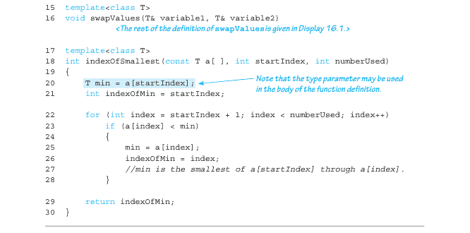

（中央网信办举报中心）

## PITFALL: (continued)

template（Display 16.1）中类型参数被替换为赋值运算符根本不工作，或不工作“正确”的类型。更具体的例子是，假设你的程序定义了模板函数 swapValues 如 Display 16.1 所示。你不能添加以下内容到你的程序中：

```
int a[10], b[10];
<Some code to fill arrays>
swapValues(a, b);
```

此代码将无法工作，因为赋值对数组类型不起作用。

## Self-Test Exercises

- Display 5.6 显示了一个名为 search 的函数，它顺序搜索数组中指定的整数。给出 search 的函数模板版本，可用于搜索任何类型的元素的数组。给出模板的函数声明和函数定义。（提示：它几乎与 Display 5.6 中给出的函数相同。）
- 比较和对比函数名重载与为函数名定义函数模板。
- （此练习仅适用于那些已经阅读了至少第 6 章关于结构和类的读者，最好也阅读了第 8 章关于重载运算符的读者。）你能使用排序模板函数（Display 16.3）对基类型为 Display 6.4 中定义的 DayOfYear 的数组进行排序吗？
- （此练习仅适用于那些已经阅读了第 10 章关于指针和动态数组的读者。）

尽管赋值运算符不适用于普通数组变量，但它适用于用于命名动态数组的指针变量。假设你的程序定义了模板函数 swapValues（如 Display 16.1 中所示）并包含以下代码。此代码产生的输出是什么？

```
typedef int* ArrayPointer;
ArrayPointer a, b, c;
a = new int [3];
b = new int [3];

int i;
for (i = 0; i < 3; i++)
{
    a[i] = i;
    b[i] = i * 100;
}
c = a;
```

## Self-Test Exercises (continued)

```
cout << "a contains: ";
for (i = 0; i < 3; i++)
    cout << a[i] << " ";
cout << endl;
cout << "b contains: ";
for (i = 0; i < 3; i++)
    cout << b[i] << " ";
cout << endl;
cout << "c contains: ";
for (i = 0; i < 3; i++)
    cout << c[i] << " ";
cout << endl;

swapValues(a, b);
b[0] = 42;

cout << "After swapping a and b,\n"
     << "and changing b:\n";
cout << "a contains: ";
for (i = 0; i < 3; i++)
    cout << a[i] << " ";
cout << endl;
cout << "b contains: ";
for (i = 0; i < 3; i++)
    cout << b[i] << " ";
cout << endl;
cout << "c contains: ";
for (i = 0; i < 3; i++)
    cout << c[i] << " ";
cout << endl;
```

## 16.2 Class Templates

> Equal wealth and equal opportunities of culture ... have simply made us all members of one class.

EDWARD BELLAMY, Looking Backward, 2000-1887. Ed. Matthew Beaumont. Oxford: Oxford University Press, 2009

正如你在上一节中所看到的，函数定义可以通过使用模板变得更通用。在本节中，你将看到模板也可以使类定义更通用。

## Syntax for Class Templates

类模板的语法细节基本上与函数模板相同。以下内容放在模板定义之前：

```
template<class T>
```

类型参数 T 在类定义中使用，就像任何其他类型一样。与函数模板一样，类型参数 T 代表可以是任何类型的类型；类型参数不一定必须替换为类类型。与函数模板一样，你可以使用任何（非关键字）标识符代替 T，尽管使用 T 是传统的。

Display 16.4 显示了类模板的示例。此类的对象包含一对类型为 T 的值。如果 T 是 int，对象值是整数对；如果 T 是 char，对象值是字符对；等等。

一旦类模板被定义，你就可以声明此类的对象。声明必须指定要为 T 填充什么类型。例如，以下声明对象 score 使其可以记录一对整数，并声明对象 seats 使其可以记录一对字符：

```
Pair<int> score;
Pair<char> seats;
```

对象然后像任何其他对象一样使用。例如，以下将 score 设置为第一队为 3，第二队为 0：

```
score.setFirst(3);
score.setSecond(0);
```

## Display 16.4 Class Template Definition (part 1 of 2)

```
//Class for a pair of values of type T:
template<class T>
class Pair
{
public:
Pair();
Pair(T firstValue, T secondValue);
void setFirst(T newValue);
void setSecond(T newValue);
T getFirst() const;
T getSecond() const;
private:
T first;
T second;
};
```

> Pair 是 Display 8.6 中给出的类 intPair 的模板版本。然而，由于增量和减量运算符对于所有类型 T 都不合适，我们省略了它们。


# Display 16.4　类模板定义（第 2 部分，共 2 部分）

```cpp
template<class T>
Pair<T>::Pair(T firstValue, T secondValue)
{
    first = firstValue;
    second = secondValue;
}

template<class T>
void Pair<T>::setFirst(T newValue)
{
    first = newValue;
}

template<class T>
T Pair<T>::getFirst() const
{
    return first;
}
```

类模板的成员函数与普通类的成员函数定义方式相同。唯一的区别是成员函数定义本身也是模板。例如，Display 16.4 显示了模板类 Pair 的成员函数 setFirst 和 getFirst 以及带两个参数的构造函数的适当定义。请注意，作用域解析运算符之前的类名是 Pair<T>，而不是简单的 Pair。但是，作用域解析运算符之后的构造函数名是简单名称 Pair，不带任何 <T>。

类模板的名称可以用作函数参数的类型。例如，以下是具有整数对参数的函数的可能函数声明：

```cpp
int addUp(const Pair<int>& thePair);
//Returns the sum of the two integers in thePair.
```

请注意，我们指定了类型——在本例中为 int——以填入类型参数 T。

你甚至可以在函数模板中使用类模板。例如，而不是定义前面代码中给出的专用函数 addUp，你可以改为定义如下的函数模板，以便该函数适用于所有类型数字：

```cpp
template<class T>
T addUp(const Pair<T>& thePair);
//Precondition: The operator + is defined for values of type T.
//Returns the sum of the two values in thePair.
```

几乎所有模板类定义对可以合理地替换为类型参数（或参数）的类型都有一些限制。即使是像 Pair 这样直接的模板类也不适用于绝对所有类型 T。类型 Pair<T> 除非类型 T 的赋值运算符和拷贝构造函数表现良好，否则不会表现良好，因为赋值运算符在成员函数定义中使用，并且存在按值调用的成员函数参数类型为 T。如果 T 涉及指针和动态变量，则 T 还应具有合适的析构函数。然而，这些是你可能期望一个表现良好的类类型 T 具有的要求。因此，这些要求是最小的。对于其他模板类，可以替换为类型参数的类型要求可能更严格。

## 类模板语法

类模板定义及其成员函数的定义前面加上以下内容：

```
template<class Type_Parameter>
```

类和成员函数定义然后与任何普通类相同，只是 Type_Parameter 可以用作类型代替。

例如，以下是类模板定义的开头：

```
template<class T>
class Pair
{
public:
    Pair();
    Pair(T firstValue, T secondValue);
    ...
```

成员函数和重载运算符然后被定义为函数模板。例如，前述示例类模板的双参数构造函数的定义将如下开始：

```
template<class T>
Pair<T>::Pair(T firstValue, T secondValue)
{
```

你可以通过为类名提供类型参数来专门化类模板，如以下示例所示：

```
Pair<int>
```

专门化的类名，如 Pair<int>，然后可以像任何类名一样使用。它可以用来声明对象或指定形式参数的类型。

## 类型定义

你可以定义一个新类类型名，其含义与专门化的类模板名（如 Pair<int>）相同。这样的定义类类型名的语法如下：

```
typedef Class_Name<Type_Argument> New_Type_Name;
```

例如，

```
typedef Pair<int> PairOfInt;
```

类型名 PairOfInt 然后可以用来声明类型为 Pair<int> 的对象，如以下示例所示：

```
PairOfInt pair1, pair2;
```

类型名 PairOfInt 也可以用来指定形式参数的类型或在允许类型名的地方使用。

## 自测练习

- 9. 给出 Display 16.4 中类模板 Pair 的默认（零参数）构造函数的定义。
- 10. 给出以下函数的完整定义，该函数在前一小节中讨论过：
  
  int addUp(const Pair<int>& thePair);
  //Returns the sum of the two integers in thePair.
- 11. 给出以下模板函数的完整定义，该函数在前一小节中讨论过：
  
  template<class T>
  T addUp(const Pair<T>& thePair);
  //Precondition: The operator + is defined for values of type T.
  //Returns the sum of the two values in thePair

## EXAMPLE: **一个数组模板类**

在第 10 章中，我们定义了一个部分填充的 double 数组的类（Display 10.10 和 10.11）。在本例中，我们将该定义转换为一个模板类，用于部分填充的任意类型值的数组。模板类 PFArray 具有类型参数 T，用于数组的基础类型。

转换是常规的。我们只需将 double（当它作为数组的基础类型出现时）替换为类型参数 T，并将类定义和成员函数定义都转换为模板形式。模板类定义在 Display 16.5 中给出。成员函数模板定义在 Display 16.6 中给出。

请注意，我们已将模板定义放在一个命名空间中。命名空间与模板一起使用的方式与它们与简单非模板定义一起使用的方式相同。

示例应用程序在 Display 16.7 中给出。请注意，我们已将类模板接口、实现和应用程序程序分离到三个文件中。不幸的是，这些文件不能用于传统的分离编译方法。大多数编译器尚未支持这种分离编译。因此，我们尽力而为，通过在应用程序文件中 #include 接口和实现文件。对编译器来说，这看起来就像一切都在一个文件中。

## Display 16.5   PFArray 模板类的接口（第 1 部分，共 2 部分）

```cpp
//This is the header file pfarray.h. This is the interface for the class
//PFArray. Objects of this type are partially filled arrays with base
//type T.
#ifndef PFARRAY_H
#define PFARRAY_H

namespace PFArraySavitch
{
    template<class T>
    class PFArray
    {
    public:
        PFArray( ); //Initializes with a capacity of 50.

        PFArray(int capacityValue);

        PFArray(const PFArray<T>& pfaObject);

        void addElement(const T& element);
        //Precondition: The array is not full.
        //Postcondition: The element has been added.
```

## Display 16.5  PFArray 模板类的接口（第 2 部分，共 2 部分）

```
17    bool full( ) const;  //Returns true if the array is full;
                         //false, otherwise.

18    int getCapacity( ) const;

19    int getNumberUsed( ) const;

20    void emptyArray( );
      //Resets the number used to zero, effectively emptying the
      //array.

22    T& operator[](int index);
      //Read and change access to elements 0 through numberUsed - 1.

24    PFArray<T>& operator = (const PFArray<T>& rightSide);

25    virtual ~PFArray( );
private:
27    T* a; //for an array of T.
28    int capacity; //for the size of the array.
29    int used; //for the number of array positions currently in use.
30 };
31 }// PFArraySavitch
32 #endif // PFARRAY_H
```

## Display 16.6  PFArray 模板类的实现（第 1 部分，共 3 部分）

```cpp
//This is the implementation file pfarray.cpp.
//This is the implementation of the template class PFArray.
//The interface for the template class PFArray is in the file pfarray.h.

#include "pfarray.h"
#include <iostream>
using std::cout;

namespace PFArraySavitch
{
    template <class T>
    PFArray<T>::PFArray( ) : capacity(50), used(0)
    {
        a = new T[capacity];
    }
```

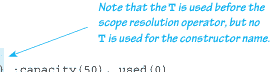


# 显示 16.6 PFArray 模板类的实现（第 2 部分，共 3 部分）

```
14  template<class T>
15  PFArray<T>::PFArray(int size) :capacity(size), used(0)
16  {
17      a = new T[capacity];
18  }

19  template<class T>
20  PFArray<T>::PFArray(const PFArray<T>& pfaObject)
21      :capacity(pfaObject.getCapacity()),
22          used(pfaObject.getNumberUsed())
23  {
24      a = new T[capacity];
25      for (int i = 0; i < used; i++)
26          a[i] = pfaObject.a[i];
27  }

28  template<class T>
29  void PFArray<T>::addElement(const T& element)
30  {
31      if (used >= capacity)
32      {
33          cout << "Attempt to exceed capacity in PFArray.\n";
34          exit(0);
35      }
      a[used] = element;
      used++;
  }

39  template<class T>
40  bool PFArray<T>::full() const
41  {
42      return (capacity == used);
43  }

44  template<class T>
45  int PFArray<T>::getCapacity() const
46  {
47      return capacity;
48  }

49  template<class T>
50  int PFArray<T>::getNumberUsed() const
51  {
52      return used;
53  }
```

# 显示 16.6 PFArray 模板类的实现（第 3 部分，共 3 部分）

```
54  template<class T>
55  void PFArray<T>::emptyArray( )
56  {
57      used = 0;
58  }
59
60  template<class T>
61  T& PFArray<T>::operator[](int index)
62  {
63      if (index >= used)
64      {
65          cout << "Illegal index in PFArray.\n";
66          exit(0);
67      }
      return a[index];
  }
70
71  template<class T>
72  PFArray<T>& PFArray<T>::operator = (const PFArray<T>& rightSide)
73  {
74      if (capacity != rightSide.capacity)
75      {
76          delete [] a;
77          a = new T[rightSide.capacity];
78      }
      capacity = rightSide.capacity;
      used = rightSide.used;
      for (int i = 0; i < used; i++)
          a[i] = rightSide.a[i];
      return *this;
  }
85
86  template<class T>
87  PFArray<T>::~PFArray( )
88  {
89      delete [] a;
90  }
  // PFArraySavitch
```

# 显示 16.7 模板类 `PFArray` 的演示程序（第 1 部分，共 2 部分）

```
//Program to demonstrate the template class PFArray.
#include <iostream>
#include <string>
using std::cin;
using std::cout;
using std::endl;
using std::string;

#include "pfarray.h"
#include "pfarray.cpp"
using PFArraySavitch::PFArray;

int main()
{
    PFArray<int> a(10);

    cout << "Enter up to 10 nonnegative integers.\n";
    cout << "Place a negative number at the end.\n";
    int next;
    cin >> next;
    while ((next >= 0) && (!a.full()))
    {
        a.addElement(next);
        cin >> next;
    }
    if (next >= 0)
    {
        cout << "Could not read all numbers.\n";
        //Clear the queued input:
        while (next >= 0)
            cin >> next;
    }

    cout << "You entered the following: \n ";
    int index;
    int count = a.getNumberUsed();
    for (index = 0; index < count; index++)
        cout << a[index] << " ";
    cout << endl;
    PFArray<string> b(3);

    cout << "Enter three words:\n";
    string nextWord;
```

# 显示 16.7 模板类 PFArray 的演示程序（第 2 部分，共 2 部分）

```
39   for (index = 0; index < 3; index++)
40   {
41       cin >> nextWord;
42       b.addElement(nextWord);
43   }
44
45   cout << "You wrote the following:\n";
46   count = b.getNumberUsed();
47   for (index = 0; index < count; index++)
48       cout << b[index] << " ";
49   cout << endl;
50   cout << "I hope you really mean it.\n";
51
52   return 0;
53 }
```

# 示例对话

```
Enter up to 10 nonnegative integers.
Place a negative number at the end.
1 2 3 4 5 -1
You entered the following:
1 2 3 4 5
Enter three words:
I love you
You wrote the following:
I love you
I hope you really mean it
```

# 友元函数

友元函数与模板类一起使用的方式与它们与普通类一起使用的方式相同。唯一的区别是，你必须在适当的地方包含一个类型参数。

# 自测练习

12. 你必须做什么才能使以下函数成为显示 16.5 中的模板类 PFArray 的友元？

void showData(PFArray<T>& theObject);
//Displays the data in theObject to the screen.
//Assumes that << is defined for values of type T.

## 1. 引言

本文档旨在介绍一种基于深度学习的图像识别方法，该方法在多个标准数据集上取得了优异的性能表现。

近年来，随着计算能力的提升和大规模数据集的构建，深度学习技术在计算机视觉领域取得了突破性进展。本文提出的方法主要解决了传统方法在复杂场景下特征提取能力不足的问题。

## 2. 相关工作

在过去的几年中，研究者们提出了多种图像识别方法。其中，卷积神经网络（CNN）因其强大的特征学习能力而成为主流选择。

+   - 方法A：基于传统手工特征的方法
+   - 方法B：基于浅层神经网络的方法
+   - 方法C：基于深度残差网络的方法

## 3. 方法

本文提出的方法主要包括三个步骤：数据预处理、特征提取和分类器设计。具体流程如下：

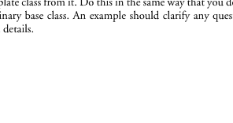

# 示例：带有备份的部分填充数组的模板类

第 14 章（显示 14.10 和 14.11）定义了用于带有备份的部分填充 double 数组的类 PFArrayDBak。我们将其定义为 PFArrayD（显示 14.8 和 14.9）的派生类。类 PFArrayD 是一个用于部分填充数组的类，但它仅适用于基本类型 double。显示 16.5 和 16.6 将类 PFArrayD 转换为模板类 PFArray，以便它可用于任何类型作为数组基本类型。在本程序中，我们将定义一个模板类 PFArrayBak，用于带有备份的部分填充数组，该数组可用于任何类型作为数组基本类型。我们将模板类 PFArrayBak 定义为模板 PFArray 的派生类。我们可以通过从常规派生类 PFArrayDBak 开始，将数组基本类型 double 的所有出现替换为类型参数 T，将类 PFArrayD 替换为模板类 PFArray，并清理语法使其完全符合模板语法来实现这一点几乎自动地。

模板类 PFArrayBak 的接口在显示 16.8 中给出。请注意，基类是 PFArray<T>，其中包含数组参数，而不是简单的 PFArray。如果你仔细想想，你会意识到你需要 <T>。T 的部分填充数组的备份是一个 T 的部分填充数组的派生类。T 及其使用方式很重要。

模板类 PFArrayBak 的实现在显示 16.9 中给出。接下来，我们重现实现中的第一个构造函数定义：

```
template<class T>
PFArrayBak<T>::PFArrayBak() : PFArray<T>(), usedB(0)
{
    b = new T[getCapacity()];
}
```

请注意，与任何模板类函数定义一样，它以

```
template<class T>
```

开头

还请注意，数组的基本类型（new 之后给出）是类型参数 T。其他细节可能没有那么明显，但确实有意义。

接下来考虑以下行：

```
PFArrayBak<T>::PFArrayBak() : PFArray<T>(), usedB(0)
```

与任何模板类函数定义一样，定义在作用域解析运算符之前具有 PFArray<T> 和类型参数，但构造函数名称只是普通的旧 PFArrayBak，没有任何类型参数。还请注意，基类构造函数在初始化 PFArray<T>() 中包含类型参数 T。这是为了使构造函数与接口中给出的以下行中的基类型 PFArray<T> 匹配：

```
class PFArrayBak : public PFArray<T>
```

使用模板类 PFArrayBak 的示例程序在显示 16.10 中给出。

# 显示 16.8 模板类 PFArrayBak 的接口

```
//This is the header file pfarraybak.h. This is the interface for the
//template class PFArrayBak. Objects of this type are partially filled
//arrays of any type T. This version allows the programmer to make a
//backup copy and restore to the last saved copy of the partially filled
//array.
#ifndef PFARRAYBAK_H
#define PFARRAYBAK_H
#include "pfarray.h"

namespace PFArraySavitch
{
    template<class T>
    class PFArrayBak : public PFArray<T>
    {
    public:
        PFArrayBak();
        //Initializes with a capacity of 50.
        PFArrayBak(int capacityValue);
        PFArrayBak(const PFArrayBak<T>& object);
        void backup();
        //Makes a backup copy of the partially filled array.
        void restore();
        //Restores the partially filled array to the last saved version.
        //If backup has never been invoked, this empties the partially
        //filled array.
        PFArrayBak<T>& operator =(const PFArrayBak<T>& rightSide);
        virtual ~PFArrayBak();
    private:
        T *b; //for a backup of main array.
        int usedB; //backup for inherited member variable used.
    };

} // PFArraySavitch
#endif //PFARRAY_H
```

# 显示 16.9 模板类 PFArrayBak 的实现（第 1 部分，共 3 部分）

```
//This is the file pfarraybak.cpp.
//This is the implementation for the template class PFArrayBak. The
//interface for the template class PFArrayBak is in the file
//pfarraybak.h.
#include "pfarraybak.h"
#include <iostream>
```


# 显示 16.9 模板类 PFArrayBak 的实现（第 2 部分，共 3 部分）

```
6 using std::cout;

7 namespace PFArraySavitch
8 {

9 template<class T>
10 PFArrayBak<T>::PFArrayBak() : PFArray<T>( ), usedB(0)
11 {
12   b = new T[getCapacity()];
13 }

14 template<class T>
15 PFArrayBak<T>::PFArrayBak(int capacityValue)
16   : PFArray<T>(capacityValue), usedB(0)
17 {
18   b = new T[getCapacity()];
19 }

20 template<class T>
21 PFArrayBak<T>::PFArrayBak(const PFArrayBak<T>& oldObject)
22   : PFArray<T>(oldObject), usedB(0)
23 {
24   b = new T[getCapacity()];
25   usedB = oldObject.getNumberUsed();
26   for (int i = 0; i < usedB; i++)
27     b[i] = oldObject.b[i];
28 }
29 template<class T>
30 void PFArrayBak<T>::backup()
31 {
32   usedB = getNumberUsed();
33   for (int i = 0; i < usedB; i++)
34     b[i] = operator[](i);
35 }

36 template<class T>
37 void PFArrayBak<T>::restore()
38 {
39   emptyArray();
40   for (int i = 0; i < usedB; i++)
41     addElement(b[i]);
42 }

43 template<class T>
44 PFArrayBak<T>& PFArrayBak<T>::operator = (const PFArrayBak<T>& rightSide)
```

# 显示 16.9 模板类 PFArrayBak 的实现（第 3 部分，共 3 部分）

```
45 {
46   PFArray<T>::operator = (rightSide);
47   if (getCapacity() != rightSide.getCapacity())
48   {
49     delete [] b;
50     b = new T[rightSide.getCapacity()];
51   }
52   usedB = rightSide.usedB;
53   for (int i = 0; i < usedB; i++)
54     b[i] = rightSide.b[i];
55   return *this;
56 }
57 template<class T>
58 PFArrayBak<T>::~PFArrayBak()
59 {
60   delete [] b;
61 }
62 }// PFArraySavitch
```

# 显示 16.10 模板类 PFArrayBak 的演示程序（第 1 部分，共 2 部分）

```
1 //Program to demonstrate the template class PFArrayBak.
2 #include <iostream>
3 #include <string>
4 using std::cin;
5 using std::cout;
6 using std::endl;
7 using std::string;
8 #include "pfarraybak.h"
9 #include "pfarray.cpp"
10 #include "pfarraybak.cpp"
11 using PFArraySavitch::PFArrayBak;
12 int main()
13 {
14   int cap;
15   cout << "Enter capacity of this super array: ";
16   cin >> cap;
17   PFArrayBak<string> a(cap);
18   cout << "Enter " << cap << " strings\n";
19   cout << "separated by blanks.\n";
20   string next;
```

不要忘记包含基类模板的实现。

# 显示 16.10 模板类 PFArrayBak 的演示程序（第 2 部分，共 2 部分）

```
21  for (int i = 0; i < cap; i++)
22  {
23      cin >> next;
24      a.addElement(next);
25  }
26  int count = a.getNumberUsed();
27  cout << "The following " << count
28  << " strings read and stored:\n";
29  int index;
30  for (index = 0; index < count; index++)
31      cout << a[index] << " ";
32  cout << endl;
33
34  cout << "Backing up array.\n";
35  a.backup();
36  cout << "Emptying array.\n";
37  a.emptyArray();
38  cout << a.getNumberUsed()
39  << " strings are now stored in the array.\n";
40  cout << "Restoring array.\n";
41  a.restore();
42  count = a.getNumberUsed();
43  cout << "The following " << count
44  << " strings are now stored:\n";
45  for (index = 0; index < count; index++)
46      cout << a[index] << " ";
47  cout << endl;
48
49  cout << "End of demonstration.\n";
50  return 0;
51 }
```

# 示例对话

```
Enter capacity of this super array: 3
Enter 3 strings
separated by blanks.
I love you
The following 3 strings read and stored:
I love you
Backing up array.
Emptying array.
0 strings are now stored in the array.
Restoring array.
The following 3 strings are now stored:
I love you
End of demonstration.
```

# 自测练习

13. 以下代码所示的派生模板类是否合法？模板类 TwoDimPFArrayBak 设计为具有备份功能的二维部分填充数组。

```
template<class T>
class TwoDimPFArrayBak : public PFArray< PFArray<T> >
{
public:
    TwoDimPFArrayBak( );
```

请注意 < PFArray<T> > 中的空格很重要，或者至少最后一个空格很重要。如果省略倒数第二个 > 与最后一个 > 之间的空格，则编译器可能会将 >> 解释为用于输入表达式（如 cin >> n;）中的输入运算符，而不是将其解释为嵌套的 < >。

14. 给出自测练习 13 中给出的类 TwoDimPFArrayBak 的默认（零参数）构造函数的标题。 （假设所有实例变量都在构造函数定义的主体中初始化，因此您不需要做那件事。）

# 章节总结

- 使用函数模板，您可以定义具有类型参数的函数。
- 使用类模板，您可以定义具有用于类子部分的 type 参数的类。
- 预定义的 vector 和 basic_string 类实际上是模板类。
- 您可以定义一个模板类，该模板类是模板基类的派生类。

# 自测练习答案

1. 函数声明：

```
template<class T>
T maximum(T first, T second);
//Precondition: The operator < is defined for the type T.
//Returns the maximum of first and second.
```

# 定义：

```
template<class T>
T maximum(T first, T second)
{
    if (first < second)
        return second;
    else
        return first;
}
```

# 2. 函数声明：

```
template<class T>
T absolute(T value);
```
//Precondition: The expressions x < 0 and -x are defined whenever x is of type T.
//Returns the absolute value of its argument.

# 定义：

```
template<class T>
T absolute(T value)
{
    if (value < 0)
        return -value;
    else
        return value;
}
```

3. 模板提供了一种机制，允许定义具有类型名称参数的函数和类。

4. c. 任何类型，无论是 C++ 提供的原始类型，还是用户定义的类型（类或结构体类型、枚举类型、或类型定义的数组，或 int、float、double 等），但 T 必须是模板中代码有意义的类型。例如，对于 swapValues 模板函数（显示 16.1），类型 T 必须具有正确工作的赋值运算符。

5. 函数声明和函数定义在以下代码中给出。它们基本上与显示 5.6 中给出的版本相同，只是参数列表中两个 int 被改为 T。

# 函数声明：

```
template<class T>
int search(const T a[], int numberUsed, T target);
//Precondition: numberUsed is <= the declared size of a.
//Also, a[0] through a[numberUsed -1] have values.
//Returns the first index such that a[index] == target, provided there is such an index, otherwise returns -1.
```

# 定义：

```
template<class T>
int search(const T a[],int numberUsed, T target)
{
    int index = 0;
    bool found = false;
    while ((!found) && (index < numberUsed))
        if (target == a[index])
            found = true;
        else
            index++;
    if (found)
        return index;
    else
        return -1;
}
```

- 6. 函数重载仅适用于提供了重载的类型。 （重载可能适用于自动转换为提供了重载的某种类型的类型，但它可能不会按您期望的方式工作。）模板解决方案将适用于调用时定义的任何类型，只要模板函数体对该类型有意义。

- 7. 不，您不能使用基类型为 DayOfYear 的数组与模板函数 sort，因为 < 运算符未在 DayOfYear 类型的值上定义。 （如果您重载 <，如我们在第 8 章中讨论的那样，为 DayOfYear 类型的值提供合适的排序，那么您就可以使用基类型为 DayOfYear 的数组与模板函数 sort。例如，您可以重载 <，使其表示一个日期在日历上早于另一个日期，然后按日历顺序对日期数组进行排序。）

```
8.  a contains:  0 1 2
    b contains:  0 100 200
    c contains:  0 1 2
    After swapping a and b,
    and changing b:
    a contains:  0 100 200
    b contains:  42 1 2
    c contains:  42 1 2
```

请注意，在 swapValues(a, b); 之前，c 是数组 a 的别名（另一个名称）。在 swapValues(a, b); 之后，c 是 b 的别名。尽管 a 和 b 的值在某种意义上被交换了，但事情并不像您希望的那样简单。对于指针变量，使用 swapValues 可能会产生副作用。

这里说明的要点是，赋值运算符在数组指针上的行为不如您希望的那样好，因此模板 swapValues 对于指向数组的变量不能按您希望的方式工作。赋值运算符不会逐元素交换，而是仅仅交换两个指针。因此，使用指向数组的指针的 swapValues 函数只是交换两个


## 1. 引言

本文档旨在介绍一种基于深度学习的图像识别方法，该方法在多个标准数据集上取得了优异的性能。我们详细阐述了模型的架构、训练策略以及实验结果，并与现有最先进的方法进行了对比。

## 2. 相关工作

近年来，卷积神经网络（CNN）在计算机视觉领域取得了巨大成功。从早期的 AlexNet 到后来的 ResNet、EfficientNet 等，网络结构不断演进，识别精度持续提升。此外，Transformer 架构也被引入视觉任务，形成了 Vision Transformer (ViT) 等新型模型。

## 3. 方法

我们提出的模型采用了一种混合架构，结合了 CNN 的局部特征提取能力和 Transformer 的全局建模能力。具体来说，我们首先使用一个轻量级的 CNN 骨干网络提取多尺度特征图，然后将这些特征图序列化并输入到 Transformer 编码器中进行全局关系建模。

- 骨干网络：使用 MobileNetV3 作为特征提取器。
- 特征融合：采用特征金字塔网络（FPN）融合多尺度特征。
- 全局建模：使用标准 Transformer 编码器，包含 12 层。
- 分类头：使用全局平均池化和全连接层。

## 4. 实验

我们在 ImageNet-1K 和 CIFAR-100 数据集上进行了实验。下表展示了我们模型与基线模型的性能对比。

| 模型 | ImageNet Top-1 | CIFAR-100 Top-1 |
|------|----------------|-----------------|
| ResNet-50 | 76.1% | 78.2% |
| ViT-B/16 | 79.8% | 82.3% |
| Ours | 82.5% | 85.1% |

# Programming Projects

# 编程项目

- 1. Write a template version of the iterative binary search algorithm from Display 13.8 which only searches an array of integers for an integer key. Specify requirements on the template parameter type. Discuss the requirements on the template parameter type.
- 1. 编写 Display 13.8 中迭代二分查找算法的模板版本，该版本仅在整数数组中查找整数键。说明模板参数类型的要求。讨论模板参数类型的要求。

- 2. Write a template version of the recursive binary search function from Display 13.6. Specify requirements on the template parameter type. Discuss the requirements on the template parameter type.
- 2. 编写 Display 13.6 中递归二分查找函数的模板版本。说明模板参数类型的要求。讨论模板参数类型的要求。

- 3. The template sort routine in Display 16.3 is based on an algorithm called the selection sort. Another related sorting algorithm is called insertion sort. The insertion sort algorithm is the sort method often used to sort a Bridge hand. Consider each element in turn, inserting it into its proper place among the elements at the start of the array that are already sorted. The element being considered is inserted by moving the larger elements "to the right" to make space and inserting the vacated place. For example, the following shows the steps in a selection sort of an array of ints a. The values of a[0] through a[4] are given on each line. The asterisk marks the boundary between the sorted and unsorted portions of the array.
- 3. Display 16.3 中的模板排序例程基于一种称为选择排序的算法。另一种相关的排序算法称为插入排序。插入排序算法常用于对桥牌手牌进行排序。依次考虑每个元素，将其插入到数组开头已排序元素中的适当位置。所考虑的元素通过将较大的元素“向右”移动来腾出空间并插入空出的位置来实现插入。例如，以下显示了对整型数组 a 进行选择排序的步骤。a[0] 到 a[4] 的值在每一行中给出。星号标记已排序部分和未排序部分之间的边界。

```
2 * 5 3 4
2 5 * 3 4
2 3 5 * 4
2 3 4 5 *
```

First, write an insertion sort function that works for ints. Next, write the template version of this sort function. Finally, test thoroughly using several primitive types, using a type you create with the minimal machinery necessary to use the sort routine.
首先，编写一个适用于 int 的插入排序函数。接下来，编写该排序函数的模板版本。最后，使用多种基本类型进行彻底测试，使用你创建的类型，该类型仅具备使用排序例程所需的最小机制。

- 4. Write a template-based function that takes two parameters and checks whether the two are identical. The function should operate with any numeric data types (e.g., float, int, double, char)
- 4. 编写一个基于模板的函数，该函数接收两个参数并检查两者是否相同。该函数应适用于任何数值数据类型（例如 float、int、double、char）

- 5. Write a template-based class that implements a set of items. The class should allow the user to
  a. Add a new item to the set.
  b. Get the number of items in the set.
  c. Get a pointer to a dynamically created array containing each item in the set. The caller of this function is responsible for deallocating the memory.
  Test your class by creating sets of different data types (e.g., integers, strings).
- 5. 编写一个基于模板的类，实现一组项目。该类应允许用户
  a. 向集合中添加新项目。
  b. 获取集合中项目的数量。
  c. 获取一个指向包含集合中每个项目的动态创建数组的指针。此函数的调用者负责释放内存。
  通过创建不同数据类型的集合来测试你的类（例如，整数、字符串）。

- 6. Do Programming Project 10.6 for the wrapper class around a dynamic array of strings that allowed for the deletion and addition of string entries. Except this time, use a template-based class so the implementation is not limited to strings. Test the class with dynamic arrays of integers in addition to strings.
- 6. 对允许删除和添加字符串条目的动态字符串数组的包装类执行编程项目 10.6。不同之处在于，这次使用基于模板的类，以便实现不限于字符串。用整数的动态数组以及字符串测试该类。

- 7. In this chapter, we used only a single template class type parameter. C++ allows you to specify multiple type parameters. For example, the following code specifies that the class accepts two type parameters:
  ```cpp
  template
  <class T, class V>
  class Example
  {
          ...
  }
  ```
  When creating an instance of the class, we must now specify two data types, such as
  ```cpp
  Example<int, char> demo;
  ```
  Modify the Pair class given in Display 16.4 so that the pair of items can be different data types. Write a main function that tests the class with pairs of different data types.
- 7. 在本章中，我们仅使用了一个模板类类型参数。C++ 允许你指定多个类型参数。例如，以下代码指定该类接受两个类型参数：
  ```cpp
  template
  <class T, class V>
  class Example
  {
          ...
  }
  ```
  创建类的实例时，我们现在必须指定两种数据类型，例如
  ```cpp
  Example<int, char> demo;
  ```
  修改 Display 16.4 中给出的 Pair 类，使一对项目可以是不同的数据类型。编写一个 main 函数，使用不同数据类型的配对测试该类。

- 8. Write a template version of the bubble-sort algorithm and test your program with arrays of at least two data types.
- 8. 编写冒泡排序算法的模板版本，并使用至少两种数据类型的数组测试你的程序。

This page intentionally left blank
本页 intentionally left blank

# Linked Data Structures 17

# 链表数据结构 17

## 17.1 NODES AND LINKED LISTS 769

## 17.1 节点和链表 769

- Nodes 769
- 节点 769
- Linked Lists 774
- 链表 774
- Inserting a Node at the Head of a List 776
- 在列表头部插入节点 776
- Pitfall: Losing Nodes 779
- 陷阱：丢失节点 779
- Inserting and Removing Nodes Inside a List 779
- 在列表内部插入和删除节点 779
- Pitfall: Using the Assignment Operator with Dynamic
- 陷阱：使用赋值运算符与动态
- Data Structures 783
- 数据结构 783
- Searching a Linked List 783
- 搜索链表 783
- Doubly Linked Lists 786
- 双向链表 786
- Adding a Node to a Doubly Linked List 788
- 向双向链表添加节点 788
- Deleting a Node from a Doubly Linked List 788
- 从双向链表删除节点 788
- Example: A Generic Sorting Template Version of
- 示例：链表工具的通用排序模板版本
- Linked List Tools 795

## 17.2 LINKED LIST APPLICATIONS 799

## 17.2 链表应用 799

- Example: A Stack Template Class 799
- 示例：栈模板类 799
- Example: A Queue Template Class 806
- 示例：队列模板类 806
- Tip: A Comment on Namespaces 809
- 提示：关于命名空间的说明 809
- Friend Classes and Similar Alternatives 810
- 友元类及类似替代方案 810
- Example: Hash Tables with Chaining 813
- 示例：使用链地址法的哈希表 813

- Efficiency of Hash Tables 819
- 哈希表的效率 819
- Example: A Set Template Class 820
- 示例：集合模板类 820
- Efficiency of Sets Using Linked Lists 826
- 使用链表的集合效率 826

## 17.3 ITERATORS 827

## 17.3 迭代器 827

- Pointers as Iterators 828
- 作为迭代器的指针 828
- Iterator Classes 828
- 迭代器类 828
- Example: An Iterator Class 830
- 示例：一个迭代器类 830

## 17.4 TREES 836

## 17.4 树 836

- Tree Properties 837
- 树属性 837
- Example: A Tree Template Class 839
- 示例：树模板类 839

# 17 Linked Data Structures

# 17 链表数据结构

> > If somebody there chanced to be  
> > Who loved me in a manner true  
> > My heart would point him out to me  
> > And I would point him out to you.
> >
> > — GILBERT AND SULLIVAN, *Ruddigore*, Act I, Scene 1. 1887

> > 如果那里恰好有人  
> > 以真诚的方式爱我  
> > 我的心会指认他给我  
> > 我也会指认他给你。
> >
> > — 吉尔伯特与沙利文，《鲁迪戈尔》，第一幕，第一场。1887

## Introduction

## 引言

A linked list is a list constructed using pointers. A linked list is not fixed in size but can grow and shrink while your program is running. A tree is another kind of data structure constructed using pointers. This chapter introduces the use of pointers for building such data structures. The Standard Template Library (STL) has predefined versions of these and other similar data structures. The STL is covered in Chapter 19. It often makes more sense to use the predefined data structures in the STL rather than defining your own. However, there are cases where you need to define your own data structures using pointers. (Somebody had to define the STL.) Also, this material will give you some insight into how the STL might have been defined and will introduce you to some basic widely used material.

链表是使用指针构造的列表。链表的大小不是固定的，可以在程序运行期间增长和缩小。树是另一种使用指针构造的数据结构。本章介绍使用指针构建此类数据结构的方法。标准模板库（STL）具有这些和其他类似数据结构的预定义版本。STL 在第 19 章中介绍。使用 STL 中的预定义数据结构通常比自己定义更有意义。然而，在某些情况下，你需要使用指针定义自己的数据结构。（有人必须定义 STL。）此外，这些材料将让你深入了解 STL 可能是如何定义的，并介绍一些基本且广泛使用的材料。

Linked data structures produce their structures using dynamic variables, which are created with the new operator. The linked data structures use pointers to connect these variables. This gives you complete control over how you build and manage your data structures, including how you manage memory. This allows you to sometimes do things more efficiently. For example, it is easier and faster to insert a value into a sorted linked list than into a sorted array.

链表数据结构使用动态变量产生其结构，这些变量是用 new 运算符创建的。链表数据结构使用指针连接这些变量。这使你能够完全控制如何构建和管理数据结构，包括如何管理内存。这有时可以让你更高效地完成某些操作。例如，将值插入到已排序的链表中比插入到已排序的数组中更容易、更快。

There are basically three ways to handle data structures of the kind discussed in this chapter:

基本上处理本章讨论的这类数据结构有三种方法：

- 1. The C-style approach of using global functions and `struct`s with everything public
- 1. 使用全局函数和一切公开的 `struct` 的 C 风格方法
- 2. Using classes with all member variables private and using accessor and mutator functions
- 2. 使用类，将所有成员变量设为私有，并使用访问器和修改器函数
- 3. Using friend classes (or something similar, such as private or protected inheritance or locally defined classes)
- 3. 使用友元类（或类似的东西，例如私有或受保护继承或局部定义的类）

We give examples of all three methods. We introduce linked lists using method 1. We then present more details about basic linked lists and introduce both the stack and queue data structures using method 2. We give an alternate definition of our queue template class using friend classes (method 3), and also use friend classes (method 3) to present a tree template class. This way you can see the virtues and shortcomings of each approach. Our personal preference is to use friend classes, but each method has its own advocates.

我们给出了全部三种方法的示例。我们使用方法 1 引入链表。然后我们介绍有关基本链表的更多细节，并使用方法 2 引入栈和队列数据结构。我们使用友元类（方法 3）给出队列模板类的另一种定义，并使用友元类（方法 3）介绍树模板类。这样你可以看到每种方法的优点和缺点。我们个人更喜欢使用友元类，但每种方法都有自己的拥护者。

## 17.1 Nodes and Linked Lists

## 17.1 节点和链表

A linked list, such as the one diagrammed in Display 17.1, is a simple example of a dynamic data structure. It is called a dynamic data structure because each of the boxes in Display 17.1 is a variable of a struct or class type that has been dynamically created with the new operator. In a dynamic data structure, these boxes, known as nodes, contain pointers, diagrammed as arrows, that point to other nodes. This section introduces the basic techniques for building and maintaining linked lists.

链表，如 Display 17.1 所示，是动态数据结构的一个简单示例。它被称为动态数据结构，因为 Display 17.1 中的每个方框都是一个使用 new 运算符动态创建的 struct 或 class 类型的变量。在动态数据结构中，这些被称为节点的方框包含指针，以箭头形式表示，指向其他节点。本节介绍构建和维护链表的基本技术。

## Nodes

## 节点

A structure like the one shown in Display 17.1 consists of items that we have drawn as boxes connected by arrows. The boxes are called nodes, and the arrows represent pointers. Each of the nodes in Display 17.1 contains a string value, an integer, and a pointer that can point to other nodes of the same type. Note that pointers point to the entire node, not to the individual items (such as 10 or "rolls") that are inside the node.

Display 17.1 中所示的结构由我们绘制为由箭头连接的方框的项目组成。方框称为节点，箭头代表指针。Display 17.1 中的每个节点包含一个字符串值、一个整数，以及一个可以指向同一类型其他节点的指针。请注意，指针指向整个节点，而不是节点内部的单个项目（例如 10 或 "rolls"）。

Nodes are implemented in C++ as structs or classes. For example, the struct type definitions for a node of the type shown in Display 17.1, along with the type definition for a pointer to such nodes, can be as follows:

节点在 C++ 中以 struct 或 class 实现。例如，Display 17.1 中所示类型节点的 struct 类型定义，以及指向此类节点的指针的类型定义，可以如下所示：

```
struct ListNode
{
    string item;
    int count;
    ListNode *link;
}
```

```
Typedef ListNode* ListNodePtr;
```

The order of the type definitions is important. The definition of ListNode must come first, since it is used in the definition of ListNodePtr.

类型定义的顺序很重要。ListNode 的定义必须先出现，因为它在 ListNodePtr 的定义中使用。

The box labeled head in Display 17.1 is not a node but a pointer variable that can point to a node. The pointer variable head is declared as follows:

Display 17.1 中标记为 head 的方框不是节点，而是一个可以指向节点的指针变量。指针变量 head 声明如下：

```
ListNodePtr head;
```

Sections 17.1 through 17.3 do not use the material in Chapters 13 through 15 (recursion, inheritance, and polymorphism), with one small exception: We have marked our class destructors with the modifier virtual following the advice given in Chapter 15. If you have not yet read about virtual functions (Chapter 15), you can pretend that "virtual" does not appear in the code. For in the purposes of this chapter, it makes no difference whether "virtual" is present or not. Section 17.4 uses recursion (Chapter 13) but does not use Chapters 14 and 15.

第 17.1 节至第 17.3 节不使用第 13 章至第 15 章的材料（递归、继承和多态），有一个小例外：我们按照第 15 章的建议用修饰符 virtual 标记了类的析构函数。如果你尚未阅读有关虚函数的内容（第 15 章），你可以假装代码中没有出现 "virtual"。因为就本章而言，"virtual" 是否存在并无区别。第 17.4 节使用递归（第 13 章），但不使用第 14 章和第 15 章。


尽管我们已经对类型定义进行了排序，以避免某些非法的循环形式，但前面定义的 `ListNode` 结构体类型仍然是循环的。类型 `ListNode` 的定义使用了类型名 `ListNode` 来定义成员变量 `link`。这种特定的循环本身并没有问题，在 C++ 中是允许的。该定义在逻辑上并非不一致的一个迹象是，你可以绘制出像 Display 17.1 所示的图形来表示此类结构。

我们现在在结构体内部有了指针，并且这些指针指向包含指针的结构体，以此类推。在这种情况下，语法有时会变得复杂，但在所有情况下，语法都遵循我们为指针和结构体描述的少数几条规则。作为示例，假设声明如上所示，情况如 Display 17.1 所示，并且你想将第一个节点中的数字从 10 改为 12。实现此目的的一种方法是使用以下语句：

```
(*head).count = 12;
```

赋值运算符左侧的表达式可能需要一些解释。变量 `head` 是一个指针变量。因此，表达式 `*head` 就是它所指向的内容，即包含 "rolls" 和整数 10 的节点（动态变量）。这个由 `*head` 引用的节点是一个结构体，该结构体中包含 `int` 类型值的成员变量称为 `count`；因此，`(*head).count` 是第一个节点中 `int` 变量的名称。`*head` 周围的括号不是可选的。你希望解引用操作 `*` 在点操作之前执行。然而，点运算符的优先级高于解引用运算符 `*`，因此如果没有括号，点操作将首先执行（这会产生错误）。下一段描述了一种可以避免这种括号担忧的简写符号。

C++ 有一个运算符，可以与指针一起使用，以简化指定结构体或类成员的符号。第 10 章介绍了箭头运算符 `->`，但在此之前我们并未广泛使用它。因此，有必要回顾一下。箭头运算符结合了解引用运算符 `*` 和点运算符的作用，用于指定由给定指针指向的动态结构体或类对象的成员。例如，之前用于更改第一个节点中数字的赋值语句可以更简单地写为：

```
head->count = 12;
```

此赋值语句与之前的语句含义相同，但此形式是通常使用的形式。

第一个节点中的字符串可以通过以下语句从 "rolls" 更改为 "bagels"：

```
head->item = "bagels";
```

对列表中第一个节点进行这些更改的结果在 Display 17.2 中进行了图示。

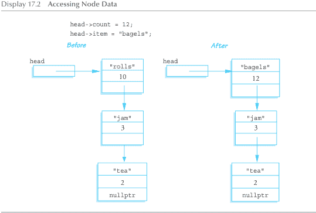

可以使用赋值运算符将指针设置为 `nullptr`，如下所示，该语句声明了一个名为 `there` 的指针变量并将其初始化为 `nullptr`。

```
double *there = nullptr;
```

常量 `nullptr` 可以赋值给任何指针类型的指针变量。

## NULL

`NULL` 是一个特殊的常量值，用于为原本没有值的指针变量提供一个值。`NULL` 可以赋值给任何类型的指针变量。标识符 `NULL` 在许多库中都有定义，包括头文件为 `<cstddef>` 的库和头文件为 `<iostream>` 的库。常量 `NULL` 实际上是数字 0，但我们更倾向于将其视为并拼写为 `NULL`。

## nullptr

`nullptr` 是一个特殊的常量值，其使用方式与 `NULL` 相同，但它只能赋值给指针。它不是数字 0。使用 `nullptr` 来区分空指针和数字 0。`nullptr` 是在 C++11 中引入的。

## 链表作为参数

你应该始终保留一个指向链表头部的指针变量。这个指针变量是命名链表的一种方式。当你编写一个将链表作为参数的函数时，这个指针（指向链表头部）可以用作链表参数。

## 自测练习

- 1. 假设你的程序包含以下类型定义：
  
  ```cpp
  struct Box
  {
      string name;
      int number;
      Box *next;
  };
  typedef Box* BoxPtr;
  ```
  
  以下代码产生的输出是什么？

## 自测练习（续）

```
cout << (*head).name << endl;
cout << head->name << endl;
cout << (*head).number << endl;
cout << head->number << endl;
```

2. 假设你的程序包含自测练习 1 中给出的类型定义和代码。该代码创建了一个包含字符串 "Sally" 和数字 18 的节点。你会添加什么代码来将此节点的成员变量 `next` 的值设置为 `nullptr`？

3. 考虑以下结构定义：

```
struct ListNode
{
    string item;
    int count;
    ListNode *link;
};
ListNode *head = new ListNode;
```

给出代码，将字符串 "Wilbur's brother Orville" 赋值给 `head` 指向的变量的成员变量 `item`。

## 链表

链表 诸如 Display 17.1 中所示的列表称为链表。链表是一个节点列表，其中每个节点都有一个成员变量，该变量是指向列表中下一个节点的指针。链表中的第一个节点称为头部，这就是为什么指向第一个节点的指针变量被命名为 `head`。请注意，名为 `head` 的指针本身并不是列表的头部，而只是指向它。最后一个节点没有特殊名称，但它确实有一个特殊属性：其成员指针变量的值为 `nullptr`。要测试一个节点是否是最后一个节点，只需测试该节点中的指针变量是否等于 `nullptr`。

head

节点类型定义 我们本节的目标是编写一些用于操作链表的基本函数。为了多样化并简化符号，我们将使用比 Display 17.2 中更简单的节点数据类型。这些节点将仅包含一个整数和一个指针。然而，我们将在某种意义上使节点更加复杂。我们将使它们成为类的对象，而不仅仅是简单的结构体。我们将使用的节点和指针类型定义如下：

```
class IntNode
{
public:
    IntNode() {}
    IntNode(int theData, IntNode* theLink)
        : data(theData), link(theLink) {}
    IntNode* getLink() const { return link; }
    int getData() const { return data; }
```

事实证明，我们将始终使用 `IntNode` 的这个双参数构造函数来创建新节点。许多程序甚至会从 `IntNode` 的定义中省略零参数构造函数，这样就不可能在不指定每个成员变量值的情况下创建节点。

我们的单节点列表是以一种临时方式构建的。要拥有更大的链表，你的程序必须能够以系统的方式添加节点。接下来，我们描述一种在链表中插入节点的简单方法。

## 在列表头部插入节点

在本小节中，我们假设链表已经包含一个或多个节点，并开发一个函数来添加另一个节点。插入函数的第一个参数将是一个指向链表头部的指针变量的引用参数——即指向链表中第一个节点的指针变量。另一个参数将给出要存储在新节点中的数字。我们的插入函数的函数声明如下：

```
void headInsert(IntNodePtr& head, int theData);
```

要将新节点插入链表，我们的函数将使用 `new` 运算符和 `IntNode` 的双参数构造函数。新节点将以 `theData` 作为其数据，并且其 `link` 成员指向链表中的第一个节点（插入前）。动态变量创建如下：

```
new IntNode(theData, head)
```

我们希望指针 `head` 指向这个新节点，因此函数体可以简单地是：

```
head = new IntNode(theData, head);
```

Display 17.3 包含了操作

```
head = new IntNode(theData, head);
```

当 `theData` 为 12 时的图示。完整的函数定义在 Display 17.4 中给出。

你需要允许列表为空的可能性。例如，购物清单可能为空，因为本周没有要买的东西。空列表称为**空列表**。链表通过命名一个指向列表头部的指针来命名，但空列表没有头节点。要指定空列表，请使用值 `nullptr`。如果指针变量 `head` 应该指向链表的头节点，并且你想指示列表为空，则按如下方式设置 `head` 的值：

```
head = nullptr;
```

每当你设计一个操作链表的函数时，你应该始终检查它是否适用于空列表。如果不适用，你也许可以添加一个


# 展示 17.3 向链表头部添加节点

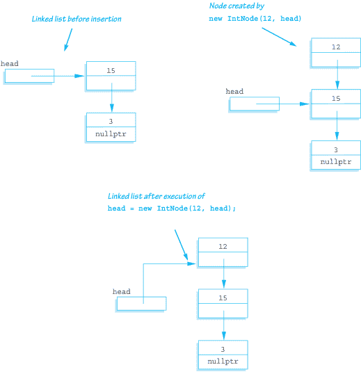

空链表是一种特殊情况。如果你无法设计出适用于空链表的函数，那么你的程序就必须以其他方式处理空链表，或者完全避免空链表。幸运的是，空链表通常可以像其他链表一样处理。例如，展示 17.4 中的 `headInsert` 函数是以非空链表为模型设计的，但稍加检查就会发现，它同样适用于空链表。

## 1. 引言

本文档旨在介绍一种新型的文档解析方法，该方法能够高效地从复杂版面中提取结构化信息。

## 2. 方法概述

- 步骤一：图像预处理
- 步骤二：版面分析
- 步骤三：内容提取
- 步骤四：结构化输出

在预处理阶段，我们采用自适应阈值分割和形态学操作来增强文本区域的对比度。

### 2.1 版面分析

版面分析模块基于深度学习模型，能够识别标题、段落、表格、图片等不同元素。

| 元素类型 | 识别准确率 | 平均耗时 |
|----------|------------|----------|
| 标题     | 98.5%      | 12ms     |
| 段落     | 97.2%      | 15ms     |
| 表格     | 95.8%      | 20ms     |
| 图片     | 96.4%      | 18ms     |

实验结果表明，该方法在多种复杂版面下均表现出良好的鲁棒性。

# 陷阱：丢失节点

你可能会倾向于使用零参数构造函数来设置新节点的成员变量，从而编写 `headInsert`（展示 17.4）的函数定义。如果你尝试这样做，可能会这样开始函数：

```
head = new IntNode;
head->setData(theData);
```

此时，新节点已构造完成，包含正确的数据，并由指针 `head` 指向——一切看似正常。剩下的工作就是将链表的其余部分附加到这个新节点上，即设置新节点的指针成员，使其指向原先链表的第一个节点。如果你能弄清楚用哪个指针替换问号，就可以用以下代码完成：

```
head->setLink(?);
```

展示 17.5 展示了新数据值为 12 时的情况，并说明了问题所在。如果按这种方式继续，将没有任何指针指向包含 15 的节点。由于没有命名的指针指向它（或指向延伸到该节点的指针链），程序无法引用该节点。该节点及其下方的所有节点都将丢失。程序无法让指针指向这些节点中的任何一个，也无法访问这些节点中的数据或对它们执行任何操作，根本无法引用这些节点。这种情况会在程序运行期间占用内存。丢失节点的程序有时被称为存在**内存泄漏**。严重的内存泄漏可能导致程序内存耗尽并异常终止。更糟糕的是，在极少数情况下，普通用户程序中的内存泄漏（丢失节点）可能导致操作系统崩溃。为避免此类节点丢失，程序必须始终保持某个指针指向链表的头部，通常是像 `head` 这样的指针变量中的指针。

内存泄漏

# 在链表内部插入和删除节点

在链表中间插入

接下来，我们设计一个函数，在链表的指定位置插入节点。如果你希望节点按特定顺序排列，例如数值顺序或字母顺序，就不能简单地在链表的开头或末尾插入节点。因此，我们将设计一个函数，在链表中指定节点之后插入节点。

我们假设其他函数或程序部分已正确放置了一个名为 `afterMe` 的指针，指向链表中的某个节点。我们希望新节点放置在 `afterMe` 指向的节点之后，如展示 17.6 所示。该技术同样适用于包含任何类型数据的节点，但为了具体说明，我们使用与前几小节相同类型的节点。类型定义见展示 17.4。我们要定义的函数的声明如下：

```
void insert(IntNodePtr afterMe, int theData);
//前置条件：afterMe 指向链表中的一个节点。
//后置条件：一个包含 theData 的新节点
//已添加到 afterMe 指向的节点之后。
```

在链表内部插入新节点的基本方式与在链表头部（起始处）添加节点相同，这一点我们已经讨论过。唯一的区别是我们使用指针 `afterMe->link` 而不是指针 `head`。插入操作如下：

```
afterMe->setLink(new IntNode(theData, afterMe->getLink()));
```

当 `theData` 等于 5 时的详细过程如图展示 17.6 所示，最终的函数定义见展示 17.4。

在末尾插入

如果你仔细检查 `insert` 函数的代码，会发现即使 `afterMe` 指向的节点是链表的最后一个节点，它也能正确工作。然而，`insert` 无法在链表开头插入节点。展示 17.4 中给出的 `headInsert` 函数可用于在链表开头插入节点。

与数组的比较

通过使用 `insert` 函数，你可以维护按数值、字母或其他顺序排列的链表。只需调整两个指针，即可将新节点挤入正确位置。无论链表有多长，也无论新数据要插入到链表中的哪个位置，这一点都成立。如果改用数组，则必须复制数组的大部分——在极端情况下是全部——才能为正确位置的新值腾出空间。尽管定位指针 `afterMe` 存在一定开销，但向链表插入通常比向数组插入更高效。

从链表中删除节点也相当容易。展示 17.7 说明了该方法。一旦指针 `before` 和 `discard` 就位，删除节点只需以下语句：

```
before->setLink(discard->getLink());
```

删除节点

# 展示 17.5 丢失的节点

插入前的链表

执行以下代码后的情况
head = new IntNode;
head->setData(theData);

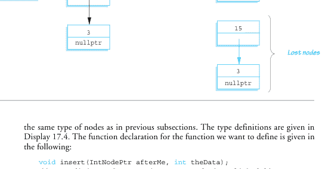

# 展示 17.6 在链表中间插入

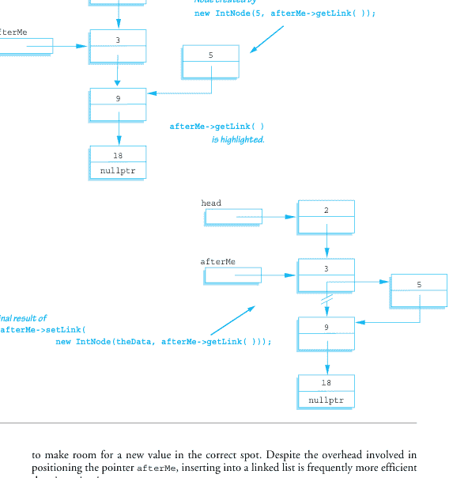

才能为正确位置的新值腾出空间。尽管定位指针 `afterMe` 存在一定开销，但向链表插入通常比向数组插入更高效。

从链表中删除节点也相当容易。展示 17.7 说明了该方法。一旦指针 `before` 和 `discard` 就位，删除节点只需以下语句：

```
before->setLink(discard->getLink());
```

删除节点

# 展示 17.7 删除节点

```
before->setLink(discard->getLink( ));
```

```
delete discard;
```

这足以将节点从链表中移除。但是，如果你不打算将该节点用于其他用途，则应销毁该节点并将其占用的内存归还以供回收；可以通过调用 `delete` 来实现，如下所示：

```
delete discard;
```

## 1. 引言

在当今快速发展的科技时代，人工智能（AI）已经成为推动社会进步的重要力量。从智能助手到自动驾驶，AI 技术正在深刻改变我们的生活方式和工作模式。本文旨在探讨 AI 技术的最新进展及其在各领域的应用前景。

## 2. AI 技术的最新进展

近年来，深度学习、自然语言处理和计算机视觉等领域取得了突破性进展。大语言模型（LLM）的出现使得机器能够更好地理解和生成人类语言，而强化学习则在游戏和机器人控制中展现出巨大潜力。

- 深度学习：通过多层神经网络模拟人脑处理信息。
- 自然语言处理：使机器能够理解和生成自然语言。
- 计算机视觉：让机器能够识别和理解图像内容。

## 3. AI 在各领域的应用

| 领域 | 应用场景 | 代表技术 |
|------|----------|----------|
| 医疗 | 疾病诊断、药物研发 | 医学影像分析 |
| 交通 | 自动驾驶、智能调度 | 强化学习 |
| 教育 | 个性化学习、智能辅导 | 自适应系统 |
| 金融 | 风险控制、智能投顾 | 预测模型 |

> > “AI 不是要取代人类，而是要增强人类的能力。” —— 某位 AI 专家

## 4. 结论

综上所述，AI 技术正处于快速发展阶段，其在各领域的应用前景广阔。未来，随着技术的不断成熟，AI 将在更多场景中发挥重要作用，为人类社会带来更多便利与创新。

这样，我们的程序就可以通过检查函数返回的指针值是否不等于 `nullptr` 来测试该整数是否在链表中。我们的函数声明和头部注释如下：

```
IntNodePtr search(IntNodePtr head, int target);
//前置条件：指针 head 指向链表的头部。
//最后一个节点中的指针变量为 nullptr。
//如果链表为空，则 head 为 nullptr。
//返回一个指针，指向第一个包含 target 的节点。
//如果没有节点包含 target，则函数返回 nullptr。
```

我们将使用一个名为 `here` 的局部指针变量，在链表中移动以查找目标。在链表或任何由节点和指针组成的数据结构中移动的唯一方式就是跟随指针。因此，我们首先让 `here` 指向第一个节点，然后沿着每个节点中的指针，将指针从节点移动到下一个节点。该技术如图展示 17.8 所示。

由于空链表会带来一些会干扰我们讨论的小问题，我们首先假设链表至少包含一个节点。稍后我们会回来确认该算法同样适用于空链表。这种搜索技术产生以下算法：

# search 函数的伪代码

```
让指针变量 here 指向链表的头节点（即第一个节点）。

while (here 没有指向包含 target 的节点
                且 here 没有指向最后一个节点)
{
                 让 here 指向链表中的下一个节点。
}
if (here 指向的节点包含 target)
        返回 here;
else
        返回 nullptr;
```

要将指针 `here` 移动到下一个节点，我们必须考虑可用的命名指针。下一个节点是由当前 `here` 指向的节点的指针成员所指向的节点。当前 `here` 指向的节点的指针成员由表达式

```
here->getLink( )
```

给出。要将 `here` 移动到下一个节点，我们需要更改 `here`，使其指向上述命名指针所指向的节点。因此，以下语句会将指针 `here` 移动到链表中的下一个节点：

```
here = here->getLink( );
```


## Display 17.8 Searching a Linked List

target is 6

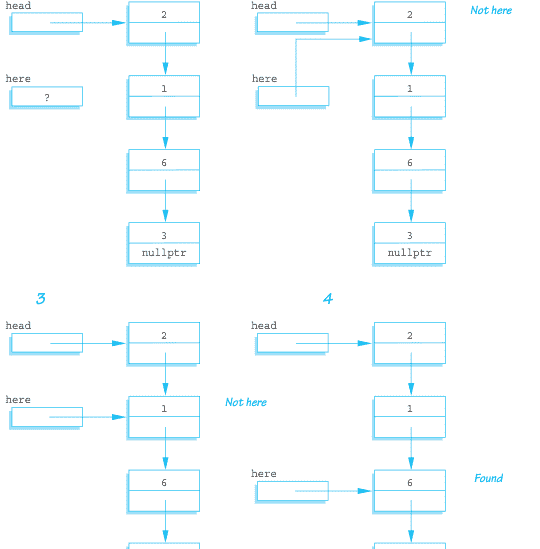

Putting these pieces together yields the following refinement of the algorithm pseudocode for the search function:

```
here = head;
while (here->getData() != target && here->getLink() != nullptr)
    here = here->getLink();
if (here->getData() == target)
    return here;
else
    return nullptr;
```

Notice the Boolean expression in the while statement. We test to see if here is pointing to the last node by testing to see if the member variable here->getLink() is equal to nullptr.

We still must go back and take care of the empty list. If we check the previous code, we find that there is a problem with the empty list. If the list is empty, then here is equal to nullptr and hence the following expressions are undefined:

```
here->getData()
here->getLink()
```

When here is nullptr, it is not pointing to any node, so there is no data member or link member. Hence, we make a special case of the empty list. The complete function definition is given in Display 17.9.

## Doubly Linked Lists

An ordinary linked list allows you to move down the list in only one direction (following the links). A doubly linked list has one link that is a pointer to the next node and an additional link that is a pointer to the previous node. In some cases the link to the previous node can simplify our code. For example, if removing a node from the list, we will no longer need to have a before variable to remember the node that links to the node we wish to discard. Diagrammatically, a doubly linked list looks like the sample list in Display 17.10.

### Display 17.9 Function to Locate a Node in a Linked List (part 1 of 2)

#### FUNCTION DECLARATION

```
IntNodePtr search(IntNodePtr head, int target);
//Precondition: The pointer head points to the head of a
//linked list. The pointer variable in the last node is nullptr.
//If the list is empty, then head is nullptr.
//Returns a pointer that points to the first node that contains the
//target. If no node contains the target, the function returns nullptr.
```

### Display 17.9 Function to Locate a Node in a Linked List (part 2 of 2)

```
IntNodePtr search(IntNodePtr head, int target)
{
    IntNodePtr here = head;
    if (here == nullptr) //if empty list
    {
        return nullptr;
    }
    else
    {
        while (here->getData() != target && here->getLink() != nullptr)
            here = here->getLink();
        if (here->getData() == target)
            return here;
        else
            return nullptr;
    }
}
```

The definitions of IntNode and IntNodePtr are given in Display 17.4.

### Display 17.10 A Doubly Linked List

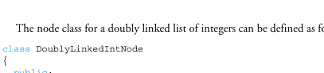

The node class for a doubly linked list of integers can be defined as follows:

```
class DoublyLinkedIntNode
{
public:
    DoublyLinkedIntNode() {}
    DoublyLinkedIntNode(int theData, DoublyLinkedIntNode* previous, DoublyLinkedIntNode* next)
        : data(theData), nextLink(next), previousLink(previous) {}
    DoublyLinkedIntNode* getNextLink() const { return nextLink; }
    DoublyLinkedIntNode* getPreviousLink() const { return previousLink; }
    int getData() const { return data; }
    void setData(int theData) { data = theData; }
    void setNextLink(DoublyLinkedIntNode* pointer) { nextLink = pointer; }
```

```
void setPreviousLink(DoublyLinkedIntNode* pointer)
{
    previousLink = pointer;
}
private:
    int data;
    DoublyLinkedIntNode *nextLink;
    DoublyLinkedIntNode *previousLink;
};
typedef DoublyLinkedIntNode* DoublyLinkedIntNodePtr;
```

The code is almost identical to the version for the singly linked list except that we have added a private member variable, previousLink, to store a link to the previous node in the list. The functions setPreviousLink and getPreviousLink have been added to get and set the link, along with an additional parameter to the constructor to initialize previousLink. What used to be called link has also been renamed nextLink to differentiate between linking to the previous node or to the next node.

## Adding a Node to a Doubly Linked List

To add a new DoublyLinkedIntNode to the front of the list, we must set links on two nodes instead of one. The general process is shown in Display 17.11. The declaration for the insertion function is basically the same as in the singly linked case:

```
void headInsert(DoublyLinkedIntNodePtr& head, int theData);
```

First, we create a new node whose nextLink points to the old head and whose previousLink is nullptr, because it will become the new head:

```
DoublyLinkedIntNode* newHead = new DoublyLinkedIntNode
    (theData, nullptr, head);
```

The old head has to link its previous pointer to the new head:

```
head->setPreviousLink(newHead);
```

Finally, we set head to the new head:

```
head = newHead;
```

The complete function definition is given in Display 17.13.

## Deleting a Node from a Doubly Linked List

To remove a node from the doubly linked list also requires updating the references on both sides of the node we wish to delete. Thanks to the backward link we do not need a separate variable to keep track of the previous node in the list as we did for the singly linked list. The general process of deleting a node referenced by position is shown in Display 17.12. Note that some special cases must be handled separately, such as deleting a node from the beginning or the end of the list.

### Display 17.12 Deleting a Node from a Doubly Linked List

#### Existing list before deleting discard

#### Set pointers to the previous and next nodes

```
DoublyLinkedIntNodePtr prev = discard->getPreviousLink( );
DoublyLinkedIntNodePtr next = discard->getNextLink( );
```

#### Bypass discard

```
prev->setNextLink(next);
next->setPreviousLink(prev);
```

#### Delete discard

```
delete discard;
```

The function declaration for our delete function is now

```
void delete(DoublyLinkedIntNodePtr& head,
    DoublyLinkedIntNodePtr discard);
```

The parameter discard is a pointer to the node we wish to remove. We must also input the head of the list to handle the case where discard is the same as head:

```
if (head == discard)
{
    head = head->getNextLink();
    head->setPreviousLink(nullptr);
}
```

In this case we have to advance head to the next node in the list. We then set the previous link to nullptr because there is no prior node. In the more general case, the variable discard points to any other node that is not the head. We handle this case by redirecting the links to bypass discard, as shown in Display 17.12:

```
else
{
    DoublyLinkedIntNodePtr prev = discard->getPreviousLink();
    DoublyLinkedIntNodePtr next = discard->getNextLink();
    prev->setNextLink(next);
    if (next != nullptr)
    {
        next->setPreviousLink(prev);
    }
}
```

The previous node now links to discard’s next node, and the next node now links to discard’s previous node. Since discard might be the last node in the list, we have to check and make sure that next != nullptr so we do not try to dereference a nullptr pointer in the function setPreviousLink.

The complete function definition is given in Display 17.13.

### Display 17.13 Functions to Add and Remove a Node from a Doubly Linked List (part 1 of 3)

#### NODE AND POINTER TYPE DEFINITIONS

```
class DoublyLinkedIntNode
{
public:
    DoublyLinkedIntNode() {}
    DoublyLinkedIntNode(int theData, DoublyLinkedIntNode* previous,
        DoublyLinkedIntNode* next)
        : data(theData), nextLink(next), previousLink(previous) {}
    DoublyLinkedIntNode* getNextLink() const
    { return nextLink; }
```

### Display 17.13 Functions to Add and Remove a Node from a Doubly Linked List (part 2 of 3)

```
DoublyLinkedIntNode* getPreviousLink( ) const
{ return previousLink; }
int getData( ) const
{ return data; }
void setData(int theData)
{ data = theData; }
void setNextLink(DoublyLinkedIntNode* pointer)
{ nextLink = pointer; }
void setPreviousLink(DoublyLinkedIntNode* pointer)
{ previousLink = pointer; }
private:
    int data;
    DoublyLinkedIntNode *nextLink;
    DoublyLinkedIntNode *previousLink;
}
typedef DoublyLinkedIntNode* DoublyLinkedIntNodePtr;
```

#### FUNCTION TO ADD A NODE AT THE HEAD OF A LINKED LIST

#### FUNCTION DECLARATION

```
void headInsert(DoublyLinkedIntNodePtr& head, int theData);
//Precondition: The pointer variable head points to
//the head of a linked list.
//Postcondition: A new node containing theData
//has been added at the head of the linked list.
```

#### FUNCTION DEFINITION

```
void headInsert(DoublyLinkedIntNodePtr& head, int theData)
{
    DoublyLinkedIntNode* newHead = new DoublyLinkedIntNode
                                      (theData, nullptr, head);
    head->setPreviousLink(newHead);
    head = newHead;
}
```

#### FUNCTION TO REMOVE A NODE

#### FUNCTION DECLARATION

```
void deleteNode(DoublyLinkedIntNodePtr& head,
                 DoublyLinkedIntNodePtr discard);
//Precondition: The pointer variable head points to
//the head of a linked list and discard points to the node to remove.
//Postcondition: The node pointed to by discard is removed from the list.
```


## 显示 17.13 用于在双向链表中添加和删除节点的函数（第 3 部分，共 3 部分）

## 函数定义

```
void deleteNode(DoublyLinkedIntNodePtr& head,
    DoublyLinkedIntNodePtr discard);
{
    if (head == discard)
    {
        head = head->getNextLink();
        head->setPreviousLink(nullptr);
    }
    else
    {
        DoublyLinkedIntNodePtr prev = discard->getPreviousLink();
        DoublyLinkedIntNodePtr next = discard->getNextLink();
        prev->setNextLink(next);
        if (next != nullptr)
        {
            next->setPreviousLink(prev);
        }
    }
    delete discard;
}
```

## 自测练习题

4. 为链表中的节点和指针编写类型定义。将节点类型命名为 `NodeType`，指针类型命名为 `PointerType`。这些链表将用于存储字母。

5. 链表通常通过指向链表中第一个节点的指针来引用，但空链表没有第一个节点。通常使用什么指针值来表示空链表？

6. 假设你的程序包含以下类型定义和指针变量声明：

```
struct Node
{
    double data;
    Node *next;
}

typedef Node* Pointer;
Pointer p1, p2;
```

## 自测练习题（续）

假设 `p1` 指向链表中上述类型的一个节点。编写代码，使 `p1` 指向该链表中的下一个节点。（指针 `p2` 用于下一个练习，与本练习无关。）

7. 假设你的程序包含如自测练习 6 中的类型定义和指针变量声明。再假设 `p2` 指向链表中上述类型的一个节点，且该节点不是链表中的最后一个节点。编写代码，删除 `p2` 所指向节点之后的那个节点。此代码执行后，链表应保持不变，只是链表中少了一个节点。（提示：你可能需要声明另一个指针变量来使用。）

8. 假设你的程序包含以下类型定义和指针变量声明：

```
class Node
{
public:
    Node(double theData, Node* theLink) : data(theData), next(theLink) {}
    Node* getLink() const { return next; }
    double getData() const { return data; }
    void setData(double theData) { data = theData; }
    void setLink(Node* pointer) { next = pointer; }
private:
    double data;
    Node *next;
}
typedef Node* Pointer;
Pointer p1, p2;
```

假设 `p1` 指向链表中上述类型的一个节点。编写代码，使 `p1` 指向该链表中的下一个节点。（指针 `p2` 用于下一个练习，与本练习无关。）

9. 假设你的程序包含如自测练习 8 中的类型定义和指针变量声明。再假设 `p2` 指向链表中之前类型的一个节点，且该节点不是链表中的最后一个节点。编写代码，删除 `p2` 所指向节点之后的那个节点。此代码执行后，链表应保持不变，只是链表中少了一个节点。（提示：你可能需要声明另一个指针变量来使用。）

## 示例：（续）

这是一个指向 `Node<T>` 类型节点的指针的按引用传递参数。接下来，我们重现了显示 17.15 中的函数声明，以便你查看此参数类型在上下文中的具体写法：

```
template<class T>
void headInsert(Node<T>*& head, const T& theData);
```

## 显示 17.14 链表库的接口文件（第 1 部分，共 2 部分）

//这是头文件 listtools.h。其中包含类型定义
//和函数声明，用于操作存储任意类型 T 的数据的链表。
//链表以 Node<T>* 类型的指针形式给出，该指针指向链表的头节点（第一个节点）。
//函数的实现位于文件 listtools.cpp 中
#ifndef LISTTOOLS_H
#define LISTTOOLS_H

namespace LinkedListSavitch
{
    template<class T>
    class Node
    {
    public:
        Node(const T& theData, Node<T>* theLink) : data(theData), link(theLink) {}
        Node<T>* getLink() const { return link; }
        const T getData() const { return data; }
        void setData(const T& theData) { data = theData; }
        void setLink(Node<T>* pointer) { link = pointer; }
    private:
        T data;
        Node<T> *link;
    };
    template<class T>
    void headInsert(Node<T>*& head, const T& theData);
    //前置条件：指针变量 head 指向
    //链表的头节点。
    //后置条件：一个包含 theData 的新节点
    //已被添加到链表的头部。
    template<class T>
    void insert(Node<T>* afterMe, const T& theData);
    //前置条件：afterMe 指向链表中的一个节点。
    //后置条件：一个包含 theData 的新节点
    //已被添加到 afterMe 所指向的节点之后。

在我们使用 `const T&` 的地方，使用 `T` 作为参数类型也是可以接受的。我们使用常量引用参数，是因为我们预计 `T` 通常会是一个类类型。

## 显示 17.14 链表库的接口文件（第 2 部分，共 2 部分）

```
34 template<class T>
35 void deleteNode(Node<T>* before);
36 //前置条件：指针 before 指向链表中在其之后
37 //至少还有一个节点的节点。
38 //后置条件：before 所指向节点之后的节点
39 //已从链表中移除，其存储空间
40 //已归还给自由存储区。

41 template<class T>
42 void deleteFirstNode(Node<T>*& head);
43 //前置条件：指针 head 指向至少有一个节点的
44 //链表中的第一个节点。
45 //后置条件：head 所指向的节点已从链表中移除，
46 //其存储空间已归还给自由存储区。

47 template<class T>
48 Node<T>* search(Node<T>* head, const T& target);
49 //前置条件：指针 head 指向链表的头节点。
50 //最后一个节点中的指针变量为 nullptr。
51 //为类型 T 定义了 == 运算符。
52 //（== 用作相等的判定标准。）
53 //如果链表为空，则 head 为 nullptr。
54 //返回一个指向第一个与 target 相等的节点的指针。
55 //如果没有节点等于 target，
56 //则函数返回 nullptr。
57 }//LinkedListSavitch

58 #endif //LISTTOOLS_H
```

## 显示 17.15 链表库的实现文件（第 1 部分，共 2 部分）

```
//这是实现文件 listtools.cpp。此文件包含
//在 listtools.h 中声明的函数的定义。
#include "listtools.h"

namespace LinkedListSavitch
{
template<class T>
void headInsert(Node<T>*& head, const T& theData)
{
head = new Node<T>(theData, head);
}
template<class T>
```

## 显示 17.15 链表库的实现文件（第 2 部分，共 2 部分）

```
12  void insert(Node<T>* afterMe, const T& theData)
13  {
14      afterMe->setLink(new Node<T>(theData, afterMe->getLink()));
15  }
16
17  template<class T>
18  void deleteNode(Node<T>* before)
19  {
20      Node<T>* discard;
21      discard = before->getLink();
22      before->setLink(discard->getLink());
23      delete discard;
24  }
25
26  template<class T>
27  void deleteFirstNode(Node<T>*& head)
28  {
29      Node<T>* discard;
30      discard = head;
31      head = head->getLink();
32      delete discard;
33  }
34
35  //使用 cstddef：
36  template<class T>
37  Node<T>* search(Node<T>* head, const T& target)
38  {
39      Node<T>* here = head;
40      if (here == nullptr) //如果链表为空
41      {
42          return nullptr;
43      }
44      else
45      {
46          while (here->getData() != target && here->getLink() != nullptr)
47              here = here->getLink();
48
49          if (here->getData() == target)
50              return here;
51          else
52              return nullptr;
53      }
54  }//LinkedListSavitch
```


## 1. 引言

随着信息技术的飞速发展，文档的数字化处理已成为现代办公和学术研究的重要组成部分。光学字符识别（OCR）技术作为文档数字化的核心技术之一，其准确性和效率直接影响着文档处理的整体效果。本文旨在探讨一种基于深度学习的文档识别方法，以提高复杂版面下文档内容提取的准确率。

传统的OCR方法通常依赖于手工设计的特征和规则，在处理印刷体标准文档时表现良好，但在面对复杂版面、混合字体、图像噪声等场景时，其性能往往不尽如人意。近年来，深度学习技术的兴起为文档识别领域带来了新的突破，特别是卷积神经网络（CNN）和循环神经网络（RNN）在图像特征提取和序列建模方面展现出了强大的能力。

本文的主要贡献包括：（1）提出了一种结合注意力机制的多模态文档识别框架；（2）构建了一个包含多种版面类型的大规模训练数据集；（3）在多个公开基准数据集上验证了所提方法的有效性。实验结果表明，该方法在文本行检测和字符识别两个关键任务上均取得了显著的性能提升。

本文的后续章节安排如下：第2节介绍相关工作；第3节详细阐述所提出的方法；第4节给出实验设置与结果分析；第5节总结全文并展望未来的研究方向。

在实验部分，我们选取了三个具有代表性的公开数据集进行评测，包括英文手写体数据集IAM、中文印刷体数据集CTW以及混合语种的场景文本数据集ICDAR2015。通过对比多种基线方法，我们验证了所提框架在不同任务上的鲁棒性和泛化能力。

此外，我们还对模型的推理速度和内存占用进行了详细分析，结果表明所提方法在保持高精度的同时，也具有较好的实时性，能够满足实际应用场景的需求。

## 示例：*（续）*

栈被用于许多语言处理任务。第13章讨论了计算机系统如何使用栈来跟踪C++函数调用。然而，这里我们只关注一个非常简单的应用。本示例的目标是展示如何使用链表技术来实现特定的数据结构，例如栈。

我们的栈类接口如显示17.17所示。这是一个模板类，类型参数T表示栈中存储的数据类型。栈中存储的一项是一个T类型的值。在我们展示的示例中，T被替换为char类型。然而，在大多数应用中，栈中存储的一项很可能是一个结构体或类对象。存储在栈中的每个记录（类型为T的项）被称为**栈帧**，这解释了为什么我们在栈模板类的定义中偶尔使用stackFrame作为标识符名称。你可以对栈执行两种基本操作：向栈中添加一项和从栈中移除一项。

添加一项称为将该项**压入**栈，因此我们将执行此操作的成员函数命名为push。从栈中移除一项称为将该项**弹出**栈，因此我们将执行此操作的成员函数命名为pop。

名称push和pop源于对栈的一种特定可视化方式。栈类似于自助餐厅中有时用来放置盘子的装置。该装置将盘子存放在柜台台面的一个孔中。盘子下方有一个弹簧，其张力经过调整，使得只有最上面的盘子突出于柜台台面之上。如果这种装置被用作栈数据结构，数据将被写在盘子上（这可能违反某些卫生法律，但仍然是一个很好的类比）。要向栈中添加一个盘子，就把它放在其他盘子上面，这个新盘子的重量会压下弹簧。当你取走一个盘子时，它下面的盘子就会弹出来。

显示17.18展示了一个简单的程序，说明了Stack类的使用方式。该程序一次读取一行文本中的一个字符，并将这些字符放入一个栈中。然后程序逐个移除这些字符并将它们写入屏幕。由于数据从栈中移除的顺序与其进入栈的顺序相反，因此输出显示的是反向书写的行。我们将Stack类的实现包含在应用程序中，就像我们通常对模板类所做的那样。这意味着在完成Stack类模板的实现之前，我们无法运行甚至编译应用程序。

模板类Stack的成员函数定义在显示17.19所示的实现文件中。我们的栈类实现为一个链表，其中链表的头部作为栈顶。

- push
- pop

## 显示 17.17 栈模板类的接口文件

```
//这是头文件stack.h。这是类
//Stack的接口，它是一个用于存储T类型项的栈的模板类。
#ifndef STACK_H
#define STACK_H

namespace StackSavitch
{
    template<class T>
    class Node
    {
    public:
        Node(T theData, Node<T>* theLink) : data(theData), link(theLink){}
        Node<T>* getLink() const { return link; }
        const T getData() const { return data; }
        void setData(const T& theData) { data = theData; }
        void setLink(Node<T>* pointer) { link = pointer; }
    private:
        T data;
        Node<T>* link;
    };
    template<class T>
    class Stack
    {
    public:
        Stack( );
        //将对象初始化为空栈。

        Stack(const Stack<T>& aStack);

        Stack<T>& operator =(const Stack<T>& rightSide);

        virtual ~Stack( );

        void push(T stackFrame);

        //后置条件：stackFrame已被添加到栈中。

        T pop( );
        //前置条件：栈不为空。
        //返回栈顶帧并将该栈顶
        //帧从栈中移除。
        bool isEmpty( ) const;
        //如果栈为空则返回true。否则返回false。
    private:
        Node<T>* top;
    };

} //StackSavitch
#endif //STACK_H
```

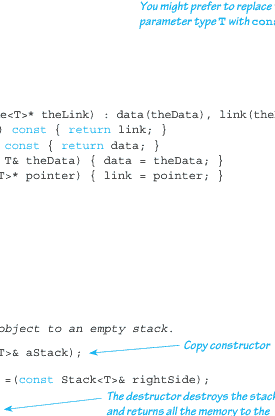

## 显示 17.18 使用栈模板类的程序（第1部分，共2部分）

```
//演示Stack模板类使用的程序。
#include <iostream>
#include "stack.h"
#include "stack.cpp"
using std::cin;
using std::cout;
using std::endl;
using StackSavitch::Stack;
int main( )
{
    char next, ans;
    do
    {
        Stack<char> s;
        cout << "Enter a line of text:\n";
        cin.get(next);
        while (next != '\n')
        {
            s.push(next);
            cin.get(next);
        }
        cout << "Written backward that is:\n";
        while ( ! s.isEmpty() )
            cout << s.pop();
        cout << endl;
        cout << "Again?(y/n) : ";
        cin >> ans;
        cin.ignore(10000, '\n');
    }while (ans != 'n' && ans != 'N');
    return 0;
}
```

### 示例对话

Enter a line of text:
straw
Written backward that is:
warts
Again?(y/n) : y

cin的ignore成员在第9章中讨论。它丢弃行中剩余的输入。

## 显示 17.18 使用栈模板类的程序（第2部分，共2部分）

```
Enter a line of text:
I love C++
Written backward that is:
++C evol I
Again? (y/n): n
```

## 显示 17.19 栈模板类的实现（第1部分，共2部分）

```
//这是实现文件stack.cpp。
//这是模板类Stack的实现。
//模板类Stack的接口在头文件
//stack.h中

#include <iostream>
#include <cstdlib>
#include "stack.h"
using std::cout;

namespace StackSavitch
{

   //使用cstddef：
   template<class T>
   Stack<T>::Stack() : top(nullptr)
   {
      //故意为空
   }

   template<class T>
   Stack<T>::Stack(const Stack<T>& aStack)
   <拷贝构造函数的定义见自测练习14。>
   template<class T>
   Stack<T>& Stack<T>::operator =(const Stack<T>& rightSide)
   <重载赋值运算符的定义见自测练习15。>

   template<class T>
   Stack<T>::~Stack()
```

## 显示 17.19 栈模板类的实现（第2部分，共2部分）

```cpp
{
    T next;
    while (!isEmpty())
        next = pop(); //pop调用delete。
}

//使用cstddef：
template<class T>
bool Stack<T>::isEmpty() const
{
    return (top == nullptr);
}

template<class T>
void Stack<T>::push(T stackFrame)
<定义的其余部分见自测练习13。>

//使用cstdlib和iostream：
template<class T>
T Stack<T>::pop()
{
    if (isEmpty())
    {
        cout << "Error: popping an empty stack.\n";
        exit(1);
    }

    T result = top->getData();

    Node<T> *discard;
    discard = top;
    top = top->getLink();

    delete discard;
    return result;
}
} //StackSavitch
```

## 示例：*（续）*

变量top是一个指向链表头部的指针。指针top的作用与之前讨论链表中指针head的作用相同。

自测练习13是编写成员函数push的定义。然而，我们已经给出了该任务的算法。push成员函数的代码基本上与显示17.15中所示的headInsert函数相同，只是在成员函数push中，我们使用名为top的指针代替名为head的指针。

空栈只是一个空链表，因此空栈通过将指针top设置为nullptr来实现。一旦你意识到nullptr表示空栈，默认构造函数和成员函数empty的实现就显而易见了。

拷贝构造函数的定义稍显复杂，但并未使用我们尚未讨论过的任何技术。细节留给自测练习14。

pop成员函数首先检查栈是否为空。如果不为空，则继续移除栈顶字符。它将局部变量result设置为栈顶符号，如下所示：

```
T result = top->getData();
```

在顶部节点的数据保存到变量`result`之后，指针`top`移动到链表中的下一个节点，从而有效地将顶部节点从列表中移除。指针`top`通过以下语句移动：

```
top = top->getLink();
```

然而，在移动指针top之前，会设置一个名为discard的临时指针，使其指向即将从列表中移除的节点。然后可以通过以下对delete的调用来回收被移除节点的存储空间：

```
delete discard;
```

成员函数pop从链表中移除的每个节点都会通过调用delete回收其内存，因此析构函数只需通过调用pop来移除栈中的每个项即可。然后每个节点的内存都将归还给自由存储区以供回收。


## 栈

栈是一种后进先出的数据结构；也就是说，数据项的取出顺序与它们放入栈中的顺序相反。

## 压栈与弹栈

向栈数据结构中添加数据项被称为将数据项压入栈。 从栈中移除数据项被称为将该项弹出栈。

## 自测练习

- 13. 给出模板类 Stack 的成员函数 push 的定义，该模板类描述于图 17.17 和 17.19 中。
- 14. 给出模板类 Stack 的拷贝构造函数的定义，该模板类描述于图 17.17 和 17.19 中。
- 15. 给出模板类 Stack 的重载赋值运算符的定义，该模板类描述于图 17.17 和 17.19 中。

## 示例：一个队列模板类

栈是一种后进先出的数据结构。 另一种常见的数据结构是队列，它以先进先出的方式处理数据。 队列可以用链表实现，其方式与我们对 Stack 模板类的实现类似。 然而，队列需要在链表的头部和链表的末尾各有一个指针，因为操作发生在两个位置。 从链表头部移除节点比从另一端移除节点更容易。 因此，我们的实现将从链表头部移除节点（我们现在称其为列表的前端），并将节点添加到列表的另一端，我们现在称其为列表的后端（或队列的后端）。

队列模板类的定义在图 17.20 中给出。 使用类 Queue 的示例应用程序显示在图 17.21 中。 成员函数的定义留作自测练习（但请记住，如果你在填写细节时遇到任何问题，答案在章节末尾给出）。

## 图 17.20 队列模板类的接口文件（第 1 部分，共 2 部分）

```
1
2 //This is the header file queue.h. This is the interface for the class
3 //Queue, which is a template class for a queue of items of type T.
4 #ifndef QUEUE_H
5 #define QUEUE_H
6 
7 namespace QueueSavitch
8 {
9   template<class T>
10   class Node
11   {
12   public:
13     Node( T theData, Node<T>* theLink ) : data(theData), link(theLink) {}
14     Node<T>* getLink( ) const { return link; }
15     const T getData( ) const { return data; }
16     void setData(const T& theData) { data = theData; }
17     void setLink(Node<T>* pointer) { link = pointer; }
18   private:
19     T data;
20     Node<T> *link;
21   };
22 
23   template<class T>
24   class Queue
25   {
26   public:
27     Queue( );
28     //Initializes the object to an empty queue.
29     Queue(const Queue<T>& aQueue);
30     Queue<T>& operator =(const Queue<T>& rightSide);
31     virtual ~Queue( );
32     void add(T item);
33     //Postcondition: item has been added to the back of the queue.
34     T remove( );
35     //Precondition: The queue is not empty.
36     //Returns the item at the front of the queue
37     //and removes that item from the queue.
```

这与我们在图 17.17 中为栈接口给出的模板类 Node 的定义相同。 请参阅“提示：关于命名空间的说明”以讨论这种重复。

你可能更喜欢用 const T& 替换参数类型 T。

拷贝构造函数

析构函数销毁队列并将所有内存归还给自由存储区。

## 图 17.20 队列模板类的接口文件（第 2 部分，共 2 部分）

```
37     bool isEmpty( ) const;
38     //Returns true if the queue is empty. Returns false otherwise.
39     private:
40     Node<T>* front; //Points to the head of a linked list.
41     //Items are removed at the head
42     Node<T>* back;  //Points to the node at the other end of the
43     //linked list.
44     //Items are added at this end.
45     };
46 #endif //QUEUE_H
```

## 图 17.21 使用队列模板类的程序（第 1 部分，共 2 部分）

```
//Program to demonstrate use of the Queue template class.
#include <iostream>
#include "queue.h"
#include "queue.cpp"
using std::cin;
using std::cout;
using std::endl;
using QueueSavitch::Queue;

int main( )
{
    char next, ans;    Contrast this with the similar program using
                       a stack instead of a queue that we gave in
                       Display 17.18.
    do
    {
        Queue<char> q;
        cout << "Enter a line of text:\n";
        cin.get(next);
        while (next != '\n')
        {
            q.add(next);
            cin.get(next);
        }
        cout << "You entered:\n";
        while ( ! q.isEmpty( ) )
            cout << q.remove( );
        cout << endl;
```

## 图 17.21 使用队列模板类的程序（第 2 部分，共 2 部分）

```
26      cout << "Again? (y/n): ";
27      cin >> ans;
28      cin.ignore(10000, '\n');
29  } while (ans != 'n' && ans != 'N');
30
31  return 0;
32 }
```

## 示例对话

```
Enter a line of text:
straw
You entered:
straw
Again?(y/n): y
Enter a line of text:
I love C++
You entered:
I love C++
Again?(y/n): n
```

## 队列

队列是一种*先进先出*的数据结构；也就是说，数据项是从队列中以与它们添加到队列中相同的顺序移除的。

## 提示：关于命名空间的说明

请注意，命名空间 StackSavitch（图 17.17）和 QueueSavitch（图 17.20）都定义了一个名为 Node 的模板类。 事实证明，Node 的两个定义是相同的，但这里讨论的要点无论两个定义是否相同都适用。 C++ 不允许你两次定义相同的标识符，即使两个定义相同，除非这两个名称以某种方式区分开。 在这种情况下，两个定义是允许的，因为它们位于两个不同的命名空间中。 甚至可以在同一个程序中使用 Stack 模板类和 Queue 模板类。 然而，你应该使用

```
using StackSavitch::Stack;
using QueueSavitch::Queue;
```

of the function f, you can access private members of C just as you can in the definitions of member functions of C. A class can be a friend of another class in the same way that a function can be a friend of a class. If the class F is a friend of the class C, then every member function of the class F is a friend of the class C. Thus, if, for example, the Queue template class were a friend of the Node template class, then the private link member variables would be directly available in the definitions of the member functions of Queue. The details are outlined in Display 17.22.

## 图 17.22 节点类的友元队列模板类（第 1 部分，共 2 部分）

```
//This is the header file queue.h. This is the interface for the class
//Queue, which is a template class for a queue of items of type T.
#ifndef QUEUE_H
#define QUEUE_H

namespace QueueSavitch
{
    template<class T>
    class Queue;

    template<class T>
    class Node
    {
    public:
        Node(T theData, Node<T>* theLink) : data(theData),
                                            link(theLink){}
        friend class Queue<T>;
    private:
        T data;
        Node<T> *link;
    };

    template<class T>
    class Queue
    {
        //The definition of the template class Queue is identical to the one given in Display 17.20.
        //However, the definitions of the member functions will be different from the ones we gave
        //in the self-Test Exercises for the nonfriend version of Queue.
    }
    //QueueSavitch

#endif //QUEUE_H
#include <iostream>
#include <cstdlib>
#include "queue.h"
using std::cout;
namespace QueueSavitch
```

前向声明。 不要忘记分号。

这是图 17.20 中给出的另一种方法。 在这个版本中，Queue 模板类是 Node 模板类的友元。

如果 Node<T> 仅在友元类 Queue<T> 的定义中使用，则不需要变异访问函数。

实现文件将包含这些定义以及其他成员函数的定义，同样修改以允许通过名称访问节点的 link 和 data 成员变量。


# 显示 17.22 队列模板类作为节点类的友元（第 2 部分，共 2 部分）

```
32 {
33 template<class T> //Uses cstddef:
34 void Queue<T>::add(T item)
35 {
36 if (isEmpty())
37 front = back = new Node<T>(item, nullptr);
38 else
39 {
40 back->link = new Node<T>(item, nullptr);
41 back = back->link;
42 }
43 }
44
template<class T> //Uses cstdlib and iostream:
45 T Queue<T>::remove()
46 {
47 if (isEmpty())
48 {
49 cout << "Error: Removing an item from an empty queue.\n";
50 exit(1);
51 }
52
53 T result = front->data;
54

Node<T> *discard;
55 discard = front;
56 front = front->link;
57 if (front == nullptr) //if you removed the last node
58 back = nullptr;
59

delete discard;
60 return result;
61 } //QueueSavitch
```

如果效率是一个重要问题，你可能希望使用 `(front == nullptr)` 而不是 `(isEmpty())`。

请将这些实现与自测练习 17 的答案中给出的实现进行对比。

前向声明

当一个类是另一个类的友元时，这两个类通常会在各自的类定义中相互引用。这就要求你在第二个定义的类或类模板之前包含一个前向声明，如显示 17.22 所示。请注意，前向声明只是类或类模板定义的头部加上一个分号。关于使用友元类的完整示例见 17.4 节（参见编程示例“树模板类”）。

有两种方法与友元类的用途基本相同，并且可以以基本相同的方式用于 Node 和 Queue 这样的类和模板类：(1) 使用 protected 或 private 继承，使 Queue 继承自 Node；(2) 在 Queue 的定义中给出 Node 的定义，使 Node 成为局部类（模板）定义。（protected 继承在第 14 章讨论，类中局部定义的类在第 7 章讨论。）

# **示例：使用链接法的哈希表**

**哈希表**或**哈希映射**是一种能高效地在内存中存储和检索数据的数据结构。构造哈希表的方法有很多；在本节中，我们将结合数组与单向链表来构造。在 17.1 节中，我们通过遍历链表中的每个节点来查找目标。这一过程可能需要检查链表中的每一个节点，如果链表很长，这可能是一个相当耗时的过程。相比之下，哈希表有可能非常快速地找到目标，尽管在最坏（但极不可能）的情况下，我们的实现运行起来会和使用单向链表一样慢。

对象通过与键关联而存储在哈希表中。给定键，我们就能检索到该对象。理想情况下，每个对象的键都是唯一的。如果对象没有天然唯一的键，我们可以使用**哈希函数**来计算出一个键。在大多数情况下，哈希函数计算出一个数字。

例如，让我们使用哈希表来存储一个单词字典。这样的哈希表可能对制作拼写检查器很有用——哈希表中缺失的单词可能拼写不正确。我们将用一个固定数组来构造哈希表，其中每个数组元素引用一个链表。哈希函数计算出的键将映射到数组的下标。实际数据将存储在哈希值下标处的链表中。显示 17.23 用一个包含十个条目的固定数组说明了这一思想。

最初，数组的每个条目都包含一个对空单向链表的引用。首先，我们添加单词“cat”，它被赋予键或哈希值 2（稍后我们将展示如何计算）。接着，我们添加“dog”和“bird”，它们分别被赋予哈希值 4 和 7。每个字符串都被插入到链表的头部，使用哈希值作为数组下标。最后，我们添加“turtle”，它的哈希值也是 2。由于“cat”已经存储在下标 2 处，现在我们遇到了**冲突**。“turtle”和“cat”都映射到数组中的同一个下标。

当这种情况发生在使用**链接法**的哈希表中时，我们只需将新节点插入到现有链表中。在我们的示例中，下标 2 处现在有两个节点：“turtle”和“cat”。

要从哈希表中检索一个值，我们首先计算目标的哈希值。然后依次在存储于 hash array[hashvalue] 的链表中查找目标。如果在该链表中找不到目标，则目标不在哈希表中。如果链表很小，检索过程就会很快。

（续）

# 示例：（续）

# 字符串的哈希函数

计算字符串数值哈希值的一种简单方法是：将字符串中每个字符的 ASCII 值相加，然后用固定数组的大小对总和取模。附录 3 给出了 ASCII 码的一部分。用于计算哈希值的代码如函数 computeHash 所示：

```
```cpp
int computeHash(string s)
{
    int hash = 0;
    for (int i = 0; i < s.length(); i++)
    {
        hash = hash + s[i];
    }
    return hash % SIZE;   //SIZE = 10 in example
}
```
```

例如，字符串“dog”的 ASCII 码是

+   d  ->  100
+    o  ->  111
+    g  ->  103

哈希函数计算如下：

```
Sum             = 100 + 111 + 103 = 314
Hash = Sum % 10 = 314 % 10 = 4
```

在本例中，我们首先计算一个无界值，即字符串中 ASCII 值的总和。然而，数组被定义为保存有限数量的元素。为了将总和缩放到数组的大小，我们计算总和相对于数组大小的模，在该示例中数组大小为 10。在实践中，数组的大小通常是一个质数，且大于将放入哈希表中的条目数。¹ 计算得到的哈希值 4 作为字符串“dog”的指纹。但是，其他字符串也可能映射到相同的值。例如，我们可以验证“cat”映射到 (99 + 97 + 116) % 10 = 2，“turtle”映射到 (116 + 117 + 114 + 116 + 108 + 101) % 10 = 2。

哈希表类的完整代码清单见显示 17.24 和 17.25。显示 17.26 给出了一个演示。哈希表定义使用了一个数组，其中每个元素都是显示 17.14 中定义的 Node 类。链表是使用显示 17.14 和 17.15 中定义的泛型链表库实现的。

> ¹质数避免了取模运算后可能引发冲突的公约数。

# 显示 17.23 构造哈希表

# 现有的哈希表，包含 10 个空链表

```
Node<string>* hashArray[10];
for (int i=0; i<10; i++) hashArray[i] = nullptr;
```

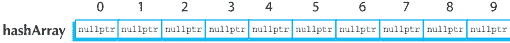

# 添加哈希值为 2 的“cat”之后

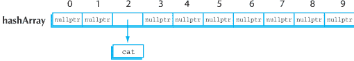

# 添加哈希值为 4 的“dog”和哈希值为 7 的“bird”之后

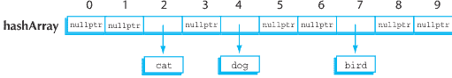

# 添加哈希值为 2 的“turtle”之后——发生冲突，并通过链接法与“cat”链接到同一链表

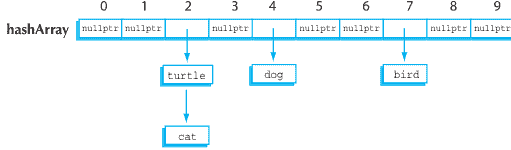

## 1. 引言

本文档旨在介绍一种新型的文档解析方法，该方法能够高效地从复杂版面中提取结构化信息。

## 2. 方法概述

我们提出了一种基于深度学习的端到端模型，该模型结合了视觉特征与文本语义，实现了对文档元素的精准定位与分类。

- 步骤一：图像预处理
- 步骤二：版面分析
- 步骤三：内容提取与结构化

| 方法 | 准确率 | 召回率 |
|------|--------|--------|
| 基线 | 0.85   | 0.80   |
| 本方法 | 0.93   | 0.91   |

> > 实验结果表明，该方法在多个公开数据集上均取得了最优性能。

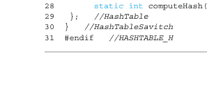

```
```python
import torch
model = Model()
```
```

# 显示 17.25  HashTable 类的实现（第 1 部分，共 2 部分）

```
```cpp
//This is the implementation file hashtable.cpp.
//This is the implementation of the class HashTable.

#include <string>
#include "listtools.h"
#include "hashtable.h"

using LinkedListSavitch::Node;
using LinkedListSavitch::search;
using LinkedListSavitch::headInsert;
using std::string;

namespace HashTableSavitch
{
    HashTable::HashTable( )
    {
        for (int i = 0; i < SIZE; i++)
        {
            hashArray[i] = nullptr;
        }
    }

    HashTable::~HashTable( )
    {
        for (int i=0; i<SIZE; i++)
        {
            Node<string> *next = hashArray[i];
            while (next != nullptr)
            {
                Node<string> *discard = next;
                next = next->getLink( );
                delete discard;
            }
        }
    }

    int HashTable::computeHash(string s)
    {
        int hash = 0;
        for (int i = 0; i < s.length( ); i++)
        {
            hash = hash + s[i];
        }
        return hash % SIZE;
    }
}
```


```cpp
void HashTable::put(string s)
{
    int hash = computeHash(s);
    if (search(hashArray[hash], s)==nullptr)
    {
        //Only add the target if it's not in the list
        headInsert(hashArray[hash], s);
    }
}
//HashTableSavitch
```

```cpp
//Program to demonstrate use of the HashTable class

#include <string>
#include <iostream>
#include "hashtable.h"
#include "liststr.hpp"
#include "hashtable.cpp"
using std::string;
using std::cout;
using std::endl;
using HashTableSavitch::HashTable;

int main( )
{
    HashTable h;

    cout << "Adding dog, cat, turtle, bird" << endl;
    h.put("dog");
    h.put("cat");
    h.put("turtle");
    h.put("bird");
    cout << "Contains dog? " << h.containsString("dog") << endl;
    cout << "Contains cat? " << h.containsString("cat") << endl;
    cout << "Contains turtle? " << h.containsString("turtle") << endl;
    cout << "Contains bird? " << h.containsString("bird") << endl;

    cout << "Contains fish? " << h.containsString("fish") << endl;
    cout << "Contains cow? " << h.containsString("cow") << endl;

    return 0;
}
```

Sample Dialogue

```
Adding dog, cat, turtle, bird
Contains dog? 1
Contains cat? 1
Contains turtle? 1
Contains bird? 1
Contains fish? 0
Contains cow? 0
```

## Hash Table

哈希表是一种将数据项与键关联起来的数据结构。键由哈希函数计算得出。

## Efficiency of Hash Tables

哈希表的效率取决于多个因素。首先，让我们考察一些极端情况。最坏情况下的运行时间性能出现在插入到表中的每个项目具有相同的哈希键时。此时所有内容都存储在单个链表中，查找操作可能需要遍历列表中的每个项目。幸运的是，如果我们插入的项目具有一定的随机性，那么所有项目哈希到同一键的可能性极低。相反，最佳情况下的运行时间性能出现在插入到表中的每个项目具有不同的哈希键时。这意味着不会发生冲突，查找操作只需搜索一个包含一个元素的列表，因为目标始终是链表中的第一个节点。

我们可以通过使用更好的哈希函数来降低冲突的可能性。例如，简单地对字符串的每个字母求和的哈希函数忽略了字母的顺序。单词“rat”和“tar”会哈希到相同的值。对于字符串 s 的一个更好的哈希函数是根据单词中的位置乘以每个字母一个递增的权重：

```
int hash = 0;
for (int i = 0; i < s.length(); i++)
{
    hash = 31 * hash + s[i];
}
```

降低冲突可能性的另一种方法是使哈希表更大。例如，如果哈希表数组的容量为 10,000 个条目，但我们只插入 1000 个项目，则冲突的概率会远小于哈希表数组只能存储 1000 个条目的情况。然而，在一个 10,000 条目的哈希表中只插入 1000 个项目意味着 9000 个内存位置将未被使用，这是一种内存浪费。这说明了**时间-空间权衡**。通常可以在以内存空间为代价的情况下提高运行时间性能，反之亦然。

## Self-Test Exercises

+   21. 假设贵大学的每位学生都被分配一个唯一的九位数字 ID 号。你希望创建一个哈希表，将 ID 号映射到表示学生的对象。哈希表的大小为 N，其中 N 的位数少于九位。描述一个简单的哈希函数，可用于将 ID 号映射到哈希索引。
+   
+   22. 编写 `HashTable` 类的 `outputHashTable()` 函数，以输出哈希表中存储的每个项目。

## EXAMPLE: A Set Template Class

集合是元素不重复出现超过一次的元素的集合。计算机科学中的许多问题都可以通过集合数据结构的帮助来解决。链表的一种变体是实现集合的一种直接方法。在此实现中，每个集合中的项目都使用单链表存储。每个节点的 data 变量仅包含集合中的一个项目。

Display 17.27 说明了使用此数据结构存储的两个示例集合。集合 around 包含“peas”、“ball”和“pie”，而集合 green 包含“peas”和“grass”。字符串“peas”同时存在于两个集合中，因为它既是圆的又是绿色的。注意，如果用于填充 Node 模板的数据类型是指向对象的指针，则多个列表可能会引用同一个对象，而不是在每个列表中创建同一对象的多个副本。

## FUNDAMENTAL SET OPERATIONS

我们的集合类应支持的一些基本操作是

+   - `add element.` 将新项目添加到集合中。
+   - `contains.` 确定目标项目是否为集合的成员。
+   - `union.` 返回两个集合的并集。
+   - `intersection.` 返回两个集合的交集。

我们还应包括一种遍历集合中每个元素的方式。其他有用的集合操作包括检索集合基数和从集合中删除项目的函数。这些操作的实现作为 Programming Project 17.7 的练习给出。

## EXAMPLE: (continued)

实现通用元素集合的代码出现在 Displays 17.28 和 17.29 中。Set 类使用 Display 17.14 中的链表工具。add 函数仅在项目不在集合中时将节点添加到链表前端。contains 函数使用链表库中的 search 函数。我们只需遍历列表中的每个项目查找目标。

union 函数将调用对象的集合中的元素与输入参数 otherSet 的集合中的元素合并。为了对这些集合进行并集，我们首先创建一个新的空 Set 对象。接下来，我们遍历调用对象的集合和 otherSet 的集合。所有元素都添加到新集合中。add 函数强制唯一性，因此我们无需在 union 函数中检查重复元素。

intersection 函数与 union 函数类似，它也创建一个新的空 Set 对象。在这种情况下，我们用同时存在于调用对象的集合和 otherSet 的集合中的项目填充集合。这是通过遍历调用对象的集合中的每个项目来实现的。对于每个项目，我们调用 otherSet 的 contains 函数。如果 contains 返回 true，则该项目同时存在于两个集合中，可以添加到新集合中。

Display 17.30 中有一个简短的演示程序。

## Display 17.27 Set Implementation Using Linked Lists


Set
集合是一个无序的数据元素集合。

## 1. 项目概况

本项目为某市智慧城市建设项目，旨在通过物联网、大数据、人工智能等技术手段，提升城市管理效率与公共服务水平。项目总投资约5.2亿元，建设周期为3年，覆盖全市12个区县。

## 2. 建设目标

+   - 构建统一的城市数据中台，实现跨部门数据共享与业务协同
+   - 部署智能感知终端10万+，覆盖交通、环保、安防等重点领域
+   - 开发智慧政务、智慧交通、智慧环保等核心应用系统
+   - 建立城市运行监测与应急指挥中心，实现可视化调度

## 3. 技术架构

系统采用分层架构设计，自下而上分为感知层、网络层、平台层和应用层。感知层负责数据采集，网络层负责数据传输，平台层提供数据存储与计算能力，应用层面向最终用户提供各类智慧服务。

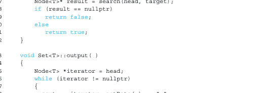

> > 注：技术架构图详见附件A，详细接口规范见附件B。

## Display 17.29   Implementation File for a Set Template Class (part 2 of 2)

```cpp
41        cout << endl;
42    }

43    template<class T>
44    void Set<T>::add(T item)
45    {
46        if (search(head, item)==nullptr)
47        {
48            //Only add the target if it's not in the list
49            headInsert(head, item);
50        }
51    }

52    template<class T>
53    Set<T>* Set<T>::setUnion(const Set<T>& otherSet)
54    {
55        Set<T>* unionSet = new Set<T>();
56        Node<T>* iterator = head;
57        while (iterator != nullptr)
58        {
59            unionSet->add(iterator->getData());
60            iterator = iterator->getLink();
61        }
62        iterator = otherSet.head;
63        while (iterator != nullptr)
64        {
65            unionSet->add(iterator->getData());
66            iterator = iterator->getLink();
67        }
68        return unionSet;
69    }

70    template<class T>
71    Set<T>* Set<T>::setIntersection(const Set<T>& otherSet)
72    {
73        Set<T>* intersect = new Set<T>();
74        Node<T>* iterator = head;
75        while (iterator != nullptr)
76        {
77            if (otherSet.contains(iterator->getData()))
78            {
79                intersect->add(iterator->getData());
80            }
81            iterator = iterator->getLink();
82        }
83        return intersect;
84    }
85}   //SetSavitch
```


# Display 17.30 使用 Set 模板类的程序（第 1 部分，共 2 部分）

```
1 //Program to demonstrate use of the Set class
2 #include <iostream>
3 #include <string>
4 #include "set.h"
5 #include "listtools.cpp"
6 #include "set.cpp"
7 using std::cout;
8 using std::endl;
9 using std::string;
10 using namespace Setsavitch;
11 
12 int main( )
13 {
14     Set<string> round; //Round things
15     Set<string> green; //Green things
16 
17     round.add("peas"); //Sample data for both sets
18     round.add("ball");
19     round.add("pie");
20     round.add("grapes");
21     green.add("peas");
22     green.add("grapes");
23     green.add("garden hose");
24     green.add("grass");
25 
26     cout << "Contents of set round: ";
27     round.output( );
28     cout << "Contents of set green: ";
29     green.output( );
30 
31     cout << "ball in set round? " <<
32     round.contains("ball") << endl;
33     cout << "ball in set green? " <<
34     green.contains("ball") << endl;
35 
36     cout << "ball and peas in same set? ";
37     if ((round.contains("ball") && round.contains("peas")) ||
38         (green.contains("ball") && green.contains("peas")))
39         cout << " true" << endl;
40     else
41         cout << " false" << endl;
42 
43     cout << "pie and grass in same set? ";
44     if ((round.contains("pie") && round.contains("grass")) ||
45         (green.contains("pie") && green.contains("grass")))
46         cout << " true" << endl;
```

# Display 17.30 使用 Set 模板类的程序（第 2 部分，共 2 部分）

```
41      else
42          cout << "  false" << endl;

43      cout << "Union of green and round: " << endl;
44      Set<string> *unionset = round.setUnion(green);
45      unionset->output( );
46      delete unionset;

47      cout << "Intersection of green and round: " << endl;
48      Set<string> *interset = round.setIntersection(green);
49      interset->output( );
50      delete interset;

51      return 0;
52  }
```

# Sample Dialogue

```
Contents of set round: grapes pie ball peas
Contents of set green: grass garden hose grapes peas
ball in set round? 1
ball in set green? 0
ball and peas in same set? true
pie and grass in same set? false
Union of green and round:
garden hose grass peas ball pie grapes
Intersection of green and round:
peas grapes
```

> Some compilers may output true and false instead of 1 and 0.

## Efficiency of Sets Using Linked Lists

set 我们可以从基本集合操作的角度分析使用链表实现的集合数据结构的运行时间效率。将项目添加到集合中时，始终在链表前端插入新节点。这只需要设置链表上的一个链接。contains 函数遍历整个集合查找目标，可能需要检查列表中的每个节点。当我们对集合 A 和 B 调用 setUnion 函数时，它会遍历两个集合并将每个项目添加到新集合中。如果集合 A 中有 n 个项目，集合 B 中有 m 个项目，则需要检查 n + m 个项目。然而，存在隐藏的成本，因为 add 函数在添加新项目之前会搜索整个列表以查找任何重复项。随着向新集合添加的项目数量增加，这种成本变得显著。最后，应用于集合 A 和 B 的 setIntersection 函数会对集合 A 中的每个项目调用集合 B 的 contains 函数。由于 contains 函数可能需要为集合 A 中的每个项目检查多达 m 个节点，因此 setIntersection 最多需要检查 m × n 个节点。这些是我们集合实现中的低效函数。采用不同的方法来表示集合——例如，使用哈希表而不是链表——可能会导致一个 setIntersection 函数，最多检查 n + m 个节点。尽管如此，我们的链表实现对于使用小型集合的应用程序或不经常调用 setIntersection 函数的应用程序来说可能足够好，而且我们拥有相对简单且易于理解的代码的好处。

如果我们真的需要效率，我们可以保持对 Set<T> 类的相同接口，但用其他东西替换我们的链表实现。如果我们使用 Display 17.25 中的哈希表实现，contains 函数将运行得更快。然而，切换到哈希表使得遍历集合中的项目变得更加困难。与遍历单个链表以检索集合中的每个项目不同，哈希表版本现在必须遍历哈希表数组，然后对于数组中的每个索引，遍历该索引处的链表。检查哈希表数组中的每个条目需要额外的时间，而在单链表集合实现中是不必要的。因此，虽然我们减少了查找项目的步骤数，但我们增加了遍历每个项目的步骤数。如果这很麻烦，你可以通过使用同时使用链表（以便于迭代）和哈希表（用于快速查找）的 Set<T> 实现来克服这个问题。然而，使用这种方法，代码的复杂性会显著增加。你被要求在编程项目 17.10 中探索哈希表实现。

## Self-Test Exercise

23. 为 Set 类编写一个名为 difference 的函数，该函数返回两个集合之间的差集。该函数应返回一个指向新集合的指针，该集合包含第一个集合中但不在第二个集合中的项目。例如，如果 setA 包含 {1, 2, 3, 4} 且 setB 包含 {2, 4, 5}，则 setA.difference(setB) 应返回集合 {1, 3}。

## 17.3 Iterators

> The white rabbit put on his spectacles. "Where shall I begin, please your Majesty?" he asked.
> 
> "Begin at the beginning," the King said, very gravely. "And go on till you come to the end: then stop."
> 
> LEWIS CARROLL, Alice's Adventures in Wonderland.
> London: Macmillan and Co., 1865

iterator

数据结构中的一个重要概念是迭代器。迭代器是一种构造（通常是某个迭代器类的对象），它允许你遍历存储在数据结构中的数据项，以便你可以对每个数据项执行所需的操作。

## Iterator

迭代器是一种构造（通常是某个迭代器类的对象），它允许你遍历存储在数据结构中的数据项，以便你可以对数据结构中的每个数据项执行所需的操作。

## Pointers as Iterators

迭代器的基本思想，事实上原型模型，可以很容易地在链表的上下文中看到。链表是原型数据结构之一，而指针是迭代器的原型示例。你可以通过从列表头开始一次一个节点地移动链表来使用指针作为迭代器，并遍历列表中的所有节点。总体轮廓如下：

```
Node_Type *iterator;
for (iterator = Head; iterator != nullptr;
     iterator = iterator->Link)
    Do whatever you want with the node pointed to by iterator;
```

其中 Head 是指向链表头节点的指针，Link 是节点成员变量的名称，该变量指向列表中的下一个节点。

例如，要输出我们在第 17.1 节中讨论的那种链表中所有节点的数据，你可以使用以下代码：

```
IntNode *iterator;
for (iterator = head; iterator != nullptr;
                  iterator = iterator->getLink())
    cout << (iterator->getData());
```

IntNode 的定义在 Display 17.4 中给出。

请注意，你通过使用相等运算符 == 来测试两个指针是否指向同一个节点。指针是内存地址。如果两个指针变量包含相同的内存地址，则它们比较相等并指向同一个节点。类似地，你可以使用 != 来比较两个指针，查看它们是否不指向同一个节点。

## Iterator Classes

迭代器类比指针更通用、更通用。它通常确实有一个指针成员变量作为其数据的核心，如下一个编程示例中所示，但这不是必需的。例如，迭代器的核心可能是一个数组索引。迭代器类具有函数和重载运算符，允许你使用指针语法与迭代器类的对象一起使用，无论你为底层数据结构、节点类型或基本位置标记（指针或数组索引或任何内容）使用什么。此外，它提供了一个通用框架，可用于广泛的数据结构。


迭代器类通常具有以下重载运算符：

- ++ 重载递增运算符，将迭代器移动到下一项。
- -- 重载递减运算符，将迭代器移动到上一项。
- == 重载相等运算符，用于比较两个迭代器，如果它们指向同一项，则返回 true。
- != 重载不相等运算符，用于比较两个迭代器，如果它们指向的不是同一项，则返回 true。
- * 重载解引用运算符，用于访问某一项。（它通常返回一个引用，以允许读写访问。）

在思考这些运算符时，你可以用链表作为一个具体示例。在这种情况下，请记住，列表中的项是列表中的数据，而不是整个节点，也不是节点的指针成员。除数据项之外的一切都属于实现细节，应当对使用迭代器和数据结构类的程序员隐藏。

迭代器与某个特定的结构类一起使用，该类存储某种类型的数据项。数据结构类通常具有以下成员函数，为该类的对象提供迭代器：

begin( )：一个成员函数，不接收参数，返回一个位于（“指向”）数据结构中第一项的迭代器。

end( )：一个成员函数，不接收参数，返回一个可用于测试是否已遍历完数据结构中所有项的迭代器。如果 i 是一个迭代器，并且它已经被推进到数据结构中的最后一项之后，那么 i 应等于 end( )。

使用迭代器，你可以按如下方式遍历数据结构 da 中的各项：

```
for (i = da.begin( ); i != da.end( ); i++)
    process *i //*i 是当前数据项。
```

## 迭代器类

迭代器类通常具有以下重载运算符：++，移动到下一项；--，移动到上一项；==，重载相等运算符；!=，重载不相等运算符；以及 *，重载解引用运算符，用于访问一个数据项。

与迭代器类对应的数据结构类通常具有以下两个成员函数：begin( )，返回一个位于（“指向”）数据结构中第一项的迭代器；以及 end( )，返回一个可用于测试是否已遍历完数据结构中所有项的迭代器。如果 i 是一个迭代器，并且它已经被推进到数据结构中的最后一项之后，那么 i 应等于 end( )。

使用迭代器，你可以按如下方式遍历数据结构 da 中的各项：

```
for (i = da.begin( ); i != da.end( ); i++)
    process *i //*i 是当前数据项。
```

其中 i 是一个迭代器。第 19 章讨论的迭代器比这里多了几个项目和更精细的细节，但这些内容足以作为入门介绍。

这个抽象讨论只有给出一个示例才能变得生动。因此，让我们来看一个完整的示例。

## 示例：一个迭代器类

显示 17.31 包含了一个迭代器类的定义，该类可用于基于链表的此类数据结构（如栈或队列）。我们将节点类和迭代器类放在它们自己的命名空间中。这是合理的，因为迭代器与节点类密切相关，并且任何使用此节点类的类也可以使用该迭代器类。这个迭代器类没有递减运算符，因为递减运算符的定义依赖于链表的细节，并不仅仅依赖于类型 Node<T>。（迭代器的定义依赖于底层链表并没有问题。我们只是决定避免这种复杂性。）

如你所见，模板类 ListIterator 本质上是一个包装在类中的指针，这样它就可以具有所需的成员运算符。重载运算符的定义直截了当，事实上非常简短，因此我们将它们全部定义为内联函数。请注意，解引用运算符 * 产生所指向节点的数据成员变量。只有数据成员变量才是数据。节点中的指针成员变量是实现细节的一部分，用户程序员不需要关注它。

你可以将 ListIterator 类用作任何基于链表且使用模板类 Node 的类的迭代器。作为示例，我们重写了模板类 Queue，使其具有迭代器功能。模板类 Queue 的接口在显示 17.32 中给出。这个 Queue 模板的定义与我们之前的版本（显示 17.20）相同，只是我们添加了一个类型定义以及以下两个成员函数：

```
Iterator begin() const { return Iterator(front); }
Iterator end() const { return Iterator(); }
//结束迭代器的 end().current == nullptr。
```

让我们先讨论这两个成员函数。

成员函数 begin() 返回一个位于（“指向”）队列前端节点的迭代器，该节点是底层链表的头节点。每次应用递增运算符 ++，都会将迭代器移动到下一个节点。因此，你可以按如下方式遍历名为 q 的队列中的节点，进而遍历数据：

```
for (i = q.begin(); 停止条件; i++)
    process *i    //*i 是当前数据项。
```

其中 i 是迭代器类型的变量。

### 显示 17.31 用于链表的迭代器类（第 1 部分，共 2 部分）

```
//这是头文件 iterator.h。这是
//ListIterator 类的接口，它是一个模板类，用于
//与类型为 T 的链表项一起使用的迭代器。此文件还包含
//链表的节点类型
#ifndef ITERATOR_H
#define ITERATOR_H

namespace ListNodeSavitch
{
    template<class T>
    class Node
    {
    public:
        Node(T theData, Node<T>* theLink) : data(theData), link(theLink) {}
        Node<T>* getLink() const { return link; }
        const T& getData() const { return data; }
        void setData(const T& theData) { data = theData; }
        void setLink(Node<T>* pointer) { link = pointer; }
    private:
        T data;
        Node<T>* link;
    };

    template<class T>
    class ListIterator
    {
    public:
        ListIterator() : current(NULL) {}

        ListIterator(Node<T>* initial) : current(initial) {}
        const T& operator *() const { return current->getData(); }
        //前置条件：不等于默认构造函数创建的对象；
        //即 current != nullptr。
        ListIterator& operator ++() //前缀形式
        {
            current = current->getLink();
            return *this;
        }
        ListIterator operator ++(int) //后缀形式
        {
            ListIterator startVersion(current);
            current = current->getLink();
            return startVersion;
        }
```

请注意，解引用运算符 * 产生节点的数据成员，而不是整个节点。此版本不允许你更改节点中的数据。

### 显示 17.31 用于链表的迭代器类（第 2 部分，共 2 部分）

```
```cpp
41        }
42        bool operator ==(const ListIterator& rightSide) const
43        { return (current == rightSide.current); }
44
45        bool operator !=(const ListIterator& rightSide) const
46        { return (current != rightSide.current); }
47
48    private:
49        Node<T> *current;
50    };
51 } //ListNodeSavitch
52 #endif  //ITERATOR_H
```
```

## 示例：（续）

成员函数 end( ) 返回一个其 current 成员变量为 nullptr 的迭代器。因此，当迭代器 i 已通过最后一个节点时，布尔表达式

```
```cpp
i != q.end( )
```
```

会从 true 变为 false。这就是所期望的停止条件。这个队列类和迭代器类允许你按照我们为迭代器概述的方式遍历队列中的数据：

```
```cpp
for (i = q.begin( ); i != q.end( ); i++)
    process *i //*i 是当前数据项。
```
```

请注意，当 i 位于最后一个节点时，i 并不等于 q.end( )。只有将迭代器 i 推进到最后一个节点之后的一个位置时，i 才等于 q.end( )。为了记住这一细节，可以将 q.end( ) 视为一个结束标记，类似 nullptr；在这种情况下，它本质上就是 nullptr 的一个版本。一个使用这种 for 循环的示例程序如显示 17.33 所示。

请注意我们新的队列模板类中的类型定义：

```
```cpp
typedef ListIterator<T> Iterator;
```
```


## 显示 17.33 使用迭代器的队列模板类的程序

```
//Program to demonstrate use of the Queue template class with iterators.
#include <iostream>
#include "queue.h" //not needed
#include "queue.cpp"
#include "iterator.h" //not needed
using std::cin;
using std::cout;
using std::endl;
using namespace QueueSavitch;
int main()
{
char next, ans;
do
{
Queue<char> q;
cout << "Enter a line of text:\n";
cin.get(next);
while (next != '\n')
{
q.add(next);
cin.get(next);
}
cout << "You entered:\n";
Queue<char>::Iterator i;
for (i = q.begin(); i != q.end(); i++)
cout << *i;
cout << endl;
cout << "Again? (y/n): ";
cin >> ans;
cin.ignore(10000, '\n');
}while (ans != 'n' && ans != 'N');
return 0;
}
```

## 示例对话

Enter a line of text:
Where shall I begin?
You entered:
Where shall I begin?
Again? (y/n): y
Enter a line of text:
Begin at the beginning
You entered:
Begin at the beginning
Again? (y/n): n

## 示例：（续）

这个 typedef 并不是绝对必要的。你始终可以使用 ListIterator<T> 代替类型名 Iterator。然而，这个类型定义使得代码更简洁。有了这个类型定义，类 Queue<char> 的迭代器写成

```
Queue<char>::Iterator i;
```

这使得迭代器 intended 用于哪个类变得清晰。

我们新的模板类 Queue 的实现在显示 17.34 中给出。由于我们添加到这个新 Queue 类中的唯一成员函数都是内联定义的，实现文件实际上并没有什么新内容，但我们按其布局包含实现文件，并展示它会包含哪些指令。

## 显示 17.34 带迭代器的队列模板类的实现文件（第 1 部分，共 2 部分）

```
//This is the file queue.cpp. This is the implementation of the
//template class Queue. The interface for the template class Queue is
//in the header file queue.h.
#include <iostream>
#include <cstdlib>
#include "queue.h"
using std::cout;

using namespace ListNodeSavitch;
namespace QueueSavitch
{
  template<class T>
  Queue<T>::Queue( ) : front(nullptr), back(nullptr)
  <The Rest of the definition is given in the answer to Self-Test Exercise 16.>
  template<class T>
  Queue<T>::Queue(const Queue<T>& aQueue)
  <The Rest of the definition is given in the answer to Self-Test Exercise 19.>
  template<class T>
  Queue<T>& Queue<T>::operator =(const Queue<T>& rightSide)
  <The Rest of the definition is given in the answer to Self-Test Exercise 20.>
  template<class T>
  Queue<T>::~Queue( )
```

成员函数定义与 Queue 模板的上一版本相同。这是为了展示文件布局和命名空间的使用。

## 显示 17.34 带迭代器的队列模板类的实现文件（第 2 部分，共 2 部分）

```
22 <The rest of the definition is given in the answer to Self-Test Exercise 18.>
23 template<class T>
24 bool Queue<T>::isEmpty( ) const
25 <The rest of the definition is given in the answer to Self-Test Exercise 16.>

26 template<class T>
27 void Queue<T>::add(T item)
28 <The rest of the definition is given in the answer to Self-Test Exercise 17.>

29 template<class T>
30 T Queue<T>::remove( )
31 <The rest of the definition is given in the answer to Self-Test Exercise 17.>
32 }//QueueSavitch
33 #endif//QUEUE_H
```

## 自测练习

24. 编写此处所示的模板函数 inQ 的定义。使用迭代器。
使用显示 17.32 中给出的 Queue 定义。

```
template<class T>
bool inQ(Queue<T>& q, T target);
//Returns true if target is in the queue q;
//otherwise, returns false.
```

## 17.4 树

> 我想我永远也看不到比树更有用的数据结构了。
> 
> 匿名

对树的详细处理超出了本章的范围。本章的目标是教你构建和操作基于节点和指针的数据结构的基本技术。链表作为我们讨论的一个很好的例子。然而，单链表中的节点有一个相当受限的细节：它们只有一个指针成员变量指向另一个节点。树节点有两个（在某些应用中多于两个）成员变量指向其他节点。此外，树是一种非常重要且广泛使用的数据结构。因此，我们将简要概述构建和操作树所使用的一般技术。

本节使用递归，这在第 13 章中介绍。

## 树属性

树是一种数据结构，其结构如显示 17.35 所示。请注意，树必须具有显示 17.35 中说明的结构。特别是，在树中，你可以通过遵循链接（指针）的一条路径从顶部（根）节点到达任何节点。请注意，树中没有循环。如果你遵循指针，最终会到达终点。用于这种整型树的节点类的定义也显示在显示 17.35 中。请注意，每个节点都有两个链接（两个指针）从它发出。这种树称为二叉树，因为它恰好有两个链接成员变量。还有其他种类具有不同数量链接成员变量的树，但二叉树是最常见的情况。

名为 root 的指针的作用类似于链表中指针 head 的作用（显示 17.1）。root 指针指向的节点称为根节点。请注意，指针 root 本身不是根节点，而是指向根节点。树中的任何节点都可以通过遵循链接从根节点到达。

术语“树”可能看起来名不副实。根位于树的顶部，分支结构看起来更像根的分支结构而不是真正的树分支结构。术语的秘密在于将图片（显示 17.35）倒过来。这样图片就更像树的分支结构，而根节点就是树根开始的地方。分支末端的节点，其两个链接成员变量都设置为 NULL，被称为叶节点，这个术语现在可能更有意义了。

通过类比空链表，空树用将指针变量 root 设置为 nullptr 来表示。

请注意，树具有递归结构。每棵树都有两个子树，其根节点是根节点的 leftLink 和 rightLink 指向的节点。这两个子树在显示 17.35 中用圆圈标出。这种自然的递归结构使得树特别适合递归算法。例如，考虑以访问每个节点并对节点中的数据做一些事情（例如将其写入屏幕）的方式搜索树的任务。总体计划如下：

## 先序遍历

- 1. 处理根节点中的数据。
- 2. 处理左子树。
- 3. 处理右子树。

你可以通过改变这三个步骤的顺序获得对该搜索过程的多种变体。接下来给出另外两个版本。

## 中序遍历

- 1. 处理左子树。
- 2. 处理根节点中的数据。
- 3. 处理右子树。

## 后序遍历

- 1. 处理左子树。
- 2. 处理右子树。
- 3. 处理根节点中的数据。

显示 17.35 中的树以一种称为二叉搜索树存储规则的特殊方式存储每个数字。该规则在附带的框中给出。满足二叉搜索树存储规则的树被称为二叉搜索树。

binary tree

root node

leaf node

empty tree

preorder

in order

postorder

binary search tree


# 二叉搜索树存储规则

+   1. 左子树中的所有值都小于根节点中的值。
+   2. 右子树中的所有值都大于或等于根节点中的值。
+   3. 该规则递归地适用于两个子树中的每一个。
+   
+   （递归的基本情况是一个空树，它始终被认为满足该规则。）

请注意，如果一棵树满足二叉搜索树存储规则，并且你使用中序处理方法输出值，则数字将按从小到大的顺序输出。

对于遵循二叉搜索树存储规则且呈矮胖而非细长的树，可以使用与 Display 13.5 中介绍的二分搜索算法精神相似的二分搜索算法从树中非常快速地检索值。搜索和维护二叉存储树以实现这种效率的主题是一个很大的主题，超出了我们在此可容纳的范围。

## 示例：一个树模板类

Display 17.36 包含二叉搜索树的模板类定义。在此示例中，我们将 SearchTree 类设为 TreeNode 类的友元类。这使我们能够在树类成员变量的定义中按名称访问节点成员变量。该 SearchTree 类的实现在 Display 17.37 中给出，演示程序在 Display 17.38 中给出。

该模板类旨在让你体会树处理的精髓，但它并不是一个完整的示例。真正的类会有更多的成员函数。特别是，真正的树类会有拷贝构造函数和重载的赋值运算符。我们省略了这些以节省空间。

关于类 SearchTree 中函数定义的某些内容需要观察。函数 insert 和 inTree 是重载的。单参数版本是我们需要的。然而，最清晰的算法是递归的，而递归算法需要一个额外的参数作为子树的根。因此，我们为这些函数中的每一个定义了带两个参数的私有辅助函数，并在双参数函数中实现了递归算法。然后单参数函数只需调用双参数版本，并将子树根参数设置为整个树的根。对于重载的 delete 函数名 inorderShow 也是类似的情况。函数 deleteSubtree 对析构函数起着类似的作用。

## Display 17.36 树模板类的接口文件

```
//Header file tree.h. The only way to insert data in a tree is with the
//insert function. So, the tree satisifies the Binary Search Tree Storage
//Rule. The function intree depends on this. < must be defined and
//give a well-behaved ordering on the type T.
#ifndef TREE_H
#define TREE_H
namespace TreeSavitch
{
    template<class T>
    class TreeNode; //forward declaration

    template<class T>
    class TreeNode
    {
    public:
        TreeNode( ) : root(nullptr){
            TreeNode<T>* left, TreeNode<T>* right,
                : data(theData), leftLink(left), rightLink(right){
            friend class SearchTree<T>;
    private:
        T data;
        TreeNode<T> *leftLink;
        TreeNode<T> *rightLink;
    };

    template<class T>
    class SearchTree
    {
    public:
        SearchTree( ) : root(nullptr){
        virtual ~SearchTree( );
        void insert(T item);//Adds item to the tree.
        bool inTree(T item) const;
        void inorderShow( ) const;
    private:
        void insert(T item, TreeNode<T>*& subTreeRoot);
        bool inTree(T item, TreeNode<T>* subTreeRoot) const;
        void deleteSubtree(TreeNode<T>*& subTreeRoot);
        void inorderShow(TreeNode<T>* subTreeRoot) const;
        TreeNode<T>* root;
    };
}//TreeSavitch

#endif
```

> SearchTree 模板类应具有拷贝构造函数、赋值运算符的重载以及其他成员函数。然而，我们再次省略了这些函数以保持此示例简短。真正的模板类将包含更多成员函数和重载运算符。

## Display 17.37 树模板类的实现文件（第 1 部分，共 2 部分）

//This is the implementation file tree.cpp. This is the implementation
//for the template class SearchTree. The interface is in the file tree.h.
namespace TreeSavitch
{
    template<class T>
    void SearchTree<T>::insert(T item, TreeNode<T>*& subTreeRoot)
    {
        if (subTreeRoot == nullptr)
            subTreeRoot = new TreeNode<T>(item, nullptr, nullptr);
        else if (item < subTreeRoot->data)
            insert(item, subTreeRoot->leftLink);
        else//item >= subTreeRoot->data
            insert(item, subTreeRoot->rightLink);
    }

    template<class T>
    void SearchTree<T>::insert(T item)
    {
        insert(item, root);
    }

    template<class T>
    bool SearchTree<T>::inTree(T item, TreeNode<T>* subTreeRoot) const
    {
        if (subTreeRoot == nullptr)
            return false;
        else if (subTreeRoot->data == item)
            return true;
        else if (item < subTreeRoot->data)
            return inTree(item, subTreeRoot->leftLink);
        else//item >= link->data
            return inTree(item, subTreeRoot->rightLink);
    }

    template<class T>
    bool SearchTree<T>::inTree(T item) const
    {
        return inTree(item, root);
    }
}

如果所有数据都使用函数 insert 输入，则树将满足二叉搜索树存储规则。

函数 in Tree 使用了一种二分搜索算法，它是 Display 13.5 中给出的算法的变体。

## Display 17.37 树模板类的实现文件（第 2 部分，共 2 部分）

```
36 }
37 template<class T>//uses iostream:
38 void SearchTree<T>::inorderShow(TreeNode<T>* subTreeRoot) const
39 {
40     if (subTreeRoot != nullptr)
41     {
42         inorderShow(subTreeRoot->leftLink);
43         cout << subTreeRoot->data << " ";
44         inorderShow(subTreeRoot->rightLink);
45     }
46 }
47 
48 template<class T>//uses iostream:
49 void SearchTree<T>::inorderShow() const
50 {
51     inorderShow(root);
52 }
53 
54 template<class T>
55 void SearchTree<T>::deleteSubtree(TreeNode<T>*& subTreeRoot)
56 {
57     if (subTreeRoot != nullptr)
58     {
59         deleteSubtree(subTreeRoot->leftLink);
60         deleteSubtree(subTreeRoot->rightLink);
61         //subTreeRoot now points to a one node tree.
62         delete subTreeRoot;
63         subTreeRoot = nullptr;
64     }
65 }
66 
67 template<class T>
68 SearchTree<T>::~SearchTree()
69 {
70     deleteSubtree(root);
71 }
72 }//TreeSavitch

Uses in-order traversal of the tree
Uses postorder traversal of the tree
```

- *双向链表* 中的节点有两个链接——一个指向列表中前一个节点的链接，一个指向下一个节点的链接。这使得插入和删除等操作变得稍微容易一些。
- *栈* 是一种后进先出的数据结构。*队列* 是一种先进先出的数据结构。两者都可以使用链表实现。
- *哈希表* 是一种用于存储对象并高效检索它们的数据结构。*哈希函数* 用于将对象映射到一个值，然后该值可用于索引该对象。
- 链表可用于实现集合，包括并集、交集和集合成员资格等常见操作。
- *迭代器* 是一种构造（通常是某个迭代器类的对象），它允许你遍历存储在数据结构中的数据项。
- *树* 是一种数据结构，其节点有两个（或更多）指向其他节点的成员变量的指针。如果一棵树满足 *二叉搜索树存储规则*，则可以设计一个函数来快速在树中找到数据。

## 自测练习答案

- 1. Sally
  Sally
  18
  请注意，(*head).name 和 head->name 含义相同。同样，(*head).number 和 head->number 含义相同。
- 2. 最佳答案是
  head->next = nullptr;
  然而，以下也是正确的：
  (*head).next = nullptr;
- 3. head->item = "Wilbur's brother Orville";
- 4. class NodeType
  {
  public:
  NodeType() {}
  NodeType(char theData, NodeType* theLink)
  : data(theData), link(theLink) {}
  NodeType* getLink() const { return link; }


char getData() const { return data; }
void setData(char theData) { data = theData; }
void setLink(NodeType* pointer) { link = pointer; }
private:
char data;
NodeType *link;
};
typedef NodeType* PointerType;

+   5. 值 nullptr 用于表示空列表。

+   6. p1 = p1->next;

+   7. Pointer discard;
+   discard = p2->next;//discard points to the node to be deleted.
+   p2->next = discard->next;
+   这足以从链表中删除该节点。然而，如果你不再对该节点做其他用途，你应该使用 delete 调用销毁该节点，如下所示：
+   delete discard;

+   8. p1 = p1->getLink();

+   9. Pointer discard;
+   discard = p2->getLink();//points to node to be deleted.
+   p2->setLink(discard->getLink());
+   这足以从链表中删除该节点。然而，如果你不再对该节点做其他用途，你应该使用 delete 调用销毁该节点，如下所示：
+   delete discard;

+   10. a. 在大型链表中向已知位置插入新项比在大型数组中插入更高效。如果你在列表中插入，大约有五次操作，其中大部分是指针赋值，与列表大小无关。如果你在数组中插入，平均而言你需要移动大约一半的数组条目来插入一个数据项。
+   对于小型列表，答案是 c，基本相同。

```
void insert(DoublyLinkedIntNodePtr afterMe, int theData)
{
    DoublyLinkedIntNode* newNode = new
        DoublyLinkedIntNode(theData, afterMe,
        afterMe->getNextLink());
    afterMe->setNextLink(newNode);
    if (newNode->getNextLink() != nullptr)
```

12. 使用双向链表插入和删除稍微容易一些，因为我们不再需要一个单独的变量来跟踪前一个节点。相反，我们可以通过前向链接访问该节点。然而，所有操作都需要更新更多的链接（例如同时更新 next 和 previous，而不是仅更新 previous）。

13. 请注意，此函数本质上与 Display 17.15 中的 `headInsert` 相同。

```
template<class T>
void Stack<T>::push(T stackFrame)
{
    top = new Node<T>(stackFrame, top);
}
```

```
//Uses cstddef:
template<class T>
Stack<T>::Stack(const Stack<T>& aStack)
{
    if (aStack.isEmpty())
        top = nullptr;
    else
    {
        Node<T> *temp = aStack.top; //temp moves through
                                    //the nodes from top to bottom of aStack.
        Node<T> *end; //Points to end of the new stack.
        end = new Node<T>(temp->getData(), nullptr);
        top = end;
        //First node created and filled with data.
        //New nodes are now added AFTER this first node.
        temp = temp->getLink(); //move temp to second node
                                 //or nullptr if there is no second node.
        while (temp != nullptr)
        {
            end->setLink(
                new Node<T>(temp->getData(), nullptr));
            temp = temp->getLink();
            end = end->getLink();
        }
        //end->link == nullptr;
    }
}
```

```
15. template<class T>
Stack<T>& Stack<T>::operator = (const Stack<T>& rightSide)
{
    if (top == rightSide.top)//if two stacks are the same
        return *this;
    else  //send left side back to freestore
    {
        T next;
        while (! isEmpty())
            next = pop(); //remove calls delete.
    }
    if (rightSide.isEmpty())
    {
        top = nullptr;
        return *this;
    }
    else
    {
        Node<T> *temp = rightSide.top;//temp moves through
        //the nodes from front top to bottom of rightSide.
        Node<T> *end;//Points to end of the left-side stack.
        end = new Node<T>(temp->getData(), nullptr);
        top = end;
        //First node created and filled with data.
        //New nodes are now added AFTER this first node.
        temp = temp->getLink();//Move temp to second node
        //or set to nullptr if there is no second node.
        while (temp != nullptr)
        {
            end->setLink(
                new Node<T>(temp->getData(),nullptr));
            temp = temp->getLink();
            end = end->getLink();
        }
        //end->link == nullptr;
        return *this;
    }
}

16. 以下内容应放置在 namespace QueueSavitch 中：
//Uses cstddef:
template<class T>
Queue<T>::Queue() : front(nullptr), back(nullptr)
```

{ //Intentionally empty. }
//Uses cstddef:
template<class T>
bool Queue<T>::isEmpty() const
{
    return (back == nullptr);//front == nullptr would also work
}
17. 以下内容应放置在 namespace QueueSavitch 中：
template<class T>
void Queue<T>::add(T item)
{
    if (isEmpty())
        front = back = new Node<T>(item, nullptr);//Sets both
        //Front and back to point to the only node
    else
    {
        back->setLink(new Node<T>(item, nullptr));
        back = back->getLink();
    }
}
//Uses cstdlib and iostream:
template<class T>
T Queue<T>::remove()
{
    if (isEmpty())
    {
        cout << "Error: Removing an item from an empty queue.\n";
        exit(1);
    }
    T result = front->getData();
    Node<T> *discard;
    discard = front;
    front = front->getLink();
    if (front == nullptr)//if you removed the last node
        back = nullptr;
    delete discard;
    return result;
}

## CHAPTER 17 Linked Data Structures

18. 以下内容应放置在 namespace QueueSavitch 中：
```cpp
template<class T>
Queue<T>::~Queue( )
{
        T next;
        while ( ! isEmpty( ) )
                next = remove( ); //remove calls delete.
}
```

19. 以下内容应放置在 namespace QueueSavitch 中：
```cpp
//Uses cstddef:
template<class T>
Queue<T>::Queue(const Queue<T>& aQueue)
{
        if (aQueue.isEmpty( ))
                front = back = nullptr;
        else
        {
                Node<T> *temp = aQueue.front; //temp moves
                //through the nodes from front to back of aQueue.
                back = new Node<T>(temp->getData( ), nullptr);
                front = back;
                //First node created and filled with data.
                //New nodes are now added AFTER this first node.
                temp = temp->getLink( ); //temp now points to second
                                         //node or nullptr if there is no second node.
                while (temp != nullptr)
                {
                        back->setLink(new Node<T>(temp->getData( ), nullptr));
                        back = back->getLink( );
                        temp = temp->getLink( );
                }
                //back->link == nullptr
        }
}
```

20. 以下内容应放置在 namespace QueueSavitch 中：
```cpp
//Uses cstddef:
template<class T>
Queue<T>& Queue<T>::operator =(const Queue<T>& rightSide)
```

{
    if (front == rightSide.front) //if the queues are the same
        return *this;
    else //send left side back to freestore
    {
        T next;
        while (! isEmpty() )
            next = remove(); //remove calls delete.
        if (rightSide.isEmpty() )
        {
            front = back = nullptr;
            return *this;
        }
        else
        {
            Node<T> *temp = rightSide.front; //temp moves
            //through the nodes from front to back of rightSide.
            back = new Node<T>(temp->getData(), nullptr);
            front = back;
            //First node created and filled with data.
            //New nodes are now added AFTER this first node.
            temp = temp->getLink(); //temp now points to second
            //node or nullptr if there is no second node.
            while (temp != nullptr)
            {
                back->setLink(
                    new Node<T>(temp->getData(), nullptr));
                back = back->getLink();
                temp = temp->getLink();
            }
            //back->link == nullptr;
            return *this;
        }
    }
}

21. 最简单的哈希函数是使用模运算符将 ID 数字映射到哈希表范围：

```
hash = ID % N; //N is the hash table size.
```


22. void HashTable::outputHashTable()
{
    for (int i=0; i<SIZE; i++)
    {
        Node<string>* next = hashArray[i];
        cout << "In slot " << i << endl;
        cout << " ";
        while (next != nullptr)
        {
            cout << next->getData() << " ";
            next = next->getLink();
        }
        cout << endl;
    }
}

23. 这段代码与求交集类似，但会将不在 otherSet 中的元素添加进来：

```
template<class T>
Set<T>* Set<T>::setDifference(const Set<T>& otherSet)
{
    Set<T>* diffSet = new Set<T>();
    Node<T>* iterator = head;
    while (iterator != nullptr)
    {
        if (!otherSet.contains(iterator->getData()))
        {
            diffSet->add(iterator->getData());
        }
        iterator = iterator->getLink();
    }
    return diffSet;
}
```

```
24. using namespace ListNodeSavitch;
using namespace QueueSavitch;
template<class T>
bool inQ(Queue<T>& q, T target)
{
    Queue<T>::Iterator i;
    i = q.begin();
    while ((i != q.end()) && (*i != target))
        i++;
    return (i != q.end());
}
```

请注意，下面的返回语句是行不通的，因为它可能导致对 nullptr 进行解引用，这是非法的。该错误将是运行时错误，而不是编译错误。

```
return (*i == target);
```

25. 模板类 SearchTree 需要添加函数声明。以下只是这些函数的定义。

```
template<class T>//使用 iostream：
void SearchTree<T>::preorderShow() const
{
    preorderShow(root);
}
```

```
template<class T>//使用 iostream：
void SearchTree<T>::preorderShow(
    TreeNode<T>* subTreeRoot) const
{
    if (subTreeRoot != nullptr)
    {
        cout << subTreeRoot->data << " ";
        preorderShow(subTreeRoot->leftLink);
        preorderShow(subTreeRoot->rightLink);
    }
}
```

```
template<class T>//使用 iostream：
void SearchTree<T>::postorderShow() const
{
    postorderShow(root);
}
```

```
template<class T>//使用 iostream：
void SearchTree<T>::postorderShow(
    TreeNode<T>* subTreeRoot) const
{
    if (subTreeRoot != nullptr)
    {
        postorderShow(subTreeRoot->leftLink);
        postorderShow(subTreeRoot->rightLink);
        cout << subTreeRoot->data << " ";
    }
}
```

然而，如果某个系数 a_i 为 0，用户可以省略 a_i x^i 这一项。例如，多项式

3x^4 + 7x^2 + 5

可以输入为

3x^4 + 7x^2 + 5

也可以输入为

3x^4 + 0x^3 + 7x^2 + 0x^1 + 5

如果某个系数为负数，则用减号代替加号，如下例所示：

3x^5 - 7x^3 + 2x^1 - 8

-7x^4 + 5x^2 + 9

多项式开头的减号（如上述两个示例中的第二个）仅适用于第一个系数；它并不对整个多项式取反。多项式以相同格式输出。在输出时，系数为 0 的项不会被输出。为简化输入，你可以假设多项式始终每行输入一个，并且始终存在常数项 a_0。如果没有常数项，用户输入 0 作为常数项，如下所示：

12x^8 + 3x^2 + 0

## 4. a.

Display 17.36 中的注释说明，一个真正的 SearchTree 模板类应该具有复制构造函数、重载的赋值运算符、其他重载运算符以及其他成员函数。获取 Display 17.36 的代码，并为以下函数和重载运算符添加声明：默认构造函数、复制构造函数、delete、重载运算符 =、makeEmpty、height、size、preOrderTraversal、inOrderTraversal 和 postOrderTraversal。函数 preOrderTraversal、inOrderTraversal 和 postOrderTraversal 在遇到节点时各自调用一个全局函数 process 来处理节点。函数 process 是 SearchTree 类的友元。对于本练习，它只是一个桩函数。

为这些函数提供前置条件和后置条件，描述每个函数应完成的操作。

函数 height 没有参数，返回树的高度。树的高度是所有节点高度的最大值。节点的高度是它与根节点之间的链接数。

函数 size 没有参数，返回树中的节点数。

函数 makeEmpty 从树中移除所有节点，并将节点占用的内存返回以供重用。makeEmpty 函数使根指针保持为 nullptr 值。

- b. 实现成员函数、友元函数和重载运算符。请注意，此处列出的一些函数已在正文中实现。你应该充分利用正文中的代码。你应该彻底测试你的程序包。
- c. 为树类设计和实现一个迭代器类。你需要决定对于你的 searchTree 来说，begin 和 end 元素意味着什么，以及 ++ 运算符将指向的下一个元素是什么。
- *提示 1：* 你可以维护一个私有 size 变量，该变量在插入时增加，在删除时减少，其值由 size 函数返回。另一种方法（如果你知道对 size 的调用将非常不频繁，请使用此方法）是在需要时通过遍历树来计算大小。类似的技术，尽管细节更复杂，可用于实现 height 函数。
- *提示 2：* 一次只做其中几个成员。在完成每组几个成员后编译并测试。你会庆幸这样做。
- *提示 3：* 在编写运算符 =、- 和复制构造函数之前，请注意它们的工作有一个共同的任务——复制另一棵树。编写一个 copyTree 函数，抽象出复制构造函数和运算符 = 的共同任务。然后使用这些公共代码编写这两个重要函数。
- *提示 4：* 函数 makeEmpty 和析构函数有一个共同的树销毁任务。

5. 在一个古老的国度里，美丽的公主伊芙有许多追求者。她决定采用以下程序来确定她将嫁给哪位追求者。首先，所有追求者将一个接一个地排好队并分配编号。第一个追求者编号为 1，第二个编号为 2，依此类推，直到最后一个追求者，编号为 *n*。从第一个追求者开始，她将沿着队伍数三个人（因为她名字中有三个字母），第三个追求者将被淘汰出局并从队伍中移除。然后伊芙将继续，再数三个人，并淘汰每第三个追求者。当她到达队伍末尾时，她将从开头继续数。

例如，如果有六位追求者，那么淘汰过程将如下进行：

| 剩余追求者 | 操作 |
|---|---|
| 123456 | 初始追求者列表，从 1 开始计数 |
| 12456 | 追求者 3 被淘汰，从 4 继续计数 |
| 1245 | 追求者 6 被淘汰，从 1 继续计数 |
| 125 | 追求者 4 被淘汰，从 5 继续计数 |
| 15 | 追求者 2 被淘汰，从 5 继续计数 |
| 1 | 追求者 5 被淘汰，1 是幸运的获胜者 |

编写一个程序，创建一个节点循环链表，以确定如果有 n 位追求者，你应该站在哪个位置才能娶到公主。你的程序应通过删除对应于每一步中被淘汰的追求者的节点来模拟淘汰过程。注意不要留下任何内存泄漏。

6. 修改第 17.2 节中给出的 `Queue` 模板类，使其实现一个**优先队列**。优先队列与常规队列类似，不同之处在于添加到队列中的每个项目还具有关联的优先级。对于此问题，将优先级设为整数，其中 0 是最高优先级，较大的值表示优先级依次降低。

`remove` 函数应返回并移除具有最高优先级的项目。例如，

```cpp
q.add('X', 10);
q.add('Y', 1);
q.add('Z', 3);

cout << q.remove(); //返回 Y
cout << q.remove(); //返回 Z
cout << q.remove(); //返回 X
```

使用各种优先级顺序（例如，升序、降序、混合）的数据测试你的队列。你可以通过在 `remove()` 函数中执行线性搜索来实现优先队列。在未来的课程中，你可能会学习一种称为 *堆* 的数据结构，它为实现优先队列提供了一种更有效的方法。

7. 为 Display 17.28 和 17.29 中给出的 `Set` 类添加一个 `remove` 函数、一个 `cardinality` 函数和一个迭代器。编写一个合适的测试程序。

8. Display 17.24 和 17.25 中的哈希表将字符串哈希为整数，并将相同的字符串存储在哈希表中。修改该程序，使其不再存储字符串，而是存储 `Employee` 对象。定义 `Employee` 类，使其包含用于组合的名字和姓氏、职位和电话号码的私有字符串成员变量。包含用于获取和设置这些成员变量的函数。使用员工姓名作为哈希函数的输入。此修改将需要对链表进行更改，因为 `LinkedList` 类仅创建字符串链表。为了获得最大的通用性，请修改哈希表以使用泛型类型。你还需要向哈希表类添加一个 `get` 函数，该函数返回存储在哈希表中对应于输入姓名的 `Employee` 对象。`Employee` 类可能需要定义 `==` 和 `!=` 运算符。通过添加和检索多个姓名来测试你的程序，包括哈希到哈希表中同一槽位的姓名。

9. Display 17.24 到 17.26 提供了一个拼写检查器的雏形。改进该程序以使其更有用。修改后的程序应读取一个文本文件，解析每个单词，并确定每个单词是否在哈希表中，如果不在


output the line number and word of the potentially misspelled word. Discard any punctuation in the original text file. Use the words.txt file, which can be found on the book’s Web site, as the basis for the hash table dictionary. The file contains 45,407 common words in the English language. Note that some words are capitalized. Test your spell-checker on a short text document.

+   10. 将第 17.28 节和 17.29 节的 Set<T> 类修改，使其内部使用哈希表存储数据而不是链表。公共函数的头应保持不变，以便像第 17.30 节演示那样的程序无需任何更改即可工作。添加一个构造函数，允许新 Set<T> 类的用户指定哈希表数组的大小。

类型 T 的类必须重写 << 运算符。要将 << 的返回值转换为字符串，请执行以下操作：

```
# include <sstream>
...
stringstream temp;
temp << instance of Class;
string s = temp.str();
```

作为额外挑战，使用哈希表和链表同时实现集合。添加到集合中的项应使用两种数据结构存储。任何需要查找项的操作都应使用哈希表，任何需要遍历项的操作都应使用链表。

+   11. 下图称为图。圆圈称为节点，线称为边。边连接两个节点。你可以将图解释为迷宫的房间和通道。节点可以被视为房间，边连接一个房间到另一个房间。请注意，下图中每个节点最多有四条边。

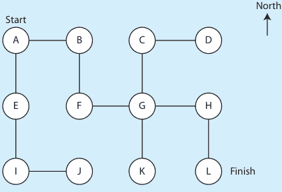

编写一个程序，使用对 Node 类实例的引用实现上述迷宫。图中的每个节点都对应于 Node 的一个实例。边对应于连接一个节点到另一个节点的链接，可以在 Node 中表示为引用另一个 Node 类的实例变量。从节点 A 开始用户。用户的目标是到达节点 L 的终点。程序应输出可能的向北、向南、向东或向西移动。示例执行如下所示。

```
You are in room A of a maze of twisty little passages, all alike.
You can go east or south.
E
You are in room B of a maze of twisty little passages, all alike.
You can go west or south.
S
You are in room F of a maze of twisty little passages, all alike.
You can go north or east.
E
```

## 12.

首先完成编程项目 17.11。然后，编写一个递归算法，从节点 A 找到到节点 L 的路径。你的算法应适用于任意一对起始节点和终点节点，而不仅仅是节点 A 和 L。你的算法也应适用于存在循环的情况，例如节点 E 和 F 之间的连接。

## 13.

冒泡排序算法在第 5 章中描述。如果我们想对双向链表中存储的数据进行排序，那么冒泡排序是一个不错的算法，因为我们只需要交换列表中相邻的条目。大多数其他排序算法需要通过索引直接访问列表中的元素。
创建一个包含 10 个随机整数的双向链表，并编写一个冒泡排序算法，通过交换相邻节点中的整数值对列表进行排序。
例如，要交换下面链表中 15 和 25 的节点，我们复制一个节点到另一个节点的整数值：

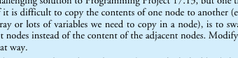

## 14.

编程项目 17.13 的更具挑战性的解决方案，但如果复制一个节点的内容到另一个节点很困难时更有效，例如，如果节点中有一个大数组或需要复制的变量很多，则是交换相邻节点的指针而不是相邻节点的内容。修改排序以这种方式操作。
例如，我们交换下面链表中 15 和 25 的节点：


使节点 15 的 next 指向节点 25  
使节点 25 的 previous 指向节点 15


使节点 25 的 next 指向节点 50  
使节点 15 的 previous 指向节点 10


使节点 50 的 previous 指向节点 25  
使节点 10 的 next 指向节点 15


最终结果，箭头整理后：


注意空指针错误（可能发生在列表的前端或末端时）。

## 异常处理 18

### 18.1 异常处理基础 863

- 异常处理的玩具示例 863
- 定义你自己的异常类 872
- 多重抛出和捕获 872
- 陷阱：先捕获更具体的异常 876
- 提示：异常类可以很简单 877
- 在函数中抛出异常 877
- 示例：返回最高分 879
- 异常规范 882
- 陷阱：派生类中的异常规范 884

### 18.2 异常处理的编程技术 885

- 何时抛出异常 886
- 陷阱：未捕获的异常 887
- 陷阱：嵌套 try-catch 块 888
- 陷阱：过度使用异常 888
- 异常类层次结构 889
- 测试可用内存 889
- 重新抛出异常 890

## 引言

编写程序的一种方法是首先假设不会发生任何异常或错误情况。例如，如果程序从列表中取出一个条目，你可能会假设列表不为空。一旦你让程序在一切按计划进行的核心情况下正常工作，你就可以添加代码来处理异常情况。C++ 有一种方法可以在你的代码中体现这种方法。基本上，你像什么异常情况都不会发生一样编写代码。之后，你使用 C++ 的异常处理设施为那些异常情况添加代码。

异常处理通常用于处理错误情况，但也许更好的看法是将其视为处理异常情况的一种方式。毕竟，如果你的代码正确处理了“错误”，那么它就不再是错误了。

异常最重要的用途之一是处理具有某些特殊情况的函数，这些特殊情况的处理方式取决于函数的使用方式。也许该函数将在许多程序中使用，其中一些程序以一种方式处理特殊情况，而另一些程序则以另一种方式处理。例如，如果函数中出现除零，则对于某些函数调用程序应结束，但对于其他调用则应发生其他事情。你会看到这样的函数可以被定义为在特殊情况发生时抛出异常；该异常允许在函数外部处理特殊情况。因此，特殊情况可以针对函数的不同调用以不同方式处理。

在 C++ 中，异常处理按如下方式进行：要么某些库软件，要么你的代码，提供一种机制来在发生异常情况时发出信号。这称为*抛出异常*。你将处理异常情况的代码放在程序的另一处。这称为*处理异常*。这种编程方法使代码更清晰。当然，我们仍然需要解释如何在 C++ 中执行此操作的细节。

本章的大部分内容仅使用第 1 章到第 9 章的材料。然而，“派生类中的异常规范”和“异常类层次结构”部分使用了第 14 章的材料。“测试可用内存”部分使用了第 17 章的材料。所有这些列出的部分都可以省略而不影响本章的连贯性。“异常规范”部分有一段引用了派生类（第 14 章），但该段可以省略。

> 例外证明了规则。
> 
> 常见格言


# 18.1 异常处理基础

> 程序在大多数情况下都能正常工作。我不知道它需要对这种情况也有效。

计算机科学学生，申诉成绩

异常处理应谨慎使用，且适用于比简单入门示例更复杂的情况。因此，我们将通过一些通常不会使用异常处理的简单示例来教授 C++ 的异常处理细节。这种做法对于学习 C++ 异常处理细节很有意义，但请不要忘记这些第一个示例是玩具示例；在实践中，你不会对如此简单的事情使用异常处理。

## 异常处理的玩具示例

对于此示例，假设牛奶在我们的文化中是一种如此重要的食物，以至于人们几乎从不缺它，但我们仍然希望我们的程序能够应对这种极不可能发生的情况。基本代码，假设我们不会缺牛奶，可能如下所示：

```
cout << "Enter number of donuts:\n";
 cin >> donuts;
 cout << "Enter number of glasses of milk:\n";
 cin >> milk;
 dpg = donuts / static_cast<double>(milk);
 cout << donuts << " donuts.\n"
 << milk << " glasses of milk.\n"
 << "You have " << dpg
 << " donuts for each glass of milk.\n";
```

如果没有牛奶，则此代码将包含除以零，这是一个错误。为了处理我们缺牛奶这种特殊情况，我们可以添加一个测试。添加了对特殊情况的此测试的完整程序显示在第 18.1 节中。第 18.1 节中的程序不使用异常处理。现在，让我们看看如何使用 C++ 异常处理设施重写此程序。

在第 18.2 节中，我们使用异常重写了第 18.1 节中的程序。这只是一个玩具示例，你可能不会在这种情况下使用异常。但是，它确实给我们提供了一个简单的示例来使用。虽然整个程序并不更简单，但至少 try 和 catch 之间的部分更干净，这暗示了使用异常的优势。查看 try 和 catch 之间的代码。它基本上与第 18.1 节中的代码相同，只是

## 第 18.1 节 不使用异常处理处理特殊情况

```cpp
#include <iostream>
using std::cin;
using std::cout;

int main( )
{
    int donuts, milk;
    double dpg;
    cout << "Enter number of donuts:\n";
    cin >> donuts;
    cout << "Enter number of glasses of milk:\n";
    cin >> milk;

    if (milk <= 0)
    {
        cout << donuts << " donuts, and No Milk!\n"
             << "Go buy some milk.\n";
    }
    else
    {
        dpg = donuts / static_cast<double>(milk);
        cout << donuts << " donuts.\n"
             << milk << " glasses of milk.\n"
             << "You have " << dpg
             << " donuts for each glass of milk.\n";
    }

    cout << "End of program.\n";
    return 0;
}
```

## 示例对话

```text
Enter number of donuts:
12
Enter number of glasses of milk:
0
12 donuts, and No Milk!
Go buy some milk.
End of program.
```

## 第 18.2 节 使用异常处理实现相同功能（第 1 部分，共 2 部分）

```
1 #include <iostream>
2 using std::cin;
3 using std::cout;
4 
5 int main( )
6 {
7     int donuts, milk;
8     double dpg;
9 
10    try
11    {
12        cout << "Enter number of donuts:\n";
13        cin >> donuts;
14        cout << "Enter number of glasses of milk:\n";
15        cin >> milk;
16 
17        if (milk <= 0)
18            throw donuts;
19 
20        dpg = donuts / static_cast<double>(milk);
21        cout << donuts << " donuts \n"
22            << milk << " glasses of milk.\n"
23            << "You have " << dpg
24            << " donuts for each glass of milk.\n";
25    }
26    catch(int e)
27    {
28        cout << e << " donuts, and No Milk!\n"
29            << "Go buy some milk.\n";
30    }
31 
32    cout << "End of program.\n";
33    return 0;
34 }
```

这只是一个学习 C++ 语法的玩具示例。不要将其作为异常处理良好典型使用的示例。

## 第 18.2 节 使用异常处理实现相同功能（第 2 部分，共 2 部分）

## 示例对话 1

```
Enter number of donuts:
12
Enter number of glasses of milk:
6
12 donuts.
6 glasses of milk.
You have 2 donuts for each glass of milk.
End of program.
```

## 示例对话 2

```
Enter number of donuts:
12
Enter number of glasses of milk:
0
12 donuts, and No Milk!
Go buy some milk.
End of program.
```

而不是第 18.1 节中突出显示的大 if-else 语句，此新程序具有以下较小的 if 语句（加上一些简单的非分支语句）：

```
if (milk <= 0)
    throw donuts;
```

此 if 语句表示如果没有牛奶，则执行异常操作。异常操作在 catch 之后给出。思路是 try 之后的代码处理正常情况，而 catch 之后的代码处理异常情况。因此，我们将正常情况与异常情况分开。在这个玩具示例中，这并没有真正带来太多好处，但在其他情况下它将证明非常有帮助。让我们看一下细节。

在 C++ 中处理异常的基本方式由 try-throw-catch 三者组成。try 块的语法如下：

### try 块

```
try
{
    Some_Code
}
```

此 try 块包含基本算法的代码，说明当一切顺利时该做什么。它被称为 try 块，因为你不能 100% 确定一切都会顺利进行，但你想“试一试”。

如果发生异常情况，表示方法是通过抛出异常。因此，当我们添加 throw 时，基本轮廓如下：

```
try
{
    Code_To_Try
    Possibly_Throw_An_Exception
    More_Code
}
```

以下是包含 throw 语句的 try 块示例（摘自第 18.2 节）：

```
try
{
    cout << "Enter number of donuts:\n";
    cin >> donuts;
    cout << "Enter number of glasses of milk:\n";
    cin >> milk;
    if (milk <= 0)
        throw donuts;
    dpg = donuts / static_cast<double>(milk);
    cout << donuts << " donuts.\n"
         << milk << " glasses of milk.\n"
         << "You have " << dpg
         << " donuts for each glass of milk.\n";
}
```

以下语句抛出 int 值 donuts：

```
throw donuts;
```

被抛出的值（在本例中为 donuts）有时称为异常；执行 throw 语句称为抛出异常。你可以抛出任何类型的值。在本例中，抛出 int 值。

## throw 语句

### 语法

```
throw Expression_for_Value_to_Be_Thrown;
```

当执行 throw 语句时，封闭 try 块的执行会停止。如果 try 块后面跟随合适的 catch 块，则控制流会转移到 catch 块。throw 语句几乎总是嵌入在分支语句中，例如 if 语句。被抛出的值可以是任何类型。

### 示例

```
if (milk <= 0)
    throw donuts;
```

当抛出“某物”时，某物会从一个地方转移到另一个地方。在 C++ 中，从一个地方到另一个地方的是控制流（以及被抛出的值）。当抛出异常时，周围 try 块中的代码停止执行，另一段代码，即 catch 块，开始执行。执行 catch 块称为捕获异常或处理异常。当抛出异常时，它最终应由某个 catch 块处理（捕获）。在第 18.2 节中，适当的 catch 块紧跟在 try 块之后。我们在下面重复该 catch 块：

```cpp
catch (int e)
{
    cout << e << " donuts, and No Milk!\n"
         << "Go buy some milk.\n";
}
```

此 catch 块看起来非常像具有 int 类型参数的函数定义。它不是函数定义，但在某些方面 catch 块像函数。它是一段单独的代码，当你的程序遇到（并执行）以下内容时执行（在前面的 try 块内）：

```cpp
throw Some_int;
```

因此，此 throw 语句类似于函数调用，但不是调用函数，而是调用 catch 块并说执行 catch 块中的代码。catch 块通常被称为异常处理器，这一名词暗示 catch 块具有类似函数的天性。

以下 catch 块行中的标识符 e 是什么？

```cpp
catch (int e)
```

该标识符 e 看起来像参数并且表现得非常像参数。事实上，catch 块头中的标识符，例如 e，被称为 catch 块参数。每个 catch 块最多可以有一个 catch 块参数。catch 块参数做两件事：

+ 1. catch 块参数前面有一个类型名，指定 catch 块可以捕获哪种被抛出的值。
+ 2. catch 块参数为被捕获的被抛出的值提供一个名称，以便你可以在 catch 块中编写代码来对该值执行操作。

我们将按相反顺序讨论 catch 块参数的这两个功能。本小节讨论将 catch 块参数用作被抛出并被捕获的值的名称。稍后本章中题为“多重抛出和捕获”的小节讨论哪个 catch 块（哪个异常处理器）将处理被抛出的值。我们的当前示例只有一个 catch 块。catch 块参数的常见名称是 e，但你可以使用任何合法标识符代替 e。

让我们看看第 18.2 节中的 catch 块如何工作。当抛出一个值时，try 块中代码的执行结束，控制权传递给 catch 块（或


## catch-Block 参数

catch-block 参数是 catch 块标题中的一个标识符，作为可能被抛出的异常（一个值）的占位符。当在前面的 try 块中抛出合适的数值时，该值将被填入 catch-block 参数。 （为了使 catch 块被执行，被抛出的值必须与为其 catch-block 参数给出的类型相同。）你可以使用任何合法的（非保留字）标识符作为 catch-block 参数。

### 示例

```
catch(int e)
{
    cout << e << " donuts, and No Milk!\n"
         << "Go buy some milk.\n";
}
```

e 是 catch-block 参数。

如果在 try 块中没有抛出异常（没有值），则在 try 块完成后，程序执行将继续执行 catch 块之后的<|message|>代码。换句话说，如果没有抛出异常，catch 块将被忽略。大多数情况下程序执行时，throw 语句不会被执行，因此在大多数情况下，try 块中的代码会运行到完成，而 catch 块中的代码将被完全忽略。

## try-throw-catch

抛出和捕获异常的基本机制是 try-throw-catch 序列。throw 语句抛出异常（一个值）。catch 块捕获异常（该值）。当抛出异常时，try 块结束，然后执行 catch 块中的代码。catch 块完成后，将执行 catch 块或块之后的代码（前提是 catch 块没有结束程序或执行其他特殊操作）。

（被抛出的异常的类型必须与为 catch-block 参数列出的类型匹配，否则该 catch 块不会捕获该异常。这一点在“Multiple Throws and Catches”小节中进一步讨论。）

如果在 try 块中没有抛出异常，则在 try 块完成后，程序执行将继续执行 catch 块或块之后的 fificode。 （换句话说，如果没有抛出异常，catch 块或块将被忽略。）

## 语法

```
try
{
    Some_Statements
    <Either some code with a throw statement or
    a function invocation that might throw an exception>
    Some_More_Statements
}
catch (Type e)
{
    <Code to be performed if a value of the
    catch-block parameter type is thrown in the try block>
}
```

### 示例

参见 Display 18.2 的示例。

## 自测练习

- 1. 以下代码会产生什么输出？

```
int waitTime = 46;

try
{
    cout << "Try block entered.\n";
    if (waitTime > 30)
        throw waitTime;
    cout << "Leaving try block.\n";
}

catch(int thrownValue)
{
    cout << "Exception thrown with\n"
         << "waitTime equal to " << thrownValue << endl;
}
cout << "After catch block" << endl;
```

- 2. 如果我们对自测练习 1 中的代码做如下更改，会产生什么输出？将行
  int waitTime = 46;
  改为
  int waitTime = 12;

## 自测练习（续）

- 3. 在自测练习 1 给出的代码中，throw 语句是什么？
- 4. 当执行 throw 语句时会发生什么？（说明一般情况下会发生什么，而不是仅仅说明在自测练习 1 的代码中或某些示例代码中会发生什么。）
- 5. 在自测练习 1 给出的代码中，try 块是什么？
- 6. 在自测练习 1 给出的代码中，catch 块是什么？
- 7. 在自测练习 1 给出的代码中，catch-block 参数是什么？

## 定义你自己的异常类

throw 语句可以抛出任何类型的值。常见的做法是定义一个类，其对象可以携带你希望抛给 catch 块的确切信息。定义专门的异常类的更重要原因是，你可以拥有不同的类型来标识每一种可能的异常情况。

异常类只是一个类。使其成为异常类的是其使用方式。尽管如此，在选择异常类的名称和其他细节时仍需注意。

Display 18.3 包含了一个使用程序员定义的异常类的程序示例。这只是一个玩具程序，用来说明异常处理的一些 C++ 细节。它对如此简单的任务使用了太多[content]

## catch-Block 参数

catch-block 参数是 catch 块标题中的一个标识符，作为可能被抛出的异常（一个值）的占位符。当在前面的 try 块中抛出合适的数值时，该值将被填入 catch-block 参数。 （为了使 catch 块被执行，被抛出的值必须与为其 catch-block 参数给出的类型相同。）你可以使用任何合法的（非保留字）标识符作为 catch-block 参数。

### 示例

```
catch(int e)
{
    cout << e << " donuts, and No Milk!\n"
         << "Go buy some milk.\n";
}
```

e 是 catch-block 参数。

如果在 try 块中没有抛出异常（没有值），则在 try 块完成后，程序执行将继续执行 catch 块之后的 fificode。换句话说，如果没有抛出异常，catch 块将被忽略。大多数情况下程序执行时，throw 语句不会被执行，因此在大多数情况下，try 块中的代码会运行到完成，而 catch 块中的代码将被完全忽略。

## try-throw-catch

抛出和捕获异常的基本机制是 try-throw-catch 序列。throw 语句抛出异常（一个值）。catch 块捕获异常（该值）。当抛出异常时，try 块结束，然后执行 catch 块中的代码。catch 块完成后，将执行 catch 块或块之后的 fificode（前提是 catch 块没有结束程序或执行其他特殊操作）。

（被抛出的异常的类型必须与为 catch-block 参数列出的类型匹配，否则该 catch 块不会捕获该异常。这一点在“Multiple Throws and Catches”小节中进一步讨论。）

如果在 try 块中没有抛出异常，则在 try 块完成后，程序执行将继续执行 catch 块或块之后的 fificode。 （换句话说，如果没有抛出异常，catch 块或块将被忽略。）

## 语法

```
try
{
    Some_Statements
    <Either some code with a throw statement or
    a function invocation that might throw an exception>
    Some_More_Statements
}
catch (Type e)
{
    <Code to be performed if a value of the
    catch-block parameter type is thrown in the try block>
}
```

### 示例

参见 Display 18.2 的示例。

## 自测练习

- 1. 以下代码会产生什么输出？

```
int waitTime = 46;

try
{
    cout << "Try block entered.\n";
    if (waitTime > 30)
        throw waitTime;
    cout << "Leaving try block.\n";
}

catch(int thrownValue)
{
    cout << "Exception thrown with\n"
         << "waitTime equal to " << thrownValue << endl;
}
cout << "After catch block" << endl;
```

- 2. 如果我们对自测练习 1 中的代码做如下更改，会产生什么输出？将行
  int waitTime = 46;
  改为
  int waitTime = 12;

## 自测练习（续）

- 3. 在自测练习 1 给出的代码中，throw 语句是什么？
- 4. 当执行 throw 语句时会发生什么？（说明一般情况下会发生什么，而不是仅仅说明在自测练习 1 的代码中或某些示例代码中会发生什么。）
- 5. 在自测练习 1 给出的代码中，try 块是什么？
- 6. 在自测练习 1 给出的代码中，catch 块是什么？
- 7. 在自测练习 1 给出的代码中，catch-block 参数是什么？

## 定义你自己的异常类

throw 语句可以抛出任何类型的值。常见的做法是定义一个类，其对象可以携带你希望抛给 catch 块的确切信息。定义专门的异常类的更重要原因是，你可以拥有不同的类型来标识每一种可能的异常情况。

异常类只是一个类。使其成为异常类的是其使用方式。尽管如此，在选择异常类的名称和其他细节时仍需注意。

Display 18.3 包含了一个使用程序员定义的异常类的程序示例。这只是一个玩具程序，用来说明异常处理的一些 C++ 细节。它对如此简单的任务使用了太多机器，但它是一个否则不含杂乱的示例，展示了一些 C++ 细节。

注意 throw 语句，重现如下：

```
throw NoMilk(donuts);
```

部分 NoMilk(donuts) 是对类 NoMilk 的构造函数的调用。构造函数接受一个 int 参数（这里是 donuts）并创建一个 NoMilk 类的对象。然后该对象被抛出。

## 多重抛出和捕获

try 块可能抛出任意数量的异常值，这些值可以是不同类型。在 try 块的一次执行中，最多只会抛出一个异常（因为 throw 语句会结束 try 块的执行），但在不同场合执行 try 块时可以抛出不同类型的异常值。每个 catch 块只能捕获一种类型的值，但你可以通过在 try 块后放置多个 catch 块来捕获不同类型的异常值。例如，Display 18.4 中的程序在其 try 块后有两个 catch 块。

## Display 18.3 定义你自己的异常类

```
#include <iostream>
using std::cin;
using std::cout;

class NoMilk
{
public:
    NoMilk( ) {}
    NoMilk(int howMany) : count(howMany) {}
    int getCount( ) const { return count; }
private:
    int count;
};

int main( )
{
    int donuts, milk;
    double dpg;
    try
    {
        cout << "Enter number of donuts:\n";
        cin >> donuts;
        cout << "Enter number of glasses of milk:\n";
        cin >> milk;

        if (milk <= 0)
            throw NoMilk(donuts);

        dpg = donuts / static_cast<double>(milk);
        cout << donuts << " donuts.\n"
             << milk << " glasses of milk.\n"
             << "You have " << dpg
             << " donuts for each glass of milk.\n";
    }
    catch(NoMilk e)
    {
        cout << e.getCount( ) << " donuts, and No Milk!\n"
             << "Go buy some milk.\n";
    }
    cout << "End of program.\n";
    return 0;
}
```

> 这只是一个玩具示例，用于学习 C++ 语法。不要将其作为异常处理良好典型使用的示例。

> 示例对话与 Display 18.2 相同。

## Display 18.4 捕获多个异常（第 1 部分，共 2 部分）

```
#include <iostream>
#include <string>
using std::cin;
using std::cout;
using std::endl;
using std::string;

class NegativeNumber
{
public:
    NegativeNumber() {}
    NegativeNumber(string theMessage): message(theMessage) {}
    string getMessage() const { return message; }
private:
    string message;
};

class DivideByZero
{};

int main()
{
    int pencils, erasers;
    double ppe; //pencils per eraser

    try
    {
        cout << "How many pencils do you have?\n";
        cin >> pencils;
        if (pencils < 0)
            throw NegativeNumber("pencils");
        cout << "How many erasers do you have?\n";
        cin >> erasers;
        if (erasers < 0)
            throw NegativeNumber("erasers");

        if (erasers != 0)
            ppe = pencils / static_cast<double>(erasers);
        else
            throw DivideByZero();
        cout << "Each eraser must last through "
             << ppe << " pencils.\n";
    }
```

> *异常类可以拥有自己的接口和实现文件，并且可以放在命名空间中。这又是另一个玩具示例。*

## Display 18.4 捕获多个异常（第 2 部分，共 2 部分）

```
39 catch(NegativeNumber e)
40 {
41     cout << "Cannot have a negative number of "
42     << e.getMessage() << endl;
43 }
44 catch(DivideByZero)
45 {
46     cout << "Do not make any mistakes.\n";
47 }
48 
49 cout << "End of program.\n";
50 return 0;
51 }
```

如果 catch-block 参数未被使用，你不需要在标题中给出它。

## 示例对话 1

```
How many pencils do you have?
5
How many erasers do you have?
2
Each eraser must last through 2.5 pencils
End of program.
```

## 示例对话 2

```
How many pencils do you have?
-2
Cannot have a negative number of pencils
End of program.
```

## 示例对话 3

```
How many pencils do you have?
5
How many erasers do you have?
0
Do not make any mistakes.
End of program.
```

注意 DivideByZero 的 catch 块中没有参数。如果不需要参数，你只需列出类型而不带参数即可。这在编程提示部分“Exception Classes Can Be Trivial”中稍有讨论。


## 陷阱：先捕获更具体的异常

当捕获多个异常时，catch 块的顺序可能很重要。当 try 块中抛出一个异常值时，后面的 catch 块会按顺序尝试匹配，第一个与所抛出异常的类型匹配的 catch 块将被执行。

例如，下面是一种特殊的 catch 块，它可以捕获任何类型的抛出的值：

```
catch (...)
{
    <Place whatever you want in here.>
}
```

这里的三个点并不表示省略了某些内容。在程序中，你需要实际输入这三个点。这使其成为一个很好的默认 catch 块，可以放在所有其他 catch 块之后。例如，我们可以像下面这样将其添加到程序清单 18.4 的 catch 块中：

```
catch(NegativeNumber e)
{
    cout << "Cannot have a negative number of "
         << e.getMessage() << endl;
}
catch(DivideByZero)
{
    cout << "Do not make any mistakes.\n";
}
catch (...)
{
    cout << "Unexplained exception.\n";
}
```

然而，将这个默认 catch 块放在 catch 块列表的末尾才有意义。例如，假设我们改用了下面的写法：

```
catch(NegativeNumber e)
{
    cout << "Cannot have a negative number of "
         << e.getMessage() << endl;
}
catch (...)
{
    cout << "Unexplained exception.\n";
}
catch(DivideByZero)
{
    cout << "Do not make any mistakes.\n";
}
```

## 陷阱：（续）

按照第二种排序，NegativeNumber 类型的异常（抛出的值）会按预期被 NegativeNumber catch 块捕获。然而，如果抛出的是 DivideByZero 类型的值，它会被以 catch(...) 开头的块捕获。因此，DivideByZero catch 块将永远无法到达。幸运的是，大多数编译器会提示你是否犯了这类错误。

## 提示：异常类可以非常简单

下面我们重现了程序清单 18.4 中异常类 DivideByZero 的定义：

```
class DivideByZero
{};
```

这个异常类没有成员变量，也没有成员函数（除了默认构造函数）。它除了名称之外什么也没有，但这已经足够了。抛出 DivideByZero 类的对象可以激活相应的 catch 块，就像程序清单 18.4 中那样。

当使用一个简单的异常类时，一旦控制流转到 catch 块，你通常无法对异常（抛出的值）做任何处理。异常只是用来将你带到 catch 块。因此，你可以省略 catch 块参数。事实上，只要不需要，你任何时候都可以省略 catch 块参数，无论异常类型是否简单。

## 在函数中抛出异常

有时延迟处理异常是有意义的。例如，你可能会有一个函数，其代码在尝试除以零时抛出异常，但你可能不想在该函数中捕获异常。也许使用该函数的某些程序在抛出异常时应直接结束，而其他使用该函数的程序则应做其他事情。因此，如果你在函数内部捕获异常，你会不知道该如何处理它。在这些情况下，合理的做法是在函数定义中不捕获异常，而是让使用该函数的任何程序（或其他代码）将函数调用放在 try 块中，并在该 try 块之后的 catch 块中捕获异常。

请看程序清单 18.5 中的程序。它有一个 try 块，但在 try 块中看不到 throw 语句。该程序中执行抛出的语句是：

```
if (bottom == 0)
    throw DivideByZero();
```

## 程序清单 18.5 在函数内部抛出异常（第 1 部分，共 2 部分）

```
#include <iostream>
#include <cstdlib>
using std::cin;
using std::cout;
using std::endl;

class DivideByZero
{};

double safeDivide(int top, int bottom) throw (DivideByZero);

int main()
{
    int numerator;
    int denominator;
    double quotient;
    cout << "Enter numerator:\n";
    cin >> numerator;
    cout << "Enter denominator:\n";
    cin >> denominator;

    try
    {
        quotient = safeDivide(numerator, denominator);
    }
    catch(DivideByZero)
    {
        cout << "Error: Division by zero!\n"
             << "Program aborting.\n";
        exit(0);
    }

    cout << numerator << " / " << denominator
         << " = " << quotient << endl;

    cout << "End of program.\n";
    return 0;
}

double safeDivide(int top, int bottom) throw (DivideByZero)
{
    if (bottom == 0)
        throw DivideByZero();

    return top / static_cast<double>(bottom);
}
```

## 程序清单 18.6 不使用异常返回最高分的函数（第 1 部分，共 2 部分）

```
1 // Program that outputs the high score from a high scores file.
2 // Does not use exception handling.
3 #include <iostream>
4 #include <fstream>
5 #include <string>
6 using std::cout;
7 using std::endl;
8 using std::ifstream;

9 //Function prototypes
10 int getHighscore();

11 // Returns the high score in the scores.txt file.
12 int getHighscore()
13 {
14     ifstream f;
15     int high = -1;
16     f.open("scores.txt");
17     // Check if the file did not open
18     if (f.fail())
19     {
20         cout << "File could not be opened." << endl;
21         return -1;
22     }
23     int num;
24     // Scan through each number in the file and return the largest.
25     f >> high;
26     while (f >> num)
27     {
28         if (num > high)
29             high = num;
30     }
31     f.close();
32     return high;
33 }

34 int main()
35 {
36     int highscore = getHighscore();
37     cout << "The high score is " << highscore << endl;
38     return 0;
39 }
```

## 程序清单 18.6 不使用异常返回最高分的函数（第 2 部分，共 2 部分）

示例对话 1（文件存在，包含值 10, 50, 30）

```
The high score is 50
```

示例对话 2（文件不存在）

```
File could not be opened.
The high score is -1
```

## 程序清单 18.7 使用异常返回最高分的函数（第 1 部分，共 2 部分）

```
1  // Program that outputs the high score from a high scores file.
2  // Uses exception handling.
3  #include <iostream>
4  #include <fstream>
5  #include <string>
6  using std::cout;
7  using std::endl;
8  using std::ifstream;

9  class FileIOError
10 {};

11 //Function prototypes
12 int getHighscore( ) throw (FileIOError);

13 // Returns the high score in the scores.txt file
14 // but throws an exception if the file could not be opened.
15 // This enables main() to catch the error and return value.
16 int getHighscore( ) throw (FileIOError)
17 {
18     ifstream f;
19     int high = -1;

20     f.open("scores.txt");
21     // Check if the file did not open
22     if (f.fail())
23     {
24         throw FileIOError( );
25     }
26     int num;
27     // Scan through each number in the file and return the largest.
28     f >> high;
29     while (f >> num)
30     {
31         if (num > high)
32             high = num;
33     }
```

## 程序清单 18.7 使用异常返回最高分的函数（第 2 部分，共 2 部分）

```
34  f.close();
35  return high;
36 }

37 int main()
38 {
39   try
40   {
41     int highscore = getHighscore();
42     cout << "The high score is " << highscore << endl;
43   }
44   catch (FileIOException)
45   {
46     cout << "Could not open the scores file." << endl;
47   }
48   return 0;
49 }
```

示例对话 1（文件存在，包含值 10, 50, 30）

```
The high score is 50
```

示例对话 2（文件不存在）

```
Could not open the scores file.
```

## 异常规范

如果一个函数不捕获异常，它至少应该提醒程序员：对该函数的任何调用都可能抛出异常。如果有异常可能被抛出但未在函数定义中被捕获，那么这些异常类型应该列在异常规范中。下面的函数声明（来自程序清单 18.5）对此进行了说明：

```
double safeDivide(int top, int bottom) throw (DivideByZero);
```

如程序清单 18.5 所示，异常规范应该出现在函数声明和函数定义中。如果一个函数有多个函数声明，那么所有函数声明必须具有完全相同的异常规范。函数的异常规范有时也称为 throw 列表。

如果在函数定义中可能抛出多个异常，异常类型用逗号分隔列出，如下所示：

```
void someFunction() throw (DivideByZero, SomeOtherException);
```


所有在异常规范中列出的异常类型都按正常方式处理。当我们说异常被正常处理时，我们是指按本小节之前描述的方式处理。特别是，你可以将函数调用放在 try 块中，后跟 catch 块以捕获该类型的异常，如果函数抛出异常（并且在函数内部未捕获它），那么跟在 try 块之后的 catch 块将捕获该异常。

如果根本没有异常规范（没有 throw 列表，甚至没有空的），那么代码的行为就如同所有可能的异常类型都被列在异常规范中一样；也就是说，抛出的任何异常都按正常方式处理。

当函数中抛出异常但未列在异常规范中（并且在函数内部未捕获）时会发生什么？这既不是编译时错误也不是运行时错误。在这种情况下，会调用函数 unexpected()。你可以更改 unexpected 函数的行为，但默认行为是调用 terminate() 函数，这将结束程序。特别注意，如果函数中抛出异常但未列在异常规范中（并且在函数内部未捕获），那么它不会被程序中任何 catch 块捕获，而是会导致调用 unexpected()，其默认行为是结束你的程序。

请记住，异常规范适用于“逃出”函数的异常。如果它们没有逃出函数，就不应出现在异常规范中。如果它们逃出函数，就应出现在异常规范中，无论它们起源于何处。如果在函数定义内部的 try 块中抛出异常，并且在函数定义内部的 catch 块中捕获，那么其类型无需列在异常规范中。如果函数定义包含对另一个函数的调用，而该另一个函数可能抛出未被捕获的异常，那么该异常的类型应放在异常规范中。

你可能会认为，抛出未被捕获且不在 throw 列表中的异常的可能性应由编译器检查并产生编译器错误。然而，由于 C++ 中异常的细节，编译器无法执行该检查。检查必须在运行时进行。

要表示函数不应抛出在函数内部未被捕获的任何异常，请使用空的异常规范，如下所示：

```
void someFunction() throw ();
```

总结如下，

```
void someFunction() throw (DivideByZero, SomeOtherException);
//Exceptions of type DivideByZero or SomeOtherException are
//treated normally. All other exceptions invoke unexpected().
```

> 1 This is not true in all programming languages. It depends on the details of how the exception specification details are defined for the language.

```
void someFunction( ) throw ( );
//Empty exception list, so all exceptions invoke unexpected( ).
```

```
void someFunction( );
//All exceptions of all types are treated normally.
```

unexpected() 的默认操作是结束程序。你无需使用任何特殊的 include 或 using 指令即可获得 unexpected() 的默认行为。你通常无需重新定义 unexpected() 的行为；然而，unexpected() 的行为可以用 set_unexpected() 函数更改。如果你需要使用 set_unexpected，你应查阅更高级的书籍以了解细节。

请记住，派生类的对象也是其基类的对象。因此，如果 D 是类 B 的派生类并且 B 在异常规范中，那么抛出类 D 的对象将被正常处理，因为它是类 B 的对象。然而，不会进行自动类型转换。如果 double 在异常规范中，这并不能说明抛出 int 值的情况。你需要在异常规范中同时包含 int 和 double。

## 警告！

最后警告：并非所有编译器都按应有的方式处理异常规范。有些编译器本质上将异常规范视为注释；对于这些编译器，异常规范对你的代码没有任何影响。这也是将函数可能抛出的所有异常都放在 throw 规范中的另一个原因。这样所有编译器都会以相同的方式处理你的异常。当然，你也可以通过完全不使用任何 throw 规范来获得相同的编译器一致性，但那样你的程序就不会得到很好的文档说明，并且你也不会获得使用 throw 规范的编译器提供的额外错误检查。对于处理 throw 规范的编译器，你的程序会在抛出你未预料的异常时立即终止。（请注意，这是一种运行时行为——但你得到的运行时行为取决于你的编译器。）

## 陷阱：派生类中的异常规范

当你在派生类中重新定义或覆盖函数定义时，它应具有与基类中相同的异常规范，或者它应具有异常规范，其异常是基类异常规范中异常的子集。换句话说，当你重新定义或覆盖函数定义时，你不能向异常规范中添加任何异常（但如果你愿意，可以删除一些异常）。这是有道理的，因为派生类的对象可以在基类的对象可以使用的任何地方使用，因此重新定义或覆盖的函数必须适合为基类的对象编写的任何代码。

## 自测练习

8. 以下程序的输出是什么？

```
#include <iostream>
using std::cout;
void sampleFunction(double test) throw (int);
int main()
{
    try
    {
        cout << "Trying.\n";
        sampleFunction(98.6);
        cout << "Trying after call.\n";
    }
    catch(int)
    {
        cout << "Catching.\n";
    }
    cout << "End program.\n";
    return 0;
}
void sampleFunction(double test) throw (int)
{
    cout << "Starting sampleFunction.\n";
    if (test < 100)
        throw 42;
}
```

9. 当对自测练习 8 中的程序进行以下更改时，输出是什么？将 try 块中的
sampleFunction(98.6);
更改为
sampleFunction(212);

## 18.2 异常处理的编程技术

> 仅在特殊情况下使用。
> 
> WARREN PEACE, The Lieutenant's Tools

到目前为止，我们展示了大量解释 C++ 中异常处理如何工作的代码，但我们没有展示许多对异常处理进行良好且现实使用的程序示例。然而，现在你已经了解了异常处理的机制，本节可以继续解释异常处理技术。

### 何时抛出异常

我们给出了一些非常简单的代码来说明异常处理的基本概念。然而，我们的示例过于简单不切实际。更复杂但更好的指导原则是将抛出异常和捕获异常分离到不同的函数中。在大多数情况下，你应在函数定义中包含任何 throw 语句，将异常列在该函数的异常规范中，并在不同的函数中放置 catch 子句。因此，try-throw-catch 三元组的首选用法如下所示：

```
void functionA() throw (MyException)
{
    .
    .
    throw MyException(<Maybe an argument>);
    .
    .
}
```

然后，在另一个函数中（甚至可能是另一个文件中的某个其他函数），你有以下内容：

```
void functionB()
{
    .
    .
    try
    {
        .
        .
        functionA();
        .
        .
    }
    catch(MyException e)
    {
        <Handle exception>
    }
    .
    .
}
```


即使这种使用 throw 语句的方式也应保留在不可避免的情况下使用。如果你可以用其他方式轻松处理问题，就不要抛出异常。应将 throw 语句保留用于异常情况的处理方式取决于函数如何以及在何处被使用时。如果异常情况的处理方式取决于函数被调用的方式和位置，那么最好的做法是让调用该函数的程序员来处理异常。在所有其他情况下，避免抛出异常是更可取的。让我们概述一下这种类型情况的一个示例场景。

假设你正在编写一个函数库，用于处理医院的患者监测系统。其中一个函数可能会通过访问患者在某个文件中的记录来计算患者的平均每日体温，并将体温总和除以测量次数。现在假设这些函数被用于创建在不同情况下使用的不同系统。如果患者的体温从未被测量过，从而导致除零运算会怎样？在重症监护室，这表明出了严重问题，例如患者丢失了。（这种情况确实发生过。）因此，对于该系统，当这种潜在的除零发生时，应发出紧急消息。然而，对于在不太紧急的环境中使用的系统，例如门诊护理甚至某些非关键病房，这可能毫无意义，因此在患者记录中简单记一条说明就足够了。在这种情况下，用于平均体温的函数应在发生除零时抛出异常，将该异常列在异常规范中，并让每个系统以适合该系统的方式处理异常情况。

## 何时抛出异常

在大多数情况下，throw 语句应在使用函数内部使用并列在该函数的异常规范中。此外，它们应保留用于异常情况的处理方式取决于函数如何以及在何处被使用时。如果异常情况的处理方式取决于函数被调用的方式和位置，那么最好的做法是让调用该函数的程序员来处理异常。在其他情况下，避免抛出异常几乎总是更可取的。

## PITFALL: 未捕获的异常

你的代码抛出的每个异常都应在你的代码中的某处被捕获。如果抛出异常但在任何地方都没有被捕获，程序将结束。

从技术上讲，如果抛出异常但未被捕获，则会调用函数 terminate()。terminate() 的默认含义是结束你的程序。你可以更改默认含义，但这很少需要，我们在此不详细介绍。

## PITFALL: （续）

在函数中抛出但在函数内部或外部均未捕获的异常有两种可能情况。如果异常未列在异常规范中，则会调用函数 `unexpected()`。如果异常未列在异常规范中，则会调用函数 `terminate()`。但除非你更改 `unexpected()` 的默认行为，否则 `unexpected()` 会调用 `terminate()`。因此，在这两种情况下结果都相同。如果在函数中抛出异常但在函数内部或外部均未捕获，则你的程序将结束。

## PITFALL: 嵌套的 try-catch 块

你可以在更大的 `try` 块内部或更大的 `catch` 块内部放置一个 `try` 块和随后的 `catch` 块。在极少数情况下，这可能是有用的，但如果你想这样做，你应该怀疑存在更优雅的方式来组织你的程序。几乎总是更好的做法是将内部 `try-catch` 块放在函数定义内部，并在外部 `try` 或 `catch` 块中放置对该函数的调用（或者也许完全消除一个或多个 `try` 块）。

如果你将一个 `try` 块和随后的 `catch` 块放在更大的 `try` 块内部，并且在内部 `try` 块中抛出异常但未被内部 `catch` 块中的任何一个捕获，则异常会被抛到外部 `try` 块进行处理，可能会被跟随外部 `try` 块的 `catch` 块捕获。

## PITFALL: 过度使用异常

异常允许你编写控制流如此复杂以至于几乎不可能理解程序的程序。而且，这并不难做到。抛出异常允许你将控制流从程序中的任何位置转移到程序中几乎任何其他位置。在编程的早期阶段，这种不受限制的控制流是通过一种称为 `goto` 的结构允许的。现在编程专家一致认为，这种不受限制的控制流是非常糟糕的编程风格。异常允许你回到这种不受限制的控制流的糟糕旧时代。异常应谨慎使用且仅以特定方式使用。一个好的规则是：如果你想包含一个 throw 语句，那么想想你如何在没有这个 throw 语句的情况下编写你的程序或类定义。如果你能想到一种产生合理代码的替代方案，那么你可能不想包含该 throw 语句。

## 异常类层次结构

定义异常类层次结构非常有用。例如，你可能有一个 `ArithmeticError` 异常类，然后定义一个 `DivideByZeroError` 异常类，它是 `ArithmeticError` 的派生类。由于 `DivideByZeroError` 是一个 `ArithmeticError`，因此针对 `ArithmeticError` 的每个 catch 块都会捕获 `DivideByZeroError`。如果你在异常规范中列出 `ArithmeticError`，那么实际上你也将 `DivideByZeroError` 添加到了异常规范中，无论你是否在异常规范中按名称列出 `DivideByZeroError`。

## 测试可用内存

在第 17 章中，我们使用类似以下的代码创建了新的动态变量：

```
```cpp
struct Node
{
    int data;
    Node *link;
};
typedef Node* NodePtr;
...
NodePtr pointer = new Node;
```
```

只要有足够的内存来创建新节点，这就工作得很好。但如果没有足够的内存会怎样？如果没有足够的内存来创建节点，则会抛出 `bad_alloc` 异常。

由于 `new` 在没有足够内存创建节点时会抛出 `bad_alloc` 异常，你可以按如下方式检查内存耗尽：

```
```cpp
try
{
    NodePtr pointer = new Node;
}
catch (bad_alloc)
{
    cout << "Ran out of memory!";
}
```
```

当然，你可以做的事情不仅仅是给出警告信息，但你所做的细节将取决于你的特定编程任务。

`bad_alloc` 的定义在具有头文件 `<new>` 的库中，并放置在 `std` 命名空间中。因此，使用 `bad_alloc` 时，你的程序应包含以下内容（或类似内容）：

```
```cpp
#include <new>
using std::bad_alloc;
```
```

## 重新抛出异常

在 catch 块内抛出异常是合法的。在极少数情况下，你可能想要捕获异常，然后根据细节决定抛出相同或不同的异常以供异常处理块链中更高层处理。

## 自测练习

- 10. 当异常从未被捕获时会发生什么？
- 11. 你可以在另一个 try 块内嵌套一个 try 块吗？

## 章节总结

- 异常处理允许你将程序的正常情况设计和编码与处理异常情况的代码分开。
- 可以在 try 块中抛出异常。或者，可以在不包含 try 块（或不包含捕获该类型异常的 catch 块）的函数定义中抛出异常。在这种情况下，可以将函数的调用放在 try 块中。
- 异常在 catch 块中被捕获。
- try 块可以跟随一个以上的 catch 块。在这种情况下，始终将针对更具体异常类的 catch 块列在针对更通用异常类的 catch 块之前。
- 异常的最佳用途是在函数中抛出异常（但不在函数中捕获它），只要异常的处理方式会因函数的每次调用而异。几乎没有其他情况可以从抛出异常中获益。
- 如果在函数中抛出异常但未在该函数中捕获，则异常类型应在该函数的异常规范中列出。
- 如果抛出异常但从未被捕获，则默认行为是结束你的程序。
- 不要过度使用异常。

## 自测练习答案

```
1. Try block entered.
   Exception thrown with
   waitTime equal to 46
   After catch block.
```


2. 进入 try 块。
离开 try 块。
catch 块之后。

3. throw waitTime;
请注意下面是一个 if 语句，而不是 throw 语句，即使它包含一个 throw 语句：

```
if (waitTime > 30)
    throw waitTime;
```

4. 当执行 throw 语句时，包含的 try 块就结束了。try 块中没有其他语句会被执行，控制权会传递给后面的 catch 块或块们。当我们说控制权传递给后面的 catch 块时，我们的意思是抛出的值会被填入 catch 块参数（如果有的话），然后执行 catch 块中的代码。

```
try
{
    cout << "Try block entered.";
    if (waitTime > 30)
        throw waitTime;
    cout << "Leaving try block.";
}
```

5.

```
catch(int thrownValue)
{
    cout << "Exception thrown with\n"
         << "waitTime equal to" << thrownValue << endl;
}
```

6.

7. thrownValue 是 catch 块参数。

8. 正在尝试。
开始 sampleFunction。
捕获中。
程序结束。

9. 正在尝试。
开始 sampleFunction。
调用后尝试。
程序结束。

10. 如果异常在任何地方都没有被捕获，那么你的程序就会结束。严格来说，如果抛出异常但未被捕获，则会调用函数 terminate()。terminate() 的默认含义是结束你的程序。

11. 是的，你可以在另一个更大的 try 块内部拥有一个 try 块和对应的 catch 块。然而，最好将内部的 try 和 catch 块放在一个函数定义中，并在更大的 try 块中调用该函数。

## Programming Projects

+   1. 获取第 10 章中显示 10.11 所示的 `PFArray` 类的源代码。修改重载运算符 `[]` 的定义，使其在使用的索引超出范围或尝试添加元素超出实现容量的情况下抛出 `OutOfRange` 异常。`OutOfRange` 是一个你定义的异常类。异常类应有一个私有的 `int` 成员和一个私有的 `string` 成员，一个具有 `int` 和 `string` 参数的公共构造函数。违规的索引值以及一条消息应存储在异常对象中。你自行选择描述情况的消息。编写一个合适的测试程序来测试修改后的类 `PFArray`。
+   
+   2. （基于 Stroustrup，《The C++ Programming Language》，第 3 版中的一个问题）编写一个由函数相互调用、调用深度为 10 的程序。为每个函数提供一个参数，指定其抛出异常的层级。主函数提示并接收输入，指定将抛出异常的调用深度（层级）。主函数然后调用第一个函数。主函数捕获异常并显示抛出异常的层级。不要忘记深度为 0 的情况，此时 main 必须同时抛出和捕获异常。
+   
+      *Hints:* 你可以使用十个不同的函数或十个相互调用的相同函数的副本，但不要这样做。相反，为了代码紧凑，使用一个调用另一个函数的 main 函数，该函数递归调用自身。假设你这样做；对调用深度的限制是否必要？这可以在不给函数任何额外参数的情况下完成，但如果你不能那样做，尝试给函数添加一个额外参数。
+   
+   3. 重写编程项目 17.2，使其在第二个链表中没有对应注册号的条目时，在 Grade 列中打印 `NOT FOUND`。使用异常处理抛出适当的提示信息。
+   
+      编写一个 `main` 函数来测试这个新程序，并且至少包含一个在第二个列表中没有对应条目的注册号。
+   
+   4. 下面的代码使用两个数组，一个存储产品，另一个存储产品 ID（更好的组织方式是使用一个类或结构体组成的单个数组，但这不是本编程项目的主题）。函数 `getProductID` 以两个数组、数组长度和要搜索的目标产品作为输入。然后它遍历产品名称数组；如果找到匹配项，则返回对应的产品 ID。
+   
+      ```cpp
+      int getProductID(int ids[], string names[],
+                       int numProducts, string target)
+      {
+          for (int i=0; i < numProducts; i++)
+      ```

```
{
    if (names[i] == target)
        return ids[i];
    }
    return -1; // Not found
}

int main() // Sample code to test the getProductID function
{
    int productIds[] = {4, 5, 8, 10, 13};
    string products[] = {"computer","flash drive",
                         "mouse","printer","camera"};
    cout << getProductID(productIds, products, 5, "mouse") << endl;
    cout << getProductID(productIds, products, 5, "camera")
         << endl;
    cout << getProductID(productIds, products, 5, "laptop")
         << endl;
    return 0;
}
```

`getProductID` 函数实现的一个问题是，如果未找到目标名称，它会返回特殊的错误代码 −1。调用者可能会忽略该 −1，或者后来它可能实际上希望 −1 作为有效的产品 ID 号码。重写程序，使其在未找到产品时抛出适当的异常，而不是返回 −1。

# 5. 一个返回特殊错误代码的函数通常最好通过抛出异常来实现。下面的类维护一个账户余额：

```
class Account
{
    private:
        double balance;
    public:
        Account()
        {
            balance = 0;
        }
        Account(double initialDeposit)
        {
            balance = initialDeposit;
        }
        double getBalance()
        {
            return balance;
        }
}
```

```
```java
// returns new balance or -1 if error
double deposit(double amount)
{
    if (amount > 0)
        balance += amount;
    else
        return -1;        // Code indicating error
    return balance;
}
// returns new balance or -1 if invalid amount
double withdraw(double amount)
{
    if ((amount > balance) || (amount < 0))
        return -1;
    else
        balance -= amount;
    return balance;
}
};
```

重写该类，使其抛出适当的异常而不是返回 −1 作为错误代码。编写测试代码，尝试取款和存款无效金额并捕获抛出的异常。

+   6. 重写第 14 章的编程项目 14.4 以包含异常处理。创建你自己的异常类，名为 InvalidDataError，并在 Student 和 ScienceStudent 的构造函数方法中抛出它。
+   
+      当作为参数发送的注册号小于或等于零时，从 Student 的构造函数抛出异常。当参数 courseType 的值不是 ‘undergraduate’ 或 ‘postgraduate’ 时，从 ScienceStudent 的构造函数抛出异常。

## Standard Template Library 19

+   **19.1 ITERATORS** 897
+   - Iterator Basics 897
+   - Pitfall: Compiler Problems 902
+   - Tip: Use auto to Simplify Variable Declarations 903
+   - Kinds of Iterators 903
+   - Constant and Mutable Iterators 906
+   - Reverse Iterators 908
+   - Other Kinds of Iterators 909

+   **19.2 CONTAINERS** 910
+   - Sequential Containers 910
+   - Pitfall: Iterators and Removing Elements 915
+   - Tip: Type Definitions in Containers 916
+   - The Container Adapters stack and queue 916

+   - Pitfall: Underlying Containers 917
+   - The Associative Containers set and map 920
+   - Efficiency 925
+   - Tip: Use Initialization, Ranged for, and auto with Containers 927

+   **19.3 GENERIC ALGORITHMS** 928
+   - Running Times and Big-O Notation 928
+   - Container Access Running Times 932
+   - Nonmodifying Sequence Algorithms 933
+   - Modifying Sequence Algorithms 937
+   - Set Algorithms 939
+   - Sorting Algorithms 940


## 19 标准模板库

> 图书馆不是造出来的；它们是生长出来的。
> 
> — 奥古斯丁·比雷尔

## 引言

在第 17 章中，我们构建了自己的栈和队列数据结构版本。存在着大量用于保存数据的标准结构集合。由于它们如此标准，因此拥有这些数据结构的标准可移植实现是有意义的。**标准模板库 (STL)** 包含此类数据结构的库。STL 中包含栈、队列以及许多其他标准数据结构的实现。当在 STL 的上下文中讨论时，这些数据结构通常被称为 *容器类*，因为它们用于保存数据集合。第 7 章通过描述 vector 模板类预览了 STL，vector 是 STL 中的一个容器类。本章概述了 STL 中包含的一些基本类。由于 STL 非常庞大，我们在这里无法对其进行全面阐述，但我们将介绍足够的内容，让你开始使用一些基本的 STL 容器类以及 STL 中的其他项目。

STL 由 Alexander Stepanov 和 Hewlett-Packard 的 Meng Lee 开发，并基于 Stepanov、Lee 和 David Musser 的研究。它是用 C++ 语言编写的库集合。虽然 STL 不是 C++ 核心语言的一部分，但它是 C++ 标准的一部分，因此任何符合标准的 C++ 实现都包含 STL。从实际角度来看，你可以将 STL 视为 C++ 语言的一部分。

顾名思义，STL 中的类是模板类。STL 中的典型容器类对要存储在容器类中的数据类型有一个类型参数。

STL 容器类大量使用迭代器，迭代器是便于遍历容器中数据的对象。第 17 章第 17.3 节介绍了迭代器这一通用概念。虽然本章不假设你已阅读该节，但大多数读者会发现先阅读该节再阅读本章很有帮助。如 STL 中所定义，迭代器非常通用，可用于不仅仅是遍历我们将介绍的几个容器类。我们对迭代器的讨论将专门针对本章讨论的容器类的简单用法。这应该使概念在具体环境中变得生动，并应给你足够的理解，以便阅读有关 STL 的更高级的文本（有大量书籍专门介绍 STL）。

STL 还包含许多重要的通用算法的实现，例如搜索和排序。算法以模板函数实现。在讨论容器类之后，我们将描述其中一些算法实现。

STL 与其他 C++ 库——例如 <iostream>——不同之处在于，类和算法是 *通用* 的，换句话说，它们是模板类和模板函数。

如果你尚未阅读，请阅读第 7 章第 7.3 节，其中涵盖了 STL 的 vector 模板类。虽然本章不使用第 17 章的任何材料，但大多数读者会发现先阅读第 17 章再阅读本章有助于理解本章，因为它提供了 STL 内在抽象思想的一些具体实现示例。本章不使用第 12 章至第 15 章的任何材料。

## 19.1 迭代器

> 迭代是人类的本性，而程序员是人类。
> 
> 匿名

如果你尚未阅读，你应该阅读第 10 章指针和数组，并阅读第 7 章第 7.3 节，其中涵盖了 vector。Vector 是 STL 中的容器模板类之一。迭代器是指针的泛化。本节展示如何将迭代器与 vector 一起使用。我们在第 19.2 节中介绍的其他容器模板类以相同的方式使用迭代器。因此，你在本节中学到的有关迭代器的所有内容都适用于广泛的容器，而不仅仅适用于 vector。这反映了 STL 哲学的一个基本原则：迭代器用法的语义、命名和语法在不同容器类型之间应该是（并且是）统一的。

### 迭代器基础

迭代器是指针的泛化，事实上通常甚至使用指针实现，但迭代器的抽象旨在让你免于实现细节的困扰，并为不同容器类提供统一的迭代器接口。每个容器类都有自己的迭代器类型，就像每种数据类型都有自己的指针类型一样。但正如所有指针类型对于其特定数据类型的动态变量的行为本质上相同一样，每个迭代器类型也行为相同，但每个迭代器仅与其自己的容器类型一起使用。

迭代器不是指针，但如果你把它当作指针来思考和使用，你也不会大错特错。像指针变量一样，迭代器变量位于（意味着它指向）容器中的一个数据项。你使用以下重载运算符操作迭代器，这些运算符适用于迭代器对象：

- 前缀和后缀递增运算符 (++) 用于将迭代器推进到下一个数据项。
- 前缀和后缀递减运算符 (--) 用于将迭代器移至前一个数据项。
- 相等和不相等运算符 (== 和 !=) 用于测试两个迭代器是否指向相同的数据位置。
- 解引用运算符 (*) 使得如果 p 是一个迭代器变量，则 *p 可访问 p 所在（被 p 指向的）数据。此访问可能是只读、只写，或可能允许读取和更改数据，具体取决于特定容器类。

并非所有迭代器都有所有这些运算符。然而，vector 模板类是其迭代器具有所有这些运算符甚至更多的容器的一个例子。

容器类具有启动迭代器过程的成员函数。毕竟，新的迭代器变量并不位于（指向）容器中的任何数据。许多容器类，包括 vector 模板类，具有以下返回迭代器对象（迭代器值）的成员函数，这些迭代器指向数据结构中的特殊数据元素：

- c.begin( ) 返回容器 c 的迭代器，该迭代器指向容器 c 中的“第一个”数据项。
- c.end( ) 返回可用于测试迭代器是否已越过容器 c 中最后一个数据项的东西。迭代器 c.end( ) 在用于测试指针是否已越过第 17 章中讨论的链表的最后一个节点时完全类似于 NULL。迭代器 c.end( ) 因此是一个不位于数据项上的迭代器，但它是一种结束标记或哨兵。

对于许多容器类，这些工具允许你编写遍历容器对象 c 中所有元素的 for 循环，如下所示：

```
//p 是容器对象 c 的迭代器变量。
for (p = c.begin( ); p != c.end( ); p++)
    process *p //*p 是当前数据项。
```

这就是大局。现在让我们在 vector 模板容器类的具体环境中查看细节。

Display 19.1 说明了迭代器与 vector 模板类的使用。请记住，STL 中每种容器类型都有自己的迭代器类型，尽管它们都以相同的基本方式使用。我们想要的 vector<int> 的迭代器类型是

```
std::vector<int>::iterator
```

另一个容器类是 list 模板类。int 列表的迭代器类型是

```
std::list<int>::iterator
```

在 Display 19.1 的程序中，我们将类型名 iterator 专门化，使其适用于 vector<int> 的迭代器。Display 19.1 中我们想要的类型名 iterator 在模板类 vector 中定义。因此，如果我们将模板类 vector 专门化为 int 并想要 vector<int> 的迭代器类型，我们想要的类型是

```
vector<int>::iterator;
```


## 程序清单19.1 与 vector 一起使用的迭代器

```
1 //Program to demonstrate STL iterators.
2 #include <iostream>
3 #include <vector>
4 using std::cout;
5 using std::endl;
6 using std::vector;
7 
8 int main( )
9 {
10     vector<int> container;
11 
12     for (int i = 1; i <= 4; i++)
13         container.push_back(i);
14 
15     cout << "Here is what is in the container:\n";
16     vector<int>::iterator p;
17     for (p = container.begin( ); p != container.end( ); p++)
18         cout << *p << " ";
19     cout << endl;
20 
21     cout << "Setting entries to 0:\n";
22     for (p = container.begin( ); p != container.end( ); p++)
23         *p = 0;
24 
25     cout << "Container now contains:\n";
26     for (p = container.begin( ); p != container.end( ); p++)
27         cout << *p << " ";
28     cout << endl;
29 
30     return 0;
31 }
```

## 示例对话

```
Here is what is in the container:
1 2 3 4
Setting entries to 0:
Container now contains:
0 0 0 0
```

程序清单19.1中的以下几行展示了迭代器与vector（或任何容器类）的基本用法：

```cpp
vector<int>::iterator p;
for (p = container.begin(); p != container.end(); p++)
    cout << *p << " ";
```

回想一下，container 的类型是 vector<int>，而 iterator 类型实际上就是 std::vector<int>::iterator。

向量v可以看作其数据元素的线性排列。有第一个数据元素v[0]、第二个数据元素v[1]，依此类推。迭代器p是一个可以定位在这些元素之一（或指向这些元素之一）的对象。迭代器可以将位置从一个元素移动到另一个元素。如果p位于，比如v[7]，那么p++会将p移动到v[8]。这使得迭代器能够从第一个元素遍历到最后一个元素，但它需要找到第一个元素，并且需要知道何时已经遍历到最后一个元素。

你可以使用运算符==来判断一个迭代器是否与另一个迭代器位于相同位置。因此，如果你有一个指向第一个、最后一个或其他元素的迭代器，你可以测试另一个迭代器，看它是否位于第一个、最后一个或其他元素。

如果p1和p2是两个迭代器，那么比较

```text
p1 == p2
```

当且仅当p1和p2位于同一元素时为真。（这类似于指针。如果p1和p2是指针，当它们指向同一对象时，该比较为真。）和往常一样，!=只是==的否定，因此

```text
p1 != p2
```

当p1和p2不位于同一元素时为真。

成员函数 begin( ) 用于将迭代器定位到容器中的第一个元素。对于vector以及许多其他容器类，成员函数 begin( ) 返回一个位于第一个元素的迭代器。（对于vector v，第一个元素是v[0]。）因此，

```cpp
vector<int>::iterator p = v.begin( );
```

将迭代器变量p初始化为位于第一个元素的迭代器。因此，访问vector v所有元素的基本for循环是：

```cpp
vector<int>::iterator p;
for (p = v.begin( ); Boolean_Expression; p++)
    Action_At_Location p;
```

期望的停止条件是

```text
p = v.end( )
```

end( ) 成员函数 end( ) 返回一个哨兵值，可以检查该值以判断迭代器是否已越过最后一个元素。如果p位于最后一个元素，那么在p++之后，测试 p = v.end( ) 会从假变为真。因此，正确的 Boolean_Expression 是这个停止条件的否定：

```
vector<int>::iterator p;
for (p = v.begin( ); p != v.end( ); p++)
    Action_At_Location p;
```

注意，p != v.end( ) 直到p的位置越过最后一个元素后才从真变为假。所以，v.end( ) 不位于任何元素。值 v.end( ) 是一个用作哨兵的特殊值。它不是迭代器，但你可以使用==和!=将v.end( ) 与迭代器进行比较。值 v.end( ) 类似于第17章讨论的那种链表中用于标记链表末尾的NULL值。

程序清单19.1中的以下for循环使用了相同的技术，作用于名为container的vector：

```
vector<int>::iterator p;
for (p = container.begin( ); p != container.end( ); p++)
    cout << *p << " ";
```

在迭代器p所在位置执行的操作是

```
cout << *p << " ";
```

解引用运算符*针对STL容器迭代器进行了重载，因此*p产生位于位置p的元素。特别是，对于vector容器，*p产生位于迭代器p处的元素。因此，前面的cout语句输出位于迭代器p处的元素，所以整个for循环输出vector容器中的所有元素。

解引用运算符*p总是产生位于迭代器p处的元素。在某些情况下，*p提供只读访问，不允许你更改元素；在其他情况下，它允许你访问该元素并可以更改它。对于vector，*p将允许你更改位于p处的元素，如程序清单19.1中的以下for循环所示：

```
for (p = container.begin( ); p != container.end( ); p++)
    *p = 0;
```

## 陷阱：编译器问题

某些编译器在处理迭代器声明时会遇到问题。你可以用不同的方式声明迭代器。例如，我们一直在使用以下方式：

```
using std::vector;
...
vector<char>::iterator p;
```

或者，你可以使用以下方式：

```
using std::vector<char>::iterator;
...
iterator p;
```

你也可以使用下面的方式，虽然不太优雅：

```
using namespace std;
...
vector<char>::iterator p;
```

还有其他类似的变体。

你的编译器应该能接受其中任何一种形式。然而，我们发现有些编译器只接受其中某些形式。如果一种形式在你的编译器上不行，请尝试另一种。

## 迭代器

迭代器是一种可与容器一起使用以访问容器中元素的对象。迭代器是指针概念的推广。运算符==、!=、++和--在迭代器上的行为与在指针上的行为相同。迭代器如何遍历容器中所有元素的基本框架如下：

```
STL_container<datatype>::iterator p;
for (p = container.begin(); p != container.end(); p++)
    Process_Element_At_Location p;
```

STL_container是容器类的名称（例如vector），datatype是要存储在容器中的条目的数据类型。成员函数begin()返回位于第一个元素的迭代器。成员函数end()返回一个值，该值作为哨兵值，表示容器中最后一个元素之后的一个位置。

## 解引用

解引用运算符*p在应用于迭代器p时，会产生位于迭代器p处的元素。在某些情况下，*p提供只读访问，不允许你更改元素；在其他情况下，它允许你访问该元素并可以更改它。

## 提示：使用auto简化变量声明

如果你使用的是C++11或更高版本，在处理模板和迭代器时，auto关键字可以让你的代码更具可读性。声明一个迭代器可能会相当冗长：

```
vector<int>::iterator p = v.begin( );
```

使用auto，我们可以更简洁地完成同样的事情：

```
auto p = v.begin( );
```

## 自测练习

- 1. 如果v是一个vector，v.begin( )返回什么？v.end( )返回什么？
- 2. 如果p是vector对象v的迭代器，*p是什么？
- 3. 假设v是一个int类型的vector。编写一个for循环，输出除第一个元素外的所有元素。

## 迭代器的种类

不同的容器具有不同种类的迭代器。迭代器根据可对其进行的操作类型进行分类。vector迭代器是最通用的形式；也就是说，所有操作都适用于vector迭代器。因此，我们将再次使用vector容器来演示迭代器。在这种情况下，我们使用一个vector来说明迭代器的递减和随机访问操作。程序清单19.2显示了另一个使用名为container的vector对象和迭代器p的程序。

递减运算符在程序清单19.2的第29行使用。正如你所料，p--将迭代器p移动到前一个位置。递减运算符--与递增运算符++类似，但它使迭代器向相反方向移动。

递增和递减运算符既可以用于前缀（++p）也可以用于后缀（p++）表示法。除了改变p之外，它们还返回一个值。返回值的细节与int变量上的递增和递减运算符完全类似。在前缀表示法中，先更改变量，然后返回更改后的值。在后缀表示法中，变量更改之前返回原值。我们倾向于不使用递增和递减运算符作为返回值的表达式；我们只用它们来更改变量的值。

程序清单19.2中的以下几行说明，使用vector迭代器可以随机访问vector（如container）的元素：

```
vector<char>::iterator p = container.begin( );
cout << "The third entry is " << container[2] << endl;
cout << "The third entry is " << p[2] << endl;
cout << "The third entry is " << *(p + 2) << endl;
```

随机访问意味着你可以一步直接访问任何特定元素。我们已经使用container[2]作为对vector进行随机访问的一种形式。这其实就是数组和vector中标准的方括号运算符。新的内容是


is that you can use this same square bracket notation with an iterator. The expression p[2] is a way to obtain access to the element indexed by 2.

The expressions p[2] and *(p + 2) are completely equivalent. By analogy to pointer arithmetic (see Chapter 10), (p + 2) names the location two places beyond p. Since p is at the first (index 0) location in the previous code, (p + 2) is at the third (index 2) location. The expression (p + 2) returns an iterator. The expression *(p + 2) dereferences that iterator. Of course, you can replace 2 with a different nonnegative integer to obtain a pointer to a different element.

## Display 19.2 Bidirectional and Random-Access Iterator Use (part 1 of 2)

//Program to demonstrate bidirectional and random-access iterators.
#include <iostream>
#include <vector>
using std::cout;
using std::endl;
using std::vector;

int main()
{
    vector<char> container;
    container.push_back('A');
    container.push_back('B');
    container.push_back('C');
    container.push_back('D');

    for (int i = 0; i < 4; i++)
        cout << "container[" << i << "] == "
             << container[i] << endl;

    vector<char>::iterator p = container.begin();
    cout << "The third entry is " << container[2] << endl;
    cout << "The third entry is " << p[2] << endl;
    cout << "The third entry is " << *(p + 2) << endl;

    cout << "Back to container[0].\n";
    p = container.begin();
    cout << "which has value " << *p << endl;

    cout << "Two steps forward and one step back:\n";
    p+=1;
    cout << *p << endl;

    p+=1;
    cout << *p << endl;
    p-=1;
    cout << *p << endl;

    return 0;
}

Three different notations for the same thing

This notation is specialized to vectors and arrays

These two work for any random-access iterator.

This works for any bidirectional iterator.

## Display 19.2 Bidirectional and Random-Access Iterator Use (part 2 of 2)

Sample Dialogue

```
container[0] == A
container[1] == B
container[2] == C
container[3] == D
The third entry is C
The third entry is C
The third entry is C
Back to container[0].
which has value A
Two steps forward and one step back:
B
C
B
```

Be sure to note that neither p[2] nor (p + 2) changes the value of the iterator in the iterator variable p. The expression (p + 2) returns another iterator at another location, but it leaves p where it was. Something similar happens with p[2] behind the scenes. Also note that the meaning of p[2] and (p + 2) depends on the location of the iterator in p. For example, (p + 2) means two locations beyond the location of p, wherever that may be.

For example, suppose the previously discussed code from Display 19.2 were replaced with the following (note the added p++):

```
vector<char>::iterator p = container.begin( );
p++;
cout << "The third entry is " << container[2] << endl;
cout << "The third entry is " << p[2] << endl;
cout << "The third entry is " << *(p + 2) << endl;
```

The output of these three couts would no longer be

```
The third entry is C
The third entry is C
The third entry is C
```

but would instead be

```
The third entry is C
The third entry is D
The third entry is D
```

The p++ moves p from location 0 to location 1, and so (p+2) is now an iterator at location 3, not location 2. So, *(p+2) and p[2] are equivalent to container[3], not container[2].

We now know enough about how to operate on iterators to make sense of how iterators are classified. The main kinds of iterators are as follows:

* *Forward iterators*: ++ works on the iterator.
* *Bidirectional iterators*: Both ++ and -- work on the iterator.
* *Random-access iterators*: ++, --, and random access all work with the iterator.

Note that these are increasingly strong categories: Every random-access iterator is also a bidirectional iterator, and every bidirectional iterator is also a forward iterator.

As we will see, different template container classes have different kinds of iterators. The iterators for the vector template class are random-access iterators.

Note that the names *forward iterator*, *bidirectional iterator*, and *random-access iterator* refer to kinds of iterators, not type names. An actual type name would be something like `std::vector<int>::iterator`, which in this case happens to be a random-access iterator.


## Self-Test Exercise

+   4. Suppose the vector v contains the letters 'A', 'B', 'C', and 'D' in that order. What is the output of the following code?

```
vector<char>::iterator i = v.begin();
i++;
cout << *(i + 2) << " ";
i--;
cout << i[2] << " ";
cout << *(i + 2) << " ";
```

## Constant and Mutable Iterators

The categories of forward iterator, bidirectional iterator, and random-access iterator each subdivide into two categories—*constant* and *mutable*—depending on how the dereferencing operator behaves with the iterator. With a *constant iterator* the dereferencing operator produces a read-only version of the element. With a constant iterator p, you can use *p to assign it to a variable or output it to the screen, for example, but you cannot change the element in the container by, for example, assigning

to *. With a **mutable iterator** p, *p can be assigned a value, which will change the corresponding element in the container. Phrased another way, with a mutable iterator p, *p returns an lvalue. The vector iterators are mutable, as shown by the following lines from Display 19.1.

```
cout << "Setting entries to 0:\n";
for (p = container.begin(); p != container.end(); p++)
    *p = 0;
```

If a container has only constant iterators, you cannot obtain a mutable iterator for the container. However, if a container has mutable iterators and you want a constant iterator for the container, you can have it. You might want a constant iterator as a kind of error-checking device if you intend that your code should not change the elements in the container. For example, the following will produce a constant iterator for a vector container named container:

```
std::vector<char>::const_iterator p = container.begin();
```

or equivalently

```
using std::vector<char>::const_iterator;
const_iterator p = container.begin();
```

With p declared in this way, the following would produce an error message:

```
*p = 'Z';
```

For example, Display 19.2 would behave exactly the same if you replaced

```
vector<char>::iterator p;
```

with

```
vector<char>::const_iterator p;
```

However, a similar change would not work in Display 19.1 because of the following line from the program in Display 19.1:

```
*p = 0;
```

Note that const_iterator is a type name, whereas constant iterator is the name of a kind of iterator. However, every iterator of a type named const_iterator will be a constant iterator.

## Constant Iterator

_A constant iterator_ is an iterator that does not allow you to change the element at its location.

## Reverse Iterators

Sometimes you want to cycle through the elements in a container in reverse order. If you have a container with bidirectional iterators, you might be tempted to try the following:

```
vector<int>::iterator p;
for (p = container.end(); p != container.begin(); p--)
    cout << *p << " ";
```

This code will compile, and you may be able to get something like this to work on some systems, but there is something fundamentally wrong with it: container.end() is not a regular iterator but only a sentinel, and container.begin() is not a sentinel.

Fortunately, there is an easy way to do what you want. For a container with bidirectional iterators, there is a way to reverse everything using a kind of iterator known as a reverse iterator. The following will work fine:

```
vector<int>::reverse_iterator rp;
for (rp = container.rbegin(); rp != container.rend(); rp++)
    cout << *rp << " ";
```

The member function rbegin() returns an iterator located at the last element. The member function rend() returns a sentinel that marks the "end" of the elements in the reverse order. Note that for an iterator of type reverse_iterator, the increment operator, ++, moves backward through the elements. In other words, the meanings of -- and ++ are interchanged. The program in Display 19.3 demonstrates a reverse iterator. reverse_iterator type also has a constant version, which is named const_reverse_iterator.

reverse iterator

rbegin() rend()

## Reverse Iterators

A reverse iterator can be used to cycle through all elements of a container with bidirectional iterators. The elements are visited in reverse order. The general scheme is as follows:

```
STL_container<datatype>::reverse_iterator rp;
for (rp = c.rbegin(); rp != c.rend(); rp++)
    Process_At_Location p;
```

The object c is a container class with bidirectional iterators.

When using reverse_iterator, you need to have some sort of using declaration or something equivalent. For example, if c is a vector<int>, the following will suffice:

```
vector<int>::reverse_iterator rp;
```


## 显示 19.3 反向迭代器

```
//Program to demonstrate a reverse iterator.
#include <iostream>
#include <vector>
using std::cout;
using std::endl;
using std::vector;

int main( )
{
    vector<char> container;

    container.push_back('A');
    container.push_back('B');
    container.push_back('C');

    cout << "Forward:\n";
    vector<char>::iterator p;
    for (p = container.begin( ); p != container.end( ); p++)
        cout << *p << " ";
    cout << endl;

    cout << "Reverse:\n";
    vector<char>::reverse_iterator rp;
    for (rp = container.rbegin( ); rp != container.rend( ); rp++)
        cout << *rp << " ";
    cout << endl;

    return 0;
}
```

### 示例对话

Forward：
A B C
Reverse：
C B A

## 其他类型的迭代器

还有其他类型的迭代器，本书不打算覆盖。我们简要提及两种你可能会遇到名称的迭代器。**输入迭代器**本质上是一种可用于输入流的正向迭代器。**输出迭代器**本质上是一种可用于输出流的正向迭代器。如需更多细节，你需要查阅更高级的参考资料。

输入迭代器

输出迭代器

## 自测练习

5. 假设向量 v 按顺序包含字母 'A'、'B'、'C' 和 'D'。以下代码的输出是什么？

```
vector<char>::reverse_iterator i = v.rbegin();
i++;
i++;
cout << *i << " ";
i--;
cout << *i << " ";
```

6. 假设你想运行以下代码，其中 v 是一个 int 类型的向量：

```
for (p = v.begin(); p != v.end(); p++)
    cout << *p << " ";
```

以下哪些是声明 p 的可能方式？

```
std::vector<int>::iterator p;
std::vector<int>::const_iterator p;
```

## 19.2 容器

> 你可以把所有的鸡蛋放在一个篮子里，但要确保它是一个好篮子。

沃尔特·萨维奇，Absolute C++。波士顿：艾迪生-韦斯利，2002年。

容器类

STL 的容器类是用于保存数据的不同类型的结构，例如列表、队列和栈。每个容器类都是一个模板类，其参数用于指定要存储的特定数据类型。因此，例如，你可以指定一个列表为 int、double 或 string 的列表，或者你希望的任何类或结构类型。每个容器模板类可能都有自己专门的访问器和修改器函数，用于向容器中添加数据和从容器中移除数据。不同的容器类可能有不同类型的迭代器。例如，一个容器类可能有双向迭代器，而另一个容器类可能只有正向迭代器。然而，无论何时定义，迭代器运算符以及成员函数 `begin( )` 和 `end( )` 对于所有 STL 容器类都具有相同的含义。

## 顺序容器

顺序容器将其数据项排列成一个列表，使得有第一个元素、下一个元素，依此类推，直到最后一个元素。我们在第17章讨论的链表是某种顺序容器的例子；这类链表有时被称为**单向链表**，因为从一个位置到另一个位置只有一个链接。STL 没有与这种单向链表对应的容器，尽管一些实现确实提供了单向链表的实现，通常

单向链表

以名称 `slist` 出现。¹ 作为 STL 一部分的最简单的列表是**双向链表**，也就是名为 `list` 的模板类。这两种链表之间的区别在显示 19.4 中进行了说明，并在第 17.1 节中进行了更详细的描述。

显示 19.4 中的链表按顺序包含三个整数值 1、2 和 3。这两种列表的类型是 `slist<int>` 和 `list<int>`。该显示还指明了迭代器 `begin()` 和 `end()` 的位置。我们尚未告诉你如何将整数输入到列表中。

在显示 19.4 中，我们将单向链表和双向链表绘制为第17章讨论的节点和指针形式。STL 类 `list` 和非标准类 `slist` 可能（也可能不）以这种方式实现。然而，在使用 STL 模板类时，你不会受到这些实现细节的影响。因此，你只需考虑数据的位置（可能是节点，也可能不是）和迭代器（而不是指针）。你可以将显示 19.4 中的箭头视为指示 `++`（向下）和 `--`（向上）的方向。

我们介绍模板类 `list` 是为了帮助给顺序容器提供一个背景。它对应于我们在第17章讨论的内容，并且是大多数程序员在提到链表时首先想到的东西。

## 显示 19.4 两种链表


¹硅谷图形版本的 STL 包含 `slist`，并随 g++ 编译器分发。SGI 为其 STL 版本提供了一份非常有用的参考文档，该文档适用于几乎所有人的 STL。

然而，由于模板类 slist 不是标准的，我们将不再进一步讨论。如果你的实现提供了模板类 `slist` 并且你想使用它，其细节与我们为 `list` 描述的类似，只是 `slist` 没有定义递减运算符 `--`（前缀和后缀）。

使用 STL 模板类 `list` 的简单程序在显示 19.5 中给出。函数 `push_back` 将一个元素添加到列表的末尾。注意，对于 `list` 模板类，解引用运算符让你可以访问读取和更改数据。还要注意，对于 `list` 模板类以及 STL 的所有模板类和迭代器，所有定义都放置在 `std` 命名空间中。

注意显示 19.5 可以完全相同的编译和运行，如果我们分别用 `vector` 和 `vector<int>` 替换 `list` 和 `list<int>`。这种使用上的一致性正是 STL 语法的一个关键部分。

但是，向量容器和列表容器之间存在差异。其中一个主要差异是向量容器具有随机访问迭代器，而列表只有双向迭代器。例如，如果你从使用随机访问的显示 19.2 开始，并将所有出现的 `vector` 和 `vector<char>` 分别替换为 `list` 和 `list<char>`，然后编译程序，你会得到一个编译错误。（即使你删除包含 `container[i]` 或 `container[2]` 的语句，你也会收到错误消息。）

STL 的基本顺序容器模板类列在显示 19.6 中。其他容器，如栈和队列，可以使用标题为“容器适配器 stack 和 queue”的小节中讨论的技术从这些容器中获得。显示 19.7 中给出了顺序容器类的一些成员函数示例。所有这些序列模板类都有一个析构函数，用于将存储返回给系统以便回收。

Deque 发音为“d-queue”或“deck”，代表“双端队列”。deque 是一种超级队列。对于队列，你在数据序列的一端添加数据，并从另一端移除数据。对于 deque，你可以在任何一端添加数据，也可以从任何一端移除数据。模板类 `deque` 是一个用于 deque 的模板类，其参数用于指定存储的数据类型。

## 顺序容器

顺序容器将其数据项排列成一个列表，使得有第一个元素、下一个元素，依此类推，直到最后一个元素。我们讨论过的顺序容器模板类有 `slist`、`list`、`vector` 和 `deque`。

## 显示 19.5 使用 list 模板类

```
//Program to demonstrate the STL template class list.
#include <iostream>
#include <list>
using std::cout;
using std::endl;
using std::list;

int main( )
{
   list<int> listObject;

   for (int i = 1; i <= 3; i++)
      listObject.push_back(i);

   cout << "List contains:\n"
   list<int>::iterator iter;
   for (iter = listObject.begin( ); iter != listObject.end( );
                                      iter++)
      cout << *iter << " ";

   cout << endl;

   cout << "Setting all entries to 0:\n"
   for (iter = listObject.begin( ); iter != listObject.end( );
                                      iter++)
      *iter = 0;

   cout << "List now contains:\n"
   for (iter = listObject.begin( ); iter != listObject.end( );
                                      iter++)
      cout << *iter << " ";
   cout << endl;

   return 0;
}
```

### 示例对话

```
List contains:
1 2 3
Setting all entries to 0:
List now contains:
0 0 0
```


## 显示 19.6　STL 基本顺序容器

| 模板类名 | 迭代器类型名 | 迭代器种类 | 库头文件 |
|---|---|---|---|
| `slist` (注意：slist 不是 STL 的一部分。) | `slist<T>::iterator`<br>`slist<T>::const_iterator` | 可变前向<br>常量前向 | `<slist>` (取决于实现，可能不可用。) |
| `list` | `list<T>::iterator`<br>`list<T>::const_iterator`<br>`list<T>::reverse_iterator`<br>`list<T>::const_reverse_iterator` | 可变双向<br>常量双向<br>可变双向<br>常量双向 | `<list>` |
| `vector` | `vector<T>::iterator`<br>`vector<T>::const_iterator`<br>`vector<T>::reverse_iterator`<br>`vector<T>::const_reverse_iterator` | 可变随机访问<br>常量随机访问<br>可变随机访问<br>常量随机访问 | `<vector>` |
| `deque` | `deque<T>::iterator`<br>`deque<T>::const_iterator`<br>`deque<T>::reverse_iterator`<br>`deque<T>::const_reverse_iterator` | 可变随机访问<br>常量随机访问<br>可变随机访问<br>常量随机访问 | `<deque>` |

## 显示 19.7　某些顺序容器成员函数（第 1 部分，共 2 部分）

| 成员函数 (c 为容器对象) | 含义 |
|---|---|
| `c.size()` | 返回容器中的元素个数。 |
| `c.begin()` | 返回位于容器中第一个元素的迭代器。 |
| `c.end()` | 返回位于容器中最后一个元素之后位置的迭代器。 |
| `c.rbegin()` | 返回位于容器中最后一个元素的迭代器。与 `reverse_iterator` 一起使用。不是 `slist` 的成员。 |

## 显示 19.7 某些顺序容器成员函数（第 2 部分，共 2 部分）

| 成员函数 (c 为容器对象) | 含义 |
|---|---|
| `c.rend()` | 返回位于容器中第一个元素之前位置的迭代器。与 reverse_iterator 一起使用。不是 slist 的成员。 |
| `c.push_back(Element)` | 在序列末尾插入 Element。不是 slist 的成员。 |
| `c.push_front(Element)` | 在序列前端插入 Element。不是 vector 的成员。 |
| `c.insert(Iterator,Element)` | 在 Iterator 位置之前插入 Element 的副本。 |
| `c.erase(Iterator)` | 删除 Iterator 位置处的元素。返回紧随其后的位置的迭代器。如果删除最后一个元素，则返回 c.end()。 |
| `c.clear()` | 一个 void 函数，删除容器中的所有元素。 |
| `c.front()` | 返回序列前端元素的引用。等价于 *(c.begin())。 |
| `c1 == c2` | 当 c1.size() == c2.size() 且 c1 的每个元素都等于 c2 的对应元素时为真。 |
| `c1 != c2` | !(c1 == c2) |

本节讨论的所有序列容器还具有默认构造函数、拷贝构造函数以及用于将容器初始化为默认或指定元素的各种其他构造函数。每个容器还具有一个析构函数，用于回收所有存储空间，并具有行为良好的赋值运算符。

### 陷阱：迭代器与删除元素

向容器添加或从容器中删除元素可能会影响其他迭代器。通常，不能保证在添加或删除之后迭代器仍指向同一元素。然而，一些容器确实保证迭代器不会因添加或删除而移动，当然如果迭代器位于被删除的元素上则除外。

在我们迄今为止看到的模板类中，list 和 slist 保证其迭代器不会因添加或删除而移动，当然如果迭代器位于被删除的元素上则除外。模板类 vector 和 deque 则不提供此类保证。

### 提示：容器中的类型定义

STL 容器类包含在用这些类编程时很方便的类型定义。我们已经看到 STL 容器类可能包含类型名 iterator、const_iterator、reverse_iterator 和 const_reverse_iterator（因此幕后必须包含其类型定义）。通常还会有其他类型定义。

类型 value_type 是存储在容器中的元素的类型，而 size_type 是一个无符号整数类型，是成员函数 size 的返回类型。例如，list<int>::value_type 是 int 的另一个名称。我们迄今为止讨论过的所有模板类都具有定义的 value_type 和 size_type 类型。

## 自测练习

- 7. vector 和 list 之间有什么主要区别？
- 8. 模板类 slist、list、vector 和 deque 中哪些具有成员函数 push_back？
- 9. 模板类 slist、list、vector 和 deque 中哪些具有随机访问迭代器？
- 10. 模板类 slist、list、vector 和 deque 中哪些可以具有可变迭代器？

## 容器适配器 stack 和 queue

容器适配器是建立在其他类之上的模板类。例如，stack 模板类默认是建立在 deque 模板类之上的，这意味着在 stack 的实现中隐藏着一个 deque 来存放所有数据。然而，你被屏蔽了这一实现细节，看到的 stack 只是一个简单的后进先出数据结构。

其他容器适配器类是 queue 和 priority_queue 模板类。栈和队列在第 17 章中讨论过。优先队列是一种具有额外属性的队列，即在加入队列时每个条目都会被赋予优先级。如果所有条目具有相同优先级，则条目从优先队列中移除的方式与从队列中移除的方式相同。如果项目具有不同优先级，则更高优先级的项目会在较低优先级项目之前被移除。我们不会详细讨论优先队列，但提及它以供熟悉该概念的人参考。

尽管适配器模板类具有默认的底层容器类，但你可以根据应用程序的需求出于效率或其他原因指定不同的底层容器。例如，任何序列容器都可作为 stack 模板类的底层容器，而除 vector 之外的任何序列容器都可作为 queue 模板类的底层容器。stack 和 queue 的默认底层数据结构都是 deque。对于 priority_queue，默认底层容器是 vector。如果你对默认底层容器类型满意，那么容器适配器对你来说看起来就像其他模板容器类一样。例如，使用默认底层容器的 stack 模板类的类型名为 stack<int> 表示一个 int 栈。如果你希望指定底层容器为 vector 模板类，则会使用 stack<int, vector<int>> 作为类型名。如果你使用的是 C++11 之前的 C++ 版本，请确保在两个 > 符号之间始终插入一个空格，否则编译器会抱怨语法错误。该问题已在 C++11 起得到修正，不再需要空格。

stack 模板类的成员函数和其他细节在显示 19.8 中给出。queue 模板类的细节在显示 19.9 中给出。显示 19.10 给出了使用 stack 模板类的一个简单示例。

警告！

### 陷阱：底层容器

如果你指定了底层容器，请注意 C++11 之前的编译器要求在最后两个 > 符号之间额外加一个空格，否则你的程序将无法编译。使用 stack<int, vector<int> >，在最后两个 > 符号之间加一个空格。不要使用 stack<int, vector<int>>。该问题已在 C++11 中得到修正，如果你使用的是 C++11 编译器则不需要空格。

## 自测练习

- 11. stack 模板适配器类具有什么种类的迭代器（前向、双向或随机访问）？
- 12. queue 模板适配器类具有什么种类的迭代器（前向、双向或随机访问）？
- 13. 如果 s 是 stack<char>，那么 s.pop() 返回值的类型是什么？


## 显示 19.8 栈模板类

### stack 适配器模板类详情

类型名称：stack<T> 或 stack<T, Sequence_Type> 表示类型为 T 的元素的栈。

库头文件：<stack>，将定义放在 std 命名空间中。

已定义类型：value_type，size_type。

没有迭代器。

### 示例成员函数

| 成员函数 (s 为栈对象) | 含义 |
|---|---|
| s.size() | 返回栈中元素的数量。 |
| s.empty() | 如果栈为空则返回 true；否则返回 false。 |
| s.top() | 返回栈顶成员的可变引用。 |
| s.push(Element) | 在栈顶插入 Element 的副本。 |
| s.pop() | 删除栈顶元素。注意 pop 是一个 void 函数。它不返回被删除的元素。 |
| s1 == s2 | 如果 s1.size() == s2.size() 且 s1 的每个元素都等于 s2 的对应元素，则为 true；否则返回 false。 |

栈模板类还具有默认构造函数、拷贝构造函数，以及接受任意序列类的对象并将栈初始化为序列中元素的构造函数。它还具有释放所有存储以便回收的析构函数，以及行为良好的赋值运算符。

## 显示 19.9 队列模板类（第 1 部分，共 2 部分）

### queue 适配器模板类详情

类型名称：queue<T> 或 queue<Sequence_Type, T> 表示类型为 T 的元素的队列。出于效率原因，Sequence_Type 不能是 vector 类型。

库头文件：<queue>，将定义放在 std 命名空间中。

已定义类型：value_type，size_type。

没有迭代器。

## 显示 19.9 队列模板类（第 2 部分，共 2 部分）

### 示例成员函数

| 成员函数 (q 为队列对象) | 含义 |
|---|---|
| q.size() | 返回队列中元素的数量。 |
| q.empty() | 如果队列为空则返回 true；否则返回 false。 |
| q.front() | 返回队列前端成员的可变引用。 |
| q.back() | 返回队列末尾成员的可变引用。 |
| q.push(Element) | 将 Element 添加到队列末尾。 |
| q.pop() | 删除队列前端元素。注意 pop 是一个 void 函数。它不返回被删除的元素。 |
| q1 == q2 | 如果 q1.size() == q2.size() 且 q1 的每个元素都等于 q2 的对应元素，则为 true；否则返回 false。 |

队列模板类还具有默认构造函数、拷贝构造函数，以及接受任意序列类的对象并将栈初始化为序列中元素的构造函数。它还具有释放所有存储以便回收的析构函数，以及行为良好的赋值运算符。

## 显示 19.10 使用栈模板类的程序（第 1 部分，共 2 部分）

```
1 //Program to demonstrate use of the stack template class from the STL.
2 #include <iostream>
3 #include <stack>
4 using std::cin;
5 using std::cout;
6 using std::endl;
7 using std::stack;
8 
9 int main( )
10 {
11     stack<char> s;
12     cout << "Enter a line of text:\n";
13     char next;
14     cin.get(next);
```

## 显示 19.10 使用栈模板类的程序（第 2 部分，共 2 部分）

```
14    while (next != '\n')
15    {
16        s.push(next);
17        cin.get(next);
18    }
19
20    cout << "Written backward that is:\n";
21    while ( ! s.empty() )
22    {
23        cout << s.top();
24        s.pop();
25    }
26    cout << endl;
27    }
28    return 0;
```

> 成员函数 pop 删除一个元素，但不返回该元素。pop 是一个 void 函数。因此，我们需要使用 top 来读取我们删除的元素。

### 示例对话

```
Enter a line of text:
straw
Written backward that is:
warts
```

## 关联容器 set 和 map

关联容器本质上是非常简单的数据库。它们存储数据，例如结构体或任何其他类型的数据。每个数据项都有一个相关的值称为其键。例如，如果数据是包含员工记录的结构体，键可能是员工的社保号码。项目是基于键检索的。键类型和要存储的数据类型之间不必有任何关系，尽管它们通常是相关的。一个非常简单的例子是每个数据项都是其自身的键。例如，在 set 中，每个元素都是其自身的键。

set 模板类在某种意义上是你能想象到的最简单的容器。它存储元素且不重复。第一次插入将元素放入集合中。第一次之后的额外插入没有效果，因此没有元素出现超过一次。每个元素都是其自身的键。基本上，你只需添加或删除元素并询问元素是否在集合中。与所有 STL 类一样，set 模板类是为效率而编写的。为了高效工作，set 对象以排序顺序存储其值。你可以按如下方式指定用于存储元素的顺序：

```
set<T, Ordering> s;
```

Ordering 应该是接受两个类型为 T 的参数并返回 bool 值的良好排序关系。² T 是存储元素的类型。如果未指定排序，则假定排序使用 < 关系运算符。关于 set 模板类的一些基本细节在显示 19.11 中给出。显示 19.12 给出了一个简单示例，展示如何使用 set 模板类的一些成员函数。

map 本质上是一个作为有序对集合给出的函数。对于在对中出现的每个第一个值，最多有一个第二个值使得对 (first, second) 在 map 中。模板类 map 在 STL 中实现 map 对象。例如，如果你想为每个字符串名称分配一个唯一数字，你可以按如下方式声明一个 map 对象：

map<string, int> numberMap;

对于称为键的字符串值，numberMap 对象可以关联一个唯一的 int 值。另一种思考 map 的方式是作为关联数组。传统数组将数值索引映射到值。例如，a[10] = 5 将在索引 10 处存储数字 5。关联数组允许你使用你选择的数据类型定义自己的索引。例如，numberMap["c++"] = 5 将整数 5 与字符串 "c++" 关联起来。为方便起见，[] 方括号运算符被定义以允许你使用类似数组的记法访问 map，尽管你也可以使用 insert 或 find 方法如果需要的话。

与 set 对象一样，map 对象按其键值以排序方式存储其元素。你可以指定键的排序作为尖括号中的第三个条目，< >。如果你未指定排序，则使用默认排序。你可以使用排序的限制与 set 模板类允许的排序相同。请注意排序仅针对键值。第二种类型可以是任何类型且不必与任何排序有关。与 set 对象一样，map 对象中存储条目的排序是为了效率而进行的。

向 map 添加和检索数据的最简单方法是使用 [] 运算符。给定一个 map 对象 m，表达式 m[key] 将返回与 key 关联的数据元素的引用。如果 map 中不存在 key 的条目，则将使用数据元素的默认值创建一个新条目。这可用于向 map 添加新项目或替换现有条目。例如，语句 m[key] = newData; 将在 key 和 newData 之间创建新的关联。请注意必须小心确保不会意外创建 map 条目。例如，如果你执行语句 val = m[key]; 意图检索与 key 关联的值但错误地输入了一个不在 map 中的 key 值，则将为 key 创建一个具有默认值的新条目并赋给 val。

> ²排序必须是严格弱排序。大多数用于实现 < 运算符的典型排序是严格弱排序。对于想要细节的人来说，严格弱排序必须满足以下条件之一：(不可反身) Ordering(x, x) 始终为 false；(反对称) Ordering(x, y) 蕴含 !Ordering(y, x)；(传递) Ordering(x, y) 且 Ordering(y, z) 蕴含 Ordering(x, z)；以及 (等价的传递性) 如果 x 等价于 y 且 y 等价于 z，则 x 等价于 z。两个元素 x 和 y 等价如果 Ordering(x, y) 和 Ordering(y, x) 都为 false。


## Display 19.11 The set Template Class
### set TEMPLATE CLASS DETAILS

类型名称：set<T> 或 set<T, Ordering> 表示一个由类型 T 的元素组成的集合。Ordering 用于对元素进行排序以便存储。如果未给出 Ordering，则使用的排序为二元运算符 <。库头文件：<set>，将其定义放在 std 命名空间中。已定义的类型包括 value_type、size_type。迭代器：iterator、const_iterator、reverse_iterator 和 const_reverse_iterator。所有迭代器都是双向的，且不包含 const_ 的迭代器是可变的。begin()、end()、rbegin() 和 rend() 具有预期的行为。添加或删除元素不会影响迭代器，除非迭代器位于被删除的元素处。

### SAMPLE MEMBER FUNCTIONS

| MEMBER FUNCTION (s IS A SET OBJECT) | MEANING |
|---|---|
| s.insert(Element) | 在集合中插入 Element 的副本。如果集合中已存在 Element，则此操作无效。 |
| s.erase(Element) | 从集合中移除 Element。如果集合中不存在 Element，则此操作无效。 |
| s.find(Element) | 返回位于集合中 Element 副本处的迭代器。如果集合中不存在 Element，则返回 s.end()。迭代器是否可变取决于实现。 |
| s.erase(Iterator) | 删除 Iterator 位置处的元素。 |
| s.size() | 返回集合中元素的数量。 |
| s.empty() | 如果集合为空则返回 true；否则返回 false。 |
| s1 == s2 | 如果两个集合包含相同的元素则返回 true；否则返回 false。 |

set 模板类还具有默认构造函数、拷贝构造函数以及此处未提及的其他专用构造函数。它也有析构函数，用于回收所有存储空间，并有一个行为良好的赋值运算符。

## Display 19.12 Program Using the set Template Class (part 1 of 2)

```
//Program to demonstrate use of the set template class.
#include <iostream>
#include <set>
using std::cout;
using std::endl;
using std::set;
```

Display 19.13 中给出了 map 模板类的一些基本细节。为了理解这些细节，你需要先了解一些关于 pair 模板类的知识。

## Display 19.13 The map Template Class
### map TEMPLATE CLASS DETAILS

类型名称：map<KeyType, T> 或 map<KeyType, T, Ordering> 表示一个将 KeyType 类型的元素映射到 T 类型元素的映射。Ordering 用于按键值对元素进行排序以实现高效存储。如果未给出 Ordering，则使用的排序为二元运算符 <。

库头文件：<map>，将其定义放在 std 命名空间中。

已定义的类型：包括 key_type 表示键值的类型，mapped_type 表示映射到的值的类型，以及 size_type。 （因此，已定义的类型 key_type 就是我们上面所说的 KeyType。）

迭代器：iterator、const_iterator、reverse_iterator 和 const_reverse_iterator。所有迭代器都是双向的。不包含 const 的迭代器既不是常量也不是可变的，而是介于两者之间。例如，如果 p 的类型为 iterator，则你可以更改键值但不能更改类型为 T 的值。也许最好，至少一开始，将所有迭代器都当作常量来对待。begin()、end()、rbegin() 和 rend() 具有预期的行为。添加或删除元素不会影响迭代器，除非迭代器位于被删除的元素处。

### SAMPLE MEMBER FUNCTIONS

| MEMBER FUNCTION (m IS A MAP OBJECT) | MEANING |
|---|---|
| m.insert(Element) | 在映射中插入 Element。Element 的类型为 pair<KeyType, T>。返回类型为 pair<iterator, bool> 的值。如果插入成功，则返回的 pair 的第二部分为 true，且迭代器位于插入的元素处。 |
| m.erase(Target_Key) | 删除键为 Target_Key 的元素。 |
| m.find(Target_Key) | 返回位于键值为 Target_Key 的元素处的迭代器。如果不存在此类元素，则返回 m.end()。 |
| m[Target_Key] | 返回与 Target_Key 关联的对象的引用。如果映射中尚不包含此类对象，则会插入一个类型为 T 的默认对象。 |
| m.size() | 返回映射中 pairs 的数量。 |
| m.empty() | 如果映射为空则返回 true；否则返回 false。 |
| m1 == m2 | 如果两个映射包含相同的 pairs 则返回 true；否则返回 false。 |

map 模板类还具有默认构造函数、拷贝构造函数以及此处未提及的其他专用构造函数。它也有析构函数，用于回收所有存储空间，并有一个行为良好的赋值运算符。

STL 模板类 `pair<T1, T2>` 具有值对对象，其中第一个元素为类型 `T1`，第二个为类型 `T2`。如果 `aPair` 是类型为 `pair<T1, T2>` 的对象，则 `aPair.first` 是第一个元素，其类型为 `T1`，而 `aPair.second` 是第二个元素，其类型为 `T2`。成员变量 `first` 和 `second` 是公有成员变量，因此不需要访问器或修改器函数。

pair 模板的头文件为 `<utility>`。因此，要使用 pair 模板类，你需要在文件中包含以下内容（或类似内容）：

```
```cpp
#include <utility>
using std::pair;
```
```

map 模板类使用 pair 模板类来存储键与数据项之间的关联。例如，给定定义

```
```cpp
map<string, int> numberMap;
```
```

如果我们向映射中添加

```
```cpp
numberMap["c++"] = 10;
```
```

那么当我们使用迭代器访问此 pair 时，`iterator->first` 将引用键 "c++"，而 `iterator->second` 将引用数据值 10。

一个简单的示例展示了如何使用 map 模板类的一些成员函数，给出在 Display 19.14 中。

我们将提及另外四个关联容器，但不会给出它们的任何细节。模板类 `multiset` 和 `multimap` 与 `set` 和 `map` 基本相同，只是 `multiset` 允许元素重复，而 `multimap` 允许每个键值关联多个值。一些 STL 实现还包括哈希集合和哈希映射类。这些模板类与 set 和 map 基本相同，只是它们使用哈希表实现。哈希表在第 17 章中描述。set 和 map 类的大多数实现使用平衡二叉树而不是哈希表。在平衡二叉树中，根左侧的节点数大致等于根右侧的节点数。二叉搜索树也在第 17 章中描述，尽管我们没有讨论平衡它们的细节。

### Efficiency

STL 实现力求达到最佳效率。例如，set 和 map 元素以排序顺序存储，因此搜索元素的算法可以更高效。

每个模板类的每个成员函数都有一个保证的最大运行时间。这些最大运行时间使用所谓的 *big-O notation* 表示，我们将在第 19.3 节讨论。 （第 19.3 节还给出了我们已经讨论过的一些容器成员函数的保证运行时间。）它们在标题为“Container Access Running Times”的小节中给出。你将在本章其余部分描述的某些函数中被告知其保证的最大运行时间。

## Display 19.14 Program Using the map Template Class (part 1 of 2)

```
```cpp
//Program to demonstrate use of the map template class.
#include <iostream>
#include <map>
#include <string>
using std::cout;
using std::endl;
using std::map;
using std::string;

int main( )
{
    map<string, string> planets;

    planets["Mercury"] = "Hot planet";
    planets["Venus"] = "Atmosphere of sulfuric acid";
    planets["Earth"] = "Home";
    planets["Mars"] = "The Red Planet";
    planets["Jupiter"] = "Largest planet in our solar system";
    planets["Saturn"] = "Has rings";
    planets["Uranus"] = "Tilts on its side";
    planets["Neptune"] = "1500 mile-per-hour winds";
    planets["Pluto"] = "Dwarf planet";

    cout << "Entry for Mercury - " << planets["Mercury"]
         << endl << endl;

    if (planets.find("Mercury") != planets.end( ) )
        cout << "Mercury is in the map." << endl;
    if (planets.find("Ceres") == planets.end( ) )
        cout << "Ceres is not in the map." << endl << endl;

    cout << "Iterating through all planets:" << endl;
    map<string, string>::const_iterator iter;
    for (iter = planets.begin( ); iter != planets.end( ); iter++)
    {
        cout << iter->first << " - " << iter->second << endl;
    }

    return 0;
}
```

> 迭代器将按键排序输出映射。在此情况下，输出将按行星名称的字母顺序列出。

### Sample Dialogue

```
```
Entry for Mercury - Hot planet

Mercury is in the map.
Ceres is not in the map.
Iterating through all planets:
Earth - Home
Jupiter - Largest planet in our solar system
```
```


## Display 19.14 Program Using the map Template Class (part 2 of 2)

```
Mars - The Red Planet
Mercury - Hot planet
Neptune - 1500 mile-per-hour winds
Pluto - Dwarf planet
Saturn - Has rings
Uranus - Tilts on its side
Venus - Atmosphere of sulfuric acid
```

## TIP: Use Initialization, Ranged for, and auto with Containers

Several features introduced in C++11 make it easier to work with collections. In particular, you can initialize your container objects using the uniform initializer list format, which consists of initial data in curly braces. You can also use auto and the ranged for loop to easily iterate through a container. Consider the following two initialized collection objects:

```
map<int, string> personIDs = {
    {1,"Walt"},
    {2,"Kenrick"}
};
```

```
set<string> colors = {"red","green","blue"};
```

We can iterate conveniently through each container using a ranged for loop and auto:

```
for (auto p : personIDs)
    cout << p.first << " " << p.second << endl;
for (auto p : colors)
    cout << p << " ";
```

The output of these lines is

```
1 Walt
2 Kenrick
blue green red
```

## Self-Test Exercises

- 14. 为什么 set 模板类的元素按排序顺序存储？
- 15. set 能否包含类类型的元素？
- 16. 假设 s 的类型为 set<char>。如果 'A' 在 s 中，s.find('A') 返回什么值？如果 'A' 不在 s 中，返回什么值？
- 17. 执行以下代码后，map mymap 中会有多少个元素？
  + map<int, string> mymap;
  + mymap[5] = "c++";
  + cout << mymap[4] << endl;

## 19.3 Generic Algorithms

> "And if you take one from three hundred and sixty-five, what remains?"
> "Three hundred and sixty-four, of course."
> Humpty Dumpty looked doubtful. "I'd rather see that done on paper," he said.
> 
> LEWIS CARROLL, Through the Looking-Glass, and What Alice Found There.
> London: Macmillan and Co., 1871

This section covers some basic function templates in the STL. We cannot give you a comprehensive description of them all here, but we will present a large enough sample to give you a good feel for what is contained in the STL and to give you sufficient detail to start using these template functions.

These template functions are sometimes called generic algorithms. The term algorithm is used for a reason. Recall that an algorithm is just a set of instructions for performing a task. An algorithm can be presented in any language, including a programming language like C++. But, when using the word algorithm, programmers typically have in mind a less formal presentation given in English or pseudocode. As such, it is often thought of as an abstraction of the code defining a function. It gives the important details but not the fine details of the coding. The STL specifies certain details about the algorithms underlying the STL template functions, which is why they are sometimes called generic algorithms. These STL function templates do more than just deliver a value in any way that the implementers wish. The function templates in the STL come with minimum requirements that must be satisfied by their implementations if they are to satisfy the standard. In most cases, they must be implemented with a guaranteed running time. This adds an entirely new dimension to the idea of a function interface. In the STL, the interface not only tells a programmer what the function does and how to use the functions, but also how rapidly the task will be done. In some cases, the standard even specifies the particular algorithm that is used, although not the exact details of the coding. Moreover, when it does specify the particular algorithm, it does so because of the known efficiency of the algorithm. The key new point is the specification of an efficiency guarantee for the code. In this chapter, we will use the terms generic algorithm, generic function, and STL function template to all mean the same thing.

In order to have some terminology to discuss the efficiency of these template functions or generic algorithms, we first present some background on how the efficiency of algorithms is usually measured.

generic
algorithm

## Running Times and Big-O Notation

If you ask a programmer how fast his or her program is, you might expect an answer like "two seconds." However, the speed of a program cannot be given by a single number. A program will typically take a longer amount of time on larger inputs than it will on smaller inputs. You would expect that a program for sorting numbers would take less time to sort 10 numbers than it would to sort 1000 numbers. Perhaps it takes 2 seconds to sort 10 numbers, but 10 seconds to sort 1000 numbers. How then should the programmer answer the question "How fast is your program?" The programmer would have to give a table of values showing how long the program takes for different sizes of

input. For example, the table might be as shown in Display 19.15. This table does not give a single time, but instead gives different times for a variety of different input sizes.

The table is a description of what is called a function in mathematics. Just as a (non-void) C++ function takes an argument and returns a value, so too does this function take an argument, which is an input size, and returns a number, which is the time the program takes on an input of that size. If we call this function T, then T(10) is 2 seconds, T(100) is 2.1 seconds, T(1000) is 10 seconds, and T(10,000) is 2.5 minutes. The table is just a sample of some of the values of this function T. The program will take some amount of time on inputs of every size. So although they are not shown in the table, there are also values for T(1), T(2), ..., T(101), T(102), and so forth. For any positive integer N, T(N) is the amount of time it takes for the program to sort N numbers. The function T is called the running time of the program.

So far we have been assuming that this sorting program will take the same amount of time on any list of N numbers. That need not be true. Perhaps it takes much less time if the list is already sorted or almost sorted. In that case, T(N) is defined to be the time taken by the "hardest" list—that is, the time taken on that list of N numbers that makes the program run the longest. This is called the worst-case running time. In this chapter, we will always mean worst-case running time when we give a running time for an algorithm or for some code.

The time taken by a program or algorithm is often given by a formula, such as 4N + 3, 5N + 4, or N². If the running time T(N) is 5N + 5, then on inputs of size N the program will run for 5N + 5 time units.

The following is some code to search an array a with N elements to determine whether a particular value target is in the array:

```
int i = 0;
bool found = false;
while (i < N && !(found))
    if (a[i] == target)
        found = true;
    else
        i++;
```

## Display 19.15 Some Values of a Running Time Function

| Input Size | Running Time |
|---|---|
| 10 numbers | 2 seconds |
| 100 numbers | 2.1 seconds |
| 1000 numbers | 10 seconds |
| 10,000 numbers | 2.5 minutes |

We want to compute some estimate of how long it will take a computer to execute this code. We would like an estimate that does not depend on which computer we use, either because we do not know which computer we will use or because we might use several different computers to run the program at different times.

## CHAPTER 19 Standard Template Library

One possibility is to count the number of “steps,” but it is not easy to decide what a step is. In this situation the normal thing to do is count the number of operations. The term operations is almost as vague as the term step, but there is at least some agreement in practice about what qualifies as an operation. Let us say that, for this C++ code, each application of any of the following will count as an operation: =, <, &&, !, [], ==, and ++. The computer must do other things besides carry out these operations, but these seem to be the main things that it is doing, and we will assume that they account for the bulk of the time needed to run this code. In fact, our analysis of time will assume that everything else takes no time at all and that the total time for our program to run is equal to the time needed to perform these operations. Although this is an idealization that clearly is not completely true, it turns out that this simplifying assumption works well in practice, and so it is often made when analyzing a program or algorithm.

Even with our simplifying assumption, we still must consider two cases: Either the value target is in the array or it is not. Let us first consider the case when target is not in the array. The number of operations performed will depend on the number of array elements searched. The operation = is performed two times before the loop is executed. Since we are assuming that target is not in the array, the loop will be executed N times, one for each element of the array. Each time the loop is executed, the following operations are performed: <, &&, !, [], ==, and ++. This adds five operations for each of N loop iterations. Finally, after N iterations, the Boolean expression is again checked and found to be false. This adds a final three operations (<, &&, !). If we tally all these operations, we get a total of 6N + 5 operations when the target is not in the array. We will leave it as an exercise for the reader to confirm that if the target is in the array, then the number of operations will be 6N + 5 or fewer. Thus, the worst-case running time is T(N) = 6N + 5 operations for any array of N elements and any value of target.

We just determined that the worst-case running time for our search code is 6N + 5 operations. But an operation is not a traditional unit of time, like a nanosecond, second, or minute. If we want to know how long the algorithm will take on some particular computer, we must know how long it takes that computer to perform one operation. If an operation can be performed in one nanosecond, then the time will be 6N + 5 nanoseconds. If an operation can be performed in one second, the time will be 6N + 5 seconds. If we use a slow computer that takes ten seconds to perform an operation, the time will be 60N + 50 seconds. In general, if it takes the computer t nanoseconds to perform one operation, then the actual running time will be approximately t(6N + 5) nanoseconds. (We said approximately because we are making some simplifying assumptions, and therefore the result may not be the absolutely exact running time.) This means that our running time of 6N + 5 is a very crude estimate. To get the running time expressed in nanoseconds, you must multiply by some constant that depends on the particular computer you are using. Our estimate of 6N + 5 is only accurate to within a constant multiple.

Estimates on running time, such as the one we just went through, are normally expressed in something called **big-O notation**. (The O is the letter “Oh,” not the digit zero.) Suppose we estimate the running time to be, say, 6N + 5 operations, and suppose

³Because of short-circuit evaluation, ! {found} is not evaluated, so we actually get two, not three, operations. However, the important thing is to obtain a good upper bound. If we add in one extra operation, that is not significant.


我们知道无论每种不同操作的精确运行时间最终会是多少，总会存在某个常数因子 c，使得实际运行时间小于或等于
c (6N + 5)

在这种情况下，我们说代码（或程序或算法）的运行时间是 O(6N + 5)。这通常读作“6N + 5 的 big-O”。我们无需知道常数 c 会是多少。事实上，它对于不同的计算机来说无疑是不同的，但我们必须知道对于任何合理的计算机系统都存在这样一个 c。如果计算机非常快，c 可能会小于 1——比如 0.001。如果计算机非常慢，c 可能会非常大——比如 1000。此外，由于单位的改变（比如从纳秒到秒）只涉及常数倍，因此无需给出任何时间单位。

请注意，big-O 估计是一个上界估计。我们总是通过取接近真实计数高侧的数字而不是低侧的数字来进行近似。还要注意，在进行 big-O 估计时，我们无需确定执行的确切操作次数。我们只需要一个在常数倍范围内正确的估计。如果我们的估计是真实数量的两倍，那已经足够好了。

数量级估计，例如之前的 6N + 5，包含一个参数，用于表示算法（或程序或代码片段）所解决的任务的大小。在我们的示例中，该参数 N 是要搜索的数组元素的数量。毫不奇怪，搜索更多数组元素所需的时间比搜索更少数组元素所需的时间更长。Big-O 运行时间估计始终表示为问题规模的函数。在本章中，我们所有的算法都涉及某个容器中的值范围。在所有情况下，N 都是该范围中元素的数量。

以下是关于 big-O 估计的一种替代的、实用的思考方式：

> 只看指数最高的项，不要关注常数倍。

例如，以下所有都是 O(N²)：
N² + 2N + 1, 3N² + 7, 100N² + N

以下所有都是 O(N³)：
N³ + 5N² + N + 1, 8N³ + 7, 100N³ + 14N + 1

这些 big-O 运行时间估计 admittedly 粗糙，但它们确实包含了一些信息。它们无法区分 5N + 5 的运行时间和 100N 的运行时间，但它们确实让我们能够区分某些运行时间，从而确定某些算法比其他算法更快。查看 Display 19.16 中的图表，注意所有 O(N) 函数的图表最终都会低于函数 0.5N² 的图表。结果是不可避免的：O(N) 算法在 N 足够大的情况下总是比任何 O(N²) 算法运行得更快。虽然对于你处理的规模，O(N²) 算法可能比 O(N) 算法更快，但程序员发现，实际上，对于大多数直观上“大”的实际应用，O(N) 算法表现得更好。类似的评论适用于任何其他两种不同的 big-O 运行时间。

## Display 19.16 Comparison of Running Times


一些术语将有助于我们描述通用算法运行时间。线性运行时间意味着运行时间为 T(N) = aN + b。线性运行时间始终是 O(N) 运行时间。二次运行时间意味着运行时间最高项为 N²。二次运行时间始终是 O(N²) 运行时间。

我们偶尔也会在运行时间公式中看到对数。那些通常不带任何底数，因为改变底数只是常数倍。如果你看到 log N，就想成 log 以 2 为底的 N，但想成 log 以 10 为底的 N 也不会错。对数是非常缓慢增长的函数。因此，O(log N) 运行时间非常快。

在许多情况下，我们的运行时间估计会优于 big-O 估计。特别是当我们指定线性运行时间时，这是一个紧的上界；你可以认为运行时间正好是 T(N) = cN，尽管 c 仍然未指定。

## Container Access Running Times

现在我们知道了 big-O 表示法，我们就可以表达我们在第 19.2 节中讨论的容器类的一些访问函数的效率。在 vector 后端插入（push_back），在 deque 前端或后端（push_back 和

linear running time

quadratic running time

## Display 19.17　The Generic find Function (part 2 of 2)

```
cout << "Enter a line of text:\n";
char next;
cin.get(next);
while (next != '\n')
{
    line.push_back(next);
    cin.get(next);
}

vector<char>::const_iterator where;
where = find(line.begin(), line.end(), 'e');
//where is located at the first occurrence of 'e' in v.

vector<char>::const_iterator p;
cout << "You entered the following before you" 
     << " entered your first line:\n";
for (p = line.begin(); p != where; p++)
    cout << *p;
cout << endl;

cout << "You entered the following after that:\n";
for (p = where; p != line.end(); p++)
    cout << *p;
cout << endl;

cout << "End of demonstration.\n";
return 0;
}
```

## Sample Dialogue 1

> ```text
> Enter a line of text
> A line of text.
> You entered the following before you entered your first e:
> A lin
> You entered the following after that:
> e of text.
> End of demonstration.
> ```

## Sample Dialogue 2

> ```text
> Enter a line of text
> I will not!
> You entered the following before you entered your first e:
> I will not!
> You entered the following after that:
> 
> End of demonstration.
> ```

## Range [first, last)

从某个迭代器 first，通常是 container.begin()，移动到但不包括某个位置 last，通常是 container.end()，是如此常见，以至于它有了特殊的名字，范围 [first, last)。例如，以下代码输出范围 [c.begin(), c.end()) 中的所有元素，其中 c 是某个容器对象，例如 vector：

```
for (iterator p = c.begin(); p != c.end(); p++)
    cout << *p << endl;
```

请注意，使用 binary_search 函数时，你可以保证实现会使用在第 13 章中讨论的二分搜索算法。使用二分搜索算法的重要性在于它保证了非常快的运行时间，O(log N)。如果你没有读过第 13 章，也没有听说过二分搜索，就把它想成一种非常高效的搜索算法，要求元素是有序的。关于二分搜索的这两点是与本章内容相关的唯一要点。

## Display 19.18   Some Nonmodifying Generic Functions (part 1 of 2)

```
These functions all work for forward iterators, which means they also work for bidirectional and random-access iterators. (In some cases, they even work for other kinds of iterators that we have not covered in any detail.)

template <class ForwardIterator, class T>
ForwardIterator find(ForwardIterator first, ForwardIterator last,
                     const T& target);
//Traverses the range [first, last) and returns an iterator located at
//the first occurrence of target. Returns second if target is not found.
//Time complexity: linear in the size of the range (first, last).

template <class ForwardIterator, class T>
int count(ForwardIterator first, ForwardIterator last, const T& target);
//Traverse the range [first, last) and returns the number
//of elements equal to target.
//Time complexity: linear in the size of the range (first, last).

template <class ForwardIterator1, class ForwardIterator2>
bool equal(ForwardIterator1 first1, ForwardIterator1 last1,
           ForwardIterator2 first2);
//Returns true if [first1, last1) contains the same elements in the same
//order as the first last1-first1 elements starting at first2.
//Otherwise, returns false.
//Time complexity: linear in the size of the range (first, last).
```

> ⁴The actual return type is an integer type that we have not discussed, but the returned value should be assignable to a variable of type int.


## Display 19.18 Some Nonmodifying Generic Functions (part 2 of 2)

```
template <class ForwardIterator1, class ForwardIterator2>
ForwardIterator1 search(ForwardIterator1 first1, ForwardIterator1 last1,
    ForwardIterator2 first2, ForwardIterator2 last2);
//Checks to see if [first2, last2) is a subrange of [first1, last1).
//If so, it returns an iterator located in [first1, last1) at the start
//of the first match. Returns last1 if a match is not found.
//Time complexity: quadratic in the size of the range [first1, last1).
```

```
template <class ForwardIterator, class T>
bool binary_search(ForwardIterator first, ForwardIterator last,
    const T& target);
//Precondition: The range [first, last) is sorted into ascending order
//using <.
//Uses the binary search algorithm to determine if target is in the
//range [first, last).
//Time complexity: For random-access iterators O(log N). For nonrandom-
//access iterators linear in N, where N is the size of the range [first,
//last).
```

## Self-Test Exercises

- 20. Replace all occurrences of the identifier vector with the identifier list in Display 19.17. Compile and run the program.
- 21. Suppose v is an object of the class vector<int>. Use the search generic function (Display 19.18) to write some code to determine whether or not v contains the number 42 immediately followed by 43. You need not give a complete program, but do give all necessary include and using directives.
+   (Hint: It may help to use a second vector.)

## Modifying Sequence Algorithms

Display 19.19 contains descriptions of some of the generic functions in the STL that change the contents of a container in some way.

Remember that adding or removing an element to or from a container can affect any of the other iterators. There is no guarantee that the iterators will be located at the same element after an addition or deletion unless the container template class makes such a guarantee. Of the template classes we have seen, list and slist guarantee that their iterators will not be moved by additions or deletions, except of course if the iterator is located at an element that is removed. The template classes vector and deque make no such guarantee. Some of the function templates in Display 19.19 guarantee the values of some specific iterators; you can, of course, count on those guarantees no matter what the container is.

## Display 19.19 Some Modifying Generic Functions

```
template <class T>
void swap(T& variable1, T& variable2);
//Interchanges the values of variable1 and variable2.
```

The name of the iterator type parameter tells the kind of iterator for which the function works. Remember that these are minimum iterator requirements. For example, ForwardIterator works for forward iterators, bidirectional iterators, and random-access iterators.

```
template <class ForwardIterator1, class ForwardIterator2>
ForwardIterator2 copy(ForwardIterator1 first1, ForwardIterator1 last1,
ForwardIterator2 first2);
//last2 is such that the ranges [first1, last1) and [first2, last2) are
//the same size.
//Action: Copies the elements at locations [first1, last1) to
//locations [first2, last2). Returns last2.
//Time complexity: linear in the size of the range [first1, last1].
```

```
template <class ForwardIterator, class T>
ForwardIterator remove(ForwardIterator first, ForwardIterator last,
const T& target);
//Removes those elements equal to target from the range [first, last).
//The size of the container is not changed. The removed values equal to
//target are moved to the end of the range [first, last). There is then
//an iterator i in this range such that all the values not equal to
//target are in [first, i). This i is returned. Time complexity: linear
//in the size of the range [first, last).
```

```
template <class BidirectionalIterator>
void reverse(BidirectionalIterator first, BidirectionalIterator last);
//Reverses the order of the elements in the range [first, last).
//Time complexity: linear in the size of the range [first, last).
```

```
template <class RandomAccessIterator>
void random_shuffle(RandomAccessIterator first,
RandomAccessIterator last);
//Use a pseudorandom number generator to randomly reorder the elements
//in the range [first, last).
//Time complexity: linear in the size of the range [first, last).
```

## Self-Test Exercises

- 22. Can you use the random_shuffle template function with a list container?
- 23. Can you use the copy template function with vector containers, even though copy requires forward iterators and vector has random-access iterators?

## Display 19.20 Set Operations (part 2 of 2)

```
template <class ForwardIterator1, class ForwardIterator2,
class ForwardIterator3>
void set_difference(ForwardIterator1 first1, ForwardIterator1 last1,
ForwardIterator2 first2, ForwardIterator2 last2,
ForwardIterator3 result);
//Creates a sorted set difference of the two ranges [first1, last1) and
//[first2, last2). The difference consists of the elements in the first
//range that are not in the second. The result is stored starting at
//result. Time complexity: linear in the size of [first1, last1) plus
//[first2, last2).
```

## Self-Test Exercise

24. The mathematics course version of a set does not keep its elements in sorted order, and it has a union operator. Why does the set_union template function require that the containers keep their elements in sorted order?

## Sorting Algorithms

Display 19.21 gives the declarations and documentation for two template functions: one to sort a range of elements and one to merge two sorted ranges of elements. Note that the sorting function sort guarantees a running time of O(N log N). Although it is beyond the scope of this book, it can be shown that you cannot write a sorting algorithm that is faster than O(N log N). So, this function guarantees that the sorting algorithm is as fast as possible, up to a constant multiple.

## Display 19.21 Some Generic Sorting Algorithms

```
template <class RandomAccessIterator>
void sort(RandomAccessIterator first, RandomAccessIterator last);
//Sorts the elements in the range [first, last) into ascending order.
//Time complexity: O(N log N), where N is the size of the range [first,
//last).
```

```
template <class ForwardIterator1, class ForwardIterator2,
class ForwardIterator3>
void merge(ForwardIterator1 first1, ForwardIterator1 last1,
ForwardIterator2 first2, ForwardIterator2 last2,
ForwardIterator3 result);
//Precondition: The ranges [first1, last1) and [first2, last2) are
//sorted.
//Action: Merges the two ranges into a sorted range [result, last3)
//where last3 = result + (last1 - first1) + (last2 - first2).
//Time complexity: linear in the size of the range [first1, last1)
//plus the size of [first2, last2).
Sorting uses the < operator, and so the < operator must be defined.
There are other versions, not given here, that allow you to provide the ordering relation.
"Sorted" means sorted into ascending order.
```

## Chapter Summary

- An *iterator* is a generalization of a pointer. Iterators are used to move through the elements in some range of a container. The operations ++, --, and dereferencing * are usually defined for an iterator.
- *Container classes* with iterators have member functions `end()` and `begin()` that return iterator values such that you can process all the data in the container as follows:
  
  ```
  for (p = c.begin(); p != c.end(); p++)
      process *p //*p is the current data item.
  ```
- The main kinds of iterators are as follows:
  Forward iterators: ++ works on the iterator.
  Bidirectional iterators: Both ++ and -- work on the iterator.
  Random-access iterators: ++, --, and random access all work with the iterator.
- With a *constant iterator* p, the dereferencing operator *p produces a read-only version of the element. With a *mutable iterator* p, *p can be assigned a value.
- A bidirectional container has reverse iterators that allow your code to cycle through the elements in the container in reverse order.
- The main container template classes in the STL are `list`, which has mutable bidirectional iterators; and the template classes `vector` and `deque`, both of which have mutable random-access iterators.
- `stack` and `queue` are container adapter classes, which means they are built on top of other container classes. A `stack` is a last-in/first-out container. A `queue` is a first-in/first-out container.
- The `set`, `map`, `multiset`, and `multimap` container template classes store their elements in sorted order for efficiency of search algorithms. A `set` is a simple collection of elements. A `map` allows storing and retrieving by key values. The `multiset` class allows repetitions of entries. The `multimap` class allows a single key to be associated with multiple data items.
- The STL includes template functions to implement generic algorithms with guarantees on their maximum running time.

## Answers to Self-Test Exercises

- 1. `v.begin()` returns an iterator located at the first element of v. `v.end()` returns a value that serves as a sentinel value at the end of all the elements of v.
- 2. *p is the dereferencing operator applied to p. *p is a reference to the element at location p.


3. using std::vector<int>::iterator;
...
iterator p;
for (p = v.begin(), p++ ; p != v.end() ; p++)
    cout << *p << " ";

4. D C C

5. B C

6. Either would work.

7. 一个主要区别是 vector 容器具有随机访问迭代器，而 list 只有双向迭代器。

8. 除了 slist 之外全部都有。

9. vector 和 deque。

10. 它们都可以拥有可变的迭代器。

11. stack 模板适配器类没有迭代器。

12. queue 模板适配器类没有迭代器。

13. 没有返回值；pop 是一个 void 函数。

14. 为了便于高效地搜索元素。

15. 是的，它们可以是任何类型，尽管每个对象只有一个类型。模板类中的类型参数是存储的元素类型。

16. 如果 'A' 在 s 中，则 s.find('A') 返回位于元素 'A' 处的迭代器。如果 'A' 不在 s 中，则 s.find('A') 返回 s.end()。

17. mymap 将包含两个条目。一个是从 5 映射到 "c++"，另一个是从 4 映射到默认字符串，即空白。

18. 只要 1 ≤ N，就请注意 aN + b ≤ (a + b)N。

19. 这是数学，不是 C++。因此，= 表示相等，而不是赋值。
首先请注意 log_a N = (log_b N)(log_a b)。
要看到第一个恒等式，只需注意如果将 a 提高到 log_a N 的幂，你得到 N，如果将 a 提高到 (log_b N)(log_a b) 的幂，你也得到 N。
如果你设 c = (log_a b)，你得到 log_b N = c (log_a N)。

20. 程序应该完全相同地运行。

```
21. #include <iostream>
#include <vector>
#include <algorithm>
using std::cout;
using std::vector;
using std::search;
...
vector<int> target;
target.push_back(42);
target.push_back(43);
```

```
vector<int>::const_iterator result = search(v.begin(), v.end(),
    target.begin(), target.end());
if (result != v.end())
    cout << "Found 42, 43.\n";
else
    cout << "42, 43 not there.\n";
```

22. 不行，你必须拥有随机访问迭代器，而 list 模板类只有双向迭代器。

23. 是的，随机访问迭代器也是一个前向迭代器。

24. set_union 模板函数要求容器保持其元素按排序顺序，以便函数模板可以以更有效的方式实现。

## Programming Projects

1. 本练习的目的是证明一个表现得像迭代器的对象就是一个迭代器。更精确地说，如果一个对象访问某个容器并且表现得像特定强度的迭代器，那么该对象可以用作迭代器，通过任何需要具有该强度迭代器的通用函数来操作容器。然而，虽然通用算法可以用此容器使用，但成员函数，例如 begin 和 end，将（当然）不存在（例如，在数组中），除非它们已为该容器显式编码。我们将此练习限制为 double 的数组，但同样的信息也适用于任何基本类型。

- a. 从随机访问迭代器的属性论证，指向数组元素的指针表现得完全像一个随机访问迭代器。

- b. 进一步论证
  i) 数组名是一个指向 double 的指针，指向第一个元素，因此数组名可以作为“begin”迭代器使用，并且
  ii) （数组名）+（数组的大小）可以作为“end”指针使用。（当然，这指向末尾之后一个位置，正如它应该的那样。）

- c. 编写一个简短的程序，其中声明一个大小为 10 的 double 数组，并用 10 个 double 填充该数组。然后使用这些指针值作为参数调用 sort 通用算法并显示结果。

2. 本问题旨在说明使用 remove 通用函数从容器中删除特定项目的多个实例。副作用是检查随编译器提供的 remove 通用函数的行为。（我们观察到 remove 的行为在不同编译器之间存在一些差异。）开始之前，请查阅 remove 通用算法的行为，如你喜爱的 STL 文档或网站所述。（例如，将浏览器指向 http://www.sgi.com/tech/stl/remove.html。这在出版日期时有效。）

- a. 修改 Programming Project 19.1 中的数组声明以包含具有相同值（例如 4.0，但你可以使用此练习的任何值）的多个元素。确保其中一些不是全部在一起。使用修改通用函数 remove（参见 Display 19.19）删除所有元素 4.0（即你在构建数组时重复的值）。测试。

- b. 使用部分 a 中的 double 数组构建一个 list 和一个 vector，它们具有与数组相同的内容。方法是使用接受两个迭代器作为参数的容器构造函数。vector 和 list 类各有一个接受两个迭代器作为参数的构造函数，并将 vector 或 list 初始化为迭代器区间中的项目。迭代器可以位于任何容器中，包括数组中。使用数组名作为 begin 迭代器和名称 + 数组长度作为两个构造函数参数的 end 迭代器构建 vector 和 list。使用修改算法 remove（Display 19.19）从 list 和 vector 中删除所有等于 4.0（或你在构建数组时重复的值）的元素。显示 vector 和 list 的内容并解释结果。

- c. 修改部分 b 的代码，将 remove 通用函数的调用返回的迭代器值赋给适当类型的迭代器变量。查看 remove 的文档以确保你知道这些迭代器值意味着什么。使用我们之前为数组描述的“begin”和“end”输出数组、vector 和 list 的内容，begin() 到 end()。使用 remove 返回的迭代器到每个容器的 end() 输出两个容器的内容。解释你的结果。

## 3. 质数是一个大于 1 且只能被自身和 1 整除的整数。整数 x 能被整数 y 整除，如果存在另一个整数 z 使得 x = y*z。希腊数学家埃拉托斯特尼（发音为 Er-ah-tos-thin-e-ze）给出了一个寻找小于某个整数 N 的所有质数的算法。该算法称为埃拉托斯特尼筛法。它的工作方式如下：从 2 到 N 的整数列表开始。2 是第一个质数。（考虑为什么这是真的很有启发性。）2 的倍数——即 4、6、8 等——不是质数。我们将这些从列表中划掉。然后在 2 之后第一个未被划掉的数，即 3，是下一个质数。3 的倍数不是质数。将这些从列表中划掉。注意 6 已经不在了，划掉 9，12 已经不在了，划掉 15，等等。第一个未被划掉的数是下一个质数。该算法以这种方式继续，直到我们达到 N。列表中未被划掉的所有数字都是质数。

- a. 编写一个使用此算法查找小于用户提供数字 N 的所有质数的程序。使用 vector 容器存储整数。使用初始设为全部为 true 的 bool 数组来跟踪被划掉的整数。更改被划掉列表中整数的条目为 false。

- b. 对 N = 10、30、100 和 300 进行测试。

## 1. 项目背景

本项目旨在开发一个智能文档解析系统，能够自动识别并提取各类文档中的结构化信息。该系统基于深度学习技术，支持多种文档格式的解析与转换。

## 2. 技术方案

- 使用卷积神经网络进行版面分析
- 采用Transformer模型进行文本识别
- 结合规则引擎处理特殊格式

| 模块 | 功能 | 状态 |
|------|------|------|
| 版面分析 | 识别文档结构 | 已完成 |
| 文本识别 | 提取文字内容 | 开发中 |
| 格式转换 | 输出标准格式 | 待开发 |

> > 该系统的核心优势在于其高精度和高效率的文档解析能力。

```
```python
def parse_document(path):
    # 解析文档主函数
    result = analyze_layout(path)
    return result
```
```

code. You may wish to test your program with sample data to make sure that it is working correctly.

## 8. 信息检索领域关注根据查询查找相关的电子文档。例如，给定一组关键词，搜索引擎检索网页（文档）并按顺序显示它们，最相关的文档排在最前面。这种技术需要一种方法来比较文档与查询，以查看哪个与查询最相关。

一种简单的方法是计算二进制余弦系数。该系数是一个介于 0 和 1 之间的值，其中 1 表示查询与文档非常相似，0 表示查询与文档没有任何共同关键词。这种方法将每个文档视为一组词。例如，考虑以下示例文档：

> "Cows are big. Cows go moo. I love cows."

该文档将被解析为关键词，其中忽略大小写并丢弃标点符号，并转换为包含词 "{cows, are, big, go, moo, i, love}" 的集合。对查询执行相同的过程。

一旦我们将查询 Q 表示为一组词，将文档 D 表示为一组词，查询与文档之间的相似度通过

Sim = |Q ∩ D| / sqrt(|Q|) sqrt(|D|)

计算
例如，如果 D = {cows, are, big, go, moo, i, love} 且 Q = {love, holstein, cows} 则

Sim = |{love, cows}| / sqrt(|Q|) sqrt(|D|) = 2 / sqrt(3) sqrt(7) = 0.436

编写一个程序，允许用户输入表示文档的一组字符串和表示查询的一组字符串。（如果你更有野心，你可以编写一个程序解析实际文本文件并计算唯一字符串的集合。）将文档和查询表示为 STL 字符串集合。然后使用二进制余弦系数计算并打印查询与文档之间的相似度。sqrt 函数在 cmath 中。使用通用 set_intersection 函数计算 Q 和 D 的交集。

以下是使用 set_intersection 将集合 A 与 B 相交并将结果存储在 C 中的示例，其中所有集合都是字符串集合：

```
#include <iterator>
#include <algorithm>
#include <set>
#include <string>
...
```


using std::insert_iterator;
set<string> A,B,C;
// Code below assumes strings have been inserted into A and B
// Note space between > > in line below
insert_iterator<set<string> > cIterator(C, C.begin());
set_intersection(A.begin(), A.end(),
                 B.begin(), B.end(),
                 cIterator);
// set C now contains the intersection of A and B

9. 重做或首次完成第5章中的编程项目5.8。本项目要求你通过模拟近似计算同一房间中有两个或更多人拥有相同生日的概率，房间人数从两人到五十人。然而，不要创建使用数组的解决方案，编写一个使用 map 的解决方案。在多次试验中（例如5000次），随机分配生日（即1到365的数字，假设每个数字的概率相等）给房间里的每个人。使用 map<int, int> 将生日（1–365）映射到该生日出现的次数。初始时，每个生日都应映射到计数0。随着生日随机生成，增加 map 中对应计数器。如果检测到重复生日，则增加该试验的计数器。在所有试验中，该计数器应指示有多少次试验存在重复生日。将计数器除以试验次数即可得到给定房间大小下两人或更多人共享相同生日的估计概率。你的输出应与第5章编程项目5.8的输出相同。

10. 你收集了一个电影评分文件，其中每部电影的评分为1（差）到5（优秀）。文件的第一行是一个数字，表示文件中的评分数量。然后每个评分由两行组成：电影名称后跟1到5的数字评分。以下是包含四部独特电影和七个评分的示例评分文件：

```
7
Happy Feet
4
Happy Feet
5
Pirates of the Caribbean
3
Happy Feet
4
Pirates of the Caribbean
4
Flags of Our Fathers
5
Gigli
1
```

编写一个程序读取这种格式的文件，计算每部电影的平均评分，并输出平均值以及评论数量。以下是示例数据的期望输出：

```
Happy Feet: 3 reviews, average of 4.3 / 5
Pirates of the Caribbean: 2 reviews, average of 3.5 / 5
Flags of Our Father: 1 review, average of 5 / 5
Gigli: 1 review, average of 1 / 5
```

使用一个 map 或多个 map 来生成输出。你的 map 应从表示每部电影名称的字符串索引到存储该电影评论数量和评分总和的整数。

## 11.

编写一个程序输出分配给公司员工的评分点的直方图。程序应输入每个员工的评分点作为整数并将评分存储在 vector 中。评分应输入直到用户为评分输入 -1 为止。使用从 int 到 int 的 map 计算直方图。map 中的第一个整数表示评分，第二个整数表示该评分出现的次数。将直方图输出到控制台。参见编程项目5.7，了解如何计算直方图。对于本编程项目，评分点的最小值和最大值不应有任何限制。

## 12.

考虑一个包含姓名的文本文件，每行一个姓名，该文件由多个不同来源编译而成。示例如下所示：

```
Brooke Trout
Dinah Soares
Jed Dye
Brooke Trout
Jed Dye
Paige Turner
```

文件中存在重复姓名。我们希望生成一份邀请名单，但不想向同一个人发送多份邀请。编写一个程序，使用 set 模板类消除重复姓名。读取文件中的每个姓名，将其添加到 set 中，然后输出 set 中的所有姓名以生成不重复的邀请名单。

## 13.

逆波兰表示法 Reverse Polish Notation，RPN 或后缀表示法是一种指定数学表达式的格式。在 RPN 中，运算符出现在操作数之后，而不是更常见的运算符位于操作数之间格式（称为中缀表示法）。从空栈开始，RPN 计算器可以用以下规则实现：

- 如果输入一个数字，则将其压入栈。
- 如果输入 +，则弹出栈上最后两个操作数，将它们相加，并将结果压入栈。
- 如果输入 -，则弹出 value1，弹出 value2，然后将 value2 - value1 压入栈。
- 如果输入 *，则弹出栈上最后两个操作数，将它们相乘，并将结果压入栈。
- 如果输入 /，则弹出 value1，弹出 value2，然后将 value2 / value1 压入栈。
- 如果输入 q，则停止输入值，打印栈顶并退出程序。

使用 stack 模板类实现 RPN 计算器。如果在给出运算符时栈上没有两个操作数，则输出适当的错误消息。以下是等价于 (10 − (2 + 3)) * 2/5 的示例输入和输出：

```
10
2
3
+
−
2
*
5
/
q

The top of the stack is: 2
```

以下关键字不应用于除 C++ 语言中预定义目的之外的任何用途。特别是，不要将它们用于变量名或程序员定义的函数名。除了以下列表中的关键字外，包含双下划线（__ ）的标识符保留供 C++ 实现和标准库使用，不应在代码中使用。

```
alignas      default      if           return       typedef
alignof       delete       inline       short        typeid
asm           do           int          signed       typename
auto          double       long         sizeof       union
bool          dynamic_cast mutable       static       unsigned
break         else         namespace    static_assert using
case          enum         new          static_cast  virtual
catch         explicit     noexcept     struct       void
char          export       nullptr      switch       volatile
class         extern       operator     template     wchar_t
const         false        private      this         while
constexpr     float        protected    thread_local
const_cast    for          public       throw
continue      friend       register     true
decltype      goto         reinterpret_cast try
```

这些运算符和标点符号的替代表示也被保留，也不应另作他用。

```
and &&        and_eq &=     bitand &
not_eq !=     or ||         or_eq |=

bitor |       compl ^      not -
xor ^         xor_eq ^=
```

此页故意留空

给定框中的所有运算符具有相同的优先级。较高框中的运算符比较低框中的运算符具有更高的优先级。当运算符具有相同优先级时，一元运算符和赋值运算符从右到左执行。例如，x = y = z 表示 x = (y = z)。其他具有相同优先级的运算符从左到右执行。例如，x + y + z 表示 (x + y) + z。

:: 作用域解析运算符

. 点运算符
-> 成员选择
[] 数组索引
() 函数调用
++ 后缀递增运算符（放在变量之后）
-- 后缀递减运算符（放在变量之后）
typeid
static_cast
dynamic_cast
CONST_CAST
reinterpret_cast

++ 前缀递增运算符（放在变量之前）
-- 前缀递减运算符（放在变量之前）
! not
- 一元负号
+ 一元正号
* 解引用
& 地址
~ 补码
new
delete
delete[]
sizeof
(Type) 类型转换的旧形式

.* 成员选择：Object.*Pointer_to_Member
->* 成员选择：Pointer->*Pointer_to_Member

最高优先级（先执行）

较低优先级

| Operator(s) | Description |
|---|---|
| * multiply / divide % remainder (modulo) |  |
| + addition - subtraction |  |
| << insertion operator (output), bitwise left shift >> extraction operator (input), bitwise right shift |  |
| < less than <= less than or equal > greater than >= greater than or equal |  |
| == equal != not equal |  |
| & bitwise and |  |
| ^ bitwise exclusive or |  |
| | bitwise or |  |
| && and |  |
| || or |  |
| = assignment += add and assign -= subtract and assign *= multiply and assign %= modulo and assign <<= << and assign >>= >> and assign &= & and assign ^= ^ and assign |= | and assign /= division and assign |  |
| ?: conditional operator |  |
| throw throw exception |  |
| , comma |  |

更高优先级

最低优先级
（最后执行）


只有可打印字符显示。字符编号 32 为空白。

| 32 |  | 56 | 8 | 80 | P | 104 | h |
| 33 | ! | 57 | 9 | 81 | Q | 105 | i |
| 34 | " | 58 | : | 82 | R | 106 | j |
| 35 | # | 59 | ; | 83 | S | 107 | k |
| 36 | $ | 60 | < | 84 | T | 108 | l |
| 37 | % | 61 | = | 85 | U | 109 | m |
| 38 | & | 62 | > | 86 | V | 110 | n |
| 39 | ' | 63 | ? | 87 | W | 111 | o |
| 40 | ( | 64 | @ | 88 | X | 112 | p |
| 41 | ) | 65 | A | 89 | Y | 113 | q |
| 42 | * | 66 | B | 90 | Z | 114 | r |
| 43 | + | 67 | C | 91 | [ | 115 | s |
| 44 | , | 68 | D | 92 | \ | 116 | t |
| 45 | - | 69 | E | 93 | ] | 117 | u |
| 46 | . | 70 | F | 94 | ^ | 118 | v |
| 47 | / | 71 | G | 95 | _ | 119 | w |
| 48 | 0 | 72 | H | 96 | ` | 120 | x |
| 49 | 1 | 73 | I | 97 | a | 121 | y |
| 50 | 2 | 74 | J | 98 | b | 122 | z |
| 51 | 3 | 75 | K | 99 | c | 123 | { |
| 52 | 4 | 76 | L | 100 | d | 124 | | |
| 53 | 5 | 77 | M | 101 | e | 125 | } |
| 54 | 6 | 78 | N | 102 | f | 126 | ~ |
| 55 | 7 | 79 | O | 103 | g |  |  |

本页 intentionally left blank

以下列表是根据函数用途组织的，而不是按其所在的库。

## 算术函数

| 函数声明 | 描述 | 头文件 |
|---|---|---|
| int abs(int); | 绝对值 | cstdlib |
| long labs(long); | 绝对值 | cstdlib |
| double fabs(double); | 绝对值 | cmath |
| double sqrt(double); | 平方根 | cmath |
| double pow(double, double); | 返回第一个参数的第二个参数次幂 | cmath |
| double exp(double); | 返回 e（自然对数的底）为其参数的幂 | cmath |
| double log(double); | 自然对数（ln） | cmath |
| double log10(double); | 以 10 为底的对数 | cmath |
| double ceil(double); | 返回大于或等于其参数的最小整数 | cmath |
| double floor(double); | 返回小于或等于其参数的最大整数 | cmath |

## 输入和输出成员函数

| 函数调用形式 | 描述 | 头文件 |
|---|---|---|
| Stream_Var.open(External_File_Name); | 将 External_File_Name 指定的文件连接到 Stream_Var 指定的流。External_File_Name 是一个 C 字符串值。 | fstream |
| Stream_Var.fail(); | 如果对流 Stream_Var 的上一次操作（例如 open）失败，则返回 true。 | fstream or iostream |
| Stream_Var.close( ); | 断开流 Stream_Var 与其连接的文件的连接。 | fstream |
| Stream_Var.bad( ); | 如果流 Stream_Var 已损坏，则返回 true。 | fstream or iostream |
| Stream_Var.eof( ); | 如果程序尝试读取连接到输入流 Stream_Var 的文件中的最后一个字符之后，则返回 true。否则返回 false。 | fstream or iostream |
| Stream_Var.get( Char_Variable ); | 从输入流 Stream_Var 读取一个字符并将 Char_Variable 设置为该字符。不跳过空白。 | fstream or iostream |
| Stream_Var.getline( String_Var, Max_Characters +1 ); | 从流 Stream_Var 读取一行输入并将结果字符串放入 String_Var。如果该行长度超过 Max_Characters，则只读取前 Max_Characters 个字符。String_Var 声明的大小应为 Max_Characters +1 或更大。 | fstream or iostream |
| Stream_Var.peek( ); | 从输入流 Stream_Var 读取一个字符并返回该字符。读取的字符不会从输入流中移除；下一次读取仍会读取同一字符。 | fstream or iostream |
| Stream_Var.put( Char_Exp ); | 将 Char_Exp 的值写入输出流 Stream_Var。 | fstream or iostream |
| Stream_Var.putback( Char_Exp ); | 将 Char_Exp 的值放入输入流 Stream_Var，使该值成为从流中读取的下一个输入值。连接到流的文件不会被更改。 | fstream or iostream |
| Stream_Var.precision( Int_Exp ); | 指定发送到输出流 Stream_Var 的浮点值的小数点后输出的位数。 | fstream or iostream |
| Stream_Var.width( Int_Exp ); | 设置下一次输出到流 Stream_Var 的值的字段宽度。 | fstream or iostream |
| Stream_Var.setf(Flag); | 设置流 Stream_Var 输出格式的标志。参见 Display 12.5 获取可能的标志列表。 | fstream or iostream |
| Stream_Var.unsetf(Flag); | 取消流 Stream_Var 输出格式的标志。参见 Display 12.5 获取可能的标志列表。 | fstream or iostream |

## 字符函数

对于所有这些，参数的实际类型是 int，但对于大多数目的，你可以认为参数类型为 char。对于 tolower 和 toupper，返回的类型确实是 int。要将返回的值用作 char 类型的值，必须执行显式或隐式类型转换。

| 函数声明 | 描述 | 头文件 |
|---|---|---|
| bool isalnum(char); | 如果其参数满足 isalpha 或 isdigit，则返回 true。否则返回 false。 | cctype |
| bool isalpha(char); | 如果其参数为大写或小写字母，则返回 true。它也可能对其他参数返回 true。细节取决于实现。否则返回 false。 | cctype |
| bool isdigit(char); | 如果其参数为数字，则返回 true。否则返回 false。 | cctype |
| bool ispunct(char); | 如果其参数为可打印字符且不满足 isalnum 且不是空白，则返回 true。（这些字符被认为是标点字符。）否则返回 false。 | cctype |
| bool isspace(char); | 如果其参数为空白字符（例如、制表符、换行符），则返回 true。否则返回 false。 | cctype |
| bool iscntrl(char); | 如果其参数为控制字符，则返回 true。否则返回 false。 | cctype |
| bool islower(char); | 如果其参数为小写字母，则返回 true。否则返回 false。 | cctype |
| bool isupper(char); | 如果其参数为大写字母，则返回 true。否则返回 false。 | cctype |
| int tolower(char); | 返回其参数的小写版本。如果没有小写版本，则保持其参数不变返回。 | cctype |
| int toupper(char); | 返回其参数的大写版本。如果没有大写版本，则保持其参数不变返回。 | cctype |

## C-字符串函数

| 函数声明 | 描述 | 头文件 |
|---|---|---|
| int atoi(const char a[]); | 将字符的 C 字符串转换为整数。 | cstdlib |
| long atol(const char a[]); | 将字符的 C 字符串转换为长整数。 | cstdlib |
| double atof(const char a[]); | 将字符的 C 字符串转换为 double。 | cstdlib* |
| strcat(C-String_Variable, C-String_Expression); | 将 C-String_Expression 的值追加到 C-String_Variable 中字符串的末尾。 | cstring |
| strcmp(C-String_Exp1, C-String_Exp2) | 如果两个字符串表达式的值不同，则返回 true；否则返回 false.* | cstring |
| strcpy(C-String_Variable, C-String_Expression); | 将 C-String_Variable 的值更改为 C-String_Expression 的值。 | cstring |
| strlen(C-String_Expression) | 返回 C-String_Expression 的长度。 | cstring |

*某些实现将其放在 cmath 中。

b返回一个整数，该整数小于零、等于零或大于零，具体取决于 C-String_Exp1 分别小于、等于或大于 C-String_Exp2。排序为字典序。

| 函数声明 | 描述 | 头文件 |
|---|---|---|
| strncmp(C-String_Variable, C-String_Expression, Limit); | 与 strcat 相同，但最多追加 Limit 个字符。 | cstring |
| strncmp(C-String_Exp1, C-String_Exp2, Limit); | 与 strcmp 相同，但最多比较 Limit 个字符。 | cstring |
| strncpy(C-String_Variable, C-String_Expression, Limit); | 与 strcat 相同，但最多复制 Limit 个字符。 | cstring |
| strstr(C-String_Expression, Pattern); | 返回 C-String_Expression 中首次出现字符串 Pattern 的指针。如果未找到 Pattern，则返回 NULL。 | cstring |
| strchr(C-String_Expression, Character); | 返回 C-String_Expression 中首次出现 Character 的指针。如果未找到 Character，则返回 NULL。 | cstring |
| strrchr(C-String_Expression, Character); | 返回 C-String_Expression 中最后一次出现 Character 的指针。如果未找到 Character，则返回 NULL。 | cstring |

## string 类函数

在所有情况下头文件都是 string。

| 构造函数 |  |
|---|---|
| string Variable_Name; | 默认构造函数构造一个空字符串。 |
| string Variable_Name(string_Object); | 拷贝构造函数。 |
| string Variable_Name(C-String); | C 字符串到 string 构造函数。 |

| 元素访问 |  |
|---|---|
| string_Object[i] | 读取/写入索引 i 处的字符。 |
| string_Object.at(i) | 读取/写入索引 i 处的字符。 |
| string_Object.substr(Position, Length) | 返回调用对象的子字符串，从 Position 开始，长度为 Length 个字符。 |


## ASSIGNMENT/MODIFIERS

| string_Object1 = string_Object2; | 分配空间并初始化为 string_Object2 的数据，释放 string_Object1 分配的内存，将 string_Object1 的大小设置为 string_Object2 的大小。 |
| string_Object1 += string_Object2; | 将 string_Object2 的字符数据连接到 string_Object1 的末尾；大小相应设置。 |
| string_Object.empty( ) | 如果 string_Object 为空字符串则返回 true；否则返回 false。 |
| string_Object1 + string_Object2 | 返回一个字符串，其数据是将 string_Object2 的数据连接到 string_Object1 数据的末尾。大小相应设置。 |
| string_Object1.insert(Position, string_Object2); | 从 Position 开始将 string_Object2 插入到 string_Object1 中。 |
| string_Object.remove(Position, Length); | 删除从 Position 开始长度为 Length 的子字符串。 |

## COMPARISONS

| string_Object1 == string_Object2<br>string_Object1 != string_Object2 | 比较相等或不相等；返回布尔值。 |
| string_Object1 < string_Object2<br>string_Object1 > string_Object2<br>string_Object1 <= string_Object2<br>string_Object1 >= string_Object2 | 字典序比较。 |

## FINDS

| string_Object1.find(string_Object2) | 返回 string_Object1 中 string_Object2 第一次出现的位置索引。 |
| string_Object1.find(string_Object2, Position) | 返回 string_Object1 中 string_Object2 第一次出现的位置索引；搜索从 Position 开始。 |
| string_Object1.find_first(string_Object2, Position) | 返回 string_Object1 中 string_Object2 中任意字符的第一次出现的位置索引，从 Position 开始搜索。 |
| string_Object1.find_first_not_of(string_Object2, Position) | 返回 string_Object1 中不在 string_Object2 中的任意字符的第一次出现的位置索引，从 Position 开始搜索。 |

## Random Number Generator

| FUNCTION DECLARATION | DESCRIPTION | HEADER FILE |
|---|---|---|
| int random(int); | 调用 random(n) 返回一个大于或等于 0 且小于或等于 n − 1 的伪随机整数。 （并非所有实现都可用。如果不可用，则必须使用 rand。） | cstdlib |
| int rand(); | 调用 rand() 返回一个大于或等于 0 且小于或等于 RAND_MAX 的伪随机整数。 RAND_MAX 是在 cstdlib 中定义的一个预定义整数常量。 RAND_MAX 的值取决于实现，但至少为 32767。 | cstdlib |
| void srand(unsigned int); | 重新初始化随机数生成器。参数为种子。多次使用相同参数调用 srand 将导致 rand 或 random（视使用情况而定）产生相同的伪随机数序列。如果在没有先前调用 srand 的情况下调用 rand 或 random，则产生数字序列与调用 srand 且参数为 1 的情况相同。 | cstdlib |

## Trigonometric Functions

这些函数使用弧度，而不是角度。

| FUNCTION DECLARATION | DESCRIPTION | HEADER FILE |
|---|---|---|
| double acos(double); | 反余弦 | cmath |
| double asin(double); | 反正弦 | cmath |
| double atan(double); | 反正切 | cmath |
| double cos(double); | 余弦 | cmath |
| double cosh(double); | 双曲余弦 | cmath |
| double sin(double); | 正弦 | cmath |
| double sinh(double); | 双曲正弦 | cmath |
| double tan(double); | 正切 | cmath |
| double tanh(double); | 双曲正切 | cmath |

本页 intentionally left blank

## Old and New Header Files

在本书中，我们使用了最新 ANSI/ISO C++ 标准中标准库的头文件。如果您使用的是较旧的编译器，您可能需要使用旧的头文件。下面我们列出了本书中使用的新头文件名以及对应的旧头文件名。如果新头文件对您不起作用，请尝试使用旧的头文件名。

如果您的编译器需要旧的头文件名，那么它可能也不支持命名空间。在这种情况下，您可能必须删除所有对命名空间的引用。如果您使用的编译器需要旧的头文件名和/或不支持命名空间，您应考虑获取一个更接近新标准的新编译器。

| NEW HEADER FILE | CORRESPONDING OLDER HEADER FILE |
|---|---|
| cassert | assert.h |
| cctype | ctype.h |
| cstddef | stddef.h |
| cstdlib | stdlib.h |
| cmath | math.h |
| cstring | string.h |
| fstream | fstream.h |
| iomanip | iomanip.h |
| iostream | iostream.h |
| string | string or no corresponding library |

本页 intentionally left blank

本附录简要介绍了 C++11 中引入的选定语言特性。有关更完整的参考，请查阅更高级的教科书或 ISO C++ 标准在线 https://isocpp.org/。

## std::array

标准容器 array 包含在 <array> 库中，允许您使用类似 vector 的记法对固定大小的元素序列进行随机访问。从本质上讲，容器允许您像 vector 一样安全地访问数组元素，但具有常规数组的性能和最小存储需求。

以下示例展示了如何创建一个包含六个整数的数组，同时初始化前三个元素。剩余的三个元素会自动初始化为 0，因此我们不会像标准数组那样遇到未初始化值的未知问题。

```
#include <iostream>
#include <array>
using namespace std;

...
```

```
array<int,6> a = {5, 2, 4};
cout << "Size of array: " << a.size() << endl;
cout << "Element 0: " << a[0] << endl;
cout << "Setting index 4 to 100." << endl;
a[4] = 100;
cout << "Array contains: " << endl;
for (int element : a)
    cout << element << endl;
```

## Sample Dialogue

```
Size of array: 6
Element 0: 5
Setting index 4 to 100.
Array contains:
5
2
4
0
100
0
```

就像 vector 一样，但不像标准数组，我们可以使用 size() 函数检索数组的大小。我们也可以使用传统的 [] 记法读取和设置数组的内容。读取超出范围的值返回 0，设置超出范围的值无效。请注意，数组中的索引 3 和 5 被设置为默认值 0。

我们可以使用与 vector 相同的函数。例如，如果我们包含 <algorithm>，那么我们就可以在由迭代器 begin() 和 end() 指定的范围内对数组进行排序：

```
std::sort(a.begin(), a.end());
cout << "After sort, array contains: " << endl;
for (int element : a)
    cout << element << endl;
```

输出是排序后的数组：

```
After sort, array contains:
0
0
2
4
5
100
```

## Regular Expressions

关于正则表达式的完整论述超出了本书的范围，但这里描述了正则表达式的概要以及 C++ 中的一些示例。在撰写本文时，许多编译器不支持 C++11 正则表达式库，因此请检查您的编译器是否支持 <regex> 库。对于熟悉正则表达式的人来说，新的 C++11 标准支持 Javascript 和 POSIX 格式。

形式上，正则表达式提供了一种从正则语言类描述语言的方法。对于我们的目的，我们将正则表达式视为一种描述可用于匹配文本序列的模式的方法。例如，我们可以使用正则表达式来查看一段文本是否包含 MM-DD-YYYY 格式的日期。没有正则表达式，我们必须自己编写代码来处理文本，对于复杂的模式，这可能很困难。

以下是基本正则表达式：

| REGULAR EXPRESSION | MEANING |
|---|---|
| Letter or digit | 相同的字母或数字。例如，正则表达式 a 匹配文本 a，正则表达式 abc123 匹配文本 abc123。 |
| . | 匹配任何单个字符 |
| \| | 并集或逻辑或 |
| R? | 正则表达式 R 出现 0 或 1 次。 |
| R+ | 正则表达式 R 连续重复 1 次或多次。 |
| R* | 正则表达式 R 连续重复 0 次或多次。 |
| R{n} | 正则表达式 R 连续重复 n 次。 |
| R{n,m} | 正则表达式 R 连续重复 n 到 m 次。 |
| ^ | 文本开头 |
| $ | 文本结尾 |
| [list of elements] | 匹配元素中的任意一个。例如，[abcd] 匹配 a、b、c 或 d。 |
| [element1-elementN] | 匹配范围内的任意元素。例如，[a-zA-Z] 匹配任何大写或小写字母。 |
| ( ) | 优先级和表达式分组 |

以下是一些简单正则表达式的示例：

| DESCRIPTION | REGULAR EXPRESSION |
|---|---|
| 三个 a 后跟三个 b | aaa bbb or a{3}b{3} |
| 任意数量的零个或多个 a 的序列 | a* |
| 一个或多个 a 后跟任意数量的 b 的序列 | a+b* |
| 标识符的规则——即字母或下划线后跟任意序列的字母、数字或下划线 | [a-zA-Z_] [a-zA-Z0-9_]* |

C++11 正则表达式库包含许多有用的字符类。其中一些列在下表中：

| REGULAR EXPRESSION | MEANING |
|---|---|
| \d | 单个数字 |
| \D | 非数字 |
| \s | 空白字符（例如，制表符、换行符、空格） |
| \w | 单词字符 |


我们可以利用这些类来简化我们的模式。例如，如果我们想匹配两个连续的单词，那么正则表达式 `\w+\s\w+` 将匹配一个或多个单词字符、后跟一个空白字符、再后跟一个或多个单词字符的任何序列。

要在 C++11 中匹配正则表达式，需要包含 `<regex>` 库。`regex` 类是 `std` 命名空间的一部分，它接收一个模式作为输入。正则表达式库提供了 `regex_match` 函数来精确匹配字符串与模式，`regex_search` 函数来查找字符串中模式的出现，以及 `regex_replace` 函数来用格式字符串替换字符串中的匹配项。

下面的代码演示了 `regex_match` 如何判断 `text1` 或 `text2` 是否匹配由空白分隔的两个单词的模式。请注意，由于我们需要在模式中包含字面量 `\`，C++11 的原始字符串格式在简化模式字符串时非常有用。否则，我们需要两个 `\s` 来表示一个 `\`，因为 `\` 是转义字符。

```
#include <iostream>
#include <string>
#include <regex>

using namespace std;

int main()
{
    string text1 = "word1 word2";
    string text2 = "OnlyOneWord";
    string pattern = R"(\w+\s\w+)";
    regex reg(pattern);

    if (regex_match(text1, reg))
        cout << "Text1 matches pattern" << endl;
    else
        cout << "Text1 does not match pattern" << endl;

    if (regex_match(text2, reg))
        cout << "Text2 matches pattern" << endl;
    else
        cout << "Text2 does not match pattern" << endl;
    return 0;
}
```

示例输出：

```
Text1 matches pattern
Text2 does not match pattern
```

作为进一步的示例，让我们看看如何组合正则表达式来匹配以下格式之一的电话号码：

+   - (999) 999-9999
+   - 999-999-9999
+   - 999 999 9999

我们需要匹配第一组三位数字。要精确匹配三位数字，我们可以使用 `\d` 表示数字，使用 `{3}` 表示恰好三位：

```
\d{3}
```

为了处理括号，我们可以允许可选的左括号和右括号。我们必须在括号前使用转义字符；否则，括号将被解释为用于优先级的分组。`\(` 后面的 `?` 匹配零个或一个左括号，`\)` 后面的 `?` 匹配零个或一个右括号。到目前为止，匹配带或不带括号的前三位数字的正则表达式是：

```
\(?\d{3}\)?
```

一个破折号或空白字符分隔第一组数字和下一组三位数字。我们可以用正则表达式 `(-|\s)` 匹配破折号或空白字符，将其添加到我们正则表达式的末尾后，变为：

```
\(?\d{3}\)?(-|\s)
```

接下来我们重复一组恰好三位数字：

```
\(?\d{3}\)?(-|\s)\d{3}
```

最后我们有一个破折号或空白字符以及恰好四位数字：

```
\(?\d{3}\)?(-|\s)\d{3}(-|\s)\d{4}
```

下面的代码行输出“Phone number found”，因为 `regex_search` 如果在目标字符串中的任何位置找到与正则表达式匹配的内容，就会返回 true：

```
string text = "Call me at (907) 867-5309";
string pattern = R"(\(?\d{3}\)?(-|\s)\d{3}(-|\s)\d{4})";
regex reg(pattern);

if (regex_search(text, reg))
    cout << "Phone number found" << endl;
```

最后，如果你想找到所有匹配正则表达式的出现，那么你可以使用正则表达式迭代器。`sregex_iterator` 类用于遍历目标字符串中所有匹配正则表达式的内容。`regex_iterator` 类用于 C 风格字符串。下面是一个示例，其中显示了字符串中的所有电话号码。迭代器的构造函数接收正则表达式以及字符串开头和结尾的引用。请注意，默认情况下，`end_iterator` 被初始化为一个结束条件，我们可以将其用于 `cur_iterator`。

```
string text = "Call me at my desk phone (907) 867-5309 " +
    "or my cell phone 907-350-3491.";
string pattern = R"(\(?\d{3}\)?[-\s]?\d{3}[-\|\s]\d{4})";
regex reg(pattern);

sregex_iterator cur_iterator(text.begin(), text.end(), reg);
sregex_iterator end_iterator;

while (cur_iterator != end_iterator)
{
    cout << cur_iterator->str() << endl;
    cur_iterator++;
}
```

示例输出：
(907) 867-5309
907-350-3491

## 线程

线程是一个独立的计算过程。在 C++ 中，你可以编写具有多个线程的程序。你可以将线程视为并行执行的计算。在拥有足够处理器的计算机上，线程确实可能并行执行。在许多计算场景中，线程实际上并不是并行执行的。相反，计算机在线程之间切换资源，使每个线程轮流执行一小部分计算。对用户来说，这看起来像是进程在并行执行。

你已经体验过线程了。现代操作系统允许你同时运行多个程序。例如，与其等待病毒扫描程序完成计算，你可以在病毒扫描程序仍在执行时继续阅读电子邮件。操作系统正是利用线程来实现这一点的。根据你的计算机和操作系统，可能确实有一些工作是在并行完成的，也可能没有。最有可能的情况是，两个计算线程只是共享计算机资源，轮流使用计算机的资源。在阅读电子邮件时，你可能会也可能不会注意到响应变慢，因为资源正与病毒扫描程序共享。你的电子邮件阅读程序确实变慢了，但由于人类的速度远慢于计算机，任何明显的变慢很可能都不会被注意到。

当你需要额外速度并希望（可能）并行运行计算时，或者当某个部分被阻塞/停止（也许在等待输入）时你希望其他处理继续时，线程非常有用。在图形处理器（GPU）编程中，你可以拥有数十万个线程！在支持 GPU 的服务器或工作站上，运行以前相当于超级计算机的程序是可能的。

与本附录的其他部分一样，我们仅通过一些示例对线程进行介绍。第一个示例展示了如何在单独的线程中运行函数：

```
#include <iostream>
#include <thread>

using namespace std;

void func(int a)
{
    cout << "Hello World: " << a << " " << this_thread::get_id()
         << endl;
}

int main()
{
    thread t1(func, 10);
    thread t2(func, 20);
    t1.join();
    t2.join();

    return 0;
}
```

编译程序时，你可能需要将其与线程库链接。例如，Linux 上 g++ 编译器的典型命令行参数是：

```
g++ program.cpp -std=c++11 -lpthread
```

该程序启动两个线程，每个线程运行函数 `func`。每个线程都会自动获得一个唯一的 ID，如果需要，我们可以通过 `get_id()` 访问它。传入一个 ID 数字通常很有用，我们通过变量 `a` 中的数字实现了这一点。

如果你运行该程序，你会看到两个线程运行并输出“Hello World”。一旦线程启动，我们就无法控制它何时运行——这现在由操作系统决定！你可以通过运行线程并看到每个线程的输出相互覆盖来观察这一点。这是因为当一个线程正在输出其消息的中间时，发生了上下文切换，我们运行第二个线程，它会在第一个线程文本的中间输出其文本。

`join()` 函数使主函数在继续之前等待每个线程完成。这对于同步多个线程非常重要。

如果我们想避免线程相互覆盖，我们可以添加一个互斥锁（mutex），用于互斥。这会锁定线程，使得一次只有一个线程可以进入代码区域。这对于某些程序来说极其重要，以防止死锁或其他类型的错误（你会在操作系统中看到更多相关内容）。以下修改强制其他线程等待，使得一次只有一个线程可以运行 `func` 中的代码：

```
#include <mutex>

using namespace std;

mutex global_lock;
```


```
void func(int a)
{
    global_lock.lock();
    cout << "Hello World: " << a << " "
         << this_thread::get_id() << endl;
    global_lock.unlock();
}
```

我们常常需要不止一两个线程。在这种情况下，我们可以创建一个线程数组。下面是一段创建十个线程的代码：

```
thread tarr[10];
for (int i =0; i < 10; i++)
    tarr[i] = thread(func, i);
for (int i =0; i < 10; i++)
    tarr[i].join();
```

注意，哪个线程先运行是无法预知的！

示例对话：

```
Hello World: 0 140198342674176
Hello World: 3 140198311204608
Hello World: 2 140198321694464
Hello World: 4 140198300714752
Hello World: 1 140198332184320
Hello World: 5 140198290224896
Hello World: 6 140198279735040
Hello World: 7 140198269245184
Hello World: 8 140198258755328
Hello World: 9 140198248265472
```

你可能希望在某个线程中运行一个类。下面提供了一个实现此目的的模板。在这个示例中，我们把类命名为 Runnable，但你可以使用任何你喜欢的名称。

```
#include <iostream>
#include <thread>
#include <mutex>

using namespace std;

class Runnable
{
public:
    Runnable();
    Runnable(int n);
    void operator()();  // Note the two () .
private:
    int num;
};
```

```
Runnable::Runnable() : num(0)
{
}
Runnable::Runnable(int n) : num(n)
{
}
void Runnable::operator()()
{
    cout << "Hello world, I am number " << num << endl;
}

int main()
{
    Runnable r1(10);
    Runnable r2(20);

    thread t1(r1);
    thread t2(r2);

    t1.join();
    t2.join();
    return 0;
}
```

当线程启动时，Runnable 类会执行 operator()() 方法中的代码。我们想传给线程的任何数据通常都通过构造函数传入。

最后一个示例如下。这个程序创建三个线程，每个线程（也许并行地）搜索数组的一部分以寻找最小值。每个线程为其负责的那一段找到的最小值存储到 results 数组中，其中为每个线程预留了一个槽位。main 函数必须遍历 results 来找出全局最小值。

```
#include <iostream>
#include <thread>
#include <mutex>

using namespace std;

class Runnable
{
public:
    Runnable();
    Runnable(int *target, int *results, int num, int start, int end);
    void operator()();
private:
    int *target, *results;
    int num, start, end;
};

Runnable::Runnable()
{
```

```
target=nullptr;
results=nullptr;
num=0;
start=0;
end=0;
}

Runnable::Runnable(int *target, int *results, int num, int start, int end)
{
    this->target= target;
    this->results = results;
    this->num = num;
    this->start= start;
    this->end = end;
}

void Runnable::operator()()
{
    int min = target[start];
    for (int i=start+1; i<=end; i++)
    {
        if (target[i]<min)
            min = target[i];
    }
    results[num] = min;
}

int main()
{
    thread tarr[3];
    int target[] = {31, 66, 41, 8, 92, 47, 22, 87, 45, 92, 4, 14};
    int results[] = {999, 999, 999, 999};
    for (int i = 0; i < 3; i++)
    {
        Runnable r(target, results, i, i*4, i*4+3);
        tarr[i] = thread(r);
    }
    for (int i =0; i < 3; i++)
        tarr[i].join();
    for (int i =0; i < 3; i++)
        cout << results[i] << endl;
    int min = results[0];
    if (min > results[1])
        min = results[1];
    if (min > results[2])
        min = results[2];
    cout << "The minimum from threaded min-search is " << min << endl;
    return 0;
}
```

## 示例对话：

```
8
22
4
The minimum from threaded min-search is 4
```

代码向每个线程传入要搜索的数组、用于保存结果的数组、一个 ID，以及每个线程要搜索的边界。接着，每个线程搜索自己负责的那部分数组，找出最小值，并使用自己的 ID 在 results 数组中确定一个唯一的位置来存放结果。

## 智能指针

第 10 章和第 17 章说明了指针的好处，也指出了如果内存管理不当会带来的陷阱。悬空指针或内存泄漏可能导致难以发现的错误。C++11 引入了一个名为 shared_ptr 的新类，它简化了内存管理以及对象在内存中的共享。

shared_ptr 类是一个模板，它是自由存储区中分配的一个对象的包装器。该包装器使用引用计数来跟踪有多少其他指针引用了该对象。计数器从 0 开始。每当一个新的变量引用该对象时，计数器就加 1。同样，每当一个变量不再引用该对象（例如，它被删除或重新赋值）时，计数器就减 1。如果计数器达到 0，就可以安全地删除该对象，并将分配的内存归还给自由存储区。这些操作都是自动完成的，使程序员不必编写自己的内存管理代码！

举个例子，考虑下面的代码，它实现了一个简单的 Node 类链表。这个类仅存储一个整数。该代码采用“旧式”的通过指针链接类的方式编写，并且没有显式释放在链表函数中分配的内存。这意味着当执行返回到 main 函数时，程序会发生内存泄漏。如果程序没有立即退出，这可能会造成内存问题。

```
// Linked list of a simple Node class using traditional pointers.
// Note that this version has a memory leak when execution returns to
// main.
#include <iostream>
using namespace std;

// A simple Node class. A full-featured class would have
// several more functions.
class Node
{
private:
        int num;
        Node *next;
public:
    Node();
    ~Node();
    Node(int num, Node *nextPtr);
    int getNum();
    Node* getNext();
    void setNext(Node *nextPtr);
};

Node::Node() : num(0), next(nullptr)
{
}

Node::Node(int numVal, Node *nextPtr) : num(numVal), next(nextPtr)
{
}

Node::~Node()
{
    cout << "Deleting " << num << endl;
}

int Node::getNum()
{
    return num;
}

Node* Node::getNext()
{
    return next;
}

void Node::setNext(Node *nextPtr)
{
    next = nextPtr;
}

void listTest()
{
    // Create a linked list with 10->20->30
    Node *root = new Node(10, nullptr);
    root->setNext(new Node(20, nullptr));
    root->getNext()->setNext(new Node(30, nullptr));

    // Output the list
    Node *temp;
    temp = root;
    while (temp != nullptr)
    {
        cout << temp->getNum() << endl;
        temp = temp->getNext();
    }
}
```

```
int main()
{
    listTest();
    return 0;
}
```

示例对话：

```
10
20
30
```

注意，尽管 Node 类存在析构函数，但析构函数从未被调用。这是因为我们从未删除这些节点。在 listTest 中分配的内存从未被释放，所以 main 中存在内存泄漏。对于这个特定的程序来说，这其实不是问题，因为它会立即退出（此时内存会被回收），但如果在调用 listTest 之后还有进一步的处理，那么我们可能会遇到内存问题。

接下来，考虑使用 shared_ptr 类编写的同一个程序。我们必须包含 <memory> 头文件。所有指向 Node 类的指针都用 shared_ptr<Node> 代替。

```
// Linked list of a simple Node class using smart pointers.
// There is no memory leak since the shared_ptr class
// handles reference counting and memory deallocation.
#include <iostream>
#include <memory>
using namespace std;

// Class modified to use shared_ptr of Nodes.
class Node
{
private:
    int num;
    shared_ptr<Node> next;
public:
    Node();
    ~Node();
    Node(int num, shared_ptr<Node> nextPtr);
    int getNum();
    shared_ptr<Node> getNext();
    void setNext(shared_ptr<Node> nextPtr);
};

Node::Node() : num(0), next(nullptr)
{
}

Node::~Node()
{
    cout << "Deleting " << num << endl;
}
```

```
```cpp
Node::Node(int numVal, shared_ptr<Node> nextPtr) : num(numVal),
next(nextPtr)
{
}

int Node::getNum()
{
        return num;
}

shared_ptr<Node> Node::getNext()
{
        return next;
}

void Node::setNext(shared_ptr<Node> nextPtr)
{
        next = nextPtr;
}

void listTest()
{
        shared_ptr<Node> root(new Node(10, nullptr));
        shared_ptr<Node> next1(new Node(20, nullptr));
        shared_ptr<Node> next2;
        // After a shared_ptr is declared we can set it
        // using the reset function
        next2.reset(new Node(30, nullptr));
        // Link the nodes together
        root->setNext(next1);
        next1->setNext(next2);

        // Output the list
        shared_ptr<Node> temp;
        temp = root;
        while (temp != nullptr)
        {
                cout << temp->getNum() << endl;
                temp = temp->getNext();
        }
}

int main()
{
        listTest();
        cout << "Exiting program." << endl;
        return 0;
}
```
```


## 1. 引言

随着人工智能技术的飞速发展，大语言模型（Large Language Model, LLM）在自然语言处理领域取得了显著的成就。从早期的统计语言模型到基于深度神经网络的预训练模型，LLM 的能力不断提升，应用场景也日益广泛。本文旨在探讨大语言模型在代码生成任务中的表现，并分析其面临的挑战与机遇。

代码生成是自然语言处理与软件工程交叉领域的一个重要研究方向。它要求模型能够理解自然语言描述，并生成符合语法规范且功能正确的代码。近年来，以 GPT 系列、Codex 和 CodeLlama 为代表的模型在代码生成任务上展现出了惊人的能力，但同时也暴露出一些问题，如生成代码的安全性、可维护性以及模型对复杂逻辑的理解能力等。

- 提升代码生成的准确率
- 增强模型对上下文的理解能力
- 优化生成代码的可读性和可维护性
- 确保生成代码的安全性和鲁棒性

> “代码是人与机器沟通的桥梁，而大语言模型正在重塑这座桥梁的建造方式。”

综上所述，大语言模型在代码生成领域具有巨大的潜力，但仍需在多个方面进行深入研究和改进。本文后续章节将详细探讨相关技术细节和实验结果。

### Sample Dialogue:

```
10
20
30
Deleting 10
Exiting program.
Deleting 20
Deleting 30
```

The big difference is that only the first node is deleted when the listTest function exits because it has no references. The remaining two nodes still have references due to the global variable. However, when the program finally exits, even these nodes go out of scope and memory is deallocated.

You should be aware that the shared_ptr class does not solve all of your problems. There is a problem if you make a circular list of references, in which case the reference count will never reach 0, and memory will not be reclaimed. To solve this problem, C++11 includes an additional class named weak_ptr, in which case an object will be destroyed if a weak_ptr is the only reference to it. As long as at least one of your links is connected by a weak_ptr, the entire circular list will eventually be deallocated.

C++11 also includes a class named unique_ptr that cannot be assigned to any other pointer. Older versions of C++ supported a class named auto_ptr, but it has been deprecated in C++11.

### Symbols

! , 77
!=, 78, 438, 834, 908
%, 48, 50
% =, 43
&, 179, 188, 456, 457
&&&, 76–77, 370
* . See Dereferencing (*) operator
/ *, 65
* /, 65
* =, 43
", 45
", 45
(), 81, 369
:, 104, 107, 276, 280
/, 229, 50, 194–195
//, 65
/=, 43, 82
\, 46
\\, 46
\', 46
\', 46
\2, 46
'0', 403, 404, 405–406
\a, 46
\b, 46
\f, 46
\n, 34, 46, 58–59, 68, 69
\r, 46
\t, 46
\v, 46
+, 356, 357, 427, 429
++. See Increment (++) operator
+=, 43
-, 357
--. See Decrement (--) operator
[] , 227, 392, 921
->, 35
[] , 88, 276, 522
| , 569
||, 78, 370
~, 493, 494
< , 78, 438
<<, 57
overloading, 380–385, 388–389, 553
<=, 76, 78
= . See Assignment (=) operator
=(equal) operator, 78
==, 43
!=, 76, 89, 357, 828, 897
with C-strings, 406–408
string class, 438
>, 78, 438
>=, 482, 771–772
>>, 76
overloading, 413, 430, 431–434, 553
overloading, 380–386, 388–389, 553
::, 289–290, 291, 526

### A

aB function, 132–133, 134
Absolute value functions, 132–133
Abstract classes, 708–709
Abstract data types (ADTs), 292, 298, 299–300
Abstraction
algorithm, 736
data, 293
procedural, 157–158
Access
container, running times, 932
to files, 590–591
object, by class, 369
to private members, 684
random, 903–905
Accessor functions, 296–297
Activation frame, 617
Adapters, container, 916–920
Addresses. See also Pointers
of bytes, 220
numbers and, 456
pointers, 458–471, 478
variable, 454–455, 456
of variables, 181, 220–221, 228

Addressof (&) operator, 458
afterMe pointer, 779-780
Algorithm abstraction, 736
Algorithms
binary search, 628-636
generic, 928-940
linked list search, 783-785
modifying sequence, 937-938
nonmodifying sequence, 933-937
selection sort, 244
set, 939-941
sorting, 940
Ampersand (&) sign, 179, 188
Ancestor classes, 654
And (&&) operator, 76-77, 370
API (application programmer interface), 298
Appending, files, 556-558
Application files, 513-515
argc parameter, 410
Arguments, 131, 133
array, 225, 227
arrays as function, 225-231
command-line, 410-411
constructors with no, 315-316, 318-319
C-strings, 409
default, 201-202
function without, 150-151
indexed variables as function, 228-229
linked lists as, 773
parameters and, 186
structures as, 280
for void functions, 135
in wrong order, 145
argv parameter, 410
Arithmetic expressions, 48-50
in cout statements, 57
evaluating, 78-79
Arithmetic functions, 957
Arithmetic if, 97
Arithmetic operations, on pointers, 478-479
Arithmetic operators, 48-50
Array [] operator, 392-394
Array type, for strings, 402-406

Arrays
arguments, 226, 229
associative, 921
base type, 217
bubble sort, 247-250
class template, 743-747
compared with linked lists, 780-781
declarations, 216-220, 251
declared size, 217, 238
dynamic. See Dynamic arrays
elements, 217
for loops with, 219
as function arguments, 226-229
in functions, 225-237
functions that return, 232-233
index out of range, 222
indexes, 219, 248
initializing, 223-225
introduction to, 216-225
in memory, 220-221, 228
multidimensional, 251-259, 479-481
parameters, 226-229, 252-253
partially filled, 237-240, 490-492, 672-674, 755-759
production graph example, 232-236
program using, 218
programming with, 237-248
range-based for loop, 222-223
referencing, 216-220
searching, 241-243, 628-629
size, 217, 219
sorting, 243-247
string objects behaving like, 435-436
variables, 471-72
Arrow (->) operator, 482, 771-772
ASCII character set, 955-956
Assert macro, 203-204
Assertions, 203-204
Assignment (=) operator, 39, 42, 89, 346, 498, 669
copy constructors and, 497
with C-strings, 406-408
in derived classes, 670-671
with dynamic data structures, 783
overloading, 389, 483-489, 670-671, 681

pointer variables with, 458–459
predefined, 483–484
string class, 438
Assignment statements, 39–40, 42–43
compatibility, 43
pointers in, 457–458
structure variables in, 278
Associative arrays, 921
Associative containers, 920–925
Augusta, Ada, 30
auto to simplify variable declarations, 903
Automatic type conversion, 196–198, 370–372, 442
Automatic variables, 466
B
B language, 30
Back, of list, 806
bad_alloc exception, 889
BankAccount class, 319–325, 330–334
Base cases, 613
Base classes, 648–651
constructors, 658
private member variables of, 660–662
Base type, of array, 217
basic_string template, 754
begin function, 829, 898
Bidirectional iterators, 904–906, 935
Big-O notation, 925, 930–931
Binary operators, 357–362
Binary search, 628–636
Binary search tree, 838–839
Binary Search Tree Storage Rule, 839, 844
Binary trees, 837–839
binary_search function, 935
Bitwise or (|) operator, 569
Black box, 157–158
Blanks, reading, 416
Blocks, 161–162, 522. See also Compound statements
nested, 162
Body
bool type, 37, 44, 78–79
constants, 44
function, 142
integers as, 84–85
loop, 98
Boolean expressions, 76–86
building, 76–77
evaluating, 78–80, 83–84
if-else statements, 86–88
precedence rules, 81–85
Boolean values
functions that return, 146–147
variables and, 43
Braces {}, 88, 276, 522
Branching mechanisms, 86–97
compound statements, 88–90
conditional operator, 97–98
enumeration types, 95
function calls in, 162–163
if statements, 91
if-else statements, 86–88
multiway if-else statements, 91–92
nested statements, 91
switch statements, 92–94
break statement, 94, 95, 110–111, 113
Bubble sort, 247–250
Buffered output, 554, 556
Bytes, 220
C
C language, 30–31
c_str() function, 442, 568
C++11 additional language features, 967–982
regular expressions, 968–972
smart pointers, 977–982
std :: array, 967–968
threads, 972–977
C++ language
character of, 31–32
introduction to, 30–34
libraries, 66–68
object-oriented programming and, 31
origins of, 30–31
program style, 65
sample program, 32–34
terminology, 32
C++ keywords, 951
Call-by-reference parameters, 176, 178–183, 185–187, 226, 330–331

### Index

- Call-by-value parameters, 176–178, 185–187
- default arguments, 201–202
- pointers as, 469–470
- Calling objects, 483, 484–485
- Capacity, vectors, 346–347
- Case label, 94
- Case-sensitivity, 35
- catch blocks, 867–868, 869–871, 875, 876–877
- catch-block parameter, 870, 872
- Catching exceptions. See Exception handling
- c.begin function, 898, 914
- c.clear function, 915
- <cctype> library, 423–425
- ceil function, 134, 145
- c.end function, 898, 914
- c.erase function, 915
- cerr, 57, 61, 583
- c.front function, 915
- Chaining, 813
- char type, 36, 37, 44, 45
- Character functions, 959–960
- Character input and output (I/O), 415–416, 562–567
- Character manipulation tools, 415–426
- Character-manipulating functions, 423–426
- Child classes, 583, 654
- cin, 33, 57, 61–63, 430, 551, 581–582
- cin >> variable, 430–431
- cin statements, 61–63
- cin.get function, 413, 416
- cin.peek function, 421
- cin.putback function, 421
- c.insert function, 915
- Class templates, 743–754
  - arrays, 748–753
  - basic_string, 754
  - definition, 744–747
  - within function templates, 745
  - member functions, defining, 745
  - object declaration, 744
  - as parameters, 745
  - syntax, 744–747
  - type parameters, 744, 746
  - vector, 754
- Class type member variables, 326–327
- Classes, 286. *See also specific classes*
  - abstract, 708–710
  - ancestor, 659
  - base, 648–651, 658, 660–662
  - child, 583, 654
  - with constructors, 310–311
  - container, 896, 910–927. *See also Container classes*
  - defining, 286–291
  - derived, 581–586, 648–660, 668, 670–672
  - derived classes. *See Derived classes*
  - descendant, 654
  - destructors, 493–494
  - dynamic arrays, 482–498
  - encapsulation, 292–293, 298, 299–300
  - exception, 872, 877, 886
  - friend, 372–374, 810–813
  - “has a” relationships, 684
  - implementation, 298
  - interface, 298
  - introduction to, 274
  - “is a” relationships, 684
  - iterator, 828–836
  - local, 341–342
  - member functions, 286–292
  - in namespaces, 530
  - nested, 341–342
  - object access by, 369
  - objects, 301–302
  - parent, 583, 654
  - public and private members, 293–296, 507
  - separate compilation of, 506–520
  - static members, 338–341
  - stream, inheritance among, 581–586
  - versus structures, 300
  - template, 342–343
- clear function, 587
- close function, 554
- Closing, files, 554
- cmath library, 131
- cout, 57
- Coding, recursive, 631–632
- Collisions, 813, 819
- Comma expressions, 102
- Comma operator, 102–104, 370
- Command-line arguments, 410–411


D
悬空指针，466
数据抽象，93
数据类型，292
调试，函数，203–206
小数点，44–45，50，59–61
已声明常量，48，95，96
已声明大小，数组，220，243
声明
数组，220–224
函数模板，736–737
类模板中的对象，744
指针变量，455–456
流，552
变量，36，38，41
递减 (-- ) 运算符，54–56，101，903
重载，389–390，829，897
与指针一起使用，479
深拷贝，493
默认参数，201–202
默认构造函数，317–318，461–462
默认标签，94
#define 指令，517
为数组大小定义的常量，219
定义
类，286–292
构造函数，310–315
函数，142–145，149–151
成员函数，286–287，289–290
delete [] 语句，475–476，480
delete 运算符，459，460，487–488，783
Deque，912
deque 类，914，915
解引用 (*) 运算符，456，458，482，770–771，829，898，901，902
派生类，581–587，648–658
其中的赋值运算符，669–670
构造函数，658–660
其中的拷贝构造函数，670–671
其中的析构函数，671–672
其中的异常规范，882–885
具有多个基类，686
使用，667
后代类，654
设计，递归，627–628
析构函数，493–494，498，671–672
在派生类中，672–673
虚，713–714
DigitalTime 类，516–517
丢弃参数，791
除法
浮点，50–52，141
整数，49–51，141
负整数，50
整数，51
除法 (/) 运算符，50，51，194–195
点 (.) 运算符，277–278，289，291，770–771
双引号 (") ，45
double 类型，37，47
常量，44
格式化，59–61
双精度数，44
双向链表，786–795，911
添加节点，788，789，791–792
删除节点，788，790–785
do-while 语句，98–100，563
向下转型，717–718
驱动文件，513，515
驱动程序，204–206
动态数组，454，471–481
类和，482–498
拷贝构造函数，494–495
创建和使用，473–476
多维，479–481
大小，473–474
使用，480
变量，471–473
动态绑定，699
动态数据结构，769。另见 链表
使用赋值运算符，783
动态变量，459，462，463，466，768，783
删除，493–494
动态分配的数组。另见 动态数组
动态分配的变量。另见 动态变量

## E
E 记数法，44
效率
容器类，925
哈希表，819–820
集合，826–827
元素，数组，217
空列表，776–777，786
空语句，107
空树，838
封装，31，292–293，299，507
测试，299–300
end 函数，829，832，901
行尾，417
#endif 指令，518
结束，程序，59
endl，58–59
文件结束标记，564
枚举类，96
枚举类型，95–96
eof 函数，563–567
相等 (==) 运算符，96，356，829，897
与 C 字符串一起使用，406–408
string 类，438
相等测试，C 字符串，407–408
错误消息，堆栈溢出，617
转义序列，46–47，586
求值
算术表达式，79
布尔表达式，78–80，83–84
求值
完全，83，85
短路，83，85，930
异常类，872–875，877
层次结构，889
异常处理程序，868
异常处理
基础，863–885
catch 块，867，868–870，872，876–877
定义异常类，872–873
示例，863–866
介绍，862
多个异常，872，874–877
嵌套 try-catch 块，888
编程技术，885–890
返回最高分，879–882
throw 语句，867–868，869
try 块，866–867，868–869，872
try-throw-catch 机制，870–871
异常规范，882–884
异常，862
多个，872，874–877
过度使用，888
重新抛出，890
返回最高分，879–882
规范，882–884
抛出，862，867–868
在函数中抛出，877–879
未捕获，887–888
何时抛出，886–887
exit 函数，136
指数，45
表达式
算术，48–50，57
赋值语句作为，39
布尔，76–85
逗号运算符，102–103
条件运算符，97
控制，92
自增运算符，101
求值顺序，56
外部文件名，553–554
提取 (>>) 运算符，430，431，433–434，553，581
重载，380–386，388–389，553

## F
fabs 函数，133，134
fail 函数，560，561
false 值，44，754，79，80
文件输入和输出 (I/O)，414，551–557
格式化，568–578
介绍，113–117，551
随机访问，590–591
文件
追加，556–560
应用程序，513–514，515
检查文件结束，563–567
检查是否打开，563
关闭，554

## I-8 索引
**文件 (续)**
驱动，513–514
编辑，578–580
外部名称，553–554
头文件，507–508，530
实现，501，510–513，515，530
接口，507–509，513，515
链接，513
名称，作为输入，567–568
打开，552，558–560
路径名，552
随机访问，590–591
读取，114–114，551–552
写入，551–552
fill 函数，574
find 函数，933–937
先进先出，806，809
定点记数法，569
标志，569，570，571
保存设置，573
flags 函数，573
float 类型，37，44
浮点除法，49–51，139
浮点记数法，44
浮点数，36–37，49，133
格式化，59–61
随机，137
floor 函数，134，145–146
控制流
布尔表达式，76–86
分支机制，86–96
break 语句，110–111
continue 语句，110，112–113
文件输入，113–117
循环，97–113
flush 函数，554，556
for 语句，102，104–107
与数组一起使用，219
在其中声明的变量，163
形式参数，140，142，143。另见 参数
格式化
数字，59–61
输出，576–578
使用流函数，568–574
前向声明，375–376，812
前向迭代器，906，935
自由存储，463，465，783
自由存储管理器，465
友元类，375–377，810–813
友元函数，372–376，753
friend 关键字，372
列表的前端，806
<fstream 类，590–591
<fstream> 库，552，590
函数调用，131，136，182
在分支和循环语句中，162–163
运算符，369
递归，追踪，610–612
void，149–150
函数原型，142，150
函数模板，730–743
调用，734
其中的类模板，744–745
编译，734–735
声明，736–737
定义，736–737
通用算法，928–940
通用排序函数示例，737–741
语法，731–734
类型参数，732，734
使用，不合适的类型，741–742
函数，32。另见 特定函数
访问重新定义的，668–669
访问器，296–297
参数，129，132–133，135，143
数组作为，225–227
默认值，201–202
索引变量作为，228–229
结构作为，280
函数中的数组，225–237
体，140
函数返回布尔值，146–147
调用，145–147，289
字符操作，423–426
在 <cstring> 库中，408–410
声明，142，144–145，150
定义，142–145，149–151，335–336
友元，370，372–377，753
哈希，813，814
头，142
帮助，531–536，538
内联，336–337
调用，131
迭代版本，618，635–636
局部变量，155–157
操作符，572–573
数学，929
成员，286–291，366–368，416–418，421–422，654–655
重新定义，665–666
变异器，297
名称
重载，193–199
无参数，150–151
重载，666，732
参数，142，144，145
后置条件，151，153
前置条件，151，153
预定义，130–141
私有成员，662
过程抽象，157–158
程序员定义，141–154
随机数生成器，137–141，143
递归，153，606，619–633。另见 递归
递归 void，607–619
return 语句，144，151，152
作用域规则，155–162
签名，196，668
静态，338–340
流函数，使用格式化输出，568–574
存根，202–203，204
测试和调试，203–206
未继承，669
返回值的，130–135，142–144，386–388，497，619–627
返回数组的，232，476–478
在其中抛出异常，877–879
虚，700–721
void，130，135–137，149–152，607–619

G
垃圾回收，31
通用算法，928–940
修改序列，937–938
非修改序列，933–937
运行时间，928–932
集合，939–940
排序，940
通用排序函数，737–740
get 函数，416–418，420–421
getline 函数，413–414，430，433–435
getlink 函数，810
全局常量，158–161
全局命名空间，521，536
全局变量，158–161，466
大于 (>)，78
大于或等于 (>=)，76

H
“有”关系，684
哈希函数，813，814
哈希映射，813
哈希表
使用链，813–819
构造，815
效率，819–820
hash_map 类，925
hash_set 类，925
HashTable 类，816–819
头节点，774
头文件，507–508，530，965
头，函数，142
headInsert 函数，776，777，779
堆，463
帮助函数，531–536，538
层次结构，281–283
层次结构
异常类，889
流，581–589
更高优先级，82
高级语言，31

I
标识符，35–36
IDE (集成开发环境)，513
if 语句，91，866
if-else 语句，34，86–88，563
函数调用，162–163
具有多个语句，88–90
多路，91–92，95


if-else 语句（续）
嵌套，91
递归调用，613
#ifndef 指令，517–519
ifstream 类，114–116，552，558，560，561，581–582，585
ignore 函数，422
非法数组下标，222
实现，299，507
实现文件，507，510–513，515，531
无意局部变量，186–187
include 指令，66，131–132，134，406
文件 I/O，561
头文件，508
在分离编译中，513，517
递增（++）运算符，55–57，101
迭代器，903
重载，389–392，829，897
与指针一起使用，479
缩进，嵌套语句，91
索引变量，217，220–221，251
对于 C 字符串变量，405
作为函数参数，225–226
索引
数组，219，248
超出范围，222
不等式，字符串，77
无限循环，107–108
无限递归，614–615，628，634
信息隐藏，158，292–293，718
继承，31
基类，648–651，658
基础，648–670
派生类，648–660，667，670–672
成员函数
私有，662
重新定义，654–655，665–666
多重，686
私有，685–686
私有成员变量与，660–662
编程，670–686
受保护，685–686
受保护限定符，662–665
公有，685–686
在流类之间，581–586
stringstream 类，587–589
模板与，754–760
虚属性，706
继承成员，651–655
初始化部分，313
初始化
数组，223–225
C 字符串变量，404–405
静态变量，337
结构，283–284
变量，41
内联函数，335–337
中序处理，838
输入。另见 文件 I/O；I/O 流
字符，415–416
检查，使用 newline 函数，418–420
C 字符串，413–415
检测行尾，417
文件名作为输入，567–568
输入中的换行，64
使用 string 类，430–431
意外输入，420,421
使用 cin，61–63
输入（>>）运算符，413
输入和输出成员函数，957–959
输入迭代器，909
输入参数，主函数，410–411
输入流，111–114，551–553，581–582。另见 流
insert 函数，780–781，844
插入节点，776–781
插入（<<）运算符，57，413
inStream，561
int 类型，34，36，37，48
赋给 double 变量，44
常量，44
整数除法，50–52，141
整数，50
作为布尔值，84–85
类型，36–38
无符号，38
集成开发环境（IDEs），513
接口，298，507
接口文件，507–509，513，515
IntNode 类，774–776，828
IntPtr，468，469
I/O 函数，297
I/O 流，551–567
字符 I/O，562–567
文件 I/O，551–556
工具，567–580
<iomanip> 库，572–573
ios 类，569，569，571
ios::app，556
ios::fixed，569
ios::showpoint，569
<iostream> 库，57，556
“是”关系，684
isalnum 函数，424
isalpha 函数，424
isctrl 函数，425
isdigit 函数，424
isgraph 函数，425
islower 函数，424
isprint 函数，425
ispunct 函数，424
isspace 函数，423，424
istring 类，581–582，585
isupper 函数，424
迭代
循环，98
与递归对比，618–619
迭代版本，618，635–636
迭代器，827–836，896，897–910
auto 简化变量声明，903
基础，897–903
类，828–836
编译器问题，902
常量，906–907
输入，909
对于链表，830–833
可变，906–907
运算符重载，897–898
输出，909
指针与，828，897
移除元素与，915
反向，908–909
类型，903–906，935
与 vector 一起使用，898–901

## K
键
关联容器，920
哈希表，813
关键字，36，599，600，947

## L
labs 函数，132–133，134
后进先出，616，617，799
后期绑定，700–701。另见 虚函数
叶节点，840
length 函数，435
小于（<），78，438
小于或等于（<=），76，78
字典序，408
库，66
定义其他，519
名称，67–68
STL。另见 标准模板库（STL）
库函数，148，292，412，957–963
算术函数，957
字符函数，959–960
C 字符串函数，960–961
输入和输出成员函数，957–959
随机数生成器，963
string 类函数，961–963
三角函数，963
行，检测行尾，417
I/O 中的换行，64
线性运行时间，932
链接数据结构
介绍，768–769
迭代器，827–836
链表，769，774–827
节点，769–774
树，836–844
链表，768，769，774–776
应用，799–827
作为参数，773
与数组对比，780–781
创建，775–776
双向，786–795，911
空，776–777
通用排序模板，795–796
插入节点，776–781
链表（续）
链表的迭代器类，830–832
库，796–798
丢失节点，779，780
节点，769–774
单节点，775–776
移除节点，781–782
搜索，783–786
集合与，820–827
单向，910–912
链接器，513
链接，文件，513
list 类，911，912，913，914，915，937
列表容器，912
listIterator 类，830–832，835
列表
空，786
链表。另见 链表
字面量，44–45
局部类，341
局部变量，155–157，161–162
无意的，188–189
参数用作，177–178
long double 类型，37
long 类型，37
循环，97–113
与数组一起使用，219
体，98
break 语句，110–111，113
检查文件尾，563–567
continue 语句，110，112–113
do-while 语句，98–100，563
for 语句，102，104–107，163，219
循环中的函数调用，162–163
无限，107–108
迭代，98
嵌套，113
使用循环读取文本文件，115–116
重复 N 次，106
while 语句，98–100，563
低级语言，31
左值，379，394

## M
宏，203
assert，203–204
魔术公式，60–61
main 函数，32，153
应用程序文件，513
输入参数，410–411
Make 工具，513
操纵符，572–573
map 对象，921
map 模板类，921，924–927
映射，921
数学函数，928–929
数学归纳法，628
成员函数，286–292。另见 特定函数
调用，289
类模板，744–745
定义，289，290–291
析构函数，493–494
get，416–418，420–421
ignore，422
继承，654–655
length，435
作为成员重载，366–368
peek，421
put，416–418
putback，421
重新定义，654–655，665–666
string 类，437–438，442–443
虚，708
成员初始化器和 C++11 中的构造函数委托，329–330
成员名，276，277
成员运算符，自动类型转换与，371–372
成员值，276
成员变量，277，290
类类型，326–327
继承，651–654
受保护，662–665
返回类类型的，379–380
内存
地址，454
数组在内存中，220–221，228
自由存储，463，465，783
堆，463
后进先出，616，617
位置，181，182，228
管理，32，463–465，912
测试可用内存，889
内存泄漏，779
菜单，switch 语句用于，95
混合类型，44，48
修饰符，48
修改序列算法，937–938
货币，格式化，60
多维数组，251–258
声明，251，252
评分程序示例，253–257
参数，252–253
多维动态数组，479–481
multimap 模板类，925
multiple inheritance，多重继承，686
multiset 模板类，925
多路 if–else 语句，91–92，95
可变迭代器，906–907
变异函数，297
相互递归，625–627

## N
命名常量，45–49
全局，158–160
名称
文件
外部，553–554
作为输入，567–568
函数，重载，193–201
实现文件，508
库，67–68
有意义，42
成员，276，277
命名空间，529
参数，选择，189
路径名，552
限定，527–529
变量，42
命名空间分组，523，525
命名空间，66–67，809–810
类定义在其中，530
创建，523–525
全局，521，537
介绍，521
名称，529
嵌套，539
放置名称定义在其中，525
限定名称，527–529
规范，539–540
无名，531–538
using 声明，526–527，540
using 指令，521–522
使用多个，522
命名约定，标识符，35
负整数，除法，50
嵌套块，162
嵌套类，340–341
嵌套循环，113
嵌套命名空间，539
嵌套作用域，162
嵌套语句，91
输出中的换行，58–59
new 运算符，459–464，473，480，768，769
使用 new 插入节点，776–778
换行符（\n），34，46，58–59，68，69，416，417，420–421
newline 函数，418–420，583–585
节点，769–774
添加至双向链表，788，789，791–792
更改节点中的数据，770
数据，访问，771
删除，781–783
从双向链表删除，788，790–793
头，774
插入，776–781
叶，838
在链表中定位，786–787
丢失，779，780
指针与，770–773
根，838
树，836–844
类型定义，769–770，774–775
非修改序列算法，933–937
不等于，76，78
记号
大 O，925，930–931
浮点，44
后缀，383，903
前缀，383，903
科学计数法，44


NULL, 457–459, 460, 772–773
null character, 403, 404–405
null statements, 107
null ptr, 772–773, 775, 786, 791
Numbers. 另见 Integers
  addresses and, 456
  decimal points, formatting, 59–61
  double-precision, 45
  floating-point, 36–37, 49, 50, 133
  input, 62
  naming, 47–48
  pseudorandom, 138–139
  random, 137–141, 143
  single-precision, 45
  vertical, 607–609
  whole, division with, 51

O
Object-oriented programming (OOP), 31
Objects, 286, 301–302
  calling, 483, 484
  constructors returning, 362–363
  of derived class, 659
  string, 431, 434–436, 442–443, 568
ofstream class, 552, 553, 556, 558, 560, 582–583, 585
open function, 114, 553, 560, 561
Opening, files, 552, 558–560
Operands, 356, 357, 362
Operations, 930
  set, 820–821, 826, 939–940
Operator overloading
  >> and <<, 380–386, 388–389, 553
  array [] operator, 392–394
  assignment operator, 389, 483–488, 670–671, 681
  automatic type conversion and, 370–371
  basics of, 356–370
  decrement operator, 389–390
  friend functions and, 372–374
  function application (), 369
  increment operator, 389–392
  iterators, 829, 897–898
  as member functions, 366–368
  rules, 377
  unary operators, 366

Operators
  address of, 456, 458
  and, 76–77
  arithmetic, 48–50
  array, 392–394
  arrow, 476, 771–772
  assignment. See Assignment (=) operator
  binary, 357, 362, 366
  bitwise or, 569
  comma, 103, 104, 133, 135, 223, 279, 370
  comparison, 78
  conditional, 97
  decrement, 54–56, 101
  delete, 465, 466, 493, 783
  dereferencing. See Dereferencing (*) operator
  division, 50–51, 194–195
  dot, 277–278, 289, 291, 770
  equality. See Equality (==) operator
  extraction. See Extraction (>>) operator
  function call (), 369
  increment, 54–56, 101, 103
  insertion, 57, 413
  member, 371–372
  new, 459–464, 473, 776–778
  or, 76–77, 370
  order of evaluation, 56
  precedence rules, 49–50, 80–84, 953–954
  scope resolution, 81, 289–291, 526, 668–669
  ternary, 97–98
  unary, 366
  Or (||) operator, 76–77, 370
  Order of evaluation, 56
ostream, 582–583, 585
Out of range, array index, 222
Output. See also File input and output; I/O streams
  buffered, 554
  with cerr, 61
  character, 415–416
  C-strings, 413–415
  formatting, 576–578
  numbers, 59–61
  with stream functions, 568–574
  line breaks in, 64

# Index

I-15

new lines in, 58–59
spaces in, 58
with string class, 430–431
using cout, 57–58
Output iterators, 909
Output streams, 551, 553, 582–583. See also Streams
  member functions, 568–574
outStream, 562, 568–569
Overloading, 394
  automatic type conversion and, 196–198
  based on l-value and r-value, 394
  function application ( ), 369
  functions, 732
  introduction to, 193–197
  as member functions, 366–368
  operator, 356–370, 377, 380–386, 389–394, 483–488
  versus redefining, 666
  rules for resolving, 197–201
  unary operators, 366
Overridden functions, 705–706

# P

pair template class, 925
Parameters, 142, 144, 145
  arguments and, 186
  array, 226–229
  call-by-reference, 176, 178–183, 185–188, 227–229, 335
  call-by-value, 176–178, 185–188, 201–202, 330, 470–470
  catch-block, 868, 870
  class templates as, 745
  comparing types of, 187–189
  const modifier, 230–231
  constant, 330–335
  constant reference, 183
  C-strings, 409
  input, 410–411
  introduction to, 176
  mixed lists, 185–186
  multidimensional arrays, 251–252
  names, choosing, 189
  pointer, 462
  stream, 585
  type, 732, 734, 744, 746
  used as local variable, 177–178
Parent classes, 583, 654
Parentheses ( ), 49, 57, 77, 80, 88
Parsing, strings, 587–589
Partially filled arrays, 237–240, 490–492, 672–674, 755–759
Pathnames, 552
peek function, 421
PParray template class, 748–753
PParrayBak template class, 755–759
PParrayD class, 487–492, 672–676, 717
PParrayDBak class, 676–680, 681–683, 717
Pi, 159
Pointers
  arithmetic operations on, 478–479
  arrow operator, 482
  assignment operator with, 458–459
  in assignment statements, 457–458
  as call-by-value parameters, 469–470
  dangling, 466
  defining, 467–468, 480
  introduction to, 454–455
  iterators and, 828, 897
  manipulations, 460–461
  memory management, 463–465
  nodes and, 770–773
  nullptr, 465
  parameters, 462
  returning, to an array, 476–478
  this, 483
  types, 457, 467–468, 480
  uses for, 470–471
  variables, 455–463, 471–472, 480
  virtual functions and, 708–717
Polymorphism, 31, 698, 705. See also Virtual functions
pop, 800, 806
Postconditions, 151
Postfix notation, 389, 903
Postorder processing, 838
pow function, 133, 134, 135, 620
power function, 620–623
Precedence rules, 49–50
  Boolean expressions, 80–84
  operators, 953–954

precision function, 569, 571, 572, 573, 574
Preconditions, 151, 153
Predefined functions, 130–141
  that return a value, 130–135
  void, 135–137
Predefined identifiers, 35
Prefix notation, 389, 903
Preorder processing, 838
Preprocessor, 66
Priority queues, 916
priority_queue template class, 916
Private inheritance, 685–686
private: keyword, 293
Private member functions, 662
Private member variables, 507
  inheritance, 660–662
Private members, 293–296
  access to, 684
Procedural abstraction, 157–158
Programmer-defined functions, 141–154
Programming
  with arrays, 237–248
  for exception handling, 885–890
  with inheritance, 670–686
  object-oriented, 31
  style, 65
Programs, 32
  closing, 554
  comments in, 65
  driver, 204–206
  ending, 59
  running times, 928–932
  sample C++, 32–34
Projects, 513
Protected inheritance, 685–686
Protected members, 662–665
Protected qualifier, 662–665
Pseudorandom numbers, 138–139
Public inheritance, 685–686
public keyword, 293, 685
Public members, 296
Pure virtual functions, 704–707
push, 800, 805, 806
push_back function, 343, 344, 912, 915

put function, 417–418
putback function, 421

# Q

Quadratic running times, 932
queue template class, 806–812, 833–836, 916–919
Queries, 806–809
  priority, 916
Quotes, 45–46

# R

rand function, 134, 138
RAND_MAX, 138
Random access, 903–905
  to files, 590–591
Random number generator, 137–141, 143, 963
Random-access iterators, 903–906, 935
Range [first, last), 935
Range-based for loop, 222–223
Raw string literals, 47
Reading
  blanks, 416
  files, 114–116, 551–552
Recursion
  binary search, 628–630
  checking for, 634
  coding, 630
  design techniques, 627–628
  efficiency, 619, 634–636
  ending, 613
  infinite, 614–615, 628, 634
  introduction to, 606
  versus iteration, 618–619
  mutual, 625–627
  stacks for, 616–617
  tail, 618–619
  workings of, 613
Recursive calls, 613, 634
  stacks and, 616–617
  tracing, 610–612
Recursive functions, 153, 606
  binary search, 628–633
  definition, 614
  design techniques, 627–628

# Index

I-17

that return a value, 619–627
void, 607–619
Redefining
  member functions, 654–655, 665–666
  versus overloading, 666
References, 378–380, 383
Regular C++11 expressions, 968–972
Repeat-N-times loops, 106
Reserved words, 36
  return 0;, 32
  return statements, 144
    in void functions, 151, 153
Returned values, 497
  recursive functions, 619–627
Returning a reference, 378–380, 383
Returning by const value, 363–365
Returning high score, 879–882
Reverse iterators, 908–909
Ritchie, Dennis, 30
Root node, 838
round function, 146–147
rounding function, 145–146
Rules
  overloading operators, 377
  precedence, 48–49, 78–82
    for resolving overloading, 197–201
  scope, 155–163, 522
Running times, 928–932
  big-O estimates, 930–931
  comparison, 932
  container access, 932
  linear, 931
  quadratic, 931
  worst-case, 929–931
R-values, 39, 379, 394

S
Scaling, 138
Scientific notation, 44
Scope
  rules, 155–163
  of using directive, 522
Scope resolution (::) operator, 81, 289–291, 526, 668–669
Search function, 239, 630–636, 784–787, 935

Searching
  arrays, 241–243
  binary, 628–636
  linked lists, 783–787
SearchTree class, 839–844
Seed, 138
seekp function, 591
Selection sort, 243–244
Semicolon (;), 107, 276, 280
Separate compilation, 506–520
  #ifndef directive, 517–519
  application files, 513–514, 515
  encapsulation and, 507
  example, 516–517
  header files, 507–508
  implementation files, 507–508, 510–513, 515
    include directive, 513, 517
    interface files, 507–509, 513, 515
    linking files, 513
Sequential containers, 910–916
Set algorithms, 939–940
Set objects, 920–921
Set operations, 820–821, 939–939
Set template class, 820–827, 920–923
setf function, 569, 570, 573, 574
setIntersection function, 826–827
setLink function, 810
setprecision function, 572
Sets, 820–827
  efficiency, 826–827
  set function, 572
Shallow copy, 493
short type, 37
Short-circuit evaluation, 83, 85, 930
Signature, 196, 668
Single quote ('), 45
Single-precision numbers, 44
Singly linked lists, 910–912
Size
  of array, 217, 219
  of dynamic array, 473–474
  of vector, 343, 346
sizeof operator, 591
size_type, 916
Slicing problem, 712–715, 717–718


alist 类, 911–912, 915, 937
sort 函数, 243–247
排序，数组, 243–247
排序算法, 940
排序函数, 737–741
智能指针, 977–982
空格
  在输出中, 58
  用空格分隔数字, 62
sqrt 函数, 130–131, 134
方括号 [], 217, 227, 342, 343, 392–394, 921
srand 函数, 134, 138–139
栈帧, 800
栈溢出, 617
stack 模板类, 799–806, 809–810, 916–920
栈, 799–806
  用于递归, 616–617
标准模板库（STL）, 402, 887
  容器类, 910–927
    适配器, 916–920
    关联容器, 920–925
    效率, 925
    顺序容器, 910–916
  泛型算法, 928–940
    修改序列, 937–938
    非修改序列, 933–937
    运行时间, 928–932
    set, 938–940
    排序, 940
  简介, 896–897
  迭代器, 897–910
    基础, 897–903
    常量, 906–907
    输入, 909
    可变, 906–907
    输出, 909
    反向, 908–909
    类型, 903–906
语句
  赋值, 38–39, 42, 457–458
  break, 93, 94, 110–111, 113
  复合语句, 88–90, 161–162
  continue, 110, 112–113
  do-while, 98–100, 563
  空语句, 107
  for, 102, 104–107
  if, 89, 866
  if-else, 86–88, 563, 613
  多路 if-else, 91–92, 95
  嵌套, 91
  null, 107
  return, 144, 151, 152
  switch, 92–94, 95
  throw, 867–868, 869, 872, 886–887
  while, 98–100, 563
静态函数, 338
static 关键字, 340
静态成员, 338–340
static 限定符, 538
静态变量, 338–340
静态分配变量, 466
static_cast, 52–53
std :: array, 967–968
std 命名空间, 67, 134, 521, 551
STL。参见“标准模板库（STL）”
停止情况, 613, 628, 630, 634
Stopping_Condition, 832
strcat 函数, 408, 409
strcmp 函数, 407–408, 410
strcpy 函数, 407, 409, 442
流, 380
  连接到文件, 552
  声明, 552
  函数，用于格式化输出, 568–571, 574
  层次结构, 581–589
  继承, 581–586
  输入, 113–116, 551–553, 581
  简介, 550
  I/O, 551–567
  工具, 567–580
  名称, 553–554
  输出, 551, 553, 582–583
  参数, 585
  文件的随机访问, 590–591
  stringstream 类, 587–589
  变量的限制, 556
严格弱排序, 921
string 类, 40, 45, 402, 427-443, 754
  cin, 433-434
  构造函数, 428
  在 string 对象与数字之间转换, 443
  函数, 961-963
  getline, 433-435
  简介, 427-429
  使用其进行 I/O, 430-431
  成员函数, 437-438, 442-443
  回文测试程序, 438-442
  使用 string 类的程序, 428, 431-432
  字符串处理, 435-442
  <string> 库, 427, 430
字符串对象，作为文件名, 568
字符串, 34
  数组类型, 402-415
  字符操作工具, 415-426
  连接, 427, 429
  C 字符串, 45, 402, 403-415, 427
  哈希函数, 814
  不等式, 77
  输入和输出, 413-415
  简介, 402
  解析, 587-589
  处理, 435-442
  与 cin 和 cout 一起使用, 62-63
stringstream 类, 587-589
strlen 函数, 408, 409
strcat 函数, 409
strncmp 函数, 410
strncpy 函数, 409
强枚举, 96
斯特劳斯特鲁普，比雅尼, 31
struct 关键字, 276
struct 类型, 769
结构体, 769-770
结构体标记, 276
结构体变量, 278
结构体
  与类的比较, 300
  定义, 275-276, 280
  作为函数参数, 280
  层次结构, 281-283
  初始化, 283-284
  节点, 769-774
  概述, 274-275
  类型, 276-280
  值, 276, 278
桩, 204-206
下标变量, 217
swapValues 函数, 183-184, 736-738, 740
switch 语句, 92-94
  在其中忘记 break, 95
  函数调用, 162-163
  用于菜单, 95
语法糖, 356
语法
  类模板, 744-747
  函数模板, 737-740
T
表
  哈希, 813-820
  真值, 79-80
  虚函数, 719-720
尾递归, 618-619
模板类, 341。另请参见具体类
  STL, 896
模板前缀, 738
模板
  basic_string, 754
  类模板, 743-754
  函数模板, 736-743, 927-940
  继承与, 754-760
  链表, 795-796
  Queue 模板类, 806-812, 832-836
  Set 模板类, 820-827
  Stack 模板类, 799-806, 809-810
  Tree 模板类, 839-844
  vector, 754
terminate 函数, 883, 887
术语，C++ 语言, 32
三元运算符, 97-98
测试
  可用内存, 889
  封装, 299-300
  相等性，C 字符串, 407-408
  函数, 203-206
文本文件, 551。另请参见“文件”
  编辑, 578-580
  读取, 114-115
this 指针, 483, 485
汤普森，肯, 30
线程, 972–977
抛出列表, 882
throw 语句, 867–868, 869, 872, 886–887
抛出异常, 862, 867–868, 886–887
波浪号（~）, 493, 494
时间-空间权衡, 820
tolower 函数, 423, 424, 425–426
toupper 函数, 423, 424, 425–426
树, 836–844
  二叉树, 837–839
  二叉搜索树, 838–839
  空树, 838
  性质, 837–839
  模板类, 839–844
三角函数, 963
真值, 44, 754, 79, 80
真值表, 79–80
try 块, 866, 867, 868, 869, 872
try-catch 块，嵌套, 888
try-throw-catch 机制, 870–871
二维数组, 251–257
二维动态数组, 481
类型转换, 52–54
  向下转换, 717–718
  向上转换, 717–718
类型强制转换, 54
类型转换
  自动, 196–197, 198, 370–372, 442
  显式, 442–443
类型定义, 469
  容器, 916
  节点, 769–770, 774–775
类型不匹配, 43
类型参数, 738, 740, 744, 746
类型限定符, 290
typedef, 467
typedef 关键字, 469
类型, 36–37
  枚举类, 96
  枚举, 95–96
  混合, 43, 47
  指针, 457
  强枚举, 96
  结构体, 276–280
  无符号, 38
U
一元运算符，重载, 366
未捕获的异常, 887–888
底层容器, 917
下划线（_）, 35
unexpected 函数, 883–884, 888
未初始化的变量, 40–41
UNIX 操作系统, 30
未命名命名空间, 531–538
unsetf 函数, 571
无符号整型, 343
无符号类型, 38
向上转换, 717–718
using 声明, 526–527, 540
using 指令, 129–130, 406, 521–522
  文件 I/O, 561
  命名空间, 539–540
  与 using 声明的比较, 527
V
v++ 与 ++v, 55
返回值, 131
值
  赋值，C 字符串, 406–407
  布尔, 148–149
  返回值的函数, 130–135, 142–144, 148–149
  成员, 276
  返回的, 386–388
  结构体, 276, 278
  类型不匹配, 43
value_type, 916
变量声明, 33, 36, 38, 41
变量, 36–38
  数组, 471–472
  赋值兼容性, 43
  自动, 466
  布尔值, 43
  类类型, 286
  类类型成员, 326–327
  C 字符串, 403–406
  在 for 循环中声明, 163
