# Access® 2019 圣经


To my family. —Mike
To Matt, Jared, and Ben. —Dick


## About the Authors

Michael Alexander is a Microsoft Certified Application Developer (MCAD) and author of several books on advanced business analysis with Microsoft Access and Microsoft Excel. He has more than 20 years of experience consulting and developing Microsoft Office solutions. Mike has been named a Microsoft MVP for his ongoing contributions to the Excel community. You can find Mike at www.datapigtechnologies.com.

Dick Kusleika is a 12-time Microsoft Excel MVP and has been working with Microsoft Office for more than 20 years. Dick develops Access- and Excel-based solutions for his clients and has conducted training seminars on Office products in the United States and Australia. Dick also writes a popular Excel-related blog at www.dailydoseofexcel.com.

## About the Technical Editor

Joyce J. Nielsen has worked in the publishing industry for more than 25 years as an author, development editor, technical editor, and project manager, specializing in Microsoft Office, Windows, Internet, and general technology titles for leading educational and retail publishers. Joyce holds a Bachelor of Science degree in Quantitative Business Analysis from Indiana University's Kelley School of Business in Bloomington. She currently resides in Arizona.

## Credits

**Project Editor**
David Clark

**Technical Editor**
Joyce J. Nielsen

**Production Editor**
Barath Kumar Rajasekaran

**Copy Editor**
Kim Cofer

**Production Manager**
Kathleen Wisor

**Manager of Content Enablement and Operations**
Pete Gaughan

**Marketing Manager**
Christie Hilbrich

**Associate Publisher**
Jim Minatel

**Project Coordinator, Cover**
Brent Savage

**Proofreader**
Kim Wimpsett

**Indexer**
Johnna VanHoose Dinse

**Cover Designer**
Wiley

**Cover Image**
iStockphoto.com/Aleksandar

## Acknowledgments

Our deepest thanks to the professionals at John Wiley & Sons for all the hours of work put into bringing this book to life. A special thank-you goes out to our families for putting up with all the time spent locked away on this project.

## 1. 引言

本文档旨在介绍一种新型的文档解析方法，该方法能够高效地从复杂版面中提取结构化信息。

随着数字化办公的普及，文档格式日益多样化，传统的解析方式已难以满足需求。

## 2. 方法概述

- 步骤一：图像预处理
- 步骤二：版面分析
- 步骤三：内容提取
- 步骤四：结构化输出

上述步骤中，版面分析是核心环节，它决定了后续提取的准确性。

> 注意：本方法对扫描件和电子文档均适用。

| 方法 | 准确率 | 速度 |
|------|--------|------|
| 传统方法 | 85% | 慢 |
| 本方法 | 97% | 快 |

实验结果表明，本方法在准确率和速度上均有显著提升。

## 1. 引言

在当今快速发展的科技时代，人工智能（AI）已经成为推动社会进步和经济增长的关键力量。从智能助手到自动驾驶汽车，AI 技术正在深刻改变我们的生活方式和工作模式。本文旨在探讨 AI 技术的最新进展及其在各行各业中的应用前景。

## 2. AI 技术的主要领域

- 机器学习（Machine Learning）
- 深度学习（Deep Learning）
- 自然语言处理（Natural Language Processing）
- 计算机视觉（Computer Vision）

## 3. 应用案例

| 领域 | 应用案例 | 效果 |
|------|----------|------|
| 医疗 | AI 辅助诊断 | 提高准确率 20% |
| 金融 | 智能风控 | 降低坏账率 15% |
| 交通 | 自动驾驶 | 减少事故 30% |

## 4. 未来展望

随着计算能力的提升和数据量的爆炸式增长，AI 技术将迎来更加广阔的发展空间。未来，AI 有望在更多领域实现突破，如个性化教育、智慧城市建设和精准农业等。同时，我们也需要关注 AI 带来的伦理和隐私问题，确保技术的健康发展。

> > “人工智能是新的电力。” —— 吴恩达


With 语句...........................................................789
For Each 语句.......................................................790
探索 Visual Basic 编辑器............................................792
立即窗口.......................................................792
项目资源管理器 .......................................................793
对象浏览器 .........................................................794
VBE 选项 ...............................................................794
选项对话框的编辑器选项卡.....................................795
项目属性对话框 ...........................................797

## 第 25 章：精通 VBA 数据类型和过程....................801

使用变量..............................................................802
命名变量............................................................803
声明变量.........................................................804
Dim 关键字............................................................807
Public 关键字.........................................................807
Private 关键字........................................................808
使用数据类型.....................................................809
比较隐式变量和显式变量...................................811
强制显式声明................................................813
使用变量命名约定....................................813
理解变量作用域和生命周期...................................816
检查作用域............................................................816

确定变量的生命周期 ........................................................................817

确定变量的作用域 ........................................................................819

使用常量 ..........................................................................................819

声明常量 .....................................................................................820

使用常量命名约定 .......................................................821

消除硬编码值 .........................................................................821

使用数组 .......................................................................................822

固定数组 .................................................................................................822

动态数组 ..............................................................................................825

数组函数 ..............................................................................................826

理解 Subs 和 Functions ..................................................................829

理解在哪里创建过程 ......................................................830

调用 VBA 过程 ...................................................................................830

创建子过程 .................................................................................................831

创建函数 ..........................................................................................835

处理参数 .......................................................................................836

调用函数并传递参数 ........................................................836

创建计算销售税的函数 ...........................................................838

使用命名参数简化代码 ..........................................................840

## 第 26 章：使用 Access 事件模型 .................................................843

编程事件 .......................................................................................844

理解事件如何触发 VBA 代码 .......................................................844

创建事件过程 ...............................................................................845

识别常见事件 ..............................................................................847

窗体事件过程 .....................................................................................848

基本窗体事件 ......................................................................................848

窗体鼠标和键盘事件 .....................................................................849

窗体数据事件 ............................................................................................850

控件事件过程 ..................................................................................851

报表事件过程 ..................................................................................853

报表节事件过程 .......................................................................854

注意事件顺序 ..................................................................856

查看常见事件序列 ................................................................857

编写简单的窗体和控件事件过程 ................................................858

使用事件过程打开窗体 ..............................................................859

关闭窗体时运行事件过程 ................................................862

使用事件过程确认记录删除 ...........................................862

## 第 27 章：调试你的 Access 应用程序 .............................................865

组织 VBA 代码 .......................................................................................866

测试你的应用程序 .................................................................................867

测试函数 ..............................................................................................868

编译 VBA 代码 ..........................................................................................871

传统调试技术 ....................................................................873


## 第七部分：高级访问编程技术 899

## 第28章：使用 VBA 访问数据 ................. 901

- 使用 MsgBox................................................... 874
- 使用 Debug.Print ............................................. 878
- 使用 Access 调试工具 ............................... 879
- 使用立即窗口运行代码.......................... 880
- 使用断点暂停执行........................... 881
- 使用本地窗口查看变量...................... 887
- 使用监视窗口设置监视.......................... 889
- 使用条件监视....................................... 891
- 使用调用堆栈窗口 ................................ 892
- 在代码中捕获错误.................................... 893
  - 理解错误捕获.................................. 893
  - On Error Resume Next........................................... 893
  - On Error Goto 0............................................... 895
  - On Error GoTo Label............................................ 895
  - Resume 关键字............................................. 895
  - Err 对象 ................................................ 896
  - 在过程中包含错误处理..................... 897
- 处理数据 .............................................. 901
- 理解 DAO 对象 ...................................... 904
  - DAO DBEngine 对象........................................ 906
  - DAO Workspace 对象....................................... 906
  - DAO Database 对象........................................ 907
  - DAO TableDef 对象........................................ 908
  - DAO QueryDef 对象........................................ 909
  - DAO Recordset 对象....................................... 911
    - 导航记录集........................................ 912
    - 检测记录集末尾或开头...................... 914
    - 计数记录............................................. 915
  - DAO Field 对象（记录集） ............................. 916
- 理解 ADO 对象 ...................................... 917
  - ADO Connection 对象...................................... 918
  - ADO Command 对象......................................... 920
  - ADO Recordset 对象....................................... 922
- 编写 VBA 代码更新表 .............................. 923
  - 使用 ADO 更新记录中的字段........................... 924
  - 更新计算控件.................................. 926
  - 在更新或添加记录时重新计算控件....... 927
  - 检查记录删除状态........................ 929
  - 消除重复代码 ................................... 931
  - 添加新记录............................................ 932

## 1.1 空间向量及其运算

在必修课程中，我们学习了平面向量，并知道平面内既有大小又有方向的量叫做平面向量。对于空间中既有大小又有方向的量，我们把它叫做空间向量。空间向量的大小叫做空间向量的长度或模。

如同平面向量，空间向量可以用有向线段表示，有向线段的长度表示空间向量的模，空间向量a的模记作|a|或|AB|。

如图1.1-1，在正方体ABCD-A'B'C'D'中，向量AB，A'B'，DC，D'C'所在的直线互相平行或重合，我们规定：方向相同且模相等的空间向量称为相等向量。

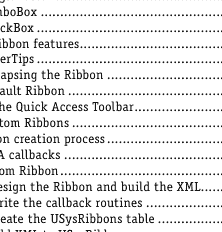

与平面向量一样，我们规定零向量、单位向量、相反向量、共线向量（平行向量）的概念。

由于空间向量是平面向量的推广，因此空间向量的加法、减法、数乘运算以及数量积运算，与平面向量一致。

# 第31章：为分发准备 Access 应用程序 ............ 993

DropDown 控件......................................................... 985

SplitButton 控件...................................................... 987

将功能区附加到窗体和报表 ..................................... 989

完全删除功能区 ............................................. 990

定义当前数据库选项....................................... 994

应用程序选项.......................................................... 994

应用程序标题............................................................ 994

应用程序图标............................................................. 995

显示窗体................................................................. 996

显示状态栏........................................................... 996

文档窗口选项..................................................... 996

使用 Access 特殊键..................................................... 996

关闭时压缩............................................................. 998

保存时从文件属性中删除个人信息..................... 998

在窗体上使用 Windows 主题控件....................................... 998

启用版式视图.......................................................... 998

启用数据表视图中表的设计更改................................... 999

检查截断的数字字段........................................... 999

图片属性存储格式............................................. 999

导航选项........................................................... 999

显示导航窗格复选框...................................... 1000

导航选项按钮............................................... 1000

功能区和工具栏选项................................................ 1001

功能区名称................................................................. 1002

快捷菜单栏............................................................ 1002

允许完整菜单............................................................. 1002

允许默认快捷菜单................................................ 1002

名称自动更正选项.................................................... 1002

开发应用程序................................................... 1003

按规范构建................................................ 1003

创建文档....................................................... 1005

记录您编写的代码.............................................. 1005

记录应用程序.................................................. 1006

分发前测试应用程序................................. 1007

打磨您的应用程序................................................... 1009

使应用程序具有一致的外观和感觉........................ 1009

添加常见的专业组件...................................... 1010

启动画面.............................................................. 1010

应用程序交换机................................................... 1011

关于框................................................................ 1012

状态栏............................................................... 1014

进度表.............................................................. 1016

使应用程序易于启动........................................ 1021

- 防弹应用程序 .................................................... 1022
  - 在所有 Visual Basic 过程中使用错误捕获 ................................ 1023
  - 维护使用日志 ........................................................... 1023
  - 将表与应用程序其余部分分离 ................................ 1027
  - 构建防弹窗体 ....................................................... 1027
  - 验证用户输入 ............................................................. 1028
  - 使用 /runtime 选项 ....................................................... 1028
  - 加密或编码数据库 ............................................... 1029
    - 删除数据库密码 .................................................. 1031
  - 保护 Visual Basic 代码 .................................................... 1032
- 保护环境 ........................................................... 1034
  - 在代码中设置启动选项 ................................................. 1035
  - 禁用启动绕过 ......................................................... 1036
  - 设置属性值 .......................................................... 1037
  - 获取属性值 .......................................................... 1038
- 第32章：集成 Access 与 SharePoint .................................... 1039
  - 介绍 SharePoint ........................................................... 1039
  - 理解 SharePoint 站点 .................................................. 1040
    - SharePoint 文档 ........................................................... 1040
    - SharePoint 列表 ............................................................... 1041
- 在 Access 和 SharePoint 之间共享数据 ........................................ 1043
  - 链接到 SharePoint 列表 ..................................................... 1043
  - 导入 SharePoint 列表 ...................................................... 1046
  - 将 Access 表导出到 SharePoint ........................................... 1047
  - 将 Access 表移至 SharePoint .............................................. 1049
- 使用 SharePoint 模板 ........................................................ 1052

索引 ....................................................................... 1055


## 引言

欢迎阅读 *Access 2019 Bible*，这是您的私人指南，帮助您了解当今最强大的桌面数据库管理系统。

如果您拿起了本书，您可能已经意识到，Microsoft Access 可以帮助您以其他应用程序无法实现的方式管理数据。即使是应用程序之王 Microsoft Excel，也无法完成 Access 能完成的工作。现在，将 Access（一款数据库管理应用程序）与 Excel（一款电子表格应用程序）进行比较似乎有些不合适，但毫无疑问，Excel 每天都被各种组织用来管理和分析大量数据。事实上，您可能正是因为需要突破 Excel 的限制，才打开了这本书。

对于面对不断增长的数据池的分析人员来说，Access 是一个出色的（许多人会说是合乎逻辑的）下一步选择。面对更大的数据集时，Access 的性能下降非常有限。它没有预先设定的行数限制，而且能够有效管理彼此不同的数据表之间的关系。此外，Access 还附带了各种工具，可以帮助您构建可分发的应用程序。

如今，我们拥有比以往更多的数据，也面临着越来越多的复杂数据分析需求。高级分析人员需要在自己的工具箱中增加一些工具，从而摆脱单纯充当“电子表格机械师”的角色。这正是本书成为您技能发展过程中重要一步的原因。在本书中，您不仅会了解 Access，还将学习如何通过多种方式利用 Access 改进日常的数据管理与分析工作。

### 本书适合您吗？

本书包含将 Access 2019 学习到中高级水平所需的一切内容。本书从数据库基础知识开始，并逐章逐步深入。

本书旨在提升各个水平用户的技能，包括 Access 初学者、中级用户，甚至高级用户。如果您刚接触 Access，请从开头开始阅读。如果您已经熟悉 Access，并且能够熟练构建 Access 应用程序，那么可以从本书后面的部分开始。

如果您刚接触数据库管理领域，本书包含使用 Access 2019 入门所需的一切内容，同时也提供了可供参考和学习的高级主题。初学者开发人员应特别关注第 I 部分，因为其中介绍了构建成功且高效的数据库所必需的核心技能。作为数据库设计人员，您是否合格，往往取决于您所构建的应用程序运行得有多好，以及它们处理用户交付给它们的数据的能力有多强。

如果您想学习 Visual Basic for Applications（VBA）编程基础知识，本书可以满足您的需求。尽管 VBA 是一个内容丰富、值得单独成书的主题，但本书提供了一组详实的章节，帮助您开始利用 VBA 来增强 Access 数据库。本书第 VI 部分详细讲解了编写 VBA 过程以及围绕添加到数据库中的代码构建 Access 应用程序的基础知识，其中包含大量深入的技术细节。

### 本书中的约定

本书使用以下约定：

- 当要求您按下组合键时（按住一个键的同时按下另一个键），组合键之间会使用加号分隔。例如，Ctrl+Esc 表示您必须按住 Ctrl 键并按下 Esc 键，然后同时松开两个键。
- “指向鼠标”是指移动鼠标，使鼠标指针停留在某个特定项目上。“单击”是指按下一次鼠标左键后松开。“双击”是指快速连续按下两次鼠标左键，然后松开。“右键单击”是指按下一次鼠标右键后松开。“拖动”是指按住鼠标左键，同时移动鼠标。
- 我们使用斜体表示新术语和强调内容。
- 我们使用粗体表示需要直接输入到 Access 字段中的内容。

### 本书的组织结构

本书分为七个部分：

- **第 I 部分：Access 基础构件：**第 I 部分帮助您牢固掌握数据库的基本元素，介绍数据库管理中的关键术语，并教您如何规划表以及使用 Access 数据类型。在本部分中，您还将首次接触 Access 和 Access 界面。
- **第 II 部分：了解 Access 表：**在第 II 部分中，您将学习构建 Access 表、管理表之间的关系，以及链接到 Excel 文件、文本文件、SQL Server 和其他 Access 数据库等不同数据源所需的技能。
- **第 III 部分：使用 Access 查询：**第 III 部分向您介绍 Access 中提供的一些基本分析工具。在这里，您将探索查询生成器，以及如何从 Access 表创建简单和高级分析输出的技术。本部分涵盖查询基础知识、聚合查询、操作查询和交叉表查询。
- **第 IV 部分：高级查询技术：**第 IV 部分将向您展示如何使用条件分析、构建功能强大的子查询，以及对查询应用统计分析。
- **第 V 部分：使用 Access 窗体和报表：**第 V 部分重点介绍如何使用 Access 构建窗体和报表。在这里，我们将介绍如何将数据转换为外观精美的用户界面和 PDF 风格的 Access 报表的基础知识。您还将探索如何通过高级窗体控件增强 Access 应用程序的外观和使用体验。
- **第 VI 部分：Microsoft Access 编程基础：**在第 VI 部分中，您将迈出下一步，深入学习编程。本部分各章将从 Access 宏开始，带您进入 VBA 基础知识，最终学习如何利用 VBA 改进 Access 数据库。本部分将帮助您理解驱动 Access 应用程序的复杂对象模型和事件模型，以及如何构建必要的 VBA 代码，从而充分利用这一丰富的编程环境。
- **第 VII 部分：高级 Access 编程技术：**第 VII 部分将您的注意力转向自动化和集成，向您展示如何利用其他程序和平台来增强报表机制。在这些章节中，您不仅会学习成为更熟练的 VBA 开发人员所需的基本技能，还将发现许多可以应用于 Access 应用程序开发项目的内部技巧。您还将了解 Access 扩展的 Microsoft SharePoint 集成功能，这些功能允许您在 SharePoint 网站上发布 Access 表、窗体和报表。

### 如何使用本书

尽管每一章都是整本书不可或缺的一部分，但每一章也可以独立阅读，并且都有自己的示例文件，这些文件可从本书网站获取。本书并不一定要从头到尾通读。相反，它是一本参考书，您可以在以下情况下查阅：

- 您在尝试完成某项操作时遇到了困难。
- 您需要完成以前从未做过的操作。
- 您有一些空闲时间，并且想要了解 Access 的新知识。

简而言之，您可以按照任意顺序阅读本书，在不同章节和主题之间跳转。本书的索引尤其详尽；您可以通过索引查找感兴趣的特定主题所在的位置。

### 网站上的内容

本书中演示的示例可以在本书的网站上找到。网址为 www.wiley.com/go/access2019bible。

### 获取有关 Access 的其他帮助

当您尝试本书中学到的新功能和工具时，有时可能需要额外的帮助来找到正确的方向。您首先应该查看的是 Access 的帮助系统。Access 中的帮助系统并不完美。对于新用户来说，帮助系统可能像一个笨拙的附加功能，返回一份令人困惑的主题列表，其中的内容与最初搜索的主题毫无关系。然而，事实是，一旦您学会如何有效使用 Access 帮助系统，它通常就是获取主题额外帮助的最快、最简单的方法。

以下提示将帮助您充分利用 Access 的帮助系统：

- 获取帮助时，所在位置很重要。您可能记得，旧版 Access 中的帮助系统比新版 Access 更加用户友好，也更有效。请放心，这并不是您的错觉。事实上，Microsoft 从根本上改变了 Access 帮助系统的运行机制。

    在 Access 2019 中，实际上有两个帮助系统：一个为 Access 功能提供帮助，另一个为 VBA 编程主题提供帮助。Access 不会根据您的搜索条件执行全局搜索，而是仅在与您当前所在位置相关的帮助系统中搜索这些条件。这意味着，您获得的帮助取决于您正在使用 Access 的哪个区域。因此，如果您需要查找涉及 VBA 编程的主题，就必须在 VBA 编辑器中执行搜索。另一方面，如果您需要有关构建查询的帮助，最好位于查询设计视图中。这样可以确保您的关键字搜索是在正确的帮助系统中执行的。
- 在线帮助优于脱机帮助。当您搜索某个主题的帮助时，Access 会检查您是否连接到 Internet。如果已连接，Access 会根据 Microsoft 网站上的在线内容返回帮助结果。如果未连接，Access 则会使用 Microsoft Office 本地存储的帮助文件。在 Access 中最大限度地获取帮助的一种方式是使用在线帮助。在线帮助通常优于脱机帮助，因为通过在线帮助找到的内容通常更加详细，并且包含更新的信息以及脱机时无法访问的其他资源链接。
- 通过在线资源丰富您的知识库。熟悉一些专门讨论 Access 的网站和论坛。这些资源不仅可以为基本的 Access 主题提供补充帮助，还可以针对具体情况提供提示和技巧。以下网站列表可以帮助您入门：

    - www.allenbrowne.com
    - https://developer.microsoft.com/en-us/access
    - www.mvps.org/access
    - www.utteraccess.com

这些网站均可免费使用，在您需要额外帮助来找到正确方向时尤其有用。


## 第 I 部分
## Access 构建基块

本书的每个部分都建立在前几个部分的基础上，每个部分中的章节都包含一些示例，这些示例借鉴了前面部分和章节中讲解的技术。作为开发人员，通过阅读各章节并练习本书中的示例，您获得的技能将使您的应用程序受益匪浅。

但每个人在接触新学科时都必须从某处开始，本书的第 I 部分介绍了任何人使用 Access 成功进行数据库开发所需的基本技能。本部分涵盖的主题解释了成功使用数据库环境所需的概念和技术，并为您提供了规范化数据以及规划和实施有效表所需的技能。

如果您已经熟悉数据库设计的相关概念，您可能想略读这些章节。如果您是数据库领域的新手，请在此处花些时间透彻理解这些重要主题。

**本部分内容**
- 第 1 章  
  数据库开发简介
- 第 2 章  
  Access 入门


## 数据库开发简介

### 本章内容
- 考察数据库、表、记录、字段和值之间的差异
- 了解数据库中为何使用多个表
- 探索 Access 数据库对象
- 设计数据库系统

数据库开发不同于您使用计算机的大多数其他方式。与 Microsoft Word 或 Excel 不同，其中使用应用程序的方法相对直观，而良好的数据库开发需要具备先验知识。您必须学习一些基础知识，包括数据库术语、基本数据库概念和数据库最佳实践。在本章中，我们介绍数据库开发的基础知识。

如果您的目标是直接使用 Access，您可能希望跳到第 2 章。

### Access 的数据库术语

Access 遵循大多数（但不是全部）传统数据库术语。术语数据库、表、记录、字段和值表示从大到小的层次结构。几乎所有数据库系统都使用这些相同的术语。

### 数据库

通常，数据库一词是一个计算机术语，指有关某个主题或业务应用程序的信息集合。数据库帮助您以逻辑方式组织这些相关信息，以便于访问和检索。

> 注意
> 一些较旧的数据库系统使用术语“数据库”来描述单个表；当前数据库的使用适用于数据库系统的所有元素。

数据库不仅仅用于计算机。也存在手工数据库；我们有时将这些称为手工归档系统或手工数据库系统。这些归档系统通常由人员、纸张、文件夹和文件柜组成——纸张是手工数据库系统的关键。在手工数据库系统中，您通常有输入和输出篮以及某种形式的正式归档方法。您通过打开文件柜、取出文件夹并找到正确的纸张来手动访问信息。用户填写纸质表单进行输入，也许使用键盘输入打印在表单上的信息。您可以通过手动整理纸张或将许多纸张上的信息复制到另一张纸（甚至复制到 Excel 电子表格中）来查找信息。您可以使用电子表格或计算器来分析数据或以新的有趣方式显示数据。

Access 数据库只不过是纸质归档系统的归档和检索功能的自动化版本。Access 数据库以精心定义的结构存储信息。Access 表存储各种不同类型的数据，从简单的文本行（如姓名和地址）到复杂的数据（如图片、声音或视频图像）。以精确格式存储数据使像 Access 这样的数据库管理系统 (DBMS) 能够将数据转化为有用的信息。

表是 Access 数据库中的主要数据存储库。查询、窗体和报表提供对数据的访问，使用户能够添加或提取数据，并以有用的方式呈现数据。大多数开发人员将宏或 Visual Basic for Applications (VBA) 代码添加到窗体和报表中，以使他们的 Access 应用程序更易于使用。

关系数据库管理系统 (RDBMS)（如 Access）将数据存储在相关的表中。例如，包含员工数据（姓名和地址）的表可能与包含工资信息（支付日期、支付金额和支票编号）的表相关。

查询允许用户从这些相关的表中提出复杂的问题（例如“2012 年向 Jane Doe 发出的所有工资支票的总和是多少？”），答案显示为屏幕上的窗体和打印的报表。

关系数据库与手工归档系统之间的一个根本区别是，在关系数据库系统中，单个人员或项目的数据可能存储在单独的表中。例如，在患者管理系统中，患者的姓名、地址和其他联系信息可能存储在与保存患者治疗记录的表不同的表中。实际上，治疗表保存所有患者的全部治疗信息，并使用患者标识符（通常是一个数字）在治疗表中查找单个患者的治疗记录。

在 Access 中，数据库是数据和相关对象的整体容器。然而，它不仅仅是表的集合——数据库包含多种类型的对象，包括查询、窗体、报表、宏和代码模块。

当您打开 Access 数据库时，数据库中的对象（表、查询等）会呈现给您使用。如有需要，您可以同时打开多个 Access 副本，并同时处理多个数据库。

许多 Access 数据库包含数百甚至数千个表、窗体、查询、报表、宏和模块。除了少数例外，Access 2016 数据库中的所有对象都驻留在扩展名为 ACCDB 或 ACCDE 的单个文件中。Access 数据库也可以具有 MDB 或 MDE 扩展名。具有这些扩展名的数据库与 Access 2003 及更早版本向后兼容。

### 表

表只是原始信息（称为*数据*）的容器，类似于手工归档系统中的文件夹。Access 数据库中的每个表包含有关单个主题（如员工或产品）的信息，表中的数据组织为行和列。

> 在第 3 章和第 4 章中，您将学习管理关系表设计的非常重要的规则，以及如何将这些规则整合到您的 Access 数据库中。这些规则和准则可确保您的应用程序性能良好，同时保护表中包含的数据的完整性。

在 Access 中，表是一个实体。在设计构建 Access 数据库时，甚至在使用现有 Access 应用程序时，您必须考虑表和其他数据库对象如何表示数据库管理的物理实体，以及实体之间如何相互关联。

创建表后，您可以在类似电子表格的形式（称为*数据表*）中查看该表，该形式由行和列组成（分别称为*记录*和*字段*——请参阅下一节“记录和字段”）。尽管数据表和电子表格表面相似，但数据表是一种非常不同类型的对象。

> 第 5 章讨论 Access 数据表以及数据表与电子表格之间的差异。您可以在第 3 章中找到更多关于字段和字段属性的信息。

### 记录和字段

数据表分为行（称为*记录*）和列（称为*字段*），第一行（每列顶部的标题）包含数据库中字段的名称。

每一行是一条记录，包含与该记录相关的字段。在手工系统中，行是单独的表单（纸张），而字段相当于打印表单上您填写的空白区域。

每列是一个字段，包含许多属性，这些属性指定字段中包含的数据类型以及 Access 应如何处理该字段的数据。这些属性包括字段名称（Company）和字段中的数据类型（Text）。字段也可能包含其他属性。例如，Address 字段的 Size 属性告诉 Access 地址允许的最大字符数。


> NOTE
> 在使用 Access 时，术语 field 用于指代存储在记录中的属性。在许多其他数据库系统中，包括 Microsoft SQL Server，column 是你最常听到用来代替 field 的表达方式。Field 和 column 含义相同。使用的术语在一定程度上取决于包含该记录的表的底层数据库系统的上下文。

## Values

记录与字段的交集处是一个值——实际的数据元素。例如，如果你有一个名为 Company 的字段，输入到该字段中的公司名称就代表一个数据值。某些规则规定了数据如何在 Access 表中包含。

有关这些规则的更多内容，请参阅第 3 章和第 4 章。

## Relational Databases

Access 是一种关系型数据库管理系统。Access 数据存储在相关的表中，其中一个表（如 Customers）中的数据与另一个表（如 Orders）中的数据相关联。Access 维护相关表之间的关系，使得提取客户及其所有订单变得容易，而不会丢失任何数据或提取不属于该客户的订单记录。

多个表通过减少冗余数据的输入来简化数据输入和报表。 例如，通过为使用客户信息的应用程序定义两个表，你就不需要每次客户购买商品时都存储客户的姓名和地址。

在创建表之后，它们需要相互关联。 例如，如果你有一个 Customers 表和一个 Sales 表，你可以使用它们之间的公共字段将这两个表关联起来。在这种情况下，Customer Number 将是两个表中都有的一个好字段。这将允许你在 Sales 表中查看销售记录，其中 Customer Number 与 Customers 表匹配。

这种模型的优点是你不必在每次向 Sales 表添加新记录时重复客户的关键属性（如客户姓名、地址、城市、州、邮编）。你只需要客户编号即可。例如，当客户更改地址时，地址只在 Customers 表中的一条记录中更改。

将数据分离到数据库中的多个表中，使得系统更易于维护，因为同一类型的所有记录都在同一个表中。通过花时间将数据正确地分割到多个表中，你会显著减少设计和工作时间。此过程称为规范化。

你可以在第 4 章中阅读有关规范化的内容。

## Why Create Multiple Tables?

创建多个表的想法几乎总是让初学数据库的用户感到畏惧。最常见的是，初学者希望创建一个包含他们所需所有信息的大型表——例如，一个 Customers 表，其中包含客户所做的所有销售以及客户的姓名、地址和其他信息。毕竟，如果你到目前为止一直使用 Excel 存储数据，那么在 Access 中构建表时采用同样的方法似乎是相当合理的。

一个包含所有客户信息的大型单一表很快就会变得难以维护。你必须为客户每次销售都输入客户信息（在每一行中重复姓名和地址信息）。当客户在一次购买中购买了多个商品时，对每次销售所购买的商品也是如此。这使得系统效率更低，更容易出现数据输入错误。表中的信息存储效率低下——某些字段可能不需要用于每个销售记录，表最终会出现大量空字段。

你希望创建的表只包含最少的信息，同时仍使系统易于使用并且足够灵活以便扩展。为了实现这一点，你需要考虑创建不止一个表，每个表包含仅与该表重点相关的字段。然后，在创建表后，你可以使用其他 Access 数据库对象将它们链接起来并创建有意义的视图和报表。我们将在下一节深入探讨这些主题。

## Access Database Objects

如果你是数据库新手（甚至如果你是经验丰富的数据库用户），在开始构建 Access 数据库之前，你需要了解一些关键概念。Access 数据库包含六种顶级对象类型，它们由使用 Access 所需的数据和工具组成：

- Table：保存实际数据
- Query：搜索、排序并检索特定数据
- Form：以自定义格式让你输入和显示数据
- Report：以格式化的方式显示和打印数据
- Macro：无需编程即可自动化任务
- Module：包含用 VBA（Visual Basic for Applications）编程语言编写的编程语句

## Tables

正如你在本章前面所发现的，表充当 Access 数据库中的主要数据存储库。你通过一种称为 datasheet 的特殊对象与表进行交互。虽然不是永久的数据库对象，但 datasheet 以类似 Excel 工作表的行列格式显示表的内容。Datasheet 以原始形式显示表的信息，不进行转换或过滤。Datasheet 视图是显示所有字段的所有记录的默认模式。

你可以使用键盘上的方向键滚动 datasheet。你还可以在 datasheet 中显示其他表中相关的记录。此外，你可以更改显示的数据。

## Queries

查询从数据库中提取信息。查询选择并定义满足特定条件的记录组。大多数窗体和报表都基于查询，查询在数据显示之前组合、过滤或排序数据。查询通常由宏或 VBA 过程调用以更改、添加或删除数据库记录。

查询的一个例子是销售办公室的人告诉数据库：“向我展示所有位于马萨诸塞州并在过去六个月内购买过东西的客户，按姓名字母顺序排列”或“向我展示过去六个月内购买了雪佛兰汽车型号的所有客户，并按客户姓名然后按销售日期排序显示他们。”

而不是用纯英语提问，人们使用查询举例（QBE）方法。当你将指令输入到查询设计器窗口并运行查询时，查询会将指令翻译成结构化查询语言（SQL）并检索所需数据。

第 8 章讨论查询设计器窗口和构建查询。

## Data-entry and display forms

数据输入窗体帮助用户快速、轻松、准确地将信息输入数据库表。数据输入和显示窗体比 datasheet 提供的视图更结构化。从这个结构化视图中，数据库记录可以被查看、添加、更改或删除。通过数据输入窗体输入数据是将数据输入到数据库表的最常见方式。

数据输入窗体可用于限制对表内某些字段的访问。窗体还可以通过数据验证规则或 VBA 代码增强，以在数据添加到数据库表之前检查其有效性。

大多数用户更喜欢将信息输入到数据输入窗体中，而不是输入到表的 Datasheet 视图中。窗体通常类似于熟悉的纸质文档，可以帮助用户完成数据输入任务。窗体通过引导用户完成正在更新的表的字段，使数据输入易于理解。

只读窗体通常用于查询目的。这些窗体显示表中的某些字段。显示某些字段而不显示其他字段意味着你可以限制用户对敏感数据的访问，同时允许访问同一表中的其他字段。

## Reports

报表以 PDF 样式格式呈现你的数据。Access 在创建报表时允许极大的灵活性。例如，你可以配置报表以列出


所有给定表中（例如 Customers 表）的记录，或者你可以让报表只包含满足特定条件的记录（例如所有居住在亚利桑那州的客户）。你可以通过基于查询来创建报表，该查询只选择报表所需的记录。

报表通常结合多个表来呈现不同数据集之间复杂的关联。一个例子是打印发票。Customers 表提供客户的姓名和地址（以及其他相关数据），而销售表中的相关记录则用于打印每个订购产品的明细行项目信息。报表还计算销售总额并以特定格式打印。此外，你可以让 Access 将记录输出到发票报表中，这是一份汇总发票的打印文档。

## Macros and VBA

正如 Excel 具有宏和 VBA 编程功能一样，Microsoft Access 也有其对应的功能。这就是 Microsoft Access 数据分析真正强大和灵活之处。无论你是在自定义函数、批量分析还是自动化中使用它们，宏和 VBA 模块都可以提供一种难以通过其他方式实现的定制灵活性。例如，你可以使用宏和 VBA 自动执行重复性分析和循环分析流程，让你有空处理其他任务。宏和 VBA 还能降低人为错误的可能性，并确保分析每次都以相同的方式执行。从第 22 章开始，你将探索宏和 VBA 的优势，并学习如何使用它们来安排和运行批量分析。

> Tip
> 当你设计数据库表时，请记住你想要打印的所有类型的信息。这样可以确保你在各种报表中所需的信息都可以在数据库表中获得。

## Planning for database objects

要创建数据库对象，例如表、窗体和报表，你首先要完成一系列设计任务。设计越好，应用程序就越好。你对设计思考得越透彻，就能越快、越成功地完成任何系统。设计过程并不是某种必要的恶，也不是为了产生大量的文档。设计对象的唯一目的是在实现时提供一条清晰明确的路径。

## A Five-Step Design Method

本节描述的五个设计步骤为创建数据库应用程序提供了坚实的基础——包括表、查询、窗体、报表、宏和简单的 VBA 模块。你在每个步骤上花费的时间完全取决于你正在构建的数据库的情况。例如，有时用户会给你一个他们希望从 Access 数据库中打印的报表示例，并且报表的数据来源非常明显，以至于设计报表只需要几分钟。其他时候，特别是当用户需求复杂或应用程序支持的业务流程需要大量研究时，你可能在第 1 步上花费数天。

在阅读设计过程的每个步骤时，始终从输出和输入的角度来看待设计。

## Step 1: The overall design—from concept to reality

所有软件开发人员都面临类似的问题，其中第一个问题是如何满足最终用户的需求。在深入细节之前，了解整体用户需求非常重要。

例如，你的用户可能要求一个支持以下任务的数据库：

- 输入和维护客户信息（姓名、地址和财务历史）
- 输入和维护销售信息（销售日期、付款方式、总金额、客户身份和其他字段）
- 输入和维护销售明细项目信息（所购商品的详细信息）
- 查看所有表中的信息（销售、客户、销售明细项目和付款）
- 就数据库中的信息提出各种问题
- 生成月度发票报表
- 生成客户销售历史
- 生成邮件标签和邮件合并报表

在回顾这八项任务时，你可能需要考虑用户未提及的其他外围任务。在开始设计之前，坐下来了解现有流程的工作方式。为此，你必须对现有系统进行彻底的需求分析，以及如何对其进行自动化。

准备一系列问题，以深入了解客户的业务以及客户如何使用其数据。例如，在考虑自动化任何类型的业务时，你可能会问这些问题：

- 目前使用哪些报表和窗体？
- 销售、客户和其他记录目前如何存储？
- 账单如何处理？

当你提出这些问题和其他问题时，客户可能会想起关于业务的其他事情。

对现有流程的走查也有助于了解业务。你可能需要多次返回以观察现有流程以及员工的工作方式。

在准备完成剩余步骤时，保持客户参与——让用户知道你在做什么并征求他们对要完成工作的意见，确保其在用户需求范围内。

## Step 2: Report design

虽然从报表开始似乎很奇怪，但在许多情况下，用户对数据库的打印输出比对应用程序的任何其他方面更感兴趣。报表通常包含应用程序管理的每一位数据。因为报表往往很全面，所以它们通常是收集数据库需求重要信息的最佳方式。

当你看到本节中将创建的报表时，你可能会想：“先有鸡还是先有蛋？” 报表布局先来，还是先确定构成报表的项目和文本？实际上，这些项目是同时考虑的。

报表中数据的布局并不重要。然而，你现在花费的时间越多，构造报表就越容易。有些人甚至在报表上放置网格线，以准确标识他们希望每个数据位所在的位置。

## Step 3: Data design

设计阶段的下一步是盘点报表所需的所有信息。最好的方法之一是列出每个报表中的数据项。在这样做的同时，请仔细注意出现在多个报表中的项目。确保你为出现在多个报表中的数据项保留相同的名称，因为该数据项实际上是同一项。

例如，你可以从每个报表所需的客户数据开始，如表 1.1 所示。

**TABLE 1.1 Customer-Related Data Items Found in the Reports**

| Customers Report | Invoice Report |
|---|---|
| Customer Name | Customer Name |
| Street | Street |
| City | City |
| State | State |
| zip code | zip code |
| Phone Numbers | Phone Numbers |
| E-Mail Address | |
| Web Address | |
| Discount Rate | |
| Customer Since | |
| Last Sales Date | |
| Sales Tax Rate | |
| Credit Information (four fields) | |

正如你通过比较每个报表所需的客户信息类型所看到的，有许多共同字段。大多数客户数据字段都出现在两个报表中。表 1.1 仅显示每个报表中使用的一些字段——与客户信息相关的字段。因为相关的行和字段名称相同，所以你可以轻松确保拥有所有数据项。虽然对于这个小型数据库来说，轻松定位项目并不关键，但在处理包含许多字段的大表时，这变得非常重要。

提取客户数据后，你可以继续进行销售数据。在这种情况下，你只需要分析发票报表中特定于销售的数据项。表 1.2 列出了报表中包含销售信息的字段。

| Invoice Report | Line Item Data |
|---|---|
| Invoice Number | Product Purchased |
| Sales Date | Quantity Purchased |
| Invoice Date | Description of Item Purchased |
| Payment Method | Price of Item |
| Salesperson | Discount for Each Item |
| Discount (overall for sale) | |
| Tax Location | |
| Tax Rate | |
| Product Purchased (multiple lines) | |
| Quantity Purchased (multiple lines) | |
| Description of Item Purchased (multiple lines) | |
| Price of Item (multiple lines) | |
| Discount for each item (multiple lines) | |
| Payment Type (multiple lines) | |
| Payment Date (multiple lines) | |
| Payment Amount (multiple lines) | |
| Credit Card Number (multiple lines) | |
| Expiration Date (multiple lines) | |

**TABLE 1.2 Sales Data Items Found in the Reports**

正如你在检查报表所需的销售信息类型时所看到的，一些项目（字段）是重复的（例如，Product Purchased、Quantity Purchased 和 Price of Item 字段）。每个发票可以有多个项目，而这些项目中的每一个都需要相同类型的信息——订购数量和每件商品的价格。许多销售可能有多个购买的商品。此外，每个发票可能包含部分付款，并且它

## Part I. Access Building Blocks


这笔付款信息可能包含多行付款信息，因此这些重复项目可以归入它们自己的分组。

你可以将在上一节销售信息组中找到的所有单项提取出来，归入发票报告自己的分组中。表1.2显示了与每个行项目相关的信息。

## 步骤4：表设计

现在是难的部分：你必须确定为构成报表的表需要哪些字段。当你检查构成你所拥有的许多文档的众多字段和计算时，你开始看到哪些字段属于数据库中的各个表。（你已经通过将字段排列成逻辑组完成了大部分前期工作。）目前，包括你提取的每个字段。稍后（出于各种原因）你还需要添加其他字段，尽管某些字段不会出现在任何表中。

重要的是要理解，你不需要把每一点数据都添加到数据库的表中。例如，用户可能希望将假期和其他不在办公室的日期添加到数据库中，以便轻松知道特定日期有哪些员工可用。然而，在初始开发阶段纳入太多想法很容易给应用程序的初始设计增加负担。由于 Access 表以后很容易修改，所以最好把非关键项目放在一边，直到初始设计完成。一般来说，在数据库开发项目开始后，满足用户请求并不困难。

在使用每个报表显示所有数据之后，需要按用途整合数据（例如，按逻辑组分组），然后比较这些功能之间的数据。为此，首先查看客户信息，并将其所有不同字段合并为一组数据项。然后对销售信息和行项目信息进行同样的操作。表1.3比较了这些信息组中的数据项。

### 表1.3 数据项比较

| 客户数据 | 发票数据 | 行项目 | 付款信息 |
|---|---|---|---|
| 客户公司名称 | 发票编号 | 购买的产品 | 付款类型 |
| 街道 | 销售日期 | 购买数量 | 付款日期 |
| 城市 | 发票日期 | 购买项目描述 | 付款金额 |
| 州 | 折扣（本次销售总计） | 项目价格 | 信用卡号 |
| 邮政编码 | 税率 | 每个项目的折扣 | 到期日 |
| 电话号码（两个字段） |  | 应税？ |  |
| 电子邮件地址 |  |  |  |
| 网址 |  |  |  |
| 折扣率 |  |  |  |
| 成为客户日期 |  |  |  |
| 最后销售日期 |  |  |  |
| 销售税率 |  |  |  |
| 信用信息（四个字段） |  |  |  |

### 表1.3（续）

| 客户数据 | 发票数据 | 行项目 | 付款信息 |
|---|---|---|---|
| 邮政编码 | 税率 | 每个项目的折扣 | 到期日 |
| 电话号码（两个字段） |  | 应税？ |  |
| 电子邮件地址 |  |  |  |
| 网址 |  |  |  |
| 折扣率 |  |  |  |
| 成为客户日期 |  |  |  |
| 最后销售日期 |  |  |  |
| 销售税率 |  |  |  |
| 信用信息（四个字段） |  |  |  |

整合和比较数据是开始创建单个表的好方法，但你还有很多工作要做。

当你进一步了解如何执行数据设计时，你还会了解到客户数据必须分成两组。其中一些项目每个客户只使用一次，而其他项目可能有多个条目。一个例子是销售列——付款信息可以有多行信息。

你需要进一步将这些类型的信息分解到它们自己的列中，从而将所有相关类型的项目分离到它们自己的列中——这是设计过程中规范化部分的一个例子。例如，一个客户可以与公司有多次联系，或者为单次销售进行多次付款。当然，我们已经将数据分为三类：客户数据、发票数据和行项目明细。

请记住，一个客户可能有多个发票，而每个发票上可能有多个行项目。发票数据类别包含有关单个销售的信息，而行项目类别包含有关每个发票的信息。请注意，这三列都是相关的；例如，一个客户可以有多个发票，而每个发票可能需要多个行项目。

表之间的关系可能不同。例如，每张销售发票有且只有一个客户，而每个客户可能有多次销售。销售发票与发票行项目之间存在类似的关系。

数据库表关系要求关系所涉及的两个表中都有一个唯一字段。每个表中的唯一标识符有助于数据库引擎正确连接和提取相关数据。

## 第1章：数据库开发简介

只有销售表有一个唯一标识符（发票编号），这意味着你需要向其他每个表中至少添加一个字段，作为与其他表链接的字段——例如，向客户表添加一个客户ID字段，向发票表添加相同字段，并通过每个表中的客户ID在表之间建立关系。数据库引擎利用客户与发票之间的关系，将客户与其发票连接起来。表之间的关系是通过使用关键字段来促进的。

> 我们将在第4章介绍如何创建和理解关系以及规范化过程。

理解了将一组字段链接到另一组字段的需求后，你可以向每个组添加所需的关键字段。表1.4显示了为每组字段创建的两个新组和链接字段。这些链接字段，称为*主键*和*外键*，用于将这些表链接在一起。

唯一标识表中每一行的字段是*主键*。相关表中对应的字段是*外键*。在我们的示例中，客户表中的客户ID是主键，而发票表中的客户ID是外键。

假设客户表中某条记录的客户ID字段为12。发票表中任何客户ID为12的记录都“属于”客户12。

**表1.4 带键的表**

| 客户数据 | 发票数据 | 行项目数据 | 销售付款数据 |
|---|---|---|---|
| 客户ID | 发票ID | 发票ID | 发票ID |
| 客户姓名 | 客户ID | 行号 | 付款类型 |
| 街道 | 发票编号 | 购买的产品 | 付款日期 |
| 城市 | 销售日期 | 购买数量 | 付款金额 |
| 州 | 发票日期 | 购买项目描述 | 信用卡号 |
| 邮政编码 | 付款方式 | 项目价格 | 到期日 |
| 电话号码（两个字段） | 销售员 | 每个项目的折扣 |  |
| 电子邮件地址 | 税率 |  |  |
| 网址 |  |  |  |
| 折扣率 |  |  |  |
| 成为客户日期 |  |  |  |
| 最后销售日期 |  |  |  |
| 销售税率 |  |  |  |

向每个表添加关键字段后，你现在可以在每个表中找到将它链接到数据库中其他表的字段。例如，表1.4显示了客户表（其中客户ID是主键）和发票表（其中客户ID是外键）中的客户ID。

你已经确定了系统的三个核心表，如表1.4中的前三列所示。这是最终表设计的总体（或第一版）初稿。你还创建了一个额外的事实表来保存销售付款数据。通常，付款细节（如信用卡号）不属于销售发票的一部分。

花时间正确设计数据库及其包含的表，可以说是开发数据库应用程序中最重要的步骤。通过高效地设计数据库，你可以保持对数据的控制，消除代价高昂的数据输入错误，并将数据输入限制在必要字段上。

虽然本书并非旨在教授数据库理论及其所有细微差别，但这里是简要描述数据库规范化艺术的好地方。你将在第4章中阅读规范化的细节，但与此同时，你应该知道规范化是将数据分解为组成表的过程。在本章前面，你读到了许多Access开发人员如何将不相似的信息（如客户、发票数据和发票行项目）添加到一个大表中。包含不同数据的大表很快就会变得笨重且难以更新。因为客户的电话号码出现在包含该客户数据的每一行中，所以电话号码发生变化时必须进行多次更新。

## 步骤5：窗体设计

创建完数据并建立了表关系之后，就该设计窗体了。窗体由可在编辑模式下输入或查看的字段组成。一般来说，你的Access屏幕应该看起来很像手动系统中使用的窗体。

在设计窗体时，你需要在屏幕上放置三类对象：

- 标签和文本框数据输入字段：Access窗体和报表上的字段称为控件。
- 特殊控件（命令按钮、多行文本框、选项按钮、列表框、复选框、商务图表和图片）。
- 用于增强窗体效果的图形对象（颜色、线条、矩形和三维效果）。

理想情况下，如果窗体是从现有的纸质表格开发而来，则Access数据输入窗体应类似于纸质表格。字段在屏幕上的相对位置应与纸质表格中的位置相同。

标签显示消息、标题或说明。文本框提供一个区域，你可以在其中输入或显示数据库中所包含的文本或数字。复选框指示条件，可以是未选中或选中。Access可用的其他类型控件包括命令按钮、列表框、组合框、选项按钮、切换按钮和选项组。

从第5部分开始，我们将详细介绍创建窗体的主题。


## 入门 Access

## 本章内容

- 查看 Access 欢迎屏幕
- 从头创建数据库
- 打开新数据库
- 熟悉 Access 界面

在本章中，你将了解 Microsoft Access 用户界面的主要组件。

## Access 欢迎屏幕

如果你通过 Windows（开始 ⇨ Access）打开 Access 2019，你会看到图 2.1 所示的默认欢迎屏幕。欢迎屏幕为你提供了打开现有 Access 数据库或创建新数据库的多个选项。

> NOTE
> 如果你直接从文件资源管理器（双击它）打开 Access 数据库，你将看不到欢迎屏幕。相反，你将直接进入本章后面介绍的数据库界面。

在欢迎屏幕的左上角，你会注意到“最近”部分。这里列出的文件是你之前通过 Access 2019 打开过的数据库。你可以单击其中列出的任何数据库文件来打开它们。

> NOTE
> Access 在填充“最近”部分时不会区分现有数据库和已删除的数据库。这意味着你可能会在“最近”列表中看到一个你确信已删除的数据库。单击“最近”列表中已删除的数据库，只会激活一条错误消息，提示 Access 找不到该数据库。

在“最近”部分下方，你会看到“打开其他文件”超链接。单击此链接可浏览并打开计算机或网络上的数据库。

### FIGURE 2.1

Access 欢迎屏幕提供了多种开始使用 Access 的方式。

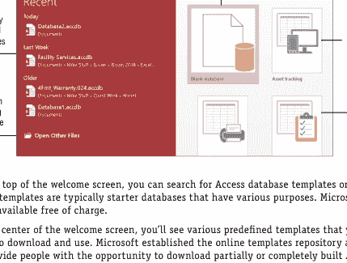

在欢迎屏幕顶部，你可以在线搜索 Access 数据库模板。这些模板通常是具有各种用途的入门数据库。Microsoft 免费提供它们。

在欢迎屏幕中央，你会看到各种可单击下载和使用的预定义模板。Microsoft 建立了在线模板存储库，以便为人们提供下载部分或完全构建的 Access 应用程序的机会。模板数据库涵盖了许多常见的业务需求，例如库存控制和销售管理。你可能想花点时间探索在线模板，但本书中未涵盖它们。

在欢迎屏幕中央，你还会看到“空白数据库”选项。此选项允许你从头创建数据库。

> NOTE
> Access 2013 和 Access 2016 提供了创建 Web 数据库的选项。这些数据库可以作为自定义 Web 应用程序发布到 SharePoint。Microsoft 已弃用 Access Web 应用程序，并且在 Access 2019 中不再提供 Web 数据库作为选项。

## 如何创建空白数据库

要创建新的空白数据库，你可以单击欢迎屏幕上的“空白数据库”选项（参见图 2.1）。这样做时，会出现图 2.2 所示的对话框，允许你指定数据库的名称和位置。

### NOTE

新数据库的默认位置是你的“文档”文件夹。如果你想使用不同的文件夹，请单击“文件名”框右侧的浏览按钮（看起来像文件资源管理器文件夹）以浏览到你想要使用的位置。

你也可以永久告诉 Access 使用你自己的自定义默认位置，方法是单击“文件”选项卡，选择“选项”，然后更改“默认数据库文件夹”设置（位于“常规”选项卡上）。

## FIGURE 2.2

在“文件名”框中输入新数据库的名称。

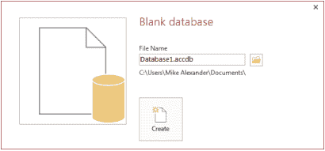

当你单击“创建”按钮创建新数据库时，Access 会自动为你打开该数据库。在图 2.3 中，注意 Access 打开新数据库时已添加了一个空白表，准备好填入字段和其他设计细节。

## FIGURE 2.3

你的新数据库已创建。

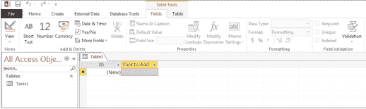

## Access 文件格式

自 Access 2007 以来，Access 数据库文件的默认文件格式已从 MDB 改为 ACCDB。了解为什么会发生变化以及它如何影响 Access 2019 与旧版 Access 数据库文件的工作方式是值得花点时间的。

自诞生以来，Access 一直使用名为 Jet 的数据库引擎（Joint Engine Technology 的缩写）。在 Access 2007 中，Access 开发团队希望为 Access 添加重要的新功能，例如多值和附件字段。由于新功能非常重要，他们无法用 Jet 改造以支持新功能所需的代码。因此，Microsoft 开发了一个全新的数据库引擎，即 Access 连接引擎（ACE）。

Access 2019 支持多种文件格式，包括以下格式：

- Access 2007–2019 ACCDB
- Access 2002–2003 MDB
- Access 2000 MDB

如果你不幸在仍在使用 Access 2003 的环境中工作，出于兼容性目的，你需要坚持使用 Access 2002–2003 MDB 格式。同理，如果你使用的是使用数据库复制或用户级安全性的旧数据库，你需要坚持使用 MDB 格式。Access ACCDB 文件不支持复制或用户级安全性。

在 Access 2019 中，你可以打开旧的 Access 2002–2003 和 Access 2000 MDB 文件并对其进行任何所需更改，但你只能使用特定于这些版本的特性。一些新 Access 功能将不可用，特别是那些依赖 ACE 数据库引擎的功能。

你可以通过在 Access 2019 中打开数据库，选择 File ▸ Save As，然后在“另存为”对话框中选择不同的 Access 格式之一来转换以前格式保存的数据库。

## Access 2019 界面

创建或打开新数据库后，Access 屏幕将类似于图 2.4。屏幕顶部是 Access 功能区。左侧你可以看到导航窗格。这两个组件构成了 Access 界面的主体。此外，你还可以使用快速访问工具栏，你可以用最常用的命令对其进行自定义。

## 导航窗格

导航窗格位于屏幕左侧，是你在 Access 中工作时的主要导航辅助工具。导航窗格显示表、查询、窗体、报表和其他 Access 对象类型。它还可以显示不同类型对象的组合。

单击导航窗格标题栏中的下拉列表以显示导航选项（参见图 2.5）。

## FIGURE 2.4

Access 界面顶部开始于功能区，左侧为导航窗格。

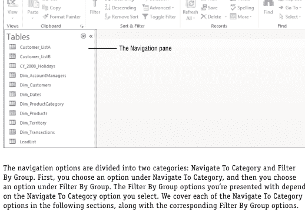

导航选项分为两个类别：导航到类别和按组筛选。首先在“导航到类别”下选择一个选项，然后在“按组筛选”下选择一个选项。你在“按组筛选”下看到的选项取决于你选择的“导航到类别”选项。我们将在以下各节中介绍每个“导航到类别”选项以及相应的“按组筛选”选项。

## Custom

“自定义”选项在导航窗格中创建一个新的分组。此新选项卡默认标题为“自定义组 1”，包含你拖放进入该选项卡区域的对象。添加到自定义组中的项目仍会出现在下一节中描述的各自对象类型视图中。

当你选择“自定义”时，“按组筛选”类别会填充你之前创建的所有自定义组。你可以使用“按组筛选”类别筛选到任何已创建的自定义组。

## FIGURE 2.5

为导航窗格选择另一种显示方式。

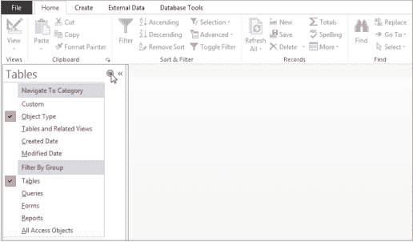

> **TIP**
> 
> 自定义组是分组不相似对象（如表、查询和窗体）但功能相关的绝佳方式。例如，你可以创建一个自定义组并添加与客户活动相关的所有数据库对象。自定义组中的项目也可以出现在其他组中。

## Object Type

“对象类型”选项与以前版本的 Access 最为相似。

当你选择“对象类型”时，“按组筛选”下有以下选项：

- Tables
- Queries
- Forms
- Reports
- All Access Objects

默认情况下，导航窗格显示当前数据库中的所有对象。选择“所有 Access 对象”以在你使用其中一个筛选视图工作后查看数据库中的每个对象。


## 第一部分：访问构建模块

> **提示**
> 
> 不喜欢新的选项卡式窗口配置吗？你可以通过选择 **文件 > 选项** 返回到旧的 overlapping 窗口。在 Access 选项对话框中，选择 **当前数据库** 选项卡，并将 **文档窗口选项** 设置从 **选项卡式文档** 改为 **重叠窗口**。你必须关闭并重新打开数据库才能使更改生效。

## 功能区

功能区占据了主 Access 屏幕的顶部部分。从 Access 2007 开始，功能区取代了 Access 早期版本中看到的菜单和工具栏。

功能区分为六个选项卡，每个选项卡包含任意数量的控件和命令（请参阅图 2.4）：

- **文件：** 当你单击文件选项卡时，Office 后台视图会打开。后台视图包含创建数据库、打开数据库、保存数据库和配置数据库的许多选项。我们在附近的侧边栏中更深入地探讨了 Office 后台视图。
- **开始：** 开始选项卡的主题是“常用”。在这里，你会找到在操作 Access 过程中反复调用的、通常不相关的命令。例如，有用于格式设置、复制和粘贴、排序和筛选的命令。
- **创建：** 创建选项卡包含创建 Access 中各种对象的命令。你将在这里花费大部分时间。在这里，你可以启动创建表、查询、窗体、报表和宏。你在阅读本书时，会一直使用创建选项卡。
- **外部数据：** 外部数据选项卡专门用于将 Access 与其他数据源集成。在此选项卡上，你会找到允许导入和导出数据、建立与外部数据库的连接以及使用 SharePoint 或其他平台的命令。
- **数据库工具：** 数据库工具选项卡包含处理数据库内部运作的命令。在这里，你会找到创建表之间关系、分析数据库性能、记录数据库以及压缩和修复数据库的工具。
- **帮助：** Access 2019 还包含一个帮助选项卡，它没有数据库功能，但提供了指向支持和培训的链接。

除了 Access 功能区上的标准六个选项卡之外，你还会看到上下文选项卡。*上下文选项卡* 是特殊类型的选项卡，仅在选择特定对象时出现。例如，当你使用查询生成器时，你会看到查询工具设计选项卡，如图 2.6 所示。

## 图 2.6

上下文选项卡包含特定于活动对象的命令。

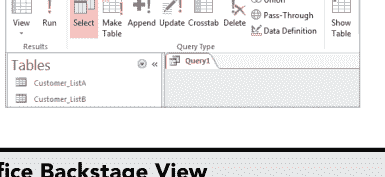

## Office 后台视图

Office 后台视图是创建、打开或配置 Access 数据库选项的入口。你可以通过单击功能区上的文件选项卡进入后台视图（请参阅前一节）。

后台选项包括在主 Access 窗口中工作时使用频率不高的活动，但对于保存、打印或维护 Access 数据库是必要的。将这些选项放入后台区域意味着它们在你使用 Access 工作时不必出现在功能区上的任何位置。

我们在接下来的章节中介绍后台命令。

## 快速访问工具栏

快速访问工具栏（如图 2.7 所示）是一个可自定义的工具栏，允许你添加对日常操作最重要的命令。默认情况下，快速访问工具栏包含三个命令：保存、撤消和重做。

## 图 2.7

快速访问工具栏位于功能区上方。


如果你单击快速访问工具栏旁边的下拉箭头，你会看到还有许多其他命令可用（见图 2.8）。在这些选项旁边放置一个复选标记即可将其添加到快速访问工具栏。

## 图 2.8

可以添加到快速访问工具栏的命令。

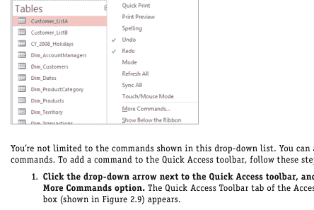

你并不限于此下拉列表中显示的命令。你可以添加各种命令。要将命令添加到快速访问工具栏，请执行以下步骤：

- 1. 单击快速访问工具栏旁边的下拉箭头，并选择更多命令选项。Access 选项对话框的快速访问工具栏选项卡（如图 2.9 所示）出现。
- 2. 在左侧的从中选择命令下拉列表中，选择所有命令。
- 3. 从命令的字母列表中，选择你感兴趣的命令并单击添加按钮。
- 4. 完成后，单击确定。

## 第二部分

## 了解 Access 表

本部分介绍的主题解释了创建和管理 Access 数据库表的技术，任何你在 Access 中构建的应用程序的核心。

这些章节远远超出了简单描述如何构建表的范围。在这里，你将学习使用本书其余部分记录的功能的关键基本概念。

第 3 章通过定义表及其组成部分奠定了基础。在第 4 章中，你将学习表关系的重要性以及如何有效地构建和管理数据库中表之间的关系。第 5 章演示了如何有效地对原始表和数据表进行排序、筛选和操作。最后，第 6 章和第 7 章解释了如何超出数据库范围并从导入或链接的外部数据源创建表。

## 本部分内容

- 第 3 章
- 创建 Access 表
- 第 4 章
- 了解表关系
- 第 5 章
- 使用 Access 表
- 第 6 章
- 导入和导出数据
- 第 7 章
- 链接到外部数据

## 创建 Access 表

## 本章内容

- 创建新表
- 修改表的设计
- 使用字段属性
- 指定主键
- 添加索引
- 记录表的设计
- 保存新表
- 使用表
- 向表中添加数据
- 使用附件字段

在本章中，你将学习如何创建新的 Access 数据库及其表。你建立数据库容器来保存你在学习 Access 时构建的表、窗体、查询、报表和代码。最后，你创建可收藏迷你汽车数据库使用的实际表。

> **网络上**
> 本章使用数据库名为 Chapter03.accdb 中的示例。如果你尚未从本书网站下载此文件，请立即下载。

## 表类型

对于 Access 来说，表始终只是表。但对于你的 Access 应用程序来说，不同的表服务于不同的目的。数据库表属于三种类型之一：对象表、事务表或连接表。知道你正在创建哪种类型的表有助于确定如何创建它。

## 对象表

对象表是最常见的。这种类型表的每条记录保存与现实世界对象相关的信息。客户是现实世界对象，tblCustomers 表中的一条记录保存有关该客户的信息。对象表中的字段反映它们所代表对象的特征。City 字段描述客户的一个特征——即客户所在的实际城市。创建对象表时，考虑该对象的特征使其独特或重要的方面。

## 事务表

第二常见的表类型是事务表。事务表的每条记录保存有关事件的信息。订购一本书就是事件的一个例子。为了保存所有订单的详细信息，你可能有一个名为 tblBookOrders 的表。事务表几乎总是具有日期/时间字段，因为事件发生的时间通常是需要记录的重要信息。另一种常见字段类型是引用对象表的字段，例如引用在 tblCustomers 中下订单的客户。创建事务表时，考虑事件产生的信息以及涉及的人员。

## 连接表

连接表设计最简单，也是设计良好的数据库至关重要。通常，关联两个表是一个简单过程：例如，客户订购一本书，你可以轻松地将该订单与该客户关联起来。但有时关系并不那么明确。一本书可能有许多作者，而一位作者可能有多本书。当这种关系存在时，称为多对多关系，连接表位于两个表之间。连接表通常有一个反映关联的名称，例如 tblAuthorBook。连接表通常只有三个字段：一个用于标识每条记录的唯一字段，对关联一侧的引用，以及对关联另一侧的引用。

## 创建新表

创建数据库表既是艺术也是科学。获取用户需求的良好工作知识是任何新数据库项目的根本步骤。

第 4 章介绍将数据库设计规则应用于创建 Access 表的细节。

在本章中，我们向你展示创建基本 Access 表所需的步骤。在以下各节中，你将研究将表添加到 Access 数据库的过程，包括选择分配给表中每个字段的适当数据类型这一相对复杂的主体。

在你使用 Access 工具将表添加到数据库之前，先规划表总是一个好主意。许多表，尤其是较小的表，在添加到数据库之前实际上不需要太多深思熟虑。毕竟，设计一个保存查找信息（如城市和州名称）的表不需要太多规划。然而，更复杂的实体，如客户和产品，通常需要相当多的思考和努力才能正确实现。


尽管你可以在 Access 中创建表时不经任何深思熟虑地设计表格，但仔细规划数据库系统是一个好主意。你可以在以后进行更改，但这样会浪费时间；通常，结果是一个比从一开始就规划良好的系统更难维护的系统。

在下面的各节中，我们将探讨添加到 Chapter03.accdb 数据库中的新的空白数据库。了解将新表添加到 Access 数据库所需的步骤非常重要。

## 命名约定的重要性

大多数 Access 开发者最终会采用命名约定来帮助识别数据库对象。大多数命名约定相对简单，只需在对象名称前加上表示对象类型的前缀即可。例如，员工表单可能命名为 frmEmployees。

随着数据库规模和复杂性的增长，为数据库中的对象建立命名约定变得更有价值。即使打开了执行名称自动更正选项（单击“文件”选项卡并选择“选项”→“当前数据库”→“名称自动更正选项”），Access 也只会更正最明显的名称更改。更改表的名称会破坏几乎所有使用该表信息的查询、表单和报表。最好的防御措施是采用合理的对象名称，在开始构建 Access 数据库时尽早使用命名约定，并在整个项目中坚持使用该命名约定。

Access 对分配给数据库对象的名称几乎没有限制。因此，完全可能存在两个截然不同的对象（例如，表单和报表，或表和宏）具有相同的名称。（不过，你不能让表和查询具有相同的名称，因为表和查询在数据库中占据相同的命名空间。）

尽管像 Contacts 和 Orders 这样简单的名称已经足够，但随着数据库规模和复杂性的增长，你可能会对特定名称指的是哪个对象感到困惑。例如，本书后面你将阅读到通过代码和宏操作数据库对象的内容。在使用 Visual Basic for Applications (VBA) 时，Access 内置的编程语言，必须对引用的对象没有任何歧义或混淆。拥有同时名为 Contacts 的表单和报表可能会让你和你的代码感到困惑。

最简单的命名约定是在对象名称前加上三到四个字符的字符串，以表示携带该名称的对象的类型。使用此约定，表以 tbl 为前缀，查询以 qry 为前缀。表单、报表、宏和模块通常接受的前缀分别是 frm、rpt、mcr 以及 bas 或 mod。

在本書中，大多数复合对象名称以驼峰式书写：tblBookOrders、tblCustomers 等。大多数人发现驼峰式名称比全大写或全小写字符的名称（例如 TBLBOOKORDERS 或 tblbookorders）更容易阅读和记忆。

此外，有时我们对数据库对象使用非正式引用。例如，前例中包含联系人信息的表的正式名称是 tblContacts。对此表的非正式引用可能是“联系人表”。

## 第二部分：了解 Access 表

在大多数情况下，你的用户永远看不到数据库对象的正式名称。作为应用程序开发人员，你面临的挑战之一是提供无缝的用户界面，隐藏支持用户界面的所有数据管理和数据存储实体。你可以轻松控制表单、报表和其他用户界面组件的标题栏和表面上显示的文本，以隐藏数据结构和界面构成部分的实际名称。

Access 允许表名长达 64 个字符。利用这一点，为你的表、查询、表单和报表提供描述性、信息丰富的名称。没有理由将表名限制为 BkOrd，因为 tblBookOrders 处理起来同样容易，而且更容易理解。

描述性名称当然可以被推向极端。当然，如果 frmUpdateInfo 效果一样好，就没有必要将表单命名为 frmUpdateContactInformation。名称越长，拼写错误或读错的可能性越大，因此在分配名称时请使用最佳判断。

尽管 Access 允许你在数据库对象名称中使用空格，但应避免这样做。与驼峰式相比，空格并不会增加可读性，而且可能导致严重问题，尤其是在升级到客户端/服务器环境或使用 OLE 自动化与其他应用程序一起使用时。即使你不打算将 Access 应用程序扩展到客户端/服务器或将 OLE 或 DDE 自动化纳入应用程序，也要养成不在对象名称中使用空格的习惯。

最后，你可以在表名中使用一些特殊字符，例如下划线。一些开发人员使用下划线作为更大命名约定的一部分来分隔表名中的单词。除非你使用包含特殊字符的特定约定，否则应避免使用它们。

## 设计表

设计表是一个多步骤的过程。按照步骤顺序进行，你的表设计可以轻松创建，并且只需最少的努力：

- 1. 创建新表。
- 2. 输入字段名称、数据类型、属性以及（可选）说明。
- 3. 设置表的主键。
- 4. 为适当的字段创建索引。
- 5. 保存表的设计。

一般来说，一些表永远不会真正完成。随着用户需求的变化或应用程序的业务规则发生变化，你可能需要打开现有表并在设计视图中进行修改。本书与大多数 Access 书籍一样，描述创建表的过程，就好像你处理的每个表都是全新的。事实是，你在 Access 应用程序上所做的大部分工作都是在数据库中对现有对象进行的。其中一些对象是你自己添加的，而其他对象可能是在过去由另一位开发人员添加的。但是，维护现有数据库组件的过程与从头创建同一对象几乎相同。

### TIP

关于构建表后修改表的快速说明：向表中添加新字段几乎永远不会造成问题。现有的查询、表单、报表甚至 VBA 代码仍将像以前一样使用该表。这些对象不会引用新字段，因为该字段是在它们创建之后添加的。新字段不会自动添加到现有对象中，但你可以在应用程序中需要的地方添加新字段，一切按预期工作。

麻烦之处在于你在表中删除或重命名字段时出现。即使打开了自动更正，Access 也不会更新 VBA 代码、控件属性以及数据库中表达式中的字段名称引用。更改现有字段（或任何其他数据库对象）总是一个坏主意。你应该始终努力在将它们添加到数据库时为表、字段和其他数据库对象提供良好、强大、描述性的名称，而不是计划稍后返回修复它们。

### TIP

许多 Access 开发者习惯性地关闭自动更正。（使用“文件”选项卡访问后台，选择“选项”，然后选择“当前数据库”。在“名称自动更正选项”中，确保取消选中“跟踪名称自动更正信息”。）自动更正功能会负面影响性能，因为它不断监视应用程序中的名称更改，并在需要时采取纠正措施。此外，由于自动更正从未完全更正应用程序中的所有名称，因此更改数据库对象的名称时总是有更多工作要做。

首先选择 Access 屏幕顶部功能区的“创建”选项卡。“创建”选项卡（如图 3.1 所示）包含创建表、表单、报表和其他数据库对象所需的所有工具。

### ON THE WEB

以下示例使用本书网站上提供的 Chapter03.accdb 数据库。

### FIGURE 3.1

“创建”选项卡包含将新对象添加到 Access 数据库所需的工具。


## 第二部分：理解 Access 表

向 Access 数据库添加新表主要有两种方式，这两种方式都可以从“创建”选项卡的“表”组中调用：

- 单击“表”按钮：在数据表视图中向数据库添加一张表，其中包含一个名为 ID 的自动编号字段。
- 单击“表设计”按钮：在设计视图中向数据库添加一张表。

在本示例中，我们将使用“表设计”按钮，但首先，让我们看一下“表”按钮。

单击“表”按钮会在 Access 环境中添加一张新表。新表以数据表视图显示在导航窗格右侧的区域中。新表如图 3.2 所示。请注意，新表以数据表视图显示，其中已插入一个 ID 列，并且在 ID 字段右侧有一个“单击以添加”列。

### 图 3.2

数据表视图中的新表。

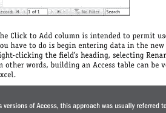

“单击以添加”列旨在允许用户快速向表中添加字段。您只需在新列中输入数据即可。通过右键单击字段标题，选择“重命名字段”，然后输入字段名称，即可为字段命名。换句话说，构建 Access 表可以非常类似于在 Excel 中创建电子表格。

> 注意
> 在早期版本的 Access 中，这种方法通常被称为“在数据表视图中创建表”。

添加新列后，功能区“字段”选项卡上的工具（如图 3.3 所示）允许您设置字段的特定数据类型，以及其格式、验证规则和其他属性。

## 第二部分：理解 Access 表

在本练习中，您将为 Collectible Mini Cars 应用程序创建 Customers 表。该表的基本设计如表 3.1 所示。我们将在本章后面的“创建 tblCustomers”部分详细介绍该表的设计细节。

### 表 3.1 Collectible Mini Cars 客户表

| 字段名 | 数据类型 | 说明 |
|---|---|---|
| CustomerID | 自动编号 | 主键 |
| Company | 短文本 | 联系人的雇主或其他关联单位 |
| Address | 短文本 | 联系人的地址 |
| City | 短文本 | 联系人所在城市 |
| State | 短文本 | 联系人所在州/省 |
| zipcode | 短文本 | 联系人的邮政编码 |
| Phone | 短文本 | 联系人的电话 |
| Fax | 短文本 | 联系人的传真 |
| Email | 短文本 | 联系人的电子邮件地址 |
| WebSite | 短文本 | 联系人的网址 |
| OrigCustomerDate | 日期/时间 | 联系人首次从 Collectible Mini Cars 购买商品的日期 |
| CreditLimit | 货币 | 客户的信用额度（美元） |
| CurrentBalance | 货币 | 客户的当前余额（美元） |
| CreditStatus | 短文本 | 客户信用状况的描述 |
| LastSalesDate | 日期/时间 | 客户最近一次从 Collectible Mini Cars 购买商品的日期 |
| TaxRate | 数字（双精度） | 适用于客户的销售税率 |
| DiscountPercent | 数字（双精度） | 提供给客户的惯常折扣 |
| Notes | 长文本 | 有关此客户的备注和观察记录 |
| Active | 是/否 | 客户是否仍在与 Collectible Mini Cars 进行买卖交易 |

上表中的短文本字段使用默认的 255 个字符的字段大小。虽然不太可能有人名字会占用 255 个字符，但为很长的名称提供空间并无坏处。Access 仅存储实际输入到文本字段中的字符数。因此，分配 255 个字符并不会为数据库中的每个名称实际使用 255 个字符。

再次查看图 3.4，您会看到表设计窗口由两个区域组成：

- **字段输入区域：** 使用窗口顶部的字段输入区域输入每个字段的名称和数据类型。您还可以输入可选的说明。
- **字段属性区域：** 窗口底部的区域用于指定字段的属性。这些属性包括字段大小、格式、输入掩码和默认值等。属性区域中实际显示的属性取决于字段的数据类型。您将在本章后面的“分配字段属性”部分中了解更多关于这些属性的信息。


### 使用“设计”选项卡

Access 功能区的“设计”选项卡（如图 3.5 所示）包含许多有助于创建新表定义的控件。

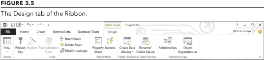

“设计”选项卡上的控件会影响重要的表设计考量。以下各节仅描述了图 3.5 中所示的部分控件。您将在本章后面的“创建 tblCustomers”部分以及本书后续章节中了解更多关于其他按钮的信息。

### 主键

单击此按钮可指定表中要用作表主键的字段。传统上，主键出现在表字段列表的顶部，但它可以出现在表设计中的任何位置。主键将在本章后面的“设置主键”部分中详细讨论。


### 插入行

虽然这对数据库引擎来说影响不大，但许多开发人员对表中字段的顺序非常讲究。Access 中的许多向导会按照与表相同的顺序显示字段。例如，将地址字段保持在城市字段上方，可以使开发更容易。

由多个字段组合成单个键的复合键将在第 4 章中详细讨论。

单击“插入行”按钮会在鼠标光标所在位置的上方插入一个空白行。例如，如果光标当前位于表设计器的第二行，单击“插入行”按钮会在第二个位置插入一个空行，将现有的第二行移动到第三个位置。

### 删除行

单击“删除行”按钮会从表设计中删除一行。

> 警告
> Access 在删除行之前不会要求您确认删除操作。

### 属性表

单击“属性表”按钮会打开整个表的属性表（如图 3.6 所示）。这些属性使您能够指定重要的表特征，例如适用于整个表的验证规则，或表的备选排序顺序。

### 图 3.6

属性表。


### 索引

索引将在本章后面的“为 Access 表建立索引”部分中详细讨论。单击“索引”按钮会打开“索引”对话框，使您能够指定表中字段的索引详细信息。

### 处理字段

您可以通过在表设计窗口上部的字段输入区域中输入字段名称和字段数据类型来创建字段。（可选的）“说明”属性可用于指示字段的用途。在数据输入期间，说明会显示在屏幕底部的状态栏中，可能对使用该应用程序的人员有所帮助。输入每个字段的名称和数据类型后，您可以通过在字段属性区域中输入属性来进一步指定每个字段的使用方式。

### 命名字段

字段名称应具有足够的描述性，以便您作为开发人员、系统用户以及 Access 都能识别该字段。字段名称应足够长，以便快速识别字段的用途，但也不宜过长。（稍后，当您输入验证规则或在计算中使用字段名称时，您会希望避免输入冗长的字段名称。）

要输入字段名称，请将指针定位在表设计窗口第一行的“字段名称”列下。然后输入有效的字段名称，并遵守以下规则：

- 字段名称的长度可以是 1 到 64 个字符。
- 字段名称可以包含字母、数字和特殊字符，但句点（.）、感叹号（!）、重音符（`）和方括号（[]）除外。
- 字段名称可以包含空格。应避免在字段名称中使用空格，原因与避免在表名称中使用空格相同。
- 不能使用低序 ASCII 字符——例如 Ctrl+J 或 Ctrl+L（ASCII 值 0 到 31）。
- 不能以空格开头。

您可以输入大写、小写或混合大小写的字段名称。如果在键入字段名称时出错，请将光标定位到要更正的位置并键入更改。您可以随时更改字段名称，即使表中包含数据也是如此。

### 注意

> Access 不区分大小写，因此数据库本身不关心您将表命名为 tblCustomers 还是 TblCustomers。选择大写、小写还是混合大小写字符完全由您决定，并且应旨在使您的表名称具有描述性且易于阅读。


> 注意
> 保存表后，如果更改了同时用于查询、窗体或报表中的字段名称，也必须在这些对象中进行相应更改。Access 应用程序中错误的主要原因之一，就是更改了表和字段等基本数据库对象的名称，却忽略了在整个数据库中进行所有必要的修改。在窗体或报表控件的控件来源中，或者应用程序某处深度嵌入的 VBA 代码中遗漏字段名称引用，是非常容易发生的。

## 指定数据类型

输入字段时，还必须确定每个字段将存储哪种类型的数据。在 Access 中，可以从多种数据类型中进行选择。可用的数据类型如表 3.2 所示。

### 表 3.2 Microsoft Access 中可用的数据类型

| 数据类型 | 存储的数据类型 | 存储大小 |
|---|---|---|
| 短文本 | 字母数字字符 | 255 个字符或更少 |
| 长文本 | 字母数字字符 | 1GB 字符或更少 |
| 数字 | 数值 | 1、2、4 或 8 字节；复制 ID (GUID) 为 16 字节 |
| 大数字 | 数值 | 8 字节 |
| 日期/时间 | 日期和时间数据 | 8 字节 |
| 货币 | 货币数据 | 8 字节 |
| 自动编号 | 自动递增的数字 | 4 字节；复制 ID (GUID) 为 16 字节 |
| 是/否 | 逻辑值：是/否、True/False | 1 位（0 或 -1） |
| OLE 对象 | 图片、图表、声音、视频 | 最大 1GB（受磁盘空间限制） |
| 超链接 | 指向 Internet 资源的链接 | 1GB 字符或更少 |
| 附件 | 一种特殊字段，使你能够将外部文件附加到 Access 数据库 | 根据附件而异 |
| 计算 | 根据表中其他字段存储计算结果的字段 | 由“结果类型”属性的设置决定 |
| 查阅向导 | 显示另一个表中的数据 | 通常为 4 字节 |

图 3.7 显示了用于选择刚创建字段数据类型的“数据类型”下拉列表。

### 图 3.7

“数据类型”下拉列表。

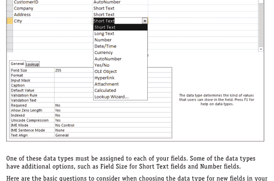

每个字段都必须分配上述数据类型之一。某些数据类型还具有其他选项，例如“短文本”字段和“数字”字段的“字段大小”。

为表中的新字段选择数据类型时，需要考虑以下基本问题：

- **什么是数据类型？** 数据类型应反映字段中存储的数据。例如，要存储数量和价格等数字，应选择一种数字数据类型。但是，不要将电话号码或社会安全号码等数据存储在数字字段中；应用程序不会对电话号码执行加法或乘法等数值运算。相反，应对社会安全号码和电话号码等常见数据使用文本字段。

> 注意
> 数字字段从不存储前导零。将类似 02173 的邮政编码放入数字字段，实际存储的只有最后四位数字（2173）。

- **所选数据类型的存储要求是什么？** 尽管可以使用字段大小为“长整型”的“数字”数据类型来代替“整型”或“字节型”，但长整型（4 字节）的存储要求是整型的两倍。这意味着使用和操作该数字所需的内存是原来的两倍，存储其值所需的磁盘空间也是原来的两倍。应使用能够容纳该字段未来可能出现的最大值的最小数据类型/字段大小。

## 第二部分：了解 Access 表

- 是否需要对该字段进行排序或建立索引？由于其二进制性质，长文本字段和 OLE 对象字段不能排序或建立索引。应谨慎使用长文本字段。存储和处理长文本字段所需的额外开销相当大。

- 数据类型对排序要求有何影响？数字数据的排序方式不同于文本数据。使用数字数据类型时，一系列数字会按照预期顺序排序：1、2、3、4、5、10、100。以文本数据存储的同一系列数字则会按以下方式排序：1、10、100、2、3、4、5。如果必须按照数字顺序对文本数据进行排序，就必须先对数据应用转换函数，然后再排序。

提示  
如果文本数据表示的是数字，并且必须按正确顺序排序，可以考虑在数字前补零（001、002 等）。这样，文本值就会按预期顺序排序：001、002、003、004、005、010、100。

- 数据是文本还是日期数据？处理日期时，通常最好将数据存储在日期/时间字段中，而不是短文本字段中。文本值的排序方式不同于日期（日期在内部以数值形式存储），这可能会影响依赖时间先后顺序的报表和其他输出。

新功能  
Access 2019 新增了“大数字”数据类型。它的主要用途是支持与使用该数据类型的其他数据库（例如 SQL Server）的兼容性。如果使用“大数字”，数据库将无法与旧版本的 Access 兼容。只有在有明确理由的情况下，才应使用“大数字”。

不要将日期存储在一个日期/时间字段中，而将时间存储在另一个日期/时间字段中。日期/时间字段专门用于同时处理日期和时间，而且正如本书后文将会看到的，只显示日期/时间值中的日期部分或时间部分非常容易。

日期/时间字段还用于存储一个确定的日期和时间，而不是时间间隔。如果记录持续时间很重要，可以使用两个日期/时间字段——一个记录持续时间的开始时间，另一个记录结束时间；也可以使用一个长整型字段存储经过的秒数、分钟数、小时数等。

- 需要哪些报表？在报表中无法对长文本数据或 OLE 数据进行排序或分组。如果必须基于长文本数据或 OLE 数据制作报表，请向表中添加一个标签字段，例如日期或序列号，用作排序键。

### 表 3.3 数字字段设置

| 字段大小设置 | 范围 | 小数位数 | 存储大小 |
|---|---|---|---|
| 字节型 | 0 到 255 | 无 | 1 字节 |
| 整型 | -32,768 到 32,767 | 无 | 2 字节 |
| 长整型 | -2,147,483,648 到 2,147,483,647 | 无 | 4 字节 |
| 单精度型 | -3.4 × 10^38 到 3.4 × 10^38 | 7 | 4 字节 |
| 双精度型 | -1.797 × 10^308 到 1.797 × 10^308 | 15 | 8 字节 |
| 复制 ID | 不适用 | 不适用 | 16 字节 |
| 小数型 | -9.999 × 10^27 到 9.999 × 10^27 | 15 | 12 字节 |

> 注意
> 许多错误都是由于为数字字段选择了错误的数字类型造成的。例如，请注意，整型数据类型的最大值是 32,767。我们曾见过一个数据库，多年来运行一直非常正常，后来却开始因溢出错误而崩溃。结果发现，溢出是因为某个字段被设置为整型数据类型，而公司偶尔处理非常大的订单时，超过了 32,767 的最大值。
>
> 请注意，仅仅将两个数字相加，或执行任何会产生过大结果、导致字段无法存储该值的数学运算，都可能发生溢出。某些最难排查的错误，只有在运行时某些情况（例如两个数字相加或相乘）导致溢出时才会出现。
>
> 设计表时应非常保守，为数据库预留比预期最大值更大的范围。这并不意味着为所有数字字段使用双精度型就是一个好主意。双精度型非常大（8 字节），用于计算或其他数值运算时可能会稍慢。相反，对于大多数浮点计算，单精度型可能是最佳选择；而在小数点无关紧要的情况下，长整型是一个不错的选择。

## 大数字

大数字数据类型可存储从 -2^63 到 2^63-1 的值。这些数字大于大多数人的实际需求。该类型被添加到 Access 中，主要是为了与使用此数据类型的其他数据库兼容，尤其是 SQL Server。

如果使用“大数字”，请注意，2019 之前的某些 Access 版本不支持此数据类型。如果要链接到或从使用此数据类型的数据库导入数据，请在 Access 选项的“当前数据库”选项卡中选中“支持链接表/导入表的大数字 (BigInt) 数据类型”复选框。

## 日期/时间

日期/时间数据类型是一种专用数字字段，用于存储日期或时间（或日期和时间）。将日期存储在日期/时间字段中后，就可以轻松计算日期之间的天数


日期及其他日历操作。存储在日期/时间字段中的日期数据同样可以正确排序和筛选。日期/时间数据类型可存储从100年1月1日到9999年12月31日的日期。

## 货币

货币数据类型是另一种专门的数字字段。货币数字在计算过程中不会四舍五入，并保留小数点左侧15位精度和小数点右侧4位精度。由于货币字段使用固定的小数点位置，因此在进行数值计算时比双精度浮点数更快。

## 自动编号

自动编号字段是另一种专门的数字数据类型。当向表中添加自动编号字段时，Access会自动为该字段分配一个长整型（32位）值（从1开始），并在每次向表中添加记录时递增该值。或者（由“新值”属性决定），自动编号字段的值是一个随机整数，会自动插入到新记录中。

一个表中只能出现一个自动编号字段。一旦分配给记录，自动编号字段的值就不能通过编程方式或由用户更改。自动编号字段以长整型数据类型存储，占用4个字节。自动编号字段最多可容纳4,294,967,296个唯一数字——对于大多数表的主键来说绰绰有余。

> 注意
> 自动编号字段不保证生成连续、不间断的序列号。例如，如果添加新记录的过程被中断（例如用户在输入新记录数据时按了Esc键），自动编号字段将“跳过”一个数字。自动编号字段不应被用来提供连续的序列号。相反，可以通过数据宏（数据宏在第22章中解释）或VBA代码轻松地向表中添加连续数字。

> 提示
> 当您在两个表之间创建关系，并且该关系中的字段之一是自动编号字段时，另一个字段应设置为长整型数据类型，以防止溢出错误。在表之间创建关系在第4章中解释。

## 是/否

是/否字段仅接受两个可能值之一。内部存储为-1（是）或0（否），是/否字段用于指示是/否、开/关或真/假。是/否字段占用单个位的存储空间。

## OLE对象

OLE对象字段存储OLE数据，即高度专门的二进制对象，如Word文档、Excel电子表格、声音或视频剪辑以及图像。OLE对象由Windows识别为OLE服务器的应用程序创建，并且可以链接到父应用程序或嵌入到Access表中。OLE对象只能在Access窗体和报表中的绑定对象框中显示。OLE字段不能被索引。

## 第二部分：理解Access表

*超链接*

超链接数据类型字段存储文本和数字的组合，以文本形式存储并用作超链接地址。它可以包含最多四个部分：

- 控件中显示的文本（通常格式化为看起来像可点击的链接）。
- 地址——文件或网页的路径。
- 文件或页面中的任何子地址。子地址的一个示例是网页上的图片。超链接地址的每个部分由井号（#）分隔。
- 当用户将鼠标悬停在链接上时，屏幕提示中显示的文本。

Access超链接甚至可以指向其他Access数据库中的窗体和报表。这意味着您可以使用超链接打开外部Access数据库中的窗体或报表，并在用户的计算机上显示该窗体或报表。

*附件*

附件数据类型是在Access 2007中引入的。事实上，附件数据类型是Microsoft更改Access数据文件格式的原因之一。较旧的MDB格式无法容纳附件。

与其他类型的Access字段相比，附件数据类型相对复杂，并且在Access窗体上显示时需要一种特殊类型的控件。有关这种有趣字段类型的详细信息，请参阅本章后面的“理解附件字段”。

*计算*

计算字段保存一个表达式，该表达式可以包含数字、文本、同一表中的字段以及Access函数。它不能引用其他表中的字段。“计算”不是一种数据类型，尽管Access将其包含在数据类型列表中。它有一个ResultType属性，用于确定该字段保存的数据类型。

如果您发现自己反复在查询中执行相同的计算，则可以使用计算字段。例如，如果您有一个“应税金额”字段和一个“销售税率”字段，您可以创建一个“销售税额”字段，将两者相乘。

使用此字段非常接近违反第三范式（有关数据规范化的信息，请参阅第4章）。该字段实际上存储的是公式，而不是计算值。但这正是查询的用途，您可能会发现将数据保存在表中并将计算放在查询中是组织应用程序的好方法。

## 使用自动编号字段

Access对自动编号字段给予了特殊考虑。如果表中已添加了任何数据，则无法将先前定义的字段从其他类型更改为自动编号。如果您尝试将现有字段更改为自动编号，您将看到如下错误：

> 一旦您在表中输入数据，就无法将任何字段的数据类型更改为自动编号，即使您尚未向该字段添加数据。

您必须添加一个新的自动编号字段并开始使用它，而不是将现有字段更改为自动编号。

> **注意**
> 一个Access表中只能添加一个自动编号字段。一般来说，最好在应用程序需要其特殊特性的地方使用自动编号字段。

## 完成tblCustomers

在Design视图中打开tblCustomers后，您就可以完成其设计了。本章前面显示的表格3.1列出了tblCustomers的字段定义。按照表格3.1所示输入字段名称和数据类型。接下来的几页将解释如何更改现有字段（包括重新排列字段顺序、更改字段名称和删除字段）。

以下是向表结构中添加字段的步骤：

- 1. 将光标放在您希望字段出现的行的“字段名称”列中。
- 2. 输入字段名称，然后按Enter或Tab键移动到“数据类型”列。
- 3. 从“数据类型”列的下拉列表中选择字段的数据类型。
- 4. 如果需要，在“说明”列中为字段添加说明。

重复这些步骤中的每一个，为tblCustomers创建每个数据输入字段。您可以按向下箭头（↓）键在行之间移动，或使用鼠标单击任何行。按F6键可在“表设计”窗口的顶部和底部之间切换焦点，反之亦然。

## 更改表设计

即使设计得最好的表也可能需要不时更改。您可能会发现想要添加另一个字段、删除字段、更改字段名称或数据类型，或者只是重新排列字段名称的顺序。

尽管可以随时更改表的设计，但必须特别考虑包含数据的表。请注意不要进行会损坏表中数据的更改，例如缩小文本字段或更改数字字段的“字段大小”属性。您

始终可以毫无问题地向表中添加新字段，但更改现有字段可能会成为问题。而且，除了极少数例外，在表已在应用程序中使用后更改字段名称几乎总是一个坏主意。

## 插入新字段

要插入新字段，请在“表设计”窗口中，将光标放在现有字段上，右键单击表设计面上的字段，然后选择“插入行”，或者只需单击功能区“设计”选项卡上的“插入行”按钮。表中将添加一个新行，现有字段将向下移动。然后，您可以输入新的字段定义。插入字段不会干扰其他字段或现有数据。如果您有使用该表的查询、窗体或报表，您可能还需要将这些字段添加到这些对象中。

## 删除字段

有三种方法可以删除字段。当表处于Design视图时：

- 通过单击行选择器选择字段，然后按Delete键。
- 右键单击选定的字段，然后从快捷菜单中选择“删除行”。
- 选择字段，然后从功能区“设计”选项卡的“工具”组中单击“删除行”按钮。

当您删除包含数据的字段时，您将看到一个警告，提示您将丢失表中该选定字段的数据。如果表包含数据，请确保您确实要删除该字段（列）的数据。您还必须从使用该字段名称的查询、窗体、报表、宏和VBA代码中删除相同的字段。

> 提示
> 如果您尝试删除属于关系一部分的字段（主键或辅键字段），Access会通知您，在“关系”窗口中移除该关系之前，无法删除该字段。
> 表关系和“关系”窗口将在第4章中讨论。

如果删除字段，还必须修复整个Access中对该字段的所有引用。因为您可以在窗体、查询、报表甚至表数据验证中使用字段名称，所以必须仔细检查您的系统，以找到您可能使用了特定字段名称的任何实例。

## 更改字段位置

在表的Design视图中输入的字段顺序决定了表在Datasheet视图中从左到右的列顺序。如果您决定重新排列字段，请单击字段选择器，并使用鼠标将字段拖到新位置。

## 更改字段名称

您可以通过在“表设计”窗口中选择字段名称并输入新名称来更改字段名称。Access会自动更新表设计。只要您


创建新表时，这个过程很简单。对于应用程序中其他位置引用的现有表，更改字段名称可能会引发问题，正如本章前面“设计表”部分所述。

## 更改字段大小

在表设计中，增大字段大小很简单。对于文本字段，只需增加“字段大小”属性；对于数字字段，则指定不同的字段大小。必须注意数字字段中的“小数位数”属性，确保所选的新大小支持的小数位数不少于当前设置。

> 注意
> 当需要减小字段大小时，请确保表中的所有数据都不超过新的字段宽度。选择较小的字段大小可能会导致数据丢失。

> 提示
> 请记住，每个文本字段只占用实际输入的字符数。不过，仍应尽量将字段设置为与最大值一样大，以便 Access 阻止用户输入可能无法在窗体或报表中完整显示的值。

## 处理数据转换问题

如果尽管做了最大努力，仍必须更改包含数据的字段的数据类型，那么在数据类型转换过程中可能会发生数据丢失。应了解数据类型转换对现有数据的影响：

- **任何数据类型转换为自动编号：**无法完成。必须在新字段中重新创建“自动编号”字段类型。
- **短文本转换为数字、货币、日期/时间或是/否：**在大多数情况下，转换可以在不损坏数据的情况下完成。不合适的值会被自动删除。例如，包含“January 28, 2018”的短文本字段可以准确转换为日期/时间字段。但是，如果将包含“January 28, 2018”的字段更改为是/否数据类型，其值将被删除。
- **长文本转换为短文本：**这是直接的转换，不会损坏数据。任何超出短文本字段指定大小的文本都会被截断并丢失。
- **数字或大整数转换为短文本：**不会丢失信息。数字值会使用“常规数字”格式转换为文本。
- **数字或大整数转换为货币：**由于货币数据类型使用固定的小数点，数字被截断时可能会丢失部分精度。
- **日期/时间转换为短文本：**不会丢失信息。日期和时间数据会使用“常规日期”格式转换为文本。
- **货币转换为短文本：**不会丢失信息。货币值会在不包含货币符号的情况下转换为文本。
- **货币转换为数字：**简单直接的转换。货币值转换以适应新的数字字段时，可能会丢失部分数据。例如，将货币转换为长整数时，小数部分会被截断（去除）。
- **自动编号转换为短文本：**转换过程中不会丢失数据，除非文本字段的宽度不足以容纳完整的自动编号值。在这种情况下，数字会被截断。
- **自动编号转换为数字：**简单直接的转换。自动编号值转换以适应新的数字字段时，可能会丢失部分数据。例如，大于 32,767 的自动编号转换为整数型字段时会被截断。
- **是/否转换为短文本：**将是/否值简单转换为文本。不会丢失信息。

> 注意
> OLE 对象数据类型无法转换为任何其他数据类型。

## 设置字段属性

Access 表中内置的字段属性是强大的工具，可以帮助你管理表中的数据。在大多数情况下，字段属性由数据库引擎强制执行，这意味着无论字段值在哪里使用，该属性都会保持一致。例如，如果你在表设计中设置了“默认值”属性，那么在表的“数据表”视图、窗体和查询中都可以使用该默认值。

事实上，字段属性是 Access 表与 Excel 工作表之间众多差异之一。了解字段属性只是开始使用 Access 表存储数据，而不是使用 Excel 工作表所需掌握的多项技能之一。

每种字段数据类型都有自己的一组属性。例如，数字字段具有“小数位数”属性，短文本字段具有“文本对齐”属性。尽管许多数据类型共享若干常见属性（例如“标题”），但字段属性之间仍存在足够多的差异，很容易造成混淆或错误使用。以下各节将讨论一些较为重要且常用的字段属性。

> 注意
> 以下各节会多次引用 Access 表设计器中的属性及属性设置。属性的正式名称（例如 `DefaultValue`）从不包含空格，而表设计器中显示的属性通常为了便于阅读而包含空格（“Default Value”）。在表达式、VBA 代码和宏中引用属性时，这些相对细微的差异就变得十分重要。在代码或宏中正式引用属性时，始终使用不带空格的属性名称，而不要使用 Access 用户界面中看到的属性引用形式。

## 常用属性

以下是所有常规属性的列表（请注意，根据所选数据类型的不同，可能不会显示全部属性）：

- **字段大小：**应用于短文本字段时，将字段大小限制为指定的字符数（1–255）。默认值为 255。
- **新值：**适用于自动编号字段。允许指定“递增”或“随机”类型。
- **格式：**更改输入数据后的显示方式（大写、日期等）。Access 数据可以应用许多不同类型的格式。其中许多差异将在本章后面的“格式”部分进行说明。
- **输入掩码：**用于按照预定义格式输入数据（电话号码、邮政编码、社会保障号码、日期、客户 ID）。适用于数字和文本数据类型。
- **小数位数：**指定货币、数字和大整数数据类型的小数位数。
- **标题：**可选标签，用于替代字段名称。Access 在数据表中或窗体、报表上显示控件时，会使用“标题”属性。
- **默认值：**向字段中输入新数据时自动提供的值。该值可以是适合字段数据类型的任何值。默认值只不过是初始值；输入数据时可以更改它。若要指定默认值，只需在“默认值”属性设置中输入所需的值。默认值可以是表达式，也可以是数字或文本字符串。

> 注意
> 由于数字和货币数据类型的“默认值”默认设置为 0，因此添加新记录时，这些字段会自动设置为 0。在许多情况下，例如医学检测结果和许多财务应用中，0 并不是数字字段的合适默认值。请务必确认在 Access 应用程序中，0 是否是合适的默认值。

- **验证规则：**确保输入字段的数据符合某些业务规则，例如“大于零”“日期必须晚于 2000 年 1 月 1 日”等。
- **验证文本：**数据未通过验证时显示的消息。
- **必填：**指定是否必须向字段中输入值。
- **允许零长度：**确定是否可以在短文本或长文本字段中输入空字符串（`""`），以便将其与 Null 值区分开来。
- **索引：**加快数据访问，并可（根据需要）将数据限制为唯一值。有关索引的详细说明将在本章后面介绍。
- **Unicode 压缩：**用于多语言应用程序。需要大约两倍的数据存储空间，但可以启用 Office 文档（包括 Access 报表）以


displayed correctly no matter what language or symbols are used. Generally speaking, Unicode is of no value unless the application is likely to be used in Asian environments.

- **IME Mode:** Also known as the Kanji conversion mode property, this is used to show whether the Kanji mode is maintained when the control is lost. The setting has no relevance in English or European-language applications.

- **IME Sentence Mode:** Used to determine the Sequence mode of fields of a table or controls of a form that switch when the focus moves in or out of the field. The setting has no relevance in English or European-language applications.

## Format

The Format property specifies how the data contained in table fields appears whenever the data is displayed or printed. When set at the table level, the format is in effect throughout the application. There are different format options for each data type.

Access provides built-in format options for most field data types. The exact format used to display field values is influenced by the Region and Language settings in Windows Settings.

The Format property affects only the way a value is displayed and not the value itself or how the value is stored in the database.

If you elect to build a custom format, construct a string in the field’s Format property box. There are a number of different symbols you use for each data type. Access provides global format specifications to use in any custom format:

- **(space):** Displays spaces as characters.
- **"SomeText":** Displays the text between the quotes as literal text.
- **! (exclamation point):** Left-aligns the display.
- **\* (asterisk):** Fills empty space with the next character.
- **\ (backslash):** Displays the next character as literal text. Use the backslash to display characters that otherwise have special meaning to Access.
- **[color]:** Displays the output in the color (black, blue, green, cyan, red, magenta, yellow, or white) indicated between the brackets.

The Format property takes precedence when both a format and an input mask have been defined.

## Number and Currency field formats

There is a wide variety of valid formats for Number and Currency fields. You can use one of the built-in formats or construct a custom format of your own:

- **General Number:** The number is displayed in the format in which it was entered. (This is the default format for numeric data fields.)
- **Currency:** Add a thousands separator (usually a comma), add a decimal point with two digits to the right of the decimal, and enclose negative numbers in

- **E- or e-:** Uses scientific notation to display the number. Uses a minus sign to indicate a negative exponent and no sign for positive exponents.
- **E+ or e+:** Uses scientific notation to display the number. Uses a plus sign to indicate a positive exponent.

You create custom formats by composing a string made up of one to four sections separated by semicolons. Each section has a different meaning to Access:

- **First section:** The format for positive values
- **Second section:** The format for negative values
- **Third section:** The format for zero values
- **Fourth section:** The format for null values

Each section is a combination of a numeric formatting string and an optional color specification. Here’s an example of a custom format:

```
`0,000.00[Green];(0,000.00)[Red];"Zero";"—"`
```

This format specifies showing the number with zeros in all unused positions, using the comma thousands separator, enclosing negative numbers in parentheses, using "Zero" to indicate zero values, and using a dash for null values.

## Built-in Date/Time formats

The following are the built-in Date/Time formats. Note that these examples are based on the “English (United States)” Region and Language settings in Windows Settings.

- **General Date:** If the value contains a date only, don’t display a time value, and vice versa. Dates are displayed in the built-in Short Date format (m/d/yyyy), while time data is displayed in the Long Time format.
- **Long Date:** Thursday, November 12, 2015
- **Medium Date:** 12-Nov-15
- **Short Date:** 11/12/2015
- **Long Time:** 5:34:23 PM
- **Medium Time:** 5:34 PM
- **Short Time:** 17:34

Date and time formats are influenced by the Region and Language settings in Windows Settings.

## Custom Date/Time formats

Custom formats are created by constructing a specification string containing the following symbols:

- **:** (colon): Separates time elements (hours, minutes, seconds)
- **/** (forward slash): Separates date elements (days, months, years)
- **c:** Instructs Access to use the built-in General Date format
- **d:** Displays the day of the month as one or two digits (1-31)
- **dd:** Displays the day of the month using two digits (01-31)
- **ddd:** Displays the day of the week as a three-character abbreviation (Sun, Mon, Tue, Wed, Thu, Fri, Sat)
- **dddd:** Uses the full name of the day of the week (Sunday, Monday, Tuesday, Wednesday, Thursday, Friday, Saturday)
- **ddddd:** Uses the built-in Short Date format
- **dddddd:** Uses the built-in Long Date format
- **w:** Uses a number to indicate the day of the week
- **ww:** Shows the week of the year
- **m:** Displays the month of the year using one or two digits
- **mm:** Displays the month of the year using two digits (with a leading zero if necessary)
- **mmm:** Displays the month as a three-character abbreviation (Jan, Feb, Mar, Apr, May, Jun, Jul, Aug, Sep, Oct, Nov, Dec)
- **mmmm:** Displays the full name of the month (for example, January)
- **q:** Displays the date as the quarter of the year
- **y:** Displays the day of the year (1 through 366)
- **yy:** Displays the year as two digits (for example, 15)
- **yyyy:** Displays the year as four digits (2015)
- **h:** Displays the hour using one or two digits (0-23)
- **hh:** Displays the hour using two digits (00-23)
- **n:** Displays the minutes using one or two digits (0-59)
- **nn:** Displays the minutes using two digits (00-59)
- **s:** Displays the seconds using one or two digits (0-59)
- **ss:** Displays the seconds using two digits (00-59)
- **tttt:** Uses the built-in Long Time format
- **AM/PM:** Uses a 12-hour format with uppercase AM or PM
- **am/pm:** Uses a 12-hour format with lowercase am or pm
- **A/P:** Uses a 12-hour format with uppercase A or P
- **a/p:** Uses a 12-hour format with lowercase a or p

## Short Text and Long Text field formats

When applied to Short Text fields, formats help clarify the data contained within the fields. tblCustomers uses several formats. The State text field has a > in the Format property to display the data entry in uppercase. The Active field has a Yes/No format with lookup Display Control property set to Text Box.

Short Text and Long Text fields are displayed as plain text by default. If a particular format is to be applied to Short Text or Long Text field data, use the following symbols to construct the format:

- **@:** A character or space is required.
- **&:** A character is optional (not required).
- **<:** Force all characters to their lowercase equivalents.
- **>:** Force all characters to their uppercase equivalents.

The custom format may contain as many as three different sections, separated by semicolons:

- **First section:** Format for fields containing text
- **Second section:** Format for fields containing zero-length strings
- **Third section:** Format for fields containing null values

If only two sections are given, the second section applies to both zero-length strings and null values. For example, the following format displays None when no string data is contained in the field and Unknown when a null value exists in the field. Otherwise, the simple text contained in the field is displayed:

```
@;"None","Unknown"
```

Several examples of custom text formats using the “English (United States)” Regional & Language Settings in Windows Settings are presented in Table 3.5.

## TABLE 3.5 Format Examples

| Format Specified | Data as Entered | Formatted Data as Displayed |
|---|---|---|
| > | Adam Smith | ADAM SMITH |
| < | Adam Smith | adam smith |
| @@-@@ | Adam | Ad-am |
| &-@@ | Ad | -Ad |
| @;"Empty" | "" | Empty |
| @;"Empty" | Null | Empty |

## Yes/No field formats

A Yes/No field displays Yes, No, True, False, On, or Off, depending on the value stored in the field and the setting of the Format property for the field. Access predefines these rather obvious format specifications for the Yes/No field type:

- **Yes/No:** Displays Yes or No
- **True/False:** Displays True or False
- **On/Off:** Displays On or Off


是的，True 和 On 表示相同的“肯定”值，而 No、False 和 Off 表示相反的（“否定”）值。

Access 以不同于你预期的方式存储 Yes/No 数据。Yes 数据存储为 -1，而 No 数据存储为 0。你可能会期望它存储为 No 为 0、Yes 为 1，但事实并非如此。在没有格式设置的情况下，Access 将显示 -1 或 0，并且将以这种方式存储和显示。

无论设置何种格式，你都可以使用内置格式中的任何单词或作为数字输入 Yes/No 字段中的数据。要输入 No，你可以输入 False、No、Off 或 0。要输入 Yes，你可以输入 True、Yes、On，或除零以外的任何数字。如果你输入除 0 或 -1 以外的数字，Access 会将其转换为 -1。

你也可以为 Yes/No 字段指定自定义格式。例如，假设你有一个表，其中有一个字段表示员工是否参加了 orientation 会议。虽然 yes 或 no 的答案是合适的，但你可能希望对字段的显示做得更精致一些。默认情况下，使用复选框来指示 Yes/No 字段的值（选中表示 Yes）。要自定义 Yes/No 字段的外观，请根据以下模式设置其 Format 属性：

```
;"Text for Yes values";"Text for No values"
```

注意此字符串开头的占位符分号。另请注意，每个文本元素都必须用引号括起来。在员工表的情况下，你可能会使用以下 Format 属性说明符：

```
;"Attendance OK";"Must attend orientation"
```

你还必须将 Yes/No 字段的 Display Control 属性设置为 Text Box，以便将默认的复选框显示更改为文本。

## Hyperlink field format

Access 也以不同于你预期的方式显示和存储超链接数据。此类型的格式由最多四个部分组成，用井号（#）分隔：

- ■ Display Text: 字段或控件中显示为超链接的文本
- ■ Address: 文件（UNC）或互联网上的页面（URL）的路径
- ■ Sub-Address: 文件或页面内的特定位置
- ■ ScreenTip: 用户将鼠标悬停在链接上时显示的文本

Display Text 属性是字段或控件中可见的文本，而地址和子地址是隐藏的。在以下示例中，“Microsoft MSN Home Page”是显示的文本，而 http://www.msn.com 是超链接的地址。

```
Microsoft MSN Home Page#http://www.msn.com
```

## Input Mask

Input Mask 属性使用户更容易以正确的格式输入数据。输入掩码限制用户向应用程序输入数据的方式。例如，你可以限制电话号码、社会安全号码和员工 ID 的输入仅为数字。社会安全号码的输入掩码可能如下所示 "000-00-0000。" 此掩码要求在每个空格中输入，限制仅输入数字，并且不允许字符或空格。

字段的输入掩码应用于字段出现的任何位置（查询、窗体、报表）。

Input Mask 属性值是一个字符串，包含最多三个用分号分隔的部分：

- - **First section:** 包含掩码本身，由后面显示的符号组成。
- - **Second section:** 告诉 Access 是否将掩码中包含的文字字符与剩余数据一起存储。例如，掩码可能包含用于分隔社会安全号码各部分的破折号，而电话号码可能包含括号和破折号。使用零告诉 Access 将文字字符作为数据的一部分存储，而 1 告诉 Access 仅存储数据本身。
- - **Third section:** 定义“占位符”字符，告诉用户输入区域预期有多少个字符。许多输入掩码使用井号（#）或星号（*）作为占位符。

以下字符用于组成输入掩码字符串：

- - **0:** 必须为数字，不允许加号（+）和减号（-）符号。
- - **9:** 数字是可选的，不允许加号（+）和减号（-）符号。
- - **#:** 可选数字或空格。保存数据到表时空格将被删除。允许加号和减号。
- - **L:** 必须为 A 到 Z 的字母。
- - **?:** A 到 Z 的字母是可选的。
- - **A:** 必须为字符或数字。
- - **a:** 字符或数字是可选的。
- - **&:** 允许任何字符或空格（必需）。
- - **C:** 允许任何字符或空格（可选）。
- - **. (period):** 小数占位符。
- - **, (comma):** 千位分隔符。
- - **: (colon):** 日期和时间分隔符。
- - **; (semicolon):** 分隔符字符。
- - **– (dash):** 分隔符字符。
- - **/ (forward slash):** 分隔符字符。
- - **< (less-than sign):** 将所有字符转换为小写。
- - **> (greater-than sign):** 将所有字符转换为大写。
- - **! (exclamation point):** 从右到左显示输入掩码。字符从右到左填充掩码。
- - **\ (backslash):** 将下一个字符显示为文字。

在查询或窗体的属性表中对字段使用相同的掩码字符。

## Part II: Understanding Access Tables

导入数据或通过操作查询向表添加数据时，输入掩码将被忽略。

输入掩码会被分配给字段的 Format 属性覆盖。在这种情况下，输入掩码仅在输入数据时生效，并在输入完成后根据 Format 重新格式化。

## The Input Mask Wizard

虽然你可以手动输入输入掩码，但你可以使用 Input Mask Wizard 轻松为 Short Text 或 Date/Time 类型字段创建输入掩码。当你单击 Input Mask 属性时，属性的输入框中会出现一个 Builder 按钮（三个句点）。单击 Builder 按钮启动向导。图 3.8 显示了 Input Mask Wizard 的第一个屏幕。

### FIGURE 3.8

用于为文本字段类型创建输入掩码的 Input Mask Wizard。

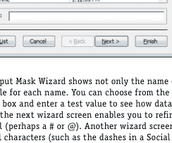

Input Mask Wizard 不仅显示每个预定义输入掩码的名称，还显示每个名称的示例。你可以从预定义掩码列表中进行选择。单击 Try It 文本框并输入测试值，以查看数据输入的外观。选择输入掩码后，下一个向导屏幕使你能够细化掩码并指定占位符符号（也许是 # 或 @）。另一个向导屏幕使你能够决定是否将特殊字符（如社会安全号码中的破折号）与数据一起存储。当你完成向导时，Access 会在字段的属性表中添加输入掩码字符。

## Tip

你可以通过简单地在 Input Mask Wizard 中单击 Edit List 按钮并输入描述性名称、输入掩码、占位符字符和示例数据内容，为 Short Text 和 Date/Time 字段创建自己的 Input Mask 属性。一旦创建，新掩码将在下次使用 Input Mask Wizard 时可用。

根据需要创建尽可能多的自定义掩码。你还可以确定国际设置，以便使用多个国家/地区掩码。在一个数据库中创建的自定义输入掩码可在其他数据库中使用。

## Caption

Caption 属性决定了将字段从字段列表拖到窗体或报表上时创建的控件所附带的默认标签中显示的内容。标题还作为包含该字段的表或查询的数据表视图中的列标题出现。

## CAUTION

使用 Caption 属性时要小心。因为标题文本作为数据表视图中的列标题出现，你可能会被查询的数据表视图中的列标题误导。当字段出现在查询中时，你无法立即访问字段的属性，因此你必须意识到列标题实际上是由 Caption 属性决定的，可能无法反映字段的名称。更令人困惑的是，在表的设计视图中分配的标题和在查询设计视图中字段的属性表中分配的标题是不同的属性，可以包含不同的文本。

标题可以长达 2,048 个字符，对于除最冗长的描述之外的所有描述都绰绰有余。

## Validation Rule and Validation Text

Validation Rule 属性为字段的输入建立要求。由 ACE 数据库引擎强制执行，Validation Rule 确保输入到表中的数据符合应用程序的要求。

验证属性是强制执行业务规则的好方法，例如确保产品不是以零美元出售，或要求员工审查日期在其入职日期之后。而且，与其他字段属性一样，验证规则在应用程序中使用该字段的任何地方都得到强制执行。

Validation Rule 属性的值是一个包含用于测试用户输入的表达式的字符串。用作字段 Validation Rule 属性的表达式不能包含用户定义函数或任何 Access 域或聚合函数（DCount、DSum 等）。字段的 Validation Rule 属性不能引用应用程序中的窗体、查询或其他表。（这些限制不适用于应用


## 第二部分：理解访问表

to controls on a form, however.) 字段验证规则不能引用表中的其他字段，尽管应用于表中记录的规则可以引用同一表中的字段（记录级验证规则是在表的属性表中设置，而不是在单个字段中）。

Validation Text 属性包含一个字符串，当用户输入不满足 Validation Rule 属性的要求时，该字符串会显示在消息框中。Validation Text 属性值的最大长度为 255 个字符。

在使用 Validation Rule 属性时，您应始终指定 Validation Text 值，以避免触发规则被违反时 Access 显示的通用消息框。使用 Validation Text 值向用户提供有用的消息，解释字段的可接受值。图 3.9 显示了当 CreditLimit 字段附加的 Validation Rule 指定的值被超过时消息框的显示。

### 图 3.9

当用户在字段中输入的值与表设计中指定的规则不匹配时，会出现数据验证警告框。

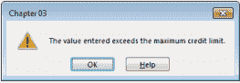

Validation Rule 属性不适用于表单上选项组中的复选框、选项按钮或切换按钮。选项组本身具有 Validation Rule 属性，该属性适用于组内的所有控件。

验证属性通常用于确保某些日期落在其他日期之后（例如，员工的退休日期必须在其入职日期之后）、为库存数量等值输入非负数，以及将条目限制为不同范围的数字或文本。

Access 表达式中使用的日期，例如 Validation Rule 属性，由井号（#）包围，或分隔。如果您想将 LastSalesDate 数据输入限制在 2018 年 1 月 1 日至 2019 年 12 月 31 日之间，请输入 Between #1/1/2018# And #12/31/2019#。

> **提示**
> 
> 如果您想将上限限制为当前日期，您可以输入不同的日期集，例如 Between #1/1/2018# And Date()。Date() 是一个内置的 VBA 函数，返回当前日期；它完全可以作为验证规则或其他表达式的一部分使用。

当字段被拖到表单上时，新控件的 Validation Rule 属性不会设置为字段的 Validation Rule。除非您在控件的属性表中输入新的 Validation Rule 值，否则 Access 会强制执行在表级别设置的规则。

字段和控件 Validation Rule 属性在焦点离开表字段或表单控件时得到强制执行。应用于字段和绑定到该字段的控件的 Validation Rule 属性会强制执行这两个实体。表级规则在绑定控件上编辑数据时以及焦点离开控件时应用。

您不能为链接的“外部”表（例如来自 Excel、文本文件、其他数据库）创建表级 Validation Rule 属性。相反，您必须将 Validation Rule 属性应用于绑定到链接外部表中字段的控件。

### Required

Required 属性指示 Access 要求对字段进行输入。设置为 Yes 时，表中的字段或绑定到该字段的表单上的控件需要输入。必填字段的值不能为 Null。

Required 属性对 AutoNumber 字段无效。默认情况下，所有 AutoNumber 字段在创建新记录时都会分配一个值。

Access 数据库引擎强制执行 Required 属性。如果用户尝试离开其 Required 属性设置为 Yes 的字段绑定的文本框控件，将生成错误消息。

Required 属性可与 AllowZeroLength 属性结合使用，以确定字段的值未知或不存在的情况。

### AllowZeroLength

AllowZeroLength 属性指定您是否希望零长度字符串（""）成为 Short Text 或 Long Text 字段的有效条目。AllowZeroLength 接受以下值：

- Yes：零长度字符串是有效条目。
- No：表将不接受零长度字符串，并在未提供有效文本数据时将 Null 值插入到字段中。

将 AllowZeroLength 和 Required 属性结合使用，使您能够区分不存在的数据（您可能希望将其表示为零长度字符串）和未知的数据（您希望将其存储为 null 值）。在某些情况下，您希望将正确的值存储在 Short Text 或 Long Text 字段中。

不存在的数据的一个例子是客户没有电子邮件地址的情况。电子邮件地址字段应设置为空（零长度）字符串，表示您知道用户没有电子邮件地址。另一位完全是公司新客户的客户，其电子邮件地址字段应为 null 值，表示您不知道该客户是否有电子邮件地址。

输入掩码可以帮助应用程序用户区分字段包含 null 值的情况。例如，输入掩码可以设置为在字段包含零长度字符串时显示 No email1，而在值为 null 时显示 Unknown。

Required 属性决定字段是否接受 null 值，而 AllowZeroLength 属性允许字段中存在零长度字符串。这两个独立的属性共同提供了确定字段的值是未知还是缺失的手段。

Required 和 AllowZeroLength 之间的交互可能相当复杂。表 3.6 总结了这两个属性如何结合起来强制用户输入值，或将 null 或零长度字符串插入到字段中。

### 表 3.6 Required 和 AllowZeroLength 属性组合

| AllowZeroLength | Required | Data Entered by User | Value Stored in Table |
|---|---|---|---|
| No | No | Null | Null |
| No | No | Space | Null |
| No | No | Zero-length string | Disallowed |
| Yes | No | Null | Null |
| Yes | No | Space | Null |
| Yes | No | Zero-length string | Zero-length string |
| No | Yes | Null | Disallowed |
| No | Yes | Space | Disallowed |
| No | Yes | Zero-length string | Disallowed |
| Yes | Yes | Null | Disallowed |
| Yes | Yes | Space | Zero-length string |
| Yes | Yes | Zero-length string | Zero-length string |

### Indexed

Indexed 属性告诉 Access 您希望将字段用作表中的索引。已索引的字段在内部组织以加快查询、排序和分组操作。如果您打算经常在查询中包含某个字段（例如员工 ID 或社会安全号码），或该字段经常在报表上进行排序或分组，则应将其 Indexed 属性设置为 Yes。

Indexed 属性的有效设置如下：

- No：字段未被索引（默认值）。
- **Yes (Duplicates OK)：** 字段已索引，Access 允许列中存在重复值。这是名称等值的适当设置，因为像 Smith 这样的名称很可能在表中出现不止一次。
- **Yes (No Duplicates)：** 字段已索引，列中不允许重复。使用此设置用于表中应唯一的数据，例如社会安全号码、员工 ID 和客户号码。

索引将在本章后面更详细地讨论。

除了主键之外，您还可以索引多达 31 个其他字段以提供最佳性能。请记住，每个索引在向表添加新记录时都会带来轻微的性能损失。Access 每次添加新记录时都会动态更新索引信息。如果表包含过多的索引，在添加每个新记录时可能会出现明显的延迟。

Indexed 属性在字段的属性表或表的属性表中设置。您必须使用表的属性表来设置多字段索引。多字段索引将在本章后面讨论。

### AutoIndex 选项

Access 选项对话框（File ⇨ Options ⇨ Object Designers）包含一个条目（AutoIndex on Import/Create），指示 Access 在将字段添加到表设计时自动索引某些字段。默认情况下，以 ID、key、code 或 num 开头或结尾的字段（例如 EmployeeID 或 TaskCode）在字段创建时会自动索引。每次向表中添加新记录时，字段的值都会添加到字段的索引中。如果您希望 Access 自动索引其他字段名称模式，请在 Access 选项对话框的 Object Designers 选项卡上 AutoIndex on Import/Create 复选框中添加新值（见图 3.10）。

### 图 3.10

选项对话框上的表设计视图区域包含一个用于设置 AutoIndex on Import/Create 选项的框。

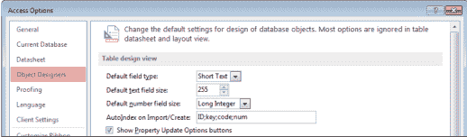


## 何时建立索引

一般来说，您应该对经常被搜索或排序的字段建立索引。请记住，索引会减慢某些操作的速度，例如插入记录和某些操作查询。

长文本和 OLE 对象字段不能被索引。对于这些复杂的数据类型，Access 无法维护索引是不可能的。

如果字段包含非常少的唯一值，则不应使用索引。例如，您不会从对包含人员性别或 Yes/No 字段的字段建立索引中看到显著的益处。因为此类字段的值范围有限，Access 很容易对这些字段的数据进行排序。

在经常同时对多个字段进行排序的情况下使用多字段索引（例如，名字和姓氏）。Access 对此类表的排序会容易得多。

## 了解 tblCustomers 字段属性

在您输入字段名称、数据类型和字段说明后，您可能希望返回并进一步细化每个字段。每个字段都有属性，并且这些属性因数据类型而异。在 tblCustomers 中，您必须为几种数据类型输入属性。图 3.11 显示了名为 CreditLimit 的字段的属性区域。请注意，属性框上有两个选项卡：常规和查找。

### 图 3.11

名为 CreditLimit 的货币字段的属性区域。


### 提示

图 3.11 显示了 CreditLimit 货币字段可用的十个属性。其他类型，例如数字、日期/时间、简短文本或 Yes/No，会显示更多或更少的选项。

按 F6 在字段输入网格和字段属性窗格之间切换。（您可能需要按几次 F6 才能到达所需的窗格。）您也可以通过单击所需窗格在窗格之间移动。某些属性会显示可能值的列表，并在指针移入该字段时显示指向下方的箭头。当您单击箭头时，值会出现在下拉列表中。

表设计窗口中的字段属性窗格有一个第二个选项卡：查找选项卡。单击此选项卡后，您可能会看到一个属性，即显示控件属性。此属性用于简短文本、数字和 Yes/No 字段。

图 3.12 显示了 Active Yes/No 字段的查找属性窗口，其中显示控件是唯一的属性。此属性有三个选择：复选框、文本框和组合框。选择其中之一决定了当特定字段添加到窗体时使用哪种控件类型。通常，所有控件都创建为文本框，除了 Yes/No 字段，默认情况下创建为复选框。对于 Yes/No 数据类型，您可能希望使用文本框设置来显示 Yes/No、True/False 或您在格式属性框中特别放入的其他选择。

### 图 3.12

Yes/No 字段的查找选项卡。

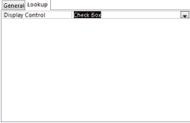

> 您将在第 19 章学习有关组合框的内容。

如果您使用的是简短文本字段而不是 Yes/No 字段，并且知道某个简短文本字段只能是少数几种组合之一，请为显示控件选择组合框选项。图 3.13 显示了将组合框选为 Credit Status 字段的显示控件时的查找选项卡。Credit Status 只有两个可接受的值：OK 和 Not OK。这两个值（用分号分隔）被指定为组合框的行来源，并且行来源类型设置为值列表。

### 图 3.13

将组合框设置为 Credit Status 的显示控件。

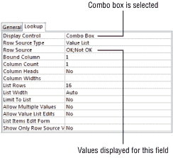

尽管图 3.13 显示了组合框使用值列表作为其项目，但您也可以指定查询或 SQL 语句作为组合框的行来源。

图 3.14 显示了当 tblCustomers 以数据表形式显示时 Credit Status 字段的外观。用户只能选择 OK 或 Not OK 作为信用状态，并且当该字段添加到 Access 窗体时也会出现相同的组合框。

### 图 3.14

使用组合框作为查找控件来限制字段的用户输入。

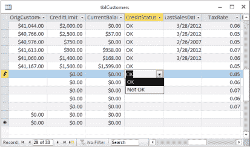

查找字段的属性因数据类型而异。Yes/No 数据类型字段与简短文本和长文本字段或数字字段不同。因为查找字段实际上是一个组合框，所以在您选择查找字段数据类型时，会显示组合框的标准属性。

## 设置主键

每个表都应该有一个主键——一个字段或一组字段的组合，每个记录都有唯一的值。（在数据库管理领域，这一原则称为实体完整性。）在 tblCustomers 中，CustomerID 字段是主键。每个客户都有唯一的 CustomerID 值，以便数据库引擎区分一个记录与另一个记录。CustomerID 17 指的是联系人表中唯一的一条记录。如果您未指定主键（唯一值字段），Access 可以为您创建主键。

### 选择主键

如果没有 CustomerID 字段，您将不得不依赖另一个字段或字段组合来实现唯一性。您不能使用 Company 字段，因为两个客户很容易具有相同的公司名称。事实上，您甚至不能同时使用 Company 和 City 字段（在多字段键中），原因相同——完全有可能两个具有相同公司名称的客户存在于同一城市。您需要想出一个字段或字段组合，使每条记录都唯一。

解决此问题的最简单方法是添加一个自动编号字段作为表的主键。tblCustomers 中的主键是 CustomerID，这是一个自动编号字段。

如果您未指定字段作为主键，Access 可以添加一个自动编号字段并将其指定为表的主键。自动编号字段是非常好的主键，因为 Access 会为您创建该值，该数字在表中永远不会被重用，并且您无法更改自动编号字段的值。

好的主键：
- 唯一标识每条记录。
- 不能为 null。
- 必须在记录创建时存在。
- 必须保持稳定。（一旦建立，永远不要更改主键值。）
- 应简单且包含尽可能少的属性。

除了唯一标识表中的行外，主键还提供其他好处：
- 主键始终是一个索引。
- 索引维护一个或多个字段的预排序顺序，可以大大加快查询、搜索和排序请求的速度。
- 当您向表中添加新记录时，Access 会检查重复数据，并且不允许主键字段有任何重复。
- 默认情况下，Access 以其主键的顺序显示表的数据。

通过将 CustomerID 等字段指定为主键，数据会以有意义的顺序显示。在我们的示例中，由于 CustomerID 字段是自动编号，其值由 Access 在记录输入系统时自动按顺序分配。

理想的主键是单个字段，不可变并且保证在表中唯一。因此，出于这些原因，可收藏迷你汽车数据库对所有表都专门使用自动编号字段作为主键。

### 创建主键

主键可以通过三种方式中的任何一种创建。在设计视图中打开表时：
- 选择要用作主键的字段，然后单击“设计”选项卡功能区“工具”组中的主键按钮（钥匙图标）。
- 右键单击该字段并从快捷菜单中选择主键。
- 保存表而不创建主键，并允许 Access 自动创建自动编号字段。

在您指定主键后，字段名称左侧的灰色选择区域会出现一个钥匙图标，表示已创建主键。

### 创建复合主键

您可以指定一组字段作为表的主键。这样的键通常被称为复合主键。如图 3.15 所示，选择要包含在复合主键中的字段；然后单击功能区“工具”选项卡上的主键按钮。要从不相邻的字段创建主键，请按住 Ctrl 同时选择这些字段。

复合主键主要用于开发人员强烈认为主键应由数据库中自然出现的数据组成时。曾经有一段时间，所有开发人员都被教导每个表都应该有一个自然主键（在表中自然出现的数据）。

复合主键如今很少使用，因为开发人员已经意识到数据是高度不可预测的。即使您的用户承诺某些字段的组合在表中永远不会被重复，事情往往会与计划不同。使用代理主键（一个在表数据中不自然出现的键字段，例如具有自动编号数据类型的员工 ID）将表的设计与表的数据分离。自然主键的问题在于，最终，给定足够大的数据集，所选作为表主键的字段值很可能被重复。


**图 3.15**

创建复合主键。

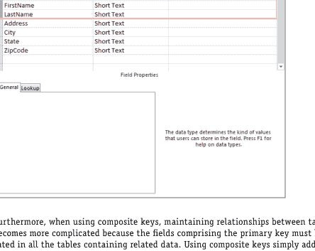

此外，使用复合键时，表之间关系的维护会变得更加复杂，因为构成主键的字段必须复制到所有包含相关数据的表中。使用复合键只会增加数据库的复杂性，并不会带来稳定性、完整性或其他有益特性。

## 对 Access 表进行索引

数据很少（如果有的话）会按照有意义的顺序输入表中。通常，记录会以随机顺序添加到表中（按时间排序的数据除外）。例如，繁忙的订单录入系统一天内会收集多个不同客户的订单信息。这些数据通常用于生成单个客户的订单报告以便结算，或者提取订单数量以便进行库存管理。然而，“订单”表中的记录按时间顺序排列，这在生成详细列出客户订单的报告时未必有用。这种情况下，你可能更希望数据按客户 ID 顺序排列。

为了进一步说明这一概念，请想一想许多人过去用来存放姓名、地址和电话号码的 Rolodex 卡片盒。暂且假设卡片都固定在卡片盒中。你可以添加新卡片，但只能加在卡片盒的末尾。这种限制意味着，“Jones”后面可能是“Smith”，而“Smith”后面又可能是“Baker”。换句话说，卡片盒中的数据没有特定顺序。

像这样的未排序 Rolodex 卡片盒很难使用。你必须逐张查找卡片，才能找到特定的人，这个过程既痛苦又耗时。当然，你不会这样使用地址卡片盒。添加卡片时，你会把它插入 Rolodex 中逻辑上应处的位置。通常，这意味着按姓氏字母顺序将卡片插入 Rolodex。

如前面固定卡片盒的示例所述，记录会添加到 Access 表中。新记录总是添加到表的末尾，而不是添加到逻辑上应该插入的表中间。不过，在订单录入系统中，你可能会希望将新记录插入同一客户的其他记录旁边。遗憾的是，Access 表并非如此运作。表的*自然顺序*是记录添加到表中的顺序。为了强调表中的记录按照添加顺序排列，这种顺序有时也称为*录入顺序*或*物理顺序*。

按照自然顺序使用表并非一定不好。如果很少搜索数据，或者表非常小，那么自然顺序完全适用。此外，有些情况下，添加到表中的数据一开始就具有高度的顺序性。如果表用于收集顺序数据（例如电表读数），并且数据也会按相同的顺序使用，那么就没有必要为数据建立索引。

不过，对于自然顺序无法满足需求的情况，Access 提供了*索引*，帮助你更快地查找和排序记录。通过在表上创建*索引*，可以为表中的记录指定一种*逻辑*顺序。Access 使用索引为表中的数据维护一个或多个内部排序顺序。例如，你可以为经常出现在查询和排序操作中的 LastName 字段建立索引。

Access 使用表中的索引查找数据，就像使用书籍中的索引一样。Access 会在索引中查找数据的位置。大多数情况下，表中会包含一个或多个*简单索引*。简单索引只涉及表中的一个字段。简单索引可以按升序或降序排列表中的记录。设置字段的 Indexed 属性为以下值之一即可创建简单索引：

- 是（允许重复）
- 是（不允许重复）

默认情况下，Access 字段不会建立索引，但很难想象有哪种表不需要任何索引。下一节将讨论为什么在 Access 表中使用索引很重要。

### 索引的重要性

Microsoft 的数据显示，Access 数据库中超过一半的表没有索引。这个数字不包括索引设置不当的表，只包括完全没有索引的表。看来，很多人并未认识到为 Access 数据库中的表建立索引的重要性。

### 网页内容

为了演示索引的强大功能和价值，本书的网站提供了一个名为 IndexTest.accdb 的数据库。该数据库包含两个完全相同的表，每个表中约有 355,000 个随机单词。其中一个表的 Word 字段建立了索引，另一个表则没有。一个小型窗体（如图 3.16 所示）可以让你查询有索引或无索引的表，并显示搜索所需的毫秒数。

**图 3.16**

frmIndexTest 提供了一种快速简便的方法，用于验证索引的重要性。

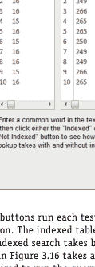

在文本框中输入一个常用词，然后单击“已建立索引”或“未建立索引”按钮，查看有无索引时查找所需的时间。

这些按钮会各运行测试 10 次，并在按钮下方的列表框中显示结果。带索引的表通常能在 10 到 30 毫秒内找到一个单词，而无索引的搜索则需要 300 到 350 毫秒。显示图 3.16 中的结果几乎不花时间，也不会增加运行查询所需的总时间。不言而喻，运行查询的实际耗时很大程度上取决于计算机硬件，但为字段添加索引后，性能提升 500% 甚至更多并不少见。

**第二部分：了解 Access 表**

由于索引意味着 Access 会为索引字段中的数据维护内部排序顺序，因此不难理解索引为何能提升查询性能。几乎所有经常用于查询，或经常在窗体或报表中进行排序的字段，都应该建立索引。

如果没有索引，Access 必须搜索数据库中的每一条记录，以查找匹配项。这个过程称为表扫描，相当于逐张查找 Rolodex 卡片盒中的卡片，以找出在某家公司工作的所有人员。在查完整叠卡片之前，你无法确定是否已经找到了卡片盒中所有相关的卡片。

如本章前面所述，表的主键字段始终会建立索引。这是因为主键用于定位表中的记录。为主键建立索引后，Access 就能更轻松地在当前表或与当前表相关联的外部表中查找所需记录。如果没有索引，Access 就必须搜索相关表中的所有记录，以确保找到所有相关记录。

> 提示
>
> 未建立索引的表所造成的性能损失，可能会严重影响 Access 应用程序的整体性能。每当听到有人抱怨应用程序性能不佳时，都可以考虑将建立索引作为一种可能的解决方案。

### 多字段索引

创建多字段索引（也称为复合索引）很简单。在设计视图中，单击功能区“设计”选项卡上的“索引”按钮。随后会出现“索引”对话框（如图 3.17 所示），你可以在其中指定要包含在索引中的字段。

**图 3.17**

多字段（复合）索引可以提升性能。


输入索引名称（图 3.17 中为 CityState），然后按 Tab 键移至“字段名称”列。使用下拉列表选择要包含在索引中的字段。在此示例中，City 和 State 组合为一个索引。紧接在该行下方且不包含索引名称的任何行，都属于该复合索引。Access 在为此表创建排序顺序时会同时考虑这两个字段，从而加快同时包含 City 和 State 字段的查询和排序操作。

> **注意**
>
> 复合索引中字段的顺序很重要。本章所述的 CityState 索引可供 Access 用于查询中仅提供 City 的情况，但如果只提供 State，则不会带来任何好处。

复合索引最多可以包含十个字段。只要复合索引不作为表的主键，复合索引中的任何字段都可以为空。

图 3.18 展示了如何设置索引属性。光标位于“索引”对话框中，框内显示索引名称。请注意，“索引”对话框下半部分显示的三个属性。

**图 3.18**

设置索引属性很简单。

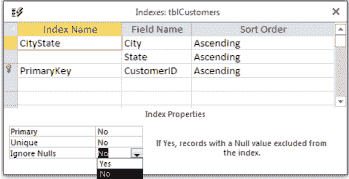

索引属性很容易理解（这些属性对单字段索引和复合索引同样适用）：

- **主键：**设置为“是”时，Access 会将此索引用作表的主键。可以将多个字段指定为主键，但请牢记主键的相关规则，尤其是主键值必须唯一，以及复合主键中的任何字段都不能为空。Primary 属性的默认值为“否”。


## 何时对表建立索引

唯一（Unique）：当设置为“是”时，索引在表中必须是唯一的。社会保障号字段是唯一索引的理想候选，因为应用程序的业务规则可能要求表中只能存在一个社会保障号实例。相比之下，姓氏字段不应建立唯一索引，因为像 Smith 和 Jones 这样的许多姓氏非常常见，对姓氏字段建立唯一索引只会引发问题。当应用于复合键时，字段值的组合必须是唯一的——复合键中的每个字段可以重复出现在表中其他记录的字段值中。

忽略 Null（Ignore Nulls）：如果记录的索引字段包含 Null 值（只有在复合索引中所有字段都为 Null 时才会发生），则该记录的索引不会对整个索引结构产生任何贡献。换句话说，除非记录的索引包含某种值，否则 Access 不知道该将记录插入到表内部索引排序列表的哪个位置。因此，您可能希望指示 Access 在索引值为 Null 时忽略该记录。默认情况下，“忽略 Null”属性设置为“否”，这意味着 Access 会将带有 Null 索引值的记录与任何其他包含 Null 索引值的记录一同插入索引方案中。

您应该测试索引属性对 Access 表的影响，并选择最适合数据库所处理数据的属性。

一个字段既可以作为表的主键，也可以是复合索引的一部分。您应该根据需要为表建立索引，以获得尽可能高的性能，而不必担心过度索引或违反某些神秘的索引规则。例如，在诸如“收藏迷你汽车”（Collectible Mini Cars）这样的数据库中，tblSales 表中的发票号经常用于窗体和报表，因此应该为其建立索引。此外，在许多情况下，发票号会与其他字段（如销售日期或销售人员 ID）组合使用。您应该考虑在销售表中添加复合索引，将发票号与销售日期、销售人员 ID 组合起来。

根据表中的记录数量，维护索引带来的额外开销可能不足以证明在主键之外再创建索引是合理的。尽管数据检索速度比没有索引时稍快一些，但每当您在表中输入或更改记录时，Access 都必须更新索引信息。相比之下，对非索引字段的更改则不需要额外的文件活动。您可以像从索引字段中检索数据一样轻松（尽管速度不如索引字段快）地从非索引字段中检索数据。

一般来说，当表非常大，并且对主键以外的字段建立索引能够加快搜索速度时，最好添加二级索引。然而，即使对于大型表，如果表中的记录经常被更改或频繁添加新记录，索引也可能拖慢性能。每次更改或添加记录时，Access 都必须更新表中的所有索引。

既然索引有这么多优点，为什么不对表中的所有内容都建立索引呢？索引过多字段有什么缺点？是否可能过度索引表？

首先，索引会在一定程度上增加 Access 数据库的大小。为并不真正需要索引的表不必要地建立索引，会为表中的每条记录消耗一点磁盘空间。更重要的是，每次向表中添加记录时，每个索引都会带来性能损失。由于 Access 在每次添加（或删除）记录时都会自动更新索引，因此必须为每条新记录调整内部索引。如果一张表上有十个索引，那么每次添加新记录或删除现有记录时，Access 都要对这十个索引进行十次调整，这会导致大型表出现明显延迟（尤其是在速度较慢的计算机上）。

有时，记录数据的更改会导致索引方案发生调整。如果更改导致记录在排序或查询活动中改变其位置，就会出现这种情况。因此，如果您处理的是大型、不断变化且很少被搜索的数据集，您可以选择不建立索引，或者通过只对少数几个可能被搜索的字段建立索引来进行最小化索引。

当您开始使用 Access 表时，您可能会从最简单的一字段索引入手，并随着对这一过程的熟悉而逐步转向更复杂的索引。但请记住，需要在更高的搜索效率与维护大量索引所产生的开销之间进行权衡。

还需要记住的一点是，索引并不会修改表中记录的物理排列顺序。在建立索引后，记录的自然顺序（记录添加到表中的顺序）仍然保持不变。

> **注意**
> 对 Access 数据库执行压缩和修复周期会强制 Access 重建所有表中的索引，并按照主键顺序在 ACCDB 文件中物理重新排列表。这些维护操作可确保您的 Access 数据库以最高效率运行。有关“压缩和修复”实用工具的更多信息，请参阅第 31 章。

## 打印表设计

您可以通过单击功能区“数据库工具”选项卡“分析”组中的“数据库文档器”按钮来打印表设计。“分析”组包含许多工具，可让您轻松记录数据库对象。单击“数据库文档器”按钮后，将出现“文档器”对话框，让您选择要打印的对象。在图 3.19 中，已在“文档器”对话框的“表”选项卡上选中了 tblCustomers。

您还可以设置各种打印选项。单击“选项”按钮时，将出现“打印表定义”对话框（如图 3.20 所示），使您能够选择要打印的表设计中的哪些信息。您可以打印各种字段名称、其所有属性、索引，甚至网络权限。

### 第二部分：理解 Access 表

#### 图 3.19
“文档器”对话框。

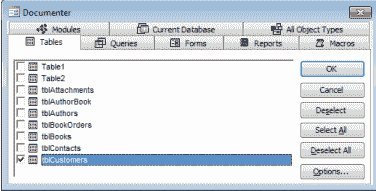

#### 图 3.20
“打印表定义”对话框中的打印选项。

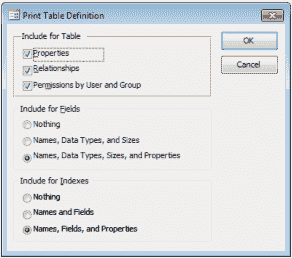

> **警告**
> 不要在“打印表定义”对话框中选择过多选项。打印表设计的每一项详细信息可能需要输出许多页。对于一张表，最好只打印少量项目，并在必要时再增加选项。

选择所需的选项后，Access 会生成一份报告。您可以在“打印预览”窗口中查看报告，也可以将其发送到打印机。您可能希望将此报告作为应用程序文档的一部分保存在数据库中。

> **提示**
> “数据库文档器”会创建您指定的所有对象和对象属性的表。您可以使用此实用工具来记录诸如窗体、查询、报告、宏和模块之类的数据库对象。

## 保存已完成的表

您可以通过选择“文件”→“保存”，或单击 Access 环境左上角快速访问工具栏上的“保存”按钮来保存已完成的表设计。如果是首次保存表，Access 会要求输入表的名称。表名最多可包含 64 个字符，并遵循 Access 标准对象命名约定：可以包含字母和数字，不能以数字开头，也不能包含标点符号。如果您尝试关闭未保存的表，Access 会提示您保存该表。

如果您以前保存过此表，并希望以其他名称保存，请选择“文件”→“另存为”→“将对象另存为”，单击“另存为”按钮，然后输入不同的表名。此操作会创建一个新的表设计，并保留原始表及其原始名称不变。如果您想删除旧表，请在导航窗格中选择它并按 Delete 键。

## 操作表

当您向数据库中添加许多表时，您可能希望在其他数据库中使用它们，或者复制它们作为备份。在许多情况下，您可能只想复制表的设计，而不包含表中的所有数据。您可以在导航窗格中执行许多表操作，包括：

- 重命名表
- 删除表
- 在数据库中复制表
- 将表复制到另一个数据库

您可以通过直接操作或使用菜单项来执行这些任务。

### 重命名表

要重命名表，请在导航窗格中右键单击其名称，并从快捷菜单中选择“重命名”，或者在导航窗格中选择该表并按 F2 键。更改表名后，该表名会出现在“表”列表中，并将表按字母顺序重新排序。


## 1. 引言

本文档旨在介绍一种新型的文档解析方法，该方法能够高效地从复杂布局的文档中提取结构化信息。

随着数字化办公的普及，文档格式日益多样化，传统的基于规则的解析方式已难以满足需求。

## 2. 方法概述

- 步骤一：图像预处理与版面分析
- 步骤二：文本检测与识别
- 步骤三：结构重建与语义理解

| 模块 | 功能描述 | 性能指标 |
|------|----------|----------|
| 版面分析 | 识别区域类型 | 准确率 95% |
| 文本识别 | OCR 文字提取 | 准确率 98% |
| 结构重建 | 生成层级树 | F1 分数 0.92 |

> 注意：上述性能指标基于公开数据集测试得出，实际效果可能因文档质量而异。

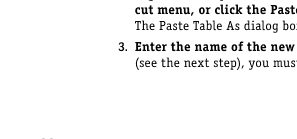

```python
def parse_document(path):
    # 解析文档主函数
    return result
```

4. **从“粘贴表格为”对话框中选择其中一个粘贴选项**——仅结构、结构和数据，或将数据追加到现有表格。
5. **单击确定以完成操作。**

## 图 3.21

粘贴表格时会打开“粘贴表格为”对话框。

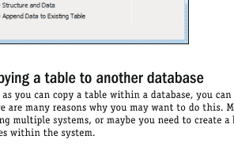

## 将表格复制到另一个数据库

正如你可以在数据库内复制表格一样，你也可以将表格复制到另一个数据库。有很多原因可能需要这样做。也许你在多个系统之间共享一个公共表格，或者也许你需要在系统内为重要的表格创建备份副本。

当你将表格复制到另一个数据库时，表格之间的关系不会被复制。Access 只会将表格设计和数据复制到另一个数据库。将表格复制到另一个数据库的方法与在数据库内复制表格的方法本质上是相同的：

1. **在导航窗格中右键单击表名并从快捷菜单中选择复制，或单击“开始”选项卡“剪贴板”组中的复制按钮。**
2. **打开另一个 Access 数据库并在导航页中任意位置右键单击。从快捷菜单中选择粘贴，或单击“开始”选项卡“剪贴板”组中的粘贴按钮。此时会出现“粘贴表格为”对话框。**
3. **输入新表的名称。**
4. **选择其中一个粘贴选项：仅结构、结构和数据，或将数据追加到现有表格。**
5. **单击确定以完成操作。**

## 向数据库表添加记录

向表中添加记录与在导航窗格中双击表名以在数据表视图中打开表一样简单。打开表后，为每个字段输入值。图 3.22 显示了在数据表视图中向表中添加记录的过程。

您可以输入除 CustomerID 之外的所有字段的信息。自动编号字段会自动为您提供一个数字。

## 图 3.22

使用数据表视图向表中添加记录。

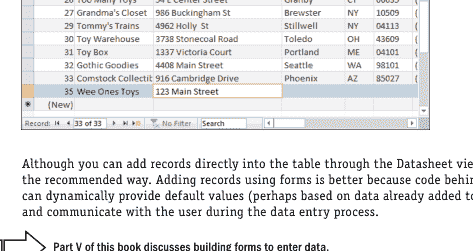

尽管您可以通过数据表视图直接向表中添加记录，但这并不是推荐的方法。使用窗体添加记录更好，因为窗体后面的代码可以动态提供默认值（也许基于已添加到窗体的数据）并在数据输入过程中与用户进行通信。

本书第 V 部分讨论了构建用于输入数据的窗体。

## 理解附件字段

微软认识到数据库开发人员必须处理许多不同类型的数据。虽然传统的 Access 数据类型（简短文本、货币、OLE 对象等）能够处理许多不同类型的数据，但直到最近，没有办法将完整的文件作为 Access 数据容纳，而无需对文件进行某种转换（例如转换为 OLE 数据）。

自 Access 2010 以来，Access 包含了附件数据类型，使您能够将整个文件作为“附件”带入 Access 数据库中附加到表中。当您单击附件字段时，会出现一个小的附件对话框（如图 3.23 所示），使您能够找到要附加到表的文件。

图 3.23 中的“添加”按钮会打开熟悉的“选择文件”对话框，使您能够搜索一个或多个要附加到该字段的文件。所选文件将被添加到图 3.23 中您看到的列表中。请注意，附件对话框还包括用于从字段中删除附件以及将附件保存回计算机磁盘的按钮。

## 图 3.23

在附件字段中管理附件。

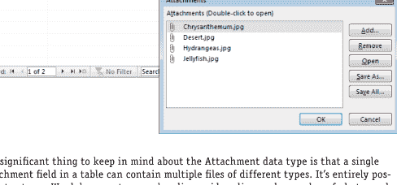

关于附件数据类型的关键点是，表中的单个附件字段可以包含不同类型多个文件。完全有可能在一个附件字段中存储 Word 文档、多个音频或视频剪辑以及多张照片。

## 警告

> 显然，由于附加数据被合并到数据库中，如果添加了许多附件，ACCDB 文件会迅速增长。您应仅在附件数据类型的优点超过其对 Access 应用程序造成的负担时才使用它。

## 2.1 线性表的定义和特点

线性表（Linear List）是最简单且最常用的一种数据结构。一个线性表是n个数据元素的有限序列。在稍复杂的线性表中，一个数据元素可以由若干个数据项（item）组成，在这种情况下，常把数据元素称为记录（record），含有大量记录的线性表又称文件（file）。

线性表中的数据元素之间的关系是线性关系，即除了第一个元素外，每一个元素有且仅有一个直接前趋元素；除了最后一个元素外，每一个元素有且仅有一个直接后继元素。

线性表的特点是：

1. 存在唯一的一个被称作“第一个”的数据元素；
2. 存在唯一的一个被称作“最后一个”的数据元素；
3. 除第一个之外，结构中的每个数据元素均只有一个前趋；
4. 除最后一个之外，结构中的每个数据元素均只有一个后继。

线性表是一个相当灵活的数据结构，它的长度可根据需要增长或缩短，即对线性表的数据元素不仅可以进行访问，还可以进行插入和删除等操作。

由线性表的定义可知，线性表的基本运算有：

1. 置空表 SETNULL(L)；
2. 求长度 LENGTH(L)；
3. 取元素 GET(L, i)；
4. 插入 INSERT(L, x, i)；
5. 删除 DELETE(L, i)；
6. 定位 LOCATE(L, x)。

## 第 II 部分：了解 Access 表格

在处理实际数据时，您关注的是两个表之间的关系。您可能会先创建“员工”和“工资”表，通过关系连接这两个表，以便轻松找到员工的所有工资信息。

> **网上**
> 
> 本章使用了名为 `Chapter04.accdb` 的数据库中的各种数据。如果您尚未下载它，现在就需要这样做。如果您按照示例操作，可以使用此数据库中的表，也可以自行在另一个数据库中创建表。

## 构建防弹数据库

在第 1、2 和 3 章中，您看到了许多 Access 数据库中常见的数据库关系。最常见的表关系类型绝对是一对多。Collectible Mini Cars 应用程序有许多此类关系：Customers 表中的每条记录都与 Sales 表中的一条或多条记录相关。 （每个联系人可能通过 Collectible Mini Cars 购买了多件商品。）


我们将在本章后面的“表关系”部分详细讨论一对多关系。

您可以很容易想象出一种安排方式，将 Customers 和 Sales 表中包含的数据合并到单个表中。所有需要做的就是为每个联系人下的每个订单提供单独的行。随着新订单的到来，包含客户和订单信息的新的行将被添加到表中。

图 4.1 中显示的 Access 表 tblCustomersAndOrders 就是这种安排的示例。在此图中，OrderID 列包含联系人下的订单号（该表中的数据已按 CustomerID 排序，以显示每个联系人下的订单数量）。图 4.1 中的表是通过将 Northwind Traders 示例数据库中的 Customers 和 Orders 表中的数据合并创建的，并包含在本书记载的网站上的 `Chapter04.accdb` 数据库文件中。

请注意 CompanyName 列右侧的 OrderID 列。每个联系人（如 Alfreds Futterkiste）都下了多个订单。此表中最右侧的列（超出图示范围）包含有关每个联系人的更多信息，包括地址和电话号码，而公司信息之外的列包含特定的订单信息。总共，此表包含 24 个不同的字段。

图 4.1 中显示的设计就是当使用 Excel 等电子表格应用程序用于数据库目的时会发生的情况。由于 Excel 完全是电子表格导向的程序，因此没有将数据分解为单独表的规定，鼓励用户将所有内容保存在一个庞大的电子表格中。


## FIGURE 4.1

包含客户、联系人和订单数据的 Access 表格

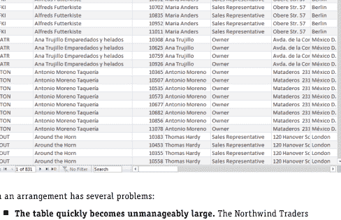

这种安排存在几个问题：

- **表格很快变得无法管理。** Northwind Traders 客户表包含 11 个不同的字段，而订单表还包含 14 个。OrderID 字段重叠于两个表。每次下单时，合并表中的全部 24 个数据字段都会为表中添加的每条记录添加，包括大量与订单本身并无直接关联的数据（如联系人姓名和联系人职称）。

- **数据难以维护和更新。** 对大型表中的数据进行简单更改——例如更改联系人的电话或传真号码——需要在表中搜索所有记录并更改电话号码的每一次出现。很容易出现错误输入或遗漏一个或多个实例。需要更改的记录越少，用户就越有利。

- **单体表设计浪费磁盘空间和其他资源。** 由于合并表包含大量冗余数据（例如，联系人的地址会因每次销售而重复），大量硬盘空间被冗余信息占用。除了浪费磁盘空间外，网络流量、计算机内存和其他资源也会被低效利用。

更好的设计——关系型设计——将重复数据移至单独的表，并在第一个表中保留一个字段作为对第二个表中数据的引用。关系模型所需额外字段是一笔小代价，以换取将冗余数据移出表所带来的效率提升。

规范化数据并将严格的数据库设计规则应用于 Access 应用程序的第二个巨大优势是，数据变得几乎坚不可摧。在适当设计和管理良好的数据库中，用户可以确信在窗体和报表上显示的信息确实反映了底层表中存储的数据。设计不良的数据库容易出现数据损坏，这意味着记录有时会“丢失”，即使用户已将数据添加到应用程序中，也永远不会出现在窗体和报表上，或者应用程序的查询返回了错误的数据。在任何一种情况下，都无法信任数据库，因为用户永远无法确定他们在窗体和报表上看到的内容是否正确。

用户倾向于信任屏幕上看到的内容和打印在纸上的内容。想象一下，如果客户从未被开具购买账单或库存被错误更新会发生什么问题。薄弱的数据库设计不会带来任何好处。作为数据库开发人员，我们有责任确保我们设计的应用程序尽可能强大和稳定。遵循适当的数据规范化规则可以帮助我们实现这一目标。

## Data Normalization and Denormalization

将数据拆分到多个表中的过程称为规范化数据。规范化有几个阶段；第一到第三阶段最容易理解和实现，通常足以满足大多数应用程序的需求。虽然更高级别的规范化是可能的，但通常只有最有经验和最挑剔的开发人员才会考虑。

为了说明规范化过程，我们将使用一家图书批发商可能用来跟踪当地小型书店下达的图书订单的小型数据库。此数据库必须处理以下信息：

- 书籍订购的日期
- 下单的客户
- 订购的每本书的数量
- 订购的每本书的标题

尽管此数据集非常简单，但它与您可能使用 Access 数据库应用程序管理的数据类型相似，并且提供了规范化一组数据的有效演示。

## First normal form

规范化的初始阶段称为第一范式（1NF），要求表符合以下规则：

- 表的每个字段必须只包含单个值，并且表不得包含重复的数据组。

表旨在成为二维存储对象，而在字段内存储多个值或在表中允许重复组意味着数据具有第三个维度。图 4.2 显示了构建用于管理书店订单的表的第一次尝试（tblBookOrders1）。请注意，一些书店订购了不止一本书。BookTitle 字段中的值如 7 Cookie Magic 表示联系人订购了七本名为 Cookie Magic 的食谱书。将数量和项目名称存储在同一单元格中只是此表违反第一范式的几种方式之一。

## FIGURE 4.2

未规范化的 tblBookOrders 表。

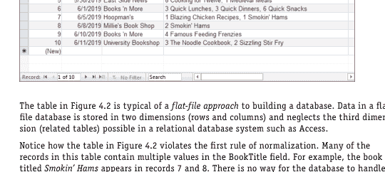

图 4.2 中的表是构建数据库的平面文件方法的典型。平面文件数据库中的数据以二维（行和列）存储，忽略了关系数据库系统（如 Access）中可能的第三维度（相关表）。

请注意图 4.2 中的表如何违反规范化的第一条规则。该表中的许多记录在 BookTitle 字段中包含多个值。例如，书名 Smokin' Hams 出现在记录 7 和 8 中。数据库无法轻松处理此数据——如果您想交叉引用书店订购的书籍，您必须解析 BookTitle 字段中包含的数据，以确定哪些联系人订购了哪些书籍。

稍好的设计如图 4.3 所示（tblBookOrders2）。书籍的数量和标题已分离到单独的列中。每行仍包含单个订单的所有数据。此安排使得检索数量和标题信息变得稍微容易一些，但数量和标题的重复组（列 Quant1、Title1、Quant2、Title2 等）继续违反规范化的第一条规则。（图 4.3 中的行高已调整以便于查看表的排列。）

## FIGURE 4.3

比前一个设计仅有轻微改进。

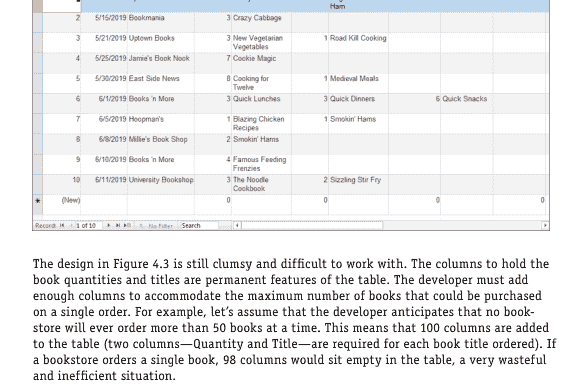

图 4.3 中的设计仍然笨拙且难以使用。用于保存书籍数量和标题的列是表的永久特性。开发人员必须添加足够多的列来容纳单笔订单可能购买的最大书籍数量。例如，假设开发人员预计没有任何书店会一次订购超过 50 本书。这意味着表中增加了 100 列（每本订购的书名需要两个列——数量和标题）。如果书店只订购一本书，98 列将空置在表中，这是一种非常浪费且低效的情况。

根据图 4.3 所示的设计，很难查询 tblBookOrders2 以获取特定书籍的销售额。任何书籍的销售数量散布在整个表中，不同的行和不同的列中，使得很难知道在哪里查找书籍的销售数据。

此外，如果任何图书订单超过 50 本书，表必须重新设计以容纳订单所需的额外列。当然，用户可能会为订单添加第二行，使得表中的数据比预期更难以处理。

图 4.4 显示了 tblBookOrders3，一个从图 4.3 中的数据创建的第一范式新表。与在单个记录内堆叠多个图书订单不同，在 tblBookOrders3 中，每条记录包含客户订购的单本书。需要更多记录，但数据处理起来容易得多。第一范式效率更高，因为表中没有未使用的字段。每个字段对表的目的都有意义。


## FIGURE 4.4

终于达到第一范式！

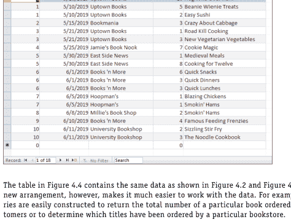

图 4.4 中的表包含与图 4.2 和图 4.3 中所示相同的数据。然而，新的排列使得处理数据变得容易得多。例如，可以轻松构建查询以返回客户订购的特定书籍的总数量，或确定哪些标题已被特定书店订购。

> Tip
> 你的表应始终处于第一范式。确保表的每个单元格都包含一个单一值，不要在单元格内混合值，并且不要有重复组（如你在图 4.3 中看到的那样）。

此时表设计优化尚未完成。然而，仍需对 BookOrders 数据和本应用程序中的其他表做很多工作。特别是，图 4.4 中显示的表包含冗余信息。书籍标题在客户每次订购同一本书时都会重复，而订单号和订单日期则对订单的所有行重复。

一个更微妙的问题是，OrderID 不再能用作表的键。因为 OrderID 对订单中的每个书籍标题重复，所以它不能用于标识表中的单个记录。相反，OrderID 字段现在是表的键字段，可用于定位与特定订单相关的所有记录。优化的下一步纠正了这种情况。

## Second normal form

通过将 tblBookOrders 中的数据拆分为多个表来实现第二范式（2NF），可以获得更高效的设计。规范化的第二条规则说明如下：

Data not directly dependent on the table's primary key is moved into another table.

这条规则意味着表应包含代表单个实体的數據。因为我们正在逐步将一个未规范化的表转换为规范化的数据，tblBookOrders3 没有主键。我们暂时忽略这一事实，将表中的每一行视为一个实体。该行中不是实体不可分割部分的全部数据都移至另一个表。在 tblBookOrders3 中，Customer 字段和 Title 字段都不是订单的不可分割部分，应移至不同的表。

### Identifying entities

但客户不是订单不可分割的一部分吗？是的，他们是。然而，存储在 tblBookOrders3 的 Customer 字段中的数据是客户姓名。如果客户更改姓名，并不会从根本上改变订单。同样，虽然书籍对订单很重要，但书籍的标题却不是。

为了解决这个问题，我们需要为客户和书籍分别创建表。首先，创建一个名为 tblBookstores 的新表，如图 4.5 所示。

要创建 tblBookstores，请执行以下步骤：

- 1. 点击功能区的“创建”选项卡上的“表设计”。
- 2. 添加一个名为 BookstoreID 的自动编号字段。
- 3. 点击功能区“表工具 设计”选项卡上的“主键”。
- 4. 添加一个名为 StoreName 的简短文本字段。
- 5. 将 StoreName 的“字段大小”设置为 50。
- 6. 将表保存为 tblBookstores。

我们可以想象，我们希望存储有关客户的更多信息，例如他们的邮寄地址和电话号码。目前，我们通过将不是订单不可分割部分的数据移至其自己的表，从而将数据置于 2NF。

接下来通过执行以下步骤为书籍创建表：

- 1. 点击功能区的“创建”选项卡上的“表设计”。
- 2. 添加一个名为 BookID 的自动编号字段。
- 3. 点击功能区“表工具 设计”选项卡上的“主键”。
- 4. 添加一个名为 BookTitle 的简短文本字段。
- 5. 将表保存为 tblBooks。

## FIGURE 4.5

将客户数据移至其自己的表。

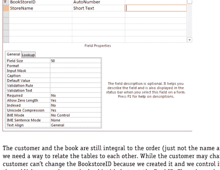

客户和书籍仍然是订单不可分割的一部分（只是不是姓名和标题），我们需要一种方法将表相互关联。虽然客户可能会更改姓名，但客户不能更改 BookstoreID，因为我们创建了它并且我们控制它。同样，出版商可能会更改书籍的标题，但不会更改 BookID。tblBookstores 和 tblBooks 的主键是可靠的指针，指向它们标识的对象，无论其他信息可能如何更改。

图 4.6 显示了我们的三个表，但 tblBookOrders4 现在包含其在 tblBookstores 和 tblBooks 中相关记录的主键，而不是客户姓名和书籍标题。当一个表的主键用作另一个表中的字段时，它被称为外键。

在我们将客户数据拆分到其自己的表之前，如果 Uptown Books 将其名称更改为 Uptown Books and Periodicals，我们将不得不识别 tblBookOrders3 中所有客户为 Uptown Books 的行，并为每个识别出的行更改字段值。

在该过程中遗漏客户姓名的实例称为更新异常，会导致与数据库中其他记录不一致的记录。从数据库的角度来看，Uptown Books 和 Uptown Books and Periodicals 是两个完全不同的组织，即使我们知道它们是同一家商店。检索 Uptown Books and Periodicals 放置的所有订单的查询将遗漏 Customer 字段中仍为 Uptown Books 的任何记录，因为存在更新异常。

## FIGURE 4.6

使我们的表达到 2NF 的第一步。

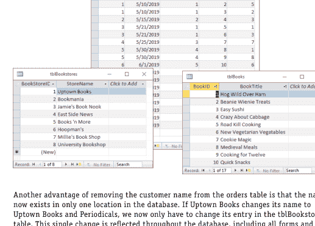

从订单表中删除客户姓名的另一个优点是，姓名现在仅存在于数据库中的一个位置。如果 Uptown Books 将其名称更改为 Uptown Books and Periodicals，我们现在只需更改 tblBookstores 表中的条目。这一单一更改会反映在整个数据库中，包括使用客户姓名信息的所有窗体和报表。

识别单独的实体并将其数据放入单独的表中，是实现第二范式的重要第一步。但我们还未完全完成。我们的订单表仍然没有我们可以用作主键的唯一字段。OrderID 字段具有重复值，这表明需要做更多工作才能达到 2NF。

### Less obvious entities

客户和书籍是物理对象，很容易识别为单独的实体。下一步有点抽象。我们的订单表，现在称为 tblBookOrders4，仍然包含有关两个单独但相关的实体信息。订单是一个实体，而订单明细（订单上的各个行）也是各自的实体。

## Chapter 4: Understanding Table Relationships

图 4.6 中显示的 tblBookOrders4 的前三个记录包含相同的 OrderID、OrderDate 和 BookStoreID。这三个字段是整个订单的特征，而不是订单上每个单独行的特征。Quantity 和 BookID 字段在那三个第一个记录中包含不同的值。Quantity 和 BookID 是订单上特定行的特征。

> **TIP**
> 
> 在多个记录中重复的值，例如图 4.6 中 tblBookOrders4 中的 OrderID，是表明你的数据尚未处于第二范式的迹象。某些数据，例如外键，旨在重复。其他数据，例如日期和数量，自然重复，并不表示存在问题。

将我们的订单数据置于第二范式的最后一步是将与整个订单相关的信息放入与订单每行信息不同的表中。创建一个名为 tblBookOrderDetails 的新表，其中包含字段 BookOrderDetailID、Quantity 和 BookID。BookOrderDetailID 是一个自动编号字段，将用作主键，而 BookID 是一个外键字段，我们用它来关联两个表。图 4.7 显示了我们的新订单表 tblBookOrders5 和我们的新明细表 tblBookOrderDetails。

tblBookOrders5 中的 OrderID 字段已被删除，并创建了一个新的自动编号字段 OrderID。现在我们有了订单表中的唯一字段，我们可以将 OrderID 设置为主键。tblBookOrders5 的每个记录中的所有数据都直接与订单实体相关。或者，用 2NF 的语言来说，所有数据都直接依赖于主键。

tblBookOrderDetails 中的 OrderID 字段是外键，用于将两个表关联在一起。图 4.7 显示 tblBookOrderDetails 中的前三条记录显示 OrderID 为 1，对应于 tblBookOrders5 的第一条记录。

tblBookOrderDetails 中的所有字段都直接依赖于主键 BookOrderDetailID。第一条记录中的数量 10 直接与订单上的行项目相关。它仅通过间接方式与整个订单相关，就像接下来两条记录中的数量 5 和 7 一样。这种间接关系是通过在记录中包含 OrderID 外键创建的。

原始表 tblBookOrders1 的每个记录都包含有关多个不同实体的数据。通过一系列步骤，我们将数据拆分为四个表——tblBookOrders5、tblBookOrderDetails、tblBookStores 和 tblBooks——每个表都包含有关一个实体的数据。我们的數據最终处于第二范式。

将一个表分解为多个单独的表，每个表描述数据的某个方面，被称为分解。分解是规范化过程中的一个非常重要的部分。即使表看起来比原始表小（参见图 4.2），表中的数据与之前相同。


## FIGURE 4.7

我们已经达到了第二范式。

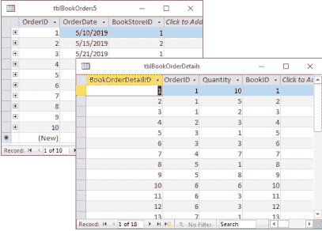

开发人员使用书店表时，能够利用查询以新的、有趣的方式重新组合四个表中的数据。很容易确定不同客户订购了多少种类型的书籍，或某本书被订购了多少次。当与包含书籍单位成本、书籍售价等信息的表结合时，图书批发商的重要财务状况变得清晰。

还请注意，tblBookOrders5 中的记录数量已减少。这是使用关系数据库的诸多优势之一。每个表仅包含表示该表所描述的实体（在本例中为图书订单）所必需的数据。这比为添加到表中的每个新记录添加重复的字段值要高效得多（请参阅图 4.2）。

## Breaking the rules

有时，你可能需要打破规则。例如，假设书店有权根据过去一年的采购量获得折扣。严格遵循规范化规则，折扣百分比应包含在 tblBookstores 表中。毕竟，折扣取决于客户，而不是订单。

但也许应用于每个订单的折扣是 somewhat 任意的。也许图书批发商允许销售人员为重视的客户提供特殊优惠。在这种情况下，你可能希望在包含图书订单信息的表中加入 Discount 列，即使这意味着在许多记录中重复信息。你可以将传统折扣作为客户记录的一部分存储在 tblBookstores 中，并将其用作 Discount 列的默认值，但允许销售人员在与客户达成特殊安排时覆盖折扣值。

事实上，这看起来只是违反了第二范式。默认折扣直接取决于客户。实际给予的折扣直接取决于订单。类似的情况也可能存在于收货地址。客户可能让大部分订单寄送给自己，但偶尔可能希望将订单直接寄送给他们的客户。客户的收货地址直接与客户相关，而订单实际发货的地址直接与订单相关。充当事务表中默认值的主体表中的值在大型数据库中很常见。

请参阅第 3 章，了解有关对象表和事务表的讨论。

## Third normal form

规范化的最后一步称为第三范式（3NF），要求删除所有可以从表中其他字段或数据库中其他表中的数据派生的字段。例如，假设销售经理坚持要求你在 Orders 表中添加一个字段来包含订单中的图书总数。当然，此信息将从 tblBookOrderDetails 中的 Quantity 字段计算得出。

实际上，没有必要将新的 OrderTotal 字段添加到 Orders 表中。Access 可以轻松地从数据库中可用的数据计算出该值。存储订单总额作为数据库的一部分的唯一优势是节省 Access 在检索和计算信息时所需的几毫秒，而计算数据又被窗体或报表需要时使用。

删除计算数据可保持数据库中数据的完整性。图 4.7 显示了与 OrderID 为 1 的订单相关的 tblBookOrderDetails 中的三条记录。对 Quantity 字段求和，你可以看到订购了 22 本书。如果存在 OrderTotal 字段并且总额错误地输入为 33 而不是 22，数据将不一致。使用 OrderTotal 字段显示订购图书总数的报表将显示与基于 Details 表的报表不同的数字。

根据你构建的应用程序，你可能会发现存储计算数据的充分理由，特别是如果执行计算是一个冗长的过程，或者如果存储的值作为报表上打印的计算值的审计检查是必要的。在数据录入期间（数据一次处理一条记录时）执行计算可能比在打印报表时（处理数千条记录以生成单个报表时）更有效。

正如你将在本章后面“反规范化”部分阅读的那样，有一些很好的理由可以让你选择在数据库表中包含计算字段。正如本节所述，最常见的是反规范化的决定是基于确保存储在数据库中的计算值与报表上打印的值相同的需求。

> Tip
> 尽管更高级别的规范化是可能的，但你会发现，对于大多数数据库应用程序而言，第三范式已经足够了。至少，你应该始终努力使你的表达到第一范式，通过将冗余或重复数据移至另一个表。

## More on Anomalies

关于更新异常的问题很重要。规范化数据库中表的整个目的是以最小的维护工作实现最大性能。
未规范化的数据库设计可能导致三种类型的错误。遵循本章概述的规则将帮助你避免以下陷阱：

- **Insertion anomaly:** 在向另一个表添加新记录时，相关表中发生错误。例如，假设你已添加上一节中描述的 OrderTotal 字段。订单处理后，客户来电更改了订购的图书数量或向同一订单添加了新的书名。除非你仔细设计数据库以自动更新计算的 OrderTotal 字段，否则该字段中的数据在将新数据插入表时将出错。

如果插入异常在你的应用程序中是一个问题，你可能能够使用宏（参见第 22 章）来帮助在更改时同步表中的数据。

- **Deletion anomaly:** 删除异常会导致在从表中删除记录时意外丢失数据。假设 tblBookOrders3 表包含每个书店的名称、地址和其他联系信息。删除包含特定客户订单的最后一条剩余记录会导致客户的联系信息被无意中丢失。将客户联系信息保存在单独的表中可保留并保护该数据免于意外丢失。避免删除异常是不在表中使用级联删除的一个很好的理由。（有关级联删除的更多信息，请参阅本章后面“表关系”部分。）

- **Update anomaly:** 存储不依赖于表主键的数据会导致在独立信息更改时必须更新多行。将独立数据（例如书店信息）保存在自己的表中意味着只需要更新该信息的一个实例。

需要记住的一点是，反规范化几乎总是为了报告或性能目的而进行的，而不是仅仅为了在表中维护数据。考虑一种情况，客户获得了与传统折扣不对应的特殊折扣。将实际开具给客户的金额存储起来，而不是依赖数据库在每次打印报表时计算折扣，这可能非常有用。存储实际金额可确保报表始终反映开具给客户的金额，而不是报告一个取决于数据库中可能随时间变化的其他字段的值。

## Table Relationships

许多人开始使用 Excel 等电子表格应用程序来构建数据库。不幸的是，电子表格将数据存储为二维工作表（行和列），没有简单的方法将各个工作表连接在一起。你必须手动将工作表中的每个单元格连接到其他工作表中的相应单元格——这是一个繁琐的过程。

像工作表这样的二维存储对象称为 *flat-file databases*，因为它们缺乏关系数据库的三维特性。图 4.8 显示了用作平面文件数据库的 Excel 工作表。

## FIGURE 4.8

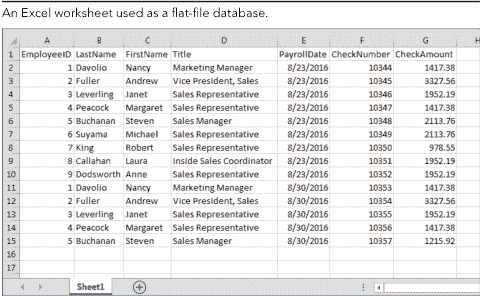


平文件数据库的问题从查看图 4.8 就应该立刻显而易见。请注意，员工信息在工作表的多行中被重复了。每次向员工发放工资支票时，工作表就会增加一行新记录。显然，这个工作表会迅速变得庞大且难以管理。

考虑一下对图 4.8 中数据进行相对简单更改所需的工作量。例如，更改员工的职称需要搜索大量记录并编辑单个单元格中的数据，从而产生许多出错的机会。

通过在 Excel VBA 语言中进行巧妙编程，可以将图 4.8 所示工作表中的数据与包含工资单明细信息的另一张工作表链接起来。也可以以编程方式更改单行中的数据。但当你利用 Access 等关系数据库的强大功能时，就无需进行如此出色的努力了。

## 连接数据

表的主键唯一标识表中的记录。在员工数据表中，员工的社保号码、名字和姓氏的组合或员工 ID 都可作为主键使用。假设员工 ID 被选为 Employees 表的主键。当与 Payroll 表建立关系时，EmployeeID 字段用于将表连接在一起。图 4.9 显示了这种安排（见本章后面“ 一对多 ”部分）。

关于使用自然键（例如社保号码）的问题在后面本章“ 自然主键与代理主键 ”部分进行了讨论。

尽管在图 4.9 中看不到关系，但 Access 知道它存在，因为已在 tblEmployees 和 tblPayroll 之间建立了关系。（该过程在后面本章“ 创建关系并强制参照完整性 ”部分进行了描述。）由于这些表之间的关系，Access 能够即时检索 tblEmployees 中任何员工在 tblPayroll 中的所有记录。

图 4.9 中显示的关系示例，即 tblEmployees 的每条记录与 tblPayroll 中的多条记录相关，是关系数据库系统中最常见的类型，但绝不是表间数据关联的唯一方式。本书以及大多数关于关系数据库（如 Access）的书籍讨论了表之间三种基本的关系类型：

- 一对一
- 一对多
- 多对多

图 4.10 显示了 Collectible Mini Cars 数据库中的大部分关系。

## FIGURE 4.9

Employees 表与 Payroll 表之间的关系是典型的 一对多 关系的示例。

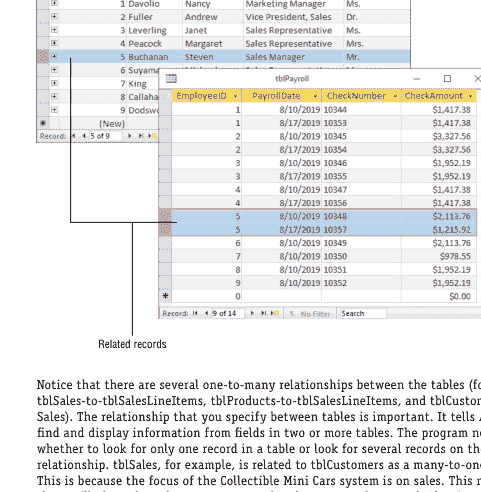

相关记录

请注意，表之间存在多个 一对多 关系（例如，tblSales-to-tblSalesLineItems、tblProducts-to-tblSalesLineItems 和 tblCustomers-to-tblSales）。你在表之间指定的关系很重要。它告诉 Access 如何从两个或多个表中的字段查找和显示信息。程序需要知道是根据关系在表中查找一条记录还是查找多条记录。例如，tblSales 与 tblCustomers 的关系是 多对一 关系。这是因为 Collectible Mini Cars 系统的重点是销售。这意味着每条销售记录都将始终只与一个客户相关。也就是说，一个客户可以关联多笔销售。在这种情况下，Collectible Mini Cars 系统实际上将 tblCustomers 用作查找表。

### 1.1 线性规划

线性规划是运筹学的一个重要分支，它研究在线性约束条件下，使线性目标函数达到最优值的问题。线性规划广泛应用于经济管理、交通运输、工农业生产等各个领域，是科学管理的重要手段之一。

线性规划问题的一般形式为：

max (或 min) z = c₁x₁ + c₂x₂ + ... + cₙxₙ

s.t. a₁₁x₁ + a₁₂x₂ + ... + a₁ₙxₙ ≤ (或 =, ≥) b₁

a₂₁x₁ + a₂₂x₂ + ... + a₂ₙxₙ ≤ (或 =, ≥) b₂

...

aₘ₁x₁ + aₘ₂x₂ + ... + aₘₙxₙ ≤ (或 =, ≥) bₘ

x₁, x₂, ..., xₙ ≥ 0

其中，xⱼ (j = 1, 2, ..., n) 为决策变量；cⱼ 为目标函数系数；aᵢⱼ 为约束条件系数；bᵢ 为约束条件右端常数。

满足所有约束条件的解称为可行解，使目标函数达到最优值的可行解称为最优解。

线性规划问题的求解方法主要有图解法、单纯形法、对偶单纯形法等。其中，单纯形法是求解线性规划问题最常用的方法。

在实际应用中，线性规划模型可以帮助决策者在资源有限的情况下，合理分配资源，实现利润最大化或成本最小化等目标。

## FIGURE 4.11

一对一 关系。

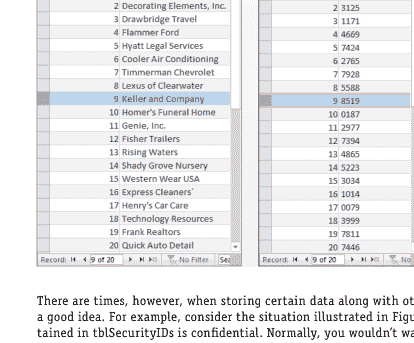

然而，有时将某些数据与表中的其他数据一起存储并不是一个好主意。例如，考虑图 4.11 所示的情况。tblSecurityIDs 中包含的数据是保密的。通常，你不希望有权访问公共客户信息（姓名、地址等）的人能够访问客户用于购买或计费目的的保密安全代码。如果需要，tblSecurityIDs 可以位于网络上其他地方的不同磁盘上，甚至可以保存在可移动介质上以防止未经授权的访问。

一对一 关系的另一个实例是称为子类型的情况。例如，你的数据库可能包含一个 Customers 表和一个 Vendors 表。如果你的客户和供应商都是企业，则两个实体的许多信息可能相似。在这种情况下，你可能更喜欢有一个 Companies 表，其中包含所有相似的数据，例如 CompanyName、Address 和 TaxIdentificationNumber。然后你的 Customers 和 Vendors 表将包含对 Companies 表的引用，并分别包含特定于客户和供应商的额外字段。客户和供应商实体是公司的子类型，并且是一对一相关的。

一对一 关系的一个常见情况是数据在数据库之间传输或共享。也许组织中的发货员不需要查看客户的所有数据。与其包含无关信息——例如职位、出生日期、备用电话号码和电子邮件地址——发货员的数据库只包含客户的姓名、地址和其他发货信息。记录中

关系，通过链接表（称为连接表）连接。连接表与参与多对多关系的两个表都有 一对多 关系。这一原则起初可能有点令人困惑，但仔细检查图 4.13 很快就会揭示这种安排的美妙之处。

在图 4.13 中，你可以看到 Jeffrey Walker（StudentID 12）同时属于园艺俱乐部和摄影俱乐部（ClubID = 2 和 ClubID = 3），这是一个学生属于多个俱乐部的示例。你还可以看到法语俱乐部（ClubID = 4）有 Barry Williams 和 David Berry（StudentIDs 7 和 9），这是一个俱乐部拥有多个学生的示例。每个学生都属于多个俱乐部，每个俱乐部都包含多个成员。

## FIGURE 4.13

学生数据库及其所属俱乐部是 多对多 关系的示例。

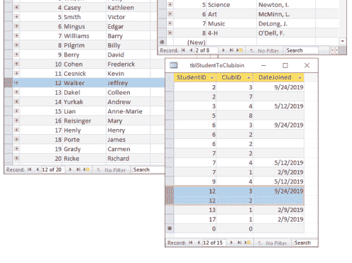

由于连接表的额外复杂性，多对多 关系通常被认为更难建立和维护。幸运的是，如果遵循一些规则，Access 使建立此类关系变得容易。这些规则在本书记载在各个地方进行了说明。例如，为了更新多对多 关系的任一侧（例如更改学生的俱乐部成员资格），连接表必须包含由关系连接的两个表的主键。

多对多 关系在商业环境中很常见：

- **律师与客户（或医生与患者）：** 每位律师可能参与多个案件，而每个客户可能由一个案件中的多个律师代理。
- **患者和保险覆盖：** 许多人由不止一个保险单承保。例如，如果你和你的配偶都由雇主提供医疗保险，那么你就有多个保险覆盖。
- **视频租赁和客户：** 在一年时间内，每部视频都被多个人租借，而每个客户在一年内租借多部视频。
- **杂志订阅：** 大多数杂志的发行量以数千或数百万计。大多数订阅杂志的人同时订阅不止一种杂志。

Collectible Mini Cars 数据库在 tblCustomers 和 tblSalesPayments 之间存在 多对多 关系，通过 tblSales 链接。每个客户可能购买了不止一件商品，而每件商品可能通过多笔付款支付。除了连接联系人和销售付款外，tblSales 还包含其他信息，例如销售日期和发票号码。多对多 关系中的连接表通常包含有关所连接数据的相关信息。

如图所示，图 4.13 连接表可以包含除它们所连接表的键以外的信息。tblStudentToClubJoin 表包含一个字段，用于记录相关学生加入相关俱乐部的日期。

## 完整性规则

Access 允许你应用参照完整性规则，以保护数据免受丢失或损坏。参照完整性意味着表之间的关系在更新、删除和其他记录操作期间得以保留。关系模型定义了若干旨在强制执行关系数据库参照完整性要求的规则。此外，Access 还包含由 ACE 数据库引擎强制执行的一套自己的参照完整性规则。

想象一个工资应用程序，其中没有任何规则来规范数据库中数据的使用方式。例如，发放与员工无关的工资支票是可能的。从商业角度来看，向“幽灵”员工发放工资单是一个非常严重的情况。最终，当审计员介入并通知管理层存在差异时，该问题将被注意到。

参照完整性严格基于表的主键字段。参照完整性意味着数据库引擎在每次对键字段（无论是主键


或外键)被添加、更改或删除时。如果对键字段中的值进行更改使关系无效，则称其违反了引用完整性。表可以设置成自动强制执行引用完整性。

图 4.14 说明了 Customers 表与 Sales 表之间的关系。tblCustomers 通过 CustomerID 字段与 tblSales 相关。tblCustomers 中的 CustomerID 字段是主键，而 tblSales 中的 CustomerID 字段是外键。该关系将每个客户与其销售发票连接起来。在此关系中，tblCustomers 是父表，而 tblSales 是子表。

孤立记录在数据库应用程序中是非常糟糕的。因为销售信息几乎总是按哪些产品卖给了哪些客户来报告，所以未链接到有效客户的销售发票在大多数情况下都不会被发现。很容易知道哪些产品卖给了 Fun Zone，但对于任意销售记录，可能并不容易知道购买者没有有效的客户。在图 4.14 中，与 Fun Zone 相关的发票记录通过在 tblSales 中围绕数据绘制的框来表示。

## FIGURE 4.14

典型的数据库关系。

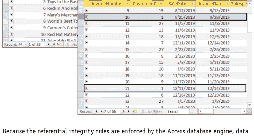

由于引用完整性规则由 Access 数据库引擎强制执行，因此无论数据在数据库中出现在表、查询还是窗体中，数据完整性都得到保证。

一旦您确定了应用程序的完整性要求，就不必担心相关表中的数据会丢失或变得杂乱无章。

我们不能过分强调数据库应用程序中引用完整性的必要性。许多开发人员认为他们可以使用 VBA 代码或用户界面设计来防止孤立记录。事实是，在大多数数据库中，存储在特定表中的数据可能在应用程序内的许多不同位置使用，甚至在也使用该数据的其他应用程序中使用。此外，鉴于许多数据库项目会延续多年，并且涉及任意数量的开发人员，不总是可能回忆起数据应如何受保护。确保存储在任何数据库系统中的数据完整性的最佳方法，莫过于利用数据库引擎的力量来强制执行引用完整性。

一般关系模型引用完整性规则确保关系表中的记录不会丢失或混淆。出于明显的原因，连接表的键必须得到保护和保留。此外，对会影响其他表的表进行的更改（例如，删除“一”侧一对多关系中的记录）应传播到与第一个表相连的其他表。否则，两个表中的数据很快就会不同步。

## No primary key can contain a null value

第一个引用完整性规则规定主键不能包含空值。空值是指根本不存在的值。字段从未被分配值（甚至默认值）的字段的值为空。数据库表中的任何一行在其主键中都不能为空，因为主键的主要目的是保证行的唯一性。显然，空值不能是唯一的，如果主键可以为空，关系模型将无法工作。Access 不允许您将已包含空值的字段设为主键。

此外，Access 无法评估空值。因为空值不存在，所以它无法与任何其他值进行比较。它不比任何其他值大或小；它根本不存在。因此，空值不能用于查找表或在两个表之间形成关系。

Access 自动强制执行第一个引用完整性规则。当您向表添加数据时，如果不生成警告，就不能将主键字段留空（AutoNumber 字段之所以作为主键效果很好，这是一个原因）。一旦您将 Access 表中的一个字段指定为主键，Access 就不会让您删除该字段中的数据，也不会让您更改该字段中的值使其与另一条记录中的值重复。

当使用由多个字段组成的复合主键时，复合键中的所有字段都必须包含值。没有任何一个字段被允许为空。复合主键中值的组合必须是唯一的。

## All foreign key values must be matched by corresponding primary keys

第二个引用完整性规则说，所有外键值必须由相应的主键匹配。这意味着一对多关系中“多”侧（或子侧）表中的每条记录都必须在关系“单”侧（或父侧）表中有相应的记录。“多”侧的关系记录如果没有“单”侧的相应记录，则称为孤立记录，并且实际上从数据库模式中删除。在数据库中识别孤立记录可能非常困难，因此最好一开始就避免这种情况。

第二条规则意味着以下内容：

- 不能向“多”侧表（子表）添加行，如果“单”侧（父表）不存在相应的记录。如果子记录包含 ParentID 字段，则 ParentID 值必须与父表中的现有记录匹配。
- “单”侧表中的主键值如果更改会导致孤立子记录，则不能更改。
- 删除“单”侧的行不得使“多”侧的相应记录孤立。

例如，在销售示例中，tblSales（“多”侧）中每条记录的外键必须与 tblCustomers 中的主键匹配。您不能在不删除 tblSales 中相应记录的情况下删除 tblCustomers（“单”侧）中的记录。

引用完整性规则的一个有趣结果是，完全有可能存在没有子记录匹配的父记录。直观上，这是有道理的。公司可能确实有尚未发放工资的员工。或者 Collectible Mini Cars 公司可能雇佣了一名尚未做出任何销售的新员工。当然，最终大多数父记录都会由一个或多个子记录匹配，但这并不是关系数据库的要求。

正如您将在下一节中看到的，Access 使您能够轻松指定要在应用程序中采用的完整性规则。然而，您应该意识到，不使用引用完整性规则意味着您可能会最终出现孤立记录和其他数据完整性问题。

## Keys

当您创建数据库表（如第 3 章中创建的表）时，您应该为每个表分配一个主键。此键是一种确保表记录仅包含一个唯一值的方法；例如，您可能有几位名为 Michael Heinrich 的联系人，而且您

## Part II: Understanding Access Tables

甚至可能有不止一位 Michael Heinrich（例如父子）住在同一个地址。因此，在这种情况下，您必须决定如何创建 Customers 数据库中的记录，以便让您能够单独识别每个 Michael Heinrich。

唯一标识表中的每条记录正是主键字段的作用。例如，以 Collectible Mini Cars 为例，CustomerID 字段（您分配给每个下订单客户的唯一编号）是 tblCustomers 中的主键——表中的每条记录都有不同的 CustomerID 编号。（没有两条记录具有相同的编号。）这很重要，原因如下：

- 您不希望 tblCustomers 中为同一客户有两条记录，因为这可能使更新客户记录几乎不可能。
- 您希望确保表中的每条记录都是准确的，以便从表中提取的信息是准确的。
- 您不希望使表（及其记录）比必要的大。添加冗余或重复的字段和记录只会使数据库复杂化，而不会增加价值。

能够为每条记录分配一个单一、唯一的值，使表变得干净可靠。这被称为实体完整性。通过在每条记录中拥有不同的主键值（如 tblCustomers 中的 CustomerID），即使记录中的其他所有字段都相同，您也可以区分两条记录（在这种情况下是客户）。这很重要，因为您很容易在表中拥有两个姓名相同的个人客户，例如 Fred Smith。

理论上，您可以使用客户的姓名和地址，但两个名为 Fred D. Smith 的人可能住在同一个城镇和州，或者父子（Fred David Smith 和 Fred Daniel Smith）可能住在同一个地址。设置主键的目标是创建表中保证唯一性的独立记录。

如果在创建 Access 表时未指定主键，Access 会询问您是否想要一个。如果您说“是”，Access 会使用 AutoNumber 数据类型为表创建一个主键。每次向表添加记录时都会自动插入 AutoNumber 字段，并且一旦其值确定就不能更改。此外，一旦 AutoNumber 值出现在表中，该值永远不会被重用，即使包含该值的记录被删除并且该值不再出现在表中。事实上，因为 AutoNumber 字段在其他任何数据之前添加到新记录中，如果新行因某种原因未保存，则新的 AutoNumber 根本不会在表中使用。

## Deciding on a primary key

正如您之前学到的那样，一个表通常有一个字段（或字段组合）——该表的主键——使每条记录唯一。主键是一个标识符，通常是文本、数字或 AutoNumber 数据类型。要确定此 ID 字段的内容，您需要指定一种为该字段创建唯一值的方法。您的方法可以简单到让 Access 自动分配 AutoNumber 值或使用第一个字母


of the real value you're tracking along with a sequence number (such as A001, A002, A003, B001, B002, and so on). The method may rely on a random set of letters and numbers for the field content (as long as each field has a unique value) or a complicated calculation based on information from several fields in the table.

However, there is no reason why the primary key value has to be meaningful to the application. A primary key exists in a table solely to ensure uniqueness for each row and to provide an anchor for table relationships. Many Access developers routinely use AutoNumber fields as primary keys simply because they meet all the requirements of a primary key without contributing to an application's complexity.

In fact, meaningful primary keys can cause confusion as the data in the table changes. For example, if the primary key for a table of employee information is the first letter of the employee's last name plus a sequential number, then Jane Doe might have an EmployeeID of D001. If Jane were to get married and change her last name, her EmployeeID would no longer be consistent with the data in her record. Her EmployeeID may still be unique, but it may also cause confusion if someone were to rely on that data.

Table 4.1 lists the Collectible Mini Cars tables and describes one possible plan for deriving the primary key values in each table. As this table shows, it doesn't take a great deal of work (or even much imagination) to derive a plan for key values. Any rudimentary scheme with a good sequence number always works. Access automatically tells you when you try to enter a duplicate key value. To avoid duplication, you can simply add the value of 1 to the sequence number.

## TABLE 4.1 Deriving the Primary Key

| Table | Possible Derivation of Primary Key Value |
|---|---|
| tblCustomers | Companies: AutoNumber field assigned by Access |
| tblSales | Invoice Number: AutoNumber field |
| tblSalesLineItems | Invoice Number (from Sales) and an AutoNumber field |
| tblProducts | Product Number, entered by the person putting in a new product |
| tblSalesPayments | Invoice Number (from Sales) and an AutoNumber field |
| tblSalesperson | Sales Person ID: AutoNumber field |
| tblCategories | Category of Items: Entered by the person putting in a new record |

Even though it isn't difficult to use logic (implemented, perhaps, though VBA code) to generate unique values for a primary key field, by far the simplest and easiest approach is to use AutoNumber fields for the primary keys in your tables. The special characteristics of the AutoNumber field (automatic generation, uniqueness, the fact that it can't be changed, and so on) make it the ideal candidate for primary keys. Furthermore, an AutoNumber value is nothing more than a 4-byte integer value, making it very fast and easy for the database engine to manage. For all these reasons, the Collectible Mini Cars exclusively uses AutoNumber fields as primary keys in its tables.

> NOTE
> AutoNumber fields are guaranteed to be unique, but they are not guaranteed to be sequential. There are a number of reasons why gaps in AutoNumbers can be introduced, such as deleting records, and you should never rely on AutoNumbers being sequential.

You may be thinking that all these sequence numbers make it hard to look up information in your tables. Just remember that, in most cases, you never look up information by an ID field. Generally, you look up information according to the purpose of the table. In tblCustomers, for example, you would look up information by customer name—last name, first name, or both. Even when the same name appears in multiple records, you can look at other fields in the table (zip code, phone number) to find the correct customer. Unless you just happen to know the customer ID number, you’ll probably never use it in a search for information.

## Looking at the benefits of a primary key

Have you ever placed an order with a company for the first time and then decided the next day to increase your order? When you call the people at the order desk, they may ask you for your customer number. You tell them that you don’t know your customer number. Next, they ask you for some other information—generally, your zip code and last name. Then, as they narrow down the list of customers, they ask your address. Once they’ve located you in their database, they can tell you your customer number. Some businesses use phone numbers or e-mail addresses as starting points when searching for customer records.

> Primary and foreign keys are discussed in Chapter 1, but because these concepts are so important in database applications, they’re covered again in this chapter.

Database systems usually have more than one table, and the tables are related in some manner. For example, in the Collectible Mini Cars database, tblCustomers and tblSales are related to each other through the CustomerID field. Because each customer is one person or organization, you only need one record in tblCustomers.

Each customer can make many purchases, however, which means you need to set up a second table to hold information about each sale—tblSales. Again, each invoice is one sale (on a specific day at a specific time). CustomerID is used to relate the customer to the sales.

A foreign key in the child table (the CustomerID field in the tblSales table) is related to the primary key in the parent table (CustomerID in tblCustomers).

Besides being a common link field between tables, the primary key field in an Access database table has the following advantages:

- Primary key fields are always indexed, greatly speeding up queries, searches, and sorts that involve the primary key field.
- Access forces you to enter a value (or automatically provides a value, in the case of AutoNumber fields) every time you add a record to the table. You're guaranteed that your database tables conform to the rules of referential integrity.
- As you add new records to a table, Access checks for duplicate primary key values and prevents duplicate entries, thus maintaining data integrity.
- By default, Access displays your data in primary key order.

> TIP
> An index is a special internal file that is created to put the records in a table in some specific order. For example, the primary key field in tblCustomers is an index that puts the records in order by CustomerID field. Using an indexed table, Access uses the index to quickly find records within the table.

## Designating a primary key

From the preceding sections, you're aware that choosing a table's primary key is an important step toward bulletproofing a database's design. When properly implemented, primary keys help stabilize and protect the data stored in your Access databases. As you read the following sections, keep in mind that the cardinal rule governing primary keys is that the values assigned to the primary key field within a table must be unique. Furthermore, the ideal primary key is stable.

## Single-field versus composite primary keys

Sometimes, when an ideal primary key doesn't exist within a table as a single value, you may be able to combine fields to create a composite primary key. For example, it's unlikely that a first name or last name alone is enough to serve as a primary key, but by combining first and last names with birth dates, you may be able to come up with a unique combination of values to serve as the primary key. As you'll see in the "Creating relationships and enforcing referential integrity" section later in this chapter, Access makes it very easy to combine fields as composite primary keys.

There are several practical considerations when using composite keys:

- None of the fields in a composite key can be null.
- Sometimes building a composite key from data naturally occurring within the table can be difficult. Sometimes records within a table differ by one or two fields, even when many other fields may be duplicated within the table.
- Each of the fields can be duplicated within the table, but the combination of composite key fields cannot be duplicated.


然而，复合键存在许多问题：

- **复合键往往会复杂化数据库的设计。** 如果在父表中使用三个字段来定义主键，那么这三个字段也必须出现在每个子表中。
- **确保复合键中的所有字段都有值（即任何字段都不能为空）** 可能相当具有挑战性。

> **提示**
> 大多数开发人员除非万不得已，否则都会避免使用复合键。在许多情况下，与复合键相关的问题远远超过使用由记录中数据生成的复合键所带来的那一点微不足道的好处。

## 自然主键与代理主键

许多开发人员坚持认为只应使用自然主键。自然主键来源于表中已有的数据，例如社会保障号码或员工编号。如果没有单个字段足以唯一标识表中的记录，这些开发人员建议组合字段以形成复合主键。

然而，在很多情况下，数据库表中并不存在“完美”的自然键。尽管像社会保障号码这样的字段似乎是最理想的主键，但这种类型的数据存在诸多问题：

- **该值并非普遍存在。** 并非每个人都有社会保障号码。
- **在记录添加到数据库时，该值可能未知。** 由于主键永远不能为 null，因此必须提供某种“临时”主键以备社会保障号码未知时使用，而一旦该值变为已知，还必须采取其他措施来修正父表和子表中的数据。
- **诸如社会保障号码之类的值往往相当长。** 社会保障号码至少有九个字符，即使省略数字组之间的破折号也是如此。较大的主键会不必要地使事情复杂化，并且运行速度比更小的主键更慢。
- **法律和隐私问题限制了其使用。** 社会保障号码被视为“个人身份信息”，并且（在美国）根据2005年《社会保障保护法》，其使用受到限制。

> **警告**
> 到目前为止，最大的问题是，除非在将记录提交到数据库时已知主键值，否则无法向表中添加记录。即使在知道永久值之前插入了临时值，相关表所需的修正量也可能相当可观。毕竟，除非在关系上启用了级联更新，否则如果其他表中存在相关的子记录，就无法更改主键的值。

尽管自动编号值并非自然存在于表的数据中，但由于使用自动生成且无法删除或更改的简单数值具有相当大的优势，在大多数情况下，自动编号是大多数表理想的主键候选。

## 创建主键

创建主键的方法是在设计视图中打开表，选择要用作主键的字段，然后点击功能区“表工具设计”选项卡上的“主键”按钮。如果要指定多个字段来创建复合键，请在点击“主键”按钮之前，按住 Ctrl 键并用鼠标选择这些字段。

设置表的主键在第3章中有详细介绍。

## 创建关系并实施参照完整性

“关系”窗口允许您建立要应用于关系中所涉及表的关系和参照完整性规则。在 Access 表之间创建确保参照完整性的永久、受管关系很容易：

- 1. **选择“数据库工具 ⇨ 关系”。** 将出现“关系”窗口。
- 2. **点击功能区上的“显示表”按钮，或右键单击“关系”窗口并从快捷菜单中选择“显示表”。** 将出现“显示表”对话框（如图4.15所示）。

### 图4.15

双击表名以将其添加到“关系”窗口中。

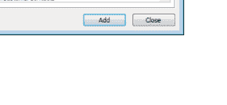

- 3. **将 tblBookOrders5 和 tblBookOrderDetails 添加到“关系”窗口中**（在“显示表”对话框中双击每个表，或选择每个表并点击“添加”按钮）。
- 4. **通过将“一”表中的主键字段拖放到“多”表中的外键上来创建关系。** 或者，将外键字段拖放到主键字段上。

在本示例中，将 tblBookOrders5 中的 OrderID 拖放到 tblBookOrderDetails 中的 OrderID 上。Access 会立即打开“编辑关系”对话框（如图4.16所示），使您能够指定打算在表之间形成的关系的详细信息。请注意，Access 会将 tblBookOrders5 与 tblBookOrderDetails 之间的关系识别为一对多。

- 5. **勾选“实施参照完整性”复选框。** 在图4.16中，请注意“级联删除相关记录”复选框。如果此复选框未被选中，Access 将不允许您删除 tblBookOrders5（“一”表）中的记录，除非 tblBookOrderDetails（“多”表）中所有对应的记录先被删除。如果勾选此复选框，则跨关系的删除将自动“级联”。级联删除可能是一项危险的操作，因为“多”表中的删除操作不会经过确认。

### 图4.16

您在“编辑关系”对话框中实施参照完整性。

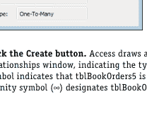

- 6. **点击“创建”按钮。** Access 会在“关系”窗口中显示的表之间绘制一条线，指示关系的类型。在图4.17中，1 符号表示 tblBookOrders5 是关系的“一”侧，而无穷大符号（∞）表示 tblBookOrderDetails 是“多”侧。

### 图4.17

tblBookOrders5 与 tblBookOrderDetails 之间的一对多关系。

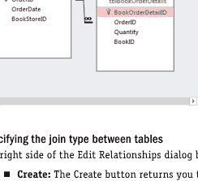

## 指定表之间的联接类型

“编辑关系”对话框的右侧有四个按钮：

- **创建：** “创建”按钮使您返回到“关系”窗口，并应用所指定的更改。
- **取消：** “取消”按钮取消当前更改并返回到“关系”窗口。
- **联接类型：** “联接类型”按钮打开“联接属性”对话框。
- **新建：** “新建”按钮使您能够指定两个表和字段之间全新的关系。

默认情况下，当您对相关表执行查询时，Access 仅返回同时出现在两个表中的记录。考虑到本章前面“完整性规则”部分中的工资单示例，这意味着您只会看到在工资单表中有有效工资记录的员工。您不会看到任何尚未收到工资的员工。这种关系有时称为内联接，因为出现的记录只是那些存在于关系两侧的记录。

然而，内联接并不是 Access 支持的唯一联接类型。点击“联接类型”按钮以打开“联接属性”对话框。“联接属性”对话框中的替代设置允许您指定希望查看父表或子表中的所有记录，无论它们是否在另一侧匹配。（只要子表中的外键为 null，就可能存在未匹配的子记录。）这种联接（称为外联接）可能非常有用，因为它能准确反映应用程序中的数据状态。

## 第二部分：理解 Access 表

在收藏迷你汽车示例中，您希望看到所有客户，无论他们是否在销售表中有记录。要指定连接客户与销售的外联接，请执行以下步骤：

- 1. 从“关系”窗口中，添加 tblCustomers 和 tblSales。
- 2. 将一个表中的 CustomerID 拖放到另一个表上。将出现“编辑关系”对话框。
- 3. 点击“联接类型”按钮。将出现“联接属性”对话框（如图4.18所示）。
- 4. 选择“包括 'tblCustomers' 中的所有记录，以及 'tblSales' 中联接字段相等的那些记录”选项按钮。

### 图4.18

“联接属性”对话框，用于设置 tblCustomers 和 tblSales 之间的联接属性。请注意，它指定了客户表中的所有记录。

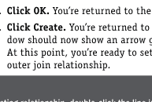

- 5. 点击“确定”。您将返回到“编辑关系”对话框。
- 6. 点击“创建”。您将返回到“关系”窗口。“关系”窗口现在应显示一条从客户表指向销售表的箭头。此时，您就可以在外联接关系上设置两个表之间的参照完整性了。

> 提示
> 要更改现有关系，请在“关系”窗口中双击要更改的关系对应的线条。将出现“编辑关系”对话框，您可以更改参照完整性和联接类型设置。

鉴于图4.18中显示的联接属性，只要客户表和销售表参与查询，默认情况下就会返回所有客户记录，即使某位客户尚未下任何订单。此设置应能让您更完整地了解公司的客户群，而不是将返回的记录限制为已下订单的客户。

并非必须为数据库中的每个关系都建立联接类型。在接下来的章节中，您将看到可以在每个查询中指定外联接。


application. Many developers choose to use the default inner join for all the relationships in their databases and to adjust the join properties on each query to yield the desired results.

## Enforcing referential integrity

After using the Edit Relationships dialog box to specify the relationship, to verify the table and related fields, and to specify the type of join between the tables, you should set referential integrity between the tables. Select the Enforce Referential Integrity check box in the lower portion of the Edit Relationships dialog box to indicate that you want Access to enforce the referential integrity rules on the relationship between the tables.

> CAUTION
> If you choose not to enforce referential integrity, you can add new records, change key fields, or delete related records without warnings about referential integrity violations—thus, making it possible to change critical fields and damaging the application’s data. With no integrity active, you can create tables that have orphans (Sales without a Customer). With normal operations (such as data entry or changing information), referential integrity rules should be enforced.

Enforcing referential integrity also enables two other options that you may find useful—cascading updates and cascading deletes. These options are near the bottom of the Edit Relationships dialog box (refer to Figure 4.16).

> NOTE
> You might find, when you select Enforce Referential Integrity and click the Create button (or the OK button if you’ve reopened the Edit Relationships dialog box to edit a relationship), that Access won’t allow you to create a relationship and enforce referential integrity. The most likely reason for this behavior is that you’re asking Access to create a relationship that violates referential integrity rules, such as a child table with orphans in it. In such a case, Access warns you by displaying a dialog box similar to the one shown in Figure 4.19. The warning happens in this example because there are some records in the Sales table with no matching value in the Salesperson table. This means that Access can’t enforce referential integrity between these tables because the data within the tables already violates the rules.

> TIP
> To solve any conflicts between existing tables, you can create a Find Unmatched query by using the Query Wizard to find the records in the "many" table that violate referential integrity. Then you can convert the Unmatched query to a Delete query to delete the offending records or add the appropriate value to the SalespersonID field.

You could remove the offending records, return to the Relationships window, and set referential integrity between the two tables. Whether it’s appropriate to clean up data by deleting records depends entirely on the business rules governing the application. Deleting orders just because referential integrity can’t be enforced would be considered a bad idea in most environments.

Perhaps you can already see the main problem with cascading deletes. If all of a customer's sales records are deleted when the customer record is deleted, you have no way of properly reporting sales for the period. You couldn't, for instance, reliably report on the previous year's sales figures because all the sales records for "retired" customers have been deleted from the database. Also, in this particular example, you would lose the opportunity to report on sales trends, product category sales, and a wide variety of other uses of the application's data.

It would make much more sense to use an Active field (Yes/No data type) in the Customers table to indicate which customers are still active. It would be quite easy to include the Active field in queries where only current customers are needed (Active = Yes) and ignore the Active field in queries where all sales (regardless of the customer's active status) are required.

> Tip
> To use the Cascade Delete Related Records option, you must specify Cascade Delete Related Records for all the table's relationships in the database. If you don't specify this option for all the tables in the chain of related tables, Access won't cascade deletions.

In general, it's probably not a good idea to enable cascading deletes in a database. It's far too easy to accidentally delete important data. Consider a situation where a user accidentally deletes a customer, wiping out the customer's entire sales history, including payments, shipping, backorders, promotions, and other activities. There are very few situations where users should be permitted to delete many different types of data as a single action.

## Viewing all relationships

With the Relationships window open, click All Relationships on the Relationship Tools Design tab of the Ribbon to see all the relationships in the database. If you want to simplify the view you see in the Relationships window, you can "hide" a relationship by deleting the tables you see in the Relationships window. Click a table, press the Delete key, and Access removes the table from the Relationships window. Removing a table from the Relationships window doesn't delete any relationships between the table and other tables in the database.

When building database tables, make sure that the Required property of the foreign key field in the related table (in the case of tblBookOrders and tblBookOrderDetails, the foreign key is OrderID in tblBookOrderDetails) is set to Yes. This action forces the user to enter a value in the foreign key field, providing the relationship path between the tables.

The relationships formed in the Relationships window are permanent and are managed by Access. When you form permanent relationships, they appear in the Query Design window by default as you add the tables. (Queries are discussed in detail in Part III.) Even without permanent relationships between tables, you form temporary relationships any time you include multiple tables in the Query Design window.

## Deleting relationships

During the design phase, even in meticulously planned designs, table structures change, which may necessitate deleting and re-establishing some of the relationships. The Relationships window is simply a picture of the relationships between tables. If you open the Relationships window, click each of the tables in the relationship, and press the Delete key, you delete the picture of the tables in the relationship, but not the relationship itself. You must first click the line connecting the tables and press Delete to delete the relationship, and then delete each of the table pictures to completely remove the relationship.

## Following application-specific integrity rules

In addition to the referential integrity rules enforced by the ACE Database Engine, you can establish a number of business rules that are enforced by the applications you build in Access. In many cases, your clients or users will tell you the business rules that must be enforced by the application. It's up to you as the developer to compose the Visual Basic code, table design, field properties, and so on that implement the business rules expected by your users.

Typical business rules include items such as the following:

- The order-entry clerk must enter his ID number on the entry form.
- Quantities can never be less than zero.
- The unit selling price can never be less than the unit cost.
- The order ship date must come after the order date.

Often these rules are added to a table at design time. Enforcing such rules goes a long way toward preserving the value of the data managed by the database. For example, in Figure 4.20, the ValidationRule property of the Quantity field (>=0) ensures that the quantity can't be a negative number. If the inventory clerk tries to put a negative number into the Quantity field, an error message box pops up containing the validation text: Must not be a negative number.

You can also establish a table-wide validation rule using the Validation Rule property on the table's Property Sheet that provides some protection for the data in the table. Unfortunately, only one rule can be created for the entire table, making it difficult to provide specific validation text for all possible violations.

The Validation Rule property has some limitations. For instance, you can't use user-defined functions in a rule. Also, you can't reference other fields, data in other records, or other tables in your rules. Validation rules prevent user entry rather than provide warnings that the user can bypass. If you need to provide a warning but still allow the user to continue, you shouldn't use a validation rule.

## 1. 引言

在当今快速发展的科技时代，人工智能（AI）已成为推动社会进步的关键力量。从智能助手到自动驾驶，AI 技术正深刻改变着我们的生活方式和工作模式。本文旨在探讨 AI 技术的最新进展及其在各领域的应用前景。

## 2. AI 核心技术

AI 的核心技术包括机器学习、深度学习、自然语言处理和计算机视觉等。这些技术相互融合，共同构建了智能系统的基石。

- 机器学习：通过数据训练模型，实现预测和决策。
- 深度学习：利用神经网络模拟人脑处理复杂模式。
- 自然语言处理：让机器理解和生成人类语言。
- 计算机视觉：使机器能够“看懂”图像和视频。

## 3. 应用领域

AI 技术已广泛应用于医疗、教育、金融、交通等多个行业，显著提升了效率与服务质量。

| 领域 | 应用示例 | 效果 |
|------|----------|------|
| 医疗 | 辅助诊断 | 提高准确率 |
| 教育 | 个性化学习 | 提升学习效果 |
| 金融 | 风险控制 | 降低风险 |
| 交通 | 自动驾驶 | 减少事故 |


### FIGURE 4.20

一个简单的验证规则在很大程度上可以保护数据库的完整性。

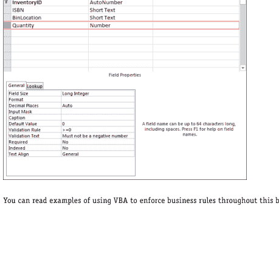

字段名称最长可达 64 个字符，包括空格。按 F1 可获取有关字段名称的帮助。

您可以在本书中阅读使用 VBA 来强制执行业务规则的示例。

## Working with Access Tables

### CHAPTER 5

### IN THIS CHAPTER

- Understanding datasheets
- Looking at the Datasheet window
- Opening a datasheet
- Entering new data
- Navigating records
- Changing values in a datasheet
- Using the Undo feature
- Copying and pasting values in a datasheet
- Replacing values in a datasheet
- Adding records to a datasheet
- Deleting records from a datasheet
- Displaying records in a datasheet
- Sorting and filtering records
- Aggregating data
- Printing records

在本章中，您将使用数据表向 Access 表中输入数据并以多种不同的方式显示数据。使用 Datasheet 视图允许您一次查看许多记录，采用熟悉的电子表格样式格式。在本章中，您将使用 tblContacts 和 tblProducts 来添加、更改和删除数据，以及了解 Datasheet 视图中可用的不同功能。

> **ON THE WEB**
> 
> 本章使用名为 `Chapter05.accdb` 的数据库。如果您尚未从本书网站下载它，现在就需要这样做。

## Understanding Datasheets

使用数据表是查看 Access 中数据的方式之一。数据表在视觉上类似于电子表格，因为它将数据显示为一系列行和列。图 5.1 显示了表的典型 Datasheet 视图。每行代表一条记录，每列代表表中的一个字段。向上或向下滚动数据表以查看屏幕上不适合的行（记录）；向左或向右滚动以查看屏幕上不适合的列（字段）。

### FIGURE 5.1

典型的 Datasheet 视图。每行代表表中的一条记录；每列代表表中的一个字段（如 Description 或 ModelYear）。

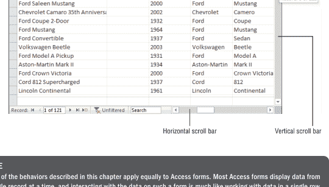

### NOTE

本章中描述的许多行为同样适用于 Access 表单。大多数 Access 表单一次显示一条记录数据，与在数据表的一行中工作类似。

您可以自定义数据表，这使您能够以多种方式查看数据。例如，您可以更改字体大小、列宽和行高，以使屏幕上显示更多或更少的数据。或者您可以重新排列行和/或列的顺序，以逻辑方式组织记录和字段。您还可以锁定列，使其在滚动到数据表的其他部分时保持位置不变，或隐藏它们以使其消失。要隐藏记录，您可以筛选与特定条件不匹配的数据。

> NOTE
> 您可以在 Datasheet 视图中查看表和查询。甚至表单也可以显示为数据表。根据数据的来源，本章中描述的一些数据表行为可能无法完全按所述工作。这在底层数据源是查询或表单时尤其如此。对于这些数据源，您可能会发现数据表是只读的。

## A Quick Review of Records and Fields

表是存储相关信息（如客户记录、节日贺卡列表、生日提醒、工资信息等）的容器。每个表都有由字段组成的正式结构，每个字段都有唯一的名称来标识和描述存储的信息，以及特定数据类型——简短文本、数字、日期/时间等——以限制用户在这些字段中输入的内容。当显示在数据表（二维信息表）中时，Access 将这些字段显示为列。

表由记录组成，记录保存有关单个实体（如单个客户或单个产品）的信息。一条记录由表结构中字段存储的信息组成。例如，如果表有三个字段——姓名、地址和电话号码——那么第一条记录只有一 个姓名、一个地址和一个电话号码。第二条记录也有一 个姓名、一个地址和一个电话号码。

数据表是同时查看表的许多记录的理想方式。单条记录在数据表中显示为一行；每一行包含该特定记录的信息。字段在数据表中显示为列；每一列包含单个字段的内容。这种行列格式让您一次可以看到大量数据。

## Looking at the Datasheet Window

数据表最初按主键排列记录，并按表设计中的顺序排列字段。在 Access 窗口顶部，您会看到标题栏（显示数据库文件名）、快速访问工具栏和功能区。在 Access 窗口底部，您会看到状态栏，其中显示有关数据表的信息。例如，它可能包含字段描述信息、错误消息、警告或进度条。

### 1. 引言

本文档旨在介绍人工智能在医疗健康领域的应用现状与未来发展趋势。随着深度学习、大数据和云计算技术的飞速发展，AI辅助诊断、个性化治疗和药物研发等场景正逐步从实验室走向临床实践。

### 2. 主要应用场景

- 医学影像分析：利用卷积神经网络自动识别X光、CT和MRI中的病灶。
- 电子病历处理：通过自然语言处理提取结构化信息，辅助临床决策。
- 药物发现：使用生成模型和强化学习加速候选化合物筛选。
- 健康管理：基于可穿戴设备数据提供个性化健康建议。

### 3. 挑战与展望

尽管前景广阔，AI在医疗领域的落地仍面临数据隐私、算法可解释性和监管合规等挑战。未来，多模态融合和联邦学习有望成为突破方向。

> > “AI不会取代医生，但会使用AI的医生将取代不会使用AI的医生。”

| 技术 | 应用 | 成熟度 |
|------|------|--------|
| CNN | 影像诊断 | 高 |
| NLP | 病历分析 | 中 |
| RL | 治疗方案优化 | 低 |

## Using the Navigation buttons

导航按钮（如图 5.2 所示）是位于 Datasheet 窗口底部的六个控件，用于移动到不同的记录。最左边的两个控件分别将您移动到第一条记录或数据表中的上一条记录。最右边的三个控件分别将您定位到下一条记录、最后一条记录或新记录。如果您知道记录号（特定记录的行号），您可以单击记录号框，输入记录号，然后按 Enter。

### FIGURE 5.2

数据表的导航按钮。

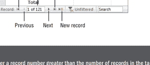

### NOTE

如果您输入的记录号大于表中的记录数，将出现错误消息，指出您无法转到指定的记录。

## Examining the Datasheet Ribbon

数据表功能区（如图 5.3 所示）提供了一种操作数据表的方法。开始选项卡上有一些熟悉的对象，以及一些新的对象。本节提供了开始选项卡上各组的概述；各个命令将在本章后面详细介绍。

### FIGURE 5.3

数据表功能区的开始选项卡。


我们在第 30 章中解释如何自定义功能区。

## Views

视图组允许您在 Datasheet 视图和设计视图之间切换。您可以通过单击视图命令的向下指向箭头来查看两个选项。单击设计视图允许您对对象的设计（表、查询等）进行更改。单击数据表视图可返回到数据表。

## Clipboard

剪贴板组包含剪切、复制和粘贴命令。这些命令的工作方式与其他应用程序（如 Word 和 Excel）中的命令类似。粘贴命令的向下箭头为您提供三个选项：粘贴、选择性粘贴和追加粘贴。选择性粘贴可让您以不同格式（文本、CSV、记录等）粘贴剪贴板的内容。追加粘贴将剪贴板的内容作为新记录粘贴——前提是剪贴板上复制了一行具有类似结构的行。

## Sort & Filter

排序和筛选组可让您根据想要的标准更改行的顺序，以及限制显示的行。

## Records

记录组可让您保存、删除或向数据表添加新记录。它还包含显示总计、检查拼写、冻结和隐藏列以及更改行高和字段宽度的命令。

## Find

查找组可让您查找和替换数据并转到数据表中的特定记录。使用选择命令可选择记录或所有记录。

## Window

窗口组包含两个按钮，可帮助您控制主 Access 窗口中打开的项目（表单、报表、表等）：

- Size to Fit Form：Size to Fit Form 按钮将窗口中的表单调整为创建时设定的大小。默认情况下，Access 表单具有可调整大小的边框，这意味着用户可能会将表单拖动到新的大小。Size to Fit Form 按钮将表单恢复为设计时指定的大小。
- Switch Windows：Switch Windows 按钮可让您选择不同的打开窗口进行操作。用户可能需要的表单或报表位于另一个表单或报表之下，Switch Windows 按钮提供了一种快速选择 Access 主窗口中哪个对象位于其他对象之上的方法。


> NOTE
> 如果你使用的是选项卡式文档（Access 2019 中的默认设置），则“窗口”组在“开始”选项卡中不会显示。要在重叠窗口和选项卡式文档之间切换，请在 Access 选项的“当前数据库”部分中设置“文档窗口选项”。

## Text Formatting

“文本格式”组让你可以更改 datasheet 中文本字段的外观。使用这些命令可以更改字体、大小、粗体、斜体、颜色等。选择字体属性（如粗体）会将该属性应用于 datasheet 中的所有字段。（有关此规则的唯一例外，请参阅以下注释。）使用“左对齐”、“右对齐”和“居中”命令来对齐所选列中的数据。单击“网格线”命令可打开或关闭网格线。使用“交替行颜色”或“背景颜色”命令可更改交替行的颜色或使它们全部相同。

> NOTE
> “文本格式”组中的控件在 datasheet 中当前选定的字段恰好为“长文本”数据类型时表现不同。当选择“长文本”字段时，如果“文本格式”属性设置为“富文本”，则可以更改字段中单个字符和单词的字体属性（粗体、下划线、斜体等），但“文本格式”属性（仅适用于“长文本”数据类型）默认设置为“纯文本”。

## Opening a Datasheet

按照以下步骤从“数据库窗口”打开 datasheet：

- 1. 使用本书网站上的 Chapter05.accdb 数据库，单击“导航窗格”中的“表”。
- 2. 双击要打开的表名（在本例中为 tblProducts）。

打开 datasheet 的另一种方法是右键单击 tblProducts 并从快捷菜单中选择“打开”。

> TIP
> 如果你处于任何设计窗口中，请单击功能区的“视图”组中的“Datasheet 视图”命令，以 datasheet 形式查看你的数据。

## Entering New Data

首次以 Datasheet 视图打开表时，你可以看到表中的所有记录。如果你刚创建了表，则新的 datasheet 不包含任何数据。图 5.4 显示了一个空的 datasheet 和功能区“字段”选项卡的一部分。当 datasheet 为空时，第一行在记录选择器中包含一个星号（*），表示它是新记录。

### FIGURE 5.4

一个空的 datasheet。请注意，第一条记录为空并且在记录选择器中有星号。

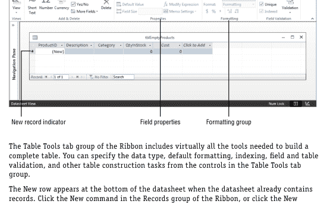

功能区的“表工具”选项卡组包括构建完整表所需的大部分工具。你可以从“表工具”选项卡组中的控件指定数据类型、默认格式、索引、字段和表验证以及其他表构建任务。

当 datasheet 已包含记录时，“新建”行会出现在 datasheet 底部。单击功能区“记录”组中的“新建”命令，或单击 datasheet 底部导航按钮组中的“新建记录”按钮，将光标移动到“新建”行——或者直接单击包含星号的最后一行。开始输入数据时，星号会变成铅笔，表示记录正在编辑中。包含星号的新行会出现在你正在输入数据的行下方。新记录指针始终出现在 datasheet 的最后一行。图 5.5 显示了向 tblProducts 添加新记录。

### FIGURE 5.5

在 tblProducts 的 Datasheet 视图中输入新记录。

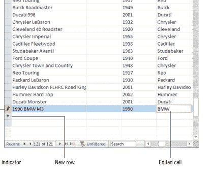

编辑指示器

新行

已编辑单元格

要向打开的 tblProducts 的 Datasheet 视图添加新记录，请按照以下步骤操作：

- 1. 单击功能区“开始”选项卡的“记录”组中的“新建”按钮。
- 2. 为表的每个字段输入值，通过按 Enter 键或 Tab 键在字段之间移动。

在添加或编辑记录时，你可能会看到三种不同的记录指针：

- 正在编辑的记录：铅笔图标
- 记录已锁定（多用户系统）：挂锁图标
- 新记录：星号图标

## CAUTION

如果记录包含“自动编号”字段，Access 会在该字段中显示名称（New）。你不能在此类字段中输入值；只需按 Tab 键或 Enter 键跳过该字段即可。当你开始输入数据时，Access 会自动放入数字。

## Saving the record

移动到不同记录会保存你正在编辑的记录。遍历所有字段、单击“导航”按钮、单击功能区“记录”组中的“保存”，以及关闭表，都会将编辑后的记录写入数据库。当记录选择器中的铅笔消失时，你就知道记录已保存。

要保存记录，你必须为每个字段输入有效值。字段会根据数据类型、唯一性（如果为唯一值编制索引）以及你输入到“验证规则”属性中的任何验证规则进行验证。如果你的表的主键不是“自动编号”字段，你必须确保在主键字段中输入唯一值，以避免出现图 5.6 中所示的错误消息。避免此错误消息的一种方法是使用“自动编号”字段作为表的主键。

### FIGURE 5.6

Access 在尝试保存包含重复主键值的新记录时显示的错误消息。使用“自动编号”字段作为主键可避免此错误。


### Tip

“快速访问工具栏”中的“撤消”按钮会撤消对当前记录和上次保存记录的更改。在你更改第二条记录后，就无法撤消之前保存的记录。

### Tip

你可以通过按 Shift+Enter 在不离开记录的情况下将记录保存到磁盘。

现在你知道了如何在新记录或现有记录中输入、编辑和保存数据。在下一节中，你将了解 Access 在你向字段中输入内容时如何验证你的数据。

## Understanding automatic data-type validation

Access 会自动验证某些类型的数据。因此，当你指定表属性时，不必为这些数据类型输入任何数据验证规则。Access 自动验证的数据类型包括：

- Number/Currency
- Date/Time
- Yes/No

Access 在你离开字段时验证数据类型。当你在“数字”或“货币”字段中输入字母时，你最初不会看到字符无效的警告。当你按 Tab 键离开字段或单击不同字段时，你会收到类似图 5.7 所示的警告。此特定警告让你选择输入新值或将列的数据类型更改为“文本”。如果你输入其他无效字符（符号、字母等）、输入多个小数点，或输入的数字过大，超出指定的数字数据类型，也会看到此消息。

### FIGURE 5.7

Access 在输入与字段数据类型不匹配的数据时显示的警告。Access 为你提供了几种纠正问题的选择。

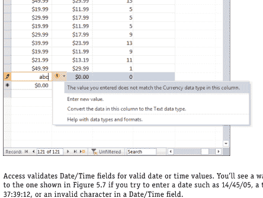

Access 会验证“日期/时间”字段的有效日期或时间值。如果你尝试输入 14/45/05 这样的日期、37:39:12 这样的时间，或在“日期/时间”字段中输入无效字符，你会看到类似图 5.7 所示的警告。

“是/否”字段要求你输入以下其中一个定义值：

- **Yes:** Yes, True, On, -1, 或除 0 以外的数字（显示为 -1）
- **No:** No, False, Off, 或 0

## Part II: Understanding Access Tables

当然，你可以在字段的“格式”属性中定义自己的可接受值，但通常这些值是唯一可接受的值。如果你输入无效值，警告会出现并显示不适当值的消息。

> **TIP**
> 
> “是/否”字段的“显示控件”的默认值是“复选框”。在“是/否”字段中显示复选框可防止用户输入无效数据。

## Knowing how properties affect data entry

由于字段类型各不相同，因此每种类型的输入技术都不同。在本章前面“保存记录”部分中，你了解到某些数据类型验证是自动的。但是，设计 tblContacts 意味着输入某些用户定义的格式和数据验证规则。以下各节将检查各种数据输入类型。

## Standard text data entry

tblContacts 中的第一个字段——ContactID——是“自动编号”字段，而表中的其他字段是“简短文本”字段。跳过 ContactID 后，你只需在每个字段中输入值并继续。zipcode 字段使用输入掩码 (00000)–9999;–) 进行数据输入。Phone 和 Fax 字段也使用输入掩码 (\(999\) "000\-0000;_)。输入掩码中的 0 表示必需的数字输入。输入掩码中的 9 表示可选的数字输入。zipcode 输入掩码要求前五位数字，但加 4 部分是可选的。简短文本字段接受任何字符，除非你使用输入掩码对其进行限制。

> **TIP**
> 
> 要在“简短文本”或“长文本”字段中输入多行，请按 Ctrl+Enter 添加新行。这在例如用于格式化多行地址字段的大文本字符串中很有用。

## Date/Time data entry

tblContacts 中的 OrigCustDate 和 LastSalesDate 字段是“日期/时间”数据类型，两者都使用“短日期”格式（3/16/2019）。但是，你也可以将格式定义为“中日期”（16-Mar-19）或“长日期”（Saturday, March 16, 2019）。使用这两种格式意味着无论你如何输入日期——使用月份和年份；日、月和年；或月、日和年——日期始终以指定的格式显示（短日期 [3/16/2019]、中日期 [16-Mar-19] 或长日期 [Saturday, March 16, 2019]）。因此，如果你输入 3/16/19 或 16 Mar 19，Access 会在你离开字段时以指定格式显示该值。日期实际上以无格式的方式存储在数据库中，因此你为字段选择的格式不会影响数据的存储方式。


## 第 5 章：使用 Access 表格

> **注意**
> 
> 格式仅影响数据的显示方式。它们不会改变表中数据的存储方式。

> **警告**
> 
> 通常，不建议对日期/时间数据应用输入掩码。Microsoft Access 已能充分验证日期和时间值。你在使用包含日期的控件上设置输入掩码时遇到数据输入问题的可能性，远大于使用输入掩码避免问题的可能性。

### 带数据验证的数字/货币数据输入

tblContacts 表中的 CreditLimit 字段已分配了验证规则。它具有验证规则属性，用于将信用额度限制在 250,000 美元以下。如果违反规则，将出现一个对话框，显示为该字段输入的验证文本。如果你想允许某个联系人拥有 250,000 美元或以上的信用额度，请在表设计中更改验证规则。

Access 使用的确切货币字符（本例中为美元符号）由 Windows 设置中区域和语言设置中的区域选项决定。

### OLE 对象数据输入

即使看不到对象，你也可以将对象链接和嵌入（OLE）对象数据输入到数据表中。OLE 对象字段可保存多种不同类型的项目，包括：
- 位图图片
- 声音文件
- 业务图表
- Word 或 Excel 文件

任何 OLE 服务器支持的对象都可存储在 Access OLE 对象字段中。OLE 对象通常输入到窗体中，以便你可以看到、听到或使用该值。当 OLE 对象出现在数据表中时，你会看到说明对象是什么的文本（例如，你可能会在 OLE 对象字段中看到位图图像）。你可以通过两种方式将 OLE 对象输入到字段中：
- 从剪贴板粘贴
- 右键单击 OLE 对象字段并从快捷菜单中选择插入对象

### 长文本字段数据输入

tblProducts 表中的 Features 字段是长文本数据类型。此类字段允许每个字段最多 1GB 的文本。当你向长文本字段输入文本时，一次只能看到几个字符——其余字符串会滚动到视野之外。按 Shift+F2 会显示一个带滚动条的缩放窗口（见图 5.8），让你一次可以看到更多字符。单击窗口底部的字体按钮，即可在不同字体或字号中查看所有文本。（图 5.8 中的字体已大幅放大，远超缩放窗口 8 磅默认字体大小。）

### 图 5.8

缩放窗口。请注意，即使使用更大的字体大小，你也可以看到字段的所有数据。

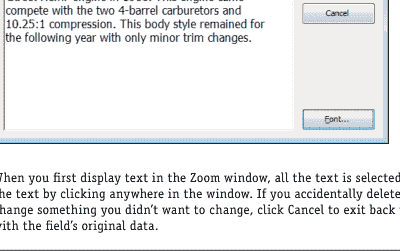

当你首次在缩放窗口中显示文本时，所有文本都会被选中。你可以通过单击窗口中的任意位置来取消选择文本。如果不小心删除了所有文本或更改了不想更改的内容，请单击取消返回到数据表，并恢复字段的原始数据。

> 提示
> 在设计 Access 对象（表、窗体、报表和查询）时，使用缩放窗口（Shift+F2）查看通常会滚动到视野之外的文本。

### 在数据表中导航记录

在输入记录后想要对其进行更改并不罕见。你可能需要更改记录，因为收到了更改现有值的新信息，或因为发现了现有值中的错误。

当你决定在表中编辑数据时，第一步是打开该表（如果尚未打开）。从导航窗格中的表列表中，双击 tblProducts 以在数据表视图中打开它。如果你已在此表的设计视图中，请单击数据表视图按钮切换视图。

当你打开一个具有相关表的 Access 数据表时，会添加一列带加号（+）的列，以指示相关记录或子数据表。单击某行的加号即可打开该行的子数据表。

### 在记录之间移动

你可以通过滚动记录并将光标定位到所需记录来移动到任何记录。对于大型表，滚动浏览所有记录可能需要一段时间，因此你需要使用其他方法快速到达特定记录。

使用垂直滚动条查看更多记录。滚动条箭头每次移动一条记录。要一次移动多条记录，请拖动滚动框或单击滚动框与滚动条箭头之间的区域。

提示
使用滚动条移动到数据表的另一区域时，请注意滚动提示。Access 在你单击字段之前不会更新记录号框。

使用五个导航按钮（参见图 5.2）在记录之间移动。你只需单击这些按钮即可移动到所需记录。如果你知道记录号（特定记录的行号），请单击记录号框，输入记录号，然后按 Enter。

此外，还可以使用功能区查找组中的转到命令导航到第一条、上一条、下一条、最后一条和新记录。

### 查找特定值

虽然你可以移动到特定记录（如果你知道记录号）或移动到当前记录中的特定字段，但通常你会想要在记录中查找某个特定值。你可以使用以下方法之一在字段中定位值：
- 从功能区的查找组中选择查找命令（放大镜）。
- 按 Ctrl+F。
- 使用数据表窗口底部的搜索框。

前两种方法会显示查找和替换对话框（见图 5.9）。要将搜索限制为特定字段，请在打开对话框前将光标置于要搜索的字段中。将查找范围下拉列表更改为当前文档，以在整个表中搜索该值。

匹配下拉列表包含三个选项：
- **字段的任意部分：** 如果选择字段的任意部分，Access 会搜索该值是否包含在字段的任何位置。此搜索会在字段中的任何位置找到 Ford，包括 Ford Mustang、2008 Ford F-150 和 Ford Galaxy 500 等值。
- **整个字段：** 默认值为整个字段，它会查找包含你输入内容的字段。例如，整个字段选项仅在搜索字段的值恰好为 Ford 且无其他内容时才会找到 Ford。
- **字段开头：** 使用字段开头选项搜索 Ford 会从字段开头开始搜索，并返回所有描述以 Ford 作为前四个字符的行。

除了这些下拉列表外，你还可以在查找和替换对话框底部使用两个复选框：
- **区分大小写：** 区分大小写决定搜索是否区分大小写。默认情况下不区分大小写（未选中）。搜索 SMITH 会找到 smith、SMITH 或 Smith。如果你选中区分大小写复选框，则必须以字段值的确切大小写输入搜索字符串。（数据类型数字、货币和日期/时间没有大小写属性。）如果你已选中区分大小写，Access 不会使用值按格式搜索字段（第二个复选框），该选项将搜索限制为表中实际显示的值。（如果你为数据表中的字段设置了显示格式，则应选中该框。）
- **按格式搜索字段：** 按格式搜索字段复选框为选中的默认值，仅查找与查找内容框中指定的文本具有相同字符模式的文本。清除此框即可查找与格式无关的文本。例如，如果你在 Cost 字段中搜索值为 $16,500，则如果选中按格式搜索字段，必须输入逗号。取消选中此框可搜索未格式化的值（16500）。

> 警告
> 选中按格式搜索字段可能会减慢搜索过程。

单击查找下一个按钮开始搜索。如果 Access 找到该值，光标会在数据表中突出显示它。要查找该值的下一个出现位置，再次单击查找下一个按钮。对话框保持打开状态，以便你可以查找多个出现位置。在搜索下拉列表中选择向上、下或全部这三个搜索方向选项之一以更改搜索方向。当你找到想要的值时，单击关闭关闭对话框。


使用数据表窗口底部的搜索框（参见图 5.1）可以快速搜索某个值的第一个匹配项。使用搜索框时，Access 会在整个数据表中搜索该值出现在字段任意部分的位置。如果在搜索框中输入 FORD，那么每键入一个字母，数据表就会移动到最接近的匹配项。首先，它会找到一个以 F 为第一个字符的字段，然后找到 FO，依此类推。一旦找到完整的值，它就会停止搜索。要查找下一个匹配项，请按 Enter 键。

## 更改数据表中的值

如果当前所在的字段没有值，你可以在该字段中键入新值。在字段中输入新值时，请遵循与输入新记录相同的规则。

### 手动替换现有值

通常，你进入一个字段时，要么没有选中任何字符，要么选中了整个值。如果使用键盘（Tab 键或箭头键）进入某个字段，则会选中整个值。（当整个值以反色显示时，你就知道它已被选中。）当你开始键入时，新内容会自动替换选定的值。

当你单击某个字段时，该值不会被选中。要使用鼠标选中整个值，可以使用以下任何一种方法：

- 当光标显示为大加号时，单击该值左侧边缘。
- 单击该值的左侧，按住鼠标左键，然后拖动鼠标以选中整个值。
- 单击该字段并按 F2。

> **提示**
>
> 你可能希望使用字段的“默认值”属性中的值来替换现有值。为此，请选中该值并按 Ctrl+Alt+空格键。要用上一条记录中同一字段的值替换现有值，请按 Ctrl+'（撇号）。按 Ctrl+;（分号）可在字段中插入当前日期。

> **警告**
>
> 按 Ctrl+-（减号）会删除当前记录。Access 会在任何数据丢失之前要求你确认删除。

### 更改现有值

如果你想更改现有值而不是替换整个值，请使用鼠标单击字段中任意字符的前面，以激活插入模式；当你键入新值时代码，现有值会向右移动。如果按 Insert 键，则输入会更改为改写模式；你每键入一个字符就会替换一个字符。使用箭头键在字符之间移动而不会干扰它们。按 Backspace 键删除光标左侧的字符，或按 Delete 键删除光标右侧的字符。

表 5.3 列出了编辑技巧。

### 表 5.3 编辑技巧

| 编辑操作 | 按键 |
| --- | --- |
| 在字段内移动插入点。 | 按右箭头（→）和左箭头（←）键。 |
| 在字段内插入值。 | 选择插入点并键入新数据。 |
| 切换整个字段和插入点。 | 按 F2。 |
| 将插入点移动到字段的开头。 | 按 Home 键。 |
| 将插入点移动到字段的末尾。 | 按 End 键。 |
| 选择前一个字符。 | 按 Shift+左箭头（←）键。 |
| 选择下一个字符。 | 按 Shift+右箭头（→）键。 |
| 从插入点选择到单词开头。 | 按 Ctrl+Shift+左箭头（←）键。 |
| 从插入点选择到单词末尾。 | 按 Ctrl+Shift+右箭头（→）键。 |
| 从插入点选择到字段开头。 | 按 Ctrl+Shift+Home。 |
| 从插入点选择到字段末尾。 | 按 Ctrl+Shift+End。 |
| 用新值替换现有值。 | 选中整个字段并键入新值。 |
| 用上一个字段的值替换某个值。 | 按 Ctrl+'（撇号）。 |
| 用默认值替换当前值。 | 按 Ctrl+Alt+空格键。 |
| 在短文本或长文本字段中插入换行符。 | 按 Ctrl+Enter。 |
| 保存当前记录。 | 按 Shift+Enter 或移动到另一条记录。 |
| 插入当前日期。 | 按 Ctrl+;（分号）。 |
| 插入当前时间。 | 按 Ctrl+:（冒号）。 |
| 添加新记录。 | 按 Ctrl++（加号）。 |
| 删除当前记录。 | 按 Ctrl+-（减号）。 |
| 切换复选框或选项按钮中的值。 | 按空格键。 |
| 撤消对当前字段的更改。 | 按 Esc 或单击“撤消”按钮。 |
| 撤消对当前记录的更改。 | 按 Esc，或在撤消当前字段后再次单击“撤消”按钮。 |

## 无法编辑的字段

某些字段无法编辑，例如：

- **自动编号字段：** Access 自动维护自动编号字段，在你创建每条新记录时计算值。自动编号字段可用作主键。
- **计算字段：** 窗体或查询可能包含作为表达式结果的字段。这些值实际上并未存储在表中，因此不可编辑。
- **多用户锁定记录中的字段：** 如果另一个用户正在编辑某条记录，该记录可能会被锁定，你无法编辑该记录中的任何字段。

## 使用撤消功能

快速访问工具栏上的“撤消”按钮通常呈灰色，因为没有可撤消的内容。但是，一旦你开始编辑记录，就可以使用此按钮撤消当前字段中的键入内容。你也可以使用 Esc 键撤消更改；按 Esc 可取消当前正在编辑的字段的任何更改，或者如果你当前未编辑字段，则取消你上次编辑的字段的更改。按 Esc 两次可撤消整个当前记录的更改。

在字段中键入值后，单击“撤消”按钮可撤消对该值的更改。移动到另一个字段后，可以通过单击“撤消”按钮来撤消对前一个字段值的更改。你也可以在撤消某个字段后，通过单击“撤消”按钮来撤消对未保存的当前记录的所有更改。保存记录后，你仍然可以通过单击“撤消”按钮来撤消更改。但是，在编辑下一条记录后，对先前记录的更改将永久生效。

> **警告**
>
> 不要依赖“撤消”命令来编辑多条记录后挽回局面。在数据表中工作时，当你从一条记录移动到另一条记录时，更改会保存，并且你只能撤消对当前记录的更改。

## 复制和粘贴值

将数据复制或剪切到剪贴板是由 Microsoft Office 或 Microsoft Windows 执行的，具体取决于数据类型；这不是 Access 的特定功能。剪切或复制某个值后，可以使用功能区“剪贴板”组中的“粘贴”命令将其粘贴到另一个字段或记录中。你可以在任何 Windows 应用程序中剪切、复制或粘贴数据，也可以在 Access 中的一个任务与另一个任务之间进行。使用此技术，你可以在表或数据库之间复制整个记录，也可以将数据表值与 Word 和 Excel 之间相互复制。

“粘贴”命令的下拉箭头提供了三个选项：

- **粘贴：** 将剪贴板的内容粘贴到一个字段中
- **选择性粘贴：** 允许你选择以不同格式（文本、CSV、记录等）粘贴剪贴板的内容
- **追加粘贴：** 将剪贴板的内容作为新记录粘贴——前提是已复制了具有类似结构的行

> **提示**
>
> 使用记录选择器选择一条记录或一组记录，以将一个或多个记录剪切或复制到剪贴板。然后使用“追加粘贴”将它们添加到具有类似结构的表中。

## 替换值

若要替换字段中的现有值，可以手动查找要更新的记录，或使用“查找和替换”对话框。通过以下方法显示“查找和替换”对话框：

- 选择功能区“查找”组中的“替换”命令。
- 按 Ctrl+H。

“查找和替换”对话框允许你替换当前字段或整个表中的值。使用它来查找某个值，并在该字段或表中它出现的所有位置替换为新值。

在“查找”或“替换”对话框处于活动状态后，选择“替换”选项卡，并在“查找内容”框中键入要查找的值。选择所有剩余的搜索选项（例如，关闭“按格式搜索字段”）后，单击“查找下一个”按钮以查找该值的第一个匹配项。要更改当前找到的项目（光标下）的值，请在“替换为”框中输入一个值，然后单击“替换”按钮。例如，图 5.10 显示了你想要在当前字段中查找值 Mini Vans 并将其更改为 Minivans。

你可以先在“查找”选项卡上选择搜索选项，然后选择“替换”选项卡继续该过程。但是，直接在“替换”选项卡上完成整个过程要容易得多。输入要查找的值和要替换成的值。完成对话框中所有正确的信息后，选择侧面的命令按钮之一：

- **查找下一个：** 查找下一个在“查找内容”字段中具有该值的字段。
- **取消：** 关闭窗体，不执行查找和替换。
- **替换：** 仅替换当前字段中的值。（注意：必须首先单击“查找下一个”按钮。）


**全部替换：** 查找所有与“查找内容”值匹配的字段，并将其替换为“替换为”值。如果您确定要替换所有值，请使用此选项；请仔细检查“查找范围”下拉列表，以确保您不会在不想替换的情况下替换整个数据表中的值。

## 图 5.10

“查找和替换”对话框，显示“替换”选项卡。在此示例中，您想要将“Mini Vans”替换为“Minivans”。

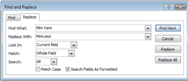

## 添加新记录

有多种方法可以向数据表添加记录：

-   单击数据表的最后一行，该行的记录指针是一个星号。
-   单击“新建（空白）记录”导航按钮（最右侧的按钮）。
-   单击功能区“记录”组中的“新建”命令。
-   选择功能区“查找”组中的“转至”→“新建”。
-   移动到最后一条记录，然后按向下箭头（↓）键。
-   按 Ctrl++（加号）。
-   右键单击任意记录选定器，然后从快捷菜单中选择“新记录”。无论您单击哪个记录的选定器，新记录始终追加到末尾。

一旦移动到新记录，即可在所需字段中输入数据并保存记录。

## 删除记录

要删除记录，请使用记录选定器选择一条或多条记录，然后按 Delete 键、单击功能区“记录”组中的“删除”命令，或右键单击记录的选定器。“删除”命令的下拉列表包含“删除记录”命令，该命令会删除当前记录，即使它未被选中。当您删除记录时，会弹出一个对话框要求您确认删除（参见图 5.11）。如果您选择“是”，记录将被删除；如果您选择“否”或按 Esc 键，则不进行任何更改。

> **注意**
> 此对话框的默认值是“是”。按 Enter 键将自动删除记录。如果您不小心使用此方法删除了记录，则无法撤消该操作。

## 图 5.11

“删除记录”对话框警告您即将删除特定数量的记录。默认响应是“是”（确认删除），因此在删除记录时请务必小心。


> **注意**
> 如果您在表之间设置了关系并勾选了“实施参照完整性”——例如，tblContacts（客户）表与 tblSales 表相关——那么您不能删除具有相关子记录（在 tblSales 中）的父记录（tblContacts），除非您同时勾选了“级联删除相关记录”复选框。否则，您将收到一个错误消息对话框，提示：由于表“表名”包含相关记录，无法删除或更改该记录。

要选择多个连续记录，请单击要选择的第一条记录的记录选定器，然后将鼠标拖到要选择的最后一条记录。或者，单击以选择第一条记录，然后按住 Shift 键并单击您想要在选定内容中的最后一条记录。

> **提示**
> 要使用键盘选择多个连续的记录，请按 Shift+空格键选择当前记录，并按 Shift+向下箭头（↓）键或 Shift+向上箭头（↑）键将选定范围扩展到相邻记录。

## 显示记录

在添加或更改记录时，有许多技术可以提高您的工作效率。更改字段顺序、隐藏和冻结列、更改行高或列宽、更改显示字体以及更改显示或移除网格线，都可以使数据输入更容易。

### 更改字段顺序

默认情况下，Access 在数据表中显示字段的顺序与它们在表设计中出现的顺序相同。有时，您希望某些字段相邻显示，以便更好地分析数据。要重新排列字段，请单击列标题以选择列，然后将该列拖动到新位置（如图 5.12 所示）。

## 图 5.12

选择并拖动列以更改字段顺序。


您可以一次选择并拖动一列，也可以选择多个列同时移动。假设您希望 ModelYear 出现在 tblProducts 数据表的 Features 之前。请按照以下步骤进行更改：

1.  将鼠标指针置于 ModelYear 列标题上。光标变为向下箭头。
2.  单击以选择该列。整个 ModelYear 列现在被高亮显示。
3.  松开鼠标按钮。
4.  **再次单击列标题上的鼠标按钮。** 指针变为带下框的箭头。
5.  **将该列向左拖动，置于 Description 和 Features 字段之间。** 它们之间会出现一条细黑列（参见图 5.12）。
6.  **松开鼠标按钮。** 该列将移动到数据表中 Features 字段的前面。

使用此方法，您可以移动任何单个字段或连续的字段选择。要选择多个字段，请在多个列标题上单击并拖动鼠标。然后，您可以将字段向左或向右移动，或移动超过窗口的右边界或左边界。

> **注意**
> 在数据表中移动字段不会影响表设计中的字段顺序。

### 更改字段显示宽度

您可以通过在对话框中指定宽度（以字符数为单位）或通过拖动列边框来更改*字段显示宽度*（列宽）。当您将鼠标悬停在列边框上时，光标会变为双箭头符号。

要加宽或缩小列，请按照以下步骤操作：

1.  **将鼠标指针放在两个列名之间的字段分隔线上。** 如果鼠标位置正确，指针会变成带有指向左右箭头的小竖线。
2.  **向左拖动列边框以缩小列，或向右拖动以增大列。**

> **提示**
> 您可以通过在光标变为双箭头后双击右列边框，立即将列调整为最佳宽度（基于最长的可见数据值）。

> **注意**
> 调整列大小不会更改表字段大小中允许的字符数。您只是更改了该列所含数据的显示空间大小。

或者，您可以通过右键单击列标题并选择快捷菜单中的“字段宽度”来调整列大小，以显示“列宽”对话框，如图 5.13 所示。在“列宽”框中设置您希望列容纳的字符数，或选中“标准宽度”复选框以将列设置为其默认大小。单击“最佳匹配”可将列调整为最宽的可见值。

## 第二部分：理解 Access 表

## 图 5.13

“列宽”对话框。


> **提示**
> 您可以通过将右列边框向左拖动直到它与左列边框相接，或在“列宽”对话框中将列宽设置为 0，来隐藏某一列。如果这样做，您必须选择功能区“记录”组中的“更多”→“取消隐藏字段”才能重新显示隐藏的列。

### 更改记录显示高度

您可能需要增加行高以容纳更大的字体或多行文本。通过拖动行的边框来更改所有记录的（行）高度，使其变大或变小。

当您拖动记录的边框时，光标会变为您在 图 5.14 左边缘看到的垂直双向箭头。

要增加或减少行高，请遵循以下步骤：

1.  **将鼠标指针置于两行的记录选定器之间。** 光标变为双向箭头（向上和向下）。
2.  **向上拖动行边框以减小所有行高，或向下拖动以增加所有行高。**

> **注意**
> 更改行高的过程会更改数据表中所有行的行大小。您不能使各行具有不同的高度。

您也可以选择功能区“记录”组中的“更多”→“行高”来调整行大小。此时会出现“行高”对话框；您可以在其中输入以磅为单位的行高。选中“标准高度”复选框可将行恢复为其默认大小。


### 图 5.14

更改行高。将鼠标定位到如图所示的位置，并拖动到所需高度。


## 警告

如果将某条记录的网格线向上拖动到与上一条记录紧邻的网格线重合，所有行都会被隐藏。如果在“行高”对话框中设置的行高接近 0（例如高度为 0.1），也会发生这种情况。在这种情况下，必须使用“行高”对话框将行高设置为更大的数值，才能重新显示这些行。

## 更改显示字体

默认情况下，Access 在数据表中以 Calibri 11 磅常规字体显示所有数据。使用功能区“文本格式”组中的命令和下拉列表（如图 5.15 所示）可以更改数据表的文本外观。

### 图 5.15

直接从功能区更改数据表的字体。为整个数据表选择字体类型、字号和其他字体属性。


设置字体显示会影响整个数据表。如果希望在屏幕上看到更多的数据，可以使用很小的字体。如果你的硬件支持，也可以切换到更高的显示分辨率。如果要看到更大的字符，可以增大字号或单击“加粗”按钮。

## 显示单元格网格线和交替行颜色

正常情况下，网格线显示在字段（列）之间以及记录（行）之间。你可以使用功能区“文本格式”组中的“网格线”命令（如图 5.15 所示）来设置网格线的显示方式。在“网格线”下拉列表中选择以下选项：

- 网格线：两者
- 网格线：水平
- 网格线：垂直
- 网格线：无

也可以使用“文本格式”组中的“背景色”和“交替行颜色”下拉列表来更改数据表的背景颜色。“背景色”调色板会更改数据表中所有行的颜色。“交替行颜色”调色板会更改偶数行的颜色。设置“交替行颜色”后，“背景色”调色板仅影响奇数行。要移除交替行的颜色，请将“交替行颜色”设置为“无颜色”。

更改网格线设置或交替行颜色后，Access 会询问是否将更改保存到数据表的布局。如果要使更改永久生效，请务必单击“是”。

“数据表格式设置”对话框（如图 5.16 所示）可让你完全控制数据表的外观。单击功能区“文本格式”组右下角的“数据表格式设置”启动器即可打开此对话框。使用“单元格效果”下的“平面”、“凹陷”和“凸起”选项按钮，可以将网格更改为三维外观。单击“显示网格线”下的“水平”和“垂直”复选框，以切换要显示的网格线。使用可用的调色板更改“背景色”、“交替背景色”和“网格线颜色”。对话框中间的示例会显示更改的预览。

### 图 5.16

使用“数据表格式设置”对话框自定义数据表的外观。


使用“边框”和“线型”下拉列表可以更改网格线的外观。你可以更改“数据表边框”和“列标题下划线”的样式。在第一个下拉列表中为每个选项选择不同的线型。可选择的线型包括：

- 透明边框
- 实线
- 虚线
- 短虚线
- 点线
- 稀疏点线
- 点划线
- 双点划线
- 双实线

图 5.17 显示了一个使用虚线代替实线、并增强了交替行对比度的数据表。你可以使用各种颜色和样式，根据自己的喜好自定义数据表的外观。

### 图 5.17

数据表的不同线型和行颜色。


## 对齐列中的数据

使用对齐按钮可以将数据在列内左对齐、右对齐或居中对齐。可以选择不同于 Access 根据字段数据类型选择的默认对齐方式（文本左对齐，数字/日期右对齐）。按照以下步骤更改列中数据的对齐方式：

1. **将光标定位到要更改对齐方式的列中的任意位置。**
2. **单击功能区“文本格式”组中的“左对齐”、“居中”或“右对齐”命令（参见图 5.15）以更改该列数据的对齐方式。**

## 隐藏和取消隐藏列

通过将列网格线拖动到前面的字段或将列宽度设置为 0 来隐藏列：

1. 将光标定位到要隐藏的列中的任意位置。
2. 在功能区“记录”组中选择“更多 ▸ 隐藏字段”。该列会消失，因为列宽被设置为 0。你可以先选择多个列，然后选择“更多 ▸ 隐藏字段”来隐藏多个列。

隐藏列后，可以通过在功能区“记录”组中选择“更多 ▸ 取消隐藏字段”来重新显示该列。此时会出现一个对话框，你可以通过勾选每个字段旁边的复选框来选择性地取消隐藏列（参见图 5.18）。单击“关闭”返回显示所需列的数据表。你也可以使用此对话框，通过取消勾选要隐藏的每个字段旁边的复选框来隐藏一个或多个列。

### 图 5.18

使用“取消隐藏列”对话框隐藏和取消隐藏列。


## 冻结列

当你想在许多列之间左右滚动，但又希望某些列保持可见而不滚动出视图时，请在功能区“记录”组中选择“更多 ▸ 冻结字段”。例如，使用此命令，你可以在滚动数据表查找产品特性时，让“ProductID”和“Description”字段保持可见。冻结的列显示在数据表的最左侧，而其他字段则水平滚动出视线。如果要同时冻结多个字段，这些字段必须是连续的。

（当然，你可以先移动字段使它们相邻。）当准备好取消冻结数据表列时，只需选择“更多 ▸ 取消冻结所有字段”。

### 提示

取消冻结列时，该列不会移回其原始位置。你必须手动将其移回。

## 保存更改的布局

关闭数据表时，会保存所有数据更改，但可能会丢失所有布局更改。当你对数据表进行所有这些显示更改后，下次打开同一数据表时，你可能不想再重新进行这些更改。如果进行了任何布局更改，Access 会在关闭数据表时提示你保存对布局的更改。选择“是”以保存更改。你也可以通过单击快速访问工具栏上的“保存”来手动保存布局更改。

## 警告

如果你正在按照示例操作，并且希望屏幕与本章其余部分的图保持一致，请不要保存对 tblProducts 的更改。

## 保存记录

当你离开某条记录时，Access 会保存该记录。按 Shift+Enter 或从功能区“记录”组中选择“保存”可以在不离开当前记录的情况下保存记录。关闭数据表也会保存记录。

## 在数据表中排序和筛选记录

功能区中的“排序和筛选”组（如图 5.19 所示）允许你重新排列行的顺序并减少行的数量。使用该组中的命令，你可以按想要的顺序显示所需的记录。以下各节演示如何使用这些命令。

### 图 5.19

“排序和筛选”组允许你更改记录顺序并减少可见行的数量。


## 排序记录

你可以使用“排序和筛选”组中的“升序”和“降序”命令，将选定列按升序或降序排序。要使用这些命令，请单击要排序的字段，然后单击“升序”或“降序”。数据会立即以排序顺序重新显示。右键单击某列并选择任一“排序”按钮也可以对数据进行排序。右键单击菜单上的选项会根据字段的数据类型而变化。短文本字段显示“排序 A 到 Z”和“排序 Z 到 A”，而数字字段显示“排序最小到最大”和“排序最大到最小”。某些字段（如 OLE 和长文本字段）无法排序。

要根据多个字段中的值对数据进行排序，请突出显示多个列：先突出显示一个列（参见本章前面的“更改字段顺序”一节），然后在释放鼠标按钮之前，将光标向右或向左拖动。当你选择某个排序命令时，Access 会按主要顺序（按第一个突出显示的字段）对记录进行排序，然后在其中嵌套顺序（基于后续字段）。如果需要选择不连续（不相邻）的多个列，可以将它们移动到彼此相邻的位置（参见本章前面的“更改字段顺序”一节）。

> 提示
> 要按原始顺序显示记录，请使用功能区“排序和筛选”组中的“取消排序”命令。

> 提示
> 另一种选择多个列的方法是：单击一个列标题并释放鼠标按钮，然后在按住 Shift 键的同时，单击并释放另一个列标题。这两个列之间的所有列都将被选中。

## 按所选内容筛选

“按所选内容筛选”允许你根据当前字段值选择记录。例如，使用 tblProducts，将光标置于“Category”列中包含“Trucks”的行中，单击功能区“排序和筛选”组中的“选择”命令，然后选择“等于‘Trucks’”。Access 会筛选数据表，只显示 Category 为“trucks”的记录。

单击“选择”命令时，Access 会提供四个选项：

- 等于“Trucks”
- 不等于“Trucks”
- 包含“Trucks”
- 不包含“Trucks”


## 图 5.20

使用“按选定内容筛选”。在此示例中，您可以看到所有非 Mack 品牌的卡车。


## 图 5.21

筛选“品牌”字段。使用列筛选菜单为字段选择条件。


如果您想筛选数据，但找不到要使用的值，而您又知道该值，请单击“文本筛选器”（或“数字筛选器”、“日期筛选器”等）命令，然后选择可用命令之一（“等于”、“不等于”、“开头是”等），以显示一个对话框，您可以在其中输入所需的值。

## 按窗体筛选

“按窗体筛选”允许您在数据表的单行中输入条件。单击“按窗体筛选”按钮会将数据表转换为一行，每列包含一个下拉列表。下拉列表包含该列的所有唯一值。窗口底部的“或”选项卡允许您为每组指定“或”条件。在功能区“排序和筛选”组中选择“高级”⇆“按窗体筛选”，即可进入“按窗体筛选”模式，如图 5.22 所示。

## 图 5.22

使用“按窗体筛选”可以一次设置多个筛选条件。请注意窗口底部的“或”选项卡。


从组合框中选择值，或在字段中输入要搜索的值。如果您想查看类别为“卡车”或“SUV”的记录，请从“类别”下拉列表中选择“卡车”，选择窗口底部的“或”选项卡，然后从“类别”下拉列表中选择“SUV”。要查看类别为“SUV”且“库存数量”为 1 的记录，请从“类别”下拉列表中选择“SUV”，并在“库存数量”中输入 1。输入所需条件后，单击“切换筛选器”命令以应用筛选。（“切换筛选器”按钮如图 5.19 所示。）

使用“或”选项卡输入所需数量的条件。如果您需要对选择进行更高级的操作，可以从功能区的“排序和筛选”组中选择“高级”⇆“高级筛选/排序”，以获取实际的“按示例查询”（QBE）屏幕，您可以使用它输入更复杂的条件。

第 8 章讨论查询，第 9 章讨论运算符和表达式。

## 聚合数据

Access 数据表支持在数据表底部显示“合计”行。通过单击功能区“开始”选项卡上“记录”组中的“合计”按钮（“合计”按钮标有希腊字母西格玛，类似于 Excel 中的“自动求和”按钮）即可打开“合计”行。“合计”行中的每一列都可以设置为不同的聚合计算（求和、平均值、最小值、最大值、计数、标准偏差或方差）。

要使用“合计”行，请在数据表视图中打开表或窗体，然后单击功能区“开始”选项卡上“记录”组中的“合计”按钮（见图 5.23）。Access 会在数据表底部（“新行”下方）添加一个“合计”行。

## 图 5.23

数据表“合计”行。


单击“合计”行中的某列，数据表单元格会转换为下拉列表。下拉列表中的项目特定于该列的数据类型。例如，在文本列中，下拉列表仅显示“无”和“计数”，而数字列则包含完整的汇总计算选项（求和、平均值、计数等）。日期/时间列包括“无”、“平均值”、“计数”、“最小值”和“最大值”。

您选择的“合计”计算是动态的。当您更改数据表或基础表中的数据时，“合计”行中显示的计算结果会在短暂延迟后自动更新。重新计算大量合计会产生轻微的性能开销，因此当您不使用“合计”行时，最好将其隐藏。

您为数据表中各列选择的“合计”选项会保留。如果您关闭数据表并重新打开，“合计”行仍然存在。

要移除“合计”行，请打开数据表，单击功能区“记录”组中的“合计”按钮。以下是“合计”行的一个有趣行为：如果您选择移除它，之后可以恢复它（再次单击“合计”按钮）。该行将恢复到其原始设置。

## 打印记录

您可以以简单的行列布局打印数据表中的所有记录。在第 20 章中，您将学习生成格式化的报表。目前，最简单的打印方式是单击“文件”➜“打印”，然后选择如图 5.24 所示的打印选项之一。

如果您选择“打印”（而不是“快速打印”或“打印预览”），Access 会显示“打印”对话框。在“打印”对话框中，您可以通过选择多个选项来自定义打印输出：

- **打印范围：** 打印整个数据表，或仅打印选定的页面或记录
- **份数：** 确定要打印的份数
- **逐份打印：** 确定多份副本是否逐份打印

您还可以更改打印机，单击“属性”按钮，并为选定的打印机设置选项。“设置”按钮允许您设置页边距和打印标题。

打印输出反映了打印数据表时生效的所有布局选项。隐藏的列不会打印。仅当单元格网格线属性开启时，网格线才会打印。打印输出还反映了指定的行高和列宽。

一页只能容纳有限的列和行；打印输出将根据需要占用尽可能多的页面来打印所有数据。Access 会根据需要拆分打印输出以适应每页。例如，tblProducts 的打印输出可能是九页——需要三页横向空间来打印 tblProducts 中的所有字段，而所有记录需要三页纵向空间。tblContacts 的记录可能需要四页纵向空间。页数取决于您的布局和打印机。

## 图 5.24

Microsoft Access 打印菜单。


## 预览记录

尽管您可能已准备好数据表中的所有信息进行打印，但您可能不确定是否要更改列或行的宽度或高度，或者是否要调整字体以改善打印输出。要预览打印作业，请单击“打印”菜单下的“打印预览”命令，以显示“打印预览”窗口。默认视图是单页预览中的第一页。使用功能区命令选择不同的视图并放大和缩小。单击“打印”将数据表打印到打印机。单击功能区右侧的“关闭打印预览”命令以返回数据表视图。

数据存在于多种应用程序类别中，包括其他 Windows 应用程序、Macintosh 应用程序、数据库管理系统、文本文件，甚至大型机文件。

## 处理外部数据的方式

通常，您需要将数据从另一个应用程序或文件移动到 Access 数据库中，反之亦然。您可能需要获取已存在于外部电子表格文件中的信息。您可以手动重新输入所有这些信息，也可以将其自动导入到数据库中。

Access 提供了使您能够与另一个数据库或电子表格文件交换数据的工具。事实上，Access 可以与多种不同的文件类型交换数据，包括以下类型：

- Access 数据库对象（所有类型）
- 文本文件
- Excel 文件
- ODBC 数据库（SQL Server、Sybase Server、Oracle Server 和其他符合 ODBC 的数据库）
- HTML 表格、列表和文档
- XML 文档
- Outlook 表
- Microsoft Exchange 文档
- SharePoint 列表
- Azure 数据库
- Word 文档
- 富文本格式（RTF）文档

Access 通过以下几种方式处理这些外部数据源：

- **链接：** 链接到数据会创建与另一个 Access 数据库中表的连接，或链接到来自不同格式的数据。链接使用源文件格式（如 Excel 或 XML）的数据。链接的数据保留在其原始文件中。包含链接数据的文件不应被移动、删除或重命名；否则，Access 下次需要时将无法定位该数据。如果移动或重命名链接数据源不可避免，Access 提供了重新链接到源的工具。
- **导入：** 导入将数据从数据源、另一个 Access 数据库或另一个应用程序的数据库文件复制到 Access 表中。导入的数据会转换为适当的 Access 数据类型，存储在表中，并由 Access 从那时起进行管理。


**导出：** 导出是将数据从 Access 表复制到文本文件、另一个 Access 数据库或其他应用程序的文件中。与导入一样，更改源数据不会影响已导出的数据。

每种方法都有明显的优缺点，以下各节将详细说明。

Access 与外部数据之间的链接将在第 7 章中讨论。

## 何时链接到外部数据

在 Access 中链接使您能够以另一种应用程序的格式处理数据——从而与现有应用程序共享文件。如果您将数据保留在另一种数据库格式中，Access 可以读取这些数据，而原始应用程序仍在使用它们。当您希望使用 Access 处理其他程序也需要使用的数据时，此功能非常有用。但是，对链接数据所能执行的操作存在限制。例如，您无法更新链接的 Excel 电子表格或链接的文本文件中的数据。当您将 Access 用作 SQL Server 数据库的前端时，处理外部数据的能力也很有用——您可以链接到 SQL Server 表并直接更新数据，而无需将其批量上传到 SQL Server。

Access 数据库通常链接到外部数据，以便用户可以使用 Access 表单来添加和更新外部数据，或在 Access 报表中使用外部数据。

您可以链接到 Access 中的以下数据类型：

-   其他 Access 表（ACCDB、ACCDE、ACCDR、MDB、MDA、MDE）
-   Excel 电子表格
-   Outlook 文件夹
-   文本文件
-   XML 文件
-   HTML 文档
-   SharePoint 列表
-   ODBC 数据库

> **警告**
> Access 能够链接到某些格式（如 HTML 表、文本文件、Excel 文件和 XML 文档）以进行只读访问。您可以使用和查看 HTML 或文本格式的表；但是，无法使用 Access 更新这些表或向其中添加记录。

使用链接表的一个主要缺点是您失去了在表之间强制实施参照完整性的能力（除非所有链接表都位于同一个外部 Access 数据库中，或者全部位于其他支持参照完整性的数据库管理系统中）。链接表的性能可能比本地表稍差。根据源数据及其位置的不同，用户在打开基于链接数据的表单或报表时可能会遇到明显的延迟。

在查询中联接链接数据和本地数据时，性能问题会更加突出。由于 Access 无法对外部数据应用优化技术，许多联接的效率较低，并且比联接本地表需要更多的内存和 CPU 时间。但是，Access 可以处理许多不同类型的外部数据，这使其成为需要这些功能的应用程序的理想平台。

## 何时导入外部数据

导入数据使您能够将外部表或数据源带入新的或现有的 Access 表。通过导入数据，Access 会自动将数据从外部格式转换并复制到 Access 中。您甚至可以将数据对象导入到与当前打开的数据库不同的 Access 数据库或 Access 项目中。如果您确定只在 Access 中使用数据，则应导入数据。通常，Access 处理其自身的本地表时速度更快。

> **注意**
> 
> 由于导入会复制一份数据，因此在将副本导入 Access 后，您可能需要删除旧文件。但有时您可能希望保留旧的数据文件。例如，数据可能是仍在使用的 Excel 电子表格。在这种情况下，只需维护重复数据，并接受存储它将需要更多磁盘空间（以及这两个文件将不同步的事实）。

导入数据的一个主要原因是为了自定义数据以满足您的需求。将表导入 Access 数据库后，您可以像在当前数据库中构建新表一样处理该表。另一方面，对于链接表，您可以进行的更改受到很大限制。例如，您无法指定主键或分配数据输入规则，这意味着您无法对链接表强制实施完整性。此外，由于链接表指向外部文件，而 Access 期望在特定位置找到这些文件，这可能会使分发应用程序变得更加困难。

数据经常从被新的 Access 应用程序取代的过时系统导入到 Access 数据库中。导入过程完成后，可以从用户的计算机中移除过时的应用程序。

> **提示**
> 
> 如果您经常从同一来源导入数据，则可以使用宏或 VBA 过程自动化该过程。当您需要定期从外部源导入数据，或者必须对导入的数据应用复杂的转换时，这可能会很有帮助。

## 何时导出数据

导出数据使您能够将数据传递给其他应用程序。导出数据时，您指示 Access 将数据转换为外部格式，并将其复制到外部应用程序可以读取的文件中。正如我们已经提到的，如果您希望能够修改数据，有时必须将数据导入 Access，而不是仅仅链接到外部数据源。如果您仍然需要在外部应用程序中使用修改后的数据，那么除了通过导出修改后的数据来创建新文件之外，几乎没有其他选择。

导出数据的一个常见原因是您希望与未安装 Access 的其他用户共享数据。

## 在不受支持的程序中处理数据

尽管不受支持的格式很少见，但您偶尔可能需要处理来自某个程序的数据，而该程序的数据未存储在受支持的外部数据库或文件格式中。在这种情况下，这些程序通常可以将其数据导出或转换为 Access 可识别的格式之一。要使用这些程序中的数据，请将其导出为 Access 可识别的格式，然后导入到 Access 中。

例如，许多应用程序可以导出为 XML 文件格式。如果 XML 格式不可用，大多数程序（即使是不同操作系统上的程序）都可以将数据导出为带分隔符或固定宽度的文本文件，然后您可以将其导入 Access。

## 导入和导出的选项

在检查导入和导出过程之前，让我们简要了解一下使用 Access 导入和导出数据的各种选项。

Access 通常被描述为多种类型数据的“着陆场”。这意味着 Access 可以在广泛的应用程序之间使用和交换数据。例如，您可能需要从 SQL Server 或 Oracle、文本文件甚至 XML 文档中获取数据。Access 可以在多类应用程序、数据库引擎甚至平台（大型机和 Macintosh 计算机）之间移动数据。

在 Access 中打开 Chapter06_1.accdb 数据库，并单击功能区上的“外部数据”选项卡（参见图 6.1）。您将看到以下组：“导入和链接”、“导出”和“Web 链接列表”。

### 图 6.1

功能区上的“外部数据”选项卡暗示了 Access 可用的各种外部数据源。


“导入和链接”组包括以下选项：

-   新建数据源
-   已保存的导入
-   链接表管理器

“新建数据源”下拉列表包括四个类别，每个类别包含几种数据格式：

-   来自文件
    -   Excel
    -   HTML 文档
    -   XML 文件
    -   文本文件
-   来自数据库
    -   Access
    -   来自 SQL Server
    -   来自 Azure 数据库
    -   dBASE 文件
-   来自联机服务
    -   SharePoint 列表
    -   来自 Dynamics 365（在线）
    -   来自 Salesforce
    -   数据服务
-   来自其他源
    -   ODBC 数据库
    -   Outlook 文件夹

“导出”组包括以下选项：

-   已保存的导出
-   Excel


+   - 文本文件
+   - XML 文件
+   - PDF 或 XPS
+   - 电子邮件
+   - Access
+   - Word 邮件合并
+   - 更多：单击此按钮以打开“更多”下拉列表，其中包含以下选项：
+     - Word
+     - SharePoint 列表
+     - ODBC 数据库
+     - HTML 文档
+     - dBASE 文件

显然，微软已为 Access 作为数据的“着陆 pad”角色做好了充分准备。

## 导入外部数据

导入会将外部数据复制到 Access 数据库中。外部数据保持其原始状态，但在导入后，Access 中会存在一份副本。当您导入文件时（与链接表不同），Access 会将来自外部源的数据副本转换为 Access 表中的记录。导入过程中外部数据源不会被更改。导入过程完成后，不再维护与外部数据源的连接。

您可以将信息导入到新表或现有表中。所有类型的数据都可以导入到新表中。但是，某些类型的导入——例如电子表格和文本文件——不一定具有与 Access 兼容的表结构。在这些情况下，Access 会为您创建表结构。如果您想控制表的结构，应在导入前创建表。

## 从另一个 Access 数据库导入

您可以将项目从源数据库导入到当前数据库。您导入的对象可以是表、查询、窗体、报表、宏或模块。按照以下步骤将项目导入当前 Access 数据库：

+   1. 打开您要导入到的目标数据库。在本例中，打开 Chapter06_1.accdb 数据库。
+   2. 选择“外部数据”选项卡。
+   3. 单击“导入和链接”>“新建数据源”>“从数据库”>“Access”，然后单击“浏览”按钮以选择源数据库的文件名（Chapter06_2.accdb）。

## **1. 引言**

随着人工智能技术的飞速发展，大语言模型（Large Language Model, LLM）已成为自然语言处理领域的核心技术。它们通过在海量文本数据上进行预训练，学习到了丰富的语言知识和世界知识，能够胜任文本生成、问答、摘要、翻译等多种任务。然而，大语言模型在带来巨大机遇的同时，也伴随着一系列严峻的安全挑战。

这些安全挑战不仅涉及模型本身可能被恶意利用（如生成虚假信息、恶意代码），还涉及模型在训练和部署过程中可能引入的偏见、隐私泄露等问题。因此，系统性地研究大语言模型的安全问题，并提出有效的防护策略，对于推动人工智能技术的健康、可持续发展具有至关重要的意义。

## **2. 大语言模型面临的主要安全威胁**

大语言模型的安全威胁可以从多个维度进行分类。从攻击者的视角来看，主要可以分为以下三类：

+   - **提示注入攻击**：攻击者通过精心设计的输入提示，诱导模型执行非预期的操作，例如忽略系统指令、泄露敏感信息或生成有害内容。
+   - **数据投毒攻击**：攻击者在模型的训练数据中植入恶意样本，导致模型在特定触发词下产生错误或有害的输出。
+   - **模型窃取与逆向攻击**：攻击者通过大量查询接口，尝试逆向推导模型的参数或训练数据，从而窃取模型的核心知识产权或隐私信息。

## FIGURE 6.3

“保存导入步骤”功能可让您保存经常执行的导入过程以供将来使用。


+   6. **选中“保存导入步骤”复选框。** Access 将显示“另存为”和“说明”字段。

+   7. **为导入过程提供一个名称，以便轻松回忆已保存导入的目的，然后单击“保存导入”。** 您可以在以后通过单击“外部数据”选项卡功能区“导入和链接”组中的“已保存导入”按钮再次执行已保存的导入。从“管理数据任务”对话框中（见图 6.4），您可以更改已保存导入的名称、源文件的位置以及已保存导入的说明。已保存导入的其他所有信息（如目标表名）都无法更改。如果需要更改其他信息，请使用正确的参数创建一个新的已保存导入。

## Part II: Understanding Access Tables


## FIGURE 6.4

“已保存导入”功能可让您重新运行之前的已保存导入过程。


## 从 Excel 电子表格导入

您可以将数据从 Excel 电子表格导入到新表或现有表中。导入 Excel 数据的主要规则是，列中的每个单元格必须包含相同类型的数据。当您将 Excel 数据导入到新表时，Access 会根据 Excel 数据的前几行（不包括列标题）猜测要为新表中的每个字段分配的数据类型。如果 Excel 中前几行之后的行包含不兼容的数据，则可能会发生导入错误。在图 6.5 中，Age 列应包含所有数值数据，但它包含写成文字的年龄。这很可能会在导入过程中导致错误。第 5 行中的数据应更改，以便整个列包含数值数据（如图 6.6 所示）。

您可以导入 Excel 电子表格中的所有数据，也可以只导入命名单元格范围的数据。在电子表格中命名单元格范围可以使导入到 Access 更容易。通常电子表格会被格式化为单元格组（或范围）。例如，一个范围可能包含按客户列出的销售，而另一个可能包含所有客户的总销售额、按产品类型划分的总计或按购买月份划分的总计。通过为每个单元格组提供范围名称，您可以将导入限制为电子表格数据的某一部分。

## FIGURE 6.5

Access 可以从 Excel 电子表格导入数据，但存在一些限制。


此数据会导致导入问题。

4. 选择“将源数据导入到当前数据库中的新表”并单击“确定”。第一个“导入电子表格向导”屏幕（见图 6.7）显示 Excel 电子表格中的工作表或命名范围列表，以及数据的预览。

## FIGURE 6.7

导入电子表格向导。


5. 选择工作表或命名范围并单击“下一步”。

6. 在下一个屏幕上（见图 6.8），选中“第一行包含列标题”复选框并单击“下一步”。通常您不希望将 Excel 列标题存储为字段数据。Access 使用列标题作为新表中的字段名。

## FIGURE 6.8

第一行是否包含列标题？


7. 在下一个屏幕上（见图 6.9），您可以覆盖默认的字段名和数据类型，从导入中删除字段，并在字段上创建索引。完成后，单击“下一步”。

## FIGURE 6.9

您可以覆盖 Access 选择的任何默认设置。


8. 在下一个屏幕上，为新表设置主键（见图 6.10）并单击“下一步”。主键唯一标识表中的每一行。

## FIGURE 6.10

为新表指定主键。


## CAUTION

在为导入文件选择主键时要谨慎。您选择的字段必须符合主键的规则：值不能为空，且不允许重复。表的主键的目的是唯一标识表中的行，因此如果 Excel 电子表格中没有合适的列用于此目的，最好让 Access 添加默认的主键字段。Access 添加的主键始终是自动编号，并且始终符合数据规范化规则。
主键在第 3 章和第 4 章中讨论。

+   9. 指定新表的名称并单击“完成”。

## CAUTION

如果您导入的 Excel 文件名称与您已链接的 Excel 文件名称相同，Access 会询问您是否要覆盖现有文件。除非您确实打算替换链接的表，否则必须为新导入的表指定一个新名称。

+   10. 如果需要，请保存导入过程以便以后执行。新表现在出现在“导航窗格”中。

## 导入 SharePoint 列表

SharePoint 列表是 Access 数据库的候选数据源。由于 SharePoint 列表驻留在 Web 服务器上，因此 SharePoint 数据可供合格用户通过网络访问。这使 Access 能够几乎在世界任何地方共享数据。

第 VIII 部分专门介绍了解和操作 SharePoint 服务。

由于 SharePoint 已部署在大量企业内部网中，因此 Access 很可能继续作为企业环境中的组件。

## 从文本文件导入数据

文本文件输出的原因有很多，例如企业对企业（B2B）数据传输。此外，大型机数据通常以文本文件形式输出，以便在桌面应用程序中使用。Access 可以从两种不同类型的文本文件导入：分隔符分隔和定宽。Access 导入文本向导可帮助您导入或导出分隔符分隔和定宽文本文件。

## 分隔符分隔文本文件

在分隔符分隔文本文件（有时称为逗号分隔文本文件、逗号分隔值文本文件或制表符分隔文本文件）中，每条记录都在文本文件中的单独一行。行上的字段没有尾随空格，通常使用逗号或制表符作为字段分隔符，并且某些字段可能用限定字符（如单引号或双引号）括起来。以下是逗号分隔文本文件的示例：

```
1,Davolio,Nancy,5/1/14 0:00:00,4000
2,Fuller,Andrew,8/14/14 0:00:00,6520
3,Leverling,Janet,4/1/14 0:00:00,1056
4,Peacock,Margaret,5/3/15 0:00:00,4000
5,Buchanan,Steven,10/17/15 0:00:00,5000
6,Suyama,Michael,10/17/15 0:00:00,1000
7,King,Robert,1/2/14 0:00:00,1056
8,Callahan,Laura,3/5/14 0:00:00,1056
9,Dodsworth,Joseph,11/15/14 0:00:00,1056
```

请注意，该文件有九条记录（文本行）和五个字段。逗号分隔每个字段。在此示例中，文本字段未用双引号限定。请注意，行长度不同，因为每行中的数据可变。


要导入名为 ImportDelim.txt 的分隔文本文件，请按以下步骤操作：

- 1. 打开 Chapter06_1.accdb 数据库。
- 2. 选择 外部数据 选项卡。
- 3. 单击 导入和链接 > 新数据源 > 从文件 > 文本文件。
- 4. 浏览到 ImportDelim.txt 文件，选择 导入 选项按钮，然后单击 确定。导入文本向导的第一个屏幕（见图 6.11）出现。导入文本向导会显示文本文件中的数据，并让你在分隔符或固定宽度之间进行选择。

## FIGURE 6.11

导入文本向导的第一个屏幕。


5. 选择 分隔符 并单击 下一步。导入文本向导的下一个屏幕（见图 6.12）出现。如图 6.12 所示，此屏幕可让你指定分隔文本文件所使用的分隔符。分隔符是分隔文本文件中字段之间的字符。分隔符通常是逗号或分号，但也可以是其他字符。

## FIGURE 6.12

第二个导入文本向导屏幕。


6. 选择分隔字段的分隔符；如果使用不常见的分隔符，请选择 其他 并在 其他 框中输入分隔符。

### CAUTION

如果文本文件中的任何字段包含用作数据的分隔符字符，则分隔符可能会出现问题。例如，如果你使用逗号来分隔字段，而其中一个字段是 Acme Widgets, Inc.，Access 在导入文件时会出现问题。解决方法是将文本字段用双引号括起来（"Acme Widgets, Inc."），以免逗号被误解为字段分隔符。这种使用双引号的做法称为文本限定符。最常用单引号或双引号来实现此目的，通常可以解决数据字段中包含特殊字符的问题。

7. 如果第一行包含导入表的字段名，请选中 第一行包含字段名 复选框。完成此屏幕后，单击 下一步。接下来的几个屏幕与导入 Excel 工作表时涉及的步骤非常相似。你可以更改字段名、指定主键并保存导入以供将来使用。用描述性的 Access 表名保存导入的文本文件。Access 会创建新表，默认使用文本文件的名称。新表会出现在导航窗格中。

> Tip
> 要指定分隔文件中不包含数据的字段，请在逗号之间不留任何字符（甚至不要留空格字符）。行尾的空字段以行尾的逗号表示。

## Fixed-width text files

固定宽度文本文件也会将每个记录放在单独的行上。但是，每个字段在每条记录中都有相同的字符数（字符数固定，因此得名）。如果字段的字符数少于其固定宽度，则会在末尾添加空格，直到达到正确的字符数。图 6.13 显示了固定宽度文件的示例。即使第一列只包含一个字符，也会添加空格，以便第二列在每条记录中都从同一位置开始。

## FIGURE 6.13

典型的固定宽度文本文件。


请注意，固定宽度文本文件中的字段不是由分隔符分隔的。相反，它们在每条记录中从完全相同的位置开始，并且每条记录的长度完全相同。

文本值，例如名和姓，不会被引号包围。因为没有列分隔符，所以字段中不可能出现非法字符，从而需要对字段进行文本限定。行中字段位置内的任何内容都被视为该字段的数据。

### NOTE

如果正在导入的 Access 表具有主键字段，则文本文件不能有重复的主键值。如果发现重复的主键，导入将报告错误并且无法导入具有重复主键的行。

要导入固定宽度文本文件，请按以下步骤操作：

- 1. 打开 Chapter06_1.accdb 数据库。
- 2. 选择 外部数据 选项卡。
- 3. 单击 导入和链接 > 新数据源 > 从文件 > 文本文件。
- 4. 浏览到 ImportFixed.txt，选择 导入 选项按钮，然后单击 确定。  
   导入文本向导的第一个屏幕（参见图 6.11）出现。导入文本向导会显示文本文件中的数据，并让你在分隔符或固定宽度之间进行选择。
- 5. 选择 固定宽度 并单击 下一步。导入文本向导的下一个屏幕（见图 6.14）出现。

## FIGURE 6.14

导入文本向导中用于固定宽度文本文件的屏幕。


6. 根据需要调整字段宽度。Access 会根据行之间最一致的间距猜测字段的最佳分隔位置。在本例中，字段分隔非常一致。但是，如果有必要，请使用鼠标抓住分隔线并将其向左或向右移动，以更改文件中字段的宽度。

TIP
要添加新的分隔线，请在数据区域内单击鼠标，然后将线移动到所需位置。
要删除现有线，请双击该线。

7. 单击向导底部的 高级 按钮。导入规范对话框（见图 6.15）出现。导入规范对话框可让你更改日期、时间、字段名、索引和数据类型等的默认格式。它还提供跳过你不想导入的字段的选项。（有关此对话框的详细信息，请参阅以下侧边栏。）

## FIGURE 6.15

导入固定宽度文本文件时的导入规范对话框。


- 8. 确保 日期顺序 设置为 MDY，并且 已选中 四位年份 复选框。
- 9. 选择 日期中的前导零 复选框。
- 10. 单击 确定 以关闭导入规范对话框。
- 11. 继续完成剩余的导入文本向导屏幕。

## Using the Import Specification Dialog Box

使用导入规范对话框的一个优点是，你可以指定要导入或导出的文件类型。语言 和 代码页 下拉列表决定了基本格式类型。代码页 下拉列表显示为所选语言可用的代码页。

你还可以为分隔文本文件指定 字段分隔符 选项。此组合框中有四个内置字段分隔符选择（分号、制表符、空格和逗号），或者如果需要，你也可以通过在组合框中输入来指定另一个字符。

你还可以指定用于包围文本字段的文本限定符。通常，分隔文件中的文本字段由引号等字符括起来，以便将文本数据与其它字段区分开来。这对于将社会安全号码和电话号码等数字数据指定为文本数据而不是数值数据很有用。

文本限定符 下拉列表实际上是一个组合框，因此你可以通过在文本区域中输入来输入不同的限定符。

当 Access 导入或导出数据时，它会将日期转换为特定格式（例如 MMDDYY）。你可以使用 日期顺序 组合框中的六个选项之一来指定日期字段的转换方式：

- DMY
- DYM
- MDY
- MYD
- YDM
- YMD

这些选项指定日期各部分的顺序。D 为月份中的某天（1–31），M 为日历月份（1–12），Y 为年份。默认日期顺序设置为美国格式（月、日、年）。当你处理欧洲日期时，顺序通常会更改为日、月、年。

你使用 日期分隔符 字段来指定日期分隔符字符。默认值为正斜杠（/），但你可以将其更改为其他分隔符，例如句点。欧洲日期通常用句点分隔，例如 22.10.2019。


## 注意

当导入包含日期类型数据的文本文件时，必须在月、日和年之间使用分隔符。如果将字段指定为日期/时间类型且未使用分隔符，Access 会报告错误。导出日期字段时，则不需要分隔符。

使用“时间分隔符”选项，可以指定文本文件中时间值各部分之间的分隔符（通常是冒号）。要更改分隔符，只需在“时间分隔符”框中输入其他字符即可。

选中“四位年份”复选框，可以指定日期字段的年份部分采用四位数字格式。通过选中此框，可以导入包含世纪信息的日期（例如 1981 或 2001）。默认设置为使用四位年份。

“日期中的前导零”选项用于指定日期值包含前导零。这意味着日期格式会包含前导零（如 02/04/03），如果需要的话。

## 导入和导出 XML 文档

使用 Microsoft Access 导入 XML 文档非常简单。XML 通常用于在不同的平台、数据库、操作系统、应用程序或公司之间传输信息。XML 可用于原始数据、元数据（描述其他数据的数据），甚至处理数据。可以肯定地说，大多数 Access 开发人员最终都会以 XML 格式导入或导出数据。

在 Access 中呈现 XML 需要采用一种特殊的方式。你可以轻松地将简单的 XML 文档导入到 Access 数据库中，但了解 Access 如何使用 XML 的最佳方式是从导出某些内容为 XML 开始。

按照以下步骤将数据从 Access 导出到 XML 文件：

- 1. 打开 Chapter06_1.accdb 数据库。
- 2. 在数据表视图中打开 tblDepartments。
- 3. 选择“外部数据”选项卡，然后在“导出”区域中单击“XML 文件”。
- 4. 将 XML 文件命名为 tblDepartments.xml，然后单击“确定”。此时会显示“导出 XML”对话框（如图 6.16 所示）。

## 图 6.16

“导出 XML”对话框。


5. 单击“确定”完成导出过程。

“导出 XML”对话框包含用于为 XML 导出过程指定高级选项的选项。单击“其他选项”按钮会打开一个对话框（参见图 6.17），其中包含几个重要的 XML 设置。

## 图 6.17

高级 XML 导出选项。


XML 文件中包含的数据可以是关系型或层次型的。例如，单个 XML 文件可能同时包含产品类别和产品本身的信息。复杂的 XML 需要架构文件才能被其他应用程序理解。Access 会自动为以 XML 格式导出的数据生成一个架构文件（XSD 扩展名）。图 6.18 显示了“导出 XML”对话框的“架构”选项卡。

XML 架构文件包含诸如每个字段的数据类型以及源表的主键和索引等信息。

XML 导出过程的进一步细化是指定 XML 数据在使用导出数据的应用程序中应如何呈现。（呈现方式使用 HTML 约定指定。）在大多数情况下，不需要 XML 呈现文件（XSL 扩展名），因为设计用于使用 XML 文件的应用程序会按照用户的要求显示数据。图 6.19 显示了“导出 XML”对话框的“呈现”选项卡。请注意，此选项卡上的选项默认均未选中。

## 图 6.18

导出 XML 架构信息。


## 图 6.19

XML 呈现选项。


在文本编辑器（如记事本）中打开 tblDepartments.xml。你将看到 XML 文件的内容，如图 6.20 所示。

文本文件的前两行定义了所使用的 XML 版本和架构。导出的数据和结构从第三行开始。XML 是一个定义数据结构的标签层次结构，每条数据都位于开始标签和结束标签之间。每条记录以表名称的标签开始。在此示例中，`<tblDepartments>` 是定义该表的标签。往下几行，有一个结束标签 `</tblDepartments>`，表示记录的结束。

> **注意**
>
> XML 使用标签为数据提供上下文。开始标签定义结构的起始，由小于号（<）和大于号（>）之间的文本组成。结束标签定义结构的结束。结束标签的格式与开始标签类似，只是在小于号（<）后面包含一个正斜杠。

## 图 6.20

以纯文本形式显示的导出 XML 文件。


在这两个标签之间是该记录的字段和数据。第一条记录的第一个字段记录为 `<DeptNumber>1000</DeptNumber>`。理解 XML 的应用程序会将这一行解释为：存在一个名为 DeptNumber 的字段，并且此记录在该字段中的值为 1000。这种标签和数据的层次结构会持续到记录中的每个字段以及表中的每条记录。

正如 Access 可以导出为 XML，它也可以导入 XML。要导入刚刚导出的 tblDepartments.xml 文件，请按照以下步骤操作：

- 1. 在“外部数据”选项卡上，单击“导入并链接”▸“新数据源”▸“从文件”▸“XML 文件”。
- 2. 浏览到 tblDepartments.xml，单击“打开”，然后单击“确定”。“导入 XML”对话框（如图 6.21 所示）显示 Access 如何解释 XML 数据。
- 3. 单击“确定”。
- 4. 单击“关闭”。如本章前面所述，你可以在关闭之前保存导入步骤。

## 图 6.21

Access 能够理解 XML 数据。


Access 将格式良好的 XML 转换为表。`<tblDepartments>` 标签决定导入表的名称，`<tblDepartments>` 标签及其结束标签内部的标签定义字段，字段标签之间的数据将成为新表中的数据。

## 导入和导出 HTML 文档

Access 使你可以像导入其他数据库、Excel 电子表格或文本文件一样轻松地导入 HTML 表格。只需选择要导入的 HTML 文件并使用 HTML 导入向导即可。HTML 导入向导的工作方式与本章前面介绍的其他导入向导完全相同。

正如我们在上一节中演示 XML 一样，我们将反向进行 HTML 导入。首先，导出一个表以生成 HTML 文件，然后将该文件重新导入 Access 以创建新表：

- 1. **打开 Chapter06_1.accdb 数据库，并从导航窗格中选择 tblEmployees。**
- 2. **选择“外部数据”选项卡，单击“导出”组中的“其他”下拉按钮，然后选择“HTML 文档”。**
- 3. **在“导出 - HTML 文档”对话框中指定一个 HTML 文件作为导出目标（参见图 6.22）。**
- 4. **选择 HTML 输出选项，并单击“确定”。** 单击“确定”按钮后，HTML 导出即完成。除非你选中“带格式和布局导出数据”，否则在导出 HTML 数据时，除了图 6.22 中显示的选项外，没有其他选项可用。

“使用格式和布局导出数据”是“导出 - HTML 文档”对话框中的一个选项，它提供了额外的导出选项。最重要的选项是，它允许你为导出指定一个 HTML 模板。HTML 模板是一个普通的 HTML 文件，只是其中包含 Access 能够识别的特殊标签。这些标签指示 Access 在导出时将某些数据放置在何处，从而允许你定义 HTML 文档的其他方面，例如样式和徽标。


## 图 6.22

“导出 - HTML 文档”对话框。


导入 HTML 与本章前面演示的导入文本文件非常相似。事实上，HTML 导入向导拥有与文本导入向导大部分相同的界面和选项，例如定义字段的数据类型和标识主键。

## 导入表以外的 Access 对象

你可以导入其他 Access 数据库表或另一个数据库中的任何其他对象，这意味着你可以从另一个 Access 数据库中导入现有的表、查询、窗体、报表、宏或模块。你还可以导入自定义工具栏和菜单。


作为一个简单的演示，请按照以下步骤操作：

- 1. 打开 Chapter06_1.accdb 数据库。
- 2. 单击 Import & Link > New Data Source > From Database > Access，并选择从另一个 Access 数据库导入的选项。图 6.23 中的屏幕出现。请注意，此对话框使您可以指定是要导入数据库对象还是链接到外部 Access 数据库中的表。
- 3. 浏览到 Chapter06_2.accdb 数据库，单击 Open，然后单击 OK。图 6.24 显示您可以导入每种类型的 Access 对象。

## FIGURE 6.23

同一个向导导入对象并链接到外部 Access 表。


## FIGURE 6.24

导入 Access 对象。


当在同一次导入中包含表、查询、窗体、报表、宏或模块时，您可以从每个选项卡中选择对象，然后一次性导入所有对象。

图 6.24 显示了导入对象对话框，其中 Options 按钮已被单击。单击 Options 会显示导入表关系、菜单、工具栏和其他 Access 数据库对象的选项。导入（同样适用于导出）是在对它们进行更改之前备份对象的极佳方式。

## Importing an Outlook folder

Access 的一个有趣的导入功能是能够直接从 Outlook 导入数据。虽然大多数人认为 Outlook 是一个电子邮件系统，但它支持许多重要的业务需求，例如日程安排和联系人管理。

在使用 Outlook 数据时，Access 不关心导入的项目是电子邮件还是联系人。Access 以同等的轻松程度处理所有类型的 Outlook 对象。

从 Import & Link 组中选择 New Data Source → From Other Sources → Outlook Folder 以打开初始 Outlook Folder 导入对话框（如图 6.25 所示）。Access

提供将 Outlook 数据导入、添加到现有 Access 表中或从当前 Access 数据库链接到它的选项。

## FIGURE 6.25

初始的 Outlook 导入选项。


选择导入选项会打开 Import Exchange/Outlook Wizard（如图 6.26 所示）。如该对话框所示，Access 可以导入 Outlook 电子邮件、联系人、日历、期刊和其他文件夹。

根据您在 Import Exchange/Outlook Wizard 中选择的内容，后续的向导屏幕会引导您完成将 Outlook 数据带入 Access 的过程。您可以将 Outlook 数据导入到新的或现有的表中，添加主键、指定数据类型，并保存导入过程以便以后执行。

## FIGURE 6.26

将 Outlook 对象导入 Access。


## Exporting to External Formats

导出是将数据从 Access 表复制到其他应用程序或数据源，例如 XML 文档。导出的结果使用目标数据源的格式，而不是 Access 数据库的格式。您可以将数据从 Access 表或查询复制到新的外部文件。您可以将表导出到多个不同的源。

### NOTE

通常情况下，任何可以导入的内容也可以导出，除非本章另有说明。

## Exporting objects to other Access databases

当导出的目标是 Access 数据库时，您可以导出每种类型的 Access 对象（表、查询、窗体、报表等）。与导入不同，导入允许您一次导入多个对象，导出只允许您一次导出一个对象。要将对象导出到另一个 Access 数据库，请按照以下通用步骤操作：

- 1. **打开源数据库并选择要导出的对象。**
- 2. **单击 External Data 选项卡的 Export 组中的 Access 按钮。** 将出现 Export – Access Database 对话框。
- 3. **使用 Browse 按钮定位目标 Access 数据库。**

> NOTE
> 确保在尝试导出到目标数据库时目标数据库未打开。如果已打开，将发生锁定冲突。

- 4. **单击 Save 然后单击 OK。** 将显示 Export 对话框。

> NOTE
> 表可以作为定义和数据或仅定义导出。当选择 Definition Only 时，表的结构和索引将被导出，但新表不包含任何记录。关系到其他表不会随任一选项一起导出。

如果目标数据库中已存在对象，您将被询问是否要在目标数据库中替换该对象。如果不替换，您可以在目标数据库中创建一个新对象。

- 5. **选择 Definition and Data 并单击 OK。**
- 6. **向导的最后一步允许您保存导出配置以供将来使用。** 如果您将频繁执行相同的导出过程，此选项非常方便。

## Exporting through ODBC drivers

Access 可以导出到任何 Open Database Connectivity (ODBC) 兼容的数据库。ODBC 兼容的数据库附带一个 ODBC 驱动程序，作为 Access 与数据库之间的连接。许多最流行的数据库，包括 Access，都是 ODBC 兼容的。

> NOTE
> 每个 ODBC 兼容数据库驱动程序（Access 与数据库之间的连接器）的名称都不同，并且需要不同的信息。请参阅数据库的文档以获取特定于您数据库的信息。

要通过 ODBC 驱动程序导出，请按照以下步骤操作：

- 1. **打开 Chapter06_1.accdb 并选择要导出的对象，例如 tblEmployees。**
- 2. **单击 External Data 选项卡的 Export 组中的 More ▸ ODBC Database。** 将出现如图 6.27 所示的 Export 对话框。

## FIGURE 6.27

为 ODBC 目标命名表。


- 3. 为表输入名称或直接单击 OK 使用默认名称。

- 4. 从 Select Data Source 对话框中选择适用于您数据库的驱动程序（见图 6.28）。本示例使用 SQLite3，这是一个免费的开源 ODBC 兼容数据库。请咨询您数据库的文档以了解其驱动程序的名称。

## FIGURE 6.28

选择 ODBC 驱动程序。


- 5. 如有需要，保存导出步骤。

某些 ODBC 驱动程序会提示输入其他信息，例如数据库名称或表名。其他驱动程序，如 SQLite3，将文件名存储在驱动程序文件中，并将表名命名为与导出的表相同。当导出完成后，您可以在其他数据库中使用新表。图 6.29 显示 tblEmployees 已成功导出到 SQLite3 数据库。

## FIGURE 6.29

Employees 表已成功导出到 SQLite3 数据库。


## Exporting to Word

Access 提供两种将数据传输到 Word 的方法：导出为富文本格式和 Word 合并。富文本格式（RTF）是一种带有定义格式的特殊字符的纯文本文件。导出为 RTF 会创建具有 RTF 扩展名的文档，而不是原生 Word 文档（尽管 Word 可以读取 RTF，WordPad 和许多其他文本编辑器也可以）。

## Merging data into Word

将数据导出到 Word 的真正强大之处在于使用 Word 合并。借助 Word 合并，您可以控制数据在 Word 文档中的位置。这对于发送信件、地址信封、制作报告和创建文件文件夹标签等任务非常有用。

要为 tblDepartments 中的每个部门创建文件文件夹标签，请按照以下步骤操作：

- 1. 以 Datasheet 视图打开 tblDepartments。
- 2. 单击 External Data 选项卡的 Export 组中的 Word Merge 按钮。
- 3. 在如图 6.30 所示的 Microsoft Word Mail Merge Wizard 的第一个屏幕上，选择 Create a New Document and Then Link the Data to It，然后单击 OK。Word 会打开一个新文档，邮件合并任务窗格会出现在右侧。

## FIGURE 6.30

Microsoft Word Mail Merge Wizard 允许您将数据导出到现有或新文档。


- 4. **按照 Word 的 Mail Merge Wizard 中的步骤操作。** 选择标签作为文档类型并选择您拥有的标签样式。
- 5. **在标签和模板上排列 DeptNumber 和 DeptDescription 并完成合并。** 使用 Ribbon 的 Mailings 选项卡上的 Insert Merge Field 按钮将字段放置在标签上。您可以添加其他文本和标点符号，甚至可以将字段放在单独的行上。图 6.31 显示了合并的结果，其中部门编号和描述由冒号分隔。

> **NOTE**
> 
> 您可以通过先将 Word 文档转换为文本文件来将 Word 导入到 Access。您甚至可以使用 Word 结合 Excel 来生成分隔文本文件。

## Publishing to PDF or XPS

PDF 和 XPS 文件格式是为了显示数据而开发的，就像它在打印页面上出现一样。这些格式中显示的数据通常不可编辑。发布到 PDF 或 XPS 会输出相对较小的文件，当您想共享数据但不想让其他人更改它时非常有用。


### 图 6.31

完成的 Word 合并。


要将 tblEmployees 导出为 PDF 文件，请执行以下步骤：

- 1. **在导航窗格中选择 tblEmployees。**
- 2. **在功能区的 外部数据 选项卡上的 导出 组中选择 PDF 或 XPS。** 将出现 发布为 PDF 或 XPS 对话框。
- 3. **从 保存类型 下拉列表中选择 PDF（见图 6.32）。**
- 4. **单击 发布 按钮。**

结果，如图 6.33 所示，是一份可由许多不同的 PDF 阅读器程序打开的 PDF 文件。大多数计算机都已安装某种 PDF 阅读器软件，这使其成为分享你不希望被更改的数据的绝佳格式。

## 第二部分：了解 Access 表

### 图 6.32

选择 PDF 或 XPS 作为文件格式。


### 图 6.33

以 PDF 文件格式发布的表格。


## 链接到外部数据

### 本章内容

- 检查外部数据类型及处理方法
- 将 Access 数据库链接到外部数据
- 使用链接表
- 分拆 Access 数据库

在第 6 章中，你学习了可以导入和导出到 Access 的外部数据类型的知识。你还学习了何时导入和导出以及何时链接。本章描述了通过与数据的实时更新链接在 Access 中使用外部数据的方法。

> **网络上**
> 本章使用 Chapter07.accdb 数据库，以及用于链接的几个其他文件。如果你尚未从本书网站下载这些文件到你的机器上，现在就需要这样做。

请注意，由于本章的重点是展示 Access 如何与外部数据协同工作，因此需要将外部数据的示例复制到你的机器上。不幸的是，在处理外部数据时，Access 需要每个文件的确切路径——它不能使用相对路径。这意味着当你将 Chapter07.accdb 复制到你的机器上时，它将无法工作，直到你重新链接各种外部文件。我们将在本章中向你展示如何操作。现在，请注意以下表格链接到所指示的文件：

| 表 | 外部文件类型 | 文件名 |
|---|---|---|
| ContactsFixed | 文本文件 | ContactsFixed.txt |
| Customers | Excel 8.0 | CollectibleMiniCars.xls |
| CustomerTypes | HTML | CustomerTypes.html |
| Products | Excel 8.0 | CollectibleMiniCars.xls |
| tblSales | Access | Chapter07_Link.accdb |
| tblSalesLineItems | Excel 8.0 | tblSalesLineItems.xls |
| tblSalesPayments | Access | Chapter07_Link.accdb |

链接到 Access 应用程序的数据有多种格式。在一章中记录每一种可能的链接操作是不切实际的。因此，本章讨论了链接到外部数据所需的关键步骤，并提供了一些示例来演示这些过程在 Access 中是如何执行的，而不是用可能与你的工作相关或不相关的示例填满整页。

正如你很快就会看到的，了解外部数据格式对于成功的链接操作至关重要。在你成功地将数据导入 Access 应用程序或通过链接将其合并到 Access 数据库之前，你必须对外部数据格式有一定的了解。本章指出了如果你选择链接到外部数据时涉及的许多问题；它旨在作为你在 Access 应用程序中执行这些操作时的指南。

### 修复链接

我们将在本章后面详细讨论 链接表管理器。现在，请按照以下步骤修复 Chapter07.accdb 中的链接表：

- 1. 将第 7 章文件夹复制到你的计算机上并记下其位置。
- 2. 打开 Chapter07.accdb。
- 3. 在功能区的 外部数据 选项卡上的 导入和链接 组中单击 链接表管理器。链接表管理器将出现。
- 4. 单击 全选 按钮，确保已勾选 始终提示新位置，然后单击 确定。你将被提示为每个链接表提供新位置。
- 5. 使用本章前面提供的文件名表，浏览到每个文件。链接表管理器会显示一条消息，表明所有选定的链接表均已成功刷新。文件对话框标题栏中显示的是它当前正在尝试刷新的表名。
- 6. 单击 关闭 以关闭链接表管理器。

现在你可以跟随本章中的示例进行操作。

### 链接外部数据

随着数据库市场的不断增长，从许多不同来源处理信息的需求将会增加。如果你有存储在 SQL Server 数据库或旧 Excel 电子表格中的信息，你不想重新输入这些信息到 Access 中。此外，你公司的流程或政策可能要求数据保留在这些外部文件中，你也不想冒着数据重复并不同步的风险。理想情况下，你希望打开包含数据的 Access 表并以其原生格式使用信息，而无需复制它或编写翻译程序来访问它。在许多情况下，从一种数据库格式访问信息同时在另一种格式中工作通常是许多商业项目的关键起点。

使用代码将数据从一种应用程序格式复制或翻译到另一种格式既耗时又昂贵。所需的时间可能意味着成功与失败之间的区别。因此，你希望在不同的数据源之间有一个中间层。

Access 可以同时链接到其他数据库系统中的多个表。外部文件链接后，Access 存储链接规范并将外部数据用作本地表一样。Access 很容易链接到其他 Access 数据库表以及支持 ODBC 的非 Access 数据库表。推荐的做法是将 Access 数据库拆分为两个单独的数据库，以便在多用户或客户端-服务器环境中更易于使用。这种拆分数据库的方式将在本章后面详细讨论。

### 识别链接表

在第 6 章“处理外部数据的方式”部分中，你看到了 Access 链接到的数据库表和其他类型文件的列表。Access 在对象列表中显示链接表的名称，并使用特殊图标表示该表是链接的，而不是本地的。指向图标的箭头表示表名代表一个链接的数据源。图 7.1 显示了列表中的几个链接表。（箭头图标表示文件已链接。图标还表示链接到当前 Access 数据库的文件类型。例如，Excel 文件显示 Excel 标志，HTML 表格显示地球-纸图标。）

# 图 7.1

Access 数据库中的链接表。请注意，每个链接表都有一个箭头图标，表示其为链接表的状态。


在将外部数据库表链接到你的 Access 数据库后，你可以像使用任何其他表一样使用它。例如，图 7.2 显示了一个使用多个链接表的查询：tblCustomers（本地 Access 表）、tblSales（链接的 Access 表）、tblSalesLineItems（来自 Excel 文件）和 Products（来自另一个 Excel 文件）。正如你所见，没有什么能区分这些表来自外部源——Access 对它们的处理与其他表没有任何不同。

# 图 7.2

使用外部链接表的查询。


此查询显示了链接到各种数据源的潜在好处，并无缝显示内部和链接表的数据。图 7.3 显示了此查询返回的数据表。此数据表结合了四个不同的数据源。

图 7.3 说明了在 Access 中使用链接数据的一个重要概念：用户不会知道，也不会关心数据存储在哪里。他们只想以他们期望的格式看到数据。只有你，开发者，才了解将数据带到用户界面（UI）的相关问题。除了链接数据的限制（下一节中解释）之外，用户将无法区分本地数据和链接数据。

> 注意
> 在将外部表链接到 Access 数据库后，不要将源表移动到另一个驱动器或目录。Access 不会将外部数据文件带入 ACCDB 文件；它通过文件名和文件路径维护链接。如果你移动外部表，你必须使用链接表管理器更新链接，本章后面“查看或更改链接表信息”部分中进行了说明。


## FIGURE 7.3

外部链接数据的 Datasheet 视图。


## Limitations of linked data

尽管本章描述使用链接数据时如同其为 Access 的本地表一样，但某些操作无法对链接数据执行。此外，被禁止的操作在一定程度上取决于链接到 Access 的数据类型。

这些限制相对容易理解。链接数据永远不属于 Access 所有。链接到 Access 的外部文件由各自的应用管理。例如，Excel 工作表由 Excel 管理。Access 随意修改 Excel 工作表中的数据是武断的——也是危险的。例如，由于许多 Excel 操作依赖于工作表中行列的相对位置，插入一行可能会破坏 Excel 对数据执行的计算和其他操作。删除一行可能会扭曲 Excel 工作表中的命名范围，造成类似问题。由于 Access 没有实际方法去理解外部数据文件的所有者对其执行的所有操作，微软选择了保守的做法，不允许 Access 修改可能给数据所有者带来问题的 数据。

以下列表描述了链接数据的限制：

- **Access data:** 你可以对链接表中的数据执行的操作没有限制。你不能删除或重命名源表。并且你也不能更改源表的字段或数据类型。

## Chapter 7: Linking to External Data

- 2. **选择功能区的 外部数据 选项卡，然后单击 导入和链接 → 新数据源 → 从数据库 → Access。** Get External Data – Access Database 对话框出现（如图 7.4 所示）。

## FIGURE 7.4

使用 Get External Data 对话框选择要对外部数据源执行的操作类型。


- 3. **单击 Browse 按钮。** File Open 对话框出现。
- 4. **定位 Chapter07_Link.accdb 并单击 Open。** File Open 对话框关闭，你返回到 Get External Data – Access Database 对话框。
- 5. **选择链接的选项按钮并在 Get External Data – Access Database 对话框中单击 OK。** Link Tables 对话框使你能够从所选数据库（本例中为 Chapter07_Link）中选择一个或多个表。图 7.5 显示了 Link Tables 对话框打开在 Chapter07_Link.accdb 上。

## FIGURE 7.5

使用 Link Tables 对话框选择要链接的 Access 表。


**6.** 选择 **tblSalesPayments** 并单击 **OK**。双击表名不会链接该表——你必须先选中它，然后单击 OK。

链接 tblSalesPayments 后，Access 返回到对象列表并显示新链接的表。图 7.6 显示了 tblSalesPayments 已链接到当前数据库。注意附着在 tblSalesPayments 上的特殊图标。此图标表示该表链接到外部数据源。用鼠标悬停在链接表上会显示该链接表的数据源。

> **TIP**
> 
> 你可以一次链接多个表，只需在 Link Tables 对话框中单击 OK 按钮前选中多个表。单击 Select All 按钮可选择所有表。选中所有表后，你可以单击单个选择以取消选中它们。

## Linking to ODBC data sources

关于数据共享的一项重要进展是微软和其他厂商建立了开放数据库连接 Open Database Connectivity（ODBC）标准。ODBC 是软件厂商用来为数据库产品创建驱动程序的规范。该规范

使你的 Access 应用程序能够以标准方式在许多不同的数据库平台上使用数据。如果你编写符合 ODBC 规范的应用程序，那么你的应用程序将能够使用任何其他 ODBC 兼容的后端。

## FIGURE 7.6

导航窗格中添加了 tblSalesPayments。悬停在链接表图标上会显示其来源。


例如，假设你创建了一个使用 SQL Server 数据库后端的 Access 应用程序。实现此需求最常见的方式是使用 SQL Server ODBC 驱动程序。开发应用程序后，你发现其中一个分支机构也想使用该应用程序，但他们使用 Oracle 作为数据库主机。如果你的应用程序严格遵循 ODBC 语法，那么你应该能够通过获取 Oracle ODBC 驱动程序来使用相同的应用程序与 Oracle。不仅厂商为自己的产品提供驱动程序，而且现在还有专门创建和提供 ODBC 驱动程序的软件厂商。

## Linking to non-database data

你也可以链接到非数据库数据，例如 Excel、HTML 和文本文件。当你选择其中一种数据源类型时，Access 会运行 Link Wizard，引导你完成整个过程。

## FIGURE 7.7

Get External Data – Excel Spreadsheet 对话框的第一个屏幕。


- 5. **选择 Products 工作表。** Link Spreadsheet Wizard 会引导你完成多个不同的屏幕，在其中指定诸如 第一行包含列标题 以及要应用于 Excel 工作表中每一列的数据类型等细节。Link Spreadsheet Wizard 的最后一屏会要求输入新链接表的名称。
- 6. **单击 Finish。** 链接表建立完成，你返回到 Access 环境。

与数据库开发中的许多其他事情一样，链接到外部数据源所涉及的许多决策都基于数据在应用程序中的使用方式。此外，你为字段和其他细节提供的名称对你的应用程序有直接影响。

## FIGURE 7.8

Link Spreadsheet Wizard 的主屏幕。


## Linking to HTML files

由于 Access 对此过程施加了相当严重的限制，本书未详细介绍链接到 HTML 文档中数据的过程。例如，Access 无法从任意 HTML 文件中检索数据。数据必须以 HTML 表格的形式呈现，按行列格式排列，并且数据必须相对干净（不存在异常数据或数据混合，例如文本、图像和数值数据组合在单个 HTML 表格内）。

如果你在页面上遇到多个 HTML 表格，或数据以层次结构方式呈现（父数据和子数据），你很可能会遇到问题。

> Tip
> 链接到任意 HTML 文档充其量是碰运气。你最好链接到专门为 Access 应用程序准备的数据源的 HTML 文档，而不是尝试处理任意 HTML 文件。如果有人要费力创建专门用于作为 Access 数据源的 HTML 文档，生成逗号分隔值 CSV 或定宽文本文件可能比 HTML 更佳。CSV 文件中每一行的字段由逗号分隔，常用于在应用程序之间移动数据。CSV 和定宽文件类型将在下一节中讨论。

链接 HTML 数据的过程与链接到 Excel 电子表格类似：

- 1. 在功能区的 外部数据 选项卡上单击 导入和链接 > 新数据源 > 从文件 > HTML 文档。Get External Data – HTML Document 对话框出现。
- 2. 选择 Link to the Data Source by Creating a Linked Table 选项，然后单击 Browse。File Open 对话框出现，使你能够搜索要链接的 HTML 文件。

从这一点开始，链接到 HTML 数据的过程与链接到其他类型数据文件类似，包括提供字段名称和链接数据的其他细节。图 7.9 显示了 Link HTML Wizard 的第一个屏幕。单击 Advanced 按钮可进入 Link Specification 对话框（如图 7.10 所示），在其中你可以提供字段名称和其他细节。

## FIGURE 7.9

Link HTML Wizard 对话框显示 HTML 文件中的数据。


## 图 7.10

用于为链接表命名列标题（字段名）的链接规范对话框。


## 网上资源

本书网站包含一个名为 `CustomerTypes.html` 的简单 HTML 文件。该文件中的数据可能过于简单，但它给了你练习链接到 HTML 文档的机会。由于数据在 HTML 文档中存储的方式多种多样，因此无法概括出一种链接到 HTML 数据的方法。然而，随着你对链接外部数据源的熟练程度提高，你可能会发现链接到 HTML 是你 Access 技能的有价值补充。

## 链接到文本文件

链接到 HTML 文件的情况远不如链接到纯文本文件存储的数据常见。大多数应用程序，包括 Word 和 Excel，都能够以多种文本格式发布数据。你最有可能遇到的最常见格式是：

- **定宽：** 在定宽文本文件中，每一行代表数据库表中的一行。行内的每个字段占据的字符数与当前行上方和下方行中对应字段完全相同。例如，定宽文本文件中的姓氏字段可能占据 20 个字符，而电话号码字段可能仅使用 10 或 15 个字符。每个数据字段都用空格向右填充，以填满分配给该字段的宽度。图 7.11 显示了在记事本中打开的典型定宽文件。

## 图 7.11

典型的定宽文本文件。


- **逗号分隔值（CSV）：** CSV 文件比定宽文件更难理解。每个字段由逗号字符（,）与其他字段分隔开，每个字段占据容纳数据所需的空间。一般来说，CSV 文件中字段之间没有空白。CSV 文件的优点是数据可以包含在更小的文件中，因为每个字段只占据容纳数据所需的磁盘空间。困难之处在于，有时字段内会出现逗号，需要用文本限定符，如双引号，将字段括起来。
- CSV 文件在记事本中打开时难以阅读。图 7.12 显示了一个典型的 CSV 文本文件。

文本文件用作不同应用程序之间的数据传输中间媒介。例如，你的环境中可能存在一个与 Access 中的任何链接或导入数据类型都不兼容的过时数据管理系统。如果运气好，过时系统能够输出定宽或 CSV 文件。链接到或导入定宽或 CSV 文件可能是与过时系统共享数据的最佳选择。至少，链接或导入数据所需的时间远少于将过时系统中的所有信息重新键入到 Access 所需的时间。

按照以下步骤链接到 Contacts_FixedWidth.txt 或 Contacts_CSV.txt：

- **1. 打开 Chapter07.accdb 并选择功能区的外部数据选项卡。**
- **2. 在功能区的外部数据选项卡上单击导入和链接 ⇓ 新数据源 ⇓ 从文件 ⇓ 文本文件。** 将出现获取外部数据 – 文本文件对话框。

## 图 7.12

CSV 数据比定宽文本更紧凑，但更难阅读。


- **3. 确保已选择通过创建链接表链接到数据源选项，然后单击浏览。** 将出现文件打开对话框。
- **4. 找到文本文件（Contacts_FixedWidth.txt 或 Contacts_CSV.txt）并单击打开。**
- **5. 在获取外部数据 – 文本文件对话框上单击确定。** 你将被带到链接文本向导。

Access 通常能很好地猜测文件中数据的分隔方式。链接到文本数据可能只需单击下一步并验证 Access 是否正确识别了文件中的数据即可。

## 第 7 章：链接到外部数据

**网上资源**

与其展示或描述链接文本向导中的每个对话框，我们建议你链接到 `Contacts_CSV.txt` 和 `Contacts_FixedWidth.txt`，两者均包含在本書网站上。

当你链接到这些文件时，你会发现唯一需要你输入的内容几乎只是为 Access 在文本文件中找到的每个字段提供一个名称。如果运气好，文本文件将字段名作为文本文件的第一行包含在内。否则，链接到文本文件可能需要你为每个字段指定名称。

## 使用链接表

链接到另一个数据库的外部表后，你就可以像使用任何其他 Access 表一样使用它。你可以使用链接表与窗体、报表和查询，就像使用本地 Access 表一样。在处理外部表时，你可以修改其许多功能（例如，设置视图属性和关系，设置表和查询之间的链接，以及重命名表）。

关于重命名链接表的一点说明：为表在 Access 内部提供不同的名称并不会更改链接到应用程序的文件的名称。Access 在链接表中引用的名称在 Access 应用程序内部维护，并且不会影响链接的物理表。

## 设置视图属性

尽管外部表像另一个 Access 表一样使用，但你不能更改外部表的结构（删除、添加或重新排列字段）。但是，你可以为链接表中的字段设置多个属性：

- 格式
- 小数位数
- 标题
- 输入掩码
- Unicode 压缩
- IME 序列模式
- 显示控件

要更改这些属性，请以设计视图打开链接表。当你以设计视图打开链接表时，Access 会警告你设计无法修改。图 7.13 显示了打开 ContactsFixed 表以设计视图时出现的警告。尽管有该警告，这些属性仍可更改。

## 图 7.13

以设计视图打开链接表会附带警告。


## 设置关系

> **提示**  
> Access 使你能够通过关系窗口在表级别在链接的非 Access 表和本地 Access 表之间设置永久关系。但是，你不能在链接表之间或链接表与内部表之间设置参照完整性。Access 使你能够基于在关系窗口中设置的关系创建窗体和报表，例如构建用作窗体或报表 RecordSource 属性的 SQL 语句。

链接到外部 Access 表会保留外部表之间可能存在的关系。因此，当链接到后端数据库时，你在后端建立的关系以及任何验证和默认值都会被前端数据库识别并遵守。这是一件好事，因为这意味着你定义规则将无论创建多少个前端来使用表都会得到强制执行。

我们在第 4 章详细讨论关系。

## 优化链接表

使用链接表时，Access 必须从外部文件检索记录。此过程需要时间，尤其是在表位于网络上或 SQL 数据库中时。使用外部数据时，通过遵守以下基本规则来优化性能：

- 避免在查询条件中使用函数。这对于聚合函数尤其如此，例如 DTotal 或 DCount，它们在执行查询操作之前会从链接表中检索所有记录。

- 限制要查看的外部记录数。创建一个使用限制外部表记录数的条件的查询。然后该查询可被其他查询、窗体或报表使用。

- 避免在数据表中过度移动。仅查看数据表中你需要的数据。避免在非常大的表中上下分页以及跳转到第一条或最后一条记录。（例外情况是当你在向外部表添加记录时。）


如果向外部链接表添加记录，请创建一个用于添加记录的窗体，并将 DataEntry 属性设置为 True。这样，窗体就会成为一个数据输入窗体，每次执行时都会从空白记录开始。数据输入窗体不会预先填充绑定表中的数据。使用专用的数据输入窗体，比创建普通窗体、使用链接源中的数据填充该窗体，然后移至链接数据末尾以添加新记录，高效得多。

## 删除链接表引用

从数据库中删除链接表只需执行以下三个步骤：

- 1. 在导航窗格中，选择要删除的链接表。
- 2. 按 Delete 键，或者右键单击链接表，然后从快捷菜单中选择“删除”。
- 3. 在 Access 对话框中单击“确定”以删除该文件。

> **注意**
> 删除外部表只会从数据库对象列表中删除其名称。实际数据不会从其源位置删除。

## 查看或更改链接表的信息

当移动、重命名或修改与链接表关联的表、索引或关系时，请使用“链接表管理器”更新链接。否则，Access 将无法找到链接所引用的数据文件。

- 1. 选择功能区中的“外部数据”选项卡，然后单击“链接表管理器”按钮。“链接表管理器”（如图 7.14 所示）随即出现，你可以在其中定位与数据库中链接表关联的数据文件。
- 2. 单击链接表旁边的复选框，然后单击“确定”。
- 3. 找到缺失的文件，并重新链接到 Access。如果所有文件都已正确链接，单击“确定”将使 Access 验证与所有选定表关联的全部链接。
- 4. 如果你知道所有链接数据源都已移动，请选中“始终提示输入新位置”复选框，然后单击“确定”。Access 随后会提示你输入新位置，并以批处理方式链接所有表。这比一次链接一两个表快得多。不过，如果所有表都来自不同的源，“链接表管理器”仍要求你一次选择一个源。

### 图 7.14

“链接表管理器”可以重新定位已移动的外部表。


## 刷新链接表

Access 会自动使链接表中的数据与源数据保持同步。无需用户干预即可获取最新数据。当链接表在“数据表”视图中打开或以其他方式被使用时，Access 会根据数据类型尝试限制对源数据的访问。例如，Access 会锁定正在使用的链接文本文件，因此你无法在文本编辑器中打开它们。

为了演示链接数据如何自动同步，请创建一个指向文本文件的链接表，然后按照以下步骤编辑该文本文件：

- 1. **在功能区的“外部数据”选项卡上，单击“导入和链接 ⇨ 新建数据源 ⇨ 从文件 ⇨ 文本文件”。**
- 2. **从名为 `ContactsFixed.txt` 的固定长度文本文件创建一个链接文本文件。**该文件的格式很规范，因此 Access 会正确确定字段的起始位置。本练习不必担心字段名称。
- 3. **打开链接表 `ContactsFixed`。**注意，该表包含 12 条记录。如果尝试在文本编辑器中打开 `ContactsFixed.txt`，Windows 会提示该文件正被另一个进程使用，并且不允许你打开它。
- 4. **关闭 `ContactsFixed` 表。**
- 5. **使用你喜欢的纯文本编辑器（例如记事本）向文本文件添加新行。**不要使用 Word 执行此操作，因为你可能会将文件保存为非纯文本格式。图 7.15 显示了新的 `ContactsFixed.txt` 文件。

### 图 7.15

文本文件中的新行会自动与 Access 同步。


- 6. **保存文件并关闭文本编辑器。**
- 7. **在 Access 中打开 ContactsFixed 链接表。**此时，链接表包含第 13 行。

## 拆分数据库

在 Access 数据库之间链接表有许多优点。其中一个最重要、也最常见的原因是拆分数据库。拆分数据库意味着将一个 ACCDB 文件创建为两个文件。其中一个文件通常称为*后端*，只包含表和关系。另一个文件称为*前端*，包含查询、宏、代码以及窗体和报表等 UI 元素。前端还包含指向后端中所有表的链接。

### 拆分数据库的优点

至少有一个非常充分的理由可以说明为什么应考虑拆分 Access 数据库。虽然可以将单个 ACCDB 文件副本放在共享计算机或网络上，但这种设计造成的性能下降相当严重。

使用存储在远程计算机上的 Access 数据库，远不只是将数据从远程计算机移动到本地计算机。所有窗体、菜单和功能区定义都必须传输到本地计算机，以便 Windows 在本地计算机的显示器上“构建”UI。本地计算机上的 Windows 安装必须拦截键盘和鼠标事件，并将其传输到远程计算机，以便正确的代码响应这些事件而运行。最后，远程计算机上唯一的 Access 副本必须满足所有数据请求，无论这些请求多么简单或复杂。随着使用同一远程安装的数据库副本的用户数量增加，这些操作的影响会进一步叠加。

### 第二部分：了解 Access 表

幸运的是，当数据库应用程序拆分为前端和后端组件时，大多数问题都会消失。本地 Windows 安装会根据前端数据库中存储的信息处理 UI。所有代码都在用户的桌面计算机上运行，而不是在远程计算机上运行。此外，本地安装的 Access 副本能够处理所有本地数据需求，只有远程数据请求才会传递给后端数据库。

在详细介绍如何拆分数据库之前，我们先考虑一下单文件数据库相关的一些问题。首先，与某些其他开发系统不同，Access 数据库应用程序中的所有对象都存储在一个文件中，也就是你每天使用的熟悉的 ACCDB 文件。许多其他数据库系统（如 Windows 版 FoxPro）会为每个应用程序维护多个不同的文件，通常每个对象（窗体、表等）对应一个文件。虽然必须处理多个文件会使数据库开发和维护变得稍微复杂一些，但更新单个窗体或查询只需用更新后的窗体或查询文件替换相关文件即可。

更新 Access 数据库对象则稍微复杂一些。你可能已经发现，在大量用户使用的 Access 数据库中替换窗体或查询可能是一个相当棘手的问题。替换窗体或其他数据库对象，通常需要花费数小时，将该对象导入每个用户的数据库副本中。

第二个需要考虑的问题是单文件 Access 数据库中固有的网络流量。图 7.16 展示了这一问题的一个示例。该图说明了一种常见的 Access 数据库共享方式。图中左上角的计算机是文件服务器，存放着 Access 数据库文件。暂且假设整个数据库都包含在文件服务器上的一个 ACCDB 文件中，并且该数据库已启用共享数据访问。图 7.16 中的每个工作站都安装了完整版本的 Access（或 Access Runtime）。

那么，当工作站 C 上的用户打开数据库时，会发生什么？该计算机上的 Access 安装必须在文件服务器上定位 ACCDB 文件，打开该文件，并启动应用程序。这意味着，在用户能够使用数据库之前，任何初始屏幕窗体、查询和其他启动活动都必须通过网络完成。每当打开窗体或运行查询时，完成查询所需的信息都必须通过网络传输，从而降低操作速度。（在图 7.16 中，网络负载由较宽的网络电缆表示。）

当多个用户使用同一个数据库时，图 7.16 所示的情况会变得更加糟糕。在这种情况下，每个新增用户的 Access 副本执行的查询、打开窗体以及其他操作都会增加网络流量。可以想象，随着每次网络操作的进行，这条线会变得越来越粗。

拆分数据库模型如图 7.17 所示。后端数据库位于服务器上，而前端数据库的独立副本则放置在每个工作站上。


## FIGURE 7.17

A database kept on a file server can generate a large amount of traffic on the network.


## Knowing where to put which objects

The local ACCDB contains all the UI objects, including forms, reports, queries, macros, and modules. Keeping the UI components on the local machine dramatically improves performance. You don’t need to move forms, queries, or reports across the network—these objects are much more easily manipulated on the local machine than when accessed across the network.

All shared tables should be placed in the back-end database kept on the server, along with all relationships between those tables. The server database is opened in Shared mode, making all its objects accessible to multiple users. The tables in the server database are linked to the front-end ACCDB on each user’s Desktop. (There is no problem with simultaneously linking the same table to multiple databases.)

Obviously, with more than one person using the data within a table, the same record might be edited by multiple users. The Access database engine handles this problem by locking a record as it’s edited by a user. A lock contention occurs when more than one user tries to update the same record. Only one user will have “live” access to the record—all other users will either be locked or have their changes held up until the record holder is done making changes.

## Using the Database Splitter add-in

The Database Splitter helps you split an application into front-end and back-end databases. This wizard enables you to build and test your database to your heart’s content, and then lightens the burden of preparing the application for multiuser access.

As an experiment, let's take a look at splitting the Northwind Traders database into front-end and back-end ACCDB files. You start the Database Splitter by selecting the Database Tools tab of the Ribbon and then clicking the Access Database button in the Move Data group. The opening wizard screen (shown in Figure 7.18) explains the actions of the Database Splitter and suggests that you make a backup of the database before proceeding.

## FIGURE 7.18

The Database Splitter is a simple wizard.


The only other information that the Database Splitter requires is where you want to put the back-end database. Figure 7.19 shows the familiar Explorer-style Create Back-end Database dialog box that lets you specify the location of the back-end ACCDB file. By default, the back-end database has the same name as the original database with a _be suffix added to the name (for example, MyDB_be.accdb).

## CAUTION

> You can access a network location through a Universal Naming Convention (UNC) path or through a mapped drive. A UNC path starts with two back slashes, the server name, and the path to the network location. An example of a UNC path is \\MyServer\\MyDatashare\\MyFolder\. A mapped drive assigns a letter to a particular UNC path (such as S:). Mapped drives are unique to each computer, and there is no guarantee that a mapped drive on one computer will be the same on another. When creating a back-end database, always use a UNC path to link the tables because UNC paths are the same for all computers on the same network. To use UNC paths, navigate to the network location through the Network shortcut.

## FIGURE 7.19

Specify the permanent location of the back-end database in the Create Back-end Database dialog box.


When you click the Split button (refer to Figure 7.19), the Database Splitter creates the back-end database, exports all tables to it, deletes the tables in the local database, and creates links to the back-end tables. In other words, the Database Splitter performs precisely the same steps you’d have to perform manually if the Database Splitter weren’t available.

> NOTE
> Be prepared for this process to take a little while, especially on large databases. Because Access has to create the new database, transfer tables to it, and create the links back to the original database, the splitting process can easily require more than a few minutes. If the process appears to be taking longer than you expect, it means that splitting your database was a good idea and you’ll see some great performance improvements.
> Also, keep in mind that the Database Splitter is rather simplistic and tends to ignore system considerations such as available disk space. Make sure adequate disk space exists on the target machine to accommodate the back-end database.

Figure 7.20 shows the Access Navigation pane after splitting the Northwind Traders database. The back-end database contains only the tables exported from Northwind.accdb. Notice that the icons associated with all the tables in Northwind.accdb have been changed, indicating that they’re now pointing to copies in the back-end database. You’ll have to import any local tables from the back-end database before distributing the front end to the users.

## FIGURE 7.20

The Database Splitter creates links for all tables in the database.


## 1. 引言

在当今快速发展的科技时代，人工智能（AI）已成为推动社会进步的关键力量。从智能助手到自动驾驶，AI技术正深刻改变着我们的生活方式和工作模式。本文旨在探讨AI技术的最新进展及其在各领域的应用前景。

## 2. AI核心技术概述

AI的核心技术主要包括机器学习、深度学习、自然语言处理和计算机视觉等。这些技术相互融合，共同构建了现代AI系统的基石。

- 机器学习：通过数据训练模型，实现预测和决策。
- 深度学习：基于神经网络，处理复杂模式识别任务。
- 自然语言处理：使机器理解和生成人类语言。
- 计算机视觉：让机器“看懂”图像和视频。

## 3. 应用领域分析

| 领域 | 应用场景 | 代表技术 |
|------|----------|----------|
| 医疗 | 疾病诊断 | 深度学习 |
| 交通 | 自动驾驶 | 计算机视觉 |
| 金融 | 风险控制 | 机器学习 |
| 教育 | 个性化学习 | 自然语言处理 |

## 4. 挑战与展望

> > “AI的未来不仅在于技术的突破，更在于如何负责任地应用这些技术，确保其造福全人类。”

尽管AI发展迅速，但仍面临数据隐私、算法偏见和伦理道德等挑战。未来，我们需要在技术创新与社会责任之间找到平衡。

```
```python
## 示例：简单的 AI 模型训练代码
from sklearn.linear_model import LinearRegression
model = LinearRegression()
model.fit(X_train, y_train)
```
```

## 5. 结论

综上所述，AI技术正以前所未有的速度发展，其应用前景广阔。我们应积极拥抱这一变革，同时谨慎应对伴随而来的挑战。

## Selecting Data with Queries

## IN THIS CHAPTER

- Understanding what queries are and what they can do for you
- Creating queries
- Specifying the fields in a query
- Displaying a query’s results
- Adding and removing fields from a query’s design
- Sorting a query’s results
- Filtering records with query criteria
- Printing records returned by a query
- Saving a query
- Including more than one table in a query
- Adding, deleting, and moving tables in a query
- Joining tables in a query’s design
- Understanding the options for joining tables in a query

Queries are an essential part of any database application. Queries are the tools that enable you and your users to extract data from multiple tables, combine it in useful ways, and present it to the user as a datasheet, on a form, or as a printed report.

You may have heard the old cliché, “Queries convert data to information.” To a certain extent, this statement is true—that’s why it’s a cliché. The data contained within tables is not particularly useful because, for the most part, the data in tables appears in no particular order. Also, in a properly normalized database, important information is spread out among a number of different tables. Queries are what draw these various data sources together and present the combined information in such a way that users can actually work with the data.

> **ON THE WEB**
> 
> The starting database for this walkthrough, `Chapter08.accdb`, can be downloaded from this book’s website.

## Introducing Queries

The word *query* comes from the Latin word *quaerere*, which means “to ask or inquire.” Over the years, the word *query* has become synonymous with quick, challenge, inquire, or question.

An Access query is a question that you ask about the information stored in Access tables. You build queries with the Access query tools. Your query can be a simple question about data in a single table, or it can be a more complex question about information stored in several tables. For example, you might ask your database to show you only trucks that were sold in the year 2012. After you submit the question in the form of a query, Access returns only the information you requested.

## What queries can do

Queries are flexible. They allow you to look at your data in virtually any way you can imagine. Most database systems are continually evolving and changing over time. Quite often, the original purpose of a database is very different from its current use.

Here’s just a sampling of what you can do with Access queries:

- **Choose tables.** You can obtain information from a single table or from many tables that are related by some common data. Suppose you’re interested in seeing the customer name along with the items purchased by each type of customer. When using several tables, Access combines the data as a single recordset (a set of records that meet given criterion).
- **Choose fields.** Specify which fields from each table you want to see in the recordset. For example, you can select the customer name, zip code, sales date, and invoice number from tblCustomers and tblSales.
- **Provide criteria.** Record selection is based on selection criteria. For example, you might want to see records for only a certain category of products.
- **Sort records.** You might want to sort records in a specific order. For example, you might need to see customer contacts sorted by last name and first name.
- **Perform calculations.** Use queries to perform calculations such as averages, totals, or counts of data in records.
- **Create tables.** Create a brand-new table based on data returned by a query.
- **Display query data on forms and reports.** The recordset you create from a query might have just the right fields and data needed for a report or form. Basing a report or form on a query means that, every time you print the report or open the form, you see the most current information contained in the tables.
- **Use a query as a source of data for other queries (subquery).** You can create queries that are based on records returned by another query. This is very useful for performing ad hoc queries, where you might repeatedly make small changes to the criteria. In this case, the second query filters the first query’s results.
- **Make changes to data in tables.** Action queries can modify multiple rows in the underlying tables as a single operation. Action queries are frequently used to maintain data, such as updating values in specific fields, appending new data, or deleting obsolete information.


## 查询返回的内容

Access 将查询的记录组合在一起，并在执行时默认以 Datasheet 视图显示。查询返回的记录集通常被称为（颇为奇怪地）recordset。recordset 是一个动态的记录集。查询返回的 recordset 不会存储在数据库中，除非您指示 Access 从这些记录构建一个表。

您可以在第 5 章中阅读更多关于 Datasheet 视图的内容。

当您保存查询时，只保存查询的结构，而不保存返回的记录。也就是说，只存储用于构建查询的 SQL 语法。

我们在第 14 章中介绍查询背后的 SQL 语法。

考虑不将 recordset 保存到物理表的这些好处：
- 需要的存储设备（通常是硬盘）空间更少。
- 查询使用记录的更新版本。

每次执行查询时，它都会读取底层表并重新创建 recordset。由于 recordset 本身未被存储，查询会自动反映自上次执行查询以来对底层表所做的任何更改——即使在实时多用户环境中。根据您的需要，查询的 recordset 可以作为 datasheet 查看，也可以在窗体或报表中查看。当窗体或报表基于查询时，每次打开时都会重新创建查询的 recordset 并绑定到窗体或报表。

查询的 recordset 还可用于宏和 VBA 过程，以帮助驱动任意数量的自动化任务。

## 创建查询

在创建表并在其中放置数据后，您就可以开始使用查询了。要开始查询，请在功能区上选择“创建”选项卡，然后在“查询”组中单击“查询设计”按钮。这将打开图 8.1 所示的查询设计器。

图 8.1 显示了两个窗口。底层窗口是查询设计器。浮动在查询设计器之上的是“显示表”对话框。“显示表”对话框是模式对话框，这意味着您必须在对话框中执行某些操作后才能继续进行查询。在继续之前，您需要添加查询所需的表。在本例中，tblProducts 已被突出显示并准备好添加。

“显示表”对话框（参见图 8.1）显示数据库中的表和查询。双击 tblProducts 将其添加到查询设计中，或在列表中突出显示 tblProducts 然后单击“添加”按钮。添加 tblProducts 后关闭“显示表”对话框。图 8.2 显示了已添加的 tblProducts。

### 图 8.1

“显示表”对话框和查询设计窗口。


要向查询添加其他表，请在查询设计器的上部任意位置右键单击，然后从出现的快捷菜单中选择“显示表”。一旦“显示表”对话框打开，您通常会选择构建查询所需的所有表和查询对象。

或者，您可以将表或查询从导航窗格拖到查询设计器的上部。这在您已经关闭“显示表”对话框并且需要快速向查询添加内容时非常方便。功能区的“设计”选项卡上也有一个“显示表”按钮。

从查询设计器中删除表很容易。只需在查询设计器中右键单击该表，然后从快捷菜单中选择“删除表”。

查询设计窗口有三个主要视图：
- **设计视图：** 在此创建查询
- **Datasheet 视图：** 显示查询返回的记录
- **SQL 视图：** 显示查询背后的 SQL 语句

查询设计器由两个部分组成：
- **表/查询窗格（顶部）：** 在此处将表或查询及其各自的字段列表添加到查询设计中。您将为每个对象看到一个单独的字段列表。每个字段列表包含相应表或查询中的所有字段名称。您可以通过单击边缘并将其拖动到不同大小来调整字段列表的大小。您可能希望调整字段列表的大小以使表的全部字段都可见。

### 图 8.2

添加了 tblProducts 的查询设计窗口。


- 查询设计网格（QBD 网格，底部）：QBD 网格保存查询中涉及的字段名称以及用于选择记录的任何条件。QBD 网格中的每一列都包含有关上部窗格中包含的表或查询中的单个字段的信息。

两个窗口窗格由窗格调整大小滚动条水平分隔（参见图 8.2）。您可以使用滚动条将设计网格向左或向右移动，或使用鼠标单击并拖动该条上下移动以更改上下窗格的相对大小。

通过单击所需窗格或按 F6 在上下窗格之间切换。每个窗格都有水平和垂直滚动条以帮助您移动。

您实际上是通过从上部窗格拖动字段到 QBD 网格来构建查询。

图 8.2 显示了查询设计器底部空的 QBD 网格。QBD 网格有六个标记的行：
- Field：此处输入或添加字段名称。
- Table：此行显示字段来自的表。在包含多个表的查询中很有用。
- Sort：此行启用查询的排序指令。
- Show：此行确定是否在返回的 recordset 中显示该字段。
- Criteria：此行由过滤返回记录的条件组成。
- Or：此行是可添加多个查询条件的一系列行中的第一行。

在您在本章创建查询时，您将了解更多关于这些行的内容。

查询工具设计功能区（图 8.3 所示）包含许多专门用于构建和处理查询的按钮。尽管本书各章在使用时解释了每个按钮，但以下是主要按钮：

### 图 8.3

查询工具设计功能区。


- **视图：** 在查询设计窗口中在 Datasheet 视图和设计视图之间切换。视图下拉控件还使您能够显示查询背后的底层 SQL 语句。
- **运行：** 运行查询。显示选择查询的 datasheet，其功能与从视图按钮中选择 Datasheet 视图相同。但是，在处理操作查询时，运行按钮会执行查询指定的操作（追加、建表等）。
- **选择：** 单击“选择”按钮会将打开的查询转换为选择查询。
- **建表、追加、更新、交叉表和删除：** 这些按钮中的每一个都指定您正在构建的查询类型。在大多数情况下，您通过单击其中一个按钮将选择查询转换为操作查询。
- **显示表：** 打开“显示表”对话框。

其余按钮用于创建更高级的查询并显示查询的属性表。

## 向查询添加字段

有几种方法可以向查询添加字段。您可以一次添加一个字段，选择并添加多个字段，或选择字段列表中的所有字段。

### 添加单个字段

您可以通过多种方式添加单个字段。一种方法是双击查询设计器顶部窗格中表的字段名称。字段名称会立即出现在 QBD 窗格中的第一个可用列中。或者，从查询设计器顶部窗格的表中拖动一个字段，并将其放置在 QBD 网格的列上。将字段放置在 QBD 网格中两个字段之间会将其他字段向右推。

在图 8.4 中，您可以看到 Cost 字段已被带入 QBD 网格。一旦添加了字段，您就可以简单地添加下一个需要在查询中看到的字段。

### 图 8.4

要将表中的字段添加到 QBD 网格，只需双击或拖动该字段即可。


QBD 网格中“表”行的每个单元格都包含查询设计器顶部窗格中包含的表的下拉列表。

### 添加多个字段

您可以通过一次操作添加多个字段，方法是选择字段列表窗口中的字段并将其拖到 QBD 网格。所选字段不必是连续的（一个接一个）。按住 Ctrl 键同时选择多个字段。图 8.5 说明了添加多个字段的过程。

### 图 8.5

选择多个字段以添加到 QBD 网格。


## 运行查询

选择字段后，通过单击“查询工具”设计选项卡上的“运行”按钮来运行查询（见图 8.7）。

### 图 8.7

单击“运行”按钮以显示查询结果。


要返回到 QBD 网格，您可以转到“开始”选项卡并选择“视图 ▸ 设计视图”。或者，您可以右键单击查询的选项卡标题（如图 8.8 所示）并选择“设计视图”。

### 图 8.8

右键单击查询的选项卡标题并选择“设计视图”以返回到 QBD 网格。


## 使用查询字段

有时您会想要处理已选择的字段——重新排列其顺序、插入新字段或删除现有字段。您甚至可能想要在不显示在数据表中时将字段添加到 QBD 网格中。添加不显示的字段可让您按隐藏字段排序或将隐藏字段用作条件。

### 在 QBD 网格中选择字段

在移动字段位置之前，必须先选择它。要选择它，您将使用字段选择器行。

字段选择器是查询设计器底部 QBD 网格中每列顶部的细灰色区域。每列代表一个字段。要选择“Category”字段，将鼠标指针移动到字段选择器中可见一个小的选择箭头（在本例中为向下箭头）时，然后单击并拖动该列。图 8.9 显示了选择箭头位于 Category 列上方，就在选择之前。

### 图 8.9

在 QBD 网格中选择列。指针在移动到字段选择器上方时会变为向下指向的箭头。


> **提示：** 通过单击要选择的第一个字段，然后在其他字段的字段选择器条上拖动来选择多个连续字段。

### 更改字段顺序

字段在 QBD 网格中从左到右出现的顺序决定了它们在数据表视图中出现的顺序。您可能希望移动 QBD 网格中的字段以实现查询结果中字段的新序列。选择字段后，您只需将它们拖动到新位置即可移动 QBD 设计上的字段。

左键单击字段的选择器条，并在按住鼠标左键的同时将字段拖动到 QBD 网格中的新位置。

图 8.10 显示了 Category 字段处于突出显示状态。当您将选择器字段向左移动时，ProductID 和 Description 字段之间的列分隔符会发生变化（变宽），以显示 Category 将放置的位置。

### 图 8.10

将 Category 字段移动到 ProductID 和 Description 之间。请注意 Description 列附近箭头下方的 QBD 字段图标。


> **提示：** 查询中字段的顺序与数据在窗体或报表上显示的方式无关。通常，您会根据用户需求在窗体或报表上排列控件。

### 调整 QBD 网格中列的大小

QBD 网格通常显示八到十个字段（取决于屏幕的宽度）在可视区域中。剩余的字段通过移动窗口底部的水平滚动条来查看。

您可能希望缩小某些字段以便在 QBD 网格中看到更多列。您可以通过将鼠标指针移动到两个字段之间的边距并拖动列调整器向左或向右来调整列宽度使其变小（或变大）（见图 8.11）。

### 图 8.11

调整 QBD 网格中列的大小。


> **提示：** 调整 QBD 网格中列大小的更简单方法是双击网格中分隔两列的线。Access 会自动调整列大小以适应列中显示的名称。

QBD 网格中列的宽度不会影响字段数据在数据表、窗体或报表中显示的方式。QBD 网格中的列宽度只是对您开发人员的一种便利。此外，保存并关闭查询时不会保留 QBD 列宽度。

### 删除字段

通过选择字段并按 Delete 键从 QBD 网格中删除字段。您也可以右键单击字段的选择器条并从快捷菜单中选择“剪切”。

### 插入字段

通过从 QBD 网格上方表窗格中的字段列表窗口拖动字段并将其放置到 QBD 网格中的列上来在 QBD 网格中插入新字段。新列将插入到您放置字段的列左侧。双击字段列表中的字段会在 QBD 网格的最右侧位置添加新列。

排序会按字母或数字顺序排列记录。排序顺序可以是升序或降序。您可以按单个字段或多个字段排序。

您在 QBE 网格的“排序”行中输入排序方向。要为特定字段（例如 LastName）指定排序顺序，请执行以下步骤：

1. **将光标定位在 LastName 列的“排序”单元格中。**
2. **单击单元格中出现的下拉列表并选择要应用的排序顺序（升序或降序）。** 图 8.13 显示了 QBE 网格，其中为 LastName 和 FirstName 字段指定了升序排序。请注意，“升序”一词显示在字段的“排序”单元格中。

### 图 8.13

已为 LastName 和 FirstName 字段指定了升序排序。


> **注意：** 您不能对“长文本”或“OLE 对象”字段进行排序。

当按多个字段排序时，字段在 QBE 网格中从左到右出现的顺序很重要。字段不仅按从左到右的顺序出现在数据表中，而且按相同的顺序排序；这称为排序顺序优先级。包含排序条件的最左侧字段首先排序，其右侧第一个包含排序条件的字段接下来排序，以此类推。在图 8.13 所示的示例中，LastName 字段首先排序，其次是 FirstName 字段。

图 8.14 显示了图 8.13 所示查询的结果。请注意，数据按 LastName 然后按 FirstName 排序。这就是为什么 Ann Bond 在 John Bond 之前出现，而 John Jones 在 Kevin Jones 之前出现在查询数据中的原因。

### 图 8.14

当按多个字段排序时，QBD 网格中字段的顺序至关重要。


## 向查询添加条件

大多数情况下，用户只想处理符合某些条件的记录。否则，查询可能会返回太多记录，导致严重的性能问题。例如，您可能只想查看在过去六个月内未购买任何产品的客户。Access 使您能够轻松指定查询的条件。

### 了解选择条件

*选择条件*是在从数据库提取数据时应用于数据的过滤规则。选择条件告诉 Access 您希望在记录集中查看哪些记录。典型的条件可能是“所有卖家”，或“仅那些不是卡车的车辆”，或“零售价大于 $75 的产品”。

选择条件限制了查询返回的记录。选择条件通过仅选择用户想要查看的记录并忽略其他记录来帮助用户。

您在 QBD 网格的条件行中指定条件。您将条件指定为表达式。表达式可以很简单（如“或不是卡车”），也可以采用使用内置 Access 函数的复杂表达式形式。

正确使用查询条件对 Access 数据库的成功至关重要。在大多数情况下，用户不知道数据库表中存储了什么数据，并接受在窗体或报表上看到的内容作为数据库状态的真实表示。不当选择的条件可能会使用户隐藏重要信息，导致糟糕的业务决策或日后出现严重的业务问题。

### 输入简单的字符串条件

字符类型条件应用于文本类型字段。大多数情况下，您会输入要检索的文本示例。以下是仅返回产品类型为“Cars”的产品记录的一个小示例：

1. 添加 tblProducts 并选择 Description、Cost、QtyInStock 和 Category 字段。


2. 在“类别”列下的“条件”单元格中输入 CARS（见图 8.15）。注意 Access 会在值周围加上双引号。与许多其他数据库系统不同，Access 会自动对你想要的内容做出假设。

3. 运行查询。注意查询结果中只显示汽车。

## FIGURE 8.15

指定查询条件为汽车。


查看查询结果时，你可能会认为在每一行中都显示 Cars 没有意义。事实上，由于此查询仅返回有关汽车的信息，用户可以假设每条记录都引用一辆汽车，并且无需在查询中显示产品类别。取消查询设计中类别字段的“显示”复选框，可将类别从数据表中移除，使数据更易于理解。

你可以用以下任何一种方式输入条件表达式：

- CARS
- = CARS
- "CARS"
- = "Cars"

默认情况下，Access 不区分大小写，因此单词 cars 的任何形式都与此查询的条件一样有效。

图 8.15 是演示各种简单字符条件选项的绝佳示例。你也可以在列的条件中输入 Not Cars，以返回所有不是汽车的产品（卡车、面包车等）。

通常，在处理字符数据时，你会输入相等、非相等或可接受值列表。

这种功能是一个强大的工具。考虑一下，你只需要提供一个示例，Access 不仅会解释它，还会用它来创建查询记录集。这正是“示例查询”的含义：你输入一个示例，让数据库基于该示例构建查询。

要清除单元格中的条件，请选择内容并按 Delete，或选择内容并右键单击出现的快捷菜单中的 Cut。

## Entering other simple criteria

你也可以为数值、日期和是/否字段指定条件。只需像为文本字段一样在条件字段中输入示例数据即可。在几乎所有情况下，Access 都能理解你输入的条件并调整以正确地将其应用于查询字段。

也可以向查询添加多个条件。例如，假设你只想查看居住在康涅狄格州并且自 2010 年 1 月 1 日起成为客户的联系人（其中 OrigCustDate 大于或等于 2010 年 1 月 1 日）。此查询需要在 State 和 OrigCustDate 字段中都有条件。为此，至关重要的是你将两个示例放在同一条件行上。按照以下步骤创建此查询：

- 1. 创建一个以 tblContacts 开始的新查询。
- 2. 将 OrigCustDate、LastName、FirstName 和 State 添加到 QBE 网格中。
- 3. 在 State 列的条件单元格中输入 CT。
- 4. 在 OrigCustDate 列的条件单元格中输入 >= 01/01/2010。Access 会在条件框中的日期周围添加井号字符（#）。图 8.16 显示了查询应有的外观。
- 5. 运行查询。

Access 显示居住在康涅狄格州并且在 2010 年 1 月 1 日之后成为客户的记录。

Access 使用比较运算符将日期字段与值进行比较。这些运算符包括小于（<）、大于（>）、等于（=）或这些运算符的组合。

注意 Access 会自动在日期值周围添加井号（#）分隔符。Access 使用这些分隔符来区分日期和文本数据。井号就像 Access 添加到 "Cars" 条件中的引号一样。因为 OrigCustDate 是 DateTime 字段，所以 Access 知道你想要什么并为你插入适当的分隔符。

## FIGURE 8.16

在同一查询中指定文本和日期条件。


请注意，Access 会根据 Windows 控制面板中的区域和语言设置来解释日期。例如，在欧洲和亚洲的大多数地区，#5/6/2010# 被解释为 2010 年 6 月 5 日，而在美国此日期为 2010 年 5 月 6 日。由于区域设置的细微差异，很容易构建一个工作完美但返回错误数据的查询。

我们在第 9 章中更详细地介绍运算符和优先级。

## Printing a Query's Recordset

创建查询后，你可以轻松打印记录集中的所有记录。虽然你不能指定报表类型，但可以打印由查询创建的记录集的简单矩阵型报表（行和列）。

打印记录集时你有一定的灵活性。如果知道数据表已按你想要的方式设置，你可以在执行以下步骤时指定一些选项：

- 1. 运行你刚刚为自 2010 年 1 月 1 日起活跃的康涅狄格州客户创建的查询。
- 2. 选择 File ▸ Print。这会为你提供三个选项：你可以不指定任何打印设置进行快速打印，可以使用特定打印设置进行打印，或进行打印预览以在打印前预览输出。在这种情况下，让我们选择打印命令。
- 3. 在打印对话框中指定你想要的打印选项，然后单击确定。

## Part III: Working with Access Queries

打印输出反映了打印记录集时生效的所有版式选项。隐藏列不会打印，并且只有在“网格线”选项打开时才会打印网格线。打印输出反映了指定的行高和列宽。

## Saving a Query

要保存查询，请单击 Access 屏幕顶部快速访问工具栏上的保存按钮。如果这是第一次保存查询，Access 会要求你为查询命名。

保存查询后，Access 会将你返回到正在工作的模式。有时，你可能希望在一次操作中保存并退出查询。为此，请单击查询设计器右上角的关闭窗口按钮。Access 总是在实际保存并关闭查询之前询问你是否确认保存更改。

## Creating Multi-table Queries

使用查询从单个表获取信息很常见；然而，通常你需要从多个相关表中获取信息。例如，你可能想要获取买方的姓名和客户购买的产品。此查询需要四个表：tblCustomers、tblSales、tblSalesLineItems 和 tblProducts。


> 在第 4 章中，你学习了主键和外键的重要性以及它们如何将表链接在一起。你学习了如何使用关系窗口在表之间创建关系。最后，你学习了参照完整性如何影响表中的数据。

在为数据库创建表并确定表之间的关系后，你就可以构建多表查询以从多个相关表中获取信息。多表查询将数据呈现为好像存在于一个大型表中一样。

创建多表查询的第一步是将表添加到查询设计窗口：

- 1. 通过单击功能区的“创建”选项卡上的“查询设计”按钮创建新查询。
- 2. 通过在“显示表”对话框中双击每个表名来添加 tblCustomers、tblSales、tblSalesLineItems 和 tblProducts。
- 3. 单击关闭按钮。

> **NOTE**
> 你也可以通过在列表中分别突出显示表并单击“添加”来添加每个表。

## Figure 8.17 显示了查询设计窗口的顶部窗格（灰色部分），其中包含你刚刚添加的四个表。由于关系是在表级别设置的，因此连接线会自动添加到查询中。

## FIGURE 8.17


> **NOTE**
> 
> 你可以随时通过从“查询工具设计”功能区中选择“显示表”来添加更多表。或者，你可以右键单击设计窗口并从快捷菜单中选择“显示表”选项。

将字段从多个表添加到查询的方式与使用单个表时完全相同。你可以一次添加一个字段、作为一组添加多个字段，或添加表中的所有字段。

当你选择在多个表中具有相同名称的字段时，Access 会添加表名，后跟句点和字段名。例如，如果 ProductID 是查询设计窗口中使用的多个表中找到的字段（假设为 tblProducts 和 tblSales-LineItems），则添加来自 tblSalesLineItems 的 ProductID 字段将在设计网格中显示为 tblSalesLineItems.ProductID。这有助于你选择正确的字段名。使用此方法，你可以从特定表中选择常用字段名。

> **TIP**
> 
> 选择字段的最简单方法仍然是在查询设计器的顶部窗格中双击字段名。为此，你可能需要调整字段列表窗口的大小以查看要选择的全部字段。


## 查看表名

当你在查询中使用多个表时，QBE 网格中的字段名称可能会变得令人困惑。你可能会问自己，例如，描述字段到底来自哪个表。

Access 会自动维护与 QBE 网格中显示的每个字段关联的表名。图 8.18 显示了查询设计器，其中在 QBE 网格中每个字段名称下方都显示了表名。

### 图 8.18

显示表名的 QBE 网格。请注意，它显示了全部四个表名。


## 添加多个字段

在多表查询中添加多个字段的过程与在单表查询中添加多个字段的过程相同。当你从多个表添加字段时，必须一次从一个表添加。最简单的方法是选择多个字段并一起拖放到 QBE 网格中。

通过单击列表中的第一个字段，然后按住 Shift 键单击最后一个字段来选择多个连续字段。你也可以按住 Ctrl 键同时单击各个字段来选择列表中不连续的字段。

### 警告

> 选择星号 (*) 确实有一些缺点：你不能对星号列本身指定条件。你必须从表中添加单个字段并输入条件。你也不能在选择星号时对单个字段进行排序。同样，你必须从表中添加单个字段才能应用所需的排序。

## 识别多表查询的局限性

当你创建包含多个表的查询时，可编辑字段存在限制。一般来说，你可以更改查询记录集中的数据，你的更改会保存在底层表中。主要例外是表的主键——如果引用完整性生效并且该字段是关系的一部分，则不能编辑主键值。

可能存在你想要手动编辑查询结果记录集的情况。在 Access 中，你的表中的记录可能并不总是可更新的。表 8.1 显示了表中字段何时可更新。如表 8.1 所示，基于一对多关系的查询在两个表中都是可更新的（取决于查询的设计方式）。

### 表 8.1 更新查询的规则

| 查询或字段类型 | 可更新 | 注释 |
|---|---|---|
| 一个表 | 是 | |
| 一对一关系 | 是 | |
| 结果包含 长文本 字段 | 是 | 长文本字段可更新，前提是底层查询不是基于多对多关系 |
| 结果包含超链接 | 是 | 超链接可更新，前提是底层查询不是基于多对多关系 |
| 结果包含 OLE 对象 | 是 | OLE 对象可更新，前提是底层查询不是基于多对多关系 |
| 一对多关系 | 通常 | 限制基于设计方法（参见正文） |
| 多对多关系 | 否 | 如果 Record Type = Recordset，则可以在窗体或数据访问页中更新数据 |
| 两个或多个表且无连接线 | 否 | 必须有连接才能确定可更新性 |
| 交叉表 | 否 | 创建数据的快照 |
| 汇总查询（Sum、Avg 等） | 否 | 使用分组数据创建快照 |
| 唯一值属性为 是 | 否 | 仅显示快照中的唯一记录 |
| SQL 特定查询 | 否 | Union 和 pass-through 与 ODBC 数据一起使用 |
| 计算字段 | 否 | 会自动重新计算 |
| 只读字段 | 否 | 如果以只读方式打开或在只读驱动器（CD-ROM）上 |

### 表 8.1 *(续)*

| 查询或字段类型 | 可更新 | 注释 |
|---|---|---|
| 权限被拒绝 | 否 | 在使用用户级安全性的旧版 MDB 数据库中，未授予插入、替换或删除权限 |
| 没有唯一标识符的 ODBC 表 | 否 | 必须存在唯一标识符 |
| 没有主键的 Paradox 表 | 否 | 必须存在主键文件 |
| 被其他用户锁定 | 否 | 字段被其他用户锁定期间无法更新 |

## 克服查询限制

表 8.1 显示查询和表中的字段有时不可更新。作为一般规则，执行聚合操作或使用 ODBC 数据源的任何查询都不可更新；大多数其他查询可以更新。当你的查询包含多个表并且其中一些表具有一对多关系时，某些字段可能不可更新（取决于查询的设计）。

## 更新唯一索引（主键）

如果查询使用一对多关系中的两个表，则查询必须包含“一方”表的主键。Access 必须具有主键值，以便在两个表中查找相关记录。

## 用一对多关系替换查询中的现有数据

通常，一对多查询中“多方”表（例如 tblSales 表）中的所有字段都是可更新的。“一方”表（tblCustomers）中的所有字段（主键除外）都可以更新。这对于大多数数据库应用程序目的来说已经足够了。此外，“一方”表中的主键字段很少更改，因为它是与连接表中的记录的链接。

## 更新查询中的字段

如果你想向一对多关系的两个表添加记录，请包含“多方”表的外部键并在数据表中显示该字段。完成此操作后，可以从“一方”或“多方”表开始添加记录。“一方”表的主键字段会自动复制到“多方”表的连接字段。

如果你想在窗体中向多个表添加记录（在第 17 章和第 18 章中介绍），请记住包含两个表中的所有（或大部分）字段；否则，你的窗体上将没有记录数据的完整集合。

## 使用表窗格

查询设计器的上部（表）窗格包含对查询很重要的信息。了解表窗格以及如何使用字段列表对于构建复杂查询至关重要。

### 查看连接线

连接线在查询设计器中连接表（参见图 8.17）。连接线将一个表中的主键连接到另一个表中的外部键。连接线表示 Access 数据库中两个表之间的关系。在此示例中，连接线从 tblSales 到 tblCustomers，将 tblCustomers 中的 CustomerID 连接到 tblSales 中的 CustomerID 字段。连接线由 Access 添加，因为你在关系窗口中设置了关系。

这些线是预先绘制的，因为你已经按照第 4 章所述设置了表之间的关系。

如果在关系上设置了引用完整性，Access 会使用稍粗的线来连接查询设计器中的表。连接线在“多方”表端用无穷符号（∞）表示一对多关系。

如果满足以下条件，Access 会自动连接两个表：
- 两个表都有同名字段。
- 同名字段的数据类型相同（文本、数字等）。请注意，AutoNumber 数据类型与数字（长整型）相同。
- 其中一个字段是其表中的主键。

> 注意
> 在表之间创建关系后，连接线会保留在两个字段之间。当你移动到表中选择字段时，线会相对于链接字段移动。例如，如果你在 tblCustomers 中向下滚动，朝向窗口底部，连接线会随着客户编号向上移动，最终停在表窗口顶部。

当你使用许多表时，这些连接线可能会变得令人困惑，因为它们会交叉或重叠。当你滚动表时，线最终会变得可见，它所链接的字段变得明显。

## 移动表

你可以通过用鼠标抓住字段列表窗口的标题栏（其中显示表名）并拖动字段列表来在查询设计器中移动字段列表。你还可以通过单击其边框并调整高度和宽度来调整字段列表的大小。


Access 在保存和关闭查询时会尝试保存布局。一般来说，字段列表在下次打开查询时将以相同的配置出现。

## 删除表

您可能需要从查询中删除表。在查询设计窗口的顶部窗格中使用鼠标选择要删除的表，然后按 Delete 键。或者右键单击字段列表窗口并从快捷菜单中选择“删除表”。

当然，从查询设计中删除表并不会从数据库中删除该表。

> **CAUTION**
> 
> 当您从查询设计中删除表时，与该表的连接线也会被删除。删除前不会有警告或确认。表连同添加到 QBD 网格中的该表的任何字段一起从屏幕上移除。但是请注意，被计算字段引用的已删除表不会被移除。“幽灵”表引用在尝试运行查询时可能会导致错误。


## 添加更多表

您可能决定向查询中添加更多表，或者您可能意外删除了表并需要将其添加回来。您可以通过单击“设计”功能区“查询设置”组上的“显示表”按钮来完成此任务。执行此操作后，“显示表”对话框会出现。

## 创建和处理查询连接

您经常需要构建需要将两个或多个相关表连接起来才能实现所需结果的查询。例如，您可能希望将员工表连接到交易表，以便创建包含交易详细信息以及记录这些交易的员工信息的报表。所使用的连接类型将决定输出的记录。

## 理解连接

有三种基本类型的连接：内部连接、左外部连接和右外部连接。

- **Inner joins:** *inner join* 操作告诉 Access 仅从两个表中选择在连接字段中具有匹配值的记录。连接字段中的值在两个表中均未出现的记录将从查询结果中省略。图 8.19 从视觉上表示内部连接操作。

## FIGURE 8.19

内部连接操作将仅选择在两个表中具有匹配值的记录。箭头指向将包含在结果中的记录。

## Inner Join


Left outer joins: 左外部连接操作（有时称为“左连接”）告诉 Access 无论是否匹配，都从第一个表中选择所有记录，并且仅从第二个表中选择在连接字段中具有匹配值的记录。图 8.20 从视觉上表示左连接操作。

## FIGURE 8.20

左外部连接操作将从第一个表中选择所有记录，并且仅从第二个表中选择在两个表中具有匹配值的记录。箭头指向将包含在结果中的记录。

## Left Join


前两种方法会在查询设计窗口中自动发生。当您向查询中添加相关表时，查询设计器中会显示表之间的关系。它还在两个表之间创建自动连接，只要该字段在其中一个表中是主键，并且在“选项”对话框中选择了“启用自动连接”选项（默认情况下），该字段就是公共字段。

如果在“关系”窗口中设置了关系，您可能看不到自动连接线，如果：

- 两个表具有公共字段，但名称不同。
- 一个表未相关且无法与另一个表逻辑相关（例如，tblCustomers 不能直接连接 tblSalesLineItems 表）。

如果您有两个不相关的表并且需要在查询中连接它们，请使用查询设计窗口。在查询设计窗口中连接表不会在表之间创建永久关系；相反，连接（关系）仅在查询运行时适用于这些表。

## 利用临时表连接

图 8.22 显示了一个包含 tblSales、tblSalesLineItems、tblProducts 和 tblCategories 的简单查询。这是临时连接，当向查询中添加类别表时形成。


tblProducts 和 tblCategories 之间目前尚不存在直接关系。但是，Access 在两个表中都找到了 Category 字段，确定两个表中的 Category 数据类型相同，并确定 tblCategories 中的 Category 字段是主键。因此，Access 在表之间添加了临时连接。

## 指定连接类型

如果 Access 未自动连接 tblProducts 和 tblCategories（也许是因为表中的 Category 字段名称不同），您可以轻松地通过将 Category 字段从一个表拖动并将其放置在另一个表的相应字段上，从而添加临时连接。

大多数连接的问题在于，默认情况下，在查询执行时它们表现出内部连接行为。在图 8.22 中的查询的情况下，如果存在没有分配类别的产品记录（例如，从未分配类别的汽车），查询不会返回产品记录与类别不匹配的任何记录。

问题是您甚至无法知道记录丢失了。您确定此查询应返回更多记录的唯一方法是通过仔细检查销售记录，通过编写另一个查询来计算所有销售，或执行其他审计操作。

您必须修改 tblProducts 和 tblCategories 之间的连接特征才能准确了解销售情况。仔细右键单击 tblProducts 和 tblCategories 之间的细连接线，并从快捷菜单中选择“连接属性”命令。此操作将打开“连接属性”对话框（见图 8.23），使您可以指定表之间的替代连接。

## FIGURE 8.23


为查询选择外部连接。

在图 8.23 中，第三个选项（包含“tblProducts”中的所有记录...）已被选中（第一个选项是默认值）。选项 2 和 3 分别是左外部连接和右外部连接。这些选项指示 Access 从参与连接的左（或右）表中检索所有记录，而不管这些记录在连接的另一侧是否匹配。

图 8.24 显示了新连接的结果。在此图的右下角，您可以看到外部连接在 Access 查询设计器中的外观。

## FIGURE 8.24

右外部连接纠正了图 8.22 中的“缺失产品”问题。


当然，您可以轻松创建毫无意义的连接，但在查看数据时，您会很明显地知道连接错误。如果两个连接字段没有任何共同值，您将得到一个数据表，其中没有记录被选中。

您永远不想创建无意义的连接。例如，您不会想将 tblCustomers 中的 City 字段连接到 tblSales 的 SalesDate 字段。虽然 Access 允许您创建此连接，但 resulting 记录集将不包含任何记录。

## NOTE

Access 允许您在表之间创建多字段连接（可以绘制多条线）。两个字段必须有共同的数据；如果没有，查询将找不到任何记录来显示。

## 删除连接

要删除两个表之间的连接线，请选择连接线并按 Delete 键。通过将鼠标指针放在线的任何部分上并单击一次来选择连接线。

## CAUTION

如果您删除了两个表之间的连接，并且表仍保留在查询设计窗口中且未连接到任何其他表，则解决方案将产生意外的结果。如果没有连接，Access 基本上会创建一个包含两个表中记录的每种可能组合的视图。这通常称为笛卡尔积。
请注意，在查询设计窗口中删除连接只会影响当前正在处理的查询。关系窗口中构建的基础关系保持不变。


## 在 Access 中使用运算符和表达式

### 本章内容

- 理解表达式中的运算符
- 创建复杂查询
- 使用简单条件构建查询
- 在查询中使用多个条件
- 组合复杂查询条件

在前一章中，你使用了一个或多个表中的选定字段创建了查询。你还对数据进行了排序并设置了条件以限制查询结果。本章重点介绍如何使用运算符和表达式来计算信息、比较值以及以不同格式显示数据——使用查询来构建示例。

本章使用查询来演示运算符和函数的使用，但本章练习中的原理适用于 Access 中出现运算符和表达式的任何地方。

> ON THE WEB
> 本演练的起始数据库 Chapter09.accdb 可从本书网站下载。

## 介绍运算符

运算符让你可以比较值、将文本字符串组合在一起、格式化数据并执行各种任务。你使用运算符指示 Access 对一个或多个操作数执行特定操作。运算符和操作数的组合称为表达式。

## 第三部分：使用 Access 查询

> **NOTE**
> 
> 在本章中你会经常看到 *evaluate* 这个词。当你向 Access 提供字段、表达式、变量等时，Access 会评估该项并（在内部）将其表示为值。非常重要的一点是，以 Access 按我们预期的方式评估的方式来组合表达式。如果 Access 错误地评估了一个表达式，应用程序将无法按预期运行。理解 Access 如何评估查询的条件或 VBA 代码中使用的表达式对于作为 Access 开发人员取得成功至关重要。

每次在 Access 中创建等式时你都会使用运算符。例如，运算符指定表属性中的数据验证规则，在窗体和报表中创建计算字段，并在查询中指定条件。

### 运算符类型

运算符可以分为以下类型：

- 数学
- 比较
- 字符串
- 布尔（逻辑）
- 杂项

### 数学运算符

数学运算符也称为算术运算符，因为它们用于执行数值计算。按定义，你使用数学运算符以数字作为操作数。当你使用数学运算符时，数字可以是任何数值数据类型。数字可以是常量值、变量的值或字段的内容。你可以单独使用这些数字，也可以将它们组合起来创建复杂表达式。

有七个基本的数学运算符：

- + 加法
- − 减法
- * 乘法
- / 除法
- \ 整数除法
- ^ 指数运算
- Mod 取模


> 本节讨论的数学运算符通常用于计算字段。计算字段将在第 12 章中详细介绍。

### 加法运算符：+

如果你想在查询中创建一个计算字段来将税值加到价格上，可以使用类似以下的表达式：

```
[TaxAmt] + [Price]
```

### 减法运算符：-

减法运算符 (-) 执行简单的减法，例如通过从价格中减去折扣来计算最终发票金额：

```
[Price] - ( [Price] * [DiscountPercent] )
```

> NOTE
> 尽管括号不是数学运算符，但在许多表达式中它们发挥着重要作用，如本章后面“运算符优先级”部分所述。

### 乘法运算符：*

使用乘法运算符 (*) 的一个简单示例是计算多件商品的总价。你可以设计一个查询来显示购买的商品数量和每件商品的价格。然后你可以添加一个计算字段，其值为购买的商品数量乘以每件商品的价格。在这种情况下，表达式为：

```
[Quantity] * [Price]
```

### 除法运算符：/

使用除法运算符 (/) 将两个数字相除。例如，假设有 212 人赢得了一笔 1,000,000 美元的彩票。确定每人 4,716.98 美元的奖金的表达式为：

```
1000000 / 212
```

> NOTE
> 请注意，1000000 值不包含逗号。Access 无法对包含标点符号的数值执行数学运算。

### 整数除法运算符：\

整数除法运算符 (\ ) 取任意两个数字（number1 和 number2），将其向上或向下舍入为整数，将第一个除以第二个（number1 / number2），然后丢弃小数部分，只留下整数值。以下是整数除法与普通除法的一些区别示例：

| 普通除法 | 整数转换除法 |
|---|---|
| 100 / 6 = 16.667 | 100 \ 6 = 16 |
| 100.9 / 6.6 = 15.288 | 100.9 \ 6.6 = 14 |
| 102 / 7 = 14.571 | 102 \ 7 = 14 |

NOTE
Access 根据一种称为银行家舍入或四舍六入法则的原则对整数进行舍入。舍入始终舍入到最接近的偶数：6.5 变为 6，7.5 变为 8。只有当舍入值恰好介于两个整数之间时，这才会产生意外的结果。正如你所期望的，6.51 舍入为 7，6.49 舍入为 6。Access 这样做是为了最大限度地减少舍入误差。

### 指数运算符：^

指数运算符 (^) 将一个数提高到指数的幂。提高一个数只是将一个数乘以自身。例如，4 x 4 x 4（即 4³）的乘法与输入公式 4 ^ 3 相同。

指数不一定是整数；它甚至可以是负数。例如，2 ^ 2.1 返回 4.28709385014517，而 4 ^ -2 为 0.0625。

### 取模除法运算符：Mod

取模运算符 (Mod) 取任意两个数字（number1 和 number2），将其向上或向下舍入为整数，将第一个除以第二个（number1 / number2），然后返回余数。以下是取模除法与普通除法的一些比较示例：

| 普通除法 | 取模除法 | 解释 |
|---|---|---|
| 10 / 5 = 2 | 10 Mod 5 = 0 | 10 能被 5 整除 |
| 10 / 4 = 2.5 | 10 Mod 4 = 2 | 10 / 4 = 2 余 2 |
| 22.24 / 4 = 5.56 | 22.24 Mod 4 = 2 | 22 / 4 = 5 余 2 |
| 22.52 / 4 = 5.63 | 22.52 Mod 4 = 3 | 23 / 4 = 5 余 3 |

取模除法的棘手之处在于，返回的值是在对操作数执行整数除法后得到的余数。Mod 运算符通常用于通过以 2 为除数进行取模除法来确定一个数是偶数还是奇数：

5 Mod 2 = 1
4 Mod 2 = 0

如果 Mod 返回 1，被除数是奇数。Mod 在被除数为偶数时返回 0。

## 比较运算符

比较运算符比较等式中的两个值或表达式。有六个基本的比较运算符：

- = 等于
- <> 不等于
- < 小于
- <= 小于或等于
- > 大于
- >= 大于或等于

由比较运算符构建的表达式始终返回 True、False 或 Null。当表达式无法求值时返回 Null。

阅读以下描述时，请记住 Access 在大多数情况下不区分大小写。例如，在比较字符串时，“CAR”、“Car”和“car”对 Access 来说是相同的。

> NOTE
> Access 实际上为比较运算符表达式返回一个数值。Access 使用 -1 表示 True，使用 0 表示 False。

如果等式任一侧为 null 值，结果始终为 Null。

### 等号运算符：=

等号运算符 (=) 如果两个表达式相同则返回 True。例如：
[Category] = "Car" 如果 Category 为 Car 则返回 True；对于任何其他类别返回 False。
[SaleDate] = Date() 如果 SaleDate 中的日期为今天则返回 True；对于任何其他日期返回 False。

### 不等于运算符：<>

不等于运算符 (<>) 与等号运算符相反。例如：
[Category] <> "Car" 如果 Category 为除 Car 之外的任何内容则返回 True，仅当 Category 为 Car 时返回 False。

### 小于运算符：<

小于运算符 (<) 如果等式左侧小于右侧则返回逻辑 True，如此示例所示：
[Price] < 1000 如果 Price 字段包含小于 1,000 的值则返回 True；只要 Price 大于或等于 1,000 就返回 False。


## 字符串运算符

Access 提供了三个用于处理字符串的字符串运算符。与数学和逻辑运算符不同，字符串运算符专门设计用于处理字符串数据类型：

+   **&** — 连接操作数。
+   **Like** — 操作数相似。
+   **Not Like** — 操作数不相似。

*连接运算符：&*

连接运算符将两个字符串合并为一个字符串。在某些方面，连接类似于加法。然而，与加法不同，连接总是返回一个字符串：

```
[FirstName] & [LastName]
```

但是，返回的字符串中名字之间没有空格。如果 [FirstName] 为“Fred”且 [LastName] 为“Smith”，则返回的字符串为 FredSmith。如果要在名字之间加上空格，必须显式地在字符串之间添加空格，如下所示：

```
[FirstName] & " " & [LastName]
```

连接运算符可以轻松地将字符串与数值或日期类型的值连接起来。使用 & 运算符可消除将数字或日期转换为字符串所需的特殊函数。

例如，假设你有一个数字字段（HouseNumber）和一个文本字段（StreetName），并且想要合并这两个字段：

```
[HouseNumber] & " " & [StreetName]
```

如果 HouseNumber 为“1600”且 StreetName 为“Pennsylvania Avenue N.W.”，则返回的字符串为：

```
"1600 Pennsylvania Avenue N.W."
```

也许你想在报表页脚打印 OperatorName 和当前日期。这可以通过以下方式实现：

```
"This report was printed " & Now() & " by " & [OperatorName]
```

注意 *printed* 之后的空格以及 *by* 前后的空格。如果日期为 2012 年 3 月 21 日，时间为下午 4:45，则此表达式看起来像：

```
This report was printed 3/21/12 4:45:40 PM by Jim Rosengren
```

Like 运算符使用以下语法：

```
expression Like pattern
```

Like 在模式中查找表达式；如果存在，则操作返回 True。例如：

[FirstName] Like "John" 如果名字为 John 则返回 True。
[LastName] Like "SMITH*" 如果姓氏为 Smith、Smithson 或任何以 "Smith" 开头的其他名称，则返回 True，不区分大小写。
[State] Not Like "NY" 对于除纽约州之外的任何州返回 True。

> NOTE
> 如果 Like 操作中的任一操作数为 null，则结果为 null。

Like 和 Not Like 运算符提供了强大的灵活的字符串比较工具。通配符扩展了 Like 运算符的灵活性。

## 使用通配符

下表显示了你可以在 Like 运算符中使用的五个通配符：

| 通配符 | 用途 |
|---|---|
| ? | 单个字符（0-9, Aa-Zz） |
| * | 任意数量的字符（0-n） |
| # | 任意单个数字（0-9） |
| [list] | 列表中的任意单个字符 |
| [!list] | 列表中不存在的任意单个字符 |

[list] 和 [!list] 都可以使用两个字符之间的连字符来表示范围。

以下是一些通配符示例：

[tblContacts].[LastName] Like "Mc*" 对于任何以 "Mc" 或 "MC" 开头的姓氏返回 True，例如 "McDonald"、"McJamison" 和 "MCWilliams"。任何不以 "Mc" 或 "MC" 开头的名称返回 False。

[Answer] Like "[A-D]" 如果 Answer 为 A、B、C、D、a、b、c 或 d 则返回 True。任何其他字符返回 False。

"AB1989" Like "AB####" 返回 True，因为字符串以 "AB" 开头，后跟四个数字。
"AB198" Like "AB####" 返回 False，因为字符串以 "AB" 开头，后跟的不是四个数字。
"AB19893" Like "AB####" 返回 False，因为字符串以 "AB" 开头，后跟超过四个数字。
[LastName] Not Like "[A,E,I,O,U]*" 对于任何不以元音开头的姓氏返回 True。"Smith" 和 "Jones" 返回 True，而 "Adams" 和 "O'Malley" 返回 False。
[City] Like "?????" 对于任何恰好为五个字符长的城市返回 True。

Tip
如果要匹配的模式包含通配符字符，必须将通配符字符用方括号括起来。在以下示例中，模式中的 [*] 将第三位置的星号视为数据：
"AB*Co" Like "AB[*]C*"
由于星号字符被方括号括起来，因此不会被误认为是星号通配符字符。

## 布尔（逻辑）运算符

布尔运算符（也称为逻辑运算符）用于在表达式中创建多个条件。与比较运算符一样，这些运算符始终返回 True、False 或 Null。布尔运算符包括以下内容：

+   - And 当 Expression1 和 Expression2 都为真时返回 True。
+   - Or 当 Expression1 或 Expression2 为真时返回 True。
+   - Not 当表达式不为真时返回 True。
+   - Xor 当 Expression1 或 Expression2 为真但不同时为真时返回 True。
+   - Eqv 当 Expression1 和 Expression2 都为真或都为假时返回 True。
+   - Imp 对两个数值表达式中相同位置的位执行按位比较。

## And 运算符

使用 And 运算符对两个表达式执行逻辑合取。运算符在两个表达式都为真时返回 True。And 的一般语法如下：

```
Expression1 And Expression2
```

例如：

```
[tblContacts].[State] = "MA" And
[tblContacts].[ZipCode] = "02379"
```

只有当两个表达式都为真时才返回 True。

逻辑 And 运算符取决于 Access 如何评估两个操作数。表 9.1 描述了操作数为 True 或 False 时的所有可能结果。请注意，And 只有在两个操作数都为真时才返回 True。

### 表 9.1 And 运算符结果

| Expression1 | Expression2 | Expression1 And Expression2 |
|---|---|---|
| True | True | True |
| True | False | False |
| True | Null | Null |
| False | True | False |
| False | False | False |
| False | Null | False |
| Null | True | Null |
| Null | False | False |
| Null | Null | Null |

## Or 运算符

Or 运算符对两个表达式执行逻辑析取。Or 在任一条件为真时返回 True。Or 的一般语法如下：

```
Expression1 Or Expression2
```

以下示例展示了 Or 运算符的工作方式：

```
[LastName] = "Casey" Or [LastName] = "Gleason" 如果 LastName 为 Casey 或 Gleason 则返回 True。
```

```
[TaxLocation] = "TX" Or [TaxLocation] = "CT" 如果 TaxLocation 为 TX 或 CT 则返回 True。
```

Or 运算符（与 And 类似）根据 Access 对其操作数的评估返回 True 或 False。表 9.2 显示了两个操作数的所有可能组合。请注意，Or 只有在两个操作数都为假时才返回 False。

### 表 9.2 Or 表达式结果

| Expression1 | Expression2 | Expression1 Or Expression2 |
|---|---|---|
| True | True | True |
| True | False | True |
| True | Null | True |
| False | True | True |
| False | False | False |
| False | Null | Null |
| Null | True | True |
| Null | False | Null |
| Null | Null | Null |

## Not 运算符

Not 运算符否定数值或布尔表达式。Not 运算符在表达式为假时返回 True，在表达式为真时返回 False。Not 的一般语法为：

Not [numeric|boolean] expression

以下示例展示了如何使用 Not 运算符：

```
Not [Price] <= 100000 如果 Price 大于 100,000 则返回 True。
If Not (City = "Seattle") Then 对于任何不是 Seattle 的城市返回 True。
```

如果操作数为 null，则 Not 运算符返回 Null。表 9.3 显示了所有可能的值。

### 表 9.3 Not 运算符结果

| Expression | Not Expression |
|---|---|
| True | False |
| False | True |
| Null | Null |

## 杂项运算符

Access 有三个非常有用的杂项运算符：

+   - Between...And 范围
+   - In 列表比较
+   - Is 保留字

## Between...And 运算符

Between . . . And 确定表达式的值是否落在值范围内：

```
expression Between value1 And value2
```

如果表达式的值落在 value1 和 value2 之间，或与 value1 或 value2 相同，则结果为 True；否则为 False。请注意，Between . . . And 运算符是包含性的，等同于 >= 和 <=。

以下示例展示了如何使用 Between . . . And 运算符：

```
[TotalCost] Between 10000 And 19999 如果 TotalCost 在 10,000 到 19,999 之间，或等于 10,000 或 19,999 则返回 True
```

```
[SaleDate] Between #1/1/2012# And #12/31/2012# 当 SaleDate 发生在 2012 年内时返回 True。
```

Between . . . And 运算符也可以与 Not 运算符一起使用以否定逻辑：

```
Not [SaleDate] Between #1/1/2012# And #3/31/2012# 只有当 SaleDate 不在 2012 年第一季度内时才返回 True。
```

## In 运算符

In 运算符确定表达式的值是否与列表中的任何值相同。In 的一般语法为：

```
Expression In (value1, value2, value3, ...)
```

如果在列表中找到表达式的值，则结果为 True；否则结果为 False。

以下示例将 In 运算符用作查询的 Category 列中的条件：

```
In ('SUV','Trucks')
```

此查询仅显示 SUV 或卡车的型号。

In 运算符也用于 VBA 代码中：

```
If [tblCustomers].[City] In ("Seattle", "Tacoma") Then
```

在这种情况下，只有当 City 字段为 Seattle 或 Tacoma 时，If...Then...Else 语句的主体才会执行。

In 运算符的返回值可以用 Not 来否定：

```
If strCity Not In ("Pittsburgh", "Philadelphia") Then
```

在这种情况下，只有当 strCity 未设置为 Pittsburgh 或 Philadelphia 时，If...Then...Else 语句的主体才会执行。


## Is 运算符

Is 运算符通常与 Null 关键字一起使用，以确定对象的取值是否为空：

```
expression Is Null
```

在 VBA 环境中，Is 运算符可用于比较各种对象，以确定它们是否代表同一实体。

下面的示例使用了 Is 运算符：

```
[LastName] Is Null returns True if the LastName field is null; returns False if the LastName field contains any value.
```

需要注意的是，Is 运算符仅适用于对象和对象变量，例如表中的字段。Is 运算符不能与字符串或数字等简单变量一起使用。

## 运算符优先级

当你处理包含许多运算符的复杂表达式时，Access 必须确定先计算哪个运算符，然后是下一个，依此类推。Access 对数学、逻辑和布尔运算符有一个内置的预定顺序，称为运算符优先级。Access 总是遵循此顺序，除非你使用括号来覆盖其默认行为。

括号内的运算先于括号外的运算执行。在括号内，Access 遵循默认的运算符优先级。

优先级首先根据运算符的类别确定。按优先级顺序排列的运算符等级为：

+   1. 数学
+   2. 比较
+   3. 布尔

每个类别都有自己的优先级顺序，我们将在以下各节中进行解释。

## 数学优先级

数学运算符遵循以下优先级顺序：

+   1. 指数运算
+   2. 取反
+   3. 乘法和/或除法（从左到右）
+   4. 整数除法
+   5. 取模除法
+   6. 加法和/或减法（从左到右）
+   7. 字符串连接

## 比较优先级

比较运算符遵循以下优先级顺序：

+   1. 等于
+   2. 不等于
+   3. 小于
+   4. 大于
+   5. 小于或等于
+   6. 大于或等于
+   7. Like

## 布尔优先级

布尔运算符遵循以下优先级顺序：

+   1. Not
+   2. And
+   3. Or
+   4. Xor
+   5. Eqv
+   6. Imp

## 在查询中使用运算符和表达式

运算符和表达式最常见的用途之一是在构建复杂查询条件时。对这些结构如何工作的透彻理解可以简化构建复杂、有用的查询的过程。本节专门讨论使用运算符和表达式构建查询条件。本章其余部分的一些信息与之前的讨论相平行，但上下文专门针对查询设计。

了解如何指定条件对于设计和编写有效的查询至关重要。虽然查询可以针对单个表的单个条件使用，但许多查询使用更复杂的条件从多个表中提取信息。

正因为这种复杂性，你的查询才能检索到你需要的、按你需要的顺序排列的数据。例如，你可能希望从数据库中选择并显示数据以获取以下信息：

- 所有购买雪佛兰汽车或福特卡车型号的买家
- 所有在过去 60 天内购买过东西的买家
- 所有大于 90 美元的商品销售
- 每个州的客户数量
- 提出过评论或投诉的客户

随着数据库系统的演进，你将希望检索像这些示例一样的<|message|> 信息子集。使用运算符和表达式，你可以创建复杂的 select 查询来限制查询返回的记录数。本节讨论使用运算符和表达式的 select 查询。稍后，你将在处理窗体、报表和 VBA 代码时应用这些知识。

如需复习 Access 中查询的设计，请随时访问第 8 章。

## 使用查询比较运算符

在处理 select 查询时，你可能需要指定一个或多个条件来限制显示的信息范围。你通过在方程和计算中使用比较运算符来指定条件。运算符的类别为数学、关系、逻辑和字符串。在 select 查询中，运算符用于查询设计网格 Query by Design (QBD) 的字段单元格或条件单元格中。

表 9.4 显示了与 select 查询一起使用的最常见运算符。

### 表 9.4 Select 查询中常用的运算符

| Mathematical | Relational | Logical | String | Miscellaneous |
|---|---|---|---|---|
| * (multiply) | = (equal) | And | & (concatenate) | Between...And |
| / (divide) | <> (not equal) | Or | Like | In |
| + (add) | > (greater than) | Not | Not Like | Is Null |
| - (subtract) | < (less than) |  |  | Is Not Null |

使用这些运算符，你可以筛选出如下记录组：

- 包含图片的产品记录
- 一系列记录，例如 11 月至 1 月之间所有的销售
- 满足 And 和 Or 条件的记录，例如所有既是汽车又不是卡车或 SUV 的记录
- 不匹配某个值的记录，例如任何不是汽车的类别

当你向查询添加条件时，使用适当的运算符并附上你想要的示例。在图 9.1 中，示例为 Cars。运算符为等于 (=)。请注意，由于它是 select 查询的默认运算符，图示中未显示等号。

### 图 9.1

QBE 窗格显示了一个简单的条件，要求类别为 Cars 的所有型号。


## 理解复杂条件

你可以使用表 9.4 中显示的任何组合运算符构建复杂查询条件。对于许多查询而言，复杂条件由一系列 And 和 Or 组成，如以下示例所示：

- State 必须是 Connecticut 或 Texas。
- City 必须是 Sunnyville 且 state 必须是 Georgia。
- State 必须是 MA 或 MO 且 city 必须是 Springfield。

这些示例演示了逻辑运算符 And/Or 的使用。很多时候，你可以通过在 QBE 窗格的不同单元格中输入示例数据来创建复杂条件，如图 9.2 所示。在图 9.2 中，条件在 State 和 Category 列中均有指定。在 State 列内，条件指定为“加利福尼亚或亚利桑那”，而 Category 列中的附加条件则添加了“不是汽车”。组合后，这两个列中的条件将返回的记录限制为客户州为加利福尼亚或亚利桑那，且产品类别不是汽车的记录。

### 图 9.2

在查询中使用 And 和 Or 条件


然而，使用显式的布尔运算符并不是基于多个条件选择记录的唯一方法。图 9.3 演示了一种常见的 Access 技术，使用复杂条件而完全不输入运算符关键字 And/Or。在此示例中，在单个列内“堆叠”的条件指定了 Or。例如，在 State 列中，条件被解释为“CA” Or “AZ”。QBE 网格中另一列中存在条件意味着 And。因此，Category 列中的条件与州条件组合并被解释为：

```
(State = "CA" And Category <> "Cars") Or
(State = "AZ" And Category <> "Cars")
```

无论如何，图 9.2 和图 9.3 中的查询是等效的，并返回相同的数据。

关于图 9.3 中的查询令人困惑的一点是，Category 列中的条件必须出现两次，每次对应 State 列中的一个值。如果 Category 条件仅出现一次，也许与 State 列中的“AZ”在同一行，则组合条件将被解释为：

```
(State = "AZ" and Category <> "Cars") Or (State = "CA")
```

你将在本章后面的“在多个字段中输入条件”部分学习如何创建这种类型的复杂查询。

### Tip

在 QBE 窗格中，将 And 条件输入同一行，将 Or 条件输入不同行。


## FIGURE 9.3

不使用 And/Or 运算符创建复杂条件。


Access 会将你的图形化查询转换为一条单一的 SQL SELECT 语句，以实际从表中提取信息。单击功能区“视图”组中的下拉菜单并选择“SQL 视图”，即可将窗口内容更改为显示 Access 从图 9.3 中 QBE 窗格中的字段和条件创建的 SQL SELECT 语句（见图 9.4）。

图 9.4 中的 SQL 语句已被作者稍作重新排列以便于说明。当你在数据库中切换到 SQL 视图时，你会看到一条很长且多行的语句，各部分之间没有换行。

此查询条件的表达式为：

```
(tblCustomers.State = "CA" AND tblProducts.Category <> "Cars") OR
(tblCustomers.State = "AZ" AND tblProducts.Category <> "Cars")
```

你必须在 QBE 窗格中为每个州输入类别条件（<> "Cars"），如图所示 9.3。在本章后面的“在多个字段中输入条件”部分，你将学习如何在查询的“条件”单元格中使用 And/Or 运算符，从而消除这些字段的冗余输入。

### Tip

在此示例中，你查找的是 Category 字段中不包含汽车的所有型号。要查找匹配值的记录，请去掉 <> 运算符及其值。例如，输入 Cars 以查找类别为 Cars 的所有记录。在 QBE 窗格中处理选择查询时，不必使用等号。

And/Or 运算符是在处理复杂条件时最常用的运算符。运算符会考虑两个不同的表达式（And/Or 运算符两侧各一个），然后确定表达式为真还是假。然后运算符将两个表达式的结果相互比较，得出逻辑的真/假答案。例如，取前一段给出的表达式中的第一个 And 语句：

```
(tblCustomers.State = "CA" AND tblProducts.Category <> "Cars")
```

条件右侧（tblProducts.Category <> "Cars"）在 Category 为 Cars 以外的任何内容时求值为 True。And 运算符比较左右表达式的逻辑真/假值以返回真/假答案。

> NOTE
> 当字段没有任何值时，该字段具有空值。Null 表示字段中未输入信息。Null 既不是真也不是假，也不是空格字符或 0 的同义词。Null 只是没有值。如果你从未在 City 字段中输入名称而直接跳过它，Access 会将该字段留空（除非在表的设计中提供了默认值）。这种空的状态称为 null。

当 And/Or 操作的结果为 True 时，整体条件为真，查询会显示满足真条件的记录。

请注意，And 操作的结果只有在表达式两侧都为真时才为真，而 Or 操作的结果只要表达式任一侧为真即为真。事实上，一侧可以为空值，只要另一侧为真，Or 操作的结果仍为真。这就是 And/Or 运算符的根本区别。

## Using functions in select queries

在处理查询时，你可能希望使用内置的 Access 函数来显示信息。例如，你可能希望显示以下内容：

- 销售日期的星期几
- 所有客户姓名的大写形式
- 两个日期字段之间的差异

你可以通过为查询创建计算字段来显示所有这些信息。

我们在第 12 章（以及本书的其他部分）中深入讨论计算字段。

## Referencing fields in select queries

在查询中引用表名和字段名时，最好将名称用方括号（[]）括起来。Access 实际上要求对包含空格或标点字符的任何字段名使用括号。一个字段名在括号中的示例是：

```
[tblSales].[SaleDate] + 30
```

在此示例中，tblSales 中的 SaleDate 字段加上了 30 天。

> CAUTION
> 如果你在 QBE 网格中省略了字段名周围的括号（[]），Access 可能会在字段名周围加上引号并将其视为文字文本而不是字段名。

## Entering Single-Value Field Criteria

你会遇到需要根据单个字段条件限制查询返回记录的情况，例如以下查询：

- 居住在纽约的客户（买方）的客户信息
- 卡车型号的销售
- 一月份购买了任何东西的客户

每个查询都需要一个单值条件。简单地说，单值条件是在 QBE 网格中仅输入一个表达式。表达式可以是示例数据，例如 "CA"，或函数，例如 DatePart("m", [SaleDate]) = 1。可以为几乎任何数据类型指定条件表达式：文本、数值、日期/时间等。甚至 OLE 对象和计算字段类型也可以指定条件。

## Entering character (Text or Memo) criteria

你对文本或备注数据类型字段使用字符条件。这些是字段内容的示例或模式。例如，要创建返回居住在纽约的客户的查询，请执行以下步骤：

- 1. 在设计视图中打开一个新查询，以 tblCustomers 为基础并将 Company、Phone 和 State 字段添加到 QBE 窗格。
- 2. 单击 State 字段的条件单元格。
- 3. 在单元格中输入 NY。你的查询应如下图 9.5 所示。请注意只有一个表打开且仅选择了三个字段。单击“开始”功能区“视图”组中的“数据表视图”按钮即可查看此查询的结果。

## Part III: Working with Access Queries

## FIGURE 9.4

图 9.3 中查询的 SQL 视图。请注意它包含一个单一的 OR 和两个 AND 运算符（在 WHERE 子句中）。


## FIGURE 9.5

显示 tblCustomers 打开的查询设计窗口。


你不必在文字词 NY 前输入等号，因为这是一个选择查询。要查看除纽约州以外的所有州，你必须在 NY 前输入 <>（不等于）或 Not 运算符。

你也不必在 NY 周围输入引号。Access 假定你使用的是文字字符串 NY 并会自动为你添加引号。

当字段中的数据包含引号时，需要特别注意。例如，考虑一个查询，用于查找姓名为 Robert “Bobby” Jones 的人。理想情况下，联系人表中应包含昵称字段来捕获“Bobby”，但如果没有昵称字段，数据录入员可能会将名字输入为 Robert “Bobby”，并在“Bobby”周围使用引号。

在这种情况下，Access 将双引号字符视为数据，你可能希望在条件中包含这些引号。最简单的解决方案是使用如下条件表达式：

```
'Robert "Bobby"'
```

请注意条件字符串周围的单引号。Access 正确地将单引号解释为定界字符，并理解单引号内的双引号只是数据。你不应该使用以下表达式：

```
"Robert 'Bobby'"
```

这当然是与前一个示例相反的引号用法。在这种情况下，Access 希望在名字字段中找到“Bobby”周围的单引号，而不会返回任何记录。

## The Like operator and wildcards

在前面的部分中，你使用的是文字条件。你指定了 Access 要查找的确切字段内容，在前面的示例中为 NY。Access 使用文字来检索记录。有时，你只知道字段内容的一部分，或者你可能希望根据模式查看更广泛的记录范围。

例如，你可能希望查看描述中包含“convertible”的所有产品信息。可能有许多不同的品牌和型号是敞篷车，并且没有字段可以单独使用“convertible”作为查询条件。你需要使用通配符来确保成功选择描述中包含“convertible”的所有记录。

再举一个例子：假设你有一个买家，在过去一年中购买了几款红色车型。你记得在 tblCustomers 的 Notes 字段中记下了颜色，但不记得是哪位客户。要找到这些记录，你需要对 Notes 字段执行通配符搜索，以查找包含单词 red 的记录。

在字段的条件单元格中使用 Like 运算符对字段内容执行通配符搜索。Access 在字段中搜索模式；你使用问号（?）代表单个字符，或星号（*）代表多个字符。除了 ? 和 * 之外，Access 还使用另外三个字符进行通配符搜索。本章前面“使用通配符”侧边栏中的表格列出了 Like 运算符可使用的通配符。

问号（?）代表示例表达式中问号所在位置的任何单个字符。星号（*）代表星号所在位置的任意数量的字符。井号（#）代表井号所在位置的单个数字（0–9）。方括号（[ ]）及其包含的列表代表与括号内列表中的任一字符匹配的任何单个字符。最后，感叹号（!）在括号内代表列表的 Not 运算符——即与列表中任何字符都不匹配的任何单个字符。

这些通配符可以单独使用，也可以结合使用。甚至可以在同一表达式中多次使用。


## 第三部分：使用 Access 查询

要创建一个使用 Like 运算符的示例，假设你想要找到喜欢红色模型车的客户。你知道红色用在 tblCustomers 中的 Notes 字段之一中。要创建查询，请按照以下步骤操作：

- 1. 将 tblCustomers、tblSales、tblSalesLineItems 和 tblProducts 添加到查询中。
- 2. 将 Company 和 Notes 从 tblCustomers、SalesDate 从 tblSales 以及 Description 从 tblProducts 添加到 QBE 窗格中。
- 3. 单击 Notes 字段的 Criteria 单元格并输入 * red * 作为条件。务必在第一个星号和 r 之间以及最后一个星号和 d 之间加上空格——换句话说，在单词 red 之前和之后加上空格。

> Tip
> 在前面的步骤中，你在单词 red 之前和之后加上了空格。如果没有这样做，Access 将会找到包含单词 red 的所有单词——比如 aired、bored、credo、fired、geared、restored 等等。通过在单词 red 之前和之后放置空格，Access 被告知只查找单词 red。
> 你可能会指出，如果 Notes 字段以单词 Red 开头（例如“Red cars are the customer's preference”），Access 不会包含此记录，因为单词 Red 前面没有空格。你说得对！
> 你应该预期在构建查询的条件时需要进行一些实验。因为表中的数据（尤其是文本字段）可能不可预测，你可能需要创建多个查询来捕获每种情况。在这种情况下，你可以创建一个补充查询，条件为 "red *" 来尝试捕获此记录。

然而，这个示例有一个问题。注意条件（"* red *"）要求单词 red 之后有一个空格。这意味着包含以下注释的记录将不会被此查询返回：

```
Customer wants any model of car, as long as it's red!
```

因为 red 之后没有空格，此记录将被遗漏。应使用的正确条件是：

```
Like "* red[ ,.!]*"
```

方括号中的 " ,.!" 指示 Access 在 Notes 字段以单词 red 结束，后跟空格或标点字符时选择记录。显然，方括号中可能还有其他字符需要考虑，并且你必须对查询字段中的数据种类有很好的了解。

当你单击 Criteria 单元格之外时，Access 会自动添加 Like 运算符和表达式周围的引号。你的查询 QBE 窗格应如下图 9.6 所示。

创建此查询后，单击 Datasheet View 命令查看查询结果。它应如下图 9.7 所示。

### 图 9.6

在选择查询中使用 Like 运算符。


### 图 9.7

使用 Like 运算符在 Memo 字段中进行选择查询的结果。查询在 Notes 字段中查找单词 *red*。

| Company | Notes | SaleDate | Description |
|---|---|---|---|
| Terrific Toys | I'd prefer cars that were red, blue or yellow. | 11/6/2012 | Ford Fairlane |
| Carmen's Collectibles | Customer wants any model of car, as long as it's red! | 11/17/2012 | Chevrolet Bel Air |
| Carmen's Collectibles | Customer wants any model of car, as long as it's red! | 11/17/2012 | Chevrolet 150 |
| Carmen's Collectibles | Customer wants any model of car, as long as it's red! | 11/17/2012 | Volkswagen Beetle |
| Rockin And Rollin | Seems to like red models. | 12/26/2012 | Ford Galaxy 500 |
| Rockin And Rollin | Seems to like red models. | 12/26/2012 | Ford Convertible |
| Rockin And Rollin | Seems to like red models. | 1/13/2013 | Buick T-Type |
| Carmen's Collectibles | Customer wants any model of car, as long as it's red! | 3/29/2013 | Ford Convertible |
| Carmen's Collectibles | Customer wants any model of car, as long as it's red! | 5/9/2013 | Honda F1 R272 |
| Terrific Toys | I'd prefer cars that were red, blue or yellow. | 6/30/2013 | Chevrolet Bel Air |
| Terrific Toys | I'd prefer cars that were red, blue or yellow. | 6/30/2013 | Lincoln Continental Limo |

如果你单击功能区上的 Datasheet View 命令，你会看到许多记录匹配你的查询条件。此查询返回的记录集在 Company 和 Notes 列中包含冗余信息，但冗余是由于要求此信息以及销售和产品数据而产生的。

如果满足以下条件，Access 会自动添加 Like 运算符和引号：

- 你的表达式不包含空格。
- 你仅使用通配符 ?、* 或 #。
- 你在引号 (" ") 内使用方括号 ([ ])。

如果你在没有引号的情况下使用方括号，你必须提供 Like 运算符和引号。

使用 Like 运算符和通配符是在备注字段中执行模式搜索的最佳方法。它在文本和日期字段中同样有用，如表 9.5 中的示例所示。表 9.5 显示了可用于在数据库的表中搜索记录的几个示例。

### 表 9.5 使用 Like 运算符的通配符

| Expression | Field Used In | Results of Criteria |
|---|---|---|
| `Like "Ca*"` | `tblCustomers.LastName` | Finds all records of contacts whose last name begins with Ca (for example, Carson and Casey). |
| `Like "* red *"` | `tblProducts.Features` | Finds all records where the Features field starts and ends with any character and has red somewhere in the text. |
| `Like "C*"` | `tblSales.PaymentMethod` | Finds all sales where the payment method starts with a C. |
| `Like "## South Main"` | `tblCustomers.Address` | Finds all records of contacts with houses containing house numbers between 10 and 99 inclusively (for example, 10, 22, 33, 51) on South Main. |
| `Like "[CDF]*"` | `tblCustomers.City` | Finds all records of contacts for customers who live in any city with a name beginning with C, D, or F. |
| `Like "[!EFG]*"` | `tblCustomers.City` | Finds all records of contacts who live in any city with a name beginning with any letter except E, F, or G. |

### 指定不匹配的值

要指定不匹配的值，你只需在前面不想匹配的表达式前使用 Not 或 <> 运算符。例如，你可能想要查看所有购买了车辆的联系人，但你想排除来自纽约的买家。按照以下步骤了解如何指定此不匹配值：

- 1. 在设计视图中打开一个新查询并添加 tblCustomers。
- 2. 添加 Company 和 State 来自 tblCustomers。
- 3. 单击 State 的 Criteria 单元格。
- 4. 在单元格中输入 <> NY。Access 会在你离开字段前未自行添加引号时自动在 NY 周围加上引号。查询应如下图 9.8 所示。查询选择除居住在纽约州的客户外的所有记录。

### 图 9.8

在条件中使用 Not 运算符。


> NOTE
> 你可以在前一步骤的第 4 步中使用 Not 运算符代替 <> 来排除纽约（NY）。使用任一运算符结果相同。这两个运算符在使用 Is 关键字时除外是可互换的。你不能说 Is <> Null。相反，你必须说 Not Is Null 或更准确地说 Is Not Null。

### 输入数字条件

你使用数字条件与数字或货币数据类型字段。你只需输入数字和小数点符号——如果需要——在数学或比较运算符之后（但不要使用逗号）。例如，你可能想要查看产品库存数量少于十的所有销售：

- 1. 在设计视图中打开一个新查询并添加 tblProducts。
- 2. 将 ProductID、Description、Make、Model 和 QtyInStock 从 tblProducts 添加到 QBE 网格中。
- 3. 单击 Make 的 Sort 单元格并从下拉列表中选择 Ascending。
- 4. 单击 QtyInStock 的 Criteria 单元格并输入 <10 到单元格中。你的查询应如下图 9.9 所示。在处理数字数据时，Access 不会像处理字符串条件那样用引号括起表达式。

### 图 9.9

为库存低的产品设置条件。


应用于数字字段的条件通常包括比较运算符，例如小于 (<)、大于 (>) 或等于 (=)。如果你想要指定除等于之外的比较，你必须同时输入运算符和值。记住 Access 在运行选择查询时默认为等于。这就是为什么在图 9.9 所示的示例中你需要在 QtyInStock 列中指定 <10 的原因。

Access 不会用引号包围条件，因为 QtyInStock 是数字类型且不需要分隔符。

### 输入真或假条件

真和假条件用于 Yes/No 类型字段。你提供的示例数据必须计算为真或假。你也可以使用 Not 和 <> 运算符来表示相反，但 Yes/No 数据还有一个空状态你可能想要考虑。Access 识别几种真和假的形式。

因此，除了输入 **Yes** 之外，你还可以在 Criteria 单元格中输入以下任何内容：**On、True、Not No、<> No、<No 或 −1。**


## 注意事项

Yes/No 字段可以有三种状态：Yes、No 和 Null。Null 仅在表中未设置默认值且尚未输入值时出现。检查 Is Null 仅显示字段中包含 Null 的记录，而检查 Is Not Null 则始终显示字段中为 Yes 或 No 的所有记录。Yes/No 字段的复选框一旦被选中（或选中后取消选择），它就永远不会再是 Null。它必须是 Yes 或 No（-1 或 0）。

## 输入 OLE 对象条件

您可以为 OLE 对象指定条件：Is Null 或 Is Not Null。例如，假设您并非所有产品都有图片，并且您只想查看有图片的记录——即图片不为空的记录。您为 tblProducts 表的 Picture 字段指定 Is Not Null 条件。

## 提示

虽然 Is Not Null 是正确的语法，但在 QBE 网格中您也可以使用 Not Null，Access 会为您提供 Is 运算符。

## 在查询中使用多个条件

在本章前面的部分中，您使用的是单个字段上的单条件条件。正如您在这些部分中所学到的，您可以为任何字段类型指定单条件条件。在本节中，您将使用基于单个字段的多个条件。例如，您可能有兴趣查看所有来自纽约、加利福尼亚或亚利桑那的买家的记录。或者您可能想查看 2012 年第一季度售出的所有产品的记录。

QBE 窗格具有解决此类问题的灵活性。您可以在选择查询中为多个字段指定条件。使用多个条件，例如，您可以确定过去 90 天内售出了哪些产品。以下任一表达式都可作为 SaleDate 字段的条件使用：

```
Between Date() And Date() - 90
Between Date() And DateAdd("d",-90,Date())
```

其中，使用 DateAdd 函数的表达式更不含糊，也更具体于该任务。

我们在第 12 章中更深入地探讨了使用日期创建计算的主题。

## 理解 Or 操作

当您希望字段满足两个条件中的任一条件时，就会在查询中使用 Or 运算符。例如，您可能希望查看所有客户地址在

### 使用 QBD 窗格的 Or 单元格

除了在 State 字段下 Criteria 行上将 Or 运算符作为单个表达式字面使用外，您还可以按图 9.11 所示在 QBD 窗格的单独行上垂直提供字段的各个条件。

> **提示**
> 
> Access 允许每个字段最多有九个 Or 单元格。如果您需要指定更多 Or 条件，请在条件之间使用 Or 运算符（例如 AZ Or CA Or NY Or PA）。

当查询保存时，Access 会重新排列图 9.11 中显示的设计以匹配图 9.10 中的查询。事实上，当您在 Chapter09.accdb 示例数据库中打开图 11 查询时，您会发现它与图 10 查询完全相同，因为 Access 在图 11 查询最初保存时重新排列了条件。当您使用“垂直”Or 条件构建查询时，Access 会通过将所有 Or 条件放入单个表达式中来优化查询背后的 SQL 语句。

**图 9.11**

使用 QBD 窗格的 Or 单元格。您可以在 QBD 网格中垂直放置条件。


### 使用 In 运算符指定值列表

指定单个字段的多个值的另一种方法是使用 In 运算符。In 运算符从值列表中查找值。例如，在图 9.11 中使用的查询中，在 State 字段下使用表达式 In (AZ, CA, NY)。括号中的值列表成为示例条件。您的查询应类似于图 9.12 所示的查询。

Access 会在 AZ、CA 和 NY 周围自动添加引号。

**图 9.12**

使用 In 运算符查找买家州为 AZ、CA 或 NY 的所有记录。


## 注意事项

当您使用 In 运算符时，每个值（示例数据）必须用逗号与其他值分隔。

## 使用 And 指定范围

And 运算符经常用于具有数值或日期/时间数据类型字段中。它很少用于文本数据类型字段，尽管在某些情况下也可以这样使用。例如，您可能有兴趣查看姓名以字母 d、e 或 f 开头的买家。And 运算符可在此处使用（>="D" And <="G"），尽管 Like 运算符更好（Like "[DEF] *"），因为它更容易理解。

当您希望字段满足您指定的两个或多个条件时，就会在查询中使用 And 运算符。例如，您可能希望查看在 2012 年 10 月 1 日至 2013 年 3 月 31 日之间购买产品的买家的记录。换句话说，销售必须发生在 2012 年的最后一个季度和 2013 年的第一季度。该示例的一般表达式为：

```
(SaleDate >= #10/1/2012#) And (SaleDate <= #3/31/2013#)
```

## 注意事项

在本示例中包含括号是为了清晰起见。

与 Or 操作（在多种条件下为真）不同，And 操作只有在表达式的两侧都为真时才为真。为了澄清 And 运算符的使用，请考虑以下条件：

- `SaleDate (9/22/2012)` 不大于 `10/01/2012` 但小于 `3/31/2013`：结果为 false。
- `SaleDate (4/11/2013)` 大于 `10/01/2012` 但不小于 `3/31/2013`：结果为 false。
- `SaleDate (11/22/2012)` 大于 `10/01/2012` 且小于 `3/31/2013`：结果为 true。

使用 And 运算符与单个字段设置字段中可接受值的范围。因此，And 运算符在单个字段中的主要目的是定义要查看的记录范围。例如，您可以使用 And 运算符创建范围条件，以显示在 2012 年 10 月 1 日至 2013 年 3 月 31 日之间（含）购买产品的买家。要创建此查询，请按照以下步骤操作：

- 1. **使用 tblCustomers 和 tblSales 创建一个新查询。**
- 2. **添加来自 tblCustomers 的 Company 和来自 tblSales 的 SaleDate。**
- 3. **单击 SaleDate 的 Criteria 单元格。**
- 4. **在单元格中输入 `>= #10/1/2012# And <= #3/31/2013#`。** 查询应类似于图 9.13。

**图 9.13**

使用 And 运算符指定复杂查询条件。


请注意，在 And 运算符两侧的表达式中用于分隔日期的井号（#）。Access 将井号识别为日期和时间值的分隔符。

如果没有井号，Access 会将日期值评估为数值表达式（例如 10 除以 1 除以 2012）。

## 使用 Between...And 运算符

您可以使用另一种方法——Between...And 运算符——请求记录范围。使用 Between...And，您可以查找满足值范围的记录——例如，所有产品列表价格在 50 美元到 100 美元之间的销售。使用之前的日期示例，创建图 9.14 所示的查询。

**图 9.14**

使用 Between...And 运算符。结果与图 9.13 中的查询相同。


Between...And 运算符的操作数是包含的。这意味着 10/1/2012 和 3/31/2013 的销售包含在查询结果中。

## 搜索空数据

字段可能因多种原因而没有内容。例如，也许在数据录入时该值尚不知道，或者进行数据录入的人员只是忘记输入信息，或者该字段的信息已被删除。Access 对此字段不做任何处理。除非在表设计中指定了默认值，否则该字段 simply 保持为空。（当字段真正为空时，称其为 null。）

从逻辑上讲，null 既不是真也不是假。空字段不等于所有空格或零。空字段 simply 没有值。


## 什么是空值？

数据库必须处理各种信息。我们都很熟悉文本、数字、日期和其他类型的数据，在大多数情况下，值是已知的。例如，我们几乎肯定知道新员工的名字和姓氏，但可能还不知道他的中间名。数据库如何表示一个未知的值，而且实际上可能不存在？这就是空值发挥作用的地方。默认情况下，数据库表中大多数字段在提供值之前都是空的。该值可能来自用户在表单上输入的值，也可能通过字段的默认值属性提供。如果我们得知该员工没有中间名，我们可能会在保存中间名的字段中输入一个空字符串（""）。在这种情况下，空字符串意味着没有中间名。但只要值未知，字段就是空的。

Access 允许你通过两种特殊运算符来处理空值字段：

- Is Null
- Is Not Null

你使用这些运算符来根据字段的空状态限制条件。本章前面你已经了解到，空值可用于查询是否有图片存档的产品。在下一个示例中，你查找 Notes 字段未填写的买家：

- 1. 使用 tblCustomers 和 tblSales 创建一个新查询。
- 2. 添加来自 tblCustomers 的 Notes 和 Company，以及来自 tblSales 的 SaleDate。
- 3. 在 Notes 字段中输入 Is Null 作为条件。
- 4. 取消选中 Notes 字段中的 Show 复选框。

你的查询应如下图 9.15 所示。选择 Datasheet View 命令以查看 Notes 字段中没有值的记录。

你取消选中 Show 复选框是因为在查询结果中无需显示 Notes 字段。条件仅选择 Notes 字段为空的行，因此在 Notes 字段中实际上没有任何内容可显示，也没有理由在结果中显示它。

### Tip

在使用 Is Null 和 Is Not Null 运算符时，你可以输入 Null 或 Not Null，Access 会自动在 Criteria 字段中添加 Is。

## FIGURE 9.15

使用 Is Null 选择包含字段中没有数据的行。


## 在多个字段中输入条件

本章前面你已使用在单个字段中指定的单个和多个条件。在本节中，你将在多个字段中设置条件。当你想根据多个字段条件限制记录时，你会在用于范围的每个字段中设置条件。假设你想搜索所有销往堪萨斯州经销商的车型。或者假设你想搜索马萨诸塞州或康涅狄格州的摩托车车型买家。或者假设你想搜索马萨诸塞州的所有摩托车买家或康涅狄格州的卡车。每种查询都需要将条件放在多个字段和多行上。

## 在查询中使用 And 和 Or 跨字段

要在字段之间使用 And 运算符和 Or 运算符，请将示例或模式数据放在 Criteria 单元格（对于 And 运算符）和 Or 单元格中，相对于在另一个字段中的放置位置。当你想在两个或多个字段之间使用 And 时，你在 QBE 窗格中同一行放置示例或模式数据。当你想在两个字段之间使用 Or 时，你在 QBE 窗格中不同行放置条件。图 9.16 显示了 QBE 窗格以及这种放置的一个相当极端的例子。

图 9.16 中的查询在满足以下任何条件时显示记录：

- ModelYear = 1932 And Make = Ford And Model = Coupe（全部必须为真）。
- Color = Green（即使其他两行中有一行或两行都为假，此条件也可以为真）。
- Category = Cars（即使其他两行中有一行或两行都为假，此条件也可以为真）。

只要这三个条件之一为真，记录就会出现在查询结果中。

## FIGURE 9.16

QBE 窗格中字段之间使用 Criteria 和 Or 行的 And/Or 条件。


以下是图 9.16 中查询背后的核心 SQL 语句：

```
SELECT ModelYear, Make, Model, Color, Category
FROM tblProducts
WHERE ((ModelYear="1932") AND (Make="Ford") AND (Model="Coupe"))
OR (Color="Green")
OR (Category="Cars")
```

此 SQL 语句中括号的位置很重要。一组括号包围了 Field1、Field2 和 Field3 的条件，而每个应用于 Field4 和 Field5 的条件周围都有括号。这当然意味着 ModelYear、Make 和 Model 作为一组应用，而 Color 和 Category 则单独包含。

## 指定查询中跨字段的 Or 条件

尽管 Or 运算符不像 And 运算符那样常用在跨字段使用，但有时 Or 非常有用。例如，你可能想要查看康涅狄格州联系人购买的任何车型的记录，或者你可能想要查看卡车车型的记录，而不管客户居住在哪个州。要创建此查询，请按照以下步骤操作：

- 1. 将 tblCustomers、tblSalesLineItems 和 tblProducts 添加到新查询中。
- 2. 添加来自 tblCustomers 的 Company 和 State，以及来自 tblProducts 的 Description 和 Category。
- 3. 输入 CT 作为 State 的条件。
- 4. 在 Category 下的 Or 单元格中输入 Trucks。你的查询应类似于图 9.17。注意，输入的条件不在 QBE 窗格中 State 和 Category 的同一行。当你在 QBE 网格中不同行放置条件时，Access 会将其解释为字段之间的 Or。此查询返回居住在康涅狄格州或购买过卡车车型的客户。

## FIGURE 9.17

在字段之间使用 Or 运算符。


以下是图 9.17 中查询背后的 SQL 语句：

```
SELECT tblCustomers.Company, tblCustomers.State, tblProducts.Description, tblProducts.Category
FROM tblProducts
INNER JOIN (tblCustomers
INNER JOIN (tblSales INNER JOIN tblSalesLineItems
ON tblSales.InvoiceNumber = tblSalesLineItems.InvoiceNumber)
ON tblCustomers.CustomerID = tblSales.CustomerID)
ON tblProducts.ProductID = tblSalesLineItems.ProductID
WHERE (tblCustomers.State="CT") OR (tblProducts.Category="Trucks")
```

注意 WHERE 子句中括号的放置。任一条件（State = "CT" 或 Category="Trucks"）为真，记录就会被查询返回。

将 "Trucks" 移到 QBE 网格中与 "CT" 相同的行会将查询逻辑更改为返回居住在康涅狄格州并且购买过卡车车型的客户。重新排列的查询显示在图 9.18 中。

以下是此小调整的 SQL 语句：

```
SELECT tblCustomers.Company, tblCustomers.State,
       tblProducts.Description, tblProducts.Category
FROM tblProducts
INNER JOIN (tblCustomers
INNER JOIN tblSales INNER JOIN tblSalesLineItems
ON tblSales.InvoiceNumber = tblSalesLineItems.InvoiceNumber)
ON tblCustomers.CustomerID = tblSales.CustomerID
ON tblProducts.ProductID = tblSalesLineItems.ProductID
WHERE (tblCustomers.State="CT") AND (tblProducts.Category="Trucks")
```


区别是显著的，因为重新排列在返回记录时要严格得多。图 18 查询仅返回一条记录，而图 17 查询返回 17 行。

## 在不同字段中同时使用 And 和 Or

在分别使用 And 和 Or 之后，你就可以创建使用不同字段中的 And 或 And 的查询。在下一个示例中，查询显示康涅狄格州所有汽车车型买家和纽约州卡车车型买家的记录：

- 1. **使用上一个示例中的查询，首先清空两个条件单元格。**
- 2. **在 State 列的 Criteria 行中输入 CT。**
- 3. **在 QBD 网格中 CT 下的 OR 行输入 NY。**
- 4. **在 Category 字段中输入 Cars 作为条件。**


5. 在类别字段中输入 Cars 下的 Trucks。图 9.19 显示了查询应有的外观。注意 CT 和 Cars 在同一行；NY 和 Trucks 在另一行。此查询表示跨字段的两个 And，每个字段中有一个 Or。

## FIGURE 9.19

在选择查询中使用 Ands 和 Ors。


需要注意的是，此查询中 Access 返回的内容本质上是两组数据：康涅狄格州的汽车型号车主和纽约州的卡车型号车主。所有其他客户和型号组合都被忽略。

## A complex query on different lines

假设你想查看 2012 年前六个月购买的 Chevy 型号的所有记录，买家居住在马萨诸塞州，或来自加利福尼亚州买家的任何类型车辆，无论购买时间如何。在此示例中，你使用三个字段设置条件：tblCustomers.State、tblProducts.Description 和 tblSales.SaleDate。以下是设置这些条件的表达式：

```
(tblSales.SaleDate Between #1/1/2012# And #6/30/2012#) AND (tblCustomers.State="MA") OR (tblCustomers.State="CA")
```

查询设计如图所示 9.20。

## FIGURE 9.20

跨字段使用多个 Ands 和 Ors。这是一个相当复杂的 select 查询。


## CAUTION

请注意，Access 根据 Windows 控制面板中的区域和语言设置来解释日期。这些设置可能会告诉 Access 将短日期解释为 mm/dd/yyyy 或 dd/mm/yyyy，具体取决于区域。在处理日期时，请确保考虑这些区域差异。另外，请记住，Access 默认将 00 到 30 的两位数字年份解释为 2000 年至 2030 年，而所有 31 到 99 之间的两位数字年份则被视为 1931 年至 1999 年。这就是为什么在数据录入时始终使用四位数字年份是一个好主意的原因之一。

# CHAPTER 10

## Going Beyond Select Queries

### IN THIS CHAPTER

- Working with aggregate queries
- Using action queries
- Creating crosstab queries
- Optimizing query performance

使用 select 查询检索和显示特定记录确实是在 Access 中分析数据时的一项基本任务。然而，它只是数据分析构成的一部分。数据分析的范围很广，包括对数据进行分组和比较、更新和删除数据、对数据执行计算以及塑造和报告数据。Access 具有内置的工具和功能，专门设计用于处理这些任务中的每一个。

在本章中，我们将深入了解 Access 中可供你使用的各种工具，以及它们如何帮助你超越 select 查询。

> **ON THE WEB**
> 本演练的起始数据库 `Chapter10.accdb` 可以从本书网站下载。

## Aggregate Queries

*aggregate query*，有时称为 *group-by query*，是一种你可以构建的查询类型，可帮助你快速对数据进行分组和汇总。使用 select 查询，你只能按数据源中出现的顺序检索记录。但使用 aggregate 查询，你可以检索数据的汇总快照，显示总计、平均值、计数等。

## Creating an aggregate query

为了充分理解 aggregate 查询的作用，请考虑以下场景：你刚刚被要求提供按期间的总收入之和。作为对该请求的响应，启动设计视图中的查询并引入 Dim_Dates.Period 和 Dim_Transactions.LineTotal 字段，如图 10.1 所示。如果按原样运行此查询，你将获得数据集中每条记录，而不是所需的汇总。

## Part III: Working with Access Queries

## FIGURE 10.1

运行此查询将返回数据集中所有记录，而不是所需的汇总。


### Tip

以下是如何在设计视图中启动查询的快速提醒：转到功能区并选择“创建”选项卡。从那里，选择“查询设计”。“显示表”对话框将在空白“查询设计”视图之上打开。选择你需要使用的表。

如果需要更多信息，请参阅第 8 章，了解 Access 查询基础知识的快速复习。

为了获得按期间的收入汇总，你需要在设计网格中激活“汇总”。为此，转到功能区并选择“设计”选项卡，然后单击“汇总”按钮。如图 10.2 所示，在设计网格中激活“汇总”后，你将在网格中看到一个名为“总计”的新行。总计行告诉 Access 在对指定字段进行聚合时使用哪个聚合函数。

请注意，总计行在网格中的每个字段下都包含“按组分组”字样。这意味着字段中的相似记录将被分组，以便为你提供唯一的数据项。我们将在本章后面详细介绍不同的聚合函数。

这里的思路是调整总计行中的聚合函数以对应你尝试执行的分析。在此场景中，你需要对数据集中所有期间进行分组，然后对每个期间的收入求和。因此，你需要对 Period 字段使用 Group By 聚合函数，对 LineTotal 字段使用 Sum 聚合函数。

由于 Totals 的默认选择是 Group By 函数，因此 Period 字段无需更改。但是，你需要将 LineTotal 字段的聚合函数从 Group By 更改为 Sum。这告诉 Access 你希望对 LineTotal 字段中的收入数字求和，而不是对它们进行分组。要更改聚合函数，只需单击 LineTotal 字段下方的“总计”下拉列表，如图 10.3 所示，然后选择 Sum。此时，你可以运行查询。

## FIGURE 10.2

在设计网格中激活“汇总”会在查询网格中添加一个默认按组分组的总计行。


## FIGURE 10.3

将 LineTotal 字段下的聚合函数更改为 Sum。


## Part III: Working with Access Queries

如图所示 10.4， resulting table 给出了数据集的汇总，显示按期间的总收入。

## FIGURE 10.4

运行查询后，你将获得按期间显示总收入的汇总。

| Period | SumOfLineTotal |
|---|---:|
| 201107 | $1,282,530.35 |
| 201108 | $3,008,547.90 |
| 201109 | $2,333,985.05 |
| 201110 | $1,982,360.35 |
| 201111 | $4,338,025.75 |
| 201112 | $3,457,253.40 |
| 201201 | $1,928,725.30 |
| 201202 | $3,712,032.10 |
| 201203 | $3,109,211.70 |
| 201204 | $2,224,498.50 |

## Creating Aliases for Your Column Names

请注意，在图 10.4 中，Access 自动将 LineTotal 字段的名称更改为 SumOfLineTotal。这是 Access 让你知道此处看到的数字是 LineTotal 字段求和的结果所做的常见礼貌。这种重命名在某些情况下可能很方便，但如果你需要将这些结果分发给其他人，你可能希望为该字段提供更好的名称。这就是别名派上用场的地方。

别名是你可以为字段提供的替代名称，以便在查询结果中更易于阅读字段名称。创建字段别名有两种方法：

- 1. 方法 1：字段名前缀为你希望作为字段名称显示的文本，后跟冒号。以下图示演示了如何创建别名以确保查询结果具有用户友好的列名。运行此查询将导致数据集具有名为 Period 的列和名为 Total Revenue 的列。


方法 2：右键单击字段名称并选择“属性”。“字段属性”的“属性表”出现。在此对话框中，在“标题”输入中输入所需的别名，如下图所示。


## CAUTION

请注意，如果你使用“字段属性”对话框来定义别名，则在查询的设计视图或查询的 SQL 字符串中都不会有明确的指示表明你正在使用别名。这可能会导致使用你的查询的任何人产生一些混淆。出于这个原因，通常最好使用第一种方法来定义别名。

## About aggregate functions

在图 10.3 所示的示例中，你从“总计”下拉列表中选择了 Sum 聚合函数。显然，你本可以从 12 个可用函数中选择任何一个。事实上，你肯定会遇到需要使用其中一些其他函数的情况。因此，了解这些聚合函数中的每一个对数据分析意味着什么非常重要。

## Group By

Group By 聚合函数将指定字段中的所有记录聚合为唯一的组。以下是使用 Group By 聚合函数时需要牢记的几点：

- Access 在 aggregate 查询中的任何其他聚合之前执行 Group By 函数。如果你同时执行 Group By 和另一个聚合函数，Group By 函数将首先执行。图 10.4 所示的示例说明了这一概念。Access 在对 LineTotal 字段求和之前对 Period 字段进行分组。

- Access 按升序对每个分组字段进行排序。除非另有指定，否则标记为分组字段的任何字段都将按升序排序。如果查询有多个分组字段，每个字段都将按升序排序，从最左边的字段开始。


## 第三部分：使用 Access 查询

Access 将多个分组字段视为一个唯一项。为了说明这一点，创建一个与图 10.5 所示类似的查询。此查询统计在 201201 期间记录的所有交易。

### 图 10.5

此查询仅返回一行，显示 201201 期间的总记录数。


现在返回到查询设计视图并添加 ProductID，如图 10.6 所示。这次，Access 将每个 Period 和 ProductID 的组合视为一个唯一项。每个组合在对组中的记录进行计数之前先进行分组。此处的优点是，你为分析增加了维度。你不仅知道在 201201 记录的每个 ProductID 的交易数量，而且如果将所有交易加起来，你将获得在 201201 记录的交易总数的准确计数。

### Sum、Avg、Count、StDev、Var

这些聚合函数都对所选字段中的记录执行数学计算。需要注意的是，这些函数会排除设置为 null 的任何记录。换句话说，这些聚合函数会忽略任何空单元格。

- Sum：计算指定字段或分组中所有记录的总价值。此函数仅适用于以下数据类型：AutoNumber、Currency、Date/Time 和 Number。
- Avg：计算指定字段或分组中所有记录的平均值。此函数仅适用于以下数据类型：AutoNumber、Currency、Date/Time 和 Number。

## 第三部分：使用 Access 查询

### Expression、Where

聚合查询的一个坚定不移的规则是，每个字段都必须对其执行聚合操作。然而，在某些情况下，你必须将字段用作工具——也就是说，使用字段仅执行计算或应用筛选器。这些字段是为了达到你想要的最终分析，而不是最终分析的一部分。在这些情况下，你将使用 Expression 函数或 Where 子句。Expression 函数和 Where 子句的独特之处在于它们本身并不执行任何分组操作。

- **Expression：** Expression 聚合函数通常在聚合查询中使用自定义计算或其他函数时应用。Expression 告诉 Access 对每个单独的记录或组分别执行指定的自定义计算。
- **Where：** Where 子句允许你对未包含在聚合查询中的字段应用条件，从而有效地对分析进行筛选。

要查看 Expression 聚合函数的实际效果，请在设计视图中创建一个如下图所示的查询，如图 10.7 所示。请注意，你在此查询中使用了两个别名：“Revenue”用于 LineTotal 字段，“Cost”用于此处定义的自定义计算。使用“Revenue”别名可为 LineTotal 的总和提供一个用户友好的名称。

### 图 10.7

Expression 聚合函数允许你对每个 Period 组分别执行指定的自定义计算。


现在你可以使用 [Revenue] 来表示 LineTotal 的总和，以进行自定义计算。Expression 聚合函数将所有内容联系在一起，因为它告诉 Access

[Revenue]*0.33 将针对每个单独的 Period 组的 LineTotal 的结果总和执行。运行此查询将返回每个 Period 组的总收入和成本。

要查看 Where 子句的实际效果，请在设计视图中创建一个如下图所示的查询，如图 10.8 所示。如你在总计行中看到的，你正在对 ProductID 进行分组并对 LineTotal 求和。然而，Period 未选择任何聚合，因为你只想使用它来筛选出一个特定期间。你已在 Period 的条件中输入了 **201201**。如果你按原样运行此查询，你将收到以下错误消息：

> 你的查询未将指定的表达式 `Dim_Dates.Period="201201"` 作为聚合函数的一部分包含在内。

### 图 10.8

运行此查询将导致错误消息，因为你未为 Period 定义聚合。


要成功运行此查询，请单击 Period 字段的总计下拉列表并选择 Where。此时，你的查询应与图 10.9 中的查询类似。通过指定 Where 子句，你可以成功运行此查询。

### 注意

以下是关于 Where 子句的最后一点说明。请注意在图 10.9 中，显示行中的复选框对于 Period 没有勾选。这是因为标记为 Where 子句的字段不能在聚合查询中显示。因此，此复选框必须保持为空。如果你选中了带有 Where 子句的字段的显示复选框，你将收到一条错误消息，指出你无法显示你在总计行中输入了 Where 的字段。

### 图 10.9

添加 Where 子句解决了错误并允许你运行查询。


### 操作查询

正如我们之前提到的，除了查询数据之外，数据分析的范围还包括塑造数据、更改数据、删除数据和更新数据。Access 提供操作查询作为数据分析工具来帮助你完成这些任务。不幸的是，许多人没有使用这些工具；相反，他们将少量数据导出到 Excel 来执行这些任务。如果你在一次性分析中使用小数据集，这可能没问题。但如果你必须每周进行相同的分析，或者你需要操作的数据集超过了 Excel 的限制怎么办？在这些情况下，常规地将数据导出到 Excel、操作数据，然后再将数据重新导入 Access 是不切实际的。使用操作查询，你可以通过在 Access 内执行所有分析过程来提高生产力并减少出错的可能性。

你可以像思考选择查询一样思考操作查询。像选择查询一样，操作查询根据你传递给查询的定义和条件从数据源中提取数据集。不同之处在于，当操作查询返回结果时，它不会显示数据集；相反，它会对这些结果执行某些操作。它执行的操作取决于其类型。

### 注意

> 与选择查询不同，你不能将操作查询用作窗体或报表的的数据源，因为它们不会返回可读取的数据集。

操作查询有四种类型：make-table 查询、delete 查询、append 查询和 update 查询。每种查询类型执行独特的操作。

### Make-table 查询

make-table 查询创建一个由现有表中的数据组成的新表。创建的表由满足 make-table 查询的定义和条件的记录组成。

简单来说，如果你创建了一个查询，并且想要将查询结果捕获到自己的表中，你可以使用 make-table 查询来创建包含查询结果的硬表。然后你可以在其他分析过程中使用新表。

> 警告
> 当你构建 make-table 查询时，你必须指定 make-table 查询运行时将创建的表的名称。如果你为新表指定与现有表相同的名称，现有表将被覆盖。如果你不小心用 make-table 查询覆盖了另一个表，你将无法恢复旧表。请务必仔细命名 make-table 查询创建的表，以避免覆盖现有信息。

> 注意
> make-table 查询创建的表中的数据在任何方面都与源数据无关。这意味着当原始表中的数据更改时，你的新表中的数据不会更新。

假设你被要求为市场营销部门提供客户名单，以及每个客户的销售历史信息。make-table 查询将为你提供所需的数据。要创建 make-table 查询，请按照以下步骤操作：

- 1. 在查询设计视图中创建一个与图 10.10 所示类似的查询。

### 图 10.10

在设计视图中创建此查询。


2. 选择功能区中的“设计”选项卡，然后单击“生成表”按钮。此时将出现“生成表”对话框（如图 10.11 所示）。

3. 在“表名称”字段中，输入要为新表指定的名称。在本示例中，键入 SalesHistory。务必不要输入数据库中已存在的表名，因为该表将被覆盖。

## 图 10.11

输入新表的名称。


4. 单击“确定”关闭对话框，然后单击“运行”命令运行查询。Access 会显示如图 10.12 所示的警告消息，提示您将无法撤消此操作。

5. 单击“是”确认并创建新表。

## 图 10.12

单击“是”以运行查询。


查询运行完毕后，您会在表对象中找到名为 SalesHistory 的新表。

## 将聚合查询结果转换为实表数据

聚合查询的结果本质上不可更新。这意味着您无法编辑聚合查询返回的任何记录，因为聚合数据与基础数据之间不存在关联。

不过，您可以将聚合查询更改为生成表查询，并使用聚合查询的结果创建实表。有了新的实表，您就可以随心所欲地进行编辑了。

为了说明其工作原理，请在“设计”视图中创建如下图所示的查询。然后将该查询更改为生成表查询，输入新表的名称，并运行它。

请注意，在图中，您定义了一个别名为“Customer”的列。在别名之后，只需输入“All”（带引号）。运行查询时，您会注意到新表中有一个名为 Customer 的列，其中每条记录的值都是 All。此示例说明，运行生成表查询时，只需为列创建别名并在冒号后定义其内容，即可随时创建自己的列。


## 删除查询

删除查询会根据您指定的定义和条件删除表中的记录。也就是说，删除查询会影响符合您应用的特定条件的一组记录。

虽然您可以手动删除记录，但在某些情况下，使用删除查询会更高效。例如，如果数据集非常大，删除查询比手动删除记录的速度更快。此外，如果希望根据多条复杂条件删除某些记录，则需要使用删除查询。最后，如果需要根据与另一个表的比较来删除一个表中的记录，删除查询也是最合适的方法。

### 警告

与所有其他操作查询一样，无法撤消删除查询的影响。但是，删除查询比其他操作查询危险得多，因为一旦误删数据，就无法补救。

## 第 III 部分：使用 Access 查询

鉴于已删除的数据无法恢复，请养成采取以下措施之一的习惯，以避免致命错误：

- 运行选择查询以显示要删除的记录。然后复查这些记录，确认它们确实是要删除的记录，再将该查询作为删除查询运行。
- 运行选择查询以显示要删除的记录。然后将查询更改为生成表查询。运行生成表查询以备份要删除的数据。最后，再次将该查询作为删除查询运行以删除记录。
- 在运行删除查询之前，备份数据库的副本。

现在，假设市场部门通知您，您提供给他们的 SalesHistory 表包含他们不需要的记录。他们希望您删除 Period 早于 201206 的所有历史记录。基于您刚才创建的 SalesHistory 表的删除查询即可完成此任务。若要创建删除查询，请执行以下步骤：

- 1. **添加 Period 字段，然后将** `<PD201206` **输入“条件”行。** Access 会自动为条件添加引号。您的设计网格应类似于图 10.13 所示。


## 图 10.13

此查询将选择所有 Period 早于 201206 的记录。

- 2. **通过运行查询执行测试。**
- 3. **检查返回的记录，并注意有 2,781 条记录符合您的条件。** 现在您知道，如果基于这些定义运行删除查询，将删除 2,781 条记录。
- 4. **返回“设计”视图。**
- 5. **选择功能区中的“设计”选项卡，然后点击“删除”按钮。**
- 6. **再次运行查询。** Access 会显示如图 10.14 所示的消息，提示您即将删除 2,781 行数据，并警告您将无法撤消此操作。这正是您预期看到的数字，因为之前运行的测试返回了 2,781 条记录。
- 7. **确认一切无误后，单击“是”确认并删除记录。**

## 图 10.14

单击“是”以继续执行删除操作。


> **注意**
> 
> 如果您处理的是非常大的数据集，Access 可能会显示一条消息，通知您“撤消”命令将不可用，因为操作过大或可用内存不足。许多人错误地将此消息理解为操作无法完成是因为内存不足。但实际上，此消息只是在告诉您，如果您选择继续执行该操作，Access 将无法提供撤消此更改的选项。这适用于删除查询、追加查询和更新查询。

## 根据另一个表中的记录删除一个表中的记录

在许多分析场景中，您需要根据另一个表中的记录来删除一个表中的记录。此任务相对简单，但许多用户却因为一个简单的错误而卡在这里。

下图中的查询看起来很简单。它告诉 Access，如果在 Customer_ListB 表中找到该客户，则删除 Customer_ListA 表中的所有记录。

## 续


如果运行此查询，Access 将显示下图所示的消息。此消息要求您指定包含要删除记录的表。


这条消息难住了许多 Access 用户。遗憾的是，这条消息并未清楚说明需要如何纠正错误。不过，解决方法很简单：首先，通过删除 CustomerName 字段来清除设计网格。接下来，双击 Customer_ListA 表中的星号 (\*)。这会明确告诉 Access，Customer_ListA 表包含您要删除的记录。下图演示了正确构建此查询的方法。


## 追加查询

*追加查询*会根据您在查询中指定的定义和条件将记录追加到表中。换句话说，使用追加查询可以将查询结果添加到表的末尾，从而有效地为表添加行。

使用追加查询，实质上是从一个表或查询中复制记录，并将它们添加到另一个表的末尾。当您需要将大型数据集从一个现有表传输到另一个表时，追加查询非常有用。例如，如果您有一个名为 Old Transactions 的表用于存档交易记录，则只需使用追加查询，即可将 New Transactions 表中的最新一批交易添加进去。

> **警告**
> 
> 您认为正在追加到表中的记录可能并不会全部进入表（原因见以下列表）。此外，您还需要注意不要多次运行同一条追加查询，以免数据重复。

追加过程中记录丢失的原因通常有两个：

- **类型转换失败：**当源数据的字符类型与目标表列不匹配时，会发生此失败。例如，假设您有一个包含名为 *Cost* 的字段的表。您将 Cost 字段设置为文本数据类型，因为某些条目标记为 TBD（待定），您尚不知道成本。如果尝试将该字段追加到另一个 Cost 字段为数字数据类型的表，则所有 TBD 条目都会变成 null，实际上删除了 TBD 标签。
- **键冲突：**当您试图向目标表中设置为主键或索引为“无重复”的字段追加重复记录时，会发生此冲突。换句话说，当某个字段禁止重复时，Access 不会允许您追加任何与现有记录重复的记录。

追加查询的另一个隐患是查询根本无法运行。追加查询失败的原因有两个：

- **锁定冲突：**当目标表在“设计”视图中打开，或由网络上的另一个用户打开时，会发生此冲突。
- **验证规则冲突：**当目标表中的某个字段具有以下属性设置之一时，会发生此冲突：
  - **“必填”字段设置为“是”：**如果目标表中的某个字段已设置为“必填”为“是”，而您没有向该字段追加数据，则追加查询将失败。
  - **“允许零长度”设置为“否”：**如果目标表中的某个字段已设置为“允许零长度”为“否”，而您没有向该字段追加数据，则追加查询将失败。


## 第三部分：使用 Access 查询

+   ▪ **验证规则设置为任何内容：** 如果目标表中的字段具有验证规则，并且你的追加查询破坏了该规则，则你的追加查询将失败。例如，如果你将目标表中的 Cost 字段的验证规则设置为 `>0`，则无法追加数量小于或等于零的记录。

幸运的是，如果你即将导致这些错误，Access 会明确警告你。图 10.15 演示了此警告消息，它告诉你由于错误无法追加所有记录。它还告诉你由于每个错误而不会被追加的确切记录数。在本例中，由于键冲突，5,979 条记录不会被追加。你可以选择单击“是”或“否”。如果单击“是”，则会忽略警告并追加所有记录，减去存在错误的记录。如果单击“否”，查询将被取消，这意味着不会追加任何记录。

## 图 10.15

警告消息告诉你追加过程中会丢失记录。


> **警告**
> 
> 请记住，与所有其他操作查询一样，一旦你触发追加查询，就无法撤消它。

> **提示**
> 
> 如果你能识别目标表中最近追加的记录，你实际上可以通过删除新追加的记录来撤消追加操作。这显然取决于你为自己提供识别追加记录的方法。例如，你可以创建一个包含某些代码或标签的字段来标识追加的记录。此代码可以是日期到简单字符的任何内容。

假设市场部门告诉你他们犯了错误——他们实际上需要 2012 财年的全部销售历史。因此，他们需要将期间 201201 至 201205 添加回 SalesHistory 报告。需要一个追加查询。

为了满足他们的需求，请按照以下步骤操作：

+   1. **创建一个在查询设计视图中看起来与图 10.16 所示类似的查询。**
+   2. **选择功能区的设计选项卡，然后单击追加按钮。** 追加对话框（如图 10.17 所示）出现。

3. 在表名称字段中，输入要将查询结果追加到的表的名称。在此示例中，输入 SalesHistory。

4. 输入目标表名称后，单击确定。你的查询网格在排序行下方有一个名为追加到 的新行（见图 10.18）。其思想是选择要在其中追加查询结果信息的目标表中的字段名称。例如，Period 字段下方的追加到 行显示单词 Period。这意味着此查询中 Period 字段中的数据将被追加到 SalesHistory 表中的 Period 字段。

## 图 10.16

此查询选择期间 201201 至 201205 包含的所有记录。


## 图 10.17

输入要将查询结果追加到的表的名称。


## 图 10.18

在追加到 行中，选择要在其中追加查询结果信息的目标表中的字段名称。


+   5. 运行你的查询。Access 显示一条消息，如图 10.19 所示，告诉你即将追加 2,781 行数据，并警告你无法撤消此操作。

+   6. 单击“是”确认并追加记录。

## 图 10.19

单击“是”继续你的追加操作。


## 向你的数据集添加总计行

你的经理希望你创建一个收入汇总报告，显示每个市场中每个客户经理的总收入。他还希望看到每个市场的总收入。不要给你的经理两个单独的报告，你可以给他一个包含客户经理详细信息和市场总计的表。这是一个简单的过程：

## 第 10 章：超越选择查询

+   1. 创建一个在查询设计视图中看起来与以下图所示类似的查询。请注意，你正在为 LineTotal 字段创建别名。
+   
+   

+   2. 将查询更改为生成表查询，并将你的表命名为 RevenueSummary。

+   3. 运行此查询。

+   4. 现在使用你刚刚创建的 RevenueSummary 表按市场汇总收入；为此，创建一个在查询设计视图中看起来与以下图所示类似的查询。
+   
+   

继续

继续

花点时间查看此图中的查询。你会注意到你正在制作一个自定义的 Product_Category 字段，并用“(Total)”填充它。这将确保你追加到 RevenueSummary 表的汇总行可以清楚地识别，因为它们在 Product_Category 字段中会有“(Total)”一词。

5. 将查询更改为追加查询并将这些结果追加到 RevenueSummary 表。

| Market | Product_Category | Revenue |
|---|---|---|
| Baltimore | (Total) | $19,387.00 |
| Baltimore | Bar Equipment | $80.00 |
| Baltimore | Fryers | $552.00 |
| Baltimore | Ovens and Ranges | $7,470.00 |
| Baltimore | Refrigerators and Coolers | $10,730.00 |
| Baltimore | Warmers | $785.00 |
| Buffalo | (Total) | $5,283,983.55 |
| Buffalo | Bar Equipment | $37,387.90 |
| Buffalo | Commercial Appliances | $237,287.85 |
| Buffalo | Concession Equipment | $182,711.00 |
| Buffalo | Fryers | $123,287.70 |
| Buffalo | Ovens and Ranges | $1,654,376.65 |
| Buffalo | Refrigerators and Coolers | $2,030,464.50 |
| Buffalo | Warmers | $1,009,447.93 |
| California | (Total) | ... |

现在你可以打开 RevenueSummary 表并按 Market 和 Product_Category 排序。如前图所示，你已成功创建了一个表，其中包含每个产品类别的总收入行和每个市场的总收入行，全部在一个表中。

## 更新查询

使用更新查询的主要原因是节省时间。没有比使用更新查询一次编辑大量数据更简单的方法了。例如，假设你有一个 Customers 表，其中包含客户的邮政编码。如果邮政编码 32750 已更改为 32751，你可以轻松更新 Customers 表以将 32750 替换为 32751。

> 警告
> 与所有其他操作查询一样，你必须始终采取预防措施，以确保你不会处于无法撤消更新查询影响的情况。为了在出现失误时返回原始数据，请在运行更新查询之前备份你的数据库。或者，你可以运行一个选择查询以显示它，然后将其更改为生成表查询；运行生成表查询以备份你即将更新的数据；然后再次运行查询作为更新查询以覆盖记录。

假设你刚刚收到通知，所有位于 33605 邮政编码的客户的邮政编码已更改为 33606。为了保持数据库准确，你必须将 Dim_Customers 表中所有 33605 邮政编码更新为 33606。方法如下：

+   1. 创建一个在查询设计视图中看起来与图 10.20 所示类似的查询。

## 图 10.20

此查询将选择所有位于 33605 邮政编码的客户。


+   2. 通过运行查询进行测试。

+   3. 查看返回的记录，注意有六条记录符合你的条件。你现在知道，如果你基于这些查询定义运行更新查询，将会更新六条记录。

+   4. 返回设计视图。

+   5. 选择功能区的设计选项卡，然后单击更新按钮。你的查询网格现在有一个名为更新为 的新行。其思想是输入你希望将当前数据更新为的值。在此场景中，如图 10.21 所示，你希望将所选记录的邮政编码更新为 33606。

+   6. 运行查询。Access 显示图 10.22 所示的消息，告诉你即将更新六行数据，并警告你无法撤消此操作。这是你期望看到的数字，因为之前运行的测试返回了六条记录。

+   7. 由于一切检查正常，单击“是”确认并更新记录。


### FIGURE 10.21

在此查询中，您将把所有客户的邮政编码从 33605 更新为 33606。


### FIGURE 10.22

点击 Yes 继续执行更新操作。


## Using Expressions in Your Update Queries

您会遇到需要执行记录特定更新的情况。也就是说，您不是用一个特定值更新多条记录；相反，您是根据表达式逐条更新每条记录。

为了演示这一概念，请基于本章“Make-table queries”部分中创建的 SalesHistory 表，在设计视图中启动一个查询。按以下图所示构建您的查询。


此查询告诉 Access 将 Period 更新为连接文本“PD”与 Period 字段中的值。

运行此查询后，Period 字段中的所有值都将以 PD 为前缀。例如，201201 将被更新为 PD201201。

请记住：这只是您可以用更新查询使用的表达式的一个示例。您几乎可以用任何表达式与更新查询一起使用，从数学函数到字符串操作。

## A Word on Updatable Data Sets

并非所有数据集都是可更新的。也就是说，由于某种原因，Access 可能无法更新某个数据集。如果更新查询失败，您会收到以下其中一条消息：Operation must use an updatable query 或 This recordset is not updatable。

如果以下任一情况适用，您的更新查询将失败：

- 您的查询使用了对另一个查询的连接。为解决此问题，请创建一个临时表，以便代替连接的查询使用。
- 您的查询基于交叉表查询、聚合查询、联合查询或包含聚合函数的子查询。为解决此问题，请创建一个临时表，以便代替该查询使用。
- 您的查询基于三个或更多表，并且存在多对一对多的关系。为解决此问题，请创建一个临时表，以便在没有该关系的情况下使用。
- 您的查询基于 Unique Values 属性设置为 Yes 的表。为解决此问题，请将表的 Unique Values 属性设置为 No。
- 您的查询基于被其他用户锁定的表。为解决此问题，请确保表未处于设计视图中或未被其他用户锁定。
- 您的查询基于作为只读打开的数据库中的表或位于只读驱动器上的表。为解决此问题，请获得对数据库或驱动器的写入权限。
- 您的查询基于没有唯一索引的链接 ODBC 表或没有主键的 Paradox 表。为解决此问题，请向链接表添加主键或唯一索引。
- 您的查询基于 SQL 传递查询。为解决此问题，请创建一个临时表，以便代替该查询使用。

## Crosstab Queries

交叉表查询是一种特殊的聚合查询，它汇总指定字段的值并以矩阵布局对它们进行分组，由两组维度分组，一组沿矩阵左侧向下，另一组列在矩阵顶部。交叉表查询非常适合分析随时间变化的趋势或提供快速识别数据集中异常的方法。

交叉表查询的结构很简单。创建将成为交叉表的矩阵结构至少需要三个字段。第一个字段构成行标题；第二个字段构成列标题；第三个字段构成矩阵中央的聚合数据。中央的数据可以代表 Sum、Count、Average 或任何其他聚合函数。图 10.23 演示了交叉表查询的基本结构。

### FIGURE 10.23

交叉表查询的基本结构。

| Region Name | QTR1 | QTR2 | QTR3 | QTR4 |
|-------------|------|------|------|------|
| Region A    | data | data | data | data |
| Region B    | data | data | data | data |
| Region C    | data | data | data | data |

创建交叉表查询有两种方法。您可以使用交叉表查询向导或使用查询设计网格手动创建交叉表查询。

## Creating a crosstab query using the Crosstab Query Wizard

要使用交叉表查询向导创建交叉表查询，请按照以下步骤操作：

- 1. 选择功能区的 Create 选项卡，然后单击 Query Wizard 按钮。
  New Query 对话框，如图 10.24 所示，将出现。

### FIGURE 10.24

从 New Query 对话框中选择 Crosstab Query Wizard。


- 2. **从选择列表中选择 Crosstab Query Wizard，然后单击 OK。**
  
  交叉表查询向导的第一步是确定您将使用的数据源。如图 10.25 所示，您可以选择查询或表作为数据源。在此示例中，您将使用 Dim_Transactions 表作为数据源。
  
- 3. **选择 Dim_Transactions 然后单击 Next 按钮。**
  
  下一步是确定您要用作行标题的字段。
  
- 4. **选择 ProductID 字段并单击带有 > 符号的按钮将其移至 Selected Fields 列表。** 对话框应如下图 10.26 所示。注意 ProductID 字段显示在对话框底部的示例图中。您可以选择最多三个字段作为交叉表查询的行标题。请记住，Access 将每个标题组合视为一个唯一项目。也就是说，每个组合在对组中的记录进行聚合之前先进行分组。
  
- 5. **单击 Next 按钮。**
  
  下一步是确定您要用作交叉表查询列标题的字段。请记住，您的交叉表查询中只能有一个列标题。
  
- 6. **从字段列表中选择 OrderDate 字段。** 注意图 10.27 中对话框底部的示例图已更新以显示 OrderDate。

> **NOTE**
> 
> 如果用作列标题的字段包含包含句点 (.)、感叹号 (!) 或方括号 ([ 或 ]) 的数据，则这些字符将在列标题中更改为下划线字符 (_) 。如果相同数据用作行标题，则不会发生这种情况。这种行为是按设计进行的，因为 Access 中字段名称的命名约定禁止使用这些字符。

### FIGURE 10.25

选择交叉表查询的数据源。


### FIGURE 10.26

选择 ProductID 字段然后单击 Next 按钮。


## 1.1 认识三角形

由不在同一条直线上的三条线段首尾顺次相接所组成的图形叫做三角形。

三角形可以用符号"△"表示，顶点是A、B、C的三角形，记作"△ABC"，读作"三角形ABC"。

△ABC的三边，有时也用a、b、c来表示。如图1-2，顶点A所对的边BC用a表示，顶点B所对的边AC用b表示，顶点C所对的边AB用c表示。


图1-2

三角形有三个内角，三个顶点，三条边。

在三角形中，角平分线、中线、高线都是三角形中的重要线段。

每个三角形都有三条角平分线、三条中线、三条高线，它们分别交于一点。

10. 在这种情况下，您想查看查询结果，因此只需单击 Finish 按钮。

只需几次点击，您就创建了按季度查看每个产品收入表现的有力视图（见图 10.31）。

### FIGURE 10.30

单击 Finish 查看查询结果。


### FIGURE 10.31

只需几次点击即可进行强大的分析。

| Product ID | Total of LineTotal | Qtr 1 | Qtr 2 | Qtr 3 | Qtr 4 |
|---|---:|---:|---:|---:|---:|
| 709 | $28,663.80 | $3,787.20 | $8,000.40 | $9,485.40 | $7,390.80 |
| 710 | $353,507.05 | $69,334.85 | $64,463.10 | $82,670.60 | $136,858.50 |
| 718 | $732,725.50 | — | $71,432.25 | $54,166.75 | $147,126.50 |
| 719 | $5,853,748.80 | $1,244,884.20 | $1,541,942.70 | $1,616,661.00 | $1,450,260.90 |
| 720 | $495,413.50 | — | — | $495,413.50 | — |
| 732 | $160,733.00 | $23,115.00 | $49,948.50 | $36,247.00 | $51,422.50 |
| 733 | $57,352.00 | — | $22,411.50 | $13,065.00 | $21,875.50 |
| 753 | $3,973,695.50 | $2,286,041.00 | $2,949,132.00 | $1,824,659.50 | $2,313,863.00 |
| 755 | $582,601.20 | $145,650.30 | $166,482.60 | $103,370.40 | $167,097.90 |
| 756 | $206,095.35 | $133,975.85 | $155,210.75 | $85,507.75 | $51,401.00 |
| 757 | $250,742.10 | $82,378.10 | $83,924.30 | $124,890.65 | — |
| 759 | $517,812.55 | $116,694.85 | $147,762.65 | $124,890.65 | $128,464.40 |
| 760 | $1,680,850.20 | $340,321.65 | $439,951.80 | $489,024.00 | $411,552.75 |
| 761 | $1,609,727.40 | $346,173.30 | $433,207.60 | $433,159.70 | $397,186.80 |
| 762 | $1,970,584.00 | $412,384.00 | $521,899.00 | $558,061.00 | $478,240.00 |
| 763 | $1,381,724.40 | $298,040.80 | $374,013.60 | $373,272.00 | $336,398.00 |


## 将交叉表查询转换为硬数据

你肯定会遇到需要将交叉表查询转换为硬数据以便在其他分析中使用结果的情况。实现此目的的一个简单技巧是使用已保存的交叉表查询创建一个生成表查询，从而创建包含交叉表结果的新表。

首先在设计视图中创建一个新的选择查询并添加已保存的交叉表查询。在下图中，你会注意到你正在使用刚刚创建的按季度产品汇总交叉表。引入你想要包含在新表中的字段。


此时，只需将查询转换为生成表查询并运行它。运行生成表查询后，你将拥有一个包含交叉表结果的硬表。

## 手动创建交叉表查询

尽管交叉表查询向导可以让你在几步之内轻松创建交叉表，但它确实存在一些可能限制你数据分析工作的局限性：

- 你只能选择一个数据源作为交叉表的基础。这意味着如果需要交叉多个表中存在的数据，你就需要额外步骤创建一个临时查询作为数据源。
- 无法通过交叉表查询向导使用条件来筛选或限制交叉表查询。
- 行标题最多只能有三个。
- 无法从交叉表查询向导显式定义列标题的顺序。

好消息是，你可以通过查询设计网格手动创建交叉表查询。手动创建交叉表查询可以让你在分析中获得更大的灵活性。

## 使用查询设计网格创建交叉表查询

以下是使用查询设计网格创建交叉表查询的方法：

- 1. **创建图10.32所示的聚合查询。** 注意你正在使用多个表来获取所需的字段。手动创建交叉表查询的好处之一是，你不必只使用一个数据源——你可以使用所需的任意多个数据源来定义查询中的字段。

### 图 10.32

按如下所示创建聚合查询。


- 2. **选择功能区的设计选项卡并单击交叉表按钮。** 在你的查询网格中添加了一行名为交叉表的行（见图10.33）。其思想是定义每个字段在交叉表查询中扮演的角色。

### 图 10.33

在交叉表行中设置每个字段的角色。


## 创建具有多个值字段的交叉表视图

3. 在交叉表行的每个字段下，选择该字段将作为行标题、列标题还是值。
4. 运行查询以查看交叉表的实际效果。

在查询设计网格中构建交叉表时，请记住以下几点：

- 你必须至少有一个行标题、一个列标题和一个值字段。
- 你不能定义多于一个列标题。
- 你不能定义多于一个值标题。
- 你不受仅限于三个行标题的限制。

交叉表查询的一个规则是，你不能有多个值字段。然而，有一个技巧可以绕过此限制，并使用相同的数据组分析多个指标。

首先创建以下图所示的交叉表查询。请注意，你的列标题是一个自定义字段，它将为你提供区域名称以及其旁边的“Revenue”一词。


接下来，按以下图所示创建另一个交叉表查询并将其保存为 Crosstab-2。同样，你的列标题是一个自定义字段，它将为你提供区域名称以及其旁边的“Transactions”一词。

## 第10章：超越选择查询


最后，创建一个选择查询，将两个交叉表查询按行标题连接起来。在以下图所示的示例中，行标题是 Product_Category 字段。按适当顺序引入所有字段。运行此查询时，结果将是一个包含两个交叉表查询的分析，从而有效地为你提供多个值字段。


### 注意

请记住，如果你有多个行标题，你将必须在每个行标题上创建连接。

## 第三部分：使用 Access 查询

## 自定义你的交叉表查询

交叉表查询虽然很有用，但你可能会发现需要应用一些自定义设置才能获得所需的结果。在本节中，我们解释了你可以自定义交叉表查询以满足需求的几种方法。

## 在交叉表查询中定义条件

能够筛选或限制交叉表查询是手动创建交叉表查询的另一个好处。要为交叉表查询定义筛选器，只需像为任何其他聚合查询一样正常输入条件即可。图10.34演示了这一概念。

## 更改交叉表查询列标题的排序顺序

默认情况下，交叉表查询按字母顺序对列标题进行排序。例如，图10.35中的交叉表查询将生成按以下顺序读取列标题的数据集：Canada、Midwest、North、Northeast、South、Southeast、Southwest 和 West。

在大多数情况下这可能没问题，但如果你的公司总部位于加利福尼亚州，执行管理层可能自然希望首先看到西部地区。你可以通过更改查询属性中的列标题属性来指定交叉表查询的列顺序。

### 图 10.34

你可以定义条件来筛选你的交叉表查询。


## 第10章：超越选择查询

### 图 10.35

此交叉表查询将按字母顺序以所有区域作为列显示。


要访问列标题属性：

- 1. 在设计视图中打开查询。
- 2. 在查询网格上方的灰色区域中右键单击并选择属性。查询属性的属性表，如图10.36所示，将出现。
- 3. 通过更改列标题属性，输入你希望看到列标题的顺序。

### 图 10.36

列标题属性设置为使列按以下顺序读取：West、Canada、Midwest、North、Northeast、South、Southeast 和 Southwest。


### 提示

调整列标题属性在你努力按月份顺序而不是字母顺序显示月份时非常有用。只需按你想要看到的顺序输入月份列即可。例如：“Jan”、“Feb”、“Mar”、“Apr”、“May”、“Jun”、“Jul”、“Aug”、“Sep”、“Oct”、“Nov”、“Dec”。

在使用列标题属性时，请记住以下几点：

- 你必须用引号输入每个列名并用逗号分隔每个列。
- 意外拼错列名会导致该列被排除在交叉表结果之外，并包含一个拼写错误的虚拟列且其中没有数据。
- 列标题属性不区分大小写。你可以输入 Jan 或 JAN 仍能得到相同的结果。
- 你输入到列标题属性中的列名即使该列没有数据也会显示在最终结果中。
- 你必须输入要在交叉表报告中包含的每个列。从列标题属性中排除列将导致该列从交叉表结果中排除。
- 清除列标题属性将确保所有列按字母顺序显示。

## 优化查询性能

当你分析几千条记录时，查询性能不是问题。分析过程运行快速顺畅，几乎没有问题。然而，当你移动和处理数十万条记录时，性能就成为一个大问题。不可否认的事实是，数据量越大，查询运行越慢。话虽如此，你可以采取一些步骤来优化查询性能并减少运行大型分析过程所需的时间。

## 了解 Access 查询优化器

大多数关系数据库程序都有内置的优化器，以确保即使面对大量数据也能高效运行。Access 也有内置的查询优化器。你是否注意到，当你构建查询、关闭它然后再次打开时，Access 有时会重新排列你的条件和表达式？这是因为它的内置查询优化器。

查询优化器的任务是建立查询执行策略。查询执行策略是一组指令，发送给 Access 数据库引擎（ACE），告诉它如何


以最快、最具成本效益的方式运行查询。Access 的查询优化器是基于以下因素来确定查询执行策略的：

+   ■ 查询中所用表的大小
+   ■ 查询中所用的表是否存在索引
+   ■ 查询中所用到的表和联接的数量
+   ■ 查询中使用的任何条件或表达式的存在及范围

这个执行策略在首次运行查询时创建，并且每次保存查询或压缩数据库时都会重新编译。一旦查询执行策略确立，ACE 数据库引擎在每次运行查询时就直接引用该策略，从而有效优化查询的执行。

你大概听过“垃圾进，垃圾出”这个说法，指的是数据库输出的结果质量完全取决于你输入数据的质量。这个概念同样适用于 Access 的查询优化器。由于 Access 的优化功能在很大程度上取决于表与查询的结构和实用性，设计不佳的表和查询会限制 Access 查询优化器的效力。

## 规范化数据库设计

许多 Access 新手会构建一个大型的扁平表，并称之为数据库。这种结构看似很有吸引力，因为你无需处理联接，并且在构建查询时只需引用一个表。然而，随着此类结构中的数据量不断增长，查询性能将急剧下降。

当你对数据库进行规范化，使其采用关系型结构时，你会将数据拆分成多个较小的表。这会产生两个效果：

+   ■ 你从本质上消除了冗余数据，使查询需要扫描的数据量更少。
+   ■ 你可以只查询包含所需信息的表，从而避免每次运行查询时都扫描整个数据库。

## 在合适的字段上使用索引

假设你有一个文件柜，里面存放着 1000 份未按字母顺序排列的记录。你觉得要抽出所有以 S 开头的记录需要多长时间？如果文件按字母顺序排列，你肯定能更轻松地抽出这些记录。在 Access 表中为字段建立索引，就类似于在文件柜中按字母顺序排列记录。

当你运行一个查询，对尚未建立索引的字段进行排序和筛选时，Access 必须先扫描并读取整个数据集，然后才返回任何结果。可以想象，在大型数据集上，这可能会花费很长时间。相比之下，对已建立索引的字段进行排序和筛选的查询运行速度要快得多，因为 Access 会利用索引来检查位置和限制条件。

你可以进入表的“设计”视图并调整“索引”属性来为表中的字段创建索引。

有关索引的复习内容，请参阅第 3 章。

不过，在你去为数据库中的每个字段创建索引之前，有一点需要注意：虽然索引确实能显著加快选择查询的速度，但它们也会明显降低操作查询（如更新、删除和追加）的速度。这是因为当你对已建索引的字段运行操作查询时，Access 除了要更改实际表之外，还必须更新每个索引。因此，限制你建立索引的字段数量非常重要。

最佳实践是将索引限制为以下几类字段：

+   - 你会使用条件定期筛选值的字段
+   - 你预计会用作与其他表进行联接的字段
+   - 你预计会定期对值进行排序的字段

## 通过改进查询设计进行优化

你会惊讶地发现，查询设计中的几个简单选择就能显著提升查询性能。请花点时间回顾一下你可以采取的一些措施，以加快查询速度并优化分析过程：

+   - 避免对未建立索引的字段进行排序或筛选。
+   - 避免构建从表中选择 * 的查询。例如，`SELECT * FROM MyTable` 会强制 Access 在每次运行查询时从系统表中查找字段名。
+   - 创建汇总查询时，仅包含实现查询目标所需的字段。在 `GROUP BY` 子句中包含的字段越多，查询执行所需的时间就越长。
+   - 有时你需要在查询设计中包含某些字段，只是为了针对它们设置条件。最终结果中不需要的字段应设置为“不显示”。换句话说，取消选中查询设计网格“显示”行中的复选框。
+   - 避免使用开放式范围，如 `>` 或 `<`。请改用 `Between...And` 语句。
+   - 在分析过程中，使用较小的临时表，而不是大型核心表。例如，与其联接两个大表，不如考虑创建仅限于相关记录的较小临时表，然后再联接这两个临时表。你通常会发现，即使额外增加了创建和删除临时表的步骤，你的处理过程也会运行得更快。
+   - 只要可能，在交叉表查询中使用固定的列标题。这样，Access 就不必额外花步骤在交叉表查询中建立列标题。
+   - 避免在子查询或域聚合函数中使用计算字段。子查询和域聚合函数本身已存在性能损耗。在它们中使用计算字段会显著加重查询的性能损失。

子查询和域聚合查询将在第 15 章中详细讨论。

## 定期压缩和修复数据库

随着时间推移，日常运行的频繁操作会使数据库发生变化。表的数量可能增加或减少；你可能添加和删除了几个临时表和查询；你可能偶尔异常关闭了数据库；诸如此类。所有这些操作都可能改变表的统计信息，使你之前编译的查询带有不准确的查询执行计划。

当你压缩和修复数据库时，你强制 Access 重新生成表统计信息并重新优化查询，以便在下次执行查询时重新编译它们。这可以确保 Access 使用最准确、最高效的查询执行计划来运行查询。若要压缩和修复数据库，只需在功能区上选择“数据库工具”选项卡，然后选择“压缩和修复数据库”命令即可。

你可以通过以下操作，将数据库设置为在每次关闭时自动压缩和修复：

+   1. 在功能区上，选择“文件”。
+   2. 单击“选项”。此时会出现“Access 选项”对话框。
+   3. 选择“当前数据库”以显示当前数据库的配置设置。
+   4. 在“关闭时压缩”旁边勾选复选框，并单击“确定”以确认更改。

## 第四部分

## 在 Microsoft Access 中分析数据

现在你已经知道如何将数据组织到表中，以及如何使用查询与该数据进行交互，第四部分重点介绍 Access 2019 中能够驱动更有意义的数据分析的工具和功能。事实上，使用 Access 满足数据分析需求，可以帮助你简化分析流程、提高工作效率，并分析更大的数据集。

第 11 章介绍数据转换，提供如何将原始数据清理和塑形到临时区域的示例。第 12 章深入介绍如何在分析中创建和利用自定义计算；本章还展示了如何处理日期，并将其用于简单的日期计算。第 13 章介绍一些条件分析技术，允许在分析过程中加入业务逻辑。第 14 章探讨 SQL 语法以及一些可用来改进分析的 SQL 专用查询，第 15 章介绍功能强大的子查询和域聚合功能。第 16 章演示了使用子查询和域聚合函数可以执行的许多高级统计分析。

### 本部分内容

+   第 11 章
+   在 Access 中转换数据
+   第 12 章
+   使用计算和日期
+   第 13 章
+   执行条件分析
+   第 14 章
+   使用 SQL 的基础知识
+   第 15 章
+   子查询和域聚合函数
+   第 16 章
+   在 Access 中运行描述性统计


## 在 Access 中转换数据

## 本章内容

- 查找并删除重复记录
- 填充空白字段
- 拼接
- 更改大小写
- 删除前导和尾随空格
- 查找和替换特定文本
- 填充字符串
- 解析字符串

数据转换通常涉及旨在“清理”您的数据的某些操作——例如建立表结构、删除重复项、清理文本、删除空白以及标准化数据字段。

您经常会收到未经润色或原始的数据——也就是说，数据可能存在重复，可能存在空白字段，可能存在不一致的文本，等等。在对处于这种状态的数据进行任何有意义的分析之前，重要的是要进行数据转换或数据清理的过程。

在本章中，我们将向您介绍 Access 中的一些工具和技术，使您可以轻松地清理和整理数据，而无需求助于 Excel。

> 在网上
> 本演练的起始数据库 Chapter11.accdb 可以从本书网站下载。

## 查找和删除重复记录

重复记录是绝对的分析杀手。重复记录对分析的影响可能非常深远，会破坏您产生的几乎所有指标、汇总和分析评估。因此，在收到新数据集时，查找并删除重复记录应该是您的首要任务。

### 定义重复记录

在跳入数据集查找和删除重复记录之前，重要的是要考虑您如何定义重复记录。为了说明这一点，请看图 11.1 所示的表格，其中有 11 条记录。在这 11 条记录中，有多少是重复的？

### 图 11.1

此表中是否存在重复记录？这取决于您如何定义重复记录。


如果您将图 11.1 中的重复记录定义为仅 SicCode 的重复，您将找到 11 条重复记录。现在，如果您将重复记录的定义扩展为 SicCode 和 PostalCode 两者的重复，您将只找到两个重复项：邮政编码 77032 和 77040 的重复。最后，如果您将重复记录定义为 SicCode、PostalCode 和 CompanyNumber 唯一值的重复，您将找不到任何重复项。

这个例子表明，某一列中存在两个具有相同值的记录并不一定意味着您有重复记录。由您来确定哪个字段或字段组合最能定义您的数据集中的唯一记录。

一旦您对构成表中唯一记录的哪个字段（或字段）有了明确的想法，您就可以通过尝试将其设为主键或组合键来轻松测试表中是否存在重复记录。为了演示此测试，请在设计视图中打开 LeadList 表，然后将 CompanyNumber 字段标记为主键。如果您尝试保存此更改，您将收到图 11.2 所示的错误消息。此消息意味着您的数据集中存在一些重复记录需要处理。

请回顾第 3 章，以了解有关设计表的复习。

### 图 11.2

如果在尝试设置主键时收到此错误消息，则您的数据集中存在重复记录。


### 查找重复记录

如果您确定您的数据集确实包含重复项，通常最好在删除它们之前找到并查看重复记录。对记录进行彻底审查将确保您不会将记录误认为是重复记录并将其从分析中删除。您可能会发现您错误地将有效记录识别为重复记录，在这种情况下，您需要在定义唯一记录的内容中包含另一个字段。

查找数据集中重复记录的最简单方法是运行查找重复项查询向导：

- 1. 选择功能区的“创建”选项卡并单击“查询向导”按钮。会出现“新建查询”对话框（见图 11.3）。
- 2. 选择“查找重复项查询向导”，然后单击“确定”。

### 图 11.3

选择“查找重复项查询向导”，然后单击“确定”。


- 3. 选择您将在“查找重复项”查询中使用的特定数据集（见图 11.4），然后单击“下一步”。
- 4. 确定哪个字段或字段组合最能定义您数据集中唯一记录，然后单击“下一步”。在图 11.5 所示的示例中，CompanyNumber 字段单独定义了唯一记录。

### 图 11.4

选择要查找重复项的数据集，然后单击“下一步”。


### 图 11.5

选择构成您数据集中唯一记录的字段。


- 5. 确定您希望在查询中看到的任何其他字段（见图 11.6），然后单击“下一步”。

### 图 11.6

选择您希望在查询中看到的字段。


- 6. 为您的查询命名并单击“完成”（见图 11.7）。您的新“查找重复项”查询将立即打开以供您查看。图 11.8 显示了生成的查询。现在 Access 已找到重复的记录，您只需删除重复记录即可删除重复项。

> 注意
>
> “查找重复项”查询中显示的记录不仅仅是重复项。它们包括一条唯一记录加上重复项。例如，在图 11.8 中，注意有四条记录标记为 CompanyNumber 11145186。四条记录中有三条是可删除的重复项，而其中一条应保留为唯一记录。

### 删除重复记录

如果您使用的是小型数据集，删除重复项可能就像从“查找重复项”查询中手动删除记录一样简单。然而，如果您使用的是大型数据集，您的“查找重复项”查询可能会产生比您愿意手动删除的记录更多的记录。相信别人告诉你，手动从 5,000 行“查找重复项”查询中删除记录是一种令人眼花缭乱的体验。幸运的是，有一种替代方法可以避免眼球烧伤。

### 图 11.7

为您的查询命名并单击“完成”。


### 图 11.8

您的“查找重复项”查询。


这个想法是通过利用 Access 对重复主键的内置保护来批量删除重复项。为了演示此技术，请按照以下步骤操作：

- 1. 右键单击 LeadList 表并选择“复制”。
- 2. 再次右键单击并选择“粘贴”。“粘贴表为”对话框出现，如图 11.9 所示。

### 图 11.9

激活“粘贴表为”对话框以将表的结构复制到名为 LeadList_NoDups 的新表中。


- 3. 为您的新表命名为 LeadList_NoDups 并从“粘贴选项”部分选择“仅结构”。一个与原始表具有相同结构的新空表将被创建。
- 4. 在设计视图中打开新的 LeadList_NoDups 表并设置适当字段或字段组合为主键。由您来确定哪个字段或字段组合最能定义您数据集中唯一记录。如图 11.10 所示，CompanyNumber 字段单独定义了唯一记录；因此，只有 CompanyNumber 字段将被设为主键。

### 图 11.10

将最能定义唯一记录的字段设为主键。

| Field Name | Data Type |
|---|---|
| CompanyNumber | Short Text |
| DollarPotential | Currency |
| CompanyName | Short Text |
| Address | Short Text |
| City | Short Text |
| State | Short Text |
| PostalCode | Short Text |
| ContactName | Short Text |
| ContactTitle | Short Text |
| Phone | Short Text |
| Fax | Short Text |
| SicCode | Short Text |
| SicDescription | Short Text |
| Segment | Short Text |

在此暂停片刻并回顾您目前所拥有的内容。此时，您应该有一个名为 LeadList 的表和一个名为 LeadList_NoDups 的表。LeadList_NoDups 表为空，并且 CompanyNumber 字段已设为主键。


5. 创建一个追加查询，将 LeadList 表中的所有记录追加到 LeadList_NoDups 表中。运行该追加查询时，你会看到一条类似图 11.11 所示的消息。

## 图 11.11

现在，你可以追加除重复记录之外的所有记录。


不熟悉追加查询？请回到第 10 章获取深入说明。

由于 LeadList_NoDups 表中的 CustomerNumber 字段被设置为主键，Access 将不允许追加重复的客户编号。只需几次点击，你就有效地创建了一个无重复记录的表。现在，你可以使用这个无重复的表作为后续任何分析的数据源！

警告
请注意，Access 不会进行模糊逻辑判断来检查记录是否可能重复。它会按字面意思处理你的请求。例如，如果地址或电话号码稍有输入错误，那么实际上是重复的行也可能被允许保留。这一点你一定要记住，尤其是在处理手动输入数据的文本字段时。

## 用一个生成表查询删除重复记录

这里有一个技巧，可以让你通过运行生成表查询来删除重复记录：

- 1. 选择“创建”选项卡，然后选择“查询设计”。
- 2. 在“显示表”对话框中，选择包含重复记录的表。
- 3. 将表中的所有字段添加到查询设计网格中。
- 4. 在“查询工具设计”选项卡上，选择“属性表”命令。将出现如下图所示的属性表。

这里你只需将“唯一值”属性改为“是”。关闭属性表，然后将查询类型改为“生成表查询”。


## 常见转换任务

除了重复记录，你会发现许多未经整理的原始数据集还需要其他类型的转换操作。本节将介绍一些你经常会遇到的转换任务。

## 填充空白字段

通常情况下，你会遇到包含空值的字段。这些值被视为 null——即“无”的值。Null 不一定是坏事。事实上，如果使用得当，它们可以成为设计良好的关系数据库的重要组成部分。话虽如此，你可能会发现需要使用某种逻辑代码来填充空白字段，以表示缺失值。

在数据集中填充 null 值只需运行一个更新查询。在图 11.12 所示的示例中，你将 DollarPotential 字段中的 null 值更新为零。

需要注意的是，实际上有两种空白值：null 和空字符串（""）。在填充文本字段的空白值时，请将空字符串作为更新查询的一个条件，以确保不会遗漏任何字段。在图 11.13 所示的示例中，你将 Segment 字段中的空白值更新为“其他”。

## 图 11.12

此查询会将 DollarPotential 字段中的 null 值更新为 0。


## 图 11.13

此查询会将 Segment 字段中的空白值更新为“其他”。


## 拼接

看到有人将数据从 Access 导出到 Excel，只是为了拼接（将两个或多个字符串首尾相连），然后再将数据重新导入 Access，这总是令人惊叹。在 Access 中，你可以通过一个简单的更新查询，以任意多种方式轻松完成拼接。

## 拼接字段

请看图 11.14 所示的更新查询。在此查询中，你将把 Type 字段和 Code 字段的行值拼接后更新到 MyTest 字段中。

## 图 11.14

此查询将 Type 字段和 Code 字段的行值拼接在一起。


提示
在对真实数据应用更改之前，最好创建一个测试字段，以测试数据转换操作的效果。

请花一点时间分析下面的查询分解：

- - **[Type]：** 这告诉 Access 使用 Type 字段的行值。
- - **&：** 与号是一个字符运算符，用于将字符串连接在一起。
- - **[Code]：** 这告诉 Access 使用 Code 字段的行值。

## 图 11.15

MyTest 字段现在包含 Type 字段和 Code 字段拼接后的值。

| Type | Code | MyTest |
|------|------|--------|
| DB   | 100199 | DB100199 |
| DB   | 200   | DB200   |
| DB   | 100199 | DB100199 |
| DB   | 100199 | DB100199 |
| DB   | 100199 | DB100199 |
| DB   | 100199 | DB100199 |
| DB   | 100199 | DB100199 |
| DB   | 100199 | DB100199 |
| DB   | 100199 | DB100199 |
| DB   | 100199 | DB100199 |
| DB   | 200   | DB200   |
| DB   | 100199 | DB100199 |

## 用你自己的文本扩充字段值

你可以通过添加自己的文本来扩充字段中的值。例如，你可能希望拼接 Type 字段和 Code 字段的行值，但用冒号将它们分隔开。图 11.16 中的查询正是这样做的。

### 图 11.16

此查询将 Type 字段和 Code 字段的行值拼接在一起，并用冒号分隔它们。


请花一点时间分析下面的查询分解：

- - **[Type]：** 这告诉 Access 使用 Type 字段的行值。
- - **&：** 与号是一个字符运算符，用于将字符串连接在一起。
- - **":"：** 这段文本将向拼接后的字符串添加一个冒号。
- - **&：** 与号是一个字符运算符，用于将字符串连接在一起。
- - **[Code]：** 这告诉 Access 使用 Code 字段的行值。

图 11.17 显示了此查询的结果。

> **注意**
>
> 在查询中指定自己的文本时，必须用引号将文本括起来。拼接数值数据时可以不用引号。

## 图 11.17

MyTest 字段现在包含 Type 字段和 Code 字段拼接后的值，并用冒号分隔。

| Type | Code | MyTest |
|---|---|---|
| DB | 100199 | DB:100199 |
| DB | 200 | DB:200 |
| DB | 100199 | DB:100199 |
| DB | 100199 | DB:100199 |
| DB | 100199 | DB:100199 |
| DB | 100199 | DB:100199 |
| DB | 100199 | DB:100199 |
| DB | 100199 | DB:100199 |
| DB | 100199 | DB:100199 |
| DB | 100199 | DB:100199 |
| DB | 200 | DB:200 |

## 更改大小写

确保数据库中的文本具有正确的大小写听起来可能微不足道，但它很重要。假设你收到一个客户表，其中的地址字段全部为小写字母。这出现在标签、套用信函或发票上会是什么样子？幸运的是，对于处理包含数千条记录的表的人来说，Access 内置了一些函数，可以轻松更改文本的大小写。

图 11.18 中显示的 LeadList 表包含一个全部为小写字母的 Address 字段。

## 图 11.18

Address 字段全部为小写字母。

| Address | City | State | PostalCode |
|---|---|---|---|
| 46 gin craighton w ebrems dr | agawam | ma | 01001 |
| 426 bewlis rd | agawam | ma | 01001 |
| 651 shemelkin ln | agawam | ma | 01001 |
| 44 almgirn dr | agawam | ma | 01001 |
| 35 mallin | brimfield | ma | 01010 |
| 460 fill rd | chicopee | ma | 01020 |
| 320 minerald st ste 4 | chicopee | ma | 01020 |
| 4010 shiradan st | chicopee | ma | 01022 |
| 5046 wisterivir rd | chicopee | ma | 01022 |
| 40 meple st | east longmeadow | ma | 01028 |
| 242 bish st | holyoke | ma | 01040 |
| 42 whatang ferms rd | holyoke | ma | 01040 |

要修复 Address 字段中的值，可以使用 StrConv 函数，该函数可将字符串转换为指定的大小写。要使用 StrConv 函数，必须提供两个必需参数：要转换的字符串和转换类型。

```
StrConv(string to be converted, conversion type,)
```


要转换的字符串只是你正在处理的内容。在查询环境中，你可以使用字段的名称来指定你要转换该字段的所有行值。

转换类型告诉 Access 你是否要将指定的文本转换为全大写、全小写或正确大小写。一组常量标识转换类型：

- **转换类型 1：** 将指定的文本转换为大写字符。
- **转换类型 2：** 将指定的文本转换为小写字符。
- **转换类型 3：** 将指定的文本转换为正确大小写。即，每个单词的首字母为大写。

例如：

```text
StrConv("My Text", 1) would be converted to “MY TEXT.”
StrConv("MY TEXT", 2) would be converted to “my text.”
StrConv("my text", 3) would be converted to “My Text.”
```

图 11.19 所示的更新查询将把 Address 字段的值转换为正确大小写。

## FIGURE 11.19

此查询将把地址转换为正确大小写。


> **NOTE**
> 
> 你也可以使用 `UCase` 和 `LCase` 函数分别将文本转换为大写和小写文本。有关 `UCase` 和 `LCase` 函数的更多详细信息，请参阅 Access 帮助。

## Removing leading and trailing spaces from a string

当你从大型机系统、数据仓库甚至文本文件接收数据集时，字段值包含前导和尾随空格的情况并不少见。

这些空格可能会导致一些异常结果，尤其是在将带有前导和尾随空格的值附加到干净的值时。为了演示这一点，请查看图 11.20 中的数据集。

这本应是一个聚合查询，显示加州、纽约和德克萨斯州的美元潜力总和。然而，前导空格导致 Access 将每个州分为两组，从而阻止你辨别准确的总计。

## FIGURE 11.20

前导空格阻止了准确的聚合。

| State | SumOfDollarPotential |
| --- | --- |
| ca | $26,561,554.00 |
| ny | $7,483,960.00 |
| tx | $13,722,782.00 |
| ca | $12,475,489.00 |
| ny | $827,563.00 |
| tx | $7,669,208.00 |

你可以使用 Trim 函数轻松删除前导和尾随空格。图 11.21 演示了如何使用更新查询通过 Trim 函数更新字段以删除前导和尾随空格。

## FIGURE 11.21

只需在更新查询中将字段名称通过 Trim 函数传递即可删除前导和尾随空格。


## NOTE

使用 LTrim 函数将仅删除前导空格，而 RTrim 函数将仅删除尾随空格。

## Part IV: Analyzing Data in Microsoft Access

## Finding and replacing specific text

假设你在一家名为 BLVD, Inc. 的公司工作。有一天，你的公司总裁通知你，所有地址上的缩写“blvd”现在被视为侵犯你公司商标名称，必须尽快更改为“Boulevard”。你将如何满足这一新要求？你首先想到的可能是使用存在于所有 Office 应用程序中的内置查找和替换功能。然而，当你的数据包含数十万行时，查找和替换功能一次只能处理几千条记录。这显然不会很高效。

Replace 函数在这种情况下非常理想：

```
Replace(Expression, Find, Replace [, Start [, Count [, Compare]]])
```

Replace 函数中有三个必需参数和三个可选参数：

- **Expression (required)：** 这是你正在评估的完整字符串。在查询环境中，你可以使用字段的名称来指定你要评估该字段的所有行值。
- **Find (required)：** 这是你需要查找并替换的子字符串。
- **Replace (required)：** 这是用作替换的子字符串。
- **Start (optional)：** 在子字符串中开始搜索的位置；默认为 1。
- **Count (optional)：** 要替换的出现次数；默认为所有出现次数。
- **Compare (optional)：** 要使用的比较类型。你可以指定二进制比较、文本比较或默认比较算法。有关更多详细信息，请参阅 Access 帮助。

例如：

```
Replace("Pear", "P", "B") would return “Bear.”
Replace("Now Here", " H", "h") would return “Nowhere.”
Replace("Microsoft Access", "", "Microsoft ™, ") would return “Access.”
Replace("Roadsign Road", "Road", "Rd", 9) would start the replace function at the ninth character, returning “Roadsign Rd.”
```

图 11.22 演示了如何使用 Replace 函数来满足此场景中的要求。

## Adding your own text in key positions within a string

在转换数据时，你有时需要在字符串的关键位置添加自己的文本。例如，在图 11.23 中，你会看到两个字段。Phone 字段是从大型机报告接收到的原始电话号码，而 MyTest 字段是同一电话号码转移到标准格式。顾名思义，两个括号和破折号已在字符串中的适当位置添加，以实现正确的格式。

## FIGURE 11.22

此查询查找所有“blvd”实例并将其替换为“Boulevard。”


## FIGURE 11.23

电话号码已通过在字符串的关键位置添加适当字符而转换为标准格式。

| Phone | MyText |
|---|---|
| 6025258111 | (602) 527-6111 |
| 1408666640 | (140) 866-4640 |
| 5404362224 | (540) 436-2224 |
| 5302424400 | (530) 244-2400 |
| 1105225600 | (110) 522-5600 |
| 6606415600 | (660) 641-5600 |
| 5431426300 | (543) 142-6300 |
| 5434251100 | (543) 425-1100 |
| 5403155400 | (540) 315-5400 |
| 6066540220 | (606) 654-0220 |

图 11.23 中演示的编辑是使用 Right 函数、Left 函数和 Mid 函数相互结合完成的。Right、Left 和 Mid 函数允许你从不同的位置提取字符串的一部分：

- Left 函数返回从字符串最左字符开始的指定数量的字符。Left 函数的必需参数是你正在评估的文本和你想要返回的字符数。例如，Left("70056-3504", 5) 将返回从最左字符开始的五个字符（70056）。

- Right 函数返回从字符串最右字符开始的指定数量的字符。Right 函数的必需参数是你正在评估的文本和你想要返回的字符数。

例如，Right("Microsoft", 4) 将返回从最右字符开始的四个字符（soft）。

Mid 函数返回从指定字符位置开始的指定数量的字符。Mid 函数的必需参数是你正在评估的文本、起始位置和你想要返回的字符数。例如，Mid("Lonely", 2, 3) 将返回从第二个字符、即字符串中的字符编号二开始的三个字符（one）。

> Tip
> 在 Mid 函数中，如果所用文本中的字符数少于长度参数，整个文本将被返回。例如，Mid("go", 1, 10000) 将返回 go。正如你将在本章后面看到的那样，在处理嵌套函数时，这种行为非常有用。

图 11.24 演示了如何将 MyTest 字段更新为正确格式的电话号码。

花点时间分析查询的分解：

- "("：此文本将向结果字符串添加一个左括号。
- &：& 符号是连接字符串的字符运算符。
- Left([Phone],3)：此函数将提取 [Phone] 字段的左侧 3 个字符。
- &：& 符号是连接字符串的字符运算符。
- ")"：此文本将向结果字符串添加一个右括号。
- &：& 符号是连接字符串的字符运算符。
- Mid([Phone],4,3)：此函数将提取从第 4 个字符开始的 [Phone] 字段的三个字符。
- &：& 符号是连接字符串的字符运算符。
- "-"：此文本将向结果字符串添加一个破折号。
- &：& 符号是连接字符串的字符运算符。
- Right([Phone],4)：此函数将提取 [Phone] 字段的右侧四个字符。

## Padding Strings to a Specific Number of Characters

你可能会遇到一种情况，即关键字段需要为特定数量的字符，以便你的数据能够与 ADP 工资系统或 SAP 数据库等外围平台进行交互。

例如，假设 CompanyNumber 字段必须为十个字符长。那些长度不足十个字符的必须用足够的前导零填充以创建十个字符的字符串。


### 图 11.24

此查询将使用正确的格式更新 MyTest 字段中的电话号码。


## 使用字符标记解析字符串

你是否遇到过这样的数据集：两个或更多不同的数据片段被塞入同一个字段，并以逗号分隔？例如，在图 11.25 中，你可以看到 ContactName 字段中的值是表示“姓、名、中间名首字母”的字符串。你需要将此字符串解析为三个独立的字段。

虽然这不是一项简单的工作，但借助 InStr 函数可以完成：

```
InStr(Start, String, Find, Compare)
```

InStr 函数会在一个字符串中搜索指定的字符串，并返回其位置编号。InStr 函数有两个必需参数和两个可选参数：

- Start（可选）：开始搜索的字符编号；默认值为 1。
- String（必需）：要搜索的字符串。
- Find（必需）：要查找的字符串。
- Compare（可选）：指定字符串比较的类型。如果指定了 Compare 参数，则 Start 参数将变为必需参数。

### 图 11.25

你需要将 ContactName 字段中的值解析为三个独立的字段。


例如：

InStr("Alexander, Mike, H", ",") 会返回 10，因为该字符串中的第一个逗号是第 10 个字符。

InStr(11, "Alexander, Mike, H", ",") 会返回 16，因为从第 11 个字符开始遇到的第一个逗号位于第 16 个字符。

如果 InStr 函数只返回一个数字，它又能如何帮助你呢？其实，可以将 InStr 函数与 Left、Right 或 Mid 函数结合使用，以提取字符串。例如，与其在 Left 函数中使用硬编码数字来传递所需的长度参数，不如使用嵌套的 InStr 函数返回该数字。例如，Left("Alexander, Mike", 9) 与 Left("Alexander, Mike", InStr("Alexander, Mike", ",")-1) 的作用相同。

### 注意

当你在 Left、Right 或 Mid 函数中嵌套使用 InStr 函数时，可能需要根据目标添加或减去一个字符。例如，Left("Zey, Robert", InStr("Zey, Robert", ",")) 会返回 "Zey,"。为什么返回的结果中包含逗号？InStr 函数返回 4，因为字符串中的第一个逗号是第 4 个字符。然后，Left 函数将这个 4 作为长度参数，实际提取出左侧的 4 个字符："Zey,"。
如果你希望提取的结果不包含逗号，就需要将函数修改为如下形式：
Left("Zey, Robert", InStr("Zey, Robert", ",")-1)
从 InStr 函数返回的结果中减去 1 后，得到的是 3，而不是 4。然后，Left 函数将这个 3 作为长度参数，实际提取出左侧的 3 个字符："Zey"。

解析联系人姓名字段（如图 11.26 所示）最简单的方法是使用两个更新查询。

### 警告

这是一个较为棘手的过程，因此最好创建并使用测试字段，以便在出现错误时能够恢复。

## 查询 1

第一个查询（如图 11.26 所示）将从 ContactName 字段中解析出姓，并更新 Contact_LastName 字段。然后，它会使用剩余的字符串更新 Contact_FirstName 字段。

### 图 11.26

此查询将更新 Contact_LastName 和 Contact_FirstName 字段。


如果打开 LeadList 表，就可以看到第一个更新查询产生的影响。图 11.27 展示了目前的处理进度。

## 查询 2

第二个查询（如图 11.28 所示）将更新 Contact_FirstName 字段和 Contact_MI 字段。

运行第二个查询后，可以打开表查看结果，如图 11.29 所示。

### 图 11.27

检查目前的处理进度。


### 图 11.28

此查询将从 Contact_FirstName 字段中解析出名和中间名首字母。


### 图 11.29

通过两个查询，你已成功将 ContactName 字段解析为三个独立的字段。

| ContactName | Contact_LastName | Contact_FirstName | Contact_MI |
|---|---|---|---|
| DINBY, JRNIST, L. | DINBY | JRNIST | L. |
| MCGOVERN, HIGH, B. | MCGOVERN | HIGH | B. |
| DATTICO, KATHY, R. | DATTICO | KATHY | R. |
| TAHITI, MANABAL, T. | TAHITI | MANABAL | T. |
| LIMIK, CHRISTOPHER, O. | LIMIK | CHRISTOPHER | O. |
| WALLENBURGH, FRANK, S. | WALLENBURGH | FRANK | S. |
| KRIMSAK, PERRY, D. | KRIMSAK | PERRY | D. |
| SANTEN, MACHELL, S. | SANTEN | MACHELL | S. |
| MSUIWNY, RACHEL, T. | MSUIWNY | RACHEL | T. |
| PHILEN, DALE, H. | PHILEN | DALE | H. |

## 使用计算和日期

## 本章内容

- 在分析中使用计算
- 在分析中使用日期

事实上，很少有组织能够直接按照原始数据的表面值进行分析。大多数情况下，在开展全局分析之前，必须先使用计算和日期进行一些初步分析。正如你将在本章中了解到的，Access 提供了丰富的工具和内置函数，使处理计算和日期成为可能。

> **在 Web 上**
> 本教程使用的数据库 Chapter12.accdb 可以从本书的网站下载。使用示例数据库时，你可以打开图中所示的查询。有些查询看起来可能与此处显示的屏幕截图略有不同。不要担心——Access 有时会因为内置的查询优化器而重新调整条件和表达式。查询优化器的任务是以最快、最经济有效的方式构建查询。

## 在分析中使用计算

如果你是 Excel 用户，正在尝试熟悉 Access，那么你无疑会有这样一个问题：“公式应该放在哪里？”在 Excel 中，你可以灵活地直接在所分析的数据集中通过公式输入计算结果。但在 Access 中无法这样做。因此，问题就变成了：“在 Access 中应该将计算存储在哪里？”

正如你已经了解到的，Access 中的工作方式有所不同。在数据库环境中，处理数据的最佳实践是将数据与分析分开。从这个角度来看，你不能在数据集中存储计算结果（公式）。诚然，你可以将

计算结果存储在表中，但使用表存储计算结果会带来几个问题：

- 存储的计算结果会占用宝贵的存储空间。
- 随着表中数据的变化，存储的计算结果需要持续维护。
- 存储的计算结果通常会将数据绑定到某一种分析路径。

与其将计算结果作为静态数据存储下来，不如在确实需要时实时执行计算。这样可以确保得到最新且准确的结果，也不会将数据绑定到某一种特定的分析方式。

## 常见的计算场景

在 Access 中，计算通过表达式完成。表达式是值、运算符或函数的组合，经计算后返回一个独立的值，以供后续处理使用。例如，2+2 是一个表达式，它返回整数 4，而 4 可以用于后续分析。表达式几乎可以在 Access 的任何位置使用，以完成各种任务：查询、窗体、报表、数据访问页，甚至在一定程度上也可以用于表。在本节中，你将学习如何通过使用表达式构建实时计算来扩展分析。

## 在计算中使用常量

大多数计算通常由硬编码数字或常量组成。常量是不会发生变化的静态值。例如，在表达式 [List_Price]*1.1 中，1.1 就是一个常量；1.1 的值永远不会改变。图 12.1 展示了如何在查询中的表达式内使用常量。

在此示例中，你要创建一个查询，用于分析每种产品的当前价格与上涨 10% 后的价格之间的差异。在别名“Increase”下输入的表达式，会将每条记录的 List_Price 字段乘以常量值 1.1，从而计算出比 List_Price 字段原始值高 10% 的价格。

### 图 12.1

在此查询中，你使用常量计算价格上涨 10% 后的结果。


## 在计算中使用字段

并非所有计算都需要你指定一个常量。事实上，你执行的许多数学运算都将作用于数据集中字段中已存在的数据。你可以使用任何格式化为数字或货币的字段进行计算。

例如，在图 12.2 所示的查询中，你并未使用任何常量。相反，你的计算将使用数据集中每条记录中的值执行。这与在 Excel 公式中引用单元格值类似。

## 图 12.2

在此查询中，你在 Dollar Variance 计算中使用了两个字段。


## 在计算中使用聚合的结果

使用聚合的结果作为计算中的表达式，允许你在单个查询中执行多个分析步骤。在图 12.3 的示例中，你正在运行一个聚合查询。该查询将按以下顺序执行：

- 1. 查询按市场对记录进行分组。
- 2. 查询计算每个市场的订单数和收入总和。
- 3. 查询分别分配你定义的别名（OrderCount 和 Rev）。
- 4. 查询将每个分支的聚合结果作为 AvgDollarPerOrder 计算中的表达式使用。

## 使用一个计算的结果作为另一个计算中的表达式

请记住，你并非局限于每个查询一个计算。事实上，你可以将一个计算的结果作为另一个计算中的表达式。图 12.4 说明了这一概念。

## 第四部分：在 Microsoft Access 中分析数据

## 图 12.3

在此查询中，你将每个市场的聚合结果作为计算中的表达式使用。


在此查询中，你首先计算一个调整后的预测，然后将该计算的结果用于另一个计算中，以返回实际值与调整后预测值的差异。

## 图 12.4

此查询使用一个计算的结果作为另一个计算中的表达式。


## 将计算用作函数中的参数

查看图 12.5 中的查询。该查询中的计算将返回一个带小数部分的小数。也就是说，它将返回一个包含小数点后许多尾随数字的数字。然而，你希望返回一个整数，使 resulting 数据集更易于阅读。

## 图 12.5

此计算的结果将难以阅读，因为它们都将是小数点后有许多数字的小数。强制结果为整数将使阅读更轻松。


要将计算结果强制为整数，你可以使用 Int 函数。Int 函数是一个数学函数，它会移除数字的小数部分并返回 resulting 整数。此函数接受一个参数，即一个数字。但是，与其将一个数字硬编码到此函数中，你可以使用你的计算作为参数。图 12.6 演示了这一概念。

## 图 12.6

你可以使用你的计算作为 Int 函数的参数，从而从 resulting 数据中移除小数部分。


> **NOTE**
>
> 你可以在任何接受数值作为参数的函数中使用结果为数值的计算。

## 使用表达式生成器构建计算

如果你尚未习惯手动创建使用函数和计算的复杂表达式，Access 提供了表达式生成器。表达式生成器通过几次鼠标点击引导你构建表达式。热衷的 Excel 用户可能会将表达式生成器与 Excel 中的插入函数向导相关联。其思想是，你只需选择必要的函数和数据字段即可构建表达式。

要激活表达式生成器，请在将包含表达式的查询网格单元格内单击，右键单击，然后选择 Build，如图 12.7 所示。

## 图 12.7

通过在查询网格的字段行内右键单击并选择 Build 来激活表达式生成器。


> **TIP**
>
> 你可以通过右键单击任何你会编写表达式的位置来激活表达式生成器，包括窗体中的控件属性、报表中的控件属性、表中的字段属性以及查询设计网格。

如你在图 12.8 中所见，表达式生成器有四个工作窗格。上面的窗格是输入表达式的地方。下面的窗格显示可供你使用的不同对象。在左下窗格中，你可以使用加号图标展开可用于构建表达式的数据库对象。

## 图 12.8

表达式生成器将显示你可以在表达式中使用的任何数据库对象。


双击任何数据库对象以深入到下一级对象。例如，通过双击 Functions 对象，你将能够深入到内置函数文件夹，在那里你会看到 Access 中可供你使用的所有函数。图 12.9 显示了表达式生成器设置为显示所有可用数学函数。

## 图 12.9

表达式生成器显示你可用的所有函数。


## 第四部分：在 Microsoft Access 中分析数据

> **NOTE**
>
> 如果你使用的是 2019 以外的 Access 版本，你的表达式生成器将与图 12.9 中显示的略有不同。然而，基本功能保持不变。

其思想是，你双击所需的函数，Access 会自动在表达式生成器的上部窗格中输入该函数。在图 12.10 所示的示例中，所选函数是 Round 函数。如你所见，函数立即放置在表达式生成器的上部窗格中，并且 Access 显示了使函数工作所需的参数。在这种情况下，有两个参数被标识：Number 参数和 Precision 参数。

## 图 12.10

Access 告诉你使函数工作所需的参数。


如果你不知道参数的含义，只需在上部窗格中突出显示该参数，然后单击对话框底部的超链接（见图 12.11）。帮助窗口将提供该函数的解释。

## 图 12.11

帮助文件可用于详细解释每个函数。


如你在图 12.12 中所见，Round 函数中没有使用硬编码的数字，而是使用表达式返回动态值。此计算将 `[Dim_Transactions]![LineTotal]` 的总和除以 13。由于 Precision 参数是可选的，因此该参数被省略。

## 图 12.12

此处的函数将对计算结果进行四舍五入，`([Dim_Transactions]![Line Total]) / 13`。


当你对新创建的表达式感到满意时，单击 OK 将其插入查询网格。图 12.13 显示新表达式已作为字段添加。请注意，新字段的默认别名为 Expr1；你可以将其重命名为更有意义的名称。

## 图 12.13

你新创建的表达式将为所有交易提供每个期间的平均收入。


## 常见的计算错误

无论你使用哪个平台来分析数据，在处理计算时总是有出错的风险。Access 中没有神奇的函数可以帮助你防止分析中的错误。然而，你可以采取一些基本措施来避免最常见的计算错误。

## 理解运算符优先顺序

你可能还记得在代数时代，当处理复杂方程、执行多个数学运算时，方程不一定从左到右求值。某些运算具有优先权，因此必须先执行。Access 环境对运算符优先顺序也有类似的规则。当你使用涉及多个运算的表达式和计算时，每个运算都会按预定顺序求值和解析。了解 Access 中的运算符优先顺序非常重要。构建错误的表达式可能会导致分析出现错误。

Access 的运算顺序如下：

- 1. 求值括号中的项目。
- 2. 执行指数运算（`^` 计算指数）。
- 3. 执行取反（`-` 转换为负数）。
- 4. 以相等优先级执行乘法（`*` 乘法）和除法（`/` 除法）。


## 第12章：使用计算和日期

+   5. 执行加法（+ 加）和减法（- 减），优先级相等。
+   6. 评估字符串连接（&）。
+   7. 以相等优先级评估比较和模式匹配运算符（=, <, >, <=, >=, <>, Like, Between, Is）。
+   8. 按以下顺序评估逻辑运算符：Not、And、Or。

> **注意**
> 
> 优先级相等的运算按从左到右的顺序执行。

了解运算符的顺序如何确保你避免分析错误？考虑这个基本示例：计算 (20+30)*4 的正确答案是 200。但是，如果你省略括号——如 20+30*4——Access 将按如下方式执行计算：30*4 = 120 + 20 = 140。运算符优先级规定 Access 必须先执行乘法再执行减法。因此，输入 20+30*4 会得到错误答案。因为 Access 的运算符优先级规定所有括号内的运算必须先求值，将 20+30 放在括号内可确保得到正确答案。

## 注意空值

*空值* 表示不存在任何值。当你在 Access 表格中看到数据项为空或其中没有信息时，它被视为 null。

如果 Access 遇到空值，它不会假设空值代表零；相反，它会立即将空值作为答案返回。为了说明这种行为，构建图 12.14 所示的查询。

### 图 12.14

为演示空值如何导致计算错误，在设计视图中构建此查询。


运行查询，你会看到图 12.15 所示的结果。注意第一个记录的 Variance 计算没有显示预期结果；相反，它显示了空值。这是因为该记录的 forecast 值为空值。

## 第四部分：在 Microsoft Access 中分析数据

### 图 12.15

当计算中的任何变量为空时，结果答案为空值。

| Market | Actual | Forecast | Variance |
| Baltimore | $6,571.00 |  |  |
| Buffalo | $2,103,749.00 | $2,163,175.64 | ($59,426.64) |
| California | $3,970,922.40 | $3,743,168.24 | $227,754.16 |
| CANADA | $1,300,568.10 | $1,198,797.92 | $101,770.18 |
| Charlotte | $8,586,572.20 | $7,969,278.04 | $617,094.16 |
| Chicago | $159,293.00 | $140,286.23 | $19,006.77 |
| Dakotas | $149,198.70 | $140,938.93 | $8,259.77 |
| Dallas | $2,130,941.40 | $2,067,835.02 | $63,106.38 |
| Denver | $1,302,986.85 | $1,221,948.00 | $81,038.85 |
| Florida | $36,117,372.05 | $37,622,262.55 | ($1,504,890.50) |
| Great Lakes | $614,349.10 | $573,346.94 | $41,002.16 |
| Kansas City | $950,374.15 | $904,571.09 | $45,803.06 |
| Knoxville | $517,361.00 | $516,564.09 | $796.91 |
| New England | $772,243.10 | $731,248.87 | $41,094.23 |
| Omaha | $744,337.50 | $680,754.12 | $56,483.38 |
| Phoenix | $1,703,952.80 | $1,635,833.09 | $68,119.71 |
| Seattle | $156,448.00 | $162,705.32 | ($6,257.32) |
| Tulsa | $987,686.75 | $929,425.55 | $59,261.20 |

查看图 12.15，你可以想象空值计算错误如何对你的分析造成破坏，尤其是在你有复杂的分析流程时。此外，空值计算错误可能难以识别和修复。

话虽如此，你可以通过使用 Nz 函数来避免空值计算错误，该函数使你能够将遇到的任何空值转换为你指定的值：

```
Nz(variant, valueifnull)
```

Nz 函数接受两个参数：

- variant: 你正在处理的数据
- valueifnull: 如果 variant 为空时你希望返回的值

```
Nz([MyNumberField], 0) 将 MyNumberField 中的任何空值转换为零。
```

由于问题字段是 Forecast 字段，你需要将 Forecast 字段通过 Nz 函数传递。图 12.16 显示了调整后的查询。

正如你在图 12.17 中看到的，即使 Forecast 字段中的值为 null，第一条记录现在也显示了方差值。注意 Nz 函数并未在物理上将零放入空值中。Nz 函数只是告诉 Access 在计算 Variance 字段时将 null 视为零。

### 图 12.16

将 Forecast 字段通过 Nz 函数传递以将空值转换为零。


### 图 12.17

第一条记录现在显示了方差值。

| Market | Actual | Forecast | Variance |
|---|---|---|---|
| Baltimore | $8,571.00 |  | $8,571.00 |
| Buffalo | $2,103,749.90 | $2,163,175.64 | ($59,425.64) |
| California | $3,920,922.40 | $3,743,168.24 | $227,754.16 |
| CANADA | $1,300,568.10 | $1,198,797.92 | $101,770.18 |
| Charlotte | $8,586,372.20 | $7,969,278.04 | $617,094.16 |
| Chicago | $159,293.00 | $140,286.23 | $19,006.77 |
| Dakotas | $149,198.70 | $140,938.93 | $8,259.77 |
| Dallas | $2,130,941.40 | $2,067,835.02 | $63,106.38 |
| Denver | $1,302,985.85 | $1,221,948.00 | $81,038.85 |
| Florida | $36,117,372.03 | $37,622,262.55 | ($1,504,890.50) |
| Great Lakes | $614,349.10 | $573,346.34 | $41,002.16 |
| Kansas City | $950,374.15 | $904,571.09 | $45,803.06 |
| Knoxville | $17,361.00 | $16,564.09 | $796.91 |
| New England | $772,343.10 | $731,248.87 | $41,094.23 |
| Omaha | $744,337.50 | $687,854.12 | $56,483.38 |
| Phoenix | $1,703,952.80 | $1,635,803.09 | $68,159.71 |
| Seattle | $156,448.00 | $162,705.92 | ($6,257.92) |
| Tulsa | $987,686.75 | $928,425.55 | $59,261.20 |

## 注意表达式中的语法

计算表达式中的基本语法错误也可能导致错误。请遵循以下基本指南以避免失误：

- 如果你在计算中使用字段，请将其名称用方括号 ([ ]) 括起来。
- 确保你正确拼写字段名称。
- 当为计算字段分配别名时，请确保你没有无意中使用正在查询的任何表中的字段名称。
- 不要在别名中使用非法字符——句点 (.)、感叹号 (!) 、方括号 ([ ]) 或与号 (&)。

## 在分析中使用日期

在 Access 中，从 1899 年 12 月 31 日开始的每一天都存储为一个正序列号。例如，1899 年 12 月 31 日存储为 1；1900 年 1 月 1 日存储为 2；依此类推。这种将日期存储为序列号的系统，通常称为 1900 系统，是所有 Office 应用程序的默认日期系统。你可以利用此系统对日期执行计算。

### 简单日期计算

图 12.18 显示了你可以在日期上执行的最简单计算之一。在此查询中，你将 30 加到每个发货日期上。这将有效地返回订单日期加 30 天，给出一个新日期。

### 图 12.18

你将 30 加到每个发货日期上，有效地创建了一个等于发货日期加 30 天的日期。


### 警告

要正确计算，日期必须位于格式化为 日期/时间 字段的字段中。如果你将日期输入到 短文本 字段中，日期仍会看起来像日期，但 Access 会将其视为字符串。最终结果是，对此文本格式字段中的日期进行的任何计算都会失败。确保所有日期都存储在格式化为 日期/时间 的字段中。

你还可以计算两个日期之间的天数。例如，图 12.19 中的计算本质上是从一个日期的序列号中减去另一个日期的序列号，从而得到两个日期之间的天数。

## 使用函数进行高级分析

Access 2019 中有 25 个内置日期/时间函数可用。其中一些是你几乎永远不会遇到的函数，而另一些则会在你的分析中常规使用。

## 1. 项目概况

本项目为XX市XX区XX路道路改造工程，项目起点位于XX路与XX路交叉口，终点位于XX路与XX路交叉口，全长约1.2公里，红线宽度30米，为城市次干路，设计车速40km/h。

主要建设内容包括：道路工程、交通工程、排水工程、照明工程、绿化工程及附属设施工程等。

## 2. 编制依据

- 《城市道路工程设计规范》（CJJ 37-2012）
- 《城市道路路基设计规范》（CJJ 194-2013）
- 《城镇道路工程施工与质量验收规范》（CJJ 1-2008）
- 《城市工程管线综合规划规范》（GB 50289-2016）

## 3. 主要技术标准

| 序号 | 项目 | 技术标准 |
|------|------|----------|
| 1 | 道路等级 | 城市次干路 |
| 2 | 设计速度 | 40km/h |
| 3 | 红线宽度 | 30m |
| 4 | 路面类型 | 沥青混凝土路面 |
| 5 | 设计年限 | 15年 |

## 4. 建设条件

本项目所在区域地形较为平坦，沿线主要为居民区及商业用地，现状道路两侧管线密集，施工期间需做好管线保护及交通疏导工作。

地质勘察资料显示，沿线地基土层主要为粉质粘土及砂质粉土，地下水位较高，路基处理需考虑软基换填及排水措施。


*在条件表达式中使用 Date 函数*  
你可以将 Date 函数包含在条件表达式中，用它来筛选记录。例如，图 12.21 所示的查询将返回所有订单日期早于 90 天的记录。

## 图 12.21


无论今天是哪一天，此查询都会返回所有超过 90 天的订单。

*使用 Date 函数计算以年为单位的年龄*  
假设你需要提供一份客户经理名单，并列出他们各自在公司工作的年数。要完成这项任务，你必须计算今天日期与每位经理入职日期之间的差值。

第一步是构建图 12.22 所示的查询。

## 图 12.22

你正在计算今天日期与每位经理入职日期之间的差值。


查看查询结果（如图 12.23 所示）时，你会意识到计算结果得出的是两个日期之间相差的天数，而不是年数。

## 图 12.23

该数据集显示的是天数，而非年数。


要解决这个问题，请切换回“设计”视图，并将你的计算除以 365.25。为什么是 365.25？这是考虑了闰年后一年的平均天数。图 12.24 演示了这一更改。请注意，你原来的计算现已用括号括起来，以避免因运算符优先级顺序而产生错误。

## 图 12.24

将原始计算除以 365.25，即可将结果转换为年数。


查看结果（如图 12.25 所示）可以证明，你现在返回的是年数。剩下要做的就是用 Int 函数去除日期的小数部分。为什么使用 Int 函数？Int 函数不会对年份进行四舍五入，它只是将数字转换为可读的整数。

## 图 12.25

你的查询现在返回的是年数，但你必须去掉答案中的小数部分。

| FullName | YearsEmployed |
|---|---|
| Ian Harrell | 9.390281998311 |
| Kirstie Paulson | 9.29774127310062 |
| Megan Winston | 9.1917568476386 |
| Austen Cope | 9.0025338809035 |
| Maleah Menard | 8.7063550308008 |
| Annabel Locklear | 8.47638603696099 |
| Norman Stackhouse | 8.1314163778234 |
| Pauline McCollum | 7.9780919370294 |
| Martin Stamps | 7.9315337930217 |
| Rosetta Kimbrough | 7.80561259411662 |
| Truman Dubois | 7.7097897616564 |
| Carma Gough | 7.53456306618754 |

## 提示

想要真正对年数进行四舍五入？你可以简单地将日期计算包装在 Round 函数中。有关 Round 函数的更多详细信息，请参阅 Access 帮助。

将计算包装在 Int 函数中可以确保你的答案得到一个干净的整数年，不含小数（见图 12.26）。

## 图 12.26

运行此查询将返回每位员工在公司工作的年数。


## 提示

你可以使用相同的方法计算某人的年龄。只需将入职日期替换为出生日期即可。

## Year、Month、Day 和 Weekday 函数

Year、Month、Day 和 Weekday 函数用于返回一个整数，该整数表示日期中相应的组成部分。所有这些函数都需要一个有效的日期作为参数。例如：

```
Year({#12/31/2019#}) returns 2019.
Month({#12/31/2019#}) returns 12.
Day({#12/31/2019#}) returns 31.
Weekday({#12/31/2019#}) returns 3.
```

> 注意
> 本章中的日期采用美国英语日期格式：月/日/年。例如，5/1/2019 指的是 2019 年 5 月 1 日，而不是 2019 年 1 月 5 日。我们意识到，对于习惯看到日/月/年格式日期的人来说，这可能看起来不合逻辑，但这就是我们这些谦逊的作者所接受的习惯。我们相信你在阅读本章时能够做出调整。

> 注意
> Weekday 函数从日期返回星期几。在 Access 中，星期几的编号为 1 到 7，从星期日开始。因此，如果 Weekday 函数返回 4，则所表示的星期几是星期三。如果你所在地区的每周第一天不是星期日，你可以使用可选的 FirstDayOfWeek 参数。该参数指定你想将哪一天作为一周的第一天。在此参数中输入 1 表示第一天为星期日，输入 2 表示星期一，输入 3 表示星期二，依此类推。如果省略此参数，则默认第一天为星期日。

图 12.27 演示了如何在查询环境中使用这些函数。

## 图 12.27

Year、Month、Day 和 Weekday 函数使你能够提取日期的一部分。


## 仅查询工作日的简便方法

假设你需要按产品提供收入总额，但仅限 2013 日历年内工作日产生的收入。工作日的定义是非周末或节假日的日子。

完成此任务所需的第一件事是创建一个列出 2013 年所有公司节假日的表。下图显示，节假日表可以只是一个字段，列出所有构成节假日的日期。

| Holidays |
|---|
| 1/1/2013 |
| 1/18/2013 |
| 5/31/2013 |
| 7/4/2013 |
| 9/6/2013 |
| 11/25/2013 |
| 11/26/2013 |
| 12/24/2013 |
| 12/25/2013 |
| 12/31/2013 |

在建立了包含所有公司节假日的表之后，就可以构建查询了。下图演示了如何构建一个筛选掉非工作日的查询。


花点时间分析一下上图所表达的内容：

- 1. 你从 Dim_Transactions 到 Holidays 创建一个左联接，告诉 Access 你想要 Dim_Transactions 中的所有记录。
- 2. 然后在 Holidays 下使用 Is Null 条件。这将把 Dim_Transactions 表限制为那些与 Holidays 表中列出的任何节假日都不匹配的日期。
- 3. 然后使用 Weekday 函数返回 Dim_Transactions 表中每个服务日期的星期几。
- 4. 筛选新创建的 Weekday 字段，以排除代表星期六和星期日（1 和 7）的那些星期几。
- 5. 最后，只筛选那些订单日期落在 2013 年内的记录。

## DateAdd 函数

许多组织的常见分析是确定某个基准将在哪个日期达到。例如，大多数企业想知道订单将在哪个日期逾期 30 天。此外，应在哪个日期向客户发送警告信？执行此类分析的一种简单方法是使用 DateAdd 函数，该函数返回添加了指定时间间隔后的日期：

```
DateAdd(interval, number, date)
```

DateAdd 函数中有三个必需的参数。

- interval（必需）：你要使用的时间间隔。可用的间隔如下：
- "yyyy"：年
- "q"：季度
- "m"：月
- "y"：日（年中）
- "d"：日
- "w"：工作日
- "ww"：周
- "h"：小时
- "n"：分钟
- "s"：秒

- number（必需）：要添加的时间间隔数。正数返回未来的日期，而负数返回过去的日期。

- date（必需）：你正在处理的日期值。例如：

```
DateAdd("ww", 1, #11/30/2019#) returns 12/7/2019.
DateAdd("m", 2, #11/30/2019#) returns 1/30/2020.
DateAdd("yyyy", -1, #11/30/2019#) returns 11/30/2018.
```

## 第四部分：在 Microsoft Access 中分析数据

图 12.28 所示的查询演示了如何使用 DateAdd 函数来确定达到特定基准的确切日期。你正在使用此查询创建两个新字段：警告日期和逾期日期。警告日期字段中使用的 DateAdd 函数将返回距原始订单日期三周的日期。逾期日期字段中使用的 DateAdd 函数将返回距原始订单日期一个月的日期。

## 图 12.28

此查询将为你提供原始订单日期、应发送警告信的日期，以及订单逾期 30 天的日期。


## 将日期分组为季度

为什么需要将日期分组为季度？大多数数据库存储的是日期，而不是季度标识。因此，如果你想按季度对数据进行分析，就必须将日期转换为季度。令人惊讶的是，没有允许你将日期分组为季度的日期/时间函数。不过，还有 Format 函数。

Format 函数属于文本函数类别，允许你根据格式化指令将变体转换为字符串。从分析日期的角度来看，你可以向 Format 函数传递几个有效的指令：

```
Format(#01/31/2019#, "yyyy") returns 2019.
Format(#01/31/2019#, "yy") returns 19.
Format(#01/31/2019#, "q") returns 1.
Format(#01/31/2019#, "mmm") returns Jan.
Format(#01/31/2019#, "mm") returns 01.
Format(#01/31/2019#, "d") returns 31.
Format(#01/31/2019#, "w") returns 5.
Format(#01/31/2019#, "ww") returns 5.
```


## 注意

请记住，将日期通过 Format 函数处理返回的值是一个字符串，不能用于后续计算。

图 12.29 中的查询展示了如何将所有订单日期按季度分组，然后对这些季度进行分组，以获取每个季度的收入总和。

## 图 12.29

可以使用 Format 函数将日期按季度分组。


如果想要更高级一些，可以在交叉表查询中插入 Format 函数，并将“季度”用作列标题（参见图 12.30）。

如图 12.31 所示，得到的数据集可以按季度清晰地展示各产品的收入。

## DateSerial 函数

DateSerial 函数允许你通过组合指定的年、月、日组成部分来构造一个日期值。这个函数非常适合将分散的、组合在一起表示日期的字符串转换为实际日期：

```
DateSerial(Year, Month, Day)
```

DateSerial 函数有三个参数：

- Year（必需）：从 100 到 9999 的任何数字或数值表达式
- Month（必需）：任何数字或数值表达式
- Day（必需）：任何数字或数值表达式

## 第四部分：在 Microsoft Access 中分析数据

## 图 12.30

你也可以在交叉表查询中使用 Format 函数。


## 图 12.31

你已经成功地将日期按季度分组。

| Product_Name | 1 | 2 | 3 | 4 |
|---|---|---|---|---|
| Filter Sheets 13½" x 24" | $11,970.00 | $22,548.75 | $55,258.00 | $29,307.25 |
| Filter Sheets 14" x 22" | $28,284.60 | $57,696.10 | $190,679.15 | $125,965.20 |
| Filter Sheets 16½" x 23½" | $3,018.35 | $5,402.60 | $8,883.40 | $63,390.65 |
| Filter Sheets 18½" x 24½" | $49,286.10 | $101,954.70 | $106,431.90 | $111,335.50 |
| Food Warmer Pickup Stations 24" W |  | $7,967.60 | $15,529.50 | $9,389.10 |
| Food Warmer Pickup Stations 72" W | $11,804.00 | $16,532.80 |  |  |
| Fry Basket Black Handle |  | $3,366.00 |  |  |
| Fry Basket Yellow Handle |  |  | $7,469.40 | $6,965.40 |
| Fryer Brush |  |  | $7,160.00 | $11,592.00 |
| Funnel Cake Fryer | $3,497.00 | $6,325.15 | $49,318.10 | $143,146.99 |
| Garnish Center |  |  | $247,907.20 | $282,902.80 |
| ... | ... | ... | ... | ... |

例如，以下语句将返回 2019 年 4 月 3 日：

```
DateSerial(2019, 4, 3)
```

那么，这有什么用处呢？现在，你可以通过对 DateSerial 函数中的表达式执行计算，在此基础上做一些变化。考虑以下几种可能性：

- 通过从当前月份中减去 1 并将 Day 参数设为 1，获取上个月的第一天：

```
DateSerial(Year(Date()), Month(Date()) - 1, 1)
```

## 1.2 常用逻辑用语

### 1.2.1 命题与量词

在数学中，我们把用语言、符号或式子表达的，可以判断真假的陈述句叫做命题(proposition)。其中判断为真的语句叫做真命题，判断为假的语句叫做假命题。

例如，下列语句中：

- (1) 12>3;
- (2) 3是15的约数;
- (3) 0.3是整数;
- (4) x>2;
- (5) 这是一棵大树;
- (6) x≥1.

其中(1)(2)是真的，(3)是假的，(4)(5)(6)无法判断真假，因此(1)(2)(3)是命题，(4)(5)(6)不是命题。

一般地，命题可以用语言表述，也可以用符号或式子表示。例如，上面的命题(1)(2)(3)可以分别表示为

12>3，3|15，0.3∈Z.

为了简洁，数学中通常把含有变量x的语句用p(x)，q(x)，r(x)等表示，并约定x的取值集合为U。例如

p(x): x+1≥0，x∈R.

表示“变量x的取值集合为R，x+1≥0”。

## 第 13 章

## 执行条件分析

## 本章内容

- 使用参数查询
- 使用条件函数
- 比较 `IIf` 函数和 `Switch` 函数

到目前为止，你的分析流程一直都很直接。你创建一个查询，添加一些条件，添加一个计算，保存查询，然后在需要时运行查询。然而，如果控制分析的条件频繁变化，或者你的分析流程依赖于某些条件是否满足，你会怎么做？在这种情况下，你应该使用条件分析：一种结果取决于一组预定义条件的分析。除了 VBA 和宏之外，还有几个工具和函数可以帮助你构建条件分析，其中一些是参数查询、IIf 函数和 Switch 函数。

在本章中，你将了解这些工具和函数如何帮助你节省时间、组织分析流程并增强分析能力。

> **网络资源**
> 本演练所用的数据库 `Chapter13.accdb` 可从本书网站下载。

## 使用参数查询

你会发现，在构建分析流程时，常常很难预见到所有可能需要的条件组合。这时，参数查询就能派上用场。

参数查询是一种交互式查询，在查询运行之前提示你输入条件。当你需要在每次运行时使用不同的条件向查询提出不同问题时，参数查询非常有用。为了深入理解参数查询如何帮助你，请构建如图 13.1 所示的查询。使用该查询，你希望查看 201205 期间记录的所有采购订单。

## 图 13.1

此查询对系统期间使用了硬编码条件。


虽然这个查询能满足你的需求，但问题在于系统期间的条件被硬编码为 201205。这意味着如果你想分析不同期间的收入，基本上必须重新构建查询。使用参数查询可以让你创建条件分析——即基于每次运行查询时你指定的变量的分析。要创建参数查询，只需将硬编码的条件替换为用方括号（[]）括起来的文本，如图 13.2 所示。

## 图 13.2

要创建参数查询，请将硬编码的条件替换为用方括号（[]）括起来的文本。


运行参数查询时，会强制打开“输入参数值”对话框并要求输入变量。请注意，你在参数方括号内输入的文本会显示在对话框中。此时，你只需在对话框中输入参数（参见图 13.3）。

## 图 13.3

“输入参数值”对话框让你可以在每次运行查询时指定条件。


## 参数查询的工作原理

运行参数查询时，Access 会尝试通过将文本用引号括起来，将任何文本转换为字符串字面量。但是，如果你在文本周围加上方括号（[]），Access 会认为它是一个变量，并尝试通过以下一系列测试将某个值绑定到该变量：

- 1. Access 会检查该变量是否为字段名。如果 Access 确定该变量是字段名，则会在表达式中使用该字段。
- 2. 如果该变量不是字段名，Access 会检查该变量是否为计算字段。如果 Access 确定该表达式确实是一个计算字段，它会直接执行数学运算。
- 3. 如果该变量不是计算字段，Access 会检查该变量是否引用了某个对象，例如打开的窗体或报表上的控件。
- 4. 如果以上都失败，剩下的唯一选择就是询问用户该变量是什么，因此 Access 会显示“输入参数值”对话框，其中显示你在“条件”行中输入的文本。

## 参数查询的基本规则

与 Access 中的其他功能一样，参数查询也有自己的一组基本规则，你应该遵循这些规则才能正确使用它们：

- 必须在参数周围加上方括号（[]）。如果不这样做，Access 会自动将你的文本转换为字符串字面量。
- 不能将字段名用作参数。如果这样做，Access 只会用该字段的当前值替换你的参数。
- 不能在参数的提示文本中使用句点（.）、感叹号（!）、方括号（[]）或与号（&）。
- 必须限制参数提示文本中的字符数。如果输入的参数提示文本过长，可能会导致提示在“输入参数值”对话框中被截断。此外，你应该使提示尽可能清晰简洁。

> 提示
> 如果你确实想在参数提示中使用字段名，可以在字段名后面加上其他字符。例如，不要使用 [System_Period]，可以使用 [System_Period: ?]。在阅读这些内容时，请记住，冒号（:）或问号（?）并没有什么神奇之处。任何字符集都可以。实际上，向用户提示所需参数的格式可能更有用，例如：[System_Period: yyyymm]。

## 使用参数查询

图 13.2 中的示例使用一个参数来定义单个条件。虽然这是在查询中使用参数最常见的方式，但利用此功能的方式还有很多。事实上，可以肯定地说，你对参数查询的运用越有创意，你的临时分析就会越优雅、越高级。本节将介绍在查询中使用参数的一些不同方式。

## 使用多个参数条件

你在查询中可以使用的参数数量不会受到任何限制。图 13.4 演示了如何在查询中使用多个参数。运行此查询时，系统会提示你输入系统期间和产品 ID，这样你就可以在不重写查询的情况下，动态地根据两个数据点进行筛选。

## 将参数与运算符结合使用

你可以将参数提示与在查询中通常会使用的任何运算符结合使用。将参数与标准运算符结合使用，可以在不重建查询的情况下动态扩展或收缩分析中的筛选条件。为了演示其工作原理，请构建如图 13.5 所示的查询。

此查询使用 BETWEEN...AND 运算符和 <（小于）运算符，根据用户定义的参数来限制查询结果。由于此查询内置了三个参数提示，系统会提示你输入三次：一次用于起始期间，一次用于结束期间，一次用于金额。返回的记录数取决于你输入的参数。例如，如果你输入 201201 作为起始期间，201203 作为结束期间，5000 作为金额，你将得到 1,700 条记录。


## 图 13.4

你可以在一个查询中同时使用多个参数。


## 图 13.5

此查询将标准运算符与参数结合起来以限制结果。


## 将参数与通配符结合使用

参数查询的一个问题是，如果在运行查询时将参数留空，查询将不会返回任何记录。解决此问题的一种方法是将参数与通配符结合起来，这样如果参数为空，则将返回所有记录。

要演示如何将通配符与参数一起使用，请构建图 13.6 所示的查询。运行此查询时，它会提示你输入一个期间。由于你使用了 * 通配符，你可以选择通过在参数中输入期间标识符来过滤单个期间，也可以忽略参数以返回所有记录。

## 图 13.6

如果此查询中的参数被忽略，查询将由于通配符 (*) 而返回所有记录。


## 提示

使用 * 通配符与参数也允许用户输入部分参数并仍能获得结果。例如，假设你的参数查询中的条件为：

Like [Enter Lastname] & "*"

输入 "A" 作为参数将返回所有以字母 A 开头的姓氏。

或者，假设你的参数查询中的条件为：

Like "*" & [Enter Lastname] & "*"

输入 "A" 将返回所有包含字母 A 的姓氏。

请注意，这只会返回具有实际值的记录。这不会返回字段中值为 null 的记录。要使 null 值也能被返回，你需要使用以下内容：

Like "*" & [Enter Lastname] & "*" or IS NULL

## 将参数用作计算变量

你不仅限于将参数用作查询的标准；你可以在使用变量的任何地方使用参数。事实上，使用参数的一种特别有用的方法是进行计算。例如，图 13.7 中的查询使你能够分析价格上涨将如何影响当前价格，具体取决于你输入的涨幅百分比。运行此查询时，你将被要求输入想要提高价格的百分比。一旦你输入百分比（你需要输入小数），参数查询就会将其作为变量用于计算中。

## 图 13.7

你可以在计算中使用参数，从而每次运行查询时都可以更改计算变量。


## 将参数用作函数参数

你也可以将参数用作函数内的参数。图 13.8 演示了使用参数而不是硬编码日期的 DateDiff 函数的使用。运行此查询时，你将被提示输入开始日期和结束日期。这些日期随后将用作 DateDiff 函数的参数。同样，这使你每次运行查询时都可以指定新的日期，而无需重建查询。

## 图 13.8

你可以使用参数作为函数中的参数，而不是硬编码值。


## 警告

请注意，你输入到参数中的值必须适合函数参数所需的数据类型。例如，如果你在一个 DateDiff 函数中使用参数，你分配给该参数的变量必须是日期；否则，函数将无法工作。

## 注

运行图 13.8 中的查询时，即使它们在查询中被使用了两个地方，你也只需要输入一次开始日期和结束日期。这是因为一旦你将变量分配给参数，该分配就会保留到该参数的每个未来实例。
如果查询中多次使用某个参数时你被提示多次输入该参数，很可能参数名称的输入存在细微差异。请考虑复制你的参数以避免这种情况。

## 创建接受多个条目的参数提示

以下图中的参数查询允许你通过在参数中指定的可变期间动态过滤结果。然而，此查询不允许你一次查看多个期间的结果。


你可以使用多个参数，如以下图所示。与前一图中的查询不同，此查询允许你在查询结果中包含多个期间。然而，你仍然会受到查询中内置参数数量的限制（在本例中为三个）。


那么，如何允许任意数量的参数条目呢？答案相对简单。你创建一个通过 InStr 函数传递的参数以测试位置编号。

以下图所示的查询演示了如何执行此操作：


继续

## 使用条件函数

参数查询并不是 Access 中允许进行条件分析的唯一工具。Access 还具有内置函数，可促进值比较、数据验证和条件评估。其中两个函数是 IIf 函数和 Switch 函数。这些条件函数（也称为程序流函数）旨在测试条件并根据测试结果提供不同的结果。在本节中，你将学习如何通过利用 IIf 和 Switch 函数来控制分析流程。

## IIf 函数

IIf（立即 if）函数复制了单个操作的 IF 语句的功能。IIf 函数评估特定条件并根据真或假的判断返回结果：

```
IIf(Expression, TrueAnswer, FalseAnswer)
```

要使用 IIf 函数，你必须提供三个必需参数：

- **Expression（必需）：** 你想要评估的表达式
- **TrueAnswer（必需）：** 如果表达式为真时返回的值
- **FalseAnswer（必需）：** 如果表达式为假时返回的值

请注意，参数并未用作 Period 字段的标准。相反，它被用于 InStr 函数中以测试你输入到参数提示中的变量的位置编号，如下所示：

`InStr([Enter Periods Separated by Commas],[Period])`

如果 InStr 函数找到你的变量，它将返回一个位置编号；如果没有找到，则返回零。因此，你只想要返回位置编号大于零的记录（因此参数的标准）。


运行此查询时，输入参数值对话框（如下图所示）会出现。然后你可以输入任意数量的变量。

## 提示

将 IIf 函数中的逗号视为 THEN 和 ELSE 语句。例如，考虑以下 IIf 函数：

IIf(Babies = 2 , "Twins", "Not Twins")

此函数字面意思是：如果 Babies 等于 2，则为 Twins，否则为 Not Twins。

## 使用 IIf 避免数学错误

为了演示 IIf 函数派上用场的一个简单问题，请构建图 13.9 所示的查询。

## 图 13.9

此查询将在 Actual 和 Forecast 字段上执行计算以计算预测百分比。


运行查询时，你会注意到并非所有结果都是干净的。如图 13.10 所示，你会因除零而出现一些错误。也就是说，你将实际收入除以零的预测值。

## 图 13.10

结果中显示的错误是由于某些收入被零除造成的。


虽然这看起来像是一个相当良性的问题，但在更复杂、多层次的分析过程中，这些错误可能会损害数据分析的完整性。为了避免这些错误，你可以使用 IIf 函数对数据集执行条件分析，在执行计算之前先对每个记录的 Forecast 字段进行评估。如果预测值为零，你将跳过计算并简单返回零值。如果预测值不为零，你将执行计算以获得正确的值。IIf 函数如下所示：

```
IIf([Forecast]=0, 0, [Actual]/[Forecast])
```

## FIGURE 13.11

此 IIf 函数可让你测试预测值为零的情况，并在执行计算时跳过它们。


正如你在图 13.12 中看到的，错误已被避免。

## FIGURE 13.12

IIf 函数帮助你避免了除零错误。


## Saving time with IIf

你也可以使用 IIf 函数来节省分析过程中的步骤，最终节省时间。例如，假设你需要在潜在客户列表中根据其美元潜力将客户标记为大型客户或小型客户。你决定根据客户的收入潜力，使用 “LARGE” 或 “SMALL” 更新数据集中的 MyTest 字段。

如果不使用 IIf 函数，你将不得不运行图 13.13 和 13.14 中显示的两个更新查询来完成此任务。

## FIGURE 13.13

此查询将更新 MyTest 字段，以将所有收入潜力在 10,000 美元及以上 的客户标记为 “LARGE”。


## FIGURE 13.14

此查询将更新 MyTest 字段，以将所有收入潜力低于 10,000 美元 的客户标记为 “SMALL”。


图 13.13 和 13.14 中的查询能否完成工作？可以。然而，你可以使用一个查询和 IIf 函数完成相同的任务。

图 13.15 中显示的更新查询说明了如何使用 IIf 函数作为更新表达式。

## FIGURE 13.15

你可以使用 IIf 函数在一个查询中完成相同的任务。


花点时间看看 IIf 函数被用作更新表达式：

```
IIf( [DollarPotential] >=10000, "LARGE", "SMALL")
```

此函数指示 Access 评估每条记录的 DollarPotential 字段。如果 DollarPotential 字段大于或等于 10,000，则使用 “LARGE” 作为更新值；否则，使用 “SMALL”。

## Tip

你可以在 IIf 函数中使用条件运算符（AND、OR、BETWEEN）为条件表达式添加一层。例如，以下函数测试美元潜力和细分市场以获得真或假值：

```
IIf( [DollarPotential] >10000 And [Segment] ="Metal Fabrication", "True", "False")
```

## Nesting IIf functions for multiple conditions

有时你需要测试的条件过于复杂，无法由基本的 IF...THEN...ELSE 结构处理。在这种情况下，你可以使用嵌套的 IIf 函数——即嵌入在其他 IIf 函数中的 IIf 函数。请考虑以下示例：

```
IIf( [VALUE] >100, "A", IIf( [VALUE] <100, "C", "B" ) )
```

此函数将检查 VALUE 是否大于 100。如果是，则返回 “A”；如果不是（否则），则触发第二个 IIf 函数。第二个 IIf 函数将检查 VALUE 是否小于 100。如果是，则返回 “C”；如果不是（否则），则返回 “B”。

这里的思路是，由于 IIf 函数的结果是真或假答案，你可以通过将假表达式设置为另一个 IIf 函数而不是硬编码值来扩展你的条件。这会触发另一次评估。你可以使用嵌套 IIf 函数的数量没有限制。

## Using IIf functions to create crosstab analyses

许多经验丰富的分析师使用 IIf 函数来创建自定义交叉表分析，而不使用交叉表查询。创建交叉表分析而不使用交叉表查询的众多优势之一是能够对原本不相关的数据项进行分类和分组。

在图 13.16 所示的示例中，你返回在 2014 年之前和之后入职的账户经理数量。这种具体的分类是使用交叉表查询无法实现的。

## FIGURE 13.16

此查询演示了如何在不使用交叉表查询的情况下创建交叉表分析。


结果如图 13.17 所示，与交叉表查询的结果一样干净、用户友好。

## FIGURE 13.17

 resulting 数据集为你提供了数据的干净交叉表式视图。


创建交叉表分析而不使用交叉表查询的另一个优势是能够在交叉表报告中包含多个计算。例如，图 13.18 说明了一个查询，其中单位和收入的总和将以交叉表格式返回。

## 1. 引言

本文档旨在介绍一种基于深度学习的图像识别方法，该方法在多个标准数据集上取得了优异的性能表现。

## 2. 相关工作

近年来，卷积神经网络（CNN）在计算机视觉领域取得了显著进展。从早期的 AlexNet 到后来的 ResNet、DenseNet 等，网络结构不断加深，性能不断提升。

- 基于注意力的模型
- 基于 Transformer 的视觉模型
- 基于生成对抗网络的图像增强方法

## 3. 方法

我们提出了一种新颖的网络架构，该架构结合了多尺度特征提取与注意力机制，能够有效捕捉图像中的关键信息。


| 数据集 | 准确率 | 参数量 |
|--------|--------|--------|
| CIFAR-10 | 95.2% | 1.2M |
| ImageNet | 88.5% | 25.6M |

> > 实验结果表明，我们的方法在准确率和效率之间取得了良好的平衡。

执行时，此 Switch 函数会依次评估每个表达式。如果某个表达式评估为真，则返回该表达式后面的值。如果多个表达式为真，则返回第一个真表达式的值（其他表达式将被忽略）。请记住，使用 Switch 函数可以评估的表达式数量没有限制。

CAUTION
如果 Switch 函数中的没有任何表达式评估为真，该函数将返回空值。例如，以下函数评估 Count 并基于它返回一个值：

`Switch([Count] < 10, "Low", [Count] > 15, "High")`

此函数的问题在于，如果 Count 在 10 到 15 之间，你将得到一个空值，因为没有任何表达式包含这些数字。这可能会间接导致分析其他部分出现错误。
为了避免这种情况，你可以添加一个“兜底”表达式，并在没有任何表达式被确定为真时提供一个返回值：

`Switch([Count] < 10, "Low", [Count] > 15, "High", True, "Middle")`

将 True 添加为最后一个表达式将强制在没有任何其他表达式评估为真时返回 “Middle” 值而不是空值。

## Comparing the IIf and Switch functions

虽然 IIf 函数是一个多功能的工具，可以处理大多数条件分析，但事实是 IIf 函数具有固定数量的参数，这限制了它只能采用基本的 IF...THEN...ELSE 结构。这种限制使得在不使用嵌套 IIf 函数的情况下评估复杂条件变得困难。虽然嵌套 IIf 函数没有什么问题，但在某些分析中，需要评估的条件数量使得构建嵌套 IIf 在最好情况下也不切实际。

为说明这一点，请考虑以下场景。将客户根据年收入或他们在你公司花费的金额进行分组分类是常见做法。假设你的组织有将客户分为四个组 A、B、C 和 D 的政策（见表 13.1）。

## TABLE 13.1 Customer Classifications

| Annual Revenue | Customer Classification |
|---|---|
| >= $10,000 | A |
| >=$5,000 but < $10,000 | B |
| >=$1,000 but < $5,000 | C |
| <$1,000 | D |


## 第四部分：在 Microsoft Access 中分析数据

你被要求根据每位客户的销售交易记录，对 `Dim_Transactions` 表中的客户进行分类。实际上，你可以使用 `IIf` 函数或 `Switch` 函数来完成这项任务。

使用 `IIf` 函数的问题在于，这种情况需要大量的嵌套。也就是说，你必须在其他 `IIf` 表达式内部使用 `IIf` 表达式，才能处理不同层级可能出现的条件。如果你选择使用 `IIf` 函数，表达式会是这样（请注意，`[REV]` 是用于 `[LineTotal]` 字段的别名）：

```
IIf([REV]>=10000,"A",IIf([REV]>=5000 And [REV]<10000,"B", IIf([REV]>1000 And [REV]<5000,"C","D")))
```

如你所见，这不仅难以判断这里到底在做什么，而且逻辑过于复杂，出现语法错误或逻辑错误的可能性很高。

与前面嵌套的 `IIf` 函数相比，下面的 `Switch` 函数则相当直接：

```
Switch([REV]<1000,"D",[REV]<5000,"C",[REV]<10000,"B",True,"A")
```

这个函数告诉 Access：如果 REV 小于 1000，则返回值为“D”；如果 REV 小于 5000，则返回值为“C”；如果 REV 小于 10000，则返回值为“B”；如果以上条件都不满足，则使用“A”。图 13.20 演示了如何在查询中使用该函数。

## 图 13.20

使用 `Switch` 函数有时比使用嵌套的 `IIf` 函数更实用。此查询将根据客户的消费金额对其进行分类。


## 注意

你可能敏锐地注意到，那些小于 1,000 的记录也会小于 10,000。那么，为什么不是所有记录都被标记为 B 呢？请记住，`Switch` 函数会从左到右计算你的表达式，并且只返回第一个计算结果为 true 的表达式的值。因此，你需要相应地排列 `Switch` 函数中的表达式，使用一种符合分析逻辑的顺序。

运行查询时，你将看到如图 13.21 所示的结果数据集。

## 图 13.21

每个客户都根据年收入被有条件地标记为一个分组名称。

| 客户名称 | 收入... | 组别 |
|---|---|---|
| ACASCO Corp. | $523.00 | D |
| ACEDUL Corp. | $14,778.00 | A |
| ACEHUA Corp. | $9,095.00 | B |
| ACOPUL Corp. | $10,190.00 | A |
| ACORAR Corp. | $4,750.00 | C |
| ACSBUR Corp. | $33.00 | D |
| ADACEC Corp. | $593.00 | D |
| ADADUL Corp. | $5,637.00 | B |
| ADANAS Corp. | $6,573.00 | B |
| ADOCOMP Corp. | $4,208.00 | C |
| ADDATI Corp. | $1,020.00 | C |

## 使用 SQL 的基础知识

## 本章内容

- 理解基础 SQL
- 运用高级 SQL 技术
- 使用 SQL 特定查询

结构化查询语言（SQL）是关系数据库管理系统（如 Access）用来执行各种任务的语言。为了告诉 Access 执行任何类型的查询，你都必须用 SQL 传达指令。别担心——事实上，你一直在构建和使用 SQL 语句，即使你并没有意识到这一点。

在本章中，你将了解 SQL 在与 Access 交互中所扮演的角色，并学习如何理解构建查询时生成的 SQL 语句。你还将探索使用 SQL 语句可以执行的一些高级操作，从而完成超越 Access 用户界面的操作。你在这里学到的基础知识，将为你在本书其余部分掌握高级技巧奠定基础。

## 在网络上

本演练的起始数据库 `Chapter14.accdb` 可以从本书的网站下载。

## 理解基础 SQL

你对 SQL 接触有限的一个主要原因是，Access 比大多数人认为的更加用户友好。事实上，Access 在用户友好的环境中执行了大部分操作，而这些环境隐藏了幕后真正繁杂的工作。

为了演示这一点，请在“设计”视图中构建你在图 14.1 中看到的查询。在这个相对简单的查询中，你要求按期间汇总收入。

## 图 14.1

在“设计”视图中构建这个相对简单的查询。


接下来，选择功能区上的“设计”选项卡，然后选择“视图”→ “SQL 视图”。Access 会从“设计”视图切换到你在图 14.2 中看到的视图。

## 图 14.2

你可以通过选择“视图”→ “SQL 视图”进入 SQL 视图。

```
SELECT Dim_Dates.Period, Sum(Dim_Transactions.LineTotal) AS Revenue
FROM Dim_Dates INNER JOIN Dim_Transactions ON Dim_Dates.SysDate = Dim_Transactions.OrderDate
GROUP BY Dim_Dates.Period;
```

如图 14.2 所示，当你在“设计”视图中忙于设计查询时，Access 正在勤奋地创建允许查询运行的 SQL 语句。这个示例表明，借助 Access 提供的用户友好界面，你并不一定需要了解每条查询背后的 SQL。现在的问题变成了：如果你不懂 SQL 也能正常运行查询，那为什么还要费心去学它呢？

诚然，Access 提供的便捷查询界面确实让人有点想一辈子不真正理解 SQL。但是，如果你想利用 Access 发挥数据分析的真正威力，就需要理解 SQL 的基础知识。

## SELECT 语句

`SELECT` 语句是 SQL 的基石，它使你能够从数据集中检索记录。`SELECT` 语句的基本语法如下：

```
SELECT column_name(s)
FROM table_name
```

`SELECT` 语句总是与 `FROM` 子句一起使用。`FROM` 子句标识作为数据来源的表。

试试这个：在“设计”视图中启动一个新查询。关闭“显示表”对话框（如果它已打开），选择功能区上的“设计”选项卡，然后选择“视图”▸“SQL 视图”。在 SQL 视图中，输入如图 14.3 所示的 `SELECT` 语句，然后通过选择功能区“设计”选项卡上的“运行”来运行查询。

## 图 14.3

SQL 视图中的一个基本 `SELECT` 语句。


恭喜！你刚刚手动编写了你的第一个查询。

## 注意

你可能注意到，图 14.2 中 Access 自动创建的 SQL 语句末尾有一个分号。分号是结束 SQL 语句的标准方式，某些数据库程序要求使用分号。但是，在 Access 中，你没有必要用分号结束 SQL 语句，因为 Access 在查询编译时会自动添加分号。

## 选择特定列

你可以通过在 `SELECT` 语句中显式定义列来从数据集中检索特定列，如下所示：

```
SELECT AccountManagerID, FullName, [Email Address]
FROM Dim_AccountManagers
```

## 注意

数据库中任何名称包含空格或非字母数字字符的列，都必须在 SQL 语句中用方括号（[]）括起来。例如，从名为 `Email Address` 的列中选择数据的 SQL 语句应写成 `[Email Address]`。

## 选择所有列

使用通配符（*）可以让你从数据集中选择所有列，而无需显式定义每一列：

```
SELECT * FROM Dim_AccountManagers
```

## WHERE 子句

你可以在 `SELECT` 语句中使用 `WHERE` 子句来筛选数据集并有条件地选择特定记录。`WHERE` 子句总是与运算符结合使用，例如：=（等于）、<>（不等于）、>（大于）、<（小于）、>=（大于或等于）、<=（小于或等于）或 BETWEEN（在一般范围内）。

以下 SQL 语句仅检索姓氏为 Winston 的员工：

```
SELECT AccountManagerID, [Last Name], [First Name]
FROM Dim_AccountManagers
WHERE [Last Name] = "Winston"
```

以下 SQL 语句仅检索雇用日期晚于 2012 年 5 月 16 日的员工：

```
SELECT AccountManagerID, [Last Name], [First Name]
FROM Dim_AccountManagers
WHERE HireDate > #5/16/2012#
```

> 注意
> 注意前两个示例中，单词 Winston 被引号（"Winston"）括起来，日期 5/16/2012 被井号（#5/16/2012#）括起来。在 SQL 语句中引用文本值时，必须在值周围加上引号；引用日期时，必须使用井号。

## 理解联接

你通常需要构建要求将两个或多个相关表联接起来才能获得所需结果的查询。例如，你可能希望将员工表与交易表联接起来，以创建包含交易详细信息以及记录这些交易的员工信息的报表。所使用的联接类型将决定输出的记录。

有关联接的详细讨论，请查看第 8 章。

## 内部联接

内部联接操作告诉 Access 只从两个表中选择具有匹配值的记录。联接字段中的值未同时出现在两个表中的记录将从查询结果中省略。

以下 SQL 语句只选择 `Dim_AccountManagers` 表和 `Dim_Territory` 表中 `AccountManagerID` 字段的员工编号都存在的记录：

```
SELECT Region, Market,
Dim_AccountManagers.AccountManagerID, FullName
```


```
FROM Dim_AccountManagers INNER JOIN Dim_Territory ON
Dim_AccountManagers.AccountManagerID =
Dim_Territory.AccountManagerID
```

## 外连接

外连接操作告诉 Access 从一个表中选择所有记录，并仅从第二个表中选择连接字段中具有匹配值的记录。外连接有两种类型：左连接和右连接。

左连接操作（有时称为外左连接）告诉 Access 选择第一个表中的所有记录，而不考虑是否存在匹配项；同时，仅选择第二个表中连接字段具有匹配值的记录。

此 SQL 语句选择 `Dim_AccountManagers` 表中的所有记录，以及 `Dim_Territory` 表中 `AccountManagerID` 字段的值存在于 `Dim_AccountManagers` 表中的记录：

```
SELECT Region, Market,
Dim_AccountManagers.AccountManagerID, FullName
FROM Dim_AccountManagers LEFT JOIN Dim_Territory ON
Dim_AccountManagers.AccountManagerID =
Dim_Territory.AccountManagerID
```

右连接操作（有时称为外右连接）告诉 Access 选择第二个表中的所有记录，而不考虑是否存在匹配项；同时，仅选择第一个表中连接字段具有匹配值的记录。

此 SQL 语句选择 `Dim_Territory` 表中的所有记录，以及 `Dim_AccountManagers` 表中 `AccountManagerID` 字段的值存在于 `Dim_Territory` 表中的记录：

```
SELECT Region, Market,
Dim_AccountManagers.AccountManagerID, FullName
FROM Dim_AccountManagers RIGHT JOIN Dim_Territory ON
Dim_AccountManagers.AccountManagerID =
Dim_Territory.AccountManagerID
```

提示

请注意，在前面的连接语句中，表名列在每个列名之前，两者之间用点号分隔（例如，`Dim_AccountManager.AccountManagerID`）。为使用多个表的查询编写 SQL 语句时，通常最好同时引用表名和字段名，以避免混淆和错误。Access 会自动为所有查询执行此操作。如果被引用的表或字段包含空格等特殊字符，则还需要使用方括号。

## 使用高级 SQL 语句实现更复杂的操作

你很快会发现，SQL 语言非常灵活，能够让你执行远超基本 `SELECT`、`FROM` 和 `WHERE` 语句的操作。在本节中，你将了解一些可以使用 SQL 完成的高级操作。

## 使用 Like 运算符扩展搜索范围

单独使用时，Like 运算符与等号（`=`）运算符没有区别。例如，下面两个 SQL 语句返回的记录数相同：

```
SELECT AccountManagerID, [Last Name], [First Name]
FROM Dim_AccountManagers
WHERE [Last Name] = "Winston"
```

```
SELECT AccountManagerID, [Last Name], [First Name]
FROM Dim_AccountManagers
WHERE [Last Name] Like "Winston"
```

Like 运算符通常与通配符结合使用，以扩大搜索范围，使其包含所有符合某种模式的记录。Access 中有效的通配符如下：

- `*`：星号表示任意数量和类型的字符。
- `?`：问号表示任意单个字符。
- `#`：井号表示任意单个数字。
- `[]`：方括号允许向 Like 运算符传递单个字符或一组字符。凡是与方括号内字符值匹配的值，都会包含在结果中。
- `[!]`：带有感叹号的方括号允许向 Like 运算符传递单个字符或一组字符。凡是与感叹号后面的字符值匹配的值，都会从结果中排除。

表 14.1 列出了一些使用 Like 运算符从同一表列中选择不同记录的 SQL 语句示例。

## 表 14.1 使用 Like 运算符的选择方法

| 使用的通配符 | SQL 语句示例 | 结果 |
|---|---|---|
| `*` | SELECT Field1 FROM Table1 WHERE Field1 Like "A*" | 选择 Field1 以字母 A 开头的所有记录 |
| `*` | SELECT Field1 FROM Table1 WHERE Field1 Like "*A*" | 选择 Field1 包含字母 A 的所有记录 |
| `?` | SELECT Field1 FROM Table1 WHERE Field1 Like "???" | 选择 Field1 长度为三个字符的所有记录 |
| `?` | SELECT Field1 FROM Table1 WHERE Field1 Like "B??" | 选择 Field1 为以 B 开头的三个字母字符串的所有记录 |
| `#` | SELECT Field1 FROM Table1 WHERE Field1 Like "###" | 选择 Field1 为恰好三位数字的所有记录 |
| `#` | SELECT Field1 FROM Table1 WHERE Field1 Like "#A#" | 选择 Field1 的值为三个字符，且以 A 开头、包含一个数字并以 A 结尾的所有记录 |
| `#, *` | SELECT Field1 FROM Table1 WHERE Field1 Like "A#*" | 选择 Field1 以 A 和任意数字开头的所有记录 |
| `[], *` | SELECT Field1 FROM Table1 WHERE Field1 Like "*[$%!/*]/*" | 选择 Field1 包含 SQL 语句中所示任意一个特殊字符的所有记录 |
| `[!], *` | SELECT Field1 FROM Table1 WHERE Field1 Like "*[!a-z]*" | 选择 Field1 的值不是文本值，而是数字值或类似 @ 符号的特殊字符的所有记录 |
| `[!], *` | SELECT Field1 FROM Table1 WHERE Field1 Like "*[!0-9]*" | 选择 Field1 的值不是数字值，而是文本值或类似 @ 符号的特殊字符的所有记录 |

## 选择唯一值和不分组的行

`DISTINCT` 谓词可让你仅从数据集中的所选字段检索唯一值。例如，以下 SQL 语句只从 `PvTblFeed` 表中选择市场名称，结果为 14 条记录：

```
SELECT DISTINCT Market
FROM PvTblFeed
```

如果 SQL 语句选择多个字段，则只有当所有字段的值组合对于某条记录来说是唯一的，该记录才会包含在结果中。

如果要求整行具有唯一性，可以使用 `DISTINCTROW` 谓词。`DISTINCTROW` 谓词可让你仅检索整行唯一的记录。也就是说，所选字段中的所有值组合不能与返回数据集中的任何其他记录相匹配。使用 `DISTINCTROW` 谓词的方式与在 `SELECT DISTINCT` 子句中的用法相同：

```
SELECT DISTINCTROW AccountManagerID
FROM Dim_AccountManagers
```

## 使用 GROUP BY 子句进行分组和聚合

`GROUP BY` 子句使你能够按照列值对数据集中的记录进行聚合。在“设计”视图中创建聚合查询时，本质上就是在使用 `GROUP BY` 子句。以下 SQL 语句将按 `Market` 字段分组，并返回每个市场中的州数量：

```
SELECT Market, Count(State)
FROM Dim_Territory
GROUP BY Market
```

使用 `GROUP BY` 子句时，查询中包含的任何 `WHERE` 子句都会在聚合发生之前进行计算。但是，在某些情况下，你可能需要在完成分组后再应用 `WHERE` 条件。这时可以使用 `HAVING` 子句。

例如，以下 SQL 语句将对 `Market` 字段值为 Dallas 的记录进行分组，然后仅返回 `Revenue` 总和小于 100 的客户记录。同样，分组操作会在检查 `Revenue` 总和是否小于 100 之前完成：

```
SELECT Customer_Name, Sum(Revenue) AS Sales
FROM PvTblFeed
Where Market = "Dallas"
GROUP BY Customer_Name
HAVING (Sum(Revenue)<100)
```

## 1.1 集合的概念

在小学和初中，我们已经接触过一些集合，例如，自然数的集合，同一平面内到一个定点的距离等于定长的点的集合（即圆），所有正方形组成的集合等。

为了更有效地使用集合这一工具，我们需要进一步学习集合的有关概念和基本运算。

一般地，我们把指定的某些对象的全体称为集合（set），通常用大写英文字母 A，B，C，…表示。集合中的每个对象叫作这个集合的元素（element），通常用小写英文字母 a，b，c，…表示。

给定一个集合，它的元素必须是确定的。例如，中国的直辖市组成一个集合，北京、上海、天津、重庆都在这个集合中，而广州、南京等都不在这个集合中。

给定一个集合，它的元素必须是互异的。也就是说，集合中的元素是不重复出现的。例如，方程 (x-1)(x-2)=0 的解集，它有两个元素 1 和 2，而不能写成 {1, 1, 2}。

集合中的元素具有以下特点：

- 1. 确定性：集合中的元素必须是确定的。
- 2. 互异性：集合中的元素是不重复出现的。
- 3. 无序性：集合中的元素排列没有顺序。

如果 a 是集合 A 的元素，就说 a 属于集合 A，记作 a ∈ A；如果 a 不是集合 A 的元素，就说 a 不属于集合 A，记作 a ∉ A。

例如，若用 A 表示方程 (x-1)(x-2)=0 的解集，则 1 ∈ A，2 ∈ A，但 3 ∉ A。

我们通常用大写拉丁字母 A，B，C，…表示集合，用小写拉丁字母 a，b，c，…表示集合中的元素。


## 1. 引言

本文档旨在介绍人工智能在医疗影像诊断中的应用现状与未来发展趋势。随着深度学习技术的快速发展，AI辅助诊断系统已在多个临床场景中展现出显著价值。

## 2. 主要应用场景

- 肺部CT影像的结节检测与良恶性分类
- 眼底图像的糖尿病视网膜病变筛查
- 病理切片图像的细胞自动计数
- 乳腺X光影像的微钙化点识别

## 3. 技术挑战

尽管AI在医疗影像领域取得了突破性进展，但仍面临数据标注成本高、模型泛化能力不足、以及医疗法规监管等挑战。

| 挑战类型 | 具体描述 | 影响程度 |
|---------|---------|---------|
| 数据标注 | 需要大量专业医生参与标注 | 高 |
| 模型泛化 | 跨设备、跨机构性能下降 | 中 |
| 法规监管 | 审批流程复杂且周期长 | 高 |

> > "AI不会取代医生，但使用AI的医生将取代不使用AI的医生。" —— 某知名放射科专家

综上所述，人工智能在医疗影像诊断中具有广阔的应用前景，但需要多方协作以克服现有障碍。

## 1. 引言

本文档旨在介绍一种新型的文档解析方法，该方法能够高效地从复杂版面中提取结构化信息。随着数字化办公的普及，文档格式日益多样化，传统的解析方式已难以满足需求。

本方法基于深度学习技术，结合版面分析与语义理解，实现了对标题、段落、表格、图片等元素的精准识别与定位。

## 2. 方法概述

- 步骤一：图像预处理与版面分析
- 步骤二：文本行检测与识别
- 步骤三：结构元素分类与聚合
- 步骤四：输出结构化JSON数据

其中，步骤三中的分类器采用了多模态融合策略，有效提升了复杂版面下的鲁棒性。

| 元素类型 | 识别准确率 | 平均耗时(ms) |
|----------|------------|--------------|
| 标题     | 98.5%      | 12           |
| 段落     | 97.2%      | 18           |
| 表格     | 95.8%      | 25           |
| 图片     | 99.1%      | 8            |

## 1. 引言

本文档旨在介绍一种基于深度学习的图像识别方法，该方法在多个标准数据集上取得了优异的性能表现。

近年来，随着计算能力的提升和大规模数据集的构建，深度学习技术在计算机视觉领域取得了突破性进展。本文提出的方法主要针对传统方法在复杂场景下鲁棒性不足的问题，通过引入注意力机制和多尺度特征融合策略，有效提升了模型的泛化能力。

## 2. 相关工作

在过去的几年中，研究者们提出了多种图像识别方法。早期的基于手工特征的方法，如SIFT和HOG，依赖于人工设计的特征描述子，其表达能力有限。

- 基于卷积神经网络（CNN）的方法：如AlexNet、VGG、ResNet等，通过端到端的学习方式自动提取特征。
- 基于注意力机制的方法：如SENet、CBAM等，通过自适应地调整特征通道的权重来提升模型性能。
- 基于Transformer的方法：如ViT、Swin Transformer等，利用自注意力机制捕获全局依赖关系。

## 3. 方法

本文提出的方法整体架构如图1所示。该网络由三个主要模块组成：特征提取骨干网络、多尺度特征融合模块和分类头。


在特征提取阶段，我们采用ResNet-50作为骨干网络，并对其最后三个阶段的输出进行多尺度融合。具体来说，我们设计了一个轻量级的特征金字塔模块，能够有效地聚合不同感受野下的语义信息。

## 翻译后的追加查询

追加查询使用INSERT INTO语句向指定表中插入新行。以下示例将新行从Dim_AccountManagers表插入到Employees表中：

```
INSERT INTO Employees (AccountManagerID, [Last Name], [First Name])
SELECT AccountManagerID, [Last Name], [First Name]
FROM Dim_AccountManagers
```

## 翻译后的更新查询

更新查询使用UPDATE语句结合SET来修改数据集中的数据。此示例更新Dim_Products表中的List_Price字段，将价格提高10%：

```
UPDATE Dim_Products SET List_Price = [List_Price]*1.1
```

## 翻译后的删除查询

删除查询使用DELETE语句删除数据集中的行。在此示例中，您将删除Employees表中的所有行：

```
DELETE * FROM Employees
```

## 使用 TRANSFORM 语句创建交叉表

TRANSFORM语句允许创建以紧凑视图显示数据的交叉表数据集。TRANSFORM语句需要三个主要组件才能工作：

- 要聚合的字段
- 确定交叉表行内容的SELECT语句
- 构成交叉表列的字段（“透视字段”）

语法如下：

```
TRANSFORM Aggregated_Field
SELECT Field1, Field2
FROM Table1
GROUP BY Select Field1, Field2
PIVOT Pivot_Field
```

例如，以下语句将创建一个交叉表，在行上显示区域和市场，在列上显示产品，交叉表中心显示收入：

```
TRANSFORM Sum(Revenue) AS SumOfRevenue
SELECT Region, Market
FROM PvtTblFeed
GROUP BY Region, Market
PIVOT Product_Description
```

## 使用 SQL 特定查询

SQL特定查询本质上是无法通过Access查询网格运行的操作查询。这些查询必须在SQL视图中或通过代码（宏或VBA）运行。SQL特定查询有几种类型，每种执行特定操作。在本节中，我们将向您介绍其中一些查询，重点介绍可在Access中用于塑造和配置数据表的查询。

## 使用 UNION 运算符合并数据集

UNION运算符用于合并两个兼容的SQL语句，以生成一个只读数据集。考虑以下SELECT语句，它生成一个按区域和市场显示收入的数据集（见图14.7）：

```
SELECT Region, Market, Sum(Revenue) AS [Sales]
FROM PvTblFeed
GROUP BY Region, Market
```

### 图14.7

此数据集按区域和市场显示收入。

| 区域 | 市场 | 销售额 |
|---|---|---|
| 中西部 | 丹佛 | $645,584.10 |
| 中西部 | 堪萨斯城 | $574,899.15 |
| 中西部 | 塔尔萨 | $628,407.41 |
| 北部 | 布法罗 | $450,478.72 |
| 北部 | 加拿大 | $576,247.78 |
| 北部 | 密歇根 | $678,768.11 |
| 北部 | 纽约 | $873,380.79 |
| 南部 | 夏洛特 | $890,514.49 |
| 南部 | 达拉斯 | $467,086.11 |
| 南部 | 佛罗里达 | $1,450,397.76 |
| 南部 | 新奥尔良 | $333,452.80 |
| 西部 | 加利福尼亚 | $2,354,751.64 |
| 西部 | 凤凰城 | $579,258.17 |

第二个SELECT语句生成一个单独的数据集（见图14.8），按区域显示总收入：

```
SELECT Region, "Total" AS [Market], Sum(Revenue) AS [Sales]
FROM PvTblFeed
GROUP BY Region
```

### 图14.8

此数据集按区域显示总收入。

| 区域 | 市场 | 销售额 |
|---|---|---|
| 中西部 | 总计 | $1,848,890.66 |
| 北部 | 总计 | $2,779,015.40 |
| 南部 | 总计 | $3,141,451.17 |
| 西部 | 总计 | $3,004,832.22 |

其思路是将这两个数据集合并在一起，创建一个分析，在一个表中同时显示明细和总计。UNION运算符非常适合此类工作，它合并两个SELECT语句的结果。要使用UNION运算符，只需启动一个新查询，切换到SQL视图，并输入以下语法：

```
SELECT Region, Market, Sum(Revenue) AS [Sales]
FROM PvtTblFeed
GROUP BY Region, Market
UNION
SELECT Region, "Total" AS [Market], Sum(Revenue) AS [Sales]
FROM PvtTblFeed
GROUP BY Region
```

如您所见，上述语句不过是两个SQL语句通过UNION运算符合并在一起。当两者合并时（见图14.9），结果是一个在一个表中同时显示明细和总计的数据集！

### 图14.9

两个数据集现已合并，创建了一个提供汇总和明细数据的报告。

| 区域 | 市场 | 销售额 |
|---|---|---|
| 中西部 | 丹佛 | $645,584.10 |
| 中西部 | 堪萨斯城 | $574,899.15 |
| 中西部 | 俄克拉荷马 | $589,890.64 |
| 中西部 | 塔尔萨 | $628,407.41 |
| 北部 | 布法罗 | $450,478.72 |
| 北部 | 加拿大 | $778,247.78 |
| 北部 | 密歇根 | $678,706.11 |
| 北部 | 纽约 | $873,580.79 |
| 北部 | 总计 | $2,775,015.40 |
| 南部 | 夏洛特 | $698,314.49 |
| 南部 | 达拉斯 | $467,086.11 |
| 南部 | 佛罗里达 | $1,450,397.76 |
| 南部 | 新奥尔良 | $333,452.80 |
| 南部 | 总计 | $3,141,451.17 |
| 西部 | 加利福尼亚 | $2,254,751.64 |
| 西部 | 凤凰城 | $570,254.17 |
| 西部 | 西雅图 | $379,529.43 |
| 西部 | 总计 | $3,024,832.22 |

### 注意

当运行联合查询时，Access根据SELECT语句中的位置匹配两个数据集的列。这意味着两件事：您的SELECT语句必须具有相同数量的列，并且两个SELECT语句中列的顺序很重要。Access不会尝试按列名匹配。事实上，两个数据集中的列名不必匹配。只要列具有匹配的数据类型，Access将使用每列的位置输出两个表的联合。第一个SELECT语句中的列名将输出到结果数据集中。

### 注意

请注意，UNION运算符实际上对结果数据集执行SELECT DISTINCT。这意味着UNION语句很可能会消除两个数据集之间所有字段值都相同的重复行。如果您发现运行UNION查询时缺少记录，请考虑使用UNION ALL运算符。UNION ALL执行与UNION相同的功能，只是它不应用SELECT DISTINCT，因此不会消除重复行。

## 使用CREATE TABLE语句创建表

在分析过程中，您通常需要创建临时表来分组、操作或仅保存数据。CREATE TABLE语句允许您仅通过一个SQL特定查询即可实现此目的。

与生成表查询不同，CREATE TABLE语句旨在仅创建表的结构或架构。CREATE TABLE语句永远不会返回记录。此语句允许您在分析过程中的任何时间点策略性地创建空表。

CREATE TABLE语句的基本语法如下：

```
CREATE TABLE TableName
(<Field1Name> Type(<Field Size>), <Field2Name> Type(<Field Size>))
```

要使用CREATE TABLE语句，只需启动一个新查询，切换到SQL视图，并定义表的结构。

在以下示例中，创建了一个名为TempLog的新表，包含三个字段。第一个字段是Text字段，可接受50个字符；第二个字段是Text字段，可接受255个字符；第三个字段是Date字段：

```
CREATE TABLE TempLog
([User] Text(50), [Description] Text, [LogDate] Date)
```

### 注意

请注意，在前面的示例中，没有为第二个文本列指定字段大小。如果省略字段大小，Access将使用为数据库指定的默认字段大小。

## 使用 ALTER TABLE 语句操作列

ALTER TABLE语句提供了一些在后台更改表结构的额外方法。您可以将多个子句与ALTER TABLE语句一起使用，其中四个在Access数据分析中非常有用：ADD、ALTER COLUMN、DROP COLUMN和ADD CONSTRAINT。


## 第 14 章：使用 SQL 的基础知识

> **注意**
>
> `ALTER TABLE` 语句及其各种子句的使用频率，远低于本章前面介绍的 SQL 语句。不过，当分析过程要求你即时更改表结构时，`ALTER TABLE` 语句会非常有用，可以帮助你避免必须手动执行的操作。
>
> 需要注意的是，使用 `ALTER TABLE` 语句执行的任何操作都无法撤销。因此，使用此语句时务必谨慎。

## 使用 ADD 子句添加列

顾名思义，ADD 子句可用于向现有表中添加列。基本语法如下：

```sql
ALTER TABLE <TableName>
ADD <ColumnName> Type (<Field Size>)
```

要使用 ADD 语句，只需在 SQL 视图中启动一个新查询，并定义新列的结构。例如，运行此处所示的示例语句，将在名为 TempLog 的表中添加一个名为 SupervisorPhone 的新列：

```sql
ALTER TABLE TempLog
ADD SupervisorPhone Text(10)
```

## 使用 ALTER COLUMN 子句修改列

使用 ALTER COLUMN 子句时，需要指定现有表中的现有列。此子句主要用于更改给定列的数据类型和字段大小。基本语法如下：

```sql
ALTER TABLE <TableName>
ALTER COLUMN <ColumnName> Type (<Field Size>)
```

要使用 ALTER COLUMN 语句，只需在 SQL 视图中启动一个新查询，并定义要对相关列进行的更改。例如，此处所示的示例语句会更改 SupervisorPhone 字段的字段大小：

```sql
ALTER TABLE TempLog
ALTER COLUMN SupervisorPhone Text(13)
```

## 使用 DROP COLUMN 子句删除列

DROP COLUMN 子句可用于从现有表中删除给定列。基本语法如下：

```sql
ALTER TABLE <TableName>
DROP COLUMN <ColumnName>
```


要使用 DROP COLUMN 语句，只需在 SQL 视图中启动一个新查询，并定义新列的结构。例如，运行此处所示的示例语句，将从 TempLog 表中删除名为 SupervisorPhone 的列：

```sql
ALTER TABLE TempLog
DROP COLUMN SupervisorPhone
```

## 使用 ADD CONSTRAINT 子句动态添加主键

对于许多分析人员而言，Access 是一种易于使用的提取、转换和加载（ETL）工具。也就是说，Access 允许你从多个来源提取数据，然后将这些数据重新格式化并清理到整合表中。许多分析人员还会使用宏自动执行 ETL 流程，通过宏依次运行一系列查询。在大多数情况下，这种方法运行良好。

但是，在某些情况下，ETL 流程要求向临时表中添加主键，以便在处理过程中保持数据的规范化。在这些情况下，大多数人会采取以下两种做法之一：在处理过程中暂停宏，手动添加所需的主键；或者专门创建一个永久表，用于存放已经设置好主键的表。

不过，还有第三种选择：ADD CONSTRAINT 子句允许你动态创建主键。基本语法如下：

```sql
ALTER TABLE <TableName>
ADD CONSTRAINT ConstraintName PRIMARY KEY (<Field Name>)
```

要使用 ADD CONSTRAINT 子句，只需在 SQL 视图中启动一个新查询，并定义要实现的新主键。例如，此处所示的示例语句会将一个复合键应用于 TempLog 表中的三个字段：

```sql
ALTER TABLE TempLog
ADD CONSTRAINT ConstraintName PRIMARY KEY (ID, Name, Email)
```

## 创建传递查询

传递查询会将 SQL 命令直接发送到数据库服务器（例如 SQL Server、Oracle 等）。这些数据库服务器通常被称为系统的后端，而 Access 则是客户端工具或前端。你需要使用特定服务器所要求的语法发送命令。

传递查询的优点在于，解析和处理实际上是在后端服务器上完成的，而不是在 Access 中完成的。因此，与从链接表中提取数据的查询相比，传递查询的速度要快得多；如果链接表非常大，这一优势尤其明显。

以下是创建传递查询的步骤：

1. 在功能区的“创建”选项卡上，单击“查询设计”命令。
2. 关闭“显示表”对话框。
3. 在“查询工具 设计”选项卡上，单击“传递”命令。此时会出现 SQL 设计窗口。
4. 输入适用于目标数据库系统的 SQL 语句。图 14.10 展示了一个简单的 SQL 语句。

## 图 14.10

要创建传递查询，必须使用 SQL 窗口。


5. 在“查询工具 设计”选项卡上，单击“属性表”命令。此时会出现“属性表”（如图 14.11 所示）。

## 图 14.11

必须在传递查询的“属性表”中指定 ODBC 连接字符串。


6. 输入适用于服务器的连接字符串。通常，这就是你平时用于连接服务器的 ODBC 连接字符串。
7. 单击“运行”。

选择使用传递查询时，需要注意以下几点：

- 你必须自行编写 SQL 语句。Access 不会提供任何帮助——你无法使用 QBE 来构建语句。
- 如果服务器的连接字符串发生变化，则必须返回传递查询的属性中，编辑 ODBC 连接字符串属性。或者，如果你使用的是现有 DSN，则可以直接编辑 DSN 配置。
- 传递查询返回的结果是只读的。你无法更新或编辑返回的记录。
- 你只能编写选择数据的查询。这意味着你无法编写更新、追加、删除或生成表查询。
- 由于需要将要发送到服务器的 SQL 语句硬编码，因此无法包含动态参数（例如参数查询）。这是因为 SQL 语句发送后，没有办法再将参数传递给服务器。

## 子查询和域聚合函数

## 本章内容

- 使用子查询增强分析
- 使用域聚合函数

通常，你会分层开展分析，每一层分析都会使用前一层的结果，或在其基础上构建。将分析过程分层是一种非常常见的做法。例如，当你使用另一个查询作为数据源来构建查询时，就是在分层进行分析。当你基于生成表查询创建的临时表来构建查询时，同样是在分层进行分析。

所有这些传统的分析分层方法都有两个共同点：

- **它们都会为分析过程增加一个步骤。**每个必须运行以便为另一个查询提供数据的查询，或者每个必须创建以便推进分析的临时表，都会增加一项任务，而这项任务必须在获得最终结果之前完成。
- **它们都要求创建临时表或过渡查询，使数据库中充斥着表对象和查询对象，从而导致分析过程混乱，并且数据库容易膨胀。**这正是子查询和域聚合函数可以发挥作用的地方。

子查询和域聚合函数允许你在一个查询中构建分析层次，从而不再需要临时表或过渡查询。

> 子查询和域聚合函数这一主题要求读者具备 SQL 基础。大多数 Access 初学者并没有 SQL 基础。如果你属于这种情况，请先在这里暂停，复习本书第 14 章。在那里，你将获得足够的 SQL 入门知识，以便继续学习本章。

**在线资源**

本教程所使用的起始数据库 Chapter15.accdb，可以从本书的网站下载。


## 使用子查询增强分析

子查询（有时也称为子选择查询）是嵌套在其他查询中的选择查询。子查询的主要目的是让你能够在另一个查询的执行过程中使用一个查询的结果。借助子查询，你可以回答多部分问题、指定进一步筛选的条件，或定义用于分析的新字段。

图15.1中显示的查询演示了子查询在设计网格中的使用方式。查看时请记住，这只是子查询用途的一个示例。子查询并不局限于用作条件。

**图15.1**

要在查询设计视图中使用子查询，只需输入SQL语句即可。


如果你构建图15.1中的查询并切换到SQL视图，你会看到类似下面的SQL语句。你能找出子查询吗？寻找第二个SELECT语句。

```sql
SELECT CustomerID, Sum(LineTotal) AS SumOfLineTotal
FROM Dim_Transactions
WHERE CustomerID IN
    (SELECT [CustomerID] FROM [Dim_Customers] WHERE [State] = "CA")
GROUP BY CustomerID
```

> **注意**
>
> 子查询必须始终用括号括起来。

子查询背后的思路是：先执行子查询，然后将结果用于外层查询（即嵌入子查询的查询）中，作为条件、表达式、参数等。在图15.1所示的示例中，子查询首先返回属于加利福尼亚市场的客户列表。然后外层查询使用该列表作为条件，筛选掉不属于加利福尼亚市场的客户。

### 为什么要使用子查询？

子查询通常比使用联接的标准查询运行得更慢。这是因为子查询要么针对整个数据集执行，要么被多次求值——外层查询每处理一行就求值一次。这使得它们执行缓慢，尤其是在数据集较大的情况下。那么，为什么还要使用它们呢？

许多分析需要多步骤流程，涉及临时表或过渡性查询。虽然临时表和查询本身并无不妥，但在分析过程中使用过多会导致分析流程混乱，数据库也容易膨胀。

尽管使用子查询会带来性能损失，但为了简化流程和优化分析过程，这或许是可以接受的权衡。你甚至会发现，随着你越来越熟练地编写自己的SQL语句，你会在即时查询中使用子查询来节省时间。

### 子查询的基本规则

使用子查询时，你必须了解一些规则和限制：

- 子查询的SQL字符串中至少必须包含一个`SELECT`语句和一个`FROM`子句。
- 必须将子查询用括号括起来。
- 理论上，你可以在一个查询中嵌套多达31层子查询。不过，这个数字取决于系统可用内存和子查询的复杂度。
- 只要子查询返回单个值，你就可以将其用作表达式。
- 只有当子查询是`SELECT TOP`或`SELECT TOP PERCENT`语句时，才能在子查询中使用`ORDER BY`子句。
- 在包含`GROUP BY`子句的子查询中，不能使用`DISTINCT`关键字。
- 当某个表同时用于外层查询和子查询时，必须在查询中使用表别名。

### 无需输入SQL语句即可创建子查询

你可能会因为不习惯编写自己的SQL语句而倾向于回避子查询。事实上，即使是执行最小规模的分析，所需的许多SQL语句也可能令人望而生畏。

## 3.1 数据链路层概述

数据链路层是OSI参考模型中的第二层，位于物理层之上、网络层之下。它负责在相邻节点之间可靠地传输数据帧，并处理物理层提供的原始比特流。

数据链路层的主要功能包括：封装成帧、透明传输、差错检测和可靠传输。其中，封装成帧是指在数据前后添加首部和尾部，形成帧；透明传输是指无论数据中出现何种比特组合，都能正常传输；差错检测通常采用CRC（循环冗余校验）技术；可靠传输则通过确认和重传机制实现。

- 封装成帧
- 透明传输
- 差错检测
- 可靠传输

数据链路层使用的信道主要有两种类型：点对点信道和广播信道。点对点信道使用PPP协议，广播信道使用CSMA/CD协议（以太网）。


> 重要：数据链路层的核心任务是将物理层提供的不可靠的比特流转换为可靠的帧传输。

| 功能 | 说明 |
|------|------|
| 封装成帧 | 添加首部和尾部 |
| 透明传输 | 处理特殊比特组合 |
| 差错检测 | 使用CRC校验 |
| 可靠传输 | 确认和重传机制 |

```text
// 帧结构示例
+--------+--------+--------+--------+
| 首部   | 数据   | 尾部   | 校验   |
+--------+--------+--------+--------+
```

在后续章节中，我们将详细讨论PPP协议和以太网协议的具体实现。

**图15.4**

创建一个查询，按在职时间统计客户经理的数量。


4. **右键单击TIS_in_Months字段下的条件行，然后选择“缩放”。**

   此时会出现“缩放”对话框（如图15.5所示）。“缩放”对话框的作用仅仅是帮助你更舒适地处理在查询网格中因过长而难以一眼看清的文本。

5. **在“缩放”对话框打开的情况下，将之前复制的SQL语句粘贴到白色区域中。**

**图15.5**

将你复制的第一条SQL语句粘贴到TIS_IN_MONTHS字段的条件行中。


> **注意**
>
> 请记住，子查询必须用括号括起来，因此你需要在刚粘贴的SQL语句前后加上括号。你还需要确保删除Access自动插入的所有回车符。

6. **最后，在子查询前面输入大于号（>），并将TIS_in_Months行的GROUP BY改为WHERE子句，然后点击“确定”接受更改。** 此时，你的查询应类似于图15.6所示。

**图15.6**

运行此查询会告诉你，有12位客户经理的在职时间大于公司平均值。


现在，如果你查看图15.6所示查询的SQL视图，你会看到以下SQL语句：

```sql
SELECT Count (AccountManagerID) AS MyCount
FROM Dim_AccountManagers
WHERE (((DateDiff("m", [HireDate], Date()))
>(SELECT Avg (DateDiff("m", [HireDate], Date())) AS Avg_TIS_in_Months
FROM Dim_AccountManagers)));
```

妙处在于你无需手动输入所有这些语法。你只需运用对Access的了解，拼凑出为得到答案所需采取的必要操作。随着你对SQL越来越熟悉，你会发现手动创建子查询毫无问题。

### 在子查询中使用IN和NOT IN

IN和NOT IN运算符让你可以在一个查询中运行两个查询。其思路是：先执行子查询，然后外层查询使用生成的数据集来筛选最终输出。

图15.7所示的示例将首先运行一个子查询，选择所有位于加利福尼亚（CA）的客户。然后外层查询将生成的数据集用作条件，仅返回与子查询返回的客户编号匹配的客户的LineTotal总和。

**图15.7**

此查询将IN运算符与子查询结合使用，让你可以在一个查询中运行两个查询。


你可以使用NOT IN来反向操作，返回与子查询返回的客户编号不匹配的客户的LineTotal总和。

### 将子查询与比较运算符结合使用

顾名思义，比较运算符（=、<、>、<=、>=、<>等）比较两个项目并返回True或False。当你将子查询与比较运算符结合使用时，你是在要求Access将外层查询的结果数据集与子查询的结果进行比较。

例如，要返回所有购买额大于全体客户平均购买额的客户，你可以使用图15.8所示的查询。

**图15.8**

使用比较运算符将外层查询的结果数据集与子查询的结果进行比较。


子查询先运行，得出所有客户的平均购买额。这是一个单值，Access随后用它来比较外层查询的结果数据集。换句话说，每位客户的最大购买额与公司平均值进行比较。如果某位客户的最大购买额大于公司平均值，则包含在最终输出中；否则，将其排除。

> **注意**
>
> 与比较运算符结合使用的子查询必须返回单个值。

### 将子查询用作表达式

到目前为止，在每个示例中，你都将子查询与WHERE子句结合使用，实际上是将子查询的结果用作外层查询的条件。不过，只要子查询返回单个值，你也可以将子查询用作表达式。图15.9所示的查询演示了如何在计算中将子查询用作表达式。


## FIGURE 15.9

你正在一个计算中使用子查询作为表达式。


此示例使用子查询获取整个公司的平均销售单位；该子查询将返回单个值。然后你使用该值进行计算，以确定每个市场的平均销售单位与公司平均值之间的差异。此查询的输出显示在图 15.10 中。

## FIGURE 15.10

你的查询结果。

| Market | Market Avg | Vs Company Avg |
|---|---|---|
| Asia | 1,142 | -612 |
| Australia | 1,119 | -635 |
| Northern Europe | 2,647 | 893 |
| South America | 1,165 | -589 |
| Southern Europe | 1,800 | 46 |
| United Kingdom | 2,591 | 837 |
| United States | 1,814 | 60 |

## Using correlated subqueries

相关查询本质上是一个引用外部查询中列的子查询。相关子查询的独特之处在于，而标准子查询只评估一次以获取结果，相关子查询必须多次评估——对外部查询处理的每一行评估一次。为了说明这一点，请考虑以下两个 SQL 语句。

## Uncorrelated subqueries

以下 SQL 语句使用的是非相关子查询。你怎么知道的？子查询没有引用外部查询中的任何列。此子查询将被评估一次，以给出整个数据集的平均收入。

```
SELECT MainSummary.Branch_Number,
    (SELECT Avg(Revenue) FROM MainSummary)
FROM MainSummary
```

## Correlated subqueries

以下 SQL 语句使用的是相关子查询。子查询回溯到外部查询并引用 Branch_Number 列，从而有效地强制子查询对外部查询处理的每一行进行评估。此查询的最终结果将是一个数据集，显示公司每个分支的平均收入。图 15.11 显示了以下 SQL 语句在查询编辑器中的表示。

```
SELECT MainSummary.Branch_Number,
(SELECT Avg(Revenue) FROM MainSummary AS M2 WHERE M2.Branch_Number = MainSummary.Branch_Number) AS AvgByBranch
FROM MainSummary
GROUP BY MainSummary.Branch_Number
```

## FIGURE 15.11

一个相关子查询。


## Using Aliases with Correlated Subqueries

请注意，在相关子查询中，你使用 AS 子句为 M2 建立表别名。这样做的原因是子查询和外部查询都使用相同的表。通过为其中一个表指定别名，你可以让 Access 精确区分你在 SQL 语句中引用的表。虽然此 SQL 语句中的别名分配给子查询，但你也可以同样轻松地为外部查询中的表分配别名。

请注意，字符 M2 没有任何意义。事实上，只要别名和表名组合不超过 255 个字符，你就可以使用任何文本字符串。

要在设计视图中为表分配别名，只需右键单击字段列表并选择属性，如下图所示。

## Chapter 15: Subqueries and Domain Aggregate Functions

接下来，编辑别名属性以使用你想要的名称（见下图）。当字段列表上的名称更改为你的新别名时，你就会知道它生效了。

## Using a correlated subquery as an expression

图 15.9 中显示的示例使用非相关子查询来确定每个市场的平均销售单位与公司平均销售单位之间的差异。

你也可以将同类型的技术应用于相关子查询。在图 15.12 所示的查询中，每个分支号的相关性使你能够确定每个员工的年收入与其所在分支的平均收入之间的差异。

## FIGURE 15.12

你可以使用相关子查询作为表达式的一部分。

## Using subqueries within action queries

操作查询可以像选择查询一样轻松地配备子查询。以下是你在操作查询中使用子查询的几个示例。

## A subquery in a make-table query

此示例说明了如何在 make-table 查询中使用子查询，以创建包含 1995 年 1 月前入职的所有员工数据的新表：

```
SELECT E1.Employee_Number, E1.Last_Name, E1.First_Name
INTO OldSchoolEmployees
FROM Employee_Master AS E1
WHERE E1.Employee_Number IN
    (SELECT E2.Employee_Number
    FROM Employee_Master AS E2
    WHERE E2.Hire_Date <#1/1/1995#)
```

## A subquery in an append query

此示例在 append 查询中使用子查询，将来自 LeadList 的新客户添加到 CustomerMaster 表中：

```
INSERT INTO CustomerMaster (Customer_Number, Customer_Name, State )
SELECT CompanyNumber,CompanyName,State
FROM LeadList
WHERE CompanyNumber Not In
    (SELECT Customer_Number from CustomerMaster)
```

## A subquery in an update query

此示例在 update 查询中使用子查询，仅对南区分支的 PriceMaster 表中的所有价格提高 10%：

```
UPDATE PriceMaster SET Price = [Price]*1.1
WHERE Branch_Number In
    (SELECT Branch_Number from LocationMaster WHERE Region = "South")
```

## A subquery in a delete query

此示例在 delete 查询中使用子查询，如果 LeadList 表中的客户已存在于 CustomerMaster 表中，则将其删除：

```
DELETE *
FROM LeadList
WHERE CompanyNumber In
    (SELECT Customer_Number from CustomerMaster)
```

## Getting the Second Quartile of a Data Set with One Query

你可以通过使用 top values 子查询轻松提取数据集的第二四分位数：

- 1. **创建一个返回数据集前 25% 的 top values 查询。** 你可以通过右键单击查询网格上方灰色区域并选择属性来指定查询为 top values 查询。在属性表对话框中，将 Top Values 属性调整为返回你需要的 top nth 值，如下图所示。对于此示例，使用 25%。


- 2. **切换到 SQL 视图（如下图所示），并复制 SQL 字符串。**

```
SELECT TOP 25 PERCENT MainSummary.Branch_Number
FROM MainSummary
GROUP BY MainSummary.Branch_Number
ORDER BY MainSummary.Branch_Number, Sum(MainSummary.Revenue) DESC;
```

- 3. **切换回设计视图并将你刚刚复制的 SQL 语句粘贴到 Branch_Number 字段的准则行。** 为此，右键单击 Branch_Number 字段的准则行内并选择 Zoom。然后在 Zoom 对话框中粘贴 SQL 语句，如下图所示。


continued

## 4. 这一步有点棘手。你需要对 SQL 语句进行以下编辑以使其适用于此情况：

- 因为此子查询是 Branch_Number 字段的准则，所以你只需在 SQL 语句中选择 Branch_Number；因此，你可以删除 Sum(MainSummary .Revenue) AS SumOfRevenue 行。
- 删除所有换行符。
- 在子查询周围加上括号，并在其前面加上 NOT IN 操作符。

此时，你的 Zoom 对话框应如下图所示。


## 5. 切换到设计视图。如果一切顺利，你的查询应类似于下图所示。


就这样。运行此查询将返回数据集的第二四分位数。要获取第三四分位数，只需将子查询中的 TOP 25 PERCENT 替换为 TOP 50 PERCENT；要获取第四四分位数，请使用 TOP 75 PERCENT。

## NOTE

请务必检查本章的示例文件以获取此处显示的完整查询。

## Domain Aggregate Functions

域聚合函数使你能够从整个数据集（域）中提取和聚合统计信息。这些函数与聚合查询不同之处在于，聚合查询在评估值之前先对数据进行分组，而域聚合函数则对整个数据集的值进行评估；因此，域聚合函数永远不会返回超过一个值。为了清楚地了解聚合查询和域聚合函数之间的区别，请构建图 15.13 所示的查询。

## FIGURE 15.13

此查询向你展示了聚合查询和域聚合函数之间的区别。


运行查询以获取图 15.14 所示的结果。你会注意到聚合总和列中每年的总计都不同，而域总和列（域聚合函数）中只有一个总计（针对整个数据集）。

## FIGURE 15.14

你可以看到聚合查询和域聚合函数之间的区别。

| Year | Aggregate Sum | Domain Sum |
|------|---------------|------------|
| 2011 | $16,402,703 | 16454683.25 |
| 2012 | $45,317,067 | 16454683.25 |
| 2013 | $61,776,367 | 16454683.25 |
| 2014 | $41,068,046 | 16454683.25 |


### 注意

尽管本章中的示例展示了在查询表达式中使用域聚合函数，但请记住，您可以在宏、模块或窗体和报表的计算控件中使用这些函数。

## 域聚合函数的剖析

共有12种不同的域聚合函数，但它们都具有相同的结构：

```
FunctionName("[字段名]", "[数据集名]", "[条件]*")
```

- **FunctionName**：这是您正在使用的域聚合函数的名称。
- **字段名（必填）**：此表达式标识包含您正在处理的数据的字段。
- **数据集名（必填）**：此表达式标识您正在处理的表或查询；也称为域。
- **条件（可选）**：此表达式用于限制域聚合函数执行的数据范围。如果未指定条件，则域聚合函数将针对整个数据集执行。

### 注意

您不能在域聚合函数中将参数用作表达式。

## 理解不同的域聚合函数

Access 中有12种不同的域聚合函数，每种函数执行不同的操作。在本节中，我们将花点时间回顾每个函数的用途和功能。

### DSum

DSum 函数返回域中指定字段的总和值。例如，`DSum("[LineTotal]", "[Dim_Transactions]")` 将返回 Dim_Transactions 表中 LineTotal 的总和。

### DAvg

DAvg 函数返回域中指定字段的平均值。例如，`DAvg("[LineTotal]", "[Dim_Transactions]")` 将返回 Dim_Transactions 表中 LineTotal 的平均值。

### DCount

DCount 函数返回域中的记录总数。例如，`DCount("*", "[Dim_Transactions]")` 将返回 Dim_Transactions 表中的记录总数。

### DLookup

DLookup 函数返回与您在 DLookup 函数中定义的条件相匹配的指定字段的第一个值。如果您未提供条件，或者您提供的条件不足以唯一标识一行，则 DLookup 函数将返回域中的一个随机值。例如，`DLookup("[Last_Name]", "[Employee_Master]", "[Employee_Number]=42620")` 将返回 Employee_Number 为 42620 的记录中 Last_Name 字段的值。

### DMin 和 DMax

DMin 和 DMax 函数分别返回域中的最小值和最大值。`DMin("[LineTotal]", "[Dim_Transactions]")` 将返回 Dim_Transactions 表中最低的 LineTotal，而 `DMax("[LineTotal]", "[Dim_Transactions]")` 将返回最高的 LineTotal。

### DFirst 和 DLast

DFirst 和 DLast 函数分别返回域中的第一个值和最后一个值。以下语句将返回 Dim_Transactions 表中的第一个 LineTotal：

```
DFirst("[LineTotal]", "[Dim_Transactions]")
```

以下语句将返回 Dim_Transactions 表中的最后一个 LineTotal：

```
DLast("[LineTotal]", "[Dim_Transactions]")
```

请记住使用 ORDER BY 子句对您在 DFirst 或 DLast 函数中使用的字段进行排序；否则，您将从该字段中获得一个随机值。

### DStDev、DStDevP、DVar 和 DVarP

您可以使用 DStDev 和 DStDevP 函数分别返回总体样本和总体的标准差。类似地，DVar 和 DVarP 函数分别返回总体样本和总体的方差。

```
DStDev("[LineTotal]", "[Dim_Transactions]")
```

将返回 Dim_Transactions 表中所有 LineTotal 的标准差。`DVar("[LineTotal]", "[Dim_Transactions]")` 将返回 Dim_Transactions 表中所有 LineTotal 的方差。

## 检查域聚合函数的语法

域聚合函数的独特之处在于，使它们工作所需的语法实际上因场景而异。这导致一些非常沮丧的用户完全放弃了域聚合函数。本节介绍一些通用指南，以帮助您构建域聚合函数。

### 不使用条件

在此示例中，您将对 Dim_Transactions 表（域）中 LineTotal 字段的值求和。您的字段名和数据集名必须始终用引号括起来。

```
DSum("[LineTotal]", "[Dim_Transactions]")
```

### 提示

注意方括号的使用。虽然它们并非总是必需的，但在标识字段、表或查询时，使用方括号通常是一个好习惯。

### 使用文本条件

在此示例中，您将对 PvTblFeed 表（域）中 Revenue 字段的值求和，其中 Branch_Number 字段的值为 301316。请注意，Branch_Number 字段的格式为文本。当指定文本或字符串类型的条件时，您的条件必须用单引号括起来。此外，您的整个条件表达式必须用双引号括起来。

```
DSum("[Revenue]", "[PvTblFeed]", "[Branch_Number] = '301316'")
```

### 提示

您可以在域聚合函数的条件表达式中使用任何有效的 WHERE 子句。这为域聚合函数增加了一定程度的功能，因为它们可以支持使用多列和逻辑运算符，如 AND、OR、NOT 等。例如：

```
DSum("[Field1]", "[Table]", "[Field2] = 'A' OR [Field2] = 'B' AND [Field3] = 2")
```

如果您引用窗体或报表中的控件，语法会略有变化：

```
DSum("[Revenue]", "[PvTblFeed]", "[Branch_Number] = '" & [MyTextControl] & "'")
```

请注意，您使用单引号将控件的值转换为字符串。换句话说，如果窗体控件的值是 301316，那么

```
"[System_Period] = " & [MyTextControl] & """
```

基本上被转换为

```
"[System_Period] = '301316'"
```

### 使用数字条件

在此示例中，您将对 Dim_Transactions 表（域）中 LineTotal 字段的值求和，其中 LineTotal 字段的值大于 500。请注意，由于 LineTotal 字段是实际的数字字段，因此您没有使用单引号。

```
DSum("[LineTotal]", "[Dim_Transactions]", "[LineTotal] > 500")
```

如果您引用窗体或报表中的控件，语法会略有变化：

```
DSum("[LineTotal]", "[Dim_Transactions]", "[LineTotal] > " & [MyNumericControl])
```

## 1.1 计算机的诞生与发展

计算机（Computer）是一种能够按照程序运行，自动、高速处理海量数据的现代化智能电子设备。计算机的诞生与发展经历了多个重要阶段，从早期的机械计算工具到现代的电子计算机，每一次变革都极大地推动了人类社会的进步。

### 1.1.1 早期计算工具

在电子计算机出现之前，人类已经发明了多种计算工具。中国古代的算筹和算盘是最早的计算工具之一，它们通过手动操作来进行加减乘除等基本运算。17世纪，法国数学家帕斯卡发明了第一台机械计算器——帕斯卡加法器，能够进行加减法运算。随后，德国数学家莱布尼茨对其进行了改进，设计出了能够进行四则运算的步进计算器。

### 1.1.2 电子计算机的诞生

20世纪40年代，电子计算机的诞生标志着计算技术进入了一个全新的时代。1946年，美国宾夕法尼亚大学研制成功了世界上第一台通用电子计算机ENIAC（埃尼阿克），它使用了18000多个电子管，占地170平方米，重达30吨，每秒可进行5000次加法运算。虽然ENIAC体积庞大、功耗极高，但它奠定了电子计算机发展的基础。

### 1.1.3 计算机的发展阶段

自电子计算机诞生以来，根据其采用的电子器件不同，计算机的发展大致经历了四个阶段：

- **第一代（1946—1958年）：电子管计算机**。采用电子管作为基本逻辑元件，主存储器采用磁鼓，外存储器采用磁带。体积大、功耗高、速度慢，主要用于科学计算。
- **第二代（1958—1964年）：晶体管计算机**。采用晶体管代替电子管，体积缩小、功耗降低、速度提高，主存储器采用磁芯，软件开始使用高级语言。
- **第三代（1964—1971年）：集成电路计算机**。采用中小规模集成电路，使计算机体积更小、功耗更低、可靠性更高，操作系统和多种高级语言得到广泛应用。
- **第四代（1971年至今）：大规模集成电路计算机**。采用大规模和超大规模集成电路，微处理器问世，个人计算机（PC）迅速普及，计算机进入了网络化和智能化时代。

## 第四部分：在 Microsoft Access 中分析数据

要获取每个产品占总美元价值的百分比，您自然需要知道整个数据集的总美元价值。这时 DSum 函数就可以派上用场。以下 DSum 函数将返回数据集的总值：

```
DSum("[LineTotal]", "[Dim_Transactions]")
```

现在，您可以在计算中将此函数用作表达式，以返回每个产品组的百分比。图 15.16 演示了如何操作。

### 图 15.16

在计算中使用 DSum 函数作为表达式来获取占总数的百分比。


结果如图 15.17 所示，证明这是一种通过一个查询同时获取按组总计和占总计百分比的快速简便方法。

### 图 15.17

您通过一个查询同时检索了按组总计和占总计百分比。


## 创建累计计数

图 15.18 中的查询使用 DCount 函数作为表达式来返回每个特定发票日期处理的发票数量。

### 图 15.18

此查询将返回所有发票日期以及每日期处理的发票数量。


花点时间分析这个 DCount 函数在做什么：

```text
DCount("[TransactionID]","[Dim_Transactions]","[OrderDate]= #" &
[OrderDate] & "#")
```

此 DCount 函数将获取发票日期等于 (=) 查询返回的每个发票日期的发票计数。因此，在图 15.18 所示查询的上下文中，结果数据集显示每个发票日期及其自身的发票计数。

如果将 DCount 函数更改为告诉它返回发票日期等于或早于 (<=) 查询返回的每个发票日期的发票计数，会发生什么情况，如下所示？

```text
DCount("[TransactionID]","[Dim_Transactions]","[OrderDate]<= #" &
[OrderDate] & "#")
```

DCount 函数将返回每个日期的发票计数以及任何更早日期的发票计数，从而为您提供累计计数。

要付诸实践，只需将 DCount 函数中的 = 运算符替换为 <= 运算符，如图 15.19 所示。

### 图 15.21

此查询使用 DLookup 来引用之前的收入值。


此方法与创建累计总和时使用的方法类似，其核心在于操纵比较运算符以改变域聚合函数的含义。在此情况下，DLookup 搜索收入值，其中发票日期等于查询返回的每个发票日期减一 (-1)。如果从日期中减去一，您将得到昨天的日期！

```text
DLookUp( "[Revenue]", "[TimeSummary]", "[OrderDate] = #" & [OrderDate]-1 & "#" )
```

### Tip

如果您加 1，您将得到序列中的下一条记录。但是，这个技巧对文本字段不起作用。它仅适用于日期和数值字段。如果您正在处理一个表中不包含任何数值或日期字段的情况，请创建一个 AutoNumber 字段。这将为您提供一个唯一的数值标识符，您可以使用它。

运行图 15.21 中的查询会产生图 15.22 所示的结果。

### 图 15.22

您可以更进一步地利用此功能并对前一天执行计算。

| OrderDate | Revenue | Yesterday |
|---|---|---|
| 1/5/2008 | $1,218.87 | |
| 1/6/2008 | $29,280.65 | 1218.8734 |
| 1/7/2008 | $34,418.48 | 29280.6534 |
| 1/8/2008 | $34,437.67 | 34418.4828 |
| 1/9/2008 | $41,319.75 | 34437.6745 |
| 1/12/2008 | $37,923.82 | 41319.75 |
| 1/13/2008 | $37,900.75 | 37923.8214 |
| 1/14/2008 | $33,718.55 | 37900.7498 |
| 1/15/2008 | $44,478.61 | 33318.5515 |
| 1/16/2008 | $31,350.05 | 44478.6144 |

您可以通过添加一个计算字段来增强此分析，该字段可为您提供今天与昨天之间的美元差异。创建一个新列并输入 [Revenue]-NZ([Yesterday],0)，如图所示 15.23。注意 Yesterday 字段被 NZ 函数包裹，以避免空字段引起的错误。

### 图 15.23

通过添加今天与昨天的差异来增强您的分析。


图 15.24 显示了结果。

### 图 15.24

域聚合函数使之成为可能的另一项任务。

| OrderDate | Revenue | Today vs Yesterday | Yesterday |
|---|---|---|---|
| 1/5/2008 | $1,218.87 | $1,218.87 | |
| 1/6/2008 | $29,280.65 | $28,061.78 | 1218.8734 |
| 1/7/2008 | $34,418.48 | $5,137.83 | 29280.6534 |
| 1/8/2008 | $34,437.67 | $19.19 | 34418.4828 |
| 1/9/2008 | $41,319.75 | $6,882.07 | 34437.6745 |
| 1/12/2008 | $37,923.82 | ($37,923.82) | |
| 1/13/2008 | $37,900.75 | ($23.07) | 37923.8214 |
| 1/14/2008 | $33,318.55 | ($4,582.20) | 37900.7498 |
| 1/15/2008 | $44,478.61 | $11,160.06 | 33318.5515 |
| 1/16/2008 | $31,350.05 | ($13,128.57) | 44478.8144 |

## 第四部分：在 Microsoft Access 中分析数据

## 在 Access 中运行描述性统计

## 本章内容

- 确定排名、众数和中位数
- 从您的数据集中抽取随机样本
- 计算百分位排名
- 确定记录的四分位位置
- 创建频率分布

描述性统计允许您以易于理解的定量摘要形式呈现大量数据。当您对数据求和、计数和平均时，您就是在生成描述性统计。需要注意的是，描述性统计仅用于描述数据集并实现可用于其他分析的比较。这与推断性统计不同，后者推断的结论超出了数据的范围。为了帮助巩固描述性统计与推断性统计之间的区别，请考虑一次客户调查。描述性统计总结所有客户的调查结果并以易于理解的指标描述数据，而推断性统计则根据客户群体之间观察到的差异推断出客户忠诚度等结论。

就推断性统计而言，像 Excel 这样的工具比 Access 更适合处理这类分析。为什么？首先，Excel 带有大量内置函数和工具，使执行推断性统计变得容易——而 Access 则没有这些工具。其次，推断性统计通常是在可以灵活地由 Excel 分析和呈现的小数据子集上执行的。

另一方面，在 Access 中运行描述性统计是相当实用的。事实上，由于数据集的结构和数据量，在 Access 而非 Excel 中运行描述性统计通常是最明智的选择。

### 在网上

本演练的起始数据库 Chapter16.accdb 可以从本书网站下载。

## 基本描述性统计

本节讨论您可以使用描述性统计执行的一些基本任务。

### 使用聚合查询运行描述性统计

到目前为止，您已经运行了许多 Access 查询，其中一些是聚合查询。您可能不知道，当您运行这些聚合查询时，您实际上是在创建描述性统计。这是真的。最简单的描述性统计可以使用聚合查询生成。例如，图 16.1 中的查询将输出由所有销售代表产生的收入的描述性统计。


运行此聚合查询将提供一组有用的描述性统计。

与 Excel 中找到的描述性统计功能类似，此查询的结果如图 16.2 所示，为整个数据集提供了关键统计指标。


您可以轻松地为您的描述性统计添加层次。在图 16.3 中，您将 Branch_Number 字段添加到查询中。这将为您提供每个分支的关键统计指标。

正如您在图 16.4 中看到的，您现在可以比较各分支的描述性统计，以衡量它们之间的表现。

### 图 16.3

将 Branch_Number 字段添加到查询中，以为您的分析添加另一个维度。


### 图 16.4

您可以看到每个分支的描述性统计的一目了然的视图。

| Branch_Number | Sum | Min | Max | Range | Avg | StDev | Var |
|---|---|---|---|---|---|---|---|
| 101313 | $444,631 | $124 | $78,824 | $78,700 | $22,232 | $19,111 | $847,454,523 |
| 101419 | $124,597 | $99 | $46,645 | $46,546 | $20,766 | $19,027 | $362,039,701 |
| 102516 | $63,228 | $678 | $36,387 | $35,709 | $21,076 | $18,390 | $338,192,979 |
| 103516 | $101,664 | $151 | $31,428 | $31,277 | $6,778 | $9,338 | $87,200,338 |
| 173901 | $107,216 | $402 | $33,136 | $32,734 | $13,402 | $13,371 | $178,773,758 |
| 201605 | $69,818 | $624 | $27,657 | $27,033 | $8,727 | $9,496 | $90,165,337 |
| 201709 | $96,853 | $184 | $42,778 | $42,593 | $6,918 | $12,375 | $153,131,218 |
| 201714 | $288,714 | $145 | $57,803 | $57,658 | $12,553 | $15,901 | $252,833,070 |
| 201717 | $450,524 | $169 | $61,521 | $61,352 | $34,656 | $25,160 | $633,007,891 |
| 202600 | $151,338 | $277 | $58,473 | $58,196 | $18,917 | $25,557 | $653,147,704 |

## 确定排名、众数和中位数

对您的数据集中的记录进行排名、获取数据集的众数以及获取数据集的中位数都是数据分析师不时需要执行的任务。不幸的是，Access 并未提供轻松执行这些任务的内置功能。这意味着您必须想出一种方法来执行这些描述性统计。在本节中，您将学习一些可用于确定排名、众数和中位数的技术。

## 对您的数据集中的记录进行排名

您无疑会遇到需要根据特定指标（如收入）对数据集中的记录进行排名的情况。记录的排名不仅在呈现数据时很有用，而且在计算中位数、百分位和四分位等高级描述性统计时也是一个关键变量。


## 第四部分：在 Microsoft Access 中分析数据

确定数据集中记录的排名最简单的方法是使用相关子查询。图 16.5 所示的查询演示了如何使用子查询创建排名。

### 图 16.5

此查询按收入对员工进行排名。


花点时间检查生成排名的子查询：

```
```sql
(SELECT Count(*) FROM RepSummary AS M1 WHERE [Rev] > [RepSummary].[Rev]) +1
```
```

此相关子查询返回 M1 表（即别名为 M1 的 RepSummary 表）中记录的总计数，其中 M1 表中的 Rev 字段大于 RepSummary 表中的 Rev 字段。然后将子查询返回的值增加一。为什么要将值增加一？如果不这样做，具有最高值的记录将返回 0，因为没有记录大于具有最高值的记录。结果是你的排名将从零开始而不是从一开始。加一有效地确保你的排名从一开始。

> **注意**
> 
> 因为这是一个相关子查询，所以此子查询会为数据集中每条记录进行评估，从而为每条记录提供不同的排名值。
> 
> 相关子查询在第 15 章中有详细说明。

图 16.6 显示了结果。

> **提示**
> 
> 当你想在查询中创建一个顺序编号字段时，此技术也很有用。

### 获取数据集的众数

数据集的众数是数据集中出现次数最多的数字。例如，{4, 5, 6, 7, 5, 6, 7, 5, 3, 4} 的众数是 5。

### 图 16.6

你为数据集创建了一个 Rank 列。


与 Excel 不同，Access 没有内置的 Mode 函数，因此你必须创建自己的方法来确定数据集的众数。虽然有各种方法可以获取数据集的众数，但最简单的方法之一是使用查询来统计某个数据项的出现次数，然后筛选最高计数。为了演示此方法，请按照以下步骤操作：

- 1. 构建图 16.7 所示的查询。结果如图 16.8 所示，看起来并不太有帮助，但如果你将其转换为顶值查询，只返回一条记录，你就有效地得到了众数。

### 图 16.7

此查询按 Rev 字段分组，然后统计 Rev 字段中每个数字的出现次数。查询按 Rev 的降序排序。


- 2. 选择“查询工具 设计”选项卡并单击“属性表”命令。查询的属性表出现。
- 3. 将“顶值”属性更改为 1，如图 16.9 所示。你将获得具有最高计数的一条记录。

### 获取数据集的中位数

数据集的中位数是数据集中中间的数字。换句话说，一半的数字值大于中位数，一半的数字值小于中位数。例如，{3, 4, 5, 6, 7, 8, 9} 中的中位数数字是 6，因为 6 是数据集的中间数字。

### 图 16.11

查找数据集的中位数的第一步是为每条记录分配排名。


Access 没有内置的 Median 函数，因此你必须创建自己的方法来确定数据集的中位数。获取中位数的一种简单方法是分两步构建查询：

- 1. **创建对记录进行排序和排名的查询。** 图 16.11 所示的查询对 RepSummary 表中的记录进行排序和排名。
- 2. **通过计算数据集中记录的总数然后将该数字除以二来确定数据集中的中间记录。** 这将给出一个中间值。想法是由于记录现在已排序并排名，

具有与中间值相同排名的记录将是中位数。图 16.12 显示了将为数据集返回中间值的子查询。请注意，该值被 Int 函数包装以去掉数字的小数部分。

### 图 16.12

Middle Value 子查询统计数据集中所有记录，然后将该数字除以 2。


正如你在图 16.13 中看到的，中间值是 336。你可以转到记录 336 来查看中位数。

### 图 16.13

转到记录 336 以获取数据集的中位数。


如果你只想返回中位数，只需将子查询用作 Rank 字段的标准，如图 16.14 所示。

### 图 16.14

使用子查询作为 Rank 字段的标准可确保只返回中位数。


### 从数据集中提取随机样本

尽管创建数据的随机样本不一定属于描述性统计的范畴，但随机抽样通常是统计分析的基础。

在 Access 中创建数据的随机样本有许多方法，但最简单的方法之一是在顶值查询中使用 Rnd 函数。Rnd 函数基于初始值返回随机数。想法是构建一个表达式，将 Rnd 函数应用于包含数字的字段，然后通过设置查询的“顶值”属性来限制返回的记录。

为了演示此方法，请按照以下步骤操作：

- 1. 在 Dim_Transactions 表上以设计视图启动查询。
- 2. 创建一个 Random ID 字段，如图 16.15 所示，然后对该字段进行排序（升序或降序都可以）。

### 图 16.15

首先使用 CustomerID 字段使用 Rnd 函数创建 Random ID 字段。


### 图 16.17

运行此查询会生成 1,000 条随机记录的样本。


### 高级描述性统计

在处理描述性统计时，少量知识大有帮助。事实上，基础统计分析通常会导向更高级的统计分析。在本节中，你将在刚刚学到的基础上构建高级描述性统计。

### 计算百分位排名

百分位排名表示特定分数相对于正常群体标准的地位。百分位最显著地用于确定标准化测试的成绩。如果一个孩子在标准化测试中取得 90 分位，她的分数高于参加测试的其他 90% 的孩子。另一种说法是，她的分数在参加测试的所有孩子中处于前 10%。百分位通常在数据分析中用作衡量受试者相对于整体群体的表现的方法——例如，根据年收入确定每个员工的百分位排名。

为数据集计算百分位排名只是一个数学运算。百分位排名的公式为 (Record Count−Rank)/Record Count。诀窍在于获取此数学运算所需的全部变量。

按照以下步骤操作：

- 1. 构建你在图 16.18 中看到的查询。此查询将首先按年收入对每个员工进行排名。确保为新字段指定别名 “Rank”。
- 2. 添加一个字段来统计数据集中所有记录。如图 16.19 所示，你正在使用子查询来执行此操作。确保为新字段指定别名 “RCount”。
- 3. 创建一个计算字段，其表达式为 ([RCount] - [Rank]) / [RCount]。此时，你的查询应如下图 16.20 所示。

### 图 16.18

首先使用按收入排名员工的查询。


### 图 16.19

添加一个返回总数据集计数的字段。


### 图 16.20

最后一步是创建一个计算字段，为每条记录提供百分位排名。


## 1. 引言

本文档旨在介绍一种新型的文档解析方法，该方法能够高效地从复杂版面中提取结构化信息。

## 2. 方法概述

- 步骤一：图像预处理
- 步骤二：版面分析
- 步骤三：内容提取

在预处理阶段，我们采用自适应阈值分割技术来增强图像对比度。

| 方法 | 准确率 | 召回率 |
|------|--------|--------|
| A    | 95%    | 93%    |
| B    | 97%    | 96%    |

> 高效解析是文档智能化的核心。


```python
import docx
print('Hello')
```

根据这些信息，你立刻知道你需要对数据集中的记录进行排序并统计数据集中的记录数。从构建图 16.22 所示的查询开始。以图 16.18 中相同的方式构建 Rank 字段。以图 16.19 中相同的方式构建 RCount 字段。

### 图 16.22

首先创建一个名为 Rank 的字段，按收入对每位员工进行排名，并创建一个名为 RCount 的字段，统计数据集中总记录数。


在查询中创建 Rank 和 RCount 字段后，你可以在 Switch 函数中使用这些字段，为每条记录标记适当的四分位等级。花点时间看看你将使用的 Switch 函数：

```
Switch([Rank] <= [RCount]/4*1, "1st", [Rank] <= [RCount]/4*2, "2nd", [Rank] <= [RCount]/4*3, "3rd", True, "4th")
```

此 Switch 函数会遍历四个条件，将每条记录的排名值与数据集的四分位基准进行比较。

有关 Switch 函数的更多信息，请参阅第 13 章。

图 16.23 演示了此 Switch 函数在查询中的用法。请注意，这里你使用的是 Quartile 的别名。

如你在图 16.24 中所见，你可以在不损害四分位等级标签的情况下，对结果数据集按任意字段进行排序。

### 图 16.23

使用 Switch 函数创建四分位标签。


### 图 16.24

你的最终数据集可以按任何方式排序，而不会有丢失四分位标签的危险。


## 创建频率分布

*频率分布* 是一种特殊的分析方法，它根据变量取特定值属性的出现次数对数据进行分类。图 16.25 说明了使用 *Partition* 函数创建的频率分布。

### 图 16.25

此频率分布是使用 Partition 函数创建的。


通过此频率分布，你可以根据员工所处的收入美元范围对员工进行聚类。例如，183 名员工落在 500: 5499 分组中，这意味着 183 名员工每人赚取 500 到 5,499 美元的收入。虽然有多种方法可以获得此处显示的结果，但构建频率分布最简单的方法是使用 Partition 函数：

```
Partition(Number, Range Start, Range Stop, Interval)
```

Partition 函数识别特定数字所落入的范围，指示该数字在计算的范围系列中的位置。Partition 函数需要以下四个参数：

- **Number (required):** 你要评估的数字。在查询环境中，你通常使用字段的名称来指定你要评估该字段的所有行值。
- **Range Start (required):** 一个整数，作为数字整体范围的开始。注意，此数字不能小于零。
- **Range Stop (required):** 一个整数，作为数字整体范围的结束。注意，此数字不能小于或等于 Range Start。
- **Interval (required):** 一个整数，作为从 Range Start 到 Range Stop 的系列中每个范围的跨度。注意，此数字不能小于一。

要创建你在图 16.25 中看到的频率分布，请构建图 16.26 所示的查询。如你在该查询中看到的，你使用 Partition 函数指定你要评估 Revenue 字段，将系列范围从 500 开始，将系列范围结束于 100,000，并将范围间隔设置为 5,000。

### 图 16.26

此简单查询创建了图 16.25 中显示的频率分布。


你也可以通过在查询中添加 Group By 字段按组创建频率分布。图 16.27 通过添加 Branch_Number 字段演示了这一点。

### 图 16.27

此查询将为数据集中每个分支编号创建一个单独的频率分布。


结果是一个数据集（显示在图 16.28 中），它包含每个分支的单独频率分布，详细说明每个收入分布范围中的员工数量。

### 图 16.28

你已成功使用一个查询创建了多个频率分布。

| Branch_Number | Employees | Dollars |
|---|---|---|
| 101313 | 3 | : 499 |
| 101313 | 7 | 500: 5499 |
| 101313 | 2 | 5500: 10499 |
| 101313 | 1 | 15500: 20499 |
| 101313 | 1 | 20500: 25499 |
| 101313 | 1 | 25500: 30499 |
| 101313 | 1 | 45500: 50499 |
| 101313 | 1 | 60500: 65499 |
| 101313 | 1 | 70500: 75499 |
| 101313 | 2 | 75500: 80499 |
| 101419 | 2 | : 499 |
| 101419 | 1 | 10500: 15499 |
| 101419 | 1 | 25500: 30499 |
| 101419 | 1 | 30500: 35499 |
| 101419 | 1 | 45500: 50499 |

## 第 V 部分

## 使用 Access 表单和报表

表单和报表是 Access 工具包中功能强大的组件。Access 表单使你能够在数据库表之上构建用户界面，为许多类型的组织提供强大的快速应用程序开发平台。Access 报表允许你轻松地将数据库分析与精美的 PDF 风格的报表功能集成，完整包含分组、排序和条件格式。

第 17–19 章将向你展示将简单数据库转变为具有吸引人界面的可行应用程序所需的一切知识，这些界面可用于查看、添加、编辑和删除数据。

第 20 和 21 章将指导你逐步构建 Access 报表，为用户提供以所需详细程度查看汇总信息的方式，同时使他们能够以多种不同格式打印信息。

## 本部分内容

- 第 17 章
  创建基本 Access 表单
- 第 18 章
  在 Access 表单上操作数据
- 第 19 章
  使用表单控件
- 第 20 章
  使用 Access 报表呈现数据
- 第 21 章
  高级 Access 报表技术

## 创建基本 Access 表单

### 本章内容

- 使用表单视图
- 了解不同类型的表单
- 向表单添加控件
- 使用属性表

表单为查看、添加、编辑和删除数据提供了最灵活的方式。它们还用于开关板（提供导航的带按钮的表单）、用于控制系统流程的对话框以及消息。控件是表单上的对象，例如标签、文本框、按钮等。在本章中，你将学习如何创建不同类型的表单。我们还将介绍表单上使用的控件类型。本章还讨论表单和控件属性以及你如何通过设置或更改属性值来确定 Access 界面的外观和行为。

你添加到 Access 数据库中的表单是你创建的应用程序的关键方面。在大多数情况下，用户不应被允许直接访问表或查询数据表。用户很容易删除有价值的信息或错误地将数据输入到表中。表单为管理数据库数据的完整性提供了有用的工具。因为表单可以包含 VBA 代码或宏，所以表单可以在发生之前验证数据输入或确认删除。此外，设计良好的表单可以通过在用户切换到控件时显示消息来帮助用户理解所需的数据类型，从而减少培训需求。表单可以提供默认值或根据用户输入的数据或从数据库表中检索的数据执行计算。

> 在网上
> 在本章中，你使用 tblProducts、tblCustomers 和 Chapter17.accdb 中的其他表。

## 使用表单视图

表单有视图。视图是作为开发人员或最终用户与表单交互的不同方式。你还可以限制可用的视图。要更改表单的视图，请使用视图


在“开始”选项卡功能区上使用下拉列表。以下是可用的每个视图的说明以及控制是否可以看到它的属性：

- **窗体视图：** 这是最终用户与窗体交互的最常见方式。在窗体视图中显示窗体相当于运行你的应用程序。你不会在窗体视图中进行任何设计或布局工作，只会与数据进行交互。如果不希望以这种方式使用某个窗体，可以将“允许窗体视图”属性设置为“否”。
- **数据表视图：** 这是另一种允许最终用户与数据交互的视图。它比窗体视图使用得少。外观与表的“数据表视图”相似，但你对用户如何与字段交互有更大的控制权。可以将“允许数据表视图”属性设置为“否”以禁用在此视图中查看窗体。
- **设计视图：** 大多数窗体设计工作都是在此视图中完成的。它显示窗体的主要区域，如页眉、详细信息和页脚，以及用于辅助控件放置的主要网格和次要网格。在此视图中，控件包含其名称，而不是像其他视图中那样显示数据。你无法禁用设计视图。
- **版式视图：** 这是窗体视图和设计视图的混合体。在版式视图中，你会看到数据以在窗体上显示的方式显示。你甚至可以在记录之间移动。没有网格线，窗体的主要部分也没有分隔。你可以有限地移动控件并更改控件的属性。可以将“允许版式视图”属性设置为“否”以禁用此视图。

在典型的设计周期中，你在设计视图中使用窗体，在版式视图中对其进行微调，并在窗体或数据表视图中对其进行测试。要切换视图，请使用“开始”选项卡功能区上的“视图”控件，如果窗体已打开，请右键单击窗体的标题栏，或如果窗体已关闭，请右键单击导航窗格中窗体的图标。如果想切换到菜单上没有的视图，请切换到设计视图并在属性表中检查“允许”属性。

## 了解不同类型的窗体

使用“创建”选项卡功能区上的“窗体”组向数据库添加窗体。图 17.1 所示的“窗体”组中的命令可让你创建以下不同类型的窗体以及使用 Access 窗体的不同方式：


- **窗体：** 创建一个新窗体，让你一次输入一条记录的信息。必须打开或选中一个表、查询、窗体或报表才能使用此命令。当你在导航窗格中突出显示表或查询并单击“窗体”按钮时，Access 会将新窗体绑定到数据源并在版式视图中打开窗体。
- **窗体设计：** 创建一个空白新窗体并在设计视图中显示它。窗体未绑定到任何数据源。你必须指定数据源（表或查询）并通过从数据源字段列表中添加控件来构建窗体。
- **空白窗体：** 即时创建一个没有控件的空白窗体。与“窗体设计”类似，新窗体未绑定到数据源，但它在版式视图中打开。
- **窗体向导：** Access 提供了一个简单的向导来帮助你开始构建窗体。向导会询问数据源，提供用于选择要包含在窗体上的字段的屏幕，并让你从新窗体的若干非常基本的布局中进行选择。
- **导航窗体：** Access 导航窗体是一种专用窗体，旨在为应用程序提供用户导航。本章后面将详细介绍导航窗体。
- **更多窗体：** “窗体”组中的“更多窗体”按钮会下拉一个包含多种其他窗体类型的画廊。
  - **多项：** 这是一个简单的表格窗体，它显示绑定到所选数据源的多个记录，而不是通常的一次显示一条记录。
  - **数据表：** 创建一个以数据表形式显示的窗体。
  - **拆分窗体：** 创建拆分窗体，它在窗体的上、下、左或右区域显示数据表，并在相反的区域显示传统窗体，用于在数据表中选定的记录上输入信息。
  - **模式对话框：** 提供模式对话框窗体的模板。模式对话框窗体（通常称为对话框）会一直保留在屏幕上，直到用户提供对话框请求的信息或由用户将其关闭为止。

“创建”功能区的“窗体”组中的选项都做同一件事——创建窗体。区别在于每个选项都会设置某些窗体属性以获得所需的效果。你可以自行设置这些属性。例如，如果你选择“窗体设计”并将视图限制为仅数据表视图，它就相当于在“更多窗体”菜单上选择“数据表”。这些控件是方便的快捷方式，但不用担心选择错误。你可以更改属性，使窗体的外观和行为完全符合你的要求。

如果前面的要点中的任何术语对你来说是新的，请不要担心——本章将详细介绍这些术语。请记住，Access 功能区及其内容非常依赖上下文，因此在选择“创建”选项卡时可能并非所有项目都可用。

## 创建新窗体

与 Access 开发的许多其他方面一样，Access 提供了多种向应用程序添加新窗体的方法。最简单的方法是选择数据源，例如表，然后

为你自动创建它。窗体向导让你选择要在窗体上使用的字段、窗体布局（纵栏、表格、数据表或对齐）和窗体标题。

### 图 17.2

使用“窗体”命令可快速创建包含表或查询中所有字段的新窗体。


要基于 tblCustomers 启动窗体向导，请执行以下步骤：

1. 在导航窗格中选择 tblCustomers。
2. 选择功能区的“创建”选项卡。
3. 单击“窗体”组中的“窗体向导”按钮。Access 启动图 17.3 所示的窗体向导。

### 图 17.3

使用窗体向导创建包含你选择的字段的窗体。


向导最初填充了来自 tblCustomers 的字段，但你可以使用字段选择区域上方的“表/查询”下拉列表选择另一个表或查询。使用窗体中间的按钮在“可用字段”和“已选字段”列表框之间添加和删除字段。

### 注意

你也可以双击“可用字段”列表框中的任何字段将其添加到“已选字段”列表框中。

对话框底部的一系列按钮可让你在向导的其他步骤之间导航。此处可用的按钮类型在大多数向导对话框中都很常见：

- 取消：取消向导而不创建窗体。
- 后退：返回向导的上一步。
- 下一步：进入向导的下一步。
- 完成：使用当前选择以及未完成的任何步骤的默认选择结束向导。

### 警告

如果在未选择任何字段的情况下单击“下一步”或“完成”，Access 会提示你必须先为窗体选择字段，然后才能继续。

### 提示

使用窗体向导的主要优点是它将新窗体绑定到数据源并为所选字段添加控件。然而，在大多数情况下，窗体向导完成后你仍有相当多的工作要做。

## 查看特殊类型的窗体

在使用 Access 时，窗体一词在不同上下文中可能指代几种不同的事物。本节讨论 Access 中“窗体”的几种不同用法，并为每种用法提供示例。

### 导航窗体

导航窗体包含多个选项卡，可即时访问窗体/子窗体排列中的其他窗体。子窗体是显示在另一个窗体内部的窗体，本章后面会讨论。功能区上的“导航”按钮提供多种按钮放置选项（如图 17.6 所示）。“水平选项卡”是默认值。

### 图 17.6

“导航”按钮提供多种选项卡放置选项。


在“导航”下拉列表中选择“水平选项卡”放置方式会在设计视图中打开新的导航窗体（见图 17.7）。新窗体包括顶部的一排选项卡和选项卡下方的大区域用于嵌入子窗体。你输入选项卡的标签


(like Products) 直接在选项卡中，或通过选项卡的 Caption 属性添加。 当您完成选项卡的标签后，Access 会在当前选项卡的右侧添加一个新的空白选项卡。

> **提示**
> 
> 您可以将现有窗体拖到导航窗体的选项卡区域，以将其添加为子窗体。

## FIGURE 17.7

导航窗体具有用于嵌入子窗体的较大区域。


水平选项卡

子窗体区域

在图 17.7 中，选择导航窗体模板时选择了水平选项卡选项，并将一个选项卡命名为 Products，这会生成一个新的 Add New 选项卡。水平选项卡的替代方案（垂直选项卡，左；垂直选项卡，右；等等）显示在图 17.6 中。

Product 选项卡的属性表（显示在图 17.8 中）包括数据选项卡上的 Navigation Target Name 属性，用于指定用作选项卡子窗体的 Access 窗体。 从 Navigation Target Name 属性的下拉列表中选择一个窗体，Access 会为您创建与子窗体的关联。

## FIGURE 17.8

使用 Navigation Target Name 属性指定选项卡的子窗体。


完成的导航窗体显示在图 17.9 中。自动生成的导航窗体极大地使用了屏幕空间。可以做很多事情来增强此窗体，例如删除导航窗体的页眉部分并减少子窗体周围的空白空间。图 17.9 中显示的 frmProducts 包含在 Chapter17.accdb 示例数据库中。

> 提示
> 如果您已经知道要添加到导航窗体的窗体的名称，可以在新选项卡中输入它。 例如，如果您在新选项卡中输入 frmProducts 而不是仅输入 Products，则 frmProducts 会自动添加为子窗体。然后您可以编辑选项卡名称以删除 frm 前缀（如果您愿意）。

## 多项窗体

单击“创建”功能区的“窗体”组中的“更多窗体”按钮，然后单击“多项”按钮，以基于“导航窗格”中选择的表或查询创建基于表格的窗体。表格窗体与数据表类似，但比普通数据表更具吸引力。

拆分窗体方向属性（在窗体的属性表中“格式”选项卡上）决定数据表位于窗体区域的顶部、底部、左侧或右侧。默认情况如图 17.11 所示，数据表区域位于底部。frmCustomers_SplitForm 包含在 Chapter17.accdb 示例数据库中。

## FIGURE 17.11

创建拆分窗体时，您想要从列表中选择记录并在窗体中编辑它们。使用分隔条调整窗体上下部分的尺寸。


## 数据表窗体

单击“创建”功能区的“窗体”组中的“更多窗体”按钮，然后单击“数据表”按钮，以创建看起来像表或查询数据表的窗体。数据表窗体在您想要以行列格式查看数据但想要限制显示和可编辑的字段时很有用。

要基于 tblProducts 创建数据表窗体，请按照以下步骤操作：

- 1. 在导航窗格中选择 tblProducts。
- 2. 选择功能区的“创建”选项卡。
- 3. 单击“窗体”组中的“更多窗体”按钮，然后单击“数据表”。您可以通过从功能区上的“视图”下拉菜单中选择“数据表视图”来查看您创建的任何窗体作为数据表。打开时，数据表窗体默认以数据表视图显示。

> 提示
> 某些窗体的“允许数据表视图”属性默认设置为“否”。对于这些窗体，“视图”下拉菜单中不会显示“数据表视图”选项。您将在本章后面的“介绍属性”部分了解有关窗体属性的更多信息。

## 调整窗体区域大小

在设计视图中，带有网格线的区域是您向窗体添加控件的位置。这是窗体显示时的大小。通过将光标放在区域的任何边框上并拖动区域的边框来使区域变大或变小，即可调整窗体的网格区域大小。图 17.12 显示了正在调整大小的空白窗体的设计视图。

## 保存您的窗体

您可以通过单击“快速访问工具栏”中的“保存”按钮随时保存窗体。 当要求您为窗体命名时，请为其指定有意义的名称（例如，frmProducts、frmCustomers 或 frmProductList）。一旦您为窗体命名，下次单击“保存”时就不会再次提示您。

关闭窗体后进行更改时，Access 会询问您是否保存它。如果您不保存窗体，自您打开窗体以来（或自上次单击“保存”以来）的所有更改都将丢失。如果您对结果满意，建议在工作时经常保存窗体。

> 提示
> 如果您要对窗体进行大量更改，可能需要复制窗体。 例如，如果您想处理窗体 frmProducts，可以在导航窗格中复制然后粘贴窗体，并将其命名为例如 frmProductsOriginal。稍后，当您完成更改并对其进行测试后，可以删除原始副本。

## FIGURE 17.12

空白窗体的设计视图。通过拖动右下角调整窗体区域大小。


窗体设计表面

调整大小光标

## 使用控件

控件和属性构成了窗体和报表的基石。在开始将它们应用于自定义窗体和报表之前，了解控件和属性的基本概念至关重要。

## 第五部分：使用 Access 窗体和报表

> 注意
> 尽管本章是关于窗体的，但您会了解到窗体和报表共享许多共同特征，包括控件以及您可以对它们执行的操作。随着您在本章学习控件，您将能够在创建报表时应用几乎所有学到的内容。

控件是窗体或报表上的任何对象，例如标签或文本框。这些是任何 Windows 应用程序中使用的相同类型的控件，例如 Access、Excel、基于 Web 的 HTML 表单，或在任何语言中使用的控件，例如 VB.NET、C++ 或 C#。尽管每种语言或产品具有不同的文件格式和不同的属性，但 Access 中的文本框与任何其他 Windows 产品中的文本框相似。

您使用控件输入数据并使用控件显示数据。控件可以绑定到表中的字段（当在控件中输入值时，它也会保存在某些底层表字段中），也可以不绑定并在窗体中显示但在关闭窗体时不保存。控件也可以是未保存数据的对象，例如线条或矩形。

一些未内置于 Access 的控件是单独开发的——这些是 ActiveX 控件。ActiveX 控件扩展了 Access 的基本功能集，可从各种供应商处获得。

无论您使用的是窗体还是报表，创建和使用控件基本上遵循相同的过程。在本章中，我们从窗体的角度解释控件。

## 对控件进行分类

窗体和报表包含许多不同类型的控件。您可以使用设计选项卡上的控件组向窗体添加这些控件，如图 17.13 所示。将鼠标悬停在控件上会显示一个屏幕提示，告诉您该控件是什么。

FIGURE 17.13
设计选项卡让您在窗体的设计视图中添加和自定义控件。


表 17.1 简要描述了基本的 Access 控件。

## TABLE 17.1 Controls in Access Forms

| Control | What It Does |
|---|---|
| Text box | Displays and allows users to enter or edit data. |
| Label | Displays static text that the user can't change. |
| Button | Also called a **command button**. Runs macros or VBA code when clicked. |
| Tab control | Displays a tabbed interface where each tab contains different controls. |
| Link | Creates a link to a web page, a picture, an e-mail address, or a program. |
| Web browser control | Adds a web browser to your form to display web pages. |
| Navigation control | Provides a tabbed interface that displays subforms. Selecting from the Navigation control on the Create Ribbon creates a form with this control. |
| Option group | Holds multiple option buttons, check boxes, or toggle buttons. |
| Insert page break | Usually used for reports and indicates a physical page break. |
| Combo box | A combination of a box and a list box. It includes a text box area at the top for entering text and a drop-down list box for selecting from a list. |
| Chart | Displays data in a graphical format. |
| Line | A graphical line of variable thickness and color, which is used for separation. |
| Toggle button | This is a two-state button—up or down—which usually uses pictures or icons instead of text to display different states. |
| Rectangle | A rectangle can be any color or size or can be filled in or blank; the rectangle is used to group related controls visually. |
| List box | A list of values that is always displayed on the form or report. |
| Check box | A two-state control, shown as a square that contains a check mark if it's on and an empty square if it's off. Before a check box's value is set, it appears as a grayed-out square. |
| Unbound object frame | Holds an OLE object or embedded picture that isn't tied to a table field and can include graphs, pictures, sound files, and video. |
| Attachment | Manages attachments for the Attachment data type. Attachment fields (see Chapter 3) provide a way to attach external files (such as music or video clips or Word documents) to Access tables. |
| Option button | Also called a radio button, this button is displayed as a circle with a dot when the option is on. |
| Subform/subreport | Displays another form or report within the main form or report. |
| Bound object frame | Holds an OLE object or embedded picture that is tied to a table field. |
| Image | Displays a bitmap picture with very little overhead. |


通过在组的右下角点击 More 按钮展开 Controls 组而显示的 Use Control Wizards 按钮，并不会向窗体添加控件。相反，Use Control Wizards 按钮决定在添加某些控件时是否自动激活向导。选项组、组合框、列表框、子窗体/子报表、绑定和非绑定对象框架以及命令按钮控件在添加新控件时都有向导来帮助您。您还可以使用 ActiveX Controls 按钮（也在展开的 Controls 组的底部找到）来显示 ActiveX 控件的列表，您可以将这些控件添加到 Access。

控件有三个基本类别：

- **Bound controls:** 这些是绑定到窗体底层数据源中字段的控件。当您在绑定控件中输入值时，Access 会自动更新当前记录中的字段。大多数用于数据输入的控件都可以绑定。控件可以绑定到大多数数据类型，包括 Short Text、Date/Time、Number、Yes/No、OLE Object 和 Long Text 字段。

- **Unbound controls:** 非绑定控件会保留输入的值，但它们不会更新任何表字段。您可以使用这些控件进行文本标签显示、用于线条和矩形等控件，或用于保存非绑定 OLE 对象（如位图图片或您的徽标），这些对象不是存储在表中而是存储在窗体本身上。非常经常，VBA 代码用于处理非绑定控件中的数据并直接更新 Access 数据源。

请参阅第 28 章，了解使用 VBA 操作窗体和控件以及处理非绑定数据的详细信息。

- **Calculated controls:** 计算控件基于表达式，例如函数或计算。计算控件是非绑定的，因为它们不会直接更新表字段。计算控件的一个例子是 `=[SalePrice] - [Cost]`。此控件根据两个表字段计算一个值以在窗体上显示，但未绑定到任何表字段。非绑定计算控件的值可以被窗体上的其他控件引用，或在窗体上的另一个控件中的表达式或窗体模块中的 VBA 中使用。

## Adding a control

您可以通过以下几种方式向窗体添加控件：

- **By clicking a button in the Controls group on the Design tab of the Ribbon and drawing a new unbound control on the form:** 使用控件的 Control Source 属性将新控件绑定到窗体的数据源中的字段。

- **By dragging a field from the field list to add a bound control to the form:** Access 会自动为字段的数据类型选择合适的控件并将控件绑定到所选字段。

- **By double-clicking a field in the field list to add a bound control to the form:** 双击与从字段列表拖动字段到窗体的方式完全相同。唯一的区别是，当您通过双击字段添加控件时，Access

决定将新控件添加到窗体的何处。通常新控件会添加到最近添加的控件的右侧，有时会在其下方。

- **By right-clicking a field in the field list and choosing Add Field to View:** 右键单击会在与双击相同的位置放置一个绑定控件。
- **By copying an existing control and pasting it to another location on the form:** 复制控件可以通过所有熟悉的方式完成：单击功能区的 Home 选项卡上的 Copy，右键单击控件并选择 Copy，或按 Ctrl+C。粘贴的控件绑定到与所复制控件相同的字段。

## Using the Controls group

当您使用 Controls 组中的按钮添加控件时，您决定为每个字段使用哪种类型的控件。您添加的控件是非绑定的（未连接到表字段中的数据）并且具有 Text21 或 Combo11 等默认名称。在创建控件后，您决定将控件绑定到哪个表字段，为标签输入文本并设置任何属性。您将在本章后面了解更多有关设置属性的信息。

您一次只能使用 Controls 组添加一个控件。要创建三个不同的非绑定控件，请执行以下步骤：

1. 在 Design 视图中打开之前创建的窗体，单击 Controls 组中的 Text Box 按钮。
2. 将鼠标指针移动到 Form Design 窗口，单击并拖动新控件到窗体表面以设置其初始大小和位置。请注意，添加文本框时会添加标签控件。
3. 单击 Controls 组中的 Option 按钮，并单击并拖动新的 Option 按钮到窗体表面以设置其初始大小和位置。
4. 单击 Controls 组中的 Check Box 按钮并将其添加到窗体，如添加其他控件一样。当您完成时，您的屏幕应类似于图 17.14。

> **TIP**
> 
> 使用所选控件单击 Form Design 窗口会创建默认大小的控件。如果您想添加多个相同类型的控件，请右键单击 Controls 组中的图标并选择 Drop Multiple Controls，然后在窗体上绘制您想要的任意数量的控件。单击选择器控件（箭头）以解锁控件并返回正常操作。

> **TIP**
> 
> 要从窗体的详细信息区域中删除网格线和网格点，请在窗体处于 Design 视图时选择功能区 Arrange 选项卡上的 Size/Space 控件中的 Grid。本节中的大多数图形都不显示网格，以便更易于查看控件的边缘。

## FIGURE 17.14

Unbound controls added from the Controls group.


## Using the field list

字段列表显示窗体所基于的表或查询的字段列表。通过单击 Design 选项卡上 Tools 组中的 Add Existing Fields 按钮打开字段列表（请参阅图 17.13）。

如果您使用自动将窗体绑定到表或查询的方法创建了窗体，则该表或查询的字段列表将被显示。对于此示例，我们使用 Blank Form 按钮创建了一个窗体，该按钮不会自动将窗体绑定到数据源。在这种情况下，字段列表仅显示 Show All Tables 链接。单击 Show All Tables 链接以获取表列表。然后单击 tblProducts 旁边的加号以显示该表中的字段。

从字段列表中拖动 Model 并将其放到窗体上，以创建绑定到 tblProducts 中 Model 字段的控件。您可以一次选择并拖动一个字段，也可以使用 Ctrl 键或 Shift 键选择多个字段：

- ■ 要选择多个连续字段，请单击第一个字段，按住 Shift 键，然后单击要选择的最后一个字段。
- ■ 要选择多个不连续字段，请单击要选择的字段，按住 Ctrl 键，然后单击要选择的每个附加字段。

### NOTE

您只能将多个字段拖动到已绑定到数据源的窗体。Access 会阻止您在至少添加一个字段之前选择多个字段。

默认情况下，字段列表显示在 Access 窗口的右侧停靠。字段列表窗口可移动和可调整大小，如果包含的字段多于窗口中可容纳的字段，则会显示垂直滚动条。图 17.15 显示了字段列表未停靠并移动到窗体上方。

## FIGURE 17.15

Click Add Existing Fields in the Tools group to show the field list.


当 Select 在控件框中处于活动状态时，从字段列表将字段拖动到 Design 窗口会产生基于字段数据类型的默认控件类型。最常见的是默认情况下为绑定文本框。如果您从字段列表窗口拖动 Yes/No 字段，Access 会添加一个复选框。可选地，您可以通过在控件框中选择 Controls 组中的控件并将字段从字段列表拖动到 Design 窗口来选择控件类型。例如，如果您在控件框中选择 Combo Box 并将 Short Text 字段拖动到


## 第五部分：使用 Access 表单和报表

设计窗口中，Access 将为该字段创建绑定到该字段的组合框，而不是默认的文本框。这仅适用于适合字段数据类型控件。任何其他类型的控件都将导致默认控件类型。

> 注意
> 当您从字段列表窗口拖动字段时，第一个控件放置在释放鼠标按钮的位置。请确保控件左侧有足够的空间放置标签。如果空间不足，标签会滑到控件后面。

从字段列表窗口拖动字段，您将获得几个明显的优势：

- 控件会自动绑定到该字段。
- 字段属性继承表级格式、状态栏文本以及数据验证规则和消息。
- 标签控件和标签文本会以字段名称作为标题创建。
- 标签控件附着于字段控件，因此它们会一起移动。

选择并拖动字段列表窗口中的 Description、Category、RetailPrice 和 Cost 字段到表单中，如图 17.16 所示。双击字段也会将其添加到表单中。

### 图 17.16

从字段列表拖动字段以向表单添加绑定控件。


您可以在表单的设计视图中看到四个新的控件对——每对都由一个标签控件和一个文本框控件组成（Access 会自动将标签控件附着到文本框）。您可以将这些控件作为一组或独立工作，并可以对其进行选择、移动、调整大小或删除。请注意，每个控件都有一个与字段名称匹配标题的标签，并且文本框控件显示文本框中使用的绑定字段名称。如果您只想调整控件大小而不调整标签大小，则必须分别处理这两个控件（标签和关联的文本框）。您将在本章后面学习有关处理附着于控件的标签的信息。

通过单击功能区“工具”组中的“添加现有字段”命令或单击字段列表上的“关闭”按钮来关闭字段列表。

> 提示
> 在 Access 中，您可以在创建控件后更改其类型；然后可以设置控件的所有属性。例如，假设您将字段添加为文本框控件，而您想将其更改为列表框。右键单击控件并从快捷菜单中选择“更改为”以更改控件类型。但是，您只能从某些类型的控件更改为其他类型。您可以将几乎任何类型的控件更改为文本框控件，而切换按钮控件有更多选项，列表框和组合框控件可以互换。

在本章后面“介绍属性”部分，您将学习如何更改控件名称、标题和其他属性。使用属性可以加快命名控件并将其绑定到特定字段的过程。如果您想查看绑定控件和未绑定控件之间的区别，请使用功能区“视图”组中的“视图”命令切换到“表单视图”。Description、Category、RetailPrice、Cost 和 Model 控件显示数据，因为它们绑定到 tblProducts。其他三个控件不显示数据，因为它们未绑定到任何数据源。

> 注
> 当您从字段列表添加控件时，Access 会将表单的 RecordSource 属性构建为 SQL 语句。添加这四个字段后的 RecordSource 为：

```
SELECT tblProducts.Model, tblProducts.Description,
    tblProducts.Category, tblProducts.RetailPrice,
    tblProducts.Cost FROM tblProducts;
```

如果我们从绑定到表或查询的表单开始，RecordSource 将设置为整个表或查询，并且在添加或删除字段时不会更改。

### 选择和取消选择控件

在向表单添加控件后，您可以调整其大小、移动或复制。第一步是选择一个或多个控件。根据其大小，所选控件可能会在控件周围显示从四个到八个手柄（称为移动和调整大小手柄的小方块）——位于角落和边中部。左上角的移动手柄比其他手柄更大，您使用它来移动控件。您使用其他手柄来调整控件大小。图 17.17 显示了一些所选控件及其移动和调整大小手柄。

### 图 17.17

所选控件及其移动和调整大小手柄。


移动手柄　　调整大小手柄

必须在“控件”组中选择“选择”命令（看起来像箭头），您才能选择控件。如果您使用“控件”组创建单个控件，Access 会自动重新选择指针作为默认值。

### 选择单个控件

通过单击控件上的任意位置来选择任何单个控件。单击控件时，调整大小手柄会出现。如果控件附带标签，则标签的移动手柄也会出现在控件左上角。如果您选择与另一个控件关联的标签控件，则会显示标签控件的所有手柄，并且在关联控件中仅出现移动手柄。

### 选择多个控件

您可以通过以下方式选择多个控件：

- 按住 Shift 键的同时单击每个控件
- 通过或围绕要选择的控件拖动指针
- 在标尺中单击并拖动以选择一系列控件

图 17.17 显示了图形化选择多个绑定控件的结果。当您通过拖动鼠标选择多个控件时，拖动鼠标时会显示一个矩形。请注意仅将矩形拖过要选择的控件。矩形触及或包围的任何控件都会被选中。如果您只想选择标签，请确保选择矩形仅触及标签。

> 提示
> 如果发现矩形穿过控件时控件未被选中，您可能已将全局选择行为属性设置为“完全包围”。这意味着只有当选择矩形完全包围整个控件时，控件才会被选中。更改此选项的方法为选择“文件”>“选项”。然后在“Access 选项”对话框中选择“对象设计器”，并将“窗体/报表设计视图”选择行为设置为“部分包围”。

> 提示
> 按住 Shift 或 Ctrl 键，您可以选择多个不连续的控件。这使您可以选择屏幕完全不同部分的控件。单击设计视图中的表单，然后按 Ctrl+A 选择表单上的所有控件。按 Shift 或 Ctrl 并单击任何已选控件以将其从选择中移除。

### 取消选择控件

通过单击表单上不包含控件的未选中区域来取消选择控件。执行此操作时，所选控件上的手柄会消失。选择另一个控件也会取消选择已选控件。

### 操作控件

创建表单是一个多步骤过程。添加控件到表单后，您需要将它们移动到所需位置并正确调整其大小。功能区的“排列”选项卡（如图 17.18 所示）包含用于帮助您操作控件的命令。

### 调整控件大小

您使用控件上、下和右边缘的较小的手柄来调整控件大小。控件角落的调整大小手柄可让您同时在宽度和高度两个方向上拖动控件使其变大或变小。控件边中部的手柄仅在一个方向上调整控件大小。顶部和底部手柄控制控件的高度；左侧和右侧手柄更改控件的宽度。

## 第五部分：使用 Access 表单和报表

### 图 17.18

“排列”选项卡可让您处理移动和调整控件大小，以及操作表单的整体布局。


当鼠标指针触及所选控件的角落调整大小手柄时，指针会变成对角双箭头。然后您可以拖动调整大小手柄，直到控件达到所需大小。如果鼠标指针触及所选控件的侧面手柄，指针会变为水平或垂直双向箭头。图 17.19 显示了正在调整大小的 Description 控件。请注意 Description 控件角落的双向箭头。

### 图 17.19

调整控件大小。


## TIP

你可以通过按住 Shift 键同时按下方向键（上、下、左、右）来以非常小的增量调整控件大小。此技术在选择多个控件时也适用。使用此技术，控件每次仅更改 1 个像素（如果在功能区的“排列”选项卡的“大小/间距”库中选择了“对齐到网格”，则移动到最近的网格线或网格点）。

当你双击任意一个尺寸手柄时，Access 会将控件调整大小以最好地适应控件中包含的文本。此功能在你增大字体大小后发现文本在底部或右侧被截断时尤其方便。对于标签控件，请注意，此最佳适配调整会垂直和水平调整大小，而文本控件仅垂直调整大小。这是因为当 Access 处于窗体设计模式时，它无法预测要显示字段的多少——字段名称和字段内容可能截然不同。有时，Access 无法正确调整标签大小，你必须手动更改其大小。

## 自动调整控件大小

功能区“排列”选项卡的“大小和排序”组中的“大小/间距”下拉菜单包含多个有助于控件排列的命令：

- **To Fit：** 调整控件高度以适应其包含的文本的字体
- **To Tallest：** 使所选控件的高度与所选控件中最高的控件相同
- **To Shortest：** 使所选控件的高度与所选控件中最低的控件相同
- **To Grid：** 将所选控件的所有边向内或向外移动以满足网格上的最近点
- **To Widest：** 使所选控件的宽度与所选控件中最宽的控件相同
- **To Narrowest：** 使所选控件的宽度与所选控件中最窄的控件相同

## TIP

你可以通过在选择多个控件后右键单击来访问许多命令。当你右键单击多个控件时，快捷菜单会显示调整大小和对齐控件的选择。

## 移动控件

选择控件后，你可以使用以下任何方法轻松移动它：

- 单击控件并按住鼠标按钮；光标会变为四向箭头。将鼠标拖动以将控件移动到新位置。
- 单击一次以选择控件并将鼠标移至任何突出显示的边缘；光标会变为四向箭头。将鼠标拖动以将控件移动到新位置。
- 选择控件并使用键盘上的方向键移动控件。使用此技术，控件每次仅更改 1 个像素（如果在功能区的“排列”选项卡的“大小/间距”库中选择了“对齐到网格”，则移动到最近的网格线或网格点）。
- 单击并拖动控件左上角的移动手柄。这与其他方法不同之处在于它会独立移动控件或其标签。其他方法会同时移动控件和标签。

图 17.20 显示了一个标签控件，该控件正在单独移动到文本框控件的顶部。

### FIGURE 17.20

移动控件。


在释放鼠标按钮之前按 Esc 可取消移动或调整大小操作。移动或调整大小操作完成后，单击“快速访问”工具栏上的“撤消”按钮以在需要时撤消更改。

## 对齐控件

你可能希望移动多个控件，使其全部对齐。功能区“排列”选项卡的“大小和排序”组的“对齐”库包含以下对齐命令：

- **To Grid：** 将所选控件的左上角与最近的网格点对齐
- **Left：** 将所选控件的左边缘与最左边的所选控件对齐
- **Right：** 将所选控件的右边缘与最右边的所选控件对齐
- **Top：** 将所选控件的上边缘与最上面的所选控件对齐
- **Bottom：** 将所选控件的下边缘与最下面的所选控件对齐

你可以通过选择“对齐”命令来对齐任意数量的所选控件。当你选择其中一个“对齐”命令时，Access 会使用最接近所需选择的控件作为对齐的模型。例如，假设你有三个控件并希望将其左对齐。它们是基于三控件组中最靠左的控件进行对齐的。

图 17.21 显示了几组控件。第一组控件未对齐。中间一组控件中的标签控件已左对齐，而右侧一组中的文本框控件已右对齐。

### FIGURE 17.21

网格上未对齐和对齐控件的示例。


每种类型的对齐必须单独完成。在此示例中，你可以一次左对齐所有标签或右对齐所有文本框。

默认情况下，Access 在设计视图中时会在窗体的整个表面上显示一系列小点。网格可以帮助你对齐控件。通过在功能区“排列”选项卡的“大小和排序”组中的“大小/间距”库中选择“网格”命令来隐藏或显示网格。你还可以使用同一库中的“标尺”命令隐藏或显示标尺。

使用“大小/间距”库中的“对齐到网格”命令可在你在窗体上绘制或放置控件时将其对齐到网格。这也会在你移动或调整现有控件大小时将其对齐到网格。

当你移动或调整现有控件大小时，Access 仅允许你从网格点到网格点移动。当“对齐到网格”关闭时，Access 忽略网格，让你将控件放置在窗体或报表上的任何位置。

> Tip
> 你可以通过在创建控件之前按住 Ctrl 键（或在调整大小或移动控件时）暂时关闭“对齐到网格”。你可以使用“网格 X”和“网格 Y”窗体属性从窗体到窗体更改网格的精细度（点数）。（数字越高，表示精细度越高。）你将在第 18 章中了解有关窗体属性的更多信息。

功能区“排列”选项卡上的“大小和排序”组包含用于调整控件之间间距的命令。间距命令根据前两个所选控件之间的空间来调整控件之间的距离。如果控件位于屏幕横向，则使用水平间距；如果控件位于屏幕纵向，则使用垂直间距。间距命令为：

- **Equal Horizontal：** 使所选控件之间的水平空间相等。你必须选择三个或更多控件才能使此命令生效。
- **Increase Horizontal：** 将所选控件之间的水平空间增加一个网格单位。
- **Decrease Horizontal：** 将所选控件之间的水平空间减少一个网格单位。
- **Equal Vertical：** 使所选控件之间的垂直空间相等。你必须选择三个或更多控件才能使此命令正常工作。
- **Increase Vertical：** 将所选控件之间的垂直空间增加一个网格单位。
- **Decrease Vertical：** 将所选控件之间的垂直空间减少一个网格单位。

> Tip
> 对齐控件仅对齐控件本身。如果要对齐控件内的文本（也称为文本对齐），必须使用功能区“格式”选项卡上的“字体”组并单击“左对齐”、“右对齐”或“居中”按钮。

## 修改控件的外观

要修改控件的外观，请选择该控件并单击修改该控件的命令，例如“字体”或“控件”组中的选项。按照以下步骤更改“说明”标签的文本颜色和字体：

1. 单击窗体上的“说明”标签。
2. 在功能区“格式”选项卡的“字体”组中，将“字体大小”更改为 14，单击“粗体”按钮，并将“字体颜色”更改为蓝色。
3. 调整“说明”标签的大小以使较大的文本能够容纳。你可以双击任意一个尺寸手柄以自动调整标签大小。

要一次修改多个控件的外观，请选择控件并单击修改控件的命令，例如“字体”或“控件”组中的命令。要更改“类别”、“零售价”、“成本”和“型号”标签和文本框的文本颜色和字体，请按照以下步骤操作：

1. 通过拖动选择框穿过它们来选择剩余的四个标签和四个文本框。
2. 在功能区“格式”选项卡的“字体”组中，将“字体大小”更改为 14，单击“粗体”按钮，并将“字体颜色”更改为蓝色。
3. 调整标签和文本框的大小以使较大的文本能够容纳。你可以双击任意一个尺寸手柄以自动调整控件大小。当你单击命令时，控件的外观会发生变化以反映新的选择（如图 17.22 所示）。每个控件中的字体大小都会增加、变为粗体并变为蓝色。你所做的任何更改都适用于所有所选控件。

当选择多个控件时，你还可以一起移动所选控件。当光标变为四向箭头时，单击并拖动以移动所选控件。你也可以通过调整选择中的一个控件来一次更改所有控件的大小。所有所选控件都会按相同数量的单位增加或减少。

## 分组控件

如果你经常更改多个控件的属性，可能希望将它们分组在一起。要将控件分组在一起，请按住 Shift 键并单击它们或通过它们拖动选择框。选择所需控件后，从功能区“排列”选项卡的“大小/间距”库中选择“分组”命令。当组中的一个控件被选中时，该组中的所有控件都会自动被选中，如图 17.23 所示。


## 图 17.23

将多个控件分组在一起。


使用以下步骤将复选框转换为切换按钮：

- 1. **在设计视图中打开 frmControlMorphing。**
- 2. **选择 Before 标签控件（仅选择标签控件，而不是复选框）。**
- 3. **按 Delete 删除标签控件，因为它不需要。**
- 4. **右键单击复选框，从快捷菜单中选择 Change To → Toggle Button。**
- 5. **调整切换按钮的大小并单击其内部以获取闪烁的光标；然后在按钮上输入 After 作为其标题（如图 17.24 右侧所示）。**

## 图 17.24

将复选框转换为切换按钮。


## 复制控件

你可以通过将其复制到剪贴板然后粘贴到所需位置来创建任何控件的副本。如果你有一个已输入许多属性或指定了特定格式的控件，可以复制它并仅修改属性（如控件的名称和绑定字段名称）以使其成为不同的控件。此功能在多页表单中很有用，当你希望在不同页面和不同位置显示相同的值时，或在将控件从一个表单复制到另一个表单时很有用。

## 删除控件

你只需在表单的设计视图中选择控件并按键盘上的 Delete 键即可删除控件。控件及其附带的标签将消失。你可以通过立即从快速访问工具栏中选择 Undo（或使用键盘快捷键 Undo，Ctrl+Z）将其恢复。你也可以从功能区“开始”选项卡的“剪贴板”组中选择 Cut，或从功能区“开始”选项卡的“记录”组中选择 Delete。

你可以通过选择多个控件并按 Delete 来一次删除多个控件。你可以通过选择组并按 Delete 来删除整个控件组。如果你有一个带有附带标签的控件，可以通过单击标签本身然后选择其中一种删除方法来仅删除标签。如果你选择控件，则控件和标签都会被删除。

要仅删除 Description 控件的标签，请按照以下步骤操作（此示例假定你的表单设计窗口中已有 Description 文本框控件）：

- 1. 仅选择 Description 标签控件。
- 2. 按 Delete 从表单中删除标签。

## 重新附加标签到控件

本章后面在“命名控件标签及其标题”部分，你将了解控件与其标签之间的特殊关系。默认情况下，Access 控件在添加到表单时包含一个标签；当你在表单上重新定位控件时，该标签会随控件一起移动。“命名控件标签及其标题”部分描述了这些行为以及如何处理控件标签。如果你不小心从控件中删除了标签，可以重新附加它。要创建然后重新附加标签到控件，请按照以下步骤操作：

- 1. 单击“控件”组上的“标签”按钮。
- 2. 将鼠标指针放在“表单设计”窗口中。鼠标指针变为大写字母 A。
- 3. 在你希望控件开始的位置单击并按住鼠标按钮；拖动鼠标以调整控件大小。
- 4. 输入 Description 并单击控件外部。
- 5. 选择 Description 标签控件。
- 6. 从功能区“开始”选项卡的“剪贴板”组中选择 Cut。
- 7. 选择 Description 文本框控件。
- 8. 从功能区“开始”选项卡的“剪贴板”组中选择 Paste 以将标签控件附加到文本框控件。

另一种将标签附加到控件的方法是单击图 17.25 所示的标签旁边的信息图标。此信息图标让你知道该标签与控件未关联。从菜单中选择“Associate Label with a Control”命令，然后选择你想要关联标签的控件。

## 图 17.25

将标签与控件关联。


## 介绍属性

*属性* 是控件、字段或数据库对象的命名属性，用于修改控件、字段或对象的特征。 这些属性的示例是对象的大小、颜色、外观或名称。 属性还可以修改控件的行为，确定例如控件是只读还是可编辑以及是否可见。

属性在表单和报表中被广泛使用以更改控件的特征。 表单上的每个控件都有属性。 表单本身也有属性，其每个部分也是如此。 报表也是如此；报表本身有属性，每个报表部分和单个控件也有属性。 标签控件也有自己的属性，即使它附加到另一个控件。

你使用功能区命令所做的一切——从移动和调整控件大小到更改字体和颜色——都可以通过设置属性来完成。 事实上，所有这些命令所做的只是更改所选控件的属性。

## 显示属性表

属性显示在属性表（有时称为属性窗口）中。 要显示 Description 文本框的属性表，请按照以下步骤操作：

- 1. 从字段列表将 Description、Category、RetailPrice、Cost 和 Model 拖到表单的设计视图（或使用你从前一节创建的表单，如果你尚未关闭它）。
- 2. 单击 Description 文本框控件以选择它。
- 3. 单击“设计”选项卡功能区“工具”组中的“属性表”命令，或按 F4 显示属性表。屏幕应如下图 17.26 所示。 在图 17.26 中，Description 文本框控件已被选中，属性表中的“数据”选项卡处于活动状态。

由于属性表是一个窗口，因此可以取消停靠、移动和调整大小。 它没有最大化和最小化按钮。

### 提示
双击未停靠的属性表的标题栏区域，即可将其返回到最近的停靠位置。

如果属性表不可见，有几种方法可以显示控件的属性表：

- 选择一个控件并单击“设计”选项卡功能区“工具”组中的“属性表”命令。
- 双击任何控件的边缘。
- 右键单击任何控件并从快捷菜单中选择“属性”。
- 在选择任何控件时按 F4。

## 图 17.26

使用属性表更改对象的属性。


## 熟悉属性表

显示属性表后，单击设计视图中的任何控件即可显示该控件的属性。 选择多个控件以显示所选控件的相似属性。 垂直滚动条让你在各种属性之间移动。

属性表有一个“全部”选项卡，可让你查看控件的所有属性。 或者你可以选择另一个选项卡以将视图限制为特定组属性。 具体的选项卡和属性组如下：

- **格式：** 这些属性决定标签或值的外观：字体、大小、颜色、特殊效果、边框和滚动条。
- **数据：** 这些属性影响值的显示方式及其绑定的数据源：控件来源、输入掩码、验证、默认值和其他数据类型属性。
- **事件：** 事件属性是命名事件，例如单击鼠标按钮、添加记录、按下可为其定义响应（以宏调用或 VBA 过程的形式）的键等等。
- **其他：** 其他属性显示控件的附加特征，例如控件的名称或在状态栏中显示的描述。


## 第五部分：使用 Access 表单和报表

自 Access 早期版本以来，Access 中可用的属性数量大大增加。本书的各个章节中描述了最重要的属性。有关事件属性和事件过程的讨论，请参阅第 25 章。

图 17.26 显示了“说明”文本框的属性表。第一列列出属性名称；第二列是您输入或选择属性设置或选项的位置。您可以使用属性表顶部附近的组合框（图 17.26 中显示为 Description）来更改显示哪个控件的属性。组合框还允许您选择表单上的其他对象，如详细信息区、表单页眉或表单本身。

## 更改控件的属性设置

更改属性设置有许多不同的方法，包括以下内容：

- 在属性表中输入或选择所需的值。
- 对于某些属性，双击属性表中的属性名称会循环显示该属性的所有可接受值。
- 通过直接更改控件本身来更改属性，例如更改其大小。
- 使用来自绑定字段或控件的默认属性的继承属性。
- 通过使用功能区命令为控件输入颜色选择。
- 通过使用功能区命令更改标签文本样式、大小、颜色和对齐方式。

您可以通过单击属性并键入所需值来更改控件的属性。

在图 17.27 中，您会在“控件来源”属性输入区域右侧看到一个向下箭头和一个带三个点的按钮。某些属性在您单击该区域时会在属性输入区域中显示下拉箭头。下拉箭头告诉您 Access 有一个值列表可供您选择。如果您单击“控件来源”属性中的向下箭头，您会发现下拉列表显示了数据源中所有字段的列表——tblProducts 表的查询。将“控件来源”属性设置为表中的字段会创建绑定控件。

某些属性具有标准值列表，例如“是”或“否”；其他属性显示不同字段、表单、报表或宏的列表。每个对象的属性由控件本身及其用途决定。

Access 中的一个不错功能是可以通过反复双击选项来循环属性选择。例如，双击“格式”选项卡上的“显示时”属性会交替选择“始终”、“仅打印”和“仅屏幕”。

生成器按钮包含省略号 (...) 并打开 Access 中的众多生成器之一，包括宏生成器、表达式生成器和代码生成器。当您打开生成器并进行一些选择时，属性会为您填写。您将在本书后面学习生成器。

每种类型的对象都有自己的属性表和属性。这些包括表单本身、表单的每个区段以及表单的每个控件。一旦您通过单击“设计”选项卡上的“属性表”显示了属性表，您可以通过两种方式更改属性表的显示内容：通过在表单上选择对象或通过从属性表的组合框中选择对象。属性表将立即更改以显示所选对象的属性。

## 图 17.27

设置控件的“控件来源”属性。


## 为控件标签及其标题命名

您可能会注意到，每个数据字段都有一个标签控件和一个文本框控件。通常，标签的“标题”属性与文本框的“名称”属性相同。文本框的“名称”属性通常与表的字段名称相同——在“控件来源”属性中显示。有时，标签的“标题”不同，因为已为表中每个字段输入了“标题”属性的值。

在表单上创建控件时，最好在设置控件的“名称”属性时使用标准命名约定。用前缀后跟您以后能识别的有意义的名称来命名每个控件（例如，txtTotalCost、cboState、lblTitle）。表 17.2 显示了表单和报表控件的命名约定。您可以在 www.xoc.net/standards 上找到一个完整且成熟的命名约定。

## 表 17.2 表单/报表控件命名约定

| 前缀 | 对象 |
|---|---|
| frb | 绑定对象框架 |
| cht | 图表（图形） |
| chk | 复选框 |
| cbo | 组合框 |
| cmd | 命令按钮 |
| ocx | ActiveX 自定义控件 |
| det | 详细信息区 |
| gft[n] | 页脚（组区段） |
| fft | 表单页脚区 |
| fhd | 表单页眉区 |
| ghd[n] | 页眉（组区段） |
| hlk | 超链接 |
| img | 图像 |
| lbl | 标签 |
| lin | 线条 |
| lst | 列表框 |
| opt | 选项按钮 |
| grp | 选项组 |
| pge | 页面（选项卡） |
| brk | 分页符 |
| pft | 页面页脚（区段） |
| phd | 页面页眉（区段） |
| shp | 矩形 |
| rft | 报表页脚（区段） |
| rhd | 报表页眉（区段） |
| sec | 区段 |
| sub | 子表单/子报表 |
| tab | 选项卡控件 |
| txt | 文本框 |
| tgl | 切换按钮 |
| fru | 未绑定对象框架 |

图 17.27 中显示的属性是“说明”文本框的特定属性。“控件来源”属性设置为 Description。

对于绑定控件，“控件来源”属性是控件绑定的表字段的名称。在此示例中，Description 指的是 tblProducts 中同名字段。未绑定控件没有控件来源，而计算控件的控件来源是计算的实际表达式，如示例 = [SalePrice] - [Cost]。

“其他”选项卡中的“名称”属性只是字段本身的名称。当控件绑定到字段时，Access 会自动将“名称”属性分配给绑定字段的名称。未绑定控件会被赋予诸如 Field11 或 Button13 之类的名称。但是，您可以为控件指定任何名称。

# 在 Access 表单上使用数据

## 本章内容

- 在窗体视图中查看和修改数据
- 编辑表单数据
- 打印 Access 表单
- 了解表单属性
- 添加表单页眉和页脚
- 调整表单的布局
- 向表单添加计算控件
- 将表单转换为报表

在第 17 章中，您学习了创建和显示表单所需的工具——设计视图、绑定和未绑定控件、字段列表以及功能区上的控件组。在本章中，您将学习如何在表单上使用数据、查看和更改表单的属性以及使用版式视图。

Access 应用程序的用户界面由表单组成。表单显示和更改数据、接受新数据并与用户交互。表单传达了应用程序的很大一部分个性，并且精心设计的界面可以大幅减少新用户所需的培训。

通常，Access 表单上显示的数据绑定（直接或间接）到 Access 表。表单数据的更改会影响底层表中存储的数据。

> ON THE WEB
> 在本章中，您使用 Chapter18.accdb 数据库中的 tblProducts、tblSales 和 tblContacts 来提供创建示例所需的数据。

## 使用窗体视图

窗体视图是您实际查看和修改数据的地方。窗体视图中的数据与表或查询的数据表视图中显示的数据相同，只是呈现方式略有不同。窗体视图以您创建和设计的用户友好格式呈现数据。

有关在数据表视图中工作的更多信息，请参阅第 5 章。

为演示窗体视图的使用，请按照以下步骤基于 tblProducts 创建新表单：

- 1. 在导航窗格中选择 tblProducts。
- 2. 在功能区上选择“创建”选项卡。
- 3. 单击“表单”组中的“表单”命令。
- 4. 单击“开始”选项卡的“视图”组中的“窗体视图”按钮以从版式视图切换到窗体视图。

图 18.1 显示了在窗体视图中显示的新创建的表单。此视图显示表单的标题栏及其标题和顶部的表单页眉，以及底部的导航控件。屏幕中央表单的主要部分一次显示一条记录的数据。

Tip
如果表单包含的字段多于一次可容纳在屏幕上，Access 会自动显示水平和/或垂直滚动条，您可以使用它查看更多数据。您也可以通过按 PgDn 键查看剩余数据。如果您位于表单底部，或整个表单在不滚动的情况下即可容纳在屏幕上，并且您按 PgDn，您将移动到下一条记录。

窗口底部的状态栏显示您在创建表（或表单）时定义的主动字段的“状态栏文本”属性。如果字段没有“状态栏文本”，Access 会在状态栏中显示“窗体视图”。通常，错误消息和警告会出现在屏幕中央的对话框中（而不是状态栏中）。导航控件和搜索框位于表单窗口底部，视图快捷方式位于状态栏中。这些功能让您可以逐条记录移动或快速查找数据。

## 查看功能区的“开始”选项卡

功能区的“开始”选项卡（如图 18.2 所示）提供了一种处理数据的方法。“开始”选项卡上有一些熟悉的对象，以及一些新对象。本节提供了“开始”选项卡的概述。各个命令将在本章后面详细介绍。


## 1. 引言

本文档旨在介绍一种基于深度学习的图像识别方法，该方法在多个标准数据集上取得了优异的性能表现。

## 2. 相关工作

近年来，卷积神经网络（CNN）在计算机视觉领域取得了显著进展。从早期的 AlexNet 到后来的 ResNet、DenseNet 等，网络结构不断演化，识别精度持续提升。

- 基于区域的目标检测方法（如 R-CNN 系列）
- 基于回归的目标检测方法（如 YOLO 系列）
- 基于 Transformer 的视觉模型（如 ViT）

## 3. 方法

我们提出了一种新颖的网络架构，结合了注意力机制与多尺度特征融合策略。具体流程如下：

| 模块 | 参数 | 输出尺寸 |
|------|------|----------|
| 输入层 | - | 224x224x3 |
| 卷积层1 | 64, 3x3 | 112x112x64 |
| 注意力模块 | - | 112x112x64 |
| 全连接层 | 1024 | 1x1x1024 |


> > 实验结果表明，该方法在 ImageNet 数据集上的 Top-1 准确率达到了 88.5%，显著优于现有方法。

## Part V: Working with Access Forms and Reports

### The Views group

最左侧是 Views 组，它允许您在以下视图之间切换，您可以通过单击按钮的下拉箭头来查看。

- **Form view:** 允许您在表单上操作数据
- **Datasheet view:** 以行列格式显示数据


请参阅第 5 章，了解有关 Datasheet view 的信息。

- **Layout view:** 在查看数据的同时允许您更改表单的设计
- **Design view:** 允许您对表单的设计进行更改

> **NOTE**
> 
> 并非所有这些命令在所有表单上都可用。通过设置表单的属性，您可以限制可用的视图。您将在本章后面的“Working with Form Properties”部分了解更多关于表单属性的信息。

### The Clipboard group

Clipboard 组包含 Cut、Copy、Paste 和 Format Painter 命令。这些命令的工作方式与其他应用程序（如 Word 和 Excel）中的相同命令一样。Clipboard 是 Windows 提供的一个资源，由几乎所有 Windows 应用程序共享。例如，您可以从 Excel 复制或剪切的项目可以粘贴到 Access 中，前提是上下文合适。例如，您可以从 Excel 工作表中复制 VBA 过程并将其粘贴到 Access VBA 代码模块中，因为上下文相同。但您不能复制 Excel 电子表格并将其粘贴到 Access 表单的 Form view 中，因为 Form view 没有处理 Excel 电子表格的方式。

> **TIP**
> 
> Office 拥有自己的 Clipboard，它通过以更 Office 为中心的格式存储复制的内容来与 Windows Clipboard 协同工作。复制 Excel 范围，Office Clipboard 将以 Office 格式存储该范围。例如，将该范围粘贴到 Design view 中的表单中时，会自动创建 OLE 控件。

Paste 命令的下拉箭头为您提供三个选项：

- **Paste:** 将已复制到 Windows Clipboard 的项目插入到 Access 中的当前位置。根据您正在进行的任务，被粘贴的项目可能是纯文本、控件、表单的表格或其他对象。
- **Paste Special:** 允许您以不同格式（文本、CSV、记录等）粘贴 Clipboard 的内容。
- **Paste Append:** 将 Clipboard 的内容作为新记录粘贴——前提是具有相似结构的记录已被复制到 Clipboard。显然，对于不涉及在数据库表记录中复制和粘贴的任何操作，Paste Append 保持禁用状态。

Clipboard 组中的其他控件包括：

- **Cut:** 从应用程序中的当前位置移除项目并将其放到 Windows Clipboard 上。项目在从当前位置移除时并未被销毁；但是，在将第二个项目复制到 Clipboard 之前，必须先粘贴它。（剪切或复制的项目会覆盖 Clipboard 上的内容。）
- **Copy:** 将项目或对象复制到 Clipboard。Copy 可应用于纯文本，但也适用于表单或报表上的控件（当然，表单或报表处于 Design view 时），数据库记录、整个表、查询、其他数据库对象等。Windows Clipboard 接受几乎所有复制到其中的内容。
- **Format Painter:** Format Painter（看起来像画笔的图标）是在 Design view 中处理 Access 表单和报表时使用的特殊工具。Format Painter 的概念很简单：您复制一个项目的格式（例如其字体设置）并将格式“涂抹”到另一个项目或一组项目上。

> Tip
> 当处理表单或报表上的许多控件时，Format Painter 是巨大的省时工具。将控件（例如文本框）设置为您希望所有文本框都具有的外观，选择该文本框，然后单击（或双击）Format Painter。然后，当您单击另一个文本框时，第一个文本框的格式将被应用到第二个文本框。双击 Format Painter 可“锁定”它，以便您可以将格式涂抹到多个项目上。（单击一次 Format Painter 或按 Esc 即可解锁它。）

### The Sort & Filter group

Sort & Filter 组允许您更改记录的顺序，并根据您的标准限制表单上显示的记录。

### The Records group

Records 组允许您保存、删除或向表单添加新记录。它还包含命令以显示总计、检查拼写、冻结和隐藏列，以及在表单以 Datasheet view 显示时更改行高和单元格宽度。

### The Find group

Find 组允许您查找和替换数据并转到数据表中的特定记录。使用 Select 命令选择记录或所有记录。

### The Window group

Window 组包含两个控件：

- **Size to Fit Form:** 当您在 Design view 中处理表单时，Access 会“记住”保存表单时表单的大小（高度和宽度）。在使用重叠窗口界面时，用户可以通过拖动其边框来调整表单的大小和形状。Size to Fit Form 会将表单恢复为设计时设置的大小。

### Part V: Working with Access Forms and Reports

**Switch Windows:** Switch Windows 提供了一种便捷的方式来查看当前在主 Access 窗口中打开的所有对象（表单、报表、表等）。您可以通过从单击 Switch Windows 时出现的下拉列表中选择它来切换到另一个对象。

> **NOTE**
> 
> 当当前数据库的 Document Window Options 选项设置为 Tabbed Documents 时，Home 选项卡不包含 Window 组。使用 Tabbed Documents 时，所有打开的 Access 对象都可以通过选项卡界面访问，并且切换窗口的选项是不必要的。要更改 Document Window Options，请选择 File ➜ Options 并在 Access Options 对话框的 Current Database 区域中设置该选项。

### The Text Formatting group

Text Formatting 组允许您更改 Datasheet view 或 Design view 中数据表的外观。使用这些命令更改字体、字体大小、粗体、斜体、颜色等。使用 Align Left、Align Right 和 Center 命令来对齐所选列中的数据。单击 Gridlines 选项可在打开和关闭之间切换网格线。使用 Alternate Row Color 更改交替行的颜色，或使它们全部相同。当在 Text Format 属性设置为 Rich Text 的长文本字段中修改文本时，您可以使用这些命令更改字体、颜色等。

### Navigating among fields

导航表单几乎与在数据表中移动相同。您可以通过单击所需控件并对数据进行更改或添加来轻松地在表单中移动。由于表单窗口一次只能显示尽可能多的字段，因此您需要使用各种导航辅助工具在表单内移动或在记录之间移动。

Table 18.1 显示了在表单中在字段之间移动时使用的导航键。

**TABLE 18.1  Navigating in a Form**

| Navigational Direction | Keystrokes |
|---|---|
| Next field | Tab, right-arrow (→) key, down-arrow (↓) key, or Enter |
| Previous field | Shift+Tab, left-arrow (←) key, or up-arrow (↑) key |
| First field of current record | Home |
| First field of first record | Ctrl+Home |
| Last field of current record | End |
| Last field of last record | Ctrl+End |
| Next page | PgDn or Next Record |
| Previous page | PgUp or Previous Record |


## 在窗体中移动记录

虽然你通常使用窗体一次显示一条记录，但仍需要在记录之间移动。最简单的方法是使用导航按钮，如图 18.3 所示。

导航按钮是位于窗体窗口左下角的六个控件。最左边的两个控件可将你移动到窗体中的第一条记录和上一条记录。最右边的三个控件可将你定位到下一条记录、最后一条记录或新记录中。如果你知道记录号（特定记录的行号），可以单击“当前记录”框，输入记录号，然后按 Enter 键直接转到该记录。

## 图 18.3

窗体的导航按钮。


导航控件中显示的记录号只是当前记录在记录集中的位置指示符，在你筛选或排序记录时可能会发生变化。记录号右侧是当前视图中的总记录数。记录计数可能与底层表或查询中的记录数不同。在窗体上筛选数据时，记录计数会发生变化。

## 在窗体中更改值

在本书前面，你已学习到使用数据表技术在表中添加、更改和删除数据的技巧。这些技术也是你在 Access 窗体上使用的相同技术。表 18.2 总结了这些技术。

## 表 18.2 编辑技术

| 编辑技术 | 按键 |
|---|---|
| 在控件内移动插入点 | 按右箭头 (→) 和左箭头 (←) 键 |
| 在控件内插入值 | 将插入点定位并输入新数据 |
| 选择控件的全部内容 | 按 F2 |
| 用新值替换现有值 | 选择整个字段并输入新值 |
| 用前一字段的值替换一个值 | 按 Ctrl+'（单引号） |
| 用默认值替换当前值 | 按 Ctrl+Alt+空格键 |

继续

## 第五部分：使用 Access 窗体和报表

## 表 18.2（续）

| 编辑技术 | 按键 |
|---|---|
| 在控件中插入当前日期 | 按 Ctrl+;（分号） |
| 在控件中插入当前时间 | 按 Ctrl+:（冒号） |
| 在文本控件中插入换行符 | 按 Ctrl+Enter |
| 插入新记录 | 按 Ctrl++（加号） |
| 删除当前记录 | 按 Ctrl+–（减号） |
| 保存当前记录 | 按 Shift+Enter 或移动到另一条记录 |
| 在复选框或选项按钮中切换值 | 空格键 |
| 撤消对当前控件的更改 | 按 Esc 或单击“撤消”按钮 |
| 撤消对当前记录的更改 | 按 Esc 或在撤消当前控件后第二次单击“撤消”按钮 |

> 注意
> 右箭头 (->) 和左箭头 (<-) 键在导航模式下的工作方式与在编辑模式下不同。F2 键在导航模式和编辑模式之间切换。你所处模式的唯一视觉提示是插入点在编辑模式下显示。箭头键在导航模式下在控件之间导航，在编辑模式下用于选择文本。

## 了解你无法编辑的控件

某些控件，包括以下控件，不能编辑：

- 显示自动编号字段的控件：Access 会自动维护自动编号字段，在你创建每条新记录时计算值。
- 计算控件：Access 可能在窗体或查询中使用计算控件。计算值实际上并未存储在表中。
- 已锁定或禁用的字段：你可以设置某些窗体和控件属性以防止对数据进行更改。
- 多用户锁定记录中的控件：如果另一用户锁定了记录，你就无法编辑该记录中的任何控件。

## 使用图片和 OLE 对象

对象链接和嵌入 (OLE) 对象是 Access 数据库的一部分之外的对象。OLE 对象通常包括图片，但也可能是其他多种数据类型，例如指向 Word 文档、Excel 电子表格和音频文件的链接。你还可以包含 MPG 或 AVI 等视频文件。

在数据表视图中，如果不访问 OLE 服务器（如 Word、Excel 或 Windows Media Player），则无法查看图片或 OLE 对象。但是，在设计视图中，你可以调整 OLE 控件区域的大小，使其足够大以在窗体视图中显示图片、图表或其他 OLE 对象。你也可以调整窗体上的文本框控件的大小，以便可以看到字段中的数据——你不必像在数据表字段中那样放大值。

Access OLE 控件支持许多类型的对象。与数据表一样，你有两种方法将 OLE 字段输入到窗体中：

- 将对象（如 MP3 文件）复制到剪贴板，然后从功能区的剪贴板组中的控件将其粘贴。
- 右键单击 OLE 控件并从快捷菜单中单击“插入对象”，以显示图 18.4 所示的“插入对象”对话框。使用“插入对象”对话框将新对象添加到 OLE 字段，或从现有文件添加对象。 “创建自文件”选项按钮可从现有文件添加图片或其他 OLE 对象。

## 图 18.4
插入对象对话框。


在 OLE 控件中显示图片时，设置“大小模式”属性以控制代表 OLE 对象的图像的显示方式。此属性的设置如下：

- 裁剪：保持图像为原始大小并剪切不适合控件的图片部分。
- 缩放：将图像适配到控件中并保持其原始比例，这可能会导致额外的空白。
- 拉伸：将图像调整大小以完全适配框架边框之间。拉伸设置可能会使图片失真。

## 在长文本字段中输入数据

frmProducts 窗体中的 Features 字段是长文本数据类型。此类字段包含多达 1GB 的字符。文本框中显示前四行数据。当你单击此文本框时，会出现垂直滚动条，让你查看控件中的所有数据。

更好的是，如果你想使其更大以显示更多数据，可以在窗体的设计视图中调整控件的大小。查看长文本字段文本框中的更多文本的另一种方法是，在选择文本框时按 Shift+F2。会显示缩放对话框，如图 18.5 所示，让你看到更多数据。缩放对话框中的文本完全可编辑。你可以添加新文本或更改控件中已有的文本。

## 图 18.5

缩放对话框。


## 在日期字段中输入数据

frmSales_Layout 窗体中的 SaleDate 字段是日期/时间数据类型。此字段格式设置为接受和显示日期值。当你单击此文本框时，日期选择器图标会自动出现在其旁边，如图 18.6 所示。单击日期选择器可显示可供你选择日期的日历。

## 图 18.6

使用日期选择器控件。


如果日期选择器未出现，请切换到设计视图并将控件的“显示日期选择器”属性更改为“对于日期”。如果不想使用日期选择器，请将“显示日期选择器”属性设置为“从不”，如图 18.7 所示。

## 图 18.7

将“显示日期选择器”属性更改为“从不”以禁用它。


## 使用选项组

选项组让你从多个可能性中选择一个值。选项组在你有少量互斥选择时效果最佳。图 18.8 显示了跟随“后续日期”文本框旁边的选项组。选项组最常包含选项按钮，但也适用于切换按钮和复选框。

## 图 18.8

使用选项组选择互斥值。


创建选项组最简单、最有效的方法是使用“选项组向导”。你可以用它创建包含多个选项按钮、切换按钮或复选框的选项组。完成后，所有控件的属性设置都会正确设置。要创建选项组，请切换到设计视图并从“设计”选项卡的“控件”组中选择“选项组”按钮。确保在“控件”组中选中“使用控件向导”命令。

选项组中的每个元素在其“选项值”属性中分配一个数字。当选项组绑定到字段时，记录保存时“选项值”会存储在该字段中。

提示
为“是/否”字段（实际上存储为数字）创建选项组时，将“是”值设置为 -1，将“否”值设置为 0。

## 使用组合框和列表框

Access 有两种控件——列表框和组合框——用于显示可供用户选择的列表。列表框始终尽可能多地显示列表，而组合框必须单击才能打开列表。组合框是文本框和列表框的组合。组合框的文本框部分始终可见，用户可以像其他任何文本框一样在其中输入文本。用户也可以单击下拉箭头以显示组合框的列表框部分并选择项目，而不是键入它。


由于组合框在窗体表面是非常高效的利用空间的方式，您可能希望使用（例如）一个包含来自 tblCustomers 的值的组合框，如图18.9所示。最简单的方法是使用组合框向导。该向导会引导您完成创建在另一个表中查找值的组合框的各个步骤。要创建组合框，请切换到设计视图，并从“设计”选项卡的“控件”组中选择“组合框”命令。确保选中“使用控件向导”命令。

**图18.9**

使用组合框从列表中选择值。


创建组合框后，请检查“行来源类型”、“行来源”、“列数”、“列标题”、“列宽”、“绑定列”、“列表行”和“列表宽度”属性。一旦熟悉了设置这些属性，就可以右键单击文本框，选择“更改为”→“组合框”，并手动设置组合框的属性。

## 切换到数据表视图

在打开窗体的情况下，可以通过以下方法之一切换到数据表视图：

- 单击“开始”选项卡“视图”组中的“数据表视图”命令。
- 单击 Access 窗口右下角“视图快捷方式”部分中的“数据表视图”按钮。
- 右键单击窗体的标题栏（或窗体的任何空白区域），然后从快捷菜单中选择“数据表视图”。

显示数据表时，光标位于窗体视图中所在的同一字段和记录上。移动到另一条记录和字段后，再以窗体视图重新显示窗体时，光标将位于数据表视图中所在的字段上。要返回窗体视图（或任何其他视图），请从“视图”组、“视图快捷方式”或快捷菜单中选择所需视图。

> 注意
> 默认情况下，新窗体的“允许数据表视图”属性设置为“否”。要能够切换到数据表视图，请将此属性设置为“是”。

## 保存记录

当您移动到另一条记录时，Access 会自动保存每条记录。按 Shift+Enter、在功能区上的“记录”组中选择“保存”，或单击快速访问工具栏上的“保存”，可以在不更改活动记录的情况下保存记录。关闭窗体也会保存记录。

> 警告
> 由于 Access 会在您移动到另一条记录时立即自动保存更改，因此您可能会无意中更改基础表中的数据。而且，由于只能撤销最近一次更改，因此无法轻松恢复到记录的先前状态。

## 打印窗体

您可以按照屏幕上显示的样子打印窗体中的一条或多条记录。（您将在第20章中学习如何生成格式化报表。）最简单的打印方法是使用键盘快捷键 Ctrl+P 显示“打印”对话框。“打印”对话框中有几个选项可用于自定义打印输出：

- **打印范围：** 打印整个窗体，或仅打印选定的页面或记录
- **份数：** 确定要打印的份数
- **逐份打印：** 确定是否逐份打印副本

您还可以单击“属性”按钮，为所选打印机设置选项，或选择其他打印机。“设置”按钮允许您设置页边距和打印标题。

打印窗体与打印其他内容类似。Windows 是一个所见即所得（WYSIWYG）环境，因此您在窗体上看到的内容就是打印在纸上的内容。如果添加了页眉或页脚，它们将打印在页面顶部或底部。打印输出包含您在窗体中指定的任何格式（包括线条、框和底纹），如果您使用黑白打印机，则会将颜色转换为灰度。

打印输出包含打印所有数据所需的页数。窗体通常并非设计为完美适合打印页面，因此打印时可能会生成很多页。Access 会根据需要将打印输出分页以适合每页。

“文件”菜单下的“打印”命令提供了其他打印选项：

- **快速打印：** 使用默认打印机打印活动窗体，且无法更改任何选项
- **打印：** 显示“打印”对话框
- **打印预览：** 根据当前设置显示打印输出的外观

> **提示**

> 在打印预览模式下，将显示功能区的“打印预览”选项卡（所有其他选项卡均隐藏）。使用功能区命令可选择不同的视图、更改打印设置以及放大和缩小。单击“打印”可将窗体发送到打印机。单击功能区右侧的“关闭打印预览”命令可返回之前的视图。

## 处理窗体属性

您可以使用窗体属性更改窗体的显示方式和行为。属性设置包括窗体的背景颜色或图片、窗体的宽度等。表18.3至18.5介绍了一些更重要的属性。更改默认属性相对容易：在“属性表”中选择属性，然后键入或选择新值。

> **网络资源**

> 本节中的示例使用 Chapter18.accdb 示例数据库中的 frmProducts。

> **注意**

> 窗体选择器是窗体处于设计视图时标尺相交的区域。选择窗体时，会出现一个小黑方块，如图18.10所示。

要设置窗体属性，必须显示窗体的“属性表”。切换到设计视图或布局视图，并通过以下方式之一显示窗体的“属性表”：

- 单击窗体选择器，使出现一个小黑方块，然后单击“设计”选项卡“工具”组中的“属性表”按钮。
- 单击“设计”选项卡“工具”组中的“属性表”命令，然后从“属性表”顶部的下拉列表中选择“窗体”。
- 双击窗体选择器。
- 右键单击窗体选择器、任一标尺或窗体的空白区域，然后从快捷菜单中选择“窗体属性”；或在窗体处于设计视图或布局视图时按 F4。

**图18.10**

使用窗体选择器显示窗体的“属性表”。

窗体选择器

属性表


默认情况下，窗体的“属性表”停靠在 Access 窗口的右侧。由于“属性表”是一个窗口，因此可以取消停靠、移动和调整大小。在图18.10中，“属性表”已取消停靠并拖到覆盖 frmProducts 的位置。请注意，“属性表”窗口没有“最大化”或“最小化”按钮，也没有搜索功能。有一个排序图标，可在属性的默认顺序和按字母升序排列之间切换。

> 有关使用“属性表”的更多信息，请参阅第17章。

## 使用“标题”属性更改标题栏文本

通常，窗体的标题栏（或者，如果您使用的是选项卡式文档而不是重叠窗口，则是其选项卡）会显示保存后的窗体名称。窗体的“标题”属性指定窗体处于窗体视图时标题栏中显示的文本。请按照以下步骤更改标题栏文本：

1. 单击窗体选择器以确保选中窗体本身。
2. 单击“设计”选项卡“工具”组中的“属性表”按钮，或按 F4 打开“属性表”。
3. 在“属性表”中单击“标题”属性，并在该属性的文本框中输入 Products，如图18.11所示。
4. 单击任何其他属性或按 Enter 键离开“标题”属性。
5. 切换到窗体视图以查看窗体新的标题栏文本。您在窗体属性中输入的标题会覆盖保存的窗体名称。

**图18.11**

在窗体的“属性表”中更改“标题”属性。

标题属性

所选对象

标题属性值


> 注意

> 显然，使用属性更改窗体标题是一项简单的练习。本练习只是为了向您展示通过更改属性可以多么轻松地操控窗体的外观。随着您深入学习本书，您将遇到数百个使用 Access 提供的设计工具来增强应用程序并使其对用户更有用的示例。

## 创建绑定窗体

绑定窗体直接连接到数据源（如表或查询）。当用户在窗体中移动到新记录时，绑定窗体通常会自动更新绑定数据源中的数据。

要创建绑定窗体，必须在窗体的“记录源”属性中指定数据源。在图18.11中，“属性表”的“数据”选项卡包含控制


表单上显示的数据是什么以及如何显示。尽管此处未显示，Record Source 属性位于属性表“数据”选项卡的最顶部。

数据源可以有三种选择：

- **Table：** 当前数据库文件中的表名称。表可以是本地表（存储在数据库本身中）或链接到另一个 Access 数据库或外部数据源，例如 SQL Server。
- **Query：** 从一个或多个数据库表选择数据的查询名称。
- **SQL Statement：** 从表或查询中选择数据的 SQL SELECT 语句。

当表单为非绑定时——Record Source 属性为空且数据通过 VBA 代码获取——表单上不能有绑定控件。（绑定控件的 Control Source 属性设置为表中的字段。）

有关使用字段列表添加绑定控件的更多信息，请参阅第 17 章。

## 指定如何查看表单

Access 使用多个属性来确定表单的查看方式。Default View 属性决定表单初始打开时数据的显示方式：

- **Single Form：** 一次显示一条记录。Single Form 为默认值，并且无论表单大小如何，每页表单显示一条记录。
- **Continuous Forms：** 一次显示多条记录。Continuous Forms 指示 Access 显示尽可能多的明细记录以适应屏幕。图 18.12 显示了一个连续表单，同时显示五条记录。
- **Datasheet：** 如电子表格或标准查询 Datasheet 视图那样的行列视图。
- **Split Form：** 同时提供数据的两种视图，让你可以在上部分的数据表中选择记录，并在拆分表单的下部分编辑信息。

有三个单独的属性允许开发人员确定用户是否可以更改默认视图。这些包括 Allow Form View、Allow Datasheet View 和 Allow Layout View。默认设置是 Allow Form View 和 Allow Layout View 为 Yes，Allow Datasheet View 为 No。如果你将 Allow Datasheet View 属性设置为 Yes，Datasheet 视图命令（在功能区的“视图”组中、表单的“视图快捷方式”以及快捷菜单）将可用，并且数据可以作为数据表查看。如果你将 Allow Form View 属性设置为 No，Form 视图命令将不可用。

## 删除记录选择器

Record Selectors 属性决定是否显示记录选择器（图 18.12 中显示的垂直条，位于表单左侧）。记录选择器在多记录表单或数据表中很重要，因为它指向当前记录。记录选择器中的右箭头表示当前记录，但在编辑记录时它会变为铅笔图标。虽然记录选择器对数据表很重要，但你可能不希望它出现在单记录表单中。要删除记录选择器，将表单的 Record Selectors 属性更改为 No。

## FIGURE 18.12

Default view 属性的 Continuous Forms 设置一次显示多条记录。


Pencil icon

Record selector

## 查看其他表单属性

表 18.3 至 18.5 列出了最常用的表单属性，并对每个属性进行了简要描述。你将在本章以及本书其他章节中的示例中使用这些属性时了解更多关于它们的信息。

## TABLE 18.3 Form Format Properties

| Property | Description | Options |
|---|---|---|
| Caption | 显示在表单标题栏中的文本 | 最多 2,048 个字符 |
| Default View | 确定表单打开时的初始视图 | Single Form: 每页一条记录（默认）
Continuous Forms: 每页尽可能多的记录
Datasheet: 行列视图
Split Form: 上部显示数据表，下部显示表单 |
| Allow Form View | 是否允许表单视图 | Yes/No |
| Allow Datasheet View | 是否允许数据表视图 | Yes/No |
| Allow Layout View | 是否允许布局视图 | Yes/No |
| Scroll Bars | 确定是否显示任何滚动条 | Neither: 不显示滚动条
Horizontal Only: 仅显示水平滚动条
Vertical Only: 仅显示垂直滚动条
Both: 显示水平和垂直滚动条 |
| Record Selectors | 确定是否显示记录选择器 | Yes/No |
| Navigation Buttons | 确定导航按钮是否可见 | Yes/No |
| Dividing Lines | 确定表单各部分之间的线条是否可见 | Yes/No |
| Auto Resize | 自动调整表单大小以显示完整记录 | Yes/No |
| Auto Center | 打开时将表单居中显示在屏幕上 | Yes/No |
| Border Style | 确定表单的边框样式 | None: 无边框或边框元素（滚动条、导航按钮）
Thin: 薄边框，不可调整大小
Sizable: 普通表单设置
Dialog: 粗边框，仅标题栏，不可调整大小；用于对话框 |
| Control Box | 确定是否提供控制菜单（还原、移动和调整大小） | Yes/No |
| Min Max Buttons | 指定表单标题栏中是否出现最小化和最大化按钮 | None: 表单右上角不显示按钮
Min Enabled: 仅显示最小化按钮
Max Enabled: 仅显示最大化按钮
Both Enabled: 显示最小化和最大化按钮 |
| Close Button | 确定是否在右上角显示关闭按钮以及控制菜单上的关闭菜单项 | Yes/No |
| Width | 显示表单宽度的值。宽度可以输入或 Access 在你调整表单宽度时设置 | 0 到 22 英寸（55.87 厘米）之间的数字 |
| Picture | 显示用作整个表单背景的文件名 | 任何有效图像文件名 |
| Picture Type | 确定表单图片是嵌入、链接还是共享 | Embedded: 图片嵌入表单并成为表单的一部分
Linked: 图片链接到表单；Access 存储图片位置并在每次打开表单时检索它
Shared: 图片由 Access 存储，可供数据库中的其他对象使用 |

Continues

## TABLE 18.3 (continued)

| Property | Description | Options |
|---|---|---|
| Picture Size Mode | 确定表单图片的显示方式 | Clip: 以实际大小显示图片
Stretch: 将图片适配到表单大小（非比例）
Zoom: 将图片适配到表单大小（比例），可能导致图片在某一维度（高度或宽度）不完全适配
Stretch Horizontal: 将图片适配到表单宽度，忽略高度维度
Stretch Vertical: 将图片适配到表单高度，忽略宽度维度 |
| Picture Alignment | 确定表单图片的对齐方式 | Top Left: 在表单左上角显示图片
Top Right: 在表单右上角显示图片
Center (default): 居中显示图片
Bottom Left: 在表单左下角显示图片
Bottom Right: 在表单右下角显示图片
Form Center: 水平和垂直居中显示图片 |
| Picture Tiling | 用于在想要叠加多个小位图副本时（例如，单块砖可成为一面墙） | Yes/No |
| Grid X | 显示 X 网格显示时每英寸点的数量设置 | 1 到 64 之间的数字 |
| Grid Y | 显示 Y 网格显示时每英寸点的数量设置 | 1 到 64 之间的数字 |
| Layout for Print | 确定表单使用屏幕字体还是打印机字体 | Yes: 打印机字体
No: 屏幕字体 |
| Subdatasheet Height | 确定展开时子数据表的高度 | 0 到 22 英寸（55.87 厘米）之间的数字 |
| Subdatasheet Expanded | 确定表或查询中所有子数据表的保存状态 | Yes: 子数据表的保存状态为展开。
No: 子数据表的保存状态为关闭。 |
| Palette Source | 表单或报表的调色板 | (Default): 表示默认的 Access 颜色调色板

你也可以指定其他 Windows 调色板文件（PAL）、ICO、BMF、DB 和 WMF 文件。 |
| Orientation | 确定视图方向 | Right-to-Left: 外观和功能从右到左移动。

Left-to-Right: 外观和功能从左到右移动。 |
| Moveable | 确定表单是否可以移动 | Yes/No |
| Split Form Orientation | 确定拆分表单视图中表单的外观 | Datasheet on Top: 数据表出现在表单顶部。

Datasheet on Bottom: 数据表出现在表单底部。

Datasheet on Left: 数据表出现在表单左侧。

Datasheet on Right: 数据表出现在表单右侧。 |
| Split Form Datasheet | 确定是否可以在拆分表单的数据表中编辑数据 | Allow Edits: 允许编辑。
Read Only: 数据为只读，不能更改。 |
| Split Form Splitter Bar | 确定拆分表单上是否有分隔条 | Yes/No |


## 表 18.3（续）

| 属性 | 描述 | 选项 |
|---|---|---|
| 保存拆分栏位置 | 确定是否保存拆分栏的位置 | 是/否 |
| 拆分窗体大小 | 拆分窗体的窗体部分大小 | 自动让 Access 调整窗体大小，或输入一个数字来设置实际大小 |
| 拆分窗体打印 | 确定要打印拆分窗体的哪个部分 | 仅窗体：打印窗体部分<br>仅数据表：打印数据表部分 |
| 导航标题 | 覆盖窗体导航按钮中的“记录”一词 | 最多 255 个字符 |

## 表 18.4 窗体数据属性

| 属性 | 描述 | 选项 |
|---|---|---|
| 记录来源 | 指定在窗体上显示的数据来源 | 未绑定：空白<br>已绑定：表、查询或 SQL 语句的名称 |
| 筛选 | 用于指定在对窗体应用筛选时要显示的记录子集；可在窗体属性中设置，也可通过宏或 VBA 设置 | 任何有效的 SQL WHERE 子句字符串，不含 WHERE 关键字 |
| 加载时筛选 | 在窗体/报表启动时应用筛选 | 是/否 |
| 排序依据 | 指定视图中用于排序数据字段 | 任何有效的 SQL ORDER BY 子句字符串，不含 ORDER BY 关键字 |
| 加载时排序依据 | 在窗体/报表启动时应用排序 | 是/否 |
| 允许筛选 | 确定用户是否能够显示已筛选的窗体 | 是/否 |
| 允许编辑 | 确定用户是否能够编辑数据，使窗体可编辑或只读 | 是/否 |
| 允许删除 | 确定用户是否能够删除记录 | 是/否 |
| 允许添加 | 确定用户是否能够添加记录 | 是/否 |
| 数据输入 | 确定窗体是否打开到新的空白记录，而不显示任何已保存的记录 | 是/否 |
| 记录集类型 | 用于确定多表窗体是否可以更新 | 动态集：只能编辑默认表字段控件。<br><br>动态集（不一致更新）：所有表和字段均可编辑。<br><br>快照：无字段可编辑（与只读相同）。 |
| 记录锁定 | 用于确定绑定窗体的默认多用户记录锁定方式 | 无锁定：仅在保存时锁定记录。<br><br>所有记录：在使用窗体时锁定整个窗体的记录。<br><br>已编辑记录：在编辑期间仅锁定当前记录 |
| 获取默认值 | 确定是否应检索默认值。 | 是/否 |

## 表 18.5 窗体“其他”属性

| 属性 | 描述 | 选项定义 |
|---|---|---|
| 弹出 | 窗体为弹出式，浮动在所有其他对象之上 | 是/否 |
| 模式 | 用户必须先关闭窗体才能执行其他操作；禁用其他窗口；当弹出设置为是时，模式会禁用菜单和工具栏，创建对话框 | 是/否 |
| 循环 | 确定在记录的最后一个字段中 Tab 的工作方式 | 所有记录：从记录的最后一个字段按 Tab 会移动到下一条记录。<br><br>当前记录：从记录的最后一个字段按 Tab 会移动到该记录的第一个字段。<br><br>当前页：从记录的最后一个字段按 Tab 会移动到当前页的第一个字段。 |

*继续*

## 第五部分：使用 Access 窗体和报表

## 表 18.5（续）

| 属性 | 描述 | 选项定义 |
|---|---|---|
| 功能区名称 | 打开时应用的自定义功能区名称 | 有效的功能区名称（参见第 30 章） |
| 快捷菜单 | 确定是否可用快捷（右键单击）菜单 | 是/否 |
| 快捷菜单栏 | 指定备用快捷菜单栏的名称 | 有效的菜单栏名称 |
| 快速激光打印 | 打印规则而不是线条和矩形 | 是/否 |
| 标签 | 允许您存储有关窗体的额外信息 | 最长 2048 个字符的字符串 |
| 有模块 | 允许您显示窗体是否具有类模块；将此属性设置为否会删除附加到窗体的 VBA 代码模块。 | 是/否 |
| 使用默认纸张大小 | 打印时使用默认纸张大小 | 是/否 |

## 添加窗体页眉或页脚

尽管窗体的“明细”部分通常包含显示数据的绝大多数控件，但窗体中还有其他可以添加的部分：

- 窗体页眉：查看时在每页顶部显示，打印时在顶部显示
- 窗体页脚：查看时在每页底部显示，打印时在窗体底部显示

窗体页眉和页脚会保留在屏幕上，而“明细”部分中的任何控件都可以上下滚动。

您可以在功能区的“设计”选项卡上的“页眉/页脚”组中选择页眉和页脚选项（当然是在设计视图中打开窗体的情况下）。

## 使用节属性

上一节中讨论的窗体属性适用于整个窗体。窗体的每个部分都有自己的属性集，影响该部分的外观和行为。三个窗体部分——明细、窗体页眉和窗体页脚——共享相同的属性，只有少数例外。

## 可见属性

可见属性是一个是/否属性，确定该部分是否显示或隐藏。三个部分的可见属性默认都设置为是。明细部分应在除最不常规的窗体之外的所有窗体中保持可见，因为大多数控件都位于此处。如果不需要，可以隐藏窗体页眉和窗体页脚。通常，窗体页眉用于显示标题和可能的图像。在连续窗体上显示窗体页眉有助于用户在使用窗体时保持方向感。窗体页脚对于显示汇总或状态信息很有用，例如当前日期和时间。

## 高度属性

高度属性决定该部分有多高。更改高度属性最常见的方法是用鼠标抓住该部分的边缘并上下拖动以减小或增加高度。在“属性表”可见时，您可以在拖动边缘并将其释放到新位置时看到高度属性值的变化。如果您想要特定高度，请更改高度属性值，而不是拖动该部分的边缘。

## 背景颜色属性

背景颜色属性决定控件背景的颜色。您可以使用“属性表”上的下拉控件更改背景颜色属性。Access 为您提供了许多内置颜色可供选择。

“属性表”上还有一个构建按钮，可显示熟悉的颜色调色板，包括主题颜色和标准颜色。调色板底部的“更多颜色”按钮允许您指定您想要的任何颜色。

或者，您也可以输入想要的颜色。背景颜色属性接受六位十六进制数字。十六进制由数字 0 到 9 和字母 A 到 F 组成（共 16 种选择）。您在十六进制数字前加上井号（#），例如 #000000 表示黑色，#FFFFFF 表示白色。如果您尝试匹配颜色并且已经知道该颜色的十六进制代码，则这种设置背景颜色的方法很有用。

许多开发人员更喜欢将明细部分的背景颜色属性保持为纯白色。明细部分的颜色不应分散用户对窗体目的的注意力非常重要。然而，保守的背景颜色可以为窗体增添深度，并在所有窗体中提供一致的品牌。

## 特殊效果属性

特殊效果属性可以设置为平面、浮雕或凹陷。平面是默认值，而浮雕和凹陷会在该部分边缘提供斜面效果。

## 显示时属性

显示时属性可以设置为始终、仅屏幕或仅打印。这允许您在打印时隐藏或显示一个部分。您可能希望在屏幕上显示窗体页眉和窗体页脚部分，但仅在打印时获取明细部分。您可以通过将窗体页眉和窗体页脚的显示时属性设置为仅屏幕，然后将明细部分保留为默认值始终来实现此目的。

## 打印属性

大多数剩余的节属性，例如自动高度、可以增长和可以收缩，更适用于报表而不是窗体。它们允许您根据节包含的数据动态控制节的高度。它们对窗体在屏幕上的显示方式没有影响，很少使用。

## 更改布局

在本节中，您将学习如何使用版式视图更改窗体的布局。您将添加、移动和调整控件大小，并在查看窗体数据时更改其他一些特征。

在版式视图中打开窗体后，选择功能区“窗体版式工具”区域中的“排列”选项卡。“排列”选项卡包括用于选择窗体的初始布局的控件，包括窗体上控件的默认位置。图 18.13 显示了在窗体上选择了多个控件后“排列”选项卡。不同的控件根据所选内容启用或禁用。

## 图 18.13

版式视图的功能区“排列”选项卡。


## 更改控件的属性

在以前版本的 Access 中，您必须在设计视图中对窗体进行更改。在版式视图中，您可以在查看数据而不是空控件的同时更改这些属性。单击“窗体版式工具”设计选项卡的“工具”组中的“属性表”命令，为所选控件显示“属性表”。

> 有关使用属性表更改控件属性的更多信息，请参阅第 17 章。


## 设置 Tab 键次序

你可能注意到，当你使用 Tab 键在控件之间移动时，光标会在屏幕上四处跳动。Tab 键所经过的路径可能看起来有些奇怪，但这正是控件最初添加到窗体时的顺序。

窗体的 Tab 键次序是指按 Tab 键时焦点在控件之间移动的顺序。窗体的默认 Tab 键次序始终是控件添加到窗体时的顺序。在窗体上移动控件意味着你需要更改窗体的 Tab 键次序。尽管在设计窗体时你可能会大量使用鼠标，但大多数数据输入人员更习惯使用键盘而非鼠标在控件之间移动。

当你在设计视图中时，从“设计”选项卡的“工具”组中选择“Tab 键次序”，即可显示“Tab 键次序”对话框，如图18.14所示。该对话框按当前 Tab 键次序显示窗体中的控件。标签、线条和其他非数据控件不会出现在“Tab 键次序”对话框中。

### 图18.14
“Tab 键次序”对话框。


“Tab 键次序”对话框允许你一次选择一个或多个行。要选择多个连续行，请单击第一个控件并拖动以选中多行。突出显示行后，可以将所选行拖动到 Tab 键次序中的新位置。

“Tab 键次序”对话框底部有几个按钮。“自动排序”会根据控件在窗体中的位置，按从左到右、从上到下的顺序排列控件。当 Tab 键次序非常混乱时，此按钮是一个很好的起点。“确定”按钮将更改应用到窗体，而“取消”按钮则关闭对话框而不更改 Tab 键次序。

每个控件都有两个与“Tab 键次序”对话框相关的属性。“Tab 停止”属性决定按 Tab 键时光标是否停留在该控件上。默认值为“是”。将“Tab 停止”属性更改为“否”不会将控件从 Tab 键次序中移除，但在通过 Tab 键在窗体中浏览并到达该位置时，该控件会被跳过。当你在“Tab 键次序”对话框中设置 Tab 键次序时，实际上是在设置每个控件的“Tab 索引”属性。在“Tab 键次序”对话框中移动字段会更改这些控件（以及其他控件）的“Tab 索引”属性。

> **警告**
> 
> 将控件的“Tab 停止”属性设为“否”并不会使控件变为只读。用户仍然可以选择该控件并更改其值。

## 修改控件中文本的格式

要修改控件内文本的格式，请单击该控件将其选中，然后选择要应用于该控件的格式样式。功能区中的“格式”选项卡（如图18.15所示）包含用于更改控件格式的其他命令。

### 图18.15
布局视图下的功能区“格式”选项卡。


要更改“Category”控件的字体，请确保你处于布局视图，然后按照以下步骤操作：

- 1. 在窗体中单击以**选择“Category”文本框控件**。
- 2. **将字号更改为14**，然后点击**“格式”**选项卡的**“字体”**组中的“加粗”按钮。更改某些字体属性时，控件可能不会自动调整大小。如果你只看到文本框的一部分，则可能需要调整控件大小以显示全部文本。

## 使用“字段列表”添加控件

窗体的“字段列表”显示窗体所基于的表或查询中的字段列表。如果“字段列表”当前不可见，请使用“设计”选项卡上的“添加现有字段”按钮将其打开。将字段从“字段列表”拖动到窗体表面，即可向窗体添加绑定控件。可以一次选择一个字段并拖动，也可以使用 Ctrl 键或 Shift 键选择多个字段。布局视图中的“字段列表”与设计视图中的“字段列表”工作方式相同，后者在第17章中有详细说明。

单击“设计”选项卡“控件”组中的“添加现有字段”命令，可显示“字段列表”，如图18.16所示。默认情况下，“字段列表”停靠在 Access 窗口的右侧。此窗口可移动、可调整大小，如果包含的字段多于窗口可容纳的数量，则会显示垂直滚动条。

### 图18.16
在窗体的布局视图中从“字段列表”添加字段。


Access 会添加一个适合绑定字段数据类型的控件。例如，将文本字段拖动到窗体表面会添加一个文本框，而 OLE 数据字段则会添加一个绑定 OLE 对象控件。

要从“字段列表”向新窗体添加字段，请按照以下步骤操作：

- 1. 在功能区上选择“创建”选项卡，然后在“窗体”组中选择“空白窗体”命令，在布局视图中打开一个新窗体。该新窗体未绑定到任何数据源。
- 2. 如果未显示“字段列表”，请选择功能区上的“设计”选项卡，然后从“工具”组中选择“添加现有字段”。
- 3. 在“字段列表”中双击“ProductID”和“Cost”字段，将它们添加到窗体中。

提示
你可以在按住 Ctrl 键的同时单击每个字段，以选择列表中的非连续字段。所选字段可以（作为组的一部分）拖动到窗体的设计图面。但是，只有在窗体已绑定到数据源（即至少已添加一个字段）后，此技术才有效。

## 将窗体转换为报表

要将窗体保存为报表，请在设计视图中打开窗体，然后选择“文件 ▸ 另存为”。整个窗体将保存为报表。如果窗体有页眉或页脚，它们将用作报表的“页眉”和“页脚”节。如果窗体有页面页眉或页面页脚，它们将用作报表的“页面页眉”和“页面页脚”节。现在，你可以在设计视图中使用该报表，添加分组和其他功能，而不必重新创建整个整体布局。你将在第20章和第21章中了解更多关于报表的内容。

## 使用窗体控件

### 本章内容

- - 设置 Access 窗体和控件的属性
- - 创建计算控件
- - 在 Access 中使用子窗体
- - 复习设计窗体的基本技巧
- - 学习高级 Access 窗体技巧
- - 在 Access 窗体中使用选项卡控件
- - 使用对话框收集信息
- - 从零开始创建窗体

用户界面是你在讨论计算机软件时经常听到的术语。在几乎所有使用 Microsoft Access 构建的应用程序中，用户界面都由一系列 Access 窗体组成。如果你打算开发成功的 Access 应用程序，就需要彻底了解 Access 窗体。

本章帮助你加深对窗体的理解。首先，我们展示一些常见控件及其属性。这些控件是构建窗体的基本构件。我们还将展示一些利用子窗体的强大方法。我们在本章中专门用一节来介绍一系列与窗体相关的编程技巧，这些技巧将帮助你创建能让 Access 和你的计算机发挥最佳性能的窗体。然后，我们将提供一份从零开始创建窗体的分步教程。

> 网络资源
> 本章使用 Chapter19.accdb 数据库中的示例以及本书网站上可下载的其他文件。

## 设置控件属性

Access 窗体的基本构件称为控件。功能区“设计”选项卡中的“控件”组包含十几种不同类型的控件，你可以使用这些控件构建窗体，包括标签、文本框、选项组、选项按钮、切换按钮、复选框、组合框、列表框和其他控件。本章不详细讨论每种类型的 Access 窗体控件，但确实记录了 Access 应用程序中最常用的控件。

Access 窗体上的每个控件都有一组决定其外观和行为的属性。在设计视图中，你可以通过“属性表”来操作控件的属性设置。要显示“属性表”，请执行以下操作之一：

- - 右键单击对象，然后从快捷菜单中选择“属性”。
- - 选择对象，然后点击功能区上的“属性表”按钮。
- - 在选中对象的情况下按 F4。

一旦“属性表”打开，单击窗体中的任何其他控件都会显示所选控件的属性设置。图19.1显示了 Chapter19.accdb 应用程序中 Customers 窗体（frmCustomers）上名为 cmdNew 的命令按钮的“属性表”。

### 图19.1
cmdNew 命令按钮的“属性表”。


## 第五部分：使用 Access 窗体和报表


窗体本身也有一套自己的属性。如果在设计视图中显示属性表之前没有选中特定控件，Access 会在属性表中列出窗体的属性，这一点可以通过属性表标题栏中的选择类型“窗体”看出来（参见图 19.2）。如果先显示了控件的属性，之后想要在属性表中显示窗体的属性，请单击窗体设计窗口中的任意完全空白区域（窗体定义边框之外）。

## 图 19.2

“客户”窗体的属性表。


## 自定义默认属性

每当你从功能区创建控件时，该控件都会以一组默认属性值创建。这似乎显而易见，但你可能不知道的是，你可以自行设置许多这些默认值。例如，如果希望窗体中的所有列表框都是平面样式而不是凹陷样式，那么在设计窗体之前将默认的“特殊效果”属性更改为“平面”会更高效，而不必逐个更改每个列表框的“特殊效果”属性。

要设置控件默认值，请在“设计”选项卡的“控件”组中选择一个工具，然后在属性表中设置属性，而无需将控件添加到窗体中。请注意，属性表中的标题为“选择类型：默认<控件类型>”。当你设置控件的属性时，实际上是在为当前窗体设置该类型控件的默认属性。不要将控件添加到窗体，而是选择另一个控件（例如“控件”组左上角的“选择”控件）来“锁定”默认设置。然后，当你重新选择所需控件时，会看到该控件的默认属性已按你想要的方式设置。保存窗体时，你为窗体控件设置的默认属性会随窗体一起保存。

## 查看常用控件和属性

在本节中，我们将介绍构建 Access 应用程序所需的最常用控件，以及控制其外观和行为的属性。我们不会列出每一个控件或属性，但这里描述的控件和属性将让你对窗体开发有扎实的理解，而且许多属性在其他控件中也是共用的。许多属性协同工作以达到特定结果，属性表会将相关属性列在一起。

## 文本框控件

在显示数据方面，文本框控件是控件中的“主力军”。此控件中的数据始终是字符串数据类型，即使它看起来像数字或日期。文本框控件最重要的属性决定了数据的输入和显示方式。

## 格式属性

“格式”属性决定所显示数据的格式。“格式”下可用的选项由基础字段的数据类型决定。例如，绑定到日期字段的文本框显示日期格式，绑定到数值字段的文本框显示数值格式。未绑定的文本框显示所有可用格式。

设置合适的“格式”后，“小数位数”属性控制小数点右侧显示多少位数字。

“格式”属性不会影响基础值，只影响其显示。如果将文本框设置为仅显示两位小数，而你输入了三位小数，则三位小数会存储在数据中，但文本框中只显示两位。

## 控制外观的属性

“背景样式”和“背景颜色”属性控制文本框背景的显示方式。将“背景样式”设置为“透明”后，控件下方的任何内容都能透过来。将“背景样式”设置为“常规”后，背景会按照“背景颜色”属性着色。

“边框样式”、“边框宽度”和“特殊效果”属性控制文本框边缘的外观。将“边框样式”设置为“透明”以不显示边框，或者选择实线、虚线和点线的其他组合。当“边框样式”设置为除“透明”以外的其他值时，“边框宽度”属性控制边框的粗细。“特殊效果”有多个选项，可以让文本框看起来更精致。

## 控制数据外观的属性

“字体名称”和“字体大小”控制文本框中的数据显示字体。虽然这些属性可以在属性表中设置，但更常见的是在功能区的“格式”选项卡中设置。

“文本对齐”属性可以设置为“常规”、“左对齐”、“居中”、“右对齐”或“分散”。在“常规”设置下，系统会根据显示的数据类型确定最合适的对齐方式。“分散”会通过增加字符间距来尝试用数据填满文本框的整个宽度。

“下划线”和“倾斜”属性是“是/否”选项，分别决定数据是否显示下划线或使用斜体字体。“加粗”是“字体粗细”属性最常见的设置，但其他几个选项允许对数据的粗体程度进行精细控制。

“前景色”属性控制字体颜色。然而，它不仅仅是颜色名称。它实际上是一个数字，代表控件中文本颜色的值。设置此属性最简单的方法是使用功能区“格式”选项卡上的“字体颜色”命令。

## 数据输入属性

“文本格式”属性可以设置为“纯文本”或“富文本”。富文本是一种允许你在输入数据时对字符应用格式的格式。当你将数据输入到“文本格式”属性设置为“富文本”的文本框中时，功能区中某些在“纯文本”状态下被禁用的控件会被启用。数据将以定义所应用格式的 HTML 标记进行存储。如果将绑定控件的“文本格式”属性设置为“富文本”，请确保基础字段也是富文本。

“输入掩码”属性可以设置为限制数据的输入方式。有几种内置输入掩码，例如“电话号码”和“社会安全号码”，可用于提示用户正确输入数据。你也可以创建自己的输入掩码——例如，如果你的公司使用格式固定的零件编号。

“默认值”属性用于在创建新记录时用定义的值填充文本框。除了硬编码值，还可以使用计算来根据其他控件的值创建不同的默认值。

“验证规则”和“验证文本”属性可用于确保用户输入了适合文本框的数据。例如，你可能希望将文本框中日期的输入限制在某个范围内。可以设置“验证规则”属性，以便在数据超出范围时显示消息。如果违反了规则，“验证文本”用于向用户提供更多关于文本框中期望内容的信息。

## 命令按钮控件

正如文本框控件是数据输入的主力，命令按钮控件是用户操作的首选控件。命令按钮用于运行宏或 VBA 代码。与命令按钮相关的常见操作包括显示另一个窗体、导航到另一条记录或自动化另一个 Office 应用程序。

## 控制外观的属性

命令按钮控件具有许多与文本框控件相同的外观相关属性。它们的工作原理也大致相同。此外，命令按钮还具有“图片类型”和“图片”属性，允许你指定一个图像作为按钮显示。

“悬停颜色”、“悬停前景色”、“按下颜色”和“按下前景色”属性控制用户悬停或单击命令按钮时的外观。它们可以用来提供用户鼠标位置的可视指示，并让用户确信按下了正确的按钮。

## 默认操作属性

“默认”属性是一个“是/否”属性。设置为“是”时，用户可以在窗体任意位置按 Enter 键，其效果与单击命令按钮相同。将“默认”属性设置为“是”的命令按钮是加快窗体数据输入的有用工具。

“取消”属性也是一个“是/否”属性，并且与“默认”属性密切相关。设置为“是”时，用户可以在窗体任意位置按 Esc 键，其效果与单击命令按钮相同。通常，指定为“取消”的命令按钮应执行与取消当前操作或关闭窗体一致的操作。

> 提示
> 只能将一个命令按钮指定为“默认”。同样，只能将一个命令按钮指定为“取消”。将任一属性设置为“是”，都会将窗体上所有其他命令按钮的该属性设置为“否”。

## 组合框和列表框控件

组合框和列表框控件用于向用户显示列表，以帮助数据输入。列表框控件会按控件尺寸允许的范围尽可能多地显示项目，而组合框必须单击才能显示列表。组合框之所以得名，是因为它旨在成为文本框和列表框的组合。用户既可以直接在组合框的文本框部分输入文本，也可以从列表框部分选择一个项目。组合框和列表框独有的属性控制数据的显示方式以及用户可以对列表执行的操作。


## 列表内容属性

Row Source 属性决定列表中显示的数据。列表数据通常来自表、查询或 SQL 语句。它也可以是直接在设计时输入到 Row Source 中的值列表，或在运行时分配的值列表。Row Source Type 属性决定 Row Source 属性可用的选项。当 Row Source Type 设置为 Value List 时，窗体设计器可以输入值列表到 Row Source 中。当 Row Source Type 设置为 Table/Query 时，Row Source 可以是表名、查询名或 SQL 语句。Row Source Type 的第三个选项是 Field List。当 Row Source Type 设置为 Field List 时，Row Source 可以是表名、查询名或 SQL 语句，就像设置为 Table/Query 时一样。不同之处在于控件将显示字段名称列表而不是值。

Bound Column 属性决定控件的“值”。列表框和组合框可以在列表中显示多于一列的数据。当显示两列或更多列时，Bound Column 决定将存储在绑定控件的字段中或为非绑定控件保存以供以后使用的列的数据。

## 列表显示属性

Column Count 属性决定列表中存在多少列，但不一定显示。如果该属性的值不等于数据中的列数，则可能不会显示某些数据或会显示空白列。Column Widths 属性保存一个以分号分隔的值列表，表示每列的宽度。如果该属性留空或输入的列宽少于 Column Count 中指定的数量，Access 会猜测未指定列的宽度。Column Heads 属性是一个是/否属性，决定是否在列表顶部显示列标题。

List Rows 属性是一个数字，指定要显示的列表项数。如果列表项多于 List Rows 中指定的数量，则会出现垂直滚动条供用户向下滚动以查看更多列表项。List Width 属性决定列表的宽度。你可以使用较宽的列表配合相对较窄的组合框，在窗体上非常有效地利用空间。List Rows 和 List Width 不是与列表框控件关联的属性。列表框控件显示尽可能多的行，并且宽度与控件本身一样宽。

## 列表选择属性

对于组合框，Validation Rule、Validation Text 和 Input Mask 属性的工作方式与文本框相同。列表框没有这些属性，因为用户只能从列表中选择项目。

组合框控件的 Limit To List 属性是一个是/否属性。设置为 Yes 会强制用户只能输入或选择列表中的值，使组合框的工作方式与列表框相同。设置为 No 允许用户从列表中选择项目或在组合框中输入未列出的值。

适用于列表框的 Multi Select 属性决定用户如何在列表框中选择多个项目。值为 None 表示不允许多选。值为 Simple 表示通过单击逐个选择或取消选择项目。值为 Extended 表示可以通过按住 Ctrl 键并单击项目逐个选择项目，或按住 Shift 键并单击块中最后一个项目来成块选择项目。

## 复选框和切换按钮控件

复选框和切换按钮控件最常绑定到是/否字段。复选框控件中的复选标记和被按下的切换按钮为 Yes 值。空的复选框和抬起的切换按钮为 No 值。Triple State 属性是这两个控件特有的。当 Triple State 设置为 Yes 时，复选框或切换按钮可以表示三个值：Yes、No 和 Null。Triple State 在你想要跟踪用户是否已将字段明确设置为 Yes 或 No 时很有用。

## 选项组控件

选项组实际上并不是一个控件。事实上，它是一组单独的但相关的控件。该组包含一个框架控件和一个或多个选项按钮控件。当你创建选项组时，你也可以选择使用复选框控件或切换按钮控件代替选项按钮。属于选项组的复选框和切换按钮的行为与不属于选项组的相同控件不同。属于选项组的控件是互斥的——即选择其中一个控件会自动取消组中其他控件的选择。

框架控件决定存储在数据库中的值。它有一个 Control Source 属性，用于标识其绑定的字段。它还有一个 Default Value 属性，其工作方式与其它类型控件中的 Default Value 属性相同。框架内的选项控件没有这些属性。

选项控件具有 Option Value 属性。该属性决定由框架控件继承并最终存储到字段中或保存以供将来使用的实际值。默认情况下，Access 会按其在框架中出现的顺序为选项控件分配数字 1、2、3 等。

> Tip
> 你可以更改 Option Value 属性，但要小心不要将相同的数字分配给两个不同的控件。

## Web 浏览器控件

Web 浏览器控件是窗体上的迷你网页浏览器。你可以使用它来显示用户填写窗体时可能有用的数据，例如保存在 Web 服务器上的地图或产品照片。Web 浏览器控件的关键属性是 Control Source 属性。

Control Source 接受某种公式。正确的 Control Source 值是等号后跟用双引号括起来的网站 URL。例如，“=""http://www.wiley.com"" 将在 Web 浏览器控件中显示该网页。通常，Control Source 属性会根据窗体中输入的其他数据通过 VBA 进行更改。

## 创建计算控件

非绑定控件可以使用表达式作为其 Control Source 属性。当窗体加载时，Access 会计算表达式并用表达式返回的值填充控件。以下示例演示如何创建非绑定计算控件：

- 1. 选择功能区的创建选项卡，然后在窗体组中单击窗体设计命令。新的窗体以设计视图出现。
- 2. 如果字段列表不可见，请单击窗体设计工具 设计选项卡上的添加现有字段命令并单击显示所有表链接。
- 3. 从 tblProducts 中，将 RetailPrice 和 Cost 从字段列表拖到窗体表面。
- 4. 单击控件组中的文本框，并在窗体上绘制一个新的文本框。
- 5. 将名称属性设置为 txtCalculatedProfit 并将其 Control Source 属性设置为 =[RetailPrice]-[Cost]。
- 7. 将格式属性更改为货币，其小数位数更改为自动。
- 8. 将标签的 Caption 属性更改为净利润：。
- 9. 切换到窗体视图以测试表达式。你的窗体应类似于图 19.3。txtCalculatedProfit 显示 RetailPrice 和 Cost 之间的差额。

## 图 19.3

创建计算控件。


## 使用子窗体

子窗体对于在屏幕上同时显示来自两个不同表或查询的信息是必不可少的。通常，子窗体用于主窗体的记录源与子窗体的记录源之间存在一对多关系的地方——即子窗体中的许多记录与主窗体中的一条记录相关联。

Access 使用子窗体控件的 LinkMasterFields 和 LinkChildFields 属性来选择与主窗体中每条记录相关的子窗体中的记录。每当主窗体链接字段中的值发生变化时，Access 会自动再次查询子窗体。

创建子窗体时，你可能希望在主窗体中显示子窗体汇总信息。例如，你可能希望在主窗体上的某个位置显示子窗体中记录的计数。有关此技术的示例，请参阅第 19 章 accdb 中的 frmCustomerSales 中的 txtItemCount 控件。在这种情况下，txtItemCount 控件中的 Control Source 表达式为

```
="(" & [subformPurchases].[Form]![txtItemCount] & " items)"
```

（请注意需要包含等号。）该表达式的结果显示在图 19.4 中。

## 图 19.4

汇总数据可以从子窗体显示在主窗体上。


在将汇总数据放入主窗体之前，其值必须先在子窗体中找到。为此，在子窗体中任意位置放置一个文本框，并将其 Visible 属性设置为 No（False），使其隐藏。将汇总表达式，例如 = Count ([ProductID])，放入隐藏控件的 Control Source 属性中。

在主窗体中，插入一个新的文本框，并将 Control Source 设置为以下值：
= [Subform1].Form![Name-of-Aggregate-Control]

其中 Subform1 是主窗体上包含嵌入式子窗体的控件的名称，而 Name-of-Aggregate-Control 是子窗体上包含汇总数据的控件的名称。控件的名称，例如本例中的 Subform1，并不一定是该控件所包含的 Form 对象的名称。当你在控件名称后加上 .Form 时，你引用的是底层的窗体，而无需知道其对象名称。

主窗体上的控件在子窗体中更改其值时每次都会更新。

## Form Design Tips

以下是一些窗体设计技巧合集，你可能会觉得很实用。我们希望它们能激发你自己想出更多技巧！

## Using the Tab Stop property

有时，你可能会在窗体上放置一个控件，其目的是触发相当激进的结果，例如删除记录或打印长报表。如果你想降低用户可能意外激活该控件的风险，你可能希望使用 Tab Stop 属性，该属性指定是否可以使用 Tab 键将焦点移动到该控件。

例如，假设你在一个窗体上放置了一个名为 cmdDelete 的命令按钮，用于删除当前记录。你不希望用户不小心点击此按钮。将 cmdDelete 的 Tab Stop 属性修改为 No，以将其从窗体的制表符顺序中移除（默认值为 Yes）。用户必须显式点击按钮才能激活它，并且用户在输入数据时不会意外选择它。

## Tallying check boxes

如果您需要计算复选框控件中 True 值的数量，请考虑使用以下表达式：

```
Sum(Abs([CheckBoxControl]))
```

Abs 将每个 -1 转换为 1，而 Sum 函数将它们相加。要计算 False 值，请使用以下表达式：

```
Sum([CheckBoxControl] + 1)
```

每个 True 值（-1）被转换为 0，每个 False 值（0）被转换为 1，然后再求和。

## Setting up combo boxes and list boxes

组合框和列表框是您窗体构建工具箱中的强大工具，但设置起来可能很复杂。在构建组合框和列表框时，重要的是要记住 Control Source（控件保存和加载数据的表或查询字段）和 Row Source（列表中显示的数据的来源）之间的区别。因为组合框和列表框支持多列，所以它们允许您轻松地关联来自另一个表的数据，而无需基于联接表的查询来设计窗体。这种技术涉及一个绑定组合框或列表框控件，该控件存储 ID 号码但在列表中显示名称，在 Chapter19.accdb 中名为 frmContacts_Northwind 的窗体中的 Organization 组合框中使用了该技术。

例如，假设您正在创建一个窗体来显示有关您的客户和顾客（您的“联系人”）的信息，并且您希望标识这些联系人所属的组织。在设计良好的数据库中，您只需为每个联系人记录存储一个组织 ID 号码，而将组织的名称和其他信息存储在单独的表中。您希望窗体包含一个组合框，在列表中显示组织名称和地址，但将组织 ID 号码存储在字段中。（有关此技术的示例，请参阅 Chapter19.accdb 中的 frmContacts_Northwind。）

要实现您的设计目标，请创建一个多列组合框。将 Control Source 设置为 OrgID 字段（Contacts 表中包含每个联系人的组织 ID 号码的字段）。将组合框的 Row Source Type 属性设置为 Table/Query。您可以基于表来构建列表，但您希望名称列表按排序顺序排列；因此，将 Row Source 属性设置为查询，该查询在第一个字段中包含 OrgID 号码，并在第二个字段中按升序包含组织名称。执行此操作的最佳方法是使用 Row Source 属性的查询生成器创建 SQL 语句；或者，您可以创建并保存一个查询来提供列表。在 frmContacts_Northwind 示例（Organization 组合框）中，Row Source 查询如下：

```
SELECT Organizations.OrgID, Organizations.Name,
Organizations.AddressLine1, Organizations.AddressLine2,
Organizations.City, Organizations.State,
Organizations.ZipCode, Organizations.Country
FROM Organizations ORDER BY Organizations.Name
```

由于您有兴趣在组合框中查看所有这些数据列表，请将 Column Count 属性设置为 8（SELECT 语句中的字段数）。您将在一分钟内隐藏 OrgID 列，但您需要在组合框 Row Source 中包含它，因为它包含控件在用户选择一行时保存的数据。此列由组合框的 Bound Column 属性标识（默认设置为 1）。包含 ID 号码的绑定列不必对用户可见。Column Widths 属性包含下拉列表中列的可视列宽的以分号分隔的列表。Access 使用默认算法来确定您未明确选择宽度的任何列的宽度。如果您为任何列选择宽度为 0，则该列在屏幕上对用户隐藏，但不会对您的其他窗体、VBA 代码或宏隐藏。在本例中，您将该属性设置为以下内容：

```
0";1.4";1.2";0.7";0.7";0.3";0.5";0.3"
```

这指示 Access 您希望第一列不可见，并为其他列设置明确的列宽。

第二列——在本例中为组织名称——是用户文本输入进行匹配的列。组合框中第一个可见列始终用于此目的。图 19.5 显示了 resulting 下拉列表。虽然这是一个加载组合框数据的极端示例，但它有效地说明了 Access 组合框控件的强大功能。

## FIGURE 19.5

Organization 组合框的下拉列表。


在使用组合框时，如果将 Limit To List 属性设置为 Yes，则用户只能从下拉列表中的条目中进行选择。然后，您可以为控件的 NotInList 事件构造一个事件过程，以处理如果用户输入列表中不存在的值时应发生的情况。您可能希望打开一个窗体，用户可以在其中输入新信息；或者，也许您希望显示一个消息框，指示用户应遵循什么程序来添加数据。

## Tackling Advanced Forms Techniques

Access 在其窗体设计和用户界面功能中包含许多强大而令人兴奋的功能。正如您现在所知，应用程序中的窗体是用户界面的主要组成部分。在很大程度上，用户对应用程序易用性和强度的感知是由其用户界面的吸引力和有效性决定的。Microsoft 已为 Access 窗体提供了控制用户界面的重要功能。其中许多功能在 Access 中已经存在很长时间，但尚未被许多开发人员讨论。

## Using the Page Number and Date/Time controls

窗体通常包含当前日期和时间。许多开发人员通过未绑定的文本框以及 Date() 函数将此信息添加到窗体或报表中，以将此信息返回给未绑定的文本框。Access 通过设计选项卡上功能区“页眉/页脚”组中的日期和时间命令简化了此过程（见图 19.6）。

## FIGURE 19.6

这些命令简化了向窗体和报表添加日期的过程。


图 19.6 显示了窗体处于设计视图时功能区。

当选择日期和时间命令时，日期和时间对话框（如图 19.7 所示）会出现，询问您希望如何格式化日期和时间。在您做出选择并单击确定后，Access 会添加一个包含按您要求格式化的日期和时间的窗体页眉。如果您改变了对日期或时间格式的主意，您始终可以更改此命令添加的文本框的 Format 属性。页眉中显示的日期和时间反映的是打开窗体的时间，而不一定是当前时间。

页眉/页脚组还包括用于向窗体页眉区域添加徽标（几乎任何图像文件）和标题的其他命令。在应用程序中使用页眉/页脚控件可使所有窗体具有一致的外观（见图 19.8，即示例数据库中的 frmDialog）。


## 图 19.7

告诉 Access 你希望日期如何显示。


## 图 19.8

页眉和页脚控件为你的 Access 窗体提供了一致的外观。


## 使用 Image 控件

在 Access 应用程序中，一个微妙且经常被忽略的性能问题出现在向窗体添加静态图像时。图像通常作为 OLE 对象添加到 Access 窗体中，这意味着需要占用一定的内存和磁盘空间来维护图像与其父应用程序的连接。即使图像是公司徽标或其他在运行时不会更改或编辑的图形，这种开销也依然存在。

### 第 V 部分：使用 Access 窗体和报表

Access 通过 Image 控件简化了这一过程，并提供了更大的灵活性。Image 控件将图像框架放置在窗体或报表上，但不会像 OLE 对象那样给图像对象带来额外的开销。Image 控件几乎接受 Windows 可识别的任何图像数据类型（BMP、PCX、ICO、DIB、GIF、WMF、JPG、PNG、TIF 等），并允许你在运行时通过其 Picture 属性指定图像文件的路径。Image 控件也接受存储在 Access 表中的图像数据，尽管它不提供就地编辑的灵活性。

## 变换控件

构建 Access 窗体时最令人沮丧的问题之一，无疑是向窗体添加控件时必须指定控件类型。例如，考虑向 Access 窗体添加列表框时遇到的问题：你指定了控件来源、行来源类型、行来源及其他属性，然后发现窗体上没有足够的空间容纳该列表框。在这种情况下，似乎唯一的解决方案是移除列表框，添加组合框，然后重新设置所有属性，即使组合框的属性与你刚刚移除的列表框完全相同。

在 Access 中，你可以将控件更改为任何其他兼容的类型。例如，文本框可以更改为标签、列表框或组合框。只需右键单击控件，然后从快捷菜单中选择“更改为”命令即可查看选项。图 19.9 显示了更改文本框控件的选项。

## 图 19.9

Access 允许你更改控件的类型，而不会丢失已经设置的属性。


你在快捷菜单中看到的选择是针对你要更改的控件类型而定的。例如，选项按钮可以更改为复选框或切换按钮，但不能更改为文本框。

## 使用格式刷

Access 包含一个格式刷，其功能类似于 Word 中的相同功能。在创建窗体时，你设置控件的外观（如其边框、字体和特殊效果，如凹入或凸起），然后点击“设计”选项卡上“字体”组中的“格式刷”按钮，将属性复制到特殊的内部缓冲区。当你点击另一个相同类型的控件时，所选控件的外观特征将被传输到第二个控件。在图 19.10 中，一个文本框的格式属性即将被“刷”到电话号码文本框上。（鼠标指针旁边的小画笔提示你正处于“刷格式”模式。）

## 图 19.10

格式刷使得将控件的外观“刷”到窗体上的其他控件变得容易。


你可以通过双击功能区上的格式刷按钮来锁定格式刷。请注意，并非所有属性都会被刷到第二个控件上：控件的大小、位置和数据属性不受格式刷影响；只有最基本的格式属性才会受到格式刷的影响。

## 提供更多最终用户帮助

所有 Microsoft Office 程序都具备屏幕提示帮助功能——当你将鼠标悬停在控件或按钮上时出现的那些小提示。

你可以通过将帮助文本添加到控件的“控件提示文本”属性中，从而将屏幕提示添加到 Access 窗体（参见图 19.11）。默认情况下，屏幕提示中的文本不会换行，但你可以在“控件提示文本”属性中按 Ctrl+Enter 在需要换行的地方添加换行符。

## 图 19.11

屏幕提示有助于使你的应用程序更易于使用。


一般来说，你应该在整个应用程序中一致地使用屏幕提示。当你的用户习惯了屏幕提示后，他们期望所有控件（除了最明显的控件外）都有屏幕提示。

## 添加背景图片

美观的窗体始终是 Access 应用程序中有价值的补充。在不遮挡窗体上数据的情况下，向窗体添加颜色或图形是很困难的。Access 使得向窗体背景添加图形变得很容易，就像水印可能出现在昂贵的证券纸上一样。图片可以包含公司徽标、文本或任何其他图形元素。图片由窗体的 Picture 属性指定，可以嵌入窗体中，也可以链接到外部文件。如果图片是链接的，则每当外部文件被编辑时，窗体上显示的图形都会发生变化。

图片还可以放置在窗体的任意四个角落之一，或居中于窗体中间。虽然图片可以被裁剪、拉伸或缩放以适应窗体的尺寸，但你无法修改图片使其变小（当然，除非编辑图像文件本身）。图 19.12 显示了一张位于 frmCustomerSales 右上角的小型汽车背景图片。

## 图 19.12

已将一个小型 BMP 文件作为 Picture 属性添加到 frmCustomerSales。


要向窗体添加图片，请在“设计视图”中打开窗体，并显示属性表。如果属性表尚未显示窗体的属性，请从组合框中选择“窗体”。点击 Picture 属性的构建器按钮，选择要包含在窗体上的图片。更改“图片平铺”、“图片对齐”和“图片大小模式”属性，以不同方式显示图片。

你甚至可以使窗体上的控件透明，以便窗体的背景图片透过控件显示出来（参见图 19.13）。在这种情况下（frmEmployees_Background），每个标签控件的 Back Style 属性被设置为“透明”，从而使窗体的背景图片能够透显出来。

## 图 19.13

透明的标签控件允许背景图片透显出来。


为 Access 窗体添加背景图片很容易过度，但如果谨慎使用，背景图片可以使窗体更容易被用户理解。

## 警告

添加到窗体上的背景图片会显著降低窗体在屏幕上的显示速度。一般来说，只有当图片带来的好处超过图片存在所造成的不可避免的性能下降时，你才应该使用背景图片。

## 限制窗体上显示的记录

通常，窗体显示的记录由 Record Source（记录源）属性决定。要显示更少的记录，请更改基础查询或 SQL 语句。然而，有时你希望在默认情况下显示记录的子集，同时仍然允许用户在需要时查看所有记录。

通过窗体的 Filter（筛选）属性，你可以定义一个限制所显示记录的筛选。例如，在一个基于订单的窗体上，你可能只想显示尚未发货的订单，但仍然允许用户查看任何订单。通过将 Filter 属性设置为

[发货日期] Is Null，并将 Filter On Load 属性设置为“是”，窗体将仅打开筛选到没有发货日期的记录。窗体的状态栏指示已应用筛选，如图 19.14 所示。

## 图 19.14

状态栏指示窗体已应用筛选。


用户可以点击状态栏上的“已筛选”按钮来移除筛选并查看所有记录。按钮标题将变为“未筛选”。再次点击该按钮将重新应用筛选。

## 使用选项卡控件

选项卡控件提供多个页面，每个页面通过对话框顶部、底部或侧面的选项卡进行访问。图 19.15 显示了 frmCustomers，这是一个带选项卡的 Access 窗体的完美示例。frmCustomers 包含一个具有三个页面的选项卡控件，使得窗体可以包含比没有该控件时多更多的控件。窗体顶部的每个选项卡都显示窗体数据的不同页面。每个页面包含许多控件。图 19.15 显示了按钮、标签和文本框。页面上的每个控件都独立于窗体上的所有其他控件，并可以通过 Access VBA 代码作为独立单元进行访问。


## 第五部分：使用 Access 表单和报表

## 图 19.15

选项卡控件允许表单承载大量数据。


正如你可能猜到的那样，选项卡控件相当复杂。它包含自己的属性、事件、方法和对象集合。在你能够在应用程序中有效使用选项卡控件之前，必须了解并理解这些项目。

> 注意
> 开发人员在引用选项卡对话框的页面时经常使用术语 tab。在本章中，术语 page 和 tab 可互换使用。

选项卡控件由多个选项卡组成。从用户界面来看，添加或删除页面的最快最简单的方法是右键单击该控件并从快捷菜单中选择适当的命令（见图 19.16）。

选项卡控件包含一些独特的属性，其中一些在表 19.1 中描述。使用这些属性来定制应用程序中的选项卡控件，以满足用户的需求。

## 图 19.16

选项卡控件的快捷菜单包含相关命令。


## 表 19.1 重要的选项卡控件属性

| 属性 | 描述 |
|---|---|
| Caption | 应用于选项卡控件中的每个页面。提供显示在选项卡上的文本。 |
| Multi Row | 应用于选项卡控件。确定选项卡是否以单行或多行显示。你不能指定每行显示多少个选项卡。相反，Access 会根据其各自的宽度添加显示所有选项卡所需的行数。 |
| Style | 默认情况下，选项卡显示为选项卡。替代方案（Buttons）强制选项卡显示为命令按钮。 |
| Tab Fixed Height | 此值确定控件上选项卡的高度（以英寸或厘米为单位，具体取决于 Windows 设置中的测量单位设置）。当 Tab Fixed Height 设置为 0 时，选项卡高度由为选项卡控件指定的字体大小决定。 |

继续

## 表 19.1（续）

| 属性 | 描述 |
|---|---|
| Tab Fixed Width | 此值确定控件上选项卡的宽度（以英寸或厘米为单位）。当 Tab Fixed Width 值设置时，无法容纳在选项卡上的文本将被截断。当 Tab Fixed Width 设置为 0 时，选项卡的宽度由为选项卡控件选择的字体大小和选项卡 Caption 属性中指定的文本决定。 |
| Picture | 应用于选项卡控件上的每个页面。Picture 属性指定要在选项卡上显示的图像（BMP、ICO 或内置图片）。 |

选项卡控件可以包含几乎任何类型的控件，包括文本框、组合框和列表框、选项按钮、复选框和 OLE 对象。选项卡控件甚至可以包含其他选项卡控件！虽然表单可以包含多个选项卡控件，但将多个选项卡控件放在一个表单上可能不是一个好主意，毕竟你在应用程序中使用选项卡控件的原因是为了通过将多个页面的控件装入单个控件中来简化表单。在大多数情况下，在表单上放置多个选项卡控件来挑战用户是没有意义的。

## 使用对话框收集信息

对话框是 Windows 应用程序中最有价值的用户界面组件之一。正确实现时，对话框提供了一种扩展计算机可用屏幕空间的方法。无需将每个文本框、选项按钮和其他用户输入控件都放在主表单上，对话框提供了一种便捷的方法，将其中一些控件移动到仅在需要时才出现在屏幕上的弹出设备上。

对话框通常收集特定类型的信息，例如字体属性或硬拷贝参数。对话框是预过滤或限定用户输入而不使主表单杂乱无章的宝贵方式。或者使用对话框允许用户在运行填充表单或报表的查询之前输入查询条件，或收集添加到报表页眉或页脚区域的信息。

尽管它们是表单，但对话框通常看起来或表现得与其他表单不同。对话框经常在用户的工作上方弹出。正确实现时，对话框还提供了一种简单取消查询而不破坏用户工作区的方法。

作为对话框实现的简单查询表单如图 19.8 所示。此简单表单要求输入邮政编码，用于查询数据库中的联系信息。

该对话框的相关属性在表 19.2 中概述。

## 表 19.2 对话框表单的属性设置

| 属性 | 设置 | 目的 |
|---|---|---|
| Scroll Bars | Neither | 不需要 |
| Navigation Buttons | No | 不需要 |
| Pop Up | Yes | 使表单保持在应用程序中其他表单之上 |
| Modal | Yes | 防止用户在对话框被移除之前使用应用程序的其他部分 |
| Record Selectors | No | 不需要 |
| Border Style | Dialog | 指定无法调整大小的宽边框。也移除了最小化和最大化按钮 |
| Shortcut Menu | No | 不需要 |

完成这些更改后，你就拥有了一个始终位于用户工作之上的表单，并且在用户单击“运行查询”或“取消”按钮之前不会离开屏幕。

构造对话框时应遵循几条规则。这些规则确保你的对话框符合 Windows 对话框的一般接受行为。

## 设计查询

当用户单击“运行查询”时，Access 运行名为 qryDialog 的查询。qryDialog 查询有一个特殊的条件，使用表单中唯一文本框中的值来限制显示的记录。以下是 qryDialog 的 SQL 语句：

```
SELECT Contacts.FirstName, Contacts.LastName, Contacts.City, Contacts.State, Contacts.ZipCode FROM Contacts WHERE (((Contacts.ZipCode)=[Forms]![frmDialog]![txtZipCode]));
```

WHERE 子句引用 txtZipCode，这是一种特殊类型的参数查询。（有关参数查询的更多信息，请参阅第 13 章。）参数使用特殊语法引用表单上的控件。只要表单保持打开，查询就可以检索该值并将其作为查询的标准插入。如果表单未打开，Access 将无法理解 [Forms]![frmDialog] 的含义，并会提示你输入值，就像标准参数查询一样。

## 设置命令按钮

当向表单添加命令按钮时，Access 会提供一个向导来帮助你定义按钮的操作。已为“运行查询”按钮选择了“运行查询”操作，如图 19.17 所示。

## 图 19.17

为命令按钮分配操作。


在向导的下一屏幕中，选择了 qryDialog 作为要运行的查询。现在单击该按钮时，该查询将执行并使用表单的文本框作为条件。

“取消”按钮也是类似设置的，只是从向导的“表单操作”类别中选择了“关闭表单”。

## 添加默认按钮

表单上应有一个按钮，如果用户在对话框打开时按下 Enter 键，该按钮会被自动选中。默认按钮无需由用户选中即可触发；Access 会自动在用户按下 Enter 键时触发默认按钮的 Click 事件。

例如，用户在邮政编码文本框中输入 22152 并按下 Enter。除非指定了默认按钮，否则输入光标只会移动到下一个控件。如果你将“运行查询”按钮指定为对话框的默认值，Access 会将 Enter 键按下解释为“运行查询”按钮的 Click 事件。

将“运行查询”的 Default 属性设置为 Yes，使其成为此对话框的默认值。表单上只有一个按钮可以将其 Default 属性设置为 Yes——如果你移动到“取消”按钮并将其 Default 属性设置为 Yes，Access 会静默地将“运行查询”的 Default 属性更改为 No。

通常，指定的默认按钮位于表单的左侧。如果你将命令按钮垂直排列在表单上，则顶部按钮应为默认值。

你应选择一个不会在意外触发时造成麻烦的按钮作为表单的默认值。例如，为了避免丢失数据的风险，将执行删除操作查询的按钮设置为默认值可能不是一个好主意。在这种情况下，你可能决定将“取消”按钮设为默认值。


## 设置取消按钮

表单上的取消按钮会在用户在表单打开时按下 Esc 键时自动被选中。在大多数情况下，如果用户在对话框打开时按下 Esc 键，您只需让对话框消失即可。

将按钮的 Cancel 属性设置为将其指定为表单的取消按钮。在此示例中，cmdCancel 已被指定为对话框的取消按钮。与默认按钮一样，表单上只能有一个按钮是取消按钮。只要用户按下 Esc 键，Access 就会触发取消按钮的 On Click 事件。

## 移除控制菜单

在指定了默认按钮和取消按钮后，您就不需要表单左上角的控制菜单按钮了。将表单的 Control Box 属性设置为 No 以隐藏控制菜单按钮。当控制菜单框被移除后，用户将必须使用取消或运行查询按钮将表单从屏幕上移除。

## 从头设计表单

在本节中，您将从头创建一个发票录入表单，并应用本章和前几章中学到的许多内容。该表单的主要重点是记录销售，因此 tblSales 将提供您使用的许多字段。

### 创建基本表单

要创建表单，请按照以下步骤操作：

- 1. 在功能区的创建选项卡上，单击表单设计。
- 2. 在表单设计工具 设计选项卡上，单击添加现有字段。字段列表窗格出现。添加现有字段按钮是一个切换按钮，因此如果它使字段列表窗格消失，请再次单击它以将其恢复。
- 3. 从 tblSales 中，双击 InvoiceNumber、SaleDate、InvoiceDate、CustomerID、SalespersonID、PaymentMethod 和 TaxRate 以将这些字段添加到表单中。暂时不用担心这些控件的放置位置。此时，您的表单应类似于图 19.18。
- 4. 将表单另存为 frmInvoiceEntry。

您新的表单 frmInvoiceEntry 是一个可工作的表单，已绑定到 tblSales。您可以在表单视图中查看表单并循环浏览 tblSales 中的所有记录。能够如此快速地得到一个可工作的表单是很不错的，但您需要做一些工作使其更易于使用。最明显遗漏的是没有办法识别正在销售的产品。此外，输入 CustomerID 和 SalespersonID 需要用户具有出色的记忆力（或客户和销售人员非常少）。请注意，Chapter19.accdb 中包含的 frmInvoiceEntry 表单是表单的最终版本，并且比此阶段的表单具有更多功能。

## FIGURE 19.18

在新表单上放置控件。


### 创建子表单

接下来，您将添加一个子表单，以便用户可以输入产品和数量。添加子表单的最佳方法是先单独创建用作子表单的表单，然后再将其添加到主表单中。要创建子表单，请按照以下步骤操作：

- 1. 从功能区的创建选项卡上，单击表单设计以创建新表单。
- 2. 从 tblSalesLineItems 表中，将 SalesLineItemID、InvoiceNumber、ProductID、Quantity、DiscountPercent 和 SellingPrice 字段添加到子表单中。此子表单将在主表单中以数据表形式显示，因此此表单是否美观并不重要。重要的是字段的顺序与您希望它们在数据表中出现的顺序一致。
- 3. 右键单击 ProductID 文本框并从更改为菜单中选择组合框。这会将 ProductID 控件转换为组合框，以便用户可以更轻松地选择产品。
- 4. 将 ProductID 的 Row Source 属性更改为以下 SQL 语句：

```
SELECT ProductID, Description FROM tblProducts ORDER BY Description;
```

## FIGURE 19.20

选择现有表单作为子表单。


- 3. 选择使用现有表单并选择 sfrmInvoiceEntryLines，然后单击下一步。
- 4. 在子表单向导的下一屏幕中，选择链接表单的第一个选项，如图 19.21 所示，然后单击下一步。

## FIGURE 19.21

将子表单链接到主表单。


- 5. 在向导的最后一屏保留默认名称并单击完成。
- 6. 删除为子表单自动创建的标签。

### NOTE

当您添加子表单时，Access 会很好地猜测主表单和子表单是如何链接的。在第四步和图 19.21 中，您接受了 Access 对链接所做的猜测。向导的该步骤实际上设置了子表单的两个属性：Link Master Fields 和 Link Child Fields。
Link Master Fields 属性包含主表单上链接到子表单的字段的名称。类似地，Link Child Fields 属性包含子表单上的字段名称。在本节的示例中，两个属性都包含字段 InvoiceNumber。InvoiceNumber 是主表单和子表单上都有的字段，将两者联系在一起。
如果 Access 猜错了，您可以轻松地通过键入正确的字段名称或单击属性旁边的生成按钮并从列表中选择正确的字段来更改这些属性。

现在您已将子表单添加到主表单，您有一个看起来相当杂乱的表单。别担心——我们将对其进行美化。子表单在设计视图中显示在主表单内部，即使我们显示主表单时将其显示为数据表视图。子表单在主表单内部是完全可编辑的。

通常，在 Access 中创建表单的最佳方法是遵循三个步骤：

- 1. 将您想要的所有控件和子表单添加到表单中。
- 2. 设置影响表单行为的表单和控件属性。
- 3. 在表单上定位控件并设置影响表单外观的属性。

您可以按相反的顺序执行后两个步骤，但您会发现将表单外观的微调推迟到表单正确工作后再进行会更容易。

### 更改表单的行为

表单设计的下一步是使表单正常工作。您需要更改表单及其控件的一些属性以获得所需的行为。

### 设置表单属性

将以下表单属性更改为给定的值：

- Caption: New Invoice Entry
- Allow Datasheet View: No
- Allow Layout View: No
- Record Selectors: No
- Navigation Buttons: No
- Control Box: No
- Data Entry: Yes
- Cycle: Current Record

这些是数据录入表单的典型属性设置。表单的目的是输入新发票，因此隐藏表单的记录导航方面是有意义的。Data Entry 属性可确保表单在打开时显示新记录。将 Cycle 属性设置为 Current Record 会禁用离开最后一个字段时移动到下一条记录的默认行为。通过禁用该行为，您可以控制记录保存的时间。

### 在数据录入期间查找值

在子表单上，我们将 ProductID 文本框转换为组合框，以便用户从描述列表中选择而不是从数字列表中选择。在主表单上，还有更多字段可以使用相同技术：CustomerID、SalespersonID、PaymentMethod 和 TaxRate。在这些情况下，让输入发票的用户从名称或其他描述中选择而不是从 ID 中选择会更容易。要将 CustomerID 文本框转换为组合框，请按照以下步骤操作：

- 1. 右键单击 CustomerID 文本框并从更改为菜单中选择组合框。
- 2. 将 Row Source 属性更改为 SELECT CustomerID, Company FROM tblCustomers ORDER BY Company;
- 3. 如有必要，将 Limit To List 属性更改为 Yes。
- 4. 将 Column Count 属性更改为 2 并将 Column Widths 属性更改为 0";1"。

以类似方式更改其他控件的属性。每个控件的 Row Source 属性如表 19.3 所示。请务必根据 SQL 语句返回的字段数量更改 Column Count 属性。

## TABLE 19.3 Row Source Properties

| Control Name | Row Source Property |
|---|---|
| CustomerID | SELECT CustomerID, Company FROM tblCustomers ORDER BY Company; |
| SalespersonID | SELECT SalespersonID, SalespersonName FROM tblSalesperson ORDER BY SalespersonName; |
| PaymentMethod | SELECT PaymentType FROM tblPaymentType; |
| TaxRate | SELECT TaxLocation, TaxRate FROM tblTaxRates ORDER BY TaxRate DESC; |


CustomerID 和 SalespersonID 字段存储来自另一张表的外键，就像子表单上的 ProductID 一样。PaymentMethod 和 TaxRate 字段则有些不同。例如，PaymentMethod 控件并不存储指向 tblPaymentType 的外键。相反，它存储文本，而 tblPaymentType 仅存储常见的付款类型。类似地，tblTaxRates 存储一些可供选择的常见税率。对于 PaymentMethod 和 TaxRate 两者，请确保将 Limit To List 属性设置为 No，以便用户可以输入适当的值。

还请注意，我们希望存储在 tblSales 表中的来自 tblTaxRates 的值来自第二列。要存储正确的值，请将 TaxRate 的 Bound Column 属性更改为 2。由于 PaymentMethod 只有一个列，而你希望为 TaxRate 显示两列，请将两个控件的 Column Widths 属性留空。当 Column Widths 为空时，Access 会显示所有列并选择最适合数据的宽度。

## 保存记录

表单行为的最后一个区域是保存记录。前面，你将 Cycle 属性设置为 Current Record，以防止用户离开最后一个字段时记录发生变化。你可以通过命令按钮控制表单的流程。要创建用于保存记录的命令按钮，请按照以下步骤操作：

- 1. **从功能区的 设计 选项卡的 控件 组中，选择 按钮 控件并将其放置在表单上。**
- 2. **在 命令按钮向导 的第一个屏幕中，选择 记录导航 和 转到下一条记录，然后单击 下一步。**
- 3. **在向导的下一个屏幕中，选中 显示所有图片 复选框并选择 保存记录 图片，然后单击 下一步。**
- 4. **在向导的最后一个屏幕中，将按钮命名为 cmdSave 并单击 完成。**

使用命令按钮转到下一条记录会自动保存当前记录。它提供的保存界面比简单地离开最后一个字段更熟悉。它还显示一条新的、空的记录以便进行更多数据输入。

你还应为用户提供取消输入发票的方式。在表单上添加另一个命令按钮，并在向导中从 记录操作 组中选择 撤消记录。选择撤消的默认图片并将按钮命名为 cmdCancel。

最后，你需要添加一个允许用户关闭表单的按钮。你将 Control Box 属性设置为 No，以便表单右上角的 X 被隐藏。添加一个使用 表单操作 类别中的 关闭表单 操作的按钮。将按钮命名为 cmdClose。

## 更改表单的外观

最后一步是让表单变得美观。在主表单上，调整控件的宽度和放置位置，并将命令按钮放置在右下角附近。在子表单中，通过将 SalesLineItemID 和 InvoiceNumber 列的右边界一直向左拖动，使其宽度为零。要拖动这些列的边界，你需要以 表单 视图查看表单。图 19.22 显示了控件的放置位置。

### FIGURE 19.22

Controls placed on a form.


最后，调整表单上控件的制表符顺序。单击功能区 设计 选项卡上的 制表符顺序 控件以显示制表符顺序对话框，如图 19.23 所示。设置制表符顺序后，将 InvoiceNumber 控件的 Tab Stop 属性更改为 No。发票号是 AutoNumber 字段，因此用户无需访问该字段。

### FIGURE 19.23

Setting the tab order of controls.

## Presenting Data with Access Reports

## IN THIS CHAPTER

- Looking at the different types of Access reports
- Creating reports with the Report Wizard
- Creating a report from scratch
- Improving a report's appearance

Reports provide a great way to view and print data from your database. You can display information highly summarized, with a lot of detail, or anywhere in between, and you can view or print your information in many different formats. You can add multilevel totals, statistical comparisons, and pictures and graphics to a report.

In this chapter, you learn to use the Report Wizard as a starting point. You also learn how to create reports from scratch and discover what types of reports you can create with Access.

> **ON THE WEB**
> In this chapter, you create new reports using the Report Wizard and by creating a blank report without using a wizard. You use tables created in previous chapters. The Chapter20.accdb database file on the book's website contains the completed reports described in this chapter.

## Introducing Reports

Reports present a customized view of your data. Report output is viewed onscreen or printed to provide a hard copy of the data. Very often, reports provide summaries of the information contained in the database. Data can be grouped and sorted in any order and can be used to create totals that perform statistical operations on data. Reports can include pictures and other graphics as well as memo fields. If you can think of a report you want, Access probably supports it.

## Identifying the different types of reports

Three basic types of reports are used by most businesses:

- **Tabular reports:** Print data in rows and columns with groupings and totals. Variations include summary and group/total reports.
- **Columnar reports:** Print data and can include totals and graphs.
- **Mailing label reports:** Create labels that work with a variety of manufacturers.

## Tabular reports

Tabular reports are similar to a table displaying data in rows and columns. Figure 20.1 is a typical tabular report (rptProductsSummary) displayed in Print Preview.

### FIGURE 20.1

A tabular report (rptProductsSummary) displayed in Print Preview.


Unlike forms or datasheets, tabular reports often group data by one or more fields. Often, tabular reports calculate and display subtotals or statistical information for numeric fields in each group. Some reports include page totals and grand totals. You can even have multiple snaked columns so that you can create directories (such as telephone books). These types of reports often use page numbers, report dates, or lines and boxes to separate information. Reports may have color and shading and display pictures, business graphs, and memo fields. A special type of summary tabular report has all the features of a detail tabular report but omits record details.

## Columnar reports

Columnar reports generally display one or more records per page, but they do so vertically. Columnar reports display data very much as a data entry form does, but they're used strictly for viewing data and not for entering it. Figure 20.2 shows part of a columnar report (rptProducts) in Print Preview.

### FIGURE 20.2

A columnar report showing report controls distributed throughout the entire page.


Another type of columnar report displays one main record per page (like a business form) but can show many records within embedded subreports. An invoice is a typical example. This type of report can have sections that display only one record and at the same time have sections that display multiple records from the “many” side of a one-to-many relationship—and even include totals.

Figure 20.3 shows an invoice report (rptInvoice) from the Collectible Mini Cars database system in Report view.

### FIGURE 20.3

An invoice report (rptInvoice).


In Figure 20.3, the information in the top portion of the report is on the “main” part of the report, whereas the product details near the bottom of the figure are contained in a subreport embedded within the main report.

## Mailing label reports

Mailing labels (shown in Figure 20.4) are also a type of report. Access includes a Label Wizard to help you create this type of report. The Label Wizard enables you to select from


a long list of label styles. Access accurately creates a report design based on the label style you select. You can then open the report in Design mode and customize it as needed.

## FIGURE 20.4

rptCustomerMailingLabels, a typical mailing label report.


## Distinguishing between reports and forms

The main difference between reports and forms is the intended output. Whereas forms are primarily for data entry and interaction with the users, reports are for viewing data (either onscreen or in hard-copy form). Calculated fields can be used with forms to display an amount based on other fields in the record. With reports, you typically perform calculations on groups of records, a page of records, or all the records included in the report. Anything you can do with a form—except input data—can be duplicated by a report. In fact, you can save a form as a report and then refine it in the Report Design window.

## Creating a Report, from Beginning to End

The report process begins with your desire to view data, but in a way that differs from a form or datasheet display. The purpose of the report is to transform raw data into a meaningful set of information. The process of creating a report involves several steps:

- 1. Define the report layout.
- 2. Assemble the data.
- 3. Create the report with the Access Report Wizard.
- 4. Print or view the report.
- 5. Save the report.

## Defining the report layout

You should begin by having a general idea of the layout of your report. You can define the layout in your mind, on paper, or interactively using the Report Designer. When laying out a report, consider how the data should be sorted (for example, chronologically or by name), how the data should be grouped (for example, by invoice number or by week), and how the size of the paper used to print the report will constrain the data.

> NOTE
> An Access report often is expected to duplicate an existing paper report or form used by the application's consumers. In that case, the layout is already defined.

## Assembling the data

After you have a general idea of the report layout, assemble the data needed for the report. Access reports use data from two primary sources:

- ■ A single database table
- ■ A recordset produced by a query

You can join tables in a query and use the query's recordset as the record source for your report. A query's recordset appears to an Access report as if it were a single table.

As you learned in Chapter 8, you use queries to specify the fields, records, and sort order of the records stored in tables. Access treats a recordset's data as if it were a single table (for processing purposes) in datasheets, forms, and reports. When the report is run, Access matches data from the recordset or table against the bound controls specified in the report and uses the data available at that moment to produce the report.

> NOTE
> Reports don't follow the sort order specified in an underlying query. Reports are sorted at the report level. It's a waste of time to sort data in a query that is used solely to populate a report because the data is re-sorted and rearranged by the report itself.

In the following example, you use data from tblProducts to create a relatively simple tabular report.

## Creating a report with the Report Wizard

Access enables you to create virtually any type of report. Some reports, however, are easier to create than others, especially when the Report Wizard is used as a starting point. Like form wizards, the Report Wizard gives you a basic layout for your report, which you can then customize.

The Report Wizard simplifies laying out controls by stepping you through a series of questions about the report that you want to create. In this chapter, you use the Report Wizard to create tabular and columnar reports.

## Creating a new report

The Ribbon contains several commands for creating new reports for your applications. The Create tab of the Ribbon includes the Reports group, which contains several options such as Report, Labels, and Report Wizard. For this exercise, click the Report Wizard button. The first screen of the Report Wizard (shown in Figure 20.5) appears.

## FIGURE 20.5

The first screen of the Report Wizard after selecting a data source and fields.


In Figure 20.5, tblProducts has been selected as the data source for the new report. You can do this by selecting table tblProducts in the Navigation pane before clicking the Report Wizard button or by selecting tblProducts from the Tables/Queries drop-down list. Under the Tables/Queries drop-down list is a list of available fields. When you click a field in this list and click the right-pointing arrow, the field moves from the Available Fields list to the report's Selected Fields list. For this exercise, select Product ID, Category, Description, QtyInStock, RetailPrice, and Cost, in that order.

## Tip

Double-clicking any field in the Available Fields list adds it to the Selected Fields list. You can also double-click any field in the Selected Fields list to remove it from the box.

You're limited to selecting fields from the original record source you started with. You can select fields from other tables or queries by using the Tables/Queries drop-down list in the Report Wizard. As long as you've specified valid relationships so that Access properly links the data, these fields are added to your original selection and you use them on the report. If you choose fields from unrelated tables, a dialog box asks you to edit the relationship and join the tables. Or you can return to the Report Wizard and remove the fields.

After you've selected your data, click Next to go to the next step in the wizard.

## Selecting the grouping levels

The next dialog box enables you to choose which field(s) to use for grouping data. Figure 20.6 shows the Category field selected as the data grouping field for the report. The field selected for grouping determines how data appears on the report, and the grouping fields appear as group headers and footers in the report.

## FIGURE 20.6

Specifying the report's grouping.


Groups are most often used to combine data that is logically related. This example groups products by product category because users will want to see products in the same category adjacent to each other for comparison purposes. Another example is choosing to group invoice data on CustomerID so that each customer's sales history appears as a group on the report. You use CustomerID because it's a unique field and you won't get two customers grouped together. Then you can use the report's group headers and footers to display the customer name and any other information specific to each customer.

The Report Wizard lets you specify as many as four group fields for your report. You use the Priority buttons to change the grouping order on the report. The order you select for the group fields is the order of the grouping hierarchy.

Select the Category field as the grouping field and click the > button to specify a grouping based on category values. Notice that the picture changes to show Category as a grouping field, as shown in Figure 20.6. Each of the other fields (ProductID, Description, QtyInStock, RetailPrice, and Cost) selected for the report will appear in the Category group's details section.

## Defining the group data

After you select the group field(s), click the Grouping Options button at the bottom of the dialog box to display the Grouping Intervals dialog box, which enables you to further define how you want groups displayed on the report.

For example, you can choose to group by only the first character of the grouping field. This means that all records with the same first character in the grouping field are grouped. If you group a customers table on CustomerName, and then specify grouping by the first character of the CustomerName field, a group header and footer appears for all customers whose name begins with the same character. This specification groups all customer names beginning with the letter A, another group for all records with customer names beginning with B, and so on.

The Grouping Intervals drop-down displays different values for various data types:

- Text: Normal, 1st Letter, 2 Initial Letters, 3 Initial Letters, 4 Initial Letters, 5 Initial Letters
- Numeric: Normal, 10s, 50s, 100s, 500s, 1000s, 5000s, 10000s, 50000s, 100000s
- Date: Normal, Year, Quarter, Month, Week, Day, Hour, Minute

Normal means that the grouping is on the entire field. In this example, use the entire Category field.

Notice that the grouping options simplify creating reports grouped by calendar months, quarters, years, and so on. This means that you can easily produce reports showing sales, payroll, or other financial information needed for business reporting.

If you displayed the Grouping Intervals dialog box, click the OK button to return to the wizard, and then click the Next button to move to the sorting screen of the wizard.


## 选择排序顺序

默认情况下，Access 会按对分组字段有意义的顺序自动对分组记录进行排序。例如，在选择按类别分组后，Access 会按类别按字母顺序排列各组。然而，您无法确定组内记录的顺序，因此最好在每个组内指定一个排序顺序。例如，您的用户可能希望按零售价降序查看产品记录，以便每个类别组中价格最昂贵的产品排在最前面。

在此示例中，Access 按类别字段对数据进行排序。从第一个下拉列表中选择描述。图 20.7 显示了向导的排序步骤。

### 图 20.7

选择字段排序顺序。


您只能选择尚未用于分组的排序字段。此对话框中选择的字段仅影响报表详细部分中显示的数据的排序顺序。通过单击每个排序字段右侧的按钮来选择升序或降序排序。

## 选择汇总选项

在报表向导的排序屏幕底部附近有一个汇总选项按钮。单击此按钮会显示汇总选项对话框（见图 20.8），该对话框为数字字段提供额外的显示选项。报表中选定的所有数字和货币字段都会显示出来，可以进行求和。此外，您还可以显示平均值、最小值和最大值。对于本示例，请为 QtyInStock 选择求和，为 RetailPrice 和 Cost 两者选择平均值。

### 图 20.8

选择汇总选项。


您还可以决定是否在报表详细部分显示或隐藏数据。如果选择详细和汇总，报表会显示详细数据，而选择仅汇总则会隐藏详细部分，仅在报表中显示汇总值。

最后，选中计算总和的百分比复选框会在组页脚中总计下方添加该总计占整个报表百分比的百分比。例如，如果您有三个产品，其总计分别为 15、25 和 10，则 30%、50% 和 20% 会显示在其总计（即 50）下方——表示其总和占总和（100%）的百分比。

单击此对话框中的确定按钮会返回到报表向导的排序屏幕。在那里，您可以单击下一步按钮进入向导的下一屏幕。

## 选择版式

报表向导中的下一步会影响报表的外观。版式区域使您能够确定数据的基本版式。版式区域提供三种版式选择，告诉 Access 是否重复列标题、缩进每个分组以及在详细行之间添加线条或框。随着您选择每个选项，左侧的图片会发生变化，以显示该选择如何影响报表的外观。

您可以在方向区域为报表选择纵向或横向版式。最后，调整字段宽度使所有字段都适合一页复选框使您能够将大量数据压缩到很小的区域。（可能需要放大镜！）

对于本示例，请选择分级和纵向，如图 20.9 所示。然后单击下一步按钮进入向导的下一屏幕。

### 图 20.9

选择页面版式。


## 打开报表设计

报表向导的最后一步包含一个文本框，供您输入报表的标题。此标题仅出现一次，在报表的最开头，而不是每页顶部。报表标题也用作新报表名称。默认标题是您最初指定为报表数据源的表或查询的名称。Chapter20.accdb 示例中刚刚创建的报表名为 rptProducts_Wizard。

> 注意
> Chapter20.accdb 文件包含本章描述的所有报表。如果您跟随操作创建自己的报表，只需在最后一步选择不同的名称，以免覆盖示例。

接下来，选择对话框底部的一个选项按钮：

- 预览报表
- 修改报表设计

对于本示例，请保留默认选择以预览报表。单击完成，报表将在打印预览中显示（见图 20.10）。

### 图 20.10

rptProducts_Wizard 在打印预览中显示。


## 调整报表的版式

图 20.10 所示的报表存在一些小问题。Access 报表向导选择了字体和整体配色方案，这可能不是您想要的。此外，右侧的列标题重叠，成本列被做得很窄。

报表向导以打印预览形式显示新报表。右键单击报表的标题栏并从快捷菜单中选择版式视图。图 20.11 显示了版式视图中的新报表。

### 图 20.11

版式视图对于调整列报表中的控件大小非常有用。


在图 20.11 中，类别列已被缩小以消除一些浪费的空间，描述列已向左加宽以填补该空间，其余列已被分隔开，以便列标题显示且不会全部挤在一起，并且 QtyInStock 标题已缩短为仅 Qty。您可能很难选择成本列，因为 Access 使其变得非常窄。首先，将零售价列向左移动。然后单击报表右侧边缘的正左侧。或者，您可能发现切换到设计模式以调整成本列的大小会更容易。在版式视图中处理报表控件与在表单的版式视图中处理控件完全相同。例如，要缩小列，请将控件的右边缘向左拖动。

## 选择主题

调整版式后，您可以使用设计选项卡上功能区主题组中的控件来更改报表的颜色、字体和整体外观。主题按钮打开一个包含数十个主题的库（见图 20.12）。

### 图 20.12

为报表选择主题。

主题组


主题库

快捷菜单

主题是 Access 2019 中的一个重要概念。主题设置 Access 2019 表单和报表的配色方案、所选字体、字体颜色和字体大小。当您将鼠标悬停在库中的主题图标上时，库后面的版式视图中打开的报表会立即更改，以显示报表使用所选主题时的外观。

每个主题都有一个名称，如 Office、Facet、Organic 和 Slice。主题名称在您想在应用程序文档或电子邮件或其他通信中引用特定主题时很有用。主题存储在 Program Files\Microsoft Office\root\Document Themes 19 文件夹中扩展名为 THMX 的文件中。主题适用于所有 Office 2019 文档（Word、Excel 和 Access），使您能够轻松确定适用于公司所有 Office 输出的样式。

正如图 20.12 中的快捷菜单所示，您可以将所选主题仅应用于当前报表（仅将主题应用于此对象）、所有报表（将主题应用于所有匹配对象）或应用程序中的所有表单和报表（将此主题设为数据库默认值）。甚至还有一个选项可以将主题作为按钮添加到快速访问工具栏，这对于有选择地将主题应用于数据库中的其他对象非常有用。

> 提示
> 在构建 Access 表单和报表时，很有诱惑力尝试每种报表样式和选项。不幸的是，当您过度这样做时，您的 Access 应用程序可能会看起来像设计想法的剪贴簿，而不是有价值的业务工具。专业的数据库开发人员倾向于使用最少的表单和报表样式，并在整个应用程序中一致使用它们。请体谅您的用户，尽量不要用大量不同的颜色、字体和其他用户界面和报表样式让他们不知所措。

为本次练习的目的，Wisp 主题已为产品报表选中。

## 创建新的主题配色方案

Access 2019 提供了多个默认主题，每个主题都由一组互补的颜色、字体和字体特征组成。此外，您还可以设置全新的颜色和字体主题并将其应用于表单和报表。创建自定义配色主题是向应用程序中的表单和报表应用公司企业配色方案的好方法。

在设计视图中打开表单或报表后，请按照以下步骤操作：

- 1. 单击设计选项卡上功能区主题组中的颜色按钮。
  配色主题列表打开。
- 2. 在配色主题列表底部选择自定义颜色命令。
  创建新主题颜色对话框（见图 20.13）出现，显示当前选定的配色主题。

### 图 20.13

设置自定义配色主题。


修改颜色主题需要大量的工作。正如你在图 20.13 中看到的，每个颜色主题都包含 12 种不同的颜色。创建新主题颜色对话框上的 12 个按钮中的每一个都会打开一个颜色调色板（显示在图 20.14 中），在其中你可以选择主题元素的颜色，例如 Text/Background – Light 2 元素的颜色。

## FIGURE 20.14

选择主题元素的颜色。


3. 完成颜色自定义后，为自定义颜色主题分配一个名称并单击 Save。关闭创建新主题颜色对话框后，你会看到自定义颜色主题已应用于在设计视图中当前打开的窗体或报表。如果你想将新的颜色主题应用于应用程序中的所有窗体或报表，请打开颜色主题列表，右键单击列表顶部自定义颜色主题的名称（见图 20.15），然后选择 Apply Color Scheme to All Matching Objects。如果你有一个在设计视图中打开的报表，主题将被应用于应用程序中的所有报表。相反，如果你有一个在设计视图中打开的窗体，应用程序中的所有窗体都会收到新的颜色主题。

## FIGURE 20.15

将颜色主题应用于应用程序中所有匹配的对象。


即使应用了颜色主题，你也可以调整报表（或窗体）上各个项目的颜色。打开报表进入设计视图，选择要更改的项目，并在属性表中选择其新的颜色。

虽然本文未描述或展示，但在设计选项卡的主题组中字体下拉列表中提供了一个类似的对话框（创建新主题字体）。创建新主题字体对话框使你能够设置自定义字体主题（标题和正文字体）以应用于窗体和报表。创建自定义字体主题的工作方式与向应用程序添加自己的颜色主题类似。用你能识别的名称保存主题，并在需要时将字体主题应用于窗体和报表。

## Using the Print Preview window

图 20.16 显示了在 rptProducts_Wizard 的缩放视图中的打印预览窗口。要打开报表的打印预览，请在导航窗格中右键单击报表并选择打印预览。此视图以将打印到默认打印机时使用的实际字体、着色、线条、框和数据显示你的报表。单击报表表面的左鼠标按钮可在缩放视图和整个页面视图之间切换。

## FIGURE 20.16

在缩放预览模式下显示 rptProducts_Wizard。


功能区转换为显示与查看和打印报表相关的控件。功能区的打印预览选项卡包括用于调整大小、边距、页面方向（纵向或横向）以及其他打印选项的控件。打印选项在保存报表设计时与报表一起存储。打印预览选项卡还包括用于打印报表的打印按钮，以及用于关闭打印预览并返回到报表先前视图（设计、版式或报表视图）的另一个按钮。

## Part V: Working with Access Forms and Reports

你可以使用水平和垂直滚动条在页面间移动，或使用页面控件（窗口底部左侧角）逐页移动。页面控件包括导航按钮，可在页面间移动或移动到报表的第一页或最后一页。你还可以通过在上一页和下一页控件之间的文本框中输入值来转到报表的特定页面。

右键单击报表并选择多个页面选项，或使用功能区打印预览选项卡上的缩放组中的控件，可让你在一个视图中查看报表的多个页面。图 20.17 显示了报表在打印预览的两页模式中的视图。使用导航按钮（打印预览窗口左下部分）可在页面间移动，就像在数据表中在记录间移动一样。

## FIGURE 20.17

在打印预览的页面预览模式下显示报表的多个页面。


如果在检查预览后，你对报表感到满意，请单击功能区上的打印按钮打印报表。如果对设计不满意，请单击关闭打印预览按钮切换到报表版式窗口并进行进一步更改。

## Publishing in alternate formats

打印预览选项卡的一个重要功能是能够以多种常见格式输出 Access 报表，包括 PDF、XPS（XML Paper Specification）、HTML 和其他格式。

单击功能区打印预览选项卡数据组中的 PDF 或 XPS 按钮会打开发布为 PDF 或 XPS 对话框（显示在图 20.18 中）。此对话框提供以标准 PDF 格式或精简版本（用于网络环境）输出的选项。你还指定导出文件的目标文件夹。

## FIGURE 20.18

Access 2019 为发布报表提供了强大的选项。


Access 报表的 PDF 或 XPS 视图与在 Access 中查看的报表无法区分。PDF 格式的使用频率远高于 XPS。

## Viewing the report in Design view

右键单击报表的标题栏并选择设计视图可打开报表进入设计视图。如图 20.19 所示，报表设计反映了使用报表向导所做的选择。

## FIGURE 20.19

设计视图中的报表。


通过单击快捷菜单上的打印预览或在主页选项卡的视图组中选择打印预览，可返回到打印预览模式。我们将在本章后面更详细地讨论设计视图。

## Printing or viewing the report

创建报表的最后一步是打印或查看它。

## Printing the report

有几种方法可以打印报表：

- 在主 Access 窗口中选择文件 ➔ 打印（在导航窗格中突出显示报表）。会出现后台区域，其中包含以下选项：
- 快速打印。这会立即将报表发送到默认打印机。
- 打印。这会显示打印对话框，允许你在打印前进行某些更改。
- 打印预览。这会以打印预览模式显示报表。
- 单击功能区打印预览选项卡上的打印按钮。会显示打印对话框。

## Viewing the report

你可以在四种不同的视图中查看报表：设计视图、报表视图、版式视图和打印预览。设计视图和版式视图用于构建报表，与窗体的设计和版式视图类似。本章的大部分工作都在设计视图中完成。

开始使用新报表时，选择一个表或查询作为新报表的数据源。单击功能区创建选项卡上的报表按钮。默认情况下，新报表以版式视图出现，如图 20.20 所示。

## FIGURE 20.20

基于 tblProducts 的新报表的版式视图。


版式视图使你能够看到报表表面上控件的相对位置，以及边距、页眉和页脚以及其他报表细节。

版式视图的主要限制是，除非切换到设计视图，否则你无法对报表的设计进行精细调整。版式视图主要用于让你调整报表上控件的相对位置，并不意味着在报表上移动单个控件。

在版式视图中，你还可以右键单击任何控件并从快捷菜单中选择属性。属性表允许你修改所选控件的设置。

图 20.21 显示了报表在版式视图中打开时的功能区。毫不奇怪，功能区上的选项大多涉及调整报表上控件的外观。

## FIGURE 20.21

报表在版式视图中打开时的功能区。


## Saving the report

随时可以通过从报表设计窗口选择文件 > 保存或文件 > 另存为，或单击快速访问工具栏上的保存按钮来保存报表设计。第一次保存报表（或任何时候选择另存为）时，对话框会让你选择或输入名称。

> Tip
> 在开始对报表进行维护工作之前，你可能会发现保存报表的副本很有用。报表往往相当复杂，很容易在报表设计上犯错并且不记得如何将报表恢复到之前的状态。备份可为防止报表设计意外丢失提供有价值的保障。

## Banded Report Design Concepts

Access 报表支持带状设计方法。带状报表设计是 Access 开发中的一个重要概念。在 Access 报表中，数据一次处理一条记录。单个字段可以放置在报表上的不同位置，甚至可以根据需要多次出现在报表中。

许多首次使用 Access 的开发人员对报表在设计视图中的外观感到困惑。他们可能期望它与构建窗体的方式类似。然而，由于 Access 一次处理一条记录的报表数据，设计视图旨在帮助你指定每行在打印页面上的布局。此外，设计视图会显示诸如页眉和页脚等元素，以及由组页眉和页脚占据的区域。控件占据的每个区域在打印时都参与报表的外观。


报告被划分为若干部分，在大多数报表编写软件包中这些部分被称为频段。（在 Access 中，它们只是被称为区段。）Access 处理底层数据集中的每一条记录，按顺序处理每个区段，并决定（针对每条记录）是否在该区段中处理字段或文本。例如，报表页脚区段仅在记录集中最后一条记录处理完毕后才会被处理。

图 20.22 显示了 rptProductsSummary 在打印预览中的样子。注意报表上的数据按类别（Cars、Trucks 等）分组。每个组都有一个包含类别名称的组页眉。每个组还都有一个页脚，用于显示该类别的汇总信息。页眉包含列说明（Category、Product ID、Description 等）。

## 图 20.22

rptProductsSummary 的一部分，一个包含汇总数据的分组报表。


以下 Access 区段可用：

- **报表页眉：** 仅在报表开头打印一次；用于标题页
- **页眉：** 在每一页顶部打印
- **组页眉：** 在处理组的第一个记录之前打印
- **明细：** 打印表或记录集中每条记录
- **组页脚：** 在处理组的最后一条记录之后打印
- **页脚：** 在每一页底部打印
- **报表页脚：** 在所有记录处理完毕后仅在报表末尾打印一次

图 20.23 显示了 rptProductsSummary 在设计视图中打开的样子。如你所见，报表被划分为多达七个区段。组区段按类别分组显示数据，因此你可以看到 Category Header 和 Category Footer 区段。其他每个区段也都根据其在报表中显示的位置命名。

## 图 20.23

设计视图中的 rptProductsSummary。


你可以在任何区段中放置任何类型的文本或文本框控件，但 Access 是一次处理一条记录。它还会根据分组字段的值或当前正在处理的页面区段采取某些操作，以使频段或区段处于活动状态。图 20.23 中的示例是具有多个区段的报表的典型情况。如你所学，每个报表区段都有不同的用途和不同的触发条件。

> **注意**
> 页眉和报表页眉页脚是成对添加的。如需添加其中一个而不添加另一个，请删除不需要的区段中的所有控件并将该区段的高度调整为 0，或将其 Visible 属性设置为 No。

> **警告**
> 如果删除页眉或页脚区段，你也会丢失这些区段中的控件。

## 报表页眉区段

报表页眉区段中的控件仅在报表开始时打印一次。报表页眉区段的常见用途是作为封面页或封面信，或用于仅需向报表使用者传达一次的信息。

要将报表页眉区段用作标题页，请将报表页眉区段中的 Force New Page 属性设置为 After Section。这将导致报表页眉区段中的控件单独打印在一页上。

> **注意**
> 如果你在报表页眉中放置数据字段，它只会显示第一条记录的数据。

## 页眉区段

页眉区段中的控件通常在每一页顶部打印。如果第一页的报表页眉不在单独的页面上，页眉区段中的信息会打印在报表页眉信息下方。通常，页眉包含分组/汇总报表中的列标题。页眉通常还包含出现在每一页上的报表标题。

图 20.23 中显示的页眉区段在标签控件下方包含一条水平线。每个标签控件都可以单独移动或调整大小。你还可以为每个控件更改特殊效果（例如颜色、着色、边框、线条粗细、字体类型和字体大小）。

页眉和页脚属性都可以设置为四种设置之一（在报表的属性中，而不是区段属性中）：

- **所有页面：** 该区段（页眉或页脚）在每一页上打印。
- **不与报表页眉同页：** 该区段不在包含报表页眉的页面上打印。
- **不与报表页脚同页：** 当页眉或页脚设置为不与报表页脚同页时，报表页脚会被强制到其自己的页面上。具有此设置的区段不会在该页面上打印。
- **不与报表页眉/页脚同页：** 报表页脚会被强制到其自己的页面上。该区段不会在该页面上打印，也不会在包含报表页眉的页面上打印。

## 组页眉区段

组页眉区段通常显示组的名称，例如 Trucks 或 Motorcycles。当组名发生变化时，Access 就知道一组记录已在明细区段中显示完毕。在此示例中，明细记录都是关于单个产品的。Category Header 中的 Category 控件告诉你组内的产品属于所指示的类别（Trucks 或 Motorcycles）。组页眉区段紧接在明细区段之前。

你可以拥有多个级别的组页眉和页脚。例如，在此报表中，数据仅按类别划分。然而，在某些报表中你可能有按日期值分组的信息。你可以按年份或按月和年份对区段进行分组，并在这些区段内按类别等其他组进行分组。

> **注意**
> 要设置组级属性（如 Group On、Group Interval、Keep Together 或除默认值之外的其他属性），你必须先为所选字段或表达式将组页眉和组页脚属性（或两者）设置为 Yes。你将在本章后面学习这些内容。

## 明细区段

明细区段处理数据中的每条记录，并且是每个值被打印的位置。明细区段经常包含计算字段，例如利润，它是数学表达式的结果。在此示例中，明细区段仅显示来自 tblProduct 表的信息，除了最后一个控件。利润是通过从 RetailPrice 中减去成本计算得出的。

> **提示**
> 你可以通过在报表设计窗口中更改区段的 Visible 属性来告诉 Access 是否在报表中显示该区段。关闭明细区段的显示（或排除选定的组区段）会显示一个没有明细的汇总报表，或仅显示某些组。

## 组页脚区段

你使用组页脚区段为组中的所有明细记录计算汇总。在 Products Summary 报表中，表达式 =Sum([Retail Price] - [Cost]) 对类别内的所有记录计算一个值相加。该文本框控件的值在组发生变化时会自动重置为 0。


> **提示**
> 你可以通过在报表设计窗口中更改文本框的 Running Sum 属性来更改汇总的计算方式。Running Sum 为 No 时只会显示当前记录的值，并且是默认设置。Over Group 的值会将该控件的金额在组中的每条记录上累积。Over All 的值会将该控件的值在报表中的每条记录上累积。

## 页脚区段

页脚区段通常包含页码或控制总数。在非常大的报表中，例如当你有多页详细记录而没有汇总时，你可能希望有页总数，以及组总数。对于 Products Summary Report，页码是通过组合一些文字和内置的页码控件打印的。这些控件显示 Page x of y，其中 x 是当前页码，y 是报表中的总页数。具有以下表达式的文本框控件可以在 Control Source 属性中使用，以显示跟踪报表中页码的页码信息：

```
="Page " & [Page] & " of " & [Pages]
```

你还可以打印报表打印的日期和时间。你可以在图 20.23 的页脚区段中看到页码文本框。rptProductsSummary 的页脚还包含页脚区段左侧的当前日期和时间。

## 报表页脚区段

报表页脚区段在所有明细记录和组页脚区段打印完毕后在报表末尾打印一次。报表页脚通常显示整个报表的总计或其他统计信息（例如平均值或百分比）。Products Summary 报表中的报表页脚使用表达式 =Sum 对每个数值字段求和。

> **注意**
> 当存在报表页脚时，页脚区段会在报表页脚之后打印。


## 第五部分：使用 Access 表单和报表

Access 中的报表生成器是一个双遍报表生成器，能够预处理所有记录以计算统计报表所需的汇总（如百分比）。这种功能使您能够创建在 Access 处理那些需要预先知道总计的记录时计算百分比的表达式。

### 从头创建报表

最常见的是，您可能会使用报表向导或其中一个快捷方式来创建一个报表，然后再对其进行修改以满足您的需求。在本节中，我们将跳过所有快捷方式，从头构建一个报表，以便更好地理解所有组件如何协同工作。

可能显而易见，但值得一提的是，打印报表的中的数据是静态的，仅反映报表打印时数据库中数据的状态。因此，每个报表都应在报表上的某个位置（通常在报表页眉或页脚区域）包含“打印”日期和时间，以记录报表打印的确切时间。

> **NOTE**
> 
> Access 允许您在不先将其绑定到表或查询的情况下创建报表，但报表上将没有绑定控件。此功能可用于制作带有常用文本页眉或页脚的页面模板，例如页码或日期和时间，可作为其他报表的模型。您可以通过更改报表的基础控件来源稍后添加控件。

在本章的其余部分中，您将学习创建 Product Display 报表（图 20.24 显示了其中一部分页面）所需的任务。在这些部分中，您将设计基本报表，组装数据，并将数据放置在适当的位置。

> **TIP**
> 
> 与 Access 中的几乎每项任务一样，有很多种方法可以在不使用向导的情况下创建报表。然而，重要的是要遵循某种方法，因为创建良好的报表涉及相当一致的方法。您应该创建一个清单，即一套将每次都产生良好报表的任务。完成每项任务后，在清单上将其勾选。完成后，您将拥有一个外观精美的报表。以下部分概述了这种方法。

### FIGURE 20.24

The Product Display report.


### 创建新的报表并将其绑定到表

第一步是创建一个新的空报表并将其绑定到 tblProducts。

创建空白报表非常容易：

- 1. 选择功能区的 Create 选项卡。
- 2. 在 Reports 组中单击 Blank Report 按钮。Access 在版式视图中打开一个空白报表，并将 Field List 对话框置于新报表之上
（见图 20.25）或将 Field List 停靠在应用程序窗口的右侧。单击 Field List 上的 Show all tables 以查看可用的表。

此时，您有两种不同的为报表添加控件的路径：继续在版式视图中工作或切换到设计视图。每种技术都有其优点，但为了本练习的目的，我们将使用设计视图，因为它更好地演示了构建 Access 报表的过程。

> NOTE
> 本节中显示设计视图的图例已关闭网格线，以便更易于查看。默认情况下网格线处于打开状态，在布局报表时很有用。要打开或关闭网格，请选择 Report Design Tools ▸ Arrange ▸ Size/Space ▸ Grid。

### FIGURE 20.25

A blank report in Layout view.


3. 右键单击报表的标题栏，并从快捷菜单中选择 Design view。Report 窗口转变为传统的 Access 分区式报表设计器，如图 20.26 所示。该图还显示了 Field List 在 tblProducts 上打开，允许您从列表中将字段添加到新报表的适当区段。

在图 20.26 中，Description 字段已被拖到报表的 Detail 区段。

### FIGURE 20.26

Building the new report in Design view.


### 定义报表页面大小和布局

在规划报表时，请考虑页面布局特征，以及用于输出的纸张类型和打印机。在做出这些决定时，您会使用多个对话框和属性来进行调整。这些规范协同工作以创建所需输出。

选择功能区的 Page Setup 选项卡以选择报表的边距、方向和其他整体特征。图 20.27 显示了 Access 屏幕的一部分，其中 Page Setup 选项卡已选定并且 Margins 选项已打开。

### FIGURE 20.27

Setting a report's margins.


请注意，Page Setup 选项卡包括设置纸张大小、报表方向（纵向或横向）、其边距和其他细节的选项。展开 Size 或 Margins 选项会显示每个选项的常用设置库。

rptProductDisplay 应该是纵向报表，即高大于宽。您希望在信纸大小纸张（8½ x 11 英寸）上打印，并且希望左、右、上、下边距全部设置为 0.25 英寸。在图 20.27 中请注意，已选择 Narrow 边距选项，这指定了所有四个边距设置均为 0.25 英寸。

如果您特定报表所需的边距未在 Margins 选项中显示，请单击 Page Layout 组中的 Page Setup 以打开 Page Setup 对话框。此对话框使您能够指定边距、方向和其他页面布局规范。

要将 Product Display 报表的右边界设置为 7½ 英寸，请执行以下步骤：

- 1. **单击报表正文的右边缘（白色页面与灰色背景相交处）。** 鼠标指针变为双向箭头。
- 2. **将边缘拖动到 7½ 英寸标记处。**

> **NOTE**
> 
> 您的度量单位可能不同，这取决于 Windows 设置中的区域设置。

如果报表设计器中未显示标尺，请从 Arrange 选项卡的 Size/Space 下拉菜单中单击 Ruler。

> **NOTE**
> 
> 您也可以在报表属性表中更改 Width 属性。

> **TIP**
> 
> 如果运行报表时每隔一页都是空白的，这表明报表的宽度超过了页面的宽度。要修复此问题，请减小左右边距大小或减小报表的宽度。有时，当您移动控件时，会不小心使报表宽度大于最初的意图。例如，在纵向报表中，如果您的左边距加上报表宽度加上右边距大于 8½ 英寸，您会看到空白页。如果您无法减小报表的宽度，那是因为有控件挡住了。找到有问题的控件并移动或调整其大小。

### 在报表上放置控件

Access 充分利用了 Windows 的拖放功能。将控件放置在报表上的方法也不例外：

- 1. **在功能区 Design 选项卡的 Tools 组中单击 Add Existing Fields 按钮。** Field List 窗口出现。
- 2. **如果您想使用除字段默认控件类型之外的其他类型，请在 Design 选项卡的 Controls 组中选择一个控件。**
- 3. **选择您想要在报表上的每个字段，然后将其拖到报表设计窗口的适当区段。** 通过按住 Ctrl 键同时单击 Field List 中的字段来选择多个字段。根据您选择一个或多个字段，鼠标指针在将字段拖到报表上时会改变形状以表示您的选择。

字段出现在报表的详细区段中，如图 20.28 所示。请注意，对于您拖到报表上的每个字段，都有两个控件。当您使用拖放方法放置字段时，Access 会自动为绑定到字段的文本框控件创建一个带有字段名称的标签控件。


## FIGURE 20.28

添加了多个字段的报表。


> **NOTE**
>
> Access 总是会为表中找到的 OLE 类型对象创建一个绑定对象框架控件，例如图 20.28 中的 Picture_Small 字段。还请注意，明细部分会自动变高以容纳所有控件。请注意，Features 字段的文本框控件与其他文本框控件不同，因为它绑定到一个长文本字段。

需要控件在页眉部分显示信息。在此之前，您必须调整页眉的大小以腾出空间。

## Resizing a section

为了在报表上为页眉中的标题信息腾出空间，您必须调整其大小。您可以通过使用鼠标拖动要调整大小的部分底部来进行调整。鼠标指针在位于报表部分底部上方时变为垂直双向箭头。将部分边框向上或向下拖动以使部分变小或变大。

通过向下拖动页眉的底部边距，将页眉部分调整为约 ¾ 英寸高。使用设计选项卡功能区上的控件组将标签拖到报表上。向页眉部分添加两个标签，并输入 **Product Display** 作为一个标签的 Caption 属性，另一个为 **Collectible Mini Cars**。

您刚刚添加的标签是未绑定的；它们与报表上的任何其他控件无关。当您从字段列表拖动字段时，Access 不仅会添加一个用于包含字段数据的控件，还会添加一个标签来为控件提供标识符。从功能区控件组拖动的标签是未绑定的，与报表上的任何控件无关。

您可能会注意到页眉部分会扩展以容纳您拖入该部分的标签控件。Product Display 报表所需的所有字段现已放置在其适当的各部分中。

> **Tip**
>
> 要创建多行标签条目，请按 Ctrl+Enter 在控件中所需位置强制换行。

> **Tip**
>
> 如果您输入的标题比属性表中空间更长，内容会在您输入时滚动。否则，您可以通过按 Shift+F2 打开一个缩放框，从而获得更多输入空间。

## Modifying the appearance of text in a control

要修改控件中文本的外观，请选择该控件并通过单击格式选项卡上的相应按钮选择要应用到标签的格式样式。

为了使标题更突出，请按照以下步骤修改标签文本的外观：

1. 单击 **Page Header** 部分中新建的报表标题 **Product Display** 标签。
2. 选择功能区的 **Format** 选项卡，然后单击 **Font** 组中的 **Bold** 按钮。
3. 从 **Font Size** 下拉列表中选择 **18**。
4. 对 **Collectible Mini Cars** 标签重复此操作，使用 **12 pt** 字体和 **Bold**。标签的大小可能无法容纳其显示的文本。要收紧显示或在标签不够大时显示所有文本，请双击任意一个尺寸手柄，Access 会为标签选择合适的大小。

图 20.29 显示了这些标签已添加到报表的页眉部分并已调整大小和格式。


## FIGURE 20.29

向报表添加未绑定标签。


## Working with Text Box controls

到目前为止，您已添加了绑定到表中的字段的控件，以及用于在报表中显示标题的未绑定标签控件。报表中还有另一种通常会添加的文本框控件类型：未绑定的文本框，用于保存诸如页码、日期或计算之类的表达式。

### Adding and using Text Box controls

在报表中，文本框控件有两个用途：

- 它们使您能够显示来自查询或表中的特定字段的存储数据。
- 它们显示表达式的结果。

表达式是可以使用其他控件作为操作数、Access 函数（内置或用户定义）或两者的组合进行的计算。

### Entering an expression in a Text Box control

表达式使您能够创建表中或查询中尚不存在的值。它们可以从简单的函数（例如页码）到复杂的数学计算不等。

第 9 章更详细地讨论了表达式。

函数是一个小型程序，运行后返回单个值。函数可以是许多内置 Access 函数之一，也可以是用户定义的。

以下步骤向您展示如何使用未绑定的文本框控件向报表添加页码：

1. 单击页脚部分的中间，并调整页脚大小使其高度为 ½ 英寸。
2. 从设计选项卡功能区上的控件组拖动文本框控件并将其放置到页脚区域。使文本框的高度约为页脚部分的四分之三，宽度约为 ¾ 英寸。
3. 选择文本框的附带标签并将其内容更改为 Page:。
4. 选择文本框控件（显示“Unbound”）并直接在文本框中输入 = Page。或者，您也可以打开属性表（按 F4）并将 = [Page] 输入为文本框的 Control Source 属性。
5. 将新的文本框控件拖动到靠近报表页面右侧的位置，如图 20.30 所示。您可能还想移动文本框的标签，使其靠近文本框。标签上的左上角手柄可独立移动标签而不移动文本框。

> **Tip**
>
> 您始终可以通过单击设计选项卡功能区视图组中的打印预览，然后向下滚动到页脚部分来检查页码。

## FIGURE 20.30

在文本框控件中添加页码表达式。


## Sizing a Text Box control or Label control

您可以通过单击来选择控件。根据控件的大小，会出现三到七个尺寸手柄——除左上角外每个角各一个，每个边各一个。将鼠标指针移到其中一个尺寸手柄上时，鼠标指针会变为双向箭头。指针改变后，单击控件并将其拖动到所需大小。请注意，在拖动时会出现一个轮廓，指示在释放鼠标按钮时标签控件的大小。

如果双击任意一个尺寸手柄，Access 会将控件调整为最适合控件中文本的大小。如果您增大字体大小后发现文本不再适合控件，此功能特别方便。

请注意，对于标签控件，*最佳适配* 调整大小会同时在垂直和水平方向上调整大小，而文本控件仅在垂直方向上调整大小。这种差异的原因是，在报表设计模式下，Access 不知道您希望显示字段数据的多少。稍后，字段的名称和内容可能会有很大不同。有时标签控件无法正确调整大小，需要手动调整。

> **Tip**
>
> 您也可以选择排列 ⇨ 大小/间距 ⇨ 适配，以自动更改标签控件文本的大小。

在继续之前，您应该检查报表进展情况。您还应经常保存报表以便进行更改。您可以将单页发送到打印机，但查看报表的打印预览可能更容易。右键单击报表的标题栏，然后从快捷菜单中选择打印预览。图 20.31 显示了报表当前外观的打印预览。页眉信息位于页面的最顶部，第一条产品记录出现在标题下方。

当您在打印预览上移动鼠标时，光标会变为放大镜。单击视图的任何部分以放大，以便仔细检查报表的布局。由于垂直布局，报表上每页只显示一条记录。在下一节中，您将移动控件并创建更水平的布局。

## Deleting and cutting attached labels from Text Box controls

要创建更水平的报表，您必须将文本框标签从明细部分移动到页眉部分，并重新定位文本框控件以形成表格布局。移动后，这些控件将作为每列数据上方的标题出现，并在报表的每一页上重复。

您可以轻松删除报表中的一个或多个附带控件。只需选择所需控件并按 Delete 即可。但是，如果您想将标签移动到页眉部分（而不是简单地删除它），您可以剪切标签而不是删除它。移除附带控件时有三种选择：

- 仅删除标签控件。
- 将标签控件剪切到剪贴板。
- 删除或剪切标签控件和文本框控件。

奇怪的是，您不能简单地将标签从明细部分拖到页眉部分。从明细部分拖动附带标签会连同其文本框一起拖动。您必须从明细部分剪切标签，然后将其粘贴到页眉部分。


### 图 20.31

目前为止报表的打印预览。

页面页眉中的控件


明细节中的控件

如果选择“标签”控件并按 Ctrl+X 将其剪切，则只会移除“标签”控件。如果选择“文本框”控件并将其剪切或删除，则“标签”和“文本框”控件都会被移除。若要剪切附加的“标签”控件（此处为附加到“说明”文本框的标签），请按以下步骤操作：

- 1. 单击功能区上的“关闭打印预览”按钮，退出“打印预览”模式。
- 2. 选择“明细”节中的“说明”标签。
- 3. 按 Ctrl+X（剪切）。剪切标签后，你可能需要将它放到其他位置。在本例中，将其放到“页面页眉”节中。

## 第 V 部分：使用 Access 窗体和报表

## 将标签粘贴到报表节中

从“明细”节中的控件剪切标签并粘贴到页面页眉，与删除标签并在页面页眉中重新创建标签一样简单。无论采用哪种方式，现在都要粘贴前面步骤中剪切的标签：

- 1. 单击“页面页眉”节内或其上任意位置。
- 2. 按 Ctrl+V（粘贴）。“说明”标签将显示在页面页眉中。
- 3. 对“库存数量”和“成本”标签重复此操作。如果不小心选中了数据“文本框”控件，导致两个控件都被剪切或删除，请单击“撤消”按钮，或按 Ctrl+Z 撤消操作。

> **提示**
> 
> 如果只想删除“文本框”控件并保留附加的“标签”控件，请右键单击“标签”控件，并在快捷菜单中选择“复制”。接着，选择“文本框”控件并按 Delete 键，将“文本框”控件和“标签”控件一并删除。最后，在窗体上的任意位置右键单击，并在快捷菜单中选择“粘贴”，即可将复制的“标签”控件单独粘贴到报表中。

## 移动“标签”和“文本框”控件

在讨论如何移动“标签”和“文本框”控件之前，先了解附加控件与未附加控件之间的一些区别很重要。当附加标签随“文本框”控件自动创建时，它们称为复合控件。在复合控件中，移动其中一个控件时，另一控件也会随之移动。这意味着，移动标签或文本框都会带动与其关联的控件。

若要移动复合控件中的两个控件，请用鼠标选择其中任意一个控件。将鼠标指针移到任一对象上时，指针会变成手形。单击控件并将其拖动到新位置。拖动时，复合控件的轮廓会随指针移动。

若要只移动复合控件中的一个控件，请通过该控件的移动手柄（控件左上角的大方块）拖动所需控件。单击复合控件时，看起来两个控件都被选中了，但仔细观察会发现，实际上只有其中一个控件（“文本框”或“标签”）被选中（这可以通过是否同时显示移动手柄和调整大小手柄来判断）。未选中的控件只显示移动手柄。出现指向手指图标时，表示你已选中移动手柄，现在可以独立移动其中一个控件。若要单独移动任一控件，请选中该控件的移动手柄，并将其拖动到新位置。

> **提示**
> 
> 若要移动未附加的标签，只需单击其任意边框（手柄所在位置除外）并拖动即可。

若要进行成组选择，请在起始位置之外的任意位置单击鼠标，然后拖动指针穿过（或框住）要选择的控件。此时会出现一个灰色轮廓矩形，显示选择范围。松开鼠标按钮后，矩形框住的所有控件都会被选中。然后即可将这组控件拖动到新位置。

> 提示
> “选择行为”选项（选择“文件 ◄ 选项 ◄ 对象设计器 ◄ 窗体/报表设计视图 ◄ 选择行为”）决定使用鼠标选择控件的方式。你可以完全框选控件（矩形必须完整包围所选对象），也可以部分框选控件（矩形只需接触控件即可）；默认方式为部分框选。

请确保还按图示调整所有控件的大小。更改“Features Long Text”字段和 OLE 图片字段“Picture”的大小和形状。在“设计”视图中，OLE 图片字段显示为一个没有字段名称的矩形。（它是图 20.32 中页脚上方最靠下的控件。）

### 图 20.32

重新排列报表中的控件。


## 更改“标签”和“文本框”控件属性

若要更改“文本框”或“标签”控件的属性，需要显示该控件的“属性表”。如果“属性表”尚未显示，请执行以下任一操作将其打开：

- - 双击控件的边框（调整大小手柄或移动手柄所在位置除外）。
- - 选择一个控件并按 F4。
- - 用鼠标右键单击控件，然后选择“属性”。
- - 按 F4 打开“属性表”，并使用窗口顶部的下拉列表选择窗体或窗体上的控件。

“属性表”可让你查看和编辑控件的属性设置。使用功能区“格式”选项卡上的工具（例如字体下拉列表和文本格式按钮），也会更改控件的属性设置。例如，单击“格式”选项卡上的“粗体”按钮，会将控件的“字体粗细”属性设为“粗体”。通常，使用功能区“格式”选项卡上的控件更简单直观，但许多属性无法通过功能区访问。此外，对象通常还可以通过“属性表”设置更多选项。

OLE 对象（绑定对象框架）的“尺寸模式”属性及其“剪裁”“拉伸”和“缩放”选项，就是一个只能通过“属性表”设置的属性示例。

“图像”控件是一个绑定对象框架，其“尺寸模式”属性当前设为“缩放”，这是默认值。“尺寸模式”设为“剪裁”时，图片会按原始大小显示，Access 会在控件边缘处裁剪图片，或者在图片周围显示多余的空白。设为“拉伸”时，图片会适应控件框架，但如果控件框架与图片的宽高比不同，图片可能会变形。设为“缩放”时，图片会保持原有宽高比，并适应控件框架。图片周围可能会显示多余的空白，但通常这样更合适，因为图片不会变形。

你可以考虑将“边框样式”属性改为“透明”。设为“透明”后，图片周围不会绘制边框，图片会与报表表面融为一体。

“Features”和“Pictures”的标签并非必需，因为用户肯定能看出所显示的数据是什么。选择每个标签并按 Delete 键将其移除。接下来，按图示调整“Feature”控件的大小，并将“Image”控件重新放置到“Feature”控件的右侧。

至此，你已完成目前对报表所做的更改。图 20.33 显示了前几条记录的打印预览。观察图片时，请注意图片显示正确，而产品的“Features”文本框现在显示在每个“明细”节的底部。

### 图 20.33

“打印预览”中显示的报表。


## 放大和缩小“文本框”控件

打印或预览打印文本长度可能变化的控件时，Access 提供了一些选项，可让控件根据记录的具体内容垂直放大或缩小。“可增大”和“可缩小”属性决定“文本框”控件是否调整垂直尺寸，以适应其绑定字段中的文本量。尽管这些属性可用于任何文本控件，但对“文本框”控件尤其有用。

表 20.1 说明了这两个属性可接受的值。


## 表20.1 文本框控件“Can Grow”和“Can Shrink”的值

| 属性 | 值 | 说明 |
|---|---|---|
| Can Grow | 是 | 如果记录中的数据所用行数超过控件定义要显示的行数，控件将调整大小以容纳额外的行。 |
| Can Grow | 否 | 如果记录中的数据所用行数超过控件定义要显示的行数，控件不会调整大小，而是截断控件中的数据。 |
| Can Shrink | 是 | 如果记录中的数据所用行数少于控件定义要显示的行数，控件将调整大小以消除空白空间。节内所有控件的Can Shrink属性都必须设置为“是”，节才能收缩。 |
| Can Shrink | 否 | 如果记录中的数据所用行数少于控件定义要显示的行数，控件不会调整大小以消除空白空间。 |

若要更改文本框控件的Can Grow设置，请执行以下步骤：

- 1. 选择“Features”文本框控件。
- 2. 显示“属性表”。
- 3. 单击“Can Grow”属性，确保其设置为“是”。如果没有，请从下拉列表中选择“是”。

> 注意
> “Can Grow”和“Can Shrink”属性也适用于报表节。使用节的“属性表”可修改这些值。设置报表节的Can Grow和Can Shrink仅影响该节，而不影响节内包含的控件。但是，必须将节的Can Grow设置为“是”，才能允许节内的控件增长。如果未设置节的Can Grow，控件只能扩展到节边界允许的范围。

报表看起来不错，但您可能希望将相似的数据分组排列，并确定数据的特定顺序。为此，可以使用排序和分组。

## 对数据进行排序和分组

通过以信息丰富的方式对数据进行分组，通常可以使报表中的数据对用户更有用。假设您希望先按类别列出产品，然后在每个类别内按说明列出。为此，可以使用“类别”和“说明”字段对数据进行分组和排序。

## 创建组页眉或组页脚

按报表数据中的字段进行分组会向报表添加两个新节——“组页眉”和“组页脚”。在以下步骤中，您将使用组页眉在每个记录组上方显示产品类别的名称。在本示例中，您不会使用“类别”组页脚，因为没有按类别汇总或其他需要使用组页脚的原因。

请按以下步骤创建“类别”组页眉：

- 1. 单击功能区“设计”选项卡上“分组和汇总”组中的“分组和排序”按钮。此时屏幕底部会出现“分组、排序和汇总”窗格。
- 2. 在“分组、排序和汇总”区域中单击“添加组”按钮。
- 3. 从“字段列表”中选择“类别”。Access会在“分组、排序和汇总”区域中添加“按‘类别’分组，A在上”。选择“类别”字段进行分组后，Access会立即在报表设计中添加“类别页眉”和“类别页脚”节。“类别页眉”节显示在“页面页眉”和“主体”节之间。如果您定义了组页脚，它会显示在“主体”节下方、“页面页脚”节上方。如果报表有多个分组，每个后续组都会成为最靠近“主体”节的组。先定义的组离“主体”节最远。

“组属性”窗格（当您在组上单击“更多”按钮时显示）会显示一个句子，其中每个选项用逗号分隔。这些选项是用于设置属性的下拉列表或可单击文本。“类别”组的选项句子包含以下选择：

- - **按“类别”分组：** 确定按哪个字段分组。即使已经设置了组字段，也可以从下拉列表中选择其他字段来更改该字段。
- - **A在上：** 确定排序顺序。此处按字母顺序排列。选择“Z在上”可反转排序顺序。
- - **按整个值：** 根据字段中的值来分隔组。您还可以按字段的第一个字符、前两个字符或在下拉列表的“字符”框中键入任意数量的字符进行分组。
- - **无总计：** 确定在组页眉或组页脚中显示哪些总计。您可以选择要求和的字段以及要显示的总计类型。
- - **带有标题：** 允许您为组指定标题。
- - **带有页眉节：** 显示组页眉节。选择“不带有页眉节”可隐藏页眉。
- - **不带有页脚节：** 隐藏组页脚节。选择“带有页脚节”可显示页脚。
- - **不同时保留在一页上：** 如果当前页信息过多，允许组续到下一页。选择“将整个组保留在一页上”可在当前页信息过多时另起一页。选择“将页眉和第一条记录保留在同一页上”可仅在当前页无法容纳第一条记录时另起一页。

设置后，单击“更少”按钮可隐藏这些选项。前面的选项是针对“类别”字段（文本字段）的分组显示的。其他字段类型具有一些相同选项和一些不同选项。日期字段显示以下选项：

- - **从最旧到最新：** 与文本字段的“A在上”不同，日期字段按从最旧到最新排序。选择“从最新到最旧”可反转排序顺序。
- - **按季度：** 允许您按整个日期、按日、按周、按月、按季度、按年或按自定义日期或时间间隔进行分组。

日期字段的其他选项与文本字段相同，此处不再重复。数字字段显示以下选项：

- - **从小到大：** 确定数字排序。选择“从大到小”可反转顺序。
- - **按整个值：** 按每个数值单独分组，或按5、10、100、1,000或自定义间隔分组。

## 在组内对数据进行排序

排序使您能够根据一个或多个控件中的值确定报表中记录的显示顺序。当您希望按与输入顺序不同的顺序查看表中的数据时，此顺序很重要。例如，当发票上需要新产品时，新产品会被添加到 tblProducts。数据库的物理顺序反映了产品添加的日期和时间。然而，当您想到产品列表时，您可能希望它按产品ID的字母顺序排列，并且希望按“说明”或产品成本进行排序。通过在报表本身中进行排序，您不必担心数据的顺序。虽然您可以按主键对表中的数据进行排序，或在查询中按任何所需字段排序，但在报表中进行排序也有充分的理由。这样，即使更改了查询或表，报表仍会保持正确的顺序。

对于产品报表，您希望显示每个类别组中按说明排序的记录。请按以下步骤在“类别”分组中基于“说明”字段定义排序顺序：

- 1. **如果“分组、排序和汇总”区域尚未打开，请单击功能区“设计”选项卡上的“分组”按钮以将其显示。** 您应该会看到报表中已存在“类别”组。
- 2. **在“分组、排序和汇总”区域中单击“添加排序”按钮。**
- 3. **在“字段列表”中选择“说明”。** 注意，“排序依据”默认为“A在上”。“分组、排序和汇总”区域现在应如图20.34所示。
- 4. **单击右上角的“X”关闭“分组、排序和汇总”区域。**

## 第五部分：使用Access窗体和报表

## 图20.34

完成后的“分组、排序和汇总”区域。


虽然在此示例中使用了字段，但您也可以使用表达式进行排序（和分组）。若要输入表达式，请在“分组、排序和汇总”区域中单击“添加排序”或“添加组”按钮，然后在“字段列表”底部单击“表达式”按钮。此时会打开“表达式生成器”对话框，使您能够输入任何有效的Access表达式，例如 = [RetailPrice] − [Cost]。

若要更改“字段/表达式”列中字段的排序顺序，只需单击“A在上”按钮右侧的下拉箭头（参见图20.34）以显示“排序次序”列表。从出现的排序选项中选择“Z在上”。

## 删除组

若要删除组，请显示“分组、排序和汇总”区域，选择要删除的组或排序说明符，然后按Delete键。组页眉或组页脚中的所有控件都将被移除。

## 隐藏节

Access还允许您隐藏页眉和页脚，以便将数据分成组，而无需查看有关组本身的信息。您也可以隐藏“主体”节，从而只看到摘要报表。若要隐藏这些元素，请执行以下步骤：

- 1. **单击要隐藏的节。**
- 2. **显示该节的“属性表”。**
- 3. **单击“Visible”属性，然后从属性文本框的下拉列表中选择“否”。**

> **注意**
> 
> 节并不是报表中唯一可以隐藏的对象；控件也具有“Visible”属性。此属性对于触发其他表达式的表达式非常有用。

## 调整节的大小

既然您已经创建了组页眉，您可能希望在节中放置一些控件、移动一些控件，甚至在节之间移动控件。在开始操作节内的控件之前，您应确保节的高度合适。

若要修改节的高度，请拖动其下方节的顶部边框。例如，如果报表包含页面页眉、“主体”节和页面页脚，请更改


通过拖动 Page Footer 部分边框的顶部来调整 Detail 部分的高度。您可以通过拖动部分的底部边框来使部分变大或变小。

对于本示例，请按照以下步骤将组页眉部分的高度更改为 ½ 英寸：

1. 将鼠标指针移到 Category Header 部分的底部。指针会变为被两个垂直箭头分割的水平线。
2. 选择 Detail 部分的顶部（也是 Category Header 部分的底部）。
3. 将所选的频段向下拖动，直到垂直标尺上出现三个点，然后在将频段定位好时释放鼠标按钮。灰线指示在释放鼠标按钮时边框顶部的所在位置。

## 在各部分之间移动控件

现在您想将 Category 控件从 Detail 部分移动到 Category Header 部分。您只需用鼠标将一个或多个控件从一个部分拖到另一个部分，或将其从一个部分剪切并粘贴到另一个部分，即可将控件在各部分之间移动：

1. 选择 Detail 部分中的 Category 控件并将其拖到 Category Header 部分，如图 20.35 所示。您现在应执行以下步骤以完成报表设计。

### FIGURE 20.35

完成 Group Header 部分。


2. 删除组页眉中的 Category 标签。
3. 将 Category 控件以及 Page Header 中的所有控件的 Border Style 属性设置为 Transparent。
4. 更改 Category 控件的字体大小、粗体和字体颜色，使其在视觉上与下面的记录区分开来。图 20.35 显示了已完成报表设计上控件的放置位置。

> Tip
> Access 会自动为组页眉和页脚部分命名。要更改此名称，请在属性表中选择组页眉并将 Name 属性更改为更合适的名称。例如，将 Name 属性从 GroupHeader0 更改为 CategoryHeader，以便更容易识别。

## 添加分页符

Access 使您能够基于组强制分页。您还可以在各部分内插入强制分页符，但 Page Header 和 Page Footer 部分除外。

在某些报表设计中，最好让每个新组都从不同页面开始。您可以通过使用组部分的 Force New Page 属性轻松实现此效果，该属性使您能够在每次组值更改时强制分页。

Force New Page 属性的四个设置是：

- None：无强制分页符（默认值）
- Before Section：每次出现新组时都在新页面的顶部开始打印当前部分
- After Section：每次出现新组时都在新页面的顶部开始打印下一个部分
- Before & After：结合 Before Section 和 After Section 的效果

要强制在 Category 组之前分页：

1. 在 Category 页眉中单击任意位置，或单击该部分上方的 Category Header 栏。
2. 显示属性表并在 Force New Page 属性的下拉列表中选择 Before Section。

> Tip
> 或者，您也可以将 Category Footer 部分中 Force New Page 属性设置为 After Section。

有时，您希望强制分页——但不是基于分组。例如，您可能希望将报表标题跨多个页面拆分。解决方案是使用功能区的 Controls 组中的 Page Break 控件。将 Page Break 控件拖动并放置在报表上，您希望每次打印页面时在该处发生分页。

> Note
> 小心不要将控件拆分并使其显示在两个页面上。将分页符放置在控件上方或下方，不要与之重叠。

## 改善报表的外观

当您接近完成报表设计的测试时，您还应测试报表的打印。图 20.36 显示了 Product Display 报表的第一页。完成报表还有许多事情需要做。

### FIGURE 20.36

报表目前相当朴素且无趣。


报表相当无聊且朴素。如果您的目标只是查看数据，则报表已完成。但是，在真正完成之前，您还需要做更多工作。

尽管报表具有良好且组织有序的数据，但它并不具备专业质量。为了使报表更具视觉吸引力，您通常会添加一些图形元素，如线条和矩形、角度，以及可能的一些特殊效果，如阴影或下沉区域。您希望确保各部分使用线条或颜色彼此有明显区分。确保控件之间不要相互接触（因为如果值足够长，文本最终可能会接触）。确保文本与上方或下方以及右侧或左侧的其他文本对齐。

### 调整页眉

页眉包含几个位置相距甚远的大标签。列标题很小，只是悬挂在那里。它们可以大一号字体。整个页眉应通过一条水平线与 Detail 部分分隔开。

如果您想为报表添加一些颜色，可以将报表名称更改为不同颜色。不过要小心不要使用太多颜色，除非您有特定的主题在考虑中。通常严肃的商业报表使用一到两种颜色，很少超过三种，除非是图表。并且，颜色在黑白打印机上打印时用处不大。

图 20.37 显示了这些更改。Product Display 标签已更改为蓝色背景色和白色前景文本。这是通过先选择控件然后为背景选择蓝色来完成的。它们还被放置在彼此下方并左对齐。围绕每个控件的矩形也通过双击每个控件的尺寸手柄而得到适当调整。

### FIGURE 20.37

调整页眉中的控件。


下一步是添加一条漂亮的粗线分隔 Page Header 部分和 Category Group Header 部分：

1. 在功能区的 Controls 组中选择 Line 工具。
2. 如图 20.37 所示，在 Description 和 QtyInStock 标签下方拖动一条线。
3. 选择该线并在该线的属性表中将 Border Width 属性更改为 2 pt。

### 在组页眉中创建表达式

图 20.37 还显示 Category 字段已被表达式替换。如果将类别的值放在 Group Header 部分中，它看起来会格格不入且可能无法轻易识别。大多数数据值应具有某种类型的标签来标识它们是什么。

表达式 `="Category: " & [Category]` 在文本框中显示 Category: 后跟一个空格和 Category 字段的值（例如 Category: Cars）。& 符号（连接运算符）连接字符串。请确保在冒号后留一个空格，否则值将不会与标签分开。

您可能会发现，在更改控件的 Control Source 后，Access 会抱怨 Category 文本框存在循环引用。这是因为控件的名称为 Category，而文本框绑定到名为 Category 的字段。Access 不理解您作为 Control Source 输入的表达式中 [Category] 实际上指的是字段，而不是文本框。（文本框的值不能基于文本框的内容——这就是循环引用的定义。）解决方案是将文本框重命名为 txtCategory 以将其与绑定的字段区分开来。

> Caution
> 当您创建绑定控件时，它会使用数据字段的名称作为默认控件名称。在不更改控件名称的情况下使用控件在表达式中会导致循环引用。您必须手动将控件重命名为除原始字段名称之外的名称。这也是为什么采用简单的命名约定，例如为文本框加上 txt 前缀，是如此好的想法。您将通过为 Access 报表上的控件采用命名约定来避免许多烦人的问题。

按照以下步骤完成表达式并重命名控件：

1. 选择 Category Group Header 部分中的 Category 控件并显示该控件的属性表。
2. 将 Control Source 属性更改为 `="Category: " & [Category]`。
3. 将 Name 属性更改为 txtCategory。


类别标题的最终格式设置是将 txtCategory 控件的边框样式属性更改为“透明”。通过更改字体，您已经在视觉上区分了这个控件，因此边框并非必要。

## 创建报表页眉

报表页眉部分在整个报表中仅打印一次。报表页眉是放置报表标题、徽标以及打印日期和时间等内容的逻辑位置。将这些信息放在报表页眉中，可以让任何使用报表的人轻松了解报表的具体内容以及打印时间。

在“设计”视图中打开报表时，功能区会包含一个“设计”选项卡。在“设计”选项卡的“页眉/页脚”组中，有许多控件可帮助您向报表的页眉和页脚添加重要功能。

例如，单击“徽标”按钮，Access 将打开“插入图片”对话框（如图 20.38 所示），供您浏览并选择要作为报表徽标插入的图像文件。实际上，任何图像文件（JPG、GIF、BMP 等）都可以作为报表的徽标。

### 图 20.38

浏览图像文件以用作报表的徽标。


“页眉/页脚”组中的“标题”按钮会将报表名称添加为报表页眉的标题，并将编辑光标定位在标题标签内，方便您调整报表标题。

最后，“日期和时间”按钮会打开“日期和时间”对话框（如图 20.39 所示）。通过在功能区“设计”选项卡的“页眉/页脚”组中选择“日期和时间”控件，指定您希望用于日期控件的日期和时间格式。

### 图 20.39

指定日期和时间格式。


在“打印预览”中完成的报表如图 20.40 所示。此图中的报表页眉是使用 Access 2019 内置工具在不到一分钟内创建的。

### 图 20.40

在“打印预览”中完成的报表。

## 产品展示

收藏级迷你汽车

描述    库存数量    零售价    成本

### 类别：汽车

别克云雀    1    $27.99    $16.79

1953 年的云雀车型搭载了 V8 动力和 12 伏电气系统，这两项都是别克的首创，同时还采用了全切式轮拱开口，这一造型元素后来也延伸到了 1954 年的别克主系列中。同样进入 1954 年别克系列的还有侧窗线底部的下切车门设计，该线条随后回升并环绕后窗（或敞篷车顶）。这种造型风格在别克品牌上延续了多年，至今仍可在众多汽车品牌中找到。

科德 810    1    $39.99    $23.99

制造商所称的“新款科德前驱”是那个时代美国唯一一款前轮驱动汽车。（更早的科德车型于 1929 年至 1932 年间生产。）如今，前驱已成为全球首选的驱动方式，但在 1936 年，这还是一种新奇事物。

当您关闭报表时，如果尚未保存，Access 会提示您保存报表。

## Access 高级报表技术

### 本章内容

-   组织报表以逻辑方式呈现数据
-   制作更具吸引力的报表
-   提供有关报表的附加信息
-   学习其他方法来增强您的演示效果

在第 20 章中，您通过几个简单步骤创建了美观实用的报表。对于大多数报表需求，Access 的默认报表已经足够。然而，有时您需要的不仅仅是基本的报表布局。也许您正在尝试模仿现有的纸质报表，或者您正试图在组织中建立一种不同于 Access 默认报表的统一风格。

在本章中，我们将向您展示一些高级技术，用于更改报表的组织方式、添加有趣的格式，并提供一些避免空白报表和处理控件的技巧。

有关构建 Access 报表基本流程的信息，请参阅第 20 章。

> **网上资源**
> 本章中的所有示例都可以在本书网站上的 Chapter21.accdb 示例数据库中找到。请注意，本章中的许多插图都关闭了报表设计视图网格，以便更清晰地显示报表设计细节。

> 注意
> 本章使用 Northwind Traders 示例数据库中的数据。Northwind 数据非常适合本章描述的示例报表，并且是大多数 Access 数据库的良好模型。以下各节中描述的技术应能轻松适用于任何设计良好的数据库。

## 数据分组与排序

为了使报表最有用，报表上的数据应组织良好。对相似数据进行分组可以减少呈现的数据量，从而更容易找到特定数据。正如您将在本节中看到的，Access 报表生成器在这方面提供了相当大的灵活性。

分组和排序在第 20 章中已有介绍。本节将扩展该信息并提供更多示例。

### 按字母顺序分组

报表应以有意义的方式显示数据。这通常意味着报表上需要进行某种程度的数据操作或汇总。以表格形式显示每位员工每笔销售的报表可能难以阅读。为减少表格报表过载而做的任何努力都能使数据更有意义。

> 注意
> 报表 rptSalesJanuaryAlpha 是未进行排序和分组的基本报表。如果您想跟随示例操作，这是一个很好的起点。报表 rptSalesJanuaryAlpha1 和 rptSalesJanuaryAlpha2 显示了完成后的报表。

“分组、排序和汇总”窗格（通过单击“设计”选项卡“分组和汇总”组中的“分组和排序”按钮打开）控制 Access 报表上数据的分组方式。按公司名称字母顺序排序会根据公司名称的第一个字符将记录按字母顺序排列，而按公司名称分组则为每个公司创建单独的分组。

单击“分组、排序和汇总”窗格中的“添加组”按钮会打开一个列表，您可以从列表中选择一个字段用于对报表数据进行分组。在图 21.1 中，CompanyName 和 OrderDate 均已被选中，其中 CompanyName 首先分组，然后在公司分组内对 OrderDate 进行排序。

通常，数据按字段的全部内容或字段组合进行分组。仅按 CompanyName 字段分组意味着 Bottom-Dollar Markets 的所有记录作为一个组出现，而 Ernst Handel 的所有记录则作为另一个组出现。但是，您可以通过更改“分组、排序和汇总”窗格中的“分组依据”属性，覆盖默认设置并基于前缀字符进行分组。

### 图 21.1

按字母顺序分组很容易。


请注意图 21.1 中 CompanyName 排序栏中的“更多”按钮。单击“更多”按钮会显示您希望应用于 CompanyName 字段的排序详细信息（参见图 21.2）。默认情况下，诸如 CompanyName 之类的文本字段按字段全部内容的字母顺序排序。您可以更改此行为，以改变 Access 对字段数据应用分组的方式（参见图 21.3）。

### 图 21.2

分组和排序有许多可用选项。


### 图 21.3

修改基于文本的分组。


当您选择按首字符分组时，“分组间隔”属性会告知 Access 在按前缀字符分组时要考虑多少个字符。在这种情况下，分组间隔设置为 1，意味着“分组时仅考虑第一个字符”。您可以根据需求选择按第一个字符、前两个字符或字段中的任意多个字符进行分组。


## 第 V 部分：使用 Access 表单和报表

请注意 CompanyName 字段已设置为升序排序（A 在顶部），这会导致从以 A 开头的名称开始到以 Z 开头的名称结束的字母分组。 结合这些属性，所有以 A 开头的公司将被归为一组，以 B 开头的公司在另一组中，依此类推。

本示例的报表（rptSalesJanuaryAlpha1，见图 21.4）显示了 1 月份的采购，按公司名称排序。 订单日期、订单 ID 和销售人员在页面上横向显示。 图 21.1 中排序和分组规范的结果显示在图 21.4 中。

## 图 21.4

按公司名称对报表进行排序和分组。


排序和分组可以提供有用的信息。 例如，您可以轻松看出 Bottom-Dollar Markets 在 1 月份下了三笔订单，一笔由销售人员 Steven Buchanan 处理，一笔由 Robert King 处理，一笔由 Nancy Davolio 处理。

假设您想通过用字母标记组来完善 rptSalesJanuaryAlpha1 报表。 也就是说，所有以 A 开头的客户（Antonio Moreno Taqueria 和 Around the Horn）属于一组，所有以 B 开头的客户（Blondel père et fils、Bon app' 和 Bottom-Dollar Markets）属于另一组，依此类推。 在每个组内，公司名称按字母顺序排序。 对每个客户的销售进一步按订单日期排序。

为了突出字母分组，已在报表中添加了一个包含每个组首字符的文本框（参见图 21.5 中的 rptSalesJanuaryAlpha2）。 尽管本示例中的数据集相当小，但在大型报表中此类标题会很有用。

## 图 21.5

为每个客户组添加字母标题可使 rptSalesJanuaryAlpha2 报表更易于阅读。


要添加包含字母字符的文本框，请按照以下步骤操作：

- 1. **右键单击报表的标题栏并选择设计视图。**
- 2. **从功能区的设计选项卡中选择分组和排序。** 将出现分组、排序和汇总窗格。
- 3. **为 CompanyName 添加一个分组。**
- 4. **单击更多，并确保选中了带页眉部分。** 此操作会添加一个基于 CompanyName 信息的组带（见图 21.6）。
- 5. **选择按首字符而不是默认的按整个值。**
- 6. **展开 CompanyName 组页眉并向 CompanyName 组页眉添加一个非绑定文本框。**
- 7. **将文本框的控件来源属性设置为以下表达式：**
  `=Left$([CompanyName],1)`
- 8. **删除标签并适当设置其他文本框属性（字体、字体大小等）。**
- 9. **在按公司名称的首字符分组时，您仍需确保公司名称按正确顺序排序。** 单击添加排序并再次选择 CompanyName 字段。 单击更多以确保整个字段将被排序，并且不会添加页眉部分。
- 10. **最后，为 OrderDate 添加一个排序，以便同一公司的多笔订单按顺序排列。** 完成后，报表在设计视图中的外观应如图所示 21.6。

请注意通过分组、排序和汇总窗格中的组页眉设置添加的 CompanyName 组页眉。 CompanyName 页眉中的非绑定文本框显示用于填充它的表达式。

这个小技巧之所以有效，是因为 CompanyName 组内的所有行都有相同的首字符。 使用 Left$() 函数剥离首字符并将其用作组页眉中文本框的文本，可为 CompanyName 组提供美观且有用的标题。

## 按日期间隔分组

许多报表需要按日期或日期间隔（天、周或月）分组。 例如，Northwind Traders 可能希望按每周为单位对 1 月份的销售进行分组，以便每周模式显现。

幸运的是，Access 报表引擎包含这样一个功能。 分组、排序和汇总窗格中的一个选项可让您快速轻松地根据日期或日期间隔对报表数据进行分组。 就像我们在前面的示例中按前缀字符分组数据一样，我们也可以使用组的分组依据属性按日期分组。 图 21.7 显示了按当月每周分组的 1 月份销售报表。 该报表名为 rptSalesJanuaryByWeek。

## 图 21.6

rptSalesJanuaryAlpha2 的设计视图。


此报表易于设置。 再次打开分组、排序和汇总窗格并为 OrderDate 字段建立一个分组。 从页眉下拉列表中选择带页眉部分（如果看不到页眉下拉列表，请单击更多）并从图 21.8 所示的下拉列表中选择按周。 请注意，Access 足够智能，可以为 OrderDate 等日期/时间字段提供有意义的分组依据选项（年、季度、月、周等）。 从此列表中选择周会指示 Access 按 OrderDate 排序数据，按周为单位分组。 请注意，您仍需按 OrderDate 的整个值排序，以确保它们在周内按顺序排列。

## 图 21.8

OrderDate 是一个日期/时间字段，因此分组选项与日期和时间数据相关。


## 图 21.9

rptSalesJanuaryByWeek 的设计视图。 请注意 OrderDate 组页眉中的表达式。


## 隐藏重复信息

改进表格报表的一种简单方法是减少报表上重复信息的数量。 图 21.10 显示了 Access 生成的典型表格报表（rptTabularBad），基于对 Northwind Traders 数据的简单查询。

## 图 21.10

简单的表格报表可能杂乱无章且乏味。


图 21.10 中的报表是使用 Access 报表向导生成的，选择表格报表格式并使用所有默认值。 该报表的基础查询从第 21 章 accdb 中的 Customers、Orders 和 Employees 表中选择数据，如图 21.11 所示。 请注意，此查询返回的数据仅限于 2019 年 1 月。 员工的姓名和姓氏还被连接为 Name 字段。

图 21.11 中的查询（qrySalesJanuary）是本章多个示例的基础。

您只需在明细部分隐藏重复信息，即可显著改进图 21.10 中的报表。 一旦给出 Andrew Fuller 的姓名，就无需对 Andrew 在 2019 年 1 月进行的每笔销售重复。 在 rptTabularBad 上数据的排列方式下，您必须搜索一个员工的销售数据何时结束，另一个员工的数据何时开始。

对隐藏重复值进行更改非常容易：

- 1. 以设计视图打开报表。
- 2. 在明细部分中，选择包含员工姓名和姓氏的 EmployeeName 字段。
- 3. 打开 Name 字段的属性表（见图 21.12）。

## 图 21.11

rptTabularBad 的基础简单查询。


- 4. 将隐藏重复项属性更改为是。 默认值为否，这指示 Access 显示每个字段的每个实例。
- 5. 切换到打印预览模式并欣赏新的报表布局（见图 21.13）。 图 21.13 所示的报表是 rptTabularGood。

## 图 21.12

默认属性值有时会导致不令人满意的结果。


在图 21.13 中区分单个员工的销售数字比在报表上打印重复信息时容易得多。 请注意，没有需要花哨的编程或报表设计。 一个简单的属性值更改就导致了更易读、更有用的报表。

隐藏重复项属性仅适用于报表上按顺序出现的记录。 一旦 Access 将特定 Name 值放置在报表上，该名称就不会在紧随当前记录的记录中重复。 在图 21.13 中，记录按 EmployeeName 字段排序，因此每个员工的记录按组顺序出现。 如果报表按其他字段排序（例如 OrderID 或 OrderDate），则设置在 Name 字段上的隐藏重复项属性仅适用于员工姓名恰好在多条记录中连续出现的那些实例。

隐藏重复项属性可以应用于报表中的多个控件。 只要您理解隐藏重复项仅隐藏明细部分中后续重复值，您就应该能够获得预期的结果。 （请注意，如果多个字段中只有一个发生变化，您有时可能会遇到意外的结果。）

## 隐藏页眉

有时您需要在报表的第一页上仅显示页眉或页脚。 一个例子是发票第一页页眉中的条款和条件。 您


希望发票的条款和条件仅显示在发票的第一页，而不显示在后续页面上。

## 图 21.13

隐藏重复信息可以使报表更具吸引力。


本章中的一些示例使用了 Visual Basic for Applications（VBA）。第 24～29 章将更全面地讨论 VBA。

若要在第一页之后隐藏页眉，请向报表添加一个未绑定文本框控件，并将其“控件来源”属性设置为表达式 `=HideHeader()`。删除文本框的标签。`HideHeader()` 函数返回一个空字符串，使文本框不可见。

## 注意

实际上，不能将控件的“可见”属性设置为“否”；如果这样做，控件将无法响应事件。

`HideHeader()` 函数如下所示：

```
Function HideHeader() As String

'Set the visible property of the header
Me.Section("PageHeader0").Visible = False
HideHeader = vbNullString

End Function
```

不可见文本框几乎可以放置在第一页的任何位置，但从逻辑上讲，最好将其放置在页脚中。其依据是：由于页眉是页面上打印的第一个项目，因此总能先得到第一页的页眉。当包含不可见文本框的页脚处理完毕后，页眉的“可见”属性将被设置为 `False`，这样在报表的其他页面上就不会再显示页眉。

## 为每个组设置新的页码

有时，报表中的每个数据组会包含多个页面。你可能希望每个组开始打印时都将页码重置为 1，这样每个组的打印结果都会拥有独立的页码序列。例如，假设你正在准备一份按地区分组的销售数据报表。每个地区的销售数据可能需要打印多页，而你使用“强制新页”属性来确保分组数据不会在任何页面上重叠。但是，如何让每个组中的页码都从 1 开始呢？

报表的“页”属性用于在报表的每一页上打印页码，它是一个可读写属性。这意味着，在报表打印过程中，你可以随时重置“页”属性。使用组页眉的“格式化”事件，将报表的“页”属性重置为 1。每当一个组被格式化时，下面的代码都会将“页”重置为 1：

```
Private Sub GroupHeader0_Format(Cancel As Integer, FormatCount As Integer)
    Me.Page = 1
End Sub
```

像往常一样，可以使用“页”属性在页眉或页脚中显示当前页码。例如，在页脚的未绑定文本框中包含以下表达式：

```
= "Page " & [Page]
```

Chapter21.accdb 中包含名为 rptResetPageEachGroup 的报表，该报表展示了这一技巧。遗憾的是，要统计组内的页面数并在页脚中显示“第 x 页，共 y 页”并没有那么容易，其中 y 表示该组包含的页面数。

## 设置数据格式

除了对数据进行排序和分组之外，还可以通过设置报表格式来突出显示特定信息，从而使报表更加实用。为条目编号或使用项目符号可以使内容更加醒目，使用线条或空格分隔报表的不同部分也能起到同样的作用。确保报表中的元素以一致的方式排列同样十分重要；报表中可能包含所有必要的数据，但糟糕的呈现方式会给用户留下负面印象。本节讨论的技巧将帮助你制作出外观更加专业的报表。

## 创建编号列表

默认情况下，Access 报表中的项目没有编号。它们只是按照“分组、排序和总计”窗格中的设置所决定的顺序显示。

有时，为报表中的每个条目或报表中的每个组分配一个编号会很有用。你可能需要使用编号来统计列表中的项目，或唯一标识列表中的项目。例如，订单明细报表可能会为每个订购项目提供一个项目编号，还会包含一个字段，用于显示订购了多少件该项目。

Access 的“运行总和”功能提供了一种为 Access 报表列表中的每个项目分配编号的方法。例如，Northwind Traders 的销售管理人员要求生成一份报表，显示每位客户在 1 月份的采购总额，并按降序排列，使采购金额最高的客户显示在最上方。没错——他们还希望为报表中的每一行分配一个编号，以便对 Northwind 客户进行排名。

图 21.14 展示了用于实现此要求的查询（qryCustomerPurchasesJanuary）。此查询汇总了每位客户在 2019 年 1 月的采购金额。由于 Purchases 列按降序排序，购买产品最多的客户将显示在查询结果集的顶部。OrderDate 字段未包含在查询结果中，仅用作查询的选择条件（请注意“总计”行中的 Where）。

## 图 21.14

一个有趣的查询：对数据进行汇总，并按汇总结果降序排列查询结果。


虽然你可以在运行时使用 VBA 编程，对查询返回的值或报表“记录源”属性中的 SQL 语句进行求和，从而完成其中的大部分工作，但你始终应让 Access 查询引擎执行聚合函数。保存查询时，所有 Access 查询都会经过优化。这样可以确保查询以尽可能快的速度运行——速度远快于基于报表“记录源”属性中 SQL 语句的筛选器。

> 提示  
> Access 查询生成器的聚合函数能够完美执行。此外，ACE 每次运行查询时都会以完全相同的方式执行聚合函数。既然查询可以代你完成，就没有理由手动汇总数据。

根据 qryCustomerPurchasesJanuary 提供的数据创建的基本报表（rptUnNumberedList）如图 21.15 所示。已从“分组、排序和总计”窗格中删除所有排序选项，以便记录按照查询所确定的方式排列。

## 图 21.15

使用 qryCustomerPurchasesJanuary 中的数据生成的简单报表（rptUnNumberedList）。


若要向报表添加“排名”列，可以使用未绑定文本框的“运行总和”属性，对报表中每个项目的自身值进行求和。当“运行总和”属性设置为“组内”时，Access 会为报表“明细”节中显示的每条记录，将该文本框中的值加 1（“运行总和”也可以在组页眉或组页脚中使用）。另一种设置“全部”指示 Access：每当该文本框出现在整个报表中时，就将其值加 1。在报表中 CompanyName 文本框的左侧添加一个未绑定文本框，并在“页眉”区域中为其添加适当的标题。将该文本框的“控件来源”属性设置为 `=1`，并将“运行总和”属性设置为“全部”。图 21.16 展示了如何在 rptNumberedList 中设置 Rank 文本框。

> 第 20 章讨论了如何将标签从“明细”节移动到其他节。

运行此报表（rptNumberedList）时，Rank 列将填入 Access 计算出的运行总和（请参见图 21.17）。同样，此报表中的数据与其他报表示例中的数据相同。主要区别在于：查询在数据传递到报表之前对数据进行了更多处理，并且运行总和提供了额外的信息。

## 图 21.16

名为 txtRank 的未绑定文本框中的值将针对报表中的每条记录递增 1。


报表可以包含多个运行总和字段。例如，在多箱订单中，你可以使用一个运行总和显示每个箱子中打包的物品数量，同时使用另一个运行总和统计箱子的数量。运行总和从零开始，因此需要在“属性表”的“控件来源”属性中将其初始化为 1。

还可以在每个组内使用运行总和，方法是将未绑定文本框的“运行总和”属性设置为“组内”，而不是“全部”。在这种情况下，每个组的运行总和都会从零开始。因此，请务必将组运行总和的“控件来源”属性设置为 1。


## 图 21.17

“排名”列按一月份的购买情况为每位客户提供排名。


## 创建项目符号列表

如果需要，你可以为列表添加项目符号字符，而不是数字。不过，无需使用单独的字段来存放项目符号，你只需将项目符号字符连接到控件的“记录源”属性中——这是一个简单得多的解决方案。Access 会在报表上显示数据时，将项目符号字符“粘合”到数据上，从而消除可能因单独未绑定文本框而出现的对齐问题。

rptBullets 的设计如图 21.18 所示。请注意 txtCompanyName 文本框以及该文本框的属性表中的项目符号字符。

项目符号是通过利用 Windows 的一项功能添加的。将文本插入光标置于 CompanyName 字段的“控件来源”属性中，按住 Alt 键，然后在数字键盘上输入 0149。Windows 会插入标准的 Windows 项目符号字符，你可以在属性表中看到该字符。查看图 21.18，你可以看到项目符号字符已正确插入到报表上的文本框中。你在“控件来源”属性中使用的表达式如下：

```
= "•" & Space$(2) & [CompanyName]
```

其中项目符号是通过 Alt+0149 技巧插入的。

你可以通过在文本框中使用以下表达式来产生相同的效果：

```
= Chr(149) & Space$(2) & [CompanyName]
```

此表达式将项目符号字符（由 Chr(149) 返回）与 CompanyName 字段中的数据连接起来。

## 图 21.18

项目符号字符已添加到 txtCompanyName 文本框的“控件来源”属性中。


此特定技巧仅在分配给控件（标签或文本框）的字符集（如 Arial）将项目符号字符作为第 149 个 ASCII 字符时有效。并非 Access 应用程序可访问的所有字体都包含项目符号字符，但 Arial 等常用字体通常确实包含此字符。

现在报表显示如图 21.19 所示（顶部有一些汇总信息，将在本章后面介绍）。你可以增加或减少 Spaces() 函数中的数字，以调整项目符号与文本之间的空白间距。由于项目符号字符和 CompanyName 字段已在文本框中连接在一起，它们将以相同的字体显示。此外，将项目符号字符添加到包含公司名称的文本框中，可确保每条记录中项目符号与公司名称首字符之间的间距保持一致。当使用 Arial 等比例字体时，有时可能难以在报表元素之间实现精确对齐。在文本框中连接数据可消除比例字符引入的间距问题。但请注意，如果文本框中的文本量超过一行，后续行将不会缩进。

你可能希望向控件添加其他特殊字符。要完整显示你为文本框控件选择的字体中可用的字符，请运行 Charmap.exe，即 Windows 字符映射表应用程序（参见图 21.20）。务必选择你为文本框控件选择的字体。在 Access 报表上使用字符的唯一限制是，报表文本框中使用的字体必须包含指定的字符。并非所有 Windows TrueType 字符集都包含所有特殊字符，如项目符号。

## 图 21.19

使用 Windows 功能在 CompanyName 字段前插入项目符号。


Charmap 易于使用。从对话框顶部的下拉列表中选择一种字体，主区域将填充该字体的默认字符集。某些字符集非常大。例如，Arial Unicode MS 字体包含超过 53,000 个不同字符，包括繁体中文、简体中文、日文汉字和韩文韩文字符集。

Windows 字体中的大多数字符都可以通过 Chr$() 函数访问。rptBullets 的页面页脚包含一个文本框，其中填充了由 Chr$() 函数指定的字符。例如，Wingdings 字体中的笑脸字符由 Chr$(74) 指定。Charmap 显示的某些字符仅通过其十六进制值标识。如果未给出十进制值，则可以使用 CLng() 函数将十六进制值转换为整数，然后使用 Chr$() 函数：Chr$(CLng("&H00A9")) 在用于设置设置为 Arial 字体的控件内容时，会显示常见的版权符号 (©)。

## 图 21.20

Charmap 是探索 Windows 字体集的有用工具。


## 在运行时添加强调效果

你可以通过设置控件的“可见”属性来显示或隐藏特定记录的控件。如果你只想在特定条件下显示字段，否则隐藏它，这会很有用。你甚至可以使用另一个控件的值作为条件。当然，你可以在设计时通过将控件的“可见”属性设置为 False（或“否”）来隐藏控件。仅当需要控件中包含的信息时，才将“可见”属性重置为 True。

一个示例可能是向北wind贸易公司的客户发送消息，告知某个商品已停产且库存正在减少。如果你对 Northwind 目录中的每个商品都显示此消息，报表将变得非常杂乱，并且你会失去突出显示停产商品的效果。但通过仅在停产商品上显示库存数量消息，你可能会鼓励买家囤积该商品。

图 21.21 显示了处于打印预览模式下的 rptPriceList。（你可能需要右键单击报表名称，然后从快捷菜单中选择“打印预览”。）请注意，Guaraná Fantástica 饮料产品以斜体显示，价格以粗斜体显示，并且“仅剩 20 件库存！”消息显示在产品信息右侧。

图 21.22 揭示了此技术背后的部分秘密。可见的单价文本框实际上是未绑定的。这是用于向用户显示单价的文本框。

## 第五部分：使用 Access 窗体和报表

另一个文本框绑定到基础记录集中的 UnitPrice 字段，但通过将其“可见”属性设置为“否”来隐藏它。在隐藏的 UnitPrice 字段左侧是一个表示 Discontinued 字段的隐藏复选框。包含“仅剩 x 件库存！”消息的 txtMessage 也是隐藏的。

## 图 21.21

你能看出 Guaraná Fantástica 正在促销吗？


使用“主体”节的“格式化”事件，在 Discontinued 包含真值时，将 txtMessage 的“可见”属性切换为 True。代码如下所示：

```
Private Sub Detail1_Format(Cancel As Integer, _
    FormatCount As Integer)

    Me.txtProductName.FontItalic = Me.Discontinued.Value
    Me.txtPrice.FontItalic = Me.Discontinued.Value
    Me.txtPrice.FontBold = Me.Discontinued.Value
```

```
'停产商品价格减半
Me.txtPrice = Me.UnitPrice * IIf(Me.Discontinued.Value, 0.5, 1)
Me.txtMessage.Visible = Me.Discontinued.Value

End Sub
```

## 图 21.22

设计视图中的 rptPriceList 揭示了此效果的实现方式。


在此过程中，Me 是对报表的快捷引用。当产品未停产时，你必须显式关闭斜体、粗体和其他字体特性；否则，一旦打印了停产产品，所有后续产品都将以特殊字体属性打印。你在控件属性表中设置的字体特性只是控件的初始设置。如果你在运行时更改了这些属性中的任何一个，它们将保持更改状态，直到再次修改。同样，txtMessage 在显示后必须通过将其“可见”属性设置为 False（或在此情况下设置为 Discontinued 的值）来隐藏。

## 避免空报表

如果 Access 找不到有效记录插入到报表的“主体”节中，打印报表时你将只会看到空白的“主体”节。为避免此问题，请将代码附加到报表的“无数据”事件，该事件在未找到记录时显示消息并取消打印事件。

当 Access 尝试生成报表但在报表的基础记录集中找不到数据时，会触发“无数据”事件。使用“无数据”事件很简单：

```
Private Sub Report_NoData(Cancel As Integer)

MsgBox "此报表没有记录。"
```


```
Cancel = True

End Sub
```

语句 `Cancel = True` 指示 Access 停止尝试显示报表。用户将看到图 21.23 所示的对话框，并避免得到无法打印的报表。 （打开 Chapter21.accdb 中的 rptEmpty 以查看此示例。）

## FIGURE 21.23

告知用户没有记录可打印。


由于 NoData 事件与报表本身绑定，因此不要在报表的任何节中寻找它。只需将此代码添加为报表的 NoData 事件过程，您的用户就永远不会疑惑为什么他们看到的是空白报表。

## Inserting vertical lines between columns

您可以轻松地在高度固定的报表节（如组页眉或页脚）中添加垂直线。向可以增长高度的节（如分组报表的详细信息节）添加垂直线则更困难。在报表的列之间放置垂直线尤其困难（参见图 21.24 中的 rptVerticalLines）。如果您只是在蛇形列报表的节右侧简单添加一条垂直线，该线将出现在页面的最右侧列右侧。您必须能够指定垂直线在打印页上的出现位置。

使用蛇形列的报表在本章后面的“Adding Even More Flexibility”部分中进行了讨论。

虽然大多数控件在设计时添加，但有时您必须在报表准备打印时显式绘制控件。这种情况下最简单的方法是使用报表的 Line 方法在运行时添加垂直线。以下由详细信息节的 Format 事件触发的子程序，在报表左侧可打印边距 3½ 英寸处绘制一条垂直线：

```
Private Sub Detail_Format(Cancel As Integer, FormatCount As Integer)
    Dim X1 As Single
    X1 = 3.5 * 1440
    Me.Line (X1, 0)-(X1, 32767)
End Sub
```

Line 方法的语法如下：

```
object.Line (X1, Y1) - (X2, Y2)
```

Line 方法需要四个参数。这些参数（X1、X2、Y1 和 Y2）指定线的顶部和底部（或从您的角度看的左侧和右侧）坐标。请注意，报表上的所有计算测量值都必须以磅为单位指定。 （每英寸 1,440 磅或每厘米 567 磅。）在这种情况下，X1 和 X2 是相同的值，我们强制线从详细信息节的顶部（0）开始向下延伸 32,767 磅。

## FIGURE 21.24

rptVerticalLines 中的垂直线有助于分隔数据。


您可能会想知道为什么我们将 32,767 用作线的末端 Y2 坐标。Access 会自动将线“裁剪”到详细信息节的高度。因为 Line 控件不包含数据，Access 不会扩展详细信息节以容纳您在代码中绘制的线。相反，Access 绘制 32,767 磅线中填充详细信息节所需的那么多，然后停止。Y2 的最大值是 32,767。

相同的过程可用于为报表上的每个节绘制水平线。本章附带的数据库中报表示例（rptVerticalLines）

Access 没有办法在详细信息节中间插入空白行。但是，您可以通过一点编程和几个隐藏控件来欺骗 Access 不时在详细信息节中插入空白。

图 21.26 揭示了图 21.25 中所示排列背后的技巧。一个空的、无绑定的文本框名为 txtSpacer 放置在详细信息节中包含数据的字段下方。在 txtSpacer 左侧是另一个无绑定的文本框名为 txtCounter。

## FIGURE 21.26

此报表技巧在详细信息节中使用隐藏的无绑定文本框。


设置表 21.1 中 txtSpacer、txtCounter 和详细信息节的属性。

## TABLE 21.1 Properties for the "Blank Line" Example

| Control | Property | Value |
|---|---|---|
| txtSpacer | Visible | Yes |
|  | Can Shrink | Yes |
| txtCounter | Visible | No |
|  | Running Sum | Over All |
|  | Control Source | =1 |
| Detail1 | Can Shrink | Yes |

这些属性有效地隐藏了无绑定的 txtSpacer 和 txtCounter 控件，并允许这些控件和详细信息节在 txtSpacer 文本框控件为空时根据需要收缩。即使 txtSpacer 对用户可见，如果它不包含数据，Access 也会将其收缩为 0 高度。txtCounter 控件永远不需要任何空间，因为其 Visible 属性设置为 No，将其隐藏在用户之外。

最后一步是将以下代码输入为详细信息节的 Format 事件过程：

```
Private Sub Detail1_Format(Cancel As Integer, -
FormatCount As Integer)

If Me.txtCounter.Value Mod 5 = 0 Then
Me.txtSpacer.Value = Space$(1)
Else
Me.txtSpacer.Value = Null
End If

End Sub
```

Format 事件在 Access 开始格式化详细信息节中的控件时发生。txtCounter 中的值在每次记录添加到详细信息节时递增。Mod 运算符返回 txtCounter 中的值除以 5 后剩余的数字。当 txtCounter 能被 5 整除时，txtCounter Mod 5 表达式的结果为 0，这会导致一个空格字符被分配给 txtSpacer。在这种情况下，由于 txtSpacer 不再为空，Access 增加详细信息节的高度以容纳 txtSpacer，导致每第五条记录在详细信息节中打印出“空白”空间。您永远看不到 txtSpacer，因为它只包含一个空的空格字符。

txtCounter 可以放置在报表的详细信息节中的任何位置。将 txtSpacer 做得与您希望在打印输出中显示的空白空间一样高。

## Even-odd page printing

如果您曾经为双面打印准备过报表，您可能遇到过需要知道数据是打印在页面的偶数面还是奇数面的需求。大多数用户更喜欢页码位于纸张的最外边缘附近。在奇数页上，页码应出现在页面的右侧，而在偶数面，页码必须出现在页面的左侧。那么，您如何将页码从一侧移动到另一侧呢？

假设页码出现在报表的页脚节中，您可以使用页脚的 Format 事件来确定当前页面是偶数还是奇数，并相应地将文本左对齐或右对齐。

rptEvenOdd 的基本设计如图 21.27 所示。请注意，txtPageNumber 的宽度几乎与报表一样宽——比显示其数据所需的宽度宽得多。此外，文本对齐属性设置为右对齐。Format 事件将确定文本是对齐到右侧还是左侧，因此在设计时将文本对齐设置为右对齐或左对齐并不重要。

## FIGURE 21.27

txtPageNumber 与报表一样宽。


页脚 Format 事件过程根据页面是偶数还是奇数调整 txtPageNumber 的 Text Align 属性，从而将页码完全移动到文本框的左侧或右侧：

```
Private Sub PageFooter1_Format(Cancel As Integer, _
    FormatCount As Integer)

    Const byALIGN_LEFT As Byte = 1
    Const byALIGN_RIGHT As Byte = 3

    If Me.Page Mod 2 = 0 Then
        Me.txtPageNumber.TextAlign = byALIGN_LEFT
    Else
        Me.txtPageNumber.TextAlign = byALIGN_RIGHT
    End If

End Sub
```

在此事件过程中，只要表达式 Me.Page Mod 2 为零（意味着页码为偶数），Text Align 属性就设置为左对齐。在奇数页上，Text Align 设置为右对齐。

图 21.28 显示，第 1 页为奇数页，显示在右侧，第 2 页为偶数页，显示在左侧。


## 第五部分：使用 Access 表单和报表

### 图 21.28

txtPageNumber 从右向左跳跃。


### 在同一个文本框中使用不同的格式

在某些报表中，您可能希望记录中某些字段的格式根据报表上其他字段的值而变化。一个很好的例子是多币种财务系统中的日记凭证报表，其中凭证明细借方或贷方金额的格式会根据用于显示货币值的小数位数而变化。

不幸的是，报表详细信息部分中的控件只能在其属性表中指定一种格式。使用以下技巧在运行时设置格式属性。FlexFormat() 函数存储在 MFunctions 模块中，并在 rptFlexFormat 中使用，它使用 lDecimals 参数返回一个指定所需格式的字符串：

```
Public Function FlexFormat(lDecimals As Long) As String

    FlexFormat = "#,##0." & String(lDecimals, "0")

End Function
```

String 函数返回具有 lDecimal 个字符的文本，并且所有字符都是 0。例如，如果 lDecimals 为 2，则 FlexFormat 返回 "#,##0.00"。

假设要动态格式化的字段其控件来源设置为 [Amount]。Amount 文本框的格式应根据同一记录中 CurrDecPlaces 字段的值而变化。CurrDecPlaces 是 Long Integer 数据类型。要使用 FlexFormat，请将 Amount 文本框的控件来源属性更改为以下内容：

```
=Format([Amount], FlexFormat([CurrDecPlaces]))
```

Amount 文本框将根据 CurrDecPlaces 文本框中包含的值动态格式化。此技巧可以推广到格式化货币字段以外的字段。通过增加用户定义格式化函数的参数数量，格式化可以根据需要依赖于一个以上的字段。

### 居中标题

将报表标题直接居中于页面的中间通常很困难。确保标题居中的最简单方法是将其从左页边距拉伸到右页边距，然后单击“开始”选项卡“文本格式”组中的“居中”按钮。

### 对齐控件标签

在报表上保持文本框及其标签正确对齐有时很困难。因为文本框及其标签可以在报表上独立移动，所以标签的位置经常需要调整以使其与文本框对齐。

您可以通过将标签文本作为文本框的记录来源的一部分来完全消除文本框标签。使用连接字符将标签文本添加到文本框的控件来源：

```
= "Product: " & [ProductName]
```

现在，每当您移动文本框时，标签和绑定的记录来源都会作为一个整体移动。这种技术的唯一缺点是，您必须为文本框及其标签使用相同的格式。

### 微调控件

调整报表上控件的大小或位置的最简单方法是按住 Shift 或 Ctrl 键并按表 21.2 中对应的箭头键。

### 表 21.2 微调按键组合

| 按键组合 | 调整 |
|---|---|
| Ctrl+Left Arrow | 向左移动 |
| Ctrl+Right Arrow | 向右移动 |
| Ctrl+Up Arrow | 向上移动 |
| Ctrl+Down Arrow | 向下移动 |
| Shift+Left Arrow | 减小宽度 |
| Shift+Right Arrow | 增加宽度 |
| Shift+Up Arrow | 减小高度 |
| Shift+Down Arrow | 增加高度 |

另一种调整大小技术是将光标定位在所选控件的任何大小调整手柄上并双击。控件会自动“适应大小”以适应控件内的文本。这种快速方法也可以用于将标签以及文本框对齐到网格。

### 添加数据

当您通过表单查看数据时，通常可以假设数据是最新的。但是，对于打印的报表，您并不总是知道数据的年代。添加诸如报表打印时间之类的细节可以帮助提高用户对报表的信心。本节向您展示了一些可在报表中添加额外信息的技术，以便让用户了解其来源。

### 向报表添加更多信息

您可能知道以下表达式在非绑定文本框中打印当前页码和报表包含的页数：

```
="Page " & [Page] & " of " & [Pages]
```

Page 和 Pages 都是在运行时可用的报表属性，可以包含在报表中。

但考虑在报表上添加其他报表属性的价值。大多数报表属性都可以添加到非绑定文本框中，只要属性用方括号括起来即可。在很大程度上，这些属性对您作为开发人员更有价值，但对用户也可能有用。

例如，报表的名称、记录来源和其他属性也可以以相同的方式轻松添加。图 21.29 演示了非绑定文本框如何将此信息传递到报表页脚或报表上的其他位置。

图 21.29 下部插图显示了将四个文本框添加到此报表后提供的信息。用户通常甚至不知道报表的名称——用户看到与报表关联的唯一文本是出现在标题栏中的文本（换句话说，报表的 Caption 属性）。如果用户对报表有问题，将图 21.29 中显示的信息显示在报表页脚中可能会有所帮助。

### 向绑定报表添加用户名

控件来源设置为未解析引用的非绑定文本框将导致 Access 弹出对话框，要求提供完成文本框所需的信息。例如，控件来源设置为以下内容的非绑定文本框在报表运行时会显示图 21.30 中间所示的对话框：

```
=[What is your name?]
```

### 图 21.29

rptMoreInfo 演示如何向报表添加更多信息。


### 图 21.30

使用非绑定文本框捕获有用信息。


Access 为参数查询中的每个参数显示类似的参数对话框。输入到文本框中的文本随后会显示在报表上。（rptUserName 在本书附带网站上的 Chapter21.accdb 中演示了此技术。）

报表上的非绑定文本框可以被报表上的其他控件引用。输入参数值对话框会在报表准备打印之前出现，这意味着您输入到对话框中的数据可用于表达式、计算或报表背后的 VBA 代码。

### 添加更多灵活性

到目前为止，您可能已经发现，Access 中的报表是一个非常庞大的主题。我们包含了几个额外的技巧，可帮助您使报表对用户更灵活。

### 在组合框中显示所有报表

所有顶级数据库对象的名称都存储在 MSysObjects 系统表中。您可以像对数据库中的任何其他表运行查询一样对 MSysObjects 运行查询。很容易用 Access 数据库中的报表对象列表填充组合框或列表框。

为列表框选择“表/查询”作为行来源类型，并在列表框的行来源中放入以下 SQL 语句，以用数据库中所有报表的列表填充该框：

```
SELECT DISTINCT [Name] FROM MSysObjects
WHERE [Type] = -32764
ORDER BY [Name];
```

-32764 在 MSysObjects 中标识报表对象，MSysObjects 是 Access 使用的系统表之一。结果如图 21.31 所示。

提示
VBA 包含 ENVIRON() 函数，可用于自动获取用户名。在 VBA 函数中使用 ENVIRON("USERNAME") 并在文本框的控件来源中引用该函数，以在不提示的情况下显示用户名。ENVIRON() 返回的用户名可由用户轻松更改，因此不要在身份至关重要的地方使用它。

注意
此技术无需打开报表即可工作。MSysObjects 知道数据库中的所有对象，因此使用此技术不会遗漏任何报表。

如果您为数据库对象使用命名约定，请使用前缀仅显示您想要的报表。以下代码仅返回以 tmp 开头的报表：

```
SELECT DISTINCTROW [Name] FROM MSysObjects
WHERE [Type] = -32764 AND Left([Name], 3) = "tmp"
ORDER BY [Name];
```

由于 MSysObjects 存储了所有数据库对象的名称，因此您也可以返回其他顶级数据库对象的名称。只需将前述 SQL 语句中的 -32764 类型值替换为表 21.3 中的值，即可返回不同类型的数据库对象。


## FIGURE 21.31

frmAllReports 显示 Chapter21.accdb 中的报表。


## TABLE 21.3 Access 对象类型和值

| Object | Type Value |
|---|---:|
| Local Tables | 1 |
| Linked tables (except tables linked using ODBC) | 6 |
| Linked tables using ODBC | 4 |
| Forms | −32768 |
| Modules | −32761 |
| Macros | −32766 |
| Queries | 5 |
| Reports | −32764 |

要查看 MSysObjects 表，请在“导航选项”对话框中选中“显示系统对象”复选框（你可以通过右键单击“导航窗格”的标题栏并从快捷菜单中选择“导航选项”来打开该对话框）。即使 MSysObjects 不可见，此技巧也能工作。

> **NOTE**
>
> 尽管 Microsoft 表示 MSysObjects 和类型值不受支持，因此随时可能更改，但 Access 多年来一直使用相同的类型值。微软不太可能删除 MSysObjects 表或更改类型值，但此技巧不能保证无限期有效。

## Fast printing from queried data

基于查询的报表打印可能需要很长时间。因为报表和窗体不能共享同一个记录集，一旦用户在窗体上找到正确的记录，就必须再次运行查询才能在查询上打印该记录，这很可惜。一种“缓存”窗体上信息的方法是创建一个表（我们称之为 tblCache），其中包含最终在报表上打印的所有字段。然后，当用户在窗体上找到正确的记录时，将数据从窗体复制到 tblCache，然后打开报表。报表当然是基于 tblCache 的。

查询仅运行一次以填充窗体。将数据从窗体复制到 tblCache 是一个非常快速的操作，并且可以根据需要将多个记录添加到 tblCache。因为报表现在基于表，所以它打开速度很快，并且在报表打开后即可准备打印。

## Using snaking columns in a report

当报表上显示的数据不需要整页宽度时，你可以通过以蛇形列的方式打印数据，如字典或电话簿，来节省页数。蛇形列可以减少浪费的空间并减少打印页数。其他好处是，一目了然的信息更多，而且许多人认为蛇形列在美观上比简单的数据块更令人愉悦。

本节中的示例需要一个返回比迄今为止使用的数据更多的查询。图 21.32 显示了用于准备本节示例报表的查询。

## FIGURE 21.32

此查询返回比我们使用过的更详细的信息。


此查询返回以下信息：CompanyName、OrderID、OrderDate、ProductName、UnitPrice 和 Quantity，时间段为 2019 年 1 月 1 日至 2019 年 3 月 31 日。

rptSalesQ1 的初始报表设计在图 21.33 中以设计视图显示。此相当复杂的报表包括基于公司下达的每个订单的订单 ID 的分组，以及基于公司本身的分组。此设计使我们能够汇总季度中每个订单的数据，以及整个季度公司的汇总数据。

## FIGURE 21.33

注意此报表中记录的狭窄程度。


同一报表在打印预览模式下的显示如图 21.34 所示。注意，该报表实际上并没有很好地利用可用的页面宽度。事实上，此报表的每条记录只有 3¼ 英寸宽。

将报表设置为以蛇形列打印实际上是报表打印设置的一部分，而不是报表本身的属性。在设计视图中，单击功能区“报表设计工具”选项卡上的“页面设置”选项卡上的“列”按钮，以打开“页面设置”对话框（如图 21.35 所示），并选择“列”选项卡。将“列数”属性更改为 2。当你将“列数”从 1 更改为 2 时，“布局”选项卡底部附近的“列布局”区域会变为活动状态，显示 Access 已选择“先横向后纵向”选项以先在页面上横向打印项目，然后纵向打印。虽然这种打印方向适用于邮件标签，但这不是我们想要的报表。选择“先纵向后横向”选项以指示 Access 以蛇形列方式打印报表（见图 21.35）。

在使用蛇形列时，请确保选择了正确的列布局选项。如果你忽略将列布局设置为“先纵向后横向”，蛇形列将在页面上水平布局。这是一个常见的错误，会导致很多困惑，因为报表不会按预期显示（见图 21.36）。图 21.36 和 21.37 所示的报表在列布局设置之外是相同的。

## FIGURE 21.36

错误的列布局设置会令人困惑。


只要“页面设置”对话框中未选中“与明细相同”复选框，Access 就会智能地调整列间距和其他选项以适应你为报表指定的列数。当选中“与明细相同”时，Access 将强制列使用设计视图中为列指定的宽度，这可能意味着“列数”参数中指定的列数无法容纳在页面上。

图 21.37 清楚地展示了使用“先纵向后横向”布局选项将报表更改为蛇形两列布局的效果。在更改之前，此报表打印所有数据需要 17 页。更改后，只需 9 页。

## Part V: Working with Access Forms and Reports

## FIGURE 21.37

蛇形列节省页面空间并提供更多一目了然的信息。


你可能想知道“页面设置”对话框中的其他打印选项（参考图 21.35）。以下是“页面设置”对话框“列”选项卡上相关设置的简要说明：

- **Number of Columns:** 指定报表中的列数。你应该知道，列数仅影响报表的“明细”区段、“组页眉”区段和“组页脚”区段。“页眉”区段和“页脚”区段不会为每列重复。在设计多列报表时，你必须保持设计区域的宽度足够窄，以便在乘以你选择的列数后仍能容纳在页面上。最常见的是，将报表打印为横向模式有助于满足报表中多于一列所需的宽度。

- **Row Spacing:** 每个明细项允许的额外垂直空间。如果需要强制明细项之间的间距大于报表设计允许的间距，请使用此设置。

- **Column Spacing:** 每个列允许的额外水平空间。如果需要强制报表中列之间的间距大于设计允许的间距，请使用此设置。

- **Column Size – Same as Detail:** 列宽度和明细高度将与报表在设计视图中的相同。此属性在需要精细调整报表上的列放置时很有用（例如，打印到预印表格上时）。对报表设计的调整将直接影响列在纸上的打印方式。

- **Column Size – Width and Height:** 列的宽度和高度。这些选项在打印到预印表格上时很有用，以确保数据落在你想要的位置。

- **Column Layout:** 项目的打印方式：要么“先横向后纵向”，要么“先纵向后横向”。

除了这些属性外，请务必注意 CompanyName 页眉区段的 New Row Or Col 属性（见图 21.38）。New Row Or Col 的值有 None、Before Section、After Section 和 Before & After。你可以使用 New Row Or Col 来强制 Access 例如在组页脚或明细区段打印后立即开始新列（见图 21.39）。根据你的报表及其数据，New Row Or Col 可能会为你提供使报表更易读所需的灵活性。

## FIGURE 21.38

页眉（和页脚）具有可在分组值更改时控制操作的属性。


## 图 21.39

New Row Or Col 属性会强制 Access 在某个节之前或之后开始一列。


请记住，Ribbon 的 Page Setup 选项卡上显示的测量单位是由 Windows 国际设置决定的。例如，在使用公制系统的德国或日本，度量单位将是厘米而不是英寸。

此外，您必须考虑通过 Ribbon 的 Page Setup 选项卡访问的 Margins 库中设置的边距宽度（见图 21.40）。

例如，如果您指定列大小宽度为 3.5" 且左侧边距设置为 1"，这意味着列的右边缘实际上会落在距纸张左侧物理边缘 4½ 英寸处，或超过 8 x 11 英寸纸张纵向打印时纸张宽度的一半以上。这些设置将不允许在标准信纸上打印两列，每列宽 3½ 英寸。在这种情况下，您可能需要减小左右边距，直到 3½ 英寸的列能够正确放置。（不用担心将边距设置得太小而无法与打印机配合使用。除非您使用的是非标准打印机，否则 Windows 对打印机可用打印区域的了解非常智能，不会允许您将边距设置得太小。）

## 图 21.40

所有报表页面设置都必须考虑边距宽度。


## 利用两遍报表处理

在第 20 章中，我们提到 Access 在格式化和打印报表时采用两遍方法。现在我们将探讨这种功能对您的意义以及您如何在应用程序中利用两次遍。

两遍报表的主要优势在于，您的报表可以包含依赖于报表中任何位置信息的表达式。例如，将包含 Sum() 函数的控件放在页眉或页脚中意味着 Access 将使用第一次遍来累积函数所需的数据，然后在打印前使用第二次遍处理该节中的值。

另一个明显的例子是在报表的页脚中放置一个未绑定的文本框，其中包含以下表达式：

```
="Page " & [Page] & " of " & [Pages]
```

内置的 Pages 变量（包含报表总页数）要等到 Access 完成对报表的第一次遍后才确定。在第二次遍中，Access 有一个有效数字可用于替换 Pages 变量。

两遍报表最大的优势是，您可以自由使用依赖于报表底层记录源的聚合函数。组页眉和页脚可以包含在整个记录源处理完之前无法获知的信息。

## 第五部分：使用 Access 表单和报表

在许多情况下，聚合信息为数据分析提供了宝贵的见解。考虑一个必须包含每位销售人员的过去一年业绩与销售组织总销售额对比，或某个地区销售额与整个销售区域销售额对比的报表。书店可能想知道其库存中分配给每个图书类别的比例。

图 21.41 显示了这样的报表。报表顶部 rptSummary 中的客户数量、总销售额和平均购买额信息都属于报表页眉。在单遍报表编写器中，执行这些计算所需的数据要等到所有记录处理和布局完成后才会出现在页面底部。

## 图 21.41

摘要信息是报表页眉的一部分。


查看 rptSummary 的设计视图（见图 21.42）可发现，报表页眉中的文本框填充了由以下数学表达式派生的数据：

```
Number of Customers: =Count([CompanyName])
Total Sales: =Format(Sum([Purchases]),"Currency")
Average Purchase: =Format(Sum([Purchases]) / Count([CompanyName]), "Currency")
```

## 图 21.42

rptSummary 在设计视图中。


Count() 和 Sum() 函数都需要直到整个报表在第一次遍中处理完后才可用的信息。只要 Access 能在底层记录集中找到提供给这些函数的参数（CompanyName 和 Purchases），计算就会在用户无需任何操作的情况下进行。

## 为控件分配唯一名称

如果您使用报表向导或在设计报表时从字段列表拖动字段，Access 会将新的文本框命名为与报表底层记录集中的字段相同的名称。例如，如果您从字段列表拖动名为 Discount 的字段，文本框的 Name 和 Control Source 属性都将设置为 Discount。

如果报表上的另一个控件引用该文本框，或者如果您将文本框的 Control Source 更改为计算字段，例如：

```
=IIF([Discount]=0,"N/A",[Discount])
```

您在查看报表时会看到 #Error。这是因为 Access 无法区分名为 Discount 的控件和底层记录集中名为 Discount 的字段。

您必须将控件的 Name 属性更改为类似 txtDiscount 的名称，以便 Access 能区分控件的名称和底层字段。

# 第六部分

## Microsoft Access 编程基础
编程基础

第六部分介绍宏编程并解释 Visual Basic for Applications（VBA）的艺术和科学。

长期以来，宏被认为比 VBA 更弱或更低级，在许多 Access 开发工具包中被 relegated 为二等公民。然而，正如您将在本章后面阅读的那样，Microsoft 引入了嵌入式宏，这是一种用于自动化表单和报表中许多任务的高效技术。第 23 章将介绍数据宏，它使您能够在表级别执行重要的数据管理任务。

从第 24 章开始，第六部分将您的注意力转向使用 VBA 进行自动化。VBA 提供的功能远远超出了简单地打开表单和报表以及控制用户界面的范围。

## 本部分内容

- Chapter 22
  - Using Access Macros
- Chapter 23
  - Using Access Data Macros
- Chapter 24
  - Getting Started with Access VBA
- Chapter 25
  - Mastering VBA Data Types and Procedures
- Chapter 26
  - Understanding the Access Event Model
- Chapter 27
  - Debugging Your Access Applications

## ## 1. 引言

在当今快速发展的科技时代，人工智能（AI）已成为推动社会进步的关键力量。从智能助手到自动驾驶，AI 技术正深刻改变着我们的生活方式和工作模式。

本文旨在探讨 AI 技术在不同领域的应用现状及其未来发展趋势，为相关研究者和从业者提供参考。

## ## 2. AI 的主要应用领域

- 医疗健康：辅助诊断、药物研发
- 交通运输：自动驾驶、智能调度
- 金融服务：风险评估、智能投顾
- 教育培训：个性化学习、智能评估

## ## 3. 未来发展趋势

随着算力的提升和数据量的增长，AI 模型将变得更加复杂和智能。多模态学习、联邦学习等新兴技术有望解决当前 AI 面临的诸多挑战。

> > AI 的未来不仅在于技术的突破，更在于如何负责任地应用这些技术，确保其造福全人类。

综上所述，AI 技术正处于快速发展期，其应用前景广阔，但同时也伴随着伦理、安全等方面的挑战，需要社会各界共同努力。

Building macros consists of selecting actions from a drop-down list and then filling in the action’s arguments (values that provide information to the action). Macros let you choose actions without writing a single line of VBA code. The macro actions are a subset of commands VBA provides. Most people find it easier to build a macro than to write VBA code. If you’re not familiar with VBA, building macros is a great stepping-stone to learning some of the commands available to you while providing added value to your Access applications.

Suppose you want to build a main form with buttons that open the other forms in your application. You can add a button to the form, build a macro that opens another form in your application, and then assign this macro to the button’s Click event. The macro can be a stand-alone item that appears in the Navigation pane, or it can be an embedded object that is part of the event itself (see the “Embedded Macros” section, later in this chapter).

## 创建宏

演示如何创建宏的一种简单方法是构建一个显示消息框并显示“Hello World!”的宏。要创建新的独立宏，请单击 Ribbon 的 Create 选项卡上 Macros & Code 组中的 Macro 按钮（见图 22.1）。

## 图 22.1
使用 Create 选项卡上的 Macro 按钮构建新的独立宏。


单击 Macro 按钮会打开宏生成器（见图 22.2）。最初，宏生成器几乎没有功能。宏生成器中唯一的项目是宏操作的下拉列表。

在宏生成器右侧，您可能会看到 Action Catalog。有数十种不同的宏操作，知道为特定任务使用哪个操作可能是一个问题。Action Catalog 以树状视图提供所有可用宏操作，并帮助您了解执行特定任务所需的动作。

从宏生成器中的下拉列表中选择 MessageBox。宏生成器会更改为显示输入与 MessageBox 操作相关参数（Message、Beep、Type 和 Title）的区域。

按如下方式设置参数：

- Message: Hello World!
- Beep: No
- Type: None
- Title: A Simple Macro


## FIGURE 22.2

宏生成器显示宏生成器和操作目录。


宏窗口

操作目录

你的屏幕应与图 22.3 相似。Message 参数定义在消息框中显示的文本，是唯一必需的参数且没有默认值。Beep 参数决定消息框出现时是否发出蜂鸣声。Type 参数设置消息框中出现的图标：None、Critical、Warning! 或 Information。Title 参数定义在消息框标题栏中显示的文本。

## FIGURE 22.3

Hello World! 宏使用 MessageBox 操作来显示消息。


要运行宏，请单击功能区设计选项卡的工具组中的运行按钮。（运行按钮看起来像功能区最左侧的一个大红色感叹号。）当你创建新宏或更改现有宏时，会提示你保存宏。事实上，你必须在 Access 运行它之前保存宏。提示时，单击是保存它，提供一个名称（例如 "mcrHelloWorld"），然后单击确定。宏运行并显示一个带有你指定的参数的消息框（显示在图 22.4 中）。

## FIGURE 22.4

运行 Hello World! 宏会显示消息框。


你也可以从导航窗格运行宏。关闭宏生成器并在导航窗格中显示宏组。双击 mcrHelloWorld 宏以运行它。你会看到与从设计窗口运行宏时显示的相同消息框。

请注意，消息框始终出现在屏幕中间附近，并且在你单击确定之前会阻止你使用 Access。这些是消息框对象的内置行为，与从 VBA 代码显示的消息框在各方面完全相同。

当你对 Hello World! 宏满意时，单击宏生成器右上角的关闭按钮返回到主 Access 窗口。

## Assigning a macro to an event

当你创建宏时，你可能不希望最终用户使用导航窗格运行它们——更糟的是，从宏生成器运行它们。宏的目的是让你在不编写 VBA 代码的情况下自动化应用程序。为了使应用程序易于使用，请将宏分配给对象的事件。

你可能要分配宏的最常见事件是按钮的 Click 事件。

按照以下步骤创建一个带有运行 mcrHelloWorld 的按钮的简单表单：

- 1. 在功能区上选择创建选项卡，然后单击表单组中的表单设计按钮。
- 2. 在功能区的表单设计工具设计选项卡上，在控件组中取消选择使用控件向导选项。对于此示例，你不希望使用向导来决定此按钮的作用。
- 3. 单击按钮控件并在表单上绘制一个按钮。
- 4. 将按钮的 Name 属性设置为 cmdHelloWorld。如果属性表在屏幕上不可见，请按 F4 打开按钮的属性表。
- 5. **将按钮的 Caption 属性设置为 Hello World!**。这是按钮面上显示的文本。
- 6. **单击按钮 On Click 事件属性中的下拉列表，并从列表中选择 mcrHelloWorld（显示在图 22.5 中）。**

## FIGURE 22.5

将任何对象的事件属性设置为宏，以便在该事件发生时触发该宏。


### Tip

你并不局限于按钮的 Click 事件。如果你希望宏在每次表单加载时运行，请将表单的 On Load 事件属性设置为宏的名称。选择任何对象的属性表上的事件选项卡以查看可用事件。

创建和运行宏就是这么简单。只需选择操作，设置操作参数，并将宏分配给事件属性。

### NOTE

历史上，关于事件名称及其关联事件属性的名称一直存在相当多的混淆。事件始终是一个动作，例如 Click，而其事件属性是 OnClick 或 On Click。从概念上讲，它们几乎相同，但在技术术语中，事件（如 Click 或 Open）是 Access 对象（如表单或命令按钮）支持的操作，而事件过程（OnClick 或 OnOpen）是事件附加或绑定到对象的方式。

## Understanding Macro Security

我们在上一节中构建的 Hello World! 宏是无害的。但并非所有宏都是无害的。你可以在宏中做几乎在 Access 用户界面中能做的所有事情。其中一些事情，如运行删除查询，会导致数据丢失。Access 内置了一个安全环境，帮助你防止不想要的有害宏被运行。

## Part VI: Microsoft Access Programming Fundamentals

当你在应用程序中运行表单、报表、查询、宏和 VBA 代码时，Access 使用信任中心来确定哪些命令可能不安全以及你希望运行哪些不安全命令。从信任中心的视角来看，宏和 VBA 代码是“宏”，默认情况下不应被信任。不安全命令可能会允许恶意用户入侵你的硬盘或其他环境资源。恶意用户可能会从你的硬盘中删除文件、更改计算机配置，或在你的工作站甚至整个网络环境中造成各种破坏。

每次表单、报表或其他对象打开时，Access 都会检查其不安全命令列表。默认情况下，当 Access 遇到不安全命令之一时，它会阻止该命令执行。要告诉 Access 阻止这些潜在不安全命令，你必须启用沙盒模式。

## Enabling sandbox mode

沙盒模式允许 Access 在运行表单、报表、查询、宏、数据访问页和 Visual Basic 代码时阻止其遇到不安全列表中的任何命令。启用方法如下：

- 1. **打开 Access，单击文件按钮并选择选项。** Access 选项对话框出现。
- 2. **选择信任中心选项卡，然后单击信任中心设置。** 信任中心对话框出现。
- 3. **选择宏设置选项卡（显示在图 22.6 中）。**
- 4. **选择禁用所有宏而不发出通知或禁用所有宏并发出通知。**

**FIGURE 22.6**
启用沙盒模式。


- 5. 重新启动 Access 以应用安全更改。

宏设置选项卡提供四种宏安全级别：

- Disable All Macros without Notification：所有宏和 VBA 代码均被禁用，用户不会被提示启用它们。
- Disable All Macros with Notification：所有宏和 VBA 代码均被禁用，用户会被提示启用它们。
- Disable All Macros Except Digitally Signed Macros：对于数字签名的宏，会验证宏的数字签名状态。对于未签名的宏，会显示提示，告知用户启用宏或取消打开数据库。
- Enable All Macros (Not Recommended; Potentially Dangerous Code Can Be Run)：宏和 VBA 代码不会检查数字签名，未签名宏也不会显示警告。

数字签名（包含在数字证书中）是随宏或文档一起提供的加密安全文件。它确认作者是宏或文档的受信任来源。数字签名通常在愿意承担购买和维护数字签名费用的大型组织中实施。你或你组织的 IT 部门可以通过商业认证机构（如 VeriSign, Inc. 或 Thawte）获得数字证书。搜索 http://msdn.microsoft.com 查找“Microsoft Root Certificate Program Members”以获取如何获取数字证书的信息。

默认情况下，通常最好的选择是禁用所有宏并发出通知。在开发和维护周期中，你希望应用程序中的所有代码和宏都能在不以权限对话框中断你的情况下执行。下一节描述受信任位置。你可以将开发数据库放在受信任位置以避免必须启用未签名代码，但仍能保护你可能打开的其他数据库。

如果你或你的组织已获得数字证书，可以用来签署你的 Access 项目：

- 1. 打开要数字签名的 Access 数据库；然后访问任何模块以打开 Visual Basic 编辑器。
- 2. 从 Visual Basic 编辑器菜单中选择工具 -> 数字签名。数字签名对话框打开，如图 22.7 所示。
- 3. 单击选择以显示选择证书对话框并从列表中选择一个证书。
- 4. 选择要添加到 Access 项目的证书。
- 5. 单击确定关闭选择证书对话框，再次单击确定关闭数字签名对话框并保存安全设置。


## 图22.7

对 Access 项目进行数字签名。


### 注意

在应用程序经过全面测试并且你预期不会再对其进行任何更改之前，请勿对 Access 项目进行签名。修改项目中的任何代码都会导致数字签名失效。

### 提示

为防止用户对项目中的代码进行未经授权的更改，请务必锁定项目并设置项目密码。

## 信任中心

信任中心是你可以找到 Access 安全和隐私设置的地方。要显示信任中心，请单击“文件”按钮，然后单击“选项”以打开“Access 选项”对话框。选择“信任中心”选项卡，然后单击“信任中心设置”。

以下是每个部分及其控制内容的说明：

- **受信任的发布者：** 显示受信任的发布者列表——即你在遇到可能不安全的宏时单击“信任来自此发布者的所有文档”的 Office 发布者。要从该列表中删除发布者，请选择该发布者并单击“删除”。受信任的发布者必须具有未过期的有效数字签名。

- **受信任位置：** 显示计算机或网络上受信任位置的列表。在此部分中，你可以添加、删除或修改计算机上始终包含受信任文件的文件夹。受信任位置中的任何文件都可以在不受信任中心检查的情况下打开。你还可以选择不允许网络工作位置，以及禁用所有受信任位置并接受已签名的文件。

- **受信任的文档：** 当选中“受信任的文档”时，Access 应用程序的名称会被添加到用户计算机系统注册表中的一个特殊区域。之后，每次使用该应用程序时，它都会被识别为受信任的文档，应用程序的所有宏、代码和其他元素都会启用，而不会中断用户的工作流程。

- 受信任的加载项目录：“受信任的加载项目录”部分允许你添加、删除或修改所信任的 SharePoint 目录。

- 加载项：允许你设置 Access 处理加载项的方式。你可以选择加载项是否需要来自受信任来源的数字签名，以及是否对未签名的加载项显示通知。你也可以选择禁用所有加载项，这可能会削弱功能。

- ActiveX 设置：允许你设置 ActiveX 控件的安全级别。

- 宏设置：允许你设置不在受信任位置中的宏的安全设置。（有关宏设置的更多信息，请参阅前面关于沙盒模式的部分。）

- 消息栏：允许你设置是否显示警告你有关被阻止内容的消息栏，或者从不显示有关被阻止内容的信息。

- 隐私选项：允许你选择 Microsoft Office Online 如何与你的计算机通信。你可以设置选项以使用 Microsoft Office Online 获取帮助、在启动时显示特色链接、下载文件以确定系统问题，以及注册“客户体验改善计划”。

## 多操作宏

宏的真正强大之处在于单击按钮即可执行多个操作。创建一个运行一系列操作查询的宏，比在导航窗格中双击每个操作查询更好——你可能会忘记运行其中一个，或者可能会以错误的顺序运行它们。

对于下一个示例，Chapter22.accdb 包含两个删除查询，用于从两个不同的表中删除数据：tblContacts_Backup 和 tblProducts_Backup。Chapter22.accdb 还包含两个追加查询，用于将记录从 tblContacts 和 tblProducts 复制到备份表中。

mcrBackupContactsAndProducts 宏（也可在 Chapter 22.accdb 示例数据库中找到）自动运行这四个查询，以便我们能够备份 tblContacts 表和 tblProducts 表中的数据。

表22.1 显示了 mcrBackupContactsAndProducts 的宏操作和操作参数（其中一部分如图22.8所示）。

> 注意
> 如果所有操作未出现在“操作”下拉列表中，请单击功能区“宏工具设计”选项卡“显示/隐藏”组中的“显示所有操作”命令。某些宏操作需要受信任的数据库或通过安全设置启用宏。此外，某些宏操作被认为是不安全的，因为它们会修改数据库中的数据或执行可能因使用不当而对应用程序造成损害的操作。被认为不安全的宏操作会在宏设计器中以警告图标（看起来像包含感叹号的黄色三角形）指示。默认情况下，Access 仅显示不受安全设置影响而运行的可信宏操作。

## 图22.8

mcrBackupContactsAndProducts 将数据从活动表归档到备份表中。


## 表22.1 mcrBackupContactsAndProducts

| 操作 | 操作参数 | 操作参数设置 |
|---|---|---|
| DisplayHourglassPointer | Hourglass On | Yes |
| SetWarnings | Warnings On | No |
| Echo | Echo On | No |
|  | Status Bar Text | Step 1: Deleting Data |
| OpenQuery | Query Name | qryDeleteContactsBackup |
|  | View | Datasheet |
|  | Data Mode | Edit |
| OpenQuery | Query Name | qryDeleteProductsBackup |
|  | View | Datasheet |
|  | Data Mode | Edit |
| Echo | Echo On | No |
|  | Status Bar Text | Step 2: Appending Data |
| OpenQuery | Query Name | qryAppendContactsBackup |
|  | View | Datasheet |
|  | Data Mode | Edit |
| OpenQuery | Query Name | qryAppendProductsBackup |
|  | View | Datasheet |
|  | Data Mode | Edit |
| Echo | Echo On | Yes |
|  | Status Bar Text | <Leave Blank> |
| SetWarnings | Warnings On | Yes |
| DisplayHourglassPointer | Hourglass On | No |
| MessageBox | Message | Contacts and Products have been archived. |
|  | Beep | Yes |
|  | Type | Information |
|  | Title | Finished Archiving |

该宏的核心是四个 OpenQuery 操作，它们运行四个操作查询。qryDeleteContactsBackup 和 qryDeleteProductsBackup 清除 tblContacts_Backup 和 tblProducts_Backup 的内容，以便将当前数据复制到其中。qryAppendContactsBackup 和 qryAppendProductsBackup 将 tblContacts 和 tblProducts 中的数据追加到备份表中。

当你看图22.8时，会注意到宏中一些操作（特别是 SetWarnings 和 Echo）旁边的警告图标。这些图标仅表示相关操作可能不安全，可能需要进一步检查。

下面是该宏执行的操作的详细介绍：

- DisplayHourglassPointer：此操作使用 Hourglass On 参数将光标更改为沙漏或指针。对于可能需要一段时间才能运行完的宏，请在宏开始时将此参数设置为 Yes，并在宏结束时设置为 No。请务必记住在宏结束时设置沙漏关闭；否则，沙漏光标将无限期保持。

- SetWarnings：此操作使用 Warnings On 参数打开或关闭系统消息。运行操作查询时，系统会提示你确认是否确实要运行该操作查询，询问是否可以删除这 58 条记录，然后对下一个操作查询再次询问。在宏开始时将 Warnings On 设置为 No，以关闭这些消息。将 Warnings On 设置为 No 的效果是自动单击警告的默认按钮（通常为“确定”或“是”）。不要忘记在宏结束时将警告重新设置为 Yes。一旦警告被关闭，在重新启用警告之前，用户不会收到 Access 关于重要操作（如删除记录）的确认消息。

- Echo：实际上，Echo 命令会“冻结”屏幕，使用户不会察觉到宏执行的活动。如果你希望隐藏宏的结果，请将 Echo On 参数设置为 No；如果希望显示结果，则设置为 Yes。设置 Status Bar Text 参数可向用户提示正在发生的事情。这在运行时间较长的宏中非常有用，可以了解宏在过程中的位置。


请务必在宏结束时将 Echo On 状态恢复为 Yes，这样 Access 才能恢复其正常外观。如果 Echo On 未恢复为 Yes，用户可能会认为应用程序因问题而“卡住”。

- OpenQuery：此操作是 mcrBackupContactsAndProducts 宏的核心。OpenQuery 打开选择查询或交叉表查询，或运行操作查询。Query Name 参数包含要打开或运行的查询的名称。View 参数让你为选择查询或交叉表查询选择视图——Datasheet、Design、Print Preview 等。Data Mode 参数让你从 Add、Edit 或 Read Only 中选择，以限制用户在选择查询中可以执行的操作。View 和 Data Mode 参数对操作查询无效。

## NOTE

你完全可以仅使用四个 OpenQuery 操作来构建此宏，但运行起来会很麻烦，需要用户观看宏逐个运行查询并准备确认每个查询操作。DisplayHourglassPointer、SetWarnings、Echo 和 MessageBox 操作的作用是消除用户交互的需要，并让用户知道宏何时完成其活动。

## Submacros

在使用宏自动化应用程序时，你可能会不自觉地在导航窗格中填满大量用于打开每个窗体和每个报表的微小宏。如果有一系列操作需要在多个地方执行，理想情况下你只希望保留一份副本，这样只需在一个地方进行更改即可。子宏提供了这种能力：你在一个地方将一系列操作定义为子宏，然后在需要的地方调用该子宏。

宏操作下拉列表中包含 Submacro 作为一个条目。在处理宏时，从操作列表中选择 Submacro 会在宏中添加一个区域，你可以在其中输入与子宏关联的操作。

如果不使用子宏，你将不得不创建三个单独的宏来自动化一个包含三个按钮的主菜单窗体，这三个按钮分别打开 frmContacts、frmProducts 和 frmSales。使用子宏，只需创建一个包含三个子宏的单一顶层宏。每个子宏打开一个窗体。只有顶层宏会出现在导航窗格中。表 22.2 显示了 mcrMainMenu 的子宏名称、操作和子宏操作。

## TABLE 22.2 mcrMainMenu

| Submacro | Action | Action Argument | Action Argument Setting |
|---|---|---|---|
| OpenContacts | OpenForm | Form Name | frmContacts |
|  |  | View | Form |
|  |  | Filter Name | <Leave Blank> |
|  |  | Where Condition | <Leave Blank> |
|  |  | Data Mode | <Leave Blank> |
|  |  | Window Mode | Normal |
| OpenProducts | OpenForm | Form Name | frmProducts |
|  |  | View | Form |
|  |  | Filter Name | <Leave Blank> |
|  |  | Where Condition | [ProductID] >3 |
|  |  | Data Mode | Read Only |
|  |  | Window Mode | Dialog |
| OpenSales | OpenForm | Form Name | frmSales |
|  |  | View | Layout |
|  |  | Filter Name | qrySales2012 |
|  |  | Where Condition | <Leave Blank> |
|  |  | Data Mode | Edit |
|  |  | Window Mode | Icon |

图 22.9 显示了 mcrMainMenu 的创建过程。开发人员已从 Add New Action 列表中选择了 Submacro，并为子宏提供了一个名称（OpenContacts），并填写了其属性。

## FIGURE 22.9

向宏添加第二个子宏。


## Tip

Add New Action 下拉菜单按字母顺序显示可用操作列表。然而，前四项——Comment、Group、If 和 Submacro——显示在列表顶部，而不是其正确位置。这四项实际上是程序流程元素，与被视为操作的元素分开。

接下来，开发人员第二次从 Add New Action 列表中选择了 Submacro，并提供了 OpenProduct 作为其名称。第二个子宏的任何参数都尚未填写。

子宏令人困惑的地方在于，你在图 22.9 中看到两个 Add New Action 列表。一个位于主宏的最底部，而第二个位于第二个子宏内部。当前正在开发的子宏（OpenProducts）被包含在一个浅色阴影框中，而主宏顶部已完成的子宏（OpenContacts）则不包含在框中。

## NOTE

在图 22.9 中，注意宏第一行 Submacro 左侧的小减号。该减号表示子宏当前处于展开状态，以便你可以看到子宏中的所有步骤。单击减号会将宏折叠为单行，这让你可以一次查看更多宏及其操作。本章中的几幅图显示了部分折叠的宏（左侧可通过小加号识别），因此如果图中所示的宏部分似乎缺失，请不要感到困惑。

要使用子宏实现宏，请创建一个窗体（frmMainMenu），其中包含三个按钮——在本例中为 cmdContacts、cmdProducts 和 cmdSales。然后将这些按钮的 On Click 事件属性设置为如下所示（参见图 22.10）：

| Button Name | On Click Event Property |
|---|---|
| cmdContacts | mcrMainMenu.OpenContacts |
| cmdProducts | mcrMainMenu.OpenProducts |
| cmdSales | mcrMainMenu.OpenSales |

以窗体视图打开 frmMainMenu 并单击 Contacts 按钮；frmContacts 打开并显示所有记录。单击 Products 按钮以显示 frmProducts，它仅显示一条记录。单击 Sales 按钮以最小化状态显示 frmSales，它显示 2012 年的销售情况。

要了解这些窗体为何以不同方式打开，请查看 OpenForm 操作的操作参数：

- Form Name：此参数是宏要打开的窗体的名称。
- View：此参数让你选择以何种视图打开窗体：Form、Design、Print Preview、Datasheet、PivotTable、PivotChart 或 Layout。对于本示例，

frmContacts 和 frmProducts 以 Form 视图打开，而 frmSales 以 Layout 视图打开。

- **Filter Name：** 此参数让你选择一个查询或保存为查询的筛选器，以限制和/或对窗体的记录进行排序。对于本示例，此参数对 OpenSales 宏设置为 qrySales2012。qrySales2012 是一个查询，它输出表中的所有字段，并且仅显示 1/1/2012 至 12/31/2012 之间的销售。该查询还按 SaleDate 对记录进行排序。
- **Where Condition：** 此参数让你输入 SQL Where 子句或表达式，从其基础表或查询中为窗体选择记录。对于本示例，此参数对 OpenProducts 子宏设置为 [ProductID] = 3，这在打开 frmProducts 时仅显示一条记录。
- **Data Mode：** 此参数让你为窗体选择数据输入模式。选择 Add 仅允许用户添加新记录，选择 Edit 允许添加和编辑记录，选择 Read Only 仅允许查看记录。此设置仅适用于以 Form 视图或 Datasheet 视图打开的窗体，并覆盖窗体的 AllowEdits、AllowDeletions、AllowAdditions 和 DataEntry 属性的设置。要使用窗体对这些属性的设置，请将此参数留空。对于本示例，frmProducts 以只读模式打开，而 frmContacts 和 frmSales 允许编辑。
- **Window Mode：** 此参数让你为窗体选择窗口模式。选择 Normal 使用窗体的属性。选择 Hidden 以其 Visible 属性设置为 No 的方式打开窗体。选择 Icon 以最小化方式打开窗体。选择 Dialog 以其 Modal 和 PopUp 属性设置为 Yes 且 Border Style 属性设置为 Dialog 的方式打开窗体。对于本示例，frmContacts 正常打开，frmProducts 作为对话框打开，frmSales 以最小化方式打开。

## FIGURE 22.10

子宏名称出现在事件属性下拉列表中宏对象之后。


有关窗体属性的更多信息，请参阅第 17 章。

> 注意
> 当您从导航窗格运行带子宏的宏时，只有第一个子宏会执行。

如果您在规划宏时足够细心，可以为每个窗体或报表创建一个顶级宏对象，并为窗体或报表中要执行的操作使用子宏。子宏可让您限制在导航窗格中出现的宏数量，并使管理大量宏变得更加容易。

## 条件

子宏可让您在一个宏对象中放置多个操作组，但条件指定在宏执行操作之前必须满足的特定条件。IF 宏操作也接受布尔表达式。如果表达式计算结果为 False、No 或 0，则操作不会执行。如果表达式计算结果为其他任何值，则会执行操作。

## 使用条件打开报表

为演示条件和 IF 宏操作，frmReportMenu（见图 22.11）包含三个按钮和一个帧控件（fraView），其中包含两个选项按钮：Print 和 Print Preview。单击 Print 会将帧的值设为 1；单击 Print Preview 会将帧的值设为 2。

### 图 22.11

frmReportMenu 使用帧来选择打开 Contacts、Products 和 Sales 报表时的视图。


打开报表的宏使用子宏以及 If 宏操作。表 22.3 显示了 mcrReportMenu（部分显示在图 22.12 中）的子宏名称、条件、操作和操作参数，该宏打开三个报表之一。每个 OpenReport 操作的 Filter Name 和 Where Condition 参数均为空。

### 表 22.3 mcrReportMenu

| 子宏名称 | If 宏操作条件 | 操作 | 操作参数 | 操作参数设置 |
|---|---|---|---|---|
| OpenContacts | [Forms]![frmReport Menu]![fraView]=1 | OpenReport | 报表名称 | rptContacts_Landscape |
|  |  |  | 视图 | 打印 |
|  |  |  | 窗口模式 | 普通 |
|  | [Forms]![frmReport Menu]![fraView]=2 | OpenReport | 报表名称 | rptContacts_Landscape |
|  |  |  | 视图 | 打印预览 |
|  |  |  | 窗口模式 | 普通 |
| OpenProducts | [Forms]![frmReport Menu]![fraView]=1 | OpenReport | 报表名称 | rptProducts |
|  |  |  | 视图 | 打印 |
|  |  |  | 窗口模式 | 普通 |
|  | [Forms]![frmReport Menu]![fraView]=2 | OpenReport | 报表名称 | rptProducts |
|  |  |  | 视图 | 打印预览 |
|  |  |  | 窗口模式 | 普通 |
| OpenSales | [Forms]![frmReport Menu]![fraView]=1 | OpenReport | 报表名称 | rptSales_Portrait |
|  |  |  | 视图 | 打印 |
|  |  |  | 窗口模式 | 普通 |
|  | [Forms]![frmReport Menu]![fraView]=2 | OpenReport | 报表名称 | rptSales_Portrait |
|  |  |  | 视图 | 打印预览 |
|  |  |  | 窗口模式 | 普通 |

### 图 22.12

mcrReportMenu 使用 If 操作以打印或打印预览视图打开报表。


要实现此宏，请按如下方式设置 frmReportMenu 上按钮（cmdContacts、cmdProducts 和 cmdSales）的 On Click 事件属性：

| 按钮名称 | On Click 事件属性 |
|---|---|
| cmdContacts | mcrReportMenu.OpenContacts |
| cmdProducts | mcrReportMenu.OpenProducts |
| cmdSales | mcrReportMenu.OpenSales |

mcrReportMenu 中的 If 宏操作有两个表达式，它们查看 frmReportMenu 上的 fraView 以确定选择了打印还是打印预览：

- [Forms]![frmReportMenu]![fraView]=1：已选择打印视图
- [Forms]![frmReportMenu]![fraView]=2：已选择打印预览视图

如果在 frmReportMenu 上选择了打印，则在 frmReportMenu 上选择了打印预览的 OpenReport 操作的 View 参数设置为打印预览。mcrReportMenu 中的每个子宏都设置了此结构。

## 条件中的多个操作

如果您想基于条件运行多个操作，请在 If 和 End If 操作内添加多个操作。图 22.13 说明了这一概念。

### 图 22.13

If 和 End If 操作内的多个操作作为一组执行。


If 宏操作可让您根据应用程序中的其他值有选择地运行操作。使用 If 宏操作引用窗体或报表上的控件和其他对象，并确定要执行哪些操作。

## 临时变量

在 Access 的早期版本中，您只能在 VBA 代码中使用变量。宏仅限于执行一系列操作，而不会将任何内容从之前的操作中带入。从 Access 2007 开始，三个新的宏操作——SetTempVar、RemoveTempVar 和 RemoveAllTempVars——可让您在宏中创建和使用临时变量。您可以在条件表达式中使用这些变量来控制哪些操作执行，或在窗体或报表之间传递数据。您甚至可以在 VBA 中访问这些变量以将数据传给模块和从模块传出。

## 增强您已创建的宏

演示如何在宏中使用变量的一种简单方法是增强本章前面创建的 Hello World! 示例（请参阅“创建宏”）。表 22.4 显示了 mcrHelloWorldEnhanced（见图 22.14）的宏操作和操作参数。

### 第 VI 部分：Microsoft Access 编程基础

### 表 22.4 mcrHelloWorldEnhanced

| 操作 | 操作参数 | 操作参数设置 |
|---|---|---|
| SetTempVar | 名称 | MyName |
|  | 表达式 | InputBox("Enter your name.") |
| MessageBox | 消息 | ="Hello " & [TempVars]![MyName] & "." |
|  | 蜂鸣 | 是 |
|  | 类型 | 信息 |
|  | 标题 | 使用变量 |
| RemoveTempVar | 名称 | MyName |

### 图 22.14

mcrHelloWorldEnhanced 使用 SetTempVar 操作从用户获取值并在消息框中显示。


设置临时变量

使用临时变量

删除临时变量

SetTempVar 操作有两个参数：Name 和 Expression。Name 参数（本示例中为 MyName）只是临时变量的名称。Expression 参数是您希望变量的值。 在本示例中，InputBox() 函数提示用户输入他的姓名。

MessageBox 操作的 Message 参数包含以下表达式：

="Hello " & [TempVars]![MyName] & "."

此表达式将单词 Hello 与 SetTempVar 操作中创建的临时变量 MyName 串联起来。引用使用 SetTempVar 操作创建的临时变量时，请使用以下语法：

```
[TempVars]![VariableName]
```

## 第 22 章：使用 Access 宏

➜ 有关使用和号（&）进行字符串连接的更多信息，请参阅第 9 章。

RemoveTempVar 操作从内存中删除单个临时变量——在本示例中为 MyName。您一次最多只能定义 255 个临时变量。这些变量会保留在内存中，直到您关闭数据库为止，除非您使用 RemoveTempVar 或 RemoveAllTempVars 删除它们。完成使用后删除临时变量是一个良好的做法。

> **警告**
> 
> 使用 RemoveAllTempVars 操作会删除使用 SetTempVar 操作创建的所有临时变量。除非您确定要这样做，否则请改用 RemoveTempVar 操作。

临时变量是全局的。一旦创建临时变量，您就可以在 VBA 过程、查询、宏或对象属性中使用它。例如，如果您从 mcrHelloWorldEnhanced 中删除 RemoveTempVar 操作，可以在窗体上创建一个文本框，并按如下方式设置其 Control Source 属性以显示用户输入的名称：

`= [TempVars]![MyName]`

## 使用临时变量简化宏

使用临时变量，您有时可以从宏中消除步骤。您可以从窗体上的另一个控件获取窗体或报表名称。使用临时变量，您就无需创建多个 OpenForm 或 OpenReport 操作的结构。您还可以在宏中使用多个变量。

对于此示例，使用 frmReportMenuEnhanced（见图 22.15），它包含图 22.12 中显示的相同 frmView，但添加了一个组合框（cboReport），其中包含要运行的报表列表。Run Report 命令按钮执行 mcrReportMenuEnhanced，该宏不使用子宏来决定打开哪个报表。


表 22.5 列出了 mcrReportMenuEnhanced（如图 22.16 所示）的条件、操作和操作参数；该宏用于打开三个报表之一。

## 表 22.5 mcrReportMenuEnhanced

| 条件 | 操作 | 操作参数 | 操作参数设置 |
|---|---|---|---|
|  | SetTempVar | 名称 | ReportName |
|  |  | 表达式 | [Forms]![frmReportMenuEnhanced]![cboReport] |
|  | SetTempVar | 名称 | ReportView |
|  |  | 表达式 | [Forms]![frmReportMenuEnhanced]![fraView] |
| [TempVars]![ReportView]=1 | OpenReport | 报表名称 | =[TempVars]![ReportName] |
|  |  | 视图 | 打印 |
|  |  | 窗口模式 | 普通 |
| [TempVars]![ReportView]=2 | OpenReport | 报表名称 | =[TempVars]![ReportName] |
|  |  | 视图 | 打印预览 |
|  |  | 窗口模式 | 普通 |
|  | RemoveTempVar | 名称 | ReportName |
|  | RemoveTempVar | 名称 | ReportView |

mcrReportMenuEnhanced 中的前两个 SetTempVar 操作从 frmReportMenuEnhanced 上的 cboReport 和 fraView 中获取值，并设置临时变量 ReportName 和 ReportView 的值。OpenReport 操作在“条件”列和 ReportName 参数中使用了这些临时变量。使用临时变量作为参数设置时，必须在表达式前面加上等号 (=)：

```
=[TempVars]![ReportName]
```

这个宏中仍然有两个 OpenReport 操作。某些参数（例如 View）不允许在表达式中使用临时变量。因为你的一个变量用于设置报表视图，所以仍必须使用“条件”列来决定以哪种视图打开报表。

最后两行 RemoveTempVar 操作会从内存中移除临时变量 ReportName 和 ReportView。因为这些变量可能不会在应用程序的后续部分中使用，所以移除它们非常重要。

你可以使用临时变量来存储值，以便稍后在宏中或应用程序中的任何位置使用。请记住，你只有 255 个临时变量可用，所以使用完毕后不要忘记将它们从内存中移除，做好清理工作。

## 图 22.16

mcrReportMenuEnhanced 使用临时变量以“打印”或“打印预览”视图打开报表。


## 在 VBA 中使用临时变量

你可能一开始使用宏来自动化应用程序，但随着时间的推移，你可能会开始使用 VBA 代码来自动化其他方面并为其添加功能。对于你已经通过宏实现的临时变量，你该怎么办？其实，你不必放弃它们；相反，你可以在 VBA 代码中直接使用它们。

要在 VBA 中访问临时变量，请使用与宏中相同的语法：

```
X = [TempVars]![VariableName]
```

如果变量名中没有空格，则可以省略方括号：

```
X = TempVars!VariableName
```

使用前面的语法为现有临时变量赋予新值。唯一区别是将临时变量放在等号左侧：

```
TempVars!VariableName = NewValue
```

使用 TempVars 对象在 VBA 中创建和移除临时变量。TempVars 对象包含三个方法：Add、Remove 和 RemoveAll。要创建新的临时变量并设置其值，请使用 TempVars 对象的 Add 方法，如下所示：

```
TempVars.Add "VariableName", Value
```

使用 TempVars 对象的 Remove 方法从内存中移除单个临时变量：

```
TempVars.Remove "VariableName"
```

> **提示**
>
> 在 VBA 中添加或移除临时变量时，请记得将临时变量的名称放在引号中。

要从内存中移除所有临时变量，请使用 TempVars 对象的 RemoveAll 方法，如下所示：

```
TempVars.RemoveAll
```

你创建的任何 VBA 变量都可以在宏中使用，反之亦然。你在 VBA 中移除的任何变量在宏中也不再可用，反之亦然。使用临时变量后，你的宏和 VBA 代码不再需要彼此独立。

## 错误处理与宏调试

在 Access 2007 之前，如果宏中发生错误，宏就会停止执行，用户会看到一个难看的对话框（如图 22.17 所示），该对话框并没有真正解释发生了什么。如果他不熟悉 Access，他很快就会对使用该应用感到不满。宏中缺乏错误处理是许多开发人员使用 VBA 而不是宏来自动化应用程序的主要原因之一。

一个容易演示的常见错误是“被零除”错误。在下一个示例中，mcrDivision（如图 22.18 所示）包含两个临时变量 MyNum 和 MyDenom，它们通过 InputBox() 函数设置，用于请求输入分子和分母。MessageBox 操作会在消息框中显示结果——[TempVars]![MyNum] & " 除以 " & [TempVars]![MyDenom]——然后 RemoveTempVar 操作会从内存中移除这些变量。

## 图 22.17

宏中的错误会导致宏停止运行。


## 图 22.18

mcrDivision 将分子除以分母；当分母为零时会产生错误。


运行该宏，为分子输入 1，为分母输入 2；宏会运行并显示一个消息框，显示 1 除以 2 等于 0.5。再次运行宏，在分母中输入 0；此时会发生被零除错误，宏停止运行。

如果没有错误处理，两个 RemoveTempVar 操作将不会运行，也不会从内存中移除临时变量。

如果另一个宏中发生错误——例如一系列操作查询——错误发生后，后面的任何查询都不会运行。为宏添加错误处理，可以让你在宏运行期间发生错误时选择要执行的操作。

## OnError 操作

OnError 操作允许你决定宏中发生错误时的处理方式。该操作有两个参数：“转到”和“宏名称”。“转到”参数有三个设置，“宏名称”参数仅与其中一个设置一起使用，具体如下：

- **下一个：** 此设置会在 MacroError 对象中记录错误的详细信息，但不会停止宏。宏将继续执行下一个操作。
- **宏名称：** 此设置会停止当前宏，并运行 OnError 操作的“宏名称”参数中指定的宏。
- **失败：** 此设置会停止当前宏并显示错误消息。这与宏中不进行错误处理相同。

这些设置的 VBA 等效项如下：

```
On Error Resume Next          'Next
On Error GoTo LABELNAME       'Macro Name
On Error GoTo 0               'Fail
```

向宏添加错误处理的最简单方法是让 OnError 成为第一个操作，并将“转到”参数设置为“下一个”。这会使宏运行时不停止，但你不会知道哪些操作已运行，哪些没有运行。

相反，应创建错误处理结构。表 22.6 列出了 mcrDivisionErrorHandling（如图 22.19 所示）的子宏名称、操作和操作参数。

## 表 22.6 mcrDivisionErrorHandling

| 子宏名称 | 操作 | 操作参数 | 操作参数设置 |
|---|---|---|---|
|  | OnError | 转到 | 宏名称 |
|  |  | 宏名称 | ErrorHandler |
|  | SetTempVar | 名称 | MyNum |
|  |  | 表达式 | InputBox("输入分子。") |
|  | SetTempVar | 名称 | MyDenom |
|  |  | 表达式 | InputBox("输入分母。") |
|  | MessageBox | 消息 | = [TempVars]![MyNum] & " 除以 " & [TempVars]![MyDenom] & " 等于 " & [TempVars]![MyNum] / [TempVars]![MyDenom] |
|  |  | 蜂鸣 | 是 |
|  |  | 类型 | 信息 |
|  |  | 标题 | 除法示例 |
|  | RunMacro | 宏名称 | mcrDivisionErrorHandling.Cleanup |
| ErrorHandler | MessageBox | 消息 | = "发生了以下错误：" & [MacroError].[Description] |
|  |  | 蜂鸣 | 是 |
|  |  | 类型 | 警告 |
|  |  | 标题 | ="错误编号：" & [MacroError].[Number] |
|  | ClearMacroError |  |  |
|  | RunMacro | 宏名称 | mcrDivisionErrorHandling.Cleanup |
| Cleanup | RemoveTempVar | 名称 | MyNum |
|  | RemoveTempVar | 名称 | MyDenom |

宏中的第一个 OnError 操作让 Access 知道在发生错误时转到 ErrorHandler 子宏。如果发生错误（例如输入 0 作为分母），宏会停止并转到 ErrorHandler 子宏。ErrorHandler 子宏使用 MacroError 对象（将在下一节中介绍）显示消息框，在“消息”中显示错误说明，在“标题”中显示错误编号，使用的表达式如下：

```
[MacroError].[Description]
[MacroError].[Number]
```

错误处理程序的消息框之后，ClearMacroError 操作会清除 MacroError 对象。RunMacro 操作会将执行转到 Cleanup 子宏。宏的 Cleanup 部分会移除临时变量。


### 图 22.19

mcrDivisionErrorHandling 使用 OnError 操作来显示用户友好的错误消息并删除临时变量。


## 注意

宏错误处理中没有 Resume 功能。如果您想在错误处理操作之后运行额外的代码，必须在错误处理子宏中使用 RunMacro 操作来运行另一个宏，或将操作放在错误处理程序中。

RunMacro 操作也在宏主部分的消息框操作之后出现。由于您使用的是子宏，宏在到达 ErrorHandler 子宏后就会停止。为了强制清理临时变量，请使用 RunMacro 操作运行 Cleanup 子宏。否则，您必须将 RemoveTempVar 操作放在宏的主部分和 ErrorHandler 部分中。

## MacroError 对象

MacroError 对象包含有关上次发生的宏错误的<|message|> 信息。它保留此信息，直到发生新的错误或您使用 ClearMacroError 操作清除它为止。此对象包含多个只读属性，您可以从宏本身或从 VBA 访问这些属性。这些属性如下：

- ActionName：这是发生错误时正在运行的宏操作的名称。
- Arguments：发生错误时正在运行的宏操作的 arguments。
- Condition：此属性包含发生错误时正在运行的宏操作的条件。
- Description：表示当前错误消息的文本——例如，Divide by Zero 或 Type Mismatch。
- MacroName：包含发生错误时正在运行的宏的名称。
- Number：此属性包含当前错误号——例如，11 或 13。

将 MacroError 对象用作调试工具或向用户显示消息，以便用户可以将该信息转达给您。您甚至可以将这些属性写入表以跟踪宏中发生的错误。在 If 操作中使用此对象，根据发生的错误自定义要执行的操作。与 OnError 操作结合使用时，它提供了额外的功能，可处理错误、显示有用的消息并向您和用户提供信息。

## 调试宏

尝试弄清楚宏中发生了什么可能很困难。OnError 操作和 MacroError 对象使调试 Access 宏比以前的版本更容易。还有其他工具和技术在调试宏时很有用。请使用以下列表作为排查宏故障的指南：

- Single Step：单击功能区“宏工具 设计”选项卡上的“工具”组中的“单步”按钮以打开单步模式。此时，当您运行宏时（仍处于设计模式），将激活“宏单步”对话框。“宏单步”对话框（如图 22.20 所示）可让您在宏操作执行之前查看宏名称、条件、操作名称、参数和错误号。从此对话框中，单击“步骤”执行操作，单击“停止所有宏”停止宏运行，或单击“继续”在关闭单步模式的情况下完成宏。
- MessageBox：使用 MessageBox 宏操作来显示变量的值、错误消息、控件设置或宏运行时您想查看的任何其他内容。要查看表单上的组合框的值，请将 Message 参数设置为如下：

  `[Forms]![frmReportMenuEnhanced]![cboReport]`
- StopMacro：使用 StopMacro 操作停止宏的执行。在宏的任何位置插入此操作以在该点停止它。将此与调试窗口结合使用以检查值。
- Debug window：使用调试窗口在停止宏后查看任何值、临时变量或 MacroError 对象的属性。停止宏后按 Ctrl+G 显示代码窗口。只需键入问号（?）

然后输入您要检查值的变量或表达式的名称，然后按 Enter。以下是要在调试窗口中显示的表达式示例：

```
? TempVars!MyNum
? MacroError!Description
? [Forms]![frmReportMenuEnhanced]![cboReport]
```

### 图 22.20

使用“宏单步”对话框逐步执行宏。


这些技术与调试 VBA 代码时使用的技术相似。您可以逐步执行代码段、暂停代码并在调试窗口中查看值，并显示消息框以显示变量或发生的错误。当然，您没有所有可用的工具——例如监视变量和 Debug.Print——但至少您有新的 MacroError 对象来提供您需要的信息来弄清楚出了什么问题。

有关错误处理和调试 VBA 代码的更多信息，请参阅第 27 章。

## 第 VI 部分：Microsoft Access 编程基础

## 嵌入式宏

嵌入式宏存储在事件属性中，是其所属对象的组成部分。当您修改嵌入式宏时，不必担心可能使用该宏的其他控件，因为每个嵌入式宏都是独立的。嵌入式宏在“导航窗格”中不可见，只能从对象的“属性表”访问。

例如，假设您想向表单添加一个命令按钮来打开报表。您可以使用全局宏（在“导航窗格”中）来打开报表，也可以在命令按钮上添加嵌入式宏。

嵌入式宏是受信任的。即使您的安全设置阻止代码运行，它们也会运行。使用嵌入式宏允许您将应用程序作为受信任的应用程序分发，因为嵌入式宏会自动防止执行不安全操作。

使用嵌入式宏而不是代码可以实现两件事：

- 它允许您快速创建可分发的应用程序。
- 它允许不熟悉 VBA 代码的用户自定义使用向导创建的按钮。

按照以下步骤创建打开 frmContacts 的嵌入式宏：

1. 在功能区上选择“创建”选项卡，然后单击“窗体”组中的“窗体设计”按钮。
2. 在功能区“窗体设计工具 设计”选项卡上，如果需要，在“控件”组中取消选择“使用控件向导”选项。对于此示例，您不想使用向导来决定此按钮的功能。
3. 单击“按钮”控件并在表单上绘制一个新按钮。
4. 将按钮的“名称”属性设置为 cmdContacts，将“标题”属性设置为 Contacts。
5. 显示 cmdContacts 的“属性表”，选择“事件”选项卡，然后单击“单击时”事件属性。
6. 单击生成器按钮——带省略号 (...) 的按钮。 “选择生成器”对话框框（如图 22.21 所示）出现。

### 图 22.21

使用事件属性中的生成器按钮显示“选择生成器”对话框以创建嵌入式宏。


7. 选择“宏生成器”并单击“确定”以显示宏生成器（如图 22.22 所示）。

### 图 22.22

嵌入式宏没有名称。标题栏显示宏嵌入的控件和事件。


8. 向宏添加 OpenForm 操作，然后将“窗体名称”参数设置为 frmContacts。
9. 关闭嵌入式宏，并在提示保存更改并更新属性时单击“确定”。cmdContacts 的“单击时”事件属性现在显示 [Embedded Macro]。

使用嵌入式宏比使用包含 VBA 代码的事件过程具有一些优势。如果您复制按钮并将其粘贴到另一个表单上，嵌入式宏会随之移动。您不必复制代码并将其作为单独的操作粘贴。同样，如果您在同一表单上剪切并粘贴按钮（例如，将其移动到选项卡控件上），您不必重新将代码附加到按钮上。

嵌入式宏是对以前版本宏的另一个改进。如果您使用嵌入式宏自动执行应用程序并将表单或报表导入到另一个数据库（或仅在同一数据库内复制控件），您不必担心导入或复制关联的宏。通过使用嵌入式宏，所有自动化都会随表单或报表一起移动。这使得维护和构建应用程序变得更容易。

## 宏与 VBA 语句

在 Access 中，宏通常提供了一种理想的方式来处理许多细节，例如运行报表和表单。您可以使用宏更快地开发应用程序并分配操作，因为宏操作的 arguments 会与宏一起显示（在宏生成器的底部）。您不必记住复杂或困难的语法。


你可以使用 VBA 语句完成的若干操作更适合使用宏。以下操作通过宏运行时往往效率更高：

-   使用操作查询对整组记录运行宏——例如，操作表内或跨表的多个记录（如更新字段值或删除记录）
-   打开和关闭窗体
-   运行报表

> **注意**
>
> VBA 语言提供了一个 `DoCmd` 对象，可完成许多宏操作。在底层，`DoCmd` 会运行一个宏任务来产生与宏操作相同的结果。例如，你可以指定 `DoCmd.Close` 来运行关闭宏操作，并关闭当前活动窗体。

## 在宏和 VBA 之间选择

虽然宏有时被证明是首选解决方案，但 VBA 在其他时候是首选工具。当你需要以下操作时，可能希望使用 VBA 而不是宏：

-   **创建并使用你自己的函数。** 除了使用 Access 中的内置函数外，你还可以使用 VBA 代码创建并使用你自己的函数。
-   **使用自动化与其他 Windows 应用程序通信或执行系统级操作。** 你可以编写代码在采取某些操作之前检查文件是否存在，也可以与其他 Windows 应用程序（如电子表格）通信，来回传递数据。
-   **使用外部 Windows 动态链接库（DLL）中的现有函数。** 宏无法让你调用其他 Windows DLL 中的函数。
-   **逐条处理记录。** 如果需要逐条遍历记录，或将记录中的值移到变量中进行操作，代码就是答案。
-   **创建或操作对象。** 在大多数情况下，你会发现创建和修改对象最简便的方式是在该对象的“设计视图”中。但在某些情况下，你可能希望在代码中操作对象的定义。只需几条 VBA 语句，你就能操作数据库中几乎所有对象，包括数据库本身。
-   **在状态栏上显示进度条。** 如果需要显示进度条以向用户传达进度，VBA 代码就是答案。

## 将现有宏转换为 VBA

当你熟悉了 VBA 代码编写后，你可能希望将应用程序中的某些宏重写为 VBA 过程。当你开始这一过程时，在审查各个宏库中的每个宏时，你会很快意识到这项工作在脑力上多么具有挑战性。你不能简单地将宏从宏生成器中剪下，然后粘贴到模块窗口中。对于宏的每个条件、操作和操作参数，你必须

## 图 22.24

新转换的模块。


当你指定 Access 在转换中包含错误处理时，Access 会自动插入 On Error 语句作为过程中的第一条命令。On Error 语句告诉 Access 跳转到其他语句，显示适当的消息，然后退出函数。

以 TempVars.Add 开头的语句是 Access 根据宏创建的实际代码。宏的每一行都会转换为一行 VBA 代码，包括 TempVars 对象、Beep 方法和 MsgBox 函数。

如果你是 VBA 新手并想学习代码，一个好的起点是将宏转换为模块。只需保存宏和模块，然后查看 VBA 代码以熟悉语法。Access 2019 中的宏功能让决定使用宏还是 VBA 变得更加困难。

## 使用 Access 数据宏

## 本章内容

-   创建数据宏
-   理解表事件
-   理解数据宏的局限性

长期以来，宏一直被认为是 VBA 语句的穷亲戚。尽管 VBA 和宏在许多方面的能力相当，但在处理应用程序逻辑时，宏总是被认为不如 VBA。

传统 Access 宏的问题相当大：

-   **宏作为独立的数据库对象存在，因此很难跟踪宏对特定窗体的影响。** 由于窗体（或报表，就这一点而言）与宏之间没有直接关联，因此删除或重命名宏很容易破坏宏。封装在窗体代码模块中的 VBA 代码从未有过这个问题。
-   **宏中没有捕获或处理错误的方法。** 在 2007 之前的 Access 版本中，如果发生意外情况，宏只会停止运行并显示错误对话框。用户并不欢迎这些中断，尤其是在大多数情况下，用户无法纠正问题或防止问题再次发生。VBA 代码一直具有强大的错误处理功能，并且经常可以在出现问题时提供默认值或指示用户该怎么做。
-   **宏无法处理代码。** 宏无法遍历记录集——例如，汇总字段值或检测超出范围的数据。VBA 代码非常适合数据管理任务，并包含迭代记录集所需的所有循环结构。

在 Access 2019 中，这些问题几乎已经成为遥远的记忆。宏现在在宏执行期间提供错误处理和临时变量。Access 2019 还提供嵌入宏。如第 22 章所述，嵌入宏消除了宏总是位于其所服务的窗体或报表之外的缺陷。第 22 章还演示了 Access 2019 中的宏支持错误处理。

本章专门介绍数据宏，这为宏成为比以往更具吸引力的选项又增加了一个理由。

## 网络资源

本演练的起始数据库 Chapter23.accdb 可从本书网站下载。

如果你还没有这样做，建议你探索第 22 章。在那里，你将获得更好地理解本章术语和功能所需的基础。

## 数据宏简介

数据宏是附加到表上的逻辑，用于在表级别强制执行业务规则。在某些方面，数据宏类似于验证规则，只不过验证规则相当不智能。验证规则不能修改数据，也不能确定是否需要采取纠正措施。数据宏专门用于允许你在表级别管理面向数据的活动。

数据宏旨在使整个应用程序中的数据处理更容易保持一致。由于数据宏应用于表级别，因此每次更新表的数据时都会发生完全相同的操作。尽管数据宏可用的操作子集比标准宏小得多，但经过精心设计和实施，数据宏是 Access 应用程序的强大补充。

### 注意

数据宏在拆分数据库应用程序（表与窗体和报表位于单独的 Access 文件中的应用程序）中尤其有用。由于宏附加到表上，即使有人以设计好的前端应用程序之外的其他方式链接到这些表，它们也会继续工作。

## 理解表事件

有五个不同的可编程宏表事件：BeforeChange、BeforeDelete、AfterInsert、AfterUpdate 和 AfterDelete。

要在功能区中查看这些事件，请打开 Chapter23.accdb 数据库，并在数据表视图中打开 tblProducts。在功能区中，你会看到一个“表格”选项卡。选择该选项卡，你将看到图 23.1 中显示的事件：BeforeChange、BeforeDelete、AfterInsert、AfterUpdate 和 AfterDelete。

这些事件被指定为“之前”和“之后”事件。“之前”事件发生在对表数据进行更改之前，而“之后”事件表示已成功更改。


## 第23章：使用 Access 数据宏

### 图 23.1

每个 Access 表都包含五个可在使用 Datasheet 视图时选择的面向数据的事件。


### “Before” 事件

“Before” 事件（BeforeChange 和 BeforeDelete）非常简单，仅支持少数宏操作。它们支持程序流程结构（Comment、Group 和 If）以及仅 LookupRecord 数据块。它们提供的唯一宏数据操作是 ClearMacroError、OnError、RaiseError、SetLocalVar、SetField 和 StopMacro。

BeforeChange 事件类似于附加到窗体、报表和控件的 BeforeUpdate 事件。顾名思义，BeforeChange 在用户、查询或 VBA 代码更改表中的数据之前触发。

BeforeChange 让你有机会查看当前记录中的新值并在需要时进行更改。默认情况下，在 BeforeChange 或 BeforeDelete 数据宏中对字段的引用自动引用当前记录。

BeforeChange 是在将值提交到表之前验证用户输入的绝佳机会。图 23.2 中显示了一个简单示例。在这种情况下，tblProducts_BeforeChange 中 Description 字段的默认值被设置为 Description。如果用户在向表中添加新记录时未能更改 Description 字段，BeforeChange 事件会将该字段更新为“Please provide description。”

### 图 23.2

使用 BeforeChange 更新字段。


BeforeChange 事件无法通过消息框中断用户或阻止记录在底层表中更新。BeforeChange 能做的全部就是在记录添加到表或在表中更新之前设置字段的值或设置本地宏变量的值。

BeforeChange 会在对现有记录的更新和向表插入新记录时触发。Access 提供了 IsInsert 属性，该属性告诉宏当前更改是由于插入新记录的结果还是由于记录正在被更新。

图 23.3 说明了如何在使用 If 块中使用 IsInsert，以确保 BeforeChange 因向表中插入新记录而触发。

### 图 23.3

使用 IsInsert 确定 BeforeChange 是否因添加新记录而触发。


图 23.3 还说明了程序流程块（如 If）可以嵌套。外部 If 块检查 IsInsert 的值，而内部 If 有条件地设置 Description 字段值。

BeforeDelete 事件在几乎所有方面都与 BeforeChange 平行，因此此处不提供示例。使用 BeforeDelete 验证删除的条件是否合适。与 BeforeChange 一样，BeforeDelete 事件无法阻止记录的删除，但它可以根据情况设置本地变量或引发错误。

### “After” 事件

“After” 事件（AfterUpdate、AfterInsert 和 AfterDelete）比其“Before”对应事件更强大。这些事件中的每一个都支持整个数据宏操作族（DeleteRecord、SetField、SendEmail 等），因此你很可能会经常使用这些事件作为数据宏的基础。

图 23.4 显示了 AfterInsert 事件的典型用法。AfterInsert 事件在向表添加新记录时触发。新记录已经提交到表中，并且 AfterInsert 用于更新名为 tblProductActivityLog 的表。

### 图 23.4

使用 AfterInsert 向 tblProductActivityLog 添加记录。


在图 23.4 中，注意 tblProductActivityLog 中的三个字段（ProductActivity、ProductID 和 ProductDescription）正在作为 CreateRecord 数据块的一部分进行更新。ProductID 是 tblProducts_AfterInsert 中的 AutoNumber 字段。CreateRecord 块已经将记录添加到表中，因此新记录的 ProductID 值可供此数据宏使用。因此，当 SetField 宏操作更新 tblProductActivityLog 中的 ProductID 字段时，新产品记录的 ID 会成功添加到日志表中。

AfterInsert 数据宏在向表添加记录时运行。类似的数据宏可以添加到表的 AfterUpdate 和 AfterDelete 中以记录对表的其他更改。

“After” 事件最有用的方面是它们可以使用 ForEachRecord 宏块来遍历由表或查询提供的记录集。此功能使这些事件非常适合扫描表以检查一致性、向日志表添加记录或执行其他计算密集型更新。

### 使用宏生成器创建数据宏

数据宏使用与创建嵌入式和用户界面宏相同的宏生成器。一旦掌握宏生成器，你将用于所有宏开发和宏管理。主要区别在于 Action Catalog（在下一节中描述）包含的操作取决于上下文。

向表添加数据宏非常容易。事实上，Access 表甚至不必处于设计视图中——如果你愿意，可以向以数据表形式显示的表添加数据宏。你为表构建的数据宏会立即生效，因此你可以轻松地处理宏并观察宏的工作效果，而无需编译或在设计视图和数据表视图之间切换。

在 Chapter23.accdb 数据库中，首先以数据表视图打开 tblProducts。在功能区中，你将选择 Table 选项卡以显示表的数据事件（见图 23.1）。单击 After Update 命令以打开宏生成器（如图 23.5 所示）。最初，至少，看起来没什么可看的。

### 图 23.5

表的 AfterUpdate 事件的宏生成器。


左侧的大空白区域是宏设计区域。在此放置宏操作。右侧是 Action Catalog，是当前所有可用宏操作的层次列表。正在编程哪个表事件的唯一指示是在主 Access 窗口标题中以及宏设计区域上方的选项卡中。

在宏设计区域打开宏时，功能区包含你在处理宏时使用的多个工具。请注意，你可以折叠或展开宏部分、保存正在构建的宏并关闭宏生成器。

你会注意到图 23.6 中看到的功能区与处理嵌入式或标准宏时看到的功能区完全相同。然而，一些选项对你不可用。例如，Tools 组中的所有项目都是灰色的。这是因为数据宏不提供单步执行宏操作或转换为 VBA 代码的选项。数据宏旨在相对简单、简短、直截了当，而不是庞大而复杂。

顺便说一下，如果你的表处于设计视图中，你可以通过从 Design 选项卡中选择 Create Data Macros 命令来访问数据宏生成器（见图 23.6）。

### 图 23.6

表处于设计视图时选择表事件。


无论哪种情况，宏生成器都会如图所示打开 23.5。当使用 Access 选项卡式界面时，表的名称和所选事件会出现在宏生成器的选项卡中。如果选择了重叠窗口界面，此信息会出现在 Access 主窗口的标题中。

在图 23.6 中，注意 Create Named Macro 选项。命名宏就像附加到表事件的数据宏一样。唯一的区别是命名宏是自由浮动的，并且不专门绑定到特定事件。命名宏旨在从事件宏调用，通常实现对表的字段通用的逻辑。考虑前面描述的业务规则。如果表中的多个数据宏可能会更改产品的批发成本，你可能会创建一个命名宏来处理更新 RetailPrice 字段。命名宏然后可以被表的任何其他数据宏调用，以便表中的每个宏都以相同的方式处理更新。

### 了解 Action Catalog

宏生成器右侧的 Action Catalog 用作你添加到数据宏中的宏操作的存储库。Action Catalog 的内容完全取决于所选的表事件，因此你在处理 Access 宏时它的外观会大不相同。


## 程序流

在图23.5的操作目录顶部，是应用于宏的某些程序流构造。处理数据宏时，可用的程序流构造只有注释、组和 If 块。

注释有助于为宏编写文档；如果宏的逻辑不易理解，应使用注释。宏注释不可执行——它们只是用来提供一些描述宏内部运作的文本。

组（也称为宏组）提供了一种将多个宏操作封装为命名实体的方式。组可以独立折叠、复制，并在宏内移动。但宏组并不是可执行单元；它只是为了提供一种便捷方式，建立一组宏操作块，从而简化你在宏生成器中查看宏的视图。

If 块为宏添加了分支逻辑。你在其他章节中已经看到了多个 VBA 中 `If...Then...Else` 结构的示例，而宏中的 If 与此并无不同。

## 数据块

如果你回头再看图23.5，会看到“程序流”构造下方有“数据块”。每个数据块构造都包含一个区域，用于添加一个或多个宏操作。数据块构造会将其操作的一部分执行所有这些宏操作。换句话说，你通常先设置要执行的数据块（例如 `EditRecord`），然后添加你希望在该块内执行的操作。

数据块也可以嵌套。例如，你可以设置一个 `ForEachRecord`，然后运行 `CreateRecord` 块，将 `ForEachRecord` 返回的记录中的数据添加到另一个表中。

数据块的宏操作如下：

- `CreateRecord`：`CreateRecord` 操作提供了一种向当前表（很少这样做）或另一个表（更常见）添加记录的方式。使用 `CreateRecord` 的一个示例是构建对 `tblProducts` 表所有更改的日志（类似于图23.4）。`CreateRecord` 宏操作可以向表中添加新记录，并用从当前表传入的数据填充记录中的字段。`CreateRecord` 不常用于向当前表添加记录的原因是可能会发生递归。向当前表添加新记录会触发 `AfterInsert`（本章前面已介绍）等事件，这些事件可能一次又一次地运行 `CreateRecord` 操作。

- `EditRecord`：顾名思义，`EditRecord` 提供了一种更改当前表或另一个表中现有记录内容的方式。`EditRecord` 非常适合在销售或退货时调整库存水平，或在提供数量字段后计算销售税或运费等情况。

- `ForEachRecord`：`ForEachRecord` 操作是一种循环构造。给定表或查询的名称后，`ForEachRecord` 可以对记录集中的每条记录执行操作。该操作可以是使用 `SetField` 操作（下一节介绍）进行更新，可以复制数据，也可以对记录集中的数据执行数学运算。`ForEachRecord` 块在块内包含一个宏操作，便于指定该块要执行的操作。你也可以在 `ForEachRecord` 块中堆叠多个宏操作，以执行更复杂的操作。

- `LookupRecord`：`LookupRecord` 操作非常简单且易于理解。`LookupRecord` 返回在表中找到的一条记录，并提供一个宏操作区域，用于指定要对返回记录执行的操作。

> 注意
> `CreateRecord`、`EditRecord` 和 `ForEachRecord` 块仅在你构建“后”宏事件时可用。这意味着它们仅在创建 `AfterInsert`、`AfterUpdate` 和 `AfterDelete` 数据宏时可用。“前”事件旨在非常快速和轻量，因此它们不提供 CPU 密集型操作，例如添加或编辑新记录。

## 数据操作

操作目录中的下一组操作是数据操作；这些是数据宏可以执行的操作。你已经知道，数据宏由一个或多个操作组成，这些操作作为单个单元响应表事件而执行。你需要深入了解数据宏可用的各种宏操作。

以下是数据宏操作：

> 注意
> 并非所有这些操作都可用于每个表事件。`BeforeChange` 和 `BeforeDelete`（本章前面的“Before 事件”一节中介绍）仅支持这些操作的一个子集，因为许多操作是计算密集型的（例如更新或添加记录），而“前”事件旨在非常快速和轻量。

- `DeleteRecord`：顾名思义，`DeleteRecord` 删除表中的一条记录（无需用户确认）。显然，必须谨慎使用 `DeleteRecord`，以防止从应用程序中删除有价值的数据。`DeleteRecord` 的典型用途是作为归档操作的一部分，将表中的数据复制到另一个表（可能是链接的 SQL Server 表），然后从当前表中删除。

- `CancelRecordChange`：`EditRecord` 和 `CreateRecord` 都会对记录进行不可逆的更改。`CancelRecordChange` 与 If 块结合使用，允许数据宏在更改提交到数据库之前取消 `EditRecord` 和 `CreateRecord` 所做的更改。

- `ExitForEachRecord`：`ForEachRecord` 循环遍历从表或查询返回的记录集，使数据宏能够更改记录集的数据或扫描数据以查找“有价值的”值。在许多情况下，数据宏可能需要在 `ForEachRecord` 循环运行到记录集末尾之前退出该循环。例如，考虑一个在表中搜索某个值的数据宏，一旦找到该值，就无需继续循环。`ExitForEachRecord` 操作通常在 If 块（下一节也会讨论）中作为其一部分执行，并且仅在某个条件为真时执行。

- **LogEvent：** 每个 Access 2019 应用程序都包含一个隐藏的 `USysApplicationLog` 表（该表因其名称中的 `USys` 前缀而隐藏）。`USysApplicationLog` 用于记录数据宏错误，也可用于记录其他信息。`LogEvent` 宏操作专门设计用于从数据宏向 `USysApplicationLog` 添加记录。`USysApplicationLog` 中唯一可以使用 `LogEvent` 写入的字段是 `Description`，这是一个备注类型字段。`USysApplicationLog` 中的其他字段（`Category`、`Context`、`DataMacroInstanceID`、`ErrorNumber`、`ObjectType` 和 `SourceObject`）由宏本身提供。

- **SendEmail：** 这个宏操作显然会使用默认的 Windows 电子邮件客户端（通常是 Outlook）发送电子邮件。`SendEmail` 的参数是 `To`、`CC`、`BCC`、`Subject` 和 `Body`。`SendEmail` 在某些情况下非常有用，例如在发生错误或产品库存水平低于某个阈值时自动发送电子邮件。

- **SetField：** `SetField` 操作更新表中字段的值。`SetField` 的参数包括表名、字段名以及要赋给该字段的新值。`SetField` 不适用于 `BeforeChange` 和 `BeforeDelete` 表事件。

- **SetLocalVar：** Access 2019 宏能够使用局部变量在宏的不同部分之间传递值。例如，你可能有一个宏在表中查找一个值，然后将该值作为变量传递给下一个宏操作。`SetLocalVar` 是一个通用的变量声明和赋值操作，它创建一个变量并为其赋值。

- **StopMacro：** `StopMacro` 操作会中断当前正在执行的宏，使其终止并退出。最常用于与 If 数据块结合使用，或作为 `OnError` 宏操作的目标，`StopMacro` 没有任何参数。

- **StopAllMacros：** 这个宏操作与 `StopMacro` 类似，不同之处在于它适用于所有当前正在执行的宏。宏可能异步运行，因为表事件可能一次启动多个宏，或者宏可能在其执行过程中调用一个命名宏。

- **RunDataMacro：** 这个宏操作非常简单。它唯一的参数是 Access 运行的另一个数据宏的名称。`RunDataMacro` 在某个数据宏执行的任务对另一个数据宏有用的情况下非常有用。与其复制该宏的操作，不如直接调用该宏，让它作为单个操作执行其操作。


- **OnError:** OnError 宏操作是 Access 宏事件错误处理的核心。OnError 是一个指令，告诉 Access 在宏执行期间发生错误时该怎么做。第一个参数（GoTo）是必需的，设置为 Next、Macro Name 或 Fail。Next 指示 Access 忽略错误并继续在导致错误的动作之后的宏动作处执行。
- 除非在数据宏中另有 OnError 定位，否则 OnError GoTo Next 会告诉 Access 忽略数据宏中的所有错误并继续执行，无论发生什么错误。Macro Name 指令命名了在发生错误时要跳转到的宏。Macro Name 的目标是一个命名宏，它只是一组未附加到表事件的宏动作。Macro Name 目标可以是当前表中的命名宏或另一表中的命名宏。
- **RaiseError:** RaiseError 宏操作将错误传递到用户界面层。一个例子是在 BeforeChange 事件上使用 RaiseError，在数据提交到数据库之前验证数据。RaiseError 将错误号和描述传递给应用程序，将错误详细信息添加到 USysApplicationLog。
- **ClearMacroError:** 一旦错误已被 RaiseError 宏操作或 OnError GoTo 宏操作处理，就可以使用 ClearMacroError 操作重置宏错误对象并为下一次错误准备 Access。

## 创建你的第一个数据宏

现在你已经对宏生成器和操作目录有了一些了解，是时候创建你的第一个数据宏了。

对于本演练，让我们假设你的公司对其产品采用标准的 66.66% 标记。这意味着产品的批发成本乘以 1.6666 得到该商品的默认售价。你的公司发现 66.66% 的加价提供了足够的利润率，使你能够提供批量折扣、特价销售以及对选定买家的显著折扣，同时保持盈利。

使用数据宏需要解决的问题是，只要产品的成本发生变化，就更新产品的零售价。虽然这可以通过代码或 Access 表单后面的宏很容易完成，但如果有数十种不同的表单可能会更改产品的成本，则会出现问题。相同的代码或宏必须添加到许多不同的位置，从而增加开发和维护成本。此外，如果你的公司将来决定采用不同的方法来设定产品的默认零售价，始终存在一个或多个表单未更新的风险。

使用直接附加到 tblProducts 表的数据宏，例如，可以简化应用程序表单和报表的开发和维护。因为业务规则（成本乘以 1.66）在数据层强制执行，所以使用 tblProducts 表数据的每个表单、报表和查询都受益于数据宏。

## 第 VI 部分：Microsoft Access 编程基础

## ON THE WEB

如果尚未执行，请打开本演练的数据库 `Chapter23.accdb`，可从本书网站下载。

- 1. 在 datasheet 视图中打开 `tblProducts` 表。
- 2. 在功能区上选择“表”选项卡，并选择 BeforeChange 事件。此时，Access 将激活宏生成器。
- 3. 双击或拖动 Group 程序流操作到宏的设计表面。这里，你正在创建一个新的宏组。按图 23.7 所示为宏组命名。

**图 23.7**
向宏添加组并为其命名。


- 4. 在新创建的组中，双击 Comment 程序流操作以将注释放置到宏的设计表面。使用此注释，输入一些描述此处正在执行的操作的友好文本（见图 23.8）。

**图 23.8**
添加注释以描述此宏中采取的操作。


5. 现在双击 If 程序流操作以将新的逻辑检查放置到宏的设计表面。如图 23.9 所示，你正在评估 Cost 字段以确保值大于零。此检查将确保只有在满足你指定的条件时才会触发宏的其余部分。

### 图 23.9

If 块根据你提供的逻辑有条件地执行宏操作。


> NOTE
> 你会注意到在 If 块的右下角有选项可以向 If 块添加 Else 或 Else If。你可以使用这些选项扩展 If 块以包含同一 If 块中想要检查的其他条件。

6. 如果我们指定的条件评估为 true，我们希望编辑记录。在这种情况下，双击 SetField 操作将其添加到 If 块。这里，你需要标识要编辑的字段和要使用的值。图 23.10 说明我们希望将 [RetailPrice] 字段设置为 [Cost]*1.66 返回的值。

7. 此时，我们宏的逻辑已完成。最后一步是单击“保存”命令以完成你的数据宏（见图 23.11）。

要测试宏，只需打开 tblProducts 并在任何记录的 Cost 字段中输入正值（如图 23.12 所示演示）。RetailPrice 字段将在你移动到另一条记录时立即根据你刚刚创建的 BeforeChange 数据宏提供的操作进行计算。

## 第 VI 部分：Microsoft Access 编程基础

### 图 23.10

添加 SetField 操作告诉 Access 如果指定的条件为 true，则更改记录。


### 图 23.11

单击“保存”以完成宏并使其生效。


### 图 23.12

输入正成本现在将自动更新 RetailPrice 字段。


再次强调，即使通过 Access 表单进行编辑，此数据宏也将完全生效。

## 管理宏对象

此时，你应该对宏生成器的工作方式有坚实的认识。在本节中，让我们深入探讨在将宏对象添加到宏设计后管理它们的选项。

### 折叠和展开宏项

请注意在图 23.11 中，每个宏项在其名称左侧的设计器中都附带一个折叠/展开按钮。这些按钮允许你查看或隐藏宏的各个部分。在图 23.13 中，你看到同一个宏，其组级别已折叠。

折叠项目有助于在需要查看大型宏时仅一次查看宏的子集。请注意，你还可以使用功能区中的“折叠/展开”命令。

### 图 23.13

你可以折叠和展开宏项以简化宏生成器的表面。


### 移动宏项

你可能需要更改宏中放置的操作顺序。Access 提供了几种调整宏生成器中项目的方法。

宏项（块、操作等）可以在宏内复制和粘贴。只需单击任何给定的宏项并按 Ctrl+C 或 Ctrl+X 分别复制或剪切该项，然后将光标放置在宏生成器内的另一位置并按 Ctrl+V。

或者，宏项可以用鼠标拖动到新位置。此过程有点棘手，因为很容易将错误项从其正确位置拖走。仔细将鼠标指针定位在目标项顶部附近，单击鼠标并将项拖动到新位置。

Access 还提供了方便的上下箭头（见图 23.14），允许你快速移动任何宏项到所需位置。

### 图 23.14

宏项的顺序可以通过目标项旁边的上下箭头、单击并拖动项目或复制和粘贴来更改。


### 将宏另存为 XML

Access 数据宏的一个完全隐藏的功能是能够从宏生成器中复制它们并将它们粘贴到文本编辑器中作为 XML。Access 内部将宏存储为 XML，复制宏实际上意味着复制其 XML 表示。

你可能想要将宏另存为 XML 有几个原因：

- 通过电子邮件将宏发送给某人。
- 将其作为备份存档。因为每个表仅包含每个事件宏的一个副本（例如 AfterUpdate），所以在着手更改宏逻辑之前，没有简单的方法将宏的副本放在一边。


图 23.15 显示了与图 23.14 中相同的宏的 XML，已粘贴到 Windows 记事本中。

## 图 23.15

将宏保存为 XML。


要获取 XML，只需进入宏生成器，按 Ctrl+A 选择所有操作，然后按 Ctrl+C 复制所有操作。此时，你可以将其粘贴到电子邮件消息、记事本或其他文本编辑器中。

保存在文本文件中的 XML 可以直接粘贴到宏生成器表面，Access 会像往常一样显示它。粘贴操作的工作方式与在 Word 或纯文本编辑器中完全相同。粘贴的宏操作会出现在粘贴启动时光标所在的确切位置。

## 认识数据宏的局限性

尽管功能强大，但数据宏无法做到一切。例如，数据宏完全没有用户界面。数据宏无法显示消息框，也无法打开窗体或报表。从数据宏与用户界面进行通信的能力非常有限，因此数据宏不能用于通知用户表中的数据出现问题或更改。显示用户界面（例如消息框）会带来严重的性能损失，尤其是在批量更新或插入期间。数据宏旨在以最高可能的性能在不可见的情况下运行。

数据宏直接附加到 Access 表，而不是单个字段。如果你有一种情况需要监控或更新的字段多于几个，宏可能会变得相当复杂。使用 If 块结构是条件执行宏语句块的好方法。

宏生成器一次只支持一个宏。在关闭当前宏并打开另一个数据宏之前，必须在当前宏上达到一个停止点。

同样，宏生成器是模态的。你不能在不关闭并保存（或不保存）当前宏的情况下离开宏生成器。此限制使得在处理数据宏逻辑时查看表的数据变得困难。无论如何，在考虑向表添加数据宏时，仔细规划都是一个好主意。

在拆分数据库范式中，数据宏执行不会发生在后端。虽然数据宏驻留在后端数据库中的表中，但数据宏仅在前端执行。

数据宏无法处理多值或附件字段。如果使用逻辑控制这些数据类型很重要，则必须使用传统的用户界面宏或 VBA。

Access 2019 数据宏不支持链接表。如果 Access 数据库中的表链接到 SQL Server，则无法为该表编写数据宏。你必须为此目的使用传统的用户界面宏或 VBA 代码。

数据宏不能调用 VBA 过程。数据宏的主要目标之一是使其能够移植到 SharePoint，当 Access 应用程序升级为 Web 应用程序时。任何对 VBA 过程的调用都肯定会失败，因为在 SharePoint 环境中没有将 VBA 转换为 JavaScript 的方法。虽然 Access Web 应用程序已被弃用且无法再创建，但数据宏仍保留了无法调用 VBA 过程的限制。

数据宏不支持事务。每个字段和记录更新都会立即执行，并且无法回滚多个表更改。

最后，数据宏与 2010 年之前的 Access 版本不兼容。任何使用 Access 2007（已安装 Service Pack 1）的人都可以打开并读取包含数据宏的表，但他们将无法写入这些表。

## 第 24 章

## 开始使用 Access VBA

## 本章内容

- 使用 VBA
- 回顾 VBA 术语
- 了解 VBA 代码基础
- 创建你的第一个过程
- 添加分支结构
- 学习循环结构
- 了解对象和集合
- 探索 Visual Basic 编辑器

大多数 Access 开发人员时不时会使用宏。虽然宏提供了一种快速简便的方式来自动化应用程序，但编写 Visual Basic for Applications（VBA）模块是创建应用程序的最佳方式。VBA 提供了数据访问、循环和分支以及宏根本不支持或至少不支持大多数开发人员想要的灵活性的其他功能。在本章中，你将学习如何使用 VBA 来扩展应用程序的功能和实用性。

> **网上**
> 
> 从本书网站下载数据库文件 `Chapter24.accdb`。

## 宏的局限性

Access 宏最大的局限性是它们只能在 Access 应用程序中使用。如果你的应用程序将始终在 Access 中，并且宏可以完成你需要的工作，那么宏是扩展应用程序的绝佳方式。在 Access 的最近版本中，宏变得更加强大，增加了变量和简单的错误处理。此外，在两个领域宏无可匹敌：表中的数据宏以及窗体和控件上的嵌入式宏。将宏嵌入表和窗体的能力使宏比 Access 2007 之前的版本更具吸引力。

*继续*

continued
然而，有一些原因可能导致你选择 VBA 而非 Access 宏。首先，VBA 代码可移植到 Word、Excel、Outlook、Visio，甚至 Visual Studio .NET（需更改）。无法确定 Access 应用程序最终会去哪里。有时 Access 应用程序会被升级并迁移到 SQL Server 和 Visual Studio .NET，将 VBA 转换为 Visual Basic .NET 比转换宏更容易。另一个原因是，在应用程序开发过程中，你可能会遇到宏无法处理的过于复杂的情况。在 VBA 中你可以做的事情几乎没有限制，如果你从一开始就使用 VBA，你就知道你的应用程序不会超出其能力范围。
VBA 是一种功能强大、可移植、有用的语言，VBA 技能适用于除构建 Access 应用程序之外的许多其他情况。

## 介绍 Visual Basic for Applications

Visual Basic for Applications（VBA）是内置于 Microsoft Access 的编程语言。VBA 在所有 Office 应用程序之间共享，包括 Word、Excel、Outlook、PowerPoint，甚至 Visio。如果你还不是 VBA 程序员，学习 VBA 语法以及如何将 VBA 钩入 Access 事件模型绝对是职业发展的助力。

VBA 是大多数专业 Access 应用程序中的关键元素。Microsoft 在 Access 中提供 VBA 是因为 VBA 为 Access 数据库应用程序提供了显著的灵活性和强大功能。如果没有像 VBA 这样功能齐全的编程语言，Access 应用程序将不得不依赖 Access 宏提供的 somewhat 有限的一组操作。虽然宏编程也为 Access 应用程序增加了灵活性，但在编程复杂的数据管理功能或复杂的用户界面要求时，VBA 远比宏更容易使用。

如果你想了解有关宏的更多信息，包括将宏转换为 VBA 代码，请参阅第 22 章。

如果你是编程新手，请不要因 VBA 语言的复杂性而感到沮丧或不知所措。与任何新技能一样，你最好通过一步一步地学习 VBA 编程来掌握它。你需要了解 VBA 能为你和你的应用程序做什么，以及一般的语法、语句结构，以及如何使用 VBA 语言组合过程。

本书充满了展示如何使用 VBA 语言完成有用任务的示例。你在本书中看到的每个过程都经过测试并验证为正确工作。如果发现本书中的某段代码没有按预期工作，请花时间确保你已完全按照本书中呈现的方式使用示例代码。通常，实现任何编程技术时最困难的问题都源于简单的错误，例如拼写错误或忘记在需要的地方包含逗号或括号。


- **函数** 执行其中的语句并返回一个值，例如计算结果。
- **模块：** 过程存储在 *模块* 中。如果语句像句子，过程像段落，那么模块就是 VBA 语言的章节或文档。模块由一个或多个过程和其他元素组合而成，作为应用程序内的单一实体。
- **变量：** 变量只不过是计算机内存中你为应用程序保留的一小块空间，并为其命名以便以后引用。你暂时将数据存储在变量中，直到应用程序需要它们为止。在几乎所有的 VBA 程序中，你都会创建和使用变量来保存值，例如客户姓名、日期以及 VBA 代码处理的数值。

VBA 被恰当地定义为一种 *语言*。正如任何人类语言一样，VBA 由许多单词、句子和段落组成，所有这些都以特定方式排列。每个 VBA 句子都是一个 *语句*。语句被聚合为 *过程*，而过程存在于 *模块* 中。*函数* 是一种特定类型的过程——当它运行时返回一个值。例如，`Now()` 是一个内置的 VBA 函数，它返回当前日期和时间，精确到秒。当你需要在应用程序中捕获当前日期和时间时，例如为记录分配时间戳值时，就会使用 `Now()` 函数。

## 开始学习 VBA 代码基础

过程中的每个语句都是你希望 Access 执行的指令。

可能出现在 Access 应用程序中的不同 VBA 编程语句有无限多种。然而，通常来说，VBA 语句读起来和理解起来都相当容易。大多数情况下，你可以根据语句中的关键字（例如 `DoCmd.OpenForm`）和对数据库对象的引用来理解 VBA 语句的目的。

每个 VBA 语句都是由内置于 Access 中的 VBA 语言引擎处理的并执行的指令。下面是一个典型的打开窗体的 VBA 语句示例：

```
DoCmd.OpenForm "frmMyForm", acNormal
```

请注意，此语句由一个动作（`OpenForm`）和一个名词（`frmMyForm`）组成。大多数 VBA 语句都遵循类似的模式，即动作和对执行动作的对象或动作目标对象的引用。

`DoCmd` 是一个内置的 Access 对象，可为你执行许多任务。将 `DoCmd` 视为一个可以执行许多不同工作的机器人。`DoCmd` 后面的 `OpenForm` 是你希望 `DoCmd` 运行的任务，而 `frmMyForm` 是要打开的窗体的名称。最后，`acNormal` 是一个修饰符，告诉 `DoCmd` 你希望以“正常”视图打开窗体。由此可推断，在打开窗体时可能应用其他视图模式；这些模式包括设计（`acDesign`）或数据表（`acFormDS`）视图，以及打印预览（应用于报表时的 `acPreview`）。

## 第 VI 部分：Microsoft Access 编程基础

```
MsgBox lNumber & " squared is " & lNumber ^ 2

End Sub
```

## 图 24.1

创建模块会显示一个空白代码窗格。


项目资源管理器

代码窗格

- 3. 将光标放在你刚输入的代码的任意位置，然后从“运行”菜单中选择“运行 Sub/用户窗体”。你应该会看到类似图 24.2 的消息框。
- 4. 单击“确定”关闭消息框并返回到 VBE。
- 5. 选择“文件 ⇦ 保存”，并在提示时为模块命名（见图 24.3）。

如果你按照上述步骤操作，你就创建了一个过程并运行了它。恭喜！在接下来的几个部分中，我们将更详细地讨论这些步骤。

## 模块

你在前面的步骤中执行的第一步是创建新模块。模块是容纳你的过程的容器。在此示例中，我们创建了一个标准模块。你可以创建的另一种模块称为类模块。

## 类模块

另一种模块称为 *类模块*。类定义了对象的行为。你可以创建自己的类，称为 *自定义类*，但你最常用的类模块是绑定到窗体或报表的类模块。

在前面的示例中，你使用功能区创建了一个标准模块。对于绑定到窗体或报表的类模块，每当你向窗体或报表添加 VBA 代码时，Access 都会自动创建该模块。

标准模块和类模块之间最重要的区别在于，类模块支持事件。事件响应用户操作并运行包含在事件过程中的 VBA 代码。


**提示**  
通常来说，你应该将相关的过程分组到模块中，例如将应用程序的所有数据转换例程放在单个模块中。对过程进行逻辑分组使维护变得容易得多，因为应用程序中只有一个地方包含支持特定活动的所有过程。此外，大多数模块包含以某种方式相关的过程。

## 模块区段

你可能已经注意到，当你创建模块时，其中已经有代码了。根据你为环境设置的选项，Access 会自动向新模块中插入代码。

模块中第一个过程上方的区域称为声明区段。声明区段用于存储将应用于模块中每个过程的选项和变量。两种常见的选项声明是 Option Compare Database 和 Option Explicit。Option Compare Database 确定两个字符串如何相互比较，并指示 VBA 使用数据库使用的相同比较方法。比较字符串的其他选项是 Option Compare Text 和 Option Compare Binary。基本上，Option Compare Text 不在乎字母是大写还是小写，而 Option Compare Binary 在乎。情况比这更复杂一些，但 Option Compare Database 通常是最好的选择。

Option Explicit 指示 VBA 在你有未声明变量时警告你。通过设置此选项，你告诉 VBA 你打算显式声明你将使用的任何变量。你将在后面学习有关声明变量的内容。

声明区段以下的所有内容称为过程区段或代码区段。此区段包含模块的子过程和函数。了解这两个区段之间的区别很重要，因为你不能将属于声明区段的语句放入代码区段，也不能在声明区段中放置代码。如果你这样做，VBE 会通知你这是不允许的。

## 过程和函数

在创建用于保存过程的模块后，你完成的下一步是创建过程本身。这是一个简单的过程，它执行一些简单的数学运算并显示结果。每个语句都根据语言的语法结构，这意味着关键字拼写和语句中单词的顺序很重要。

## 子过程

子过程（或子程序）是 VBA 项目中最简单的过程类型。子过程只不过是 VBA 语句的容器，这些语句通常执行诸如打开窗体或报表或运行查询之类的任务。

子过程有两个必需的语句：Sub procname 和 End Sub。如果只有这两个语句，它将是一个有效的子过程，但会非常无趣，因为它什么也不做。在我们的示例中，过程以 Sub SquareIt() 语句开始。过程以 End Sub 语句结束。

在确定过程名称时，你必须遵循几条规则。最重要的是要记住，名称必须以字母开头，

Access 事件模块和事件过程在第 26 章中讨论。


不能包含大多数标点符号，并且长度不能超过 255 个字符。撇开规则不谈，你还应该为过程选择能够描述其功能的名称，以便日后阅读时一目了然。像 GetData() 这样的过程名以后可能很难理解，但 ReadDataFromEmployeeTable() 则会非常清晰。你可能不想让过程名逼近 255 个字符的限制，但不要害怕使用长而具有描述性的名称。

## 变量声明

在这个简单子过程中，第一条语句是变量声明语句。它以 Dim 关键字开头，该关键字是 dimension 的缩写。接下来是变量名 lNumber。变量名的命名规则与上一节中介绍的过程名规则相同。变量名后面是 As 关键字，其后是数据类型。在本例中，lNumber 被声明为 Long Integer（长整型）数据类型。

变量和数据类型将在第 25 章中详细讨论。

变量保存数据，以供你在过程中稍后使用。当你使用 Dim 关键字声明变量时，就是告诉 VBA 在计算机内存中预留一个位置来存储该数据。VBA 预留的内存量取决于数据类型。在此示例中，你告诉 VBA 预留足够的内存来存储一个 Long Integer（长整型），即 32 位内存。

变量声明语句中的 As 数据类型部分是可选的。你可以用下面的语句声明 lNumber：

```
Dim lNumber
```

当你省略数据类型时，VBA 会在给变量赋值时确定一个合适的数据类型。这看起来像是 VBA 提供的一项便捷服务，但并不是一个很好的做法。VBA 会根据变量第一次被使用的情况来分配数据类型，但它并不知道你打算让该变量承载的所有用途。最终它可能会分配一个对于你所需来说过小的数据类型。另外，让 VBA 分配数据类型比在编写代码时自行分配要慢。

提示
如果你刚开始学习 VBA，不要太纠结于为变量选择哪种数据类型。String 用于文本，Long 用于不带小数的数字，Double 用于带小数的数字，Boolean 用于真/假值。仅靠这四种数据类型，你就能完成很多事情。

## 变量赋值

通过 Dim 语句声明变量，你已在内存中预留了一个位置，以便存储数据供以后使用。过程中的下一行将数字 2 存入变量 lNumber。该行在过程中看起来如下所示：

```
lNumber = 2
```

（续）。无论函数在何处使用，它总是返回完全正确的计算值。

在函数体内，你要通过向函数名赋值来指定函数的返回值（没错，在函数体内包含函数名看起来确实很奇怪）。然后可以将返回值用作更大表达式的一部分。下面的函数计算房间的平方英尺：

```
Function SquareFeet(dHeight As Double, _
    dWidth As Double) As Double

'Assign this function's value:
SquareFeet = dHeight * dWidth

End Function
```

该函数接收两个参数：dHeight 和 dWidth。注意，函数名 SquareFeet 在函数体内被赋值。该函数被声明为 Double 数据类型，因此返回值会被 VBA 解释器识别为 Double。

关于函数，需要记住的主要一点是它们会返回值。返回值通常被赋给窗体或报表上的变量或控件，如下面两个示例所示：

```
dAnswer = SquareFeet(dHeight, dWidth)
```

```
Me!txtAnswer = SquareFeet(dHeight, dWidth)
```

如果函数（或子过程，就此而言）需要信息（例如 SquareFeet 函数中的高度和宽度），这些信息会作为实参在函数声明的括号内传递。

参数（arguments，也称作 parameters）将在第 25 章中更详细地讨论。

## 在代码窗口中工作

与设计表或在报表节中放置控件不同，模块的代码窗格是一个结构化程度很低的工作场所。VBA 代码只是文本，没有太多视觉提示告诉你如何编写代码或把特定代码放在哪里。在本节中，我们将介绍代码窗口的一些功能，以及一些保持代码条理清晰、可读性强的技巧。

## 空白

在本章已经展示的代码中，你可能已经注意到一些缩进和空行。在编程领域，这被称为空白。空白由空格、制表符和空行组成。除了极少数例外，VBA 会忽略空白。就 VBA 编译器而言，下面两个过程是相同的：

```
Function BMI(dPounds As Double, lHeight As Long) As Double

    BMI = dPounds / (lHeight ^ 2) * 703

End Function
```

```
Function BMI(dPounds As Double, lHeight As Long) As Double
BMI = dPounds / (lHeight ^ 2) * 703
End Function
```

在第一个函数中，在 Function 语句之后插入了一个空行，在 End Function 语句之前插入了一个空行。此外，在过程内部的唯一一条语句之前插入了一个制表符。第二个函数中删除了所有这些空白元素。尽管外观不同，VBA 编译器读取两个函数的方式完全相同，两个函数返回的结果也相同。

在某些编程语言中，空白是重要且有意义的。VBA 并非如此。空白的用途是让代码更具可读性。不同的程序员会用不同的方式使用空白来格式化代码。无论你选择使用哪种格式约定，最重要的一点是保持一致。格式上的一致性会帮助你更轻松地阅读和理解代码，即使是在几个月或几年之后再看也是如此。

## 续行

VBE 窗口可以扩展到与屏幕一样宽。有时你的语句非常长，即使窗口已经达到最大宽度，仍然会超出窗口。VBA 提供了一种将当前行延续到下一行的方法。在处理长语句时，这有助于让代码更具可读性。续行符是一个空格后跟一个下划线。当 VBA 编译器在行尾看到空格和下划线时，它就会知道下一行是当前行的延续。图 24.4 显示了一个简单过程，其中有一条非常长的语句。该语句延伸到代码窗格窗口之外，你必须滚动才能读到它。

使用续行符可以将这条长语句分解为多行。这样你就能看到完整的语句。图 24.4 中的语句可以改写为下面的语句：

```
Function GetDateFooter() As String

    GetDateFooter = "This report was printed on " & _
        & Format(Now, "dd-mmm-yyyy") & _
        " and changes made to the data after that " & _
        "date won't be reflected."

End Function
```

## **图 24.4**

一条很长的语句延伸到代码窗口之外。


下划线通常被称为续行符，但它前面的空格同样重要。要继续一行，你需要同时使用空格和下划线这两个字符。续行符不能用在字符串中间。注意在前面的示例中，长字符串被拆分成了四个较小的字符串，并用与号（&）连接起来。若要把长字符串分布到多行，必须将其拆开，以便能够使用续行符。

## 多语句行

另一种提高代码可读性的方法是将两条或多条语句放在同一行。VBA 使用冒号来分隔同一行上的语句。如果你有很多短语句占用了代码窗格的大量纵向空间，可以把其中几条放在同一行，以整理代码。在下面的示例中，许多相似的语句被分组在一起：

```
i = 12: j = 45: k = 32
l = 87: m = 77: n = 2
o = 89: p = 64: q = 52
```

这九条语句是在为九个不同的变量赋值。如果一条接一条地写出来，它们会占用大量代码窗口空间。通过每行放置三条语句，可以减少空间浪费。当你有一些小型的


语句都在执行大致相同的操作。如果你的语句很长或多样化，实际上会妨碍代码的可读性，应该避免。

## IntelliSense

假设你知道想要使用某个特定命令，但记不起确切的语法。Access 包含四个功能（统称为 IntelliSense），可在你创建每一行代码时帮助你找到正确的关键字并确定正确的参数：

- **Complete Word：** 只要你在代码窗格中，就可按 Ctrl+空格键获取关键字列表。列表会自动滚动到与你已输入内容匹配的关键字。如果只有一个匹配项，你不会看到列表，单词会直接为你补全。图 24.5 显示了当你输入“do”并按 Ctrl+空格键时会发生什么。

### FIGURE 24.5

Complete Word 显示关键字列表。


如果你输入的是“doc”而不是“do”，关键字 DoCmd 将被补全而不是显示列表，因为只有一个以 doc 开头的关键字。

- **Auto List Members：** Auto List Members 是一个下拉列表，当你输入某个具有关联对象、属性或方法的关键字的开头时会自动显示。例如，如果你输入 DoCmd.openf，就会显示可能的选项列表，如图 24.6 所示。滚动列表框并按 Enter 选择想要的选项，或继续输入以缩小列表中的选择。

### FIGURE 24.6

Access Auto List Members 在模块中的帮助。


在此示例中，选择了 OpenForm 方法。（与对象关联的操作称为方法。）在列表中选择一项后，会显示更多 Auto List Members 帮助。或者，如果关键字关联了参数，则会显示另一种类型的模块帮助 Auto Quick Info（见下一要点），如图 24.7 所示。

### FIGURE 24.7

Access Auto Quick Info 在模块中的帮助。


- **Auto Quick Info：** Auto Quick Info 会引导你完成特定项的所有选项（称为 *parameters*）。粗体字 (*FormName*) 是 OpenForm 方法下一个可用的参数。图 24.7 显示 OpenForm 命令有许多可用参数。参数由逗号分隔。随着每个参数的输入，下一个参数会以粗体高亮显示。参数的位置很重要；重新排列会导致问题。按 Esc 键可隐藏 Auto Quick Info 帮助。

并非每个 VBA 命令都需要每个参数。用方括号括起来的参数（如图 24.7 中的 View）是可选的。Access 为所有省略语句中的可选参数提供了合理的默认值。

- **Auto Constants：** Auto Constants 是一个下拉列表，当你在需要内置常量的参数上时显示。在图 24.7 中，Auto Quick Info 显示第二个参数是 View，描述为 [View As acFormView = acNormal]。参数周围的括号表示它是可选参数。acFormView 是一个可用于此参数的内置常量族。如果省略此参数，则使用默认常量 acNormal。图 24.8 显示了可用的 acFormView 常量列表。只需选择想要的常量并输入逗号。常量和逗号将被插入到语句中，你就可以准备输入下一个参数。

### FIGURE 24.8

Access Auto Constants 在模块中的帮助。


## Part VI: Microsoft Access Programming Fundamentals

### TIP

你可以通过拖动分隔条（位于代码窗口右侧垂直滚动条边缘顶部的小水平条）将代码窗口拆分为两个独立的编辑窗格。拆分窗口可同时编辑代码的两个部分。拆分的 VBA 代码窗口的每个部分可独立滚动，并且在一个窗格中进行的更改会显示在另一个窗格中。双击分隔条即可将窗口恢复到原状，或用鼠标抓住分隔条并将其拖到代码编辑器窗口顶部以关闭第二个编辑窗格。（Word 和 Excel 也有类似的分隔按钮，使编辑同一 Word 文档或 Excel 工作表的不同部分变得非常容易。）

## Compiling procedures

编写代码后，应编译它以完成开发过程。

编译步骤将类英语的 VBA 语法转换为运行时易于执行的二进制格式。此外，在编译期间，会检查所有代码是否存在会导致用户使用应用程序时出现问题的错误语法和其他错误。

如果你在开发周期中不编译 Access 应用程序，Access 会在用户打开应用程序并开始使用时编译代码。在这种情况下，你代码中的错误可能会阻止用户使用应用程序，给所有相关人员带来很大不便。

通过从 VBE 的菜单中选择 Debug ➜ Compile 来编译你的应用程序。如果编译不成功，会出现错误窗口。图 24.9 显示了由于变量名拼写错误导致编译不成功的示例。它并不会告诉你拼错了变量名；而是报告找不到你声明的某个变量的位置。这可能意味着你只是忘记声明它，但通常意味着你在代码中拼写与在声明语句中拼写不同。

### FIGURE 24.9

编译器报告错误。


### NOTE

Access 编译模块中的所有过程以及 Access 数据库中的所有模块，而不仅仅是当前的过程和模块。

## Saving a module

模块与其他 Access 对象不同，因为没有显式保存新创建的单个模块的方法。新创建的模块在保存之前不会显示在导航窗格中，双击导航窗格中显示的模块会打开 VBE。

模块是通过保存数据库并响应 Access 显示的提示来保存的。在 VBE 中，选择 File ▸ Save 以保存数据库。你会被提示保存所有未保存的模块和其他未保存的对象。已保存的模块即使已更改也不会提示保存，这些模块将使用你之前提供的名称保存。

附加到窗体或报表的类模块在保存窗体或报表时保存。

## Understanding VBA Branching Constructs

任何编程语言的真正强大之处在于其根据每次用户使用应用程序时可能不同的条件做出决策的能力。VBA 为过程提供两种按条件执行代码的方式：分支和循环。

## Branching

通常，程序根据某些值执行不同的任务。如果条件为真，代码执行一个操作。如果条件为假，代码执行另一个操作。应用程序根据值查看并据此决定运行哪个代码的能力称为分支（或条件处理）。

该过程类似于走在路上遇到岔路；你可以向左或向右走。如果岔路口的标志指示向左回家，向右去上班，你就可以决定走哪边。如果你需要去上班，就向右走；如果你需要回家，就向左走。同样，程序会查看某个变量的值并决定应处理哪组代码。

VBA 提供两组条件处理语句：

- If...Then...Else...End If
- Select Case...End Select


## 第六部分：Microsoft Access 编程基础

### If 关键字

If 关键字可以用几种不同的方式使用，但它们都会检查一个条件，并根据求值结果执行操作。条件必须求值为布尔值（True 或 False）。如果条件为真，程序会移动到 If 语句之后的下一行。如果条件为假，程序会跳到 Else 语句之后的语句，如果存在 Else，则跳到 Else 语句之后的语句；如果没有 Else 子句，则跳到 End If 语句。

### If...Then 结构

If 语句可以采用几种不同的形式。第一种形式是 If...Then 结构。它是一个单行语句，条件和操作都在同一语句中。在下面的示例中，如果 sCity 变量包含某些数据，则会设置 sState 变量：

```
If sCity = "Dallas" Then sState = "Texas"
```

VBA 首先求值 sCity = "Dallas" 并判断条件是否为真或假。如果为真（即 sCity 已被赋值为 Dallas），则执行 Then 关键字之后语句的部分。在本例中，sState 变量被赋值为 Texas。如果条件为假，程序会继续执行过程中的下一行，sState 变量不会改变。

### If...End If 结构

下一个形式是 If...End If 结构。此结构以及后面的结构通常称为 If 块，因为它们可以包含多行代码（代码块），而与只能执行一行的 If...Then 结构不同。之前的示例可以重写为 If...End If：

```
If sCity = "Dallas" Then
    sState = "Texas"
End If
```

此示例与之前的示例完全相同。如果条件语句为真，则会执行 If 块中的单行。不同之处在于条件为假时。在这种情况下，程序会分支到 End If 语句之后的下一行，并继续执行程序。

If...End If 结构的优点是，当条件为真时可以执行多个语句。在下一个示例中，当条件为真时，会为两个变量赋值：

```
If sCity = "Dallas" Then
    sState = "Texas"
    dTaxRate = 0.075
End If
```

如果条件为真，则会执行两个语句。否则，程序会分支到 End If 下方的行并继续执行。

### If...Else...End If 结构

在之前的示例中，当条件为真时会执行一个或多个语句，而当条件为假时什么也不发生。Else 关键字可以包含在 If 块中，以标识当条件为假时应运行的语句：

```
If sCity = "Dallas" Then
    sState = "Texas"
    dTaxRate = 0.075
Else
    sState = "Michigan"
    dTaxRate = 0.05
End If
```

当条件为真时，会执行前两个语句（将 sState 设置为 Texas 并将 dTaxRate 设置为 0.075）。然后程序会分支到 End If 下方的行并继续执行。Else 和 End If 之间的两个语句不会被执行。

如果条件为假，则程序会分支到 Else 语句下方的语句并跳过前两个语句。看到这种结构执行条件满足时的某些代码行以及条件不满足时的其他代码行是很常见的。

你必须使用 If 块才能使用 Else 语句。Else 语句与第一种结构（If...Then 结构）不兼容。

### If...ElseIf...End If 结构

最后一个 If 结构是另一种 If 块类型的结构。不是只有一个条件，而是存在多个条件。ElseIf 语句定义了你需要的任意多个其他条件：

```
If sCity = "Dallas" Then
    sState = "Texas"
    dTaxRate = 0.075
ElseIf sCity = "Detroit" Then
    sState = "Michigan"
    dTaxRate = 0.05
Else
    sState = "Oregon"
    dTaxRate = 0.0625
End If
```

程序通过 If...ElseIf...EndIf 结构的方式与通过其他结构的方式类似。如果第一个条件为真，则执行第一部分中的语句，程序分支到 End If 正下方的一行。如果第一个条件为假，程序会分支到第二个条件（第一个 ElseIf）并测试该条件。如果没有任何条件为真，则执行 Else 部分中的语句。使用 ElseIf 时，Else 语句是可选的。如果省略 Else 语句且没有任何条件为真，则 If 块中不会执行任何语句。

### 嵌套 If 语句

嵌套语句是指将语句放在其他语句的块内。对于 If 来说，嵌套意味着一个 If 块位于另一个 If 块内部：

```
If sState = "Michigan" Then
    If sCity = "Detroit" Then
        dTaxRate = 0.05
    ElseIf sCity = "Kalamazoo" Then
        dTaxRate = 0.045
    Else
        dTaxRate = 0
    End If
End If
```

外部 If 块测试 sState 变量。如果该条件为真，则执行内部 If 块，并测试 sCity 变量。如果外部 If 块中的条件为假，程序会分支到与正在求值的 If 语句匹配的 End If 语句下方的行。适当的缩进虽然不是必需的，但有助于查看哪个 Else 和 End If 语句与哪个 If 语句对应。

### 布尔值和条件

If 语句非常棒，你会在编写的几乎每一段代码中看到它们。然而，有两种情况它们被误用。考虑以下代码片段：

```
If blsBuyer = True Then
    blsInPurchasing = True
Else
    blsInPurchasing = False
End If
```

这是一个简单的 If...Else...End If 结构，其中条件检查布尔变量 blsBuyer 是否为 True。根据该条件的结果，另一个布尔变量被设置为 True 或 False。代码本身没有问题——它可以编译并正常运行——但有一种方法可以简化代码并使其更易读。首先，将布尔变量与 True 或 False 进行比较是不必要的，因为该变量本身就是真或假。第一行可以简化为：

```
If blsBuyer Then
```

假设 blsBuyer 为 True，则在第一个示例中，编译器会求值 blsBuyer = True，这简化为 True = True，当然返回 True。在更简单的示例中，blsBuyer 被求值并返回 True。由于 blsBuyer 是一个布尔变量，将其与布尔值进行比较是多余的。

第二个简化步骤是完全删除 If 语句。每当你在 If 块中设置布尔值时，都应考虑是否可以直接设置该布尔值：

```
blsInPurchasing = blsBuyer
```

这一行代码与我们最初的五行代码做同样的事情。如果 `blsBuyer` 为 True，`blsInPurchasing` 也将为 True。如果 `blsBuyer` 为 False，`blsInPurchasing` 也将为 False。也可能存在需要将一个变量设置为另一个变量相反值的情况。VBA 提供了 Not 关键字来将布尔值从 True 转换为 False，反之亦然：

```
blsInPurchasing = Not blsTruckDriver
```

变量 `blsTruckDriver` 被求值为真或假，Not 关键字返回相反值。如果 `blsTruckDriver` 为 True，`blsInPurchasing` 将被赋值为 False。

当你有许多条件需要测试时，`If...Then...ElseIf...Else` 条件可能会变得相当笨重。更好的方法是使用 Select Case...End Select 结构。

### Select Case...End Select 语句

VBA 提供了 Select Case 语句来检查多个条件。以下是 Select Case 语句的一般语法：

```
Select Case Expression

    Case Value1
        [Action to take when Expression = Value1]

    Case Value2
        [Action to take when Expression = Value2]

    Case ...

    Case Else
        [Default action when no value matches Expression]

End Select
```

请注意，该语法与 `If...Then` 语句的语法类似。不是布尔条件，Select Case 语句在最顶部使用一个表达式。然后，每个 Case 子句将其值与表达式的值进行测试。当 Case 值与表达式匹配时，程序会执行代码块，直到遇到另一个 Case 语句或 End Select 语句。VBA 只会执行一个匹配的 Case 语句的代码。

> **NOTE**
> 
> 如果多个 Case 语句与测试表达式的值匹配，则只有第一个匹配的代码会执行。如果在第一个匹配之后出现其他匹配的 Case 语句，VBA 会忽略它们。


图 24.10 展示了 `Select...Case` 的用法，`frmDialogContactPrint` 使用它来决定打开多个报表中的哪一个。

## 图 24.10

使用 `Select Case` 语句。


图 24.10 中的代码表明，`Select Case` 语句中的表达式是 `Me![grpTypeOfPrint]`。该表达式表示窗体上的一组选项按钮。求值后，它会根据选中的选项按钮返回 1、2 或 3。随后，将每个 `Case` 语句中的值与该表达式的值进行比较；如果匹配，就会执行匹配的 `Case` 语句与下一个 `Case` 语句（或 `End Select` 语句）之间的所有语句。

`Case Else` 语句是可选的，但始终建议使用。`Case Else` 子句始终是 `Select Case` 中最后一个 `Case` 语句；当没有任何 `Case` 值与 `Select Case` 语句顶部的表达式匹配时，就会执行该子句。

通过加入 `Is` 关键字，`Case` 语句可以进行不等式比较：

```
Select Case dTaxRate
    Case Is < 0.03
        MsgBox "Low taxes"
    Case Is > 0.07
        MsgBox "High taxes"
    Case Else
        MsgBox "Average taxes"
End Select
```

加入 `Is` 关键字后，就可以在 `Case` 语句中进行比较。在此示例中，`Select Case` 语句会对变量 `dTaxRate` 求值。在第一个 `Case` 语句中，将该值与 0.03 进行比较；如果该值更低，则执行该 `Case` 语句下方的代码

[VBA 语句]
Loop [While | Until condition]

请注意，`Do...Loop` 有多种选项。`While` 子句会使 `Do...Loop` 中的 VBA 语句在条件为真时持续执行。条件一旦求值为假，程序就会退出 `Do...Loop`。

`Until` 子句的工作方式正好相反。只有在条件为假时，`Do...Loop` 中的代码才会执行。

将 `While` 或 `Until` 子句放在 `Do...Loop` 的顶部，意味着如果条件不满足，循环就不会执行。将 `While` 或 `Until` 放在循环底部，则意味着循环至少会执行一次，因为只有在循环中的语句首次执行后，才会对条件求值。

`Exit Do` 会立即终止 `Do...Loop`。可以在循环内的测试语句中使用 `Exit Do`：

```
Do While Condition1
    [VBA statements]
    If Condition2 Then Exit Do
    [VBA statements]
Loop
```

`Exit Do` 常用于防止无限循环。当循环中条件的状态（真或假）始终不变时，就会发生无限循环。

如果你对此感到疑惑，示例中的 `Condition1` 和 `Condition2` 可以相同。并没有要求第二个条件必须与 `Do...Loop` 顶部使用的条件不同。

图 24.11 展示了 `Do` 循环的一种用法。在这个示例中，已打开一个记录集，并在 `Do` 循环中逐条处理记录。示例会在“立即”窗口中打印姓氏字段，但不会修改或以任何方式使用数据。

`While` 和 `Until` 子句为在代码中处理 `Do...Loop` 提供了强大的灵活性。

## `For...Next` 语句

使用 `For...Next` 按指定次数重复执行一个语句块。`For...Next` 的一般格式如下：

```
For CounterVariable = Start To End
    [VBA Statements]
    [Exit For]
    [VBA Statements]
Next CounterVariable
```

## 图 24.11

使用 `Do...Loop` 语句。


以下过程使用内置的 `Beep` 函数按指定次数发出声音。`For...Next` 循环决定发出提示音的次数：

```
Sub BeepWarning()
    Dim lBeep As Long
    Dim lBeepCount As Long
    lBeepCount = 5
    For lBeep = 1 To lBeepCount
        Beep
    Next lBeep
End Sub
```

在此过程中，`lBeep` 是计数器变量，1 是起始值，`lBeepCount` 是结束值。程序执行到 `For` 行时，会将 `lBeep` 设为 1。只要 `lBeep` 小于或等于 `lBeepCount`，就会执行 `For...Next` 代码块中的语句。执行到下一行时，`lBeep` 会加 1，然后再次与 `lBeepCount` 比较。如果 `lBeep` 仍小于或等于 `lBeepCount`，就会再次执行循环。当 `lBeep` 大于 `lBeepCount` 时，循环结束，程序将继续执行过程中的剩余代码。

`For...Next` 的另一种形式如下：

```
For CounterVariable = Start To End Step StepValue
    [Statement block]
Next CounterVariable
```

这里唯一的区别是将 `StepValue` 加入了第一条语句。`Step` 关键字后跟一个增量，会使计数器变量在每次循环执行时按该步长递增。例如，如果 `Start` 为 10、`End` 为 100，且 `StepValue` 为 10，那么计数器变量从 10 开始，每次循环执行时递增 10。如前一个示例所示，如果省略 `Step`，默认情况下 `CounterVariable` 每次递增 1。

大多数情况下，`For...Next` 循环会向上计数：从初始值开始，按步长指定的数值递增计数器变量。不过，有时可能需要从较大的起始值开始，向下递减到结束值。这种情况下，应使用负数作为步长。向后循环时必须使用 `Step` 关键字。如果省略它，`For` 语句会发现 `CounterVariable` 大于 `End`，因此不会执行循环。

`For Each...Next` 是 `For...Next` 的一种特殊实现，用于遍历集合。下一节将讨论 `For Each...Next`。

到目前为止，你一直在使用布尔值、长整型和字符串等简单变量。下一节将介绍使用对象而不是简单变量时所需的特殊语法。

## 使用对象和集合

你经常需要处理对象，例如窗体上的控件，或包含从数据库中提取的数据的记录集对象。VBA 提供了多种专门用于处理对象和对象集合的结构。

## 对象入门

虽然 Access 的 VBA 并非严格意义上的面向对象语言，但它常被称为基于对象的语言。在 Access 中，你处理的许多内容都是对象，而不仅仅是简单的数字和字符串。一般来说，对象是在 Access 应用程序中执行某种任务的复杂实体。Access 使用集合将相似对象聚合为一个整体。

例如，创建 Access 窗体时，你实际上是在创建一个 `Form` 对象。向窗体添加控件时，你是在创建对象，并将它们添加到窗体的 `Controls` 集合中。即使添加到窗体的控件类型各不相同（例如按钮和文本框），窗体的 `Controls` 集合仍包含你添加到窗体中的所有控件。

本书将介绍许多有关如何处理单个对象和对象集合的示例。了解对象与简单变量的区别，是成为熟练 Access 开发人员的重要一步。

每种 Access 对象都有自己的属性和方法，并且与许多其他 Access 对象共享许多属性（例如 `Name`）和方法。

集合通常以其所包含对象的名称命名，并将名称改为复数形式。`Forms` 集合包含 `Form` 对象，`Reports` 集合包含 `Report` 对象。不过也有例外，例如 `Controls` 集合。虽然 `Controls` 集合确实包含 `Control` 对象，但每个 `Control` 对象也属于其他对象类型之一。`Control` 对象可以是 `Textbox` 对象、`Combobox` 对象，或其他几种更具体的对象类型之一。

集合只有少数几个属性。以下是与 Access 集合相关的两个最重要的属性：

- **Count**：集合中包含的项目数。`Count` 为 0 的集合为空。集合几乎可以包含任意数量的项目，但当 `Count` 非常大时（超过 50,000 个对象），性能会下降。
- **Item**：对象存储在集合中后，需要一种方式来引用集合中的单个对象。`Item` 属性指向集合中的某个项目。

以下示例演示如何设置集合中某个项目的属性：

```
MyCollection.Item(9).SomeProperty = Value
```

或：

```
MyCollection.Item("ItemName").SomeProperty = Value
```

其中，`MyCollection` 是集合的名称，`SomeProperty` 是与项目关联的属性名称，`Value` 是要赋给该属性的值。

> 注意
> `Forms` 和 `Reports` 集合稍有特殊：它们只包含当前已打开的 `Form` 和 `Report` 对象。相比之下，无论表是否打开，`TableDefs` 集合都包含数据库中的所有表。

这个简短示例展示了有关集合的几个重要概念：

- **引用集合中所存储项目的方式有多种。** 在大多数情况下，集合中存储的每个项目（例如窗体的 `Controls` 集合中的项目）都有名称，可以通过名称引用：
  `MyForm.Controls("txtLastName").FontBold = True`
  因此，集合中每个对象的名称都必须唯一。例如，不能在 Access 窗体上放置两个同名控件。
  引用集合中对象的另一种方式是使用数字，表示该项目在集合中的序号位置。添加到集合中的第一个项目是项目 0（零），第二个是项目 1，依此类推。
- **集合具有默认属性。** 你可能已经注意到，最后一段代码没有使用 `Item` 属性来获取 `txtLastName` 控件。对于大多数集合，`Item` 属性是默认属性，因此通常可以省略。下面两行代码效果相同：
  `MyForm.Controls.Item(1).Text = "Name"`
  `MyForm.Controls(1).Text = "Name"`


一个集合可能包含成千上万个对象。尽管当集合包含数万个对象时性能会下降，但集合是在应用程序运行时存储任意数量项目的便捷方式。在本书中，你将看到多个使用集合作为存储设备的示例。

> 注意
> 对象与其属性或方法之间存在的句点通常称为点运算符。点运算符允许你访问对象的属性和方法。

## 属性和方法

对象具有属性和方法。它们还有事件，我们将在第 26 章详细讨论。

## 属性

属性允许你读取和更改作为对象特征的简单值。Label 对象具有 Caption 属性。Caption 属性是显示在标签中的字符串。Label 对象还具有 Height 和 Width 属性，它们保存确定对象大小的数字。这些是保存简单值的属性示例。

属性也可以返回其他对象。如你所见，Form 对象具有 Controls 属性。但 Controls 不是集合对象吗？是的，它是。而且对于每个集合对象，都有一个返回它的属性。当你编写 MyForm.Controls.Count 时，你是在使用 MyForm 的 Controls 属性来访问 Controls 集合对象。幸运的是，Access 对象模型设计得非常好，你无需担心哪个是简单属性，哪个是返回对象的属性。当你在一条语句中看到两个点运算符时，就可以确定你正在访问另一个对象。在简单值属性后面输入点运算符不会提供任何选项。

## 方法

你也可以通过点运算符访问对象的方法。方法与属性不同，因为方法不返回值。方法通常可以分为两类：

-   一次更改多个属性的方法
-   在对象外部执行操作的方法

第一类方法一次更改两个或更多属性。CommandButton 对象有一个名为 SizeToFit 的方法。SizeToFit 方法会更改 Height 属性、Width 属性或两者，以便能够显示 Caption 属性中的所有文本。

第二类方法在其父对象之外执行某些操作。它通常还会在执行过程中更改一些属性。Form 对象有一个 Undo 方法。Undo 方法必须转到窗体外部，从 Access 读取撤销堆栈，以确定上一个操作是什么。当在文本框被更改后调用此方法时，文本框的 Text 属性会被更改回之前的值。

## With 语句

With 语句允许你访问对象的属性和方法，而无需反复输入对象的名称。在 With 和 End With 之间使用的任何属性或方法都会自动引用 With 语句中指定的对象。With 和 End With 语句之间可以出现任意数量的语句，并且 With 语句可以嵌套。属性和方法将引用包含它们的最内层 With 块中的对象。

例如，请考虑使用以下 For...Next 循环结构的代码。此代码遍历窗体 Controls 集合的所有成员，检查每个控件。如果控件是命令按钮，则将该按钮的字体设置为 12 磅、粗体、Times New Roman：

```
Private Sub cmdOld_Click()
    Dim i As Integer
    Dim MyControl As Control

    For i = 0 To Me.Controls.Count - 1
        Set MyControl = Me.Controls(i) 'Grab a control
        If TypeOf MyControl Is CommandButton Then
            'Set a few properties of the control:
            MyControl.FontName = "Times New Roman"
            MyControl.FontBold = True
            MyControl.FontSize = 12
        End If
    Next
End Sub
```

不要被这个示例中看到的各种表达式弄糊涂。该过程的核心是 For...Next 循环。循环从零（起始值）开始，一直执行到 i 变量达到窗体上控件数减 1 为止。（Access 窗体上的控件从零开始编号。Count 属性告诉你窗体上有多少个控件。）在循环中，名为 MyControl 的变量指向由 i 变量指示的控件。If TypeOf 语句计算 MyControl 变量所引用的控件的确切类型。

在 If...Then 块的主体中，将调整控件的属性（FontName、FontBold 和 FontSize）。当需要操作集合中的所有成员时，你经常会看到这样的代码。

请注意，每个赋值语句中都引用了控件变量。一次一次地引用控件属性是一个相当缓慢的过程。如果窗体包含许多控件，则此代码执行速度相对较慢。

对此代码的改进是使用 With 语句将 Controls 集合的一个成员隔离出来，并将多条语句应用于该控件。下面的代码使用 With 语句将多个字体设置应用于单个控件：

```
Private Sub cmdWith_Click()
    Dim i As Integer

    Dim MyControl As Control

    For i = 0 To Me.Controls.Count - 1
        Set MyControl = Me.Controls(i) 'Grab a control
        If TypeOf MyControl Is CommandButton Then
            With MyControl
                'Set a few properties of the control:
                .FontName = "Arial"
                .FontBold = True
                .FontSize = 8
            End With
        End If
    Next
End Sub
```

此示例中的代码（cmdWith_Click）的执行速度比前面的示例（cmdOld_Click）略快。一旦 Access 获得了对该控件的引用（with MyControl），它就可以应用 With 主体中的所有语句，而不必像 cmdOld_Click 那样从窗体上的控件中获取该控件。

然而，在实际应用中，当你像此示例那样使用 With 结构时，你几乎不会注意到执行时间有任何差异。但是，在处理大量数据集时，With 语句可能有助于提升整体性能。无论如何，With 语句都能减少子例程的冗长程度，使代码更易于阅读和理解。当你更改对象的许多属性时，它还能节省大量输入。

可以把 With 语句想象成你递给 Access 一个特定项并说：“来，把这些属性都应用到这个项上。”而前面的示例则是一遍又一遍地说：“去取名为 x 的项，并将此属性应用到它。”

## For Each 语句

cmdWith_Click 中的代码通过使用 For Each 语句遍历 Controls 集合得到了进一步改进。For Each 会遍历集合中的每个成员，使其可供检查或操作。以下代码演示了 For Each 如何简化该示例：

```
Private Sub cmdForEach_Click()
    Dim MyControl As Control
```

## 1. 引言

在当今快速发展的科技时代，人工智能（AI）已成为推动社会进步的关键力量。从智能助手到自动驾驶，AI 技术正在深刻改变我们的生活方式和工作模式。本文旨在探讨 AI 技术的最新进展及其在各领域的应用前景。

## 2. AI 技术的主要分支

- 机器学习（Machine Learning）
- 深度学习（Deep Learning）
- 自然语言处理（Natural Language Processing）
- 计算机视觉（Computer Vision）

## 3. 应用领域

| 领域 | 应用示例 |
|------|----------|
| 医疗 | 疾病诊断、药物研发 |
| 交通 | 自动驾驶、智能调度 |
| 教育 | 个性化学习、智能辅导 |
| 金融 | 风险评估、智能投顾 |

## 4. 未来展望

随着技术的不断突破，AI 将在更多领域发挥重要作用。然而，我们也需要关注 AI 带来的伦理和社会问题，确保技术发展造福全人类。

## 探索 Visual Basic 编辑器

要成为高效的 Access 开发人员，你需要熟悉 Visual Basic 编辑器（VBE）。本节将探讨 VBE 的功能以及如何使用它们。

### 立即窗口

当为过程编写代码时，你可能希望在模块中尝试运行该过程，或者可能需要检查表达式的结果。立即窗口（如图 24.13 所示）允许你不离开模块即可尝试运行过程。你可以运行模块并检查变量值。

**图 24.13**

立即窗口。


按 Ctrl+G 查看“立即窗口”，或在 VBA 代码编辑器中选择“视图 ◇ 立即窗口”。

> **注意**
> 
> 请注意，VBE 窗口不使用功能区。相反，代码窗口的外观与 Access 2000 以来每个 Access 版本中的外观几乎相同。因此，在本书中，每当我们描述 Access VBA 模块的使用时，你都会看到对代码窗口工具栏和菜单的引用。不要把对代码编辑器工具栏的引用与主 Access 窗口的功能区混为一谈。


运行 BeepWarning 过程很简单。只需在“立即”窗口中输入 BeepWarning 然后按 Enter 键。你可能会听到五声蜂鸣，也可能只听到一声连续的蜂鸣，因为蜂鸣之间的间隔很短。

“立即”窗口是一个出色的调试工具。调试 VBA 代码在第 27 章中有讨论。

## 项目资源管理器

项目资源管理器是 VBE 中的一个窗口，显示项目中的所有模块，包括标准模块以及窗体和报表模块。它提供了一种在模块之间轻松切换的方式，而无需返回到主 Access 应用程序。

要查看项目资源管理器，请按 Ctrl+R 或从 VBE 的菜单中选择 View ▸ Project Explorer。默认情况下，项目资源管理器停靠在 VBE 窗口的左侧，如图 24.14 所示。

### FIGURE 24.14

项目资源管理器显示数据库中的所有模块。


模块文件夹

项目的名称

模块

立即窗口

代码窗格

项目资源管理器在可折叠列表的顶部显示你的项目。项目名称与数据库名称相同，只是去掉了 ACCDB 扩展名。在项目名称下方有一个或多个文件夹。在图 24.14 中，你可以看到我们的项目有一个 Microsoft Access 类对象文件夹和一个模块文件夹。类对象文件夹保存与窗体或报表关联的类模块，而模块文件夹保存标准模块。

项目资源管理器顶部有三个图标：

- **View Code:** 单击 View Code 会将焦点置于代码窗格——编写和编辑 VBA 代码的大区域。与直接移动鼠标并单击代码窗格相比，它几乎没有优势。
- **View Object:** 单击 View Object 会显示与该模块关联的对象。如果你在一个与窗体或报表关联的模块中，该窗体或报表将被显示。这是在返回主 Access 窗口时非常方便的快捷方式。此按钮对标准模块没有影响。
- **Toggle Folders:** 默认情况下，模块显示在文件夹中。要删除文件夹并将所有模块显示为一个列表，请单击 Toggle Folders。再次单击即可返回文件夹视图。在使用适当的命名约定时，在项目资源管理器中显示文件夹是不必要的。如果你为所有标准模块加上 mod 前缀，它们在任一视图中都会被分组在一起。

## 对象浏览器

对象浏览器是 VBE 中的一个窗口，让你可以看到项目中的所有对象、属性、方法和事件。与“立即”窗口和项目资源管理器不同，对象浏览器默认未停靠，通常会覆盖整个代码窗格。要查看对象浏览器，请从“查看”菜单中选择对象浏览器或按 F2。

对象浏览器是查找属性和方法的有用工具。在图 24.15 中，搜索词 font 已输入到搜索框中。对象浏览器会显示包含该字符串的所有元素。

对象浏览器有一个 Libraries 下拉框来限制搜索范围。如果你不确定要在哪个库中查找，也可以搜索“所有库”。在图 24.15 中，搜索范围仅限于 Access 库。Access 库包含 Access 对象模型，是你在开发 Access 应用程序时使用最多的库。

图 24.15 中显示的搜索找到了相当多的条目。Class 列显示对象的名称，Member 列显示属性或方法。对象浏览器的底部部分让你可以滚动浏览所有对象并查看它们的所有属性和方法。

## VBE 选项

Access 中最重要的许多功能只影响开发人员。这些功能对最终用户隐藏，仅对构建应用程序的人有益。花一些时间探索这些功能，以便你充分了解其好处。你很快就会确定适合你的工作方式以及在编写 VBA 代码时想要的帮助类型的选项设置。

### FIGURE 24.15

搜索对象浏览器以查找属性和方法。


搜索框

库下拉

搜索结果

对象列表

成员信息

成员列表

## 选项对话框的编辑器选项卡

选项对话框包含多个重要的设置，这些设置极大地影响你在向应用程序添加代码时与 Access 的交互方式。这些选项可通过从 VBE 菜单中选择 Tools ⇆ Options 访问。图 24.16 显示了选项对话框的编辑器选项卡。

### FIGURE 24.16

选项对话框的编辑器选项卡。


## 自动缩进

自动缩进会导致代码在所有后续代码行中缩进到当前深度。例如，如果你使用两个制表符缩进当前代码行，当你按 Enter 创建下一行代码时，它会自动缩进相同量。

## 自动语法检查

当选择自动语法检查选项时，Access 会在代码编辑器中输入时检查每一行代码的语法错误，并在发现错误时显示消息框。许多经验丰富的开发人员认为这种行为很烦人，更喜欢保持此选项禁用。禁用自动语法检查时，语法错误的行会显示为红色，但不会显示消息框。消息框的好处是它提供了有关它发现的错误的更多信息，尽管这些消息通常很难理解。

## 要求变量声明

此设置会自动将 Option Explicit 指令插入到 Access 应用程序中的所有新 VBA 模块中。此选项默认未选中。几乎普遍认为应使用 Option Explicit 并且应启用此选项。在此选项设置之前创建的任何模块都不会更新以包含 Option Explicit。好消息是，你只需将该指令输入到这些模块中即可。

第 25 章更详细地讨论了变量声明和 Option Explicit 声明。

## Tip

当你习惯于在每个模块（包括标准模块和类模块）上设置 Option Explicit 时， rogue 和无法解释的变量的实例（实际上几乎总是声明变量的拼写错误）就会消失。在每个模块中设置 Option Explicit 后，你的代码更易于调试和维护，因为编译器会捕获每一个拼写错误的变量。

## 自动列出成员

此选项会在代码窗口中弹出一个包含对象层次结构成员的列表框。在图 24.6 中，在 VBA 语句中输入 DoCmd 后跟句点后，DoCmd 对象的成员列表立即出现。你可以通过继续输入它或滚动列表并按空格键从列表中选择一个项目。

## 自动快速信息

当选择自动快速信息时，Access 会在你输入过程（函数、子程序或方法）的名称后跟句点、空格或左括号时弹出语法帮助（参见图 24.7）。该过程可以是内置函数或子程序，也可以是你自己在 Access VBA 中编写的。

## 自动数据提示

自动数据提示选项会在模块处于中断模式时将鼠标光标悬停在变量上时显示变量的值。自动数据提示是设置变量监视并在 Access 到达断点时切换到“调试”窗口的替代方法。

调试 Access VBA 在第 27 章中有描述。

## 项目属性对话框

Access 应用程序中的所有代码组件——包括所有模块、过程、变量和其他元素——都被汇总为应用程序的 VBA 项目。VBA 语言引擎将模块和过程作为项目的成员进行访问。Access 通过跟踪包含在项目中的所有代码对象来管理应用程序中的代码，这与作为运行时库和向导添加到应用程序中的代码不同且分开。

每个 Access 项目都包含一些重要的选项。项目属性对话框（如图 24.17 所示）包含对开发人员很重要的一些设置。通过选择 Tools ▸ Project Name Properties 打开项目属性对话框（其中 Project Name 是数据库项目的名称）。


## 第 VI 部分：Microsoft Access 编程基础

## 图 24.17

项目属性对话框包含许多有趣的选项。


## 项目名称

应用程序结构中的某些更改需要 Access 重新编译应用程序中的代码。例如，更改标准模块中的代码会影响使用该代码的其他模块中的所有语句，因此 Access 必须重新编译应用程序中的所有代码。在代码被重新编译之前，Access 会通过恢复 ACCDB 文件中存储的代码纯文本版本并忽略 ACCDB 中的编译代码来“反编译”应用程序。这意味着代码的每一行都必须在运行时进行解释，从而显著减慢应用程序的速度。

有时，不重要的修改，例如更改项目本身的名称，就足以导致反编译。这是因为 Access VBA 的层级性质。由于所有对象都由其他对象“拥有”，因此更改高层对象的名称可能会更改其在对象层次结构中下方所有对象的依赖关系和所有权。

Access 为应用程序中的代码和可执行对象维护一个单独的、独立的项目名称。仅更改 ACCDB 文件的名称不足以反编译 Access 应用程序中的代码。默认情况下，项目名称与 ACCDB 的名称相同，但它并不依赖于它。您可以使用项目属性对话框的常规选项卡中的项目名称文本框为项目分配一个唯一名称。

## 项目描述

项目描述正如其名称所示，是项目的描述。由于此区域非常小，因此不可能添加对另一位开发人员可能有帮助的任何重要内容。

## 条件编译参数

编译器指令指示 Access VBA 编译器根据在模块声明部分建立的常量的值包含或排除代码的某些部分。以 # 开头的代码行是条件编译的。

使用编译器指令的限制之一是常量声明是模块本地的。这意味着您必须在包含 #If 指令的每个模块中使用 #Const 编译器指令来设置常量。这种限制使得在开发结束时删除所有 #Const 编译器指令以修改代码变得困难。

例如，假设您想使用条件编译在开发周期期间包含某些调试语句和函数。在将应用程序交付给用户之前，您希望从代码中删除编译器指令，以便用户看不到消息框、状态栏消息和其他调试信息。如果您的应用程序由数十个窗体和模块组成，您必须确保找到 #Const 指令的每个实例，以确保您成功停用了调试代码。（这就是为什么使用 #Const 指令使用的标识符应用命名约定时如此好的原因。）

幸运的是，Access 为您提供了一种设置“全局”条件编译参数的方法。项目属性对话框的常规选项卡包含条件编译参数文本框，您可以在其中输入要在代码中的条件编译指令中评估的参数。

例如，假设您已在应用程序中的所有模块中设置了以下类型的语句：

```
#If CC_DEBUG2 Then
MsgBox "Now in ProcessRecords()"
#End If
```

而不是在应用程序中的每个模块中添加常量指令（#Const CC_DEBUG2 = True），您可能会在条件编译参数文本框中输入以下文本：

```
CC_DEBUG2 = -1
```

此指令将 CC_DEBUG2 的值设置为 -1（True），适用于应用程序中的所有模块（全局模块以及窗体和报表类模块）。您只需将此一个条目更改为 CC_DEBUG2=0 即可禁用应用程序中所有模块中的调试语句。

> 注意
> 在项目属性对话框中设置编译器常量时，您不使用 true 或 false 这样的词，即使您在 VBA 代码模块中使用这些值也是如此。您必须在项目属性对话框中使用 -1 表示 true，0 表示 false。

使用冒号分隔多个参数——例如：CC_DEBUG1=0 : CC_DEBUG2=−1。

## 项目保护

保护选项卡包含锁定查看项目的复选框，选中后在您（或他人）尝试打开模块时要求输入密码。使用此选项时必须提供密码（并确认）。不要忘记您的密码，因为没有官方方法可以取回它。

## 精通 VBA 数据类型和过程

### 本章内容

- 命名和声明变量
- 查看 VBA 数据类型
- 理解变量的作用域和生命周期
- 使用常量
- 查看数组
- 使用过程和函数
- 构建函数

所有 VBA 应用程序都需要变量来在程序执行期间保存数据。变量就像一块白板，重要的信息可以暂时写在上面，供程序稍后读取。例如，当用户在窗体上输入值时，您可能需要使用变量暂时保存该值，直到它可以永久存储在数据库中或打印在报表上。简单地说，变量是您为应用程序中的特定数据分配的名称。更技术地说，变量是内存中用于在程序执行期间存储值的命名区域。

变量是暂时的，在应用程序停止运行后不会保留。而且，正如您将在本章后面“理解变量作用域和生命周期”部分中阅读的那样，变量可能在程序执行期间只存在很短的时间，也可能在应用程序运行期间一直存在。

在大多数情况下，您为应用程序中的每个变量分配特定的数据类型。例如，您可以创建字符串变量来保存名称或描述等文本数据。另一方面，货币变量旨在包含代表货币金额的值。您不应尝试将文本值分配给货币变量，因为可能会因此导致运行时错误。

您使用的变量对应用程序有很大影响。在 Access 程序中建立和使用变量时，您有很多选择。不当使用变量可能会减慢应用程序的执行速度或可能导致数据丢失。

本章包含有关创建和使用 VBA 变量所需了解的一切。本章中的信息可帮助您为变量使用最有效和最有效的数据类型，同时避免与 VBA 变量相关的最常见问题。

## 使用变量

编程中最强大的概念之一是变量。变量是某些值的临时存储位置，并被赋予一个名称。您可以使用变量存储计算结果、保存用户输入的值、从表中读取，或创建一个变量以使控件的值可用于另一个过程。

要引用表达式的结果，您使用变量的名称来存储结果。要将表达式的结果分配给变量，您使用 = 运算符。以下是将值分配给变量的表达式示例：

```
counter = 1

counter = counter + 1

today = Date()
```

## 图 25.1

变量声明出现在 VBA 过程的顶部。


- Dim 关键字在过程中建立新的变量——sFormName 和 sCriteria。
- 您在 Dim 语句中为变量提供有意义的名称。在图 25.1 中，变量名称为 sFormName 和 sCriteria，表明变量如何被过程使用。
- Dim 语句包括新变量的数据类型。在图 25.1 中，两个变量都被声明为 String 数据类型。
- 可以使用不同的技术为变量分配值。图 25.1 使用 = 运算符将文字值——frmContactLog——分配给 sFormName。请注意，frmContactLog 周围有引号，使其成为文字值。从窗体上的 txtContactID 文本框中提取的值与文字字符串——" [ContactID] ="——组合并分配给 sCriteria 变量。分配给变量的数据应始终适合变量的数据类型。
- 变量使用各种运算符进行操作。图 25.1 使用 VBA 串联运算符（&）组合 [ContactID] = 和 txtContactID 中的值。

可以有多种方法来执行图 25.1 中看到的每项任务。例如，正如您将在本章后面“声明变量”部分中阅读的那样，Dim 语句并不是建立变量的唯一方法。而且，正如您将在本书中看到的那样，= 运算符并不是为变量分配值的唯一方法。此外，您不需要像 sCriteria 这样的变量来暂时保存由两个值组合生成的值。两个值可以一样轻松地在 DoCmd.OpenForm 语句中即时组合：

```
DoCmd.OpenForm "frmContactLog", _
    "[ContactID] = " & Me![txtContactID]
```

关于如何声明和使用变量的规则很少。您应始终努力使 VBA 代码具有可读性。在图 25.1 中显示的小示例中，您可以很容易地看出 sFormName 保存窗体的名称，尤其因为它被用作 DoCmd.OpenForm 语句的一部分。

## 命名变量

每种编程语言都有自己的命名变量规则。在 VBA 中，变量名必须满足以下条件：

- 它必须以字母字符开头。
- 它必须具有唯一名称。变量的名称不能在过程中或使用该变量的模块中 elsewhere 使用。
- 它不得包含空格或标点字符（下划线除外）。
- 它不得是保留字，例如 Sub、Module 或 Form。
- 它不得超过 255 个字符。


虽然你可以为变量起几乎任何名字，但大多数程序员都会采用标准的变量命名约定。一些常见做法包括以下内容：

- 使用大小写字母混合，如 TotalCost。
- 使用全小写字母，如 counter。
- 使用下划线分隔变量名称的各部分，如 Total_Cost。
- 在名称前加上值的 数据类型。一个存储数字（本例中为 Long Integer）的变量可能被命名为 lCounter，而一个保存字符串的变量可能被命名为 sLastName。

本章后面“使用变量命名约定”部分将更详细地介绍命名约定的好处。

> NOTE
> 对 Access 开发者来说，一个无尽的困惑来源是 Access 对象名称（表、查询、窗体等）可以包含空格，而变量名称永远不包含空格。不在 Access 对象名称中使用空格的一个原因是消除在单个应用程序中混合不同命名约定时的混淆。你最好在为 Access 对象、变量、过程和其他应用程序实体命名时保持一致。

> TIP
> 在创建变量时，你可以使用大写、小写或两者来指定变量或稍后调用它。VBA 变量不区分大小写。这意味着你稍后可以使用 TodayIs 变量，而不必担心在创建时使用的大小写；TODAYIS、todayis 和 tOdAyIs 都引用同一个变量。VBE 会自动将任何显式声明的变量更改为在声明语句（Dim 语句）中使用的大小写。

当你需要使用变量的内容时，只需引用其名称即可。当你指定变量的名称时，计算机程序会进入内存，找到该变量并为你获取其内容。当然，这意味着你需要能够记住并正确引用变量的名称。

## 声明变量

有两种主要方法可以将变量添加到你的应用程序中。第一种方法——称为隐式声明——是让 VBA 自动为你创建变量。与大多数未仔细控制的事情一样，你会发现让 VBA 为你准备变量并不是一个特别好的主意，并且可能导致程序性能问题和调试问题（请参阅本章后面“比较隐式和显式变量”部分）。

(sFirstName 和 sLastName) 被赋予两个文本框（txtFirstName 和 txtLastName）中包含的文本，而第三个变量（sFullName）被赋予 sFirstName 和 sLastName 的组合，中间有一个空格：

```
Private Sub Combine_Implicit()

    sFirstName = Me.txtFirstName.Text
    sLastName = Me.txtLastName.Text
    sFullName = sFirstName & Space(1) & sLastName

End Sub
```

第二种方法是使用以下关键字之一显式声明它们：Dim、Static、Private 或 Public（或 Global）。关键字选择对变量在应用程序中的作用域有深远影响，并决定变量可以在程序中使用的位置。（变量作用域在“理解变量作用域和生命周期”部分后面讨论。）

> **TIP**
> 
> 要强制显式变量声明，请在每个模块顶部键入指令 `Option Explicit`。更好的是，在 VBE 选项对话框中选中“Require Variable Declaration”，所有新模块将自动包含 Option Explicit 指令。

显式声明变量的语法非常简单：

```
Dim VariableName As DataType
Static VariableName As DataType
Private VariableName As DataType
Public VariableName As DataType
```

在每种情况下，变量的名称和数据类型都作为声明的一部分提供。VBA 在执行声明语句后立即为变量保留所需的内存量。一旦变量被声明，你就不能更改其数据类型，尽管你可以轻松地转换变量的值并将转换后的值分配给另一个变量。

以下示例显示了重写为使用显式声明变量的 Combine_Implicit 子过程：

```
Private Sub Combine_Explicit()

    Dim sFirstName As String
    Dim sLastName As String
    Dim sFullName As String

    sFirstName = Me.txtFirstName.Text
    sLastName = Me.txtLastName.Text
    sFullName = sFirstName & Space(1) & sLastName

End Sub
```

那么，如果使用隐式和显式变量之间往往差别很小，为什么还要声明变量呢？以下代码演示了在应用程序中使用显式声明变量的重要性：

```
Private Sub Form_Load()

sDepartment = "Manufacturing"
sSupervisor = "Joe Jones"
sTitle = "Senior Engineer"

'Dozens of lines of code go here

Me.txtDepartment = sDepartment
Me.txtSupervisor = sSuperviser
Me.txtTitle = sTitle

End Sub
```

在此示例代码中，窗体上的 txtSupervisor 文本框始终为空且从未被赋予值。此过程底部附近的一行将隐式声明的变量 Superviser 的值分配给 txtSupervisor 文本框。请注意，变量名（Superviser）是预期变量（Supervisor）的拼写错误。因为赋值来源看起来像一个变量，VBA 只需创建一个新的 Variant 命名为 Superviser 并将其值（实际上是 Nothing）分配给 txtSupervisor 文本框。而且，由于新的 Superviser 变量从未被赋予值，文本框始终为空。像这样的拼写错误非常常见，在长或复杂的过程中很容易被忽略。

此外，示例中显示的代码运行良好并且不会产生 VBA 错误。因为此过程使用隐式变量声明，Access 不会因拼写错误而引发错误，并且问题要等到有人注意到文本框始终为空时才会被发现。想象一下，如果变量因简单的拼写错误而丢失，在工资单或计费应用程序中会遇到什么问题！

当你声明一个变量时，Access 会提前在计算机内存中设置一个位置来存储变量的值。为变量分配的存储量取决于你分配给变量的数据类型。为变量分配货币金额（例如 $1,000,000）需要更多的空间，而对于永远不会持有大于例如 255 的值的变量则需要更少的空间。这是因为使用 Currency 数据类型声明的变量需要的存储空间比声明为 Byte 数据类型的变量更多。（数据类型将在本章后面“使用数据类型”部分讨论。）

即使 VBA 不要求你在使用变量之前声明它们，它也提供了各种声明命令。养成声明变量的习惯是良好的做法。变量的声明确保你只能为其分配特定类型的数据——例如始终是数值或仅字符。此外，通过预先声明变量，你可以获得真正的性能提升。

## Dim 关键字

要声明变量，你使用 Dim 关键字。（Dim 是古老的 Dimension 编程术语的缩写——因为你正在指定变量的维度。）当你使用 Dim 关键字时，你必须提供分配给变量的变量名。以下是 Dim 语句的格式：

```
Dim [VariableName] As [DataType]
```

以下语句将变量 lBeeps 声明为 Long Integer 数据类型：

```
Dim lBeeps As Long
```

请注意，变量名跟在 Dim 语句之后。除了命名变量之外，还使用 As Data Type 为变量指定数据类型。数据类型是存储在变量中的信息类型——String、Long、Currency 等。默认数据类型是 Variant；它可以保存任何类型的数据。

下一节中的表 25.1 列出了所有可用的数据类型。

当你使用 Dim 语句在过程中声明变量时，你只能在该过程中引用该变量。即使存储在同一模块中的其他过程也不知道在过程中声明的变量。这种变量通常被称为局部变量，因为它在过程中局部声明，并且仅为拥有它的过程所知。（你可以在“理解变量作用域和生命周期”部分后面阅读有关变量作用域的更多信息。）

变量也可以在模块的声明部分中声明。然后模块中的所有过程都可以访问该变量。然而，在声明变量的模块之外的过程无法读取或使用该变量。

## Public 关键字

要使变量可用于应用程序中的所有模块，请在声明变量时使用 Public 关键字。图 25.2 说明了声明公共变量。


### 图 25.2

声明一个公共变量。


### 注意

你不能在过程中声明公共变量。它必须在模块的声明部分中声明。如果你尝试在过程中声明一个变量为 public，你会收到一个错误消息。

虽然你可以在任何模块中声明公共变量，但声明公共变量的最佳做法是将其全部声明在一个仅用于存储公共变量的标准模块中。公共变量在某些情况下是必要的，但应限制使用。因为项目中的任何过程都可以更改公共变量的值，所以很难找到哪个过程在进行不想要的更改。将所有公开声明的变量放在一个地方，很容易找到它们，也很容易看出是否使用了太多变量，可能需要重新考虑代码结构。

### 提示

你可以在附加到窗体或报表的代码模块中声明公共变量。从另一个模块引用这些公共变量的方式与引用标准模块中声明的公共变量略有不同。要从另一个模块引用在窗体或报表后面声明的公共变量的值，必须使用窗体或报表对象的名称限定变量引用。例如，frmMainForm.MyVariable 访问名为 frmMainForm 的窗体并获取在窗体的代码模块中声明的公共变量 MyVariable 的值。在窗体或报表的模块内声明的公共变量不能在窗体或报表未打开时被引用。

## Private 关键字

图 25.2 中的声明部分显示了使用 Private 关键字声明变量。技术上讲，在模块的声明部分中使用 Private 和 Dim 没有区别，但使用 Private 在模块级别声明仅对该模块的过程可用的变量是一个好主意。Private 关键字确保模块中的所有过程都可以访问该变量，但其他模块中的所有过程都不能访问。与之形成对比的是私有变量的声明：

- `Dim`，*必须*在过程级别使用
- `Public`，在模块中声明变量的另一种方法，使理解代码更容易

**提示**

当你在窗体的模块中编写代码时，可以通过在代码编辑器中对象下拉列表中选择 `(General)` 快速转到模块的声明部分。过程下拉列表将更改为 `(Declarations)`。 （请参阅图 25.2 中的模块窗口组合框。）当在对象下拉列表中选择控件或窗体时，Declarations 项目不可用。

当你声明一个变量时，你使用 As 子句为新变量指定数据类型。由于 Access 是一个数据库开发系统，因此变量数据类型与 Access 数据库表中的字段数据类型相似也就不足为奇了。

## 使用数据类型

当你声明一个变量时，你还指定该变量的数据类型。每个变量都有一个数据类型。变量的数据类型决定了可以存储在变量中的信息类型。

字符串变量——数据类型为 String 的变量——可以保存键盘上可以输入的任何字符，外加一些其他字符。创建后，字符串变量可以用多种方式使用：将其内容与其他字符串进行比较，从字符串中提取字符，等等。如果你有一个定义为 String 的变量，则不能用它进行数学计算。

表 25.1 描述了 VBA 支持的 12 种基本数据类型。

**表 25.1　VBA 数据类型**

| 数据类型 | 范围 | 描述 |
|---|---|---|
| Boolean | True 或 False | 2 字节 |
| Byte | 0 到 255 | 1 字节二进制数据 |
| Currency | −922,337,203,685,477,5808 到 922,337,203,685,477,5807 | 8 字节带定点小数点数字 |
| Decimal | +/−79,228,162,514,264,337,593,545,950,335 无小数点 +/−7.9228162514264337593543594535 × 10^28，小数点后 28 位；最小非零数为 +/−0.0000000000000000000000000001 | 14 字节 |
| Date | 01 Jan 100 00:00:00 到 31 Dec 9999 23:59:59 | 8 字节日期/时间值 |

*继续*

### 表 25.1（续）

| 数据类型 | 范围 | 描述 |
|---|---|---|
| Double | -1.79769313486231E308 到 -4.94065645841247E-324 的负值和 4.94065645841247E-324 到 1.7976931348623157E+308 的正值 | 8 字节浮点数 |
| Integer | -32,768 到 32,767 | 2 字节整数 |
| Long | -2,147,483,648 到 2,147,483,647 | 4 字节整数 |
| Object | 任何对象引用 | 4 字节 |
| Single | -3.402823E38 到 -1.401298E-45 的负值和 1.401298E-45 到 3.402823E38 的正值 | 4 字节浮点数 |
| String（定长） | 1 到大约 65,400 | 字符串长度 |
| String（变长） | 0 到大约 2,000,000,000 | 10 字节加上字符串长度 |
| Variant（带字符） | 0 到大约 2,000,000,000 | 22 字节加上字符串长度 |
| Variant（带数字） | 最高可达 Double 数据类型范围内的任何数值（见本表前面） | 16 字节 |

大多数时候，你使用 String、Date、Long 和 Currency 或 Double 数据类型。Integer 数据类型不再被 VBA 使用。它仍然保留在语言中以保持向后兼容，但幕后 VBA 会将所有 Integer 变量转换为 Long 变量。使用 Integer 不能节省任何内存，而且你可能会遇到非常小的性能损失，因为 VBA 实际上必须进行转换。更糟糕的是，你将自己限制在更小的数字范围内而没有内存节省。总之，永远不要使用 Integer 数据类型。

当你想将 Access 字段的值赋给变量时，你需要确保变量的类型可以容纳字段的数据类型。表 25.2 显示了 Access 字段类型对应的 VBA 数据类型。某些 Access 数据类型无法存储在 VBA 变量中。

### 表 25.2 Access 和 VBA 数据类型

| Access 字段数据类型 | VBA 数据类型 |
|---|---|
| Attachment | — |
| AutoNumber（长整型） | Long |
| AutoNumber（复制 ID） | — |
| Currency | Currency |
| Calculated | — |
| Date/Time | Date |
| Long Text | String |
| Number（字节） | Byte |
| Number（整数） | Integer |
| Number（长整型） | Long |
| Number（单精度） | Single |
| Number（双精度） | Double |
| Number（复制 ID） | — |
| OLE 对象 | String |
| Short Text | String |
| Hyperlink | String |
| Yes/No | Boolean |

现在你已经了解了变量及其数据类型，你就可以学习如何在编写过程时使用它们了。

## 比较隐式和显式变量

VBA 变量的默认数据类型是 Variant。这意味着，除非另有指定，否则应用程序中的每个变量都将是 Variant。正如本章前面所读，虽然有用，但 Variant 数据类型效率不高。其数据存储需求大于等效的简单数据类型（例如 String），并且计算机跟踪 Variant 中包含的数据类型所需的时间比其他数据类型多。

下面是一个示例，说明你如何测试使用隐式声明的 Variant 变量和使用显式声明变量时的速度差异。此代码位于 Chapter25.accdb 中的 frmImplicitTest 后面：

```
'Use a Windows API call to get the exact time:
Private Declare Function GetTickCount -
Lib "kernel32" () As Long

Private Sub cmdGo_Click()

    Dim i As Integer
    Dim j As Integer
    Dim snExplicit As Single

Me.txtImplicitStart.Value = GetTickCount()

For o = 1 To 10000
    For p = 1 To 10000
        q = i / 0.33333
    Next p
Next o

Me.txtImplicitEnd.Value = GetTickCount()

Me.txtImplicitElapsed.Value = _
Me.txtImplicitEnd.Value - Me.txtImplicitStart.Value

DoEvents 'Force Access to complete pending operations

Me.txtExplicitStart.Value = GetTickCount()

For i = 1 To 10000
    For j = 1 To 10000
        sNExplicit = i / 0.33333
    Next j
Next i

Me.txtExplicitEnd.Value = GetTickCount()

Me.txtExplicitElapsed.Value = _
Me.txtExplicitEnd.Value - Me.txtExplicitStart.Value
DoEvents

End Sub
```

在这个小测试中，使用隐式声明变量的循环大约需要 2.5 秒运行，而使用显式声明变量的循环仅需 2.3 秒。这只是通过使用显式声明变量实现的约 10% 的性能提升。

此 VBA 过程——或任何 VBA 过程——的实际执行时间很大程度上取决于计算机的相对速度以及过程运行时计算机正在执行的任务。台式计算机在 CPU、内存和其他资源方面差异很大，因此几乎不可能预测特定代码片段的执行时间。

> 注意
> 本节中的示例使用 GetTickCount Windows API 函数。应用程序编程接口，或 API，是程序（本例中为 Windows）向你的程序公开某些功能的一种方式。API 函数的详细信息超出了本书的范围，但 Windows API 有很好的文档记录，并且网上有许多示例可用。


## 强制显式声明

Access 提供了一个简单的编译器指令，强制你在应用程序中始终声明变量。将 Option Explicit 语句插入到模块顶部时，它会指示 VBA 要求显式声明该模块中的所有变量。例如，如果你正在处理一个包含大量隐式声明变量的应用程序，在每个模块顶部插入 Option Explicit 后，下次编译该应用程序时就会检查所有变量声明。

由于显式声明是个好习惯，因此 Access 提供了一种方法来自动确保应用程序中的每个模块都使用显式声明，这一点不足为奇。“选项”对话框的“编辑器”选项卡（如图 25.3 所示）包含一个“要求变量声明”复选框。此选项会自动将 Option Explicit 指令插入到从此时间点起创建的每个模块的顶部。

### 图 25.3

在大多数 Access 应用程序中，要求变量声明是个好主意。


“要求变量声明”选项不会影响已创建的模块。此选项仅适用于选中此选项后创建的模块，因此你必须自行在现有模块中键入 Option Explicit 语句。在当前版本的 Access 中，默认不设置“要求变量声明”。你必须自行设置此选项，才能利用 Access 将 Option Explicit 添加到所有模块的功能。

## 对变量使用命名约定

与大多数编程语言一样，用 VBA 编写的应用程序往往相当长且复杂，通常占用数千行代码。即使是简单的 VBA 程序也可能需要数百个不同的变量。VBA 窗体上通常有数十种不同的控件，包括文本框、命令按钮、选项组和其他控件。即使是中等复杂的 VBA 应用程序，要跟踪其变量、过程、窗体和控件也是一项艰巨的任务。

减轻应用程序代码和对象管理负担的一种方法是使用命名约定。命名约定为应用程序中的对象和变量提供了一种标准化的命名方法。

Access 应用程序中最常用的命名约定是使用一到四个字符的前缀（标签）附加到 VBA 应用程序中对象和变量的基本名称。该标签通常基于控件类型（对于控件）或变量保存的数据类型或变量作用域（对于变量）。例如，包含某人姓氏的文本框可能命名为 txtLastName，而关闭窗体的命令按钮则可能命名为 cmdClose 或 cmdCloseForm。

变量的命名遵循类似模式。保存客户名称的字符串变量可能命名为 sCustomer，而指示客户当前是否处于活动状态的布尔变量则可能命名为 bActive。

使用命名约定并不困难。本书中的大多数代码对变量使用单字符前缀，对控件名称使用三字符前缀。你实际使用的命名约定并不重要，重要的是你要始终如一地使用该约定。随着你编写更多的 VBA 代码，适合你的正确约定会变得显而易见。表 25.3 展示了一种命名约定。

**表 25.3 一种示例命名约定**

| 控件/数据类型 | 前缀 | 示例 |
|---|---|---|
| 控件：文本框 | txt | txtFirstName |
| 控件：标签 | lbl | lblFirstName |
| 控件：命令按钮 | cmd | cmdClose |
| 控件：框架 | frm | frmOptions |
| 控件：组合框 | cbx | cbxCustomers |
| 控件：列表框 | lbx | lbxProducts |
| 控件：复选框 | chk | chkActive |
| 控件：选项按钮 | opt | optFemale |
| 类型：字节 | bt | btCounter |
| 类型：布尔 | b | bActive |
| 类型：整数 | i | iCounter |
| 类型：长整数 | l | lCustomerID |
| 类型：单精度 | sn | snTaxRate |
| 类型：双精度 | d | dGrossPay |
| 类型：货币 | c | cNetSales |
| 类型：日期 | dt | dtHired |
| 类型：对象 | o | oControl |
| 类型：字符串 | s | sLastName |
| 类型：变体 | v | vCompany |
| 作用域：局部 | 无 | sState |
| 作用域：私有 | m | msState |
| 作用域：公共 | g | gsState |

为变量使用较短前缀、为控件使用较长前缀的一个好处是，在阅读代码时更容易区分它们。另请注意，更常用的数据类型使用单字符前缀。通常你使用布尔类型的频率高于字节类型，因此为布尔类型设置较短的前缀可以节省输入时间。

有些开发人员对变量不使用任何前缀。这没什么问题。不过，使用前缀有一些优点。第一个优点是，你可以在使用变量时识别其数据类型。很容易看出像 `sCustomer = chkActive` 这样的语句可能会导致问题。你知道 `sCustomer` 是字符串数据类型，而 `chkActive` 作为复选框控件，返回的是布尔值。另一个优点是变量名的唯一性。回想一下，变量命名规则规定所有变量名必须唯一，并且不能使用保留关键字作为变量名。这意味着你不能有一个名为 `Print` 的布尔变量来决定是否打印报表。通过使用前缀，`bPrint` 不会违反任何规则。

为作用域添加额外的前缀也能带来类似的优点。在你正在处理的代码部分中了解变量的作用域，有助于在出现问题时调试代码。它还允许你使用具有不同作用域的类似变量。例如，你可以有一个私有模块级变量 `mbIsEnabled`，适用于模块中的所有代码，同时还有一个局部过程级变量 `bIsEnabled`，仅在该过程中使用。

使用大小写混合的命名约定的最后一个优点是，你可以很快发现变量名中的拼写错误。VBA 会将变量名的大小写更改为你声明时使用的大小写。如果你使用 `Dim sFirstName As String` 声明变量，之后键入 `sfirstname = "Larry"`（全部小写），那么一旦你完成该行代码，变量就会变为 `sFirstName = "Larry"`。这种即时反馈可以帮助你在错误成为问题之前发现拼写错误。

## 理解变量的作用域和生存期

变量不仅仅是简单的数据仓库。每个变量都是应用程序的动态组成部分，可能在程序执行的不同时间被使用。变量的声明不仅确定了变量的名称和数据类型。根据用于声明变量的关键字以及变量声明在程序代码中的位置，该变量可能对应用程序代码的很大一部分可见。或者，不同的位置可能会严重限制变量在应用程序过程中被引用的位置。

### 检查作用域

变量或过程的可见性称为其作用域。应用程序中任何过程都能看到和使用的变量称为具有公共作用域。某个模块中任何过程都可用的变量称为该模块的私有作用域。单个过程可用的变量称为该过程的局部作用域。

对于公共和私有作用域，有很多类比。例如，一家公司很可能有一个相当公开的电话号码（总机号码），它列在电话簿和公司网站上；公司内的每个办公室或房间可能都有自己的分机号码，在公司内部是私有的。大型办公楼有一个公共的街道地址，任何经过大楼的人都知道；大楼内的每个办公室或套间都会有一个在该大楼内私有的编号。

在过程内声明的变量是该过程的局部变量，不能在过程外使用或引用。本章中的大多数代码清单都包含在过程内声明的多个变量。在每种情况下，都使用了 `Dim` 关键字来定义变量。`Dim` 是让 VBA 分配足够内存来容纳 `Dim` 关键字后面变量的指令。因此，`Dim lMyInt As Long` 分配的内存（4 字节）少于 `Dim dMyDouble As Double`（8 字节）。

`Public`（或 `Global`）关键字使变量在整个应用程序中可见。`Public` 只能用于模块级别，不能用在过程内。在大多数情况下，`Public` 关键字只用于标准（独立）模块，而不是窗体的一部分。图 25.4 展示了使用三种不同作用域声明的变量。此代码可在 Chapter25.accdb 的 modScope 模块中找到。

在标准模块的声明部分中声明的每个变量都是该模块的私有变量，除非使用了 `Public` 关键字。`Private` 将变量的可见性限制为声明该变量的模块。在图 25.4 中，在模块顶部以 `Public` 作用域声明的 `gsAppName` 变量将在应用程序的任何位置可见，而下一条语句中声明的 `mbIsComplete` 变量仅在模块内可访问。变量 `sMessage` 在过程内部声明，因此只有该过程可以看到它。

误解变量作用域是许多 Access 应用程序中严重错误的主要原因。在 Access VBA 项目中，完全可能存在两个同名但作用域不同的变量。当存在歧义时，Access 始终使用“最近”声明的变量。


## 图 25.4

变量的作用域由变量的声明方式决定。


假设有两个名为 MyVariable 的变量。其中一个的作用域是全局的（Public），另一个是使用 Private 关键字声明的模块级变量。在任一过程中，Access 会使用这两个变量之一。在未声明 MyVariable 的模块中，Access 使用公共变量。私有变量仅在其声明所在的模块内部使用。

问题出现在多个过程使用与多次声明的 MyVariable 同名的变量时。除非负责这些过程之一的开发人员仔细确定了正在使用哪个变量，否则可能会发生严重错误。过程很容易更改应用程序中数十处使用的公共变量的值。如果这些过程中即使只有一个过程更改了公共变量而不是更局部的变量，就会发生非常难以解决的 bug。

## 确定变量的生存期

变量不一定是应用程序中的永久成员。正如其可见性由声明位置决定一样，其生存期也由声明方式决定。变量的生存期决定了它何时可供应用程序访问。

默认情况下，局部变量仅在过程执行期间存在。过程一结束，变量就会从内存中移除，不再可访问。如前所述，过程级变量的作用域仅限于该过程，不能扩展到过程边界之外。

在窗体模块的声明部分声明的变量，只要窗体打开，就始终存在，无论其声明方式（Public、Private、Dim 等）如何。窗体模块中的所有过程都可以根据需要随时使用模块级变量，并且它们共享分配给该变量的值。当窗体关闭并从内存中移除时，其所有变量也会被移除。

在标准模块中声明为 Public 的变量拥有最长的生存期。这些变量在 VBA 应用程序启动时即可用，并一直持续到程序关闭并从内存中移除。因此，公共变量在整个应用程序中保留其值，并且程序内任何过程都可以访问它们。在标准模块顶部使用 Private 关键字声明的私有变量也能在整个应用程序中持续存在，但根据变量作用域规则，它们只能从模块内部访问。

对于“过程级变量只在过程运行期间存在”这一般规则，有一个重要例外。Static 关键字使过程级变量在过程调用之间保持存在。一旦为静态变量赋值，该变量就会保留其值，直到在另一次过程调用中更改它。

使用静态变量的替代方案是声明一个全局或模块级变量，并在每次调用特定过程时使用它。这种方法的问题在于，全局或模块级变量可被其他过程访问，这些过程也能够修改其值。你可能会在不知不觉中更改了作用域广泛的变量的值，却没有意识到发生了什么，从而遇到不期望的副作用 bug。由于静态变量的作用域限制在过程内，因此它们是避免副作用 bug 的一种方法。

顺便提一下，使用 Static 关键字声明过程会使过程中的所有变量也变为静态。在下面的代码中，StaticTest 子过程中的两个变量——lStatic 和 lLocal——尽管在过程内部有局部声明，但都是静态的。过程标题中的 Static 关键字使两个变量本质上都是静态的：

```
Private Static Sub StaticTest()

'Both variables are static because of the
' 'Static' keyword in the procedure declaration
Static lStatic As Long
Dim lLocal As Long

lStatic = lStatic + 1
lLocal = lLocal + 1

Me.txtLocal.Value = lLocal
Me.txtStatic.Value = lStatic

End Sub
```

## 确定变量的作用域

既然你已经知道声明变量如何影响其作用域和生存期，你可能会想知道如何决定特定变量的作用域。答案很简单：始终尽可能限制变量的作用域。这意味着大多数变量将位于过程级别并使用 Dim 关键字声明。如果发现需要保留变量的值以供下次调用过程时使用，请将 Dim 改为 Static。这样做会增加生存期，但不会扩大作用域。限制作用域可以减少变量可以更改的位置数量，从而在问题发生时更容易追踪。

如果同一模块中的另一个过程需要使用某个变量，请将该变量作为参数传递给那个过程。参数将在本章后面讨论。当作为参数传递时，该变量对于声明它的过程和接收它的过程来说都是局部的，但其他过程无法看到它。如果你的变量值意外更改，只需调试两个过程即可找出原因。

有时你会发现自己需要在同一模块内的各个过程之间传递变量。当模块中有多个过程都接收同一个变量时，可能就该将该变量声明为模块的 Private 变量了。

下一个作用域级别是当模块外部的过程需要使用变量时。此时很容易想用 Public 关键字将变量设为全局，但为了遵循尽可能限制变量作用域的规则，还有几个其他考虑。首先，考虑那个外部过程是否应该属于包含该变量的模块。模块的设计应包含相关的过程，很可能这个“外部”过程应该被移动。如果不是这种情况，请考虑将该变量作为参数传递给其他过程。如果将模块级变量传递给模块外的过程，则该变量对于其自身模块中的任何过程都是可用的，并且只对传递给的那个外部过程可用。这种变量的作用域开始变大，但仍然是你所能限制的最小范围。

在标准模块中使用 Public 关键字声明的全局变量应保持在最少数量。然而，几乎所有的项目都至少有一个全局变量。应用程序的名称、应用程序的版本以及确定当前应用程序用户是否具有特殊权限的布尔标志，都是适合存储在全局变量中的数据的好例子。

## 使用常量

常量与变量在一个重要方面有所不同：常量的值永远不会改变。值在声明时分配给常量，在代码中尝试更改该值将导致错误。

## 声明常量

常量使用 Const 关键字声明。常量声明的格式如下：

```
[Public | Private] Const constname [As type] = constvalue
```

使用常量可以提高代码的可读性。如果在多个地方使用相同的值，常量还有助于防止代码出错。图 25.5 显示了 modConstants 中的一个使用常量的过程。

## 图 25.5

常量使用 Const 关键字声明。


如果图 25.5 中的过程没有使用常量来表示折扣率，它可能包含如下一行：

```
dFinalPrice = dFullPrice * (1 - 0.15)
```

借助变量名，你可能能够推断出 0.15 是折扣率。而使用诸如 dDISCOUNT 之类的常量，任何阅读代码的人都能清楚地明白其用途。

常量的作用域和生存期与变量非常相似。在过程内部声明的常量仅在该过程内可用。在模块中使用 Private 关键字声明的常量对该模块中的所有过程可用，但其他模块中的过程均不可用。使用 Public 关键字声明的全局常量在整个项目中可用。常量的值永远不会改变，因此在声明常量时，Static 关键字不可用，也没有必要。


## 对常量使用命名约定

对常量使用与变量相同的命名约定是一种良好的实践。为公共常量添加前缀 `g`，为私有常量添加前缀 `m`，这样可以在使用点了解常量的作用域。此外，添加一个标识常量数据类型的后缀有助于保持常量名称的唯一性，并防止错误，例如在数学运算中使用字符串常量。

在图 25.5 中，常量名称除前缀外全部大写。没有要求常量必须使用大写。常量可以使用大写和小写字母的任意组合进行声明。有关命名变量和过程的规则同样适用于常量。然而，许多开发人员使用全大写约定：

```
dFinalPrice = dFullPrice * (1 - dDISCOUNT)
```

在前一行中，通过为变量使用适当的大小写命名方案和为常量使用大写命名方案，很容易看出什么是变量，什么是常量。

与变量不同，使用全局常量不会对代码的可维护性构成风险。常量值永远不会改变，因此无需追踪哪些过程使用了它们。与变量一样，将所有的全局作用域常量放在一个仅用于全局变量和常量的模块中是一种良好的实践。如果你在项目中看到一个名为 `modGlobals` 的模块，很可能开发人员正在使用该约定。

## 消除硬编码值

过程中使用的数字有时被称为魔法数字。这个术语并不意味着这些数字具有任何特殊能力，而是指阅读你代码的其他开发人员可能无法确定这些数字的来源。对于其他开发人员——或者对于几个月或几年后阅读你自己代码的你——这些数字似乎神奇地出现，没有解释。许多开发人员努力从代码中移除任何魔法数字，除了 0 和 1 以及分配给变量的数字。这使代码保持良好组织且易于维护。

在以下代码中，对图 25.5 中的过程进行了重写，魔法数字已被移除并替换为常量：

```
Sub DiscountedAmount2()

    Dim dFullPrice As Double
    Dim dFinalPrice As Double

    Const dDISCOUNT As Double = 0.15
    Const dDISCTHRESHOLD As Double = 5000
    Const sPROMPT As String = "The price is "

    dFullPrice = 8000

    If dFullPrice > dDISCTHRESHOLD Then
        dFinalPrice = dFullPrice * (1 - dDISCOUNT)
Else
    dFinalPrice = dFullPrice
End If

MsgBox sPROMPT & dFinalPrice

End Sub
```

如果你想更改显示的消息、折扣率或折扣阈值，你不必在代码中查找这些值的使用位置。过程中使用的所有重要值都可以在声明部分的 `Const` 语句中找到。更改 `Const` 语句中的值会在过程中任何使用它们的地方进行更改。`If dFullPrice > DISCTHRESHOLD Then` 这一行很容易被理解为全价与折扣阈值的比较。你可能会过度移除代码中的魔法数字。最佳实践是为任何使用多次的数字使用常量，并以第一次阅读代码的方式阅读你的代码，判断描述性注释名称是否比魔法数字更好。

## 使用数组

数组是一种特殊类型的变量。一个数组变量实际上保存了多份数据。与变量保留一块内存不同，数组保留了几块内存。数组的大小可以是固定的或动态的。使用动态数组，你可以在过程中增加或减少大小。本节中的代码可以在 Chapter25.accdb 的 modArrays 模块中找到。

### 固定数组

当你声明一个固定数组时，你在 `Dim` 语句中指定大小，并且该大小以后不能更改。声明固定数组的最简单方法是将上限索引放在变量名后的括号中：

```
Dim aCustomers(10) as Long
```

在此示例中，`aCustomers` 是一个可以容纳 11 个长整数的数组，可能来自 CustomerID 字段。为什么是 11？默认情况下，以这种方式声明的数组的下限为零。这意味着值可以存储在 `aCustomers(0)`、`aCustomers(1)`，一直到 `aCustomers(10)`。

声明固定数组的另一种方法是同时指定下限和上限索引。即使你打算使用默认值，在声明语句中包含下限也是一种良好的实践。使用 `To` 关键字指定数组的下限和上限索引：

```
Dim aCustomers(1 to 10) as Long
```

与前面的示例不同，此数组只有足够的空间容纳十个长整数。长整数使用 8 字节的内存，声明此数组会保留 80 字节来保存所有十个值。内存是在声明数组时使用的，因此即使你从未向数组分配任何值，其他任何内容也无法访问该内存。如果你遇到性能问题或应用程序使用大量内存，你可以查看数组，确保它们不会大于所需。然而，对于现代计算机，这里或那里的 80 字节可能不是问题。

向数组分配值就像向任何其他变量分配值一样，只是你必须指定要分配变量的索引。以下过程在循环中将浮点数（双精度）分配给数组：

```
Sub ArrayAssignment()

Dim aCustomers(1 To 5) As Double

aCustomers(1) = 0.2
aCustomers(2) = 24.6
aCustomers(3) = 7.1
aCustomers(4) = 99.9
aCustomers(5) = 14.7

End Sub
```

就像向变量分配值一样，数组名称位于等号左侧，值位于右侧。然而，与变量不同，每次分配都包括正在分配值的数组索引。

提示
VBA 包含一个指令，用于设置未指定下限的数组的默认下限。`Option Base` 指令确定默认下限。在模块顶部包含 `Option Base 1` 将强制下限为 1。同时声明了下限和上限的数组会忽略 `Option Base` 指令。`Option Base` 指令仅适用于声明它的模块。

从数组读取值看起来会很熟悉。就像从变量读取值一样，你只需使用变量名称。对于数组，你始终必须包含要读取的索引。以下过程在数组中存储五个随机数，将这些数字乘以 10，最后将数字打印到立即窗口：

```
Sub ArrayRandom()

Dim aRandom(1 To 5) As Double
Dim i As Long

For i = 1 To 5
    aRandom(i) = Rnd
Next i

For i = 1 To 5
    aRandom(i) = aRandom(i) * 10
Next i

For i = 1 To 5
    Debug.Print aRandom(i)
Next i

End Sub
```

因为数组索引每次增加一，`For...Next` 循环是访问数组中所有元素的常见方式。

我们目前看到的数组被称为*一维数组*。一维数组就像列表——它们有很多行，但只有一列。你也可以有二维数组。二维数组就像表格——它们有很多行和列。使用逗号分隔第一维的边界与第二维的边界来声明二维数组：

```
Dim aContact(1 To 10, 1 To 3) As String
```

`aContact` 数组有 30 个存储数据的位置。此数组可能用于存储十个联系人的三份数据。读写二维数组需要你指定两个维度的索引：

```
Sub TwoDArray()

    Dim aPotus(1 To 2, 1 To 3)
    Dim i As Long

    aPotus(1, 1) = "George"
    aPotus(1, 2) = "Washington"
    aPotus(1, 3) = "1789-1797"
    aPotus(2, 1) = "John"
    aPotus(2, 2) = "Adams"
    aPotus(2, 3) = "1797-1801"

    For i = 1 To 2
        Debug.Print aPotus(i, 1) & Space(1) & aPotus(i, 2) & Space(1) & _
            "was President in the years" & Space(1) & aPotus(i, 3)
    Next i

End Sub
```

> **注意**
>
> 你可以指定超过二维的维度，但这些数组可能变得非常难以管理。如果你需要存储那么多数据，请考虑使用用户定义类型或自定义类模块。

## 第六部分：Microsoft Access 编程基础


## 动态数组

动态数组在声明时不带任何索引，可以在过程执行期间稍后调整大小。除了没有索引号之外，它们的声明方式与固定数组相同：

```
Dim aProductIDs() As Long
```

使用动态数组声明时，在数组通过提供维度进行初始化之前，不会分配内存。在初始化之前，你不能向此数组赋值。要初始化动态数组，请使用 ReDim 关键字：

```
ReDim aProductIDs(1 to 100)
```

请注意，数据类型的 ReDim 语句中不包含。数据类型在数组声明时设置，并且不能更改。当你在运行时才知道需要的数组大小时，使用动态数组。在此示例中，数据库中所有打开窗体的名称都放入一个数组中。由于你无法知道哪些窗体将被打开，因此声明一个动态数组，并在过程执行时调整其大小：

```
Sub FormArray()

    Dim aForms() As String
    Dim frm As Form
    Dim lFrmCnt As Long
    Dim i As Long

    If Application.Forms.Count > 0 Then
        ReDim aForms(1 To Application.Forms.Count)

        For Each frm In Application.Forms
            lFrmCnt = lFrmCnt + 1
            aForms(lFrmCnt) = frm.Name
        Next frm

        For i = LBound(aForms) To UBound(aForms)
            Debug.Print aForms(i) & " is open."
        Next i
    End If

End Sub
```

Forms.Count 属性用于确定动态数组的大小。然后 For...Each 循环将每个打开窗体的名称放入数组的不同索引中。最后，过程遍历数组并将每个窗体的名称打印到立即窗口。

如果你在设计时就知道数组的大小，最好创建固定数组。如果你必须使用动态数组，通过确定需要的数组大小并发出 ReDim 语句来调整数组大小，你将获得最佳性能。然而，有时在开始填充数组之前你并不知道需要多少个元素。VBA 提供了 Preserve 关键字，可以在不丢失数组中已有的任何数据的情况下调整动态数组的大小。使用 ReDim 而不使用 Preserve 会调整数组大小，正如你所见，但数组会被重新初始化，任何现有数据都会丢失：

```
ReDim Preserve aCustomerIDs(1 to x) As Long
```

Preserve 关键字会创建一个新的、大小为新大小的数组，然后将所有数据从旧数组复制到新数组中。即使对于中等大小的数组，这也可能成为性能杀手。只有在没有其他选择时才使用 Preserve。

## 数组函数

VBA 提供了几个可与数组一起使用的有用函数。我们没有空间涵盖所有内容，但我们将介绍最常用和最有趣的函数。

### 边界函数

VBA 提供了两个函数 LBound 和 UBound 来确定数组的大小。LBound 返回下界，UBound 返回上界。这些函数在使用时循环遍历数组的所有元素时最有用：

```
For i = LBound(aContacts) To UBound(aContacts)
    Debug.Print aContacts(i)
Next i
```

如果 aContacts 声明为 Dim aContacts(1 to 5) As String，LBound 将返回 1，UBound 将返回 5。真正的益处在于当你将代码修订为 Dim aContacts(1 to 6) As String 时。如果你已在 For...Next 循环中硬编码边界，你将需要在两个地方更改上界。通过使用 LBound 和 UBound，你只需在 Dim 语句中进行更改。

对于二维数组，LBound 和 UBound 需要第二个参数指定维度。以下示例是遍历二维数组所有元素的典型方法：

```
For i = LBound(aBounds, 1) To UBound(aBounds, 1)
    For j = LBound(aBounds, 2) To UBound(aBounds, 2)
        Debug.Print aBounds(i, j)
    Next j
Next i
```

### Array 函数

Array 函数允许你通过在一行语句中提供数组的所有值来创建数组。Array 函数返回的数组称为变体数组——一个保存数组的 Variant 数据类型。要将 Array 函数的结果返回给变量，该变量必须声明为 Variant。Array 函数的语法为：

ParamArray 关键字表示可以有一个或多个参数，但数量在事先未知。Array 函数的参数由逗号分隔，每个参数成为数组的一个元素：

```
Sub ArrayFunction()

    Dim vaRates As Variant
    Dim i As Long

    vaRates = Array(0.05, 0.055, 0.06, 0.065, 0.07)

    For i = LBound(vaRates) To UBound(vaRates)
        Debug.Print vaRates(i)
    Next i

End Sub
```

在前面的示例中，vaRates 变量是一个包含五个元素的 Variant 数组（Array 函数中的五个数字）。由于变量是 Variant，因此你不需要事先指定数组的大小。Array 函数中的参数数量决定了大小。因此，下界和上界由 VBA 确定。默认下界为零，默认上界为 Array 函数中参数数量减一。对于前面的示例中的 vaRates，边界将为 0 到 4。Array 函数返回的数组的下界由模块顶部存在的 Option Base 指令确定，如果存在的话。

### NOTE

Array 函数返回一个变体数组——一个包含数组的 Variant。你也可以声明一个 Variant 数组。Variant 数组是一个数据类型为 Variant 的固定或动态数组。变体数组和 Variant 数组是两种不同的数组类型。

### Split 函数

Split 函数将文本转换为 Variant 数组。VBA 无法知道 Split 函数将返回的数组的大小，因此保存数组的变量必须声明为 Variant。Split 语法如下：

```
Split(string_expression, [delimiter], [limit], [compare])
```

第一个参数是你想要拆分为数组的字符串。delimiter 参数告诉 Split 函数在哪些字符上拆分字符串。limit 参数决定结果数组的大小。一旦数组达到定义的限制，Split 就会停止拆分字符串，即使存在更多分隔符：

```
Sub TheSplitFunction()

    Dim vaWords As Variant
    Dim i As Long

    vaWords = Split("Now is the title.", Space(1))

    For i = LBound(vaWords) To UBound(vaWords)
        Debug.Print vaWords(i)
    Next i

End Sub
```

vaWords 变量将是一个包含四个元素的变体数组：Now、is、the 和 time。分隔符——在本例中为单个空格——不包含在元素中。末尾的句号被包含在内，使最后一个元素为 time。（带句号）而不是 time（不带句号）。

### NOTE

几个 VBA 函数，包括 Split，具有一个 compare 参数，规定文本比较是否区分大小写。这始终是一个可选参数，在本节的示例中被省略。compare 参数的有效选择为 vbBinaryCompare（区分大小写）、vbDatabaseCompare（使用数据库的默认比较）和 vbTextCompare（不区分大小写）。

### Join 函数

Join 函数是 Split 的相反操作。Join 接受一个数组并返回一个字符串。Join 的语法为：

```
Join(source_array, [delimiter])
```

第一个参数是要转换为 String 的一维数组。source_array 可以是 VBA 可以转换为 String 的任何数据类型，甚至是数字和日期。delimiter 是要在数组元素之间插入的字符或字符：

```
Sub TheJoinFunction()

    Dim sResult As String
    Dim aWords(1 To 5) As String

    aWords(1) = "The"
    aWords(2) = "quick"
    aWords(3) = "brown"
    aWords(4) = "fox"
    aWords(5) = "jumped"

    sResult = Join(aWords, Space(1))

    Debug.Print sResult

End Sub
```

sResult 变量将包含字符串 The quick brown fox jumped。数组的每个元素都连接在一起，并在它们之间插入分隔符，在本例中为单个空格。

## 理解 Sub 和 Function

VBA 应用程序中的代码位于称为模块的容器中。正如你在第 24 章中学到的，模块存在于 Access 应用程序中的窗体和报表后面，以及独立模块中。模块本身包含许多过程、变量和常量声明，以及对 VBA 引擎的其他指令。

模块内的代码由过程组成。VBA 中有两种主要类型的过程：子程序或子过程（通常称为 subs）和函数。

过程的一般规则包括以下内容：

- 你必须在作用域内为过程提供唯一名称（参见本章前面“理解变量作用域和生命周期”）。虽然不是一个好主意——因为可能会混淆 VBA 引擎或与你的代码一起工作的其他人——但只要名称在每个过程的作用域内唯一，就有可能有多个同名过程。
- 你分配给过程的名称不能与 VBA 关键字相同。
- 过程和模块不能同名。这是一个命名约定非常有用的地方。如果你总是为模块名称加上 bas 或 mod 前缀，你就不会因为过程和模块同名而导致错误。
- 过程不能在其内部包含其他过程。但是，过程可以调用另一个过程，并在任何时候执行另一个过程中的代码。

由于过程作用域的规则，你不能有两个名为 MyProcedure 的公共过程，尽管你可以有两个名为 MyProcedure 的私有过程，或者一个名为 MyProcedure 的公共过程和一个名为 MyProcedure 的私有过程，但不能在同一个模块中。即使过程具有不同的作用域，使用相同的过程名称用于多个过程也是一个坏主意的原因应该是显而易见的。

以下各节涵盖了 VBA 过程的一些具体内容。规划和编写模块中的过程是使用 VBA 最耗时的部分，因此了解过程如何融入应用程序开发的整体方案非常重要。

子程序和函数都包含可以运行的代码行。当你运行子程序或函数时，你调用它。调用、运行和调用都是指执行（或运行）过程或函数内的语句（或代码行）。所有


这些术语可以互换使用（并且会由不同的开发人员这样使用）。无论你如何调用 VBA 过程——使用 Call 关键字、通过其名称引用过程，或从“立即”窗口运行它——它们都做同样的事情，即导致代码行被处理、运行、执行，或你想怎么称呼它。

过程和函数之间的唯一真正区别在于，函数在被调用时会返回一个值——换句话说，它在运行时生成一个值并使其可供调用它的代码使用。你可以使用布尔函数返回 True 或 False 值，表示例如过程执行的运算是否成功。你可以检查文件是否存在、某个值是否大于另一个值，或任何你选择的内容。函数返回日期、数字或字符串；函数甚至可以返回复杂的数据类型，如记录。

子程序不返回值。然而，虽然函数直接将值返回给作为函数调用一部分创建的变量，但函数和子程序之间仍有其他方式与窗体或内存中声明的变量交换数据。

## 理解在哪里创建过程

你可以在以下两个位置之一创建过程：

- **在标准 VBA 模块中：** 当过程将由一个以上窗体或报表中的代码或除窗体或报表之外的对象共享时，你在标准模块中创建子程序或函数。例如，查询可以使用函数来处理非常复杂的条件。
- **在窗体或报表后面：** 如果你创建的代码只会被单个过程或窗体调用，则子程序或函数应创建在窗体或报表的模块中。

> **NOTE**
> 
> *模块是多个子程序和函数的容器。*

## 调用 VBA 过程

VBA 过程可以从多种方式和多种位置调用。它们可以从窗体和报表后面的事件中调用，也可以放在模块中并仅通过使用其名称或使用 Call 语句调用。以下是一些示例：

```
SomeSubRoutineName

Call SomeSubRoutineName

SomeValue = SomeFunctionName
```

只有函数返回可分配给变量的值。子程序只是被调用、执行其工作然后结束。虽然函数返回单个值，但子程序和函数都可以将值放入表中、窗体控件中，甚至放入程序任何部分都可用的公共变量中。你可以在本章中看到使用子程序和函数的多种不同方式的几个示例。

用于调用带参数的子程序的语法会根据你如何调用过程而变化。例如，使用 Call 关键字调用包含参数的子程序时，参数必须用括号括起来：

```
Call SomeSubRoutineName(arg1, arg2)
```

然而，当同一个过程不使用 Call 关键字调用时，它不需要括号：

```
SomeSubRoutineName arg1, arg2
```

此外，使用 Call 关键字调用函数会告诉 Access 你的代码未捕获函数的返回值：

```
Call SomeFunctionName
```

或，当需要参数时：

```
Call SomeFunctionName(arg1, arg2)
```

在这种情况下，函数被视为子程序。

> Tip
> Call 关键字自 BASIC 编程语言开始就存在了。使用 Call 没有任何优势，大多数开发人员已经完全停止使用它。

## 创建子程序

从概念上讲，子程序很容易理解。子程序（通常称为 sub，有时称为 subprocedure）是一组作为一个单元由 VBA 引擎执行的编程语句。VBA 过程可能变得复杂，因此对子程序的这种基本描述很快就会被你在 Access 应用程序中编写的实际子程序所超越。

图 25.6 显示了一个典型的子程序。请注意以 Sub 关键字开始例程，后跟子程序的名称。此特定子程序的声明包括 Private 关键字，这将此子程序的可用性限制为包含该子程序的模块。

在子程序结束时，程序流程返回到最初调用该子程序的代码或操作。图 25.6 中显示的子程序可能从窗体的 Load 事件调用，因此控制权返回到该事件。

作为一个有用的 VBA 子程序示例，接下来的几段描述了为 Access 窗体上的控件构建事件过程。此过程从 cboCustomerID 组合框列中检索一个值并用它来查找记录。cboCustomerID 组合框的 RowSource 是一个 SQL 语句，返回 CustomerID 和 Company 字段。以下是 SQL 语句：

```
SELECT DISTINCT tblCustomers.CustomerID, tblCustomers.Company
FROM tblCustomers
INNER JOIN tblSales
ON tblCustomers.CustomerID = tblSales.CustomerID
ORDER BY tblCustomers.Company;
```

tblCustomers 表与 tblSales 表进行内部连接，以便仅在组合框中显示有发票的客户。DISTINCT 关键字用于确保每个客户只返回一次。

第 14 章详细介绍了 SQL 语法。

本练习的目标是学习有关过程的知识，但它也教会你一些额外的 VBA 命令。代码作为 cboCustomerID_AfterUpdate 事件添加到窗体中。

要在窗体中创建事件过程，请按照以下步骤操作：

- 1. 在 frmSales 设计视图中选择 cboCustomerID 控件。
- 2. 按 F4 显示控件的属性表。
- 3. 在属性表的“事件”选项卡中，单击“After Update”事件属性并从事件的下拉列表中选择 [Event Procedure]。
- 4. 单击生成器按钮 (...) 打开 VBA 代码编辑器。
- 5. 在 VBA 代码编辑器中，将以下代码输入到 cboCustomerID_AfterUpdate 事件过程中，如图 25.7 所示。以下代码应放在 Private Sub cboCustomerID_AfterUpdate() 和 End Sub 之间：
- 6. 在代码编辑器中从“调试”菜单选择 Compile Chapter25 以检查你的语法。
- 7. 关闭 VBA 窗口并返回到 frmSales 窗体。

```
Me.txtCustomerID.SetFocus

If Not IsNull(Me.cboCustomerID.Value) Then
    DoCmd.FindRecord Me.cboCustomerID.Value
End If

Me.txtInvoiceDate.SetFocus
```

代码首先将焦点移动到 txtCustomerID 文本框，使该字段成为当前字段。Me. 指的是当前窗体，在此示例中替代了 Forms!frmSales!

第一个 If 语句通过确保组合框的绑定列——CustomerID——的当前值不为空来检查是否已选择客户 ID。

过程的核心是 DoCmd 对象的 FindRecord 方法。FindRecord 在记录集中搜索并返回与参数匹配的记录。FindRecord 有几个参数，但我们只提供第一个 FindWhat。FindWhat 参数是 FindRecord 在记录中搜索的内容。在本例中，它搜索 Me.cboCustomerID.Value。FindRecord 的其他参数是可选的，我们接受了默认值。通过将焦点设置到 Me.txtCustomerID，我们使该字段成为当前字段。默认情况下，FindRecord 只在当前字段中搜索，在调用 FindRecord 之前设置当前字段实现了我们的目标。

代码的最后一行将焦点设置到 txtInvoiceDate 文本框。当用户定位到记录时，将焦点设置到浏览记录的良好起点是一个良好的实践。虽然不是必需的，但它提供了良好的用户体验。

图 25.7 显示了在代码编辑器中创建的过程，输入了前面描述的过程。完成输入这些语句后，单击工具栏上的“保存”按钮保存代码，然后关闭 VBA 窗口。

### FIGURE 25.7

VBA 代码窗口中的 frmSales cboCustomerID_AfterUpdate 事件过程。


此窗体后面的过程在用户在 cboCustomerID 中选择不同客户时每次运行。此代码显示该客户的第一张发票。


## 创建函数

函数与子程序的不同之处在于函数会返回一个值。本节中的示例中，您将看到计算行项目的扩展价格（数量 × 价格）的函数，创建一个函数来计算所有应税行项目的总和，然后将当前税率应用于该总和。

尽管函数可以在单个窗体或报表后面创建，但通常它们是在标准模块中创建的。此第一个函数将创建在您将命名的名为 modSalesFunctions 的新模块中。将此函数放在标准模块中可使其在应用程序的所有部分都可用。要执行此操作，请按照以下步骤操作：

- 1. 在导航窗格中选择模块选项卡。
- 2. 右键单击 modSalesFunctions 模块并从快捷菜单中选择设计视图。VBA 窗口将显示，标题栏中标题为 modSalesFunctions (Code)。
- 3. 移动到模块底部，并输入以下代码：

```
Public Function CalcExtendedPrice(
    lQuantity As Long, _
    cPrice As Currency, _
    dDiscount As Double _
) As Currency

Dim cExtendedPrice As Currency

cExtendedPrice = lQuantity * cPrice

CalcExtendedPrice = cExtendedPrice * (1 - dDiscount)

End Function
```

第一个语句将变量 cExtendedPrice 声明为 Currency 数据类型。cExtendedPrice 在函数中作为中间步骤使用。下一行代码执行计算，将两个变量 lQuantity 和 cPrice 的乘积分配给 cExtendedPrice 变量。您可能会注意到 lQuantity 和 cPrice 变量并未在函数内部声明；这些变量在下一节“处理参数”中进行了解释。

最后，最后一条代码执行另一项计算以将任何折扣应用于 cExtendedPrice。函数的名称被视为变量，并被分配计算的值。这就是函数获取返回给调用程序的值的方式。

现在您已输入函数，可以按以下各节所述以各种方式使用它。

## FIGURE 25.8

完成的 CalcExtendedPrice 函数。


## FIGURE 25.9

在立即窗口中测试 CalcExtendedPrice 函数。


- 3. 关闭立即窗口和 VBA 窗口以返回数据库窗口。

下一步任务是使用该函数计算销售发票中包含的每个项目的扩展价格（价格乘以数量）。您可以从 fsubSalesLineItems 上的 Amount 框中添加对函数的调用。这是一个嵌入在 frmSales 上的子窗体。请按照以下步骤操作：

- 1. 以设计视图显示 frmSales 表单。
- 2. 单击 fsubSalesLineItems 子窗体。
- 3. 单击子窗体中的 txtAmount 控件。
- 4. 显示属性表并在数据选项卡上的控件来源属性中输入以下内容，如图 25.10 所示：=CalcExtendedPrice(Nz(txtQuantity,0),Nz(txtPrice,0),Nz(txtDiscountPercent,0))。

此表达式将子窗体中的三个控件——txtQuantity、txtPrice 和 txtDiscountPercent 的值传递给模块中的 CalcExtendedPrice 函数，并在每次重新计算该行或任何参数更改时将值返回给 txtAmount 控件的控件来源。txtQuantity、txtPrice 和 txtDiscountPercent 的引用被包含在 Nz 函数的调用中，该函数将空值转换为零。这是一种避免否则会发生的“无效使用 Null”错误的方法。

销售表单（frmSales）强制执行一条业务规则，即只要用户更改销售表单上的数量、价格或折扣，就会重新计算扩展价格。

在图 25.10 中，请注意 txtAmount 的控件来源属性只是调用 CalcExtendedPrice 函数。调用未指定包含函数的模块。因为 CalcExtendedPrice 是使用 Public 关键字声明的，所以 Access 很容易找到它并将必需的参数传递给它。

## FIGURE 25.10

向控件的控件来源添加函数调用。


### Tip

CalcExtendedPrice 示例说明了 Access 开发的一个重要方面：在应用程序代码中的任何单个位置添加一个公共函数，并在需要时在任何地方使用该函数。在多个位置重用过程的能力可减少维护。更改函数的单个实例会在公共过程使用的任何地方得到体现。

## 创建计算销售税的函数

在 Collectible Mini Cars 应用程序中，每当您向销售发票添加行项目时，您都会指定该项目是否应税。销售表单将所有应税行项目的扩展价格相加，以确定销售的销售税。然后可以将该总和乘以税率来确定税额。

Collectible Mini Cars 销售表单（frmSales）包含一个用于税额的文本框控件。您可以简单地为控件的值创建表达式，例如：

```
=fSubSalesLineItems.Form!txtTaxableTotal * txtTaxRate
```

此表达式引用子窗体（fSubSalesLineItems）中的 txtTaxableTotal 并将其乘以主窗体（frmSales）中的税率（txtTaxRate）。

然而，尽管此表达式显示税额，但输入到 txtTaxAmount 控件中的表达式会使 txtTaxAmount 控件变为只读，因为它包含表达式。如果您想覆盖计算出的金额，则无法这样做。应用于销售的税是需要不时为特定业务目的更改的字段之一。

比使用硬编码表达式更好的是创建计算值的函数，然后将计算值放在控件中。这样，如果需要，您只需键入覆盖计算值即可。

您可以将以下代码行输入到 txtQuantity、txtPrice、txtDiscountPercent 和 chkTaxable 控件后面的 AfterUpdate 事件中。这样，每当其中一个控件的值更改时，税就会在 frmSales 表单上检索联系人的税率后重新计算：

```
txtTaxAmount = _
fSubSalesLineItems.Form!txtTaxableTotal * txtTaxRate
```

实际上，更好的做法是将此语句放在 fsubSalesLineItems 的 AfterUpdate 事件中。这样，每当在此表单的任何记录中更新值时，税就会重新计算。因为 fsubSalesLineItems 显示为数据表，所以只要用户在 fsubSalesLineItems 中移动到另一行，AfterUpdate 事件就会触发。

尽管您可以使用引用窗体和子窗体上的控件的简单表达式，但此技术仅在包含代码的窗体后面有效。假设您还需要在其他窗体或报表中计算税。比依赖窗体更好的方法。

这是一句老开发者的格言：“窗体和报表会撒谎；表从不撒谎。” 这意味着窗体或报表的控件通常包含表达式、格式和 VBA 代码，这可能会使值看起来是某物，而表实际上包含完全不同的值。包含数据的表是存储真实值的地方，也是计算和报表应从中检索数据的地方。

您可以使用 VBA 代码轻松地从表中提取数据，使用数据进行复杂计算，并将结果返回到窗体上的控件、报表上或代码的另一部分。

图 25.11 显示了完成的 CalcTax 函数。

## Part VI: Microsoft Access Programming Fundamentals

该函数从 frmSalesLineItems 子窗体后面的 AfterUpdate 事件调用。CalcTax 函数从 tblSalesItems 表中计算应税行项目的总和。SQL 语句与一些 ADO 代码结合起来确定总计。计算出的总金额然后乘以 dTaxPercent 参数以计算税。税设置为 cReturn 变量，该变量在函数结束时设置为 CalcTax（表达式的名称）。

此示例代码的一个重要特性是它将从数据库表（Quantity、RetailPrice、DiscountPercent）中提取的数据与作为参数传递的数据（dTaxPercent、lInvoiceNum）结合起来。所有提取和计算都由代码自动执行，用户永远不会知道税额是如何确定的。

## FIGURE 25.11

CalcTax 函数。


> **TIP**
> 
> 函数和子程序对于应用程序中可重用代码的概念很重要。您应该尽可能使用函数和子程序并向其传递参数。一个好的规则是：第一次发现自己复制一组代码时，就是创建过程或函数的时候。

## 使用命名参数简化代码

Access VBA 的另一个功能是使用过程的命名参数。如果没有命名参数，传递给过程的参数必须按正确的从左到右顺序出现。使用命名参数时，您提供传递给子程序或函数的每个参数的名称，并且子程序或函数基于其*名称*而不是其在参数列表中的*位置*来使用参数。如果使用命名参数，您可以完全省略可选参数。


假设你的应用程序包含以下所示的函数：

```
Function PrepareOutput(sStr1 As String, sStr2 As String, _
    sStr3 As String) As String

    PrepareOutput = sStr1 & Space(1) & sStr2 & Space(2) & sStr3

End Function
```

此函数，当然，只是将 sStr1、sStr2 和 sStr3 拼接起来并将其返回给调用例程。下一个示例展示了此函数如何从另一个过程中调用：

```
Private Sub cmdForward_Click()

    Me.txtOutput.Value = PrepareOutput( _
        Me.txtFirstName.Value, _
        Me.txtLastName.Value, _
        Me.txtHireDate.Value)

End Sub
```

PrepareOutput() 所需的参数必须按其在过程声明中列出的相同顺序传递。此函数的結果如圖 25.12 所示。此表单上的 Function Output 文本框中的文本显示参数的顺序与此表单左侧文本框中出现的顺序相同。

## FIGURE 25.12

frmNamedArguments 演示了在 VBA 过程中使用命名参数。


每个参数都可以通过其名称在传递给函数时指定。命名参数使其与位置无关。

检查以下列表中的代码以了解命名参数的工作方式：

```
Private Sub cmdBackward_Click()

    Me.txtOutput.Value = PrepareOutput( _
        sStr2:=Me.txtLastName.Value, _
        sStr3:=Me.txtFirstName.Value, _
        sStr1:=Me.txtHireDate.Value)

End Sub
```

在 cmdBackward_Click 中需要注意的是，参数并未按过程参数列表指定的顺序传递给 PrepareOutput()。只要用于参数的名称与 PrepareOutput 参数列表中的参数匹配，Access VBA 就会正确地在 PrepareOutput() 中使用这些参数。

> NOTE
> Chapter25.accdb 示例数据库包含你在图 25.12 和图 25.13 中看到的 frmNamedArguments。Function Output 文本框下方的两个按钮使用位置参数和命名参数将 First Name、Last Name 和 Hire Date 文本框中的文本传递给 PrepareOutput() 函数。

## FIGURE 25.13

只要命名，PrepareOutput() 就能够以任何顺序使用提交的参数。


## Part VI: Microsoft Access Programming Fundamentals

### CHAPTER 26

## Understanding the Access Event Model

## IN THIS CHAPTER

- Mastering Access event programming
- Reviewing common events
- Understanding event sequences

在处理数据库系统时，你可能会反复执行相同的任务。每次都不要重复相同的步骤，可以使用 VBA 宏来自动化该过程。随着向表单添加记录、构建新查询和创建新报表，数据库管理系统会不断增长。随着系统的增长，许多数据库对象都会被保存以供以后使用——例如每周报表或每月更新查询。你往往会重复创建和执行许多任务。每次添加联系人记录时，你都会打开相同的表单。同样，你会为过去一个月内购买过车辆的联系人打印相同的表单信件。

你可以在整个应用程序中添加 VBA 代码来自动化这些任务。VBA 语言提供了强大的命令全套，用于操作表中的记录、表单上的控件或几乎任何其他内容。本章继续前几章关于在表单、报表和标准模块中处理过程的讨论。

> ### ON THE WEB
> 
> 在本章中，你将使用数据库文件 `Chapter26.accdb`。如果你想跟随本章的示例，请从本书网站下载此数据库文件。

本章重点介绍 Access 事件模型，这是 Access 开发中至关重要的一部分。正如本章将展示的那样，Access 提供了各种各样的事件，以便根据用户操作触发你的代码。

## Programming Events

Access 事件是某些用户操作的结果或后果。当用户在表单中从一条记录移动到另一条记录、关闭报表或单击表单上的命令按钮时，就会发生 Access 事件。甚至移动鼠标也会产生连续的事件流。

Access 应用程序是事件驱动的，Access 对象会响应许多类型的事件。Access 事件连接到特定的对象属性。例如，选中或取消选中复选框会触发 MouseDown、MouseUp 和 Click 事件。这些事件分别通过 OnMouseDown、OnMouseUp 和 OnClick 属性连接到复选框。你使用 VBA 编写事件过程，以便在用户单击复选框时运行。

Access 事件可以分为七组：

- **Windows（表单、报表）事件：** 打开、关闭和调整大小
- **键盘事件：** 按下或释放键
- **鼠标事件：** 单击或按下鼠标按钮
- **焦点事件：** 激活、进入和退出
- **数据事件：** 更改当前行、删除、插入或更新
- **打印事件：** 格式化和打印
- **错误和计时事件：** 在发生错误后或经过一段时间后发生

总的来说，Access 支持超过 50 种不同的事件，可以通过 VBA 事件过程利用。

在这些类型的事件中，表单上的键盘和鼠标事件是最常见的。正如以下各节将看到的那样，表单和大多数控件都识别键盘和鼠标事件。事实上，表单和控件识别的键盘和鼠标事件完全相同。你为命令按钮编写的鼠标单击事件代码与你可能为表单上的鼠标单击编写的代码完全相同。

此外，大多数 Access 对象类型都有其自己的独特事件。以下各节讨论最常用的编程事件。你可能在 Access 应用程序中使用的许多 ActiveX 控件可能具有自己的独特和特殊事件。在 Access 应用程序中使用不熟悉的控件或新类型的对象时，请务必查看控件或对象支持的事件和属性。

## Understanding how events trigger VBA code

你可以创建一个在用户执行 Access 识别的众多不同事件中的任何一个时运行的事件过程。Access 通过特殊的表单和控件属性响应事件。报表有一组类似的事件，针对报表的特殊需求和要求量身定制。

## FIGURE 26.1

frmProducts 的属性表，事件选项卡打开。


在图 26.1 中，注意属性表在事件选项卡上打开。Access 表单包含 52 个事件，每个表单部分（页眉、表单页眉、明细、页脚、表单页脚）和表单上的每个控件（标签、文本框、复选框和选项按钮等）都有自己的事件集。

在图 26.1 中，所有具有现有事件过程的事件都包含 [Event Procedure]，这表明该属性具有关联的 VBA 代码，该代码在触发此事件时执行。事件还可能包含 [Embedded Macro]、非嵌入宏的名称或函数的名称。

## Creating event procedures

在 Access 中，你通过对象的事件属性执行事件过程。

## Part VI: Microsoft Access Programming Fundamentals

Access 提供了事件属性，你可以使用它们向对象的事件添加 VBA 代码。例如，On Open 属性与表单或报表在屏幕上打开相关联。

> **NOTE**
> 
> 如属性表中所示，Access 事件过程通常包含空格。例如，Open 事件显示为 On Open 事件过程。当然，事件本身是 Open。许多，但不是全部，事件属性名称以“On”开头。

你通过在对象的属性表中选择事件属性（以 Before Update 为例）向表单或报表添加事件过程。如果该属性目前尚不存在事件过程，则在属性的框中会出现下拉箭头和生成器按钮，如图 26.1 中 Before Update 事件条目所示。

下拉箭头会显示一个包含单个项目 [Event Procedure] 的列表。选择此选项然后单击生成器按钮会将你带到 VBA 代码编辑器，其中已放置事件过程模板（见图 26.2）。

## FIGURE 26.2

表单的 `BeforeUpdate` 事件的空事件过程模板。


注意事件过程声明的一般格式：

```
Private Sub Object_Event()
```

过程名称的 Object 部分是引发事件的对象的名称，而 Event 部分是对象引发的特定事件。在图 26.2 中，对象是 Form，事件是 BeforeUpdate。某些事件支持参数，这些参数出现在声明末尾的括号内。

以防你想知道，你不能更改事件过程的名称或参数并期望它继续工作。Access VBA 依赖于 Object_Event 命名约定将过程绑定到对象的事件。


# 识别常见事件

许多不同的 Access 对象都会引发某些事件。Microsoft 已经非常用心地确保这些事件的行为完全一致，无论引发它们的对象是什么。表 26.1 列出了 Access 开发人员最常用的一些事件。这些事件大多适用于窗体以及你可能添加到 Access 窗体中的所有不同控件。

**表 26.1 多种对象类型共有的事件**

| 事件 | 事件类型 | 事件触发时机 |
|---|---|---|
| Click | 鼠标 | 当用户在对象上按下并释放（单击）鼠标左键时 |
| DblClick | 鼠标 | 当用户在对象上连续两次按下并释放（单击）鼠标左键时 |
| MouseDown | 鼠标 | 当指针位于对象上时，用户按下鼠标按钮 |
| MouseMove | 鼠标 | 当用户将鼠标指针移到对象上时 |
| MouseUp | 鼠标 | 当指针位于对象上时，用户释放按下的鼠标按钮 |
| MouseWheel | 鼠标 | 当用户滚动鼠标滚轮时 |
| KeyDown | 键盘 | 当对象获得焦点时，用户按下键盘上的任意键，或用户使用 SendKeys 宏操作时 |
| KeyUp | 键盘 | 当用户释放按下的键时，或用户使用 SendKeys 宏操作后立即触发 |
| KeyPress | 键盘 | 当用户在拥有焦点的对象上按下并释放某个键时，或用户使用 SendKeys 宏操作时 |

毫不奇怪，这些事件都与鼠标和键盘相关，因为它们是用户向应用程序输入信息和下达指令的主要手段。并非每个对象都会响应这些事件中的每一个，但当某个对象响应其中任何一个事件时，该事件的行为都完全相同。

> **提示**
> 
> 许多开发人员只是简单地将 VBA 代码从一个事件过程复制并粘贴到另一个对象的同一事件过程中。例如，当用户单击某个文本框时，你可能希望对该文本框执行一些精美的格式设置。你可以将执行这些精美格式设置的代码复制到另一个控件的 Click 事件过程中，以获得相同的效果，而无需重新输入代码。尽管你需要使用第二个文本框的名称来修正粘贴的代码，但这比重新输入整个过程要省力得多。

Access 支持许多不同的事件。事实上，Access 的一个基本优势就是可供开发人员使用的事件种类繁多。你可以通过事件过程控制 Access 应用程序行为和数据处理管理的几乎每个方面。尽管 Microsoft 没有对事件类型进行正式区分，但以下各节将根据引发组内事件的对象类型（窗体、报表等）对事件和事件过程进行分组。

提示
Access 支持丰富的事件模型。很少有 Access 开发人员能掌握所有 Access 事件，也没有必要这样做。事实上，几乎所有 Access 开发人员都会学习并使用对其正在构建的应用程序重要的事件，然后在实践中逐渐了解其他事件。你无需担心记住所有这些事件；相反，只需了解 Access 支持许多不同类型的事件，并且在你需要时它们就在那里。

## 窗体事件过程

处理窗体时，你可以基于窗体级、节级或控件级的事件创建事件过程。如果将事件过程附加到窗体级事件，那么每当事件发生时，该操作将作用于整个窗体（例如，当你移动到另一条记录或离开窗体时）。

要使窗体响应事件，你需要编写一个事件过程，并将其附加到识别该事件的窗体的相应事件属性中。许多属性可用于在窗体级触发事件过程。

注意
当我们提到窗体事件时，我们指的是发生在窗体整体上的事件，而不是窗体上某个特定控件可能触发的事件。窗体事件在从一条记录移动到另一条记录时，或在窗体被打开或关闭时执行。我们将在本章后面的“控件事件过程”一节中介绍控件事件。

## 基本窗体事件

Access 窗体响应许多事件。由于这些事件具有特殊性，你永远不会为其中大多数事件编写代码。然而，有些事件你会在 Access 应用程序中反复编写。表 26.2 列出了一些最基本且重要的 Access 窗体事件。这些事件恰好也是 Access 窗体事件中最常被编程的事件，这并非巧合。

表 26.2 列出了一些将窗体作为一个整体来处理的事件，例如窗体打开或关闭时的事件。

### 表 26.2 基本窗体事件

| 事件 | 事件触发时机 |
|---|---|
| Open | 当窗体打开时，但第一条记录尚未显示 |
| Load | 当窗体加载到内存中时 |
| Resize | 当窗体的大小改变时 |
| Unload | 当窗体关闭且记录被卸载时，但在窗体从屏幕上移除之前 |
| Close | 当窗体关闭并从屏幕上移除时 |
| Activate | 当打开的窗体获得焦点并成为活动窗口时 |
| Deactivate | 当另一个窗口成为活动窗口时，但在当前窗口失去焦点之前 |
| GotFocus | 当没有活动或启用控件的窗体获得焦点时 |
| LostFocus | 当窗体失去焦点时 |
| Timer | 当指定的时间间隔过后；该间隔（以毫秒为单位）由 Timer Interval 属性指定 |
| BeforeScreenTip | 当屏幕提示被激活时 |

## 窗体鼠标和键盘事件

Access 窗体还响应许多鼠标和键盘事件，如表 26.3 所示。

### 表 26.3 窗体鼠标和键盘事件

| 事件 | 事件触发时机 |
|---|---|
| Click | 当用户按下并释放（单击）鼠标左键时 |
| DblClick | 当用户在窗体上连续两次按下并释放（单击）鼠标左键时 |
| MouseDown | 当指针位于窗体上时，用户按下鼠标按钮 |
| MouseMove | 当用户将鼠标指针移到窗体的某个区域上时 |
| MouseUp | 当指针位于窗体上时，用户释放按下的鼠标按钮 |
| MouseWheel | 当用户滚动鼠标滚轮时 |
| KeyDown | 当窗体拥有焦点时，用户按下键盘上的任意键，或用户使用 SendKeys 宏操作时 |
| KeyUp | 当用户释放按下的键时，或用户使用 SendKeys 宏操作后立即触发 |
| KeyPress | 当用户在拥有焦点的窗体上按下并释放某个键时，或用户使用 SendKeys 宏时 |

此外，Key Preview 属性与窗体键盘事件密切相关。此属性（仅在窗体中找到）指示 Access 允许窗体在控件之前看到键盘事件。默认情况下，Access 窗体上的控件会先于窗体接收事件。例如，当你单击窗体上的按钮时，看到点击事件的是按钮—而不是窗体—即使窗体支持 Click 事件。这意味着窗体的控件会屏蔽窗体接收按键事件，因此窗体永远不会响应这些事件。你必须将 Key Preview 属性设置为“是”（True），窗体才能响应任何按键事件（KeyDown、KeyUp 等）。

## 窗体数据事件

Access 窗体的主要用途是显示数据。因此，Access 窗体具有许多直接与窗体数据管理相关的事件，这并不令人意外。你会在本书中反复看到这些事件的编程，并且几乎每次处理 Access 应用程序时都会遇到为这些事件编写的事件过程。这些事件总结在表 26.4 中。

### 表 26.4 窗体数据事件

| 事件 | 事件触发时机 |
|---|---|
| Current | 当您移动到另一条记录并使其成为当前记录时 |
| BeforeInsert | 在新记录中首次输入数据之后，但在实际创建该记录之前 |
| AfterInsert | 在新记录添加到表之后 |
| BeforeUpdate | 在更改的数据更新到记录中之前 |
| AfterUpdate | 在更改的数据更新到记录中之后 |
| Dirty | 当记录被修改且处于未保存状态时 |
| Undo | 当用户已将窗体恢复到干净状态（记录已恢复为未修改状态）时；与 Dirty 相反 |
| Delete | 当记录被删除时，但在删除操作发生之前 |
| BeforeDelConfirm | 就在 Access 显示“删除确认”对话框之前 |
| AfterDelConfirm | 在“删除确认”对话框关闭且确认操作完成之后 |
| Error | 当产生运行时错误时 |
| Filter | 当已指定筛选条件，但尚未应用该筛选条件时 |
| ApplyFilter | 在筛选条件应用于窗体之后 |

Current 事件在窗体上的数据刷新后立即触发。最常见的情况是，当用户将窗体移动到窗体所基于的记录集中的另一条记录时，就会触发该事件。


Current event is often used to perform calculations based on the form's data or to format controls. For example, if a certain numeric or date value is outside an expected range, the Current event can be used to change the text box's Back Color property so the user notices the issue.

The BeforeInsert and AfterInsert events are related to transferring a new record from the form to an underlying data source. BeforeInsert fires as Access is about to transfer the data, and AfterInsert is triggered after the record is committed to the data source. For example, you could use these events to perform a logging operation that keeps track of additions to a table.

The BeforeUpdate and AfterUpdate events are frequently used to validate data before it's sent to the underlying data source. As you'll see later in this chapter, many form controls also support BeforeUpdate and AfterUpdate. A control's update is triggered as soon as the data in the control is changed.

## Tip

A form's Update event fires much later than the BeforeInsert or AfterInsert events. The Update event occurs just as the form prepares to move to another record. Many developers use the form's BeforeUpdate event to scan all the controls on the form to ensure that all the data in the form's controls is valid. A form's BeforeUpdate event includes a Cancel parameter that, when set to True, causes the update to terminate. Canceling an update is an effective way to protect the integrity of the data behind an Access application.

## Tip

Users often want to be notified of pending updates before they move off a record to another record. By default, Access forms automatically update a form's underlying data source as the user moves to another record or closes the form. The Dirty event fires whenever the user changes any of the data on a form. You can use the Dirty event to set a module-level Boolean (true/false) variable (let's call it IsDirty) so that other controls on the form (such as a Close button) know that pending changes exist on the form. If IsDirty is True when the Close button is clicked or when the BeforeUpdate event fires, you can display an Are you sure? message box to confirm the user's intention to commit the changes to the database.

## Control event procedures

Controls also raise events. Control events are often used to manipulate the control's appearance or to validate data as the user makes changes to the control's contents. Control events also influence how the mouse and keyboard behave while the user works with the control. A control's BeforeUpdate event fires as soon as the focus leaves the control (more precisely, BeforeUpdate fires just before data is transferred from the control to the recordset underlying the form, enabling you to cancel the event if data validation fails), whereas a form's BeforeUpdate does not fire until you move the form to another record. (The form's BeforeUpdate commits the entire record to the form's data source.)

## Part VI: Microsoft Access Programming Fundamentals

This means that a control’s BeforeUpdate is good for validating a single control while the form’s BeforeUpdate is good for validating multiple controls on the form. The form’s BeforeUpdate would be a good place to validate that values in two different controls are in agreement with each other (such as a zip code in one text box and the city in another text box), instead of relying on the BeforeUpdate in each of the controls.

You create event procedures for control events in exactly the same way you create procedures for form events. You select [Event Procedure] in the Property Sheet for the event and then add VBA code to the event procedure attached to the event. Table 26.5 shows each control event property, the event it recognizes, and how it works. As you review the information in Table 26.5, keep in mind that not every control supports every type of event.

| **TABLE 26.5** | **Control Events** |
|---|---|
| **Event** | **When the Event Is Triggered** |
| BeforeUpdate | Before changed data in the control is updated to the underlying recordset |
| AfterUpdate | After changed data is transferred to the form’s recordset |
| Dirty | When the contents of a control change |
| Undo | When the control is returned to a clean state |
| Change | When the contents of a text box change or a combo box’s text changes |
| Updated | When an ActiveX object’s data has been modified |
| NotInList | When a value that isn’t in the list is entered into a combo box |
| Enter | Before a control receives the focus from another control |
| Exit | Just before the control loses focus to another control |
| GotFocus | When a nonactive or enabled control receives the focus |
| LostFocus | When a control loses the focus |
| Click | When the left mouse button is pressed and released (clicked) on a control |
| DblClick | When the left mouse button is pressed and released (clicked) twice on a control or label |
| MouseDown | When a mouse button is pressed while the pointer is on a control |
| MouseMove | When the mouse pointer is moved over a control |
| MouseUp | When a pressed mouse button is released while the pointer is on a control |
| KeyDown | When any key on the keyboard is pressed when a control has the focus or when a SendKeys macro action is used |
| KeyPress | When a key is pressed and released on a control that has the focus or when a SendKeys macro action is used |
| KeyUp | When a pressed key is released or immediately after a SendKeys macro is used |

## Report event procedures

Just as with forms, reports also use event procedures to respond to specific events. Access reports support events for the overall report itself and for each section in the report. Individual controls on Access reports do not raise events.

Attaching an event procedure to the report runs code whenever the report opens, closes, or prints. Each section in a report (header, footer, and so on) also includes events that run as the report is formatted or printed.

Several overall report event properties are available. Table 26.6 shows the Access report events. As you can see, the list of report events is much shorter than the form event list.

**TABLE 26.6 — Report Events**

| Event | When the Event Is Triggered |
|---|---|
| Open | When the report opens but before printing |
| Close | When the report closes and is removed from the screen |
| Activate | When the report receives the focus and becomes the active window |
| Deactivate | When a different window becomes active |
| NoData | When no data is passed to the report as it opens |
| Page | When the report changes pages |
| Error | When a runtime error is produced in Access |

Even though users do not interact with reports as they do with forms, events still play a vital role in report design. Opening a report containing no data generally yields erroneous results. The report may display a title and no detail information. Or, it may display #error values for missing information. This situation can be a little scary for the user. Use the NoData event to inform the user that the report contains no data. NoData fires as a report opens and there is no data available in the report's RecordSource. Use the NoData event procedure to display a message box describing the situation to the user and then cancel the report's opening. Figure 26.3 shows a typical NoData event procedure.

## FIGURE 26.3

Running a NoData event procedure when there is no data for a report.


The Report_NoData event illustrated in Figure 26.3 first displays a message box to advise the user that the report contains no data. The event procedure cancels the report’s opening by setting the Cancel parameter to True. Because the Cancel parameter is set to True, the report never appears on the screen and is not sent to the printer.

Many Access events are accompanied by parameters, such as the Cancel parameter you see in Figure 26.3. In this case, setting Cancel to True instructs Access to simply ignore the process that triggered the event and to prevent the triggering of subsequent events. Because NoData was triggered as part of the report’s opening process, setting Cancel to True prevents the report from being sent to the printer or being displayed on the screen. You’ll see many examples of event property procedure parameters throughout this book.

## Report section event procedures

In addition to the event properties for the report itself, Access offers three specialized event properties to use with report sections. Table 26.7 shows each event and how it works.

**TABLE 26.7  Report Section Events**

| Event | When the Event Is Triggered |
|---|---|
| Format | When the section is pre-formatted in memory before being sent to the printer. This is your opportunity to apply special formatting to controls within the section. |
| Print | As the section is sent to the printer. It is too late to format controls in a report section when the Print event fires. |
| Retreat | After the Format event but before the Print event. Occurs when Access has to back up past other sections on a page to perform multiple formatting passes. Retreat is included in all sections except headers and footers. |


使用 Format 事件可在报表在打印之前对某一节内的控件应用特殊格式。Format 在例如根据报表数据中的某些条件隐藏不想打印的控件时很有用。事件过程在 Access 将该节加载到内存中布局时运行，但在报表发送到打印机之前运行。

您可以为报表的任何节设置 On Format 和 On Print 事件属性。但是，On Retreat 不适用于页眉或页脚节。图 26.4 显示了报表属性表的事件选项卡。注意，属性表顶部的下拉列表显示报表已被选中，因此事件选项卡中的事件与报表本身相关，而非报表上的单个控件。

## FIGURE 26.4
为报表的 On No Data 事件指定事件过程。


除了 NoData 事件之外，Format 事件也经常被使用。图 26.5 显示了如何向报表节的 Format 事件添加代码以控制报表上控件的可见性。

图 26.5 中说明的 Detail0_Format 事件过程首先检查 txtQtyInStock 控件的值。如果 txtQtyInStock 的值小于 10，则显示 lblLowStock；否则，警告控件将被隐藏。

## Tip
Access 通过在节类型后附加数字来命名报表的各节，例如 Detail0。您可以通过更改该节的 Name 属性来重命名这些节。

## FIGURE 26.5
运行事件过程以显示或隐藏报表上的控件。


在本书中，您将看到许多使用事件和事件过程来操作窗体、报表和控件的示例。

## Paying Attention to Event Sequence
有时即使用户执行一个相当简单的操作，也会在短时间内引发多个事件。例如，每当用户在键盘上按下某个键时，就会按顺序引发 KeyDown、KeyPress 和 KeyUp 事件。同样，点击鼠标左键会触发 MouseDown 和 MouseUp 事件，以及 Click 事件。作为 VBA 开发人员，您有权决定在 Access 应用程序中编程哪些事件。

事件并非随机发生。事件实际上会以可预测的方式触发，具体取决于引发事件的控件。有时处理事件最棘手的部分是跟踪事件发生的顺序。例如，可能并不直观的是 Enter 事件发生在 GotFocus 事件之前（参见表 26.5），或者 KeyDown 事件发生在 KeyPress 事件之前（参见表 26.3）。

## Looking at common event sequences
以下是最常见窗体场景的事件序列：

- **Opening and closing forms:**
  - **When a form opens:** Open (form) → Load (form) → Resize (form) → Activate (form) → Current (form) → Enter (control) → GotFocus (control)
  - **When a form closes:** Exit (control) → LostFocus (control) → Unload (form) → Deactivate (form) → Close (form)
- **Changes in focus:**
  - **When the focus moves from one form to another:** Deactivate (form1) → Activate (form2)
  - **When the focus moves to a control on a form:** Enter → GotFocus
  - **When the focus leaves a form control:** Exit → LostFocus
  - **When the focus moves from control1 to control2:** Exit (control1) → LostFocus (control1) → Enter (control2) → GotFocus (control2)
  - **When the focus leaves the record in which data has changed, but before entering the next record:** BeforeUpdate (form) → AfterUpdate (form) → Exit (control) → LostFocus (control) → Current (form)
  - **When the focus moves to an existing record in Form view:** BeforeUpdate (form) → AfterUpdate (form) → Current (form)
- **Changes to data:**
  - **When data is entered or changed in a form control and the focus is moved to another control:** BeforeUpdate → AfterUpdate → Exit → LostFocus
  - **When the user presses and releases a key while a form control has the focus:** KeyDown → KeyPress → KeyUp
  - **When text changes in a text box or in the text box portion of a combo box:** KeyDown → KeyPress → Change → KeyUp
  - **When a value that is not present in the drop-down list is entered into a combo box’s text area:** KeyDown → KeyPress → Change → KeyUp → NotInList → Error
  - **When data in a control is changed and the user presses Tab to move to the next control:**
    - Control1: KeyDown → BeforeUpdate → AfterUpdate → Exit → LostFocus
    - Control2: Enter → GotFocus → KeyPress → KeyUp
  - **When a form opens and data in a control changes:** Current (form) → Enter (control) → GotFocus (control) → BeforeUpdate (control) → AfterUpdate (control)
  - **When a record is deleted:** Delete → BeforeDelConfirm → AfterDelConfirm

- When the focus moves to a new blank record on a form and a new record is created when the user types in a control: Current (form) → Enter (control) → GotFocus (control) → BeforeInsert (form) → AfterInsert (form)

- Mouse events:

- When the user presses and releases (clicks) a mouse button while the mouse pointer is on a form control: MouseDown → MouseUp → Click

- When the user moves the focus from one control to another by clicking the second control:
  - Control1: Exit → LostFocus
  - Control2: Enter → GotFocus → MouseDown → MouseUp → Click

- When the user double-clicks a control other than a command button: MouseDown → MouseUp → Click → DblClick → MouseUp

## Writing simple form and control event procedures
编写简单的过程来验证窗体或控件的事件序列非常容易。利用前面的信息来确定在您的应用程序中应利用哪个事件。意外的行为通常可以追溯到附加到发生得太晚或太早而无法捕获应用程序所需信息的事件的过程。

Chapter26.accdb 示例数据库包含一个名为 frmEventLogger 的窗体，它会将命令按钮、文本框和切换按钮的每个事件打印到 Debug 窗口中。该窗体未绑定到记录集，因此事件列表与绑定窗体略有不同。它用于演示仅通过轻微操作就会触发多少个 Access 事件。例如，点击命令按钮一次，然后按 Tab 键到文本框并按下键盘上的一个键会触发以下事件：

- cmdButton_MouseDown
- cmdButton_MouseUp
- cmdButton_Click
- cmdButton_KeyDown
- cmdButton_Exit
- cmdButton_LostFocus
- txtText1_Enter
- txtText1_GotFocus
- txtText1_KeyPress
- txtText1_KeyPress
- txtText1_KeyUp
- txtText1_KeyDown
- txtText1_KeyPress
- txtText1_Change
- txtText1_KeyUp

您必须打开代码编辑器并显示 Immediate 窗口才能看到这些事件的显示。从 Access 环境中的任何位置按 Ctrl+G，代码编辑器会立即打开并显示 Immediate 窗口。然后，使用 Alt+Tab 返回到主 Access 屏幕，打开窗体，点击各种控件并在文本框中输入内容。您将看到使用 Ctrl+G 返回到 Immediate 窗口时会出现大量事件消息。

显然，这些事件远比您想要编程的要多。注意，在命令按钮上，MouseDown 和 MouseUp 事件在 Click 事件之前触发。此外，按下 Tab 键时会出现 KeyDown 事件，然后命令按钮的 Exit 事件在其 LostFocus 事件之前触发。（当然，随着 Tab 键的按下，焦点会从命令按钮移开到文本框。）

此外，注意文本框会引发不止一个 KeyPress 事件。第一个是来自 Tab 键的 KeyPress，第二个是按下键盘字符时发生的 KeyPress。尽管看起来很奇怪，Tab 键的 KeyPress 事件会被文本框捕获而不是命令按钮，但当考虑到表面下发生的事情时，这是有意义的。Tab 键是移动焦点到选项卡序列中下一个控件的指令。Access 实际上在将 KeyPress 事件传递给窗体上的控件之前移动焦点。这意味着焦点移动到文本框，并且文本框接收由 Tab 键引发的 KeyPress。

请记住，您只为对应用程序有意义的事件编写代码。任何不包含代码的事件都会被 Access 忽略，对应用程序没有影响。

此外，很可能您偶尔会为特定任务编程错误的事件。例如，您可能想通过向控件的 Enter 事件添加代码来更改控件的外观。（许多开发人员更改控件的 BackColor 或 ForeColor，以便用户可以轻松看到哪个控件具有焦点。）您很快就会发现 Enter 事件是不可靠的焦点获得指示器。GotFocus 和 LostFocus 事件专门用于控制用户界面，而 Enter 和 Exit 事件在性质上更“概念化”，在 Access 应用程序中并不经常被编程。

这个小例子或许可以解释为什么 Access 支持如此多的不同事件。Microsoft 经过精心设计，使 Access 能够处理不同类别的事件，例如数据或用户界面任务。这些事件为您提供了一个丰富的编程环境。您几乎总能找到完全正确的控件、事件或编程技巧，让 Access 按您需要的方式工作。

## Opening a form with an event procedure
大多数应用程序需要多个窗体和报表来完成应用程序的业务功能。不是要求应用程序用户浏览数据库容器以确定哪些窗体和报表完成哪些任务，应用程序通常会提供一个开关板窗体来帮助用户在整个


application. 交换机提供了一组标记适当的命令按钮，以提示表单或报告的目的。图 26.6 显示了 Collectible Mini Cars 应用程序的交换机。

## FIGURE 26.6

使用交换机在应用程序的表单和报告之间导航。


Collectible Mini Cars 交换机包括五个命令按钮。每个命令按钮在单击按钮时运行一个事件过程。例如，Products 按钮（cmdProducts）运行打开 frmProducts 的事件过程。图 26.7 显示了 cmdProducts 的属性表。图 26.8 显示了 cmdProducts 的 Click 事件的 VBA 代码。

## FIGURE 26.7

为控件事件指定事件过程。


## FIGURE 26.8

使用事件过程打开表单。


## 关闭表单时运行事件过程

有时，你希望在关闭或离开表单时执行某些操作。例如，你可能希望 Access 记录使用该表单的每个人，或者你可能希望每次用户关闭主表单时关闭表单的打印对话框。

要使 frmDialogProductPrint 在每次关闭 frmProducts 时自动关闭，请为 frmProducts Close 事件创建事件过程。图 26.9 显示了此事件过程。

## FIGURE 26.9

在表单关闭时运行事件过程。


图 26.9 中说明的 Form_Close 事件首先检查 frmDialogProductPrint 是否打开。如果它已打开，则关闭它的语句会执行。虽然尝试关闭当前未打开的表单不会导致错误，但在对对象执行操作之前检查对象是否可用是一个好主意。

## 使用事件过程确认记录删除

虽然你可以使用功能区“开始”选项卡“记录”组上的“删除”按钮在表单中删除记录，但更好的做法是在表单上提供“删除”按钮。删除按钮对用户更友好，因为它为用户提供了如何删除记录的视觉提示。此外，命令按钮可以更好地控制删除过程，因为你可以在实际处理之前包含代码来验证删除。或者你可能需要执行引用完整性检查，以确保删除记录不会导致数据库中其他表中的记录连接丢失。

使用 MsgBox() 函数确认删除。cmdDelete 的事件过程使用 MsgBox() 来确认删除，如图 26.10 所示。

## FIGURE 26.10

使用 MsgBox() 函数确认删除。


当 cmdDelete_Click() 事件过程执行时，Access 会显示消息框提示，如图 26.11 所示。请注意，消息框包含两个命令按钮：是和否。Access 显示提示并等待用户做出选择。只有在用户通过单击“是”按钮确认删除时，记录才会被删除。

## FIGURE 26.11

删除记录前的确认对话框。


## CAUTION

在 RunCommand acCmdDeleteRecord 语句执行之前，它会自动检查删除记录是否违反你在“关系”图中所设置的引用完整性规则。如果发生违规，Access 错误消息会显示并且删除将被取消。

有关在数据库中设置引用完整性的更多信息，请参阅第 4 章。

## Debugging Your Access Applications

## IN THIS CHAPTER

- Organizing VBA code
- Testing an application
- Debugging the traditional way: with MsgBox and Debug.Print
- Taking advantage of the debugging tools in Access
- Trapping unexpected errors

许多 Access 应用程序依赖于表单和报表中的大量 VBA 代码以及独立模块。由于其强大和灵活性，VBA 用于应用程序开发的各个方面，从与用户通信到对数据进行按摩和转换，将数据从表和查询传输到表单和报表。

与任何编程语言一样，调试 VBA 中的错误或应用程序中的问题可能很困难且耗时。根据代码组织的程度以及是否遵循了简单的约定，例如为变量和过程提供描述性名称，追踪甚至是小代码错误也可能令人沮丧。

幸运的是，Access 提供了完整的调试工具来让你的生活更轻松。这些工具不仅通过帮助你精确定位编码错误发生的位置来节省时间，还可以帮助你更好地理解代码是如何组织的以及执行如何从一个过程传递到另一个过程。

> NOTE
> 本章在很大程度上忽略了因设计不佳而引起的错误：由设计不良的查询引起的数据误表示、因引用完整性规则不当应用而引起的更新和插入异常等等。归根结底，这些问题通常是由于未能遵守适当的设 计纪律、误解 Access 查询设计等原因造成的。然而，我们可以帮助你的，是那些潜入你的 VBA 代码中的错误，特别是那些导致你的应用程序中的数据或用户界面出现明显问题的错误。

## ON THE WEB

本章与你在书中使用的其他示例文件有所不同。示例数据库文件（Chapter27.accdb）包含本章中所示的基本示例代码。Chapter27.accdb 中的代码不一定做任何有用的事情。它主要作为练习 Access 调试工具的“测试台”，而不是实用的 VBA 代码的良好示例。

## Organizing VBA Code

调试代码的第一步是首先避免编码错误。你的编码习惯与你在应用程序中遇到的错误的类型和数量有很大关系。经常采用简单的编码约定就可以消除 VBA 代码中几乎所有的语法和逻辑错误。其中一些约定在本书的其他地方有描述，但在此重复作为有用的提醒：

- **Use a naming convention.** 过程、变量和常量的命名约定不必复杂。但一致应用的命名约定可以帮助你发现可能 otherwise 溜走的错误。尝试将值分配给常量、在数学运算中使用字符串变量、以及向函数传递类型不正确的参数都是命名约定可以帮助你避免的问题示例。

- **Limit scopes for variables.** 你的变量应具有尽可能小的范围，同时仍允许你的程序高效有效地工作。默认情况下在过程级别创建变量，只有在代码逻辑需要时才增加范围。保持全局作用域变量在其自己的模块中。当全局变量列表开始变得太大时，请考虑重构你的代码。

- **Use constants.** 常量是增加代码可读性和防止错误的好方法。当你使用像 DISCOUNT_THRESHOLD 这样的常量时，你的意图比使用像 5000 这样的魔术数字时明显得多。尝试从代码中删除所有魔术数字并将它们放入描述性命名的常量中。即使你没有全部成功，你的代码也会比随意散布数字更健壮、更不易出错。

- **Keep your procedures short.** 通常，过程应该只做一件事。如果你发现你的过程变得太长而无法在一屏内显示，请考虑将过程拆分为多个过程并从主过程中调用它们。当然，有一些情况过程会做不止一件事。然而，当你有许多简单的过程而不是几个巨大的过程时，你会发现代码更容易管理。

- **Keep your modules clean.** 项目中可以包含的模块数量几乎没有限制。模块中的所有过程在某种程度上应该是相关的。表单和报表后面的模块将包含其


parent object but should only contain other procedures that support those event procedures. Keeping only related procedures in a module will also give you more confidence that private variables in that module won’t be misused.

- **Use comments when necessary.** Comments can be an important part of the code in your project. If you have too many comments, however, nobody will ever read them, and they’ll quickly become out of date as your code changes. Use well-named procedures, variables, and constants to make your code self-documenting. Use comments when you’ve coded something a little out of the ordinary or to explain why you took one approach to a problem over another. Comments should not describe what the code does, but why the code does it.

- **Don’t repeat yourself.** Much of the code you write will seem repetitive, particularly when you’re coding the events on a form with a lot of controls. If it seems like you’re writing the same code over and over, consider moving the code to separate procedures and passing in arguments from the event procedure. If a change is required, you’ll only have to change the code in one place, saving you time and preventing errors.

- **Compile often.** Compile your project after you’ve written or changed several lines of code. Don’t wait until the entire module or project is written to compile. Catching syntax errors while you’re writing code enables you to fix those errors easily. You’ll have a lot of the information about what your procedure does and where it’s used when you’re writing it, which makes it the best time to catch errors.

## Testing Your Applications

Testing Access applications is an ongoing process. Each time you switch a form or report from Design view to Normal view or leave the VBA Editor to run a bit of code, you’re testing your application. Every time you write a line of code and move to another line, the VBA syntax parser checks the code you just wrote. Each time you change a property in a form or report and move your cursor to another property or another control, you’re testing the property you’ve changed.

Testing is the time to see if your application runs the way you intend, or even if it runs at all. When you run an application and it doesn’t work, you’ve found a bug. Fixing problems in code is referred to as debugging.

> **NOTE**
> This term dates back to the earliest electro-mechanical computers. Legend has it that a moth shorted out an electrical circuit. The late Admiral Grace Hopper, an early pioneer in computing, coined the term debugging to describe the process of removing the moth.

When you run a report and no data appears, you’ve had to check the report’s RecordSource property to ensure that the report is pulling the correct data. You may have viewed the data in a query or table to see if the data source is the problem. If you run a form and you see #Name or #Error in individual controls, you've learned to check the control's ControlSource property. Perhaps you have an incorrect reference to a table field or you spelled something wrong and Access is unable to evaluate the reference.

Maybe you have too many parentheses in an expression or you've used a control name in a formula that conflicts with an Access keyword. Each time you had this problem, you may have asked someone with more experience than you what the problem was, or perhaps you looked it up online or in a book, or you researched the syntax of the formula.

Most problems with query, form, and report design are pretty obvious. You know you have a problem when a query returns the wrong data, or a form or report fails to open or displays an error message as it opens. Behind the scenes, Access does a great deal to help you notice and rectify problems with your application's design. When you run forms and reports, Access often reports an error if it finds something seriously and obviously wrong.

It's much more difficult for Access to help you with incorrectly written code. Very often, a problem in VBA code exists for months or even years before a user notices it. Even poorly written code can run without throwing errors or exhibiting obvious problems. However, determining exactly where a bug exists in VBA code—and figuring out what to do to repair the bug—can be very challenging. When you create VBA code, you're pretty much on your own when it comes to detecting and resolving problems. Fortunately, a wide variety of tools have been built into the editor to help you.

> Tip
> Testing and debugging takes quite a bit of time. Many good developers easily spend a third of their time designing a program, another third writing code, and another third testing and debugging. Having someone other than the developer test a program's operation is a good idea. A person who is unfamiliar with an application is more likely to do something the developer never expected, leading to new and surprising bugs and instability issues.

## Testing functions

Functions return values, and that makes them easier to test than other types of procedures. A good developer will write a separate procedure to test each function to make sure the output is what's expected. Testing your function when it's written will expose any problems at a time when the problem is easiest to fix. If a function contains an error and that error propagates to a control on a form, it may be harder to track down. Writing tests also forces you to think through the logic of your functions from different angles.

VBA provides the Debug.Assert method to aid in writing tests. The following example procedure computes a discount on an invoice. There are several factors that determine whether a discount is given. See if you can identify them as you read the code:

```
Function InvoiceDiscountAmount( _
sCustomerID As String, _
cInvoiceTotal As Currency, _
dtlInvoice As Date _
) As Currency
```

```
Dim cReturn As Currency

Const dDISCOUNT_THRESHOLD As Double = 10000
Const dDEFAULT_DISCOUNT As Double = 0.1

cReturn = 0

If cInvoiceTotal >= dDISCOUNT_THRESHOLD Then
    cReturn = cInvoiceTotal * dDEFAULT_DISCOUNT
ElseIf IsDiscountCustomer(sCustomerID) Then
    cReturn = cInvoiceTotal * dDEFAULT_DISCOUNT
ElseIf IsLastDayOfMonth(dtInvoice) Then
    cReturn = cInvoiceTotal * dDEFAULT_DISCOUNT
End If

InvoiceDiscountAmount = cReturn

End Function
```

There are three situations that will result in a discount. If the invoice is over a certain amount, if the customer is flagged as getting a discount, or if it’s the last day of the month, the default discount is applied to the invoice. Comparing the invoice total to the threshold is fairly straightforward. In order to make the code clean and readable, the other two conditions were moved to their own functions. Those functions are shown here:

```
Private Function IsDiscountCustomer(sCustomerID As String) As Boolean

Dim rsCustomer As ADODB.Recordset
Dim conn As ADODB.Connection
Dim sSql As String

Set conn = CurrentProject.Connection
sSql = "SELECT GetsDiscount FROM Customers " & _
    "WHERE CustomerID = '" & sCustomerID & "'"

Set rsCustomer = conn.Execute(sSql)

If Not rsCustomer.EOF Then
    IsDiscountCustomer = rsCustomer.Fields(0).Value
End If

End Function
```

```
Private Function IsLastDayOfMonth(dtDate As Date) As Boolean

'The zeroth day of the next month is the last
'day of the current month
IsLastDayOfMonth = (dtDate = DateSerial(Year(dtDate), Month(dtDate), 0))

End Function
```

Now that the functions are written, we can write a test procedure to see if it works as expected. We know the three conditions that should result in a discount, and we’ll test the combinations of those. The Debug.Assert method will halt the code if a test doesn’t pass. For illustration purposes, there is an error in the IsLastDayOfMonth function. We’ll fix that error shortly. Figure 27.1 shows the test procedure after it has been run.

### FIGURE 27.1

Debug.Assert halts code when a test fails.


To test the function, three arrays were created containing information to pass to the function. The vaCustomer array contains one customer that gets a discount and one customer that doesn’t. These customers were selected by inspecting the Customers table. The vaTotal


数组包含一个可获得折扣的发票总金额和一个不能获得折扣的金额。第一个值是阈值金额（应通过），第二个值比阈值少一（应失败）。选取围绕决定通过/失败值的数值称为选取边界情况。最后一个数组包含一个应通过的日期（因为它是该月最后一天）和一个不应通过的日期。

该过程包含三个嵌套循环，以便将八种数据组合全部传递给函数。只有当每个数组的最后一个元素是当前元素时，才不应有任何折扣（即，当 ANATR、9999.99 和 #2/1/2019# 传递给函数时）。If 语句检查每个循环是否正在引用最后一个元素。如果是，Debug.Assert 将计算出的折扣与零进行比较。如果任何循环未引用最后一个元素，则 Debug.Assert 将计算出的折扣与发票总额的 10% 进行比较。

运行测试过程导致执行在 Debug.Assert 行停止。检查 i、j 和 k 的值，我们可以看到“ANATR”、9999 和 #2/1/2019# 的组合导致计算出的折扣为零，但我们的测试表明它应该是 999.9。我们知道函数中存在问题——现在只需找到它。

仔细检查 IsLastDayOfMonth 函数后，我们发现它本应写成：

```
IsLastDayOfMonth = (dtDate = DateSerial(Year(dtDate), Month(dtDate) + 1, 0))
```

我们忘记包含 +1 来将月份推进到下一个月。更正错误并重新运行 TEST_InvoiceDiscountAmount 后，代码运行无误。Debug.Assert 仅在测试未通过时停止代码。如果一切正常，什么也不会发生。你可能希望在测试结束时加入 MsgBox 或 Debug.Print 语句，以便在测试过程完成时给你视觉提示。

在这个示例中，编写测试所花的时间几乎与编写这三个函数一样长。然而，如果我们没有发现这个错误，它可能会在使用该函数的窗体中引发许多更严重的问题。错误的函数会在应享受折扣时返回无折扣。不难想象用户不会注意到这个错误，结果就是客户不满。以这种方式测试函数的另一个好处是，对函数的任何更改都可以使用相同的测试过程进行测试。如果测试通过，我们就知道所做的更改没有违反应用程序的业务规则。

## 编译 VBA 代码

创建子过程或函数后，如果要确保所有语法正确，应在 VBA 代码编辑器窗口菜单中选择“调试 → 编译项目名称”来编译过程（其中“项目名称”是在“项目”对话框中设置的项目名称，可通过“工具”菜单访问）。图 27.2 显示了在编辑器窗口中打开的“调试”菜单。

## 图 27.2

VBA 代码编辑器窗口中的“调试”菜单包含有价值的调试工具。


编译操作会检查代码中的错误，并将程序转换为计算机可以理解的形式。如果编译操作不成功，将出现一个错误窗口，如图 27.3 所示。

## 图 27.3

查看编译错误。


这种检查级别比单行语法检查器更严格。变量会被检查引用和类型是否正确。每个语句都会被检查所有参数是否正确。所有文本字符串都会被检查分隔符是否正确，例如引号。图 27.3 展示了一个典型的编译时错误。在此示例中，方法（GetOption）的名称拼写错误，编译器无法解析拼写错误的引用。

Access 会编译所有当前未编译的过程，而不仅仅是当前正在查看的过程。如果出现编译器错误，请立即修改代码以解决问题，然后再次尝试编译该过程。如果还有更多编译器错误，你将看到下一个错误。

> 提示
> 编译应用程序后，你将无法选择“调试 ⇨ 编译”（它已变灰）。在交付应用程序之前，应确保应用程序已编译。

数据库使用标准的 Windows 名称命名，例如 Chapter27.accdb，但 Access 使用内部项目名称来引用应用程序中的 VBA 代码。编译数据库时，你会看到这个名称。首次创建数据库文件时，项目名称和 Windows 文件名相同。当你更改 ACCDB 文件的 Windows 文件名时，项目名称不会更改。你可以通过选择“工具 ⇨ 项目名称属性”（其中“项目名称”是当前的内部项目名称）来更改项目名称。

编译数据库只能确保没有语法错误。编译器只能通过首先识别 VBA 语句，然后检查是否指定了正确数量的选项且顺序正确，来检查语言问题。VBA 编译器无法检测代码中的逻辑错误，当然也无法处理那些编译通过但在代码执行时发生的错误（称为运行时错误）。

> 提示
> 如果发现数据库文件异常增大，应压缩数据库（有关压缩的更多信息，请参阅第 31 章）。每次对程序进行更改时，Access 都会存储更改内容和原始版本。编译程序时，由于同时存储了代码的编译版本和未编译版本，程序大小可能会增加一倍。压缩数据库可以将数据库大小减少多达 80% 到 90%，因为它会在内部清除所有以前的版本。

## 传统调试技术

自 Access 1.0 以来，有两种广泛使用的调试技术。第一种是插入 MsgBox 语句来显示变量值、过程名称等。第二种常用技术是插入 Debug.Print 语句，将消息输出到“立即”窗口。

## 使用 MsgBox

图 27.4 展示了一个消息框示例，其中显示了一条较长的 SQL 语句，使开发人员能够验证该语句是否由应用程序正确构造。图 27.4 中的示例位于 Chapter27.accdb 示例数据库的 modUsingMsgBox 模块中，如下所示：

```
Public Function UsingMsgBox()
Dim db As DAO.Database
Dim rs As DAO.Recordset
Dim sSQL As String

Set db = CurrentDb

sSQL = "SELECT DISTINCTROW OrderDetails.OrderID, " & _
& "OrderDetails.ProductID, " & _
& "Products.ProductName, " & _
& "OrderDetails.UnitPrice, " & _
& "OrderDetails.Quantity, " & _
& "OrderDetails.Discount, " & _
& "CCur(OrderDetails.UnitPrice*Quantity) AS ExtendedPrice " & _
& "FROM Products INNER JOIN OrderDetails " & _
& "ON Products.ProductID = OrderDetails.ProductID " & _
& "ORDER BY OrderDetails.OrderID;"

MsgBox "sSQL: " & sSQL

Set rs = db.OpenRecordset(sSQL, dbOpenForwardOnly)

rs.Close
Set rs = Nothing

End Function
```

## 图 27.4

MsgBox 语句是一种令人满意的调试工具（尽管有一些限制）。


MsgBox 关键字会停止代码执行，并在一个框中显示字符串，必须在继续执行代码之前清除该框。以下是使用 MsgBox 语句的优点：

- MsgBox 语句易于使用，只占用一行代码。
- MsgBox 语句可以输出多种类型的数据。
- 消息框本身会直接弹出在用户界面上，你不必打开“立即”窗口或切换到“立即”窗口来查看消息框。
- MsgBox 会暂停代码执行，并且由于你知道在何处放置了 MsgBox 语句，因此你确切地知道代码正在何处执行。

MsgBox 语句也存在一些问题：

- MsgBox 语句没有任何机制可以防止它在最终用户面前弹出，从而造成各种混乱和其他问题。

> 警告
> 在将代码交付给最终用户之前，最好从代码中移除所有调试语句。搜索代码中的 MsgBox 和 Debug.Print，确保已移除所有调试语句。

- 消息框是模态的，这意味着你无法切换到代码编辑器窗口或“立即”窗口（在“使用‘立即’窗口运行代码”一节中讨论）来检查变量值或检查应用程序底层的代码。
- 很难从消息框中取出文本。你无法复制文本或选择其中的一部分。除了阅读消息框中的文本外，你几乎唯一能做的其他操作就是打印屏幕。

## 编译器指令

MsgBox 技巧的一种改进是使用编译器指令来抑制 MsgBox 语句，除非在代码中或 Access 环境中设置了特殊类型的常量。请检查下图中的代码。注意 MsgBox 语句上方的 #Const 编译器指令，以及围绕 MsgBox 语句的 #If 和 #End If 指令。


所有以井号（#）开头的关键字仅供 VBA 编译器识别。这些关键字（#Const、#If、#Else 和 #End If）构成对 VBA 编译器的指令，用于在项目的编译版本中包含（或排除）某些语句。

（使用编译器指令进行条件编译在第 24 章中介绍。）

前一幅图中出现的 #Const 指令可以出现在模块的任何位置，只要它位于 #If 指令之上即可。#Const 的逻辑位置是在模块的声明部分，因为 #Const 值对模块是全局的。在图中，编译器常量被设置为 False，这意味着 #If 和 #End If 之间的语句不会被编译到应用程序的 VBA 项目中。在这种情况下，MsgBox 语句不会被处理，也不会出现在用户界面中。将 #Const 指令的值设置为 True 则会在代码运行时显示 MsgBox 语句。

编译器指令也可以用于 MsgBox 之外的语句。例如，你可以使用编译器指令有条件地将功能、额外帮助或其他功能编译到应用程序中。编译器指令对于抑制用于调试目的且在将应用程序交给用户之前必须静音的 MsgBox 语句特别有效。你只需将 #Const 语句设置为 True 即可轻松重新激活 MsgBox 语句。

continued
这是 Access VBA 项目中用于同一目的的术语和语法在不同部分差异很大的一个地方。
如果你好奇的话，你可以为编译器常量指定任何你想要的名称。本节中的示例仅出于方便使用 gDEBUG1，但它也可以是 MyCompilerConstant、Betty、DooDah 或任何其他有效的常量名称。

## 使用 Debug.Print

第二种常用的调试技术是使用 Debug.Print 将消息输出到“立即”窗口。（Print 实际上是 Debug 对象的 方法。）图 27.5 显示了 sSQL 变量在“立即”窗口中的外观。

### FIGURE 27.5

Use Debug.Print to output messages to the Immediate window.


以下代码可以在 Chapter27.accdb 中的 modUsingDebugDotPrint 模块中找到。它几乎与 modUsingMsgBox 中的代码相同，只是它不是使用 MsgBox 检查变量，而是使用 Debug.Print：

```
Sub UsingDebugDotPrint()
Dim db As DAO.Database
Dim rs As DAO.Recordset
Dim sSQL As String

Set db = CurrentDb

sSQL = "SELECT DISTINCTROW OrderDetails.OrderID, " _
& "OrderDetails.ProductID, " _
& "Products.ProductName, " _
& "OrderDetails.UnitPrice, " _
& "OrderDetails.Quantity, " _
& "OrderDetails.Discount, " _
& "CCur(OrderDetails.UnitPrice*Quantity) AS ExtendedPrice " _
& "FROM Products INNER JOIN OrderDetails " _
& "ON Products.ProductID = OrderDetails.ProductID " _
& "ORDER BY OrderDetails.OrderID;"

Debug.Print "sSQL: " & sSQL

Set rs = db.OpenRecordset(sSQL, DB_OPEN_DYNASET)

rs.Close
Set rs = Nothing
Set db = Nothing

End Sub
```

与 MsgBox 语句不同，你不需要做任何特殊操作来从用户界面中抑制 Debug.Print 输出。Debug.Print 的输出只会进入“立即”窗口，而由于最终用户永远看不到“立即”窗口，因此你不必担心用户会遇到调试消息。

Debug.Print 的问题从图 27.5 中显而易见。长字符串在“立即”窗口中不会换行。此外，必须可见“立即”窗口才能查看其输出。但这些限制相对无害，你会在应用程序中经常使用 Debug.Print。

> NOTE
> 有些人报告说过多的 Debug.Print 语句会减慢应用程序的速度。即使“立即”窗口不可见，Access 也会执行代码中发现的 Debug.Print 语句。你可能需要考虑用“编译器指令”边栏中描述的编译器指令将每个 Debug.Print 语句包围起来，以将其从最终用户版的应用程序中移除。

## 使用 Access 调试工具

Access 提供了完整的调试工具和其他功能。你使用这些工具来监视 VBA 代码的执行，在语句处暂停代码执行以便在该时刻检查变量的值，并执行其他调试任务。

## 使用“立即”窗口运行代码

通过选择 View ▸ Immediate Window 或按 Ctrl+G 打开“立即”窗口（也称为“调试”窗口）。你可以在任何时候打开“立即”窗口（例如，在设计窗体时）。有时在处理窗体或报表时，你会发现测试一行代码或运行一个过程（两者都由“立即”窗口支持）很有用。

“立即”窗口如图 27.6 所示。“立即”窗口允许与代码进行一定的交互，并为 Debug.Print 语句提供输出区域。基本的调试过程包括停止执行以便检查代码和变量、动态监视变量值以及逐步执行代码。

### FIGURE 27.6

Get to know the Immediate window. You'll use it a lot in Access.


“立即”窗口最基本的使用之一是运行代码，例如内置函数，或你编写的子程序和函数。图 27.7 显示了在“立即”窗口中运行的几个示例。

### FIGURE 27.7

Running code from the Immediate window is a common practice.


图 27.7 中的第一个示例显示了如何运行已添加到 VBA 项目中的子过程（UsingDebugDotPrint）。该子过程包含一个 Debug.Print 语句，返回一个长的 SQL 语句，并在按下 Enter 键时在过程名称下方显示该输出。

在第二个示例中，内置的 Now() 函数已从“立即”窗口运行，返回当前日期和时间。Now() 函数名称前面的问号（?）是 Print 关键字的快捷方式。代替输入 ?Now，你可以输入 Print Now。问号和 Print 关键字都是指示“立即”窗口显示（或打印）Now() 函数返回的值。

图 27.7 中的第三个示例显示了从“立即”窗口调用函数（IsLastDayOfMonth）。与 Now() 一样，问号用于指示 VBA 返回函数的值。传递了一个必需的参数，结果显示在函数调用下方。此函数为此示例已从 Private 改为 Public，因为只有 Public 函数才能从“立即”窗口调用。

## 使用断点暂停执行

你通过在代码中设置断点来暂停执行。当 Access 遇到断点时，执行会立即停止，允许你切换到“立即”窗口以设置或检查变量的值。

设置断点很容易。打开代码窗口并单击语句左侧的灰色“边距指示器”栏，以在该语句处停止执行（见图 27.8）。或者，将光标定位在该行并单击“断点”工具栏按钮。断点本身显示为代码窗口左侧边缘灰色栏中的一个大棕色点，以及代码后面的棕色高亮。断点语句的文本以粗体字体显示。

### FIGURE 27.8

Setting a breakpoint is easy.


### Tip

你可以在“选项”对话框的“编辑器格式”选项卡中更改所有这些颜色和字体特征。

删除断点只需单击“边距指示器”栏中的断点指示器即可。关闭应用程序时也会自动删除断点。

当执行到达断点时，Access 会暂停执行并在断点处打开模块（见图 27.9）。现在你使用“立即”窗口（见前一节）来检查变量的值并执行其他操作，或使用本节中描述的任何其他调试工具。代码窗口和“立即”窗口都不是模态的，因此你仍然可以完全访问开发环境。

### FIGURE 27.9

Execution stops on the breakpoint.


图 27.10 说明了在断点处暂停执行时查看变量值的两种技术。本地窗口包含当前过程中所有变量的名称和当前值。你可以通过从“视图”菜单中选择“本地窗口”来打开本地窗口。如果你想以略有不同的格式查看变量的值，请在“立即”窗口中使用 Print 命令（?）来显示变量的值。


## FIGURE 27.10

变量在断点模式下处于作用域中。

使用 ? 显示变量的值

立即窗口

本地窗口


当前位置指示箭头

断点处的代码

## Using Stop Statements Instead of Setting Breakpoints

使用停止语句代替设置断点

设置断点的替代方法是使用 Stop 语句。Stop 语句会暂停执行，但比断点更持久。Stop 语句像任何其他 VBA 语句一样，会从一次会话持续到下一次会话，直到被显式删除为止。不过，你可以将其用条件编译表达式包围，并通过更改分配给条件编译常量的值来切换其作用。以下图示说明了使用 Stop 语句。

使用 Stop 有点危险。然而。因为 Stop 是一个可执行语句，除非使用编译器指令仔细控制、删除或注释掉，否则你的应用程序将 literally 在用户面前停止执行。在大多数情况下，你最好使用常规断点而不是 Stop 语句。

Continues


在断点处最基本的操作是逐行遍历代码，一次执行一条语句，使你能够查看应用程序的逻辑和变量发生了什么。在到达断点后，你可以使用一些键组合来控制应用程序的执行。你可以一次逐条语句地逐步执行代码，自动遍历本地过程，或跳过过程并在过程的“另一侧”继续执行。

在图 27.11 中，断点已插入到 UsingBreakpoints() 子程序的顶部附近。当执行到达此语句时，断点会生效，使你能够控制程序执行。

在图 27.12 中，断点已发生，我们单击了 Step Into 按钮（或按 F8）。Step Into 按钮执行当前语句并移动到程序执行流程中的下一条语句。在这种情况下，db 变量被设置，当前行变为设置 sSQL 变量的语句（由黄色高亮和左侧边距中的箭头指示）。此时，sSQL 赋值语句尚未执行，sSQL 的值为空字符串。再次按 F8 以执行 sSQL 赋值语句并将当前行移动到下一行。设置 sSQL 后，你可以通过使用 ?sSQL 或打开 Locals 窗口（在本章后面“使用 Locals 窗口查看变量”部分所述）来在立即窗口中查看 sSQL 的值。

## Chapter 27: Debugging Your Access Applications

## 第 27 章：调试你的 Access 应用程序

## FIGURE 27.11

Insert a breakpoint near the location of the code you want to step through.

在你想要逐步执行的代码位置附近插入断点。


## FIGURE 27.12

Step Into executes one line at a time.

Step Into 每次执行一行。


连续单击 Step Into 按钮（或按 F8）会一次执行一条语句的代码。如果一条语句包含对子过程的调用，你将被带到该过程，并且其每一行都将一次执行一行。如果你愿意，可以使用 Step Over 按钮（或按 Shift+F8）来执行子例程中的所有代码（不是一次一行），但在调用过程内一次一行地继续。如果之前已调试过子例程并且你确定其中没有错误，就没有理由遍历其代码。当你单击 Step Over 按钮时，被调用例程中的代码实际上会被执行，从而更改所涉及的任何变量。

当你确信不需要继续遍历子过程中的代码时，单击 Step Out 按钮（或按 Ctrl+F8）以完成该过程。如果已进入调用的例程并且你确定其中没有什么有趣的事情发生，Step Out 按钮非常方便。

Access VBA 窗口中的一个非常不错的功能是选项对话框中编辑器选项卡中的 Auto Data Tips 选项（有关 VBE 选项的更多信息，请参阅第 25 章）。选中此选项后，你可以通过将鼠标指针悬停在模块窗口中变量的名称上，在类似屏幕提示的窗口中查看任何变量的值（参见图 27.13）。

## FIGURE 27.13

Auto Data Tips are a powerful tool for debugging.

Auto Data Tips 是调试的强大工具。


通过将鼠标悬停在变量上看到的 Auto Data Tips 显示非常动态。每当变量被赋予新值时，Auto Data Tips 中显示的值就会发生变化。由于悬停鼠标很容易操作，你不必使用立即窗口来查看代码中的每个变量。你可以悬停在过程中的任何变量上，而不仅仅是当前行。在图 27.13 中，鼠标位于执行指针所在行的 sSql 变量上（OpenRecordset 的第一个参数）。

> NOTE
> 必须在编辑器选项卡中选中 Auto Data Tips 选项，才能显示图 27.13 中看到的数据提示。

> TIP
> 图 27.13 显示了一个具有非常长字符串的变量的 Auto Data Tip。你无法使用此方法看到整个值。但是，你可以通过在悬停变量时按住 Ctrl 键来看到屏幕的最后一部分。

断点的一个非常不错的功能是执行指针（左侧边距中的黄色箭头）是可移动的。你可以使用鼠标将指针重新定位到当前过程内的另一条语句。例如，你可以将指针拖动到当前位置上方，以重新执行几行代码。

你可以轻松地重新定位执行指针，使你的代码执行无效，例如将其移动到 If...Then...Else 语句的主体中，或移动到循环的中间。同样，将指针移动到代码中较低的位置可能意味着变量未正确设置或重要代码被忽略。总的来说，能够轻松地重新执行几行代码是宝贵的调试辅助。

## Looking at variables with the Locals window

使用 Locals 窗口查看变量

Locals 窗口（View ⇨ Locals Window）显示当前处于作用域中的所有变量，省去了你逐个检查每个变量的麻烦。变量的名称、其数据类型和当前值都会显示出来。

注意图 27.14 中 Locals 窗口中的项目。Locals 窗口中以加号开头的任何行都会展开以显示更多信息。例如，你可以在 UsingBreakpoints 过程底部附近的 rs.Close 语句上设置断点以停止执行，以便你可以检查 rs 赋值语句的结果。展开 Locals 窗口中的 rs 条目会显示 rs 对象的全部属性及其内容（参见图 27.14）。

## FIGURE 27.14

Use the Locals window to examine the values of complex objects.

使用 Locals 窗口检查复杂对象的值。


Locals 窗口的一个强大功能是，你可以通过单击变量行中的 Value 列并输入变量的新值来设置简单变量（数字、字符串等）的值。这使得测试各种变量值组合如何影响你的应用程序变得非常容易。

在前一节中，我们告诉你如何通过用鼠标拖动黄色箭头在过程中移动执行点。通过更改变量的值并将执行点移动到过程中的不同位置，你可以验证代码是否按预期执行。直接操作变量比其他测试异常值和意外值影响的方法容易得多。

# NOTE

Locals 窗口仅显示以模块名称为前缀的模块级变量。全局作用域变量不会显示在 Locals 窗口中。你必须使用立即窗口或 Auto Data Tips 来检查全局变量。


## 使用 Watches 窗口设置监视

在大型应用程序或作用域中包含许多变量的应用程序中，Locals 窗口可能会被变量淹没。Watches 窗口使你能够指定在单步执行代码时想要监视的确切变量。监视变量的值会随着代码的运行而动态变化。（你需要在某种断点处才能实际看到这些值。）使用 Watches 窗口的优点是，所显示的变量不必来自本地过程。事实上，Watch 窗口中的变量可以来自应用程序的任何部分。

设置监视所需的步骤比使用 Locals 窗口或设置断点多一些：

- 1. **选择 View ➜ Watch Window 以显示 Watches 窗口。**
- 2. **选择 Debug ➜ Add Watch 或在 Watches 窗口中的任意位置右键单击并从快捷菜单中选择 Add Watch。** Add Watch 对话框（见图 27.15）出现。
- 3. **在 Expression 文本框中输入变量的名称或任何其他表达式。**

### FIGURE 27.15

Add Watch 对话框包含一些强大的选项。


Add Watch 对话框包含一些重要的选项。除了变量或表达式的名称（表达式可能是诸如 `Len(sSql) = 0` 之类的内容）之外，还有指定要监视的模块和模块内的过程的选项。在图 27.15 中，Add Watch 对话框设置为监视 sSql 变量，但仅限于 modUsingBreakpoints 模块中的 UsingBreakpoints 过程。如果在任何其他过程或任何其他模块中存在名为 sSql 的变量，则在这里无法看到它。

## 第六部分：Microsoft Access 编程基础

Add Watch 对话框底部有以下选项：

- **Watch Expression:** 变量的值将在 Watch 窗口中动态变化。你必须使用显式的断点或 Stop 语句才能观察到被监视变量的值。
- **Break When Value Is True:** 此选项会在被监视变量或表达式的值变为 True 时断言中断。如果你将表达式设置为 Len(sSql) = 0，则每当 sSql 变量的值变为一个空字符串时就会发生断点。
- **Break When Value Changes:** 此指令会导致 Access 在变量或表达式的值发生变化时随时停止执行。显然，此设置可能会产生大量断点，但如果变量意外变化而你无法弄清原因时，它会很有用。

> CAUTION
> 明智地使用监视。你不想让程序执行中断得太频繁，否则你永远也无法完成代码。另一方面，你也不想因为没有适当地设置监视而忽略变量值的重要变化。

图 27.16 显示了 Watches 窗口的实际应用。此监视窗口包含可展开的 rs 变量和显示所分配字符串的 sSql 变量。

### FIGURE 27.16

Watches 窗口揭示了变量的所有细节。


> Tip
> Watches 窗口可以“浮动”或停靠在 VBA 编辑器窗口的任何一侧。如果你不喜欢 Watches 窗口当前的位置，可以使用其标题栏将其拖动到另一个位置。当你将窗口拖动到停靠位置时，会出现一个灰色矩形，表示 Access 认为你想将窗口停靠在该处。只需在将窗口定位到新位置时释放鼠标按钮，Access 就会将窗口停靠或让其自由浮动，正如你所指示的那样。下次打开 VBA 编辑器窗口时，Watches 窗口将处于相同的位置。
> 如果你不喜欢“停靠”行为，可以在 Watches 窗口主体内的任意位置右键单击并取消选择 Dockable 选项。

## 使用条件监视

尽管在 Locals 窗口或 Watches 窗口中监视变量可能很有趣，但你可能会花费大量无成效的时间希望看到某些意外情况发生。你可能会发现设置变量的条件监视并指示 VBA 引擎在满足你建立的条件时中断要高效得多。

Add Watch 对话框（见图 27.17）接受一个布尔（True 或 False）表达式，例如 rs.Fields("OrderID").Value=10251，输入在顶部的文本框中。你指定在应用程序中的何处（哪些过程和哪些模块）应用该表达式，并告诉 Access 当表达式被求值时你希望 VBA 引擎做什么。对于我们的目的，我们希望在循环到达其 OrderID 字段等于 10251 的记录时中断执行——也就是说，当前述表达式为 True 时。

### FIGURE 27.17

当表达式 rs.Fields("OrderID").Value=10251 为 True 时，条件监视会停止执行。


使用此监视设置运行 modSQLStatement 模块中的 FillRecordset1 过程将导致代码在 Loop 语句上停止。在这一点上，你可以通过 Locals 窗口检查记录集中的其他值，或在 Immediate 窗口中编写一些语句来调查问题。

通过 Add Watch 对话框设置的条件监视会添加到 Watches 窗口。监视表达式出现在 Watches 窗口的 Expression 列中。

你也可以以其他方式使用条件监视，例如使用复合条件（X = True And Y = False），并在值从 Expression 文本框中设置的值发生变化时强制中断。图 27.17 中说明的小示例仅暗示了条件监视所可能具备的功能。

### Tip

Watches 窗口不仅仅是一个静态显示。如果需要，你可以单击 Expression 列中的一项并更改被监视的表达式。例如，假设你设置了一个包含表达式 TotalSale > 100 的监视，并指示监视在该表达式变为 True 时立即断言断点。你可能会发现断点发生的频率对于你的测试目的来说太高了。与其删除监视表达式并重新开始，你可以轻松地修改表达式，将 100 替换为 200 或你想尝试的任何其他值。

你可以拥有任意数量的监视，但与所有其他调试工具一样，监视会在你退出 Access 时被删除。

### Tip

如果在处理条件监视时发现某个表达式很有用，你可能希望将其写下来以备将来使用。

## 使用 Call Stack 窗口

我们将要检查的最后一个调试工具有点更难理解，因为它涉及执行的“多个维度”。在许多 Access 应用程序中，你会有调用其他过程的过程，而这些过程又调用其他过程。据我们所知，VBA 项目中可以顺序调用的过程数量没有实际限制。这意味着你可能有一个多层深的“过程树”，其中某一层导致了应用程序中的问题。这种情况在应用程序被多次修改的情况下尤其如此，或者在对应用程序中代码的使用方式的优化考虑不足时也会发生。

即使如此，一些设计非常精良的应用程序最终也会出现深度嵌套的代码，使得很难理解所有代码是如何联系在一起的。

想象一个在应用程序中执行常见操作（例如计算运费）的函数。作为一般规则，而不是将此函数包含在应用程序的每个模块中，你会将函数放入单个模块中，使用 Public 关键字声明它，以便整个应用程序都能识别和使用它，然后从需要运费计算的任何过程中调用它。

此外，想象一下此应用程序有许多这样的函数和子程序，每个函数和子程序根据应用程序在该时刻的逻辑相互调用。最后，想象一下用户报告说在某些条件下运费似乎计算不正确，但在其他条件下则正确。

你可以单步执行应用程序中的所有代码，希望发现错误运费的原因。然而，这种方法效率不高。你最好在运费函数中的重要变量上设置条件监视，强制代码在条件为 True 时中断。然后通过选择 View 菜单中的 Call Stack（见图 27.18）打开 Call Stack 窗口，以查看 VBA 引擎为到达代码中这一特定点所走过的路径。


Call Stack 窗口中的底部条目（Chapter27.modCallStack1.Procedure1）表示 Procedure1（包含在模块 modCallStack1 中）是第一个被调用的函数。上面的条目（Chapter27.modCallStack2.Procedure2）表示 Procedure1 调用了 Procedure2（包含在 modCallStack2 中），依此类推。你可以很容易地追踪 VBA 代码是如何到达当前断点的路径。

## FIGURE 27.18

Call Stack 窗口显示了执行点是如何到达当前位置的。


双击 Call Stack 中列出的任何一项，即可跳转到将执行发送到下一个过程的语句。将 Call Stack 窗口与条件监视结合使用，可以让你在相关位置停止代码，并诊断代码是如何执行到断点的。

## Trapping Errors in Your Code

你可以尽情地测试和调试你的代码，但仍然无法找到每一种可能的错误。所有规模较大的项目都包含开发人员在开发的测试和调试阶段未能发现的错误。作为开发人员，你的工作是确保你的程序能够优雅地处理意外问题。

### Understanding error trapping

当 VBA 在你的代码中遇到错误时，它会引发一个错误。当错误被引发时，会发生许多事情，最值得注意的是 VBA 引擎会查找 On Error 语句，并且会创建 Err 对象。当你希望 VBA 在发生错误时以某种方式行事时，你会在代码中包含 On Error 关键字。

### On Error Resume Next

On Error Resume Next 语句指示 VBA 忽略其后语句中的任何错误，并继续执行，仿佛错误从未发生过。这可能是一个非常危险的语句。如果你的代码中的语句依赖于之前的语句成功执行，错误会累积并可能造成混乱。然而，谨慎使用时，On Error Resume Next 可以非常有用。

VBA 包含一个名为 Collection 的对象，可以保存多个项目。当项目被添加到集合中时，与该项目关联的键必须是唯一的。如果尝试添加已存在的键，就会发生错误。你可以利用 Collection 对象的这一特性，结合 On Error Resume Next 来获取唯一项列表：

```
Sub IgnoringErrors()

Dim colUnique As Collection
Dim vaFruit As Variant
Dim i As Long

vaFruit = Array("Apple", "Pear", "Orange", "Apple", "Grape", "Pear")
Set colUnique = New Collection

For i = LBound(vaFruit) To UBound(vaFruit)
    On Error Resume Next
    colUnique.Add vaFruit(i), vaFruit(i)
    On Error GoTo 0
Next i

For i = 1 To colUnique.Count
    Debug.Print colUnique.Item(i)
Next i

End Sub
```

在前面的过程中，有一个包含重复项的数组。为了获取数组中不含重复项的项目列表，每个项目都会被添加到集合中，并且该项目的名称也用作键（Add 方法的第二个参数）。当 VBA 遇到 colUnique.Add 语句用于集合中已存在的项目时，它会引发错误。上面那行的 On Error Resume Next 语句指示 VBA 忽略该错误并继续处理。重复项不会被添加，只有唯一项最终会进入集合。

该过程演示了如何有意抑制已知错误以发挥优势。在将产生错误的行的下一行，指示 VBA 正常处理错误。通过这种方式重置错误处理程序可确保你不会无意中抑制错误。最好将 On Error 语句之间的任何语句缩进，以提供视觉提示，说明应抑制哪些错误。

> CAUTION
> On Error Resume Next 会抑制所有原本会导致代码停止的错误。虽然抑制特定错误可能很有用，但它无法区分你想要忽略的错误和你无意中编写的错误。请务必仔细调试受 On Error Resume Next 约束的语句。

bookmarks or anchors in your code—they're places that you can jump to, such as when using a Resume statement:

```
Sub ErrorResumeOptions()

Dim x As Long
Dim lResp As Long

On Error GoTo ErrHandler

x = 1 / 0

Debug.Print x

ErrExit:
    Exit Sub

ErrHandler:
    lResp = MsgBox("Do you want to inspect the error?", vbYesNo)
    If lResp = vbYes Then
        Stop
        Resume
    Else
        Resume ErrExit
    End If

End Sub
```

与前一个示例类似，此代码通过尝试除以零故意引发错误。错误处理程序被调用，程序分支到 ErrHandler: 标签。在错误处理程序内部，会询问用户是否想要检查错误。单击消息框上的 No 会执行 Resume ErrExit 语句，并将执行分支到该标签，在那里执行 Exit Sub。单击 Yes 首先执行 Stop 语句。如果没有 Stop 语句，Resume 将把程序执行发送回导致错误的语句，错误将再次被引发，程序将返回错误处理程序。Stop 允许开发人员逐行逐步执行代码，首先执行 Resume 以查看导致错误的语句，然后检查变量以诊断问题。

### The Err object

除了引发错误并基于 On Error 分支外，VBA 还会创建一个包含错误信息的 Err 对象。事实上，Err 对象始终存在，即使没有引发错误也是如此。当 VBA 遇到错误时，无论是否有错误处理，Err 对象的 Number 属性都会被设置为发生的错误编号。当未遇到错误时，Number 为零。

Err 对象还具有 Description 属性。错误编号可能对你没有意义，但 Description 属性通常可以帮助你识别错误。

### Including error handling in your procedures

有些过程非常简单，不需要错误处理。对于所有其他过程，你都应包含一些错误处理，以避免用户在发生意外错误时被迫进入 VB 编辑器。

你的错误处理技术应包括在过程顶部附近的 On Error GoTo Label 语句、在需要时暂停代码中的错误处理、清理正在进行的变量的退出标签，以及显示错误并控制程序流程的错误处理标签。

下面是一个带有错误处理的典型过程：

```
Sub ATypicalErrorHandler()

Dim statements

On Error GoTo ErrHandler

Multiple statements

On Error Resume Next
Intentional errors to ignore
On Error GoTo ErrHandler

Multiple statements

ErrExit:
    Clean up code
    Exit Sub

ErrHandler:
MsgBox Err.Description, vbOKOnly
If gbDebugMode Then
    Stop
    Resume
Else
    Resume ErrExit
End If

End Sub
```

该过程以 On Error GoTo ErrHandler 开始，如果发生意外错误，程序将转到 ErrHandler 标签。在过程中间，是使用 On Error Resume Next 停止错误处理程序以捕获有意错误的示例。错误处理程序在包含有意错误的语句之后重新启动。在错误处理部分上方，执行清理和退出语句。如果没有错误，将运行此代码，并且过程将在不运行错误处理代码的情况下完成。

错误处理部分使用 Err 对象的 Description 属性显示一条消息。有一个全局变量 gbDebugMode，开发人员可以在调试期间将其设置为 True，在将应用程序发送给用户时设置为 False。如果 gbDebugMode 为 True，程序将停止，开发人员可以逐步执行代码以调查错误。否则，将执行 ErrExit 部分的代码，用户只能看到消息框。


# 第 VII 部分
# 高级 Access 编程技术

Access 的核心在于管理数据。一旦你熟悉了 VBA，就很自然地会想用代码来管理数据。Access 提供了多种通过 VBA 访问和操作数据的方式。

第 28 章和第 29 章提供了你所需的所有工具，可通过代码访问和控制数据，包括学习 DAO 和 ADO 对象模型。

第 30 章教你如何更改 Access 中的 Ribbon，以使你的应用程序更易于使用并更具专业外观。

第 31 章解释了你需要了解的流程，以便将你的 Access 应用程序准备好交付给用户。

最后，如果你处于 SharePoint 环境中，第 32 章将介绍将 Access 与 SharePoint 集成的所需技能。

## 本部分内容

- Chapter 28
- 使用 VBA 访问数据
- Chapter 29
- 使用 VBA 进行高级数据访问
- Chapter 30
- 自定义 Ribbon
- Chapter 31
- 为分发准备 Access 应用程序
- Chapter 32
- 将 Access 与 SharePoint 集成

# 使用 VBA 访问数据

## 本章内容

- 使用 Access 数据
- 查看 DAO 对象
- 检查 ADO 对象模型
- 使用 VBA 代码更新表

数据访问和数据管理是任何数据库应用程序的核心。虽然你可以用绑定表单和报表构建出不错的应用程序，但使用 Visual Basic for Applications (VBA) 代码直接访问和操作数据，比绑定应用程序提供的灵活性要大得多。绑定表单和控件能做的任何事情，都可以用一点 VBA 代码通过 ActiveX 数据对象 (ADO) 或数据访问对象 (DAO) 来检索和处理数据完成。

VBA 语言提供了丰富的强大命令，用于操作表中的记录、为表单上的控件提供数据，或几乎任何其他操作。本章提供了使用 DAO 或 SQL 和 ADO 操作数据库数据的过程的深入示例。

## 网上资源

在 Chapter28.accdb 数据库中，你会找到一些可作为起点的表单，以及其他已完成的表单，可与你在本示例中更改的表单进行比较。

## 使用数据

在讨论数据访问对象时，首先要指出的是，DAO 和 ADO 对象模型与 Access 对象模型是分开的。DAO 和 ADO 代表由 Access 数据库引擎（ACE 或 Jet）管理并“拥有”的对象，这些软件组件随 Office 一起安装。过去，Excel（带 MSQuery 插件）和 Visual Basic（独立的应用程序开发产品）可以直接使用 Jet 数据库引擎，或通过开放数据库连接（ODBC）或 Microsoft Query 访问它。

使用 Access VBA 使你能够在幕后操作数据库对象，从而在应用程序中获得极大的灵活性。Access 提供了两种用于处理数据的数据对象模型：DAO 和 ADO。

# 第 VII 部分：高级 Access 编程技术

DAO 是用于在 Access 中处理数据的默认数据管理库。它包含在所有新项目中，作为 Microsoft Office Access 数据库引擎对象库的一部分。DAO 对象模型是一个丰富而复杂的层次结构，针对处理 Access 数据（或更具体地说，ACE 格式的数据）进行了优化。除非项目中有某些方面会从使用 ADO 中受益，否则大多数 Access 开发者都使用 DAO 来操作数据。

ADO 基于 Microsoft 的 ActiveX 技术，该技术提供了执行复杂任务而无需主机输入的独立对象的<|message|>。 与 DAO 的丰富层次结构不同，ADO 对象模型是扁平而稀疏的。只需少数几个对象即可执行 Access 应用程序中几乎所有的数据访问任务。ADO 最常在项目包含外部数据时使用。

当你在 VBA 代码中学习并使用 DAO 和 ADO 时，你可能会发现 DAO 感觉像是在直接操作数据，而 ADO 感觉像只是传递 SQL 语句。这是因为 DAO 是专门为操作 ACE 数据而构建的，而 ADO 旨在能够处理任何兼容的数据库。

在 VBA 过程中使用 DAO 和 ADO 可为你提供比严格处理绑定到查询和表的表单和报表更大的灵活性。正如你在本章其余部分会看到的那样，相对较少的代码行即可对数据执行复杂操作，例如更新或删除现有记录，或向表中添加新记录。使用 VBA 代码意味着应用程序可以根据表单上的当前条件做出响应，例如缺失或不正确的值。很容易对本应需要使用许多参数的复杂查询的数据执行临时查询。

整本书——大书——都写在这一章涵盖的主题上。我们在本章能做的只是为你在 Access 应用程序中使用 DAO 和 ADO 提供一些基本示例，结合本书其他章节的材料，你应该能够很好地准备在 Access 应用程序中集成基于 VBA 的数据管理。

> **NOTE**
> 
> ADO 和 DAO 在各方面并不完全等同。两种语法都使你能够向表中添加或修改数据、构建记录、处理记录集中的数据以及填充表单中的数据。然而，当涉及到处理外部数据源时，ADO 具有明显的优势。正如你很快就会看到的，ADO 需要一个提供程序来定义应用程序中 ADO 对象使用的数据源。ADO 提供程序特定于数据源，例如 SQL Server 或 Access。提供程序赋予 ADO 对象特殊的能力（例如测试与数据源的连接能力），具体取决于底层数据源。虽然这增加了到源，例如 SQL Server 或 Access。提供程序赋予 ADO 对象特殊的能力（例如测试与数据源的连接能力），具体取决于底层数据源。虽然这增加了到源，具体取决于底层数据源。ADO 提供程序特定于数据源，例如 SQL Server 或 Access。提供程序赋予 ADO 对象特殊的能力。ADO 还原生理解较新的 Access 数据类型，如附件数据类型。

虽然 Access 并非严格意义上的面向对象，但它无疑是基于对象的。本章的其余部分描述了你在 VBA 代码中使用的对象模型，以在 Access 应用程序中执行数据管理任务。对象模型只是执行数据管理任务的对象排列。对 DAO 和 ADO 对象模型有扎实的理解是使用 VBA 代码管理 Access 数据时必不可少的条件。

本章描述的许多对象都包含零个或多个对象的集合。集合是一个容器，保存特定类型对象的所有成员。（集合本身就是一个对象。）

集合就像一叠棒球卡。每张卡都与其他卡不同，但所有棒球卡都有某些共同特征（如大小、背面打印的统计数据等）。在 Access 中，记录集对象（ADO 或 DAO）包含一个字段对象的集合。每个记录集对象与其他所有记录集对象共享某些特征，每个字段对象在某些方面与其他所有字段相似。

集合的名称几乎总是集合中对象类型的复数形式。因此，Fields 集合包含多个不同的 Field 对象。

> **NOTE**
> 
> 很重要的一点是要知道某个术语是指同名对象，还是只是数据库项的一般类别的名称。在本书中，大写单词如 Field 指的是 Field 对象，与 field（小写）形成对比，后者是对任何表中任何字段的通用引用。类似地，Fields 指的是 Fields 集合，而 fields 指的是多个不同的字段。

每个对象都带有一组属性和方法。每个属性或方法都为你提供了一种定义对象的方式，或代表你用来指示对象执行其工作的一种操作。

对象的 Properties 集合由多个 Property 对象组成。每个 Property 对象都有自己的属性集。属性可以直接引用、通过 Access 界面创建，或由用户创建并添加到 Properties 集合。你通常以这种方式引用属性：ObjectName.PropertyName。例如，要引用字段的 Name 属性，语法如下：

```
MyField.Name
```

方法则有点不同。方法是一个对象可以执行的操作，或对对象执行的操作。数据访问对象的目的是操作或显示数据库中的数据；因此，每个对象都必须有某种方式来操作该数据。你不能在对象中添加或删除方法。（这是 Access 并非真正面向对象的几种方式之一。）你只能在对象上调用方法。例如，以下代码将记录集 MyRecordset 的记录指针移动到下一条记录：

```
MyRecordset.MoveNext
```

与属性一样，每个对象都有一组适用于该对象的相关方法。

如果你需要了解有关某个对象的更多信息，请使用对象浏览器（见图 28.1）。从 VBA 编辑器中按 F2 或在 VBA 编辑器窗口的菜单中选择 View → Object Browser 打开对象浏览器。对象浏览器让你检查每个对象的方法和属性，以及使用它们时可以期望的参数。对象浏览器被所有以 VBA 为语言引擎的 Microsoft 应用程序使用。


# 图 28.1

对象浏览器提供了一个查看对象属性和方法的方式。

库下拉列表

属性


所选对象

方法语法

方法

对象浏览器使用起来很简单。从左上角的下拉列表中选择一个库（例如 DAO）；然后在浏览器的左侧滚动对象列表以找到感兴趣的对象。选择一个对象会在右侧列表中填充该对象的属性、方法和事件（如果适用）。单击属性、方法或事件会在列表下方区域显示该项目的语法。

尽管对象浏览器不显示具体的代码示例，但通常看到与属性、方法或事件关联的语法就足以让你开始编写 VBA 代码，或澄清对象的细节。

## 理解 DAO 对象

DAO 是默认的 Access 数据访问对象模型。DAO 自 Access 诞生之初就包含在其中，Microsoft 一直在更新 DAO 以跟上 Access 数据库引擎的变化。

DAO 对象以层次结构排列。某些对象从属于其他对象，并且在没有其父对象的实例的情况下无法存在。顶层的 DAO 对象是 DBEngine，所有其他 DAO 对象都是 DBEngine 的后代（见图 28.2）。

本节后面将描述最常用的每个 DAO 对象。

一般来说，DAO 层次结构紧密遵循 Access 数据库对象的排列方式。例如，Access 表（即 TableDef 对象）包含字段（每个字段都是一个 Field 对象）。字段有一组属性，用于指定其数据类型、默认值、验证规则等的细节。

# 图 28.2

DAO 对象模型。


NOTE
为了清晰起见，图 28.2 中省略了每个 DAO 对象关联的属性集。但你可以放心地假设图 28.2 中的每个对象都包含许多属性。

每个 DAO 对象还具有适合其对象类型的属性集合。TableDef 对象可能与 QueryDef 有一些共同的属性，但每个对象都有其对象类型独有的属性。虽然 QueryDef 和 TableDef 对象都有 Name 属性，但只有 QueryDef 具有 SQL 属性。方法也是如此。每个 DAO 对象都有只有它才能执行的操作。例如，由 QueryDef 定义的操作查询具有 Execute 方法，但 TableDef 没有。学习哪些属性和方法适用于每个 DAO 对象可能是 Access 开发人员面临的最大挑战。

> NOTE
> 当你阅读以下各节时，你会注意到每个数据类型访问对象的讨论中都省略了细节。由于每个 DAO 对象关联的众多属性和方法，以及这些对象在 Access 应用程序中的多种使用方式，因此在一章中不可能详细描述整个 DAO 对象模型。相反，本书在各处给出了使用 DAO（和 ADO）的具体方式的示例。请参阅索引以查找本书中讨论特定数据访问对象的章节和部分。

> NOTE
> Access 2007 引入了 ACE（Microsoft Access Engine），它是 Office 产品的新数据库引擎。ACE 是 Access 2007 至 2019 支持附件和多值字段等高级功能的原因。由于新的数据类型，ACE 需要 DAO 的更新版本（称为 ACEDAO）来支持新功能。DAO 与 ACEDAO 之间最大的区别是引入了 Recordset2 和 Field2 对象以及支持 Access 2007 引入的功能所需的新属性和方法。本章中的示例使用 ACEDAO，但为了简单起见，数据访问模型仍称为 DAO。Access 2003 MDB 格式仅支持 DAO 3.6，不支持 ACEDAO。

## DAO DBEngine 对象

DBEngine 对象，即代表 ACE 引擎的对象，位于 DAO 层次结构的顶端。它不是任何集合的成员，所有集合都是 DBEngine 的子对象。只有一个实例，并且它是少数几个你无法自行创建的数据访问对象之一。你在启动 Access 并发出 DAO 操作时打开 DBEngine 对象。它具有相对较少的属性和方法。对于属性更改要生效，必须在执行数据访问对象操作之前发出；否则，你会收到错误。由于 DBEngine 位于层次结构的顶部，你几乎总是以 DBEngine 开始 DAO 代码序列。

## DAO Workspace 对象

Workspace 对象代表每个使用 Access 的用户的一个打开的活动会话。所有数据库都在工作区中打开，要么作为默认数据库会话，要么使用 DBEngine 对象的 CreateWorkspace 方法创建的会话。

> **TIP**
> 
> 如果你选择在应用程序中使用事务跟踪（`BeginTrans`、`.EndTrans`），这些语句将包括当前工作区中打开的所有记录。如果你不想对特定记录集使用事务，请创建一个新的工作区，并在新的 Workspace 对象中打开记录集。

安全性也是从 Workspace 对象实现的（但仅适用于 MDB 文件格式）。Workspace 对象可用的安全方法允许你创建自己的安全接口和例程。如有必要，你可以使用 Workspace 对象的 CreateUser 或 CreateGroup 方法创建用户或组。

## DAO Database 对象

Database 对象代表一个打开的 Access 文件。Access 能够直接打开多种不同的数据库格式。当你直接使用 ACE 或 Jet 数据库引擎工作时，你的数据库可能是许多来源中的任何一个，例如另一个 ACCDB 或 ODBC 数据源。区别在于你如何设置数据库对象变量。

以下代码引用当前打开的 Access 数据库：

```
Dim daDb As DAO.Database
Set daDb = CurrentDb
```

CurrentDb 是 Access Application 对象的 方法，它代表整个 Access 环境及其所有对象。CurrentDb 是访问用户当前正在使用的数据库的快速、简便的方法。

也可以打开当前数据库 *之外* 的 Access 数据库：

```
Dim daDb As DAO.Database
Set daDb = OpenDatabase("C:\Northwind.mdb")
```

请注意，OpenDatabase 方法接受现有 MDB 或 ACCDB 文件的路径。OpenDatabase 方法可能会失败，具体取决于外部 Access 数据库是否可用或其当前状态是否阻止从另一个 Access 应用程序打开。

如果你在项目中混合使用 DAO 和 ADO，请确保为 DAO 对象类型声明加上 DAO 前缀，以便 Access 在设置对象时清楚使用哪个库。如果你只使用 DAO，则不需要使用库名称（在前面的示例中只需 Dim daDb As Database），但一些开发人员为清晰起见会包含它。本书中的示例通常会包含库名称前缀。

> **NOTE**
> 
> ACEDAO 对象使用 DAO 作为前缀，就像 DAO 3.6 对象一样。

## DAO TableDef 对象

DAO TableDef 对象代表 Access 数据库中的一个表。该表可能属于当前数据库，也可能链接到外部源。以下过程（包含在 Chapter28.accdb 示例数据库中）创建一个名为 MyTempTable 的新表，为其添加三个文本字段，并将该表添加到当前数据库的 TableDefs 集合中。

```
```vb
Public Sub CreateNewTableDef()

    Dim daDb As DAO.Database
    Dim taDtf As DAO.TableDef

    Const sTABLENAME As String = "MyTempTable"

    Set daDb = Application.CurrentDb

    'Delete an existing table, but ignore the error
    'if table doesn't exist
    On Error Resume Next
        daDb.TableDefs.Delete sTABLENAME
    On Error GoTo 0

    ' Create a new TableDef object:
    Set taDtf = daDb.CreateTableDef(sTABLENAME)

    With taDtf
        ' Create fields and append them to the TableDef
        .Fields.Append .CreateField("FirstName", dbText)
        .Fields.Append .CreateField("LastName", dbText)
        .Fields.Append .CreateField("Phone", dbText)
    End With

    ' Append the new TableDef object to the current database:
    daDb.TableDefs.Append taDtf

    daDb.Close
    Set daDb = Nothing

End Sub
```
```

在 Chapter28.accdb 数据库中运行此代码会创建一个名为 MyTempTable 的新表，这是数据库的永久添加。请注意，CreateNewTableDef 过程会在创建新 TableDef 之前删除此表（如果存在）。如果数据库中已存在同名表，Access 将无法将新的 TableDef 对象附加到其 TableDefs 集合中。


## 提示

如果新创建的 TableDef（或其他对象）在导航窗格中未出现，请按 F5 刷新它。

CreateNewTableDef 过程包含两个语句，用于控制 Access 如何处理此代码中的错误。第 27 章讨论了 VBA 错误处理语句，并解释了为什么在像这样的过程中使用 On Error Resume Next 和 On Error GoTo 0。

TableDef 对象存储在 TableDefs 集合中。以下过程显示当前数据库中所有 TableDef 对象的名称（包括隐藏表和系统表）：

```
Public Sub DisplayAllTableDefs()

    Dim daDb As DAO.Database
    Dim daTdf As DAO.TableDef

    Set daDb = CurrentDb

    With daDb

        Debug.Print .TableDefs.Count & _
            " TableDefs in " & .Name

        For Each daTdf In .TableDefs
            Debug.Print , daTdf.Name
        Next daTdf
    End With

    daDb.Close
    Set daDb = Nothing

End Sub
```

## DAO QueryDef 对象

QueryDef 对象代表 Access 数据库中的已保存查询。使用 VBA 代码，您可以将 QueryDef 对象变量指向现有查询（或创建新查询）并更改查询的 SQL 语句、填充查询使用的参数并执行查询。查询可以是返回记录集的选择查询，也可以是修改查询底层表中数据的操作查询。

在代码中创建 QueryDef 与创建 TableDef 类似，只是新的 QueryDef 不必显式附加到数据库的 QueryDefs 集合。

此处显示的 CreateNewQueryDef 过程创建一个新的 QueryDef，用于查询 Customers 表中的记录：

```
Public Sub CreateNewQueryDef()

Dim daDb As DAO.Database
Dim daQdf As DAO.QueryDef

Const sQRYNAME As String = "MyQueryDef"

Set daDb = CurrentDb

Set daQdf = daDb.CreateQueryDef(sQRYNAME, _
"SELECT * FROM tblCustomers;")

daDb.Close
Set daDb = Nothing

End Sub
```

事实上，一旦执行 CreateQueryDef 方法，Access 就会将新的 QueryDef 添加到数据库中。如果您不希望它出现在导航窗格中，则必须显式删除 QueryDef：

```
CurrentDb.QueryDefs.Delete "QueryDefName"
```

如果需要，您可以创建一个没有名称的 QueryDef。在这种情况下，新的 QueryDef 不会被保存并且不会显示在导航窗格中。例如，如果您正在用数据填充组合框或列表框，并且不希望创建永久的 QueryDef，因为每次执行代码时条件都会发生变化，则此技术可能很有用。

一种久经考验的高级 Access 技术是动态更改现有 QueryDef 对象的 SQL 语句。SQL 属性更改后，查询将返回新 SQL 语句指定的记录：

```
Public Sub ChangeQueryDefSQL()

CurrentDb.QueryDefs("MyQueryDef").SQL = _
"SELECT * FROM tblProducts;"

End Sub
```

请注意，ChangeQueryDefSQL 过程没有声明任何对象变量，例如 daDb 或 daQdf，来引用 Database 或 QueryDef。相反，该过程使用 CurrentDb 来引用 Database，并直接在 QueryDefs 属性返回的对象上访问 SQL 属性。对于较长的过程，建议使用对象变量，但对于像这样简短的过程，直接使用 CurrentDb 更容易，并且实际上可以提高可读性。

从 QueryDef 直接填充 DAO Recordset 对象非常容易（下一节将详细介绍 Recordset 对象）：

```
Public Function GetRecordset() As DAO.Recordset

Dim daRs As DAO.Recordset
Dim daQdf As DAO.QueryDef

Set daQdf = CurrentDb.QueryDefs("MyQueryDef")

'Open Recordset from QueryDef.
Set daRs = daQdf.OpenRecordset(dbOpenSnapshot)

daRs.MoveLast
Debug.Print "Number of records = " & daRs.RecordCount

Set GetRecordset = daRs

End Function
```

在函数结束之前，本地声明的 Recordset 对象（daRs）被分配给函数。这是过程在应用程序的每个需要记录集的地方无需重复设置记录集和运行 QueryDef 的代码即可构建记录集的一种方法。

## DAO Recordset 对象

Recordset 对象是在代码中操作数据的首要方式。使用 Recordset 对象的 方法，您可以更新、编辑和删除记录、在记录集中向前和向后移动，或跳转到特定记录。

Recordset 对象可以是五种类型之一；您指定的类型取决于您的需求。表 28.1 描述了不同类型的记录集。

表 28.1 记录集类型

| 类型 | 描述 |
|---|---|
| Table | 来自单个、本地 Access 表的数据，而不是链接表或查询。 |
| Dynaset | 来自任何可以更新、添加或删除的表或查询的数据。这是使用最常见的类型。 |
| Snapshot | 与 Dynaset 类似，但记录为只读。如果您知道只想读取数据，这比 Dynaset 更快。 |
| Forward Only | 与 Snapshot 相同（只读），但只能向前移动记录。如果您只想循环遍历记录并读取数据，此类型是最快的。 |
| Dynamic | 用于 ODBCDirect 工作区，超出本书范围。 |

## 第 VII 部分：高级 Access 编程技术

您使用 dbOpenTable、dbOpenDynaset、dbOpenSnapshot 和 dbOpenForwardOnly 常量作为 Database 对象的 OpenRecordset 方法的参数来指定记录集的类型。以下示例显示如何基于 SQL 字符串打开 Snapshot 类型记录集：

```
Dim daDb As DAO.Database
Dim daRs As DAO.Recordset
Dim sSql As String
sSql = "SELECT * FROM tblCustomers;"
Set daDb = CurrentDb
Set daRs = daDb.OpenRecordset(sSql, dbOpenSnapshot)
```

如果您没有显式选择 Recordset 的类型，Access 会使用它认为最有效的方法。Dynaset 类型记录集使用最广泛，因为它最通用。其他类型限制了您对记录集的操作，以换取更好的性能。

## 导航记录集

如果您只能打开和关闭记录集，记录集就没什么用处了。根据上下文，单词 recordset 表示几种不同的含义：

- 查询返回的数据行
- 绑定到 Access 表单的数据
- DAO 操作结果填充的对象

在所有情况下，记录集都是包含数据行和列的数据结构。行当然是记录，而列是字段。

因此 DAO 提供了在记录集中导航的方法。当以数据表形式查看表或查询结果时，您可以使用垂直和水平滚动条或箭头键在数据表视图的记录集中上下、左右移动。因此，Recordset 对象支持用于在记录集包含的记录中移动的方法也就不足为奇了。

以下过程 RecordsetNavigation 演示了基本的记录集导航方法：

```
Public Sub RecordsetNavigation()

    Dim daDb As DAO.Database
    Dim daRs As DAO.Recordset

    Set daDb = CurrentDb
    Set daRs = daDb.OpenRecordset("tblCustomers", dbOpenTable)

    Debug.Print daRs!CustomerID, daRs!Company

    daRs.MoveNext
    Debug.Print daRs!CustomerID, daRs!Company

daRs.MoveLast
Debug.Print daRs!CustomerID, daRs!Company

daRs.MovePrevious
Debug.Print daRs!CustomerID, daRs!Company

daRs.MoveFirst
Debug.Print daRs.Fields("CustomerID").Value, _
    daRs.Fields("Company").Value

daRs.Close
Set daRs = Nothing
Set daDb = Nothing

End Sub
```

该过程首先将变量设置为当前数据库，并打开一个填充有 tblCustomers 数据的 Recordset 对象。它立即显示第一个记录的 CustomerID 和 Company；然后它在记录集中移动几行，显示沿途每个记录的 CustomerID 和 Company。它以返回到第一条记录并显示其数据结束。RecordsetNavigation 产生的输出如 图 28.3 所示。

## 图 28.3

演示记录集导航。


显然，这是一个微不足道的示例，旨在演示记录集可以多么轻松地进行导航。作为开发人员，您可以自由地使用记录集中的任何记录，根据需要上下移动行。

记录集支持当前记录指针的概念。记录集中一次只有一个记录是当前的。当您更改记录集或在其中导航时，您的代码仅影响当前记录。

RecordsetNavigation 过程还演示了引用记录中单个字段的两种方法：使用感叹号运算符（!）和 Fields 集合。


移动到一行后，各个字段被引用为记录集的成员。访问一次只处理一条记录，因此对字段的任何引用都将求值为当前记录中的字段。

## 检测记录集的末尾或开头

MovePrevious 和 MoveNext 方法将当前记录指针在记录集中移动一行。如果指针位于第一条或最后一条记录，则这些方法会将指针移出记录集的开头或末尾，而不会引发错误。在导航记录集时，您需要在引用数据或对记录执行操作之前，确保当前记录指针位于有效的记录上。

Recordset 对象支持两个布尔属性，EOF 和 BOF，用于指示当前记录指针是否位于记录集的末尾或开头（分别）。（EOF 和 BOF 是 end of file 和 beginning of file 的缩写。）当记录指针位于有效记录上时，EOF 和 BOF 均为 False。EOF 仅在记录指针移过记录集中的最后一条记录后才为 True，而 BOF 仅在记录指针向后移至记录集中的第一条记录之前时才为 True。EOF 和 BOF 仅在记录集完全不包含记录时才同时为 True。

Use_EOF_BOF 过程演示了如何使用 EOF 和 BOF：

```
Public Sub Use_EOF_BOF()

Dim daDb As DAO.Database
Dim daRs As DAO.Recordset
Dim sSql As String

sSql = "SELECT * FROM tblCustomers" _
& " WHERE State = 'NY'" _
& " ORDER BY Company;"

Set daDb = CurrentDb
Set daRs = daDb.OpenRecordset(sSql, dbOpenDynaset)

If daRs.BOF And daRs.EOF Then
    Debug.Print "No records to process"
    Exit Sub
End If

Do Until daRs.EOF
    Debug.Print daRs!Company
    daRs.MoveNext
Loop

daRs.MoveLast

Do Until daRs.BOF
    Debug.Print daRs!Company
    daRs.MovePrevious
Loop

daRs.Close
Set daRs = Nothing
Set daDb = Nothing

End Sub
```

在此示例中，如果 BOF 和 EOF 同时为 True，则会打印一条消息并退出过程。如果存在记录，代码会向前然后向后遍历它们，并在遍历过程中打印。Do Until 语句块是遍历记录集的常见方式。

## 计数记录

在开始可能需要很长时间的操作之前，了解记录集中有多少条记录通常非常有用。用户可能会错误地选择返回太多记录以至于无法有效处理的条件，您可能希望在处理大型记录集之前提醒他们。幸运的是，Recordset 对象提供了一个 RecordCount 属性，可准确告诉您记录集中有多少条记录。下面的 UseRecordCount 子程序使用 RecordCount 属性在处理记录集时显示总记录数：

```
Public Sub UseRecordCount()

Dim adRs As ADODB.Recordset
Dim lCnt As Long

Set adRs = New ADODB.Recordset
adRs.ActiveConnection = CurrentProject.Connection
adRs.CursorType = adOpenStatic

adRs.Open "SELECT * FROM tblCustomers;"

Do While Not adRs.EOF
    lCnt = lCnt + 1
    Debug.Print "Record " & lCnt & " of " & adRs.RecordCount
    adRs.MoveNext
Loop

adRs.Close
Set adRs = Nothing

End Sub
```

RecordCount 是确定记录集是否包含任何记录的便捷方法。RecordCount 的唯一问题是，在大型记录集上，RecordCount 会影响性能。Recordset 对象实际上会计算其包含的记录数，并在计数完成前暂停执行。

## 第七部分：高级 Access 编程技术

检测空记录集的更快速方法是确定 EOF 和 BOF 是否同时为 True：

```
If daRs.BOF And daRs.EOF Then
    Debug.Print "No records to process"
    Exit Sub
End If
```

如果 BOF 和 EOF 同时为 True，则光标同时位于第一条记录之前和最后一条记录之后。这只有在没有记录时才会发生。

## DAO 字段对象（记录集）

记录集中的字段对象代表来自表或由查询返回的数据列。Recordset 字段对象与其 TableDef 和 QueryDef 对应对象不同之处在于它们实际上包含一个数据值。每个 TableDef 对象都包含一个 Fields 集合，其中包含由 TableDef 表示的表中的数据。

您将在本书中看到许多关于 DAO（和 ADO）字段的引用，因此目前没有太多需要讨论的地方。同时，值得注意的是，DAO Field 对象支持比 Access 表设计器中可见的属性更多的属性。Chapter28.accdb 示例数据库包含以下过程，该过程枚举了 tblCustomers 中 Company 字段的所有“有效”属性：

```
Public Sub DisplayFieldProperties()

    Dim daDb As DAO.Database
    Dim daTdf As DAO.TableDef
    Dim daFld As DAO.Field
    Dim daProp As DAO.Property

    Set daDb = CurrentDb
    Set daTdf = daDb.TableDefs("tblCustomers")

    Set daFld = daTdf.Fields("Company")

    Debug.Print "Properties in Company field:"

    For Each daProp In daFld.Properties

        On Error Resume Next
        Debug.Print Space(2) & daProp.Name & " = " & daProp.Value
        On Error GoTo 0
    Next daProp

    daDb.Close

End Sub
```

并非与字段对象关联的每个属性在特定时间都是有效的。某些属性仅在字段包含数据后或字段参与索引时才设置。例如，不能直接从代码中引用字段对象的 Value 属性。相反，您只能通过字段在 Recordset 对象中的成员身份来设置或获取字段的值。On Error Resume Next 语句允许此代码运行，尽管存在无效属性。引用此代码中的无效属性时可能发生的错误将被忽略。

## 理解 ADO 对象

ADO 对象模型如图 28.4 所示。如您所见，ADO 对象模型比 DAO 模型更扁平、更简单，并且只包含几个对象。请注意，ADO 对象模型不是分层的。每个对象都是独立的，并且不是模型中另一个对象的从属对象。

图 28.4
ADO 对象模型。


使用 ADO 对象需要引用 ADO 库。图 28.5 显示了引用对话框（通过在 VBA 编辑器窗口中选择 工具 → 引用 打开），其中选择了 ADO 库（Microsoft ActiveX Data Objects）。您机器上安装的 ADO 库的确切版本可能有所不同，实际上，引用对话框中可能存在多个 ADO 库。如果您想使用 Access 可用的最新版本，请选择编号最高的库。您可能希望选择编号较低的库以保持与现有系统的兼容性。

## 第七部分：高级 Access 编程技术

## 图 28.5

引用 ADO 库。


在下面的代码示例中，所有 ADO 对象变量都作为 ADODB 对象类型引用。虽然并非完全必要，但为对象类型名称加上库引用前缀可以消除 Access 关于 VBA 语句引用的对象类型可能存在的任何歧义。例如，ADO 和 DAO 都支持 Recordset 对象。除非对象类型声明以 ADODB 或 DAO 为前缀，否则 Access 可能误解 VBA 语句中引用的记录集类型。

## ADO Connection 对象

顾名思义，Connection 对象提供到数据源的连接。能够访问数据源是任何数据操作所必需的，因此在涉及 ADO 的几乎任何场景中都需要 Connection 对象。

在引用 ADO 库后，创建 Connection 对象很简单（在 VBA 代码中，ADO 库被引用为 ADODB）：

```
Dim adConn as ADODB.Connection
Set adConn = New ADODB.Connection
```

Connection 必须在可以使用之前打开。打开 ADO Connection 的最简单方法是以下语句：

```
adConn.Open CurrentProject.Connection
```

在这种情况下，Connection 连接到当前数据库。正如您很快就会看到的，Connection 对象需要在成功使用之前设置许多属性


open, but opening a Connection on the current database’s Connection property provides all those settings. CurrentProject.Connection is actually a long string (specifically, a connection string) that includes all the information needed about the current database. A typical Connection property setting is as follows:

```
Provider=Microsoft.ACE.OLEDB.12.0;User ID=Admin;
Data Source=C:\...\Chapter28.accdb;
Mode=Share Deny None;Extended Properties="";
Jet OLEDB:System database=C:\...\Microsoft\Access\System.mdw;
Jet OLEDB:Registry Path=Software\...\Access Connectivity Engine;
Jet OLEDB:Database Password="";
Jet OLEDB:Engine Type=6;
Jet OLEDB:Database Locking Mode=1;
Jet OLEDB:Global Partial Bulk Ops=2;
Jet OLEDB:Global Bulk Transactions=1;
Jet OLEDB:New Database Password="";
Jet OLEDB:Create System Database=False;
Jet OLEDB:Encrypt Database=False;
Jet OLEDB:Don’t Copy Locale on Compact=False;
Jet OLEDB:Compact Without Replica Repair=False;
Jet OLEDB:SFP=False;
Jet OLEDB:Support Complex Data=True;
Jet OLEDB:Bypass UserInfo Validation=False;
Jet OLEDB:Limited DB Caching=False;
Jet OLEDB:Bypass ChoiceField Validation=False
```

## NOTE

Line breaks have been added to the preceding code for clarity, and some lines have been shortened.

This is actually considerably more than the Connection object actually needs, but Microsoft wanted to make sure nothing was missing.

Notice the Data Source portion of the ConnectionString property. This is the part that points to a specific ACCDB file. Changing this path means the Connection object can open virtually any Access database as long as the path is valid and points to an ACCDB file.

The following procedure opens a Connection against the current database, prints the Connection object’s Provider property, and then closes and discards the Connection object:

```
Public Sub OpenConnection()

    Dim adConn As ADODB.Connection

    Set adConn = New ADODB.Connection
    adConn.Open CurrentProject.Connection
```
```
' Connection is open
Debug.Print adConn.Provider

adConn.Close
Set adConn = Nothing

End Sub
```

When working with ADO, it’s very important to close an object (if the object supports a Close method) and set it to Nothing when your code is done with the object. ADO objects tend to stay in memory once they’ve been opened and must be explicitly closed and discarded (set to Nothing) to clear them from memory. If an ADO object is not properly terminated, it may remain in memory causing problems for users.

A Connection object requires the provider information and the data source. The provider specifies which ADO provider (essentially a driver) to attach to the Connection object. For example, there are providers for SQL Server databases: one for the Jet database engine and another for the ACE database engine. Each provider knows how to connect to a different type of data and endows the Connection object with features specific to the data source.

The downside to the Connection object, and one that causes a lot of problems for Access developers, is that you must know the correct syntax to use for the ConnectionString property. Fortunately, there are many sites on the internet that list connection strings for virtually every data provider.

## The ADO Command object

The second major ADO topic is the Command object. As its name implies, a Command object executes a command against the data source opened through a Connection. The command can be as simple as the name of an Access query or as complex as a long SQL statement that selects dozens of fields and includes WHERE and ORDER BY clauses. In fact, the Command object is the most common way to execute SQL Server stored procedures from Access applications.

As you’ll see later in this chapter, the output from executing a Command object can be directed into a recordset. The data in the recordset can then be used to populate a form or controls such as text boxes, combo boxes, and list boxes.

There are many ways to use Command objects. The following procedure is just one example of using a Command object. In this case, the Command object populates a recordset with data taken directly from tblCustomers. (Recordsets are discussed in the next section.) The following procedure, ExecuteCommand, is included in modADO_Commands in the Chapter28.accdb example database:

```
Public Sub ExecuteCommand()

    Dim adRs As ADODB.Recordset
    Dim adCmd As ADODB.Command
```

```
Const sTABLE As String = "tblCustomers"

Set adRs = New ADODB.Recordset
Set adCmd = New ADODB.Command

adCmd.ActiveConnection = CurrentProject.Connection
adCmd.CommandText = sTABLE

Set adRs = adCmd.Execute

Debug.Print adRs.GetString

adRs.Close
Set adRs = Nothing
Set adCmd = Nothing

End Sub
```

Notice the following actions in this procedure:

- A Recordset and a Command object are both declared and instantiated.
- The Command object's ActiveConnection property is set to the current project's Connection property.
- The Command object's CommandText property is set to the name of a table in the database.
- The recordset is populated by setting it to the value returned when the Command object is executed.

Notice the use of the recordset's GetString method. GetString is a handy way to output everything that's in the recordset. Figure 28.6 shows the output from ExecuteCommand in the Immediate window.

### FIGURE 28.6

GetString is a convenient way to see what's in a recordset.


## The ADO Recordset object

This little example illustrates the basics of what you need to know about ADO Command objects. A Command object must be attached to an available Connection through its ActiveConnection property. The ActiveConnection can be a connection string or an open Connection object. It doesn't make any difference where the Connection is pointing—an Access or SQL Server database, Oracle, or any other data source. The Command object uses the Connection's special knowledge of the data source to get at the data.

Command objects are most valuable when working with parameterized queries. Each Command object includes a Parameters collection containing, naturally, Parameter objects. Each parameter corresponds to a parameter required by the query or stored procedure referenced by the Command's CommandText property.

Very often the CommandText property is set to a SQL statement that includes parameters:

```
SELECT * FROM tblCustomers
WHERE State = 'NY' OR State = 'NJ';
```

You'll see examples of using the ADO Command object to populate recordsets and perform actions on data throughout this book.

Recordset is a very versatile ADO object. Most often, it's populated by executing a Command or directly through its Open method. Open_ADO_Recordset illustrates how easily the Recordset object opens an Access table:

```
Public Sub Open_ADO_Recordset()

    Dim adRs As ADODB.Recordset

    Set adRs = New ADODB.Recordset

    adRs.Open "SELECT * FROM tblCustomers;", _
        CurrentProject.Connection

    Debug.Print adRs.GetString

    adRs.Close
    Set adRs = Nothing

End Sub
```

In this example, the recordset is populated by selecting records from the Customers table using a SQL statement. The SQL statement could include WHERE or ORDER BY clauses to filter and sort the data as it's selected.

An alternative way to write this procedure is to use a separate statement for assigning the ActiveConnection property:

```
Public Sub Open_ADO_Rs_Connection()

Dim adRs As ADODB.Recordset

Set adRs = New ADODB.Recordset
adRs.ActiveConnection = CurrentProject.Connection

adRs.Open "SELECT * FROM tblCustomers;"

Debug.Print adRs.GetString

adRs.Close
Set adRs = Nothing

End Sub
```

Many developers prefer the approach in Open_ADO_Rs_Connection because it's easier to see exactly what's happening to the Recordset object and where its properties are being set. Although these very small procedures are easily understood, in larger code segments finding all the references to an object like adRs can be challenging, especially when the VBA statements become long and complex.

As with the other ADO objects, a Recordset object must be declared and instantiated. Like the Command object, if the Open method is used to populate a Recordset object, an open connection must be provided as an argument to the Open method.

Recordset objects are used in many different places in this book. Depending on context, the most commonly used Recordset methods include Open, Close, MoveFirst, MoveNext, MovePrevious, and MoveLast.

> Open_ADO_Recordset and Open_ADO_Rs_Connection are included in modADO_Recordsets in the Chapter28.accdb example database.

## Writing VBA Code to Update a Table

Updating data in a table by using a form is easy. You simply place controls on the form for the fields of the table that you want to update. For example, Figure 28.7 shows frmSales. The controls on frmSales update data in tblSales, tblSalesLineitems, and tblSalesPayments because these fields are directly bound to controls on frmSales.


### 图 28.7

使用表单更新表中的数据。


有时，你可能想要更新表单上未显示的表中的某个字段。例如，当在 frmSales 中输入信息时，tblCustomers 表上的最后销售日期字段应更新为联系人最近购买产品的日期。当你录入一次新销售时，LastSalesDate 字段的值即为 frmSales 上 txtSaleDate 控件的值。

由于联系人的最后销售日期引用了 frmSales 上的 txtSaleDate 控件，因此你不希望用户重复输入两次。理论上，你可以将 LastSalesDate 字段设为在用户输入销售日期后更新的计算字段，但显示该字段会令人困惑，且与当前销售的项目无关。

处理 tblCustomers 中 LastSalesDate 字段更新的最佳方式是使用 VBA 过程。你可以使用 VBA 代码更新记录中的单个字段、添加新记录或删除记录。

## 使用 ADO 更新记录中的字段

使用 AfterUpdate 事件过程来更新 LastSalesDate（见图 28.8）。

### 图 28.8

使用 ADO 更新表。


代码顶部部分使用 Dim 语句声明变量。只要在你使用它之前声明，变量可以在任何地方声明。最好将所有变量一起声明在顶部。数据库和记录集的变量使用库作为前缀（本例中为 DAO）。此文件同时包含 DAO 和 ADO 代码，因此有必要指定使用哪个库。如果仅使用 DAO，你只需使用例如 Dim db As Database，且大多数程序员在这种情况下会省略库。

下一行代码使用 On Error 告诉 VBA 如果遇到任何错误则跳转到 ErrHandler 标签。如果没有错误处理，用户在发生错误时将被抛入 VBE。底部附近的两个标签 ErrExit 和 ErrHandler 完成了错误处理。这是代码中指示错误处理的非常常见方法。你在程序顶部附近设置 On Error，错误处理标签放在代码底部附近

，并在错误处理标签上方放置一个 Exit Sub 语句。如果未发生错误，Exit Sub 语句将在 MsgBox 语句之前执行。

接下来的两行开始两个嵌套的 If 块。我们的代码主体位于这些块内部。它们检查是否已选择客户并且已输入销售日期。如果其中任何一个为空，后续代码将失败。IsNull 函数如果这些值未设置则返回 True，Not 运算符将 True 转换为 False，反之亦然。

你已经在前面的章节中了解了如何打开记录集。实际写入数据发生在五行的 If 块中。它首先检查我们是否不在文件末尾。SQL 语句设计为返回一条记录（具有特定 ID 的客户）。如果未返回记录，rsContacts.EOF 将为 True，并且更新代码将被跳过。

写入日期的三个行包括 Edit 方法、赋值语句和 Update 方法。调用 Edit 方法告诉 DAO 你打算更改当前记录的数据。赋值语句将 LastSalesDate 字段的值更改为销售日期文本框中的值。更改数据后，你调用 Update 来写入数据并告诉 DAO 你已完成编辑。你可以在 Edit 和 Update 之间放置任意多个赋值语句。

最后，代码关闭记录集并释放两个 DAO 变量占用的内存。

表在 datasheet 视图中打开与记录集之间一个主要区别是，记录集不对其中包含的数据提供任何视觉表示。Datasheet 为你提供数据的行和列，甚至包含列标题，以便你知道底层表中字段的名称。

记录集仅存在于内存中。没有简单的方法可以可视化记录集中的数据。作为开发者，你必须始终了解字段名称、行数以及对应用程序重要的其他数据属性。

当你使用 datasheet 和记录集时，只有一个记录处于活动状态。在 datasheet 中，活动记录通过行颜色差异指示。记录集没有这种视觉辅助，因此你必须始终了解记录集中当前记录是哪一条。

在更改记录集中任何字段的数据之前，你需要确保自己处于要编辑的记录中。当记录集打开时，当前记录是集合中的第一条记录。如果记录集不包含记录，记录集的 EOF 属性为 True。在本例中，SQL 语句设计为仅返回一条记录。但如果你处理的是包含多条记录的记录集，则需要导航以使要更改的记录成为当前记录。

## 更新计算控件

在 frmSales 示例中，txtTaxAmount 控件显示销售时应收取的税额。税额的值不是简单的计算。税额由以下项目决定：

- 购买的应税项目金额之和
- 销售日期时客户适用的税率
- txtOtherAmount 中的值以及 txtOtherAmount 是否为应税项目

### CAUTION

如果尝试操作不包含任何记录的记录集中的数据，将发生运行时错误。打开记录集后请务必检查 EOF 属性的值：

```
Set rs = db.OpenRecordset("tblCustomers")
If Not rs.EOF Then
    ' Okay to process records
End If
```

如果代码移过 EOF（MoveNext）或 BOF（MovePrevious），将发生错误。你的代码应在执行移动方法后始终检查 EOF 和 BOF 属性。

当用户更改当前销售的信息时，上述任一或全部三个因素都可能改变税额。只要在表单中发生以下任一事件，税额必须重新计算：

- 添加或更新行项目
- 删除行项目
- 将买方更改为另一位客户
- 更改 txtTaxLocation
- 更改 txtOtherAmount

你使用 VBA 过程在发生这些事件时重新计算税额。

## 在更新或添加记录时重新计算控件

图 28.9 显示了在 frmSales 上添加或更新行项目的代码。

单个事件可以处理在添加新行项目或更改行项目时重新计算税额——例如更改项目的价格或数量。在任何情况下，你都可以使用子窗体的 AfterUpdate 事件来更新销售税。AfterUpdate 在输入新记录或更改现有记录的任何值时发生。

fsubSalesLineItems 的 Form_AfterUpdate 过程在向子窗体添加行项目或更改行项目中的任何信息时执行。Form_AfterUpdate 过程重新计算 frmSales 上的税额控件（txtTaxAmount）。dTaxRate 变量保存客户的税率（frmSales 上 txtTaxRate 的值），cTaxAmount 存储 CalcTax() 函数返回的值。CalcTax() 计算实际税额。当 After_Update 过程调用 CalcTax() 时，它传递两个参数：dTaxRate 的值和当前行项目的发票号（Me.InvoiceNumber）。图 28.10 显示了 CalcTax() 函数。

CalcTax() 创建一个记录集，对 tblSalesLineItems 中当前销售的应税项目的数量和价格求和。该函数接收两个参数：税率（dTaxPercent）和发票号（lInvoiceNum）。代码检查记录集是否返回了记录。如果记录集位于文件末尾（EOF），则记录集未找到当前销售的行项目——CalcTax 返回 0。如果记录集确实包含记录，则 CalcTax 的返回值设置为记录集的 Subtotal 字段乘以税率（dTaxPercent）。

在调用 CalcTax 的过程末尾，如图 28.11 所示，txtTaxAmount 被设置为 cTaxAmount 值。

当 frmSales 中的买方、税地或税率控件被更改时，你使用单个控件的 AfterUpdate 事件来重新计算税额。图 28.11 显示了 txtTaxRate_AfterUpdate 事件的代码。

### 图 28.11

在控件更新后重新计算控件。


txtTaxRate_AfterUpdate 中实现的逻辑与 fsubSalesLineItems_AfterUpdate 中的逻辑相同。事实上，你也可以对买方和税地控件使用相同的代码。图 28.9 中的代码与图 28.11 中的代码之间的唯一区别是，图 28.9 中的过程在销售明细子窗体中发生更改时运行，而图 28.11 中的代码在主窗体上的 txtTaxRate 被更改时运行。

## 检查记录删除的状态

使用表单的 AfterDelConfirm 事件在删除行项目时重新计算 txtTaxAmount 控件。表单的 AfterDelConfirm 事件（如图 28.12 所示）与子窗体的 AfterUpdate 事件代码类似。请注意，尽管此代码在嵌入在 frmSales 上的 fsubSalesLineItems 子窗体中运行，但该过程仍将主销售表单上的 txtTaxAmount 设置。


## 第七部分：高级 Access 编程技术

Access 总是确认用户发起的删除操作。Access 会显示一个消息框，询问用户是否确认删除。如果用户确认删除，则当前记录会从窗体的记录集中移除并暂时存储在内存中，以便在必要时可以撤消删除。AfterDelConfirm 事件在用户确认或取消删除后发生。如果 BeforeDelConfirm 事件未被取消，则 AfterDelConfirm 事件会在删除确认对话框显示后发生。即使 BeforeDelConfirm 事件被取消，AfterDelConfirm 事件也会发生。

### 图 28.12

删除记录后重新计算控件。


AfterDelConfirm 事件过程返回有关删除的状态信息。表 28.2 描述了删除状态值。

### 表 28.2 删除状态值

| 状态值 | 描述 |
|---|---|
| acDeleteOK | 删除正常发生。 |
| acDeleteCancel | 删除被程序取消。 |
| acDeleteUserCancel | 用户取消删除。 |

AfterDelConfirm 事件过程的 Status 参数可以在过程中设置为这些值中的任意一个。例如，如果 AfterDelConfirm 事件过程中的代码确定删除记录可能会导致应用程序出现问题，则应将 Status 参数设置为 acDeleteCancel：

```
If <Condition_Indicates_a_Problem> Then
    Status = acDeleteCancel
```

## 第 28 章：使用 VBA 访问数据

```
Exit Sub
Else
    Status = acDeleteOK
End If
```

提供 Status 参数是为了使你的 VBA 代码能够在条件允许的情况下覆盖用户删除记录的决定。如果将 Status 设置为 acDeleteCancel，则存储在临时缓冲区中的记录副本会恢复到记录集，并且删除过程终止。另一方面，如果将 Status 设置为 acDeleteOK，则删除继续进行，并且在用户移动到记录集中的另一条记录后，临时缓冲区将被清除。

### 消除重复代码

本节中的示例导致三个过程包含几乎相同的代码。如果需要修改代码，你将不得不在子窗体的 Form_AfterDelConfirm 和 Form_AfterUpdate 事件以及主窗体的 txtTaxRate_AfterUpdate 事件中修改它。如果你的修改不一致或你只是忘记修改其中一个过程中的代码，你可能会向项目中引入错误。

当你发现自己在多个事件过程中编写相同或非常相似的代码时，最佳做法是将代码移至标准模块并从事件过程中调用它。我们不能简单地将代码复制到标准模块，因为虽然非常相似，但代码并不完全相同。例如，txtTaxRate 的引用方式不同，需要通过新过程的参数来处理：

```
Public Sub UpdateTaxRate(frmMain As Form, _
    dTaxRate As Double, _
    lInvoiceNumber As Long)

    Dim cTaxAmount As Currency

    cTaxAmount = CalcTax(dTaxRate, lInvoiceNumber)

    frmMain.txtTaxAmount.Value = cTaxAmount

End Sub
```

此过程放置在 modSalesFunctions 模块中。不是在三个事件过程中拥有相似的代码，而是每个事件过程都调用此过程。如果需要任何更改，只需更新此过程即可。以下代码显示了如何从子窗体的 Form_AfterUpdate 事件和主窗体的 txtTaxRate_AfterUpdate 事件调用此过程：

```
Private Sub txtTaxRate_AfterUpdate()

    UpdateTaxRate Me, CDbl(Nz(Me.txtTaxRate.Value, 0)), _
        Me.InvoiceNumber.Value

End Sub
```

```
```vb
Private Sub Form_AfterUpdate()

    UpdateTaxRate Me.Parent, _
        CDbl(Nz(Me.Parent.txtTaxRate.Value, 0)), _
        Me.InvoiceNumber.Value

End Sub
```
```

从主窗体传递 Me 关键字（引用窗体本身），其他参数取自窗体上的控件。从子窗体，使用 Me.Parent 来引用主窗体以检索必要的值。

### 添加新记录

你可以像更新记录一样轻松地向表中添加记录。使用 AddNew 方法向表中添加新记录。以下显示了用于向 tblCustomerContacts 添加新客户的 ADO 过程：

```
```vb
Public Sub AddNewContact(sFirstName As String, sLastName As String)

    Dim db As DAO.Database
    Dim rs As DAO.Recordset

    Set db = CurrentDb
    Set rs = db.OpenRecordset("tblCustomerContacts", dbOpenDynaset)

    With rs
        .AddNew  'Add new record

        'Add data:
        .Fields("LastName").Value = sLastName
        .Fields("FirstName").Value = sFirstName

        .Update  'Commit changes
    End With

    rs.Close
    Set rs = Nothing
    Set db = Nothing

End Sub
```
```

正如你在本示例中看到的那样，使用 AddNew 方法与使用 Edit 方法编辑记录集数据类似。AddNew 为新记录创建缓冲区。执行 AddNew 后，你为新记录中的字段分配值。Update 方法将新记录添加到记录集的末尾，然后添加到基础表中。

### 删除记录

要从表中删除记录，你使用 ADO 方法 Delete。以下代码显示了用于从 tblCustomerContacts 删除记录的 ADO 过程：

```
Public Sub DeleteContact(ContactID As Long)

Dim db As DAO.Database
Dim rs As DAO.Recordset
Dim sSQL As String

sSQL = "SELECT * FROM tblCustomerContacts " _
& "WHERE ID = " & ContactID & ";"

Set db = CurrentDb
Set rs = db.OpenRecordset(sSQL, dbOpenDynaset)

With rs
    If Not .EOF Then
        .Delete  'Delete the record
    End If
End With

rs.Close
Set rs = Nothing
Set db = Nothing
```

> 注意
> 请注意，你不会在 Delete 方法后跟随 Update。Delete 方法执行后，记录会永久从记录集中删除。

删除记录不会触发删除确认对话框。一般来说，通过代码对数据所做的更改不会得到确认，因为确认会中断用户的工作流程。这意味着，作为开发人员，你有责任在继续之前确保删除是合适的。一旦记录被删除，就无法撤消对基础表的更改。Access 仍然会强制执行参照完整性。如果尝试删除违反参照完整性的记录，你会收到错误。

### 删除多个表中的相关记录

当你编写代码删除记录时，你需要了解应用程序的关系。你正在删除记录的表可能参与与其他表的一对多关系。

## 第七部分：高级 Access 编程技术

请查看用于 frm-Sales 示例的表的关联图（见图 28.13）。tblSales 有两个相关表：tblSalesLineItems 和 tblSalesPayments。

### 图 28.13

检查一对多关系中的表。


编辑关系对话框显示了 tblSales 和 tblSalesLineItems 之间关系的设置方式。关系类型为一对多（1:M）并且强制参照完整性。一对多关系意味着父表（tbl-Sales）中的每条记录可能在子表（tblSalesLineItems）中有一个或多个记录。父表中的每条记录必须是唯一的——你不能有两个销售记录具有完全相同的 InvoiceNumber、SalesDate 和其他信息。

> 表之间的关系在第 4 章中讨论。

在一对多关系中，每个子记录（在 tblSalesLineItems 中）必须与父表（tblSales）中的一条（且仅一条）记录相关。但 tbl-Sales 中的每个销售记录可能与 tblSalesLineItem 中的多条记录相关。

当你在一对多关系上强制参照完整性时，你是在告诉 Access，如果有具有相同发票号码值的记录，tblSales 中的记录就不能被删除


存在于 tblSalesLineItems 中。如果 Access 遇到的删除请求违反了参照完整性，Access 会显示错误消息并取消删除，除非已在“编辑关系”对话框中启用了级联删除（参见图 28.13）。

你可能还记得，在第 4 章中，“编辑关系”对话框中提供了设置“级联更新相关字段”和“级联删除相关记录”的选项。默认情况下，这些选项并未启用——这是有充分理由的。如果启用了级联删除，当你使用 VBA 代码删除一条销售记录时，tblSalesLineItems 和 tblSalesPayments 中的所有相关记录也会被删除。具体情况不同，这可能有利也可能不利。对于已取消的销售订单，删除未售出的销售明细项可能不会造成什么损害。然而，在处理已付款的取消订单时，删除客户的付款历史可能会成为一个问题。当然，他们会期望获得订单付款的退款，但 Access 刚刚删除了这些付款记录。

在大多数情况下，使用一个 Active 字段（是/否数据类型）来表示父记录的状态要好得多。当订单下达时，Active 字段设置为“是”，只有在订单被取消或完成时才设置为“否”。你也可以考虑向 tblSales 添加一个 CancellationDate 字段，并将其设置为订单被取消的日期。如果 CancellationDate 为 Null，则表示订单尚未被取消。

当你编写代码删除记录时，首先需要检查包含要删除记录的表与数据库中任何其他表之间是否存在一对多关系。如果存在依赖表，则必须先删除依赖表中的记录，然后 Access 才允许你删除父表中的记录。

幸运的是，你可以编写一个单一过程来同时删除依赖表和父表中的记录。图 28.14 显示了 frmSales 中 cmdDelete 命令按钮的代码。

cmdDelete_Click 事件过程会删除 tblSalesPayments、tblSalesLineItems 和 tblSales 中发票编号与当前发票编号匹配的记录。

cmdDelete_Click 中的第一条语句（If Me.NewRecord Then）使用 NewRecord 属性来查看当前销售记录是否为新记录。如果记录是新的，Me.Undo 将回滚对该记录所做的更改。如果当前记录不是新记录，该过程会显示一个消息框，以确认用户确实要删除该记录。如果用户单击“是”按钮，该过程就会从表中删除该记录。

两个常量 sSQL_DELPMTS 和 sSQL_DELLINE 分别保存用于在 tblSalesPayments 和 tblSalesLineItems 中查找和删除记录的 SQL 语句，这些记录的发票编号与 frmSales 上的发票编号匹配。发票编号被连接到这两个常量的末尾，并作为参数传递给 CurrentDb 的 Execute 方法。你可以将查询名称或 SQL 语句作为参数传递给 Execute 方法。Execute 方法只是运行指定的查询或 SQL 语句。

## 图 28.14

使用 ADO 代码删除多条记录。


> **注意**
> 
> 如果查询或 SQL 语句包含 WHERE 子句，并且 Execute 方法未找到满足 WHERE 条件的任何记录，则不会发生错误。但是，如果查询或 SQL 语句包含无效语法或无效字段或表名，Execute 方法将失败并引发错误。

在删除 tblSalesPayments 和 tblSalesLineItems 记录之后，就可以删除 tblSales 记录了。

## 第七部分：高级 Access 编程技术

## 图 29.1

带有未绑定组合框的 frmProductsExample1 窗体。


该组合框的设计如图 29.2 所示。请注意，“控件来源”属性为空。这表示组合框未绑定到表中的任何字段，仅供窗体使用，而不会更改基础数据库中的数据。

## 图 29.2

未绑定组合框控件的属性表。


组合框包含两个由查询选择的列，如图 29.3 所示。第一列 LongDescription 将 tblProducts 中的 ModelYear 和 Description 连接起来。第二列是 tblProducts 中的 ProductID 字段。ProductID 列用作组合框的绑定列，并且是在组合框中选择一行时由组合框返回的值。第二列的宽度为 0，这会在下拉组合框列表时隐藏该列。

> **注意**
> 
> 在接下来的代码示例中，你会看到对 `cboQuickSearch.Value` 的引用。请记住，组合框的值来自绑定列（不一定是显示的信息），在本例中就是组合框中所选项的产品 ID。

## 图 29.3


cboQuickSearch 的“行来源”属性背后的查询。

此组合框用于本章的几个示例中。接下来，你将看到如何使用该组合框及其背后的代码以多种方式查找记录。

## 使用 FindRecord 方法

让我们看看 frmProductsExample1 上的快速搜索组合框是如何工作的。从 cboQuickSearch 中选择产品会触发 AfterUpdate 事件。AfterUpdate 事件过程中的代码在窗体上执行搜索，窗体随即显示所选记录。

FindRecord 方法在窗体的绑定记录集中定位记录。这相当于使用功能区上的放大镜在数据表中查找记录。

在数据表中执行搜索时，首先要单击要搜索的列，例如 LastName。接下来，单击功能区上的放大镜（查找按钮）打开“查找和替换”对话框，并输入要在记录集中查找的名称。Access 知道要使用 LastName 字段，因为这是你在数据表中选择的列。当输入 Smith 作为搜索条件时，Access 会将数据表记录指针移动到 LastName 字段中包含 Smith 的第一行。

当你使用代码搜索绑定的 Access 窗体的内容时，实际上是在使用 VBA 语句执行这些相同的步骤。

执行以下步骤，为组合框创建 AfterUpdate 事件过程：

- 1. 在“设计视图”中显示 frmProductsExample1，单击 cboQuickSearch，然后按 F4 显示“属性表”。
- 2. 选择“事件”选项卡，并选择 AfterUpdate 事件。
- 3. 单击 AfterUpdate 事件属性中的下拉箭头，然后选择“事件过程”。
- 4. 单击属性右侧出现的“生成器”按钮。过程将显示在一个单独的 VBA 代码窗口中。事件过程模板（Private Sub cboQuickSearch_AfterUpdate()...End Sub）会自动创建在窗体的代码模块中。正如你所学到的，创建事件过程时，控件和事件的名称是子过程的一部分。
- 5. 输入四行代码，完全如图 29.4 所示。

## 图 29.4

使用 FindRecord 方法查找记录。


第一行检查以确保 cboQuickSearch 包含一个值；也就是说，它不为 Null。如果 cboQuickSearch 为 Null，程序将流向 End If 语句，不执行任何搜索。如果 cboQuickSearch 有值，则执行 If 块内的代码，从以下语句开始：

```
Me.txtProductID.SetFocus
```

此语句将光标移动到 txtProductID 控件。就像你需要手动将光标移动到数据表中的某一列才能使用功能区上的“查找”图标一样，你必须将光标放在要用作搜索目标的绑定控件中。在本例中，你将光标移动到包含 ProductID 值的控件上，因为搜索将在窗体的绑定记录集中查找特定的 ProductID。

If 块中的下一个语句是：

```
DoCmd.FindRecord Me.cboQuickSearch.Value
```

在此语句中，FindRecord 方法使用组合框的值（即所选项的产品 ID）来搜索所选产品的记录。Access 将 cboQuickSearch 中的值与绑定到窗体的记录集中的 ProductID 进行匹配。

FindRecord 方法找到的第一个值由一系列参数决定，包括是否匹配大小写，以及搜索是向前、向后还是查找第一条记录。在代码窗口中输入 DoCmd.FindRecord 并按空格键，即可查看所有可用选项。FindRecord 方法一次只查找一条记录，同时允许查看所有其他记录。

## 使用书签

当你要用于查找记录的控件显示在窗体上时，FindRecord 方法是一种很好的搜索方式。如果被搜索的值是单个值，它也是一种好方法。书签是查找记录的另一途径。

frmProductsExample2 包含此示例的代码。

图 29.5 显示了组合框的 AfterUpdate 事件过程。此代码使用书签在窗体的记录集中定位与搜索条件匹配的记录。


### 图 29.5

使用 RecordsetClone 书签查找记录。


开头几行代码如下：

```
Dim rsClone As DAO.Recordset
Dim sCriteria As String

Const sSEARCHFLD As String = "[ProductID]"

If Not IsNull(Me.cboQuickSearch.Value) Then

    Set rsClone = Me.RecordsetClone
```

前面三行分别声明了一个名为 rsClone 的记录集、一个名为 sCriteria 的字符串，以及一个名为 sSEARCHFLD 的常量。该常量被设置为要搜索的字段名称。这些内容稍后将在代码中使用。接下来，过程会检查 cboQuickSearch 是否有值，也就是说，用户是否在组合框中选择了某个项目。下一行将该记录集设置为窗体绑定记录集的副本（RecordsetClone）。

RecordsetClone 正如其名称所示，是窗体记录集的内存中克隆副本，可用于搜索记录。如果使用窗体的绑定记录集，搜索过程就会将当前记录从窗体中显示的记录移开。如果在窗体的绑定记录集中找不到搜索目标，窗体最终会定位到绑定记录集中的最后一条记录，这肯定会让用户感到困惑。

Recordset 对象的 FindFirst 方法需要一个包含搜索条件的字符串，以便在记录集中查找。通过搜索克隆记录集，可以控制绑定记录集何时更改当前记录。

条件字符串可以根据需要变得很复杂。下面的语句连接了 [ProductID]（我们的常量）、等号和 cboQuickSearch 的值：

```
sCriteria = sSEARCHFLD & " = " & Me.cboQuickSearch.Value
```

假设 cboQuickSearch 的值为 17，那么 sCriteria 现在就是：

```
[ProductID] = 17
```

## 注意

条件字符串之所以能够正常工作，是因为 ProductID 是数值字段。如果它是文本字段，就必须在值两边加引号，如下所示：

```
sCriteria = sSEARCHFLD & " = '" & Me.cboQuickSearch.Value & "'"
```

这样，条件实际就是：

```
[ProductID] = '17'
```

在这个示例中，由于使用的是组合框的值，我们可以很好地控制条件字符串。在其他情况下，我们可能会从文本框中获取条件字符串的一部分，而用户几乎可以在其中输入任何内容。例如，如果用户在用于条件字符串的文本框中输入了撇号，就会出现一种称为嵌入引号的情况（即引号字符串内部包含引号）。

幸运的是，嵌入引号很容易避免。如果需要在引号字符串中包含引号，只需使用两个引号。例如，如果要搜索姓名 O’Mally，代码如下：

```
sCriteria = "[LastName] = 'O''Mally'"
```

注意 O''Mally 中的两个引号。在处理条件字符串时，这两个引号会被转换为一个引号。要在文本框中实现这一点，可以使用 Replace 函数，将一个引号替换为两个引号：

```
sCriteria = "[LastName] = '" & _
Replace(Me.txtLastName, String(2, "'"), _
String(1, "''"))
```

## 提示

在代码中创建条件有时是一个复杂的过程。目标是构建一个可以复制到查询 SQL 窗口中并直接运行的字符串。通常，创建条件字符串的最佳方法是先构建一个查询，切换到 SQL 视图，然后将 SQL 复制到 VBA 代码窗口中。接着，将代码的 WHERE 子句拆分为字段名称和控件值，并根据需要在字符串值和日期值周围插入连接运算符和分隔符。

## 第七部分：高级 Access 编程技术

完成条件字符串后，使用记录集的 FindFirst 方法在 RecordsetClone 中搜索记录。下面一行代码调用记录集的 FindFirst 方法，并将条件字符串作为参数传入：

```
rsClone.FindFirst sCriteria
```

## 注意

不必创建 sCriteria 变量，然后再将条件字符串赋给它。你可以直接将条件放在 rsClone.FindFirst 方法之后，如下所示：

rsClone.FindFirst "ProductID = " & Me.cboQuickSearch.Value

但是，当条件较复杂时，最好将条件单独创建，而不是与使用该条件字符串的命令写在一起，这样就可以在查询编辑器中单独调试该字符串。

接下来的几行用于确定是否应移动窗体中的记录指针。注意下面代码块中引用的 Bookmark 属性。书签是记录集中的记录所对应的固定指针。FindFirst 方法会将记录集的书签定位到找到的记录上。

```
If Not rsClone.NoMatch Then
    Me.Bookmark = rsClone.Bookmark
End If
```

如果找不到记录，记录集的 NoMatch 属性就为 True。由于你希望在找到记录时设置书签，因此需要使用计算机所对应的双重否定。基本上，它表示：如果“没有找不到记录”，那么书签就是有效的。至于 Microsoft 为什么选择 NoMatch，而不是 Match（后者可以将逻辑简化为 If rsClone.Match Then...），则是所有人都无法解释的谜。

如果找到匹配记录，窗体的书签（Me.Bookmark）就会被设置为找到的记录集书签（rsClone.Bookmark），窗体也会重新定位到该书签所对应的记录。这并不会筛选记录，只是将窗体的书签定位到第一个符合条件的记录上。其他所有记录仍然会在窗体中显示。

最后几行代码只是关闭记录集，并将其从内存中移除。

## 注意

条件可以根据需要变得非常复杂，甚至可以涉及多个不同数据类型的字段。请记住，字符串必须使用单引号分隔（不能使用双引号，因为双引号用于包围整个字符串），日期使用井号（#）分隔，而数值不需要分隔符。

使用 FindFirst 或 Bookmark 方法优于使用 FindRecord，因为它们允许使用更复杂的条件，并且不要求被搜索的控件必须可见。使用记录集的 FindFirst 方法时，不必将光标移动到其他控件上。

> 注意
>
> 如果你对此感到疑惑：从窗体的 RecordsetClone 属性创建的记录集是 DAO 类型的记录集。只有 DAO 记录集支持 FindFirst、FindLast、FindNext 和 FindPrevious 方法。Microsoft 没有理由重新设计 Access 窗体（以及报表），使其改用 ADO 类型的记录集。DAO 模型在处理绑定窗体和报表时运行得非常好。

## 筛选窗体

虽然使用 FindRecord 或 FindFirst 方法可以快速定位符合所需条件的记录，但它仍会显示表或查询记录集中的其他所有记录，而且不一定会将所有记录保持在一起。筛选窗体可以让你只查看所需的记录或记录集，同时隐藏所有不匹配的记录。

当记录集很大，而你只想查看符合需求的记录子集时，筛选功能非常有用。

你可以使用代码或查询来筛选窗体。本节将介绍这两种方法。

## 使用代码筛选

图 29.6 显示了 cboQuickSearch_AfterUpdate 事件，其中包含创建并应用筛选器到窗体记录集所需的两行代码。每个窗体都包含一个 Filter 属性，用于指定如何筛选绑定记录。默认情况下，Filter 属性为空，窗体会显示基础记录集中的所有记录。

### 图 29.6
窗体后台用于筛选和清除筛选器的代码。


第一行代码设置窗体的 Filter 属性：

```
Me.Filter = "ProductID = " & Me.cboQuickSearch.Value
```

注意，这正是作为条件传递给记录集 FindFirst 属性的字符串。

第二行代码（Me.FilterOn = True）启用筛选器。你可以在 Filter 属性中放入所需的全部条件，但除非显式将 FilterOn 属性设置为 True，否则筛选器永远不会应用于窗体的记录集。筛选器会隐藏所有不符合条件的记录，只显示符合筛选值的记录：

```
Me.FilterOn = True
```

每当启用筛选器时，最好都提供一种关闭筛选器的方法。在 frmProductsExample3 上，组合框旁边有一个小按钮（cmdClearFilter）。该按钮会关闭筛选器，并将窗体的 Filter 属性设置为空字符串（vbNullString）。图 29.6 中显示的第二个过程就是该按钮的 Click 事件过程：

```
Private Sub cmdClearFilter_Click()

    Me.Filter = vbNullString
    Me.FilterOn = False
    Me.cboQuickSearch.Value = Null

End Sub
```

> **注意**
>
> 如果创建了窗体筛选器，然后在筛选器处于设置状态时保存窗体设计，筛选器也会随窗体一起保存。下次打开窗体时，筛选器将处于启用状态。一个好的做法是在窗体关闭时，将窗体的 Filter 属性设置为空字符串。下面的代码演示了如何在窗体的 Close 事件过程中清除筛选器：
>
> ```vb
> Private Sub Form_Close()
>     Me.Filter = vbNullString
>     Me.FilterOn = False
> End Sub
> ```
>
> 除了清除组合框的那一行代码之外，这段代码与 `cmdClearFilter_Click` 中的代码完全相同。为了保持代码库清晰，最好将重复代码移入单独的过程中。下面展示了两个事件过程，以及包含重复代码的新过程：
>
> ```vb
> Private Sub cmdClearFilter_Click()
> 
>     ResetFilter
>     Me.cboQuickSearch.Value = Null
> 
> End Sub
> 
> Private Sub Form_Close()
> 
>     ResetFilter
> 
> End Sub
> 
> Private Sub ResetFilter()
> 
>     Me.Filter = vbNullString
>     Me.FilterOn = False
> 
> End Sub
> ```
>
> 这样就不再需要重复代码，两个事件过程都会调用 `ResetFilter`。


## 使用查询进行筛选

你可能希望让一个窗体控件控制另一个控件。或者你可能希望记录集根据用户输入的临时条件显示选定的数据。例如，每次运行报表时，都会显示一个对话框，用户输入一组日期或选择产品或客户。实现此目的的一种方法是使用参数查询。

## 创建参数查询

参数查询是指任何查询的准则引用变量、函数或窗体上的控件。通常，你在准则输入区域输入 SMITH、26 或 6/15/18 等值。但你也可以输入变量（也称为提示），例如 [Enter the Last Name] 或引用窗体上的控件，例如 Forms!frmProducts![cboQuickFind]。

ON THE WEB
Chapter29.accdb 数据库包含一个名为 qryProductParameterQuery 的参数查询。

创建参数查询最简单的方法是创建一个选择查询，指定查询的准则，并运行查询以确保其正常工作。然后将准则更改为以下内容：

- Like [<some prompt>] & "*"
- OR:
- Like "*" & [<some prompt>] & "*"

其中 <some prompt> 是你希望向用户提出的问题。图 29.7 显示了一个参数查询，每次运行查询时都会提示用户输入产品类别。

### FIGURE 29.7

Creating a simple parameter query.


## Part VII: Advanced Access Programming Techniques

无论查询如何运行，即使它用作窗体或报表的记录源，或列表或组合框的行来源，参数对话框都会显示——并且根据输入的内容，查询准则会筛选查询结果。图 29.8 显示了参数对话框打开，提示输入查询所需产品类别值。

### FIGURE 29.8

Running the parameter query.


你可能记得学习过 Like 运算符允许使用通配符搜索。例如，如果你想筛选查询记录为任何以 "car"（或 "CAR"）开头的产品类别，你在参数对话框中输入 CAR。如果没有参数，你必须在查询的准则区域输入 Like "CAR*"。此外，由于通配符 (*) 已作为参数的一部分包含在内，用户在响应参数对话框时无需包含通配符。

### Tip

你可以在任何查询或 SQL 字符串中使用通配符 *（此位置及之后的所有内容）和 ?（此位置的一个字符）与 Like 运算符一起使用。

### NOTE

如果选择了 SQL Server 兼容语法（ANSI 92）（选择 File → Options，然后选择 Object Designers 选项卡）或如果使用 ADO 运行 SQL 语句，则通配符为 %（此位置及之后的所有内容）和 _（此位置的一个字符）。

添加星号到参数的一个后果是，如果用户未输入参数值，则准则会计算为 "LIKE *" ，查询将返回除空值外的所有记录。如果在准则表达式中省略星号，则如果用户未能提供产品类别，则不会返回任何记录。

图 29.9 显示了查询参数对话框（通过右键单击查询的上部区域并从快捷菜单中选择 Parameters 打开）。你使用查询参数对话框来指定需要特别考虑的参数，例如日期/时间输入或特殊格式的数字。已在查询参数对话框中输入一个文本条目以显示其工作原理。你输入参数文本并选择参数的数据类型。

### FIGURE 29.9

The Query Parameters dialog box.


> TIP
> 如果你想添加更复杂的参数，例如日期范围，请在日期字段中使用 Between [Enter the Start Date] and [Enter the End Date] 等表达式作为准则。这将显示两个单独的参数对话框，然后相应地筛选日期值。

不幸的是，Access 参数查询不提供为参数提供默认值的方法。你最好的选择是始终在准则表达式中包含星号，这样如果用户在未输入值的情况下关闭参数对话框，查询将返回所有记录，因为准则表达式将解析为 Like "*"。

## 创建交互式筛选对话框

> **CAUTION**
> 你只能对文本字段使用 like "*" 。对于数字字段，你可以将准则设置为 [My Prompt] OR [My Prompt] IS NULL。只需确保 My Prompt 的两个出现都完全相同地输入。（复制和粘贴是个好主意。）如果你想返回包括空值在内的所有记录，也可以使用此技术与文本字段一起使用。

参数查询的问题在于它们只适用于简单的参数。用户必须确切知道要在参数对话框中输入什么内容，如果他们输入参数不正确，就不会看到预期的结果。此外，使用参数查询输入复杂准则相当困难。

更好的技术是创建一个简单的窗体，在窗体上放置控件，并从查询中引用控件作为参数。换句话说，查询使用窗体的控件获取其参数值。这对用户来说是一个巨大的优势，因为控件可以通过呈现可接受参数值的列表或下拉菜单来帮助用户选择准则。此外，可以向每个控件的 AfterUpdate 事件添加代码以验证用户输入，以确保查询确实可以运行。组合框或列表框等控件的内容可以是动态的，并包含来自底层表中的实际值。这意味着准则控件可能只包含已下过订单的客户名称，或数据库中当前实际存在的产品类别。

图 29.10 显示了 frmFilterProducts 在设计视图中。cboCategory 用 qryCategories 中的数据填充，该查询按字母顺序对 tblCategories 中的记录进行排序。

### FIGURE 29.10

Creating a dialog box for selecting records.


cboCategory 的 Default Value 属性设置为 Cars，因为这是 Products 窗体最常用的准则。在这种情况下，Limit To List 设置为 Yes，因为我们希望强制用户仅从 tblCategories 中实际存在的类别中选择。

图 29.11 显示了 qryProducts_FormParameter。此查询根据从 frmFilterProducts 上的 cboCategory 检索到的类别选择 tblProducts 中的所有字段。请注意 Criteria 列中的准则表达式。

```
= [Forms]![frmFilterProducts]![cboCategory]
```

查询运行时，它会自动从 cboCategory 检索准则值。组合框返回 Cars，除非用户选择了不同的类别。

### FIGURE 29.11

Creating a query that references a form control.


在正常操作中，用户从 frmFilterProducts 中选择产品类别并单击 OK。按钮后面的代码打开 frmProductsExample4，该窗体绑定到 qryProducts_FormParameter。qryProducts_FormParameter 中 Category 字段的准则查找 frmFilterProducts 上 cboCategory 中选择的 value，然后神奇地 frmProductsExample4 打开，仅加载所选产品类别。

开发人员在使用这种紧密集成的数据库对象时面临的唯一问题是（在本例中为 frmFilterProducts、qryProducts_FormParameter 和 frmProductsExample4），可能并不明显这些对象协同工作。删除或修改这些对象中的任何一个都可能破坏工作流程或给用户带来问题。

你可能会选择使用一种命名约定来暗示两个窗体和查询之间的关系，例如为每个项目赋予相同的名称，但使用不同的

## Linking the dialog box to another form

前缀。或者，你可以使用导航窗格中的自定义组并将对象添加到单个组。非常经常对你来说显而易见的事情——原始设计师和开发人员——可能对其他人来说并不那么清楚，因此利用有助于记录应用程序的简单技术是值得的。

> **CAUTION**
> 
> 当 frmFilterProducts 未打开时运行 qryProducts_FormParameter 将导致查询提示用户输入值。当 frmFilterProducts 未打开时，Access 无法弄清楚准则 `[Forms]![frmFilterProducts]![cboCategory]` 的含义，因为没有名为 frmFilterProducts 的窗体加载。在这种情况下，Access 假定参数是提示并显示输入框。

frmFilterProducts 对话框（参见图 29.10）不仅仅是创建可从查询引用的值。它还包含用于打开 frmProductsExample4 的代码。

图 29.12 显示了 frmFilterProducts 上 Cancel 和 OK 按钮后面的 cmdCancel_Click 和 cmdOK_Click 事件过程。


cmdOK_Click 事件过程代码打开 frmProductsExample4，将焦点设置在其上，然后重新查询窗体以确保使用最新的选择。SetFocus 方法对于将焦点移动到打开的窗体是必要的。Requery


方法并非严格必需，因为窗体在首次打开时会自动重新查询其记录源。然而，如果窗体已经打开——例如，如果你第二次使用对话框框来查找另一条记录——Requery 方法可确保窗体显示最新数据。

尽管 frmFilterProducts 中未实现，cmdOK_Click 事件过程也可以包含一个 DoCmd.Close 语句，在其打开 frmProductExample4 后关闭对话框。或者，你也可以选择保持对话框打开，以便用户轻松选择另一个产品类别进行查看。

## 使用 With 关键字

With 关键字用于通过不显式（即直接）引用窗体上的控件来节省执行时间——例如 Forms!frmProductsExample4.SetFocus。此语法要求 Access 按字母顺序在数据库容器中的窗体列表中搜索。如果有 500 个窗体（有些大型系统有这么多或更多）并且窗体名称以 z 开头，这将花费相当多的时间。由于对窗体的引用不止一次，此过程必须多次进行。With 命令为窗体设置一个内部指针，因此随后对窗体的控件、属性或方法（如 Requery 或 SetFocus）的所有引用都快得多。

当你使用 With 关键字并引用窗体名称时，你只需使用一个点 (.) 或一个感叹号 (!) 来引用控件、属性或方法，就像 Forms!FormName 最初一样。你可以在图 29.12 中看到这一点。

对于每个 With，你必须有一个 End With。

## 自定义功能区

### 本章内容

- 使用默认功能区
- 检查功能区架构
- 研究功能区控件
- 学习构建功能区所需的 XML
- 添加 VBA 回调

功能区是用户与 Office 应用程序交互的主要方式。所有 Office 应用程序都有功能区并支持自定义功能区，包括 Access。

与其它 Office 应用程序相比，Access 是一个独特的应用程序。主要区别在于你使用 Access 来创建应用程序，但你使用 Word 和 Excel 来创建文档。功能区自定义在 Access 中也不同。虽然大多数 Office 文档是压缩的 XML 文档，但 Access 文件不遵循该模型。如果你已在其它 Office 应用程序中自定义过功能区，你在 Access 中会占有先机，因为你已经熟悉 XML。如果 Ribbon 自定义对你来说是新的，不用担心。我们会向你展示你需要知道的一切。

> **网络上**
> 
> 在 Chapter30.accdb 数据库中，有一个名为 Complete_USysRibbons 的表，其中包含按照本章示例操作所能获得的所有数据。你将创建 USysRibbons 表，但由于它以 USys 开头，你将无法看到它或任何其它系统表，直到你右键单击导航窗格，选择导航选项，并在导航选项对话框中选中显示系统对象复选框。随数据库一起提供的有本章中使用的几个 XML 文件。

## 功能区层次结构

功能区是一个相当复杂且具有层次结构的构造。最高层级是你在功能区顶部看到的选项卡。每个选项卡包含一个或多个组，每个组包含一个或多个控件。功能区高度适应你的当前任务，因此以下描述可能与你在屏幕上看到的并不完全相同：

- **选项卡：** 功能区层次结构中的顶级对象。你使用选项卡将最基本的操作划分为逻辑组。例如，默认功能区包含五个选项卡：开始、创建、外部数据、数据库工具和帮助。文件选项卡与其他选项卡的作用不同。它打开一个包含典型文件操作的后台区域。

- 组：功能区层次结构中第二高的对象。组包含各种类型的控件，并用于在功能区选项卡支持的操作之间进行逻辑分离。在图 30.1 中，开始选项卡包含七个组：视图、剪贴板、排序和筛选、记录、查找、窗口和文本格式。

- 控件：在图 30.1 中，注意开始选项卡上每个组内的控件种类。视图组包含一个控件，而文本格式组包含 18 个不同的控件。通常，组内的控件彼此相关，但这并不是硬性规定。

### 图 30.1

默认功能区。


### 注意

本书中的示例文件在整个过程中使用重叠窗口，而不是默认的选项卡式界面。如果你使用选项卡式界面，你将看不到功能区开始选项卡上的窗口组。

当你设计自定义功能区时，你应该牢记基本的功能区层次结构。微软花费了大量时间来试验和测试功能区范式，并且它适用于各种各样的应用程序。

你可以向自定义功能区添加最多 100 个选项卡——这是一个非常高的限制。其它对象也有类似的高限制。显然，过多的选项卡或过多的组会成为用户的一个真正问题。一般来说，你应该以保守的方式设计你的功能区，只包含每个级别用户实际需要的项目。微软建议四个或五个选项卡，最多不超过七个。

## 用于 Access 功能区的控件

功能区可以包含按钮、文本框、标签、分隔符、复选框、切换按钮、编辑框，甚至嵌套在其它控件内的控件。本章探讨了其中一些控件，但你可以在 Microsoft Office 网站 (http://office.microsoft.com) 上找到展示如何在 Access 中使用每种类型的功能区控件的示例。

Access 为你的自定义功能区提供了一些非常有趣的控件。这些控件用于默认功能区，并且可供你添加到应用程序中的自定义功能区使用。

### SplitButton

SplitButton 与 Access 界面中的传统按钮相似。SplitButton 的不同之处在于它在垂直或水平方向上分为两个不同的控件。控件的左侧（或顶部）作为任何其它按钮工作并响应单击。按钮的右侧（或底部）包含一个箭头，单击后会显示一个单选选项的选择列表。

SplitButton 的一个例子（显示在图 30.2 中）是开始选项卡上的视图按钮。

### 图 30.2

SplitButton 是一个强大的功能区控件。


视图按钮的顶部部分可以被单击以切换到特定视图。在图 30.2 中，设计视图显示在按钮顶部，因为有一个查询以数据表视图打开。SplitButton 顶部显示的内容取决于你打开的内容及其状态。视图按钮上的箭头可以被单击以显示其它选项的列表。SplitButton 列表中一次只能选择一个选项。一旦列表中的项目被选中，SplitButton 列表就会关闭，并且执行用户选择的操作。

SplitButton 控件的按钮部分是独立可编程的。

### Menu

菜单控件显示在图 30.3 中。尽管菜单看起来非常像组合框或下拉框，但它们不是同一类型的对象。请注意，图 30.3 中下拉列表中的项目不仅包括文本（清除所有筛选器、按窗体筛选等），还包括与每个项目关联的图像。

### 图 30.3

菜单控件简化了用户的选择。


列表中一次只能选择一个项目，为用户提供了一个易于理解的界面，当存在有限数量的选项时。

SplitButton 和菜单在很多方面相似。它们在被单击时都会显示一个列表并呈现一个单选项目列表。主要区别在于 SplitButton 分为两个部分（执行默认操作的按钮部分和菜单部分），而菜单在被单击时简单地下拉列表。

### Gallery

画廊向用户展示了不同格式选项和其他任务的简略视图。图 30.4 显示了用于报表的主题画廊。

画廊控件在 Access 中被广泛用于显示与格式化控件相关的选项和选择字体等。

### Button

按钮可以被单击以执行操作。它不像菜单或画廊那样提供选项，但它可以打开包含额外选项的对话框。开始选项卡剪贴板组中的复制按钮就是按钮的一个例子。单击复制会将当前选择复制到剪贴板，但它不会提供任何其它选项或执行任何其它操作。


## 图 30.4

图库为用户提供选项的预览。


## ToggleButton

一种特殊的按钮控件，ToggleButton 用于设置应用程序的状态或条件。ToggleButton 有两种状态：开和关。当 ToggleButton 处于关闭状态时，它看起来像功能区上的普通按钮。当单击 ToggleButton 以设置为开启状态时，其背景颜色会发生变化以指示其状态，其 ScreenTip 标题也可能发生变化。图 30.5 显示了处于开启状态的 Apply Filter ToggleButton。外观的变化表明已应用了筛选器。其 ScreenTip 从 Apply Filter 变为 Remove Filter。

## 图 30.5

ToggleButton 改变外观以指示状态。


## 1. 引言

本文档旨在介绍一种基于深度学习的图像识别方法，该方法在多个标准数据集上取得了领先的性能。我们详细阐述了模型的架构设计、训练策略以及实验结果，并对其中的关键创新点进行了深入分析。

## 2. 相关工作

近年来，卷积神经网络（CNN）在计算机视觉领域取得了巨大成功。从早期的 AlexNet 到后来的 ResNet、DenseNet 等，网络结构不断加深，性能持续提升。然而，这些方法在处理高分辨率图像和细粒度分类任务时仍面临挑战。

- 基于注意力的方法：通过引入注意力机制，模型能够自动聚焦于图像中的关键区域。
- 基于 Transformer 的方法：将图像视为序列数据，利用自注意力机制捕捉全局依赖关系。
- 基于生成对抗网络的方法：通过对抗训练生成更逼真的图像，提升识别鲁棒性。

## 3. 方法

我们提出了一种新颖的混合架构，结合了 CNN 的局部特征提取能力和 Transformer 的全局建模能力。整个网络由三个主要模块组成：特征提取模块、特征融合模块和分类模块。


> 实验结果表明，该混合架构在 ImageNet 数据集上取得了 92.5% 的 Top-1 准确率，显著优于现有的基线方法。

## 收起功能区

默认情况下，功能区始终在屏幕上打开。然而，功能区及其所有控件和选项卡在使用应用程序时可能会妨碍用户。有几种方法可以收起功能区。最简单的方法是按 Ctrl+F1 或双击任意选项卡。单击任何已收起的选项卡会暂时重新显示功能区，但仅限于临时；功能区将“自动收起”，直到您双击选项卡（或按 Ctrl+F1）将功能区恢复到固定状态。展开时，功能区在右下角包含一个收起按钮。当功能区被隐藏时，该按钮会消失，您必须使用其他方法重新固定它。

在收起和展开功能区时打开的任何窗体或报表都会上下移动，以便其位置（相对于功能区）保持不变。例如，打开在功能区正下方的一个窗体会向上移动，以占据窗体顶部与功能区底部之间的相同距离。

## 编辑默认功能区

Access 2010 添加了编辑默认功能区的能力。对功能区所做的更改会保留在进行更改的机器上的 Access 中，但 Ribbon Designer 中提供了一个导出修改的选项。

右键单击功能区上的任意位置并从快捷菜单中选择 Customize the Ribbon 以启动 Ribbon Designer。Customize the Ribbon 窗口（见图 30.7）包含一个可用命令的列表和另一个所选命令的列表。您从左侧列表上方下拉菜单中选择要修改的功能区类别（File Tab、Main Tabs、Macros、All Commands、Popular Commands、Commands Not in the Ribbon 等），然后使用列表之间的 Add 和 Remove 按钮在功能区中添加或删除项目。

从 Access 的角度来看，只有一个功能区，但它上面有多个主选项卡：Print Preview、Home、Create、External Data、Database Tools、Source Control、Add-Ins 和 Help。在主选项卡内有多个组，例如 Views、Clipboard 和 Sort & Filter。您不能在默认功能区中添加或删除选项卡或命令，但可以删除单个组。

您可以移除整个内置组，但不能在组内移除单个命令。您可以使用右侧列表下方的按钮添加新的自定义选项卡或在现有功能区选项卡内添加新的组，然后向自定义组添加命令。使用新的自定义选项卡或组是将左侧列表中的命令添加到右侧功能区定义中的唯一方法。

您不能直接向选项卡添加命令。命令必须位于选项卡上的组内。将命令添加到组很容易：从左侧列表中选择命令，在右侧列表中选择接收命令的自定义组，然后单击列表之间的 Add 按钮。

## 图 30.7

Ribbon Designer 允许您自定义功能区。


如果您想从内置组中删除某些命令，您必须删除包含不良命令的内置组，添加自定义组，将其移动到适当的选项卡，然后仅在组中添加您想要的命令。右键单击新组并从快捷菜单中选择 Rename，或选择新组并单击 Customize the Ribbon 列表下方的 Rename 按钮。Rename 对话框出现（见图 30.8）。使用此对话框为组分配新名称并选择组的图标。

## 图 30.8

重命名自定义组并设置组的图标。


如果您愿意，可以隐藏内置功能区选项卡。请注意图 30.7 右侧列表中项目旁边的复选框。取消选中选项卡旁边的框会将该选项卡从用户处隐藏。如果选项卡包含用户必须使用的命令，您可以添加自定义选项卡（使用图 30.7 右侧 Customize the Ribbon 列表下方的 New Tab 按钮），然后根据需要添加自定义组。最后，将必要的命令添加到自定义组中。

在许多情况下，简单地隐藏选项卡可能比从功能区中删除它们更容易。如果它们被隐藏，您可以稍后在需要时轻松恢复其可见性。

Ribbon Designer 在最右侧包含上下箭头，用于重新定位选项卡和选项卡内的组。例如，您可以添加自定义组（或使用现有组）并使用上下箭头键将最常用的命令移入其中。

如果您所做的更改未按预期工作，请单击 Customize the Ribbon 列表下方的 Reset 按钮，将内置功能区恢复到原始状态。Reset 按钮（请注意图 30.7 中的下拉箭头）可让您重置整个功能区或仅选定的选项卡。

单击 Customize the Ribbon 列表下方的 Import/Export 按钮，将您对功能区所做的自定义导出为外部文件。或者，单击 Import/Export 按钮时出现的列表包含将自定义文件导入并应用到功能区的命令。毫不奇怪，自定义文件采用 XML 格式，并由所有 Office 2019 应用程序共享。

使用自定义文件可轻松将自定义功能区更改应用于使用 Access 2019 应用程序的所有用户。这也是在需要稍后重新应用更改时备份您所做更改的好方法。例如，您可以按您希望用户看到的方式设置功能区，导出自定义，然后将功能区重置为原始状态，以便在开发周期中访问所有功能区功能。

## 使用快速访问工具栏

快速访问工具栏位于主 Access 屏幕的左上角（见图 30.9），位于 File 选项卡正上方。快速访问工具栏在 Access 中始终可见，并提供了一种便捷的方式，让用户快速访问打开数据库文件或将对象发送到打印机等常用任务。

## 图 30.9

快速访问工具栏始终保留在屏幕上。


快速访问工具栏完全可自定义。它带有一系列默认控件，其中一些被隐藏，您可以使用 Customize Quick Access Toolbar 菜单（见图 30.9）隐藏或取消隐藏。您可以快速轻松地向快速访问工具栏添加大量操作中的任何一个。此外，您添加的控件适用于当前数据库或所有 Access 数据库。


将命令添加到快速访问工具栏的最简单方法是找到该命令在功能区上的位置，右键单击它，然后从出现的快捷菜单中选择“添加到快速访问工具栏”。Access 会将所选项目添加到快速访问工具栏的最右侧位置。

要在修改快速访问工具栏时获得更多灵活性，请从快捷菜单中选择“更多命令”以打开“自定义快速访问工具栏”屏幕（见图 30.10）。与功能区设计器类似，快速访问工具栏设计器使用一个可用命令列表和一个已选命令列表。屏幕左侧的列表包含 Access 中所有可用命令的项目，按“常用命令”、“功能区中未包含的命令”、“所有命令”和“宏”分类。你可以从列表上方的下拉控件中选择命令类别。类别列表还包含 Access 中所有功能区选项卡的条目（文件、主页、外部数据等）。从此下拉列表中选择一个项目会显示该类别中的命令。

## 图 30.10

你可以轻松地向快速访问工具栏添加新命令。


快速访问工具栏为你提供了一种便捷的方式来控制用户在使用 Access 应用程序时可以访问哪些命令。快速访问工具栏可用的任务包括备份当前数据库、将当前数据库转换为另一种 Access 数据格式、查看数据库属性以及链接表等操作。

由于快速访问工具栏对所有用户可见，请确保不要包含可能让用户困惑或对应用程序有害的命令（例如设计视图）。由于快速访问工具栏易于自定义，因此在需要时添加所需的命令并不困难，而不是让它们始终对所有用户可见。

在快速访问工具栏设计器中使用“添加”和“删除”按钮，将项目从左侧列表移动到右侧列表。命令添加到快速访问工具栏后，该命令将不再可再次添加，因此你不能多次添加同一个命令。

快速访问工具栏设计器还包含所选列表右侧的上下箭头，可让你重新排列快速访问工具栏命令的左右显示顺序。

请注意，你可以向快速访问工具栏添加任意数量的命令。当包含的命令多于快速访问工具栏可显示的数量时，远右侧会出现一个双向右箭头按钮，展开以显示隐藏的命令。然而，由于快速访问工具栏的整个想法是让用户快速访问命令，因此将数十个命令加载到快速访问工具栏中没有任何意义，这只会让用户更难使用。

## 开发自定义功能区

功能区设计器和快速访问工具栏设计器提供了自定义 Access 用户界面的便捷方法。然而，正如你所见，这些方法限制了你可以进行的自定义。使用可扩展标记语言（XML），你可以在自定义功能区方面获得很大的灵活性。

在 Access 中，功能区不由可编程对象模型表示。功能区自定义由名为 USysRibbons 的特殊表中包含的 XML 语句定义。Access 使用在 XML 中找到的信息来组合并在屏幕上渲染功能区。

## 功能区创建过程

简而言之，创建自定义功能区是一个五步过程：

- 1. 设计功能区并编写定义功能区的 XML。
- 2. 编写 VBA 回调例程（在下一节中描述），以支持功能区的操作。
- 3. 创建 USysRibbons 表。
- 4. 提供功能区名称并将自定义功能区的 XML 添加到 USysRibbons 表中。
- 5. 在“Access 选项”对话框中指定自定义功能区的名称。

这些步骤都不特别直观，尤其是在编写 XML 和编写回调例程方面。你最好的选择是找到一个与你想要的相当接近的示例，并根据需要自定义其 XML。

## 使用 VBA 回调

回调是传递给另一个实体进行处理的代码。你为支持功能区操作而编写的每个过程都会传递给 Access 中实际执行功能区操作的“功能区处理器”。这与你在 Access 中使用过的基于事件的代码非常不同。单击窗体上的按钮会直接触发按钮的单击事件过程中的代码。功能区的回调过程与功能区相关联，但由 Access 内部处理，并且不会直接响应对功能区的单击而运行。

要完全理解此过程，请想象 Access 包含一个不断监控功能区活动的进程。一旦用户单击功能区控件，功能区处理器就会立即启动，检索与该控件关联的回调过程并执行回调中指定的操作。

这意味着 Access 中的功能区没有 Click、DblClick 或 GotFocus 事件。相反，你通过定义功能区的 XML 将回调绑定到功能区控件。每个功能区控件都包含可附加到回调的多个操作属性，并且当用户调用控件的操作时，功能区处理器会接管。

这里有一个例子。以下 XML 语句定义了功能区上的一个按钮控件：

```
<button id="ViewProducts"
label="All Products"
size="large"
imageMso="FindDialog"
onAction="OpenProductsForm"
tag="frmProductsDisplay"/>
```

### 注意

这些行是一个单一的 XML 语句。为便于阅读添加了换行符。

注意此 XML 代码中的 onAction 属性。还请注意，onAction 属性设置为 OpenProductsForm。onAction 属性类似于窗体控件关联的事件。每个交互式功能区控件（按钮、拆分按钮等）都包含 onAction 属性。当控件的操作发生时，分配给 onAction 属性的回调过程（本例中为 OpenProductsForm）会传递给功能区处理器。

控件的属性可以在控件的 XML 中以任何顺序出现，但必须拼写正确。XML 区分大小写，因此属性必须与本章示例和 Chapter30.accdb 示例数据库中的示例完全相同输入。而且，属性值（如 "FindDialog"）必须用双引号或单引号字符括起来。XML 中两种类型的引号都是合法的，但最好选择一种并坚持使用。

注意按钮控件不包含 Click 事件。相反，每个交互式控件的 onAction 属性处理控件预期的任何操作。对于按钮来说，操作是用户单击按钮，而对于文本框来说，操作是用户在文本框中输入文本。这两个控件都包含 onAction 属性，但对每个控件来说 onAction 的含义不同。

### 注意

请注意 onAction 不是事件。它只是指向与功能区控件绑定的回调过程的 XML 属性。只要用户与控件交互，回调过程就会运行。在本例中，ViewProducts 按钮的回调过程在用户单击按钮时被调用。

功能区控件还有其他几个重要属性，例如 imageMso、screentip 和 supertip。这些属性在“添加功能区控件”部分中描述，后文将介绍。

### 提示

你在开发过程中可能希望看到自定义功能区生成的任何错误。默认情况下，功能区错误报告处于禁用状态，你必须在查看功能区抛出的错误消息之前启用它。选择主 Access 屏幕左上角的文件选项卡，然后单击底部的选项按钮。接下来，在选项对话框中选择客户端设置选项卡并向下滚动到常规部分（见图 30.11）。确保选中“显示加载项用户界面错误”复选框，然后单击对话框底部的确定。功能区生成的错误消息是无价的调试辅助工具。没有这些消息，你就不知道自定义功能区中出了什么问题。


## FIGURE 30.11

将“显示加载项用户界面错误”属性设置为查看功能区错误。


## Creating a Custom Ribbon

创建 Access 功能区，至少是一个五步的过程。这些步骤中的每一个都在以下各节中详细描述。稍后你会看到这些步骤的更多示例。

### Step 1: Design the Ribbon and build the XML

与大多数数据库对象一样，创建新的 Access 功能区的第一步是仔细设计它。如果你将现有的工具栏或菜单转换为 Access 功能区，你对要添加到功能区的控件和其他项目已经有相当好的了解。

你为功能区创建的 XML 文档反映了你所设定的设计。也许在编写功能区 XML 时最具挑战性的方面是根据其背后的 XML 来可视化功能区的外观。Ribbon XML 文档中没有任何视觉提示

提示 Access 中呈现时的功能区外观。经验将是你在使用功能区自定义时最好的指导，有时试错是实现预期目标的唯一方法。

最后一点，Access 对用于组成功能区的 XML 非常挑剔。Access 中没有“解析器”来验证功能区呈现时的 XML。如果 XML 文档中存在错误，Access 将拒绝呈现功能区，或者功能区将缺少 XML 中定义的元素。这也是使用良好的 XML 编辑器来编写 XML 很重要原因之一。大多数情况下，你知道 Ribbon XML 代码中存在错误的方式是 Access 加载默认功能区而不是你的自定义功能区。

不可避免地，Access 中的功能区开发需要多次反复修改 XML，将其传输到 Access 并查看结果。你无法真正知道你的 XML 作为功能区规范的效果如何，直到 Access 在屏幕上呈现功能区。

本章后面的“基本功能区 XML”部分描述了 Access 功能区所需的基本 XML 语句。

对于本示例，我们将在默认功能区上创建一个新选项卡。新选项卡将命名为“Messages”，并包含一个打开窗体的控件。首先，设计一个包含一个标签控件的窗体，其中包含要显示的消息。图 30.12 显示了窗体 frmMessage，可在 Chapter30.accdb 数据库中找到。

## FIGURE 30.12

一个显示消息的简单窗体。


要创建将定义新功能区元素的 XML，请打开你喜欢的 XML 编辑器。本章中的示例使用可从 Microsoft.com 免费获得的 XML Notepad 应用程序（www.microsoft.com/en-us/download/details.aspx?id=7973）。图 30.13 显示了 XML Notepad 中的 XML。

## FIGURE 30.13

XML Notepad 可用于编写 XML。


在 XML Notepad 中，你可以从 View 菜单中选择 Source 来查看生成的 XML。以下是 Message.xml 的 XML：

```
```xml
<?xml version="1.0" encoding="utf-8"?>
<customUI xmlns="http://schemas.microsoft.com/office/2009/07
    /customui" onLoad="onRibbonLoad">
  <ribbon startFromScratch="false">
    <tabs>
      <tab id="ch30_t_Messages" label="Messages">
        <group id="ch30_g_Messages" label="Show">
          <button id="ch30_b_Message" label="Show Message"
            imageMso="GroupLayout" size="large"
            onAction="ShowMessage" />
        </group>
      </tab>
    </tabs>
  </ribbon>
</customUI>
```
```

## ### 1.2 认识三角形（2）

1. 如图，在△ABC中，D为BC上一点，∠1=∠2，∠3=∠4，∠BAC=63°，求∠DAC的度数。


2. 如图，在△ABC中，∠ABC=∠C，BD⊥AC，∠ABD=30°，求∠C的度数。


3. 如图，在△ABC中，∠A=40°，∠B=72°，CE平分∠ACB，CD⊥AB于D，DF⊥CE，求∠CDF的度数。

## Part VII: Advanced Access Programming Techniques

## FIGURE 30.16

在“当前数据库”选项对话框中指定新的自定义功能区。


当你在选择新的 Ribbon Name 后关闭 Access 选项对话框时，Access 会显示一条消息，提示你必须关闭并重新打开数据库才能使更改生效。图 30.17 显示了显示的消息。

## FIGURE 30.17

对 Ribbon Name 属性的更改需要重新启动应用程序。


## FIGURE 30.18

XML 生成新的功能区元素以打开窗体。


重新启动 Access 后，新选项卡会显示在默认功能区上。图 30.18 显示了新选项卡、该选项卡上的 Show 组、唯一的 Show Message 按钮，以及单击按钮时打开的窗体。

## The Basic Ribbon XML

更仔细地查看功能区所需的基本 XML。以下 XML 代表一个原型功能区。（已添加行号以便于理解下面的讨论。）

```
```xml
<?xml version="1.0" encoding="utf-8"?>
<!-- This is a comment in the ribbon's XML -->
<customUI xmlns="http://schemas.microsoft.com/office
    /2009/07/customui" onLoad="onRibbonLoad">
<ribbon startFromScratch="true">
    <tabs>
        <tab id="tab1" ...
```

```
```xml
7       <group id="group1" ... >
8           ... Controls go here ...
9       </group>
10      </tab>
11  <tab id="tab2" ...
12      <group id="group2" ... >
13          ... Controls go here ...
14      </group>
15      ... Repeat Groups ...
16  </tab>
17  ... Repeat Tabs ...
18  </tabs>
19 </ribbon>
20 </customUI>
```
```

第一个语句（`<?xml version="1.0" encoding="utf-8"?>`）不是 Access 功能区所必需的，也不影响 Access 功能区。它完全由你决定是否在 USysRibbons 表中保留此行或不保留。格式良好的 XML 包含版本行，并且有助于其他程序呈现文件，因此将其包含在内是一个很好的做法。第 2 行显示了如何在功能区的 XML 代码中添加注释。`<!--` 和 `-->` 是 XML 文档的标准注释标签。

第 3 行（以 `<customUI ...>` 开始）指定一个 XML 命名空间（xmlns），即预定义了后续 XML 语句中可接受标签的 XML 文档。Office 命名空间定义了 Office 功能区结构，例如选项卡、组、控件等。USysRibbons 中 RibbonXML 字段中定义的每个功能区都必须以此语句开头，因此请确保包含它。

第 4 行的语句相当重要。`startFromScratch` 指令决定你是从头构建整个功能区还是通过添加或删除内容来修改默认功能区。根据你的情况，你的大多数自定义功能区可能都是从头开始构建的，因为默认功能区不知道你的数据库中的窗体、报表和其他对象和操作。此外，默认功能区包含可能对应用程序完整性有害的命令。例如，用户可以在设计视图中打开窗体、报表或表并在不知情的情况下进行更改。从用户界面中删除这些命令是保护应用程序的第一道防线。

当 `startFromScratch` 设置为 false 时，你的自定义功能区定义会添加到默认功能区中，位于内置选项卡的右侧。由于 Access 默认情况下仅包含五个选项卡，因此你可能有足够的空间容纳额外的选项卡而不会使功能区过于拥挤。当 `startFromScratch` 设置为 true 时，默认选项卡、组或控件均不会显示在功能区上。只有 XML 中包含的内容才会显示。

XML 文件中的大多数标签都有一个对应的闭合标签，用于定义与该标签相关的部分结束。打开和闭合标签之间的所有语句都是该标签的子级。第 19 行和第 20 行分别是 Ribbon 和 CustomUI 元素的闭合标签。


The <tabs>（第 5 行）和 </tabs>（第 18 行）标签表示 Ribbon 上选项卡的开始和结束。Ribbon 是分层的，其中选项卡包含组，组包含控件。因此，选项卡是 Ribbon 中最高级别的对象，并包含所有其他 Ribbon 对象。

第 6 行定义了 Ribbon 上最左边的选项卡。在此示例中，选项卡的名称为 tab1。该选项卡的其他属性未显示，但由省略号（...）暗示。tab1 的结束标签位于第 10 行。

第 7 行开始定义 tab1 上的第一个组，第 9 行结束该组。组内包含组显示的控件。

此原型 Ribbon 的其余部分是对前几个项目的简单重复。

> NOTE
> XML 是区分大小写的。请注意在 XML 以及驱动 Ribbon 的回调代码中的所有引用都使用完全相同的大小写和拼写。

## Adding Ribbon Controls

上一节介绍了一个简单的原型 Ribbon。在此示例中，控件由第 8 行和第 13 行的 ... Controls go here ... 表示。本节中，您将看到几种控件的 XML 和回调过程。许多 XML 属性适用于不止一种控件。我们不会讨论每种控件的每个属性；相反，我们将查看最常用的属性。

## Specifying imageMso

大多数，但并非所有 Ribbon 控件都包含一个 imageMso 属性，该属性指定附加到控件的图片。您不能提供对图像文件的简单引用；相反，您必须为此目的使用 imageMso 标识符。Office 2019 应用程序中的每个 Ribbon 控件都有一个关联的 imageMso 值。您在自定义 Access Ribbon 控件上使用这些值，并提供一个标签来告诉用户控件的确切用途。

要查找特定 Ribbon 控件的 imageMso，请使用“自定义功能区”窗口打开特定功能区。然后使用设计器左上角的下拉菜单选择包含 Ribbon 命令的功能区类别，并将鼠标悬停在列表中命令的条目上（参见图 30.19）。

Layout View 命令（ViewsLayoutView）的 imageMso 在所选命令附近出现的 ScreenTip 中用括号显示。

## The Label control

Label 控件是迄今为止最简单、最容易添加到 Ribbon 的控件。Ribbon 标签完全类似于添加到 Access 表单的标签。它包含硬编码文本或由回调过程生成的文本。

下面是一个示例标签定义：

```
<group id="ch30_g_Settings" label="Settings">
  <labelControl id="lbl1" label="Font Things" />
  <separator id="s1"/>
  <labelControl id="lbl2" label="Choose Font Settings" />
  <checkBox id="chk1" label="Bold" onAction="SetBold"/>
  <checkBox id="chk2" label="Italics" onAction="SetItalics"/>
</group>
```

### FIGURE 30.19

Using the Ribbon Designer to obtain a Ribbon command's imageMso attribute.


此 XML 包含两个标签、一个分隔符和两个复选框。这些标签中的文本是硬编码的，而不是由回调过程返回的。您可以使用回调过程和 getLabel 属性在运行时设置标签的标题：

```
<group id="ch30_g_Label" label="Labels">
    <labelControl id="lbl3" getLabel="lbl3_getLabel" />
</group>
```

前面的 XML 代码使用 getLabel 来标识将确定标签显示内容的回调过程。在标准模块中，以下过程将在标签中显示当前日期：

```
Public Sub lbl3_getLabel(control As IRibbonControl, ByRef label)

    label = FormatDateTime(Date, vbLongDate)

End Sub
```

label 参数按 ByRef 传递，并且分配给该参数的任何字符串都会显示在 labelControl 中。在此示例中，使用 FormatDateTime 函数创建包含当前日期的字符串。

您还可以使用一个回调过程来控制多个标签。在此示例中，三个标签使用相同的 getLabel 属性：

```
<group id="ch30_g_Label" label="Labels">
    <labelControl id="lbl13" getLabel="lbl3_getLabel" />
    <labelControl id="lbl14" getLabel="lbl456_getLabel" />
    <labelControl id="lbl15" getLabel="lbl456_getLabel" />
    <labelControl id="lbl16" getLabel="lbl456_getLabel" />
</group>
```

lbl456_getLabel 回调过程使用控件的 id 属性来确定哪个控件正在调用该过程：

```
Public Sub lbl456_getLabel(control As IRibbonControl, ByRef label)

Select Case control.Id
    Case "lbl4"
        label = "This is Label 4"
    Case "lbl5"
        label = "This is Label 5"
    Case "lbl6"
        label = "This is Label 6"
End Select

End Sub
```

## The Button control

> **NOTE**
> 
> 大多数属性都有静态形式和动态形式。通过在属性名称前加上“get”，您可以将其从在 XML 中设置值的属性转换为由回调过程确定的属性的值。例如，`labelControl` 具有 `label` 属性和 `getLabel` 属性。使用 `label` 当您想在 XML 中设置值时使用 `getLabel` 当您想在 VBA 回调过程中动态设置值时使用。属性及其 `getAttribute` 对应项是互斥的。在 XML 中只指定其中一个。

Button 控件可能是所有 Ribbon 控件中最有用和最基本的控件之一。按钮非常简单；它有一个标签、一个用于设置按钮图像的 imageMso 属性，以及一个命名回调例程的 onAction 属性。按钮 XML 的示例为：

```
```xml
<button id="btn1" size="large"
    label="Browse"
    imageMso="OutlookGlobe"
    onAction="btn1_onAction" />
```
```

以下代码中显示的 btn1_onAction 回调过程使用 Application 对象的 FollowHyperlink 方法启动 Web 浏览器。Button Ribbon 控件不支持双击操作，因此将按钮绑定到回调过程非常简单：

```
```vb
Public Sub btn1_onAction(control As IRibbonControl)

    Application.FollowHyperlink "http://www.wiley.com"

End Sub
```
```

您还可以使用 keytip 属性与 Button 控件一起使用。Access 会为添加到 Ribbon 的大多数控件分配键提示。键提示在按下 Alt 键时显示；它们允许您从键盘导航 Ribbon。您可以使用 keytip 属性指定自己的键提示。带有 keytip 属性的前述按钮的 XML 如下所示：

```
```xml
<button id="btn1" size="large"
    label="Browse" keytip="B"
    imageMso="OutlookGlobe"
    onAction="btn1_onAction" />
```
```

图 30.20 显示了带有 B 作为键提示的新按钮，使用户能够使用易于记忆的键盘快捷键访问按钮。

### FIGURE 30.20

You can specify a custom key tip for controls.


## Separators

分隔符是分隔组中项目的图形元素，如图 30.21 所示。分隔符不包含文本，并在组内显示为垂直线。单独来看，它们并不太有趣，但它们在图形上分隔了组内否则会太接近的控件。

### FIGURE 30.21

Separators provide a way to divide controls within a group.


以下是图 30.21 中分隔符的 XML 代码：

```
<group id="ch30_g_Separator" label="Separators">
  <labelControl id="lbl7" label="1" />
  <separator id="s2" />
  <labelControl id="lbl8" label="2" />
  <separator id="s3" />
  <labelControl id="lbl9" label="3" />
</group>
```

分隔符的唯一要求是每个分隔符都分配一个唯一的 ID 值。

## The CheckBox control

CheckBox 控件可有效允许用户选择多种不同选项之一。CheckBox 控件不是相互排斥的，因此用户可以在组内选择任意复选框，而不会影响其他选择。


CheckBox 控件的建立方式与任何其他 Ribbon 控件类似：

```
<tab id="ch30_t_Outdoor" label="Outdoor">
    <group id="ch30_g_Sports" label="Sports">
        <checkBox id="chkBaseball" label="Baseball" ...
        <checkBox id="chkBasketball" label="Basketball" ...
        <separator id="outdoor_Sep1"/>
        <checkBox id="chkTennis" label="Tennis" ...
        <checkBox id="chkWaterPolo" label="Water Polo" ...
    </group>
    <group id="ch30_g_Camping" label="Camping Supplies">
        <checkBox id="chkTent" label="Tent" ...
        <checkBox id="chkGranola" label="Granola" ...
        <checkBox id="chkLantern" label="Lantern" ...
        <separator id="camping_Sep1"/>
        <button id="btnCamping" imageMso="StartTimer"
            size="large" label="A Big Button" />
    </group>
</tab>
```

> **注意**
> 
> 我们移除了部分 XML 并用省略号字符替换，以提高此示例 XML 的清晰度。

此 XML 代码生成的选项卡显示在图 30.22 中（并包含在 Chapter30.accdb 数据库中的 ControlExamples.xml 示例 Ribbon 中）。

## 图 30.22

当用户需要在多个选项中进行选择时，CheckBox 控件是不错的选择。


图 30.22 中显示的 Ribbon CheckBox 控件的工作方式正如你所期望的那样。复选框可以单独选择或以任意组合选择。CheckBox 控件不是互斥的，每个控件可以有自己的 onAction 属性，或者多个控件可以共享一个回调过程。

## DropDown 控件

DropDown 控件比我们已介绍的标签、按钮和复选框示例更复杂。它包含一个供用户选择的项目列表。因此，DropDown 有许多定义其外观的属性，以及填充其列表的回调：

```
```xml
<dropDown
    id="ddLogin"
    label="Login" supertip="Select your employee name...
    screentip="Login Name"
    getItemCount="ddLogin_GetItemCount"
    getItemLabel="ddLogin_getItemLabel"
    onAction="ddLogin_onAction" />
```
```

id、label、screentip 和 supertip 属性定义 DropDown 控件的外观。getItemCount 和 getItemLabel 填充 DropDown 的列表。onAction 指定处理控件操作的回调。图 30.23 显示了本节中创建的 DropDown。

## 图 30.23

DropDown 控件列出用户的姓名。


典型 DropDown 的 VBA 回调显示在以下代码中。DropDown 需要两个主要回调。第一个设置要在列表中显示的项目数，第二个实际填充列表：

```
```vba
Public Sub ddLogin_GetItemCount( _
    control As IRibbonControl, ByRef count)

    count = Nz(DCount("*", "tblSalesPerson"), 0)

End Sub

Public Sub ddLogin_getItemLabel( _
    control As IRibbonControl, index As Integer, ByRef label)

    Dim sName As String

    sName = Nz(DLookup("SalespersonName", _
```

```
"tblSalesPerson", "SalesPersonID = " & index + 1), _
vbNullString)

label = sName

End Sub
```

第一个回调（ddLogin_getItemCount）获取要放置在 DropDown 列表上的项目数。请注意 ByRef count 参数。此参数告诉 DropDown 其列表需要容纳多少个项目。

第二个过程（ddLogin_getItemLabel）实际检索列表的项目。在此例中，该过程使用 DLookup 从 tblSalesPersons 中提取 SalesPerson 名称字段。ddLogin_getItemLabel 会被 DropDown 多次调用；调用的确切次数由 ddLogin_getItemCount 确定的 count 值决定。

准确计算要添加到 DropDown 的值数量很重要。DropDown 除了 count 参数外，没有其他方式知道应期望多少个项目。设置 count 过低意味着并非所有项目都会被添加，而设置 count 过高则意味着列表中包含空白。举例来说，如果你将 count 设置为十个项目但只有五个可用，则 DropDown 的列表包含五个项目，同时还有五个空白。

ddLogin_getItemLabel 例程在提供此信息时有点取巧。请注意传递给此例程的 index 参数，它告诉过程在调用时正在填充下拉列表的哪个位置。DLookup 对此值加 1 并提取其 ID 与该值匹配的销售人员的姓名。这意味着 SalesPersonID 值必须从 1 开始顺序排列，否则此过程将失败。

提取具有非顺序 ID 值或 ID 值非数字的数据需要多做一些工作。在以下代码中，ddLogin_getItemLabel 已重写为使用记录集而不是 DLookup 函数。ddLogin_onAction 过程以相同方式使用记录集：

```
Private Const msSQLSALESPERSON As String = _
    "SELECT SalesPersonName FROM tblSalesPerson ORDER BY
    SalesPersonName;"

Public Sub ddLogin_getItemLabel( _
    control As IRibbonControl, index As Integer, ByRef label)

    Dim adRs As ADODB.Recordset

    Set adRs = CurrentProject.Connection.Execute(msSQLSALESPERSON)
    adRs.Move index

    label = adRs.Fields(0).Value

End Sub
```

```
Public Sub ddLogin_onAction(
    control As IRibbonControl, id As String, index As Integer)

    Dim rs As DAO.Recordset

    Set rs = CurrentDb.OpenRecordset(msSQLSALESPERSON, dbopendynaset)
    rs.Move index

    MsgBox "You are logged in as " & rs.Fields(0).Value & ".", vbOKOnly, "Logged In"

End Sub
```

两个过程都使用相同的模块级常量 msSQLSALESPERSON。这确保记录按相同顺序排序。Move 方法移动到 index 指定的记录，如果记录在不同过程之间的顺序不同，则会返回错误的名字。销售人员的姓名使用 rs.Fields(0).Value 语句检索。通过在模块级常量中控制 SQL 语句，你可以确保第一个字段（.Fields(0)）包含正确的信息。

> 注意
> Ribbon 包含三个外观相似的控件。本节讨论的 DropDown 控件在视觉上与 Menu 控件（参见图 30.3）和 ComboBox 控件有很多共同点。（“开始”选项卡上的“文本格式”组中的字体组合框就是一个例子。）DropDown 和 ComboBox 控件使用 getItemCount 和 getItemLabel 回调来填充其列表，而 Menu 控件则在 XML 中直接包含 Button 元素。你应该了解这些控件之间的差异，以便为你的应用程序选择最佳控件。
> 
> DropDown 控件强制用户从列表中选择一个项目并在控件中显示所选项目。虽然 DropDown 控件看起来像 ComboBox 控件，但用户不能直接编辑该值。
> 
> ComboBox 控件的工作方式与 DropDown 类似，只是用户可以直接在控件中编辑值，并且不限于列表中的项目。DropDown 控件和 CombBox 控件类似于你在窗体上可能使用的列表框和组合框。
> 
> 三个控件中最简单的是 Menu 控件，它是一组执行操作的按钮。所选值的数值不会在控件中显示，并且按钮不能动态创建。

## SplitButton 控件

SplitButton 控件在用户可能从多个不同选项中选择，但其中一个选项使用频率高于其他选项的情况下非常有用。一个例子可能是多个报表，其中一个报表经常打印，而其他报表打印较少。设计表格时“开始”选项卡上的“视图”SplitButton 就是一个很好的例子（参见图 30.2）。View SplitButton 的按钮部分会根据上下文而变化。如果用户已处于数据表视图，则按钮会更改为设计视图，反之亦然。


## 1. 引言

本文档旨在介绍一种新型的文档解析方法，该方法结合了深度学习和传统图像处理技术，能够高效地从复杂布局的文档中提取结构化信息。

随着数字化转型的加速，非结构化文档（如扫描件、照片）的数量急剧增加。如何准确、快速地从中提取关键信息，已成为学术界和工业界共同关注的热点问题。

## 2. 相关工作

近年来，基于Transformer的模型在自然语言处理领域取得了巨大成功，并逐渐被应用于文档理解任务。例如，LayoutLM 通过引入布局信息，显著提升了表单理解和票据识别的准确率。

- 传统方法：基于规则和模板匹配，对固定版式文档有效，但泛化能力差。
- 深度学习方法：端到端训练，适应性强，但需要大量标注数据。
- 混合方法：结合两者优势，在特定场景下表现优异。

## 3. 方法

我们提出了一种基于注意力机制的多模态融合网络。该网络同时处理文本、图像和布局三种模态信息，并通过跨模态注意力模块实现信息交互。

| 模块名称 | 输入 | 输出 | 说明 |
|----------|------|------|------|
| 文本编码器 | Token序列 | 文本特征 | 使用预训练BERT |
| 图像编码器 | 文档图像 | 视觉特征 | 使用ResNet-50 |
| 布局编码器 | 坐标信息 | 位置特征 | 使用二维位置嵌入 |
| 融合模块 | 上述特征 | 融合特征 | 使用跨模态注意力 |

## 将功能区附加到窗体和报表

我们迄今为止创建的功能区元素始终可见。通常，您希望将放置在功能区上的按钮、下拉菜单和菜单始终可用。但是，您可能希望在某些情况下仅显示某些功能区元素。幸运的是，Access 提供了在窗体或报表处于活动状态时显示功能区的一种简单方法。

窗体和报表具有可在属性表中设置或通过 VBA 设置的 RibbonName 属性。属性表中的功能区名称属性为 USysRibbons 表中的所有功能区提供下拉列表。图 30.25 显示了功能区被附加到窗体的情况。

### 图 30.25

设置窗体的功能区名称属性。


rbnAttach XML 代码位于本章示例文件包含的 FormAttach.xml 文件中，并在 Chapter30.accdb 示例数据库的 USysRibbons 表中。以下是 XML：

```
<?xml version="1.0" encoding="utf-8"?>
<customUI xmlns="http://schemas.microsoft.com/office/2009/07/customui" onLoad="onRibbonLoad">
  <ribbon startFromScratch="false">
    <tabs>
      <tab id="ch30_t_Attach" label="My Form">
        <group id="ch30_g_Attach" label="My Form">
          <button id="ch30_b_Attach" label="My Form" imageMso="GroupTasksLayout" size="large" />
        </group>
      </tab>
    </tabs>
  </ribbon>
</customUI>
```

该按钮没有 onAction 属性，因此功能区实际上什么也不做。它只是一个示例，用于展示功能区附加到窗体时如何发生变化。startFromScratch 属性设置为 false，以便将选项卡添加到默认功能区而不是替换它。图 30.26 显示了打开窗体时显示的新选项卡。

### 图 30.26

打开窗体会打开其功能区。


My Form 选项卡及其相关控件在窗体打开时可用。关闭窗体会导致新选项卡消失。属性表中的功能区列表就像 Access 选项对话框中的列表一样。也就是说，当您向 USysRibbons 添加新功能区时，它不会更新。您必须关闭并重新打开应用程序才能更新列表。

> 提示
> 从 文件 > 信息 中选择 压缩和修复数据库 会自动关闭并重新打开您的数据库。这是更新已加载功能区列表的快速选项。它还有保持数据库紧凑的好处。

## 完全删除功能区

假设一下，有完全正当的理由您不想在应用程序中使用功能区。也许您开发了一套有效的切换板窗体，或者您使用无边框窗体模仿了旧式的工具栏和菜单。或者，您的应用程序完全由窗体驱动，不需要工具栏和功能区提供的灵活性。

## 为分发准备您的 Access 应用程序

### 本章内容

- 为当前数据库设置选项
- 开发您的应用程序
- 为您的应用程序做最后的润色
- 强化您的应用程序
- 保护 Access 环境

如果您有开发仅供内部使用的单用户应用程序的奢侈，并且永远不必担心在公司内部或全国范围内分发应用程序，那您很幸运。大多数开发人员迟早需要为分发准备 Access 应用程序。您甚至不必开发商业软件来处理分发问题；当您开发要在一个组织的十几个工作站上运行的应用程序时，您需要以某种形式分发您的应用程序。

本章涵盖了分发 Access 应用程序的相关问题。但是，由于其中一些项目（例如错误处理和拆分表）在本书其他地方有详细说明，本章主要关注在为分发准备应用程序时设置数据库选项。

在为分发准备 Access 应用程序时，您需要关注许多问题。正确分发您的应用程序不仅使最终用户更容易安装和使用应用程序，而且使您作为应用程序开发人员更容易更新和维护应用程序。此外，通过正确准备和打包数据库及其相关文件进行分发，可大大减少应用程序所需的支持。

## 网上内容

本章使用 Chapter31.accdb 数据库。如果您尚未将其复制到您的机器上，现在就需要这样做。

本章描述的大多数技术已应用于示例数据库。为了打开它以便您可以查看选项，首先打开 Access，然后在单击数据库名称以打开它时按住 Shift 键。在数据库打开之前不要松开 Shift 键。数据库具有本章所述的自定义图标。图标文件不会在您的计算机上的同一位置，您必须调整其设置以使其正确显示。

## 定义当前数据库选项

Access 数据库有许多选项可以简化分发过程。您可以通过选择 文件 ⇨ 选项 然后选择 当前数据库 选项卡（如图 31.1 所示）来访问这些数据库选项。您可以使用 Autoexec 宏来执行初始化代码，但当前数据库选项使您能够设置应用程序的某些方面，从而减少您需要编写的启动代码量。在分发 Access 应用程序之前，正确设置这些选项非常重要。

### 提示

设置当前数据库选项可以为您节省许多本需用代码才能执行相同功能的代码行，并使您能够从用户启动应用程序的那一刻起控制应用程序的界面。在分发应用程序之前，始终验证当前数据库选项。

## 应用程序选项

应用程序选项部分中的设置让您可以为数据库作为应用程序定义参数。

## 应用程序标题

您在应用程序标题字段中提供的文本显示在主 Access 窗口的标题栏上。应用程序标题也是应用程序打开和运行时在 Windows 任务栏中显示的文本。

### 提示

您应始终为分发的应用程序指定应用程序标题。如果您不指定，数据库名称和“Access”将出现在应用程序的标题栏上。

### 图 31.1

当前数据库选项使您能够从用户启动应用程序的那一刻起控制您的应用程序。


## 应用程序图标

您在应用程序图标字段中指定的图标显示在应用程序的标题栏上，并在 Windows 的任务切换器（Alt+Tab）中显示。如果选中 使用为窗体和报表图标 复选框，此图标在窗体或报表最小化时也会显示。

如果您不指定自己的图标，Access 将显示默认的 Access 图标，因此您可能希望为应用程序提供特定于应用程序的图标。使用特殊程序图标有助于用户区分不同的 Access 应用程序。

### 提示

您可以在 Microsoft Paint 中创建小型位图，并使用转换工具将 BMP 文件转换为 ICO 文件格式。您也可以使用其他图形程序创建图标，或在线搜索应用程序图标。


# 第 VII 部分：高级 Access 编程技术

## 显示窗体

你在“显示窗体”下拉列表中选择的窗体将在 Access 启动应用程序时自动打开。窗体加载时，显示窗体的窗体加载事件会触发（如果其中包含代码），从而减少了使用 Autoexec 宏的需求。

> **提示**
> 
> 考虑使用启动画面作为启动显示窗体。有关更多信息，请参阅本章后面的“启动画面”部分。

## 显示状态栏

你可以取消选中“显示状态栏”复选框，以从 Access 屏幕底部移除状态栏。（此选项默认选中。）

> **提示**
> 
> 状态栏是一个信息丰富且易于使用的工具，因为它会自动显示关键状态（如大写锁定和数字锁定），以及活动控件的状态栏文本属性。不要隐藏状态栏，而应充分利用它，只有在有非常充分的理由时才禁用它。

## 文档窗口选项

在“文档窗口选项”下，你可以选择在分发应用程序中窗体和报表的显示方式。你的选项有：

- **重叠窗口：** 重叠窗口保留了早期版本 Access 的外观，让你一次查看多个窗体。
- **选项卡式文档：** 选项卡式文档（默认）使用单文档界面（见图 31.2），类似于最近版本的流行网页浏览器。

你必须关闭并重新打开当前数据库才能使更改生效。

“显示文档选项卡”复选框仅在选择“选项卡式文档”时可用；它打开或关闭在任何打开的数据库对象顶部出现的选项卡。此设置仅关闭选项卡本身，并不会关闭选项卡式对象。

## 使用 Access 专用键

如果选择此选项，你的应用程序的用户可以使用特定于 Access 环境的加速键来规避某些安全措施，例如取消隐藏导航窗格。如果你取消选中此选项，则以下键将被禁用：

- **F11：** 按下以显示导航窗格（如果已隐藏）。
- **Ctrl+G：** 按下以在 Visual Basic 编辑器（VBE）中打开“立即”窗口。

## 提示

在使用“使用 Access 专用键”属性禁用 Access 默认加速键时，你仍然可以使用 AutoKeys 宏来设置应用程序的快捷键。

## 关闭时压缩

选中“关闭时压缩”复选框可告诉 Access 在关闭数据库时自动压缩和修复数据库。一些 Access 开发者使用“关闭时压缩”作为每次用户使用数据库时执行此维护过程的方式，而另一些人则认为这不必要。我们属于后者阵营，但你可以根据数据库的活动级别自行决定。你必须关闭并重新打开当前数据库才能使此更改生效。

## 注意

Access 在“数据库工具”功能区中包含一个名为“压缩和修复数据库”的实用工具。基于文件的数据库，如 Access，需要此类实用工具来避免数据损坏、优化性能并减小文件大小。随着记录被添加到表中和从表中删除，你的 Access 数据库文件的大小可能会变得很大。压缩 Access 数据库会强制 Access 重建所有表中的索引，并在 ACCDB 文件中按主键顺序物理重新排列表。维护操作可确保你的 Access 数据库以最高效率运行。请记住，压缩大型数据库可能需要相当长的时间。此外，“关闭时压缩”仅影响前端数据库。除非你的应用程序使用前端进行临时表或其他导致前端膨胀的操作，否则“压缩和修复数据库”选项对用户可能只有最小的好处。

## 保存时从文件属性中删除个人信息

选中此框可在保存文件时自动从文件属性中删除个人信息。你必须关闭并重新打开当前数据库才能使此更改生效。

## 在窗体上使用 Windows 主题控件

选中此框可在窗体/报表控件上使用系统的 Windows 主题。此设置仅在你使用标准主题以外的 Windows 主题时适用。

## 启用版式视图

“启用版式视图”复选框显示或隐藏 Access 状态栏上的“版式视图”按钮以及在右键单击对象选项卡时出现的快捷菜单中的按钮。

## 启用在数据表视图中对表的设计更改

“启用在数据表视图中对表的设计更改”复选框允许你在数据表视图中对表进行结构更改，而不是必须在设计视图中进行。在大多数设计良好的 Access 应用程序中，用户永远看不到表的设计视图或数据表视图，而是通过窗体与数据交互。如果你的应用程序允许在数据表视图中查看表，你应取消选中此选项以防止对表的设计进行不必要的更改。

## 检查截断的数字字段

选中此选项可在列太窄而无法显示整个值时使数字显示为 #####。（此行为在 Excel 中已存在很长时间。）取消选中此框会截断在数据表中显示过宽的值，这意味着当列太窄时，用户只能看到列值的一部分，可能会误解列的内容。

## 图片属性存储格式

在“图片属性存储格式”下，你可以选择图形文件在数据库中的存储方式。你的选项有：

- **保留源图像格式（文件大小更小）：** 如果你想以原始格式存储图像，从而减小数据库大小，请选择此选项。
- **将所有图片数据转换为位图（与 Access 2003 及更早版本兼容）：** 如果你想将所有图像存储为位图，从而增加数据库大小但保持与早期版本 Access（Access 2003 及更早版本）的兼容性，请选择此选项。

你可以选择“保留源图像格式”以通过减小数据库文件大小来节省磁盘空间。（此选项仅在 ACCDB 文件格式中可用。）使用此选项时，Access 仅存储一个图像副本（以其原始格式），并在图像在窗体或报表上显示时动态生成位图。

## 导航选项

“导航”部分中的设置让你可以定义影响用户以应用程序形式导航数据库的参数。

## “显示导航窗格”复选框

对于大多数分发应用程序，你可能永远不希望用户直接访问你的表、查询、窗体或其他数据库对象。用户尝试“改进”窗体或报表或对表或查询进行一些小修改的诱惑实在太大了。很少有用户真正有资格对 Access 数据库进行此类更改。取消选中“显示导航窗格”选项可在启动时将导航窗格从用户面前隐藏。

> **注意**
> 
> 除非你还取消选中“使用 Access 专用键”选项（本章前面已描述），否则用户可以按 F11 来取消隐藏导航窗格。

你必须关闭并重新打开当前数据库才能使此更改生效。

## “导航选项”按钮

Access 最近版本的一个不错的补充是能够选择在启动时导航窗格可见时向用户公开哪些数据库对象。单击“导航选项”按钮会打开“导航选项”对话框（见图 31.3），你可以在其中更改导航窗格中出现的类别和组。

## 图 31.3

“导航选项”对话框。


在“分组选项”部分，单击对话框左侧的类别以更改类别显示顺序或将组添加到对话框右侧。单击“对象类型”类别以禁用查看某些 Access 对象（表、查询、窗体、报表、宏或模块）。

在“显示选项”部分，你可以选择“显示隐藏对象”、“显示系统对象”和“显示搜索栏”复选框。

> 注意
> 通常最好隐藏隐藏对象和系统对象，因为你通常不想修改它们。（它们被隐藏是有原因的！）
> 另一方面，“搜索栏”（见图 31.4）在导航窗格中有很多对象且你想缩小列表以避免过度滚动时很有用，因此你应选中“显示搜索栏”复选框。例如，如果你想查看名称中包含单词 Product 的对象（表、窗体等），你可以在搜索栏中输入 Prod 以限制导航窗格中显示的表。

## 图 31.4

“搜索栏”出现在导航窗格顶部。


在对话框的“打开对象方式”部分，选择“单击”或“双击”以选择打开数据库对象的方式。双击是默认选项，也是你所有用户最可能熟悉的选项。

## 功能区和工具栏选项

“功能区和工具栏选项”部分中的设置让你在使用数据库作为应用程序时定义自定义功能区和工具栏。此部分中的所有选项都需要你关闭并重新打开当前数据库才能使更改生效。

创建自定义功能区的说明见第 30 章。


## Ribbon Name

Ribbon Name 选项允许您指定自定义（通常是精简版）的 Ribbon。如果您未提供 Ribbon 名称，Access 将使用其内置 Ribbon，这可能不适合您的应用程序。默认 Ribbon 包含许多用于修改数据库对象的控件，这可能会给用户带来问题。

## Shortcut Menu Bar

设置 Shortcut Menu Bar 会将快捷菜单（右键菜单）的默认菜单更改为您指定的菜单栏。使用具有针对应用程序特定功能的自定义快捷菜单始终是首选。

## Allow Full Menus

选中 Allow Full Menus 复选框决定 Access 是否显示菜单中的所有命令还是仅显示常用的命令。如果您为所有窗体和报表提供自定义菜单并将 Menu Bar 属性设置为自定义菜单栏，则此设置无效。

## Allow Default Shortcut Menus

Allow Default Shortcut Menus 设置决定当用户在导航窗格中右键单击对象或在窗体或报表上右键单击控件时，Access 是否显示其自己的默认快捷菜单。

## Name AutoCorrect Options

本书的几章提到了更改基本数据库对象名称（如表和表中的字段）所带来的问题。例如，如果您更改表的名称，您在该表的所有引用处（查询、控件的 ControlSource 属性、VBA 代码、宏等）都会失效，导致应用程序出现故障。

Microsoft 在 Access 2000 中添加了 Name AutoCorrect 功能，以帮助开发人员避免在数据库对象重命名时不可避免出现的问题。不幸的是，该功能从未像 Microsoft 希望的那样有效。主要问题是，Name AutoCorrect 对性能影响很大。因为 Access 必须在 Access 使用时不断监控活动，所以选中此选项的数据库运行速度明显比关闭该选项时慢。此外，对象名称可能出现的地点太多，AutoCorrect 功能无法在对象重命名时有效捕获每个实例。这在 VBA 代码中尤其如此；许多应用程序包含成千上万行 VBA 代码，几乎不可能找到并更新每个对象引用。

## Developing the Application

开发应用程序通常包括定义需求、构建数据库对象和编写代码、创建文档以及测试应用程序。如果您为自己使用而开发应用程序，需求可能在您脑海中。您可能对要解决的问题非常熟悉，以至于您觉得没有必要将需求正式化。无论如何，请考虑将其写下来，以澄清您的思路并在开发过程早期发现任何问题。

### Building to a specification

所有数据库都是为了解决用户遇到的某个问题而设计的。该问题可能是当前方法效率低下，或无法以用户所需格式查看或检索数据。或者您可能只是将过时的数据库转换为更现代的等效数据库。您构建的解决方案的有效性将根据其解决用户问题的程度来评判。您成功的最佳保证是在构建任何表、查询或窗体之前仔细规划应用程序。只有按照计划工作，您才知道应用程序将如何解决用户的问题。

大多数 Access 开发项目遵循以下一般顺序：

- 1. **Define the problem.** 当前方法存在错误或不足——需要更好的系统，而 Access 似乎是生产新系统的良好选择。
- 2. **Determine the requirements.** 与用户访谈得出程序应提供的基本功能描述。这些讨论的成果是 *design specification*，一份书面文件，概述并详细说明应用程序。
- 3. **Finalize the specifications.** 与用户一起审阅设计规范，以确保准确性和完整性。
- 4. **Design the application.** 开发人员使用初始设计规范来设计数据库的基本结构及其用户界面。
- 5. **Develop the application.** 这是开发人员花费大部分时间的地方。您花费大量时间构建满足第 2 步中产生的规范所需的表、查询、窗体和其他数据库对象。


6. Test. 开发人员和客户运行应用程序以验证其按预期执行。应用程序根据设计规范中定义的需求进行测试，并记录差异并在第 7 步中进行纠正。

7. Distribute and roll out. 在验证应用程序性能后，将其分发给用户。如有必要，对用户进行应用程序使用的培训，并指导他们如何报告问题或对未来版本提出建议。

许多 Access 开发人员在没有充分定义应用程序目标或设计数据库结构的情况下就直接进入开发。除非应用程序极其简单，否则不按规范工作的开发人员肯定会最终得到一个充满错误、不可靠且容易出现问题的数据库。

另一个主要错误是允许数据库偏离初始设计规范太多。为原本简单直接的数据库添加大量花哨功能极具诱惑力。如果实施偏离设计规范太远，项目可能会失败，因为花费太多时间在不能直接解决用户问题的功能上。这就是第三步（最终确定规范）的原因之一。开发人员和用户在那时基本上是在签订合同，您可能希望包含一个流程，以便在规范达成一致后任一方做出更改。

在开始任何工作之前，大多数专业应用程序开发人员都期望客户提交一份书面文件，描述预期应用程序并指定程序预期执行的操作。一份写得好的设计规范包括以下信息：

- Expected inputs: 数据库需要处理什么样的数据（文本、数字、二进制）？数据是否会与其他应用程序（如 Excel 或其他数据库系统）共享？数据是否以易于导入 Access 数据库的格式存在，还是需要在运行时重新键入？所有数据是否始终可用？类型是否有变化的可能？例如，出生日期显然是日期，但如果您只知道出生年份而不知道月份或日期会怎样？
- User interface: 用户是否能接受简单的窗体，还是需要自定义菜单和 Ribbon 以及其他用户界面组件？是否需要上下文相关的在线帮助？
- Expected outputs: 用户需要哪些类型的报表？简单的选择查询是否足以产生所需结果，还是也需要汇总、交叉表和其他高级查询？

设计规范的全部意义在于避免添加未计划的功能，这些功能会降低数据库的可靠性而又不增加其实用性。在实际实施之前编写设计规范将始终带来以下好处：

- A guide to development effort: 如果没有某种设计规范，您怎么可能知道自己是否正在构建真正满足客户期望的应用程序？在开发阶段，您可以避免添加不利于应用程序目标的功能，而专注于客户已确定为优先的项目。
- **Verification that the application meets expectations:** 必须测试应用程序的所有方面以验证其操作。进行测试的最佳方式是确认所有设计目标都已实现，并且在测试阶段没有观察到意外行为。
- **Minimization of design changes during implementation:** 坚持规范可以避免许多问题。破坏应用程序最简单的方法之一是添加未包含在原始设计中的新功能。如果应用程序规划得当，指定的功能将被设计为协同工作。在开发开始后引入新功能很可能导致系统可靠性降低。

总体而言，写得好的设计规范为创建紧密、无懈可击且满足用户需求的应用程序提供了基础。项目结束时，可以将完成的数据库与设计规范进行比较，并客观评估其解决最初问题的有效性。如果没有在项目开始时编写设计规范，您就没有有效的衡量标准来判断应用程序在多大程度上解决了激发该项目的最初问题。

## Creating documentation

即使是最好的 Access 应用程序，如果用户不完全了解如何使用它也会失败。而且需要理解的不仅仅是用户界面：当用户单击某个按钮时会发生什么逻辑也需要至少部分用户以及可能参与应用程序的技术支持人员理解。

虽然许多开发人员不喜欢编写文档，将其留到最后一步，希望他们不会有时间去做，因为他们已经转到另一个项目，但文档确实是“必要的恶”。

### Documenting the code you write

随着时间的推移，应用程序可能需要更改或添加。即使是您自己进行这些更改，距离您最初编写代码的时间可能已经过去，以至于您自己也难以完全理解代码的作用。想象一下，如果别人必须弄明白会多困难！

通过为变量、常量和过程使用一致的命名约定来编写自文档化代码。为过程提供逻辑名称，简单清晰地描述过程的作用。如果您无法为过程想出合理的名称，可能意味着您在单个过程中试图做太多，应该考虑将其拆分。根据需要使用注释，但不要过度使用，否则它们永远不会被阅读并会迅速过时。当您做出重要的设计决策想要记录下来或使用非直观的编程


## 提示

请确保文档在标题或页脚中包含确切的版本号，以便用户能够验证文档是否与他们使用的软件版本相符。

您应用程序的用户将受益于您构建到数据库中的在线帮助。所谓在线帮助，当然是指从您附加到窗体控件上的屏幕提示，到状态栏文本，再到您在许多 Microsoft 产品中看到的复杂的上下文相关和“什么是这？”帮助。

## 提示

让用户撰写实际的用户文档（当然是在与开发人员一起）通常很有用。这样，您就可以确保它是用用户能够理解的语言编写的。

## 在分发前测试应用程序

在设计应用程序时，请考虑如何测试其各个方面。在设计阶段规划测试是最好的时机，因为窗体或报表的函数会历历在目。不要等到完全开发完成后再开始考虑测试，否则您将很难记住所有应该测试的重要功能。在设计应用程序中的对象（如表或窗体）期间或之后不久，写出测试计划。不要担心测试计划不完美，您可以在分发应用程序之前对其进行更改。

在实际可行的情况下尽快执行您的测试计划。然后在整个项目完成后并且准备分发时再次执行它们。第一次执行可以确保您按预期设计了对象。最后执行可以确保未来的更改没有引入错误。您可能会发现由于对设计的更改，测试不再有效。设计更改在开发过程中经常发生，当测试变得无效时，您可以简单地删除它们或更改它们以测试新功能。

## 提示

分发一个 100% 无错误的应用程序几乎是不可能的。软件开发的本质是，如果你写了一个程序，就总会有人——而且会——找到一种意想不到的方式来破坏它。某些人似乎有一种令人难以置信的天赋，可以在几分钟内破坏一个应用程序（换句话说，在使用时遇到关键错误）。如果您认识这样的人，请招募他们来帮助测试您的应用程序。

在处理应用程序的调试过程中，将错误分为以下三类：

- 类别 1：灾难性错误：这些错误是绝对不可接受的——例如，会计应用程序中的数字没有按应有的方式加起来，或者
一个例程 consistently 导致应用程序意外终止。如果您带着已知类别 1 错误的应用程序交付，请准备好让您的用户造反！

**类别 2：有变通方法的主要错误：** 类别 2 错误是相当严重的错误，但由于应用程序中存在某种变通方法，它们不会阻止用户执行其任务。例如，一个按钮没有正确调用过程就是一个错误。如果该按钮是运行该过程的唯一方式，则该错误是类别 1 错误。但如果相应的功能区命令能正确调用该过程，则该错误是类别 2 错误。有时交付带有类别 2 错误的应用程序是必要的。虽然交付错误永远不是理想的，但截止日期有时会规定需要做出例外。类别 2 错误会让用户感到恼火，但不应使他们无能为力。

> **提示**
> 如果您交付的应用程序存在已知的类别 2 错误，请记录它们！一些开发人员对类别 2 错误持不说任何话并装作惊讶的态度。这种态度会让用户感到沮丧，并浪费他们的时间，因为他们不仅要发现问题，还要发现解决方案。例如，如果您要交付一个带有前面描述的类别 2 错误的应用程序，您应该在应用程序的 README 文件中包含类似这样的声明：“XYZ 窗体上的按钮无法正确调用某功能。请使用功能区上找到的相应命令某功能。补丁将尽快提供。”

**类别 3：小错误和外观问题：** 类别 3 错误是不会影响应用程序运行的小问题。它们可能是标题或标签拼写错误或文本框颜色不正确。类别 3 错误应尽快修复，但不应优先于类别 1 错误。只有当它们极端到应用程序看起来完全不可接受时，或当它们给用户造成足够麻烦以至于需要快速修复时，它们才应优先于类别 2 错误。

对错误进行分类并系统地处理它们，有助于您创建一个看起来和表现都符合用户期望的程序。有时你可能会觉得永远也完成不了你的类别 1 列表，但你会完成的。当你检查错误表并意识到你只剩下几个类别 2 和十几个类别 3 时，你会感到高兴！虽然你可能想跳过开发的这个测试阶段，但不要这样做。你最终只会为此付出代价。

> **提示**
> 并非所有 Access 功能在应用程序在 Access 运行时环境中运行时都可用。您可以在运行时环境中操作并使用完整的 Access 版本来测试代码和运行时环境的问题，通过在启动 Access 应用程序时使用 /Runtime 命令行选项。

## 打磨您的应用程序

当您的应用程序经过彻底测试并准备好分发时，花一些时间打磨您的应用程序。

## 为您的应用程序提供一致的外观和感觉

首先，确定一些视觉设计标准并将其应用于您的应用程序。如果您想要应用程序具有专业的外观和感觉，这一步至关重要。图 31.6 显示了一个带有不同样式控件示例的窗体。

## 图 31.6

在每个对象中以及整个应用程序中使用一致的样式。


您的设计决策可能包括以下内容：

- 文本框将是凹陷的、带边框的平坦的、无边框的平坦的、凿刻的还是凸起的？
- 文本框的背景颜色应为？
- 窗体的颜色将是什么？
- 您将使用凿刻边框来分隔相关项目，还是选择凹陷或凸起的边框？
- 窗体上的按钮大小将是多少？
- 对于具有相似按钮的窗体，例如关闭和帮助，按钮将以什么顺序出现？
- 您将在常用的按钮上使用哪些加速键，例如关闭和帮助？

## 图 31.7

启动画面不仅增加了应用程序的感知速度，而且还使您的应用程序具有专业的外观。


此外，您可能还想在启动画面上包含被许可方信息和/或图片。如果您在启动画面上使用图片，请使其与应用程序的功能相关。例如，一些硬币和一张支票的图像可用于支票书写应用程序。如果您愿意，您也可以为启动画面使用剪贴画——只要确保图片清晰简洁，并且不会干扰启动画面上呈现的文本信息即可。

要实现启动画面，请让您的应用程序在执行任何其他操作之前加载启动窗体。（考虑将启动画面设为应用程序选项中的显示窗体，如本章前面所述。）当您的应用程序完成所有初始化过程后，关闭该窗体。使启动窗体保持轻量，并将您放置在启动画面上的任何位图转换为图片以减少启动窗体的加载时间。

## 应用程序交换机

应用程序交换机是用户在应用程序中查找功能和窗体的方式的路线图。将交换机本身用作导航窗体，使用按钮显示其他窗体，如交换机所示


example in Figure 31.8. This is the switchboard named `frmSwitchboard` created for the Collectible Mini Cars database in this book.

The switchboard provides a familiar place where users can be assured that they won’t get lost in the application.

## FIGURE 31.8

The switchboard provides a handy way to navigate throughout the application.


> **TIP**
> 
> Make sure that the switchboard redisplays whenever the user closes a form.

## An About box

The About box (like the one shown in Figure 31.9) contains your company and copyright information, as well as the application name and current version. Including your application’s licensee information (if you keep such information) in the About box is also a good idea.

## FIGURE 31.9

An About box provides useful information to the user and protects your legal interests.


The About box serves as legal notice of ownership and makes your application easier to support by giving your users access to the version information. Some advanced About boxes call other forms that display system information. You can make the About box as fancy as you want, but usually a simple one works just fine.

> **ON THE WEB**
> 
> Figure 31.9 shows an About box template that you can use when building your own applications. This form is included in the Chapter 31.accdb database. It’s named frmAbout. Import this form into your application and use it as a template for creating your own About box.

The About box should be accessible from a Help menu or from a button on your switchboard form.

## Making the Most of Pictures

Most users love pictures, and most developers love to use pictures on buttons. Clear and concise pictures are more intuitive and are more easily recognized than textual captions. Most developers, however, are not graphic artists, and they usually slap together buttons made from any clip art images that are handy. These ugly buttons make an application look clumsy and unprofessional. In addition, pictures that don’t clearly show the function of the button make the application harder to use.

Select or create pictures that end users will easily recognize. Avoid abstract pictures or pictures that require specific knowledge to understand them. If your budget permits, consider hiring a professional design firm to create your button pictures. A number of professional image galleries and tools to create and edit buttons are available.

Picture buttons that are well thought out can really make your application look outstanding, as well as make it easier to use.

## The status bar

Keeping your users informed about what’s happening with your application is an important part of building a good user experience. Access provides a SysCmd function that lets you display messages in the status bar (the thin colored bar across the bottom of the screen).

By default, the status bar shows information about the state of the object you’re working on. For example, when you have a form open in Design view, the left side of the status bar reads “Design View.” The status bar also displays whether the Num Lock key is active. Depending on the type of object you have open, the View buttons on the far right of the status bar provide a quick way to switch between views.

Using SysCmd, you can display your own messages on the left side of the status bar. The status bar is a great place to display noncritical messages because it doesn’t require any user interaction (other than reading it, of course).

To show a message in the status bar, use the acSysCmdSetStatus parameter, as shown in the following code:

```
Private Sub cmdHelpText_Click()

    Const sMSG As String = "Hello, World!"

    SysCmd acSysCmdSetStatus, sMSG

End Sub
```

This code displays "Hello, World!" in the status bar, but you can display any string you’d like. However, if the string is longer than Access has space to show, nothing will display. The status bar can also be used to show the user what is happening during a long process. In the following code, the status bar is updated while looping through a large recordset:

```
Private Sub cmdLoop_Click()

    Dim rs As DAO.Recordset
    Dim sSql As String
    Dim lCnt As Long

    sSql = "SELECT * FROM tblLarge;"
    Set rs = CurrentDb.OpenRecordset(sSql, dbOpenSnapshot)
    rs.MoveLast
    rs.MoveFirst

    Do While Not rs.EOF
        lCnt = lCnt + 1
        If lCnt Mod 10 = 0 Then
```

```
SysCmd acSysCmdSetStatus, "Processing record " & _
    lCnt & " of " & rs.RecordCount
DoEvents
End If
rs.MoveNext
Loop

SysCmd acSysCmdClearStatus

rs.Close
Set rs = Nothing

End Sub
```

When processing a lot of records, it’s useful to display a counter like in the preceding code. This code updates the status bar every tenth record. If it were updated for every record, it would move so fast the user would barely be able to see it. Also, overuse of the status bar can degrade performance, so updating it only as needed helps speed up the process. The Mod function returns the remainder when the first number is divided by the second. When the remainder is zero, the counter is a multiple of 10 and the status bar is updated. Find a multiple that works for your data. The status bar should update frequently enough that the user doesn’t think the program has stopped, but not so frequently that the text is a blur or the performance of the process is affected.

A couple of other aspects of the preceding code are worth mentioning. The RecordCount property will not return the total number of records in the recordset until all the records have been accessed. The MoveLast and MoveFirst methods assure that RecordCount will be correct. Inside the loop, the DoEvents keyword is used. While the code is running, it can use all the Windows resources; certain activities, like refreshing the screen, are put on hold until the code stops. That’s not very helpful when you’re trying to display text in the status bar. DoEvents is a command that briefly gives control to Windows so it can complete any tasks in its events queue.

Figure 31.10 shows the status bar being updated.

## FIGURE 31.10

Use the status bar to provide feedback on a long process.


Near the end of the procedure, the acSysCmdClearStatus parameter is used to return control of the status bar back to Access.

## A progress meter

Access provides a built-in progress meter in the status bar at the bottom of the main Access window. This progress meter is a rectangle that grows horizontally as a long-running process is executed by Access.

Setting up and using a progress meter requires an initializing step and then setting the meter to its next value. As your code progresses, you don’t just increment a counter that is managed by SysCmd. You must explicitly set the meter’s value to a value between 0 and the maximum you set at initialization.

Use the acSysCmdInitMeter constant to initialize the meter. You must pass some text that is used to label the meter, as well as the meter’s maximum value:

```
Private Sub cmdInitMeter_Click()

    Const sSTATUSTEXT As String = "Reading Data"

    mlMeterMax = 100
    mlMeterIncrement = 0
    SysCmd acSysCmdInitMeter, sSTATUSTEXT, mlMeterMax

End Sub
```

This procedure sets the max to 100 and initializes the mlMeterIncrement variable to zero. When this procedure is run, the Access status bar appears with an empty progress meter, as shown in Figure 31.11.

## FIGURE 31.11

The progress meter after initialization.


Incrementing the meter is a little tricky. In the following subroutine, the module-level variable mlMeterIncrement is incremented by 10, and the meter's position is set to the value of mlMeterIncrement:

```
Private Sub cmdIncrementMeter_Click()
mlMeterIncrement = mlMeterIncrement + 10

If mlMeterIncrement > mlMeterMax Then
mlMeterIncrement = 0
End If

SysCmd acSysCmdUpdateMeter, mlMeterIncrement

End Sub
```

This procedure also checks to see if the value of mlMeterIncrement exceeds the maximum set in the initialization routine. If it does, it starts back at zero. That's interesting for a demonstration, but in real-world situations it's best to set the maximum to an appropriate value that won't be exceeded. Figure 31.12 shows the progress meter after the Progress Meter Demo button was clicked and the Increment Meter button was clicked five times. It's easy to see that the meter has moved a distance proportional to the value of mlMeterIncrement after being incremented five times.

## FIGURE 31.12

The progress meter midway in its movement.


You'll have to choose values for the progress meter's maximum and increment settings in your application. Also, be sure to update the progress meter at appropriate intervals, such as every time one-tenth of a process has run (assuming, of course, that you know ahead of time how many items will be processed or how long an operation may take).

A meter is a valuable way of keeping the user informed of the progress of a lengthy process. Because you control its initial value and the rate at which it increments, you're able to fairly precisely report the application's progress to its users.

The only issue with the default Access progress meter is that it appears at the very bottom of the screen and is easily overlooked by users. Also, if the status bar is hidden through the Display Status Bar option on the Current Database tab of the Access Options dialog box (refer to Figure 31.1), the progress meter can't be seen at all.


如果你希望隐藏状态栏，并显示一个用户一定会注意到的进度条，你可以使用一个窗体和两个标签控件来创建自己的进度条。图31.13展示的正是这样一个进度条。它由一个未绑定的窗体和两个标签控件构成。一个标签位于另一个标签之上，并且它们具有相同的 Top、Left、Height 和 Width 属性。位于下方的标签的 BackColor 比上方标签的更浅。

## 图31.13

自制进度条。


随着程序的运行，上方标签的 Width 属性会增大，从而造成一种较深颜色正在填充方框的错觉。窗体设置了某些属性，使其具有进度条的外观和感觉。表31.1显示了该窗体的一些属性。

## 表31.1 进度条窗体的属性

| 属性 | 值 | 描述 |
|---|---|---|
| Pop Up | 是 | 与 Modal 一起，确保窗体始终位于最上方，并且无法选择其他窗体。 |
| Modal | 是 | 与 Pop Up 一起，确保窗体始终位于最上方，并且无法选择其他窗体。 |
| 标题 | 进度 | 您可以更改此属性以自定义进度条。 |
| 允许数据表视图 | 否 | 进度条应仅在窗体视图中显示。 |
| 允许布局视图 | 否 | 进度条应仅在窗体视图中显示。 |
| 自动居中 | 是 | 将进度条置于屏幕中央。 |
| 记录选择器 | 否 | 隐藏记录选择器。 |
| 导航按钮 | 否 | 隐藏导航按钮。 |
| 控件框 | 否 | 隐藏控件框。 |
| 关闭按钮 | 否 | 隐藏关闭按钮。 |
| 最小化/最大化按钮 | 否 | 隐藏最小化和最大化按钮。 |
| 边框样式 | 对话框 | 使进度条显示为对话框。 |

## 第 31 章：为分发准备 Access 应用程序

### 在线资源

在 Chapter31.accdb 数据库中，frmSysCmdDemo 窗体调用了 frmProgress 窗体，并包含了本节中的所有代码。

要创建图31.13中的进度条，首先向 frmProgress 添加两个自定义属性。除了 Access 内置的窗体属性之外，您还可以添加应用程序特有的属性。添加一个 Max 属性来设置进度条的最大长度，以及一个 Progress 属性来设置流程的进度：

```
Private mlMax As Long
Private mdProgress As Double

Public Property Get Max() As Long
    Max = mlMax
End Property

Public Property Let Max(lMax As Long)
    mlMax = lMax
End Property

Public Property Get Progress() As Double
    Progress = mdProgress
End Property

Public Property Let Progress(dProgress As Double)
    mdProgress = dProgress
End Property
```

在 VBA 中，Property 关键字用于定义自定义属性。声明一个模块级变量来保存属性值，如 mlMax。然后分别创建 Property Get 和 Property Let 过程来读取和写入属性。如果希望属性只读或只写，也可以省略 Get 或 Let 属性语句。

使用 Form_Load 事件初始化顶部标签 lblPmFront 的宽度。底部的标签 lblPmBack 始终保持相同的宽度：

```
Private Sub Form_Load()

    Me.lblPmFront.Width = 0

End Sub
```

frmProgress 后面的最后一段代码是一个用于更新进度条的自定义方法。自定义方法只是一个使用 Public 关键字声明的子过程：

```
Public Sub UpdateProgress(lProgress As Long)

    If lProgress >= Me.Max Then
```

```
Me.Progress = 1
Else
    Me.Progress = Progress / Me.Max
End If

Me.lblPmFront.Width = Me.lblPmBack.Width * Me.Progress

End Sub
```

自定义方法的第一部分判断 Progress 参数是否大于最大值。如果是，则将 Progress 设置为 1，即 100%。这样，进度条永远不会超过 100%。如果 Progress 小于最大值，则将 Progress 设置为 Progress 与最大值的比例。最后，lblPmFront 的宽度按该比例增加。

frmSysCmdDemo 窗体中使用此进度条的过程如下代码所示。它与此前在本章中循环遍历大型记录集时更新状态栏的代码非常相似：

```
Private Sub cmdLoopProgress_Click()

    Dim frmProgress As Form
    Dim rs As DAO.Recordset
    Dim sSql As String
    Dim lCnt As Long

    Const sFORMPROGRESS As String = "frmProgress"

    sSql = "SELECT * FROM tblLarge;"
    Set rs = CurrentDb.OpenRecordset(sSql, dbOpenSnapshot)
    rs.MoveLast
    rs.MoveFirst

    DoCmd.OpenForm sFORMPROGRESS
    Set frmProgress = Forms(sFORMPROGRESS)
    frmProgress.Max = rs.RecordCount

    Do While Not rs.EOF
        lCnt = lCnt + 1
        If lCnt Mod 10 = 0 Then
            frmProgress.UpdateProgress lCnt
            DoEvents
        End If
        rs.MoveNext
    Loop

    DoCmd.Close acForm, sFORMPROGRESS
End Sub
```

在这个过程中，打开 `frmProgress` 窗体并将其分配给一个变量，该变量允许访问 Max 属性和 UpdateProgress 方法。Max 属性设置为 `rs.RecordCount`，然后在循环中调用 UpdateProgress 方法，传递 `lCnt` 变量。最后，在过程结束时关闭进度窗体。

## 让应用程序易于启动

您不应期望用户自行定位 Access 数据文件（ACCDB 或 MDB），或选择“文件 ▸ 打开”来调用应用程序。将项目固定到 Windows“开始”屏幕并不困难。如果实现得当，程序图标会让人感觉该应用程序是独立于 Access 的实体，并赋予它与 Word、Excel 等其他面向任务的程序同等的地位。

创建程序图标并不困难。网上有许多免费和共享版本的图标编辑器，可以让你创建全新的图标。Chapter31.accdb 示例数据库自带程序图标（Earth.ico），供你试验。你可以在 Access 启动选项中指定程序图标（参见本章前面的“应用程序选项”部分），或在文件资源管理器中设置程序图标。

按照以下步骤为 Access 数据库应用程序创建 Windows 快捷方式：

- 1. 在 Microsoft Office 程序文件夹（通常为 C:\Program Files\Microsoft Office\root\Office16）中，找到 MSACCESS.EXE。
- 2. 右键单击 MSACCESS.EXE，然后选择“创建快捷方式”。
- 3. 在快捷方式高亮显示时按 F2，并为图标输入新的标题。
- 4. 右键单击图标并选择“属性”。将出现图标的“属性”对话框。
- 5. 选择“快捷方式”选项卡，并在“目标”文本框中添加对应用程序 ACCDB 或 MDB 文件的完整路径引用。

> 警告
> 确保不要删除或更改 Access 可执行文件的路径。

在图31.14中，应用程序数据库的路径为 M:\Chapter31.accdb。请注意，“目标”文本框中包含 Access 可执行文件的路径，后跟 ACCDB 文件的路径。

> 注意
> 如果数据库的路径包含空格，则需要在整个路径周围加上双引号。

## 第七部分：高级 Access 编程技术

## 图31.14

通过快捷方式图标让 Access 自动打开数据库非常简单。


- 6. 单击“更改图标”按钮。将出现“更改图标”对话框。
- 7. 单击“浏览”按钮，导航到要使用的图标文件（扩展名为 ICO）（见图31.14）。
- 8. 将快捷方式拖到计算机桌面上，以便方便地启动 Access 应用程序。

## 加固应用程序

*加固*（或强化）应用程序，是使应用程序更稳定、更不易因不熟练用户而出现问题的一个过程。加固涉及捕获由用户引起的错误，例如无效数据输入、在应用程序尚未准备好运行某个函数时尝试运行该函数，以及在输入所有必要数据之前允许用户单击“计算”按钮。加固你的


application 是在调试并行完成的一个额外阶段，并且在应用程序工作并调试后应再次执行。

第 27 章讨论了 VBA 中的错误捕获。

## 在所有 Visual Basic 过程中使用错误捕获

错误处理例程使你有机会向用户显示友好的消息，而不是一些难以理解的默认消息框。图 31.15 显示了一个运行时错误 “2102” 的消息框，这对用户来说可能毫无意义；然而，它也显示了有关表单缺失或拼写错误的更详细消息。用户不会知道表单的名称或它是拼写错误还是缺失。需要错误处理例程来为用户提供比图 31.15 中显示的更具信息性和更有意义的错误消息。

## FIGURE 31.15

一个没有错误处理例程的程序所产生的错误消息。


使应用程序防弹的最重要元素之一是确保应用程序永远不会 **崩溃**（完全且意外地停止运行）。尽管 Access 为大多数数据输入错误提供了内置错误处理（例如，在货币字段中输入字符），但 VBA 代码错误不存在自动处理。你应该在每个 VBA 过程中都包含错误处理例程，如第 27 章所述。

在运行时运行应用程序时，代码中遇到的任何未捕获错误都会导致程序完全终止。用户无法从此类崩溃中恢复，并且可能会发生严重的数据丢失。用户必须在出现此类应用程序错误后重新启动应用程序。

## 维护使用日志

使用日志捕获诸如用户姓名或 ID、日期和时间等信息。它们提供了宝贵的信息，尤其是在发生错误时。尽管你可以很容易地记录过多的信息，但一个设计良好的使用日志将使你能够确定某种类型的错误是否总是在特定用户使用系统时或在运行特定查询时发生。

你添加到数据库中的日志信息可能包括在对表中的记录进行更改时更新时间戳。请注意，日志记录越多，应用程序变得越慢。日志信息也会导致数据库增长，除非日志信息存储在其他位置。

你甚至可以根据单个用户或用户组定制日志记录级别。使用登录表单捕获的信息，应用程序可以在启动时确定在会话期间应施加什么日志记录级别。为了使日志审查变得更容易，你甚至可以将日志记录到位于网络上不同位置的外部数据库中的表。

使用日志还可以提供对操作不正常的应用程序进行事后分析的绝佳方式。如果你在可能在运行时失败的每个子例程和函数中都有日志记录，你就可以确切地看到错误发生时发生了什么，而不是依赖于用户对错误的描述。

日志记录在发生错误时可能会产生不良结果。例如，导致无限循环的错误如果每次循环迭代都向错误日志添加一条消息，则很容易消耗用户计算机上所有可用的磁盘空间。明智地使用日志记录。你可能希望在 beta 测试过程中将日志记录添加到应用程序中的每个过程中，并在将应用程序分发给用户之前减少对日志记录过程的调用次数。你甚至可以提供一种方法，让用户在遇到数据库应用程序中的可重现问题时打开日志记录。

以下列表中显示的函数提供了一种基本的错误日志形式。LogError() 将以下信息写入与数据库相同位置的文本文件：

- 当前日期和时间
- 产生错误的进程名称
- 错误号
- 错误描述
- 错误发生时活动的表单（如果没有打开表单，则可能为空）
- 错误发生时活动的控件名称（如果未选择控件，则可能为空）

使用文本文件作为日志而不是写入数据库可以使数据库更小并提高性能：

```
Public Sub LogError(ProcName As String, _
    ErrNum As Integer, ErrDescription As String)

    Dim sFile As String, lFile As Long
    Dim aLogEntry(1 To 6) As String
```

```
```vb
Const sLOGFILE = "Error.log"
Const sLOGDELIM = "|"

On Error Resume Next
sFile = CurrentProject.Path & "\\" & sLOGFILE
lFile = FreeFile

aLogEntry(1) = Format(Now, "yyyy-mm-dd hh:mm:ss") 'Date stamp
aLogEntry(2) = ErrNum
aLogEntry(3) = ErrDescription
aLogEntry(4) = ProcName
' The following may be NULL
aLogEntry(5) = Screen.ActiveForm.Name
aLogEntry(6) = Screen.ActiveControl.Name

Open sFile For Append As lFile
Print #lFile, Join(aLogEntry, sLOGDELIM)
Close lFile

End Sub
```
```

这个简单的子例程会在与数据库相同的目录中添加或创建名为 Error.log 的文本文件。遇到的每个错误在文本文件中占一行，每条信息由管道分隔符分隔。

错误日志中最关键的项目是日期和时间、错误号以及错误描述。过程名称很有用，但它必须为使用 LogError() 记录的每个过程（子例程或函数）进行硬编码。

以下过程故意生成错误以测试 LogError 过程。frmError 表单上的一个按钮运行此过程。点击按钮几次后，Error.log 文件可能看起来像图 31.16：

```
```vb
Private Sub cmdError_Click()

    Dim x As Long

    On Error GoTo ErrHandler

    x = 1 / 0

ErrExit:
    Exit Sub

ErrHandler:
    LogError "cmdError_Click", Err.Number, Err.Description
    Resume ErrExit

End Sub
```
```

## Part VII: Advanced Access Programming Techniques

## FIGURE 31.16

文本文件可用于记录错误。


当是时候审查错误时，你可以打开文本文件查看发生了什么。你还可以将文本文件导入 Access 表，以便对条目进行排序和筛选。图 31.17 显示了导入到表中的 Error.log。

## FIGURE 31.17

错误日志可以导入到表中。


数据分析完成后，可以删除 Error 表以保持数据库较小。将错误日志导入是一个很好的候选，可以保存导入步骤，以便下次想要查看数据时可以轻松导入。

有关导入文本文件的更多信息，请参阅第 6 章。

## 验证用户输入

最重要防弹技术之一就是简单地验证用户输入到数据库中的所有内容。在数据输入期间捕获错误的输入数据是你可以在应用程序中构建的重要保护措施。在许多情况下，你可以使用表级验证（由每个字段的 ValidationRule 和 ValidationText 属性确定），但在许多其他情况下，你希望对用户收到的消息或数据库对错误输入的响应采取的措施有更多控制。

ValidationRule 属性的主要问题之一是它要等到用户实际切换到下一个控件时才会被检查，使得无法捕获错误的数据输入。在许多情况下，你最好在代码中验证条目。非常经常你希望从表单的 BeforeUpdate 事件验证表单上的所有控件，而不是单独检查表单上的每个控件。

## 使用 /runtime 选项

如果你不担心保护应用程序，只想防止用户通过修改或删除对象而意外破坏应用程序，你可以强制应用程序在 Access 的运行时模式下运行。当数据库在 Access 的运行时模式下打开时，允许更改对象的界面元素会从用户那里隐藏。事实上，在运行时模式下，用户无法访问导航窗格。

使用运行时选项时，你必须确保你的应用程序有一个启动表单，让用户访问你希望他们访问的任何对象。通常，这是应用程序的主菜单或主切换板。

> NOTE
> 为了使用 StatusBarText，状态栏必须显示（见图 31.1）。

> TIP
> 要将表单分配为启动表单，请打开要使用的数据库，选择 File 选项卡，选择 Options，然后选择 Current Database 选项卡。在 Application Options 下，将 Display Form 下拉列表设置为你希望作为应用程序启动表单的表单。启动表单在“抛光你的应用程序”部分中更深入地介绍，本章前面已介绍过。

本章前面在“使应用程序易于启动”部分中，你阅读了如何创建启动 Access 应用程序的 Windows 快捷方式。在 Access 中强制运行时行为非常容易。只需在快捷方式属性中数据库文件的引用之后添加 /runtime 开关，如图 31.18 所示。


### 图 31.18

为快捷方式添加 /runtime 开关。


> TIP
> 如果你的数据库关联了密码，用户在打开数据库之前仍会被提示输入密码。密码将在本章后面讨论。

> TIP
> Access 允许你将文件扩展名从 ACCDB 改为 ACCDR，以达到与使用 /runtime 开关启动 Access 应用程序相同的效果。将扩展名改回 ACCDB 可恢复完整功能。

## 加密或编码数据库

当安全性至关重要时，你需要采取的最后一步是对数据库进行加密或编码。Access 使用强大的加密来保护 Access 数据库的数据和内容。

按照以下步骤加密 Access ACCDB 数据库：

- 1. 排他地打开一个现有的 ACCDB 数据库（Chapter31.accdb）。在“文件”选项卡上，单击“打开”并浏览到该文件。单击“打开”按钮旁边的箭头并选择“以独占方式打开”。
- 2. 单击屏幕左上角的文件按钮，并在“信息”选项卡上选择“使用密码加密”命令（见图 31.19）。

### 图 31.19

选择加密 Access 数据库。


- 3. 在“密码”字段中，输入你想要用来保护数据库的密码（见图 31.20）。Access 不会显示密码；相反，它会为每个字母显示一个星号（*）。
- 4. 在“验证”字段中重新输入相同的密码并单击“确定”。

加密后的数据库对其用户而言看起来与其他 Access 应用程序无异。加密后，应用程序的窗体或报表的外观没有明显差异。唯一的区别是用户每次打开数据库时都必须提供密码。

### 图 31.21

选择从加密的 Access 数据库中移除密码。


### 图 31.22

提供密码以从加密的 Access 数据库中移除密码。


3. 输入数据库密码并单击“确定”。

## 保护 Visual Basic 代码

你可以通过为要保护的 Visual Basic 项目创建密码来控制对应用程序中 VBA 代码的访问。当你为项目设置数据库密码时，用户每次尝试查看数据库中的 Visual Basic 代码时都会被提示输入密码：

> NOTE
> Visual Basic 项目是指构成 Access 数据库一部分的标准模块和类模块（窗体和报表背后的代码）集合。

## 第 31 章：为分发准备 Access 应用程序

- 1. 通过按 Alt+F11 打开 Visual Basic 编辑器。
- 2. 在 Visual Basic 编辑器中，选择 Tools → Chapter31 Properties。项目属性对话框出现。
- 3. 选择“保护”选项卡（见图 31.23）。


- 4. 选择“锁定项目以进行查看”复选框。
- 5. 在“密码”文本框中输入密码。Access 不会显示密码；相反，它会为每个字母显示一个点。
- 6. 在“确认密码”文本框中再次输入密码并单击“确定”。此安全措施可确保你不会因看不到输入的字符而输错密码，从而无意中阻止包括你自己在内的所有人访问数据库。

保存并关闭项目后，尝试查看应用程序代码的用户必须输入密码。Access 每个会话仅提示一次项目密码。

保护应用程序代码、窗体和报表更安全的方法是将数据库作为 ACCDE 文件分发。当你将数据库保存为 ACCDE 文件时，Access 会编译所有代码模块（包括窗体模块）、删除所有可编辑的源代码并压缩数据库。新的 ACCDE 文件不包含源代码，但仍能继续工作，因为它包含所有代码的编译副本。不仅这是保护源代码的好方法，而且还能让你分发更小（因为不包含源代码）的数据库，并且始终保持其模块处于编译状态。

要创建 ACCDE 文件，请从“文件”选项卡中选择“另存为”，“另存数据库为”，然后选择“制作 ACCDE”，如图 31.24 所示。

# 图 31.24

创建 ACCDE 文件以保护你的数据库。


## 保护环境

严肃的 Access 应用程序必须防止未经授权的用户访问。内置的用户级安全系统（由 ACE 数据库引擎强制执行，而不是 Access）提供多级安全性。例如，你可以从个人、组或组内个人那里保护单个数据库对象（窗体、表、报表）。用户甚至可以拥有多级安全性（前提是用户已被分配多个登录名）。所有 Access 安全对象、其属性和方法都可通过 Access Visual Basic 代码访问。

用户级安全性仅在 MDB 数据库格式中可用。ACCDB 格式提供其他类型的数据保护，例如密码保护的强加密，这是 MDB 格式中不可用的。作为开发人员，你必须决定是使用用户级安全性还是强加密来保护 Access 应用程序中的数据。

## 在代码中设置启动选项

你在 Access 选项对话框的“当前数据库”选项卡上设置的选项（参考图 31.1）会全局应用于登录到数据库的每个用户。有时你希望通过启动代码而不是允许全局设置控制应用程序来控制这些选项。例如，数据库管理员应比数据录入员拥有更多数据库控件（菜单、导航窗格）的访问权限。

Access 选项对话框上几乎每个选项都可以通过代码设置。正如你在“设置属性值”部分中看到的，你可以使用 Access VBA 来控制表 31.2 中列出的当前数据库属性的设置。

### 表 31.2 Application 对象的启动选项属性

| 启动选项 | 要设置的属性 | 数据类型 |
|---|---|---|
| 应用程序标题 | AppTitle | dbText |
| 应用程序图标 | AppIcon | dbText |
| 显示窗体 | StartupForm | dbText |
| 显示数据库窗口 | StartupShowDBWindow | dbBoolean |
| 显示状态栏 | StartupShowStatusBar | dbBoolean |
| 菜单栏 | StartupMenuBar | dbText |
| 快捷菜单栏 | StartupShortcutMenuBar | dbText |
| 允许完整菜单 | AllowFullMenus | dbBoolean |
| 允许默认快捷菜单 | AllowShortcutMenus | dbBoolean |
| 允许内置工具栏 | AllowBuiltInToolbars | dbBoolean |
| 允许工具栏更改 | AllowToolbarChanges | dbBoolean |
| 允许在出错后查看代码 | AllowBreakIntoCode | dbBoolean |
| 使用 Access 特殊键 | AllowSpecialKeys | dbBoolean |

根据登录窗体上提供的用户名（和密码），你可以使用启动画面或开关板窗体上的 VBA 代码设置或重置这些属性中的任何一个。很明显，这些属性与控制启动时 Access 环境有很大关系。

请注意，表 31.2 中的许多数据库选项，例如 AppIcon，需要在生效前重新启动 Access 数据库。

## 禁用启动绕过

Access 启动属性提供了一些关于用户启动应用程序时看到的内容的选项。不幸的是，用户可以通过在应用程序启动时按住 Shift 键来绕过你精心设计的启动选项。当然，绕过你的启动例程会揭示应用程序的设计和你在用户界面后面隐藏的对象。

幸运的是，Access 设计人员预见到了加固应用程序启动的需要，并提供了一个名为 AllowBypassKey 的数据库属性。此属性接受 True 或 False 值，可在应用程序启动时禁用（或启用）Shift 键绕过。

> NOTE
> 因为 AllowBypassKey 是一个仅限开发人员的属性，所以它并未内置于 Access 数据库中。你必须在开发过程中某个时间创建、附加并设置此属性。一旦附加到数据库的 Properties 集合中，你就可以根据需要设置和重置它。

以下是实现 AllowBypassKey 属性所需的代码：

```
Public Sub SetBypass(bFlag As Boolean)

Dim db As DAO.Database
Dim pBypass As DAO.Property
Const sKEYNAME As String = "AllowBypassKey"

Set db = CurrentDb
On Error Resume Next
Set pBypass = db.Properties(sKEYNAME)
On Error GoTo 0

If pBypass Is Nothing Then
    Set pBypass = db.CreateProperty(sKEYNAME, dbBoolean, bFlag)
    db.Properties.Append pBypass
Else
    pBypass.Value = bFlag
End If

End Sub
```

此过程首先尝试将变量（pBypass）指向 AllowBypassKey 属性。如果变量为 Nothing，则 AllowBypassKey 属性不存在，它将被创建并附加到数据库。如果它已存在，则其 Value 属性将被设置为 bFlag（传递给过程的值）。


## 设置属性值

你使用 CurrentDb 对象的 CreateProperty 和 Properties.Append 方法来添加这些属性。在大多数情况下，除非该属性已在 Access 选项对话框中设置，否则该属性尚未附加到数据库的 Properties 集合中。在代码中尝试设置其值之前，你必须确保该属性存在。下面的函数设置启动属性的值，如果该属性不存在，则会创建并将其附加到 Properties 集合中：

```
Public Function SetStartupProperty(sPropName As String, _
 ePropType As DAO.DataTypeEnum, vPropValue As Variant) As Boolean

Dim db As DAO.Database
Dim prp As DAO.Property
Dim bReturn As Boolean

Set db = CurrentDb
On Error Resume Next
Set prp = db.Properties(sPropName)

If prp Is Nothing Then
Set prp = db.CreateProperty(sPropName, ePropType, vPropValue)

If prp Is Nothing Then
bReturn = False
Else
 db.Properties.Append prp
 bReturn = True
End If
Else
 prp.Value = vPropValue
 bReturn = True
End If

SetStartupProperty = bReturn

End Function
```

使用 SetStartupProperty() 非常容易。在调用 SetStartupProperty() 之前，你必须知道属性的确切名称和数据类型。下面的子程序演示如何使用 SetStartupProperty() 设置启动属性：

```
Sub ChangeAppTitle()

Dim bSuccess As Boolean

bSuccess = SetStartupProperty("AppTitle", dbText, "My Application")

If bSuccess Then
```

## 将 Access 与 SharePoint 集成

### 本章内容

- 熟悉 SharePoint 网站
- 了解 Access 与 SharePoint 的集成
- 链接到 SharePoint 列表
- 导入 SharePoint 列表
- 将 Access 表导出到 SharePoint
- 将 Access 数据库升级到 SharePoint
- 使用 SharePoint 列表模板

在整本书中，你已经读到微软多年来为 Access 添加的许多功能。尽管这些新功能令人兴奋且有趣，但与将 Access 应用程序升级到 Windows SharePoint Server 的能力相比却相形见绌。Access 的每个新版本都展示了与 SharePoint 集成能力的不断增强。这种集成最令人兴奋的方面是可以将你的 Access 应用程序作为 SharePoint 网站运行。

在本章中，我们将探讨允许你将 Access 数据库升级到 SharePoint 的各种技术。本章将帮助你了解 SharePoint 是什么以及它如何帮助组织共享和协作数据。

## 介绍 SharePoint

SharePoint 是微软的协作服务器环境，提供在公司网络内各种组织之间共享文档和数据的工具。

SharePoint 通常部署在公司的网络上作为一系列 SharePoint 网站。SharePoint 网站被配置为内联网站点，使各个部门能够控制自己的安全、工作组、文档和数据。这些站点可以以层次结构的方式嵌套在其他站点内。

## 第七部分：高级 Access 编程技术

与任何其他网站一样，SharePoint 网站中的页面可以通过用户可通过标准网页浏览器访问的 URL 访问。

尽管 SharePoint 最常用于共享文档、数据表和其他内容管理任务，但 SharePoint 也经常应用于许多其他应用程序——例如，处理产品开发所需的文档。一个专用于开发项目的 SharePoint 网站可以轻松处理项目启动、跟踪和进度报告任务。由于 SharePoint 可以轻松处理几乎任何类型的文档，可以将项目图纸、视频、原理图、照片等添加到项目的 SharePoint 网站，供项目成员审阅和评论。

公司经常使用 SharePoint 分发人力资源和政策文档。由于 SharePoint 提供用户和组级别的安全性，因此授予特定部门访问 SharePoint 页面的权限，同时拒绝其他用户访问同一页面变得非常容易。

SharePoint 还记录对文档的更改，并支持签入/签出范式来控制谁有权更改现有文档，谁有权发布新文档和文件。

最常见的 SharePoint 部署之一是存储版本控制的文档，例如 Word 文档和 Excel 电子表格。在许多环境中，电子邮件用于在用户之间传递文档。混淆同一文档的不同版本的可能性相当大。此外，存储同一文档的多个副本会占用大量磁盘空间。由于 SharePoint 为存储、查看和更新文档提供单一来源，因此许多这些问题完全被消除。

## 了解 SharePoint 网站

在深入描述 Access 如何与 SharePoint 技术集成之前，有助于想象一个典型的 SharePoint 网站。在本节中，你将简要了解 SharePoint 网站的两个最常见方面：文档和列表。

> **NOTE**
> 
> SharePoint 的主题非常广泛，值得一本专门的书籍。在此前提下，我们不会讨论如何创建和管理 SharePoint 列表或文档库。在本书中，我们假设你的组织已有一个可通过 Access 使用的 SharePoint 网站。如果想深入了解 SharePoint 的设置和管理，请考虑购买 Amanda Perran、Sharyn Perran、Jennifer Mason 和 Laura Rogers 合著的《Beginning SharePoint 2013: Building Business Solutions with SharePoint》（Wiley，2013）一书。

## SharePoint 文档

SharePoint 最常见的用途可能是存储共享文档和其他文件。SharePoint 从文件添加到列表的那一刻起就跟踪文件，直到它们被删除或删除。任何具有 SharePoint 网站写访问权限的人都可以上传文档以供共享。图 32.1 显示了上传到 SharePoint 文档库的几种不同类型的文件的简短列表。

### FIGURE 32.1

SharePoint 文档库。


在图 32.1 中，注意库包含几种不同类型的文档。文档列表中的每一行都包括指示文档类型的图标、文档的名称、上次修改的日期以及将文档添加到列表的人员姓名。

SharePoint 文档库支持签入/签出范式。一次只有一个人员能够签出文档以进行更改。尽管图 32.1 中未显示，但 SharePoint 记录文档签入或签出的时间，并跟踪进行更改的个人。如果需要，SharePoint 甚至可以指示将文档更改回滚到早期版本。

再次，这种文档共享范式最常用于在组织之间共享信息，允许 SharePoint 网站的用户之间进行协作。

## SharePoint 列表

除了存储和跟踪整个文档外，SharePoint 用户还可以通过 SharePoint 列表存储和共享数据。SharePoint 列表在概念上类似于数据库表，因为每个列表都由行和列数据组成。每个列保存特定类型的数据，例如文本、日期或对象（如照片）。从这个简单的角度来看，SharePoint 列表类似于 Access 表。

### FIGURE 32.2

图 32.2 说明了一个典型的 SharePoint 列表。如你所见，相关信息以单一屏幕呈现。你通过同一屏幕添加新项目、编辑现有项目或删除项目。

SharePoint 列表允许以表格格式存储和跟踪数据。


SharePoint 可以管理你想要与他人共享的几乎任何类型的数据。尽管图 32.2 中显示的站点是为特定目的设计的，但 SharePoint 适用于许多其他场景。例如，人力资源部门可以使用 SharePoint 列表来共享和跟踪所需的培训课程。IT 部门可以维护资产列表，包括状态和位置。甚至像当地保龄球俱乐部这样的小型组织也可以将锦标赛日程和玩家排名作为 SharePoint 列表共享和维护。

SharePoint 轻松支持多个列表，允许组织添加所需的任意数量的列表。不幸的是，与 Access 表不同，SharePoint 列表不是关系型的；无法直接关联两个不同 SharePoint 列表中的数据，也无法查询多个 SharePoint 列表以查找相关数据。但是，SharePoint 列表可以链接或导入到 Access。链接到 SharePoint 列表可使存储在 SharePoint 网站上的数据在 Access 中显示为链接表。

在大多数情况下，链接到 SharePoint 列表与链接到 SQL Server 数据库表或其他远程数据源没有区别。但是，一个重要的区别是 Access 2019 中链接的 SharePoint 列表是只读的；你无法编辑或更新链接的 SharePoint 列表。


当 SharePoint 数据链接到 Access 应用程序时，该应用程序中的所有查询、窗体和报表都可以使用这些数据。这意味着输入到 SharePoint 列表中的数据可以通过 Access 应用程序实时查看和利用，使 Access 成为显示 SharePoint 内容的、功能丰富的前端平台。

## 注意

许多 IT 组织如今已经部署了 SharePoint 环境。您的组织很可能已经在网络上运行 SharePoint。任何用户都不能仅凭自己设置 SharePoint 站点。如果您有兴趣使用 SharePoint，您需要联系您的 IT 部门，询问如何获得 SharePoint 站点的访问权限。

## 在 Access 与 SharePoint 之间共享数据

使用 SharePoint 数据构建 Access 应用程序，只需进入 Access 应用程序，链接到 SharePoint 列表，然后基于这些链接表编写窗体和报表。在 Access 看来，链接的 SharePoint 列表与任何其他链接数据源一样。

➜ **有关链接外部数据的更多信息，请参阅第 7 章。**

除了链接到 SharePoint 列表之外，您可能会发现将 SharePoint 数据直接导入本地 Access 表也很有用。导入的数据不再与 SharePoint 站点连接，因此在需要处理 SharePoint 列表的静态快照时非常有用。

## 注意

由于需要使用 SharePoint 环境来体验本章中的概念，因此本章没有示例数据库。如果您有兴趣使用 SharePoint，您需要联系您的 IT 部门，询问如何获得 SharePoint 站点的访问权限。您还可以找到商业站点，甚至可能是免费的演示服务来进行试验。

## 链接到 SharePoint 列表

Access 与 SharePoint 之间最基本的数据共享方式是让 Access 链接到 SharePoint 列表，并像使用任何其他链接数据源一样使用这些数据。请按照以下步骤链接到 SharePoint 列表：

- 1. **在“外部数据”选项卡的“导入并链接”组中，单击“新建数据源”↔“来自联机服务”↔“SharePoint 列表”。** 将出现更多高级导入和链接选项的列表（参见图 32.3）。
- 2. **出现“获取外部数据 – SharePoint 站点”对话框（参见图 32.4）。** 在这里，您可以通过输入站点的 URL 来指定目标 SharePoint 站点。此对话框会记住您输入的任何 URL，并在再次激活时显示一个可选择的最近使用 URL 列表。选择“通过创建链接表来链接数据源”选项，然后单击“下一步”。

## 图 32.3

准备链接到 SharePoint 列表。


## 图 32.4

“获取外部数据 – SharePoint 站点”对话框。


## 图 32.7

选择要导入的 SharePoint 列表。


- 4. **输入适当的权限以导入 SharePoint 列表。** 您会看到指定 SharePoint 站点中的 SharePoint 列表。列表中的每一项旁边都有一个复选框。
- 5. **在要导入的每个列表旁边放置一个复选标记，然后单击“确定”。** Access 会将您选择的列表导入到一个或多个表中，这些表可以通过导航窗格像任何其他标准表一样查看和使用。

## 将 Access 表导出到 SharePoint

有时您需要将数据从 Access 传输到 SharePoint，以便 SharePoint 用户能够访问与 Access 用户相同的数据。以下步骤将表从 Access 导出到 SharePoint 列表。请记住，您需要对 SharePoint 站点拥有适当的写入权限才能执行此操作：

- 1. **在导航窗格中右键单击要导出的表，然后选择“导出” → “SharePoint 列表”（参见图 32.8）。** “导出 – SharePoint 站点”对话框激活。
- 2. **输入或选择目标 SharePoint 站点 URL（参见图 32.9）。** 除了指定该 URL 外，您还可以选择为即将创建的列表指定名称。
- 3. **单击“确定”按钮。** 如果系统提示您登录，请输入有效的 SharePoint 用户名和密码。导出完成后，新的 SharePoint 列表将显示在 SharePoint 站点上的其他列表旁边。
- 4. **单击 Access 中的“关闭”按钮以关闭“导出到 SharePoint”对话框。**

请注意，将数据从 Access 导出到 SharePoint 后，这两个数据表并未连接，因此如果在任一位置进行更改，另一个应用程序不会看到该更改。

> 注意
> 您还可以将查询结果导出到 SharePoint。只需右键单击目标查询，然后选择“导出” > “SharePoint 列表”。

某些字段不能很好地导出到 SharePoint。例如，OLE 对象字段在 SharePoint 端只会被留空，不包含任何数据。然而，大多数其他字段数据类型都会正确转换为兼容的 SharePoint 列，并使用 Access 表中的数据填充。表 32.1 显示了 Access 数据类型如何转换为 SharePoint 中兼容的列类型。请注意，SharePoint 列表中可用的数据类型比 Access 表中少得多。表 32.1 中的数据类型在每次将 Access 表导出到 SharePoint 时都会应用。

## 表 32.1 SharePoint 数据类型转换

| Access 数据类型 | SharePoint 中的转换类型 |
|---|---|
| 自动编号 | 数字 |
| 文本 | 单行文本 |
| 备注 | 多行文本，限制为 8,192 个字符 |
| 所有数字类型（字节、整数、长整数、单精度、双精度、小数） | 数字 |
| 日期/时间 | 日期和时间 |
| 货币 | 货币 |
| 是/否 | 是/否 |
| OLE 对象 | 单行文本 |
| 计算 | 计算 |
| 超链接 | 超链接或图片 |

## 将 Access 表移动到 SharePoint

除了简单地将 Access 表导出到 SharePoint 之外，另一种数据共享方法是将 Access 应用程序中的所有表作为单个导出操作移动到 SharePoint，并将新的 SharePoint 列表链接回 Access 应用程序。Access 数据库中的所有表都会在单个过程中移动到 SharePoint 并链接回 Access。

将 Access 表移动到 SharePoint 的优势在于，您可以在 Access 中使用所有传统的表创建工具构建数据模型，然后将该数据模型升级到 SharePoint。数据一旦进入 SharePoint，在 SharePoint 中所做的任何更改都会立即在 Access 中看到。

这种级别的集成使 SharePoint 能够用作数据协作和跟踪门户，同时使用户能够受益于 Access 卓越的用户报表工具。

将 Access 表移动到 SharePoint 并不是 Access 2019 的导入/导出功能之一。相反，将整套 Access 表移动到 SharePoint 所需的命令位于功能区（Ribbon）的“数据库工具”选项卡上（参见图 32.10）。

## 图 32.10

功能区上的“移动数据”组包含用于升级到 SharePoint 的向导。


单击功能区“移动数据”组中的“SharePoint”命令，将打开“将表导出到 SharePoint 向导”对话框（如图 32.11 所示）。您唯一需要的信息是目标 SharePoint 站点的 URL；其余由 Access 处理。

“下一步”按钮会启动导出过程，该过程可能需要几分钟以上，具体取决于 Access 数据库中的表数量、每条记录中的数据量以及 SharePoint 服务器硬件和软件的效率。系统可能还会要求您提供 SharePoint 用户名和密码，因为 SharePoint 必须验证您是否具有在目标 SharePoint 站点中创建对象的适当权限。

新创建的 SharePoint 列表会获得相同的名称。过程结束时，Access 数据库中的所有表都已移动到 SharePoint 并链接回 Access 应用程序。这些表及其数据现在由 SharePoint Services 存储和管理。Access 数据库中只剩下指向 SharePoint 网站的逻辑链接；表和数据不再存储在 Access 数据库中。

与其他导出过程一样，您可以保存导出步骤以供将来使用。Access 还会在导出过程之前备份 Access 数据库文件，以便在必要时恢复到之前的状态。


## 图 32.11

“导出表到 SharePoint 向导”对话框用于指定目标 SharePoint 站点。


## 将 Access 表移动到 SharePoint 之前需要注意的事项

在尝试将 Access 表升级到 SharePoint 之前，请记住以下要点：

- **如果 Access 表名称不符合 SharePoint 命名规则，导出可能会失败。**例如，Access 表名称可以包含空格和有限的标点字符，而 SharePoint 表是纯文本，不包含空格。如果导出失败，很可能是由列表命名违规引起的。
- **基于链接表的所有查询、窗体和报表都应像以前一样工作，但也有一些例外。**由于 Access 和 SharePoint 数据之间存在不兼容性，并非所有 Access 数据类型都会迁移到 SharePoint。不兼容的字段会在 SharePoint 列表中创建，但它们是作为文本列添加到 SharePoint 列表中的，并且保持为空。
- **导出问题会在名为“Move to SharePoint Site Issues”的表中报告，每个问题占一行。**单个 Access 字段可能在问题表中生成多行。大多数导出问题都可以追溯到数据不兼容问题。
- **在导出过程中，会向 SharePoint 列表添加几个为 SharePoint 站点上的列表管理所必需的字段。**这些字段将在 Access 的链接表中可用，但不会包含在导出到 SharePoint 之前基于该表的任何查询、窗体或报表中。这些附加字段列在下表中。你可能能够使用其中一些列，但总的来说，它们在 Access 应用程序中没有用处。

| SharePoint 字段名 | 数据类型 |
|---|---|
| _OldId | 数字（双精度） |
| Content Type | 文本 |
| Workflow Instance ID | 文本 |
| File Type | 文本 |
| Modified | 日期/时间 |
| Created | 日期/时间 |
| Created By | 文本 |
| Modified By | 文本 |
| URL Path | 文本 |
| Path | 文本 |
| Item Type | 文本 |
| Encoded Absolute URI | 文本 |

## 使用 SharePoint 模板

为了巩固 Access 与 SharePoint 之间的联系，Microsoft 提供了另一种将 Access 应用程序与 SharePoint 集成的方法。

这种替代技术不是将现有的 Access 表导出到 SharePoint 或链接到 SharePoint 列表，而是在 Access 环境中构建全新的 SharePoint 列表。Access 2019 提供了 SharePoint 列表模板，其中包含构建 SharePoint 列表所需的全部详细信息，包括列名、数据类型和其他列表属性。这本质上是为了让任何希望快速在 SharePoint 上建立新列表的人节省时间。

Access 2019 中的 SharePoint 模板涵盖了许多重要的业务功能：联系人、任务、问题和事件，如图 32.12 的“创建”选项卡所示。此外，自定义列表模板（位于列表底部附近）允许你向空白列表添加几乎任意组合的 SharePoint 兼容列。下拉列表中的最后一项（现有 SharePoint 列表）提供了与本章前面“链接到 SharePoint 列表”一节中讨论的链接功能相同的功能。

从 SharePoint 列表模板列表中选择一项，会打开“创建新列表”对话框（如图 32.13 所示）。你必须提供 SharePoint URL 和新列表的名称。

## 图 32.12

Access 中可用的 SharePoint 列表模板。


## 图 32.13

从 Access 模板创建新的 SharePoint 列表时的“创建新列表”对话框。


请注意，在 SharePoint 中创建模板之前，你无法修改模板。这当然意味着列表将包含一组预定义的列，每个列都设置为列表操作所需的特定数据类型。

在创建新列表时，系统可能会要求你提供 SharePoint 凭据。你需要管理权限才能将列表添加到 SharePoint 站点，因此即使你可以链接到 SharePoint 列表，你可能也无权创建全新的列表。

新创建的列表将自动作为链接表添加到 Access，其行为类似于任何其他链接的 SharePoint 列表。

## 索引

## 符号和数字

- &（与号），参数查询，408
- !（感叹号），参数查询，408
- .（句点），参数查询，408
- []（方括号）
  - 参数查询，406, 408
  - 通配符，430
- <>（不等于）比较运算符，273, 451-452
- =（等于）比较运算符，273, 451-452
- >（大于）比较运算符，274, 451-452
- >=（大于或等于）比较运算符，274, 451-452
- <（小于）比较运算符，273-274, 451-452
- <=（小于或等于）比较运算符，274, 451-452
- +（加法）数学运算符，270, 271
- /（除法）数学运算符，270, 271
- ^（乘方）数学运算符，270, 272
- \（整除）数学运算符，270, 271-272
- *（乘法）数学运算符，270, 271
- -（减法）数学运算符，270, 271
- &（连接）字符串运算符，275-276
- [!] 通配符，430
- *（星号）通配符，430
- #（井号）通配符，430
- ?（问号）通配符，430
- 1NF（第一范式），90-93
- 2NF（第二范式），94
  - 分解，97-98
  - 实体，96-98
  - 识别，94-96
  - 例外情况，98-99
  - 更新异常，95
- 3NF（第三范式），99-100

- 数据块，748-749
- 宏组，748
- 程序流，748
- 操作查询，320
  - 追加查询，327-332
  - SQL 语句，437
  - 子查询，456
- 删除查询，323-326
  - SQL 语句，437
  - 子查询，456
- 生成表查询，321-323
  - SQL 语句，436
  - 子查询，456
- 更新查询，332-336
  - SQL 语句，437
  - 子查询，456
- Activate 事件，849, 853
- ActiveX 控件，504
- 即席联接，265-266
- ADO（ActiveX 数据对象），763
  - Command 对象，920-922
  - Connection 对象，918-920
  - 库，917-918
  - Recordset 对象，922-923
- AfterDelConfirm 事件，850
- AfterDelete 事件，744-745
- AfterInsert 事件，744-745, 850
- AfterUpdate 事件，744-745, 850, 852
- 聚合函数
  - Avg，316
  - Count，317
- 域聚合函数，445
  - Expression，318-320
  - First，317
  - Group By，315-316
  - Last，317
  - Max，317
  - Min，317
  - StDev，317
  - Sum，316
  - Var，317
  - Where，318-320

## A

- Access，作为数据的落地平台，173
- ACE（Access 连接引擎），20, 901-902
  - 查询优化，348-349
- 操作目录，747
  - 数据操作，749-751

## 索引

子窗体中的聚合信息，572-573
聚合查询，311
  描述性统计和，470-471
  结果到硬表，322
聚合，165-166
  结果，在计算中，381-382
聚合函数，Group By，315-316
别名
  AS 子句（SQL），433
  列名，314-315
  相关子查询和，454-455
对齐
  控件，517-518
  报表控件，687
Allow Additions 属性，555
Allow Datasheet View 属性，550
Allow Deletions 属性，554
Allow Edits 属性，554
Allow Filters 属性，554
Allow Form View 属性，550
Allow Layout View 属性，550
Allow Zero Length 属性，54
AllowZeroLength 属性，65-66
字母数字数据，42
ALTER TABLE 语句（SQL），440-442
  ADD 子句，441
  ADD CONSTRAINT 子句，442
  ALTER COLUMN 子句，441
  DROP COLUMN，441-442
备用行颜色下拉列表，156
&（与号），参数查询，408
分析
  计算，379-380
    聚合结果在，381-382
    作为函数中的参数，382-384
  常量在，380
  日期，392-399
  错误，388-391
  表达式生成器和，384-388
  字段在，42
    字段在，381
  Null 值和，389-391
  运算符优先级和，388-389
  表达式中的语法，391
  条件，405
  参数查询，405-407
And 运算符，278-279, 300-302
  选择条件，286-288
追加查询，327
  转换失败，327
  键冲突，327
  锁冲突，327
  子查询，456
  验证规则冲突，327
应用程序测试，调试和，867-873
应用程序
  开发
    按照规范构建，1003-1005
    文档，1005-1007
    测试，1007-1008
  分发
    应用程序选项，994-999
    加固，1022-1034
    一致风格，1009-1022
    开发，1003-1008
    名称自动更正选项，1002
    导航选项，999-1001
    Ribbon 和工具栏选项，1001-1002
    安全，1024-1028
ApplyFilter 事件，850
参数
  宏，706
    Beep，707
    Message，707
    Title，707
    Type，707
  命名参数，840-842
  参数作为，411-414
  过程，命名参数，840-842
Array 函数，826-827
数组
  动态，825-826
  固定，822-824
  函数
    Array，826-827
    边界，826
    Join，828-829
    Split，827-828
AS 子句（SQL），433
附件数据类型，42, 48
  附件字段，84-85
Auto Center 属性，550
Auto Resize 属性，550
自动更正，35
自动编号数据类型，42, 47, 50
  主键，114


自动求和按钮，165–166
Avg 聚合函数，316

B
Back Color 属性，557
Background Color 下拉列表，156
背景图片，580–582
BeforeChange 事件，743
BeforeDelConfirm 事件，850
BeforeDelete 事件，744
BeforeInsert 事件，850
BeforeScreenTip 事件，849
BeforeUpdate 事件，743，850，852
Between... And 运算符，281，302，408–409
将报表绑定到表，629–631
空白数据库选项，18–20
空白窗体命令，491，492
BMP 图像，578，581
布尔数据类型（VBA），809
布尔（逻辑）运算符，270，278–280
  And，278–279
  Not，280
  Or，279–280
  优先级，283
  选择条件，286
Border Style 属性，551
绑定控件，506
  用户名，688
绑定窗体，547–548
括号，[ ]（方括号），406
断点，调试与，881–887
项目符号列表，674–676
Button Ribbon 控件，958–959，982–983
Byte 数据类型（VBA），809

C
计算控件，506
  未绑定，571
计算数据类型，42，48
计算，379–380
  聚合结果在，381–382
  作为函数中的参数，382–384
  常数在，380
日期，392
  年龄（年），394–396
  Date 函数，393–396
  DateAdd 函数，399–400
  DateSerial 函数，401–403
Day 函数，397–399
过去的天数，393
Month 函数，397–399
Weekday 函数，397–399
工作日，398–399
Year 函数，397–399
错误，388–391
Expression Builder 与，384–388
字段，42
计算中的字段，381
空值与，389–391
运算符优先级与，388–389
表达式中的语法，391
Call Stack 窗口，调试与，892–893
Can Grow 属性，644–645
Can Shrink 属性，644–645
CancelRecordChange 操作，749
Caption，550
Caption 属性，54，63，546–547
级联删除相关记录，124
级联相关字段复选框，124
大小写，改变，367–368
类别，控件，504–506
单元格，网格线，156–158
Change 事件，852
字符标记，字符串解析与，374–377
Check Box 控件，570
复选框，汇总，573
CheckBox Ribbon 控件，960，983–984
子表，外键，116
Choose Builder 对话框，735
ClearMacroError 操作，751
Click 事件，844，847，849，852
剪贴板，数据表窗口中的复制和粘贴，148–149
剪贴板组
  Copy 选项，535
  Cut 选项，535
  Datasheet 选项卡，134
  Format Painter 选项，535
Paste 命令
  Paste Append 选项，534
  Paste 选项，534
  Paste Special 选项，534
Close Button 属性，551
Close 事件，849，853
Collectible Mini Cars Customers，38
集合，903
Properties 集合，903
颜色，交替行，156–158

## 索引

配色方案，报表，614–616
Column Width 对话框，153–154
列式布局，495
列式报表，600，601–602
列，5–6
  添加，441
  别名，AS 子句，433
  对齐，158
  ALTER TABLE 语句（SQL），440–442
    ADD 子句，441
    ALTER COLUMN 子句，441
    DROP COLUMN，441–442
  修改，441
  删除，441–442
  冻结，159–160
  隐藏/取消隐藏，158–159
  名称，别名，314–315
  排名列，672
  调整大小，153–154
  选择
    全部，427
    特定，427
  蛇形排列，692–696
  垂直线，680–682
  宽度，153–154
Combo Box 控件，568
  Bound Column 属性，569
  Column Count 属性，569
  Column Heads 属性，569
  Column Widths 属性，569
  Limit To List 属性，569
  List Rows 属性，569
  List Width 属性，569
  Multi Select 属性，570
  Row Source 属性，569
  Row Source Type 属性，569
  Validation Rule 属性，569
  Validation Text 属性，569
组合框，542–543
  Organization，575
  源，574
  未绑定，937–939
    书签，941–944
    FindRecord 方法，939–941
ComboBox Ribbon 控件，960
逗号分隔文本文件，导入，185–188
Command Button 控件
  Hover Color 属性，568
  Hover Fore Color 属性，568
Picture 属性，568
Picture Type 属性，568
Pressed Color 属性，568
Pressed Fore Color 属性，568
Yes/No 属性，568
命令按钮，查询对话框，587–588
  Command 对象（ADO），920–922
命令
  Blank Form，491，492
  Form，493–492
  Form Design，491，492
  快速访问工具栏，26
  Snap to Grid，518
逗号分隔值文本文件
  导入，185–188
  链接到，223
压缩数据库，查询优化与，351
比较运算符，270，273
  =（等于），273，451–452
  >（大于），274，451–452
  >=（大于或等于），274，451–452
  <（小于），273–274，451–452
  <=（小于或等于），274，451–452
  <>（不等于），273，451–452
  优先级，283
  查询，选择查询，284–285
    子查询，451–462
编译代码，应用程序测试与，871–873
复杂条件，285–288
  在不同行上，308–309
复合索引，76–78
复合主键，72–73，117–118
连接，字段，364–367
条件分析，405
  函数
    IIf，414–423
    Switch，420–423
  参数查询，405–407
条件函数
  IIf
    参数，414
    与 Switch 比较，421–423
    交叉表分析，419–420
    避免数学错误，415–416
    嵌套，多条件与，418
    节省步骤，416–418
  Switch
    与 IIf 比较，421–423
表达式，420
值，420
条件，宏，720-723
Connection 对象（ADO），918-920
常量
在计算中，380
声明，820
硬编码值，821-822
命名约定，821
Control Box 属性，551
控件事件，851
AfterUpdate，852
BeforeUpdate，852
Change，852
Click，852
DblClick，852
Dirty，852
Enter，852
Exit，852
GotFocus，852
KeyDown，852
KeyPress，852
KeyUp，852
LostFocus，852
MouseDown，852
MouseMove，852
MouseUp，852
NotInList，852
Undo，852
Updated，852
编写，858-864
Control Source，组合框与，574
控件，503-504
ActiveX，504
对齐，517-518，687
外观，519
计算，未绑定，571
类别，504-506
Check Box，570
Combo Box，568
Bound Column 属性，569
Column Count 属性，569
Column Heads 属性，569
Column Widths 属性，569
Limit To List 属性，569
List Rows 属性，569
List Width 属性，569
Multi Select 属性，570
Row Source 属性，569
Row Source Type 属性，569
Validation Rule 属性，569
Validation Text 属性，569
Command Button
Hover Color 属性，568
Hover Fore Color 属性，568
Picture 属性，568
Picture Type 属性，568
Pressed Color 属性，568
Pressed Fore Color 属性，568
Yes/No 属性，568
复制，522
Date Picker，541
删除，522
取消选择，511-513
事件，851-852
编写，858-864
Format Painter 与，579
窗体，16
添加，506-511
附件，505
绑定控件，506
绑定对象框架，505
按钮，505
计算控件，506
图表，505
复选框，505
组合框，505
字段列表，508-511
图像，505
插入分页符，505
标签，504
线，505
链接，505
列表框，505
导航控件，505
选项按钮，505
选项组，505
矩形，505
子窗体/子报表，505
选项卡控件，505
文本框，504
切换按钮，505
未绑定控件，506
未绑定对象框架，505
Web 浏览器控件，505
组，519-520
句柄，511-512
隐藏/显示，677-680

## 索引

控件（续）
Image，577-578
Label
  剪切，638-639
  删除，638-639
  移动，640-642
  命名，527-529
  粘贴到节，640
  属性，643-644
  重新附加，522-523
  调整大小，637-638
List Box，568
  微调，687
  变形，578-579
  移动，515-516
  命名，701
Option Group
  Control Source 属性，570
  Default Value 属性，570
  Frame Control 属性，570
  Option Value 属性，570
  放置，589-590
  属性，524，563-564
    外观，566-567
    自定义，565-566
  设计视图，564
  属性表，565，566
  设置，526-527
属性表，524-525，643-644
  Data 选项卡，525
  Event 选项卡，525
  Format 选项卡，525
  报表，放置，633-634
  调整大小，513-515
Ribbon，956
  Button，958-959，982-983
  CheckBox，960，983-984
  ComboBox，960
  DropDown，985-987
  Gallery，958
  imageMso 属性，979-980
  Label，980-982
  Menu，957-958
  分隔符，983
  SplitButton，957，987-988
  ToggleButton，959
    选择，511-513
    调整大小，自动，515
Tab，583-584
Caption 属性，585
Multi Row 属性，585
Picture 属性，586
Style 属性，585
Tab Fixed Height 属性，585
Tab Fixed Width 属性，586
Text Box
  Back Color 属性，566-567
  Back Style 属性，566-567
  Border Style 属性，566-567
  Border Width 属性，566-567
  Can Grow 属性，644-645
  Can Shrink 属性，644-645
  剪切标签，638-639
  Default Value 属性，567
  删除标签，638-639
  Font Italic 属性，567
  Font Name 属性，567
  Font Size 属性，567
  Font Underline 属性，567
  Font Weight 属性，567
  Fore Color 属性，567
  Format 属性，566
  函数，637
  Input Mask 属性，567
  移动，640-642
  粘贴标签，640
  属性，643-644
  调整大小，637-638，644-645
  Special Effect 属性，566-567
  Text Align 属性，567
  Text Format 属性，567
  Validation Rule 属性，567
  Validation Text 属性，567
Toggle Button，570
  类型，改变，520-522
Web Browser，Control Source 属性，570
控件组，504-508
ControlTip Text 属性，580
  复制
    表，82-83
    到另一个数据库，82-83
    值，数据表，148-149
    相关子查询，453-454
      作为表达式，455
Count 聚合函数，317
Create New Theme Colors 对话框，614-615
Create New Theme Fonts 对话框，616


## 索引

创建选项卡（功能区），24，35
  表单组，490–491
  表设计按钮，37
  表格组，36
CREATE TABLE 语句（SQL），438–440
交叉表查询
  创建手动，342–345
  交叉表查询向导，336–342
  自定义
    列标题排序顺序，346–348
    定义条件，346
  TRANSFORM 语句（SQL），437
货币数据类型，42，47，809
货币格式，55–56
当前事件，850
循环属性，555

## D

DAO（数据访问对象），763，901–902，904–905
  数据库对象，907–908
  DBEngine，905
  Field 对象，916–917
  QueryDef 对象，909–911
  Recordset 对象，911
    计数记录，915–916
    动态类型，911
    Dynaset 类型，911
    开始/结束检测，914–915
    仅向前类型，911
    导航记录集，912–914
    快照类型，911
    指定类型，912
    表类型，911
  TableDef 对象，908–909
  Workspace 对象，905–906
数据，169–170
  聚合，165–166
  对齐，158
  定义，5
  事件，850–851
  导出，171，173
  外部，169–170
    外部数据选项卡，174–175
    链接到，170，171–172
    使用，170
组，排序，647–650
导入，170
  从 Access 数据库，175–178
Access 对象，198–200
从 Excel 电子表格，178–184
HTML 文档，197–198
Outlook 文件夹，200–202
SharePoint 列表，185
从文本文件，185–192
  何时使用，172
XML 文档，192–197
着陆页，Access 作为，173
链接，限制，213–214
链接到，170
  何时使用，171–172
报表
  添加，688
  组装，604–605
  源，604–605
不支持的程序，173
使用，170
数据设计，11–13
  数据输入
    日期/时间数据类型，540–541
    长文本字段，540
  属性和
    日期/时间，140–141
    长文本，141–142
    数字/货币，141
    OLE 对象，141
      文本，140
    值查找，594–595
数据输入属性，555
数据宏，742
  折叠项目，755
  创建，751–755
  展开项目，755
  限制，755–758
  宏生成器，745–747
  移动项目，756
  保存为 XML，756–757
  表事件，742–743
    AfterDelete，744–745
    AfterInsert，744–745
    AfterUpdate，744–745
    BeforeChange，743
    BeforeDelete，744
    BeforeUpdate，743
数据属性
  允许添加，555
  允许删除，554
  允许编辑，554

1061

## 索引

数据属性（续）
  允许筛选，554
  数据输入，555
  获取默认值，555
  筛选，554
  加载时筛选，554
  按，554
  加载时排序，554
  记录锁定，555
  记录源，554
  记录集类型，555

数据集
  中位数，描述性统计和，475–477
  合并，UNION 运算符，438–440
  众数，描述性统计和，472–475
  排名，描述性统计和，471–472
  采样，随机，477–479
  第二四分位数，单查询，457–458
  总计行，添加，330–331
  可更新，335–336

数据源
  查询，548
  SQL 语句，548
  表，548

数据类型下拉，43
数据类型，43
  附件，42，48
  自动编号，42，47，50
  计算，42，48
  转换，52–53
  货币，42，47
  数据验证规则，49
  日期/时间，42–46，47，140
    输入，540–541
  超链接，42，48
  索引，44
  大数字，42，46
  长文本，42，45，141
    输入，540
  查找向导，42，49
  数字，42，45–46，141
    字节，46
    小数，46
    双精度，46
    整数，46
    长整数，46
    复制 ID，46
    单精度，46
  OLE 对象，42，47–48，141
  报表和，44
  短文本，42，45
  存储需求，43
  验证，自动，138–140
  VBA
    Access 字段类型和，810–811
    Boolean，809
    Byte，809
    Currency，809
    Date，809
    Decimal，809
    Double，810
    Integer，810
    Long，810
    Object，810
    Single，810
    String，810
    Variant，810
    是/否，42，47

数据验证规则，49
数据库引擎，20
数据库对象（DAO），907–908
数据库拆分器，232–235
数据库工具，文档生成器对话框，79–80
数据库工具选项卡（功能区），24
数据库，3
  空白，18–20
  紧凑，查询优化和，351
  创建，18–20
  分发
    应用程序选项，994–999
    名称自动更正选项，1002
    导航选项，999–1001
    功能区和工具栏选项，1001–1002
  实体完整性，71
  导出到，202–203
  平文件，91，102–103
  表单，7，8
    数据输入表单，8
    显示表单，8
  从导入，175–178
  链接到，214–216
  宏，7，9
  手工，4
  模块，7
  命名，19
  对象，7–9
  查询，7，8
  关系数据库，6–7

修复，查询优化，和，351
报表，7，8–9
拆分
    优点，229–232
    对象位置，232
表，7–8
数据输入表单，8
数据表格式化对话框，157–158
数据表表单，501–502
数据表功能区
    高级筛选选项按钮，133
    数据表格式化按钮，133
    按选择筛选按钮，133
    主页选项卡，133
        剪贴板组，134
        查找组，134
        记录组，134
        排序和筛选组，134
        文本格式组，135
        视图组，134
        窗口组，134
        表工具组，136
数据表视图，130，490，534
    链接数据，外部，213
    查询，131
    切换到，543–544
    表，131
数据表窗口，131–132
    复制和粘贴，148–149
    输入数据，135–137
    字段
        属性，136
        验证规则，136
    筛选
        按窗体，164–165
        选择，161–164
    查找和替换，143–146
    导航，132
        在记录间移动，143
        到特定值，143–146
    导航按钮，133
    新记录指示器，136
    打开数据表，135
    记录
        添加，150
        删除，150–151
        保存，138
        排序，161
行，新，136–137
值，编辑，146–148
数据表，5，130
    对齐，158
    颜色，156–158
    列，5–6，158
        冻结，159–160
        隐藏/取消隐藏，158–159
        宽度，153–154
    复制和粘贴，148–149
    自定义，131
    显示，152–160
    编辑，146
        击键，147
        值，146–148
    字段，5–6，131
        列宽，153–154
        导航，536
        顺序，152–153
    筛选
        按窗体，164–165
        选择，161–164
    字体，155–156
    网格线，156–158
    布局，保存，160
    导航，132，142–146
    打开，135
    记录，5–6
        添加，150
        删除，150–151
        按窗体筛选，164–165
        按选择筛选，161–164
        预览，167
        打印，166–167
        保存，138，160
        排序，161
    行
        颜色，156–158
        高度，154–155
        新，136–137
    表，131
Date( ) 函数，576
日期和时间
    年龄年计算，394–396
    数据类型，42
    过去天数，393
    表单，576–577
    季度，400–401
日期和时间命令，576

## 索引

日期和时间对话框，576–577
  日期计算，392
    年龄年，394–396
    Date 函数，393–396
    DateAdd 函数，399–400
    DateSerial 函数，401–403
    Day 函数，397–399
    过去天数，393
    Month 函数，397–399
    季度，400–401
    Weekday 函数，397–399
    工作日，398–399
    Year 函数，397–399
  日期条件，域聚合函数，463
  Date 数据类型（VBA），809
  Date 函数
    年龄年，394–396
    过去天数，393
    在表达式中，394
  Date 选择器控件，541
  DateAdd 函数，399–400
  DateSerial 函数，401–403
  日期/时间数据类型，42，46–47
    数据输入，540–541
    属性和，140
  DAvg 函数，460
  Day 函数，397–399
  DBEngine 对象（DAO），905
  DbClick 事件，847，849，852
  DBMS（数据库管理系统），4
  DCount 函数，460，465–466
  Deactivate 事件，849，853
  调试窗口，880–881
  调试，865
    应用程序测试，867–868
    代码编译，871–873
    函数，868–871
    自动数据提示，886–887
    断点，881–887
    调用堆栈窗口，892–893
    编译器指令，875–878
    调试窗口和，880–881
    Err 对象，896–897
    错误处理，过程，897–898
    错误捕获
      On Error GoTo 0，895
      On Error GoTo Label，895
      On Error Resume Next，893–894
      Resume 关键字，896
    立即窗口和，880–881
    本地窗口，887–888
    宏，733–734
    Stop 语句，883–884
    技术
      Debug.Print，878–879
      MsgBox，874–875
    监视窗口，889–890
      条件监视，891–892
  Debug.Print，878–879
  Decimal 数据类型（VBA），809
  小数位数属性，54
  分解，97–98
  默认值属性，54
    连续窗体选项，548
    数据表选项，548
    单一窗体选项，548
    分拆窗体选项，548
  默认视图属性，550
  删除事件，850
  删除查询，323–326
    子查询，456
  DeleteRecord 操作，749
  删除
    记录，150–151
    关系，126
    表，225
    删除异常，100
  分隔文本文件，导入，185–188
  反规范化，101–102
  描述性统计，469
    聚合查询和，470–471
    数据集
      中位数，475–477
      众数，472–475
      随机采样，477–479
      频数分布，483–486
      百分位计算，479–481
      四分位数计算，481–483
      排名记录，471–482
  设计
    数据设计，11–13
    五步法，9–16
    表单，16，589
      外观，596–597
      行为，593–595
      复选框计数，573
      下拉框，574–575
      控件顺序，597


control placement, 596
list boxes, 574–575
properties, 593–594
saving records, 595
Tab Stop property, 573
value lookup, data entry and, 594–595
overall design, 10
report design, 11
banded approach, 622–628
tables, 13–16
Design tab
Controls group, 504–506
Delete Rows, 40, 51
Header/Footer Group, Date and Time command, 576
Indexes, 41
Insert Rows, 40, 51
Primary key, 39
Property Sheet, 40
Themes group, 612–614
colors, 614–616
Design view, 34–35, 490, 534
control properties, 564
form resize, 502–503
null values, 389
reports, 619–620, 631
designing tables, 34–39
designs, forms, subforms, 590–593
Detail section (reports), 624, 626
DFirst function, 461
dialog boxes
Choose Builder, 735
Column Width, 153–154
Create New Theme Colors, 614–615
Create New Theme Fonts, 616
Datasheet Formatting, 157–158
Date and Time, 576–577
Documenter, 79–80
Edit Relationships, 120
Enter Parameter Value, 407
Export - HTML Document, 198
Export XML, 192–193
Field Width, 153–154
Find and Replace, 143–146, 148–149
Grouping Intervals, 607
Indexes, 76–77
information collection and, 586–589
Join Properties, 121–122
Link Specification, 222
modal, 241
Page Setup, 632–633
Paste Table As, 361
Print, 166–167
Print Table Definition, 79–80
queries, 586–587
Cancel button, 589
command buttons, 587–588
control menu, removing, 589
default button, 588
properties, 587
Row Height, 154–155
Show Table, 119–120, 241–242
Summary Options, 608–609
Unhide Columns, 159
Zoom, 540
DIB images, 578
digital certificates, 711–712
digital signatures, 711–712
Dim keyword, 807
Dirty event, 850, 852
display forms, 8
Display When property, 558
DISTINCT predicate (SQL), 432
subqueries, 447
Dividing Lines property, 550
DLast function, 461
DLookup function, 461, 466–468
DMax function, 461
DMin function, 461
DoCmd, 762
Documenter dialog box, 79–80
documents
HTML, importing, 197–198
XML, importing/exporting, 192–197
domain aggregate functions, 445
aggregate queries and, 459
anatomy of, 460
DAvg, 460
DCount, 460, 465–466
DFirst, 461
DLast, 461
DLookup, 461, 466–468
DMax, 461
DMin, 461
DSTDev, 461
DSTDevP, 461
DSum, 460
DVar, 461
DVarP, 461

## Index

domain aggregate functions *(continued)*
syntax, 461
date criteria, 463
number criteria, 462
text criteria, 462
Double data type (VBA), 810
Drop-down lists, Data Type, 43
DropDown Ribbon control, 985–987
DSTDev function, 461
DSTDevP function, 461
DSum function, 460
duplicate records
defining, 356
hiding, 665–668
locating, 357–359
removing, 359–361
DVar function, 461
DVarP function, 461
Dynamic recordset type, 911
Dynaset recordset type, 911

## E

edge cases, 871
Edit Relationships dialog box, 120
editing, datasheet values
keystrokes, 147
uneditable fields, 148
embedded macros, 734–736
empty fields, filling in, 363–364
Enforce Referential Integrity checkbox, 120, 123–124
Enter event, 852
Enter Parameter Value dialog box, 407
entity integrity, 71, 114
Error event, 850, 853
error handling, 728–729
debugging and, 897–898
MacroError object, 732–733
OnError action, 730–732
Euro format, 56
event procedures
creating, 845–846
record deletion, 862–864
running at form closure, 862
templates, 846
writing, 858–864
events, 843–844
Activate, 849, 853
AfterDelConfirm, 850
AfterInsert, 850
AfterUpdate, 850, 852
ApplyFilter, 850
BeforeDelConfirm, 850
BeforeInsert, 850
BeforeScreenTip, 849
BeforeUpdate, 850, 852
Change, 852
Click, 844, 847, 849, 852
Close, 849, 853
common, 847–856
control events, 851–853
writing, 858–864
controls, 851–853
Current, 850
data events, 844
DblClick, 847, 849, 852
Deactivate, 849, 853
Delete, 850
Dirty, 850, 852
Enter, 852
Error, 850, 853
error and timing events, 844
Exit, 852
Filter, 850
focus events, 844
form events
data events, 850–851
essential events, 848–849
keyboard events, 849–850
mouse events, 849–850
writing, 858–864
Format, 854
forms, 848–849
data events, 850–851
keyboard, 848–849
mouse, 848–849
GotFocus, 849, 852
keyboard events, 844
KeyDown, 847, 849, 852
KeyPress, 847, 849, 852
KeyUp, 847, 849, 852
Load, 849
LostFocus, 849, 852
macros, assigning, 708–709
mouse events, 844
MouseDown, 844, 847, 849, 852
MouseMove, 847, 849, 852
MouseUp, 844, 847, 849, 852

## Index

MouseWheel, 847, 849
NoData, 853
NotInList, 852
OnClick, 844
OnMouseDown, 844
OnMouseUp, 844
Open, 849, 853
Page, 853
Print, 854
print events, 844
procedures, creating, 845–846
programming, 844–846
programming events, 844
record deletion, 862–864
report events, 853–854
section events, 854–856
report section, 854–856
reports, 844–845, 853–854
Resize, 849
Retreat, 854
sequence, 856–858
table events
AfterDelete, 744–745
AfterInsert, 744–745
AfterUpdate, 744–745
BeforeChange, 743
BeforeDelete, 744
BeforeUpdate, 743
Timer, 849
Undo, 850, 852
Unload, 849
Updated, 852
VBA code, 844–845
VBA code triggers, 844–845
windows events, 844

Excel
linking to, 218–220
spreadsheets, importing from, 178–184
exclamation point (!), parameter queries, 408
Exit event, 852
ExitForEachRecord action, 749–750
explicit variables, 811–812
Export - HTML Document dialog box, 198
Export XML dialog box, 192–193
exporting, 169–170. See also data
data, 171
when to, 173
to databases, 202–203
External Data tab, 174–175

External Data tab (Ribbon), 174–175
linking to, 170, 171–172
ODBC drivers and, 203–205
publishing to PDF, 206–208
publishing to XPS, 206–208
to Word, 205–206
working with, 170
Expression aggregate function, 318–320
Expression Builder, functions, 385–388
expressions, 269
aggregation results in, 381–382
constants and, 380
correlated subqueries as, 455
Date function, 394
fields, 381
group headers, 653–654
operators, 269
Boolean (logical), 270, 278–280
comparison, 270, 273–274
mathematical, 270, 271–272
miscellaneous, 270, 280–282
string, 270, 275–276
table properties, 270
subqueries as, 452–453
Switch function, 420
syntax, 291
update queries, 334–335
external data
data, 171
when to, 173
linking, 210–211
to Excel, 218–220
to HTML files, 220–222
to ODBC sources, 216–217
to text files, 222–225
External Data tab
Export group, 174–175
Import & Link group, New Data Source drop-down, 174
External Data tab (Ribbon), 24
external files, 42

F
Fast Laser Printing property, 556
Fetch Defaults property, 555
field list, controls and, 508–511
field objects, 903
Field Size property, 54

## Index

Field Width dialog box, 153–154
fields, 5–6
adding, 35
attachment fields, 84–85
augmenting, 366–367
blank, filling in, 363–364
calculations, 42
in calculations, 381
Cascade Related Fields check box, 124
concatenation, 364–365
data types, 42
data validation rules, 49
datasheets, 131
deleting, 35, 51
description, entering, 49
editing, uneditable fields, 148
empty values, filling in, 363–364
inserting, 51
key fields
foreign, 15
primary, 15
moving, 51
names, parameter queries, 407
naming, 41
navigating, 536
ordering, 152–153
properties, 53
Allow Zero Length, 54
Caption, 54
Decimal Places, 54
Default Value, 54
Field Size, 54
Format, 54, 55–60
IME Mode, 55
IME Sentence Mode, 55
Indexed, 54
Input Mask, 54
New Values, 54
Required, 54
Unicode Compression, 54–55
Validation Rule, 54
Validation Text, 54
queries
deleting, 249
hiding, 250
inserting, 249
multiple, 245–246
ordering, 248–249
selecting, QDB grid, 247–248
single, 244–245
sort order, 250–252
renaming, 51–52
reports, adding, 633–634
size, 52
tblCustomers, properties, 68–71
width, 153–154
Fields tab, 37
File Name box, blank databases, 19
File tab (Ribbon), 24
files
external, 42
formats, 20
Filter by Form button, 164–165
Filter By Group option, 21
Filter event, 850
Filter On Load property, 554
Filter property, 554, 582–583
filtering
Filter By Group option, 21
forms
with code, 945–946
with queries, 947–953
Find and Replace dialog box, 143–145, 370
Match Case check box, 145
Match drop-down list, 145
replacing values, 148–149
Search Fields as Formatted check box, 145
Find Duplicates Query Wizard, 357–358
Find group, 535
Datasheet Ribbon, 134
First aggregate function, 317
Fixed format, 6
fixed-width text files
importing, 188–192
linking to, 222
flat-file databases, 91, 102–103
FlexFormat ( ) function, 686
fonts, formatting, 155–156
footers, 556
Force New Page property, 670–671
foreign keys, 95
child tables, 116
referential integrity and, 113
Form command, 491, 493–494
Form Design command, 491, 492, 589
form events
data events
AfterDelConfirm, 850


## 索引

AfterInsert, 850
AfterUpdate, 850
ApplyFilter, 850
BeforeDelConfirm, 850
BeforeInsert, 850
BeforeUpdate, 850
Current, 850
Delete, 850
Dirty, 850
Error, 850
Filter, 850
Undo, 850
基本事件, 848–849
  Activate, 849
  BeforeScreenTip, 849
  Close, 849
  Deactivate, 849
  GotFocus, 849
  Load, 849
  LostFocus, 849
  Open, 849
  Resize, 849
  Timer, 849
  Unload, 849
键盘事件
  KeyDown, 849
  KeyPress, 849
  KeyUp, 849
鼠标事件
  Click, 849
  DblClick, 849
  MouseDown, 849
  MouseMove, 849
  MouseUp, 849
  MouseWheel, 849
编写, 858–864
窗体视图, 490, 532, 534
窗体向导, 491, 492–495
格式事件, 854
格式刷, 579
格式属性
  允许数据表视图, 550
  允许窗体视图, 550
  允许版式视图, 550
  自动居中, 550
  自动调整大小, 550
  边框样式, 551
  标题, 550
  关闭按钮, 551

控件框, 551
默认视图, 550
分隔线, 550
网格 X, 552
网格 Y, 552
打印版式, 553
最小化最大化按钮, 551
可移动, 553
导航按钮, 550
导航标题, 554
方向, 553
调色板来源, 553
图片, 551
图片对齐方式, 552
图片大小模式, 552
图片平铺, 552
图片类型, 551
记录选择器, 550
保存分隔条位置, 554
滚动条, 550
从数据表拆分, 553
从方向拆分, 553
从打印拆分, 554
从大小拆分, 554
从分隔条拆分, 553
子数据表展开, 553
子数据表高度, 553
宽度, 551
格式属性, 54
  货币, 55–56
  货币字段, 55–56
  自定义数字, 56–57
  日期/时间, 57–58
  欧元, 56
  固定, 56
  超链接, 60
  长文本, 58–59
  数字, 55
  数字字段, 55–56
  百分比, 56
  科学计数法, 56
  短文本, 58–59
  标准, 56
  是/否, 59–60
格式
  打印预览, 618–619
  报表数据
    项目符号列表, 674–676
    编号列表, 671–675

格式（续）
报表, 618–619
文本框, 686
窗体, 7
空白, 491
绑定窗体, 547–548
关闭
事件过程, 862
事件过程及, 862
组合框, 未绑定, 937–944
控件, 16, 503–504
添加, 506–511
附件, 505
绑定控件, 506
绑定对象框架, 505
按钮, 505
计算控件, 506
图表, 505
复选框, 505
组合框, 505
编辑, 538
字段列表, 508–511
图像, 505
插入分页符, 505
标签, 504
线条, 505
链接, 505
列表框, 505
导航控件, 505
选项按钮, 505
选项组, 505
顺序, 597
放置, 596
放置, 589–590
矩形, 505
子窗体/子报表, 505
Tab, 583–586
选项卡控件, 505
文本框, 504
切换按钮, 505
未绑定控件, 506
未绑定对象框架, 505
Web 浏览器控件, 505
创建, 491–495
窗体设计, 589
数据属性
允许添加, 555
允许删除, 554
允许编辑, 554
允许筛选, 554
数据输入, 555
获取默认值, 555
筛选, 554
加载时筛选, 554
按顺序, 554
加载时按顺序, 554
记录锁定, 555
记录来源, 554
记录集类型, 555
数据输入窗体, 8
数据表窗体, 501–502
数据表项, 491
数据表视图, 490
Date() 函数, 576
日期和时间, 576–577
设计, 16, 589
外观, 596–597
行为, 593–595
复选框汇总, 573
组合框, 574–575
控件顺序, 597
控件放置, 596
窗体属性, 593–594
列表框, 574–575
保存记录, 595
Tab 停止属性, 573
值查找、数据输入及, 594–595
设计视图, 490
对话框窗体, 587–589
显示窗体, 8
事件, 848–849
数据事件, 850–851
键盘, 849
鼠标, 849
筛选属性, 582–583
筛选
使用代码, 945–946
使用查询, 947–953
按筛选, 161–164
页脚, 556
窗体命令, 492
窗体设计, 491
窗体视图, 490
窗体向导, 491, 492–495
格式刷及, 579
格式属性
允许数据表视图, 550
允许窗体视图, 550

允许版式视图, 550
自动居中, 550
自动调整大小, 550
边框样式, 551
标题, 550
关闭按钮, 551
控件框, 551
默认视图, 550
分隔线, 550
网格 X, 552
网格 Y, 552
打印版式, 553
最小化最大化按钮, 551
可移动, 553
导航按钮, 550
导航标题, 554
方向, 553
调色板来源, 553
图片, 551
图片对齐方式, 552
图片大小模式, 552
图片平铺, 552
图片类型, 551
记录选择器, 550
保存分隔条位置, 554
滚动条, 550
从数据表拆分, 553
从方向拆分, 553
从打印拆分, 554
从大小拆分, 554
从分隔条拆分, 553
子数据表展开, 553
子数据表高度, 553
宽度, 551
页眉, 556
图像, 577-578
  背景图片, 580-582
导入, 198-200
版式, 495
  栏式, 495
控件属性, 558
控件文本, 560
字段列表, 561-562
选项卡顺序, 559-560
版式视图, 490
多项窗体, 498-500
导航窗体, 491
导航窗体, 496-498
OLE 对象, 538-539
打开
  使用事件过程, 859-861
  事件过程, 859-861
页码, 576-577
图片, 538-539
打印, 544-545
属性
  绑定窗体, 547-548
  Caption 属性, 546-547
  循环, 555
  默认值, 548
  快速激光打印, 556
  窗体其他属性, 555-556
  格式属性, 550-554
  Has Module, 556
  模式, 555
  图片, 580-581
  弹出, 555
  属性表, 545
  记录选择器, 549
  丝带名称, 556
  快捷菜单, 556
  快捷菜单栏, 556
  标签, 556
  使用默认纸张大小, 556
查看窗体, 548
用途, 603
记录, 限制显示, 582-583
报表, 转换为, 562
与报表相比, 603
调整窗体区域大小, 502-503
功能区, 989-990
屏幕提示, 580
区段属性
  背景颜色, 557
  显示时, 558
  高度, 557
  打印属性, 558
  特殊效果, 557
  可见, 557
调整大小, 502-503
拆分窗体, 491, 500-501
子窗体
  添加, 591-593
  汇总信息, 572-573
  创建, 590-591
  LinkChildFields 属性, 572
  LinkMasterFields 属性, 572
开关板, 489

- 窗体 *(续)*
  - 标题栏文本, 546–547
  - 值, 编辑, 537–538
  - 视图, 489–490
    - 数据表, 490
    - 设计, 490
    - 窗体, 490
    - 版式, 490
  - 窗体组, 490–491
    - 空白窗体命令, 491
    - 窗体命令, 491
    - 窗体设计命令, 491
    - 窗体向导, 491
    - 更多窗体命令
      - 数据表项, 491
      - 模式对话框项, 491
      - 多项项, 491
      - 拆分窗体项, 491
    - 导航窗体, 491
  - Forward Only 记录集类型, 911
  - 冻结列, 159–160
  - 频率分布, 描述性统计及, 483–486
  - frmIndexTest, 47
  - FROM 子句（SQL）, 427
  - 函数, 637
    - 聚合
      - Avg, 316
      - Count, 317
      - 域聚合函数, 445
      - Expression, 318–320
      - First, 317
      - Group By, 312, 315–316
      - Last, 317
      - Max, 317
      - Mini, 317
      - StDev, 317
      - Sum, 316
      - Var, 317
      - Where, 318–320
    - 参数
      - 计算作为, 381–382
      - 参数作为, 411–414
    - 数组
      - Array, 826–827
      - 边界, 826
      - Join, 828–829
      - Split, 827–828
    - Count( ), 701

  - 日期, 393–396
  - Date( ), 576
  - DateAdd, 399–400
  - DateSerial, 401–403
  - Day, 397–399
  - 域聚合函数, 460, 461
    - 日期条件, 463
    - DAvg, 460
    - DCount, 460, 465–466
    - DFirst, 461
    - DLast, 461
    - DLookup, 461, 466–468
    - DMax, 461
    - DMin, 461
    - DStDev, 461
    - DStDevP, 461
    - DSum, 460, 462–463
    - DVar, 461
    - DVarP, 461
    - 数字条件, 462
    - 总体百分比计算, 463–464
    - 运行计数, 465–466
    - 文本条件, 462
    - 上一条记录的值, 466–468
  - FlexFormat( ), 686
  - IIf, 414–420
  - Month, 397–399
  - Now( ), 762
  - Partition, 483–486
  - Replace, 370
  - Rnd, 477–479
  - String, 686
  - Sum( ), 699
  - Switch, 420–423
  - 测试, 868–871
  - VBA, 769–770
    - 调用, 836–838
    - 创建, 835–840
    - 参数, 836
    - 销售税计算, 838–840
  - Weekday, 397–399
  - Year, 397–399

## G

- Gallery Ribbon 控件, 958
- GIF 图像, 578
- GotFocus 事件, 849, 852
- 图形数据, 42


## 索引

importing（续）
  forms，198–200
  HTML 文档，197–198
  macros，198–200
  modules，198–200
  Outlook 文件夹，200–202
  queries，198–200
  reports，198–200
  SharePoint 列表，185
  tables，198–200
  从文本文件导入，185–192
  XML 文档，192–197
IN 运算符，451
In Operator，281，299–300
Indexed 属性，54，66–68
Indexes 对话框，76–77
索引表，73–74
  复合索引，76–78
    入口顺序，74
    frmIndexTest，47
    多字段索引，76–78
    自然顺序，74
    物理顺序，74
    属性，77–78
    简单索引，74
    何时索引，78–79
推断统计，469
信息收集，对话框，586–589
内部连接，121，262–263
Input Mask 属性，60–63
Input Mask 向导，62–63
插入异常，100
Integer 数据类型（VBA），810
发票报表，9
Is 运算符，282

## J

JET 引擎（Joint Engine Technology），20，901
Join 函数，828–829
Join Properties 对话框，121–122
连接表，32
  多对多关系，32
joins
  内部连接，121，428–429
  外部连接，121
    左连接，429
    右连接，429
queries
  临时查询，265–266
  删除，267
  内部连接，262–263
  左外连接，263
  右外连接，264
  类型，指定，266–267
JPG 图像，578

## K

key fields
  外键，15
    主键，15
键盘事件，848–849
键盘快捷键，编辑数据表值，147
KeyDown 事件，847，849，852
KeyPress 事件，847，849，852
keys，113–114
KeyUp 事件，847，849，852

## L

Label 控件
  剪切，638–639
  删除，638–639
  移动，640–642
  粘贴到节，640
  属性，643–644
  调整大小，637–638
Label Ribbon 控件，980–982
标签，控件
  命名，527–529
  重新附加，522–523
Large Number 数据类型，42，46
Last 聚合函数，317
layout
  forms，495
    栏式，495
    reports，604，608–609
Layout for Print 属性，553
Layout 视图，490，534
布局，保存，160
左外连接，263
Like 运算符（SQL）
  选择方法，430–431
    通配符，430
Like 字符串运算符，276–277
  选择条件，291–294
    通配符，277–278，294
Line 方法，681
Link Specification 对话框，222

## M

Link Spreadsheet Wizard，220
链接数据，限制，213-214
Linked Table Manager，210，228
链接表，211-213
  信息，编辑，227-228
  优化，226-227
  属性，查看，225-226
  查询，212
  引用，删除，227
  刷新，228-229
  关系，226
linking
  到数据库，214-216
  到 Excel，218-220
  外部数据，210-211
  到外部数据，170
  何时使用，171-172
  到 HTML 文件，220-222
  到 ODBC 源，216-217
  到文本文件，222-225
List Box 控件，568
  Bound Column 属性，569
  Column Count 属性，569
  Column Heads 属性，569
  Column Widths 属性，569
  Limit To List 属性，569
  List Rows 属性，569
  List Width 属性，569
  Multi Select 属性，570
  Row Source 属性，569
  Row Source Type 属性，569
  Validation Rule 属性，569
  Validation Text 属性，569
列表框，542-543
列表
  项目符号列表，674-676
  编号列表，671-675
Load 事件，849
Locals 窗口，调试与，887-888
LogEvent 操作，750
逻辑运算符
  And，278-279
  Not，280
  Or，279-280
逻辑值，42
Long 数据类型（VBA），810
Long Text 数据类型，42，45，141
  数据输入，540
Lookup Wizard 数据类型，42，49
LostFocus 事件，849，852

Macro Builder，706-707
  Action Catalog，747
  数据操作，749-751
  数据块，748-749
  宏组，748
  程序流程，748
数据宏，745-747
宏，7，9，705-706。另见 data macros；VBA（Visual Basic for Applications）
  参数，706
  Beep，707
  Message，707
  Title，707
  Type，707
  条件，720-722
    多个操作，723
  转换为 VBA，737-739
  创建，706-708
  调试，728，733-734
  嵌入式，734-736
  错误处理，728-729
    MacroError 对象，732-733
    OnError 操作，730-732
  事件，分配给，708-709
  导入，198-200
  限制，759-760
  mcrBackupContractsAndProducts，713-716
  mcrMainMenu，716-720
  mcrReportMenu，721-722
  多操作，713-716
  安全，709-710
    沙盒模式，710-712
    Trust Center，712-713
  子宏，716-720
  变量，临时，723-728
  与 VBA 对比，736-737
Macros & Code 组。Macro 按钮，706-707
邮件标签报表，600，602-603
make-table 查询，321-323
  删除重复记录，362
  子查询，456
手动数据库，4
多对多关系，32，103-104，108-110
数学运算符，270
  +（加法），270，271
  /（除法），270，271
  ^（指数），270
  \（整数除法），270，271-272

## 索引

数学运算符（续）
  *（乘法），270，271
  -（减法），270，271
  ^（指数）运算符，272
  Mod（取模），270，272
    优先级，282–283
Max 聚合函数，317
mcrBackupContractsAndProducts 宏，713–716
mcrMainMenu 宏，716–720
mcrReportMenu 宏，721–722
中位数，数据集，描述性统计与，475–477
Menu Ribbon 控件，957–958
method，1，68，681
方法
  对象，903
  OpenDatabase，907–908
Microsoft Word Mail Merge Wizard，206
Min 聚合函数，317
Min Max Buttons 属性，551
杂项运算符，270
  In，281
  Between...And，281，408
  Is，282
Mod（取模）数学运算符，270，272
模态对话框，241，491
Modal 属性，555
模式，数据集，描述性统计与，472–475
模块，7
  导入，198–200
货币数据，42
Month 函数，397–399
鼠标事件，848–849
MouseDown 事件，844，847，849，852
MouseMove 事件，847，849，852
MouseUp 事件，844，847，849，852
MouseWheel 事件，847，849
Moveable 属性，553
多操作宏，713–716
多项表单，498–500

## N

Name AutoCorrect，33，35
名称
  列，别名，314–315
  控件标签，527–529
  控件，701
  字段，41，51–52
  变量，803–804
    约定，813–815
命名约定，33–34
自然主键，118–119
导航
  数据表，132，536
    查找和替换，143–146
  表单，记录，537
    在记录之间，143
    到特定值，143–146
Navigation 按钮，133
Navigation Buttons 属性，550
Navigation Control，554
Navigation 表单，491
Navigation 表单，496–498
Navigation 窗格，20
  Created Date 选项，23
  Custom 选项，21–22
  Filter By Group，21
  Modified Date 选项，23
  Navigate To Category，21
  Object Type 选项，22
  Tables and Related Views 选项，23
New Values 属性，54
NoData 事件，853
规范化，6
  1NF（第一范式），90–93
  2NF（第二范式），94
    实体，94–98
    例外，98–99
  3NF（第三范式），99–100
    查询优化与，349
NOT IN 运算符，451
Not Like 字符串运算符，276–277
Not 运算符，280
NotInList 事件，852
Now（ ）函数，762
空值，302–304，363–364
  计算与，389–391
数字条件，域聚合函数，463
Number 数据类型，42，45–46，141
  字节，46
  小数，46
  双精度，46
  整数，46
  长整数，46
  复制 ID，46
  单精度，46
Number 格式，55
编号列表，671–675
数字，增量，42
数值数据，42

## O

Object Browser（VBE），794，903–904
Options 对话框，Editor 选项卡，795–797
Object 数据类型（VBA），810
对象表，31–32
对象类型，691
对象，另见 DAO（Data Access Objects）
  添加，35
  集合，786–788，903
  Properties 集合，903
  字段，903
  方法，903
  记录集，903
ODBC（Open Database Connectivity）标准，901
  驱动程序，导出与，203–205
  链接到源，216–217
Office Backstage 视图，25
OLE Object 数据类型，42，47–48，141
OLE 对象，在表单中，538–539
OnClick 事件，844
OnError 操作，751
一对多关系，103–104，107–108
一对一关系，103–107
OnMouseDown 事件，844
OnMouseUp 事件，844
Open 事件，849，853
Open Other Files 超链接，17
OpenDatabase 方法，907–908
操作数，269
运算符，269
  IN，451
  布尔（逻辑），270，278–280
  比较，270，273–274
    子查询，451–462
  数学，270，271–272
  杂项，270，280–282
  NOT IN，451
  优先级
    布尔运算符，283
    比较运算符，283
    数学运算符，282–283
  优先级，计算与，388–389
  查询，参数查询，408–409
  字符串，270，275–276
  表属性，270
Option Group 控件
  Control Source 属性，570
  Default Value 属性，570
  Frame Control 属性，570
  Option Value 属性，570
选项组，542
Options 对话框（VBE），795
  Auto Data Tips，797
  Auto Indent，796
  Auto List Members，797
  Auto Quick Info，797
  Auto Syntax Check，796
  Require Variable Declaration，796
Or 运算符，279–280，297
  跨字段，305–307
  多个值，298
  QBD 窗格 Or 单元格，299
  选择条件，286–288
ORDER BY 子句（SQL），433
Order By On Load 属性，554
Order By 属性，554
Organization 下拉框，575
Orientation 属性，553
关系数据库中的孤儿，113
外部连接，121
  左，429
  右，429
外部查询，447
Outlook，文件夹，导入，200–202
输出，报表，599

## P

Page 事件，853
Page Footer 节（报表），624，627
Page Header 节（报表），624，625–626
页眉，隐藏，668–670
页码
  表单，576–577
  报表组，670–671
Page 属性，670–671
Page Setup 对话框，632–633
Page Setup 选项卡，报表，632
Palette Source 属性，553
参数查询，405–407，947–949
  ampersand（&），408
  条件函数
    IIf 函数，414–423
    Switch 函数，420–423
  感叹号（!），408
  字段名称，407
  多个条件，408
  运算符与，408–409


## 索引

参数查询（续）
  概述，407
参数
  作为计算变量，411
  作为函数参数，411-414
部分参数，410
句点（.），408
提示，多个条目，412-414
方括号（[]），406-408
通配符，410
参数，部分，410
父表，主键，116
解析字符串，字符标记，374-377
Partition 函数，483-486
  Interval 参数，484
  Number 参数，484
  Range Start 参数，484
  Range Stop 参数，484
传递查询，442-444
“以表粘贴”对话框，361
PCX 图像，578
PDF 文件，618-619
  发布到，206-208
百分比格式，56
百分位数，描述性统计，479-481
性能，查询，348-349
参数查询中的句点（.），408
图片对齐属性，552
图片数据，42
图片属性，551, 580-581
图片大小模式属性，552
图片平铺属性，552
图片类型属性，551
图片，背景，580-582
PNG 图像，578
弹出属性，555
预览，记录，167
主键按钮，72
主键，103-104
  AutoNumber 数据类型，114
  优点，116-117
  复合，72-73, 117-118
  创建，72, 119
  派生，115
  指定，117-119
  有意义的，115
  自然，118-119
  父表，116
  引用完整性，113
选择，71-72, 114-116
  单字段，117-118
  代理，72, 118-119
表，442
“打印”对话框，166-167
  逐份打印，544
  份数，544
  打印范围，544
Print 事件，854
打印预览，644
  格式，618-619
报表，611-612
  格式，618-619
“打印表定义”对话框，79-80
打印
  窗体，544-545
  属性，558
  记录，166-167
  记录集，255-256
  报表，620
  奇偶页，684
  查询数据，692
  表设计，79-81
Private 关键字，808-809
过程
  事件过程，创建，845-846
VBA，762-764
  调用，830-831
  编译，776
  创建，830
  声明，832
  函数，762
  语句，832
  子过程，767-768, 829
  子例程，761, 829
  终止符，832
  变量赋值，767-769
  变量声明，767
编程语言，761
项目资源管理器（VBE），793
  切换文件夹，794
  查看代码，794
  查看对象，794
“项目属性”对话框（VBE），797
  条件编译，799
  项目描述，799
  项目名称，798
项目保护，800
提示，参数，多个条目，412-414

## 索引

属性，53, 524
  允许零长度，54
  外观，566–567
  标题，54
  控件，563–564
    自定义，565–566
    设计视图，564
    属性表，565, 566
    文本框，566–567
  数据输入，567
    日期/时间，140–141
    长文本，141–142
    数字/货币，141
    OLE 对象，141
    标准文本，140
  小数位数，54
  默认值，54
  对话框，587
  字段大小，54
  窗体设计，593–594
  格式，54, 55–60
  窗体
    绑定窗体，547–548
    标题属性，546–547
    默认值，548
    窗体其他属性，555–556
    格式属性，550–554
    属性表，545
    记录选择器，549
    查看，548
  IME 模式，55
  IME 句子模式，55
  已索引，54
  索引表，77–78
  输入掩码，54, 60–63
  标签，643–644
  新值，54
  必需，54
  RibbonName，989–990
  节属性
    背景色，557
    显示时间，558
    高度，557
    特殊效果，557
    可见，557
  特殊效果，565–566
  分割窗体方向，501
  状态栏文本，532
  tblCustomer，68–71

文本框，643–644
  Unicode 压缩，54–55
  验证规则，54
  验证文本，54
  Properties 集合，903
  属性表，524–525, 545
    控件，565, 566
    数据选项卡，525
    事件选项卡，525
    格式选项卡，525
  标签控件，643–644
  文本框控件，643–644
Public 关键字，807–808

## Q

QBE（按示例查询），8
qryDialog，查询设计，587
四分位数，描述性统计，481–483
查询，4, 7, 8, 240
  操作查询，320
    追加查询，327–332, 437
    删除查询，323–326, 437
    生成表查询，321–323
    生成表查询，436
    更新查询，332–336, 437
  聚合，311–312
    描述性统计，470–471
  计算，240
  功能，240
  列，调整大小，QBD 网格，249
  创建，241–244
  条件，240
  交叉表查询
    手动创建，342–345
    交叉表查询向导，336–342
    自定义，346–348
    TRANSFORM 语句（SQL），437
  数据源，548
  数据表视图，131
  对话框，586–587
    取消按钮，589
    命令按钮，587–588
    控件菜单，移除，589
    默认按钮，588
    属性，587
  字段
    添加，244–246
    删除，249

## 索引

查询（续）
    字段选择器，248
    隐藏，250
    插入，249
    多个，245–246
    排序，248–249
    选择，240
    选择，QBD 网格，247–248
    单个，244–245
    排序顺序，250–252
  窗体，240
  导入，198–200
  联接
    临时，265–266
    删除，267
    内部联接，262–263
    左外部联接，263
    右外部联接，264
    指定类型，266–267
  限制，260
  链接表，212
  参数查询，405–407, 947–949
    与号（&），408
    条件函数，414–423
    感叹号（!），408
    字段名称，407
    IIF 函数，414–423
    多个条件，408
    运算符，408–409
    概述，407
    参数作为计算变量，411
    参数作为函数参数，411–414
    句点（.），408
    方括号（[]），406–408
    Switch 函数，420–423
    通配符，410
  传递，442–444
  性能优化，348–349
    压缩数据库，351
    数据库规范化，349
    字段中的收件箱，349–350
    查询设计优化，350–351
    修复数据库，351
  记录，排序，240
  记录集，241
    打印，255–256
    在报表中，604–605
  报表，240
  运行，247

保存，256
  选择条件，252
    比较运算符，284–285
    条件，285–288
    日期字段，254
    字段引用，289
    函数，288
    多个条件，297–304
    数字字段，254
    单字段条件，289–297
    字符串条件，252–254
    是/否字段，254
  SQL 视图，426
  SQL 特定
    ALTER TABLE 语句，440–442
    列操作，440–442
    CREATE TABLE 语句，440
    数据集合并，438–440
    传递查询，442–444
    表创建，440
    UNION 运算符，438–440
  子查询，240, 445
    比较运算符，451–462
    DISTINCT 关键字，447
    作为表达式，452–453
    NOT IN 运算符，451
    IN 运算符，451
    外部查询，447
    查询设计视图，446
    限制，447
    SELECT 语句，447
    SELECT TOP PERCENT 语句，447
    SQL 语句，447–450
    表别名，447
    用途，444
  表
    创建，240
    编辑，240
    字段，258
    多个，256–260
    名称显示，258
    选择，240
    更新规则，259–260
查询设计视图，446
  生成表查询，321–322
查询设计器，241
  按设计查询（QBD）网格，243–244
  表窗格
    添加表，262

删除表，262
    联接线，261
    移动表，261–262
  表/查询窗格，242–243
查询工具设计功能区，244
查询工具设计选项卡，Top Values 属性，434
QueryDef 对象（DAO），909–911
快速访问工具栏，25–27, 964
  命令，添加，26, 965
  移动项目，966
  撤消按钮，138, 148

## R

RaiseError 操作，751
随机抽样，数据集，477–479
排名列，673
RDBMS（关系数据库管理系统），4
最近使用（欢迎屏幕），17
记录锁定属性，555
记录选择器属性，549, 550
记录源属性，554, 568–583
  绑定窗体，547–548
记录，5–6
  添加，84, 150
  之间的空行，682–684
  数据表视图，130
  新记录指示器，136
  删除，150–151
  重复，355–363
  事件过程，862–864
  重复
    定义，356
    定位，357–359
    移除，359–362
  筛选
    按窗体，164–165
    按选择，161–164
  窗体，限制显示，582–583
  导航，537
  导航到，143–146
  预览，167
  打印，166–167
  排名，描述性统计，471–472
  保存，138, 160, 544, 595
  排序，161
  可见属性，677
记录组，535
  数据表功能区，134

Recordset 对象
  ADO，922–923
  DAO，911–916
记录集对象，903
记录集类型属性，555
记录集，241
  计数记录，915–916
  动态类型，911
  动态集类型，911
  结束/开始检测，914–915
  仅向前类型，911
  导航记录集，912–914
  打印，255–256
  在报表中，604–605
  快照类型，911
  指定类型，912
  表类型，911
  类型，911
    动态类型，911
    动态集类型，911
    仅向前类型，911
    快照类型，911
    表类型，911
重做命令，快速访问工具栏，25
引用，选择条件，288
引用完整性，110–112
  应用程序特定规则，126–127
  级联删除相关记录，124
  级联相关字段，124
  强制，119–125
  外键，主键，113
  主键
    外键，113
    空值，112
相关表，6
关系数据库，6–7
  联接
    内部联接，121
    外部联接，121
  孤立记录，113
  引用完整性，110–112
    强制，119–125
    外键值，113
    主键空值，112
关系，87–90
  删除，126
  联接
    内部联接，121
    外部联接，121


## 索引

关系（续）
  多对多，32，103–104，108–110
  一对多，103–104，107–108
  一对一，103–107
  引用完整性，强制执行，119–125
  创建关系，119–125
  查看全部关系，125
关系窗口，创建关系，119–125
重命名表，81–82
隐藏重复信息，665–668
Replace 函数，370
报表生成器“分组、排序和汇总”窗格
  按字母排序，658–662
  按日期排序，662–665
报表设计器
  布局，604
  保存报表，622
报表页脚节（报表），624，627–628
报表页眉节（报表），624，625
报表向导，599，605–616
  定义分组数据，607
  分组级别，606–607
  布局，609–610
    调整，611–612
  记录排序顺序，608
  报表标题，610–611
  汇总选项，608–609
  主题，612–614
    配色方案，614–616
报表，7，8–9，599
  分带式方法，622–628
  绑定到表，629–631
  隐藏报表之间的空行，683–685
  配色方案，614–616
  分栏式，600，601–602
  列
    布局，697
    数量，696
    排名列，672
    大小，697
    蛇形排列，692–696
    间距，696
    垂直线，680–682
  显示所有组合框，690
  控件
    对齐，687
    微调，687
    修改外观，642
    命名，701
放置，633–634
转换为窗体，562
数据
  添加，688
  组合，604–605
  数据源，604–605
数据类型与报表，44
设计，11
设计视图，619–620
设计视图，619–620，631
隐藏重复项，665–668
事件，844–845，853–854
  Activate，853
  Close，853
  Deactivate，853
  Error，853
  NoData，853
  Open，853
  Page，853
  节事件，854
字段，添加，633–634
Force New Page 属性与报表，650
格式，618–619
  格式设置
    项目符号列表，675–678
    编号列表，671–675
与窗体的区别，603
组页眉，623
  其中的表达式，653–654
组
  按字母，658–662
  按日期，662–665
  定义组，607
  页眉/页脚，645–647
  级别，606–607
  页码，670–671
  删除，648
  排序，647–650
创建页眉，654–656
导入，198–200
发票报表，9
标签
  对齐，687
  剪切，638–639
  删除，638–639
  移动，640–642
  粘贴到节，640
  属性，643–644
  调整大小，637–638

## 索引

布局，604，609–610，631–633
  调整，611–612
  邮寄标签，600，602–603
  新建，605–606
  分页符，650
  页眉，623，652–653
    隐藏，668–670
  页面设置，631–633
  打印预览，611–612
    格式，618–619
  打印，620
    奇偶页，685–687
    查询数据，693
  Product Display，629
  用途，603
  记录排序顺序，608
  记录集，604–605
  隐藏重复信息，665–668
  报表节事件，854–856
  报表向导，605–616
  行间距，696
  保存，622
  节，623
    Detail，624，626
    Group Footer，624
    Group Header，624
    隐藏，648
    线条，680–682
    在节之间移动控件，649–650
    分页符，650
    Page Footer，624，627
    Page Header，624，625–626
    粘贴标签，640
    Report Footer，624，627–628
    Report Header，624，625
    调整大小，634–636
    设置大小，648–649
  汇总选项，608–609
  表格式，600–601，666
  文本框
    添加，636
    剪切标签，638–639
    删除标签，638–639
    其中的不同格式，686
    表达式，636–637
    函数，637
    移动，640–642
    粘贴标签，640
    属性，643–644
  调整大小，637–638
    使用，636
  主题，612–614
    配色方案，614–616
    标题，610–611
    居中，687
  两遍处理，699
  查看，621–622
Required 属性，54，65
Resize 事件，849
调整窗体区域大小，502–503
Retreat 事件，854
功能区
  剪贴板组，956
    折叠，961
    上下文选项卡，24
  控件，956
    Button，958–959，982–983
    CheckBox，960，983–984
    ComboBox，960
    DropDown，985–987
    Gallery，958
    imageMso 属性，979–980
    Label，980–982
    Menu，957–958
    分隔符，983
    SplitButton，957，987–988
    ToggleButton，959
  创建选项卡，24，35，955
  自定义，966–967
    回调，967–969，972–973
    属性，975–977
    USysRibbons，973–975
    XML，969–972
数据库工具选项卡，24，955
数据表功能区，133
  高级筛选选项按钮，133
  剪贴板组，134
  数据表格式设置按钮，133
  按所选内容筛选按钮，133
  查找组，134
  记录组，134
  排序和筛选组，134
  文本格式组，135
  视图组，134
  窗口组，134
默认设置，编辑，961–964
设计选项卡
  删除行，40
功能区（续）
索引，41
插入行，40
主键，39
属性表，40
外部数据选项卡，24，955
导出组，174–175
导入和链接组，174
字段选项卡，37
文件选项卡，24，955
查找组，956
更改字体，156
窗体，989–990
帮助选项卡，24，955
层次结构，955–961
主页选项卡，24，532–537，955
页面设置选项卡，632
查询工具设计功能区，244
记录组，956
删除，990–991
报表，989–990
排序和筛选组，956
屏幕提示，960–961
文本格式组，956
视图组，956
窗口组，956
XML，977–979
功能区设计器，961–964
功能区名称属性，556
右外连接，264
Rnd 函数，477–479
行高对话框，154–155
行源
组合框与行源，574
属性，594–595
行
颜色，156–158
高度，154–155
新建，136–137
RunDataMacro 操作，750
运行总计，671–672

S
随机抽样，数据集，477–479
沙盒模式，710–712
保存命令，快速访问工具栏，25
保存导入步骤，177
保存拆分栏位置属性，554

已保存的导入，178
保存
布局，160
查询，256
记录，138，160，544
报表，622
表，812
架构文件，XML 与架构文件，193
科学记数格式，56
屏幕提示，580
滚动条属性，550
第二四分位数，数据集，457–458
节，报表
在节之间移动控件，649–650
隐藏，648
分页符与节，650
属性
Back Color，557
Display When，558
Height，557
Special Effect，557
Visible，557
调整大小，634–636
设置大小，648–649
安全性
数字证书，711–712
数字签名，711–712
宏，709–710
沙盒模式，710–712
信任中心，712–713
选择条件
布尔运算符，286
比较运算符，284–285
复杂条件，285–288
位于不同的行，308–309
字段引用，288
条件中的函数，288
多个条件
And 运算符，300–302
Between...And 运算符，302，408
In 运算符，299–300
Or 运算符，297–299
多个字段
And，304–305
Or，304–305
搜索 Null 数据，302–304
And 运算符，286–288
在不同字段中使用 Or 运算符，307–308
Or 运算符，286–288

跨字段，305–307
在不同字段中使用 And 运算符，307–308
查询，252
日期字段，254
数字字段，254
字符串条件，252–254
是/否字段，254
单字段条件
字符条件，289–291
Like 运算符，291–294
备注字段，289–297
不匹配的值，294–295
数字条件，295–296
OLE 对象，297
文本字段，289–297
True/False 条件，296–297
通配符，291–294
SELECT 语句（SQL）
FROM 子句，427
列
选择全部列，427
选择特定列，427
子查询，447
语法，426
UNION 运算符，438–440
SELECT TOP PERCENT 语句，436
子查询，447
SELECT TOP 语句，433–436
按选择内容筛选，161–164
SendEmail 操作，750
分隔符，功能区控件，983
SetField 操作，750
SetLocalVar 操作，750
SharePoint，1039–1041
Access 表
导出到 SharePoint，1051–1049
移动到 SharePoint，1049–1052
文档，1040–1041
列表，1041–1043
导入，185，1046–1047
链接到，1043–1046
模板，1052–1054
短文本数据类型，42，45
快捷菜单栏属性，556
快捷菜单属性，556
显示表对话框，119–120，241–242
Single 数据类型（VBA），810
单字段条件
Like 运算符，291–294
备注字段，289–297
不匹配的值，294–295
数字条件，295–296
OLE 对象，297
True/False 条件，296–297
通配符，291–294
单字段主键，117–118
调整大小和排序组，518
蛇形排列列，692–696
对齐网格命令，518
Snapshot 记录集类型，911
排序和筛选组，161–162，535
数据表功能区，134
声音数据，42
Special Effect 属性，557，565–566
拆分窗体方向属性，501
拆分窗体，500–501
Split From Datasheet 属性，553
Split From Orientation 属性，553
Split From Printing 属性，554
Split From Size 属性，554
Split From Splitter Bar 属性，553
Split 函数，827–828
SplitButton 功能区控件，957，987–988
拆分数据库
优点，229–232
数据库拆分器，232–235
对象位置，232
从电子表格导入，178–184
SQL（结构化查询语言），8，425
子句
AS，433
GROUP BY，432
ORDER BY，433
WHERE，428–429
DISTINCT 谓词，432
Like 运算符
选择方法，430–431
通配符，430
语句
操作查询，436–437
ALTER TABLE，440–442
列操作，440–442
CREATE TABLE，440
数据集合并，438–440
数据源，548
传递查询，442–444
SELECT，426–427


## 1. 引言

本文档旨在介绍一种基于深度学习的图像识别方法，该方法在多个标准数据集上取得了优异的性能表现。

近年来，随着计算资源的快速增长和大规模数据集的可用性提升，深度学习技术在计算机视觉领域取得了突破性进展。

## 2. 相关工作

在图像识别领域，传统方法通常依赖于手工设计的特征，如 SIFT、HOG 等。这些方法在小规模数据集上表现良好，但在复杂场景下泛化能力有限。

- 卷积神经网络（CNN）
- 循环神经网络（RNN）
- 生成对抗网络（GAN）

## 3. 方法

我们提出了一种新颖的网络架构，该架构结合了注意力机制和多尺度特征融合策略，有效提升了模型对细粒度特征的捕捉能力。


删除表，262
连接行，261
移动表，261-262
表记录集类型，911
TableDef 对象（DAO），908-909
表，4，5，7-8
别名，AS 子句，433
Collectible Mini Cars Customers，38
列，ALTER TABLE 语句（SQL），440-442
复制，82-83
CREATE TABLE 语句（SQL），438-440
创建，32-33
设计，34-39
数据源，548
Datasheet 视图，131
数据表，131
分解，97-98
删除，82
设计，13-16
修改，50-68
事件，742-743
AfterDelete，744-745
AfterInsert，744-745
AfterUpdate，744-745
BeforeChange，743
BeforeDelete，744
BeforeUpdate，743
字段
添加，35
附件字段，84-85
数据类型，42
删除，35，51
插入，51
移动，51
命名，41
属性，53-68
重命名，51-52
大小，52
外键，95
导入，198-200
索引，73-74
复合索引，76-78
条目顺序，74
多字段索引，76-78
自然顺序，74
物理顺序，74
属性，77-78
简单索引，74
何时索引，78-79
连接表，32
键字段
外键，15
主键，15
键，113-114
链接，211-213
编辑信息，227-228
优化，226-227
属性，225-226
引用删除，227
关系，226
修改，25
多个，7
对象表，31-32
主键，103-104，442
复合，72-73
创建，72
选择，71-72
打印表定义，79-80
查询
字段，258
多个，256-260
名称显示，258
记录
添加，84
基于其他表的删除，335-336
相关，6
关系，87-90
平面文件数据库，102-103
重命名，81-82
报表绑定，629-631
Ribbons，989-990
保存，81
表组，36
事务表，32
更新异常，95
更新代码，923-924
计算控件，926-932
删除记录，933-936
字段，924-926
新记录，932
表组，36
表格报表，600-601，666
空白行，682-684
Tag 属性，556
tblBookOrders 表，91-98
tblCustomers
AutoNumber 字段，50
数据类型，49-50
字段属性，68-71

- 验证，数据类型，自动，138–140
- Validation Rule 属性，54，63–65
  - 参照完整性，126–127
- Validation Text 属性，54，63–65
- 值，6
  - 逻辑，42
- Var 聚合函数，317
- 变量，801
  - 声明，802–806
    - Dim 关键字，807
    - Private 关键字，808–809
    - Public 关键字，807–808
    - 显式，811–812
    - 隐式，811–812
    - 生命周期，817–818
    - 命名，803–804
      - 约定，813–815
    - 作用域，816–817，819
    - 临时
      - 宏，723–727
      - VBA 和，727–728
- Variant 数据类型（VBA），810
- VBA（Visual Basic for Applications），4，9，759–760
  - 另见 宏
- ADO（ActiveX 数据对象）和，763
- 数组
  - 动态，825–826
  - 固定，822–824
  - 函数，826–829
- 分支，777–783
- 回调，967–969
- 代码组织
  - 注释，867
  - 编译频率，867
  - 常量，866
  - 模块，866–867
  - 命名约定，866
  - 过程长度，866
  - 重复，867
  - 变量作用域，866
- 代码窗口
  - 编译过程，776
  - IntelliSense，771
  - 行续行，771–772
  - 多语句行，772–773
  - 保存模块，777
  - 空白字符，770–771
- 常量，819
  - 声明，820
    - 硬编码值，821–822
    - 命名约定，821
  - 转换宏，737–739
- DAO（数据访问对象）和，763
- 数据类型
  - Access 字段类型和，810–811
    - Boolean，809
    - Byte，809
    - Currency，809
    - Date，809
    - Decimal，809
    - Double，810
    - Integer，810
    - Long，810
    - Object，810
    - Single，810
    - String，810
    - Variant，810
- 调试，测试应用程序，867–873
- For Each 语句，790–791
- 事件，触发，844–845
- 可扩展性，763
- 函数，762，769–770，829
  - 调用，829–830，836–838
  - 创建，835–840
  - 参数，836
  - 销售税计算，838–840
- If 关键字
  - Boolean 值，780–781
  - If...Else...End If 结构，779
  - If...ElseIf...End If 结构，779
  - If...End If 结构，778
  - If...Then 结构，778
  - 嵌套 If 语句，780
- 关键字，761
- 循环
  - Do...Loop 语句，783–784
  - For...Next 语句，784–786
- 宏比较，736–737
- 宏，705–706
- 方法，788–789
- 模块，762
  - 类，764，766
  - 保存，777
  - 部分，767
  - 标准，764，765–766
- Now() 函数，762

## Index

VBA（Visual Basic for Applications）*（续）*
  对象，集合，786–788
  过程，762，763–764
    调用，830–831
    编译，776
    创建，830
    声明，832
    函数，762
    命名参数，840–842
    语句，832
    子过程，767–768，829
    子例程，761，829
    终止符，832
    变量赋值，767–769
    变量声明，767
  属性，788
  Select Case...End Select 语句，781–783
  With 语句，789–790
  语句，761，762
  子过程，829
    创建，831–834
  子例程，829
    调用，829–830
    创建，831–834
    调用，829–830
    运行，829–830
  表更新，923–924
    计算控件，926–932
    删除记录，933–936
    字段，924–926
    新记录，932
  变量，762，801
    声明，802–809
    显式，811–812
    隐式，811–812
    生命周期，817–818
    命名，803–804，813–815
    作用域，816–817，818–819
    临时，727–728
VBE（Visual Basic 编辑器）
  Immediate 窗口，792–793
  对象浏览器，794，903–904
    选项对话框，795–797
  项目资源管理器，793
    切换文件夹，794
    查看代码，794
    查看对象，794
  项目属性对话框，797
    条件编译，799
    项目说明，799

项目名称，798
项目保护，800
视频数据，42
视图
  所有关系，125
  Datasheet，130，490
  设计，34–35，490
  表单，490，532
  表单，489–490
    Datasheet，490
    设计，490
    表单，490
    布局，490
  布局，490
  Office 后台，25
视图组
  Datasheet 选项卡
    调整到适合表单按钮，134
  Datasheet 视图，534
  设计视图，534
  表单视图，534
  布局视图，534
Visible 属性，557，677
Visual Basic 编辑器，711

## W

Watches 窗口，调试和，889–890
  条件监视，891–892
Web Browser 控件，Control Source 属性，570
Weekday 函数，397–399
欢迎屏幕，17–18
  空白数据库选项，18–20
  打开其他文件超链接，17
  最近部分，17
Where 聚合函数，318–320
WHERE 子句（SQL），SELECT 语句，428
Width 属性，551
通配符字符
  [!]，430
  *（星号），430
  #（井号），430
  ?（问号），430
  [ ]（方括号），430
  查找和替换对话框，144
  Like 运算符，276–277，294，430–431
  参数查询，410
    选择条件，291–294
窗口组
  Datasheet 选项卡
    调整到适合表单按钮，134

## Index

切换窗口按钮，134
调整到适合表单控件，535
切换窗口控件，536
窗口
  Datasheet，131–135
    选项卡式，23
With 关键字，953
向导
  查找重复查询向导，357–358
  表单向导，491，492–495
  导入电子表格，181
  导入文本，186–187
  输入掩码，62–63
  链接电子表格，220
  Microsoft Word 邮件合并，206
  报表向导，599，605–616
  子表单，591–592
  使用控件向导，506
WMF 图像，578
Word
  导出到，205–206
  Word 合并，205–206

工作日计算，398–399
Workspace 对象（DAO），905–906

## X

XML（可扩展标记语言）
  文档
    导出，192–197
    导入，192–197
    将宏保存为，756–757
  选项卡，977–979
XPS 文件，618–619
  发布到，206–208

## Y

Year 函数，397–399
Yes/No 数据类型，42，47

## Z

Zoom 对话框，540
Zoom 窗口，字段数据事件，142


## 威利最终用户许可协议

请访问 www.wiley.com/go/eula 以获取威利电子书 EULA。
