# 自适应代码：设计模式与SOLID原则的敏捷编码（开发人员最佳实践）


献给 Alexander George

——加里·麦克莱恩·霍尔

# 2024年国际机器学习大会（ICML 2024）

本文提出了一种使用自适应量化技术进行神经网络压缩的新方法。我们的方法在保持模型准确性的同时实现了最先进的性能。

- **主要贡献：**
  - 新颖的自适应量化框架
  - 3.2倍压缩比，且无精度损失
  - 高效的硬件实现


> “我们的结果表明，自适应量化可以在保持性能的同时显著减小模型大小。”

| 方法 | 准确率 | 压缩率 |
|--------|----------|-------------|
| 基线 | 92.3% | 1.0倍 |
| 我们的方法 | 92.1% | 3.2倍 |


# 引言

本书的标题 *Adaptive Code*，很好地描述了应用书中原则后的结果：代码能够适应任何新需求或不可预见的场景，同时避免重大的返工。本书的目的是将 C# 编程领域与 Microsoft .NET Framework 相关的许多当前最佳实践汇集到一卷中。尽管部分内容在其他书籍中也有涉及，但那些书籍要么高度聚焦于理论，要么不专门针对 .NET 开发。

编程可能是一个缓慢的过程。如果你的代码是自适应的，你将能够比在阻碍更改的代码库上工作时更快、更轻松、且错误更少地对其进行更改。需求，如每位开发者所知，都会发生变化。变更如何被管理，是成功软件项目与失败项目之间的关键区别因素。开发者可以以多种方式应对需求变更，其中两种对立的观点突出了两者之间的连续体。

首先，开发者可以是 *僵化* 的。在这种方法中，从开发流程到类设计，项目就像 50 年前使用穿孔卡片实现的那样不灵活一样僵化。水fall 方法论是确保软件无法自由更改的明显罪魁祸首。它们认定分析、设计、实现和测试阶段是截然不同且单向的，这使得客户在实现开始后更改需求变得困难——或至少昂贵。然后，代码就 *不需要* 为变更而构建：流程几乎禁止了修改。

其次，开发者可以是 *自适应* 的。敏捷流程不仅仅是这种僵化方法论的替代品，更是对它们的 *反应*。它们的目的是将变更作为客户与开发者之间合同的必要部分来拥抱。如果客户想要更改他们正在付费的产品中的某些内容，时间和财务成本应与变更的大小相关，而不应与当前正在进行的流程阶段相关。与物理工程不同，软件工程使用一种可塑的工具：源代码。构成房屋的砖石在施工过程中实际上是融合在一起的。更改房屋设计的费用必然与建筑阶段的完成相关。如果项目尚未开始——如果它仍只是蓝图——变更相对便宜。如果窗户已安装、电气布线完成、管道已安装，将楼上浴室移至厨房旁边可能代价高昂。对于代码来说，移动功能和重新设计用户界面的导航不应该如此重要。不幸的是，这并不总是如此。仅时间成本本身就常常禁止此类更改。这在很大程度上是由于代码缺乏适应性。


# 谁应该阅读本书

本书旨在弥合理论与实践之间的鸿沟。我在写这本书时心目中的读者，是那些希望获得有关设计模式、SOLID 原则、单元测试和重构等更多实践示例的程序员。

有能力的中级程序员，如果希望填补知识空白，或者对某些行业最佳实践如何组合在一起有疑问和困惑，将最能从本书中受益，尤其是因为编程的日常现实很少与简单的示例或理论相吻合。如今，SOLID 的大部分内容已被理解，但开闭原则（在第 8 章介绍）和里氏替换原则（在第 9 章介绍）的复杂性尚未被完全理解。即使是经验丰富的程序员，有时也不能完全意识到依赖注入（在第 12 章介绍）所带来的好处。类似地，接口（在第 4 章介绍）赋予代码的灵活性——适应性——也常常被忽视。

本书中也有大量内容适合更初级的开发人员从头开始学习，了解常见模式和实践中哪些方面是有益的，哪些从长远来看是有问题的。我在咨询过程中看到的不同的代码库有很多共同的问题。总体主题是，代码在适应性方面几乎已经到位，但它只需要向正确的方向轻轻一推，就能使其对变化的适应性显著增强。具体来说，Entourage 反模式（在第 11 章介绍）和服务定位器反模式（在第 12 章介绍）在陷入停滞的项目的代码中非常普遍。本书提供了实用的替代方案及其理由。

# 假设

理想情况下，你应该具有使用语法上与 C# 类似的语言（如 Java 或 C++）进行编程的一些实践经验。你还应该具备核心过程式编程概念的坚实基础，例如条件分支、循环和表达式。你还应该有一些使用类进行面向对象编程的概念经验，并且至少对接口有初步的了解。

# 如果你属于以下情况，本书可能不适合你...

如果你才刚刚开始学习编程，本书可能不适合你。本书涵盖高级主题，这些主题要求你透彻理解基本的面向对象编程概念，如类和接口，以及控制结构，如 if 语句和循环。

# 本书的结构

本书由四个部分组成，每个部分都建立在前一个部分的基础上。也就是说，各章也可以不按顺序阅读。每一章都详细讨论一个独立的主题，并在适当的地方包含交叉引用。

# 第二版中的变更

对于第一版的读者来说，有令人信服的理由投资这个更新版本：

- 新增了一个关于看板的章节，以补充关于 Scrum 的章节。
- 测试和重构现在各自有了完整的章节，以便涵盖更多内容。
- 依赖倒置章节已重写，新增了一个关于抽象设计的部分。
- 新增了一个关于耦合与内聚的章节。
- 示例代码已更新为 Microsoft Visual Studio 2017 中的 C# 7.0 和 .NET 4.6.2。
- 所有其他章节都进行了编辑和调整。

# 第一部分：敏捷开发框架

本部分介绍了使编写具有适应性的代码变得如此重要的背景。它涵盖了 Scrum 和看板两个敏捷框架，以表明变化是不可避免的，并且必须在你的交付流程和代码中都得到适应。

# 第 5 章：测试 [新增]

单元测试是任何软件项目不可协商的先决条件。它与重构密切相关，这两种实践协同工作以产生具有适应性的代码。没有单元测试这个安全网，重构很容易出错；没有重构，代码会变得笨重、僵化且难以理解。本章从一个简单的单元测试示例开始，并扩展使用更高级但实用的功能，如流畅断言、测试驱动开发和模拟。

# 第 6 章：重构 [新增]

重构是在代码编写后改进其设计。本章给出了真实世界中的重构示例，这些示例提高了源代码的可读性和可维护性。代码必须具有测试，才能安全地进行重构，但本章还介绍了如何为现有代码添加测试，以便可以安全地进行重构。

# 第三部分：SOLID 代码

本部分建立在第二部分奠定的基础上。每一章专门考察 SOLID 的一个原则。这些章节的重点是实施这些原则的实用示例，而不仅仅是关于它们为什么重要的理论。通过将每个示例置于真实世界的上下文中，本书这一部分的章节清楚地展示了 SOLID 的实用性。

# 第 7 章：单一职责原则

本章展示了如何使用装饰器和适配器模式在实践中实现单一职责原则。应用该原则的结果是类的数量增加，而类的规模减小。本章表明，与提供广泛功能的庞大单体类相比，这些较小的类更有针对性，更专注于解决更大问题中的一小部分。正是在它们的聚合中，这些类才变得不仅仅是各部分的总和。

# 第 8 章：开闭原则

开闭原则（OCP）表述简单，但它可能对代码产生重大影响。它负责确保遵循 SOLID 原则的代码只被追加，而从不修改。本章还讨论了与 OCP 相关的预知变化（predicted variation）的概念，并探讨了它如何帮助开发人员识别扩展点，以进一步增强适应性。

# 第 13 章：耦合、内聚与共生性 [新增]

所有设计模式都有助于保持低耦合和高内聚。本章定义了耦合和内聚，并介绍了通过共生性（connascence）来度量耦合强度的方法。

# 附录

附录是对 Git 源代码控制的一个非常简短的介绍，至少应该允许你从 GitHub 下载代码并在 Visual Studio 2017 中编译它。它并非旨在成为 Git 的彻底指南——已经有一些优秀的资源，例如官方 Git 教程。

*http://git-scm.com/docs/gittutorial*

快速网络搜索会找到其他来源。

# 本书中的约定和特点

在本书中，有许多重复的约定。这些主要是 Microsoft Press 出版物的标准，但提前解释一下也无妨。

## 代码清单

在适当的地方包含代码清单，并在相关位置对其做出提示，如清单 I-1 所示。

清单 I-1 这是一个代码清单。本书中有大量这样的清单。

```
public class MyService : IService
{

}
```

每当你的注意力应该被吸引到代码的某个部分时——例如，当对之前的示例进行了更改时——代码将以粗体突出显示。

## 读者辅助内容和侧边栏

读者辅助内容用于小的旁注，如注释或警告，而侧边栏用于较大的离题内容。这里有一些例子：

注意 这是一个读者辅助内容。此类元素包含与主要内容相关但具有一定额外重要性的小信息片段。

## 这是一个侧边栏

虽然这个例子必然很短，但侧边栏通常用于对与主题有些偏离的话题进行更长的讨论。

## 图像

有时，无论解释多么华丽都不够。在这些情况下，会提供图像。所有图表均使用 Microsoft Visio 创建，未应用主题，以产生高对比度并专注于说明。屏幕截图则应用了高对比度主题。

## 系统要求

你需要满足以下条件才能使用本书中提到的代码示例：

- Visual Studio 2015 或更高版本，任何版本
- Microsoft SQL Server 2008 Express Edition 或更高版本（2008 或 R2 版本），以及 SQL Server Management Studio 2008 Express 或更高版本
- 需要互联网连接以下载代码示例

根据你的 Windows 配置，你可能需要本地管理员权限才能安装或配置 Visual Studio 和 SQL Server 产品。


# 下载：代码示例

我尽可能确保代码清单是更大示例的一部分，这些示例既可以作为独立应用程序运行，也可以作为单元测试运行。我使用 MSTest 编写了许多较简单的单元测试，这样就不需要外部测试运行器；而较复杂的单元测试则使用 NUnit 编写。我使用 Visual Studio 2017 Professional 编写了所有代码。虽然有一部分是用 Community 版本编写的，但所有代码都在完整版上编译并通过了测试。我尽量不使用 Visual Studio 2017 Community 版本中不可用的功能，但在某些主题上，这无法做到。想要运行这些代码的读者需要安装付费版本。

代码本身可在 GitHub 上获取，地址如下：

https://github.com/AdaptiveCode/AdaptiveCode

附录中包含有关使用 Git 的说明，以及 Adaptive Code 仓库中的代码是如何组织的。

如果想留下我可能看到的评论，请访问 GitHub 仓库。你也可以在 Twitter 上关注我：

@garymcleanhall

# 致谢

本书的作者署名其实并不准确。没有以下这些以不同方式帮助过我的人，我不可能写出这本书。

- 我的妻子 Victoria，让我得以再次提笔写作。
- Amelia，世界上最好的女儿。
- 我的儿子 Alexander，用他的咿呀声给我鼓励。
- 我的家人，他们始终如一地支持我。
- Online Training Solutions, Inc. 的 Kathy Krause，她出色的工作让这本书变得通俗易懂。
- Devon Musgrave，他为第一版的成功付出了大量心血。

# 勘误、更新与书籍支持

我们已尽一切努力确保本书及其配套内容的准确性。你可以通过以下地址获取本书的更新——以已提交勘误及其相关更正列表的形式：

https://aka.ms/AdaptiveCode2E/errata

如果你发现尚未列出的错误，请在同一个页面上提交给我们。

如果需要额外支持，请发送电子邮件至 mspinpu@microsoft.com 联系 Microsoft Press 图书支持部门。

请注意，前述地址不提供 Microsoft 软件和硬件的产品支持。如需 Microsoft 软件或硬件方面的帮助，请访问 https://support.microsoft.com/。

# Microsoft Press 免费电子书

从技术概述到特定主题的深入信息，Microsoft Press 的免费电子书涵盖了广泛的主题。这些电子书提供 PDF、EPUB 和 Kindle 版 Mobi 格式，你可以从以下地址下载：

https://aka.ms/mspressfree

请经常回来看看有什么新内容！

# 我们期待您的反馈

在 Microsoft Press，您的满意是我们的首要任务，您的反馈是我们最宝贵的财富。请通过以下地址告诉我们您对这本书的看法：

https://aka.ms/tellpress

我们知道您很忙，所以只准备了一些简短的问题。您的回答将直接发送给 Microsoft Press 的编辑。（不会要求提供任何个人信息。）提前感谢您的反馈！

# 保持联系

让我们继续交流！我们在 Twitter 上：http://twitter.com/MicrosoftPress。

# 第一部分

# 敏捷开发框架

- 第 1 章 Scrum 简介 ........................................ 3
- 第 2 章 看板简介 ................................. 45

> **注意** 如果你已经熟悉 Scrum、看板（Kanban）或其他敏捷软件开发框架，可以随意浏览本书的这一部分，或完全跳过。这些章节旨在提供一个基础，解释为什么自适应代码在敏捷环境中如此重要。

软件产品是协作构建的，而不是孤立构建的。它们是许多人在不同角色中共同努力实现同一目标的结果。指导软件产品交付的管理流程对产品的质量、及时性和经济成功有着巨大的影响。如果使用了错误的流程，产品在开始之前就已经受阻。当使用互补的流程时，产品就能蓬勃发展，并有很大的成功机会。

本书的这一部分介绍了两种软件开发*框架*——Scrum 和看板（Kanban）。请注意，Scrum 和看板都不是一种流程。两者都不应被机械地照搬。使用“框架”一词比“流程”更合适，因为它暗示了指导原则和边界，而不是僵硬的、顺序式的步骤。

敏捷框架将变革的必然性置于首位，并正面应对它。它们不仅拥抱变革，而且要求变革。你的开发框架可能是敏捷的——也就是说，它可能鼓励创新和迭代改进——但你的代码可能不是。本部分的章节为本书其余内容奠定了基础，增添了背景，并回答了以下问题：

> *鉴于敏捷框架如今已十分普遍，你如何确保所编写的代码能够支持并补充你的开发框架？*

尽管这本书是关于代码质量的，而不一定是关于软件开发流程的，但对 Scrum 和看板的扎实理解是必不可少的，因为它阐明了编写代码的协作本质。

# Scrum 简介

完成本章后，你将能够

- 为项目中的主要利益相关者分配角色。
- 识别 Scrum 所需并生成的文档和其他工件。
- 衡量 Scrum 项目在其开发过程中的进度。
- 诊断 Scrum 项目的问题并提出补救措施。
- 以有效的方式主持 Scrum 会议，以获取最大收益。
- 论证 Scrum 相对于其他方法论（无论是敏捷的还是僵化的）的优势。

Scrum 是一种项目管理方法论。更准确地说，它是一种敏捷项目管理方法论。Scrum 基于以迭代方式为软件产品增加价值的理念。软件开发过程会重复——即迭代——多次，直到软件产品被认为完成，或该过程因其他原因而停止。这些迭代被称为冲刺（sprint），它们最终产出可能发布的软件。所有工作都按优先级排列在产品待办列表（product backlog）中，在每个冲刺开始时，开发团队将承诺在新迭代期间完成的工作放入冲刺待办列表（sprint backlog）。Scrum 中的工作单元是故事（story）。产品待办列表是一个按优先级排列的待处理故事队列，每个冲刺由将在迭代期间开发的故事定义。

图 1-1 显示了 Scrum 过程的概览。

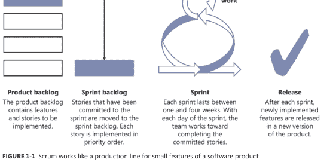

产品待办列表
产品待办列表包含要实现的特性和故事。

冲刺待办列表
已承诺纳入冲刺的故事会被移至冲刺待办列表。每个故事按优先级顺序实现。

冲刺
每个冲刺持续一到四周。在冲刺的每一天，团队都努力完成已承诺的故事。

发布
每个冲刺结束后，新实现的功能会以产品新版本的形式发布。

图 1-1 Scrum 就像一条为软件产品的小功能而设的生产线。

# Scrum 是敏捷的

敏捷是一系列轻量级软件开发方法，即使在项目进行中，也乐于接受客户不断变化的需求。敏捷是对更为僵化的结构化实践之缺陷的回应。《敏捷宣言》体现了这种对比。它可以在网上 www.agilemanifesto.org 找到。

《敏捷宣言》由 17 位软件开发人员签署。在此后的岁月里，敏捷方法的影响力不断增长，以至于在敏捷环境中的经验如今已成为软件开发岗位的常见先决条件。Scrum 是敏捷流程最常见的实现方式之一。

Scrum 涉及文档工件、开发团队内外人员扮演的角色，以及仪式——由相关方参加的会议。仅一章不足以全面探讨 Scrum 作为一门项目管理学科所提供的全部内容。不过，本章提供了足够的细节，既可作为进一步学习的跳板，也可作为 Scrum 日常实践的入门指南。

本章其余部分将更深入地探讨 Scrum 最重要的方面。我们会审视 Scrum 的积极属性，并对其缺点进行客观评估。本章和第 2 章“看板简介”共同构成全书的第一部分，为其余内容奠定了基础。在敏捷软件开发流程中工作，编写代码时保持对变化的适应性是一个高度优先的事项。如果你声称能够优雅地应对变化，但实际上变化在代码层面极难实现，那么这样的流程就几乎没有意义。


# Cynefin

为了进一步回答“为什么要采用敏捷？”这个问题，Cynefin 框架可以为我们提供帮助。

Cynefin（发音为 ki-neh-vin）是一种意义建构框架。图 1-2 展示了不同类型的工作可能适用的管理模式。

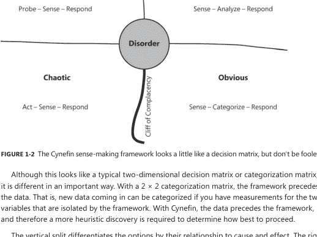

**图 1-2** Cynefin 意义建构框架看起来有点像决策矩阵，但不要被它误导。

虽然它看起来像一个典型的二维决策矩阵或分类矩阵，但它在一个重要方面有所不同。对于 2 × 2 分类矩阵而言，框架先于数据存在。也就是说，只要有针对框架所划分的两个变量的测量结果，就可以对新输入的数据进行分类。而对于 Cynefin，数据先于框架存在，因此需要通过更多启发式的探索来确定最佳行动方式。

纵向划分依据问题与因果关系之间的联系来区分选项。框架的右侧代表有序问题，这类问题呈现出可预测的因果关系；左侧则代表无序问题。

“明显”象限是传统管理模式所处的位置：一种基于最佳实践的命令与控制模型。当工作符合这个象限时，你需要先感知，再进行分类。之后我们还会重新讨论这个象限，因为事情并不像表面看起来那么简单。

沿逆时针方向继续，下一个象限是“繁杂”。这里没有定义明确的“最佳实践”，只有多种可供选择的良好实践。你需要先感知和分析，然后再做出响应。大部分专家领域的工作都属于这一范畴，例如软件开发。

接下来，你会进入“复杂”问题这一无序领域。这里甚至找不到“良好实践”，只有**涌现式实践**。因果关系并不明确，因此你需要先*探查*，再*感知*。如果探查显示出积极结果，就放大这种行为；如果探查显示出消极结果，就抑制这种行为。

最后一个象限是“混乱”问题的领域。在这里，新颖实践是你的主要工具，你需要先*行动*，然后再感知。除非是为了开展前沿创新，否则很少应该有意识地进入混乱状态。应努力将状态稳定回“复杂”领域。绝不能在不知情的情况下陷入混乱。这种情况由“自满悬崖”表示，它强调了在“简单”问题领域中过于安逸所带来的危险。应限制适合“简单”领域的工作量，因为它很容易滑向混乱。

开始做决策时，应首先承认自己处于模型的中心：无序世界。

本书的大部分内容都将软件开发引导至“繁杂”象限，而不是把交付视为一个可以通过类似流程的步骤来保证成功的简单问题。瀑布式方法通过这种方式交付软件，正是问题所在：它过度简化了繁杂问题，并在我们越过自满悬崖、坠入混乱时，嘲弄着我们的努力。

精益或敏捷方法承认，软件交付问题至少是繁杂的，甚至可能是复杂的。

# Scrum 与瀑布式方法

根据我的经验，敏捷方法比瀑布式软件开发方法更有效，因此我只倡导采用敏捷流程。瀑布式方法的问题在于其僵化性。图 1-3 展示了瀑布式项目所涉及流程的一种表现形式。

请注意，一个阶段的输出会成为下一个阶段的输入。同时还要注意，每个阶段完成后才会进入下一个阶段。这种方式假设某个阶段完成后不会再发现任何错误、问题、困难或误解。箭头只指向一个方向！

瀑布式流程还假设某个阶段完成后不再需要进行任何变更，这与经验和统计证据相悖。变化是生活中自然存在的一部分，而不仅仅是软件工程中的一部分。瀑布式方法认为变化代价高昂、不受欢迎，而且最糟糕的是，*可以避免*。瀑布式方法认为，只要在需求和设计上投入更多时间，就可以规避变化，从而使变化在后续阶段中*不会发生*。这种想法十分荒谬，因为变化*总会发生*。

敏捷流程通过采用一种不同的方法来应对这一事实：欢迎变化，并允许所有人适应那些*必然会发生*的变化。尽管敏捷方法——因此也包括 Scrum——允许在流程层面进行变化，但*为变化编写代码*是现代软件开发中最困难、却也最重要的原则之一。

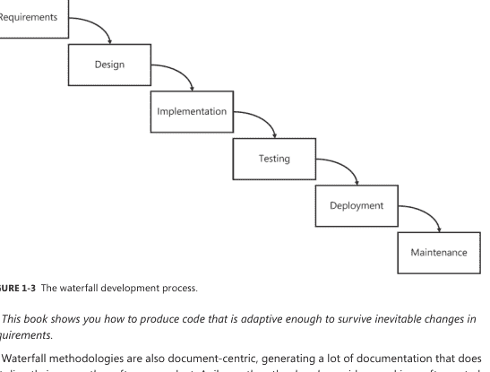

**图 1-3** 瀑布式开发流程。

本书将向你展示如何编写具有足够适应性的代码，使其能够经受住需求不可避免的变化。

瀑布式方法同样以文档为中心，会生成大量不会直接改进软件产品的文档。相比之下，敏捷方法认为，可工作的软件是软件产品中最重要的文档。毕竟，软件的行为由其源代码决定，而不是由随附的文档决定。此外，由于文档与源代码是相互独立的实体，文档很容易与软件失去同步。

> **注意** 这并不是说文档不重要，也不是说敏捷流程从不产生文档。这只是侧重点不同——敏捷方法强调可工作的软件，而瀑布式方法强调文档。

Scrum 规定了一些指标，用于反馈项目进展及其整体健康状况，但这些并不是关于产品的文档。总体而言，敏捷方法倾向于只保留足以避免不负责任行为的文档，但并不强制要求提供此类文档。某些代码当然可以从配套文档中受益，前提是这些文档不是编写一次后就再也无人阅读。正因如此，易于使用的活文档（例如 Wiki）成为 Scrum 团队的常用工具。

Scrum 作为一种流程，其目标不仅是迭代式地完善软件产品，也是迭代式地完善开发流程。这会提醒团队根据自身独特的情况和环境采用流程变更，以确保流程真正适合他们。

# Scrum 的不同形式

每当一个开发团队声称自己遵循 Scrum 方法时，他们通常指的是遵循 Scrum 的某个**变体**。纯粹的 Scrum 并不包含许多从其他敏捷方法中借鉴而来的常见实践，例如极限编程（XP）。Scrum 有三个不同的子类别，它们逐步偏离“纯粹主义者”式的实现方式。

# Scrum 加……

诸如先编写单元测试和结对编程等常见实践并不属于 Scrum。然而，对于许多团队而言，它们是有用且值得加入流程的补充，因此被视为互补实践。当从 XP 或 Kanban 等其他敏捷方法中加入某些实践时，这一流程就变成了“Scrum 加……”——也就是：在默认 Scrum 流程的基础上，增加能够增强而不是削弱该流程的最佳实践。

# Scrum 但是……

有些开发团队声称自己在实践 Scrum，但他们省略了其中的关键部分。例如，有这样一个团队：他们的工作按照优先级排列在待办事项列表中，并被带入迭代式 Sprint；团队还会进行回顾会议和每日站会，但不使用故事点估算，而是倾向于采用实时估算。这种经过稀释的 Scrum 版本被称为“Scrum 但是……”。虽然团队在许多方面与 Scrum 保持一致，但他们在一两个关键领域存在偏差。

# Scrum 不……

如果一个开发团队偏离 Scrum 方法的程度足够大，最终就会变成“Scrum 不……”。这会带来问题，尤其是当团队成员期待采用敏捷方法，而实际流程却与 Scrum 大相径庭，几乎看不出 Scrum 的样子时。根据我的观察，每日站会是 Scrum 中最容易采用的部分，但相对估算和积极面对变化的态度则要困难得多。当 Scrum 流程中有足够多的部分被忽视时，这个流程就不再是 Scrum。

# 角色和职责

Scrum 只是一种流程，而且——这一点怎么强调都不为过——它的有效性取决于遵循该流程的人。这些人承担着相应的角色和职责，用以指导自己的行动。

# 产品负责人

产品负责人的角色（有时称为*PO*）至关重要。产品负责人负责在客户与开发团队其他成员之间建立联系。产品负责人的职责包括：

- 决定开发哪些功能。
- 根据业务价值确定功能的优先级。
- 接受或拒绝“已完成”的工作。


作为项目成功的关键利益相关者，产品负责人（PO）必须能够随时为团队提供支持，并且能够清晰地传达愿景。项目的长期目标应当对开发团队保持清晰明确，重点的变化也应及时传达给整个团队。在短期冲刺规划中，产品负责人会明确要开发哪些内容以及开发顺序。产品负责人决定软件发布前进过程中所需的功能，并确定产品待办事项的优先级。

尽管产品负责人的角色至关重要，但其对流程的影响并不是无限的。产品负责人不能影响团队在一次冲刺中承诺完成多少工作，因为这取决于团队自身根据速度所做的决定。产品负责人也不能规定工作应如何完成——开发团队掌握着在技术层面实现某个用户故事的具体方式。冲刺开始后，产品负责人不能更改冲刺目标、修改验收标准，也不能添加或移除用户故事。在冲刺规划期间确定目标并将用户故事纳入冲刺承诺后，正在进行的冲刺就不可更改了。任何变更都必须等到下一次冲刺——除非选择取消整个冲刺或项目并重新开始。这样可以让开发团队始终专注于实现冲刺目标，而不会不断改变目标。

在整个冲刺期间，随着用户故事逐步推进并完成，产品负责人可能会被要求核实某项功能的工作方式，或对正在进行的任务发表评论。产品负责人必须能够在冲刺期间投入一定时间与开发团队沟通，以便在出现意外或产生疑惑时及时处理。这样，到冲刺结束时，产品负责人就不会面对偏离其最初愿景却被标记为“已完成”的用户故事。不过，产品负责人确实有权决定某个用户故事是否满足既定的验收标准，以及是否应被视为已完成并在冲刺结束时进行演示。

# Scrum Master

Scrum Master（SM）在冲刺期间保护团队免受外部干扰，并处理团队在每日 Scrum 会议中提出的各种障碍。这能让团队在整个冲刺期间保持完整的功能和较高的生产力，从而全心专注于冲刺目标。

正如产品负责人负责产品——即要完成什么工作一样，Scrum Master 负责流程——即围绕如何完成工作的框架。因此，确保团队遵循流程是 Scrum Master 的责任。尽管 Scrum Master 可以提出一些改进流程的建议（例如将四周的冲刺周期改为两周），但 Scrum Master 的权限是有限的。例如，Scrum Master 不能规定团队应如何实现某个用户故事，只能确保团队遵循 Scrum 流程。

> 提示 Scrum Master 是服务型领导者。这意味着他们并不是角色金字塔顶端权力的集中体现。相反，他们致力于将权力下放给每一名团队成员。对团队进行授权能够带来更高的参与度，以及更强的目标感和项目归属感。

作为流程的负责人，Scrum Master 也负责每日 Scrum 会议。Scrum Master 要确保团队成员出席，并在会议期间做好记录，以防发现任何需要采取行动的事项。团队并不是在 Scrum 会议上向 Scrum Master *汇报*；他们是在向所有出席者告知自己的进展和障碍。

# 开发团队

理想情况下，敏捷团队由*通才型专家*组成。也就是说，团队中的每名成员都应具备多方面能力——能够有效使用多种不同技术，同时在某一领域拥有相应的能力、偏好或专长。例如，一个团队可以由四名开发人员组成，每个人都能够非常熟练地使用 ASP.NET MVC、Windows Workflow 和 Windows Communication Foundation（WCF）开展工作。不过，其中两名开发人员专长于 Windows Forms，另外两名则更偏好使用 Windows Presentation Foundation（WPF）和 Microsoft SQL Server。

跨职能团队能够避免形成知识孤岛，即由某一个人——“网页专家”“数据库专家”或“WPF 专家”——独自掌握应用程序某一部分的工作原理。知识孤岛对所有相关人员都不利，因此应尽可能下大力气打破这些孤岛。知识孤岛对公司不利，因为它会使公司过度依赖某一名资源来提供特定领域的价值。这可能成为团队交付吞吐量的瓶颈。个人也会因此受到影响，因为他们会被固化在“只有自己能做”的角色中。在 Scrum 中，代码归整个团队所有。

软件测试人员负责在软件开发过程中维护软件质量。在开始编写某个用户故事之前，测试人员可能会讨论自动化测试计划，以验证该用户故事的实现是否满足所有验收标准。他们可能与开发人员合作实施这些测试计划，也可能自行编写此类测试。用户故事实现后，开发人员可以将其提交测试，测试分析师则会验证其是否按要求运行。

# 猪和鸡

Scrum 流程中的每个角色都可以归类为猪或鸡。这些称谓源自下面的故事：一只鸡走近它的朋友猪，说道：“你好，猪。我有个想法。我觉得我们应该开一家餐馆！”起初，猪很兴奋，问道：“我们应该给它取什么名字？”鸡回答：“可以叫它‘火腿加鸡蛋’。”猪短暂思考了一下，随后愤怒地喊道：“没门！我会*全身投入*，而你只会*做出贡献*！”

这个有趣的寓言强调了项目中某些成员所需的参与程度。猪完全投入项目，并对项目结果负责；而鸡只做出贡献，以更外围的方式参与其中。产品负责人、Scrum Master 和开发团队都属于猪，因为他们致力于交付产品。客户通常属于提供贡献的鸡。同样，高层管理人员也会为项目做出贡献，因此他们也被视为鸡，而不是猪。

# 工件

在任何软件项目的生命周期中，都会创建、审查、分析和拆解大量文档、图表、示意图、统计图和度量指标。在这一点上，Scrum 项目与其他项目并没有区别。然而，Scrum 文档在类型和用途上不同于其他项目管理方式中的文档。所有敏捷流程与更僵化流程之间的一个关键区别，在于文档的重要性不同。例如，结构化系统分析与设计方法（SSADM）非常强调编写大量文档。这种做法被贬称为“前期大设计”（Big Design Up Front，BDUF）：一种错误的信念，认为只要充分重视文档工作，就可以消除项目中的所有恐惧、不确定性和疑虑。敏捷流程旨在将产生的文档减少到项目成功所绝对必需的程度。相反，敏捷更倾向于这样的理念：代码——最具权威性的文档——可以随时部署、运行和使用。敏捷还更倡导所有利益相关者直接相互沟通，而不是编写可能永远不会被最重要受众阅读的文档。文档对于敏捷项目仍然很重要，但其重要性并不凌驾于可运行的软件或沟通之上。

# Scrum 看板

Scrum 项目的日常运作以 Scrum 看板为核心。应为 Scrum 看板预留足够大的墙面空间——如果看板太小，人们就容易省略重要细节。办公室里的墙面空间可能非常有限，但你可以使用一些技巧。也许那块被忽视已久的大白板可以改造成 Scrum 看板。借助磁铁，金属文件柜也可以兼作 Scrum 看板。如果办公室是租来的，或者你无法在墙上留下痕迹，那么“魔法”白板——其实就是可以擦拭的静电纸张——会是理想选择。试着在办公室中找出一个适合承担这一功能的位置。不过，无论你选择什么、如何指定其用途，如果经过几次迭代后感觉不合适，都可以随时更换。

实体 Scrum 看板是绝对必需的。站在 Scrum 看板前的切身体验是无可替代的。尽管数字化 Scrum 工具有其用途，但我认为它们对 Scrum 流程而言是辅助性的，而不是主要工具。如果你可以评估一个数字 Scrum 看板，请记录一下：与使用实体看板相比，有多少事情在数字看板上显得更难完成。以我的经验来看，数字 Scrum 看板令人头疼，而不是令人愉快。图 1-4 展示了一个典型 Scrum 看板的示例。


**图 1-4** Scrum 看板是当前开发中工作状态的快照。

Scrum 看板是一个信息聚集地。它包含许多细节，要想弄清楚正在发生的事情可能会令人望而生畏。本节其余部分将详细解释各个方面。

# 卡片

Scrum 看板上的主要项目是卡片。卡片代表软件产品进展的不同元素——从软件的实际发布到最小且独立的任务。为了清晰起见，每种卡片类型通常用不同颜色表示。由于空间限制，Scrum 看板通常只显示与当前冲刺相关的用户故事、任务、缺陷和技术债务。

> **提示** 仅靠颜色可能无法满足团队中每个人的需求。例如，考虑为无法区分颜色的团队成员将颜色与不同形状结合使用。

# 组成的层次结构

图 1-5 展示了 Scrum 看板上的卡片之间的关系。请注意，这里隐含的意思是，一个产品由许多任务组成。即使是最复杂的软件也可以提炼为一个必须执行的离散任务的有限列表，每个任务都为最终完成铺平道路。

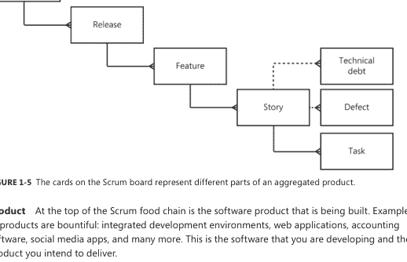

# 产品

在 Scrum 食物链顶端的是正在构建的软件产品。产品的例子不胜枚举：集成开发环境、Web 应用程序、会计软件、社交媒体应用等等。这是您正在开发的软件，也是您打算交付的产品。

团队通常一次只致力于一个产品，但有时团队负责交付多个产品。

# 发布

对于您开发的每个产品，都会有多个发布。发布是最终用户可以购买或作为服务使用的软件版本。有时发布仅用于解决缺陷，但发布也可能旨在为关键客户提供增值功能，或者将软件的 beta 版本作为抢先预览提供。

Web 应用程序通常以单一部署隐式地版本化，该部署取代了所有先前版本。事实上，Google Chrome 网络浏览器就是一个有趣的例子。虽然它是一个桌面应用程序，但它以一系列微发布的形式部署，无缝地部署到桌面，而不会有竞争对手浏览器常见的大张旗鼓的宣传。Internet Explorer 8、9 和 10 都有各自的电视广告，但 Chrome 并不遵循这种模式——Google 只是宣传浏览器本身，而不论版本如何。像这样的迭代发布正变得越来越普遍。Scrum 可以通过关注每个冲刺后交付可用软件的潜力来指导这种发布模式。

# 最小可行产品

首次发布可以与最小可行产品（MVP）保持一致——即被认为足以满足基本需求的一组基本功能。例如，对于会计软件，这个功能集可能仅限于创建新客户、向他们的账户添加交易（存款和取款）以及显示总额的能力。这里的想法是启动项目，使其尽快实现自筹资金。尽管这不太可能仅因 MVP 就发生，但希望 MVP 至少能带来一些收入，以抵消持续的开发成本。不仅如此，第一次部署，即使面向受限的客户群，也可能提供能够影响软件方向的重要反馈。这就是 Scrum（以及整个敏捷）的本质——不断演化软件产品，同时深知所有软件都可能发生变化。

无论发布的目的或部署方式如何（甚至无论频率如何），理想情况下，一个单一产品会经历多次发布。

# 特性

每个发布由一个或多个先前在软件中不存在的特性组成。任何软件从 1.0 版本到 2.0 版本最显著的区别是增加了新特性，团队相信这些特性将产生足够的吸引力，以说服新用户购买，并让现有用户升级。

术语“最小可上市特性”（MMF）对于描述特性和组合发布非常有用。以下是一些示例特性列表，这些特性足够通用，适用于许多不同项目，同时又足够具体，是现实世界中的特性：

- 将应用程序数据导出为基于 XML 的可移植格式
- 快速渲染网页请求
- 归档历史数据以供将来参考
- 复制和粘贴文本
- 与同事通过网络共享文件

# 史诗/特性 vs. MMF vs. 主题

在谈论 Scrum 时，您可能更习惯使用“史诗”而不是“特性”，但请允许我将其替换为我更喜欢的术语。史诗和特性通常被认为是“大型用户故事”：也就是说，它们比 MMF 大得多，无法在一个冲刺中交付。

特性也与 Scrum 主题类似，因为它们都用于将实现共同目标的用户故事分组。

对于每个发布，特性可以大致分为三类：必需的、优先的和期望的。这些是互斥的选项，反映了分配给每个特性的总体优先级。开发团队被指示先处理所有**必需**的特性，然后再处理**优先**的特性，只有在时间允许时才处理**期望**的特性。正如您可能已经猜到的，这些类别（实际上是特性本身）总是可变的。它们可以随时取消、重新排序、修改和取代。团队应优雅地切换焦点（前提是截止日期和资金也可能相应改变）。在 Scrum 中，一切都是一场流动的盛宴，本书旨在帮助您应对这一现实。

# 用户故事

用户故事可能是大多数人都熟悉的 Scrum 工件，但具有讽刺意味的是，它并非 Scrum 所规定。用户故事是极限编程的产物，但由于它们太常用了，已被 Scrum 采用。用户故事通过以下模板指定：

> “作为一个[用户角色]，我想要[以动词为中心的行为]，以便[增加的用户价值]。”

方括号表示参数化，用于区分一个用户故事与另一个用户故事。一个具体的例子应该能进一步说明：

> “作为未认证但已注册的用户，我想要重置我的密码，以便在忘记密码时能够登录系统。”

关于这个用户故事，有很多需要注意的地方。首先，*远远没有足够的细节来实际实现所需的行为。* 请注意，用户故事是从用户的角度编写的。尽管这似乎是显而易见的，但很多人都忽略了这一点，而且用户故事常常错误地从开发者的角度编写。这就是为什么模板的第一部分——*作为一个[用户角色]—*非常重要。同样，*[增加的用户价值]*部分也同样重要，因为没有它，很容易忽视用户故事存在的根本原因。正是这一点将用户故事与其父特性联系起来；刚才给出的例子可能属于“*忘记的用户凭据可以恢复*”这样的特性。而且，这个用户故事很可能会与用户忘记登录名以及用户同时忘记登录名和密码的故事归为一组。

既然这个用户故事不足以开始开发，那么它的价值是什么？用户故事代表了开发团队与客户之间尚未发生的对话。当需要实现这个故事时，被分配到的开发者将首先把故事带给客户，并详细讨论客户的需求。这个分析阶段将产生几个验收标准，以确定用户故事是否可以视为完成。

在收集完需求后，开发者们聚集在一起，提出一些设计思路来满足这些需求。这个阶段可能包括使用 Balsamiq、Microsoft Visio 或其他工具制作的用户界面线框图。一些技术设计概念将详细说明如何修改现有代码库以满足这些新需求，通常使用统一建模语言（UML）图。

设计批准后，团队可以开始将用户故事分解为任务，然后通过执行这些任务来实现故事。当他们达到某个点时，他们


are satisfied that the story is working as required, they can hand it over to be acceptance tested. This final phase, also known as *quality assurance* (QA), double-checks the working software against the acceptance criteria and either approves or rejects it. When it is approved, the user story is complete.

Let’s recap for a minute. With a user story for guidance, developers gathered requirements in an analysis phase, generated a design, implemented a working solution, and then tested this against the acceptance criteria. This sounds a lot like waterfall development methodologies! Indeed, that’s the whole point of user stories—to perform the entire software development life cycle, in miniature, for each story. This helps to prevent any wasted effort because it is not until the user story is ready to be taken from the Scrum board and implemented that the developers can be sure it is still relevant to the software product.

User stories are the main focus of work in Scrum; they hold the incentive that Scrum provides for team members: story points. The team assigns each user story its own story point score during sprint planning and, after the user story is complete, the story points are considered to be earned and are claimed from the sprint total. Story points are explained in further detail later in this chapter.

## Task
There is a unit of work smaller than a user story—the task. Stories can be broken down into more manageable tasks, which can then be split between the developers assigned to the story. I prefer to wait until the story is taken off the board before I split it into tasks, but I have also seen this done as part of sprint planning.

Although user stories must incorporate a full vertical slice of functionality, tasks can be split at the layer level to take advantage of developer specializations within the team. For example, if a new field is required on an existing form, there will probably need to be changes to the user interface, business logic, and data access layers. You could divide this into three tasks that target these three layers and assign each to the relevant specialist: the WPF developer, the core C# expert, and the database guru, respectively. Of course, if you are lucky enough to have a team of generalizing specialists, anyone should really be able to volunteer for any task. This allows everyone to work on various parts of the code, which improves their understanding in addition to boosting their job satisfaction.

It is important to note that the user stories are the bearers of story points and that these do not transfer down to their constituent tasks. A five-point story that is broken into three distinct tasks is not composed of two one-point tasks and a three-point task. This is because there is neither incentive nor credit for partially completed work. Unless the story—as a whole—is proven complete by the QA process before the end of the sprint, the points that it contains are not claimed, even in part. The story remains in progress until the next sprint, when ideally it will be completed early in the iteration. If a story takes too long to complete and remains in progress for a long time—more than a full sprint’s length—it was probably too big in the first place and should have been sliced into smaller, more manageable stories.

## Technical debt
Technical debt is a very interesting concept, but it is easily misunderstood. Technical debt is a metaphor for the design and architectural compromises that have been made during a story’s journey across the Scrum board. Technical debt has its own section later in this chapter.

# The vertical slice

When I was growing up, every Christmas my father would make trifle. This is a traditional English dessert that is made from various layers. At the bottom there is sliced fruit; then there are layers of sponge cake, jelly, and custard; and on top is whipped cream. My brother used to dig his spoon all the way through the layers, whereas I would eat each layer in turn.

Well-designed software is layered just like a trifle. The bottom layer is dedicated to data access, with layers in between for object-relational mappers, domain models, services, and controllers—with the user interface on top. Much like eating trifle, there are two ways to slice any part of a layered application: vertically and horizontally.

By slicing horizontally, you take each layer and implement what is required of those layers as a whole. But with this approach, there is no guarantee that each slice will align with the others. The user interface might allow the user to interact with certain features that layers below have not yet implemented. The net effect is that the client cannot use the application until a significant proportion of each layer has been completed. This delays the important feedback loop that Agile methods give you and increases the likelihood that you will build more than is needed—or simply the wrong thing.

Slicing vertically is what you should aim for. Each user story should incorporate functionality at each layer and should be tethered at the top to the user interface. This way, you can demonstrate the functionality to the user and receive feedback quickly. This also avoids writing user stories that are developer-centric, such as, “I want to be able to query the database for customers who have not paid this month.” This sounds too much like a task; the story could be about generating a report on the outstanding unpaid accounts.

## Defect
A defect card is created whenever acceptance criteria are not met on a previously complete user story. This highlights the need for automated acceptance testing: each batch of tests written for a story forms a suite of regression tests to ensure that no future work is able to introduce a breaking change.

Defect cards, like technical debt, do not have story points assigned to them, thus removing the incentive to create defects and technical debt—something that developers want to avoid even if full eradication of defects and technical debt is unattainable.

All software has defects. That is just a fact of software development, and no amount of planning or diligence will ever account for the fallibility of humans. Defects can be broadly categorized as A, B, or C: apocalyptic defects, behavioral errors, and cosmetic issues.

Apocalyptic defects result in an outright crash of the application or otherwise prevent the continuation of the user’s work. An uncaught exception is the classic example because the program must terminate and be restarted or—in a web scenario—the webpage must be reloaded. These defects should be assigned the highest priority and should be fixed before a release of the software.

# Card sharp

A lot of options are available for customizing and personalizing the cards on the Scrum board.

## Color scheme

Any color scheme will suffice for the cards, but there are a few that, in my experience, make the most sense. Index cards are ideal for features and user stories, whereas sticky notes make excellent task, defect, and technical debt cards because they can be stuck to a relevant story. Here are my recommendations:

- Features: green index cards
- User stories: white index cards
- Tasks: yellow sticky notes
- Defects: red/pink sticky notes
- Technical debt: purple/blue sticky notes

Note that user stories and tasks, being the most common kinds of cards you will create, use the most commonly available index cards and sticky notes. The last thing you need is to run out of index cards, so try to use the most commonly available colors.

## Who creates cards?

The simple answer to the question, “Who can create the cards?” is: anyone. This does, of course, come with some conditions. Though anyone can create a card, its validity, priority, criticality, and other such states are not something that should be decided by one person alone. All feature and story cards should be verified by the product owner, but task, defect, and technical debt cards are entirely the domain of the development team.

## Avatars

Much like the avatars found online in forums, on blogs, and on Twitter, these are miniature representations of the various members of the team. Feel free to allow your team members to express themselves through their avatars, because it certainly adds a sense of fun to the Scrum process. Of course, steer them away from anything likely to cause offense, but there should be a sense of distinct identity for each person’s avatar.

Over the course of an iteration, these avatars will be moved around a lot and will be handled on a daily basis. Because you have index-card stories and sticky-note tasks already on the board, these avatars should be no bigger than 2-inch squares. Laminating them will also help to protect them from becoming dog-eared or torn, and reusable adhesive or a little piece of tape should hold them in place.


行为错误可能不算严重，但却会激怒用户。这类错误可能比应用直接崩溃更具破坏性。想象一下错误的货币兑换逻辑，在分币四舍五入上出错。无论算法偏向客户还是商家，总有人会亏钱。当然，并非所有逻辑错误都如此严重，但很容易理解为什么它们应被赋予高优先级。

外观问题通常是用户界面方面的问题——图片对齐不当、窗口无法优雅地扩展到全屏，或网页上的图片始终加载不出来。这些问题不影响软件的使用，只影响外观。尽管这些问题通常被赋予较低优先级，但依然要记住：外观会影响用户对软件的期望。如果用户界面设计糟糕，按钮失灵、图片加载不出来，用户就会不太愿意相信该软件的内部运作。反过来，一个光鲜亮丽、且有着各种花哨功能的界面可能会让用户相信你的软件内部也同样设计精良。对于那些已经声名不佳的项目，一种常见做法是重新设计用户界面——甚至对整个产品进行品牌重塑——以改善观感并重置预期。

# 泳道

Scrum 看板上绘制有垂直的线条来划分泳道。每个泳道可以包含多张用户故事卡片，以表示该故事在整个开发生命周期中的进展。从左到右，基本泳道分别是待办事项（Backlog）、进行中（In Progress）、质量保证（QA）和已完成（Done）。

待办事项中的故事已被“承诺”在此 Sprint 中完成，除非被取消，否则应将其从看板上取下并开始处理。这一列可以按优先级排序，这样最顶上的条目始终是下一个应实现的故事。

当故事从待办事项中被取出，并与产品负责人就范围和需求进行沟通后，卡片会带着新拆解出的任务返回到“进行中”泳道。此时，还应附上参与该故事的所有团队成员的头像。这个故事现在会计入任何与进行中阶段相关的泳道限制。例如，你可能会要求同一时间只有三个用户故事处于进行中状态，从而促使团队优先完成已开始的故事，而不是那些尚未开始的故事。请记住：部分完成的工作没有任何激励意义。

当一个故事完成了分析、设计和实现后，就被视为“开发完成”，可以移至“质量保证（QA）”泳道。理想情况下，QA 环境应尽可能接近生产环境，以避免因部署中的微小差异而可能出现的各种环境错误。测试分析师会根据验收标准评估这个故事。本质上，他们会试图“破坏”这个故事，证明代码的行为并不符合预期。通常，他们会对某些操作输入异常和错误的数据，以确保校验逻辑能正确工作。他们甚至可能寻找安全漏洞，以确保恶意最终用户无法获得超出其指定权限级别的访问权限。当 QA 完全通过后，用户故事被移到“已完成”泳道。与故事相关的任何故事点随后会被计入，而 Sprint 燃尽图（用于显示 Sprint 进度）也可以随之更新。这些工件将在后文更详细地介绍。

Scrum 看板还可以使用横向泳道进一步划分。这些泳道可用于按功能对故事进行分组，这样每个人都能一眼看出精力集中在哪个部分，从而知道哪些瓶颈需要缓解。

看板顶部有一个特殊的泳道是“快速通道（Fast-Track）”，任何非常高优先级的任务都可以放入其中。团队成员可以被指示在一个快速通道条目上“蜂拥而上（swarm）”，以便尽快完成它，这通常会牺牲其他未完成的工作。蜂拥式协作可确保团队停止手头工作，聚焦于一个具有最高优先级的任务或问题。这是一个有用的工具，应当在出现这类优先级情况时谨慎使用。在生产环境中发现的灾难性缺陷是最常见的快速通道条目。

# 技术债务

“技术债务”一词值得进一步解释。在实现用户故事的整个过程中，很可能需要在“理想代码”和足以满足截止期限的代码之间做出某些妥协。这并不是说为了赶上截止日期就应该容忍或鼓励劣质设计，而是说，现在做些更简单的事情、以后再改进它，是有价值的。

## 好的和坏的技术债务

债务很可能在一个项目的生命周期内逐渐累积。它之所以被称为债务，是因为这个比喻非常贴切。某些类型的金融债务并没有什么问题。例如，如果你可以选择以低息分期付款的方式在 12 个月内支付一辆汽车的费用，你就是欠了债。但如果你需要这辆车通勤，又无法一次性付清全款，这可能是一个好决定。这辆车能让你赚到必要的收入来偿还分期款，因为你现在可以准时上班了。

当然，有些债务是坏的。如果你刷信用卡购买某件奢侈的东西，却没有事先计算好如何偿还债务，你最终可能会陷入余额转移的循环，试图将利息支出降到最低。事后看来，这会是一个基于坏账的糟糕财务决策。关键是要仔细审视各种选项，判断这项债务是否值得承担，还是应该直接全额付清。

软件领域中的权衡也是同样的道理。你可以现在实现一个次优方案并赶上截止日期，也可以现在多花些时间改进设计，但可能会错过截止日期。不存在适用于所有情况的正确答案，只有用于识别好的和坏的技术债务的指导原则。

## 技术债务象限

著名的敏捷布道者马丁·福勒（Martin Fowler）定义了技术债务象限，用以对将故事标记为“已完成”可能需要做出的让步和妥协进行分类。将平面划分为四个象限的两个坐标轴 x 和 y，分别对应这两个问题：“我们以正确的理由累积这项技术债务吗？”和“我们是否意识到有其他替代方案可以避免这项技术债务？”

如果你对前一个问题的回答是“是”，那么你就是在增加谨慎的技术债务：你可以指出添加它的正当理由，并且问心无愧。如果你的回答是“否”，那么这种债务就是鲁莽的，最好现在就处理掉，而不是任其累积。

对于后一个问题，肯定的回答意味着你已经考虑过各种替代方案，并决定承担这项债务。否定的回答则表明你想不出其他替代方案。

这些问题的答案产生了四种可能的情况，如图 1-6 所示：

- **鲁莽且故意**  这种债务毒性最强。它相当于在说“我们没有时间做设计”，这反映出一种非常不健康的工作环境。这样的决定应该让所有人警觉：这个团队缺乏适应性，正在一步步走向必然的失败。

- **鲁莽且无意**  这类债务很可能是由于缺乏经验造成的。它源于对现代软件工程最佳实践的无知。代码很可能会是一团糟，与上一种情况相似，但开发者并不知道还有更好的做法，因此也找不到其他选择。对策是教育：只要开发者愿意学习，他们就能停止引入这类技术债务。

- **谨慎且无意**  这种情况发生在你遵循最佳实践之后，却发现原本有更好的做法，现在你知道了该怎么做得更好。这与上一种情况类似，但当时所有开发者都一致认为没有更好的解决问题的方式。

- **谨慎且故意**  这是最可接受的一种债务。所有选择都已考虑过，你清楚地知道自己在做什么——以及为什么——允许这项债务继续存在。它最常见于临近发布时做出的“现在发布，之后再处理后果”的决定。

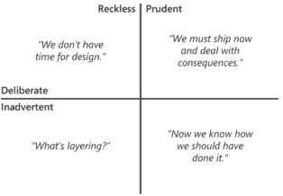

**图 1-6**  马丁·福勒所解释的技术债务象限，帮助开发者直观地了解债务的四种不同类别。

**偿还债务**  技术债务并不直接与任何故事点挂钩，但尽管缺乏直接激励，债务仍然必须偿还。最好的做法是尝试将一张技术债务卡片附加到某个故事上，并在重构代码的同时，让新的设计与相关的新行为一起落地。下一次从看板中取出一个故事时，请检查将编辑的代码中是否附有技术债务，并尽量将两者一起处理。


# 数字 Scrum 看板

数字 Scrum 看板除非始终投射在墙上，否则会隐藏项目中一些最重要的信息。通过公开这些信息并将其展示给整个公司，你可以引发那些原本不会有人提出的、关于流程的疑问。对流程保持透明是一项巨大的优势，尤其是在公司中首次实施 Scrum 时。这有助于赢得重要利益相关者的支持，而你最好让他们参与到流程中来。

虽然这听起来像老生常谈，但人们确实害怕变化。恐惧只是对未知的自然反应。通过向人们解释你在做什么、某些图表意味着什么（以及为什么他们的墙上现在贴满了数十张索引卡），你可以培养一种协作与沟通的精神，这真的弥足珍贵。被要求向非技术人员解释这些事情对你也有帮助，因为在这个过程中，你自己可能会更深入地理解流程。

与所有工具一样，最好的工具是“高接触、低阻力”的。它们会被频繁使用，而且使用起来没有任何障碍。当一个工具哪怕只是稍微有些不方便时，它就会逐渐被越来越多地忽视。那些最初被频繁使用并 diligently 保持更新的工具将不再被维护，并迅速落后于现实。

# “完成”的定义

每个项目都需要一个“完成”的定义（DoD）。这是每个用户故事都必须遵守的标准，才能被视为“完成”。你听过多少次开发者说出下面这些话？

> “完成了，我只需要测试一下……”

> “完成了，但我发现一个缺陷，需要修复……”

> “完成了，但我对设计还不是 100% 满意，所以我要改一下界面……”

我自己过去也说过这些话。如果故事真的完成了，就不需要任何附加说明、条件或限定语。这些例子是开发者在因为估算不准或遇到意外问题而需要给自己争取更多时间时说的话。每个人都必须就“完成”的定义达成一致并严格遵守。如果一个用户故事不符合标准，它就不可能算是完成。在故事满足“完成”的定义之前，故事点永远不会被认领。

“完成”的定义应该包含什么？这完全取决于你、你的团队，以及你希望质量保证流程有多严格。不过，下面展示了一个可以作为起点的标准 DoD。

为了声称某个用户故事已完成，你必须：

-   对所有代码进行单元测试，覆盖其成功和失败路径，且所有测试通过。
-   确保所有代码都提交到持续集成构建中，并且编译无误，所有测试通过。
-   与产品负责人一起，根据验收标准验证行为。
-   让一位未参与该故事开发的开发者进行代码同行评审。
-   文档只需足以传达意图即可。
-   拒绝鲁莽的技术债务。

可以自由删除、修改或追加任何规则，但要对这个定义保持严格。如果一个故事不满足所有标准，那么要么它还需要更多工作——它还没有完成——要么应该从“完成”的定义中删除那些过于苛刻的标准。例如，如果你觉得代码评审过于陈旧或迂腐，可以随意从你的 DoD 中省略这条规则。

# 图表与度量

有几种图表可用于监控 Scrum 项目的进度。Scrum 图表可以显示 Scrum 项目的健康状况和历史进度，还可以预测未来可能取得的成果。所有这些图表都应该突出地展示在 Scrum 看板旁边，其大小要足以在几英尺外阅读。这向团队表明，这些指标没有被用来在背后衡量他们，也不是为了供管理层消费而衡量他们进度的一种方式。相反，要非常坦率地说明进度是如何衡量的，并明确表示这些图表不是为了绩效评估而制作，而是为了诊断整个项目的问题。

与此相关的一点是，尽量避免在个人层面上衡量任何事情——例如每个开发者完成的故事点。这向团队传达了不好的信息：他们可以为了个人进度而牺牲团队进度。开发人员会很容易依附于这样的衡量标准，并试图通过垄断较大的故事、独自争取点数来保全面子。要小心你激励了什么。

> **警告** 要警惕你在衡量什么——存在“观察者效应”。例如，对于某些指标，如果不首先改变被衡量的对象，就无法进行测量。以测量汽车轮胎气压为例，如果不先放掉一点轮胎中的空气，就很难测量气压，而这本身就改变了气压。同样的原理也适用于人性。当团队知道他们将按某些标准被衡量时，他们会尽一切可能提高自己的统计数据，以使自己看起来不错。这并不是说你在管理一群精于权术的麻烦制造者，但当团队意识到故事点将被用来衡量他们的进度时，他们可能会倾向于为相同的努力分配更高的点数。使用三角测量法（本章稍后的“Sprint 回顾”一节中会介绍）来协调估算工作量与实际工作量。

# 故事点

故事点旨在激励团队在每个 Sprint 中增加业务价值。故事点由整个开发团队在 Sprint 计划会议期间分配给用户故事（参见本章稍后的“Sprint 计划”一节）。故事点是实现用户故事所代表的行为所需的相对工作量的度量。这是满足整个软件生命周期所需的全包工作量——需求分析、技术设计、带单元测试的代码实现，以及针对验收标准的质量保证和部署到暂存环境。虽然每个故事都应该已经足够小，能够轻松容纳在一个 Sprint 中，但故事的大小仍然可能有显著差异。

在规模的一端是“一点故事”，它需要最少的工作量来实现。关于故事点，一个有趣且重要的事实是：它们在分配它们的团队之外毫无意义。对一个团队来说是一点故事，对另一个团队可能是三点故事。在多个 Sprint 中发生的事情是，对于故事所需的大致工作量会形成一种共识。

故事点绝对不代表的一件事是以绝对时间衡量的工作量——天、小时或任何其他时间度量。故事点确实非常粗略地对应于一个历史时间范围，如图 1-7 所示。在此图表中，垂直条代表对应大小故事实际所花费时间的最小值、最大值和平均值。

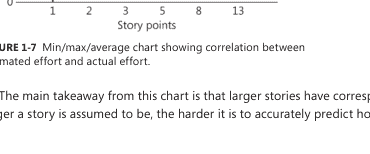

图 1-7 最小/最大/平均图表，显示估算工作量与实际工作量之间的相关性。

这张图表的主要启示是：较大的故事相应地有较大的时间范围——一个故事被假定得越大，就越难准确预测完成它需要多长时间。

# 速度

在多个 Sprint 中，可以计算已达成故事点的滚动平均值。假设一个团队已经完成了三个 Sprint，在总计分别为 8、12 和 11 个故事点的故事上满足了“完成”的定义。那么滚动总计为 31，滚动平均值为 10 点。这就是团队的速度，它有两种用途。

首先，团队的速度可以构成团队在下一个 Sprint 中应承诺的点数上限。如果团队平均每个 Sprint 完成 10 点，那么为单个迭代承诺超过这个数量就不仅仅是乐观——这会让他们注定遭受打击士气的失败。最好设定一个可实现的目标并达到或超过它，而不是设定一个不切实际的目标然后落空。如果团队拿了这 10 点，实际上完成了 11 点，那么新的速度将变为 11：(12 + 11 + 11) / 3。这就是 Scrum 反馈循环的运作方式。

速度的第二个用途是分析交付中的问题。如果一个团队的速度在一个 Sprint 中大幅下降，这可能表明在该 Sprint 期间发生了什么需要纠正的坏事。也许故事太大，其真实规模被低估了，导致它们长期处于进行中状态，并且需要跨越多个 Sprint。或者，也可能有一个更简单的解释——太多关键员工同时休假（或生病），进度自然放缓。另一方面，也许花了太多时间重构现有可工作的代码，而对向系统引入新功能重视不够。无论原因是什么，速度下降 25% 并不总是灾难性的，但它可能预示着未来更多问题的出现，你应该尽快解决。周复一周的速度下降——持续减速——肯定是一个问题，很可能指向代码不适应变化；这正是本书将帮助你解决的问题。

# Sprint 燃尽图

在每个 Sprint 开始时，会创建一张二维笛卡尔坐标图并放在 Scrum 看板旁边。故事点总数标在 y 轴上，工作天数标在 x 轴上。然后画一条笔直的对角线（也称为最佳拟合线），显示 Sprint 的理想进度，如图 1-8 所示。

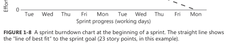

图 1-8 Sprint 开始时的燃尽图。直线显示了对 Sprint 目标（在本例中为 23 个故事点）的“最佳拟合线”。


# Feature burnup


图 1-10 覆盖调整后日历年度的特性燃尽图，显示一个健康项目持续稳步进展。

另一方面，图 1-11 所示的燃尽图表明开发过程中出现了明确的问题。团队起步非常强劲，极快地交付了大量特性，但此后陷入停滞，在过去八个月里仅交付了两个已完成的特性。

# Features completed

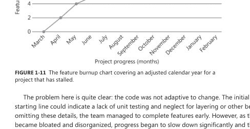

图 1-11 覆盖调整后日历年度的特性燃尽图，显示一个项目已陷入停滞。

问题在这里非常清楚：代码无法适应变化。从起跑线开始的初期冲刺可能表明缺乏单元测试，并且忽视了分层或其他最佳实践。通过省略这些细节，团队得以提前完成特性。然而，随着代码库变得臃肿且组织混乱，进展开始显著放缓，已交付特性的数量几乎停滞不前。这种进展很可能伴随着缺陷数量的增加以及不良的——鲁莽的——技术债务。如果项目继续沿着这条路径发展，重新开始可能更好——将其拉回正轨所需的重构工作量将超过收益。如果问题能及早被发现，团队和项目仍有可能恢复。与其事后强行将敏捷开发实践塞进一个不健康的项目中，不如从一开始就建立敏捷开发实践。

# Backlogs

Backlog 是一份待处理事项的清单，这些事项尚未得到处理。这些事项等待着从 backlog 中取出并付诸行动，直到完成为止。列表中的每个条目都有分配的优先级和估计所需工作量，列表首先按优先级排序，然后按工作量排序。

在 Scrum 中维护两个 backlog，各自目的不同：产品 backlog 和冲刺 backlog。

## Product backlog

在产品的生命周期中的任何时间点，产品 backlog 都包含等待实现的特性。这些特性尚未承诺到某个冲刺，因此开发团队并未积极处理该 backlog 上的条目。开发团队——或其主要代表——在发布计划会议上花费时间来评估这些特性所需的工作量（本章后面会介绍）。这有助于对产品 backlog 上的条目进行优先级排序，使其保持优先级顺序。

每个条目的优先级主要由实现该特性对业务所代表的价值决定。这种业务价值必须由产品 backlog 的所有者——产品负责人——来确定。此人代表业务与开发团队沟通，并能权威地代表业务发言。产品负责人对业务及其工作方式的了解对于为任何特定特性分配正确的业务价值至关重要。如果产品 backlog 上的两个条目具有相同的相对业务价值，则其优先级根据相对所需工作量决定。给定两个具有高业务价值的特性，如果其中一个估计需要少量工作，另一个需要大量工作，从商业角度来看，先实现较小的特性更有意义。这是因为较小的特性风险更低；实现一个小特性所需时间的可能范围不会像大特性那样波动很大。此外，所需工作量较少的特性的投资回报率（ROI）高于价值相等但需要更多工作的特性。

当业务希望发布产品的新版本时，可以查阅产品 backlog 来确定哪些特性对发布最有价值。这可能以两种方式发生。或者业务为发布设定绝对截止日期，并承诺在该时间范围内可能完成的工作量，根据附带的工时估算；或者业务选择发布所需的特性，并根据估算确定可能的发布日期。

除了特性之外，产品 backlog 还可以包含必须修复但尚未进入冲刺的缺陷。就像特性一样，缺陷也会被赋予一定的业务价值。

缺陷所需工作量的估算难以确定，因为对缺陷原因了解较少，可能需要时间来找到估算。

产品 backlog 应反映敏捷报告的开放性。它应对所有人可见，以便任何人都可以贡献想法、提供建议或指出可能出现的问题。同时也很重要，这份清单必须保持权威性，随时反映产品 backlog 的真实状态。由于信息不佳而做出的错误决策往往很常见，如果关键的发布计划决策信息不足，过时的产品 backlog 可能会造成灾难。

## Sprint backlog

冲刺 backlog 包含要在即将到来的冲刺中完成的全部用户故事。冲刺开始时，团队根据当前速度和尚未开发的用户故事的相对规模，选择足够的工作量来填满一个冲刺。故事的优先级由产品负责人分配。故事承诺到冲刺后，团队可以开始将每个故事分解为具有以小时为单位的实际时间估算的任务。然后每个个人选择实施足够多的任务以填满其在冲刺期间的时间。

冲刺 backlog 和所有时间估算都由团队拥有。开发团队之外的人员不能向冲刺 backlog 添加条目，也无法可靠地估算相对工作量或完成工作所需的绝对小时数。团队对冲刺 backlog 完全负责，但必须按优先级顺序从产品 backlog 中获取工作。

# The sprint

Scrum 项目的迭代称为冲刺。冲刺应持续一到四周。两周冲刺最受欢迎。较短的冲刺可能没有足够的时间实现冲刺目标，较长的冲刺可能导致团队失去专注。

冲刺通常按其索引号引用，从零号冲刺开始。零号冲刺旨在为整个团队准备开发环境，并在第一次实际冲刺开始前进行一些初步计划会议。零号冲刺可能不会有任何点数关联，但在最初几周可以取得很多成就，以便在后续冲刺中更轻松地过渡到 Scrum。

人们很容易将冲刺与工作周对齐，周一开始，周五结束。问题在于冲刺回顾会议（稍后会介绍）涉及大量会议时间，而周五下午坐在会议中是最消耗精力的。有些人周五也倾向于早退，周末前注意力很可能下降。同样，没有人期待周一开始时就开会，因此最好避免这种情况，将冲刺安排在周中左右开始：周二、周三或周四。

以下是每个冲刺中包含的所有会议的解释，按顺序排列，除非另有说明。

## Release planning

在冲刺开始前的某个时间，必须计划软件的发布。这涉及客户、产品负责人以及开发团队代表决定发布日期并对要包含的特性进行优先级排序和规模评估。

## Feature estimation

特性即使在规模较小的一端也可能涉及大量工作。因此，任何预测所需工作量大小的尝试都会出现很大偏差。出于这个原因，特性工作量可以用常见的 T 恤尺寸表示：

- 特大号（XL）
- 大号（L）
- 中号（M）
- 小号（S）
- 特小号（XS）

> **提示** 采用这种“ T 恤尺寸”估算可以防止故事的数学等价性。两个 2 分的故事应等于一个 4 分的故事。但两个小号故事可能并不等同于一个中号故事——它们的相对大小既不清晰也不精确。如果你确实想保持等价性，你的特性应以点数衡量。

## Feature priority

很难预测一个发布中能容纳多少特性，这就是特性优先级如此重要的原因。对于特定发布，所有特性都可以赋予三种优先级之一：

- 必需（R）
- 偏好（P）
- 期望（D）

必需特性是发布中最重要的部分。偏好特性是在截止日期临近前如果有时间应处理的特性。期望特性优先级最低。这些特性并非必不可少——但客户当然希望它们得到实现。

此外，业务利益相关者应为特性编号，以便开发团队确信按优先级顺序实现每个特性。


# Sprint 计划

Sprint 计划的预期成果是估算用户故事。与 Scrum 流程的各个部分一样，故事估算过程也有多种变体。本节讨论规划扑克，这是生成讨论的较为常见方式之一，以及亲和估算，这是一种更快地估算故事相对大小的方法。当需要估算的故事数量很大时，亲和估算更合适。对于单个 Sprint，如果只有少数几个故事需要估算，可以使用规划扑克；如果故事数量较多或时间紧张，则可以使用亲和估算。

## 规划扑克

规划扑克会议涉及整个开发团队——业务分析师、开发人员和测试分析师——包括 Scrum Master 和产品负责人。对于产品待办事项列表上当前存在的每个用户故事，都给出一个简要范围说明，然后要求每个人对其大小以故事点进行投票。

为了避免出现大量小规模差异，最好限制投票选项。例如，常见选择是修改后的斐波那契数列：1、2、3、5、8、13、20、40 和 100。无论选择何种量表，选项总体上应有限制，且随着点数的增加，选项之间的差距应增大。在量表的低端，可以添加零来表示“无需工作”，适用于可能因其他工作而被取消的故事。在量表的高端，团队成员可以投票认为某个故事太大，无法在一次 Sprint 内实现，必须在从看板上取出开发之前进行垂直拆分。

几副扑克牌很适合作为投票卡使用，但你也可以用备用索引卡制作投票卡，甚至只是在废纸上写上数字即可。投票时，每个人应同时出示自己的卡片，以避免受他人选择的影响。达成共识并不总是可能的，个人估算之间也可能存在较大差异。这完全正常——肯定会有几个离群值偏离众数投票。应要求这些投票者根据总体共识来说明其选择的理由。例如，如果有人投票为 1，而众数投票为 8，就应礼貌地请其解释为何认为该故事所需工作量要少得多。同样，投票高于众数的投票者也应被要求解释其原因。这里发生的一切只是在就团队认为将故事完成到定义完成所需的工作量展开讨论。

在说明理由之后，可能需要重新投票，因为其他人可能被说服认为自己的投票实际上过大或过小，而离群值才是正确的。最终应达成共识，所有各方就合适的故事点数达成一致。每个故事都应进行估算，直到分配的点数达到团队当前的速率，即团队在每个 Sprint 中应承诺的最大工作量。

## 避免帕金森定律

帕金森定律指出：

> “工作会扩张以填满完成它所用的可用时间。”
> —Cyril Northcote Parkinson

当你将故事的估算与现实世界的时间脱钩时，就不太可能屈服于帕金森定律。重点应保持在尽快完成故事——即尽快满足完成定义——上。

## 亲和估算

亲和估算作为规划扑克的对照提供，因为如果故事很多，规划扑克可能需要花费大量时间来生成估算。与对每个故事都进行讨论不同，团队从产品待办事项列表顶部挑选两个故事，然后决定哪一个更小。较小的放在桌子的左侧，较大的放在右侧。

团队然后从产品待办事项列表中取出一个故事，并将其放置在现有较小和较大故事之间的光谱上，他们认为它应该在那里。它完全可以放在较小故事的左侧，表示它更小；放在较大故事的右侧，表示它更大；放在小或大故事之上，表示它大致相同；或放在两个故事之间。此过程然后对产品待办事项列表上的每个故事继续进行，直到 Sprint 中没有更多空间容纳额外工作为止。

故事按相对大小分组后，团队可以从最左侧的组开始，逐步向最右侧的组推进，根据修改后的斐波那契数列为故事分配点数。如果需要估算的故事很多，或时间有限，这是一种实现相对大小大致估算的好方法。

## 每日 Scrum

尽管有几场会议会持续几个小时，但 Scrum 流程本身在日常层面仅在每日 Scrum，即“站立会议”中真正可见。

团队应在 Scrum 看板周围呈马蹄形聚集，每个人轮流向整个团队汇报。每日 Scrum 不应超过 15 分钟。为了聚焦会议，每个人都应回答以下三个问题：

- 昨天你做了什么？
- 今天你将做什么？
- 你面临什么障碍？

每日站立会议解决的关键问题是昨天的实际进展和今天的预计进展。在讨论你昨天做了什么时，请参考 Scrum 看板，并随意将卡片从一列移动到另一列，或将你的头像从一张卡片移动到另一张卡片，从而保持 Scrum 看板为最新。概述你所做的工作以及这一天的情况如何。如果此时你没有要做的事情，请通知 Scrum Master 并请求新的工作项。障碍包括任何可能阻止你完成当天目标的事情。由于你将在明天的每日 Scrum 中回顾你声称今天将要做的事情，因此列出可能阻止你实现计划的一切非常重要。障碍可能是直接与工作相关，例如，“如果网络像昨天一样继续中断，我将无法继续”，也可能是个人事务，例如，“我今天 14:00 有牙医预约，所以不太可能完成所有事情”。无论如何，Scrum Master 应该做笔记，以便她了解每个人对其故事的进展情况。

## Niko-niko 日历

“niko-niko 日历”——有时也称为“心情板”（日语中“niko-niko”意近“笑脸”）——提供了团队在 Sprint 期间对进展感受的良好晴雨表。在 Scrum 看板旁绘制一张表格，Sprint 的日期横向排列在顶部，团队成员姓名纵向排列在侧面，如图 1-12 所示。

|  | Mon | Tue | Wed | Thu | Fri | Mon | Tue | Wed | Thu | Fri |
|---|---|---|---|---|---|---|---|---|---|---|
| John | 😀 | 😀 | 😀 | 😀 | 😀 |  |  |  |  |  |
| Bob | 😐 | 😐 | 😀 | 😐 | 😡 |  |  |  |  |  |
| Alice | 😀 | 😐 | 😀 | 😀 | 😐 |  |  |  |  |  |
| Mark | 😡 | 😡 | 😡 | 😡 | 😡 |  |  |  |  |  |

**图 1-12** niko-niko 日历能快速显示谁的 Sprint 进行得顺利，谁则不顺利。

在 Scrum 会议上，要求每个人在其前一天的方格中贴上三种贴纸之一——绿色、黄色或红色。每个贴纸对应对前一天整体情况的总结：好、还行或坏。这将迅速显示团队成员何时连续遇到令人沮丧的日子并需要帮助，而他们可能不会主动寻求。

这只是改善反馈循环的又一个指标。如果你的所有团队成员持续对工作感到不佳，也许士气需要提升。或者如果团队中某个人持续不快乐而其余团队成员都很开心，这可能表明有人被落下了或不觉得自己融入其中。最糟糕的是，如果整个团队在 Sprint 延期、代码一团糟、客户纷纷要求退款时仍然感到快乐——团队已经不在乎了！


在每个人都发言之后，会议就结束了。需要警惕的一件事是跑题的对话。在 Scrum 期间试图在会议中讨论问题极具诱惑力。如果有人提到代码库中某种奇怪而奇妙的行为所造成的阻碍，所有开发人员都可能会想对可能的原因进行假设。要意识到谁需要参加此类对话——测试分析师真的需要听为什么 Microsoft Visual Studio 使用了编码人员全部可用 RAM 的讨论吗？不，很可能不需要。记下该问题并请相关人员在会后离线讨论（会议结束后）。

# Sprint 演示

Sprint 演示是应列入 Sprint 日历的关键活动。它是对在 Sprint 期间已满足完成定义的所有已完成用户故事——在真实环境中实际运行的展示。整个开发团队都应出席，你还可以邀请其他利益相关者参加会议，例如管理层或销售团队代表。任何对项目进展感兴趣的人都应被邀请出席。这进一步促进了所有项目都应有的开放性。

收集 Scrum 看板上的所有已完成用户故事，并对每个故事说明其范围以及作为项目整体的一部分它旨在实现什么。参考故事所属的功能，以及由于其实施而导致的应用行为变化。继续使用系统的实际部署来演示这种行为。邀请观众提问，但要小心不要涉及无关问题或因无关紧要而分心。保持对话的专注，并在演示完成后主动与人们单独交谈。任何改进建议都应反馈到产品待办事项列表中，以便正确地进行优先级排序和安排。有时在演示中提出的改进建议似乎突然成为最重要需要做的事情，但这很少能反映现实。

演示不应被畏惧——它无疑会激励进展。没有人希望因为没有任何完成内容而取消演示，但要抵制规避完成定义的诱惑只是为了展示某些东西。通过诚实地说明进展，你就无需隐藏任何问题。相反，请指出图表和指标来解释产出减少的可能原因。

在演示前指定代码锁定时间也是一个好主意，以防止那些诱人的最后一刻更改来试图多争取点数。在演示前投入现实的时间来设置环境并确保每个人都准备就绪，并防止为短期提升而在代码中引入鲁莽的技术债务。

> 自律是能够始终如一地选择持久利益而非短暂诱惑的能力。
> 
> Mike Alexander, Fitness Expert

# Sprint 回顾

当 Sprint 演示完成后，就是时候盘点迭代并评估其整体成功情况了。对于某些团队成员来说，Sprint 可能是巨大的成功，而对于其他人来说，可能是一场绝对的灾难。Sprint 回顾可以帮助你将做得好的要素提炼成值得重复的行动，并隔离问题以便处理。Sprint 回顾的输出不应写一次就永远被遗忘。应在下一个 Sprint 结束时参考它，以确保必要的更改已做出并且错误没有重复。

在回顾期间应向团队提出以下问题：

- 做得怎么样？
- 做得不好的是什么？
- 我们需要开始做什么？
- 我们需要停止做什么？
- 我们需要继续做什么？
- 我们在 Sprint 期间是否遇到任何意外？

从积极方面开始，请每个团队成员详细说明他们认为 Sprint 做得好的地方。也许他们对取得的进展或所产生工作的质量非常满意。

接下来，请他们解释 Sprint 中做得不好的地方。也许某些任务比最初预期的更困难、更复杂，从而导致本应简单的故事被延迟。无论问题是什么，都可以肯定的是可以找到某种解决方案。只要伴随客观性，坦率是完全没有问题的。任何人都不应对其他团队成员进行指责，所有的批评都应建设性地提出并优雅地接受。目标是改进流程和产品，而不是归咎。

团队可能有一些目前尚未做但应引入流程的事情。也许代码还没有任何正式的单元测试，团队认为这应该在此阶段引入。与所有建议一样，Scrum Master 应积极做笔记以便稍后采取行动。

同样，团队可能正在做一些他们认为应该停止的事情。典型例子是停止会议中的非计划性 digressions，以及在已有大量工作时将故事移入进行中泳道。后一个问题相当常见，可以通过对某些泳道设置容量限制来解决。通过强制规定同时进行中的故事不能超过三个，团队成员会被鼓励帮助完成已开始的工作，而不是重新开始。

一些做得好的事情会产生值得重复的行动。如果 Sprint 演示进行得很好，并且决定这是由于之前的良好准备所致，请记下继续这样做。好习惯被遗忘的速度有多快以及坏习惯如何取而代之是令人惊讶的。

最后，团队应回忆在 Sprint 期间出现的任何惊喜——好或坏。任何坏的惊喜都应导致一项行动项以避免未来再次发生，而好的惊喜可能导致值得重复的行为。

回顾中至少应有一项行动项被优先安排到下一个 Sprint。会议的结果不应被遗忘；它们应付诸行动。

# 故事点三角测量

Sprint 期间的一些故事可能需要的努力比团队在 Sprint 计划会议期间估计的更多或更少。在 Sprint 回顾结束时花 5 或 10 分钟将估计的故事与实际花费的努力进行三角测量会很有收获。

经过几次 Sprint 后，将会有统计数据可供参考，了解每个故事实际花费的时间与其故事点估计相比如何。例如，你可能有一个类似表 1-1 的表格。

表 1-1 某假设项目中平均、最小和最大实际工作量与用户故事估计相比的统计数据。

| Story points | Average actual effort (hours) | Minimum actual effort (hours) | Maximum actual effort (hours) |
|---|---|---|---|
| 1 | 5.5 | 1 | 19 |
| 2 | 9.5 | 2 | 23 |
| 3 | 17 | 7.5 | 40 |
| 5 | 36 | 20 | 76 |
| 8 | 56 | 40 | 86 |
| 13 | 88 | 68 | 154 |

如果一个 Sprint 中的一个点故事实际花费 60 小时完成，它可能更接近一个八点故事。只要没有减轻情况——例如由于缺席导致开发资源不足——估计就可以被安全地认为是有误的。如果你声称八个故事点，你的速度不会因此受损，团队能够承诺的故事数量也不会减少。

关注那些明显超出范围的故事。如果一个一点故事符合两点或三点故事的范围，获取更多点数可能不会产生显著差异。

# Scrum 日历

为了清晰起见，表 1-2 显示了在 Sprint 期间典型的 Scrum 会议日历。

请注意，几乎整整一天都专门用于 Sprint 结束和新 Sprint 开始。这被称为 Sprint 交接日，为了保持专注度，有时会被拆分


在两个连续的日子之间：一个下午和下一个早晨。然后冲刺演示和回顾会议将在周二下午举行，而下一次冲刺的计划会议将被移至周三上午。

# 表 1-2 一个假设项目冲刺 Scrum 会议的可能日历。

| 日期（2013 年 4 月） | 时间 | 会议类型 | 参会人员 |
|---|---|---|---|
| 星期二 2 日 | 13:00-15:30 | 冲刺计划 | 开发团队；产品负责人 |
| 星期三 3 日 | 09:30-09:45 | 每日 Scrum | 开发团队 |
| 星期四 4 日 | 09:30-09:45 | 每日 Scrum | 开发团队 |
| 星期五 5 日 | 09:30-09:45 | 每日 Scrum | 开发团队 |
| 星期一 8 日 | 09:30-09:45 | 每日 Scrum | 开发团队 |
| 星期二 9 日 | 09:30-09:45 | 每日 Scrum | 开发团队 |
| 星期三 10 日 | 09:30-09:45 | 每日 Scrum | 开发团队 |
| 星期四 11 日 | 09:30-09:45 | 每日 Scrum | 开发团队 |
| 星期五 12 日 | 09:30-09:45 | 每日 Scrum | 开发团队 |
| 星期一 15 日 | 09:30-09:45 | 每日 Scrum | 开发团队 |
| 星期二 16 日 | 10:00-11:20
11:30-12:00
13:00-15:30 | 冲刺演示
冲刺回顾
冲刺计划 | 任何人
开发团队
开发团队；产品负责人 |

另一个有趣的点是每日 Scrum 的时间安排。如果时间太早，出勤可能会成为问题，因为人们可能会因交通或其他原因耽搁。如果时间太晚，从他们的工作台前把人们拉走，当他们已经投入任务时也会很困难。

这些会议可以添加到 Microsoft Outlook 或其他日历程序中，并将相关人员作为参会者附加。

# 敏捷在现实世界中

敏捷流程并不是一种奇迹般的解决方案，注定能将每个失败的项目转变为盈利和成功。任何软件开发流程的目标都是在交付软件时创造可重复的成功，但软件仍然需要被编写。无论有多少文档，都无法消除这样一个事实：软件产品是工作源代码的结果。

本书教授开发人员如何创建适应性软件解决方案。这意味着它们能够抵御所有软件都会受到的那种变化。认为解决方案的第一次尝试就能满足客户的所有需求是不合理的，因此变化是不可避免的。敏捷流程——Scrum 也不例外——旨在拥抱这种变化，并力求确保客户在软件开发过程中能够对软件的行为进行修改。否则，他们将被迫接受一个不达标、偏离目标的解决方案。

代码如果不是 *adaptive* 的就是 *maladaptive* 的。如果代码是 maladaptive 的，它就不会很容易适应变化。团队分配给各种任务的估计可能与现实大不相同，因为代码的变化所需时间比应有的要长得多。更改代码还可能导致引入缺陷，这些缺陷最终需要花费更多的时间、精力和资源来修复。

本节的其余部分讨论了在追求适应性代码时，仅靠敏捷框架无法解决的一些问题。

# 僵化

代码可能表现出几种僵化的迹象，每一种都需要解决，否则更改会变得越来越困难，从而限制可以交付的功能数量。

## 缺乏抽象

抽象隐藏了事物的细节，而展示出更简单的表示。抽象无处不在。你汽车中的方向盘抽象了最终使车轮向任一方向转动的机械实现。事实上，有两种常见的转向方式：齿条小齿轮转向和循环球转向。在任一实现中，最终结果都是两个车轮都根据你转动方向盘的程度按相对比例转动。此外，左右车轮转动的幅度并不相同。因为内侧车轮描绘的圆半径小于外侧车轮，所以它必须比外侧车轮转得更紧。

当然，你不需要知道这些就能开车。当然，这些知识可能有助于你诊断问题或解释系统的工作原理，但作为日常司机，这些都是多余的信息，对你来说并不重要。抽象隐藏了尽可能多的细节，只给你足够的信息来应付。

在软件中，抽象至关重要。用户界面不需要知道用于存放用户输入的存储介质是什么。事实上，如果它知道这一点，就缺乏抽象，用户界面就会对它不应该关心的细节产生无休止的执念。

具有足够抽象的代码将组织得更好，更容易理解和传达给他人，更容易维护，并且包含更少的错误。

## 抽象太多

抽象是好的。但抽象可能太多。这是因为抽象不是免费的。每种抽象都伴随着成本——可读性和合理性的降低。代码首先应为人类编写而编写。编译器是将你的代码转换为可执行指令的工具，但它们对可读性几乎不关心。

> > *不要写代码让编译器去解析。写代码让人类去理解。* 过多的抽象会使你的代码对他人来说可读性降低。过度复杂化解决方案对适应性的影响与缺乏模式和最佳实践一样大。

## 混合职责

通常，代码会从很小、甚至微不足道的东西开始，有机地逐渐增长为更大、更重要的东西。增量更改一层叠一层地进行，直到达到某个临界点，此时一次更改可能产生许多相关且不可预测的后果。

这种代码包含方法、类，甚至整个模块，都没有单一可辨识的目的。相反，每个都承担了几种不同的、难以分离的职责。在这种代码中，本应只需花费几个小时完成的更改，很容易最终花费一天或更长时间来与一个更改对另一个表面上无关的代码区域产生的副作用进行搏斗。

为了避免这种情况，请确保在每个层级——方法、类和模块——的代码都专注于一个明确定义的职责。

## 不可测试性

单元测试已经是多年来确立的实践。它是一种确保代码正确性的可靠方法，对许多开发人员来说应该感觉完全自然。然而，要确保代码在长期内保持可测试性，需要持续的纪律和勤勉。

如果代码不可测试，它就未被测试。如果代码未被测试，它将包含缺陷。你必须简单地假设未测试的代码包含缺陷。这就是你应该对待此类代码的怀疑程度。

以下概念，以及可测试性一般，将在第 5 章“测试”中更详细地讨论。

## 起重机 vs. 天钩

Daniel C. Dennett 在他 1995 年的著作《达尔文的危险思想》中写道 [我加粗]：

> "A skyhook is ... an exception to the principle that all design, and apparent design, is ultimately the result of mindless, motiveless mechanisticity. A crane, in contrast, is a subprocess or special feature of a design process that can be demonstrated to permit the local speeding up of the basic, slow process of natural selection, and that can be demonstrated to be itself the predictable (or retrospectively explicable) product of the basic process."

Daniel C. Dennett, Darwin's Dangerous Idea: Evolution and the Meaning of Life, 1995 [Simon & Schuster]

撇开内容的宗教性不谈，简单来说，天钩是一种无需参考先前先行者的解释方式。相反，天钩具有可解释的先行者——也许直到到达某个基本公理为止。


这在编程中也是一种有用的类比。Skyhooks 表明存在更深层次的问题。所有的 skyhooks 都应被合适的起重机所取代。

代码中存在 skyhook 很难以伪实现来替换，从而降低了可测试性。Skyhooks 的例子有：

- 静态方法
- 静态类（包括单例）
- 使用 new 进行对象构造
- 扩展方法

每一个都使测试变得更加困难！因为阻碍了你将 mock 注入到代码中的能力；它们是 skyhooks，因此是不受欢迎的。每一种都是从无中生有地使用——ex nihilo。

幸运的是，每一种都可以用合适的起重机来替换，例如以下这些，可以促进某种外部注入（即，它可以从已有之物中使用——ex materia）：

- 接口
- 依赖注入
- 控制反转
- 工厂

在本书的后续章节中，这些编程的“起重机”将得到更详细的解释。

# 指标

多年来，源代码一直受到许多不同指标的衡量，每一种指标都试图将代码的复杂性简化为数字，以表明整个项目的健康状况——或反之。

这看起来相当简化，但指标在中层管理痴迷于源代码行数（SLOC）以来已经有所演进。虽然 SLOC 与所需工作量相关得很好——写更多行代码所需的时间比写更少行代码长——但它不一定与系统的功能水平相关。事实上，它也不是衡量开发人员生产力的可靠指标。

# Cum hoc ergo propter hoc

拉丁短语 *cum hoc ergo propter hoc* 翻译为“与此同在，因此因为此”。这是一个逻辑谬误的例子：推理上的错误。它是对因果关系的误解，即因为一个事件在统计上与另一个事件同时发生，其中一个事件就因为另一个事件而发生。它常被引述为，“相关性并不意味着因果性。”

重要的是要记住，对于所有这些指标，都只是指标的理想值与“好代码”这一模糊目标之间存在统计相关性。

# 单元测试覆盖率

*单元测试覆盖率* 是衡量代码中被单元测试覆盖的百分比的指标。这从 0% 开始，表示没有任何代码被任何测试覆盖，到 100%，表示每一行代码至少被一个单元测试覆盖。通常，80% 的覆盖率被认为是最低可接受水平。

除了单元测试之外，单元测试覆盖率工具还应由持续集成服务器运行，该服务器在每次代码提交到源代码控制时编译代码。这将使你能够快速获得代码覆盖率变化的反馈。

测试覆盖率有些误导，因为它是对单元测试的定量衡量，而不是定性衡量。用 *任何* 测试都可以很容易地提高代码覆盖率，而不是 *正确的* 测试。

如果测试覆盖率低于 80%——或你选择的基准——那么它可以随着时间的推移逐步增加，以达到整体覆盖率目标。随着每次增加，持续集成构建应配置为在覆盖率百分比回落时失败。这意味着如果没有随附的单元测试，就不能添加新的生产代码，否则覆盖率百分比会被稀释并下降。

# 圈复杂度

*圈复杂度* 是衡量代码中存在路径数量的指标。随着代码中每个额外分支的增加——if 语句、循环或 *switch* 语句——圈复杂度就会增加。如图 1-13 所示，一个简单的 *if* 语句和内部循环可以建模为一个图。如图所示，通过该语句和循环的总路径数等于代码的圈复杂度。

标记为 1 的边是 if 语句条件为假的情况，因此其主体未被执行。边 2 是 if 语句的主体被执行，但包含的循环未被执行的情况。边 3 是 if 语句和循环都被执行的情况。

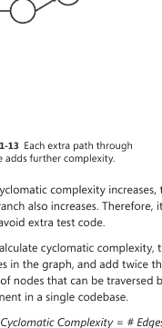

图 1-13 代码中每增加一条路径就会增加进一步的复杂性。

随着圈复杂度的增加，获得每个分支的单元测试代码覆盖率所需的测试工作量也会增加。因此，最好保持分支、从而保持圈复杂度较低，以避免额外的测试代码。

要计算圈复杂度，取图中边的数量，减去图中节点的数量，再加上连通分量的两倍。连通分量是一组可以通过跟随边遍历的节点。通常在单个代码库中只有一个连通分量。

圈复杂度 = # 边 - # 节点 + 2

请参考图 1-13 作为示例：有九个节点，10 条边和一个连通分量。因此，该图表示的代码的圈复杂度测量值为 10 - 9 + 2 × 1 = 3。

高复杂度和缺陷数量之间也存在统计相关性。也就是说，分支更多的代码往往有更多缺陷。

# 结论

本章作为对 Scrum 流程的介绍。如果您从未在 Scrum 项目上工作过，我希望您的兴趣现在已足以激发您去尝试。另一方面，如果您确实在 Scrum 项目上工作，也许本章中有一些新想法您想要使用。

尽管就 Scrum 而言，本章仍有大量内容未涉及，但本书的其余部分更致力于从开发者的角度来看待敏捷项目。然而，有大量资源可用于了解更多关于 Scrum 的信息，并发现它是否适合您的公司和项目。

Scrum 项目，如同任何软件项目一样，都容易失败。发现出了什么问题是战斗的重要部分，但发现为什么会发生问题可能更困难。代码的内部构造可能以一种使更改变得非常困难的方式设计——无论采用何种管理更改的流程。本书的其余部分将提供建议和指导，以确保代码从底层开始具有适应性，使更改更容易，并让你能够专注于在每个冲刺中仅增加业务价值。

此页 intentionally left blank

# Kanban 简介

完成本章后，您将能够

- 为当前流程创建 Kanban 看板并持续改进它。
- 调整在制品限制和服务等级以优化您的生产力。
- 诊断和解决 Kanban 强调的问题。
- 分析您工作流程的效率和有效性。
- 比较和对比 Kanban 与 Scrum 的优缺点。

Kanban 是一个非常简单的流程，具有最少的规则和一些通用指南。如同任何流程一样，它可以被很好地应用或被误用，这取决于上下文。工作本身可能非常适合 Kanban，也可能不太适合。同样地，由于流程是由人执行的，团队的敏捷成熟度和纪律在 Kanban 的成功中起着重要作用。

Kanban 由丰田汽车制造公司在 1950 年代创建。对超市供应链管理的<|message|> 研究导致创建了一个反馈循环，其中需求可用于限制每个生产阶段的供应。丰田发现超市在确保库存水平足够高以持续满足需求，同时又足够低以防止积压方面效率极高。

此后，Kanban 已从制造业世界重新应用于软件交付世界，并取得了巨大成功。

# Kanban 快速入门

了解 Kanban 是否适合您的团队最好的方式就是尝试它。无论多少理论上的思考或轶事性的传闻，都无法与健康的经验证据相匹敌。请记住，没有两个团队是相同的，就像没有两个人是相同的。可能对一组人有效的方法不一定对另一组人再次有效。

为了让您尽快开始运行，本节将引导您了解基础知识。 本章的每个后续部分将深入探讨细节。


# 信息看板

看板充当信息辐射器。企业内的任何人都可以查看看板。虽然其查看者可能在没有额外上下文的情况下无法完全理解所有信息的复杂性，但卡片的总体进展应立即显而易见。

> **注意** *Kanban* 意为看板。严格来说，这使得看板一词变得多余，因为 *board* 已被暗示，但 Kanban 通常用于指代流程本身。

图 2-1 显示了看板的最简单示例。它仅包含三个映射到工作阶段的列。它如此简单和通用，以至于可以适用于任何类型的工作——从家庭杂务如吸尘或洗碗到更复杂的项目如写书。工作要么尚未开始，要么正在进行中，要么已完成。这些状态分别映射到列 To Do、Doing 和 Done。

| To Do | Doing | Done |
|---|---|---|
|  |  |  |

**FIGURE 2-1** Kanban boards can be incredibly simple, capturing only a high-level process overview.

流行的在线工作跟踪软件 Trello 使用相同的默认列集，但它们是可配置的。图 2-2 显示了用于跟踪撰写本书进度 Trello 看板的截图。Trello 是跟踪使用简单流程的项目工作的一个不错选择。

看板上的列代表在制品的工作阶段。将看板放置在显眼的位置，尽可能靠近团队。所有敏捷流程都依赖于透明度才能发挥其潜力，而看板也不例外。事实上，看板通常会暴露流程中的缺陷，这些痛点应被非常明显地展示出来，而不是隐藏起来。


**FIGURE 2-2** Trello is a popular online service that offers customizable Kanban boards for free.

考虑代码失败的两种对立方式的类比：通过未捕获的异常而嘈杂且明显地失败，或通过非预期的状态转换而静默且隐蔽地失败。在前一个示例中，服务或应用程序失败且无法运行。在后一个示例中，它继续运行但产生非预期的后果，可能造成更大的伤害。你希望流程失败是响亮且明显的，你也希望它们发生得快。整合看板流程的早期阶段很可能很痛苦，并会突出你流程中的许多问题。这是故意的，并强调了看板迭代改进流程的优势。

# 流程捕获

要开始整合看板流程，首先捕获你当前的流程。无论你是否认为当前流程是错误的、过于复杂或过于手动，都无关紧要。通过捕获当前流程，你展示了事物本来的样子，而不是关注你希望它们成为的样子。

在此早期阶段，忽略团队外部的活动，仅关注团队成员执行的流程部分。

图 2-3 显示了软件开发团队向生产环境交付功能的流程基本轮廓。每个列代表工作在其交付旅程中可能处于的状态。这些状态是互斥的；所有工作完全位于一个列中或另一个列中——它不能跨列。

| Wait | Analyze | Implement | Verify | Deliver |
|---|---|---|---|---|
|  |  |  |  |  |

**FIGURE 2-3** A Kanban board customized for a simple software development process.

列标题已被刻意选择以说明其目的。Backlog 不如 Wait 清晰。前者是描述流程概念的名词，需要进一步的上下文。后者是描述列及其其中项目的最终目的的动词。对偶然观察者或不熟悉软件开发流程的人来说，指出每个状态中执行的活动要清晰得多。因为这是一个常见软件交付流程的良好示例，每个列——或状态——都值得进一步解释：

- **Wait** 这是待开始工作的常见积压。处于此列的工作项尚未进行中，但可能是未来工作的可能选项。无论其中的项目是错误、功能、技术改进还是任务，积压都是“东西”的容器，可能最终会被或不会被处理。项目按优先级排序，以便下一个项目位于列的顶部并以先进先出 FIFO 队列方式进行。
- **Analyze** 积压中的大多数项目是单句想法或问题的描述。尚未决定解决方案，细节也很少。Analyze 列是为工作添加足够细节使其准备好开发的地方。虽然可能会提出一些关于实现选项的见解，但此列强调需要做什么而不是如何做。
- **Implement** 实现现在可以开始，开发人员接手编写添加新功能所需的代码。这通常是软件交付流程中最慢的部分，正如本章将展示的那样，有方法可以优化流程以最大化吞吐量。
- **Verify** 尽管在 Implement 阶段期望开发人员进行一定程度的单元测试，但手动和/或自动验证很可能构成你交付流程的一部分。这是工作交付前的最后关卡，因此应设定高标准以确保工作产品的稳定质量。
- **Deliver** 当你交付软件时，你实现了到目前为止一直在进行中的价值。所有工作在通过流程的此阶段之前都是不完整的。

图 2-4 中的看板包含了一个新的重要细节。除了 Wait 列外，每个列都被进一步分为两半。虽然每一半都有特定于子状态的标签，但在每个状态中，最左边的列代表在制品，而最右边的列代表准备好等待下一个阶段的工作。因此，最左边的标签代表对工作执行的活动，而最右边的标签代表该活动的成果。

| Wait | Analyze |  | Implement |  | Verify |  | Deliver |  |
|---|---|---|---|---|---|---|---|---|
|  | Specifying | Ready for Dev | Coding | Dev Complete | Investigating | Accepted | Deploying | Value Added |

**FIGURE 2-4** Some phases of a process might have sub-states that represent completion of the parent phase.

图 2-5 显示了一个看板，其中某些列头或子列头下方有数字。这些数字代表在制品限制 WIP。

看板的关键原则之一是对在制品进行限制。放置在列标题下的每个工作项都计入该列的 WIP 限制。

| Wait | Analyze |  | Implement |  | Verify |  | Deliver |  |
|---|---|---|---|---|---|---|---|---|
|  | 3 |  | 5 |  | 2 |  |  |  |
|  | Specifying | Ready for Dev | Coding | Dev Complete | Investigating | Accepted | Deploying | Value Added |
|  |  |  |  |  |  |  | 1 |  |

**FIGURE 2-5** Work-in-progress limits can apply to either columns or their sub-columns.

图 2-6 所示看板上添加工作项表明 Implement 列已达到其 WIP 限制，不能再有更多项目转换到此状态。然而，Analyze 列尚未达到其 WIP 限制，因此可以再将一个工作项移入 Analyze 列。

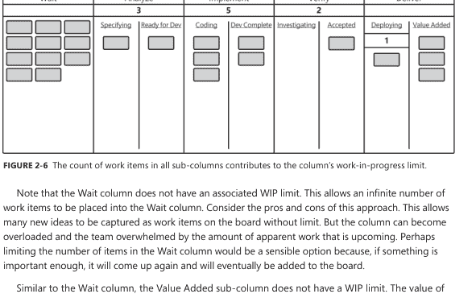

请注意，Wait 列没有关联的 WIP 限制。这允许无限数量的工作项被放置到 Wait 列中。考虑这种方法的利弊。这允许许多新想法作为工作项无限制地被捕获到看板上。但列可能变得过载，团队可能因即将到来的大量工作而不知所措。也许限制 Wait 列中的项目数量是明智的选择，因为如果某事足够重要，它会再次出现并最终被添加到看板上。

与 Wait 列类似，Value Added 子列也没有 WIP 限制。其价值并不那么模糊，因为你不想人为限制可以交付的工作量。如此做没有意义，因为你希望在任何特定时间段内完成尽可能多的工作。

# 限制在制品

设置在制品限制的目的是最大化团队的吞吐量。软件功能在通过交付的所有阶段——分析、实现、测试和部署——之前并不是真正完成的。因此，开始指定开发人员无法实际处理的更多工作项是低效的。通过限制业务分析师可以做的工作，你使他们的进度与最慢的步骤相匹配。更常见的是，软件交付中最慢的部分是实现。

# 抵御变化

设置 WIP 限制也保护团队免受变化的影响。如果在交付过程中发生某些情况阻止了功能的实现——也许预测的投资回报率 ROI 被发现计算错误——限制在制品量的优势在于降低沉没成本。


保护性应对变更是许多软件方法论的一个方面。瀑布方法论试图通过完全防止变更发生来应对变更。此类流程禁止对先前阶段的可交付成果进行更改，除非付出巨大代价和仪式性程序。Scrum通过锁定冲刺（sprint）来应对变更，使新的功能请求必须等到下一次冲刺规划会议才能纳入计划。看板（Kanban）使用在制品（WIP）限制来应对变更，以降低变更成本。这样看来，看板可以说比Scrum更加拥抱变更。

# 定义“完成”

看板上的每一列都对应交付的一个阶段。只有软件变更被交付（通常是某种形式的部署）后，价值才能实现。然而，流程的每个阶段对“完成”都有自己的定义，所有团队成员都必须了解并同意这些定义。

“完成”的定义可以是一份检查清单，列出一项工作从一列移动到另一列之前必须完成的事项。这份清单可以打印出来放在看板的列标题旁边，供任何团队成员参考。这里提供一些示例清单作为起点，但请根据自身情况加以修改和调整。回顾会议（参见本章后面的“事件驱动仪式”）是定期优化流程细节的好机会。

## 分析：说明“完成”

“说明”子列中的工作项在以下情况下被视为完成：

- 工作已被合理拆分，使其可管理。
- 已提供预期功能的规格说明。
- 已提供错误条件下行为的规格说明。
- 在适用情况下已提供用户界面原型。
- 在适用情况下已提供跨功能需求。
- 已生成关键绩效指标（KPI）以评估增值。

## 实现：编码完成

“编码”子列中的工作项在以下情况下被视为完成：

- 新代码工件的单元测试覆盖率至少达到80%。
- 现有代码工件的单元测试覆盖率未下降。
- 所有单元测试无歧义地通过。
- 代码已经过同行评审并被接受。

## 验证：调查完成

“调查”子列中的工作项在以下情况下被视为完成：

- 自动化验收测试通过。
- 功能测试未发现缺陷。
- 功能测试与工作规格说明相符。
- 现有功能保持完好。

## 交付：部署完成

“部署”子列中的工作项在以下情况下被视为完成：

- 功能已部署到所有目标环境。
- 已测量KPI并显示价值提升。
- 功能已使用至少24小时。
- 未报告任何错误或警告。

如你所见，这些项目既严格又相当通用。在“分析：说明”阶段，预期会生成针对每项工作的更多定制化项目。

# 事件驱动仪式

可能导致会议安排的主要事件是看板上的某一列变空。如果某个进行中的列变空，团队会将下一张工单从该空列左侧相邻的列拉过来。尽管“会议”和“仪式”这两个词暗示了一定程度的隆重和仪式感（以及无聊），但这些会议不必正式。

> **提示** 当然，召开此类会议的门槛不一定是空列。也可以将门槛设为剩余一两张工单。这样可防止团队完全耗尽可推进的工作，而是保留缓冲，使一些工作能够并行继续。

这类会议可以在看板旁举行，而不是在会议室里，从而节省资源和准备时间。这些会议也不必包括团队中的每个人。只邀请和包括与会议相关的团队成员，避免迫使某个正忙着——而且愉快地——在真正工作上取得进展的人切换上下文。

例如，如果空列是“等待”列，团队可以聚在一起，根据产品路线图为待办事项创建新工单。否则，如果空列是“实现”列，则可以将“分析”列中优先级最高的工单拉入“编码”子列。此时，工单从“分析：完成”到“开发：编码”的状态转换可能需要一些初始设置工作。

例如，让质量保证团队成员参与进来，帮助明确工单的验收标准是明智的，这样开发人员从一开始就知道“完成”的真正样子。团队还可以将工单拆分为与应用程序各层相关的任务，以便合适的专家可以自行分配到前端、中间层或后端工作。这也是开发人员指出某张工单当前过大的机会，因为一次性完成需要太多精力。团队成员可以在工单的功能或实现上做出妥协。所有这些都在看板旁非正式地进行，团队成员修改工单并添加检查清单。

如果遵循事件驱动模型来安排此类会议，议程已经为你设定，无需强迫团队进入热情状态。这可能会导致会议更频繁但时间更短，比起那些不常有、耗神且打击士气的长时间会议，这种方式更有效。

要警觉地识别其他适合临时会议的场景。与其让团队成员把好的和坏的经验一直攒到冲刺结束再在回顾会议上讨论，不如让大家快速聚拢确定一个行动点。只是要小心避免不断打断人们、破坏他们的心流。开发是一种富有成效的创造性活动，因此需要大块不间断的时间。如果可能，对上午或下午的所有会议和干扰设置限制，这样至少半天时间可用于纯粹、高效的心流。

# 服务类别

上一节讨论了合理拆分工作的重要性。尽管有些流程允许追踪不同规模的工作，但看板在工作的投入程度相对相似时效果最佳。然而，有些工作类型与其他类型存在差异，使得比较毫无意义。例如，在软件开发中，修复bug不同于添加新功能，添加新功能也不同于处理技术债务。

尽管看板力求工作规模大致相等，但它无法控制每张工单都有自己的风险特征这一事实。有些工作天生高风险，而另一些可能低风险。而且，一张工单的风险也不太可能随时间保持不变。更可能的是风险随时间增加，增加到某个点后可能渐近到无穷大，或稳定到一个常数。

当工作具有不同风险特征时，在看板流程中引入服务类别会有所帮助。这使团队能够识别高紧迫性或重要性的工作，并在必要时将精力集中在那里。

看板必须能够区分属于不同服务类别的工单。可以通过使用不同颜色的便利贴或工单上的标记来实现。后者正是本书的看板区分与代码相关的工单和与章节内容相关的工单的方式。这两种工作类型非常不同，因此将它们分成不同的服务类别是有意义的。

当服务类别确定且看板清晰展示差异后，还可以使用看板的两个额外特性：服务水平协议（SLA）和类别WIP限制。

## 服务水平协议

看板允许你放弃工作量估算，转而使用服务水平协议。回想一下，Scrum的估算会议会产生一定数量的“故事点”，这些故事点相当于完成故事所涉及的实际工作量范围。相反，看板使用统计来生成时间估算以及该估算的置信水平。

如果你记录每张工单完成所花费的时间，随着时间推移，你可以计算出平均耗时。由于所有工作都已同质化，规模上不应有太大偏差，但有时一张异常大的工单可能会溜过你的检查和制衡。此外，“平均”往往具有欺骗性；完全有可能没有任何一张工单曾花过“平均”时间完成。

想象一个团队完成了20张工单，每张耗时（以天为单位）如下：

1,1,2,2,3,3,4,4,5,5,7,8,8,9,9,10,10,18

总耗时为120天。分配给20张工单，相当于每张工单平均正好6天。然而，到目前为止还没有任何一张工单花了6天。这就是平均值的谬误。如果你给出6天作为任何特定工单可能耗时的估算，那么你有11次会交付得更快，9次会超时。最坏情况下，你的估算会错300%！而且，你永远不会精确。

> **提示** 当然，估算不是截止日期。如果你的经理从骨子里相信估算只是估算，很多人会羡慕你。但让我们通过为估算附加一个置信区间来帮助我们那些被误导的同事。

如果你说估计某件事将在六天内完成，并为该估算附加50%的置信度，你的利益相关者就不太会把它当作截止日期。但如果你能为估算附加95%的置信度呢？虽然有误差空间，但它会更准确地描述进度。

你需要找到的是代表数据第95百分位的数字。


## 最近秩百分位

要找到本节前面提供的工单持续时间列表中的最近秩，你可以使用以下公式：

$$n = (r / 100) * N$$

将你的数值代入公式得到以下结果：

$$n = 95/100 * 20$$

$$n = 19/20 * 20$$

$$n = 19$$

因此，排序列表中的第 19 个数字就是你的第 95 百分位。这导致估计为 10 天。请注意，这种方法对估计错误时可能出现的超支幅度没有任何说明。无论第 20 个数字是 18 还是 180，长尾值在该计算中都被忽略，因此即使加上置信区间也无法给出完整情况。

> **提示** 这里的样本区间相对较低。如果你每周只能交付平均四张工单，则需要五周才能获得足够大的样本量来计算第 95 百分位。

现在你能够更准确地估计一张工单可能花费的时间，你就可以将服务等级协议 SLA 附加到你的服务等级上。对于每种工单类型，SLA 可以说明完成的不同第 95 百分位估计。

对于缺陷工单，可以给出更短的周期时间——因此更好的 SLA——。这凸显了修复缺陷相对于正常功能交付工作的重要性。

同样，专门的重构或重新设计工单可能比标准功能交付工作花费更长时间。这允许更长的周期时间和更短的 SLA。

总之，通过分离服务等级，可以对各种工作流进行不同处理。这去除了如果你将工作项组合在一起时本会出现的异常值。SLA 可以附加到服务等级，而不是附加到团队工作的整体。

# 类别 WIP 限制

服务等级分离的另一个优势是能够为每个类别指定在制品 WIP 限制，而不是针对进入某一列的任何工作。

当你有一些希望确保其取得进展而不停滞且不主导团队时间的工种时，这很有用。最好的例子是重构工作。对于不熟悉的人来说，重构在第 6 章“重构”中有更详细的介绍。

理想情况下，重构应该是每个正在开发的工单的固定部分，作为完成定义中的验收标准包含在内。有时代码库中存在的技术债务量如此之大，以至于阻碍交付并可能压倒团队。这可能导致审慎地使用重构工单来偿还某些特定区域的技术债务。为此重构工作创建一个服务等级并附加 WIP 限制。保持较低的 WIP 限制将防止整个团队花费大量时间进行重构而以牺牲功能交付为代价。但只要 WIP 限制大于零，并且一般工作的 WIP 限制足够低以留下空闲开发人员，重构工作就应该自然完成。

如果必须进行一定程度的环境重构才能使代码库恢复到最佳健康和适应性状态，也许只有 25% 的总 WIP 限制需要分配给重构服务等级。

然而，如果代码库处于特别不健康的状态，以至于添加功能不必要地复杂，分配 75% 的总 WIP 限制可能是合理的。这不应阻断所有功能交付；它只是限制在处理技术债务的同时可以实际完成的工作。

# 人作为服务等级

如果你的团队确实是产品功能中真正代表性的垂直切片，它可能包括前端、中层和数据后端专家。有些工作可能横跨所有这些学科，有些可能横跨两层，有些可能仅限于一层。根据某些专家的可用性，可能有必要指定一个与这些层相匹配的服务等级。

这使得带有前端用户体验和设计工作的工单可以与仅中层的工作不同对待，例如。前端工作因此可能具有更长的 SLA，以便你可以向利益相关者传达任何涉及前端开发的工作在第 95 百分位上会多花费三到四天。这种对流程的洞察正是看板擅长揭示的。然后可以做出决定，将人员重新分配到该团队以加快前端工作。

同样，如果团队中只有一名数据库专家可用，任何进入开发并需要该专家的工单将占用该人员整个持续时间。这应消耗该人员 WIP 限制预算的全部，因为他们无法为涉及数据层的任何其他工单做出贡献。然而，如果他们不参与工单的完成，中层和前端工作应不受影响。

只要记住，工单不应专门设计以与这些层对齐，因为通常在没有所有层参与的情况下没有可辨识的价值。

集成服务等级是看板框架的高级功能。你不太可能能够在同一时间捕捉当前流程，将其映射到看板板上，传达这种新的工作方式，并跟踪所有必需的指标，更不用说从一开始就加入服务等级了。相反，随着时间的推移逐步迭代到这一高级水平。

# 分析

在交付软件产品期间，你的流程应帮助你做出决策。它应指示你进展的整体健康状况。理想情况下，流程——或其工件——不仅应清楚地显示出了问题，而且还应指出问题所在。

看板生成工件，确实允许对功能完成路径上失败的原因进行诊断。本节介绍关键绩效指标 KPI *前置时间* 和 *周期时间*。还解释了 *累积流图*，以及如何区分健康的流程和一系列不健康的流程。

## 前置时间和周期时间

工作项开始于看板上的积压列。这可以是“待办”列或“等待”列。甚至可以是一个通用的“积压”列。无论其名称如何，这样的列是你放置已请求但尚未开始的工作的地方。任何人都可以随时将任何东西放入积压区。然而，已放置在积压区中的项目需要多长时间才能完成？你可以通过分析团队的工作吞吐量并提取前置时间和周期时间等指标来回答这个问题。

积压本身是按优先级排序的，因此列顶部附近的项目优先级高于底部附近的项目。当项目添加到积压区时，应记录其放置日期。如果你的看板是实体的，可以直接写在工单上。大多数虚拟看板工具会自动存储工作项添加到积压区的日期。

当下一个列中有可用容量时，工单被移入进行中列。如前例所示，可以有多个列被共同归类为进行中。一般来说，看板上的第一列是积压区，最后一个列保留给已完成的工作项。因此，这两者之间的所有列都被视为进行中列。当工作项移入第一个进行中列时，日期再次写在卡片上——或以其他方式记录。

完成某项工作的所有工作后，它最终被移入已完成列。这是一个没有在制品限制的列，因此可以容纳任意数量的工作项。已为每个进行中阶段定义完成的定义应作为质量门，判断工单是否完成。当工作项进入已完成列时，最终日期会被记录在项目上。

每个交付阶段花费的时间可以通过使用写在卡片上的每个日期来计算。工作项等待的时间是卡片移入第一个进行中列的日期与卡片首次进入积压区的日期之间的差值。工作项处于进行中的时间是卡片移入已完成列的日期与该项工作首次开始的日期之间的差值。后者时间也称为 *周期时间*。将这两个时间相加得出工作项的 *前置时间*。


这个度量不必特别精确——天数就足够了。虽然可以用小时来衡量前置时间（lead time）和周期时间（cycle time），但利益相关者不太可能要求以小时为单位的估算。

Cycle time = Time spent in progress  
Lead time = Time spent waiting in backlog + cycle time

图 2-7 显示了 Kanban 看板在四天内的进展。第一天，三个事项被添加到待办（To Do）列，且没有进行中的工作，也没有完成的工作。第二天，事项 1 和 2 移入进行中（Doing）列，且待办列新增了一个事项。第三天，没有进行中的工作被完成，且待办列又新增了两个事项。第四天，事项 1 移至已完成（Done）列，这释放了 WIP 限制中的空间，使事项 3 可以移入进行中列。

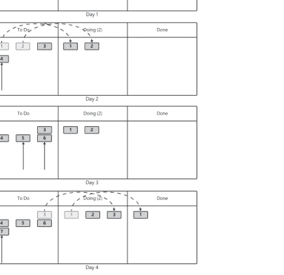

FIGURE 2-7 The movement of tickets across the board as development progresses.

以工作项 1 为例，我们来计算其周期时间和前置时间。周期时间是工单工作完成日期与工作开始日期之间的差值。在第 4 天，工作项 1 的工作已完成；它在第 2 天被移入进行中列。因此，该工作项的周期时间为 2 天。

前置时间是工单工作完成日期与工单首次添加到待办列日期之间的差值。由之前的示例可知，工作项 1 在第 4 天完成，并在第 1 天添加到待办；因此，该工作项的前置时间为 3 天。

# 累积流图

让我们按每天对每个列中的工作项数量进行制表，然后对结果进行绘图。这可以揭示一些有趣的模式，有助于评估交付流程的健康状况并诊断需要关注的问题。

## 简单示例

表 2-1 显示了简单三列 Kanban 看板中每个列的工作项数量。看板的列为通用工作流待办、进行中和已完成。每天的进展以数字标记，从 1 开始。

TABLE 2-1 The count of work items in each column of a Kanban board, by day.

| Day | To Do | Doing | Done |
|---|---|---|---|
| 1 | 3 | 0 | 0 |
| 2 | 2 | 2 | 0 |
| 3 | 2 | 2 | 1 |
| 4 | 2 | 2 | 1 |
| 5 | 3 | 2 | 2 |
| 6 | 2 | 2 | 3 |
| 7 | 2 | 2 | 4 |
| 8 | 2 | 2 | 4 |
| 9 | 2 | 2 | 5 |
| 10 | 2 | 1 | 7 |

通过将该数据表绘制为堆叠面积图，y 轴为工作项数量，x 轴为天数，可以创建图 2-8 所示的简单累积流图。

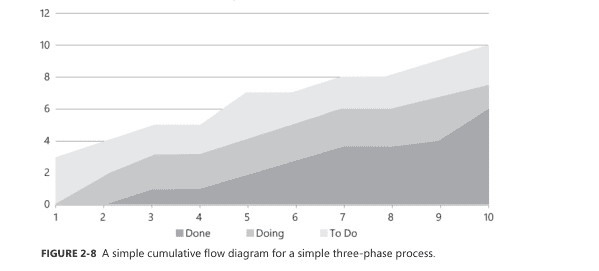

FIGURE 2-8 A simple cumulative flow diagram for a simple three-phase process.

注意待办、进行中和已完成之间的工作分配如何随天数推移而变化。随着工作项从待办移至进行中，中灰色带会增大；随着工作项从进行中移至已完成，深灰色带会增大。

## 前置时间、周期时间和在制品

沿 x 轴和 y 轴对累积流图的各部分进行测量可提供用于分析 Kanban 看板健康状况的各种指标的值。图 2-9 在示例累积流图上显示了这些测量。


FIGURE 2-9 How to quickly read the key metrics of process health from a cumulative flow diagram.

各指标的测量方法如下：

- **Lead time**: 测量待办区域与已完成区域之间的 x 轴距离可得出工作项的前置时间。
- **Cycle time**: 测量进行中区域与已完成区域之间的 x 轴距离可得出工作项的周期时间。
- **Work in progress**: 测量进行中区域与已完成区域之间的 y 轴距离可得出当前正在进行的工作项总数。

## 健康的流程

回到本章早期的示例，图 2-10 显示了通用软件交付流程的累积流图。

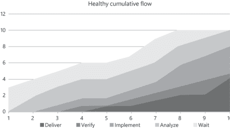

**FIGURE 2-10** A reference example of a cumulative flow diagram exhibiting healthy flow.

让我们回顾一下：交付状态代表已完成的工作项。等待状态代表尚未开始的工作。在制品则由其他各状态的汇总表示：分析、实现和验证。

前置时间、周期时间和在制品仍可通过将这三个状态都视为当前正在进行的工作来在该图上找到。

## 不健康的流程

健康的流程固然很好，但很少有软件项目能从头到尾如此顺畅运行。更常见的是会遇到一个或多个不健康的流程，理想情况下应在对交付造成致命损害之前得到纠正。

本节展示了一些在累积流图上可轻松发现的交付中最常见的问题。

### 在制品过多

第一个也是最常见的问题如图 2-11 所示：在制品过多。到第 3 天，看板上已饱和了八个工作项，到第 5 天，所有工作项都在进行中。

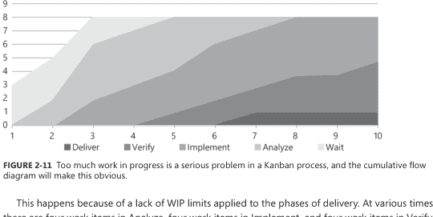

FIGURE 2-11 Too much work in progress is a serious problem in a Kanban process, and the cumulative flow diagram will make this obvious.

这是因为交付阶段未应用 WIP 限制。在不同时间，分析中有四个工作项，实现中有四个工作项，验证中有四个工作项。因此，在 10 天的时间里，只有 1 个工作项完成到足以达到交付状态。

### 范围蔓延

图 2-12 显示了范围蔓延对累积流图的影响。Kanban 是一种拉动系统，这意味着只有在有能力时工作项才会被移入交付的新阶段，但等待工作项的积压通常对能力没有限制。正是这种看似无限的能力导致了范围蔓延。


FIGURE 2-12 A huge spike in Waiting work indicates that the scope of the project is in flux.

直至第 6 天，包括第 6 天在内，该累积流图看起来像是健康流程的示例。然而，在第 7 天，一批新工单被放置到 Kanban 看板的等待状态中。

Kanban 非常注重减少浪费。将项目放入 Kanban 看板的积压中会鼓励浪费，因为它会增加前置时间并对软件交付团队产生士气低落的影响。

### 交付阶段过长

重要的是将软件交付流程的整体节奏与交付最慢的阶段相匹配。这最常见的是实现阶段，即编码发生时。

图 2-13 显示了交付阶段过长的影响。注意工作项到达瓶颈前的健康流程。

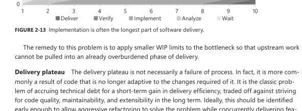

FIGURE 2-13 Implementation is often the longest part of software delivery.

解决此问题的办法是对瓶颈应用更小的 WIP 限制，以便上游工作不会被拉入已超负荷的交付阶段。

### 交付平台期

交付平台期不一定是流程失败。事实上，它更常见的是代码不再适应所需变更的结果。这是为短期交付效率累积技术债务的经典问题，以换取长期追求代码质量、可维护性和可扩展性。理想情况下，应尽早识别，以便在同时交付功能的同时进行积极的重构来解决问题。如果此问题长期停滞不前，代码很可能需要彻底重写。


图 2-14 展示了这个问题如何在累积流图中表现出来。

# 平台期

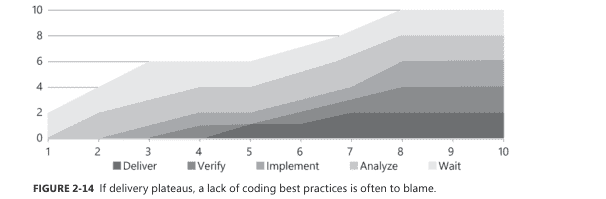

图 2-14 如果交付进入平台期，通常应归咎于缺乏良好的编码实践。

# 受监管的部署阶段

看板最适合持续交付流程，在这种流程中，提交到源代码管理系统的每项变更都有可能作为可运行软件发布。即使有所妥协，看板也要求不能对软件产品的部署或发布设置人为限制。

图 2-15 展示了工作项总体上健康的流动，但有一个例外：在十天的工作期间，交付阶段出现了两次跃升，第一次在第 5 天，第二次在第 10 天。假设工作周为周一至周五，那么可以合理地推断，这个团队只允许在周五发布代码。

# 受监管的部署

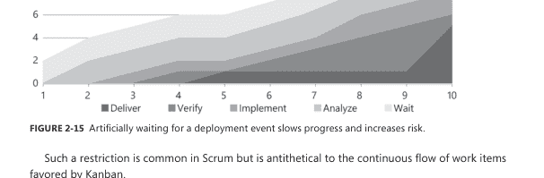

图 2-15 人为地等待部署事件会减缓进度并增加风险。

这种限制在 Scrum 中很常见，但它与看板所倡导的工作项持续流动背道而驰。

# 结论

本章介绍了敏捷软件交付中看板方法的一些基础知识和细节。看板与 Scrum 等其他敏捷方法存在相似之处，但也有一些关键差异。看板没有明确的迭代，只有不断进入并交付的工作项持续流。因而，各种仪式应根据需要随时进行，而不是安排在严格固定的时间。

Scrum 管理变更的方法是为冲刺设置时间盒并锁定输入，因此，在冲刺开始后到达的新工作必须等到下一次迭代，才能进行优先级排序和安排。看板允许随时添加新工作，但只针对完成新工作可能需要的时间提供服务级别协议（SLA）。看板限制正在进行的工作，以确保完成工作优先于开始新的工作。

根据我的经验，Scrum 适合新团队，而看板适合成熟团队。在敏捷方法经验的光谱上，得分较低的团队更适合 Scrum 严格的仪式和纪律；得分较高的团队则更适合相对自由随性的看板。打个比方，Scrum 可以看作军乐队规律而有节奏的行进鼓点，而看板则应当是爵士乐。

选择 Scrum 还是看板作为敏捷方法时，另一个决定因素是它们将要应用于哪类工作。如果工作属于一个具有明确时间和财务资源限制的项目，那么 Scrum 是自然的选择，因为可以单独核算每个冲刺的成本。如果工作是持续进行的，没有明确的结束日期（通常称为业务常规工作或 BAU），那么看板会运行得很好。

本页有意留白

# 第二部分

# 自适应代码基础

- 第 3 章 依赖关系与分层 .................... 69
- 第 4 章 接口与设计模式 .................... 115
- 第 5 章 测试 ....................................... 147
- 第 6 章 重构 ................................... 189

本书这一部分将帮助你掌握编写自适应代码的原则和实践。

编写代码是软件开发的核心支柱。然而，实现可运行代码这一目标有许多不同的方式。即使不考虑平台、语言和框架的选择，开发人员在实现哪怕最简单的功能时，也会面临大量选择。

创建成功的软件产品一直是软件开发行业关注的重点。近几十年来，软件开发越来越重视实施可重复、能够提高代码质量的模式和实践。这是因为，代码质量的概念已经不再与产品质量的概念相分离。随着时间推移，低质量代码会降低产品质量。至少，它会延迟可运行软件的交付。

为了生产高质量的软件，开发人员必须努力确保代码具有可维护性、可读性，并经过测试。除此之外，一项新的要求也逐渐出现：代码还应当*能够适应变化*。

本书这一部分的章节介绍了现代软件实现模式和实践。我将这些实践称为*自适应*，因为这体现了它们快速改变方向的能力。自适应代码指导软件开发团队编写能够改变方向，同时保持创新性、可维护性、可读性和稳健性的代码。

# 依赖关系与分层

# 完成本章后，你将能够

- 管理从方法级别到系统级别的复杂依赖关系。
- 识别依赖复杂性最大的区域，并使用工具降低复杂性。
- 将代码分解成更小、更具自适应性的功能单元，以促进复用。
- 在最适合的地方应用分层模式。
- 了解依赖关系如何解析，并调试依赖问题。
- 使用简单接口隐藏实现。

所有软件都有依赖关系。每个依赖关系要么是同一代码库中的一方依赖，要么是对外部程序集的第三方依赖，要么是对 Microsoft .NET Framework 的依赖。除非是非常简单的解决方案，否则所有解决方案都会使用这三种依赖关系。

依赖关系会将功能从调用代码中抽象出来。你不必过多关注依赖关系正在做什么，更不必关注它是如何实现的，但应确保所有依赖关系都得到正确管理。当依赖链管理不善时，开发人员会强行引入本不需要存在的依赖关系。这会使代码与复杂的程序集引用纠缠在一起。你可能听过这样一句格言：“最正确的代码，就是没有被编写出来的代码。”同样，管理得最好的依赖关系，就是不存在的依赖关系。

要使代码能够适应变化，就必须管理依赖关系。这适用于软件的所有层级——从子系统之间的架构依赖关系，到单个方法之间的实现依赖关系。架构设计不佳的应用程序会减慢可运行软件的交付速度，在最糟糕的情况下甚至会使交付完全停滞。

无论如何强调采用纯粹的依赖关系管理方法的重要性都不为过。如果你在这样一个重要问题上妥协，可能会看到速度暂时提高，但长期影响可能对项目造成致命后果。这是一个过于常见的故事：随着代码量和模块数量增加，短暂的生产力提升消失了。代码变得僵化而脆弱，进度慢得几乎停滞。从 Scrum 工件和指标来看，冲刺燃尽图变成一条水平线，因为没有任何用户故事点被完成。在看板中，累积流图出现分叉，工作卡在“实现”列中。只要问题没有得到解决，功能燃起图也会随之变平，因为没有任何功能完成。甚至缺陷数量也会增加。当依赖结构变得难以理解时，一个

# 一个简单示例

让我们看看依赖关系在实际情境中是如何运作的。这个示例是一个非常简单的控制台应用程序，用于向屏幕打印一条消息。这是通用的“Hello World!”示例。这个例子必然很简单，以便将依赖关系的问题提炼到本质。

你可以按照这里的步骤手动操作，也可以从 GitHub 获取解决方案。有关使用 Git 和随附示例代码的基本说明，请参见附录“自适应工具”。

1. 打开 Microsoft Visual Studio 并创建一个新的控制台应用程序，如图 3-2 所示。我将其命名为 SimpleDependency，但名称并不重要。

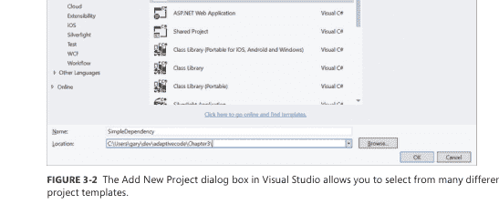

2. 向解决方案中添加第二个项目，这次添加一个类库。我将其命名为 MessagePrinter。

3. 右键单击控制台应用程序的“引用”节点，然后选择“添加引用”。

4. 在“添加引用”对话框中，导航到“项目”，然后选择类库项目。


你现在已经创建了一个从一个程序集到另一个程序集的依赖关系，如图 3-3 所示。你的控制台应用程序依赖于你的类库，但类库并不依赖于你的控制台应用程序。控制台应用程序是客户端，类库是服务。尽管此应用程序目前什么也不做，构建解决方案并导航到项目的 bin 目录——可执行文件就在那里。

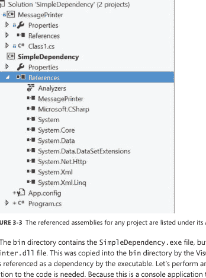

**图 3-3** 任何项目的引用程序集都列在其 References 节点下。

bin 目录包含 SimpleDependency.exe 文件，但它也包含 MessagePrinter.dll 文件。该文件是由 Visual Studio 构建过程复制到 bin 目录中的，因为它被可执行文件引用为依赖项。让我们做一个实验，但首先需要对代码做一点修改。因为这是一个什么也不做的控制台应用程序，它会在你反应过来之前就初始化并关闭。打开控制台应用程序的 Program.cs 文件。

清单 3-1 显示了在 Main 方法内部的添加内容（以粗体显示）。这是应用程序的入口点，目前什么也不做并快速退出。通过插入对 Console.ReadKey() 的调用，你可以确保应用程序在终止前等待用户按下一个键。

# LISTING 3-1

对 ReadKey 的调用可防止控制台应用程序立即退出。

```csharp
namespace SimpleDependency
{
    class Program
    {
        static void Main(string[] args)
        {
            Console.ReadKey();
        }
    }
}
```

重新构建解决方案并运行应用程序。如预期，它会显示控制台窗口，等待你按下键盘上的一个键，然后在你按下后终止。在 `Console.ReadKey()` 行上设置一个断点，并从 Visual Studio 调试解决方案。

当应用程序在断点处暂停时，你可以查看已为此应用程序加载到内存中的程序集。为此，你可以使用菜单栏选择 Debug > Windows > Modules。图 3-4 显示了为应用程序加载的模块列表。

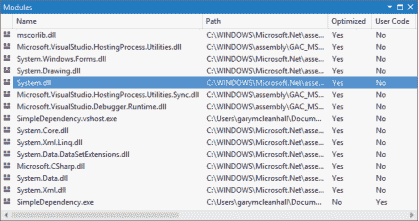

**图 3-4** 调试时，Modules 窗口显示所有当前加载的程序集。

你是否注意到有什么奇怪之处？创建的类库没有任何提及。例如，`MessagePrinter.dll` 不应该被加载吗？实际上，不应该——这正是预期的行为。原因如下：应用程序没有使用 MessagePrinter 程序集内部的任何内容，因此 .NET 运行时不会加载它。

为了确凿地证明依赖程序集并不是真正的先决条件，再次导航到控制台应用程序的 bin 目录并删除 `MessagePrinter.dll`。再次运行应用程序，它会愉快地继续运行而不会引发异常。

让我们再重复几次这个实验，以真正弄清楚发生了什么。首先，在 Program.cs 文件顶部添加一个 using MessagePrinter 指令。这会导入 MessagePrinter 命名空间。你认为这足以导致通用语言运行时（CLR）加载该模块吗？不是。依赖关系再次被忽略，程序集未被加载。这是因为用于导入命名空间的 using 语句只是语法糖，仅用于减少你需要编写的代码量。与其每次想要使用其中的类型时都写出完整的命名空间，你可以导入命名空间并直接引用类型。using 语句不会为 CLR 生成任何要执行的指令。

这个下一个实验建立在前一个实验的基础上，因此你可以保留 using 语句。首先，在 MessagePrinter 程序集中创建 MessagePrintingService，如清单 3-2 所示。

# LISTING 3-2

一个简单的类来引入真正的依赖。

```csharp
namespace MessagePrinter
{
    public class MessagePrintingService
    {
        public void PrintMessage()
        {
            Console.WriteLine("Hello World!");
        }
    }
}
```

接下来，在 Program.cs 中，在对 Console.ReadKey() 的调用之前，构造一个 MessagePrintingService 的实例并调用 PrintMessage 方法，如清单 3-3 所示。

# LISTING 3-3

通过调用实例方法引入依赖。

```csharp
using System;
using MessagePrinter;

namespace SimpleDependency
{
    class Program
    {
        static void Main()
        {
            var service = new MessagePrintingService();
            service.PrintMessage();
            Console.ReadKey();
        }
    }
}
```

Modules 窗口现在显示 MessagePrinter.dll 程序集已被加载，因为没有办法在不将程序集的内容拉入内存的情况下构造 MessagePrintingService 的实例。

如果你从 bin 目录删除 MessagePrinter.dll 并再次运行应用程序，可以证明这一点。这次会抛出异常。

```text
Unhandled Exception: System.IO.FileNotFoundException: Could not load file or assembly 'MessagePrinter, Version=1.0.0.0, Culture=neutral, PublicKeyToken=null' or one of its dependencies. The system cannot find the file specified.
```

# Framework dependencies

上一节中显示的依赖关系称为第一方依赖关系。控制台应用程序和它所依赖的类库都属于同一个 Visual Studio 解决方案。这意味着依赖关系应该始终可访问，因为如果需要，依赖项目始终可以从源代码重建。这也意味着你可以修改第一方依赖项的源代码。

两个项目都有其他依赖项的形式为 .NET Framework 程序集。这些不属于项目的一部分，但预计可用。每个 .NET Framework 程序集都是为框架的特定版本构建的：1、1.1、2、3.5、4、4.5 等。一些 .NET Framework 程序集是特定版本的新增内容，不能被使用较早 .NET Framework 版本的项目引用。其他程序集会随着 .NET Framework 版本的变化而变化。

SimpleDependency 项目对 .NET Framework 有多个引用，如图 3-3 之前所示。其中许多依赖项是默认添加到所有控制台应用程序项目的。示例应用程序未使用它们，因此可以安全地删除。事实上，对于两个项目，除了 System 和 System.Core 之外的所有内容都是多余的，因此可以从引用列表中删除。应用程序仍能正确运行。

通过删除不必要的框架依赖项，你可以更轻松地可视化每个项目所需的依赖项。

# Framework assemblies always load

值得注意的是，与其他依赖项不同，对 .NET Framework 程序集的引用将始终导致这些程序集加载。即使你实际上没有使用某个程序集，它仍会在应用程序启动时加载。幸运的是，如果解决方案中的多个项目都引用同一个程序集，则只会将该程序集的一个实例加载到内存中（每个 AppDomain），并在所有依赖项之间共享。

项目的默认引用因项目类型而异。每个项目类型都有一个项目模板，其中列出了所需的引用。这就是 Windows 窗体应用程序引用 System.Windows.Forms 程序集，而 Windows Presentation Foundation 应用程序引用 WindowsBase、PresentationCore 和 PresentationFramework 的方式。

# LISTING 3-4

Visual Studio 项目模板的一部分，用于有条件地引用不同的程序集。

```xml
<ItemGroup>
  <Reference Include="System"/>
  $if $(targetframeworkversion$ >= 3.5)
    <Reference Include="System.Core"/>
    <Reference Include="System.Xml.Linq"/>
    <Reference Include="System.Data.DataSetExtensions"/>
  $endif
  $if $(targetframeworkversion$ >= 4.0)
    <Reference Include="Microsoft.CSharp"/>
  $endif
  <Reference Include="System.Data"/>
  <Reference Include="System.Xml"/>
</ItemGroup>
```

这些文件中有一些逻辑可以改变模板生成真实项目实例的方式。具体来说，引用取决于用于生成项目的 .NET Framework 版本。在这里，Microsoft.CSharp 程序集仅在项目以 .NET Framework 4 或更高版本为目标时才被引用。这是有意义的，因为它通常仅在你使用在 .NET Framework 4 中引入的 dynamic 关键字时才需要。

# Third-party dependencies

最后一种依赖类型是第三方开发者开发的程序集的依赖。通常，如果 .NET Framework 未提供某些功能，你可以通过创建第一方依赖项自行实现解决方案。这可能是一项繁琐的任务，具体取决于所需解决方案的大小。相反，你可以选择使用第三方解决方案。例如，你不太可能想要自己实现对象/关系映射器（ORM），因为这样一大块基础设施代码可能需要数月才能发挥作用，数年才能完成。相反，你可以先查看 Entity Framework，它是 .NET Framework 的一部分。如果它不能满足你的需求，你可以改而查看 NHibernate，这是一个成熟的 ORM 库，已经过大量测试。


使用第三方依赖的主要原因，是用“集成现成的、适合任务的代码”所付出的努力，来交换“自行实现某些功能或基础设施”所需的努力。但别忘了，根据你的第一方代码结构和第三方代码接口的不同，这种集成工作仍然可能相当可观。当你的目标是以迭代的方式持续交付业务价值增量时——正如敏捷开发所倡导的那样——使用第三方库可以使你保持这一专注。

组织项目外部及 .NET Framework 之外的依赖，最简单的方法是在项目的 Visual Studio 解决方案中创建一个名为 Dependencies 的解决方案文件夹，并将 .dll 文件添加到该文件夹。当你想向解决方案中的项目添加这些程序集的引用时，可以在“引用管理器”对话框（如图 3-5 所示）中浏览到这些文件来完成。

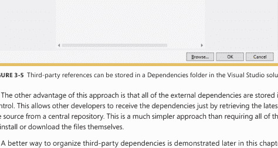

图 3-5 第三方引用可以存储在 Visual Studio 解决方案中的 Dependencies 文件夹中。

这种方法的另一个优点是，所有外部依赖都存储在源代码管理中。这样，其他开发人员只需从中央存储库获取最新版本的源代码，就能获得这些依赖。这比要求所有开发人员自行安装或下载文件要简单得多。

更好的第三方依赖组织方式将在本章后面的“使用 NuGet 进行依赖管理”一节中演示。简而言之，NuGet 依赖管理工具会为你管理项目的第三方依赖，包括下载包含所有相关工件的包、引用程序集以及升级库版本。

# 在有向图中为依赖关系建模

图是一种数学结构，由两个不同的元素组成：节点和边。边只能存在于两个节点之间，并以某种方式将它们连接起来。任何节点都可以与图中的任意其他节点相连。根据图的属性不同，图可以分为若干类型。例如，图 3-6 中的边是没有方向的：节点 A 和 C 之间的边既不是从 A 到 C，也不是从 C 到 A——边存在本身就足够了。这称为无向图。

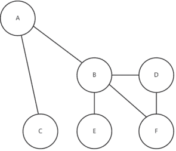

**图 3-6** 图由边连接的节点组成。

如果像图 3-7 那样，边的一端带有箭头，你就可以确定边的方向。存在从 A 到 C 的边，但不存在从 C 到 A 的边。这称为*有向图*，或简称*有向图*。

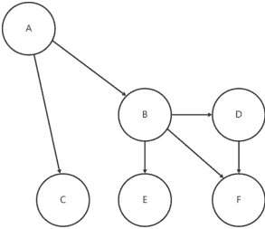

**图 3-7** 此图的边是明确有方向的，因此不存在边 (B,A)，但存在边 (A,B)。

在软件工程的许多领域中，图都是极佳的模型，但图尤其适用于对代码依赖关系进行建模。正如你已经了解的，依赖关系由两个实体组成，方向是从依赖方代码指向被依赖方。你可以将这些实体视为节点，并从依赖方到被依赖方画一条有向边。当把这种方式扩展到其余实体时，就构成了一个*依赖有向图*。

如图 3-8 所示，这种结构可以应用于几种不同的粒度。图中的节点可以表示项目中的类、不同的程序集，或构成子系统的程序集组。在所有情况下，节点之间的箭头都表示组件之间的依赖关系。箭头的源是依赖组件，箭头的目标是依赖项。

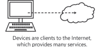

设备是互联网的客户端，互联网提供了许多服务。

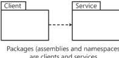

包（程序集和命名空间）既是客户端也是服务。

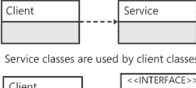

服务类被客户端类使用。

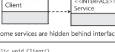

某些服务被隐藏在接口之后。

```
public void Client()
{
    int x = 6;
    Console.WriteLine("{0} = {1}", x, Service(x));
}
```

即使在方法级别，一个调用另一个方法的方法也是服务的客户端。

## 图 3-8 所有层级的依赖关系都可以用图来建模。

对于粗粒度层级的每个节点，在更细粒度层级上都有一组节点与之对应。子系统内部是程序集；程序集内部是类；类内部是方法。这说明了对单个方法的依赖如何能够引入一整个链式依赖的子系统。

然而，在所有这些示例中，你并不知道你所面对的是*哪种*依赖（继承、聚合、组合或关联），只知道存在依赖。这仍然是有用的，因为管理依赖只需要知道两个实体之间的二元关系：*是否存在依赖？*

# 循环依赖

图论的另一部分是，有向图可以形成环：沿着边从一个节点遍历回到自身的能力。到目前为止展示的图都是无环有向图——不包含环。图 3-9 展示了一个有环有向图的例子。如果你从节点 D 出发，可以沿边到 E，然后到 B，最后又回到 D。这就是循环依赖，有时也称为环状依赖。

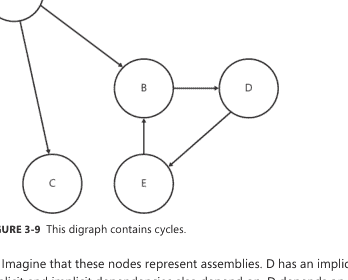

图 3-9 这个有向图包含环。

假设这些节点代表程序集。D 对其显式依赖和隐式依赖所依赖的任何东西都有隐式依赖。D 显式依赖 E，但隐式依赖 B 和 D。因此，D 依赖自身。

对于程序集来说，这是不可能的。如果你尝试在 Visual Studio 中建立这种设置，当你要分配从 E 到 B 的引用时，Visual Studio 不会允许这样做，如图 3-10 所示。


图 3-10 在 Visual Studio 中不可能创建循环依赖。

因此，尽管把依赖关系建模为图可能看起来有点学术化，但在组织依赖关系时却有明显的好处。程序集之间的循环依赖并不是对纯粹理想的一种偏离，而是完全不允许的，避免这种依赖是强制性的，并且会强制执行。

# 自循环

自循环是有向图中环的一种特例。如果一个节点通过一条边与自身相连，这条边就成为一个自环。图 3-11 展示了一个带自环的图示例。

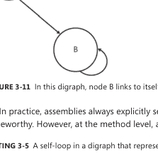

图 3-11 在此有向图中，节点 B 通过一个自环与自身相连。

在实践中，程序集总是显式地依赖自身，这样的观察并不是特别值得注意。然而，在方法级别，自环是递归存在的证据，如清单 3-5 所示。

## 清单 3-5 表示方法的有向图中的自环会导致递归。

```
namespace Graphs
{
    public class RecursionLoop
    {
        public void A()
        {
            int x = 6;
            Console.WriteLine("0! = {1}", x, B(x));
        }

        public int B(int number)
        {
            if(number == 0)
            {
                return 1;
            }
            else
            {
                return number * B(number - 1);
            }
        }
    }
}
```

清单 3-4 中的类展示了与图 3-11 中依赖图等价的功能。方法 A 调用方法 B；因此，我们说方法 A 依赖于方法 B。然而，更有趣的是方法 B 对自身的依赖——B 是一个递归函数的例子；也就是说，一个调用自身的函数。

# 管理依赖

到目前为止你已经了解到，依赖关系是必要的，但必须小心管理，以免在开发后期给你带来问题。这些问题一旦显现，就很难再退回去。因此，最好从一开始就正确地管理依赖关系，并保持警惕，以防问题悄悄潜入。管理不善的依赖关系很快就会从一个小妥协升级为整体架构问题。

本章的其余部分侧重于持续管理依赖关系的更实际方面。这包括避免反模式，更重要的是，理解这些常见模式为什么是反模式。相反，有些模式是有益的，应当加以采用；这些模式被作为已知反模式的直接替代方案。

> **模式与反模式**
> 
> 作为一门工程学科，面向对象软件开发是一项相对较新的尝试。在过去几十年里，一些类和接口之间可重复的协作方式已被识别并编纂为*模式*。
> 
> 有许多软件开发模式，每种都提供了一种通用解决方案，可以针对特定问题领域进行复用。有些模式可以相互结合，为复杂问题产生优雅的解决方案。当然，并非所有模式在任何时候都适用，识别特定模式可能在何时何地适用需要经验和实践。
> 
> 有些模式并不那么有益。事实上，它们恰恰相反。它们被视为*反模式*。这些模式会损害代码的适应性，应当避免。一些反模式最初是模式，后来由于被认为有负面副作用而逐渐失宠。

# 实现与接口

刚接触面向接口编程概念的开发人员，往往难以放下接口背后的实现。

在编译时，接口的任何客户端都不应该知道它使用的是接口的哪个实现。这种了解可能导致错误的假设，使客户端与接口的特定实现耦合在一起。


# 清单 3-6 实例化对象如何阻止代码具有适应性的示例。

```
public class AccountController
{
    private readonly SecurityService securityService;

    public AccountController()
    {
        this.securityService = new SecurityService();
    }

    [HttpPost]
    public void ChangePassword(Guid userID, string newPassword)
    {
        User userRepository = new UserRepository();
        var user = userRepository.GetByID(userID);
        this.securityService.ChangeUsersPassword(user, newPassword);
    }
}
```

AccountController 类是假设的 ASP.NET MVC 应用的一部分。不要太在意具体细节；集中关注不恰当的对象构造，用粗体突出显示。控制器的职责是通过 MVC 控制器操作允许用户执行账户查询和命令。只显示了一个命令：ChangePassword。

这段代码存在几个问题，它们直接由两个 new 出现引起：

- AccountController 永远依赖于 SecurityService 和 UserRepository 的实现。
- SecurityService 和 UserRepository 无论有什么依赖，现在都成为 AccountController 的隐式依赖。
- AccountController 现在极难进行单元测试——这两种类无法用常规方法模拟。
- SecurityService.ChangeUsersPassword 方法要求客户端加载 User 对象。

这些问题将在以下各节中更详细地讨论。

# 无法增强实现

如果你想更改 SecurityService 的实现，你有两个选择：直接更改 AccountController 以引用此新实现，或将新功能添加到现有的 SecurityService。在整本书中，你将了解到为什么这两种选项都不受青睐。现在考虑一下，目标是在类创建后永远不要编辑 AccountController 或 SecurityService 类。

# 依赖链

SecurityService 很可能也有自己的一些依赖。通过拥有默认构造函数，它大胆声称自己没有任何依赖。然而，如果 Listing 3-7 所示的代码是 SecurityService 构造函数的实现会怎样？

## 清单 3-7 SecurityService 与 AccountController 有相同的问题。

```
public SecurityService()
{
    this.Session = SessionFactory.GetSession();
}
```

该服务实际上依赖于 NHibernate，即对象/关系映射器，用于检索会话。会话是 NHibernate 对持久关系存储的连接的类比，例如 Microsoft SQL Server、Oracle 或 MySQL。如本章前面所述，这意味着 AccountController 也隐式依赖于 NHibernate。

此外，如果 SecurityService 构造函数的签名发生变化会怎样？也就是说，如果它突然要求客户端提供 Session 所需的数据库连接字符串呢？使用 SecurityService 的任何客户端，包括 AccountController，都必须更新以提供连接字符串。再次，这是一种你不应该需要做出的更改。

# 缺乏可测试性

可测试性是一个非常重要的关注点，并且要求代码以某种方式设计。如果不是这样，测试将极其困难。不幸的是，AccountController 和 SecurityService 都不容易测试。这是因为你无法用不执行任何操作的假版本替换它们的依赖。例如，在测试 SecurityService 时，你不希望它进行任何数据库连接。那将是多余且缓慢的，并且会在测试中引入另一个大的故障点：如果数据库不可用怎么办？有方法可以通过在运行时用假对象替换它们的依赖来测试这些类。诸如 Microsoft Moles 和 Typemock 之类的工具可以挂钩到构造函数并确保它们返回的对象是假的。但这只是治疗症状而不是原因。

# 更不恰当的亲密性

AccountController.ChangePassword 方法创建了一个 UserRepository 类来检索 User 实例。它之所以必须这样做，是因为 SecurityService.ChangeUsersPassword 方法要求它这样做。没有 User 实例，该方法就无法被调用。这表明方法接口设计不良。相反，SecurityService 在这种情况下应该自行检索 User，而不是要求所有客户端检索 User。然后两个方法将看起来像 Listing 3-8。

## 清单 3-8 对 SecurityService 的所有客户端进行了改进。

```
[HttpPost]
public void ChangePassword(Guid userID, string newPassword)
{
    this.securityService.ChangeUsersPassword(userID, newPassword);
}
//...
public class SecurityService
{
    public void ChangeUsersPassword(Guid userID, string newPassword)
    {
        var userRepository = new UserRepository();
        var user = userRepository.GetByID(userID);
        user.ChangePassword(newPassword);
    }
}
```

这对于 AccountController 来说绝对是一个改进，但 ChangeUsersPassword 方法仍然直接实例化 UserRepository。

# 对象构造的替代方案

什么可以改进 AccountController 和 SecurityService——或任何其他不恰当对象构造的示例？如何使它们明显正确，以便上述问题都不适用？有几个互补的选项可供选择。

# 编码到接口

你应该做的第一个也是最重要的更改是隐藏 SecurityService 的实现在接口之后。这允许 AccountController 仅依赖于 SecurityService 的接口，而不是其实现。第一个重构是从 SecurityService 中提取接口，如 Listing 3-9 所示。

## 清单 3-9 从 SecurityService 中提取接口。

```
public interface ISecurityService
{
    void ChangeUsersPassword(Guid userID, string newPassword);
}
//...
public class SecurityService : ISecurityService
{
    public ChangeUsersPassword(Guid userID, string newPassword)
    {
        //...
    }
}
```

下一步是更新客户端，使其不再依赖于 SecurityService 类，而是依赖于 ISecurityService 接口。Listing 3-10 显示了此重构应用于 AccountController。

## 清单 3-10 AccountController 现在使用 ISecurityService 接口。

```
public class AccountController
{
    private readonly ISecurityService securityService;

    public AccountController()
    {
        this.securityService = new SecurityService();
    }

    [HttpPost]
    public void ChangePassword(Guid userID, string newPassword)
    {
        securityService.ChangeUsersPassword(user, newPassword);
    }
}
```

此示例尚未完成——你仍然依赖于 SecurityService 的实现，因为它的构造函数。具体类仍在 AccountController 的构造函数中被实例化。为了完全分离这两个类，你需要进行进一步的重构：引入依赖注入（DI）。

# 使用依赖注入

这是一个很大的主题，无法在少量篇幅中涵盖。事实上，第 12 章“依赖注入”专门讨论了该主题，并且有整本书致力于此。幸运的是，DI 并不是特别复杂或困难，因此这里可以从使用 DI 的类的角度介绍基础知识。Listing 3-11 显示了对 AccountController 类的构造函数应用的另一个重构。构造函数是这里唯一的更改，用粗体突出显示。就这个类而言，这是一个非常小的更改，但它对你管理依赖的能力产生了巨大影响。AccountController 不再自行构造 SecurityService 类，而是现在要求其他某个类为其提供 ISecurityService 实现。不仅如此，还在构造函数中引入了一个前置条件，防止其客户端为 securityService 参数传入 null 值。这确保了当你在 ChangePassword 方法中使用 securityService 字段时，你保证拥有一个有效实例，并且在其他任何地方都不必检查 null。


# 清单 3-11 使用依赖注入可以让你移除对 SecurityService 类的依赖。

```
public class AccountController
{
    private readonly ISecurityService securityService;

    public AccountController(ISecurityService securityService)
    {
        if(securityService == null) throw new ArgumentNullException("securityService");
        this.securityService = securityService;
    }

    [HttpPost]
    public void ChangePassword(Guid userID, string newPassword)
    {
        this.securityService.ChangeUsersPassword(user, newPassword);
    }
}
```

SecurityService 也需要遵循同样的做法并应用依赖注入。Listing 3-12 显示了重构后的样子。

# 清单 3-12 依赖注入是一种无处不在的模式，可以几乎在任何地方自由应用。

```
public class SecurityService : ISecurityService
{
    private readonly IUserRepository userRepository;

    public SecurityService(IUserRepository userRepository)
    {
        if(userRepository == null) throw new ArgumentNullException("userRepository");
        this.userRepository = userRepository;
    }

    public ChangeUsersPassword()
    {
        var user = userRepository.GetByID(userID);
        user.ChangePassword(newPassword);
    }
}
```

正如 AccountController 强制要求其依赖一个有效的 ISecurityService 实例一样，SecurityService 也强制要求其依赖一个有效 IUserRepository——如果在构造时传入空引用则抛出异常。同样，UserRepository 类的依赖已被完全移除，转而使用 IUserRepository 接口。

# Resolving dependencies

知道如何安排你的项目及其依赖关系，在调试程序集之间的依赖关系时并无帮助。有时在运行时程序集不可用，此时有必要找出原因。

## Assemblies

Common Language Runtime (CLR)，即 .NET Framework 用于执行代码指令的虚拟机，与其他任何软件产品一样，都被编程为在托管应用程序时以可预测和合乎逻辑的方式行为。深入了解程序集解析的理论和实践以及如何修复解析错误是非常有用的。当你需要追踪找不到程序集的问题时，少量知识就能走得很远。

**Resolution process**  
程序集解析过程是 CLR 的一个重要方面。它涵盖了从向程序集或项目添加引用到应用程序运行并加载该程序集之间的差距。涉及多个步骤，只需一个概述即可，当过程中出现问题时，你可以推断出问题的可能原因。

Figure 3-12 以流程图的形式展示了程序集解析过程。该流程图处于高层次，并不包含每个细节，但足以显示过程中的主要项目。过程如下：

- CLR 使用即时编译（JIT）模型来解析程序集。如本章前面已证明，应用程序启动时不会解析其中包含的引用，而是当你首次使用该程序集的某个功能时才解析——字面意义上的即时。
- 每个程序集都有一个身份，由其名称、版本、区域性和公钥令牌组成。诸如绑定重定向之类的功能可以更改此身份，因此确定它并不像看起来那么简单。
- 当程序集的身份确定后，CLR 能够判断在当前应用程序执行期间是否已尝试解析此依赖项。
- 提出此问题会导致 CLR 根据答案分支。如果已尝试解析此程序集，则该过程要么已成功，要么已失败。如果成功，CLR 可以使用已加载的程序集并提前退出。如果不成功，CLR 知道无需继续尝试解析此程序集，因为它会失败。
- 另一种情况是，如果这是首次尝试解析程序集，CLR 首先检查全局程序集缓存（GAC）。GAC 是一个机器范围的程序集存储库，允许同一应用程序中执行同一程序集的多个版本。如果在 GAC 中找到程序集，则解析过程成功并加载发现的程序集。因此你现在知道，由于 GAC 会首先被搜索，GAC 中存在适用的程序集将优先于文件系统上的程序集。
- 如果在 GAC 中找不到程序集，CLR 开始探测各种目录以查找它。搜索的目录取决于 app.config 设置。如果 app.config 中有 code-base 元素，则会检查该位置——如果找不到程序集——则不会随后检查其他位置。但是，默认情况下会搜索应用程序的根目录，通常是与入口点或 Web 应用程序相关的 /bin 文件夹。如果在那里找不到程序集，则解析过程失败，CLR 抛出异常。通常，这会导致应用程序终止。

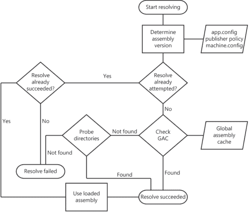

**FIGURE 3-12** 程序集解析过程的简要概述。

## The Fusion log

这是调试 CLR 在运行时绑定到程序集失败尝试的非常有用的工具。与其在 Visual Studio 调试器中逐步执行应用程序，不如打开 Fusion 并阅读生成的日志文件更好。

要启用 Fusion，你必须编辑 Windows 注册表，如以下代码所示。

```
HKLM\Software\Microsoft\Fusion\ForceLog 1
HKLM\Software\Microsoft\Fusion\LogPath C:\FusionLogs
```

ForceLog 值是一个 DWORD，而 LogPath 是一个字符串。你可以将 LogPath 设置为你选择的任何路径。绑定失败的示例显示在 Listing 3-13 中。

# 清单 3-13 Fusion 对绑定程序集失败尝试的示例输出。

```
*** Assembly Binder Log Entry  (6/21/2013 @ 1:50:14 PM) ***

The operation failed.
Bind result: hr = 0x80070002. The system cannot find the file specified.

Assembly manager loaded from: C:\Windows\Microsoft.NET\Framework64\v4.0.30319\clr.dll
Running under executable  C:\Program Files\IUPIndustries\Bins\v1.1.0.242\Bins.exe
--- A detailed error log follows.

=== Pre-bind state information ===
LOG: User = DEV\gmclean
LOG: DisplayName = TaskbarDockUI.Xtensions.Bins.resources, Version=1.0.0.0, Culture=en-US, PublicKeyToken=null (Fully-specified)
LOG: Appbase = file://C:/Program Files/IUPIndustries/Bins/v1.1.0.242/
LOG: Initial PrivatePath = NULL
LOG: Dynamic Base = NULL
LOG: Cache Base = NULL
LOG: AppName = Bins.exe
Calling assembly : TaskbarDockUI.Xtensions.Bins, Version=1.0.0.0, Culture=neutral, PublicKeyToken=null.
===
LOG: This bind starts in default load context.
LOG: No application configuration file found.
LOG: Using host configuration file:
LOG: Using machine configuration file from C:\Windows\Microsoft.NET\Framework64\v4.0.30319\config\machine.config.
LOG: Policy not being applied to reference at this time (private, custom, partial, or location-based assembly bind).
LOG: Attempting download of new URL file://C:/Program Files/IUPIndustries/Bins/v1.1.0.242/en-US/TaskbarDockUI.Xtensions.Bins.resources.DLL.
LOG: Attempting download of new URL file://C:/Program Files/IUPIndustries/Bins/v1.1.0.242/en-US/TaskbarDockUI.Xtensions.Bins.resources/
TaskbarDockUI.Xtensions.Bins.resources.DLL
LOG: Attempting download of new URL file://C:/Program Files/IUPIndustries/Bins/v1.1.0.242/en-US/TaskbarDockUI.Xtensions.Bins.resources.EEE.
LOG: Attempting download of new URL file://C:/Program Files/IUPIndustries/Bins/v1.1.0.242/en-US/TaskbarDockUI.Xtensions.Bins.resources/
TaskbarDockUI.Xtensions.Bins.resources.EXE
LOG: All probing URLs attempted and failed.
```

编辑注册表后，任何托管应用程序对程序集的所有解析尝试，无论成功与否，都会写入日志。这显然会产生大量日志文件，这可能很有用，但也可能开始变成大海捞针的问题。

幸运的是，Fusion 有一个 UI 应用程序，如 Figure 3-13 所示，这使得找到应用程序的正确文件变得稍微容易一些，而无需在文件系统中搜索。


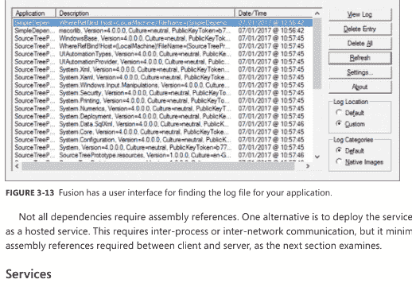

# 图 3-13 Fusion 提供了用于查找应用程序日志文件的用户界面。

并非所有依赖项都需要程序集引用。一种替代方案是将服务代码部署为托管服务。这需要进程间或网络间通信，但会最大程度地减少客户端与服务器之间所需的程序集引用，下一节将对此进行探讨。

# 服务

与程序集相比，客户端与托管服务之间的耦合可以松散得多，这有好处，但也有代价。根据应用程序的需求，你可以让客户端对服务位置的了解或多或少。此外，你还可以改变服务的实现方式，使其几乎没有需求。每种选择都有不同的权衡需要考虑。

# 已知终结点

当服务位置在编译时对客户端已知时，你可以在客户端创建服务代理。此代理至少可以通过两种方式创建：使用 Visual Studio 向项目添加服务引用，或者通过 .NET Framework 中的 ChannelFactory 类自行创建服务代理。

在 Visual Studio 中添加服务引用非常容易；只需在项目的快捷菜单中选择“添加服务引用”。“添加服务引用”对话框只需要 Web 服务描述语言（WSDL）文件的位置，该文件提供服务、其数据类型和可用行为的元数据描述。然后 Visual Studio 会为此服务生成一组代理类，节省大量时间。它甚至可以生成服务方法的异步版本，以缓解阻塞。然而，使用此方法的代价是失去对生成代码的控制。Visual Studio 生成的代码不太可能符合你的内部编码标准，这可能是个问题，具体取决于这些标准的严格程度。另一个问题是生成的服务代理不适合单元测试：它不会生成任何接口，只会生成实现类。

添加服务引用的另一种方式是在代码中自行创建服务代理。当客户端可以访问服务的接口并可通过引用直接重用它时，最好使用此方法。清单 3-14 展示了使用 ChannelFactory 类创建服务代理的示例。

# 清单 3-14 ChannelFactory 类允许你创建服务代理。

```csharp
var binding = new BasicHttpBinding();
var address = new EndpointAddress("http://localhost/MyService");
var channelFactory = new ChannelFactory<IService>(binding, address);
var service = channelFactory.CreateChannel();
service.MyOperation();
service.Close();
channelFactory.Close();
```

ChannelFactory 类是泛型类，其构造函数要求你提供希望它创建的服务代理的接口。由于此代码还需要 Binding 和 EndpointAddress，你必须向 ChannelFactory 提供完整的地址/绑定/协定（ABC）。在此示例中，IService 接口是服务实现的同一接口。你从 ChannelFactory.CreateChannel 获得的是一个代理，对于每次调用，它都会在服务器端实现上调用对应的方法。由于使用的是同一接口，客户端类可以将此接口作为构造函数参数，由依赖注入来解析，这些客户端类立刻变得可测试。此外，它们无需知道自己正在调用远程服务。

# 服务发现

有时你可能知道服务的绑定类型或其协定，但不知道其托管地址。在这种情况下，你可以使用服务发现，该功能是在 .NET Framework 4 中引入到 Windows Communication Foundation（WCF）的。

服务发现有两种类型：托管模式和临时模式。在托管模式下，一个称为发现代理的集中式服务为客户端所熟知，客户端直接向它发送查找其他服务的查询。这种模式不太有趣，因为它引入了单点故障（SPOF）：如果发现代理不可用，客户端将无法访问任何其他服务，因为它们无法被发现。

临时模式通过使用多播网络消息消除了对发现代理的需求。其默认实现使用用户数据报协议（UDP），每个可发现服务都在指定 IP 地址¹ 上监听查询。客户端实际上是向网络询问是否存在与其查询条件匹配的服务——例如，协定或绑定类型。在这种情况下，如果其中一个服务不可用，则只有该服务无法被发现，而其余服务仍会响应请求。清单 3-15 展示了如何以编程方式托管可发现服务，清单 3-16 展示了如何通过配置向服务添加可发现性。

¹ 使用的 IP 地址是 239.255.255.250（IPv4）或 [FF02::C]（IPv6）。使用的端口是 3702。这是由 WS-Discovery 标准设置的，因此不可配置。

```csharp
class Program
{
    static void Main(string[] args)
    {
        using (ServiceHost serviceHost = new ServiceHost(typeof(CalculatorService)))
        {
            serviceHost.Description.Behaviors.Add(new ServiceDiscoveryBehavior());
            serviceHost.AddServiceEndpoint(typeof(ICalculator), new BasicHttpBinding(),
                new Uri("http://localhost:8090/CalculatorService"));
            serviceHost.AddServiceEndpoint(new UdpDiscoveryEndpoint());

            serviceHost.Open();
            Console.WriteLine("Discoverable Calculator Service is running...");
            Console.ReadKey();
        }
    }
}
```

# 清单 3-16 通过配置托管可发现服务。

```xml
<system.serviceModel>
    <behaviors>
        <serviceBehaviors>
            <behavior>
                <serviceMetadata httpGetEnabled="true" httpsGetEnabled="true" />
                <serviceDebug includeExceptionDetailInFaults="false"/>
            </behavior>
            <behavior name="calculatorServiceDiscovery">
                <serviceDiscovery />
            </behavior>
        </serviceBehaviors>
        <endpointBehaviors>
            <behavior name="calculatorHttpEndpointDiscovery">
                <endpointDiscovery enabled="true" />
            </behavior>
        </endpointBehaviors>
    </behaviors>
    <protocolMapping>
        <add binding="basicHttpsBinding" scheme="https" />
    </protocolMapping>
    <serviceHostingEnvironment aspNetCompatibilityEnabled="true"
        multipleSiteBindingsEnabled="true" />
    <services>
        <service name="ConfigDiscoverableService.CalculatorService"
            behaviorConfiguration="calculatorServiceDiscovery">
            <endpoint address="CalculatorService.svc"
                behaviorConfiguration="calculatorHttpEndpointDiscovery"
                contract="ServiceContract.ICalculator" binding="basicHttpBinding" />
            <endpoint kind="udpDiscoveryEndpoint" />
        </service>
    </services>
</system.serviceModel>
```

要变得可发现，服务只需添加 ServiceDiscovery 行为并托管一个 DiscoveryEndpoint。在此示例中，UdpDiscoveryEndpoint 用于接收来自客户端的多播网络消息。

> **注意** WCF 中的服务发现符合 WS-Discovery 标准。这使其能够与不同的平台和语言互操作，而不仅仅是 .NET Framework。

客户端使用 DiscoveryClient 类来查找可发现的服务，DiscoveryClient 类也需要一个 DiscoveryEndpoint。然后，使用配置好的 FindCriteria 实例调用 Find 方法，该实例描述了要查找的服务的属性。Find 返回一个 FindResponse 实例，其中包含一个 Endpoints 属性——一个 EndpointDiscoveryMetadata 实例的集合，每个匹配的服务对应一个实例。清单 3-17 展示了查找可发现服务的这些步骤。

# 清单 3-17 服务发现是解耦代码的好方法。

```csharp
class Program
{
    private const int a = 11894;
    private const int b = 27834;

    static void Main(string[] args)
    {
        var foundEndpoints = FindEndpointsByContract<ICalculator>();

        if (!foundEndpoints.Any())
        {
            Console.WriteLine("No endpoints were found.");
        }
        else
        {
            var binding = new BasicHttpBinding();
            var channelFactory = new ChannelFactory<ICalculator>(binding);
            foreach (var endpointAddress in foundEndpoints)
            {
                var service = channelFactory.CreateChannel(endpointAddress);
                var additionResult = service.Add(a, b);
                Console.WriteLine("Service Found: {0}", endpointAddress.Uri);
                Console.WriteLine("{0} + {1} = {2}", a, b, additionResult);
            }
        }

        Console.ReadKey();
    }

    private static IEnumerable<EndpointAddress> FindEndpointsByContract
        <TServiceContract>()
    {
        var discoveryClient = new DiscoveryClient(new UdpDiscoveryEndpoint());
        var findResponse = discoveryClient.Find(new FindCriteria(typeof(TServiceContract)));
        return findResponse.Endpoints.Select(metadata => metadata.Address);
    }
}
```


请记住，与 TCP 不同，UDP（用户数据报协议）不保证消息的传递。数据报在传输过程中可能会丢失，因此请求可能无法到达可用的服务，或者响应可能无法返回客户端。无论哪种情况，在客户端看来，都没有可用于处理请求的服务。

> 提示：在 Internet Information Services (IIS) 或 Windows Process Activation Service (WAS) 中托管可发现服务时，请确保使用 Microsoft AppFabric AutoStart 功能。可发现性取决于服务的可用性，也就是说，服务必须处于运行状态才能接收来自客户端的查询。AppFabric AutoStart 允许服务在应用程序于 IIS 中启动时运行。如果没有 AutoStart，服务要等到收到第一个请求时才会启动。

# RESTful 服务

创建 RESTful 服务（REST：表述性状态转移）最有力的理由是客户端所需的依赖性负担非常低。所需要的只是一个 HTTP 客户端，而编程语言的框架和库通常都提供了这一客户端。这使得 RESTful 服务非常适合开发需要广泛跨平台支持的服务。例如，Facebook 和 Twitter 都提供了用于各种查询和命令的 REST API。这可以确保客户端能够为大量平台开发：Windows Phone 10、iPhone、Android、iPad、Windows 10、Linux 等等。如果没有 REST 所允许的极低依赖性要求，要实现一个能够服务所有这些客户端的单一实现将更加困难。

ASP.NET Web API 用于创建使用 .NET Framework 的 REST 服务。与 ASP.NET MVC 框架类似，它允许开发人员创建直接映射到 Web 请求的方法。Web API 提供了一个名为 ApiController 的基控制器类。您继承该控制器，并添加以 HTTP 动词命名的方法：GET、POST、PUT、DELETE、HEAD、OPTIONS 和 PATCH。每当使用这些动词之一的 HTTP 请求到达时，就会调用相应的方法。清单 3-18 显示了一个实现了所有这些动词的服务示例。

## 清单 3-18 ASP.NET Web API 支持几乎所有 HTTP 动词。

```
public class ValuesController : ApiController
{
    public IEnumerable<string> Get()
    {
        return new string[] { "value1", "value2" };
    }

    public string Get(int id)
    {
        return "value";
    }

    public void Post([FromBody]string value)
    {
    }

    public void Put(int id, [FromBody]string value)
    {
    }

    public void Head()
    {
    }

    public void Options()
    {
    }

    public void Patch()
    {
    }

    public void Delete(int id)
    {
    }
}
```

## 清单 3-19 客户端可以使用 HttpClient 类访问 RESTful 服务。

```
class Program
{
    static void Main(string[] args)
    {
        string uri = "http://localhost:7617/api/values";

        MakeGetRequest(uri);
        MakePostRequest(uri);

        Console.ReadKey();
    }

    private static async void MakeGetRequest(string uri)
    {
        var restClient = new HttpClient();
        var getRequest = await restClient.GetStringAsync(uri);

        Console.WriteLine(getRequest);
    }

    private static async void MakePostRequest(string uri)
    {
        var restClient = new HttpClient();
        var postRequest = await restClient.PostAsync(uri,
            new StringContent("Data to send to the server"));

        var responseContent = await postRequest.Content.ReadAsStringAsync();
        Console.WriteLine(responseContent);
    }
}
```

为了强调一点，即可以使用同样低的依赖性要求来编写多个客户端，清单 3-20 显示了一个用于访问服务的 GET 和 POST 方法的 Windows PowerShell 3 脚本。

## 清单 3-20 从 Windows PowerShell 3 访问 REST 服务极其简单。

```
$request = [System.Net.WebRequest]::Create("http://localhost:7617/api/values")
$request.Method = "GET"
$request.ContentLength = 0

$response = $request.GetResponse()
$reader = New-Object System.IO.StreamReader($response.GetResponseStream())
$responseContent = $reader.ReadToEnd()
Write-Host $responseContent
```

此代码使用 .NET Framework 中的 WebRequest 对象来调用 RESTful 服务。该类是 HttpRequest 类的超类。Create 方法是一个工厂方法，由于提供了 http:// URI，因此它返回一个 HttpRequest 实例。

# 使用 NuGet 进行依赖项管理

借助依赖项管理工具，可以大大简化依赖项管理。此类工具负责追踪依赖链，以确保所有依赖的工件都可用。它们还管理依赖项的版本：您可以指定只想依赖特定版本的依赖项，其余工作由依赖项管理工具完成。

NuGet 是 .NET Framework 的包管理实用工具。NuGet 将依赖项称为*包*，但该工具不仅限于程序集。NuGet 包还可以包含配置、脚本和图像——几乎任何你需要的东西。使用包管理器（如 NuGet）最有力的理由之一是，它了解包的依赖项，并且当项目引用包时，会带来整个依赖链。

从 Visual Studio 2013 开始，NuGet 已完全集成为默认的包管理实用工具。

# 使用包

NuGet 在 Visual Studio 的解决方案资源管理器窗口中的快捷菜单上添加了一些新命令。在那里，您可以打开 NuGet 包管理窗口，并添加对依赖项的引用。

在本例中，我将添加对 RiakClient 的依赖项，RiakClient 是 Riak NoSql 键/值存储区的 .NET Framework 客户端驱动程序。图 3-14 显示了 NuGet 包管理窗口。

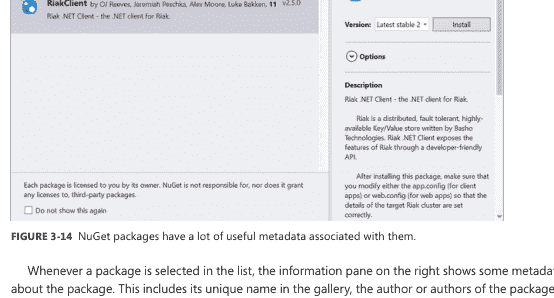

图 3-14 NuGet 包具有许多有用的关联元数据。

当在列表中选择一个包时，右侧的信息窗格会显示有关该包的一些元数据。这包括它在库中的唯一名称、包的作者、包的版本、上次发布日期、包的描述以及它所具有的任何依赖项。这些依赖项非常有趣，因为它们不仅显示依赖项的必需版本或受支持版本，还显示因引用此包而将要安装的其他内容。例如，RiakClient 至少需要 Newtonsoft.Json 9.0.1 版本（流行的 .NET Framework JSON/类序列化器）和 protobuf-net 2.0.0.668 版本。这两个包也可能有自己的依赖项。

当您选择安装此包时，NuGet 将首先尝试下载所有文件，并将它们放在解决方案根文件夹下的 packages/ 文件夹中。这允许您将整个目录放入源代码管理，就像之前对 dependencies/ 文件夹所做的那样。然后，NuGet 会在您要使用此库的项目中引用已下载的程序集。图 3-15 显示了添加 RiakClient 后项目的引用。

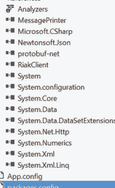

## 图 3-15 项目引用了目标包及其所有依赖项。

除了建立引用之外，NuGet 还会创建一个 packages.config 文件，其中包含项目引用了哪些包以及哪些版本的信息。这在升级或卸载包时非常有用，这也是 NuGet 能够做到的。

Riak 还需要一些默认配置才能投入使用。因此，NuGet 不仅下载并引用了许多程序集，还编辑了您的 app.config，为 Riak 所需的必需设置包含了一些合理的默认值。清单 3-21 显示了安装 RiakClient 后 app.config 的当前状态。

## 清单 3-21 NuGet 已专门为 RiakClient 向 app.config 添加了一个新的 configSection。

```
<configuration>
  <configSections>
    <section name="riakConfig" type="RiakClient.Config.RiakClusterConfiguration, RiakClient" />
  </configSections>
  <startup>
    <supportedRuntime version="v4.0" sku=".NETFramework,Version=v4.6.2" />
  </startup>
```


```
```xml
<riacConfig nodePollTime="5000" defaultRetryWaitTime="200" defaultRetryCount="3">
    <nodes>
        <node name="riak1" hostAddress="riak-host1" pbcPort="8087" poolSize="20" />
        <node name="riak2" hostAddress="riak-host2" pbcPort="8087" poolSize="20" />
        <node name="riak3" hostAddress="riak-host3" pbcPort="8087" poolSize="20" />
        <node name="riak4" hostAddress="riak-host4" pbcPort="8087" poolSize="20" />
        <node name="riak5" hostAddress="riak-host5" pbcPort="8087" poolSize="20" />
    </nodes>
</riakConfig>
</configuration>
```
```

Clearly, this is a great timesaver because you haven’t had to search the Riak site for a download of the RiakClient package or any of its dependencies. Everything has been put into a state where you can concentrate on developing. And when it comes time to upgrade RiakClient to the next version, you can also use NuGet to automatically update all of the packages that depend on it in the entire solution.

# Producing packages

NuGet also allows you to create packages. You might want to create packages for publication on the official NuGet package gallery so that other developers can use them, or you might want to host your own package feed for first-party dependencies. Figure 3-16 shows the NuGet Package Manager, which can be used to create your own packages. In this package, I have configured RiakClient to be a dependency, so it will also depend on Newtonsoft.Json and protobuf-net, implicitly. I have added a library artifact that is targeted specifically to the .NET Framework 4.6.2 and a Windows PowerShell script that is instructed to run during installation. This could feasibly be used to do almost anything—thanks to the flexibility of Windows PowerShell.

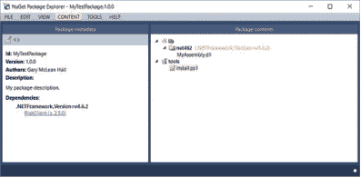

**FIGURE 3-16**  The NuGet Package Manager makes it very easy to construct your own packages.

Each package has an XML file that details the metadata that is shown in the installation window. Listing 3-22 shows some of the syntax of this file.

```
```xml
<package xmlns="http://schemas.microsoft.com/packaging/2010/07/nuspec.xsd">
    <metadata>
        <id>MyTestPackage</id>
        <version>1.0.0</version>
        <authors>Gary McLean Hall</authors>
        <requireLicenseAcceptance>false</requireLicenseAcceptance>
        <description>My package description.</description>
        <dependencies>
            <dependency id="RiakClient" version="1.0.1" />
        </dependencies>
    </metadata>
</package>
```
```

NuGet is such a productivity and organizational bonus that it is painful to return to manually managing third-party dependencies, if a package does not exist for a particular library. In fact, NuGet is not only for third-party dependencies. When a solution becomes large enough, it is advisable to split the solution into multiple parts, sliced by layer. The assemblies for each layer can then be packaged by using NuGet and consumed by layers above. This keeps solutions small and easy to work with.

# Chocolatey

The best way to describe Chocolatey is that it is a package management tool, just like NuGet, but its packages are applications and tools, not assemblies. Developers with some Linux knowledge will find that Chocolatey is like apt-get, which is Debian’s and Ubuntu’s package manager. Again, many of the benefits of package management apply: simplified installation, dependency management, and ease of use.

The following Windows PowerShell script can be used to download and install Chocolatey.

```
```powershell
@powershell -NoProfile -ExecutionPolicy unrestricted -Command "iex ((new-object net.webclient).DownloadString('https://chocolatey.org/install.ps1'))" && SET PATH=%PATH%;%systemdrive%\chocolatey\bin
```
```

After Chocolatey is installed, you can use the command line to search for and install various applications and tools. The installation procedure will have already updated the command-line path to include the chocolatey.exe application. Much like Git, Chocolatey has subcommands such as list and install, but these also have synonyms that can be used as shortcuts: clist and cinst, respectively. Listing 3-23 shows a sample Chocolatey session that finds the package name for Filezilla, the FTP client, and then installs it.

## 清单 3-23 首先搜索所需应用程序的包，然后安装它。

```
C:\dev> clist filezilla
ferventcoder.chocolatey.utilities 1.0.20130622
filezilla 3.7.7
filezilla.commandline 3.7.1
filezillaserver 0.9.41.20120523
jivkok.tools 1.1.0.2
kareemseultan.developer.toolkit 1.4
UAdevelopers.utils 1.9
C:\dev> cinst filezilla
Chocolatey (v0.9.8.20) is now installing filezilla and dependencies. By installing you accept
the license for filezilla and each dependency you are installing.
...
This Finished installing 'filezilla' and dependencies - if errors not shown in console,
none detected. Check log for errors if unsure.
```

As long as no errors are reported by Chocolatey, the requested package is now installed. Be aware that Chocolatey **should** have altered your system PATH so that any new binaries can be executed from the command line, but it does not always do so. There are a lot of packages available via Chocolatey, and the convenience that it provides is a compelling reason to use it.

# Layering

To this point, this chapter has looked primarily at managing dependencies at the assembly level. This is a natural first step to organizing your application, because all classes and interfaces are contained in assemblies, and how they reference each other is a common concern. When correctly organized, your assemblies will contain classes and interfaces that only pertain to a single group of related functionality. Taken in aggregate, however, how can you ensure that groups of assemblies are also correctly organized?

Groups of two or more interrelated assemblies form *components* of the software system that is being developed. It is equally important—if not more so—that these components interact in a similarly well-defined and structured fashion. As Figure 3-17 shows, components are not physical artifacts of deployment, like assembly dynamic-link libraries (DLLs), but are logical groupings of assemblies that share a similar theme.

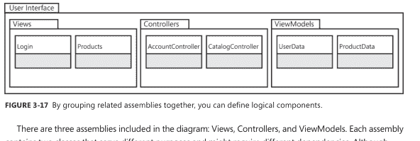

FIGURE 3-17 By grouping related assemblies together, you can define logical components.

There are three assemblies included in the diagram: Views, Controllers, and ViewModels. Each assembly contains two classes that serve different purposes and might require different dependencies. Although classes and assemblies are constructs provided by the .NET Framework, the User Interface package that groups everything is logical. The three assemblies might be located in the solution in a folder called User-Interface, but there is nothing preventing you or others from polluting this layer with other projects that do not belong. Nothing, that is, except diligence and vigilance.

In dependency management, components are no different from other programming constructs at lower levels. As with methods, classes, and assemblies, you can consider layers to be another node in the dependency graph shown earlier in this chapter. Thus, the same rules apply: keeping the digraph acyclic and ensuring a single responsibility.

Layering is an architectural pattern that encourages you to think of software components as horizontal layers of functionality that build on each other to form a whole application. Components are layered, one on top of another, and the dependency direction must always point downward. That is, the bottom layer of the application has no dependencies, and each layer upward depends on the layer immediately below it. At the top of the stack is the user interface. If the application is a service, the top layer will be the API that clients will use to interact with the system.

# Common layering patterns

There are several common layering patterns from which to choose for any project. Each one presented here should be used as a guide to be tailored to the specific requirements and restrictions of your situation. The differentiating factor between the layering patterns is simply the number of layers used. This section starts with a simple architecture made up of only two layers, then inserts a third layer in between, and finally, extrapolates to an arbitrary number of layers.


所需层数与应用解决方案的复杂度相关，而解决方案的复杂度又与问题的复杂度相关。因此，问题越复杂，你可能越倾向于投资于多层架构。这里的复杂度由多种因素衡量：项目的时间限制、预期的生命周期、需求变更的频率，以及开发团队对模式和实践的重视程度，仅举几例。

由于本书关注的是如何适应需求变化，我主张*先做最简单可行的事*，并且*仅在必要时*重构以转向更复杂的方案。这对项目有积极影响。首先，它能让你尽快交付成果。在软件开发中，应尽早并频繁地寻求反馈。如果客户对“完美”的定义与开发团队不同，那么试图交付完美的解决方案就毫无意义。开发多层解决方案比简单的两层方案耗时更长，这会延迟至关重要的反馈循环。

# 层与层（物理部署）

层（Layers）与层（Tiers）之间的区别在于代码的逻辑组织和物理部署方式。逻辑上，你可以将应用程序划分为三或四个*层（Layers）*，但在物理上将其部署为一个*层（Tier）*。层的数量（Tiers）与应用程序部署到的机器数量有一定关系。如果你部署到单台机器，那么就是单层（Tier）部署。如果你将应用程序部署到两台机器，并且至少按两个逻辑层（Layers）拆分，那么就是两层（Tiers）部署。

每增加一个部署层（Tier），就意味着你接受了跨越网络边界，这随之带来时间成本：在同一台机器内跨越处理边界成本高昂，但跨越网络边界则昂贵得多。跨越网络边界还会引入不可避免的故障点：网络不可靠，*必然*会失败。然而，分层（Tiers）部署有一个显著优势，因为它允许你扩展应用程序。如果你将包含用户界面层、逻辑层和数据访问层的Web应用程序部署到单台机器上——即单层（Tier）——那么这台机器将承担大量工作，你能支持的用户数量必然较低。如果你将应用程序的部署拆分为两层（Tiers）——将数据库放在一层（Tier），将用户界面和逻辑层放在另一层（Tier）——你实际上可以*水平*和*垂直*扩展用户界面层。

垂直扩展是指通过增加内存或处理单元来提升单台计算机的性能。这允许单台机器自身完成更多工作。然而，你也可以通过添加执行完全相同任务的全新机器来进行水平扩展。这样会有多台机器托管Web用户界面代码，并由负载均衡器在任何时刻将客户端引导至最不繁忙的机器。当然，这并不是支持Web应用程序更多并发用户的万能药。这需要对数据缓存和用户认证更加小心，因为用户发出的每个请求都可能由不同的机器处理。

# 两层架构

两层解决方案是从无明确分层状态向前迈出的最简单一步。它仅在少数特定情况下有用，但实现起来非常迅速。它仅包含用户界面层和数据访问层。请记住，这并不限制你只能有两个程序集，而是两个逻辑程序集组：一个直接关注用户界面，另一个关注数据访问。

图3-18在UML图中将这两层显示为包，每个包包含与该层相关的程序集。唯一显示的依赖关系是从用户界面层指向数据访问层。在任何分层架构中，依赖关系的方向只能如此。

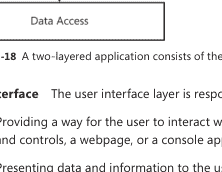

**图 3-18** 两层应用程序由UI组件和数据访问组件组成。

# 用户界面

用户界面层负责：

- 提供用户与应用程序交互的方式（例如，桌面窗口和控件、网页，或控制台应用程序的命令行或菜单）。
- 向用户展示数据和信息。
- 以查询或命令的形式接收用户请求。
- 验证用户输入的合法性。

用户界面层的实现方式可以多种多样。它可以是带有华丽图形和动画的Windows Presentation Foundation (WPF)客户端，可以是一组供用户浏览的网页，也可以是一个使用命令行开关或简单菜单供用户选择要执行的命令或查询的简单控制台应用程序。

> 注意 在某些情况下，用户界面可以被一组向其他客户端提供功能的服务所取代。此时并没有真正的用户界面，但两层架构依然清晰可见，只是UI层被API层所取代。

用户界面层位于数据访问层之上，并可以使用它。然而，如前所述关于程序集引用的问题，用户界面层不应直接引用数据访问层的任何实现程序集。这两层的接口程序集和实现程序集之间应有严格的分离。这使得分层图看起来更像图3-19。

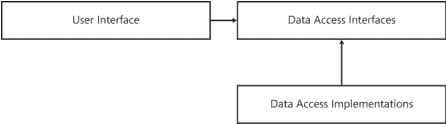

**图 3-19** 两层被分离为实现程序集和接口程序集。

每一层都是上层所依赖功能的抽象与该抽象实现的结合。如果上层开始引用某层实现的一部分，那么该层就被称为*泄漏的抽象*。该层实现的依赖关系将开始向上泄漏到更上层的堆栈中，导致不可避免的依赖。

**数据访问** 数据访问层的职责是：

- 为数据查询提供服务。
- 在对象模型和关系模型之间进行序列化和反序列化。

数据访问层的实现方式可以和用户界面层一样多样化。该层通常包含某种持久化数据存储，可能包括关系数据库（如Microsoft SQL Server、Oracle、MySQL或PostgreSQL）或文档数据库（如MongoDB、RavenDB或Riak）。除了数据存储机制外，很可能还有一个或多个支持程序集，用于通过调用存储过程来执行查询或插入/更新/删除命令，或通过Entity Framework或NHibernate将数据映射到关系数据库。

数据访问层应隐藏在独立于任何技术选择的接口后面。与所有接口一样，不应引用任何第三方依赖，从而使客户端与实现选择保持分离。

设计良好的数据访问层可跨多个应用程序重用。如果两个不同的用户界面需要相同的数据但以不同形式呈现，它们可以共享同一个数据访问层。想象一个跨多个平台运行的应用程序：Windows 10和Windows Phone 10。两者有不同的用户界面需求，但都可以使用相同的数据访问层。

与任何架构一样，仅使用两层架构有一些权衡取舍，在采用前必须仔细考虑。两层架构在以下情况下是好的选择：

- 应用程序除了某些琐碎的验证外几乎没有逻辑。这可以轻松封装在数据访问层或用户界面层中。
- 应用程序主要对数据执行CRUD操作。在用户界面和数据之间每增加一层，创建、读取、更新和删除数据就会变得更加困难。
- 时间紧迫。如果只需要开发原型或引导版本，限制层数可以节省大量时间，并能确定概念验证的可行性。

然而，两层架构也有一些明显的缺点，在以下情况下是糟糕的选择：

- 应用程序中存在大量逻辑，或者逻辑容易发生变化。任何放置在用户界面层或数据访问层中的逻辑在技术上都是对该层的污染，并降低其灵活性和可维护性。
- 应用程序注定会在一两个迭代周期内超出两层架构的容量。如果该架构只能维持几周，那么为获得快速反馈所做的任何让步都不值得投资。

两层架构仍然是一个非常可行的选择。太多开发者被最新的架构趋势所吸引，而忽视了更简单的设计。这导致本应简单的应用程序反馈过晚，并使其变得脆弱且难以维护。通常，最简单可行的方法才是正确的做法。

# 三层架构

三层架构在用户界面层和数据访问层之间增加了一个额外的层，即逻辑层。逻辑层的加入允许应用程序封装更复杂的处理过程。逻辑层与数据访问层一样，可以跨多个应用程序重用，因此无需多次实现。图3-20展示了典型的三层架构。


**图 3-20** 第三层包含应用程序的处理或业务逻辑。


再次，像数据访问层一样，逻辑层向客户端提供接口和实现程序集，以避免抽象泄漏。

> **注意** 尽管三层架构对于 Web 应用来说非常常见，但它通常只部署在两个层中。一个节点处理数据库，另一个节点处理几乎所有其他内容：用户界面、逻辑，甚至部分数据访问。

## 业务逻辑
业务逻辑层的职责是：
- 处理来自用户界面层的命令。
- 对业务领域建模以捕获业务流程、规则和工作流。

逻辑层可能是接收来自用户界面层的用户命令的命令处理器，并通过与数据访问层协作来解决特定问题或执行特定任务。它也可能是一个完全开发的领域模型，旨在将企业的流程映射到软件中。对于后者，通常数据访问层会包含一个对象/关系映射（ORM）组件，以便逻辑层可以直接实现到类中，可能使用领域驱动设计（DDD）。在领域模型中，不应存在对堆栈更下层或某种特定实现技术的依赖。例如，领域模型的程序集不应依赖于 ORM 库。相反，应创建一个单独的映射程序集，该程序集特定于实现并指示 ORM 如何映射到领域模型。这允许领域模型的核心类在不依赖 ORM 的情况下被重用，并且可以在不影响领域模型或其客户端的情况下替换 ORM。图 3-21 显示了使用领域模型的逻辑层的一种可能实现。

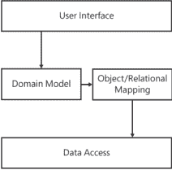

**图 3-21** 领域模型的程序集协作形成逻辑层。

添加逻辑层是必要的，当应用程序中存在复杂逻辑时，例如旨在反映人们工作真实世界工作流的业务规则。即使逻辑并不特别复杂但经常发生变化，这也是引入单独层来封装此行为的良好理由。它简化了用户界面和数据访问层，使其能够完全专注于各自的目的。

# 横切关注点

有时组件的职责并不容易限制在单一层中。诸如审计、安全和缓存等功能可以渗透整个应用程序，因为它们适用于每一层。例如，在应用程序已部署且无法附加 Visual Studio 调试器逐步执行代码时，跟踪每次方法调用和返回时的代码操作是一种有用的调试工具。你可以手动生成参数值在传递过程中的输出，以及各种方法的返回值，如清单 3-24 所示。

**清单 3-24** 手动应用横切关注点会迅速淹没代码的真实意图。

```
public void OpenNewAccount(Guid ownerID, string accountName, decimal openingBalance)
{
    log.WriteInfo("Creating new account for owner {0} with name '{1}' and an opening balance of {2}", ownerID, accountName, openingBalance);

    using(var transaction = session.BeginTransaction())
    {
        var user = userRepository.GetByID(ownerID);
        user.CreateAccount(accountName);
        var account = user.FindAccount(accountName);
        account.SetBalance(openingBalance);

        transaction.Commit();
    }
}
```

这很费力且容易出错，并且会立即用无关的样板代码污染每个方法，增加噪音与信号的比例。相反，你可以将此类横切关注点分解为封装的功能，并以侵入性小得多的方式将其应用于代码。添加功能最常见且非侵入性的方式是通过面向方面编程。

面向方面编程（AOP）是将横切关注点——或方面——应用于代码中多个层的过程。.NET Framework 有多个可供选择的 AOP 库（在 NuGet 中搜索 AOP），但这里给出的示例是针对 PostSharp 的，它有一个免费的 Express 版本，但功能有所减少。清单 3-25 显示了跟踪代码被分解为 PostSharp 方面并作为属性应用于某些方法。

**清单 3-25** 方面是实现横切关注点的绝佳方式。

```
[Logged]
[Transactional]
public void OpenNewAccount(Guid ownerID, string accountName, decimal openingBalance)
{
    var user = userRepository.GetByID(ownerID);
    user.CreateAccount(accountName);
    var account = user.FindAccount(accountName);
    account.SetBalance(openingBalance);
}
```

装饰 OpenNewAccount 方法的两个属性提供了与清单 3-24 中所示相同的功能，但方法的意图更清晰。Logged 属性将有关方法调用的信息写入日志，包括参数值。Transactional 属性将方法包装在数据库事务中，并在成功时提交事务，在失败时回滚事务。关键在于，这两个属性足够通用，可以应用于任何方法，而不仅仅是此方法，因此可以多次重用。

# 非对称分层

应用程序的所有用户请求都通过提供的用户界面发生。然而，请求之后所遵循的路径不一定总是相同的。分层可能是非对称的，这取决于所进行的请求类型。这是由需要务实考虑以及分层是否对某些请求来说过度设计甚至不足所驱动的。

在过去几年中迅速流行起来的非对称分层模式是命令/查询职责分离（CQRS）。在讨论 CQRS 这一架构模式之前，需要对其方法级影响因素——命令/查询分离——有一个基础。

## 命令/查询分离

Bertrand Meyer 在他的书《面向对象软件构造》（Prentice Hall，1997）中，使用了命令/查询分离（CQS）这一短语来解释所有对象方法应仅为两种事物之一：命令或查询。

命令是对行动的强制性调用，要求代码执行某些操作。这些方法允许更改系统的状态，但不应同时返回一个值。清单 3-26 显示了一个符合 CQS 的命令方法示例，随后是一个不符合的示例。

**清单 3-26** 符合 CQS 和不符合 CQS 的命令方法。

```
// Compliant command
public void SaveUser(string name)
{
    session.Save(new User(name));
}
// Non-compliant command
public User SaveUser(string name)
{
    var user = new User(name);
    session.Save(user);
    return user;
}
```

查询是请求数据，要求代码获取某些内容。这些方法向调用客户端返回数据，但不应同时更改系统的状态。清单 3-27 显示了一个符合 CQS 的查询方法示例，随后是一个不符合的示例。

## 清单 3-27 符合 CQS 和不符合 CQS 的查询方法。

```
// Compliant query
public IEnumerable<User> FindUserByID(Guid userID)
{
    return session.Get<User>(userID);
}
// Non-compliant query
public IEnumerable<User> FindUserByID(Guid userID)
{
    var user = session.Get<User>(userID);
    user.LastAccessed = DateTime.Now;
    return user;
}
```

因此，命令和查询的区别在于是否存在返回值。如果一个方法返回一个值（并且符合 CQS），你可以安全地假设它不会更改对象的任何状态。优点是你可以重新排序查询调用，而知道它们对对象没有其他影响。方法没有返回值（并且符合 CQS）表明你可以假设它确实会更改对象的状态。对于这些调用，你在调用顺序上必须更加谨慎。

## 命令/查询职责分离

命令/查询职责分离模式归功于 Greg Young。该模式是在架构级别应用 CQS，并是非对称分层的示例。命令和查询遵循与 CQS 相同的规则，但 CQRS 更进一步：它承认命令和查询可能需要通过分层遵循不同的路径才能得到最佳处理。

最小 CQRS 可以应用的一个例子是，当你使用领域模型开发三层架构时。在这种情况下，领域模型仅由应用程序的命令侧使用，而查询侧使用更简单的两层架构。图 3-22 举例说明了这种设计。


图 3-22 领域模型应仅用于处理命令。


查询数据通常需要快速完成，并且可以只提供较少的事务一致性保证：为了提高响应速度，允许出现幻读或不可重复读可能是可以接受的权衡。不过，命令处理通常要求具备事务一致性，因此需要使用不同的层来处理命令和查询。有时，命令和查询的数据访问层也可能不同。命令可能需要完全符合 ACID（ACID 代表原子性、一致性、隔离性和持久性）的数据库，而查询则可能只需简单的文档存储即可。文档存储会通过命令层发布的事件进行异步更新，从而使查询读取具有最终一致性。

# 结论

本章说明了依赖关系的组织在创建软件应用程序时所构成的重大挑战。项目的长期健康状况、适应性，以及项目是否能够存续，都依赖于对依赖关系进行合理管理。如果开发人员不加审慎地创建相互引用的类，就会形成类似意大利面的混乱交叉依赖，这会严重影响团队以一致且可预测的方式交付业务价值的能力。

依赖关系必须在所有层面上进行管理：从彼此交互的单个类和方法，到程序集引用，再到组件的高层架构。开发人员必须始终保持警惕，确保无关的依赖关系不会泄漏到其方法、类、程序集或层之外。

从某种意义上说，本章为本书其余部分的大量内容奠定了基础。本书内容为可维护、可适应的代码提供了坚实基础，并在每一章中不断得到强化。如果你的程序集包含意大利面式的引用关系，并且你的层没有隐藏其基础设施依赖，那么无论你尝试遵循其他什么模式或实践，代码都会变得更难测试、修改和理解。

# 接口和设计模式

完成本章后，你将能够：

- 定义接口，并识别接口与类之间的差异。
- 使用接口应用设计模式，例如适配器模式和策略模式。
- 通过鸭子类型、混入和流式接口理解接口的多功能性。
- 识别接口的局限性，并实现相应的变通方案。
- 发现接口常见的反模式和滥用方式。

接口是 Microsoft .NET Framework 开发中的一种强大构造。虽然 `interface` 关键字非常简单，但它所代表的是一种非常强大的范式。正确使用接口时，它们会为代码提供扩展点，使代码具备适应性。然而，接口也存在一些不太理想的用法，而且这些用法仍然被广泛采用。

本章将重申类与接口之间的差异，并说明如何最好地结合使用二者：既保护客户端代码，使其免受实现变更的影响，又促进多态性。

本章还将介绍接口的多功能性，以及接口如何成为现代软件解决方案中无处不在的工具。本章将演示一些强大的设计模式；如果正确应用这些模式（并结合本书中的其他模式），就能生成非常灵活、能够适应敏捷项目不断变化需求的代码。

然而，接口本身并不是万能药。适当使用接口确实可以帮助项目，但必须以正确的方式应用接口。本章还将探讨接口的一些常见滥用方式。

## 什么是接口？

接口定义了类所具有的行为，但不定义这些行为的实现方式。接口作为一种独立于类的构造存在，但它要求类提供用于实现该接口的工作代码。

接口由其语法定义，也就是接口的语言构造部分：`interface` 关键字以及该关键字所隐含和包含的一切内容。但接口也由其特性定义，即它们所代表并启用的概念。

## 语法

接口使用 `interface` 关键字定义。与类一样，接口可以包含属性、方法和事件。但是，接口中的任何元素都不能指定访问修饰符：实现类必须以 `public` 方式实现接口。代码清单 4-1 展示了接口的声明以及一种可能的实现方式。

代码清单 4-1 声明并实现接口。

```
public interface ISimpleInterface
{
    void ThisMethodRequiresImplementation();

    string ThisStringPropertyNeedsImplementingToo
    {
        get;
        set;
    }

    int ThisIntegerPropertyOnlyNeedsAGetter
    {
        get;
    }

    event EventHandler<EventArgs> InterfacesCanContainEventsToo;
}
// ...
public class SimpleInterfaceImplementation : ISimpleInterface
{
    public void ThisMethodRequiresImplementation()
    {
    }

    public string ThisStringPropertyNeedsImplementingToo
    {
        get;
        set;
    }

    public int ThisIntegerPropertyOnlyNeedsAGetter
    {
        get
        {
            return this.encapsulatedInteger;
        }
    }

    public event EventHandler<EventArgs> InterfacesCanContainEventsToo = delegate ( );

    private int encapsulatedInteger;
}
```

.NET Framework 不支持类的多重继承概念，但支持一个类实现多个接口。

一个类能够实现的接口数量没有限制；一个类上真正合理的接口数量更多是一个实践层面的问题。代码清单 4-2 扩展了前面的示例，使实现类实现第二个接口。

## 清单 4-2 一个类可以实现多个接口。

```
public interface IInterfaceOne
{
    void MethodOne();
}
// . . .
public interface IInterfaceTwo
{
    void MethodTwo();
}
// . . .
public class ImplementingMultipleInterfaces : IInterfaceOne, IInterfaceTwo
{
    public void MethodOne()
    {
    }

    public void MethodTwo()
    {
    }
}
```

一个类可以实现多个接口，而一个接口也可以由不同的类实现。

## 多重继承

某些语言支持从多个基类继承的概念。尤其是 C++，允许这种构造。不过，.NET Framework 语言不允许这样做；如果一个类试图继承两个或更多类，编译器就会生成警告，如图 4-1 所示。

> 2 类“ TheInterface.AttemptedMultipleInheritance”不能拥有多个基类：“TheInterface.BaseClassOne”和“BaseClassTwo”

图 4-1 编译器阻止多重继承。

## 菱形继承问题

不允许多重继承的原因之一是菱形继承问题。当同一个类继承两个或更多类时，就会出现这一问题。如果这些基类中都包含相同的方法，那么应该使用哪一个方法？图 4-2 展示了这一问题的统一建模语言（UML）图示。

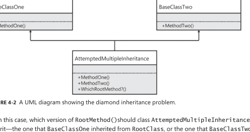

图 4-2 展示菱形继承问题的 UML 图。

在这种情况下，类 `AttemptedMultipleInheritance` 应该继承哪个版本的 `RootMethod()`：是 `BaseClassOne` 从 `RootClass` 继承的版本，还是 `BaseClassTwo` 从 `RootClass` 继承的版本？由于存在这种歧义，.NET Framework 不允许类的多重继承。

## 显式实现

接口也可以以*显式*方式实现。显式接口实现不同于前面示例中展示的隐式接口实现。代码清单 4-3 展示了之前的同一个示例类，但这一次它以显式方式实现接口。

**代码清单 4-3** 显式实现接口。

```
public class ExplicitInterfaceImplementation : ISimpleInterface
{
    public ExplicitInterfaceImplementation()
    {
        this.encapsulatedInteger = 4;
    }

    void ISimpleInterface.ThisMethodRequiresImplementation()
    {
        encapsulatedEvent(this, EventArgs.Empty);
    }

    string ISimpleInterface.ThisStringPropertyNeedsImplementingToo
    {
        get;
        set;
    }

    int ISimpleInterface.ThisIntegerPropertyOnlyNeedsAGetter
    {
        get
        {
            return encapsulatedInteger;
        }
    }

    event EventHandler<EventArgs> ISimpleInterface.InterfacesCanContainEventsToo
    {
        add { encapsulatedEvent += value; }
        remove { encapsulatedEvent -= value; }
    }

    private int encapsulatedInteger;
    private event EventHandler<EventArgs> encapsulatedEvent;
}
```

要使用显式实现的接口，客户端必须持有一个指向接口实例的引用；仅持有指向接口实现的引用是不够的。代码清单 4-4 将对此进行更详细的探讨。


# 清单 4-4 当显式实现时，接口方法在类实例上不可见。

```
public class ExplicitInterfaceClient
{
    public ExplicitInterfaceClient(ExplicitInterfaceImplementation
        implementationReference, ISimpleInterface interfaceReference)
    {
        // Uncommenting this will cause compilation errors.
        //var instancePropertyValue =
        //implementationReference.ThisIntegerPropertyOnlyNeedsAGetter;
        //implementationReference.ThisMethodRequiresImplementation();
        //implementationReference.ThisStringPropertyNeedsImplementingToo = "Hello";
        //implementationReference.InterfacesCanContainEventsToo += EventHandler;

        var interfacePropertyValue =
            interfaceReference.ThisIntegerPropertyOnlyNeedsAGetter;
        interfaceReference.ThisMethodRequiresImplementation();
        interfaceReference.ThisStringPropertyNeedsImplementingToo = "Hello";
        interfaceReference.InterfacesCanContainEventsToo += EventHandler;
    }

    void EventHandler(object sender, EventArgs e)
    {
    }
}
```

显式实现在你想要避免签名冲突时很有用，当类已经拥有必须由接口实现的相同方法签名时。

在 .NET Framework 中可以定义的所有方法都有特定的方法签名。此签名有助于将方法区分开来，并区分已被重写的方法。方法的签名由其名称和参数列表组成。请注意，方法的访问级别、返回值、抽象或密封状态都会影响方法签名。列表 4-5 显示了多种方法签名，其中一些会冲突。如果方法在上述所有标准上都相等，则方法签名会冲突。没有类、接口或结构可以包含具有冲突签名的方法。

# 清单 4-5 其中一些方法具有相同的签名。

```
public class ClashingMethodSignatures
{
    public void MethodA()
    {
    }

    // This would cause a clash with the method above:
    //public void MethodA()
    //{
    //}
}
```

```
// As would this: return values are not considered
//public int MethodA()
//{
//    return 0;
//}

public int MethodB(int x)
{
    return x;
}

// There is no clash here: the parameters differ.
// This is an overload of the previous MethodB.
public int MethodB(int x, int y)
{
    return x + y;
}
```

属性由于没有参数列表，仅凭其名称区分。因此，如果两个属性具有相同的名称，则其签名会冲突。

想象一下列表 4-6 中所示的类，该类需要实现上述接口 InterfaceOne。

# 清单 4-6 该类需要实现的接口将导致方法签名冲突。

```
public class ClassWithMethodSignatureClash
{
    public void MethodOne()
    {
    }
}
```

首先，由于方法签名相同，你只需在类声明中添加接口实现标记，如列表 4-7 所示。

# 清单 4-7 隐式实现接口将允许重用现有方法。

```
public class ClassWithMethodSignatureClash : IInterfaceOne
{
    public void MethodOne()
    {
    }
}
```

每当客户端在该类上调用接口方法时，都会使用已存在的方法。一个有用的例子是当你在 Windows Forms 中实现 Model-View-Presenter (MVP) 模式并添加一个需要 Form 上实现 Close 方法的 IView 接口时。列表 4-8 显示了实际应用。

# 清单 4-8 有时可以很好地利用冲突方法的存在。

```
public interface IView
{
    void Close();
}
// ...
public partial class Form1 : Form, IView
{
    public Form1()
    {
        InitializeComponent();
    }
}
```

然而，如果类需要为接口实现提供不同的方法体，则类应显式实现接口，以避免方法签名冲突。列表 4-9 显示了一个具有冲突方法的类，该类提供了这些方法的不同实现。

# 清单 4-9 显式实现接口以避免冲突的方法签名。

```
public class ClassAvoidingMethodSignatureClash : IInterfaceOne
{
    public void MethodOne()
    {
        // original implementation
    }

    void IInterfaceOne.MethodOne()
    {
        // new implementation
    }
}
```

在类似的情况下，如果一个类需要实现两个不同但都包含相同签名方法的无关接口，你可以隐式实现它们并共享相同的方法实现。或者，如列表 4-10 所示，你可以显式实现它们两者——为了清晰——以划分哪个实现属于哪个接口。

# 清单 4-10 当实现具有通用方法签名的两个接口时，只有显式实现才足够。

```
public class ClassImplementingClashingInterfaces : IInterfaceOne, IAnotherInterfaceOne
{
    void IInterfaceOne.MethodOne()
    {
    }

    void IAnotherInterfaceOne.MethodOne()
    {
    }
}
```

# 多态性

能够使用一种类型对象并使其隐式表现得像另一种类型，这被称为 *多态性*。客户端代码可以与对象交互，就好像它是一种类型，而实际上是另一种类型。这种编程上的障眼法是面向对象编程最重要的原则之一，也是解决编程问题最优雅和强大的解决方案的基础。

图 4-3 显示了一个表示车辆行为的接口，以及汽车、摩托车和快艇的可能实现类。请注意，这三种车辆类型各不相同，但由于其统一的接口，它们都表现出相同的行为。

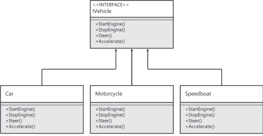

# 图 4-3 接口将行为传递给实现类，从而实现多态性。

在此示例中，车辆被假定具有可启动和停止的引擎、某种转向装置以及加速能力。多态性允许客户端代码持有对 IVehicle 接口的引用，并将所有具体类型视为相同。汽车如何转向或加速与摩托车有何不同，或快艇引擎如何启动和停止与火车有何不同，对客户端来说都不相关。而这是一件非常好的事情。实际上，每当我们使用车辆时，我们都是该接口的客户端。当然，车辆的真实接口比这里显示的更细致，但原则是相同的。你需要知道汽车引擎如何工作才能启动和停止引擎吗？完全不需要。所有这些都是实现细节，对你驾驶知识没有任何影响。这就是良好的接口设计。

本章其余部分的设计模式和接口特性都促进了自适应代码的创建。多态性使每个模式都能对任何符合预期接口的类有用，无论该类是否已经编写或尚未构思。

# 自适应设计模式

设计模式由 Gang of Four¹ 书籍 *Design Patterns*（Addison-Wesley Professional, 1994）普及。尽管这本书已有 20 多年历史（在软件开发术语中至少相当于四个冰河时代），但它至今仍然相关。其中一些模式已被重新归类为反模式，但其他模式被频繁使用并增强了代码的适应性。

良好的设计模式是接口和类之间可重用的协作，可以在许多不同的场景、项目、平台、语言和框架中反复应用。与大多数值得注意的最佳实践一样，设计模式是最好知道而不是不知道的理论工具。它们可能被过度使用，并且并不总是适用，有时用大量类、接口、间接和抽象使原本简单的解决方案变得复杂。

在我看来，设计模式往往要么被低估要么被高估。在某些项目中，设计模式不足，代码缺乏可辨识的结构。其他项目则过于随意地应用设计模式，在收益可以忽略不计的地方添加间接和抽象。平衡在于找到正确的地方应用正确的模式。

本章——以及由此延伸到本书——中包含的具体设计模式因其有助于创建自适应代码的能力而被选中。

# 空对象模式

空对象模式是最常见的设计模式之一——也是最容易理解和实现的一种。其目的是让你避免抛出 NullReference-Exception 并编写大量空对象检查代码。图 4-4 中的 UML 类图显示了空对象模式的应用。

> ¹ 因其四位作者而得名：Erich Gamma、Richard Helm、Ralph Johnson 和 John Vlissides。


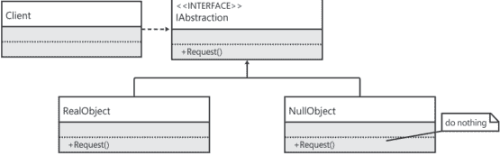

**图 4-4** Null Object 模式以 UML 类图形式展示。

清单 4-11 显示了一些可能抛出 `NullReferenceException` 的典型代码。

**清单 4-11** 如果不检查返回值是否为 null，就有抛出 NullReferenceException 的风险。

```
```csharp
class Program
{
    static IUserRepository userRepository = new UserRepository();

    static void Main(string[] args)
    {
        var user = userRepository.GetByID(Guid.NewGuid());
        // Without the Null Object pattern, this line could throw an exception
        user.IncrementSessionTicket();
    }
}
```
```

每个调用 `IUserRepository.Get(Guid uniqueID)` 的客户端都可能抛出空引用。在实践中，这意味着每个客户端都必须检查返回值是否不为 null，以避免尝试解引用 null，从而导致抛出 NullReferenceException。这会使之前显示的客户端看起来更像清单 4-12 中的代码。

**清单 4-12** 检查是否为 null 真的是 *所有* 客户端的责任吗？

```
```csharp
class Program
{
    static IUserRepository userRepository = new UserRepository();

    static void Main(string[] args)
    {
        var user = userRepository.GetByID(Guid.NewGuid());
        if(user != null)
        {
            user.IncrementSessionTicket();
        }
    }
}
```
```

检查空值表明你给 `IRepository` 的所有客户端带来了太多不必要的负担。使用该方法的客户端越多，忘记空引用检查的可能性就越大。相反，你应该更改问题的根源，让它为你执行检查，如清单 4-13 所示。

## 清单 4-13 服务代码应实现 Null Object 模式。

```
public class UserRepository : IUserRepository
{
    public UserRepository()
    {
        users = new List<User>
        {
            new User(Guid.NewGuid()),
            new User(Guid.NewGuid()),
            new User(Guid.NewGuid()),
            new User(Guid.NewGuid())
        };
    }

    public IUser GetByID(Guid userID)
    {
        IUser userFound = users.SingleOrDefault(user => user.ID == userID);
        if(userFound == null)
        {
            userFound = new NullUser();
        }
        return userFound;
    }

    private ICollection<User> users;
}
```

首先，这段代码尝试从内存集合中检索 User，与清单 4-12 中显示的先前用法相比没有变化。现在，你检查返回的 User 实例是否实际上是空引用。如果是，你返回 `IUser` 类型的特殊子类：NullUser。该子类重写 `IncrementSessionTicket` 方法使其精确地什么都不做，如清单 4-14 所示。事实上，正确的 NullUser 实现会重写所有方法，使其尽可能接近什么都不做。

## 清单 4-14 NullUser 的方法实现全部什么都不做。

```
public class NullUser : IUser
{
    public void IncrementSessionTicket()
    {
        // do nothing
    }
}
```

此外，每当 `NullUser` 对象的某个方法或属性预期返回对另一个对象的引用时，它也应返回 *那些* 类型的特殊 Null Object 实现。换句话说，所有 Null Object 实现都应返回递归的 Null Object 实现。这消除了客户端中任何空引用检查的需求。

这还有一个额外的好处，即减少了你需要编写的单元测试数量。以前，每个客户端都必须实现检查，还会有相应的单元测试来确认检查是否到位。相反，仓库实现会被单元测试以确保它返回 `NullUser` 实现。

> ### 级联空值
> 
> C# 6 引入了 *级联空值运算符*，也称为 *空条件运算符* 和 *安全导航运算符*。这允许以下代码片段从此简化：
> 
> ```csharp
> if(person != null && person.Details != null && person.Detail.Age > 30)
> {
>     // . . .
> }
> ```
> 
> 简化为：
> 
> ```csharp
> if(person?.Details?.Age > 30)
> {
>     // . . .
> }
> ```

因此，`?.` 运算符成为安全解引用任何对象的一种方式，最坏的情况下会得到属性类型的 default(T)。这已被证明是对语言的有用补充，但我不愿将其作为适当的 Null Object 实现的替代方案，原因有几点。

首先，有太多实例，类型的默认值根本不足以满足需求。之前使用合理的用户名来避免抛出 NullReferenceException 的例子说明，替代方案不是默认值，而是对应用程序更有意义的东西。

其次，空合并要求代码的所有客户端都考虑到 null 的可能性。使用 Null Object 模式的部分原因是为了消除空检查，让你能够肆无忌惮地解引用。如果你拒绝 Null Object 模式而采用 Cascading Nulls 语法，你就会再次面临忘记解引用的风险。

有了适当的 Null Object 实现，这个例子可以简洁地写成如下所示。

```
```csharp
if(person.Details.Age > 30)
{
    // . . .
}
```
```

这无疑提供了最大的好处：客户端代码更少混淆，但能免受 NullReferenceException 的危害。

# IsNull 属性反模式

有时 Null Object 模式涉及向接口添加布尔 IsNull 属性。该接口的所有真实实现对此属性返回 false 值。Null Object 实现对此接口返回 true。清单 4-15 显示了根据前面的例子，这种方法可能如何工作。

**清单 4-15** IsNull 属性仅对 Null Object 实现为 true。

```
public interface IUser
{
    void IncrementSessionTicket();

    bool IsNull
    {
        get;
    }
}
// . . .
public class User : IUser
{
    // . . .
    public bool IsNull
    {
        get
        {
            return false;
        }
    }

    private DateTime sessionExpiry;
}
// . . .
public class NullUser : IUser
{
    public void IncrementSessionTicket()
    {
        // do nothing
    }

    public bool IsNull
    {
        get
        {
            return true;
        }
    }
}
```

这个属性的问题在于它导致逻辑从封装行为的对象中泄漏出来。例如，if 语句会开始渗入客户端代码以区分

真实实现和 Null Object 实现。这违背了该模式的全部目的，即避免将此逻辑暴露给其各个客户端。清单 4-16 是这个问题的典型例子。

## 清单 4-16 基于 IsNull 属性的逻辑使其成为反模式。

```
static void Main(string[] args)
{
    var user = userRepository.GetByID(Guid.NewGuid());
    // Without the Null Object pattern, this line would throw an exception
    user.IncrementSessionTicket();

    string userName;
    if(user.IsNull)
    {
        userName = user.Name;
    }
    else
    {
        userName = "unknown";
    }

    Console.WriteLine("The user's name is {0}", userName);

    Console.ReadKey();
}
```

这可以很容易地通过将空用户的名称封装在 NullUser 类内部来修复，如清单 4-17 所示。

## 清单 4-17 通过适当的封装，IsNull 属性变得过时。

```
public class NullUser : IUser
{
    public void IncrementSessionTicket()
    {
        // do nothing
    }

    public string Name
    {
        get
        {
            return "unknown";
        }
    }
}
```

```
// ...
static void Main(string[] args)
{
    var user = userRepository.GetByID(Guid.NewGuid());
    // Without the Null Object pattern, this line would throw an exception
    user.IncrementSessionTicket();

    Console.WriteLine("The user's name is {0}", user.Name);

    Console.ReadKey();
}
```

# Adapter 模式

Adapter 模式允许你向客户端提供一个对象实例，该客户端依赖于一个接口，而你的实例并未实现该接口。创建一个 Adapter 类来满足客户端期望的接口，但该接口的方法通过委托给另一个对象的不同方法来实现。它通常用于目标类无法更改以适应所需接口的情况。这可能是因为它是密封的，或者因为它属于你没有源代码的程序集。你可以通过两种方式实现 Adapter 模式：使用 Class Adapter 模式或使用 Object Adapter 模式。

## Class Adapter 模式

图 4-5 显示了 Class Adapter 模式中使用的协作类和接口。

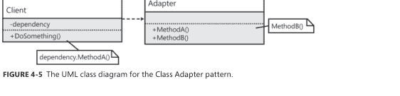

图 4-5 Class Adapter 模式的 UML 类图。


The Class Adapter pattern makes use of inheritance for the adapter—a subclass of the target class needs to be adapted to fit the expected interface of clients. Listing 4-18 shows how this works in practice.

# 清单 4-18 类适配器模式使用实现继承。

```
public class Adaptee
{
    public void MethodB()
    {
    }
}
// . . .
public class Adapter : Adaptee
{
    public void MethodA()
    {
        MethodB();
    }
}
// . . .
class Program
{
    static Adapter dependency = new Adapter();
    static void Main(string[] args)
    {
        dependency.MethodA();
    }
}
```

This is the less common of the two types of Adapter pattern, mostly because developers are told to favor composition over inheritance. This is because inheritance, which is whitebox reuse, makes the subclass dependent on the implementation of a class, rather than merely on its interface. Composition, which is blackbox reuse, limits the dependency to the interface, so that the implementation can vary without adversely affecting clients.

> Tip The terms whitebox reuse and blackbox reuse refer to an ability to see into the implementation or have the implementation hidden from inspection, respectively.

# The Object Adapter pattern

The Object Adapter pattern uses composition to delegate from the methods of the interface to those of a contained, encapsulated object. Figure 4-6 shows the collaborating classes and interfaces used in the Object Adapter pattern.

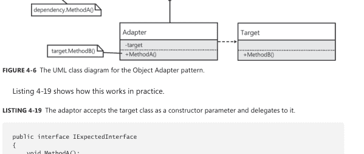

FIGURE 4-6 The UML class diagram for the Object Adapter pattern.

# 清单 4-19 适配器接受目标类作为构造函数参数并委托给它。

```
public interface IExpectedInterface
{
    void MethodA();
}
// . . .
public class Adapter : IExpectedInterface
{
    public Adapter(TargetClass target)
    {
        this.target = target;
    }

    public void MethodA()
    {
        target.MethodB();
    }

    private TargetClass target;
}
//
public class TargetClass
{
    public void MethodB()
    {
    }
}
```

```
// . . .
class Program
{
    static IExpectedInterface dependency = new Adapter(new TargetClass());
    static void Main(string[] args)
    {
        dependency.MethodA();
    }
}
```

This is the more common form of the Adapter pattern. The main method uses an IExpectedInterface but, rather than provide a "real" implementation of this interface, an adapter to a different class—TargetClass—is applied. This adapter fulfills the requirements of an IExpectedInterface—a MethodA method—but it delegates this call to TargetClass, rather than doing anything directly itself.

# The Strategy pattern

The Strategy pattern allows you to change the desired behavior of a class based on one or more supplied "strategies." Figure 4-7 shows the UML class diagram for the Strategy pattern.

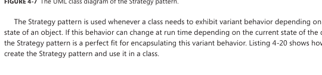

FIGURE 4-7 The UML class diagram of the Strategy pattern.

The Strategy pattern is used whenever a class needs to exhibit variant behavior depending on the state of an object. If this behavior can change at run time depending on the current state of the class, the Strategy pattern is a perfect fit for encapsulating this variant behavior. Listing 4-20 shows how to create the Strategy pattern and use it in a class.

```
public interface IStrategy
{
    void Execute();
}
// ...
public class ConcreteStrategyA : IStrategy
{
    public void Execute()
    {
        Console.WriteLine("ConcreteStrategyA.Execute()");
    }
}
// ...
public class ConcreteStrategyB : IStrategy
{
    public void Execute()
    {
        Console.WriteLine("ConcreteStrategyB.Execute()");
    }
}
// ...
public class Context
{
    public Context()
    {
        currentStrategy = strategyA;
    }

    public void DoSomething()
    {
        currentStrategy.Execute();

        // swap strategy with each call
        currentStrategy = (currentStrategy == strategyA) ? strategyB : strategyA;
    }

    private readonly IStrategy strategyA = new ConcreteStrategyA();
    private readonly IStrategy strategyB = new ConcreteStrategyB();

    private IStrategy currentStrategy;
}
```

With every call that is made to Context.DoSomething(), the method first delegates to the current strategy and then swaps between strategy A and strategy B. The next call delegates to the newly selected strategy before again swapping back to the original strategy.

The way the strategies are selected is an implementation detail—it does not alter the net effect of the pattern: that the behavior of the class is hidden behind an interface whose implementations are used to perform the real work.

# Further versatility

The utility of interfaces is not limited to design patterns. There are some other, more-specialized uses of interfaces that are worth investigation. Though these features are not generally applicable, there are situations in which they are the right tool for the job.

Just as with design patterns, their overuse can be detrimental to the readability and maintainability of code. It is a difficult balancing act to find the correct number of collaborating patterns and techniques to solve a problem concisely, so exercise caution when using interfaces in the following ways.

# Duck-typing

C# is a statically typed language, whereas duck-typing is more commonly found in dynamically typed languages. Duck-typing uses the “duck test”:

> When I see a bird that walks like a duck and swims like a duck and quacks like a duck, I call that bird a duck.
> 
> —James Whitcomb Riley

Applied to types in a programming language, the duck test suggests that, as long as an object exhibits the behavior of a certain interface, it should be treated as that interface. Unfortunately, this is not true by default in C#. Observe the example in Listing 4-21.

# 清单 4-21 尽管对象 Swan 满足了 IDuck 的所有方法，但它实际上并不是 IDuck。

```
public interface IDuck
{
    void Walk();
    void Swim();
    void Quack();
}
// . . .
public class Swan
{
    public void Walk()
    {
        Console.WriteLine("The swan is walking.");
    }
    public void Swim()
    {
```

```
```csharp
Console.WriteLine("The swan can swim like a duck.");
}

public void Quack()
{
    Console.WriteLine("The swan is quacking.");
}
}
// . . .
class Program
{
    static void Main(string[] args)
    {
        var swan = new Swan();

        var swanAsDuck = swan as IDuck;

        if(swan is IDuck || swanAsDuck != null)
        {
            swanAsDuck.Walk();
            swanAsDuck.Swim();
            swanAsDuck.Quack();
        }
    }
}
```
```

The is predicate and the as cast return false and null, respectively. The Common Language Runtime (CLR) does not consider a Swan as being an IDuck, even though it contains the same methods as the interface. A type must *implement* the interface via interface inheritance.

There are a couple of tricks that you can employ to enable the Swan class to be usable as an instance of the IDuck interface without having to implement it. Either you take advantage of the dynamic typing extensions in newer versions of the CLR, or you make use of a third-party library called *Impromptu Interface*.

# Using the Dynamic Language Runtime

As of version 4, the .NET Framework was no longer strictly statically typed. With the introduction of the dynamic keyword, and some supporting types, you can avoid the CLR’s static typing and switch to the dynamic typing of the Dynamic Language Runtime (DLR). An example of dynamic typing in C# is shown in Listing 4-22.

**LISTING 4-22**  The DLR can be used for duck-typing.

```
```csharp
class Program
{
    static void Main(string[] args)
    {
        var swan = new Swan();
```
```

```
DoDuckLikeThings(swan);

Console.ReadKey();
}

static void DoDuckLikeThings(dynamic duckish)
{
    if (duckish != null)
    {
        duckish.Walk();
        duckish.Swim();
        duckish.Quack();
    }
}
```

Notice, however, that the method parameter is of type dynamic. Not only do you need to target the .NET Framework 4, dynamic typing needs to be designed into clients specifically. On both counts, this is sometimes infeasible. You can’t, for example, simply start creating all methods to take dynamic parameters everywhere, or you would be better off using a dynamically typed .NET Framework language, such as IronPython².

# Using Impromptu Interface

Impromptu Interface is a .NET Framework library that can be installed via NuGet. After it is installed, you can use the ActLike<Ts>() method to pass in your Swan and receive an IDuck instance that delegates to your instance. Listing 4-23 shows how this works.

# 清单 4-23 Impromptu Interface 允许在 C# 中进行鸭子类型。

```
class Program
{
    static void Main(string[] args)
    {
        var swan = new Swan();

        var swanAsDuck = Impromptu.ActLike<IDuck>(swan);

        if (swanAsDuck != null)
        {
            swanAsDuck.Walk();
            swanAsDuck.Swim();
            swanAsDuck.Quack();
        }

        Console.ReadKey();
    }
}
```


ActLike 方法所做的是通过使用 Reflection Emit 在运行时创建一个新类型。这是 .NET Framework Reflection API 的一个强大部分，允许在运行时创建新类型。此新类型实现了 IDuck 接口，但它还包含 Swan 实例作为封装字段。每当调用 IDuck 接口方法之一时，新类型就会委托给 Swan 实例。实际上，它是适配器模式的运行时版本。Impromptu Interface 是创建对象适配器的自动方式。

# CLR 鸭子类型支持

有趣的是，CLR 已经支持鸭子类型。不幸的是，这仅适用于一种不常见的情況：实现可枚举对象。foreach 循环的目标类型必须符合某个接口，但该接口并未形式化，可以在目标类上临时实现。在清单 4-24 中的示例中，Duck 类是 foreach 循环的目标。

**LISTING 4-24** CLR 对可枚举类型的鸭子类型提供隐式支持。

```
class Program
{
    static void Main(string[] args)
    {
        var duck = new Duck();

        foreach (var duckling in duck)
        {
            Console.WriteLine("Quack {0}", duckling);
        }

        Console.ReadKey();
    }
}
```

Duck 并未实现任何接口，但 foreach 循环要求 GetEnumerator() 方法，如编译器所指示的那样，如图 4-8 所示。

|  | Description |
|---|---|
| ⊗ 1 | foreach 语句无法对 'TheInterface.Duck' 类型的变量进行操作，因为 'TheInterface.Duck' 不包含 'GetEnumerator' 的公共定义 |

**FIGURE 4-8** 在不要求特定接口的情况下，编译器会抱怨类中缺少公共方法。

当你使用 void 返回类型实现此方法时，会收到新的错误，指出该类型不支持其他必需的方法和属性，如图 4-9 所示。

|  | Description |
|---|---|
| ❌ 1 | `foreach` 要求 `TheInterface.Duck.GetEnumerator()` 的返回类型 `void` 必须具有合适的公共 `MoveNext` 方法和公共 `Current` 属性 |

因此，`Duck.GetEnumerator()` 方法必须返回一个公开 MoveNext 属性的类型。清单 4-25 显示了 Duck 的实现：

## 清单 4-25 任何类都可以是可枚举的，只要它满足隐式接口

```
public class Duck
{
    public DuckEnumerator GetEnumerator()
    {
        return new DuckEnumerator();
    }
}
```

DuckEnumerator 的实现及其隐式接口如清单 4-26 所示。

## 清单 4-26 完成 DuckEnumerator 类的隐含接口。

```
public class DuckEnumerator
{
    int i = 0;

    public bool MoveNext()
    {
        return i++ < 10;
    }

    public int Current
    {
        get
        {
            return i;
        }
    }
}
```

此时，你已成功实现了 `foreach` 所需的隐式接口——鸭子类型发挥作用！

# 混入

鸭子类型的一个扩展是 *mixin* 的概念。mixin 是一个包含多个其他类的实现的类，而不使用实现继承。正如你已经学到的，C# 不支持多重实现继承，因此你必须寻找其他实现 mixin 的解决方案。

一种简单但有限的实现 mixin 的方法是使用扩展方法。这允许你向已定义的类型添加方法，这可能非常有用。另一种选择是使用 Re-motion Re-mix 等第三方库，它的工作方式与 Impromptu Interface 类似，即在运行时生成一个新类型，该类型包含你指定的所有接口并充当多面适配器。

## 使用扩展方法

自 .NET Framework 3.5 以来，扩展方法允许向已存在的类型添加新功能。无需访问类型的源代码，也无需类型为部分定义，你就可以扩展一个类型。清单 4-27 显示了本节将增强的接口，以及一对简单的扩展方法。

**LISTING 4-27** 扩展方法可以增强现有接口。

```
public interface ITargetInterface
{
    void DoSomething();
}
// . . .
public static class MixinExtensions
{
    public static void FirstExtensionMethod(this ITargetInterface target)
    {
        Console.WriteLine("The first extension method was called.");
    }

    public static void SecondExtensionMethod(this ITargetInterface target)
    {
        Console.WriteLine("The second extension method was called.");
    }
}
```

现在，只要客户端可以访问 ITargetInterface 实例，并且它也引用了 MixinExtensions 类，这两个扩展方法就会可用。可以创建任意数量的扩展方法，分散在多个静态类中。清单 4-28 显示了另一对扩展方法；这次它们接受额外参数。

## 清单 4-28 扩展方法可以接受参数。

```
public static class MoreMixinExtensions
{
    public static void FurtherExtensionMethodA(this ITargetInterface target, int extraParameter)
    {
        Console.WriteLine("Further extension method A was called with argument {0}", extraParameter);
    }

    public static void FurtherExtensionMethodB(this ITargetInterface target, string stringParameter)
    {
        Console.WriteLine("Further extension method B was called with argument {0}", stringParameter);
    }
}
```

这些扩展方法可以像任何其他方法一样被任何客户端调用，如清单 4-29 所示。

## 清单 4-29 客户端可以像直接声明在目标接口上一样访问扩展方法。

```
public class MixinClient
{
    public MixinClient(ITargetInterface target)
    {
        this.target = target;
    }

    public void Run()
    {
        target.DoSomething();
        target.FirstExtensionMethod();
        target.SecondExtensionMethod();
        target.FurtherExtensionMethodA(30);
        target.FurtherExtensionMethodB("Hello!");
    }

    private readonly ITargetInterface target;
}
```

这种 mixin 方法有几个值得注意的局限性。第一个是客户端的可测试性。正如第 5 章“测试”将展示的那样，静态类不利于轻松模拟。这使得这些扩展方法的所有客户端都更难进行适当的单元测试。

更糟糕的是，由于扩展方法是静态类，它们无法保存与对象相关的任何额外每个实例状态。当然，有变通方法，例如存储一个将实例映射到某些额外值的静态字典，但这并不理想。

还请注意，所有扩展方法都针对同一个接口，并且所有要增强的实例都必须实现此接口。真正的 mixin 另一方面，实现多个不同的接口并充当聚合适配器。

## 使用 Re-motion Re-mix

实现 mixin 的另一种方法是使用 Re-motion Re-mix 等第三方库。Re-mix 允许你通过运行时配置指定在创建某个目标类的新实例时要组合哪些类。与 Impromptu Interface 一样，它即时生成一个新类型，该类型满足请求的 mixin 上存在的所有接口，并且该类型的每个实例在调用接口方法时都会委托给 mixin 的实例。接口和一些示例实现如清单 4-30 所示。

**LISTING 4-30** 要组合为 mixin 的不同接口。

```
public interface ITargetInterface
{
    void DoSomething();
}
// ...
public class TargetImplementation : ITargetInterface
{
    public void DoSomething()
    {
        Console.WriteLine("ITargetInterface.DoSomething()");
    }
}
// ...
public interface IMixinInterfaceA
{
    void MethodA();
}
// ...
public class MixinImplementationA : IMixinInterfaceA
{
    public void MethodA()
    {
        Console.WriteLine("IMixinInterfaceA.MethodA()");
    }
}
// ...
public interface IMixinInterfaceB
{
    void MethodB(int parameter);
}
```


// . . .
public class MixinImplementationB : IMixinInterfaceB
{
    public void MethodB(int parameter)
    {
        Console.WriteLine("IMixinInterfaceB.MethodB({0})", parameter);
    }
}
// . . .
public interface IMixinInterfaceC
{
    void MethodC(string parameter);
}
// . . .
public class MixinImplementationC : IMixinInterfaceC
{
    public void MethodC(string parameter)
    {
        Console.WriteLine("IMixinInterfaceC.MethodC(\"{0}\")", parameter);
    }
}
```

请注意，并没有一个类实现所有这些接口。相反，下一步是配置 Re-mix，以便当它被要求提供 TargetImplementation 的实例时，它将返回一个包含所有接口和类组合的混入。清单 4-31 显示了这样的配置。

**LISTING 4-31** Instructing Re-mix how to construct TargetImplementation instances.

```
var config = MixinConfiguration.BuildFromActive()
    .ForClass<TargetImplementation>()
    .AddMixin<MixinImplementationA>()
    .AddMixin<MixinImplementationB>()
    .AddMixin<MixinImplementationC>()
    .BuildConfiguration();

MixinConfiguration.SetActiveConfiguration(config);
```

不幸的是，你不能简单地在 TargetImplementation 上调用 new 并期望得到一个混入。相反，你必须要求 Re-mix 创建一个 TargetImplementation 实例，以便它可以根据你的规范构建一个新类型并实例化它。清单 4-32 显示了它是如何做到这一点的——幸运的是，这很简单。

**LISTING 4-32** Re-mix is in charge of creating mixins.

Re-mix 的一个限制是，你无法——也不能——知道 ObjectFactory.Create 返回的实例的确切类型。你所知道的是，它是 TargetImplementation 的一个子类的实例。这对客户端来说有点坏消息，因为在编译时你唯一能保证 TargetImplementation 满足的接口是 ITargetInterface。因此，混入的客户端必须通过使用 is 和 as 进行类型嗅探，将混入强制转换为期望的接口。清单 4-33 突出了这个问题。

**LISTING 4-33** Type-sniffing is bad practice but necessary for using mixins.

```
public class MixinClient
{
    public MixinClient(ITargetInterface target)
    {
        this.target = target;
    }

    public void Run()
    {
        target.DoSomething();

        var targetAsMixinA = target as IMixinInterfaceA;
        if(targetAsMixinA != null)
        {
            targetAsMixinA.MethodA();
        }

        var targetAsMixinB = target as IMixinInterfaceB;
        if(targetAsMixinB != null)
        {
            targetAsMixinB.MethodB(30);
        }

        var targetAsMixinC = target as IMixinInterfaceC;
        if(targetAsMixinC != null)
        {
            targetAsMixinC.MethodC("Hello!");
        }
    }

    private readonly ITargetInterface target;
}
```

将混入应用于解决方案时效果最好，当类型嗅探已经存在或必要时。这在某些库和框架中是正确的。例如，Prism（Windows Presentation Foundation/Model-View-ViewModel 库）使用类型嗅探，并且客户端类所需的功能可以分离到不同的实现中，并通过混入重新组合。

# Fluent interfaces

如果一个接口从其一个或多个方法中返回自身，则称该接口为流畅接口。这允许客户端将调用链接在一起，如清单 4-34 所示。

**LISTING 4-34** Fluent interfaces allow method chaining.

```
public class FluentClient
{
    public FluentClient(IFluentInterface fluent)
    {
        this.fluent = fluent;
    }

    public void Run()
    {
        // without using fluency
        fluent.DoSomething();
        fluent.DoSomethingElse();
        fluent.DoSomethingElse();
        fluent.DoSomething();
        fluent.ThisMethodIsNotFluent();

        // using fluency
        fluent.DoSomething()
            .DoSomethingElse()
            .DoSomethingElse()
            .DoSomething()
            .ThisMethodIsNotFluent();
    }

    private readonly IFluentInterface fluent;
}
```

这提高了可读性，因为它避免了对接口实例的重复引用。它是实现配置或有限状态机的越来越流行的方式，如第 10 章“接口隔离”所述。

流畅接口也很容易实现。类所要做的就是从方法中返回 this。因为类已经是接口的实现，所以通过返回 this，类只返回其自身的接口部分，从而隐藏了其余的实现。清单 4-35 显示了本示例中使用的 IFluentInterface 的定义和实现。

**LISTING 4-35** Implementing a simple fluent interface is easy.

```
public interface IFluentInterface
{
    IFluentInterface DoSomething();

    IFluentInterface DoSomethingElse();

    void ThisMethodIsNotFluent();
}
// . . .
public class FluentImplementation : IFluentInterface
{
    public IFluentInterface DoSomething()
    {
        return this;
    }

    public IFluentInterface DoSomethingElse()
    {
        return this;
    }

    public void ThisMethodIsNotFluent()
    {
    }
}
```

请注意，接口的一个方法不是流畅的——它返回 void。如果一个方法返回的不是接口，它就不是流畅的。客户端所做的任何方法链调用都将被对非流畅方法的调用所中断。

# Conclusion

在本章中，你已经了解了接口是什么以及为什么它们是编写自适应代码的关键方面。它们是多态性的催化剂，使你能够在类族中封装变化。它们是设计模式生长的根基。然而它们实际上什么都不做。

记住，没有伴随实现，接口是无用的。但没有接口，实现及其相关的依赖关系就会渗透并污染你的代码，使其难以维护和扩展。恰当地放置的接口充当服务代码肮脏的实现细节与干净、结构良好的客户端之间的防火墙。

接口还具有其他更专业的特性，例如鸭子类型和混入。这些很少使用，但在正确的上下文中应用时，它们可以简化否则复杂的代码并增加适应性的额外维度。

本章奠定的基础将在你体验本书其余部分中接口的无处不在时具有重要意义。

# Testing

**After completing this chapter, you will be able to**

- Define different kinds of application testing and choose between techniques.
- Write code in a test-first fashion, focusing on implementing only that which the tests demand.
- Understand the different types of testing that can improve aspects of a software product.
- Diagnose problems created by testing anti-patterns, which reduce code adaptiveness.

软件质量不仅限于代码的质量以及它对变化的适应性。它也是衡量软件是否准确满足其需求的标准。测试是一系列可以用来确保这种软件质量的实践的统称。

单元测试是编写测试其他代码的代码的学科。单元测试是源代码，因此可以编译和执行。随着每个单元测试的运行，它会以简单的 true 或 false 报告测试的成功或失败，通常是绿色或红色视觉指示。如果所有单元测试都通过，则它们所测试的生产代码被认为正在工作，满足其需求。如果甚至一个单元测试失败——可能有数千个——则整体生产代码被认为未满足其需求。

当你在尽可能早的阶段进行单元测试时——也就是说，在编写任何生产代码之前——你创建了一个安全网来捕获更改代码时出现的任何后续错误。如果一个单元测试从通过状态转变为失败状态，你就知道你上次所做的更改导致代码损坏。编写单元测试然后改进代码以获得更好的设计的过程创造了一个正反馈循环，在此过程中代码质量提高，同时你也在同时取得实现新功能进展。

## Unit testing

在某种程度上，单元测试应被视为每个程序员日常纪律的强制性部分。理想的情况是，生产代码——构成软件产品基础的代码——完全是为验证应用程序行为而编写的测试的结果。本章后面你将学习如何通过测试驱动开发来实现这一点，但请记住，目标是在务实与纯粹主义之间取得平衡。最好是交付一些东西并接受一些


审慎的技术债务比为了美化一个可用的解决方案而延误交付更好。话虽如此，每个项目在“及时性”与“完整性”之间的容忍度都是独一无二的。

有一些公认的单元测试模式与指导原则，能够带来可重复的成功。这些模式与指导原则已不再是新鲜事物，而是被期待、经过验证并被广泛实践的。单元测试的编排方式、命名方式，以及最为重要的——如何确保代码的可测试性——都是首要关注点。如果这些关注点被忽视，单元测试将不再与其所测试的代码保持同步，测试失败会被容忍，安全网也将枯萎并破裂。

# 安排、执行、断言

每个单元测试都由三个不同的部分组成：

- 测试前置条件的安排
- 被测试行为的执行
- 对预期行为是否发生的断言

这三个部分构成了“安排、执行、断言”（AAA）模式。你编写的每个测试都应遵循这一模式，以便其他人能够阅读你的单元测试。

> **注意：** 有些读者可能更熟悉这种模式以“给定、当、那么”（Given, When, Then）的形式表达。这与“安排、执行、断言”直接对应，但表述方式如下：给定某些前置条件，当测试目标被执行时，那么某些预期行为应当已经发生。

# 安排前置条件

在你可以执行需要测试的动作之前，你必须搭建好要测试的场景。对于某些测试，这只需构造被测系统（SUT）即可。SUT 就是你正在测试的类。如果没有该类的有效实例，你将无法测试它的任何方法。

> **提示：** 静态方法不需要实例即可进行测试。当你的 SUT 是一个静态方法时，你可以直接通过类进行测试。但请注意：静态方法通常是糟糕的设计选择。静态方法应具有最少的依赖，因为它们很难被模拟，正如你将在本章后面看到的那样。

清单 5-1 展示了一个针对 `Account` 类（表示客户余额和交易）测试的最小 Arrange 部分。在这个示例中，我使用 MSTest¹。

¹ MSTest 是单元测试的便捷选择——因此本章示例使用了它——但它并不是一个很好的选择。NUnit 和 XUnit 是更好的替代测试框架，它们依赖于外部依赖。

本章将继续以该示例为基础，构建测试的 Act 和 Assert 部分。测试方法名 `AddingTransactionChangesBalance()` 简洁地描述了测试的意图——确保每当向账户添加交易时，账户余额都会随之改变以包含这笔新交易。

```csharp
[TestClass]
public class AccountTest
{
    [TestMethod]
    public void AddingTransactionChangesBalance()
    {
        // Arrange
        var account = new Account();
    }
}
```

这里采取的 Arrange 步骤足够简单。该测试的唯一前置条件是一个新的 `Account` 类实例。你直接在测试中通过调用 `new` 运算符来创建它。从这里，你就可以进入 AAA 模式的下一步。

# 执行可测试的动作

现在你已经有了可供操作的被测系统，可以执行你正在测试的方法了。每个测试的 Act 阶段应只包含一次与被测系统的交互——例如一次方法调用或属性获取器/设置器。这确保了测试易于阅读和编写，并且具有清晰界定的执行路径。

清单 5-2 展示了测试中 Act 部分的添加。与测试方法名保持一致，测试调用了 `account.AddTransaction()` 方法。

```csharp
[TestClass]
public class AccountTest
{
    [TestMethod]
    public void AddingTransactionChangesBalance()
    {
        // Arrange
        var account = new Account();

        // Act
        account.AddTransaction(200m);
    }
}
```

测试向 `AddTransaction` 方法传入了一个值。这表示你要添加到账户的交易金额。这是一个十进制值，意味着它具有非常高的精度，但该金额没有关联的货币单位。为简单起见，假设所有账户和交易都以美元计价。

完成 Arrange 和 Act 阶段后，你可以继续测试的最后一部分。

# 断言预期结果

到目前为止的两个阶段实际上都是为这个测试以及每个单元测试的关键部分——断言——所做的铺垫。正是这部分会为整个测试给出成功的绿色指示或失败的红色指示。测试方法名再次成为你进行断言的参考点——即账户余额已经改变。在这种情况下，断言将是对*实际*值与*期望*值的比较。这是基于状态的测试中常见的一种断言类型，这类测试的断言依赖于 SUT 的状态。此特定断言要求实际值和期望值相等。

实际值将查询 `Account` 类的 `Balance` 属性，而你将提供期望值作为常量。这意味着你必须事先知道期望值，这是编写测试时需要考虑的一个关键因素。与其在代码中推导期望值，你应该提前知道期望值是多少。在这个场景中，这很容易。给定一个新账户，其期初余额为零，如果你向该账户添加 200.00 美元，期望余额应该是多少？

$0.00 + $200.00 = $200.00

因此，你可以编写 Assert 阶段并完成你的 AAA 测试，如清单 5-3 所示。

```csharp
[TestClass]
public class AccountTest
{
    [TestMethod]
    public void AddingTransactionChangesBalance()
    {
        // Arrange
        var account = new Account();

        // Act
        account.AddTransaction(200m);

        // Assert
        Assert.AreEqual(200m, account.Balance);
    }
}
```

这个测试现在可以编译和运行了。通过运行测试，你可以验证被测系统是否按预期行为运行。

# 运行测试

测试完成后，你需要使用单元测试运行器来运行它。单元测试包含在测试项目中，其输出是程序集，而不是可执行文件。这意味着测试项目不能自行运行，而必须作为输入提供给单元测试运行器。Microsoft Visual Studio 通过其集成的测试运行器支持 MSTest 单元测试，而其他一些类型的单元测试需要插件才能在 Visual Studio 中提供集成支持。

在 Visual Studio 中，你可以通过从“测试”>“运行”菜单中选择一个选项来运行 MSTest 单元测试。目前，你可以选择“所有测试”选项，其快捷键为 Ctrl+R, A。运行 `AddingTransactionChangesBalance` 单元测试的输出如图 5-1 所示。

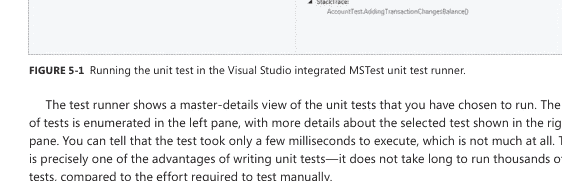

**图 5-1** 在 Visual Studio 集成 MSTest 单元测试运行器中运行单元测试。

测试运行器以主从视图显示你选择运行的单元测试。测试列表在左窗格中枚举，右窗格显示选中测试的更多详细信息。你可以看到测试只用了几毫秒就执行完成，这几乎不算什么。这正是编写单元测试的优势之一——与手动测试所需的努力相比，运行数千个单元测试并不需要很长时间。

然而，请注意测试断言失败了，因为期望值 200 与提供的实际值不匹配。`account.Balance` 属性被用作断言的实际值，它返回了 0。

这是因为 `AddTransaction` 方法尚未实现。清单 5-4 显示了到目前为止所需的最小 `Account` 类实现。


# 清单 5-4 被测系统不需要在单元测试之前完全实现。

```csharp
public class Account
{
    public void AddTransaction(decimal amount)
    {
    }

    public decimal Balance
    {
        get;
        private set;
    }
}
```

正如你所看到的，这个类在 `AddTransaction` 方法中没有对提供的交易金额做任何处理，`Balance` 也只是一个默认的自动属性，不过带有私有 setter。为了让这个测试通过，你必须实现 `Account` 类，使其满足你当前的期望。

# 测试驱动开发

要实现一个单元测试，你不需要完整实现被测系统。在测试驱动开发（TDD）中，最好在编写单元测试之前没有一个可运行的被测系统。当你使用 TDD 方法编写软件时，你将单元测试和生产代码一并编写，并为生产代码中每个类的每个方法所表现的每个预期行为编写一个失败的测试。该失败的测试失败仅仅是因为生产代码尚不存在。测试通过断言来声明生产代码应该以某种方式行事，但由于代码尚未如此，测试失败。当生产代码以尽可能简单的方式实现以满足测试要求后，测试就会成功。

# 红、绿、重构！

到目前为止，使用 `AddingTransactionChangesBalance()` 测试所产生的内容，是称为“红、绿、重构”的三阶段过程的第一部分。

- 1. 编写一个针对 SUT 预期行为的失败测试。
- 2. 仅实现足够的 SUT，使新测试通过，同时不破坏已有的成功测试。
- 3. 如果可以对 SUT 进行任何重构以改进其设计或整体质量，现在正是时候。

第一阶段产生一个失败的测试，测试运行器会用红色图标表示。第二阶段让这个失败的测试成功，使图标变为绿色。第三阶段允许你逐步逐块改进生产代码，而不用担心破坏其功能。重构在第六章“重构”中有更详细的介绍。

要将失败的测试从红转绿（从失败到成功），你需要关注该过程的第二阶段：*仅实现足够的 SUT，使测试通过*。因为目前这是唯一的测试，你无需担心会破坏任何已有的成功测试。

该测试断言，向新账户添加该金额的交易后，余额为 200。清单 5-5 显示了让单元测试通过所需的最低限度代码。

# 清单 5-5 在将测试从红转绿时，始终只做最低限度的改动。

```csharp
public class Account
{
    public Account()
    {
        Balance = 200m;
    }

    public void AddTransaction(decimal amount)
    {
    }

    public decimal Balance
    {
        get;
        private set;
    }
}
```

更改后的代码以粗体突出显示。为了将测试从红转绿，代码为 `Account` 类引入了一个默认构造函数，将 `Balance` 属性初始化为 200m。为了证明这是有效的——即测试现在通过了——图 5-2 显示了失败测试重新运行后 Visual Studio 测试运行器的截图。

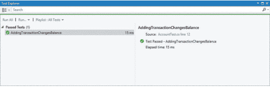

# 图 5-2 测试确实通过了——但这是正确的吗？

在你沾沾自喜并进入最后的重构阶段之前，你应该评估这是否是实现测试所指定预期行为的正确方式。你可以通过以另一个单元测试的形式添加另一个期望来证明这*不是*正确的实现。

这个新测试定义了一个新建 `Account` 对象的 `Balance` 字段的期望值。回想一下，`Balance` 字段的期望值是在向账户添加一笔 $200 交易后计算得出的。这包含一个假设，即未指定的期初余额为零。这是一个预期行为，与其他任何行为一样，因此你应该编写一个测试，断言你对代码的期望被正确实现。清单 5-6 显示了应用于此类单元测试的 AAA 模式。

# 清单 5-6 此测试的 Arrange（安排）部分被省略。

```csharp
[TestMethod]
public void AccountsHaveAnOpeningBalanceOfZero()
{
    // Arrange

    // Act
    var account = new Account();

    // Assert
    Assert.AreEqual(0m, account.Balance);
}
```

首先，注意测试方法的名称再次描述性地说明了它所断言的预期行为。不过，在这种情况下，单元测试的 Arrange 部分是空白的，这意味着 AAA 语法的这一部分是可选的。被测系统中被测试的部分是其默认构造函数的行为，这是 Act（行动）阶段中与 SUT 的唯一交互。最后，断言将先前所述的假设具体化，即新 `Account` 的余额将为 0m。

这个单元测试失败的事实，即使第一个单元测试通过，也表明第一个单元测试的期望实现是错误的。图 5-3 显示了 MSTest 运行器的输出。


# 图 5-3 第二个单元测试因第一个单元测试期望的实现而失败。

从这一点出发，如果你撤销之前对 `Account` 类的更改，你将使失败的期初余额测试从红转绿，同时正确地使你的添加交易测试再次失败。通过这样做，你已经证明你拥有针对*期初余额*测试的 `Account` 类的正确实现，但针对*添加交易*测试的实现是错误的。

每添加一个新测试，都会对 SUT 的可行实现产生进一步的约束。每个测试都带有一种行为期望，每个期望都需要在 SUT 中得到满足。确保两个测试都通过的最简单实现如清单 5-7 所示。

# 清单 5-7 两个测试现在都能通过此实现，但这是正确的吗？

```csharp
public class Account
{
    public void AddTransaction(decimal amount)
    {
        Balance = 200m;
    }

    public decimal Balance
    {
        get;
        private set;
    }
}
```

新账户的余额在创建时为零，但在调用 `AddTransaction` 时会变为 200m。当然，尽管两个测试现在都通过了，直觉应该告诉你这是绝对错误的。首先编写最简单的东西——而不是直接跳到显而易见的正确解决方案——其目的是从你的直觉中推导出编码断言。你能再写一个失败的单元测试来证明这个实现不正确吗？清单 5-8 显示了一个示例。

# 清单 5-8 此测试与之前的版本相同，但使用了不同的金额值。

```csharp
[TestMethod]
public void Adding100TransactionChangesBalance()
{
    // Arrange
    var account = new Account();

    // Act
    account.AddTransaction(100m);

    // Assert
    Assert.AreEqual(100m, account.Balance);
}
```

这个测试方法与第一个测试添加交易的方法做的工作相同，但它添加的是 $100 而不是 $200 的交易。虽然测试断言的差异很小，但足以证明 `Account.AddTransaction` 方法是错误的。

不出所料，这个新测试失败了。如果你修改 `Account` 类，将值 100m 硬编码到 `AddTransaction` 方法中，你将导致原始测试失败，并将这个测试从红转绿。相反，你现在可以实现正确的解决方案，如清单 5-9 所示。

# 清单 5-9 所有三个测试都能通过此实现，但它*仍然*是错误的！

```csharp
public class Account
{
    public void AddTransaction(decimal amount)
    {
        Balance = amount;
    }

    public decimal Balance
    {
        get;
        private set;
    }
}
```

有了这个实现，并且你的三个单元测试全部通过——它们之前都失败了——阳光明媚，世界一切安好。但事实并非如此！`AddTransaction` 方法的期望与现实实现再次不匹配。第四个单元测试凸显了这个问题，如清单 5-10 所示。

# 清单 5-10 这个单元测试最终应该有助于破解 AddTransaction 方法。

```csharp
[TestMethod]
public void AddingTwoTransactionsCreatesSummationBalance()
{
    // Arrange
    var account = new Account();
    account.AddTransaction(50m);

    // Act
    account.AddTransaction(75m);

    // Assert
    Assert.AreEqual(125m, account.Balance);
}
```

这个测试指出了 `AddTransaction` 方法的正确功能——至少目前是这样。关键在于，随着需求的变化和新功能的增加，你需要将类的期望具体化，这样你才能依靠现有的单元测试来形成一种安全


net。没有它，你很容易对代码做出更改，在你手动测试的狭窄情况下看起来是可行的，但在异常输入下会失效，或在别处破坏了无关的功能。

你添加的测试断言账户的余额是其所有交易的合计。之前，你最正确的实现会将余额设置为发生的最后一次交易的值，这意味着该测试会失败，你的实现还不完全正确。清单 5-11 显示了使全部四个单元测试都能通过的 AddTransaction 方法的实现。

# 清单 5-11 这个实现是目前对 AddTransaction 最好的。

```
public class Account
{
    public void AddTransaction(decimal amount)
    {
        Balance += amount;
    }

    public decimal Balance
    {
        get;
        private set;
    }
}
```

在每个单元测试从红变绿的过渡之后，你有机会重构 SUT 的实现，但这个示例非常简单。随着向 SUT 添加的每个新方法，这个过程的阶段变得更加重要。以这种方式重构将在下一章中更详细地介绍。

如果你从未编写过单元测试，这可能看起来像是在驾驶时走风景路线——为什么不直接实现生产代码直达目的地呢？原因将在本章中逐渐变得清晰，但简短的答案是，先编写测试有助于防止过度设计解决方案，并提供一套回归测试以防止破坏现有功能。

# More complex tests

之前的示例涉及以测试先行的方式对应用程序领域模型的一部分进行单元测试。如第 3 章“Dependencies and layering”所述，领域模型是业务逻辑层的实现，位于用户界面和数据访问层之间。

# Specification

对于下一组构建在此 Account 类之上的测试，你将测试业务逻辑层的不同部分：一个服务。此假设应用程序的用户界面可以绑定到任何框架——ASP.NET MVC、Windows Presentation Foundation (WPF) 或 Windows Forms——你的服务应无论框架如何都可重用。这意味着服务不会包含特定于这些框架的依赖项，但它会间接依赖于 Account 类。图 5-4 显示了将构成此示例的层和类之间的依赖关系。

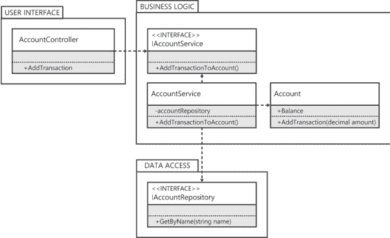

**FIGURE 5-4** The dependencies and implementations that form the subsystem you will now test.

统一建模语言（UML）图显示了构成你将创建的三层架构的三个包。用户界面将包含模型-视图-控制器（MVC）控制器，尽管这些也可以是模型-视图-视图模型（MVVM）或模型-视图-演示者（MVP）的视图模型或演示者。具体来说，AccountController 将具有处理用户界面操作——向账户添加交易的处理程序。此控制器依赖于你准备实现的 AccountService 的接口。

AccountService 位于业务逻辑层，与其接口和领域模型一起，后者由之前实现的 Account 类表示。请注意，这些包代表应用程序的逻辑层，而不是直接映射到 Visual Studio 项目、因此映射到程序集。AccountService 需要某种方式从你使用的任何持久存储机制中检索 Account 实例。因为你在业务逻辑层中使用了领域模型，所以数据访问层是使用对象/关系映射器（ORM）实现的。

存储库接口用于将特定的持久性逻辑隐藏在客户端代码之外。IAccountRepository 负责返回 Account 实例。服务依赖于此接口，因为在实现过程中它需要检索一个账户。

# Designing the test

AccountService.AddTransactionToAccount 方法的测试使用 TDD 和 AAA 编写，就像之前一样。首先，你需要思考该方法应有的预期：它委托给正确的 Account 实例的 AddTransaction 方法，并传入交易金额的正确值。让我们指定 Arrange、Act 和 Assert 阶段：

- **Arrange** 确保 SUT——AccountService 类——有一个可用的实例。
- **Act** 调用 AddTransactionToAccount 方法。
- **Assert** SUT 在 Account 实例上调用 AddTransaction 方法，并传入正确的金额值。

清单 5-12 显示了编写此测试的第一次尝试。

## 清单 5-12 这个新测试的第一次尝试是不完整的。

```
[TestClass]
public class AccountServiceTests
{
    [TestMethod]
    public void AddingTransactionToAccountDelegatesToAccountInstance()
    {
        // Arrange
        var sut = new AccountService();

        // Act
        sut.AddTransactionToAccount("Trading Account", 200m);

        // Assert
        Assert.Fail();
    }
}
```

一切看起来都很好，直到你进行断言。你需要断言某个方法在某个对象上被调用并且传入了特定值，但如何断言这一点呢？这就是测试替身发挥作用的地方。

# Test doubles

有时你需要为系统下测试提供一个依赖项。此依赖项可以是另一个类，也可以是文件系统、数据库或 Web 服务之类的外部因素。经常，将这些依赖项传递给系统下测试会使测试变得脆弱且容易间歇性失败。它还阻止测试成为真正的单元测试，因为它们需要外部依赖才能通过。测试替身是实现满足依赖项目标的伪实现，并且可能还有助于你对各种类交互进行断言的能力。有五种不同的测试替身子类别：

- **Dummies** 这是最简单的测试替身。Dummies 的目的是满足参数列表且没有特殊行为。通常，真实实现被用作 dummies，并且可能是原语类型，尽管它们是使单元测试变绿所必需的。
- **Spies** 间谍会记录对其方法所做的调用，以及为每次调用提供的参数。这些调用的记录随后可用于断言以确保进行了某些调用。
- **Stubs** 存根是系统下测试所需的依赖项，并在被查询时返回预先提供的答案。存根在应用程序的缝隙处最有用，在那里需要外部依赖。代替依赖数据库，你可以依赖一个可以返回虚拟数据的存根。
- **Fakes** 假对象与存根非常相似，但意图略有不同。假对象不会被提供任何预设的查询响应，而是更接近于具有一些必要让步以避免外部依赖的真实实现。个人而言，我在手动实现的 mock 和由 mocking 框架提供的 mock 之间做出区分：手动 mock 被称为 fakes。
- **Mocks** 存根和假对象为间接查询的依赖项提供测试替身，而 mock 为间接命令的依赖项提供测试替身。Mock 有助于确定系统下测试的依赖项上是否执行了命令。

# Manual test fakery

继续上面的示例，在你能够编写断言之前，首先需要一个 Account 实例来进行断言。IAccountRepository 接口将由 AccountService 用于检索它将交互的 Account，因此你不能直接给 AccountService 这样一个实例。相反，你需要给 AccountService 一个 IAccountRepository——但你没有任何可用的实现。因为你依赖于接口而不是类，你可以编写一个接口的假实现，该实现仅对测试足够。清单 5-13 显示了这样一个类，它位于单元测试程序集中。


## 清单 5-13 一个仅用于测试目的的非常简单的存储库实现。

```
public class FakeAccountRepository : IAccountRepository
{
    public FakeAccountRepository(Account account)
    {
        this.account = account;
    }

    public Account GetByName(string accountName)
    {
        return account;
    }

    private Account account;
}
```

现在可以创建账户服务的实现了。列表 5-14 展示了 AccountService 类的新实现。

# 清单 5-14 AccountService 类的当前状态。

```
public class AccountService : IAccountService
{
    public AccountService(IAccountRepository repository)
    {
        this.repository = repository;
    }

    public void AddTransactionToAccount(string uniqueAccountName, decimal transactionAmount)
    {
    }

    private readonly IAccountRepository repository;
}
```

现在可以完成单元测试了，同时需要新增以下 Arrange 条件：

- 确保有一个可用于断言的 Account 实例。
- 确保有一个可用的 Fake IAccountRepository 实例，以便在构造服务时传入。

## 清单 5-15 此测试因正确的原因而失败：AccountService 尚未实现。

```
[TestClass]
public class AccountServiceTests
{
    [TestMethod]
    public void AddingTransactionToAccountDelegatesToAccountInstance()
    {
        // Arrange
        var account = new Account();
        var fakeRepository = new FakeAccountRepository(account);
        var sut = new AccountService(fakeRepository);

        // Act
        sut.AddTransactionToAccount("Trading Account", 200m);

        // Assert
        Assert.AreEqual(200m, account.Balance);
    }
}
```

如本列表所示，首先创建一个初始余额为零的账户。然后创建一个 FakeAccountRepository 实例，并将该账户传入其中。由于这个 fake 实现了账户存储库的接口，因此可以将其传递给 AccountService 类，也就是被测系统（SUT）。

调用测试目标方法后，断言账户的余额应为 200m。如图 5-5 所示，此断言会失败，因为目标方法尚未实现。


# 图 5-5 继续从红色转为绿色的过程，此时你已经拥有了一个失败的测试。

现在，你已经有了一个用于规定生产代码中缺失行为的单元测试，接下来可以执行最简单的操作，让单元测试通过，如列表 5-16 所示。

## 清单 5-16 此 AccountService 实现使测试通过。

```
public class AccountService : IAccountService
{
    public AccountService(IAccountRepository repository)
    {
        this.repository = repository;
    }

    public void AddTransactionToAccount(string uniqueAccountName, decimal transactionAmount)
    {
        var account = repository.GetByName(uniqueAccountName);
        account.AddTransaction(transactionAmount);
    }

    private readonly IAccountRepository repository;
}
```

单元测试引导你在此实现中采取正确的做法。你必须使用存储库检索账户，并调用该账户的 AddTransaction 方法来修改只读的 Balance 属性。如果有人随后破坏了此方法，使其不再符合单元测试中设定的预期，你会很快发现问题。

# 模拟框架

不难想象，创建 mock 很快就会变得十分繁琐。设想一下你可能编写的所有单元测试组合，以及 SUT 可能需要的各种不同接口。仅仅为了支持单元测试，就需要编写大量额外代码。

还有另一种模拟 IAccountRepository 的方式，但需要使用外部模拟框架。编写 fake 的一个优点是，你可以独立编写它们，而不需要任何第三方依赖。不过，如今模拟框架已经非常普遍，而且可供选择的框架很多。下面的示例使用其中最流行的框架之一：Moq。这个名称有时读作 *Moh-kyoo*，有时读作 *Mok*。

通过 NuGet，你可以在在线源中搜索 Moq 包，从而快速添加对 Moq 的引用。Moq 背后的魔法在于，它可以为你要求模拟的任意接口创建动态代理。你将编辑现有测试，使用 Moq mock 替代手动创建的 fake，如列表 5-17 所示。

## 清单 5-17 Moq 等模拟框架可以让你非常轻松地创建 mock。

```
[TestMethod]
public void AddingTransactionToAccountDelegatesToAccountInstance()
{
    // Arrange
    var account = new Account();
    var mockRepository = new Mock<IAccountRepository>();
    mockRepository.Setup(r => r.GetByName("Trading Account")).Returns(account);
    var sut = new AccountService(mockRepository.Object);

    // Act
    sut.AddTransactionToAccount("Trading Account", 200m);

    // Assert
    Assert.AreEqual(200m, account.Balance);
}
```

测试中的更改以粗体突出显示。你不再实例化自己的 fake 存储库，而是创建一个新的 Mock<IAccountRepository> 对象。这个对象功能非常强大，可以让你为模拟的接口设置各种预期和行为。这个类并不实现你的接口，因此不同于 fake，它并不是 IAccountRepository 的直接可用实例。这是因为公共语言运行时（CLR）不允许类从泛型参数继承。相反，mock 与它创建的代理实例之间存在组合关系。Object 属性允许你访问底层的模拟接口，在本例中，该接口会被传入 AccountService。

在将 mock 提供给 SUT 之前，需要指定它应有的行为。默认情况下，Moq 定义的是宽松 mock，这意味着它们的所有返回值都是默认值。任何引用类型的默认值都是 null，这同样适用于 Account 类。宽松 mock 的另一种选择是 *严格* mock；当遇到你尚未指定的方法调用或属性访问时，严格 mock 会抛出异常。这两种选项都不是你需要的，因此必须手动设置一些预期行为。

Mock 实例的 Setup 方法非常巧妙。它接受一个 lambda 表达式，该表达式会将底层模拟类型的实例作为上下文参数提供。通过调用该类型上的方法，你可以指定：当使用完全相同的参数调用该方法时，应当发生某种行为。具体要指定什么取决于你的测试场景。Moq 允许你为方法调用设置以下预期：

- 调用其他 lambda 表达式。
- 返回指定值。
- 抛出指定类型的异常。
- 验证是否调用了此方法。

# Mock 与测试过度指定

使用 mock 进行测试是一种常见但可能十分繁重的做法。依赖 mock 的测试很容易变得过度指定。过度指定的测试十分脆弱，但你可以通过改变断言内容来避免这种脆弱性。当测试包含对被测系统（SUT）工作方式的深入了解时，就会产生这个问题。换句话说，当测试了解的是 SUT 的实现，而不是其预期行为时，这个测试就属于过度指定。

使用 mock 的单元测试可能需要了解 SUT 是如何实现的。不过，你始终应该记住，单元测试是对预期行为的规定，因此应避免针对实现细节编写测试。这可能包括调用 SUT 所依赖的其他接口。如果你断言某个接口上的方法必须被调用，那么测试就不再与某种行为绑定，而是与某种具体实现绑定。

过度指定的测试不理想，因为它们会阻碍对所测试生产代码进行重构。一个方法或类配套的、全部通过的单元测试套件，表明该方法或类的实现可以放心修改：只有当代码的预期行为被破坏时，测试才会失败。过度指定的测试无法提供这样的保证，因为即使预期行为仍然完整，只要方法或类的实现发生变化，它们也会失败。

在使用 mock 进行测试时，有两种方法可以避免测试过度指定。第一种方法是只测试行为。基于状态的测试就是测试预期行为的最佳示例。如果一个方法接受数据作为输入，并返回经过修改的数据作为输出，那么在测试时可以将该方法视为黑盒。如果该方法接受输入 A、B 和 C，并返回输出 X、Y 和 Z，那么它如何得出这些结果与测试无关。这样就可以重构该方法，而不会破坏单元测试。

第二种方法不太理想，但有时是唯一的选择。你可以将单元测试及其测试的实现视为一个原子单元：如果其中一个发生变化，另一个也必须随之变化。这相当于承认单元测试存在过度指定，并计划在重构时连同生产实现一起丢弃该单元测试。这并没有想象中那么浪费。正如你将在第三部分“SOLID 代码”中看到的，SOLID 代码会产生更小、更有针对性的类，而这些类本来就不会被修改。

对于这个测试，你希望采用第二种方式：返回指定值。Mock.Setup 方法调用的流式接口允许你将调用链接到 Returns 方法。这提高了可读性，并减少了测试中已经开始变得相当庞大的 Arrange 阶段。Returns 方法接收你之前已经创建的 Account 实例，这样就完成了对该 mock 预期行为的设置。简而言之，你向 mock 发出了以下指令：

> 当针对这个 IAccountRepository 实例调用 GetByName 方法，并且提供的账户名称为“Trading Account”时，返回这个 Account 类的实例。


当你再次运行测试时，它将会通过，和之前一样，如图 5-6 所示。

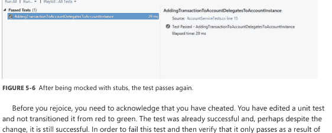

图 5-6 使用桩对象进行模拟后，测试再次通过。

在你高兴之前，你需要承认你作弊了。你修改了一个单元测试，却没有让它从红灯变为绿灯。该测试本来就已经成功了，而且也许在修改之后，它仍然成功。为了先让该测试失败，然后验证它只有在正确实现被测系统（SUT）时才会通过，你应该删除 `AddTransactionToAccount` 方法内部的代码。当你这样做时，测试会失败；恢复代码后，测试又会成功。这是单元测试修改过程中的一个重要部分，可以避免误报（false positives）——也就是说，它可以防止你编写出一个即使实现不正确也能通过的测试。

# 测试所有控制流

你使用 TDD 方法完成一个可工作的 `AccountService` 的首次尝试已经成功。但仍存在一些潜在问题，需要进一步的测试来确保该方法更加健壮。到目前为止，你只测试了“快乐路径”（Happy Path）：即代码中不产生错误、不会引发问题的执行路径。还有几个空白点需要处理：

- 如果账户仓库（account repository）是一个空引用，会怎样？
- 如果仓库找不到该账户，会怎样？
- 如果账户的方法抛出异常，会怎样？

每多写一个测试，你要么会发现实现中存在的缺陷（如果测试失败），要么会增强对实现健壮性的信心（如果测试成功）。

在什么情况下账户仓库会是空引用？只有当 `AccountService` 在构造时被传入 null 作为构造参数时才会发生。由于有效的账户仓库是账户服务的必需依赖项，你可以说这是构造函数的一个前置条件。因此，我们可以编写如清单 5-18 所示的测试。

这个测试与之前的测试稍有不同；断言不在通常的位置。MSTest 要求你在测试方法上应用 `ExpectedExceptionAttribute`，并带一个描述所需异常类型的参数。

## 清单 5-18 既没有 Arrange 也没有 Assert，但这是一个有效的异常测试模式。

```
[TestMethod]
[ExpectedException(typeof(ArgumentNullException))]
public void CannotCreateAccountServiceWithNullAccountRepository()
{
    // Arrange

    // Act
    new AccountService(null);

    // Assert
}
```

这个测试所指定的是：如果你用 null 引用作为 `IAccountRepository` 实例来构造 `AccountService`，你期望抛出一个 `ArgumentNullException`。这正是你所需的前置条件，以确保在账户服务的任何方法中，你总是拥有一个有效的仓库实例，而不需要处理它为空的情况。这个测试会因正确的原因而失败，如下所示。

测试方法 ServiceTests.AccountServiceTests.CannotCreateAccountServiceWithNullAccountRepository 没有抛出异常。测试方法上定义的 Microsoft.VisualStudio.TestTools.UnitTesting.ExpectedExceptionAttribute 属性期望抛出一个异常。

为了让这个测试通过，你需要实现这个前置条件。手动实现方式见清单 5-19。

## 清单 5-19 向构造函数传入空的账户仓库将导致异常。

```
public AccountService(IAccountRepository repository)
{
    if (repository == null)
    {
        throw new ArgumentNullException("repository", "A valid account repository must be supplied.");
    }

    this.repository = repository;
}
```

新增的行以粗体显示。这是“快速失败”（failing fast）的一个例子。如果没有这个前置条件，最终也会抛出异常，但那是 `NullReferenceException`，并且会在你第一次尝试访问这个空仓库时发生。

构造函数测试通过后，你可以继续下一个测试用例：当仓库找不到账户时。假设你的仓库没有实现 Null Object 模式，如第 4 章“接口与设计模式”所述，该模式意味着仓库在找不到所请求的账户时永远不会返回 null 对象或抛出异常。相反，你的仓库应该为该账户返回一个 null 引用。清单 5-20 展示了针对这种情况强制执行预期行为的单元测试。

## 清单 5-20 没有期望异常属性，也没有断言！

```
[TestMethod]
public void DoNotThrowWhenAccountIsNotFound()
{
    // Arrange
    var mockRepository = new Mock<IAccountRepository>();
    var sut = new AccountService(mockRepository.Object);

    // Act
    sut.AddTransactionToAccount("Trading Account", 100m);

    // Assert
}
```

这个测试的 Assert 阶段是空白的，也没有 `ExpectedException` 属性。这是因为你的期望是：在测试的 Act 阶段不应该抛出异常。如果在此时抛出异常，测试就会失败。如果没有抛出异常——并且没有其他可能失败的断言——测试默认就会通过。

在测试的 Arrange 阶段，你模拟了仓库并将其传递给 SUT（通过提供有效的仓库实例来避免前置条件），但没有设置任何期望。这意味着对 `IAccountRepository.GetByName()` 的调用将返回 null。接下来你要对这个返回值做的事情是尝试调用 `Account.AddTransaction()`。因为实例为 null，这会导致 `NullReferenceException`，从而使测试失败。为了让这个测试变为绿色，你需要在方法中防止该异常被抛出，如清单 5-21 所示。

## 清单 5-21 这个 if 语句保护该方法免受 `NullReferenceException` 的影响。

```
public void AddTransactionToAccount(string uniqueAccountName, decimal transactionAmount)
{
    var account = repository.GetByName(uniqueAccountName);
    if (account != null)
    {
        account.AddTransaction(transactionAmount);
    }
}
```

通过添加一个简单的 `if` 语句，确保在使用账户之前其不为 null，你阻止了异常被抛出，测试通过了。

现在，让我们实现最后一个必需的测试用例。这个测试涉及账户服务在调用账户的 `AddTransaction` 方法抛出异常时期望的行为。为了避免各层之间的依赖泄漏，好的做法是将较低层抛出的异常包装成该层的新异常。图 5-7 例证了这一原则。

# 1. 引言

本文档旨在介绍一种基于深度学习的图像识别方法，该方法在多个标准数据集上取得了优异的性能。我们详细阐述了模型的架构设计、训练策略以及实验结果，并对其潜在的应用场景进行了探讨。

# 2. 相关工作

近年来，卷积神经网络（CNN）在计算机视觉领域取得了突破性进展。从早期的 AlexNet 到后来的 VGG、ResNet 等，网络结构不断加深，性能持续提升。此外，注意力机制的引入进一步增强了模型对关键特征的提取能力。

# 3. 方法

我们提出的模型采用了一种新颖的多尺度特征融合策略。具体而言，模型由三个主要模块组成：特征提取骨干网络、多尺度特征融合模块和分类头。

- 特征提取骨干网络：采用 ResNet-50 作为基础架构。
- 多尺度特征融合模块：通过空洞卷积和特征金字塔网络实现。
- 分类头：使用全局平均池化和全连接层。

# 4. 实验

我们在 CIFAR-10 和 ImageNet 数据集上进行了大量实验。下表展示了模型在不同数据集上的准确率对比。

| 数据集 | 准确率 |
|--------|--------|
| CIFAR-10 | 95.2% |
| ImageNet | 78.5% |

# 5. 结论

本文提出了一种有效的图像识别方法，实验结果表明其性能优于现有基线模型。未来工作将探索该方法在更多实际场景中的应用。

期望异常属性用于断言 SUT 抛出 `ServiceException`，而账户桩则被要求抛出 `DomainException`。因此，由 SUT 负责将一种异常转换为另一种异常。该方法并没有这样做，所以这个测试正确地失败了，并显示以下消息：

测试方法 ServiceTests.AccountServiceTests.AccountExceptionsAreWrappedInThrowServiceException 抛出了异常 Domain.DomainException，但期望的是异常 Services.ServiceException。异常消息：Domain.DomainException：抛出了类型为 'Domain.DomainException' 的异常。

期望异常属性已经判定：所抛出的异常与指定的类型不符。清单 5-23 中的代码展示了 `AddTransactionToAccount` 方法所需进行的修改。

## 清单 5-23 引入 try/catch 块以将一种异常映射为另一种异常。

```
public void AddTransactionToAccount(string uniqueAccountName, decimal transactionAmount)
{
    var account = repository.GetByName(uniqueAccountName);
    if (account != null)
    {
        try
        {
            account.AddTransaction(transactionAmount);
        }
        catch(DomainException)
        {
            throw new ServiceException();
        }
    }
}
```

虽然引入 try/catch 块使你的测试从红灯变为绿灯，但仍然缺少一个期望，这意味着它仍不完整。

# 为缺陷修复编写测试

假设你收到一份与当前示例代码相关的缺陷报告。报告内容如下：

> 我在向我的账户添加交易时收到了一个 ServiceException。

你继续复现问题，并发现了被抛出的异常——这就是直接原因。但是，由于 `DomainException` 已被替换为 `ServiceException`，因此很难理解错误的根本原因。最初关于新异常应该包装现有异常的期望尚未实现，因为单元测试中缺少一个断言。

当以这种方式出现缺陷时，第一件事就是编写一个失败的单元测试，该测试要捕获两件事：强制缺陷出现所需的确切复现步骤，以及当前未强制执行的期望行为。清单 5-24 展示了一个失败的单元测试中的这两个要素。


# 清单 5-24 手动断言抛出的异常。

```csharp
[TestMethod]
public void AccountExceptionsAreWrappedInThrowServiceException()
{
    // Arrange
    var account = new Mock<Account>();
    account.Setup(a => a.AddTransaction(100m)).Throws<DomainException>();
    var mockRepository = new Mock<IAccountRepository>();
    mockRepository.Setup(r => r.GetByName("Trading Account")).Returns(account.Object);
    var sut = new AccountService(mockRepository.Object);

    // Act
    try
    {
        sut.AddTransactionToAccount("Trading Account", 100m);
    }
    catch (ServiceException serviceException)
    {
        // Assert
        Assert.IsInstanceOfType(serviceException.InnerException, typeof(DomainException));
    }
}
```

对于这个测试来说，仅使用 ExpectedException 特性是不够的。你需要检查所抛出异常的 InnerException 属性，并断言它是一个 DomainException。这证明了领域异常被包装起来，同时保留了最初发生的错误。所有软件缺陷都可以被视为缺少单元测试的结果：也就是对预期行为的不完整说明。列表 5-25 展示了如何通过编辑生产代码来使测试通过。

# 清单 5-25 原始异常现在已由新异常正确包装。

```csharp
public void AddTransactionToAccount(string uniqueAccountName, decimal transactionAmount)
{
    var account = repository.GetByName(uniqueAccountName);
    if (account != null)
    {
        try
        {
            account.AddTransaction(transactionAmount);
        }
        catch (DomainException domainException)
        {
            throw new ServiceException("Adding transaction to account failed", domainException);
        }
    }
}
```

使这个测试通过后，你就可以返回去重现缺陷报告中最初的异常，并且这一次确定问题的根本原因。

# 测试设置

让我们回顾一下目前为止编写的测试。每个测试都逐渐变得更加复杂，需要更多代码来设置预期行为。如果能把这些代码提取到某个地方，就可以清理测试代码，并让它们变得更短一些，那就好了。MSTest 和其他单元测试框架一样，允许使用特殊的初始化和清理方法，这些方法分别在每个测试开始和结束时调用。初始化方法可以使用任意名称，但必须使用 TestInitialize 特性进行标记。

需要放入此方法中的代码，是几乎所有单元测试都共有的代码：实例化模拟对象。你可以将模拟对象存储为类中的私有字段，这样每个测试都仍然可以访问它们。对于 SUT 也可以采用同样的做法，因为它只需要将模拟仓储作为构造函数参数，并且它的构造不依赖于任何特定的单元测试。列表 5-26 展示了对测试类所做的必要修改，以支持设置方法。

# 清单 5-26 模拟对象和 SUT 可以在设置方法中构造。

```csharp
[TestClass]
public class AccountServiceTests
{
    [TestInitialize]
    public void Setup()
    {
        mockAccount = new Mock<Account>();
        mockRepository = new Mock<IAccountRepository>();
        sut = new AccountService(mockRepository.Object);
    }

    private Mock<Account> mockAccount;
    private Mock<IAccountRepository> mockRepository;
    private AccountService sut;
}
```

这些对象作为测试初始化方法的一部分构造后，该方法会针对每个测试方法分别调用。这样，你就可以通过移除这些对象的构造代码，简化部分单元测试代码。列表 5-27 展示了对最近那个单元测试 AccountExceptionsAreWrappedInThrowServiceException 所做的修改。

# 清单 5-27 这个测试稍微短了一些，也更容易阅读。

```csharp
[TestMethod]
public void AccountExceptionsAreWrappedInThrowServiceException()
{
    // Arrange
    mockAccount.Setup(a => a.AddTransaction(100m)).Throws<DomainException>();
    mockRepository.Setup(r => r.GetByName("Trading Account")).Returns(mockAccount.Object);

    // Act
    try
    {
        sut.AddTransactionToAccount("Trading Account", 100m);
    }
    catch (ServiceException serviceException)
    {
        // Assert
        Assert.IsInstanceOfType(serviceException.InnerException, typeof(DomainException));
    }
}
```

删除三行代码也许算不上代码量的大幅减少，但对所有单元测试产生的累积效果是：代码更具可读性。按照约定，你知道任何带有 mock 前缀的变量都是模拟对象，而变量 sut 则是你正在测试的系统。

# 单元测试模式

测试和生产代码一样，也可能变得难以处理且难以阅读。而且和生产代码一样，测试被阅读的次数远多于编写的次数——阅读者也形形色色。有人曾说过，你编写代码时应该假设下一个阅读代码的人是一个知道你住在哪里的精神病患者。当然，这种说法有些夸张，也很简洁，但其中确实包含着一丝真理。请体谅那些未来必须阅读你代码的可怜人：帮助他们完成工作，不要给他们制造障碍。

# 编写可维护的测试

既然测试的可读性至少和生产代码的可读性同等重要，那么该如何诊断现有测试中的可读性问题？又有哪些选项可以用来改善测试的可读性？

首先，可以对测试进行一些战术性的修改，以改善测试逐行阅读时的可读性。其次，也可以进行战略性的——或结构性的——修改，从更大范围影响可读性。

# 优先保持一致性

在互联网上争论完全是在浪费时间和精力。这种行为既徒劳又不合逻辑。然而，软件开发者往往依赖敏锐的逻辑感，却经常在互联网上争论。从追求完美算法类型的吹毛求疵，到“最佳语言”之争，开发者总是忍不住一头扎进毫无意义的争论中。

事实是，在实践层面，你有无穷多的选择可供决定。你不可能始终对所有选择进行批判性评估；因此，需要一种更好的启发式方法。任何代码库都应坚持的首要原则是*一致性*。这适用于许多方面。

不要为了类字段名称前置下划线的相对优点，或普遍使用 this 的好处而彼此争论。相反，应保持一致，并遵循代码已经确立的示例。争论所浪费的任何时间，都不如用来取得真正、实际且有形的进展。

这适用于整个代码库。然而，测试代码往往会引发最激烈的争论。

对于一个内部已经保持一致的棕地项目来说，这些都没有问题；但对于绿地项目，或其模式尚不明确的项目，该怎么办呢？对于绿地项目，应做出一个最容易被接受的决定，然后坚持执行。当项目代码已经呈现出多种命名约定或适用模式的混合状态时，应选择最常见的示例，并逐步将其余代码规范到与之匹配。

# 为每个类保持合理的测试夹具比例

在大多数情况下，测试夹具与生产类保持 1:1 的比例就足够了。使用单个测试夹具来测试多个被测系统会造成混淆，并违反最小惊讶原则。这与将多个类放在同一个文件中非常相似：应当避免这样做，以免其他人在浏览代码时遇到困难。

> **提示**  *最小惊讶原则*是一条指导原则，建议在面临选择时，选择最简单、最明显的选项。它旨在让后来者的生活更轻松——甚至可能让未来某个因奇怪决定而感到惊讶的自己也更轻松！

# 为被测系统命名

虽然编写代码时通常应避免使用缩写，但用于表示被测系统的变量名至少可以从保持一致性中受益。即使选择了其他名称，例如 target，在所有测试中使用一致的名称，也能让后续阅读代码的人快速定位并理解代码。


# 仔细为测试方法命名

> “计算机科学中有两件困难的事情：缓存失效、命名事物，以及差一错误。”
> 
> 未知

我的一位同事非常推崇有意的糟糕变量名。如果一个类、方法或变量的用途不明确，他就会给它命名为 Fred。需要指出的是，他从不会在所有 rogue Fred 都被移除之前提交代码，但有些 Fred 可能存在一个小时直到被重命名。重点是，命名比看起来困难得多。

正如你将在本章后面 “The testing quadrant” 部分学到的那样，单元测试是为开发团队服务的，而不是为业务服务的。因此，单元测试的名称不必能被业务分析师或产品负责人阅读，这与范围更广的验收测试不同。然而，Status_code_500_should_throw_invalid_operation_exception 并不是一个好名字——在多个层面上都不是。

首先，测试泄露了太多实现知识，这对阅读者没有帮助。相反，测试名称应以测试的意图为焦点。传达测试的意图，而不是实现。

```
Account_service_failure_is_propagated_to_client
```

它不依赖于测试的实现，并且以所讨论代码的上下文为基础。

# 测试的 Builder 模式

代码编写中存在两种类型的冗长：一种使复杂化，另一种使清晰。前者显而易见，当一个方法直接处理过低层级的细节时。后者是描述性变量和方法命名的结果，利用你手头的工具来清晰地表达意图。

单元测试与任何其他代码语句一样。因此，它们至少应遵守与生产代码相同的规则。测试会因多种原因变得难以处理——最常见的是因为被测试的代码本身不够可测试。在这种情况下，测试围绕问题打转，试图想方设法创建测试。但即使是非常可测试的代码，其测试也可能缺乏清晰度和简洁性。

# Builder 模式

Builder 模式是一种创建型 Gang of Four (GoF) 设计模式。这意味着它适用于封装和抽象对象的创建。它与更常见的 Factory 模式不同之处在于，Builder 模式包含用于自定义对象创建的方法。图 5-8 显示了通用 Builder 设计模式的 UML 图。

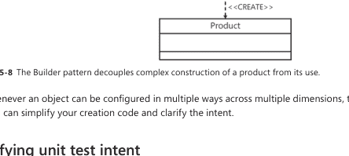

图 5-8 Builder 模式将产品的复杂构建与其使用解耦。

每当一个对象可以在多个维度以多种方式配置时，Builder 模式都可以简化你的创建代码并阐明意图。

# 阐明单元测试意图

让我们重温本章早些时候的一个测试，并通过应用 Builder 模式来改善其意图的清晰度。“Testing with mocks” 部分中的 Moq mock 在此处作为清单 5-28 重复，之前在清单 5-17 中出现过。

LISTING 5-28 The Moq mock (shown earlier in Listing 5-17).

```
[TestMethod]
public void AddingTransactionToAccountDelegatesToAccountInstance()
{
    // Arrange
    var account = new Account();
    var mockRepository = new Mock<IAccountRepository>();
    mockRepository.Setup(r => r.GetByName("Trading Account")).Returns(account);
    var sut = new AccountService(mockRepository.Object);

    // Act
    sut.AddTransactionToAccount("Trading Account", 200m);

    // Assert
    Assert.AreEqual(200m, account.Balance);
}
```

Arrange、Act 和 Assert 部分已标记，Arrange 部分长五行。这在可接受范围内：在大约七到八行之后，减少代码行数变得很重要。相反，这个 Arrange 部分的问题在于代码的意图不明确。需要仔细阅读每一行才能理解这段代码在做什么。有效地讲，这个测试是“跳过一个抽象”：穿过一层会阐明并可能总结此代码意图的间接层。Builder 模式可以是这样的层。

# 产品

与 Factory 模式类似，Builder 模式生成一个产品。这是向构建器描述一些配置选项并要求它创建对象的结果。当应用于测试的上下文时，Builder 模式可以为测试所需的任何或所有支持对象生成产品。对于这个特定示例，Builder 模式将用于生成熟悉的系统下测试 (SUT)：AccountService。

# Builder

清单 5-29 显示了 AccountServiceBuilder 类。它采用流畅接口设计，这意味着其方法返回构建器，因此可以链接在一起。常见的做法是有一个 Build() 或 Create() 方法作为流畅链中的最后命令。结果是一个构建好的产品，即 AccountService。

LISTING 5-29 The builder encapsulates the details of constructing test objects.

```
public class AccountServiceBuilder
{
    private readonly AccountService _accountService;
    private readonly Mock<IAccountRepository> _mockAccountRepo;

    public Mock<Account> MockAccount
    {
        get;
        private set;
    }

    public AccountServiceBuilder()
    {
        _mockAccountRepo = new Mock<IAccountRepository>();
        _accountService = new AccountService(_mockAccountRepo.Object);
    }

    public AccountServiceBuilder WithAccountCalled(string accountName)
    {
        MockAccount = new Mock<Account>();
        _mockAccountRepo.Setup(r =>
            r.GetByName("Trading Account")).Returns(MockAccount.Object);

        return this;
    }

    public AccountServiceBuilder AddTransactionOfValue(decimal transactionValue)
    {
        MockAccount.Setup(a => a.AddTransaction(200m)).Verifiable();

        return this;
    }

    public AccountService Build()
    {
        return _accountService;
    }
}
```

# 测试

将 AccountServiceBuilder 插入单元测试会产生清单 5-30 中的代码。测试的 Arrange 部分仅缩短了一行代码，变为四行，但这并不是 Builder 模式的唯一目标。构建器为测试编写者提供了一种领域特定语言 (DSL) 来构建测试。

LISTING 5-30 The Arrange section of this test has a clearer intent thanks to the Builder pattern.

```
[TestClass]
public class AccountServiceTests
{
    private AccountServiceBuilder _accountServiceBuilder;

    [TestInitialize]
    public void TestInitialize()
    {
        _accountServiceBuilder = new AccountServiceBuilder();
    }

    [TestMethod]
    public void AddingTransactionToAccountDelegatesToAccountInstance()
    {
        // Arrange
        var sut = _accountServiceBuilder
            .WithAccountCalled("Trading Account")
            .AddTransactionOfValue(200m)
            .Build();

        // Act
        sut.AddTransactionToAccount("Trading Account", 200m);

        // Assert
        _accountServiceBuilder.MockAccount.Verify();
    }
}
```

代码可以顺序阅读，意图清晰。去掉代码中的多余噪音后，这段文字如下：

Account service builder, with account called "Trading Account", add transaction of value 200.0.

这就是测试设置应有的阅读方式。关于系统下测试的预期，清晰度大大提高。再回顾一下原始 Arrange 部分，看看它与之相比如何。模拟设置的细节——实现细节——掩盖了代码的意图。看看参数化值的位置：200m 和 "Trading Account"。它们在模拟初始化的噪音中丢失了。通过使用 Builder 模式，测试现在具有更清晰的意图。

Tip 另一个 Builder 模式的优点是它导致更声明式的测试。没有任何测试的圈复杂度应大于 1，这意味着测试应完全线性，没有分支。if 语句或 for、foreach 或 while 循环会导致测试的圈复杂度超过 1。Builder 模式通过将命令式构造和初始化转换为声明式来帮助实现这一点。

# 先写测试

到目前为止，本章介绍的是使用测试驱动开发 (TDD) 方法进行单元测试的优点。但严格来说，这算是测试驱动开发吗？软件开发充满了含义主观或随时间推移而变化的术语。考虑一下“service”这个词，例如。在不同情况下它意味着许多不同的东西。这本书本身在许多不同的上下文中使用该术语。而上下文是关键。没有上下文，就没有讨论的基础，没有辩论可以存在的环境。

TDD 可能不一定是主观术语，但其含义已经发生了变化。被奉为“软件工程”的现代标准和实践已经渗透到行业中，其含义被扭曲或误解。

# 什么是 TDD？

测试驱动开发有纯粹主义和实用主义的解释。即使这些术语也是有偏见的：纯粹主义者从不从他或她的狭隘、理想主义的愿景中退让，即事物应该如何；实用主义者是独行侠，以交付为名走捷径并稀释代码。当然，这两种描述都是夸张的 caricatures。

TDD 的“纯粹主义”理念是它是一种设计工具——开发者应带着对可能实现的生产代码毫无先见之明地接近键盘。相反，他们是典型的空白 slate，准备在进展中发现他们的设计。这种进展是通过编写失败的单元测试来指导的。

TDD 的“实用主义”理念是开发者先写单元测试。区别很微妙。在纯粹主义 TDD 中，过程有更多约束。两种 TDD 风格的目标相同：生成已通过单元测试验证为满足需求的生产代码。然而，实用主义 TDD 在实现这一目标方面有更少的规则。实用主义 TDD 的唯一规则是：先写测试。


因此，务实的 TDD 应该更名为测试先行开发。我只在为了简洁的情况下使用 TFD 这个缩写。理想情况下，原教旨主义的 TDD 应该更名为测试驱动设计。通过修正命名，我们可以对各自的优缺点进行更有意义的讨论。行为也可能会改变：如果你的招聘经理在测试测试驱动设计，但实际需要完成的工作更适合测试先行开发，那么术语的重新对齐可以帮助你找到更适合该工作的候选人。

# 测试驱动设计

TDD 是一种设计练习。它最适用于生产代码的设计未知且可以通过编写单元测试的红-绿-重构过程有机地涌现的情况。

Zuhlke 工程服务公司的 Keith Braithwaite 将这种测试称为“认真对待的 TDD”。使用以下规则可以帮助向只做过测试先行开发的开发者教授测试驱动设计。

- 1. 编写恰好一个新测试。它应该是最小的测试，看起来指向解决方案的方向。
- 2. 运行测试以确保它失败。
- 3. 通过在测试方法中编写最少的实现代码使 (1) 中的测试通过。
- 4. 重构以消除重复或按需进行以改进设计。对重构要严格。仅在它们有助于改进代码设计时才引入新的抽象（方法、类等）。具体来说：
  a. 只有当测试方法中存在足够的代码重复时，才提取新方法。提取方法时，首先将其提取到测试类中（不要创建新类）。
  b. 只有当一组方法明显形成分组并且测试类开始感觉拥挤或过大时，才创建新类。
- 3. 通过编写另一个测试重复该过程（回到步骤 1）。

这是一套相当严格的规则，但它们并非随意制定。这些测试驱动设计的规则旨在生成通过单元测试所需的足够设计，而不多也不少。这自然可以防止过度设计。过度设计发生在代码被无意义地设计为可适应时——也就是说，它可以在永远不需要的方式下被扩展。这就是推测性泛化，其在第 8 章“开闭原则”中有更详细的讨论。

TDD 必然要求对解决方案采取绿地方法。这就是为什么它如此适用于代码 kata 和领域驱动开发（DDD）。在这两种情况下，都没有现有的代码供你挂载新功能。存在一个定义不清且可能不断变化的问题空间。在不成为该领域的专家之前，你需要一种设计工具来指导你将错综复杂的[content]

因此，务实的 TDD 应该更名为测试先行开发。我只在为了简洁的情况下使用 TFD 这个缩写。理想情况下，原教旨主义的 TDD 应该更名为测试驱动设计。通过修正命名，我们可以对各自的优缺点进行更有意义的讨论。行为也可能会改变：如果你的招聘经理在测试测试驱动设计，但实际需要完成的工作更适合测试先行开发，那么术语的重新对齐可以帮助你找到更适合该工作的候选人。

# 测试驱动设计

TDD 是一种设计练习。它最适用于生产代码的设计未知且可以通过编写单元测试的红-绿-重构过程有机地涌现的情况。

Zuhlke 工程服务公司的 Keith Braithwaite 将这种测试称为“认真对待的 TDD”。使用以下规则可以帮助向只做过测试先行开发的开发者教授测试驱动设计。

- 1. 编写恰好一个新测试。它应该是最小的测试，看起来指向解决方案的方向。
- 2. 运行测试以确保它失败。
- 3. 通过在测试方法中编写最少的实现代码使 (1) 中的测试通过。
- 4. 重构以消除重复或按需进行以改进设计。对重构要严格。仅在它们有助于改进代码设计时才引入新的抽象（方法、类等）。具体来说：
  a. 只有当测试方法中存在足够的代码重复时，才提取新方法。提取方法时，首先将其提取到测试类中（不要创建新类）。
  b. 只有当一组方法明显形成分组并且测试类开始感觉拥挤或过大时，才创建新类。
- 3. 重复该过程，通过编写另一个测试（回到步骤 1）。

这是一套相当严格的规则，但它们并非随意制定。这些测试驱动设计的规则旨在生成通过单元测试所需的足够设计，而不多也不少。这自然可以防止过度设计。过度设计发生在代码被无意义地设计为可适应时——也就是说，它可以在永远不需要的方式下被扩展。这就是推测性泛化，其在第 8 章“开闭原则”中有更详细的讨论。

TDD 必然要求对解决方案采取绿地方法。这就是为什么它如此适用于代码 kata 和领域驱动开发（DDD）。在这两种情况下，都没有现有的代码供你挂载新功能。存在一个定义不清且可能不断变化的问题空间。在不成为该领域的专家之前，你需要一种设计工具来指导你将错综复杂的

> **提示**  *code kata* 是学习新语言、技术或技能的练习或训练。术语 *kata* 最初指的是武术如空手道的个人训练练习。一些代码 kata 可以在 *http://www.codekatas.org* 找到。

# 测试先行开发

TFD 在某些关键领域与 TDD 重叠。测试显然是先编写的。红-绿-重构过程被遵守。但 TFD 不是设计练习。设计已经形成或正在其他地方形成：在开发者的头脑中。

类、职责和协作（CRC）会话可用于为组件生成设计。在确定了类和方法——以及它们之间的交互——的存在之后，剩下的只是填补空白。到你开始编写单元测试并用生产代码使其通过时，你已经熟悉了自己的设计。

即使没有像 CRC 这样明确的设计会话，也可能在不通过单元测试证明其必要性的情况下构思设计。事实上，可能考虑许多不同的设计，并在决定实现之前隐式地在它们之间进行权衡。这可以采取结对编程会话的形式，在此期间会进行大量讨论，关于命名约定、方法实现和其他问题的相对优点。

TDD 和 TFD 分歧的灰色地带在于，当编写测试时，开发者是否严格专注于实现足以使测试通过的最小功能。例如，如果在将红色测试变为绿色过程中创建了类或方法，这与 TDD 的规则相悖。类和方法是设计构造，只能作为相关功能的分组机制出现。这是单元测试的重构阶段的一部分。

到目前为止，没有给这场讨论添加任何颜色来区分 TDD 或 TFD 在客观上更好或更差。权衡似乎是这样的：较少的开发者拥有足够的 TDD 或设计方面的经验来持续地使用这种方法取得成功。但 TFD 有倾向于生成过度设计的倾向，这些设计充斥着机械的决策。TDD 被误解；TFD 被理解。TDD 产生足够的设计；TFD 产生开发者头脑中已有的任何设计。


# 进一步的测试

单元测试并不是提供价值的唯一测试类型。如果只使用单元测试，只能验证代码的最低层细节。到目前为止，应该很清楚软件存在不同粒度的层次，而单元测试只处理最细粒度的元素。

有两种普遍存在的图表可以解释不同层级测试之间的差异。测试金字塔提醒你应保持的相对测试数量。测试四象限图解释了测试可以对不同利益相关者有用以及出于不同原因。

# 测试金字塔

图 5-9 显示了测试金字塔。你可能以前见过。它是在讨论用于验证系统的相对测试数量时很有用的参考。

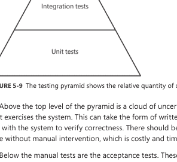

图 5-9 测试金字塔显示了不同类型测试的相对数量。

金字塔顶层之上是一个不确定性的云，代表手动测试来[content]

因此，务实的 TDD 应该更名为测试先行开发。我只在为了简洁的情况下使用 TFD 这个缩写。理想情况下，原教旨主义的 TDD 应该更名为测试驱动设计。通过修正命名，我们可以对各自的优缺点进行更有意义的讨论。行为也可能会改变：如果你的招聘经理在测试测试驱动设计，但实际需要完成的工作更适合测试先行开发，那么术语的重新对齐可以帮助你找到更适合该工作的候选人。

# 测试驱动设计

TDD 是一种设计练习。它最适用于生产代码的设计未知且可以通过编写单元测试的红-绿-重构过程有机地涌现的情况。

Zuhlke 工程服务公司的 Keith Braithwaite 将这种测试称为“认真对待的 TDD”。使用以下规则可以帮助向只做过测试先行开发的开发者教授测试驱动设计。

- 1. 编写恰好一个新测试。它应该是最小的测试，看起来指向解决方案的方向。
- 2. 运行测试以确保它失败。
- 3. 通过在测试方法中编写最少的实现代码使 (1) 中的测试通过。
- 4. 重构以消除重复或按需进行以改进设计。对重构要严格。仅在它们有助于改进代码设计时才引入新的抽象（方法、类等）。具体来说：
  a. 只有当测试方法中存在足够的代码重复时，才提取新方法。提取方法时，首先将其提取到测试类中（不要创建新类）。
  b. 只有当一组方法明显形成分组并且测试类开始感觉拥挤或过大时，才创建新类。
- 3. 重复该过程，通过编写另一个测试（回到步骤 1）。

这是一套相当严格的规则，但它们并非随意制定。这些测试驱动设计的规则旨在生成通过单元测试所需的足够设计，而不多也不少。这自然可以防止过度设计。过度设计发生在代码被无意义地设计为可适应时——也就是说，它可以在永远不需要的方式下被扩展。这就是推测性泛化，其在第 8 章“开闭原则”中有更详细的讨论。

TDD 必然要求对解决方案采取绿地方法。这就是为什么它如此适用于代码 kata 和领域驱动开发（DDD）。在这两种情况下，都没有现有的代码供你挂载新功能。存在一个定义不清且可能不断变化的问题空间。在不成为该领域的专家之前，你需要一种设计工具来指导你将错综复杂的

> **提示**  *code kata* 是学习新语言、技术或技能的练习或训练。术语 *kata* 最初指的是武术如空手道的个人训练练习。一些代码 kata 可以在 *http://www.codekatas.org* 找到。

# 测试先行开发

TFD 在某些关键领域与 TDD 重叠。测试显然是先编写的。红-绿-重构过程被遵守。但 TFD 不是设计练习。设计已经形成或正在其他地方形成：在开发者的头脑中。

类、职责和协作（CRC）会话可用于为组件生成设计。在确定了类和方法——以及它们之间的交互——的存在之后，剩下的只是填补空白。到你开始编写单元测试并用生产代码使其通过时，你已经熟悉了自己的设计。

即使没有像 CRC 这样明确的设计会话，也可能在不通过单元测试证明其必要性的情况下构思设计。事实上，可能考虑许多不同的设计，并在决定实现之前隐式地在它们之间进行权衡。这可以采取结对编程会话的形式，在此期间会进行大量讨论，关于命名约定、方法实现和其他问题的相对优点。

TDD 和 TFD 分歧的灰色地带在于，当编写测试时，开发者是否严格专注于实现足以使测试通过的最小功能。例如，如果在将红色测试变为绿色过程中创建了类或方法，这与 TDD 的规则相悖。类和方法是设计构造，只能作为相关功能的分组机制出现。这是单元测试的重构阶段的一部分。

到目前为止，没有给这场讨论添加任何颜色来区分 TDD 或 TFD 在客观上更好或更差。权衡似乎是这样的：较少的开发者拥有足够的 TDD 或设计方面的经验来持续地使用这种方法取得成功。但 TFD 有倾向于生成过度设计的倾向，这些设计充斥着机械的决策。TDD 被误解；TFD 被理解。TDD 产生足够的设计；TFD 产生开发者头脑中已有的任何设计。


# 进一步的测试

单元测试并不是提供价值的唯一测试类型。如果只使用单元测试，只能验证代码的最低层细节。到目前为止，应该很清楚软件存在不同粒度的层次，而单元测试只处理最细粒度的元素。

有两种普遍存在的图表可以解释不同层级测试之间的差异。测试金字塔提醒你应保持的相对测试数量。测试四象限图解释了测试可以对不同利益相关者有用以及出于不同原因。

# 测试金字塔

图 5-9 显示了测试金字塔。你可能以前见过。它是在讨论用于验证系统的相对测试数量时很有用的参考。


图 5-9 测试金字塔显示了不同类型测试的相对数量。

金字塔顶层之上是一个不确定性的云，代表手动测试来


在你达到信心阈值后，继续增加测试所产生的边际额外信心不值得付出努力。最好停止并专注于现有测试的质量和可维护性。

# 雪糕

图 5-11 显示了当测试金字塔完全倒置时会发生什么：顶部的不确定性云层已膨胀到庞大的程度，而几乎看不到单元测试。


图 5-11 当测试的相对数量被倒置时，金字塔就变成了雪糕。

当大多数测试工作都是手动的时，这表明你有一个无法测试的代码库。应立即开始重构代码，使其本质上可测试。为了纳入此类工作，请结合使用黄金主技术（参见第 6 章“重构”）和看板服务等级（参见第 2 章“看板简介”）。

手动测试不如自动化测试可靠，因为执行测试脚本的人会出错。这种重复、单调的工作很快就会变得令人沮丧。努力自动化你能自动化的部分，以便在必要时可以廉价地重复手动测试。

# 测试象限

测试金字塔中涵盖的测试存在于不同的粒度，从粗粒度的用户界面测试到细粒度的单元测试。测试象限提供了测试的补充视角：它们适用于不同的利益相关者，并且出于不同的原因。

对于已经 somewhat 熟悉测试象限的读者来说——毕竟这是一个相当古老的概念——图 5-12 中呈现的版本看起来可能有所不同。软件顾问 Gojko Adzic 令人钦佩地刷新了测试象限，使其更符合当前的技术水平。该图经 Gojko Adzic 许可转载。


图 5-12 测试象限有助于对不同测试类别的受众和目的进行分类。

与所有基于象限的模型一样，有两个轴需要考虑。在垂直轴上，讨论的是测试的预期受众：技术人员或业务。在水平轴上，讨论的是测试目的：期望验证（定量）与分析（定性）结果。

## 业务/定量

企业通常与其客户和客户签订服务水平协议（SLAs）。这些是企业必须遵守的正式、可量化的标准，否则企业需对客户提供某种形式的赔偿。可用性是常见的 SLA 指标，企业承诺以 99.9% 的正常运行时间保持服务可用。由于这可以衡量并且对业务有直接影响，因此针对此类标准的测试位于此象限。

## 业务/定性

主观关注点如可用性就存在于此象限。这里更强调所涉及的技术，而更强调软件对业务的影响。A/B 和多变量测试，允许通过实验评估组件的多个版本，是整个软件领域中出现的趋势。与其通过焦点小组测试用户更喜欢矢车菊蓝还是海洋蓝，不如对两种蓝色进行 A/B 测试并衡量转化提升的统计显著性。

## 技术/定量

单元测试位于此象限，集成测试也是如此。这些测试支持开发团队量化系统与其需求的符合程度。单元测试通过率、代码覆盖率和圈复杂度等统计数据表明系统的整体健康状况。

## 技术/定性

在这里，你关注的是可能没有可量化需求的架构能力。负载测试关注系统在各种负载下表现的资源使用情况。对于服务而言，这可能包括吞吐量统计和响应时间曲线，随着更多用户同时访问系统。评估系统的安全性也是一种定性活动；这是通过渗透测试来评估的。系统的攻击向量难以量化，因此需要更分析性的[content]

在你达到信心阈值后，继续增加测试所产生的边际额外信心不值得付出努力。最好停止并专注于现有测试的质量和可维护性。

# 雪糕

图 5-11 显示了当测试金字塔完全倒置时会发生什么：顶部的不确定性云层已膨胀到庞大的程度，而几乎看不到单元测试。


图 5-11 当测试的相对数量被倒置时，金字塔就变成了雪糕。

当大多数测试工作都是手动的时，这表明你有一个无法测试的代码库。应立即开始重构代码，使其本质上可测试。为了纳入此类工作，请结合使用黄金主技术（参见第 6 章“重构”）和看板服务等级（参见第 2 章“看板简介”）。

手动测试不如自动化测试可靠，因为执行测试脚本的人会出错。这种重复、单调的工作很快就会变得令人沮丧。努力自动化你能自动化的部分，以便在必要时可以廉价地重复手动测试。

# 测试象限

测试金字塔中涵盖的测试存在于不同的粒度，从粗粒度的用户界面测试到细粒度的单元测试。测试象限提供了测试的补充视角：它们适用于不同的利益相关者，并且出于不同的原因。

对于已经 somewhat 熟悉测试象限的读者来说——毕竟这是一个相当古老的概念——图 5-12 中呈现的版本看起来可能有所不同。软件顾问 Gojko Adzic 令人钦佩地刷新了测试象限，使其更符合当前的技术水平。该图经 Gojko Adzic 许可转载。


图 5-12 测试象限有助于对不同测试类别的受众和目的进行分类。

与所有基于象限的模型一样，有两个轴需要考虑。在垂直轴上，讨论的是测试的预期受众：技术人员或业务。在水平轴上，讨论的是测试目的：期望验证（定量）与分析（定性）结果。

## 业务/定量

企业通常与其客户和客户签订服务水平协议（SLAs）。这些是企业必须遵守的正式、可量化的标准，否则企业需对客户提供某种形式的赔偿。可用性是常见的 SLA 指标，企业承诺以 99.9% 的正常运行时间保持服务可用。由于这可以衡量并且对业务有直接影响，因此针对此类标准的测试位于此象限。

## 业务/定性

主观关注点如可用性就存在于此象限。这里更强调所涉及的技术，而更强调软件对业务的影响。A/B 和多变量测试，允许通过实验评估组件的多个版本，是整个软件领域中出现的趋势。与其通过焦点小组测试用户更喜欢矢车菊蓝还是海洋蓝，不如对两种蓝色进行 A/B 测试并衡量转化提升的统计显著性。

## 技术/定量

单元测试位于此象限，集成测试也是如此。这些测试支持开发团队量化系统与其需求的符合程度。单元测试通过率、代码覆盖率和圈复杂度等统计数据表明系统的整体健康状况。

## 技术/定性

在这里，你关注的是可能没有可量化需求的架构能力。负载测试关注系统在各种负载下表现的资源使用情况。对于服务而言，这可能包括吞吐量统计和响应时间曲线，随着更多用户同时访问系统。评估系统的安全性也是一种定性活动；这是通过渗透测试来评估的。系统的攻击向量难以量化，因此需要更分析性的方法。

测试象限表明，不同类别的测试各有不同。虽然本书主要关注单元测试实现和设计的低级细节，但你代码的适应性也依赖于拥有合适数量和合适类型的测试。

# 测试用于预防和治疗

迄今为止讨论的所有测试都涉及预防性测试。也就是说，提前投入精力以确保新功能按预期工作，并且没有现有功能被回归。

这是标准做法。但它并非没有成本。每项编写的测试都需要时间和精力。信心是测试的货币。需要牢记的等式是：

effort < confidence

如果你的努力没有产生所需的测试信心，它们就成本过高，你应该将精力集中在其他地方。当然，所有项目都有一个目标信心，以校准其对失败的容忍度。嵌入在起搏器中的软件需要的信心远高于为商业软件即服务解决方案提供动力的软件。遵循努力与信心的相关性，确保起搏器正确工作的努力因此要高得多。

但是，如果你不是在编写这种任务关键型软件，你有哪些选择来减少努力并增加信心？

图 5-13 显示了软件通常如何从开发到实时环境。


图 5-13 软件可以在到达实时环境之前部署到多个环境进行测试。

随着流程的每个阶段，你对软件功能正确性和鲁棒性的信心都在增加。通过在不同范围和不同环境中[content]

在你达到信心阈值后，继续增加测试所产生的边际额外信心不值得付出努力。最好停止并专注于现有测试的质量和可维护性。

# 雪糕

图 5-11 显示了当测试金字塔完全倒置时会发生什么：顶部的不确定性云层已膨胀到庞大的程度，而几乎看不到单元测试。


图 5-11 当测试的相对数量被倒置时，金字塔就变成了雪糕。

当大多数测试工作都是手动的时，这表明你有一个无法测试的代码库。应立即开始重构代码，使其本质上可测试。为了纳入此类工作，请结合使用黄金主技术（参见第 6 章“重构”）和看板服务等级（参见第 2 章“看板简介”）。

手动测试不如自动化测试可靠，因为执行测试脚本的人会出错。这种重复、单调的工作很快就会变得令人沮丧。努力自动化你能自动化的部分，以便在必要时可以廉价地重复手动测试。

# 测试象限

测试金字塔中涵盖的测试存在于不同的粒度，从粗粒度的用户界面测试到细粒度的单元测试。测试象限提供了测试的补充视角：它们适用于不同的利益相关者，并且出于不同的原因。

对于已经 somewhat 熟悉测试象限的读者来说——毕竟这是一个相当古老的概念——图 5-12 中呈现的版本看起来可能有所不同。软件顾问 Gojko Adzic 令人钦佩地刷新了测试象限，使其更符合当前的技术水平。该图经 Gojko Adzic 许可转载。


图 5-12 测试象限有助于对不同测试类别的受众和目的进行分类。

与所有基于象限的模型一样，有两个轴需要考虑。在垂直轴上，讨论的是测试的预期受众：技术人员或业务。在水平轴上，讨论的是测试目的：期望验证（定量）与分析（定性）结果。

## 业务/定量

企业通常与其客户和客户签订服务水平协议（SLAs）。这些是企业必须遵守的正式、可量化的标准，否则企业需对客户提供某种形式的赔偿。可用性是常见的 SLA 指标，企业承诺以 99.9% 的正常运行时间保持服务可用。由于这可以衡量并且对业务有直接影响，因此针对此类标准的测试位于此象限。

## 业务/定性

主观关注点如可用性就存在于此象限。这里更强调所涉及的技术，而更强调软件对业务的影响。A/B 和多变量测试，允许通过实验评估组件的多个版本，是整个软件领域中出现的趋势。与其通过焦点小组测试用户更喜欢矢车菊蓝还是海洋蓝，不如对两种蓝色进行 A/B 测试并衡量转化提升的统计显著性。

## 技术/定量

单元测试位于此象限，集成测试也是如此。这些测试支持开发团队量化系统与其需求的符合程度。单元测试通过率、代码覆盖率和圈复杂度等统计数据表明系统的整体健康状况。

## 技术/定性

在这里，你关注的是可能没有可量化需求的架构能力。负载测试关注系统在各种负载下表现的资源使用情况。对于服务而言，这可能包括吞吐量统计和响应时间曲线，随着更多用户同时访问系统。评估系统的安全性也是一种定性活动；这是通过渗透测试来评估的。系统的攻击向量难以量化，因此需要更分析性的方法。

测试象限表明，不同类别的测试各有不同。虽然本书主要关注单元测试实现和设计的低级细节，但你代码的适应性也依赖于拥有合适数量和合适类型的测试。

# 测试用于预防和治疗

迄今为止讨论的所有测试都涉及预防性测试。也就是说，提前投入精力以确保新功能按预期工作，并且没有现有功能被回归。

这是标准做法。但它并非没有成本。每项编写的测试都需要时间和精力。信心是测试的货币。需要牢记的等式是：

effort < confidence

如果你的努力没有产生所需的测试信心，它们就成本过高，你应该将精力集中在其他地方。当然，所有项目都有一个目标信心，以校准其对失败的容忍度。嵌入在起搏器中的软件需要的信心远高于为商业软件即服务解决方案提供动力的软件。遵循努力与信心的相关性，确保起搏器正确工作的努力因此要高得多。

但是，如果你不是在编写这种任务关键型软件，你有哪些选择来减少努力并增加信心？

图 5-13 显示了软件通常如何从开发到实时环境。


图 5-13 软件可以在到达实时环境之前部署到多个环境进行测试。

随着流程的每个阶段，你对软件功能正确性和鲁棒性的信心都在增加。通过在不同范围和不同环境中[content]
After you reach your confidence threshold, the marginal extra confidence generated by continuing to add tests is not worth the effort. It is better to stop and focus on the quality and maintainability of the existing tests.

# The snowcone

Figure 5-11 shows what happens when the test pyramid becomes fully inverted: the cloud of uncertainty at the top has grown to gargantuan proportions, and there are almost no unit tests in sight.


FIGURE 5-11 When the relative quantities of tests are inverted, the pyramid becomes a snowcone.

When the majority of testing effort is manual, this indicates that you have an untestable codebase. Work should begin promptly to refactor the code so that it is inherently testable. To factor in such work, use a combination of the golden master technique (see Chapter 6, "Refactoring") and Kanban's class of service (see Chapter 2, "Introduction to Kanban").

Manual tests are not as reliable as automated tests because of the fallibility of the person executing the test script. Such repetitive, monotonous work quickly becomes demotivating. Work to automate what you can so that the manual tests can be cheaply repeated whenever necessary.

# The testing quadrant

The testing covered in the testing pyramid exists at different granularities, from coarse-grained user interface tests to fine-grained unit tests. The test quadrant provides a complementary view of tests: they are applicable to different stakeholders and for different reasons.

To readers who are already somewhat familiar with the testing quadrant—after all, it is quite an old idea—the version presented in Figure 5-12 might look different. Software consultant Gojko Adzic admirably refreshed the testing quadrant to make it more relevant to the current state of the art. This figure is reproduced with the permission of Gojko Adzic.


FIGURE 5-12 The testing quadrant helps categorize the audience and purpose of different test categories.

As with all quadrant-based models, there are two axes to consider. On the vertical axis, the intended audience of the tests is addressed: technologists or business. On the horizontal axis, the test purpose is addressed: expectation verification (quantitative) versus analytical (qualitative) outcomes.

## Business/Quantitative

Businesses tend to have service level agreements (SLAs) with their customers and clients. These are formalized, quantifiable standards with which the business must comply or be liable for providing the client some form of compensation. Availability is a common SLA criterion, whereby the business promises to keep a service available with 99.9% uptime. Because this is measurable and has a direct effect on the business, tests for these sorts of standards live in this quadrant.

## Business/Qualitative

Subjective concerns such as usability are found in this quadrant. The emphasis here is less on the technologies involved and more on the business impact of the software. A/B and multivariate testing, which allow for multiple versions of components to be evaluated through experimentation, are an emerging trend across the wider software spectrum. Rather than focus-group testing whether your users prefer cornflower blue or ocean blue, the two blues can be A/B tested and the statistical significance of conversion uplift can be measured.

## Technology/Quantitative

Unit tests reside in this quadrant, as do integration tests. These tests support the development team in quantifying how closely the system meets its requirements. Statistics such as unit test pass percentage, code coverage, and cyclomatic complexity indicate the overall health of a system.

## Technology/Qualitative

Here you focus on architectural capabilities for which you might not have quantifiable requirements. Load testing focuses on the resource usage that a system exhibits under various amounts of load. For a service, this is likely to include throughput statistics and response time curves as more users concurrently access the system. Assessing the security of a system is also a qualitative activity; this is assessed through penetration testing. The attack vectors of a system are difficult to quantify, so a more analytical approach is needed.

The testing quadrant shows that there are different categories of each kind of test. Although this book primarily focuses on the low-level details of unit test implementation and design, the adaptability of your code also relies on having the right amount of the right type of tests.

# Testing for prevention and cure

All of the testing discussed so far has dealt with testing for prevention. That is, effort is expended up front to ensure that new functionality works as expected and that no existing functionality has been regressed.

This is standard practice. But it is not without cost. Every test written takes time and effort. Confidence is the currency of tests. The equation to bear in mind is this:

effort < confidence

If your efforts do not generate the requisite test confidence, they are too costly and you should focus your effort elsewhere. Of course, all projects have a target confidence that calibrates their tolerance for failure. The software embedded in a pacemaker requires far more confidence than that which powers a commercial software-as-a-service solution. Following the correlation of effort and confidence, the effort that can be expended to ensure the correct working of a pacemaker is thus much higher.

But, if you are not writing such mission-critical software, what are your options for reducing the effort and increasing the confidence?

Figure 5-13 shows how software typically makes its way from development through to a live environment.


FIGURE 5-13 Software can be deployed to many environments for testing before reaching a live environment.

With each phase of the process, your confidence in the functional correctness and robustness of the software increases. By exercising the code at different scopes and in different environments, you generate feedback that the code is working or is broken. After the code is released and verified in a live environment, your confidence is at its highest. What if you could find a shortcut from development to live? Your confidence would increase dramatically, yet the effort required would be minimal.

> “But,” you say, “without those incremental increases in confidence, we would fail in live so much more!”

Good.

There should never be a fear of failure in software development. If your culture is to fear failure, you cannot innovate. Instead, embrace the fact that you will fail, that you will roll back some releases. Failure is a better teacher than success. What you must do is shift your focus from Mean Time Before Failure (MTBF) toward Mean Time To Recovery (MTTR).

MTBF is a great measurement for systems in which you require a high level of confidence. It shows that the system is robust and has been very rigorously exercised. But as you now know, that level of confidence is expensive and is anathema to innovation.

MTTR, however, not only allows for failure, it prepares for it. Consider the possibility that you have a system with an MTBF of 100 days and an MTTR of 1 day. Thus, in aggregate, every three years, the system is unavailable for a day.

Compare this with a system that has an MTBF of 10 days and an MTTR of 1 hour. This system fails 10 times as often as the last! However, when it fails, it is operable again in only one hour: twenty-four times faster than the other system.

System 1 has an uptime of 99.99%.

System 2 has an uptime of over 99.995%.

You are enabled to fail fast by focusing on MTTR. This lets you loosen your grip on MTBF and innovate faster.

# How do you decrease MTTR?

When a service fails in a live environment, you must do something with it to put it back in a workable state. But first, you need to know that it isn’t working. Through a mixture of logging and alerting, you can monitor the health of your systems.

Logging is passive. If logging was the only option available, there would be a lot of time wasted polling the logs to see if something was going wrong. This is infeasible for most systems, because they could generate so much logging data that trying to discern a failure would become nearly impossible.

Alerting is active. When logging is in place, you can set acceptable boundaries that a variety of metrics should stay inside. If a metric breaches one of the boundaries, alerting can generate an event that informs you to start looking at specific parts of the logs and to take action.


指标的示例包括服务吞吐量、响应时间，以及机器资源使用情况，例如 RAM、CPU 和磁盘的使用百分比。其他指标可能与特定领域相关，例如转化率下降或整体完成的交易数量减少。

通过监控和告警，你可以更加确信自己能够发现生产环境中的问题，而这是恢复工作的第一步。

# 结论

本章介绍了各种单元测试模式和实践，它们将帮助你在不担心破坏现有功能的情况下修改代码库。

你编写的每个单元测试都应体现对代码的某种预期。尽管单元测试作为代码属于技术产物，但它们会在对象中强制实现现实世界的行为，就像这些对象封装了现实世界的概念一样。

当你严格遵循测试优先的方法时，在构造出一个失败的单元测试之前，不会编写任何新的生产代码。随后，你会编写尽可能简单的生产代码，使单元测试从红色的失败状态转变为绿色的成功状态。从逻辑上推演到最后，生产代码将自然地成为满足其单元测试预期的副作用。

对代码进行单元测试时，你就为后续修改生产代码打下了坚实基础，使其能够更加清晰地适应未来的需求。代码重构是一个逐步改进代码设计的过程。下一章将深入探讨重构。

# 重构

完成本章后，你将能够：

- 理解单元测试的重要性，以及单元测试在支持重构方面所发挥的作用。
- 重构生产代码，改善其整体设计。
- 安全地改进没有配套单元测试的旧代码库的设计。

重构是逐步改进现有代码设计的过程。它类似于编写代码的多个草稿，就像我为本书撰写过多个版本一样。承认我们开发人员很少能第一次就把事情做对，重构让我们可以先完成最简单的实现，然后通过逐步改进，在之后得到更好的解决方案。

能够毫无顾忌地进行重构，得益于单元测试。单元测试与重构共同形成一种互惠互利的关系：单元测试支持重构，而重构则改善代码设计。

# 重构简介

如果你遵循测试驱动开发（TDD）流程，在实现预期行为之前先编写一个失败的单元测试，那么你的代码将更加健壮。然而，这些代码可能并没有达到应有的组织性和可理解性。在编写代码的过程中，有很多时候你应该暂停编写单元测试和代码，转而专注于重构。

重构是在代码已经编写完成之后，改进现有代码设计的过程。每次重构的规模和范围都不同。重构可能只是对变量名称进行小幅调整，以提高代码的清晰度；也可能是更广泛的架构变更，例如在用户界面逻辑与领域逻辑之间已经产生不恰当的紧密耦合时，将二者拆分开来。

# 修改现有代码

在本章中，你将对一个类进行渐进式修改，每一步都会以某种有意义的方式改善代码。你在第 5 章“测试”中使用过的 `Account` 类将作为重构目标，不过自上次使用以来，它新增了一个方法：`CalculateRewardPoints`。与许多公司一样，你的客户希望通过累积奖励积分来回馈客户忠诚度。客户获得的积分取决于多种标准。

清单 6-1 展示了新的 `Account` 类。

# 清单 6-1 新类除了跟踪账户余额外，还跟踪奖励积分。

```csharp
public class Account
{
    public Account(AccountType type)
    {
        this.type = type;
    }

    public decimal Balance
    {
        get;
        private set;
    }

    public int RewardPoints
    {
        get;
        private set;
    }

    public void AddTransaction(decimal amount)
    {
        RewardPoints += CalculateRewardPoints(amount);
        Balance += amount;
    }

    public int CalculateRewardPoints(decimal amount)
    {
        int points;
        switch(type)
        {
            case AccountType.Silver:
                points = (int)decimal.Floor(amount / 10);
                break;
            case AccountType.Gold:
                points = (int)decimal.Floor((Balance / 10000 ^ 5) + (amount / 5));
                break;
            case AccountType.Platinum:
                points = (int)decimal.Ceiling((Balance / 10000 * 10) + (amount / 2));
                break;
            default:
                points = 0;
                break;
        }
        return Math.Max(points, 0);
    }

    private readonly AccountType type;
}
```

该类最重要的变化总结如下：

- 新增了一个属性，用于跟踪客户与此账户关联的奖励积分数量。
- 每个账户都有一个类型代码，用于表示账户级别：Silver、Gold 或 Platinum。
- 每当向账户添加一笔交易时，客户都会获得奖励积分。
- 获得的奖励积分数量取决于多个因素，这使计算方法变得更加复杂：
  - **账户类型**——账户级别越高，获得的积分越多。
  - **交易金额**——客户消费越多，获得的积分越多。
  - **账户当前余额**——Gold 和 Platinum 级别会为保持较高余额的客户提供更多积分。

假设这个类是与其单元测试一起编写的，那么这些测试将发挥巨大作用，确保修改不会影响已指定的行为。这一点非常重要——重构改变的是代码的组织方式，而不是结果。如果没有单元测试就尝试重构，那么当你无意中破坏了预期行为时，如何知道这一点？你无法快速发现问题，而只能在运行时测试期间很晚才发现；更糟糕的是，甚至可能要等到部署之后才发现。

# 用常量替换“魔法数字”

第一次重构是一个简单但同样重要的改进，可以提高代码的可读性。`CalculateRewardPoints` 方法中充斥着大量“魔法数字”。有 6 个不同的数字在没有任何上下文的情况下被使用，读者无法知道它们代表什么，也无法知道为什么需要它们。对于编写代码的人来说，这些数字的含义可能很明显，因为他事先了解其中的含义。但实际上，这种理解可能只会持续一周，也许两周，之后记忆便开始淡化，他们也会逐渐忘记那个 5 或那个 2 代表什么。清单 6-2 展示了此次重构对该类所做的修改。

```csharp
public class Account
{
    public int CalculateRewardPoints(decimal amount)
    {
        int points;
        switch(type)
        {
            case AccountType.Silver:
                points = (int)decimal.Floor(amount / SilverTransactionCostPerPoint);
                break;
            case AccountType.Gold:
                points = (int)decimal.Floor((Balance / GoldBalanceCostPerPoint) + (amount / GoldTransactionCostPerPoint));
                break;
```

# 1. 引言

随着信息技术的飞速发展，数据已成为现代社会最重要的战略资源之一。如何高效地管理和利用海量数据，是当前学术界和工业界共同关注的核心问题。本文旨在探讨大数据环境下数据治理的关键技术与发展趋势。

# 2. 数据治理框架

一个完善的数据治理框架通常包括以下几个核心组成部分：数据标准管理、数据质量管理、数据安全管理、数据生命周期管理以及元数据管理。这些组成部分相互关联，共同构成了一个有机的整体。

- 数据标准管理
- 数据质量管理
- 数据安全管理
- 数据生命周期管理
- 元数据管理

# 3. 关键技术分析

在大数据环境下，传统的数据治理技术面临诸多挑战。分布式存储与计算技术、数据血缘追踪技术、智能数据质量检测技术等成为新的研究热点。下表对比了传统方法与现代方法的主要差异：

| 维度 | 传统方法 | 现代方法 |
|---|---|---|
| 存储 | 集中式 | 分布式 |
| 处理 | 批处理 | 流批一体 |
| 质量检测 | 人工规则 | AI智能检测 |

GoldAccount 类、SilverAccount 类和 PlatinumAccount 类分别表示 Gold、Silver 和 Platinum 账户类型。第一步是定义这些类，如清单 6-3 所示。

# 清单 6-3 每种账户类型现在都是一个独立的类。

```csharp
public class SilverAccount
{
    public int CalculateRewardPoints(decimal amount)
    {
        return Math.Max((int)decimal.Floor(amount / SilverTransactionCostPerPoint), 0);
    }

    private const int SilverTransactionCostPerPoint = 10;
}
// …
public class GoldAccount
{
    public decimal Balance
    {
        get;
        set;
    }

    public int CalculateRewardPoints(decimal amount)
    {
        return Math.Max((int)decimal.Floor((Balance / GoldBalanceCostPerPoint) + (amount / GoldTransactionCostPerPoint)), 0);
    }

    private const int GoldTransactionCostPerPoint = 5;
    private const int GoldBalanceCostPerPoint = 2000;
}
// …
public class PlatinumAccount
{
    public decimal Balance
    {
        get;
        set;
    }

    public int CalculateRewardPoints(decimal amount)
    {
        return Math.Max((int)decimal.Ceiling((Balance / PlatinumBalanceCostPerPoint) + (amount / PlatinumTransactionCostPerPoint)), 0);
    }

    private const int PlatinumTransactionCostPerPoint = 2;
    private const int PlatinumBalanceCostPerPoint = 1000;
}
```


请注意，在此阶段，原来的 Account 类尚未被更改。这些类是作为独立类创建的。这些类的单元测试将反映 CalculateRewardPoints 类的期望，但针对每种账户类型的系统 under test（SUT）不同。用于确定白金账户和黄金账户类应得奖励积分的算法依赖于当前余额；已包含该依赖项以使这些类能够独立编译。Balance 属性也是公开可设置的，这使得可以使用不同的值进行单元测试。图 6-1 中的 UML 类图解释了这些类之间的关系。


图 6-1 Account 类将变为抽象类，并具有抽象的 CalculateRewardPoints 方法。

这只是为完成用继承替换 switch 语句这一目标而设的一个中间目标，当然。重要的是不要一次做太多，以便你可以通过一系列较小的更改来验证自己是否走在正确的轨道上。下一个更改，在清单 6-4 中，是将全部四个类链接到一个继承层次结构中。

# 清单 6-4 从 Account 类中移除了复杂性。

```
public abstract class AccountBase
{
    public decimal Balance
    {
        get;
        private set;
    }

    public int RewardPoints
    {
        get;
        private set;
    }

    public void AddTransaction(decimal amount)
    {
        RewardPoints += CalculateRewardPoints(amount);
        Balance += amount;
    }

    public abstract int CalculateRewardPoints(decimal amount);
}
```

没有了 switch 语句，这个类就没有理由再意识到自己的“类型”了，因此构造函数也被移除了。该类由于抽象的计算方法而变为抽象，但这意味着你不能再实例化它，从而也不能再对其进行测试。

# Indiana Jones 和激进的重构

在电影《夺宝奇兵：失落的方舟》开头，主人公深入秘鲁的一个洞穴，试图找回一个小偶像。他知道偶像所坐的带重量的开关上设有机关陷阱。他用沙子装满布袋，试图将其作为偶像的替代品。他的理论是，如果他能足够快地用沙袋替换偶像，就能防止开关被触发，机关陷阱就不会启动。

不幸的是，印第的计划失败了，他被巨石从洞穴中追赶出来。作为一个开端事件，这堪称最令人难忘的之一。但其中有一个技巧可以应用于重新设计：并行实现。

金色偶像代表现有的类或方法，而沙袋则类似于新设计。以并行方式实现新设计，允许在最后一刻更新客户端代码，有效地将金色偶像换成沙袋。然后可以安全地完全移除旧设计。

Account 类的重构就是一个需要通过并行实现来达到中间目标的激进重构示例。请注意，并行实现的令人信服的优势在于，在整个过程中，可以随时保存进度以便稍后恢复。重构不应阻止你在源代码控制中定期提交。目标是每 10 到 15 分钟提交一次。

单元测试需要一个对象实例才能工作，因此下一步是将三种账户类型链接为该基类的子类。一个有用的命名约定——类似于接口名称以大写 I 为前缀——是将抽象类后缀命名为 Base。这是一个快速提示，表明该类不能被实例化并且有相关的子类。

当创建三个子类时，你可以从 GoldAccount 和 PlatinumAccount 中移除 Balance 属性，因为它们将从该基类继承 Balance 和 AddTransaction 成员。清单 6-5 显示了此步骤后全部三个类。

# 清单 6-5 通过继承基类完成重构。

```
public class SilverAccount : AccountBase
{
    public override int CalculateRewardPoints(decimal amount)
    {
        return Math.Max((int)decimal.Floor(amount / SilverTransactionCostPerPoint), 0);
    }

    private const int SilverTransactionCostPerPoint = 10;
}
```

```
{
    AccountBase account = null;
    switch(type)
    {
        case AccountType.Silver:
            account = new SilverAccount();
            break;
        case AccountType.Gold:
            account = new GoldAccount();
            break;
        case AccountType.Platinum:
            account = new PlatinumAccount();
            break;
    }
    return account;
}
```

工厂方法的两个关键特性减轻了客户端的负担。首先，它是静态的，这意味着客户端在类型上调用它，而不是在该类型的实例上调用。其次，返回类型是基类，允许你将子类账户隐藏在客户端之外。事实上，你可以将其隐藏到它们是 internal 的程度，因此在该程序集之外不可见。这不允许客户端直接构造子类，消除了 new 操作符作为潜在的代码异味的可能性（参见第 3 章“依赖关系和分层”）。清单 6-7 比较了重构前后客户端如何与账户交互。

尽管 switch 语句仍然存在，但在此实例中要简单得多，并且促进了之前用多态性替换它的重构。

# 清单 6-7 重构前后 Account 如何创建新账户。

```
public void CreateAccount(AccountType accountType)
{
    var newAccount = new Account(accountType);
    accountRepository.NewAccount(newAccount);
}
// . . .
public void CreateAccount(AccountType accountType)
{
    var newAccount = AccountBase.CreateAccount(accountType);
    accountRepository.NewAccount(newAccount);
}
```

这段代码是客户端——在此例中为 Account——在重构前后如何构造新账户的示例。区别微不足道，但请注意 new 操作符已被移除并替换为对工厂方法的静态调用。这是一种用更灵活的东西替换非常僵硬的东西的常见方式。工厂方法打开了更多可能性，因为它们可以返回的内容比总是返回相同类型的方法要多。

细心的读者会注意到，选择静态工厂方法是不理想的——它更像天钩而非起重机，因此会影响代码的稳定性和适应性。更好的实现会将 CreateAccount 方法放在合适的接口上，如下一节所述。

# 用工厂类替换构造函数

工厂方法有一个替代方案：工厂类。事实上，你不需要将客户端耦合到独立工厂的实现；你只需给他们接口，如清单 6-8 所示。

**LISTING 6-8** 账户工厂隐藏了创建账户实例的实现细节。

```
public interface IAccountFactory
{
    AccountBase CreateAccount(AccountType accountType);
}
```

该方法的接口实际上与工厂方法的接口相同，只是它是实例方法。实现可以与之前的方法体相同，这意味着它对所有不同类型的账户都有完美的了解。Account 以及其他客户端随后会将此接口作为构造函数参数需要，如清单 6-9 所示。

**LISTING 6-9** 服务现在接收工厂作为构造函数参数并用它来创建账户。

```
public class Account
{
    public Account(IAccountFactory accountFactory, IAccountRepository
    accountRepository)
    {
        this.accountFactory = accountFactory;
        this.accountRepository = accountRepository;
    }

    public void CreateAccount(AccountType accountType)
    {
        var newAccount = accountFactory.CreateAccount(accountType);
        accountRepository.NewAccount(newAccount);
    }

    private readonly IAccountRepository accountRepository;
    private readonly IAccountFactory accountFactory;
}
```

这个服务开始看起来应该是的样子：由更细粒度的接口编排而成，以实现用户界面层的更大目标。出于简洁和清晰的考虑，它缺少构造函数上的一些保护子句，以防止空依赖，以及 CreateAccount 方法上的一些 try/catch 块，以将领域异常编排为服务异常。


# 一个新的账户类型

到目前为止，你能有足够的信心认为对新账户类型的请求会导致对现有代码的最小改动吗？是也不是。在一种情况下，你可以很简单地添加一个账户，但在另一种情况下，你会发现你的当前模型做出了一些错误的假设，形成了*技术债务*。

# 一个新的奖励账户

想象一下，你的客户想要添加另一种账户——青铜账户——它获得的奖励积分是银账户的一半。在领域层支持这一点只需要做两处改动。首先，你需要创建 AccountBase 类的一个新子类，如清单 6-10 所示。

**清单 6-10** 青铜账户作为一种新的账户类型被添加。

```
internal class BronzeAccount : AccountBase
{
    public override int CalculateRewardPoints(decimal amount)
    {
        return Math.Max((int)decimal.Floor(amount / BronzeTransactionCostPerPoint), 0);
    }
    private const int BronzeTransactionCostPerPoint = 20;
}
```

这是一个简单的改动，涉及创建新的单元测试来提供你的预期，以及一个新类来提供计算此类奖励积分的算法。

无论你有一个工厂类还是工厂方法，你都需要更改它以支持你的新账户类型，以及定义可创建账户类型的枚举。清单 6-11 显示了工厂类将如何更改以支持新的青铜账户。

**清单 6-11** switch 语句中添加了一个新的 case 来处理创建青铜账户。

```
public AccountBase CreateAccount(AccountType accountType)
{
    AccountBase account = null;
    switch (accountType)
    {
        case AccountType.Bronze:
            account = new BronzeAccount();
            break;
        case AccountType.Silver:
            account = new SilverAccount();
            break;
        case AccountType.Gold:
            account = new GoldAccount();
            break;
        case AccountType.Platinum:
            account = new PlatinumAccount();
            break;
    }
    return account;
}
```

在为客户处理下一个新账户之前，有没有办法重构这个方法，使你不必为每个账户都修改它？你不能使用前面“用多态替换条件表达式”部分中详细说明的重构，因为这是此类重构的结果。相反，有没有办法根据 accountType 名称构造一个 AccountBase，而不直接引用每个值和子类？清单 6-12 提供了答案。

**清单 6-12** 如果账户遵循一定的命名约定，这个工厂就足以处理所有账户子类。

```
public AccountBase CreateAccount(string accountType)
{
    var objectHandle = Activator.CreateInstance(null, string.Format("{0}Account", accountType));
    return (AccountBase)objectHandle.Unwrap();
}
```

请注意，枚举已被更灵活的字符串值所取代。这可能是一个问题，因为可以提供任何字符串值，而不仅仅是与有效账户类型匹配的值。当然，这正是练习的重点。

这种重构有点冒险，因为它有造成工厂泄漏抽象的危险——它可能不会在所有必需的场景中工作。在这种代码可行之前，必须满足以下几点：

- 每个账户类型必须遵循 [Type]Account 的命名约定，其中 [Type] 前缀是枚举的值。
- 每个账户类型必须包含在此工厂方法所在的同一程序集中。
- 每个账户类型必须有一个公共的默认构造函数——类型不能用任何值参数化。

由于这些限制，这通常意味着你重构得太多了，并且当其中一个限制需要被规避时会导致问题。请谨慎行事。

# 代码坏味道：拒绝继承

在新的奖励卡计划推出一段时间后，客户的营销部门询问有多少人分配到每种账户类型。你的回答使他们得出结论，他们在奖励卡计划中实现了 100% 的采用率：每个客户都有青铜、银、金或白金奖励卡。但事实并非如此。没有为创建*不*属于奖励卡计划的账户做出任何规定，因此默认情况下每个人都被分配了青铜账户。结果是这次对话后，需要另一种新的账户类型：标准账户。

该账户服务于不同的目的——它不赚取任何奖励积分。有两种建模方式。首先，你可以创建一个新的 AccountBase 子类，如清单 6-13 所示，其 `CalculateRewardPoints` 重写什么都不做，只是返回零，有效地不累积积分。

**清单 6-13** 一个简单的账户，没有任何奖励积分计算。

```
internal class StandardAccount : AccountBase
{
    public override int CalculateRewardPoints(decimal amount)
    {
        return 0;
    }
}
```

另一种解决方案是承认并非所有账户都有奖励积分，事实上，领域模型中有两种不同的类型。在这种情况下，而不是为 `CalculateRewardPoints` 方法提供“默认实现”，子类实际上拒绝了超类传给它的东西——因此代码坏味道“拒绝继承”。在之前的例子中，StandardAccount 拒绝实现接口而不是忽略它，而下一个重构将完全拒绝接口。

# 用委托替换继承

在实践中，这意味着你需要将 AccountBase 类拆分为两部分。接口的一部分将保留在账户上，其余部分将移至一个新的类层次结构，以表示奖励卡。这样，账户的继承就被替换为对奖励卡的委托。

第一个改动是引入一个新的 IRewardCard 接口来定义每个奖励卡的属性和行为，如清单 6-14 所示。

**清单 6-14** 奖励积分及其计算已从 Account 类中移出。

```
public interface IRewardCard
{
    int RewardPoints
    {
        get;
    }

    void CalculateRewardPoints(decimal transactionAmount, decimal accountBalance);
}
```

之前，这两个成员是 AccountBase 类的一部分，但它们已被移出，因为它们完全依赖于奖励卡的存在。请注意，CalculateRewardPoints 的接口发生了两种变化。首先，该方法不再有返回值，因为它预计直接修改 RewardPoints 属性。其次，你必须将账户余额作为参数传递给此方法，因为它不再可用。这是以这种方式拆分两个对象的重要副作用：任何不直接被奖励卡对象封装的上下文都将需要传递给它。这可能会导致此方法的接口在未来发生变化。

清单 6-15 显示了重构后青铜卡和白金卡对该接口的实现。

**清单 6-15** 奖励卡实现的示例。

```
internal class BronzeRewardCard : IRewardCard
{
    public int RewardPoints
    {
        get;
        private set;
    }

    public void CalculateRewardPoints(decimal transactionAmount, decimal accountBalance)
    {
        RewardPoints += Math.Max((int)decimal.Floor(transactionAmount /
            BronzeTransactionCostPerPoint), 0);
    }

    private const int BronzeTransactionCostPerPoint = 20;
    // ...
}

internal class PlatinumRewardCard : IRewardCard
{
    public int RewardPoints
    {
        get;
        private set;
    }

    public void CalculateRewardPoints(decimal transactionAmount, decimal accountBalance)
    {
        RewardPoints += Math.Max((int)decimal.Ceiling(
            (accountBalance / PlatinumBalanceCostPerPoint) +
            (transactionAmount / PlatinumTransactionCostPerPoint)), 0);
    }

    private const int PlatinumTransactionCostPerPoint = 2;
    private const int PlatinumBalanceCostPerPoint = 1000;
}
```

这些类与它们之前的版本非常相似，只是多了一个本地 RewardPoints 属性。


如 Listing 6-16 所示，Account 类不再是抽象类，因此不再需要 Base 后缀。对于构造，它接受一个 IRewardCard 实例，并在添加交易时委托给它。总体而言，这个账户看起来更像是在最初要求捕获奖励积分之前的样子。

## 清单 6-16 每个账户都包含一个奖励卡。

```
public class Account
{
    public Account(IRewardCard rewardCard)
    {
        this.rewardCard = rewardCard;
    }

    public decimal Balance
    {
        get;
        private set;
    }

    public void AddTransaction(decimal amount)
    {
        rewardCard.CalculateRewardPoints(amount, Balance);
        Balance += amount;
    }

    private readonly IRewardCard rewardCard;
}
```

要建模一个 Standard 账户——一个没有奖励卡的账户——你可以为奖励卡构造函数依赖项传递 null（并通过在委托前测试 null 来防止 NullReferenceException），或者你可以建模一个 NullRewardCard。后者将是 Null Object 模式的实现，当调用 CalculateRewardPoints 时不会累积任何奖励积分。

# 激进重构

代码永远不会完成。代码可以是可工作的、足够好的、足够的、有价值的，并且能产生收入。但它很少，如果有的话，是完整的。代码通常处于某种状态，但它只是过渡形式的一个快照。代码始终在从现在的位置向未来某个未知地方的旅程中。当代码被认为已完成时，就会有贬义标签的诱惑。它变得“愚蠢”、“难以阅读”——成为嘲笑的对象。更糟的是，你可能会开始认为其作者是愚蠢的或糟糕的编码者，甚至是恶意的力量，故意让你的生活成为一场噩梦。

如果你转而将代码视为永久未完成，你将更能打破改变的惯性。没有任何代码是神圣不可侵犯的。代码可能开发不足，需要一些工程纪律，或者过度设计，需要简化。代码的不同部分可能表现出每种特性，甚至在惊人的邻近处。永远不要害怕挽起袖子着手*改进*某物。即使你回滚了更改，你也保证能学到东西。更好的是，利用你作为适应性代码忍者的技能，激进地将其重构为更好的形态。

激进重构应该是普通重构本应如此但很少如此的样子。重构应该是持续且勤勉的。它还应该在不同的范围内进行。本章迄今为止讨论的重构在某种程度上是战术性的。这是可以的，但会导致代码在最低层级很干净，但缺乏可辨识的结构。将魔数捕获到常量变量中是高尚的努力，但它不会产生能够吸收无尽新需求功能的代码。

为此，开发过程中需要一个新阶段：*重新设计。*

# Red, green, refactor...redesign

重构意味着第四个概念阶段，*重新设计*，但开发人员通常在重构时止步不前。重构与重新设计在规则上也有细微差别。

当你进行重构时，单元测试通过指定代码的预期行为来防止误操作。如果重构出错并且你无意中改变了代码的行为而不仅仅是其设计，单元测试就会失败。恢复很简单：回滚更改并重试。

当你进行重新设计时，单元测试将不再适用于验证设计。更改生产类或方法的名称，无论是手动还是通过自动化工具，都是重构，而不是重新设计。用一个全新的类替换该类，其方法接受不同的参数并返回不同的输出，则是重新设计。区别在于单元测试必须更改才能有效。

重新设计的步骤，即激进重构，有两个方面。首先，测试必须先更改以反映新设计。其次，必须并行创建满足新设计的生产代码。

先更改测试可确保你仍在进行测试先行开发（不要与测试驱动设计混淆；参见第 5 章）。并行实现新的生产代码可确保你不会在任何时间内破坏现有代码。尽量避免将损坏的代码提交到源代码控制中。如果在重新设计期间代码在任何时候都被破坏，它就不能提交到源代码控制中。这会让你处于尴尬的境地，需要一次性完成重新设计而没有任何暂停或休息。这不可执行，因为开发人员的工作充满了持续的干扰和上下文切换。

# 使遗留代码具有适应性

> 遗留代码是没有测试的代码。
>
> — Michael Feathers，《*Working Effectively with Legacy Code*》

到目前为止的所有重构示例都假设作为重构目标的代码有足够的测试来防止重构错误。如果没有单元测试怎么办？

在他那本伟大的书《*Working Effectively with Legacy Code*》（Prentice Hall，2014）中，Michael Feathers 断言遗留代码不仅仅是来自过去时代用 Cobol 或某种神秘语言编写的代码。不，区分遗留代码的决定性因素是它没有任何单元测试来验证其行为。

这样的代码使重构变得更加困难，因为没有保证不会出现不可避免的错误，从而改变代码的行为和结构。此外，测试的缺失也与糟糕的代码设计相关，因此遗留代码既危险重构，又迫切需要重构！这种缺乏设计正是使其难以改造单元测试以便安全重构的原因。

# 金主技术

Michael Feathers 用两种类型的测试解决了这个问题：特征测试和金主。

特征测试旨在捕获系统的当前行为。目标不是详尽无遗，映射所有可能输入的范围到所有可能输出的域。相反，目标是捕获代码运行时执行的一般起伏。

当特征测试创建后，系统的当前行为会被存储，也许作为文件中的日志消息。现在该文件就是你对系统的期望，并且特征测试的输出被禁用。这些期望可以形成测试断言的基础。金主将运行系统并捕获特征测试的当前视图。从这里，可以对系统进行更改，并将特征测试的输出与金主进行比较。任何与预期路径的偏差都会导致测试失败。只要测试通过、为绿色，你就对重构工作没有改变遗留代码的行为有了一些信心。

只有当系统的预期行为发生变化时，才会通过重新运行特征测试来重新生成金主。在正常的回归测试过程中，金主的生成被禁用，但当前行为与预期行为的断言仍然启用。

当然，这种技术缺乏真正的单元测试的精确度，但想法是每次重构更多是重新设计。这将生成一个并行设计，该设计通过测试先行流程实现。随着单元测试套件的增长，你对应用程序仍然可用的信心也会增强。

# 交易处理器

Listing 6-17 显示了一个名为 TradeProcessor 的类，你想要重构它。这段代码是*遗留代码*，按 Michael Feathers 的定义：它没有任何配套测试。

## 清单 6-17 在没有先引入一些测试的情况下更改代码是危险的。

```
public class TradeProcessor
{
    public void ProcessTrades(System.IO.Stream stream)
    {
        // read rows
        var lines = new List<string>();
        using(var reader = new System.IO.StreamReader(stream))
        {
            string line;
            while((line = reader.ReadLine()) != null)
            {
                lines.Add(line);
            }
        }

        var trades = new List<TradeRecord>();

        var lineCount = 1;
        foreach(var line in lines)
        {
            var fields = line.Split(new char[] { ',' });

            if(fields.Length != 3)
            {
                Console.WriteLine("WARN: Line {0} malformed. Only {1} field(s) found.",
lineCount, fields.Length);
                continue;
            }

            if(fields[0].Length != 6)
            {
                Console.WriteLine("WARN: Trade currencies on line {0} malformed: '{1}'",
lineCount, fields[0]);
                continue;
            }

            int tradeAmount;
            if(!int.TryParse(fields[1], out tradeAmount))
            {
                Console.WriteLine("WARN: Trade amount on line {0} not a valid integer: '{1}'", lineCount, fields[1]);
            }

            decimal tradePrice;
            if (!decimal.TryParse(fields[2], out tradePrice))
```


{
    Console.WriteLine("WARN: Trade price on line {0} not a valid decimal: '{1}'", lineCount, fields[2]);
}

var sourceCurrencyCode = fields[0].Substring(0, 3);
var destinationCurrencyCode = fields[0].Substring(3, 3);

// 计算值
var trade = new TradeRecord
{
    SourceCurrency = sourceCurrencyCode,
    DestinationCurrency = destinationCurrencyCode,
    Lots = tradeAmount / LotSize,
    Price = tradePrice
};

trades.Add(trade);

lineCount++;
}

using (var connection = new System.Data.SqlClient.SqlConnection("Data Source=(local);Initial Catalog=TradeDatabase;Integrated Security=True"))
{
    connection.Open();
    using (var transaction = connection.BeginTransaction())
    {
        foreach(var trade in trades)
        {
            var command = connection.CreateCommand();
            command.Transaction = transaction;
            command.CommandType = System.Data.CommandType.StoredProcedure;
            command.CommandText = "dbo.insert_trade";
            command.Parameters.AddWithValue("@sourceCurrency", trade.SourceCurrency);
            command.Parameters.AddWithValue("@destinationCurrency", trade.DestinationCurrency);
            command.Parameters.AddWithValue("@lots", trade.Lots);
            command.Parameters.AddWithValue("@price", trade.Price);

            command.ExecuteNonQuery();
        }

        transaction.Commit();
    }
    connection.Close();
}

Console.WriteLine("INFO: {0} trades processed", trades.Count);
}

private static float LotSize = 100000f;

这段代码更偏向过程式，而不是面向对象。它是一份很长的操作步骤，用于将一种格式的数据——流——转换为另一种格式的数据——关系数据库。它可能最初只是一个原型、一次技术验证，或者仅仅是一个非常快速且粗糙的解决方案。但和常见情况一样，现在需要将其重新调整为更健壮、功能更完善的解决方案。如果你遇到这样的代码，可能会想直接修改它，直到它处于更好的状态：更加面向对象、提供扩展点，并且更易于测试。这确实是个好主意，但执行过程会充满风险：没有测试这个安全网来指出错误，重构就容易出现最隐蔽的一类故障：静默失败。在没有测试的情况下重构代码，前提步骤是尽可能记录其当前行为。

# 特征测试

第一个目标是收集代码在各种输入下产生的结果。通过定义并提供一系列输入，你可以确定输出的范围。这可以是一个手动过程：多次运行应用程序，并记录每个输入对应的输出。但显然，这种方式难以扩展，而且执行起来会耗费很长时间。因此，更好的做法是将这一过程自动化，形成特征测试。

尽管名称如此，但你不会将特征测试实现为单元测试。这是因为你不会一直运行特征测试。特征测试的输出，是在给定特定输入时当前行为的集合。之后，当你创建黄金主测试时，这些输出将成为你的预期结果。预期结果不会经常改变，只有在准备为代码添加功能或改变其当前行为时才会改变。如果将特征测试实现为单元测试，那么你要么会在每次运行全部测试时错误地重新生成预期结果，要么会在大部分开发过程中注释掉特征测试，只在某个预期结果失败时取消注释。这很容易出错。因此，特征测试将被实现为一个持续运行的控制台应用程序。代码清单 6-18 展示了第一个特征测试。

```
class Program
{
    static void Main(string[] args)
    {
        var inputs = new List<string>()
        {
            "empty-file.txt"
        };

        var originalConsoleOut = Console.Out;

        foreach (var input in inputs)
        {
            var tradeStream = Assembly.GetExecutingAssembly()
                .GetManifestResourceStream(typeof(Program), input);

            using (var streamWriter = new StreamWriter(
                File.OpenWrite($"expectation-{input}")))
```

```
```csharp
{
    Console.SetOut(streamWriter);

    var tradeProcessor = new TradeProcessorService();
    tradeProcessor.ProcessTrades(tradeStream);
}
}

Console.SetOut(originalConsoleOut);

Console.ReadKey();
}
```
```

这段代码会捕获 `ProcessTrades` 方法写入控制台的所有内容，并将其重定向到输出文件。尽管可能会生成许多输入和输出对，但目前只提供了一个：空文件。很快还会添加几个示例，这些输出文件稍后将为黄金主测试提供预期结果。正如你所看到的，这是一种粗粒度的方式，用于为未经测试、并且很可能难以测试的代码搭建一些测试。如果能够模拟 `TradeProcessor` 类中嵌入的数据库交互当然很好，但在不可能破坏功能的情况下，这并不可行。对于复杂程度甚至高于这个示例的代码，如果不先建立安全网，直接进行重构，风险通常会更高。

运行这个特征测试后，会生成一个包含以下内容的输出文件。

```
```text
INFO: 0 trades processed
```
```

表 6-1 展示了特征测试的其他一些输入和输出对。

**表 6-1** 特征测试输入和预期输出。

| 名称 | 输入 | 输出 |
|---|---|---|
| 空文件 |  | INFO: 0 trades processed |
| 一个字段 | Test | WARN: Line 1 malformed. Only 1 field(s) found.\nINFO: 0 trades processed |
| 格式错误的货币对 | Test,123,abc | WARN: Trade currencies on line 1 malformed: 'Test'\nINFO: 0 trades processed |
| 交易量无效 | GBPUSD,xyz,abc | WARN: Trade amount on line 1 not a valid integer: 'xyz'\nWARN: Trade price on line 1 not a valid decimal: 'abc'\nINFO: 1 trades processed |
| 交易金额无效 | GBPUSD,100,abc | WARN: Trade price on line 1 not a valid decimal: 'abc'\nINFO: 1 trades processed |
| 格式正确 | GBPUSD,1000,0.81 | INFO: 1 trades processed |

这组输入和输出并不完整，也不可能完整。你捕获的测试越多，重构时就越有信心，因此单个输入和输出对不太可能足够。但在捕获大量特殊输入时，收益会逐渐降低。

# 为遗留代码添加检测

遗留代码通常不像本例这样有帮助；甚至可能根本没有可供捕获的控制台输出。实际上，即使是支持特征测试所需的最基本基础设施，也可能需要在现有代码中进行一些修改，而此时还没有测试作为保障。这是很常见的现实，因为大多数遗留代码从未被设计为可测试。因此，你可能需要在待重构的类或方法中的某些位置添加控制台日志。通常，这类日志会添加在分支和循环表达式周围，也会添加在产生副作用的代码部分附近，例如向数据库写入数据或引发事件的地方。

说这些改动并非真正意义上的变更，并不完全是在故意误导。它们不是修订，而是追加。追加改动仍然存在破坏功能的风险；只是与修改已有代码行相比，追加改动对现有代码造成不利影响的可能性更低。

# 黄金主测试

完成一组特征测试后，你现在可以着手创建黄金主测试。该测试会获取特征测试的输出，并将其作为断言时使用的预期结果。这些测试将作为单元测试实现，并且可以像往常一样运行。不过请记住，严格来说，这些并不是单元测试，因为它们依赖文件系统等外部因素。因此，它们既不够隔离，也不够快速，不能被视为单元测试。代码清单 6-19 展示了黄金主测试。

代码清单 6-19 黄金主测试。

```
public class GoldenMaster
{
    private static string CharacterizationTestOutput =
        Path.Combine("../../../..", "CharacterizationTests/bin/Debug/");

    [Fact]
    public void OutputStillMatchesCharacterization()
    {
        var inputsAndExpectations = new Dictionary<string, string>()
        {
            { "empty-file.txt", "expectation-empty-file.txt" },
            { "one-field.txt", "expectation-one-field.txt" },
            { "malformed-currency-pair.txt", "expectation-malformed-currency-pair.txt" },
            { "trade-volume-invalid.txt", "expectation-trade-volume-invalid.txt" },
```


{ "trade-amount-invalid.txt", "expectation-trade-amount-invalid.txt" },
{ "correct-format.txt", "expectation-correct-format.txt" }
};

var originalConsoleOut = Console.Out;

foreach (var pair in inputsAndExpectations)
{
    var input = typeof(CharacterizationTest).Assembly
        .GetManifestResourceStream(typeof(CharacterizationTest), pair.Key);
    var expectation = File.ReadAllText(
        Path.Combine(CharacterizationTestOutput, pair.Value));

    string actual = null;
    using (var memoryStream = new MemoryStream())
    using (var streamWriter = new StreamWriter(memoryStream))
    {
        Console.SetOut(streamWriter);

        var tradeProcessor = new TradeProcessor();
        tradeProcessor.ProcessTrades(input);

        streamWriter.Flush();

        memoryStream.Seek(0, SeekOrigin.Begin);
        actual = new StreamReader(memoryStream).ReadToEnd();
    }

    Assert.Equal(expectation, actual);
}

Console.SetOut(originalConsoleOut);
}
```

该测试本身会使用每个配置的输入文件运行 TradeProcessor 并在内存中捕获输出字符串。然后它会将该实际结果与由特征测试生成的预期结果进行比较。只要代码没有破坏性更改，就会针对每组输入和输出重复此操作。

注意这种测试方法的脆弱性：日志行发生更改会破坏测试，但不会破坏 TradeProcessor 的实际行为。这是一个假阴性结果。相反，你可以更改数据库交互的任何部分，金丝雀测试仍然会通过，尽管 TradeProcessor 已不再按预期运行。这是一个假阳性结果。因此，金丝雀测试不能替代真正的单元测试：它们无法提供同样的信心，即在重构过程中避免引入回归错误。

在下一章中，你将重构此代码以遵循 SOLID 五大原则中的第一条：单一职责。

# Conclusion

重构和单元测试是创建和维护自适应代码时相互依存且至关重要的实践。代码处于不断变化的状态，永远不应真正被视为绝对不变。除了随着需求变化添加新功能外，代码还应积极重构，以便更好地经受时间的考验。通过积极的重构——重新设计——代码将在最低层级表现出良好的设计，但关于问题域的新知识永远不会被纳入代码中。请考虑你“完成”一个项目后，数周、数月甚至数年后希望能够对其进行修订的原因，因为你最终“理解了需求”或学会了某种新技术，该技术本可以简化解决方案。通过持续而勤勉的重构和重新设计，代码能够在未来很长一段时间内保持自适应。不要被系统重写的海妖之歌所诱惑！

随着本章的完成，本书的敏捷基础部分也告一段落。接下来，你将研究 SOLID 代码以及它如何进一步提高代码的适应性。

# PART III

# SOLID code

CHAPTER 7 The single responsibility principle ................. 215

CHAPTER 8 The open/closed principle ................. 249

CHAPTER 9 The Liskov substitution principle ................. 259

CHAPTER 10 Interface segregation ................. 291

CHAPTER 11 Dependency inversion ................. 323

SOLID 是指一组实践，当一起实施时，能使代码适应变化。SOLID 实践由 Bob Martin 在大约 15 年前提出。即使如此，这些实践的知名度也不如它们本应有的那样高。

在本部分中，每个章节都专门讨论 SOLID 原则之一：

- S 单一职责原则
- O 开闭原则
- L 里氏替换原则
- I 接口隔离原则
- D 依赖倒置原则

即使单独来看，每个原则都是值得的实践，任何软件开发人员都应该学习。当协同使用时，这些模式赋予代码完全不同的结构——一种更易于改变的结构。

然而，请注意，这些模式和实践，就像所有其他模式一样，只是供你使用的工具。决定何时在何处应用任何模式或实践是软件开发艺术的一部分。过度使用会导致代码虽然自适应，但粒度过细而无法被欣赏或使用。过度使用还会影响代码质量的另一个关键方面：可读性。软件更常见于团队开发而非个人追求。因此，谨慎选择何时在何处应用每种模式、实践或 SOLID 原则，对于确保代码在未来仍然可理解至关重要。

# The single responsibility principle

**完成本章后，你将能够**

- 理解单一职责原则的重要性。
- 识别职责过多的类。
- 编写具有单一职责的模块、类和方法。
- 将单体类重构为具有单一职责的更小类。
- 使用设计模式来分离职责。

单一职责原则 SRP 指示开发人员编写代码，使其只有一个且仅有一个变更原因。如果一个类有多个变更原因，则它有多重职责。职责不止一个的类应被拆分为更小的类，每个类应只有一个职责和变更原因。

本章解释了这一过程，并展示了如何创建仅具有单一职责但仍然有用的类。通过委托和抽象的过程，包含太多变更原因的类应将一个或多个职责委托给其他类。

很难夸大委托给抽象的重要性。它是自适应代码的支柱，没有它，开发人员将难以适应 Scrum、看板和其他敏捷框架所要求的变化需求。

# Problem statement

为了更好地解释类承担过多职责的问题，本节探讨一个示例。清单 7-1 显示了在第 6 章“重构”中引入的 TradeProcessor。回想一下，该类从文件读取记录并更新数据库，并且在其周围添加了一些特征测试以捕获其当前行为。这创建了一个 Golden Master 测试，可用作安全网，在重构时在一定程度上防止意外行为变更。

尽管规模很小，这种类型的代码很常见，并且经常需要应对新功能和需求变更。

# 清单 7-1 一个具有过多职责的类的示例

```csharp
public class TradeProcessor
{
    public void ProcessTrades(System.IO.Stream stream)
    {
        // read rows
        var lines = new List<string>();
        using (var reader = new System.IO.StreamReader(stream))
        {
            string line;
            while ((line = reader.ReadLine()) != null)
            {
                lines.Add(line);
            }
        }

        var trades = new List<TradeRecord>();

        var lineCount = 1;
        foreach (var line in lines)
        {
            var fields = line.Split(new char[] { ',' });

            if (fields.Length != 3)
            {
                Console.WriteLine("WARN: Line {0} malformed. Only {1} field(s) found.", lineCount, fields.Length);
                continue;
            }

            if (fields[0].Length != 6)
            {
                Console.WriteLine("WARN: Trade currencies on line {0} malformed: '{1}'", lineCount, fields[0]);
                continue;
            }

            int tradeAmount;
            if (!int.TryParse(fields[1], out tradeAmount))
            {
                Console.WriteLine("WARN: Trade amount on line {0} not a valid integer: '{1}'", lineCount, fields[1]);
            }

            decimal tradePrice;
            if (!decimal.TryParse(fields[2], out tradePrice))
            {
                Console.WriteLine("WARN: Trade price on line {0} not a valid decimal: '{1}'", lineCount, fields[2]);
            }
        }
```


```csharp
var sourceCurrencyCode = fields[0].Substring(0, 3);
var destinationCurrencyCode = fields[0].Substring(3, 3);

// calculate values
var trade = new TradeRecord
{
    SourceCurrency = sourceCurrencyCode,
    DestinationCurrency = destinationCurrencyCode,
    Lots = tradeAmount / LotSize,
    Price = tradePrice
};

trades.Add(trade);

lineCount++;
}

using (var connection = new System.Data.SqlClient.SqlConnection("Data Source=(local);Initial Catalog=TradeDatabase;Integrated Security=True"))
{
    connection.Open();
    using (var transaction = connection.BeginTransaction())
    {
        foreach (var trade in trades)
        {
            var command = connection.CreateCommand();
            command.Transaction = transaction;
            command.CommandType = System.Data.CommandType.StoredProcedure;
            command.CommandText = "dbo.insert_trade";
            command.Parameters.AddWithValue("@sourceCurrency", trade.SourceCurrency);
            command.Parameters.AddWithValue("@destinationCurrency", trade.DestinationCurrency);
            command.Parameters.AddWithValue("@lots", trade.Lots);
            command.Parameters.AddWithValue("@price", trade.Price);

            command.ExecuteNonQuery();
        }

        transaction.Commit();
    }
    connection.Close();
}

Console.WriteLine("INFO: {0} trades processed", trades.Count);

private static float LotSize = 100000f;
}
```

这不仅仅是一个职责过多的类的例子；它也是一个单一方法职责过多的例子。仔细阅读代码，你可以看出这个类试图实现什么：

1. 它从 `Stream` 参数中读取每一行，将每一行存储在一个字符串列表中。
2. 它从每一行中解析出各个字段，并将它们存储在一个更结构化的 `TradeRecord` 实例列表中。
3. 解析过程包括一些验证和向控制台的日志记录。
4. 遍历每个 `TradeRecord`，并调用存储过程将交易插入数据库。

`TradeProcessor` 的职责包括读取流、解析字符串、验证字段、记录日志以及数据库插入。单一职责原则指出，这个类与其他类一样，应该只有一个变更原因。然而，`TradeProcessor` 的实际情况是，它会在以下情况下发生变化：

- 当你决定不再使用 `Stream` 作为输入，而是改为从 Web 服务的远程调用读取交易时。
- 当输入数据的格式发生变化时，例如增加一个表示该笔交易经纪商的额外字段。
- 当输入数据的验证规则发生变化时。
- 当你记录警告、错误和信息的方式发生变化时。如果使用的是托管 Web 服务，写入控制台就不再是一个可行的选项。
- 当数据库以某种方式发生变化时——例如 `insert_trade` 存储过程也需要经纪商的新参数，或者你决定不再将数据存储在关系数据库中而选择文档存储，或者数据库被移至你必须调用的 Web 服务之后。

对于每一次这样的变更，这个类都必须被修改。此外，除非你维护多种版本，否则没有可能使 `TradeProcessor` 能够从不同的输入源读取，例如。想象一下，当被要求添加将交易存储到 Web 服务的能力，但仅在提供特定命令行参数时才生效时，会带来多大的维护难题。

# 为清晰而重构

重构 `TradeProcessor` 使其只有一个变更原因的道路上的第一项任务，是将 `ProcessTrades` 方法拆分为更小的方法，使每个方法都专注于单一职责。以下每个清单都展示了重构后的 `TradeProcessor` 类中的一个方法，然后是对更改的解释。

首先，清单 7-2 显示了 `ProcessTrades` 方法，它现在除了委托给其他方法之外什么都不做。

**LISTING 7-2** `ProcessTrades` 方法非常简洁，因为它将工作委托给其他方法。

```csharp
public void ProcessTrades(System.IO.Stream stream)
{
    var lines = ReadTradeData(stream);
    var trades = ParseTrades(lines);
    StoreTrades(trades);
}
```

原始代码的特点是该过程有三个不同的部分——从流中读取交易数据、将流中的字符串数据转换为 `TradeRecord` 实例，以及将交易写入持久存储。请注意，一个方法的输出会作为输入传递给下一个方法。你不能在 `ParseTrades` 方法返回交易记录之前调用 `StoreTrades`，也不能在 `ReadTradeData` 方法返回行之前调用 `ParseTrades`。

按顺序来看这些方法，让我们先看 `ReadTradeData`，见清单 7-3。

**LISTING 7-3** `ReadTradeData` 封装了原始代码。

```csharp
private IEnumerable<string> ReadTradeData(System.IO.Stream stream)
{
    var tradeData = new List<string>();
    using (var reader = new System.IO.StreamReader(stream))
    {
        string line;
        while ((line = reader.ReadLine()) != null)
        {
            tradeData.Add(line);
        }
    }
    return tradeData;
}
```

这段代码保留自 `ProcessTrades` 方法的原始实现。它只是被封装在一个返回结果字符串数据作为字符串枚举的方法中。请注意，这使得返回值变为只读，而原始实现不必要地允许流程的后续部分添加更多行。

接下来是 `ParseTrades` 方法，见清单 7-4。它与原始实现相比有所变化，因为它也将一些任务委托给其他方法。

**LISTING 7-4** `ParseTrades` 委托给其他方法以限制其复杂性。

```csharp
private IEnumerable<TradeRecord> ParseTrades(IEnumerable<string> tradeData)
{
    var trades = new List<TradeRecord>();
    var lineCount = 1;
    foreach (var line in tradeData)
    {
        var fields = line.Split(new char[] { ',' });

        if (!ValidateTradeData(fields, lineCount))
        {
            continue;
        }

        var trade = MapTradeDataToTradeRecord(fields);

        trades.Add(trade);

        lineCount++;
    }
    return trades;
}
```

该方法将验证和映射职责委托给其他方法。如果没有这种委托，该流程的这一部分仍然过于复杂，并且会保留过多的职责。`ValidateTradeData` 方法，见清单 7-5，用于返回布尔值以指示交易行的任何字段是否无效。

**LISTING 7-5** 所有验证代码都在一个方法中。

```csharp
private bool ValidateTradeData(string[] fields, int currentLine)
{
    if (fields.Length != 3)
    {
        LogMessage("WARN: Line {0} malformed. Only {1} field(s) found.", currentLine, fields.Length);
        return false;
    }

    if (fields[0].Length != 6)
    {
        LogMessage("WARN: Trade currencies on line {0} malformed: '{1}'", currentLine, fields[0]);
        return false;
    }

    int tradeAmount;
    if (!int.TryParse(fields[1], out tradeAmount))
    {
        LogMessage("WARN: Trade amount on line {0} not a valid integer: '{1}'", currentLine, fields[1]);
        return false;
    }

    decimal tradePrice;
    if (!decimal.TryParse(fields[2], out tradePrice))
    {
        LogMessage("WARN: Trade price on line {0} not a valid decimal: '{1}'", currentLine, fields[2]);
        return false;
    }

    return true;
}
```

对原始验证代码所做的唯一更改是它现在委托给另一个方法进行日志记录。不是在需要时嵌入对 `Console.WriteLine` 的调用，而是使用 `LogMessage` 方法，见清单 7-6。

**LISTING 7-6** `LogMessage` 方法目前只是 `Console.WriteLine` 的同义词。

```csharp
private void LogMessage(string message, params object[] args)
{
    Console.WriteLine(message, args);
}
```

回到 `ParseTrades` 方法的调用栈，清单 7-7 显示了它委托的另一个方法。该方法将表示流中各个字段的字符串数组映射到 `TradeRecord` 类的实例。

**LISTING 7-7** 从一种类型到另一种类型的映射是单独的职责。

```csharp
private TradeRecord MapTradeDataToTradeRecord(string[] fields)
{
    var sourceCurrencyCode = fields[0].Substring(0, 3);
    var destinationCurrencyCode = fields[0].Substring(3, 3);
    var tradeAmount = int.Parse(fields[1]);
    var tradePrice = decimal.Parse(fields[2]);
```


```csharp
var tradeRecord = new TradeRecord
{
    SourceCurrency = sourceCurrencyCode,
    DestinationCurrency = destinationCurrencyCode,
    Lots = tradeAmount / LotSize,
    Price = tradePrice
};

return tradeRecord;
}
```

本次重构引入的第六个也是最后一个新方法是 StoreTrades，见清单 7-8。该方法封装了与数据库交互的代码。它还将信息日志消息委托给前述的 LogMessage 方法。

# 清单 7-8

现在 StoreTrades 方法已就位，该类中的职责已得到清晰划分。

```csharp
private void StoreTrades(IEnumerable<TradeRecord> trades)
{
    using (var connection = new System.Data.SqlClient.SqlConnection("Data Source=(local);Initial Catalog=TradeDatabase;Integrated Security=True"))
    {
        connection.Open();
        using (var transaction = connection.BeginTransaction())
        {
            foreach (var trade in trades)
            {
                var command = connection.CreateCommand();
                command.Transaction = transaction;
                command.CommandType = System.Data.CommandType.StoredProcedure;
                command.CommandText = "dbo.insert_trade";
                command.Parameters.AddWithValue("@sourceCurrency", trade.SourceCurrency);
                command.Parameters.AddWithValue("@destinationCurrency", trade.DestinationCurrency);
                command.Parameters.AddWithValue("@lots", trade.Lots);
                command.Parameters.AddWithValue("@price", trade.Price);

                command.ExecuteNonQuery();
            }

            transaction.Commit();
        }
        connection.Close();
    }
    LogMessage("INFO: {0} trades processed", trades.Count());
}
```

回顾这次重构，可以看出它是对原始实现的明显改进。然而，你到底实现了什么？尽管新的 ProcessTrades 方法无可争议地比单体原始方法更小，代码也更具可读性，但你在适应性方面几乎没有获得什么。你可以更改 LogMessage 方法的实现，使其例如写入文件而不是写入控制台，但这需要对 TradeProcessor 类进行更改，而这正是你想要避免的。

这次重构是通向真正分离该类职责道路上的重要一步。它是为了清晰而进行的重构，而不是为了适应性。下一步任务是将每个职责拆分到不同的类中并置于接口之后。你需要真正的抽象来实现有用的适应性。

# Refactoring for abstraction

在新的 TradeProcessor 实现的基础上，下一次重构引入了若干抽象，从而使你能够处理该类的几乎任何变更请求。虽然这个运行示例可能看起来非常小，甚至微不足道，但对于本教程的目的来说，它是一个可行的构造。此外，像这样的小型应用程序发展成更大规模的东西是很常见的。当几个人开始使用它时，功能请求就会开始增加。

通常，术语原型和概念验证会被应用于此类所谓的微小应用程序，而从原型到生产应用程序的转换相对无缝。这就是为什么能够向抽象重构是适应性开发的试金石的原因。没有它，无数的请求会退化为“大泥球”——一个类，或程序集中的一组类，职责划分不清且没有可辨别的抽象。结果是一个没有单元测试、难以维护和增强的应用程序，而它本可能是业务线中的关键部分。

对 TradeProcessor 进行抽象重构的第一步是设计它将用于执行读取、处理和存储交易数据的三个高级任务的接口或接口。图 7-1 显示了第一组抽象。


**FIGURE 7-1** The TradeProcessor will now depend on three new interfaces.

由于你在第一次重构中将 ProcessTrades 中的所有代码移入了单独的方法，你应该对第一个抽象应应用的位置有很好的了解。正如单一职责原则所规定，三个主要职责将由不同的类处理。正如你从前几章所知，不应在一个类到另一个类之间有直接依赖，而应通过接口工作。因此，这三个职责被分解为三个独立的接口。清单 7-9 显示了此更改后 TradeProcessor 类的样子。

# 清单 7-9

The TradeProcessor is now the encapsulation of a process, and nothing more.

```csharp
public class TradeProcessor
{
    public TradeProcessor(ITradeDataProvider tradeDataProvider, ITradeParser tradeParser,
    ITradeStorage tradeStorage)
    {
        this.tradeDataProvider = tradeDataProvider;
        this.tradeParser = tradeParser;
        this.tradeStorage = tradeStorage;
    }

    public void ProcessTrades()
    {
        var lines = tradeDataProvider.GetTradeData();
        var trades = tradeParser.Parse(lines);
        tradeStorage.Persist(trades);
    }

    private readonly ITradeDataProvider tradeDataProvider;
    private readonly ITradeParser tradeParser;
    private readonly ITradeStorage tradeStorage;
}
```

该类现在与之前的版本有显著不同。它不再包含整个过程的实现细节，而是包含该过程的 *blueprint*。该类对交易数据从一种格式转移到另一种格式的过程建模。这是它的唯一职责、唯一关注点，也是该类应该更改的唯一原因。如果过程本身发生变化，该类将随之改变以反映它。但如果你决定不再想从 Stream 检索数据、向控制台记录日志或将交易存储在数据库中，该类保持不变。

TradeProcessor 现在依赖的接口都位于单独的程序集中。这确保了客户端和实现程序集彼此不引用。另有三个实现这些接口的类也分离到另一个程序集中，即 StreamTradeDataProvider、SimpleTradeParser 和 AdoNetTradeStorage 类。请注意，这些类使用了命名约定。首先，从接口名称中删除了前缀 I 并替换为类所需的具体上下文。因此，StreamTradeDataProvider 让你可以推断它是从 Stream 对象检索数据的 ITradeDataProvider 接口的实现。AdoNetTradeStorage 类使用 ADO.NET 来持久化交易数据。我在 ITradeParser 实现前加上了 Simple 这个词，以表明它没有依赖上下文。

可以从此示例中提取更多抽象。请记住，原始的 ParseTrades 方法将验证和映射的职责委托出去了。你可以重复重构过程，以便 SimpleTradeParser 类不承担超过一个职责。图 7-2 以统一建模语言 UML 显示了如何实现这一点。


**FIGURE 7-2** The SimpleTradeParser is also refactored to ensure that each class has a single responsibility.

将职责抽象为接口及其配套实现的过程是递归的。当你检查每个类时，必须确定它所承担的职责并将其分解，直到该类只有一个职责为止。清单 7-11 显示了 SimpleTradeParser 类，它在适当的地方委托给接口。它的唯一变更原因是如果交易数据的整体结构发生变化——例如，如果数据不再使用逗号分隔值而改为使用制表符，或许是 XML。

# 清单 7-11

The algorithm for parsing trade data is encapsulated in ITradeParser implementations.

```csharp
public class SimpleTradeParser : ITradeParser
{
    public SimpleTradeParser(ITradeValidator tradeValidator, ITradeMapper tradeMapper)
    {
        this.tradeValidator = tradeValidator;
        this.tradeMapper = tradeMapper;
    }

    public IEnumerable<TradeRecord> Parse(IEnumerable<string> tradeData)
    {
        var trades = new List<TradeRecord>();
        var lineCount = 1;
        foreach (var line in tradeData)
        {
            var fields = line.Split(new char[] { ',' });
```


```csharp
if (!tradeValidator.Validate(fields))
{
    continue;
}

var trade = tradeMapper.Map(fields);

trades.Add(trade);

lineCount++;
}
return trades;
}

private readonly ITradeValidator tradeValidator;
private readonly ITradeMapper tradeMapper;
}
```

最终的重构旨在从两个类中抽象出日志记录。ITradeValidator 和 ITradeStorage 的实现仍然直接记录到控制台。这一次，与其自行实现日志类，你将为流行的日志库 Log4Net 创建一个适配器。图 7-3 中的 UML 类图展示了这一切是如何组合在一起的。


**图 7-3** 通过为 Log4Net 实现适配器，你无需在每个程序集中引用它。

创建 Log4NetLoggerAdapter 等适配器类的净收益在于，你可以将第三方引用转换为第一方引用。请注意，AdoNetTradeStorage 和 SimpleTradeValidator 都依赖于第一方 ILogger 接口。但在运行时，两者实际上都会使用 Log4Net。对 Log4Net 所需的唯一引用位于应用程序的入口点（有关更多信息，请参阅第 12 章“依赖注入”）以及新创建的 Service.Log4Net 程序集中。任何依赖于 Log4Net 的代码，例如自定义附加器，都应位于 Service.Log4Net 程序集中。目前，只有适配器驻留在该新程序集中。

> 提示 并非总是需要在这种方式下将第三方依赖转换为第一方依赖。对于日志记录等横切关注点，根据具体情况，直接在整个代码库中普遍依赖第三方库可能是更可取的。

重构后的验证器类如清单 7-12 所示。它现在完全没有对控制台的引用。由于 Log4Net 的灵活性，你现在实际上可以记录到几乎任何地方。就日志记录而言，完全的适应性已经实现。

# 清单 7-12 重构后的 SimpleTradeValidator 类。

```
public class SimpleTradeValidator : ITradeValidator
{
    private readonly ILogger logger;    public SimpleTradeValidator(ILogger logger)
    {
        this.logger = logger;
    }

    public bool Validate(string[] tradeData)
    {
        if (tradeData.Length != 3)
        {
            logger.LogWarning("Line malformed. Only {1} field(s) found.", tradeData.Length);
            return false;
        }

        if (tradeData[0].Length != 6)
        {
            logger.LogWarning("Trade currencies malformed: '{1}'", tradeData[0]);
            return false;
        }

        int tradeAmount;
        if (!int.TryParse(tradeData[1], out tradeAmount))
        {
            logger.LogWarning("Trade amount not a valid integer: '{1}'", tradeData[1]);
            return false;
        }
    }
```

```
decimal tradePrice;
if (!decimal.TryParse(tradeData[2], out tradePrice))
{
    logger.LogWarning("WARN: Trade price not a valid decimal: '{0}'", tradeData[2]);
    return false;
}

return true;
}
```

此时，进行一次快速回顾是合适的。请记住，你在代码的功能方面没有任何改动。这应该通过 Golden Master 测试的通过得到证明，该测试可防止重构错误。从功能上讲，这段代码与以前做的事情完全相同。然而，如果你想以任何方式增强它，你可以轻松地做到这一点。将此代码适应新用途的额外能力完全证明了为重构它所付出的努力是值得的。

> 提示 以这种方式重构时，确保以测试先行的形式编写新代码，以便 Golden Master 测试不是唯一的测试覆盖。

回顾最初的潜在增强功能列表，这个新版本允许你在不触及现有类的情况下实现其中每一个。

- 请求：你决定不使用 Stream 作为输入，而是从对 Web 服务的远程调用中读取交易。
  - 解决方案：创建一个新的 ITradeDataProvider 实现，从服务中提供数据。

- 请求：输入数据的格式发生变化，也许会增加一个额外的字段来指示交易的经纪人。
  - 解决方案：更改 ITradeDataValidator、ITradeDataMapper 和 ITradeStorage 接口的实现，以处理新的经纪人字段。

- 请求：输入数据的验证规则发生变化。
  - 解决方案：编辑 ITradeDataValidator 实现以反映规则更改。

# 清单 7-13 装饰器模式的模板示例。

```
public interface IComponent
{
    void Something();
}
// . . .
public class ConcreteComponent : IComponent
{
    public void Something()
    {
    }
}
// . . .
public class DecoratorComponent : IComponent
{
    private readonly IComponent decoratedComponent;

    public DecoratorComponent(IComponent decoratedComponent)
    {
        this.decoratedComponent = decoratedComponent;
    }

    public void Something()
    {
        SomethingElse();
        decoratedComponent.Something();
    }

    private void SomethingElse()
    {
    }
}
// . . .
class Program
{
    static IComponent component;

    static void Main(string[] args)
    {
        component = new DecoratorComponent(new ConcreteComponent());
        component.Something();
    }
}
```

由于客户端接受清单中显示的接口作为方法参数，你可以向该客户端提供原始的未装饰类型，也可以提供装饰后的版本。请注意，客户端将对此一无所知：它无需根据提供的是哪个版本而进行更改。

# 组合模式

组合模式是装饰器模式的一种特化，也是该模式最常见的用途之一。描述组合模式协作者的 UML 图如图 7-5 所示。


图 7-5 组合模式与装饰器模式非常相似。

组合模式的目的是让你能够将多个接口实例视为一个实例。因此，客户端可以接受一个接口实例，但可以隐式地提供多个实例，而无需客户端更改。清单 7-14 显示了组合装饰器的实际应用。

# 清单 7-14 接口的组合实现。

```
public interface IComponent
{
    void Something();
}
// . . .
public class Leaf : IComponent
{
    public void Something()
    {
    }
}
// . . .
public class CompositeComponent : IComponent
{
    public CompositeComponent()
    {
        children = new List<IComponent>();
    }
}
```

```csharp
public void AddComponent(IComponent component)
{
    children.Add(component);
}

public void RemoveComponent(IComponent component)
{
    children.Remove(component);
}

public void Something()
{
    foreach(var child in children)
    {
        child.Something();
    }
}

private ICollection<IComponent> children;
}
// . . .
class Program
{
    static void Main(string[] args)
    {
        var composite = new CompositeComponent();
        composite.AddComponent(new Leaf());
        composite.AddComponent(new Leaf());
        composite.AddComponent(new Leaf());

        IComponent = composite;
        component.Something();
    }

    static IComponent component;
}
```

在 CompositeComponent 类中，有用于添加和移除其他 IComponent 实例的方法。这些方法不构成接口的一部分，而是直接面向 Composite Component 类的客户端。负责创建 CompositeComponent 类实例的工厂方法或类也必须创建装饰实例并将其传递给 Add 方法；否则，IComponent 的客户端必须更改以应对组合。

每当 IComponent 客户端调用 Something 方法时，组合实例列表将被枚举，并调用它们各自的 Something。这就是如何将对单个 IComponent 实例的调用——类型为 CompositeComponent——重定向到许多其他类型的方式。

你提供给 CompositeComponent 类的每个实例都必须实现 IComponent 接口——由于 C# 的强类型，这由编译器强制执行——但这些实例不必全部是相同的具体类型。由于多态性的优势，你可以对待所有


将接口的实现作为该接口的实例。在第 7-15 节所示的示例中，所提供的 CompositeComponent 实例属于不同类型，进一步增强了该模式的实用性。

## 清单 7-15 实例提供给组合体可以是不同类型的。

```
public class SecondTypeOfLeaf : IComponent
{
    public void Something()
    {
    }
}
// . . .
public class AThirdLeafType : IComponent
{
    public void Something()
    {
    }
}
// . . .
public void AlternativeComposite()
{
    var composite = new CompositeComponent();
    composite.AddComponent(new Leaf());
    composite.AddComponent(new SecondTypeOfLeaf());
    composite.AddComponent(new AThirdLeafType());

    component = composite;
    composite.Something();
}
```

将该模式推向其逻辑结论，你甚至可以将一个或多个 CompositeComponent 接口的实例传递给 Add 方法，形成一个分层树结构中的组合实例链。

在第 3 章“依赖关系和分层”中，类被建模为对象图。这里的主题继续，以进一步展示 Composite 模式的工作方式。在图 7-6 中，图的节点表示对象实例，而边表示方法调用。


FIGURE 7-6 对象图表示法有助于可视化程序的运行时结构。

## Predicate decorators

谓词装饰器是隐藏代码条件执行以免客户端知晓的有用构造。

第 7-16 节显示了一个示例。

LISTING 7-16 该客户端仅在月份的偶数天执行 Something 方法。

```
public class DateTester
{
    public bool TodayIsAnEvenDayOfTheMonth
    {
        get
        {
            return DateTime.Now.Day % 2 == 0;
        }
    }
}
//...
class PredicatedDecoratorExample
```

```
{
  public PredicatedDecoratorExample(IComponent component)
  {
    this.component = component;
  }

  public void Run()
  {
    DateTester dateTester = new DateTester();
    if (dateTester.TodayIsAnEvenDayOfTheMonth)
    {
      component.Something();
    }
  }

  private readonly IComponent component;
}
```

在此示例中，DateTester 类的存在是一个不属于此类中的依赖项。最初的诱惑是将其代码改为第 7-17 节所示的代码。然而，这只是一个部分解决方案。

## 清单 7-17 改进方法是要求依赖项作为参数传递给类。

```
class PredicatedDecoratorExample
{
  public PredicatedDecoratorExample(IComponent component)
  {
    this.component = component;
  }

  public void Run(DateTester dateTester)
  {
    if (dateTester.TodayIsAnEvenDayOfTheMonth)
    {
      component.Something();
    }
  }

  private readonly IComponent component;
}
```

你现在要求 Run 方法有一个参数，打破了客户端的公共接口，并使客户端负担提供 DateTester 类的实现。通过使用装饰器模式，你能够保持客户端的接口不变，同时保留条件执行功能。第 7-18 节证明这并非不可能。

## 清单 7-18 谓词装饰包含依赖项，客户端变得更干净。

```
public class PredicatedComponent : IComponent
{
    public PredicatedComponent(IComponent decoratedComponent, DateTester dateTester)
    {
        this.decoratedComponent = decoratedComponent;
        this.dateTester = dateTester;
    }

    public void Something()
    {
        if(dateTester.TodayIsAnEvenDayOfTheMonth)
        {
            decoratedComponent.Something();
        }
    }

    private readonly IComponent decoratedComponent;
    private readonly DateTester dateTester;
}
// . . .
class PredicatedDecoratorExample
{
    public PredicatedDecoratorExample(IComponent component)
    {
        this.component = component;
    }

    public void Run()
    {
        component.Something();
    }

    private readonly IComponent component;
}
```

请注意，此列表在未修改客户端代码或原始实现类的情况下向代码添加了条件分支。此外，此示例已将 DateTester 类作为依赖项接受，但你可以更进一步，通过为此场景通用处理定义自己的谓词接口。经过几次更改后，代码看起来像第 7-19 节。

## 清单 7-19 定义专用的 IPredicate 接口使解决方案更通用。

```
public interface IPredicate
{
    bool Test();
}
// . . .
public class PredicatedComponent : IComponent
```

```
```csharp
{
    public PredicatedComponent(IComponent decoratedComponent, IPredicate predicate)
    {
        this.decoratedComponent = decoratedComponent;
        this.predicate = predicate;
    }

    public void Something()
    {
        if (predicate.Test())
        {
            decoratedComponent.Something();
        }
    }

    private readonly IComponent decoratedComponent;
    private readonly IPredicate predicate;
}
// . . .
public class TodayIsAnEvenDayOfTheMonthPredicate : IPredicate
{
    public TodayIsAnEvenDayOfTheMonthPredicate(DateTester dateTester)
    {
        this.dateTester = dateTester;
    }

    public bool Test()
    {
        return dateTester.TodayIsAnEvenDayOfTheMonth;
    }

    private readonly DateTester dateTester;
}
```
```

TodayIsAnEvenDayOfTheMonthPredicate 类将原始依赖类 DateTester 转换为 IPredicate。这是在“重构以实现抽象”部分以及第 4 章“接口和设计模式”中讨论过的适配器模式的一个示例。

> **Note** 从版本 2.0 开始，.NET Framework 包含一个 Predicate<T> 委托，它模拟了一个接受单个通用参数作为上下文的谓词。我没有为此示例选择 Predicate<T> 委托有两个原因：首先，无需提供上下文，因为原始条件测试不接受任何参数。然而，我本可以使用 Func<bool> 委托来模拟无上下文的谓词，这就引出了第二个原因：*委托不如接口通用*。通过建模 IPredicate，我将能够像装饰任何其他接口一样装饰该接口。换句话说，我定义了另一个可以无限装饰的扩展点。

# 1.1 从自然数到有理数

我们已经学过自然数、整数、分数等数的概念，并会用它们表示现实生活中的一些数量。

为了满足生活、生产与数学自身进一步发展的需要，数的概念在不断地扩展。例如，在小学里我们学过分数，就是由于测量和等分整体时，结果常常不是整数，于是引进了分数。

在七年级上册，我们学习了有理数，并且知道整数和分数统称为有理数。那么，有理数够用了吗？下面我们来看一个例子。

如图1-1，将一个边长为1的正方形，沿两组对边分别剪开，得到四个大小相同的小正方形，每个小正方形的面积为多少？


设每个小正方形的面积为x，则x²=1/4，所以x=1/2。

如果设每个小正方形的边长为a，则a²=1/4，所以a=1/2。

如果设每个小正方形的对角线长为b，则b²=1/2，所以b=√2/2。

在上面的问题中，我们遇到了√2/2这样的数，它不是有理数，那么它是什么数呢？

事实上，在解决许多实际问题时，我们会遇到一些不是有理数的数。例如，圆的周长与直径的比值π，也是一个不是有理数的数。

为了满足生活、生产与数学自身进一步发展的需要，数的概念再一次扩展，我们将在本章学习一种新的数——无理数，并将有理数扩充到实数。

## Lazy decorators

惰性装饰器允许客户端获得对接口的引用，该接口在首次使用前不会被实例化。通常，错误地让客户端意识到惰性实例的存在，因为 Lazy<T> 被传递给它们，如第 7-21 节所示。

LISTING 7-21 该客户端获得了一个 Lazy<T>。

```
public class ComponentClient
{
    public ComponentClient(Lazy<IComponent> component)
    {
        this.component = component;
    }

    public void Run()
    {
        component.Value.Something();
    }

    private readonly Lazy<IComponent> component;
}
```

该客户端别无选择，只能接受它所提供的所有 IComponent 实例都是惰性的。然而，如果你回到接口的更标准用法，你可以创建一个惰性装饰器，防止客户端知道它正在处理 Lazy<T>，并允许某些 ComponentClient 对象接受非惰性的 IComponent 实例。第 7-22 节显示了此装饰器。

LISTING 7-22 LazyComponent 实现了一个惰性实例化的 IComponent，但 ComponentClient 不知道这一点。

```
public class LazyComponent : IComponent
{
    public LazyComponent(Lazy<IComponent> lazyComponent)
    {
        this.lazyComponent = lazyComponent;
    }

    public void Something()
    {
        lazyComponent.Value.Something();
    }

    private readonly Lazy<IComponent> lazyComponent;
}
// ...
public class ComponentClient
{
```


public ComponentClient(IComponent component)
{
    this.component = component;
}

public void Run()
{
    component.Something();
}

private readonly IComponent component;

# Logging decorators

Listing 7-23 shows a common pattern that occurs whenever code contains extensive logging. The logging code becomes ubiquitous throughout the application, and the signal-to-noise ratio suffers.

LISTING 7-23 Logging code clouds the intent of methods.

```
public class ConcreteCalculator : ICalculator
{
    public int Add(int x, int y)
    {
        Console.WriteLine("Add(x={0}, y={1})", x, y);

        var addition = x + y;

        Console.WriteLine("result={0}", addition);

        return addition;
    }
}
```

Instead of proliferating the logging code throughout the application, you can limit it to one assembly that implements logging decorators, as shown in Listing 7-24.

LISTING 7-24 Logging decorators factor out the logging code, simplifying the main implementation.

```
public class LoggingCalculator : ICalculator
{
    public LoggingCalculator(ICalculator calculator)
    {
        this.calculator = calculator;
    }

    public int Add(int x, int y)
{
    Console.WriteLine("Add(x={0}, y={1})", x, y);
    
    var result = calculator.Add(x, y);
    
    Console.WriteLine("result={0}", result);
    
    return result;
}
}
private readonly ICalculator calculator;
// . .
public class ConcreteCalculator : ICalculator
{
    public int Add(int x, int y)
    {
        return x + y;
    }
}
```

Clients of the ICalculator interface will pass in various parameters, and some of the methods themselves will return values, too. Because the LoggingCalculator is in a position to intercept both of these artifacts, it can interrogate them directly. There are limitations to using logging decorators that should be considered. First, any private state contained in the decorated class remains unavailable to the logging decorator, which cannot access this state and write it to a log. Second, a logging decorator would need to be created for every interface in the application—a significant undertaking. For something so common, logging is better implemented as a logging aspect. Aspect-oriented programming (AOP) was covered in Chapter 3.

# Profiling decorators

One of the major reasons to choose the .NET Framework as the target platform for developing an application is that it lends itself well to Rapid Application Development (RAD). A working application can be developed in a far shorter time frame than in a lower-level language like, for example, C++. This is for several reasons, including the automatic memory management of the .NET Framework, the rich and varied list of libraries that can be used, and the .NET Framework itself. C# is often deemed fast at development time but slow at run time. C++, on the other hand, is considered to be slow at development time and fast at run time.

Although the .NET Framework can also be fast, bottlenecks do occur. How can you tell which part of the code is slow? By profiling the methods of the application, you gather statistics on which parts of the code are slower than others. See the code in Listing 7-25.

## 清单 7-25 这段代码（有意且人为地）很慢。

```
public class SlowComponent : IComponent
{
    public SlowComponent()
    {
        random = new Random((int)DateTime.Now.Ticks);
    }

    public void Something()
    {
        for(var i = 0; i<100; ++i)
        {
            Thread.Sleep(random.Next(i) * 10);
        }
    }

    private readonly Random random
}
```

The component's Something() method in this example is slow. Slow and fast, of course, mean different things to different people at different times. In this case, a slow method is defined as one that takes one second or more to execute. How can you tell that a method is slow? You can time the method to find how long it took to execute from start to finish, much like in Listing 7-26.

## 清单 7-26 System.Diagnostics.Stopwatch 类可以计时方法执行所需的时间。

```
public class SlowComponent : IComponent
{
    public SlowComponent()
    {
        random = new Random((int)DateTime.Now.Ticks);
        stopwatch = new Stopwatch();
    }

    public void Something()
    {
        stopwatch.Start();
        for(var i = 0; i<100; ++i)
        {
            System.Threading.Thread.Sleep(Random.Next(i) * 10);
        }
        stopwatch.Stop();
        Console.WriteLine("The method took {0} seconds to complete", stopwatch.ElapsedMilliseconds / 1000);
    }

    private readonly Random random;
    private readonly Stopwatch stopwatch;
}
```

Here the `Stopwatch` class from the `System.Diagnostics` assembly is used to time each method from start to finish. Note that the `Something` method in the class starts the stopwatch on entry and then stops it on exit.

Of course, this can be factored out into a profiling decorator. The interface as a whole is decorated and, before delegating to the decorated instance, you start the stopwatch. When the delegated method returns, you stop the stopwatch before returning to the calling client. The stopwatch decorator code is shown in Listing 7-27.

## 清单 7-27 性能分析装饰器代码。

```
public class ProfilingComponent : IComponent
{
    public ProfilingComponent(IComponent decoratedComponent)
    {
        this.decoratedComponent = decoratedComponent;
        stopwatch = new Stopwatch();
    }

    public void Something()
    {
        stopwatch.Start();
        decoratedComponent.Something();
        stopwatch.Stop();
        Console.WriteLine("The method took {0} seconds to complete",
            stopwatch.ElapsedMilliseconds / 1000);
    }

    private readonly IComponent decoratedComponent;
    private readonly Stopwatch stopwatch;
}
```

There is one further change that you could make to the `ProfilingComponent` class: make it transparently log the profiling. First, you need to factor out the stopwatch code behind an interface so that you can provide multiple implementations, including decorators. This is a common first step when refactoring toward a better separation of responsibilities. Listing 7-28 shows this intermediate step.

## 清单 7-28 在实现装饰器之前，必须用接口替换具体实现。

```
public class ProfilingComponent : IComponent
{
    public ProfilingComponent(IComponent decoratedComponent, IStopwatch stopwatch)
    {
        this.decoratedComponent = decoratedComponent;
        this.stopwatch = stopwatch;
    }
}
```

## 清单 7-30 主要的 IStopwatch 实现使用 Stopwatch 类。

```
public class StopwatchAdapter : IStopwatch
{
    public StopwatchAdapter(Stopwatch stopwatch)
    {
        this.stopwatch = stopwatch;
    }

    public void Start()
    {
        stopwatch.Start();
    }

    public long Stop()
    {
        stopwatch.Stop();
        var elapsedMilliseconds = stopwatch.ElapsedMilliseconds;
        stopwatch.Reset();
        return elapsedMilliseconds;
    }

    private readonly Stopwatch stopwatch;
}
```

Note that you could have chosen to implement IStopwatch as a subclass of the System.Diagnostics.Stopwatch class and used the existing Start and Stop methods. However, the Start method acts to resume functionality when a stopwatch is stopped, but what you need to do is call Reset after you call Stop, and retrieve the ElapsedMilliseconds property value in between. This is another example of the Adapter pattern.

# Decorating properties and events

So far, you have learned how to decorate the methods of an interface, but what about properties and events? Both of these syntactic elements can also be decorated, as long as you do not use auto-properties or auto-events; you need to explicitly define both in order to decorate them properly.

Listing 7-31 shows the manual creation of a property, but rather than having a backing field, for both the getter and the setter this code delegates to the decorated instance of the interface.

## 清单 7-31 属性也可以像方法一样使用装饰器模式。

```
public class ComponentDecorator : IComponent
{
    public ComponentDecorator(IComponent decoratedComponent)
    {
        this.decoratedComponent = decoratedComponent;
    }
}
```


```csharp
public string Property
{
    get
    {
        // We can do some mutation here after retrieving the value
        return decoratedComponent.Property;
    }
    set
    {
        // And/or here, before we set the value
        decoratedComponent.Property = value;
    }
}

private readonly IComponent decoratedComponent;
```

Listing 7-32 手动创建事件的示例显示，与其使用支持字段，对于添加器和移除器而言，此代码都委托给接口的装饰实例。

# 清单 7-32 事件也可以使用装饰器模式，就像方法一样。

```csharp
public class ComponentDecorator : IComponent
{
    public ComponentDecorator(IComponent decoratedComponent)
    {
        this.decoratedComponent = decoratedComponent;
    }

    public event EventHandler Event
    {
        add
        {
            // We can do something here, when the event handler is registered
            decoratedComponent.Event += value;
        }
        remove
        {
            // And/or here, when the event handler is deregistered
            decoratedComponent.Event -= value;
        }
    }

    private readonly IComponent decoratedComponent;
}
```

# Conclusion

单一职责原则对代码的适应性具有极其积极的影响。与不遵循该原则的等效代码相比，符合 SRP 的代码会导致类数量更多、规模更小且范围更集中。在原本会存在一个或一组相互依赖且职责混淆的类的地方，SRP 引入了秩序和清晰。

SRP 主要通过在接口后面抽象代码并将无关功能的责任委托给运行时接口后面的实现来实现。一些设计模式非常擅长支持严格规范 SRP 的努力——尤其是适配器模式和装饰器模式。前者使你的大部分代码能够保持对你直接控制的接口的一方引用，尽管实际上使用的是第三方库。后者可以在类的某些功能需要移除但与类的意图耦合过紧而无法独立存在时应用。

本章未涵盖的是所有这些类在运行时如何编排。本章默认通过构造函数传递接口，但第 12 章描述了实现此操作的多种方式。

# The open/closed principle

**完成本章后，你将能够**

- 理解开放/封闭原则的不同解释。
- 将 SOLID 代码视为仅追加。
- 比较和对比不同的类扩展点机制。
- 使用受保护的变异作为扩展点的指导原则。

开放/封闭原则的自相矛盾性质导致了一些困惑。其简洁的名称暗示代码既宽容又受限。事实上存在几种定义变体，这只会进一步模糊问题。

仅挑选一个定义并单独使用是不合适的。相反，本章比较每个定义及其后果，以尝试提炼出该原则的本质。目标是一个非常有用的指导原则，使你能够创建更适应未来变化的代码。

# Introduction to the open/closed principle

必须审视开放/封闭原则的两个定义，即 1980 年代的原始表述和更当代的定义。后者试图通过提供更多上下文并澄清原则的范围来阐述前者。

# The Meyer definition

Bertrand Mayer 在其 1988 年出版的《*Object-Oriented Software Construction*》一书中，Prentice Hall，定义了开放/封闭原则 OCP 如下：

> *软件实体应对扩展开放，但对修改封闭。*

Meyer 定义是该原则最常引用的定义，但还有第二个：Martin 定义。

- 2. 源代码被*修改*以使单元测试通过。对 OCP 的错误修复例外在此变得必要，因为如果没有它，你将无法修改任何现有代码。编辑被测系统使你能够将失败的测试从红色转变为绿色——从失败到成功。当你确保没有其他测试因此而失败时，错误就得到修复。

# Client awareness

对“对修改封闭”规则更宽松的例外是，只要不要求该代码的任何客户端也发生变化，对现有代码的任何更改都是允许的。这强调了软件模块在所有粒度级别上的耦合程度：类与类之间、程序集与程序集之间以及子系统与子系统之间。

如果一个类的更改迫使另一个类更改，则称两者是*紧密*耦合的。相反，如果一个类可以在不迫使其他类更改的情况下独立更改，则参与的类是*松散*耦合的。在所有时间和所有级别上，松散耦合都是可取的。保持松散耦合限制了如果你允许对现有代码进行不强制客户端进一步更改的修改时 OCP 的影响。

# Extension points

现在“对修改封闭”规则的 OCP 已得到澄清，可以考虑“对扩展开放”规则。遵守 OCP 的类应通过包含定义的扩展点对扩展开放，未来功能可以在其中挂钩到现有代码并提供新行为。

本节详细说明了不同类型的扩展点的一些选项，并探讨了它们的优缺点。这些示例继续前几章的 TradeProcessor 示例，这次是从与该类交互的客户端的角度来看。

# Code without extension points

首先，当代码没有扩展点时，它看起来是什么样子的？图 8-1 显示了当没有扩展点的类需要新功能时会发生什么。


**FIGURE 8-1** 当没有扩展点时，客户端被迫更改。

TradeProcessorClient 直接依赖于 TradeProcessor 类。你收到一个新需求，导致 TradeProcessor 类必须更改。在不修改原始类的情况下，你创建了一个新版本 TradeProcessorVersion2，其中包含新需求中指定的新功能。由于客户端直接依赖于 TradeProcessor 类，并且由于 TradeProcessor 类缺乏扩展点，你需要将新功能放在一个新类中。此更改的副作用是 TradeProcessorClient 必须被编辑，以便它依赖于类的新版本。看起来直接编辑现有的 TradeProcessor 会更容易，不是吗？

如果你允许在没有客户端影响的情况下对现有代码进行更改，你可能不必创建 TradeProcessor 的全新版本。如果 ProcessTrades 方法签名发生变化，这就不仅仅是类的实现更改，而也是接口更改。所有接口更改都会强制客户端更改，因为客户端与依赖项的接口紧密耦合。

# Virtual methods

TradeProcessor 类的替代实现包含一个扩展点：ProcessTrades 方法是虚拟的。图 8-2 显示了现在三个类的排列方式。


**FIGURE 8-2** 客户端依赖于 TradeProcessor 类，该类可通过继承进行扩展。

任何将成员标记为虚拟的类都对扩展开放。这种类型的扩展是通过实现继承进行的。当你的 TradeProcessor 类的新功能需求到来时，你可以对现有的 TradeProcessor 进行子类化——在不修改其源代码的情况下——更改 ProcessTrades 方法。

在这种情况下，TradeProcessorClient 无需更改，因为你可以使用多态性为客户端提供 TradeProcessor 的新版本，并让它调用子类对 ProcessTrades 方法的实现。


你对重实现的范围有所限制。然而，你可以访问基类——因此你可以调用 TradeProcessor.ProcessTrades()——但你不能修改原始方法中的单行代码。你要么完整地调用原始方法，也许在调用之前或之后实现新功能，要么完全重新实现它。虚拟方法没有中间地带。记住，子类只能访问基类中标记为 protected 的成员。如果 TradeProcessor 是用许多私有成员创建的，你将无法访问它们，而修改原始类当然是被 OCP 禁止的。

# 抽象方法

一种更灵活的扩展点使用的是实现继承，即抽象方法。在这种情况下，TradeProcessor 是一个抽象类，它定义了一个公共的 ProcessTrades 方法，该方法将处理算法的工作委托给三个受保护的抽象方法。客户端对这些受保护方法一无所知，并且由于它们是抽象的，因此没有提供实现。图 8-3 显示了所涉及的类之间的关系。


**图 8-3** 抽象方法为未来的子类提供扩展点。

提供了两个版本的交易处理器。两者都直接从抽象基类继承 ProcessTrades 方法，并且都为抽象方法提供了自己的实现。客户端依赖于抽象基类，因此可以提供任何具体子类——或为新需求而提供的新子类——并且 OCP 将得到保留。

这就是模板方法模式的一个例子，其中算法被建模，但其通用步骤是可定制的，因为它委托给抽象方法。实际上，基类将流程的各个步骤委托给子类。

这些方法不必是抽象的；它们也可以是虚拟的。这里的区别主要在于已使其可扩展的内容的粒度。与完全替换 ProcessTrades 方法不同，你现在可以通过重写组成方法来替换流程的选定部分。

# 接口继承

本章讨论的最后一种扩展点是实现继承的替代方案：接口继承。在这里，客户端对类的依赖被替换为现在熟悉的对接口的委托。图 8-4 显示了客户端对接口的依赖以及接口的两种实现。


图 8-4 客户端依赖于接口而不是类。

接口继承优于实现继承。使用实现继承时，所有子类——现在和将来——都是客户端。这会阻止修改，因为使用实现继承时，子类也依赖于实现。因此，所有的实现更改都可能是客户端感知的更改。这呼应了更喜欢组合而不是继承的建议，并保持继承层次结构浅显，子类层级很少。如果在继承图的顶部添加一个成员，该更改会影响层次结构中的所有成员。

接口也是更好的扩展点，因为它们可以用触及许多不同上下文的功能丰富的对象图进行装饰。它们比类更灵活。我并不是说形成类继承扩展点的虚拟和抽象方法没有用，但它们并没有提供与接口相同的适应性水平。

# “为继承而设计或禁止它”

在他的书 *Effective Java*（Addison-Wesley，2008）中，Joshua Bloch 对继承是这样说的：

> 设计并记录以支持继承，否则禁止它。

如果你选择使用实现继承作为扩展点，你必须正确地设计和记录该类，以便保护和告知将来扩展该类的程序员。类的继承可能很棘手——甚至子类也可能以不可预测的方式破坏现有代码。

必须非常重要的是要注意，任何未标记为 `sealed` 关键字的类都声称支持继承。类不需要是抽象的或包含虚拟方法就可以被子类化。可以使用 new 关键字来隐藏继承的成员，但这会阻止多态性，可能违背预期。

通过密封类来禁止继承，向可能使用该类的其他程序员传达了一个明确的信息：继承不仅不受此类的支持，而且被阻止。这消除了尝试扩展该类的诱惑，因此程序员将把精力转向寻找替代方案。

# 受保护的变化

你现在已经掌握了几种实现 OCP 的工具。你知道在什么情况下可以编辑现有类，并且你知道为了支持未来需求的变化，你需要在代码中实现扩展点。你还知道可以使用接口作为扩展点来使你的代码真正具有适应性。

缺失的要素是 *何时* 和 *在哪里* 应用这一原则的知识。推向逻辑极端，你是否应该在任何地方、任何时候都添加扩展点？这会使你的代码无限灵活，还是存在收益递减的规律？

这就是与 OCP 相关的另一个原则变得至关重要的地方：*受保护的变化*。Alistair Cockburn 创造了这个术语：

> 识别出预期的变化点，并在其周围创建一个稳定的接口。
> 
> —Alistair Cockburn，《Pattern Languages of Program Design》，第 2 卷（Addison-Wesley，1996）

有点令人困惑的是，定义中提到了 *预期变化*，但原则本身却被称为 *受保护的变化*。然而，在我看来，“预期变化”是一个更准确的术语。这个定义的两个主要方面值得更仔细地审视。

## 预期变化

单个类的需求应直接与业务客户的需求相关联。如果忽略了这种联系，就有风险该类不会为业务客户请求的任何目的服务。在冲刺过程中，用户故事从冲刺待办事项中取出，开发人员和产品负责人进行交流。此时，应询问未来相关需求的可能性。这就形成了可以转化为扩展点的预期变化。

## 稳定的接口

即使你只委托给接口，客户端仍然依赖于这些接口。如果接口发生变化，客户端也必须发生变化。依赖于接口的一个关键优势是它们比实现更不可能发生变化。如果你将接口放在与实现不同的程序集中，客户端可以在不影响接口实现的情况下更改，实施也可以在不影响客户端的情况下更改。

显然，选择代表扩展点的所有接口都应该是稳定的。接口更改的可能性和频率应该很低，否则你将需要修改所有客户端以使用新版本。

## 恰到好处的适应性

存在一个“金发姑娘区域”，代码中包含恰到好处数量的扩展点——在正确的位置——以便在需要更改的区域启用更改，而不会增加复杂性或过度设计解决方案。对于任何特定问题，都可能存在适应性不足、过多或恰到好处的情况。

刚开始职业生涯的程序员倾向于编写相当过程化的代码，即使在 C# 等面向对象语言中也是如此。他们倾向于将类用作方法的存储机制，而不管这些方法是否真正属于一起。代码中没有明显的架构，并且扩展点很少（而且存在的可能位置错误）。对需求的任何更改都需要直接更改现有类或类。这就是第 7 章“单一职责原则”中原始 TradeProcessor 的组织方式。它是一个“上帝对象”，对程序的一切都有完美的了解。

然而，有时这是正确的解决方案。如果你评估像 TradeProcessor 这样的小工具的预期变化并得出结论它不太可能以任何方式发生变化，原始版本的代码就足够了。或者为清晰度而重构的版本就足够了。如果从未使用提供的扩展点，花在抽象重构上的额外时间就是浪费的精力。不仅如此，而且更难推理代码及其作用，分散在不同的文件和程序集中，实现隐藏在接口后面。

在光谱的另一端是已经开始在接口后面抽象代码的程序员。这位程序员发现了一个新锤子，现在一切看起来都像钉子。该程序员生成的代码是一堆扩展点，其中大多数永远不会被使用。需要付出大量努力来拼凑代码，该代码不断地将职责委托给接口，并且首先编写这段代码也需要付出大量努力。


如果将这两种典型的程序员——以及他们的代码——结合起来，结果可能是一种和谐的中庸之道，在这种方式下会有足够的扩展点，但代码只能在需求不明确、可能变化或难以实现的地方进行适配。然而，这需要经验积累，很难在没有先经历天真新手阶段，然后再过渡到自以为是的超级抽象主义者阶段之前，就达到这种预见变化的禅意状态！

# 预见变化 vs 臆测的通用性

软件开发是一种仍在寻找其科学立足点的新兴工程实践。正因如此，什么是硬性规则、什么是建议、准则或最佳实践，都存在解读空间。

其中两个准则就是预见变化和臆测的通用性。

预见变化准则指出，你应该明确说明允许和不允许扩展的内容。臆测的通用性准则指出，你应该警惕试图预先推测一个类如何适用于通用问题，以免创建出泄漏的抽象。

这两个准则看起来似乎相互矛盾，但它们会不会是同一枚硬币的两面呢？

考虑一下你在使用 `sealed` 关键字标记类，或让一个类直接依赖于另一个类而非接口的次数。现在将其与你创建接口依赖、或将类标记为抽象、或将方法标记为抽象或虚方法的次数进行比较。

当一个类被密封时，你无法在未来对其进行子类化，这会阻止该类被用作扩展点。抽象类设计为可被扩展，且在未先进行子类化之前无法实例化。对抽象方法而言也是如此。虚方法提供了有意义的默认实现，但可以在未来以某种方式被特化。

这些都是设计选择。其中一些是隐式的且非故意的：你只是没有将类标记为 sealed；因此，你可以在未来绕过某些方法。其他则是显式的。理想情况下，所有设计选择都应带着明确的意图做出。

# 你需要这么多接口吗？

接口如今已成为面向对象编程中无处不在的构造。很少有情况不需要依赖接口来提供扩展点。而接口是终极的扩展点：你为客户端提供了一种向其他对象传递消息的方式，并允许无限的可能性来填补消息如何被处理的部分。

在某些情况下，这种价值是显而易见的。通常这是在应用的边缘，需要客户端与服务解耦。一个常见且具体的例子是数据访问，例如当客户端代码想要访问按标识符键控并持久化的数据时。这样的类配备了一个接口，表示访问该数据的方式。之后，该接口会被为某种特定的数据存储机制实现：关系数据库、文档存储、键值缓存、磁盘文件存储、内存字典、模拟的测试替身、服务调用……列表还在继续。

然而，也存在接口及其众多实现可能性并不合理的情况。例如，考虑从一层到另一层的代码映射。假设你的代码包含一个数据访问层，该层检索实现特定的数据传输对象（DTO）。你的领域层希望以其能识别的格式接收这些 DTO 所持数据的部分内容。这就需要映射代码，但这种代码会有多个实现，还是只有一个规范版本，你明确禁止扩展的可能性？

来自仓库的预期返回值为领域模型对象；因此，将其自身实现特定的 DTO 转换为领域模型类型的责任在于数据访问层的具体实现。因此，映射层在概念上应与数据访问实现一起存在，而非存在于数据访问层与领域模型之间的半空间中。

如果数据访问层的特定实现依赖于特定类型的 DTO，并且对特定的领域模型有用，那么提供可扩展或可替换的映射代码没有任何好处，却有成本：可读性下降。

这是一个通过预见缺乏变化来避免臆测通用性的例子。两个准则并非势不两立：它们是互补的。如果你寻求的通用性是臆测的，你就预见了没有特定的变化。而如果你寻求的通用性并非臆测的，你就必须预见了特定的变化。

# 结论

开闭原则是关于类和接口整体设计的准则，以及开发者如何构建随时间允许变化的代码。随着每个冲刺的进行，新的需求不可避免，应该被拥抱。然而，承认变化是好事只是答案的一部分。如果到目前为止你所生产的代码没有构建成能够支持变化，那么变化将变得困难、耗时、容易出错且成本高昂。

通过确保你的代码对扩展开放但对修改封闭，你有效地禁止了对现有类和程序集的未来更改，这迫使程序员创建可以插入扩展点的新类。有两种主要的扩展点类型可用：实现继承和接口继承。虚方法和抽象方法允许你创建子类来自定义基类中的方法。如果类委托给接口，这通过多种模式的存在为你的扩展点提供了更大的灵活性。

知道你可以在代码中集成扩展点是不够的。你还需要知道何时适用。受保护变化的概念建议你识别那些可能变化或特别难以实现的需求部分，并将其置于扩展点之后。代码可以非常僵化定义，扩展或细化的空间很小，也可以非常灵活，准备好用无数的扩展点来处理新需求。这两种选择都可能是正确的，具体取决于特定的场景和上下文。

# 里氏替换原则

完成本章后，你将能够

- 理解里氏替换原则的重要性。
- 避免破坏里氏替换原则的规则。
- 进一步巩固你的单一职责原则和开闭原则习惯。
- 创建尊重其基类契约的派生类。
- 使用代码契约来实现前置条件、后置条件和数据不变量。
- 编写正确的抛出异常代码。
- 理解协变、逆变和不变性以及它们各自适用的地方。

## 里氏替换原则简介

里氏替换原则（LSP）是一组用于创建继承层次结构的准则，在其中客户端可以可靠地使用任何类或子类，而不会损害预期行为。

如果不遵循 LSP 的规则，对类层次结构的一个扩展——即一个新的子类——可能会导致对基类或接口的任何客户端进行更改。每当遵循 LSP 时，客户端可以对类层次结构的更改一无所知。每当接口没有变化时，就没有理由更改任何现有代码。因此，LSP 有助于同时强制执行开闭原则和单一职责原则。

## 正式定义

著名计算机科学家 Barbara Liskov 对 LSP 的定义有点枯燥，因此需要进一步解释。以下是官方定义：

> 如果 S 是 T 的子类型，那么类型为 T 的对象可以用类型为 S 的对象替换，而不会破坏程序。


与 LSP 相关的代码要素有三个：

- **基类型** 客户端持有引用的类型（T）。客户端调用各种方法，其中任何一个都可以由子类型重写或部分特化。
- **子类型** 继承自基类型（T）的潜在类族（S）中的任意一个。客户端不应知道，也不需要知道它们正在调用哪个特定子类型。无论给客户端哪个子类型实例，其行为都应相同。
- **上下文** 客户端与子类型交互的方式。如果客户端不与子类型交互，则 LSP 既不能被遵守，也不能被违背。

# LSP 规则

要符合 LSP，必须遵循若干“规则”。这些规则可以分为两类：契约规则（与类的预期有关）和变体规则（与代码中可替换的类型有关）。

# 契约规则

这些规则涉及超类型的契约，以及对可添加到子类型的契约所施加的限制。

- 子类型中的前置条件不能被强化。
- 子类型中的后置条件不能被弱化。
- 超类型的不变式——必须保持为真的条件——必须在子类型中得到保留。

要理解契约规则，你首先应该理解契约的概念，然后探讨在创建子类型时可以采取哪些措施来确保遵循这些规则。本章后面的“契约”一节将对这两方面进行深入讨论。

# 变体规则

这些规则涉及参数和返回类型的变体。

- 子类型中的方法参数必须是逆变的。
- 子类型中的返回类型必须是协变的。
- 子类型不能抛出新的异常，除非这些异常属于现有异常层次结构的一部分。

在 Microsoft .NET Framework 的公共语言运行时（CLR）所支持的语言中，类型变体的概念仅限于泛型类型和委托。然而，这些场景中的变体非常值得探讨，并将使你具备编写在变体方面符合 LSP 的代码所需的知识。本章后面的“协变和逆变”一节将深入探讨这一点。

# 契约

人们常说，开发人员应该*面向接口编程*，相关的说法是*面向契约编程*。然而，除了表面上的方法签名之外，接口所传达的契约概念非常松散。方法签名几乎无法揭示方法实现的实际要求和保证，如图 9-1 所示。在像 C# 这样的强类型语言中，至少存在为参数传递正确类型的概念，但接口的作用很大程度上到此为止，契约的概念必须从这里开始。


**图 9-1** 方法签名几乎无法揭示实现的预期。

方法具有可选的返回类型、名称和可选的形式参数列表。每个参数由类型说明符和名称组成。调用图 9-1 所示的方法时，仅从签名就可以知道必须传入三个参数：一个类型为 `float`，一个类型为 `Size<float>`，另一个类型为 `RegionInfo`。你还可以知道可以将 `decimal` 类型的返回值保存在变量中，或在调用后对该值进行其他操作。

> **注意** 不建议像图 9-1 那样使用 `decimal` 类型来表示货币值。相反，应该使用货币值类型。尽管本书已努力确保示例尽可能与现实世界相关，而不仅仅是凭空设计，但为了简洁起见，还是做出了一些让步。

作为方法编写者，你可以控制参数和方法的名字。要特别注意确保方法名真正表示方法的目的，并且参数名尽可能具有描述性。`CalculateShippingCost` 函数名采用了动词-名词形式。这里的动词——方法执行的动作——是 `Calculate`，名词——动词的对象——是 `ShippingCost`。从某种意义上说，这个名词就是返回值的名称。参数也选择了描述性名称：`packageDimensionsInInches` 和 `packageWeightInKilograms` 是不言自明的参数名，尤其是在方法的上下文中。它们构成了方法文档的起点。

> **提示** 关于良好的变量和方法命名以及其他最佳实践的更多信息，Steve McConnell 的*代码大全（第2版）*（Microsoft Press，2004年）是必读之作。

## 清单 9-2 提供尽可能多的关于前置条件为何导致失败的上下文非常重要。

```
public decimal CalculateShippingCost(
    float packageWeightInKilograms,
    Size<float> packageDimensionsInInches,
    RegionInfo destination
{
    if (packageWeightInKilograms <= 0f)
        throw new ArgumentOutOfRangeException("packageWeightInKilograms",
            "Package weight must be positive and nonzero");

    return decimal.MinusOne;
}
```

这是对最初抛出的异常的改进。除了使用专门针对参数超出范围的异常外，这段代码还告诉客户端哪个参数出错，并提供了问题描述。

你可以通过将更多这样的保护子句串联在一起，来添加更多必须满足的条件。清单 9-3 所示的更改还包括在包裹尺寸超出范围时抛出的异常。

## 清单 9-3 可以根据需要添加任意数量的前置条件，以防止方法被无效参数调用。

```
public decimal CalculateShippingCost(
    float packageWeightInKilograms,
    Size<float> packageDimensionsInInches,
    RegionInfo destination
{
    if (packageWeightInKilograms <= 0f)
        throw new ArgumentOutOfRangeException("packageWeightInKilograms", "Package weight must be positive and nonzero");

    if (packageDimensionsInInches.X <= 0f || packageDimensionsInInches.Y <= 0f)
        throw new ArgumentOutOfRangeException("packageDimensionsInInches",
            "Package dimensions must be positive and nonzero");

    return decimal.MinusOne;
}
```

有了这些前置条件，客户端在调用前必须确保它们提供的参数在有效范围内。由此得出一个推论：前置条件中检查的所有状态必须对客户端公开可访问。如果客户端无法验证即将调用的方法是否会因前置条件无效而抛出错误，那么客户端就无法确保调用成功。因此，前置条件不应以私有状态为目标；前置条件只应引用方法参数和类的公共属性。

# 后置条件

*后置条件*检查在方法退出时对象是否处于有效状态。每当方法中的状态被修改时，状态可能因逻辑错误而变为无效。

后置条件可以通过保护子句以与前置条件相同的方式实现。然而，与将子句放在方法开头不同，后置条件的保护子句应放在方法末尾，在所有对状态的修改完成之后，如清单 9-4 所示。

清单 9-4 方法末尾的保护子句是一种后置条件，可确保返回值在有效范围内。

```
public virtual decimal CalculateShippingCost(float packageWeightInKilograms, Size<float> packageDimensionsInInches, RegionInfo destination)
{
    if (packageWeightInKilograms <= 0f)
        throw new ArgumentOutOfRangeException("packageWeightInKilograms", "Package weight must be positive and non-zero");

    if (packageDimensionsInInches.X <= 0f || packageDimensionsInInches.Y <= 0f)
        throw new ArgumentOutOfRangeException("packageDimensionsInInches", "Package dimensions must be positive and nonzero");

    var shippingCost = decimal.One;

    // shipping cost calculation

    if(shippingCost <= decimal.Zero)
        throw new ArgumentOutOfRangeException("return", "The return value is out of range");

    return shippingCost;
}
```

通过将状态与预定义的有效范围进行比较——如果值超出该范围则抛出异常——你可以对方法实施后置条件。这里的后置条件与对象的状态无关，而与返回值有关。方法参数值要根据前置条件检验有效性，方法返回值同样要根据后置条件检验有效性。如果在方法末尾，返回值为零或负数，后置条件将检测到这一点并在方法末尾停止执行。这样，此方法的客户端永远不会无意中收到无效值，并且可以继续假定返回值始终有效。请注意，方法的接口并未说明返回值将始终非零且为正——这是接口与客户端之间契约的一个特征。


# 数据不变量

第三种契约是数据不变量。数据不变量是一个在对象生命周期内保持为真的谓词；它在构造后为真，并且必须保持为真直到对象超出作用域。数据不变量与对象的预期内部状态相关。ShippingStrategy 类的一个数据不变量示例是提供的运费为正且非零。如果如第 9-5 节清单所示，运费在构造时设置，则构造函数中的一个简单的守卫子句将防止设置无效值。

**LISTING 9-5** 在构造函数中添加前置条件可以帮助保护数据不变量。

```csharp
public class ShippingStrategy
{
    public ShippingStrategy(decimal flatRate)
    {
        if (flatRate <= decimal.Zero)
            throw new ArgumentOutOfRangeException("flatRate", "Flat rate must be positive and non-zero");

        this.flatRate = flatRate;
    }

    protected decimal flatRate;
}
```

由于 flatRate 值是一个受保护的字段，客户端设置该值的唯一机会是通过构造函数。如果在此点将 flatRate 设置为有效值，则在对象的整个生命周期内都应保持有效，因为客户端没有更改此值的方法。

然而，如果 flatRate 变量改为一个可公开设置的属性，则守卫子句必须移动到 setter 块以保护数据不变量。第 9-6 节清单显示了运费被重构为公共属性，并附带相应的守卫子句。

**LISTING 9-6** 当数据不变量是公共属性时，守卫子句移动到 setter。

```csharp
public class ShippingStrategy
{
    public ShippingStrategy(decimal flatRate)
    {
        FlatRate = flatRate;
    }

    private decimal flatRate;
    public decimal FlatRate
    {
        get
        {
            return flatRate;
        }
        set
        {
            if (value <= decimal.Zero)
                throw new ArgumentOutOfRangeException("value",
                    "Flat rate must be positive and nonzero");

            flatRate = value;
        }
    }
}
```

现在客户端可能能够更改 FlatRate 属性的值，但由于 if 语句和异常，不变量无法被破坏。此外，甚至 ShippingStrategy 类中的私有方法也无法设置无效值——这是使用私有字段时可能出现的情况，因为在运行时无法强制执行有效值。

> **封装与契约**
> 
> 本示例中实现的契约是有意义的，但它们是由每个值类型的糟糕选择所必需的。确保包裹重量参数非零且为正的前置条件契约与变量的类型内在相关：重量永远不应该是零或负数。这使得重量成为封装到其自身类型的候选对象。如果，如同很可能发生的那样，另一个类或方法需要一个重量，你将需要将此前置条件带到新代码中。这效率低下，难以维护且容易出错。更有意义的是创建一个新类型并用它定义前置条件，这样 Weight 类型的所有使用都必须具有非零且为正的值。事实上，它是类型的而不是 CalculateShippingCost 方法的前置条件的不变量。
> 
> 同样，运费由 decimal 类型建模得也不好。相反，这应该提升为其自身的值类型，并且要求它也非零且为正的不变量应应用于此类型。

# 里氏契约规则

所有这些方法契约覆盖只是对里氏替换原则一些准则讨论的前奏。LSP 设定了类型必须继承契约的规则。LSP 的定义提醒如下所示：

> *如果 S 是 T 的子类型，则类型 T 的对象可以用类型 S 的对象替换，而不会破坏程序。*

就契约而言，这导致了前面所述的指导原则：

- 子类型中不能加强前置条件。
- 子类型中不能削弱后置条件。
- 超类型的 不变量必须在子类型中得以保留。

如果你在创建现有类的子类时遵循所有这些规则，当处理契约时，可替换性将被保留。

每当创建一个子类时，它都会带来构成父类的所有方法、属性和字段。这也包括方法内部和属性 setter 中的契约。前置条件、后置条件和数据不变量都应以与父类中相同的方式维护。子类在适用时被允许覆盖方法实现，这包括更改契约的可能性。里氏替换规定某些更改是不允许的，因为它们可能会破坏必须能够将新子类用作超类实例的现有客户端。

## 前置条件不能被加强

每当子类覆盖包含前置条件 的现有方法时，它绝不能加强现有前置条件。 这样做可能会破坏任何已经假设子类为任何方法定义最强可能的前置条件契约的客户端代码。

第 9-7 节清单显示了新的 WorldWideShippingStrategy 的添加。由于类行为方式的相似性很大，这个新类被实现为 ShippingStrategy 类的子类。CalculateShippingCost 方法被覆盖以提供一个新值，表示通过 RegionInfo 参数发送的包裹的目的地。虽然 ShippingStrategy 类没有保证包裹的目的地会被提供，但 WorldWideShippingStrategy 现在要求提供此参数，否则它无法正确计算将包裹发送到该位置的费用。

**LISTING 9-7** 此子类添加了一个新的守卫子句，从而加强了前置条件。

```csharp
public class WorldWideShippingStrategy : ShippingStrategy
{
    public override decimal CalculateShippingCost(
        float packageWeightInKilograms,
        Size<float> packageDimensionsInInches,
        RegionInfo destination)
    {
        if (packageWeightInKilograms <= 0f)
            throw new ArgumentOutOfRangeException("packageWeightInKilograms", "Package weight must be positive and non-zero");

        if (packageDimensionsInInches.X <= 0f || packageDimensionsInInches.Y <= 0f)
            throw new ArgumentOutOfRangeException("packageDimensionsInInches", "Package dimensions must be positive and non-zero");

        if (destination == null)
            throw new ArgumentNullException("destination", "Destination must be provided");

        return decimal.One;
    }
}
```

诱惑是加强前置条件以便保证提供 destination 参数。这造成了调用代码无法解决的冲突。如果一个类调用 `ShippingStrategy` 基类的 `CalculateShippingCost` 方法，它可以自由地为 destination 参数传入 `null` 而不会产生副作用。但如果它调用的是 `WorldWideShippingStrategy` 类的 `CalculateShippingCost` 方法，它就必须不为 destination 参数传入 `null`。这样做将违反前置条件并导致抛出异常。如前几章所示，客户端代码不应对它正在操作的类型做出假设。这样做会导致类之间紧密耦合以及无法适应不断变化的需求。

为了演示这个问题，请检查第 9-8 节清单中显示的单元测试。

**LISTING 9-8** 当前置条件被加强时，客户端无法可靠地在需要 `ShippingStrategy` 的地方使用 `WorldWideShippingStrategy`。

```csharp
[Test]
public void ShippingRegionMustBeProvided()
{
    strategy.Invoking(s => s.CalculateShippingCost(1f, ValidDimensions, null))
        .ShouldThrow<ArgumentNullException>("Destination must be provided")
        .And.ParamName.Should().Be("destination");
}
```

如果此测试使用的 strategy 类型为 `WorldWideShippingStrategy`，测试将通过：未提供目的地但需要提供，因此会抛出符合规范的异常。如果改用 `ShippingStrategy`，此测试将失败，因为不存在防止 destination 为空值的前置条件，也不会抛出异常。

第 9-9 节清单显示了一组重构的单元测试，它们不会尝试对两种策略类型测试相同的先决条件。断言必须提供运送区域的测试仅对 `WorldWideShippingStrategy` 有效。然而，无论运费策略实现如何，运送重量必须为正的前置条件始终有效，因此它包含在将为每个运费策略类运行的测试基类中。

**LISTING 9-9** 重构的单元测试分别针对两个运费策略类。

```csharp
[TestFixture]
public class WorldWideShippingStrategyTests : ShippingStrategyTestsBase
{
    [Test]
    public void ShippingRegionMustBeProvided()
    {
        strategy.Invoking(s => s.CalculateShippingCost(1f, ValidSize, null))
            .ShouldThrow<ArgumentNullException>("Destination must be provided")
            .And.ParamName.Should().Be("destination");
    }
}
```


```csharp
protected override ShippingStrategy CreateShippingStrategy()
{
    return new WorldwideShippingStrategy(decimal.One);
}
}
// . . .
public abstract class ShippingStrategyTestsBase
{
    [Test]
    public void ShippingWeightMustBePositive()
    {
        strategy.Invoking(s => s.CalculateShippingCost(1f, ValidSize, null))
            .Should().Throw<ArgumentOutOfRangeException>("Package weight must be positive and non-zero")
            .And.ParamName.Should().Be("packageWeightInKilograms");
    }
}
```

# 后置条件不能被削弱

当对子类应用后置条件时，适用相反的规则：不是不能加强后置条件，而是不能削弱它们。对于所有与契约相关的里氏替换规则，不能削弱后置条件的原因是，现有客户端在遇到新子类时可能会被破坏。理论上，如果你遵循 LSP，你创建的任何子类都应该能被所有现有客户端使用，而不会导致它们以意外的方式失败。

清单 9-10 探讨了导致现有客户端意外失败的一个示例。该单元测试和实现涉及 WorldwideShippingStrategy，即用于国际包裹的 ShippingStrategy 子类。

**清单 9-10** 新实现要求削弱后置条件。

```csharp
[Test]
public void ShippingDomesticallyIsFree()
{
    strategy.CalculateShippingCost(1f, ValidDimensions, RegionInfo.CurrentRegion)
        .Should().Be(decimal.Zero);
}
// . . .
public override decimal CalculateShippingCost(float packageWeightInKilograms, Size<float> packageDimensionsInInches, RegionInfo destination)
{
    if (destination == null)
        throw new ArgumentNullException("destination", "Destination must be provided");

    if (packageWeightInKilograms <= 0f)
        throw new ArgumentOutOfRangeException("packageWeightInKilograms", "Package weight must be positive and non-zero");

    if (packageDimensionsInInches.X <= 0f || packageDimensionsInInches.Y <= 0f)
        throw new ArgumentOutOfRangeException("packageDimensionsInInches", "Package dimensions must be positive and non-zero");

    var shippingCost = decimal.One;

    if(destination == RegionInfo.CurrentRegion)
    {
        shippingCost = decimal.Zero;
    }

    return shippingCost;
}
```

该单元测试断言，当使用当前区域作为目的地——即国内运输时——WorldwideShippingStrategy 完全不收取运费。这反映在随附的实现中。这一断言再次与基类的现有单元测试相冲突，后者断言原始后置条件：结果始终为正且非零，如清单 9-11 所示。

# 清单 9-11

此单元测试展示了原始单元测试，当策略是 WorldwideShippingStrategy 时，该测试会失败。

```csharp
[Test]
public void ShippingCostMustBePositiveAndNonZero()
{
    strategy.CalculateShippingCost(1f, ValidDimensions, RegionInfo.CurrentRegion)
        .Should().BeGreaterThan(0m);
}
```

由于客户端对运费值的假设，这种行为的改变很容易破坏客户端。例如，客户端假设运费始终为正且非零，正如 ShippingStrategy 的后置条件契约所指示的那样。然后，该客户端在后续计算中将运费用作分母。当切换为使用新的 WorldwideShippingStrategy 时，客户端对于所有国内订单都会意外地开始抛出 DivideByZeroException 错误。

如果 LSP 得到遵守，并且后置条件从未被削弱，这个缺陷就永远不会被引入。

# 必须维护不变量

每当创建新的子类时，它必须继续遵守基类中所有数据不变量。违反这一原则很容易出现，因为子类有很大的自由度来引入改变先前私有数据的新方式。

清单 9-12 回到了本章前面提到的数据不变量示例。然而，在这个实例中，ShippingStrategy 将固定费率值作为构造函数参数，并将该值保持为只读数据不变量。引入了新的 WorldwideShippingStrategy，并通过一个属性公开了更改固定费率值的手段。

# 清单 9-12

该子类破坏了超类的数据不变量，违反了 LSP。

```csharp
[Test]
public void ShippingFlatRateCanBeChanged()
{
    strategy.FlatRate = decimal.MinusOne;

    strategy.FlatRate.Should().Be(decimal.MinusOne);
}
// . .
public class WorldwideShippingStrategy : ShippingStrategy
{
    public WorldwideShippingStrategy(decimal flatRate)
        : base(flatRate)
    {
    }

    private decimal flatRate;
    public decimal FlatRate
    {
        get
        {
            return flatRate;
        }
        set
        {
            flatRate = value;
        }
    }
}
```

尽管子类重用了基类的构造函数和守卫子句，但它没有维护数据不变量，因此破坏了里氏替换原则。单元测试证明，客户端可以将值设置为负数，如果类要正确保护其数据不变量，则不应允许这种情况发生。

清单 9-13 显示，当基类被重新设计为不允许直接写入固定费率字段时，子类会正确遵守不变量。这是一种非常常见的模式：字段是私有的，但存在包含守卫子句的受保护或公共属性，以集中保护不变量。

# 清单 9-13

基类仅允许子类通过带守卫的属性设置器对字段进行写访问。

```csharp
public class WorldwideShippingStrategy : ShippingStrategy
{
    public WorldwideShippingStrategy(decimal flatRate)
        : base(flatRate)
    {
    }

    public new decimal FlatRate
    {
        get
        {
            return base.FlatRate;
        }
        set
        {
            base.FlatRate = value;
        }
    }
}
// . . .
public class ShippingStrategy
{
    public ShippingStrategy(decimal flatRate)
    {
        if (flatRate <= decimal.Zero)
            throw new ArgumentOutOfRangeException("flatRate", "Flat rate must be positive and non-zero");

        this.flatRate = flatRate;
    }

    protected decimal FlatRate
    {
        get
        {
            return flatRate;
        }
        set
        {
            if (value <= decimal.Zero)
                throw new ArgumentOutOfRangeException("value",
                    "Flat rate must be positive and nonzero");

            flatRate = value;
        }
    }
}
```

收紧字段的可见性，改为仅通过属性设置器提供访问，从而使用守卫子句保护不变量。在基类中这样做更可取，因为这意味所有未来的子类都无需承担此责任，并且根本无法直接写入该字段。

可以创建一个新的单元测试来断言这种新行为，如清单 9-14 所示。

# 清单 9-14

由于不变量得到维护，此单元测试通过。

```csharp
[Test]
public void ShippingFlatRateCannotBeSetToNegativeNumber()
{
    strategy.Invoking(s => s.FlatRate = decimal.MinusOne)
        .ShouldThrow<ArgumentOutOfRangeException>("Flat rate must be positive and non-zero")
        .And.ParamName.Should().Be("value");
}
```

如果客户端尝试将 FlatRate 属性设置为负值，甚至设置为零，守卫子句会阻止赋值，并抛出 ArgumentOutOfRangeException。

# 代码契约

在上一节中，构成契约基础的守卫子句都是以长格式编写的，使用 if 语句并抛出异常。值得探索这些手动守卫子句的替代方案：代码契约。

代码契约以前是一个独立的库，后来被集成到 .NET Framework 4 的主库中。除了比手动守卫子句更易于阅读、编写和理解之外，代码契约还带来了使用静态验证和自动生成参考文档的可能性。

通过静态契约验证，代码契约可以在不执行应用程序的情况下检查契约违规。这有助于暴露隐式契约，例如空引用解引用和数组边界问题，以及本节中展示的显式编码契约。

生成与方法或类契约相关的参考文档很重要，因为客户端代码没有其他方式了解这些期望。当构成方法和类文档的 XML 注释中包含更多细节时，客户端可以通过 IntelliSense 查看这些期望。这使得使用带契约的类变得更容易一些。


## 前提条件

前提条件可以通过使用代码契约来简洁地编写。你需要包含 System.Diagnostics.Contracts 命名空间，它是 mscorlib.dll 的一部分，因此通常不需要额外的程序集引用。静态 Contract 类提供了实现契约所需的大部分功能。

> 注意 如果你决定使用代码契约，静态 Contract 类将渗透到代码库的大部分内容中。这比大多数静态引用要好得多，因为代码契约是无处不在的基础设施，据假设不会被移除或替换。因此，撤销使用代码契约的决定是一项重大的工作，最好在项目的开始就使用它们，或者根本不使用。

# 清单 9-15 System.Diagnostics.Contracts 命名空间可以为方法提供守卫子句。

```
using System.Diagnostics.Contracts;

public class ShippingStrategy
{
    public decimal CalculateShippingCost(float packageWeightInKilograms, SizeF packageDimensionsInInches, RegionInfo destination)
    {
        Contract.Requires(packageWeightInKilograms > 0f);
        Contract.Requires(packageDimensionsInInches.X > 0f && packageDimensionsInInches.Y > 0f);

        return decimal.MinusOne;
    }
}
```

Contract.Requires 方法接受一个布尔谓词值。这表示方法继续执行所需的状态。请注意，这与手动守卫子句中 if 语句使用的谓词的逆向逻辑。 在那种情况下，子句是在抛出异常之前检查无效状态。使用代码契约时，谓词更接近于断言：布尔值必须返回 true，否则契约失败。此示例要求 packageWeightInKilograms 参数非零且为正，并且 packageDimensionsInInches 参数的 X 和 Y 属性非零且为正。

此版本的 Contract.Requires 方法在契约谓词未满足时会抛出异常，但异常类型是 ContractException，这与现有单元测试中预期的异常不匹配。因此，它们失败：

```
Expected System.ArgumentOutOfRangeException because Package dimension must be positive and non-zero, but found System.Diagnostics.Contracts.__ContractsRuntime=ContractException with message "Precondition failed: packageDimensionsInInches.X > 0f && packageDimensionsInInches.Y > 0f"
```

当它们配置正确时，前提条件契约可以重写为使用 `Contract.Requires` 方法的替代版本。列表 9-16 显示了此版本。

# 清单 9-16 此版本的 `Requires` 方法接受要抛出的异常的类型。

```
public class ShippingStrategy
{
    public decimal CalculateShippingCost(float packageWeightInKilograms, Size<float>
        packageDimensionsInInches, RegionInfo destination)
    {
        Contract.Requires<ArgumentOutOfRangeException>(packageWeightInKilograms > 0f,
            "Package weight must be positive and non-zero");
        Contract.Requires<ArgumentOutOfRangeException>(packageDimensionsInInches.X > 0f &&
            packageDimensionsInInches.Y > 0f, "Package dimensions must be positive and non-zero");

        return decimal.MinusOne;
    }
}
```

此泛型版本的 `Requires` 方法接受当谓词失败时契约希望抛出的异常类型。 这一点，加上在后续方法参数中包含的异常消息，将导致现有单元测试通过。

## 后置条件

代码契约还提供了定义后置条件的快捷方式。`Contract` 静态类包含一个 `Ensures` 方法，它是前提条件 `Requires` 方法的后置条件补充。此方法还接受一个必须为 true 才能继续执行到 return 语句的布尔谓词。值得注意的是，调用 `Contract.Ensures` 之后的唯一一行必须是 return 语句。这在直觉上是有意义的，因为否则就有可能以可能破坏后置条件的方式进一步修改状态。

列表 9-17 重申了 `ShippingCostMustBePositive` 单元测试，并包含了一个重写的 `CalculateShippingCost` 实现，该实现使用 `Contract.Ensures` 方法作为后置条件。

# 清单 9-17 `Ensures` 方法创建了一个在方法退出时应为 true 的后置条件。

```
[Test]
public void ShippingCostMustBePositive()
{
    strategy.CalculateShippingCost(1, ValidSize, null)
        .Should().BeGreaterThan(decimal.MinusOne);
}
// ...
public class ShippingStrategy
{
    public decimal CalculateShippingCost(float packageWeightInKilograms, Size<float>
```
```
```csharp
packageDimensionsInInches, RegionInfo destination)
{
    Contract.Ensures(Contract.Result<decimal>() > 0m);

    Contract.Requires<ArgumentOutOfRangeException>(packageWeightInKilograms > 0f,
        "Package weight must be positive and non-zero");
    Contract.Requires<ArgumentOutOfRangeException>(packageDimensionsInInches.X > 0f &&
        packageDimensionsInInches.Y > 0f, "Package dimensions must be positive and nonzero");

    return decimal.MinValue;
}
```

```

此示例中的谓词与之前的示例略有不同，并展示了后置条件的常见用法：测试返回值是否在有效范围内。 检查运费是否为正需要了解返回值。返回值通常，但不总是，方法内部声明和定义的局部变量。你可以断言返回的值大于零，但这并不可靠。要访问从方法返回的值，可以使用 `Contract.Result` 方法检索它。此泛型方法接受方法的返回类型，并返回方法最终返回的任何结果。这就是你如何确保后续行无法用无效值替换有效值，而不会导致后置条件失败并抛出异常。

## 数据不变式

每个类中的每个方法通常都包含自己的前提条件和后置条件，但数据不变式与整个类相关。代码契约允许你在类上创建一个私有方法，其中包含类不变式的声明性定义。如列表 9-18 所示，每个不变式都由涉及类的私有字段的断言定义。

# 清单 9-18 数据不变式可以通过专门用于此目的的方法来保护。

```
```csharp
public class ShippingStrategy
{
    public ShippingStrategy(decimal flatRate)
    {
        this.flatRate = flatRate;
    }

    [ContractInvariantMethod]
    private void ClassInvariant()
    {
        Contract.Invariant(this.flatRate > 0m, "Flat rate must be positive and non-zero");
    }

    protected decimal flatRate;
}
```
```

Contract.Invariant 方法遵循与 Requires 和 Ensures 方法相同的模式，即接受一个必须为 true 才能满足契约的布尔谓词。在此示例中，还提供了第二个字符串参数来描述如果此契约失败则不变式未受保护的故障。客户端可以对 Invariant 方法进行尽可能多的调用，因此最好将不变式分解为最细粒度的，而不是用 && 运算符将它们全部逻辑 AND 在一起。这样可以让你最大程度地获益于确切知道哪个数据不变式被破坏。

如果这是一个普通的私有方法，你将有义务在每个方法的开始和结束时调用该方法，以确保不变式得到正确保护。幸运的是，你可以通过将方法标记为 ContractInvariantMethodAttribute 来让代码契约代为执行此操作。请记住，属性不需要 Attribute 后缀，因此在示例中已将其缩短为 ContractInvariantMethod。这会通知代码契约，必须在进入和离开方法时调用该方法，以确认类的不变式未被违反。将方法标记为 ContractInvariantMethod 的先决条件是它必须返回 void 且不接受参数。但是，它可以是公共或私有的，你可以选择任何名称来描述该方法。类可以有多个 ContractInvariantMethod，因此逻辑分组也是可能的。方法的正文只能调用 Contract.Invariant 方法。

## 接口契约

这里要介绍的代码契约的最后一个特性是接口契约。到目前为止，你已将对 Contract.Requires、Contract.Ensures 和 Contract.Invariant 的所有调用嵌入到类实现本身中。如前所述，Contract 类的静态特性使得此代码无处不在，很难在未来将其移除或更改为替代库。这与理想的自适应代码库 somewhat 相悖，但出于务实的原因，一些基础设施上的让步是可以证明的。

更紧迫的担忧是，当代码契约被大量应用于类时，可读性降低。事实上，这并不是代码契约的缺陷，而是勤奋应用契约的一般结果。前提条件、后置条件和数据不变式在目标代码附近实现，但这往往会不利地影响噪声与信号的比率。

接口契约，例如列表 9-19 中针对正在进行的 ShippingStrategy 示例所示，可以缓解此问题，同时提供另一个有用的功能。

对于接口契约，你需要一个接口。在此示例中，CalculateShippingCost 方法已被提取到其自己的 IShippingStrategy 接口中。正是此接口，而不是单个实现，将应用契约。这与之前的示例的重要区别在于，所有此接口的实现都将获得应用的契约。这就是你如何增强一个提供很少实现和使用的说明的简单接口，使其具有更强大的要求和保证。


**LISTING 9-19** 一个专门的类可以为接口的每个实现定义前置条件、后置条件和不变式。

```
[ContractClass(typeof(ShippingStrategyContract))]
interface IShippingStrategy
{
    decimal CalculateShippingCost(
        float packageWeightInKilograms,
        Size<float> packageDimensionsInInches,
        RegionInfo destination);

    float FlatRate { get; }
}
//...
[ContractClassFor(typeof(IShippingStrategy))]
public abstract class ShippingStrategyContract : IShippingStrategy
{
    public decimal CalculateShippingCost(float packageWeightInKilograms, Size<float>
        packageDimensionsInInches, RegionInfo destination)
    {
        Contract.Requires<ArgumentOutOfRangeException>(packageWeightInKilograms > 0f,
        "Package weight must be positive and non-zero");
        Contract.Requires<ArgumentOutOfRangeException>(packageDimensionsInInches.X > 0f &&
        packageDimensionsInInches.Y > 0f, "Package dimensions must be positive and non-zero");

        Contract.Ensures(Contract.Result<decimal>() > 0m);

        return decimal.One;
    }

    public float FlatRate { get; private set; }

    [ContractInvariantMethod]
    private void ClassInvariant()
    {
        Contract.Invariant(FlatRate > 0m, "Flat rate must be positive and non-zero");
    }
}
```

编写接口契约时，你还需要一个类来实现接口的方法，但仅用 `Contract.Requires` 和 `Contract.Ensures` 方法填充它们。抽象的 `ShippingStrategyContract` 提供了此功能，看起来与之前的示例类似，但之前的示例缺少的是方法的实际功能。即使在生产代码中，契约类中包含的代码也仅限于此。还有一个 `Contract-InvariantMethod` 来容纳对 `Contract.Invariant` 的任何调用，就像这个类是真正的实现一样。

要将接口链接到契约类实现，不幸的是你需要通过属性进行双向引用。这很不幸，因为它给接口增加了噪音，而最好是可以避免的。尽管如此，通过使用 `ContractClass` 属性标记接口并使用 `ContractClassFor` 属性标记契约类，你可以一次性编写前置条件、后置条件和数据不变式保护代码，并使其适用于接口的所有后续实现。`ContractClass` 和 `ContractClassFor` 属性都接受一个 `Type` 参数。`ContractClass` 应用于接口并传入契约类类型，而 `ContractClassFor` 应用于契约类并传入接口类型。

至此，代码契约的介绍以及对李氏替换原则与契约相关的规则的探讨就结束了。还有一个最后的重要点需要强调。无论是手动实现还是使用代码契约，如果前置条件、后置条件或不变式失败，客户端都不应捕获异常。捕获异常是一种表明客户端可以从这种情况中恢复的动作，而当契约被破坏时，这很少可能或甚至不可能。理想情况是所有契约违规都会在功能测试期间发生，并且在发布前有问题的代码会被修复。因此，单元测试契约非常重要。如果在发布前未修复契约违规，并且最终用户不幸触发了异常，最可能最好的做法是强制应用程序关闭。建议让应用程序失败，因为它现在处于可能无效的状态。对于 Web 应用程序，这意味着会显示全局错误页面。对于桌面应用程序，可以向用户显示友好消息并给予其报告问题的机会。在所有情况下，都应记录异常的日志，并附带完整的堆栈跟踪和尽可能多的上下文。

下一节将介绍 LSP 的其余规则——那些适用于协变和逆变的规则。

# Covariance and contravariance

李氏替换原则的剩余规则都与协变和逆变有关。一般来说，变异性是指应用于包含复杂类型的类层次结构中子类型的预期行为的术语。

## Definitions

如前所述，在深入探讨 LSP 对变异性的要求的具体细节之前，涵盖该主题的基础知识很重要。

前缀 co- 和 contra- 是数学术语，分别意为“与……一起”和“与……相反”。在类型的上下文中，变异性衡量子类型的行为及其关系。因此，协变是一种子类型相互一致的关系，而逆变是一种子类型相互相反的关系。

## Covariance

图 9-4 显示了一个非常小的类层次结构，仅包含两种类型：泛型命名的 Supertype 和 Subtype，它们以其在继承结构中的各自角色命名。Supertype 定义了一些字段和方法，这些字段和方法被 Subtype 继承。Subtype 通过定义自己的字段和方法来增强 Supertype。


FIGURE 9-4 Supertype and Subtype have a parent/child relationship in this class hierarchy.

多态性是指子类型被当作超类型实例对待的能力。得益于面向对象编程的这一特性，而 C# 支持它，任何接受 Supertype 实例的方法也能够在客户端或服务代码无需任何强制转换，且服务无需任何类型嗅探的情况下接受 Subtype 实例。对服务而言，它被传递了一个 Supertype 实例，这是它关心的唯一事实。它并不关心传递给它的具体子类型是什么。

当你引入另一种可能通过泛型参数使用 Supertype 和/或 Subtype 的类型时，变异性就进入了讨论。

图 9-5 是协变概念的视觉解释。首先，让我们定义一个名为 ICovariant 的新接口。此接口是类型 T 的泛型，包含一个返回此类型 T 的单个方法。因为在泛型类型参数 T 之前使用了 out 关键字，所以该接口命名得当，因为它表现出协变行为。

类图的后半部分详细说明了由于 ICovariant 接口的协变而创建的新继承层次结构。通过插入之前定义 Supertype 和 Subtype 类的值，ICovariant<Supertype> 成为 ICovariant<Subtype> 接口的超类型。


FIGURE 9-5 Due to covariance of the generic parameter, the base-class/subclass relationship is preserved.

多态性在这里适用，就像之前一样，这就是有趣的地方。得益于协变，每当一个方法需要 ICovariant<Supertype> 的实例时，你可以改用 ICovariant<Subtype> 的实例提供。这将无缝工作，得益于协变和多态性的同时协同作用。

到目前为止，这在一般用途上有限制。为了巩固这一解释，我将远离类图和说明性类型名称，转而采用更贴近现实的场景。列表 9-20 显示了通用 Entity 基类和特定 User 子类之间的类层次结构。所有 Entity 类型都继承 GUID 唯一标识符和字符串名称，每个 User 都有 EmailAddress 和 DateOfBirth。

## 清单 9-20 在这个小领域中，User 是 Entity 类型的特化。

```
public class Entity
{
    public Guid ID { get; private set; }
    public string Name { get; private set; }
}
// ...
public class User : Entity
{
    public string EmailAddress { get; private set; }
    public DateTime DateOfBirth { get; private set; }
}
```


这直接类似于超类型/子类型的示例，但目的更加明确。这个小领域将应用仓储模式。仓储模式为你提供了一个用于检索对象的接口，这些对象就像在内存中一样，但可能从非常不同的存储介质加载。清单 9-21 展示了一个 `EntityRepository` 类及其 `UserRepository` 子类。

# 清单 9-21

在不涉及泛型的情况下，C# 中的所有继承都是不变的。

```csharp
public class EntityRepository
{
    public virtual Entity GetByID(Guid id)
    {
        return new Entity();
    }
}
// . . .
public class UserRepository : EntityRepository
{
    public override User GetByID(Guid id)
    {
        return new User();
    }
}
```

此示例与之前描述的不同，因为有一个关键区别：在没有泛型类型的情况下，C# 对于方法返回类型不是协变的。实际上，由于尝试在子类中将 `GetByID` 方法的返回类型更改为匹配 `User` 类，会生成编译错误。

```text
error CS0508: 'SubtypeCovariance.UserRepository.GetByID(System.Guid)': return type must be
'SubtypeCovariance.Entity' to match overridden member
'SubtypeCovariance.EntityRepository.GetByID(System.Guid)'
```

也许经验告诉你这会行不通，但原因在于这种情况缺乏协变性。如果 C# 支持一般类的协变，你就能够在 `UserRepository` 中强制改变返回类型。正因为不支持，你只有两个选择。你可以将 `UserRepository.GetByID` 方法的返回类型改为 `Entity`，并利用多态性允许返回一个 `User` 来替代。这是令人不满意的，因为 `UserRepository` 的客户端必须将返回类型从 `Entity` 向下转换为 `User` 类型，或者它们必须探测 `User` 类型，并在返回期望类型时执行特定代码。

相反，你可以将 `EntityRepository` 重新定义为一个泛型类，通过泛型类型参数来指定它打算操作的 `Entity` 类型。这个泛型参数可以标记为 `out`，从而成为协变，`UserRepository` 子类可以专门针对 `User` 类型特化其父基类。

清单 9-22 展示了一个这样的示例。

# 清单 9-22

将基类泛型化，以利用协变性并允许子类重写返回类型。

```csharp
public interface IEntityRepository<TEntity>
    where TEntity : Entity
{
    TEntity GetByID(Guid id);
}
// ...
public class UserRepository : IEntityRepository<User>
{
    public User GetByID(Guid id)
    {
        return new User();
    }
}
```

这段代码没有将 `EntityRepository` 保持为可实例化的具体类，而是将其转换为一个接口，去掉了 `GetByID` 的默认实现。这并非完全必要，但客户端依赖接口而非实现的好处已被反复证明，因此这是对该策略的合理强化。

还要注意，`EntityRepository` 类的泛型类型参数上应用了一个 `where` 子句。该子句防止子类提供不属于 `Entity` 类层次结构的类型，否则会使这个新版本比原始实现更加宽松。

这个版本使 `UserRepository` 的客户端无需再纠结于向下转换，因为它们保证收到的是 `User` 对象而不是 `Entity` 对象，同时 `EntityRepository` 和 `UserRepository` 的继承关系得以保留。

# 逆变

逆变是与协变类似的概念。协变涉及对用作返回值的类型的处理，而逆变涉及对用作方法参数的类型的处理。

使用之前讨论过的相同的超类型和子类型类层次结构，图 9-6 探讨了通过泛型类型参数标记为逆变的类型之间的关系。


**图 9-6** 由于泛型参数的逆变，基类/子类关系被反转了。

`IContravariant` 接口定义了一个方法，该方法接受由泛型参数决定的单个类型参数。这里，泛型参数用 `in` 关键字标记，表示它是逆变的。

随后的类层次结构可以推断出来，表明继承层次结构已被反转：`IContravariant<Subtype>` 成为超类，而 `IContravariant<Supertype>` 成为子类。这看起来奇怪且违反直觉，但很快就会明白为什么逆变会表现出这种行为，以及它为什么有用。

在清单 9-23 中，提供了 .NET Framework 的 `IEqualityComparer` 接口作为参考，并创建了一个特定于应用程序的实现。`EntityEqualityComparer` 接受之前的 `Entity` 类作为 `Equals` 方法的参数。比较的细节并不重要，这里使用了一个简单的标识比较。

# 清单 9-23

`IEqualityComparer` 接口允许定义像 `EntityEqualityComparer` 这样的函数对象。

```csharp
public interface IEqualityComparer<in TEntity>
    where TEntity : Entity
{
    bool Equals(TEntity left, TEntity right);
}
// ...
public class EntityEqualityComparer : IEqualityComparer<Entity>
{
    public bool Equals(Entity left, Entity right)
    {
        return left.ID == right.ID;
    }
}
```

清单 9-24 中的单元测试探讨了逆变对 `EntityEqualityComparer` 的影响。

# 清单 9-24

逆变反转类层次结构，允许在需要更具体的比较器的地方使用更一般的比较器。

```csharp
[Test]
public void UserCanBeComparedWithEntityComparer()
{
    SubtypeCovariance.IEqualityComparer<User> entityComparer = new EntityEqualityComparer();
    var user1 = new User();
    var user2 = new User();
    entityComparer.Equals(user1, user2)
        .Should().BeFalse();
}
```

如果没有逆变——应用于泛型类型参数的那个看似无辜的 `in` 关键字——编译时会出现以下错误。

```text
error CS0266: Cannot implicitly convert type 'SubtypeCovariance.EntityEqualityComparer' to 'SubtypeCovariance.IEqualityComparer<SubtypeCovariance.User>'. An explicit conversion exists (are you missing a cast?)
```

从 `EntityEqualityComparer` 到 `IEqualityComparer<User>` 不会存在类型转换，这很直观，因为 `Entity` 是超类型，`User` 是子类型。然而，由于 `IEqualityComparer` 支持逆变，现有的继承层次结构被反转，你可以通过 `IEqualityComparer` 接口将原本不太具体的类型赋给更具体的类型。

# 不变性

除了协变或逆变行为之外，类型被称为不变的。这不要与本章前面提到的与代码契约相关的术语“数据不变量”混淆。相反，这里的“不变”意指“不具变体性”。如果一个类型完全不具变体性，那么任何类型的排列都不会产生类层次结构。清单 9-25 使用 `IDictionary` 泛型类型来演示这一事实。

# 清单 9-25

有些泛型类型既不是协变也不是逆变。这使得它们是不变的。

```csharp
[TestFixture]
public class DictionaryTests
{
    [Test]
    public void DictionaryIsInvariant()
    {
        // Attempt covariance...
        IDictionary<Supertype, Supertype> supertypeDictionary = new Dictionary<Subtype, Subtype>();

        // Attempt contravariance...
        IDictionary<Subtype, Subtype> subtypeDictionary = new Dictionary<Supertype,
        Supertype>();
    }
}
```

`DictionaryIsInvariant` 测试方法的第一行试图将键和值参数类型为 `Subtype` 的字典赋给键和值参数类型为 `Supertype` 的字典。这不会成功，因为 `IDictionary` 类型不是协变的，而协变会保留 `Subtype` 和 `Supertype` 的类层次结构。

第二行也无效，因为它试图进行相反的赋值：将 `Supertype` 的字典赋给 `Subtype` 的字典。这会失败，因为 `IDictionary` 类型不是逆变的，而逆变会反转 `Subtype` 和 `Supertype` 的类层次结构。

`IDictionary` 类型既不是协变也不是逆变的事实让我们得出结论：它必然是不变的。实际上，清单 9-26 展示了 `IDictionary` 类型的声明方式，你可以看到其中没有引用分别指定协变和逆变的 `out` 或 `in` 关键字。

# 清单 9-26

`IDictionary` 接口的泛型参数均未用 `in` 或 `out` 标记。

```csharp
public interface IDictionary<TKey, TValue> : ICollection<KeyValuePair<TKey, TValue>>,
IEnumerable<KeyValuePair<TKey, TValue>>, IEnumerable
```

正如之前针对一般情况（即没有泛型类型）所证明的，C# 对于方法参数类型和返回类型都是不变的。只有涉及泛型时，变体性才能按类型定制。

# Liskov 类型系统规则

现在你已经对变体性有了基础了解，本节可以回到主题，将所有这些与 Liskov 替换原则联系起来。LSP 定义了以下规则，其中两条直接与变体性相关：

-   子类型中方法参数必须具有逆变。
-   子类型中返回类型必须具有协变。
-   不允许出现新的异常。

如果没有方法参数的逆变和返回类型的协变，你无法编写符合 LSP 的代码。

第三条规则独立存在，与变体性无关，需要单独讨论。


## 不允许新增异常

这条规则比其他与语言类型系统相关的 LSP 规则更直观。首先，你应该考虑这个问题：异常的目的是什么？

异常旨在将错误报告与错误处理分离。报告者和处理者通常是目的和上下文完全不同的类。异常对象通过其类型和随之携带的数据来表示发生的错误。任何代码都可以构造并抛出异常，就像任何代码都可以捕获并响应异常一样。然而，建议只有在代码的该点能够做些有意义的事情时才捕获异常。这可能简单到回滚数据库事务，也可能复杂到向用户显示用户界面以供查看错误详情并报告错误。

通常也不建议捕获异常后什么都不做，或捕获通用的 Exception 基类型。这两种情况一起更是强烈不被推荐。对于后一种情况，你最终会尝试捕获并响应所有内容，包括你实际上没有有意义恢复方式的异常，如 OutOfMemoryException、StackOverflowException 或 ThreadAbortException。你可以通过确保始终从 ApplicationException 继承你的异常来改善这种情况，因为许多不可恢复的异常继承自 SystemException。然而，这并不是常见做法，并且依赖第三方库也遵循此做法。

列表 9-27 显示了类层次结构中具有兄弟关系的两个异常。需要注意的是，这排除了创建单个 catch 块专门针对其中一种异常类型并拦截两种异常类型的能力。

LISTING 9-27 两种异常都是 Exception 类型，但彼此之间没有继承关系。

```
public class EntityNotFoundException : Exception
{
    public EntityNotFoundException()
        : base()
    {
    }

    public EntityNotFoundException(string message)
        : base(message)
    {
    }
}
//...
public class UserNotFoundException : Exception
{
    public UserNotFoundException()
        : base()
    {
    }
}
```
```
public UserNotFoundException(string message)
    : base(message)
{
}
```

相反，要用单个 catch 块捕获 EntityNotFoundException 和 UserNotFoundException，你就不得不求助于捕获通用的 Exception，这是不推荐的。

这个问题在取自 EntityRepository 和 UserRepository 类的潜在代码中变得更加严重，如列表 9-28 所示。

**LISTING 9-28** 接口的两种不同实现可能会抛出不同类型的异常。

```
public Entity GetByID(Guid id)
{
    Contract.Requires<EntityNotFoundException>(id != Guid.Empty);

    return new Entity();
}
//. . .
public User GetByID(Guid id)
{
    Contract.Requires<UserNotFoundException>(id != Guid.Empty);

    return new User();
}
```

这两个类都使用代码契约来断言前置条件：提供的 id 参数必须不等于 Guid.Empty。如果契约被违反，每个类都会使用自己的异常类型。考虑这对使用存储库的客户端会产生什么影响。客户端需要捕获两种异常，并且如果不求助于捕获 Exception 类型，就无法使用单个 catch 块来同时针对两种异常。列表 9-29 显示了一个对这两个存储库的客户端单元测试。

**LISTING 9-29** 此单元测试将失败，因为 UserNotFoundException 不能分配给 EntityNotFoundException。

```
[TestFixture(typeof(EntityRepository), typeof(Entity))]
[TestFixture(typeof(UserRepository), typeof(User))]
public class ExceptionRuleTests<TRepository, TEntity>
    where TRepository : IEntityRepository<TEntity>, new()
{
    [Test]
    public void GetByIDThrowsEntityNotFoundException()
```
```
```csharp
{
    var repo = new TRepository();
    Action getByID = () => repo.GetByID(Guid.Empty);

    getByID.ShouldThrow<EntityNotFoundException>();
}
```
```

此单元测试失败，因为 UserRepository 未按要求抛出 EntityNotFoundException。如果 UserNotFoundException 是 EntityNotFoundException 类型的子类，此测试将通过，并且单个 catch 块可以保证捕获两种异常。

这成为客户端维护的问题。如果客户端使用接口作为依赖并在该接口上调用方法，它不应该知道该接口背后的类。如果引入了不属于预期异常类层次结构的一部分的新异常，客户端必须开始直接引用这些异常。更糟糕的是——客户端必须在引入新异常类型时进行更新。

相反，接口必须有一个统一的基类异常，以将有关错误的信息从异常报告者传达给异常处理程序。

# 结论

表面上看，里氏替换原则是 SOLID 原则中较为复杂的一个方面。它需要对契约和协变有基础知识，才能制定指导你编写更具适应性代码的规则。

默认情况下，接口不会向客户端传达前置条件或后置条件的规则。创建在运行时停止应用程序的守卫子句会进一步缩小参数有效值的允许范围。LSP 提供了指导，规定类层次结构中的每个子类不得强化前置条件或削弱后置条件。

同样，LSP 建议了子类型中协变的规则。子类型中方法参数应具有逆变，子类型中返回值应具有协变。此外，任何引入的新异常，也许伴随着新接口实现的创建，都应继承自现有的基异常。否则就会导致现有客户端错过捕获——处理不当异常并导致应用程序崩溃。

如果违反 LSP 的这些规则，客户端就更难将类层次结构中的所有类型视为相同。理想情况下，客户端应能够持有对基类型或接口的引用，而无需根据运行时使用的具体子类改变自身行为。这种混合关注点会在代码的不同部分之间创建依赖关系，而这些部分最好保持分离。任何对 LSP 的违反都应被视为技术债务，正如前几章所示，这种债务应尽早偿还，而不是拖延。

# 接口隔离

**完成本章后，你将能够**

- 理解接口隔离的重要性。
- 以客户端代码的需求为主要关注点编写接口。
- 创建具有更明确目的的更小接口。
- 识别可以使用接口隔离的场景。
- 按其实现的依赖关系拆分接口。

接口，如前几章所建立，是现代面向对象程序员工具箱中的关键工具。接口代表了客户端代码所需行为与该行为实现方式之间的边界。接口隔离原则指出接口应保持*小*。

接口的所有成员都必须实现：属性、事件和方法。除非接口的每个客户端都需要每个成员，否则没有意义要求每个实现都履行一个庞大的契约。考虑到单一职责原则以及开发者可以大量使用装饰器模式，对于接口中存在的每个成员，都需要有一个有效的装饰实现类比。

在最简单的情况下，接口包含服务于单一目的的单个方法。在这种粒度级别上，它们类似于委托，但具有接口所带来的额外好处。

# 一个隔离示例

本章通过一个完整的示例，从单个单体接口逐步演进到多个更小的接口。在此过程中，将创建各种装饰器以展示在编写 SOLID 代码时更小接口的好处。

# 一个简单的 CRUD 接口

接口本身相当简单，只有五个方法。它用于允许客户端通过传统的 CRUD 操作与实体的持久存储进行交互。CRUD 代表 *create, read, update, and delete*。这些是客户端为维护而需要执行的常见操作


实体的持久化存储。图10-1展示了一个UML类图，解释了`ICreateReadUpdateDelete`接口可用的操作。


**图10-1** 接口分离前的初始接口。

读取操作被拆分为两个方法，一个用于从存储中检索单条记录，另一个用于读取所有记录。在代码中，该接口如清单10-1所示。

**清单10-1** 对实体进行CRUD操作的简单接口。

```csharp
public interface ICreateReadUpdateDelete<TEntity>
{
    void Create(TEntity entity);

    TEntity ReadOne(Guid identity);

    IEnumerable<TEntity> ReadAll();

    void Update(TEntity entity);

    void Delete(TEntity entity);
}
```

`ICreateReadUpdateDelete`接口是泛型的，允许在不同实体类型之间复用。然而，通过使接口泛型化，而不是使每个单独的方法泛型化，你强制客户端预先声明正在处理的`TEntity`类型，这明确了依赖关系。如果客户端想要对多个实体执行CRUD操作，它必须请求多个`ICreateReadUpdateDelete<TEntity>`实例，每个实体类型一个。

> **注意** 尽管客户端需要每个实体类型一个`ICreateReadUpdateDelete<TEntity>`的*实例*，但可能仍然只有一个`ICreateReadUpdateDelete<TEntity>`的*实现*就足以满足所有具体实体类型。这样的实现也应该是泛型的。

`ICreateReadUpdateDelete`接口的每个实现都会执行CRUD的每个操作——包括任何装饰器。对于日志记录或事务处理等装饰器来说，这是可以接受的，如清单10-2所示。

**清单10-2** 一些装饰器适用于所有方法。

```csharp
public class CrudLogging<TEntity> : ICreateReadUpdateDelete<TEntity>
{
    private readonly ICreateReadUpdateDelete<TEntity> decoratedCrud;
    private readonly ILog log;

    public CrudLogging(ICreateReadUpdateDelete<TEntity> decoratedCrud, ILog log)
    {
        this.decoratedCrud = decoratedCrud;
        this.log = log;
    }

    public void Create(TEntity entity)
    {
        log.InfoFormat("Creating entity of type {0}", typeof(TEntity).Name);
        decoratedCrud.Create(entity);
    }

    public TEntity ReadOne(Guid identity)
    {
        log.InfoFormat("Reading entity of type {0} with identity {1}", typeof(TEntity).Name, identity);
        return decoratedCrud.ReadOne(identity);
    }

    public IEnumerable<TEntity> ReadAll()
    {
        log.InfoFormat("Reading all entities of type {0}", typeof(TEntity).Name);
        return decoratedCrud.ReadAll();
    }

    public void Update(TEntity entity)
    {
        log.InfoFormat("Updating entity of type {0}", typeof(TEntity).Name);
        decoratedCrud.Update(entity);
    }

    public void Delete(TEntity entity)
    {
        log.InfoFormat("Deleting entity of type {0}", typeof(TEntity).Name);
        decoratedCrud.Delete(entity);
    }
}
// . . .
public class CrudTransactional<TEntity> : ICreateReadUpdateDelete<TEntity>
{
    private readonly ICreateReadUpdateDelete<TEntity> decoratedCrud;
    public CrudTransactional(ICreateReadUpdateDelete<TEntity> decoratedCrud)
    {
        this.decoratedCrud = decoratedCrud;
    }

    public void Create(TEntity entity)
```

```csharp
{
    using (var transaction = new TransactionScope())
    {
        decoratedCrud.Create(entity);

        transaction.Complete();
    }
}

public TEntity ReadOne(Guid identity)
{
    TEntity entity;
    using (var transaction = new TransactionScope())
    {
        entity = decoratedCrud.ReadOne(identity);

        transaction.Complete();
    }
    return entity;
}

public IEnumerable<TEntity> ReadAll()
{
    IEnumerable<TEntity> allEntities;
    using (var transaction = new TransactionScope())
    {
        allEntities = decoratedCrud.ReadAll();

        transaction.Complete();
    }
    return allEntities;
}

public void Update(TEntity entity)
{
    using (var transaction = new TransactionScope())
    {
        decoratedCrud.Update(entity);

        transaction.Complete();
    }
}

public void Delete(TEntity entity)
{
    using (var transaction = new TransactionScope())
    {
        decoratedCrud.Delete(entity);

        transaction.Complete();
    }
}
```

用于日志记录和事务管理的装饰器属于横切关注点。无论接口上的方法是什么，并且在许多情况下，无论接口本身是什么，日志记录和事务管理都可以应用。因此，为了避免为多个接口重复实现，你可以使用面向切面编程来装饰所有实现。

其他一些装饰器仅适用于单个接口的方法子集，而不是全部方法。例如，你可能希望在从持久化存储中永久删除实体之前提示用户——这是一个常见需求。请记住，你不想编辑现有的类，因为这会违反开闭原则。相反，你可以为客户端已经用来执行删除操作的现有接口创建一个新的实现，例如`ICreateReadUpdateDelete<TEntity>`接口的`Delete`方法。确认提示的实现将如清单10-3所示。

**清单10-3** 如果装饰器针对接口的一部分，分离是一个选项。

```csharp
public class DeleteConfirmation<TEntity> : ICreateReadUpdateDelete<TEntity>
{
    private readonly ICreateReadUpdateDelete<TEntity> decoratedCrud;
    public DeleteConfirmation(ICreateReadUpdateDelete<TEntity> decoratedCrud)
    {
        this.decoratedCrud = decoratedCrud;
    }

    public void Create(TEntity entity)
    {
        decoratedCrud.Create(entity);
    }

    public TEntity ReadOne(Guid identity)
    {
        return decoratedCrud.ReadOne(identity);
    }

    public IEnumerable<TEntity> ReadAll()
    {
        return decoratedCrud.ReadAll();
    }

    public void Update(TEntity entity)
    {
        decoratedCrud.Update(entity);
    }

    public void Delete(TEntity entity)
    {
        Console.WriteLine("Are you sure you want to delete the entity? [y/N]");
        var keyInfo = Console.ReadKey();
        if (keyInfo.Key == ConsoleKey.Y)
        {
            decoratedCrud.Delete(entity);
        }
    }
}
```

`DeleteConfirmation<TEntity>`类如其名称所示，仅装饰`Delete`方法。其他方法通过直通委托实现到被包装的接口。直通意味着该方法没有装饰：调用仅通过装饰器传递到底层实现，几乎就像直接调用一样。尽管这些直通方法显然没有做任何特殊的事情，但为了保持单元测试覆盖率并确保它们正确委托，仍然应该编写测试方法来验证其行为是否正确。与替代方案——接口分离——相比，这很费力。

通过将`Delete`方法与`ICreateReadUpdateDelete<TEntity>`接口的其余部分分离，你得到了两个接口。这就是接口分离原则的实践。相关代码如清单10-4所示。

**清单10-4** `ICreateReadUpdateDelete`接口被拆分为两个。

```csharp
public interface ICreateReadUpdate<TEntity>
{
    void Create(TEntity entity);

    TEntity ReadOne(Guid identity);

    IEnumerable<TEntity> ReadAll();

    void Update(TEntity entity);
}
// ...
public interface IDelete<TEntity>
{
    void Delete(TEntity entity);
}
```

这允许将确认装饰器替换为仅针对`IDelete<TEntity>`接口的实现，如清单10-5所示。

**清单10-5** 确认装饰器仅应用于其相关的接口。

```csharp
public class DeleteConfirmation<TEntity> : IDelete<TEntity>
{
    private readonly IDelete<TEntity> decoratedDelete;

    public DeleteConfirmation(IDelete<TEntity> decoratedDelete)
    {
        this.decoratedDelete = decoratedDelete;
    }

    public void Delete(TEntity entity)
    {
        Console.WriteLine("Are you sure you want to delete the entity? [Y/N]");
        var keyInfo = Console.ReadKey();
        if (keyInfo.Key == ConsoleKey.Y)
```


# 1. 引言

在当今快速发展的科技时代，人工智能（AI）已成为推动社会进步的关键力量。从智能助手到自动驾驶，AI技术正在深刻改变我们的生活方式和工作模式。本文旨在探讨AI技术的最新进展及其在各领域的应用前景。

# 2. AI技术核心突破

近年来，深度学习、自然语言处理和计算机视觉等领域取得了显著突破。特别是大语言模型（LLM）的出现，使得机器能够理解和生成更加复杂的人类语言，为智能交互提供了坚实基础。

- 深度学习：通过多层神经网络模拟人脑处理信息
- 自然语言处理：实现人机之间的自然对话
- 计算机视觉：赋予机器“看”的能力
- 强化学习：让机器在试错中不断优化决策

# 3. 应用场景分析

| 领域 | 应用案例 | 影响程度 |
|------|----------|----------|
| 医疗健康 | AI辅助诊断 | 高 |
| 教育培训 | 个性化学习 | 中 |
| 金融服务 | 智能风控 | 高 |
| 交通运输 | 自动驾驶 | 高 |

```csharp
public void Create(TEntity entity)
{
    decorated.Create(entity);
}

public TEntity ReadOne(Guid identity)
{
    if(cachedEntity == null)
    {
        cachedEntity = decorated.ReadOne(identity);
    }
    return cachedEntity;
}

public IEnumerable<TEntity> ReadAll()
{
    if (allCachedEntities == null)
    {
        allCachedEntities = decorated.ReadAll();
    }
    return allCachedEntities;
}

public void Update(TEntity entity)
{
    decorated.Update(entity);
}
}
```

通过再次应用接口隔离，你可以将用于读取数据的两个方法提取到自己的接口中，并且它们现在可以分别进行装饰。新的 IRead 接口及其配套的缓存装饰器如清单 10-8 所示。

## 清单 10-8

IRead 接口专门由 ReadCaching 装饰器定位。

```
```csharp
public interface IRead<TEntity>
{
    TEntity ReadOne(Guid identity);

    IEnumerable<TEntity> ReadAll();
}
// . . .
public class ReadCaching<TEntity> : IRead<TEntity>
{
    private Dictionary<Guid, TEntity> cachedEntities = new Dictionary<Guid, TEntity>();
    private IEnumerable<TEntity> allCachedEntities;
    private readonly IRead<TEntity> decorated;
}
```
```

```
public ReadCaching(IRead<TEntity> decorated)
{
    this.decorated = decorated;
}
public TEntity ReadOne(Guid identity)
{
    var foundEntity = cachedEntities [identity];
    if(foundEntity == null)
    {
        foundEntity = decorated.ReadOne(identity);
        if(foundEntity != null)
            cachedEntities [identity] = foundEntity;
    }
    return foundEntity;
}
public IEnumerable<TEntity> ReadAll()
{
    if (allCachedEntities == null)
    {
        allCachedEntities = decorated.ReadAll();
    }
    return allCachedEntities;
}
}
```

在实现最终装饰器之前，剩余的接口仅包含两个方法，如清单 10-9 所示。

## 清单 10-9 其余的方法可能可以统一。

```
public interface ICreateUpdate<TEntity>
{
    void Create(TEntity entity);
    void Update(TEntity entity);
}
```

Create 和 Update 方法具有相同的签名。不仅如此，它们服务的目的非常相似：前者保存新实体，后者保存现有实体。你可以将这些方法统一为一个 Save 方法，该方法承认创建和更新之间的区别是实现细节，客户端无需知道。毕竟，客户端可能既想保存又想更新实体，因此要求两个如此相似的接口似乎是不必要的，而有可行的替代方案。接口的客户端想要保存一个实体。重构后的接口看起来像清单 10-10 中的那样。

## 清单 10-10 ISave 实现将适当地创建或更新实体。

```
public interface ISave<TEntity>
{
    void Save(TEntity entity);
}
```

在此重构之后，你可以添加一个特定于此接口的新装饰器——审计跟踪。每当用户保存一个实体时，你都希望向持久存储中添加一些元数据。具体来说，你想知道哪个用户执行了保存以及在什么时间。清单 10-11 显示了 SaveAuditing 装饰器。

## 清单 10-11 审计装饰器使用了两个 ISave 接口。

```
public class SaveAuditing<TEntity> : ISave<TEntity>
{
    private readonly ISave<TEntity> decorated;
    private readonly ISave<AuditInfo> auditSave;
    public SaveAuditing(ISave<TEntity> decorated, ISave<AuditInfo> auditSave)
    {
        this.decorated = decorated;
        this.auditSave = auditSave;
    }

    public void Save(TEntity entity)
    {
        decorated.Save(entity);
        var auditInfo = new AuditInfo
        {
            UserName = Thread.CurrentPrincipal.Identity.Name,
            TimeStamp = DateTime.Now
        };
        auditSave.Save(auditInfo);
    }
}
```

SaveAuditing 装饰器实现了 ISave 接口，但它也需要在构造时使用另外两个 ISave 实现。第一个必须与装饰器的 TEntity 泛型类型参数匹配，并用于执行保存的实际工作（或者，当然，在执行保存的实际工作之前提供进一步的装饰）。第二个是专门用于保存 AuditInfo 类型的 ISave 实现。此类未显示，但可以推断它包含 string UserName 和 DateTime TimeStamp 属性。当客户端调用 Save 方法时，会创建一个新的 AuditInfo 实例并设置其属性。然后负责保存此实例的实际实现将把此新记录持久化到存储中。

再次强调，值得重申的是，客户端代码完全不知道这种情况正在发生；它完全不知道正在进行审计，并且由于装饰而无需更改。同样，ISave<TEntity> 接口的叶子实现——即负责实际保存工作的非装饰器版本——也对装饰器一无所知，并且无需更改以适应任何特定的装饰。

你现在有三个不同的接口，而之前只有一个，每个接口都有一个装饰器提供一些不同的、有意义的、现实世界的功能。图 10-2 显示了隔离后的新接口及其装饰器的 UML 类图。


FIGURE 10-2 Interface segregation allows you to target methods for decoration without redundancy.

## Multiple interface decoration

到目前为止，每个装饰器都与它增强的接口保持一对一的关系。这是因为每个装饰器都实现了它正在装饰的接口。但你可以使用适配器模式（在第 4 章“接口和设计模式”中介绍），结合装饰器模式来生成多个装饰器，同时最大限度地减少你必须编写的代码。

下一个你要创建的装饰器旨在在记录被保存或删除时发布事件。此通知将允许不同的订阅者对持久存储的任何更改采取行动。请注意，读取任何记录没有类似的事件，因此在这种情况下 IRead 接口不会被定位。

为此，你首先需要一种发布和订阅事件的机制。继续接口隔离的主题，这被拆分为清单 10-12 中显示的两个接口。

LISTING 10-12 Two interfaces for publishing and subscribing to events.

```
public interface IEventPublisher
{
    void Publish<TEvent>(TEvent @event)
    where TEvent : IEvent;
}
// . . .
public interface IEventSubscriber
{
    void Subscribe<TEvent>(TEvent @event)
    where TEvent : IEvent;
}
```

IEvent 接口非常简单，只包含一个 string Name 属性。通过使用这两个接口，可以创建一个装饰器，如清单 10-13 中所示，当实体被删除时发布特定事件。

## 清单 10-13 此装饰器在实体被删除时发布事件。

```
public class DeleteEventPublishing<TEntity> : IDelete<TEntity>
{
    private readonly IDelete<TEntity> decorated;
    private readonly IEventPublisher eventPublisher;

    public DeleteEventPublishing(IDelete<TEntity> decorated, IEventPublisher eventPublisher)
    {
        this.decorated = decorated;
        this.eventPublisher = eventPublisher;
    }

    public void Delete(TEntity entity)
    {
        decorated.Delete(entity);
        var entityDeleted = new EntityDeletedEvent<TEntity>(entity);
        eventPublisher.Publish(entityDeleted);
    }
    // ...
    public class EntityDeletedEvent<TEntity> : IEvent<TEntity>
    {
        public EntityDeletedEvent(TEntity entity) : base("EntityDeleted")
        {
            DeletedEntity = entity;
        }

        public TEntity DeletedEntity
        {
            get;
            private set;
        }
    }
}
```

从这里，你有两个选择：实现等效的 ISave 装饰器以在同一类上发布事件，或在新类中实现 ISave 装饰器。清单 10-14 显示了前一种选项，其中涉及重命名现有类并添加新的 Save 方法。


## 清单 10-14 可以在一个类中实现两个装饰器。

```
public class ModificationEventPublishing<TEntity> : IDelete<TEntity>, ISave<TEntity>
{
    private readonly IDelete<TEntity> decoratedDelete;
    private readonly ISave<TEntity> decoratedSave;
    private readonly IEventPublisher eventPublisher;

    public ModificationEventPublishing(IDelete<TEntity> decoratedDelete, ISave<TEntity> decoratedSave, IEventPublisher eventPublisher)
    {
        this.decoratedDelete = decoratedDelete;
        this.decoratedSave = decoratedSave;
        this.eventPublisher = eventPublisher;
    }

    public void Delete(TEntity entity)
    {
        decoratedDelete.Delete(entity);
        var entityDeleted = new EntityDeletedEvent<TEntity>(entity);
        eventPublisher.Publish(entityDeleted);
    }

    public void Save(TEntity entity)
    {
        decoratedSave.Save(entity);
        var entitySaved = new EntitySavedEvent<TEntity>(entity);
        eventPublisher.Publish(entitySaved);
    }
    // ...
    public class EntitySavedEvent<TEntity> : IEvent<TEntity>
    {
        public EntitySavedEvent(TEntity entity) : base("EntitySaved")
        {
            SavedEntity = entity;
        }

        public TEntity SavedEntity
        {
            get;
            private set;
        }
    }
}
```

单个类可以作为多个装饰器的实现——但前提是装饰器的上下文是共享的，就像本例中一样。ModificationEventPublishing 装饰器为其实现的两个接口都实现了相同的功能——事件发布。然而，将事件发布的装饰器与审计装饰器等合并则是不明智的。这是由所涉及的依赖关系决定的。一个装饰器依赖于 IEventPublisher 接口，而另一个则依赖于 AuditInfo 类。最好将这些实现分离到各自的程序集中，并拥有各自的依赖链。

# 客户端构造

接口的设计——无论是否分离——都会影响实现接口的类以及使用接口的客户端。如果客户端要使用接口，则必须以某种方式将接口提供给客户端。本章在很大程度上将继续手动构造实现并通过构造函数参数将其提供给客户端。有关替代方案，请参阅第 12 章“依赖注入”。

向客户端提供实现的方式部分取决于分离接口的实现数量。如果每个接口都有自己的实现，则需要构造并向客户端提供每个实现。或者，如果所有接口都在一个类中实现，则单个实例足以满足客户端的所有相关依赖。

# 多个实现，多个实例

继续 CRUD 示例，假设 IRead、ISave 和 IDelete 接口都已由不同的独立类实现。由于分离，一个需要使用这些接口的客户端将需要三个接口，而以前只需要一个。这样的客户端如清单 10-15 所示。

## 清单 10-15 订单特定控制器将 CRUD 的每个方面作为单独的依赖项要求。

```
public class OrderController
{
    private readonly IRead<Order> reader;
    private readonly ISave<Order> saver;
    private readonly IDelete<Order> deleter;

    public OrderController(IRead<Order> orderReader, ISave<Order> orderSaver, IDelete<Order> orderDeleter)
    {
        reader = orderReader;
        saver = orderSaver;
        deleter = orderDeleter;
    }
}
```

```
public void CreateOrder(Order order)
{
    saver.Save(order);
}

public Order GetSingleOrder(Guid identity)
{
    return reader.ReadOne(identity);
}

public void UpdateOrder(Order order)
{
    saver.Save(order);
}

public void DeleteOrder(Order order)
{
    deleter.Delete(order);
}
}
```

此控制器专门处理订单实体。这意味着提供的每个接口都将 Order 类作为泛型参数。如果您将其中任何声明更改为使用不同类型，则该接口提供的操作将需要该类型。例如，如果您决定将删除接口参数更改为 IDelete<Customer>，OrderController 的 DeleteOrder 方法将抱怨您正试图用一个仅接受 Customers 的方法删除一个 Order。这只是强类型和泛型在起作用。

此控制器类的每个方法都需要不同的接口来执行其功能。为了清晰起见，每个方法都与相应接口上的操作一一对应。当然，这并不总是如此。

顾名思义，OrderController 只处理 Order 类。您可以利用服务接口都是泛型这一事实，通过实现一个同样泛型的控制器。这在清单 10-16 中显示。

## 清单 10-16 实体泛型版本的控制器类需要每个 CRUD 接口的实体泛型版本。

```
public class GenericController<TEntity>
{
    private readonly IRead<TEntity> reader;
    private readonly ISave<TEntity> saver;
    private readonly IDelete<TEntity> deleter;

    public GenericController(IRead<TEntity> entityReader, ISave<TEntity> entitySaver, IDelete<TEntity> entityDeleter)
    {
        reader = entityReader;
        saver = entitySaver;
        deleter = entityDeleter;
    }
}
```

```
public void CreateEntity(TEntity entity)
{
    saver.Save(entity);
}

public TEntity GetSingleEntity(Guid identity)
{
    return reader.ReadOne(identity);
}

public void UpdateEntity(TEntity entity)
{
    saver.Save(entity);
}

public void DeleteEntity(TEntity entity)
{
    deleter.Delete(entity);
}
```

此版本的控制器与之前的版本区别不大，但对可能需要编写的代码量的影响可能很大。此控制器可以实例化为对任何实体进行操作，并且所需服务接口都必须在同一操作上达成一致。不再可以为每个接口提供不同类型——例如 ISave<Customer>、IRead<Order>、IDelete<LineItem>。

控制器任一版本都可以以基本相同的方式创建。清单 10-17 显示了在将它们传递给控制器的构造函数之前，必须实例化实现所需接口的每个类。

## 清单 10-17 使用依赖项的单独实例创建 OrderController。

```
static OrderController CreateSeparateServices()
{
    var reader = new Reader<Order>();
    var saver = new Saver<Order>();
    var deleter = new Deleter<Order>();

    return new OrderController(reader, saver, deleter);
}
```

通过为每个单独的分离接口创建类，分离实际上已渗透到实现中。需要注意的关键点是，OrderController 类的三个参数——reader、saver 和 deleter——不仅是不同的实例，而且也是不同的类型。

# 单个实现，单个实例

实现分离接口的第二种方法是在一个单一类中实现所有接口。这乍一看似乎有些违反直觉（毕竟，分离接口的意义何在，如果只是为了在实现中再次统一它们呢？），但这种方法有其优势。清单 10-18 显示了所有三个接口在一个类中。

## 清单 10-18 所有接口都可以在一个类中实现。

```
public class CreateReadUpdateDelete<TEntity> :
    IRead<TEntity>, ISave<TEntity>, IDelete<TEntity>
{
    public TEntity ReadOne(Guid identity)
    {
        return default(TEntity);
    }

    public IEnumerable<TEntity> ReadAll()
    {
        return new List<TEntity>();
    }

    public void Save(TEntity entity)
    {
    }

    public void Delete(TEntity entity)
    {
    }
}
```

请记住，客户端并不了解此类的存在。在编译时，它们仅了解它逐个需要的各个接口。对客户端而言，每个接口仍然只有该接口上声明的成员，尽管底层实现还有其他可用操作。这就是接口如何用于封装和信息隐藏——它们类似于对实现类的小窗口，屏蔽了它不允许客户端看到的内容。


即使进行了这项更改，多种实现示例中的控制器仍然足够适用：它正确地将每个接口作为单独的构造函数参数请求。需要更改的是构造控制器并向其提供这些参数的方式。代码清单 10-19 展示了这一点。

# 清单 10-19
尽管这看起来可能有些不寻常，但这是接口隔离产生的预期副作用。

```csharp
public OrderController CreateSingleService()
{
    var crud = new CreateReadUpdateDelete<Order>();
    return new OrderController(crud, crud, crud);
}
```

首先，你只需要创建一个 CreateReadUpdateDelete 类的实例。它实现了全部三个接口，因此足以满足三个构造函数参数的要求。

尽管将同一个实例传入三次看起来有些不寻常，但这样做是合理的，因为每个参数需要的是该类的不同方面。这是接口隔离原则的常见副作用。

在所探讨的两种变体中，对于一组相关但相互隔离的接口而言，这种单一实现不如多种实现灵活。它最常用于接口的叶实现，也就是既不是装饰器也不是适配器的实现。它负责执行实际工作。之所以如此，是因为所有实现所处的上下文相同。无论使用的是 NHibernate、ADO.NET、Entity Framework 还是其他持久化框架，叶实现都是直接使用这些库的实现。在读取、保存或删除等每种情况下，都会使用同一个库来完成主要工作。

一些装饰器和适配器也适用于完整的一组隔离接口，但更常见的做法是，仅针对适当的接口分别实现它们。

# 接口汤反模式

一个常见错误是出于某种原因，将已经隔离的接口重新合并为一个聚合接口，如代码清单 10-20 所示。这样做通常是为了避免前面展示的那种看起来奇怪的多重注入。

## 清单 10-20
当所有接口被混合在一起形成一锅“汤”时，就错误地绕过了接口隔离。

```csharp
interface IInterfaceSoupAntiPattern<TEntity> : IRead<TEntity>, ISave<TEntity>, IDelete<TEntity>
{
}
```

这样就创建了一个由各个组成接口构成的“接口汤”，但同时削弱了接口隔离的优势。实现者将再次被要求提供所有操作的实现，因此也就无法进行有针对性的装饰。

# 拆分接口

能够或需要装饰接口，只是你可能希望将一个大型接口拆分为更小组成部分的原因之一。不过，我认为这已经是足够充分的理由。

接口隔离还有另外两个更实用的理由，它们分别基于客户端需求和架构设计。

## 客户端需求

不同的开发人员负责代码的不同部分。因此，很可能会有两名或更多开发人员在某个时刻协作，其中一人使用另一人提供的接口。为接口编写详细的分步说明不仅不太现实，而且并不实用。编写任何代码，尤其是经过充分单元测试的代码，都需要时间。编写大量文档既枯燥又耗时。相反，更好的做法是尽可能采用防御式编程，防止其他开发人员——甚至是未来的自己——无意中通过你的接口执行不应该执行的操作。

记住这一点会有所帮助：客户端只需要它们真正需要的内容。单体式接口往往会将过多的控制权交给客户端。包含大量成员的接口允许客户端执行可能超出其职责范围的操作，从而模糊意图并分散关注点。

## 功能

代码清单 10-21 展示了一个接口，该接口允许客户端与用户设置交互，具体来说，是客户端为应用程序设置的用户界面主题。这个示例令人意外：这是一个只有单个属性的接口，但在此场景中，它仍然向客户端暴露了过多内容。你还能如何进一步隔离它呢？

## 清单 10-21
用户设置接口允许访问应用程序当前的主题。

```csharp
public interface IUserSettings
{
    string Theme
    {
        get;
        set;
    }
}
```

首先，请查看代码清单 10-22 中的实现。它使用 ConfigurationManager 类来读取和写入配置文件的 AppSettings 节。

## 清单 10-22
从配置文件加载设置的实现。

```csharp
public class UserSettingsConfig : IUserSettings
{
    private const string ThemeSetting = "Theme";

    private readonly Configuration config;

    public UserSettingsConfig()
    {
        config = ConfigurationManager.OpenExeConfiguration(ConfigurationUserLevel.None);
    }
    public string Theme
    {
        get
        {
            return config.AppSettings.Settings[ThemeSetting].Value;
        }
        set
        {
            config.AppSettings.Settings[ThemeSetting].Value = value;
            config.Save();
            ConfigurationManager.RefreshSection("appSettings");
        }
    }
}
```

到目前为止，这又能说明什么呢？实际上，这个接口有两个客户端。其中一个只关注读取数据，另一个只关注写入数据。问题就在这里，如代码清单 10-23 所示。

## 清单 10-23
接口的客户端出于不同目的使用该属性。

```csharp
public class ReadingController
{
    private readonly IUserSettings settings;

    public ReadingController(IUserSettings settings)
    {
        this.settings = settings;
    }

    public string GetTheme()
    {
        return settings.Theme;
    }
}
```

```csharp
// . . .
public class WritingController
{
    private readonly IUserSettings settings;

    public WritingController(IUserSettings settings)
    {
        this.settings = settings;
    }

    public void SetTheme(string theme)
    {
        settings.Theme = theme;
    }
}
```

正如预期的那样，ReadingController 只使用 Theme 属性的 getter，而 WritingController 只使用 Theme 属性的 setter。然而，由于缺乏隔离，没有任何机制阻止写入者获取主题，更严重的是，也没有任何机制阻止读取者修改主题。

为了真正采用防御式设计并消除误用接口的可能性，可以将接口的读取部分和写入部分隔离开来，如代码清单 10-24 所示。

## 清单 10-24
接口被拆分为两部分：一部分用于读取主题，另一部分用于写入主题。

```csharp
public interface IUserSettingsReader
{
    string Theme
    {
        get;
    }
}
// . . .
public interface IUserSettingsWriter
{
    string Theme
    {
        set;
    }
}
```

尽管这看起来有些奇怪，但它是有效的 C# 代码。接口规定实现者只能为属性提供 getter 可能并不罕见，但要求只提供 setter 就稍微不那么常见了。

现在，每个控制器都可以只依赖它真正需要的接口。正如代码清单 10-25 所示，ReadingController 与 IUserSettingsReader 配对，而 WritingController 与 IUserSettingsWriter 配对。

## 清单 10-25
现在，两个控制器分别只依赖自己所需的接口。

```csharp
public class ReadingController
{
    private readonly IUserSettingsReader settings;

    public ReadingController(IUserSettingsReader settings)
    {
        this.settings = settings;
    }

    public string GetTheme()
    {
        return settings.Theme;
    }
}
// ...
public class WritingController
{
    private readonly IUserSettingsWriter settings;

    public WritingController(IUserSettingsWriter settings)
    {
        this.settings = settings;
    }

    public void SetTheme(string theme)
    {
        settings.Theme = theme;
    }
}
```

通过接口隔离，你阻止了读取者写入用户设置，也阻止了写入者读取用户设置。因此，开发人员无法因误操作而执行不应执行的操作，从而无意中削弱控制器的职责。

使用 ConfigurationManager 的实现类只需进行非常细微的修改，如代码清单 10-26 所示。

## 清单 10-26
现在，UsersSettingsConfig 类实现了两个接口，但客户端对此并不知情。

```csharp
public class UserSettingsConfig : IUserSettingsReader, IUserSettingsWriter
{
    private const string ThemeSetting = "Theme";

    private readonly Configuration config;
```


```csharp
public UserSettingsConfig()
{
    config = ConfigurationManager.OpenExeConfiguration(ConfigurationUserLevel.None);
}

public string Theme
{
    get
    {
        return config.AppSettings.Settings[ThemeSetting].Value;
    }
    set
    {
        config.AppSettings.Settings[ThemeSetting].Value = value;
        config.Save();
        ConfigurationManager.RefreshSection("appSettings");
    }
}
```

除了它同时继承自 reader 和 writer 接口之外，这个类与之前的版本完全相同。请记住，同样的实现可以很容易地同时传递给 ReadingController 和 WritingController，但接口提供的窗口意味着 set 和 get 操作分别将不可用。

某些客户端需要能够只读而不写的要求特别常见。另一种情况，即不允许写方读取的情况则不太可能。在这种情况下，与完全隔离不同，你可以隔离并继承接口，如 Listing 10-27 所示。

# 清单 10-27 现在使用方法，writer 继承自 reader。

```csharp
public interface IUserSettingsReader
{
    string GetTheme();
}
// . . .
public interface IUserSettingsWriter : IUserSettingsReader
{
    void SetTheme(string theme);
}
```

为此，Theme 属性必须被转换为 GetTheme 和 SetTheme 方法。这是因为该语言并不干净地支持属性继承。Theme 属性同时存在于两个接口上。尽管类可以干净地从两个不同的接口实现 get 和 set 部分，但接口继承却并非如此。当通过接口继承导致属性名称冲突时，编译器会警告基类属性被子类属性隐藏。这不会达到你想要的结果，而且编译器建议用 new 关键字替换基类属性也不是解决方案——getter 仍然不会被继承。

相反，你可以从属性改为具有相同语义功能的方法。GetTheme 方法与 Theme.get 相同，SetTheme 方法与 Theme.set 相同。现在继承按预期工作——reader 接口的实现者和客户端将只能访问 GetTheme 方法，而 writer 接口的实现者和客户端将同时访问 GetTheme 和 SetTheme 方法。此外，任何 IUserSettingsWriter 接口的实现也是 IUserSettingsReader 接口的实现。

Listing 10-28 显示了对 writing controller 的更改：它首先检查主题是否已更改，然后再尝试设置新主题。这现在是可以接受的，因为用户设置 writer 服务也是用户设置 reader 服务。在这种情况下，两个接口不需要分别提供即可使用。

# 清单 10-28 writing controller 通过一个接口同时访问 getter 和 setter。

```csharp
public class WritingController
{
    private readonly IUserSettingsWriter settings;

    public WritingController(IUserSettingsWriter settings)
    {
        this.settings = settings;
    }

    public void SetTheme(string theme)
    {
        if (settings.GetTheme() != theme)
        {
            settings.SetTheme(theme);
        }
    }
}
```

# Authorization

按客户端需求进行隔离的另一个例子是，当一组操作仅在应用程序处于特定状态时才可用。例如，用户可以执行的操作通常取决于该用户是否已登录。

Listing 10-29 中显示的 IUnauthorized 接口包含匿名、未认证用户可以执行的操作。

# 清单 10-29 该接口仅包含匿名用户可以执行的操作。

```csharp
public interface IUnauthorized
{
    IAuthorized Login(string username, string password);

    void RequestPasswordReminder(string emailAddress);
}
```

请注意，Login 方法返回一个接口。只有在凭据正确时才会返回它，并且它允许客户端执行授权操作，如 Listing 10-30 所示。

```csharp
public interface IAuthorized
{
    void ChangePassword(string oldPassword, string newPassword);

    void AddToBasket(Guid itemID);

    void Checkout();

    void Logout();
}
```

该接口上的操作仅对已输入其凭据并以已认证身份登录的用户可用。

按客户端需求隔离接口可以防止程序员做不该做的事。在这种情况下，它可以防止他们使用匿名用户执行特权操作。当然，绕过它的方法是存在的，但希望开发者能意识到，他们为了做不该做的事而对应用程序做出了非常根本性的改变。

# Architectural need

接口隔离原则的另一个驱动因素是架构设计。高层决策会对代码的低层组织产生很大影响。

在此示例中，已决定采用不对称架构。与前面显示的 read/write 分离一样，Listing 10-31 中显示的 IPersistence 接口包含查询和命令的组合。

```csharp
public interface IPersistence
{
    IEnumerable<TEntity> GetAll();

    Item GetByID(Guid identity);

    IEnumerable<TEntity> FindByCriteria(string criteria);

    void Save(Entity entity);

    void Delete(Entity entity);
}
```

该接口所属的不对称架构 specifically 是 CQRS：Command/Query Responsibility Segregation。这里 *segregation* 一词的重复绝非偶然，因为这种架构模式即将让你执行一些接口隔离。

`IPersistence` 接口的第一个实现显示在 Listing 10-32 中。

# 清单 10-32 当命令和查询被不对称处理时，实现变得混乱。

```csharp
public class Persistence : IPersistence
{
    private readonly ISession session;
    private readonly MongoDatabase mongo;

    public Persistence(ISession session, MongoDatabase mongo)
    {
        this.session = session;
        this.mongo = mongo;
    }

    public IEnumerable<Entity> GetAll()
    {
        return mongo.GetCollection<Entity>("entities").FindAll();
    }

    public Entity GetByID(Guid identity)
    {
        return mongo.GetCollection<Entity>("entities").FindOneById(identity.ToBson());
    }

    public IEnumerable<Entity> FindByCriteria(string criteria)
    {
        var query = BsonSerializer.Deserialize<QueryDocument>(criteria);
        return mongo.GetCollection<Entity>("entities").Find(query);
    }

    public void Save(Entity entity)
    {
        using(var transaction = session.BeginTransaction())
        {
            session.Save(entity);

            transaction.Commit();
        }
    }

    public void Delete(Entity entity)
    {
        using(var transaction = session.BeginTransaction())
        {
            session.Delete(entity);

            transaction.Commit();
        }
    }
}
```

这里有两个非常不同的依赖项：NHibernate 用于命令，MongoDB 用于查询。前者是用于存储领域模型的对象/关系映射器。后者是用于快速查询的文档存储库。该类有两个不同的依赖项，因此有两个变更原因。鉴于依赖项如此不同，它们的各自装饰器也可能不同。与本章前面整个 CRUD 接口被拆分为非常小的操作不同，此接口将仅拆分为两部分：命令和查询。Figure 10-3 显示了这将如何编排的 UML 类图。

将命令和查询拆分到两个接口后，实现可以依赖不同的包。命令实现将仅依赖 NHibernate，查询实现将仅依赖 MongoDB。


**FIGURE 10-3** 按架构需求拆分接口允许实现具有非常不同的依赖项。

理想情况下，这两个实现不仅是不同的类，而且这些类还位于不同的包——程序集——中。如果不是这样，问题只会部分缓解，因为将无法在不依赖另一个实现的情况下重用一个实现，以及随之而来的依赖链——NHibernate 或 Mongo 库。

Listing 10-33 显示了拆分后的接口。现在它们可以分别实现。

# 清单 10-33 接口已拆分为查询和命令方法。

```csharp
public interface IPersistenceQueries
{
    IEnumerable<Item> GetAll();

    Item GetByID(Guid identity);

    IEnumerable<Item> FindByCriteria(string criteria);
}
```


```csharp
// . . .
public interface IPersistenceCommands
{
    void Save(Item item);

    void Delete(Item item);
}
```

如 Listing 10-34 所示，查询类的实现与之前相同，只是命令以及对 NHibernate 的依赖被完全移除。

# 清单 10-34 查询实现仅依赖于 MongoDB。

```csharp
public class PersistenceQueries : IPersistenceQueries
{
    private readonly MongoDatabase mongo;

    public PersistenceQueries(MongoDatabase mongo)
    {
        this.mongo = mongo;
    }

    public IEnumerable<Item> GetAll()
    {
        return mongo.GetCollection<Item>("items").FindAll();
    }

    public Item GetByID(Guid identity)
    {
        return mongo.GetCollection<Item>("items").FindOneById(identity.ToBson());
    }

    public IEnumerable<Item> FindByCriteria(string criteria)
    {
        var query = BsonSerializer.Deserialize<QueryDocument>(criteria);
        return mongo.GetCollection<Item>("Items").Find(query);
    }
}
```

同样地，命令类不包含任何查询，也没有任何对 MongoDB 的引用，如 Listing 10-35 所示。

# 清单 10-35 命令实现仅依赖于 NHibernate。

```csharp
public class PersistenceCommands : IPersistenceCommands
{
    private readonly ISession session;
    public PersistenceCommands(ISession session)
{
    this.session = session;
}

public void Save(Item item)
{
    using(var transaction = session.BeginTransaction())
    {
        session.Save(item);

        transaction.Commit();
    }
}

public void Delete(Item item)
{
    using(var transaction = session.BeginTransaction())
    {
        session.Delete(item);

        transaction.Commit();
    }
}
```

# 单方法接口

将接口隔离推到逻辑结论会得到非常小的接口。接口越小，它就越通用。这类接口在框架中有类似物：Action、Func 和 Predicate。然而，委托不如接口通用。虽然委托当然有其用途，但接口可以以多种方式被装饰、适配和组合，这使它们与众不同。因为接口必须被实现，所以还可以通过同一类上实现的其他接口，或通过构造函数参数提供额外的上下文。

最简单的可用接口只有一个方法。最简单的方法不接受任何参数也不返回任何值，如 Listing 10-36 所示。

# 清单 10-36 ITask 是可能的最简单接口。

```
public interface ITask
{
    void Do();
}
```

该接口极易被装饰。因为它不返回值，甚至可以有一个异步的 fire-and-forget 装饰器。每当客户端需要发送消息但没有上下文可提供，也不需要返回任何响应时，都可以使用它。

比这更进一步的是 action 接口，它类似于框架中的 Action 委托。它接受一个泛型参数，该参数决定其上下文的类型。IAction 接口如 Listing 10-37 所示

# 清单 10-37 IAction 接口添加了上下文参数。

```
public interface IAction<TContext>
{
    void Do(TContext context);
}
```

这与任务相比只稍复杂一点。如果你引入返回值而不是参数，你就创建了一个函数，如 Listing 10-38 所示。

# 清单 10-38 IFunction 接口具有返回值。

```
public interface IFunction<TReturn>
{
    TReturn Do();
}
```

该接口的进一步特化是要求函数返回布尔值。这就创建了一个谓词，如 Listing 10-39 所示。

# 清单 10-39 IPredicate 是一个返回布尔值的函数。

```
public interface IPredicate
{
    bool Test();
}
```

谓词可用于封装分支测试，例如 if 语句或循环的条款。

尽管这些接口看起来很不起眼，但通过装饰、适配和组合这些接口的多个不同实例，可以实现很多功能。

# 结论

本章致力于良好的接口设计的艺术。接口经常过大，成为隐藏庞大子系统的外观。在达到一定临界质量后，接口会失去使其成为 SOLID 代码开发基础的适应性。

接口隔离有很多理由——为了辅助装饰、隐藏客户端的功能、作为其他开发者的自文档，或作为架构设计的副作用。不论原因如何，这是一种技术，应该在你创建接口时始终放在心上。与大多数编程工具一样，起步走在正确的道路上比之后进行大规模重构要容易。

# Entourage 反模式

*Entourage 反模式* 得名于这样一个事实：即使你认为你只要求一件简单的事情，它也会带着所有朋友一起到来。这很像音乐或电影明星被跟屁虫和寄生虫跟随：他们的 entourage。这是我创造的一个名称，用来最好地描述不良的依赖管理。

Entourage 反模式是一个常见的错误，当开发者向接口解释编程时就会犯。演示通常在说接口及其实现*不应该在同一个程序集中*这一点上止步不前。

图 11-1 中的统一建模语言 UML 图显示了 AccountController 示例在包级别的组织方式。AccountController 依赖于 ISecurityService 接口，该接口由 SecurityService 类实现。该图还显示了包含每个实体的包——在 .NET Framework 中，这些是程序集或 Microsoft Visual Studio 项目。这是 Entourage 反模式的一个例子：接口的实现与接口本身在同一个程序集中。SecurityService 不应该与它所实现的 ISecurityService 接口在同一个程序集中。


**FIGURE 11-1** `AccountController` 程序集依赖于 `Services` 程序集。

你已经在第 3 章“依赖和分层”中了解到，SecurityService 类本身有一些依赖，以及依赖链如何导致客户端到客户端的隐式依赖。图 11-2 中的包图显示了 Entourage 问题的全部范围。


# 图 11-2 AccountController 仍然受制于太多实现。

如果你单独构建 Controllers 项目，你仍会在 bin/ 目录中找到 NHibernate，表明它仍然是隐式依赖。虽然你已很好地将 AccountController 类与不必要的依赖分离，但它仍然与每个依赖程序集中的实现紧密耦合。

这种反模式导致了两个问题。第一个问题是程序员的纪律问题。你需要在每个包——Services、Domain 和 NHibernate——中将接口标记为 public。然而，你也需要将具体类——实现——标记为 public，以便在某个时刻可以构造它们（只是不在客户端类内部）。这意味着没有什么可以阻止一个不守纪律或不了解的开发者直接引用实现。有一种诱惑去走捷径，直接对类调用 new 来获取其实例。

第二，如果你创建一个 SecurityService 的新实现，该实现不是依赖于使用 NHibernate 持久化的领域模型，而是使用第三方服务总线，如 NServiceBus，向处理器发送命令消息？将其添加到 Services 程序集会产生另一个依赖，导致臃肿、脆弱的代码库，很难适应新需求。

一般规则是，实现应与其接口分离，放置在不同的程序集中。为此，你可以使用 Stairway 模式。

# Stairway 模式

Stairway 模式是组织类和接口的正确方式。通过将接口及其实现放在不同的程序集中，你可以独立地改变两者，而客户端只需要引用一次——接口程序集。

你可能会想：“我需要跟踪多少个程序集？如果我将每个接口和类拆分为自己的程序集，我的解决方案将会有 200 个项目！”不必担心，因为应用 Stairway 模式只会使项目数量增加几个，同时给你一个组织良好且易于理解的解决方案的好处。如果项目之前安排得特别糟糕，应用 Stairway 模式后总体项目数量可能会减少。

AccountController 的运行示例，重构为使用 Stairway 模式，如图 11-3 所示。每个实现——即每个类——只引用包含其所依赖接口的程序集。它不引用实现程序集，甚至不是隐式引用。每个实现类还引用其接口的程序集。这真的是最好的世界：没有依赖的接口、没有隐式依赖的客户端代码，以及实现通过只依赖其他接口程序集来继续该模式。


# 图 11-3 Stairway 模式名副其实。

我现在想更详细地聚焦于其中一个好处：接口不应有任何外部依赖。只要可能，就应始终遵守这一点。接口不应具有暴露第三方引用中定义的数据对象或类的任何方法或属性。虽然它们可以，并且肯定会需要依赖于解决方案中其他项目以及通用 .NET Framework 库中的类和数据类型，但应避免引用基础设施实体。第三方库通常用于基础设施目的。即使是 Log4Net、NHibernate 和 MongoDB 等库中的接口也是基础设施依赖，会将你的接口绑定到特定的实现。这是因为这些库是使用 Entourage 反模式打包的，而不是 Stairway 模式。它们各自提供一个单一程序集，其中包含你想要依赖的接口和你不想依赖的实现。

为了解决这个问题，你可以改而引用你自己的日志、领域持久化和文档存储接口。你可以编写一个简单的接口，将第三方依赖隐藏在第一方依赖之后。然后，如果你需要替换第三方依赖，可以通过为新库编写适配器来适配你的接口。

从务实的层面来看，这可能完全不可行。在将第三方依赖转换为第一方依赖会带来过量工作的情况中，团队必须承认他们将不得不保留该依赖，并且它将无处不在。如果库被淘汰，替换起来将更困难、更耗时。这种让步通常针对框架做出，而框架比简单库大得多。

# 一个抽象设计的示例

现代世界——拥有其所有的便利、省时、省钱和减少劳动——建立在抽象之上。

多层细节被从视野中移除，不必担心，直到绝对必要时——通常是在出现问题时。即使像伸缩笔这样简单的东西，也将弹簧张力和精密凸轮运动的复杂机制简化为一个按钮的轻按。在正常使用伸缩笔的过程中，你不需要担心这个机制如何工作。你看到的是该复杂性的抽象：一个推按钮及其当前状态。圆珠笔要么是收起的，要么是露出的。也就是说，除非你拆开你的笔然后无法再装回去，否则你不需要知道内部工作原理！

同样，所有计算都建立在抽象之上。计算机是多种抽象的集合，它们和谐地工作，为你呈现一些一致的接口，如显示器屏幕上的应用程序窗口，以及用于交互输入的键盘、鼠标或触摸屏。网络是一个简单的抽象，我们谈论端口、IP地址和 DNS 解析；但那只是表面。那是你根据你的需求和专业水平所看到并交互的内容。更注重模式的用户可能只考虑网站 URL 和电子邮件地址。网络技术人员必须考虑更详细的实现问题，如网关、路由表、子网掩码和传输协议。

这是一切复杂的分形，最好以某种有用的抽象级别来推理。

软件开发也是如此。当你编写代码时，你向 CPU 馈送二进制指令以使其为你效劳。但这种低级别的抽象并不能为你提供实现宏伟目标所需的工具。相反，层层抽象被添加，以让你免于繁琐细节。在 C# 中，你甚至不必担心内存管理。也许没有你应该的那样多，但肯定没有你的 C++ 同事必须的那样多。即使在 C++ 中，也有库抽象了内存引用的管理，以便开发人员不必担心细节，而更关注生产力。

希望你能明白抽象是有用的。本节介绍一个示例，演示了糟糕的抽象以及为改进它所采取的步骤。

# 抽象

在本书通过示例讲解如何创建抽象之前，需要一些上下文来解释问题域。

在这个示例中，你正在开发计算机辅助测量软件，该软件使用各种传感器来获取有形物理物品的真实世界测量值。这构成了制造过程的质量保证阶段：如果某些测量物品超出指定的公差水平，流程应指示该物品有缺陷。

尽管该项目仍处于早期阶段，已完成了一些与不同类型传感器通信的工作。到目前为止，有类表示高分辨率相机，可捕获图像；激光，可确定三维高度；以及触探仪，可检测笨拙的形状和形态。

# 具体实现

应用程序具有命令行界面，用户可以通过该界面选择工具，向工具发出命令并进行测量。

在项目此阶段，你意识到工具——以及在代码中表示它们的类——是相似的，但相似程度不足以使任何抽象显得明显。

> Tip 本节的代码列表相当长，已被必要地缩减以节省纸张。请参阅随附的 GitHub 仓库获取完整代码列表，网址为 www.github.com /AdaptiveCode/AdaptiveCode。

## 清单 11-1 交互式命令行界面通常有这样的命令处理程序总机。

```
class Program
{
    private delegate void CommandHandler(IEnumerable<string> parameters);
    private Sensor CurrentSensor;

    static void Main(string[] args)
    {
        while (true)
        {
            Console.Write("> ");
            var input = Console.ReadLine() ?? string.Empty;
            var tokens = input.Split(' ');

            if (tokens.Length < 1)
{
    Console.WriteLine("Please supply a command");
    continue;
}

var command = tokens.First();
var parameters = tokens.Skip(1);

var handlers = new Dictionary<string, CommandHandler>
{
    {"select", SelectTool},
    {"move", Move},
    {"zoom", Zoom},
    {"capture-image", CaptureImage},
    {"measure-height", MeasureHeight},
    {"pitch", Pitch},
    {"roll", Roll},
    {"raise", Raise},
    {"lower", Lower},
    {"get-pressure", GetPressure},
    {"quit", Quit}
};

if (!handlers.ContainsKey(command))
{
    Console.WriteLine($"Unrecognized command: {command}");
}
else
{
    handlers[command].Invoke(parameters);
}
// ...
}
```

从这段代码可以看出，添加新命令非常简单：实现一个匹配 CommandHandler 委托的新方法，并在 handlers 字典中添加一个命令映射。

## 清单 11-2 像 Zoom 方法这样的命令处理程序必须对支持的类进行类型嗅探。

```
private static void Zoom(IEnumerable<string> parameters)
{
    var camera = CurrentSensor as Camera;
    if (camera != null)
    {
        float level;
        if (float.TryParse(obj.FirstOrDefault(), out level))
{
    camera.Zoom(level);
}
else
{
    Console.WriteLine(
        "Zooming camera requires a floating-point parameter (eg: 1.5)");
}
else
{
    Console.WriteLine("Must select camera to capture an image!");
}
```

这表明了应用程序中大多数命令处理程序的情况。流程是：

- 1. 确保当前选定的传感器是 Camera，通过使用类型嗅探。
- 2. 尝试验证命令所需的参数。
- 3. 向特定传感器类型发送特定命令消息。

## 清单 11-3 抽象 Sensor 类和 Camera 实现。

```
public abstract class Sensor
{
    protected readonly string Name;
    protected float X, Y;

    protected Sensor(string name)
    {
        Name = name;
    }

    public virtual void Move(float x, float y)
    {
        X += x;
        Y += y;
    }
}
// . . .
public class Camera : Sensor
{
    private float _zoomLevel;

    public Camera() : base("camera") { }
```


```csharp
public void Zoom(float level) => _zoomLevel = level;

public Image Capture()
{
    return new Bitmap(100, 100);
}
```

三个传感器（Camera、Laser 和 TouchProbe）都继承自 Sensor，这意味着所有传感器都是可移动的。遗憾的是，产品负责人刚刚告知你，事实未必如此。公司新推出的热检测传感器是静态的，不会移动。如果你按照清单 11-4 中的方式实现一个新的 HeatDetector 类，就会违反里氏替换原则（参见第 9 章“里氏替换原则”）。该原则规定，客户端必须能够以相同的方式处理基类型的任何实现，而不能设置特殊例外。

# 清单 11-4 一个无法支持 Move 方法的假设性 HeatDetector。

```csharp
public class HeatDetector : Sensor
{
    public virtual void Move(float x, float y)
    {
        throw new NotImplementedException("Heat detectors are static!");
    }
}
```

当前设计存在以下问题：

- 并非所有传感器都可移动，因此 Sensor 基类是一种过早的抽象。
- 命令总机直接依赖于 Sensor 类的所有具体实现：它深入了解 Camera、Laser 和 TouchProbe 类。
- 除非每个传感器都表现出某种特定行为，否则命令总机必须使用类型探测和类型转换来发送消息。

相反，应满足以下要求：

- 添加新的传感器类型应该更加简单，无需进行类型探测。
- 除了传感器具有一个可识别的名称之外，不应对任何特定传感器的行为做出假设。

# “提取接口”的问题

创建抽象的第一个朴素尝试，可能是使用重构工具对每个传感器自动执行“提取接口”，但这样做十分危险。

除了 Move 方法之外，这些传感器没有任何相同的方法签名，因此会创建三个接口：ICamera、ILaser 和 ITouchProbe，并且每个接口都以 1:1 的比例对应于各自的实现。

这种做法令人不满意，因为它增加了一层间接性，降低了可理解性，却没有带来任何好处。

相反，你需要识别传感器之间具有内聚性的行为，并捕获它们的能力。

# 抽象能力

让我们更详细地看看清单 11-5 中所示的 Laser 和 TouchProbe 类。

# 清单 11-5 Laser 和 TouchProbe 传感器拥有各自特有的命令。

```csharp
public class Laser : Sensor
{
    public Laser() : base("laser") { }

    public float Measure()
    {
        return 0f;
    }
}
// . . .
public class TouchProbe : Sensor
{
    private float _pitch, _roll;
    private float _height;

    public TouchProbe() : base("name")
    {
    }

    public void Pitch(float pitch)
    {
        _pitch += pitch;
    }

    public void Roll(float roll)
    {
        _roll += roll;
    }
}
```

```csharp
public void Raise(float height)
{
    _height += height;
}

public void Lower(float height)
{
    _height -= height;
}

public PoundsPerSquareInch GetPressure()
{
    return new PoundsPerSquareInch(13.2f);
}

public struct PoundsPerSquareInch
{
    public PoundsPerSquareInch(float value)
    {
        Value = value;
    }

    public float Value { get; private set; }
}
```

Camera、Laser 和 TouchProbe 类在方法命名上并没有太多共性。不过，如果仔细观察，就会发现它们在行为方面存在共性。例如，Camera 类具有 Zoom 功能，而 TouchProbe 具有 Raise 和 Lower 方法。这两者是否可以视为等价行为？它们都表示沿 z 轴的移动，因此你可以统一这种行为，将其建模为可调节的高度。

同样，当前所有传感器都可以在 xy 平面内移动，因此这可以作为另一种能力进行捕获。TouchProbe 可以旋转。所有传感器都可以进行测量。

请注意这里使用的词语：adjustable（可调节）、movable（可移动）、rotatable（可旋转）、measurable（可测量）。这些都是以 -able 结尾的属性形容词（以 -ible 结尾也可以）。这些词的词根都是动词：adjust（调节）、move（移动）、rotate（旋转）、measure（测量）。这些正是你期望传感器具备的行为。由此，你可以提取与传感器能力相对应的接口，如清单 11-6 所示。

# 清单 11-6 表示传感器能力的提取接口。

```csharp
public interface IMovable
{
    void Move(float x, float y);
}
// . . .
public interface IRotatable
```

```csharp
{ void Pitch(float pitch); void Roll(float roll); } // . . . public interface IHeightAdjustable { void Raise(float height); void Lower(float height); }
```

这些就是传感器所支持的命令对应的全部接口。查询传感器的测量结果还需要额外一步来创建抽象，因此将在后文介绍。

你不必实现一个大型的 ISensor 接口，并将所有传感器命令和查询的完整并集都放入其中，而是可以创建一个新传感器，使其具备一组有用能力的交集。不过，所有传感器之间仍然存在某些共性，这些共性由清单 11-7 所示的 ISensor 接口进行捕获。

# 清单 11-7 所有传感器都必须实现的统一接口。

```csharp
public interface ISensor { string GetName(); }
```

所有传感器都有一个可读取的名称。这也为你在客户端中使用多态提供了基础。

# 抽象已封闭的代码

在这个示例中，代码经过重新设计，使传感器类和传感器的命令行客户端都改为使用新的抽象。不过，你并不总是能够修改目标类。有时这些类是封闭的，或者位于第三方程序集内。

在这些情况下，抽象仍然是可行的，但需要通过新接口的中间实现来完成：适配器。（参见第 4 章“接口与设计模式”中的“适配器模式”。）

清单 11-8 展示了重新设计后的 Camera 类。

# 清单 11-8 Camera 类选择加入它所支持的全部能力。

```csharp
public class Camera : ISensor, IMovable, IHeightAdjustable
{
    private float _zoomLevel;
    private float _x, _y;

    public Image Capture()
    {
        return new Bitmap(100, 100);
    }

    public string GetName()
    {
        return "camera";
    }

    public void Raise(float height)
    {
        _zoomLevel += height;
    }

    public void Lower(float height)
    {
        _zoomLevel -= height;
    }

    public void Move(float x, float y)
    {
        _x += x;
        _y += y;
    }
}
```

Camera 类实现了最能描述其能力的一组接口。如果引入了 Camera 能够实现的新能力，该类就可以选择加入新的接口，并提供相应的实现。

请注意，Zoom 方法已被 IAdjustableHeight 接口中的 Raise 和 Lower 方法所替代，但被操作的私有状态仍然是缩放级别。

清单 11-9 展示了应用这些接口后的 Laser 类。

# 清单 11-9 目前 Laser 类仅支持移动。

```csharp
public class Laser : ISensor, IMovable
{
    private float _x, _y;

    public float Measure()
    {
        return 0f;
    }

    public string GetName()
    {
        return "Laser";
    }

    public void Move(float x, float y)
    {
        _x += x;
        _y += y;
    }
}
```

Laser 满足传感器的标准，但它唯一的其他能力是可移动。请注意，Camera 和 Laser 类尚未改变其测量查询。这一点很快就会得到处理。

最后一个传感器 TouchProbe 如清单 11-10 所示。

# 清单 11-10 TouchProbe 类选择加入传感器的全部能力。

```csharp
public class TouchProbe : ISensor, IMovable, IRotatable, IHeightAdjustable
{
    private float _x, _y;
    private float _pitch;
    private float _roll;
    private float _height;

    public PoundsPerSquareInch GetPressure()
    {
        return new PoundsPerSquareInch(13.2f);
    }
}
```


```
public string GetName()
{
    return "touchprobe";
}

public void Move(float x, float y)
{
    _x += x;
    _y += y;
}

public void Pitch(float pitch)
{
    _pitch += pitch;
}

public void Roll(float roll)
{
    _roll += roll;
}

public void Raise(float height)
{
    _height += height;
}

public void Lower(float height)
{
    _height -= height;
}
}
```

IMovable 和 IAdjustableHeight 接口是被复用的抽象，这是识别优秀抽象的一项要求。不过，IRotatable 接口只被使用了一次。这表明它可能不是有史以来最伟大的抽象——即使稍加审视，事实也的确如此。

旋转可以沿三个轴发生，而不仅仅是两个。围绕 x、y 和 z 轴的旋转分别称为横滚（roll）、俯仰（pitch）和偏航（yaw）。IRotatable 接口并未完全体现这一点：缺少偏航旋转。但你需要它吗？如果没有任何需求要求这种旋转，那么表示一种多余的能力毫无益处。

# 改进后的客户端

进行这项尝试有一个明确的目的：改进客户端代码，使其对你能够预见的那类变化更具适应性。在这种情况下，预测是有足够多的不同传感器都拥有足够的共性，因此抽象能够提高代码的可理解性和可扩展性。清单 11-11 展示了重构后的命令调度台。

## 清单 11-11 命令处理调度台已简化，且变更频率将降低。

```
class Program
{
    private delegate void CommandHandler(IEnumerable<string> parameters);
    private static ISensor CurrentSensor;

    static void Main(string[] args)
    {
        while (true)
        {
            Console.Write("> ");
            var input = Console.ReadLine() ?? string.Empty;
            var tokens = input.Split(' ');

            if (tokens.Length < 1)
            {
                Console.WriteLine("Please supply a command");
                continue;
            }

            var command = tokens.First();
            var parameters = tokens.Skip(1);

            var handlers = new Dictionary<string, CommandHandler>
            {
                {"select", SelectTool},
                {"move", Move},
                {"measure", Measure},
                {"rotate", Rotate},
                {"adjust-height", AdjustHeight},
                {"quit", Quit}
            };

            if (!handlers.ContainsKey(command))
            {
                Console.WriteLine($"Unrecognized command: {command}");
            }
            else
            {
                handlers[command].Invoke(parameters);
            }
        }
        // ...
    }
}
```

```
"First parameter to height adjustment must be 'raise' or 'lower'";
break;
}
}
}
else
{
    Console.WriteLine(
"Height adjustment requires two parameters: 'raise'/'lower' and height (eg: 1.5f)");
}
}
```

这段代码不再对具体类型进行类型嗅探，而是探测接口所表示的能力。如果当前选定的传感器实现了 IHeightAdjustable 接口，那么该命令对该传感器有效，并且你可以向传感器发送消息。

> 如果创建了一个新传感器，并且它实现了必要的接口，那么客户端无需修改即可与之交互。

# 抽象查询

到目前为止所创建的抽象只涵盖了传感器支持的命令，而不涵盖查询。清单 11-13 展示了从每个传感器中获取测量值的三个查询。

## 清单 11-13 用于当前测量值的查询都返回不同的类型。

```
public Image Capture()
{
    return new Bitmap(100, 100);
}
// . . .
public float Measure()
{
    return 0f;
}
// . . .
public PoundsPerSquareInch GetPressure()
{
    return new PoundsPerSquareInch(13.2f);
}
```

这三个方法签名几乎没有共同之处，但它们都代表了同一种能力：传感器是可测量的。但是，IMeasurable 接口内部的统一行为应该是什么样子呢？

列出客户端代码的需求可能会有所帮助。给定一个传感器，你想要获取其当前测量值，以便将其输出到控制台。

与其先获取状态、再将其用作输出，你可以让每个传感器自行写入控制台。但是，与其直接写入控制台，更好的抽象是让传感器写入某种更具可扩展性和可重用性的对象。在这种情况下，你可以让传感器把测量值写入 Stream。这样，你便可以提供控制台输出流，但也可以提供 HttpResponse.OutputStream、MemoryStream 或 FileStream。然而，在这种情况下，你并不想写入传感器状态的字节，而是想要字符串表示形式。因此，TextWriter 是更好的选择。

实际上，你是用一个直接写入输出流的命令，取代了请求状态并将其写入输出流的查询。清单 11-14 展示了 IMeasurable 接口。

## 清单 11-14 可测量的传感器必须将其状态写入 TextWriter。

```
public interface IMeasurable
{
    void WriteMeasurement(TextWriter writer);
}
```

WriteMeasurement 方法返回 void，因此它不再是一个查询，而是一个命令。所有传感器都可以实现该方法，如清单 11-15 所示。

## 清单 11-15 用于测量的命令处理程序要求传感器实现 IMeasurable。

```
private static void Measure(IEnumerable<string> parameters)
{
    var measurableSensor = CurrentSensor as IMeasurable;
    if (measurableSensor == null)
    {
        Console.WriteLine("Current sensor is not measurable!");
        return;
    }

    measurableSensor.WriteMeasurement(Console.Out);
}
```

与往常一样，你必须对当前传感器进行强制转换，以判断它是否能够写入自身的测量值。如果可以，你可以将 Console.Out 属性传递给 WriteMeasurement 方法，因为它是一个 TextWriter。每个传感器是否都应该实现 IMeasurable，这个问题超出了本次讨论的范围；这类选择取决于具体场景的上下文。此处假设某些传感器可能不可测量，因此每个实现都可以选择加入 IMeasurable 接口。

# 进一步抽象

这里仍然有进一步抽象的空间。命令调度台对具体类型的依赖已受到限制，但并未彻底移除。为了练习，你可以从随附的 GitHub 仓库（www.github.com/AdaptiveCode/AdaptiveCode）克隆此代码示例，并尝试以下练习：

- 移除命令行客户端与具体传感器类型之间的所有依赖。
- 实现命令模式（GoF），将调度台命令表示为 ICommand 实现，这样新命令可以通过实现新的 ICommand 来表示，而无需修改 Program 类。
- 添加更多传感器：创建无法移动的 HeatDetection 传感器，或创建一个 ColorSampler。
- 添加更多能力，例如传感器激活与停用或声音检测。
- 每个传感器都是输入/输出（IO）设备，这意味着与其中任何一个交互都会导致阻塞调用。使用 async/await 和 Task 将每个方法和接口转换为异步调用。
- 尝试使用第 4 章所述的 mixin，为每个传感器创建可重用的数据实现。这样可以避免每个传感器重复存储与每个接口关联的状态。提示：由于涉及状态，扩展方法是不够的，需要使用类似 Re-motion Re-mix 的工具。

# 结论

依赖倒置使代码耦合度更低，模块内聚性更强。它指导程序员提供能让高层模块和低层模块相互依赖的抽象。

然而，为特定场景找到正确的抽象是一项需要练习的技能。这并不像使用“提取接口”工具那么简单，因为接口本身并不是抽象。

通过应用依赖倒置原则并设计健壮且可复用的抽象，你可以让代码更易于维护和扩展。做到这一点后，你的代码更易于理解，也不会因为使用一次就抛弃的接口而产生不必要的间接层。


# 第四部分

# 应用
自适应代码

第12章 依赖注入...................................347

第13章 耦合、内聚与共生性...........387

本部分介绍了将迄今为止所介绍的良好设计原则粘合在一起的实践性和理论性纽带。

在实践层面，依赖注入使得构建自适应代码所鼓励的繁茂对象图成为可能，用于解决问题。

在最后一章中，耦合和内聚被引入作为软件质量的指标。共生性是耦合强度的度量，并提供了示例来帮助你发现问题。

# 依赖注入

**完成本章后，你将能够**

- 理解依赖注入的重要性。
- 使用依赖注入作为将 SOLID 代码粘合在一起的胶水。
- 在穷人依赖注入、控制反转容器或约定优于配置之间进行选择。
- 避免依赖注入反模式。
- 将你的解决方案围绕组合根和解析根进行组织。
- 知道工厂模式如何与依赖注入协作以正确管理对象生命周期。

依赖注入（DI）是一个非常简单的概念，具有简单的实现。然而，这种简单性掩盖了该模式的重要性。DI 是没有它就无法实现前几章 SOLID 技术——以及很大一部分敏捷基础章节技术——的胶水。

当某件事如此简单却又如此重要时，就有过度复杂化的倾向。DI 也不例外，但你应该注意一些陷阱。这些包括破坏该模式意图的反模式和一般不良实践。

如果实现正确，依赖注入对项目的大多数代码来说是不可见的。它仅限于非常少量的代码，通常在一个程序集中。诀窍是从一开始就为依赖注入进行规划，因为将其集成到已建立的项目中是困难且耗时的。

# 谦逊的开端

以下示例突出了依赖注入所解决的根本问题。想象一下，你正在开发一个任务管理应用程序，允许用户管理待办事项列表。在这个假设场景中，你仍处于开发的早期阶段，使用 Windows Presentation Foundation（WPF）作为用户界面。到目前为止，你有一个应用程序的主窗口，除了显示从持久存储读取的待办事项列表的当前状态外，它几乎什么都不做。

图 12-1 显示了这个窗口。


图 12-1 任务列表除了任务描述外还有一些状态：优先级、截止日期和任务的完成状态。

由于这是一个 WPF 应用程序，你正在使用 Model-View-ViewModel（MVVM）模式以确保各层之间的关注点分离。应用程序力求使用最佳实践——尽管依赖注入仍在后面。视图模型之一是主窗口的后台控制器。TaskListController 委托给 TaskService 以检索所有任务。示例说明了目前如何在不使用依赖注入的情况下实现这一点，如清单 12-1 所示。

## 清单 12-1 此控制器不使用依赖注入。

```
public class TaskListController
{
    public event PropertyChangedEventHandler PropertyChanged = delegate ();

    private readonly ITaskService taskService;
    private readonly IObjectMapper mapper;
    private ObservableCollection<TaskViewModel> allTasks;

    public TaskListController()
    {
        this.taskService = new TaskServiceAdo();
        this.mapper = new MapperAutoMapper();

        var taskDtos = taskService.GetAllTasks();
        AllTasks = new ObservableCollection<TaskViewModel>(mapper.Map<IEnumerable<TaskViewModel>>((taskDtos));
    }
}
```

```
public ObservableCollection<TaskViewModel> AllTasks
{
    get
    {
        return allTasks;
    }
    set
    {
        allTasks = value;
        PropertyChanged(this, new PropertyChangedEventArgs("AllTasks"));
    }
}
```

这种方法的问题包括：

- 由于依赖于实现，难以对控制器进行单元测试。
- 除非检查其源代码，否则不清楚此视图模型需要——依赖于——什么。
- 此类对服务的依赖项存在隐含依赖。
- 提供替代服务实现的灵活性不足。

本节其余部分通过比较原始类与使用依赖注入重构后的版本来更深入地研究这些问题，如清单 12-2 所示。 （更改已以粗体突出显示。）

## 清单 12-2 重构后，此控制器使用依赖注入。

```
public class TaskListController : INotifyPropertyChanged
{
    public event PropertyChangedEventHandler PropertyChanged = delegate {};

    private readonly ITaskService taskService;
    private readonly IObjectMapper mapper;
    private ObservableCollection<TaskViewModel> allTasks;

    public TaskListController(ITaskService taskService, IObjectMapper mapper)
    {
        this.taskService = taskService;
        this.mapper = mapper;
    }

    public void OnLoad()
    {
        var taskDtos = taskService.GetAllTasks();
        AllTasks = new ObservableCollection<TaskViewModel>(mapper.Map<IEnumerable<TaskViewModel>>(taskDtos));
    }
}
```

```
public ObservableCollection<TaskViewModel> AllTasks
{
    get
    {
        return allTasks;
    }
    set
    {
        allTasks = value;
        PropertyChanged(this, new PropertyChangedEventArgs("AllTasks"));
    }
}
```

要独立对第一个类进行单元测试，需要模拟 TaskService。然而，通过常规手段模拟 TaskService 可能性不大。它不太可能是一个可代理的类，也不应该被迫成为可代理的。第二个类接受一个 ITaskService，它是一个接口，而不是一个类。这更易于测试，因为接口始终可代理。

> 注 如果可以为客户端提供替代实现——称为代理——则称该类为可代理的。在 C# 中，只有当类将所有方法声明为 virtual 时，类才可代理。另一方面，接口始终可代理。

如果一个类在方法内部任意构造类，你就无法从外部知道它为了正确运行需要什么。第一个没有 DI 的示例是依赖项的黑盒。你只能通过打开类文件并阅读它来发现它需要什么。该类未将其任何依赖项声明为其接口或方法签名的一部分。第二个使用 DI 的示例清楚地说明它需要任务服务的实现才能运行。这可以通过使用 IntelliSense 从客户端代码中发现，这是一个 Microsoft Visual Studio 的功能。

当类 A 与类 B 之间存在依赖关系时，如果类 B 依赖于类 C，那么类 A 隐式依赖于类 C。这就是 Entourage 反模式的表现方式，并导致一个相互连接的依赖网络，很难纠正。如果你确保你的接口是泛化的——也就是说，它们正确地抽象其行为——那么依赖于接口的类就不依赖于任何进一步的东西。这即使在接口的实现可能依赖于数据库等沉重且外部的东西时也成立。这是正确应用的 Stairway 模式。

当对象被直接实例化时，你也会失去接口本应提供的可能扩展点。你无法从 TaskService 继承并增强其方法——即使它们被声明为 virtual——因为你必须修改控制器以直接构造此子类的新实例。接口非常适合各种有趣的模式，可用于提供替代实现或增强现有实现。此外，正如你所学到的，这可以在类的初始版本编写后、在发现新需求之前完成。这是代码适应性的关键。


```
private const int IDIndex = 0;
private const int DescriptionIndex = 1;
private const int PriorityIndex = 2;
private const int DueDateIndex = 3;
private const int CompletedIndex = 4;
}
```

`ISettings` 接口将获取连接字符串的具体细节从该类中抽象出来。我们提供了一个实现，它作为 Microsoft .NET Framework 的 `ConfigurationManager` 类的适配器。很容易想象，设置在未来某个时候可能会存储在其他位置，这也说明了使用接口的合理性。另一个问题是，`ConfigurationManager` 类是静态的，因此很难进行模拟。直接使用它不仅会限制你获取应用程序设置（例如连接字符串）的选项，还会使 `TaskServiceAdo` 类更难测试。

# 构建对象图

在本书中，我们经常将接口注入构造函数视为既定事实。当然，最终接口会被证明是不够的，你必须确定一个具体实现。实现这一点主要有两种方式：贫民依赖注入（Poor Man's Dependency Injection）和使用控制反转容器。为了示范依赖注入的工作方式，本节首先介绍贫民 DI。

# 贫民依赖注入

这种模式之所以得名，是因为它不需要任何外部依赖即可运行。它需要预先构建控制器所必需的对象图。代码清单 12-4 展示了如何构建重构后的 `TaskListController`，并将其提供给 `TaskListView`，后者是应用程序的主窗口。

代码清单 12-4 贫民 DI 冗长但灵活。

```
public partial class App : Application
{
    private void OnApplicationStartup(object sender, StartupEventArgs e)
    {
        CreateMappings();

        var settings = new ApplicationSettings();
        var taskService = new TaskServiceAdo(settings);
        var objectMapper = new MapperAutoMapper();
        controller = new TaskListController(taskService, objectMapper);
        MainWindow = new TaskListView(controller);
        MainWindow.Show();

        controller.OnLoad();
    }
}
```

```
private void CreateMappings()
{
    AutoMapper.Mapper.CreateMap<TaskDto, TaskViewModel>();
}

private TaskListController controller;
```

这段代码是应用程序的入口点。`OnApplicationStartup` 方法是一个事件处理程序，由 WPF 的内部代码调用，用来通知你可以进行初始化。在不同类型的应用程序中，入口点的形式各不相同，但它始终是放置依赖注入代码的好位置。

应用程序的引导过程非常简单。目标是构建一个 `TaskListView`，因为该视图类充当应用程序的解析根。解析根将在本章后面介绍。要构建这个类，你需要一个 `TaskListController` 实例。但该类同时需要一个 `ITaskService` 和一个 `IObjectMapper`，因此你要分别实例化这两个接口的实现类——这就是你确定具体实现的地方。反过来，`TaskServiceAdo` 需要一个 `ISettings` 实现，因此你确定使用 `ApplicationSettings`，它是 .NET Framework `ConfigurationManager` 类的适配器。图 12-3 通过类图对此进行了说明。


**图 12-3** 组成任务列表应用程序的接口、其实现以及它们的依赖关系。

每个类都需要一个或多个依赖项作为插槽，而这些插槽由其他类实现；这些类可能同样需要依赖项。实现类是适配器的情况很常见，例如 `MapperAutoMapper` 类和 `ApplicationSettings` 类。这些类实现依赖项所要求的接口，但将实际工作委托给另一个类。即使某个类不是适配器，它也很可能有自己的依赖项，并将部分工作委托给这些依赖项，例如使用 ADO.NET 实际检索数据的 `TaskServiceAdo`。`ITaskService` 的其他实现可以从任何地方获取任务列表——`TaskServiceNHibernate` 类可以作为另一种实现，将大量工作委托给 NHibernate。`TaskServiceOutlook` 类可以依赖 Microsoft Outlook 加载项框架，并直接从 Outlook 内置的任务列表中读取任务。必须注意，由于接口本身并未绑定到上述任何技术，因此只要能够满足该接口，任务就可以来自任何地方。

贫民 DI 冗长。当这个应用程序扩展到支持添加新任务、编辑任务，或者通知即将到期的任务时，很明显，这几行构建代码会显著增加，最终变得难以理解。不过，贫民 DI 很灵活。无论你想构建多么复杂的对象图，其构建方式都很明确，因为只有一种方式：手动创建所有对象的实例，并将它们传递给聚合这些对象功能的类，如此重复，直到到达解析根。你可以为每个类所依赖的接口实现任意数量的装饰器；贫民 DI 允许你细致地构建最终的对象图。

# 方法注入

构造函数并不是向类提供依赖项的唯一方式。也可以使用方法和属性，而且与构造函数相比，它们各自适用于不同的场景。

代码清单 12-5 展示了部分经过重写的 `TaskListController`，它将 `ISettings` 依赖项作为 `GetAllTasks` 方法的参数提供给 `ITaskService`。这要求修改该方法的接口。

## 清单 12-5 任务服务现在接受作为方法参数传入的设置，而不是构造函数参数。

```
public class TaskListController : INotifyPropertyChanged
{
    public TaskListController(ITaskService taskService, IObjectMapper mapper, ISettings settings)
    {
        this.taskService = taskService;
        this.mapper = mapper;
        this.settings = settings;
    }

    public void OnLoad()
    {
        var taskDtos = taskService.GetAllTasks(settings);
        AllTasks = new ObservableCollection<TaskViewModel>(mapper.Map<IEnumerable<TaskViewModel>>(taskDtos));
    }
}
```

当被调用的方法是唯一需要该依赖项的方法时，这种方式非常有用。构造函数依赖项表明，类中的足够多的行为需要委托给该依赖项；但如果只有少数方法真正使用该依赖项，那么将依赖项专门传递给这些方法可能更合理。方法注入的缺点是，调用该方法的客户端必须获取依赖项的实例。它们可以通过构造函数参数获取，也可以通过方法参数获取；后者会导致客户端沿着调用栈逐层传递该参数，直到目标类使用它为止。

# 属性注入

与方法注入类似，也可以使用属性注入来注入依赖项。代码清单 12-6 重构了前面的示例，展示如何通过属性设置 `ITaskService` 的 `ISettings` 依赖项。需要注意的是，同样必须修改接口以支持该属性，而不仅仅是修改实现。

代码清单 12-6 也可以通过属性注入实现依赖注入。

```
public class TaskListController : INotifyPropertyChanged
{
    public TaskListController(ITaskService taskService, IObjectMapper mapper, ISettings settings)
    {
        this.taskService = taskService;
        this.mapper = mapper;
        this.settings = settings;
    }

    public void OnLoad()
    {
        taskService.Settings = settings;
        var taskDtos = taskService.GetAllTasks();
        AllTasks = new ObservableCollection<TaskViewModel>(mapper.Map<IEnumerable<TaskViewModel>>(taskDtos));
    }
}
```

这种方式的优点是，实例属性可以在运行时更改。构造函数依赖项会被注入，并且该实例会在类的整个生命周期内使用；而属性值可以在类的生命周期中途被替换。不过，如果在调用 `GetAllTasks()` 之前没有向 `ITaskService` 提供有效的 `ISettings` 接口实例，这段代码就会失败。引入这种未强制执行的要求是一个严重的代码异味。

# 控制反转

在本书中，示例一直专注于开发将工作委托给抽象的类。这些抽象随后由其他类实现，而这些类又会将部分工作委托给更多抽象。最终，某个类会变得足够小且职责足够明确，不再需要继续委托，从而结束依赖链。为了构建这些有依赖关系的类，必须先构建它们的依赖项，然后将依赖项注入其中。你已经了解了如何通过手动构建类并将实例传入构造函数来实现依赖注入。虽然这


elevates you from a situation in which dependent implementations cannot be swapped or decorated to one in which they can, the object graph is still constructed statically: which part goes where is known at compile time. Inversion of Control (IoC) allows you to defer this construction to run time.

IoC is most well known in the context of IoC containers. These systems allow you to link the interfaces of your application to their implementations and retrieve an instance of a class by resolving all its dependencies.

The code in Listing 12-7 shows the application entry point rewritten to use the Unity IoC container. The first step is to instantiate a new UnityContainer instance. Note that when you are bootstrapping the IoC container like this, there is no alternative but to directly reference the required concrete implementations of infrastructural components.

# 清单 12-7 使用 IoC 容器时，必须将接口映射到其实现类型，而不是手动构造。

```
public partial class App : Application
{
    private IUnityContainer container;

    private void OnApplicationStartup(object sender, StartupEventArgs e)
    {
        CreateMappings();

        container = new UnityContainer();
        container.RegisterType<ISettings, ApplicationSettings>();
        container.RegisterType<IObjectMapper, MapperAutoMapper>();
        container.RegisterType<ITaskService, TaskServiceAdo>();
        container.RegisterType<TaskListController>();
        container.RegisterType<TaskListView>();

        MainWindow = container.Resolve<TaskListView>();
        MainWindow.Show();

        ((TaskListController)MainWindow.DataContext).OnLoad();
    }

    private void CreateMappings()
    {
        AutoMapper.Mapper.CreateMap<TaskDto, TaskViewModel>();
    }
}
```

After the Unity container is created, you need to make it aware of each interface that will need to be resolved at some point during the application's lifetime and map a concrete implementation to each interface. Whenever Unity encounters an interface, it will know which implementation it needs to resolve. If you fail to indicate which class to use for an interface, Unity will loudly remind you that it cannot instantiate interfaces.

After all registration is complete, you need to get an instance of your resolution root: the TaskListView. The Resolve method of the container will examine the constructor of this class and try to instantiate any dependencies by examining their constructors and trying to instantiate their dependencies, and so on down the chain. Eventually, when there are no more classes to instantiate, the Resolve method is able to call the constructors that it found by passing in the instances it has created so far. This is exactly the same process that you follow when using Poor Man’s DI, but with that approach you examine the constructors manually and instantiate the classes directly.

# The Register, Resolve, Release pattern

All Inversion of Control containers reduce to a simple interface with only three methods, as shown in Listing 12-8. Unity is no exception to this and follows a similar pattern.

# 清单 12-8 尽管每个实现都会对其进行修饰，但这是所有 IoC 容器的通用接口。

```
public interface IContainer : IDisposable
{
    void Register<TInterface, TImplementation>()
        where TImplementation : TInterface;

    TImplementation Resolve<TInterface>();

    void Release();
}
```

The purpose of each of the three methods is explained in the following list:

- **Register** This method is called first, at application initialization. It will be called many times to register many different interfaces to their implementations. The where clause enforces the constraint that the TImplementation type must implement the TInterface type. Other permutations of this method allow you to register an already-constructed instance of a class and a type without a specific interface. (Such a type will be registered against all the interfaces it implements.)

- **Resolve** This method is called during the running of the application. It is common for a particular family of classes to be resolved as the top-level object of the graph. For example, this would be the controllers in an ASP.NET Model-View-Controller (MVC) application, the viewmodels in a ViewModel-first WPF application, and the views in a Windows Forms Model-View-Presenter (MVP) application. The call to this method should be an infrastructural concern. That is, you should not call Resolve inside your application’s classes for controllers, views, presenters, services, domain, business logic, or data access.

- **Release** At some point, the classes will no longer be needed and their resources can be released. This might happen at the end of the application, but it also could happen at a more opportune moment during the application’s lifetime. In a web scenario, for example, it is common for resources to live only per-request. Thus, Release could be called at the end of each request. This sort of object lifetime concern is discussed in more detail later.

# Dispose

Most IoC containers will implement the IDisposable interface, so it has been included in this reference interface, too. The Dispose method will be called once when the application is shut down. It is distinct from Release in that the Dispose call will clear out the internal dictionaries of the container so that it has no registrations and is unable to resolve anything.

The first IoC example (shown earlier in Listing 12-7) can be rewritten so that all interaction with the container is encapsulated in a class. This moves the view registration code away from the code-behind in the WPF application. This is shown in Listing 12-9.

**LISTING 12-9** The startup event handler delegates much of its work to a configuration class.

```
public partial class App : Application
{
    private IoCConfiguration ioc;

    private void OnApplicationStartup(object sender, StartupEventArgs e)
    {
        CreateMappings();

        ioc = new IoCConfiguration();
        ioc.Register();

        MainWindow = ioc.Resolve();
        MainWindow.Show();

        ((TaskListController)MainWindow.DataContext).OnLoad();
    }

    private void OnApplicationExit(object sender, ExitEventArgs e)
    {
        ioc.Release();
    }

    private void CreateMappings()
    {
        AutoMapper.Mapper.CreateMap<TaskDto, TaskViewModel>();
    }
}
```

The entry point is now simpler than it was before, and the IoC registration has been moved to a dedicated class. Listing 12-10 shows this class for the Task List application. When the application exits, it calls the Release method, which you can hook into by registering a handler to the appropriate Application event.

# 清单 12-10 配置类具有 Register、Resolve、Release 模式所有三个阶段的方法。

```
public class IocConfiguration
{
    private readonly IUnityContainer container;
    public IocConfiguration()
    {
        container = new UnityContainer();
    }
    public void Register()
    {
        container.RegisterType<ISettings, ApplicationSettings>();
        container.RegisterType<IObjectMapper, MapperAutoMapper>();
        container.RegisterType<ITaskService, TaskServiceAdo>();
        container.RegisterType<TaskListController>();
        container.RegisterType<TaskListView>();
    }
    public Window Resolve()
    {
        return container.Resolve<TaskListView>();
    }
    public void Release()
    {
        container.Dispose();
    }
}
```

The Register method contains exactly the same code as before. As this method grows, however, it can be refactored into multiple methods and generally kept neater than it otherwise might be if it was contained in the application entry point.

The Resolve method returns a generic Window, which is a common resolution root for a WPF application. Specifically, the TaskListView is returned because it is the main window for your application. In other application types, such as ASP.NET MVC, there are often multiple resolution roots—one for each controller. The organization of the composition root for MVC and other applications is discussed later in this chapter.

# Imperative vs. declarative registration

The registration code to this point has been written imperatively, with procedural calls to methods on a container object. This gives you some advantages: it is easy to read, it is relatively succinct, and it provides a minimum of compile-time checking, such as


protection against typographical errors. One disadvantage is that you are tying yourself to an implementation at compile time. If you want to swap out one of your implementations for an alternative, this requires a recompilation of the code.

If, instead, you use declarative registration via XML, you can skip the recompile by moving the decision to configuration. Listing 12-11 shows Unity’s support for XML registration.

# 清单 12-11 应用程序配置文件中的一节可以描述接口应如何映射到实现。

```
```xml
<configuration>
  <configSections>
    <section name="unity"
             type="Microsoft.Practices.Unity.Configuration.UnityConfigurationSection,
Microsoft.Practices.Unity.Configuration" />
  </configSections>
  <appSettings>
    <add key="TaskDatabaseConnectionString" value="Data Source=(local);Initial
Catalog=TaskDatabase;Integrated Security=True;Application Name=Task List Editor" />
  </appSettings>
  <unity xmlns="http://schemas.microsoft.com/practices/2010/unity">
    <typeAliases>
      <typeAlias alias="ISettings" type="ServiceInterfaces.ISettings, ServiceInterfaces" />
      <typeAlias alias="ApplicationSettings" type="UI.ApplicationSettings, UI" />
      <typeAlias alias="IObjectMapper" type="ServiceInterfaces.IObjectMapper,
ServiceInterfaces" />
      <typeAlias alias="MapperAutoMapper" type="UI.MapperAutoMapper, UI" />
      <typeAlias alias="ITaskService" type="ServiceInterfaces.ITaskService,
ServiceInterfaces" />
      <typeAlias alias="TaskServiceAdo" type="ServiceImplementations.TaskServiceAdo,
ServiceImplementations" />
      <typeAlias alias="TaskListController" type="Controllers.TaskListController,
Controllers" />
      <typeAlias alias="TaskListView" type="UI.TaskListView, UI" />
    </typeAliases>
    <container>
      <register type="ISettings" mapTo="ApplicationSettings" />
      <register type="IObjectMapper" mapTo="MapperAutoMapper" />
      <register type="ITaskService" mapTo="TaskServiceAdo" />
    </container>
  </unity>
  <startup>
    <supportedRuntime version="v4.0" sku=".NETFramework,Version=v4.5" />
  </startup>
</configuration>
```
```

This XML is the content of the application configuration file for the WPF Task List. Adding a configuration section for Unity enables the typeAlias and container elements. The former is used to alias shorter names for longer types, which need to be specified by their assembly-qualified names so that Unity can find them at run time. After the types have been aliased, the latter section performs the same job as the Register method: mapping an interface to an implementation.

Some changes need to be made to the application entry point for Unity to read this XML configuration. Listing 12-12 shows that these changes are minimal.

# 清单 12-12 现在注册阶段涉及将配置节传递给容器。

```
public partial class App : Application
{
    private UnityContainer container;

    private void OnApplicationStartup(object sender, StartupEventArgs e)
    {
        CreateMappings();

        var section = (UnityConfigurationSection)ConfigurationManager.GetSection("unity");
        container = new UnityContainer().LoadConfiguration(section);

        MainWindow = container.Resolve<TaskListView>();
        MainWindow.Show();

        ((TaskListController)MainWindow.DataContext).OnLoad();
    }

    private void CreateMappings()
    {
        AutoMapper.Mapper.CreateMap<TaskDto, TaskViewModel>();
    }
}
```

Just two lines are required. First, you load the unity section from the configuration file by using the ConfigurationManager class. This is cast to the UnityConfigurationSection type so that it can be passed to the LoadConfiguration method of a newly instantiated UnityContainer. After this, the container can be used, as before, to resolve the main window of the application.

Although declarative registration brings the benefit of configuration-time type mapping, it has significant drawbacks that make it impractical in many situations. The biggest problem is its verbosity. This small example is already a lot more typing than before, but this example is small. In some cases, the registration code could be a few times larger than this, or more. As XML, it would be even larger still. If a typographical error was made in any of the alias or registration sections, it would not be caught until run time, whereas such errors are caught by the compiler in procedural code.

The most compelling reason that declarative registration is suboptimal is that most IoC containers allow for a lot of variation in registration. This can include lambda factories, whereby a lambda method is provided to the registration method, to be called whenever the interface is resolved. Such procedural code is not possible in declarative XML.

# Object lifetime

It is important to acknowledge that not every object in the application has an equal lifetime. That is, some objects might need to live longer than others. Of course, in the managed languages of .NET, there is no deterministic way to destroy an object, but you can ask it to relinquish its resources by calling the Dispose() method, if it implements the IDisposable interface.

For example, the TaskService from Listing 12-3 earlier in this chapter had a remaining code smell of manually creating a SqlConnection instance. This was left there because the lifetime of that connection could not be matched to that of the TaskService, which is created on application startup and exists for the duration of the application. If the SqlConnection was injected into the TaskService, as shown in Listing 12-13, it would live for the lifetime of the application. This does not mean, however, that the connection would be open for the duration, because opening the connection is a separate operation from its construction.

# 清单 12-13 某些资源的生命周期必须仔细管理。

```
private void OnApplicationStartup(object sender, StartupEventArgs e)
{
    CreateMappings();

    container = new UnityContainer();
    container.RegisterType<ISettings, ApplicationSettings>();
    container.RegisterType<IObjectMapper, MapperAutoMapper>();
    container.RegisterType<ITaskService, TaskServiceAdo>(new InjectionFactory(c => new TaskServiceAdo(new SqlConnection(c.Resolve<ISettings>().GetSetting("TaskDatabaseConnectionString")))));
    container.RegisterType<TaskListController>();
    container.RegisterType<TaskListView>();

    MainWindow = container.Resolve<TaskListView>();
    MainWindow.Show();

    ((TaskListController)MainWindow.DataContext).OnLoad();
}
// ...
public class TaskServiceAdo : ITaskService
{
    private readonly IDbConnection connection;
    public TaskServiceAdo(IDbConnection connection)
    {
        this.connection = connection;
    }

    public IEnumerable<TaskDto> GetAllTasks()
    {
        var allTasks = new List<TaskDto>();

        using (connection)
        {
            connection.Open();

            using (var transaction = connection.BeginTransaction())
            {
                var command = connection.CreateCommand();
                command.Transaction = transaction;
                command.CommandType = CommandType.StoredProcedure;
                command.CommandText = "[dbo].[get_all_tasks]";
```

```
using (var reader = command.ExecuteReader(CommandBehavior.CloseConnection))
{
    while (reader.Read())
    {
        allTasks.Add(
            new TaskDto
            {
                ID = reader.GetInt32(IDIndex),
                Description = reader.GetString(DescriptionIndex),
                Priority = reader.GetString(PriorityIndex),
                DueDate = reader.GetDateTime(DueDateIndex),
                Completed = reader.GetBoolean(CompletedIndex)
            });
    }
}

return allTasks;
}
```

The first change is made to the entry point, where an injection factory is used for constructing the service. This is a lambda expression that has access to the container for resolving parameters and returns a new instance of the service. The call to the ISettings service's GetSettings method has been moved to this injection factory to retrieve the connection string. This is passed to the SqlConnection constructor which, in turn, is passed to the service.

In the GetAllTasks() method, the presence of the using(connection) is problematic. This ensures that SqlConnection.Dispose() is called at the end of the using scope. After this call, the connection can no longer be used, yet you could feasibly call this method again.

Instead, what if the TaskServiceAdo implemented IDisposable and delegated its Dispose method to that of the connection? This is explored in Listing 12-14.

# 清单 12-14 服务实现 IDisposable 以便可以释放连接。

```
public class TaskServiceAdo : ITaskService, IDisposable
{
    public TaskServiceAdo(IDbConnection connection)
    {
        this.connection = connection;
    }

    public IEnumerable<TaskDto> GetAllTasks()
```


与其在方法中释放连接，连接只会在服务被释放时才被释放。这就引出了一个重要问题：任务服务应该在何时被释放？所有接收 `ITaskService` 作为构造函数参数的任务客户端是否也应该实现 `IDisposable`？谁来释放这些对象？最终，你需要在某个地方调用 `Dispose()`。

需要注意的是，如果一个类通过构造函数接收到一个依赖，它就不应该手动释放该依赖本身。该类无法保证它获得的是该依赖的唯一实例；它可能与其他类共享，因此在不给其他类带来负面影响的情况下无法释放它。

关于在使用依赖注入时如何管理对象生命周期的答案，更接近于服务最初的实现方式。

# 连接工厂

工厂模式是一种用委托给专门用于创建对象的类来替代手动对象实例化的方式。

连接工厂可能看起来像列表 12-15 中所示的接口。该接口通过返回 `IDbConnection` 接口而不是将所有客户端绑定到 `SqlConnection` 类而变得稍微更通用。

**LISTING 12-15** 连接工厂接口非常简单。

```csharp
public interface IConnectionFactory
{
    IDbConnection CreateConnection();
}
```

该接口将被注入到任务服务中，以便你可以在不手动构造连接的情况下获取连接，同时通过模拟保持服务的测试性。列表 12-16 显示了重构后的服务。

**LISTING 12-16** 依赖注入可以与工厂模式协同工作。

```csharp
public class TaskServiceAdo : ITaskService
{
    private readonly IConnectionFactory connectionFactory;

    public TaskServiceAdo(IConnectionFactory connectionFactory)
    {
        this.connectionFactory = connectionFactory;
    }

    public IEnumerable<TaskDto> GetAllTasks()
    {
        var allTasks = new List<TaskDto>();

        using(var connection = connectionFactory.CreateConnection())
        {
            connection.Open();

            using (var transaction = connection.BeginTransaction())
            {
                var command = connection.CreateCommand();
                command.Transaction = transaction;
                command.CommandType = CommandType.StoredProcedure;
                command.CommandText = "[dbo].[get_all_tasks]";

                using (var reader = command.ExecuteReader(CommandBehavior.CloseConnection))
                {
                    while (reader.Read())
                    {
                        allTasks.Add(
                            new TaskDto
                            {
                                ID = reader.GetInt32(IDIndex),
                                Description = reader.GetString(DescriptionIndex),
                                Priority = reader.GetString(PriorityIndex),
                                DueDate = reader.GetDateTime(DueDateIndex),
                                Completed = reader.GetBoolean(CompletedIndex)
                            });
                    }
                }
            }

            return allTasks;
        }
    }
}
```

请注意，`CreateConnection` 方法的返回值正由 `using` 块释放。在此实例中这是可行的，因为工厂的产品实现了 `IDisposable`。通过接口继承，可以强制实现者在多个接口上实现。

然而，必须问这样一个问题：是否每个实现都需要每个接口？有时需要，但鉴于接口在最初编写后很长时间内可能具有的各种实现，这是一个很大的假设。至于 `IDisposable`，我不确定它是否总是适用。

# 责任所有者模式

与其人为地强制所有实现都实现 `IDisposable` 接口，你只能在真正需要时使用它。这确实会带来一个问题。如果工厂的产品——你的接口——没有实现 `IDisposable`，你就不能再使用 `using` 块在产品超出作用域后整洁地释放它。在这种情况下，你必须使用责任所有者模式。

列表 12-17 显示 `using` 块可以用 `try/finally` 块替换，并且你可以在运行时检查产品是否实现了 `IDisposable` 接口。

**LISTING 12-17** 责任所有者模式确保资源得到适当释放。

```csharp
public IEnumerable<TaskDto> GetAllTasks()
{
    var allTasks = new List<TaskDto>();

    var connection = connectionFactory.CreateConnection();
    try
    {
        connection.Open();

        using (var transaction = connection.BeginTransaction())
        {
            var command = connection.CreateCommand();
            command.Transaction = transaction;
            command.CommandType = CommandType.StoredProcedure;
            command.CommandText = "[dbo].[Get_all_tasks]";

            using (var reader = command.ExecuteReader(CommandBehavior.CloseConnection))
            {
                while (reader.Read())
                {
                    allTasks.Add(
                        new TaskDto
                        {
                            ID = reader.GetInt32(IDIndex),
                            Description = reader.GetString(DescriptionIndex),
                            Priority = reader.GetString(PriorityIndex),
                            DueDate = reader.GetDateTime(DueDateIndex),
                            Completed = reader.GetBoolean(CompletedIndex)
                        }
                    );
                }
            }
        }
    }
    finally
    {
        if (connection is IDisposable)
        {
            var disposableConnection = connection as IDisposable;
            disposableConnection.Dispose();
        }
    }

    return allTasks;
}
```

只有当连接是 `IDisposable` 类型时，你才会尝试在其上调用 `Dispose` 方法。这无论工厂返回的产品是否实现 `IDisposable` 都能工作，但如果实现了，它将通过释放来清理其资源。

责任所有者模式会确定性地释放实现 `IDisposable` 的对象。该模式有效地忽略了未实现 `IDisposable` 的对象。然而，SOLID 代码通常会导致多个装饰器相互包装以添加额外功能。在这种情况下，只有当顶层对象实现 `IDisposable` 时，责任所有者模式才能正确发挥作用。当外部装饰器未实现 `IDisposable`，但后续层实现了时，责任所有者模式将无法正确释放这些实例。相反，你可以使用工厂隔离模式。

# 工厂隔离模式

该模式能够确定性地释放 SOLID 代码经常形成的复杂对象图。它以实验室中常见的手套箱隔离器命名。这些是带集成手套的玻璃或金属箱，可安全受保护地访问内容物。类似地，工厂隔离模式允许安全受保护地访问一个对象实例，并在使用后正确释放它。

工厂隔离模式仅在目标接口未实现 `IDisposable` 时才需要。扩展 `IDisposable` 接口会给所有实现带来实现 `Dispose` 方法的要求，即使在不必要的情况下也是如此。相反，`IDisposable` 应被视为实现细节，并仅逐个分配给类。这导致了责任所有者模式和工厂隔离模式的应用。

到目前为止的示例都针对 `IDbConnection` 接口的生命周期。不幸的是，该接口扩展了 `IDisposable` 接口。如果相反假设目标接口不扩展 `IDisposable`，客户端对工厂隔离模式的视图将看起来像列表 12-18 中的代码。

**LISTING 12-18** 客户端使用工厂隔离模式的示例。

```csharp
public IEnumerable<TaskDto> GetAllTasks()
{
    var allTasks = new List<TaskDto>();
    connectionFactory.WithConnection(connection =>
    {
        connection.Open();
        using (var transaction = connection.BeginTransaction())
        {
            var command = connection.CreateCommand();
            command.Transaction = transaction;
            command.CommandType = CommandType.StoredProcedure;
            command.CommandText = "[dbo].[get_all_tasks]";
            using (var reader = command.ExecuteReader(CommandBehavior.CloseConnection))
            {
                while (reader.Read())
                {
                    allTasks.Add(
                        new TaskDto
                        {
                            ID = reader.GetInt32(IDIndex),
                            Description = reader.GetString(DescriptionIndex),
                            Priority = reader.GetString(PriorityIndex),
                            DueDate = reader.GetDateTime(DueDateIndex),
                            Completed = reader.GetBoolean(CompletedIndex)
                        }
                    );
                }
            }
        }
    });

    return allTasks;
}
```


Factory Isolation 模式替代了常见的 Create 方法。后者返回一个工厂产品的实例，而 Factory Isolation 模式改为提供一个 With 方法，该方法接受一个以工厂产品为参数的 lambda 方法。

这种方式的优势在于，工厂产品的生命周期被明确地限定在 lambda 方法的作用域内。这向客户端简洁地传达了一个信息：客户端无法控制该产品的生命周期。工厂的实现本身非常简单，如代码清单 12-19 所示。

**代码清单 12-19** 创建一个隔离工厂非常简单。

```
public class IsolationConnectionFactory : IConnectionIsolationFactory
{
    public void With(Action<IDbConnection> do)
    {
        using(var connection = CreateConnection())
        {
            do(connection);
        }
    }
}
```

With 方法可以构建由装饰器、适配器和组合对象组成的流畅对象图——正如 SOLID 所建议的那样——并管理它们的生命周期，而调用客户端无需关注任何事情，只需使用最终产品即可。

# 超越简单注入

本节将介绍依赖注入的一些更高级主题。

依赖注入可以通过许多不同的方式实现，也可以使用各种不同的框架。有些模式是有益的，它们支持并增强 DI，同时强化 DI 希望实现的目标。另一些模式则恰恰相反：它们偏离了 DI 的根本目的，积极地削弱它，并损害其整体意义。

其中有两种模式尤其隐蔽。Service Locator 反模式不幸地非常普遍。许多框架和库都使用它——有时，它甚至是创建依赖注入使用入口的唯一方式。比 Service Locator 更糟糕的是另一种反模式，它有一个不太体面的名称；为了使用更为委婉的说法，我将其称为：*非法注入*。这是一种中间状态：依赖注入被“有时”使用，从而允许构建服务、控制器及类似实体，却没有正确地提供它们所需的依赖项。

使用 DI 时，不同类型的应用程序需要不同类型的配置。对于每种应用程序，你都需要确定组合根，以便正确集成注册代码。WPF 应用程序中的组合根位置不同于 Windows Forms 应用程序；而这两者又都不同于 ASP.NET MVC 应用程序中的组合根位置。

在高级场景中，通过 Poor Man's DI 手动组合类，以及通过控制反转容器逐个注册类，可能过于烦琐且冗长。你可以将注册延迟到一个或多个约定中，从而消除大量样板代码。当约定无法满足需求时，也可以提供一些手动注册来处理边缘情况。

# Service Locator 反模式

Service Locator 看起来与控制反转容器非常相似，这正是它并不总是被认为会损害代码的原因。代码清单 12-20 展示了微软 Patterns and Practices 团队提供的一个服务定位器示例。

代码清单 12-20 IServiceLocator 接口看起来就像另一个 IoC 容器。

```
public interface IServiceLocator : IServiceProvider
{
    object GetInstance(Type serviceType);

    object GetInstance(Type serviceType, string key);

    IEnumerable<object> GetAllInstances(Type serviceType);

    TService GetInstance<TService>();

    TService GetInstance<TService>(string key);

    IEnumerable<TService> GetAllInstances<TService>();
}
```

请注意，诸如 TService GetInstance<TService>() 这样的方法，几乎可以直接取自 IUnityContainer 接口——只需将名称替换为 Resolve 即可。问题在于服务定位器的使用方式，这要归因于静态的 ServiceLocator 类，如代码清单 12-21 所示。

代码清单 12-21 这个静态类正是该反模式的根源。

```
/// <summary>
/// This class provides the ambient container for this application. If your
/// framework defines such an ambient container, use ServiceLocator.Current
/// to get it.
/// </summary>
public static class ServiceLocator
{
    private static ServiceLocatorProvider currentProvider;

    public static IServiceLocator Current
    {
        get { return currentProvider(); }
    }
}
```

```
public static void SetLocatorProvider(ServiceLocatorProvider newProvider)
{
    currentProvider = newProvider;
}
```

注释暗示了其中的问题。“环境容器”这一概念意味着泄露了容器存在这一知识。尽管通过接口将服务定位器的具体实现解耦出来是值得肯定的，但问题在于：除了组合根之外的任何类，都承认服务定位器或容器的存在。代码清单 12-22 展示了 TaskListController 如果改写为使用 ServiceLocator，会是什么样子。

## 清单 12-22 服务定位器允许类检索任何东西，无论这样做是否合适。

```
public class TaskListController : INotifyPropertyChanged
{
    public void OnLoad()
    {
        var taskService = ServiceLocator.Current.GetInstance<ITaskService>();
        var taskDtos = taskService.GetAllTasks();
        var mapper = ServiceLocator.Current.GetInstance<IObjectMapper>();
        AllTasks = new ObservableCollection<TaskViewModel>(mapper.Map<IEnumerable<TaskViewModel>>((taskDtos));
    }

    public ObservableCollection<TaskViewModel> AllTasks
    {
        get
        {
            return allTasks;
        }
        set
        {
            allTasks = value;
            PropertyChanged(this, new PropertyChangedEventArgs("AllTasks"));
        }
    }

    public event PropertyChangedEventHandler PropertyChanged = delegate {};

    private ObservableCollection<TaskViewModel> allTasks;
}
```

现在既没有构造函数，也没有构造函数注入。相反，在需要时，类会调用静态的 ServiceLocator 类，并返回所请求的服务。请回想一下，像这样的静态类属于悬空钩子（skyhook）——是一种代码异味。

更糟糕的是，这个类能够从服务定位器中检索任何东西。你不再遵循依赖注入的“好莱坞原则”：别来调用我们，我们会调用你。相反，你是在直接索取所需的对象，而不是由系统将它们交给你。你如何判断这个类需要哪些依赖项？使用服务定位器时，你必须检查代码，寻找那些随意检索所需服务的调用。构造函数注入则允许你通过查看构造函数一眼看到所有依赖项，或者通过 IntelliSense 从远处查看这些依赖项。

问题未必在于单元测试。服务定位器允许你在使用前设置一个 IServiceLocator 实现，这意味着它可以被模拟，类也可以进行单元测试。至少，它并不会阻止这一点。问题在于：注册类并将它们映射到接口本身就是一项重大工作，之后却还要用这样的基础设施代码污染控制器、服务和其他类，这看起来十分荒谬。当根本不存在需要解决的问题时，这种做法就更加荒谬了——构造函数注入根本不需要以这种方式被绕过。

Unity 提供了一个服务定位器适配器。代码清单 12-23 展示了在设置映射后如何注册该适配器。

## 清单 12-23 服务定位器会直接委托 UnityContainer 实例来解析实例。

```
private void OnApplicationStartup(object sender, StartupEventArgs e)
{
    CreateMappings();

    container = new UnityContainer();
    container.RegisterType<ApplicationSettings>();
    container.RegisterType<ObjectMapper, MapperAutoMapper>();
    container.RegisterType<ITaskService, TaskServiceAdo>();
    container.RegisterType<TaskListController>();
    container.RegisterType<TaskListView>();

    ServiceLocator.SetLocatorProvider(() => new UnityServiceLocator(container));

    MainWindow = container.Resolve<TaskListView>();
    MainWindow.Show();

    ((TaskListController)MainWindow.DataContext).OnLoad();
}
```

除了设置定位器提供程序之外，这看起来与之前的版本极为相似。不过，对 Resolve 的调用并没有真正“解析”对象图；TaskListView 中已经没有任何需要注入的依赖项了。所有依赖项都会在需要时，由类的方法逐个获取。

Service Locator 反模式是将字面反讽应用于编程语境的一个典型例子：声称的内容与现实恰恰相反。人们声称，由于类具有默认构造函数，因此它们没有依赖项，但事实并非如此：它们确实有依赖项，否则你就不会尝试从服务定位器中获取它们！

遗憾的是，服务定位器有时是一种无法避免的反模式。在某些应用程序类型中——尤其是 Windows Workflow Foundation——基础设施并不适合使用构造函数注入。在这些情况下，唯一的替代方案就是使用服务定位器。这总比完全不注入依赖项要好。尽管我对这种反模式进行了强烈批评，但它仍然优于直接实例化新类。毕竟，它仍然通过接口提供了那些至关重要的扩展点，从而支持装饰器、适配器以及其他类似的好处。


# 注入容器

与服务定位器密切相关的是将容器直接注入到类中的概念。同样，这相当于把保险箱的钥匙交给了类，因为它可以自由地从容器中检索任何想要的东西。想象这样一个类，它的许多方法中分散地检索了十几个服务。现在将其与另一个类进行比较，该类的构造函数要求这十几个服务，并通过前置条件强制它们存在，如果传入空引用就会抛出异常。这两个类显然都做得太多——正如它们所需的依赖所表明的那样——应该被重构为更小的类，或者将其依赖进行有意义的组合。然而，只有后者能让人一眼就明确地看出这种坏味道的存在。

此外，要求将容器作为构造函数参数的类还必须引用容器的程序集。这会导致基础设施代码在整个代码库中蔓延，因为每个类为了访问它真正需要的服务，都要接受容器。

# 不正当注入

不正当注入看起来很像正常的、正确实现的依赖注入。它有一个接受依赖的构造函数，这些依赖要么由穷人版 DI（Poor Man's DI）提供，要么由控制反转容器提供。

然而，这种模式被第二个默认构造函数的存在所污染——实际上是被致命地毒化。如代码清单 12-24 所示，这第二个构造函数直接为依赖构造了一些实现，绕过了 DI。

## 清单 12-24 拥有一个直接引用实现的构造函数会抵消依赖注入的部分好处

```
public class TaskListController : INotifyPropertyChanged
{
    public event PropertyChangedEventHandler PropertyChanged = delegate {};

    private readonly ITaskService taskService;
    private readonly IObjectMapper mapper;
    private ObservableCollection<TaskViewModel> allTasks;

    public TaskListController(ITaskService taskService, IObjectMapper mapper)
    {
        this.taskService = taskService;
        this.mapper = mapper;
    }

    public TaskListController()
    {
        this.taskService = new TaskServiceAdo(new ApplicationSettings());
        this.mapper = new MapperAutoMapper();
    }

    public void OnLoad()
    {
        var taskDtos = taskService.GetAllTasks();
        AllTasks = new ObservableCollection<TaskViewModel>(mapper.Map<IEnumerable<TaskViewModel>>(taskDtos));
    }

    public ObservableCollection<TaskViewModel> AllTasks
    {
        get
        {
            return allTasks;
        }
        set
        {
            allTasks = value;
            PropertyChanged(this, new PropertyChangedEventArgs("AllTasks"));
        }
    }
}
```

这意味着该类必须引用实现所在的任何程序集，并随之引用所有后续依赖。这又是 Entourage 反模式。尽管第一个只接受接口的构造函数为 Stairway 模式和良好规范的 DI 创造了条件，但第二个默认构造函数却破坏了这一点。

当这个“默认”实现不再是你想要的时候会发生什么？这个类将被修改为构造首选类。当一个默认构造函数不够用，在某些场景下你想要实现 A，而在另一些场景下你想要实现 B 时又该怎么办？这足以让人恶心。

有时这种反模式被用来支持单元测试，默认实现是不依赖其他对象的模拟实现，并且可能位于该类的本地。然而，有更好的方法来支持单元测试。这类实践的一个常见示例是将私有方法转换为 internal，并使用 InternalsVisibleToAttribute 允许测试程序集访问这些方法——而不是仅通过公共接口测试类。诚然，这似乎是一条任意划分的界线——毕竟，DI 因支持单元测试而备受推崇。但这正是重点所在：你已经通过使用接口并通过构造函数注入它们来支持单元测试。模拟对象也可以而且应该通过该构造函数提供。

值得注意的是，将不正当注入归类为反模式并不取决于构造函数的可见性。无论构造函数是 public、protected、private 还是 internal，结果都一样：你在不应该引用实现的地方引用了实现。

# 组合根

应用程序中只应有一个位置了解依赖注入，那就是组合根。当你使用穷人版 DI 时，这里就是构造类的地方；当你使用控制反转容器时，这里就是注册接口和类映射的地方。

理想情况下，组合根应尽可能靠近应用程序的入口点。这使你能尽快启动 DI，为你提供一个公认的位置来查找 DI 配置，并帮助你避免将容器依赖泄漏到整个应用程序中。这也意味着每种应用程序类型都有不同的组合根。

> **解析根**
> 
> 与组合根密切相关的是解析根。这是构成待解析对象图根部的对象类型。正如前面 WPF 示例中那样，解析根甚至可能是单个*实例*，但更常见的是由公共基类统一的一组类型。
> 
> 在某些情况下，你需要自己手动解析解析根，但某些支持依赖注入的应用程序类型（如 MVC）要求你注册映射，而由应用程序自行解析根。

# ASP.NET MVC

MVC 项目非常适合通过 IoC 容器进行依赖注入。它们具有明确定义的解析根和组合根，并且可扩展性足以支持你可能需要集成到框架中以实现 IoC 的任何库。

MVC 应用程序的解析根是*控制器*。来自浏览器的所有请求都发送到直接映射到控制器上方法（称为*操作*）的路由。当请求进来时，MVC 框架将 URL 映射到控制器名称，找到该名称对应的类型，实例化它，然后调用该实例上的操作。图 12-4 用 UML 顺序图描述了这种交互。

当你使用 IoC 进行依赖注入时，控制器的实例化更准确地说是对控制器的*解析*。这意味着你可以轻松遵循 Register、Resolve、Release 模式，将 Resolve 调用保持在理想的最小数量，即只出现在一个地方。

```
Container.RegisterType<ITaskService, TaskServiceAdo>();
Container.RegisterType<TaskViewModel>();
Container.RegisterType<TaskController>();

ControllerBuilder.Current.SetControllerFactory(new UnityControllerFactory(Container));
}
```

其中一些代码是在创建新的 MVC 应用程序时默认生成的样板代码。这包括所有 MVC 特有的初始化代码，例如注册区域、过滤器、路由和捆绑包的代码。所有这些都在第一时间执行——在 Application_Start 方法中。当应用程序在 Internet Information Services (IIS) 中启动后，收到第一个请求时会调用此方法。它位于 Global.asax 的代码隐藏文件中，并包含 HttpApplication 类的应用程序特定子类。

除了 MVC 特有的 TaskController 类之外，其余的服务接口和实现都被复用了。之前的 TaskController 以 WPF 为中心，因此无法在该上下文之外复用。相反，新的 TaskController 做着基本相同的工作——检索任务并通过 IObjectMapper 将它们转换为更便于视图使用的格式——但它继承自 MVC 的控制器基类。这使它成为应用程序的解析根，因为它继承自 System.Web.Mvc.Controller 类。代码清单 12-26 展示了这个新控制器。

## 清单 12-26 此 TaskController 是解析根，其构造函数需要依赖

```
public class TaskController : Controller
{
    private readonly ITaskService taskService;
    private readonly IObjectMapper mapper;

    public TaskController(ITaskService taskService, IObjectMapper mapper)
    {
        this.taskService = taskService;
        this.mapper = mapper;
    }

    public ActionResult List()
    {
        var taskDtos = taskService.GetAllTasks();
        var taskViewModels = mapper.Map<IEnumerable<TaskViewModel>>(taskDtos);
        return View(taskViewModels);
    }
}
```

List 是由渲染所有任务的视图调用的操作方法。与 WPF 应用程序中一样，控制器首先委托 ITaskService 检索任务，然后委托 IObjectMapper 将返回的数据传输对象转换为视图使用的视图模型。


> 注意 这里使用的与 WPF 相同的 ViewModel。 这是可以的，因为 INotifyPropertyChanged 接口并不严格面向 WPF（它位于 System.ComponentModel 命名空间中）。 然而，MVC 不关心该接口，并且不会响应在 ViewModel 上触发的任何事件。 此外，MVC 允许你用验证提示和其他此类属性装饰 ViewModel，这些属性是 MVC 程序集的一部分，因此最好创建 MVC 专用的 ViewModel。

默认情况下，MVC 控制器需要具有公共默认构造函数，以便框架在调用操作方法之前构造它们的实例。 但是当你使用依赖注入时，你需要拥有接受所需服务接口的构造函数。 幸运的是，MVC 使用工厂模式创建控制器，并提供扩展点供你提供自己的实现，如清单 12-27 所示。

# 清单 12-27 MVC 提供了许多扩展点。提供自定义控制器工厂有助于 DI。

```
public class UnityControllerFactory : DefaultControllerFactory
{
    private readonly IUnityContainer container;

    public UnityControllerFactory(IUnityContainer container)
    {
        this.container = container;
    }

    protected override IController GetControllerInstance(RequestContext requestContext, Type controllerType)
    {
        if (controllerType != null)
        {
            var controller = container.Resolve(controllerType) as IController;
            if (controller == null)
            {
                controller = base.GetControllerInstance(requestContext, controllerType);
            }
            if (controller != null)
            {
                return controller;
            }
        }
        requestContext.HttpContext.Response.StatusCode = 404;
        return null;
    }
}
```

当你在 Application_Start 方法中构造 UnityControllerFactory 时，你将容器作为参数传入。 在这里，如 **粗体** 所强调的那样，你可以看到 GetControllerInstance 重写使用容器的 Resolve 方法按类型创建所请求控制器的实例。 这就是控制器——解析根——被解析的地方，以及可能需要的其余对象图。

有必要牢记此示例中涉及的不同生命周期。 IoC 容器是在应用程序启动时创建的，并注册映射。 然而，控制器是按请求解析的。 当请求进来时，控制器被解析，而当请求结束时，控制器超出作用域并且不再使用。

# Windows Forms

在 Windows Forms 应用程序中，引导依赖注入更类似于 WPF 应用程序，而不是 ASP.NET MVC 应用程序。 两者的解析根都是视图，presenter 或控制器作为构造函数参数传入，对象图由此继续。

## 清单 12-28 Program 类的 Main 方法是应用程序的入口点，是一个很好的组合根。

```
static class Program
{
    public static UnityContainer Container;

    [STAThread]
    static void Main()
    {
        AutoMapper.Mapper.CreateMap<TaskDto, TaskViewModel>();

        Application.EnableVisualStyles();
        Application.SetCompatibleTextRenderingDefault(false);

        Container = new UnityContainer();
        Container.RegisterType<ISettings, ApplicationSettings>();
        Container.RegisterType<IObjectMapper, MapperAutoMapper>();
        Container.RegisterType<ITaskService, TaskServiceAdo>();
        Container.RegisterType<TaskListControllers>();
        Container.RegisterType<TaskListView>();

        var mainForm = Container.Resolve<TaskListView>();
        Application.Run(mainForm);
    }
}
```

请注意，在这种情况下，你不仅能够重用服务实现，还可以重用 TaskListViewController，因为它（目前）不依赖于完全特定于 WPF 的任何内容。 当然，将来它可能就会依赖，因此可能有必要创建专门支持 Windows Forms 应用程序的控制器或 presenter。

该应用程序中的视图非常简单，因为代码隐藏接受控制器作为构造函数参数并初始化数据绑定，如清单 12-29 所示。 当你使用 Model-View-Presenter 模式时，视图实现一个接口，presenter 可以手动委托设置数据的调用。

## 清单 12-29 此视图使用数据绑定将检索到的任务列表设置到数据网格控件。

```
public partial class TaskListView : Form
{
    public TaskListView(TaskListController controller)
    {
        InitializeComponent();

        controller.OnLoad();
        this.taskListControllerBindingSource.DataSource = controller;
    }
}
```

由于没有框架为你解析视图，因此你必须在将表单传递给 Application.Run 方法之前自己完成，该方法启动 Windows Forms 应用程序。 这仅在应用程序只有一个主视图时适用，而在桌面应用程序中这种情况很常见。 对话框和其他子窗口将通过视图实现的控制器或 presenter 的服务调用创建。

# Convention over configuration

按配置注册涉及 painstakingly 将接口映射到实现。 除了耗时之外，它还很冗长。 相反，你可以使用约定来减少编写的代码量。

约定是向容器发出的指令，告诉它如何自动将接口映射到实现。 这些指令构成了容器的输入，代替注册。 理想情况下，容器接收此输入并处理它，输出与你原本手动完成的确切相同注册。

> 注意 这里的“over”可以读作“instead of”。 因此，本主题是关于约定而不是配置。

## 清单 12-30 使用约定可以大大简化注册阶段。

```
private void OnApplicationStartup(object sender, StartupEventArgs e)
{
    CreateMappings();

    container = new UnityContainer();
    container.RegisterTypes(
        AllClasses.FromAssembliesInBasePath(),
        WithMappings.FromMatchingInterface,
        WithName.Default
    );

    MainWindow = container.Resolve<TaskListView>();
    MainWindow.Show();

    ((TaskListController)MainWindow.DataContext).OnLoad();
}
```

注册已被调用 RegisterTypes 的调用所取代，该方法用于向容器提供有关如何查找类并将它们映射到接口的说明。 本示例中提供的说明告诉容器：

- 注册 bin 文件夹（即基本路径）中程序集中的所有类。
- 将这些类映射到与类名匹配的接口。 这里的约定是 Service 实现类将针对 IService 接口进行注册。
- 在注册每个映射时使用默认名称。 此默认值为空，表示映射未命名。

容器将遍历 bin 文件夹中每个程序集中的每个公共类，找到其实现的接口，并将其映射到与类名匹配的接口（以 I，即 Interface 为前缀），而不为映射提供名称。 不难想象，结果注册会非常贪婪，可能将比你手动注册时更多的类注册到接口。 然而，更重要的关注点是它是否正确地将你想要的类注册到正确的接口。 这是约定引入的新问题。

注册无疑比之前的版本简单，但仅在它更短的意义上：更少的代码行。 使用按配置注册，很容易理解每个接口使用的是哪个实现——并且它们肯定已正确注册。

RegisterTypes 的第一个参数是待注册的类型集合。 AllClasses 静态类提供了一些帮助方法，用于使用各种常见策略检索此类集合。 第二个参数需要一个函数，该函数接受从第一个参数中的集合传入的 Type——实现类型——并返回要


它将被映射的类型——接口类型。WithMappings 静态助手提供了一些与此签名匹配的方法，并使用各种策略为每种类型找到合适的接口进行映射。第三个参数是另一个函数，这次要求你为每种类型的映射返回一个名称。WithName 静态助手类提供了两个替代方案：Default，它始终返回 null（因此映射未命名），以及 TypeName，其中使用类型的名称作为映射名称。这允许你调用 Resolve<IServices>("MyServiceImplementation") 来按名称检索映射的类型。

当然，由于该方法参数非常通用，你可以提供任何与签名匹配的方法，以便根据需要定制约定。正如清单 12-31 所示，按约定注册的核心在于用于查找类型、映射它们以及为其命名所使用的约定。

# 清单 12-31 约定可以根据您的规格进行定制。

```
public partial class App : Application
{
    private void OnApplicationStartup(object sender, StartupEventArgs e)
    {
        CreateMappings();

        container = new UnityContainer();
        container.RegisterTypes(
            AllClasses.FromAssembliesInBasePath().Where(type =>
            type.Assembly.FullName.StartsWith(MatchingAssemblyPrefix)),
            UserDefinedInterfaces,
            WithName.Default
        );

        MainWindow = container.Resolve<ITaskListView>();
        MainWindow.Show();

        ((TaskListController)MainWindow.DataContext).OnLoad();
    }

    private IEnumerable<Type> UserDefinedInterfaces(Type implementingType)
    {
        return WithMappings.FromAllInterfaces(implementingType)
            .Where(iface => iface.Assembly.FullName.StartsWith(MatchingAssemblyPrefix));
    }
}
```

你再次从 bin 文件夹中的程序集中检索所有类型。但这次，你通过只返回完全名称以特定前缀字符串开头的程序集来限制可接受的程序集。使用“点表示法”命名程序集以使其与其中包含的顶级命名空间匹配的做法很常见。因此 Microsoft.Practices.Unity 是包含该命名空间的 DLL 的名称。如果该程序集存在于你的 bin 文件夹中——如果你使用 Unity 则肯定存在——你可能希望将其从要映射的类型扫描中排除。一种简单的方法是只检索与你自己的应用程序前缀匹配的类型。不要使用 Microsoft，你可以使用类似 MyBusiness 或 OurProject 的名称。

第二个参数已被替换为对你自己的本地方法的引用，该方法与所需签名匹配。给定一个 Type，即实现类型，你需要返回代表要映射到的接口的其他类型的集合。不要编写特别复杂的内容，你可以专门化 WithMappings.FromAllInterfaces，它返回类型实现的所有接口。该列表可能包含你实际上不想映射到的接口——例如 INotifyPropertyChanged 或 IDataErrorInfo。因此，你再次只返回位于与程序集前缀匹配的程序集中的接口。这确保你只将自己的类型映射到自己的接口。

# Pros and cons

与 Poor Man's Dependency Injection 和使用控制反转容器的普通注册一样，使用约定也涉及权衡。你需要编写的代码更少，但这些代码比声明式替代方案更具算法性。

约定最初更难设置。如果你编写的是真正 SOLID 的代码，并非所有内容都适合完美的一对一类到接口映射。事实上，如果一个接口只有一个实现，这本身就是一种代码异味——单元测试的模拟不计入该总数。无论它们是适配器、装饰器还是不同的策略，通常都应该有多个实现对应一个接口，这使得按约定注册变得更加困难。随着注入到类中的繁复对象图变得越来越常见，设计出一种通用规则来将类和接口相互映射变得更加困难。在这种情况下，约定只覆盖了所需注册代码的一小部分，而不是一般情况。

Mark Seemann，《Dependency Injection in .NET》（Manning Publications, 2011）的作者，探索了 DI 可用的三种选项，并得出了如图 12-5 所示的结论。简而言之，权衡涉及两个标准：价值和复杂性。价值是该选项价值的功利性衡量，从毫无意义到有价值。复杂性衡量该选项的相对难度，从简单到复杂。如图所示，三种选项都位于曲线的不同位置。Poor Man's DI 简单且有价值，而约定优于配置则复杂且有价值。因此，它们之间的主要区别在于，使用约定比手动构造类并从这些类形成对象图更复杂。


FIGURE 12-5 The tradeoffs between the three options for dependency injection mapped on two axes.

有趣的是，Seemann 认为手动注册在复杂性尺度上介于简单和复杂之间，但声称其在功利性尺度上毫无意义。为什么会这样？主要原因是使用容器手动注册类型是弱类型的。如果你尝试构造一个类并为其参数传递一个与所需类型不匹配的实例，编译器在你尝试构建时会报错。然而，IoC 容器不会产生此类编译时错误。相反，你将错误推迟到运行时，这会让你进入一个低效的循环：编写 > 编译 > 运行 > 测试。不仅如此，你还花费了时间和精力学习如何使用容器注册映射，却获得了很少的收益并承受了额外的痛苦。

选择似乎很简单：要么 Poor Man's DI，要么约定。如果项目简单且所需映射数量有限，Poor Man's DI 简洁明了：只需手动构造对象。如果项目可能更复杂，需要将许多接口和类映射在一起，则使用约定处理大部分注册，其余更专业的映射手动注册。

我还强烈推荐 Mark Seemann 的博客，他在那里探讨了许多主题，并且在方法上始终一丝不苟¹。

# Conclusion

依赖注入是贯穿本书各个方面的粘合剂。没有 DI，就不可能如此专注地将依赖项从类中分离出来，并将其实现隐藏在通用接口之后。这样的扩展点是开发自适应代码的关键，也是应用程序随着规模和复杂性增长而稳步发展的关键。

DI 的实现有不同的选项，每个选项都有其适用的位置。无论你使用 Poor Man's DI 还是约定（并辅以少量手动映射），拥有 DI 本身比实现方式更重要。

DI 的一些常见用途实际上是滥用，更适合归类为代码异味或反模式。Service Locator 和 Illegitimate Injection 就是两种会抵消正确实现 DI 的积极效果的滥用。

每种应用程序类型都有一个组合根和一个解析根，识别它们有助于你理解类应如何组织以促进 DI。组合根始终非常接近应用程序的入口点，假设注册是初始化问题。解析根是唯一应该被解析的对象类型。在某些应用程序中，解析根只有一个实例，而在其他应用程序中，则会解析一组不同的子类。

尽管影响深远，依赖注入实际上是一个看似简单却强大且常被误解的模式。


# 耦合、内聚与共生

完成本章后，你将能够

- 定义耦合和内聚。
- 识别有问题的强耦合和低内聚。
- 通过共生衡量耦合程度。

本书贯穿始终的[content]

# 耦合、内聚与共生

After completing this chapter, you will be able to

- Define coupling and cohesion.
- Identify problematic strong coupling and low cohesion.
- Measure coupling levels through connascence.

The underpinning goal throughout this book has been to improve the adaptability of your code. When code is actively developed and maintained, it is rarely static for long. A single release of a software product or service is a snapshot of code in time, but each new feature added might introduce new complexity. This complexity must be reduced to produce a simple solution, or carefully managed.

The foundations of adaptability, as shown in much of the content covered so far, are the benefits of low coupling and high cohesion throughout a codebase. This chapter walks through the definitions of coupling and cohesion and explains how to measure coupling through connascence.

# 耦合与内聚

There are two qualities that correlate with good code: high cohesion and low coupling. Because there is only a correlation and not a causation, it is not certain that instilling your code with these two qualities will create success. More likely, the inverse correlation has a stronger causal link: low cohesion and high coupling causes software products to fail.

# 耦合

*Coupling* is the strength of the interdependence between software elements. The term "software elements" has been chosen deliberately to cover a multitude of software artifacts—methods, classes, assemblies, components, and even subsystems.

Coupling is measured as low or high, which indicates whether the coupling is weak or strong, respectively. When elements are weakly coupled, they can vary independently.

Coupling determines the effect that changes to software elements have on one another. When coupling between software elements is low—that is, when the strength of their interdependence is weak—a change in one element does not necessitate a change in another element. Low coupling is a situation that programmers strive for. Conversely, high coupling—a strong interdependence of software elements—can cause a change in one part of a system to require a change in another part of the system, with potentially cascading effects. Therefore, high coupling should be avoided.

# 内聚

*Cohesion* is the strength of the contextual relationship between software elements. As with coupling, cohesion applies to subsystems, components, assemblies, classes, and methods.

Cohesion measures the contextual relationship between variables in a method, methods in a class, classes in a module, modules in a solution, solutions in a system, and subsystems in a system. This fractal relationship is important because a lack of cohesion at any scope is problematic.

Cohesion is measured as low or high, which corresponds to weak or strong contextual relationships between elements. If two classes reside in a module but are unrelated to each other, they are described as having low or weak cohesion. Conversely, when two classes that reside in a module have a valid relationship, they are described as having high or strong cohesion. The former is problematic, the latter is good.

What constitutes a “valid” contextual relationship? Continuing with the scope of classes in modules, a valid relationship between classes occurs when:

- They both belong to the same layer of application architecture.
- They both belong to the same bounded context of the application.

Consider, for example, a class that reads user data from a database and another class that caches this data. These two classes exhibit high cohesion due to the shared context of user data.

## 应用架构的同一层

The application architecture might define three layers: user interface, domain model, and data persistence, to use a common three-tiered example. A rule can be applied here:

> Classes that relate to the same layer can live together in the same module, whereas classes that relate to different layers must be separated by at least a module boundary.

This rule's use of language is important. When classes relate to the same layer, they only "can" live together. That is: they might not necessarily live in the same module; you might want to separate a large layer into multiple modules. However, those classes that do not relate to the same layer "must" be separated by "at least" a module boundary; that is, they cannot reside in the same module, but they can reside in separate modules, solutions, subsystems, or systems.

## 应用的同一限界上下文

Bounded contexts are officially a construct of domain-driven design (DDD), a software development approach for tackling complexity through an evolving domain model. However, as a concept, the terminology transcends those confines and is generally applicable. Again, a rule can be stated:

> Classes that relate to the same bounded context can live together in the same module, whereas classes that relate to different bounded contexts must be separated by at least a module boundary.

The specific use of language applies to this rule as much as to the rule introduced in the previous section.

It is a common code smell to lump code that relates to different modules and different bounded contexts together into the same module. This causes problems in the long term because this monolithic module increases the difficulty of maintenance and future enhancement. Left unchecked, such a module will be very difficult to extend, which increases the time it takes to add new features.

# 共生

Connascence is the complexity of dependencies in an object-oriented software system. It is a metric that helps to determine the quality of code.

Even when your dependencies are explicitly defined with project or service references, that is not enough to determine whether the dependency is good or bad. There are different kinds of semantic dependencies, each of which indicates whether the dependency is good or bad on a sliding scale.

This is the connascence of your code's dependencies. Tracking the level of connascence between and within modules is a qualitative measure of its adaptability. Figure 13-1 shows the nine levels of connascence presented in order, from worse at the top to better at the bottom.

- Worse
- Identity
- Value
- Timing
- Execution order
- Position
- Algorithm
- Meaning
- Type
- Name
- Better

FIGURE 13-1 The nine levels of connascence in order, from worse to better.

Each level references a distinct type of dependency. Your code is more adaptive when it contains better levels of connascence, because this limits the number of changes that are required when code is changed. Note that the terms "better" and "worse" are relative, not absolutes like "best" and "worst."

# 名称

Connascence of name is the first rung on the ladder. It is the bare minimum required in order to have a dependency: code must know the name of a variable in order to use it. In languages where all methods and variables must be attached to a class or interface, like C#, examples that reside only at this connascence level are not common. Static field, property, or method names are really the only examples available, as shown in Listing 13-1.

LISTING 13-1 The Main method requires a name reference to the Utils static class.

// Utils.cs
public static class Utils
{
    public static int GetAge()
    {
        return 33;
    }
}

// Client.cs
public class Program
{
    public static int Main(string args[])
    {
        return Utils.GetAge();
    }
}

In a procedural language such as C, which allows for global functions to exist alone, connascence of name occurs whenever a module needs to know just a function's name. Listing 13-2 shows an example of this.

LISTING 13-2 In C, connascence of name is more common due to module references.

//module.h
int get_age();

//module.c
#include "module.h"

int get_age() {
    return 33;
}

//client.c
#include "module.h"

int main(int argc, char** argv) {
    return get_age();
}

If you change the name of the get_age() method in the module, you would also have to change its name in the client.

# 类型

This is the most common "lowest" level of connascence in strictly object-oriented languages such as C#. This is because almost every element must exist as part of a class or interface. To interact with an object, you need to know its type. If the type of an object or parameter changes, you must update the code that makes use of the object or passes the parameters. Because C# is a statically typed language, the compiler will catch common type mismatches.

In Listing 13-3, if the Person class or age parameter were to change type, the dependent Program class would also have to be updated.


```
{
    var person = new Person();
    if(person.GetName().Equals("N/A"))
    {
        // exceptional case when name not available.
    }
}
```

# 算法

算法共变要求客户端和服务端对算法中使用的步骤达成一致。

当测试重复了生产代码中的算法时，这种共变就可能潜入测试代码。清单13-5展示了这种算法共变。想象一下，为`Person`类添加一个额外字段，或者选择另一个不同的质数来乘以哈希值。这两种更改中的任何一种都会导致`GetHashCode()`方法发生变化，而测试也会因为必须同步更新而失败。

清单13-5 测试方法重复了生成哈希码的算法。

```
//Person.cs
public class Person
{
    public int GetHashCode()
    {
        unchecked
        {
            var hash = 17;
            hash = hash * 23 + _name.GetHashCode();
            hash = hash * 23 + _age.GetHashCode();
            return hash;
        }
    }
}

//PersonTests.cs
[TestFixture]
public class PersonTests
{
    [Test]
    public void HashCodeMatchTests()
    {
        var name = "My Name";
        var age = 33;
        var person = new Person(name, age);
var expectedHashCode = unchecked ((17 * 23 + name.GetHashCode())
    * 23 + age.GetHashCode()); }

Assert.That(person.GetHashCode(), Is.Equal(expectedHashCode));
}
```

# 位置

每当调用一个接受多个同类型参数的方法时，这些参数的顺序由实参名称来暗示。客户端可能会不小心以错误的顺序传递参数，而编译器不会报错。更糟糕的是，定义中的参数顺序可能发生改变，所有客户端都会在没有任何编译时错误或警告的情况下被破坏。

清单13-6展示了这种共变。客户端错误地将人的年龄设置为185，体重设置为33，恰好反了。

**清单13-6** `Person`构造函数不区分年龄和体重的类型。

```
//Person.cs
public class Person
{
    public Person(int age, int weight)
    {
        _age = age;
        _weight = weight;
    }
}

//Client.cs
public static class Program
{
    public static int Main(string[] args)
    {
        var person = new Person(185, 33);
    }
}
```

# 执行顺序

一个设计良好的类应该让用户容易做对事情，而难以做错事情。执行顺序共变表明类设计得很糟糕，以至于客户端可能以错误的顺序放置语句。

# 时序

时序共变表明代码之间存在时间依赖。这很可能是由线程代码引入的并发问题导致的。

# 值

当两段代码依赖于某个特殊值时，这两段代码就具有值共变。

# 身份

如果两段代码依赖于某个实体的特定实例是否存在，那么它们就被认为具有身份共变。

# 度量共变

共变与之前讨论的另外两个代码适应性度量有关：耦合和内聚。共变主要是两个组件之间耦合的一个方面，因此，共变的强度与耦合的强度相关。

# 局部性

共变应与组件的局部性结合评估。如果客户端和服务端代码都是位于同一项目中的类，那么保持弱共变就不那么重要。当组件被服务边界分隔时，降低它们之间的共变就更加重要。以调用WCF服务操作为例。在这种情况下，操作参数的位置很重要，与类型无关：更改参数顺序将要求远程客户端更新。

# 非正式共变

评估代码的共变绝对是一项值得做的活动。然而，这种对代码依赖关系的一维视角过于简化了。评估代码依赖质量的启发式方法远比共变所暗示的要多。

例如，在名称和类型之间可能还存在一个层级：接口。

# 接口

接口共变要求了解可以传递给对象的消息的名称和形状。在大多数语言中，这些消息采用方法调用的形式。如果你想调用对象上的方法，你必须知道方法的名称以及必须传递给该方法的所有参数。但是，你不需要知道对象的底层类型。依赖只针对类型的接口。在某些语言中，这种接口甚至可以是隐式的——但在C#中，接口可以是显式的。

清单13-7展示了一个客户端，它不依赖于`AdoNetDataRecord`类型，而是只依赖于`IDataRecord`接口，该接口可以由任意数量的类型实现。

清单13-7 接口共变虽然是非正式的，但优于类型共变。

```
//IDataRecord.cs
public interface IDataRecord
{
    void Delete();
    void Save();
}

//AdoNetDataRecord.cs
public class AdoNetDataRecord : IDataRecord
{
    public void Delete()
    {
        // Delete record...
    }

    public void Save()
    {
        // Save record...
    }
}

//Client.cs
public class Client
{
    public void DoSomethingWithRecord(IDataRecord record)
    {
        record.Save();
    }
}
```

# 静态共变与动态共变

共变的前五个层级被区分为*静态共变*，其余四个层级被称为*动态共变*。这种区分表明，名称、类型、含义、算法和位置共变可以通过阅读代码来识别，而执行顺序、时序、值和身份共变则表明代码存在强烈的运行时耦合。所有静态共变都弱于动态共变，因为它们更容易识别，也更容易消除或改进。

# 结论

无论采用什么交付框架——无论是敏捷还是瀑布——任何要用软件解决的问题都涉及源代码的编写和维护。即使抛开编程范式的选择（例如面向对象、函数式、过程式或声明式），并选择了特定的语言和生态系统，实现功能的方式也有无数种。

通过遵循测试优先的方法，并为每个失败的测试编写可能满足需求的最简单代码，你就可以避免引入不必要的复杂性。你的解决方案永远不应该比它要解决的问题更复杂。只有在额外步骤中——在有绿色（通过）测试作为安全网的情况下——才应该通过重构来改进解决方案的设计。

好的设计总是方法、类和模块之间具有低耦合，并且方法、类和模块内部具有高内聚。

# 附录

# 适应性工具

本附录介绍如何使用Git进行源代码控制，这是使用本书代码示例所必需的。如果你以前使用过Git，你已经知道它作为最出色的源代码控制软件当之无愧。如果你以前没有接触过Git，本附录将使你达到能够与本地和远程代码仓库交互的水平。这些技能将适用于任何存储在Git中的代码库；这里的内容并不仅限于本书的代码示例。许多流行的开源项目都使用Git，公司也在采用它来管理他们的专有代码。

在所有情境中，持续集成（CI）的概念是保持不同贡献者之间代码同步的重要部分，因此本附录有一节简要讨论CI的概念，并介绍一种常见的实施工作流。

# 使用 Git 进行源代码控制

源代码控制在很长一段时间里发展缓慢，直到Mercurial和Git等分布式源代码控制系统的出现才发生了革命。我认为任何一种源代码控制都比没有源代码控制要好，但我当然更喜欢Git。

源代码控制的一般目的是跟踪代码随时间的变化，使我们可以方便地在代码中向前或向后回溯。它还提供了源代码的现成备份。

使用Git时，每个开发者都有自己的仓库，其中包含完整的源代码（见图A-1）。为了对源代码进行编辑，开发者应该创建本地分支，并将连续的更改提交到这些分支上。每个分支都应有明确的用途——修复缺陷、实现新功能或进行一些实验性更改。无论其用途如何，在开发者选择将分支推送到其他地方之前，这些更改都保留在开发者的本地仓库中。


A central repository is the authority for the code.

Bob pushes his branch.

Alice and Mark pull Bob's branch to test.

Each developer has a local copy of the source repository.

Bob

Alice

Mark

FIGURE A-2 Distributed source control is a peer-to-peer system, but it often uses a central repository.

> Note The instructions in the readme file inside the repository will be kept up to date with any changes to the structure of the repository. You can use the readme file as the primary source of information for the sample code that accompanies this book.

Git for Windows can be downloaded from git-scm.com/download/win.

All of the code listings in this book are available on GitHub, which is a community centered on Git repositories. Go to https://github.com/AdaptiveCode to access the code contained in this book.

For those who are new to Git, the following subsections provide a short orientation for navigating code stored in a Git repository. This is far from an extensive introduction to Git, but it should provide you with enough knowledge to follow the code examples and compile them. For more information, the Git Reference¹ is an excellent introduction.


If you don’t like working with the command line, there are several good GUIs available for Git. They are available from *http://git-scm.com/downloads/guis*.

# 克隆仓库

The first step is to clone a repository. All Git commands are provided as parameters to the git command-line application. The clone command requires the address of a repository to clone. The following command clones the repository for this book into a local repository. Remember that Git is distributed source control, so many repositories can exist. You will have full read access to the remote repository but will only be able to write to your own local clone.

```
`git clone --recursive https://github.com/AdaptiveCode/AdaptiveCode.git`
```

This command creates a new directory called AdaptiveCode under the current working directory. By default, the master branch is selected. Each of the samples in this book are, however, located on different branches, so you need to be able to switch branches.

# 切换到不同的分支

After cloning a new repository, change the directory to your local clone by using the change directory command.

```
`cd AdaptiveCode`
```

The currently selected branch is the default, which for this repository is master. As a personal preference, I have prefixed every directory with a chapter—X. This indicates the chapter number to which the directory relates. The rest of the directory name is a more free-form description of its content. The github repository’s readme file provides a reference of code listings as they correspond to directory names. Move into the directory for one of the chapter’s samples.

```
`cd ch12-problem-statement`
```

If you list the contents of the current directory, as shown in the following code snippet, there is now a new directory called DependencyInjectionMvc, which, in turn, contains a Microsoft Visual Studio solution file and some more directories for its constituent projects.

```
C:\dev\AdaptiveCode\ch12-problem-statement> ls
```

Directory: C:\dev\AdaptiveCode\ch12\problem-statement\

| Mode | LastWriteTime | Length | Name |
| --- | --- | --- | --- |
| d---- | 3/16/2017 12:47 PM |  | DependencyInjectionMvc |
| -a--- | 3/16/2017 12:47 PM | 1522 | .gitignore |
| -a--- | 3/16/2017 12:30 PM | 84 | README.md |

You can move back to the main directory by using the following command.

```
cd ..
```

From here, you can list all of the sample code of the book.

# 持续集成

Whenever a developer's code is pushed to a central repository, it is common for that code to be compiled on the server. This continuous integration of developers' changes provides invaluable feedback about the state of the code base. If the source fails to compile, it has failed to meet the first prerequisite to the pull request being accepted: without a working build, the request will be summarily denied.

However, compiling the code is often insufficient to confirm that the developer has not broken anything as they were fixing a defect or implementing a new feature. Thus, after compiling the code, the CI server runs all unit tests, and then checks that enough of the code is covered by unit tests. After that, it might even attempt to generate deployment packages from the output of the build.

All of these steps are carried out serially, with the success of each step being a requirement for continuing with the build process. There is no value in running unit tests if the code won't compile; similarly, it makes no sense to check unit test coverage if the unit tests failed, or to generate deployment packages if the unit test coverage was insufficient. A CI server set up to build each pushed branch in this way relieves developers of a great burden. Instead of taking the significant additional time that such checks add to their

tasks, they can just compile the code and run the unit tests that they have written, leaving the rest up to the CI. Figure A-3 shows a flowchart for such a continuous integration build process.


FIGURE A-3 A simplified workflow diagram for a continuous integration service.

# 索引

A
abstract methods 253–254
abstracting
  capabilities 333–338
  queries 341–342
sealed code 335
abstractions 38
  design example 328–343
  refactoring for 223–230
acceptance criteria
  product owner responsibility for 9
  user story 15
ACID-compliant database 114
Act phase of unit tests 149, 154, 159
actions, ASP.NET MVC and 376
ActLike<T>() method 137
acyclic digraphs 81
ad hoc Service Discovery 94
Adapter class 130
Adapter pattern
  Class Adapter 130
  Object Adapter 132–133
  Strategy 133–134
affinity estimation 32
aggressive refactoring 203–204
Agile 4
  project management 3
  software development frameworks 1–2
  vs. Scrum 65

Agile Manifesto 4
algorithm, connascence of 393–394
ambient containers 372
Analyze state (Kanban process) 48, 51
anti-patterns 83
Entourage 324–326, 350, 375
Interface Soup 308–309
IsNull property 128–130
Service Locator 371–374
apocalyptic defects 17
application architecture layers 388
applications, terminating 73
ArgumentNullException 167
arguments, variance rules for 260
Arrange, Act, Assert test phases 148–152, 159
Arrange phase of unit tests 159, 165, 168
arranging preconditions phase 148–149
artifacts, Scrum board 11–23
aspects, applying to layers 111
ASP.NET MVC 376–380
assemblies
  and components 104–105
  and dependencies 70
  referenced, listing of 72
  resolving dependencies 90–93
Assert phase of unit tests 150, 159, 168
asserting expectations phase 150–151
asymmetric layering 112–114
authorization 314–315
avatars 18

# B

- backlog column (Kanban board) 57
- backlogs 28–29
- base type, Liskov substitution principle and 260
- BAU (business as usual) 65
- BDUF (Big Design Up Front) 11
- behavioral errors 17
- Big Design Up Front (BDUF) 11
- blackbox reuse 131
- book
- changes from previous edition xvii–xxi
- conventions and features xxi–xxiii
- errata xxiv
- intended audience xvi
- submitting feedback xxv
- bounded contexts 389
- branching decorators 239
- branching, source control and 399–403
- bug fixes
- open/closed principle and 250–258
- writing tests for 170–173
- build process 403–404
- Builder pattern 175–179
- burndown 19
- business as usual (BAU) 65
- business logic layers 110
- business/qualitative testing quadrant 185
- business/quantitative testing quadrant 185

# C

- caching 297–301
- calendars
- of meetings, example 36–37
- niko-niko 33
- capabilities, abstracting 333–338
- card sharp 18

- cards
- authors of 18
- avatars 18
- color schemes 12, 18
- creating 18
- defect 17
- features 14
- hierarchy of composition 13
- releases 13
- software products 13
- tasks 16
- technical debt 16
- user stories 15–16
- cascading nulls operator 127
- chain of dependency 86
- chaining composite instances 234–235
- chaining methods 145
- characterization tests 205, 208–210
- charts
- burndown 19
- feature burnup 26–28
- scrum and 23
- sprint burndown 25
- story points 24
- velocity 25
- Chocolatey 103–104
- circular dependencies 81
- Class Adapter pattern 130
- class WIP limits 55–56
- classes
- abstracting logging from 227
- Adapter 130
- application architecture layers 388
- bounded contexts 389
- contextual relationships 388
- Contract 274
- injecting containers into 374
- loosely coupled 251
- mixin 140
- multiple responsibilities, problems of 215, 218
- naming convention 224


- NullUser 129
- 可代理 350
- 抽象重构 223–230
- 清晰度重构 219–223
- System.Diagnostics.Stopwatch 245
- 紧密耦合 251
- 服务等级 53–56
- 客户端/服务关系 70
- 客户端 254
- 克隆仓库，Git 402
- 对修改关闭规则
  - 例外情况 251
  - 开闭原则 250
- 代码
  - 另见 重构代码
  - 可适应性 256–257, 350
  - 备份 399
  - 特征化测试 205
  - 客户端改进 338–341
  - 编译 403
  - 解耦 96
  - 扩展点 251–258
  - LSP 成分 260
  - 适应不良 38
  - 重构 vs. 重新设计 204
  - 密封，抽象化 335
  - 单元测试 147
- 代码契约 273
  - 另见 契约
  - 数据不变量 277–278
  - 接口 278–280
  - 后置条件 276–277
  - 前置条件 274–276
- 代码依赖建模 79–83
- 代码 kata 181
- 代码评审 另见 同行评审
- 代码僵化 38–39
- 代码示例，下载 xxiii
- 代码异味 84–85
  - 拒绝继承 200–201
  - 静态类 372
- 面向接口编程 87–88
- 内聚
  - 另见 耦合
  - 有界上下文 389
  - 高 vs. 低 388
  - 强 vs. 弱 388
- 配色方案 18
- 命令/查询职责分离模式 113–114
- 命令/查询分离 (CQS) 112–113
- 命令 340
- 兼容性接口，命令 340
- 编译代码 403–404
- 组件和程序集 104–105
- 组合模式 232–235
- 组合根 376–381
  - 依赖注入结束 370
  - Windows Forms 380–381
- 具体类 329–332
- 用多态替换条件表达式 192–198
- 配置，依赖注入与 381
- 连接性
  - 另见 依赖
  - 算法 393–394
  - 动态 397
  - 执行顺序 394
  - 标识 395
  - 接口 396
  - 级别 390
  - 组件的局部性 395
  - 含义 392–393
  - 测量 395
  - 名称 390–391
  - 位置 394
  - 静态 397
  - 时序 395
  - 类型 391–392
  - 非官方 395–396
  - 值 395
- 连接工厂 366–367
- 控制台应用程序，退出 73
- 常量，用常量替换魔术数字 191–198
- 构造函数
  - 用工厂类替换 198
  - 用工厂方法替换 196–198
- 容器
  - 环境 372
  - 注入到类中 374
- 控制反转 (IoC) 356–360
- 上下文，里氏替换原则与 260
- 类之间的上下文关系 388
- 持续集成 (CI) 403–404
- Contract 类 274
- 契约规则，LSP 260
- 契约
  - 另见 代码契约
  - 数据不变量 265–266
  - vs. 封装 266
  - 接口 278–280
  - 方法的 262
  - 后置条件 264
  - 前置条件 262–263
  - 规则，LSP 260
- 反变 280, 284–286
- 控制流，测试 166–170
- 控制器，解析 376
- 约定，依赖注入与 381–385
- 表面问题 17
- 耦合
  - 另见 内聚
  - 高 vs. 低 388
  - 强 vs. 弱 387
- 协变 281–284
- CQS (命令/查询分离) 112–113
- 起重机 vs. 天钩 39–40
- 横切关注点 111–112
- CRUD 接口 291–297
- C# vs. 鸭子类型 135
- 累积流图
  - 交付平台 63
  - 健康流 61
  - 识别常见问题 61–64
  - 提前期、周期时间、在制品 60–61
  - 范围蔓延 62
  - 简单示例 59
  - 不健康流 61–64
- 周期时间 57, 61
- 循环依赖 81–82
- 循环有向图 81
- 圈复杂度 41–42
- Cynefin 框架 5
- 委托 vs. 接口 238
- 委托给抽象的重要性 215
- 用委托替换继承 201–203
- 交付状态 (看板流程) 48, 52
- 交付平台 63–64
- 依赖
  - 另见 连接性
  - 与程序集 70
  - 循环 81
  - 客户端/服务关系 70
  - 循环 81–82
  - 有向图 78
  - 示例 71–75
  - 第一方 75
  - 框架 75–76
  - 图 78–83
  - 引入 74
  - 管理 69–70
  - 用 NuGet 管理 99–102
  - 建模为图 78–83
  - 组织 77
  - 目的 69
  - 为程序集解析 90–93
  - 语义 389
  - 结构化 323–328
  - 第三方 76–77
- 依赖有向图 79
- 依赖注入 (DI) 88–89
  - ASP.NET MVC 376–380
  - 组合根 370, 376–381
  - 容器与 356–360
  - 约定与 381–385
  - 描述 347
  - 非法注入 374–375
  - 控制反转 356–370
  - 方法注入 355–356
  - 贫血依赖注入 353–356
  - 属性注入 356
- 解析根 376
- 服务定位器反模式 371–374
- 任务列表应用程序 351–353
- 依赖倒置原则 323
- 部署包，持续集成与 403
- 设计模式
  - 另见 模式
  - 适配器 130–133
  - 空对象 124–130
- 设计测试 159–160, 180–181
- 开发团队 10–11
- 图表
  - 累积流 59–64
  - 指标测量 60
- 菱形继承 118
- 数字 Scrum 看板 22
- 有向图 78–79
  - 无环 81
  - 循环 81
  - 循环 82–83
- 有向图 78
- Dispose 方法 359
- 分布式源代码控制 399–403
- DLR (动态语言运行时) 136–137
- 文档，与 Scrum 11
- DoD (完成定义) 22–23
- DomainException 171
- 下载，代码示例 xxiii
- 鸭子测试 135
- 鸭子类型
  - vs. C# 135
  - CLR 支持 138–139
  - Impromptu 接口 137–138
  - 混入 140
- 假对象，测试替身 160
- 动态连接性 397
- dynamic 关键字 136
- 动态语言运行时 (DLR) 136–137

## E

- 封装
  - 空用户名 129
  - 变体行为 133
- 封装 vs 契约 266
- Entourage 反模式 324–326, 350, 375
- 史诗 vs. MMF 和主题 14
- 书籍勘误 xxiv
- 事件，装饰 246–247
- 异常
  - LSP 规则 288–290
  - 映射 170
  - 解包 169
  - 包装 169
- 执行顺序，连接性 394
- 退出控制台应用程序 73
- 显式接口实现 119–123
- 扩展方法 140–142
- 扩展，开闭原则与 250
- 扩展点
  - 抽象方法 253–254
  - 代码 251–258
  - 实现继承 252–253
  - 接口继承 254
  - 受保护的变异 255–258
  - 稳定接口 256
  - 虚方法 252–253
- 提取接口 333
- 极限编程 (XP) 8

## F

- 工厂类，用工厂类替换构造函数 198
- 工厂隔离模式 369–371
- 工厂方法，用工厂方法替换构造函数 196–198
- 工厂模式 366
- 伪造，测试替身 160
- 快速通道 20
- 功能发布 14
- 功能
  - 燃尽图 26–28
  - 为发布估算 30
  - 最小可行产品 (MVP) 14
  - vs. MMF 14
  - 优先级排序 30
  - vs. 主题 14
- 第一方依赖 75
- 修复错误 250–258
- 流畅接口 145–146
- 框架
  - 程序集，加载 75
  - 依赖 75–76
- Fusion 91–93

## G

- 四人帮 (GoF) 设计模式 176
- Git 分布式源代码系统
  - 克隆仓库 402
  - 作为源代码控制 399–403
  - 切换分支 402–403
- Git 参考 401
- GitHub 401
- Given, When, Then 单元测试 148
- 金丝雀主测试 205, 210–211
- 金发姑娘区域 256
- 图 78–83
  - 有向图 78–83
  - 有向 78
  - 循环 82
  - 无向 78
- 守卫子句
  - 数据不变量与 265–266, 271
  - 后置条件与 264
  - 前置条件与 262–263

## H

- 处理器，命令 340
- 水平泳道 20
- 沙漏测试金字塔 183

## I

- IComponent 接口 233
- IContravariant 接口 285
- ICovariant 接口 281
- 标识，连接性 395
- IFluentInterface 145
- 非法注入 374–375
- 命令式 vs. 声明式注册 360–362
- 实现状态 (看板流程) 48, 51
- 实现 vs. 接口 83
- Impromptu 接口 137–138
- 改进的客户端代码 338–341
- 信息辐射器 46–50
- 继承
  - 设计用于 255
  - 菱形 118
  - 多重 118
  - 禁止 255
  - 用委托替换 201–203
- 进行中列 57
- 接口，连接性 396
- 接口契约 278–280
- 接口继承 254
- 接口关键字 116
- 接口 115–116
  - 抽象职责 226
  - 授权 314–315
  - 代码可适应性与 350
  - 面向接口编程 87–88
  - 用 Re-Motion Re-Mix 组合为混入 142–144
  - CRUD (创建，读取，更新，删除) 291–297
  - vs. 委托 238
  - 作为扩展点 254
  - 流畅 145–146
  - 功能 309–314
  - IComponent 233
  - IContravariant 285
  - ICovariant 281
  - vs. 实现 83
  - 手动测试伪造 160–163
  - 多实现/实例 304–307
  - 向客户端提供 304–309
  - 重构与 223–231
  - 分离 291–304
  - 单实现/实例 307–309
  - 单方法 319–320
  - 分割 309–320
  - 语法 116–117
  - 将多个实例视为一个 232–235
- 不变 286–287
- 不变量 265–266, 270–273
- 控制反转 (IoC)
  - 连接工厂 366
  - 描述 356–357
  - Dispose 方法 359
  - 工厂隔离模式 369–371
  - 命令式 vs. 声明式注册 360–362
  - 对象生命周期 362–365


# K

看板  
分析效率 59–64  
捕获流程 47–50  
服务类别 53–54  
交付平台期 63–64  
限制进行中的工作 50–52  
受监管的部署阶段 64  
范围蔓延 62  
服务级别协议 54–55  
看板 46–47  
积压工作 57  
列 48–50  
周期时间 57–59  
定义工作项已完成 51–52  
绘制累积流图 59–64  
空列 52–53  
事件驱动型会议 52–53  
看板示例 48–50  
健康流 61  
作为信息辐射器 46–50  
进行中列 57  
项目优先级 57  
提前期 57–59  
限制进行中的工作（WIP）49–52  
不健康流 61–66  
看板流程状态 47–50  
关键绩效指标（KPIs）57  
动态关键字 136  

# L

层  
方面 111  
业务逻辑 110  
横切关注点 111–112  
数据访问 108  

泄漏抽象 108  
逻辑 110  
扩展 106  
三层架构 109–110  
两层架构 107–109  
用户界面 107  
分层 105  
非对称 112–114  
与层级的比较 106  
延迟装饰器 240–241  
`Lazy<T>` 240  
提前期 57–58, 60–61  
泄漏抽象 108  
遗留代码  
追加 210  
插桩 210  
与单元测试 205  
库  
代码契约 273  
Impromptu Interface 137  
Log4Net 227  
Prism 144  
Re-motion Re-mix 140  
限制进行中的工作 50–52  
重构 55–56  
最佳拟合线 25  
里氏替换原则（LSP）  
代码要素 260  
定义 259  
异常 288–290  
不变量 270–273  
后置条件 269–270  
前置条件 267–269  
规则 260  
Log4Net 库 227  
日志记录  
从类中抽象出来 227  
装饰器 241–242  

逻辑层 110  
循环 82–83  
松耦合类 251  
LSP（里氏替换原则）  
代码要素 260  
定义 259  
异常 288–290  
不变量 270–273  
后置条件 269–270  
前置条件 267–269  
规则 260  

# M

魔术数字，用常量替换 191–198  
适应不良的代码 38  
托管式服务发现 94  
手工测试伪造 160–163  
Martin 定义 250  
含义，关联性的 392–393  
度量关联性 395  
会议  
出席 37  
每日 Scrum 32–34  
事件驱动型 52–53  
为迭代组织 37  
发布规划 30  
迭代回顾 35–36  
Mercurial 分布式源代码系统 399  
方法注入 355–356  
方法签名 120–123  
方法  
抽象 253–254  
链式调用 145  
委托给其他方法 219–223  
多重职责及其问题 218  
命名 261–262  
后置条件 264  
前置条件 262–263  
Register 358  
签名 120–123  
虚拟 252–253  
度量指标  
圈复杂度 41–42  
单元测试覆盖率 41  
Meyer 定义 249  
Microsoft .NET Framework 115  
Microsoft .NET Framework Reflection API 138  
最小可市场化特性（MMF）14–15  
最小可行产品（MVP）14  
混入类 140  
混入  
使用 Re-Mix 创建 143  
扩展方法 140–142  
Re-motion Re-mix 142–144  
类型嗅探 144  
MMF（最小可市场化特性）14–15  
模拟框架 40, 163–166  
模拟对象 165–166  
避免测试过度指定 165  
测试替身 160  
Model-View-Controller（MVC）、依赖注入与 376–380  
Model-View-ViewModel（MVVM）模式 348  
情绪板 33  
Moq 框架 163  
MSTest 166  
降低 MTTR 187–188  
多重继承 118  
多个接口装饰 301–304  
MVC（Model-View-Controller）、依赖注入与 376–380  
MVP（最小可行产品）14  
MVVM（Model-View-ViewModel）模式 348  

名称，关联性的

# N

名称，关联性的 390–391  
命令名称 340  
命名  
  方法 261  
  被测系统 174  
  测试方法 175  
命名约定，类 224  
.NET Framework 115  
.NET Framework Reflection API 138  
niko-niko 日历 33  
NuGet 99–102, 163  
  使用包 100–102  
  生成包 102–103  
空对象模式 124–130  
空条件运算符 127  
NullReferenceException 167  
NullUser 类 129  

生成包 102–103  
使用包 100–102  
并行实现 195  
参数  
  关联性 394  
  命名 261–262  
  位置 394  
前置条件 262–263  
帕金森定律 32  
模式 83  
另请参阅设计模式  
Builder 175–179  
命令/查询职责分离 113–114  
Composite 232–235  
Decorator 230–231  
依赖注入 89  
Factory 366  
Factory Isolation 369–371  
四人帮（GoF）设计 176  
分层 105–110  
Model-View-ViewModel（MVVM）  
模式 348  
Register、Resolve、Release 358–360  
Responsible Owner 367–368  
Stairway 326–328, 350  
Template Method 254  
单元测试 173–175  
同行评审 400–402  
人员作为服务类别 56  
执行可测试行为的单元测试 149–150  
计划扑克会议 31–32  
PO（产品负责人）角色 8–9  
多态 123–124  
定义 281  
用多态替换条件表达式  
192–198  
穷人的依赖注入 353–356  
位置，关联性的 394  
后置条件 264, 269–270, 276–277  
前置条件 262–263, 267–269, 274–276  

# O

对象适配器  
创建 138  
模式 132–133  
对象构造，替代方案 87–89  
对象生命周期 362–365  
对象，多态 123–124  
对扩展开放 250  
开闭原则（OCP）249–251  
错误修复与 250–251  
客户端认知与 251  
Martin 定义 250  
Meyer 定义 249  
受保护的变化 255–258  
过度指定的测试与模拟对象 165  

# P

包管理  
Chocolatey 103–104  
NuGet 99–103  

谓词装饰器 235–238  
预测的变化 255–257  
最小意外原则 174  
Prism 144  
产品积压 28–29  
产品负责人（PO）角色 8–9  
产品发布 13  
生产代码 147  
产品，Builder 模式 177  
性能分析装饰器 242–246  
概念验证 223  
属性，装饰 246–247  
属性注入 356  
受保护的变化 255–258  
原型 223  
可代理类 350  
代理 350  
拉取请求 400–404  

# Q

QA（质量保证）泳道 16  
象限  
  显而易见 5  
  技术债务 20  
质量保证（QA）泳道 16  
查询，抽象化 341–342  

# R

快速应用开发（RAD）242  
红、绿、重构流程 152–157  
重构 56  
  为抽象而重构 223–231  
  为清晰性而重构 219–223  
代码重构  
  另请参阅代码  
  代码异味 200–201  
  定义 189  
  新账户类型 199–200  
  为可读性而重构 191–192  

用多态替换条件表达式 192–196  
用工厂类替换构造函数 198  
用工厂方法替换构造函数 196–198  
用委托替换继承 201–203  
用常量替换魔术数字 191–192  
列出引用的程序集 72  
默认引用列表 76  
Reflection API 138  
Reflection Emit 138  
Register 方法 358  
Register、Resolve、Release 模式 358–360  
按配置注册 381  
注册  
  约定优于配置 381–385  
  命令式与声明式 360–362  
受监管的部署阶段 64  
关系，客户端/服务 70  
Release 方法 358  
发布规划 30  
Re-mix 142–144  
Re-motion Re-mix 库 140, 142–144  
在 Git 中克隆仓库 402  
控制器解析 376  
解析根 376  
Resolve 方法 358  
将职责抽象为接口 226  
Responsible Owner 模式 367–368  
RESTful 服务 97–99  
返回类型，方差规则 260  
僵化性 38–39  
角色  
  开发团队 10–11  
  产品负责人（PO）8–9  
  Scrum Master（SM）9–10  
运行测试 151–152  

# S

安全导航运算符 127  
范围蔓延 62  
Scrum  
另请参阅迭代  
与敏捷的比较 65  
积压 28–29  
会议日历 37  
监控项目进度 23–28  
流程概览 3  
角色和职责 8–10  
用户故事 3  
故事点 16, 24  
主题 14  
变体 8  
与瀑布模型的比较 6–7  
Scrum 看板 11  
头像 18  
卡片 12  
卡片尖兵 18  
配色方案 18  
创建卡片 18  
自定义卡片 18  
数字化 22  
产品 13  
泳道 19  
Scrum Master（SM）角色 9–10  
抽象封闭代码 335  
分离接口  
缓存 297–301  
CRUD（创建、读取、更新、删除）291–297  
多个装饰 301–304  
语义依赖 389  
仆人式领导者 9  
服务级别协议 54–55  
Service Locator 反模式 371–374  
创建服务代理 94  
服务发现 94–97  
ServiceException 169  
服务  
添加引用 93  
可发现 94–97  
已知端点 93  
RESTful 97–99  
签名冲突 120  
签名方法 120  
信息孤岛 10  
单方法接口 319–320  
单点故障（SPOF）94  
单一职责原则（SRP）215  
Composite 模式 232–235  
Decorator 模式 230–231  
天钩  
与起重机的比较 39–40  
静态类 372  
SLOC（源代码行数）40  
SM（Scrum Master）角色 9–10  
雪锥式测试金字塔 184  
软件元素 387  
内聚性 388  
耦合性 387  
软件测试人员、Scrum 流程与 10  
SOLID 代码  
为抽象而重构 223–231  
为清晰性而重构 219–223  
单一职责原则（SRP）215  
源代码控制系统  
Git 399–403  
Mercurial 399  
源代码行数（SLOC）40  
推测性通用性与预测的变化 257  
间谍，测试替身 160  
拆分接口  
架构需求 315–319  
授权 314–315  
客户端需求 309  
SPOF（单点故障）94  
迭代积压 29  


冲刺演示 34  
冲刺交接日 36–37  
冲刺 3  
另请参阅 Scrum  
亲和估算 32  
待办列表 3、29  
燃尽图 25  
每日 Scrum 32–34  
定义 29  
演示 34  
会议日历示例 36–37  
规划 31–32  
规划扑克会议 31–32  
发布规划 30  
回顾 35–36  
SRP（单一职责原则）215  
SSADM（结构化系统分析与设计方法论）11  
楼梯模式 326–328、350  
静态关联性 397  
静态方法，测试 148  
故事 3  
故事点 16、24  
三角测量 36  
速度及 25  
策略模式 133–134  
结构化系统分析与设计方法论（SSADM）11  
依赖关系的结构化 323–328  
桩，测试替身 160  
子类型  
里氏替换原则及 260  
多态性 281  
SUT（被测系统）148–149  
另请参阅红—绿—重构流程  
快速处理项目的蜂拥式协作 20  
泳道 19  
语法 116–117  
System.Diagnostics.Stopwatch 类 245  
被测系统（SUT）148–149  
另请参阅红—绿—重构流程  

T  
任务列表应用程序 351–353  
任务 16  
TDD（测试驱动开发）152–157、179–180  
技术债务 16、199  
卡片 16  
好与坏 20  
象限 20  
偿还 21  
技术/定性测试象限 186  
技术/定量测试象限 185  
模板方法模式 254  
终止应用程序 73  
测试设置 172  
测试替身 160  
测试驱动设计 180–181  
测试驱动开发（TDD）152–157、179–180  
另请参阅单元测试  
测试先行开发（TFD）181  
每个类的测试夹具比例 174  
测试 147  
另请参阅单元测试  
避免使用模拟对象进行过度指定 165  
控制流 166–170  
替身 160  
用于预防和修复 186–188  
手动测试伪造 160–163  
模拟框架 163–166  
模拟对象 165–166  
最小惊讶原则 174  
优先保证一致性 174  
规范 158–159  
每个类的测试夹具比例 174  
单元测试覆盖率 41  
不可测试性 39–40  
测试金字塔 182–183  
反模式 183  
沙漏型 183  
雪锥型 184  

## 测试象限

- 测试象限 184–186
- 可测试性缺失 86
- 测试
- 构建器模式 175–179
- 特征化测试 205、208–210
- 设计 159–160
- 黄金主测试 205、210–211
- 编写可维护的测试 173–175
- 手动伪造 160–163
- 方法命名 175
- 系统命名 174
- 过度指定与模拟对象 165
- 为错误修复编写测试 170–173
- 为缺陷修复编写测试 170–172
- TFD（测试先行开发）181
- 主题与史诗/特性 14
- 第三方依赖 76–77
- 三层架构 109–110
- 层级与分层 106
- 紧耦合类 251
- 时序关联性 395
- 自适应编程工具 399–404
- 类型关联性 391–392
- 类型嗅探 144
- 类型方差 260

- 执行可测试操作 149–150
- 红—绿—重构流程 152–157
- 运行测试 151–152
- 静态方法 148
- 被测系统（SUT）148–149
- 单元测试运行器 151
- 单元测试 189
- 以及特征化测试 208
- 持续集成与 403–404
- 以及黄金主测试 210
- 以及遗留代码 205
- 以及代码重新设计 204
- 以及代码重构 191、204
- 不可测试性、适应不良的代码及 39–40
- 解包异常 169
- 用户界面层 107
- 区分用户故事 15–16

## U

- 无向图 78
- 不健康的流 61–66
- 单元测试覆盖率 41
- 单元测试 147
- 另请参阅测试驱动开发（TDD）；测试
- Arrange、Act、Assert（安排、执行、断言）148–152、159–160
- 安排前置条件 148–149
- 断言预期 150–151
- 澄清意图 176–179
- Given、When、Then（给定、当、则）148
- 模式 173–175

## V

- 值的关联性 395
- 变量命名 174–175、261
- 方差 280
- LSP 方差规则 260
- 速度测量 25
- 验证状态（看板流程）48、52
- 垂直切片 17
- 虚方法 252–253

## W

- 等待状态（看板流程）48
- 瀑布方法 6–7
- 白盒复用 131
- Wiki、Scrum 与 7
- Windows Forms 380–381
- WIP（进行中的工作）49
- 定义完成 51–52
- 限制服务类别 55–56
- 指标测量 60–62
- 防止变更 50–51

- 进行中的工作（WIP）49
- 定义完成 51–52
- 限制服务类别 55–56
- 指标测量 60–62
- 防止变更 50–51
- 包装异常 169

## X

XP（极限编程）8

## 关于作者


GARY MCLEAN HALL 与妻子、女儿、儿子和狗一起生活在英国曼彻斯特。

Gary 是一名经验丰富的软件开发人员和架构师，专注于模式和实践。他曾与众多敏捷团队合作，这些团队始终高度重视创建能够适应变化的代码。他曾任职于 Eidos、Xerox、Nephila Capital Ltd. 和 The LateRooms Group 等公司。在每一份工作中，他都擅长在交付软件产品与保证源代码质量之间取得平衡。

Gary 是软件咨询公司 Igirisu Ltd 的创始人，也是 Dynamic Path Ltd 的联合创始人兼首席技术官。

## 现在你已经
读完了这本
书……

## 告诉我们你的想法！

这本书对你有帮助吗？  
它是否教会了你想要学习的内容？  
还有哪些地方可以改进？

**请访问 https://aka.ms/tellpress 告诉我们**

你的反馈会直接发送给 Microsoft Press 的工作人员，  
我们会阅读你们每一条回复。提前感谢！


