# C# 自适应代码：设计模式与 SOLID 原则敏捷编码 (开发者参考)

For Amelia Rose

—GARY McLEAN HALL

## About the author

About the author

# What do you think of this book? We want to hear from you!

Microsoft is interested in hearing your feedback so we can continually improve our books and learning resources for you. To participate in a brief online survey, please visit:

microsoft.com/learning/booksurvey

# Introduction

本书标题的前半部分 Adaptive Code 很好地描述了应用本书原则后的结果：代码能够适应任何新需求或不可预见的场景，同时避免大量的返工。本书的目的是将 C# 编程与 Microsoft .NET Framework 世界中当前的许多最佳实践汇集到一卷中。虽然部分内容在其他书籍中也有涉及，但那些书籍要么在理论上侧重过重，要么不具体针对 .NET 开发。

编程可能是一个缓慢的过程。如果你的代码具有适应性，你将能够比使用阻碍更改的代码库时更快、更轻松、且错误更少地对其进行更改。需求，如每个开发人员所知，可能会发生变化。变化的管理方式是成功软件项目与因范围蔓延而衰退的项目之间的关键区别因素。开发人员可以以多种方式对需求变化做出反应，两种对立的观点突出了两者之间的连续性。

首先，开发人员可以选择僵化的观点。在这种方法中，从开发过程到类设计，项目就像 50 年前使用穿孔卡实现的项目一样不灵活。水fall 方法论是显而易见的罪魁祸首，确保软件无法自由更改。它们坚持分析、设计、实现和测试阶段必须明确且单向，使得客户在实现开始后更改需求变得困难——或至少昂贵。然后，代码不需要为更改而构建：流程几乎禁止了更改。

第二种方法，敏捷方法论，不仅是对这种僵化方法论的替代，而且是对其的反应。敏捷流程的目标是把变化作为客户与开发人员之间合同的必要部分来拥抱。如果客户想要更改他们正在付费的产品中的某些内容，时间和财务成本应与更改的大小相关，而不是与当前正在进行的流程阶段相关。与物理工程不同，软件工程使用一种可塑的工具：源代码。构成房屋的砖石在施工过程中实际上是融合在一起的。更改房屋设计的费用必然与建筑阶段的完成相关。如果项目尚未开始——如果它仍只是蓝图——更改相对便宜。如果窗户已安装，电线已布线，管道已安装，将楼上浴室移到厨房旁边可能代价高昂。对于代码来说，移动功能和重新设计用户界面的导航不应该如此重要。不幸的是，这并不总是如此。仅时间成本本身就常常禁止此类更改。我发现这在很大程度上是由于代码缺乏适应性所致。

本书展示了第二种方法，并通过真实世界的示例解释了实现自适应代码的实际操作。

## Who should read this book

本书旨在弥合理论与实践之间的差距。本书的读者是寻求设计模式、SOLID 原则、单元测试和重构等更多实际示例的经验丰富的程序员。

希望填补知识空白或对行业最佳实践如何结合有疑问和问题的有能力的中间程序员将从中受益最多

这本书尤其如此，因为编程的日常现实很少与简单的示例或理论相符。SOLID 的大部分内容现在已被理解，但开闭原则（在第6章中介绍）和里氏替换（在第7章中介绍）的复杂性尚未被完全领会。即使是经验丰富的程序员有时也没有完全意识到依赖注入（在第9章中介绍）带来的好处。同样，接口（在第3章中介绍）赋予代码的灵活性——适应性——也常常被忽视。

这本书还可以帮助更初级的开发人员从头开始学习，了解常见模式和实践中哪些方面是有益的，哪些从长远来看是有害的。我从求职者那里看到的代码示例有很多共同点。总体主题是，候选人在许多技能方面*几乎已经到位*，但只需要在正确的方向上稍加推动，就能成为一名明显更好的程序员。具体来说，Entourage 反模式（在第2章中介绍）和 Service Locator 反模式（在第9章中介绍）在示例代码中非常普遍。本书提供了实用的替代方案及其理由。

### 假设

理想情况下，你应该具有使用语法上与 C# 相似的语言（如 Java 或 C++）进行编程的一些实践经验。你还应该在核心过程式编程概念（如条件分支、循环和表达式）方面有扎实的基础。你还应该有一些使用类进行面向对象编程的经验，并且至少对接口有初步的了解。

### 这本书可能不适合你，如果……

如果你刚刚开始学习如何编程，这本书可能不适合你。本书涵盖高级主题，这些主题假定你已经透彻理解了基本编程概念。

### 本书的组织结构

本书由三个部分组成，每个部分都建立在前一个部分的基础上。尽管如此，本书也可以不按顺序阅读。每一章都详细涵盖一个独立的主题，并在适当的地方包含交叉引用。

### 第一部分：敏捷基础

本部分为以自适应方式构建软件奠定了基础。它涵盖了被称为*Scrum*的高级敏捷流程，该流程要求代码能够适应变化。本部分的章节重点围绕接口、设计模式、重构和单元测试展开。

#### 第1章：Scrum 简介

本章通过介绍 Scrum（一种敏捷项目管理方法论）为本书奠定基础。本章深入概述了 Scrum 项目的工件、角色、度量指标和阶段。最后，它展示了开发人员在敏捷环境中工作时应如何组织自己和他们的代码。

#### 第2章：依赖与分层

本章探讨依赖关系和架构分层。只有当解决方案的结构允许时，代码才能具有适应性。本章描述了不同类型的依赖：第一方、第三方和框架。本章描述了如何管理和组织依赖，从反模式（应避免）到模式（应采用）。它还介绍了高级主题，如面向切面编程和非对称分层，以提供更深入的内容。

#### 第3章：接口与设计模式

到目前为止，接口在现代 .NET 开发中无处不在。然而，它们经常被误用、误解和滥用。本章展示了一些更常见且实际有用的设计模式，探讨了接口可以多么灵活多变。本章引导读者超越简单的接口提取，展示如何以多种不同方式细化接口来解决问题。Mixin、鸭子类型和接口流畅性进一步强调了这一程序员武器库中关键武器的多功能性。

#### 第4章：单元测试与重构

单元测试和重构是正在成为必备技能的两种实践。两者密切相关，协同工作以产生自适应代码。没有单元测试的安全网，重构容易出错；没有重构，代码会变得笨拙、僵化且难以理解。本章从一个简单的单元测试示例开始，并将其扩展为使用更高级但实用的模式和实践，如流畅断言、测试驱动开发和模拟。对于重构，本章提供了真实世界重构的示例，这些重构提高了源代码的可读性和可维护性。

### 第二部分：编写 SOLID 代码

本部分建立在第一部分奠定的基础上。每一章专门研究 SOLID 的一个原则。这些章节的重点是实施这些原则的实际示例，而不仅仅是理论上的原因。通过将每个示例置于真实世界的上下文中，本书本部分的章节清楚地展示了 SOLID 的实用性。

#### 第5章：单一职责原则

本章展示了如何通过使用装饰器和适配器模式在实践中实现单一职责原则。应用该原则的结果是类数量的增加和这些类规模的减小。本章表明，与提供广泛功能的单体类相比，这些较小的类更有针对性，并且专注于解决更大问题的一小部分。正是在它们的聚合中，这些类才变得不仅仅是各部分的总和。

#### 第6章：开闭原则

开闭原则（OCP）表述简单，但它对代码有着重要影响。它负责确保遵循 SOLID 原则的代码只被追加，而从不被修改。本章还讨论了与 OCP 相关的预测变化概念，并探讨了它如何帮助开发人员识别扩展点以实现进一步的适应性。

#### 第7章：里氏替换原则

本章展示了在代码上应用里氏替换原则所产生的积极效果，特别是这些指导方针有助于强制执行开闭原则并防止变更带来的意外后果。通过使用 Code Contracts 工具，涵盖了契约——通过前置条件、后置条件和数据不变式。本章还描述了子类型化指导方针，如协变、逆变和不变性，以及违反这些规则的负面影响。

#### 第8章：接口隔离

本章表明，不仅类应该比通常更小，而且接口也常常过大。接口隔离是一种简单但经常被忽视的实践；本章展示了将接口限制为尽可能小的好处，以及使用较小接口的好处。它还探讨了可能促使接口隔离的不同原因，例如客户端需求和架构需求。

#### 第9章：依赖注入

本章包含了将本书其余功能粘合在一起的凝聚力。没有依赖注入（DI），很多事情将无法实现——它确实如此重要。本章包含对 DI 的介绍以及对其不同实现方法的比较。本章还讨论了管理对象生命周期、使用控制反转容器、避免与服务定位相关的常见反模式，以及识别组合根和解析根。

### 第三部分：自适应示例

本部分使用一个示例应用程序来将本书其余部分串联起来。尽管这些章节中有大量代码，但也有充分的配套解释。由于本书是关于在敏捷环境中工作的，这些章节映射到 Scrum 冲刺，所有工作都是产品待办项和客户变更请求的结果。

#### 第10章：自适应示例：简介

本章描述了将要开发的应用程序：一个使用 ASP.NET MVC 5 开发的在线聊天应用程序。除了对产品待办项中功能的说明外，还提供了一个简要设计作为计划架构的指南。

#### 第11章：自适应示例：冲刺1

使用测试驱动开发（TDD）方法，开发了应用程序的第一批功能，包括查看和创建聊天室及消息。

#### 第12章：自适应示例：冲刺2

客户不可避免地会对应用程序的需求进行一些更改，团队通过自适应代码来适应这些更改。

### 附录

附录中提供了一些参考资料，特别是关于使用 Git 源代码控制，并解释本书代码在 GitHub 上的组织方式。

#### 附录A：自适应工具

这是对 Git 源代码控制的一个非常简短的介绍，至少应该允许你从 GitHub 下载代码并在 Microsoft Visual Studio 2013 中编译它。它并不打算作为 Git 的全面指南——已经有一些优秀的资源，例如官方 Git 教程：

http://git-scm.com/docs/gittutorial

快速网络搜索会找到其他来源。

本附录还介绍了其他开发人员工具，例如持续集成和开发环境。

#### 附录B（仅在线提供）：GitHub 代码示例

通过将本书代码放在 GitHub 上，我可以在一个集中位置进行更改。该仓库是只读的，但附录 A 和 B 一起向你展示了如何找到列表的代码、下载它、编译

运行它，并做本地修改。如果你认为自己发现了缺陷或想建议更改，可以向 AdaptiveCode 主仓库发起拉取请求，我会很乐意查看。你可以通过本书在 microsoftpressstore.com 的页面找到附录 B。

## 本书中的约定和特色

贯穿全书，有许多重复出现的约定。这些主要是 Microsoft Press 出版物的标准格式，但提前解释一下也无妨。

## 代码清单

代码清单会在适当位置出现，并在相关处加上标注，如清单 I-1 所示。

清单 I-1 这是一个代码清单。本书中有大量此类清单。

单击此处查看代码图片

```
public void MyService : IService
{

}
```

每当需要你注意代码的某一部分时——例如，对先前示例进行了修改——该代码将以粗体突出显示。

## 读者帮助和旁注

读者帮助用于小型补充说明，如注释或警告，而旁注则用于篇幅较大的插叙。以下是一些示例：

> 注意
> 
> 这是一个读者帮助。它包含与主要内容相关但具有某种额外重要性的小型信息要点。

> 这是一个旁注
> 
> 虽然这个示例比较简短，但旁注通常用于与主题略有偏离的较长的讨论。

## 图片

有时，无论解释多么华丽，都不足以说明问题。在这种情况下，会提供图片。所有图表均使用 Microsoft Visio 2013 创建，未应用主题，以形成高对比度，并专注于说明本身。截图采用了高对比度主题。

## 系统要求

要使用本书中的代码示例，你需要以下硬件和软件：

- Windows XP Service Pack 3（Starter Edition 除外）、Windows Vista Service Pack 2（Starter Edition 除外）、Windows 7、Windows Server 2003 Service Pack 2、Windows Server 2003 R2、Windows Server 2008 Service Pack 2 或 Windows Server 2008 R2 之一
- Visual Studio 2013 任何版本（如果使用 Express Edition 产品，可能需要多次下载）
- Microsoft SQL Server 2008 Express Edition 或更高版本（2008 或 R2 版），以及 SQL Server Management Studio 2008 Express 或更高版本（随 Visual Studio 提供；Express Edition 需要单独下载）
- 配备 1.6 千兆赫（GHz）或更快处理器（建议 2 GHz）的计算机
- 1 千兆字节（GB）（32 位）或 2 GB（64 位）RAM（如果在虚拟机中运行或使用 SQL Server Express Edition，需增加 512 兆字节 [MB]；高级 SQL Server 版本需要更多内存）
- 3.5 GB 可用硬盘空间
- 5,400 转/分钟硬盘驱动器
- 支持 DirectX 9 的显卡，分辨率 1024 x 768 或更高
- DVD-ROM 驱动器（如果从 DVD 安装 Visual Studio）
- 用于下载软件或代码示例的互联网连接

根据你的 Windows 配置，你可能需要本地管理员权限才能安装或配置 Visual Studio 2013 和 SQL Server 2008 产品。

## 下载：代码示例

我尽可能确保代码清单是更大示例的一部分，这些示例可以作为独立应用程序或单元测试运行。我使用 MSTest 编写了许多较简单的单元测试，这样无需外部测试运行器，但较复杂的单元测试则使用 NUnit 编写。我使用 Visual Studio 2013 Ultimate 编写了所有代码。虽然部分代码是使用预览版编写的，但所有代码都在完整版本上进行了编译和测试。我尽可能不使用 Visual Studio 2013 Express Edition 不具备的功能，但在某些主题上无法做到这一点。希望运行这些代码的读者需要安装付费版本。

代码本身可在 GitHub 上获取，地址如下：

[http://aka.ms/AdaptiveCode_CodeSamples](http://aka.ms/AdaptiveCode_CodeSamples)

附录 A 介绍了使用 Git 的说明，附录 B（仅在线提供）详细说明了 AdaptiveCode 仓库中的代码是如何组织的。

如果你想发表评论并希望我能看到，我的 WordPress 博客地址是：

[http://garymcleanhall.wordpress.com](http://garymcleanhall.wordpress.com)

## 致谢

本书的作者署名其实并不准确。没有以下这些人的帮助，我根本无法写出这本书，他们都以不同的方式帮助了我。

维多利亚，我的妻子，感谢她让这本书成为可能。这并非客套话——这是事实。

阿米莉亚，我的女儿，感谢她在各方面都很完美。

帕姆，我的母亲，感谢她校对并给予我那些精彩夸张的鼓励之词。

莱斯，我的父亲，感谢他所有的辛勤工作。

达林，我的兄弟，感谢他一直以来的全面指导。

在线培训解决方案公司的凯西·克劳斯，感谢她出色地让这本书变得可读。

德文·马斯格雷夫，感谢他显然无限的耐心。

## 勘误、更新与书籍支持

我们已尽一切努力确保本书及其配套内容的准确性。你可以通过以下地址访问本书的更新——以已提交勘误及其相关修正列表的形式：

http://aka.ms/Adaptive/errata

如果你发现了未列出的错误，请在同一页面提交给我们。

如果你需要额外支持，请通过 mspinput@microsoft.com 联系 Microsoft Press 图书支持。

请注意，上述地址不提供 Microsoft 软件和硬件的产品支持。如需 Microsoft 软件或硬件方面的帮助，请访问 http://support.microsoft.com。

## Microsoft Press 免费电子书

从技术概述到专题深入信息，Microsoft Press 的免费电子书涵盖了广泛的主题。这些电子书提供 PDF、EPUB 和适用于 Kindle 的 Mobi 格式，可随时从以下地址下载：

http://aka.ms/mspressfree

请经常回访，看看有什么新内容！

## 我们期待您的反馈

在 Microsoft Press，您的满意是我们的首要任务，您的反馈是我们最宝贵的资产。

请通过以下地址告诉我们您对本书的看法：

http://aka.ms/tellpress

我们知道您很忙，所以只问了几个简短的问题。您的回答将直接发送给 Microsoft Press 的编辑。（不会要求提供任何个人信息。）提前感谢您的参与！

## 保持联系

让我们继续对话！我们的 Twitter 地址是：http://twitter.com/MicrosoftPress。

### 第一部分：敏捷基础

第 1 章 Scrum 简介

第 2 章 依赖与分层

第 3 章 接口与设计模式

第 4 章 单元测试与重构

本书的这一部分为你奠定敏捷原则和实践的基础。

编写代码是软件开发的核心支柱。然而，实现可工作代码这一目标有许多不同的途径。即使不考虑平台、语言和框架的选择，当一个开发人员被要求实现哪怕是最简单的功能时，他也会面对众多选择。

成功软件产品的创造一直是软件开发行业显而易见的焦点。但近年来，开发人员开始强调实施那些可重复且对代码质量有积极影响的模式和实践。这是因为代码质量的概念不再与软件产品的质量概念相分离。随着时间的推移，低质量的代码会降低产品的质量——至少会不可挽回地推迟可用软件的交付。

为了生产高质量的软件，开发人员必须努力确保其代码可维护、可读且经过测试。除此之外，一个新的要求已经出现，即代码还应该*适应变化*。

本书这一部分的各章介绍了现代软件开发流程和实践。这些流程和实践通常被称为*敏捷*流程和实践，这反映了它们快速改变方向的能力。*敏捷流程*提出了软件开发团队如何获取快速反馈并相应调整关注点的方法，而*敏捷实践*则提出了软件开发团队如何编写同样能够改变方向的代码的方法。


# 第1章 Scrum 简介

完成本章后，你将能够

- 为项目中的主要利益相关者分配角色。
- 识别 Scrum 所需要并产生的不同文档和其他工件。
- 衡量 Scrum 项目在其开发旅程中的进展。
- 诊断 Scrum 项目的问题并提出补救措施。
- 以有效的方式主持 Scrum 会议以获得最大收益。
- 论证 Scrum 相对于其他方法论（无论是敏捷还是僵化的）的使用理由。

Scrum 是一种项目管理方法论。更准确地说，它是一种敏捷方法论。Scrum 基于以迭代方式为软件产品增加价值的理念。整个 Scrum 流程会被重复——迭代——多次，直到软件产品被认为完成或流程以其他方式停止。这些迭代称为冲刺，它们会 culminate 成可潜在发布的软件。所有工作都按产品待办事项列表优先排序，并且在每个冲刺开始时，开发团队会承诺在新迭代期间完成的工作，将其放入冲刺待办事项列表中。Scrum 中的工作单元是用户故事。产品待办事项列表是待处理用户故事的优先队列，每个冲刺都由将在迭代期间开发的用户故事定义。图 1-1 显示了 Scrum 流程的概述。

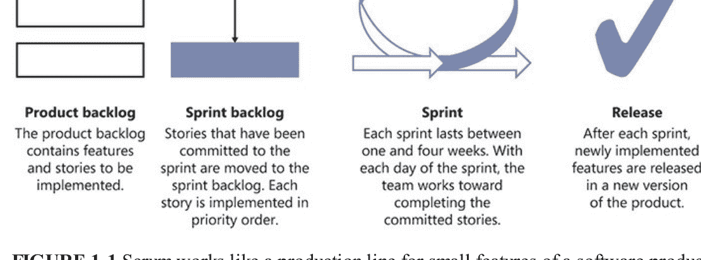

图 1-1 Scrum 就像软件产品的小功能的生产线。

Scrum 涉及文档工件的混合、开发团队内部和外部人员扮演的角色，以及仪式——由适当人员参加的会议。虽然一章不足以探索 Scrum 作为项目管理学科的全部内容，但本章提供了足够的细节，既可作为进一步学习的跳板，也可作为 Scrum 日常实践的导向。

## Scrum 是敏捷的

*敏捷* 是一系列轻量级软件开发方法，它们在项目进行中仍拥抱客户需求的变化。敏捷是对更僵化结构化实践的失败的反应。敏捷宣言体现了这种对比。它可以在网上找到，网址为 www.agilemanifesto.org。

敏捷宣言由 17 名软件开发者签署。敏捷方法在随后的岁月里影响力与日俱增，以至于在敏捷环境中的经验现在已成为软件开发岗位的常见先决条件。Scrum 是敏捷流程最常见的实现之一。

## Scrum 与瀑布

在我看来，敏捷方法比瀑布式软件开发方法更有效，我只倡导敏捷流程。瀑布方法的問題在于其僵化。图 1-2 提供了瀑布项目所涉及流程的表示。

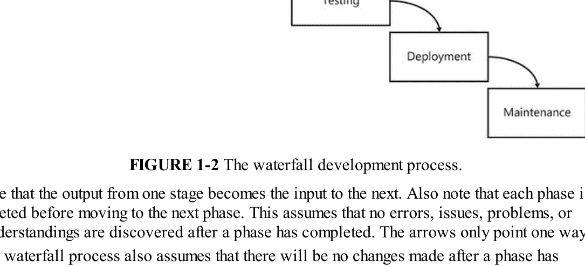

图 1-2 瀑布开发流程。

请注意，一个阶段的输出成为下一个阶段的输入。还请注意，每个阶段在进入下一阶段之前都会完成。这假设在阶段完成后不会发现任何错误、问题、问题或误解。箭头只指向一个方向。

瀑布流程还假设在阶段完成后不会进行任何更改，这似乎与经验和统计证据相悖。变化是生活自然的一部分，而不仅仅是软件工程。瀑布方法所宣扬的对变化的态度是它昂贵、不受欢迎、而且最具破坏性的是可以避免的。瀑布方法断言，通过在需求和设计上花费更多时间，可以绕过变化，从而使变化在后续阶段中*根本不发生*。这是荒谬的，因为变化*总会*发生。

敏捷通过采用不同的方法来应对这一事实，欢迎变化并允许每个人适应发生的任何变化。虽然敏捷——因此 Scrum——在流程层面允许变化，但*为变化而编码*是现代软件开发中最困难、却最重要的原则之一。本书致力于向你展示如何生产出足够敏捷和适应性强的代码以承受变化。

瀑布方法论也是以文档为中心的，生成大量并不能直接改善软件产品的文档。另一方面，敏捷认为可工作的软件是软件产品最重要的文档。毕竟，软件的行为是由其源代码决定的——而不是伴随该代码的文档。此外，由于文档是与源代码分离的实体，它很容易与软件不同步。

Scrum 规定了一些提供项目进展及其整体健康状况反馈的指标，但这与关于产品的解释性文档不同。总体而言，敏捷更倾向于避免不负责任的足够文档，但并不强制此类文档。一些代码确实可以从支持文档中受益，前提是它不是写一次就再也不读一次。因此，易于使用的活文档，如维基，是 Scrum 团队中常见的工具。

本章其余部分更深入地涵盖了 Scrum 的最重要方面，尽管重点并非纯粹的 Scrum，而是其常见变体。Scrum 作为流程的目标不仅是迭代地完善软件产品，也是迭代地完善开发流程。这鼓励团队采用细微的更改，以确保流程在他们独特的情境和背景下为他们服务。

在讨论了 Scrum 的构成要素之后，本章考察了其缺陷。本章为本书的其余部分设定了场景，其余部分详细说明了如何以保持适应 Scrum 流程所拥抱的变化的方式实现代码。当你声称有一个能够优雅处理变化的流程时，却发现现实中在代码层面*实现*变化极其困难，就毫无意义了。

## Scrum 的不同形式

每当开发团队声称他们遵循 Scrum 方法论时，他们通常意味着他们遵循 Scrum 的某种变体。纯 Scrum 不包括从其他敏捷方法（如极限编程 XP）借鉴的许多常见实践。有三种不同的 Scrum 子类别，它们逐渐偏离纯粹的实现。

### Scrum 和...

像先写单元测试和结对编程这样的常见实践并不是 Scrum 的一部分。然而，它们对许多团队来说是有用且值得的过程补充，因此被视为互补实践。当从其他敏捷方法如 XP 或看板中添加某些实践时，流程就变成“Scrum 和...”——即：Scrum 加上额外的最佳实践，这些实践增强而非削弱默认的 Scrum 流程。

### Scrum 但是...

一些开发团队声称他们正在实践 Scrum，但他们省略了关键方面。他们的工件按待办事项列表排序并进入迭代冲刺，他们有回顾会议和每日站会。然而，他们不以故事点估算，而是更倾向于实时估算。这种稀释版的 Scrum 被称为“Scrum 但是...”。尽管团队在许多方面与 Scrum 对齐，但在一个或两个关键领域却不一致。

### Scrum 不是...

如果开发团队偏离 Scrum 方法足够远，他们就会做“Scrum 不是...”这会带来问题，特别是当团队成员期望一种敏捷方法论，而实际流程与 Scrum 几乎不相似时。我发现每日站会是最容易采用的 Scrum 部分，但相对估算和对变化的积极态度则困难得多。当 Scrum 流程的足够多部分被忽视时，该流程就不再是 Scrum。

## 角色与职责

Scrum 只是一个流程，我不能再强调这一点——它只有在遵循流程的人的有效性下才有效。这些人有指导其行动的角色和职责。

### 产品负责人

产品负责人角色（有时称为 PO）至关重要。产品负责人为客户或用户与开发团队的其余部分提供联系。产品负责人对最终产品拥有所有权，因此其职责包括：

- 决定构建哪些功能。
- 根据业务价值设定功能的优先级。
- 接受或拒绝“已完成”的工作。

作为项目成功的关键利益相关者，PO 必须对团队可用并能够清晰传达愿景。项目的长期目标应让开发团队明确，重点的任何变化都应及时在团队中传播。简而言之-

在冲刺规划（sprint planning）中，产品负责人会确定将要开发的内容和时间。产品负责人决定在软件发布过程中所需的功能，并为产品待办列表设定优先级。

虽然产品负责人的角色至关重要，但他/她并不能无限地影响流程。产品负责人无法影响团队对某个冲刺的承诺工作量，因为这由团队根据自身速度决定。产品负责人也不能决定工作如何完成——开发团队对如何以技术层面实现某个故事拥有控制权。当冲刺进行时，产品负责人不能更改冲刺目标、修改验收标准，或添加/移除故事。在冲刺规划期间目标确定并且团队承诺这些故事后，正在进行的冲刺就变得不可变更。任何变更都必须等到下一个冲刺——除非变更是完全取消冲刺或项目并重新开始。这使得开发团队能够完全专注于实现冲刺目标，而不会不断改变目标。

在整个冲刺过程中，随着故事推进和完成，产品负责人会被要求验证某个功能的工作方式，或对进行中的任务发表意见。产品负责人必须在冲刺期间抽出时间与开发团队沟通，以防出现意外和困惑。这样，在冲刺结束时，产品负责人就不会看到与最初愿景偏离的“已完成的”故事。不过，产品负责人确实有权决定一个故事是否满足所提供的验收标准，以及是否被视为完成并可以在冲刺结束时进行演示。

### Scrum 主管

Scrum 主管（SM）在冲刺期间保护团队免受任何外部干扰，并解决团队在每日 Scrum 会议中指出的任何障碍。这使团队在整个冲刺期间保持完全高效和富有生产力，使其能完全专注于冲刺目标。

正如产品负责人拥有产品——即要做什么，Scrum 主管拥有流程——即围绕如何做的框架。因此，Scrum 主管的责任是确保团队遵循流程。尽管 Scrum 主管可以对改进流程提出一些建议（例如将四周冲刺改为两周），但 Scrum 主管的权限有限。例如，Scrum 主管不能指定团队应如何实现一个故事，除非确保其遵循 Scrum 流程。

作为流程的拥有者，Scrum 主管也负责主持每日 Scrum 会议。Scrum 主管确保团队出勤，并全程记录，以防发现可执行的事项。然而，团队在 Scrum 会议上并不是向 Scrum 主管汇报；他们是在告知在场所有人自己的进度。

### 开发团队

理想情况下，敏捷团队由泛专型人才（generalizing specialists）组成。也就是说，团队的每个成员都应该是多学科的——能够高效地使用多种不同技术，但在某个领域具有天资、偏好或专长。例如，一个团队可以包含四名开发者，每人都能胜任 ASP.NET MVC、Windows Workflow 和 Windows Communication Foundation（WCF）的工作。然而，其中两名开发者专精于 Windows Forms，另外两名则更喜欢使用 Windows Presentation Foundation（WPF）和 Microsoft SQL Server。

拥有跨职能团队可以防止出现“筒仓”现象，即某一个人——“网页人员”、“数据库人员”或“WPF 人员”——对该应用的某个部分如何工作拥有唯一知识。筒仓对所有人都不利，应大力强调尽可能打破筒仓。在 Scrum 中，代码由团队集体拥有。筒仓对业务不利，因为这使业务过度依赖单一资源来提供某个领域的价值。个人也会因此受害，因为他们会被困在“只有他们能做”的角色中。

软件测试人员负责在软件开发过程中保持软件质量。在一个故事开始之前，测试人员可能会讨论自动化测试计划，以验证故事实现是否满足所有验收标准。他们可能与开发人员一起实施这些测试计划，或者他们自己编写这些测试。在故事实现后，开发人员可以提交测试，测试分析员将验证其是否按要求工作。

### 猪和鸡

Scrum 过程中的每个角色都可以归类为猪（pig）或鸡（chicken）。这些比喻源于一个故事：一只鸡走近它的朋友猪说：“嗨，猪，我有个想法。我们应该开一家餐厅！”起初，猪很热情，问道：“我们该叫它什么？”鸡回答说：“我们可以叫它‘火腿蛋’（Ham 'n' Eggs）。”猪沉思片刻，然后愤怒地喊道：“没门！我将会被献上（committed），而你只是贡献（contribute）！”

这个有趣的寓言只是突出了某些成员需要在一个项目中投入的程度。猪完全致力于项目，并对项目成果负责；而鸡只是贡献，参与程度相对外围。产品负责人、Scrum 主管和开发团队都是猪，因为他们都致力于交付产品。大多数情况下，客户只是贡献的鸡。同样，高管管理层也只为项目做贡献，因此他们也被视为鸡而非猪。

## 工件

在任何软件项目的整个生命周期中，都会创建、审查、分析和剖析许多文档、图形、图表、图示和指标。在这方面，Scrum 项目与其他项目并无不同。然而，Scrum 文档在类型和目的上与其他类型的项目管理文档不同。所有敏捷流程与更严格流程之间的一个关键区别是文档的相对重要性。例如，结构化系统分析与设计方法（SSADM）非常强调编写大量文档。这被贬称为“前期大设计”（Big Design Up Front, BDUF）：一种错误的信念，即如果给予文档足够重视，就可以消除项目中的所有恐惧、不确定性和疑虑。敏捷流程旨在将生成的文档数量减少到仅对项目成功绝对必要的程度。取而代之的是，敏捷青睐于这样的理念：代码——作为高度权威的文档——可以随时部署、运行和使用。它还提倡所有利益相关者直接互相沟通，而不是写入可能永远不会被最重要受众阅读的文档。文档对敏捷项目仍然重要，但其重要性不会超过可工作的软件或沟通。

## Scrum 看板

Scrum 项目日常工作的核心是 Scrum 看板。应为 Scrum 看板保留足够的墙面空间——如果看板太小，很容易省略重要细节。你的办公室中墙面空间可能非常紧张，但你可以使用一些技巧。也许那块被忽略的大白板可以重新用作 Scrum 看板。借助磁铁，金属文件柜也可以兼作 Scrum 看板。如果你的办公室是租的，或者你无法在墙上涂画，那么“魔术”白板——其实就是可擦写的静电纸——是很理想的选择。尝试在你的办公室中找到合适的地方来发挥此功能。无论你选择什么，无论你如何指定它，如果经过几次迭代后感觉不合适，请随意更改。物理 Scrum 看板绝对是必需的。没有什么能取代站在 Scrum 看板前的切身体验。尽管数字 Scrum 工具有其用途，但我认为它们是 Scrum 过程的补充，而非主要工具。图 1-3 展示了一个典型 Scrum 看板的示例。

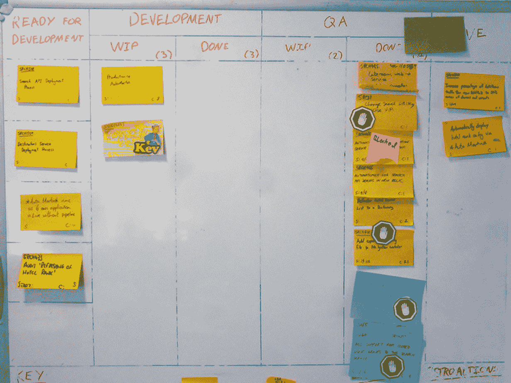

**图 1-3** Scrum 看板是当前开发中工作状态的快照。

Scrum 看板是信息的蜂巢。它包含许多细节，要弄清发生了什么可能会令人望而生畏。本节其余部分将详细说明每个方面。

### 卡片

Scrum 看板上的主要项目是卡片。卡片代表软件产品的不同进展要素——从软件的物理发布到最小的独立任务。这些卡片类型通常以不同的颜色表示，以提高清晰度。由于空间限制，Scrum 看板通常只显示与当前冲刺相关的用户故事、任务、缺陷和技术债务。

> 提示
>
> 仅使用颜色可能不足以满足团队中每个人的需求。例如，考虑为无法区分颜色的团队成员将颜色与不同的形状结合使用。

### 构成的层级

图 1-4 显示了 Scrum 看板上卡片之间的关系。请注意，隐含的意思是产品由许多任务组成。即使是最复杂的软件也可以提炼成必须执行的有限的离散任务列表，每一项任务都在为完成铺平道路。

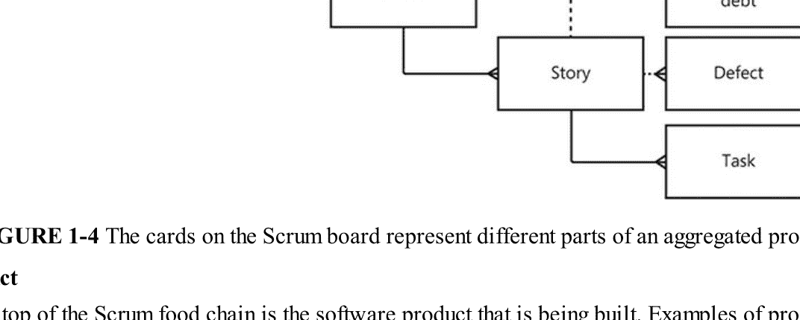

图 1-4 Scrum 看板上的卡片代表聚合产品的不同部分。

### 产品

在 Scrum 食物链的顶端是正在构建的软件产品。产品的例子不胜枚举：集成开发环境、Web 应用程序、会计软件、社交媒体应用等等。这就是你正在开发的软件，也是你打算交付的产品。

团队通常一次只针对一个产品工作，但有时团队负责交付多个产品。

### 发布

对于你开发的每个产品，都会有多次发布。发布是最终用户可以购买或作为服务使用的软件版本。有时发布仅用于解决缺陷，但发布也可能旨在为关键客户提供增值功能，或将软件的 beta 版本作为抢先预览提供。

Web 应用程序通常以隐式版本控制的方式存在，只有一个部署取代所有先前的发布。事实上，Google Chrome 网络浏览器是一个有趣的例子。虽然它是一个桌面应用程序，但它被部署为一系列微发布，这些微发布无缝地部署到桌面，而没有通常伴随竞争浏览器的大张旗鼓。Internet Explorer 8、9 和 10 每个都有自己的电视广告，但 Chrome 不遵循这种模式——Google 只是宣传浏览器本身，而与版本无关。而这种迭代发布正变得越来越普遍。Scrum 可以通过专注于在每次冲刺后交付可工作软件的潜力来指导这种发布模式。

### 最小可行发布

首次发布可以与最小可行发布（MVR）保持一致——被认为足以满足基本要求的最低功能集。例如，对于会计软件而言，此功能集可能仅限于创建新客户的能力、向其账户添加交易（存款和取款）以及呈现总额。这里的想法是启动项目，使其尽快实现自我造血。虽然这不太可能由 MVR 带来，但希望 MVR 至少能带来一些收入以抵消开发的持续成本。不仅如此，即使该首次部署针对的是受限的客户群，也很可能提供有价值的反馈，从而影响软件的方向。这就是 Scrum——以及敏捷的一般本质——不断地随着所有软件都可能发生变化的知识而演进软件产品。

无论发布的意图如何，或其部署方式（甚至部署频率如何），理想情况下，单个产品将经历多次发布。

### 功能

每个发布都由一个或多个以前软件中不存在的功能组成。任何软件的 1.0 版本和 2.0 版本之间最显著的区别是添加了团队认为足以引起新用户购买兴趣并促使现有用户升级的新功能。

最小可销售功能（MMF）这一术语对于界定功能和组成发布非常有用。以下是一些示例功能列表，这些功能通用到足以应用于许多不同项目，同时又具体到足以成为现实世界的功能：

- 将应用程序数据导出为便携式基于 XML 的格式
- 在 0.5 秒内处理网页请求
- 归档历史数据以供将来参考
- 复制和粘贴文本
- 与同事在网络上共享文件

如果功能对客户具有某种价值，则该功能是可销售的。当提炼到在仍保留其价值的同时可能具有的最小功能量时，该功能也是最小的。

### 史诗/功能 vs. MMF vs. 主题

当谈论 Scrum 时，你可能更习惯于使用史诗而不是功能这个术语，但我已擅自将其替换为我更喜欢的术语。史诗和功能通常被认为是“大型用户故事”：即比 MMF 大得多且无法在单个冲刺中交付的故事。

功能也类似于 Scrum 主题，因为它们用于对实现共同目标的用户故事进行分组。

对于每个发布，功能可以大致分为三类：必需、偏好和期望。这些是相互排斥的选项，反映了分配给每个功能的总体优先级。通常，开发团队被指示在处理偏好功能之前先完成所有必需功能，而期望功能仅在时间允许时才会被处理。正如你可能猜到的，这些类别——事实上，功能本身——始终是可以更改的。它们可以随时被取消、重新排序、更改和取代，团队预计能够优雅地转换重点（前提是，截止日期和资金也可能相应改变）。Scrum 中的一切都是可变的盛宴，而本书旨在帮助你应对这一现实。

### 用户故事

用户故事可能是大多数人最熟悉的 Scrum 工件，但具有讽刺意味的是，它并未由 Scrum 规定。用户故事是极限编程的产物，但由于其被广泛使用，已被 Scrum 借用。用户故事使用以下模板指定：

> “作为 [用户角色]，我想要 [以动词为中心的行為]，以便 [用户增加的价值]。”

方括号表示参数化，用以区分一个用户故事与另一个用户故事。一个具体的例子应该能进一步说明：

> “作为一个未通过身份验证但已注册的用户，我想要重置我的密码，以便在我忘记密码时可以登录系统。”


关于这个用户故事，有很多需要注意的地方。首先，细节远远不足以实际实现所需的行为。请注意，用户故事是从用户的角度编写的。虽然这似乎是显而易见的，但这一点经常被忽略，而且，故事经常错误地从开发者的角度编写。这就是模板的第一部分——作为[用户角色]——如此重要的原因。同样，[用户增加的价值]部分同样重要，因为如果没有它，很容易失去用户故事存在的根本原因。这通常就是将用户故事与其父功能联系起来的原因；上面给出的示例可以属于“忘记的用户凭据可恢复”之类的功能。而该故事很可能与用户忘记其登录名以及用户忘记登录名和密码的故事一起分组。

鉴于这个用户故事不足以开始开发，它的价值是什么？用户故事代表开发团队与客户之间尚未发生的对话。当轮到实现该故事时，负责该故事的开发人员将首先带着该故事去 customer and talking through the customer’s requirements. This analysis phase will produce several acceptance criteria that must be adhered to throughout the lifetime of the user story, so that the user story can be deemed complete.

After the requirements have been gathered, the developers convene and lay out some design ideas to meet these requirements. This phase might include user interface mockups that use Balsamiq, Microsoft Visio, or some other tool. Some technical design concepts will detail how the existing code base must be altered to meet these new requirements, often using Unified Modeling Language (UML) diagrams.

After the design is ratified, the team can start to break the user story down into tasks and then work toward implementing the story by performing these tasks. When they reach a point when they are satisfied that the story is working as required, they can hand it over to be acceptance tested. This final phase of quality assurance (QA) double-checks the working software against the acceptance criteria and either approves or rejects it. When it is approved, the user story is complete.

Let’s recap for a minute. With a user story for guidance, developers gathered requirements in an analysis phase, generated a design, implemented a working solution, and then tested this against the acceptance criteria. This sounds a lot like waterfall development methodologies! Indeed, that’s the whole point of user stories—to perform the entire software development life cycle, in miniature, for each story. This helps to prevent any wasted effort because it is not until the user story is ready to be taken from the Scrum board and implemented that the developers can be sure it is still relevant to the software product.

User stories are the main focus of work in Scrum; they hold the incentive that Scrum provides for team members: story points. The team assigns each user story its own story point score during sprint planning and, after the user story is complete, the story points are considered to be earned and are deducted from the sprint total. Story points are explained in further detail later in this chapter.

### Task

There is a unit of work smaller than a user story—the task. Stories can be broken down into more manageable tasks, which can then be split between the developers assigned to the story. I prefer to wait until the story is taken off the board before I split it into tasks, but I have also seen this done as part of sprint planning.

Although user stories must incorporate a full vertical slice of functionality, tasks can be split at the layer level to take advantage of developer specializations within the team. For example, if a new field is required on an existing form, there will probably need to be changes to the user interface, business logic, and data access layers. You could divide this into three tasks that target these three layers and assign each to the relevant specialist: the WPF developer, the core C# expert, and the database guru, respectively. Of course, if you are lucky enough to have a team of generalizing specialists, anyone should really be able to volunteer for any task. This allows everyone to work on various parts of the code, which improves their understanding in addition to boosting their job satisfaction.

### The vertical slice

When I was growing up, every Christmas my father would make trifle. This is a traditional English dessert that is made from various layers. At the bottom there is sliced fruit; then there are layers of sponge cake, jelly, and custard; and on top is whipped cream. My brother used to dig his spoon all the way through the layers, whereas I would eat each layer in turn.

Well-designed software is layered just like a trifle. The bottom layer is dedicated to data access, with layers in between for object-relational mappers, domain models, services, and controllers—with the user interface on top. Much like eating trifle, there are two ways to slice any part of a layered application: vertically and horizontally.

By slicing horizontally, you take each layer and implement what is required of those layers as a whole. But there is no guarantee that each slice will align at the same time. The user interface might allow the user to interact with certain features that layers below have not yet implemented. The net effect is that the client cannot use the application until a significant proportion of each layer has been completed. This delays the important feedback loop that Agile methods give you and increases the likelihood that you will build more than is needed—or simply the wrong thing.

Slicing vertically is what you should aim for. Each user story should incorporate functionality at each layer and should be tethered at the top to the user interface. This way, you can demonstrate the functionality to the user and receive feedback quickly. This also avoids writing user stories that are developer-centric, such as, “I want to be able to query the database for customers who have not paid this month.” This sounds too much like a task; the story could be about generating a report on the outstanding unpaid accounts.

It is important to note that the user stories are the bearers of story points and that these do not transfer down to their constituent tasks. A five-point story that is broken into three distinct tasks is not composed of two one-point tasks and a three-point task. This is because there is neither incentive nor credit for partially completed work. Unless the story—as a whole—is proven complete by the QA process before the end of the sprint, the points that it contains are not claimed, even in part. The story remains in progress until the next sprint, when ideally it will be completed early in the iteration. If a story takes too long to complete and remains in progress for a long time—more than a full sprint’s length—then it was probably too big in the first place and should have been sliced into smaller, more manageable stories.

### Technical debt

Technical debt is a very interesting concept, but it is easily misunderstood. Technical debt is a metaphor for the design and architectural compromises that have been made during a story’s journey across the Scrum board. Technical debt has its own section later in this chapter.

### Defect

A defect card is created whenever acceptance criteria are not met on a previously complete user story. This highlights the need for automated acceptance testing: each batch of tests written for a story forms a suite of regression tests to ensure that no future work is able to introduce a breaking change.

Defect cards, like technical debt, do not have story points assigned to them, thus removing the incentive to create defects and technical debt—something that developers want to avoid even if full eradication of defects and technical debt is unattainable.

All software has defects. That is just a fact of software development, and no amount of planning or diligence will ever account for the fallibility of humans. Defects can be broadly categorized as A, B, or C: *apocalyptic defects*, *behavioral* errors, and *cosmetic* issues.

Apocalyptic defects result in an outright crash of the application or otherwise prevent the continuation of the user’s work. An uncaught exception is the classic example because the program must terminate and be restarted or—in a web scenario—the webpage must be reloaded. These defects should be assigned the highest priority and should be fixed before a release of the software.


Behavioral errors are often not quite as serious but can infuriate users. These types of errors could be even more damaging than simply crashing the application. Imagine erroneous currency conversion logic that rounds data badly. Whether the algorithm favors the customer or the business, someone is going to lose money. Of course, not all logic errors are quite this serious, but it is easy to understand why they should be given medium-priority to high-priority.

Cosmetic issues are typically problems with the user interface—badly aligned images, a window that doesn’t expand to full screen gracefully, or an image on the web that never loads. These issues do not affect the use of the software, just its appearance. Although these issues are often given a lower priority, it is still important to remember that appearances count toward the user’s expectations of the software. If the user interface is badly designed with buttons that don’t work and images that don’t load, users are less inclined to trust the internal workings of that software. Conversely, a shiny user interface with plenty of bells and whistles might convince users that your software is just as well designed internally. A common trick for projects that have developed a poor reputation is to redesign the user interface—perhaps even rebranding the entire product—to improve perceptions and reset expectations.

### Card sharp

在 Scrum 看板上，对卡片进行自定义和个性化有很多选项。

### Color scheme

卡片可以使用任何配色方案，但根据我的经验，有几种方案最合理。索引卡最适合功能和用户故事，而便利贴非常适合任务、缺陷和技术债务卡片，因为它们可以贴在相关的故事上。以下是我的建议：

- Features: green index cards
- User stories: white index cards
- Tasks: yellow sticky notes
- Defects: red/pink sticky notes
- Technical debt: purple/blue sticky notes

请注意，用户故事和任务是您将创建的最常见的卡片类型，它们使用最常见的索引卡和便利贴。最后你需要的是用完索引卡，所以尽量使用最常见的颜色。

### Who creates cards?

对“谁可以创建卡片？”这个问题，简单的答案是：任何人。当然，这是有条件的。虽然任何人都可以创建卡片，但其有效性、优先级、关键性以及其他此类状态不应该由一个人单独决定。所有功能和故事卡都应由产品负责人验证，但任务、缺陷和技术债务卡完全属于开发团队的范畴。

### Avatars

与在线论坛、博客和 Twitter 上找到的头像一样，这些是团队成员的微型代表。请随意让团队成员通过他们的头像表达自己，因为这确实为 Scrum 流程增添了趣味。当然，要引导他们远离可能引起冒犯的内容，但每个人的头像都应具有独特的身份感。

在迭代过程中，这些头像会被移动很多次并每天被处理。由于看板上已经有索引卡故事和便利贴任务，这些头像不应大于 2 英寸的正方形。将它们覆膜也有助于防止它们被翻毛或撕裂，可重复使用的粘合剂或一小块胶带可以使它们保持在原位。

### Swimlanes

Scrum 看板上画有垂直线来划分泳道。每个泳道可以包含多个用户故事卡，以表示该故事在其开发生命周期中的进展。从左到右，基本的泳道是 Backlog、In Progress、QA 和 Done。

在积压工作中，故事已被“承诺”用于冲刺，并且——除非取消——应从看板上取出并开始工作。该列可以按优先级排序，以便顶部项目始终是应实现的下一个项目。

故事从积压工作中取出，并在与产品负责人就范围和需求进行对话后，卡片会连同新派生的任务一起返回到 In Progress 泳道。此时，所有参与该故事的团队成员的头像也应附上。该故事现在计入可能与进行中阶段相关的任何泳道限制。例如，您可能要求一次最多只能有三个用户故事处于进行中，从而迫使团队优先完成已开始的故事，而不是尚未开始的故事。记住：部分完成的工作没有激励。

在对故事进行分析、设计和实施后，它被认为“开发完成”，可以移至质量保证（QA）泳道。理想情况下，QA 环境应尽可能接近生产环境，以避免因部署的细微差异而可能发生的环境错误。测试分析师将根据验收标准评估故事。从本质上讲，他们试图破坏故事并证明代码的行为不符合应有的行为。通常，他们会尝试向某些操作提供不寻常和错误的输入，以确保验证正确工作。他们甚至可能会寻找安全漏洞，以确保恶意终端用户无法获得超出其指定权限级别的访问权限。当它完全完成时，用户故事将被移至 Done 泳道。然后与故事相关的任何故事点将被认领，并且冲刺燃尽图（显示冲刺进展）可以被修改。这些工件将在后面更详细地介绍。

### Horizontal swimlanes

Scrum 看板可以通过使用水平泳道进一步划分。这些泳道可用于按功能对故事进行分组，以便每个人都能一目了然地看到工作重点集中在哪里，从而需要缓解瓶颈。

看板顶部的一个特殊泳道是 Fast-Track 泳道，任何非常高优先级的任务都可以放在其中。可以指示团队成员对快速通道项目进行“群集”，以便尽快完成它，通常会损害任何其他未完成的工作。群集确保团队停止他们正在做的事情，以便协作解决具有压倒性优先级的难题或任务。这是一个有用的工具，应在出现此类优先级时谨慎使用。在生产中发现的末日缺陷是最常见的快速通道项目。

### Technical debt

术语技术债务值得进一步解释。在实施用户故事的过程中，很可能需要在“理想代码”和足够好的代码之间做出某些妥协，以满足截止日期。这并不是说为了赶上截止日期而应该自愿容忍（或积极鼓励）糟糕的设计，但现在做一些更简单的事情是有价值的，目的是以后再改进它。

#### Good and bad technical debt

债务很可能在项目的生命周期中逐渐累积。它被称为债务，因为这是看待它的一个很好的隐喻。某些类型的财务债务并没有什么问题。例如，如果你有选择将汽车付款分摊到 12 个月，并且这些付款是免息的，你就欠债了，但如果你需要汽车通勤并且无法一次性支付，这可能是一个好的决定。汽车将使你能够产生偿还汽车所需的收入，因为你现在可以按时上班。

当然，有些债务是坏的。如果你申请信用卡并在没有先计算如何偿还债务的情况下为奢侈品付费，你可能会陷入循环的余额转账，试图将利息支付降至最低。这在事后看来会像是一个基于坏债务的糟糕财务决定。关键是仔细查看选项并决定债务是否值得承担，或者你是否应该立即付款。

软件中的权衡是相同的。你现在可以实现一个次优的解决方案并满足截止日期，或者现在花费额外的时间来改进设计，可能错过截止日期。没有一种适合所有情况的正确答案，只有检测良好和不良技术债务的指导方针。

#### The technical debt quadrant

著名的敏捷倡导者 Martin Fowler 定义了一个技术债务象限，用于对可能需要标记故事为已完成的让步和妥协进行分类。将平面划分为象限的两个轴 x 和 y 分别对应于问题，“我们是否出于正确的原因累积这种技术债务？”和“我们是否意识到避免这种技术债务的替代方案？”。

如果你对前一个问题回答“是”，你就是在增加审慎的技术债务：你可以指出增加它的有效理由，你的良心是清白的。如果你回答“否”，那么这笔债务就是鲁莽的，你最好现在就处理这笔债务，而不是让它累积。

对于后一个问题，肯定的回答意味着你已经考虑了替代方案并决定承担债务。否定的回答表明你无法想到其他替代方案。

这些问题的结果产生了四种可能的场景，如图 1-5 所示：

- **Reckless, deliberate** 这种类型的债务是最有毒的。它相当于说诸如“我们没有时间为设计”，这表明工作环境非常不健康。这样的决定应该提醒每个人团队并不适应，并且正稳步走向不可避免的失败。
- **Reckless, inadvertent** 这种类型的债务最有可能由缺乏经验造成。它是不知道现代软件工程最佳实践的结果。代码很可能是一团糟，就像前一种情况一样，但开发人员并不知情，因此找不到其他选择。教育是答案：只要开发人员愿意学习，他们就可以停止引入这种技术债务。
- **Prudent, inadvertent** 这发生在你遵循最佳实践但事实证明有更好的方法来做某事，并且“现在你知道应该怎么做了”。这与前一种情况类似，但当时所有开发人员都同意没有更好的解决问题的方法。
- **Prudent, deliberate** 这是最可接受的债务类型。所有选择都已考虑过，你完全知道自己在做什么——以及为什么——允许这笔债务继续存在。它最常与“现在发布，以后再处理后果”的晚期决定相关联。

##### 鲁莽的

##### 谨慎的

> “我们没有时间做设计。”

> “我们必须现在就交付，然后处理后果。”

##### 深思熟虑的

##### 无意的

> “什么是分层？”

> “现在我们知道当初应该怎么做了。”

图1-5 技术债务象限图，正如马丁·福勒所解释的，帮助开发者可视化四类不同的债务。

### 偿还债务

技术债务与故事点没有直接关联，但尽管缺乏直接的激励，债务仍然必须偿还。最好的做法是尝试将技术债务卡片附加到一个故事上，并重构代码，使新设计能与相关的新行为一同实现。下次从看板上取下一个故事时，检查将要编辑的代码中是否附有技术债务，并尝试将两者一起处理。

### 数字化Scrum看板

数字化Scrum看板，除非一直投射在墙上，否则会隐藏项目最重要的一些信息。通过公开这些信息并向全公司展示，你会引发关于流程的提问，而这些提问在其他情况下根本不会出现。流程透明是一个巨大的优势，尤其是在公司中首次实施Scrum时。它鼓励重要的利益相关者参与进来，而你最好让他们融入到流程中。

这是一个老生常谈的说法：人们确实害怕变化。恐惧只是对未知的自然反应。通过向人们讲解你在做什么以及某些图表意味着什么（以及为什么他们的墙上现在贴满了数十张索引卡），你培养了一种真正无价的协作与沟通精神。被要求向外行人解释这些事情对你也有帮助，因为在此过程中，你自己可能会对流程有更深入的理解。

与所有工具一样，最好的工具是高触感、低阻力的。它们会被频繁使用，并且使用起来没有任何障碍。当一个工具变得稍微有些不方便时，它就会逐渐被越来越多地忽视。最初经常使用并勤于更新的工具将不再被维护，并会迅速落后于现实。

### 完成的定义

每个项目都需要一个完成的定义（DoD）。这是每个用户故事都必须遵守的标准，才能被视为完成。你听过多少次开发人员说出这些话？

> “完成了，我只需要测试一下……”

> “完成了，但我发现了一个需要修复的缺陷……”

> “完成了，但我对设计并非百分百满意，所以我打算改变界面……”

我自己过去也用过这些说法。如果故事真正完成了，就不需要任何附加条件、限制或补充说明。这些例子是开发人员因为估算不准或遇到预料之外的问题而需要为自己争取更多时间时所说的话。每个人都必须就“完成”的定义达成一致并坚持执行。如果一个用户故事不符合这些标准，它就不可能是完成的。在故事符合完成的定义之前，故事点永远不会被认领。

完成的定义中包含什么？这完全取决于你、你的团队以及你希望质量保证流程有多严格。不过，下面展示了一个标准的DoD，可以作为起点。

为了声称一个用户故事已完成，你必须：

- 对所有代码进行单元测试，覆盖其成功和失败路径，所有测试全部通过。
- 确保所有代码都提交到持续集成构建中，并且编译无错误，所有测试全部通过。
- 与产品负责人一起根据验收标准验证行为。
- 由未参与该故事的开发人员进行同行代码审查。
- 记录足够的信息以传达意图。
- 拒绝鲁莽的技术债务。

你可以随意移除、修改或追加任何规则，但必须对这个定义保持严格。如果一个故事无法满足所有标准，你要么确保这个故事能够满足所有标准，要么从完成的定义中彻底删除那些不切实际的标准。例如，如果你觉得代码审查过于陈旧或吹毛求疵，可以随意将该标准从你的DoD中省略。

### 图表与度量

有几种图表可用于监控Scrum项目的进度。Scrum图表可以显示Scrum项目的健康状况和历史进展，并预测未来可能取得的成果。所有这些图表都应该醒目地展示在Scrum看板旁边，尺寸要足够大，让人能在几英尺之外看清。这向团队表明，这些度量没有被背着他们使用，它们不是用来衡量团队进度供管理层消费的。相反，要非常坦率地说明进度是如何衡量的，并明确这些图表不是为了绩效目的而制作的，而是为了诊断整个项目的问题。

试图通过垄断较大的故事来保全颜面，试图独自获得所有点数。要小心你所激励的东西。

### 注意事项

要警惕你所衡量的东西——存在“观察者效应”。例如，对于某些度量，若不先改变被测量的事物，就无法进行测量。以测量汽车轮胎压力为例。如果不先让轮胎放掉一点气，就很难测量压力，这样就改变了压力。同样的原理也非常适用于人性。当团队知道他们将要按照某些标准被衡量时，他们会尽一切可能改善自己的统计数据以显得好看。这并不是说你在管理一群马基雅维利式的麻烦制造者，但当团队意识到故事点将被用来衡量他们的进度时，他们可能会倾向于为同样的工作量分配更高的点数。使用三角测量（本章后面的“冲刺回顾”一节会介绍）来协调估算工作量与实际工作量。

### 故事点

故事点的目的是激励团队在每个冲刺中增加商业价值。在冲刺规划会议（参见本章后面的“冲刺规划”一节）上，整个开发团队将故事点分配给各个用户故事。故事点是实现用户故事所代表行为所需的相对工作量的度量。这是完成整个软件生命周期所需的总工作量——需求分析、技术设计、带单元测试的代码实现，以及对照验收标准的质量保证和部署到暂存环境。虽然每个故事应该已经足够小，可以轻松地放入一个冲刺中，但故事的大小仍然可能差别很大。

在规模的一端是“一点故事”，它只需要最少的工作量就能实现。关于故事点，一个有趣且重要的事实是：在分配它们的团队之外，它们完全没有意义。对一个团队来说是一个一点故事，对另一个团队来说可能是三点故事。经过多个冲刺后，会形成一种关于故事所需大致工作量的共识。

有一件事是故事点明确不代表的：以绝对方式度量的工作量——天、小时或任何其他时间度量。故事点确实非常粗略地对应于一个历史时间范围，如图1-6所示。在这张图中，垂直条代表估计时间，附在垂直条上的水平虚线代表对应点数故事实际花费的工作量。

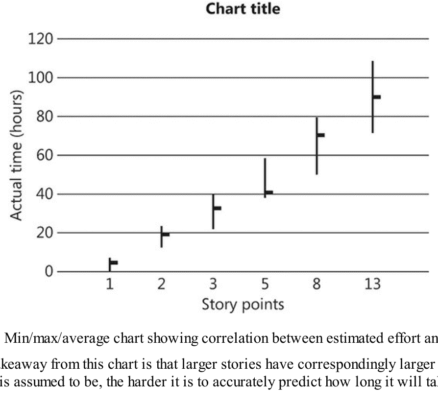

**图1-6** 显示估计工作量与实际工作量之间相关性的最小/最大/平均图表。

这张图表的主要启示是：越大的故事相应地有越大的范围——一个故事被假定越大，就越难准确预测完成它需要多长时间。

### 速率

经过多个冲刺，可以计算已完成故事点的滚动平均值。假设一个团队已经完成了三个冲刺，在总计分别为8、12和11个故事点的故事上达到了完成的定义。这是31点的滚动总计和10点的滚动平均值。这可以称为团队的速率，它有两种用途。

首先，团队的速率可以为团队在下一个冲刺中应承诺的点数设定一个上限。如果团队平均每个冲刺完成10点，那么为单个迭代承诺超过这个数量就不仅仅是乐观——这会让他们陷入士气低落的失败。设定一个可实现的目标并达成或超越它，比设定一个不切实际的目标而无法达到要好。如果团队承担了这10点并且实际实现了11点，这将形成一个11点的新速率：(12 + 11 + 11) / 3。这就是Scrum反馈循环的实际运作。

速率的第二个用途是分析交付中的问题。如果团队的速率在一次冲刺中显著下降，这可能表明该冲刺期间发生了需要纠正的问题。也许故事太大，它们的真实规模被低估了，从而使它们长时间处于进行中状态，并且需要跨越一个以上的冲刺才能完成。或者，可能有一个更简单的解释——太多关键员工同时休假（或生病），进展自然放缓了。另一方面，也许花了太多时间重构现有的可用代码，而没有足够重视为系统引入新行为。无论原因是什么，速率下降25%并不*总是*灾难性的，但*可能*预示着未来会出现更多问题，你应该尽快解决。周复一周的速率下降——持续的减速——是一个明确的

### Sprint burndown


FIGURE 1-8 A sprint burndown chart partway through a sprint. In this instance, the team is sticking closely to the “path of perfection,” although no progress was made between Friday and Monday of the first week.


用不同颜色绘制实际进度线和需求线有助于区分两者。如果在冲刺期间的任何时候实际线位于需求线之上，图表就表明存在问题，且交付的工作量将少于计划。相反，如果实际线位于需求线之下，项目就领先于进度。在冲刺过程中，实际线可能会在需求线上下小幅波动，而不会表明存在任何真正的问题。需要解释的是较大的偏离。

燃尽图在需要固定时间内完成固定工作量时很有用。在这种条件下，不可能低于 x 轴。 当 y=0 时，你已完成所有分配的工作。

### Feature burnup chart

正如冲刺燃尽图在整个冲刺期间跟踪故事级别的进度一样，功能燃起图显示了功能在实现过程中已完成功能的进度。在每个冲刺结束时，可能已经完整实现了一个新功能。这张图的最好之处在于，不可能在没有症状很快显现的情况下伪造已完成功能的交付。想法是观察这张图随时间线性增长，最好没有明显的停滞。图 1-9 显示了一个良好的功能燃起图的示例。

### Feature burnup


FIGURE 1-9 The feature burnup chart covering an adjusted calendar year for a healthy project making consistent progress.

尽管梯度可能很浅，但该图表明团队已找到良好的开发节奏，并以相当可预测的速度持续交付功能。虽然与完美直线存在轻微偏差，但这些都不必担心。

另一方面，图 1-10 所示的燃起图显示开发过程中确实出现了问题。团队起步非常强劲，极快地交付了大量功能，但此后陷入停滞，在过去八个月里仅交付了两个已完成的功能。

### Feature completed

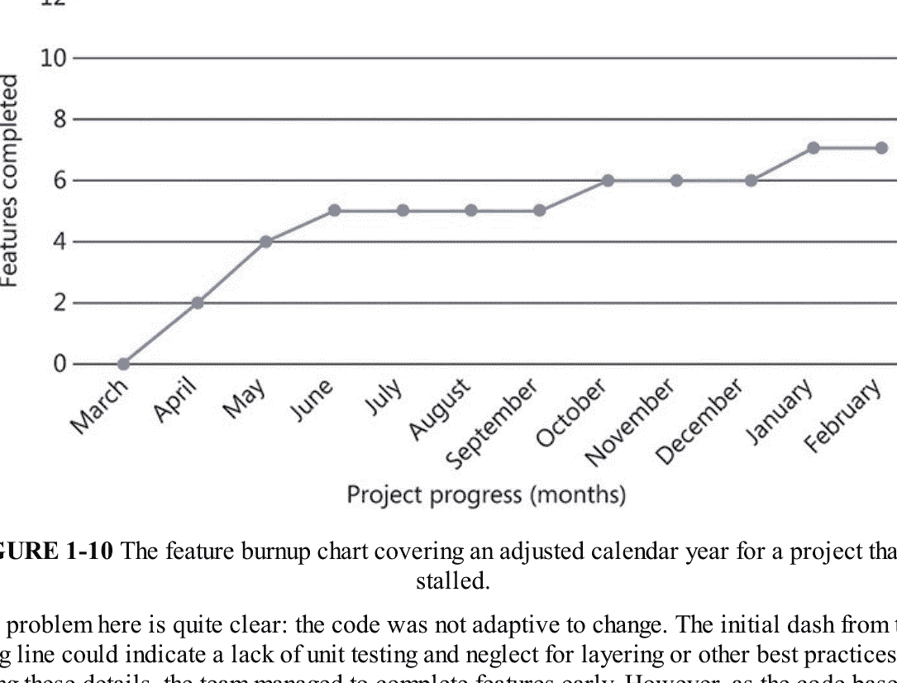

FIGURE 1-10 The feature burnup chart covering an adjusted calendar year for a project that has stalled.

问题在这里很清楚：代码无法适应变化。从起跑线开始的最初冲刺可能表明缺乏单元测试以及对分层或其他最佳实践的忽视。通过省略这些细节，团队得以提前完成功能。然而，随着代码库变得臃肿和杂乱，进度开始显著放缓，已交付的功能数量几乎停滞不前。这样的进展很可能伴随着缺陷数量的增加以及不良的、鲁莽的技术债务。最终，如果项目继续沿着这条道路发展，重新开始可能更好——使其重新回到正轨所需的重构工作将超过收益。如果问题足够早被发现，当然团队和项目可以恢复。然而，最好从一开始就采用敏捷开发实践，而不是试图将它们强行引入棕地项目。

#### Note

Brownfield here means a project that is already in progress. It is the opposite of a greenfield project, which is a new project. The terms are taken from the construction industry.

#### 注意

这里的 Brownfield 指的是已经在进行的项目。它与 greenfield 项目相反，greenfield 项目是新项目。这些术语取自建筑行业。

### Backlogs

Backlog 是尚未处理的待办事项列表。这些项目正在等待从 backlog 中取出并采取行动，直到完成为止。列表中的每个项目都有分配的优先级和估计所需工作量，列表首先按优先级排序，然后按工作量排序。

在 Scrum 中维护两个 backlog，每个都有其独特的目的：产品 backlog 和冲刺 backlog。

#### Product backlog

在产品的生命周期中的任何时间点，产品 backlog 都包含等待实现的特性。这些特性尚未承诺到某个冲刺，因此开发团队并未积极处理此 backlog 上的项目。然而，开发团队或其主要代表已花费时间估算这些特性所需的工作量。这有助于对产品 backlog 上的项目进行优先级排序，使其保持优先级顺序。

每个项目的优先级主要由实现该特性对业务所代表的价值决定。这种业务价值必须由产品 backlog 的所有者——产品负责人——来确定。此人代表业务与开发团队沟通，并能权威地代表其发言。产品负责人对业务及其工作方式的了解对于正确分配任何特定特性固有的业务价值至关重要。如果产品 backlog 上的两个项目具有相同的相对业务价值，则其优先级根据相对所需工作量决定。给定两个具有高业务价值的功能，如果一个估计为小，另一个估计为大，从商业角度来看，先实现小功能是有意义的。这是因为较小的功能风险较小；实现小功能所需时间的可能范围不会像大功能那样变化很大。此外，所需工作量较少的特性的投资回报率 ROI 高于价值相等但所需工作量更多者。

当业务希望发布产品的新版本时，可以查阅产品 backlog 以确定对发布最有价值的功能。这可能以两种方式发生：要么业务为发布设定绝对截止日期，并承诺在该时间范围内可能完成的工作量，根据附带的工时估算；要么业务选择发布所需的特性，并根据估算确定可能的发布日期。

除了功能外，产品 backlog 还可以包含必须修复但尚未进入冲刺的缺陷。就像功能一样，缺陷也会有一些分配的业务价值。缺陷所需工作量的估算难以确定，因为对缺陷原因了解较少，可能需要一些时间来找到估算。

产品 backlog 应反映敏捷报告的开放性。它应对每个人可见，以便任何人都可以贡献想法、提供建议或指出可能出现的意外。同时也很重要，这份清单保持权威性，随时包含产品 backlog 的真实状态。糟糕的决策往往源于糟糕的信息，如果关键的发布计划决策信息不足，过时的产品 backlog 可能是灾难性的。

#### Sprint backlog

冲刺 backlog 包含将在即将到来的冲刺中完成的全部用户故事。冲刺开始时，团队根据当前速度和尚未开发的用户故事的相对大小选择足够的工作来填满一个冲刺。故事承诺到冲刺后，团队可以开始将每个故事分解为具有以小时为单位的实际时间估算的任务。然后每个个人选择实施足够多的任务来填满其在冲刺期间的时间。

冲刺 backlog 和所有时间估算都由团队拥有。开发团队之外的人不能向冲刺 backlog 添加项目，也不能可靠地估算相对

完成工作所需的工作量或绝对工时。团队独自负责冲刺待办清单，但必须按照优先级顺序从产品待办清单中领取工作。

### 冲刺

Scrum 项目的迭代称为*冲刺*。冲刺应持续一到四周，通常更倾向于两周的冲刺。较短的冲刺可能没有足够时间完成冲刺目标，而较长的冲刺可能让团队失去焦点。

冲刺通常按其索引编号引用，从冲刺零开始。冲刺零旨在为整个团队准备开发环境，并在第一个实际冲刺开始之前进行一些初步的规划会议。冲刺零很可能不关联任何点数，但在最初几周内可以完成很多工作，以便在随后的冲刺中更顺利地过渡到 Scrum。

常见的诱惑是将冲刺与工作周对齐，即周一开始、周五结束。问题在于，冲刺回顾（稍后将介绍）会占用相当多的会议时间，而没有什么比周五下午坐在会议室里更消耗精力了。有些人还倾向于周五提早离开，而且周末前注意力水平很可能会下降。同样，没有人期待以会议开始自己的一周，因此也许最好避免这种情况，将冲刺安排在周中左右开始：周二、周三或周四。

以下按顺序说明构成每个冲刺的所有会议，除非另有说明。

#### 发布规划

在冲刺开始之前的某个时间点，必须规划软件的发布。这涉及客户和产品负责人决定发布日期，并对将要包含的功能进行优先级排序和规模估算。

#### 功能估算

功能可能需要大量工作量，即使是在规模较小的一端也是如此。因此，任何试图准确预测所需工作量的尝试都很可能存在很大偏差。出于这个原因，功能工作量可以用常见的 T 恤尺码来表示：

- 特大号（XL）
- 大号（L）
- 中号（M）
- 小号（S）
- 特小号（XS）

#### 功能优先级

预测一个发布中能容纳多少功能可能很困难，这就是功能优先级如此重要的原因。对于特定的发布，所有功能都可以被赋予三个优先级之一：

- 必需（R）
- 优先（P）
- 期望（D）

必需功能构成最小可行发布的一部分。优先功能是指在截止日期临近之前如果有时间就应该处理的功能。期望功能是优先级最低的，即那些并非必需——但客户当然希望在此次发布中实现——的功能。

此外，业务利益相关者应为功能编号，以便开发团队能够确保按照优先级顺序实现每个功能。

#### 冲刺规划

冲刺规划的预期成果是估算用户故事。与 Scrum 流程的所有部分一样，故事估算过程有多种变体。本节讨论计划扑克（一种较为常见的引发讨论的方法）和亲和估算（一种更快速地估算故事相对大小的方法）。当有大量故事需要估算时，亲和估算更好。对于单个冲刺，如果只有少数几个故事需要估算，可以使用计划扑克；如果有较多故事或时间较短，则可以使用亲和估算。

##### 计划扑克

计划扑克会议涉及整个开发团队——业务分析师、开发人员和测试分析师——包括 Scrum Master 和产品负责人。对于当前产品待办清单上的每个用户故事，都会给出一个简短的范围说明，然后要求每个人用故事点对其大小进行投票。

为了避免大量细微差异，最好限制投票选项。例如，一种常见的选择是修正斐波那契数列：1、2、3、5、8、13、20、40 和 100。无论选择哪种数列，选项都应整体受限，并且随着点数上升，选项之间的间隔应增大。在数列的低端，可以添加零来表示“不需要工作”，适用于工作量可忽略不计的故事。在数列的高端，团队成员可以投票表示某个故事太大，无法在单个冲刺内实施，必须先从板上取下进行进一步垂直拆分，然后才能开发。

几副扑克牌可以很好地充当投票卡，但也可以使用备用索引卡制作投票卡，或者干脆在废纸上潦草地写下数字。到了投票的时候，每个人都应该同时亮出卡片，以避免受到他人选择的影响。不可能总是达成共识，个人估算之间可能存在很大分歧。这完全正常——肯定会有几个偏离平均票数的异常值。应要求这些投票者根据普遍共识说明自己的选择理由。例如，如果有人在平均票数为 8 时投了 1，那么这个人会被要求——当然，要有礼貌——解释为什么他们认为该故事需要的工作量要少得多。同样，投票高于平均值的投票者也应被要求解释原因。这里发生的一切只是围绕着团队认为需要多少工作量才能将一个故事推进到完成展开讨论。

在各方的理由陈述完之后，可能需要重新投票，因为其他人可能已经被说服，认为自己的票数确实太大或太小，而异常值实际上是正确的。最终，应该达成共识，所有各方都同意一个合适的故事点数。每个故事都应进行估算，直到分配的点数达到团队当前的速率，即团队在每个冲刺中应承诺的最大工作量。

#### 避免帕金森定律

帕金森定律指出：

> “工作总是膨胀到占满所有可用的时间为止。”

> ——西里尔·诺斯古德·帕金森

当你将故事估算与现实世界的时间脱钩时，屈服于帕金森定律的可能性就会降低。重点应始终放在尽快完成故事上——也就是满足“完成的定义”。

#### 亲和估算

亲和估算是作为计划扑克的对立面而提供的，因为如果故事很多，计划扑克会花费大量时间来生成估算。团队不是为每个故事进行讨论，而是从产品待办清单顶部挑出两个故事，然后决定哪个更小。较小的放在桌子左侧，较大的放在右侧。

然后，团队从产品待办清单中取出一个故事，并将其放在他们认为应该在现有较小故事和较大故事之间的范围内某个位置。它可以合理地放在较小故事的左侧，表示它更小；放在较大故事的右侧，表示它更大；放在小故事或大故事的上面，表示它大致相同；或者放在两者之间的任何位置。这个过程继续处理产品待办清单上的每个故事，直到冲刺中没有更多空间容纳额外工作。

在故事按相对大小分组后，团队可以从最左边的组开始，逐步向最右边的组推进，根据修正斐波那契数列为故事分配点数。如果有许多故事需要估算，或者时间有限，这是获得相对大小粗略估算的好方法。

#### 每日站会

虽然有多个会议会持续几个小时，但 Scrum 流程本身在日常工作中真正可见的只有 Daily Scrum，或称“站会”。

团队应以马蹄形围在 Scrum 看板周围，然后每个人轮流面向全体团队发言。每日站会不应超过 15 分钟。为了聚焦会议，每个人都应回答以下三个问题：

- 你昨天做了什么？
- 你今天要做什么？
- 你面临哪些障碍？

每日站会要解决的关键问题是昨天的实际进度和今天的预计进度。在讨论你昨天做了什么时，请参考 Scrum 看板，随意将卡片从一个泳道移动到另一个泳道，或将你的头像从一张卡片移动到另一张卡片，从而让 Scrum 看板保持最新。概述你处理了什么以及当天进展如何。如果你此时没有事情要做，请通知 Scrum Master 并请求新的工作项。障碍包括任何可能阻碍你完成当天目标的事情。因为

由于你将在明天的每日 Scrum 会议中回顾今天声称要做的事情，因此，列出任何可能阻碍你完成计划的事情非常重要。障碍可能直接与工作相关，例如“如果网络继续像昨天那样频繁中断，我将无法继续工作”，也可能是个人事务，例如“我 14:00 约了牙医，所以不太可能完成所有事情。”无论如何，Scrum 主管都应该做笔记，以便她了解每个人的故事进展如何。

#### Niko-niko 日历

“niko-niko 日历”——有时也被称为“心情板”（在日语中，“niko-niko”的含义接近于“微笑”）——提供了团队在冲刺期间对自身进展感受的良好晴雨表。在 Scrum 板旁边绘制一张表格，顶部是冲刺的每一天，侧面是团队成员的姓名，如图 1-11 所示。

|  | 周一 | 周二 | 周三 | 周四 | 周五 | 周一 | 周二 | 周三 | 周四 | 周五 |
|---|---|---|---|---|---|---|---|---|---|---|
| John | 🙂 | 🙂 | 🙂 | 🙂 | 🙂 |  |  |  |  |  |
| Bob | 😐 | 😐 | 🙂 | 😐 | ☹️ |  |  |  |  |  |
| Alice | 🙂 | 😐 | 🙂 | 🙂 | 😐 |  |  |  |  |  |
| Mark | ☹️ | ☹️ | ☹️ | ☹️ | ☹️ |  |  |  |  |  |

###### 图 1-11 niko-niko 日历可以快速显示谁在冲刺中进展顺利，谁进展不顺。

在 Scrum 会议上，每个人都被要求将三种贴纸之一——绿色、黄色或红色——贴到板上自己对应前一天的方格中。每种贴纸分别对应前一天整体情况的总结：好、一般或差。这能快速显示团队成员何时连续经历沮丧的日子并需要帮助，而这些帮助他们可能不会主动寻求。

这只是改进反馈循环的又一个指标。如果你的所有团队成员都持续对自己的工作感觉不佳，那么也许需要提振士气。或者，如果团队中某个人一直不开心，而其他人都很开心，这可能表明有人被落下了，或者觉得自己无法融入。最糟糕的是，如果整个团队在冲刺进度落后、代码一团糟、客户纷纷上门要求退款时仍然感觉良好——那么这个团队已经不再关心了！

当所有人都发言完毕后，会议就结束了。需要警惕的一件事是无关话题的讨论。在 Scrum 会议期间试图讨论并解决问题是极其诱人的。如果有人提到代码库中某种奇怪而又奇妙的行为所造成的障碍，所有开发人员可能都会想推测可能的原因。要注意谁需要参与这类对话——测试分析师真的需要听一场讨论、弄清楚为什么 Microsoft Visual Studio 占用了程序员全部可用内存吗？不，很可能不需要。记下问题，并请相关人员在会议结束后继续进行讨论。

#### 冲刺演示

冲刺演示是应安排在冲刺日历中的关键活动。它是在真实环境中展示所有已完成故事（即在冲刺期间满足“完成定义”的故事）的盛会。整个开发团队都应出席，你也可以邀请其他利益相关者参加会议，例如管理层或销售团队代表。任何可能对项目进展感兴趣的人都应该可以自由参加。这进一步促进了所有项目都应具备的开放性。

从 Scrum 板上收集所有已完成的用户故事，并针对每个故事说明其范围，以及它作为整个项目一部分旨在实现什么目标。指出故事所属的功能，以及其实现所带来的应用程序行为变化。然后使用系统的真实部署来演示这一行为。欢迎听众提问，但务必注意不要偏离主题或被无关内容带偏。保持对话聚焦，并在演示结束后主动提出与相关人员单独交流。任何改进建议都应反馈到产品待办列表中，以便正确确定优先级和安排计划。有时感觉演示中提出的改进建议突然成了最重要的事情，但这很少反映现实情况。

演示不应令人畏惧，但它确实能激励进展。没有人愿意因为什么都没完成而取消演示，但请抵制住为了演示某样东西而绕过“完成定义”的诱惑。诚实地面对进展，你就不必隐藏任何问题。相反，要指出图表和指标，用以解释产出减少的可能原因。

在演示之前指定一个代码冻结时间也是个好主意，以防止那些诱人的最后一刻更改试图获得更多积分。在演示前留出切实可行的时间来搭建环境并确保所有人都准备就绪，同时警惕为了短期提升而把鲁莽的技术债务抛入代码中。

> 自律是持续选择长远利益而非短暂诱惑的能力。
> 
> 迈克·亚历山大，健身专家

#### 冲刺回顾

冲刺演示完成后，就该对本次迭代进行总结，并评估其整体成功的意见。对于某些团队成员来说，这次冲刺可能是巨大的成功，而对另一些人来说，则可能是一场彻底的灾难。冲刺回顾可以帮助你提炼出进展顺利的要素，将其转化为值得重复的行动，并隔离出问题以便加以处理。冲刺回顾的产出不应写完一次就永远遗忘。应在下次冲刺结束时参考这些产出，以确保必要的更改已经完成，错误没有被重复。

在回顾会议期间，应向团队提出以下问题：

- 哪些方面进展顺利？
- 哪些方面进展不顺利？
- 我们需要开始做什么？
- 我们需要停止做什么？
- 我们需要继续做什么？
- 我们在冲刺期间是否遇到了任何意外？

从积极的方面开始，请每位团队成员详细说明他们觉得冲刺中哪些方面进展顺利。也许他们对所取得的进展非常满意，或者对所产出工作的质量非常满意。

接下来，请他们说明冲刺中哪些方面进展不顺利。也许有些任务比最初预期的更困难、更复杂，从而导致原本简单的故事被延迟。无论问题是什么，可以肯定的是，总能找到某种解决方案。坦诚并没有错，只要伴随着客观性。任何人都不应指责其他团队成员，所有批评都应建设性地提出，并优雅地接受。目标是改进流程和产品。

可能是团队目前没有做的某些事情应该被引入到流程中。也许目前还没有任何正式的单元测试来配合代码，团队认为在这个阶段应该引入。与所有建议一样，Scrum 主管应积极做笔记，以便日后采取行动。


同样，团队可能正在做一些他们觉得应该停止的事情。典型的例子是停止会议中计划外的偏离话题，以及当“进行中”泳道已有大量工作时，停止将故事移入其中。后一个问题相当普遍，可以通过对某些泳道设置容量限制来解决。通过强制规定同一时间进行中的故事不超过三个，团队成员就会被鼓励帮助完成已经开始的工作，而不是开始新的工作。

一些进展顺利的事情会产生值得重复的行动。如果冲刺演示进展顺利，并且大家认定这归功于事前良好的准备，就记下并继续这样做。好习惯被遗忘、坏习惯取而代之的速度之快，实在令人惊讶。

最后，团队应回忆冲刺期间出现的任何意外——无论是好的还是坏的。任何坏意外都应产生一个行动项，以避免将来再次发生，而好意外则可能导致值得重复的行为。

回顾会议中至少应有一项行动项被优先安排到下一个冲刺中。本次会议的结果不应被遗忘，而应采取行动。

##### 故事点三角验证

冲刺期间的一些故事所需的工作量可能多于或少于团队在冲刺计划会议中的估算。在冲刺回顾结束时花 5 或 10 分钟，将估算的故事与实际投入的工作量进行三角验证，可能会很有收获。

经过几次冲刺之后，就会有统计数据，显示每个故事实际花费的时间与其故事点估算值的对比。例如，你可能会得到一张类似表 1-1 的表格。

| 故事点 | 平均实际工作量（小时） | 最小实际工作量（小时） | 最大实际工作量（小时） |
|---|---|---|---|
| 1 | 5.5 | 1 | 19 |
| 2 | 9.5 | 2 | 23 |
| 3 | 17 | 7.5 | 40 |
| 5 | 36 | 20 | 76 |
| 8 | 56 | 40 | 86 |
| 13 | 88 | 68 | 154 |

表 1-1 与假设项目中用户故事估算相比的平均、最小和最大实际工作量统计

如果一个冲刺中的一分故事实际花费了 60 小时完成，它可能更接近于八分故事。只要没有减轻情况——例如由于缺勤导致开发资源不足——就可以安全地认为该估算是错误的。如果你声称是八个故事点，你的速度不会因此受损，并且团队能够承诺的故事数量也不会减少。

关注那些明显超出范围的故事。如果一个一分故事符合两分或三分故事的范围，那么多取一些点可能不会产生显著差异。

##### Scrum 日历

为了清晰起见，表 1-2 显示了冲刺期间典型的 Scrum 会议日历。

| 日期（2013 年 4 月） | 时间 | 会议类型 | 与会者 |
|---|---|---|---|
| 星期二 2 日 | 13:00-15:30 | 冲刺计划 | 开发团队；产品负责人 |
| 星期三 3 日 | 09:30-09:45 | 每日 Scrum | 开发团队 |
| 星期四 4 日 | 09:30-09:45 | 每日 Scrum | 开发团队 |
| 星期五 5 日 | 09:30-09:45 | 每日 Scrum | 开发团队 |
| 星期一 8 日 | 09:30-09:45 | 每日 Scrum | 开发团队 |
| 星期二 9 日 | 09:30-09:45 | 每日 Scrum | 开发团队 |
| 星期三 10 日 | 09:30-09:45 | 每日 Scrum | 开发团队 |
| 星期四 11 日 | 09:30-09:45 | 每日 Scrum | 开发团队 |
| 星期五 12 日 | 09:30-09:45 | 每日 Scrum | 开发团队 |
| 星期一 15 日 | 09:30-09:45 | 每日 Scrum | 开发团队 |
| 星期二 16 日 | 10:00-11:20 | 冲刺演示 | 任何人 |
|  | 11:30-12:00 | 冲刺回顾 | 开发团队 |
|  | 13:00-15:30 | 冲刺计划 | 开发团队；产品负责人 |

表 1-2 假设项目冲刺 Scrum 会议的可能日历安排

请注意，几乎整整一天都用于冲刺结束和新冲刺开始。这被称为冲刺交接日，为了保持专注水平，有时它会被拆分到两天连续进行：一个下午和下一个上午。冲刺演示和回顾会议随后将在星期二下午举行，而冲刺计划会议将被移至星期三上午。

另一个有趣的点是每日 Scrum 的时间安排。如果时间太早，出勤可能成为问题，因为人们可能会因交通或其他原因而延迟。同样，如果时间太晚，在人们已经投入任务时把他们从办公桌前拉开也很困难。

这些会议可以添加到 Microsoft Outlook 或其他日历程序中，并附带相关人员作为与会者。

##### Scrum 和敏捷的问题

敏捷流程并不是一种奇迹解决方案，注定能将每个失败的项目转变为盈利和成功。任何软件开发流程的目标都是在交付软件时创造可重复的成功，但该软件仍需要被编写。无论有多少文档，都无法消除这样一个事实：软件产品是工作源代码的结果。

本书教导开发人员如何创建自适应的软件解决方案。这意味着它们能够抵御所有软件都会受到的那种变化。认为解决方案的第一次尝试就能满足客户的所有需求是不理性的，因此变化是不可避免的。敏捷流程——Scrum 也不例外——旨在拥抱这种变化并寻求确保

客户能够在软件开发过程中对软件的行为进行更改。否则，他们将被迫接受一个不达标、脱靶的解决方案。

##### 不适应性代码

不适应的代码是不适应性的。如果代码不适应，它就不会很容易地适应变化。团队分配给各种任务的估算可能与实际情况显著不同，因为代码的更改花费的时间比实际应该的要长得多。更改代码还可能导致引入缺陷，这些缺陷最终需要花费更多的时间、精力和资源来修复。

##### 僵化

代码可能表现出几种不同的僵化迹象，每一种都需要解决，否则更改会变得越来越困难，限制可以交付的功能数量。

###### 缺乏抽象

抽象隐藏了事物的细节，而展示出更简单的表示。抽象无处不在。你汽车中的方向盘抽象了最终使车轮向任一方向转动的机械实现。事实上，有两种常见的转向方式：齿条和小齿轮转向以及循环球转向。在任一实现中，最终结果都是两个车轮根据你转动方向盘的程度相对转动。此外，左右车轮转动的幅度并不相同。因为内侧车轮描绘的圆半径小于外侧车轮，所以它必须比外侧车轮转得更紧。

当然，你不需要知道这些就能开车。确定，这可能会帮助你诊断问题或解释其工作原理，但作为日常司机，这些都是多余的信息，对你来说并非至关重要。抽象隐藏了尽可能多的细节，只给你足够的信息来应付。

在软件中，抽象至关重要。用户界面不需要知道用户输入存储在何种存储介质中。事实上，如果它知道这一点，就缺乏抽象，用户界面就会对它不需要也不应该关心的细节产生无休止的执着。

具有足够抽象的代码组织会更好，更容易理解和传达给他人，更容易维护，并且包含更少的错误。

###### 混合职责

通常，代码会从很小、甚至微不足道的东西有机地成长为更大、更重要的东西。增量更改一次又一次地进行，直到达到某个临界点，此时一次更改可能产生许多相关且不可预测的后果。

这种类型的代码包含方法、类，甚至整个模块，没有单一可辨识的目的。相反，每个都承担了几种不同的、无法轻易分离的职责。在这种代码中，本应只需花费几个小时完成的更改很容易最终花费一天或更长时间来与一个更改对另一个看似无关的代码区域产生的副作用进行斗争。

为了避免这种情况，确保代码在每个层级——方法、类和模块——都专注于一个明确定义的职责。

###### 不可测试性

单元测试已经是多年来建立的实践。它是一种确保代码正确性的可靠方法，对许多开发人员来说应该感觉完全自然。然而，要确保代码长期保持可测试性，需要持续的纪律和勤勉。

如果代码不可测试，它就未被测试。如果代码未被测试，它将包含缺陷。这里没有量子态不确定性：你必须简单地假设未测试的代码包含缺陷。这就是你应该对待此类代码的怀疑程度。

以下概念以及可测试性总体上将在第 4 章“单元测试和重构”中进一步详细讨论。

###### 起重机与吊钩

Daniel C. Dennett 在他 1995 年的书《达尔文的危险思想》中写道 [我加粗]：

> “吊钩是……对‘所有设计和明显设计最终都是无意识、无动机的机械性的结果’这一原则的例外。相比之下，起重机是设计过程的子过程或特殊特征，可以证明它能够促进基本、缓慢的自然选择过程的局部加速，并且可以证明它本身是基本过程的可预测（或事后可解释）的产物。”

Daniel C. Dennett，《达尔文的危险思想：进化与生命的意义》，1995 年 [Simon & Schuster]

撇开内容的宗教性不谈，简单地说，吊钩是一种无需参考先前先行者的解释方式。相反，起重机具有可解释的先行者——也许直到到达某个基本公理。

这在编程中也是一个有用的类比。吊钩表明存在更深层次的问题。所有吊钩都应被适当的起重机取代。

代码中吊钩的存在很难用伪实现来替换，从而降低了可测试性。吊钩的例子有：

- 静态方法
- 静态类（包括单例）
- 使用 `new` 进行对象构造
- 扩展方法

每一种都使测试变得更加困难¹，因为它们阻碍了你将模拟注入代码的能力；它们是吊钩，因此是不受欢迎的。每一种都是从无中生有使用的。

¹ 困难，但并非不可能。一些模拟框架，例如 TypeMock（www.typemock.com），能够模拟吊钩。然而，这仅应在吊钩位于第三方、不可更改代码中时才考虑。

幸运的是，每一种都可以用合适的起重机替换，例如以下内容，它将促进某种外部注入（即它可以从已有之物使用，即 ex materia）。

- 接口
- 依赖注入
- 控制反转
- 工厂

在本书的后续章节中，这些编程“起重机”中的每一个都会得到更详细的解释。

##### 度量指标

多年来，源代码一直受到许多不同度量指标的影响，每一种都试图将代码的复杂性简化为一些数字，用以指示整个项目的健康——或其他方面——状况。

这似乎有点过于简化，但自从中层管理者痴迷于源代码行数（`SLOC`）以来，度量指标已经有所演变。尽管`SLOC`与所需工作量有很好的相关性——写更多行代码比写更少行代码需要更长时间——但它不一定与系统的功能水平相关。事实上，它也不是衡量开发人员生产力的可靠指标。

##### *有此，故因此*

拉丁短语 *有此，故因此* 意为“有这个，因此因为这个。”这是一个逻辑谬误的例子：推理中的错误。它是一种误解，即由于一个事件在统计上与另一事件同时发生，其中一个事件的发生是另一个事件引起的。有时人们将其表述为：“相关性并不意味着因果性。”

重要的是要记住，对于所有这些度量指标，指标的理想值与“良好代码”这一模糊目标之间仅仅存在统计相关性。

##### 单元测试覆盖率

*单元测试覆盖率* 是衡量代码中被单元测试覆盖的百分比的指标。其范围从0%——表示没有任何代码被测试覆盖——到100%，即每一行代码都至少被一个单元测试覆盖。通常，80%的覆盖率被视为最低可接受水平。

除了单元测试之外，单元测试覆盖率工具应由持续集成服务器运行，该服务器会在每次代码提交到源代码管理时编译代码。这将使您能够快速获得代码覆盖率变化的反馈。

测试覆盖率有点误导性，因为它是单元测试的定量衡量，而非定性衡量。只要用*任何*测试都很容易提高代码覆盖率，而不是用*正确的*测试。

如果测试覆盖率低于80%——或你选择的任何基准——那么可以随着时间的推移逐步提高，朝着你的总体覆盖率目标前进。每次提升时，持续集成构建应配置为：如果覆盖率百分比回落，则构建失败。这意味着，如果不同时添加单元测试，就不能添加新的生产代码，否则覆盖率百分比会被稀释并下降。

##### 圈复杂度

*圈复杂度* 是衡量代码中存在的路径数量的一种指标。代码中每增加一个分支——`if` 语句、循环或 `switch` 语句——圈复杂度都会增加。如[图 1-12](#)所示，一个简单的 `if` 语句和内层循环可以用图来建模。如图所示，通过语句和循环的路径总数等于代码的圈复杂度。

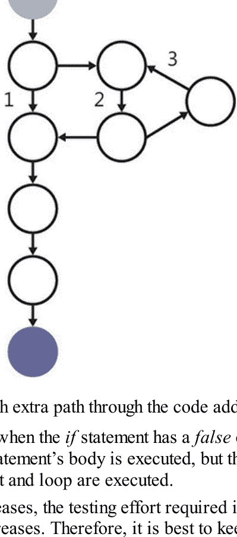

> **图 1-12** 代码中每增加一条路径，都会进一步增加复杂性。

标记为1的边表示 `if` 语句的条件为 `false` 的情况，因此其主体不会执行。边2表示 `if` 语句的主体执行，但其中包含的循环不执行。边3表示 `if` 语句和循环都执行的情况。

随着圈复杂度的增加，为获得每个分支的单元测试代码覆盖率所需的测试工作量也会增加。因此，最好保持低分支数，从而降低圈复杂度，以避免额外的测试代码。

高复杂度和缺陷数量之间也存在统计相关性。也就是说，分支更多的代码往往有更多缺陷。

##### 结论

本章作为Scrum流程的入门介绍。如果你从未在Scrum项目上工作过，我希望现在你的兴趣已经被充分激发，愿意尝试。另一方面，如果你确实在Scrum项目上工作，也许本章中有一些你想使用的新想法。

有大量资源可用于进一步学习Scrum，并判断它是否适合你的公司和项目。

Scrum项目与任何软件项目一样，容易失败。发现问题何时出错是战斗的重要部分，但发现为什么会出错可能更难。代码的内部机制可能被设计成难以更改——无论采用何种流程来管理这种更改。本书其余部分将提供建议和指导，确保代码自下而上地具有适应性，使更改更容易，并让你能够专注于在每个冲刺中增加业务价值。

#### 第2章 依赖与分层

完成本章后，你将能够

- 管理从方法级别到程序集级别的复杂依赖。
- 识别依赖复杂性最大的区域，并使用工具降低复杂性。
- 将代码分解为更小、更具适应性的功能片段，以促进重用。
- 在最有用的情况下应用分层模式。
- 理解依赖如何被解析，并调试依赖问题。
- 将实现隐藏在简单接口后面。

所有软件都有依赖。每个依赖要么是同一代码库中的第一方依赖，要么是对外部程序集的第三方依赖，要么是对`Microsoft .NET Framework`的普遍依赖。大多数非平凡项目都会用到所有这三种依赖类型。

依赖将功能从调用代码中抽象出来。你不必太担心依赖在做什么，更不必担心它是如何做的，但你应该确保所有依赖都被正确管理。当依赖链管理不善时，开发人员会强制引入本不必存在的依赖，并用虚假的程序集引用将代码缠绕成一团。你可能听过这句格言：“最正确的代码是从未写过的代码。”同样，管理得最好的依赖是不存在的依赖。

为了让代码适应变化，你必须有效管理依赖。这适用于软件的所有层面——从子系统之间的架构依赖到单个方法之间的实现依赖。架构不良的应用程序会减缓可用软件的交付，在最坏情况下甚至完全停摆。

我必须强调，以纯粹主义的方式管理依赖是多么重要。如果你在这个重要问题上妥协，你可能会注意到速度暂时提升，但长期影响可能对项目是致命的。这是一个再熟悉不过的故事：短暂的生产力提升随着代码量和模块数量的增加而迅速消散。代码变得僵硬而脆弱，进展缓慢如爬行。就Scrum工件和度量而言，冲刺燃尽图趋于平缓，因为没有故事点被认领；而且只要问题得不到解决，功能燃起图也会随之平缓，因为没有功能完成。甚至缺陷数量也在增加。当依赖结构难以理解时，一个模块中的更改会导致另一个看似不相关的模块产生直接副作用。

有了纪律和意识，你可以轻松管理依赖。有一些成熟的模式可帮助你在短期内安排应用程序，使其能够适应长期变化。分层是最常见的架构模式之一，本章将详细阐述可用的不同分层选项，以及依赖管理的其他方法。

##### 依赖的定义

什么是依赖？一般而言，*依赖*是两个不同实体之间的一种关系，其中一个实体没有另一个实体就无法执行某些功能——甚至无法存在。一个很好的类比是，可以说一个人在*财务上依赖于*另一个人。在法律文件中，经常要求你说明是否有受抚养人——也就是说，是否有任何人依靠你维持生活开支和其他基本必需品。这通常指配偶或子女。例如，当我住在百慕大时，我的工作许可证上写着，我的妻子和女儿只有在我工作许可证有效的情况下才能留在那里。这样，他们就依赖我，他们是我的受抚养人。

把这个定义转移到代码上，实体通常是程序集：程序集A使用另一个程序集B，因此可以说A *依赖于* B。陈述这种关系的一种常见方式是：A是B的*客户端*，B是A的*服务*。没有B，A无法运行。然而，非常重要的一点是，B *不* 依赖于A，而且，正如你将学到的，B *一定不能* 也 *不能* 依赖于A。这种客户端/服务关系如图2-1所示。

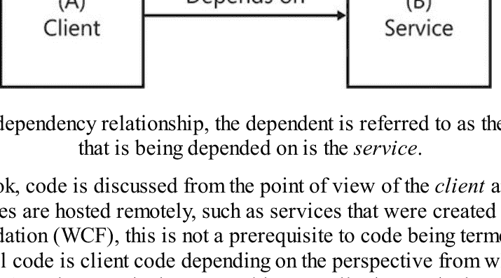

图2-1 在任何依赖关系中，依赖者被称为*客户端*，而被依赖的实体称为*服务*。

在本书中，代码是从*客户端*和*服务*的角度讨论的。尽管有些服务是远程承载的，例如使用Windows Communication Foundation（`WCF`）创建的服务，但这不是代码被称为服务的先决条件。所有代码都是服务代码，所有代码也都是客户端代码，这取决于你观察代码的视角。任何类、方法或程序集都可以调用其他方法、类或程序集，因此该代码是客户端。同一个类、方法或程序集也可以被其他方法、类或程序集调用，因此该代码也是服务。

##### 一个简单的示例

让我们看看依赖在实际情境中的表现。这个示例是一个非常简单的控制台应用程序，它向屏幕输出一条消息。这是普适的“`Hello World！`”示例。这个示例必然是微不足道的，因为我想把依赖问题提炼到本质。

你可以手动按照这里的步骤操作，或者从GitHub获取解决方案。关于使用Git的基本说明，请参阅附录A“自适应工具”；关于每个代码清单对应的Git分支名称，请参阅附录B“Git分支”（仅在线提供）。

1. 打开Microsoft Visual Studio并创建一个新的控制台应用程序，如图2-2所示。我把我的命名为`SimpleDependency`，但名称并不重要。

##### 新项目

图2-2 Visual Studio中的“新建项目”对话框允许你从许多不同的项目模板中进行选择。

2. 向解决方案中添加第二个项目，这次是一个类库。我把它命名为`MessagePrinter`。

3. 右键单击控制台应用程序的“引用”节点，然后选择“添加引用”。

4. 在“添加引用”对话框中，导航到“项目”并选择类库项目。

现在你已经在两个程序集之间创建了一个依赖关系，如图2-3所示。你的控制台应用程序依赖于类库，但类库并不依赖于控制台应用程序。控制台应用程序是客户端，类库是服务。虽然这个应用程序目前还没有做太多事情，但请生成解决方案并导航到项目的`bin`目录——可执行文件就在那里。

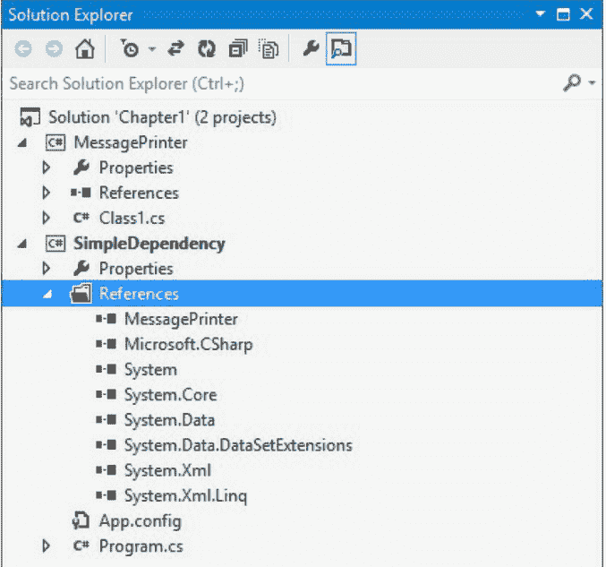

###### 图2-3 任何项目的引用程序集都列在其“引用”节点下。


`bin`目录包含`SimpleDependency.exe`文件，但也包含`MessagePrinter.dll`文件。这个文件是由Visual Studio生成过程复制到`bin`目录中的，因为它被可执行文件引用为依赖项。我想给你看一个实验，但首先需要对代码稍作修改。由于这是一个什么都不做的控制台应用程序，它会在你来得及反应之前就初始化并关闭。打开控制台应用程序的`Program.cs`文件。

#### 清单2-1 对ReadKey的调用可防止控制台应用程序立即退出。

单击此处查看代码图片

```
namespace SimpleDependency
{
    class Program
    {
        static void Main()
        {
            Console.ReadKey();
        }
    }
}
```

重新生成解决方案并运行应用程序。正如预期的那样，它会显示控制台窗口，等待你按下键盘上的某个键，然后在你按下之后终止。在`Console.ReadKey()`这一行设置一个断点，并从Visual Studio中调试解决方案。

当应用程序在断点处暂停时，你可以查看已为此应用程序加载到内存中的程序集。为此，你可以使用菜单栏选择“调试”>“窗口”>“模块”，也可以使用键盘快捷键`Ctrl+D, M`。图2-4显示了已为应用程序加载的模块列表。

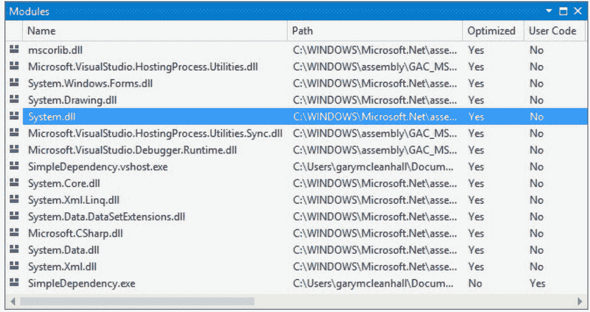

图2-4 调试时，“模块”窗口会显示所有当前已加载的程序集。

你是否注意到了一些奇怪的事情？这里没有提到已创建的类库。对于这个示例，难道不应该加载`MessagePrinter.dll`吗？实际上，不——这正是预期的行为。原因如下：应用程序没有使用`MessagePrinter`程序集内的任何内容，因此.NET运行时不会加载它。

为了最终证明依赖程序集并不是真正的先决条件，请再次导航到控制台应用程序的`bin`目录并删除`MessagePrinter.dll`。再次运行应用程序，它将继续正常运行而不会引发异常。

让我们再重复几次这个实验，以便真正了解正在发生的事情。首先，在`Program.cs`文件的顶部添加一条`using MessagePrinter`指令。这会导入`MessagePrinter`命名空间。你认为这足以让公共语言运行时（CLR）加载该模块吗？并不是。依赖关系再次被忽略，程序集也不会被加载。这是因为用于导入命名空间的`using`语句只是语法糖，其作用仅仅是减少你需要编写的代码量。与其在每次想要使用某个类型时写出整个命名空间，你可以导入命名空间并直接引用这些类型。`using`语句不会生成任何可供CLR执行的指令。

下一个测试建立在第一个测试的基础上，因此你可以保留`using`语句。在`Program.cs`中，在`Console.ReadLine()`调用上方，添加一个对`MessagePrinting.Service`构造函数的调用，如清单2-2所示。

#### 清单2-2 通过调用实例方法来引入依赖关系。

单击此处查看代码图片

```
using System;
using MessagePrinter;

namespace SimpleDependency
{
    class Program
    {
        static void Main()
        {
            var service = new MessagePrintingService();
            service.PrintMessage();
            Console.ReadKey();
        }
    }
}
```

“模块”窗口现在显示`MessagePrinter.dll`程序集已被加载，因为如果不将程序集的内容拉入内存，就无法构造`MessagePrintingService`的实例。

如果你从`bin`目录中删除`MessagePrinter.dll`并再次运行应用程序，即可证明这一点。这次会抛出异常。

单击此处查看代码图片

```
未处理的异常：System.IO.FileNotFoundException：无法加载文件或程序集“MessagePrinter, Version=1.0.0.0, Culture=neutral, PublicKeyToken=null”或其某个依赖项。系统找不到指定的文件。
```

## 框架依赖项

上一节中显示的依赖关系称为第一方依赖项。控制台应用程序及其所依赖的类库都属于同一个Visual Studio解决方案。这意味着该依赖项应该始终是可访问的，因为如有必要，依赖项目始终可以从源代码重新生成。这也意味着你可以修改第一方依赖项的源代码。

这两个项目还以.NET Framework程序集的形式拥有其他依赖项。这些程序集不属于项目本身，但预期是可用的。每个.NET Framework程序集都按其构建时所针对的.NET Framework版本进行版本管理：1、1.1、2、3.5、4、4.5，等等。某些.NET Framework程序集是特定版本新增的，无法被使用较早.NET Framework版本的项目引用。其他程序集会随着.NET Framework版本的更迭而变化，因此必须使用特定的版本。

`SimpleDependency`项目具有对.NET Framework的多处引用，如图2-3之前所示。其中许多依赖项是添加到所有控制台应用程序项目中的默认依赖项。示例应用程序并未使用它们，因此可以安全地移除。实际上，对于这两个项目，除了`System`和`System.Core`之外的所有引用都是多余的，因此可以从引用列表中移除。应用程序仍将正常运行。

通过移除不必要的框架依赖项，你可以更轻松地查看每个项目所需的依赖项。

### 框架程序集始终会加载

值得注意的是，与其他依赖项不同，对.NET Framework程序集的引用总是会导致这些程序集被加载。即使你实际上并未使用某个程序集，它仍然会在应用程序启动时加载。幸运的是，如果解决方案中的多个项目都引用同一个程序集，则只会将该程序集的一个实例加载到内存中，并由所有依赖方共享。

### 默认引用列表

项目的默认引用因项目类型而异。每种项目类型都有一个项目模板，其中列出了所需的引用。这就是为什么Windows窗体应用程序可以引用`System.Windows.Forms`程序集，而Windows Presentation Foundation应用程序可以引用`WindowsBase`、`PresentationCore`和`PresentationFramework`。

#### 清单2-3 部分Visual Studio项目模板，用于按条件引用不同的程序集。

单击此处查看代码图片

```
<ItemGroup>
  <Reference Include="System"/>
  $if$ ($targetframeworkversion$ >= 3.5)
  <Reference Include="System.Core"/>
  <Reference Include="System.Xml.Linq"/>
  <Reference Include="System.Data.DataSetExtensions"/>
  $endif$
  $if$ ($targetframeworkversion$ >= 4.0)
  <Reference Include="Microsoft.CSharp"/>
  $endif$
  <Reference Include="System.Data"/>
  <Reference Include="System.Xml"/>
</ItemGroup>
```

这些文件中包含一些逻辑，可以改变模板生成实际项目实例的方式。具体来说，引用会根据所生成项目使用的 .NET Framework 版本而有所不同。这里，只有在项目面向 .NET Framework 4、4.5 或 4.5.1 时，才会引用`Microsoft.CSharp`程序集。这是合理的，因为通常只有在使用 .NET Framework 4 中引入的`dynamic`关键字时才需要它。

## 第三方依赖

最后一种依赖类型是由第三方开发者开发的程序集。通常，如果某些功能不是由 .NET Framework 提供的，你可以通过创建第一方依赖来自行实现解决方案。根据所需解决方案的规模，这可能是一项费力的任务。相反，你可以选择使用现成的解决方案。例如，你不太可能想要实现自己的对象关系映射器（ORM），因为这样一大块基础设施代码可能需要数月才能可用，数年才能完善。相反，你可以首先考虑属于 .NET Framework 一部分的 Entity Framework。如果那不能满足你的需求，你可以转而考虑 NHibernate，这是一个经过广泛测试的成熟 ORM 库。

使用第三方依赖的主要原因是，将实现某些功能或基础设施所需的努力，换成整合某种已经编写好且适合该工作的东西所需的努力。请不要忘记，这种整合工作仍然可能很繁重，这取决于你的第一方代码结构和第三方代码接口。当你的目标是以迭代方式交付业务价值增量——如 Scrum——使用第三方库可以让你保持这一专注。

### 组织第三方依赖

要组织你的项目和 .NET Framework 外部的依赖，最简单的方法是在项目的 Visual Studio 解决方案下创建一个名为`Dependencies`的解决方案文件夹，并将`.dll`文件添加到该文件夹中。当你想要为解决方案中的项目添加对这些程序集的引用时，可以通过在“引用管理器”对话框中浏览到这些文件来实现（如图 2-5 所示）。

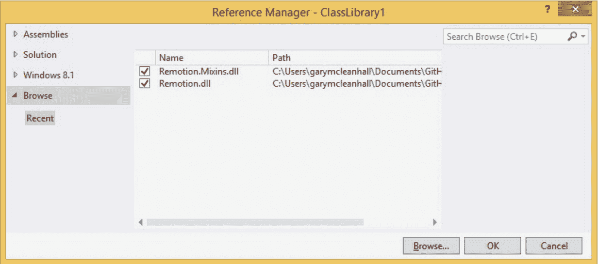

图 2-5 第三方引用可以存储在 Visual Studio 解决方案的 Dependencies 文件夹中。

这种方法的另一个优点是，所有外部依赖都存储在源代码管理中。这样，其他开发者只需从中央存储库获取最新版本的源代码，就能获得这些依赖项。这比要求所有开发者自行安装或下载文件要简单得多。

本章后面的“使用 NuGet 管理依赖”一节将演示一种更好的第三方依赖组织方式。简而言之，NuGet 依赖管理工具会自动管理项目的第三方依赖，包括下载包含所有相关工件的包、引用程序集以及升级库版本。

## 在有向图中对依赖关系建模

图是一种数学结构，由两个不同的元素组成：节点和边。边只能存在于两个节点之间，并以某种方式连接它们。在图中，任何节点都可以连接到任意数量的其他节点。根据图属性的不同，图可以有多种类型。例如，图 2-6 中的图显示了无方向的边：节点`A`和`C`之间的边既不是从`A`到`C`，也不是从`C`到`A`——边的存在才是关键。这被称为无向图。

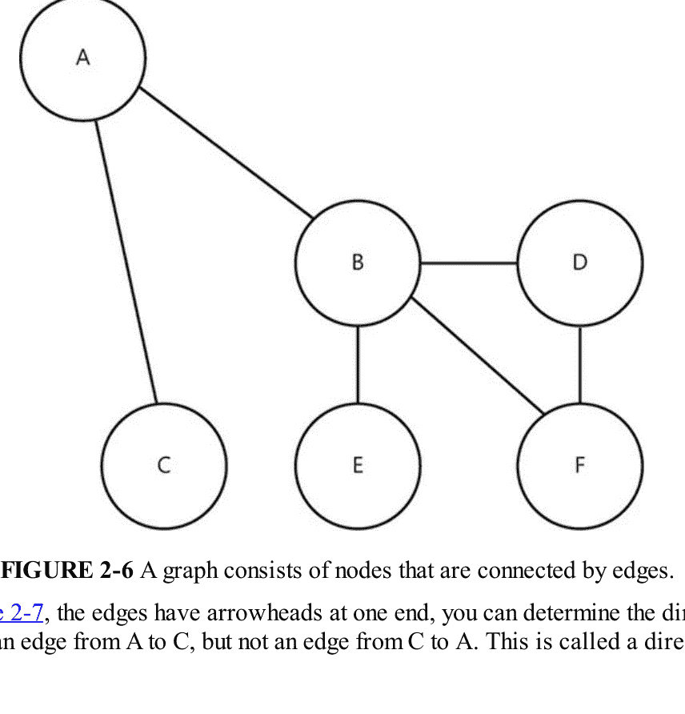

图 2-6 图由通过边连接的节点组成。

如果在图 2-7 中，边的一端带有箭头，你就可以确定边的方向。有一条从`A`到`C`的边，但没有从`C`到`A`的边。这被称为有向图，或简称 digraph。

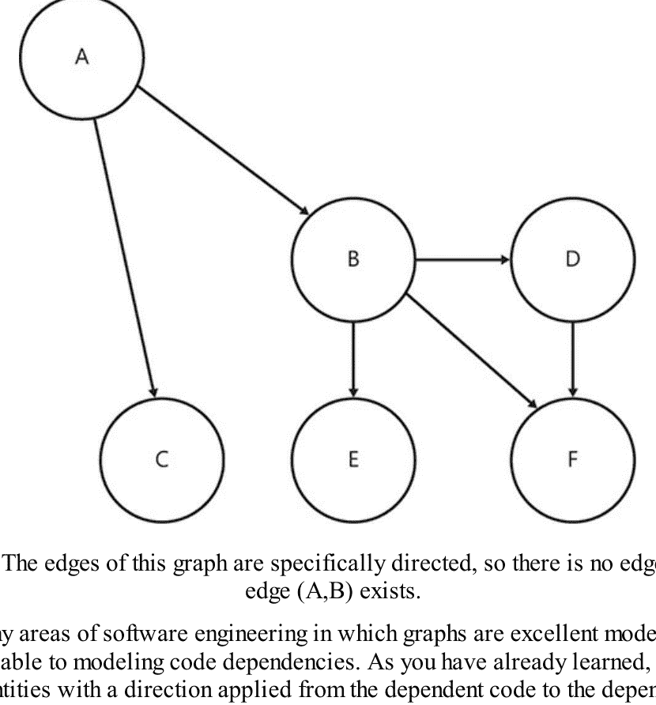

图 2-7 此图中的边是明确有向的，因此不存在边`(B,A)`，但存在边`(A,B)`。

在软件工程的许多领域中，图都是极佳的模型，但图在模拟代码依赖关系方面尤为适用。正如你已经学到的，依赖关系由两个实体组成，方向从依赖代码指向被依赖代码。你可以将实体视为节点，并从依赖方到被依赖方绘制一条有向边。当你将这一方法扩展到其余实体时，就形成了依赖关系有向图。

如图 2-8 所示，这种结构可以应用于几种不同的粒度。图中的节点可以表示项目中的类、不同的程序集或构成子系统的程序集组。在所有情况下，节点之间的箭头都表示组件之间的依赖关系。箭头的起点是依赖组件，终点是被依赖组件。

### 循环依赖

图论的另一部分是有向图可以形成环：即通过边从一个节点遍历回自身的能力。到目前为止展示的图被称为*无环有向图*——不包含环。图 2-9 展示了一个*有环有向图*的例子。如果你从节点`D`开始，可以沿边到`E`，再到`B`，最后又回到`D`。

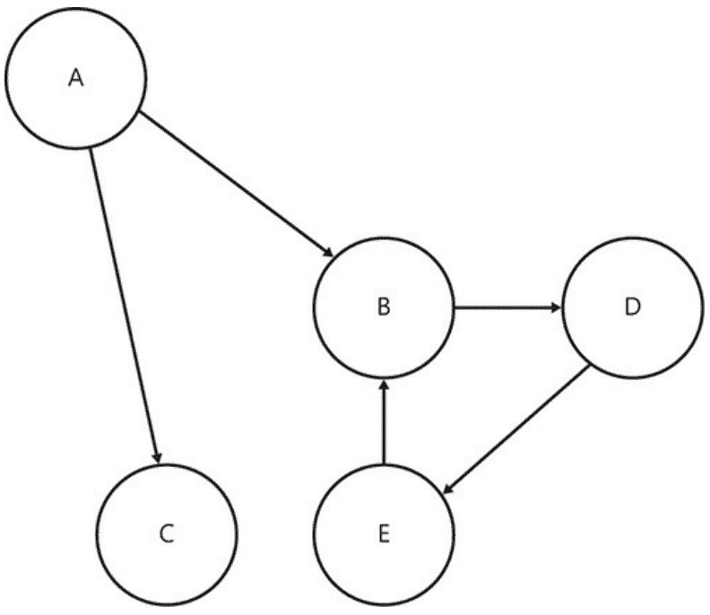

图 2-9 此有向图包含环。

假设这些节点代表程序集。`D`对其显式依赖和隐式依赖所依赖的任何东西都有隐式依赖。`D`显式依赖于`E`，但隐式依赖于`B`和`D`。因此，`D`依赖于*自身*。

对于程序集来说，这实际上是不可能的。如果你尝试在 Visual Studio 中进行设置，当你为从`E`到`B`的引用赋值时，Visual Studio 不会允许这种情况发生，如图 2-10 所示。

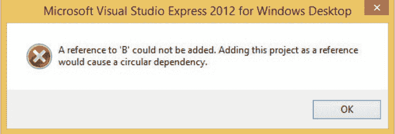

图 2-10 在 Visual Studio 中无法创建循环依赖。

因此，虽然将依赖关系建模为图看起来可能有些学术化，但在组织依赖关系时，它具有明显的好处。程序集之间的循环依赖并不是对纯粹理想的偏离，而是完全不允许的，必须避免。

*自环*是有向图中环的一种特化。如果一个节点通过一条边连接到*自身*，那么这条边就成为一个自环。[图 2–11](#) 展示了一个带有自环的图的示例。

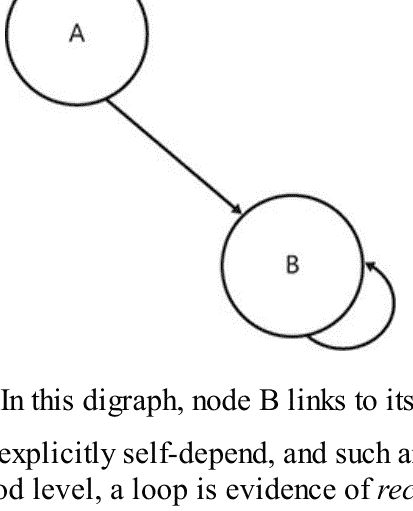

**图 2–11** 在此有向图中，节点 B 通过自环与自身相连。

在实践中，程序集总是显式地依赖自身，这样的观察结果并不特别值得注意。然而，在方法级别，自环是*递归*的证据，如[清单 2–4](#) 所示。

**清单 2–4** 表示方法的有向图中的自环会导致递归。

点击此处查看代码图片

```
namespace Graphs
{
    public class RecursionLoop
    {
        public void A()
        {
            int x = 6;
            Console.WriteLine("{0}! = {1}", x, B(x));
        }

        public int B(int number)
        {
            if(number == 0)
            {
                return 1;
            }
            else
            {
                return number * B(number - 1);
            }
        }
    }
}
```

清单 2-4 中的类展示了图 2-11 中依赖图的功能等价物。方法`A`调用方法`B`；因此，可以说方法`A`依赖于方法`B`。然而，更有趣的是方法`B`对自身的依赖——`B`是递归函数的一个例子；也就是说，一个调用自身的函数。

## 管理依赖关系

到目前为止，你已经了解到，依赖关系是必要的，但也必须谨慎管理，以免在后续开发中给你带来问题。这些问题一旦显现，往往很难摆脱。因此，最好从一开始就正确管理依赖关系，并保持警惕，以免问题悄悄潜入。管理不善的依赖关系很快就会从小小的妥协升级为整体架构问题。

本章其余部分重点讨论持续管理依赖关系中更实际的方面。这包括避免反模式，更重要的是，理解为什么这些常见模式是*反模式*。相反，有些模式是有益的，应该被采纳；这些模式作为上述反模式的直接替代方案被提供。

### 模式与反模式

作为一门工程学科，面向对象软件开发是一项相对较新的尝试。在过去的几十年里，一些类和接口之间可重复的协作已被识别并编纂为*模式*。

软件开发模式有很多种，每种模式都提供了一个通用解决方案，可以针对特定问题领域进行改造。有些模式可以相互结合，为复杂问题产生优雅的解决方案。当然，并非所有模式在任何时候都适用，识别某些模式可能适用的时间和地点需要经验和实践。

有些模式并不那么有益。事实上，恰恰相反。它们被认为是*反模式*。这些模式会损害代码的适应性，应予以避免。有些反模式最初是模式，后来由于被认为有负面副作用而逐渐失宠。

### 实现与接口

刚接触面向接口编程概念的开发者，往往难以放下接口背后的东西。

在编译时，接口的任何客户端都不应该知道它正在使用该接口的哪个实现。这种了解可能会导致错误的假设，使客户端与接口的特定实现耦合。

想象一个常见的例子：一个类需要将记录保存到持久化存储中。为此，它正确地委托给一个接口，该接口隐藏了所使用的持久化存储机制的细节。然而，对它正在使用的哪种实现做出任何假设都是不正确的。

`interface` 在运行时被使用。例如，将接口引用强制转换为任何实现 *始终* 都是一个坏主意。

### *新的* 代码坏味道

接口描述的是 *可以* 做什么，而类描述的是 *如何* 实现。只有类涉及实现细节——接口完全不知道某事是如何完成的。因为只有类才有构造函数，所以可以推断构造函数是实现细节。由此产生的一个有趣推论是，除了少数例外，你可以将`new`关键字的出现视为 *代码坏味道*。

### 代码坏味道

说代码 *有味道* 是一种说法，意思是某些代码 *可能* 有问题。单词“可能”是有意选择的，因为两次代码坏味道的出现可能并不同样成问题。与反模式不同，反模式更普遍地被认为是不良实践，代码坏味道不一定是不良实践。代码坏味道是警告，表明可能存在问题，并且可能需要纠正根本原因。

代码坏味道可能表明存在技术债务，需要偿还——债务拖延得越久，修复起来可能就越困难。

代码坏味道有很多不同的类别。使用`new`关键字——直接对象实例化——是“不当亲密”的一个例子。因为构造函数是实现细节，它们的


```
{
    private readonly ISecurityService securityService;

    public AccountController()
    {
        this.securityService = new SecurityService();
    }

    [HttpPost]
    public void ChangePassword(Guid userID, string newPassword)
    {
        securityService.ChangeUsersPassword(user, newPassword);
    }
}
```

这个示例尚未完成——由于其构造函数，你仍然依赖于 `SecurityService` 的实现。具体的类仍在 `AccountController` 的构造函数中被实例化。要完全分离这两个类，你需要进行进一步的重构：引入 *依赖注入*（DI）。

### 使用依赖注入

这是一个庞大的主题，无法在有限的篇幅中涵盖。事实上，第 9 章“依赖注入”专门讨论了该主题，并且有整本书致力于此。幸运的是，DI 并不是特别复杂或困难，因此从使用 DI 的类的角度来看，这里可以介绍基础知识。列表 2-10 显示了对 `AccountController` 类构造函数应用的另一个重构。构造函数是这里唯一的变化，用粗体突出显示。就这个类而言，这是一个非常小的改动，但它对你管理依赖的能力产生了巨大影响。`AccountController` 不再自行构造 `SecurityService` 类，而是现在需要其他某个类为其提供一个 `ISecurityService` 实现。不仅如此，还在构造函数中引入了一个前置条件，防止其客户端为 `securityService` 参数传入 `null` 值。这确保了，当你在 `ChangePassword` 方法中使用 `securityService` 字段时，你可以保证拥有一个有效的实例，并且在其他任何地方都不必检查 `null`。

#### LISTING 2-10 Using dependency injection allows you to remove the dependency on the SecurityService class.

Click here to view code image

```
public class AccountController
{
    private readonly ISecurityService securityService;

    public AccountController(ISecurityService securityService)
    {
```

### The Entourage anti-pattern

*Entourage anti-pattern* 这个名字来源于这样一个事实：即使你认为自己只要求一件简单的事情，它也会把所有朋友都带上。这很像音乐或电影明星被跟屁虫和寄生虫跟随：他们的随从。这是我创造的一个名字，用来最好地描述不良的依赖管理。

`Entourage anti-pattern` 是一个常见的错误，当开发者向接口解释编程时就会犯。演示通常不会明确地说，接口及其依赖 *不应该在同一个程序集中*。

Unified Modeling Language（UML）图在 [Figure 2-12](#figure-2-12) 中显示了 `AccountController` 示例在包级别的组织方式。`AccountController` 依赖于 `ISecurityService` 接口，该接口由 `SecurityService` 类实现。该图还显示了每个实体所在的包——在 .NET Framework 中，这些是程序集或 Visual Studio 项目。这是 `Entourage anti-pattern` 的一个例子：接口的实现与接口本身在同一个程序集中。

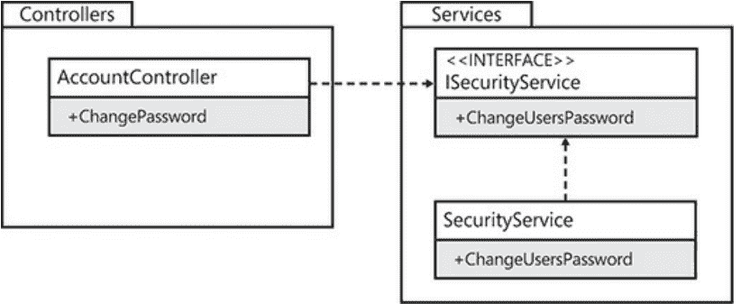

**FIGURE 2-12** The `AccountController` assembly depends on the Services assembly.

你已经了解到 `SecurityService` 类本身也有一些依赖，以及依赖链如何导致从客户端到客户端到客户端的隐式依赖。在包图的基础上，[Figure 2-13](#figure-2-13) 显示了 Entourage 问题 的全部程度。

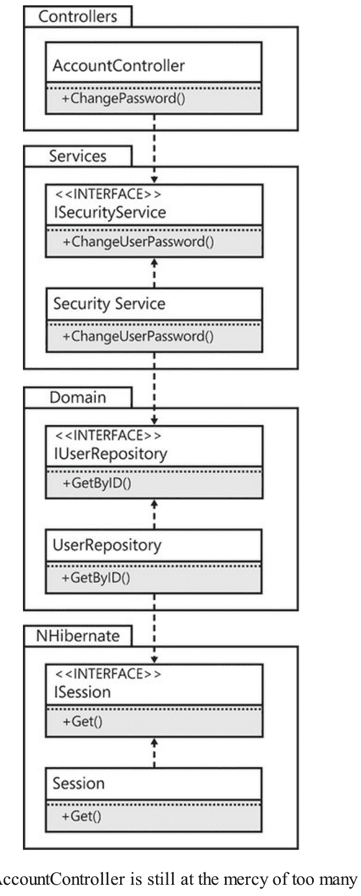

#### FIGURE 2-13 The AccountController is still at the mercy of too many implementations.

如果你单独构建 Controllers 项目，你仍然会在 `bin/` 目录中找到 `NHibernate`，表明它仍然是一个隐式依赖。虽然你已经很好地将 `AccountController` 类与不必要的依赖分离，但它仍然与每个依赖程序集中的实现紧密耦合。

这种反模式会导致两个问题。第一个问题是程序员的纪律性。你需要在每个包——Services、Domain 和 NHibernate——中将接口标记为 `public`。然而，你也需要将具体的类——实现——标记为 `public`，以便在某个时刻可以进行构造（只是不在客户端类内部）。这意味着没有什么可以阻止一个不守纪律的开发者直接引用实现。有一种诱惑去走捷径，直接对类调用 `new` 来获取其实例。

第二，如果你创建一个新的 `SecurityService` 实现，它不是依赖于使用 `NHibernate` 持久化的领域模型，而是改用第三方服务总线，例如 `NServiceBus`，来向处理器发送命令消息呢？将其添加到 Services 程序集中会产生另一个依赖，导致代码库臃肿、脆弱，很难适应新的需求。

一般规则是，实现应该与其接口分离，通过将它们放在不同的程序集中。对于这一点，你可以使用 Stairway 模式。

### The Stairway pattern

Stairway 模式是组织类和接口的正确方式。通过将接口及其实现放在不同的程序集中，你可以独立地改变两者，并且客户端只需要引用一个——接口程序集。

你可能会想：“我需要跟踪多少个程序集？如果我将每个接口和类都拆分到自己的程序集中，我的解决方案将会有 200 个项目！”不必担心，因为应用 Stairway 模式只会使项目数量增加几个，同时给你一个组织良好且易于理解的解决方案的好处。如果项目之前安排得特别糟糕，应用 Stairway 模式后总项目数甚至可能减少。

使用 Stairway 模式重构的 `AccountController` 运行示例显示在图 2-14 中。每个实现——即每个类——只引用包含其所依赖接口的程序集。它不会引用实现程序集，甚至不是隐式引用。每个实现类也引用其接口的程序集。这真的是最好的世界：没有依赖的接口、没有隐式依赖的客户端代码，以及实现通过只依赖其他接口程序集来继续该模式。

#### FIGURE 2-14 The Stairway pattern is aptly named.

我现在想更详细地关注其中一个好处：接口不应该有任何外部依赖。在尽可能的情况下，这始终应被遵守。接口不应该有方法或属性暴露在第三方引用中定义的数据对象或类。虽然它们可以，也肯定会需要依赖解决方案中其他项目中的类和数据类型以及常见的 .NET Framework 库，但应避免引用基础设施实体。第三方库通常用于基础设施目的。即使是 `Log4Net`、`NHibernate` 和 `MongoDB` 等库的接口也是基础设施依赖，会将你的接口绑定到特定的实现。这是因为这些库使用的是 Entourage anti-pattern 打包，而不是 Stairway 模式。它们各自提供一个包含你想要依赖的接口和你不想依赖的实现 的单一程序集。

为了解决这个问题，你可以改为引用你自己的日志、领域持久化和文档存储接口。你可以编写一个简单的接口，在其后面隐藏第三方依赖，形成一个第一方依赖。然后，如果你需要更换第三方依赖，你可以通过为新库编写适配器来适配你的接口。

从务实的层面来看，这可能并不完全可行。在将第三方依赖转换为第一方依赖会带来过量工作的情况中，团队必须承认他们将不得不保留该依赖，并且它将无处不在。如果库被淘汰，替换它将变得极其困难和耗时。这种让步通常是针对框架做出的，而框架比简单的库大得多。

### 解决依赖项

了解如何安排项目及其依赖关系，在调试程序集之间的依赖关系时并无帮助。有时程序集在运行时不可用，此时有必要找出原因。

#### 程序集

公共语言运行时（CLR），即 .NET Framework 用于执行代码指令的虚拟机，与其他任何软件产品一样，已被编程为在托管应用程序时以可预测和逻辑的方式运行。对程序集如何被解析以及解析错误如何修复的理论和实践有良好的基础是非常有用的。当你需要追踪查找程序集的问题时，少量知识就能走得很远。

#### 解析过程

程序集解析过程是 CLR 的一个重要方面。它涵盖了从向程序集或项目添加引用到应用程序运行并加载该程序集之间的差距。涉及多个步骤，只需一个概述即可，当过程中出现问题时，你可以推断出问题的可能原因。

图 2-15 以流程图的形式展示了程序集解析过程。该流程图处于高层次，不包括每个细节，但足以显示过程中的主要项目。过程如下：

- CLR 使用即时（JIT）模型来解析程序集。如本章前面已证明，应用程序中包含的引用在启动应用程序时不会被解析，而是在你首次使用该程序集的功能时才解析—— literally just in time。

- 每个程序集都有一个标识，它由名称、版本、区域性以及公钥令牌组成。绑定重定向等功能可以更改此标识，因此确定它并不像看起来那么简单。

- 当程序集的标识已确定后，CLR 能够确定它是否已在当前应用程序执行期间之前尝试解析此依赖项，如以下从 Visual Studio 项目文件摘取的代码段所示。

- 提出此问题会导致 CLR 根据答案分支。如果已尝试解析此程序集，则该过程要么已成功，要么已失败。如果成功，CLR 可以使用已加载的程序集并提前退出。如果不成功，CLR 知道无需继续尝试解析此程序集，因为它会失败。

- 或者，如果这是首次尝试解析程序集，CLR 首先检查全局程序集缓存（GAC）。GAC 是一个机器范围的程序集存储库，允许同一应用程序中执行同一程序集的多个版本。如果在 GAC 中找到程序集，则解析过程成功，并且发现的程序集被加载。因此你现在知道，因为 GAC 会首先被搜索，

```
<reference include="MyAssembly, Version=2.1.0.0, Culture=neutral,
    PublicKeyToken=17fac983cbea459c" />
```

GAC 中存在适用的程序集将优先于文件系统上的程序集。

- 如果在 GAC 中找不到程序集，CLR 开始探测多个目录以查找它。搜索的目录取决于 `app.config` 设置。如果 `app.config` 中有 `codeBase` 元素，则会检查该位置——如果未找到程序集，则不会随后检查其他位置。但是，默认情况下会搜索应用程序的根目录，通常是与入口点或 Web 应用程序相关的 `/bin` 文件夹。如果在那里找不到程序集，则解析过程失败，CLR 会抛出异常。通常，这会导致应用程序终止。

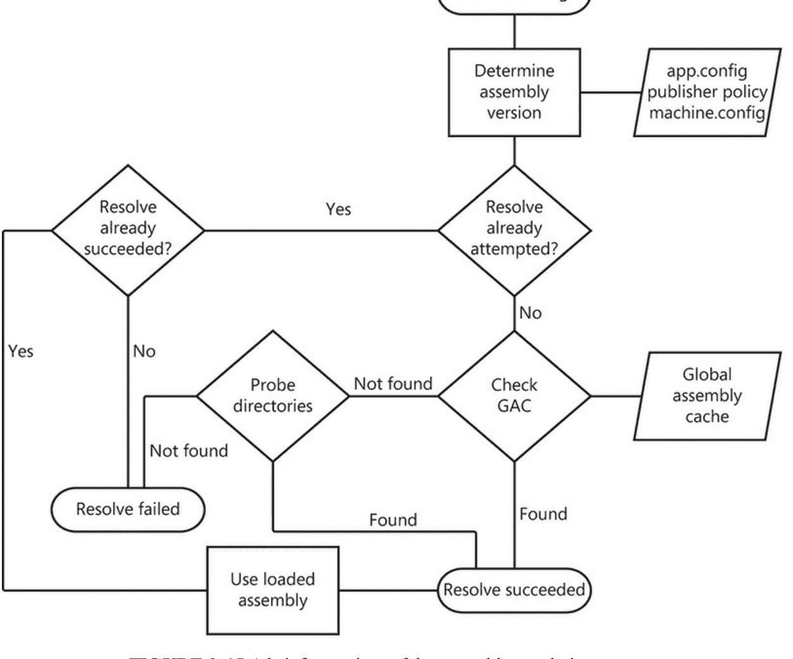

图 2-15 程序集解析过程的简要概述。

#### Fusion 日志

这是调试 CLR 在运行时绑定到程序集失败尝试的非常有用的工具。与尝试在 Visual Studio 调试器中逐步执行应用程序相比，最好打开 Fusion 并阅读生成的日志文件。

要启用 Fusion，你必须编辑 Windows 注册表，如以下代码所示。

```
HKLM\Software\Microsoft\Fusion\ForceLog 1
HKLM\Software\Microsoft\Fusion\LogPath C:\FusionLogs
```

`ForceLog` 值是一个 DWORD，而 `LogPath` 是一个字符串。你可以将 `LogPath` 设置为你选择的任何路径。失败绑定的示例显示在列表 2-12 中。

#### 列表 2-12 Fusion 对绑定程序集失败尝试的示例输出。

```
*** Assembly Binder Log Entry (6/21/2013 @ 1:50:14 PM) ***

The operation failed.
Bind result: hr = 0x80070002. The system cannot find the file specified.

Assembly manager loaded
from: C:\Windows\Microsoft.NET\Framework64\v4.0.30319\clr.dll
Running under executable C:\Program Files\1UPIndustries\Bins\v1.1.0.242\Bins.exe
--- A detailed error log follows.

==== Pre-bind state information ====
LOG: User = DEV\gmclean
LOG: DisplayName = TaskbarDockUI.Xtensions.Bins.resources, Version=1.0.0.0, Culture=en-US, PublicKeyToken=null (Fully-specified)
LOG: Appbase = file:///C:/Program Files/1UPIndustries/Bins/v1.1.0.242/
LOG: Initial PrivatePath = NULL
LOG: Dynamic Base = NULL
LOG: Cache Base = NULL
LOG: AppName = Bins.exe
Calling assembly : TaskbarDockUI.Xtensions.Bins, Version=1.0.0.0, Culture=neutral, PublicKeyToken=null.
====
LOG: This bind starts in default load context.
LOG: No application configuration file found.
LOG: Using host configuration file:
LOG: Using machine configuration file from C:\Windows\Microsoft.NET\Framework64\v4.0.30319\config\machine.config.
LOG: Policy not being applied to reference at this time (private, custom, partial, or location-based assembly bind).
LOG: Attempting download of new URL file:///C:/Program Files/1UPIndustries/Bins/v1.1.0.242/en-US/TaskbarDockUI.Xtensions.Bins.resources.DLL.
LOG: Attempting download of new URL file:///C:/Program Files/1UPIndustries/
Bins/v1.1.0.242/en-US/TaskbarDockUI.Xtensions.Bins.resources/
TaskbarDockUI.Xtensions.Bins.resources.DLL.
LOG: Attempting download of new URL file:///C:/Program Files/1UPIndustries/Bins/
v1.1.0.242/en-US/TaskbarDockUI.Xtensions.Bins.resources.EXE.
LOG: Attempting download of new URL file:///C:/Program Files/1UPIndustries/
Bins/v1.1.0.242/en-US/TaskbarDockUI.Xtensions.Bins.resources/
TaskbarDockUI.Xtensions.Bins.resources.EXE.
LOG: All probing URLs attempted and failed.
```

在编辑注册表后，所有托管应用程序对程序集的解析尝试，无论成功与否，都会写入日志。这显然会产生大量日志文件，这可能很有用，但也可能开始成为大海捞针的问题。

幸运的是，Fusion 有一个 UI 应用程序，如图 2-16 所示，它使找到应用程序的正确文件变得稍微容易一些，而无需在文件系统中搜索。

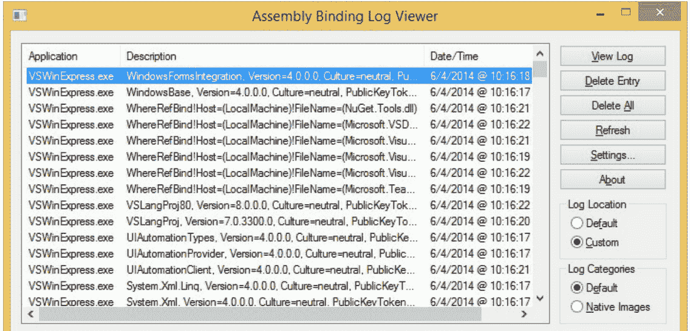

图 2-16 Fusion 具有用于查找应用程序日志文件的用户界面。

并非所有依赖项都需要程序集引用。一种替代方案是将服务代码部署为托管服务。这需要进程间或网络间通信，但它最大限度地减少了客户端和服务器之间所需的程序集引用，正如下一节所考察的那样。

#### 服务

与程序集相比，客户端与托管服务的耦合可以松得多，这是有益的，但也需要付出代价。根据应用程序的要求，客户端可能对服务的位置了解很多或很少。此外，你可以改变服务的实现方式，使其要求非常少。对于这些选项中的每一个，都需要考虑不同的权衡。

#### 已知端点

当客户端在编译时已知服务的位置时，可以在客户端创建服务代理。该代理至少可以通过两种方式创建：使用 Visual Studio 为项目添加服务引用，以及通过 .NET Framework 中的 `ChannelFactory` 类自行创建服务代理。


在 Visual Studio 中添加服务引用非常容易：只需在项目的快捷菜单上选择“添加服务引用”。“添加服务引用”对话框只需要 Web Services Definition Language（`WSDL`）文件的位置，该文件提供了服务的元数据描述、其数据类型和可用行为。然后 Visual Studio 为此服务生成一组代理类，节省了大量时间。它甚至可以生成服务的异步版本以缓解阻塞问题。然而，使用此方法的代价是失去了对生成代码的控制。Visual Studio 生成的代码不太可能符合您内部的编码标准，这可能是一个问题，具体取决于这些标准的严格程度。另一个问题是，生成的服务代理不利于单元测试：它不会生成任何接口，只会生成实现类。

添加服务引用的替代方案是在代码中自行创建服务代理。此方法最适合客户端可以访问服务接口并可以直接通过引用重用它时使用。清单 2-13 显示了使用 `ChannelFactory` 类创建服务代理的示例。

### LISTING 2-13 The ChannelFactory class allows you to create a service proxy.

Click here to view code image

```
var binding = new BasicHttpBinding();
var address = new EndpointAddress("http://localhost/MyService");
var channelFactory = new ChannelFactory<IService>(binding, address);
var service = channelFactory.CreateChannel();
service.MyOperation();
service.Close();
channelFactory.Close();
```

`ChannelFactory` 类是泛型的，其构造函数需要您希望其创建的服务代理的接口。因为此代码还需要 `Binding` 和 `EndpointAddress`，所以您必须为 `ChannelFactory` 提供完整的地址/绑定/契约（ABC）。在此示例中，`IService` 接口与服务实现的接口相同。您从 `ChannelFactory.CreateChannel` 获得的是一个代理，对于每次调用，它都会调用服务器端实现的等效方法。因为使用的是相同的接口，客户端类可以要求将此接口作为构造函数参数由依赖注入解析，并且客户端类立即变得可测试。此外，它们不必知道自己正在调用远程服务。

## 服务发现

有时您可能知道服务的绑定类型或其契约，但不知道其托管地址。在这种情况下，您可以使用服务发现，该功能在 .NET Framework 4 中引入到 Windows Communication Foundation（WCF）。

服务发现有两种形式：托管和临时。在托管模式下，一个中心化的服务称为发现代理，对客户端而言是众所周知的，客户端直接向其发送查询以查找其他服务。这是较不有趣的模式，因为它引入了单点故障（SPOF）：如果发现代理不可用，客户端就无法访问任何其他服务，因为它们无法被发现。

临时模式通过使用多播网络消息消除了对发现代理的需求。此默认实现使用用户数据报协议（UDP），每个可发现的服务都在指定的 IP 地址¹ 上监听查询。客户端有效地询问网络是否存在匹配其查询条件的服务，例如契约或绑定类型。在此场景中，如果其中一个服务不可用，只有该服务无法被发现，而其余服务仍会响应请求。清单 2-14 显示了如何以编程方式托管可发现的服务，而清单 2-15 显示了如何通过配置为服务添加可发现性。

> ¹ 使用的 IP 地址是 239.255.255.250（IPv4）或 [FF02::C]（IPv6）。使用的端口是 3702。这是 WS-Discovery 标准设定的，因此不可配置。

### LISTING 2-14 Programmatically hosting a discoverable service.

Click here to view code image

```
class Program
{
    static void Main(string[] args)
    {
        using (ServiceHost serviceHost = new ServiceHost(typeof(CalculatorService)))
        {
            serviceHost.Description.Behaviors.Add(new ServiceDiscoveryBehavior());

            serviceHost.AddServiceEndpoint(typeof(ICalculator), new BasicHttpBinding(), new Uri("http://localhost:8090/CalculatorService"));
            serviceHost.AddServiceEndpoint(new UdpDiscoveryEndpoint());

            serviceHost.Open();
            Console.WriteLine("Discoverable Calculator Service is running...");
            Console.ReadKey();
        }
    }
```

### LISTING 2-15 Hosting a discoverable service via configuration.

Click here to view code image

```
<system.serviceModel>
    <behaviors>
        <serviceBehaviors>
            <behavior>
                <serviceMetadata httpGetEnabled="true" httpsGetEnabled="true"/>
                <serviceDebug includeExceptionDetailInFaults="false"/>
            </behavior>
            <behavior name="calculatorServiceDiscovery">
                <serviceDiscovery />
            </behavior>
        </serviceBehaviors>
        <endpointBehaviors>
            <behavior name="calculatorHttpEndpointDiscovery">
                <endpointDiscovery enabled="true" />
            </behavior>
        </endpointBehaviors>
    </behaviors>
    <protocolMapping>
        <add binding="basicHttpsBinding" scheme="https" />
    </protocolMapping>
    <serviceHostingEnvironment aspNetCompatibilityEnabled="true" multipleSiteBindingsEnabled="true" />
    <services>
        <service name="ConfigDiscoverableService.CalculatorService" behaviorConfiguration="calculatorServiceDiscovery">
            <endpoint address="CalculatorService.svc" behaviorConfiguration="calculatorHttpEndpointDiscovery" contract="ServiceContract.ICalculator" binding="basicHttpBinding" />
            <endpoint kind="udpDiscoveryEndpoint" />
        </service>
    </services>
</system.serviceModel>
```

要变得可发现，服务所需要做的就是添加 `ServiceDiscoveryBehavior` 并托管一个 `DiscoveryEndpoint`。在此示例中，使用 `UdpDiscoveryEndpoint` 来接收来自客户端的多播网络消息。

> Note
> WCF 中的服务发现符合 WS-Discovery 标准。这使其能够与不同的平台和语言互操作，而不仅仅是 .NET Framework。

客户端使用 `DiscoveryClient` 类来查找可发现的服务，该类也需要一个 `DiscoveryEndpoint`。然后调用 `Find` 方法并传入一个已配置的 `FindCriteria` 实例，该实例描述要查找的服务的属性。`Find` 返回一个 `FindResponse` 实例，其中包含一个 `Endpoints` 属性——一个 `EndpointDiscoveryMetadata` 实例的集合，每个匹配的服务一个。清单 2-16 显示了查找可发现服务的这些步骤。

### LISTING 2-16 Service Discovery is a good way to decouple code.

Click here to view code image

```
class Program
{
    private const int a = 11894;
    private const int b = 27834;

    static void Main(string[] args)
    {
        var foundEndpoints = FindEndpointsByContract<ICalculator>();

        if (!foundEndpoints.Any())
        {
            Console.WriteLine("No endpoints were found.");
        }
        else
        {
            var binding = new BasicHttpBinding();
            var channelFactory = new ChannelFactory<ICalculator>(binding);
            foreach (var endpointAddress in foundEndpoints)
            {
                var service = channelFactory.CreateChannel(endpointAddress);
                var additionResult = service.Add(a, b);
                Console.WriteLine("Service Found: {0}", endpointAddress.Uri);
                Console.WriteLine("{0} + {1} = {2}", a, b, additionResult);
            }
        }

        Console.ReadKey();
    }
}
```

```
private static IEnumerable<EndpointAddress> FindEndpointsByContract<TServiceContract>()
{
    var discoveryClient = new DiscoveryClient(new UdpDiscoveryEndpoint());
    var findResponse = discoveryClient.Find(new
FindCriteria(typeof(TServiceContract)));
    return findResponse.Endpoints.Select(metadata => metadata.Address);
}
}
```

请记住，与 TCP 不同，使用 UDP 时无法保证消息的传递。数据报在传输过程中可能会丢失，因此请求可能无法到达可用的服务，或者响应可能无法返回给客户端。在任何一种情况下，客户端都会认为没有可用的服务来处理该请求。

## Tip

在 Internet Information Services (`IIS`) 或 Windows Process Activation Service (`WAS`) 中托管可发现的服务时，请确保使用 Microsoft AppFabric AutoStart 功能。可发现性取决于服务的可用性，这意味着服务必须正在运行才能接收来自客户端的查询。AppFabric AutoStart 允许服务在 IIS 中启动应用程序时运行。如果没有 AutoStart，服务要到第一次请求发出时才会启动。

## RESTful services

创建 RESTful 服务（REST: REpresentational State Transfer）最令人信服的理由是客户端期望的依赖负担非常低。只需要一个 HTTP 客户端，而这通常由语言的框架和库提供。这使得 RESTful 服务非常适合开发需要广泛跨平台支持的服务。例如，Facebook 和 Twitter 都为各种查询和命令提供了 REST API。这确保了客户端可以为大量平台开发：Windows Phone 8、iPhone、Android、iPad、Windows 8、Linux 等等。如果没有 REST 允许的极低依赖要求，要有一个能够为所有这些客户端服务的单一实现会更加困难。

ASP.NET Web API 用于创建使用 .NET Framework 的 REST 服务。与 ASP.NET MVC 框架类似，它允许开发人员创建直接映射到 Web 请求的方法。Web API 提供了一个名为 `ApiController` 的基控制器类。你从该控制器继承并添加以 HTTP 动词命名的 方法：GET、POST、PUT、DELETE。HEAD、OPTIONS 和 PATCH。每当使用这些动词之一到达 HTTP 请求时，对应的 方法将被调用。列表 2-17 显示了一个实现所有这些动词的服务的示例。

### LISTING 2-17 Almost all of the HTTP verbs are supported by the ASP.NET Web API.

Click here to view code image

```
public class ValuesController : ApiController
{
    public IEnumerable<string> Get()
    {
        return new string[] { "value1", "value2" };
    }

    public string Get(int id)
    {
        return "value";
    }

    public void Post([FromBody]string value)
    {
    }

    public void Put(int id, [FromBody]string value)
    {
    }

    public void Head()
    {
    }

    public void Options()
    {
    }

    public void Patch()
    {
    }

    public void Delete(int id)
    {
    }
}
```

列表 2-18 显示了使用 `HttpClient` 类访问此服务的 GET 和 POST 方法的客户端代码。虽然这绝不是在 .NET Framework 中访问 REST 服务的唯一方法，但它仅依赖于框架本身。

### LISTING 2-18 Clients can use the HttpClient class to access RESTful services.

Click here to view code image


```csharp
class Program
{
    static void Main(string[] args)
    {
        string uri = "http://localhost:7617/api/values";

        MakeGetRequest(uri);
        MakePostRequest(uri);

        Console.ReadKey();
    }

    private static async void MakeGetRequest(string uri)
    {
        var restClient = new HttpClient();
        var getRequest = await restClient.GetStringAsync(uri);

        Console.WriteLine(getRequest);
    }

    private static async void MakePostRequest(string uri)
    {
        var restClient = new HttpClient();
        var postRequest = await restClient.PostAsync(uri,
            new StringContent("Data to send to the server"));

        var responseContent = await postRequest.Content.ReadAsStringAsync();
        Console.WriteLine(responseContent);
    }
}
```

为了强调多客户端可以用同样低的依赖要求编写这一点，列表 2-19 显示了一个用于访问服务的 GET 和 POST 方法的 Windows PowerShell 3 脚本。

### LISTING 2-19 Accessing the REST service from Windows PowerShell 3 is extremely trivial.

Click here to view code image

```
$request = [System.Net.WebRequest]::Create("http://localhost:7617/api/values")
$request.Method ="GET"
$request.ContentLength = 0

$response = $request.GetResponse()
$reader = new-object System.IO.StreamReader($response.GetResponseStream())
```

```powershell

$responseContent = $reader.ReadToEnd()

Write-Host $responseContent

```

此代码使用 `.NET Framework` 中的 `WebRequest` 对象调用 RESTful 服务。此类是 `HttpRequest` 类的超类。`Create` 方法是一个工厂方法，因为提供了 `http://` URI，所以它返回一个 `HttpRequest` 实例。

## Dependency management with NuGet

使用依赖管理工具可以大大简化依赖管理。此类工具负责跟踪依赖链，以确保所有依赖工件都可用。它们还管理依赖项的版本控制：你可以指定只想依赖特定版本的依赖项，而依赖管理工具会完成其余工作。

`NuGet` 是 `.NET Framework` 的包管理实用程序。`NuGet` 将依赖项称为 *package*，但该工具不限于程序集。`NuGet` 包还可以包含配置、脚本和图像——几乎你需要的一切。使用诸如 `NuGet` 之类的包管理器最令人信服的理由之一是它了解包的依赖项，并在项目引用包时将其整个依赖链带入。

从 Visual Studio 2013 开始，`NuGet` 已完全集成，作为默认的包管理实用程序。

### Consuming packages

`NuGet` 在 Visual Studio 的 Solution Explorer 窗口的快捷菜单中添加了一些新命令。从那里，你可以打开 `NuGet` 包管理窗口并添加对依赖项的引用。

对于此示例，我将添加对 `CorrugatedIron` 的依赖，这是 Riak NoSql 键/值存储的 `.NET Framework` 客户端驱动程序。[Figure 2-17](#) 显示了 `NuGet` 包管理窗口。

### FIGURE 2-17 NuGet packages have a lot of useful metadata associated with them.

每当在列表中选择一个包时，右侧的信息窗格会显示有关该包的一些元数据。这包括其在画廊中的唯一名称、包的作者或作者、包的版本、上次发布的日期、包的描述以及它拥有的任何依赖项。依赖项非常有趣，因为它们显示了引用此包后将安装的其他内容，以及依赖项所需的或支持的版本。`CorrugatedIron` 例如，至少需要 `Newtonsoft.Json` 版本 4.5.10，这是一个 `.NET Framework` JSON/类序列化程序，以及 `protobuf-net` 版本 2.0.0.602。两者都可能有自己的依赖项。

当你选择安装此包时，`NuGet` 首先会尝试下载所有文件并将它们放在解决方案根文件夹下的 `packages/` 文件夹中。这允许你将此整个目录放入源代码控制中，就像你之前对 `dependencies/` 文件夹所做的那样。`NuGet` 然后在你想要使用此库的项目中引用下载的程序集。图 2-18 显示了在添加 Riak 后项目的引用。

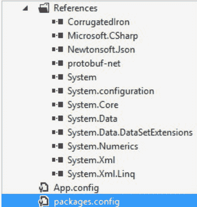

### FIGURE 2-18 The target package and all of its dependencies are referenced by the project.

除了创建引用之外，`NuGet` 还创建了一个 `packages.config` 文件，其中包含有关项目引用的包——以及版本的信息。这在升级或卸载包时很有用，而这也是 `NuGet` 能够做到的。

Riak 在使用前还需要一些默认配置。因此，`NuGet` 不仅下载并引用了大量程序集，还编辑了你的 `app.config` 以包含 Riak 所需的必需设置的一些合理默认值。列表 2-20 显示了 Riak 安装后 `app.config` 的当前状态。

### LISTING 2-20 NuGet has added a new configSection to the app.config specifically for Riak.

Click here to view code image

```
<configuration>
  <configSections>
    <section name="riakConfig" type="CorrugatedIron.Config.RiakClusterConfiguration, CorrugatedIron" />
  </configSections>
  <riakConfig nodePollTime="5000" defaultRetryWaitTime="200" defaultRetryCount="3">
    <nodes>
      <node name="dev1" hostAddress="riak-test" pbcPort="10017" restScheme="http" restPort="10018" poolSize="20" />
      <node name="dev2" hostAddress="riak-test" pbcPort="10027" restScheme="http" restPort="10028" poolSize="20" />
      <node name="dev3" hostAddress="riak-test" pbcPort="10037" restScheme="http" restPort="10038" poolSize="20" />
      <node name="dev4" hostAddress="riak-test" pbcPort="10047" restScheme="http" restPort="10048" poolSize="20" />
    </nodes>
  </riakConfig>
</configuration>
```

显然，这大大节省了时间，因为你无需在 Riak 网站上搜索 `CorrugatedIron` 或其任何依赖项的下载。一切已就绪，你可以专注于开发。当需要将 `CorrugatedIron` 升级到下一版本时，你也可以使用 `NuGet` 自动更新整个解决方案中所有依赖于它的包。

### 生成包

`NuGet` 还允许你创建包。你可能希望创建包以发布到官方 `NuGet` 包库供其他开发人员使用，或者你可能希望托管自己的包源以管理第一方依赖项。图 2-19 展示了 `NuGet` 包资源管理器，它可用于创建你自己的包。在此包中，我将 `CorrugatedIron` 配置为一个依赖项，因此它还将隐式依赖 `Newtonsoft.Json` 和 `protobuf-net`。我添加了一个专门针对 `.NET Framework` 4.5.1 的库程序集，以及一个将在引用程序集中创建于 `My folder/NewFile.txt` 下的文本文件。甚至还有一个 Windows PowerShell 脚本被指示在安装期间运行。得益于 Windows PowerShell 的灵活性，这实际上几乎可以用于做任何事情。

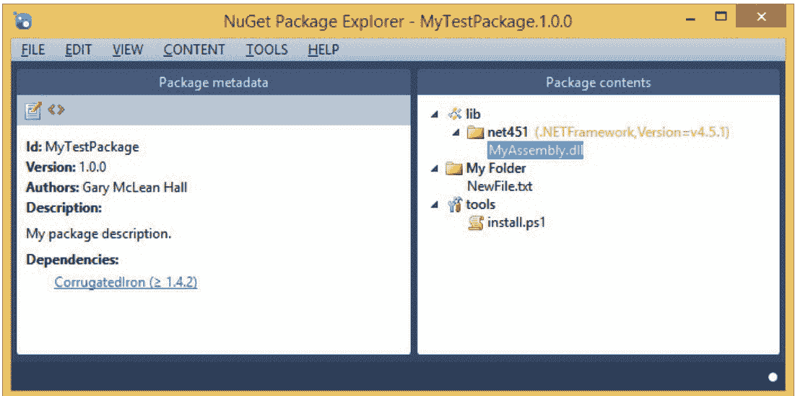

图 2-19 `NuGet` 包资源管理器使得构建你自己的包变得非常容易。

每个包都有一个 XML 文件，其中详细说明了安装窗口中显示的元数据。清单 2-21 展示了该文件的部分语法。

### 清单 2-21 包 XML 定义，包括元数据。

单击此处查看代码图像

```
<package xmlns="http://schemas.microsoft.com/packaging/2010/07/nuspec.xsd">
  <metadata>
    <id>MyTestPackage</id>
    <version>1.0.0</version>
    <authors>Gary McLean Hall</authors>
    <requireLicenseAcceptance>false</requireLicenseAcceptance>
    <description>My package description.</description>
    <dependencies>
        <dependency id="CorrugatedIron" version="1.0.1" />
    </dependencies>
  </metadata>
</package>
```

`NuGet` 在提高生产力和组织性方面是如此有益，以至于如果没有针对某个特定库的包，回到手动管理第三方依赖项会令人痛苦。事实上，`NuGet` 不仅适用于第三方依赖项。当解决方案变得足够大时，建议将解决方案按层切分为多个部分。然后可以使用 `NuGet` 将每一层的程序集打包，供上层使用。这使解决方案保持较小且易于处理。

### Chocolatey

描述 `Chocolatey` 的最佳方式是说它是一个包管理工具，就像 `NuGet` 一样，但它的包是应用程序和工具，而不是程序集。有一定 Linux 知识的开发人员会发现 `Chocolatey` 就像 `apt-get`——Debian 和 Ubuntu 的包管理器。同样，包管理的许多好处在这里也适用：简化的安装、依赖管理和易用性。

以下 Windows PowerShell 脚本可用于下载和安装 `Chocolatey`。

单击此处查看代码图像

```
@powershell -NoProfile -ExecutionPolicy unrestricted -Command "iex ((new-object net.webclient).DownloadString('https://chocolatey.org/install.ps1'))" && SET PATH=%PATH%;%systemdrive%\chocolatey\bin
```

安装 `Chocolatey` 后，你可以使用命令行搜索和安装各种应用程序和工具。安装过程应该已经更新了命令行路径，使其包含 `chocolatey.exe` 应用程序。与 Git 非常相似，`Chocolatey` 有诸如 `list` 和 `install` 之类的子命令，但这些子命令也有可用作快捷方式的同义词：分别为 `clist` 和 `cinst`。清单 2-22 展示了一个示例 `Chocolatey` 会话，该会话查找 FTP 客户端 FileZilla 的包名称，然后安装它。

### 清单 2-22 首先搜索包含所需应用程序的包，然后安装它。

单击此处查看代码图像

```
C:\dev> clist filezilla
ferventcoder.chocolatey.utilities 1.0.20130622
filezilla 3.7.1
filezilla.commandline 3.7.1
filezilla.server 0.9.41.20120523
jivkok.tools 1.1.0.2
kareemsultan.developer.toolkit 1.4
UAdevelopers.utils 1.9
C:\dev> cinst filezilla
Chocolatey (v0.9.8.20) is installing filezilla and
dependencies. By installing you accept
the license for filezilla and each dependency you are
installing.
...
  This finished installing 'filezilla' and dependencies - if
errors not shown in console,
none detected. Check log for errors if unsure.
```

只要 `Chocolatey` 没有报告错误，所请求的包现在就安装好了。请注意，`Chocolatey` 应该已经修改了你的系统 PATH，以便可以从命令行执行任何新的二进制文件，但它并不总是如此。通过 `Chocolatey` 可以获得大量包，它所提供的便利性是使用它的一个令人信服的理由。

### 分层

到目前为止，本章主要从程序集级别讨论依赖管理。这是组织应用程序的自然第一步，因为所有类和接口都包含在程序集中，而它们如何相互引用是一个常见问题。如果组织得当，你的程序集将只包含与单一组相关功能相关的类和接口。然而，从整体来看，你如何确保程序集的分组也被正确组织？

两个或更多相互关联的程序集组成正在开发的软件系统的组件。这些组件以同样良好定义和结构化的方式交互，同样重要（如果不是更重要的话）。如图 2-20 所示，组件不是部署的物理工件（如程序集动态链接库 `DLL`），而是共享相似主题的程序集的逻辑分组。

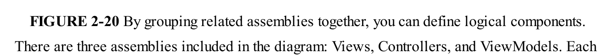

图 2-20 通过将相关程序集分组在一起，你可以定义逻辑组件。

图中包含三个程序集：`Views`、`Controllers` 和 `ViewModels`。每个程序集包含两个服务不同目的且可能需要不同依赖项的类。尽管类和程序集是 `.NET Framework` 提供的构造，但将一切分组在一起的用户界面包是逻辑上的。这三个程序集可能位于解决方案中一个名为 `UserInterfaces` 的文件夹中，但没有什么能阻止你添加一个不属于该层的另一个项目来污染这一层。除了你自己的谨慎之外，没有什么能阻止。

在依赖管理中，组件与较低层次的其他编程构造并无不同。与方法、类和程序集一样，你可以将层视为本章前面展示的依赖图中的另一个节点。因此，同样的规则适用：保持有向图无环，并确保单一职责。

*分层*是一种架构模式，它鼓励你将软件组件视为相互构建以形成完整应用程序的功能水平层。组件一层一层地叠放，依赖方向必须始终向下。也就是说，应用程序的底层没有依赖²，每一层向上都依赖于其正下方的层。栈顶是用户界面。如果应用程序是服务层，则顶层将是客户端用来与系统交互的 API。

> ² 这并不完全正确：很可能存在一些依赖，但因为它是底层，没有其他第一方代码可依赖，所以这些依赖很可能是第三方的、基础架构性的依赖。

### 常见模式

对于任何项目，都有几种常见的分层模式可供选择。这里介绍的每一种都应作为指南，根据你所在环境的具体要求和限制进行调整。各种分层模式之间的区别因素只是所使用的层*数量*。本节首先介绍一个仅由两层组成的简单架构，然后在中间插入第三层，最后推广到任意数量的层。

所需层数与解决方案的复杂性相关；解决方案的复杂性又与问题的复杂性相关。因此，问题越复杂，你可能越倾向于投资于多层架构。在这种情况下，复杂性由许多因素衡量：项目的时间限制、其需要的长期性、需求可能变化的频率，以及开发团队对模式和实践的重视程度，仅举几例。

因为本书是关于适应需求变化，我提倡*先做最简单可行的事情*，并且*仅在需要时*才重构为更复杂的东西。这对项目有积极影响。首先，它允许你尽快交付一些东西。在软件开发中，应尽早并频繁地寻求反馈。如果客户对完美的想法与开发团队对完美的想法不同，试图交付完美的解决方案是没有意义的。开发多层解决方案比简单的两层解决方案花费更长时间，从而延迟了那至关重要的反馈循环。

### 层与层级


层与层级之间的区别在于代码的逻辑组织与物理部署之间的区别。逻辑上，你可以将一个应用划分为三层或四层`层`，但物理上将其部署到一个`层级`中。层级数量与应用部署到的机器数量有一定关系。如果你部署到一台机器上，你就是将应用部署为一个层级。如果你将应用部署到两台机器上，至少按两层划分，你就是部署到两个层级。

每增加一个部署的层级，你就接受了跨越网络边界的事实，而这带来了时间成本：在同一台机器内跨越处理边界已经很昂贵，跨越网络边界则更加昂贵。然而，分层部署具有明显的优势，因为它允许你扩展应用。如果你将一个包含用户界面层、逻辑层和数据访问层的 Web 应用部署到单台机器上——即单层级——该机器需要完成大量工作，你能够支持的用户数量必然会更低。如果你将应用的部署拆分为两个层级——将数据库放在一个层级，将用户界面和逻辑层放在另一个层级——你就可以同时对用户界面层进行`水平`和`垂直`扩展。

垂直扩展只需通过增加内存或处理单元来提升计算机的性能。这使单台机器能够自行完成更多工作。然而，你也可以通过添加执行完全相同任务的全新机器来进行水平扩展。会有多台机器来托管 Web 用户界面代码，以及一个负载均衡器，它会将客户端导向任意时刻最空闲的机器。当然，这并不是支持 Web 应用更多并发用户的万灵药。这需要对数据缓存和用户认证更加谨慎，因为用户的每个请求都可能由不同的机器处理。

## 两层

两层解决方案是从没有明显分层迈向的最简单一步。它仅在有限的特定情况下有用，但实现极快。包含的只有两个层：用户界面层和数据访问层。请记住，这并不限制你只有两个`程序集`，而是两个逻辑上的`组`程序集：一个直接关注用户界面，另一个关注数据访问。

图 2-21 以 UML 图中包的形式展示了这两层，每层包含与该层相关的程序集。唯一显示的依赖关系是从用户界面层指向数据访问层。在任何分层架构中，依赖关系只能如此指向。

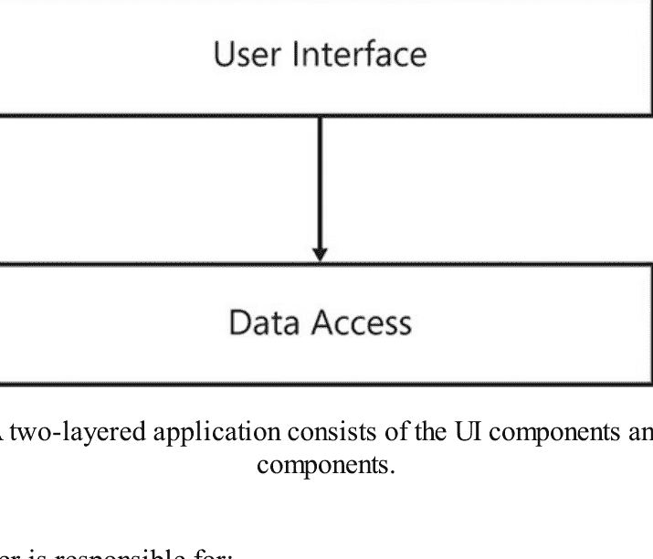

图 2-21 两层应用由 UI 组件和数据访问组件组成。

### 用户界面

用户界面层负责：

- 为用户提供与应用交互的方式（例如，桌面窗口和控件、网页，或控制台应用的命令行或菜单）。
- 向用户展示数据和信息。
- 以查询或命令的形式接收用户的请求。
- 验证用户输入的内容。

用户界面层的实现方式可能有所不同。它可以是装满精美图形和动画的 Windows Presentation Foundation (`WPF`) 客户端、用户浏览的一组网页，或一个简单的控制台应用，使用命令行开关或简单菜单让用户选择要执行的命令或查询。

#### Note

在某些情况下，用户界面可以用一组向其他客户端公开功能服务的服务来替代。实际上并没有用户界面，但两层架构仍然明显，只是 UI 层被 API 层所替代。

用户界面层位于数据访问层之上，可以使用它。然而，正如之前关于程序集引用的讨论所述，用户界面层不应直接引用数据访问层的任何实现程序集。接口程序集与实现程序集之间应有严格的分离。这使得分层图看起来更像图 2-22。

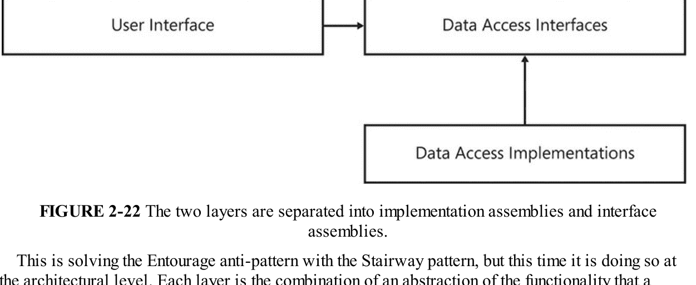

图 2-22 两个层被分离为实现程序集和接口程序集。

这是在架构层面用楼梯模式解决 Entourage 反模式的问题。每个层都是一个更高层所依赖的功能抽象与该抽象的实现相结合。如果上层开始引用下层实现的一部分，该层就被称为泄漏的抽象。该层实现的依赖关系会开始泄漏到堆栈中更上层的层，导致不必要的依赖。

### 数据访问

数据访问层的职责是：

- 为数据提供查询服务。
- 将对象模型序列化并反序列化为关系模型。

数据访问层的实现可以像用户界面层一样多样化。该层通常包含某种持久化数据存储，可能包括 `SQL Server`、`Oracle`、`MySQL` 或 `PostgreSQL` 等关系数据库，或 `MongoDB`、`RavenDB` 或 `Riak` 等文档数据库。除了数据存储机制外，很可能还有一个或多个支持程序集，用于通过调用存储过程执行查询或插入/更新/删除命令，或通过 `Entity Framework` 或 `NHibernate` 将数据映射到关系数据库。

数据访问层应隐藏在不依赖任何这些技术选择的接口之后。与所有接口一样，不应引用任何第三方依赖，从而使客户端与实现选择分离。

设计良好的数据访问层可在多个应用中重复使用。如果两个不同的用户界面需要相同的数据但以不同形式呈现，同一个数据访问层可以在它们之间共享。想象一个跨多个平台运行的应用：Windows 8 和 Windows Phone 8。两者具有不同的用户界面需求，但每个都可以使用相同的数据访问层。

与任何架构一样，使用只有两层会带来一些权衡，必须在采用前仔细考虑。两层架构在以下情况下是好的选择：

- 应用的逻辑很少或没有，超出一些微不足道的验证。这可以很容易地封装在数据访问层或用户界面层中。
- 应用主要对数据执行 CRUD 操作。创建、读取、更新和删除数据会随着用户界面和数据本身之间放置的每一层而变得更加困难。
- 时间紧迫。如果只需要开发原型或引导程序，限制层数可以节省大量时间，并且可以确定概念验证的可行性。当你坚持楼梯模式等良好实践时，后续根据需要插入额外层会更容易。

然而，两层架构也有明显的缺点，在以下情况下是不好的选择：

- 应用中存在大量逻辑，或逻辑可能发生变化。放置在用户界面层或数据访问层的任何逻辑在技术上都是对该层的污染，会降低其灵活性和可维护性。
- 应用肯定会在一两个冲刺内超出两层的限制。为获得快速反馈而做出的任何妥协都不值得投资，如果该架构只能维持数周的话。

两层架构仍然是一个非常可行的替代方案。太多开发者沉迷于最新的架构潮流而忽视了更简单的设计。这会导致原本简单的应用反馈过晚，使其脆弱且难以维护。经常，最简单可行的方法就是正确的做法。

## 三层

三层架构在用户界面和数据访问层之间增加了一个额外的层。这是逻辑层。逻辑层的增加使应用能够封装更复杂的处理。逻辑层与数据访问层一样，可以在多个应用中重复使用，因此无需多次实现。`[Figure 2-23](Figure 2-23)` 显示了典型的三层架构。

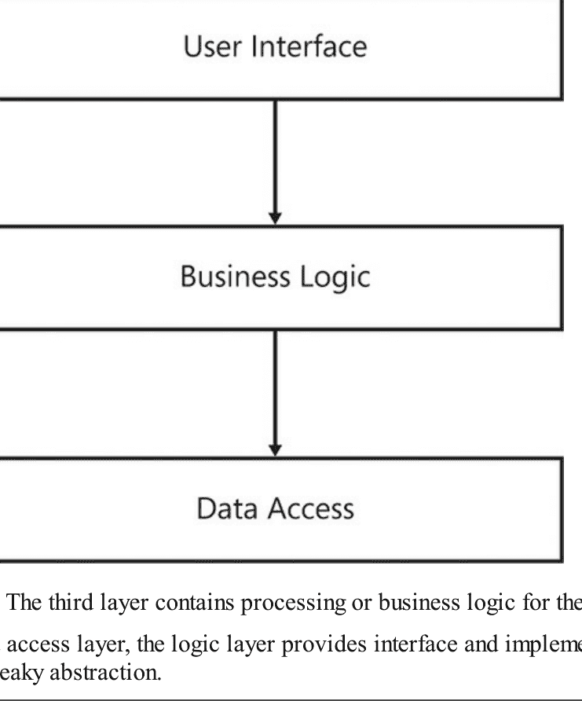

FIGURE 2-23 The third layer contains processing or business logic for the application.

再次，逻辑层与数据访问层类似，为客户端提供接口和实现程序集，以避免抽象泄漏。

Note

尽管三层架构对于 Web 应用程序非常常见，但它通常仅部署在两个层中。一个节点处理数据库，另一个节点处理几乎所有其他内容：用户界面、逻辑，甚至部分数据访问。

### Business logic

业务逻辑层的职责是：

- 处理来自用户界面层的命令。
- 对业务域进行建模以捕获业务流程、规则和工作流。

逻辑层可能是接收来自用户界面层的用户命令的命令处理器，并通过与数据访问层协作来解决特定问题或执行特定任务。它也可以是一个完全开发的领域模型，旨在将企业的流程映射到软件中。对于后者，数据访问层通常包含一个对象/关系映射组件，以便逻辑层可以直接实现到类中，可能使用领域驱动设计（`DDD`）。在领域模型中，不应存在进一步向下堆栈或通过某些特定于实现的技术的依赖。例如，领域模型的程序集不应依赖于对象/关系映射库。相反，应创建单独的映射程序集，该程序集特定于实现并指示 ORM 如何映射到领域模型。这允许领域模型的核心类在不依赖 ORM 的情况下被重用，并且可以在不影响领域模型或其客户端的情况下替换 ORM。图 2-24 显示了使用领域模型的逻辑层的一种可能实现。

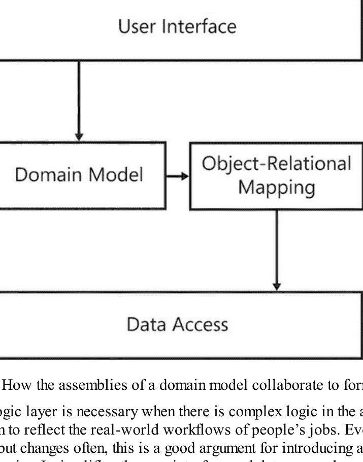

FIGURE 2-24 How the assemblies of a domain model collaborate to form a logic layer.

添加逻辑层是必要的，当应用程序中存在复杂逻辑时，例如旨在反映人们工作真实工作流程的业务规则。即使逻辑并不特别复杂但经常发生变化，这也是引入单独层来封装此行为的一个很好的论据。它简化了用户界面和数据访问层，使其能够完全专注于其唯一目的。

### Cross-cutting concerns

有时组件的职责并不容易限制在单个层中。诸如审计、安全和缓存之类的功能可以渗透整个应用程序，因为它们适用于每一层。例如，在应用程序已部署且无法附加 `Visual Studio` 调试器逐步执行代码时，跟踪每次方法调用和返回的代码操作是一个有用的调试工具。你可以手动生成参数值在传递过程中的输出，以及各种方法的返回值，如清单 2-23 所示。

#### LISTING 2-23 Manually applying cross-cutting concerns quickly swamps the real intent of the code.

Click here to view code image

```
public void OpenNewAccount(Guid ownerID, string accountName, decimal openingBalance)
{
    log.WriteInfo("Creating new account for owner {0} with name '{1}' and an opening balance of {2}", ownerID, accountName, openingBalance);

    using(var transaction = session.BeginTransaction())
    {
        var user = userRepository.GetByID(ownerID);
        user.CreateAccount(accountName);
        var account = user.FindAccount(accountName);
        account.SetBalance(openingBalance);

        transaction.Commit();
    }
}
```

这很费力且容易出错，并且会立即用无关的样板代码污染每个方法，增加噪声与信号的比例。相反，你可以将此类横切关注点分解为封装的功能，并以侵入性更小的方式将其应用于代码。添加功能最常见且非侵入性的方式是通过面向方面的编程。

### Aspects

面向方面编程（`AOP`）是将横切关注点——或方面——应用于代码中多个层的应用。`.NET Framework` 有多个可供选择的 `AOP` 库（在 `NuGet` 中搜索 `AOP`），但这里给出的示例是针对 `PostSharp` 的，它有一个免费的 Express 版本，但功能有所减少。清单 2-24 显示了跟踪代码被分解为 `PostSharp` 方面并作为属性应用于某些方法。

#### LISTING 2-24 Aspects are a great way to implement cross-cutting concerns.

Click here to view code image

```
[Logged]
[Transactional]
public void OpenNewAccount(Guid ownerID, string accountName, decimal openingBalance)
{
    var user = userRepository.GetByID(ownerID);
    user.CreateAccount(accountName);
    var account = user.FindAccount(accountName);
    account.SetBalance(openingBalance);
}
```

装饰 `OpenNewAccount` 方法的两个属性提供了与清单 2-23 中所示相同的功能，但该方法的意图更清晰。`Logged` 属性将有关方法调用的信息写入日志，包括参数值。`Transactional` 属性将方法包装在数据库事务中，并在成功时提交事务，在失败时回滚事务。关键在于，这两个属性足够通用，可以应用于任何方法，而不仅仅是此方法，因此可以多次重用。

### Asymmetric layering

应用程序的所有用户请求都通过提供的用户界面发生。然而，请求之后遵循的路径不一定总是相同的。分层可能是不对称的，这取决于所做请求的类型。这是由需要务实并考虑当前分层对于某些请求是否过度设计或对于某些请求是否不足所驱动的。

在过去几年中迅速流行起来的不对称分层模式是命令/查询职责分离（`CQRS`）。在讨论 `CQRS` 之前，该模式是一个架构模式，需要对其方法级影响因素——命令/查询分离——有一个基础。

### Command/query separation

Bertrand Meyer 在他的书《面向对象软件构造》（Prentice Hall，1997）中，使用了命令/查询分离（`CQS`）这一短语来解释所有对象方法应仅为两种事物之一：命令或查询。

命令是对行动的强制性调用，要求代码执行某些操作。这些方法允许更改系统的状态，但不应同时返回一个值。清单 2-25 显示了 `CQS` 合规的命令方法示例，后跟一个不合规的示例。

#### LISTING 2-25 CQS-compliant and non-CQS-compliant command methods.

Click here to view code image

```
// Compliant command
Public void SaveUser(string name)
{
    session.Save(new User(name));
}
// Non-compliant command
public User SaveUser(string name)
{
    var user = new User(name);
    session.Save(user);
    return user;
}
```

查询是请求数据，要求代码获取某些内容。这些方法向调用客户端返回数据，但不应同时更改系统的状态。清单 2-26 显示了 `CQS` 合规的查询方法示例，后跟一个不合规的示例。

#### LISTING 2-26 CQS-compliant and non-CQS-compliant query methods.

Click here to view code image

```
// Compliant query
Public IEnumerable<User> FindUserByID(Guid userID)
{
    return session.Get<User>(userID);
}
// Non-compliant query
public IEnumerable<User> FindUserByID(Guid userID)
{
    var user = session.Get<User>(userID);
    user.LastAccessed = DateTime.Now;
    return user;
}
```

因此，命令和查询通过返回值的存在与否来区分。如果方法返回一个值（并且符合 `CQS`），你可以安全地假设它不会更改对象的任何状态。优势在于，你可以重新排序查询调用，而知道它们对对象没有其他影响。方法没有返回值（并且符合 `CQS`）表示你可以假设它确实会更改对象的状态。对于这些调用，你在调用顺序上必须更加谨慎。

### Command/Query Responsibility Segregation

命令/查询职责分离模式归功于 Greg Young。该模式是在架构级别应用 `CQS`，并且是不对称分层的示例。命令和查询遵循与 `CQS` 相同的规则，但 `CQRS` 更进一步：它承认命令和查询可能需要通过分层遵循不同的路径才能得到最佳处理。

最小 `CQRS` 可以应用的一个例子是，当你使用领域模型开发三层架构时。在这种情况下，领域模型仅由应用程序的命令侧使用，而查询侧使用更简单的两层架构。图 2-25 举例说明了这种设计。

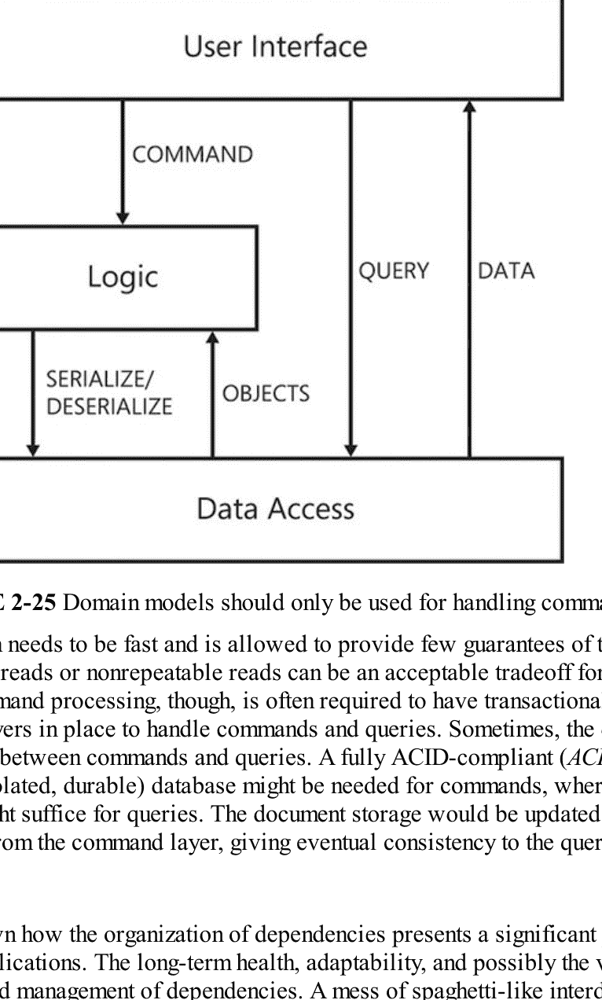

**图2-25** 领域模型应仅用于处理命令。

查询数据通常需要快速，并且允许提供很少的事务一致性保证：幻读或不可重复读可以作为提高响应速度的可接受权衡。然而，命令处理通常需要事务一致性，因此需要不同的层来处理命令和查询。有时，数据访问层在命令和查询之间也可以不同。命令可能需要完全符合`ACID`（`ACID`代表原子性、一致性、隔离性、持久性）的数据库，而查询可能只需要简单的文档存储。文档存储将由命令层发布的事件异步更新，从而为查询读取提供最终一致性。

## 结论

本章展示了在创建软件应用程序时，依赖的组织方式是一个重大问题。项目的长期健康、适应性，甚至生存能力都依赖于对依赖的合理管理。如果开发人员不加仔细考虑地创建相互引用的类，就会出现一团意大利面式的相互依赖，这会严重影响团队以一致、可预测的方式交付业务价值的能力。

依赖必须在所有级别进行管理，从相互交互的单个类和方法，到程序集引用，再到组件的高级架构。开发人员必须时刻警惕，防止虚假依赖泄漏到其方法、类、程序集或层之外。

在某种程度上，本章支撑了本书其余部分的大量内容。这些内容为可维护、自适应的代码奠定了坚实的基础，并且每一章都会加以强化。如果你的程序集是一团引用意大利面，并且你的层没有隐藏其基础设施依赖，那么无论你尝试遵循什么其他模式或实践，你的代码都将变得更难测试、修改和理解。

# 第3章 接口与设计模式

## 完成本章后，你将能够

- 定义接口，并识别接口与类的主要区别。
- 将设计模式（如适配器模式和策略模式）应用于接口。
- 通过鸭子类型、混入和流畅接口来理解接口的多功能性。
- 识别接口的局限性并实现变通方案。
- 发现常见的反模式和对接口的滥用。

接口是Microsoft `.NET Framework` 开发中的一个强大构造。尽管`interface`关键字非常简单，但它所代表的是一种非常强大的范式。如果使用得当，接口会为你的代码提供扩展点，使其极具适应性。然而，接口的某些用法并不那么理想，但仍在广泛使用。


本章提醒你类和接口之间的区别，并描述如何最好地将两者结合使用，以保护客户端代码免受实现更改的影响，并促进多态性。

它还涵盖了接口的多功能性，以及它们如何成为现代软件解决方案中无处不在的工具。这包括一些强大的设计模式，当正确应用（并结合本书中的其他模式）时，这些模式会产生极其灵活的代码，并能够适应敏捷项目所拥抱的不断变化的需求。

然而，接口本身并不是万灵药。明智地使用接口当然可以为项目带来帮助，但接口必须以正确的方式应用。本章探讨了一些常见的接口滥用。

## 什么是接口？

接口定义类具有的行为，但不定义这些行为如何实现。

接口是独立于类的构造，但它们需要类提供工作代码来实现接口。

接口由其语法定义——即接口的语言构造方面：`interface`关键字及其所暗示和包含的一切。但它们也由其特性定义：它们所代表和支持的概念。

### 语法

接口是使用`interface`关键字定义的。它们可以像类一样包含属性、方法和事件。但是，接口的任何元素都不能指定访问修饰符：实现类必须将接口实现为`public`。清单3-1展示了一个接口的声明以及可能的实现。

#### 清单3-1 声明并实现一个接口

单击此处查看代码图像

```csharp
public interface ISimpleInterface
{
    void ThisMethodRequiresImplementation();

    string ThisStringPropertyNeedsImplementingToo
    {
        get;
        set;
    }

    int ThisIntegerPropertyOnlyNeedsAGetter
    {
        get;
    }

    public event EventHandler<EventArgs> InterfacesCanContainEventsToo;
}
//...
public class SimpleInterfaceImplementation : ISimpleInterface
{

    public void ThisMethodRequiresImplementation()
    {

    }

    public string ThisStringPropertyNeedsImplementingToo
    {
        get;
        set;
    }

    public int ThisIntegerPropertyOnlyNeedsAGetter
    {
        get
        {
            return this.encapsulatedInteger;
        }
        set
        {
            this.encapsulatedInteger = value;
        }
    }

    event EventHandler<EventArgs> InterfacesCanContainEventsToo = delegate {};
```

```csharp
private int encapsulatedInteger;
}
```

`.NET Framework`不支持类的多继承概念，但它支持单个类实现多个接口。

对于类可以实现接口的数量没有限制；一个类上真正有意义的接口数量更多是一个实际问题。清单3-2扩展了前面的示例，在实现类上实现了第二个接口。

#### 清单3-2 单个类可以实现多个接口

单击此处查看代码图像

```csharp
public interface IInterfaceOne
{
    void MethodOne();
}
//...
public interface IInterfaceTwo
{
    void MethodTwo();
}
//...
public class ImplementingMultipleInterfaces : IInterfaceOne, IInterfaceTwo
{
    public void MethodOne()
    {
    }

    public void MethodTwo()
    {
    }
}
```

虽然单个类可以实现多个接口，但一个接口也可以由不同的类多次实现。

### 多继承

有些语言支持从多个基类继承的概念。特别是`C++`允许这种构造。然而，`.NET Framework`语言不允许这样做，如果类试图继承两个或更多类，编译器将生成警告，如图3-1所示。

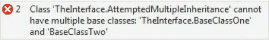

**图3-1** 编译器阻止多继承。

### 菱形继承问题

不允许多继承的一个原因是菱形继承问题。当一个类继承两个或更多类时，就会出现这个问题。如果这些基类中的每一个都包含相同的方法，应该使用哪一个？图3-2显示了该问题的统一建模语言（UML）图。

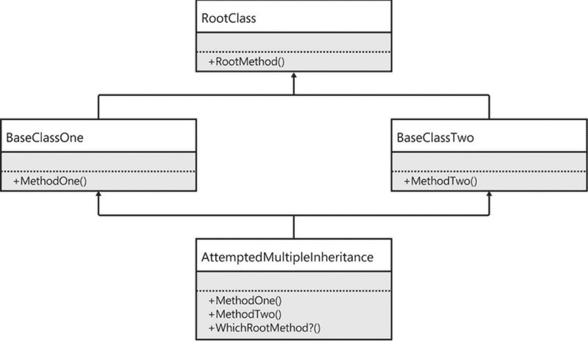

**图3-2** 显示菱形继承问题的UML图。

在这种情况下，类`AttemptedMultipleInheritance`应该继承哪个版本的`RootMethod()`——是`BaseClassOne`从`RootClass`继承的那个，还是`BaseClassTwo`从`RootClass`继承的那个？由于这种歧义，`.NET Framework`不允许类的多继承。

### 显式实现

接口也可以被*显式*实现。显式接口实现不同于隐式接口实现，前面的示例展示的是隐式接口实现。清单3-3显示了之前相同的示例类，但这次它显式实现了其接口。

#### 清单3-3 显式实现接口

单击此处查看代码图像

```csharp
public class ExplicitInterfaceImplementation : ISimpleInterface
{
    public ExplicitInterfaceImplementation()
    {
        this.encapsulatedInteger = 4;
    }

    void ISimpleInterface.ThisMethodRequiresImplementation()
    {
        encapsulatedEvent(this, EventArgs.Empty);
    }

    string ISimpleInterface.ThisStringPropertyNeedsImplementingToo
    {
        get;
        set;
    }

    int ISimpleInterface.ThisIntegerPropertyOnlyNeedsAGetter
    {
        get
        {
            return encapsulatedInteger;
        }
    }

    event EventHandler<EventArgs> ISimpleInterface.InterfacesCanContainEventsToo
    {
        add { encapsulatedEvent += value; }
        remove { encapsulatedEvent -= value; }
    }

    private int encapsulatedInteger;
    private event EventHandler<EventArgs> encapsulatedEvent;
}
```

要使用显式实现的接口，客户端必须拥有对接口实例的引用——对接口实现的引用是不够的。清单 3-4 进一步详细探讨了这一点。

#### LISTING 3-4 当显式实现时，接口方法在类实例上不可见。

Click here to view code image

```
public class ExplicitInterfaceClient
{
    public ExplicitInterfaceClient(ExplicitInterfaceImplementation implementationReference, ISimpleInterface interfaceReference)
    {
        // Uncommenting this will cause compilation errors.
        //var instancePropertyValue =
        //implementationReference.ThisIntegerPropertyOnlyNeedsAGetter;
        //implementationReference.ThisMethodRequiresImplementation();
        //implementationReference.ThisStringPropertyNeedsImplementingToo = "Hello";
        //implementationReference.InterfacesCanContainEventsToo += EventHandler;

        var interfacePropertyValue =
            interfaceReference.ThisIntegerPropertyOnlyNeedsAGetter;
        interfaceReference.ThisMethodRequiresImplementation();
        interfaceReference.ThisStringPropertyNeedsImplementingToo = "Hello";
        interfaceReference.InterfacesCanContainEventsToo += EventHandler;
    }

    void EventHandler(object sender, EventArgs e)
    {
    }
}
```

显式实现只有在你想要避免签名冲突时才真正有用，当类已经拥有必须由接口实现的 方法签名时。

可在 `.NET Framework` 中定义 的每个方法都有特定的方法签名。此签名有助于将方法区分 为唯一，并区分已被重写的方法。方法 的签名由其名称和参数列表组成。请注意，方法的访问级别、返回值、抽象或密封状态都会影响方法签名。清单 3-5 显示了各种方法签名，其中一些会冲突。如果方法在上述所有标准上都相等，则方法签名会冲突。没有类、接口或结构可以包含具有冲突签名的方法。

#### LISTING 3-5 其中一些方法具有相同的签名。

Click here to view code image

```
public class ClashingMethodSignatures
{
    public void MethodA()
    {
    }

    // This would cause a clash with the method above:
    //public void MethodA()
    //{
    //}

    // As would this: return values are not considered
    //public int MethodA()
    //{
    //    return 0;
    //}

    public int MethodB(int x)
    {
        return x;
    }

    // There is no clash here: the parameters differ.
    // This is an overload of the previous MethodB.
    public int MethodB(int x, int y)
    {
        return x + y;
    }
}
```

属性由于没有参数列表，仅通过其名称区分。因此，如果两个属性具有相同的名称，则其签名会冲突。

想象一下清单 3-6 中所示的类，该类需要实现上述接口 `InterfaceOne`。

#### LISTING 3-6 此类需要实现的接口将导致方法签名冲突。

Click here to view code image

```
public class ClassWithMethodSignatureClash
{
    public void MethodOne()
```

#### LISTING 3-9 显式实现接口以避免冲突的方法签名。

Click here to view code image

```
public class ClassAvoidingMethodSignatureClash : IInterfaceOne
{
    public void MethodOne()
    {
        // original implementation
    }

    void IInterfaceOne.MethodOne()
    {
        // new implementation
    }
}
```

类似地，如果一个类需要实现两个不同的、相互无关的接口，但这两个接口都包含具有相同签名的方法，你可以隐式实现它们并共享同一个方法实现。或者，如清单 3-10 所示，你可以显式实现它们——为了清晰——以区分哪个实现属于哪个接口。

#### LISTING 3-10 在实现具有通用方法签名的两个接口时，只有显式实现才足够。

Click here to view code image

```
public class ClassImplementingClashingInterfaces : IInterfaceOne, IAnotherInterfaceOne
{
    void IInterfaceOne.MethodOne()
    {

    }

    void IAnotherInterfaceOne.MethodOne()
    {
    }
}
```

### Polymorphism

能够使用一种类型 的对象并使其隐式表现为另一种类型 的能力称为 *polymorphism*。客户端代码可以与对象交互，就好像它是 一种类型一样，而实际上是另一种类型。这种程序性的障眼法是面向对象编程最重要的原则之一，并且支撑了一些最优雅、适应性最强的编程问题解决方案。

图 3-3 显示了表示车辆行为的接口，以及汽车、摩托车和快艇的可能实现类。请注意，这三种车辆类型各不相同，但由于其统一的接口，它们都表现出相同的行为。

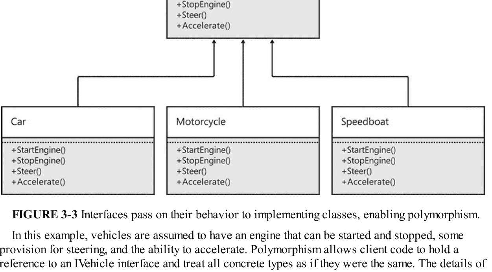

FIGURE 3-3 接口将行为传递给实现类，从而实现多态。

在此示例中，车辆被假定具有可启动和停止的发动机、某种转向装置以及加速能力。多态允许客户端代码持有对 `IVehicle` 接口的引用，并将所有具体类型视为相同。汽车的转向或加速方式与摩托车有何不同，或快艇发动机启动和停止方式与火车有何不同，对客户端来说并不重要。而这是一件非常好的事情。实际上，每当我们使用车辆时，我们都是该接口的客户端。当然，车辆的真实接口比这里所示的更为细致，但原则是相同的。你需要知道汽车发动机的内部工作原理才能启动和停止发动机吗？完全不需要。那些都是实现细节，对你驾驶知识的影响为零。这就是良好的接口设计。

本章其余部分构成的设计模式和接口功能都促进了自适应代码的创建。多态使其中每一个都对任何满足预期接口的类有用，无论该类是已经编写还是尚未构思。

### Adaptive design patterns

设计模式由 Gang of Four¹ 书籍 *Design Patterns*（Addison-Wesley Professional, 1994）普及。尽管这本书几乎有 20 年的历史了（在软件开发术语中至少相当于四个冰河时代），但它至今仍然极其相关。其中一些模式已被重新归类为反模式，但其他模式被不断使用并增强了代码的适应性。

> ¹ 因其四位作者而得名：Erich Gamma、Richard Helm、Ralph Johnson 和 John Vlissides。

良好的设计模式是接口和类之间可重用的协作，可以在许多不同的场景、跨项目、平台、语言和框架中反复应用。与大多数值得注意的最佳实践一样，设计模式是最好知道而不是不知道的理论工具。它们可能被过度使用，并且并不总是适用，有时用大量类、接口、间接和抽象使原本简单的解决方案变得复杂。

在我看来，设计模式往往要么被低估要么被高估。在某些项目中，设计模式不足，代码缺乏可辨识的结构。其他项目则过于自由地应用设计模式，在收益可忽略不计的地方添加了间接和抽象。平衡在于找到正确的地方应用正确的模式。

### The Null Object pattern

空对象模式是最常见的设计模式之一——也是最容易理解和实现的一种。其目的是让你避免意外抛出 `Null-ReferenceException` 以及大量空对象检查代码。图 3-4 中的 UML 类图显示了空对象模式的应用方式。

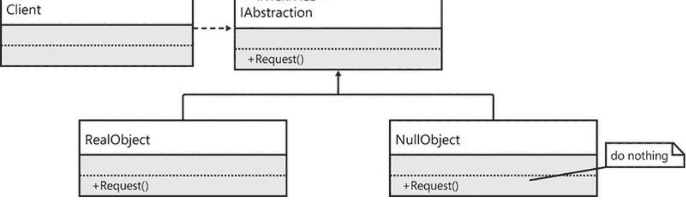

**FIGURE 3-4** 空对象模式作为 UML 类图的演示。

[Listing 3-11](#) 显示了一些可能抛出 `NullReferenceException` 的典型代码。

**LISTING 3-11** 如果你不检查返回值是否为 null，就有抛出 NullReference-Exception 的风险。

[Click here to view code image](#)

```
class Program
```


```
{
    static IUserRepository userRepository = new UserRepository();

    static void Main(string[] args)
    {
        var user = userRepository.GetByID(Guid.NewGuid());
        // Without the Null Object pattern, this line could throw an exception
        user.IncrementSessionTicket();
    }
}
```

每个调用 `IUserRepository.Get(Guid uniqueID)` 的客户端都存在抛出空引用异常的风险。实际上，这意味着每个客户端都必须检查返回值是否不为 null，以避免尝试解引用 null，从而导致抛出 `NullReferenceException`。这将使之前展示的客户端看起来更像代码清单 3-12 中的代码。

### LISTING 3-12 Is checking against null really the responsibility of all clients?

Click here to view code image

```
class Program
{
    static IUserRepository userRepository = new UserRepository();

    static void Main(string[] args)
    {
        var user = userRepository.GetByID(Guid.NewGuid());
        if(user != null)
        {
            user.IncrementSessionTicket();
        }
    }
}
```

空对象模式表明，你给 `IRepository` 的所有客户端都施加了太多不必要的负担。使用该方法的客户端越多，忘记进行空引用检查的概率就越大。相反，你应该更改问题的源头，让它为你执行检查，如代码清单 3-13 所示。

### LISTING 3-13 The service code should implement the Null Object pattern.

Click here to view code image

```
public class UserRepository : IUserRepository
```
```
{
    public UserRepository()
    {
        users = new List<User>
        {
            new User(Guid.NewGuid()),
            new User(Guid.NewGuid()),
            new User(Guid.NewGuid()),
            new User(Guid.NewGuid())
        };
    }

    public IUser GetByID(Guid userID)
    {
        IUser userFound = users.SingleOrDefault(user => user.ID == userID);
        if(userFound == null)
        {
            userFound = new NullUser();
        }
        return userFound;
    }

    private ICollection<User> users;
}
```

首先，这段代码尝试从内存集合中检索 `User`，与之前的实现相比没有变化。现在，不过，你会检查返回的 `User` 实例是否实际上是一个空引用。如果是，你会返回 `IUser` 类型的一个特殊子类：`NullUser`。该子类重写 `IncrementSessionTicket` 方法使其精确地什么都不做，如代码清单 3-14 所示。事实上，一个正确的 `NullUser` 实现会重写所有方法，使其尽可能接近什么都不做。

### LISTING 3-14 The NullUser method implementations all do nothing.

Click here to view code image

```
public class NullUser : IUser
{
    public void IncrementSessionTicket()
    {
        // do nothing
    }
}
```

此外，每当 `NullUser` 对象的某个方法或属性预期返回对另一个对象的引用时，它也应返回这些类型的特殊空对象实现。换句话说，所有空对象实现都应返回递归的空对象实现。这消除了客户端中任何空引用检查的需要。

这也带来了额外的好处，即减少了你需要编写的单元测试数量。以前，每个客户端都必须实现检查时，还会有相应的单元测试来确认检查是否到位。相反，仓库实现会被单元测试以确保它返回 `NullUser` 实现。

## The IsNull property anti-pattern

有时空对象模式涉及向接口添加一个布尔 `IsNull` 属性。该接口的所有真实实现对此属性返回 false 的值。接口的空对象实现返回 true。代码清单 3-15 显示了根据前面的示例，这种方法的工作方式。

### LISTING 3-15 The IsNull property is only true for Null Object implementations.

Click here to view code image

```
public interface IUser
{
    void IncrementSessionTicket();

    bool IsNull
    {
        get;
    }
}
//...
public class User : IUser
{
    //...
    public bool IsNull
    {
        get
        {
            return false;
        }
    }

    private DateTime sessionExpiry;
}
//...
public class NullUser : IUser
```
```
public void IncrementSessionTicket()
{
    // do nothing
}

public bool IsNull
{
    get
    {
        return true;
    }
}
}
```

这个属性的问题在于它会导致逻辑从封装行为的对象中泄漏出来。例如，`if` 语句会开始出现在客户端代码中以区分真实实现和空对象实现。这违背了该模式的全部目的，即避免将此逻辑传播到其各个客户端。代码清单 3-16 是这个问题的典型例子。

### LISTING 3-16 Logic based on the IsNull property makes this an anti-pattern.

Click here to view code image

```
static void Main(string[] args)
{
    var user = userRepository.GetByID(Guid.NewGuid());
    // Without the Null Object pattern, this line would throw an exception
    user.IncrementSessionTicket();

    string userName;
    if(!user.IsNull)
    {
        userName = user.Name;
    }
    else
    {
        userName = "unknown";
    }

    Console.WriteLine("The user's name is {0}", userName);

    Console.ReadKey();
}
```

这可以通过在 `NullUser` 类内部封装空用户的名称来轻松修复，如代码清单 3-17 所示。

### LISTING 3-17 With proper encapsulation, the IsNull property is obsolete.

Click here to view code image

```
public class NullUser : IUser
{
    public void IncrementSessionTicket()
    {
        // do nothing
    }

    public string Name
    {
        get
        {
            return "unknown";
        }
    }
}
// ...
static void Main(string[] args)
{
    var user = userRepository.GetByID(Guid.NewGuid());
    // Without the Null Object pattern, this line would throw an exception
    user.IncrementSessionTicket();

    Console.WriteLine("The user's name is {0}", user.Name);

    Console.ReadKey();
}
```

## Cascading Nulls

C# 语言的一个请求特性是它模仿 Groovy² 并包含一个“级联空值”运算符。考虑以下代码片段。

² Groovy is a dynamically typed Java variant (http://groovy.codehaus.org).

Click here to view code image

```
if(person != null && person.Address != null && person.Address.Country == "England")
{
    // ...
}
```

理论上，它可以用以下内容替换。

Click here to view code image

```
if(person?.Address?.Country == "England")
{
    //...
}
```

`?.` 运算符因此成为安全解引用任何对象的一种方式，最坏的情况下会得到属性类型的 `default(T)`。我并不反对语言语法中任何他人可能觉得有用的进展，但我会不情愿地将其用作适当的空对象实现的替代，原因有三。

首先，有太多实例，类型的默认值根本不足够。之前使用合理的用户名来避免抛出 `NullReferenceException` 的示例说明，替代方案不是默认值，而是对应用程序更有意义的东西。

其次，这将要求此代码的所有客户端都以 null 的可能性为前提进行编程。使用空对象模式的部分原因是为了消除空检查并让你可以肆无忌惮地解引用。如果你拒绝空对象模式而偏爱级联空值语法，你就会敞开自己再次忘记解引用的风险。

第三个，更主观的原因是这种语法可能会变得无处不在。偶尔使用 `int?` 来表示具有可选/引用语义的 `int` 是可以的，但为每次解引用都到处散布 `?.`？不，谢谢。

有了适当的空对象实现，这个示例可以简洁地写成如下所示。

Click here to view code image

```
if(person.Address.Country == "England")
{
    //...
}
```

这，无疑，提供了最大的好处：客户端代码更少混淆，但能免受 `NullReferenceException` 的危害。

## The Adapter pattern

适配器模式允许你向依赖于你的实例未实现的接口的客户端提供一个对象实例。创建一个适配器类来满足客户端期望的接口，但该接口的方法通过委托给另一个对象的不同方法来实现。它通常用于目标类无法更改以适应所需接口时。这可能是因为它被密封，或者因为它属于你没有源代码的程序集。你可以通过两种方式实现适配器模式：使用类适配器模式或使用对象适配器模式。

### 类适配器模式

[图 3-5](#) 显示了类适配器模式中使用的协作类和接口。

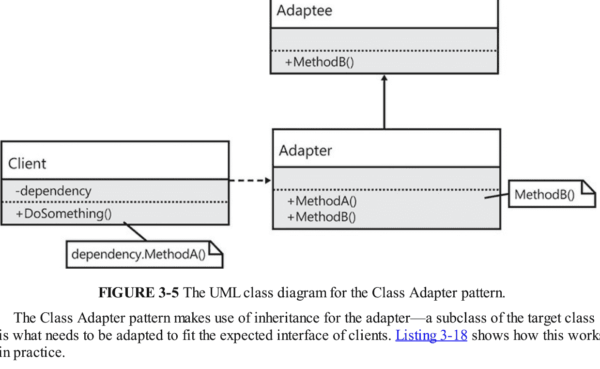

**图 3-5** 类适配器模式的 UML 类图。

类适配器模式使用继承来实现适配器——适配器是目标类的子类，需要适配以符合客户端期望的接口。 [列表 3-18](#) 显示了其在实践中的工作方式。

**列表 3-18** 类适配器模式使用实现继承。

Click here to view code image

```
public class Adaptee
{
    public void MethodB()
    {
    }
}
// . . .
public class Adapter : Adaptee
{
    public void MethodA()
    {
        MethodB();
    }
}
// . . .
class Program
{
    static Adapter dependency = new Adapter();
    static void Main(string[] args)
    {
        dependency.MethodA();
    }
}
```

这是两种适配器模式中较少见的一种，主要是因为开发人员被告知要优先使用组合而非继承。这是因为继承，即白盒复用，会使子类依赖于类的实现，而不仅仅是其接口。组合，即黑盒复用，将依赖限制在接口上，因此实现可以变化而不会对客户端产生不利影响。

### 对象适配器模式

对象适配器模式使用组合将接口的方法委托给包含的、封装的对象。图 3-6 显示了对象适配器模式中使用的协作类和接口。

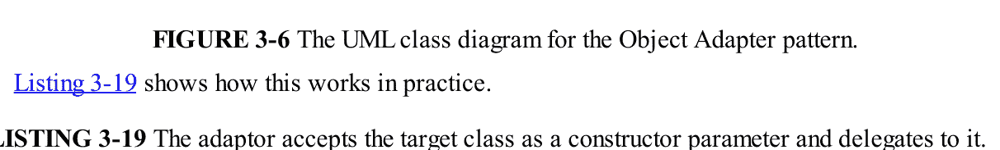

**图 3-6** 对象适配器模式的 UML 类图。

列表 3-19 显示了其在实践中的工作方式。

**列表 3-19** 适配器将目标类作为构造函数参数接受并委托给它。

Click here to view code image

```
public interface IExpectedInterface
{
    void MethodA();
}
// ...
public class Adapter : IExpectedInterface
{
    public Adapter(TargetClass target)
    {
        this.target = target;
    }

    public void MethodA()
    {
        target.MethodB();
    }

    private TargetClass target;
}
//
public class TargetClass
{
    public void MethodB()
    {

    }
}
//...
class Program
{
    static IExpectedInterface dependency = new Adapter(new TargetClass());
    static void Main(string[] args)
    {
        dependency.MethodA();
    }
}
```

## 策略模式

策略模式允许你在无需重新编译的情况下更改类的期望行为，甚至可能在运行时执行期间更改。图 3-7 显示了策略模式的 UML 类图。

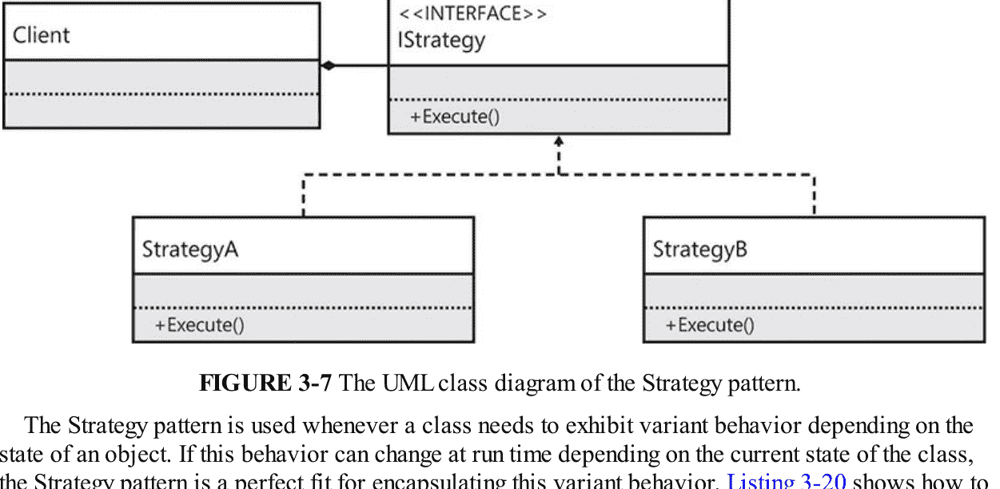

**图 3-7** 策略模式的 UML 类图。

每当一个类需要根据对象的状态表现出不同的行为时，就会使用策略模式。如果这种行为可以根据类的当前状态在运行时更改，策略模式非常适合封装这种可变行为。列表 3-20 显示了如何创建策略模式并在类中使用它。

**列表 3-20** 策略模式的实际应用。

Click here to view code image


```csharp
public interface IStrategy
{
    void Execute();
}
//...
public class ConcreteStrategyA : IStrategy
{
    public void Execute()
    {
        Console.WriteLine("ConcreteStrategyA.Execute()");
    }
}
//...
public class ConcreteStrategyB : IStrategy
{
    public void Execute()
    {
        Console.WriteLine("ConcreteStrategyB.Execute()");
    }
}
//...
public class Context
{
    public Context()
    {
        currentStrategy = strategyA;
    }

    public void DoSomething()
    {
        currentStrategy.Execute();

        // swap strategy with each call
        currentStrategy = (currentStrategy == strategyA) ? strategyB : strategyA;
    }

    private readonly IStrategy strategyA = new ConcreteStrategyA();
    private readonly IStrategy strategyB = new ConcreteStrategyB();

    private IStrategy currentStrategy;
}
```

每次调用 `Context.DoSomething()` 时，该方法首先委托给当前策略，然后在策略 A 和策略 B 之间切换。 下一次调用将在再次切换回原始策略之前委托给新选择的策略。

策略的选择方式是一个实现细节——它不会改变模式的净效果：类的行为隐藏在接口之后，该接口的实现用于执行实际工作。

## 更进一步的灵活性

接口的实用性不仅限于设计模式。 接口还有一些其他更专业的用途值得研究。 虽然这些特性通常不适用，但在某些情况下它们是完成工作的正确工具。

与设计模式一样，过度使用会损害代码的可读性和可维护性。 找到解决问题的优雅方案所需的协作模式和技术的正确数量是一项艰难的平衡，因此在使用接口进行以下方式时请谨慎行事。

### 鸭子类型

C# 是一种静态类型语言，而鸭子类型更常见于动态类型语言。 鸭子类型使用鸭子测试：

> 当我看到一只鸟走路像鸭子、游泳像鸭子、叫声像鸭子时，我称那只鸟为鸭子。

> —James Whitcomb Riley

应用于编程语言中的类型，鸭子测试表明，只要一个对象表现出某个接口的 *行为*，就应将其视为该接口。不幸的是，在 C# 中默认情况下并非如此。 请观察列表 3-21 中的示例。

**列表 3-21** 尽管对象 `Swan` 实现了 `IDuck` 的所有方法，但它实际上 *不是* `IDuck`。

Click here to view code image

```csharp
public interface IDuck
{
    void Walk();

    void Swim();

    void Quack();
}
//...
public class Swan
{
    public void Walk()
    {
        Console.WriteLine("The swan is walking.");
    }

    public void Swim()
    {
        Console.WriteLine("The swan can swim like a duck.");
    }

    public void Quack()
    {
        Console.WriteLine("The swan is quacking.");
    }
}
//...
class Program
{
    static void Main(string[] args)
    {
        var swan = new Swan();

        var swanAsDuck = swan as IDuck;

        if(swan is IDuck || swanAsDuck != null)
        {
            swanAsDuck.Walk();
            swanAsDuck.Swim();
            swanAsDuck.Quack();
        }
    }
}
```

`is` 断言和 `as` 转换分别返回 false 和 null。 公共语言运行时 `CLR` 不认为 `Swan` 是 `IDuck`，即使它实际上满足该接口。 类型必须通过接口继承 *实现* 接口。

你可以使用一些技巧使 `Swan` 类可以在 *不* 实现它的情况下作为 `IDuck` 接口的实例使用。 你可以利用 CLR 新版本中的动态类型扩展，或者使用一个名为 `Impromptu Interface` 的第三方库。

### 使用动态语言运行时

从版本 4 开始，`.NET Framework` 不再严格是静态类型的。 随着 `dynamic` 关键字的引入以及一些支持类型，你可以避免 CLR 的静态类型并切换到动态语言运行时 `DLR` 的动态类型。 C# 中动态类型的示例显示在列表 3-22 中。

**列表 3-22** `DLR` 可用于鸭子类型。

Click here to view code image

```csharp
class Program
{
    static void Main(string[] args)
    {
        var swan = new Swan();

        DoDuckLikeThings(swan);

        Console.ReadKey();
    }

    static void DoDuckLikeThings(dynamic duckish)
    {
        if(duckish != null)
        {
            duckish.Walk();
            duckish.Swim();
            duckish.Quack();
        }
    }
}
```

请注意，`method` 参数的类型为 `dynamic`。不仅需要针对 `.NET Framework 4`，还需要在客户端中专门设计动态类型。在这两方面，有时是不可行的。例如，你不能简单地在所有地方都创建接受 `dynamic` 参数的方法，否则你最好使用动态类型的 `.NET Framework` 语言，例如 `IronPython`³。

> ³ http://ironpython.net/

### 使用 Impromptu Interface

`Impromptu Interface` 是一个可通过 `NuGet` 安装的 `.NET Framework` 库。安装后，你可以使用 `ActLike<T>()` 方法传入你的 `Swan` 并接收一个委托给你的实例的 `IDuck` 实例。清单 3-23 展示了其工作原理。

#### LISTING 3-23 Impromptu Interface allows duck-typing in C#.

Click here to view code image

```csharp
class Program
{
    static void Main(string[] args)
    {
        var swan = new Swan();

        var swanAsDuck = Impromptu.ActLike<IDuck>(swan);

        if(swanAsDuck != null)
        {
            swanAsDuck.Walk();
            swanAsDuck.Swim();
            swanAsDuck.Quack();
        }

        Console.ReadKey();
    }
}
```

`ActLike` 方法所做的是通过使用 `Reflection Emit` 在运行时创建一个新类型。这是 `.NET Framework Reflection API` 的一个强大部分，允许在运行时创建新类型。此新类型实现了 `IDuck` 接口，但它也将 `Swan` 实例作为封装字段包含在内。每当调用其中一个 `IDuck` 接口方法时，新类型会简单地委托给 `Swan` 实例。它本质上是适配器模式的运行时版本。`Impromptu Interface` 是自动应用对象适配器模式的一种方式。

### CLR duck-typing support

有趣的是，`CLR` 已经支持 duck-typing。不幸的是，这仅适用于一种不常见的情況：实现可枚举对象。`foreach` 循环的目标类型必须符合某个接口，但该接口并未形式化，可以在目标类上临时实现。在清单 3-24 的示例中，`Duck` 类是 `foreach` 循环的目标。

#### LISTING 3-24 The CLR implicitly supports duck-typing for enumerable types.

Click here to view code image

```csharp
class Program
{
    static void Main(string[] args)
    {
        var duck = new Duck();

        foreach (var duckling in duck)
        {
            Console.WriteLine("Quack {0}", duckling);
        }

        Console.ReadKey();
    }
}
```

`Duck` 并未实现任何接口，但 `foreach` 循环要求 `GetEnumerator()` 方法，如编译器所指示的那样，如图 3-8 所示。

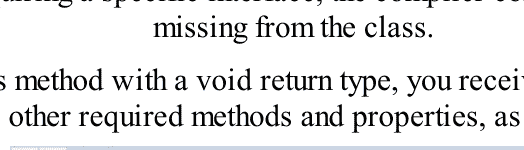

#### FIGURE 3-8 Without requiring a specific interface, the compiler complains that a public method is missing from the class.

当你使用 `void` 返回类型实现此方法时，你会收到一个新错误，指出此类型不支持其他必需的方法和属性，如图 3-9 所示。

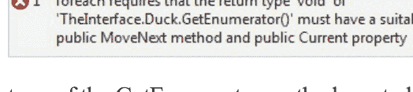

#### FIGURE 3-9 The return type of the GetEnumerator method must also match an implicit contract.

这些属性随后可以按清单 3-25 所示实现。

#### LISTING 3-25 Completing the implied interface of the DuckEnumerator class.

Click here to view code image

```csharp
public class DuckEnumerator
{
    int i = 0;

    public bool MoveNext()
    {
        return i++ < 10;
    }

    public int Current
    {
        get
        {
            return i;
        }
    }
}
```

此时，你已成功实现了 `foreach` 所需的隐式接口——duck-typing 发挥作用！

### Mixins

duck-typing 的扩展概念是 `mixin`。`mixin` 是一个包含多个其他类的实现而无需使用实现继承的类。正如你已经学到的，C# 不支持多重实现继承，因此你必须寻找其他实现 `mixin` 的解决方案。

一种简单但有限的实现 `mixin` 的方法是使用扩展方法。这允许你向已定义的类型的添加方法，这可能非常有用。另一种选择是使用 `Re-motion Re-mix` 等第三方库，它的工作方式与 `Impromptu Interface` 类似，即在运行时生成一个新类型，该类型包含你指定的所有接口并充当多面适配器。

### 使用扩展方法

自 `.NET Framework 3.5` 以来，扩展方法允许向已存在的类型添加新功能。无需访问类型的源代码，也无需类型为部分定义，你就可以扩展一个类型。清单 3-26 显示了本节将增强的接口，以及一对简单的扩展方法。

#### LISTING 3-26 Extension methods can enhance an existing interface.

Click here to view code image

```csharp
public interface ITargetInterface
{
    void DoSomething();
}
//...
public static class MixinExtensions
{
    public static void FirstExtensionMethod(this ITargetInterface target)
    {
        Console.WriteLine("The first extension method was called.");
    }

    public static void SecondExtensionMethod(this ITargetInterface target)
    {
        Console.WriteLine("The second extension method was called.");
    }
}
```

现在，只要客户端可以访问 `ITargetInterface` 实例，并且它还引用了 `MixinExtensions` 类，这两个扩展方法就会可用。可以创建任意数量的扩展方法，分散在多个静态类中。清单 3-27 显示了另一对扩展方法；这次它们接受额外参数。

#### LISTING 3-27 Extension methods can take parameters.

Click here to view code image

```csharp
public static class MoreMixinExtensions
{
    public static void FurtherExtensionMethodA(this ITargetInterface target, int extraParameter)
    {
        Console.WriteLine("Further extension method A was called with argument {0}", extraParameter);
    }

    public static void FurtherExtensionMethodB(this ITargetInterface target, string stringParameter)
    {
        Console.WriteLine("Further extension method B was called with argument {0}", stringParameter);
    }
}
```

这些扩展方法可以像任何其他方法一样被任何客户端调用，如清单 3-28 所示。

#### LISTING 3-28 Clients have access to extension methods as if they were declared directly on the target interface.

Click here to view code image

```csharp
public class MixinClient
{
    public MixinClient(ITargetInterface target)
    {
        this.target = target;
    }

    public void Run()
    {
        target.DoSomething();
        target.FirstExtensionMethod();
        target.SecondExtensionMethod();
        target.FurtherExtensionMethodA(30);
        target.FurtherExtensionMethodB("Hello!");
    }

    private readonly ITargetInterface target;
}
```

这种 `mixin` 方法有几个值得注意的限制。首先是客户端的可测试性。正如第 4 章“单元测试和重构”将展示的那样，静态类不利于轻松模拟。这使得这些扩展方法的所有客户端更难以进行适当的单元测试。

更糟糕的是，由于扩展方法为静态类，它们无法保存与对象相关的任何额外每个实例状态。当然，有变通方法，例如存储一个将实例映射到某些额外值的静态字典，但这并不理想。

还请注意，所有扩展方法都针对同一个接口，并且所有要增强的实例都必须实现此接口。真正的 `mixin` 另一方面，实现多个不同的接口并充当聚合适配器。

### 使用 Re-motion Re-mix


实现 `mixin` 的另一种方法是使用 Re-motion Re-mix 等第三方库。Re-mix 允许你通过运行时配置指定在创建某个目标类的新实例时要组合哪些类。与 Impromptu Interface 一样，它即时生成一个新类型，该类型满足 mixin 请求上的所有接口，并且该类型的每个实例在调用接口方法时都会委托给 mixin 的实例。接口和一些示例实现显示在清单 3-29 中。

### LISTING 3-29 The disparate interfaces to be combined as a mixin.

Click here to view code image

```
public interface ITargetInterface
{
    void DoSomething();
}
//...
public class TargetImplementation : ITargetInterface
{
    public void DoSomething()
    {
        Console.WriteLine("ITargetInterface.DoSomething()");
    }
}
//...
public interface IMixinInterfaceA
{
    void MethodA();
}
//...
public class MixinImplementationA : IMixinInterfaceA
{
    public void MethodA()
    {
        Console.WriteLine("IMixinInterfaceA.MethodA()");
    }
}
//...
public interface IMixinInterfaceB
{
    void MethodB(int parameter);
}
//...
public class MixinImplementationB : IMixinInterfaceB
{
    public void MethodB(int parameter)
    {
        Console.WriteLine("IMixinInterfaceB.MethodB({0})", parameter);
    }
}
//...
public interface IMixinInterfaceC
{
void MethodC(string parameter);
}
// ...
public class MixinImplementationC : IMixinInterfaceC
{
    public void MethodC(string parameter)
    {
        Console.WriteLine("IMixinInterfaceC.MethodC(\"{0}\")", parameter);
    }
}
```

请注意，没有任何一个类实现了所有这些接口。相反，下一步是配置 Re-mix，以便当它被要求提供 `TargetImplementation` 的实例时，它将返回一个包含所有接口和类组合的 mixin。Listing 3-30 显示了这样的配置。

### LISTING 3-30 Instructing Re-mix how to construct TargetImplementation instances.

Click here to view code image

```
var config = MixinConfiguration.BuildFromActive()
    .ForClass<TargetImplementation>()
    .AddMixin<MixinImplementationA>()
    .AddMixin<MixinImplementationB>()
    .AddMixin<MixinImplementationC>()
    .BuildConfiguration();

MixinConfiguration.SetActiveConfiguration(config);
```

不幸的是，你不能简单地在 `TargetImplementation` 上调用 `new` 并期望得到一个 mixin。相反，你必须要求 Re-mix 创建一个 `TargetImplementation` 实例，以便它可以按你的规范构建一个新类型并实例化它。Listing 3-31 显示了它是如何做到这一点的——幸运的是，这很简单。

### LISTING 3-31 Re-mix is in charge of creating mixins.

Click here to view code image

```
ITargetInterface target = ObjectFactory.Create<TargetImplementation>(ParamList.Empty)
```

Re-mix 的一个限制是，你不能——也不可能——知道 `ObjectFactory.Create` 返回的实例的确切类型。你所知道的是它是一个 `TargetImplementation` 的子类实例。这对客户端来说有点坏消息，因为在编译时你唯一能保证 `TargetImplementation` 满足的接口就是 `ITargetInterface`。因此，mixin 的客户端必须通过使用 `is` 和 `as` 进行类型嗅探来将 mixin 强制转换为期望的接口。Listing 3-32 突出了这个问题。

### LISTING 3-32 Type-sniffing is bad practice but necessary for using mixins.

Click here to view code image

```
public class MixinClient
{
    public MixinClient(ITargetInterface target)
    {
        this.target = target;
    }

    public void Run()
    {
        target.DoSomething();

        var targetAsMixinA = target as IMixinInterfaceA;
        if(targetAsMixinA != null)
        {
            targetAsMixinA.MethodA();
        }

        var targetAsMixinB = target as IMixinInterfaceB;
        if(targetAsMixinB != null)
        {
            targetAsMixinB.MethodB(30);
        }

        var targetAsMixinC = target as IMixinInterfaceC;
        if(targetAsMixinC != null)
        {
            targetAsMixinC.MethodC("Hello!");
        }
    }

    private readonly ITargetInterface target;
}
```

将 mixin 应用于解决方案时效果最好，当类型嗅探已经存在或必要时。这在某些库和框架中是正确的。例如，Prism（Windows Presentation Foundation/Model-View-Viewmodel 库）使用类型嗅探，并且客户端类所需的功能可以分离到不同的实现中并通过 mixin 重新组合。

## Fluent interfaces

如果一个接口从其一个或多个方法中返回自身，则称该接口为 *fluent*。这允许客户端将调用链接起来，如 Listing 3-33 所示。

### LISTING 3-33 Fluent interfaces allow method chaining.

Click here to view code image

```
public class FluentClient
{
    public FluentClient(IFluentInterface fluent)
    {
        this.fluent = fluent;
    }

    public void Run()
    {
        // without using fluency
        fluent.DoSomething();
        fluent.DoSomethingElse();
        fluent.DoSomethingElse();
        fluent.DoSomething();
        fluent.ThisMethodIsNotFluent();

        // using fluency
        fluent.DoSomething()
            .DoSomethingElse()
            .DoSomethingElse()
            .DoSomething()
            .ThisMethodIsNotFluent();
    }

    private readonly IFluentInterface fluent;
}
```

这提高了可读性，因为它避免了对接口实例的重复引用。它是实现配置或有限状态机的越来越流行的方式，如第 8 章“接口隔离”所述。

实现流畅接口也很简单。类所要做的就是从方法中返回 `this`。因为类已经是接口的实现，所以通过返回 `this`，类只返回其自身的接口部分，从而隐藏了其余的实现。Listing 3-34 显示了本示例中使用的 `IFluentInterface` 的定义和实现。

### LISTING 3-34 Implementing a simple fluent interface is easy.

```
public interface IFluentInterface
{
    IFluentInterface DoSomething();

    IFluentInterface DoSomethingElse();

    void ThisMethodIsNotFluent();
}
// ...
public class FluentImplementation : IFluentInterface
{
    public IFluentInterface DoSomething()
    {
        return this;
    }

    public IFluentInterface DoSomethingElse()
    {
        return this;
    }

    public void ThisMethodIsNotFluent()
    {
    }
}
```

请注意，接口的一个方法不是流畅的——它返回 `void`。如果方法返回的不是接口，则它不是流畅的。客户端所做的任何方法链调用都将被对非流畅方法的调用所中断。

## Conclusion

在本章中，你已经了解了接口是什么以及为什么它们是编写自适应代码的关键方面。它们是多态性的催化剂，使你能够在类族中封装变化。它们是设计模式生长的根基。然而它们实际上什么都不做。

记住，接口如果没有相应的实现就毫无用处。但没有接口，实现及其相关的依赖关系就会渗透并污染你的代码，使其难以维护和扩展。恰当地放置的接口充当服务代码肮脏的实现细节与干净、结构良好的客户端之间的防火墙。

接口还具有其他更专业的特性，例如鸭子类型和 mixin。这些很少使用，但在正确的上下文中应用时，它们可以简化原本复杂冗长的代码并增加适应性的另一个维度。

本章奠定的基础将在你体验本书其余部分接口的无处不在时变得非常重要。

## Chapter 4. Unit testing and refactoring

### After completing this chapter, you will be able to

- Define unit testing and refactoring and explain why both are very useful techniques.
- Understand how unit testing and refactoring are intrinsically linked.
- Write code in a test-first fashion, focusing on implementing only that which the tests require.
- Refactor production code to improve its overall design.
- Recognize overspecified unit tests and refactor them.

本章重点介绍两种当前编程最佳实践技术：单元测试和重构。

单元测试是编写测试其他代码的代码的学科。单元测试本身作为源代码，可以被编译和执行。随着每个单元测试的运行，它会用简单的 true 或 false 报告测试的成功或失败，通常是一个绿色或红色的视觉指示。如果所有单元测试都通过，则认为它们所测试的生产代码可能正在工作。如果甚至有一个单元测试失败——可能有数千个——则认为整体生产代码肯定已损坏。

重构是逐步改进现有代码设计的过程。它类似于编写代码的各种草稿，就像我为本书编写了各种草稿一样。通过承认我们开发人员很少能第一次就做对，重构使我们能够先做最简单的事情，然后通过逐步改进，逐渐在以后到达更好的解决方案。

能够肆无忌惮地重构的自由是由单元测试实现的。当你在尽可能早的阶段进行单元测试时——即在编写任何生产代码之前——你创建了一个安全网来捕获重构代码时出现的任何后续错误。如果单元测试从通过状态转变为失败状态，你就知道你上次所做的更改导致代码损坏。编写单元测试然后重构以获得更好的设计的过程是一个上升螺旋，在此过程中代码质量提高，同时你也在实现新功能方面取得进展。

## Unit testing

在某种程度上，单元测试应被视为每个程序员日常纪律的强制性部分。对于一些开发人员来说，理想的情况是生产代码——构成软件产品基础的代码——完全是为验证应用程序行为而编写的测试的结果。本章后面你将学习如何通过测试驱动开发来实现这一点，但请记住目标是务实而不是原教旨主义：与为了编写更多单元测试而迟到的相比，交付一些东西并接受一些审慎的技术债务肯定更好。也就是说，每个项目在及时性与完整性之间的容忍度都是独特的。

有一些公认的单元测试模式和准则会导致可重复的成功。这些模式和准则不再是新事物，而是预期、尝试和测试过的。单元测试的安排和命名，以及最重要的如何确保代码的可测试性，都是主要关注点。如果忽视这些关注点，单元测试将不再与它们所测试的代码同步，测试失败将被容忍，安全网将枯竭并断裂。

### 安排、执行、断言

每个单元测试都由三个不同的部分组成：

- 测试前置条件的**安排**
- 被测**操作**的执行
- 预期行为已发生的**断言**

这三部分构成了 *安排、执行、断言*（AAA）模式。你编写的每个测试都应遵循这种模式，以便其他人能够读懂你的单元测试。

> 注意
> 
> 有些读者可能更熟悉以 *Given, When, Then* 表达的这种方式。这与安排、执行、断言直接类似，但它是这样的：*给定*某些前置条件，*当*执行测试目标时，*那么*应该发生某些预期行为。

### 安排前置条件

在执行需要测试的操作之前，你必须搭建好正在测试的场景。对于某些测试来说，这仅仅就是构造被测系统（SUT）。SUT 就是你要测试的类。如果没有该类的有效实例，你将无法测试它的任何方法。

*清单 4-1* 展示了一个测试的最小 Arrange 部分，该测试针对表示客户余额和交易的 `Account` 类。在本例中，我使用 MSTest。本章后续还将基于此示例继续展示测试的 Act 和 Assert 部分。测试方法名 `AddingTransactionChangesBalance()` 简明扼要地描述了测试的意图——确保每当添加交易到账户时，账户余额都会发生变更以包含这笔新交易。

### 清单 4-1 构造 SUT 是安排单元测试时常见的首要步骤。

单击此处查看代码图片

```
[TestClass]
public class AccountTest
{
    [TestMethod]
    public void AddingTransactionChangesBalance()
    {
        // Arrange
        var account = new Account();
    }
}
```

这里所采取的 Arrange 步骤非常简洁。这个测试的唯一前置条件就是 `Account` 类的一个新实例。你直接在测试中通过 `new` 运算符来创建它。至此，你可以继续进入 AAA 模式的下一步。

### 执行可测试的操作

既然你已经让被测系统处于适合操作的状态，就可以执行你正在测试的方法了。每个测试的 Act 阶段都应该只包含与系统的一次交互——例如，一次方法调用或属性获取/设置。这确保了测试易于阅读和编写，并且具有清晰的执行路径。

清单 4-2 展示了测试中 Act 部分的添加。与测试方法名保持一致，测试调用了 `account.AddTransaction()` 方法。

### 清单 4-2 每个 Act 阶段都应只包含与 SUT 的一次交互。

单击此处查看代码图片

```
[TestClass]
public class AccountTest
{
    [TestMethod]
    public void AddingTransactionChangesBalance()
    {
        // Arrange
        var account = new Account();

        // Act
        account.AddTransaction(200m);
    }
}
```


测试向 `AddTransaction` 方法传入了一个值。这个值表示你正在添加到账户中的交易金额。它是一个 `decimal` 值，意味着精度非常高，但这个金额没有关联的货币值。为简单起见，这里假设所有账户和交易均以美元为单位。

完成 Arrange 和 Act 阶段后，你就可以进入测试的最后一部分了。

## 断言预期结果

到目前为止，前面这两个阶段实际上都只是这个测试以及每个单元测试的关键部分——断言——的铺垫。断言会为整个测试提供成功（绿色指示）或失败（红色指示）。测试方法名再次作为你所做断言的参照点——即账户余额已经发生改变。在这种情况下，断言将对实际值和预期值进行比较。这是一种在基于状态的测试中常见的断言类型，这类测试的断言依赖于 SUT 的状态。这个特定的断言要求实际值和预期值相等。

`Account` 类的 `Balance` 属性将被查询以获取实际值，而你将提供一个常量作为预期值。这意味着你事先必须知道预期值，这是编写测试时需要考虑的一个关键因素。不应该通过代码推导预期值，而应提前知道预期值是什么。在本场景中，这很容易。给定一个新账户，其初始余额未指定，因此为零，如果你向该账户添加 $200.00，那么预期余额应该是什么？

$0.00 + $200.00 = $200.00

因此，你可以编写 Assert 阶段并完成你的 AAA 测试，如清单 4-3 所示。

**清单 4-3 单元测试中已添加对预期行为的断言。**

单击此处查看代码图片

```
[TestClass]
public class AccountTest
{
    [TestMethod]
    public void AddingTransactionChangesBalance()
    {
        // Arrange
        var account = new Account();

        // Act
        account.AddTransaction(200m);

        // Assert
        Assert.AreEqual(200m, account.Balance);
    }
}
```

这个测试现在可以运行了。通过运行测试，你可以验证被测系统的行为是否符合预期。

## 运行测试

测试编写完成后，你需要使用单元测试运行器来运行它。单元测试位于测试项目中，这些项目的输出是程序集，而不是可执行文件。这意味着测试项目不能自行运行，而必须作为输入提供给单元测试运行器。Microsoft Visual Studio 通过其集成的测试运行器支持 MSTest 单元测试，而其他一些类型的单元测试则需要插件才能在 Visual Studio 中提供集成支持。

在 Visual Studio 中，你可以通过从“测试”>“运行”菜单中选择一个选项来运行 MSTest 单元测试。目前，你可以选择“所有测试”选项，其快捷键为 Ctrl+R, A。运行 AAA 单元测试的输出如图 4-1 所示。

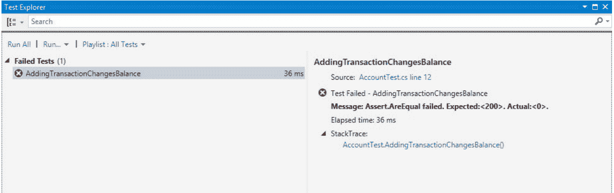

**图 4-1 在 Visual Studio 集成的 MSTest 单元测试运行器中运行单元测试。**

测试运行器以主从视图显示你选择运行的单元测试。左侧窗格中列出了测试列表，右侧窗格中显示所选测试的更多详细信息。你可以看到该测试执行耗时 14 毫秒，这根本不算多。这正是编写单元测试的优势之一——与手动测试所需的工作量相比，运行数千个单元测试并不需要太长时间。

然而，请注意测试断言失败了，因为预期值 200 与实际提供的值不匹配。`account.Balance` 属性被用作断言的实际值，但它返回了 0。

这是因为你还没有实现 `Account` 类。清单 4-4 展示了到目前为止所需的最小 `Account` 类实现。

**清单 4-4 被测系统不需要在单元测试之前实现。**

单击此处查看代码图片

```
public class Account
{
    public void AddTransaction(decimal amount)
    {

    }

    public decimal Balance
    {
        get;
        private set;
    }
}
```

正如你所看到的，这个类在 `AddTransaction` 方法中没有对传入的交易金额做任何处理，`Balance` 只是一个默认的自动属性，不过具有私有 setter。为了让这个测试通过，你必须实现 `Account` 类，使其满足你当前的预期。

## 测试驱动开发

要编写单元测试，你并不需要先拥有被测系统的完整实现。在测试驱动开发（TDD）中，最好在编写单元测试之前不要有可工作的被测系统。当你使用 TDD 方式编写软件时，你会同步编写单元测试和生产代码，并为生产代码中每个类的每个方法所表现出的每个预期行为编写一个失败测试。该失败测试仅仅是因为生产代码尚不存在而失败。测试声明——即断言——生产代码应该以某种方式运行，但由于它尚不存在，测试便失败。当生产代码以最简单的方式实现以满足测试要求后，测试就会成功。

## 红、绿、重构！

到目前为止，通过 AAA 的 `AddingTransactionChangesBalance()` 测试所产生的成果，是一个名为“红、绿、重构”的三阶段流程的第一部分。

1. 编写一个针对 SUT 预期行为的失败测试。
2. 仅实现足以让新测试通过且不破坏已有成功测试的 SUT 代码。
3. 如果可以对 SUT 进行任何重构以改进其设计或整体质量，那么现在正是进行重构的时机。

第一阶段会生成一个失败的测试，测试运行器用红色图标指示。第二阶段让那个失败的测试通过，将图标变为绿色。第三阶段允许你一点一点地逐步改进生产代码，而不用担心破坏其功能。

要将失败测试从红变绿（从失败变成功），你需要查看该流程的第二阶段：仅实现足以让测试通过的 SUT 代码。由于目前这是唯一的测试，你无需担心会破坏任何已有的成功测试。

该测试所断言的行为是：当向新账户添加一笔金额为 200 的交易后，账户余额为 200。清单 4-5 展示了让单元测试通过所需的最低限度代码。

**清单 4-5 当测试从红变绿时，永远只做最低限度的实现。**

单击此处查看代码图片

```
public class Account
{
    public Account()
    {
        Balance = 200m;
    }

    public void AddTransaction(decimal amount)
    {

    }

    public decimal Balance
    {
        get;
        private set;
    }
}
```

已更改的代码以**粗体**突出显示。为了使测试从红色变为绿色，代码为 `Account` 类引入了一个默认构造函数，该构造函数将 `Balance` 属性初始化为 `200m`。为了证明这有效——测试现在通过了——图 4-2 显示了在重新运行失败的测试后 Visual Studio 测试运行器的屏幕截图。

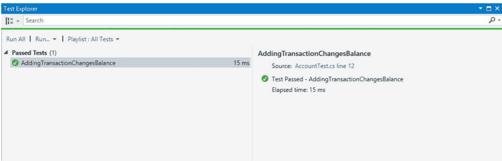

**FIGURE 4-2 The test does, indeed, now pass—but is it correct?**

在你为自己喝彩并进入最终的重构阶段之前，你应该评估这是否是实现测试指定的预期行为的正确方式。你可以通过添加另一个期望的形式的另一个单元测试来证明这不是正确的实现。

要添加的测试定义了给定新创建的 `Account` 对象时 `Balance` 字段的预期值。回想一下，在向账户添加 200 美元的交易后，`Balance` 字段的预期值是如何计算的；它包含了未指定的开户余额为零的假设。这是一种预期行为，就像其他任何行为一样，因此你应该编写一个测试来断言你对代码的期望是否得到正确实现。列表 4-6 显示了 AAA 模式应用于此类单元测试。

**LISTING 4-6 The Arrange part of this test is omitted.**

[Click here to view code image](#code-image)

```
[TestMethod]
public void AccountsHaveAnOpeningBalanceOfZero()
{
    // Arrange

    // Act
    var account = new Account();

    // Assert
    Assert.AreEqual(0m, account.Balance);
}
```

首先，注意测试方法的名字再次描述了它断言的预期行为。在这种情况下，单元测试的 Arrange 部分为空，这意味着 AAA 语法中的这一部分是可选的。正在测试的 SUT 的部分是其默认构造函数的行为，这是 Act 阶段与 SUT 的唯一交互。最后，断言将之前陈述的假设形式化，即新的 `Account` 的余额为 `0m`。

这个单元测试失败的事实，即使第一个单元测试通过，也表明第一个单元测试期望的实现是错误的。图 4-3 显示了 MSTest 运行器的输出。

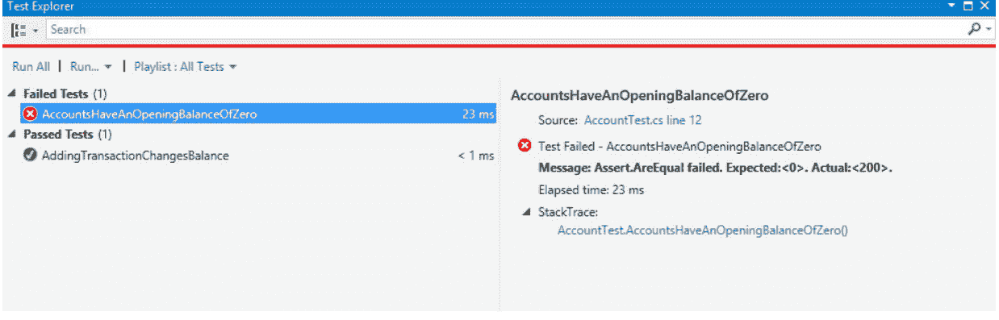

**FIGURE 4-3 The second unit test fails because of the implementation of the first unit test’s expectations.**

从这个位置，如果你将对 `Account` 类的先前更改恢复，你将使你的开户余额测试从红色变为绿色，同时正确地导致你的添加交易测试再次失败。通过这样做，你证明了你对开户余额测试的 `Account` 类的实现是正确的，但对添加交易测试的实现是错误的。

添加每个新测试的效果是为 SUT 的可行实现创建了进一步的约束。每个测试都带有对行为的期望，每个期望都需要在 SUT 中取得平衡。确保两个测试都通过的另一种最简单的可能实现如列表 4-7 所示。

**LISTING 4-7 Both tests now pass with this implementation, but is it correct?**

Click here to view code image

```
public class Account
{
    public void AddTransaction(decimal amount)
    {
        Balance = 200m;
    }

    public decimal Balance
    {
        get;
        private set;
    }
}
```

新账户的余额现在将在创建时为零，但在调用 `AddTransaction` 时会变为 `200m`。当然，尽管两个测试现在都通过了，直觉应该告诉这是绝对错误的。先写最简单的事情——而不是直接跳到明显的正确解决方案——的目的是从你的直觉中推导出编码断言。你能写另一个单元测试使其失败并证明此实现不正确吗？列表 4-8 显示了一个示例。

**LISTING 4-8 This test is identical to the prior version but has a different amount value.**

[Click here to view code image](#code-image)

```
[TestMethod]
public void Adding100TransactionChangesBalance()
{
    // Arrange
    var account = new Account();

    // Act
    account.AddTransaction(100m);

    // Assert
    Assert.AreEqual(100m, account.Balance);
}
```

此测试方法与第一个测试添加交易的功能相同，但它添加的是 100 美元而不是 200 美元的交易。虽然差异很小，但足以证明 `Account.AddTransaction` 方法是错误的。

不出所料，这个新测试失败了。如果你更改 `Account` 类，使值 `100m` 硬编码到 `AddTransaction` 方法中，你将使原始测试失败并使此测试从红色变为绿色。相反，你现在可以实现正确的解决方案，如列表 4-9 所示。

**LISTING 4-9 All three tests pass with this implementation, but it is *still wrong!***

[Click here to view code image](#)

```
public class Account
{
    public void AddTransaction(decimal amount)
    {
        Balance = amount;
    }

    public decimal Balance
    {
        get;
        private set;
    }
}
```

有了此实现，并且你的全部三个单元测试都通过——之前都失败了——太阳正在照耀，一切在世界上都是正确的。除了它不是！再次，`AddTransaction` 方法的期望与实现的现实不匹配。第四个单元测试突出了这个问题，如列表 4-10 所示。

**LISTING 4-10 This unit test should finally help crack the AddTransaction method.**

[Click here to view code image](#)

```
[TestMethod]
public void AddingTwoTransactionsCreateSummationBalance()
{
    // Arrange
    var account = new Account();
    account.AddTransaction(50m);

    // Act
    account.AddTransaction(75m);

    // Assert
    Assert.AreEqual(125m, account.Balance);
}
```

此测试最终允许你发现 `AddTransaction` 方法的绝对正确功能——至少目前是这样。重点是，随着需求变化和新功能被添加，你需要将你对类的期望编码化，以便你可以回退到现有的单元测试，这些测试形成了一个安全网。如果没有它，你很容易对代码进行更改，在你手动测试的狭窄情况下似乎有效，但在异常输入下会中断，或在其他看似无关的地方中断。

你添加的测试断言账户的余额是其所有交易的汇总。之前，你最正确的实现会将余额设置为最后一次发生的交易的值，这意味着此测试将失败，你的实现尚未正确。列表 4-11 显示了使全部四个单元测试都通过的 `AddTransaction` 方法的实现。

**LISTING 4-11 This implementation is so far the best for AddTransaction.**

Click here to view code image

```
public class Account
{
    public void AddTransaction(decimal amount)
    {
        Balance += amount;
    }

    public decimal Balance
    {
        get;
        private set;
    }
}
```

在每个单元测试从红色变为绿色后，你有机会重构 SUT 的实现，但此示例非常简单。随着向 SUT 添加的每个新方法，此过程阶段变得更加重要。以这种方式重构将在本章后面更详细地介绍。

## More complex tests

前面的示例涉及以测试优先的方式对应用程序领域模型的一部分类进行单元测试。如第 2 章“Dependencies and layering”所述，领域模型是业务逻辑层的实现，位于用户界面和数据访问层之间。

### 规范

对于下一组测试，这些测试基于此 `Account` 类构建，你将测试业务逻辑层的不同部分：一个服务。此假设应用程序的用户界面可以绑定到任何框架——ASP.NET MVC、Windows Presentation Foundation (WPF) 或 Windows Forms——并且你的服务应无论框架如何都可重用。这意味着服务不会包含特定于这些框架的任何依赖项，但它将依赖于 `Account` 类，尽管是间接的。图 4-4 显示了将构成此示例的层和类之间的依赖关系。

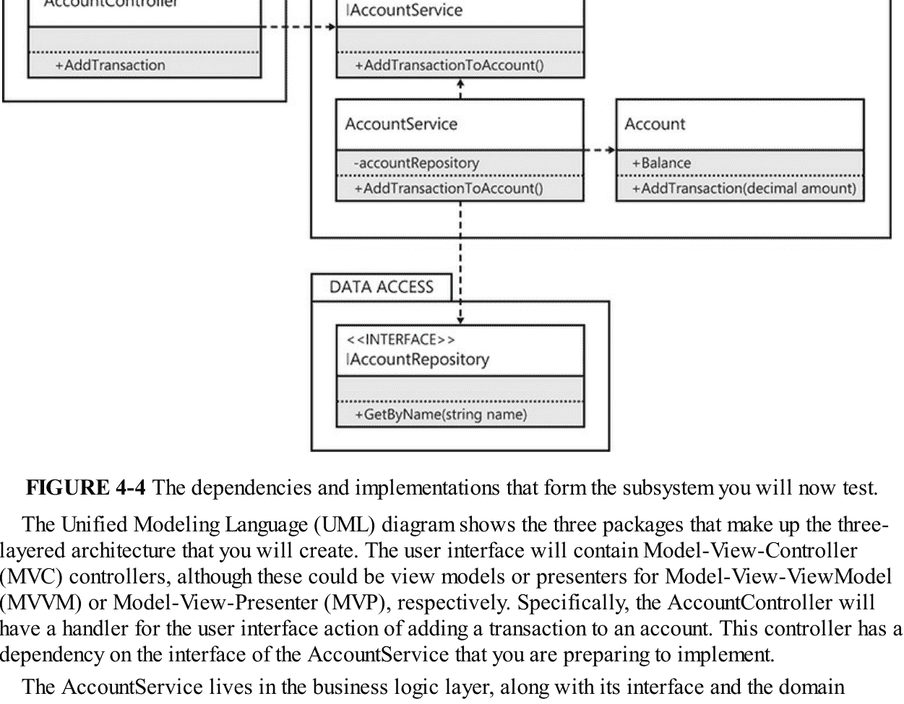

**图 4-4 构成你现在将测试的子系统的依赖关系和实现。**

统一建模语言（UML）图显示了构成你将创建的三层架构的三个包。用户界面将包含模型-视图-控制器（MVC）控制器，尽管这些可以分别是模型-视图-视图模型（MVVM）或模型-视图-演示者（MVP）的视图模型或演示者。具体来说，`AccountController` 将具有处理用户界面操作向账户添加交易的处理器。此控制器依赖于你准备实现的 `AccountService` 的接口。

`AccountService` 位于业务逻辑层，与其接口和由之前实现的 `Account` 类表示的领域模型一起。注意，这些包代表应用程序的逻辑层，而不是直接映射到 Visual Studio 项目，因此映射到程序集。这意味着你仍然更喜欢楼梯模式而不是随从反模式。`AccountService` 需要某种方式从你使用的任何持久存储中检索 `Account` 实例。因为你在业务逻辑层中使用了领域模型，所以数据访问层是使用对象/关系映射器 (ORM) 实现的。


使用存储库接口来隐藏特定持久性逻辑以免客户端代码。`IAccountRepository`负责返回`Account`实例。服务依赖于此接口，因为它在实现过程中需要检索账户。

## 设计测试

`AccountService.AddTransactionToAccount`方法的测试是使用TDD和AAA编写的，就像之前一样。首先，你需要思考对该方法的期望：它委托给正确的`Account`实例的`AddTransaction`方法，并传入交易金额的正确值。让我们指定`Arrange`、`Act`和`Assert`阶段：

- **Arrange** 确保SUT——`AccountService`类——有一个可用的实例。
- **Act** 调用`AddTransactionToAccount`方法。
- **Assert** SUT在`Account`实例上调用`AddTransaction`方法，并传入正确的金额值。

### LISTING 4-12 第一次尝试此新测试是不完整的。

```
[TestClass]
public class AccountServiceTests
{
    [TestMethod]
    public void AddingTransactionToAccountDelegatesToAccountInstance()
    {
        // Arrange
        var sut = new AccountService();

        // Act
        sut.AddTransactionToAccount("Trading Account", 200m);

        // Assert
        Assert.Fail();
    }
}
```

一切看起来都很好，直到你进行断言。断言是某个方法被调用在对象上并且传入特定值，但你如何断言这一点？这就是模拟发挥作用的地方。

### 使用假对象进行测试

在你编写断言之前，首先需要一个`Account`实例来进行断言。`IAccountRepository`接口将被`AccountService`用于检索它将交互的`Account`，因此你不能只是给`AccountService`这样一个实例。相反，你需要给`AccountService`一个`IAccountRepository`——但你没有任何可用的实现。因为你依赖于接口而不是类，你可以编写一个接口的假实现，该实现仅对测试足够。列表4-13显示了这样一个类，它位于单元测试程序集中。

### LISTING 4-13 一个非常简单的仅用于测试目的的存储库实现。

```
public class FakeAccountRepository : IAccountRepository
{
    public FakeAccountRepository(Account account)
    {
        this.account = account;
    }

    public Account GetByName(string accountName)
    {
        return account;
    }

    private Account account;
}
```

现在你可以编辑你的账户服务实现，以便提供此假存储库。列表4-14显示了`AccountService`类的新实现。

### LISTING 4-14 账户服务类的当前状态。

```
public class AccountService : IAccountService
{
    public AccountService(IAccountRepository repository)
    {
        this.repository = repository;
    }

    public void AddTransactionToAccount(string uniqueAccountName, decimal transactionAmount)
    {
}
    private readonly IAccountRepository repository;
}
```

单元测试现在可以完成，并有新的`Arrange`条件：

- 确保有一个可用的`Account`实例以供断言。
- 确保有一个假的`IAccountRepository`实例可用于在构造时传递给服务。

这些条件和正确的断言构成了列表4-15中的失败测试。

### LISTING 4-15 此测试因正确原因而失败：服务方法尚未实现。

```
[TestClass]
public class AccountServiceTests
{
    [TestMethod]
    public void AddingTransactionToAccountDelegatesToAccountInstance()
    {
        // Arrange
        var account = new Account();
        var fakeRepository = new FakeAccountRepository(account);
        var sut = new AccountService(fakeRepository);

        // Act
        sut.AddTransactionToAccount("Trading Account", 200m);

        // Assert
        Assert.AreEqual(200m, account.Balance);
    }
}
```

首先你创建一个开户余额为零的账户。然后你创建假账户存储库的实例，并将你的账户传入。因为假对象实现了账户存储库的接口，所以假对象可以很容易地传递给`AccountService`类，即你的SUT。

在调用测试目标的方法后，你然后断言账户具有预期的余额`200m`。如图4-5所示，此断言失败，因为目标方法尚未实现。

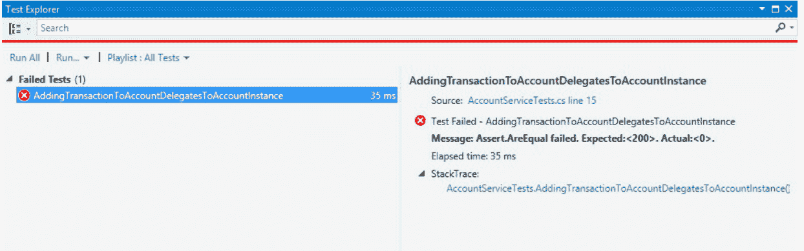

#### 图4-5 继续从红到绿的转换，你有你的失败测试。

现在你有一个单元测试，指定了生产代码中缺少的一些行为，你可以做最简单的事情使单元测试通过，如列表4-16所示。

### LISTING 4-16 此`AccountService`的实现使测试通过。

```
public class AccountService : IAccountService
{
    public AccountService(IAccountRepository repository)
    {
        this.repository = repository;
    }

    public void AddTransactionToAccount(string uniqueAccountName, decimal transactionAmount)
    {
        var account =
        repository.GetByName(uniqueAccountName);
        account.AddTransaction(transactionAmount);
    }

    private readonly IAccountRepository repository;
}
```

单元测试引导你在此实现中做正确的事情。你必须使用存储库检索账户，并且你必须在该账户上调用`AddTransaction`方法以修改只读的`Balance`属性。如果之后有人破坏此方法，使其不再符合单元测试中设定的期望，你将很快知道。

## 使用Mock进行测试

并不需要太强的想象力就能意识到，通过编写fake进行mock会很快变得非常繁琐。想象一下你可能编写的所有单元测试组合，以及你的SUT可能需要用到的所有不同接口。这仅仅是为了支持单元测试，就要编写大量额外代码。

还有另一种方法可以模拟`IAccountRepository`，但它需要使用外部的mocking框架。编写fake的一个优点是，你可以在不依赖任何第三方库的情况下独立编写它们。然而，如今mocking框架已经很普遍，而且有很多可供选择。下面的示例使用了其中最流行的一个：`Moq`。它的发音有多种，如Moh-kyoo和Mok。

通过NuGet，你可以在在线源中搜索`Moq`的包，从而快速添加对它的引用。`Moq`的神奇之处在于，它可以为你要求模拟的任何接口创建动态代理。你将修改现有测试，用`Moq`mock代替手动编写的fake，如清单4-17所示。

### 清单4-17 像`Moq`这样的mocking框架可以让你非常轻松地创建mock。

```
[TestMethod]
public void AddingTransactionToAccountDelegatesToAccountInstance()
{
    // Arrange
    var account = new Account();
    var mockRepository = new Mock<IAccountRepository>();
    mockRepository.Setup(r => r.GetByName("Trading Account")).Returns(account);
    var sut = new AccountService(mockRepository.Object);

    // Act
    sut.AddTransactionToAccount("Trading Account", 200m);

    // Assert
    Assert.AreEqual(200m, account.Balance);
}
```

测试中的改动以粗体标出。现在，你不再实例化自己的fake存储库，而是创建一个新的`Mock<IAccountRepository>()`对象。这个对象非常强大，允许你在被模拟的接口上设置各种预期和行为。这个类并没有实现你的接口，因此与你的fake不同，它不是`IAccountRepository`的直接可用实例。这是因为公共语言运行时`CLR`不允许类从泛型参数继承。相反，mock与它创建的代理实例之间是组合关系。`Object`属性允许你访问底层被模拟的接口，在本例中，该接口被传递给了`AccountService`。

在将mock提供给SUT之前，你需要指定它的行为方式。默认情况下，

`Moq`定义的是*宽松*mock，这意味着它们的所有返回值都是默认值。任何引用类型的默认值都是`null`，`Account`类也不例外。宽松mock的替代方案是*严格*mock，每当遇到你尚未指定的方法调用或属性访问时，它都会抛出异常。但这两个选项都不是你所需要的，因此你必须手动设置一些预期行为。

`Mock`实例的`Setup`方法非常巧妙。它接受一个lambda表达式，该表达式将底层被模拟类型的一个实例作为上下文参数提供。通过在该类型上调用一个方法，你实际上是在指定：当该方法以所提供的精确参数被调用时，你希望发生某件事情。你选择指定什么，取决于你的测试场景。`Moq`允许你在方法调用上设置以下预期：

- 调用某个其他lambda表达式。
- 返回一个特定值。
- 抛出指定类型的异常。
- 验证该方法确实被调用过。

对于这个测试，你需要的是第二个选项：返回一个指定值。`Mock.Setup`方法调用的流畅接口允许你链式调用`Returns`方法。这提高了可读性，并缩减了测试中本已相当庞大的`Arrange`阶段。`Returns`方法接收你已经创建好的`Account`实例，至此，你就完成了对这个mock的预期设置。简而言之，你给了这个mock以下指令：

> 当针对这个`IAccountRepository`实例调用`GetByName`方法，并且提供的账户名称为“Trading Account”时，返回这个`Account`类的实例。

再次运行测试时，它会像之前一样通过，如图4-6所示。

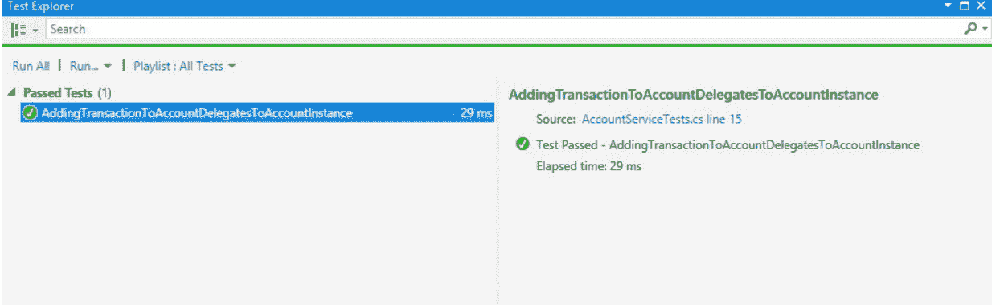

#### 图4-6 使用桩进行模拟后，测试再次通过。

先别高兴，你需要承认自己作弊了。你修改了一个单元测试，却没有让它经历从红到绿的过程。这个测试之前就已经通过了，而且也许在修改之后，它仍然通过。为了让这个测试失败，然后验证它只会因为SUT实现正确而通过，你应该删除`AddTransactionToAccount`方法内部的代码。当你这样做时，测试会失败；而恢复代码后，测试会成功。这是单元测试编辑过程的重要一环，可以避免误报——也就是说，防止你编写出一个即使实现不正确也会通过的测试。

### Mock与测试的过度指定

使用mock进行测试是一种常见但可能相当繁重的实践。依赖mock的测试很容易变得*过度指定*。过度指定的测试是脆弱的，但你可以通过改变断言的内容来避免这种脆弱性。问题出现在测试包含了被测系统SUT如何工作的内部细节时。换句话说，当一个测试了解的是SUT的*实现*而非其预期*行为*时，它就是过度指定的。

使用mock的单元测试可能确实需要知道SUT是如何实现的。然而，你应该始终牢记，单元测试是预期行为的规格说明，因此应避免引入针对实现细节的测试。这类细节包括对SUT可能依赖的其他接口的调用。如果你断言接口上的某个方法必须被调用，那么这个测试就不再绑定于某种行为，而是绑定于特定的实现了。

过度指定的测试不可取，因为它们会阻碍对所测试的生产代码进行重构。一个方法或类附带一套全部通过的单元测试，是该方法或类的实现可以被放心修改的信号：只有当代码的预期行为被破坏时，测试才会失败。过度指定的测试无法提供这种保证，因为即使预期行为保持不变，只要方法或类的实现发生变化，它们也会失败。

在使用mock进行测试时，有两种方法可以避免测试过度指定。第一种是只测试行为。基于状态的测试是测试预期行为的最佳示例。如果一个方法接受数据作为输入，并返回修改后的数据作为输出，那么在测试时可以将该方法视为一个黑盒。如果该方法接受输入A、B、C，并返回输出X、Y、Z，那么它如何得出这些答案，对测试来说并不重要。这样，该方法就可以在不破坏单元测试的情况下被重构。

第二种选择不那么吸引人，但有时是唯一的选择。你可以将单元测试及其所测试的实现视为一个原子单元：如果其中一个发生变化，另一个也必须随之变化。这相当于承认单元测试是过度指定的，并计划在将来需要重构时，将单元测试与生产实现一起丢弃。这并不像看上去那么浪费。正如你将在第二部分“编写SOLID代码”中看到的，SOLID代码会产生更小、更有针对性的类，而这些类反正永远不会被修改。

## 进一步测试

你使用TDD方法完成一个可用的`AccountService`的首次尝试已经成功了。还有一些潜在问题需要进一步的测试来确保这个方法更加健壮。到目前为止，你只测试了*快乐路径*：即代码中不会产生错误、也不会引发问题的执行路径。有几个缺口需要解决：

- 如果账户存储库是空引用怎么办？
- 如果存储库找不到该账户怎么办？
- 如果账户方法抛出异常怎么办？

你每多写一个测试，要么会发现实现中存在的缺陷，如果测试失败，要么会增加额外的信心，确信你的实现不仅对快乐路径是正确的，对错误路径也是正确的，如果测试通过。

在什么情况下账户仓库可能是空引用？只有在`AccountService`使用`null`作为其构造函数参数构造时才会发生这种情况。因为有效的账户仓库是账户服务的必需依赖项，你可以说这是构造函数的先决条件。因此，你可以按清单4-18编写测试。

### LISTING 4-18 No Arrange and no Assert, yet this is a valid test pattern for exceptions.

```
[TestMethod]
[ExpectedException(typeof(ArgumentNullException))]
public void CannotCreateAccountServiceWithNullAccountRepository()
{
    // Arrange

    // Act
    new AccountService(null);

    // Assert
}
```

此测试与之前的测试略有不同；断言不在通常的位置。`MSTest`要求你将`ExpectedExceptionAttribute`应用于测试方法，并使用参数描述你所需的异常类型。此测试指定的内容是，如果你使用`null`引用构造`AccountService`作为`IAccountRepository`实例，则预期会抛出`ArgumentNullException`。这正是你需要的先决条件，以确保在账户服务的任何方法中，你始终拥有仓库的有效实例，并且无需处理其为`null`的情况。此测试因正确原因而失败，如下所示。

```
Test method

ServiceTests.AccountServiceTests.CannotCreateAccountServiceWithNullAccountRepository

did not throw an exception. An exception was expected by attribute
```


`Microsoft.VisualStudio.TestTools.UnitTesting.ExpectedExceptionAttribute` defined on the test method.

要使此测试通过，你需要实现先决条件。手动方法如清单 4-19 所示。

### LISTING 4-19 Passing a null account repository into the constructor will cause an exception.

Click here to view code image

```
public AccountService(IAccountRepository repository)
{
    if (repository == null) throw new
ArgumentNullException("repository", "A valid account repository must be supplied.");

    this.repository = repository;
}
```

添加的行以粗体显示。这是确保快速失败的一个示例。如果没有此先决条件，最终会抛出异常，但它将是 `NullReference-Exception`，并且会在你首次尝试访问 null 仓库时发生。

在构造函数测试通过后，你可以继续下一个测试用例：当仓库找不到账户时。假设你的仓库未实现空对象模式，如第 3 章“接口和设计模式”所述，这意味着如果仓库找不到请求的账户，它永远不会返回 null 对象或抛出异常。相反，你的仓库应为账户返回 null 引用。清单 4-20 显示了强制执行此情况下预期行为的单元测试。

### LISTING 4-20 No expected exception attribute and no assertion!

Click here to view code image

```
[TestMethod]
public void DoNotThrowWhenAccountIsNotFound()
{
    // Arrange
    var mockRepository = new Mock<IAccountRepository>();
    var sut = new AccountService(mockRepository.Object);

    // Act
    sut.AddTransactionToAccount("Trading Account", 100m);

    // Assert
}
```

此测试的 `Assert` 阶段为空，并且也没有 `ExpectedException` 属性。这是因为你的预期是在测试的 `Act` 阶段不应抛出异常。如果在该点抛出异常，测试将失败。如果未抛出异常——并且没有其他可能导致失败的断言——测试将默认通过。

在测试的 `Arrange` 阶段，你模拟仓库并将其传递给 `SUT`（通过提供仓库的有效实例来避免先决条件），但未设置任何期望。这意味着对 `IAccountRepository.GetByName()` 的调用将返回 null。你对该返回值做的下一件事是尝试调用 `Account.AddTransaction()`。由于实例为 null，这会导致 `NullReferenceException` 并且此测试失败。为了使此测试变绿，你需要在方法中防止此异常被抛出，如清单 4-21 所示。

### LISTING 4-21 The if statement protects this method from a NullReferenceException.

Click here to view code image

```
public void AddTransactionToAccount(string uniqueAccountName, decimal transactionAmount)
{
    var account = repository.GetByName(uniqueAccountName);
    if (account != null)
    {
        account.AddTransaction(transactionAmount);
    }
}
```

通过添加一个简单的 `if` 语句，在尝试使用账户之前确保账户不为 null，你可以防止异常被抛出，测试就会通过。

所需的最后一个额外测试用例涉及当对账户的 `AddTransaction` 方法的调用抛出异常时，账户服务应有的行为。为了避免在层之间泄漏依赖关系，包装在较低层抛出的异常并在该层使用新异常是一个良好的实践。图 4-7 举例说明了这一原则。

### FIGURE 4-7 Each layer defines an exception type for wrapping exceptions at lower levels.

域模型抛出的异常将特定于该层。如果服务层允许此异常传播到控制器，控制器将必须了解 `Domain-Exception` 类型才能有效地捕获和处理这些异常。这会在控制器和域模型层之间引入依赖关系，而你希望避免这种情况。相反，服务将捕获域模型异常并在将其抛出到控制器之前将其包装在 `ServiceException` 实例中。由于控制器依赖于服务层，因此它能够捕获其定义的异常。重要的是要认识到 `ServiceException` 包含 `DomainException` 作为内部异常——如果没有它，你将失去有关原始异常为何被抛出的宝贵上下文。清单 4-22 显示了强制执行协作类之间此行为所需的单元测试。

### LISTING 4-22 The mock account is told to throw an exception when called.

Click here to view code image

```
[TestMethod]
[ExpectedException(typeof(ServiceException))]
public void AccountExceptionsAreWrappedInThrowServiceException()
{
    // Arrange
var account = new Mock<Account>();
account.Setup(a => a.AddTransaction(100m)).Throws<DomainException>();
var mockRepository = new Mock<IAccountRepository>();
mockRepository.Setup(r => r.GetByName("Trading Account")).Returns(account.Object);
var sut = new AccountService(mockRepository.Object);

// Act
sut.AddTransactionToAccount("Trading Account", 100m);

// Assert
}
```

预期异常属性用于断言 `SUT` 抛出 `ServiceException`，而账户模拟被告知抛出 `DomainException`。因此，`SUT` 有责任将一个转换为另一个。你的方法目前并未执行此操作，因此此测试正确失败，如下所示。

Click here to view code image

Test method

ServiceTests.AccountServiceTests.AccountExceptionsAreWrappedInThrowServiceException

threw exception Domain.DomainException, but exception Services.ServiceException was expected.

Exception message: Domain.DomainException: Exception of type 'Domain.DomainException' was thrown.

预期异常属性已确定抛出的异常与指定的类型相比不正确。清单 4-23 中的代码显示了对 `AddTransactionToAccount` 方法所需更改。

### LISTING 4-23 The try/catch block is introduced to map one exception with another.

Click here to view code image

```
public void AddTransactionToAccount(string uniqueAccountName, decimal transactionAmount)
{
    var account = repository.GetByName(uniqueAccountName);
    if (account != null)
    {
        try
        {
            account.AddTransaction(transactionAmount);
        }
        catch (DomainException)
        {
```

```
throw new ServiceException();
    }
}
}
```

尽管引入 `try/catch` 块使你的测试从红色变为绿色，但缺少一个期望，这意味着它仍然不完整。

## 为缺陷修复编写测试

假设你收到一份关于当前示例代码的缺陷报告。报告指出：

> 我在向我的账户添加交易时收到了一个 `ServiceException`。

你继续重现该问题并发现抛出的异常——这是直接原因。但由于 `DomainException` 已被 `ServiceException` 替换，因此很难理解错误的根本原因。你最初期望新异常应包装现有异常，但由于你在单元测试中遗漏了一个断言，这一期望并未得到满足。

当缺陷以这种方式出现时，你应该做的第一件事是编写一个失败的单元测试，该测试捕获两件事：迫使缺陷发生的确切重现步骤，以及当前未强制执行的预期行为。列表 4-24 在一个失败的单元测试中展示了这两个要素。

### LISTING 4-24 你现在正在手动断言抛出的异常。

Click here to view code image

```
[TestMethod]
public void AccountExceptionsAreWrappedInThrowServiceException()
{
    // Arrange
    var account = new Mock<Account>();
    account.Setup(a => a.AddTransaction(100m)).Throws<DomainException>();
    var mockRepository = new Mock<IAccountRepository>();
    mockRepository.Setup(r => r.GetByName("Trading Account")).Returns(account.Object);
    var sut = new AccountService(mockRepository.Object);

    // Act
    try
    {
        sut.AddTransactionToAccount("Trading Account", 100m);
    }
    catch(ServiceException serviceException)
    {
        // Assert
        Assert.IsInstanceOfType(serviceException.InnerException, typeof(DomainException));
```

对于此测试，仅使用 `ExpectedException` 属性是不够的。你需要检查抛出的异常的 `InnerException` 属性并断言它是一个 `DomainException`。这证明你已包装了领域异常，保留了发生的原始错误。所有软件缺陷都可以被视为缺少单元测试的结果：对预期行为的不完整规范。列表 4-25 显示了如何通过编辑生产代码使测试通过。

### LISTING 4-25 原始异常现在已被新异常正确包装。

Click here to view code image

```
public void AddTransactionToAccount(string uniqueAccountName, decimal transactionAmount)
{
    var account = repository.GetByName(uniqueAccountName);
    if (account != null)
    {
        try
        {
            account.AddTransaction(transactionAmount);
        }
        catch (DomainException domainException)
        {
            throw new ServiceException("An exception was thrown by a domain object", domainException);
        }
    }
}
```

通过使此测试通过，你可以返回并重现缺陷报告中的原始异常，并且这次确定问题的根本原因。

## 测试设置

让我们盘点一下迄今为止你编写的测试。每个测试都变得越来越复杂，需要更多的代码来设置期望。最好能将这些代码提取到某处，以便清理测试并使其更短一些。`MSTest` 与其他单元测试框架一样，允许你编写一个特殊的初始化方法，该方法将在你的测试类中的每个测试开始时调用。此设置方法可以命名为你想要的任何名称，但必须标记为 `TestInitialize` 属性。

对每个测试。你也可以对 `SUT` 做同样的事情，因为它只需要 `mock` 仓库作为构造函数参数，并且其构造不依赖于每个单元测试的任何特定内容。列表 4-26 显示了对测试类进行更改以支持设置方法所需的更改。

### LISTING 4-26 mock 对象和 SUT 可以在设置方法中构造。

[Click here to view code image](#)

```
[TestClass]
public class AccountServiceTests
{

    [TestInitialize]
    public void Setup()
    {
        mockAccount = new Mock<Account>();
        mockRepository = new Mock<IAccountRepository>();
        sut = new AccountService(mockRepository.Object);
    }

    private Mock<Account> mockAccount;
    private Mock<IAccountRepository> mockRepository;
    private AccountService sut;
}
```

通过将这些对象作为测试初始化方法的一部分构造，该方法针对每个测试方法单独调用，你可以通过删除此对象构造来简化一些单元测试代码。列表 4-27 显示了对最近的单元测试 `AccountExceptionsAreWrappedInThrowServiceException` 所做的更改。

### LISTING 4-27 此测试更短一些，也更易于阅读。

[Click here to view code image](#)

```
[TestMethod]
public void AccountExceptionsAreWrappedInThrowServiceException()
{
    // Arrange
    mockAccount.Setup(a => a.AddTransaction(100m)).Throws<DomainException>();
    mockRepository.Setup(r => r.GetByName("Trading
Account")).Returns(mockAccount.Object);

    // Act
    try
```

```
sut.AddTransactionToAccount("Trading Account", 100m);
}
catch(ServiceException serviceException)
{
    // Assert
    Assert.IsInstanceOfType(serviceException.InnerException, typeof(DomainException));
}
}
```

三行代码可能不是要删除的大量代码，但对所有单元测试的累积影响是代码更具可读性。你知道，按惯例，任何以 `mock` 为前缀的变量都是一个模拟对象，而变量 `sut` 是你的系统 under test。

## 重构

如果你遵循 `TDD` 流程，在继续实现预期行为之前编写失败的单元测试，你的代码将更健壮。然而，这段代码可能没有它本可以组织的或易于理解的那么好。在编写代码的过程中，有很多时候你应该停止编写单元测试和代码，而是专注于 *refactoring*。

重构是改进现有代码设计的过程——在代码已经编写之后。每次重构在大小和范围上都不同。重构可能只是对变量名称进行小的调整以提高清晰度，也可能是更广泛的架构更改，例如在用户界面逻辑和领域逻辑变得不恰当地亲密时将它们分离。

## 更改现有代码

在本章的其余部分，你将对一个类进行增量更改，该类在每一步都会以某种有意义的方式改进代码。`Account` 类是重构的目标，但它自上次使用以来获得了一个新方法：`CalculateRewardPoints`。与许多公司一样，你的客户希望通过累积奖励积分来奖励客户忠诚度。这些积分是客户根据各种标准获得的。列表 4-28 显示了新的 `Account` 类。

### LISTING 4-28 新类除了账户余额外还跟踪奖励积分。


Click here to view code image

```
public class Account
{
    public Account(AccountType type)
    {
        this.type = type;
    }

    public decimal Balance
    {

```

get;

private set;

}

public int RewardPoints

{

    get;

    private set;

}

public void AddTransaction(decimal amount)

{

    RewardPoints += CalculateRewardPoints(amount);

    Balance += amount;

}

public int CalculateRewardPoints(decimal amount)

{

    int points;

    switch(type)

    {

        case AccountType.Silver:

            points = (int)decimal.Floor(amount / 10);

            break;

        case AccountType.Gold:

            points = (int)decimal.Floor((Balance / 10000 * 5) + (amount / 5));

            break;

        case AccountType.Platinum:

            points = (int)decimal.Ceiling((Balance / 10000 * 10) + (amount / 2));

            break;

        default:

            points = 0;

            break;

    }

    return Math.Max(points, 0);

}

private readonly AccountType type;

}
```

对该类的最重要的更改总结如下：

- 一个新属性跟踪客户链接到此账户的奖励积分数量。
- 每个账户都有一个类型代码，表示账户的等级：`Silver`、`Gold` 或 `Platinum`。
- 每当向账户添加交易时，客户都会获得奖励积分。

获得的奖励积分数量取决于多个因素，这使得计算方法变得复杂：

- 账户类型——等级越高获得的积分越多。
- 交易金额——客户花费越多，获得的积分越多。
- 账户当前余额——黄金和白金等级会让客户因保持高余额而获得更多积分。

假设此代码是与其单元测试一起编写的，那么这些测试将极大地提供帮助，确保更改不会影响指定的行为。这是一个重要点——重构改变的是代码的排列，而不是结果。如果你尝试在没有单元测试的情况下进行重构，你如何知道自己是否无意中破坏了预期行为？你不会快速失败，而是在测试期间运行时的更晚阶段，或者更糟糕的是，在部署后才会失败。

### 用常量替换“魔法数字”

第一次重构是对代码可读性的一个简单但也很重要的改进。`CalculateRewardPoints` 方法中散布着大量的“魔法数字”。有六个不同的数字被使用，却没有任何上下文说明它们意味着什么或为什么需要它们。对编写代码的人来说，它们的意义可能很明显，因为那个人事先知道一切的含义。实际上，这可能只在几周内为真，也许两周，然后人的记忆开始模糊，他就记不清那个 5 或那个 2 的含义了。列表 4-29 显示了这次重构对类的更改。

#### LISTING 4-29 这段代码对不熟悉它的人来说更易读。

Click here to view code image

```
public class Account
{
    public int CalculateRewardPoints(decimal amount)
    {
        int points;
        switch(type)
        {
            case AccountType.Silver:
                points = (int)decimal.Floor(amount / SilverTransactionCostPerPoint);
                break;
            case AccountType.Gold:
                points = (int)decimal.Floor((Balance / GoldBalanceCostPerPoint) + (amount / GoldTransactionCostPerPoint));
                break;
            case AccountType.Platinum:
                points = (int)decimal.Ceiling((Balance / PlatinumBalanceCostPerPoint) + (amount / PlatinumTransactionCostPerPoint));
                break;
            default
```

```
points = 0;
    break;
}
    return Math.Max(points, 0);
}
private const int SilverTransactionCostPerPoint = 10;
private const int GoldTransactionCostPerPoint = 5;
private const int PlatinumTransactionCostPerPoint = 2;
private const int GoldBalanceCostPerPoint = 2000;
private const int PlatinumBalanceCostPerPoint = 1000;
}
```

每个“魔法数字”都已被等价的变量所取代。交易金额的每点成本分母有一组三个变量，每个账户类型一个。然后还有两个变量用于余额金额的每点成本分母，适用于黄金和白金账户类型，这两个是唯一提供此激励的账户类型。

这次重构的好处是，代码现在对不熟悉它的人来说是可理解的，因为你已通过变量名解释了这些值的含义。如果你只是将“魔法数字”替换为名为 A、B 或 X 的变量，那将不是改进。尽量选择能够简洁解释其用途的变量名。永远不要害怕冗长，并抓住每一个机会通过变量、类和方法名来为代码自我文档化。

### 用多态替换条件表达式

下一个重构更为复杂。`switch` 语句会根据账户类型改变 `CalculateRewards` 算法，它存在两个问题。首先，它会不利地影响可读性，但更紧迫的是，它引入了维护负担。想象一下，未来某个时候你被赋予了一个新需求：一种新的账户类型。已决定没有足够多的人满足白银账户的标准，因此你需要创建一个青铜账户。要添加青铜账户，你需要编辑 `Account` 类并为其添加测试。以这种方式编辑现有代码，在其经过验证并部署之后，应该避免。相反，你应该寻找其他方法来扩展代码，使其能够在无需编辑的情况下适应。

你希望实现的目标是使添加新账户类型变得更容易，同时提高代码的可读性。为此，你将利用多态。你将把账户类型建模为 `Account` 类的不同子类。黄金账户类型将由 `GoldAccount` 类表示，白银账户和白金账户也是如此。

第一步是定义这些类，如列表 4-30 所示。

#### LISTING 4-30 每种账户类型现在都是一个不同的类。

Click here to view code image

```
public class SilverAccount
```

```
{
    public int CalculateRewardPoints(decimal amount)
    {
        return Math.Max((int)decimal.Floor(amount / SilverTransactionCostPerPoint), 0);
    }
    private const int SilverTransactionCostPerPoint = 10;
}
// ...
public class GoldAccount
{
    public decimal Balance
    {
        get;
        set;
    }
    public int CalculateRewardPoints(decimal amount)
    {
        return Math.Max((int)decimal.Floor((Balance / GoldBalanceCostPerPoint) + (amount / GoldTransactionCostPerPoint)), 0);
    }
    private const int GoldTransactionCostPerPoint = 5;
    private const int GoldBalanceCostPerPoint = 2000;
}
// ...
public class PlatinumAccount
{
    public decimal Balance
    {
        get;
        set;
    }
    public int CalculateRewardPoints(decimal amount)
    {
        return Math.Max((int)decimal.Ceiling((Balance / PlatinumBalanceCostPerPoint) + (amount / PlatinumTransactionCostPerPoint)), 0);
    }
    private const int PlatinumTransactionCostPerPoint = 2;
    private const int PlatinumBalanceCostPerPoint = 1000;
}
```

请注意，在此阶段，原来的 `Account` 类尚未被更改。这些类是作为独立类创建的。这些类的单元测试将反映 `CalculateRewardPoints` 类的期望，但每个账户类型使用不同的 SUT。用于确定白金和黄金类应得奖励积分的算法依赖于当前余额；已包含该依赖项以使这些类能够独立编译。`Balance` 属性也是公开可设置的，这使得能够使用不同的值进行单元测试。图 4-8 中的 UML 类图解释了这些类的关系。

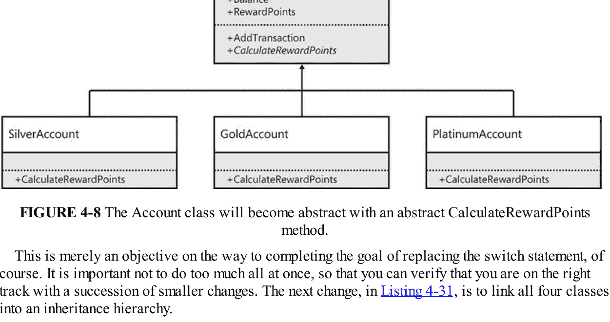

FIGURE 4-8 `Account` 类将变为抽象类，并具有抽象的 `CalculateRewardPoints` 方法。

这只是实现替换 `switch` 语句目标过程中的一个中间目标，当然。重要的是不要一次做太多，以便你可以通过一系列较小的更改验证自己是否走在正确的轨道上。列表 4-31 中的下一个更改是将所有四个类链接到一个继承层次结构中。

#### LISTING 4-31 复杂性已从 `Account` 类中移除。

Click here to view code image

```
public abstract class AccountBase
{
    public decimal Balance
    {
        get;
        private set;
    }
    public int RewardPoints
```

```
{
    get;
    private set;
}
public void AddTransaction(decimal amount)
{
    RewardPoints += CalculateRewardPoints(amount);
    Balance += amount;
}
public abstract int CalculateRewardPoints(decimal amount);
}
```

没有了 `switch` 语句，这个类就没有理由再意识到自己的“类型”了，因此构造函数也被移除了。该类由于抽象的计算方法而变为抽象，这意味着你不能再实例化它，并且因此不能再对其进行测试。

单元测试需要对象实例才能工作，因此下一步是将三个账户类型链接为该基类的子类。一个有用的命名约定——以及接口名以大写 I 为前缀——是为抽象类后缀 Base。这是一个快速提示，表明该类不能被实例化并且有相关的子类。

当创建三个子类时，你可以从 `Gold-Account` 和 `PlatinumAccount` 中移除 `Balance` 属性，因为它们将从该基类继承 `Balance` 和 `AddTransaction` 成员。列表 4-32 显示了此步骤后三个类的全部内容。

#### LISTING 4-32 通过继承基类完成重构。

Click here to view code image

```
public class SilverAccount : AccountBase
{
    public override int CalculateRewardPoints(decimal amount)
    {
        return Math.Max((int)decimal.Floor(amount / SilverTransactionCostPerPoint), 0);
    }
    private const int SilverTransactionCostPerPoint = 10;
}
// ...
public class GoldAccount : AccountBase
{
    public override int CalculateRewardPoints(decimal amount)
    {
        return Math.Max((int)decimal.Floor((Balance / GoldBalanceCostPerPoint) + (amount /
```
GoldTransactionCostPerPoint)), 0);
}
private const int GoldTransactionCostPerPoint = 5;
private const int GoldBalanceCostPerPoint = 2000;
}
// ...
public class PlatinumAccount : AccountBase
{
    public override int CalculateRewardPoints(decimal amount)
    {
        return Math.Max((int)decimal.Ceiling((Balance / PlatinumBalanceCostPerPoint) +
        (amount / PlatinumTransactionCostPerPoint)), 0);
    }

    private const int PlatinumTransactionCostPerPoint = 2;
    private const int PlatinumBalanceCostPerPoint = 1000;
}
```

重构现在完成了。从这一点开始，只需创建 `AccountBase` 的子类并提供所需 `CalculateRewardPoints` 方法的实现，就可以轻松添加新的账户类型。不需要修改任何现有代码；只需编写几个单元测试来验证新的奖励积分计算算法。

### 用工厂方法替换构造函数

在改进 `Account` 类的过程中，代码库的其他地方可能已经受到了不利影响。该类的客户端原本期望使用 `Account` 构造函数来构造账户对象，并传入所需的账户类型。现在，你将如何为他们提供创建适合其情况的账户子类的方式呢？

`AccountType` 枚举可以重用为 `AccountBase` 上新的工厂方法的参数。构造函数与 `new` 运算符结合使用时，返回的是其所在类型的实例；而工厂方法则能够返回许多不同类型的对象，这些对象都属于同一个继承层次结构。清单 4-33 展示了在基类上实现的这样一个工厂方法。

**清单 4-33** switch 语句再次出现，但形式简化了。

[点击此处查看代码图片](#)

```
public abstract class AccountBase
{
    public static AccountBase CreateAccount(AccountType type)
    {
        AccountBase account = null;
        switch(type)
```

用某些更适应性强的东东替换非常僵化的东东。工厂方法开启了许多新的可能性，因为它们可以返回不同对象，与总是返回相同类型的方法相比。

细心的读者会注意到，选择静态工厂方法并非最优——它是一个“天钩”而非“起重机”，因此会影响代码的可测试性和适应性。更好的实现应该将 `CreateAccount` 方法放在合适的接口上，这将在下一节探讨。

### 用工厂类替换构造函数

除了工厂方法，还有另一种选择：工厂类。实际上，你不需要将客户端耦合到独立工厂的实现，只需给他们接口即可，如清单 4-35 所示。

#### 清单 4-35 账户工厂隐藏了创建账户实例的实现细节。

点击此处查看代码图片

```
public interface IAccountFactory
{
    AccountBase CreateAccount(AccountType accountType);
}
```


该方法的接口实际上与工厂方法的接口相同，只不过它是一个实例方法。其实现可以与之前的方法体完全相同，这意味着它完全了解所有不同类型的账户。`AccountService` 以及其他客户端将需要这个接口作为构造函数参数，如清单 4-36 所示。

### 清单 4-36 服务现在接收一个工厂作为构造函数参数，并使用它来创建账户。

点击此处查看代码图片

```
public class AccountService
{
    public AccountService(IAccountFactory accountFactory, IAccountRepository accountRepository)
    {
        this.accountFactory = accountFactory;
        this.accountRepository = accountRepository;
    }

    public void CreateAccount(AccountType accountType)
    {
        var newAccount = accountFactory.CreateAccount(accountType);
        accountRepository.NewAccount(newAccount);
    }
}
```

```
}
private readonly IAccountRepository accountRepository;
private readonly IAccountFactory accountFactory;
}
```

这个服务开始看起来像应有的样子了：协调更细粒度的接口，以实现用户界面层的更大目标。出于简洁和清晰的考虑，它缺少一些构造函数上的保护子句来防止空依赖，也缺少 `CreateAccount` 方法上的 `try/catch` 块来将领域异常转换为服务异常。

### 新的账户类型

此时，你是否足够确信请求新的账户类型只需对现有代码做最小更改？既是也不是。在一种情况下，你可以轻松添加账户；但在另一种情况下，你会发现当前模型做出了一些错误的假设，这些假设构成了技术债务。

#### 新的奖励账户

假设你的客户想要添加另一种账户——青铜账户——其获得的奖励积分是白银账户的一半。在领域层支持这一功能只需要做两个更改。首先，你需要创建一个新的 `AccountBase` 类子类，如清单 4-37 所示。

### 清单 4-37 青铜账户作为新的账户类型被添加。

点击此处查看代码图片

```
internal class BronzeAccount : AccountBase
{
    public override int CalculateRewardPoints(decimal amount)
    {
        return Math.Max((int)decimal.Floor(amount / BronzeTransactionCostPerPoint), 0);
    }

    private const int BronzeTransactionCostPerPoint = 20;
}
```

这是一个简单的更改，涉及新的单元测试以提供预期行为，以及一个提供该类奖励积分计算算法的新类。

无论你拥有工厂类还是工厂方法，你都需要修改它来支持新的账户类型，以及定义可创建账户类型的枚举。清单 4-38 展示了工厂类如何修改以支持新的青铜账户。

### 清单 4-38 switch 语句添加了一个处理创建青铜账户的新 case。

点击此处查看代码图片

```
public AccountBase CreateAccount(AccountType accountType)
{
    AccountBase account = null;
    switch (accountType)
    {
        case AccountType.Bronze:
            account = new BronzeAccount();
            break;
        case AccountType.Silver:
            account = new SilverAccount();
            break;
        case AccountType.Gold:
            account = new GoldAccount();
            break;
        case AccountType.Platinum:
            account = new PlatinumAccount();
            break;
    }
    return account;
}
```

在继续为客户处理下一个新账户之前，有没有办法重构这个方法，这样你就不必为每个账户修改它？你不能再使用前面“用多态替换条件表达式”一节中详述的重构，因为这正是该重构的结果。相反，有没有办法仅通过 `accountType` 名称来构造 `AccountBase`，而无需直接引用每个值和子类？清单 4-39 给出了答案。

### 清单 4-39 如果账户遵循某种命名约定，这个工厂将适用于所有账户子类。

点击此处查看代码图片

```
public AccountBase CreateAccount(string accountType)
{
    var objectHandle = Activator.CreateInstance(null, string.Format("{0}Account", accountType));
    return (AccountBase)objectHandle.Unwrap();
}
```

注意，枚举已被丢弃，换成了更灵活的字符串值。这可能是个问题，因为可以传入任何字符串值，而不仅仅是那些匹配有效账户类型的值。当然，这正是练习的目的。

这种重构有点风险，因为它可能造成工厂的抽象泄漏——这在所有必要场景下可能无法正常工作。在采用这类代码之前，有几个条件必须满足：

- 每个账户类型都必须遵循 `[Type]Account` 的命名约定，其中 `[Type]` 前缀是枚举值。
- 每个账户类型必须与此工厂方法包含在同一个程序集中。
- 每个账户类型必须有一个公共的无参构造函数——类型不能使用任何值进行参数化。

由于这些限制，这通常意味着你重构过度了，当后来需要规避其中一个约束时，就会引发问题。请谨慎行事。

#### 代码异味：拒绝遗赠

在新的奖励卡计划推出后不久，客户的营销部门询问分配给每种账户类型的人数。你的回答让他们得出结论：奖励卡计划的采纳率是 100%：每个顾客都拥有青铜、白银、黄金或白金奖励卡。但事实并非如此。没有为非奖励卡计划的账户创建任何账户类型，因此每个人默认都被分配了一个青铜账户。这次对话的结果是，需要另一种新的账户类型：标准账户。

这种账户的目的不同——它不赚取任何奖励积分。有两种建模方式。第一种，你可以创建一个新的 `AccountBase` 子类，如清单 4-40 所示，其 `CalculateRewardPoints` 重写中不做任何事，只返回 0，从而实际上不累积任何积分。

### 清单 4-40 一个没有任何奖励积分计算的简单账户。

点击此处查看代码图片

```
internal class StandardAccount : AccountBase
{
    public override int CalculateRewardPoints(decimal amount)
    {
        return 0;
    }
}
```

另一种解决方案是承认并非所有账户都有奖励积分，而且领域模型中实际上存在两种不同的类型。在这种情况下，与其为 `CalculateRewardPoints` 方法提供“默认实现”，子类实际上拒绝了超类遗留给它的东西——因此这种代码异味被称为“拒绝遗赠”。在前面的示例中，`StandardAccount` 拒绝实现接口，而不是忽略它，而接下来的重构将完全拒绝接口。

### 用委托替换继承

在实践中，这意味着你需要将 `AccountBase` 类拆分为两部分。接口的一部分将保留在账户上，其余部分将移至新的类层次结构，以表示奖励卡。这样，账户的继承就被替换为对奖励卡的委托。

第一个更改是引入新的 `IRewardCard` 接口来定义每个奖励卡的属性和行为，如清单 4-41 所示。

### LISTING 4-41 奖励点数及其计算已从 Account 类中移出。

Click here to view code image

```
public interface IRewardCard
{
    int RewardPoints
    {
        get;
    }

    void CalculateRewardPoints(decimal transactionAmount, decimal accountBalance);
}
```

之前，这两个成员是 `AccountBase` 类的一部分，但它们已被移出，因为它们完全依赖于奖励卡的存在。请注意，`CalculateRewardPoints` 的接口发生了两种变化。首先，该方法不再有返回值，因为预计它会直接修改 `RewardPoints` 属性。其次，你必须将账户余额作为参数传递给此方法，因为它不再可用。这是以这种方式拆分两个对象的一个重要副作用：任何不直接由奖励卡对象封装的上下文都将需要传递给它。这可能会导致此方法的接口在未来发生变化。

清单 4-42 显示了重构后 Bronze 和 Platinum 卡对该接口的实现。

### LISTING 4-42 奖励卡实现的示例。

Click here to view code image

```
internal class BronzeRewardCard : IRewardCard
{
    public int RewardPoints
    {
        get;
        private set;
    }

    public void CalculateRewardPoints(decimal transactionAmount, decimal accountBalance)
    {
        RewardPoints += Math.Max((int)decimal.Floor(transactionAmount / BronzeTransactionCostPerPoint), 0);
    }
    private const int BronzeTransactionCostPerPoint = 20;
}
//...
internal class PlatinumRewardCard : IRewardCard
{
    public int RewardPoints
    {
        get;
        private set;
    }

    public void CalculateRewardPoints(decimal transactionAmount, decimal accountBalance)
    {
        RewardPoints += Math.Max((int)decimal.Ceiling((accountBalance / PlatinumBalanceCostPerPoint) + (transactionAmount / PlatinumTransactionCostPerPoint)), 0);
    }

    private const int PlatinumTransactionCostPerPoint = 2;
    private const int PlatinumBalanceCostPerPoint = 1000;
}
```

这些类与之前的版本非常相似，只是多了一个本地 `RewardPoints` 属性。

如清单 4-43 所示，`Account` 类不再是抽象类，因此不再需要 Base 后缀。对于构造，它接受一个 `IRewardCard` 实例，并在添加交易时委托给它。总体而言，此账户看起来更像是在最初要求捕获奖励点数之前的状态。

### LISTING 4-43 每个账户都包含一张奖励卡。

Click here to view code image

```
public class Account
{
    public Account(IRewardCard rewardCard)
    {
        this.rewardCard = rewardCard;
    }

    public decimal Balance
    {
        get;
        private set;
    }

    public void AddTransaction(decimal amount)
    {
        rewardCard.CalculateRewardPoints(amount, Balance);
        Balance += amount;
    }

    private readonly IRewardCard rewardCard;
}
```

要模拟 Standard 账户——即没有奖励卡的账户——你可以为奖励卡构造函数依赖项传入 `null`（并通过在委托前测试 `null` 来防止 `NullReferenceException`），或者你可以模拟一个 `NullRewardCard`。后者将是空对象模式的实现，在调用 `CalculateRewardPoints` 时不会累积任何奖励点数。

### Conclusion

本章是单元测试和重构的混合体，因为两者应该配对使用并协同进行。

你编写的每个单元测试都应代表代码的一种期望，理想情况下应能向外行传达。虽然作为代码它们是技术产物，但单元测试强制执行对象中的现实行为，就像这些对象封装现实世界概念一样。

当你勤勉地遵循测试先行的


###### LISTING 4-43 每个账户都包含一张奖励卡。

Click here to view code image

```
public class Account
{
    public Account(IRewardCard rewardCard)
    {
        this.rewardCard = rewardCard;
    }

    public decimal Balance
    {
        get;
        private set;
    }

    public void AddTransaction(decimal amount)
    {
        rewardCard.CalculateRewardPoints(amount, Balance);
        Balance += amount;
    }

    private readonly IRewardCard rewardCard;
}
```

要模拟 `Standard` 账户——即没有奖励卡的账户——你可以为奖励卡构造函数依赖项传入 `null`（并通过在委托前测试 `null` 来防止 `NullReferenceException`），或者你可以模拟一个 `NullRewardCard`。后者将是空对象模式的实现，在调用 `CalculateRewardPoints` 时不会累积任何奖励点数。

##### Conclusion

本章是单元测试和重构的混合体，因为两者应该配对使用并协同进行。

你编写的每个单元测试都应代表代码的一种期望，理想情况下应能向外行传达。虽然作为代码它们是技术产物，但单元测试强制执行对象中的现实行为，就像这些对象封装现实世界概念一样。

当你勤勉地遵循测试先行的方法时，你在没有先构建失败的单元测试的情况下不会编写任何新的生产代码。然后你编写最简单的生产代码，以便将单元测试从红色失败状态转变为绿色成功状态。将其推向逻辑结论，生产代码成为满足其单元测试期望的自然副作用。

当你对代码进行单元测试时，你为随后更改生产代码以使其更清晰地适应未来需求提供了一个坚实的基础。代码的重构是改进代码设计的增量过程。有许多重构选项，其中只有一些在本章中进行了探讨。每个可用的选项可能代表在某一方面的权衡以换取在另一方面的改进——正如编程的许多方面一样，该过程相当主观。

随着本章的完成，本书的敏捷基础部分已结束。接下来你将研究 SOLID 代码以及它将如何进一步提高代码的适应性。

### Part II: Writing SOLID code

- CHAPTER 5 The single responsibility principle
- CHAPTER 6 The open/closed principle
- CHAPTER 7 The Liskov substitution principle
- CHAPTER 8 Interface segregation
- CHAPTER 9 Dependency injection

*SOLID* 是指一组实践，当一起实现时，使代码适应变化。SOLID 实践由 Bob Martin 在大约 15 年前引入。即使如此，这些实践也并不像它们本可以那样广为人知——也许应该如此。

在本部分中，每个 SOLID 原则都有一章专门讨论：

- S The single responsibility principle
- O The open/closed principle
- L The Liskov substitution principle
- I Interface segregation
- D Dependency injection

即使孤立来看，每个原则都是任何软件开发人员都应该学习的有价值的实践。当协同使用时，这些模式赋予代码完全不同的结构——一种有利于变化的结构。

然而，请注意，这些模式和实践，就像所有其他一样，只是你使用的工具。决定何时在何处应用任何模式或实践是软件开发艺术的一部分。过度使用会导致代码适应性强，但粒度过细而无法欣赏或使用。过度使用还会影响代码质量的另一个关键方面：可读性。软件更常见于团队开发而不是个人追求。因此，审慎地选择何时在何处应用每个模式、实践或 SOLID 原则对于确保代码在未来仍然可理解至关重要。

#### Chapter 5. The single responsibility principle

##### After completing this chapter, you will be able to

- Understand the importance of the single responsibility principle.
- Identify classes that have too many responsibilities.
- Write modules, classes, and methods that have a single responsibility.
- Refactor monolithic classes into smaller classes with single responsibilities.
- Use design patterns to separate responsibilities.

单一职责原则 `SRP` 指示开发人员编写只有且仅有一个变更原因的代码。如果一个类有多个变更原因，它就有多个职责。职责超过一个的类应该被分解为更小的类，每个类都只有一个职责和变更原因。

本章解释了该过程，并向你展示如何创建只有单一职责但仍然有用的类。通过委托和抽象的过程，包含太多变更原因的类应该将一个或多个职责委托给其他类。

很难夸大委托给抽象的重要性。它是自适应代码的支柱，没有它，开发人员将难以以 Scrum 和其他敏捷流程所要求的方式适应不断变化的需求。

##### Problem statement

为了更好地解释类承担太多职责的问题，本节探讨一个示例。清单 5-1 显示了一个简单的批处理程序类，它从文件读取记录并更新数据库。尽管其规模很小，你需要不断地向此批处理程序添加功能，以便满足业务需求。

###### LISTING 5-1 An example of a class with too many responsibilities.

Click here to view code image

```
public class TradeProcessor
{
    public void ProcessTrades(System.IO.Stream stream)
    {
        // read rows
        var lines = new List<string>();
        using(var reader = new System.IO.StreamReader(stream))
        {
            string line;
            while((line = reader.ReadLine()) != null)
            {
                lines.Add(line);
            }
        }
    }
}
```

```
var trades = new List<TradeRecord>();

var lineCount = 1;
foreach(var line in lines)
{
    var fields = line.Split(new char[] { ',' });

    if(fields.Length != 3)
    {
        Console.WriteLine("WARN: Line {0} malformed. Only {1} field(s) found.", lineCount, fields.Length);
        continue;
    }

    if(fields[0].Length != 6)
    {
        Console.WriteLine("WARN: Trade currencies on line {0} malformed: '{1}'", lineCount, fields[0]);
        continue;
    }

    int tradeAmount;
    if(!int.TryParse(fields[1], out tradeAmount))
    {
        Console.WriteLine("WARN: Trade amount on line {0} not a valid integer: '{1}'", lineCount, fields[1]);
    }

    decimal tradePrice;
    if(!decimal.TryParse(fields[2], out tradePrice))
    {
        Console.WriteLine("WARN: Trade price on line {0} not a valid decimal: '{1}'", lineCount, fields[2]);
    }

    var sourceCurrencyCode = fields[0].Substring(0, 3);
    var destinationCurrencyCode = fields[0].Substring(3, 3);

    // calculate values
    var trade = new TradeRecord
    {
        SourceCurrency = sourceCurrencyCode,
        DestinationCurrency = destinationCurrencyCode,
```

```
Lots = tradeAmount / LotSize,
    Price = tradePrice
};

    trades.Add(trade);

    lineCount++;
}

    using (var connection = new System.Data.SqlClient.SqlConnection("Data Source=(local);Initial Catalog=TradeDatabase;Integrated Security=True"))
    {
        connection.Open();
        using (var transaction = connection.BeginTransaction())
        {
            foreach(var trade in trades)
            {
                var command = connection.CreateCommand();
                command.Transaction = transaction;
                command.CommandType = System.Data.CommandType.StoredProcedure;
                command.CommandText = "dbo.insert_trade";
                command.Parameters.AddWithValue("@sourceCurrency", trade.SourceCurrency);
                command.Parameters.AddWithValue("@destinationCurrency", trade.DestinationCurrency);
                command.Parameters.AddWithValue("@lots", trade.Lots);
                command.Parameters.AddWithValue("@price", trade.Price);

                command.ExecuteNonQuery();
            }

            transaction.Commit();
        }
        connection.Close();
    }

    Console.WriteLine("INFO: {0} trades processed", trades.Count);
}

    private static float LotSize = 100000f;
}
```

这不仅仅是一个职责过多的类的例子；它也是一个单一方法职责过多的例子。仔细阅读代码，你可以看出这个类试图实现什么：

+ 1. 它从 `Stream` 参数读取每一行，将每一行存储在一个字符串列表中。
+ 2. 它从每一行解析出各个字段，并将它们存储在一个更结构化的 `Trade-Record` 实例列表中。
+ 3. 解析过程包括一些验证和向控制台的日志记录。
+ 4. 每个 `TradeRecord` 都会被枚举，并调用一个存储过程将交易插入数据库。

`TradeProcessor` 的职责包括读取流、解析字符串、验证字段、记录日志以及数据库插入。单一职责原则指出，这个类与其他类一样，应该只有一个变更原因。然而，`TradeProcessor` 的现实情况是，它会在以下情况下发生变化：

+ - 当你决定不再使用 `Stream` 作为输入，而是改为从 Web 服务的远程调用读取交易时。
+ - 当输入数据的格式发生变化时，也许会增加一个表示该笔交易经纪商的额外字段。
+ - 当输入数据的验证规则发生变化时。
+ - 当你记录警告、错误和信息的方式发生变化时。如果使用的是托管 Web 服务，写入控制台就不是一个可行的选项。
+ - 当数据库以某种方式发生变化时——也许 `insert_trade` 存储过程也需要一个经纪商的新参数，或者你决定不再将数据存储在关系数据库中而选择文档存储，或者数据库被移至你必须调用的 Web 服务之后。

对于这些更改中的每一种，这个类都必须被修改。此外，除非你维护多个版本，否则没有可能使 `TradeProcessor` 能够从不同的输入源读取，例如。想象一下，当被要求添加将交易存储在 Web 服务中的能力时，如果仅在提供特定命令行参数时才执行，维护会是多么的头疼。

##### 为了清晰而重构

重构 `TradeProcessor` 使其只有一个变更原因的道路上的第一个任务是将 `ProcessTrades` 方法拆分为更小的部分，使每个部分都专注于单一职责。以下每个列表都展示了重构后的 `TradeProcessor` 类中的一个方法，然后是对更改的解释。

首先，列表 5-2 显示了 `ProcessTrades` 方法，它现在除了委托给其他方法之外什么都不做。

###### LISTING 5-2

`ProcessTrades` 方法非常简洁，因为它将工作委托给其他方法。

[Click here to view code image](#)

```
public void ProcessTrades(System.IO.Stream stream)
{
```

```
var lines = ReadTradeData(stream);
var trades = ParseTrades(lines);
StoreTrades(trades);
}
```

原始代码的特点是该过程有三个不同的部分——从流中读取交易数据、将流中的字符串数据转换为 `TradeRecord` 实例，以及将交易写入持久存储。请注意，一个方法的输出会作为输入传递给下一个方法。你不能在从 `Parse-Trades` 方法返回交易记录之前调用 `StoreTrades`，也不能在从 `ReadTradeData` 方法返回行之前调用 `ParseTrades`。

按顺序来看这些方法，让我们先看 `ReadTradeData`，见列表 5-3。

###### LISTING 5-3 ReadTradeData 封装了原始代码。

Click here to view code image

```
private IEnumerable<string> ReadTradeData(System.IO.Stream stream)
{
    var tradeData = new List<string>();
    using (var reader = new System.IO.StreamReader(stream))
    {
        string line;
        while ((line = reader.ReadLine()) != null)
        {
            tradeData.Add(line);
        }
    }
    return tradeData;
}
```

此代码保留自 `ProcessTrades` 方法的原始实现。它只是被封装在一个返回结果字符串数据作为字符串枚举的方法中。请注意，这使得返回值是只读的，而原始实现不必要地允许流程的后续部分添加更多行。

`ParseTrades` 方法，见列表 5-4，其与原始实现相比有所变化，因为它也将一些任务委托给其他方法。

###### LISTING 5-4 ParseTrades 委托给其他方法以限制其复杂性。

Click here to view code image

```
private IEnumerable<TradeRecord> ParseTrades(IEnumerable<string> tradeData)
{
```

```csharp

var trades = new List<TradeRecord>();

var lineCount = 1;

foreach (var line in tradeData)

{

    var fields = line.Split(new char[] { ',' });

    if(!ValidateTradeData(fields, lineCount))

    {

        continue;

    }


`var trade = MapTradeDataToTradeRecord(fields);`

`trades.Add(trade);`

`lineCount++;`

```
}
return trades;
}
```

此方法将验证和映射职责委托给其他方法。如果没有这种委托，该流程的这一部分仍然过于复杂，并且会保留太多职责。`ValidateTradeData` 方法，见 [Listing 5-5](#)，返回一个布尔值以指示交易行的任何字段是否无效。

### LISTING 5-5 所有验证代码都在一个方法中。

[Click here to view code image](#)

```csharp
private bool ValidateTradeData(string[] fields, int currentLine)
{
    if(fields.Length != 3)
    {
        LogMessage("WARN: Line {0} malformed. Only {1} field(s) found.", currentLine,
            fields.Length);
        return false;
    }
    if(fields[0].Length != 6)
    {
        LogMessage("WARN: Trade currencies on line {0} malformed: '{1}'", currentLine,
            fields[0]);
        return false;
    }
}
```

```
}
int tradeAmount;
if (!int.TryParse(fields[1], out tradeAmount))
{
    LogMessage("WARN: Trade amount on line {0} not a valid integer: '{1}'",
    currentLine, fields[1]);
    return false;
}

decimal tradePrice;
if (!decimal.TryParse(fields[2], out tradePrice))
{
    LogMessage("WARN: Trade price on line {0} not a valid decimal: '{1}'",
    currentLine, fields[2]);
    return false;
}

return true;
}
```

对原始验证代码所做的唯一更改是，现在它委托给另一个方法来记录消息。`LogMessage` 方法取代了在需要的地方直接调用 `Console.WriteLine` 的方式，如清单 5-6 所示。

### 清单 5-6 LogMessage 方法目前只是 Console.WriteLine 的同义词。

单击此处查看代码图像

```
private void LogMessage(string message, params object[] args)
{
    Console.WriteLine(message, args);
}
```

回到调用栈中的 `ParseTrades` 方法，清单 5-7 显示了它委托的另一个方法。此方法将表示流中各个字段的字符串数组映射到 `TradeRecord` 类的实例。

### 清单 5-7 从一种类型到另一种类型的映射是独立的职责。

单击此处查看代码图像

```
private TradeRecord MapTradeDataToTradeRecord(string[] fields)
{
    var sourceCurrencyCode = fields[0].Substring(0, 3);
    var destinationCurrencyCode = fields[0].Substring(3, 3);
    var tradeAmount = int.Parse(fields[1]);
    var tradePrice = decimal.Parse(fields[2]);

    var tradeRecord = new TradeRecord
    {
        SourceCurrency = sourceCurrencyCode,
        DestinationCurrency = destinationCurrencyCode,
        Lots = tradeAmount / LotSize,
        Price = tradePrice
    };

    return tradeRecord;
}
```

这次重构引入的第六个也是最后一个新方法是 `StoreTrades`，如清单 5-8 所示。该方法封装了与数据库交互的代码。它还将信息性日志消息委托给前面提到的 `LogMessage` 方法。

### 清单 5-8 有了 StoreTrades 方法，这个类中的职责就清晰了。

单击此处查看代码图像

```
private void StoreTrades(IEnumerable<TradeRecord> trades)
{
    using (var connection = new System.Data.SqlClient.SqlConnection("Data Source=(local);Initial Catalog=TradeDatabase;Integrated Security=True"))
    {
        connection.Open();
        using (var transaction = connection.BeginTransaction())
        {
            foreach (var trade in trades)
            {
                var command = connection.CreateCommand();
                command.Transaction = transaction;
                command.CommandType = System.Data.CommandType.StoredProcedure;
                command.CommandText = "dbo.insert_trade";
                command.Parameters.AddWithValue("@sourceCurrency", trade.SourceCurrency);
                command.Parameters.AddWithValue("@destinationCurrency", trade.DestinationCurrency);
                command.Parameters.AddWithValue("@lots", trade.Lots);
```

`command.Parameters.AddWithValue("@price", trade.Price);`

`command.ExecuteNonQuery();`

```
}
transaction.Commit();
}
connection.Close();
}
LogMessage("INFO: {0} trades processed", trades.Count());
}
```

回顾这次重构，它显然是对原始实现的改进。然而，你真正得到了什么？尽管新的 `ProcessTrades` 方法毫无疑问比原来单个大方法小，代码也肯定更易读，但你在适应性方面收获甚微。你可以更改 `LogMessage` 方法的实现，例如让它写入文件而不是控制台，但这需要更改 `TradeProcessor` 类，而这正是你想避免的。

这次重构是在真正分离这个类职责的道路上的重要基石。这是一次为了清晰性而非适应性的重构。下一个任务是将每个职责拆分到不同的类中，并把它们放在接口后面。你需要的是真正的抽象来实现有用的适应性。

### 为抽象而重构

在新的 `TradeProcessor` 实现基础上，下一步重构引入了几个抽象，让你能够处理针对这个类的几乎任何变更请求。尽管这个运行示例看起来非常小，甚至可能微不足道，但就本教程而言，它是一个可行的设计。此外，像这样的小应用程序长成庞大系统的情况*非常*普遍。当有几个人开始使用它时，功能请求就会开始增加。

通常，*原型*和*概念验证*这两个术语被用于所谓的小型应用，而从原型到生产应用的转换相对无缝。这就是为什么面向抽象的重构能力如此契合自适应发展的试金石。没有它，无数的请求就会退化成“大泥球”——一个类，或程序集中的一组类，职责划分不清，也没有明显的抽象。结果是应用程序没有单元测试，难以维护和增强，然而它可能还是业务线的关键部分。

为了抽象而重构 `TradeProcessor` 的第一步，是设计它将用于执行读取、处理和存储交易数据这三个高层任务的接口。[图 5-1](#) 显示了第一组抽象。

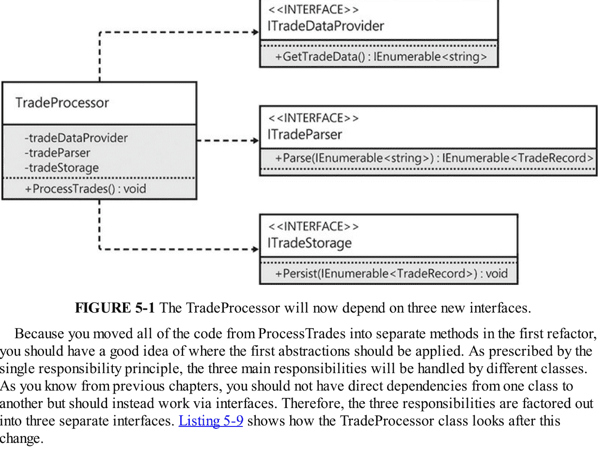

### 图 5-1 TradeProcessor 现在将依赖三个新接口。

因为在第一次重构中你已经将 `ProcessTrades` 中的所有代码移到了独立的方法中，所以你应该清楚第一批抽象应该应用在哪里。根据单一职责原则，这三个主要职责将由不同的类处理。正如你在前几章中了解到的，你不应该让一个类直接依赖另一个类，而应该通过接口工作。因此，这三个职责被提取到三个独立的接口中。清单 5-9 显示了这一更改之后 `TradeProcessor` 类的样子。

### 清单 5-9 TradeProcessor 现在只是一个过程的封装，仅此而已。

单击此处查看代码图像

```
public class TradeProcessor
{
    public TradeProcessor(ITradeDataProvider tradeDataProvider, ITradeParser tradeParser,
    ITradeStorage tradeStorage)
    {
        this.tradeDataProvider = tradeDataProvider;
        this.tradeParser = tradeParser;
        this.tradeStorage = tradeStorage;
    }
    public void ProcessTrades()
    {
        var lines = tradeDataProvider.GetTradeData();
```

```
var trades = tradeParser.Parse(lines);
tradeStorage.Persist(trades);
}
private readonly ITradeDataProvider tradeDataProvider;
private readonly ITradeParser tradeParser;
private readonly ITradeStorage tradeStorage;
}
```

这个类现在与其之前的版本有了显著不同。它不再包含整个过程的实现细节，而是包含过程的*蓝图*。该类模拟了将交易数据从一种格式转移到另一种格式的过程。这是它唯一的职责、唯一的关注点，也是这个类应该改变的唯一原因。如果过程本身发生了变化，这个类将随之改变以反映这种变化。但如果你决定不再从 `Stream` 检索数据、不再记录到控制台，或者不再将交易存储在数据库中，这个类将保持不变。

按照阶梯模式（见[第 2 章“依赖与分层”]）的规定，`TradeProcessor` 现在所依赖的接口都位于一个单独的程序集中。这确保了客户端和实现程序集互不引用。分离到另一个程序集的是实现这些接口的三个类：`StreamTradeDataProvider`、`SimpleTradeParser` 和 `AdoNetTradeStorage` 类。注意这些类使用了命名约定。首先，从接口名称中移除前缀 `I`，并将其替换为类所需的实现特定上下文。因此，`StreamTradeDataProvider` 让你可以推断出它是 `ITradeDataProvider` 接口的一个实现，该实现从 `Stream` 对象检索数据。`AdoNetTradeStorage` 类使用 ADO.NET 来持久化交易数据。我给 `ITradeParser` 实现加上了 `Simple` 前缀，以表示它没有依赖上下文。

这三个实现因为共享依赖项——Microsoft .NET Framework 的核心程序集——而能够放在单个程序集中。如果你要引入一个需要第三方依赖、你自己的第一方依赖或非核心 .NET Framework 类依赖的实现，你应该将这些实现放入它们自己的程序集中。例如，如果你要使用 Dapper 映射库而不是 ADO.NET，你会创建一个名为 `Services.Dapper` 的程序集，其中包含一个名为 `DapperTradeStorage` 的 `ITradeStorage` 实现。

`ITradeDataProvider` 接口不依赖 `Stream` 类。之前版本的检索交易数据方法需要一个 `Stream` 实例作为参数，但这人为地将方法绑定到依赖上。在创建接口和面向抽象重构时，重要的是不要在会影响代码适应性的地方保留依赖。从 `Stream` 之外的其他来源检索交易数据的可能性已经讨论过，因此重构已经确保从接口中移除了这个依赖。相反，`StreamTradeDataProvider` 需要一个 `Stream` 作为构造函数参数，而不是方法参数。通过使用构造函数，你几乎可以依赖任何东西而不会污染接口。[清单 5-10] 显示了 `StreamTradeDataProvider` 的实现。

### LISTING 5-10 上下文可以通过构造函数参数传递给类，保持接口整洁。

[Click here to view code image](#)

```
public class StreamTradeDataProvider : ITradeDataProvider
{
    public StreamTradeDataProvider(Stream stream)
    {
        this.stream = stream;
    }
    public IEnumerable<string> GetTradeData()
    {
        var tradeData = new List<string>();
        using (var reader = new StreamReader(stream))
        {
            string line;
            while ((line = reader.ReadLine()) != null)
            {
                tradeData.Add(line);
            }
        }
        return tradeData;
    }
    private Stream stream;
}
```

请记住，`TradeProcessor` 类，即此代码的客户端，仅通过 `ITradeDataProvider` 了解 `GetTradeData` 方法的签名。它对实际实现如何检索数据一无所知——也不应该知道。

可以从此示例中提取更多抽象。请记住，原来的 `ParseTrades` 方法将验证和映射的责任委托出去了。你可以重复重构过程，以确保 `SimpleTradeParser` 类不承担超过一个责任。 [Figure 5-2](#) 以统一建模语言（UML）展示了如何实现这一点。

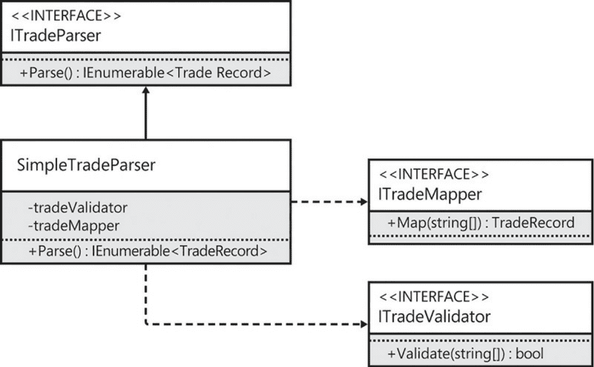

**FIGURE 5-2** SimpleTradeParser 也被重构，以确保每个类都有单一职责。

将职责抽象为接口（及其配套实现）的过程是递归的。在检查每个类时，你必须确定它所承担的职责并将其分离出来，直到该类只剩下一个。 [Listing 5-11](#) 显示了 `SimpleTradeParser` 类，它在适当的地方委托给接口。其唯一的变化原因是如果交易数据的整体结构发生变化——例如，如果数据不再使用逗号分隔值而改为使用制表符，或许是 XML。

**LISTING 5-11** 解析交易数据的算法被封装在 ITradeParser 实现中。

[Click here to view code image](#)

```
public class SimpleTradeParser : ITradeParser
{
    public SimpleTradeParser(ITradeValidator tradeValidator, ITradeMapper tradeMapper)
    {
        this.tradeValidator = tradeValidator;
        this.tradeMapper = tradeMapper;
    }
    public IEnumerable<TradeRecord> Parse(IEnumerable<string> tradeData)
{
    var trades = new List<TradeRecord>();
    var lineCount = 1;
    foreach (var line in tradeData)
    {
        var fields = line.Split(new char[] { ',' });
        if (!tradeValidator.Validate(fields))
        {
            continue;
        }


最终的重构旨在从两个类中抽象出日志记录。`ITradeValidator` 和 `ITradeStorage` 的实现仍在直接向控制台记录日志。这次，与其自己实现日志类，你将为流行的日志库 `Log4Net` 创建一个适配器。图 5-3 中的 UML 类图展示了所有这些如何组合在一起。

**FIGURE 5-3** 通过实现 `Log4Net` 的适配器，你无需在每个程序集中引用它。

创建 `Log4NetLoggerAdapter` 这样的适配器类的净收益在于，你可以将第三方引用转换为第一方引用。请注意，`AdoNetTradeStorage` 和 `SimpleTradeValidator` 都依赖于第一方 `ILogger` 接口。但在运行时，两者实际上都会使用 `Log4Net`。对 `Log4Net` 所需的唯一引用是在应用程序的入口点（有关更多信息，请参阅第 9 章“依赖注入”）和新创建的 `Service.Log4Net` 程序集中。任何依赖于 `Log4Net` 的代码，例如自定义附加器，都应位于 `Service.Log4Net` 程序集中。目前，只有适配器驻留在该新程序集中。

重构后的验证器类显示在列表 5-12 中。它现在完全没有对控制台的引用。由于 `Log4Net` 的灵活性，你现在实际上可以记录到几乎任何地方。就日志记录而言，完全的适应性已经实现。

### LISTING 5-12 重构后的 SimpleTradeValidator 类。

Click here to view code image

```csharp
public class SimpleTradeValidator : ITradeValidator
{
    private readonly ILogger logger;
    public SimpleTradeValidator(ILogger logger)
    {
        this.logger = logger;
    }
    public bool Validate(string[] tradeData)
    {
        if (tradeData.Length != 3)
        {
            logger.LogWarning("Line malformed. Only {1} field(s) found.",
            tradeData.Length);
            return false;
        }
        if (tradeData[0].Length != 6)
        {
            logger.LogWarning("Trade currencies malformed: '{1}'",
            tradeData[0]);
            return false;
        }
        int tradeAmount;
        if (!int.TryParse(tradeData[1], out tradeAmount))
        {
            logger.LogWarning("Trade amount not a valid integer: '{1}'", tradeData[1]);
            return false;
        }
        decimal tradePrice;
        if (!decimal.TryParse(tradeData[2], out tradePrice))
        {
            logger.LogWarning("WARN: Trade price not a valid decimal: '{1}'",
            tradeData[2]);
            return false;
        }
        return true;
    }
}
```

此时，进行快速回顾是合适的。请记住，你在代码的功能方面没有改变任何内容。从功能上讲，这段代码与以前做的事情完全相同。然而，如果你想以任何方式增强它，你可以轻松做到。能够将此代码适应新用途的额外能力完全证明了重构所花费的努力是值得的。

参考回对该代码的潜在增强的原始列表，这个新版本允许你在不触及现有类的情况下实现其中每一个。

- **Request:** 你决定不使用 `Stream` 作为输入，而是从对 Web 服务的远程调用读取交易。
  - Solution: 创建一个新的 `ITradeDataProvider` 实现，从服务提供数据。
- **Request:** 输入数据的格式发生变化，也许增加了指示交易经纪人的额外字段。
  - Solution: 修改 `ITradeDataValidator`、`ITradeDataMapper` 和 `ITradeStorage` 接口的实现，以处理新的经纪人字段。
- **Request:** 输入数据的验证规则发生变化。
  - Solution: 编辑 `ITradeDataValidator` 实现以反映规则更改。
- **Request:** 你记录警告、错误和信息的方式发生变化。如果使用托管 Web 服务，写入控制台将不是可行的选择。
  - Solution: 如前所述，`Log4Net` 通过适配器为你提供了无限的日志记录选项。
- **Request:** 数据库以某种方式发生变化——也许 `insert_trade` 存储过程也需要经纪人的新参数，或者你决定不将数据存储在关系数据库中而选择文档存储，或者数据库被移至你必须调用的 Web 服务之后。
  - Solution: 如果存储过程发生变化，你需要编辑 `AdoNetTradeStorage` 类以包含经纪人字段。对于其他两个选项，你可以创建一个使用 MongoDB 存储交易的 `MongoTradeStorage` 类，并且可以创建一个 `ServiceTradeStorage` 类来隐藏 Web 服务后面的实现。

我希望你现在完全确信，通过接口抽象、解耦程序集以遵循阶梯模式、积极重构以及遵守单一职责原则的组合，是自适应代码的基础。

当你达到代码整洁地委托给抽象的场景时，可能性是无穷的。本章的其余部分集中在其他可以专注于每个类单一职责的方式上。

## SRP 与装饰器模式

装饰器模式非常适合确保每个类只有一个职责。类常常会做太多事情，而没有明显的方式将职责拆分到其他类中。这些职责似乎联系得太紧密了。

装饰器模式的基本前提是，每个装饰器类都履行一个类型的契约，并且还接受一个或多个该类型作为构造函数参数。这是有益的，因为可以向实现特定接口的现有类添加功能，并且装饰器在客户端不知情的情况下也充当所需接口的实现。[Figure 5-4](#figure-5-4) 显示了装饰器设计模式的 UML 图。

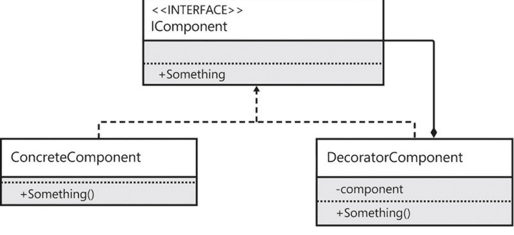

**FIGURE 5-4** A UML diagram showing an implementation of the Decorator pattern.

[Listing 5-13](#listing-5-13) 中展示了该模式的一个简单示例，它与模式的具体用途无关，但提供了一个规范的示例。

**LISTING 5-13** A template example of the decorator pattern.

[Click here to view code image](#code-image)

```csharp
public interface IComponent
{
    void Something();
}

// . . .
public class ConcreteComponent : IComponent
{
    public void Something()
    {
    }
}
// ...
public class DecoratorComponent : IComponent
{
    public DecoratorComponent(IComponent decoratedComponent)
    {
        this.decoratedComponent = decoratedComponent;
    }
    public void Something()
    {
        SomethingElse();
        decoratedComponent.Something();
    }
    private void SomethingElse()
    {
    }
    private readonly IComponent decoratedComponent;
}
// ...
class Program
{
    static IComponent component;
    static void Main(string[] args)
    {
        component = new DecoratorComponent(new ConcreteComponent());
        component.Something();
    }
}
```

由于客户端接受列表中显示的接口作为方法参数，因此你可以向该客户端提供原始的未装饰类型，也可以提供装饰后的版本。请注意，客户端将对此一无所知：它不需要根据提供的是哪个版本而改变。

## 组合模式

组合模式是装饰器模式的一种特化，也是该模式最常见的用途之一。描述组合模式协作者的 UML 图显示在 [Figure 5-5](#figure-5-5) 中。

**FIGURE 5-5** The Composite pattern closely resembles the Decorator pattern.

组合模式的目的是让你可以将多个接口实例当作一个实例来处理。因此，客户端可以只接受一个接口实例，但它们可以隐式地被提供多个实例，而无需客户端更改。Listing 5-14 显示了组合装饰器在实践中的应用。

**LISTING 5-14** The composite implementation of an interface.

Click here to view code image

```csharp
public interface IComponent
{
    void Something();
}
//...
public class Leaf : IComponent
{
    public void Something()
    {
    }
}
//...
public class CompositeComponent : IComponent
{
    public CompositeComponent()
    {
        children = new List<IComponent>();
    }
    public void AddComponent(IComponent component)
    {
        children.Add(component);
    }
    public void RemoveComponent(IComponent component)
    {
        children.Remove(component);
    }
    public void Something()
    {
        foreach(var child in children)
        {
            child.Something();
        }
    }
    private ICollection<IComponent> children;
}
//...
class Program
{
    static void Main(string[] args)
    {
        var composite = new CompositeComponent();
        composite.AddComponent(new Leaf());
        composite.AddComponent(new Leaf());
        composite.AddComponent(new Leaf());
        component = composite;
        component.Something();
    }
    static IComponent component;
}
```

在 `CompositeComponent` 类中，有用于添加和移除其他 `IComponent` 实例的方法。这些方法不属于接口的一部分，而是直接面向 `CompositeComponent` 类的客户端。无论哪个工厂方法或类负责创建 `CompositeComponent` 类的实例，它也必须创建被装饰的实例并将它们传递给 `Add` 方法；否则，`IComponent` 的客户端必须更改以应对组合。

每当 `IComponent` 客户端调用 `Something` 方法时，组合实例的列表将被枚举，并调用它们各自的 `Something`。这就是如何将对单个 `IComponent` 实例——类型为 `CompositeComponent`——的调用重定向到许多其他类型的方法。

提供给 `CompositeComponent` 类的每个实例都必须实现 `IComponent` 接口——并且由于 C# 的强类型，这由编译器强制执行——但这些实例不必全部是相同的具体类型。由于多态的优势，你可以将接口的所有实现视为该接口的实例。在 Listing 5-15 所示的示例中，提供给 `CompositeComponent` 的实例是不同类型的，进一步增强了该模式的实用性。

**LISTING 5-15** Instances provided to the composite can be of different types.

Click here to view code image

```csharp
public class SecondTypeOfLeaf : IComponent
{
    public void Something()
    {
    }
}
//...
public class AThirdLeafType : IComponent
{
    public void Something()
    {
    }
}
//...
public void AlternativeComposite()
{
    var composite = new CompositeComponent();
    composite.AddComponent(new Leaf());
    composite.AddComponent(new SecondTypeOfLeaf());
    composite.AddComponent(new AThirdLeafType());
    component = composite;
    composite.Something();
}
```

将此模式推向逻辑的结论，你甚至可以将一个或多个 `CompositeComponent` 接口的实例传递给 `Add` 方法，形成一个层次树结构中的组合实例链。

## 组合应该放在哪里？

第 2 章介绍了 Entourage 反模式，该模式指出实现不应与它们的接口位于同一程序集中。然而，有一个例外：其依赖项是其接口依赖项子集的实现。

根据组合的实现方式，很可能不会引入进一步的依赖项。如果这是真的，接口所在的程序集也可以包含组合实现。

在第 2 章中，类被展示为建模为对象图。这里继续这一主题，以进一步演示组合模式的工作方式。在 Figure 5-6 中，图的节点表示对象实例，边表示方法调用。

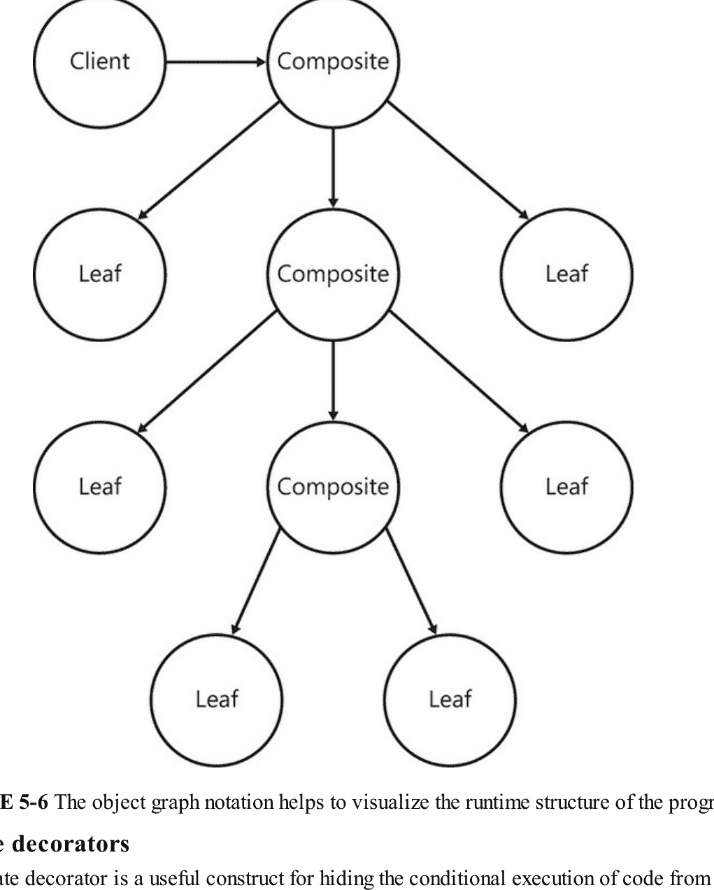

**FIGURE 5-6** The object graph notation helps to visualize the runtime structure of the program.

## 谓词装饰器

谓词装饰器是隐藏代码条件执行以免客户端知晓的有用构造。Listing 5-16 显示了一个示例。

**LISTING 5-16** This client will only execute the Something method on even days of the month.

Click here to view code image

```csharp
public class DateTester
{
    public bool TodayIsAnEvenDayOfTheMonth
{
    get
    {
        return DateTime.Now.Day % 2 == 0;
    }
}
}
//...
class PredicatedDecoratorExample
{
    public PredicatedDecoratorExample(IComponent component)
    {
        this.component = component;
    }
    public void Run()
    {
```


```text
DateTester dateTester = new DateTester();

if (dateTester.TodayIsAnEvenDayOfTheMonth)
{
    component.Something();
}

}

private readonly IComponent component;

}
```

在此示例中，`DateTester` 类的存在是一个不属于此类中的依赖项。最初的诱惑是修改代码使其接近 Listing 5-17 的形式。然而，这只是部分解决方案。

**LISTING 5-17** An improvement is to require the dependency to be passed into the class.

```text
class PredicatedDecoratorExample
{
    public PredicatedDecoratorExample(IComponent component)
    {
        this.component = component;
    }

    public void Run(DateTester dateTester)
    {
        if (dateTester.TodayIsAnEvenDayOfTheMonth)
        {
            component.Something();
        }
    }

    private readonly IComponent component;
}
```

你现在需要在 `Run()` 方法中要求一个参数，从而破坏客户端的公共接口，并让其客户端承担提供 `DateTester` 类实现的负担。通过使用装饰器模式，你能够保持客户端的接口不变，同时保留条件执行功能。清单 5-18 证明这并非好得不真实。

**LISTING 5-18** 断言装饰包含依赖项，客户端变得更简洁。

```text
public class PredicatedComponent : IComponent
{
    public PredicatedComponent(IComponent decoratedComponent, DateTester dateTester)
    {
        this.decoratedComponent = decoratedComponent;
        this.dateTester = dateTester;
    }

    public void Something()
    {
        if(dateTester.TodayIsAnEvenDayOfTheMonth)
        {
            decoratedComponent.Something();
        }
    }

    private readonly IComponent decoratedComponent;
    private readonly DateTester dateTester;
}

// ...

class PredicatedDecoratorExample
{
    public PredicatedDecoratorExample(IComponent component)
    {
        this.component = component;
    }

    public void Run()
    {
        component.Something();
    }

    private readonly IComponent component;
}
```

请注意，此清单在未修改客户端代码或原始实现类的情况下向代码添加了条件分支。此外，此示例已将 `DateTester` 类作为依赖项接受，但你可以更进一步，通过为此场景通用处理定义自己的谓词接口。在进行几次修改后，代码看起来像清单 5-19。

**LISTING 5-19** 定义专用的 `IPredicate` 接口使解决方案更通用。

```text
public interface IPredicate
{
    bool Test();
}

// ...

public class PredicatedComponent : IComponent
{
    public PredicatedComponent(IComponent decoratedComponent, IPredicate predicate)
    {
        this.decoratedComponent = decoratedComponent;
        this.predicate = predicate;
    }

    public void Something()
    {
        if (predicate.Test())
        {
            decoratedComponent.Something();
        }
    }

    private readonly IComponent decoratedComponent;
    private readonly IPredicate predicate;
}

// ...

public class TodayIsAnEvenDayOfTheMonthPredicate : IPredicate
{
    public TodayIsAnEvenDayOfTheMonthPredicate(DateTester dateTester)
    {
        this.dateTester = dateTester;
    }

    public bool Test()
    {
        return dateTester.TodayIsAnEvenDayOfTheMonth;
    }

    private readonly DateTester dateTester;
}
```

`TodayIsAnEvenDayOfTheMonthPredicate` 类将原始依赖类 `DateTester` 转换为 `IPredicate`。这是在“重构以实现抽象”部分中讨论过的适配器模式的一个示例。

> **Note**
>
> 从 2.0 版本开始，.NET Framework 包含一个 `Predicate<T>` 委托，它模拟了一个接受单个通用参数作为上下文的谓词。我没有为此示例选择 `Predicate<T>` 委托，原因有两个：首先，无需提供上下文，因为原始条件测试不接受任何参数。然而，我本可以使用 `Func<bool>` 委托来模拟无上下文的谓词，这就引出了第二个原因：*委托不如接口通用*。通过对 `IPredicate` 建模，我将能够像对任何其他接口一样在未来装饰该接口。换句话说，我定义了另一个可以无限装饰的扩展点。

## Branching decorators

你可以通过接受接口的装饰实例来进一步扩展谓词装饰器，以便在条件测试的 `false` 分支上执行某些操作，如清单 5-20 所示。

**LISTING 5-20** 分支装饰器接受两个组件和一个谓词。

```text
public class BranchedComponent : IComponent
{
    public BranchedComponent(IComponent trueComponent, IComponent falseComponent,
        IPredicate predicate)
    {
        this.trueComponent = trueComponent;
        this.falseComponent = falseComponent;
        this.predicate = predicate;
    }
```

此客户端别无选择，只能接受其提供的所有 `IComponent` 实例都是惰性的。然而，如果你回到对接口的更标准使用，你可以创建一个惰性装饰器，防止客户端知道它正在处理一个 `Lazy<T>`，并允许某些 `ComponentClient` 对象接受非惰性的 `IComponent` 实例。清单 5-22 显示了此装饰器。

**LISTING 5-22** `LazyComponent` 实现了一个惰性实例化的 `IComponent`，但 `ComponentClient` 不知情。

```text
public class LazyComponent : IComponent
{
    public LazyComponent(Lazy<IComponent> lazyComponent)
    {
        this.lazyComponent = lazyComponent;
    }

    public void Something()
    {
        lazyComponent.Value.Something();
    }

    private readonly Lazy<IComponent> lazyComponent;
}

// ...

public class ComponentClient
{
    public ComponentClient(IComponent component)
    {
        this.component = component;
    }

    public void Run()
    {
        component.Something();
    }

    private readonly IComponent component;
}
```

## Logging decorators

清单 5-23 显示了每当代码包含大量日志记录时出现的常见模式。日志代码在整个应用程序中变得无处不在，信号与噪声比受损。

**LISTING 5-23** 日志代码模糊了方法意图。

```text
public class ConcreteCalculator : ICalculator
{
    public int Add(int x, int y)
    {
        Console.WriteLine("Add(x={0}, y={1})", x, y);
        var addition = x + y;
        Console.WriteLine("result={0}", addition);
        return addition;
    }
}
```

与其在整个应用程序中 proliferate 日志代码，你可以将它限制在一个实现日志装饰器的程序集中，如清单 5-24 所示。

**LISTING 5-24** 日志装饰器将日志代码提取出来，简化了主要实现。

```text
public class LoggingCalculator : ICalculator
{
    public LoggingCalculator(ICalculator calculator)
    {
        this.calculator = calculator;
    }

    public int Add(int x, int y)
    {
        Console.WriteLine("Add(x={0}, y={1})", x, y);
        var result = calculator.Add(x, y);
        Console.WriteLine("result={0}", result);
        return result;
    }

    private readonly ICalculator calculator;
}

//...

public class ConcreteCalculator : ICalculator
{
    public int Add(int x, int y)
    {
        return x + y;
    }
}
```

`ICalculator` 接口的客户端将传入各种参数，并且方法本身也会返回一些值。因为 `LoggingCalculator` 处于可以拦截这两个制品的位置，所以它可以直接对其进行检查。使用日志装饰器存在一些限制，应该予以考虑。首先，被装饰类中包含的任何私有状态对日志装饰器仍然不可用，日志装饰器无法访问此状态并将其写入日志。其次，需要为应用程序中的每个接口创建日志装饰器——这是一项重要的工作。对于如此常见的事情，日志记录最好作为日志方面来实现。面向方面的编程（AOP）在第 2 章中有所介绍。

## Profiling decorators

选择 .NET Framework 作为开发应用程序的目标平台的主要原因之一是它非常适合快速应用程序开发（RAD）。与在 C++ 等低级语言中相比，可以在更短的时间内开发出可工作的应用程序。这有几个原因，包括 .NET Framework 的自动内存管理、可以使用的大量丰富的库，以及 .NET Framework 本身。C# 通常被认为开发速度快但运行速度慢。另一方面，C++ 被认为开发速度慢但运行速度快。

尽管 .NET Framework 也可能很快，但也会出现瓶颈。如何判断代码的哪一部分很慢？通过分析应用程序的方法，你可以收集有关代码哪些部分比其他部分更慢的统计数据。参见清单 5-25 中的代码。

**LISTING 5-25** 此代码是有意且人为地缓慢的。

```text
public class SlowComponent : IComponent
{
    public SlowComponent()
    {
        random = new Random((int)DateTime.Now.Ticks);
    }

    public void Something()
    {
        for(var i = 0; i<100; ++i)
        {
            Thread.Sleep(random.Next(i) * 10);
        }
    };

    private readonly Random random
}
```

本示例中组件的 `Something()` 方法运行缓慢。缓慢和快速当然因人而异、因时而异。在本例中，缓慢的方法被定义为执行时间需要一秒或更长的方法。如何判断一个方法是否缓慢？你可以计时该方法，以了解其从开始到结束的执行时长，就像在清单 5-26 中那样。

**LISTING 5-26** `System.Diagnostics.Stopwatch` 类可以计时方法执行所需的时间。

```text
public class SlowComponent : IComponent
{
    public SlowComponent()
    {
        random = new Random((int)DateTime.Now.Ticks);
        stopwatch = new Stopwatch();
    }

    public void Something()
    {
        stopwatch.Start();
        for(var i = 0; i<100; ++i)
        {
            System.Threading.Thread.Sleep(random.Next(i) * 10);
        }
        stopwatch.Stop();
        Console.WriteLine("The method took {0} seconds to complete", stopwatch.ElapsedMilliseconds / 1000);
    }

    private readonly Random random;
    private readonly Stopwatch;
```

这里使用 `System.Diagnostics` 程序集中的 `Stopwatch` 类来计时每次方法从开始到结束的执行时间。请注意，该类中的 `Something()` 方法在进入时启动秒表，然后在退出时停止它。

当然，这可以被提取为一个分析装饰器。整个接口都被装饰，在委托给被装饰实例之前，你启动秒表。当被委托的方法返回时，在返回给调用客户端之前停止秒表。秒表装饰器代码如清单 5-27 所示。

**LISTING 5-27** 分析装饰器代码。

```text
public class ProfilingComponent : IComponent
{
    public ProfilingComponent(IComponent decoratedComponent)
    {
        this.decoratedComponent = decoratedComponent;
        stopwatch = new Stopwatch();
    }

    public void Something()
    {
        stopwatch.Start();
```


你还可以对 `ProfilingComponent` 类做一个进一步的修改：使其透明地记录分析结果。首先，你需要将秒表代码抽象到一个接口之后，以便可以提供多个实现，包括装饰器。这是朝着更好的职责分离重构时常见的第一步。清单 5-28 显示了这一中间步骤。

### LISTING 5-28 在实现装饰器之前，必须用接口替换具体实现。

Click here to view code image

``` 
public class ProfilingComponent : IComponent
{
    public ProfilingComponent(IComponent decoratedComponent, IStopwatch stopwatch)
    {
        this.decoratedComponent = decoratedComponent;
        this.stopwatch = stopwatch;
    }
    public void Something()
    {
        stopwatch.Start();
        decoratedComponent.Something();
        var elapsedMilliseconds = stopwatch.Stop();
        Console.WriteLine("The method took {0} seconds to complete", elapsedMilliseconds
/
1000);
    }
    private readonly IComponent decoratedComponent;
    private readonly IStopwatch stopwatch;
}
```

现在 `ProfilingComponent` 类不再直接依赖 `System.Diagnostics.Stopwatch` 类，你可以改变 `IStopwatch` 类的实现方式。创建了一个 `LoggingStopwatch` 装饰器，如清单 5-29 所示，以为任何进一步的 `IStopwatch` 实现增强日志功能。

### LISTING 5-29 LoggingStopwatch 装饰器是一个实现 IStopwatch 并进行日志记录和委托的实现。

Click here to view code image

``` 
public class LoggingStopwatch : IStopwatch
{
    public LoggingStopwatch(IStopwatch decoratedStopwatch)
    {
        this.decoratedStopwatch = decoratedStopwatch;
    }
    public void Start()
    {
        decoratedStopwatch.Start();
        Console.WriteLine("Stopwatch started...");
    }
    public long Stop()
    {
        var elapsedMilliseconds = decoratedStopwatch.Stop();
        Console.WriteLine("Stopwatch stopped after {0} seconds", TimeSpan.FromMilliseconds(elapsedMilliseconds).TotalSeconds);
        return elapsedMilliseconds;
    }
    private readonly IStopwatch decoratedStopwatch;
}
```

当然，你需要一个非装饰器的 `IStopwatch` 接口实现——一个充当真实秒表的作用。这只是委托给 `.NET Framework` 的 `System.Diagnostics.Stopwatch` 类的情况，如清单 5-30 所示。

### LISTING 5-30 主要的 IStopwatch 实现使用 Stopwatch 类。

Click here to view code image

``` 
public class StopwatchAdapter : IStopwatch
{
    public StopwatchAdapter(Stopwatch stopwatch)
    {
        this.stopwatch = stopwatch;
    }
    public void Start()
    {
        stopwatch.Start();
    }
    public long Stop()
    {
        stopwatch.Stop();
        var elapsedMilliseconds = stopwatch.ElapsedMilliseconds;
        stopwatch.Reset();
        return elapsedMilliseconds;
    }
    private readonly Stopwatch stopwatch;
}
```

请注意，你本可以选择将 `IStopwatch` 实现为 `System.Diagnostics.Stopwatch` 类的子类并使用现有的 `Start` 和 `Stop` 方法。然而，`Start` 方法的作用是在秒表停止时恢复其功能，但你需要做的是在调用 `Stop` 之后调用 `Reset`，并在两者之间获取 `ElapsedMilliseconds` 属性值。这又是适配器模式的另一个例子。

#### 异步装饰器

异步方法是指在与客户端不同的线程上运行的方法。当方法执行时间较长时，这很有用，因为在同步执行期间，客户端在等待被调用方法返回时会阻塞。例如，在使用 `Windows Presentation Foundation (WPF)` 和 `Model-View-ViewModel (MVVM)` 模式的桌面应用程序中，`ViewModels` 绑定到 `View`，并且执行的任何命令都由那些 `ViewModels` 在用户界面线程上同步处理。实际上，这意味着长时间运行的命令会阻塞用户界面，直到命令完成其工作。清单 5-31 显示了这种行为的一个片段。

### LISTING 5-31 在 UI 线程上处理的命令会阻塞它，使 UI 无响应。

[Click here to view code image](#)

``` 
public class MainWindowViewModel : INotifyPropertyChanged
{
    public MainWindowViewModel(IComponent component)
    {
        this.component = component;
        calculateCommand = new RelayCommand(Calculate);
    }
    public string Result
    {
        get
        {
            return result;
        }
        private set
        {
            if (result != value)
            {
                result = value;
                PropertyChanged(this, new PropertyChangedEventArgs("Result"));
            }
        }
    }
    public ICommand CalculateCommand
{
    get
    {
        return calculateCommand;
    }
}
public event PropertyChangedEventHandler PropertyChanged = delegate {};
private void Calculate(object parameter)
{
    Result = "Processing...";
    component.Process();
    Result = "Finished!";
}
private string result;
private IComponent component;
private RelayCommand calculateCommand;
}
```

通过创建异步装饰器，你可以指示被调用方法在单独的线程上执行。这可以通过将工作委托给 `Task` 类来实现，该类成为你的装饰器的依赖项，如清单 5-32 所示。

### LISTING 5-32 用于 WPF 的异步装饰器，使用 Dispatcher 类。

Click here to view code image

``` 
public class AsyncComponent : IComponent
{
    public AsyncComponent(IComponent decoratedComponent)
    {
        this.decoratedComponent = decoratedComponent;
    }
    public void Process()
    {
        Task.Run((Action)decoratedComponent.Process);
    }
    private readonly IComponent decoratedComponent;
}
```

`AsyncComponent` 类存在一个问题：它对 `Task` 类的依赖是隐式的，这意味着很难测试这个类。使用静态依赖进行单元测试代码很困难，因此最好用起重机替换这个 skyhook。

#### 异步装饰器的局限性

并非所有可想象的方法都可以使用装饰器模式来创建客户端不知道的异步版本。事实上，这种方法适用的唯一异步方法就是 fire-and-forget 方法。

fire-and-forget 方法没有返回值，并且客户端不需要知道此类方法何时返回。当它被实现为异步装饰器时，客户端无法知道方法调用何时真正完成，因为调用会立即返回——而实际执行的工作可能仍在进行中。

请求-响应方法是常见的数据检索方法，通常非常适合异步实现，因为它们往往耗时较长并阻塞 UI 线程。客户端需要知道该方法是异步的，以便它们可以显式编码以在异步方法完成后接受回调。因此，请求-响应方法不能通过使用异步装饰器来实现。

#### 装饰属性和事件

到目前为止，你已经了解了如何装饰接口的方法，但属性和事件呢？只要你不使用自动属性或自动事件，这两种语法元素也可以被装饰：你需要显式定义它们才能正确装饰它们。

清单 5-33 显示了属性的手动创建，但对于 getter 和 setter 而言，它没有使用 backing field，而是将调用委托给接口的被装饰实例。

### LISTING 5-33 属性也可以使用装饰器模式，就像方法一样。

Click here to view code image

``` 
public class ComponentDecorator : IComponent
{
    public ComponentDecorator(IComponent decoratedComponent)
    {
        this.decoratedComponent = decoratedComponent;
    }
    public string Property
    {
        get
        {
            // We can do some mutation here after retrieving the value
            return decoratedComponent.Property;
        }
    }
    set
    {
        // And/or here, before we set the value
        decoratedComponent.Property = value;
    }
}
private readonly IComponent decoratedComponent;
}
```

清单 5-34 显示了事件的手动创建，但对于 adder 和 remover 而言，它没有使用 backing field，而是将调用委托给接口的被装饰实例。

### LISTING 5-34 事件也可以使用装饰器模式，就像方法一样。

Click here to view code image

``` 
public class ComponentDecorator : IComponent
{
    public ComponentDecorator(IComponent decoratedComponent)
    {
        this.decoratedComponent = decoratedComponent;
    }
    public event EventHandler Event
    {
        add
        {
            // We can do something here, when the event handler is registered
            decoratedComponent.Event += value;
        }
        remove
        {
            // And/or here, when the event handler is deregistered
            decoratedComponent.Event -= value;
        }
    }
    private readonly IComponent decoratedComponent;
}
```

#### 使用策略模式代替 switch

要了解策略模式最适合应用的时机，可以查看条件分支的实例。每当你使用 `switch` 语句时，都可以使用策略模式来简化客户端，使其将复杂性委托给依赖接口。清单 5-35 显示了一个可以使用策略模式替换的 `switch` 语句示例。

### LISTING 5-35 此方法使用 switch 语句，但策略模式会更具适应性。

Click here to view code image

``` 
public class OnlineCart
{
    public void CheckOut(PaymentType paymentType)
    {
        switch(paymentType)
        {
            case PaymentType.CreditCard:
                ProcessCreditCardPayment();
                break;
            case PaymentType.Paypal:
                ProcessPaypalPayment();
                break;
            case PaymentType.GoogleCheckout:
                ProcessGooglePayment();
                break;
            case PaymentType.AmazonPayments:
                ProcessAmazonPayment();
                break;
        }
    }
    private void ProcessCreditCardPayment()
    {
        Console.WriteLine("Credit card payment chosen");
    }
    private void ProcessPaypalPayment()
    {
        Console.WriteLine("Paypal payment chosen");
    }
    private void ProcessGooglePayment()
    {
        Console.WriteLine("Google payment chosen");
    }
    private void ProcessAmazonPayment()
    {
        Console.WriteLine("Amazon payment chosen");
    }
}
```


对于`switch`语句的每一种情况，类的行为都会发生变化。这带来了代码维护问题，因为添加新的`case`选项需要更改此类。如果相反，你用接口的新实现替换每个`case`语句，则可以创建进一步的实现来封装新功能——而客户端无需更改。这在清单 5-36 中显示。

#### LISTING 5-36 在 `switch` 语句被替换后，客户端看起来对变化更具适应性。

Click here to view code image

```
public class OnlineCart
{
    public OnlineCart()
    {
        paymentStrategies = new Dictionary<PaymentType, IPaymentStrategy>();
        paymentStrategies.Add(PaymentType.CreditCard, new PaypalPaymentStrategy());
        paymentStrategies.Add(PaymentType.GoogleCheckout, new GoogleCheckoutPaymentStrategy());
        paymentStrategies.Add(PaymentType.AmazonPayments, new AmazonPaymentsPaymentStrategy());
        paymentStrategies.Add(PaymentType.Paypal, new PaypalPaymentStrategy());
    }

    public void CheckOut(PaymentType paymentType)
    {
        paymentStrategies[paymentType].ProcessPayment();
    }

    private IDictionary<PaymentType, IPaymentStrategy> paymentStrategies;
}
```


按照面向对象编程的传统，这段代码将不同的支付类型对象化为各个类，每个类都实现了 `IPaymentStrategy` 接口。在此示例中，`OnlineCart` 类有一个私有字典，将 `PaymentType` 枚举的每个值映射到策略接口的一个实例。这大大简化了 `CheckOut` 方法。`switch` 语句已被移除，连同它一起被移除的是如何处理每种不同支付类型的知识。`OnlineCart` 类不需要知道如何处理支付，而支付处理方式可能差异很大，并在此类上引入许多不必要的依赖。现在它的工作是选择正确的支付策略并将处理委托给它。

这里仍然存在添加新支付策略实现时的维护负担。如果你想添加对 `WePay` 的支持，例如，构造函数将需要更新以将新的 `WePayPaymentStrategy` 类映射到关联的 `WePay` 枚举值。

## 结论

单一职责原则对代码的适应性有极其积极的影响。与不遵循该原则的等效代码相比，符合 SRP 的代码会导致数量更多、范围更小且更具针对性的类。在本应存在一个类或一组具有相互依赖关系和职责混淆的类的地方，SRP 引入了秩序和清晰。

SRP 主要通过在接口后面抽象代码并将不相关功能的责任委托给运行时接口后面的实现来实现。一些设计模式非常擅长支持严格规范 SRP 的努力——特别是适配器模式和装饰器模式。前者使你的大部分代码能够维护对你直接控制的接口的第一方引用，尽管实际上使用的是第三方库。后者可应用于任何需要移除类的一部分功能但又与类的意图紧密耦合而无法独立存在的情况。

本章未涵盖的是所有这些类在运行时如何编排。在本章中，将接口传递给构造函数被视为理所当然，但第 9 章描述了实现此操作的多种方法。

# 第 6 章 开闭原则

## 完成本章后，你将能够

- 理解开闭原则的不同解释。
- 将 SOLID 代码视为仅可追加。
- 比较和对比不同的类扩展点机制。
- 使用受保护的变体作为扩展点的指导原则。

开闭原则的自相矛盾性质导致了一些困惑。其简洁的名称暗示代码既宽容又受限。定义的几种变体只会进一步混淆问题。

选择其中一个定义并单独使用是不合适的。相反，本章比较每个定义及其后果，以试图提炼出该原则的本质。目标是一个非常有用的指导原则，它将使你能够创建更适应未来变化的代码。

## 开闭原则简介

必须考察开闭原则的两个定义，即 1980 年代的原始表述和更当代的定义。后者试图通过赋予其更多上下文并澄清原则的范围来阐述前者。

### Meyer 定义

Bertrand Mayer 在其 1988 年的书籍 *Object-Oriented Software Construction*（Prentice Hall）中将开闭原则（OCP）定义如下：

> *软件实体应对扩展开放，但对修改封闭。*
>
> —Bertrand Meyer

Meyer 定义是该原则最常引用的定义，但还有第二个：Martin 定义。

### Martin 定义

Robert C. Martin 多年来在不同的著作中以多种方式定义了 OCP。这里选择了一个更冗长的版本以与简短的原始定义形成对比：

> “对扩展开放。” 这意味着模块的行为可以被扩展。随着应用程序需求的变化，我们能够通过新的行为扩展模块以满足这些变化。换句话说，我们能够改变模块所做的事情。
>
> “对修改封闭。” 扩展模块的行为不会导致模块的源代码或二进制代码发生变化。模块的二进制可执行版本，无论是在可链接库、DLL 还是 Java `.jar` 中，都保持不变。
>
> —Robert C. Martin, *Agile Software Development: Principles, Patterns, and Practices*

对于开闭原则的两个方面，Martin 进一步解释了 Meyer 定义中的关键术语的含义。为了对扩展开放，Martin 解释说，开发人员必须能够响应不断变化的需求并支持新功能。这必须在模块对修改封闭的情况下实现。开发人员必须在不编辑现有模块的源代码或编译程序集的情况下支持新功能。

在开始描述如何实现这一点之前，有一些对 OCP 限制性“对修改封闭”条款的例外有时会被引用：修复错误或缺陷的更改以及可以在没有任何客户端感知的情况下进行的更改。

### 错误修复

错误是软件中的常见问题，而且完全无法预防。当它们确实发生时，你需要通过修复有问题的代码来做出响应。当然，这涉及对现有类的修改——也就是说，除非你愿意复制该类并在新版本上实现错误修复。这听起来不必要地复杂，并且违背了在纯粹性而非实用主义方面犯错误的指导原则。

修复错误的两个步骤过程概述如下：

1. 编写一个专门针对该错误的失败单元测试和/或集成测试。这需要可靠且可重复的重现步骤来创建代码失败的条件。回到单元测试的 AAA 语法，你需要能够 *Arrange* 系统下测试使其处于可能表现出缺陷的状态，执行缺陷所在的特定 *Act*，最后 *Assert* *预期* 的行为。当你编写这样的测试时，测试最初会失败。这证明了所有错误都是由于缺少测试造成的。如果存在捕获缺陷的测试，测试就会失败，并且通过扩展，使用持续集成时，构建服务器上的构建也会失败。
2. 源代码被 *修改* 以使单元测试通过。在此阶段，OCP 的错误修复例外变得必要，因为如果没有它，你将无法修改任何现有代码。编辑系统下测试使你能够将失败的测试从红色转变为绿色——从失败到成功。当你确保没有其他测试作为副作用而失败时，错误就修复了。

### 客户端感知

对“对修改封闭”规则的更宽松的例外是，只要它不要求对该代码的任何客户端进行更改，对现有代码的任何更改都是允许的。这强调了软件模块在所有粒度级别上的耦合程度：类与类之间、程序集与程序集之间以及子系统与子系统之间。

如果一个类的更改迫使另一个类更改，则称它们是 *紧密* 耦合的。相反，如果一个类可以在不迫使其他类更改的情况下独立更改，则参与的类是 *松散* 耦合的。在所有时间和所有级别上，松散耦合都是可取的。保持松散耦合限制了 OCP 的影响，如果你允许对现有代码进行修改而不会迫使客户端进一步更改。

## 扩展点

现在“对修改封闭”规则已经明确，可以考虑“对扩展开放”规则。遵守 OCP 的类应通过包含定义的扩展点对扩展开放，未来功能可以在其中挂钩到现有代码并提供新行为。

本节详细介绍了不同类型的扩展点的一些选项，并探讨了它们的优缺点。这些示例继续上一章的 `TradeProcessor` 示例，这次重点关注客户端与该类的交互。

### 没有扩展点的代码

首先，当代码没有扩展点时会是什么样子？图 6-1 显示了当没有扩展点的类需要新功能时会发生什么。

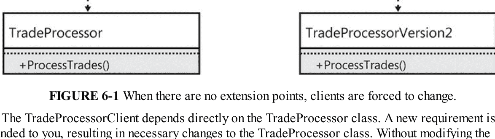

**图 6-1** 当没有扩展点时，客户端被迫更改。

`TradeProcessorClient` 直接依赖于 `TradeProcessor` 类。你收到一个新需求，导致 `TradeProcessor` 类必须更改。在不修改原始类的情况下，你创建了一个新版本（`TradeProcessorVersion2`），其中包含新需求中指定的新功能。由于客户端直接依赖于 `TradeProcessor` 类，并且 `TradeProcessor` 类缺乏扩展点，你需要在新类中放置新功能。此更改的副作用是 `TradeProcessorClient` 必须被编辑，以便它依赖于该类的新版本。

如果你允许对现有代码进行更改，只要它们没有客户端影响，你可能就不必创建 `TradeProcessor` 的全新版本。如果 `ProcessTrades` 方法要更改，这不仅仅是该类的实现更改，也是接口更改。所有接口更改都会迫使客户端更改，因为客户端始终与服务的接口紧密耦合。

### 虚方法

`TradeProcessor` 类的替代实现包含一个扩展点：`ProcessTrades` 方法是虚的。图 6-2 显示了这三个类现在是如何排列的。

### 抽象方法

使用实现继承的更灵活的扩展点是 *抽象* 方法。在这种情况下，`TradeProcessor` 是一个抽象类，它定义了一个公共的 `ProcessTrades` 方法，该方法将处理算法的工作委托给三个受保护的抽象方法。客户端不知道这些受保护方法，并且由于它们是抽象的，因此没有提供实现。图 6-3 显示了所涉及的类之间的关系。

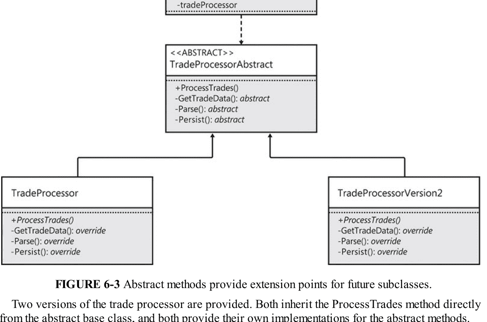

**图 6-3** 抽象方法为未来的子类提供扩展点。

提供了两个版本的交易处理器。两者都直接从抽象基类继承 `ProcessTrades` 方法，并且两者都为抽象方法提供了自己的实现。客户端依赖于抽象基类，因此可以提供任何具体子类——或为新需求而提供的新子类——并且 OCP 将得到保留。

这是一个 *模板方法模式* 的示例，其中算法被建模，但其一般步骤是可定制的，因为它委托给抽象方法。实际上，基类将流程的各个步骤委托给子类。

### 接口继承

本章讨论的最后一种扩展点是实现继承的替代方案：接口继承。在这里，客户端对 *类* 的依赖被替换为现在熟悉的对 *接口* 的委托。图 6-4 显示了客户端对接口的依赖以及接口的两个实现。


**图 6-4** The client depends on an interface rather than a class.

接口继承优于实现继承。使用实现继承时，所有子类——现在和未来的——都是客户端。这会阻止修改，因为使用实现继承时，子类也依赖于实现。因此，所有的实现更改都可能成为客户端感知到的更改。这呼应了优先使用组合而非继承的建议，并保持继承层次结构浅显，子类化层级很少。如果在继承图的顶部添加成员，该更改会影响层次结构中的所有成员。

接口也是更好的扩展点，因为它们可以用调用许多不同上下文的丰富功能对象图进行装饰。它们比类更灵活。我并不是说构成类继承扩展点的虚方法和抽象方法没有用，而是说它们提供的适应性水平并不完全与接口相同。

## “Design for inheritance or prohibit it”

在他的书《Effective Java》（Addison-Wesley，2008）中，Joshua Bloch 对继承是这样说的：

> Design and document for inheritance or else prohibit it.
>
> —Joshua Bloch

如果你选择使用实现继承作为扩展点，你必须正确设计和记录该类，以便保护和告知未来扩展该类的程序员。类的继承可能很棘手——新的子类可能以不可预测的方式破坏现有代码。

必须非常注意的是，任何未标记为 `sealed` 关键字的类都声称支持继承。类不需要是抽象的或包含虚方法就可以被子类化。`new` 关键字可用于隐藏继承的成员，但这会阻止多态，可能违背预期。

通过密封类来禁止继承，向可能使用该类的其他程序员传达了一个明确的信息：继承不仅在此类中不受支持，而且被阻止。这消除了尝试扩展该类的诱惑，因此程序员会将精力转向寻找替代方案。

## Protected variation

你现在已经掌握了若干实现 OCP 的工具。你知道在什么情况下可以编辑现有类，并且你知道需要在代码中实现扩展点以支持未来需求的变化。你还知道可以使用接口作为扩展点，使你的代码真正具有适应性，甚至可能是面向未来的。

缺失的要素是何时以及在何处应用这一原则的知识。将其推向逻辑极端，是否应该在所有地方、始终添加扩展点？这会使代码无限灵活，还是存在收益递减的规律？

这就是与 OCP 相关的另一个原则变得至关重要的地方：受保护的变化。Alistair Cockburn 创造了这个术语：

> Identify points of predicted variation and create a stable interface around them.
>
> —Alistair Cockburn, Pattern Languages of Program Design, vol. 2 (Addison-Wesley, 1996)

有点令人困惑的是，定义中提到了 predicted variation，但原则本身却被称为 protected variation。然而在我看来，“predicted variation”是一个更准确的术语。这个定义的两个主要方面值得更仔细地审视。

### Predicted variation

单个类的需求应直接与业务客户的需求相关联。如果忽略这种联系，就有风险该类不会满足业务客户要求的任何目的。在一个冲刺过程中，用户故事从冲刺待办事项中取出，开发人员和产品负责人进行交流。此时应提出关于未来相关需求的潜在性的问题。这可以为可转化为扩展点的预测变化提供信息。

### A stable interface

即使你只委托给接口，客户端仍然依赖于这些接口。如果接口发生变化，客户端也必须更改。依赖接口的一个关键优势是它们比实现更不可能发生变化。如果你将接口放在与实现不同的程序集中，正如 Stairway 模式所建议的那样，两者可以在不相互影响的情况下变化，并且实现可以更改而不影响客户端。

很明显，选择代表扩展点的所有接口都应该是稳定的。接口更改的可能性和频率应该很低，否则你将需要修改所有客户端以使用新版本。

## Just enough adaptability

存在一个“Goldilocks Zone”，代码包含恰到好处数量的扩展点——在正确的位置——以在需要更改的区域启用更改，而不会增加复杂性或过度设计解决方案。对于任何特定问题，都可能存在适应性不足、过多或刚刚好。

刚开始职业生涯的程序员倾向于编写相当程序化的代码，即使在 C# 等面向对象语言中也是如此。他们倾向于将类用作方法的存储机制，而不管这些方法是否真正属于一起。代码中没有明显的结构，并且扩展点很少（而且存在的扩展点位置不当）。对需求的任何更改都需要直接更改现有类或类。这就是第 5 章“单一职责原则”中原始的 `Trade-Processor` 的组织方式。它是一个“上帝对象”，对程序的一切都有完美的知识。

然而，有时这是正确的解决方案。如果你评估像 `TradeProcessor` 这样的小工具的预测变化，并得出结论它几乎不可能以任何方式更改，原始版本的代码就足够了。或者为清晰而重构的版本可能就足够了。如果从未使用提供的扩展点，为抽象而花费的额外重构时间就是浪费的精力。不仅如此，代码的可读性更差，分散在不同的文件和程序集中，实现隐藏在接口后面。

在光谱的另一端是已经开始在接口后面抽象代码的程序员。这位程序员发现了一个新锤子，现在一切看起来都像钉子。该程序员生成的代码是一堆扩展点，其中大多数永远不会被使用。需要付出大量努力来拼凑代码，该代码不断将职责委托给接口，并且一开始编写这些代码也需要付出大量努力。

如果将这两个典型的程序员——以及他们的代码——结合起来，结果可能是一个和谐的中庸之地，其中有足够的扩展点，但代码只能在需求不明确、可变或难以实现的地方进行调整。这需要经验，而且在没有先成为天真的初学者然后过渡到全知全能的超级抽象者之前，很难达到这种受保护变化的禅意状态。

## 结论

开放/封闭原则是关于类和接口的整体设计的指导原则，以及开发人员如何构建随着时间推移允许更改的代码。随着每个冲刺的进行，新的需求不可避免，应该被接受。然而，承认变化是好事只是答案的一部分。如果到目前为止你所产生的代码不是为了实现更改而构建的，更改将是困难的、耗时的、容易出错的且昂贵的。

通过确保你的代码对扩展开放但对修改封闭，你有效地禁止了对现有类和程序集的未来更改，这迫使程序员创建可以插入扩展点的新类。有两种主要的扩展点类型可用：实现继承和接口继承。虚方法和抽象方法允许你创建定制基类中方法的子类。如果类委托给接口，这将在各种模式之下，为你的扩展点提供更大的灵活性。

然而，知道可以将扩展点集成到代码中是不够的。你还需要知道何时适用这一做法。受保护变化的概念建议你识别需求中可能变化或特别难以实现的部分，并将这些部分提取到扩展点之后。代码可以被相当严格地定义，几乎没有扩展或细化的空间；也可以非常灵活，拥有大量随时准备处理新需求的扩展点。根据具体场景和上下文，这两种选择都可能正确。

# 第 7 章 里氏替换原则

## 完成本章后，你将能够

- 理解里氏替换原则的重要性。
- 避免违反里氏替换原则的规则。
- 进一步巩固你对单一职责原则和开闭原则的习惯。
- 创建符合基类契约的派生类。
- 使用代码契约实现前置条件、后置条件和数据不变量。
- 编写正确的抛出异常的代码。
- 理解协变、逆变和不变性，以及它们各自适用的场景。

## 里氏替换原则简介

里氏替换原则（LSP）是一组用于创建继承层次结构的指南，使得客户端可以可靠地使用任何类或子类，而不会破坏预期的行为。

如果未遵循 LSP 的规则，类层次结构的扩展——也就是新增一个子类——可能需要对基类或接口的任何客户端进行修改。如果遵循 LSP，客户端可以不感知类层次结构的变化。只要接口没有变化，就没有理由修改任何现有代码。因此，LSP 有助于执行开闭原则和单一职责原则。

## 正式定义

杰出计算机科学家芭芭拉·利斯科夫对 LSP 的定义有点枯燥，因此需要进一步解释。以下是官方定义：

> 如果 `S` 是 `T` 的子类型，那么类型 `T` 的对象可以用类型 `S` 的对象替换，而不会破坏程序。
>
> —芭芭拉·利斯科夫

与 LSP 相关的代码要素有三个：

- **基类型** 客户端所引用的类型（`T`）。客户端调用各种方法，其中任何方法都可以被子类型重写或部分特化。
- **子类型** 从基类型（`T`）继承的可能的一族类（`S`）中的任何一个。客户端不应知道其调用的是哪个具体子类型，也不需要知道。无论给定客户端的是哪个子类型实例，客户端的行为都应相同。
- **上下文** 客户端与子类型交互的方式。如果客户端不与子类型交互，那么 LSP 既无法得到遵循，也不会被违反。

## LSP 规则

要使代码符合 LSP，必须遵循一些“规则”。这些规则可分为两类：契约规则（与类的预期相关）和变体规则（与代码中可替换的类型相关）。

### 契约规则

这些规则与超类型的契约以及可以对子类型添加的契约所施加的限制有关。

- 子类型中不能强化前置条件。
- 子类型中不能弱化后置条件。
- 超类型的不变量——必须始终为真的条件——必须在子类型中得以保留。

要理解契约规则，你首先需要理解契约的概念，然后探索在创建子类型时可以采取哪些措施来确保遵循这些规则。本章后面的“契约”一节将对这两点进行深入讨论。

### 变体规则

这些规则与参数和返回类型的变体有关。

- 子类型中的方法参数必须逆变。
- 子类型中的返回类型必须协变。
- 子类型不能抛出新异常，除非这些异常属于现有异常层次结构的一部分。

在 Microsoft .NET Framework 的公共语言运行时（CLR）的语言中，类型变体的概念仅限于泛型类型和委托。然而，这些场景中的变体非常值得探索，它将为你提供必要的知识，以编写在变体方面符合 LSP 的代码。本章后面的“协变与逆变”一节将深入探讨这一点。

## 契约

人们常说，开发人员应该针对接口编程，而一个相关的习语是针对契约编程。然而，除了表面的方法签名之外，接口所传达的契约概念非常松散。方法签名几乎不能揭示方法实现的实际要求和保证，如图 7-1 所示。在像 C# 这样的强类型语言中，至少存在传递正确参数类型的概念，但这在很大程度上是接口的终点，也是契约概念必须开始的地方。


**图 7-1** 方法签名几乎无法揭示实现的预期。

所有方法至少有一个可选的返回类型、一个名称和一个可选的形式参数列表。每个参数由一个类型说明符和一个名称组成。当调用图 7-1 所示的方法时，你仅从签名即可知道需要传入三个参数：一个类型为 `float`，一个类型为 `Size<float>`，另一个类型为 `RegionInfo`。你还可以知道，可以将类型为 `decimal` 的返回值保存到变量中，或者在调用完成后对该值进行其他操作。

> **注意：** 不建议像图 7-1 那样使用 `decimal` 类型来表示货币值。相反，应该使用 [`Money`](http://moneytype.codeplex.com/) 值类型。尽管本书已尽力确保示例尽可能与现实世界相关，而不仅仅是人为设计，但为了简洁起见，仍做了一些让步。

> **提示：** 关于变量和方法命名的良好实践以及其他最佳实践的更多信息，请务必阅读 Steve McConnell 的《[代码大全](http://www.stevemcconnell.com/cc.htm)》。

然而，所缺少的是方法的契约。例如，`packageWeightInKilograms` 参数的类型是 `float`。该方法的客户端可能会推断任何 `float` 值都是有效的，包括负值。由于该参数表示重量，负值不应有效。该方法的契约应强制要求重量大于零。为此，该方法必须实现一个*前置条件*。

> 💡 **提示：** 虽然本章所述的契约在运行时为许多无效的方法调用增加了保护，但好的方法和参数命名的重要性再怎么强调也不为过。如果 `CalculateShippingCost` 方法的形式参数没有指定单位为英寸或千克，客户端可能会分别以厘米和磅为单位的值调用该方法。

## 前置条件

*前置条件*被定义为方法可靠且无故障运行所需的全部条件。每个方法在被调用之前都需要某些前置条件为真。默认情况下，接口不强制对其方法的任何实现者做出任何保证。[清单 7-1](#listing-7-1) 展示了如何通过在方法开头使用卫语句来实现前置条件。

**清单 7-1** 抛出异常是强制实施前置条件契约的有效方式。


## 前置条件

```
public decimal CalculateShippingCost(
    float packageWeightInKilograms,
    Size<float> packageDimensionsInInches,
    RegionInfo destination)
{
    if (packageWeightInKilograms <= 0f)
        throw new Exception();
    return decimal.MinusOne;
}
```

**清单 7-2** 尽可能多地提供有关前置条件失败原因的背景信息非常重要。

```
public decimal CalculateShippingCost(
    float packageWeightInKilograms,
    Size<float> packageDimensionsInInches,
    RegionInfo destination)
{
    if (packageWeightInKilograms <= 0f)
        throw new ArgumentOutOfRangeException("packageWeightInKilograms", "Package weight must be positive and non-zero");

    return decimal.MinusOne;
}
```

这是在第一次抛出的异常上的改进。除了使用专门用于超出范围参数的异常外，客户端还会被告知哪个参数有误，并且会提供问题的描述。

通过将更多这样的守卫子句串联起来，你可以添加更多必须满足的条件才能调用该方法，而不会产生异常。Listing 7-3 中显示的更改还包括在包裹尺寸超出范围时抛出的异常。

**LISTING 7-3** 可以添加尽可能多的前置条件，以防止方法使用无效参数被调用。

```
public decimal CalculateShippingCost(
    float packageWeightInKilograms,
    Size<float> packageDimensionsInInches,
    RegionInfo destination)
{
    if (packageWeightInKilograms <= 0f)
        throw new ArgumentOutOfRangeException("packageWeightInKilograms", "Package weight must be positive and non-zero");

    if (packageDimensionsInInches.X <= 0f || packageDimensionsInInches.Y <= 0f)
        throw new ArgumentOutOfRangeException("packageDimensionsInInches", "Package dimensions must be positive and non-zero");

    return decimal.MinusOne;
}
```

有了这些前置条件，客户端必须在调用之前确保提供的参数在有效范围内。由此产生的一个推论是，前置条件中检查的所有状态都必须由客户端公开访问。如果客户端无法验证即将调用的方法是否会因无效的前置条件而抛出错误，客户端就无法确保调用会成功。因此，私有状态不应成为前置条件的目标；只有方法参数和类的公共属性才应具有前置条件。

## 后置条件

后置条件检查对象在方法退出时是否处于有效状态。每当方法中发生状态突变时，都可能由于逻辑错误导致状态无效。

后置条件以与前置条件相同的方式实现，通过守卫子句。然而，与将子句放在方法开头不同，后置条件守卫子句必须放在方法末尾，在所有状态编辑完成后，如 Listing 7-4 所示。

**LISTING 7-4** 方法末尾的守卫子句是后置条件，确保返回值在范围内。

```
public virtual decimal CalculateShippingCost(
    float packageWeightInKilograms,
    Size<float> packageDimensionsInInches,
    RegionInfo destination)
{
    if (packageWeightInKilograms <= 0f)
        throw new ArgumentOutOfRangeException("packageWeightInKilograms", "Package weight must be positive and non-zero");

    if (packageDimensionsInInches.X <= 0f || packageDimensionsInInches.Y <= 0f)
        throw new ArgumentOutOfRangeException("packageDimensionsInInches", "Package dimensions must be positive and non-zero");

    // shipping cost calculation

    var shippingCost = decimal.One;

    if (shippingCost <= decimal.Zero)
        throw new ArgumentOutOfRangeException("return", "The return value is out of range");

    return shippingCost;
}
```

通过将状态与预先确定的有效范围进行测试——如果值超出该范围则抛出异常——你可以对方法强制执行后置条件。这里的后置条件与对象的状态无关，而是与返回值有关。就像方法参数值根据前置条件进行有效性测试一样，方法返回值也会根据后置条件进行有效性测试。如果在方法执行期间的任何时候，返回值被设置为零或负值，后置条件将在方法结束时检测到这一点并停止执行。这样，该方法的客户端永远不会意外接收到无效值，并且可以继续假设它始终有效。注意，方法的接口并未传达返回值将始终非零且为正——这是接口与其客户端契约的一个特性。

## 数据不变量

第三种契约是数据不变量。数据不变量是在对象生命周期内保持为真的谓词；它在构造后为真，并且必须保持为真，直到对象超出作用域。数据不变量与对象的预期内部状态相关。对于 `ShippingStrategy` 调用而言，数据不变量的一个例子是提供的固定费率为正且非零。如果如 Listing 7-5 所示，固定费率在构造时设置，构造函数中的简单守卫子句将防止设置无效值。

**LISTING 7-5** 在构造函数中添加前置条件可以帮助保护数据不变量。

```
public class ShippingStrategy
{
    public ShippingStrategy(decimal flatRate)
    {
        if (flatRate <= decimal.Zero)
            throw new ArgumentOutOfRangeException("flatRate", "Flat rate must be positive and non-zero");

        this.flatRate = flatRate;
    }

    protected decimal flatRate;
}
```

由于 `flatRate` 值是受保护的成员变量，客户端设置该值的唯一机会是通过构造函数。如果在此点将 `flatRate` 设置为有效值，则在对象的整个生命周期内它都保证有效，因为客户端无法更改此值。

然而，如果 `flatRate` 变量改为可公开设置的属性，守卫子句就必须移至 setter 块以保护数据不变量。Listing 7-6 显示了将固定费率重构为公共属性，并附带相应的守卫子句。

**LISTING 7-6** 当数据不变量是公共属性时，守卫子句移至 setter。

```
public class ShippingStrategy
{
    public ShippingStrategy(decimal flatRate)
    {
        FlatRate = flatRate;
    }

    public decimal FlatRate
    {
        get
        {
            return flatRate;
        }
        set
        {
            if (value <= decimal.Zero)
                throw new ArgumentOutOfRangeException("value", "Flat rate must be positive and non-zero");

            flatRate = value;
        }
    }
}
```

现在客户端可能能够更改 `FlatRate` 属性的值，但由于 if 语句和异常，不变量不会被破坏。

## 封装 vs. 契约

本示例中实现的契约是有意义的，但它们是由每个值类型的糟糕选择引起的。确保包裹重量参数非零且为正的前置条件契约与变量的类型内在相关：重量永远不应该是零或负数。这使得重量成为封装到其自己的类型的候选。如果，如很可能的那样，另一个类或方法需要重量，你就需要将此前置条件带到新代码中。这效率低下，难以维护且容易出错。更合理的做法是创建新类型并用它定义前置条件，这样所有使用 `Weight` 类型的地方都必须具有非零且为正的值。它实际上是类型的而不是 `CalculateShippingCost` 方法的前置条件的不变量。

同样，固定费率由 `decimal` 类型建模得也不好。相反，它应该被提升为自己的值类型，并且要求它非零且为正的不变量应应用于此类型。

## Liskov 契约规则

所有这些方法契约讨论只是 Liskov 替换原则一些要点的序言。LSP 设定了类型继承契约的规则。LSP 定义的提醒如下所示：

> 如果 `S` 是 `T` 的子类型，则类型 `T` 的对象可以用类型 `S` 的对象替换，而不会破坏程序。

就契约而言，这导致了前面所述的指导原则：

- 子类型中不能加强前置条件。
- 子类型中不能削弱后置条件。
- 超类型的不可变性必须在子类型中保留。

如果你在创建现有类的子类时遵循所有这些规则，当处理契约时，可替代性将被保留。

每当创建子类时，它都会带来父类组成的方法、属性和字段。这也包括方法内部和属性 setter 中的契约。前置条件、后置条件和数据不变量都应以与父类相同的方式维护。子类在适用时被允许覆盖方法实现，这包括更改契约的可能性。Liskov 替换规定某些更改不被允许，因为它们可能会破坏必须能够将新子类用作超类实例的现有客户端。

### 前置条件不能被加强

每当子类覆盖包含前置条件的现有方法时，它绝不能 *加强* 现有的前置条件。这样做可能会破坏任何已经假设子类定义了该方法最强可能的前置条件契约的客户端代码。

Listing 7-7 显示了新 `WorldwideShippingStrategy` 的添加。由于类行为之间有大量相似之处，此新类被实现为 `ShippingStrategy` 类的子类。`CalculateShippingCost` 方法被覆盖以提供一个新值，该值会考虑到通过 `RegionInfo` 参数发送的包裹的目的地。虽然 `ShippingStrategy` 类并未保证会提供包裹的目的地，但 `WorldwideShippingStrategy` 现在要求提供此参数，否则它无法正确计算将包裹发送到该地点的费用。

**LISTING 7-7** 此子类添加了新的守卫子句，从而加强了前置条件。

```
public class WorldWideShippingStrategy : ShippingStrategy
{
    public override decimal CalculateShippingCost(
        float packageWeightInKilograms,
        Size<float> packageDimensionsInInches,
        RegionInfo destination)
    {
        if (packageWeightInKilograms <= 0f)
            throw new ArgumentOutOfRangeException("packageWeightInKilograms", "Package weight must be positive and non-zero");

        if (packageDimensionsInInches.X <= 0f || packageDimensionsInInches.Y <= 0f)
            throw new ArgumentOutOfRangeException("packageDimensionsInInches", "Package dimensions must be positive and non-zero");

        if (destination == null)
            throw new ArgumentNullException("destination", "Destination must be provided");

        return decimal.One;
    }
}
```

诱惑在于加强前置条件，以便你能保证 `destination` 参数会被提供。这会产生一个冲突，调用代码无法解决。如果一个类调用 `ShippingStrategy` 类的 `CalculateShippingCost` 方法，它可以自由地为 `destination` 参数传入 `null` 值而不会产生副作用。但如果它调用的是 `WorldWideShippingStrategy` 类的 `CalculateShippingCost` 方法，则不得为 `destination` 参数传入 `null` 值。否则会违反前置条件并导致异常被抛出。如前几章所示，客户端代码绝不能对它所操作的类型的假设。否则只会导致类之间强耦合以及无法适应需求变化的能力。

要演示该问题，请检查第 7-8 节所示的单元测试。

**LISTING 7-8** 当前置条件被加强时，客户端无法可靠地在需要 `ShippingStrategy` 的地方使用 `WorldWideShippingStrategy`。

```
[Test]
public void ShippingRegionMustBeProvided()
{
    strategy.Invoking(s => s.CalculateShippingCost(1f, ValidDimensions, null))
        .ShouldThrow<ArgumentNullException>("Destination must be provided")
        .And.ParamName.Should().Be("destination");
}
```

如果此测试使用的策略类型为 `WorldWideShippingStrategy`，测试将通过；未提供目的地但需要提供，因此会抛出符合规范的异常。如果改用 `ShippingStrategy`，则此测试将失败，因为不存在防止 `destination` 为 `null` 的前置条件，也不会抛出异常。

第 7-9 节显示了一组重构后的单元测试，它们不会尝试对两种策略类型测试相同的先决条件。断言必须提供运送区域的测试仅对 `WorldWideShippingStrategy` 有效。然而，无论运送策略如何，运送重量必须为正的前置条件始终有效，因此它被包含在将为每个运送策略类运行的测试基类中。

**LISTING 7-9** 这些重构后的单元测试分别针对两个运送策略类。

```
[TestFixture]
public class WorldWideShippingStrategyTests : ShippingStrategyTestsBase
{
    [Test]
    public void ShippingRegionMustBeProvided()
    {
        strategy.Invoking(s => s.CalculateShippingCost(1f, ValidSize, null))
            .ShouldThrow<ArgumentNullException>("Destination must be provided")
            .And.ParamName.Should().Be("destination");
    }

    protected override ShippingStrategy CreateShippingStrategy()
    {
        return new WorldWideShippingStrategy(decimal.One);
    }
}

// ...

public abstract class ShippingStrategyTestsBase
{
    [Test]
    public void ShippingWeightMustBePositive()
    {
        strategy.Invoking(s => s.CalculateShippingCost(-1f, ValidSize, null))
```


```
.ShouldThrow<ArgumentOutOfRangeException>("Package weight must be positive and non-zero")

.And.ParamName.Should().Be("packageWeightInKilograms");
```
}

}

##### 后置条件不能被削弱

在子类上应用后置条件时，适用相反的规则。不是不能加强后置条件，而是不能削弱它们。关于契约的 Liskov 替换规则的所有原因都相同：不能削弱后置条件是因为现有客户端在面对新子类时可能会中断。理论上，如果你遵守 LSP，你创建的任何子类都应可被所有现有客户端使用，而不会导致它们以意想不到的方式失败。

导致现有客户端意外失败的一个例子在第 7-10 节中探讨。单元测试和实现都与 `WorldWideShippingStrategy` 相关，这是用于国际包裹的 `ShippingStrategy` 子类。

###### LISTING 7-10 新实现需要削弱后置条件。

Click here to view code image

```
[Test]

public void ShippingDomesticallyIsFree()

{

    strategy.CalculateShippingCost(1f, ValidDimensions, RegionInfo.CurrentRegion)

        .Should().Be(decimal.Zero);

}

// ...

public override decimal CalculateShippingCost(float packageWeightInKilograms,

Size<float>

    packageDimensionsInInches, RegionInfo destination)

{

    if (destination == null)

        throw new ArgumentNullException("destination", "Destination must be provided");

    if (packageWeightInKilograms <= 0f)

        throw new ArgumentOutOfRangeException("packageWeightInKilograms", "Package weight must be positive and non-zero");

    if (packageDimensionsInInches.X <= 0f || packageDimensionsInInches.Y <= 0f)

        throw new ArgumentOutOfRangeException("packageDimensionsInInches", "Package dimensions must be positive and non-zero");

    var shippingCost = decimal.One;

    if(destination == RegionInfo.CurrentRegion)

    {

        shippingCost = decimal.Zero;

    }

    return shippingCost;

}
```

单元测试断言，当使用当前区域作为目的地时——即运送为国内运送——`WorldWideShippingStrategy` 完全不收取运费。这在随附的实现中得到了体现。再次，该断言与基类的现有单元测试冲突，该测试断言原始后置条件：结果始终为正且非零，如第 7-11 节所示。

###### LISTING 7-11 此单元测试显示了原始单元测试，当策略为 WorldWideShippingStrategy 时会失败。

Click here to view code image

```
[Test]

public void ShippingCostMustBePositiveAndNonZero()

{

    strategy.CalculateShippingCost(1f, ValidDimensions, RegionInfo.CurrentRegion)

        .Should().BeGreaterThan(0m);

}
```

由于其对运费值的假设，客户端很容易因这种行为变化而中断。例如，客户端假设运费始终为正且非零，正如 `ShippingStrategy` 的后置条件契约所指示的那样。然后客户端将运费用作后续计算的分母。当切换到使用新的 `WorldWideShippingStrategy` 时，客户端会意外地对所有国内订单开始抛出 `DivideByZeroException` 错误。

如果遵守了 LSP 且后置条件从未被削弱，此缺陷本不会被引入。

##### 不变式必须得到维护

每当创建新的子类时，它必须继续遵守基类中所有的数据不变式。这是一个容易引入的问题，因为子类有很大的自由来引入改变先前私有数据的新方式。

第 7-12 节回到本章早前的那个数据不变式示例。然而，在此实例中，`ShippingStrategy` 将固定费率值作为构造函数参数接受并将其作为只读数据不变式维护。引入了新的 `WorldWideShippingStrategy`，并通过属性公开了更改固定费率值的手段。

###### LISTING 7-12 子类破坏了超类的不变式，违反了 LSP。

Click here to view code image

```
[Test]

public void ShippingFlatRateCanBeChanged()

{

    strategy.FlatRate = decimal.MinusOne;

    strategy.FlatRate.Should().Be(decimal.MinusOne);

}

// ...

public class WorldWideShippingStrategy : ShippingStrategy

{

    public WorldWideShippingStrategy(decimal flatRate)

        : base(flatRate)

    {

    }

    public decimal FlatRate

    {

        get

        {

            return flatRate;

        }

        set

        {

            flatRate = value;

        }

    }

}
```

尽管子类重用了基类的构造函数和守卫子句，但它并未维护数据不变式，因此破坏了 Liskov 替换原则。单元测试证明客户端能够将值设置为负数，而如果该类要正确保护其数据不变式，则应禁止这样做。

第 7-13 节显示，当基类被重构以不允许直接写入 flat rate 字段时，不变式会被子类正确遵守。这是一个非常常见的模式，其中字段是私有的，但具有受保护或公共的属性，这些属性包含守卫子句以保护不变式。

###### LISTING 7-13 基类仅允许子类通过受保护的属性 setter 访问字段，从而正确维护不变式。

Click here to view code image

```
public class WorldWideShippingStrategy : ShippingStrategy

{

    public WorldWideShippingStrategy(decimal flatRate)
```

```csharp

: base(flatRate)

{

}

public new decimal FlatRate

{

    get

    {

        return base.FlatRate;

    }

    set

    {

        base.FlatRate = value;

    }

}

}

// . . .

public class ShippingStrategy

{

    public ShippingStrategy(decimal flatRate)

    {

        if (flatRate <= decimal.Zero)

            throw new ArgumentOutOfRangeException("flatRate", "Flat rate must be positive and non-zero");

        this.flatRate = flatRate;

    }

    protected decimal FlatRate

    {

        get

        {

            return flatRate;

        }

        set

        {

            if (value <= decimal.Zero)

                throw new ArgumentOutOfRangeException("value", "Flat rate must be positive and non-zero");

            flatRate = value;

        }

    }

}
```

收紧字段的可见性并仅通过属性 setter 提供访问，可以通过守卫子句保护不变量。在子类级别执行此操作也是更可取的，因为这意味着所有未来的子类都免除了这一责任，并且根本无法直接写入该字段。

可以创建一个新的单元测试来断言这种新行为，如清单 7-14 所示。

###### LISTING 7-14 With the invariant maintained, this unit test passes.

Click here to view code image

```
[Test]

public void ShippingFlatRateCannotBeSetToNegativeNumber()

{

    strategy.Invoking(s => s.FlatRate = decimal.MinusOne)

        .ShouldThrow<ArgumentOutOfRangeException>("Flat rate must be positive and non-zero")

        .And.ParamName.Should().Be("value");

}
```

如果客户端尝试将 `FlatRate` 属性设置为负值，甚至设置为零，守卫子句会阻止赋值并抛出 `ArgumentOutOfRangeException`。

##### Code contracts

在上一节中，形成契约基础的守卫子句都是以长形式编写的，使用 if 语句和异常。值得探索这些手动守卫子句的替代方案：代码契约。

代码契约以前是一个独立的库，已集成到 .NET Framework 4.0 的主库中。除了比手动守卫子句更容易阅读、编写和理解之外，代码契约还带来了使用静态验证和自动生成参考文档的可能性。

通过静态契约验证，代码契约能够在不执行应用程序的情况下检查契约违规。这有助于暴露隐式契约，例如空引用和数组边界问题，以及本节中所示的显式编码契约。

生成与方法或类的契约相关的参考文档很重要，因为客户端代码没有其他方式了解期望。当在形成方法和类文档的 XML 注释中包含更多详细信息时，客户端可以通过 IntelliSense 查看期望。这使得使用契约的类的工作变得更容易。

##### Preconditions

预条件可以通过使用代码契约简洁地编写。你需要包含 `System.Diagnostics.Contracts` 命名空间，它是 `mscorlib.dll` 的一部分，因此不应需要额外的程序集引用。静态 `Contract` 类提供了实现契约所需的大部分功能。

###### Note

如果你决定使用代码契约，静态 `Contract` 类将渗透到几乎所有代码库中。这比大多数静态引用问题要小，因为代码契约是无处不在的基础设施，假设它不会被移除或替换。因此，撤销使用代码契约的决定是一项重大的工作，最好从项目的开始就使用它们，或者根本不使用。

清单 7-15 显示了代码契约预条件的声明性。

###### LISTING 7-15 The System.Diagnostics.Contracts namespace can provide guard clauses to methods.

Click here to view code image

```
using System.Diagnostics.Contracts;

public class ShippingStrategy

{

    public decimal CalculateShippingCost(float packageWeightInKilograms, Size<float> packageDimensionsInInches, RegionInfo destination)

    {

        Contract.Requires(packageWeightInKilograms > 0f);

        Contract.Requires(packageDimensionsInInches.X > 0f && packageDimensionsInInches.Y > 0f);

        return decimal.MinusOne;

    }

}
```

`Contract.Requires` 方法接受一个布尔谓词值。这表示方法为了继续执行所需的状态。请注意，这与手动守卫子句中 if 语句使用的谓词正好相反。在那种情况下，子句是在抛出异常之前检查无效状态。使用代码契约时，谓词更接近于断言：布尔值必须返回 true，否则契约失败。此示例要求 `packageWeightInKilograms` 参数非零且为正，并且 `packageDimensionsInInches` 参数的 X 和 Y 属性非零且为正。

此版本的 `Contract.Requires` 方法在契约谓词未满足时会抛出异常，但异常类型是 `ContractException`，这与现有单元测试中预期的异常不匹配。因此，它们失败了。

Click here to view code image

Expected System.ArgumentOutOfRangeException because Package dimension must be positive and non-zero, but found System.Diagnostics.Contracts.__ContractsRuntime+ContractException with message

"Precondition failed: packageDimensionsInInches.X > 0f && packageDimensionsInInches.Y > 0f"

此外，如果你在传递其中一个参数的无效值时运行此示例，你将看到图 7-2 中显示的消息。这会告知你尚未正确配置代码契约以供使用。


###### FIGURE 7-2 Code contracts must be configured before use.

每个项目的属性页都包含一个 Code Contracts 选项卡，可在其中配置代码契约。图 7-3 显示了最小的工作设置。

###### FIGURE 7-3 The property pages for code contracts contain a lot of settings.

当它们正确配置后，契约预条件可以重写为使用 `Contract.Requires` 方法的替代版本。清单 7-16 显示了此版本。

###### LISTING 7-16 This version of the Requires method accepts the type of the exception to be thrown.

Click here to view code image

```
public class ShippingStrategy

{

    public decimal CalculateShippingCost(float packageWeightInKilograms, Size<float> packageDimensionsInInches, RegionInfo destination)

    {

        Contract.Requires<ArgumentOutOfRangeException>(packageWeightInKilograms > 0f, "Package weight must be positive and non-zero");

        Contract.Requires<ArgumentOutOfRangeException>(packageDimensionsInInches.X > 0f && packageDimensionsInInches.Y > 0f, "Package dimensions must be positive and non-zero");

        return decimal.MinusOne;

    }

}
```


此泛型版本的 `Requires` 方法接受当谓词失败时契约希望抛出的异常类型。这与随后方法参数中包含的异常消息一起，将使现有单元测试通过。

### Postconditions

代码契约也可以类似地提供定义后条件的快捷方式。`Contract` 静态类包含一个 `Ensures` 方法，它是预条件 `Requires` 方法的后条件补充。此方法还接受一个必须为 true 才能继续进行到 `return` 语句的布尔谓词。值得注意的是，`return` 语句必须是调用 `Contract.Ensures` 之后的唯一行。这在直觉上是有意义的，因为否则可能进一步修改状态，从而破坏后条件。

清单 7-17 重申了 `ShippingCostMustBePositive` 单元测试，并包含了一个重写的 `CalculateShippingCost` 实现，该实现使用 `Contract.Ensures` 方法作为后条件。

**LISTING 7-17** The `Ensures` method creates a postcondition that should be true on exiting the method.

[Click here to view code image](#)

```csharp
[Test]
public void ShippingCostMustBePositive()
{
    strategy.CalculateShippingCost(1, ValidSize, null)
        .Should().BeGreaterThan(decimal.MinusOne);
}
// ...
public class ShippingStrategy
{
    public decimal CalculateShippingCost(float packageWeightInKilograms, Size<float> packageDimensionsInInches, RegionInfo destination)
    {
        Contract.Requires<ArgumentOutOfRangeException>(packageWeightInKilograms > 0f, "Package weight must be positive and non-zero");
        Contract.Requires<ArgumentOutOfRangeException>(packageDimensionsInInches.X > 0f &&
            packageDimensionsInInches.Y > 0f, "Package dimensions must be positive and non-zero");

        Contract.Ensures(Contract.Result<decimal>() > 0m);

        return decimal.MinusOne;
    }
}
```

本示例中的谓词与先前示例中的略有不同，它展示了后置条件的一种常见用法：测试返回值是否有效。检查运费是否为正数（实际上，应为非负数）需要了解返回值。返回值有时（但并非总是）是方法内部声明并定义的局部变量。你可以简单地断言要返回的值大于零，但这并非真正万无一失。要访问从方法实际返回的值，可以使用 `Contract.Result` 方法来获取。这个泛型方法接受方法的返回类型，并返回方法最终返回的结果。这样，你便可以确保后续任何行都无法在违反后置条件并抛出异常的情况下，用无效值替换有效值。

### 数据不变式

类中的每个方法通常都包含自己的前置条件和后置条件，但数据不变式涉及整个类。代码契约允许你在类上创建一个私有方法，其中包含类不变式的声明性定义。

每个不变式都由 `Contract` 静态类的另一个方法定义，如清单7-18所示。

#### 清单7-18 数据不变式可以通过专门为此目的而设计的方法来保护。

单击此处查看代码图像

```csharp
public class ShippingStrategy
{
    public ShippingStrategy(decimal flatRate)
    {
        this.flatRate = flatRate;
    }
    [ContractInvariantMethod]
    private void ClassInvariant()
    {
        Contract.Invariant(this.flatRate > 0m, "Flat rate must be positive and non-zero");
    }
    protected decimal flatRate;
}
```

`Contract.Invariant` 方法遵循与 `Requires` 和 `Ensures` 方法相同的模式：它接受一个布尔谓词，该谓词必须为 true 才能满足契约。在此示例中，还提供了第二个字符串参数，用于在契约未能满足且不变式未受保护时描述故障。客户端可以根据需要多次调用 `Invariant` 方法，因此最好将不变式分解为最细粒度，而不是使用 `&&` 运算符将它们全部逻辑与运算在一起。这样做能让你精确了解哪个数据不变式被违反，从而获得最大收益。

如果这是一个普通的私有方法，你将需要在每个方法的开头和结尾调用该方法，以确保不变式得到正确保护。幸运的是，你可以通过使用 `ContractInvariantMethod` 特性标记该方法，让代码契约替你完成这项工作。请记住，特性不需要 `Attribute` 后缀，因此在示例中将其缩短为 `ContractInvariantMethod`。这会将此方法标记为代码契约在进入和离开方法时必须调用的方法，以确认类的数据不变式未被违反。标记为 `ContractInvariantMethod` 的方法必须先决条件：返回 `void` 且不接受参数。不过，它可以是 public 或 private，并且你可以选择任意名称来描述该方法。类可以有多个 `ContractInvariantMethod`，因此逻辑分组也是可行的。方法体只能调用 `Contract.Invariant` 方法。

### 接口契约

这里要介绍的代码契约最后一个特性是接口契约。到目前为止，你将所有对 `Contract.Requires`、`Contract.Ensures` 和 `Contract.Invariant` 的调用都嵌入到了类实现本身中。如前所述，`Contract` 类的静态特性使得这些代码无处不在，并且难以移除或将来更改以支持其他替代库。这在一定程度上与自适应的代码库（理想状态）相悖，但出于务实的原因，一些基础设施上的妥协是可以接受的。

一个更直接的问题在于，当代码契约被大量应用于类时，可读性会下降。实际上，这并不是代码契约本身的缺陷，而是普遍认真应用契约的结果。前置条件、后置条件和数据不变式自然会在代码中实现，但这些代码往往会增加噪声与信号之比。

如清单7-19中针对正在进行的 `ShippingStrategy` 示例所示，接口契约除了提供另一个有用的特性之外，还可以缓解这个问题。

#### 清单7-19 一个专用的类可以为接口的每个实现定义前置条件、后置条件和不变式。

单击此处查看代码图像

```csharp
[ContractClass(typeof(ShippingStrategyContract))]
interface IShippingStrategy
{
    decimal CalculateShippingCost(
        float packageWeightInKilograms,
        Size<float> packageDimensionsInInches,
        RegionInfo destination);
}
//...
[ContractClassFor(typeof(IShippingStrategy))]
public abstract class ShippingStrategyContract : IShippingStrategy
{
    public decimal CalculateShippingCost(float packageWeightInKilograms, Size<float> packageDimensionsInInches, RegionInfo destination)
    {
        Contract.Requires<ArgumentOutOfRangeException>(packageWeightInKilograms > 0f,
```
"Package weight must be positive and non-zero");
    Contract.Requires<ArgumentOutOfRangeException>(packageDimensionsInInches.X > 0f &&
    packageDimensionsInInches.Y > 0f, "Package dimensions must be positive and non-zero");
    Contract.Ensures(Contract.Result<decimal>() > 0m);
    return decimal.One;
}

[ContractInvariantMethod]
private void ClassInvariant()
{
    Contract.Invariant(flatRate > 0m, "Flat rate must be positive and non-zero");
}
}
```


对于接口契约，你当然需要一个接口来使用。在此示例中，`CalculateShippingCost`方法已被提取到它自己的`IShippingStrategy`接口中。将要应用契约的是这个接口，而不是单个实现。这是与先前示例的一个重要区别，因为它意味着该接口的所有实现都将获得已应用的契约。这样，你便可以在一个几乎不提供实现和使用指令的简单接口上，增加更强大的要求和保证。

在编写接口契约时，你还需要一个类来实现接口的方法，但只填充对`Contract.Requires`和`Contract.Ensures`方法的调用。抽象类`ShippingStrategyContract`提供了此功能，看起来与先前示例类似，但先前示例缺少的是方法的实际功能。即使在生产代码中，这也是契约类中包含代码的极限。此外，还有一个`ContractInvariantMethod`来容纳任何对`Contract.Invariant`的调用，就像这个类是真正的实现一样。

要将接口与契约类实现关联起来，遗憾的是，你需要通过特性进行双向引用。这有点不幸，因为它给接口增加了噪声，如果能避免就更好了。尽管如此，通过用`ContractClass`特性标记接口，用`ContractClassFor`特性标记契约类，你就可以一次性编写前置条件、后置条件和数据不变式保护代码，并将其应用于接口的所有后续实现。`ContractClass`和`ContractClassFor`特性都接受一个`Type`参数。`ContractClass`应用于接口，并传入契约类类型；而`ContractClassFor`应用于契约类，并传入接口类型。

到此，对代码契约的介绍以及根据里氏替换原则规则对契约的涉猎就结束了。最后需要强调一个重要的点。无论是手动实现还是使用代码契约实现，如果前置条件、后置条件或不变式失败，客户端都不应捕获异常。捕获异常表示客户端可以从这种状况中恢复，而在契约被破坏时，这很少有可能，甚至可能根本无法恢复。理想情况下，所有契约违例都将发生在功能测试期间，并且

that the offending code will be fixed before shipping. This is why it is so important to unit test contracts. If a contract violation is not fixed before shipping and an end user is unfortunate enough to trigger an exception, it is most likely the best course of action to force the application to close. It is advisable to allow the application to fail because it is now in a potentially invalid state. For a web application, this will mean that the global error page is displayed. For a desktop application, the user can be shown a friendly message and be given a chance to report the problem. In any and all cases, a log should be made of the exception, with full stack trace and as much context as possible.

The next section covers the rest of the LSP’s rules—those that apply to covariance and contravariance.

### Covariance and contravariance

The remaining rules of the Liskov substitution principle all relate to covariance and contravariance. Generally, *variance* is a term applied to the expected behavior of subtypes in a class hierarchy containing complex types.

#### Definitions

As previously demonstrated, it is important to cover the basics of this topic before diving in to the specifics of the LSP’s requirements for variance.

#### Covariance

Figure 7-4 shows a very small class hierarchy of just two types: the generically named Supertype and Subtype, which are conveniently named after their respective roles in the inheritance structure. Supertype defines some fields and methods that are inherited by Subtype. Subtype enhances the Supertype by defining its own fields and methods.


FIGURE 7-4 Supertype and Subtype have a parent/child relationship in this class hierarchy.

Polymorphism is the ability of a subtype to be treated as if it were an instance of the supertype. Thanks to this feature of object-oriented programming, which C# supports, any method that accepts an instance of Supertype will also be able to accept an instance of Subtype without any casting required by either the client or service code, and also without any type sniffing by the service. To the service, it has been handed an instance of Supertype, and this is the only fact it is concerned with. It doesn’t care what specific subtype has been handed to it.

Variance enters the discussion when you introduce another type that might use Supertype and/or Subtype through a generic parameter.

Figure 7-5 is a visual explanation of the concept of covariance. First, you define a new interface called ICovariant. This interface is a generic of type T and contains a single method that returns this type, T. Because the `out` keyword is used before the generic type argument T, this interface is well named because it exhibits covariant behavior.


**FIGURE 7-5** Due to covariance of the generic parameter, the base-class/subclass relationship is preserved.

The second half of the class diagram details a new inheritance hierarchy that has been created thanks to the covariance of the ICovariant interface. By plugging in the values for the Supertype and Subtype classes that were defined previously, `ICovariant<Supertype>` becomes a supertype for the `ICovariant<Subtype>` interface.

Polymorphism applies here, just as it did previously, and this is where it gets interesting. Thanks to covariance, whenever a method requires an instance of `ICovariant<Supertype>`, you are perfectly at liberty to provide it with an instance of `ICovariant<Subtype>`, instead. This will work seamlessly thanks to the simultaneous interoperating of both covariance and polymorphism.

So far, this is of limited general use. To firm up this explanation, I’ll move away from class diagrams and instructive type names to a more real-world scenario. [Listing 7-20](#listing-7-20) shows a class hierarchy between a general Entity base class and a specific User subclass. All Entity types inherit a GUID unique identifier and a string name, and each User has an EmailAddress and a DateOfBirth.

##### LISTING 7-20 In this small domain, a User is a specialization of the Entity type.

[Click here to view code image](#code-image)

```csharp
public class Entity
{
    public Guid ID { get; private set; }

    public string Name { get; private set; }
}
// ...
public class User : Entity
```

```csharp
{
    public string EmailAddress { get; private set; }

    public DateTime DateOfBirth { get; private set; }
}
```

This is directly analogous to the Supertype/Subtype example, but with a more directed purpose. This small domain is going to have the Repository pattern applied to it. The Repository pattern provides you with an interface for retrieving objects as if they were in memory but that could realistically be loaded from a very different storage medium. [Listing 7-21](#) shows an EntityRepository class and its UserRepository subclass.

##### LISTING 7-21 Without involving generics, all inheritance in C# is invariant.

[Click here to view code image](#)

```csharp
public class EntityRepository
{
    public virtual Entity GetByID(Guid id)
    {
        return new Entity();
    }
}
// ...
public class UserRepository : EntityRepository
{
    public override User GetByID(Guid id)
    {
        return new User();
    }
}
```

This example is not the same as that previously described because of one key difference: in the absence of generic types, C# is not covariant for method return types. In fact, a compilation error is generated due to an attempt to change the return type of the GetByID method in the subclass to match the User class.

[Click here to view code image](#)

```text
error CS0508: 'SubtypeCovariance.UserRepository.GetByID(System.Guid)': return type must be
'SubtypeCovariance.Entity' to match overridden member
'SubtypeCovariance.EntityRepository.GetByID(System.Guid)'
```


Perhaps experience tells you that this will not work, but the reason is a lack of covariance in this scenario. If C# supported covariance for general classes, you would be able to enforce the change of return type in the `UserRepository`. Because it does not, you have only two options. You can amend the

`UserRepository.GetByID` method’s return type to be `Entity` and use polymorphism to allow you to return a `User` in its place. This is dissatisfying because clients of the `UserRepository` would have to downcast the return type from an `Entity` type to a `User` type, or they would have to sniff for the `User` type and execute specific code if the expected type was returned.

Instead, you should redefine `EntityRepository` as a generic class that requires the `Entity` type it intends to operate on via a generic type argument. This generic parameter can be marked out, thus covariant, and the `UserRepository` subclass can specialize its parent base class for the `User` type. Listing 7-22 exemplifies this.

### LISTING 7-22 Make base classes generic to take advantage of covariance and allow subclasses to override the return type.

Click here to view code image

```
public interface IEntityRepository<TEntity>
    where TEntity : Entity
{
    TEntity GetByID(Guid id);
}

//...
public class UserRepository : IEntityRepository<User>
{
    public User GetByID(Guid id)
    {
        return new User();
    }
}
```

Rather than maintaining `EntityRepository` as a concrete class that can be instantiated, this code has converted it into an interface that removes the default implementation of `GetByID`. This is not entirely necessary, but the benefits of clients depending on interfaces rather than implementations have been demonstrated consistently, so it is a sensible reinforcement of that policy.

Note also that there is a `where` clause applied to the generic type parameter of the `Entity-Repository` class. This clause prevents subclasses from supplying a type that is not part of the `Entity` class hierarchy, which would have made this new version more permissive than the original implementation.

This version prevents the need for `UserRepository` clients to mess around with downcasting because they are guaranteed to receive a `User` object, rather than an `Entity` object, and yet the inheritance of `EntityRepository` and `UserRepository` is preserved.

## Contravariance

Contravariance is a similar concept to covariance. Whereas covariance relates to the treatment of types that are used as return values, contravariance relates to the treatment of types that are used as method parameters.

使用前面讨论过的相同的 `Supertype` 和 `Subtype` 类层次结构，图 7-6 探索了通过泛型类型参数标记为逆变的类型的关系。


### 图 7-6 由于泛型参数的逆变，基类/子类关系被反转。

`IContravariant` 接口定义了一个接受由泛型参数决定的类型的单个参数的方法。在这里，泛型参数被标记为 `in` 关键字，意味着它是逆变的。

随后的类层次结构可以推断出来，表明继承层次结构已被反转：`IContravariant<Subtype>` 成为超类，而 `IContravariant<Supertype>` 成为子类。这看起来很奇怪且违反直觉，但很快就会明白为什么逆变会表现出这种行为——以及为什么它是有用的。

在列表 7-23 中，`.NET Framework` 的 `IEqualityComparer` 接口作为参考提供，并创建了一个应用程序特定的实现。`EntityEqualityComparer` 将之前的 `Entity` 类作为 `Equals` 方法的参数接受。比较的细节并不相关，但使用了简单的身份比较。

### 列表 7-23 `IEqualityComparer` 接口允许定义像 `EntityEqualityComparer` 这样的函数对象。

Click here to view code image

```
public interface IEqualityComparer<in TEntity>
    where TEntity : Entity
{
    bool Equals(TEntity left, TEntity right);
}

// ...
public class EntityEqualityComparer : IEqualityComparer<Entity>
{
    public bool Equals(Entity left, Entity right)
    {
        return left.ID == right.ID;
    }
}
```

列表 7-24 中的单元测试探索了逆变对 `EntityEqualityComparer` 的影响。

### 列表 7-24 逆变反转类层次结构，允许在请求更具体的比较器时使用更通用的比较器。

Click here to view code image

```
[Test]
public void UserCanBeComparedWithEntityComparer()
{
    SubtypeCovariance.IEqualityComparer<User> entityComparer = new
EntityEqualityComparer();
    var user1 = new User();
    var user2 = new User();
    entityComparer.Equals(user1, user2)
        .Should().BeFalse();
}
```

如果没有逆变——应用于泛型类型参数的看似无害的 `in` 关键字——以下错误将在编译时显示。

Click here to view code image

```
error CS0266: Cannot implicitly convert type 'SubtypeCovariance.EntityEqualityComparer' to 'SubtypeCovariance.IEqualityComparer<SubtypeCovariance.User>'. An explicit conversion exists
(are you missing a cast?)
```

将不会有从 `EntityEqualityComparer` 到 `IEqualityComparer<User>` 的类型转换，这很直观，因为 `Entity` 是超类型而 `User` 是子类型。然而，由于 `IEqualityComparer` 支持逆变，现有的继承层次结构被反转，你能够通过 `IEqualityComparer` 接口将原本更不具体的类型分配给更具体的类型。

## 不变性

除了协变或逆变行为之外，类型被称为是不变的。这不应与本章前面提到的与代码契约相关的术语数据不变量混淆。相反，在此上下文中，不变的意思是“非变”。如果一个类型完全不具变性，那么任何类型的排列都不会产生类层次结构。列表 7-25 使用 `IDictionary` 泛型类型来证明这一事实。

### 列表 7-25 某些泛型类型既不是协变的也不是逆变的。这使它们是不变的。

Click here to view code image

```
[TestFixture]
public class DictionaryTests
{
    [Test]
    public void DictionaryIsInvariant()
    {
        // Attempt covariance...
        IDictionary<Supertype, Supertype> supertypeDictionary = new Dictionary<Subtype, Subtype>();
        // Attempt contravariance...
        IDictionary<Subtype, Subtype> subtypeDictionary = new Dictionary<Supertype, Supertype>();
    }
}
```

`DictionaryIsInvariant` 测试方法的第一行尝试将键和值参数类型为 `Subtype` 的字典分配给键和值参数类型为 `Supertype` 的字典。这行不通，因为 `IDictionary` 类型不是协变的，这将保留 `Subtype` 和 `Supertype` 的类层次结构。

第二行也是无效的，因为它尝试反向操作：将 `Supertype` 的字典分配给 `Subtype` 的字典。这失败了，因为 `IDictionary` 类型不是逆变的，这将反转 `Subtype` 和 `Supertype` 的类层次结构。

`IDictionary` 类型既不是协变也不是逆变这一事实导致了它必须是不可变的结论。事实上，列表 7-26 显示了 `IDictionary` 类型的声明，你可以看出其中没有引用 `out` 或 `in` 关键字来分别指定协变和逆变。

### 列表 7-26 `IDictionary` 接口的任何泛型参数都没有标记为 `in` 或 `out`。

Click here to view code image

```
public interface IDictionary<TKey, TValue> : ICollection<KeyValuePair<TKey, TValue>>, IEnumerable<KeyValuePair<TKey, TValue>>, IEnumerable
```

正如先前对一般情况所证明的那样——即没有泛型类型——C# 对于方法参数类型和返回类型都是不变的。只有在涉及泛型时，变异性才可以按类型自定义。

## 里斯科夫类型系统规则

现在你对变异性有了基础，本节可以回到并将所有这些与里斯科夫替换原则联系起来。LSP 定义了以下规则，其中两个与变异性直接相关：

- 子类型中必须有方法参数的逆变。
- 子类型中必须有返回类型的协变。
- 不允许抛出新的异常。

如果没有方法参数的逆变和返回类型的协变，你就无法编写符合 LSP 的代码。

第三条规则独立于变异性，不相关，需要单独讨论。

## 不允许抛出新的异常

这条规则比与语言类型系统相关的其他 LSP 规则更直观。首先，你应该考虑：异常的目的是什么？

异常旨在将错误报告与错误处理分离。报告者和处理者通常是非常不同的类，具有不同的目的和上下文。异常对象通过其类型和随身携带的数据表示发生的错误。任何代码都可以构造并抛出异常，就像任何代码都可以捕获并响应异常一样。然而，建议只有在代码的该点可以有意义地处理时才捕获异常。这可能简单到回滚数据库事务，也可能复杂到向用户显示精美的用户界面以查看错误详情并向开发人员报告错误。

通常也不建议捕获异常后什么都不做，或捕获通用的 `Exception` 基类型。这两种情况一起更是被强烈劝阻。对于后一种情况，你最终会尝试捕获并响应一切，包括你实际上没有有意义恢复方式的异常，如 `OutOfMemoryException`、`StackOverflowException` 或 `ThreadAbortException`。你可以通过确保始终从 `ApplicationException` 继承你的异常来改善这种情况，因为许多不可恢复的异常继承自 `SystemException`。然而，这不是常见做法，并且依赖第三方库也遵循这种做法。

列表 7-27 显示了在类层次结构中具有兄弟关系的两个异常。重要的是要注意，这排除了创建专门针对其中一个异常类型的 catch 块并拦截两种异常类型的能力。

### 列表 7-27 这两个异常都是 `Exception` 类型，但彼此之间没有继承关系。

Click here to view code image

```
public class EntityNotFoundException : Exception
{
    public EntityNotFoundException()
        : base()
    {
    }
    public EntityNotFoundException(string message)
        : base(message)
    {
    }
}
//...
public class UserNotFoundException : Exception
{
    public UserNotFoundException()
        : base()
    {
    }
    public UserNotFoundException(string message)
        : base(message)
    {
    }
}
```

相反，为了能用一个 catch 块同时捕获 `EntityNotFoundException` 和 `UserNotFoundException`，你只能求助于捕获通用的 `Exception`，而这是不推荐的做法。

在取自 `EntityRepository` 和 `UserRepository` 类的代码中，这个问题会更加严重，如清单 7-28 所示。

### 清单 7-28 接口的两种不同实现可能会抛出不同类型的异常。

单击此处查看代码图片

```
public Entity GetByID(Guid id)
{
    Contract.Requires<EntityNotFoundException>(id != Guid.Empty);
    return new Entity();
}
//...
public User GetByID(Guid id)
{
    Contract.Requires<UserNotFoundException>(id != Guid.Empty);
    return new User();
}
```

这两个类都使用代码契约来断言一个前置条件：所提供的 `id` 参数不能等于 `Guid.Empty`。如果契约被违反，它们各自会使用自己的异常类型。请思考一下，这对使用该仓库的客户端会产生什么影响。客户端需要捕获这两种异常，而且无法在不求助于捕获 `Exception` 类型的情况下，使用单个 catch 块同时针对这两种异常。清单 7-29 展示了一个单元测试，该测试是这两个仓库的客户端。

### 清单 7-29 此单元测试将会失败，因为 `UserNotFoundException` 不能赋给 `EntityNotFoundException`。

单击此处查看代码图片


```csharp
[TestFixture(typeof(EntityRepository), typeof(Entity))]
[TestFixture(typeof(UserRepository), typeof(User))]
public class ExceptionRuleTests<TRepository, TEntity>
    where TRepository : IEntityRepository<TEntity>, new()
{
    [Test]
    public void GetByIDThrowsEntityNotFoundException()
    {
        var repo = new TRepository();
        Action getByID = () => repo.GetByID(Guid.Empty);

        getByID.ShouldThrow<EntityNotFoundException>();
    }
}
```

这个单元测试之所以失败，是因为 `UserRepository` 没有按要求抛出 `EntityNotFoundException`。如果 `UserNotFoundException` 是 `EntityNotFoundException` 类型的子类，该测试就会通过，而且单个 `catch` 块也能保证捕获这两种异常。

这就变成了客户端的维护问题。如果客户端将接口作为依赖项并使用，并调用该接口上的方法，它就不应该知道该接口背后的任何类的信息。这又回到了关于 Entourage 反模式与 Stairway 模式的讨论。如果引入了不属于预期异常类层次结构的新异常，客户端就必须开始直接引用这些异常。而且——更糟的是——每当引入新的异常类型时，客户端都必须随之更新。

相反，重要的是每个接口都应有一个统一的基类异常，将关于错误的必要信息从异常报告者传递给异常处理器。

### 小结

从表面上看，里氏替换原则是 SOLID 原则中较为复杂的方面之一。它要求具备契约与变体的基础知识，才能构建出引导你编写更具适应性代码的规则。

默认情况下，接口不会向客户端传达前置条件或后置条件的规则。创建在运行时终止应用程序的守卫子句，会进一步缩小参数允许的有效值范围。`LSP` 提供了指导原则，使得类层次结构中的每个子类都不能强化前置条件或弱化后置条件。

类似地，`LSP` 也为子类型中的变体提出了规则：子类型中的方法参数应当逆变，子类型中的返回值应当协变。此外，任何新引入的异常——也许是在创建新的接口实现时引入的——都应继承自现有的基类异常。否则，就可能使现有客户端错过 `catch`——实际上就是漏掉异常，并让它导致应用程序崩溃。

如果针对这些规则违反了 `LSP`，客户端就更难对类层次结构中的所有类型一视同仁。理想情况下，客户端应能持有对基类型或接口的引用，并且不会根据运行时实际使用的具体子类来改变自身行为。这种混杂的关注点会在最好保持分离的代码部分之间制造依赖。任何对 `LSP` 的违反都应被视为技术债务，而且正如前几章所示，这笔债务应当尽快偿还，而不是拖到以后。

## 第 8 章 接口隔离

完成本章学习后，你将能够：

- 理解接口隔离的重要性。
- 以客户端代码的需求为首要关注点来编写接口。
- 创建更小、目的更明确的接口。
- 识别可以使用接口隔离的场景。
- 根据其实现的依赖关系来拆分接口。

如前几章所述，接口是现代面向对象程序员工具箱中的关键工具。接口代表了客户端代码的需求与该需求被实现的方式之间的边界。接口隔离原则指出，接口应当保持小型化。

接口的每个成员都需要被完整地实现：属性、事件和方法。除非接口的每个客户端都需要每个成员，否则要求每个实现都履行如此庞大的契约是没有意义的。考虑到单一职责原则以及开发者如何自由地使用装饰器模式，对于接口中存在的每个成员，都需要有一个有效的对应物，以便为其实现装饰。

在最简单的情况下，接口包含服务于单一用途的单个方法。在这种粒度级别上，它们类似于委托，但拥有许多额外的好处。

### 一个隔离示例

本章将完成一个完整的示例，从单一的整体式接口逐步演进到多个更小的接口。在此过程中，将创建各种装饰器，以详细阐述广泛使用接口隔离所带来的一个关键好处。

### 一个简单的 CRUD 接口

这个接口本身非常简单，只有五个方法。它用于允许客户端通过传统的 CRUD 操作与实体的持久化存储进行交互。CRUD 代表创建（create）、读取（read）、更新（update）和删除（delete）。这些都是客户端为维护实体的持久化存储而需要的常见操作。图 8-1 显示了一个 UML 类图，说明了 `ICreateReadUpdateDelete` 接口可用的操作。


#### 图 8-1 隔离之前的初始接口。

读取操作被拆分为两个方法：一个用于从存储中检索单条记录，另一个用于读取所有记录。在代码中，该接口如清单 8-1 所示。

#### 清单 8-1 用于对实体进行 CRUD 操作的简单接口。

单击此处查看代码图片

```csharp
public interface ICreateReadUpdateDelete<TEntity>
{
    void Create(TEntity entity);

    TEntity ReadOne(Guid identity);

    IEnumerable<TEntity> ReadAll();

    void Update(TEntity entity);

    void Delete(TEntity entity);
}
```

`ICreateReadUpdateDelete` 接口是泛型的，允许在不同的实体类型之间复用。然而，通过让接口成为泛型，而不是让每个单独的方法成为泛型，你迫使客户端预先声明要处理的是哪个 `TEntity`，从而明确了其依赖关系。如果客户端想对多个实体执行 CRUD 操作，就必须请求多个 `ICreateReadUpdateDelete<TEntity>` 实例，每种实体类型一个。

#### 注意

尽管客户端每个实体都需要一个 `ICreateReadUpdateDelete<TEntity>` 实例，但仍然可以只有一个 `ICreateReadUpdateDelete<TEntity>` 实现，它就能满足所有具体的 `TEntity` 类型。这个实现也应当是泛型的。

每个 `ICreateReadUpdateDelete` 的实现都要执行 CRUD 的每一项操作

interface—including any decorator. This would be acceptable for decorators such as logging or transaction handling, as Listing 8-2 shows.

#### LISTING 8-2 Some decorators apply to all methods.

Click here to view code image

```csharp
public class CrudLogging<TEntity> : ICreateReadUpdateDelete<TEntity>
{
    private readonly ICreateReadUpdateDelete<TEntity> decoratedCrud;
    private readonly ILog log;
    public CrudLogging(ICreateReadUpdateDelete<TEntity> decoratedCrud, ILog log)
    {
        this.decoratedCrud = decoratedCrud;
        this.log = log;
    }

    public void Create(TEntity entity)
    {
        log.InfoFormat("Creating entity of type {0}", typeof(TEntity).Name);
        decoratedCrud.Create(entity);
    }

    public TEntity ReadOne(Guid identity)
    {
        log.InfoFormat("Reading entity of type {0} with identity {1}", typeof(TEntity).Name, identity);
        return decoratedCrud.ReadOne(identity);
    }

    public IEnumerable<TEntity> ReadAll()
    {
        log.InfoFormat("Reading all entities of type {0}", typeof(TEntity).Name);
        return decoratedCrud.ReadAll();
    }

    public void Update(TEntity entity)
    {
        log.InfoFormat("Updating entity of type {0}", typeof(TEntity).Name);
        decoratedCrud.Update(entity);
    }

    public void Delete(TEntity entity)
    {
        log.InfoFormat("Deleting entity of type {0}", typeof(TEntity).Name);
        decoratedCrud.Delete(entity);
    }
}
//...
public class CrudTransactional<TEntity> : ICreateReadUpdateDelete<TEntity>
{
    private readonly ICreateReadUpdateDelete<TEntity> decoratedCrud;
    public CrudTransactional(ICreateReadUpdateDelete<TEntity> decoratedCrud)
    {
        this.decoratedCrud = decoratedCrud;
    }

    public void Create(TEntity entity)
    {
        using (var transaction = new TransactionScope())
        {
            decoratedCrud.Create(entity);

            transaction.Complete();
        }
    }

    public TEntity ReadOne(Guid identity)
    {
        TEntity entity;
        using (var transaction = new TransactionScope())
        {
            entity = decoratedCrud.ReadOne(identity);

            transaction.Complete();
        }
        return entity;
    }

    public IEnumerable<TEntity> ReadAll()
    {
        IEnumerable<TEntity> allEntities;
        using (var transaction = new TransactionScope())
        {
            allEntities = decoratedCrud.ReadAll();

            transaction.Complete();
        }
        return allEntities;
    }
}

public void Update(TEntity entity)
{
    using (var transaction = new TransactionScope())
    {
        decoratedCrud.Update(entity);

        transaction.Complete();
    }
}

public void Delete(TEntity entity)
{
    using (var transaction = new TransactionScope())
    {
        decoratedCrud.Delete(entity);

        transaction.Complete();
    }
}
```

用于记录和事务处理的装饰器是*横切关注点*。无论接口上的方法是什么，在许多情况下甚至无论接口本身是什么，记录和事务管理都可被应用。因此，为了避免为多个接口重复实现，您可以使用面向方面的编程来装饰所有实现。

有些装饰器仅适用于单个接口的方法子集，而不是全部。例如，您可能希望在从持久存储中永久删除实体之前提示用户——这是一个常见需求。请记住，您不希望编辑现有类，这会违反开闭原则。相反，您应该创建一个现有接口的新实现，客户端已在使用该接口来执行删除操作。这是 `ICreateReadUpdateDelete<TEntity>` 接口的 `Delete` 方法。这种实现看起来像 Listing 8-3。

#### LISTING 8-3 If a decorator targets part of an interface, segregation is an option.

Click here to view code image

```csharp
public class DeleteConfirmation<TEntity> : ICrud<TEntity>
{
    private readonly ICreateReadUpdateDelete<TEntity> decoratedCrud;
    public DeleteConfirmation(ICreateReadUpdateDelete<TEntity> decoratedCrud)
    {
        this.decoratedCrud = decoratedCrud;
    }

    public void Create(TEntity entity)
    {
        decoratedCrud.Create(entity);
    }

    public TEntity ReadOne(Guid identity)
    {
        return decoratedCrud.ReadOne(identity);
    }

    public IEnumerable<TEntity> ReadAll()
    {
        return decoratedCrud.ReadAll();
    }

    public void Update(TEntity entity)
    {
        decoratedCrud.Update(entity);
    }

    public void Delete(TEntity entity)
    {
        Console.WriteLine("Are you sure you want to delete the entity? [y/N]");
        var keyInfo = Console.ReadKey();
        if (keyInfo.Key == ConsoleKey.Y)
        {
            decoratedCrud.Delete(entity);
        }
    }
}
```

`DeleteConfirmation<TEntity>` 类仅装饰 `Delete` 方法，正如其名称所示。其他方法通过直通委托实现到被包装的接口。直通意味着该方法没有装饰：调用只是通过装饰器传递给底层实现，几乎就像直接调用一样。尽管这些直通方法看似没有做任何特殊的事情，为了保持单元测试覆盖率并确保它们正确地进行委托，仍然应该编写测试方法来验证其行为是否正确。与接口隔离相比，这很繁琐。

通过将 `Delete` 方法从其余的 `ICreateReadUpdateDelete<TEntity>` 接口中分离出来，您将拥有两个接口，如 Listing 8-4 所示。

#### LISTING 8-4 The ICreateReadUpdateDelete interface is split in two.

Click here to view code image

```csharp
public interface ICreateReadUpdate<TEntity>
{
    void Create(TEntity entity);

    TEntity ReadOne(Guid identity);

    IEnumerable<TEntity> ReadAll();

    void Update(TEntity entity);
}
// ...
public interface IDelete<TEntity>
{
    void Delete(TEntity entity);
}
```

这使得确认装饰器可以被仅针对 `IDelete<TEntity>` 接口的实现所替代，如 Listing 8-5 所示。

#### LISTING 8-5 The confirmation decorator is applied only to the interface to which it pertains.

Click here to view code image


```csharp
public class DeleteConfirmation<TEntity> : IDelete<TEntity>
{
    private readonly IDelete<TEntity> decoratedDelete;

    public DeleteConfirmation(IDelete<TEntity> decoratedDelete)
    {
        this.decoratedDelete = decoratedDelete;
    }

    public void Delete(TEntity entity)
    {
        Console.WriteLine("Are you sure you want to delete the entity? [y/N]");
        var keyInfo = Console.ReadKey();
        if (keyInfo.Key == ConsoleKey.Y)
        {
            decoratedDelete.Delete(entity);
        }
    }
}
```

这是一个改进，因为总体代码更少，没有了直通装饰方法，因此意图更加清晰。此外，代码更少意味着测试更少。

在继续下一个装饰器之前，请考虑对 `DeleteConfirmation` 装饰器可用的以下重构。您应该将用户询问封装到一个简单的接口中。这样，您可以为这个新接口编写多个不同的实现——每个用户界面类型一个（例如控制台、Windows 窗体和 Windows Presentation Foundation）——而装饰器无需更改。您应该这样做，因为 `DeleteConfirmation` 类目前不符合单一职责原则。如今，它有两个变更原因：它委托到的接口已更改，以及您希望以不同方式从用户那里获取确认。询问用户是否要删除实体需要一个非常简单的类似谓词的接口，如 Listing 8-6 所示。

### LISTING 8-6 A very simple interface for asking the user to confirm something.

Click here to view code image

```csharp
public interface IUserInteraction
{
    bool Confirm(string message);
}
```

### Caching

您接下来可以实现的下一个装饰器是用于读取方法：`ReadOne` 和 `ReadAll`。对于这两种方法，您希望缓存来自被装饰实现返回的值，并在所有后续请求中返回缓存的内容。同样，对于 `Create` 或 `Update` 方法没有缓存的等效类比，第一个装饰器包含不必要的 pass-through 方法，如 Listing 8-7 所示。

### LISTING 8-7 The caching decorator includes redundant, pass-through methods.

Click here to view code image

```csharp
public class CrudCaching<TEntity> : ICreateReadUpdate<TEntity>
{
    private TEntity cachedEntity;
    private IEnumerable<TEntity> allCachedEntities;
    private readonly ICreateReadUpdate<TEntity> decorated;

    public CrudCaching(ICreateReadUpdate<TEntity> decorated)
    {
        this.decorated = decorated;
    }
}
```

```csharp
public void Create(TEntity entity)
{
    decorated.Create(entity);
}

public TEntity ReadOne(Guid identity)
{
    if(cachedEntity == null)
    {
        cachedEntity = decorated.ReadOne(identity);
    }
    return cachedEntity;
}

public IEnumerable<TEntity> ReadAll()
{
    if(allCachedEntities == null)
    {
        allCachedEntities = decorated.ReadAll();
    }
    return allCachedEntities;
}

public void Update(TEntity entity)
{
    decorated.Update(entity);
}
}
```

通过第二次应用接口隔离，你可以将用于读取数据的两个方法提取到它们自己的接口中，并且现在可以分别对它们进行装饰。新的 `IRead` 接口及其配套的缓存装饰器如清单 8-8 所示。

### LISTING 8-8 The IRead interface is targeted specifically by the ReadCaching decorator.

Click here to view code image

```csharp
public interface IRead<TEntity>
{
    TEntity ReadOne(Guid identity);

    IEnumerable<TEntity> ReadAll();
}
// ...
```

```csharp
public class ReadCaching<TEntity> : IRead<TEntity>
{
    private TEntity cachedEntity;
    private IEnumerable<TEntity> allCachedEntities;

    private readonly IRead<TEntity> decorated;
    public ReadCaching(IRead<TEntity> decorated)
    {
        this.decorated = decorated;
    }

    public TEntity ReadOne(Guid identity)
    {
        if(cachedEntity == null)
        {
            cachedEntity = decorated.ReadOne(identity);
        }
        return cachedEntity;
    }

    public IEnumerable<TEntity> ReadAll()
    {
        if (allCachedEntities == null)
        {
            allCachedEntities = decorated.ReadAll();
        }
        return allCachedEntities;
    }
}
```

在实现最终装饰器之前，剩余的接口只包含两个方法，如清单 8-9 所示。

### LISTING 8-9 The remaining methods can probably be unified.

[Click here to view code image](#code-image)

```csharp
public interface ICreateUpdate<TEntity>
{
    void Create(TEntity entity);

    void Update(TEntity entity);
}
```

`Create` 和 `Update` 方法具有相同的签名。不仅如此，它们还具有非常相似的目的：前者保存新实体，后者保存现有实体。你可以将这些方法统一为一个 `Save` 方法，该方法承认创建和更新之间的区别是客户端不需要知道的实现细节。毕竟，客户端很可能既想保存又想更新实体，因此要求两个如此相似的接口似乎是不必要的，而存在可行的替代方案。接口的客户端想要做的全部就是持久化一个实体。重构后的接口看起来像清单 8-10 中的那样。

### LISTING 8-10 ISave implementations will either create or update an entity, as appropriate.

```csharp
public interface ISave<TEntity>
{
    void Save(TEntity entity);
}
```

在此重构之后，你可以添加一个特定于此接口的新装饰器——审计跟踪。每次用户保存实体时，你都希望向持久存储中添加一些元数据。具体来说，你想知道哪个用户执行了保存以及在什么时间。清单 8-11 显示了 `SaveAuditing` 装饰器。

### LISTING 8-11 Two ISave interfaces are used by the audit decorator.

```csharp
public class SaveAuditing<TEntity> : ISave<TEntity>
{
    private readonly ISave<TEntity> decorated;
    private readonly ISave<AuditInfo> auditSave;
    public SaveAuditing(ISave<TEntity> decorated, ISave<AuditInfo> auditSave)
    {
        this.decorated = decorated;
        this.auditSave = auditSave;
    }
    public void Save(TEntity entity)
    {
        decorated.Save(entity);
        var auditInfo = new AuditInfo
        {
            UserName = Thread.CurrentPrincipal.Identity.Name,
            TimeStamp = DateTime.Now
        };
        auditSave.Save(auditInfo);
```

`SaveAuditing` 装饰器实现了 `ISave` 接口，但它也需要在构造时提供另外两个 `ISave` 实现。第一个必须与装饰器的 `TEntity` 泛型类型参数匹配，并用于执行保存的实际工作（或者，当然，可以在执行保存的实际工作之前提供进一步的装饰）。第二个是专门用于保存 `AuditInfo` 类型的 `ISave` 实现。此类未显示，但可以推断它包含 `string UserName` 和 `DateTime TimeStamp` 属性。当客户端调用 `Save` 方法时，会创建一个新的 `AuditInfo` 实例并设置其属性。然后负责保存此实例的真实实现将把此新记录持久化到存储中。

再次强调，值得重申的是，客户端代码完全不知道这一点；它完全不知道正在进行审计，并且由于其实现而无需更改。同样，`ISave<TEntity>` 接口的叶子实现——即负责实际保存工作的非装饰器版本——也对装饰器一无所知，并且无需更改以适应任何特定装饰。

你现在拥有三个不同的接口，而之前只有一个，每个接口都有一个装饰器，提供一些不同的、有意义的、现实世界的功能。图 8-2 显示了隔离后新接口及其装饰器的 UML 类图。


**FIGURE 8-2** Interface segregation allows you to target methods for decoration without redundancy.

### Multiple interface decoration

到目前为止，每个装饰器都与它增强的接口保持一对一的关系。这是因为每个装饰器都实现了它正在装饰的接口。但你可以在装饰器模式结合适配器模式的情况下使用多个装饰器，同时最大限度地减少需要编写的代码。

你将创建的下一个装饰器旨在在记录被保存或删除时发布事件。此通知将允许不同的订阅者对持久存储的任何更改采取行动。请注意，读取任何记录没有类似的事件，因此在这种情况下 `IRead` 接口不会成为目标。

为此，你首先需要一种发布和订阅事件的机制。继续这一主题

这是由于所涉及的相对依赖关系。一个装饰器依赖于 `IEventPublisher` 接口，而另一个依赖于 `AuditInfo` 类。最好将这些实现分离到它们自己的程序集中，并具有各自的依赖链。

### Client construction

接口的设计——无论是否隔离——都会影响实现接口的类以及使用接口的客户端。如果客户端要使用接口，它们必须以某种方式被提供。这本章在很大程度上将继续手动构造实现并通过构造函数参数提供给客户端。有关替代方案，请参阅下一章，其中涵盖了依赖注入。

你向客户端提供实现的方式在一定程度上取决于隔离接口的实现数量。如果每个接口都有自己的实现，则需要构造并向客户端提供每个实现。或者，如果所有接口都在单个类中实现，则单个实例足以满足客户端的所有相关依赖项。

### Multiple implementations, multiple instances

继续 CRUD 示例，假设 `IRead`、`ISave` 和 `IDelete` 接口都已由不同的、不同的类实现。需要使用这些接口的客户端由于隔离，将需要三个接口，而以前只需要一个。这样的客户端如清单 8-15 所示。

LISTING 8-15 The order-specific controller requires each facet of CRUD as a separate dependency.

Click here to view code image

```csharp
public class OrderController
{
    private readonly IRead<Order> reader;
    private readonly ISave<Order> saver;
    private readonly IDelete<Order> deleter;

    public OrderController(IRead<Order> orderReader, ISave<Order> orderSaver, IDelete<Order> orderDeleter)
    {
        reader = orderReader;
        saver = orderSaver;
        deleter = orderDeleter;
    }

    public void CreateOrder(Order order)
    {
        saver.Save(order);
    }
}
```

```csharp
public Order GetSingleOrder(Guid identity)
{
    return reader.ReadOne(identity);
}

public void UpdateOrder(Order order)
{
    saver.Save(order);
}

public void DeleteOrder(Order order)
{
    deleter.Delete(order);
}
}
```

该控制器专门处理订单实体。这意味着所提供的每个接口都以 `Order` 类作为泛型参数。如果将其中任何一个声明更改为使用不同类型，则该接口提供的操作将需要该类型。例如，如果你决定将删除接口参数更改为 `IDelete<Customer>`，`OrderController` 的 `DeleteOrder` 方法就会抱怨你试图用一个仅接受 Customers 的方法来删除一个 Order。这只是强类型和泛型发挥作用的表现。

该控制器类的每个方法都需要不同的接口来执行其功能。为了清晰起见，每个方法都与相应接口上的操作一一对应。当然，这并不总是如此。

顾名思义，`OrderController` 只处理 `Order` 类。你可以利用服务接口都是泛型的这一事实，通过实现一个同样泛型的控制器。这在清单 8-16 中展示。

### LISTING 8-16 An entity-generic version of the controller class requires an entity-generic version of each CRUD interface.

Click here to view code image


```
public class GenericController<TEntity>
{
    private readonly IRead<TEntity> reader;
    private readonly ISave<TEntity> saver;
    private readonly IDelete<TEntity> deleter;

    public GenericController(IRead<TEntity> entityReader, ISave<TEntity> entitySaver, IDelete<TEntity> entityDeleter)
    {
        reader = entityReader;
        saver = entitySaver;
        deleter = entityDeleter;
    }

    public void CreateEntity(TEntity entity)
    {
        saver.Save(entity);
    }

    public TEntity GetSingleEntity(Guid identity)
    {
        return reader.ReadOne(identity);
    }

    public void UpdateEntity(TEntity entity)
    {
        saver.Save(entity);
    }

    public void DeleteEntity(TEntity entity)
    {
        deleter.Delete(entity);
    }
}
```

这个版本的控制器与之前的版本区别不大，但对你可能需要编写的代码量的影响可能很显著。该控制器可以实例化为操作任何实体，并且所需服务接口都被强制在同一操作上达成一致。不再可以为每个接口提供不同的类型——例如`ISave<Customer>`、`IRead<Order>`、`IDelete<LineItem>`。

两种版本的控制器都可以以大致相同的方式创建。清单 8-17 显示了在将它们传递给控制器的构造函数之前，必须先实例化实现所需接口的每个类的实例。

**LISTING 8-17** Creating the `OrderController` with separate instances of the dependencies.

[Click here to view code image](#)

```
static OrderController CreateSeparateServices()
{
    var reader = new Reader<Order>();
    var saver = new Saver<Order>();
    var deleter = new Deleter<Order>();
    return new OrderController(reader, saver, deleter);
}
```

通过为每个单独的隔离接口创建类，隔离实际上已经渗透到实现中。需要注意的关键点是，`OrderController`类的三个参数——`reader`、`saver`和`deleter`——不仅是不同的实例，而且还是不同的*类型*。

### Single implementation, single instance

实现隔离接口的第二种方法是将其全部继承到一个单一类中。这乍一看可能有些违反直觉（毕竟， segregating 接口的意义何在，如果只是为了在实现中再次统一它们呢？），但请耐心。清单 8-18 显示了所有三个接口在一个类上。

**LISTING 8-18** All interfaces can be implemented in a single class.

[Click here to view code image](#)

```
public class CreateReadUpdateDelete<TEntity> :
    IRead<TEntity>, ISave<TEntity>, IDelete<TEntity>
{
    public TEntity ReadOne(Guid identity)
    {
        return default(TEntity);
    }

    public IEnumerable<TEntity> ReadAll()
    {
        return new List<TEntity>();
    }

    public void Save(TEntity entity)
    {

    }

    public void Delete(TEntity entity)
    {

    }
}
```

请记住，客户端并不知道这个类的存在。在编译时，它们只知道各个接口，并且一次需要一个接口。对客户端来说，每个接口仍然只有在该接口上声明的成员，而不管底层实现是否有其他操作可用。这就是接口如何用于封装和信息隐藏——它们类似于对实现类的一个小窗口，遮蔽了它不允许客户端看到的部分。

即使有了这一改变，多实现示例中的控制器仍然足够：它正确地要求每个接口作为单独的构造函数参数。需要改变的是如何构造控制器并向其提供这些参数。这在清单 8-19 中展示。

**LISTING 8-19** Although it might look unusual, this is an expected side effect of interface segregation.

[Click here to view code image](#)

```
public OrderController CreateSingleService()
{
    var crud = new CreateReadUpdateDelete<Order>();

    return new OrderController(crud, crud, crud);
}
```

首先，你只需要一个`CreateReadUpdateDelete`类的实例。它实现了全部三个接口，因此足以满足*全部三个构造函数参数*。

尽管看起来很奇怪——将同一个实例传递三次——但这是有意义的，因为每个参数都需要类的不同侧面。这是接口隔离原则的一个常见副作用。

在这两种变体中，对于一组相关但隔离的接口的这种单一实现，其通用性不如多个实现。它最常用于接口的叶子实现——即既不是装饰器也不是适配器的实现。它是实际执行工作的那个。原因在于所有实现中的上下文是相同的。无论你使用的是 NHibernate、ADO.NET、Entity Framework 还是其他持久化框架，叶子实现都是直接使用这些库的那个。在每种情况下——读取、保存或删除——该库都将被用来完成主要工作。

一些装饰器和适配器也适用于整个隔离接口套件，但更常见的是这些只在适当的接口上单独实现。

### The Interface Soup anti-pattern

一个常见的错误是出于某种原因将隔离的接口重新统一到一个聚合中，如清单 8-20 所示。这通常是为了避免之前看到的奇怪的多重注入。

**LISTING 8-20** Interface segregation is wrongly circumvented when all interfaces are thrown together to form a soup.

[Click here to view code image](#)

```
interface IInterfaceSoupAntiPattern<TEntity> : IRead<TEntity>, ISave<TEntity>,
    IDelete<TEntity>
{
}
```

这创建了一个“接口汤”，它由组成接口构成，但破坏了接口隔离的好处。实现者将再次被要求提供所有操作的实现，因此没有针对性装饰的空间。

### Splitting interfaces

能够——或需要——装饰接口只是你可能想要将一个大型接口拆分为更小组成部分的原因之一。然而，我认为这已是一个足够好的理由。

接口隔离的另外两个实用原因基于客户端需求和架构设计。

#### Client need

不同的开发者处理代码的不同部分。因此，很可能两个或多个开发者会在某一点汇合，一个使用另一个的接口。对接口提供详细的分步说明不仅不太可能，而且也不切实际。编写代码——尤其是经过充分单元测试的代码——需要时间。编写详尽的文档，即使是面向最终用户，也是繁琐且耗时。相反，最好尽可能以防御性方式编程，以防止其他开发者——甚至将来的你自己——无意中对你的接口做不该做的事。

要记住，客户端只需要他们需要的东西。单体接口往往给予客户端过多的控制。成员数量众多的接口允许客户端做超出他们应该做的事，模糊了意图并转移了焦点。所有类都应*始终*只有一个职责。

清单 8-21 显示了一个接口，允许客户端与用户的设置交互——具体来说，是客户端为应用程序设置的界面主题。这个例子令人惊讶——这是一个只有一个属性的接口，在这种特定场景下，*仍然*向其客户端暴露了太多。如何可能进一步隔离它？

> **LISTING 8-21** The user settings interface allows access to the application’s current theme.

[Click here to view code image](#)

```
public interface IUserSettings
{
    string Theme
    {
        get;
        set;
    }
}
```

首先，查看清单 8-22 中的实现，它使用`ConfigurationManager`类来读取和写入配置文件中`AppSettings`部分的数据。

##### LISTING 8-22 An implementation that loads settings from the configuration file.

Click here to view code image

```
public class UserSettingsConfig : IUserSettings
{
    private const string ThemeSetting = "Theme";

    private readonly Configuration config;

    public UserSettingsConfig()
    {
        config = ConfigurationManager.OpenExeConfiguration(ConfigurationUserLevel.None);
    }

    public string Theme
    {
        get
        {
            return config.AppSettings.Settings[ThemeSetting].Value;
        }
        set
        {
            config.AppSettings.Settings[ThemeSetting].Value = value;
            config.Save();
            ConfigurationManager.RefreshSection("appSettings");
        }
    }
}
```

到目前为止，有什么意义呢？好吧，这个接口有两个客户端。一个只关注读取数据，另一个只关注写入数据。问题就在于此，如清单 8-23 所示。

##### LISTING 8-23 The clients of the interface use the property for different purposes.

Click here to view code image

```
public class ReadingController
{
    private readonly IUserSettings settings;

    public ReadingController(IUserSettings settings)
    {
        this.settings = settings;
    }

    public string GetTheme()
    {
        return settings.Theme;
    }
}
//...
public class WritingController
{
    private readonly IUserSettings settings;

    public WritingController(IUserSettings settings)
    {
        this.settings = settings;
    }

    public void SetTheme(string theme)
    {
        settings.Theme = theme;
    }
}
```

不出所料，`ReadingController`只使用`Theme`属性的 getter，而`WritingController`只使用`Theme`属性的 setter。然而，由于缺乏隔离，无法阻止写入者检索主题，也无法阻止——更成问题的是——读取者修改主题。

为了真正做到防御性并消除接口误用的可能性，你可以对接口的读写部分进行分离，如清单 8-24 所示。

##### LISTING 8-24 The interface is split into two parts: one for reading the theme, and one for writing it.

Click here to view code image

```
public interface IUserSettingsReader
{
    string Theme
    {
        get;
    }
}
//...
public interface IUserSettingsWriter
{
    string Theme
    {
        set;
    }
}
```

虽然这看起来有点奇怪，但它是完全有效的 C#。接口可以规定实现者仅提供属性的 getter，这或许并不罕见，但要求仅提供 setter 则稍显不寻常。

每个控制器现在都只能依赖于它真正需要的接口。如清单 8-25 所示，`ReadingController`与`IUserSettingsReader`配对，而`WritingController`与`IUserSettingsWriter`配对。

##### LISTING 8-25 Each of the two controllers now depends only on the interface that it requires.

Click here to view code image

```
public class ReadingController
{
    private readonly IUserSettingsReader settings;

    public ReadingController(IUserSettingsReader settings)
    {
        this.settings = settings;
    }

    public string GetTheme()
    {
        return settings.Theme;
    }
}
//...
public class WritingController
{
    private readonly IUserSettingsWriter settings;

    public WritingController(IUserSettingsWriter settings)
    {
        this.settings = settings;
    }

    public void SetTheme(string theme)
    {
        settings.Theme = theme;
    }
}
```

通过接口隔离，你阻止了读取者写入用户设置，也阻止了写入者读取用户设置。开发者因此无法因错误执行不应执行的操作而意外稀释控制器的目的。

实现类，即使用`ConfigurationManager`的类，仅做了非常细微的更改，如清单 8-26 所示。

##### LISTING 8-26 The `UsersSettingsConfig` class now implements both interfaces, but clients are unaware.

Click here to view code image


```csharp
public class UserSettingsConfig : IUserSettingsReader, IUserSettingsWriter
{
    private const string ThemeSetting = "Theme";

    private readonly Configuration config;

    public UserSettingsConfig()
    {
        config = ConfigurationManager.OpenExeConfiguration(ConfigurationUserLevel.None);
    }

    public string Theme
    {
        get
        {
            return config.AppSettings.Settings[ThemeSetting].Value;
        }
        set
        {
            config.AppSettings.Settings[ThemeSetting].Value = value;
            config.Save();
            ConfigurationManager.RefreshSection("appSettings");
        }
    }
}
```

除了继承自读写两个接口之外，这个类与之前的版本完全相同。记住，同样的实现可以轻松地传递给 `ReadingController` 和 `WritingController`，但接口提供的窗口意味着 `get` 和 `set` 操作分别将不可用。

某些客户端应能够读取但不能写入的要求尤其常见。另一种情况，即不允许写入者读取，则不太可能。在这种情况下，你可以进行分离并继承接口，如清单 8-27 所示。

###### LISTING 8-27 Now using methods, the writer inherits from the reader.

Click here to view code image

```csharp
public interface IUserSettingsReader
{
    string GetTheme();
}
//...
public interface IUserSettingsWriter : IUserSettingsReader
{
    void SetTheme(string theme);
}
```

为了做到这一点，`Theme` 属性必须转换为 `GetTheme` 和 `SetTheme` 方法。这是因为语言并不完全干净地支持属性继承。`Theme` 属性同时存在于两个接口上。虽然类能够从两个不同的接口干净地实现 `get` 和 `set` 部分，但这在接口继承中却不幸不成立。当通过接口继承导致属性名称冲突时，编译器会警告基类属性被子类属性隐藏。这不会达到你想要的结果，而且编译器建议用 `new` 关键字替换基类属性也不是解决方案——`getter` 仍然不会被继承。

相反，你可以将属性更改为具有相同语义功能的方法。`GetTheme` 方法与 `Theme.get` 相同，`SetTheme` 方法与 `Theme.set` 相同。现在继承按预期工作——读取者接口的实现者和客户端将只能访问 `GetTheme` 方法，而写入者接口的实现者和客户端将同时访问 `GetTheme` 和 `SetTheme` 方法。此外，任何 `IUserSettingsWriter` 接口的实现自动也是 `IUserSettingsReader` 接口的实现。

清单 8-28 显示了对写入控制器的更改：它首先检查主题是否已更改，然后再尝试设置新主题。现在这是可以接受的，因为用户设置写入服务也是用户设置读取服务。在这种情况下，两个接口无需分别提供即可使用。

###### LISTING 8-28 The writing controller has access to both the getter and setter through one interface.

Click here to view code image

```csharp
public class WritingController
{
    private readonly IUserSettingsWriter settings;

    public WritingController(IUserSettingsWriter settings)
    {
        this.settings = settings;
    }

    public void SetTheme(string theme)
    {
        if(settings.GetTheme() != theme)
        {
            settings.SetTheme(theme);
        }
    }
}
```

### Authorization

按客户端需求进行分离的另一个例子是，当应用程序处于特定状态时才可用的一组操作。例如，用户可以执行的操作通常取决于该用户是否已登录。

清单 8-29 中显示的未授权接口包含匿名、未经身份验证的用户可以执行的操作。

###### LISTING 8-29 This interface only contains operations that anonymous users can perform.

Click here to view code image

```csharp
public interface IUnauthorized
{
    IAuthorized Login(string username, string password);

    void RequestPasswordReminder(string emailAddress);
}
```

请注意，`Login` 方法返回一个接口。只有在凭据正确时才会返回它，并且它允许客户端执行授权操作，如清单 8-30 所示。

###### LISTING 8-30 After logging in, the user will have access to privileged operations.

```csharp
public interface IAuthorized
{
    void ChangePassword(string oldPassword, string newPassword);

    void AddToBasket(Guid itemID);

    void Checkout();

    void Logout();
}
```

此接口上的操作只有在用户输入了其凭据并以已认证身份登录后才可用。

根据客户端需求分离接口可以防止程序员做他们不应该做的事情。在这种情况下，它防止他们使用匿名用户执行特权操作。当然，绕过这一点的方法是存在的，但希望开发者能意识到，为了做他们不应该做的事情，他们正在对应用程序做出非常根本性的改变。

### 架构需求

接口隔离原则的第二个驱动因素是架构设计。高层决策会对代码的低层组织产生很大影响。

在此示例中，已决定采用不对称架构。与前面展示的读写分离类似，图 8-31 中所示的 `IPersistence` 接口包含查询和命令的组合。

###### LISTING 8-31 此持久层接口同时包含命令和查询。

```csharp
public interface IPersistence
{
    IEnumerable<Item> GetAll();

    Item GetByID(Guid identity);

    IEnumerable<Item> FindByCriteria(string criteria);

    void Save(Item item);

    void Delete(Item item);
}
```

此接口所属的不对称架构具体是 CQRS：命令/查询职责分离。*segregation* 一词的反复出现并非偶然，因为这种架构模式即将导致你进行一些接口隔离。

`IPersistence` 接口的第一个实现如清单 8-32 所示。

###### LISTING 8-32 当命令和查询被不对称处理时，实现变得混乱。

```csharp
public class Persistence : IPersistence
{
    private readonly ISession session;
    private readonly MongoDatabase mongo;

    public Persistence(ISession session, MongoDatabase mongo)
    {
        this.session = session;
        this.mongo = mongo;
    }

    public IEnumerable<Item> GetAll()
    {
        return mongo.GetCollection<Item>("items").FindAll();
    }

    public Item GetByID(Guid identity)
    {
        return mongo.GetCollection<Item>("items").FindOneById(identity.ToBson());
    }

    public IEnumerable<Item> FindByCriteria(string criteria)
    {
        var query = BsonSerializer.Deserialize<QueryDocument>(criteria);
        return mongo.GetCollection<Item>("Items").Find(query);
    }

    public void Save(Item item)
    {
        using(var transaction = session.BeginTransaction())
        {
            session.Save(item);

            transaction.Commit();
        }
    }

public void Delete(Item item)
{
    using(var transaction = session.BeginTransaction())
    {
        session.Delete(item);

        transaction.Commit();
    }
}
```

这里有两个非常不同的依赖项：`NHibernate` 用于命令，`MongoDB` 用于查询。前者是用于领域模型的面向对象/关系映射器。后者是用于快速查询的文档存储库。该类有两个不同的依赖项，因此有两个变更原因。鉴于依赖项差异很大，很可能它们的各自装饰器也会不同。与之前对 CRUD 接口的做法一样，将整个接口拆分为非常小的操作不同，此接口将仅拆分为两部分：命令和查询。图 8-3 显示了这将如何编排的 UML 类图。

将命令和查询拆分到两个接口后，实现就可以依赖于完全不同的包。命令实现仅依赖于 `NHibernate`，而查询实现仅依赖于 `MongoDB`。


**FIGURE 8-3** 按架构需求拆分接口允许实现具有非常不同的依赖项。

```csharp
return mongo.GetCollection<Item>("items").FindAll();
}

public Item GetByID(Guid identity)
{
    return mongo.GetCollection<Item>("items").FindOneById(identity.ToBson());
}

public IEnumerable<Item> FindByCriteria(string criteria)
{
    var query = BsonSerializer.Deserialize<QueryDocument>(criteria);
    return mongo.GetCollection<Item>("Items").Find(query);
}
}
```

完全以相同的方式，命令类不包含任何查询，也没有任何对 `MongoDB` 的引用，如清单 8-35 所示。

###### LISTING 8-35 命令实现仅依赖于 NHibernate。

```csharp
public class PersistenceCommands : IPersistenceCommands
{
    private readonly ISession session;
    public PersistenceCommands(ISession session)
    {
        this.session = session;
    }

    public void Save(Item item)
    {
        using(var transaction = session.BeginTransaction())
        {
            session.Save(item);

            transaction.Commit();
        }
    }

    public void Delete(Item item)
    {
        using(var transaction = session.BeginTransaction())
        {
            session.Delete(item);

transaction.Commit();
}
}
}
```

### 单方法接口

将接口隔离推向逻辑结论会产生非常小的接口。接口越小，它就越通用。这样的接口在框架中有类似物：`Action`、`Func` 和 `Predicate`。然而，委托不如接口通用。虽然委托当然有其用途，但接口可以被装饰、适配和以各种方式组合，这使它们与众不同。因为接口必须被实现，所以还可以通过同一类上实现的其他接口，或通过构造函数参数提供额外的上下文。

最简单的接口只有一个方法。最简单的方法不接受任何参数也不返回任何值，如清单 8-36 所示。

###### LISTING 8-36 ITask 是可能的最简单接口。

```csharp
public interface ITask
{
    void Do();
}
```

此接口极易被装饰。因为它不返回值，甚至可以有一个异步的 fire-and-forget 装饰器。它可用于客户端需要发送消息但没有上下文提供，也不需要返回任何响应的任何时候。

比这更进一步的是 action 接口，它类似于框架中的 `Action` 委托。它接受一个泛型参数，该参数决定其上下文的类型。`IAction` 接口如清单 8-37 所示。

###### LISTING 8-37 IAction 接口添加了一个上下文参数。

```csharp
public interface IAction<TContext>
{
    void Do(TContext context);
}
```

这只比任务稍微复杂一点。如果你引入返回值而不是参数，你就创建了一个函数，如清单 8-38 所示。

###### LISTING 8-38 IFunction 接口具有返回值。

```csharp
public interface IFunction<TReturn>
{
    TReturn Do();
}
```

此接口的进一步特化是要求函数返回布尔值。这就创建了一个谓词，如清单 8-39 所示。

###### LISTING 8-39 IPredicate 是一个返回布尔值的函数。

```csharp
public interface IPredicate
{
    bool Test();
}
```

谓词可用于封装分支测试，例如 `if` 语句或循环的条款。

尽管这些接口看起来很不起眼，但通过装饰、适配和组合这些接口的不同实例，可以实现很多功能。

### 结论

本章致力于良好的接口设计的艺术。接口太常是巨大的子系统的庞大外观。在达到一定临界质量后，接口会失去使其成为开发坚实代码基础的适应性。

接口应该被隔离的原因有很多——为了辅助装饰、正确地将功能从客户端隐藏、作为其他开发者的自我文档，或作为架构设计的副作用。无论原因如何，这是一种技术，应该在你创建接口时始终放在心头。与大多数编程工具一样，从正确的路径开始比回头进行大量重构更容易。

## 第9章 依赖注入

完成本章后，你将能够

- 理解依赖注入的重要性。
- 使用依赖注入作为将 SOLID 代码粘合在一起的胶水。
- 在穷人的依赖注入、控制反转容器或约定优于配置之间进行选择。
- 避免依赖注入反模式。
- 将你的解决方案围绕组合根和解析根进行组织。
- 知道工厂模式如何与依赖注入协作以正确管理对象生命周期。

依赖注入（`DI`）是一个非常简单的概念，其实现也同样简单。然而，这种简单性掩盖了该模式的重要性。`DI` 是没有它就无法实现前几章 SOLID 技术——以及很大一部分敏捷基础章节——的胶水。

当某件事如此简单却又如此重要时，人们往往会过度复杂化。它也不例外，但有一些陷阱你应该注意。其中包括反模式和违背该模式意图的一般不良实践。

如果实现正确，依赖注入对项目的大多数代码来说是不可见的。它仅限于非常少量的代码，通常在一个程序集中。诀窍在于从一开始就为依赖注入做好规划，因为将其集成到已建立的项目中是困难且耗时的。

### 谦逊的开始

以下示例突出了依赖注入所解决的根本问题。想象一下，你正在开发一个任务管理应用程序，允许用户管理待办事项列表。在这个假设场景中，你仍处于开发的早期阶段，使用 Windows Presentation Foundation（`WPF`）作为用户界面。到目前为止，你有一个应用程序的主窗口，除了显示从持久存储读取的待办事项列表的当前状态外，它几乎没有其他功能。图 9-1 显示了此窗口。


图 9-1 任务列表除了任务描述之外还有一些状态：优先级、截止日期和任务的完成状态。

由于这是一个 WPF 应用程序，你正在使用 `Model-View-ViewModel`（`MVVM`）模式以确保各层之间的关注点分离。应用程序力求使用最佳实践——尽管依赖注入尚未到来。其中一个视图模型是主窗口的后台控制器。`TaskListController` 委托给 `TaskService` 以检索所有任务。示例 9-1 显示了目前如何在不使用依赖注入的情况下实现这一点。

### 列表 9-1 此控制器不使用依赖注入。

点击此处查看代码图像

```
{
    public event PropertyChangedEventHandler PropertyChanged = delegate {};

    private readonly ITaskService taskService;
    private readonly IObjectMapper mapper;
    private ObservableCollection<TaskViewModel> allTasks;

    public TaskListController()
    {
        this.taskService = new TaskServiceAdo();
        this.mapper = new MapperAutoMapper();

        var taskDtos = taskService.GetAllTasks();
        AllTasks = new ObservableCollection<TaskViewModel>(mapper.Map<IEnumerable<TaskViewModel>>(taskDtos));
    }
```

```
{
    var taskDtos = taskService.GetAllTasks();
    AllTasks = new
    ObservableCollection<TaskViewModel>(mapper.Map<IEnumerable<TaskViewModel>>
    (taskDtos));
}

public ObservableCollection<TaskViewModel> AllTasks
{
    get
    {
        return allTasks;
    }
    set
    {
        allTasks = value;
        PropertyChanged(this, new PropertyChangedEventArgs("AllTasks"));
    }
}
}
```

要独立对第一个类进行单元测试，如你应该做的那样，`TaskService` 需要被模拟。然而，通过常规手段模拟 `TaskService` 可能性不大。它不太可能是一个可代理的类，也不应该被迫如此。第二个类接受一个 `ITaskService`，它是一个接口，而不是一个类。这更易于测试，因为接口始终可代理。

#### 注意

如果可以为客户端提供替代实现——称为代理——则称一个类是可代理的。类只有在其所有方法都声明为 `virtual` 时才可代理。另一方面，接口始终可代理。

如果一个类在方法内部任意构造类，你就无法从外部知道它为了正确运行需要什么。第一个没有 DI 的示例是依赖项的黑盒。你只能通过打开类文件并仔细阅读来发现它需要什么。它没有将其任何依赖项声明为其接口或方法签名的一部分。第二个使用 DI 的示例清楚地说明它需要任务服务的实现才能运行。这可以通过 `IntelliSense` 从客户端代码中发现，`IntelliSense` 包含在 `Microsoft Visual Studio` 中。

当类 `A` 与类 `B` 之间存在依赖关系时，如果类 `B` 依赖于类 `C`，那么类 `A` 隐式地依赖于类 `C`。这就是 `Entourage` 反模式的体现方式，并导致一个相互连接的依赖网络，很难纠正。如果你确保你的接口是泛化的——也就是说，它们正确地抽象其行为——那么依赖于接口的类就不依赖于任何进一步的东西。这即使在接口的实现可能依赖于数据库等重量级外部事物时也成立。这是 `Stairway` 模式的正确应用。

当对象被直接实例化时，你也会失去接口本应提供的可能扩展点。你无法继承 `TaskService` 并增强其方法——假设它们被声明为 `virtual`——因为你必须修改控制器以直接构造此子类的新实例。接口非常适合各种有趣的模式，可用于提供替代实现或增强现有实现。此外，正如你所学到的，这可以在类的初始版本编写后、在发现新需求之前完成。*这是代码适应性的关键。*

### 任务列表应用程序

[图 9-2](#) 显示了你希望在任务列表应用程序中实现的包级和类级组织。

#### 图 9-2 三层任务列表应用程序的 UML 类图，带包。

用户界面由 `WPF` 和控制器/视图模型特定代码组成。服务层通过接口从控制器抽象出来，该接口具有一个实现，使用简单的 `ADO.NET` 调用从持久存储中检索任务。

`TaskDto` 类由服务作为存储中任务行的内存表示返回。这是一个 `Plain Old CLR Object`（`POCO`），因此它不如 `WPF` 视图模型应有的功能丰富。因此，当 `TaskController` 从 `ITaskService` 检索 `TaskDto` 对象时，它会要求 `IObjectMapper` 将它们转换为 `TaskViewModel` 对象，后者实现了 `INotifyPropertyChanged`，并且可以添加其他视图特定功能。

`ITaskService` 接口的 `ADO.NET` 实现如列表 9-3 所示。构造函数是你的主要关注点，但本章后面将讨论该类中仍然存在的代码异味。

#### 列表 9-3 TaskService 负责检索任务列表数据。

```
public class TaskServiceAdo : ITaskService
{
    public TaskServiceAdo(ISettings settings)
    {
        this.settings = settings;
    }

    public IEnumerable<TaskDto> GetAllTasks()
    {
        var allTasks = new List<TaskDto>();

        private readonly ISettings settings;

        private const int IDIndex = 0;
        private const int DescriptionIndex = 1;
        private const int PriorityIndex = 2;
        private const int DueDateIndex = 3;
        private const int CompletedIndex = 4;
        using(var connection = new SqlConnection(settings.GetSetting("TaskDatabaseConnectionString")))
        {
            connection.Open();

            using(var transaction = connection.BeginTransaction())
            {
                var command = connection.CreateCommand();
                command.Transaction = transaction;
                command.CommandType = CommandType.StoredProcedure;
                command.CommandText = "[dbo].[get_all_tasks]";

                using(var reader = command.ExecuteReader(CommandBehavior.CloseConnection))
                {
                    if(reader.HasRows)
                    {
                        while (reader.Read())
                        {
                            allTasks.Add(
                                new TaskDto
                                {
                                    ID = reader.GetInt32(IDIndex),
                                    Description = reader.GetString(DescriptionIndex),
```

```
Priority = reader.GetString(PriorityIndex),
DueDate = reader.GetDateTime(DueDateIndex),
Completed = reader.GetBoolean(CompletedIndex)
}
);
}
}
}
}
}
return allTasks;
}
}
```

`ISettings` 接口将获取连接字符串的细节从此类中抽象出来。这里提供了一个实现，作为 `Microsoft .NET Framework` 的 `ConfigurationManager` 类的适配器。可以想象，设置在某个时候可能会存储在其他位置，这也证明了使用接口的合理性。另一个问题是，`ConfigurationManager` 类是静态的，因此很难进行模拟。直接使用它不仅会限制检索应用程序设置（例如连接字符串）的方式，还会降低 `TaskServiceAdo` 类的可测试性。

### 构建对象图

在本书中，通常会默认将接口注入构造函数。当然，最终会发现接口并不足够，你必须选定一种具体实现。实现这一点主要有两种方式：贫穷人的依赖注入（`Poor Man’s Dependency Injection`）和使用控制反转容器。为了说明依赖注入的工作方式，本节将首先介绍贫穷人的 DI。

### 贫穷人的依赖注入

这种模式之所以得名，是因为它运行时不需要任何外部依赖。它涉及预先为控制器构建所需的对象图。清单 9-4 展示了如何构建重构后的 `TaskListController`，并将其提供给 `TaskListView`，后者是应用程序的主窗口。

#### 清单 9-4 贫穷人的 DI 冗长但灵活。

单击此处查看代码图像

```
public partial class App : Application
{
    private void OnApplicationStartup(object sender, StartupEventArgs e)
    {
```

```
CreateMappings();

var settings = new ApplicationSettings();
var taskService = new TaskServiceAdo(settings);
var objectMapper = new MapperAutoMapper();
controller = new TaskListController(taskService, objectMapper);
MainWindow = new TaskListView(controller);
MainWindow.Show();

controller.OnLoad();
}

private void CreateMappings()
{
    AutoMapper.Mapper.CreateMap<TaskDto, TaskViewModel>();
}

private TaskListController controller;
}
```

这段代码是应用程序的入口点。`OnApplicationStartup` 方法是一个事件处理程序，`WPF` 内部代码会调用它，以通知你可以初始化相关内容。在不同类型的应用程序中，入口点的形式各不相同，但它始终是放置依赖注入代码的好位置。

应用程序的引导过程非常简单。目标是构建一个 `TaskListView`，因为该视图类充当应用程序的解析根。解析根将在本章后文介绍。要构建此类，需要一个 `TaskListController` 实例。但该类需要 `ITaskService` 和 `IObjectMapper`，因此需要分别实例化相应的类——这就是选定具体实现的地方。反过来，`TaskServiceAdo` 需要一个 `ISettings` 实现，因此你选择了 `ApplicationSettings`，它是 `ConfigurationManager` `.NET Framework` 类的适配器。图 9-3 通过类图说明了这一点。


#### 图 9-3 构成任务列表应用程序的接口、实现及其依赖项。

每个类都需要一个或多个依赖项作为连接点，而这些依赖项由其他类实现；这些类本身也可能需要依赖项。实现类通常是适配器，例如 `MapperAutoMapper` 和 `ApplicationSettings` 类。它们只负责满足依赖项所要求的接口，实际工作则委托给其他类。即使某个类不是适配器，它也可能有自己的依赖项，并将部分工作委托给它们，例如 `TaskServiceAdo` 使用 `ADO .NET` 实际检索数据。`ITaskService` 的其他实现可以从任何来源获取任务列表——`TaskServiceNHibernate` 类可以作为另一种实现，将大量工作委托给 `NHibernate`。`TaskServiceOutlook` 类可以依赖 `Microsoft Outlook` 加载项框架，并直接从 `Outlook` 内置的任务列表中读取任务。必须注意，由于接口本身并未绑定到上述任何技术，因此只要能够满足接口要求，任务就可以来自任何来源。

贫穷人的 DI 冗长。当此应用程序扩展到支持添加新任务、编辑任务，或许还要在任务即将到期时发出通知时，显然，这几行构造代码会显著增加，最终变得难以理解。不过，贫穷人的 DI 很灵活。无论要构建多么复杂的对象图，构建方式都一目了然，因为只有一种方式：手动创建所有实例，并将它们传递给负责聚合其功能的类，如此反复，直到到达解析根。你可以为每个类所依赖的接口实现任意数量的装饰器；贫穷人的 DI 允许你精细地构建最终对象图。

### 方法注入

构造函数并不是向类提供依赖项的唯一方式。也可以使用方法和属性；与构造函数相比，它们各有不同的适用场景。

清单 9-5 展示了 `TaskListController` 的一部分改写代码：将 `ISettings` 作为 `GetAllTasks` 方法的参数，为 `ITaskService` 提供依赖项。这要求修改该方法的接口。

#### 清单 9-5 现在，任务服务接受作为方法参数而非构造函数参数传入的设置。

单击此处查看代码图像

```
public class TaskListController : INotifyPropertyChanged
{
    public TaskListController(ITaskService taskService, IObjectMapper mapper,
    ISettings
        settings)
    {
        this.taskService = taskService;
        this.mapper = mapper;
        this.settings = settings;
    }

    public void OnLoad()
    {
        var taskDtos = taskService.GetAllTasks(settings);
        AllTasks = new
        ObservableCollection<TaskViewModel>(mapper.Map<IEnumerable<TaskViewModel>>
        (taskDtos));
    }
}
```

当被调用的方法是唯一需要该依赖项的方法时，这种方式很有用。构造函数依赖项表明，类中的相当一部分行为需要委托给该依赖项；但如果只有少数方法确实会用到它，那么将依赖项专门传递给这些方法可能更合适。方法注入的缺点是，调用该方法的客户端必须“获取”一个依赖项实例。它们可以通过构造函数参数来实现，也可以通过方法参数来实现；后者会导致客户端沿调用栈逐层传递该参数，直到目标类使用它。

### 控制反转

在本书中，示例一直着重于开发委托给抽象的类。这些抽象由其他类实现，而后者又会将部分工作委托给更多抽象。最终，某个类会变得足够精简且职责明确，无需再继续委托，依赖链也就此结束。要构建这些相互依赖的类，需要先构建它们的依赖项，再将这些依赖项注入其中。你已经了解了如何通过手动构建类并将实例传入构造函数来实现依赖注入。虽然这使你摆脱了无法替换或装饰依赖实现的局面，但对象图仍然是静态构建的：各部分之间的对应关系在编译时就已确定。控制反转（`IoC`）允许你将此构建过程推迟到运行时。

`IoC` 最为人熟知的应用场景是 `IoC` *容器*。这类系统允许你将应用程序的接口与其实现关联起来，并通过*解析*所有依赖项来获取类的实例。

清单 9-7 展示了使用 `Unity IoC` 容器重写后的应用程序入口点。第一步是实例化一个新的 `UnityContainer` 实例。请注意，像这样引导 `IoC` 容器时，直接创建基础设施组件的实例别无选择。

**清单 9-7** 使用 `IoC` 容器时，无需手动构造实现，而是将类型映射到接口。

[单击此处查看代码图像](#code-image)


```csharp
public partial class App : Application
{
    private IUnityContainer container;
    private void OnApplicationStartup(object sender, StartupEventArgs e)
    {
        CreateMappings();

        container = new UnityContainer();
        container.RegisterType<ISettings, ApplicationSettings>();
        container.RegisterType<IObjectMapper, MapperAutoMapper>();
        container.RegisterType<ITaskService, TaskServiceAdo>();
        container.RegisterType<TaskListController>();
        container.RegisterType<TaskListView>();

        MainWindow = container.Resolve<TaskListView>();
        MainWindow.Show();

        ((TaskListController)MainWindow.DataContext).OnLoad();
    }
}
```

```csharp
private void CreateMappings()
{
    AutoMapper.Mapper.CreateMap<TaskDto, TaskViewModel>();
}
```

在 `Unity` 容器创建之后，你需要让它知道在应用程序生命周期中某个时刻需要解析的每个接口，并为每个接口映射一个具体的实现。每当 `Unity` 遇到一个接口时，它就会知道需要解析哪个实现。如果未能指明接口应使用哪个类，`Unity` 会大声提醒你它无法实例化接口。

完成所有注册后，你需要获取解析根的实例：`TaskListView`。容器的 `Resolve` 方法将检查该类的构造函数，并尝试通过检查它们的构造函数来实例化任何依赖项，并依次实例化它们的依赖项，依此类推。最终，当没有更多类需要实例化时，`Resolve` 方法能够通过传入迄今为止创建的实例来调用它找到的构造函数。这与使用 Poor Man’s DI 时遵循的过程完全相同，但使用那种方法时你需要手动检查构造函数并直接实例化类。

### The Register, Resolve, Release pattern

所有 Inversion of Control 容器都简化为仅包含三种方法的简单接口，如 [Listing 9-8](#) 所示。`Unity` 也不例外，遵循类似的模式。

**LISTING 9-8** 尽管每个实现都会对其进行修饰，但这是所有 IoC 容器的通用接口。

```csharp
public interface IContainer : IDisposable
{
    void Register<TInterface, TImplementation>()
        where TImplementation : TInterface;

    TImplementation Resolve<TInterface>();

    void Release();
}
```

以下列表解释了三种方法的用途：

- **Register** 该方法首先在应用程序初始化时调用。它将被多次调用，以注册许多不同的接口到其实现。`where` 子句强制 `TImplementation` 类型必须实现——即继承——`TInterface` 类型。其他变体允许你注册一个已构造的类实例以及没有特定接口的类型。 （此类将被注册到其实现的所有接口。）

**Resolve** 该方法在应用程序运行期间调用。常见的做法是以图的最顶层对象形式解析特定的一组类。例如，这将是 ASP.NET Model-View-Controller `MVC` 应用程序中的控制器，ViewModel-first WPF 应用程序中的 viewmodels，以及 Windows Forms Model-View-Presenter `MVP` 应用程序中的 views。对该方法的调用应是基础设施方面的关注点。也就是说，你不应在应用程序的类中为控制器、视图、presenter、服务、领域、业务逻辑或数据访问调用 `Resolve`。

**Release** 在某个时刻，类将不再需要，其资源可以被释放。这可能发生在应用程序结束时，但也可能在应用程序生命周期中的更合适的时刻发生。在 Web 场景中，例如，资源通常仅 *per-request* 存在。因此，`Release` 可以在每个请求结束时调用。这种对象生命周期问题将在后面更详细地讨论。

**Dispose** 大多数 IoC 容器会实现 `IDisposable` 接口，因此它也被包含在此参考接口中。`Dispose` 方法将在应用程序关闭时调用一次。它与 `Release` 不同，因为 `Dispose` 调用将清除容器的内部字典，使其没有任何注册且无法解析任何内容。

第一个 IoC 示例（显示在 Listing 9-7 中）可以重写，使所有与容器的交互都封装在一个类中。这将冗长的注册代码移出了 WPF 应用程序中的代码隐藏部分。这显示在 Listing 9-9 中。

#### LISTING 9-9 The startup event handler delegates much of its work to a configuration class.

Click here to view code image

```csharp
public partial class App : Application
{
    private IocConfiguration ioc;

    private void OnApplicationStartup(object sender, StartupEventArgs e)
    {
        CreateMappings();

        ioc = new IocConfiguration();
        ioc.Register();

        MainWindow = ioc.Resolve();
        MainWindow.Show();

        ((TaskListController)MainWindow.DataContext).OnLoad();
    }
}
```

```csharp
private void OnApplicationExit(object sender, ExitEventArgs e)
{
    ioc.Release();
}

private void CreateMappings()
{
    AutoMapper.Mapper.CreateMap<TaskDto, TaskViewModel>();
}
}
```

入口点现在比以前更简单了，并且 IoC 注册已移至专用类。Listing 9-10 显示了 Task List 应用程序的此类。当应用程序退出时，它会调用 `Release` 方法，你可以通过向适当的 Application 事件注册处理程序来挂钩此方法。

#### LISTING 9-10 The configuration class has methods for all three phases of the Register, Resolve, Release pattern.

Click here to view code image

```csharp
public class IocConfiguration
{
    private readonly IUnityContainer container;
    public IocConfiguration()
    {
        container = new UnityContainer();
    }

    public void Register()
    {
        container.RegisterType<ISettings, ApplicationSettings>();
        container.RegisterType<IObjectMapper, MapperAutoMapper>();
        container.RegisterType<ITaskService, TaskServiceAdo>();
        container.RegisterType<TaskListController>();
        container.RegisterType<TaskListView>();
    }

    public Window Resolve()
    {
        return container.Resolve<TaskListView>();
    }

    public void Release()
```

```
{
    container.Dispose();
}
}
```

`Register` 方法包含与之前完全相同的代码。然而，随着该方法增长，它可以被重构为多个方法，并且通常比如果它包含在应用程序入口点中时保持得更整洁。

`Resolve` 方法返回一个通用的 `Window`，这对于 WPF 应用程序来说是一个常见的解析根。具体来说，返回 `TaskListView`，因为它是应用程序的主窗口。在其他应用程序类型中，例如 ASP.NET MVC，通常有多个解析根——每个控制器一个。MVC 和其他应用程序的组合根的组织将在本章后面讨论。

### Imperative vs. declarative registration

到目前为止的注册代码是使用对容器对象的方法的程序化调用以命令式方式编写的。这给了你一些优势：易于阅读，相对简洁，并且提供最少的编译时检查，例如防止拼写错误。 一个缺点是你在编译时将自己绑定到一个实现上。如果你想为其中一个实现替换一个替代实现，这需要重新编译代码。

如果改为使用 XML 进行声明式注册，你可以通过将决策移至配置时间来避免重新编译的需要。Listing 9-11 显示了 `Unity` 对 XML 注册的支持。

#### LISTING 9-11 A section in the application configuration file can describe how interfaces should map to implementations.

Click here to view code image

```
<configuration>
    <configSections>
        <section name="unity"
            type="Microsoft.Practices.Unity.Configuration.UnityConfigurationSection,
Microsoft.Practices.Unity.Configuration" />
    </configSections>
    <appSettings>
        <add key="TaskDatabaseConnectionString" value="Data Source=(local);Initial Catalog=TaskDatabase;Integrated Security=True;Application Name=Task List Editor" />
    </appSettings>
    <unity xmlns="http://schemas.microsoft.com/practices/2010/unity">
        <typeAliases>
            <typeAlias alias="ISettings" type="ServiceInterfaces.ISettings, ServiceInterfaces" />
            <typeAlias alias="ApplicationSettings" type="UI.ApplicationSettings, UI" />
            <typeAlias alias="IObjectMapper" type="ServiceInterfaces.IObjectMapper,
```

```
ServiceInterfaces" />
    <typeAlias alias="MapperAutoMapper" type="UI.MapperAutoMapper, UI" />
    <typeAlias alias="ITaskService" type="ServiceInterfaces.ITaskService,
ServiceInterfaces" />
    <typeAlias alias="TaskServiceAdo" type="ServiceImplementations.TaskServiceAdo,
ServiceImplementations" />
    <typeAlias alias="TaskListController" type="Controllers.TaskListController,
Controllers" />
    <typeAlias alias="TaskListView" type="UI.TaskListView, UI" />
    </typeAliases>
    <container>
    <register type="ISettings" mapTo="ApplicationSettings" />
    <register type="IObjectMapper" mapTo="MapperAutoMapper" />
    <register type="ITaskService" mapTo="TaskServiceAdo" />
    </container>
    </unity>
    <startup>
    <supportedRuntime version="v4.0" sku=".NETFramework,Version=v4.5" />
    </startup>
</configuration>
```

这段 XML 是 WPF 任务列表应用程序配置文件的内容。添加 `Unity` 配置节即可启用 `typeAlias` 和 `container` 元素。前者用于为较长的类型别名为较短的名称，这些类型需要通过程序集限定名称指定，以便 `Unity` 在运行时可以找到它们。在类型别名化之后，后者节执行与 `Register` 方法相同的工作：将接口映射到实现。

需要对应用程序入口点进行一些更改，以便 `Unity` 读取此 XML 配置。清单 9-12 显示这些更改是最小的。

#### LISTING 9-12 现在注册阶段涉及将配置节传递给容器。

Click here to view code image

```
public partial class App : Application
{
    private IUnityContainer container;

    private void OnApplicationStartup(object sender, StartupEventArgs e)
    {
        CreateMappings();

        var section =
        (UnityConfigurationSection)ConfigurationManager.GetSection("unity");

        container = new UnityContainer().LoadConfiguration(section);

        MainWindow = container.Resolve<TaskListView>();
        MainWindow.Show();

        ((TaskListController)MainWindow.DataContext).OnLoad();
    }

    private void CreateMappings()
    {
        AutoMapper.Mapper.CreateMap<TaskDto, TaskViewModel>();
    }
}
```

只需要两行。 首先，你使用 `ConfigurationManager` 类从配置文件中加载 `unity` 节。将其强制转换为 `UnityConfigurationSection` 类型，以便可以将其传递给新实例化的 `UnityContainer` 的 `LoadConfiguration` 方法。之后，容器就可以像以前一样用于解析应用程序的主窗口。

虽然声明式注册带来了配置时类型映射的好处，但它也有显著的缺点，使得在许多情况下不切实际。最大的问题是它的冗长。这个小例子已经比以前多打了很多字，但这个例子很小。在某些情况下，注册代码可能比这个大几倍，或者更大。作为 XML，它会更大。如果在任何别名或注册节中出现拼写错误，直到运行时才会发现，而在过程式代码中，此类错误会被编译器捕获。

声明式注册不理想的最有说服力的原因是大多数 IoC 容器允许注册有很大的变化。这可以包括 lambda 工厂，即向注册方法提供一个 lambda 方法，以便在每次解析接口时调用它。这种过程式代码在声明式 XML 中是不可能的。

### Object lifetime

必须认识到，应用程序中并非每个对象的生命周期都相等。也就是说，一些对象可能需要比其他对象活得更久。当然，在 .NET 的托管语言中，没有确定性地销毁对象的方法，但如果它实现了该接口，你可以调用 `IDispose.Dispose()` 方法要求它释放资源。


例如，清单 9-3 中的 `TaskService` 仍有手动创建 `SqlConnection` 实例的代码气味。这被保留下来是因为该连接的生命周期无法与在应用程序启动时创建并在应用程序持续期间存在的 `TaskService` 的生命周期相匹配。如果 `SqlConnection` 被注入到 `TaskService` 中，如清单 9-13 所示，它将存在于应用程序的生命周期内。这并不意味着连接会在整个期间保持打开状态，因为打开连接的操作与其构造是分开的。

### LISTING 9-13 一些资源的生命周期必须仔细管理。

Click here to view code image

```
private void OnApplicationStartup(object sender, StartupEventArgs e)
{
    CreateMappings();

    container = new UnityContainer();
    container.RegisterType<ISettings, ApplicationSettings>();
    container.RegisterType<IObjectMapper, MapperAutoMapper>();
    container.RegisterType<ITaskService, TaskServiceAdo>(new InjectionFactory(c => new TaskServiceAdo(new SqlConnection(c.Resolve<ISettings>().GetSetting("TaskDatabaseConnectionString"))));
    container.RegisterType<TaskListController>();
    container.RegisterType<TaskListView>();

    MainWindow = container.Resolve<TaskListView>();
    MainWindow.Show();

    ((TaskListController)MainWindow.DataContext).OnLoad();
}
// ...
public class TaskServiceAdo : ITaskService
{

    private readonly IDbConnection connection;
    public TaskServiceAdo(IDbConnection connection)
    {
        this.connection = connection;
    }

    public IEnumerable<TaskDto> GetAllTasks()
    {
        var allTasks = new List<TaskDto>();

        using (connection)
        {
            connection.Open();

            using (var transaction = connection.BeginTransaction())
            {
                var command = connection.CreateCommand();
                command.Transaction = transaction;
                command.CommandType = CommandType.StoredProcedure;
                command.CommandText = "[dbo].[get_all_tasks]";

                using (var reader =
                command.ExecuteReader(CommandBehavior.CloseConnection))
                {
                    while (reader.Read())
                    {
                        allTasks.Add(
                            new TaskDto
                            {
                                ID = reader.GetInt32(IDIndex),
                                Description = reader.GetString(DescriptionIndex),
                                Priority = reader.GetString(PriorityIndex),
                                DueDate = reader.GetDateTime(DueDateIndex),
                                Completed = reader.GetBoolean(CompletedIndex)
                            }
                        );
                    }
                }
            }
        }

        return allTasks;
    }
}
```

第一个更改是在入口点进行的，其中使用注入工厂来构造服务。这是一个 lambda 表达式，可以访问容器以解析参数并返回服务的新实例。调用 `ISettings` 服务的 `GetSettings` 方法以检索连接字符串的操作已移至此注入工厂。这被传递给 `SqlConnection` 构造函数，然后再传递给服务。

在 `GetAllTasks()` 方法中，`using(connection)` 的存在是有问题的。这确保了在 `using` 范围结束时调用 `SqlConnection.Dispose()`。在此调用之后，连接将无法再使用，但你完全可以再次调用此方法。

相反，如果 `TaskServiceAdo` 实现 `IDisposable` 并将其 `Dispose` 方法委托给连接怎么办？这在清单 9-14 中进行了探讨。

### LISTING 9-14 服务实现了 IDisposable 以便可以释放连接。

Click here to view code image

```
public class TaskServiceAdo : ITaskService, IDisposable
{

    public TaskServiceAdo(IDbConnection connection)
    {
        this.connection = connection;
    }

    public IEnumerable<TaskDto> GetAllTasks()
    {
        var allTasks = new List<TaskDto>();

        connection.Open();

        try
        {
            using (var transaction = connection.BeginTransaction())
            {
                var command = connection.CreateCommand();
                command.Transaction = transaction;
                command.CommandType = CommandType.StoredProcedure;
                command.CommandText = "[dbo].[get_all_tasks]";

                using (var reader =
                command.ExecuteReader(CommandBehavior.CloseConnection))
                {
                    while (reader.Read())
                    {
                        allTasks.Add(
                            new TaskDto
                            {
                                ID = reader.GetInt32(IDIndex),
                                Description = reader.GetString(DescriptionIndex),
                                Priority = reader.GetString(PriorityIndex),
                                DueDate = reader.GetDateTime(DueDateIndex),
                                Completed = reader.GetBoolean(CompletedIndex)
                            }
                        );
                    }
                }
            }
        }
        finally
        {
            connection.Close();
        }

        return allTasks;
    }
```

```
}

public void Dispose()
{
    connection.Dispose();
}
}
```

与其在方法中释放连接，连接只会在服务被释放时才被释放。这就引出了一个重要问题：任务服务应该在何时被释放？所有会将 `ITaskService` 作为构造函数参数接收的任务客户端，都应该实现 `IDisposable` 吗？谁来释放这些对象？最终，你需要在某个地方调用 `Dispose()`。

需要注意的是，如果一个类通过构造函数接收到一个依赖，*它不应手动释放该依赖本身*。该类无法保证它获得的是依赖的唯一实例；它可能与其他类共享该依赖，因此在不给其他类带来负面影响的情况下无法释放它。

关于在使用依赖注入时如何管理对象生命周期的答案，更接近于服务最初的实现方式。

#### 连接工厂

请回顾，工厂模式是一种用专门用于创建对象的类来替代手动对象实例化的方式。

连接工厂可能看起来像清单 9-15 所示的接口。该接口通过返回 `IDbConnection` 接口而非将所有客户端绑定到 `SqlConnection` 类，使其变得稍微更通用。

### LISTING 9-15 连接工厂接口非常简单。

Click here to view code image

```
public interface IConnectionFactory
{
    IDbConnection CreateConnection();
}
```

该接口将被注入到任务服务中，以便你可以在不手动构造连接的情况下获取连接，同时通过模拟保持服务的可测试性。清单 9-16 显示了重构后的服务。

### LISTING 9-16 依赖注入可以与工厂模式协同工作。

```csharp
public class TaskServiceAdo : ITaskService
{
    private readonly IConnectionFactory connectionFactory;

    public TaskServiceAdo(IConnectionFactory connectionFactory)
    {
        this.connectionFactory = connectionFactory;
    }

    public IEnumerable<TaskDto> GetAllTasks()
    {
        var allTasks = new List<TaskDto>();

        using(var connection = connectionFactory.CreateConnection())
        {
            connection.Open();

            using (var transaction = connection.BeginTransaction())
            {
                var command = connection.CreateCommand();
                command.Transaction = transaction;
                command.CommandType = CommandType.StoredProcedure;
                command.CommandText = "[dbo].[get_all_tasks]";

                using (var reader = command.ExecuteReader(CommandBehavior.CloseConnection))
                {
                    while (reader.Read())
                    {
                        allTasks.Add(
                            new TaskDto
                            {
                                ID = reader.GetInt32(IDIndex),
                                Description = reader.GetString(DescriptionIndex),
                                Priority = reader.GetString(PriorityIndex),
                                DueDate = reader.GetDateTime(DueDateIndex),
                                Completed = reader.GetBoolean(CompletedIndex)
                            }
                        );
                    }
                }
            }
        }
    }
}
```

```
return allTasks;
}
}
```

请注意，`CreateConnection` 方法的返回值正被 `using` 块释放。在此实例中这是可行的，因为工厂的产品实现了 `IDisposable`。通过接口继承，可以强制实施者实现多个接口。

然而，必须问一个问题：每个实现是否一定需要每个接口？有时需要，但鉴于接口在最初编写后很长时间仍可能有各种各样的实现，这是一个很大的假设。至于 `IDisposable`，我不确定它总是适用。

#### 负责所有者模式

与其人为地强制每个实现都实现 `IDisposable` 接口，你可以只在真正需要时使用它。这确实会带来一个问题。如果工厂的产品——你的接口——未实现 `IDisposable`，你就不能再使用 `using` 块在产品超出作用域后整洁地释放它。在这种情况下，你必须使用负责所有者模式。

清单 9-17 显示 `using` 块可以用 `try/finally` 块替换，并且你可以在运行时检查产品是否实现了 `IDisposable` 接口。

### LISTING 9-17 负责所有者模式可确保资源得到适当释放。

Click here to view code image

```
public IEnumerable<TaskDto> GetAllTasks()
{
    var allTasks = new List<TaskDto>();

    var connection = connectionFactory.CreateConnection();
    try
    {
        connection.Open();

        using (var transaction = connection.BeginTransaction())
        {
            var command = connection.CreateCommand();
            command.Transaction = transaction;
            command.CommandType = CommandType.StoredProcedure;
            command.CommandText = "[dbo].[get_all_tasks]";

            using (var reader = command.ExecuteReader(CommandBehavior.CloseConnection))
            {
                while (reader.Read())
                {
```


```
allTasks.Add(
    new TaskDto
    {
        ID = reader.GetInt32(IDIndex),
        Description = reader.GetString(DescriptionIndex),
        Priority = reader.GetString(PriorityIndex),
        DueDate = reader.GetDateTime(DueDateIndex),
        Completed = reader.GetBoolean(CompletedIndex)
    }
);
}
}
}
}
}
finally
{
    if(connection is IDisposable)
    {
        var disposableConnection = connection as IDisposable;
        disposableConnection.Dispose();
    }
}

    return allTasks;
}
```

只有当连接是 `IDisposable` 类型时，你才会尝试在其上调用 `Dispose` 方法。这无论工厂返回的产品是否实现 `IDisposable` 都能工作，但如果实现了，它将正确地释放它，从而正确清理其资源。

负责所有者模式会确定性地释放实现 `IDisposable` 的对象。该模式有效地忽略了未实现 `IDisposable` 的对象。然而，SOLID 代码通常会产生多个装饰器相互包裹以添加额外功能。在这种情况下，只有当最外层的对象实现了 `IDisposable` 时，负责所有者模式才会正确运行。当外部装饰器未实现 `IDisposable`，但后续层实现了时，负责所有者模式将无法正确释放这些实例。相反，你必须使用工厂隔离模式。

### 工厂隔离模式

该模式能够确定性地释放由于 SOLID 代码而经常形成的复杂对象图。它以实验室中常见的手套箱隔离器命名。这些是带集成手套的玻璃或金属箱，可安全受控地访问内容物。类似地，工厂隔离模式允许安全受控地访问一个对象实例，并在使用后正确释放它。

工厂隔离模式仅在目标接口未实现 `IDisposable` 时才需要。扩展 `IDisposable` 接口会给所有实现带来必须实现 `Dispose` 方法的要求，即使在不必要的情况下也是如此。相反，`IDisposable` 应被视为实现细节，并根据具体情况分配给类。这自然地导向了负责所有者模式和工厂隔离模式的应用。

迄今为止的示例都针对 `IDbConnection` 接口的生命周期。不幸的是，该接口扩展了 `IDisposable` 接口。如果相反假设目标接口不扩展 `IDisposable`，客户端对工厂隔离模式的视图将看起来像清单 9-18 中的代码。

#### LISTING 9-18 使用工厂隔离模式的客户端示例。

Click here to view code image

```
public IEnumerable<TaskDto> GetAllTasks()
{
    var allTasks = new List<TaskDto>();
    connectionFactory.With(connection =>
    {
        connection.Open();
        using (var transaction = connection.BeginTransaction())
        {
            var command = connection.CreateCommand();
            command.Transaction = transaction;
            command.CommandType = CommandType.StoredProcedure;
            command.CommandText = "[dbo].[get_all_tasks]";
            using (var reader = command.ExecuteReader(CommandBehavior.CloseConnection))
            {
                while (reader.Read())
                {
                    allTasks.Add(
                        new TaskDto
                        {
                            ID = reader.GetInt32(IDIndex),
                            Description = reader.GetString(DescriptionIndex),
                            Priority = reader.GetString(PriorityIndex),
                            DueDate = reader.GetDateTime(DueDateIndex),
                            Completed = reader.GetBoolean(CompletedIndex)
                        }
                    );
                }
            }
        }
    });
```

```
return allTasks;
}
```

`Factory Isolation` 模式取代了常见的 `Create` 方法，该方法返回工厂产品的实例，而是提供一个 `With` 方法，该方法接受一个以工厂产品作为参数的 lambda 方法。

这里的优势在于，工厂产品的生命周期与 lambda 方法的作用域显式关联。这简洁地传达给客户端，它并不控制产品的生命周期。工厂实现本身非常简单，如清单 9-19 所示。

**LISTING 9-19** 创建隔离工厂很简单。

```
public class IsolationConnectionFactory : IConnectionIsolationFactory
{
    public void With(Action<IDbConnection> action)
    {
        using(var connection = CreateConnection())
        {
            action(connection);
        }
    }
}
```

`With` 方法能够构建装饰器、适配器和组合体的流畅对象图——正如 SOLID 所建议的那样——并管理它们的生命周期，而调用客户端无需关心任何事情，只需使用最终产品即可。

请注意，可以通过将 lambda 作用域的产品实例分配给作用域更广的变量来规避 Factory Isolation 模式，因此不建议客户端代码这样做。

### 超越简单的注入

依赖注入可以通过使用各种不同的框架以多种不同的方式实现。有些模式是良性的，支持并增强 DI，同时强化其所要实现的目标。其他模式则恰恰相反：它们削弱了 DI 的根本目的，积极地破坏它并偏离了重点。

当你使用 DI 时，每种类型的应用程序都需要不同种类的设置。在每种情况下，你都需要识别组合根，以便正确集成你的注册代码。WPF 应用程序中组合根的位置与 Windows Forms 应用程序不同。两者都与 ASP.NET MVC 应用程序不同。

在高级场景中，通过 Poor Man’s DI 手动组合类以及通过控制反转容器单独注册类都过于繁琐和冗长。通过将注册推迟到一个或多个约定，你可以消除大量样板代码，同时也提供一些手动注册，以处理约定不足的边缘情况。

### Service Locator 反模式

服务定位器看起来与控制反转容器非常相似，这正是它们不总是被认为对代码有害的原因。清单 9-20 显示了 Microsoft Patterns and Practices 团队提供的服务定位器示例。

**LISTING 9-20** `IServiceLocator` 接口看起来只是另一个 IoC 容器。

```
public interface IServiceLocator : IServiceProvider
{
    object GetInstance(Type serviceType);

    object GetInstance(Type serviceType, string key);

    IEnumerable<object> GetAllInstances(Type serviceType);

    TService GetInstance<TService>();

    TService GetInstance<TService>(string key);

    IEnumerable<TService> GetAllInstances<TService>();
}
```

请注意，像 `TService GetInstance<TService>()` 这样的方法本可以直接取自 `IUnityContainer` 接口——只需将名称替换为 `Resolve` 即可。问题在于服务定位器的使用方式，由于静态 `ServiceLocator` 类，如清单 9-21 所示。

**LISTING 9-21** 这个静态类是反模式的根源。

```
/// <summary>
/// This class provides the ambient container for this application. If your
/// framework defines such an ambient container, use ServiceLocator.Current
/// to get it.
/// </summary>
public static class ServiceLocator
{
    private static ServiceLocatorProvider currentProvider;

    public static IServiceLocator Current
    {
        get { return currentProvider(); }
    }

    public static void SetLocatorProvider(ServiceLocatorProvider newProvider)
    {
        currentProvider = newProvider;
    }
}
```

我保留的类摘要注释暗示了问题。*ambient container* 的概念意味着容器存在的知识泄漏。虽然通过接口对服务定位器的具体实现进行了值得称赞的解耦，但问题在于——在组合根之外的任何类中——对服务定位器或容器的承认。清单 9-22 显示了如果 `TaskListController` 被重写为使用 ServiceLocator 会是什么样子。

**LISTING 9-22** 服务定位器允许类检索任何东西，无论是否合适。

```
public class TaskListController : INotifyPropertyChanged
{
    public void OnLoad()
    {
        var taskService = ServiceLocator.Current.GetInstance<ITaskService>();
        var taskDtos = taskService.GetAllTasks();
        var mapper = ServiceLocator.Current.GetInstance<IObjectMapper>();
        AllTasks = new ObservableCollection<TaskViewModel>(mapper.Map<IEnumerable<TaskViewModel>>(taskDtos));
    }

    public ObservableCollection<TaskViewModel> AllTasks
    {
        get
        {
            return allTasks;
        }
        set
        {
            allTasks = value;
            PropertyChanged(this, new PropertyChangedEventArgs("AllTasks"));
        }
    }

    public event PropertyChangedEventHandler PropertyChanged = delegate { };

    private ObservableCollection<TaskViewModel> allTasks;
}
```

现在没有构造函数，也没有构造函数注入。相反，当需要时，类会调用静态 `ServiceLocator` 类并返回请求的服务。回想一下，像这样的静态类是 skyhooks——一种代码异味。

更糟糕的是，类能够从服务定位器检索任何东西。你不再遵循依赖注入的“好莱坞原则”：不要调用我们，我们会调用你。相反，你直接索要所需的东西，而不是让它们交给你。你如何知道这个类需要什么依赖？使用服务定位器，你必须检查代码，搜索检索所需服务的随意调用。构造函数注入允许你通过看一眼构造函数，或通过 IntelliSense 在远处查看所有依赖项。

问题不一定是单元测试。服务定位器允许你在使用前设置一个 `IServiceLocator` 实现，这意味着它可以被模拟，类可以进行单元测试。至少它不会阻止这一点。只是将类注册并映射到它们的接口——一项不小的任务——然后只为污染控制器、服务和其他类添加此类基础设施代码似乎很荒谬。当没有问题需要解决时就更荒谬了——构造函数注入不需要以这种方式被规避。

为 Unity 提供了服务定位器的适配器。清单 9-23 显示了在设置映射后如何注册它。

**LISTING 9-23** 服务定位器将直接委托给 `UnityContainer` 实例以解析实例。

```
private void OnApplicationStartup(object sender, StartupEventArgs e)
{
    CreateMappings();

    container = new UnityContainer();
    container.RegisterType<ISettings, ApplicationSettings>();
    container.RegisterType<IObjectMapper, MapperAutoMapper>();
    container.RegisterType<ITaskService, TaskServiceAdo>();
    container.RegisterType<TaskListController>();
    container.RegisterType<TaskListView>();

    ServiceLocator.SetLocatorProvider(() => new UnityServiceLocator(container));

    MainWindow = container.Resolve<TaskListView>();
    MainWindow.Show();

    ((TaskListController)MainWindow.DataContext).OnLoad();
}
```

这看起来与之前的版本非常相似，除了设置定位器提供程序。`Resolve` 的调用，不过，并没有真正“解析”对象图；`TaskListView` 中已不再有任何依赖需要注入。它们都是在类的各个方法中按需单独获取的。

Service Locator 反模式是编程上下文中文字讽刺的一个很好的例子，因为所声称的内容与现实相反。声称类没有依赖项，因为它们有默认构造函数，但事实并非如此：它们确实有依赖项，否则你就不会试图从服务定位器中获取它们！

不幸的是，服务定位器有时是不可避免的反模式。在某些类型的应用程序中——特别是 Windows Workflow Foundation——基础设施不利于构造函数注入。在这些情况下，唯一的选择是使用服务定位器。这比根本不注入依赖项要好。对于我对该（反）模式的激烈批评，它仍然比手动构造依赖项好得多。毕竟，它仍然提供了接口提供的那些至关重要的扩展点，允许装饰器、适配器和类似的好处。

### 注入容器

与服务定位器密切相关的是将容器直接注入到类中的概念。这同样把保险箱的钥匙交给了类，因为它可以自由地从容器中检索任何想要的东西。想象一个这样的类，在其众多方法中散布着检索十几个服务的代码。现在将其与一个构造函数需要这十几个服务并通过提前前提条件强制其存在——如果传入空引用则抛出异常——的类进行比较。这两个类显然都做了太多——正如它们所需的依赖项所表明的那样——应该被重构为更小的类或将依赖项分组为有意义的装饰器。然而，只有后者才会在一眼就能显式地表明这种异味的存在。

此外，要求容器作为构造函数参数的类还必须引用容器的程序集。这将使基础设施代码在整个代码库中泛滥，因为每个类都接受容器以访问它真正需要的服务。

### 非法注入

非法注入看起来与正常、正确实现的依赖注入非常相似。它有一个接受依赖项的构造函数，并且这些依赖项要么通过“穷人版 DI”提供，要么通过控制反转容器提供。

然而，这种模式被污染了——实际上是被致命地毒害了——因为存在第二个默认构造函数。如清单 9-24 所示，这第二个构造函数直接为依赖项构造了一些实现，从而绕过了 DI。

**清单 9-24** 拥有一个直接引用实现的构造函数会抵消依赖注入的部分好处。


```
public class TaskListController : INotifyPropertyChanged
{
    public event PropertyChangedEventHandler PropertyChanged = delegate { };

    private readonly ITaskService taskService;
    private readonly IObjectMapper mapper;
    private ObservableCollection<TaskViewModel> allTasks;

    public TaskListController(ITaskService taskService, IObjectMapper mapper)
    {
        this.taskService = taskService;
        this.mapper = mapper;
    }

    public TaskListController()
    {
        this.taskService = new TaskServiceAdo(new ApplicationSettings());
        this.mapper = new MapperAutoMapper();
    }

    public void OnLoad()
    {
        var taskDtos = taskService.GetAllTasks();
        AllTasks = new ObservableCollection<TaskViewModel>(mapper.Map<IEnumerable<TaskViewModel>>(taskDtos));
    }

    public ObservableCollection<TaskViewModel> AllTasks
    {
        get
        {
            return allTasks;
        }
        set
        {
            allTasks = value;
            PropertyChanged(this, new PropertyChangedEventArgs("AllTasks"));
        }
    }
}
```

这意味着该类必须引用实现所在的程序集，以及随之而来的所有后续依赖项。这又是“随从”反模式。虽然第一个构造函数（只接受接口）为“阶梯”模式和规范的 DI 做好了铺垫，但第二个默认构造函数却破坏了这一切。

当这个“默认”实现不再是你想要的时候会发生什么？这个类将被修改，转而构造首选的类。当只有一个默认构造函数不够用，在某些场景下你想要实现 A，而在另一些场景下你想要实现 B 时，又该怎么办？这足以让人感到恶心。

有时这种反模式被用来支持单元测试，其默认实现是不依赖其他东西的模拟实现，并且可能位于该类的本地。类中绝不应包含任何仅为支持单元测试而存在的东西。这类做法的常见例子是将私有方法转换为 `internal`，并使用 `InternalsVisibleToAttribute` 允许测试程序集访问这些方法——而不是仅通过类的公共接口来测试类。诚然，这看起来可能是一条任意划分的界线——毕竟，DI 因其对单元测试的支持而备受推崇。但这恰恰是关键点：你已经通过使用接口及其构造函数注入来支持单元测试了。模拟对象可以而且应该通过那个构造函数来提供。

值得注意的是，将“非法注入”归类为反模式并不取决于构造函数的可见性。无论构造函数是 `public`、`protected`、`private` 还是 `internal`，结果都一样：你在本不该引用实现的地方引用了实现。

### 组合根

应用程序中只有一处位置应该了解依赖注入的任何信息：组合根。这是在使用“穷人版 DI”时构造类的地方，或者在使用控制反转容器时注册接口和类映射的地方。

理想情况下，组合根应尽可能靠近应用程序的入口点。这样可以尽早地引导 DI，为你提供一个明确的位置来查找 DI 配置，并帮助你避免在整个应用程序中泄漏对容器的依赖。这也意味着每种应用程序类型都有不同的组合根。

### 解析根

与组合根密切相关的是解析根。这是构成待解析对象图根部的对象类型。如之前的 WPF 示例所示，解析根甚至可以是一个*实例*，但更常见的是由一个公共基类统一起来的一组类型。

在某些情况下，你需要手动解析解析根，但某些支持依赖注入的应用程序类型——如 MVC——则要求你注册映射，然后由应用程序自行解析这些根。

### ASP.NET MVC

MVC 项目非常适合通过 IoC 容器进行依赖注入。它们具有明确界定的解析根和组合根，并且具有足够的可扩展性，可以支持你可能需要集成到框架中以实现 IoC 的任何库。

MVC 应用程序的解析根是控制器。来自浏览器的所有请求都被发送到路由，这些路由直接映射到控制器上的方法——称为*操作*。当请求进来时，MVC 框架将 URL 映射到控制器名称，找到该名称对应的类型，实例化它，然后对该实例调用操作。图 9-4 通过 UML 序列图描绘了这种交互。


**图 9-4** 一个 UML 序列图，展示了 MVC 如何通过工厂构造控制器。

当你使用 IoC 进行依赖注入时，控制器的实例化更准确地说是控制器的*解析*。这意味着你可以轻松地遵循“注册、解析、释放”模式，将 `Resolve` 调用降到理想的极少数量，也就是只在一个地方调用。

清单 9-25 展示了任务列表应用程序的 ASP.NET MVC 用户界面的组合根。

#### 清单 9-25 `HttpApplication` 的 `Application_Start` 方法在 Web 应用程序中是一个常见的组合根。

```
public class MvcApplication : HttpApplication
{
    public static UnityContainer Container;

    protected void Application_Start()
    {
        AreaRegistration.RegisterAllAreas();

        FilterConfig.RegisterGlobalFilters(GlobalFilters.Filters);
        RouteConfig.RegisterRoutes(RouteTable.Routes);
        BundleConfig.RegisterBundles(BundleTable.Bundles);

        AutoMapper.Mapper.CreateMap<TaskDto, TaskViewModel>();

        Container = new UnityContainer();
        Container.RegisterType<ISettings, ApplicationSettings>();
        Container.RegisterType<IObjectMapper, MapperAutoMapper>();
        Container.RegisterType<ITaskService, TaskServiceAdo>();
        Container.RegisterType<TaskViewModel>();
        Container.RegisterType<TaskController>();

        ControllerBuilder.Current.SetControllerFactory(new UnityControllerFactory(Container));
    }
}
```

其中一些代码是创建新 MVC 应用程序时默认生成的样板代码。这包括所有 MVC 特定的初始化代码，例如用于注册区域、过滤器、路由和捆绑包的代码。这些都在第一时间执行——即在 `Application_Start` 方法中。当应用程序在 IIS 中启动后收到第一个请求时，会调用此方法。它位于 `Global.asax` 的代码隐藏文件中，并包含 `HttpApplication` 类的特定于应用程序的子类。

除了特定于 MVC 的 `TaskController` 类之外，其余的服务接口和实现都被复用了。之前的 `TaskController` 是围绕 WPF 设计的，因此无法在该上下文之外复用。取而代之，新的 `TaskController` 做的工作大致相同——检索任务并通过 `IObjectMapper` 将它们转换为更适合视图的格式——但继承自 MVC 的控制器基类。这使它成为应用程序的解析根，因为它继承了 `System.Web.Mvc.Controller` 类。清单 9-26 展示了这个新的控制器。

#### 清单 9-26 此 `TaskController` 是一个解析根，并且其构造函数需要依赖项。

```
public class TaskController : Controller
{
    private readonly ITaskService taskService;
    private readonly IObjectMapper mapper;

    public TaskController(ITaskService taskService, IObjectMapper mapper)
    {
        this.taskService = taskService;
        this.mapper = mapper;
    }

    public ActionResult List()
    {
        var taskDtos = taskService.GetAllTasks();
        var taskViewModels = mapper.Map<IEnumerable<TaskViewModel>>(taskDtos);
        return View(taskViewModels);
    }
}
```

`List` 方法是被同一视图调用以渲染所有任务的动作方法。就像在 WPF 应用程序中一样，控制器首先委托给 `ITaskService` 检索任务，然后委托给 `IObjectMapper` 将返回的数据传输对象转换为供视图使用的视图模型。

**Note**

这里也使用了在 WPF 中使用的相同 ViewModel。这是可以的，因为 `INotifyPropertyChanged` 接口并不严格面向 WPF（它位于 `System.ComponentModel` 命名空间中）。然而，MVC 不关心该接口，并且不会响应在 ViewModel 上触发的任何事件。此外，MVC 允许你用验证提示和其他此类属性装饰 ViewModels，这些属性是 MVC 程序集的一部分，因此最好创建 MVC 特定的 ViewModels。

默认情况下，MVC 控制器需要具有公共默认构造函数，以便框架在调用动作方法之前构造它们的实例。但当你使用依赖注入时，你需要具有接受所需服务接口的构造函数。幸运的是，MVC 使用工厂模式创建控制器，并提供扩展点供你提供自己的实现，如清单 9-27 所示。

#### 清单 9-27 MVC 提供了许多扩展点。提供自定义控制器工厂可促进 DI。

```
public class UnityControllerFactory : DefaultControllerFactory
{
    private readonly IUnityContainer container;

    public UnityControllerFactory(IUnityContainer container)
    {
        this.container = container;
    }

    protected override IController GetControllerInstance(RequestContext requestContext, Type controllerType)
    {
        if (controllerType != null)
        {
            var controller =
            container.Resolve(controllerType) as IController;
            if (controller == null)
            {
                controller = base.GetControllerInstance(requestContext, controllerType);
            }
            if (controller != null)
                return controller;
        }
        requestContext.HttpContext.Response.StatusCode = 404;
        return null;
    }
}
```

当你在 `Application_Start` 方法中构造 `UnityControllerFactory` 时，你将容器作为参数传入。在这里，如加粗强调的那样，你可以看出 `GetControllerInstance` 重写使用容器的 `Resolve` 方法按类型创建所请求控制器的实例。这就是控制器——解析根——被解析的地方，以及可能需要的其余对象图。

有必要牢记此示例中涉及的不同生命周期。IoC 容器在应用程序启动时创建并注册映射。然而，控制器是按请求解析的。随着请求的到来，控制器被解析，而请求结束时，控制器超出作用域且不再使用。

### Windows Forms

在 Windows Forms 应用程序中，引导依赖注入更类似于 WPF 应用程序而不是 ASP.NET MVC 应用程序。两者解析根都是视图，presenter 或控制器作为构造函数参数传入，对象图由此展开。

清单 9-28 显示了 Task List 应用程序的 Windows Forms 前端的组合根。它位于 `Program` 类中——在 `Main` 方法中——这是应用程序的入口点。像往常一样，重要的是尽量将注册代码保持在尽可能靠近入口点的位置。

#### 清单 9-28 `Program` 类的 `Main` 方法是应用程序的入口点，并且是一个很好的组合根。

```
static class Program
{
    public static UnityContainer Container;

    [STAThread]
    static void Main()
    {
        AutoMapper.Mapper.CreateMap<TaskDto, TaskViewModel>();

        Application.EnableVisualStyles();
        Application.SetCompatibleTextRenderingDefault(false);

        Container = new UnityContainer();
        Container.RegisterType<ISettings, ApplicationSettings>();
        Container.RegisterType<IObjectMapper, MapperAutoMapper>();
        Container.RegisterType<ITaskService, TaskServiceAdo>();
        Container.RegisterType<TaskListController>();
        Container.RegisterType<TaskListView>();

        var mainForm = Container.Resolve<TaskListView>();
        Application.Run(mainForm);
    }
}
```

请注意，在这种情况下，你不仅能够重用服务实现，还能重用 `TaskListViewController`，因为它（目前）不依赖于完全特定于 WPF 的任何内容。当然，未来它可能会依赖，因此可能有必要创建专门支持 Windows Forms 应用程序的控制器或 presenter。

此应用程序中的视图非常简单，因为代码隐藏仅接受控制器作为构造函数参数并初始化数据绑定，如清单 9-29 所示。当你使用 Model-View-Presenter 模式时，视图实现一个接口，presenter 可以手动委托设置数据的调用。

#### 清单 9-29 此视图使用数据绑定将检索到的任务列表设置到数据网格控件。

```
public partial class TaskListView : Form
{
    public TaskListView(TaskListController controller)
    {
        InitializeComponent();

        controller.OnLoad();
        this.taskListControllerBindingSource.DataSource = controller;
    }
}
```

没有框架为你解析视图，你必须在将窗体传入 `Application.Run` 方法之前自行完成，该方法启动 Windows Forms 应用程序。这仅在应用程序只有一个主视图时适用，而在桌面应用程序中这种情况很常见。对话框和其他子窗口将通过视图实现的控制器或 presenter 的服务调用创建。


### Convention over configuration

按配置注册涉及 painstakingly 将接口映射到实现。除了耗时之外，它还很冗长。相反，你可以使用约定来减少编写的代码量。

约定是向容器发出的指令，告诉它如何自动将接口映射到实现。这些指令构成了容器的输入，代替了注册。理想情况下，容器接收此输入并处理它，输出与你原本手动完成的确切注册相同。

> Note
>
> 这里的“over”可以读作“instead of”。因此，本主题是关于约定而不是配置。

Listing 9-30 显示了延续的示例如何使用约定优于配置进行注册。

#### LISTING 9-30 通过使用约定，注册阶段可以大大简化。

Click here to view code image

```
private void OnApplicationStartup(object sender, StartupEventArgs e)
{
    CreateMappings();

    container = new UnityContainer();
    container.RegisterTypes(
        AllClasses.FromAssembliesInBasePath(),
        WithMappings.FromMatchingInterface,
        WithName.Default
    );

    MainWindow = container.Resolve<TaskListView>();
    MainWindow.Show();

    ((TaskListController)MainWindow.DataContext).OnLoad();
}
```

注册已被 `RegisterTypes` 的调用所取代，该方法用于向容器提供如何查找类并将它们映射到接口的指令。此示例中提供的指令告诉容器：

- 注册 `bin` 文件夹（即基本路径）中程序集中的所有类。
- 将这些类映射到与类名匹配的接口。这里的约定是 `Service` 实现类将针对 `IService` 接口进行注册。
- 在注册每个映射时使用默认名称。此默认值为空，表示映射未命名。

因此，容器将遍历 `bin` 文件夹中每个程序集中的每个公共类，找到其实现的接口，并将其映射到与类名匹配的那个（以 `I`，即 Interface 为前缀），并且不为映射提供名称。很容易想象，结果注册会相当贪婪，可能将比你手动注册时更多的类注册到接口。然而，更重要的关注点是它是否正确地将你想要的类注册到正确的接口。这是约定引入的新问题。

注册无疑比之前的版本更简单，但仅在于它更短：代码更少。通过按配置注册，很容易理解每个接口使用了哪个实现——并且它们肯定已正确注册。

`RegisterTypes` 的第一个参数是要注册的类型集合。`AllClasses` 静态类提供了一些帮助方法，用于使用各种常见策略检索此类集合。第二个参数需要一个函数，它接受从第一个参数集合中传入的 `Type`——实现类型——并返回将映射到的 `Type` 实例集合——接口类型。`WithMappings` 静态帮助程序提供了一些匹配此签名的方法，并使用各种策略为每个类型找到合适的接口进行映射。第三个参数是另一个函数，这次要求你为每个类型。`WithName` 静态辅助类提供了两种替代方案：`Default` 始终返回 `null`（因此映射是未命名的），而 `TypeName` 则使用类型名称作为映射名称。这使你可以调用 `Resolve<IService>("MyServiceImplementation")` 来按名称检索映射的类型。

当然，由于该方法的参数非常通用，你可以自由提供任何匹配该签名的方法，以便根据自己的需要定制约定。如清单 9-31 所示，按约定注册的关键在于用于查找类型、映射类型和命名类型的约定。

#### 清单 9-31 约定可以根据你的规格进行定制。

单击此处查看代码图像

```csharp
public partial class App : Application
{
    private void OnApplicationStartup(object sender, StartupEventArgs e)
    {
        CreateMappings();

        container = new UnityContainer();
        container.RegisterTypes(
            AllClasses.FromAssembliesInBasePath().Where(type =>
            type.Assembly.FullName.StartsWith(MatchingAssemblyPrefix)),
            UserDefinedInterfaces,
            WithName.Default
        );

        MainWindow = container.Resolve<TaskListView>();
        MainWindow.Show();

        ((TaskListController)MainWindow.DataContext).OnLoad();
    }

    private IEnumerable<Type> UserDefinedInterfaces(Type implementingType)
    {
        return WithMappings.FromAllInterfaces(implementingType)
            .Where(iface => iface.Assembly.FullName.StartsWith(MatchingAssemblyPrefix));
    }
}
```

你再次从 `bin` 文件夹中的程序集中检索所有类型。但这一次，你只返回完整名称以特定前缀字符串开头的程序集，从而限制可接受的程序集。通常使用点号表示法来命名程序集，使其与所包含的顶级命名空间匹配。因此，`Microsoft.Practices.Unity` 是该命名空间所在的 DLL 名称。如果该程序集存在于你的 `bin` 文件夹中——如果你使用 Unity，它必然存在——你可能希望将其排除在要映射类型的扫描之外。一个简单的做法是只检索与你自己的应用程序前缀匹配的类型。你会使用类似 `MyBusiness` 或 `OurProject` 这样的前缀，而不是 `Microsoft`。

第二个参数已被替换为对你自己的本地方法的引用，该方法匹配所需的签名。给定一个 `Type`（即实现类型），你需要返回一个集合，其中包含要映射到的接口类型。你无需编写特别复杂的内容，只需特化 `WithMappings.FromAllInterfaces`，它会返回该类型实现的所有接口。这个列表完全可能包含你并不想映射到的接口——例如 `INotifyPropertyChanged` 或 `IDataErrorInfo`。因此，你再次只返回位于与你的程序集前缀匹配的程序集中的接口。这确保你只将自己的类型映射到自己的接口。

### 优点与缺点

与手工依赖注入（Poor Man's Dependency Injection）以及使用控制反转容器进行普通注册一样，使用约定也需要权衡取舍。你需要编写的代码更少，但这些代码比声明式替代方案更具算法性。

约定在最初设置起来更难。如果你编写的是真正符合 SOLID 原则的代码，并非所有内容都能与接口形成完美的一一映射。事实上，如果一个接口只有一个实现，这本身就是一种代码坏味道——用于单元测试的模拟对象不计入该总数。无论它们是适配器、装饰器还是不同策略，每个接口拥有多个实现应该是常见情况，这使得按约定注册更加困难。随着将复杂对象图注入类的做法越来越普遍，设计一个通用的规则来让类和接口相互映射就变得更加困难。在这种情况下，约定只能覆盖所需注册代码的一小部分，而不是成为通用做法。

Mark Seemann 是优秀著作《Dependency Injection in .NET》（Manning Publications, 2011）的作者，他探讨了可用于 DI 的三种选项，并得出了图 9-5 所总结的结论。简而言之，权衡发生在两个标准之间：价值和复杂性。价值是对选项功利性价值的衡量，范围从毫无价值到颇有价值。复杂性衡量选项的相对难度，范围从简单到复杂。如图所示，这三种选项位于钟形曲线的不同位置。手工 DI 简单而有价值，而约定优于配置则复杂而有价值。因此，它们之间的主要区别在于，使用约定比手动构造类并基于这些类形成对象图更复杂。

### 结论

依赖注入是本书其他所有内容得以紧密结合的粘合剂。如果没有依赖注入，就不可能如此专注地将依赖从类中剥离出来，并将它们的实现隐藏在通用接口之后。这些扩展点是开发自适应代码的关键，也是应用程序在规模和复杂性增长过程中稳步前进的关键。

DI 的实现有多种选项，每种选项都有其适用场景。无论你使用手工 DI 还是约定（辅以最少的手动映射），拥有 DI 本身比如何实现它更重要。

一些常见的 DI 用法实际上属于*滥用*，更适合归入代码坏味道或反模式的范畴。服务定位器（Service Locator）和非法注入（Illegitimate Injection）是两种滥用方式，它们会抵消正确实现的 DI 的部分积极效果。

每种应用程序类型都有一个组合根和一个解析根，识别这些根有助于你理解如何组织类以促进 DI。组合根始终非常接近应用程序的入口点，前提是将注册视为初始化关注点。解析根是唯一应该被解析的对象类型。在某些应用程序中，解析根只有一个实例，而在另一些应用程序中，会解析一组不同的子类。

尽管依赖注入具有深远的影响，它实际上是一个看似简单却功能强大且常被误解的模式。

## 第三部分：自适应示例

- 第 10 章 自适应示例：简介
- 第 11 章 自适应示例：冲刺 1
- 第 12 章 自适应示例：冲刺 2

本书的这一部分将带你经历开发软件产品的初始阶段。后续章节使用一个虚构的团队和项目，描述团队成员之间的对话以及他们在此过程中必须做出的决策。

代码示例反映了第一部分和第二部分中介绍的部分模式和实践。并非涵盖所有内容，但解答了一些更常见的实现问题。

与本书其他部分一样，可工作的代码示例可在 GitHub 上获取。有关使用 Git 进行源代码控制的简要介绍，请参阅附录 A“自适应工具”；有关每章代码清单与 GitHub 上 Adaptive Code 仓库分支名称的对应关系，请参阅附录 B“GitHub 代码示例”，你可以从 Microsoft Press Store 中本书的目录页面下载该附录。

### 第 10 章 自适应示例：简介

#### 在本章中，你将

- 了解将开发自适应示例应用程序的团队。
- 理解自适应示例应用程序的产品功能。
- 在冲刺零中为应用程序创建初始产品待办列表。

本书这一部分的章节通过使用 Scrum 并遵循本书详述的自适应设计原则，逐步构建一个可工作的应用程序。这是迄今所有内容的集大成，呈现出一个连贯的整体图景。与其他章节一样，我建议你在阅读这些章节时研究随附的代码¹。如果没有这些章节的内容，代码本身缺乏上下文。同样，如果没有完整的 Microsoft Visual Studio 解决方案，后续章节中的清单只会让你看到全貌的一小部分。

> 1 有关如何访问示例应用程序代码以及本书其他代码的说明，请参阅附录 A“自适应工具”。

本章的格式旨在反映现实世界中的场景，但出于简洁和清晰的目的做了一些让步。本章其余部分介绍一个虚构的 Scrum 团队，并概述将要开发的产品。

#### Trey Research

示例应用程序将由一家虚构的公司 Trey Research 开发。该公司以编写能够适应变化的自适应代码为傲。

#### 团队

示例应用程序将使用 Scrum 流程开发，因此团队需要成员来履行 Scrum 中的角色。如需回顾这些角色和 Scrum 流程，请参阅第 1 章“Scrum 简介”。

团队包含从应用程序启动到交付所需的所有角色。产品负责人清楚她希望应用程序如何运作、哪些功能优先级最高，以及哪些功能能为业务带来最大收入。Scrum Master 专注于团队正在使用的流程。他关心的是流程是否适合团队、团队工作是否没有障碍，以及产品负责人是否了解用户故事开发过程中出现的任何问题。Trey Research 的开发团队由实现用户故事的开发人员和设计测试用例并验证用户故事达到一定交付标准的测试分析师组成。

#### 产品负责人

产品负责人是 Petra。她是一位最近加入公司的资深业务分析师。她的专长是准确找到客户的需求——这对产品负责人来说是一项宝贵的技能。她坦率地承认自己对敏捷流程还很陌生，但她渴望进一步了解自己的新角色。

在整个开发过程中，Petra 与客户公司保持联络，以确切了解 it is that they want and why they want it. Also, she will calculate the value of various features to the client so that she can better prioritize work for the development team.

#### Scrum master

Steve holds two roles in the company. He is simultaneously a Scrum master and the technical team lead. This is a common scenario that the company is keen to remedy in the near future, freeing Steve up to concentrate on his preferred role as Scrum master. To facilitate this, the company is looking to hire an experienced developer into a dedicated technical team lead role.

In his capacity as Scrum master, Steve ensures that the team follows the Scrum process and that the team members are happy with the current incarnation of the process. He prides himself on working honestly and transparently with any assigned product owner or customer—never altering metrics or over-promising on delivery.

Although Steve rarely has time to write code, he still attends design meetings and tries to steer the development team in the right direction whenever he can.

#### Developers

David and Dianne are the company’s two dedicated developers. David is considered a junior developer because he was brought into the company after graduating from college, whereas Dianne is at more of an intermediate level.

One of the reasons that Steve hired David is his continued self-education on programming practices and techniques. David tries to stay current on the latest trends and is always hungry to learn. However, he does tend to view each new technique or technology as a cure-all and liberally applies it whenever he can. This is excellent practice for David, but often his code is a morass of needless indirection.

Dianne is more advanced than David, but she has a tendency to sound jaded by the tidal wave of new technologies that have emerged over the last few years. She has been burnt by the same issues that David is currently working through. Dianne is vying for the technical team lead role and is determined to prove her credentials to be promoted from within. To this end, she is keen to work closely with David to help him to improve.

#### The Hype Cycle

The Hype Cycle was developed by Gartner, an IT research and advisory firm. It is a useful tool for assessing the progress of new techniques and technologies. It is shown in Figure 10-1.


FIGURE 10-1 The Hype Cycle can help explain attitudes toward new techniques and technologies.

The x-axis of the graph represents advancing time, and the y-axis represents expectations. Initially there is a trigger, which could be a new technological discovery or a helpful new technique or procedure. Soon thereafter, expectations rise rapidly until they hit the “peak of inflated expectations.” At this point, the technology or technique begins to be viewed as less all-powerful than was initially believed. This causes expectations to plummet rapidly to the “trough of disillusionment.” All is not lost, however, because the “slope of enlightenment” gradually leads to a “plateau of productivity.” At this point, the technology or technique is established and has more realistic expectations attached to it.

The expectations of developers are often located somewhere on this graph with respect to one or more programming technologies or techniques. For example, at Trey Research, David is nearing the peak of inflated expectations with respect to design patterns, the SOLID principles, unit testing, and refactoring. Dianne is just crawling out of the trough of disillusionment. In the sprint meetings detailed throughout this chapter, pay close attention to their questions and responses and consider how they are shaped by their relative positions on the Hype Cycle.

For completeness, it is worth noting that Steve’s experience has moved him along the graph sufficient for him to be on the plateau of productivity. Not only that, but Steve is no longer as susceptible to the Hype Cycle as he once was. He is cautious when approaching new techniques and technologies that are purported to increase productivity, quality, efficiency—or any other metric. As a result, his expectations do not oscillate as wildly when he is presented with a new technique or technology.

### Test analyst

Tom is the team’s test analyst. His focus is on test automation. He has always had an ability to find a software product’s weaknesses and improve the overall user experience through an increased robustness. He likes to treat features as black boxes and is less concerned with how something is implemented than in whether it works to specification—and beyond.

Tom feels like he is overworked in the team because he is constantly rejecting work that has been implemented. This means that he has to test and retest a story at least twice before it works to his exacting standards. It is a point of pride for Tom that defects are rarely deployed to a client’s machine and are instead caught early by his automated tests.

### The product

Trey Research has been hired by a client to develop a new online chat application called Proseware. This is a web-based application that will allow people to chat from around the world. During first discussions with the client, Petra was able to determine that the client has a lot of ideas for the project but would like to put something small together so that they are better able to decide the direction of the application. Trey Research is well suited to this product because of its incremental development style and its ability to balance this against potentially rapid changes in requirements.

Petra spoke to the client before the project started so that she could prepare the team with some information about what they will develop. The client wants Proseware to be hosted by Trey Research, thus the team is free to choose whichever platforms and tools the team members think are best for the project. Petra was sure to ask the client what their requirements were with regard to Proseware’s capacity for users. She agreed with the client that the application needs to only support 20 concurrent users at a time, and this has become a key nonfunctional requirement of Proseware.

Before the team sets to work on writing any code, Petra calls a team meeting so that the team members can discuss the project and try to create an initial backlog of user stories. With these stories in place, the team can set to work on creating something demonstrable within a single sprint.

### Initial backlog

The client provided Petra and the team with a list of features for Proseware. This was provided as a prose description, and the team’s goal for the meeting is to turn this into one or more user stories.

We view Proseware as the primary site for people to chat. However, we realize that Rome was not built in a day, so we have limited our mission statement somewhat so that something can be delivered in the fastest possible timeframe.

Although we do want to allow users to be able to send each other images or files, the key functionality will be centered around textual communication. Anyone who is in a room should receive all the messages that are sent from anyone else.

Because the textual side of chat is so important, we need the members of a room to be able to send each other formatted text—something like HTML. Of course, they shouldn’t be able to spam the chat with lots of meaningless images or videos!

Some of the conversations in Proseware should not be editable by some users, and some users should only be allowed to read, but not contribute.

Petra brings this short description to the meeting, and the team sets to work trying to find the user stories.

### Finding stories in prose

Sometimes clients write prose descriptions of their expectations, as in the previous section. From this, the team must extract and negotiate the user stories to be implemented. The Trey Research team arranges a meeting to find the user stories in the description of Proseware that was supplied by the client.

PETRA: Okay, has everyone read the description? [Everyone nods, displaying a range of enthusiasm.]

STEVE: There’s a lot here!

DAVID: Not really—we could probably get through this in a single sprint. [Steve smiles broadly.]

PETRA: Can someone please show me how this is going to give us a list of user stories?

DIANNE: First thing we can do is pick out the verbs and nouns: send, receive, format, spam...room, conversation, users, members, chat...

STEVE: True, that’s a lot right there.

PETRA: As a user, I want to... So that...

DIANNE: Are they just users?

STEVE: Sounds like there’s more than one role here.

DAVID: They call them users, and then they call them members.

TOM: Aren’t you a participant in a conversation, though?

STEVE: Perhaps, but we should use their ubiquitous language. There are some roles around conversations being read-only or not, surely?

DIANNE: Yeah, that sounds like it’s hinting toward some kind of permissions system.

PETRA: Can someone pick out a story, please?

PETRA：但他们要求的是格式化文本啊？

STEVE：别担心，那是另一个故事——它会在纯文本交付之后才出现。

PETRA：好的。作为房间成员，我想向其他房间成员发送格式化文本消息。

STEVE：这是第二个了。还有吗？

DAVID：我想创建房间？

DIANNE：是的。我觉得这肯定会让那个人成为房主，对吧？作为房主，我想创建房间来对会话进行分类？

STEVE：很好。

TOM：他们说他们还想要发送图片和文件。

PETRA：是的，那是另一个故事。

STEVE：还有一个：我想创建只读会话。

DIANNE：最后一句也涵盖了。我想我们已经完成了。

### 故事点估算

到目前为止，团队成员一致认为他们已经从客户的需求中找到了用户故事。

他们根据以下每一条要点创建了用户故事卡片：

- 我想向其他房间成员发送纯文本消息。

- 我想创建房间来对会话进行分类。

- 我想向其他房间成员发送格式化文本。

- 我想发送图片和/或文件。

- 我想创建只读会话。

团队将卡片摆放在桌子上，准备分配故事点。由于只有五个故事，团队决定使用计划扑克来估算所需工作量。

PETRA：发送纯文本消息应该不会太难吧？

DAVID：我只需一个小时就能搞定！[史蒂夫和黛安挑了挑眉毛。汤姆翻了个白眼。]

STEVE：嗯，这件事其实没法先做。没有房间，就没有参与者。

DIANNE：没错，这里存在依赖关系，但这不会改变工作量的大小。[史蒂夫点头表示同意。]

PETRA：大家都准备好了吗？

经过最后的洗牌，团队成员亮出了他们的卡片：

| PETRA | TOM | STEVE | DIANNE | DAVID |

| --- | --- | --- | --- | --- |

| 3 | 3 | 5 | 5 | 1 |

PETRA：嗯，这有点参差不齐。大卫，为什么是一？

DAVID：这里几乎没什么可做的：只是接收一些输入，然后把它显示到屏幕上。

DIANNE：不完全是，大卫。事情没那么简单。我们需要把文本保存到某个地方，并且能够读回来。其他房间成员也需要能够读取它。

STEVE：确实，黛安说得对。我们需要考虑这里的架构。

DAVID：哦，是啊。我之前以为只是把它输出到浏览器窗口而已。但是，当然，那样只会被写它的人看到——无法共享。哇，那就难多了！

PETRA：好的，我们要重新估算吗？

团队成员从三倒数，然后再次亮出卡片：

| PETRA | TOM | STEVE | DIANNE | DAVID |

| --- | --- | --- | --- | --- |

| 5 | 5 | 5 | 5 | 5 |

STEVE：我们能不能把这个故事拆分成“读取”和“写入”两个部分？

DIANNE：抱歉——我不太明白你的意思。

TOM：我觉得他的意思是，我们可以有一个故事是查看已发送到房间的消息，另一个故事是向该房间发送消息。对吗，史蒂夫？

STEVE：是的。我只是觉得从非常小的粒度开始会有所帮助。我知道估算为五并不算特别大，但在开发的早期阶段，这个数字已经很有分量了。


DIANNE：好的，我没意见。我们要重新估算发送消息吗？

| PETRA | TOM | STEVE | DIANNE | DAVID |
| --- | --- | --- | --- | --- |
| 3 | 3 | 3 | 3 | 3 |

DIANNE：现在我们来估算一下仅查看已发送到房间的消息。

| PETRA | TOM | STEVE | DIANNE | DAVID |
| --- | --- | --- | --- | --- |
| 2 | 3 | 2 | 2 | 1 |

STEVE：汤姆、大卫——你们接受二吗？

TOM：是的，二没问题。

DAVID：我同意。二很合理。

STEVE：太好了。那就定二。[史蒂夫在用户故事卡片上标记了一个二，然后读出下一个。] 我想创建房间来对会话进行分类。

DIANNE：我们如何演示这个功能？

TOM：佩特拉和我讨论过这个，其中一个验收标准是我们应该能够查看已创建房间的列表。

DIANNE：这也是一个可以拆分成“读取”和“写入”故事的候选吗？

STEVE：我觉得是的。

DIANNE：我们先估算读取部分：我想查看代表会话的房间列表。

团队成员亮出了他们的卡片：

| PETRA | TOM | STEVE | DIANNE | DAVID |
| --- | --- | --- | --- | --- |
| 2 | 2 | 2 | 2 | 2 |

DIANNE：哇！全票一致。现在来估算创建新房间的故事？

团队成员亮出了他们的卡片：

| PETRA | TOM | STEVE | DIANNE | DAVID |
| --- | --- | --- | --- | --- |
| 2 | 2 | 2 | 2 | 1 |

STEVE：大卫，你接受二吗？

DAVID：嗯，没问题。

STEVE：下一个：我想向其他房间成员发送格式化文本。

PETRA：所以这只是在其中加入格式化文本？

STEVE：是的——假设纯文本故事已经完成，并且是这个故事的前置条件。

TOM：他们想要什么样的格式化？嵌入图片之类的吗？

DAVID：图片是另一个独立的故事。我觉得这里更多是指粗体、斜体、下划线之类的东西。

PETRA：是的，这正是客户说他们想要的。HTML是唯一能想到的格式，但我觉得我们不会想采用那种方式。只要简单的文本格式化，不需要太复杂。

STEVE：好的，准备好了吗？

团队成员亮出了他们的卡片：

| PETRA | TOM | STEVE | DIANNE | DAVID |
| --- | --- | --- | --- | --- |
| 1 | 1 | 1 | 1 | 1 |

STEVE：万岁！那我们都达成一致了。下一个：我想发送图片和/或文件。

DIANNE：我不喜欢这个故事里的“和/或”这种说法。我们能不能减少歧义？

TOM：嗯，发送图片和发送文件有什么区别呢？

PETRA：根据我和客户的沟通，他们希望图片在浏览器中显示，而文件则会被下载到其他用户的机器上。

DAVID：那这肯定是两个不同的故事，不是吗？一个是下载文件，另一个是显示图片。

DIANNE：没错，目前这个故事太大了。我们应该分别处理。感觉文件会是两者中更简单的那个，所以我们可以把它放在前面，图片则以它为前提。

STEVE：我同意。那我们把它改成两个故事。我想向其他房间成员发送文件。我想向房间展示图片。我们分别估算它们吧。

团队成员亮出了他们针对第一个故事的卡片：

| PETRA | TOM | STEVE | DIANNE | DAVID |
| --- | --- | --- | --- | --- |
| 5 | 5 | 3 | 3 | 3 |

STEVE：嗯，为什么是五？

TOM：测试这个会很困难。我们需要考虑很多不寻常的测试用例。比如，文件非常大怎么办？文件是恶意的怎么办？我们要把文件保留在服务器上吗？保留多久？

STEVE：你说得对。我刚才只考虑了开发工作量，抱歉。我现在能看出来，你会花很多时间去尝试破坏它。

DAVID：我们要重新估算，还是就定为五？

STEVE：我觉得五没问题。

DIANNE：我也是。

STEVE：那图片呢？

PETRA：这只是在页面上向用户展示图片吗？

STEVE：是的，上传部分到那时应该已经完成了，所以这只是关于在页面上显示图片。

团队成员亮出了他们的卡片：

| PETRA | TOM | STEVE | DIANNE | DAVID |
| --- | --- | --- | --- | --- |
| 3 | 3 | 3 | 3 | 5 |

STEVE：大卫，你给五？

DAVID：是的——我觉得这比看起来要难一些。如果图片不合适怎么办？如果有很多用户，图片下载得很慢怎么办？那会给我们的服务器带来负载。

DIANNE：我同意，这些都是需要考虑的问题，但我认为它们目前不在范围内。佩特拉，记一下，去问问客户对内容过滤器的看法——不仅是针对图片，也包括文本。但就目前而言，我们只需要支持20个用户。这不会构成明显的负载。

PETRA：关于内容过滤器的建议很好，大卫。

STEVE：大卫，愿意接受三吗？

DAVID：实际上，现在我觉得应该是二！不过，好吧——三也可以。

STEVE：很好。最后一个故事：我想创建只读会话。

团队成员亮出了他们的卡片：

| PETRA | TOM | STEVE | DIANNE | DAVID |
| --- | --- | --- | --- | --- |
| 8 | 1 | 5 | 8 | 3 |

STEVE：哦，天哪。这有点太分散了！汤姆，一？

TOM：抱歉，我忘了考虑分析和开发工作量。与其他故事相比，这个故事的测试方面看起来真的非常非常容易。

STEVE：好吧。佩特拉，黛安，八？

DIANNE：到这个时候，我们还没有角色或权限体系，而我们会需要这些。我觉得这里的工作量很大。

DAVID：哦，我原以为我们现在不需要角色或权限。我以为我们只需要把一个会话标记为只读就行。

STEVE：它需要按用户来实现只读控制。不过，我认为目前我们还不需要为重型的权限或角色体系搭建基础设施。我觉得应该先用一个非常简单的方案来实现，之后再慢慢完善。

DIANNE：我觉得没问题。

PETRA：是啊，我相信你们。

STEVE：这里的平均值恰好是五。我们就定为五吧？[大家都表示同意。]

STEVE：大卫，你还认为这是一个冲刺的工作量吗？

DAVID：嗯……不！

会议结束。

### 摘要

在会议过程中，团队从客户那里得到一个简短的描述，并将其分解为用户故事。团队随后对这些故事进行了估算并创建了一个优先排序的待办事项列表。他们现在可以开始开发了。

注意对话如何让开发过程的各方都提供了输入：分析、实现和测试。对于每个故事，团队就完成该故事所需的工作量达成了共识。

## 第11章 自适应示例：冲刺1

### 本章你将

- 观察团队的第一次冲刺计划会议。
- 跟随第一个用户故事的实现和演进。
- 观察团队的冲刺演示和回顾。

在本章中，Trey Research 团队实现了其前四个用户故事。这些是团队分配给项目冲刺1的唯一故事。团队已设定以下冲刺目标：

> 演示一个动态的房间列表，能够创建新房间，查看房间中编写的消息，并且至少有两位用户能够在房间中共享消息

通过定义冲刺目标，团队设定了一个具有挑战性但可实现的目标，以便在冲刺内完成。所有工作都应与冲刺目标保持一致，以便团队知道自己是否在正轨上，并且只做客户要求的工作。

### 计划

团队为冲刺安排了一次计划会议，并带去了与冲刺目标相关的故事。对于本次冲刺，团队将要实现的故事是：

- 我想要创建房间来对对话进行分类。
- 我想要查看代表对话的房间列表。
- 我想要查看已发送到房间的消息。
- 我想要向其他房间成员发送纯文本消息。

团队开始讨论。

PETRA：好吧，有四个故事要讨论，但这些是首先要实现的，所以我预计这里有一些关键决策需要做出。

STEVE：也许吧，是的。开始之前我们确实需要考虑一些技术。有人有什么建议吗？

DIANNE：这是一个 Web 应用程序，所以我们最好选择我们都熟悉和舒适的东西。ASP.NET MVC 似乎是显而易见的选择。大家都同意吗？

STEVE：我很满意。

DAVID：嗯。说实话，我认为这是一个完美的 Node.js 应用程序。

TOM：我对 Node 没有任何经验，很不幸。还有别人吗？

STEVE：真的没有。我认为 Dianne 说得对，我们应该坚持我们所知道的。

DIANNE：使用 MVC，我们已经为代码结构做好了大部分准备。看看这个序列图。

Dianne 向团队展示了图 11-1 中的 UML 序列图。


图 11-1 Dianne 的序列图概括了应用程序的结构。

STEVE：好的，我明白你在这里做了什么。到目前为止，这看起来不错。

DAVID：看起来与房间或消息没有任何关系。

DIANNE：是的，我会解释。它非常通用。 rather than 为每个用户故事创建一个序列图，我决定将解决方案概括化，以便我们可以知道我们将需要的类——至少在短期内。

DAVID：哦，我明白了。所以 Get data 是 Get room 和 Get messages 的占位符，对吧？

DIANNE：是的，你说对了。

STEVE：那么，服务部分呢？它是事件驱动的消息传递还是某种我们轮询的数据库？

DIANNE：HTTP 是一个断开连接、无状态的协议。我们必须轮询服务器以获取消息。

DAVID：但只有自上次检查以来的消息。我们不想每次都返回所有消息。

STEVE：是的，这样扩展性不好。

DIANNE：说到这个，这真的是一个可扩展的解决方案吗？

PETRA：很好的观点。虽然客户短期内只希望支持 20 个用户，但你可以看出这将会迅速扩展。无法知道上限可能是什么。我们不应该限制应用程序的可扩展性。

STEVE：也许不是。但只要我们从一开始就将适应性构建到代码中，我们应该能够在进展中发现最合适的架构。

TOM：用户界面呢？如果我们下周要演示，至少应该看起来体面。

PETRA：Tom 说得对——功能很棒但美观很差的演示会让客户失去很多信心。

DAVID：嗯，MVC 使用 bootstrap，所以我们可以实现几个 bootstrap 模板。我们需要一个房间列表页面和一个房间消息页面。至少这样看起来会更现代一些，虽然有点极简。

PETRA：别担心极简主义。我认为他们最终可能希望这个应用程序由用户主题化。 在如此早期的阶段，我们在用户界面上花费的任何精力可能都会被浪费。

STEVE：Tom，关于测试呢？这里有什么让你担心的吗？

TOM：没有，我确保冲刺目标仅限于两位用户，这样我就可以将自动负载测试推迟到以后。在这一点上，我们只需手动测试，直到我设置好一些自动化。我可能希望你们三个人进行单元测试，所以如果你们需要帮助，请告诉我。

STEVE：太棒了——我认为我们现在就到这里了。我们可以根据需要进一步详细讨论。

会议结束，团队准备实现其第一个故事。

### “我想要创建房间来对对话进行分类。”

几天后，David 表示他已准备好对房间创建故事进行代码评审。Dianne 来到 David 的办公桌前，两人讨论代码。此次讨论的目标是确定所选实现的积极和消极方面。这样的同行评审为开发人员提供了一个机会，以确定某些内容是否未达到所需标准或缺乏适应性，以便在代码提交到源代码控制之前做出最终更改。

#### 控制器

当 David 开始实现控制器时，他请 Dianne 过来征求她的意见。

DAVID：所以，我使用了你建议的 MVC 模式。控制器本身目前没做什么太多——它只是将请求委托给 `IRoomRepository` 接口，以与我们放置的任何持久存储进行交互。

DIANNE：让我们现在看看控制器代码。

David 向 Dianne 展示了列表 11-1 中的控制器代码。

列表 11-1 `RoomController` 是 Create 请求的入口点。

Click here to view code image

```csharp
public class RoomController : Controller
{
    private readonly IRoomRepository roomRepository;
    public RoomController(IRoomRepository roomRepository)
    {
        Contract.Requires<ArgumentNullException>(roomRepository != null);

        this.roomRepository = roomRepository;
    }

    [HttpGet]
    public ActionResult List()
    {
        return View();
    }

    [HttpGet]
    public ActionResult Create()
    {
        return View(new CreateRoomViewModel());
    }

    [HttpPost]
    public ActionResult Create(CreateRoomViewModel model)
    {
        ActionResult result;

        if(ModelState.IsValid)
        {
            roomRepository.CreateRoom(model.NewRoomName);

            result = RedirectToAction("List");
        }
        else
        {
            result = View("Create", model);
        }

        return result;
    }
}
```

DIANNE：好的，这看起来不错。我们为 `IRoomRepository` 提供了依赖注入，这给了我们一些灵活性。而且它是用代码契约强制执行的，这很棒。

DAVID：是的——我也用单元测试确保了前置条件得到满足。如果你愿意，我可以向你展示。

DIANNE：那太好了，但你能解释一下用于处理 POST 请求的 `Create` 方法吗？具体来说，为什么在委托给存储库的 `CreateRoom` 方法之后它会重定向？

DAVID：那是 Post-Redirect-Get 模式。基本上，如果我们在此直接返回到 List 视图，用户刷新页面时将导致第二次 POST 请求。这意味着我们会尝试再次创建同名房间，从用户体验角度来看，这感觉不对。

DIANNE：太棒了！到目前为止，这看起来真的很好。

DAVID：有一件事我不太确定，那就是直接实例化一个新的 `CreateRoomViewModel`。我不应该为此使用工厂吗？

DIANNE：好问题。我会说不——不是这种情况。原因是返回类型不太可能有任何变化。像这样的视图模型是针对特定用途定制的，在这里委托给工厂将是多余的间接。

#### 控制器单元测试

David 打开包含单元测试的文件，如列表 11-2 所示，并请 Dianne 对他的工作进行同行评审。

DAVID：这里是 `RoomController` 构造函数的单元测试。

列表 11-2 通过单元测试验证 `RoomController` 构造函数。

Click here to view code image

```csharp
[Test]
public void ConstructingWithoutRepositoryThrowsArgumentNullException()
{
    Assert.Throws<ArgumentNullException>(() => new RoomController(null));
}

[Test]
public void ConstructingWithValidParametersDoesNotThrowException()
{
    Assert.DoesNotThrow(() => CreateController());
}
```

DAVID：第一个确保 `RoomController` 中的 `IRoomRepository` 字段始终有一个有效的引用。

DIANNE：是的，`RoomController` 始终具有有效且不为 null 的存储库字段，这是其隐含契约的一部分。

DAVID：接下来的这两个测试断言了用于处理 GET 请求的 `Create` 方法的行为。

David 滚动浏览测试文件并找到了第 11-3 节所示的代码。

##### LISTING 11-3 Unit tests for the GET request of the Create action.

```
[Test]
public void GetCreateRendersView()
{
    var controller = CreateController();

    var result = controller.Create();

    Assert.That(result, Is.InstanceOf<ViewResult>());
}

[Test]
public void GetCreateSetsViewModel()
{
    var controller = CreateController();

    var viewResult = controller.Create() as ViewResult;

    Assert.That(viewResult.Model, Is.InstanceOf<CreateRoomViewModel>());
}
```

**DAVID:** 我们需要知道两件事：请求是否返回 `ViewResult` 实例，以及 `Model` 属性是否为期望的类型 `CreateRoomViewModel`。

**DIANNE:** 你能把这两个合并成一个包含两个断言的单元测试吗？

**DAVID:** 我想可以，但那样就无法从单元测试的名称中立即看出哪个断言失败了。我更喜欢编写粒度很细、断言数量尽可能少的测试。当单元测试失败时，就很容易识别出错误的行為。


**DIANNE:** 这样也好。`Create` 操作的 POST 请求部分呢，就是那个委托给服务的部分？

**DAVID:** 这就是。

David 继续向下滚动并向 Dianne 显示了第 11-4 节的单元测试。

**LISTING 11-4 Unit tests for the POST request of the `Create` action.**

```csharp
[Test]
[TestCase(null)]
[TestCase("")]
[TestCase("  ")]
public void PostCreateNewRoomWithInvalidRoomNameCausesValidationError(string roomName)
{
    var controller = CreateController();

    var viewModel = new CreateRoomViewModel { NewRoomName = roomName };

    var context = new ValidationContext(viewModel, serviceProvider: null, items: null);
    var results = new List<ValidationResult>();

    var isValid = Validator.TryValidateObject(viewModel, context, results);

    Assert.That(isValid, Is.False);
}

[Test]
[TestCase(null)]
[TestCase("")]
[TestCase("  ")]
public void PostCreateNewRoomWithInvalidRoomNameShowsCreateView(string roomName)
{
    var controller = CreateController();

    var viewModel = new CreateRoomViewModel { NewRoomName = roomName };
    controller.ViewData.ModelState.AddModelError("Room Name", "Room name is required");
    var result = controller.Create(viewModel);

    Assert.That(result, Is.InstanceOf<ViewResult>());

    var viewResult = result as ViewResult;
    Assert.That(viewResult.View, Is.Null);
    Assert.That(viewResult.Model, Is.EqualTo(viewModel));
}

[Test]
public void PostCreateNewRoomRedirectsToViewResult()
{
    var controller = CreateController();

    var viewModel = new CreateRoomViewModel { NewRoomName = "Test Room" };
    var result = controller.Create(viewModel);

    Assert.That(result, Is.InstanceOf<RedirectToRouteResult>());

    var redirectResult = result as RedirectToRouteResult;
    Assert.That(redirectResult.RouteValues["Action"], Is.EqualTo("List"));
}

[Test]
public void PostCreateNewRoomDelegatesToRoomRepository()
{
    var controller = CreateController();

    var viewModel = new CreateRoomViewModel { NewRoomName = "Test Room" };
    controller.Create(viewModel);

    mockRoomRepository.Verify(repository => repository.CreateRoom("Test Room"));
}
```

**DAVID:** 前两个测试断言房间名称是必填字段——不能省略——并且验证错误会将用户带回房间创建表单。

**DIANNE:** 我喜欢你使用 `TestCase` 属性为单元测试提供一些错误的房间名称。

**DAVID:** 谢谢。我觉得这样可以让我写更少的测试。

**DIANNE:** 到目前为止都很不错。接下来是什么？

### The room repository

David 对房间仓库的实现不太确定。他打开了第 11-5 节所示的文件，以便 Dianne 可以发表意见。

**DAVID:** 我为 ADO.NET 创建了 `IRoomRepository` 接口的实现。这里就是。

**LISTING 11-5 The `AdoNetRoomRepository` allows Room data to be stored in any ADO.NET-compatible database.**

```csharp
public class AdoNetRoomRepository : IRoomRepository
{
    public AdoNetRoomRepository(IConnectionIsolationFactory factory)
    {
        this.factory = factory;
    }

    public void CreateRoom(string name)
    {
        factory.With(connection =>
        {
            using (var transaction = connection.BeginTransaction())
            {
                var command = connection.CreateCommand();
                command.CommandText = "dbo.create_room";
                command.CommandType = CommandType.StoredProcedure;
                command.Transaction = transaction;
                var parameter = command.CreateParameter();
                parameter.DbType = DbType.String;
                parameter.ParameterName = "name";
                parameter.Value = name;
                command.Parameters.Add(parameter);

                command.ExecuteNonQuery();
            }
        });
    }

    private readonly IConnectionIsolationFactory factory;
}
```

**DAVID:** 我在这里使用了 Factory Isolation 模式，并委托给工厂接口来控制数据库连接对象的生命周期。`CreateRoom` 方法的主体除了这一点之外就是标准的 ADO.NET 代码。

**DIANNE:** 嗯，我不太确定 Factory Isolation 模式在这里是否合适。让我问问 Steve。

### Factory Isolation pattern misapplied

Dianne 招呼 Steve 过来就 David 对 Factory Isolation 模式的使用征求第二意见。

**STEVE:** 我能帮什么忙？

**DIANNE:** 嗯，看看这个类。David 在这里使用了 Factory Isolation 模式，但我只是不确定它是否合适。

**STEVE:** 嗯，我确实明白这里的问题。你在这里使用 ADO.NET，对吧？让我们看看工厂的实现。

David 打开文件并向 Dianne 和 Steve 显示了第 11-6 节中的代码。

**LISTING 11-6 The isolation factory aims to manage the lifetime of a database connection.**

```csharp
public class AdoNetConnectionIsolationFactory : IConnectionIsolationFactory
{
    private readonly IApplicationSettings applicationSettings;
    private readonly DbProviderFactory dbProviderFactory;

    public AdoNetConnectionIsolationFactory(IApplicationSettings applicationSettings)
    {
        this.applicationSettings = applicationSettings;
        this.dbProviderFactory = DbProviderFactories
            .GetFactory(applicationSettings.GetValue("DatabaseProviderName"));
    }

    public void With(Action<IDbConnection> action)
    {
        using (var connection = dbProviderFactory.CreateConnection())
        {
            connection.ConnectionString = applicationSettings
                .GetValue("ProsewareConnectionString");
            connection.Open();

            action(connection);
        }
    }
}
```

**STEVE:** `DbProviderFactory.CreateConnection` 方法返回一个 `IDbConnection`。

**DAVID:** 是的，对的。

**DIANNE:** 我现在明白问题了。Factory Isolation 模式仅在工厂的产品可能实现也可能不实现 `IDisposable` 时才适用。`IDbConnection` 接口继承自 `IDisposable`，因此它有效地强制所有实现都提供一个公共的 `Dispose` 方法。

**STEVE:** 没错。所以你不需要使用工厂隔离，因为...

**DAVID:** 因为我可以直接加一个 `using` 块。

**DIANNE:** 没错。

**DAVID:** 好的，那这应该只是一个普通的工厂吗？

**DIANNE:** 我认为不是。如果你看看这个类正在做什么，它实际上是在客户端中隐藏了 `DbProviderFactory`。我认为在这种情况下工厂是多余的间接层。

**STEVE:** 我同意。

**DAVID:** 但这意味着我必须直接从房间仓库实现中调用 `DbProviderFactory`。这不是很不灵活，尤其是因为 `DbProviderFactory` 是一个静态类吗？

**STEVE:** 这是真的——如果 `DbProviderFactory` 不是静态类就好了。但房间仓库实现依赖于 ADO.NET，所以这并不是污染。工厂的引入使原本仅是仓库实现内部关注点的内容变得公开了。

**DAVID:** 好的，这说得通。我们可以忽略这个静态类调用，因为它本身已经足够通用了，对吧？

**DIANNE:** 是的。考虑一下如果你 `DbProviderFactory` 是一个接口，你可能会对其进行哪些有意义的装饰或适配。任何替代行为更可能在更高层注入——围绕 `IRoomRepository` 接口。

**DAVID:** 我明白了。让我做这些修改，然后我会回来找你们。

### Refactoring

David 着手重构房间仓库，得出了第 11-7 节所示的代码。他叫 Dianne 和 Steve 过来看一下更改。

**LISTING 11-7 The refactored room repository uses the `DbProviderFactory` directly.**

```csharp
public class AdoNetRoomRepository : IRoomRepository
{
    private readonly IApplicationSettings applicationSettings;
    private readonly DbProviderFactory databaseFactory;

    public AdoNetRoomRepository(IApplicationSettings applicationSettings,
DbProviderFactory databaseFactory)
    {
        Contract.Requires<ArgumentNullException>(applicationSettings != null);
        Contract.Requires<ArgumentNullException>(databaseFactory != null);

        this.applicationSettings = applicationSettings;
        this.databaseFactory = databaseFactory;
    }

    public void CreateRoom(string name)
    {
        using (var connection = databaseFactory.CreateConnection())
        {
            connection.ConnectionString =
                applicationSettings.GetValue("ProsewareConnectionString");
            connection.Open();

            using (var transaction = connection.BeginTransaction())
            {
                var command = connection.CreateCommand();
                command.CommandText = "dbo.create_room";
                command.CommandType = CommandType.StoredProcedure;
                command.Transaction = transaction;

                var parameter = command.CreateParameter();
                parameter.DbType = DbType.String;
                parameter.ParameterName = "name";
                parameter.Value = name;
                command.Parameters.Add(parameter);

                command.ExecuteNonQuery();
            }
        }
    }
}
```

**DAVID:** 我做了一些修改。我已将连接工厂的代码集成到存储库类中。我对随意使用 `DbProviderFactories` 静态类并不满意。`DbProviderFactory` 类至少是一个抽象类，这给了我们一些可以操作的扩展点。这样，我们使用的是普通的依赖注入，但注入的不是接口，而是一个抽象类。

**DIANNE:** 太好了。我认为你做了很好的修改。

**STEVE:** 你能展示一下 Inversion of Control 容器对 `DbProviderFactory` 的注册配置吗？我对你是如何注册它的很感兴趣。

David 向 Steve 和 Dianne 展示了第 11-8 节中所示的 Unity 注册代码。

**LISTING 11-8 用于 `DbProviderFactory` 的 Unity Inversion of Control (IoC) 注册。**

```csharp
container.RegisterType<DbProviderFactory>(new InjectionFactory(c =>
    DbProviderFactories.GetFactory(
    c.Resolve<IApplicationSettings>().GetValue("DatabaseProviderName"))));
```

**STEVE:** 这样就可以了。我预计由于所涉及的类的静态特性，它会有些不寻常且牵强，但我认为你已经很好地将其从存储库实现中抽象出来了。

**DIANNE:** 我认为现在可以集成这个了，你觉得呢，Steve？

**STEVE:** 是的，我认为这是我们完成的第一个用户故事。

David 提交了代码，团队转到下一个用户故事。

### “我想查看代表对话的房间列表。”


第二天，David 完成了第二个用户故事——查看所有已创建房间的列表。在将代码提交到源代码控制之前，他请 Dianne 审查他的工作。

DAVID: 我对 `RoomController` 做了一些修改，使其支持读取房间并在页面上显示它们。

DIANNE: 好的，我们从这里开始。打开 `RoomController`，告诉我有什么新内容。

David 向 Dianne 展示了第 11-9 节中的代码。为了使此片段保持简小和聚焦，房间创建操作已被省略。

### LISTING 11-9 RoomController 有一个用于列出房间的新操作。

Click here to view code image

```
public class RoomController : Controller
{
    private readonly IRoomRepository roomRepository;
    private readonly IRoomViewModelMapper viewModelMapper;
    public RoomController(IRoomRepository roomRepository, IRoomViewModelMapper mapper)
    {
        Contract.Requires<ArgumentNullException>(roomRepository != null);
        Contract.Requires<ArgumentNullException>(mapper != null);

        this.roomRepository = roomRepository;
        this.viewModelMapper = mapper;
    }

    [HttpGet]
    public ActionResult List()
    {
        var roomListViewModel = new RoomListViewModel();

        var allRoomRecords = roomRepository.GetAllRooms();

        foreach(var roomRecord in allRoomRecords)
        {
            roomListViewModel.Rooms
                .Add(viewModelMapper.MapRoomRecordToRoomViewModel(roomRecord));
        }

        return View(roomListViewModel);
    }
}
```

DAVID: 这里有一个新的构造函数参数——一个映射器——其存在性通过代码契约强制执行。我也为此添加了一个新的单元测试。

DIANNE: 好的，这很好。不过这里我会做一个修改。带我过一下 `List` 方法，我会告诉你我认为我们可以如何简化这个类。

DAVID: 它其实有两部分。首先，房间存储库被查询以检索所有房间记录。然而，这些房间记录是模型，而不是视图模型，所以我引入了一些从一种数据类型到另一种数据类型的映射。这委托给了映射器接口。在数据转换为 `RoomViewModel` 对象后，我们可以将它传递给视图，以便它可以渲染房间列表。

DIANNE: 我认为这里其中一个抽象存在泄漏。`RoomRecord` 类，即 `IRoomRepository` 返回的内容，属于数据持久化层。我不确定它是否应该一直传播到这个控制器。这是映射器成为必要的根本原因。

DAVID: 但我还有什么其他选择呢？我只能检索 `RoomRecord` 实例，但我也需要返回 `RoomViewModel` 对象。

DIANNE: 绝对如此。但这个控制器没有必要知道 `RoomRecords` 以及它们需要被映射的事实。相反，为什么不让控制器不依赖 `IRoomRepository` 也不依赖 `IRoomViewModelMapper`，而是依赖于一个新的接口呢？我们可以称之为 `IRoomViewModelService`。这将允许控制器对 `RoomRecord` 一无所知。这个新服务的其中一个实现可以使用你这里的房间存储库和映射器来返回 `RoomViewModel` 实例，而这正是控制器在这里唯一需要知道的数据。

DAVID: 我明白了。但是现有的 `IRoomRepository` 接口上的 `CreateRoom` 调用怎么办？没有存储库，这个控制器将无法调用该方法。

DIANNE: 好观点。我建议你在这里使用接口隔离。不要使用 `IRoomViewModelService`，你可以拥有一个 `IRoomViewModelReader` 和一个 `IRoomViewModelWriter`。这给了我们在未来改变读写请求实现的选择。

DAVID: 好的，我认为我的单元测试会因此发生很大变化。与其现在向你展示，我将执行这些重构，然后再回来找你。

DIANNE: 这将如何影响我们交付冲刺目标？这会危及我们按时完成吗？

DAVID: 不，重构的规模很小。我应该能在一个小时或两个小时内完成。

DIANNE: 听起来不错。

David 开始着手修复 Dianne 指出的这些问题。

## 重构

David 花了几个小时重构他的代码以实现 Dianne 建议的修改。然后他叫 Dianne 过来看结果。

DAVID: 这是在重构后的控制器。你觉得怎么样？

第 11-10 节显示了重构后的新控制器。

### LISTING 11-10 控制器已重构为依赖于 reader 和 writer 接口。

```
public class RoomController : Controller
{
    private readonly IRoomViewModelReader reader;
    private readonly IRoomViewModelWriter writer;
    public RoomController(IRoomViewModelReader reader, IRoomViewModelWriter writer)
    {
        Contract.Requires<ArgumentNullException>(reader != null);
        Contract.Requires<ArgumentNullException>(writer != null);

        this.reader = reader;
        this.writer = writer;
    }

    [HttpGet]
    public ActionResult List()
    {
        var roomListViewModel = new RoomListViewModel(reader.GetAllRooms());

        return View(roomListViewModel);
    }

    [HttpGet]
    public ActionResult Create()
    {
        return View(new RoomViewModel());
    }

    [HttpPost]
    public ActionResult Create(RoomViewModel model)
    {
        ActionResult result;

        if(ModelState.IsValid)
        {
            writer.CreateRoom(model.Name);

            result = RedirectToAction("List");
        }
        else
        {
            result = View("Create", model);
        }

return result;
}
}
```

DIANNE: 这很好地移除了对映射器的依赖。注入 `reader` 和 `writer` 意味着我们将来有改变实现的选择，以防我们转向 CQRS 架构。

DAVID: 你能提醒我 CQRS 是什么吗？

DIANNE: Command/Query Responsibility Segregation。应用程序的命令和查询并不一致：它们是不对称的。在我们的例子中，我们可能写入事务性存储，但从非事务性文档存储中读取。我认为 Steve 已经在研究一种可能的架构，以防它扩展得不好，正如我们怀疑的那样。

DAVID: 我现在记起来了——听起来很有趣。我们来看看 `IRoomViewModelReader` 和 `IRoomViewModelWriter` 的实现吧？

Dianne 点头，David 打开了包含该类的文件，如第 11-11 节所示。

### LISTING 11-11 一个更接近原始控制器代码的服务。

Click here to view code image

```
public class RepositoryRoomViewModelService : IRoomViewModelReader,
IRoomViewModelWriter
{
    private readonly IRoomRepository repository;
    private readonly IRoomViewModelMapper mapper;
    public RepositoryRoomViewModelService(IRoomRepository repository,
IRoomViewModelMapper mapper)
    {
        Contract.Requires<ArgumentNullException>(repository != null);
        Contract.Requires<ArgumentNullException>(mapper != null);

        this.repository = repository;
        this.mapper = mapper;
    }

    public IEnumerable<RoomViewModel> GetAllRooms()
    {
        var allRooms = new List<RoomViewModel>();
        var allRoomRecords = repository.GetAllRooms();
        foreach(var roomRecord in allRoomRecords)
        {
```

```csharp
allRooms.Add(mapper.MapRoomRecordToRoomViewModel(roomRecord));
}
return allRooms;
}

public void CreateRoom(string roomName)
{
    repository.CreateRoom(roomName);
}
}
```

**DAVID:** 我决定在一个类中实现两个接口，因为它们都依赖于 `IRoomRepository`。然而，我认为这与原来的控制器类相似——这次重构我们获得了什么？

**DIANNE:** 主要的好处是控制器现在更专注于其主要职责。 它不再负责协调从记录到视图模型的映射，现在可以专注于响应验证。 控制器不再了解 `RoomRecord` 类这一事实已经足够令人信服了。

**DAVID:** 是的，我想它开始做得太多，不是吗？

**DIANNE:** 它实际上并没有遵守单一职责原则。 如果我们没有使用存储库，就不需要映射器。 这将是在架构层更低处的变化。 控制器不应该关心此类变化。

David 和 Dianne 同意这个故事现在可以提交了。

## “我想查看发送到某个房间的消息。”

Dianne 与 David 采用结对编程的方式并行处理下一个故事。 Dianne 编写代码时，David 在旁边观察并提供建议。


### Note

> *结对编程* 是敏捷软件开发中常见的做法，起源于极限编程 XP 方法论：两位程序员一起处理特定功能。 其中一人输入代码，另一人能够考虑实现方法、类或单元测试的最佳方式。

**DIANNE:** 我们是否从控制器开始？

**DAVID:** 是的，这似乎是个不错的开始。

**DIANNE:** 我们需要一个新的 `HttpGet` 处理程序来查看房间消息。 我们应该怎么称呼它？

**DAVID:** 比如 `GetMessages`？

**DIANNE:** 这样很好，但 ASP.NET MVC 使用控制器名称和方法名称来形成请求的 URL。

**DAVID:** 当然，我忘了。 那就直接叫 `Messages` 怎么样？ 它是 `RoomController` 的一部分，所以 URL 将是 `/Room/Messages`。

**DIANNE:** 好的，这样说得通。 我们还需要一个参数来标识我们想要查看的消息所属的房间。

**DAVID:** 我们有 `room ID`，它唯一标识一个房间。 我们可以用它吗？

**DIANNE:** 它是整数还是长整型？

**DAVID:** 我认为整数就足够了。

**DIANNE:** 我们还需要为此视图创建一个新的视图模型。 按照你迄今为止使用的命名约定，这应该是 `MessageListViewModel`，对吗？

**DAVID:** 是的。 我们只需将它的一个实例传递给控制器的 `View` 方法并返回由此产生的 `ViewResult` 即可。

**DIANNE:** `IRoomViewModelReader` 需要一个新方法来查询房间中的消息。

**DAVID:** 我想它应该叫做 `GetRoomMessages`，并且也应接受 `room ID` 作为参数。

**DIANNE:** 我会在接口上定义它，并在任何实现类上创建存根，以便我们可以确定控制器更改可能如何工作。

Dianne 创建了第 11-12 节所示的方法。

### LISTING 11-12 The Messages method retrieves all messages associated with a room, by ID.

```csharp
[HttpGet]
public ActionResult Messages(int roomID)
{
    var messageListViewModel = new MessageListViewModel(reader.GetRoomMessages(roomID));

    return View(messageListViewModel);
}
```

**DIANNE:** 看起来不错。 让我们填充 `IRoomViewModelReader.GetRoomMessages` 方法的实现。

**DAVID:** 好的，到目前为止唯一的实现使用了 `IRoomRepository` 接口。 我认为我们需要一个新的 `IMessageRepository` 接口，以便我们可以检索消息。

**DIANNE:** 同意。 我们应该像其他依赖项一样注入它。

**DAVID:** 当我们在类中有该存储库时，我们需要从中请求给定 `room ID` 的消息并将其传递给映射器。

**DIANNE:** 所以映射器负责将存储库中的记录转换为控制器可以使用的视图模型，对吗？ 看起来只有一个 `IRoomViewModelMapper` 可用。 创建一个新的 `IMessageViewModelMapper` 似乎有点过头了。 我们可以重命名此接口以使其更通用吗？

**DAVID:** 如何称之为 `IViewModelMapper`？ 这样它就可以用于映射所有记录到视图模型。

**DIANNE:** 这看起来怎么样？

Dianne 向 David 展示了第 11-13 节中的代码。

### LISTING 11-13 The class that maps records to viewmodels now contains a method for retrieving room messages.


```csharp
public class RepositoryRoomViewModelService : IRoomViewModelReader, IRoomViewModelWriter
{
    private readonly IRoomRepository roomRepository;
    private readonly IMessageRepository messageRepository;
    private readonly IViewModelMapper mapper;

    public RepositoryRoomViewModelService(IRoomRepository roomRepository,
        IMessageRepository messageRepository, IViewModelMapper mapper)
    {
        Contract.Requires<ArgumentNullException>(roomRepository != null);
        Contract.Requires<ArgumentNullException>(messageRepository != null);
        Contract.Requires<ArgumentNullException>(mapper != null);

        this.roomRepository = roomRepository;
        this.messageRepository = messageRepository;
        this.mapper = mapper;
    }

    public IEnumerable<MessageViewModel> GetRoomMessages(int roomID)
    {
        var roomMessages = new List<MessageViewModel>();
        var roomMessageRecords = messageRepository.GetMessagesForRoomID(roomID);

        foreach (var messageRecord in roomMessageRecords)
        {
            roomMessages.Add(mapper.MapMessageRecordToMessageViewModel(messageRecord));
        }

        return roomMessages;
    }
}
```

**DAVID:** 我觉得这样很好。

David 和 Dianne 继续实现存储库方法 `IMessageRepository.GetMessagesForRoomID()`，该方法从 Microsoft SQL Server 数据库加载消息。实现此方法后，他们继续下一个用户故事。

#### “我想向其他房间成员发送纯文本消息。”

David 转而与 Dianne 一起实现冲刺的最后一个故事。

**DAVID:** 现在我们有了读写数据的模式，这应该很容易。

**DIANNE:** 或许吧。但请记住，这个故事的一个要求是请求将以异步方式发出。

**DAVID:** 哦。所以它不会是整页的回发？

**DIANNE:** 不，用户界面将通过 AJAX 请求发送数据。

> **Note**
>
> 一些定义：AJAX 代表 Asynchronous JavaScript and XML。XML 代表 Extensible Markup Language。AJAJ 代表 Asynchronous JavaScript and JSON。JSON 代表 JavaScript Object Notation。

**DAVID:** 等等。你是说 AJAJ，对吧？

**DIANNE:** 我想确实是！

**DAVID:** 那么这个控制器操作有什么不同呢？

**DIANNE:** 其实有两点。当 `ModelState.IsValid` 属性为 true 时，我们应该使用 `IRoomViewModelWriter` 保存消息。但我们应该然后以 `JsonResult` 的形式返回视图模型。

**DAVID:** 当模型状态无效时我们该怎么办？

**DIANNE:** 在这种情况下，返回一个带有 HTTP 400 错误的 `HttpStatusCodeResult`。

**DAVID:** 那是客户端错误响应代码，对吧？

**DIANNE:** 是的。具体来说，它是 Bad Request 响应。

David 向 Dianne 展示了第 11-14 节中的代码。

#### LISTING 11-14 The AddMessage method on the RoomController class.

```csharp
[HttpPost]
public ActionResult AddMessage(MessageViewModel messageViewModel)
{
    ActionResult result;

    if (ModelState.IsValid)
    {
        writer.AddMessage(messageViewModel);

        result = Json(messageViewModel);
    }
    else
    {
        result = new HttpStatusCodeResult(400);
    }

    return result;
}
```

**DAVID:** `IRoomViewModelWriter` 上的 `AddMessage` 方法呢？

**DIANNE:** 我认为我们可以使用之前的相同模式。这部分代码不关心它是同步还是异步调用，因此不会改变我们迄今为止建立的模式。

David 继续遵循 `IRoomViewModelWriter.CreateRoom` 方法使用的相同模式，这导致了第 11-15 节所示的 `AddMessage` 方法。

#### LISTING 11-15 The AddMessage method on the RoomViewModelWriter class.

```csharp
public void AddMessage(MessageViewModel messageViewModel)
{
    var messageRecord = mapper.MapMessageViewModelToMessageRecord(messageViewModel);
    messageRepository.AddMessageToRoom(messageRecord.RoomID,
        messageRecord.AuthorName,
        messageRecord.Text);
}
```

通过此更改，以及创建另一个存储库方法以通过 ADO.NET 将消息记录保留在 Microsoft SQL Server 中，该故事已完成。

David 和 Dianne 现在已完成分配给冲刺的故事，正好赶上冲刺演示。

### Sprint demo

一周结束时，团队安排与客户会面并展示迄今为止的进展。要完成的任务被汇总，并展示每个任务的功能。客户受邀提供反馈并改变产品的方向。

冲刺演示有很多好处。首先，它允许团队确保始终与客户当前的需求和期望保持一致。演示还能激励团队成员始终拿出最佳成果，因为他们必须确信自己能够向客户展示产品的当前状态。客户也因此受益，因为他们能够在早期阶段看到产品的切实进展，并在整个开发过程中定期看到。如果客户想对软件的运作方式做出任何更改，产品演示正是绝佳时机。用户故事待办列表可以据此调整并重新排列优先级，软件也会立即改变方向以满足客户的需求。

### Proseware 的首次演示

演示当天，团队与客户公司的一位代表在会议室集合。团队简要讨论了冲刺的进展情况，并准备展示软件的当前状态。

不幸的是，在这样一个关键时刻，人们发现会议室里的投影仪无法正常工作。这使演示推迟了几分钟，直到找到一位能解决问题技术人员。投影仪恢复正常后，团队发现屏幕的分辨率远低于开发用机器的分辨率。这降低了用户界面的外观效果，使客户更难理解页面上各个部分的位置。

团队表示了歉意，客户似乎也表示理解，不过看到应用程序并不像他所在公司所期望的那样，客户略感失望。调整了一些显示设置后，应用程序开始看起来好一些，但仍然无法与开发环境中的显示完全一致。

团队逐一演示了冲刺期间实现的四个用户故事，然后询问客户是否有任何问题或评论。总体反馈是有利的：虽然应用程序目前能做的不多，但很明显，一些核心功能在非常早期的阶段就已经到位了。

Petra 建议他们的下一项任务将包括格式化发送到房间的消息。她还提到了 David 关于内容过滤器的想法。客户似乎对这个想法非常认可，并要求团队在即将到来的冲刺中将其列为高优先级事项。

会议结束时，客户离开，团队留下召开冲刺回顾会议。

### 冲刺回顾

在冲刺结束时，团队召开会议，讨论这一周取得的进展。所有团队成员都到场，并回答了以下问题：

- 哪些方面进展顺利？
- 哪些方面进展不佳？
- 流程中有没有哪些部分需要改变？
- 冲刺中是否有任何新的做法需要保留？
- 冲刺过程中是否有任何意外发现？

目标是要列出一份可执行的行动项清单，以便确定优先级并继续推进。像往常一样，这次会议的目的不是在没有切实行动的情况下进行大量讨论。

#### 哪些方面进展顺利？

团队成员在一个合适的会议空间集合，逐一讨论问题清单。他们先从冲刺中进展顺利的方面开始。

STEVE：那么，大家认为第一次冲刺中哪些方面进展顺利？

PETRA：我觉得演示很不错。虽然可能不完全符合客户的期望，但我认为是很积极的。

TOM：完全同意，我也这么认为。我觉得他们足够现实，知道这还不是一个成品，甚至连首个版本都算不上，但我们在很短的时间内所产出的东西确实具有切实的价值。

DIANNE：他们出席了，提供了建设性的反馈，而且即使在这么早的阶段，就改变了我们的方向。

PETRA：是的，我觉得这件事值得单独记一条。David，你的内容过滤器想法反响很好，他们已经提高了它的优先级，所以我们将在下一个冲刺中着手处理这个问题。

DAVID：我很高兴他们对我们所做的事情如此明显充满热情。我们只需要稍微管理一下他们的期望：我不希望他们过度吹嘘我们目前的工作。

STEVE：还有什么进展顺利的？

DIANNE：我觉得代码状况良好。虽然代码量不大，但现有的代码肯定能为未来的工作奠定良好的基础。

DAVID：谢谢——我认为 Dianne、Steve 和我之间的协作对此帮助很大。如果不是他们在整个过程中给予指导，代码可能已经积累了相当多的技术债务。

STEVE：好的，我会把这两点都记下来。还有别的吗？

房间里沉默下来，于是 Steve 在白板上写下以下几点，然后继续下一个问题。

- 演示效果不错，即使现阶段可展示的内容不多。
- 客户出席了演示，并给出了高质量的反馈。
- 代码似乎状态良好。

#### 哪些方面进展不佳？

团队要回答的下一个问题是冲刺期间哪些方面进展不佳。

STEVE：这里要诚实但现实一点：冲刺期间哪些方面进展不佳？

TOM：我认为这次冲刺中我没有得到充分利用。我意识到在这么早的阶段，我能做的事情不多，但需要测试的内容很少，而且仅有的那些测试工作也是一波一波来的。

PETRA：好的——这非常有价值。根本原因是什么？

STEVE：我想这是因为 David 是唯一一个实际在开发用户故事的开发人员，而 Dianne 和我在为另一个项目准备一些架构设计。

PETRA：这会是一个持续的问题，还是我们可以解决？

DIANNE：这一点更应该归入“需要改变的事项”部分，但 Steve 和我从今往后在 Proseware 项目上会从“鸡”变成“猪”。

TOM：请再提醒我一下那是什么意思。

STEVE：基本上，我们一直在为 Proseware 做贡献，但还没有完全投入资源。由于另一个项目进入了维护模式，我们被调到了那边。

DIANNE：确实如此。我们可以在接下来的冲刺中编写用户故事，这样你就能有持续不断的新功能可供测试，而不是一两阵零散的活动。

TOM：我觉得不错。

STEVE：还有其他进展不佳的吗？

PETRA：显然，演示开始时投影仪出的问题不太好。

DAVID：是的，我真的不知道那是怎么回事！当时很尴尬，但我觉得我们后来处理得很好。

DIANNE：完全同意，我们处理得好。但我们需要防止这种情况再次发生。

STEVE：我觉得问题纯粹是准备时间不足。就像在其他所有环境中一样，我们需要尽早并经常集成！将来，我们应该在演示前花半个小时，在会议室里用投影仪预演一遍要展示的内容。客户会原谅一次这种失误，但如果再犯，就会显得很不专业。

Steve 在白板上记下以下几点：

- QA 在整个冲刺期间未得到充分利用。
- 演示因环境问题几乎变成一场灾难。

STEVE：还有别的吗？

所有团队成员都摇了摇头表示没有，Steve 便继续往下进行。

#### 需要改变的事项？

敏捷流程具有很强的可塑性，团队应当抓住机会反思流程是在帮助他们，还是在阻碍他们。从流程、工作环境或其他实践中提炼出需要改变的事项，并将其转化为可执行行动项，是改进团队工作方式的一种极佳途径。

STEVE：好，我们已经从进展不佳的事项中得出了一些改变。首先，Dianne 和我必须在本冲刺中对项目投入更多时间。第二，我们需要额外花半个小时在会议室里准备演示。还有别的吗？

房间里一片安静。

STEVE：好的——每日站会还有效吗？

TOM：其实没有——这次冲刺中我缺席了两次，因为路上遇到堵车，没能赶到，记得吗？

DIANNE：当然——我完全忘了这件事。

STEVE：那改到上午 9:30 会不会更好？

TOM：我想是的。我实在难以保证自己能早上9点到这里。

PETRA：Tom，我会告知管理层，我们应该研究一下弹性工作时间。

TOM：谢谢——那太好了。

DAVID：我认为我们需要减少演示的频率。客户表示很惊讶，他们必须每周都来，而且我们展示的功能很少。为什么不改为每两周演示一次，同时解决这两个问题呢？

STEVE：这是个好主意——绝对值得研究。不过，我认为演示对交付是很好的激励。我想保留每周演示，但你觉得把给客户的演示限制在隔周一次，中间穿插内部演示怎么样？我们不需要管理层参与，只需要这个团队。

PETRA：我觉得可行。这样我们既能完善演示流程，又能同时向客户展示更多的功能。

David 看起来很满意，Steve 在白板上写下了以下内容：

- Dianne 和 Steve 承诺投入 Proseware 项目，专注于故事交付。
- 每两周向客户演示一次。
- 期间仅向团队演示。
- 在演示前额外留出半小时，用来过一遍议程并确认一切正常。

#### 值得保留的事情？

有时候，最好的做法是不采取行动——换句话说，把团队做过的、但尚未成为习惯的积极事项记录下来。这就是“值得保留的事情”这一问题的主题。

STEVE：那“值得保留的事情”呢？我们主动做过什么应该继续保持的事情吗？

所有人都保持沉默。

STEVE：好吧，如果会议结束后有人想到什么，请告诉我，我们会创建一个行动项。

#### 意外之事？

几乎每个冲刺都会暴露出一些意外。团队可能发现过时的流程需要更新、某个需求没有被正确捕获，或者某个软件突然停止工作。冲刺回顾中的“意外之事”部分旨在捕获所有这些项目，以免未来再次被归为意外。

STEVE：那“意外之事”呢？

DAVID：我很惊讶他们喜欢我的内容过滤想法！

DIANNE：说实话，我觉得这很有意义。他们正将 Proseware 瞄准某一特定人群，这可能对他们代表很大价值。

PETRA：我同意，这是个好主意。也许这正是我们应该继续做的：不断想出新点子。

Steve 在白板的相应列中把它记了下来。

TOM：让我感到意外的是，Steve 和 Dianne 并没有全职投入这个项目。

PETRA：好的，还有其他人吗？

DIANNE：我也很意外。我原本以为我会全职参与 Proseware，但 Steve 和我需要去处理另一个项目的紧急问题。

STEVE：我们应该与管理层达成某种协议，让其他人而不是我们在下一个冲刺接手这项工作。

DIANNE：好计划。

Steve 把这个记在了白板上。

STEVE：好的，谢谢大家。总的来说，这是一个不错的冲刺，也是这个项目的良好开端。我们继续努力。

PETRA：我同意。让我们落实这次回顾中商定的更改，并确保下周继续沿着同样的道路前进。

会议结束，团队离开。

### 总结

第一个冲刺对团队来说算是基本成功。虽然并非一切都按计划进行，但团队在短时间内收集了一些宝贵的反馈。这是任何敏捷流程中的关键部分：用于采取纠正措施的建设性批评总是近在咫尺。

在下一章中，团队将继续进行第二个冲刺的工作，并推进那些尚未实现的用户故事。

## 第12章 自适应示例：冲刺2

### 在本章中，你将

- 观察团队的第二次冲刺规划会议。
- 跟进下一批用户故事的实现与演变。
- 观察团队的第二次冲刺演示与回顾。

在本章中，Trey Research 团队继续为 Proseware 项目实现用户故事。由于在第一次冲刺的演示中收到了客户的反馈，项目方向略有改变。团队设定了以下冲刺目标：

> 在对话中添加可选的 markdown 格式文本，过滤消息内容以使其适当，并确保能够同时服务 300 个用户

这个冲刺目标包含了团队承诺在冲刺期间完成的所有用户故事。像往常一样，团队将以向客户演示来结束冲刺——以获取反馈并告知客户进展——并进行冲刺回顾，团队将在回顾中讨论冲刺出现的任何问题，并肯定团队在冲刺期间所做的出色工作。

不过，首先，团队以规划会议开始冲刺。

### 规划

项目的第二次规划会议让团队成员能够讨论他们在冲刺目标中承诺的用户故事。第二个冲刺包含以下用户故事：

- 我希望发送能够正确格式化的 markdown 消息。
- 我希望过滤消息内容以使其适当。
- 我希望能够同时服务数百个用户。

全体团队成员聚集在会议室中，讨论开始：

PETRA：由于上个冲刺演示时收到的反馈，我们的待办事项中新增了一个用户故事。

STEVE：客户希望我们优先实现内容过滤，而不是实现只读对话。

DIANNE：那么我们现在应该估算这个故事。

STEVE：是的，如果我们能对这个故事进行估算，就能了解这个冲刺我们有多少容量。

DIANNE：好的，数到三，我们一起亮出估算。

每个人都翻动各自的纸牌，然后亮出结果。


| PETRA | TOM | STEVE | DIANNE | DAVID |
| 3 | 3 | 8 | 5 | 8 |

史蒂夫：哇，我们的估算有些差异。汤姆，你能解释一下你的3吗？

汤姆：我选择3主要是因为我可以很容易地自动化测试。提供一条包含禁用词的消息并断言无法发布该消息，这足够简单。如果实现方面有更多技术复杂性，我愿意提高估算。

史蒂夫：大卫，你愿意解释一下你的8吗？然后我再解释我的。

大卫：好的，我认为这很难，因为我们需要在数据存储中为禁用词添加另一个表。实现起来需要一些时间。

史蒂夫：是的，我也是这么想的。我还考虑到，我们不应该将禁用词仅限制在用户在对话中编写的消息里——还应该包括房间名称。实际上，任何时候我们接收用户输入，都应该将其提交给内容过滤器。

黛安：与其立即实现一个数据驱动的内容过滤器，不如简化一下，把屏蔽词表硬编码进来怎么样？

史蒂夫：好的，我觉得这是个好主意。以后我们可以添加专门针对内容过滤器管理的用户故事。

彼得拉：太好了——我们是重新估算还是采用5？

汤姆：我接受5。

史蒂夫：是的，5似乎合理。

大卫：我同意，就定为5。

彼得拉：太好了，谢谢大家。让我们确保这个冲刺能达成所有目标，这样本周就能向客户展示一次精彩的演示。

大家鱼贯走出会议室，准备开始工作。

## “我希望发送能够正确格式化的markdown。”

在开始这个故事之前，大卫向史蒂夫询问关于解析markdown的问题。

大卫：我想我应该使用第三方库来解析markdown并将其转换为HTML，但我不确定该使用哪个库。

史蒂夫：好的，等一下。我想黛安在这方面有些经验——我们去问问她。

史蒂夫招手让黛安过来，询问她关于markdown库的问题。

史蒂夫：黛安，你以前用过一些markdown库，对吗？你更喜欢哪个？

黛安：我之前评估过几个。试试`MarkdownDeep`吧——它使用起来似乎足够简单。而且还有一个NuGet包。

史蒂夫：谢谢，黛安。大卫，试试`MarkdownDeep`。另外，请确保你为依赖于这个库的任何类创建一个新的类库项目。

大卫：好的——谢谢。

大卫开始着手为应用程序实现markdown转换。几个小时后，他准备向史蒂夫和黛安展示他的工作。他请他们对他的工作进行同行评审。

大卫：我在想放置markdown转换实现的最佳位置在哪里。我知道我想通过为现有接口实现一个装饰器来拦截房间消息文本。我觉得如果我在

`AddMessageToRoom`方法在`IMessageRepository`接口上我们可以在处理读取时节省处理。如果我们只是在消息保存时将 markdown 转换为 HTML，就无需再担心它。

DIANNE：这样可以让我们在每次读取时避免将 markdown 转换为 HTML，但它并不能真正奏效。

DAVID：是的，我意识到如果这样做，我们将无法编辑消息。我知道我们目前还没有这个功能，但我认为将来可能会有，不想人为地阻止用户编辑。

STEVE：很好——我们几乎肯定将来会想要这个功能，所以在读取时而不是写入时执行转换可能是正确的。

DAVID：我还有一个问题是关于客户端还是服务器端转换。我目前将其保留在服务器端，但我想知道我们是否更喜欢在浏览器中客户端执行。

DIANNE：也许我们将来可以用它来实现在用户输入消息时 markdown 和 HTML 的并排预览。

STEVE：好主意，Dianne——我会为演示做个记录并弄清楚客户端的想法。

DAVID：最后，我将转换实现为`IRoomViewModelReader`接口上的装饰器。这是因为 markdown 和 HTML 都是用户界面关注点，而`IRoomViewModelReader`是一个 UI 契约。另一个选择是装饰`IRoomRepository`和`IMessageRepository`——但这些是数据契约。尽管如此，我目前对它并不完全满意，但就是这样。

David 向 Steve 和 Dianne 展示了这个 markdown 装饰器的代码，如清单 12-1 所示。

### LISTING 12-1 The markdown decorator transforms user-entered markdown to HTML.

```
public class RoomViewModelReaderMarkdownDecorator : IRoomViewModelReader
{
    public RoomViewModelReaderMarkdownDecorator(
        IRoomViewModelReader @delegate,
        Markdown markdown)
    {
        this.@delegate = @delegate;
        this.markdown = markdown;
    }

    public IEnumerable<RoomViewModel> GetAllRooms()
    {
        return @delegate.GetAllRooms();
    }

    public IEnumerable<MessageViewModel> GetRoomMessages(int roomID)
    {
        var roomMessages = @delegate.GetRoomMessages(roomID);

        foreach(var viewModel in roomMessages)
        {
            viewModel.Text = markdown.Transform(viewModel.Text);
        }

        return roomMessages;
    }

    private readonly IRoomViewModelReader @delegate;
    private readonly Markdown markdown;
}
```

STEVE：我喜欢——看起来不错。有什么不确定的地方吗？

DAVID：其实有两点。第一点是我们直接依赖于 MarkdownDeep 中的 Markdown 类。这不应该放在它自己的接口后面吗？

DIANNE：我认为将该类作为此装饰器的依赖项注入就足够了。如果我们需要使用不同的库，该类足够小，可以被替换。

DAVID：好的，这样很好。它也让我能够编写一个简单的单元测试，为每个预期的转换编写一个测试用例。到目前为止我有这个。

David 打开包含他 markdown 单元测试的文件，如清单 12-2 所示。

### LISTING 12-2 The unit tests for the markdown transform decorator.

```
[TestFixture]
public class MarkdownTests
{
    [Test]
    [TestCase(
        "This message has only paragraph markdown...",
        "<p>This message has only paragraph markdown...</p>\n")]
    [TestCase(
        "This message has *some emphasized* markdown...",
        "<p>This message has <em>some emphasized</em> markdown...</p>\n")]
    [TestCase(
        "This message has **some strongly emphasized** markdown...",
        "<p>This message has <strong>some strongly emphasized</strong> markdown...</p>\n")]
    public void MessageTextIsAsExpectedAfterMarkdownTransform(string markdownText,
        string expectedText)
    {
        message1.Text = markdownText;
        var markdownDecorator = new RoomViewModelReaderMarkdownDecorator(
            mockRoomViewModelReader.Object,
            markdown);

        var roomMessages = markdownDecorator.GetRoomMessages(12345);

        var actualMessage = roomMessages.FirstOrDefault();

        Assert.That(actualMessage, Is.Not.Null);

        Assert.That(actualMessage.Text, Is.EqualTo(expectedText));
    }

    [SetUp]
    public void SetUp()
    {
        markdown = new Markdown();
        message1 = new MessageViewModel
        {
            AuthorName = "Dianne",
            ID = 1,
            RoomID = 12345,
            Text = "Test!"
        };
        mockRoomViewModelReader = new Mock<IRoomViewModelReader>();
        var roomMessages = new MessageViewModel[]
        {
            message1
        };
        mockRoomViewModelReader.Setup(reader =>
            reader.GetRoomMessages(It.IsAny<int>())).Returns(roomMessages);
    }

    private MessageViewModel message1;
    private Mock<IRoomViewModelReader> mockRoomViewModelReader;
    private Markdown markdown;
}
```

STEVE：再次，很棒。你不是说你还有第二个问题吗？

DAVID：是的——请注意 markdown 装饰器类装饰了 `IRoomViewModelReader`，但该类还具有 `GetAllRooms` 方法。这是接口隔离的一个好候选吗？目前，`GetAllRooms` 方法未被转换，所以我只是直接委托给包装的实例。

DIANNE：我们是否也允许用户在房间名称中使用 markdown？那样的话，`GetAllRooms` 方法也会被装饰。

STEVE：我认为我们现在应保持原样。不要拆分接口或允许房间名称中使用 markdown。根据演示期间客户的反馈，我们可以做出决定。

## “我想过滤消息内容使其合适。”

Dianne 和 David 都被分配了消息内容过滤故事。通过结对编程，他们将一起实现所需的功能。

DIANNE：正如在计划会议中提到的，我们在本冲刺中没有时间实现一个完全数据驱动的消息内容过滤器。相反，我们需要朝着那个目标取得一些进展。

DAVID：那么我们是否只为本冲刺实现数据访问部分，下周再回来？

DIANNE：不行，我们不能那样做。我们需要提供一个垂直切片的功能：可以向客户演示的东西，但不一定完整。仅实现数据访问不会增加任何价值。

DAVID：我不明白我们如何在不实现整个内容过滤器的情况下提供一些价值。

DIANNE：我们将做一些妥协，以便在短时间内完成并为客户提供一些价值。对于这个故事，妥协很简单：我们应该硬编码被认为不合适的词列表，而不是从持久存储如数据库中检索它们。

DAVID：我想这说得通。但我一直被告知硬编码是不好的。这不是糟糕的设计吗？

DIANNE：有点，是的。这是技术债务。我们做出明智的决定，妥协一些理想的功能，以便更快地交付。也许客户确切知道他们想要限制的词列表，并且永远不会改变。如果是这样，我们只需硬编码该列表即可完成这个故事。

DAVID：我想这真的很聪明。不是花大量时间实现某物，我们以更简单的解决方案作为实现目标。

DIANNE：正是如此！而且，随着每个目标的实现，下一个目标可能完全不同——或者目标本身可能发生巨大变化。

DAVID：还有一件事我不确定：我们将如何实现这个故事？我们是否应该为消息写入器创建一个装饰器，当消息包含不合适的词时抛出异常？

DIANNE：这个解决方案的问题在于它使用异常进行控制流。异常最好保留给真正“异常”的情况。这更像是一个验证场景。

DAVID：哦，我明白了！所以我们可以挂钩到 MVC 验证，如果消息包含被阻止词列表中的内容就使验证失败？

DIANNE：我认为这是更好的主意。怎么样……？

Dianne 开始输入，几分钟后，她得到了清单 12-3 中的类。

### LISTING 12-3 A custom validation attribute is perfect for the content filter.

```
public class ContentFilteredAttribute : ValidationAttribute
{
    private readonly string[] blockedWords = new string[]
    {
        "heffalump",
        "woozle",
        "jabberwocky",
        "frabjous",
        "bandersnatch"
    };

    protected override ValidationResult IsValid(object value, ValidationContext validationContext)
    {
        var validationResult = ValidationResult.Success;

        if (value != null && value is string)
        {
            var valueString = (string)value;
            if (blockedWords.Any(inappropriateWord =>
                valueString.ToLowerInvariant()
                .Contains(inappropriateWord.ToLowerInvariant())))
            {
                var errorMessage = FormatErrorMessage(validationContext.DisplayName);
                validationResult = new ValidationResult(errorMessage);
            }
        }

        return validationResult;
    }
}
```

DIANNE：我显然使用了不会包含在适当的 content filter 被阻止词列表中的词，但我不希望向客户演示时包含任何真正不适当的内容！

DAVID：不，当然！我认为这足以很好地展示他们想要的功能。测试怎么样？

DIANNE：哦，当然。这里就是。

`RoomControllerTests`类中的两个单元测试显示在清单 12-4 中。

### LISTING 12-4 为房间名称和消息文本上的验证规则添加单元测试。

Click here to view code image


```csharp
[Test]
[TestCase("Callooh! Callay! O frabjous day!")]
[TestCase("The frumious Bandersnatch!")]
[TestCase("A heffalump or woozle is very confused...")]
public void PostCreateNewRoomWithBlockedWordsCausesValidationError(string roomName)
{
    var controller = CreateController();

    var viewModel = new RoomViewModel { Name = roomName };
    var context = new ValidationContext(viewModel, serviceProvider: null, items: null);
    var results = new List<ValidationResult>();

    var isValid = Validator.TryValidateObject(viewModel, context, results, true);

    Assert.That(isValid, Is.False);
}
//...
[Test]
[TestCase("Callooh! Callay! O frabjous day!")]
[TestCase("The frumious Bandersnatch!")]
[TestCase("A heffalump or woozle is very confused...")]
public void PostAddMessageWithBlockedWordsCausesValidationError(string text)
{
    var controller = CreateController();

    var viewModel = new MessageViewModel { AuthorName = "David", Text = text };
    var context = new ValidationContext(viewModel, serviceProvider: null, items: null);
    var results = new List<ValidationResult>();

    var isValid = Validator.TryValidateObject(viewModel, context, results, true);

    Assert.That(isValid, Is.False);
}
```

DAVID：视图模型上的两个属性都标记了 `ContentFiltered` 属性，这些测试将会很顺利地通过。

DIANNE：绝对如此。尽管如此，目前我对这个设计还是有些不满意的地方。

DAVID：什么？

DIANNE：显然是被阻止词列表的硬编码。我认为这可以算作审慎的技术债务，但我仍然希望从提供者接口请求被阻止词列表。这样，我就可以创建一个实现类来返回静态的硬编码列表，并在未来提供更数据驱动的实现。

DAVID：是的，这样就能很好地将被阻止词列表的数据与验证属性的算法分离开来。你能使用依赖注入吗？

DIANNE：不幸的是不能。这些自定义属性不够灵活，不会通过控制器或 MVC 暴露的任何其他扩展点进行构造。

DAVID：真遗憾。那服务定位器模式怎么样？

DIANNE：我通常把服务定位器称为反模式，但在这种情况下，它可能是我们可用的最佳选择。

DAVID：我们现在就这样保留吧，接受这个属性存在一些技术债务？这样我们就能取得进展，如果有必要的话再回头修改这段代码。

DIANNE：我同意。我认为这在未来很可能会发生很大变化，所以现在猜测它会朝哪个方向发展毫无意义。

### “我想同时为数百名用户提供服务。”

冲刺的最后一个故事涉及 Dianne 和 Steve 提高应用程序的可扩展性。客户要求应用程序能够水平扩展，而不是垂直扩展。水平扩展意味着应用程序应能够通过添加额外的机器来支持更多并发用户。相比之下，垂直扩展是通过向单台机器添加额外资源来支持更多并发用户的能力。

Dianne 和 Steve 理解，水平扩展的限制因素是架构中存在关系数据库管理系统 RDBMS，例如 Microsoft SQL Server。与专为水平扩展而设计的专用分布式存储解决方案相比，很难向机器集群中添加新的 SQL Server 实例。

因此，Dianne 调查了团队用文档存储替换 SQL Server 数据库的选项。她向团队介绍了 MongoDB 作为一个可靠且流行的替代方案，它将允许团队通过向集群添加新机器来扩展应用程序。唯一的问题是应用程序目前依赖 SQL Server 来存储和检索房间和消息数据。

幸运的是，团队已经通过面向接口编程为这种情况做好了准备。

DIANNE：我们只需要为存储库接口创建新的实现：`IRoomRepository` 和 `IMessageRepository`。

STEVE：我们当然可以这样做，但我认为我们可以省去从记录数据到视图模型数据的映射，而是直接对视图模型进行序列化和反序列化。

DIANNE：听起来很有趣！这样我们只需要创建 `IRoomViewModelReader` 和 `IRoomViewModelWriter` 接口的新实现，让它们委派给 MongoDB 即可。

STEVE：没错。

这对开始着手实现 `MongoRoomViewModelStorage` 类，如清单 12-5 所示。

#### LISTING 12-5 MongoDB 数据持久层 的实现。

Click here to view code image

```csharp
public class MongoRoomViewModelStorage : IRoomViewModelReader,
IRoomViewModelWriter
{
    public MongoRoomViewModelStorage(IApplicationSettings applicationSettings)
    {
        this.applicationSettings = applicationSettings;
    }

    public IEnumerable<RoomViewModel> GetAllRooms()
    {
        var roomsCollection = GetRoomsCollection();
        return roomsCollection.FindAll();
    }

    public void CreateRoom(RoomViewModel roomViewModel)
    {
        var roomsCollection = GetRoomsCollection();
        roomsCollection.Save(roomViewModel);
    }

    public IEnumerable<MessageViewModel> GetRoomMessages(int roomID)
    {
        var messageQuery = Query<MessageViewModel>
            .EQ(viewModel => viewModel.RoomID, roomID);
        var messagesCollection = GetMessagesCollection();
        return messagesCollection.Find(messageQuery);
    }

    public void AddMessage(MessageViewModel messageViewModel)
    {
        var messagesCollection = GetMessagesCollection();
        messagesCollection.Save(messageViewModel);
    }

    private MongoCollection<MessageViewModel> GetMessagesCollection()
    {
        var database = GetDatabase();
        var messagesCollection = database.
            GetCollection<MessageViewModel>(MessagesCollection);
        return messagesCollection;
    }

    private MongoCollection<RoomViewModel> GetRoomsCollection()
    {
        var database = GetDatabase();
        var roomsCollection = database.GetCollection<RoomViewModel>(RoomsCollection);
        return roomsCollection;
    }

    private MongoDatabase GetDatabase()
    {
        var connectionString = applicationSettings.GetValue(MongoConnectionString);
        var client = new MongoClient(connectionString);
        var server = client.GetServer();
        return server.GetDatabase(ProsewareDatabase);
    }

    private readonly IApplicationSettings applicationSettings;
    private static string MongoConnectionString = "MongoConnectionString";
    private static string ProsewareDatabase = "Proseware";
    private static string MessagesCollection = "messages";
    private static string RoomsCollection = "rooms";
}
```

有了这个实现，团队能够释放 Proseware 应用程序水平可扩展性的潜力，并为客户服务。

### Sprint demo

在第二个冲刺结束时，团队准备向客户进行另一次演示。本冲刺完成的全部故事都被汇总并展示其功能。第一轮冲刺回顾会议中的一个关键行动是改进演示的准备工作。团队对此进行了认真的跟进，在客户到场前提前开会，演练每个故事的功能。这有助于减轻由于开发环境和演示环境不同而导致的问题。彩排顺利进行，因此团队已准备好向客户展示其进展。

在演示 markdown 故事的过程中，团队询问客户代表，客户是否希望房间名称与房间内的消息采用相同的格式。客户似乎对这个想法持接受态度，并要求团队将其排入产品待办列表，但表示它只应获得较低的优先级，因为客户希望更早获得更重要的功能。客户也很高兴团队使用了 markdown 而不是所要求的 HTML 格式，因为客户明白 markdown 正在成为一种更流行、更非正式的文本格式化风格。

下一个故事是消息内容过滤。团队已经将内容过滤器应用于房间名称和消息文本输入，客户对此感到高兴，并同意将来从用户那里收到的每个输入都应同样受到相同的过滤。但是，客户要求此功能将来可以通过配置来启用或禁用。

冲刺的最后一个故事涉及 Tom 一次模拟 300 个用户，数据存储跨越两台独立的机器。客户再次要求所使用的数据源由配置设置控制。

在所有故事演示完毕后，客户代表向团队强调了他对团队在短短两个冲刺中所取得的渐进但切实的进展感到多么满意。

### 冲刺回顾

在第二个冲刺结束时，就像在第一个冲刺结束时一样，团队聚在一起讨论这一周的进展。所有团队成员都出席了会议，并回答了以下问题：

- 哪些方面进展顺利？
- 哪些方面进展不顺利？
- 流程中是否有需要改变的地方？
- 冲刺中是否做了需要保留的新事情？
- 在冲刺过程中是否发现了任何意外情况？

其目的是生成一份可执行事项的清单，以便确定优先级并持续推进。像往常一样，这次会议的结果不是要产生大量没有实际行动的讨论。

团队在合适的会议场所集合，逐个问题地梳理清单。

#### 哪些方面进展顺利？

团队从冲刺期间进展顺利的方面开始。

史蒂夫：大家认为这次冲刺中哪些方面进展顺利？

彼得拉：就我个人而言，我认为这次冲刺非常成功：我们及时达成了冲刺目标，为演示做了出色的准备，并且通过充分的准备确保了万无一失。客户印象非常深刻，我们可以对自己的努力感到满意。

黛安：我同意。这为未来冲刺应如何推进树立了一个模板。不过，我们不要失去焦点：我们必须力求在长期内保持同样的水平。

史蒂夫：完全正确——不应该有自满的余地。

#### 哪些方面进展不顺利？

团队需要回答的下一个问题是冲刺期间哪些方面进展不顺利。

史蒂夫：那进展不顺利的方面呢？肯定有些事情没有按计划进行。

大卫：我认为在冲刺期间有几个问题没有得到解答。这些问题对整体实现的影响不大，但我认为最好能尽快获得这些问题的答案，而不是等到冲刺结束时才解决。

彼得拉：什么样的问题，大卫？你能举个例子吗？

大卫：在 markdown 故事中，黛安问我们除了消息之外是否还应该转换房间名称。我们选择不转换，但实际上，我们并不知道确定的答案。

#### 需要改变的事项？

团队成员接着讨论了他们认为流程或工作方式中需要改变的地方。

黛安：是的，我同意。我认为这是我们需要改变的地方：如果对实现有疑问，我们应该询问彼得拉。如果她不知道答案，她可以安排与客户通话并直接询问他们。

彼得拉：完全正确，我在这里是为了确保你们掌握关于客户需求的所有必要知识。如果你没有问我某些事情，而我在故事中的验收标准又不够具体，就可能会遗漏一些关键内容。

史蒂夫：在这种情况下，等到演示时才提出问题并没有给我们带来太大损失，但对于其他更重要的问题，我们必须尽快寻求正确的答案。

彼得拉：还有其他需要改变的吗？没有了？那我们继续吧。

#### 需要保留的事项？

团队成员开始讨论他们需要养成的积极行为习惯。

史蒂夫：我来补充一个需要保留的事项。我们改变了冲刺的准备工作，效果很好。我们应该记下来，继续保持这种做法，直到它成为习惯。

彼得拉：说得好。下一个冲刺将决定本次冲刺的工作质量是可持续的还是异常现象，因此记录下我们如何取得如此出色的冲刺成果并在未来牢记这一点是一个好主意。

史蒂夫：还有什么需要保留的？

黛安：我想不出还有什么特别需要继续做的非比寻常的事情。

#### 意外情况？

冲刺回顾中的"意外情况"部分旨在记录冲刺期间让团队感到意外的任何事项，以便这些事项在未来不再被归类为意外。

史蒂夫：最后一个问题，各位：这次冲刺中是否有什么意外情况需要我们调查或预防？

大卫：我有点惊讶于这次冲刺进展得如此顺利！

团队结束了会议，成员们鱼贯而出，为近期的成功欢欣鼓舞。

### 总结

第二个冲刺取得了成功，对团队来说是一次进步。通过在所选解决方案的代码中融入适应性，团队展示了其能够优雅地处理敏捷软件开发项目中预期会出现的那类变更。如果团队没有在代码中引入任何扩展点，那么团队成员要想在不大量重写、重构或将代码扭曲到崩溃点的情况下通过添加功能来增强软件，将会非常困难。

## 附录 A. 自适应工具

本附录向您介绍使用 Git 进行源代码控制，这是使用本书代码示例所必需的。如果您以前使用过 Git，那么您已经知道它作为最重要的源代码控制软件所享有的当之无愧的声誉。如果您以前没有接触过 Git，本附录将把您提升到能够与本地和远程代码仓库交互的水平。这些技能将适用于使用 Git 存储的任何代码库；本文内容并不仅限于本书的代码示例。许多流行的开源项目都使用 Git，而且越来越多的公司也开始采用 Git 来管理其专有代码。

在所有情况下，持续集成（CI）的概念都是保持不同贡献者之间代码同步的重要组成部分，因此本附录中的一节将简要讨论 CI 的概念及其实现的常见工作流程。

### 使用 Git 进行源代码控制

源代码控制在很长一段时间里发展缓慢，直到 Mercurial 和 Git 等分布式源代码控制系统的出现才发生了革命性变革。我认为，有源代码控制总比没有源代码控制好，但我的偏好当然是 Git。

源代码控制的一般目的是跟踪代码随时间的变化，使人们能够轻松地在代码中向前和向后追溯。它还提供了源代码的现成备份。

使用 Git 时，每个开发人员都有自己的仓库，其中包含完整的源代码（参见图 A-1）。为了修改源代码，开发人员应该创建本地分支，并将连续的更改提交到这些分支。每个分支都应有明确界定的目的——修复缺陷、实现新功能或进行一些实验性更改。无论其目的是什么，在开发人员选择将分支推送到其他位置之前，这些更改都保留在开发人员的本地仓库中。

Master  

Develop  

Feature 1  

Feature 2  

- ④ 当代码发布时，Develop 分支会合并到 Master 分支。
- ③ 完成并评审后，Feature 分支会合并到 Develop。
- ② 从 Develop 分支出来的每个分支代表一个新功能或一个缺陷修复。
- ① Master 不会直接编辑。相反，会创建一个 Develop 分支。


FIGURE A-1 A possible branching strategy for using Git.


虽然不一定需要一个中央仓库，但通常会将其中一个仓库视为源代码的权威位置。请看图 A-2。通过将分支推送到此仓库，开发人员随后可以请求将其更改合并到代码的主分支中。这称为 `pull request`，通常是开发人员同行进行代码评审的催化剂，有助于保持代码质量。每个评审代码的同行都可以根据情况批准或拒绝 `pull request`。每个同行也可以通过将分支拉取到其本地仓库、编译并在本地测试来对代码进行功能测试。如果代码被拒绝，原开发人员可以继续进行编辑并将更改推送回中央仓库，直到被接受。被接受的 `pull request` 然后会合并到主开发分支中，其他开发人员在下次使用主分支更新其本地仓库时将收到这些更改。他们还需要将这些更改与自己正在进行的分支中的更改合并。


FIGURE A-2 Distributed source control is a peer-to-peer system, but it often uses a central repository.

## Git lessons

`Git` for Windows 可以从 `http://git-scm.com/download/win` 下载。

本书中的所有代码列表都可在 `GitHub` 上获取，`GitHub` 是一个以 `Git` 仓库为中心的社区。附录 B，“GitHub code samples”（在线提供），为每一章的代码列表及其所属的 `Git` 分支提供了参考。

对于 `Git` 新手，以下小节提供了在 `Git` 仓库中存储的代码导航的简短入门。这远非对 `Git` 的详尽介绍，但应为您提供足够的知识来跟随代码示例并编译它们。如需更多信息，`Git Reference`¹ 是一个极好的入门资料。

¹ `http://gitref.org/`

如果您不喜欢使用命令行，有几个不错的 `Git` GUI 可供使用。它们可从 `http://git-scm.com/downloads/guis` 获取。截至本文撰写时，`Atlassian` 的 `SourceTree` 是最好的。

### Cloning a repository

第一步是克隆一个仓库。所有 `Git` 命令都作为参数提供给 `git` 命令行应用程序。`clone` 命令需要要克隆的仓库地址。以下命令将本书的仓库克隆到本地仓库。请记住 `Git` 是分布式源代码控制，因此可以存在多个仓库。您将拥有对远程仓库的完全读取权限，但只能写入自己的本地克隆。

Click here to view code image

```
git clone https://github.com/garymcleanhall/AdaptiveCode.git
```

此命令在当前工作目录下创建一个名为 `AdaptiveCode` 的新目录。默认情况下，选择 `master` 分支。本书中的每个示例都位于不同的分支上，因此您需要能够切换分支。

### Switching to a different branch

克隆新仓库后，使用 `change directory` 命令更改目录到您的本地克隆。

```
cd AdaptiveCode
```

当前选择的分支是默认分支，对于此仓库而言是 `master`。此仓库的 `master` 分支上并没有太多内容。相反，代码位于其他分支上。最初，只有 `master` 分支被本地复制。其余分支仍为远程。要查看本地有哪些分支可用，请使用 `branch` 命令提供给 `git`。

```
git branch
```

这仅列出 `master` 分支。要列出远程可用的所有分支，请在 `branch` 命令中添加 `remote` 开关。

```
git branch --remote
```

这列出了此仓库中可用的所有分支。请注意，所有分支都以前缀 `origin/` 开头，这指定了这些分支所在的远程位置。每个仓库可以有多个远程，其中 `origin` 是为从中克隆此本地仓库的远程指定的名称。

作为个人偏好，我为每个分支都加上了 `chX-` 短代码前缀（尽管分支名称可以几乎是任何内容）。这表示分支所对应的章节编号。分支名称的其余部分是对其内容的更自由形式的描述。附录 B 提供了代码列表与其对应分支名称的参考。现在，通过使用 `checkout` 命令，您可以创建远程分支的本地版本并切换到它。

Click here to view code image

```
git checkout ch9-problem-statement
```

这会创建远程分支 `origin/ch9-problem-statement` 的本地版本，并更改当前工作目录，以便将该分支上的更改引入。如果您列出当前目录的内容，如以下列表所示，现在会出现一个名为 `DependencyInjectionMvc` 的新目录，其中包含一个 `Microsoft Visual Studio` 解决方案文件和一些其组成项目的更多目录。

Click here to view code image

```
C:\dev\AdaptiveCode [ch9-problem-statement]> ls
```

Directory: C:\dev\AdaptiveCode

| Mode | LastWriteTime | Length | Name |
| ---- | ------------- | ------ | ---- |
| d---- | 3/16/2014 12:47 PM |  | DependencyInjectionMvc |
| -a--- | 3/16/2014 12:47 PM | 1522 | .gitignore |
| -a--- | 3/16/2014 12:30 PM | 84 | README.md |

如果您切换回 `master` 分支，此文件夹将不再相关并将被删除。

### Updating local branches

如果远程分支的版本在某一点发生变化，您将希望检索最新更改。`fetch` 命令会下载远程分支的任何更改。

```
git fetch
```

如果您不提供分支名称，该命令会下载所有分支的更改，包括新创建的分支。您也可以指定要获取的分支名称。

```
git fetch origin master
```

请注意，远程的名称也已指定，因为 `master` 分支可能存在于多个远程上。

在您使用 `fetch` 命令下载更改后，您可以使用 `checkout` 命令切换到目标分支。

Click here to view code image

```
git checkout ch9-problem-statement
```

从这里开始，本地分支与远程分支不同步，因为更改尚未在本地复制。`merge` 命令能够将对远程分支所做的任何更改应用到本地分支。

Click here to view code image

```
git merge origin/ch9-problem-statement
```

`merge` 命令完成后，本地分支与远程完全相同，所有更新都已应用。

### Continuous integration

每当开发人员的代码被推送到中央仓库时，通常该代码会在服务器上进行编译。这种对开发人员更改的持续集成提供了关于代码库状态的宝贵反馈。如果源代码编译失败，则意味着它未能满足 `pull request` 被接受的第一个先决条件：在没有可工作的构建的情况下，该请求将被直接拒绝。

然而，仅编译代码通常不足以确认开发人员在修复缺陷或实现新功能时没有破坏任何东西。因此，在编译代码后，`CI` 服务器会运行所有单元测试，然后检查是否有足够的代码被单元测试覆盖。之后，它甚至可能尝试从构建输出生成部署包。

所有这些步骤都是串行执行的，每个步骤的成功都是继续构建过程的必要条件。如果代码无法编译，运行单元测试就没有价值；同样，如果单元测试失败，检查单元测试覆盖率也没有意义，或者如果单元测试覆盖率不足，则生成部署包也没有意义。以这种方式为每个推送的分支构建的 `CI` 服务器减轻了开发人员的巨大负担。他们无需花费额外的时间进行此类检查，只需编译代码并运行他们编写的单元测试，其余的就交给 `CI` 即可。图 A-3 显示了这种持续集成构建过程的流程图。


图 A-3 持续集成服务的简化工作流程图。

## 索引

### A

- `AAA`（Arrange, Act, Assert）模式
  - 与缺陷修复，208
  - 描述，126–130
  - 与单元测试，132
- 抽象类，155, 156
- 抽象方法，211
- 抽象，重构以实现，177–183
- 抽象
  - 泄漏的，85
  - 与不良适应代码，37, 38
- 验收标准
  - 产品负责人负责，7
  - 与用户故事，14
- 单元测试的 `Act` 阶段，127
- 操作，`MVC` 应用和，312
- `ActLike<T>()` 方法，116
- 无环有向图，53
- 适配器类，181
- 适配器模式，109–113, 192, 200, 261
- 适配器，289
- 自适应代码
  - 描述，xv, xvi, 37
  - 与单一职责原则，169, 206
- 亲和力估算，31
- `Agile` 宣言，4
- `Agile` 流程和实践
  - 描述，1, 2
  - 与 `Scrum`，4
  - 与瀑布对比，xv
- 为较长类型别名较短名称，296
- 环境容器，307
- 反模式。另见模式
  - 描述，56
  - 随从，63–65, 284, 311
  - 非法注入，310–312
  - 接口汤，267, 268
  - `IsNull` 属性，105–107
  - 服务定位器，306–310
  - 通过楼梯模式解决，85
- `AOP`（面向方面编程），88, 89, 255
- `API` 层，84
- `ApiController` 类，74
- 末日缺陷
  - 描述，16
  - 集中处理，18
- `AppFabric AutoStart`，74
- 应用程序配置文件
  - 与程序集解析过程，68
  - 映射接口到实现，296
- 应用，使用 `Chocolatey` 安装，80
- `ArgumentNullException`，144
- 参数，方差和，218
- `Arrange, Act, Assert`（`AAA`）模式
  - 与缺陷修复，208
  - 描述，126–130
  - 与单元测试，132
- 工件
  - 积压，27–29
  - 图表和指标，22–27
  - 每日 `Scrum`，31–33
  - 发布计划，29–31
  - `Scrum` 看板，9
  - `Scrum` 日历，36
  - 冲刺演示，33
  - 冲刺回顾，34, 35
- 面向方面编程（`AOP`），88, 89, 255
- `ASP.NET MVC`。另见 `MVC`（模型-视图-控制器）
- `ASP.NET Web API`，74
- 程序集
  - 与循环依赖，54
  - 依赖关系定义，44
  - 与随从反模式，63
  - 加载时异常，48
  - 与分层，81–84
  - 加载过程，47
  - 重构以实现抽象，178
  - 解析过程，67, 68
  - 显示依赖关系的示例应用，44–51
- 在单元测试中断言预期行为，128
- 分配任务，14
- 非对称分层，89–91
- 异步装饰器，200–202
- 异步方法，200
- 审计跟踪，装饰器，260
- 授权，接口隔离和，274
- `Scrum` 看板的头像，17

### B

- 积压
  - 描述，27
  - 产品，3, 27, 28
  - 冲刺，3, 28
  - `Scrum` 看板上的泳道，18
  - 与用户故事，328–335
- 基类型，里氏替换原则和，218
- `BDUF`（前期大设计），9
- 行为，预期
  - 在单元测试中断言，128
  - 里氏替换原则，217
  - 命名测试方法，132
  - 重构代码，152
  - 测试驱动开发，130
  - 方差，239
- 行为错误，16
- 前期大设计（`BDUF`），9
- 绑定到程序集，68, 69
- 黑盒复用，110
- `Bloch, Joshua`，212
- 分支
  - 与缺陷数量相关，41
  - 装饰器，193, 194
  - 源代码控制，379–383
- 棕地项目，27
- 缺陷修复。另见重构代码
  - 与开闭原则，208, 209
  - 为其编写测试，148, 149
- 构建过程，384, 385
- 燃尽图，24, 25
- 业务逻辑层，86, 87

### C

- `C#`，鸭子类型和，113–118
- 缓存装饰器，257–261
- 日历
  - 尼科尼科，32
  - 全冲刺会议，36
- 卡片
  - 颜色方案，17
  - 功能，12, 13
  - `Scrum` 看板上的层级，11
  - `Scrum` 看板上的用途，10
  - 类型，10–17
  - 谁创建，17
- 级联空值，108
- 捕获异常，238, 247–250
- 仪式，4
- 链式
  - 组合实例，188
  - 依赖，52, 58, 291
  - 方法，123, 124
- `ChannelFactory` 类，70, 71
- 图表
  - 功能燃起图，25–27
  - `Scrum` 和，22
  - 冲刺燃尽图，24, 25
  - 故事点，23
  - 速度，23, 24
- 鸡和猪，9
- `Chocolatey` 包管理工具，80, 81
- `CI`（持续集成）
  - 构建过程，384
  - 服务器，单元测试覆盖率，40
- 清晰度，重构代码以实现，172–176
- 类适配器模式，109, 110
- 类
  - 抽象，155, 156
  - 适配器，109
  - 作为适配器，289
  - 更改行为而不重新编译，111–113
  - `ChannelFactory`，70, 71
  - `ConfigurationManager`，287, 297
  - 构造函数，57
  - `Contract`，232, 235, 236, 237
  - 定义，57
  - `DiscoveryClient`，73
  - 处置依赖，301
  - 显式接口实现，97–101
  - 层次结构，217
  - 实现继承，210–213
  - 隐式接口实现，99, 100
  - 接口，94, 284
  - 松耦合，209
  - 混入，118–122
  - 多重继承，96
  - 多接口实现，95
  - 命名约定，178
  - `NullUser`，105, 107
  - `Order`，264
  - 使用楼梯模式组织，65
  - 多态，101, 102
  - 可代理，284
  - 接口隔离，263–266, 267
  - 单一职责原则，169
  - `Stopwatch`，198
  - 作为系统 under test（`SUT`），126
  - 紧耦合，209
- 客户端感知，209
- 客户端
  - 向其提供实现，263–269
  - 显示依赖关系的示例应用，44–51
  - 软件依赖，44
- 克隆仓库，382
- 关闭修改规则
  - 例外，209
  - 开闭原则定义，208
- `CLR`（通用语言运行时）
  - 鸭子类型，115–118
  - 解析程序集，67
- `Cockburn, Alistair`，213
- 代码。另见重构代码；单元测试
  - 备份，379
  - 作为客户端或服务，44
  - 编译，384
  - 契约，232–238
  - 不良适应，37–41
  - 生产，125, 130
- 代码审查。另见同行评审
- 本书代码示例，xxii, xxiii, 381
- 代码异味
  - 描述，57
  - 不当亲密，59
  - 拒绝继承，162
- 为变化而编码，5
- 编码到接口，60
- 颜色方案，`Scrum` 看板，17
- 命令/查询职责分离（`CQRS`），90, 91, 275
- 命令/查询分离，89, 90
- 方法和类的契约注释，232
- 通用语言运行时（`CLR`）
  - 鸭子类型，115–118
  - 解析程序集，67
- 编译代码，384
- 组件，81
- 组合模式，185–189
- 组合
  - 作为黑盒复用，110
  - 根，依赖注入，306, 311
- 妥协。另见技术债务
- 让步。另见技术债务
- 用多态替换条件表达式，154–157
- 配置文件
  - 程序集解析过程，68
  - 映射接口到实现，296
- `ConfigurationManager` 类，287, 297
- 连接工厂，301, 302
- `Console.ReadKey()`，46
- 常量，用常量替换魔数，153, 154
- 起重机 vs. 天钩，38, 39
- 创建、读取、更新和删除（`CRUD`）操作
  - 接口隔离，251–260
  - 双层架构，85
- 跨切关注点，87, 88, 89, 255
- `CRUD`（创建、读取、更新和删除）操作
  - 接口隔离，251–260
  - 双层架构，85
- 循环依赖，53–55
- 循环有向图，53
- 圈复杂度，单元测试，40, 41

### D

- 每日 `Scrum` 会议，8, 31, 32, 33
- 数据访问层，双层解决方案，83–86
- 数据不变量
  - 代码契约，236
  - 描述，223, 224
  - 里氏契约规则，229–231
- 调试
  - 程序集，查看已加载，47
  - 程序集间依赖，67
  - `Fusion` 日志，68–70
- 声明式 vs. 命令式注册，295–297
- 声明接口，94–96
- 装饰器模式
  - 描述，184, 185
  - 接口，251
- 装饰器
  - 异步，200–202
  - 分支，193, 194
  - 缓存，257–261


- 组合，185–188
- CRUD 接口，252–261
- 事件，203
- 延迟，194, 195
- 日志，195, 196
- 多接口，261–263
- 谓词，189–193
- 配置文件，196–200
- 属性，203
- 通过使用服务发现解耦代码，73
- 默认引用，49
- 缺陷卡，16
- 缺陷修复
  - 开闭原则，208, 209
  - 为其编写测试，148, 149
- 推迟构造到运行时，291
- 完成定义（DoD），21, 22
- 委托 vs. 接口，193, 279
- 委托
  - 委托给抽象的重要性，169
  - 重构以委托给抽象，177–183
  - 将接口方法委托给另一个对象的方法，109
  - 委托给接口，212, 214
  - 用委托替换继承，163–166
  - 将任务委托给其他方法，173–176
- 委托，透传，256
- 演示，冲刺，33, 357, 358, 375, 376
- 依赖
  - 链，52, 58, 291
  - 组合装饰器，263
  - 循环，53–55
  - 定义，44
  - 第一方，44–48
  - 框架，48, 49
  - 接口继承，212, 214
  - 分层，83
  - 建模，51–55
  - NuGet，77–81
  - 谓词装饰器，190–192
  - 目的，43
  - 重构以实现抽象，178, 179
  - 解析，67–76
  - 示例应用，44–51
  - 服务，70–77
  - 可测试性，59
  - 第三方，50, 51
  - 类型，43

`dependency digraphs`, 51

`dependency injection (DI)`. See also Inversion of Control (IoC)
- ASP.NET MVC and, 312–317
- classes that make use of, 61, 62
- composition root and, 311
- constructors and, 287–291
- controllers and, 312–317
- conventions and, 317–321
- described, 281
- method injection, 290
- object lifetime, 298–304
- Poor Man’s Dependency Injection, 287–290
- property injection, 291
- Service Locator anti-pattern, 306–310
- task list application introduced, 281–289
- Windows Forms and, 315, 316

`deployment packages`, continuous integration and, 384

`dereferencing null`, 103, 108

`design patterns`. See patterns

`developer role`, Scrum process and, 326, 327

`diamond inheritance problem`, 96

`DI (dependency injection)`
- ASP.NET MVC and, 312–317
- classes that make use of, 61, 62
- composition root and, 311
- constructors and, 287–291
- controllers and, 312–317
- conventions and, 317–321
- described, 281
- method injection, 290
- object lifetime, 298–304
- Poor Man’s Dependency Injection, 287–290
- property injection, 291
- Service Locator anti-pattern, 306–310
- task list application introduced, 281–289
- Windows Forms and, 315, 316

`digital Scrum boards`, 21

`digraphs`
- cyclic vs. acyclic, 53
- defined, 51

`directed graphs`, 51–55

`discoverable services`, 71–74

`DiscoveryClient` class, 73

`DiscoveryEndpoint`, 73

`Dispose` method, 293, 298–300, 304

`distributed source control`, 379–383

`DLR (Dynamic Language Runtime)`, 115

`domain model`
- Command/Query Responsibility Segregation (CQRS), 90, 91, 275
- logic layer and, 87

`DomainException`, 146, 147

`done`
- definition of, 21, 22
- swimlane for, 18

`duck-typing`, 113–118

`dynamic` keyword, 115

`Dynamic Language Runtime (DLR)`, 115

`dynamic proxies`, testing with, 140

E

`edges`, 51

`effort`, estimated vs. actual, 23, 35

`encapsulating`
- branching tests, 280
- null users, 107
- variant behavior with Strategy pattern, 112

`encapsulation vs. contracts`, 224

`Ensures` method, 235

`Entourage anti-pattern`
- dependency injection and, 284
- described, 63–65
- Illegitimate Injection and, 311
- solving with Stairway pattern, 85

`epics vs. features`, 13

`estimating`
- features, 29
- stories, 30, 31, 35
- story points, 330–335

`events`
- decorating, 203
- publishing and subscribing to, 261–263

`exceptions`
- catching, 238, 246–249
- enforcing preconditions with, 220, 221
- purpose of, 246, 371
- wrapping, 146, 149

`expected behavior`
- asserting in unit tests, 128
- Liskov substitution principle, 217
- naming test methods and, 132
- refactoring code and, 152
- test-driven development and, 130
- variance and, 239

`ExpectedExceptionAttribute`, 144, 145, 147

`explicit interface implementation`, 97–101

`extension`
- methods, 118–120
- open/closed principle and, 208
- points, 209–214
- points, adaptive code and, 322

`external dependencies`. See third-party software dependencies

`external mocking frameworks`, 140, 141

`Extreme Programming (XP)`, user stories and, 13

F

`factories`
- connection, 301, 302
- injection, 299
- isolating, 304

`factory classes`, replacing constructors with, 159

`Factory Isolation pattern`, 304, 305

`factory methods`, replacing with constructors, 157–159

`Factory pattern`, 301, 302, 314, 345–347

`failing unit tests`
- bug fixes and, 208
- described, 130, 139
- writing for bug fixes, 148

`fakes`, testing with, 137–140

`fast-track items`, 18

`features`
- burnup charts, 25–27
- estimating, 29
- prioritizing, 29
- Scrum board cards and, 12, 13

`fire-and-forget methods`, 202

`first-party software dependencies`, 43, 44–48

`fluent interfaces`, 123, 124

`foreach loops`, CLR duck-typing support and, 116–118

`framework dependencies`, 48, 49, 66

`Fusion log`, 68–70

##### G

`GAC (global assembly cache)`, 67, 68

`generalizing specialists`, 8

`generic`
- controllers, 265
- interfaces, 252, 265
- type parameters, 242–245

`Git`, 379–383

`GitHub`, 381

`Given, When, Then pattern`, 126

`global assembly cache (GAC)`, 67, 68

`goals`, defining for sprints, 337

`Goldilocks Zone`, extension points and, 214

`graphs`
- modeling dependencies in, 51–55
- object, 287–291, 312, 320

`green icon`, as indicator of successful unit test, 130

`greenfield projects`, 27

`guard clauses`
- vs. code contracts, 232
- data invariants and, 223, 230, 231
- postconditions and, 222
- preconditions and, 220, 221, 226

##### H

`Happy Path`, need for further tests after finding, 143

`hierarchies`
- contravariance and, 242–244
- covariance and, 239–242
- inheritance, 217, 218

`Hollywood Principle`, 308

`horizontal scaling`
- tiers and, 83
- vs. vertical scaling, 373

`horizontal swimlanes`, 18

`hosted services`
- dependencies and, 70–77
- discovery of, 71–74

`HTTP verbs`, 75

`Hype Cycle`, 327

I

`IAccountRepository` interface, 137

`IAction` interface, 280

`IComponent` interface, 187, 194

`IContravariant` interface, 243

`ICovariant` interface, 240

`IDisposable` interface, 293, 299–302, 304

`IFluentInterface`, 123, 124

`IFunction` interfaces, 280

`Illegitimate Injection`, 310–312

`imperative vs. declarative registration`, 295–297

`implementation inheritance`
- designing for, 212, 213
- extension points and, 210, 211
- vs. interface inheritance, 212

`implementations`
- blackbox vs. whitebox reuse, 110
- explicit, 97–101
- implicit, 99, 100
- inability to enhance, 58
- vs. interfaces, 56, 124
- leaf, 267
- Register, Resolve, Release pattern and, 293–295
- separating from interfaces, 63–65, 84

`implicit implementation`, 99, 100

`Impromptu Interface`, 116

`in` keyword, 243, 244, 245

`inappropriate intimacy`, code smells and, 57, 59

`inheritance`
- Class Adapter pattern and, 109
- contravariance and, 242–244
- covariance and, 239–243
- exceptions, 246–249
- hierarchies, 217, 218
- implementation, 210–213
- interface, 212
- multiple, 96
- replacing with delegation, 163–166
- segregation and, 272–274
- as whitebox reuse, 110

`initial backlog`, 328–335

`initialization method`, 149, 150

`injection`
- constructor, 308
- of containers, 309
- factories, 299
- illegitimate, 310–312

`injection, dependency`
- ASP.NET MVC and, 312–317
- classes that make use of, 61, 62
- composition root and, 311
- constructors and, 287–291
- controllers and, 312–317
- conventions and, 317–321
- described, 281
- method injection, 290
- object lifetime, 298–304
- Poor Man’s Dependency Injection, 287–290
- via property injection, 291
- Service Locator anti-pattern and, 306
- task list application introduced, 281–289
- Windows Forms and, 315, 316

`In-Progress swimlanes`, 18

`instantiating objects`, code smells and, 57

`IntelliSense`, contracts and, 232

`interface contracts`, 237, 238

`interface inheritance`, extension points and, 212

`interface` keyword, 94

`interface segregation`
- authorization, 274
- caching decorator and, 257–261
- client construction, 263–268
- defined, 251
- example, 251–257


splitting for architectural need, 275–279

splitting for client need, 268–275

Interface Soup anti-pattern, 267, 268

interfaces. See also user interface

assemblies and, 63, 84

classes and, 94, 284

code adaptability and, 284

coding to, 60

combining as mixins with Re-Motion Re-mix, 120–122

Composite pattern and, 186

contracts and, 219

decorating multiple, 261–263

defined, 57

vs. delegates, 193, 251, 279

described, 93

explicit implementation, 97–101

external dependencies and, 66

fluent, 123, 124

generic, 252

`IAccountRepository`, 137

`IAction`, 280

`IComponent`, 187, 194

`IContravariant`, 243

`ICovariant`, 240

`IDisposable`, 293

`IFunction`, 280

vs. implementations, 56, 124

implementing in a single class, 266, 267

`IPaymentStrategy`, 206

`IPredicate`, 192, 280

`IServiceLocator`, 306, 308

`ITargetInterface`, 118, 122

`ITask`, 279

members and, 251

mocking, 140–142

organizing with Stairway pattern, 65, 284

overuse of, 113

providing to clients, 263–269

refactoring toward abstraction and, 177–180

Register, Resolve, Release pattern and, 293–295

repository, 136

splitting for architectural need, 275–279

splitting for client need, 268–275

syntax, 94–96

Invariant method, 236

invariants, 223, 224, 229–231, 236, 244, 245

guard clauses and, 223

Inversion of Control (IoC)

composition root and, 311

containers and, 291–295

described, 291, 292

vs. Poor Man’s Dependency Injection, 292

inverting class hierarchies with contravariance, 242–244

IoC (Inversion of Control). See Inversion of Control (IoC)

`IPaymentStrategy` interface, 206

`IPredicate` interface, 192, 280

IronPython, as dynamically typed language, 115

`IServiceLocator` interface, 306, 308

IsNull property anti-pattern, 105–107

isolating factories, 304, 305

`ITargetInterface`, 118, 122

`ITask` interface, 279

iterations. See sprints

J

JIT (just-in-time) model, 67

K

keywords, dynamic, 115

known endpoints, service references and, 70

L

lambda expressions

Factory Isolation pattern and, 305

mocking and, 141

object lifetime and, 299

lambda factories, declarative registration and, 297

layering

API layer, 84

described, 81

patterns, 82–87

vs. tiers, 83

wrapping exceptions and, 146

lazy decorators, 194, 195

`Lazy<T>`, 194

leaf implementations, 267

leaky abstractions, 85

libraries

code contracts, 232

Impromptu Interface, 116

Log4Net, 181, 182

Prism, 122

Re-motion Re-mix, 118, 120–122

lifetime of objects, 298–304

line of best fit, 24

Liskov substitution principle (LSP)

contravariance, 242–245

covariance, 239–243

described, 217, 218

exceptions, 246–249

invariance, 244, 245

rules, 218, 225–231

log files, 68–70

Log4Net, 181, 182

logging decorators, 195, 196

logic layer, 86, 87

loops, 54, 55

loose mocks, 141

loosely coupled classes, 209

LSP (Liskov substitution principle)

contravariance, 242–245

covariance, 239–243

described, 217, 218

exceptions, 246–249

invariance, 244, 245

rules, 218, 225–231

### M

magic numbers, replacing with constants, 153, 154

maladaptive code, 37–41

mapping

composition root and, 311

conventions and, 318

dependency injection and, 321

interfaces to implementations, 296

markdown transforms, 367–370

marketable features, 12

Martin, Robert C., 208

meetings

for full sprint, 36

planning, for sprint, 337–339

retrospective, for sprint, 358–362

Mercurial vs. Git, 379

method injection, 290

methods. See also decorators

abstract, 211

asymmetric layering and, 89–91

asynchronous, 200

chaining, 123, 124

`Contract.Ensures`, 235

`Contract.Invariant`, 236, 238

`Contract.Requires`, 233, 234

Dispose, 293, 298–300, 304

Ensures, 235

extension, 118–120

factory, 157–159

fire-and-forget, 202

`IDisposable.Dispose()`, 298–304

Liskov contract rules and, 225–231

naming, 219

postconditions and, 222, 223

preconditions and, 220–222

private, 236

Register, 293–295

RegisterTypes, 318

Release, 293–295

request-response, 202

Requires, 233, 234

Resolve, 293–295

signatures, 98–101, 219

static, 158

synchronous, 200

tracking execution time, 197

virtual, 210, 211, 284

metrics

correlation vs. causation, 40

maladaptive code and, 39

monitoring project progress with, 22–27

story points, 23

Meyer, Bertrand, 207

Microsoft AppFabric AutoStart, 74

Microsoft Moles, 59

Microsoft .NET Framework

advantages of, 196

Impromptu Interface library, 116

software dependencies and, 43, 48, 49

Microsoft .NET Framework Reflection API, 116

minimum marketable feature (MMF)

defined, 12

vs. epics and themes, 13

minimum viable release (MVR), 12

mixins, 118–122

MMF (minimum marketable feature)

defined, 12

vs. epics and themes, 13

mocking frameworks, 39, 140, 141

mocks

Illegitimate Injection anti-pattern and, 311

setting up, 149

testing with, 140–143

modeling dependencies, 51–55

Model-View-Controller (MVC), dependency injection and, 312–317

Model-View-ViewModel (MVVM) pattern, 282

MongoDB, 276

monitoring progress with charts and metrics, 22–27

Moq, 140, 141

MSTest, 129, 149

multicast network messages, 71

multilayer solutions. See layering

multiple inheritance, 96, 118

multiple interface implementation, 95

MVC (Model-View-Controller), dependency injection and, 312–317

MVR (minimum viable release), 12

MVVM (Model-View-ViewModel) pattern, 282

### N

.NET Framework. See Microsoft .NET Framework

network boundaries, tiers and, 83

NHibernate, 276

niko-niko calendar, 32

nodes, 51

noise-to-signal ratio, contracts and, 237

NuGet

dependencies and, 77–81

testing with Moq and, 140

Null Object pattern, 103–105, 108

NullReferenceException, 103, 108, 144, 145

NullUser class, 105, 107

### O

Object Adapter pattern, 110, 111

object graphs

constructing, 287–291

conventions and, 320

resolution root and, 312

object lifetime

`IDisposable.Dispose()` method and, 298–304

release method and, 293

Object property, 141

object-oriented programming (OOP), polymorphism and, 101

Object/Relational Mapper (ORM), 50

observer effect, 22

OCP (open/closed principle). See open/closed principle (OCP)

OOP (object-oriented programming), polymorphism and, 101

open for extension rule, 208

open/closed principle (OCP)

bug fixes and, 208, 209

client awareness and, 209

peak of inflated expectations, 327

peer reviews, 340–357, 380

performing unit tests. See unit tests

persistent storage, CRUD operations and, 251, 252

pigs and chickens, 9

Plain Old CLR Object (POCO), 285

planning poker, story point estimation and, 331–335

plateau of productivity, 327

PO (product owner) role, 7, 325, 326

POCO (Plain Old CLR Object), 285

poker, planning, story point estimation and, 331–335

polymorphism

covariance and, 239, 240

described, 101, 102

replacing conditional expressions with, 154–157

Poor Man’s Dependency Injection (Poor Man’s DI)

composition root and, 311

described, 287–290

post mortems. See sprint retrospectives

postconditions

code contracts and, 235

described, 222, 223

Liskov Substitution Principle and, 227–229

PostSharp, 88

preconditions

arranging for unit tests, 126, 127

code contracts and, 232–234

of constructors, 143

contracts and, 224

described, 220–222

enforcing with exceptions, 221

enforcing with preconditions, 220

Liskov Substitution Principle and, 225–227

predicate decorators, 189–193

predicted variation, 213

prioritizing features, 29

Prism (Windows Presentation Foundation/Model-View-ViewModel library), 122

private methods, 236

product backlogs

described, 27

for readability, 153, 154

replacing conditional expressions with polymorphism, 154–157

replacing constructors with factory methods, 157–159

replacing inheritance with delegation, 163–166

replacing magic numbers with constants, 153, 154

samples, 347, 348, 350–353

technical debt and, 57

test-driven development and, 130–135

references

converting third-party to first-party, 181

defaults by project type, 49

NuGet and, 77–81

resolution process, 67

services, 70, 71

third-party, 50

Reflection Emit, 116


refused bequests, 162

Register method, 293–295

Register, Resolve, Release pattern, 293–295

registering interfaces to their implementations, 293–295

RegisterTypes method, 318

registration

conventions and, 317–321

imperative vs. declarative, 295–297

release

defined, 11

minimum viable, 12

planning, 29

scrum process and, 4

Release method, 293–295

Re-motion Re-mix library, 118, 120–122

repaying technical debt, 20

repositories, 379–382

repository interfaces, 136

Repository pattern, 241

request-response methods, 202

Requires method, 233, 234

resolution root, 312

Resolve method

Inversion of Control and, 292

Register, Resolve, Release pattern and, 293–295

resolving dependencies, 67–76, 291

responsibilities. See single responsibility principle (SRP)

Responsible Owner pattern, 302–304

RESTful services, 74–77

retrospectives, for sprints, 34, 35, 358–363, 376–378

return types, variance rules for, 218

return values, postconditions and, 222, 223

reuse, blackbox vs. whitebox, 110

rigidity, 37, 38

roles and responsibilities, Scrum process and, 7–9, 325–328

rules, Liskov substitution principle, 218, 225–231

##### S

scaling applications by using tiers, 83

Scrum

Agile method and, 4

calendar, 36

defined, 3

documentation and, 5, 9

monitoring project progress, 22–27

problems with, 37–41

process overview, 4

roles and responsibilities, 7–9, 325–328

software dependencies and, 43

user stories and, 13, 328–335

variants of, 6

vs. waterfall, 4–6

Scrum boards

avatars, 17

cards, 10–17

color schemes, 17

example of, 10

importance of, 10

location, 9

swimlanes, 18

Scrum master (SM) role, 8, 326

Seemann, Mark, 320, 321

segregation. See interface segregation

Service Discovery, 71–74

##### S

- 服务定位器反模式，306–310
- 服务代理，70, 71
- 服务引用，70, 71
- `ServiceDiscoveryBehavior`，73
- `ServiceException`，146, 147
- 服务
  - 依赖项，70–77
  - 显示依赖项的示例应用程序，44–51
  - 软件依赖项，44
  - 单元测试示例，135–144
- `setup` 方法，149, 150
- 签名冲突，显式实现，98
- 签名，方法，98–101, 219
- 单一职责原则（SRP）
  - 抽象，重构，177–183
  - 清晰性，重构，172–176
  - 装饰器模式，184
  - 将任务委托给其他方法，173
  - 描述，169
  - 问题示例，169–172
- 空中吊钩 vs. 起重机，38, 39
- 垂直切分用户故事，15
- SLOC（源代码行数），39
- 启蒙斜坡，327
- SM（Scrum Master）角色，8, 326
- 软件依赖项。另请参阅依赖项
- 软件开发，用户故事与生命周期，14
- 软件测试人员，Scrum 流程，8。另请参阅测试；单元测试
- 源代码控制，379–383
- 源代码行数（SLOC），39
- SourceTree，381
- 拆分接口。另请参阅接口隔离
  - 架构需求，275–279
  - 客户端需求，268–275
- Sprint 演示，33, 357, 358, 375, 376
- Sprint 交接日，36
- Sprint 回顾会议，34, 35, 358–363, 376–378
- Sprint Zero 适应性示例，325–335
- Sprint
  - 燃尽图，24, 25
  - 描述，28
  - 目标，337
  - 会议，29–31
  - 计划，30, 31, 337–339, 365, 366
  - 产品负责人的职责，7
  - Scrum Master 的职责，8
  - Scrum 流程，4
  - 对软件依赖项的影响，43
  - 速度，23, 24
- SSADM（结构化系统分析与设计方法），9
- 稳定接口，214
- 阶梯模式，65, 66, 85, 178, 284
- 静态类，308
- 静态契约验证，232
- 静态方法，158
- 静态类型，115
- `Stopwatch` 类，197–200
- 持久性存储，251, 252
- 故事。另请参阅用户故事
- 故事点
  - 作为进度度量，23
  - 认领，18
  - 估算，330–335
  - 三角估算，35
  - 用户故事与，14, 15
  - 速度与，23
- 策略模式，111–113, 204–206
- 严格 mock，141
- 结构化系统分析与设计方法（SSADM），9
- 子类
  - 抽象方法与，211
  - 里氏契约规则与，225–231
- 订阅事件，261–263
- 替换。另请参阅里氏替换原则（LSP）
- 子类型
  - 里氏替换原则与，218
  - 多态性与，239
- 超类型
  - 契约，218
  - 多态性与，239
- SUT（被测系统），126–130。另请参阅测试；单元测试
- 快速通道项目的蜂拥处理，18
- 泳道，Scrum 看板上，18
- `switch` 语句，204–206
- 同步方法，201
- 本书代码示例的系统要求，xxii
- `System.Diagnostics.Contracts` 命名空间，232
- `System.Diagnostics.Stopwatch` 类，197
- `System.Diagnostics.Contracts` 命名空间，233
- 被测系统（SUT），126–130。另请参阅测试；单元测试

##### T

- 任务管理应用程序示例，281–287
- 任务
  - 分配，14
  - 用户故事与，14
- TCP 与 UDP，74
- TDD（测试驱动开发），130–135
- 技术债务
  - 决定承担，370, 373
  - 定义，16
  - 良性 vs. 恶性，19
  - 象限，19–20
  - 重构代码与，57
- 模板方法模式，211
- `TEntity` 类型，252, 260
- 测试分析师角色，Scrum 流程，328
- 可测试性
  - 依赖项与，59
  - mixin 与，119
  - 单元测试与，126
- 测试运行器，128, 129
- 测试驱动开发（TDD），130–135
- 测试。另请参阅单元测试
  - 覆盖率，40
  - 使用 fakes，137–140
  - 不适配代码与，38, 39
  - 使用 mocks，140–143
  - Scrum 流程与，8
- `TestInitialize` 特性，149
- 主题 vs. 特性，13
- 第三方库
  - Log4Net，181, 182
  - Re-motion Re-mix，118, 120–122
- 第三方软件依赖项，43, 50, 51, 66
- 三层架构，86, 87, 90
- 抛出异常以强制前置条件契约，220, 221
- 物理层 vs. 逻辑层，83
- 紧耦合类，209
- 适应性编程工具，379–385
- 事务一致性，91
- Trey Research 示例应用程序，325–328
- 琐碎工程，与设计良好的软件相比，15
- 幻灭低谷，327
- `try/catch` 块，147, 148
- `try/finally` 块，303
- 两层解决方案，83–86, 90
- Typemock，59
- 类型
  - 组合模式与，187, 188
  - 扩展，118–120
  - 使用 Impromptu Interface 在运行时生成新类型，116
  - 使用 Re-Motion Re-mix 即时生成新类型，120–122
  - 映射到接口，292
  - 变体性，218
- 类型嗅探，mixin 与，122
- 类型机制
  - 鸭子类型，113–118
  - 动态与静态，115
  - 弱类型，321

##### U

- UDP 与 TCP，74
- 未授权接口，274
- 无向图，51
- 单元测试
  - 安排、执行、断言（AAA）模式，126
  - 安排前置条件，126, 127
  - 断言预期行为，128
  - 持续集成与，384
  - 覆盖率，40
  - 定义，125
  - 失败，139
  - 使用 fakes，137–140
  - 非法注入与，311
  - 不适配代码与，38
  - 使用 mocks，140–143
  - 组成部分，126
  - 执行可测试动作，127
  - 运行器，128, 129
  - 运行，128–130
  - 示例，341–344
- Unity 容器，292, 293, 296, 297, 308
- 不可测试性，不适配代码与，38
- 用户界面
  - 缺陷，16
  - 层，83, 84
- 用户故事
  - 定义，3
  - 创建初始产品待办列表，328–335
  - 示例：创建用于对话分类的房间，340–348
  - 示例：房间列表，349–353
  - 示例：发送消息，356, 357
  - 示例：查看消息，353–355
  - Scrum 看板卡片与，13
  - 垂直切分，15
  - 任务与，14
- `using` 块，299, 302, 303

##### V

- 变量
  - 命名，154
  - 用变量替换魔法数字，153
- 变体性
  - 逆变性，242–244
  - 协变性，239–242
  - 定义，239
  - 不变性，244, 245
  - 规则，218
- 速度度量，23, 24
- 垂直扩展
  - 层，83
  - 与水平扩展相比，373
- 垂直切片，15, 370
- 查看已加载到内存中的程序集，47
- 视图模型。另请参阅模型-视图-视图模型（MVVM）模式
- 虚方法，210, 211, 284

##### W

- 瀑布模型，xv, 4–6
- Web 服务定义语言（WSDL）文件，70
- 重量，封装，224
- 白盒复用，110
- 维基，Scrum 与，6
- Windows 窗体，依赖注入与，315, 316
- 包装异常，146, 149
- 写入数据，与读取数据分离，269–274
- WSDL（Web 服务定义语言）文件，70

##### X

- XML，声明式注册，296, 297

##### 关于作者


GARY MCLEAN HALL 与妻子、女儿和狗住在英国曼彻斯特。他是一位经验丰富的 Microsoft .NET Framework 开发人员，专精于模式与实践。在多年的合同工作中，他曾在众多敏捷团队中工作，这些团队始终坚持创建适应变化的代码。他曾为 Eidos、Xerox、Nephila Capital Ltd. 和 The LateRooms Group 等公司工作。他还经营了一家软件咨询公司数年，并在百慕大生活和工作了三年。在每一个角色中，他都擅长在软件产品的交付与其源代码质量之间取得平衡。

#### 免费电子书


从技术概览到专题深度解读，从 Microsoft Press 获取*免费*电子书，请访问：

www.microsoftvirtualacademy.com/ebooks

以 PDF、EPUB 和/或 Mobi 格式下载免费电子书，适用于 Kindle。

在 Microsoft Virtual Academy 寻找其他优秀资源，在那里你可以通过专家提供的免费 Microsoft 培训学习新技能，并促进职业发展。

Microsoft Press

#### 既然你已经读完了这本书……

#### 请告诉我们你的想法！

它有用吗？

它是否教会了你想要学习的内容？

还有改进空间吗？

请通过 http://aka.ms/tellpress 告诉我们

你的反馈将直接送达 Microsoft Press 的员工，我们会阅读每一份回复。提前感谢！


#### 通过 C# 实现自适应代码

##### 使用设计模式和 SOLID 原则进行敏捷编码

每个开发人员都知道，需求是会发生变化的。但是当你在代码中构建适应性时，你可以更轻松地响应变化，并避免破坏性的返工。本书聚焦敏捷编程，描述了使你能够创建灵活、自适应代码的最佳实践、原则和模式——并交付更好的业务价值。

##### 连接理论与实践的专家指导

- 深入了解 Scrum：工件、角色、度量、阶段
- 组织和管理架构依赖项
- 审视模式和反模式的最佳实践
- 掌握 SOLID 原则：单一职责、开闭、里氏替换
- 管理接口的多功能性以实现自适应代码
- 将单元测试和重构结合进行
- 了解委托和抽象如何影响代码适应性
- 学习实现依赖注入的最佳方式
- 将所学应用于务实的敏捷编码项目

获取代码示例，请访问：

http://github.com/garymclean/AdaptiveCode

microsoft.com/mspress

##### 关于本书

- 面向经验丰富的开发人员
- 需要具备 C#、Java 或 C++ 的应用知识
- 假定具有 OOP 和接口经验
- 不适合编程新手

##### 关于作者

Gary McLean Hall 是 Microsoft .NET 编程专家，专精于模式与实践，特别专注于创建适应变化的代码。

Microsoft Press  

庆祝 30 周年！


#### 代码片段

许多标题包含编程代码或配置示例。为了优化这些元素的呈现，请以单列、横向模式查看电子书并将字体大小调整为最小设置。除了以可重排文本格式呈现代码和配置外，我们还包含了模仿印刷书籍中呈现方式的代码图像；因此，在可重排格式可能损害代码列表呈现的情况下，您将看到“Click here to view code image”链接。点击链接以查看印刷保真度的代码图像。要返回到之前查看的页面，请点击设备或应用上的返回按钮。

```
public class MyService : IService
{

}
```

```
namespace SimpleDependency
{
    class Program
    {
        static void Main()
        {
            Console.ReadKey();
        }
    }
}
```

```
using System;
using MessagePrinter;

namespace SimpleDependency
{
    class Program
    {
        static void Main()
        {
            var service = new MessagePrintingService();
            service.PrintMessage();
            Console.ReadKey();
        }
    }
}
```


Unhandled Exception: System.IO.FileNotFoundException: Could not load file or assembly 'MessagePrinter, Version=1.0.0.0, Culture=neutral, PublicKeyToken=null' or one of its dependencies. The system cannot find the file specified.

```
<ItemGroup>
    <Reference Include="System"/>
    $if$ ($targetframeworkversion$ >= 3.5)
    <Reference Include="System.Core"/>
    <Reference Include="System.Xml.Linq"/>
    <Reference Include="System.Data.DataSetExtensions"/>
    $endif$
    $if$ ($targetframeworkversion$ >= 4.0)
    <Reference Include="Microsoft.CSharp"/>
    $endif$
    <Reference Include="System.Data"/>
    <Reference Include="System.Xml"/>
</ItemGroup>
```

```
namespace Graphs
{
    public class RecursionLoop
    {
        public void A()
        {
            int x = 6;
            Console.WriteLine("{0}! = {1}", x, B(x));
        }

        public int B(int number)
        {
            if(number == 0)
            {
                return 1;
            }
            else
            {
                return number * B(number - 1);
            }
        }
    }
}
```

```
public class AccountController
{
    private readonly SecurityService securityService;

    public AccountController()
    {
        this.securityService = new SecurityService();
    }

    [HttpPost]
    public void ChangePassword(Guid userID, string newPassword)
    {
        var userRepository = new UserRepository();
        var user = userRepository.GetByID(userID);
        this.securityService.ChangeUsersPassword(userID, newPassword);
    }
}
```

```csharp
public SecurityService()
{
    this.Session = SessionFactory.GetSession();
}
```

```
[HttpPost]
public void ChangePassword(Guid userID, string newPassword)
{
    this.securityService.ChangeUsersPassword(userID, newPassword);
}
//...
public void ChangeUsersPassword(Guid userID, string newPassword)
{
    var userRepository = new UserRepository();
    var user = userRepository.GetByID(userID);
    user.ChangePassword(newPassword);
}
```

```csharp
public interface ISecurityService
{
    void ChangeUsersPassword(Guid userID, string newPassword);
}
//...
public class SecurityService : ISecurityService
{
    public void ChangeUsersPassword(Guid userID, string newPassword)
    {
        //...
    }
}
```

```
public class AccountController
{
    private readonly ISecurityService securityService;

    public AccountController()
    {
        this.securityService = new SecurityService();
    }

    [HttpPost]
    public void ChangePassword(Guid userID, string newPassword)
    {
        securityService.ChangeUsersPassword(userID, newPassword);
    }
}
```

```
public class AccountController
{
    private readonly ISecurityService securityService;

    public AccountController(ISecurityService securityService)
    {
        if(securityService == null) throw new ArgumentNullException("securityService");

        this.securityService = securityService;
    }

    [HttpPost]
    public void ChangePassword(Guid userID, string newPassword)
    {
        this.securityService.ChangeUsersPassword(userID, newPassword);
    }
}
```

```
public class SecurityService : ISecurityService
{
    private readonly IUserRepository userRepository;

    public SecurityService(IUserRepository userRepository)
    {
        if(userRepository == null) throw new ArgumentNullException("userRepository");
        this.userRepository = userRepository;
    }

    public void ChangeUsersPassword(Guid userID, string newPassword)
    {
        var user = userRepository.GetByID(userID);
        user.ChangePassword(newPassword);
    }
}
```

```xml
<reference include="MyAssembly, Version=2.1.0.0, Culture=neutral,
PublicKeyToken=17fac983cbea459c" />
```

```
HKLM\Software\Microsoft\Fusion\ForceLog 1
HKLM\Software\Microsoft\Fusion\LogPath C:\FusionLogs
```

```
*** Assembly Binder Log Entry  (6/21/2013 @ 1:50:14 PM) ***

The operation failed.
Bind result: hr = 0x80070002. The system cannot find the file specified.

Assembly manager loaded from: C:\Windows\Microsoft.NET\Framework64\v4.0.30319\clr.dll
Running under executable  C:\Program Files\1UPIndustries\Bins\v1.1.0.242\Bins.exe
--- A detailed error log follows.

=== Pre-bind state information ===
LOG: User = DEV\gmclean
LOG: DisplayName = TaskbarDockUI.Xtensions.Bins.resources, Version=1.0.0.0, Culture=en-US, PublicKeyToken=null (Fully-specified)
LOG: Appbase = file:///C:/Program Files/1UPIndustries/Bins/v1.1.0.242/
LOG: Initial PrivatePath = NULL
LOG: Dynamic Base = NULL
LOG: Cache Base = NULL
LOG: AppName = Bins.exe
Calling assembly : TaskbarDockUI.Xtensions.Bins, Version=1.0.0.0, Culture=neutral, PublicKeyToken=null.
===
LOG: This bind starts in default load context.
LOG: No application configuration file found.
LOG: Using host configuration file:
LOG: Using machine configuration file from C:\Windows\Microsoft.NET\Framework64\v4.0.30319\config\machine.config.
LOG: Policy not being applied to reference at this time (private, custom, partial, or location-based assembly bind).
LOG: Attempting download of new URL file:///C:/Program Files/1UPIndustries/Bins/v1.1.0.242/en-US/TaskbarDockUI.Xtensions.Bins.resources.DLL.
LOG: Attempting download of new URL file:///C:/Program Files/1UPIndustries/Bins/v1.1.0.242/en-US/TaskbarDockUI.Xtensions.Bins.resources/TaskbarDockUI.Xtensions.Bins.resources.DLL.
LOG: Attempting download of new URL file:///C:/Program Files/1UPIndustries/Bins/v1.1.0.242/en-US/TaskbarDockUI.Xtensions.Bins.resources.EXE.
LOG: Attempting download of new URL file:///C:/Program Files/1UPIndustries/Bins/v1.1.0.242/en-US/TaskbarDockUI.Xtensions.Bins.resources/TaskbarDockUI.Xtensions.Bins.resources.EXE.
LOG: All probing URLs attempted and failed.
```

```csharp
var binding = new BasicHttpBinding();
var address = new EndpointAddress("http://localhost/MyService");
var channelFactory = new ChannelFactory<IService>(binding, address);
var service = channelFactory.CreateChannel();
service.MyOperation();
service.Close();
channelFactory.Close();
```

```
class Program
{
    static void Main(string[] args)
    {
        using (ServiceHost serviceHost = new ServiceHost(typeof(CalculatorService)))
        {
            serviceHost.Description.Behaviors.Add(new ServiceDiscoveryBehavior());

            serviceHost.AddServiceEndpoint(typeof(ICalculator), new BasicHttpBinding(),
new Uri("http://localhost:8090/CalculatorService"));
            serviceHost.AddServiceEndpoint(new UdpDiscoveryEndpoint());

            serviceHost.Open();
            Console.WriteLine("Discoverable Calculator Service is running...");
            Console.ReadKey();
        }
    }
}
```

```xml
<system.serviceModel>
  <behaviors>
    <serviceBehaviors>
      <behavior>
        <serviceMetadata httpGetEnabled="true" httpsGetEnabled="true"/>
        <serviceDebug includeExceptionDetailInFaults="false"/>
      </behavior>
      <behavior name="calculatorServiceDiscovery">
        <serviceDiscovery />
      </behavior>
    </serviceBehaviors>
    <endpointBehaviors>
      <behavior name="calculatorHttpEndpointDiscovery">
        <endpointDiscovery enabled="true" />
      </behavior>
    </endpointBehaviors>
  </behaviors>
  <protocolMapping>
    <add binding="basicHttpsBinding" scheme="https" />
  </protocolMapping>
  <serviceHostingEnvironment aspNetCompatibilityEnabled="true"
    multipleSiteBindingsEnabled="true" />
  <services>
    <service name="ConfigDiscoverableService.CalculatorService"
      behaviorConfiguration="calculatorServiceDiscovery">
      <endpoint address="CalculatorService.svc"
        behaviorConfiguration="calculatorHttpEndpointDiscovery"
        contract="ServiceContract.ICalculator" binding="basicHttpBinding" />
      <endpoint kind="udpDiscoveryEndpoint" />
    </service>
  </services>
</system.serviceModel>
```

```
class Program
{
    private const int a = 11894;
    private const int b = 27834;
    static void Main(string[] args)
    {
        var foundEndpoints = FindEndpointsByContract<ICalculator>();
```


```csharp
if (!foundEndpoints.Any())
{
    Console.WriteLine("No endpoints were found.");
}
else
{
    var binding = new BasicHttpBinding();
    var channelFactory = new ChannelFactory<ICalculator>(binding);
    foreach (var endpointAddress in foundEndpoints)
    {
        var service = channelFactory.CreateChannel(endpointAddress);
        var additionResult = service.Add(a, b);
        Console.WriteLine("Service Found: {0}", endpointAddress.Uri);
        Console.WriteLine("{0} + {1} = {2}", a, b, additionResult);
    }
}
Console.ReadKey();
}
private static IEnumerable<EndpointAddress> FindEndpointsByContract<TServiceContract>()
{
    var discoveryClient = new DiscoveryClient(new UdpDiscoveryEndpoint());
    var findResponse = discoveryClient.Find(new FindCriteria(typeof(TServiceContract)));
    return findResponse.Endpoints.Select(metadata => metadata.Address);
}
}
public class ValuesController : ApiController
{
    public IEnumerable<string> Get()
    {
        return new string[] { "value1", "value2" };
    }
    public string Get(int id)
    {
        return "value";
    }
    public void Post([FromBody]string value)
    {
    }
    public void Put(int id, [FromBody]string value)
    {
    }
    public void Head()
    {
    }
    public void Options()
    {
    }
    public void Patch()
    {
    }
    public void Delete(int id)
    {
    }
}
```

```powershell
$request = [System.Net.WebRequest]::Create("http://localhost:7617/api/values")
$request.Method = "GET"
$request.ContentLength = 0

$response = $request.GetResponse()
$reader = new-object System.IO.StreamReader($response.GetResponseStream())
$responseContent = $reader.ReadToEnd()
Write-Host $responseContent
```

```xml
<configuration>
    <configSections>
        <section name="riakConfig" type="CorrugatedIron.Config.RiakClusterConfiguration, CorrugatedIron" />
    </configSections>
    <riakConfig nodePollTime="5000" defaultRetryWaitTime="200" defaultRetryCount="3">
        <nodes>
            <node name="dev1" hostAddress="riak-test" pbcPort="10017" restScheme="http" restPort="10018" poolSize="20" />
            <node name="dev2" hostAddress="riak-test" pbcPort="10027" restScheme="http" restPort="10028" poolSize="20" />
            <node name="dev3" hostAddress="riak-test" pbcPort="10037" restScheme="http" restPort="10038" poolSize="20" />
            <node name="dev4" hostAddress="riak-test" pbcPort="10047" restScheme="http" restPort="10048" poolSize="20" />
        </nodes>
    </riakConfig>
</configuration>
```

```xml
<package xmlns="http://schemas.microsoft.com/packaging/2010/07/nuspec.xsd">
    <metadata>
        <id>MyTestPackage</id>
        <version>1.0.0</version>
        <authors>Gary McLean Hall</authors>
        <requireLicenseAcceptance>false</requireLicenseAcceptance>
        <description>My package description.</description>
        <dependencies>
            <dependency id="CorrugatedIron" version="1.0.1" />
        </dependencies>
    </metadata>
</package>
```

```
@powershell -NoProfile -ExecutionPolicy unrestricted -Command "iex ((new-object net.webclient).DownloadString('https://chocolatey.org/install.ps1'))" && SET PATH=%PATH%;%systemdrive%\chocolatey\bin
```

```
C:\dev> clist filezilla
ferventcoder.chocolatey.utilities 1.0.20130622
filezilla 3.7.1
filezilla.commandline 3.7.1
filezilla.server 0.9.41.20120523
jivkok.tools 1.1.0.2
kareemsultan.developer.toolkit 1.4
UAdevelopers.utils 1.9
```

```
C:\dev> cinst filezilla
Chocolatey (v0.9.8.20) is installing filezilla and dependencies. By installing you accept the license for filezilla and each dependency you are installing.
...
This Finished installing 'filezilla' and dependencies - if errors not shown in console, none detected. Check log for errors if unsure.
```

```csharp
public void OpenNewAccount(Guid ownerID, string accountName, decimal openingBalance)
{
    log.WriteInfo("Creating new account for owner {0} with name '{1}' and an opening balance of {2}", ownerID, accountName, openingBalance");

    using(var transaction = session.BeginTransaction())
    {
        var user = userRepository.GetByID(ownerID);
        user.CreateAccount(accountName);
        var account = user.FindAccount(accountName);
        account.SetBalance(openingBalance);

        transaction.Commit();
    }
}
```

[Logged]
[Transactional]
```csharp
public void OpenNewAccount(Guid ownerID, string accountName, decimal openingBalance)
{
    var user = userRepository.GetByID(ownerID);
    user.CreateAccount(accountName);
    var account = user.FindAccount(accountName);
    account.SetBalance(openingBalance);
}
```

```csharp
// Compliant command
public void SaveUser(string name)
{
    session.Save(new User(name));
}
// Non-compliant command
public User SaveUser(string name)
{
    var user = new User(name);
    session.Save(user);
    return user;
}
```

```csharp
// Compliant query
Public IEnumerable<User> FindUserByID(Guid userID)
{
    return session.Get<User>(userID);
}
// Non-compliant query
public IEnumerable<User> FindUserByID(Guid userID)
{
    var user = session.Get<User>(userID);
    user.LastAccessed = DateTime.Now;
    return user;
}
```

```csharp
public interface ISimpleInterface
{
    void ThisMethodRequiresImplementation();
    string ThisStringPropertyNeedsImplementingToo
    {
        get;
        set;
    }
    int ThisIntegerPropertyOnlyNeedsAGetter
    {
        get;
    }
    public event EventHandler<EventArgs> InterfacesCanContainEventsToo;
}
// ...
public class SimpleInterfaceImplementation : ISimpleInterface
{
    public void ThisMethodRequiresImplementation()
    {
    }
    public string ThisStringPropertyNeedsImplementingToo
    {
        get;
        set;
    }
    public int ThisIntegerPropertyOnlyNeedsAGetter
    {
        get
        {
            return this.encapsulatedInteger;
        }
        set
        {
            this.encapsulatedInteger = value;
        }
    }
    event EventHandler<EventArgs> InterfacesCanContainEventsToo = delegate { };
    private int encapsulatedInteger;
}
```

```csharp
public interface IInterfaceOne
{
    void MethodOne();
}
// ...
public interface IInterfaceTwo
{
    void MethodTwo();
}
// ...
public class ImplementingMultipleInterfaces : IInterfaceOne, IInterfaceTwo
{
    public void MethodOne()
    {
    }
    public void MethodTwo()
    {
    }
}
```

```csharp
public class ExplicitInterfaceImplementation : ISimpleInterface
{
    public ExplicitInterfaceImplementation()
    {
        this.encapsulatedInteger = 4;
    }
    void ISimpleInterface.ThisMethodRequiresImplementation()
    {
        encapsulatedEvent(this, EventArgs.Empty);
    }
    string ISimpleInterface.ThisStringPropertyNeedsImplementingToo
    {
        get;
        set;
    }
    int ISimpleInterface.ThisIntegerPropertyOnlyNeedsAGetter
    {
        get
        {
            return encapsulatedInteger;
        }
    }
    event EventHandler<EventArgs> ISimpleInterface.InterfacesCanContainEventsToo
    {
        add { encapsulatedEvent += value; }
        remove { encapsulatedEvent -= value; }
    }
    private int encapsulatedInteger;
    private event EventHandler<EventArgs> encapsulatedEvent;
}
```

```csharp
public class ExplicitInterfaceClient
{
    public ExplicitInterfaceClient(ExplicitInterfaceImplementation implementationReference, ISimpleInterface interfaceReference)
    {
        // Uncommenting this will cause compilation errors.
        //var instancePropertyValue =
        //implementationReference.ThisIntegerPropertyOnlyNeedsAGetter;
        //implementationReference.ThisMethodRequiresImplementation();
        //implementationReference.ThisStringPropertyNeedsImplementingToo = "Hello";
        //implementationReference.InterfacesCanContainEventsToo += EventHandler;
```


```csharp
var interfacePropertyValue =
    interfaceReference.ThisIntegerPropertyOnlyNeedsAGetter;

interfaceReference.ThisMethodRequiresImplementation();

interfaceReference.ThisStringPropertyNeedsImplementingToo = "Hello";

interfaceReference.InterfacesCanContainEventsToo += EventHandler;
}

void EventHandler(object sender, EventArgs e)
{

}
}
```

```csharp
public class ClashingMethodSignatures
{
    public void MethodA()
    {
    }

    // This would cause a clash with the method above:
    //public void MethodA()
    //{

    //}

    // As would this: return values are not considered
    //public int MethodA()
    //{
    //    return 0;
    //}

    public int MethodB(int x)
    {
        return x;
    }

    // There is no clash here: the parameters differ.
    // This is an overload of the previous MethodB.
    public int MethodB(int x, int y)
    {
        return x + y;
    }
}
```

```csharp
public class ClassWithMethodSignatureClash
{
    public void MethodOne()
    {
    }
}
```

```csharp
public class ClassWithMethodSignatureClash : IInterfaceOne
{
    public void MethodOne()
    {
    }
}
```

```csharp
public interface IView
{
    void Close();
}
// ...
public partial class Form1 : Form, IView
{
    public Form1()
    {
        InitializeComponent();
    }
}
```

```csharp
public class ClassAvoidingMethodSignatureClash : IInterfaceOne
{
    public void MethodOne()
    {
        // original implementation
    }

    void IInterfaceOne.MethodOne()
    {
        // new implementation
    }
}
```

```csharp
public class ClassImplementingClashingInterfaces : IInterfaceOne, IAnotherInterfaceOne
{
    void IInterfaceOne.MethodOne()
    {
    }

    void IAnotherInterfaceOne.MethodOne()
    {
    }
}
```

```csharp
class Program
{
    static IUserRepository userRepository = new UserRepository();

    static void Main(string[] args)
    {
        var user = userRepository.GetByID(Guid.NewGuid());
        // Without the Null Object pattern, this line could throw an exception
        user.IncrementSessionTicket();
    }
}
```

```csharp
class Program
{
    static IUserRepository userRepository = new UserRepository();

    static void Main(string[] args)
    {
        var user = userRepository.GetByID(Guid.NewGuid());
        if(user != null)
        {
            user.IncrementSessionTicket();
        }
    }
}
```

```csharp
public class UserRepository : IUserRepository
{
    public UserRepository()
    {
        users = new List<User>
        {
            new User(Guid.NewGuid()),
            new User(Guid.NewGuid()),
            new User(Guid.NewGuid()),
            new User(Guid.NewGuid())
        };
    }

    public IUser GetByID(Guid userID)
    {
        IUser userFound = users.SingleOrDefault(user => user.ID == userID);
        if(userFound == null)
        {
            userFound = new NullUser();
        }
        return userFound;
    }

    private ICollection<User> users;
}
```

```csharp
public class NullUser : IUser
{
    public void IncrementSessionTicket()
    {
        // do nothing
    }
}
```

```csharp
public interface IUser
{
    void IncrementSessionTicket();

    bool IsNull
    {
        get;
    }
}
// ...
public class User : IUser
{
    // ...
    public bool IsNull
    {
        get
        {
            return false;
        }
    }

    private DateTime sessionExpiry;
}
// ...
public class NullUser : IUser
{
    public void IncrementSessionTicket()
    {
        // do nothing
    }

    public bool IsNull
    {
        get
        {
            return true;
        }
    }
}
```

```csharp
static void Main(string[] args)
{
    var user = userRepository.GetByID(Guid.NewGuid());
    // Without the Null Object pattern, this line would throw an exception
    user.IncrementSessionTicket();

    string userName;
    if(!user.IsNull)
    {
        userName = user.Name;
    }
    else
    {
        userName = "unknown";
    }

    Console.WriteLine("The user's name is {0}", userName);

    Console.ReadKey();
}
```

```csharp
if(person != null && person.Address != null && person.Address.Country == "England")
{
    // . . .
}
```

```csharp
if(person?.Address?.Country == "England")
{
    // ...
}
```

```csharp
if(person.Address.Country == "England")
{
    // . . .
}
```

```csharp
public class Adaptee
{
    public void MethodB()
    {
    }
}
// ...
public class Adapter : Adaptee
{
    public void MethodA()
    {
        MethodB();
    }
}
// ...
class Program
{
    static Adapter dependency = new Adapter();
    static void Main(string[] args)
    {
        dependency.MethodA();
    }
}
```

```csharp
public interface IExpectedInterface
{
    void MethodA();
}
// ...
public class Adapter : IExpectedInterface
{
    public Adapter(TargetClass target)
    {
        this.target = target;
    }

    public void MethodA()
    {
        target.MethodB();
    }

    private TargetClass target;
}
// ...
public class TargetClass
{
    public void MethodB()
    {

    }
}
// ...
class Program
{
    static IExpectedInterface dependency = new Adapter(new TargetClass());
    static void Main(string[] args)
    {
        dependency.MethodA();
    }
}
```

```csharp
public interface IStrategy
{
    void Execute();
}
// ...
public class ConcreteStrategyA : IStrategy
{
    public void Execute()
    {
        Console.WriteLine("ConcreteStrategyA.Execute()");
    }
}
// ...
public class ConcreteStrategyB : IStrategy
{
    public void Execute()
    {
        Console.WriteLine("ConcreteStrategyB.Execute()");
    }
}
// ...
public class Context
{
    public Context()
    {
        currentStrategy = strategyA;
    }

    public void DoSomething()
    {
        currentStrategy.Execute();

        // swap strategy with each call
        currentStrategy = (currentStrategy == strategyA) ? strategyB : strategyA;
    }

    private readonly IStrategy strategyA = new ConcreteStrategyA();
    private readonly IStrategy strategyB = new ConcreteStrategyB();

    private IStrategy currentStrategy;
}
```

```csharp
public interface IDuck
{
    void Walk();

    void Swim();

    void Quack();
}
// . . .
public class Swan
{
    public void Walk()
    {
        Console.WriteLine("The swan is walking.");
    }

    public void Swim()
    {
        Console.WriteLine("The swan can swim like a duck.");
    }

    public void Quack()
    {
        Console.WriteLine("The swan is quacking.");
    }
}
// . . .
class Program
{
    static void Main(string[] args)
    {
        var swan = new Swan();

        var swanAsDuck = swan as IDuck;

        if(swan is IDuck || swanAsDuck != null)
        {
            swanAsDuck.Walk();
            swanAsDuck.Swim();
            swanAsDuck.Quack();
        }
    }
}
```

```csharp
class Program
{
    static void Main(string[] args)
    {
        var swan = new Swan();

        var swanAsDuck = Impromptu.ActLike<IDuck>(swan);

        if(swanAsDuck != null)
        {
            swanAsDuck.Walk();
            swanAsDuck.Swim();
            swanAsDuck.Quack();
        }

        Console.ReadKey();
    }
}
```

```csharp
class Program
{
    static void Main(string[] args)
    {
        var duck = new Duck();

        foreach (var duckling in duck)
        {
            Console.WriteLine("Quack {0}", duckling);
        }

        Console.ReadKey();
    }
}
```

```csharp
public class DuckEnumerator
{
    int i = 0;

    public bool MoveNext()
    {
        return i++ < 10;
    }

    public int Current
    {
        get
        {
            return i;
        }
    }
}
```


```csharp
public interface ITargetInterface
{
    void DoSomething();
}
// ...
public static class MixinExtensions
{
    public static void FirstExtensionMethod(this ITargetInterface target)
    {
        Console.WriteLine("The first extension method was called.");
    }

    public static void SecondExtensionMethod(this ITargetInterface target)
    {
        Console.WriteLine("The second extension method was called.");
    }
}
```

```csharp
public static class MoreMixinExtensions
{
    public static void FurtherExtensionMethodA(this ITargetInterface target, int extraParameter)
    {
        Console.WriteLine("Further extension method A was called with argument {0}", extraParameter);
    }

    public static void FurtherExtensionMethodB(this ITargetInterface target, string stringParameter)
    {
        Console.WriteLine("Further extension method B was called with argument {0}", stringParameter);
    }
}
```

```csharp
public class MixinClient
{
    public MixinClient(ITargetInterface target)
    {
        this.target = target;
    }

    public void Run()
    {
        target.DoSomething();
        target.FirstExtensionMethod();
        target.SecondExtensionMethod();
        target.FurtherExtensionMethodA(30);
        target.FurtherExtensionMethodB("Hello!");
    }

    private readonly ITargetInterface target;
}
```

```csharp
public interface ITargetInterface
{
    void DoSomething();
}
// . . .
public class TargetImplementation : ITargetInterface
{
    public void DoSomething()
    {
        Console.WriteLine("ITargetInterface.DoSomething()");
    }
}
// . . .
public interface IMixinInterfaceA
{
    void MethodA();
}
// . . .
public class MixinImplementationA : IMixinInterfaceA
{
    public void MethodA()
    {
        Console.WriteLine("IMixinInterfaceA.MethodA()");
    }
}
// . . .
public interface IMixinInterfaceB
{
    void MethodB(int parameter);
}
// . . .
public class MixinImplementationB : IMixinInterfaceB
{
    public void MethodB(int parameter)
    {
        Console.WriteLine("IMixinInterfaceB.MethodB({0})", parameter);
    }
}
// . . .
public interface IMixinInterfaceC
{
    void MethodC(string parameter);
}
// . . .
public class MixinImplementationC : IMixinInterfaceC
{
    public void MethodC(string parameter)
    {
        Console.WriteLine("IMixinInterfaceC.MethodC(\"{0}\")", parameter);
    }
}
```

```csharp
var config = MixinConfiguration.BuildFromActive()
    .ForClass<TargetImplementation>()
    .AddMixin<MixinImplementationA>()
    .AddMixin<MixinImplementationB>()
    .AddMixin<MixinImplementationC>()
    .BuildConfiguration();

MixinConfiguration.SetActiveConfiguration(config);

ITargetInterface target = ObjectFactory.Create<TargetImplementation>(ParamList.Empty);
```

```csharp
public class MixinClient
{
    public MixinClient(ITargetInterface target)
    {
        this.target = target;
    }

    public void Run()
    {
        target.DoSomething();

        var targetAsMixinA = target as IMixinInterfaceA;
        if(targetAsMixinA != null)
        {
            targetAsMixinA.MethodA();
        }

        var targetAsMixinB = target as IMixinInterfaceB;
        if(targetAsMixinB != null)
        {
            targetAsMixinB.MethodB(30);
        }

        var targetAsMixinC = target as IMixinInterfaceC;
        if(targetAsMixinC != null)
        {
            targetAsMixinC.MethodC("Hello!");
        }
    }

    private readonly ITargetInterface target;
}
```

```csharp
public class FluentClient
{
    public FluentClient(IFluentInterface fluent)
    {
        this.fluent = fluent;
    }

    public void Run()
    {
        // without using fluency
        fluent.DoSomething();
        fluent.DoSomethingElse();
        fluent.DoSomethingElse();
        fluent.DoSomething();
        fluent.ThisMethodIsNotFluent();

        // using fluency
        fluent.DoSomething()
            .DoSomethingElse()
            .DoSomethingElse()
            .DoSomething()
            .ThisMethodIsNotFluent();
    }

    private readonly IFluentInterface fluent;
}
```

```csharp
public interface IFluentInterface
{
    IFluentInterface DoSomething();

    IFluentInterface DoSomethingElse();

    void ThisMethodIsNotFluent();
}
// ...
public class FluentImplementation : IFluentInterface
{
    public IFluentInterface DoSomething()
    {
        return this;
    }

    public IFluentInterface DoSomethingElse()
    {
        return this;
    }

    public void ThisMethodIsNotFluent()
    {
    }
}
```

```csharp
[TestClass]
public class AccountTest
{
    [TestMethod]
    public void AddingTransactionChangesBalance()
    {
        // Arrange
        var account = new Account();
    }
}
```

```csharp
[TestClass]
public class AccountTest
{
    [TestMethod]
    public void AddingTransactionChangesBalance()
    {
        // Arrange
        var account = new Account();

        // Act
        account.AddTransaction(200m);
    }
}
```

```csharp
[TestClass]
public class AccountTest
{
    [TestMethod]
    public void AddingTransactionChangesBalance()
    {
        // Arrange
        var account = new Account();

        // Act
        account.AddTransaction(200m);

        // Assert
        Assert.AreEqual(200m, account.Balance);
    }
}
```

```csharp
public class Account
{
    public void AddTransaction(decimal amount)
    {
    }

    public decimal Balance
    {
        get;
        private set;
    }
}
```

```csharp
public class Account
{
    public Account()
    {
        Balance = 200m;
    }

    public void AddTransaction(decimal amount)
    {

    }

    public decimal Balance
    {
        get;
        private set;
    }
}
```

```csharp
[TestMethod]
public void AccountsHaveAnOpeningBalanceOfZero()
{
    // Arrange

    // Act
    var account = new Account();

    // Assert
    Assert.AreEqual(0m, account.Balance);
}
```

```csharp
public class Account
{
    public void AddTransaction(decimal amount)
    {
        Balance = 200m;
    }

    public decimal Balance
    {
        get;
        private set;
    }
}
```

```csharp
[TestMethod]
public void Adding100TransactionChangesBalance()
{
    // Arrange
    var account = new Account();

    // Act
    account.AddTransaction(100m);

    // Assert
    Assert.AreEqual(100m, account.Balance);
}
```

```csharp
[TestMethod]
public void AddingTwoTransactionsCreatesSummationBalance()
{
    // Arrange
    var account = new Account();
    account.AddTransaction(50m);

    // Act
    account.AddTransaction(75m);

    // Assert
    Assert.AreEqual(125m, account.Balance);
}
```

```csharp
public class Account
{
    public void AddTransaction(decimal amount)
    {
        Balance += amount;
    }

    public decimal Balance
    {
        get;
        private set;
    }
}
```

```csharp
[TestClass]
public class AccountServiceTests
{
    [TestMethod]
    public void AddingTransactionToAccountDelegatesToAccountInstance()
    {
        // Arrange
        var sut = new AccountService();

        // Act
        sut.AddTransactionToAccount("Trading Account", 200m);

        // Assert
        Assert.Fail();
    }
}
```

```csharp
public class FakeAccountRepository : IAccountRepository
{
    public FakeAccountRepository(Account account)
    {
        this.account = account;
    }

    public Account GetByName(string accountName)
    {
        return account;
    }

    private Account account;
}
```

```csharp
public class AccountService : IAccountService
{
    public AccountService(IAccountRepository repository)
    {
        this.repository = repository;
    }

    public void AddTransactionToAccount(string uniqueAccountName, decimal transactionAmount)
    {
    }

    private readonly IAccountRepository repository;
}
```


```csharp
[TestClass]
public class AccountServiceTests
{
    [TestMethod]
    public void AddingTransactionToAccountDelegatesToAccountInstance()
    {
        // Arrange
        var account = new Account();
        var fakeRepository = new FakeAccountRepository(account);
        var sut = new AccountService(fakeRepository);

        // Act
        sut.AddTransactionToAccount("Trading Account", 200m);

        // Assert
        Assert.AreEqual(200m, account.Balance);
    }
}
```

```csharp
public class AccountService : IAccountService
{
    public AccountService(IAccountRepository repository)
    {
        this.repository = repository;
    }

    public void AddTransactionToAccount(string uniqueAccountName, decimal transactionAmount)
    {
        var account = repository.GetByName(uniqueAccountName);
        account.AddTransaction(transactionAmount);
    }

    private readonly IAccountRepository repository;
}
```

```csharp
[TestMethod]
[ExpectedException(typeof(ArgumentNullException))]
public void CannotCreateAccountServiceWithNullAccountRepository()
{
    // Arrange

    // Act
    new AccountService(null);

    // Assert
}
```

测试方法 `ServiceTests.AccountServiceTests.CannotCreateAccountServiceWithNullAccountRepository` 未抛出异常。属性 `Microsoft.VisualStudio.TestTools.UnitTesting.ExpectedExceptionAttribute` 在测试方法上定义，期望抛出异常。

```
public AccountService(IAccountRepository repository)
{
    if (repository == null) throw new ArgumentNullException("repository", "A valid account repository must be supplied.");

    this.repository = repository;
}
```

```
[TestMethod]
public void DoNotThrowWhenAccountIsNotFound()
{
    // Arrange
    var mockRepository = new Mock<IAccountRepository>();
    var sut = new AccountService(mockRepository.Object);

    // Act
    sut.AddTransactionToAccount("Trading Account", 100m);

    // Assert
}
```

```
public void AddTransactionToAccount(string uniqueAccountName, decimal transactionAmount)
{
    var account = repository.GetByName(uniqueAccountName);
    if (account != null)
    {
        account.AddTransaction(transactionAmount);
    }
}
```

```
[TestMethod]
[ExpectedException(typeof(ServiceException))]
public void AccountExceptionsAreWrappedInThrowServiceException()
{
    // Arrange
    var account = new Mock<Account>();
    account.Setup(a => a.AddTransaction(100m)).Throws<DomainException>();
    var mockRepository = new Mock<IAccountRepository>();
    mockRepository.Setup(r => r.GetByName("Trading Account")).Returns(account.Object);
    var sut = new AccountService(mockRepository.Object);

    // Act
    sut.AddTransactionToAccount("Trading Account", 100m);

    // Assert
}
```

测试方法 `ServiceTests.AccountServiceTests.AccountExceptionsAreWrappedInThrowServiceException` 抛出异常 `Domain.DomainException`，但期望异常为 `Services.ServiceException`。异常消息：`Domain.DomainException: Exception of type 'Domain.DomainException' was thrown.`

```
```csharp

public void AddTransactionToAccount(string uniqueAccountName, decimal transactionAmount)

{

    var account = repository.GetByName(uniqueAccountName);

    if (account != null)

    {

        try

        {

            account.AddTransaction(transactionAmount);

        }

        catch(DomainException)

        {

            throw new ServiceException();

        }

    }

}

```
```

```
[TestMethod]
public void AccountExceptionsAreWrappedInThrowServiceException()
{
    // Arrange
    var account = new Mock<Account>();
    account.Setup(a => a.AddTransaction(100m)).Throws<DomainException>();
    var mockRepository = new Mock<IAccountRepository>();
    mockRepository.Setup(r => r.GetByName("Trading Account")).Returns(account.Object);
    var sut = new AccountService(mockRepository.Object);

    // Act
    try
    {
        sut.AddTransactionToAccount("Trading Account", 100m);
    }
    catch(ServiceException serviceException)
    {
        // Assert
        Assert.IsInstanceOfType(serviceException.InnerException, typeof(DomainException));
    }
}
```

```
public void AddTransactionToAccount(string uniqueAccountName, decimal transactionAmount)
{
    var account = repository.GetByName(uniqueAccountName);
    if (account != null)
    {
        try
        {
            account.AddTransaction(transactionAmount);
        }
        catch(DomainException domainException)
        {
            throw new ServiceException("An exception was thrown by a domain object", domainException);
        }
    }
}
```

```
[TestClass]
public class AccountServiceTests
{

    [TestInitialize]
    public void Setup()
    {
        mockAccount = new Mock<Account>();
        mockRepository = new Mock<IAccountRepository>();
        sut = new AccountService(mockRepository.Object);
    }

    private Mock<Account> mockAccount;
    private Mock<IAccountRepository> mockRepository;
    private AccountService sut;
}
```

```
[TestMethod]
public void AccountExceptionsAreWrappedInThrowServiceException()
{
    // Arrange
    mockAccount.Setup(a => a.AddTransaction(100m)).Throws<DomainException>();
    mockRepository.Setup(r => r.GetByName("Trading Account")).Returns(mockAccount.Object);

    // Act
    try
    {
        sut.AddTransactionToAccount("Trading Account", 100m);
    }
    catch(ServiceException serviceException)
    {
        // Assert
        Assert.IsInstanceOfType(serviceException.InnerException, typeof(DomainException));
    }
}
```

```
public class Account
{
    public Account(AccountType type)
    {
        this.type = type;
    }

    public decimal Balance
    {
        get;
        private set;
    }

    public int RewardPoints
    {
        get;
        private set;
    }

    public void AddTransaction(decimal amount)
    {
        RewardPoints += CalculateRewardPoints(amount);
        Balance += amount;
    }

    public int CalculateRewardPoints(decimal amount)
    {
        int points;
        switch(type)
        {
            case AccountType.Silver:
                points = (int)decimal.Floor(amount / 10);
                break;
            case AccountType.Gold:
                points = (int)decimal.Floor((Balance / 10000 * 5) + (amount / 5));
                break;
            case AccountType.Platinum:
                points = (int)decimal.Ceiling((Balance / 10000 * 10) + (amount / 2));
                break;
            default:
                points = 0;
                break;
        }
        return Math.Max(points, 0);
    }

    private readonly AccountType type;
}
```

```
public class Account
{
    public int CalculateRewardPoints(decimal amount)
    {
        int points;
        switch(type)
        {
            case AccountType.Silver:
                points = (int)decimal.Floor(amount / SilverTransactionCostPerPoint);
                break;
            case AccountType.Gold:
                points = (int)decimal.Floor((Balance / GoldBalanceCostPerPoint) + (amount / GoldTransactionCostPerPoint));
                break;
            case AccountType.Platinum:
                points = (int)decimal.Ceiling((Balance / PlatinumBalanceCostPerPoint) + (amount / PlatinumTransactionCostPerPoint));
                break;
            default:
                points = 0;
                break;
        }
        return Math.Max(points, 0);
    }

    private const int SilverTransactionCostPerPoint = 10;
    private const int GoldTransactionCostPerPoint = 5;
    private const int PlatinumTransactionCostPerPoint = 2;

    private const int GoldBalanceCostPerPoint = 2000;
    private const int PlatinumBalanceCostPerPoint = 1000;
}
```


```
public class SilverAccount
{
    public int CalculateRewardPoints(decimal amount)
    {
        return Math.Max((int)decimal.Floor(amount / SilverTransactionCostPerPoint), 0);
    }

    private const int SilverTransactionCostPerPoint = 10;
}
// ...
public class GoldAccount
{
    public decimal Balance
    {
        get;
        set;
    }

    public int CalculateRewardPoints(decimal amount)
    {
        return Math.Max((int)decimal.Floor((Balance / GoldBalanceCostPerPoint) + (amount / GoldTransactionCostPerPoint)), 0);
    }

    private const int GoldTransactionCostPerPoint = 5;
    private const int GoldBalanceCostPerPoint = 2000;
}
// ...
public class PlatinumAccount
{
    public decimal Balance
    {
        get;
        set;
    }

    public int CalculateRewardPoints(decimal amount)
    {
        return Math.Max((int)decimal.Ceiling((Balance / PlatinumBalanceCostPerPoint) + (amount / PlatinumTransactionCostPerPoint)), 0);
    }

    private const int PlatinumTransactionCostPerPoint = 2;
    private const int PlatinumBalanceCostPerPoint = 1000;
}
```

```csharp

public abstract class AccountBase

{

    public decimal Balance

    {

        get;

        private set;

    }

    public int RewardPoints

    {

        get;

        private set;

    }

    public void AddTransaction(decimal amount)

    {

        RewardPoints += CalculateRewardPoints(amount);

        Balance += amount;

    }

    public abstract int CalculateRewardPoints(decimal amount);

}

```

```csharp
public class SilverAccount : AccountBase
{
    public override int CalculateRewardPoints(decimal amount)
    {
        return Math.Max((int)decimal.Floor(amount / SilverTransactionCostPerPoint), 0);
    }

    private const int SilverTransactionCostPerPoint = 10;
}
// ...
public class GoldAccount : AccountBase
{
    public override int CalculateRewardPoints(decimal amount)
    {
        return Math.Max((int)decimal.Floor((Balance / GoldBalanceCostPerPoint) + (amount / GoldTransactionCostPerPoint)), 0);
    }

    private const int GoldTransactionCostPerPoint = 5;
    private const int GoldBalanceCostPerPoint = 2000;
}
// ...
public class PlatinumAccount : AccountBase
{
    public override int CalculateRewardPoints(decimal amount)
    {
        return Math.Max((int)decimal.Ceiling((Balance / PlatinumBalanceCostPerPoint) + (amount / PlatinumTransactionCostPerPoint)), 0);
    }

    private const int PlatinumTransactionCostPerPoint = 2;
    private const int PlatinumBalanceCostPerPoint = 1000;
}
```

```csharp
public abstract class AccountBase
{
    public static AccountBase CreateAccount(AccountType type)
    {
        AccountBase account = null;
        switch(type)
        {
            case AccountType.Silver:
                account = new SilverAccount();
                break;
            case AccountType.Gold:
                account = new GoldAccount();
                break;
            case AccountType.Platinum:
                account = new PlatinumAccount();
                break;
        }
        return account;
    }
}
```

```csharp
public void CreateAccount(AccountType accountType)
{
    var newAccount = new Account(accountType);
    accountRepository.NewAccount(newAccount);
}
// ...
public void CreateAccount(AccountType accountType)
{
    var newAccount = AccountBase.CreateAccount(accountType);
    accountRepository.NewAccount(newAccount);
}
```

```csharp
public interface IAccountFactory
{
    AccountBase CreateAccount(AccountType accountType);
}
```

```csharp
public class AccountService
{
    public AccountService(IAccountFactory accountFactory, IAccountRepository accountRepository)
    {
        this.accountFactory = accountFactory;
        this.accountRepository = accountRepository;
    }

    public void CreateAccount(AccountType accountType)
    {
        var newAccount = accountFactory.CreateAccount(accountType);
        accountRepository.NewAccount(newAccount);
    }

    private readonly IAccountRepository accountRepository;
    private readonly IAccountFactory accountFactory;
}
```

```csharp
internal class BronzeAccount : AccountBase
{
    public override int CalculateRewardPoints(decimal amount)
    {
        return Math.Max((int)decimal.Floor(amount / BronzeTransactionCostPerPoint), 0);
    }

    private const int BronzeTransactionCostPerPoint = 20;
}
```

```csharp
public AccountBase CreateAccount(AccountType accountType)
{
    AccountBase account = null;
    switch (accountType)
    {
        case AccountType.Bronze:
            account = new BronzeAccount();
            break;
        case AccountType.Silver:
            account = new SilverAccount();
            break;
        case AccountType.Gold:
            account = new GoldAccount();
            break;
        case AccountType.Platinum:
            account = new PlatinumAccount();
            break;
    }
    return account;
}
```

```csharp
public AccountBase CreateAccount(string accountType)
{
    var objectHandle = Activator.CreateInstance(null, string.Format("{0}Account", accountType));
    return (AccountBase)objectHandle.Unwrap();
}
```

```csharp
internal class StandardAccount : AccountBase
{
    public override int CalculateRewardPoints(decimal amount)
    {
        return 0;
    }
}
```

```csharp
internal class BronzeRewardCard : IRewardCard
{
    public int RewardPoints
    {
        get;
        private set;
    }

    public void CalculateRewardPoints(decimal transactionAmount, decimal accountBalance)
    {
        RewardPoints += Math.Max((int)decimal.Floor(transactionAmount / BronzeTransactionCostPerPoint), 0);
    }
    private const int BronzeTransactionCostPerPoint = 20;
}
// ...
internal class PlatinumRewardCard : IRewardCard
{
    public int RewardPoints
    {
        get;
        private set;
    }

    public void CalculateRewardPoints(decimal transactionAmount, decimal accountBalance)
    {
        RewardPoints += Math.Max((int)decimal.Ceiling((accountBalance / PlatinumBalanceCostPerPoint) + (transactionAmount / PlatinumTransactionCostPerPoint)), 0);
    }

    private const int PlatinumTransactionCostPerPoint = 2;
    private const int PlatinumBalanceCostPerPoint = 1000;
}
```

```csharp
public class Account
{
    public Account(IRewardCard rewardCard)
    {
        this.rewardCard = rewardCard;
    }

    public decimal Balance
    {
        get;
        private set;
    }

    public void AddTransaction(decimal amount)
    {
        rewardCard.CalculateRewardPoints(amount, Balance);
        Balance += amount;
    }

    private readonly IRewardCard rewardCard;
}
```


```csharp
public class TradeProcessor
{
    public void ProcessTrades(System.IO.Stream stream)
    {
        // read rows
        var lines = new List<string>();
        using(var reader = new System.IO.StreamReader(stream))
        {
            string line;
            while((line = reader.ReadLine()) != null)
            {
                lines.Add(line);
            }
        }

        var trades = new List<TradeRecord>();

        var lineCount = 1;
        foreach(var line in lines)
        {
            var fields = line.Split(new char[] { ',' });

            if(fields.Length != 3)
            {
                Console.WriteLine("WARN: Line {0} malformed. Only {1} field(s) found.",
                    lineCount, fields.Length);
                continue;
            }

            if(fields[0].Length != 6)
            {
                Console.WriteLine("WARN: Trade currencies on line {0} malformed: '{1}'", lineCount, fields[0]);
                continue;
            }

            int tradeAmount;
            if(!int.TryParse(fields[1], out tradeAmount))
            {
                Console.WriteLine("WARN: Trade amount on line {0} not a valid integer: '{1}'", lineCount, fields[1]);
            }

            decimal tradePrice;
            if (!decimal.TryParse(fields[2], out tradePrice))
            {
                Console.WriteLine("WARN: Trade price on line {0} not a valid decimal: '{1}'", lineCount, fields[2]);
            }

            var sourceCurrencyCode = fields[0].Substring(0, 3);
            var destinationCurrencyCode = fields[0].Substring(3, 3);

            // calculate values
            var trade = new TradeRecord
            {
                SourceCurrency = sourceCurrencyCode,
                DestinationCurrency = destinationCurrencyCode,
                Lots = tradeAmount / LotSize,
                Price = tradePrice
            };

            trades.Add(trade);

            lineCount++;
        }

        using (var connection = new System.Data.SqlClient.SqlConnection("Data Source=(local);Initial Catalog=TradeDatabase;Integrated Security=True"))
        {
            connection.Open();
            using (var transaction = connection.BeginTransaction())
            {
                foreach(var trade in trades)
                {
                    var command = connection.CreateCommand();
                    command.Transaction = transaction;
                    command.CommandType = System.Data.CommandType.StoredProcedure;
                    command.CommandText = "dbo.insert_trade";
                    command.Parameters.AddWithValue("@sourceCurrency", trade.SourceCurrency);
                    command.Parameters.AddWithValue("@destinationCurrency", trade.DestinationCurrency);
                    command.Parameters.AddWithValue("@lots", trade.Lots);
                    command.Parameters.AddWithValue("@price", trade.Price);

                    command.ExecuteNonQuery();
                }

                transaction.Commit();
            }
            connection.Close();
        }

        Console.WriteLine("INFO: {0} trades processed", trades.Count);
    }

    private static float LotSize = 100000f;
}
```

```csharp
public void ProcessTrades(System.IO.Stream stream)
{
    var lines = ReadTradeData(stream);
    var trades = ParseTrades(lines);
    StoreTrades(trades);
}
```

```csharp
private IEnumerable<string> ReadTradeData(System.IO.Stream stream)
{
    var tradeData = new List<string>();
    using (var reader = new System.IO.StreamReader(stream))
    {
        string line;
        while ((line = reader.ReadLine()) != null)
        {
            tradeData.Add(line);
        }
    }
    return tradeData;
}
```

```csharp
private IEnumerable<TradeRecord> ParseTrades(IEnumerable<string> tradeData)
{
    var trades = new List<TradeRecord>();
    var lineCount = 1;
    foreach (var line in tradeData)
    {
        var fields = line.Split(new char[] { ',' });

        if (!ValidateTradeData(fields, lineCount))
        {
            continue;
        }

        var trade = MapTradeDataToTradeRecord(fields);

        trades.Add(trade);

        lineCount++;
    }
    return trades;
}
```

```csharp
private bool ValidateTradeData(string[] fields, int currentLine)
{
    if (fields.Length != 3)
    {
        LogMessage("WARN: Line {0} malformed. Only {1} field(s) found.", currentLine, fields.Length);
        return false;
    }

    if (fields[0].Length != 6)
    {
        LogMessage("WARN: Trade currencies on line {0} malformed: '{1}'", currentLine, fields[0]);
        return false;
    }

    int tradeAmount;
    if (!int.TryParse(fields[1], out tradeAmount))
    {
        LogMessage("WARN: Trade amount on line {0} not a valid integer: '{1}'", currentLine, fields[1]);
        return false;
    }

    decimal tradePrice;
    if (!decimal.TryParse(fields[2], out tradePrice))
    {
        LogMessage("WARN: Trade price on line {0} not a valid decimal: '{1}'", currentLine, fields[2]);
        return false;
    }

    return true;
}
```

```csharp
private void LogMessage(string message, params object[] args)
{
    Console.WriteLine(message, args);
}
```

```csharp
private TradeRecord MapTradeDataToTradeRecord(string[] fields)
{
    var sourceCurrencyCode = fields[0].Substring(0, 3);
    var destinationCurrencyCode = fields[0].Substring(3, 3);
    var tradeAmount = int.Parse(fields[1]);
    var tradePrice = decimal.Parse(fields[2]);

    var tradeRecord = new TradeRecord
    {
        SourceCurrency = sourceCurrencyCode,
        DestinationCurrency = destinationCurrencyCode,
        Lots = tradeAmount / LotSize,
        Price = tradePrice
    };

    return tradeRecord;
}
```

```csharp
private void StoreTrades(IEnumerable<TradeRecord> trades)
{
    using (var connection = new System.Data.SqlClient.SqlConnection("Data Source=(local);Initial Catalog=TradeDatabase;Integrated Security=True"))
    {
        connection.Open();
        using (var transaction = connection.BeginTransaction())
        {
            foreach (var trade in trades)
            {
                var command = connection.CreateCommand();
                command.Transaction = transaction;
                command.CommandType = System.Data.CommandType.StoredProcedure;
                command.CommandText = "dbo.insert_trade";
                command.Parameters.AddWithValue("@sourceCurrency", trade.SourceCurrency);
                command.Parameters.AddWithValue("@destinationCurrency", trade.DestinationCurrency);
                command.Parameters.AddWithValue("@lots", trade.Lots);
                command.Parameters.AddWithValue("@price", trade.Price);

                command.ExecuteNonQuery();
            }

            transaction.Commit();
        }
        connection.Close();
    }

    LogMessage("INFO: {0} trades processed", trades.Count());
}
```

```csharp
public class TradeProcessor
{
    public TradeProcessor(ITradeDataProvider tradeDataProvider, ITradeParser tradeParser, ITradeStorage tradeStorage)
    {
        this.tradeDataProvider = tradeDataProvider;
        this.tradeParser = tradeParser;
        this.tradeStorage = tradeStorage;
    }

    public void ProcessTrades()
    {
        var lines = tradeDataProvider.GetTradeData();
        var trades = tradeParser.Parse(lines);
        tradeStorage.Persist(trades);
    }

    private readonly ITradeDataProvider tradeDataProvider;
    private readonly ITradeParser tradeParser;
    private readonly ITradeStorage tradeStorage;
}
```


```csharp
public class StreamTradeDataProvider : ITradeDataProvider
{
    public StreamTradeDataProvider(Stream stream)
    {
        this.stream = stream;
    }

    public IEnumerable<string> GetTradeData()
    {
        var tradeData = new List<string>();
        using (var reader = new StreamReader(stream))
        {
            string line;
            while ((line = reader.ReadLine()) != null)
            {
                tradeData.Add(line);
            }
        }
        return tradeData;
    }

    private Stream stream;
}
```

```csharp
public class SimpleTradeParser : ITradeParser
{
    public SimpleTradeParser(ITradeValidator tradeValidator, ITradeMapper tradeMapper)
    {
        this.tradeValidator = tradeValidator;
        this.tradeMapper = tradeMapper;
    }

    public IEnumerable<TradeRecord> Parse(IEnumerable<string> tradeData)
    {
        var trades = new List<TradeRecord>();
        var lineCount = 1;
        foreach (var line in tradeData)
        {
            var fields = line.Split(new char[] { ',' });

            if (!tradeValidator.Validate(fields))
            {
                continue;
            }

            var trade = tradeMapper.Map(fields);

            trades.Add(trade);

            lineCount++;
        }
        return trades;
    }

    private readonly ITradeValidator tradeValidator;
    private readonly ITradeMapper tradeMapper;
}
```

```csharp
public class SimpleTradeValidator : ITradeValidator
{
    private readonly ILogger logger;

    public SimpleTradeValidator(ILogger logger)
    {
        this.logger = logger;
    }

    public bool Validate(string[] tradeData)
    {
        if (tradeData.Length != 3)
        {
            logger.LogWarning("Line malformed. Only {0} field(s) found.", tradeData.Length);
            return false;
        }

        if (tradeData[0].Length != 6)
        {
            logger.LogWarning("Trade currencies malformed: '{0}'", tradeData[0]);
            return false;
        }

        int tradeAmount;
        if (!int.TryParse(tradeData[1], out tradeAmount))
        {
            logger.LogWarning("Trade amount not a valid integer: '{0}'", tradeData[1]);
            return false;
        }

        decimal tradePrice;
        if (!decimal.TryParse(tradeData[2], out tradePrice))
        {
            logger.LogWarning("WARN: Trade price not a valid decimal: '{0}'", tradeData[2]);
            return false;
        }

        return true;
    }
}
```

```csharp
public interface IComponent
{
    void Something();
}
// ...
public class Leaf : IComponent
{
    public void Something()
    {
    }
}
// ...
public class CompositeComponent : IComponent
{
    public CompositeComponent()
    {
        children = new List<IComponent>();
    }

    public void AddComponent(IComponent component)
    {
        children.Add(component);
    }

    public void RemoveComponent(IComponent component)
    {
}
```

```csharp
public class SecondTypeOfLeaf : IComponent
{
    public void Something()
    {

    }
}
// ...
public class AThirdLeafType : IComponent
{
    public void Something()
    {

    }
}
// ...
public void AlternativeComposite()
{
    var composite = new CompositeComponent();
    composite.AddComponent(new Leaf());
    composite.AddComponent(new SecondTypeOfLeaf());
    composite.AddComponent(new AThirdLeafType());

    component = composite;
    composite.Something();
}
```

```csharp
public class DateTester
{
    public bool TodayIsAnEvenDayOfTheMonth
    {
        get
        {
            return DateTime.Now.Day % 2 == 0;
        }
    }
}
// ...
class PredicatedDecoratorExample
{
    public PredicatedDecoratorExample(IComponent component)
    {
        this.component = component;
    }

    public void Run()
    {
        DateTester dateTester = new DateTester();
        if (dateTester.TodayIsAnEvenDayOfTheMonth)
        {
            component.Something();
        }
    }

    private readonly IComponent component;
}
```

```csharp
class PredicatedDecoratorExample
{
    public PredicatedDecoratorExample(IComponent component)
    {
        this.component = component;
    }

    public void Run(DateTester dateTester)
    {
        if (dateTester.TodayIsAnEvenDayOfTheMonth)
        {
            component.Something();
        }
    }

    private readonly IComponent component;
}
```

```csharp
public class PredicatedComponent : IComponent
{
    public PredicatedComponent(IComponent decoratedComponent, DateTester dateTester)
    {
        this.decoratedComponent = decoratedComponent;
        this.dateTester = dateTester;
    }

    public void Something()
    {
        if(dateTester.TodayIsAnEvenDayOfTheMonth)
        {
            decoratedComponent.Something();
        }
    }

    private readonly IComponent decoratedComponent;
    private readonly DateTester dateTester;
}
// ...
class PredicatedDecoratorExample
{
    public PredicatedDecoratorExample(IComponent component)
    {
        this.component = component;
    }

    public void Run()
    {
        component.Something();
    }

    private readonly IComponent component;
}
```

```csharp
public class BranchedComponent : IComponent
{
    public BranchedComponent(IComponent trueComponent, IComponent falseComponent,
IPredicate predicate)
    {
        this.trueComponent = trueComponent;
        this.falseComponent = falseComponent;
        this.predicate = predicate;
    }

    public void Something()
    {
        if (predicate.Test())
        {
            trueComponent.Something();
        }
        else
        {
            falseComponent.Something();
        }
    }

    private readonly IComponent trueComponent;
    private readonly IComponent falseComponent;
    private readonly IPredicate predicate;
}
```

```csharp
public class ComponentClient
{
    public ComponentClient(Lazy<IComponent> component)
    {
        this.component = component;
    }

    public void Run()
    {
        component.Value.Something();
    }

    private readonly Lazy<IComponent> component;
}
```

```csharp
public class LazyComponent : IComponent
{
    public LazyComponent(Lazy<IComponent> lazyComponent)
    {
        this.lazyComponent = lazyComponent;
    }

    public void Something()
    {
        lazyComponent.Value.Something();
    }

    private readonly Lazy<IComponent> lazyComponent;
}
// ...
public class ComponentClient
{
    public ComponentClient(IComponent component)
    {
        this.component = component;
    }

    public void Run()
    {
        component.Something();
    }

    private readonly IComponent component;
}
```

```csharp
public class ConcreteCalculator : ICalculator
{
    public int Add(int x, int y)
    {
        Console.WriteLine("Add(x={0}, y={1})", x, y);

        var addition = x + y;

        Console.WriteLine("result={0}", addition);

        return addition;
    }
}
```

```csharp
public class LoggingCalculator : ICalculator
{
    public LoggingCalculator(ICalculator calculator)
    {
        this.calculator = calculator;
    }

    public int Add(int x, int y)
    {
        Console.WriteLine("Add(x={0}, y={1})", x, y);

        var result = calculator.Add(x, y);

        Console.WriteLine("result={0}", result);

        return result;
    }

    private readonly ICalculator calculator;
}
// ...
public class ConcreteCalculator : ICalculator
{
    public int Add(int x, int y)
    {
        return x + y;
    }
}
```

```csharp
public class SlowComponent : IComponent
{
    public SlowComponent()
    {
        random = new Random((int)DateTime.Now.Ticks);
    }

    public void Something()
    {
        for(var i = 0; i<100; ++i)
        {
            Thread.Sleep(random.Next(i) * 10);
        }
    }

    private readonly Random random;
}
```


## SlowComponent

```csharp
public class SlowComponent : IComponent
{
    public SlowComponent()
    {
        random = new Random((int)DateTime.Now.Ticks);
        stopwatch = new Stopwatch();
    }

    public void Something()
    {
        stopwatch.Start();
        for(var i = 0; i<100; ++i)
        {
            System.Threading.Thread.Sleep(random.Next(i) * 10);
        }
        stopwatch.Stop();
        Console.WriteLine("The method took {0} seconds to complete", stopwatch.ElapsedMilliseconds / 1000);
    }

    private readonly Random random;
    private readonly Stopwatch stopwatch;
}
```

## ProfilingComponent

```csharp
public class ProfilingComponent : IComponent
{
    public ProfilingComponent(IComponent decoratedComponent, IStopwatch stopwatch)
    {
        this.decoratedComponent = decoratedComponent;
        this.stopwatch = stopwatch;
    }

    public void Something()
    {
        stopwatch.Start();
        decoratedComponent.Something();
        var elapsedMilliseconds = stopwatch.Stop();
        Console.WriteLine("The method took {0} seconds to complete", elapsedMilliseconds / 1000);
    }

    private readonly IComponent decoratedComponent;
    private readonly IStopwatch stopwatch;
}
```

## LoggingStopwatch

```csharp
public class LoggingStopwatch : IStopwatch
{
    public LoggingStopwatch(IStopwatch decoratedStopwatch)
    {
        this.decoratedStopwatch = decoratedStopwatch;
    }

    public void Start()
    {
        decoratedStopwatch.Start();
        Console.WriteLine("Stopwatch started...");
    }

    public long Stop()
    {
        var elapsedMilliseconds = decoratedStopwatch.Stop();
        Console.WriteLine("Stopwatch stopped after {0} seconds", TimeSpan.FromMilliseconds(elapsedMilliseconds).TotalSeconds);
        return elapsedMilliseconds;
    }

    private readonly IStopwatch decoratedStopwatch;
}
```

## StopwatchAdapter

```csharp
public class StopwatchAdapter : IStopwatch
{
    public StopwatchAdapter(Stopwatch stopwatch)
    {
        this.stopwatch = stopwatch;
    }

    public void Start()
    {
        stopwatch.Start();
    }

    public long Stop()
    {
        stopwatch.Stop();
        var elapsedMilliseconds = stopwatch.ElapsedMilliseconds;
        stopwatch.Reset();
        return elapsedMilliseconds;
    }

    private readonly Stopwatch stopwatch;
}
```

## MainWindowViewModel

```csharp
public class MainWindowViewModel : INotifyPropertyChanged
{
    public MainWindowViewModel(IComponent component)
    {
        this.component = component;
        calculateCommand = new RelayCommand(Calculate);
    }

    public string Result
    {
        get
        {
            return result;
        }
        private set
        {
            if (result != value)
            {
                result = value;
                PropertyChanged(this, new PropertyChangedEventArgs("Result"));
            }
        }
    }

    public ICommand CalculateCommand
    {
        get
        {
            return calculateCommand;
        }
    }

    public event PropertyChangedEventHandler PropertyChanged = delegate { };

    private void Calculate(object parameter)
    {
        Result = "Processing...";
        component.Process();
        Result = "Finished!";
    }

    private string result;
    private IComponent component;
    private RelayCommand calculateCommand;
}
```

## ComponentDecorator Property

```csharp
public class ComponentDecorator : IComponent
{
    public ComponentDecorator(IComponent decoratedComponent)
    {
        this.decoratedComponent = decoratedComponent;
    }

    public string Property
    {
        get
        {
            // We can do some mutation here after retrieving the value
            return decoratedComponent.Property;
        }
        set
        {
            // And/or here, before we set the value
            decoratedComponent.Property = value;
        }
    }

    private readonly IComponent decoratedComponent;
}
```

## ComponentDecorator Event

```csharp
public class ComponentDecorator : IComponent
{
    public ComponentDecorator(IComponent decoratedComponent)
    {
        this.decoratedComponent = decoratedComponent;
    }
    public event EventHandler Event
    {
        add
        {
            // We can do something here, when the event handler is registered
            decoratedComponent.Event += value;
        }
        remove
        {
            // And/or here, when the event handler is deregistered
            decoratedComponent.Event -= value;
        }
    }

    private readonly IComponent decoratedComponent;
}
```

## OnlineCart Switch

```csharp
public class OnlineCart
{
    public void CheckOut(PaymentType paymentType)
    {
        switch(paymentType)
        {
            case PaymentType.CreditCard:
                ProcessCreditCardPayment();
                break;
            case PaymentType.Paypal:
                ProcessPaypalPayment();
                break;
            case PaymentType.GoogleCheckout:
                ProcessGooglePayment();
                break;
            case PaymentType.AmazonPayments:
                ProcessAmazonPayment();
                break;
        }
    }

    private void ProcessCreditCardPayment()
    {
        Console.WriteLine("Credit card payment chosen");
    }

    private void ProcessPaypalPayment()
    {
        Console.WriteLine("Paypal payment chosen");
    }

    private void ProcessGooglePayment()
    {
        Console.WriteLine("Google payment chosen");
    }

    private void ProcessAmazonPayment()
    {
        Console.WriteLine("Amazon payment chosen");
    }
}
```

## OnlineCart Strategy

```csharp
public class OnlineCart
{
    public OnlineCart()
    {
        paymentStrategies = new Dictionary<PaymentType, IPaymentStrategy>();
        paymentStrategies.Add(PaymentType.CreditCard, new PaypalPaymentStrategy());
        paymentStrategies.Add(PaymentType.GoogleCheckout, new GoogleCheckoutPaymentStrategy());
        paymentStrategies.Add(PaymentType.AmazonPayments, new AmazonPaymentsPaymentStrategy());
        paymentStrategies.Add(PaymentType.Paypal, new PaypalPaymentStrategy());
    }

    public void CheckOut(PaymentType paymentType)
    {
        paymentStrategies[paymentType].ProcessPayment();
    }

    private IDictionary<PaymentType, IPaymentStrategy> paymentStrategies;
}
```

## CalculateShippingCost Validation

```csharp
public decimal CalculateShippingCost(
    float packageWeightInKilograms,
    Size<float> packageDimensionsInInches,
    RegionInfo destination)
{
    if (packageWeightInKilograms <= 0f) throw new Exception();

    return decimal.MinusOne;
}
```

```csharp
public decimal CalculateShippingCost(
    float packageWeightInKilograms,
    Size<float> packageDimensionsInInches,
    RegionInfo destination)
{
    if (packageWeightInKilograms <= 0f)
        throw new ArgumentOutOfRangeException("packageWeightInKilograms", "Package weight must be positive and non-zero");

    return decimal.MinusOne;
}
```

```csharp
public decimal CalculateShippingCost(
    float packageWeightInKilograms,
    Size<float> packageDimensionsInInches,
    RegionInfo destination)
{
    if (packageWeightInKilograms <= 0f)
        throw new ArgumentOutOfRangeException("packageWeightInKilograms", "Package weight must be positive and non-zero");

    if (packageDimensionsInInches.X <= 0f || packageDimensionsInInches.Y <= 0f)
        throw new ArgumentOutOfRangeException("packageDimensionsInInches", "Package dimensions must be positive and non-zero");

    return decimal.MinusOne;
}
```


```csharp
public virtual decimal CalculateShippingCost(float packageWeightInKilograms, Size<float> packageDimensionsInInches, RegionInfo destination)
{
    if (packageWeightInKilograms <= 0f)
        throw new ArgumentOutOfRangeException("packageWeightInKilograms", "Package weight must be positive and non-zero");

    if (packageDimensionsInInches.X <= 0f || packageDimensionsInInches.Y <= 0f)
        throw new ArgumentOutOfRangeException("packageDimensionsInInches", "Package dimensions must be positive and non-zero");

    // shipping cost calculation

    var shippingCost = decimal.One;

    if(shippingCost <= decimal.Zero)
        throw new ArgumentOutOfRangeException("return", "The return value is out of range");

    return shippingCost;
}
```

```csharp
public class ShippingStrategy
{
    public ShippingStrategy(decimal flatRate)
    {
        if (flatRate <= decimal.Zero)
            throw new ArgumentOutOfRangeException("flatRate", "Flat rate must be positive and non-zero");

        this.flatRate = flatRate;
    }

    protected decimal flatRate;
}
```

```csharp
public class ShippingStrategy
{
    public ShippingStrategy(decimal flatRate)
    {
        FlatRate = flatRate;
    }

    public decimal FlatRate
    {
        get
        {
            return flatRate;
        }
        set
        {
            if (value <= decimal.Zero)
                throw new ArgumentOutOfRangeException("value", "Flat rate must be positive and non-zero");

            flatRate = value;
        }
    }
}
```

```csharp
public class WorldWideShippingStrategy : ShippingStrategy
{
    public override decimal CalculateShippingCost(
        float packageWeightInKilograms,
        Size<float> packageDimensionsInInches,
        RegionInfo destination)
    {
        if (packageWeightInKilograms <= 0f)
            throw new ArgumentOutOfRangeException("packageWeightInKilograms", "Package weight must be positive and non-zero");

        if (packageDimensionsInInches.X <= 0f || packageDimensionsInInches.Y <= 0f)
            throw new ArgumentOutOfRangeException("packageDimensionsInInches", "Package dimensions must be positive and non-zero");

        if (destination == null)
            throw new ArgumentNullException("destination", "Destination must be provided");

        return decimal.One;
    }
}
```

```csharp
[Test]
public void ShippingRegionMustBeProvided()
{
    strategy.Invoking(s => s.CalculateShippingCost(1f, ValidDimensions, null))
        .ShouldThrow<ArgumentNullException>("Destination must be provided")
        .And.ParamName.Should().Be("destination");
}
```

```csharp
[TestFixture]
public class WorldWideShippingStrategyTests : ShippingStrategyTestsBase
{
    [Test]
    public void ShippingRegionMustBeProvided()
    {
        strategy.Invoking(s => s.CalculateShippingCost(1f, ValidSize, null))
            .ShouldThrow<ArgumentNullException>("Destination must be provided")
            .And.ParamName.Should().Be("destination");
    }

    protected override ShippingStrategy CreateShippingStrategy()
    {
        return new WorldWideShippingStrategy(decimal.One);
    }
}
// ...
public abstract class ShippingStrategyTestsBase
{
    [Test]
    public void ShippingWeightMustBePositive()
    {
        strategy.Invoking(s => s.CalculateShippingCost(-1f, ValidSize, null))
            .ShouldThrow<ArgumentOutOfRangeException>("Package weight must be positive and non-zero")
            .And.ParamName.Should().Be("packageWeightInKilograms");
    }
}
```

```csharp
[Test]
public void ShippingDomesticallyIsFree()
{
    strategy.CalculateShippingCost(1f, ValidDimensions, RegionInfo.CurrentRegion)
        .Should().Be(decimal.Zero);
}
// ...
public override decimal CalculateShippingCost(float packageWeightInKilograms, Size<float> packageDimensionsInInches, RegionInfo destination)
{
    if (destination == null)
        throw new ArgumentNullException("destination", "Destination must be provided");

    if (packageWeightInKilograms <= 0f)
        throw new ArgumentOutOfRangeException("packageWeightInKilograms", "Package weight must be positive and non-zero");

    if (packageDimensionsInInches.X <= 0f || packageDimensionsInInches.Y <= 0f)
        throw new ArgumentOutOfRangeException("packageDimensionsInInches", "Package dimensions must be positive and non-zero");

    var shippingCost = decimal.One;

    if(destination == RegionInfo.CurrentRegion)
    {
        shippingCost = decimal.Zero;
    }

    return shippingCost;
}
```

```csharp
[Test]
public void ShippingCostMustBePositiveAndNonZero()
{
    strategy.CalculateShippingCost(1f, ValidDimensions, RegionInfo.CurrentRegion)
        .Should().BeGreaterThan(0m);
}
```

```csharp
[Test]
public void ShippingFlatRateCanBeChanged()
{
    strategy.FlatRate = decimal.MinusOne;

    strategy.FlatRate.Should().Be(decimal.MinusOne);
}
// ...
public class WorldWideShippingStrategy : ShippingStrategy
{
    public WorldWideShippingStrategy(decimal flatRate)
        : base(flatRate)
    {
    }

    public decimal FlatRate
    {
        get
        {
            return flatRate;
        }
        set
        {
            flatRate = value;
        }
    }
}
```

```
public class WorldWideShippingStrategy : ShippingStrategy
{
    public WorldWideShippingStrategy(decimal flatRate)
        : base(flatRate)
    {
    }

    public new decimal FlatRate
    {
        get
        {
            return base.FlatRate;
        }
        set
        {
            base.FlatRate = value;
        }
    }
}
// ...
public class ShippingStrategy
{
    public ShippingStrategy(decimal flatRate)
    {
        if (flatRate <= decimal.Zero)
            throw new ArgumentOutOfRangeException("flatRate", "Flat rate must be positive and non-zero");

        this.flatRate = flatRate;
    }

    protected decimal FlatRate
    {
        get
        {
            return flatRate;
        }
        set
        {
            if (value <= decimal.Zero)
                throw new ArgumentOutOfRangeException("value", "Flat rate must be positive and non-zero");

            flatRate = value;
        }
    }
}
```

```
[Test]
public void ShippingFlatRateCannotBeSetToNegativeNumber()
{
    strategy.Invoking(s => s.FlatRate = decimal.MinusOne)
        .ShouldThrow<ArgumentOutOfRangeException>("Flat rate must be positive and non-zero")
        .And.ParamName.Should().Be("value");
}
```

```
using System.Diagnostics.Contracts;

public class ShippingStrategy
{
    public decimal CalculateShippingCost(float packageWeightInKilograms, Size<float> packageDimensionsInInches, RegionInfo destination)
    {
        Contract.Requires(packageWeightInKilograms > 0f);
        Contract.Requires(packageDimensionsInInches.X > 0f && packageDimensionsInInches.Y > 0f);

        return decimal.MinusOne;
    }
}
```

期望抛出 `System.ArgumentOutOfRangeException`，因为包裹尺寸必须为正且非零，但实际得到的是 `System.Diagnostics.Contracts.__ContractsRuntime+ContractException`，消息为 "Precondition failed: `packageDimensionsInInches.X > 0f && packageDimensionsInInches.Y > 0f`"

```
public class ShippingStrategy
{
    public decimal CalculateShippingCost(float packageWeightInKilograms, Size<float>
    packageDimensionsInInches, RegionInfo destination)
    {
        Contract.Requires<ArgumentOutOfRangeException>(packageWeightInKilograms > 0f,
        "Package weight must be positive and non-zero");
        Contract.Requires<ArgumentOutOfRangeException>(packageDimensionsInInches.X > 0f &&
        packageDimensionsInInches.Y > 0f, "Package dimensions must be positive and non-zero");

        return decimal.MinusOne;
    }
}
```


```
[Test]
public void ShippingCostMustBePositive()
{
    strategy.CalculateShippingCost(1, ValidSize, null)
        .Should().BeGreaterThan(decimal.MinusOne);
}
// ...
public class ShippingStrategy
{
    public decimal CalculateShippingCost(float packageWeightInKilograms, Size<float>
    packageDimensionsInInches, RegionInfo destination)
    {
        Contract.Requires<ArgumentOutOfRangeException>(packageWeightInKilograms > 0f,
        "Package weight must be positive and non-zero");
        Contract.Requires<ArgumentOutOfRangeException>(packageDimensionsInInches.X > 0f &&
        packageDimensionsInInches.Y > 0f, "Package dimensions must be positive and non-zero");

        Contract.Ensures(Contract.Result<decimal>() > 0m);

        return decimal.MinusOne;
    }
}
```

```
public class ShippingStrategy
{
    public ShippingStrategy(decimal flatRate)
    {
        this.flatRate = flatRate;
    }

    [ContractInvariantMethod]
    private void ClassInvariant()
    {
        Contract.Invariant(this.flatRate > 0m, "Flat rate must be positive and non-zero");
    }

    protected decimal flatRate;
}
```

```
[ContractClass(typeof(ShippingStrategyContract))]
interface IShippingStrategy
{
    decimal CalculateShippingCost(
        float packageWeightInKilograms,
        Size<float> packageDimensionsInInches,
        RegionInfo destination);
}
// . .
[ContractClassFor(typeof(IShippingStrategy))]
public abstract class ShippingStrategyContract : IShippingStrategy
{
    public decimal CalculateShippingCost(float packageWeightInKilograms, Size<float> packageDimensionsInInches, RegionInfo destination)
    {
        Contract.Requires<ArgumentOutOfRangeException>(packageWeightInKilograms > 0f, "Package weight must be positive and non-zero");
        Contract.Requires<ArgumentOutOfRangeException>(packageDimensionsInInches.X > 0f && packageDimensionsInInches.Y > 0f, "Package dimensions must be positive and non-zero");

        Contract.Ensures(Contract.Result<decimal>() > 0m);

        return decimal.One;
    }

    [ContractInvariantMethod]
    private void ClassInvariant()
    {
        Contract.Invariant(flatRate > 0m, "Flat rate must be positive and non-zero");
    }
}
```

```
public class Entity
{
    public Guid ID { get; private set; }

    public string Name { get; private set; }
}
// ...
public class User : Entity
{
    public string EmailAddress { get; private set; }

    public DateTime DateOfBirth { get; private set; }
}
```

```
public class EntityRepository
{
    public virtual Entity GetByID(Guid id)
    {
        return new Entity();
    }
}
// ...
public class UserRepository : EntityRepository
{
    public override User GetByID(Guid id)
    {
        return new User();
    }
}
```

错误 CS0508: 'SubtypeCovariance.UserRepository.GetByID(System.Guid)': 返回类型必须为 'SubtypeCovariance.Entity' 才能匹配重写成员 'SubtypeCovariance.EntityRepository.GetByID(System.Guid)'

```
public interface IEntityRepository<TEntity>
    where TEntity : Entity
{
    TEntity GetByID(Guid id);
}
// ...
public class UserRepository : IEntityRepository<User>
{
    public User GetByID(Guid id)
    {
        return new User();
    }
}
```

```
public interface IEqualityComparer<in TEntity>
    where TEntity : Entity
{
    bool Equals(TEntity left, TEntity right);
}
// ...
public class EntityEqualityComparer : IEqualityComparer<Entity>
{
    public bool Equals(Entity left, Entity right)
    {
        return left.ID == right.ID;
    }
}
```

```
[Test]
public void UserCanBeComparedWithEntityComparer()
{
    SubtypeCovariance.IEqualityComparer<User> entityComparer = new
EntityEqualityComparer();
    var user1 = new User();
    var user2 = new User();
    entityComparer.Equals(user1, user2)
        .Should().BeFalse();
}
```

错误 CS0266: 无法将类型 'SubtypeCovariance.EntityEqualityComparer' 隐式转换为 'SubtypeCovariance.IEqualityComparer<SubtypeCovariance.User>'。存在显式转换（是否缺少强制转换？）

```
[TestFixture]
public class DictionaryTests
{
    [Test]
    public void DictionaryIsInvariant()
    {
        // Attempt covariance...
        IDictionary<Supertype, Supertype> supertypeDictionary = new Dictionary<Subtype, Subtype>();
        
        // Attempt contravariance...
        IDictionary<Subtype, Subtype> subtypeDictionary = new Dictionary<Supertype, Supertype>();
    }
}
```

```
public interface IDictionary<TKey, TValue> : ICollection<KeyValuePair<TKey, TValue>>, IEnumerable<KeyValuePair<TKey, TValue>>, IEnumerable
```

```
public class EntityNotFoundException : Exception
{
    public EntityNotFoundException()
        : base()
    {
    }

    public EntityNotFoundException(string message)
        : base(message)
    {
    }
}
//...
public class UserNotFoundException : Exception
{
    public UserNotFoundException()
        : base()
    {
    }

    public UserNotFoundException(string message)
        : base(message)
    {
    }
}
```

```
public Entity GetByID(Guid id)
{
    Contract.Requires<EntityNotFoundException>(id != Guid.Empty);

    return new Entity();
}
//...
public User GetByID(Guid id)
{
    Contract.Requires<UserNotFoundException>(id != Guid.Empty);

    return new User();
}
```

```
[TestFixture(typeof(EntityRepository), typeof(Entity))]
[TestFixture(typeof(UserRepository), typeof(User))]
public class ExceptionRuleTests<TRepository, TEntity>
    where TRepository : IEntityRepository<TEntity>, new()
{
    [Test]
    public void GetByIDThrowsEntityNotFoundException()
    {
        var repo = new TRepository();
        Action getByID = () => repo.GetByID(Guid.Empty);

        getByID.ShouldThrow<EntityNotFoundException>();
    }
}
```

```
public class CrudLogging<TEntity> : ICreateReadUpdateDelete<TEntity>
{
    private readonly ICreateReadUpdateDelete<TEntity> decoratedCrud;
    private readonly ILog log;
    public CrudLogging(ICreateReadUpdateDelete<TEntity> decoratedCrud, ILog log)
    {
        this.decoratedCrud = decoratedCrud;
        this.log = log;
    }
    public void Create(TEntity entity)
    {
        log.InfoFormat("Creating entity of type {0}", typeof(TEntity).Name);
        decoratedCrud.Create(entity);
    }
    public TEntity ReadOne(Guid identity)
    {
        log.InfoFormat("Reading entity of type {0} with identity {1}", typeof(TEntity).Name, identity);
        return decoratedCrud.ReadOne(identity);
    }
    public IEnumerable<TEntity> ReadAll()
    {
        log.InfoFormat("Reading all entities of type {0}", typeof(TEntity).Name);
        return decoratedCrud.ReadAll();
    }
}
```
```
public void Update(TEntity entity)
{
    log.InfoFormat("Updating entity of type {0}", typeof(TEntity).Name);
    decoratedCrud.Update(entity);
}
public void Delete(TEntity entity)
{
    log.InfoFormat("Deleting entity of type {0}", typeof(TEntity).Name);
    decoratedCrud.Delete(entity);
}
```
```
// ...
public class CrudTransactional<TEntity> : ICreateReadUpdateDelete<TEntity>
{
    private readonly ICreateReadUpdateDelete<TEntity> decoratedCrud;
    public CrudTransactional(ICreateReadUpdateDelete<TEntity> decoratedCrud)
    {
        this.decoratedCrud = decoratedCrud;
    }
    public void Create(TEntity entity)
    {
        using (var transaction = new TransactionScope())
        {
            decoratedCrud.Create(entity);
            transaction.Complete();
        }
    }
}
```
```
public TEntity ReadOne(Guid identity)
{
    TEntity entity;
    using (var transaction = new TransactionScope())
    {
        entity = decoratedCrud.ReadOne(identity);
        transaction.Complete();
    }
    return entity;
}
```
```
public IEnumerable<TEntity> ReadAll()
{
    IEnumerable<TEntity> allEntities;
    using (var transaction = new TransactionScope())
    {
        allEntities = decoratedCrud.ReadAll();
        transaction.Complete();
    }
    return allEntities;
}
```
```
public void Update(TEntity entity)
{
    using (var transaction = new TransactionScope())
    {
        decoratedCrud.Update(entity);
        transaction.Complete();
    }
}
```


```csharp
public void Delete(TEntity entity)
{
    using (var transaction = new TransactionScope())
    {
        decoratedCrud.Delete(entity);
        transaction.Complete();
    }
}
```
```csharp
public interface ICreateReadUpdate<TEntity>
{
    void Create(TEntity entity);
    TEntity ReadOne(Guid identity);
    IEnumerable<TEntity> ReadAll();
    void Update(TEntity entity);
}
```
// ...
```csharp
public interface IDelete<TEntity>
{
    void Delete(TEntity entity);
}
```
```csharp
public class DeleteConfirmation<TEntity> : IDelete<TEntity>
{
    private readonly IDelete<TEntity> decoratedDelete;
    public DeleteConfirmation(IDelete<TEntity> decoratedDelete)
    {
        this.decoratedDelete = decoratedDelete;
    }
    public void Delete(TEntity entity)
    {
        Console.WriteLine("Are you sure you want to delete the entity? [y/N]");
        var keyInfo = Console.ReadKey();
        if (keyInfo.Key == ConsoleKey.Y)
        {
            decoratedDelete.Delete(entity);
        }
    }
}
```
```csharp
public interface IUserInteraction
{
    bool Confirm(string message);
}
```
```csharp
public class CrudCaching<TEntity> : ICreateReadUpdate<TEntity>
{
    private TEntity cachedEntity;
    private IEnumerable<TEntity> allCachedEntities;
    private readonly ICreateReadUpdate<TEntity> decorated;

    public CrudCaching(ICreateReadUpdate<TEntity> decorated)
    {
        this.decorated = decorated;
    }

    public void Create(TEntity entity)
    {
        decorated.Create(entity);
    }

    public TEntity ReadOne(Guid identity)
    {
        if(cachedEntity == null)
        {
            cachedEntity = decorated.ReadOne(identity);
        }
        return cachedEntity;
    }

    public IEnumerable<TEntity> ReadAll()
    {
        if (allCachedEntities == null)
        {
            allCachedEntities = decorated.ReadAll();
        }
        return allCachedEntities;
    }

    public void Update(TEntity entity)
    {
        decorated.Update(entity);
    }
}
```
```csharp
public interface IRead<TEntity>
{
    TEntity ReadOne(Guid identity);
    IEnumerable<TEntity> ReadAll();
}
// ...
public class ReadCaching<TEntity> : IRead<TEntity>
{
    private TEntity cachedEntity;
    private IEnumerable<TEntity> allCachedEntities;
    private readonly IRead<TEntity> decorated;
    public ReadCaching(IRead<TEntity> decorated)
    {
        this.decorated = decorated;
    }
    public TEntity ReadOne(Guid identity)
    {
        if(cachedEntity == null)
        {
            cachedEntity = decorated.ReadOne(identity);
        }
        return cachedEntity;
    }
    public IEnumerable<TEntity> ReadAll()
    {
        if (allCachedEntities == null)
        {
            allCachedEntities = decorated.ReadAll();
        }
        return allCachedEntities;
    }
}
```
```csharp
public interface ICreateUpdate<TEntity>
{
    void Create(TEntity entity);
    void Update(TEntity entity);
}
```
```csharp
public interface ISave<TEntity>
{
    void Save(TEntity entity);
}
```
```csharp
public class SaveAuditing<TEntity> : ISave<TEntity>
{
    private readonly ISave<TEntity> decorated;
    private readonly ISave<AuditInfo> auditSave;
    public SaveAuditing(ISave<TEntity> decorated, ISave<AuditInfo> auditSave)
    {
        this.decorated = decorated;
        this.auditSave = auditSave;
    }
    public void Save(TEntity entity)
    {
        decorated.Save(entity);
        var auditInfo = new AuditInfo
        {
            UserName = Thread.CurrentPrincipal.Identity.Name,
            TimeStamp = DateTime.Now
        };
        auditSave.Save(auditInfo);
    }
}
```
```csharp
public interface IEventPublisher
{
    void Publish<TEvent>(TEvent @event)
        where TEvent : IEvent;
}
```
// . . .
```csharp
public interface IEventSubscriber
{
    void Subscribe<TEvent>(TEvent @event)
        where TEvent : IEvent;
}
```
```csharp
public class DeleteEventPublishing<TEntity> : IDelete<TEntity>
{
    private readonly IDelete<TEntity> decorated;
    private readonly IEventPublisher eventPublisher;
    public DeleteEventPublishing(IDelete<TEntity> decorated, IEventPublisher eventPublisher)
    {
        this.decorated = decorated;
        this.eventPublisher = eventPublisher;
    }
    public void Delete(TEntity entity)
    {
        decorated.Delete(entity);
        var entityDeleted = new EntityDeletedEvent<TEntity>(entity);
        eventPublisher.Publish(entityDeleted);
    }
}
```
```csharp
public class ModificationEventPublishing<TEntity> : IDelete<TEntity>, ISave<TEntity>
{
    private readonly IDelete<TEntity> decoratedDelete;
    private readonly ISave<TEntity> decoratedSave;
    private readonly IEventPublisher eventPublisher;
    public ModificationEventPublishing(IDelete<TEntity> decoratedDelete, ISave<TEntity> decoratedSave, IEventPublisher eventPublisher)
    {
        this.decoratedDelete = decoratedDelete;
        this.decoratedSave = decoratedSave;
        this.eventPublisher = eventPublisher;
    }
    public void Delete(TEntity entity)
    {
        decoratedDelete.Delete(entity);
        var entityDeleted = new EntityDeletedEvent<TEntity>(entity);
        eventPublisher.Publish(entityDeleted);
    }
    public void Save(TEntity entity)
    {
        decoratedSave.Save(entity);
        var entitySaved = new EntitySavedEvent<TEntity>(entity);
        eventPublisher.Publish(entitySaved);
    }
}
```
```csharp
public class OrderController
{
    private readonly IRead<Order> reader;
    private readonly ISave<Order> saver;
    private readonly IDelete<Order> deleter;
    public OrderController(IRead<Order> orderReader, ISave<Order> orderSaver,
    IDelete<Order> orderDeleter)
    {
        reader = orderReader;
        saver = orderSaver;
        deleter = orderDeleter;
    }
    public void CreateOrder(Order order)
    {
        saver.Save(order);
    }
    public Order GetSingleOrder(Guid identity)
    {
        return reader.ReadOne(identity);
    }
    public void UpdateOrder(Order order)
    {
        saver.Save(order);
    }
    public void DeleteOrder(Order order)
    {
        deleter.Delete(order);
    }
}
```
```csharp
public class GenericController<TEntity>
{
    private readonly IRead<TEntity> reader;
    private readonly ISave<TEntity> saver;
    private readonly IDelete<TEntity> deleter;
    public GenericController(IRead<TEntity> entityReader, ISave<TEntity> entitySaver,
    IDelete<TEntity> entityDeleter)
    {
        reader = entityReader;
        saver = entitySaver;
        deleter = entityDeleter;
    }
    public void CreateEntity(TEntity entity)
    {
        saver.Save(entity);
    }
    public TEntity GetSingleEntity(Guid identity)
    {
        return reader.ReadOne(identity);
    }
    public void UpdateEntity(TEntity entity)
    {
        saver.Save(entity);
    }
    public void DeleteEntity(TEntity entity)
    {
        deleter.Delete(entity);
    }
}
```
```csharp
static OrderController CreateSeparateServices()
{
    var reader = new Reader<Order>();
    var saver = new Saver<Order>();
    var deleter = new Deleter<Order>();
    return new OrderController(reader, saver, deleter);
}
```
```csharp
public class CreateReadUpdateDelete<TEntity> :
    IRead<TEntity>, ISave<TEntity>, IDelete<TEntity>
{
    public TEntity ReadOne(Guid identity)
    {
        return default(TEntity);
    }
    public IEnumerable<TEntity> ReadAll()
    {
        return new List<TEntity>();
    }
    public void Save(TEntity entity)
    {
    }
    public void Delete(TEntity entity)
    {
    }
}
```
```csharp
public OrderController CreateSingleService()
{
    var crud = new CreateReadUpdateDelete<Order>();
    return new OrderController(crud, crud, crud);
}
```
```csharp
interface IInterfaceSoupAntiPattern<TEntity> : IRead<TEntity>, ISave<TEntity>,
    IDelete<TEntity>
{
}
```
```csharp
public class UserSettingsConfig : IUserSettings
{
    private const string ThemeSetting = "Theme";
    private readonly Configuration config;
    public UserSettingsConfig()
    {
```


```csharp
config = ConfigurationManager.OpenExeConfiguration(ConfigurationUserLevel.None);
}

public string Theme
{
    get
    {
        return config.AppSettings.Settings[ThemeSetting].Value;
    }
    set
    {
        config.AppSettings.Settings[ThemeSetting].Value = value;
        config.Save();
        ConfigurationManager.RefreshSection("appSettings");
    }
}
}
```

```csharp
public class ReadingController
{
    private readonly IUserSettings settings;

    public ReadingController(IUserSettings settings)
    {
        this.settings = settings;
    }

    public string GetTheme()
    {
        return settings.Theme;
    }
}
// . . .
public class WritingController
{
    private readonly IUserSettings settings;

    public WritingController(IUserSettings settings)
    {
        this.settings = settings;
    }

    public void SetTheme(string theme)
    {
        settings.Theme = theme;
    }
}
```

```csharp
public interface IUserSettingsReader
{
    string Theme
    {
        get;
    }
}
// ...
public interface IUserSettingsWriter
{
    string Theme
    {
        set;
    }
}
```

```csharp
public class ReadingController
{
    private readonly IUserSettingsReader settings;

    public ReadingController(IUserSettingsReader settings)
    {
        this.settings = settings;
    }

    public string GetTheme()
    {
        return settings.Theme;
    }
}
// ...
public class WritingController
{
    private readonly IUserSettingsWriter settings;

    public WritingController(IUserSettingsWriter settings)
    {
        this.settings = settings;
    }

    public void SetTheme(string theme)
    {
        settings.Theme = theme;
    }
}
```

```csharp
public class UserSettingsConfig : IUserSettingsReader, IUserSettingsWriter
{
    private const string ThemeSetting = "Theme";

    private readonly Configuration config;

    public UserSettingsConfig()
    {
        config = ConfigurationManager.OpenExeConfiguration(ConfigurationUserLevel.None);
    }

    public string Theme
    {
        get
        {
            return config.AppSettings.Settings[ThemeSetting].Value;
        }
        set
        {
            config.AppSettings.Settings[ThemeSetting].Value = value;
            config.Save();
            ConfigurationManager.RefreshSection("appSettings");
        }
    }
}
```

```csharp
public interface IUserSettingsReader
{
    string GetTheme();
}
// ...
public interface IUserSettingsWriter : IUserSettingsReader
{
    void SetTheme(string theme);
}
```

```csharp
public class WritingController
{
    private readonly IUserSettingsWriter settings;

    public WritingController(IUserSettingsWriter settings)
    {
        this.settings = settings;
    }

    public void SetTheme(string theme)
    {
        if (settings.GetTheme() != theme)
        {
            settings.SetTheme(theme);
        }
    }
}
```

```csharp
public interface IUnauthorized
{
    IAuthorized Login(string username, string password);

    void RequestPasswordReminder(string emailAddress);
}
```

```csharp
public interface IAuthorized
{
    void ChangePassword(string oldPassword, string newPassword);
    void AddToBasket(Guid itemID);
    void Checkout();
    void Logout();
}
```

```csharp
public interface IPersistence
{
    IEnumerable<Item> GetAll();

    Item GetByID(Guid identity);

    IEnumerable<Item> FindByCriteria(string criteria);

    void Save(Item item);

    void Delete(Item item);
}
```

```csharp
public class Persistence : IPersistence
{
    private readonly ISession session;
    private readonly MongoDatabase mongo;

    public Persistence(ISession session, MongoDatabase mongo)
    {
        this.session = session;
        this.mongo = mongo;
    }

    public IEnumerable<Item> GetAll()
    {
        return mongo.GetCollection<Item>("items").FindAll();
    }

    public Item GetByID(Guid identity)
    {
        return mongo.GetCollection<Item>("items").FindOneById(identity.ToBson());
    }

    public IEnumerable<Item> FindByCriteria(string criteria)
    {
        var query = BsonSerializer.Deserialize<QueryDocument>(criteria);
        return mongo.GetCollection<Item>("Items").Find(query);
    }

    public void Save(Item item)
    {
        using(var transaction = session.BeginTransaction())
        {
            session.Save(item);
            transaction.Commit();
        }
    }

    public void Delete(Item item)
    {
        using(var transaction = session.BeginTransaction())
        {
            session.Delete(item);
            transaction.Commit();
        }
    }
}
```

```csharp
public interface IPersistenceQueries
{
    IEnumerable<Item> GetAll();

    Item GetByID(Guid identity);

    IEnumerable<Item> FindByCriteria(string criteria);
}
// . . .
public interface IPersistenceCommands
{
    void Save(Item item);

    void Delete(Item item);
}
```

```csharp
public class PersistenceQueries : IPersistenceQueries
{
    private readonly MongoDatabase mongo;

    public Persistence(MongoDatabase mongo)
    {
        this.mongo = mongo;
    }

    public IEnumerable<Item> GetAll()
    {
        return mongo.GetCollection<Item>("items").FindAll();
    }

    public Item GetByID(Guid identity)
    {
        return mongo.GetCollection<Item>("items").FindOneById(identity.ToBson());
    }

    public IEnumerable<Item> FindByCriteria(string criteria)
    {
        var query = BsonSerializer.Deserialize<QueryDocument>(criteria);
        return mongo.GetCollection<Item>("Items").Find(query);
    }
}
```

```csharp
public class PersistenceCommands : IPersistenceCommands
{
    private readonly ISession session;
    public PersistenceCommands(ISession session)
    {
        this.session = session;
    }

    public void Save(Item item)
    {
        using(var transaction = session.BeginTransaction())
        {
            session.Save(item);

            transaction.Commit();
        }
    }

    public void Delete(Item item)
    {
        using(var transaction = session.BeginTransaction())
        {
            session.Delete(item);

            transaction.Commit();
        }
    }
}
```

```csharp
public interface ITask
{
    void Do();
}

public interface IAction<TContext>
{
    void Do(TContext context);
}

public interface IFunction<TReturn>
{
    TReturn Do();
}

public interface IPredicate
{
    bool Test();
}
```

```csharp
public event PropertyChangedEventHandler PropertyChanged = delegate { };

private readonly ITaskService taskService;

private readonly IObjectMapper mapper;

private ObservableCollection<TaskViewModel> allTasks;

public TaskListController()
{
    this.taskService = new TaskServiceAdo();
    this.mapper = new MapperAutoMapper();
    var taskDtos = taskService.GetAllTasks();
    AllTasks = new ObservableCollection<TaskViewModel>(mapper.Map<IEnumerable<TaskViewModel>>(taskDtos));
}

public ObservableCollection<TaskViewModel> AllTasks
{
    get
    {
        return allTasks;
    }
    set
    {
        allTasks = value;
        PropertyChanged(this, new PropertyChangedEventArgs("AllTasks"));
    }
}
```

```csharp
public class TaskListController : INotifyPropertyChanged
{
    public event PropertyChangedEventHandler PropertyChanged = delegate { };

    private readonly ITaskService taskService;
    private readonly IObjectMapper mapper;
    private ObservableCollection<TaskViewModel> allTasks;

    public TaskListController(ITaskService taskService, IObjectMapper mapper)
    {
        this.taskService = taskService;
        this.mapper = mapper;
    }

    public void OnLoad()
    {
        var taskDtos = taskService.GetAllTasks();
        AllTasks = new ObservableCollection<TaskViewModel>(mapper.Map<IEnumerable<TaskViewModel>>(taskDtos));
    }

    public ObservableCollection<TaskViewModel> AllTasks
    {
        get
        {
            return allTasks;
        }
```


```csharp
set
{
    allTasks = value;
    PropertyChanged(this, new PropertyChangedEventArgs("AllTasks"));
}
}
```

```csharp
public class TaskServiceAdo : ITaskService
{
    public TaskServiceAdo(ISettings settings)
    {
        this.settings = settings;
    }
    public IEnumerable<TaskDto> GetAllTasks()
    {
        var allTasks = new List<TaskDto>();
        private readonly ISettings settings;
        private const int IDIndex = 0;
        private const int DescriptionIndex = 1;
        private const int PriorityIndex = 2;
        private const int DueDateIndex = 3;
        private const int CompletedIndex = 4;
        using(var connection = new SqlConnection(settings.GetSetting("TaskDatabaseConnectionString")))
        {
            connection.Open();
            using(var transaction = connection.BeginTransaction())
            {
var command = connection.CreateCommand();
command.Transaction = transaction;
command.CommandType = CommandType.StoredProcedure;
command.CommandText = "[dbo].[get_all_tasks]";
using(var reader = command.ExecuteReader(CommandBehavior.CloseConnection))
{
    if (reader.HasRows)
    {
        while (reader.Read())
        {
            allTasks.Add(
                new TaskDto
                {
                    ID = reader.GetInt32(IDIndex),
                    Description = reader.GetString(DescriptionIndex),
                    Priority = reader.GetString(PriorityIndex),
                    DueDate = reader.GetDateTime(DueDateIndex),
                    Completed = reader.GetBoolean(CompletedIndex)
                }); }
        }
    }
}
return allTasks;
}
}
```

```csharp
public partial class App : Application
{
    private void OnApplicationStartup(object sender, StartupEventArgs e)
    {
        CreateMappings();
        var settings = new ApplicationSettings();
        var taskService = new TaskServiceAdo(settings);
        var objectMapper = new MapperAutoMapper();
        controller = new TaskListController(taskService, objectMapper);
        MainWindow = new TaskListView(controller);
        MainWindow.Show();
        controller.OnLoad();
    }
    private void CreateMappings()
    {
        AutoMapper.Mapper.CreateMap<TaskDto, TaskViewModel>();
    }
    private TaskListController controller;
}
```

```csharp
public class TaskListController : INotifyPropertyChanged
{
    public TaskListController(ITaskService taskService, IObjectMapper mapper, ISettings settings)
    {
        this.taskService = taskService;
        this.mapper = mapper;
        this.settings = settings;
    }
    public void OnLoad()
    {
        var taskDtos = taskService.GetAllTasks(settings);
        AllTasks = new ObservableCollection<TaskViewModel>(mapper.Map<IEnumerable<TaskViewModel>>(taskDtos));
    }
}
```

```csharp
public class TaskListController : INotifyPropertyChanged
{
    public TaskListController(ITaskService taskService, IObjectMapper mapper, ISettings settings)
    {
        this.taskService = taskService;
        this.mapper = mapper;
        this.settings = settings;
    }
    public void OnLoad()
    {
        taskService.Settings = settings;
        var taskDtos = taskService.GetAllTasks();
        AllTasks = new ObservableCollection<TaskViewModel>(mapper.Map<IEnumerable<TaskViewModel>>(taskDtos));
    }
}
```

```csharp
public partial class App : Application
{
    private IUnityContainer container;
    private void OnApplicationStartup(object sender, StartupEventArgs e)
    {
        CreateMappings();
        container = new UnityContainer();
        container.RegisterType<ISettings, ApplicationSettings>();
        container.RegisterType<IObjectMapper, MapperAutoMapper>();
        container.RegisterType<ITaskService, TaskServiceAdo>();
        container.RegisterType<TaskListController>();
        container.RegisterType<TaskListView>();
        MainWindow = container.Resolve<TaskListView>();
        MainWindow.Show();
        ((TaskListController)MainWindow.DataContext).OnLoad();
    }
    private void CreateMappings()
    {
        AutoMapper.Mapper.CreateMap<TaskDto, TaskViewModel>();
    }
}
```

```csharp
public interface IContainer : IDisposable
{
    void Register<TInterface, TImplementation>()
        where TImplementation : TInterface;
    TImplementation Resolve<TInterface>();
    void Release();
}
```

```csharp
public partial class App : Application
{
    private IocConfiguration ioc;
    private void OnApplicationStartup(object sender, StartupEventArgs e)
    {
        CreateMappings();
        ioc = new IocConfiguration();
        ioc.Register();
        MainWindow = ioc.Resolve();
        MainWindow.Show();
        ((TaskListController)MainWindow.DataContext).OnLoad();
    }
    private void OnApplicationExit(object sender, ExitEventArgs e)
    {
        ioc.Release();
    }
    private void CreateMappings()
    {
        AutoMapper.Mapper.CreateMap<TaskDto, TaskViewModel>();
    }
}
```

```csharp
public class IocConfiguration
{
    private readonly IUnityContainer container;
    public IocConfiguration()
    {
        container = new UnityContainer();
    }
    public void Register()
    {
        container.RegisterType<ISettings, ApplicationSettings>();
        container.RegisterType<IObjectMapper, MapperAutoMapper>();
        container.RegisterType<ITaskService, TaskServiceAdo>();
        container.RegisterType<TaskListController>();
        container.RegisterType<TaskListView>();
    }
    public Window Resolve()
    {
        return container.Resolve<TaskListView>();
    }
    public void Release()
    {
        container.Dispose();
    }
}
```

```csharp
public partial class App : Application
{
    private IUnityContainer container;
    private void OnApplicationStartup(object sender, StartupEventArgs e)
    {
        CreateMappings();
        var section = (UnityConfigurationSection)ConfigurationManager.GetSection("unity");
        container = new UnityContainer().LoadConfiguration(section);
        MainWindow = container.Resolve<TaskListView>();
        MainWindow.Show();
        ((TaskListController)MainWindow.DataContext).OnLoad();
    }
    private void CreateMappings()
    {
        AutoMapper.Mapper.CreateMap<TaskDto, TaskViewModel>();
    }
}
```

```csharp
private void OnApplicationStartup(object sender, StartupEventArgs e)
{
    CreateMappings();
    container = new UnityContainer();
    container.RegisterType<ISettings, ApplicationSettings>();
    container.RegisterType<IObjectMapper, MapperAutoMapper>();
    container.RegisterType<ITaskService, TaskServiceAdo>(new InjectionFactory(c => new TaskServiceAdo(new SqlConnection(c.Resolve<ISettings>().GetSetting("TaskDatabaseConnectionString")))));
    container.RegisterType<TaskListController>();
    container.RegisterType<TaskListView>();
    MainWindow = container.Resolve<TaskListView>();
    MainWindow.Show();
    ((TaskListController)MainWindow.DataContext).OnLoad();
}
```

```csharp
public class TaskServiceAdo : ITaskService
{
    private readonly IDbConnection connection;
    public TaskServiceAdo(IDbConnection connection)
    {
        this.connection = connection;
    }
    public IEnumerable<TaskDto> GetAllTasks()
    {
        var allTasks = new List<TaskDto>();
        using (connection)
        {
            connection.Open();
            using (var transaction = connection.BeginTransaction())
            {
                var command = connection.CreateCommand();
                command.Transaction = transaction;
                command.CommandType = CommandType.StoredProcedure;
                command.CommandText = "[dbo].[get_all_tasks]";
                using (var reader = command.ExecuteReader(CommandBehavior.CloseConnection))
                {
                    while (reader.Read())
                    {
```

```csharp
private void OnApplicationStartup(object sender, StartupEventArgs e)
{
    CreateMappings();
```


```csharp
container = new UnityContainer();

container.RegisterType<ISettings, ApplicationSettings>();

container.RegisterType<IObjectMapper, MapperAutoMapper>();

container.RegisterType<ITaskService, TaskServiceAdo>();

container.RegisterType<TaskListController>();

container.RegisterType<TaskListView>();

ServiceLocator.SetLocatorProvider(() => new UnityServiceLocator(container));

MainWindow = container.Resolve<TaskListView>();

MainWindow.Show();

((TaskListController)MainWindow.DataContext).OnLoad();

}
```

```csharp
public class TaskListController : INotifyPropertyChanged
{
    public event PropertyChangedEventHandler PropertyChanged = delegate { };

    private readonly ITaskService taskService;
    private readonly IObjectMapper mapper;
    private ObservableCollection<TaskViewModel> allTasks;

    public TaskListController(ITaskService taskService, IObjectMapper mapper)
    {
        this.taskService = taskService;
        this.mapper = mapper;
    }

    public TaskListController()
    {
        this.taskService = new TaskServiceAdo(new ApplicationSettings());
        this.mapper = new MapperAutoMapper();
    }

    public void OnLoad()
    {
        var taskDtos = taskService.GetAllTasks();
        AllTasks = new ObservableCollection<TaskViewModel>(mapper.Map<IEnumerable<TaskViewModel>>(taskDtos));
    }

    public ObservableCollection<TaskViewModel> AllTasks
    {
        get
        {
            return allTasks;
        }
        set
        {
            allTasks = value;
            PropertyChanged(this, new PropertyChangedEventArgs("AllTasks"));
        }
    }
}
```

```csharp
public class MvcApplication : HttpApplication
{
    public static UnityContainer Container;

    protected void Application_Start()
    {
        AreaRegistration.RegisterAllAreas();
        FilterConfig.RegisterGlobalFilters(GlobalFilters.Filters);
        RouteConfig.RegisterRoutes(RouteTable.Routes);
        BundleConfig.RegisterBundles(BundleTable.Bundles);
        AutoMapper.Mapper.CreateMap<TaskDto, TaskViewModel>();
        Container = new UnityContainer();
        Container.RegisterType<ISettings, ApplicationSettings>();
        Container.RegisterType<IObjectMapper, MapperAutoMapper>();
        Container.RegisterType<ITaskService, TaskServiceAdo>();
        Container.RegisterType<TaskViewModel>();
        Container.RegisterType<TaskController>();
        ControllerBuilder.Current.SetControllerFactory(new UnityControllerFactory(Container));
    }
}
```

```csharp
public class TaskController : Controller
{
    private readonly ITaskService taskService;
    private readonly IObjectMapper mapper;

    public TaskController(ITaskService taskService, IObjectMapper mapper)
    {
        this.taskService = taskService;
        this.mapper = mapper;
    }

    public ActionResult List()
    {
        var taskDtos = taskService.GetAllTasks();
        var taskViewModels = mapper.Map<IEnumerable<TaskViewModel>>(taskDtos);
        return View(taskViewModels);
    }
}
```

```csharp
public class UnityControllerFactory : DefaultControllerFactory
{
    private readonly IUnityContainer container;

    public UnityControllerFactory(IUnityContainer container)
    {
        this.container = container;
    }

    protected override IController GetControllerInstance(RequestContext requestContext, Type controllerType)
    {
        if (controllerType != null)
        {
            var controller = container.Resolve(controllerType) as IController;
            if (controller == null)
            {
                controller = base.GetControllerInstance(requestContext, controllerType);
            }
            if (controller != null)
                return controller;
        }
        requestContext.HttpContext.Response.StatusCode = 404;
        return null;
    }
}
```

```csharp
static class Program
{
    public static UnityContainer Container;

    [STAThread]
    static void Main()
    {
        AutoMapper.Mapper.CreateMap<TaskDto, TaskViewModel>();
        Application.EnableVisualStyles();
        Application.SetCompatibleTextRenderingDefault(false);
        Container = new UnityContainer();
        Container.RegisterType<ISettings, ApplicationSettings>();
        Container.RegisterType<IObjectMapper, MapperAutoMapper>();
        Container.RegisterType<ITaskService, TaskServiceAdo>();
        Container.RegisterType<TaskListController>();
        Container.RegisterType<TaskListView>();
        var mainForm = Container.Resolve<TaskListView>();
        Application.Run(mainForm);
    }
}
```

```csharp
public partial class TaskListView : Form
{
    public TaskListView(TaskListController controller)
    {
        InitializeComponent();
        controller.OnLoad();
        this.taskListControllerBindingSource.DataSource = controller;
    }
}
```

```csharp
private void OnApplicationStartup(object sender, StartupEventArgs e)
{
    CreateMappings();
    container = new UnityContainer();
    container.RegisterTypes(
        AllClasses.FromAssembliesInBasePath(),
        WithMappings.FromMatchingInterface,
        WithName.Default
    );
    MainWindow = container.Resolve<TaskListView>();
    MainWindow.Show();
    ((TaskListController)MainWindow.DataContext).OnLoad();
}
```

```csharp
public partial class App : Application
{
    private void OnApplicationStartup(object sender, StartupEventArgs e)
    {
        CreateMappings();
        container = new UnityContainer();
        container.RegisterTypes(
            AllClasses.FromAssembliesInBasePath().Where(type => type.Assembly.FullName.StartsWith(MatchingAssemblyPrefix)),
            UserDefinedInterfaces,
            WithName.Default
        );
        MainWindow = container.Resolve<TaskListView>();
        MainWindow.Show();
        ((TaskListController)MainWindow.DataContext).OnLoad();
    }

    private IEnumerable<Type> UserDefinedInterfaces(Type implementingType)
    {
        return WithMappings.FromAllInterfaces(implementingType)
            .Where(iface => iface.Assembly.FullName.StartsWith(MatchingAssemblyPrefix));
    }
}
```

```csharp
[Test]
public void ConstructingWithoutRepositoryThrowsArgumentNullException()
{
    Assert.Throws<ArgumentNullException>(() => new RoomController(null));
}

[Test]
public void ConstructingWithValidParametersDoesNotThrowException()
{
    Assert.DoesNotThrow(() => CreateController());
}

[Test]
public void GetCreateRendersView()
{
    var controller = CreateController();
    var result = controller.Create();
    Assert.That(result, Is.InstanceOf<ViewResult>());
}

[Test]
public void GetCreateSetsViewModel()
{
    var controller = CreateController();
    var viewResult = controller.Create() as ViewResult;
    Assert.That(viewResult.Model, Is.InstanceOf<CreateRoomViewModel>());
}

[Test]
[TestCase(null)]
[TestCase("")]
[TestCase("  ")]
public void PostCreateNewRoomWithInvalidRoomNameCausesValidationError(string roomName)
{
    var controller = CreateController();
    var viewModel = new CreateRoomViewModel { NewRoomName = roomName };
    var context = new ValidationContext(viewModel, serviceProvider: null, items: null);
    var results = new List<ValidationResult>();
    var isValid = Validator.TryValidateObject(viewModel, context, results);
    Assert.That(isValid, Is.False);
}

[Test]
[TestCase(null)]
[TestCase("")]
[TestCase("  ")]
public void PostCreateNewRoomWithInvalidRoomNameShowsCreateView(string roomName)
{
    var controller = CreateController();
    var viewModel = new CreateRoomViewModel { NewRoomName = roomName };
    controller.ViewData.ModelState.AddModelError("Room Name", "Room name is required");
    var result = controller.Create(viewModel);
    Assert.That(result, Is.InstanceOf<ViewResult>());
    var viewResult = result as ViewResult;
    Assert.That(viewResult.View, Is.Null);
    Assert.That(viewResult.Model, Is.EqualTo(viewModel));
}

[Test]
```


```csharp
public void PostCreateNewRoomRedirectsToViewResult()
{
    var controller = CreateController();
    var viewModel = new CreateRoomViewModel { NewRoomName = "Test Room" };
    var result = controller.Create(viewModel);
    Assert.That(result, Is.InstanceOf<RedirectToRouteResult>());
    var redirectResult = result as RedirectToRouteResult;
    Assert.That(redirectResult.RouteValues["Action"], Is.EqualTo("List"));
}
```

```csharp
[Test]
public void PostCreateNewRoomDelegatesToRoomRepository()
{
    var controller = CreateController();
    var viewModel = new CreateRoomViewModel { NewRoomName = "Test Room" };
    controller.Create(viewModel);
    mockRoomRepository.Verify(repository => repository.CreateRoom("Test Room"));
}
```

```csharp
public class AdoNetRoomRepository : IRoomRepository
{
    public AdoNetRoomRepository(IConnectionIsolationFactory factory)
    {
        this.factory = factory;
    }
    public void CreateRoom(string name)
    {
        factory.With(connection =>
        {
            using(var transaction = connection.BeginTransaction())
            {
                var command = connection.CreateCommand();
                command.CommandText = "dbo.create_room";
                command.CommandType = CommandType.StoredProcedure;
                command.Transaction = transaction;
                var parameter = command.CreateParameter();
                parameter.DbType = DbType.String;
                parameter.ParameterName = "name";
                parameter.Value = name;
                command.Parameters.Add(parameter);
                command.ExecuteNonQuery();
            }
        });
    }
    private readonly IConnectionIsolationFactory factory;
}
```

```csharp
public class AdoNetConnectionIsolationFactory : IConnectionIsolationFactory
{
    private readonly IApplicationSettings applicationSettings;
    private readonly DbProviderFactory dbProviderFactory;
    public AdoNetConnectionIsolationFactory(IApplicationSettings applicationSettings)
    {
        this.applicationSettings = applicationSettings;
        this.dbProviderFactory = DbProviderFactories
            .GetFactory(applicationSettings.GetValue("DatabaseProviderName"));
    }
    public void With(Action<IDbConnection> action)
    {
        using(var connection = dbProviderFactory.CreateConnection())
        {
            connection.ConnectionString = applicationSettings
                .GetValue("ProsewareConnectionString");
            connection.Open();
            action(connection);
        }
    }
}
```

```csharp
public class AdoNetRoomRepository : IRoomRepository
{
    private readonly IApplicationSettings applicationSettings;
    private readonly DbProviderFactory databaseFactory;
    public AdoNetRoomRepository(IApplicationSettings applicationSettings,
        DbProviderFactory databaseFactory)
    {
        Contract.Requires<ArgumentNullException>(applicationSettings != null);
        Contract.Requires<ArgumentNullException>(databaseFactory != null);
        this.applicationSettings = applicationSettings;
        this.databaseFactory = databaseFactory;
    }
    public void CreateRoom(string name)
    {
        using(var connection = databaseFactory.CreateConnection())
        {
            connection.ConnectionString =
                applicationSettings.GetValue("ProsewareConnectionString");
            connection.Open();
            using(var transaction = connection.BeginTransaction())
            {
                var command = connection.CreateCommand();
                command.CommandText = "dbo.create_room";
                command.CommandType = CommandType.StoredProcedure;
                command.Transaction = transaction;
                var parameter = command.CreateParameter();
                parameter.DbType = DbType.String;
                parameter.ParameterName = "name";
                parameter.Value = name;
                command.Parameters.Add(parameter);
                command.ExecuteNonQuery();
            }
        }
    }
}
```

```csharp
container.RegisterType<DbProviderFactory>(new InjectionFactory(c =>
    DbProviderFactories.GetFactory(
    c.Resolve<IApplicationSettings>().GetValue("DatabaseProviderName"))));
```

```csharp
public class RoomController : Controller
{
    private readonly IRoomRepository roomRepository;
    private readonly IRoomViewModelMapper viewModelMapper;
    public RoomController(IRoomRepository roomRepository, IRoomViewModelMapper mapper)
    {
        Contract.Requires<ArgumentNullException>(roomRepository != null);
        Contract.Requires<ArgumentNullException>(mapper != null);
        this.roomRepository = roomRepository;
        this.viewModelMapper = mapper;
    }
    [HttpGet]
    public ActionResult List()
    {
        var roomListViewModel = new RoomListViewModel();
        var allRoomRecords = roomRepository.GetAllRooms();
        foreach(var roomRecord in allRoomRecords)
        {
            roomListViewModel.Rooms
                .Add(viewModelMapper.MapRoomRecordToRoomViewModel(roomRecord));
        }
        return View(roomListViewModel);
    }
}
```

```csharp
public class RoomController : Controller
{
    private readonly IRoomViewModelReader reader;
    private readonly IRoomViewModelWriter writer;
    public RoomController(IRoomViewModelReader reader, IRoomViewModelWriter writer)
    {
        Contract.Requires<ArgumentNullException>(reader != null);
        Contract.Requires<ArgumentNullException>(writer != null);
        this.reader = reader;
        this.writer = writer;
    }
    [HttpGet]
    public ActionResult List()
    {
        var roomListViewModel = new RoomListViewModel(reader.GetAllRooms());
        return View(roomListViewModel);
    }
    [HttpGet]
    public ActionResult Create()
    {
        return View(new RoomViewModel());
    }
    [HttpPost]
    public ActionResult Create(RoomViewModel model)
    {
        ActionResult result;
        if(ModelState.IsValid)
        {
            writer.CreateRoom(model.Name);
            result = RedirectToAction("List");
        }
        else
        {
            result = View("Create", model);
        }
        return result;
    }
}
```

```csharp
public class RepositoryRoomViewModelService : IRoomViewModelReader, IRoomViewModelWriter
{
    private readonly IRoomRepository repository;
    private readonly IRoomViewModelMapper mapper;
    public RepositoryRoomViewModelService(IRoomRepository repository, IRoomViewModelMapper mapper)
    {
        Contract.Requires<ArgumentNullException>(repository != null);
        Contract.Requires<ArgumentNullException>(mapper != null);
        this.repository = repository;
        this.mapper = mapper;
    }
    public IEnumerable<RoomViewModel> GetAllRooms()
    {
        var allRooms = new List<RoomViewModel>();
        var allRoomRecords = repository.GetAllRooms();
        foreach(var roomRecord in allRoomRecords)
        {
            allRooms.Add(mapper.MapRoomRecordToRoomViewModel(roomRecord));
        }
        return allRooms;
    }
    public void CreateRoom(string roomName)
    {
        repository.CreateRoom(roomName);
    }
}
```

```csharp
[HttpGet]
public ActionResult Messages(int roomID)
{
    var messageListViewModel = new MessageListViewModel(reader.GetRoomMessages(roomID));
    return View(messageListViewModel);
}
```


```csharp
public class RepositoryRoomViewModelService : IRoomViewModelReader, IRoomViewModelWriter
{
    private readonly IRoomRepository roomRepository;
    private readonly IMessageRepository messageRepository;
    private readonly IViewModelMapper mapper;
    public RepositoryRoomViewModelService(IRoomRepository roomRepository,
        IMessageRepository messageRepository, IViewModelMapper mapper)
    {
        Contract.Requires<ArgumentNullException>(roomRepository != null);
        Contract.Requires<ArgumentNullException>(messageRepository != null);
        Contract.Requires<ArgumentNullException>(mapper != null);

        this.roomRepository = roomRepository;
        this.messageRepository = messageRepository;
        this.mapper = mapper;
    }

    public IEnumerable<MessageViewModel> GetRoomMessages(int roomID)
    {
        var roomMessages = new List<MessageViewModel>();
        var roomMessageRecords = messageRepository.GetMessagesForRoomID(roomID);
        foreach(var messageRecord in roomMessageRecords)
        {
            roomMessages.Add(mapper.MapMessageRecordToMessageViewModel(messageRecord));
        }
        return roomMessages;
    }
}
```

```csharp
[HttpPost]
public ActionResult AddMessage(MessageViewModel messageViewModel)
{
    ActionResult result;

    if(ModelState.IsValid)
    {
        writer.AddMessage(messageViewModel);

        result = Json(messageViewModel);
    }
    else
    {
        result = new HttpStatusCodeResult(400);
    }

    return result;
}
```

```csharp
public void AddMessage(MessageViewModel messageViewModel)
{
    var messageRecord = mapper.MapMessageViewModelToMessageRecord(messageViewModel);
    messageRepository.AddMessageToRoom(messageRecord.RoomID, messageRecord.AuthorName, messageRecord.Text);
}
```

```csharp
public class RoomViewModelReaderMarkdownDecorator : IRoomViewModelReader
{
    public RoomViewModelReaderMarkdownDecorator(
        IRoomViewModelReader @delegate,
        Markdown markdown)
    {
        this.@delegate = @delegate;
        this.markdown = markdown;
    }

    public IEnumerable<RoomViewModel> GetAllRooms()
    {
        return @delegate.GetAllRooms();
    }

    public IEnumerable<MessageViewModel> GetRoomMessages(int roomID)
    {
        var roomMessages = @delegate.GetRoomMessages(roomID);

        foreach(var viewModel in roomMessages)
        {
            viewModel.Text = markdown.Transform(viewModel.Text);
        }

        return roomMessages;
    }

    private readonly IRoomViewModelReader @delegate;
    private readonly Markdown markdown;
}
```

```csharp
[TestFixture]
public class MarkdownTests
{
    [Test]
    [TestCase(
        "This message has only paragraph markdown...",
        "<p>This message has only paragraph markdown...</p>\n")]
    [TestCase(
        "This message has *some emphasized* markdown...",
        "<p>This message has <em>some emphasized</em> markdown...</p>\n")]
    [TestCase(
        "This message has **some strongly emphasized** markdown...",
        "<p>This message has <strong>some strongly emphasized</strong> markdown...</p>\n")]
    public void MessageTextIsAsExpectedAfterMarkdownTransform(string markdownText, string expectedText)
    {
        message1.Text = markdownText;
        var markdownDecorator = new
        RoomViewModelReaderMarkdownDecorator(mockRoomViewModelReader.Object, markdown);

        var roomMessages = markdownDecorator.GetRoomMessages(12345);

        var actualMessage = roomMessages.FirstOrDefault();

        Assert.That(actualMessage, Is.Not.Null);

        Assert.That(actualMessage.Text, Is.EqualTo(expectedText));
    }

    [SetUp]
    public void SetUp()
    {
        markdown = new Markdown();
        message1 = new MessageViewModel
        {
            AuthorName = "Dianne",
            ID = 1,
            RoomID = 12345,
            Text = "Test!"
        };
        mockRoomViewModelReader = new Mock<IRoomViewModelReader>();
        var roomMessages = new MessageViewModel[]
        {
            message1
        };
        mockRoomViewModelReader.Setup(reader =>
            reader.GetRoomMessages(It.IsAny<int>())).Returns(roomMessages);
    }

    private MessageViewModel message1;
    private Mock<IRoomViewModelReader> mockRoomViewModelReader;
    private Markdown markdown;
}
```

```csharp
public class ContentFilteredAttribute : ValidationAttribute
{
    private readonly string[] blockedWords = new string[]
    {
        "heffalump",
        "woozle",
        "jabberwocky",
        "frabjous",
        "bandersnatch"
    };

    protected override ValidationResult IsValid(object value, ValidationContext validationContext)
    {
        var validationResult = ValidationResult.Success;

        if (value != null && value is string)
        {
            var valueString = (string)value;
            if(blockedWords.Any(inappropriateWord =>
                valueString.ToLowerInvariant()
                .Contains(inappropriateWord.ToLowerInvariant())))
            {
                var errorMessage = FormatErrorMessage(validationContext.DisplayName);
                validationResult = new ValidationResult(errorMessage);
            }
        }

        return validationResult;
    }
}
```

```csharp
[Test]
[TestCase("Callooh! Callay! O frabjous day!")]
[TestCase("The frumious Bandersnatch!")]
[TestCase("A heffalump or woozle is very confused...")]
public void PostCreateNewRoomWithBlockedWordsCausesValidationError(string roomName)
{
    var controller = CreateController();

    var viewModel = new RoomViewModel { Name = roomName };
    var context = new ValidationContext(viewModel, serviceProvider: null, items: null);
    var results = new List<ValidationResult>();

    var isValid = Validator.TryValidateObject(viewModel, context, results, true);

    Assert.That(isValid, Is.False);
}
// ...
[Test]
[TestCase("Callooh! Callay! O frabjous day!")]
[TestCase("The frumious Bandersnatch!")]
[TestCase("A heffalump or woozle is very confused...")]
public void PostAddMessageWithBlockedWordsCausesValidationError(string text)
{
    var controller = CreateController();

    var viewModel = new MessageViewModel { AuthorName = "David", Text = text};
    var context = new ValidationContext(viewModel, serviceProvider: null, items: null);
    var results = new List<ValidationResult>();

    var isValid = Validator.TryValidateObject(viewModel, context, results, true);

    Assert.That(isValid, Is.False);
}
```


```csharp
public class MongoRoomViewModelStorage : IRoomViewModelReader, IRoomViewModelWriter
{
    public MongoRoomViewModelStorage(IApplicationSettings applicationSettings)
    {
        this.applicationSettings = applicationSettings;
    }

    public IEnumerable<RoomViewModel> GetAllRooms()
    {
        var roomsCollection = GetRoomsCollection();
        return roomsCollection.FindAll();
    }

    public void CreateRoom(RoomViewModel roomViewModel)
    {
        var roomsCollection = GetRoomsCollection();
        roomsCollection.Save(roomViewModel);
    }

    public IEnumerable<MessageViewModel> GetRoomMessages(int roomID)
    {
        var messageQuery = Query<MessageViewModel>
            .EQ(viewModel => viewModel.RoomID, roomID);
        var messagesCollection = GetMessagesCollection();
        return messagesCollection.Find(messageQuery);
    }

    public void AddMessage(MessageViewModel messageViewModel)
    {
        var messagesCollection = GetMessagesCollection();
        messagesCollection.Save(messageViewModel);
    }

    private MongoCollection<MessageViewModel> GetMessagesCollection()
    {
        var database = GetDatabase();
        var messagesCollection = database.
            GetCollection<MessageViewModel>(MessagesCollection);
        return messagesCollection;
    }

    private MongoCollection<RoomViewModel> GetRoomsCollection()
    {
        var database = GetDatabase();
        var roomsCollection = database.GetCollection<RoomViewModel>(RoomsCollection);
        return roomsCollection;
    }

    private MongoDatabase GetDatabase()
    {
        var connectionString = applicationSettings.GetValue(MongoConnectionString);
        var client = new MongoClient(connectionString);
        var server = client.GetServer();
        return server.GetDatabase(ProsewareDatabase);
    }

    private readonly IApplicationSettings applicationSettings;
    private static string MongoConnectionString = "MongoConnectionString";
    private static string ProsewareDatabase = "Proseware";
    private static string MessagesCollection = "messages";
    private static string RoomsCollection = "rooms";
}
```

```text
git clone https://github.com/garymcleanhall/AdaptiveCode.git
```

```text
git checkout ch9-problem-statement
```

C:\dev\AdaptiveCode [ch9-problem-statement]> ls

Directory: C:\dev\AdaptiveCode

| 模式 | 最后写入时间 | 长度 | 名称 |
|------|---------------|--------|------|
| d---- | 3/16/2014 12:47 PM | | DependencyInjectionMvc |
| -a--- | 3/16/2014 12:47 PM | 1522 | .gitignore |
| -a--- | 3/16/2014 12:30 PM | 84 | README.md |

```text
git checkout ch9-problem-statement
```

```
git merge origin/ch9-problem-statement
```
